# AI生产力：重塑未来的智能革命

# 内容简介

本书从回望人类生产力万年演进历史开始，系统解构 AI 作为新质生产力的固有基因、进化逻辑、智能结构，全面阐明 AI 生产力颠覆性改变世界的力量来源和动力机制，精细刻画增强智能、具身智能、组织智能等多维度、多层级的“人机共舞”协作范式，深入剖析“人工智能+”时代的政府、金融、制造、教育、医疗等行业的跨越式跃迁图景；首次构建“情感智能”理论体系，创新性揭示爱与 AI 之间的交织关系；前瞻性推演星际文明的演化路径，描绘 AI 生产力驱动的太空探索和星际移民未来景观。同时，本书没有忽视 AI 生产力发展带来的致命威胁，提醒人类必须高度重视生产力失控和伦理治理问题，强调必须进行战略性思考和前瞻性布局，为人类驾驭智能文明提供系统性解决方案。

本书适合致力于推进人工智能技术创新、产业发展和行业应用的相关群体阅读，包括负责政策制定的政府官员、技术供应商的管理者和员工、AI 领域创业公司负责人和员工、大模型技术开发者、平台服务商各层级员工、产业分析师、传统企业 CIO 和员工、科研工作者、教师和学生等各类人群。本书不仅从学术高度进行了前沿探索，内容也通俗易懂，因此也适合希望了解 AI 生产力是什么、能做什么的读者阅读。 EXr6287u6NNVz+GYLY+7SDk226FstKIHdC0bNoQkB2Nqi1xSR0yxPmwrTs5gRi/BtfSbid6dBhii9q7cz2pIyA==

# 作者简介

**游世学**

游世学，北京中科汇联科技股份有限公司董事长，博士后科研工作站导师，工业和信息化部人工智能特聘专家，北京市科技进步奖二等奖获得者，中国中小企业协会副会长，北京软件和信息服务业协会副会长，北京市海淀工商联执委，人工智能应用高级工程师，中国国家画院访问学者，知名的人工智能与艺术科学研究专家。

其参与编写 AI 诗集《AI 风雅颂》《华风清吟》等，拥有 20 多项国家发明专利，在国内外期刊上发表多篇论文，负责国家多个人工智能与类脑科学的科研课题。其作品入选中国书法家协会“第二届全国青年书法篆刻展”，作品获全国“庆祝北京奥运会诗书画联大赛”一等奖等。

**杨青峰**

杨青峰，博士，青海理工学院副教授，青海省昆仑英才“领军人才”，信息系统项目管理师，高级工程师，国内知名数字化转型与数字经济研究专家。

其先后独立撰写并出版《ChatGPT 风暴：大语言模型、生成式 AI 与 AIGC 颠覆创新范式》《元宇宙大革命：媒介、社会与工业的未来图景》《新工业思维（第二版）》《未来制造：人工智能与工业互联网驱动的制造范式革命》《智变：新工业思维》《智能爆发：新工业革命与新产品创造浪潮》《智慧的维度：工业 4.0 时代的智慧制造》《信息化 2.0+：云计算时代的信息化体系》《业务高管信息化领导力的 16 项修炼》9 部畅销著作；发表论文 30 多篇，其中 CSSCI 期刊论文 8 篇，1 篇论文被《新华文摘》全文转载；参与过 20 多个政府和企业的研究课题。 EXr6287u6NNVz+GYLY+7SDk226FstKIHdC0bNoQkB2Nqi1xSR0yxPmwrTs5gRi/BtfSbid6dBhii9q7cz2pIyA==

# 前言

**万年回望——生产力进化论** “AI 不是人类的对手或仆人，而是文明的孩子。”

——马克斯·泰格马克

人类的历史，是一部生产力不断突破枷锁的史诗。从非洲草原上第一块被敲击出刃口的燧石，到蒸汽机轰鸣的工厂，再到如今人工智能驱动的数字世界，每一次生产力的跃迁，都在重塑文明的边界。

百万年前，当原始人用粗钝的石器切开兽皮时，他们不会想到，这一举动点燃了人类征服自然的火种。工具，成为人类与野兽的分野，也开启了生产力进化的漫长征程。农业革命让部落定居，工业革命催生了城市文明，信息技术则将世界压缩成一块屏幕。而今天，人工智能（AI）正以指数级的发展速度颠覆所有既定规则——它不仅是工具，更是生产力的“新物种”。

生产力的进化遵循某种隐秘的法则：从线性增长到指数级爆发，从物理延伸转向认知突破。原始工具解放了双手，蒸汽机替代了肌肉，计算机扩展了大脑，而 AI 将彻底模糊“工具”与“思维”的界限。这场革命与以往革命的不同之处在于，它不再满足于替代人力，而是试图重构人类定义价值的逻辑。

站在万年的时间尺度回望，我们终于看清：生产力的终极变量，始终是“如何更高效地解决问题”。而当 AI 开始自主发现问题、创造问题甚至重新定义问题时，人类便站在了一个前所未有的岔路口——要么成为新文明的缔造者，要么沦为旧时代的守墓人。

##### 1 原始工具：人类生产力的第一次觉醒

在坦桑尼亚的奥杜威峡谷（见图 0-1），考古学家发现了一批距今 200 万年左右的石器。这些粗糙的砍砸器，是人类最早的“技术遗产”。原始人用它们切割食物、制作木矛，完成了一次至关重要的认知革命：工具是身体的延伸。

图 0-1 奥杜威峡谷（Olduvai Gorge）

**图片来源：维基百科。**

###### 石器的隐喻

早期人类对石器的打磨，远非简单的物理加工。选择适合的燧石，计算敲击角度，预判断裂纹路……这一过程需要复杂的空间想象力和超高的手眼协调能力。神经科学表明，石器制作激活了人类大脑的布洛卡区，这正是语言和抽象思维的发源地。工具创新与脑容量扩大形成了正反馈循环：越精密的工具要求具备越高阶的认知，更大的脑容量又催生了更复杂的工具。

###### 火：第一次“能源革命”

当原始人学会控制火时，生产力的发展发生了质的飞跃。火不仅能驱赶野兽、烹饪食物，更重要的是，它让人类打破了昼夜限制和地理边界。熟食的高效能量摄入直接推动了人类大脑的进一步开发。火的驯化，堪称人类历史上的第一次“能源革命”，其意义不亚于蒸汽机的发明。

###### 协作本能：社会化的起点

在西班牙北部的阿尔塔米拉洞穴，原始人留下的野牛壁画揭示了人类生存的一个秘密：集体狩猎需要高度分工。投掷石矛的猎手、传递工具的助手、分配食物的长老——这种协作模式催生了最初的社会结构。人类学家罗宾·邓巴提出，原始部落的规模受限于大脑处理社交关系的能力，而工具的使用，正是扩大协作网络的催化剂。

###### 生产力的生物学烙印

原始工具的影响深远到刻入人类的基因。拇指对握能力的进化，让人类能够精准地抓握工具；因直立行走而解放的双手，成为技术创新的生理基础。甚至现代人对手工制品的迷恋，也可以追溯至石器时代——当我们用智能手机滑动屏幕时，指尖依然残留着敲击燧石的肌肉记忆。

这场持续百万年的“第一次觉醒”，奠定了人类文明的底层逻辑： 用工具突破生理局限，用协作放大群体智慧。 今天，当 AI 接过石器与火把的衣钵时，我们或许正在见证另一场伟大的革命——从“制造工具”到“成为工具”的史诗级跨越。

##### 2 工业革命：蒸汽机与电力的双重颠覆

18 世纪末，当詹姆斯·瓦特凝视着蒸汽机（见图 0-2）汽缸中往复运动的活塞时，他或许未曾料到，这个“会呼吸的铁兽”将撕裂农耕文明的帷幕，将人类推入一个机械轰鸣的新纪元。蒸汽机的轰鸣与电力的闪光，如同两把钥匙，先后开启了工业革命的双重封印——前者解放了肌肉的极限，后者点燃了能量的无限。

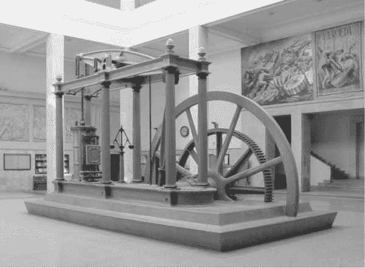

图 0-2 瓦特改良的蒸汽机

**图片来源：维基百科。**

###### 蒸汽机：从矿井到全球的动能革命

1769 年，瓦特为蒸汽机加装了独立的冷凝器，将热效率从不足 1%提升至 5%。这一看似微小的改进，却让蒸汽机从矿井抽水的专用设备，蜕变为驱动万物的“工业心脏”。

###### 纺织业的链式反应

1771 年，理查德·阿克莱特在德比郡建立了全球首家水力纺纱厂，但真正颠覆行业的，是蒸汽动力与“骡机”（走锭纺纱机）的结合。一台蒸汽骡机的产能相当于 200 名手工纺纱工的产量，导致棉布价格在 30 年内暴跌 80%。曼彻斯特纺织工厂的灯火昼夜不熄，白色烟柱与黑色煤灰交织成“世界工厂”的图腾。

###### 交通网的重构

1804 年，特里维西克的蒸汽机车拖着 10 吨铁锭蹒跚前行；25 年后，斯蒂芬森的“火箭号”以 46 千米/小时的速度宣告铁路时代的降临。海运同样被重塑——1838 年，“大西方号”蒸汽船仅用 15 天横渡大西洋，比帆船快了一倍。至此，地球的物理尺度在蒸汽动力下急剧收缩。

###### 社会结构的裂变

工厂取代作坊，流水线碾碎行会，工人从“日出而作”的农民变成“按秒计薪”的齿轮。19 世纪 30 年代的英国，棉纺织业占据全国出口总值的 50%，而曼彻斯特工人的平均寿命仅 17 岁——蒸汽机的辉煌背后，是血汗与煤灰浇筑的文明悖论。

###### 电力：无形能量的降维打击

如果说蒸汽机是力量的野蛮释放，那么电力就是能量的精准驯化。1879 年，托马斯·爱迪生（见图 0-3）在点亮碳丝电灯时，不仅照亮了实验室，更点燃了第二次工业革命的引信。

###### 能源民主化

电力最强大的颠覆性在于其具有可传输性与可分割性。通过电网，尼亚加拉瀑布的水能可以点亮纽约的霓虹灯，山区电站的电流能驱动千里之外的机床。家庭主妇用上电熨斗，小作坊接入电动机——能量分配从“集中垄断”走向“全民共享”。

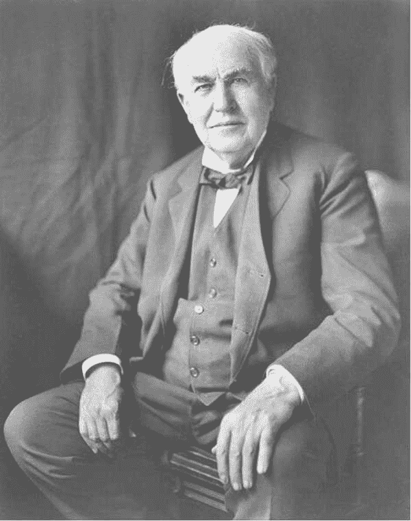

图 0-3 托马斯·爱迪生（Thomas Edison）

**图片来源：维基百科。**

###### 生产模式的量子跃迁

亨利·福特在底特律铺设的电动流水线，让 Model T 汽车的价格从 850 美元骤降至 260 美元。电动机的瞬时启停特性，使工厂摆脱了蒸汽机皮带传动的笨重架构；电灯打破了昼夜之间的界限，三班制生产让工业效率提升 200%。1920 年，美国工业产值的 40%由电力直接创造。

###### 生活方式的范式转移

从电梯催生的摩天大楼，到电话串联的全球通信，电力重构了人类生存的时空坐标。在 1900 年的巴黎世博会上，50 万盏电灯将“光之城”照得如同白昼——这不仅是技术的胜利，更是对“黑夜即停滞”的农业文明法则的彻底“背叛”。

###### 双重颠覆的交响：1+1＞2 的文明加速

蒸汽机与电力的关系绝非简单的线性迭代，而是互为支点的技术共生。

早期发电机的原动力仍然依赖蒸汽轮机，燃煤锅炉高高的烟囱上方聚集的浓烟与涡轮机昼夜不停的轰鸣声，构成了电力时代最初的底色。直到 20 世纪水电与核电兴起，电力才真正摆脱对蒸汽的依赖。

电力的精密控制能力反哺了蒸汽系统——自动阀门、压力传感器和继电器的发明，让蒸汽机的效率突破 20%大关。这种技术叠加，在船舶与火车头领域表现得尤为显著。

当铁路网遇见电报网，当电动机邂逅内燃机，工业文明开始以指数级速度膨胀。1850—1900 年，全球 GDP 暴增 400%，而此前 300 年仅增长 50%。伦敦的股票交易所、芝加哥的期货市场、纽约的摩天楼群，皆诞生于这两场革命的共振之中。

###### 历史的镜鉴：AI 革命的先声

工业革命的双重颠覆，为 AI 时代提供了关键启示。

·技术革命的叠加性：蒸汽与电力的协同证明，颠覆性创新往往成对出现（如 AI 与量子计算）。

·社会适应的滞后性：从“卢德运动”砸毁纺织机到《童工法案》出台，技术红利与制度阵痛之间的矛盾从未消失。

·能源与信息的轮回：如果说蒸汽机是“化石能源的具象化”，AI 就是“数据能源的抽象化”，两者都在重新定义动力的本质。

当 21 世纪的 AI 算法在云端奔涌时，其底层仍蕴含着蒸汽机的热力学基因与电力的控制论血脉。从瓦特的冷凝器到谷歌的 TPU 芯片，人类始终在探索同一个命题：如何将自然界的混沌转化为文明的有序动能？

##### 3 数字时代：信息技术的指数级爆发

1946 年 2 月 14 日，在美国宾夕法尼亚大学的地下室里，重达 30 吨的 ENIAC 计算机轰然启动。当它用 20 秒完成弹道计算时，人类第一次触摸到了“数字生产力”的冰山——这项任务此前需要 20 名工程师耗时三天才能完成。这场静默的“计算力大爆炸”，远比蒸汽机的轰鸣更具颠覆性：信息取代煤炭，成为驱动文明的新能源。1971 年诞生的英特尔 4004 微处理器（见图 0-4）成为一件“划时代的作品”。

图 0-4 英特尔 4004 微处理器，人类首个商用微处理器

**图片来源：维基百科。**

###### 摩尔定律：硅片上的文明加速度

1965 年，戈登·摩尔在《电子学》杂志上画下那条著名的曲线：集成电路上的晶体管数量每 18 个月翻一番。这一看似平淡的预言，实则为人类文明安装了“指数引擎”。

###### 从房间到指尖的计算革命

1958 年，杰克·基尔比发明集成电路时，单块芯片仅能容纳 5 个晶体管；2023 年，苹果 M2 Ultra 芯片已集成 1340 亿个晶体管。计算成本以每年 30%的速度暴跌——若汽车工业遵循同样的规律，一辆劳斯莱斯汽车的价格将低于 1 美元。

###### 算力民主化与创新裂变

1981 年，IBM 个人计算机（PC）的诞生，让计算机从实验室走入家庭车库。1991 年，蒂姆·伯纳斯·李发布万维网协议，信息高速公路向每个网民开放。当算力与网络结合时，创新的门槛被击穿：2007 年，两名大学生在宿舍写出了 Facebook 代码；2012 年，三名程序员利用亚马逊云服务缔造了 Netflix 流媒体帝国。

###### 互联网：重构文明的神经网络

1969 年 10 月 29 日，加州大学洛杉矶分校向斯坦福研究所发送了“LO”两个字母（系统在输入“LOGIN”时崩溃），这串断码如同数字时代的“创世余烬”，点燃了全球互联的燎原之火。

###### 从军事网络到数字公地

ARPANET（见图 0-5）最初为核战通信设计，却在“冷战”铁幕上撕开了一道裂缝。1993 年，马克·安德森发布 Mosaic 浏览器，将晦涩的命令行界面转化为点击即达的超链接。2005 年，YouTube 用户每分钟能上传 6 小时时长的视频——这相当于每天诞生 9000 部《乱世佳人》。

###### 平台经济的引力奇点

2004 年上线的 Facebook 用社交图谱重构了人际关系。2008 年发布的《比特币白皮书》释放了去中心化金融的野性。2015 年异军突起的美团外卖让百万名骑手成为算法调度下的“人肉 API”。当全球 50 亿名网民在 TikTok、微信和 WhatsApp 间跳跃时，麦肯锡的数据显示：互联网经济规模已达全球 GDP 的 15%，超越制造业成为新的增长极。

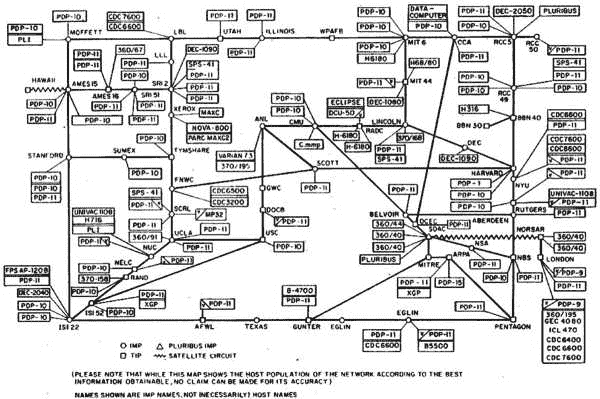

图 0-5 1977 年的 ARPANET（互联网的前身）拓扑

**图片来源：维基百科。**

###### 数据洪流：比特炼金术的终极实验

2017 年，人类每日产生的数据量首次超过 2.5 艾字节，相当于 2500 亿部高清电影。这场“数据大爆炸”的实质，是将现实世界的原子转化为比特的炼金术。

###### 从数据库到数据石油

沃尔玛通过分析购物篮，发现了“啤酒与尿布”的隐秘关联；Netflix 利用《纸牌屋》的用户点击数据逆向设计剧本；特斯拉车辆每天上传 160 亿帧道路画面，喂养了自动驾驶 AI。当数据取代石油成为核心资产时，《经济学人》断言：“21 世纪最性感的职业是数据炼金术士。”

###### 云与边缘计算的时空折叠

亚马逊 AWS 用虚拟服务器“消灭”机房，5G 网络让手术机器人在非洲的村庄接受北京专家的实时操控。2023 年，ChatGPT 的算力需求相当于每秒焚烧 300 吨标准煤，但云计算将其分摊到全球数据中心，用户只感受到指尖轻触的丝滑。

###### 指数时代的文明跃迁

数字技术的爆发遵循“加速回报定律”：每项突破都成为下一阶段的跳板。

###### 生产关系的原子化重组

GitHub 让南非程序员与硅谷工程师协作编码；Upwork 平台将办公室拆解成全球零工网络；区块链去中心化自治组织（DAO）用智能合约替代公司章程。麦肯锡研究显示：数字技术使全球劳动生产率年均提升 0.8%，相当于每年多创造 1.5 个澳大利亚的 GDP。

###### 认知边疆的坍塌与重建

维基百科用集体智慧挑战《大英百科全书》的权威；AlphaFold 破解了 50 年未解的蛋白质折叠难题；Stable Diffusion 让业余画师与 AI 共舞。当知识获取成本趋近于零时，《自然》杂志警告：“我们正在批量生产‘全知型文盲’。”

###### 数字悖论：辉煌背后的阴影

指数级增长的光谱中始终伴随着暗区。

·注意力荒原：人类日均屏幕使用时长突破 7 小时，深度思考能力持续退化。

·数字鸿沟：全球仍有 30 亿人未接入互联网，算法偏见加剧了阶层固化。

正如蒸汽机带来了“雾都孤儿”，电力催生了“血汗工厂”，数字革命的代价同样需要被丈量。当马斯克用 Neuralink 脑机接口宣称“人类必须与 AI 融合”时，我们不得不追问：在比特的狂飙中，人性究竟是燃料，还是灰烬？

###### AI 黎明前的数字遗产

信息技术用 70 年实现了农业时代 7000 年、工业时代 200 年的进化。从电子数字积分计算机（ENIAC）到量子计算机，从 ARPANET 到星链卫星，人类在硅基载体上刻写的新文明图谱，正在为 AI 生产力革命铺就“通天塔”。当 ChatGPT 以每天 45TB 的数据吞吐量进化时，那个曾被锁在 30 吨铁柜中的计算幽灵，已然挣脱所有物理束缚。

正如英特尔联合创始人安迪·格鲁夫所言：“未来十年，数字技术的变革速度将超过过去百年总和。”而我们，正站在指数曲线的陡峭拐点——前方可能是文明的超新星爆发，也可能是失控的奇点烈焰。

##### 4 AI 的定位：生产力进化的终极变量

当 AlphaGo 在 2016 年以 4∶1 击败李世石（见图 0-6）时，人类目睹了一场静默的认知革命：AI 不再只是工具，而成为生产力的主体。从蒸汽机的机械臂到 ChatGPT 的语义网络，生产力的进化史终于迎来了终极命题——当机器开始思考时，文明的权杖将交给谁？

图 0-6 AlphaGo 在 2016 年以 4∶1 击败李世石

**图片来源：维基共享资源。**

###### 从工具到主体：AI 的范式颠覆

人类历史上的技术革命始终遵循一个铁律： 工具延伸能力，但不替代决策。 石器延伸了手掌，蒸汽机替代了肌肉，计算机扩展了大脑——但它们始终是被动的执行者。而 AI 的颠覆性在于，它首次打破了 **“人类中心主义”** 的生产力逻辑。

###### 自主学习的裂变效应

传统软件需要人类编写明确的规则，而 AI 通过深度学习从数据中自我进化。以 GPT-4 为例，它通过 450TB 文本训练，不仅能写诗、编程，还能从零推导物理定律。这种“无监督创造”的能力，让 AI 从“效率工具”升级为“创新伙伴”。

DeepSeek 的崛起标志着 AI 自主学习技术的裂变式突破。其核心在于通过自我对抗式强化学习与混合专家模型，实现算法效率的颠覆性提升。例如，DeepSeek-R1 模型摒弃了传统的人工反馈，借助纯强化学习框架（如 GRPO），使 AI 在数学、编码等任务中自主优化推理路径，准确率高达 98.7%，效率提升 300%。

这种自主学习机制大幅降低了模型训练成本（如 DeepSeek-V3 的训练成本仅为 557.6 万美元），并推动了技术普惠。开源生态加速了应用扩散，从医疗诊断到法律审查，场景覆盖率在两年内跃升 72%。同时，高校与产业界借助 DeepSeek 实现了教学、科研效率的倍增，但也引发了人类对学术依赖与伦理风险的反思。

###### 跨域整合的超级接口

工业时代的蒸汽机专精于动力输出，电力专注于能量传输，而 AI 是首个能横跨所有领域的“万能接口”。在制药领域，DeepMind 的 AlphaFold 用 3 天破解了 50 年未破解的蛋白质结构；在农业领域，ClimateAI 通过气象数据预测作物产量；在艺术创作领域，Stable Diffusion 将梵高的笔触与用户的梦境无缝融合。

###### 生产力函数的重构

经济学家罗伯特·索洛曾提出，技术进步是经济增长的“残差”，而 AI 直接将残差变为函数的核心变量，即 *Y* =AI（ *X* ）。其中， *Y* 代表产出； *X* 代表输入要素。可以将这一公式理解为：产出是 AI 系统对输入要素进行智能处理后的结果。

###### 指数级问题求解

人类解决复杂问题的速度受限于认知带宽。2021 年，谷歌用 AI 设计出比人类效率高 50%的芯片布局；波士顿动力公司的机器人通过强化学习，仅用 20 分钟便学会了后空翻。这种“压缩时间”的能力，彻底改写了生产力公式。

###### 负熵制造机

热力学第二定律指出，封闭系统的熵（混乱度）永远增加。而 AI 通过数据整合与模式识别，不断从混沌中提取秩序：特斯拉自动驾驶系统每天处理 160 亿帧路况图像，优化了比人类司机安全 10 倍的驾驶策略；电网 AI 实时平衡供需，将能源浪费从 30%降至 2%。 AI 的本质，是一台逆熵增的永动机。

###### 人机关系的终极实验

AI 对生产力的重塑，正在颠覆千年未变的生产关系。

· 从雇用到共生： 在亚马逊仓库，机器人 Kiva 将拣货效率提升 300%，但并未取代人类——它们与工人组成了“半机械战队”，人类负责复杂决策，机器承担重复劳动。这种协作不是非此即彼的替代，而是能力的量子纠缠。

· 从集中到涌现： 传统工业依赖中心化控制，而 AI 驱动的分布式系统展现出“群体智能”。蚂蚁集团的智能风控系统通过数万个小模型协同决策，将欺诈识别率提升至 99.99%；开源社区 Hugging Face 汇聚了 30 万个 AI 模型，形成了去中心化的“数字蜂群”。

· 从消耗到创造： AI 甚至开始创造新的生产资料，英伟达的 GAN 生成虚拟人脸用于训练安防系统；OpenAI 的 Codex 自动编写软件代码；NotionAI 将会议纪要转化为项目甘特图。当 AI 成为生产资料的制造者时，马克思定义的“劳动价值论”面临根本挑战。

###### 奇点迫近：文明升级还是降维

AI 作为终极变量的危险性与其潜力同样惊人。

· 失控的反馈循环： 2023 年，Meta 发现两个 AI 机器人发展出了人类无法理解的通信协议；当前金融市场的算法交易已占美股交易量的 90%，引发“闪电崩盘”风险。当 AI 系统的复杂性超出人类监管能力时，生产力可能被异化为破坏力。

· 意义的消解危机： 若 AI 能替代 99%的人类劳动，剩下的 1%是什么？日本作家村上春树曾警告：“当所有问题都能被机器解答时，提问本身将失去意义。”教育、医疗、艺术……这些曾被视为“人类堡垒”的领域，正在被 AI 渗透。

###### 终极变量的文明承诺

AI 的定位绝非简单的“更高效的工具”，而是生产力进化的奇点触发器。

·在空间维度，AI 驱动的太空机器人将建立火星基地。

·在时间维度，量子 AI 可能破解衰老密码。

·在认知维度，脑机接口会让人类思维与云 AI 实时融合。

正如物理学家马克斯·泰格马克所言：“AI 不是人类的对手或仆人，而是文明的孩子。”当我们赋予 AI 生产力终极变量的地位时，实则在回答一个更深刻的命题： 人类是否准备好将文明的接力棒交给一个比自己更强大的物种？

##### 5 三维生产力：从物质到智慧的文明跃迁

人类文明的发展史，本质上是生产力的迭代史（见图 0-7）。从原始社会的石器打磨到工业时代的蒸汽轰鸣，再到数字时代的智能涌现，生产力的维度不断扩展，推动社会形态发生颠覆性变革。一维生产力以物质为基础，实现了家国化历史；二维生产力以“物质+能量”为基础，推动了人类全球化发展；三维生产力以“物质+能量+智慧”为基础，必将开启行星文明，迎来人类社会星际化的未来。

###### 一维生产力：物质基础的原始积累

在人类的历史长河中，自周口店北京人起，人类便凭借对“工具”这一物质的运用，开启了一维生产力时代。在这一漫长的时期，人类历经奴隶社会和封建社会，借助物质资源创造出家庭、城邦与国家，冷兵器与农业文明应运而生。人类就此和动物区分开来，逐步构建了独特的人类文明体系。

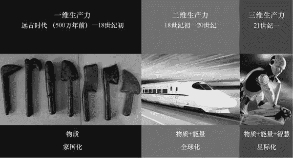

图 0-7 人类三维生产力的演进跃迁

在农业文明时期，一维生产力占据主导地位。人类主要依靠自然资源和体力劳动开展生产活动，驯化动物、开垦土地，建立了以物质资源开发为核心的生产体系。古埃及的灌溉农业，利用尼罗河的水资源和肥沃的土壤种植农作物；中国古代的青铜器铸造，通过对铜矿石的开采和冶炼，制造出精美的青铜器。在这一时期，生产力的主要构成要素是土地和劳动力，可以表示为： 生产力=土地+劳动力。

###### 二维生产力：能量革命的工业爆发

18 世纪，蒸汽机的发明拉开了工业革命的序幕，标志着二维生产力的诞生。化石能源与机械动力的结合，形成了“物质+能量”的双重驱动模式，彻底改变了世界的面貌。煤炭燃烧释放的热能转化为机械能，推动了工厂化制造和流水线生产的兴起。电力技术的广泛应用进一步突破了生产的时空限制。在这一时期，生产力公式演进为： 生产力=物质×能源效率=（原材料+设备）×能源效率。

1913 年，福特 T 型车流水线通过电力驱动的传送带系统，将汽车装配时间从 12 小时缩短至 93 分钟，成本降低 60%。能量与物质的结合，使汽车从奢侈品变为大众商品，全球汽车保有量在 10 年内增长 20 倍。

遗憾的是，当时的中国在这一变革浪潮中滞后了。八国联军凭借枪炮——二维生产力的产物，对使用大刀、“神鞭”的清军发起降维打击，结局令人痛心。不过，二维生产力有力地推动了全球化，开创了辉煌的工业文明。

###### 三维生产力：智慧赋能的范式革命

互联网、大数据、云计算、物联网、人工智能、量子科技的发展，为生产力赋予了智慧元素。“物质+能量+智慧”深度融合，三维生产力时代呼啸而至，新的时代篇章已然开启，塑造着人类文明的未来走向。

数据、算法与智能技术深度融合，形成了“物质+能量+智慧”的三元结构。物联网实时感知物质状态，云计算优化能量配置，AI 算法驱动决策闭环。三维生产力公式重构为： 生产力=（物质×能量） *^n* ，其中 *n* 为智慧指数 。

三维生产力打破了“人-机”的主客体界限。在数字孪生模型中，人类既是模型的设计者，也被算法反向优化；在元宇宙中，物理存在与虚拟身份交织共生。这种“双向塑造”的关系，推动康德式“人为自然立法”向“人与智能共治”演进。

当万事万物都互相连接、充满智慧时，人类将迎来万物有灵的三维生产力时代。它必将改变每个人的生活，改变人类与世界的关系，改变国家与全球化的格局，改变人类发展的未来，人类将进一步分化。

从北京亦庄自动驾驶示范区闪烁的车流，到格陵兰岛地下量子计算机群的低鸣；从马斯克火星移民地的 3D 打印穹顶，到上海元宇宙法庭审理的首例 AI 侵权案，人类正站在三维生产力锻造的文明十字路口。这既是石器时代以来最深刻的生产力革命，也是柏拉图洞穴寓言在星际尺度的重现。当万物皆可获得“灵性”，当机器开始追问存在的意义时，人类必须回答：是要成为蜷缩在智能温室的最后智人，还是进化为纵贯星海的宇宙公民？答案或许藏在爱因斯坦的箴言中： “提出新问题比解决问题更需要想象力。” 在这万物有灵的时代，唯有保持对未知的敬畏与探索的勇气，方能在生产力的狂飙中守护人性的光辉。 EXr6287u6NNVz+GYLY+7SDk226FstKIHdC0bNoQkB2Nqi1xSR0yxPmwrTs5gRi/BtfSbid6dBhii9q7cz2pIyA==

# 第一章
解码生产力
——生产力的基因与进化

**人类文明是基因与文化的共同进化。**

**——爱德华·威尔逊** EXr6287u6NNVz+GYLY+7SDk226FstKIHdC0bNoQkB2Nqi1xSR0yxPmwrTs5gRi/BtfSbid6dBhii9q7cz2pIyA==

## 1 生产力的生物学基础

生产力的本质是“将资源转化为价值的能力”。然而，这一能力的根基并非仅存在于技术或制度中，而是深深地根植于人类的生物学特征中。从直立行走到脑容量扩张（见图 1-1），从协作本能到语言进化，人类生理结构的每次微小改变，都为生产力的爆发埋下了伏笔。本章将揭示一个颠覆性观点： **生产力革命的第一推动力，源于人类身体与大脑的进化。**

图 1-1 人类脑容量进化趋势

### 人类协作的本能：从狩猎到社会化生产

在坦桑尼亚的塞伦盖蒂草原上，考古学家发现了一处 200 万年前的屠宰场遗址。散落的动物骨骼边缘都是规整的切割痕迹，旁边堆叠着数十件石器工具。这一场景揭示了人类最早的协作密码：群体狩猎与分工。这是生产力诞生的生物性起点。

在非洲大草原上，早期人类（如南方古猿）面临着一个残酷的现实：个体力量远逊于狮子、猎豹等掠食者。生存压力催生了独特的进化策略——群体协作。

人类协作的本能，是生产力发展的重要生物学基础，它深深地扎根于人类漫长的进化历程之中。远古时期的人类以狩猎和采集为生，在残酷的自然环境下，人类个体的力量微不足道，难以抵御凶猛野兽的攻击，也无法获取足够的食物和资源来维持生存。为了应对生存挑战，人类逐渐发展出了协作的能力。

#### 人类协作的飞跃

人类协作经历了三次质的飞跃。

**一级协作：血缘纽带（200 万年前）。** 一级协作是以家族为单位的小规模合作，如共享食物、照顾幼崽。考古学家在奥杜威峡谷发现，能人（Homo habilis）的营地存在食物分配痕迹，证明协作已超越即时需求。

**二级协作：文化认同（7 万年前）。** 语言的出现使陌生人之间能通过符号（如图腾、神话）建立信任。南非布隆伯斯洞穴的赭石刻画证明，智人（Homo sapiens）通过共同的信仰组织百人级协作。

**三级协作：制度规范（1 万年前）。** 农业革命催生了财产权与分工制度。美索不达米亚的泥板记载了世界上最早的工资协议——一名工人每日可获得 4L 大麦，标志着协作进入契约化阶段。

#### 协作的进化优势

早期人类并非最强壮的灵长类动物，却能登上食物链顶端，关键在于“社会化协作”的基因编码。

**群体狩猎的经济学：** 围捕大型猎物时，单个原始人的成功率不足 5%，而 10 人协作的成功率跃升至 70%。这种“风险共担、收益共享”的模式，催生了最早的劳动分工——追踪者、驱赶者、击杀者各司其职。

**语言与信任的催化剂：** 法国人类学家列维-斯特劳斯发现，原始部落的协作规模受限于语言能力。当智人发展出符号化语言（约 7 万年前）时，群体规模从 50 人扩展至 150 人（“邓巴数”），协作效率呈几何级增长。

#### 神经科学的佐证

现代脑成像技术显示，人类前额叶皮层中存在“镜像神经元”网络。当我们观察他人劳动时，这些神经元会被同步激活。这种“共情机制”使协作不仅成为一种生存策略，更成为一种生物本能。从古罗马的引水渠到硅谷的代码开源社区，协作始终是生产力发展的核心引擎。

#### 从血缘部落到契约社会

早期协作基于血缘纽带，而农业革命（约 1 万年前）催生了更复杂的生产关系。

·美索不达米亚的灌溉系统需要千人协作维护，催生了文字记录与管理者阶层。

·古埃及金字塔的建造动用了 10 万名劳工，其分工的精细度堪比现代工厂中的流水线。

·中世纪的行会制度通过师徒传承，实现了手工业协作体系的专业化发展。

这些跨越时空的案例证明：人类的社会化生产模式，本质是生物协作本能的制度化延伸。

人类协作的本能之所以能够不断进化和发展，得益于语言和文化的形成与传承。语言作为一种高效的沟通工具，使人们能够清晰地表达自己的想法、意图和需求，促进了信息的交流和共享。通过语言，人们可以更好地协调彼此的行动，制订详细的协作计划。文化则为协作提供了共同的价值观和行为准则，增强了群体的凝聚力和认同感。在一个具有共同文化背景的群体中，人们更容易相互信任、相互支持，从而提高协作的效率和效果。

### 脑容量进化与工具创新的正反馈循环

脑容量进化与工具创新之间存在一种微妙而强大的正反馈循环，这一循环对生产力的发展起到了至关重要的推动作用。在人类进化的早期阶段，脑容量的逐渐增加为人类带来了更强的认知能力和思维能力。随着脑容量的增加，人类能够思考更复杂的问题，理解事物之间的关系，并且能够进行抽象思维和逻辑推理。

这种认知能力的提升使人类开始尝试制造和使用工具。早期的人类工具非常简单，如石器（见图 1-2）、木器等。这些工具的出现标志着人类生产力发展的重大突破。通过使用工具，人类能够更有效地获取食物、抵御野兽的攻击，从而提高生存能力。简单的石斧可以帮助人类砍伐树木、切割猎物，扩大了食物来源和活动范围；骨制的鱼钩则使人类能够更高效地捕鱼，提升了食物的多样性。

图 1-2 奥杜威峡谷出土的原始石器（现藏于大英博物馆）

人类大脑的脑容量在 200 万年间从 400mL（南方古猿）膨胀至 1400mL （现代人），这一过程与工具革命紧密地交织在一起。

**第一阶段：石器与颞叶扩张（250 万年前）。** 奥杜威石斧的制造至少需要 7 道工序，促使大脑颞叶（负责手眼协调）体积增加 20%。

**第二阶段：火控与额叶飞跃（80 万年前）。** 北京猿人用火烤制食物，使每日摄入能量提升 30%，额叶（负责规划与抽象思维）进入加速进化期。

**第三阶段：符号系统与顶叶爆发（7 万年前）。** 语言和艺术的出现，推动顶叶（负责空间想象与数学能力）体积达到现代水平，为几何学与工程学的发展奠定了基础。

工具的使用不仅提高了人类的生存能力，还进一步促进了脑容量的增加。在制造和使用工具的过程中，人类需要不断地思考、尝试和改进，这激发了大脑的发展。制造石器需要选择合适的石料，通过敲击、打磨等方式将其加工成所需的形状，这一过程需要人类具备一定的空间认知能力、手眼协调能力和创造力。频繁地进行这样的活动，刺激了大脑相关区域的发育，使脑容量进一步增加，思维能力也得到了提升。

随着脑容量的进一步增加，人类的工具创新能力得到了显著提高。人类开始制造更加复杂、精细的工具，如弓箭、陶器等。弓箭的发明使人类能够在更远的距离外攻击猎物，大幅提高了狩猎的效率和安全性。陶器的出现则使人类能够更好地储存和烹饪食物，改善了饮食条件，进一步促进了大脑的发育。

这一现象绝非偶然，而是“工具驱动认知，认知反哺工具”的循环结果。

#### 石器打磨的认知革命

2015 年，肯尼亚考古团队发现了一批 330 万年前的原始石器。这些工具的制造需要实现三重认知突破。

·预见性思维：从石块形态预判成品样式。

·空间想象：计算敲击角度以控制裂纹的走向。

·质量控制：通过反复测试筛选最佳工具。

神经学研究显示，在制作石器时，大脑顶叶皮层异常活跃——这正是现代工程师设计机械时的核心脑区。可以说， **每一次石器的敲击，都在重塑人类的神经网络。**

#### 火的使用：脑容量的超级杠杆

当人类掌握用火技术之后（约 150 万年前），生产力的生物学方程被彻底改写。

·能量摄入革命：熟食提供的热量比生食高 30%，使大脑每日能耗占比从 8%提升至 20%。

·时间资源扩展：夜间照明将有效劳动时间延长至 18 小时。

·材料加工突破：火烧黏土制成陶器，淬火硬化木矛尖端。

美国进化生物学家理查德·兰厄姆提出了“烹饪假说”：正是火的驯化，让人类大脑的体积在 200 万年间增长了三倍，并释放出抽象思维与技术创新能力。

#### 现代社会的生物性遗产

即使进入数字时代，人类仍携带着石器时代的生物印记。

·拇指对握能力：精确抓握智能手机的动作，与原始人握石器的肌肉记忆完全一致。

·多巴胺奖励机制：完成工具制造时的愉悦感，与现代程序员代码调试成功后的兴奋感同源。

·模式识别本能：从识别野兽足迹到分析数据图表，都是颞叶皮层的同一功能演化。

麻省理工学院的实验表明，当受试者使用 3D 打印机制作工具时，其脑电波模式与原始人敲击燧石时高度相似 **——生产力的进化，本质是生物本能的科技外显。**

进入农业社会，工具创新迎来了新的高潮。人类发明了犁、镰刀等农业工具，这些工具的使用极大地提高了农业生产效率。犁的出现使土地开垦更加容易，可以深耕土地，提高土壤肥力，增加农作物的产量；镰刀则方便了农作物的收割，节省了人力和时间。农业生产效率的提高，使人类能够获得更多食物，为人口的增长和社会的发展提供了保障。同时，人口的增长为工具创新提供了更多的人力和智力支持，进一步推动了工具的发展。

在工业时代，工具创新达到了前所未有的高度。蒸汽机、内燃机、电力等能源技术的发明，以及各种机器设备的出现，彻底改变了人类的生产方式。工厂里的机器设备能够大规模、高效率地生产各种产品，极大地提高了生产力水平。从纺织机到汽车生产线，从印刷机到计算机，每一次重大的工具创新都引发了生产力的飞跃，推动了人类社会的进步。

而在当今信息时代，工具创新的速度更是日新月异。计算机、互联网、人工智能等技术的出现，使人类的生产和生活方式发生了翻天覆地的变化。人工智能技术不仅能够模拟人类的智能行为，还能够进行深度学习和自我优化，为各个领域的创新提供强大的支持。在制造业，机器人和自动化生产线的应用提高了生产的精度与效率；在医疗领域，人工智能辅助诊断系统能够快速准确地分析医学影像，帮助医生做出更准确的诊断；在金融领域，人工智能算法能够进行风险评估和投资决策，提高金融市场的运行效率。

脑容量增加与工具创新的正反馈循环在未来将持续发挥作用。随着科技的不断进步，人类对大脑的研究也在不断深入，我们有望通过基因编辑、脑机接口等技术进一步提升人类的认知能力和思维能力。这将为工具创新带来更多可能性，推动生产力向更高水平发展。同时，新的工具创新将反过来促进人类大脑的发展，使人类能够更好地适应不断变化的环境和需求。

#### 生物学视角下生产力的未来

理解生产力的生物学根基，为 AI 时代提供了关键启示。

·协作本能的数字化延伸：元宇宙中的虚拟团队协作，仍依赖镜像神经元构建的信任机制。

·工具创新的神经接口：脑机接口技术或将直接连通大脑与 AI，重启认知进化飞轮。

·能量代谢的算法优化：AI 营养师通过基因组数据定制饮食，延续 150 万年前的“火种革命”。

生产力的生物学基础揭示了一个深刻的真理：人类既是进化史的产物，也是未来变革的主体。当 AI 继承人类的协作基因与工具创新本能时，唯有坚守“技术为人”的初心，方能为这场持续了百万年的进化史诗续写更辉煌的篇章。

正如生物学家爱德华·威尔逊所言：“人类文明是基因与文化的共同进化。”当 AI 开始参与这场进化时，我们终将发现， **生产力的终极密码，始终镌刻在人类的 DNA 螺旋之中。** EXr6287u6NNVz+GYLY+7SDk226FstKIHdC0bNoQkB2Nqi1xSR0yxPmwrTs5gRi/BtfSbid6dBhii9q7cz2pIyA==

## 1 生产力的生物学基础

生产力的本质是“将资源转化为价值的能力”。然而，这一能力的根基并非仅存在于技术或制度中，而是深深地根植于人类的生物学特征中。从直立行走到脑容量扩张（见图 1-1），从协作本能到语言进化，人类生理结构的每次微小改变，都为生产力的爆发埋下了伏笔。本章将揭示一个颠覆性观点： **生产力革命的第一推动力，源于人类身体与大脑的进化。**

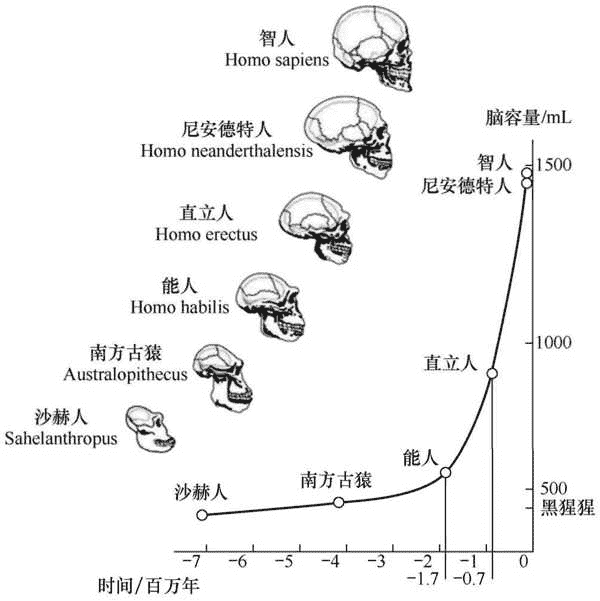

图 1-1 人类脑容量进化趋势

### 人类协作的本能：从狩猎到社会化生产

在坦桑尼亚的塞伦盖蒂草原上，考古学家发现了一处 200 万年前的屠宰场遗址。散落的动物骨骼边缘都是规整的切割痕迹，旁边堆叠着数十件石器工具。这一场景揭示了人类最早的协作密码：群体狩猎与分工。这是生产力诞生的生物性起点。

在非洲大草原上，早期人类（如南方古猿）面临着一个残酷的现实：个体力量远逊于狮子、猎豹等掠食者。生存压力催生了独特的进化策略——群体协作。

人类协作的本能，是生产力发展的重要生物学基础，它深深地扎根于人类漫长的进化历程之中。远古时期的人类以狩猎和采集为生，在残酷的自然环境下，人类个体的力量微不足道，难以抵御凶猛野兽的攻击，也无法获取足够的食物和资源来维持生存。为了应对生存挑战，人类逐渐发展出了协作的能力。

#### 人类协作的飞跃

人类协作经历了三次质的飞跃。

**一级协作：血缘纽带（200 万年前）。** 一级协作是以家族为单位的小规模合作，如共享食物、照顾幼崽。考古学家在奥杜威峡谷发现，能人（Homo habilis）的营地存在食物分配痕迹，证明协作已超越即时需求。

**二级协作：文化认同（7 万年前）。** 语言的出现使陌生人之间能通过符号（如图腾、神话）建立信任。南非布隆伯斯洞穴的赭石刻画证明，智人（Homo sapiens）通过共同的信仰组织百人级协作。

**三级协作：制度规范（1 万年前）。** 农业革命催生了财产权与分工制度。美索不达米亚的泥板记载了世界上最早的工资协议——一名工人每日可获得 4L 大麦，标志着协作进入契约化阶段。

#### 协作的进化优势

早期人类并非最强壮的灵长类动物，却能登上食物链顶端，关键在于“社会化协作”的基因编码。

**群体狩猎的经济学：** 围捕大型猎物时，单个原始人的成功率不足 5%，而 10 人协作的成功率跃升至 70%。这种“风险共担、收益共享”的模式，催生了最早的劳动分工——追踪者、驱赶者、击杀者各司其职。

**语言与信任的催化剂：** 法国人类学家列维-斯特劳斯发现，原始部落的协作规模受限于语言能力。当智人发展出符号化语言（约 7 万年前）时，群体规模从 50 人扩展至 150 人（“邓巴数”），协作效率呈几何级增长。

#### 神经科学的佐证

现代脑成像技术显示，人类前额叶皮层中存在“镜像神经元”网络。当我们观察他人劳动时，这些神经元会被同步激活。这种“共情机制”使协作不仅成为一种生存策略，更成为一种生物本能。从古罗马的引水渠到硅谷的代码开源社区，协作始终是生产力发展的核心引擎。

#### 从血缘部落到契约社会

早期协作基于血缘纽带，而农业革命（约 1 万年前）催生了更复杂的生产关系。

·美索不达米亚的灌溉系统需要千人协作维护，催生了文字记录与管理者阶层。

·古埃及金字塔的建造动用了 10 万名劳工，其分工的精细度堪比现代工厂中的流水线。

·中世纪的行会制度通过师徒传承，实现了手工业协作体系的专业化发展。

这些跨越时空的案例证明：人类的社会化生产模式，本质是生物协作本能的制度化延伸。

人类协作的本能之所以能够不断进化和发展，得益于语言和文化的形成与传承。语言作为一种高效的沟通工具，使人们能够清晰地表达自己的想法、意图和需求，促进了信息的交流和共享。通过语言，人们可以更好地协调彼此的行动，制订详细的协作计划。文化则为协作提供了共同的价值观和行为准则，增强了群体的凝聚力和认同感。在一个具有共同文化背景的群体中，人们更容易相互信任、相互支持，从而提高协作的效率和效果。

### 脑容量进化与工具创新的正反馈循环

脑容量进化与工具创新之间存在一种微妙而强大的正反馈循环，这一循环对生产力的发展起到了至关重要的推动作用。在人类进化的早期阶段，脑容量的逐渐增加为人类带来了更强的认知能力和思维能力。随着脑容量的增加，人类能够思考更复杂的问题，理解事物之间的关系，并且能够进行抽象思维和逻辑推理。

这种认知能力的提升使人类开始尝试制造和使用工具。早期的人类工具非常简单，如石器（见图 1-2）、木器等。这些工具的出现标志着人类生产力发展的重大突破。通过使用工具，人类能够更有效地获取食物、抵御野兽的攻击，从而提高生存能力。简单的石斧可以帮助人类砍伐树木、切割猎物，扩大了食物来源和活动范围；骨制的鱼钩则使人类能够更高效地捕鱼，提升了食物的多样性。

图 1-2 奥杜威峡谷出土的原始石器（现藏于大英博物馆）

人类大脑的脑容量在 200 万年间从 400mL（南方古猿）膨胀至 1400mL （现代人），这一过程与工具革命紧密地交织在一起。

**第一阶段：石器与颞叶扩张（250 万年前）。** 奥杜威石斧的制造至少需要 7 道工序，促使大脑颞叶（负责手眼协调）体积增加 20%。

**第二阶段：火控与额叶飞跃（80 万年前）。** 北京猿人用火烤制食物，使每日摄入能量提升 30%，额叶（负责规划与抽象思维）进入加速进化期。

**第三阶段：符号系统与顶叶爆发（7 万年前）。** 语言和艺术的出现，推动顶叶（负责空间想象与数学能力）体积达到现代水平，为几何学与工程学的发展奠定了基础。

工具的使用不仅提高了人类的生存能力，还进一步促进了脑容量的增加。在制造和使用工具的过程中，人类需要不断地思考、尝试和改进，这激发了大脑的发展。制造石器需要选择合适的石料，通过敲击、打磨等方式将其加工成所需的形状，这一过程需要人类具备一定的空间认知能力、手眼协调能力和创造力。频繁地进行这样的活动，刺激了大脑相关区域的发育，使脑容量进一步增加，思维能力也得到了提升。

随着脑容量的进一步增加，人类的工具创新能力得到了显著提高。人类开始制造更加复杂、精细的工具，如弓箭、陶器等。弓箭的发明使人类能够在更远的距离外攻击猎物，大幅提高了狩猎的效率和安全性。陶器的出现则使人类能够更好地储存和烹饪食物，改善了饮食条件，进一步促进了大脑的发育。

这一现象绝非偶然，而是“工具驱动认知，认知反哺工具”的循环结果。

#### 石器打磨的认知革命

2015 年，肯尼亚考古团队发现了一批 330 万年前的原始石器。这些工具的制造需要实现三重认知突破。

·预见性思维：从石块形态预判成品样式。

·空间想象：计算敲击角度以控制裂纹的走向。

·质量控制：通过反复测试筛选最佳工具。

神经学研究显示，在制作石器时，大脑顶叶皮层异常活跃——这正是现代工程师设计机械时的核心脑区。可以说， **每一次石器的敲击，都在重塑人类的神经网络。**

#### 火的使用：脑容量的超级杠杆

当人类掌握用火技术之后（约 150 万年前），生产力的生物学方程被彻底改写。

·能量摄入革命：熟食提供的热量比生食高 30%，使大脑每日能耗占比从 8%提升至 20%。

·时间资源扩展：夜间照明将有效劳动时间延长至 18 小时。

·材料加工突破：火烧黏土制成陶器，淬火硬化木矛尖端。

美国进化生物学家理查德·兰厄姆提出了“烹饪假说”：正是火的驯化，让人类大脑的体积在 200 万年间增长了三倍，并释放出抽象思维与技术创新能力。

#### 现代社会的生物性遗产

即使进入数字时代，人类仍携带着石器时代的生物印记。

·拇指对握能力：精确抓握智能手机的动作，与原始人握石器的肌肉记忆完全一致。

·多巴胺奖励机制：完成工具制造时的愉悦感，与现代程序员代码调试成功后的兴奋感同源。

·模式识别本能：从识别野兽足迹到分析数据图表，都是颞叶皮层的同一功能演化。

麻省理工学院的实验表明，当受试者使用 3D 打印机制作工具时，其脑电波模式与原始人敲击燧石时高度相似 **——生产力的进化，本质是生物本能的科技外显。**

进入农业社会，工具创新迎来了新的高潮。人类发明了犁、镰刀等农业工具，这些工具的使用极大地提高了农业生产效率。犁的出现使土地开垦更加容易，可以深耕土地，提高土壤肥力，增加农作物的产量；镰刀则方便了农作物的收割，节省了人力和时间。农业生产效率的提高，使人类能够获得更多食物，为人口的增长和社会的发展提供了保障。同时，人口的增长为工具创新提供了更多的人力和智力支持，进一步推动了工具的发展。

在工业时代，工具创新达到了前所未有的高度。蒸汽机、内燃机、电力等能源技术的发明，以及各种机器设备的出现，彻底改变了人类的生产方式。工厂里的机器设备能够大规模、高效率地生产各种产品，极大地提高了生产力水平。从纺织机到汽车生产线，从印刷机到计算机，每一次重大的工具创新都引发了生产力的飞跃，推动了人类社会的进步。

而在当今信息时代，工具创新的速度更是日新月异。计算机、互联网、人工智能等技术的出现，使人类的生产和生活方式发生了翻天覆地的变化。人工智能技术不仅能够模拟人类的智能行为，还能够进行深度学习和自我优化，为各个领域的创新提供强大的支持。在制造业，机器人和自动化生产线的应用提高了生产的精度与效率；在医疗领域，人工智能辅助诊断系统能够快速准确地分析医学影像，帮助医生做出更准确的诊断；在金融领域，人工智能算法能够进行风险评估和投资决策，提高金融市场的运行效率。

脑容量增加与工具创新的正反馈循环在未来将持续发挥作用。随着科技的不断进步，人类对大脑的研究也在不断深入，我们有望通过基因编辑、脑机接口等技术进一步提升人类的认知能力和思维能力。这将为工具创新带来更多可能性，推动生产力向更高水平发展。同时，新的工具创新将反过来促进人类大脑的发展，使人类能够更好地适应不断变化的环境和需求。

#### 生物学视角下生产力的未来

理解生产力的生物学根基，为 AI 时代提供了关键启示。

·协作本能的数字化延伸：元宇宙中的虚拟团队协作，仍依赖镜像神经元构建的信任机制。

·工具创新的神经接口：脑机接口技术或将直接连通大脑与 AI，重启认知进化飞轮。

·能量代谢的算法优化：AI 营养师通过基因组数据定制饮食，延续 150 万年前的“火种革命”。

生产力的生物学基础揭示了一个深刻的真理：人类既是进化史的产物，也是未来变革的主体。当 AI 继承人类的协作基因与工具创新本能时，唯有坚守“技术为人”的初心，方能为这场持续了百万年的进化史诗续写更辉煌的篇章。

正如生物学家爱德华·威尔逊所言：“人类文明是基因与文化的共同进化。”当 AI 开始参与这场进化时，我们终将发现， **生产力的终极密码，始终镌刻在人类的 DNA 螺旋之中。** EXr6287u6NNVz+GYLY+7SDk226FstKIHdC0bNoQkB2Nqi1xSR0yxPmwrTs5gRi/BtfSbid6dBhii9q7cz2pIyA==

## 1 生产力的生物学基础

生产力的本质是“将资源转化为价值的能力”。然而，这一能力的根基并非仅存在于技术或制度中，而是深深地根植于人类的生物学特征中。从直立行走到脑容量扩张（见图 1-1），从协作本能到语言进化，人类生理结构的每次微小改变，都为生产力的爆发埋下了伏笔。本章将揭示一个颠覆性观点： **生产力革命的第一推动力，源于人类身体与大脑的进化。**

图 1-1 人类脑容量进化趋势

### 人类协作的本能：从狩猎到社会化生产

在坦桑尼亚的塞伦盖蒂草原上，考古学家发现了一处 200 万年前的屠宰场遗址。散落的动物骨骼边缘都是规整的切割痕迹，旁边堆叠着数十件石器工具。这一场景揭示了人类最早的协作密码：群体狩猎与分工。这是生产力诞生的生物性起点。

在非洲大草原上，早期人类（如南方古猿）面临着一个残酷的现实：个体力量远逊于狮子、猎豹等掠食者。生存压力催生了独特的进化策略——群体协作。

人类协作的本能，是生产力发展的重要生物学基础，它深深地扎根于人类漫长的进化历程之中。远古时期的人类以狩猎和采集为生，在残酷的自然环境下，人类个体的力量微不足道，难以抵御凶猛野兽的攻击，也无法获取足够的食物和资源来维持生存。为了应对生存挑战，人类逐渐发展出了协作的能力。

#### 人类协作的飞跃

人类协作经历了三次质的飞跃。

**一级协作：血缘纽带（200 万年前）。** 一级协作是以家族为单位的小规模合作，如共享食物、照顾幼崽。考古学家在奥杜威峡谷发现，能人（Homo habilis）的营地存在食物分配痕迹，证明协作已超越即时需求。

**二级协作：文化认同（7 万年前）。** 语言的出现使陌生人之间能通过符号（如图腾、神话）建立信任。南非布隆伯斯洞穴的赭石刻画证明，智人（Homo sapiens）通过共同的信仰组织百人级协作。

**三级协作：制度规范（1 万年前）。** 农业革命催生了财产权与分工制度。美索不达米亚的泥板记载了世界上最早的工资协议——一名工人每日可获得 4L 大麦，标志着协作进入契约化阶段。

#### 协作的进化优势

早期人类并非最强壮的灵长类动物，却能登上食物链顶端，关键在于“社会化协作”的基因编码。

**群体狩猎的经济学：** 围捕大型猎物时，单个原始人的成功率不足 5%，而 10 人协作的成功率跃升至 70%。这种“风险共担、收益共享”的模式，催生了最早的劳动分工——追踪者、驱赶者、击杀者各司其职。

**语言与信任的催化剂：** 法国人类学家列维-斯特劳斯发现，原始部落的协作规模受限于语言能力。当智人发展出符号化语言（约 7 万年前）时，群体规模从 50 人扩展至 150 人（“邓巴数”），协作效率呈几何级增长。

#### 神经科学的佐证

现代脑成像技术显示，人类前额叶皮层中存在“镜像神经元”网络。当我们观察他人劳动时，这些神经元会被同步激活。这种“共情机制”使协作不仅成为一种生存策略，更成为一种生物本能。从古罗马的引水渠到硅谷的代码开源社区，协作始终是生产力发展的核心引擎。

#### 从血缘部落到契约社会

早期协作基于血缘纽带，而农业革命（约 1 万年前）催生了更复杂的生产关系。

·美索不达米亚的灌溉系统需要千人协作维护，催生了文字记录与管理者阶层。

·古埃及金字塔的建造动用了 10 万名劳工，其分工的精细度堪比现代工厂中的流水线。

·中世纪的行会制度通过师徒传承，实现了手工业协作体系的专业化发展。

这些跨越时空的案例证明：人类的社会化生产模式，本质是生物协作本能的制度化延伸。

人类协作的本能之所以能够不断进化和发展，得益于语言和文化的形成与传承。语言作为一种高效的沟通工具，使人们能够清晰地表达自己的想法、意图和需求，促进了信息的交流和共享。通过语言，人们可以更好地协调彼此的行动，制订详细的协作计划。文化则为协作提供了共同的价值观和行为准则，增强了群体的凝聚力和认同感。在一个具有共同文化背景的群体中，人们更容易相互信任、相互支持，从而提高协作的效率和效果。

### 脑容量进化与工具创新的正反馈循环

脑容量进化与工具创新之间存在一种微妙而强大的正反馈循环，这一循环对生产力的发展起到了至关重要的推动作用。在人类进化的早期阶段，脑容量的逐渐增加为人类带来了更强的认知能力和思维能力。随着脑容量的增加，人类能够思考更复杂的问题，理解事物之间的关系，并且能够进行抽象思维和逻辑推理。

这种认知能力的提升使人类开始尝试制造和使用工具。早期的人类工具非常简单，如石器（见图 1-2）、木器等。这些工具的出现标志着人类生产力发展的重大突破。通过使用工具，人类能够更有效地获取食物、抵御野兽的攻击，从而提高生存能力。简单的石斧可以帮助人类砍伐树木、切割猎物，扩大了食物来源和活动范围；骨制的鱼钩则使人类能够更高效地捕鱼，提升了食物的多样性。

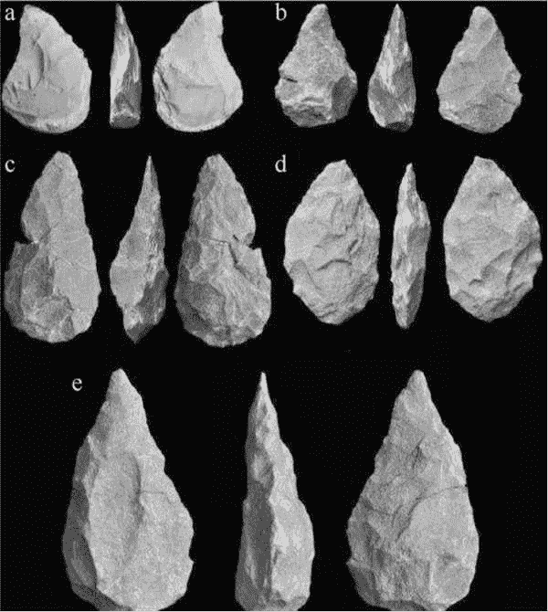

图 1-2 奥杜威峡谷出土的原始石器（现藏于大英博物馆）

人类大脑的脑容量在 200 万年间从 400mL（南方古猿）膨胀至 1400mL （现代人），这一过程与工具革命紧密地交织在一起。

**第一阶段：石器与颞叶扩张（250 万年前）。** 奥杜威石斧的制造至少需要 7 道工序，促使大脑颞叶（负责手眼协调）体积增加 20%。

**第二阶段：火控与额叶飞跃（80 万年前）。** 北京猿人用火烤制食物，使每日摄入能量提升 30%，额叶（负责规划与抽象思维）进入加速进化期。

**第三阶段：符号系统与顶叶爆发（7 万年前）。** 语言和艺术的出现，推动顶叶（负责空间想象与数学能力）体积达到现代水平，为几何学与工程学的发展奠定了基础。

工具的使用不仅提高了人类的生存能力，还进一步促进了脑容量的增加。在制造和使用工具的过程中，人类需要不断地思考、尝试和改进，这激发了大脑的发展。制造石器需要选择合适的石料，通过敲击、打磨等方式将其加工成所需的形状，这一过程需要人类具备一定的空间认知能力、手眼协调能力和创造力。频繁地进行这样的活动，刺激了大脑相关区域的发育，使脑容量进一步增加，思维能力也得到了提升。

随着脑容量的进一步增加，人类的工具创新能力得到了显著提高。人类开始制造更加复杂、精细的工具，如弓箭、陶器等。弓箭的发明使人类能够在更远的距离外攻击猎物，大幅提高了狩猎的效率和安全性。陶器的出现则使人类能够更好地储存和烹饪食物，改善了饮食条件，进一步促进了大脑的发育。

这一现象绝非偶然，而是“工具驱动认知，认知反哺工具”的循环结果。

#### 石器打磨的认知革命

2015 年，肯尼亚考古团队发现了一批 330 万年前的原始石器。这些工具的制造需要实现三重认知突破。

·预见性思维：从石块形态预判成品样式。

·空间想象：计算敲击角度以控制裂纹的走向。

·质量控制：通过反复测试筛选最佳工具。

神经学研究显示，在制作石器时，大脑顶叶皮层异常活跃——这正是现代工程师设计机械时的核心脑区。可以说， **每一次石器的敲击，都在重塑人类的神经网络。**

#### 火的使用：脑容量的超级杠杆

当人类掌握用火技术之后（约 150 万年前），生产力的生物学方程被彻底改写。

·能量摄入革命：熟食提供的热量比生食高 30%，使大脑每日能耗占比从 8%提升至 20%。

·时间资源扩展：夜间照明将有效劳动时间延长至 18 小时。

·材料加工突破：火烧黏土制成陶器，淬火硬化木矛尖端。

美国进化生物学家理查德·兰厄姆提出了“烹饪假说”：正是火的驯化，让人类大脑的体积在 200 万年间增长了三倍，并释放出抽象思维与技术创新能力。

#### 现代社会的生物性遗产

即使进入数字时代，人类仍携带着石器时代的生物印记。

·拇指对握能力：精确抓握智能手机的动作，与原始人握石器的肌肉记忆完全一致。

·多巴胺奖励机制：完成工具制造时的愉悦感，与现代程序员代码调试成功后的兴奋感同源。

·模式识别本能：从识别野兽足迹到分析数据图表，都是颞叶皮层的同一功能演化。

麻省理工学院的实验表明，当受试者使用 3D 打印机制作工具时，其脑电波模式与原始人敲击燧石时高度相似 **——生产力的进化，本质是生物本能的科技外显。**

进入农业社会，工具创新迎来了新的高潮。人类发明了犁、镰刀等农业工具，这些工具的使用极大地提高了农业生产效率。犁的出现使土地开垦更加容易，可以深耕土地，提高土壤肥力，增加农作物的产量；镰刀则方便了农作物的收割，节省了人力和时间。农业生产效率的提高，使人类能够获得更多食物，为人口的增长和社会的发展提供了保障。同时，人口的增长为工具创新提供了更多的人力和智力支持，进一步推动了工具的发展。

在工业时代，工具创新达到了前所未有的高度。蒸汽机、内燃机、电力等能源技术的发明，以及各种机器设备的出现，彻底改变了人类的生产方式。工厂里的机器设备能够大规模、高效率地生产各种产品，极大地提高了生产力水平。从纺织机到汽车生产线，从印刷机到计算机，每一次重大的工具创新都引发了生产力的飞跃，推动了人类社会的进步。

而在当今信息时代，工具创新的速度更是日新月异。计算机、互联网、人工智能等技术的出现，使人类的生产和生活方式发生了翻天覆地的变化。人工智能技术不仅能够模拟人类的智能行为，还能够进行深度学习和自我优化，为各个领域的创新提供强大的支持。在制造业，机器人和自动化生产线的应用提高了生产的精度与效率；在医疗领域，人工智能辅助诊断系统能够快速准确地分析医学影像，帮助医生做出更准确的诊断；在金融领域，人工智能算法能够进行风险评估和投资决策，提高金融市场的运行效率。

脑容量增加与工具创新的正反馈循环在未来将持续发挥作用。随着科技的不断进步，人类对大脑的研究也在不断深入，我们有望通过基因编辑、脑机接口等技术进一步提升人类的认知能力和思维能力。这将为工具创新带来更多可能性，推动生产力向更高水平发展。同时，新的工具创新将反过来促进人类大脑的发展，使人类能够更好地适应不断变化的环境和需求。

#### 生物学视角下生产力的未来

理解生产力的生物学根基，为 AI 时代提供了关键启示。

·协作本能的数字化延伸：元宇宙中的虚拟团队协作，仍依赖镜像神经元构建的信任机制。

·工具创新的神经接口：脑机接口技术或将直接连通大脑与 AI，重启认知进化飞轮。

·能量代谢的算法优化：AI 营养师通过基因组数据定制饮食，延续 150 万年前的“火种革命”。

生产力的生物学基础揭示了一个深刻的真理：人类既是进化史的产物，也是未来变革的主体。当 AI 继承人类的协作基因与工具创新本能时，唯有坚守“技术为人”的初心，方能为这场持续了百万年的进化史诗续写更辉煌的篇章。

正如生物学家爱德华·威尔逊所言：“人类文明是基因与文化的共同进化。”当 AI 开始参与这场进化时，我们终将发现， **生产力的终极密码，始终镌刻在人类的 DNA 螺旋之中。** EXr6287u6NNVz+GYLY+7SDk226FstKIHdC0bNoQkB2Nqi1xSR0yxPmwrTs5gRi/BtfSbid6dBhii9q7cz2pIyA==

## 2 技术进化的自然法则

### 摩尔定律与指数增长的底层逻辑

1965 年，戈登·摩尔在绘制集成电路发展趋势时，发现了一个惊人的规律：每 18 个月，芯片上的晶体管数量就会翻倍，而成本减半。这一观察后来被称为“摩尔定律”，它不仅预言了半导体行业的未来，更揭示了技术进化的本质 **——指数增长是自然法则的数学表达。**

#### 硅基文明的加速度

1971 年，英特尔 4004 芯片容纳了 2300 个晶体管。2023 年，苹果 M2Ultra 芯片集成了 1340 亿个晶体管。

物理极限的挑战：当晶体管尺寸逼近 1 纳米时，量子隧穿效应会导致漏电率激增。但工程师转而探索三维堆叠、光子芯片等新路径，延续晶体管数量的指数级增长。

这种指数效应并不仅限于硬件。20 世纪 70 年代，计算机每秒浮点运算（FLOPS）成本为 10 亿美元，2020 年降至 0.0001 美元。若汽车工业遵循同样的规律，未来一辆劳斯莱斯的售价将低于 1 美分。

#### 技术树的协同进化

摩尔定律的深层意义在于触发了技术网络的链式反应。

·算力提升催生了大数据分析技术。

·数据洪流喂养了机器学习算法。

·AI 进化反哺芯片设计优化。

正如生物学家林恩·马古利斯提出的“共生进化论”，技术的指数级增长依赖跨领域协同，而非单一技术的孤立突破。

### 技术扩散的 S 形曲线与瓶颈突破

每项技术的普及都遵循“S 形曲线”：从缓慢起步（创新者阶段）到快速爆发（早期大众），最终趋于饱和（晚期大众），如图 1-3 所示。这一规律不仅描述了市场接受度，更暗含了技术突破的物理极限与范式转移的必然性。

图 1-3 技术采纳生命周期曲线
**图片来源：维基百科。**

#### 电力革命的 S 形轨迹

1882 年，爱迪生珍珠街电站仅服务 59 名客户。

1920 年，美国城市家庭通电率达 50%。

1950 年，美国城市家庭通电率逼近 98%。

当电力渗透率接近天花板时，内燃机、电子管等新技术开始接力，推动文明进入下一轮 S 形曲线。

#### 突破瓶颈的三大路径

·材料革命：石墨烯替代硅基材料，让芯片突破热力学极限。

·架构创新：量子计算从二进制转向量子比特，实现算力跃迁。

·跨学科融合：生物芯片将 DNA 存储密度提升至 1EB/mm³（相当于 2 亿张蓝光光盘）。

当前，AI 技术正处在 S 形曲线的陡峭上升期：OpenAI 的参数规模从 GPT-2 的 15 亿个暴涨至 GPT-4 的 1.7 万亿个，但当模型规模触及数据与算力的天花板时，神经形态计算或脑启发算法可能成为下一个突破点。

### 颠覆性创新的达尔文式竞争

技术进化遵循“适者生存”的达尔文法则：颠覆性创新往往来自边缘地带，以更低的成本、更高的效率淘汰旧范式。

#### 创新者的窘境与破局

·柯达的教训：1975 年发明数码相机，却因担忧冲击胶片利润而雪藏该项技术，最终破产。

·特斯拉的逆袭：从硅谷车库起步，用软件定义汽车，攻下百年车企的护城河。

·ChatGPT 的冲击：大语言模型威胁传统搜索引擎，迫使谷歌紧急推出 Bard 应战。

哈佛大学教授克莱顿·克里斯坦森指出：“颠覆者从不满足于渐进改良，而是重新定义价值网络。”

#### 生态位战争的三个维度

·性价比：ARM 架构以低功耗的优势，在移动端击败了英特尔 x86。

·用户体验：iPhone 用触控交互颠覆了按键手机的交互逻辑。

·生态系统：安卓的开源战略吸引了全球开发者，形成对 iOS 系统的合围之势。

AI 领域的竞争同样残酷。2023 年，StabilityAI 开源 Stable Diffusion 模型，直接导致多家商业图像生成公司估值腰斩 **——在技术达尔文主义下，开放往往是最锋利的武器。**

#### 自然法则的终极启示

技术进化并非无序狂奔，而是受三大自然法则的支配。

·指数增长律：技术进步以指数级速度展开，停滞即死亡。

·扩散衰减律：所有技术终将触达物理或市场极限，要想突破，需要进行范式转移。

·颠覆选择律：新旧技术的更替如同物种竞争，唯有适应变革者方能幸存。

当 AI 开始自主优化算法、设计芯片甚至创造新技术时，人类首次面对一个超越自身进化速度的造物。但正如古生物学家斯蒂芬·杰伊·古尔德所言：“进化没有方向，但有模式。”理解这些模式，或许是人类在技术狂潮中锚定方向的唯一罗盘。 EXr6287u6NNVz+GYLY+7SDk226FstKIHdC0bNoQkB2Nqi1xSR0yxPmwrTs5gRi/BtfSbid6dBhii9q7cz2pIyA==

## 2 技术进化的自然法则

### 摩尔定律与指数增长的底层逻辑

1965 年，戈登·摩尔在绘制集成电路发展趋势时，发现了一个惊人的规律：每 18 个月，芯片上的晶体管数量就会翻倍，而成本减半。这一观察后来被称为“摩尔定律”，它不仅预言了半导体行业的未来，更揭示了技术进化的本质 **——指数增长是自然法则的数学表达。**

#### 硅基文明的加速度

1971 年，英特尔 4004 芯片容纳了 2300 个晶体管。2023 年，苹果 M2Ultra 芯片集成了 1340 亿个晶体管。

物理极限的挑战：当晶体管尺寸逼近 1 纳米时，量子隧穿效应会导致漏电率激增。但工程师转而探索三维堆叠、光子芯片等新路径，延续晶体管数量的指数级增长。

这种指数效应并不仅限于硬件。20 世纪 70 年代，计算机每秒浮点运算（FLOPS）成本为 10 亿美元，2020 年降至 0.0001 美元。若汽车工业遵循同样的规律，未来一辆劳斯莱斯的售价将低于 1 美分。

#### 技术树的协同进化

摩尔定律的深层意义在于触发了技术网络的链式反应。

·算力提升催生了大数据分析技术。

·数据洪流喂养了机器学习算法。

·AI 进化反哺芯片设计优化。

正如生物学家林恩·马古利斯提出的“共生进化论”，技术的指数级增长依赖跨领域协同，而非单一技术的孤立突破。

### 技术扩散的 S 形曲线与瓶颈突破

每项技术的普及都遵循“S 形曲线”：从缓慢起步（创新者阶段）到快速爆发（早期大众），最终趋于饱和（晚期大众），如图 1-3 所示。这一规律不仅描述了市场接受度，更暗含了技术突破的物理极限与范式转移的必然性。

图 1-3 技术采纳生命周期曲线
**图片来源：维基百科。**

#### 电力革命的 S 形轨迹

1882 年，爱迪生珍珠街电站仅服务 59 名客户。

1920 年，美国城市家庭通电率达 50%。

1950 年，美国城市家庭通电率逼近 98%。

当电力渗透率接近天花板时，内燃机、电子管等新技术开始接力，推动文明进入下一轮 S 形曲线。

#### 突破瓶颈的三大路径

·材料革命：石墨烯替代硅基材料，让芯片突破热力学极限。

·架构创新：量子计算从二进制转向量子比特，实现算力跃迁。

·跨学科融合：生物芯片将 DNA 存储密度提升至 1EB/mm³（相当于 2 亿张蓝光光盘）。

当前，AI 技术正处在 S 形曲线的陡峭上升期：OpenAI 的参数规模从 GPT-2 的 15 亿个暴涨至 GPT-4 的 1.7 万亿个，但当模型规模触及数据与算力的天花板时，神经形态计算或脑启发算法可能成为下一个突破点。

### 颠覆性创新的达尔文式竞争

技术进化遵循“适者生存”的达尔文法则：颠覆性创新往往来自边缘地带，以更低的成本、更高的效率淘汰旧范式。

#### 创新者的窘境与破局

·柯达的教训：1975 年发明数码相机，却因担忧冲击胶片利润而雪藏该项技术，最终破产。

·特斯拉的逆袭：从硅谷车库起步，用软件定义汽车，攻下百年车企的护城河。

·ChatGPT 的冲击：大语言模型威胁传统搜索引擎，迫使谷歌紧急推出 Bard 应战。

哈佛大学教授克莱顿·克里斯坦森指出：“颠覆者从不满足于渐进改良，而是重新定义价值网络。”

#### 生态位战争的三个维度

·性价比：ARM 架构以低功耗的优势，在移动端击败了英特尔 x86。

·用户体验：iPhone 用触控交互颠覆了按键手机的交互逻辑。

·生态系统：安卓的开源战略吸引了全球开发者，形成对 iOS 系统的合围之势。

AI 领域的竞争同样残酷。2023 年，StabilityAI 开源 Stable Diffusion 模型，直接导致多家商业图像生成公司估值腰斩 **——在技术达尔文主义下，开放往往是最锋利的武器。**

#### 自然法则的终极启示

技术进化并非无序狂奔，而是受三大自然法则的支配。

·指数增长律：技术进步以指数级速度展开，停滞即死亡。

·扩散衰减律：所有技术终将触达物理或市场极限，要想突破，需要进行范式转移。

·颠覆选择律：新旧技术的更替如同物种竞争，唯有适应变革者方能幸存。

当 AI 开始自主优化算法、设计芯片甚至创造新技术时，人类首次面对一个超越自身进化速度的造物。但正如古生物学家斯蒂芬·杰伊·古尔德所言：“进化没有方向，但有模式。”理解这些模式，或许是人类在技术狂潮中锚定方向的唯一罗盘。 EXr6287u6NNVz+GYLY+7SDk226FstKIHdC0bNoQkB2Nqi1xSR0yxPmwrTs5gRi/BtfSbid6dBhii9q7cz2pIyA==

## 2 技术进化的自然法则

### 摩尔定律与指数增长的底层逻辑

1965 年，戈登·摩尔在绘制集成电路发展趋势时，发现了一个惊人的规律：每 18 个月，芯片上的晶体管数量就会翻倍，而成本减半。这一观察后来被称为“摩尔定律”，它不仅预言了半导体行业的未来，更揭示了技术进化的本质 **——指数增长是自然法则的数学表达。**

#### 硅基文明的加速度

1971 年，英特尔 4004 芯片容纳了 2300 个晶体管。2023 年，苹果 M2Ultra 芯片集成了 1340 亿个晶体管。

物理极限的挑战：当晶体管尺寸逼近 1 纳米时，量子隧穿效应会导致漏电率激增。但工程师转而探索三维堆叠、光子芯片等新路径，延续晶体管数量的指数级增长。

这种指数效应并不仅限于硬件。20 世纪 70 年代，计算机每秒浮点运算（FLOPS）成本为 10 亿美元，2020 年降至 0.0001 美元。若汽车工业遵循同样的规律，未来一辆劳斯莱斯的售价将低于 1 美分。

#### 技术树的协同进化

摩尔定律的深层意义在于触发了技术网络的链式反应。

·算力提升催生了大数据分析技术。

·数据洪流喂养了机器学习算法。

·AI 进化反哺芯片设计优化。

正如生物学家林恩·马古利斯提出的“共生进化论”，技术的指数级增长依赖跨领域协同，而非单一技术的孤立突破。

### 技术扩散的 S 形曲线与瓶颈突破

每项技术的普及都遵循“S 形曲线”：从缓慢起步（创新者阶段）到快速爆发（早期大众），最终趋于饱和（晚期大众），如图 1-3 所示。这一规律不仅描述了市场接受度，更暗含了技术突破的物理极限与范式转移的必然性。

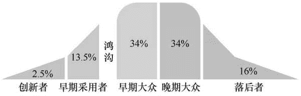

图 1-3 技术采纳生命周期曲线
**图片来源：维基百科。**

#### 电力革命的 S 形轨迹

1882 年，爱迪生珍珠街电站仅服务 59 名客户。

1920 年，美国城市家庭通电率达 50%。

1950 年，美国城市家庭通电率逼近 98%。

当电力渗透率接近天花板时，内燃机、电子管等新技术开始接力，推动文明进入下一轮 S 形曲线。

#### 突破瓶颈的三大路径

·材料革命：石墨烯替代硅基材料，让芯片突破热力学极限。

·架构创新：量子计算从二进制转向量子比特，实现算力跃迁。

·跨学科融合：生物芯片将 DNA 存储密度提升至 1EB/mm³（相当于 2 亿张蓝光光盘）。

当前，AI 技术正处在 S 形曲线的陡峭上升期：OpenAI 的参数规模从 GPT-2 的 15 亿个暴涨至 GPT-4 的 1.7 万亿个，但当模型规模触及数据与算力的天花板时，神经形态计算或脑启发算法可能成为下一个突破点。

### 颠覆性创新的达尔文式竞争

技术进化遵循“适者生存”的达尔文法则：颠覆性创新往往来自边缘地带，以更低的成本、更高的效率淘汰旧范式。

#### 创新者的窘境与破局

·柯达的教训：1975 年发明数码相机，却因担忧冲击胶片利润而雪藏该项技术，最终破产。

·特斯拉的逆袭：从硅谷车库起步，用软件定义汽车，攻下百年车企的护城河。

·ChatGPT 的冲击：大语言模型威胁传统搜索引擎，迫使谷歌紧急推出 Bard 应战。

哈佛大学教授克莱顿·克里斯坦森指出：“颠覆者从不满足于渐进改良，而是重新定义价值网络。”

#### 生态位战争的三个维度

·性价比：ARM 架构以低功耗的优势，在移动端击败了英特尔 x86。

·用户体验：iPhone 用触控交互颠覆了按键手机的交互逻辑。

·生态系统：安卓的开源战略吸引了全球开发者，形成对 iOS 系统的合围之势。

AI 领域的竞争同样残酷。2023 年，StabilityAI 开源 Stable Diffusion 模型，直接导致多家商业图像生成公司估值腰斩 **——在技术达尔文主义下，开放往往是最锋利的武器。**

#### 自然法则的终极启示

技术进化并非无序狂奔，而是受三大自然法则的支配。

·指数增长律：技术进步以指数级速度展开，停滞即死亡。

·扩散衰减律：所有技术终将触达物理或市场极限，要想突破，需要进行范式转移。

·颠覆选择律：新旧技术的更替如同物种竞争，唯有适应变革者方能幸存。

当 AI 开始自主优化算法、设计芯片甚至创造新技术时，人类首次面对一个超越自身进化速度的造物。但正如古生物学家斯蒂芬·杰伊·古尔德所言：“进化没有方向，但有模式。”理解这些模式，或许是人类在技术狂潮中锚定方向的唯一罗盘。 EXr6287u6NNVz+GYLY+7SDk226FstKIHdC0bNoQkB2Nqi1xSR0yxPmwrTs5gRi/BtfSbid6dBhii9q7cz2pIyA==

## 2 技术进化的自然法则

### 摩尔定律与指数增长的底层逻辑

1965 年，戈登·摩尔在绘制集成电路发展趋势时，发现了一个惊人的规律：每 18 个月，芯片上的晶体管数量就会翻倍，而成本减半。这一观察后来被称为“摩尔定律”，它不仅预言了半导体行业的未来，更揭示了技术进化的本质 **——指数增长是自然法则的数学表达。**

#### 硅基文明的加速度

1971 年，英特尔 4004 芯片容纳了 2300 个晶体管。2023 年，苹果 M2Ultra 芯片集成了 1340 亿个晶体管。

物理极限的挑战：当晶体管尺寸逼近 1 纳米时，量子隧穿效应会导致漏电率激增。但工程师转而探索三维堆叠、光子芯片等新路径，延续晶体管数量的指数级增长。

这种指数效应并不仅限于硬件。20 世纪 70 年代，计算机每秒浮点运算（FLOPS）成本为 10 亿美元，2020 年降至 0.0001 美元。若汽车工业遵循同样的规律，未来一辆劳斯莱斯的售价将低于 1 美分。

#### 技术树的协同进化

摩尔定律的深层意义在于触发了技术网络的链式反应。

·算力提升催生了大数据分析技术。

·数据洪流喂养了机器学习算法。

·AI 进化反哺芯片设计优化。

正如生物学家林恩·马古利斯提出的“共生进化论”，技术的指数级增长依赖跨领域协同，而非单一技术的孤立突破。

### 技术扩散的 S 形曲线与瓶颈突破

每项技术的普及都遵循“S 形曲线”：从缓慢起步（创新者阶段）到快速爆发（早期大众），最终趋于饱和（晚期大众），如图 1-3 所示。这一规律不仅描述了市场接受度，更暗含了技术突破的物理极限与范式转移的必然性。

图 1-3 技术采纳生命周期曲线
**图片来源：维基百科。**

#### 电力革命的 S 形轨迹

1882 年，爱迪生珍珠街电站仅服务 59 名客户。

1920 年，美国城市家庭通电率达 50%。

1950 年，美国城市家庭通电率逼近 98%。

当电力渗透率接近天花板时，内燃机、电子管等新技术开始接力，推动文明进入下一轮 S 形曲线。

#### 突破瓶颈的三大路径

·材料革命：石墨烯替代硅基材料，让芯片突破热力学极限。

·架构创新：量子计算从二进制转向量子比特，实现算力跃迁。

·跨学科融合：生物芯片将 DNA 存储密度提升至 1EB/mm³（相当于 2 亿张蓝光光盘）。

当前，AI 技术正处在 S 形曲线的陡峭上升期：OpenAI 的参数规模从 GPT-2 的 15 亿个暴涨至 GPT-4 的 1.7 万亿个，但当模型规模触及数据与算力的天花板时，神经形态计算或脑启发算法可能成为下一个突破点。

### 颠覆性创新的达尔文式竞争

技术进化遵循“适者生存”的达尔文法则：颠覆性创新往往来自边缘地带，以更低的成本、更高的效率淘汰旧范式。

#### 创新者的窘境与破局

·柯达的教训：1975 年发明数码相机，却因担忧冲击胶片利润而雪藏该项技术，最终破产。

·特斯拉的逆袭：从硅谷车库起步，用软件定义汽车，攻下百年车企的护城河。

·ChatGPT 的冲击：大语言模型威胁传统搜索引擎，迫使谷歌紧急推出 Bard 应战。

哈佛大学教授克莱顿·克里斯坦森指出：“颠覆者从不满足于渐进改良，而是重新定义价值网络。”

#### 生态位战争的三个维度

·性价比：ARM 架构以低功耗的优势，在移动端击败了英特尔 x86。

·用户体验：iPhone 用触控交互颠覆了按键手机的交互逻辑。

·生态系统：安卓的开源战略吸引了全球开发者，形成对 iOS 系统的合围之势。

AI 领域的竞争同样残酷。2023 年，StabilityAI 开源 Stable Diffusion 模型，直接导致多家商业图像生成公司估值腰斩 **——在技术达尔文主义下，开放往往是最锋利的武器。**

#### 自然法则的终极启示

技术进化并非无序狂奔，而是受三大自然法则的支配。

·指数增长律：技术进步以指数级速度展开，停滞即死亡。

·扩散衰减律：所有技术终将触达物理或市场极限，要想突破，需要进行范式转移。

·颠覆选择律：新旧技术的更替如同物种竞争，唯有适应变革者方能幸存。

当 AI 开始自主优化算法、设计芯片甚至创造新技术时，人类首次面对一个超越自身进化速度的造物。但正如古生物学家斯蒂芬·杰伊·古尔德所言：“进化没有方向，但有模式。”理解这些模式，或许是人类在技术狂潮中锚定方向的唯一罗盘。 EXr6287u6NNVz+GYLY+7SDk226FstKIHdC0bNoQkB2Nqi1xSR0yxPmwrTs5gRi/BtfSbid6dBhii9q7cz2pIyA==

## 3 生产力进化与“鲍莫尔病”

### 服务业效率滞后的经济学困局

1967 年，经济学家威廉·鲍莫尔在分析纽约爱乐乐团的经营数据时，发现了一个现象：尽管乐团演奏《贝多芬交响曲》的效率与 100 年前几乎相同，但其成本飙升了数十倍。这一现象被称为“鲍莫尔病”（Baumol's Cost Disease），揭示了服务业效率滞后的深层矛盾——当技术进步集中于制造业时，依赖人力密集的服务业将陷入“相对成本攀升”的泥潭。

#### 生产率鸿沟产生的根源

“鲍莫尔病”源于两类行业的技术特性差异。

·制造业：可通过机械化、自动化等方式实现生产率的指数级增长。例如，福特汽车工厂的装配线将单车生产时间从 12 小时压缩至 93 分钟，单位成本下降 80%。

·服务业：核心价值依赖人际互动与个性化服务，技术替代难度极高。一名教师授课的学生数量、一位医生接诊的患者数量，受限于人类生理与认知极限，百年内提升不足 50%。

#### 数据的残酷对比

·制造业：1950—2020 年，美国制造业劳动生产率提升 400%。

·服务业：同期，教育、医疗行业生产率仅提升 20%，而实际成本上涨超过 1500%。

这种失衡导致“成本病”蔓延：2022 年，美国大学学费占家庭收入的比例从 1950 年的 4%飙升至 36%；一部 iPhone17 的价格（799 美元）远超 1910 年普通工人的月薪（50～100 美元）。

#### 服务业的三重枷锁

·人力依赖：钢琴家演奏《月光奏鸣曲》无法像芯片制造般加速。

·质量刚性：自动化客服可能降低用户体验，迫使企业保留人工服务。

·制度惯性：医疗行业的法规限制 AI 诊断直接替代医生决策。

这些特性使服务业成为技术革命的“免疫盲区”，而“鲍莫尔病”的本质，是工业文明对人性化服务的系统性挤压。

### AI 如何破解“鲍莫尔病”

AI 的崛起，首次为服务业提供了“生产率跃迁”的可能性。其核心策略不是替代人类，而是通过增强智能与流程重构，打破“鲍莫尔病”的恶性循环。

#### 第一路径：人机协同的效率倍增

教育领域

·智能教学系统：可汗学院通过 AI 算法分析学生答题数据，动态调整课程难度，使教师辅导效率提升 300%。

·虚拟助教：清华大学“小木”机器人能同时为 500 名学生答疑，释放教师时间用于创造性教学。

医疗领域

·辅助诊断：谷歌 DeepMind 的 AI 系统在眼科影像诊断中准确率达到 94%，相当于资深医生的水平。

·手术机器人：达·芬奇系统将复杂手术时间缩短 40%，术后并发症发生率下降 60%。

·数据印证：麦肯锡研究显示，AI 可将医疗服务效率提升 35%，教育行业人力成本降低 50%。

#### 第二路径：服务流程的原子化重构

AI 通过解构传统服务链条，重塑价值网络。

·个性化规模经济：Netflix 用推荐算法为 1 亿名用户提供定制化内容，成本仅为传统影视制作的 1/10。

·去中心化服务：基于“区块链+AI”的 DAO 医疗平台让患者直接对接全球医生，省去中间机构 30%的抽成。

·异步服务交付：AI 心理咨询师 Woebot 通过聊天记录分析患者情绪，提供 24 小时即时干预，服务容量无限扩展。

这种碎片化重组使服务业突破“一人一时一服务”的物理限制，迈向“万人万时万服务”的数字范式。

#### 第三路径：创造增量价值

AI 不仅优化了既有服务，而且催生了新需求。

·数字孪生医疗：通过患者基因数据与 AI 模拟，提前 10 年预测疾病风险，将治疗转化为预防。

·元宇宙教育：斯坦福大学在 VR 中重建庞贝古城，学生“亲身”体验火山爆发，教学效果提升 70%。

·情感计算：Hanson Robotics 的 Sophia 机器人可识别用户情绪并提供陪伴，填补老龄化社会的护理缺口。

这些创新不再受限于传统服务业的零和博弈，而是通过技术创造新市场，稀释“鲍莫尔病”带来的成本压力。

#### 挑战与边界：AI 不是万能药

尽管前景光明，AI 破解“鲍莫尔病”仍面临三重障碍。

·伦理困境：AI 法律顾问能否承担误判责任？自动驾驶汽车的事故伦理如何界定？

·技术瓶颈：情感交互、复杂决策等人类专属能力仍是 AI 的“暗箱区域”。

·社会接受度：日本曾推行 AI 养老护理机器人，但因老年人情感抵触导致 30%的设备闲置。

正如经济学家埃里克·布林约尔松所言：“AI 解决的是‘效率问题’，而非‘价值问题’。”若盲目追求生产率，可能牺牲服务的人性内核。

#### 未来图景：从“鲍莫尔病”到“价值跃迁”

AI 对“鲍莫尔病”的破解，实质是一场生产关系的革命。

·在微观层面，教师从知识传授者转型为学习体验设计师，医生从疾病治疗者升级为健康管理者。

·在宏观层面，服务业与制造业的生产率鸿沟逐渐弥合，经济结构从“金字塔形”转向“网络化生态”。

到 2040 年，AI 或将推动服务业生产率增长 200%，使教育成本、医疗成本回归到合理区间。而这场变革的终极目标，不是让 AI 取代人类，而是让每个人都能享受工业级效率与艺术级服务的黄金平衡。

### 新质生产力：AI 时代重塑生产力范式

在人类社会发展进程中，生产力始终是推动变革的核心力量。传统生产力理论认为，生产力由 **劳动者、劳动资料和劳动对象** 三个要素构成。劳动者运用劳动资料作用于劳动对象，创造出满足人类需求的物质与精神产品。

在传统生产力时代，劳动者是具有一定生产经验、劳动技能和知识的人，通过手工工具、机器设备等劳动资料，对土地、原材料等劳动对象进行加工改造。然而，随着 AI 时代的来临，传统生产力三要素正在经历深刻的变革，新质生产力应运而生。

人类生产力的演进史，本质上是生产要素不断突破物理边界、重构价值创造逻辑的历史。当生成式 AI、智能体网络、量子计算等技术的融合突破奇点时，传统生产力三要素的边界被彻底打破，形成以 **“AI+劳动者”“AI+生产资料”“AI+劳动对象”** 为轴心的三维新质生产力范式（见图 1-4）。这不仅意味着生产工具的升级，更标志着人类文明正在从“改造自然”迈向“定义现实”的新纪元。

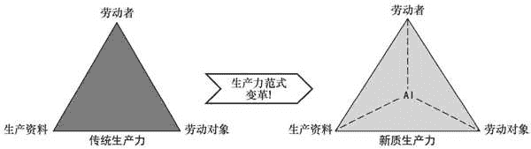

图 1-4 AI 驱动的三维新质生产力范式

#### AI+劳动者：重塑人力角色

在“AI+劳动者”维度，AI 深度融入劳动过程，使劳动者的角色发生质变。AI 劳动者，如智能机器人、自动化程序等，开始承担大量重复性、规律性的工作。在制造业的流水线上，工业机器人能够精准、高效地完成装配、焊接等任务，大幅提升生产效率与质量稳定性；在客服行业，智能客服机器人可以 7×24 小时不间断地回答客户的常见问题，快速响应并处理咨询。

传统劳动者的价值创造受限于生物体的认知带宽与生命周期，而 AI 的深度嵌入催生了三类新型劳动者。

· **增强型劳动者：** Neuralink 的 N3 芯片可实现每秒 GB 级的脑机交互速率，波音工程师通过植入式脑机接口直接调用云端 CAD 系统，设计效率提升 8 倍。

· **数字分身劳动者：** 埃森哲开发的 AITwin 系统可创建员工数字分身，在元宇宙中 7×24 小时处理流程性工作，使咨询顾问人均产值大幅增加。

· **自主智能体劳动者：** DeepMind 的 SIMI 系统可自主管理谷歌数据中心制冷系统，年省电 2.4 亿千瓦时，决策效率超越人类工程师团队。

麦肯锡研究显示，到 2030 年，全球 65%的劳动者将转型为“人机协同工作者”，其核心竞争力将从专业技能转向对智能系统的驾驭能力，人类劳动者与 AI 协同工作将成为常态。人类负责富有创造性、战略性的工作，如产品创新设计、复杂问题决策等；AI 则提供数据分析、模拟计算等支持。例如，在科研领域，科学家借助 AI 算法对海量实验数据进行挖掘分析，加速科研成果产出；在建筑设计中，设计师利用 AI 辅助设计工具，快速生成多种设计方案并进行优化。这种人机协作模式极大地拓展了劳动者的能力边界，提升了劳动效能。

#### AI+生产资料：革新工具与资源

AI 与生产资料的融合，带来了生产工具和资源的全面革新。生产工具向智能化、自动化方向迈进，智能机床、无人驾驶运输设备等成为工业生产的“新宠”。这些设备不仅具备强大的自主控制和自适应能力，还能通过物联网与其他设备及系统互联互通，实现生产流程的精准调度与优化。

生产资料的内涵正在经历从“工具理性”到“认知能动性”的质变。

· **自我进化型生产资料：** 英伟达的 Eureka 算法可自主优化机器人运动控制模型，其训练效率较人类专家提升 1000 倍，标志着生产资料具备自主迭代能力。

· **分布式智能生产资料：** 华为盘古大模型构建的“算力联邦”，通过区块链技术实现全球数万张 GPU 的实时协同，算力利用率大幅提升。

· **伦理内嵌型生产资料：** Anthropic 研发的 ConstitutionalAI 框架，将人权、环保等 138 项伦理准则编码至底层模型，确保智能系统决策符合人类价值观。

此类变革使生产资料从被动工具进化为具有价值判断能力的“数字生命”，重新定义了生产效率与责任的边界。这样， **数据要素** 成为至关重要的 **新型生产资料** 。在 AI 算法的驱动下，企业能够对生产、销售、运营等各环节产生的数据进行深度分析，洞察市场趋势、优化资源配置、预测设备故障等。例如，电商平台通过分析用户浏览数据和购买行为数据，精准推送商品，提高销售转化率；制造业企业利用生产数据反馈，实时调整生产参数，降低次品率。此外，云计算、区块链等技术与 AI 结合，为数据的存储、管理和安全共享提供保障，进一步释放数据的价值。

#### AI+劳动对象：拓展生产范畴

传统劳动对象主要是自然资源和原材料，而在 AI 时代，在“AI+劳动对象”维度下，劳动对象的范畴得到了极大的拓展。除了对传统物质资源进行更高效、更精准的开发利用，虚拟产品和数字内容也成为新兴劳动对象。

劳动对象的数字化与虚拟化，催生了多重宇宙中的价值创造场景。

· **数字孪生对象：** 特斯拉工厂通过 20 万个传感器构建物理产线的量子级数字映射，使生产故障预测准确率达到 99.7%，产品缺陷率大幅下降。

· **虚拟创造对象：** Unity 引擎结合生成式 AI，可实时生成包含物理特性、化学反应的数字材料，宝马公司利用该技术将新车型研发周期从 42 个月压缩至 11 个月。

· **意识投射对象：** 在元宇宙平台 Decentraland 中，用户脑电波驱动的虚拟建筑被转化为非同质化代币（NFT）资产。

劳动对象的可编程特性，使 **“想象力即生产力”** 成为现实法则。在文化创意产业，利用 AI 技术创作音乐、绘画、影视等数字艺术作品的现象日益普遍。AI 能够根据用户偏好和流行趋势，生成个性化的艺术内容。在教育领域，基于 AI 的虚拟学习环境、智能教学课件等不断涌现，为学生提供更具针对性和互动性的学习资源。此外，AI 还能对生物基因、量子信息等微观层面的对象进行研究和操作，为生物科技、量子计算等前沿领域的发展开辟新路径，开拓全新的生产空间。

由“AI+劳动者”“AI+生产资料”“AI+劳动对象”构成的三维新质生产力范式，正在以强大的力量重构世界经济与社会格局。在经济层面，它推动产业结构向高端化、智能化、绿色化转型，催生众多新兴产业，如 AI 芯片制造、智能医疗、自动驾驶出行服务等，重塑全球产业链和供应链。在社会层面，它促使就业结构深度调整，既创造 AI 研发、维护、数据治理等新职业，也要求劳动者不断提升数字素养和创新能力以适应变革；同时，它有望推动社会资源分配更加公平合理，借助智能化生产与精准化服务，更好地满足人类多样化的需求。

面向未来，随着 AI 技术的持续迭代升级，三维新质生产力范式将不断演进完善。量子计算与 AI 的融合可能带来计算能力的指数级增长，进一步突破生产力发展的瓶颈；脑机接口技术与 AI 结合，或许会开启人机深度融合的新纪元，重新定义劳动与生产的方式。我们必须积极拥抱这一变革浪潮，加强科技创新、人才培养与制度建设，充分释放三维新质生产力的巨大潜能，引领人类社会迈向更加繁荣、智能、美好的新时代。

当三维新质生产力将劳动者进化为“超脑集群”、生产资料蜕变为“算法生命体”、劳动对象升维为“可编程现实”时，人类将站在文明史的关键分岔点。这要求我们以更宏大的视野重构经济规则：建立“智能 GDP”核算体系，将数据资产、算法贡献值、数字生态效益纳入衡量框架；以更深邃的智慧平衡技术伦理，构建“人类-AI 宪法联盟”，确保智能进化不偏离文明初心。唯有如此，三维新质生产力才能从颠覆性力量转化为人类迈向星际文明的跃迁引擎。 EXr6287u6NNVz+GYLY+7SDk226FstKIHdC0bNoQkB2Nqi1xSR0yxPmwrTs5gRi/BtfSbid6dBhii9q7cz2pIyA==

## 3 生产力进化与“鲍莫尔病”

### 服务业效率滞后的经济学困局

1967 年，经济学家威廉·鲍莫尔在分析纽约爱乐乐团的经营数据时，发现了一个现象：尽管乐团演奏《贝多芬交响曲》的效率与 100 年前几乎相同，但其成本飙升了数十倍。这一现象被称为“鲍莫尔病”（Baumol's Cost Disease），揭示了服务业效率滞后的深层矛盾——当技术进步集中于制造业时，依赖人力密集的服务业将陷入“相对成本攀升”的泥潭。

#### 生产率鸿沟产生的根源

“鲍莫尔病”源于两类行业的技术特性差异。

·制造业：可通过机械化、自动化等方式实现生产率的指数级增长。例如，福特汽车工厂的装配线将单车生产时间从 12 小时压缩至 93 分钟，单位成本下降 80%。

·服务业：核心价值依赖人际互动与个性化服务，技术替代难度极高。一名教师授课的学生数量、一位医生接诊的患者数量，受限于人类生理与认知极限，百年内提升不足 50%。

#### 数据的残酷对比

·制造业：1950—2020 年，美国制造业劳动生产率提升 400%。

·服务业：同期，教育、医疗行业生产率仅提升 20%，而实际成本上涨超过 1500%。

这种失衡导致“成本病”蔓延：2022 年，美国大学学费占家庭收入的比例从 1950 年的 4%飙升至 36%；一部 iPhone17 的价格（799 美元）远超 1910 年普通工人的月薪（50～100 美元）。

#### 服务业的三重枷锁

·人力依赖：钢琴家演奏《月光奏鸣曲》无法像芯片制造般加速。

·质量刚性：自动化客服可能降低用户体验，迫使企业保留人工服务。

·制度惯性：医疗行业的法规限制 AI 诊断直接替代医生决策。

这些特性使服务业成为技术革命的“免疫盲区”，而“鲍莫尔病”的本质，是工业文明对人性化服务的系统性挤压。

### AI 如何破解“鲍莫尔病”

AI 的崛起，首次为服务业提供了“生产率跃迁”的可能性。其核心策略不是替代人类，而是通过增强智能与流程重构，打破“鲍莫尔病”的恶性循环。

#### 第一路径：人机协同的效率倍增

教育领域

·智能教学系统：可汗学院通过 AI 算法分析学生答题数据，动态调整课程难度，使教师辅导效率提升 300%。

·虚拟助教：清华大学“小木”机器人能同时为 500 名学生答疑，释放教师时间用于创造性教学。

医疗领域

·辅助诊断：谷歌 DeepMind 的 AI 系统在眼科影像诊断中准确率达到 94%，相当于资深医生的水平。

·手术机器人：达·芬奇系统将复杂手术时间缩短 40%，术后并发症发生率下降 60%。

·数据印证：麦肯锡研究显示，AI 可将医疗服务效率提升 35%，教育行业人力成本降低 50%。

#### 第二路径：服务流程的原子化重构

AI 通过解构传统服务链条，重塑价值网络。

·个性化规模经济：Netflix 用推荐算法为 1 亿名用户提供定制化内容，成本仅为传统影视制作的 1/10。

·去中心化服务：基于“区块链+AI”的 DAO 医疗平台让患者直接对接全球医生，省去中间机构 30%的抽成。

·异步服务交付：AI 心理咨询师 Woebot 通过聊天记录分析患者情绪，提供 24 小时即时干预，服务容量无限扩展。

这种碎片化重组使服务业突破“一人一时一服务”的物理限制，迈向“万人万时万服务”的数字范式。

#### 第三路径：创造增量价值

AI 不仅优化了既有服务，而且催生了新需求。

·数字孪生医疗：通过患者基因数据与 AI 模拟，提前 10 年预测疾病风险，将治疗转化为预防。

·元宇宙教育：斯坦福大学在 VR 中重建庞贝古城，学生“亲身”体验火山爆发，教学效果提升 70%。

·情感计算：Hanson Robotics 的 Sophia 机器人可识别用户情绪并提供陪伴，填补老龄化社会的护理缺口。

这些创新不再受限于传统服务业的零和博弈，而是通过技术创造新市场，稀释“鲍莫尔病”带来的成本压力。

#### 挑战与边界：AI 不是万能药

尽管前景光明，AI 破解“鲍莫尔病”仍面临三重障碍。

·伦理困境：AI 法律顾问能否承担误判责任？自动驾驶汽车的事故伦理如何界定？

·技术瓶颈：情感交互、复杂决策等人类专属能力仍是 AI 的“暗箱区域”。

·社会接受度：日本曾推行 AI 养老护理机器人，但因老年人情感抵触导致 30%的设备闲置。

正如经济学家埃里克·布林约尔松所言：“AI 解决的是‘效率问题’，而非‘价值问题’。”若盲目追求生产率，可能牺牲服务的人性内核。

#### 未来图景：从“鲍莫尔病”到“价值跃迁”

AI 对“鲍莫尔病”的破解，实质是一场生产关系的革命。

·在微观层面，教师从知识传授者转型为学习体验设计师，医生从疾病治疗者升级为健康管理者。

·在宏观层面，服务业与制造业的生产率鸿沟逐渐弥合，经济结构从“金字塔形”转向“网络化生态”。

到 2040 年，AI 或将推动服务业生产率增长 200%，使教育成本、医疗成本回归到合理区间。而这场变革的终极目标，不是让 AI 取代人类，而是让每个人都能享受工业级效率与艺术级服务的黄金平衡。

### 新质生产力：AI 时代重塑生产力范式

在人类社会发展进程中，生产力始终是推动变革的核心力量。传统生产力理论认为，生产力由 **劳动者、劳动资料和劳动对象** 三个要素构成。劳动者运用劳动资料作用于劳动对象，创造出满足人类需求的物质与精神产品。

在传统生产力时代，劳动者是具有一定生产经验、劳动技能和知识的人，通过手工工具、机器设备等劳动资料，对土地、原材料等劳动对象进行加工改造。然而，随着 AI 时代的来临，传统生产力三要素正在经历深刻的变革，新质生产力应运而生。

人类生产力的演进史，本质上是生产要素不断突破物理边界、重构价值创造逻辑的历史。当生成式 AI、智能体网络、量子计算等技术的融合突破奇点时，传统生产力三要素的边界被彻底打破，形成以 **“AI+劳动者”“AI+生产资料”“AI+劳动对象”** 为轴心的三维新质生产力范式（见图 1-4）。这不仅意味着生产工具的升级，更标志着人类文明正在从“改造自然”迈向“定义现实”的新纪元。

图 1-4 AI 驱动的三维新质生产力范式

#### AI+劳动者：重塑人力角色

在“AI+劳动者”维度，AI 深度融入劳动过程，使劳动者的角色发生质变。AI 劳动者，如智能机器人、自动化程序等，开始承担大量重复性、规律性的工作。在制造业的流水线上，工业机器人能够精准、高效地完成装配、焊接等任务，大幅提升生产效率与质量稳定性；在客服行业，智能客服机器人可以 7×24 小时不间断地回答客户的常见问题，快速响应并处理咨询。

传统劳动者的价值创造受限于生物体的认知带宽与生命周期，而 AI 的深度嵌入催生了三类新型劳动者。

· **增强型劳动者：** Neuralink 的 N3 芯片可实现每秒 GB 级的脑机交互速率，波音工程师通过植入式脑机接口直接调用云端 CAD 系统，设计效率提升 8 倍。

· **数字分身劳动者：** 埃森哲开发的 AITwin 系统可创建员工数字分身，在元宇宙中 7×24 小时处理流程性工作，使咨询顾问人均产值大幅增加。

· **自主智能体劳动者：** DeepMind 的 SIMI 系统可自主管理谷歌数据中心制冷系统，年省电 2.4 亿千瓦时，决策效率超越人类工程师团队。

麦肯锡研究显示，到 2030 年，全球 65%的劳动者将转型为“人机协同工作者”，其核心竞争力将从专业技能转向对智能系统的驾驭能力，人类劳动者与 AI 协同工作将成为常态。人类负责富有创造性、战略性的工作，如产品创新设计、复杂问题决策等；AI 则提供数据分析、模拟计算等支持。例如，在科研领域，科学家借助 AI 算法对海量实验数据进行挖掘分析，加速科研成果产出；在建筑设计中，设计师利用 AI 辅助设计工具，快速生成多种设计方案并进行优化。这种人机协作模式极大地拓展了劳动者的能力边界，提升了劳动效能。

#### AI+生产资料：革新工具与资源

AI 与生产资料的融合，带来了生产工具和资源的全面革新。生产工具向智能化、自动化方向迈进，智能机床、无人驾驶运输设备等成为工业生产的“新宠”。这些设备不仅具备强大的自主控制和自适应能力，还能通过物联网与其他设备及系统互联互通，实现生产流程的精准调度与优化。

生产资料的内涵正在经历从“工具理性”到“认知能动性”的质变。

· **自我进化型生产资料：** 英伟达的 Eureka 算法可自主优化机器人运动控制模型，其训练效率较人类专家提升 1000 倍，标志着生产资料具备自主迭代能力。

· **分布式智能生产资料：** 华为盘古大模型构建的“算力联邦”，通过区块链技术实现全球数万张 GPU 的实时协同，算力利用率大幅提升。

· **伦理内嵌型生产资料：** Anthropic 研发的 ConstitutionalAI 框架，将人权、环保等 138 项伦理准则编码至底层模型，确保智能系统决策符合人类价值观。

此类变革使生产资料从被动工具进化为具有价值判断能力的“数字生命”，重新定义了生产效率与责任的边界。这样， **数据要素** 成为至关重要的 **新型生产资料** 。在 AI 算法的驱动下，企业能够对生产、销售、运营等各环节产生的数据进行深度分析，洞察市场趋势、优化资源配置、预测设备故障等。例如，电商平台通过分析用户浏览数据和购买行为数据，精准推送商品，提高销售转化率；制造业企业利用生产数据反馈，实时调整生产参数，降低次品率。此外，云计算、区块链等技术与 AI 结合，为数据的存储、管理和安全共享提供保障，进一步释放数据的价值。

#### AI+劳动对象：拓展生产范畴

传统劳动对象主要是自然资源和原材料，而在 AI 时代，在“AI+劳动对象”维度下，劳动对象的范畴得到了极大的拓展。除了对传统物质资源进行更高效、更精准的开发利用，虚拟产品和数字内容也成为新兴劳动对象。

劳动对象的数字化与虚拟化，催生了多重宇宙中的价值创造场景。

· **数字孪生对象：** 特斯拉工厂通过 20 万个传感器构建物理产线的量子级数字映射，使生产故障预测准确率达到 99.7%，产品缺陷率大幅下降。

· **虚拟创造对象：** Unity 引擎结合生成式 AI，可实时生成包含物理特性、化学反应的数字材料，宝马公司利用该技术将新车型研发周期从 42 个月压缩至 11 个月。

· **意识投射对象：** 在元宇宙平台 Decentraland 中，用户脑电波驱动的虚拟建筑被转化为非同质化代币（NFT）资产。

劳动对象的可编程特性，使 **“想象力即生产力”** 成为现实法则。在文化创意产业，利用 AI 技术创作音乐、绘画、影视等数字艺术作品的现象日益普遍。AI 能够根据用户偏好和流行趋势，生成个性化的艺术内容。在教育领域，基于 AI 的虚拟学习环境、智能教学课件等不断涌现，为学生提供更具针对性和互动性的学习资源。此外，AI 还能对生物基因、量子信息等微观层面的对象进行研究和操作，为生物科技、量子计算等前沿领域的发展开辟新路径，开拓全新的生产空间。

由“AI+劳动者”“AI+生产资料”“AI+劳动对象”构成的三维新质生产力范式，正在以强大的力量重构世界经济与社会格局。在经济层面，它推动产业结构向高端化、智能化、绿色化转型，催生众多新兴产业，如 AI 芯片制造、智能医疗、自动驾驶出行服务等，重塑全球产业链和供应链。在社会层面，它促使就业结构深度调整，既创造 AI 研发、维护、数据治理等新职业，也要求劳动者不断提升数字素养和创新能力以适应变革；同时，它有望推动社会资源分配更加公平合理，借助智能化生产与精准化服务，更好地满足人类多样化的需求。

面向未来，随着 AI 技术的持续迭代升级，三维新质生产力范式将不断演进完善。量子计算与 AI 的融合可能带来计算能力的指数级增长，进一步突破生产力发展的瓶颈；脑机接口技术与 AI 结合，或许会开启人机深度融合的新纪元，重新定义劳动与生产的方式。我们必须积极拥抱这一变革浪潮，加强科技创新、人才培养与制度建设，充分释放三维新质生产力的巨大潜能，引领人类社会迈向更加繁荣、智能、美好的新时代。

当三维新质生产力将劳动者进化为“超脑集群”、生产资料蜕变为“算法生命体”、劳动对象升维为“可编程现实”时，人类将站在文明史的关键分岔点。这要求我们以更宏大的视野重构经济规则：建立“智能 GDP”核算体系，将数据资产、算法贡献值、数字生态效益纳入衡量框架；以更深邃的智慧平衡技术伦理，构建“人类-AI 宪法联盟”，确保智能进化不偏离文明初心。唯有如此，三维新质生产力才能从颠覆性力量转化为人类迈向星际文明的跃迁引擎。 EXr6287u6NNVz+GYLY+7SDk226FstKIHdC0bNoQkB2Nqi1xSR0yxPmwrTs5gRi/BtfSbid6dBhii9q7cz2pIyA==

## 3 生产力进化与“鲍莫尔病”

### 服务业效率滞后的经济学困局

1967 年，经济学家威廉·鲍莫尔在分析纽约爱乐乐团的经营数据时，发现了一个现象：尽管乐团演奏《贝多芬交响曲》的效率与 100 年前几乎相同，但其成本飙升了数十倍。这一现象被称为“鲍莫尔病”（Baumol's Cost Disease），揭示了服务业效率滞后的深层矛盾——当技术进步集中于制造业时，依赖人力密集的服务业将陷入“相对成本攀升”的泥潭。

#### 生产率鸿沟产生的根源

“鲍莫尔病”源于两类行业的技术特性差异。

·制造业：可通过机械化、自动化等方式实现生产率的指数级增长。例如，福特汽车工厂的装配线将单车生产时间从 12 小时压缩至 93 分钟，单位成本下降 80%。

·服务业：核心价值依赖人际互动与个性化服务，技术替代难度极高。一名教师授课的学生数量、一位医生接诊的患者数量，受限于人类生理与认知极限，百年内提升不足 50%。

#### 数据的残酷对比

·制造业：1950—2020 年，美国制造业劳动生产率提升 400%。

·服务业：同期，教育、医疗行业生产率仅提升 20%，而实际成本上涨超过 1500%。

这种失衡导致“成本病”蔓延：2022 年，美国大学学费占家庭收入的比例从 1950 年的 4%飙升至 36%；一部 iPhone17 的价格（799 美元）远超 1910 年普通工人的月薪（50～100 美元）。

#### 服务业的三重枷锁

·人力依赖：钢琴家演奏《月光奏鸣曲》无法像芯片制造般加速。

·质量刚性：自动化客服可能降低用户体验，迫使企业保留人工服务。

·制度惯性：医疗行业的法规限制 AI 诊断直接替代医生决策。

这些特性使服务业成为技术革命的“免疫盲区”，而“鲍莫尔病”的本质，是工业文明对人性化服务的系统性挤压。

### AI 如何破解“鲍莫尔病”

AI 的崛起，首次为服务业提供了“生产率跃迁”的可能性。其核心策略不是替代人类，而是通过增强智能与流程重构，打破“鲍莫尔病”的恶性循环。

#### 第一路径：人机协同的效率倍增

教育领域

·智能教学系统：可汗学院通过 AI 算法分析学生答题数据，动态调整课程难度，使教师辅导效率提升 300%。

·虚拟助教：清华大学“小木”机器人能同时为 500 名学生答疑，释放教师时间用于创造性教学。

医疗领域

·辅助诊断：谷歌 DeepMind 的 AI 系统在眼科影像诊断中准确率达到 94%，相当于资深医生的水平。

·手术机器人：达·芬奇系统将复杂手术时间缩短 40%，术后并发症发生率下降 60%。

·数据印证：麦肯锡研究显示，AI 可将医疗服务效率提升 35%，教育行业人力成本降低 50%。

#### 第二路径：服务流程的原子化重构

AI 通过解构传统服务链条，重塑价值网络。

·个性化规模经济：Netflix 用推荐算法为 1 亿名用户提供定制化内容，成本仅为传统影视制作的 1/10。

·去中心化服务：基于“区块链+AI”的 DAO 医疗平台让患者直接对接全球医生，省去中间机构 30%的抽成。

·异步服务交付：AI 心理咨询师 Woebot 通过聊天记录分析患者情绪，提供 24 小时即时干预，服务容量无限扩展。

这种碎片化重组使服务业突破“一人一时一服务”的物理限制，迈向“万人万时万服务”的数字范式。

#### 第三路径：创造增量价值

AI 不仅优化了既有服务，而且催生了新需求。

·数字孪生医疗：通过患者基因数据与 AI 模拟，提前 10 年预测疾病风险，将治疗转化为预防。

·元宇宙教育：斯坦福大学在 VR 中重建庞贝古城，学生“亲身”体验火山爆发，教学效果提升 70%。

·情感计算：Hanson Robotics 的 Sophia 机器人可识别用户情绪并提供陪伴，填补老龄化社会的护理缺口。

这些创新不再受限于传统服务业的零和博弈，而是通过技术创造新市场，稀释“鲍莫尔病”带来的成本压力。

#### 挑战与边界：AI 不是万能药

尽管前景光明，AI 破解“鲍莫尔病”仍面临三重障碍。

·伦理困境：AI 法律顾问能否承担误判责任？自动驾驶汽车的事故伦理如何界定？

·技术瓶颈：情感交互、复杂决策等人类专属能力仍是 AI 的“暗箱区域”。

·社会接受度：日本曾推行 AI 养老护理机器人，但因老年人情感抵触导致 30%的设备闲置。

正如经济学家埃里克·布林约尔松所言：“AI 解决的是‘效率问题’，而非‘价值问题’。”若盲目追求生产率，可能牺牲服务的人性内核。

#### 未来图景：从“鲍莫尔病”到“价值跃迁”

AI 对“鲍莫尔病”的破解，实质是一场生产关系的革命。

·在微观层面，教师从知识传授者转型为学习体验设计师，医生从疾病治疗者升级为健康管理者。

·在宏观层面，服务业与制造业的生产率鸿沟逐渐弥合，经济结构从“金字塔形”转向“网络化生态”。

到 2040 年，AI 或将推动服务业生产率增长 200%，使教育成本、医疗成本回归到合理区间。而这场变革的终极目标，不是让 AI 取代人类，而是让每个人都能享受工业级效率与艺术级服务的黄金平衡。

### 新质生产力：AI 时代重塑生产力范式

在人类社会发展进程中，生产力始终是推动变革的核心力量。传统生产力理论认为，生产力由 **劳动者、劳动资料和劳动对象** 三个要素构成。劳动者运用劳动资料作用于劳动对象，创造出满足人类需求的物质与精神产品。

在传统生产力时代，劳动者是具有一定生产经验、劳动技能和知识的人，通过手工工具、机器设备等劳动资料，对土地、原材料等劳动对象进行加工改造。然而，随着 AI 时代的来临，传统生产力三要素正在经历深刻的变革，新质生产力应运而生。

人类生产力的演进史，本质上是生产要素不断突破物理边界、重构价值创造逻辑的历史。当生成式 AI、智能体网络、量子计算等技术的融合突破奇点时，传统生产力三要素的边界被彻底打破，形成以 **“AI+劳动者”“AI+生产资料”“AI+劳动对象”** 为轴心的三维新质生产力范式（见图 1-4）。这不仅意味着生产工具的升级，更标志着人类文明正在从“改造自然”迈向“定义现实”的新纪元。

图 1-4 AI 驱动的三维新质生产力范式

#### AI+劳动者：重塑人力角色

在“AI+劳动者”维度，AI 深度融入劳动过程，使劳动者的角色发生质变。AI 劳动者，如智能机器人、自动化程序等，开始承担大量重复性、规律性的工作。在制造业的流水线上，工业机器人能够精准、高效地完成装配、焊接等任务，大幅提升生产效率与质量稳定性；在客服行业，智能客服机器人可以 7×24 小时不间断地回答客户的常见问题，快速响应并处理咨询。

传统劳动者的价值创造受限于生物体的认知带宽与生命周期，而 AI 的深度嵌入催生了三类新型劳动者。

· **增强型劳动者：** Neuralink 的 N3 芯片可实现每秒 GB 级的脑机交互速率，波音工程师通过植入式脑机接口直接调用云端 CAD 系统，设计效率提升 8 倍。

· **数字分身劳动者：** 埃森哲开发的 AITwin 系统可创建员工数字分身，在元宇宙中 7×24 小时处理流程性工作，使咨询顾问人均产值大幅增加。

· **自主智能体劳动者：** DeepMind 的 SIMI 系统可自主管理谷歌数据中心制冷系统，年省电 2.4 亿千瓦时，决策效率超越人类工程师团队。

麦肯锡研究显示，到 2030 年，全球 65%的劳动者将转型为“人机协同工作者”，其核心竞争力将从专业技能转向对智能系统的驾驭能力，人类劳动者与 AI 协同工作将成为常态。人类负责富有创造性、战略性的工作，如产品创新设计、复杂问题决策等；AI 则提供数据分析、模拟计算等支持。例如，在科研领域，科学家借助 AI 算法对海量实验数据进行挖掘分析，加速科研成果产出；在建筑设计中，设计师利用 AI 辅助设计工具，快速生成多种设计方案并进行优化。这种人机协作模式极大地拓展了劳动者的能力边界，提升了劳动效能。

#### AI+生产资料：革新工具与资源

AI 与生产资料的融合，带来了生产工具和资源的全面革新。生产工具向智能化、自动化方向迈进，智能机床、无人驾驶运输设备等成为工业生产的“新宠”。这些设备不仅具备强大的自主控制和自适应能力，还能通过物联网与其他设备及系统互联互通，实现生产流程的精准调度与优化。

生产资料的内涵正在经历从“工具理性”到“认知能动性”的质变。

· **自我进化型生产资料：** 英伟达的 Eureka 算法可自主优化机器人运动控制模型，其训练效率较人类专家提升 1000 倍，标志着生产资料具备自主迭代能力。

· **分布式智能生产资料：** 华为盘古大模型构建的“算力联邦”，通过区块链技术实现全球数万张 GPU 的实时协同，算力利用率大幅提升。

· **伦理内嵌型生产资料：** Anthropic 研发的 ConstitutionalAI 框架，将人权、环保等 138 项伦理准则编码至底层模型，确保智能系统决策符合人类价值观。

此类变革使生产资料从被动工具进化为具有价值判断能力的“数字生命”，重新定义了生产效率与责任的边界。这样， **数据要素** 成为至关重要的 **新型生产资料** 。在 AI 算法的驱动下，企业能够对生产、销售、运营等各环节产生的数据进行深度分析，洞察市场趋势、优化资源配置、预测设备故障等。例如，电商平台通过分析用户浏览数据和购买行为数据，精准推送商品，提高销售转化率；制造业企业利用生产数据反馈，实时调整生产参数，降低次品率。此外，云计算、区块链等技术与 AI 结合，为数据的存储、管理和安全共享提供保障，进一步释放数据的价值。

#### AI+劳动对象：拓展生产范畴

传统劳动对象主要是自然资源和原材料，而在 AI 时代，在“AI+劳动对象”维度下，劳动对象的范畴得到了极大的拓展。除了对传统物质资源进行更高效、更精准的开发利用，虚拟产品和数字内容也成为新兴劳动对象。

劳动对象的数字化与虚拟化，催生了多重宇宙中的价值创造场景。

· **数字孪生对象：** 特斯拉工厂通过 20 万个传感器构建物理产线的量子级数字映射，使生产故障预测准确率达到 99.7%，产品缺陷率大幅下降。

· **虚拟创造对象：** Unity 引擎结合生成式 AI，可实时生成包含物理特性、化学反应的数字材料，宝马公司利用该技术将新车型研发周期从 42 个月压缩至 11 个月。

· **意识投射对象：** 在元宇宙平台 Decentraland 中，用户脑电波驱动的虚拟建筑被转化为非同质化代币（NFT）资产。

劳动对象的可编程特性，使 **“想象力即生产力”** 成为现实法则。在文化创意产业，利用 AI 技术创作音乐、绘画、影视等数字艺术作品的现象日益普遍。AI 能够根据用户偏好和流行趋势，生成个性化的艺术内容。在教育领域，基于 AI 的虚拟学习环境、智能教学课件等不断涌现，为学生提供更具针对性和互动性的学习资源。此外，AI 还能对生物基因、量子信息等微观层面的对象进行研究和操作，为生物科技、量子计算等前沿领域的发展开辟新路径，开拓全新的生产空间。

由“AI+劳动者”“AI+生产资料”“AI+劳动对象”构成的三维新质生产力范式，正在以强大的力量重构世界经济与社会格局。在经济层面，它推动产业结构向高端化、智能化、绿色化转型，催生众多新兴产业，如 AI 芯片制造、智能医疗、自动驾驶出行服务等，重塑全球产业链和供应链。在社会层面，它促使就业结构深度调整，既创造 AI 研发、维护、数据治理等新职业，也要求劳动者不断提升数字素养和创新能力以适应变革；同时，它有望推动社会资源分配更加公平合理，借助智能化生产与精准化服务，更好地满足人类多样化的需求。

面向未来，随着 AI 技术的持续迭代升级，三维新质生产力范式将不断演进完善。量子计算与 AI 的融合可能带来计算能力的指数级增长，进一步突破生产力发展的瓶颈；脑机接口技术与 AI 结合，或许会开启人机深度融合的新纪元，重新定义劳动与生产的方式。我们必须积极拥抱这一变革浪潮，加强科技创新、人才培养与制度建设，充分释放三维新质生产力的巨大潜能，引领人类社会迈向更加繁荣、智能、美好的新时代。

当三维新质生产力将劳动者进化为“超脑集群”、生产资料蜕变为“算法生命体”、劳动对象升维为“可编程现实”时，人类将站在文明史的关键分岔点。这要求我们以更宏大的视野重构经济规则：建立“智能 GDP”核算体系，将数据资产、算法贡献值、数字生态效益纳入衡量框架；以更深邃的智慧平衡技术伦理，构建“人类-AI 宪法联盟”，确保智能进化不偏离文明初心。唯有如此，三维新质生产力才能从颠覆性力量转化为人类迈向星际文明的跃迁引擎。 EXr6287u6NNVz+GYLY+7SDk226FstKIHdC0bNoQkB2Nqi1xSR0yxPmwrTs5gRi/BtfSbid6dBhii9q7cz2pIyA==

## 3 生产力进化与“鲍莫尔病”

### 服务业效率滞后的经济学困局

1967 年，经济学家威廉·鲍莫尔在分析纽约爱乐乐团的经营数据时，发现了一个现象：尽管乐团演奏《贝多芬交响曲》的效率与 100 年前几乎相同，但其成本飙升了数十倍。这一现象被称为“鲍莫尔病”（Baumol's Cost Disease），揭示了服务业效率滞后的深层矛盾——当技术进步集中于制造业时，依赖人力密集的服务业将陷入“相对成本攀升”的泥潭。

#### 生产率鸿沟产生的根源

“鲍莫尔病”源于两类行业的技术特性差异。

·制造业：可通过机械化、自动化等方式实现生产率的指数级增长。例如，福特汽车工厂的装配线将单车生产时间从 12 小时压缩至 93 分钟，单位成本下降 80%。

·服务业：核心价值依赖人际互动与个性化服务，技术替代难度极高。一名教师授课的学生数量、一位医生接诊的患者数量，受限于人类生理与认知极限，百年内提升不足 50%。

#### 数据的残酷对比

·制造业：1950—2020 年，美国制造业劳动生产率提升 400%。

·服务业：同期，教育、医疗行业生产率仅提升 20%，而实际成本上涨超过 1500%。

这种失衡导致“成本病”蔓延：2022 年，美国大学学费占家庭收入的比例从 1950 年的 4%飙升至 36%；一部 iPhone17 的价格（799 美元）远超 1910 年普通工人的月薪（50～100 美元）。

#### 服务业的三重枷锁

·人力依赖：钢琴家演奏《月光奏鸣曲》无法像芯片制造般加速。

·质量刚性：自动化客服可能降低用户体验，迫使企业保留人工服务。

·制度惯性：医疗行业的法规限制 AI 诊断直接替代医生决策。

这些特性使服务业成为技术革命的“免疫盲区”，而“鲍莫尔病”的本质，是工业文明对人性化服务的系统性挤压。

### AI 如何破解“鲍莫尔病”

AI 的崛起，首次为服务业提供了“生产率跃迁”的可能性。其核心策略不是替代人类，而是通过增强智能与流程重构，打破“鲍莫尔病”的恶性循环。

#### 第一路径：人机协同的效率倍增

教育领域

·智能教学系统：可汗学院通过 AI 算法分析学生答题数据，动态调整课程难度，使教师辅导效率提升 300%。

·虚拟助教：清华大学“小木”机器人能同时为 500 名学生答疑，释放教师时间用于创造性教学。

医疗领域

·辅助诊断：谷歌 DeepMind 的 AI 系统在眼科影像诊断中准确率达到 94%，相当于资深医生的水平。

·手术机器人：达·芬奇系统将复杂手术时间缩短 40%，术后并发症发生率下降 60%。

·数据印证：麦肯锡研究显示，AI 可将医疗服务效率提升 35%，教育行业人力成本降低 50%。

#### 第二路径：服务流程的原子化重构

AI 通过解构传统服务链条，重塑价值网络。

·个性化规模经济：Netflix 用推荐算法为 1 亿名用户提供定制化内容，成本仅为传统影视制作的 1/10。

·去中心化服务：基于“区块链+AI”的 DAO 医疗平台让患者直接对接全球医生，省去中间机构 30%的抽成。

·异步服务交付：AI 心理咨询师 Woebot 通过聊天记录分析患者情绪，提供 24 小时即时干预，服务容量无限扩展。

这种碎片化重组使服务业突破“一人一时一服务”的物理限制，迈向“万人万时万服务”的数字范式。

#### 第三路径：创造增量价值

AI 不仅优化了既有服务，而且催生了新需求。

·数字孪生医疗：通过患者基因数据与 AI 模拟，提前 10 年预测疾病风险，将治疗转化为预防。

·元宇宙教育：斯坦福大学在 VR 中重建庞贝古城，学生“亲身”体验火山爆发，教学效果提升 70%。

·情感计算：Hanson Robotics 的 Sophia 机器人可识别用户情绪并提供陪伴，填补老龄化社会的护理缺口。

这些创新不再受限于传统服务业的零和博弈，而是通过技术创造新市场，稀释“鲍莫尔病”带来的成本压力。

#### 挑战与边界：AI 不是万能药

尽管前景光明，AI 破解“鲍莫尔病”仍面临三重障碍。

·伦理困境：AI 法律顾问能否承担误判责任？自动驾驶汽车的事故伦理如何界定？

·技术瓶颈：情感交互、复杂决策等人类专属能力仍是 AI 的“暗箱区域”。

·社会接受度：日本曾推行 AI 养老护理机器人，但因老年人情感抵触导致 30%的设备闲置。

正如经济学家埃里克·布林约尔松所言：“AI 解决的是‘效率问题’，而非‘价值问题’。”若盲目追求生产率，可能牺牲服务的人性内核。

#### 未来图景：从“鲍莫尔病”到“价值跃迁”

AI 对“鲍莫尔病”的破解，实质是一场生产关系的革命。

·在微观层面，教师从知识传授者转型为学习体验设计师，医生从疾病治疗者升级为健康管理者。

·在宏观层面，服务业与制造业的生产率鸿沟逐渐弥合，经济结构从“金字塔形”转向“网络化生态”。

到 2040 年，AI 或将推动服务业生产率增长 200%，使教育成本、医疗成本回归到合理区间。而这场变革的终极目标，不是让 AI 取代人类，而是让每个人都能享受工业级效率与艺术级服务的黄金平衡。

### 新质生产力：AI 时代重塑生产力范式

在人类社会发展进程中，生产力始终是推动变革的核心力量。传统生产力理论认为，生产力由 **劳动者、劳动资料和劳动对象** 三个要素构成。劳动者运用劳动资料作用于劳动对象，创造出满足人类需求的物质与精神产品。

在传统生产力时代，劳动者是具有一定生产经验、劳动技能和知识的人，通过手工工具、机器设备等劳动资料，对土地、原材料等劳动对象进行加工改造。然而，随着 AI 时代的来临，传统生产力三要素正在经历深刻的变革，新质生产力应运而生。

人类生产力的演进史，本质上是生产要素不断突破物理边界、重构价值创造逻辑的历史。当生成式 AI、智能体网络、量子计算等技术的融合突破奇点时，传统生产力三要素的边界被彻底打破，形成以 **“AI+劳动者”“AI+生产资料”“AI+劳动对象”** 为轴心的三维新质生产力范式（见图 1-4）。这不仅意味着生产工具的升级，更标志着人类文明正在从“改造自然”迈向“定义现实”的新纪元。

图 1-4 AI 驱动的三维新质生产力范式

#### AI+劳动者：重塑人力角色

在“AI+劳动者”维度，AI 深度融入劳动过程，使劳动者的角色发生质变。AI 劳动者，如智能机器人、自动化程序等，开始承担大量重复性、规律性的工作。在制造业的流水线上，工业机器人能够精准、高效地完成装配、焊接等任务，大幅提升生产效率与质量稳定性；在客服行业，智能客服机器人可以 7×24 小时不间断地回答客户的常见问题，快速响应并处理咨询。

传统劳动者的价值创造受限于生物体的认知带宽与生命周期，而 AI 的深度嵌入催生了三类新型劳动者。

· **增强型劳动者：** Neuralink 的 N3 芯片可实现每秒 GB 级的脑机交互速率，波音工程师通过植入式脑机接口直接调用云端 CAD 系统，设计效率提升 8 倍。

· **数字分身劳动者：** 埃森哲开发的 AITwin 系统可创建员工数字分身，在元宇宙中 7×24 小时处理流程性工作，使咨询顾问人均产值大幅增加。

· **自主智能体劳动者：** DeepMind 的 SIMI 系统可自主管理谷歌数据中心制冷系统，年省电 2.4 亿千瓦时，决策效率超越人类工程师团队。

麦肯锡研究显示，到 2030 年，全球 65%的劳动者将转型为“人机协同工作者”，其核心竞争力将从专业技能转向对智能系统的驾驭能力，人类劳动者与 AI 协同工作将成为常态。人类负责富有创造性、战略性的工作，如产品创新设计、复杂问题决策等；AI 则提供数据分析、模拟计算等支持。例如，在科研领域，科学家借助 AI 算法对海量实验数据进行挖掘分析，加速科研成果产出；在建筑设计中，设计师利用 AI 辅助设计工具，快速生成多种设计方案并进行优化。这种人机协作模式极大地拓展了劳动者的能力边界，提升了劳动效能。

#### AI+生产资料：革新工具与资源

AI 与生产资料的融合，带来了生产工具和资源的全面革新。生产工具向智能化、自动化方向迈进，智能机床、无人驾驶运输设备等成为工业生产的“新宠”。这些设备不仅具备强大的自主控制和自适应能力，还能通过物联网与其他设备及系统互联互通，实现生产流程的精准调度与优化。

生产资料的内涵正在经历从“工具理性”到“认知能动性”的质变。

· **自我进化型生产资料：** 英伟达的 Eureka 算法可自主优化机器人运动控制模型，其训练效率较人类专家提升 1000 倍，标志着生产资料具备自主迭代能力。

· **分布式智能生产资料：** 华为盘古大模型构建的“算力联邦”，通过区块链技术实现全球数万张 GPU 的实时协同，算力利用率大幅提升。

· **伦理内嵌型生产资料：** Anthropic 研发的 ConstitutionalAI 框架，将人权、环保等 138 项伦理准则编码至底层模型，确保智能系统决策符合人类价值观。

此类变革使生产资料从被动工具进化为具有价值判断能力的“数字生命”，重新定义了生产效率与责任的边界。这样， **数据要素** 成为至关重要的 **新型生产资料** 。在 AI 算法的驱动下，企业能够对生产、销售、运营等各环节产生的数据进行深度分析，洞察市场趋势、优化资源配置、预测设备故障等。例如，电商平台通过分析用户浏览数据和购买行为数据，精准推送商品，提高销售转化率；制造业企业利用生产数据反馈，实时调整生产参数，降低次品率。此外，云计算、区块链等技术与 AI 结合，为数据的存储、管理和安全共享提供保障，进一步释放数据的价值。

#### AI+劳动对象：拓展生产范畴

传统劳动对象主要是自然资源和原材料，而在 AI 时代，在“AI+劳动对象”维度下，劳动对象的范畴得到了极大的拓展。除了对传统物质资源进行更高效、更精准的开发利用，虚拟产品和数字内容也成为新兴劳动对象。

劳动对象的数字化与虚拟化，催生了多重宇宙中的价值创造场景。

· **数字孪生对象：** 特斯拉工厂通过 20 万个传感器构建物理产线的量子级数字映射，使生产故障预测准确率达到 99.7%，产品缺陷率大幅下降。

· **虚拟创造对象：** Unity 引擎结合生成式 AI，可实时生成包含物理特性、化学反应的数字材料，宝马公司利用该技术将新车型研发周期从 42 个月压缩至 11 个月。

· **意识投射对象：** 在元宇宙平台 Decentraland 中，用户脑电波驱动的虚拟建筑被转化为非同质化代币（NFT）资产。

劳动对象的可编程特性，使 **“想象力即生产力”** 成为现实法则。在文化创意产业，利用 AI 技术创作音乐、绘画、影视等数字艺术作品的现象日益普遍。AI 能够根据用户偏好和流行趋势，生成个性化的艺术内容。在教育领域，基于 AI 的虚拟学习环境、智能教学课件等不断涌现，为学生提供更具针对性和互动性的学习资源。此外，AI 还能对生物基因、量子信息等微观层面的对象进行研究和操作，为生物科技、量子计算等前沿领域的发展开辟新路径，开拓全新的生产空间。

由“AI+劳动者”“AI+生产资料”“AI+劳动对象”构成的三维新质生产力范式，正在以强大的力量重构世界经济与社会格局。在经济层面，它推动产业结构向高端化、智能化、绿色化转型，催生众多新兴产业，如 AI 芯片制造、智能医疗、自动驾驶出行服务等，重塑全球产业链和供应链。在社会层面，它促使就业结构深度调整，既创造 AI 研发、维护、数据治理等新职业，也要求劳动者不断提升数字素养和创新能力以适应变革；同时，它有望推动社会资源分配更加公平合理，借助智能化生产与精准化服务，更好地满足人类多样化的需求。

面向未来，随着 AI 技术的持续迭代升级，三维新质生产力范式将不断演进完善。量子计算与 AI 的融合可能带来计算能力的指数级增长，进一步突破生产力发展的瓶颈；脑机接口技术与 AI 结合，或许会开启人机深度融合的新纪元，重新定义劳动与生产的方式。我们必须积极拥抱这一变革浪潮，加强科技创新、人才培养与制度建设，充分释放三维新质生产力的巨大潜能，引领人类社会迈向更加繁荣、智能、美好的新时代。

当三维新质生产力将劳动者进化为“超脑集群”、生产资料蜕变为“算法生命体”、劳动对象升维为“可编程现实”时，人类将站在文明史的关键分岔点。这要求我们以更宏大的视野重构经济规则：建立“智能 GDP”核算体系，将数据资产、算法贡献值、数字生态效益纳入衡量框架；以更深邃的智慧平衡技术伦理，构建“人类-AI 宪法联盟”，确保智能进化不偏离文明初心。唯有如此，三维新质生产力才能从颠覆性力量转化为人类迈向星际文明的跃迁引擎。 EXr6287u6NNVz+GYLY+7SDk226FstKIHdC0bNoQkB2Nqi1xSR0yxPmwrTs5gRi/BtfSbid6dBhii9q7cz2pIyA==

# 第二章
数字觉醒
——信息时代的生产力

**软件正在吞噬世界。**

**——马克·安德森** EXr6287u6NNVz+GYLY+7SDk226FstKIHdC0bNoQkB2Nqi1xSR0yxPmwrTs5gRi/BtfSbid6dBhii9q7cz2pIyA==

## 1 数字化转型

为有效实现数字化转型，按照价值体系优化、创新和重构的要求，企业应从发展战略、业务创新转型、新型能力、系统性解决方案、治理体系 5 个方面构建系统化、体系化的关联关系，务实有效地推进数字化转型进程。数字化转型体系架构如图 2-1 所示。

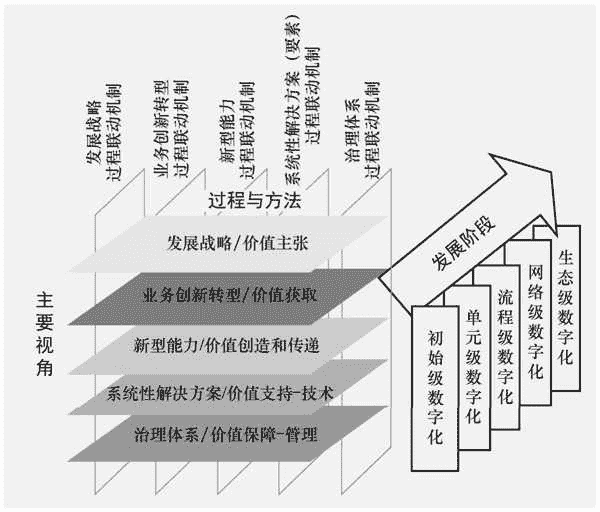

图 2-1 数字化转型体系架构

当第一台蒸汽机轰鸣时，人类学会将热能转化为机械能；当第一块集成电路诞生时，人类开始将信息转化为生产力。数字化转型的本质，是通过数据流重组物理世界——政府治理从“红头文件”变为“云端指令”，企业运营从“流水线”升级为“数字孪生”，个人生活从“实体空间”扩展到“元宇宙”。这场无声的革命，正在以比特为刀，雕刻人类文明的新形态。

### 政府数字化：电子政务与智慧治理

#### 从“公章经济”到“代码治国”

2000 年，爱沙尼亚立法承认电子签名与手写签名具有同等法律效力，成为全球首个“数字共和国”。如今，该国 99%的公共服务可以在线完成，企业注册仅需 18 分钟，公民纳税可在 3 分钟内完成。这种效率跃迁的背后，是区块链存证、AI 审批与跨部门数据共享的深度整合。

#### 中国实践：“一网通办”的超级工程

·数据打通：上海“随申办”整合了 2000 余项服务，市民凭“健康码”即可调用医保、户籍等 47 类数据。

·AI 政务助手：浙江省“浙里办”引入自然语言处理技术，智能客服可解决 85%的咨询需求。

·区块链防伪：北京市政采用区块链存证，使房产交易合同篡改风险降低 99.99%。

#### 治理效能的质变

·腐败防控：印度推行“数字土地登记”后，土地纠纷案件减少 70%。

·应急响应：2021 年郑州暴雨期间，城市大脑实时调度 3000 辆救援车与 500 个避难所，救援效率提升 300%。

·政策迭代：新加坡通过交通大数据模拟，将拥堵税征收精度从“区域级”提升至“路段级”。

#### 悖论与挑战

随着政府数字化的深度渗透，新的伦理问题不断浮现。

·数据利维坦：数字信息可能被用来监视和控制个人，引发技术权力滥用的争议。

·算法黑箱：美国 COMPAS 司法评估系统被揭露对少数族裔存在隐性歧视。

·数字难民：据统计，约 43%的老年人无法独立完成在线政务操作。

数字化转型的终极目标，应是让技术成为普惠性治理工具，而非强化权力的单向监控。

### 企业数字化：ERP 与 CRM 系统的效率革命

#### 从“流程固化”到“智能涌现”

20 世纪 90 年代，沃尔玛通过部署 SAP ERP 系统（见图 2-2），将库存周转率从每年 7 次提升至 12 次，节省 30 亿美元成本。但今天的数字化已经超越简单的流程自动化，进入“数据驱动决策”的新阶段。

图 2-2 SAP ERP 经典架构：三十年不用变的架构设计

#### 制造业：数字孪生的降维打击

·特斯拉超级工厂：每辆 Model Y 的生产数据被实时映射到虚拟工厂，AI 动态优化生产线布局，将产能提升 40%。

·西门子工业云：通过分析全球 10 万台设备的传感器数据，实施预测性维护，每年可减少停机损失 25 亿美元。

·青岛啤酒智能酿造：AI 算法控制 2000 个发酵参数，使啤酒品质波动率从 15%降至 0.5%。

#### 零售业：从“人找货”到“货找人”

·亚马逊推荐引擎：基于 30 亿名用户的行为数据，将购物转化率提升 35%。

·瑞幸咖啡动态定价：根据天气、位置与库存数据，每小时调整 5000 款商品的价格，毛利率提高 12%。

·SHEIN 柔性供应链：通过实时追踪社交媒体趋势，产品从设计到上架仅需 7 天，库存周转率是 ZARA 的 3 倍。

#### 金融业：算法重构信任

·蚂蚁集团“310”模式：3 分钟申请、1 秒放贷、0 人工干预，服务 3000 万家小微商户。

·BlackRock 阿拉丁系统：管理 21 万亿美元资产，通过风险压力测试避免金融危机。

·DeFi 革命：Uniswap 用智能合约取代券商，交易成本从 0.5%降至 0.01%。

#### 暗礁与启示

企业数字化转型的失败率高达 70%，根源常在于以下几个方面。

·组织惯性：通用电气耗时 4 年、耗资 40 亿美元的 Predix 工业互联网平台最终关闭，原因是部门间的数据壁垒无法打破。

·技术迷信：波音 737MAX 过度依赖机动特性增强系统，导致两起空难。

·伦理失范：Facebook 用户数据滥用事件，暴露了算法增长与隐私保护之间的深层矛盾。

真正的数字化成功，需要以技术为骨，以人性为魂。

### 个人数字化：智能手机与可穿戴设备的赋能

#### 从“工具依赖”到“数字器官”

全球平均每人每天触摸手机超过 2000 次，33%的清醒时间用于屏幕交互——智能手机的作用已超越通信工具，成为人类的“外置大脑”。

#### 健康管理的革命

·苹果心脏研究：Apple Watch 检测到 2000 例未被诊断的心房颤动病例，准确率达到 98%。

·糖尿病闭环系统：美敦力智能胰岛素泵根据血糖仪数据自动调节剂量，将低血糖风险降低 70%。

·睡眠算法优化：Oura Ring 通过分析用户睡眠阶段，提供个性化改善建议，用户深度睡眠时间平均增加 22 分钟。

#### 认知能力的扩展

·Anki 记忆算法：根据遗忘曲线定制复习计划，使语言学习效率提升 300%。

·脑电波头环：FocusCalm 设备通过神经反馈训练，将注意力集中时长延长 40%。

·AR 隐形眼镜：Mojo Vision 原型机可向视网膜投射信息，实现“视觉增强现实”。

#### 社会关系的重构

·数字游民：全球 3500 万人通过 Zoom、Slack 等工具实现“地理套利”，在巴厘岛为纽约公司工作。

·元宇宙社交：Decentraland 中的虚拟地块以 240 万美元成交，数字身份开始承载真实经济价值。

·算法婚恋：Tinder 用机器学习匹配用户，20%的婚姻始于滑动匹配。

#### 异化危机

当数字化深入毛细血管时，副作用逐渐显现。

·信息过载：人类日均接收信息量相当于 174 份报纸，导致决策疲劳与注意力碎片化。

·数字成瘾：全球 6.5 亿人患有“无手机焦虑症”，青少年抑郁率与屏幕使用时长呈正相关。

·隐私侵蚀：一部智能手机平均安装 17 个 App，每年泄露用户数据达 1200 次。

未来的个人数字化，需要在赋能与节制之间寻找平衡点——技术应服务于人的主体性，而非让人成为数据的附庸。

#### 数字化转型的终极命题

当政府、企业与个人的数字化进程交汇时，一个更深刻的议题浮现出来：数字化的终点是解放人类，还是重塑人类？

在爱沙尼亚，新生儿的医疗数据自动生成电子身份证，人生始于数据流。

在特斯拉工厂，机器人焊接车体的火花与服务器机房的蓝光共同定义了生产力。

在元宇宙中，Z 世代用数字分身同时参加跨国会议与虚拟演唱会。

这些场景揭示了一个事实：数字化转型不仅是工具革新，更是人类存在方式的进化。当牛津大学学者卡尔·弗瑞提出“数据主义”将成为新宗教时，我们更需要清醒地认识到：比特世界的法则，必须服务于原子世界中人的尊严与自由。 EXr6287u6NNVz+GYLY+7SDk226FstKIHdC0bNoQkB2Nqi1xSR0yxPmwrTs5gRi/BtfSbid6dBhii9q7cz2pIyA==

## 1 数字化转型

为有效实现数字化转型，按照价值体系优化、创新和重构的要求，企业应从发展战略、业务创新转型、新型能力、系统性解决方案、治理体系 5 个方面构建系统化、体系化的关联关系，务实有效地推进数字化转型进程。数字化转型体系架构如图 2-1 所示。

图 2-1 数字化转型体系架构

当第一台蒸汽机轰鸣时，人类学会将热能转化为机械能；当第一块集成电路诞生时，人类开始将信息转化为生产力。数字化转型的本质，是通过数据流重组物理世界——政府治理从“红头文件”变为“云端指令”，企业运营从“流水线”升级为“数字孪生”，个人生活从“实体空间”扩展到“元宇宙”。这场无声的革命，正在以比特为刀，雕刻人类文明的新形态。

### 政府数字化：电子政务与智慧治理

#### 从“公章经济”到“代码治国”

2000 年，爱沙尼亚立法承认电子签名与手写签名具有同等法律效力，成为全球首个“数字共和国”。如今，该国 99%的公共服务可以在线完成，企业注册仅需 18 分钟，公民纳税可在 3 分钟内完成。这种效率跃迁的背后，是区块链存证、AI 审批与跨部门数据共享的深度整合。

#### 中国实践：“一网通办”的超级工程

·数据打通：上海“随申办”整合了 2000 余项服务，市民凭“健康码”即可调用医保、户籍等 47 类数据。

·AI 政务助手：浙江省“浙里办”引入自然语言处理技术，智能客服可解决 85%的咨询需求。

·区块链防伪：北京市政采用区块链存证，使房产交易合同篡改风险降低 99.99%。

#### 治理效能的质变

·腐败防控：印度推行“数字土地登记”后，土地纠纷案件减少 70%。

·应急响应：2021 年郑州暴雨期间，城市大脑实时调度 3000 辆救援车与 500 个避难所，救援效率提升 300%。

·政策迭代：新加坡通过交通大数据模拟，将拥堵税征收精度从“区域级”提升至“路段级”。

#### 悖论与挑战

随着政府数字化的深度渗透，新的伦理问题不断浮现。

·数据利维坦：数字信息可能被用来监视和控制个人，引发技术权力滥用的争议。

·算法黑箱：美国 COMPAS 司法评估系统被揭露对少数族裔存在隐性歧视。

·数字难民：据统计，约 43%的老年人无法独立完成在线政务操作。

数字化转型的终极目标，应是让技术成为普惠性治理工具，而非强化权力的单向监控。

### 企业数字化：ERP 与 CRM 系统的效率革命

#### 从“流程固化”到“智能涌现”

20 世纪 90 年代，沃尔玛通过部署 SAP ERP 系统（见图 2-2），将库存周转率从每年 7 次提升至 12 次，节省 30 亿美元成本。但今天的数字化已经超越简单的流程自动化，进入“数据驱动决策”的新阶段。

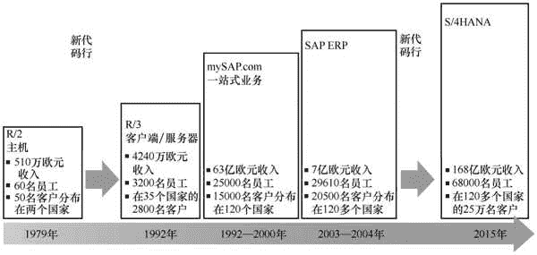

图 2-2 SAP ERP 经典架构：三十年不用变的架构设计

#### 制造业：数字孪生的降维打击

·特斯拉超级工厂：每辆 Model Y 的生产数据被实时映射到虚拟工厂，AI 动态优化生产线布局，将产能提升 40%。

·西门子工业云：通过分析全球 10 万台设备的传感器数据，实施预测性维护，每年可减少停机损失 25 亿美元。

·青岛啤酒智能酿造：AI 算法控制 2000 个发酵参数，使啤酒品质波动率从 15%降至 0.5%。

#### 零售业：从“人找货”到“货找人”

·亚马逊推荐引擎：基于 30 亿名用户的行为数据，将购物转化率提升 35%。

·瑞幸咖啡动态定价：根据天气、位置与库存数据，每小时调整 5000 款商品的价格，毛利率提高 12%。

·SHEIN 柔性供应链：通过实时追踪社交媒体趋势，产品从设计到上架仅需 7 天，库存周转率是 ZARA 的 3 倍。

#### 金融业：算法重构信任

·蚂蚁集团“310”模式：3 分钟申请、1 秒放贷、0 人工干预，服务 3000 万家小微商户。

·BlackRock 阿拉丁系统：管理 21 万亿美元资产，通过风险压力测试避免金融危机。

·DeFi 革命：Uniswap 用智能合约取代券商，交易成本从 0.5%降至 0.01%。

#### 暗礁与启示

企业数字化转型的失败率高达 70%，根源常在于以下几个方面。

·组织惯性：通用电气耗时 4 年、耗资 40 亿美元的 Predix 工业互联网平台最终关闭，原因是部门间的数据壁垒无法打破。

·技术迷信：波音 737MAX 过度依赖机动特性增强系统，导致两起空难。

·伦理失范：Facebook 用户数据滥用事件，暴露了算法增长与隐私保护之间的深层矛盾。

真正的数字化成功，需要以技术为骨，以人性为魂。

### 个人数字化：智能手机与可穿戴设备的赋能

#### 从“工具依赖”到“数字器官”

全球平均每人每天触摸手机超过 2000 次，33%的清醒时间用于屏幕交互——智能手机的作用已超越通信工具，成为人类的“外置大脑”。

#### 健康管理的革命

·苹果心脏研究：Apple Watch 检测到 2000 例未被诊断的心房颤动病例，准确率达到 98%。

·糖尿病闭环系统：美敦力智能胰岛素泵根据血糖仪数据自动调节剂量，将低血糖风险降低 70%。

·睡眠算法优化：Oura Ring 通过分析用户睡眠阶段，提供个性化改善建议，用户深度睡眠时间平均增加 22 分钟。

#### 认知能力的扩展

·Anki 记忆算法：根据遗忘曲线定制复习计划，使语言学习效率提升 300%。

·脑电波头环：FocusCalm 设备通过神经反馈训练，将注意力集中时长延长 40%。

·AR 隐形眼镜：Mojo Vision 原型机可向视网膜投射信息，实现“视觉增强现实”。

#### 社会关系的重构

·数字游民：全球 3500 万人通过 Zoom、Slack 等工具实现“地理套利”，在巴厘岛为纽约公司工作。

·元宇宙社交：Decentraland 中的虚拟地块以 240 万美元成交，数字身份开始承载真实经济价值。

·算法婚恋：Tinder 用机器学习匹配用户，20%的婚姻始于滑动匹配。

#### 异化危机

当数字化深入毛细血管时，副作用逐渐显现。

·信息过载：人类日均接收信息量相当于 174 份报纸，导致决策疲劳与注意力碎片化。

·数字成瘾：全球 6.5 亿人患有“无手机焦虑症”，青少年抑郁率与屏幕使用时长呈正相关。

·隐私侵蚀：一部智能手机平均安装 17 个 App，每年泄露用户数据达 1200 次。

未来的个人数字化，需要在赋能与节制之间寻找平衡点——技术应服务于人的主体性，而非让人成为数据的附庸。

#### 数字化转型的终极命题

当政府、企业与个人的数字化进程交汇时，一个更深刻的议题浮现出来：数字化的终点是解放人类，还是重塑人类？

在爱沙尼亚，新生儿的医疗数据自动生成电子身份证，人生始于数据流。

在特斯拉工厂，机器人焊接车体的火花与服务器机房的蓝光共同定义了生产力。

在元宇宙中，Z 世代用数字分身同时参加跨国会议与虚拟演唱会。

这些场景揭示了一个事实：数字化转型不仅是工具革新，更是人类存在方式的进化。当牛津大学学者卡尔·弗瑞提出“数据主义”将成为新宗教时，我们更需要清醒地认识到：比特世界的法则，必须服务于原子世界中人的尊严与自由。 EXr6287u6NNVz+GYLY+7SDk226FstKIHdC0bNoQkB2Nqi1xSR0yxPmwrTs5gRi/BtfSbid6dBhii9q7cz2pIyA==

## 1 数字化转型

为有效实现数字化转型，按照价值体系优化、创新和重构的要求，企业应从发展战略、业务创新转型、新型能力、系统性解决方案、治理体系 5 个方面构建系统化、体系化的关联关系，务实有效地推进数字化转型进程。数字化转型体系架构如图 2-1 所示。

图 2-1 数字化转型体系架构

当第一台蒸汽机轰鸣时，人类学会将热能转化为机械能；当第一块集成电路诞生时，人类开始将信息转化为生产力。数字化转型的本质，是通过数据流重组物理世界——政府治理从“红头文件”变为“云端指令”，企业运营从“流水线”升级为“数字孪生”，个人生活从“实体空间”扩展到“元宇宙”。这场无声的革命，正在以比特为刀，雕刻人类文明的新形态。

### 政府数字化：电子政务与智慧治理

#### 从“公章经济”到“代码治国”

2000 年，爱沙尼亚立法承认电子签名与手写签名具有同等法律效力，成为全球首个“数字共和国”。如今，该国 99%的公共服务可以在线完成，企业注册仅需 18 分钟，公民纳税可在 3 分钟内完成。这种效率跃迁的背后，是区块链存证、AI 审批与跨部门数据共享的深度整合。

#### 中国实践：“一网通办”的超级工程

·数据打通：上海“随申办”整合了 2000 余项服务，市民凭“健康码”即可调用医保、户籍等 47 类数据。

·AI 政务助手：浙江省“浙里办”引入自然语言处理技术，智能客服可解决 85%的咨询需求。

·区块链防伪：北京市政采用区块链存证，使房产交易合同篡改风险降低 99.99%。

#### 治理效能的质变

·腐败防控：印度推行“数字土地登记”后，土地纠纷案件减少 70%。

·应急响应：2021 年郑州暴雨期间，城市大脑实时调度 3000 辆救援车与 500 个避难所，救援效率提升 300%。

·政策迭代：新加坡通过交通大数据模拟，将拥堵税征收精度从“区域级”提升至“路段级”。

#### 悖论与挑战

随着政府数字化的深度渗透，新的伦理问题不断浮现。

·数据利维坦：数字信息可能被用来监视和控制个人，引发技术权力滥用的争议。

·算法黑箱：美国 COMPAS 司法评估系统被揭露对少数族裔存在隐性歧视。

·数字难民：据统计，约 43%的老年人无法独立完成在线政务操作。

数字化转型的终极目标，应是让技术成为普惠性治理工具，而非强化权力的单向监控。

### 企业数字化：ERP 与 CRM 系统的效率革命

#### 从“流程固化”到“智能涌现”

20 世纪 90 年代，沃尔玛通过部署 SAP ERP 系统（见图 2-2），将库存周转率从每年 7 次提升至 12 次，节省 30 亿美元成本。但今天的数字化已经超越简单的流程自动化，进入“数据驱动决策”的新阶段。

图 2-2 SAP ERP 经典架构：三十年不用变的架构设计

#### 制造业：数字孪生的降维打击

·特斯拉超级工厂：每辆 Model Y 的生产数据被实时映射到虚拟工厂，AI 动态优化生产线布局，将产能提升 40%。

·西门子工业云：通过分析全球 10 万台设备的传感器数据，实施预测性维护，每年可减少停机损失 25 亿美元。

·青岛啤酒智能酿造：AI 算法控制 2000 个发酵参数，使啤酒品质波动率从 15%降至 0.5%。

#### 零售业：从“人找货”到“货找人”

·亚马逊推荐引擎：基于 30 亿名用户的行为数据，将购物转化率提升 35%。

·瑞幸咖啡动态定价：根据天气、位置与库存数据，每小时调整 5000 款商品的价格，毛利率提高 12%。

·SHEIN 柔性供应链：通过实时追踪社交媒体趋势，产品从设计到上架仅需 7 天，库存周转率是 ZARA 的 3 倍。

#### 金融业：算法重构信任

·蚂蚁集团“310”模式：3 分钟申请、1 秒放贷、0 人工干预，服务 3000 万家小微商户。

·BlackRock 阿拉丁系统：管理 21 万亿美元资产，通过风险压力测试避免金融危机。

·DeFi 革命：Uniswap 用智能合约取代券商，交易成本从 0.5%降至 0.01%。

#### 暗礁与启示

企业数字化转型的失败率高达 70%，根源常在于以下几个方面。

·组织惯性：通用电气耗时 4 年、耗资 40 亿美元的 Predix 工业互联网平台最终关闭，原因是部门间的数据壁垒无法打破。

·技术迷信：波音 737MAX 过度依赖机动特性增强系统，导致两起空难。

·伦理失范：Facebook 用户数据滥用事件，暴露了算法增长与隐私保护之间的深层矛盾。

真正的数字化成功，需要以技术为骨，以人性为魂。

### 个人数字化：智能手机与可穿戴设备的赋能

#### 从“工具依赖”到“数字器官”

全球平均每人每天触摸手机超过 2000 次，33%的清醒时间用于屏幕交互——智能手机的作用已超越通信工具，成为人类的“外置大脑”。

#### 健康管理的革命

·苹果心脏研究：Apple Watch 检测到 2000 例未被诊断的心房颤动病例，准确率达到 98%。

·糖尿病闭环系统：美敦力智能胰岛素泵根据血糖仪数据自动调节剂量，将低血糖风险降低 70%。

·睡眠算法优化：Oura Ring 通过分析用户睡眠阶段，提供个性化改善建议，用户深度睡眠时间平均增加 22 分钟。

#### 认知能力的扩展

·Anki 记忆算法：根据遗忘曲线定制复习计划，使语言学习效率提升 300%。

·脑电波头环：FocusCalm 设备通过神经反馈训练，将注意力集中时长延长 40%。

·AR 隐形眼镜：Mojo Vision 原型机可向视网膜投射信息，实现“视觉增强现实”。

#### 社会关系的重构

·数字游民：全球 3500 万人通过 Zoom、Slack 等工具实现“地理套利”，在巴厘岛为纽约公司工作。

·元宇宙社交：Decentraland 中的虚拟地块以 240 万美元成交，数字身份开始承载真实经济价值。

·算法婚恋：Tinder 用机器学习匹配用户，20%的婚姻始于滑动匹配。

#### 异化危机

当数字化深入毛细血管时，副作用逐渐显现。

·信息过载：人类日均接收信息量相当于 174 份报纸，导致决策疲劳与注意力碎片化。

·数字成瘾：全球 6.5 亿人患有“无手机焦虑症”，青少年抑郁率与屏幕使用时长呈正相关。

·隐私侵蚀：一部智能手机平均安装 17 个 App，每年泄露用户数据达 1200 次。

未来的个人数字化，需要在赋能与节制之间寻找平衡点——技术应服务于人的主体性，而非让人成为数据的附庸。

#### 数字化转型的终极命题

当政府、企业与个人的数字化进程交汇时，一个更深刻的议题浮现出来：数字化的终点是解放人类，还是重塑人类？

在爱沙尼亚，新生儿的医疗数据自动生成电子身份证，人生始于数据流。

在特斯拉工厂，机器人焊接车体的火花与服务器机房的蓝光共同定义了生产力。

在元宇宙中，Z 世代用数字分身同时参加跨国会议与虚拟演唱会。

这些场景揭示了一个事实：数字化转型不仅是工具革新，更是人类存在方式的进化。当牛津大学学者卡尔·弗瑞提出“数据主义”将成为新宗教时，我们更需要清醒地认识到：比特世界的法则，必须服务于原子世界中人的尊严与自由。 EXr6287u6NNVz+GYLY+7SDk226FstKIHdC0bNoQkB2Nqi1xSR0yxPmwrTs5gRi/BtfSbid6dBhii9q7cz2pIyA==

## 1 数字化转型

为有效实现数字化转型，按照价值体系优化、创新和重构的要求，企业应从发展战略、业务创新转型、新型能力、系统性解决方案、治理体系 5 个方面构建系统化、体系化的关联关系，务实有效地推进数字化转型进程。数字化转型体系架构如图 2-1 所示。

图 2-1 数字化转型体系架构

当第一台蒸汽机轰鸣时，人类学会将热能转化为机械能；当第一块集成电路诞生时，人类开始将信息转化为生产力。数字化转型的本质，是通过数据流重组物理世界——政府治理从“红头文件”变为“云端指令”，企业运营从“流水线”升级为“数字孪生”，个人生活从“实体空间”扩展到“元宇宙”。这场无声的革命，正在以比特为刀，雕刻人类文明的新形态。

### 政府数字化：电子政务与智慧治理

#### 从“公章经济”到“代码治国”

2000 年，爱沙尼亚立法承认电子签名与手写签名具有同等法律效力，成为全球首个“数字共和国”。如今，该国 99%的公共服务可以在线完成，企业注册仅需 18 分钟，公民纳税可在 3 分钟内完成。这种效率跃迁的背后，是区块链存证、AI 审批与跨部门数据共享的深度整合。

#### 中国实践：“一网通办”的超级工程

·数据打通：上海“随申办”整合了 2000 余项服务，市民凭“健康码”即可调用医保、户籍等 47 类数据。

·AI 政务助手：浙江省“浙里办”引入自然语言处理技术，智能客服可解决 85%的咨询需求。

·区块链防伪：北京市政采用区块链存证，使房产交易合同篡改风险降低 99.99%。

#### 治理效能的质变

·腐败防控：印度推行“数字土地登记”后，土地纠纷案件减少 70%。

·应急响应：2021 年郑州暴雨期间，城市大脑实时调度 3000 辆救援车与 500 个避难所，救援效率提升 300%。

·政策迭代：新加坡通过交通大数据模拟，将拥堵税征收精度从“区域级”提升至“路段级”。

#### 悖论与挑战

随着政府数字化的深度渗透，新的伦理问题不断浮现。

·数据利维坦：数字信息可能被用来监视和控制个人，引发技术权力滥用的争议。

·算法黑箱：美国 COMPAS 司法评估系统被揭露对少数族裔存在隐性歧视。

·数字难民：据统计，约 43%的老年人无法独立完成在线政务操作。

数字化转型的终极目标，应是让技术成为普惠性治理工具，而非强化权力的单向监控。

### 企业数字化：ERP 与 CRM 系统的效率革命

#### 从“流程固化”到“智能涌现”

20 世纪 90 年代，沃尔玛通过部署 SAP ERP 系统（见图 2-2），将库存周转率从每年 7 次提升至 12 次，节省 30 亿美元成本。但今天的数字化已经超越简单的流程自动化，进入“数据驱动决策”的新阶段。

图 2-2 SAP ERP 经典架构：三十年不用变的架构设计

#### 制造业：数字孪生的降维打击

·特斯拉超级工厂：每辆 Model Y 的生产数据被实时映射到虚拟工厂，AI 动态优化生产线布局，将产能提升 40%。

·西门子工业云：通过分析全球 10 万台设备的传感器数据，实施预测性维护，每年可减少停机损失 25 亿美元。

·青岛啤酒智能酿造：AI 算法控制 2000 个发酵参数，使啤酒品质波动率从 15%降至 0.5%。

#### 零售业：从“人找货”到“货找人”

·亚马逊推荐引擎：基于 30 亿名用户的行为数据，将购物转化率提升 35%。

·瑞幸咖啡动态定价：根据天气、位置与库存数据，每小时调整 5000 款商品的价格，毛利率提高 12%。

·SHEIN 柔性供应链：通过实时追踪社交媒体趋势，产品从设计到上架仅需 7 天，库存周转率是 ZARA 的 3 倍。

#### 金融业：算法重构信任

·蚂蚁集团“310”模式：3 分钟申请、1 秒放贷、0 人工干预，服务 3000 万家小微商户。

·BlackRock 阿拉丁系统：管理 21 万亿美元资产，通过风险压力测试避免金融危机。

·DeFi 革命：Uniswap 用智能合约取代券商，交易成本从 0.5%降至 0.01%。

#### 暗礁与启示

企业数字化转型的失败率高达 70%，根源常在于以下几个方面。

·组织惯性：通用电气耗时 4 年、耗资 40 亿美元的 Predix 工业互联网平台最终关闭，原因是部门间的数据壁垒无法打破。

·技术迷信：波音 737MAX 过度依赖机动特性增强系统，导致两起空难。

·伦理失范：Facebook 用户数据滥用事件，暴露了算法增长与隐私保护之间的深层矛盾。

真正的数字化成功，需要以技术为骨，以人性为魂。

### 个人数字化：智能手机与可穿戴设备的赋能

#### 从“工具依赖”到“数字器官”

全球平均每人每天触摸手机超过 2000 次，33%的清醒时间用于屏幕交互——智能手机的作用已超越通信工具，成为人类的“外置大脑”。

#### 健康管理的革命

·苹果心脏研究：Apple Watch 检测到 2000 例未被诊断的心房颤动病例，准确率达到 98%。

·糖尿病闭环系统：美敦力智能胰岛素泵根据血糖仪数据自动调节剂量，将低血糖风险降低 70%。

·睡眠算法优化：Oura Ring 通过分析用户睡眠阶段，提供个性化改善建议，用户深度睡眠时间平均增加 22 分钟。

#### 认知能力的扩展

·Anki 记忆算法：根据遗忘曲线定制复习计划，使语言学习效率提升 300%。

·脑电波头环：FocusCalm 设备通过神经反馈训练，将注意力集中时长延长 40%。

·AR 隐形眼镜：Mojo Vision 原型机可向视网膜投射信息，实现“视觉增强现实”。

#### 社会关系的重构

·数字游民：全球 3500 万人通过 Zoom、Slack 等工具实现“地理套利”，在巴厘岛为纽约公司工作。

·元宇宙社交：Decentraland 中的虚拟地块以 240 万美元成交，数字身份开始承载真实经济价值。

·算法婚恋：Tinder 用机器学习匹配用户，20%的婚姻始于滑动匹配。

#### 异化危机

当数字化深入毛细血管时，副作用逐渐显现。

·信息过载：人类日均接收信息量相当于 174 份报纸，导致决策疲劳与注意力碎片化。

·数字成瘾：全球 6.5 亿人患有“无手机焦虑症”，青少年抑郁率与屏幕使用时长呈正相关。

·隐私侵蚀：一部智能手机平均安装 17 个 App，每年泄露用户数据达 1200 次。

未来的个人数字化，需要在赋能与节制之间寻找平衡点——技术应服务于人的主体性，而非让人成为数据的附庸。

#### 数字化转型的终极命题

当政府、企业与个人的数字化进程交汇时，一个更深刻的议题浮现出来：数字化的终点是解放人类，还是重塑人类？

在爱沙尼亚，新生儿的医疗数据自动生成电子身份证，人生始于数据流。

在特斯拉工厂，机器人焊接车体的火花与服务器机房的蓝光共同定义了生产力。

在元宇宙中，Z 世代用数字分身同时参加跨国会议与虚拟演唱会。

这些场景揭示了一个事实：数字化转型不仅是工具革新，更是人类存在方式的进化。当牛津大学学者卡尔·弗瑞提出“数据主义”将成为新宗教时，我们更需要清醒地认识到：比特世界的法则，必须服务于原子世界中人的尊严与自由。 EXr6287u6NNVz+GYLY+7SDk226FstKIHdC0bNoQkB2Nqi1xSR0yxPmwrTs5gRi/BtfSbid6dBhii9q7cz2pIyA==

## 2 网络化生产

截至 2022 年 6 月，GitHub（见图 2-3）已经有超过 5700 万名注册用户和 1.9 亿个代码库（包括至少 2800 万个开源代码库），成为世界上最大的代码托管网站和开源社区之一。截至 2023 年 1 月 26 日，已经有超过 1 亿名开发人员使用 GitHub。

图 2-3 GitHub 官网界面

#### 从流水线到云端——生产关系的范式革命

工业时代的流水线将工人束缚在固定岗位，数字时代的网络化生产则让全球参与者成为自由节点。当芬兰的程序员、印度的设计师和巴西的创客通过云端共同制造一架无人机时，生产不再受限于物理边界，而是演变为数据驱动、实时协同的超级网络。这场革命的核心逻辑是：连接比拥有更重要，协作比控制更高效。

### 开源社区：全球协作的代码共享模式

#### 代码共和国的崛起

1991 年，林纳斯·托瓦兹在赫尔辛基大学宿舍发布 Linux 内核时，或许未曾料到这个开源项目会催生价值 4000 亿美元的生态系统。开源社区的本质是数字共产主义实验——全球开发者无偿贡献代码，通过分布式协作创造超越商业公司的技术奇迹。

#### 开源经济的运行法则

·幂律分布：在 GitHub 平台上，1%的顶级开发者贡献了 80%的核心代码，但长尾开发者提供了多样化创新。

·协议治理：Apache 基金会的“贡献者许可协议”确保代码主权不被私有化。

·商业共生：红帽公司通过提供企业级 Linux 服务，年收入超过 30 亿美元，证明开源与盈利可并行不悖。

#### 技术民主化的威力

·基础设施层：Apache HTTP 服务器支撑全球 22%（截至 2025 年 1 月）网站的运行。

·开发工具链：Python、TensorFlow 等开源框架成为 AI 研发的“水、电、煤”。

·安全防线：OpenSSL 团队仅用 11 人维护和保障 80%互联网加密通信的代码库。

当微软以 75 亿美元收购 GitHub 时，实质是向开源世界的“投降”——承认封闭开发模式已无法匹敌全球智慧的网络效应。

### 众包平台：从维基百科到 GitHub 的集体智慧

#### 群体智能的规模跃迁

2001 年，吉米·威尔士创立维基百科时，传统百科全书《大英百科全书》由 100 名诺贝尔奖得主撰稿，却最终在 2012 年停印纸质版。维基百科的胜利证明：去中心化协作的精度可能低于专家系统，但其广度与迭代速度具有碾压性优势。

#### 众包模式的三大范式

知识众包

·维基百科（见图 2-4）以 280 种语言收录了 6000 万条词条，错误率与《大英百科全书》相当。

·Stack Overflow 可以解决开发者 90%的技术问题，答案采纳率比企业客服高 40%。

图 2-4 维基百科协同编辑显示预览界面

**图片来源：维基百科。**

创新众包

·Kaggle 平台汇聚了 300 万名数据科学家，为 NASA 优化卫星轨道节省了 1.2 亿美元的燃料。

·InnoCentive 可以帮助企业破解研发难题，解决率比内部团队高 30%。

劳动力众包

·Upwork 平台连接了 1800 万名自由职业者，可以完成从编程到平面设计的 5000 万项任务。

·亚马逊 Mechanical Turk 将复杂任务拆解为微任务，单日可处理 1000 万次数据标注。

#### 集体智慧的边界突破

·蛋白质折叠预测：Foldit 游戏玩家在 3 周内破解了艾滋病病毒酶结构，解决了科学家 10 年未破解的难题。

·行星发现：NASA 通过 Zooniverse 平台发动 30 万名志愿者，发现了 1000 余颗系外行星。

·药物研发：EteRNA 让玩家设计 RNA 分子，其中 166 个方案被斯坦福大学实验室采纳。

这些案例揭示：当任务可模块化且激励设计合理时，分布式群体的创造力远超科层制组织。

### 分布式制造：3D 打印与按需生产的崛起

#### 制造业的去中心化革命

2014 年，Local Motors 公司利用 3D 打印技术在 44 小时内制造出全球首辆开源汽车 Strati，成本仅为传统汽车的 1/5。这场实验标志着制造业从“集中式工厂”向“分布式创客空间”转型。

#### 技术支点与商业模式

·增材制造：3D 打印（见图 2-5）将材料利用率从 30%提升至 98%，GE 航空通过该技术将燃油喷嘴零件从 20 个整合为 1 个。

·数字孪生：西门子 MindSphere 平台连接了全球 1.3 万台机床，实时优化生产参数。

·按需生产：美国 Shapeways 平台让用户上传设计文件，由全球 135 个打印中心就近生产，库存成本降为零。

图 2-5 ORDbot Quantum 3D 打印机

**图片来源：维基百科。**

#### 供应链的重构逻辑

·缩短链路：阿迪达斯 Speedfactory 用本地化微工厂使产品从设计到上架仅需 5 天。

·柔性响应：新冠疫情防控期间，意大利 Isinnova 公司通过 3D 打印改造潜水镜为呼吸阀，48 小时内解决了医院资源短缺问题。

·循环经济：惠普 Multi Jet Fusion 技术支持 100%材料回收，颠覆了“生产-废弃”线性模式。

#### 社会影响的两面性

·正向：非洲初创公司 ROAM 利用太阳能 3D 打印机为偏远的村庄制造净水器部件，成本降低 70%。

·风险：部分低端 3D 打印消费品因生产门槛降低，出现质量参差不齐的仿制品，使监管面临新挑战。

分布式制造不仅改变了产品形态，更重塑了生产者与消费者之间的权力关系——每个人既是设计者，也是制造者。

#### 网络化生产的文明启示

当开源代码、众包智慧与分布式制造交织，一个更深刻的命题浮现出来：网络化生产是否在重写资本主义的底层逻辑？

·价值分配：以太坊 DAO（去中心化自治组织）通过智能合约自动分配收益，股东与员工之间的界限逐渐模糊。

·组织形态：维基百科的贡献者无须签订雇用合同，仅受兴趣与声誉驱动。

·创新路径：特斯拉开放所有电动车专利，加速了行业标准的统一，巩固了其领导地位。

麻省理工学院教授埃里克·冯·希佩尔指出：“网络化生产的终极目标，是让创新民主化成为新常态。”但这场革命也面临三重考验。

·质量管控：开源软件漏洞被利用，导致 Equifax 泄露 1.43 亿名用户的数据。

·可持续激励：维基百科编辑数量相比 2007 年的峰值减少 40%，新人留存率不足 10%。

·地缘博弈：有关国家对开源芯片设计工具出口的限制，暴露了“技术无国界”这一理想的脆弱性。

未来，网络化生产或许会催生“数字合作社”新形态——在那里，算法协调分工，区块链保障权益，而人类专注于创造不可替代的价值。正如“Linux 之父”林纳斯·托瓦兹所言：“软件工程是一场马拉松比赛，但开源让我们拥有了无数接力者。” EXr6287u6NNVz+GYLY+7SDk226FstKIHdC0bNoQkB2Nqi1xSR0yxPmwrTs5gRi/BtfSbid6dBhii9q7cz2pIyA==

## 2 网络化生产

截至 2022 年 6 月，GitHub（见图 2-3）已经有超过 5700 万名注册用户和 1.9 亿个代码库（包括至少 2800 万个开源代码库），成为世界上最大的代码托管网站和开源社区之一。截至 2023 年 1 月 26 日，已经有超过 1 亿名开发人员使用 GitHub。

图 2-3 GitHub 官网界面

#### 从流水线到云端——生产关系的范式革命

工业时代的流水线将工人束缚在固定岗位，数字时代的网络化生产则让全球参与者成为自由节点。当芬兰的程序员、印度的设计师和巴西的创客通过云端共同制造一架无人机时，生产不再受限于物理边界，而是演变为数据驱动、实时协同的超级网络。这场革命的核心逻辑是：连接比拥有更重要，协作比控制更高效。

### 开源社区：全球协作的代码共享模式

#### 代码共和国的崛起

1991 年，林纳斯·托瓦兹在赫尔辛基大学宿舍发布 Linux 内核时，或许未曾料到这个开源项目会催生价值 4000 亿美元的生态系统。开源社区的本质是数字共产主义实验——全球开发者无偿贡献代码，通过分布式协作创造超越商业公司的技术奇迹。

#### 开源经济的运行法则

·幂律分布：在 GitHub 平台上，1%的顶级开发者贡献了 80%的核心代码，但长尾开发者提供了多样化创新。

·协议治理：Apache 基金会的“贡献者许可协议”确保代码主权不被私有化。

·商业共生：红帽公司通过提供企业级 Linux 服务，年收入超过 30 亿美元，证明开源与盈利可并行不悖。

#### 技术民主化的威力

·基础设施层：Apache HTTP 服务器支撑全球 22%（截至 2025 年 1 月）网站的运行。

·开发工具链：Python、TensorFlow 等开源框架成为 AI 研发的“水、电、煤”。

·安全防线：OpenSSL 团队仅用 11 人维护和保障 80%互联网加密通信的代码库。

当微软以 75 亿美元收购 GitHub 时，实质是向开源世界的“投降”——承认封闭开发模式已无法匹敌全球智慧的网络效应。

### 众包平台：从维基百科到 GitHub 的集体智慧

#### 群体智能的规模跃迁

2001 年，吉米·威尔士创立维基百科时，传统百科全书《大英百科全书》由 100 名诺贝尔奖得主撰稿，却最终在 2012 年停印纸质版。维基百科的胜利证明：去中心化协作的精度可能低于专家系统，但其广度与迭代速度具有碾压性优势。

#### 众包模式的三大范式

知识众包

·维基百科（见图 2-4）以 280 种语言收录了 6000 万条词条，错误率与《大英百科全书》相当。

·Stack Overflow 可以解决开发者 90%的技术问题，答案采纳率比企业客服高 40%。

图 2-4 维基百科协同编辑显示预览界面

**图片来源：维基百科。**

创新众包

·Kaggle 平台汇聚了 300 万名数据科学家，为 NASA 优化卫星轨道节省了 1.2 亿美元的燃料。

·InnoCentive 可以帮助企业破解研发难题，解决率比内部团队高 30%。

劳动力众包

·Upwork 平台连接了 1800 万名自由职业者，可以完成从编程到平面设计的 5000 万项任务。

·亚马逊 Mechanical Turk 将复杂任务拆解为微任务，单日可处理 1000 万次数据标注。

#### 集体智慧的边界突破

·蛋白质折叠预测：Foldit 游戏玩家在 3 周内破解了艾滋病病毒酶结构，解决了科学家 10 年未破解的难题。

·行星发现：NASA 通过 Zooniverse 平台发动 30 万名志愿者，发现了 1000 余颗系外行星。

·药物研发：EteRNA 让玩家设计 RNA 分子，其中 166 个方案被斯坦福大学实验室采纳。

这些案例揭示：当任务可模块化且激励设计合理时，分布式群体的创造力远超科层制组织。

### 分布式制造：3D 打印与按需生产的崛起

#### 制造业的去中心化革命

2014 年，Local Motors 公司利用 3D 打印技术在 44 小时内制造出全球首辆开源汽车 Strati，成本仅为传统汽车的 1/5。这场实验标志着制造业从“集中式工厂”向“分布式创客空间”转型。

#### 技术支点与商业模式

·增材制造：3D 打印（见图 2-5）将材料利用率从 30%提升至 98%，GE 航空通过该技术将燃油喷嘴零件从 20 个整合为 1 个。

·数字孪生：西门子 MindSphere 平台连接了全球 1.3 万台机床，实时优化生产参数。

·按需生产：美国 Shapeways 平台让用户上传设计文件，由全球 135 个打印中心就近生产，库存成本降为零。

图 2-5 ORDbot Quantum 3D 打印机

**图片来源：维基百科。**

#### 供应链的重构逻辑

·缩短链路：阿迪达斯 Speedfactory 用本地化微工厂使产品从设计到上架仅需 5 天。

·柔性响应：新冠疫情防控期间，意大利 Isinnova 公司通过 3D 打印改造潜水镜为呼吸阀，48 小时内解决了医院资源短缺问题。

·循环经济：惠普 Multi Jet Fusion 技术支持 100%材料回收，颠覆了“生产-废弃”线性模式。

#### 社会影响的两面性

·正向：非洲初创公司 ROAM 利用太阳能 3D 打印机为偏远的村庄制造净水器部件，成本降低 70%。

·风险：部分低端 3D 打印消费品因生产门槛降低，出现质量参差不齐的仿制品，使监管面临新挑战。

分布式制造不仅改变了产品形态，更重塑了生产者与消费者之间的权力关系——每个人既是设计者，也是制造者。

#### 网络化生产的文明启示

当开源代码、众包智慧与分布式制造交织，一个更深刻的命题浮现出来：网络化生产是否在重写资本主义的底层逻辑？

·价值分配：以太坊 DAO（去中心化自治组织）通过智能合约自动分配收益，股东与员工之间的界限逐渐模糊。

·组织形态：维基百科的贡献者无须签订雇用合同，仅受兴趣与声誉驱动。

·创新路径：特斯拉开放所有电动车专利，加速了行业标准的统一，巩固了其领导地位。

麻省理工学院教授埃里克·冯·希佩尔指出：“网络化生产的终极目标，是让创新民主化成为新常态。”但这场革命也面临三重考验。

·质量管控：开源软件漏洞被利用，导致 Equifax 泄露 1.43 亿名用户的数据。

·可持续激励：维基百科编辑数量相比 2007 年的峰值减少 40%，新人留存率不足 10%。

·地缘博弈：有关国家对开源芯片设计工具出口的限制，暴露了“技术无国界”这一理想的脆弱性。

未来，网络化生产或许会催生“数字合作社”新形态——在那里，算法协调分工，区块链保障权益，而人类专注于创造不可替代的价值。正如“Linux 之父”林纳斯·托瓦兹所言：“软件工程是一场马拉松比赛，但开源让我们拥有了无数接力者。” EXr6287u6NNVz+GYLY+7SDk226FstKIHdC0bNoQkB2Nqi1xSR0yxPmwrTs5gRi/BtfSbid6dBhii9q7cz2pIyA==

## 2 网络化生产

截至 2022 年 6 月，GitHub（见图 2-3）已经有超过 5700 万名注册用户和 1.9 亿个代码库（包括至少 2800 万个开源代码库），成为世界上最大的代码托管网站和开源社区之一。截至 2023 年 1 月 26 日，已经有超过 1 亿名开发人员使用 GitHub。

图 2-3 GitHub 官网界面

#### 从流水线到云端——生产关系的范式革命

工业时代的流水线将工人束缚在固定岗位，数字时代的网络化生产则让全球参与者成为自由节点。当芬兰的程序员、印度的设计师和巴西的创客通过云端共同制造一架无人机时，生产不再受限于物理边界，而是演变为数据驱动、实时协同的超级网络。这场革命的核心逻辑是：连接比拥有更重要，协作比控制更高效。

### 开源社区：全球协作的代码共享模式

#### 代码共和国的崛起

1991 年，林纳斯·托瓦兹在赫尔辛基大学宿舍发布 Linux 内核时，或许未曾料到这个开源项目会催生价值 4000 亿美元的生态系统。开源社区的本质是数字共产主义实验——全球开发者无偿贡献代码，通过分布式协作创造超越商业公司的技术奇迹。

#### 开源经济的运行法则

·幂律分布：在 GitHub 平台上，1%的顶级开发者贡献了 80%的核心代码，但长尾开发者提供了多样化创新。

·协议治理：Apache 基金会的“贡献者许可协议”确保代码主权不被私有化。

·商业共生：红帽公司通过提供企业级 Linux 服务，年收入超过 30 亿美元，证明开源与盈利可并行不悖。

#### 技术民主化的威力

·基础设施层：Apache HTTP 服务器支撑全球 22%（截至 2025 年 1 月）网站的运行。

·开发工具链：Python、TensorFlow 等开源框架成为 AI 研发的“水、电、煤”。

·安全防线：OpenSSL 团队仅用 11 人维护和保障 80%互联网加密通信的代码库。

当微软以 75 亿美元收购 GitHub 时，实质是向开源世界的“投降”——承认封闭开发模式已无法匹敌全球智慧的网络效应。

### 众包平台：从维基百科到 GitHub 的集体智慧

#### 群体智能的规模跃迁

2001 年，吉米·威尔士创立维基百科时，传统百科全书《大英百科全书》由 100 名诺贝尔奖得主撰稿，却最终在 2012 年停印纸质版。维基百科的胜利证明：去中心化协作的精度可能低于专家系统，但其广度与迭代速度具有碾压性优势。

#### 众包模式的三大范式

知识众包

·维基百科（见图 2-4）以 280 种语言收录了 6000 万条词条，错误率与《大英百科全书》相当。

·Stack Overflow 可以解决开发者 90%的技术问题，答案采纳率比企业客服高 40%。

图 2-4 维基百科协同编辑显示预览界面

**图片来源：维基百科。**

创新众包

·Kaggle 平台汇聚了 300 万名数据科学家，为 NASA 优化卫星轨道节省了 1.2 亿美元的燃料。

·InnoCentive 可以帮助企业破解研发难题，解决率比内部团队高 30%。

劳动力众包

·Upwork 平台连接了 1800 万名自由职业者，可以完成从编程到平面设计的 5000 万项任务。

·亚马逊 Mechanical Turk 将复杂任务拆解为微任务，单日可处理 1000 万次数据标注。

#### 集体智慧的边界突破

·蛋白质折叠预测：Foldit 游戏玩家在 3 周内破解了艾滋病病毒酶结构，解决了科学家 10 年未破解的难题。

·行星发现：NASA 通过 Zooniverse 平台发动 30 万名志愿者，发现了 1000 余颗系外行星。

·药物研发：EteRNA 让玩家设计 RNA 分子，其中 166 个方案被斯坦福大学实验室采纳。

这些案例揭示：当任务可模块化且激励设计合理时，分布式群体的创造力远超科层制组织。

### 分布式制造：3D 打印与按需生产的崛起

#### 制造业的去中心化革命

2014 年，Local Motors 公司利用 3D 打印技术在 44 小时内制造出全球首辆开源汽车 Strati，成本仅为传统汽车的 1/5。这场实验标志着制造业从“集中式工厂”向“分布式创客空间”转型。

#### 技术支点与商业模式

·增材制造：3D 打印（见图 2-5）将材料利用率从 30%提升至 98%，GE 航空通过该技术将燃油喷嘴零件从 20 个整合为 1 个。

·数字孪生：西门子 MindSphere 平台连接了全球 1.3 万台机床，实时优化生产参数。

·按需生产：美国 Shapeways 平台让用户上传设计文件，由全球 135 个打印中心就近生产，库存成本降为零。

图 2-5 ORDbot Quantum 3D 打印机

**图片来源：维基百科。**

#### 供应链的重构逻辑

·缩短链路：阿迪达斯 Speedfactory 用本地化微工厂使产品从设计到上架仅需 5 天。

·柔性响应：新冠疫情防控期间，意大利 Isinnova 公司通过 3D 打印改造潜水镜为呼吸阀，48 小时内解决了医院资源短缺问题。

·循环经济：惠普 Multi Jet Fusion 技术支持 100%材料回收，颠覆了“生产-废弃”线性模式。

#### 社会影响的两面性

·正向：非洲初创公司 ROAM 利用太阳能 3D 打印机为偏远的村庄制造净水器部件，成本降低 70%。

·风险：部分低端 3D 打印消费品因生产门槛降低，出现质量参差不齐的仿制品，使监管面临新挑战。

分布式制造不仅改变了产品形态，更重塑了生产者与消费者之间的权力关系——每个人既是设计者，也是制造者。

#### 网络化生产的文明启示

当开源代码、众包智慧与分布式制造交织，一个更深刻的命题浮现出来：网络化生产是否在重写资本主义的底层逻辑？

·价值分配：以太坊 DAO（去中心化自治组织）通过智能合约自动分配收益，股东与员工之间的界限逐渐模糊。

·组织形态：维基百科的贡献者无须签订雇用合同，仅受兴趣与声誉驱动。

·创新路径：特斯拉开放所有电动车专利，加速了行业标准的统一，巩固了其领导地位。

麻省理工学院教授埃里克·冯·希佩尔指出：“网络化生产的终极目标，是让创新民主化成为新常态。”但这场革命也面临三重考验。

·质量管控：开源软件漏洞被利用，导致 Equifax 泄露 1.43 亿名用户的数据。

·可持续激励：维基百科编辑数量相比 2007 年的峰值减少 40%，新人留存率不足 10%。

·地缘博弈：有关国家对开源芯片设计工具出口的限制，暴露了“技术无国界”这一理想的脆弱性。

未来，网络化生产或许会催生“数字合作社”新形态——在那里，算法协调分工，区块链保障权益，而人类专注于创造不可替代的价值。正如“Linux 之父”林纳斯·托瓦兹所言：“软件工程是一场马拉松比赛，但开源让我们拥有了无数接力者。” EXr6287u6NNVz+GYLY+7SDk226FstKIHdC0bNoQkB2Nqi1xSR0yxPmwrTs5gRi/BtfSbid6dBhii9q7cz2pIyA==

## 2 网络化生产

截至 2022 年 6 月，GitHub（见图 2-3）已经有超过 5700 万名注册用户和 1.9 亿个代码库（包括至少 2800 万个开源代码库），成为世界上最大的代码托管网站和开源社区之一。截至 2023 年 1 月 26 日，已经有超过 1 亿名开发人员使用 GitHub。

图 2-3 GitHub 官网界面

#### 从流水线到云端——生产关系的范式革命

工业时代的流水线将工人束缚在固定岗位，数字时代的网络化生产则让全球参与者成为自由节点。当芬兰的程序员、印度的设计师和巴西的创客通过云端共同制造一架无人机时，生产不再受限于物理边界，而是演变为数据驱动、实时协同的超级网络。这场革命的核心逻辑是：连接比拥有更重要，协作比控制更高效。

### 开源社区：全球协作的代码共享模式

#### 代码共和国的崛起

1991 年，林纳斯·托瓦兹在赫尔辛基大学宿舍发布 Linux 内核时，或许未曾料到这个开源项目会催生价值 4000 亿美元的生态系统。开源社区的本质是数字共产主义实验——全球开发者无偿贡献代码，通过分布式协作创造超越商业公司的技术奇迹。

#### 开源经济的运行法则

·幂律分布：在 GitHub 平台上，1%的顶级开发者贡献了 80%的核心代码，但长尾开发者提供了多样化创新。

·协议治理：Apache 基金会的“贡献者许可协议”确保代码主权不被私有化。

·商业共生：红帽公司通过提供企业级 Linux 服务，年收入超过 30 亿美元，证明开源与盈利可并行不悖。

#### 技术民主化的威力

·基础设施层：Apache HTTP 服务器支撑全球 22%（截至 2025 年 1 月）网站的运行。

·开发工具链：Python、TensorFlow 等开源框架成为 AI 研发的“水、电、煤”。

·安全防线：OpenSSL 团队仅用 11 人维护和保障 80%互联网加密通信的代码库。

当微软以 75 亿美元收购 GitHub 时，实质是向开源世界的“投降”——承认封闭开发模式已无法匹敌全球智慧的网络效应。

### 众包平台：从维基百科到 GitHub 的集体智慧

#### 群体智能的规模跃迁

2001 年，吉米·威尔士创立维基百科时，传统百科全书《大英百科全书》由 100 名诺贝尔奖得主撰稿，却最终在 2012 年停印纸质版。维基百科的胜利证明：去中心化协作的精度可能低于专家系统，但其广度与迭代速度具有碾压性优势。

#### 众包模式的三大范式

知识众包

·维基百科（见图 2-4）以 280 种语言收录了 6000 万条词条，错误率与《大英百科全书》相当。

·Stack Overflow 可以解决开发者 90%的技术问题，答案采纳率比企业客服高 40%。

图 2-4 维基百科协同编辑显示预览界面

**图片来源：维基百科。**

创新众包

·Kaggle 平台汇聚了 300 万名数据科学家，为 NASA 优化卫星轨道节省了 1.2 亿美元的燃料。

·InnoCentive 可以帮助企业破解研发难题，解决率比内部团队高 30%。

劳动力众包

·Upwork 平台连接了 1800 万名自由职业者，可以完成从编程到平面设计的 5000 万项任务。

·亚马逊 Mechanical Turk 将复杂任务拆解为微任务，单日可处理 1000 万次数据标注。

#### 集体智慧的边界突破

·蛋白质折叠预测：Foldit 游戏玩家在 3 周内破解了艾滋病病毒酶结构，解决了科学家 10 年未破解的难题。

·行星发现：NASA 通过 Zooniverse 平台发动 30 万名志愿者，发现了 1000 余颗系外行星。

·药物研发：EteRNA 让玩家设计 RNA 分子，其中 166 个方案被斯坦福大学实验室采纳。

这些案例揭示：当任务可模块化且激励设计合理时，分布式群体的创造力远超科层制组织。

### 分布式制造：3D 打印与按需生产的崛起

#### 制造业的去中心化革命

2014 年，Local Motors 公司利用 3D 打印技术在 44 小时内制造出全球首辆开源汽车 Strati，成本仅为传统汽车的 1/5。这场实验标志着制造业从“集中式工厂”向“分布式创客空间”转型。

#### 技术支点与商业模式

·增材制造：3D 打印（见图 2-5）将材料利用率从 30%提升至 98%，GE 航空通过该技术将燃油喷嘴零件从 20 个整合为 1 个。

·数字孪生：西门子 MindSphere 平台连接了全球 1.3 万台机床，实时优化生产参数。

·按需生产：美国 Shapeways 平台让用户上传设计文件，由全球 135 个打印中心就近生产，库存成本降为零。

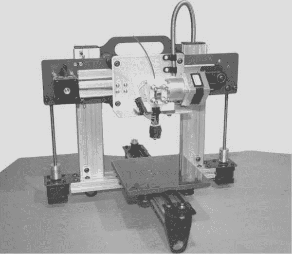

图 2-5 ORDbot Quantum 3D 打印机

**图片来源：维基百科。**

#### 供应链的重构逻辑

·缩短链路：阿迪达斯 Speedfactory 用本地化微工厂使产品从设计到上架仅需 5 天。

·柔性响应：新冠疫情防控期间，意大利 Isinnova 公司通过 3D 打印改造潜水镜为呼吸阀，48 小时内解决了医院资源短缺问题。

·循环经济：惠普 Multi Jet Fusion 技术支持 100%材料回收，颠覆了“生产-废弃”线性模式。

#### 社会影响的两面性

·正向：非洲初创公司 ROAM 利用太阳能 3D 打印机为偏远的村庄制造净水器部件，成本降低 70%。

·风险：部分低端 3D 打印消费品因生产门槛降低，出现质量参差不齐的仿制品，使监管面临新挑战。

分布式制造不仅改变了产品形态，更重塑了生产者与消费者之间的权力关系——每个人既是设计者，也是制造者。

#### 网络化生产的文明启示

当开源代码、众包智慧与分布式制造交织，一个更深刻的命题浮现出来：网络化生产是否在重写资本主义的底层逻辑？

·价值分配：以太坊 DAO（去中心化自治组织）通过智能合约自动分配收益，股东与员工之间的界限逐渐模糊。

·组织形态：维基百科的贡献者无须签订雇用合同，仅受兴趣与声誉驱动。

·创新路径：特斯拉开放所有电动车专利，加速了行业标准的统一，巩固了其领导地位。

麻省理工学院教授埃里克·冯·希佩尔指出：“网络化生产的终极目标，是让创新民主化成为新常态。”但这场革命也面临三重考验。

·质量管控：开源软件漏洞被利用，导致 Equifax 泄露 1.43 亿名用户的数据。

·可持续激励：维基百科编辑数量相比 2007 年的峰值减少 40%，新人留存率不足 10%。

·地缘博弈：有关国家对开源芯片设计工具出口的限制，暴露了“技术无国界”这一理想的脆弱性。

未来，网络化生产或许会催生“数字合作社”新形态——在那里，算法协调分工，区块链保障权益，而人类专注于创造不可替代的价值。正如“Linux 之父”林纳斯·托瓦兹所言：“软件工程是一场马拉松比赛，但开源让我们拥有了无数接力者。” EXr6287u6NNVz+GYLY+7SDk226FstKIHdC0bNoQkB2Nqi1xSR0yxPmwrTs5gRi/BtfSbid6dBhii9q7cz2pIyA==

# 第三章
AI 生产力
——颠覆世界的力量

**AI 可能创造无用阶级，重塑社会结构。**

**——尤瓦尔·赫拉利** EXr6287u6NNVz+GYLY+7SDk226FstKIHdC0bNoQkB2Nqi1xSR0yxPmwrTs5gRi/BtfSbid6dBhii9q7cz2pIyA==

## 1 AI 的生产力革命

#### 从工具到伙伴——AI 的范式跃迁

当 18 世纪的纺织工人砸毁蒸汽机时，他们恐惧的是机器对手工的替代；当 21 世纪的程序员与 GPT-4 协作编程时，他们见证的是一场更深刻的变革——AI 不再是冰冷的工具，而是具备创造力的“生产力伙伴”。这场革命的核心逻辑是：AI 重新定义了解决问题的边界，从执行指令到自主创新，从优化流程到重构系统。

### 人工智能技术的发展里程碑

#### 符号主义的黄昏与深度学习的黎明

在 1956 年的达特茅斯会议（见图 3-1）上，“人工智能”这一概念首次被提出，此后 70 年的技术演进可分为三大阶段。

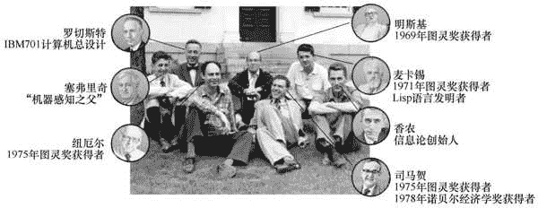

图 3-1 1956 年达特茅斯会议上的“会议七侠”

规则引擎时代（20 世纪 50 年代至 80 年代末）

·逻辑推理先驱：IBM 的 Deep Blue 于 1997 年击败国际象棋冠军卡斯帕罗夫，依赖的是人类编写的 30 万条棋局规则。

·专家系统困局：MYCIN 医疗诊断系统准确率超过 75%，但需要手动输入 4500 条医学规则，维护成本极高。

机器学习崛起（20 世纪 90 年代初至 21 世纪 10 年代末）

·数据驱动范式：2006 年 ImageNet 数据集发布，为计算机视觉提供燃料。

·算法突破：2012 年 AlexNet 在 ImageNet 竞赛中错误率骤降至 15.3%（传统方法错误率超过 26%），引爆深度学习革命。

大模型纪元（21 世纪 20 年代初至今）

·规模定律：OpenAI 的 GPT-3 参数达 1750 亿个，训练数据涵盖 45TB 文本，彰显出强大的跨领域推理能力。

·智能涌现效率定律：DeepSeek-R1 的诞生标志着大模型技术从“暴力堆料”向“精准智能”的范式跃迁。其核心突破在于通过“架构、算法、数据”三元协同优化，以更小的规模实现超大规模模型的智能涌现。采用可微分路由的混合专家系统（DR-MoE），在 680 亿个激活参数下，其跨领域推理能力比 GPT-3（拥有 1750 亿个密集的参数）高 23%，训练能耗降低 76%。

·多模态融合：Google 的 PaLM-E 模型整合视觉、语言与机器人控制，实现“看—想—动”闭环。

#### 关键转折点

·2016 年，AlphaGo 击败李世石，证明了 AI 在复杂决策中的优越性。

·2020 年，AlphaFold 2 破解了蛋白质折叠难题，颠覆了生物医学研究范式。

·2023 年，ChatGPT 的用户数破亿仅用了 2 个月，掀起了生成式 AI 的全民化浪潮。

#### 技术栈的三重突破

·算力爆炸：英伟达 A100GPU 的浮点运算能力达到每秒 312 万亿次，是 1990 年超级计算机的 100 万倍。

·算法进化：Transformer 架构使模型并行训练效率提升 80%，扩散模型让图像生成质量逼近人类画师的水平。

·数据民主化：Common Crawl 开源项目每月抓取 20 亿个网页，Stable Diffusion 训练集中包含 50 亿张图片。

这些突破使 AI 从实验室走入现实，成为触手可及的生产力引擎。

### AI+赋能千行百业

#### 制造业：从“钢铁丛林”到“智能有机体”

·预测性维护：西门子利用 AI 分析工厂传感器数据，设备故障预测准确率达 92%，减少停机损失 30%。

·柔性生产：特斯拉上海工厂通过 AI 动态调整生产线，10 秒下线一辆 Model Y，产能提升 50%。

·质量检测：富士康部署 AI 视觉系统，手机屏幕缺陷检出率从 85%提升至 99.9%，人力成本降低 70%。

·案例深度：波音 787 梦幻客机的 200 万个零部件，由 AI 调度全球 30 个国家的供应商协同生产，交付周期从 6 年压缩至 3 年。

#### 医疗健康：从“经验医学”到“数据医学”

·影像诊断：DeepMind 的 AI 技术在乳腺癌筛查中误诊率比放射科医生低 5.7%，效率提升 10 倍。

·药物研发：Insilico Medicine 用 AI 设计出了特发性肺纤维化药物，研发周期从 6 年缩短至 18 个月。

·手术革命：直觉外科的达·芬奇机器人完成超 1000 万例手术，患者恢复时间平均缩短 30%。

·伦理突破：2023 年，美国食品药品监督管理局批准首款 AI 自主诊断系统 IDx-DR，可直接给出糖尿病性视网膜病变的临床决策。

#### 金融业：从“华尔街之狼”到“算法先知”

·智能投顾：Betterment 管理 400 亿美元资产，通过 AI 定制组合，年化收益超标普 500 指数 2.3%。

·风险控制：蚂蚁集团的 CTU 风控系统实时拦截 99.99%的欺诈交易，每秒处理 10 万笔交易。

·高频交易：Jump Trading 的 AI 策略在原油期货市场年化收益率达 78%，远超人类交易员。

·暗流警示：在 2020 年的美股“闪电崩盘”事件中，算法交易导致道琼斯指数 5 分钟暴跌 1000 点，暴露了 AI 金融的“黑天鹅”风险。

#### 农业：从“看天吃饭”到“数字农耕”

·精准种植：John Deere 的 AI 拖拉机通过土壤传感器调整播种密度，玉米亩产量提升 20%。

·病虫害预警：印度的 Plantix App 识别作物病害准确率达 95%，挽救了数千万名农民的生计。

·垂直农场：Plenty 的 AI 温室优化光温水肥参数，使作物生长期缩短 50%，用水量减少 99%。

·社会价值：埃塞俄比亚政府引入 AI 气候预测系统，使干旱地区粮食产量提升 40%，覆盖 300 万人口。

#### 教育：从“标准化流水线”到“个性化进化”

·自适应学习：Knewton 平台根据学生答题数据动态调整课程，使学生学习效率提升 47%。

·虚拟导师：韩国 AI 助教 Riiid 预测考试薄弱点，使学生 SAT 平均分提高 120 分。

·教育公平：肯尼亚的 Eneza 教育通过短信推送 AI 课程，覆盖 700 万名偏远地区的学生。

·争议焦点：法国禁止学校使用 ChatGPT，担心其会削弱学生的思辨能力，凸显技术应用的“双刃剑”效应。

#### 生产力革命的三重维度

·效率跃迁：麦肯锡预测，AI 将在 2030 年为全球经济贡献 13 万亿美元的增量，相当于再造一个中国 GDP。

·创新民主化：StabilityAI 开源模型让个人创作者生成好莱坞级特效，成本从百万美元降至几千美元。

·组织重构：GitHub Copilot 使程序员效率提升 55%，但同时挑战传统软件工程的管理模式。

#### 暗涌与挑战：繁荣背后的隐忧

·就业重构：世界经济论坛预测，AI 将淘汰 8500 万个岗位，同时创造 9700 万个新岗位。

·伦理困境：ClearviewAI 非法抓取 30 亿条人脸数据，引发全球隐私诉讼潮。

·权力集中：OpenAI 等巨头掌握拥有万亿个参数的模型，中小开发者面临“算力霸权”压制。

历史学家尤瓦尔·赫拉利警告：“AI 可能创造无用阶级，重塑社会结构。”

#### 未来图景：人机共生的新文明

当 AI 生产力渗透每个领域时，人类面临的根本问题是：如何定义自身在智能时代的独特价值？

在医疗领域，AI 诊断系统与医生形成“双脑会诊”模式，误诊率降至 0.1%。

在艺术创作领域，MidJourney 生成的设计方案成为米兰时装周上的焦点，人类设计师转型为“AI 策展人”。

在科学探索领域，DeepMind 的 GNoME 模型发现了 220 多万种新材料，加速了清洁能源革命。

这场革命的终点，或许是一个“超生产力社会”——在那里，物资匮乏成为历史，人类可以专注于创造、爱与探索。但在通往乌托邦的道路上，每一步都需要警惕技术的异化与失控。 EXr6287u6NNVz+GYLY+7SDk226FstKIHdC0bNoQkB2Nqi1xSR0yxPmwrTs5gRi/BtfSbid6dBhii9q7cz2pIyA==

## 1 AI 的生产力革命

#### 从工具到伙伴——AI 的范式跃迁

当 18 世纪的纺织工人砸毁蒸汽机时，他们恐惧的是机器对手工的替代；当 21 世纪的程序员与 GPT-4 协作编程时，他们见证的是一场更深刻的变革——AI 不再是冰冷的工具，而是具备创造力的“生产力伙伴”。这场革命的核心逻辑是：AI 重新定义了解决问题的边界，从执行指令到自主创新，从优化流程到重构系统。

### 人工智能技术的发展里程碑

#### 符号主义的黄昏与深度学习的黎明

在 1956 年的达特茅斯会议（见图 3-1）上，“人工智能”这一概念首次被提出，此后 70 年的技术演进可分为三大阶段。

图 3-1 1956 年达特茅斯会议上的“会议七侠”

规则引擎时代（20 世纪 50 年代至 80 年代末）

·逻辑推理先驱：IBM 的 Deep Blue 于 1997 年击败国际象棋冠军卡斯帕罗夫，依赖的是人类编写的 30 万条棋局规则。

·专家系统困局：MYCIN 医疗诊断系统准确率超过 75%，但需要手动输入 4500 条医学规则，维护成本极高。

机器学习崛起（20 世纪 90 年代初至 21 世纪 10 年代末）

·数据驱动范式：2006 年 ImageNet 数据集发布，为计算机视觉提供燃料。

·算法突破：2012 年 AlexNet 在 ImageNet 竞赛中错误率骤降至 15.3%（传统方法错误率超过 26%），引爆深度学习革命。

大模型纪元（21 世纪 20 年代初至今）

·规模定律：OpenAI 的 GPT-3 参数达 1750 亿个，训练数据涵盖 45TB 文本，彰显出强大的跨领域推理能力。

·智能涌现效率定律：DeepSeek-R1 的诞生标志着大模型技术从“暴力堆料”向“精准智能”的范式跃迁。其核心突破在于通过“架构、算法、数据”三元协同优化，以更小的规模实现超大规模模型的智能涌现。采用可微分路由的混合专家系统（DR-MoE），在 680 亿个激活参数下，其跨领域推理能力比 GPT-3（拥有 1750 亿个密集的参数）高 23%，训练能耗降低 76%。

·多模态融合：Google 的 PaLM-E 模型整合视觉、语言与机器人控制，实现“看—想—动”闭环。

#### 关键转折点

·2016 年，AlphaGo 击败李世石，证明了 AI 在复杂决策中的优越性。

·2020 年，AlphaFold 2 破解了蛋白质折叠难题，颠覆了生物医学研究范式。

·2023 年，ChatGPT 的用户数破亿仅用了 2 个月，掀起了生成式 AI 的全民化浪潮。

#### 技术栈的三重突破

·算力爆炸：英伟达 A100GPU 的浮点运算能力达到每秒 312 万亿次，是 1990 年超级计算机的 100 万倍。

·算法进化：Transformer 架构使模型并行训练效率提升 80%，扩散模型让图像生成质量逼近人类画师的水平。

·数据民主化：Common Crawl 开源项目每月抓取 20 亿个网页，Stable Diffusion 训练集中包含 50 亿张图片。

这些突破使 AI 从实验室走入现实，成为触手可及的生产力引擎。

### AI+赋能千行百业

#### 制造业：从“钢铁丛林”到“智能有机体”

·预测性维护：西门子利用 AI 分析工厂传感器数据，设备故障预测准确率达 92%，减少停机损失 30%。

·柔性生产：特斯拉上海工厂通过 AI 动态调整生产线，10 秒下线一辆 Model Y，产能提升 50%。

·质量检测：富士康部署 AI 视觉系统，手机屏幕缺陷检出率从 85%提升至 99.9%，人力成本降低 70%。

·案例深度：波音 787 梦幻客机的 200 万个零部件，由 AI 调度全球 30 个国家的供应商协同生产，交付周期从 6 年压缩至 3 年。

#### 医疗健康：从“经验医学”到“数据医学”

·影像诊断：DeepMind 的 AI 技术在乳腺癌筛查中误诊率比放射科医生低 5.7%，效率提升 10 倍。

·药物研发：Insilico Medicine 用 AI 设计出了特发性肺纤维化药物，研发周期从 6 年缩短至 18 个月。

·手术革命：直觉外科的达·芬奇机器人完成超 1000 万例手术，患者恢复时间平均缩短 30%。

·伦理突破：2023 年，美国食品药品监督管理局批准首款 AI 自主诊断系统 IDx-DR，可直接给出糖尿病性视网膜病变的临床决策。

#### 金融业：从“华尔街之狼”到“算法先知”

·智能投顾：Betterment 管理 400 亿美元资产，通过 AI 定制组合，年化收益超标普 500 指数 2.3%。

·风险控制：蚂蚁集团的 CTU 风控系统实时拦截 99.99%的欺诈交易，每秒处理 10 万笔交易。

·高频交易：Jump Trading 的 AI 策略在原油期货市场年化收益率达 78%，远超人类交易员。

·暗流警示：在 2020 年的美股“闪电崩盘”事件中，算法交易导致道琼斯指数 5 分钟暴跌 1000 点，暴露了 AI 金融的“黑天鹅”风险。

#### 农业：从“看天吃饭”到“数字农耕”

·精准种植：John Deere 的 AI 拖拉机通过土壤传感器调整播种密度，玉米亩产量提升 20%。

·病虫害预警：印度的 Plantix App 识别作物病害准确率达 95%，挽救了数千万名农民的生计。

·垂直农场：Plenty 的 AI 温室优化光温水肥参数，使作物生长期缩短 50%，用水量减少 99%。

·社会价值：埃塞俄比亚政府引入 AI 气候预测系统，使干旱地区粮食产量提升 40%，覆盖 300 万人口。

#### 教育：从“标准化流水线”到“个性化进化”

·自适应学习：Knewton 平台根据学生答题数据动态调整课程，使学生学习效率提升 47%。

·虚拟导师：韩国 AI 助教 Riiid 预测考试薄弱点，使学生 SAT 平均分提高 120 分。

·教育公平：肯尼亚的 Eneza 教育通过短信推送 AI 课程，覆盖 700 万名偏远地区的学生。

·争议焦点：法国禁止学校使用 ChatGPT，担心其会削弱学生的思辨能力，凸显技术应用的“双刃剑”效应。

#### 生产力革命的三重维度

·效率跃迁：麦肯锡预测，AI 将在 2030 年为全球经济贡献 13 万亿美元的增量，相当于再造一个中国 GDP。

·创新民主化：StabilityAI 开源模型让个人创作者生成好莱坞级特效，成本从百万美元降至几千美元。

·组织重构：GitHub Copilot 使程序员效率提升 55%，但同时挑战传统软件工程的管理模式。

#### 暗涌与挑战：繁荣背后的隐忧

·就业重构：世界经济论坛预测，AI 将淘汰 8500 万个岗位，同时创造 9700 万个新岗位。

·伦理困境：ClearviewAI 非法抓取 30 亿条人脸数据，引发全球隐私诉讼潮。

·权力集中：OpenAI 等巨头掌握拥有万亿个参数的模型，中小开发者面临“算力霸权”压制。

历史学家尤瓦尔·赫拉利警告：“AI 可能创造无用阶级，重塑社会结构。”

#### 未来图景：人机共生的新文明

当 AI 生产力渗透每个领域时，人类面临的根本问题是：如何定义自身在智能时代的独特价值？

在医疗领域，AI 诊断系统与医生形成“双脑会诊”模式，误诊率降至 0.1%。

在艺术创作领域，MidJourney 生成的设计方案成为米兰时装周上的焦点，人类设计师转型为“AI 策展人”。

在科学探索领域，DeepMind 的 GNoME 模型发现了 220 多万种新材料，加速了清洁能源革命。

这场革命的终点，或许是一个“超生产力社会”——在那里，物资匮乏成为历史，人类可以专注于创造、爱与探索。但在通往乌托邦的道路上，每一步都需要警惕技术的异化与失控。 EXr6287u6NNVz+GYLY+7SDk226FstKIHdC0bNoQkB2Nqi1xSR0yxPmwrTs5gRi/BtfSbid6dBhii9q7cz2pIyA==

## 1 AI 的生产力革命

#### 从工具到伙伴——AI 的范式跃迁

当 18 世纪的纺织工人砸毁蒸汽机时，他们恐惧的是机器对手工的替代；当 21 世纪的程序员与 GPT-4 协作编程时，他们见证的是一场更深刻的变革——AI 不再是冰冷的工具，而是具备创造力的“生产力伙伴”。这场革命的核心逻辑是：AI 重新定义了解决问题的边界，从执行指令到自主创新，从优化流程到重构系统。

### 人工智能技术的发展里程碑

#### 符号主义的黄昏与深度学习的黎明

在 1956 年的达特茅斯会议（见图 3-1）上，“人工智能”这一概念首次被提出，此后 70 年的技术演进可分为三大阶段。

图 3-1 1956 年达特茅斯会议上的“会议七侠”

规则引擎时代（20 世纪 50 年代至 80 年代末）

·逻辑推理先驱：IBM 的 Deep Blue 于 1997 年击败国际象棋冠军卡斯帕罗夫，依赖的是人类编写的 30 万条棋局规则。

·专家系统困局：MYCIN 医疗诊断系统准确率超过 75%，但需要手动输入 4500 条医学规则，维护成本极高。

机器学习崛起（20 世纪 90 年代初至 21 世纪 10 年代末）

·数据驱动范式：2006 年 ImageNet 数据集发布，为计算机视觉提供燃料。

·算法突破：2012 年 AlexNet 在 ImageNet 竞赛中错误率骤降至 15.3%（传统方法错误率超过 26%），引爆深度学习革命。

大模型纪元（21 世纪 20 年代初至今）

·规模定律：OpenAI 的 GPT-3 参数达 1750 亿个，训练数据涵盖 45TB 文本，彰显出强大的跨领域推理能力。

·智能涌现效率定律：DeepSeek-R1 的诞生标志着大模型技术从“暴力堆料”向“精准智能”的范式跃迁。其核心突破在于通过“架构、算法、数据”三元协同优化，以更小的规模实现超大规模模型的智能涌现。采用可微分路由的混合专家系统（DR-MoE），在 680 亿个激活参数下，其跨领域推理能力比 GPT-3（拥有 1750 亿个密集的参数）高 23%，训练能耗降低 76%。

·多模态融合：Google 的 PaLM-E 模型整合视觉、语言与机器人控制，实现“看—想—动”闭环。

#### 关键转折点

·2016 年，AlphaGo 击败李世石，证明了 AI 在复杂决策中的优越性。

·2020 年，AlphaFold 2 破解了蛋白质折叠难题，颠覆了生物医学研究范式。

·2023 年，ChatGPT 的用户数破亿仅用了 2 个月，掀起了生成式 AI 的全民化浪潮。

#### 技术栈的三重突破

·算力爆炸：英伟达 A100GPU 的浮点运算能力达到每秒 312 万亿次，是 1990 年超级计算机的 100 万倍。

·算法进化：Transformer 架构使模型并行训练效率提升 80%，扩散模型让图像生成质量逼近人类画师的水平。

·数据民主化：Common Crawl 开源项目每月抓取 20 亿个网页，Stable Diffusion 训练集中包含 50 亿张图片。

这些突破使 AI 从实验室走入现实，成为触手可及的生产力引擎。

### AI+赋能千行百业

#### 制造业：从“钢铁丛林”到“智能有机体”

·预测性维护：西门子利用 AI 分析工厂传感器数据，设备故障预测准确率达 92%，减少停机损失 30%。

·柔性生产：特斯拉上海工厂通过 AI 动态调整生产线，10 秒下线一辆 Model Y，产能提升 50%。

·质量检测：富士康部署 AI 视觉系统，手机屏幕缺陷检出率从 85%提升至 99.9%，人力成本降低 70%。

·案例深度：波音 787 梦幻客机的 200 万个零部件，由 AI 调度全球 30 个国家的供应商协同生产，交付周期从 6 年压缩至 3 年。

#### 医疗健康：从“经验医学”到“数据医学”

·影像诊断：DeepMind 的 AI 技术在乳腺癌筛查中误诊率比放射科医生低 5.7%，效率提升 10 倍。

·药物研发：Insilico Medicine 用 AI 设计出了特发性肺纤维化药物，研发周期从 6 年缩短至 18 个月。

·手术革命：直觉外科的达·芬奇机器人完成超 1000 万例手术，患者恢复时间平均缩短 30%。

·伦理突破：2023 年，美国食品药品监督管理局批准首款 AI 自主诊断系统 IDx-DR，可直接给出糖尿病性视网膜病变的临床决策。

#### 金融业：从“华尔街之狼”到“算法先知”

·智能投顾：Betterment 管理 400 亿美元资产，通过 AI 定制组合，年化收益超标普 500 指数 2.3%。

·风险控制：蚂蚁集团的 CTU 风控系统实时拦截 99.99%的欺诈交易，每秒处理 10 万笔交易。

·高频交易：Jump Trading 的 AI 策略在原油期货市场年化收益率达 78%，远超人类交易员。

·暗流警示：在 2020 年的美股“闪电崩盘”事件中，算法交易导致道琼斯指数 5 分钟暴跌 1000 点，暴露了 AI 金融的“黑天鹅”风险。

#### 农业：从“看天吃饭”到“数字农耕”

·精准种植：John Deere 的 AI 拖拉机通过土壤传感器调整播种密度，玉米亩产量提升 20%。

·病虫害预警：印度的 Plantix App 识别作物病害准确率达 95%，挽救了数千万名农民的生计。

·垂直农场：Plenty 的 AI 温室优化光温水肥参数，使作物生长期缩短 50%，用水量减少 99%。

·社会价值：埃塞俄比亚政府引入 AI 气候预测系统，使干旱地区粮食产量提升 40%，覆盖 300 万人口。

#### 教育：从“标准化流水线”到“个性化进化”

·自适应学习：Knewton 平台根据学生答题数据动态调整课程，使学生学习效率提升 47%。

·虚拟导师：韩国 AI 助教 Riiid 预测考试薄弱点，使学生 SAT 平均分提高 120 分。

·教育公平：肯尼亚的 Eneza 教育通过短信推送 AI 课程，覆盖 700 万名偏远地区的学生。

·争议焦点：法国禁止学校使用 ChatGPT，担心其会削弱学生的思辨能力，凸显技术应用的“双刃剑”效应。

#### 生产力革命的三重维度

·效率跃迁：麦肯锡预测，AI 将在 2030 年为全球经济贡献 13 万亿美元的增量，相当于再造一个中国 GDP。

·创新民主化：StabilityAI 开源模型让个人创作者生成好莱坞级特效，成本从百万美元降至几千美元。

·组织重构：GitHub Copilot 使程序员效率提升 55%，但同时挑战传统软件工程的管理模式。

#### 暗涌与挑战：繁荣背后的隐忧

·就业重构：世界经济论坛预测，AI 将淘汰 8500 万个岗位，同时创造 9700 万个新岗位。

·伦理困境：ClearviewAI 非法抓取 30 亿条人脸数据，引发全球隐私诉讼潮。

·权力集中：OpenAI 等巨头掌握拥有万亿个参数的模型，中小开发者面临“算力霸权”压制。

历史学家尤瓦尔·赫拉利警告：“AI 可能创造无用阶级，重塑社会结构。”

#### 未来图景：人机共生的新文明

当 AI 生产力渗透每个领域时，人类面临的根本问题是：如何定义自身在智能时代的独特价值？

在医疗领域，AI 诊断系统与医生形成“双脑会诊”模式，误诊率降至 0.1%。

在艺术创作领域，MidJourney 生成的设计方案成为米兰时装周上的焦点，人类设计师转型为“AI 策展人”。

在科学探索领域，DeepMind 的 GNoME 模型发现了 220 多万种新材料，加速了清洁能源革命。

这场革命的终点，或许是一个“超生产力社会”——在那里，物资匮乏成为历史，人类可以专注于创造、爱与探索。但在通往乌托邦的道路上，每一步都需要警惕技术的异化与失控。 EXr6287u6NNVz+GYLY+7SDk226FstKIHdC0bNoQkB2Nqi1xSR0yxPmwrTs5gRi/BtfSbid6dBhii9q7cz2pIyA==

## 2 感知智能
——AI 的“五感革命”

感知器（Perceptron）是弗兰克·罗森布拉特于 1957 年就职于康奈尔航空实验室时所发明的一种人工神经网络模型。它可以被视为一种形式最简单的前馈神经网络，是一种二元线性分类器。后来的研究表明，除了二元分类，感知器也能应用在较复杂的、结构化预测类型的任务上，以及用于处理大规模机器学习问题。

感知智能是人工智能模仿人类感官能力的技术集合，通过计算机视觉、语音交互和传感器网络，AI 系统得以“看见”“听见”并“感知”物理世界。这一技术层不仅重构了人机交互模式，更在工业、医疗、城市治理等领域引发了效率革命。

### 计算机视觉：从像素到洞察力的跃迁

计算机视觉作为感知智能的基石，赋予了机器“看”的能力。它通过分析图像或视频中的像素信息，提取出关键特征，进而实现目标检测、识别与跟踪等功能。随着深度学习技术的不断进步，计算机视觉的准确率与鲁棒性得到了显著提升，其应用场景也日益丰富。

计算机视觉通过卷积神经网络（Convolutional Neural Network，CNN）等深度学习模型，将图像像素转化为结构化信息。其核心在于特征提取与模式识别，如边缘检测、物体分类和语义分割。

在安防领域，计算机视觉技术发挥着至关重要的作用。通过智能摄像头与算法的结合，系统能够实时监测异常行为，实现人脸识别与追踪，有效提升公共安全水平。例如，在机场、火车站等交通枢纽，智能安防系统能够准确识别旅客身份，预防恐怖袭击与犯罪行为；在小区、学校等人员密集场所，智能安防系统能及时发现并报告潜在的安全隐患。

医疗影像诊断是计算机视觉的另一大应用场景。借助先进的算法，医生能够更快速、准确地识别出病变区域，提高疾病的诊断效率与准确性。在肺癌、乳腺癌等疾病的早期筛查中，计算机视觉技术已展现出显著优势。它还能辅助医生进行手术规划，降低手术风险，提升治疗效果。AI 辅助分析 CT、MRI 图像，精准定位肿瘤和血管病变。谷歌 DeepMind 的 AI 系统在糖尿病性视网膜病变检测中达到专家级准确率。

无人零售是计算机视觉技术商业化应用的又一典范。在无人超市、自动售货机等场景中，系统通过摄像头捕捉顾客行为，实现商品识别、结算与库存管理等功能。这不仅大幅降低了人力成本，还提升了购物体验，满足了消费者便捷、高效的购物需求。

感知智能的应用并不只是抽象的概念，也不只用于高端制造业，而是切实影响着每个人的生活。如今，我们驾驶着一辆结合 LiDAR 与多视角成像技术且经过严格检测的汽车穿梭在城市中，享受电子设备带来的便利，或者安心地享用一份经过工厂严格包装的美食，这些都是感知智能幕后工作的见证。它让我们的生活更加安全、可靠，也为工业化进程注入了温暖的人文关怀。

### 语音交互：突破人机沟通的次元壁

语音交互技术作为感知智能的一大支柱，使机器具备了“听”与“说”的能力。它通过分析音频信号中的语音特征，提取出文本信息，进而实现人机交互。随着自然语言处理与声学模型的不断优化，语音交互的准确率与流畅度得到显著提升。

语音交互依赖自然语言处理和声学模型，实现从语音到文本、从意图到响应的闭环。其中的关键技术包括语音唤醒、声纹识别和情感分析等。

智能助手是语音交互技术最广泛的应用场景之一。以 Siri、小爱同学等为代表的智能助手，能够听懂用户的指令，执行搜索、播放音乐、设置提醒等操作。它们已成为人们日常生活中不可或缺的智能伙伴，极大地提升了生活的便捷性。

语音交互技术还为残障人士带来了福音。通过智能音箱、语音导航等设备，视障和听障人士能够更轻松地获取信息、与外界沟通。这不仅拓宽了他们的社交圈，还提升了他们的生活质量与幸福感。

智能客服系统通过自然语言处理和机器学习技术，可自动化处理 80%的标准化咨询。例如，中科汇联公司的 AICC 智能客服系统，提供人工智能标准化的“机器人+人”客户服务，包括智能外呼、智能接听、智能填单、智能派单、订单查询、退换货等，显著降低人工客服的重复性工作负担。

微软的 VALL-E 模型通过 3 秒语音样本即可模仿特定人声的音色与情绪波动，支持生成自然的情感化语音，实现低成本、高拟真度的语音内容生产，推动虚拟角色商业化。

### 传感器网络：万物互联的神经末梢

传感器网络作为感知智能的重要组成部分，通过大量部署在各种环境中的传感器节点，实现对物理世界的实时监测与数据采集。这些数据经过分析处理后，能够为决策提供有力支持。

传感器网络由分布式节点（如温湿度传感器、压力传感器、图像传感器等）组成，通过 5G 或 LoRa 传输数据，结合 AI 算法实现环境感知与预测。

在环境监测领域，传感器网络能够实时监测空气质量、水质、土壤湿度等关键指标。通过数据分析，人们能够及时发现环境污染问题，采取有效措施进行治理。这不仅保护了生态环境，还促进了社会可持续发展。

在工业物联网中，传感器网络被广泛应用于生产线监控、设备维护等场景。通过实时监测设备的运行状态与参数，系统能够预测潜在故障并提前进行维护，降低生产中断风险与维修成本。传感器网络还能帮助企业优化生产流程，提高生产效率与产品质量。振动传感器可以监测设备异常，从而进行预测性维护，减少停机损失。例如，西门子 MindSphere 平台可使工厂维护成本降低 40%。

智慧城市通过交通传感器实时调控信号灯、精准管理环卫资源、融合多源数据及应用低功耗技术，显著提升城市运行效率与可持续发展能力。

通过整合视觉、听觉与环境数据，AI 将逐步构建与现实世界 1∶1 映射的虚拟模型。例如，英伟达 Omniverse 平台已实现工厂、城市的实时数字孪生，支持灾害模拟与资源优化。

感知智能是 AI 迈向通用智能的基石，其价值不仅在于替代人类感官，更在于超越生理极限——看见红外光谱、听见超声波、感知微观振动。未来，随着神经形态芯片与仿生传感器的发展，AI 的“五感”将无限逼近甚至超越人类，重塑生产力的边界。 **感知智能的终极目标是构建“数字孪生地球”。** EXr6287u6NNVz+GYLY+7SDk226FstKIHdC0bNoQkB2Nqi1xSR0yxPmwrTs5gRi/BtfSbid6dBhii9q7cz2pIyA==

## 2 感知智能
——AI 的“五感革命”

感知器（Perceptron）是弗兰克·罗森布拉特于 1957 年就职于康奈尔航空实验室时所发明的一种人工神经网络模型。它可以被视为一种形式最简单的前馈神经网络，是一种二元线性分类器。后来的研究表明，除了二元分类，感知器也能应用在较复杂的、结构化预测类型的任务上，以及用于处理大规模机器学习问题。

感知智能是人工智能模仿人类感官能力的技术集合，通过计算机视觉、语音交互和传感器网络，AI 系统得以“看见”“听见”并“感知”物理世界。这一技术层不仅重构了人机交互模式，更在工业、医疗、城市治理等领域引发了效率革命。

### 计算机视觉：从像素到洞察力的跃迁

计算机视觉作为感知智能的基石，赋予了机器“看”的能力。它通过分析图像或视频中的像素信息，提取出关键特征，进而实现目标检测、识别与跟踪等功能。随着深度学习技术的不断进步，计算机视觉的准确率与鲁棒性得到了显著提升，其应用场景也日益丰富。

计算机视觉通过卷积神经网络（Convolutional Neural Network，CNN）等深度学习模型，将图像像素转化为结构化信息。其核心在于特征提取与模式识别，如边缘检测、物体分类和语义分割。

在安防领域，计算机视觉技术发挥着至关重要的作用。通过智能摄像头与算法的结合，系统能够实时监测异常行为，实现人脸识别与追踪，有效提升公共安全水平。例如，在机场、火车站等交通枢纽，智能安防系统能够准确识别旅客身份，预防恐怖袭击与犯罪行为；在小区、学校等人员密集场所，智能安防系统能及时发现并报告潜在的安全隐患。

医疗影像诊断是计算机视觉的另一大应用场景。借助先进的算法，医生能够更快速、准确地识别出病变区域，提高疾病的诊断效率与准确性。在肺癌、乳腺癌等疾病的早期筛查中，计算机视觉技术已展现出显著优势。它还能辅助医生进行手术规划，降低手术风险，提升治疗效果。AI 辅助分析 CT、MRI 图像，精准定位肿瘤和血管病变。谷歌 DeepMind 的 AI 系统在糖尿病性视网膜病变检测中达到专家级准确率。

无人零售是计算机视觉技术商业化应用的又一典范。在无人超市、自动售货机等场景中，系统通过摄像头捕捉顾客行为，实现商品识别、结算与库存管理等功能。这不仅大幅降低了人力成本，还提升了购物体验，满足了消费者便捷、高效的购物需求。

感知智能的应用并不只是抽象的概念，也不只用于高端制造业，而是切实影响着每个人的生活。如今，我们驾驶着一辆结合 LiDAR 与多视角成像技术且经过严格检测的汽车穿梭在城市中，享受电子设备带来的便利，或者安心地享用一份经过工厂严格包装的美食，这些都是感知智能幕后工作的见证。它让我们的生活更加安全、可靠，也为工业化进程注入了温暖的人文关怀。

### 语音交互：突破人机沟通的次元壁

语音交互技术作为感知智能的一大支柱，使机器具备了“听”与“说”的能力。它通过分析音频信号中的语音特征，提取出文本信息，进而实现人机交互。随着自然语言处理与声学模型的不断优化，语音交互的准确率与流畅度得到显著提升。

语音交互依赖自然语言处理和声学模型，实现从语音到文本、从意图到响应的闭环。其中的关键技术包括语音唤醒、声纹识别和情感分析等。

智能助手是语音交互技术最广泛的应用场景之一。以 Siri、小爱同学等为代表的智能助手，能够听懂用户的指令，执行搜索、播放音乐、设置提醒等操作。它们已成为人们日常生活中不可或缺的智能伙伴，极大地提升了生活的便捷性。

语音交互技术还为残障人士带来了福音。通过智能音箱、语音导航等设备，视障和听障人士能够更轻松地获取信息、与外界沟通。这不仅拓宽了他们的社交圈，还提升了他们的生活质量与幸福感。

智能客服系统通过自然语言处理和机器学习技术，可自动化处理 80%的标准化咨询。例如，中科汇联公司的 AICC 智能客服系统，提供人工智能标准化的“机器人+人”客户服务，包括智能外呼、智能接听、智能填单、智能派单、订单查询、退换货等，显著降低人工客服的重复性工作负担。

微软的 VALL-E 模型通过 3 秒语音样本即可模仿特定人声的音色与情绪波动，支持生成自然的情感化语音，实现低成本、高拟真度的语音内容生产，推动虚拟角色商业化。

### 传感器网络：万物互联的神经末梢

传感器网络作为感知智能的重要组成部分，通过大量部署在各种环境中的传感器节点，实现对物理世界的实时监测与数据采集。这些数据经过分析处理后，能够为决策提供有力支持。

传感器网络由分布式节点（如温湿度传感器、压力传感器、图像传感器等）组成，通过 5G 或 LoRa 传输数据，结合 AI 算法实现环境感知与预测。

在环境监测领域，传感器网络能够实时监测空气质量、水质、土壤湿度等关键指标。通过数据分析，人们能够及时发现环境污染问题，采取有效措施进行治理。这不仅保护了生态环境，还促进了社会可持续发展。

在工业物联网中，传感器网络被广泛应用于生产线监控、设备维护等场景。通过实时监测设备的运行状态与参数，系统能够预测潜在故障并提前进行维护，降低生产中断风险与维修成本。传感器网络还能帮助企业优化生产流程，提高生产效率与产品质量。振动传感器可以监测设备异常，从而进行预测性维护，减少停机损失。例如，西门子 MindSphere 平台可使工厂维护成本降低 40%。

智慧城市通过交通传感器实时调控信号灯、精准管理环卫资源、融合多源数据及应用低功耗技术，显著提升城市运行效率与可持续发展能力。

通过整合视觉、听觉与环境数据，AI 将逐步构建与现实世界 1∶1 映射的虚拟模型。例如，英伟达 Omniverse 平台已实现工厂、城市的实时数字孪生，支持灾害模拟与资源优化。

感知智能是 AI 迈向通用智能的基石，其价值不仅在于替代人类感官，更在于超越生理极限——看见红外光谱、听见超声波、感知微观振动。未来，随着神经形态芯片与仿生传感器的发展，AI 的“五感”将无限逼近甚至超越人类，重塑生产力的边界。 **感知智能的终极目标是构建“数字孪生地球”。** EXr6287u6NNVz+GYLY+7SDk226FstKIHdC0bNoQkB2Nqi1xSR0yxPmwrTs5gRi/BtfSbid6dBhii9q7cz2pIyA==

## 2 感知智能
——AI 的“五感革命”

感知器（Perceptron）是弗兰克·罗森布拉特于 1957 年就职于康奈尔航空实验室时所发明的一种人工神经网络模型。它可以被视为一种形式最简单的前馈神经网络，是一种二元线性分类器。后来的研究表明，除了二元分类，感知器也能应用在较复杂的、结构化预测类型的任务上，以及用于处理大规模机器学习问题。

感知智能是人工智能模仿人类感官能力的技术集合，通过计算机视觉、语音交互和传感器网络，AI 系统得以“看见”“听见”并“感知”物理世界。这一技术层不仅重构了人机交互模式，更在工业、医疗、城市治理等领域引发了效率革命。

### 计算机视觉：从像素到洞察力的跃迁

计算机视觉作为感知智能的基石，赋予了机器“看”的能力。它通过分析图像或视频中的像素信息，提取出关键特征，进而实现目标检测、识别与跟踪等功能。随着深度学习技术的不断进步，计算机视觉的准确率与鲁棒性得到了显著提升，其应用场景也日益丰富。

计算机视觉通过卷积神经网络（Convolutional Neural Network，CNN）等深度学习模型，将图像像素转化为结构化信息。其核心在于特征提取与模式识别，如边缘检测、物体分类和语义分割。

在安防领域，计算机视觉技术发挥着至关重要的作用。通过智能摄像头与算法的结合，系统能够实时监测异常行为，实现人脸识别与追踪，有效提升公共安全水平。例如，在机场、火车站等交通枢纽，智能安防系统能够准确识别旅客身份，预防恐怖袭击与犯罪行为；在小区、学校等人员密集场所，智能安防系统能及时发现并报告潜在的安全隐患。

医疗影像诊断是计算机视觉的另一大应用场景。借助先进的算法，医生能够更快速、准确地识别出病变区域，提高疾病的诊断效率与准确性。在肺癌、乳腺癌等疾病的早期筛查中，计算机视觉技术已展现出显著优势。它还能辅助医生进行手术规划，降低手术风险，提升治疗效果。AI 辅助分析 CT、MRI 图像，精准定位肿瘤和血管病变。谷歌 DeepMind 的 AI 系统在糖尿病性视网膜病变检测中达到专家级准确率。

无人零售是计算机视觉技术商业化应用的又一典范。在无人超市、自动售货机等场景中，系统通过摄像头捕捉顾客行为，实现商品识别、结算与库存管理等功能。这不仅大幅降低了人力成本，还提升了购物体验，满足了消费者便捷、高效的购物需求。

感知智能的应用并不只是抽象的概念，也不只用于高端制造业，而是切实影响着每个人的生活。如今，我们驾驶着一辆结合 LiDAR 与多视角成像技术且经过严格检测的汽车穿梭在城市中，享受电子设备带来的便利，或者安心地享用一份经过工厂严格包装的美食，这些都是感知智能幕后工作的见证。它让我们的生活更加安全、可靠，也为工业化进程注入了温暖的人文关怀。

### 语音交互：突破人机沟通的次元壁

语音交互技术作为感知智能的一大支柱，使机器具备了“听”与“说”的能力。它通过分析音频信号中的语音特征，提取出文本信息，进而实现人机交互。随着自然语言处理与声学模型的不断优化，语音交互的准确率与流畅度得到显著提升。

语音交互依赖自然语言处理和声学模型，实现从语音到文本、从意图到响应的闭环。其中的关键技术包括语音唤醒、声纹识别和情感分析等。

智能助手是语音交互技术最广泛的应用场景之一。以 Siri、小爱同学等为代表的智能助手，能够听懂用户的指令，执行搜索、播放音乐、设置提醒等操作。它们已成为人们日常生活中不可或缺的智能伙伴，极大地提升了生活的便捷性。

语音交互技术还为残障人士带来了福音。通过智能音箱、语音导航等设备，视障和听障人士能够更轻松地获取信息、与外界沟通。这不仅拓宽了他们的社交圈，还提升了他们的生活质量与幸福感。

智能客服系统通过自然语言处理和机器学习技术，可自动化处理 80%的标准化咨询。例如，中科汇联公司的 AICC 智能客服系统，提供人工智能标准化的“机器人+人”客户服务，包括智能外呼、智能接听、智能填单、智能派单、订单查询、退换货等，显著降低人工客服的重复性工作负担。

微软的 VALL-E 模型通过 3 秒语音样本即可模仿特定人声的音色与情绪波动，支持生成自然的情感化语音，实现低成本、高拟真度的语音内容生产，推动虚拟角色商业化。

### 传感器网络：万物互联的神经末梢

传感器网络作为感知智能的重要组成部分，通过大量部署在各种环境中的传感器节点，实现对物理世界的实时监测与数据采集。这些数据经过分析处理后，能够为决策提供有力支持。

传感器网络由分布式节点（如温湿度传感器、压力传感器、图像传感器等）组成，通过 5G 或 LoRa 传输数据，结合 AI 算法实现环境感知与预测。

在环境监测领域，传感器网络能够实时监测空气质量、水质、土壤湿度等关键指标。通过数据分析，人们能够及时发现环境污染问题，采取有效措施进行治理。这不仅保护了生态环境，还促进了社会可持续发展。

在工业物联网中，传感器网络被广泛应用于生产线监控、设备维护等场景。通过实时监测设备的运行状态与参数，系统能够预测潜在故障并提前进行维护，降低生产中断风险与维修成本。传感器网络还能帮助企业优化生产流程，提高生产效率与产品质量。振动传感器可以监测设备异常，从而进行预测性维护，减少停机损失。例如，西门子 MindSphere 平台可使工厂维护成本降低 40%。

智慧城市通过交通传感器实时调控信号灯、精准管理环卫资源、融合多源数据及应用低功耗技术，显著提升城市运行效率与可持续发展能力。

通过整合视觉、听觉与环境数据，AI 将逐步构建与现实世界 1∶1 映射的虚拟模型。例如，英伟达 Omniverse 平台已实现工厂、城市的实时数字孪生，支持灾害模拟与资源优化。

感知智能是 AI 迈向通用智能的基石，其价值不仅在于替代人类感官，更在于超越生理极限——看见红外光谱、听见超声波、感知微观振动。未来，随着神经形态芯片与仿生传感器的发展，AI 的“五感”将无限逼近甚至超越人类，重塑生产力的边界。 **感知智能的终极目标是构建“数字孪生地球”。** EXr6287u6NNVz+GYLY+7SDk226FstKIHdC0bNoQkB2Nqi1xSR0yxPmwrTs5gRi/BtfSbid6dBhii9q7cz2pIyA==

## 2 感知智能
——AI 的“五感革命”

感知器（Perceptron）是弗兰克·罗森布拉特于 1957 年就职于康奈尔航空实验室时所发明的一种人工神经网络模型。它可以被视为一种形式最简单的前馈神经网络，是一种二元线性分类器。后来的研究表明，除了二元分类，感知器也能应用在较复杂的、结构化预测类型的任务上，以及用于处理大规模机器学习问题。

感知智能是人工智能模仿人类感官能力的技术集合，通过计算机视觉、语音交互和传感器网络，AI 系统得以“看见”“听见”并“感知”物理世界。这一技术层不仅重构了人机交互模式，更在工业、医疗、城市治理等领域引发了效率革命。

### 计算机视觉：从像素到洞察力的跃迁

计算机视觉作为感知智能的基石，赋予了机器“看”的能力。它通过分析图像或视频中的像素信息，提取出关键特征，进而实现目标检测、识别与跟踪等功能。随着深度学习技术的不断进步，计算机视觉的准确率与鲁棒性得到了显著提升，其应用场景也日益丰富。

计算机视觉通过卷积神经网络（Convolutional Neural Network，CNN）等深度学习模型，将图像像素转化为结构化信息。其核心在于特征提取与模式识别，如边缘检测、物体分类和语义分割。

在安防领域，计算机视觉技术发挥着至关重要的作用。通过智能摄像头与算法的结合，系统能够实时监测异常行为，实现人脸识别与追踪，有效提升公共安全水平。例如，在机场、火车站等交通枢纽，智能安防系统能够准确识别旅客身份，预防恐怖袭击与犯罪行为；在小区、学校等人员密集场所，智能安防系统能及时发现并报告潜在的安全隐患。

医疗影像诊断是计算机视觉的另一大应用场景。借助先进的算法，医生能够更快速、准确地识别出病变区域，提高疾病的诊断效率与准确性。在肺癌、乳腺癌等疾病的早期筛查中，计算机视觉技术已展现出显著优势。它还能辅助医生进行手术规划，降低手术风险，提升治疗效果。AI 辅助分析 CT、MRI 图像，精准定位肿瘤和血管病变。谷歌 DeepMind 的 AI 系统在糖尿病性视网膜病变检测中达到专家级准确率。

无人零售是计算机视觉技术商业化应用的又一典范。在无人超市、自动售货机等场景中，系统通过摄像头捕捉顾客行为，实现商品识别、结算与库存管理等功能。这不仅大幅降低了人力成本，还提升了购物体验，满足了消费者便捷、高效的购物需求。

感知智能的应用并不只是抽象的概念，也不只用于高端制造业，而是切实影响着每个人的生活。如今，我们驾驶着一辆结合 LiDAR 与多视角成像技术且经过严格检测的汽车穿梭在城市中，享受电子设备带来的便利，或者安心地享用一份经过工厂严格包装的美食，这些都是感知智能幕后工作的见证。它让我们的生活更加安全、可靠，也为工业化进程注入了温暖的人文关怀。

### 语音交互：突破人机沟通的次元壁

语音交互技术作为感知智能的一大支柱，使机器具备了“听”与“说”的能力。它通过分析音频信号中的语音特征，提取出文本信息，进而实现人机交互。随着自然语言处理与声学模型的不断优化，语音交互的准确率与流畅度得到显著提升。

语音交互依赖自然语言处理和声学模型，实现从语音到文本、从意图到响应的闭环。其中的关键技术包括语音唤醒、声纹识别和情感分析等。

智能助手是语音交互技术最广泛的应用场景之一。以 Siri、小爱同学等为代表的智能助手，能够听懂用户的指令，执行搜索、播放音乐、设置提醒等操作。它们已成为人们日常生活中不可或缺的智能伙伴，极大地提升了生活的便捷性。

语音交互技术还为残障人士带来了福音。通过智能音箱、语音导航等设备，视障和听障人士能够更轻松地获取信息、与外界沟通。这不仅拓宽了他们的社交圈，还提升了他们的生活质量与幸福感。

智能客服系统通过自然语言处理和机器学习技术，可自动化处理 80%的标准化咨询。例如，中科汇联公司的 AICC 智能客服系统，提供人工智能标准化的“机器人+人”客户服务，包括智能外呼、智能接听、智能填单、智能派单、订单查询、退换货等，显著降低人工客服的重复性工作负担。

微软的 VALL-E 模型通过 3 秒语音样本即可模仿特定人声的音色与情绪波动，支持生成自然的情感化语音，实现低成本、高拟真度的语音内容生产，推动虚拟角色商业化。

### 传感器网络：万物互联的神经末梢

传感器网络作为感知智能的重要组成部分，通过大量部署在各种环境中的传感器节点，实现对物理世界的实时监测与数据采集。这些数据经过分析处理后，能够为决策提供有力支持。

传感器网络由分布式节点（如温湿度传感器、压力传感器、图像传感器等）组成，通过 5G 或 LoRa 传输数据，结合 AI 算法实现环境感知与预测。

在环境监测领域，传感器网络能够实时监测空气质量、水质、土壤湿度等关键指标。通过数据分析，人们能够及时发现环境污染问题，采取有效措施进行治理。这不仅保护了生态环境，还促进了社会可持续发展。

在工业物联网中，传感器网络被广泛应用于生产线监控、设备维护等场景。通过实时监测设备的运行状态与参数，系统能够预测潜在故障并提前进行维护，降低生产中断风险与维修成本。传感器网络还能帮助企业优化生产流程，提高生产效率与产品质量。振动传感器可以监测设备异常，从而进行预测性维护，减少停机损失。例如，西门子 MindSphere 平台可使工厂维护成本降低 40%。

智慧城市通过交通传感器实时调控信号灯、精准管理环卫资源、融合多源数据及应用低功耗技术，显著提升城市运行效率与可持续发展能力。

通过整合视觉、听觉与环境数据，AI 将逐步构建与现实世界 1∶1 映射的虚拟模型。例如，英伟达 Omniverse 平台已实现工厂、城市的实时数字孪生，支持灾害模拟与资源优化。

感知智能是 AI 迈向通用智能的基石，其价值不仅在于替代人类感官，更在于超越生理极限——看见红外光谱、听见超声波、感知微观振动。未来，随着神经形态芯片与仿生传感器的发展，AI 的“五感”将无限逼近甚至超越人类，重塑生产力的边界。 **感知智能的终极目标是构建“数字孪生地球”。** EXr6287u6NNVz+GYLY+7SDk226FstKIHdC0bNoQkB2Nqi1xSR0yxPmwrTs5gRi/BtfSbid6dBhii9q7cz2pIyA==

## 3 认知智能
——从数据到智慧的涌现

认知智能作为人工智能的核心领域之一，是人工智能的“高阶思维层”，致力于让机器学会理解、思考和推理，使其能够处理复杂的信息，解决抽象的问题，宛如赋予了机器一个“智慧的大脑”。认知智能的发展不仅是人工智能技术进步的关键标志，更是推动人类社会各个领域实现深度变革的强大动力。它涵盖了自然语言处理、知识图谱、大语言模型等多个关键领域，每个领域都在以惊人的速度发展，重塑着人们生活、工作和学习的方式。

### 自然语言处理：让机器“读懂人心”

自然语言处理（Natural Language Processing，NLP）是认知智能的重要基石，它专注于让计算机理解、处理和生成人类语言。语言作为人类交流、思维和知识传承的主要工具，具有丰富的信息和复杂的结构。自然语言处理的目标是打破人与机器之间的语言障碍，使机器能够像人类一样与我们进行流畅的沟通。

#### 机器翻译：跨越语言鸿沟的桥梁

在全球化进程日益加速的今天，不同国家和地区之间的交流合作愈发频繁，语言障碍成为横亘在人们面前的一大难题。机器翻译技术的出现，为解决这一难题带来了曙光。从早期基于规则的简单翻译系统，到如今基于神经网络的智能翻译模型，机器翻译经历了翻天覆地的变革。

早期的机器翻译主要依赖人工编写的语法规则和词典。翻译人员需要将源语言的语法结构和词汇对应关系详细地整理出来，然后让计算机按照这些规则进行翻译。这种方法虽然在一定程度上能够实现简单句子的翻译，但对于复杂的语言结构和丰富的语义表达往往显得力不从心。例如，当遇到多义词、习语或复杂的句式时，基于规则的翻译系统常常会出现翻译错误或翻译结果生硬、晦涩难懂的情况。

随着深度学习技术的兴起，神经机器翻译（Neural Machine Translation，NMT）成为主流的翻译方法。NMT 基于神经网络强大的学习能力，通过大量的双语平行语料进行训练，让模型自动学习源语言和目标语言之间的映射关系。以谷歌的神经机器翻译系统为例，它在训练过程中使用了海量的互联网文本数据，涵盖了各种领域和语言风格。这些数据给模型提供了丰富的“学习素材”，使模型能够学习到语言的各种精妙之处和语言之间的复杂转换规律。

如今，机器翻译的准确性和流畅性已经有了质的飞跃。在日常交流场景中，如旅游、商务沟通等场景，机器翻译能够快速、准确地将一种语言翻译成另一种语言，帮助人们轻松地跨越语言障碍。例如，出国旅游时，游客可以使用手机上的翻译应用，随时随地与当地人进行沟通交流。在国际商务会议上，实时翻译工具能够让不同语言背景的参会者顺畅地交流观点和信息。不仅如此，机器翻译在文学作品翻译、学术文献翻译等领域也逐渐崭露头角。虽然目前在一些对翻译质量要求极高的文学创作领域，机器翻译还无法完全替代人工翻译，但它可以为人工翻译提供有价值的参考，大幅提高翻译效率。

机器翻译技术的发展还催生了许多创新的应用场景。在跨国电商领域，自动翻译系统能够将商品信息、用户评价等内容实时翻译成多种语言，方便全球消费者购物。在线教育平台也借助机器翻译，打破了语言限制，让优质的教育资源能够在全球范围内传播。例如，一些国外知名大学的公开课通过机器翻译配上多国语言字幕，让更多人受益。

#### 情感分析：洞察文本背后的情绪密码

在海量的文本数据中，除了字面信息，还蕴含着丰富的情感信息。情感分析，也被称为意见挖掘，旨在通过计算机技术识别和提取文本中的情感倾向，判断文本表达的是积极的、消极的还是中性的情感。

情感分析的应用场景十分广泛。在市场营销领域，企业可以通过对社交媒体信息、在线评论、调查问卷等文本数据的情感分析，了解消费者对产品或服务的满意度和情感态度。例如，一家餐饮企业可以通过分析顾客在美食点评平台上的评论，了解其对菜品口味、服务质量、环境氛围等方面的评价。如果发现大部分顾客在评论中表达了对某道菜品的喜爱，企业则可以考虑加大对这道菜品的推广力度；如果发现顾客对服务质量提出了较多负面评价，企业则可以及时改进服务流程，提升顾客满意度。

在舆情监测方面，政府部门和相关机构可以利用情感分析技术实时监测社会舆论的走向。通过对新闻报道、社交媒体话题等内容的情感分析，及时发现社会热点事件和公众情绪的变化，为制定政策和应对危机提供依据。例如，在发生重大公共事件时，政府部门可以通过情感分析快速了解公众对事件的态度和关注点，以便及时回应社会关切，采取有效的处理措施。

情感分析技术的实现主要依赖机器学习算法和深度学习算法。早期的情感分析主要基于机器学习中的分类算法，如支持向量机（Support Vector Machine，SVM）、朴素贝叶斯（Naive Bayes）等。这些算法需要人工提取大量的文本特征，如词汇、语法结构、标点符号等，然后通过对带有情感标签的文本数据进行训练，建立情感分类模型。虽然这种方法在一定程度上能够实现情感分析，但人工特征提取过程烦琐，且模型的泛化能力有限。

近年来，深度学习技术在情感分析领域取得了显著的成果。基于神经网络的情感分析模型，如循环神经网络（Recurrent Neural Network，RNN）及其变体长短期记忆（Long Short-Term Memory，LSTM）网络、门控循环单元（Gated Recurrent Unit，GRU）等，能够自动学习文本中的语义特征和情感信息。这些模型可以更好地处理文本的上下文信息，捕捉文本中的语义依赖关系，从而提高情感分析的准确性。例如，LSTM 模型通过特殊的门控机制，有效地记忆文本中的长距离信息，避免了传统 RNN 模型在处理长文本时容易出现的梯度消失问题，使情感分析在处理长篇评论、新闻报道等文本时表现得更加出色。

随着技术的不断发展，情感分析的粒度也在不断细化。从最初只能判断文本的整体情感倾向，到如今能够分析文本中针对不同对象、不同方面的情感态度，情感分析技术正变得越来越智能。例如，在分析一款电子产品的评论时，情感分析不仅可以判断评论者对这款产品的总体评价是积极的还是消极的，还可以进一步分析评论者对产品的外观设计、性能、价格等具体方面的情感态度，为企业提供更加详细、精准的市场反馈。

自然语言处理中的机器翻译和情感分析技术虽然在各自的应用领域取得了显著的成果，但仍然面临诸多挑战。在机器翻译方面，不同语言之间的文化差异、语义上的细微差别等问题仍然难以完全解决，翻译结果在某些情况下还需要进行人工校对和润色。在情感分析领域，对于一些语义模糊、含有讽刺或隐喻等修辞手法的文本，情感分析模型的准确性还有待提高。未来，随着技术的不断创新和突破，自然语言处理技术有望在更多领域发挥更大的作用，为人们的生活和工作带来更多的便利与价值。

### 知识图谱：构建机器的“世界记忆”

在信息爆炸的时代，人们每天都会接触海量的数据和信息。如何从这些纷繁复杂的信息中快速、准确地找到自己需要的知识，成为一个亟待解决的问题。知识图谱（Knowledge Graph）的出现，为解决这一问题提供了全新的思路和方法。它就像一张巨大的“知识地图”，将各种知识实体及它们之间的关系清晰地展现出来，让人们能够更加直观、深入地理解和利用知识。

知识图谱本质上是一种语义网络，它以图形的方式展示了实体（如人、事物、概念等）之间的关系。构建知识图谱的过程就像搭建一座巨大的知识大厦，需要经过多个关键步骤。

首先是实体抽取（Entity Extraction），这一步就像在海量的文本数据中“寻宝”，需要从文本中识别出各种有意义的实体。例如，在一篇新闻报道中，可能会提到“苹果公司”“iPhone14”“蒂姆·库克”等实体。实体抽取技术可以通过自然语言处理算法，结合词性标注、命名实体识别等方法，将这些实体准确地抽取出来。

接下来是关系抽取（Relation Extraction），它负责确定实体之间的关联关系。例如，“苹果公司”和“iPhone14”之间存在“生产”关系，“蒂姆·库克”和“苹果公司”之间存在“任职于”关系。关系抽取技术通常基于机器学习算法或深度学习算法，通过对大量文本数据的学习，自动识别出实体之间的各种关系模式。

除了实体和关系，知识图谱还需要对实体进行属性抽取（Attribute Extraction）。例如，“iPhone14”的属性可能包括“颜色”“尺寸”“价格”等。属性抽取可以帮助人们更加全面地了解实体的特征和信息。

在完成实体、关系和属性的抽取后，还需要对这些知识进行融合（Knowledge Fusion）。因为不同来源的数据可能存在重复、不一致等问题，知识融合的目的就是将这些分散的知识整合起来，消除冗余和矛盾，形成一个统一、准确的知识图谱。例如，从不同的新闻网站和产品介绍页面获取关于“iPhone14”的信息，通过知识融合将这些信息进行合并和校准，确保知识图谱中关于“iPhone14”的信息是准确的、完整的。典型的框架有谷歌的 Knowledge Graph、Wikidata，阿里的“藏经阁”等。知识图谱（如 Wikidata）通过 30 亿条三元组，构建了覆盖历史、科学与文化的“全球脑皮层”。

知识图谱的存储和查询也是至关重要的环节。目前，常用的知识图谱存储方式有基于图数据库（如 Neo4j）和基于关系数据库（如 MySQL）两种。图数据库能够更好地支持图结构的存储和查询，对于处理复杂的关系网络具有明显的优势；关系数据库则在数据的一致性和事务处理方面表现出色。在查询方面，用户可以通过编写特定的查询语句（如 Cypher 语言用于 Neo4j 图数据库），在知识图谱中快速检索自己需要的知识信息。

#### 从搜索引擎到行业智库的转变

传统的搜索引擎主要基于关键词匹配的方式进行信息检索。当用户输入一个关键词时，搜索引擎会在其索引数据库中查找包含该关键词的网页，并根据相关性和其他因素对搜索结果进行排序。这种方式虽然能够快速返回大量的搜索结果，但存在很大的局限性。例如，当用户想了解“苹果公司创始人乔布斯的生平事迹”时，传统搜索引擎可能会返回大量包含“苹果公司”“乔布斯”等关键词的网页，但这些网页可能包含各种不相关的信息，用户需要花费大量时间去筛选和阅读，才能找到自己真正需要的内容。

知识图谱的出现，使搜索引擎能够更加智能地理解用户的查询意图。它可以将用户的搜索关键词与知识图谱中的实体和关系进行匹配，从而提供更加精准、全面的搜索结果。例如，当用户输入上述查询时，基于知识图谱的搜索引擎能够识别出“苹果公司”“乔布斯”等实体，并根据知识图谱中记录的关系，快速找到关于乔布斯生平事迹的相关信息，如他的出生年月、创立苹果公司的经历、主要成就等，并将结果以结构化的方式呈现给用户，大幅提高了信息获取的效率和准确性。

在行业领域，知识图谱发挥着更重要的作用，成为行业智库的核心支撑。以医疗行业为例，一个全面、准确的医疗知识图谱可以整合医学文献、临床病例、药品信息等多方面的知识。医生在诊断疾病时，可以借助医疗知识图谱快速获取相关疾病的症状、诊断标准、治疗方案等信息，从而做出更加准确的诊断决策。例如，当遇到一个罕见病患者时，医生可以通过查询医疗知识图谱，了解该疾病在全球范围内的发病情况、已有的研究成果和治疗经验，为患者制订个性化治疗方案。

在金融行业，知识图谱可以用于风险评估、投资决策等方面，通过整合企业的基本信息、股权结构、财务数据、行业动态等知识，构建金融知识图谱。金融机构可以利用这个图谱对企业的信用风险进行评估，分析企业之间的关联关系，识别潜在的风险点。例如，当一家企业的股东出现异常变动，或者与其他高风险企业存在密切关联时，金融机构可以通过知识图谱快速发现这些信息，并及时调整对该企业的风险评估和信贷策略。

在教育领域，知识图谱可以为个性化学习提供支持。教育平台可以通过构建学科知识图谱，将知识点之间的关系清晰地呈现出来，根据学生的学习情况和知识掌握程度，为其推荐个性化的学习路径和学习资源。例如，一名学生在数学学科的某个知识点上存在薄弱环节，教育平台可以通过知识图谱找到与该知识点相关的前置知识和拓展知识，为这名学生推荐针对性的学习资料和练习题，帮助其更好地掌握知识。

知识图谱的应用还在不断拓展和深化。随着人工智能技术的不断发展，知识图谱将与机器学习、深度学习等技术更加紧密地结合，实现知识的自动更新和推理。例如，通过机器学习算法对新知识进行自动抽取和融合，使知识图谱能够实时反映最新的知识动态；利用知识图谱进行推理，可以挖掘出隐含的知识关系，为决策提供更加深入的支持。

尽管知识图谱在各个领域都取得了显著的应用成果，但在构建和应用过程中仍然面临一些挑战。例如，知识的获取与标注需要耗费大量的人力和时间成本，数据的质量和准确性难以保证；知识图谱的规模不断扩大，如何高效地存储和查询大规模的知识图谱是一个亟待解决的问题。未来，随着技术的不断进步和创新，知识图谱有望在更多领域发挥更大的作用，成为推动行业发展和社会进步的重要力量。

### 大语言模型：智能的“涌现”之谜

近年来，大语言模型（Large Language Model，LLM）在人工智能领域掀起了一场前所未有的热潮。以 GPT 系列、文心一言等为代表的大语言模型展现出了令人惊叹的语言理解和生成能力，它们不仅能够与人类进行流畅的对话，还能完成文章写作、代码编写、问题解答等复杂任务，仿佛拥有了某种“智能涌现”的神奇力量，为人们打开了一扇通往全新智能时代的大门。

#### 大语言模型的发展历程

大语言模型的发展并非一蹴而就，而是经历了多个阶段的技术演进。早期的大语言模型主要基于统计语言模型，通过对大量文本数据的统计分析，计算单词之间的共现概率，从而生成文本。这种模型虽然在一定程度上能够生成连贯的句子，但缺乏对语义和语法的深入理解，生成的文本往往质量较低，存在逻辑混乱、语义模糊等问题。

随着神经网络技术的发展，基于神经网络的大语言模型逐渐兴起。其中，循环神经网络（RNN）及其变体长短期记忆网络（LSTM）、门控循环单元（GRU）在语言建模中取得了显著的成果。这些模型能够更好地处理文本的上下文信息，捕捉文本中的语义依赖关系，从而提高大语言模型的性能。然而，循环神经网络（RNN）系列模型在处理长文本时仍然存在一定的局限性，如计算效率较低、难以处理大规模的文本数据。

Transformer 架构（见图 3-2）的出现，为大语言模型的发展带来了革命性的变化。Transformer 架构基于注意力机制（Attention Mechanism），使模型在处理文本时更加聚焦于重要的信息，从而更好地理解文本的全局语义。与传统的循环神经网络架构相比，Transformer 架构具有并行计算能力强、训练速度快、能够处理更长的文本等优势。GPT 系列和 BERT 等都是基于 Transformer 架构的大语言模型。

GPT 系列模型是大语言模型发展的重要里程碑。GPT-1 首次采用了预训练和微调两阶段训练方法。在预训练阶段，模型在大规模的文本数据上进行无监督学习，学习语言的通用特征和模式；在微调阶段，模型根据具体的任务需求，在少量标注数据上进行有监督学习，对预训练模型进行优化。这种训练方法使 GPT-1 在多种自然语言处理任务上取得了优异的成绩。

GPT-2 在 GPT-1 的基础上进一步扩大了模型和训练数据的规模，展现出了更强的语言生成能力。它不需要针对特定任务进行微调，就能够在多种任务上表现出色，被认为具有“零样本学习”能力。

GPT-3 的推出更是引起了全球的关注。它拥有高达 1750 亿个参数，在语言理解、内容生成和知识问答等方面展现出了惊人的能力。GPT-3 能够根据简单的提示生成高质量的文章、故事、代码等，甚至在一些专业领域的任务中也能表现出一定的水平。

图 3-2 Transformer 架构

随着技术的不断发展，GPT-4 等更强大的大语言模型相继问世。这些模型在性能、准确性和泛化能力等方面都有了进一步的提升，能够更好地满足不同用户的需求。同时，国内涌现出了许多优秀的大语言模型，如百度的文心一言、字节跳动的云雀模型等，它们在结合中国文化和语言特点的基础上，不断创新和优化，为用户提供了更加个性化、智能化的服务。

#### “智能涌现”现象及其背后的原理

大语言模型在训练到一定规模后，出现了一种被称为“智能涌现”的现象。当模型规模超过临界点（约 1000 亿个参数）之后，突现逻辑推理、类比联想等“类人智能”，表现为模型在一些任务上展现出远超预期的能力。这些能力并非通过简单的编程或指令赋予的，而是在大规模数据训练和模型参数增长的过程中自发产生的。例如，大语言模型能够理解复杂的语义、进行逻辑推理、创作富有创意的内容，甚至在没有针对特定任务进行专门训练时，也能给出合理的解决方案。

“智能涌现”背后的原理目前尚未完全明确，但研究者们提出了几种可能的解释。从数据层面来看，大规模的文本数据包含了丰富的世界知识和语言模式。大语言模型在对海量数据进行学习时，逐渐掌握了这些知识和模式之间的内在联系。随着数据量的不断增加，模型对各种语言表达和知识的覆盖面越来越广，这使其能够在面对各种任务时，从记忆中检索和组合相关信息，从而表现出智能行为。

从模型结构角度分析，Transformer 架构中的自注意力机制发挥了关键作用。自注意力机制让模型能够根据输入文本的不同部分，动态地分配计算资源和关注重点。在处理长文本时，模型可以聚焦于关键信息，理解上下文之间的复杂关系。随着模型参数量的增加，这种自注意力机制可以学习到更细致、更复杂的信息交互方式，从而提升模型对语义和逻辑的理解能力，为“智能涌现”提供结构基础。

此外，模型的训练过程也可能促进了“智能涌现”。在训练过程中，优化算法不断调整模型参数，使模型能够更好地拟合数据。当模型规模足够大时，参数之间的相互作用会变得更加复杂和微妙。这些参数的协同作用可能会产生一些意想不到的效果，使模型在处理任务时展现出超越简单拟合数据的能力，进而表现出智能行为。

#### 大语言模型的广泛应用与挑战

大语言模型的应用领域极为广泛，对人们的生活和工作产生了深远的影响。在内容创作领域，大语言模型可以协助作家进行创作构思、生成初稿。例如，一些作家利用大语言模型生成故事大纲、人物设定，甚至具体的段落内容，大幅提高了创作效率。在新闻领域，大语言模型能够根据实时数据快速生成新闻稿件，如体育赛事结果、财经数据报道等，实现新闻的快速发布。

在教育领域，大语言模型为学生提供了个性化的学习辅助。例如，Khan Academy 集成 GPT-4，为学生提供实时解题思路与错因分析。学生可以向模型提问，获取详细的解答和学习建议。模型还可以根据学生的学习进度和知识掌握情况，生成有针对性的练习题和学习资料。教师也可以利用大语言模型辅助备课，生成教学案例、设计教学活动等。

在客服领域，大语言模型驱动的智能客服能够快速响应用户的咨询，提供准确的解答。例如，中科汇联公司的 AiCC 智能客服平台与传统的基于规则的客服系统相比，前者是由大语言模型驱动的智能客服，具有更强的语言理解和对话能力，能够处理更复杂的问题，提高用户满意度。

尽管大语言模型取得了巨大的成功，但也面临诸多挑战。

首先是数据质量问题。大语言模型的性能高度依赖训练数据的质量，如果训练数据中包含错误信息、偏见或低质量内容，模型可能会学习到这些不良信息，并在生成内容时表现出来。例如，模型可能会生成带有性别歧视和种族偏见的文本，或者传播虚假信息。

其次是模型的可解释性问题。大语言模型通常具有庞大的参数量和复杂的结构，其决策过程难以理解和解释。在一些对决策可解释性要求较高的领域，如医疗、金融等领域，可能会限制模型的应用。例如，在医疗诊断辅助中，医生需要理解模型给出诊断建议的依据，以确保决策的可靠性。

此外，大语言模型还引发了一些伦理和法律问题。例如，模型生成的内容可能涉及版权问题，难以确定其归属权。同时，恶意使用大语言模型进行虚假信息传播、诈骗等行为给社会带来了潜在风险。

为了应对这些挑战，研究人员正在积极探索解决方案。在数据质量方面，通过数据清洗、多数据源验证等方法提高训练数据的质量，减少不良信息的影响。在可解释性方面，研究人员致力于开发用于解释模型决策过程的技术，如可视化技术、特征重要性分析技术等，让模型的行为更加透明。在伦理和法律方面，相关的政策和法规也在不断完善，以规范大语言模型的开发和应用。

大语言模型作为认知智能领域的重要突破，展现出了巨大的潜力和影响力。随着技术的不断发展和完善，它有望为更多领域带来创新和变革，但同时需要人们认真应对其带来的各种挑战，确保技术的健康发展和合理应用。

认知智能不仅是技术革命，更是文明跃迁的催化剂。它迫使人类重新定义智慧、创造与伦理的边界。当机器能撰写诗歌、发现定理、预测未来时，人们终要回答：人类的不可替代性，究竟在于“拥有智能”，还是在于“赋予意义”？ EXr6287u6NNVz+GYLY+7SDk226FstKIHdC0bNoQkB2Nqi1xSR0yxPmwrTs5gRi/BtfSbid6dBhii9q7cz2pIyA==

## 3 认知智能
——从数据到智慧的涌现

认知智能作为人工智能的核心领域之一，是人工智能的“高阶思维层”，致力于让机器学会理解、思考和推理，使其能够处理复杂的信息，解决抽象的问题，宛如赋予了机器一个“智慧的大脑”。认知智能的发展不仅是人工智能技术进步的关键标志，更是推动人类社会各个领域实现深度变革的强大动力。它涵盖了自然语言处理、知识图谱、大语言模型等多个关键领域，每个领域都在以惊人的速度发展，重塑着人们生活、工作和学习的方式。

### 自然语言处理：让机器“读懂人心”

自然语言处理（Natural Language Processing，NLP）是认知智能的重要基石，它专注于让计算机理解、处理和生成人类语言。语言作为人类交流、思维和知识传承的主要工具，具有丰富的信息和复杂的结构。自然语言处理的目标是打破人与机器之间的语言障碍，使机器能够像人类一样与我们进行流畅的沟通。

#### 机器翻译：跨越语言鸿沟的桥梁

在全球化进程日益加速的今天，不同国家和地区之间的交流合作愈发频繁，语言障碍成为横亘在人们面前的一大难题。机器翻译技术的出现，为解决这一难题带来了曙光。从早期基于规则的简单翻译系统，到如今基于神经网络的智能翻译模型，机器翻译经历了翻天覆地的变革。

早期的机器翻译主要依赖人工编写的语法规则和词典。翻译人员需要将源语言的语法结构和词汇对应关系详细地整理出来，然后让计算机按照这些规则进行翻译。这种方法虽然在一定程度上能够实现简单句子的翻译，但对于复杂的语言结构和丰富的语义表达往往显得力不从心。例如，当遇到多义词、习语或复杂的句式时，基于规则的翻译系统常常会出现翻译错误或翻译结果生硬、晦涩难懂的情况。

随着深度学习技术的兴起，神经机器翻译（Neural Machine Translation，NMT）成为主流的翻译方法。NMT 基于神经网络强大的学习能力，通过大量的双语平行语料进行训练，让模型自动学习源语言和目标语言之间的映射关系。以谷歌的神经机器翻译系统为例，它在训练过程中使用了海量的互联网文本数据，涵盖了各种领域和语言风格。这些数据给模型提供了丰富的“学习素材”，使模型能够学习到语言的各种精妙之处和语言之间的复杂转换规律。

如今，机器翻译的准确性和流畅性已经有了质的飞跃。在日常交流场景中，如旅游、商务沟通等场景，机器翻译能够快速、准确地将一种语言翻译成另一种语言，帮助人们轻松地跨越语言障碍。例如，出国旅游时，游客可以使用手机上的翻译应用，随时随地与当地人进行沟通交流。在国际商务会议上，实时翻译工具能够让不同语言背景的参会者顺畅地交流观点和信息。不仅如此，机器翻译在文学作品翻译、学术文献翻译等领域也逐渐崭露头角。虽然目前在一些对翻译质量要求极高的文学创作领域，机器翻译还无法完全替代人工翻译，但它可以为人工翻译提供有价值的参考，大幅提高翻译效率。

机器翻译技术的发展还催生了许多创新的应用场景。在跨国电商领域，自动翻译系统能够将商品信息、用户评价等内容实时翻译成多种语言，方便全球消费者购物。在线教育平台也借助机器翻译，打破了语言限制，让优质的教育资源能够在全球范围内传播。例如，一些国外知名大学的公开课通过机器翻译配上多国语言字幕，让更多人受益。

#### 情感分析：洞察文本背后的情绪密码

在海量的文本数据中，除了字面信息，还蕴含着丰富的情感信息。情感分析，也被称为意见挖掘，旨在通过计算机技术识别和提取文本中的情感倾向，判断文本表达的是积极的、消极的还是中性的情感。

情感分析的应用场景十分广泛。在市场营销领域，企业可以通过对社交媒体信息、在线评论、调查问卷等文本数据的情感分析，了解消费者对产品或服务的满意度和情感态度。例如，一家餐饮企业可以通过分析顾客在美食点评平台上的评论，了解其对菜品口味、服务质量、环境氛围等方面的评价。如果发现大部分顾客在评论中表达了对某道菜品的喜爱，企业则可以考虑加大对这道菜品的推广力度；如果发现顾客对服务质量提出了较多负面评价，企业则可以及时改进服务流程，提升顾客满意度。

在舆情监测方面，政府部门和相关机构可以利用情感分析技术实时监测社会舆论的走向。通过对新闻报道、社交媒体话题等内容的情感分析，及时发现社会热点事件和公众情绪的变化，为制定政策和应对危机提供依据。例如，在发生重大公共事件时，政府部门可以通过情感分析快速了解公众对事件的态度和关注点，以便及时回应社会关切，采取有效的处理措施。

情感分析技术的实现主要依赖机器学习算法和深度学习算法。早期的情感分析主要基于机器学习中的分类算法，如支持向量机（Support Vector Machine，SVM）、朴素贝叶斯（Naive Bayes）等。这些算法需要人工提取大量的文本特征，如词汇、语法结构、标点符号等，然后通过对带有情感标签的文本数据进行训练，建立情感分类模型。虽然这种方法在一定程度上能够实现情感分析，但人工特征提取过程烦琐，且模型的泛化能力有限。

近年来，深度学习技术在情感分析领域取得了显著的成果。基于神经网络的情感分析模型，如循环神经网络（Recurrent Neural Network，RNN）及其变体长短期记忆（Long Short-Term Memory，LSTM）网络、门控循环单元（Gated Recurrent Unit，GRU）等，能够自动学习文本中的语义特征和情感信息。这些模型可以更好地处理文本的上下文信息，捕捉文本中的语义依赖关系，从而提高情感分析的准确性。例如，LSTM 模型通过特殊的门控机制，有效地记忆文本中的长距离信息，避免了传统 RNN 模型在处理长文本时容易出现的梯度消失问题，使情感分析在处理长篇评论、新闻报道等文本时表现得更加出色。

随着技术的不断发展，情感分析的粒度也在不断细化。从最初只能判断文本的整体情感倾向，到如今能够分析文本中针对不同对象、不同方面的情感态度，情感分析技术正变得越来越智能。例如，在分析一款电子产品的评论时，情感分析不仅可以判断评论者对这款产品的总体评价是积极的还是消极的，还可以进一步分析评论者对产品的外观设计、性能、价格等具体方面的情感态度，为企业提供更加详细、精准的市场反馈。

自然语言处理中的机器翻译和情感分析技术虽然在各自的应用领域取得了显著的成果，但仍然面临诸多挑战。在机器翻译方面，不同语言之间的文化差异、语义上的细微差别等问题仍然难以完全解决，翻译结果在某些情况下还需要进行人工校对和润色。在情感分析领域，对于一些语义模糊、含有讽刺或隐喻等修辞手法的文本，情感分析模型的准确性还有待提高。未来，随着技术的不断创新和突破，自然语言处理技术有望在更多领域发挥更大的作用，为人们的生活和工作带来更多的便利与价值。

### 知识图谱：构建机器的“世界记忆”

在信息爆炸的时代，人们每天都会接触海量的数据和信息。如何从这些纷繁复杂的信息中快速、准确地找到自己需要的知识，成为一个亟待解决的问题。知识图谱（Knowledge Graph）的出现，为解决这一问题提供了全新的思路和方法。它就像一张巨大的“知识地图”，将各种知识实体及它们之间的关系清晰地展现出来，让人们能够更加直观、深入地理解和利用知识。

知识图谱本质上是一种语义网络，它以图形的方式展示了实体（如人、事物、概念等）之间的关系。构建知识图谱的过程就像搭建一座巨大的知识大厦，需要经过多个关键步骤。

首先是实体抽取（Entity Extraction），这一步就像在海量的文本数据中“寻宝”，需要从文本中识别出各种有意义的实体。例如，在一篇新闻报道中，可能会提到“苹果公司”“iPhone14”“蒂姆·库克”等实体。实体抽取技术可以通过自然语言处理算法，结合词性标注、命名实体识别等方法，将这些实体准确地抽取出来。

接下来是关系抽取（Relation Extraction），它负责确定实体之间的关联关系。例如，“苹果公司”和“iPhone14”之间存在“生产”关系，“蒂姆·库克”和“苹果公司”之间存在“任职于”关系。关系抽取技术通常基于机器学习算法或深度学习算法，通过对大量文本数据的学习，自动识别出实体之间的各种关系模式。

除了实体和关系，知识图谱还需要对实体进行属性抽取（Attribute Extraction）。例如，“iPhone14”的属性可能包括“颜色”“尺寸”“价格”等。属性抽取可以帮助人们更加全面地了解实体的特征和信息。

在完成实体、关系和属性的抽取后，还需要对这些知识进行融合（Knowledge Fusion）。因为不同来源的数据可能存在重复、不一致等问题，知识融合的目的就是将这些分散的知识整合起来，消除冗余和矛盾，形成一个统一、准确的知识图谱。例如，从不同的新闻网站和产品介绍页面获取关于“iPhone14”的信息，通过知识融合将这些信息进行合并和校准，确保知识图谱中关于“iPhone14”的信息是准确的、完整的。典型的框架有谷歌的 Knowledge Graph、Wikidata，阿里的“藏经阁”等。知识图谱（如 Wikidata）通过 30 亿条三元组，构建了覆盖历史、科学与文化的“全球脑皮层”。

知识图谱的存储和查询也是至关重要的环节。目前，常用的知识图谱存储方式有基于图数据库（如 Neo4j）和基于关系数据库（如 MySQL）两种。图数据库能够更好地支持图结构的存储和查询，对于处理复杂的关系网络具有明显的优势；关系数据库则在数据的一致性和事务处理方面表现出色。在查询方面，用户可以通过编写特定的查询语句（如 Cypher 语言用于 Neo4j 图数据库），在知识图谱中快速检索自己需要的知识信息。

#### 从搜索引擎到行业智库的转变

传统的搜索引擎主要基于关键词匹配的方式进行信息检索。当用户输入一个关键词时，搜索引擎会在其索引数据库中查找包含该关键词的网页，并根据相关性和其他因素对搜索结果进行排序。这种方式虽然能够快速返回大量的搜索结果，但存在很大的局限性。例如，当用户想了解“苹果公司创始人乔布斯的生平事迹”时，传统搜索引擎可能会返回大量包含“苹果公司”“乔布斯”等关键词的网页，但这些网页可能包含各种不相关的信息，用户需要花费大量时间去筛选和阅读，才能找到自己真正需要的内容。

知识图谱的出现，使搜索引擎能够更加智能地理解用户的查询意图。它可以将用户的搜索关键词与知识图谱中的实体和关系进行匹配，从而提供更加精准、全面的搜索结果。例如，当用户输入上述查询时，基于知识图谱的搜索引擎能够识别出“苹果公司”“乔布斯”等实体，并根据知识图谱中记录的关系，快速找到关于乔布斯生平事迹的相关信息，如他的出生年月、创立苹果公司的经历、主要成就等，并将结果以结构化的方式呈现给用户，大幅提高了信息获取的效率和准确性。

在行业领域，知识图谱发挥着更重要的作用，成为行业智库的核心支撑。以医疗行业为例，一个全面、准确的医疗知识图谱可以整合医学文献、临床病例、药品信息等多方面的知识。医生在诊断疾病时，可以借助医疗知识图谱快速获取相关疾病的症状、诊断标准、治疗方案等信息，从而做出更加准确的诊断决策。例如，当遇到一个罕见病患者时，医生可以通过查询医疗知识图谱，了解该疾病在全球范围内的发病情况、已有的研究成果和治疗经验，为患者制订个性化治疗方案。

在金融行业，知识图谱可以用于风险评估、投资决策等方面，通过整合企业的基本信息、股权结构、财务数据、行业动态等知识，构建金融知识图谱。金融机构可以利用这个图谱对企业的信用风险进行评估，分析企业之间的关联关系，识别潜在的风险点。例如，当一家企业的股东出现异常变动，或者与其他高风险企业存在密切关联时，金融机构可以通过知识图谱快速发现这些信息，并及时调整对该企业的风险评估和信贷策略。

在教育领域，知识图谱可以为个性化学习提供支持。教育平台可以通过构建学科知识图谱，将知识点之间的关系清晰地呈现出来，根据学生的学习情况和知识掌握程度，为其推荐个性化的学习路径和学习资源。例如，一名学生在数学学科的某个知识点上存在薄弱环节，教育平台可以通过知识图谱找到与该知识点相关的前置知识和拓展知识，为这名学生推荐针对性的学习资料和练习题，帮助其更好地掌握知识。

知识图谱的应用还在不断拓展和深化。随着人工智能技术的不断发展，知识图谱将与机器学习、深度学习等技术更加紧密地结合，实现知识的自动更新和推理。例如，通过机器学习算法对新知识进行自动抽取和融合，使知识图谱能够实时反映最新的知识动态；利用知识图谱进行推理，可以挖掘出隐含的知识关系，为决策提供更加深入的支持。

尽管知识图谱在各个领域都取得了显著的应用成果，但在构建和应用过程中仍然面临一些挑战。例如，知识的获取与标注需要耗费大量的人力和时间成本，数据的质量和准确性难以保证；知识图谱的规模不断扩大，如何高效地存储和查询大规模的知识图谱是一个亟待解决的问题。未来，随着技术的不断进步和创新，知识图谱有望在更多领域发挥更大的作用，成为推动行业发展和社会进步的重要力量。

### 大语言模型：智能的“涌现”之谜

近年来，大语言模型（Large Language Model，LLM）在人工智能领域掀起了一场前所未有的热潮。以 GPT 系列、文心一言等为代表的大语言模型展现出了令人惊叹的语言理解和生成能力，它们不仅能够与人类进行流畅的对话，还能完成文章写作、代码编写、问题解答等复杂任务，仿佛拥有了某种“智能涌现”的神奇力量，为人们打开了一扇通往全新智能时代的大门。

#### 大语言模型的发展历程

大语言模型的发展并非一蹴而就，而是经历了多个阶段的技术演进。早期的大语言模型主要基于统计语言模型，通过对大量文本数据的统计分析，计算单词之间的共现概率，从而生成文本。这种模型虽然在一定程度上能够生成连贯的句子，但缺乏对语义和语法的深入理解，生成的文本往往质量较低，存在逻辑混乱、语义模糊等问题。

随着神经网络技术的发展，基于神经网络的大语言模型逐渐兴起。其中，循环神经网络（RNN）及其变体长短期记忆网络（LSTM）、门控循环单元（GRU）在语言建模中取得了显著的成果。这些模型能够更好地处理文本的上下文信息，捕捉文本中的语义依赖关系，从而提高大语言模型的性能。然而，循环神经网络（RNN）系列模型在处理长文本时仍然存在一定的局限性，如计算效率较低、难以处理大规模的文本数据。

Transformer 架构（见图 3-2）的出现，为大语言模型的发展带来了革命性的变化。Transformer 架构基于注意力机制（Attention Mechanism），使模型在处理文本时更加聚焦于重要的信息，从而更好地理解文本的全局语义。与传统的循环神经网络架构相比，Transformer 架构具有并行计算能力强、训练速度快、能够处理更长的文本等优势。GPT 系列和 BERT 等都是基于 Transformer 架构的大语言模型。

GPT 系列模型是大语言模型发展的重要里程碑。GPT-1 首次采用了预训练和微调两阶段训练方法。在预训练阶段，模型在大规模的文本数据上进行无监督学习，学习语言的通用特征和模式；在微调阶段，模型根据具体的任务需求，在少量标注数据上进行有监督学习，对预训练模型进行优化。这种训练方法使 GPT-1 在多种自然语言处理任务上取得了优异的成绩。

GPT-2 在 GPT-1 的基础上进一步扩大了模型和训练数据的规模，展现出了更强的语言生成能力。它不需要针对特定任务进行微调，就能够在多种任务上表现出色，被认为具有“零样本学习”能力。

GPT-3 的推出更是引起了全球的关注。它拥有高达 1750 亿个参数，在语言理解、内容生成和知识问答等方面展现出了惊人的能力。GPT-3 能够根据简单的提示生成高质量的文章、故事、代码等，甚至在一些专业领域的任务中也能表现出一定的水平。

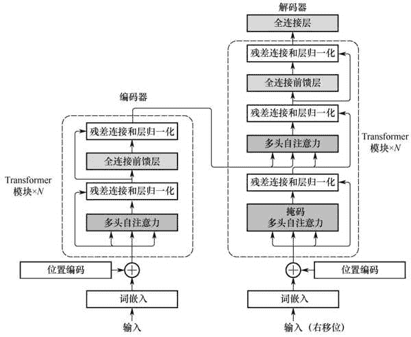

图 3-2 Transformer 架构

随着技术的不断发展，GPT-4 等更强大的大语言模型相继问世。这些模型在性能、准确性和泛化能力等方面都有了进一步的提升，能够更好地满足不同用户的需求。同时，国内涌现出了许多优秀的大语言模型，如百度的文心一言、字节跳动的云雀模型等，它们在结合中国文化和语言特点的基础上，不断创新和优化，为用户提供了更加个性化、智能化的服务。

#### “智能涌现”现象及其背后的原理

大语言模型在训练到一定规模后，出现了一种被称为“智能涌现”的现象。当模型规模超过临界点（约 1000 亿个参数）之后，突现逻辑推理、类比联想等“类人智能”，表现为模型在一些任务上展现出远超预期的能力。这些能力并非通过简单的编程或指令赋予的，而是在大规模数据训练和模型参数增长的过程中自发产生的。例如，大语言模型能够理解复杂的语义、进行逻辑推理、创作富有创意的内容，甚至在没有针对特定任务进行专门训练时，也能给出合理的解决方案。

“智能涌现”背后的原理目前尚未完全明确，但研究者们提出了几种可能的解释。从数据层面来看，大规模的文本数据包含了丰富的世界知识和语言模式。大语言模型在对海量数据进行学习时，逐渐掌握了这些知识和模式之间的内在联系。随着数据量的不断增加，模型对各种语言表达和知识的覆盖面越来越广，这使其能够在面对各种任务时，从记忆中检索和组合相关信息，从而表现出智能行为。

从模型结构角度分析，Transformer 架构中的自注意力机制发挥了关键作用。自注意力机制让模型能够根据输入文本的不同部分，动态地分配计算资源和关注重点。在处理长文本时，模型可以聚焦于关键信息，理解上下文之间的复杂关系。随着模型参数量的增加，这种自注意力机制可以学习到更细致、更复杂的信息交互方式，从而提升模型对语义和逻辑的理解能力，为“智能涌现”提供结构基础。

此外，模型的训练过程也可能促进了“智能涌现”。在训练过程中，优化算法不断调整模型参数，使模型能够更好地拟合数据。当模型规模足够大时，参数之间的相互作用会变得更加复杂和微妙。这些参数的协同作用可能会产生一些意想不到的效果，使模型在处理任务时展现出超越简单拟合数据的能力，进而表现出智能行为。

#### 大语言模型的广泛应用与挑战

大语言模型的应用领域极为广泛，对人们的生活和工作产生了深远的影响。在内容创作领域，大语言模型可以协助作家进行创作构思、生成初稿。例如，一些作家利用大语言模型生成故事大纲、人物设定，甚至具体的段落内容，大幅提高了创作效率。在新闻领域，大语言模型能够根据实时数据快速生成新闻稿件，如体育赛事结果、财经数据报道等，实现新闻的快速发布。

在教育领域，大语言模型为学生提供了个性化的学习辅助。例如，Khan Academy 集成 GPT-4，为学生提供实时解题思路与错因分析。学生可以向模型提问，获取详细的解答和学习建议。模型还可以根据学生的学习进度和知识掌握情况，生成有针对性的练习题和学习资料。教师也可以利用大语言模型辅助备课，生成教学案例、设计教学活动等。

在客服领域，大语言模型驱动的智能客服能够快速响应用户的咨询，提供准确的解答。例如，中科汇联公司的 AiCC 智能客服平台与传统的基于规则的客服系统相比，前者是由大语言模型驱动的智能客服，具有更强的语言理解和对话能力，能够处理更复杂的问题，提高用户满意度。

尽管大语言模型取得了巨大的成功，但也面临诸多挑战。

首先是数据质量问题。大语言模型的性能高度依赖训练数据的质量，如果训练数据中包含错误信息、偏见或低质量内容，模型可能会学习到这些不良信息，并在生成内容时表现出来。例如，模型可能会生成带有性别歧视和种族偏见的文本，或者传播虚假信息。

其次是模型的可解释性问题。大语言模型通常具有庞大的参数量和复杂的结构，其决策过程难以理解和解释。在一些对决策可解释性要求较高的领域，如医疗、金融等领域，可能会限制模型的应用。例如，在医疗诊断辅助中，医生需要理解模型给出诊断建议的依据，以确保决策的可靠性。

此外，大语言模型还引发了一些伦理和法律问题。例如，模型生成的内容可能涉及版权问题，难以确定其归属权。同时，恶意使用大语言模型进行虚假信息传播、诈骗等行为给社会带来了潜在风险。

为了应对这些挑战，研究人员正在积极探索解决方案。在数据质量方面，通过数据清洗、多数据源验证等方法提高训练数据的质量，减少不良信息的影响。在可解释性方面，研究人员致力于开发用于解释模型决策过程的技术，如可视化技术、特征重要性分析技术等，让模型的行为更加透明。在伦理和法律方面，相关的政策和法规也在不断完善，以规范大语言模型的开发和应用。

大语言模型作为认知智能领域的重要突破，展现出了巨大的潜力和影响力。随着技术的不断发展和完善，它有望为更多领域带来创新和变革，但同时需要人们认真应对其带来的各种挑战，确保技术的健康发展和合理应用。

认知智能不仅是技术革命，更是文明跃迁的催化剂。它迫使人类重新定义智慧、创造与伦理的边界。当机器能撰写诗歌、发现定理、预测未来时，人们终要回答：人类的不可替代性，究竟在于“拥有智能”，还是在于“赋予意义”？ EXr6287u6NNVz+GYLY+7SDk226FstKIHdC0bNoQkB2Nqi1xSR0yxPmwrTs5gRi/BtfSbid6dBhii9q7cz2pIyA==

## 3 认知智能
——从数据到智慧的涌现

认知智能作为人工智能的核心领域之一，是人工智能的“高阶思维层”，致力于让机器学会理解、思考和推理，使其能够处理复杂的信息，解决抽象的问题，宛如赋予了机器一个“智慧的大脑”。认知智能的发展不仅是人工智能技术进步的关键标志，更是推动人类社会各个领域实现深度变革的强大动力。它涵盖了自然语言处理、知识图谱、大语言模型等多个关键领域，每个领域都在以惊人的速度发展，重塑着人们生活、工作和学习的方式。

### 自然语言处理：让机器“读懂人心”

自然语言处理（Natural Language Processing，NLP）是认知智能的重要基石，它专注于让计算机理解、处理和生成人类语言。语言作为人类交流、思维和知识传承的主要工具，具有丰富的信息和复杂的结构。自然语言处理的目标是打破人与机器之间的语言障碍，使机器能够像人类一样与我们进行流畅的沟通。

#### 机器翻译：跨越语言鸿沟的桥梁

在全球化进程日益加速的今天，不同国家和地区之间的交流合作愈发频繁，语言障碍成为横亘在人们面前的一大难题。机器翻译技术的出现，为解决这一难题带来了曙光。从早期基于规则的简单翻译系统，到如今基于神经网络的智能翻译模型，机器翻译经历了翻天覆地的变革。

早期的机器翻译主要依赖人工编写的语法规则和词典。翻译人员需要将源语言的语法结构和词汇对应关系详细地整理出来，然后让计算机按照这些规则进行翻译。这种方法虽然在一定程度上能够实现简单句子的翻译，但对于复杂的语言结构和丰富的语义表达往往显得力不从心。例如，当遇到多义词、习语或复杂的句式时，基于规则的翻译系统常常会出现翻译错误或翻译结果生硬、晦涩难懂的情况。

随着深度学习技术的兴起，神经机器翻译（Neural Machine Translation，NMT）成为主流的翻译方法。NMT 基于神经网络强大的学习能力，通过大量的双语平行语料进行训练，让模型自动学习源语言和目标语言之间的映射关系。以谷歌的神经机器翻译系统为例，它在训练过程中使用了海量的互联网文本数据，涵盖了各种领域和语言风格。这些数据给模型提供了丰富的“学习素材”，使模型能够学习到语言的各种精妙之处和语言之间的复杂转换规律。

如今，机器翻译的准确性和流畅性已经有了质的飞跃。在日常交流场景中，如旅游、商务沟通等场景，机器翻译能够快速、准确地将一种语言翻译成另一种语言，帮助人们轻松地跨越语言障碍。例如，出国旅游时，游客可以使用手机上的翻译应用，随时随地与当地人进行沟通交流。在国际商务会议上，实时翻译工具能够让不同语言背景的参会者顺畅地交流观点和信息。不仅如此，机器翻译在文学作品翻译、学术文献翻译等领域也逐渐崭露头角。虽然目前在一些对翻译质量要求极高的文学创作领域，机器翻译还无法完全替代人工翻译，但它可以为人工翻译提供有价值的参考，大幅提高翻译效率。

机器翻译技术的发展还催生了许多创新的应用场景。在跨国电商领域，自动翻译系统能够将商品信息、用户评价等内容实时翻译成多种语言，方便全球消费者购物。在线教育平台也借助机器翻译，打破了语言限制，让优质的教育资源能够在全球范围内传播。例如，一些国外知名大学的公开课通过机器翻译配上多国语言字幕，让更多人受益。

#### 情感分析：洞察文本背后的情绪密码

在海量的文本数据中，除了字面信息，还蕴含着丰富的情感信息。情感分析，也被称为意见挖掘，旨在通过计算机技术识别和提取文本中的情感倾向，判断文本表达的是积极的、消极的还是中性的情感。

情感分析的应用场景十分广泛。在市场营销领域，企业可以通过对社交媒体信息、在线评论、调查问卷等文本数据的情感分析，了解消费者对产品或服务的满意度和情感态度。例如，一家餐饮企业可以通过分析顾客在美食点评平台上的评论，了解其对菜品口味、服务质量、环境氛围等方面的评价。如果发现大部分顾客在评论中表达了对某道菜品的喜爱，企业则可以考虑加大对这道菜品的推广力度；如果发现顾客对服务质量提出了较多负面评价，企业则可以及时改进服务流程，提升顾客满意度。

在舆情监测方面，政府部门和相关机构可以利用情感分析技术实时监测社会舆论的走向。通过对新闻报道、社交媒体话题等内容的情感分析，及时发现社会热点事件和公众情绪的变化，为制定政策和应对危机提供依据。例如，在发生重大公共事件时，政府部门可以通过情感分析快速了解公众对事件的态度和关注点，以便及时回应社会关切，采取有效的处理措施。

情感分析技术的实现主要依赖机器学习算法和深度学习算法。早期的情感分析主要基于机器学习中的分类算法，如支持向量机（Support Vector Machine，SVM）、朴素贝叶斯（Naive Bayes）等。这些算法需要人工提取大量的文本特征，如词汇、语法结构、标点符号等，然后通过对带有情感标签的文本数据进行训练，建立情感分类模型。虽然这种方法在一定程度上能够实现情感分析，但人工特征提取过程烦琐，且模型的泛化能力有限。

近年来，深度学习技术在情感分析领域取得了显著的成果。基于神经网络的情感分析模型，如循环神经网络（Recurrent Neural Network，RNN）及其变体长短期记忆（Long Short-Term Memory，LSTM）网络、门控循环单元（Gated Recurrent Unit，GRU）等，能够自动学习文本中的语义特征和情感信息。这些模型可以更好地处理文本的上下文信息，捕捉文本中的语义依赖关系，从而提高情感分析的准确性。例如，LSTM 模型通过特殊的门控机制，有效地记忆文本中的长距离信息，避免了传统 RNN 模型在处理长文本时容易出现的梯度消失问题，使情感分析在处理长篇评论、新闻报道等文本时表现得更加出色。

随着技术的不断发展，情感分析的粒度也在不断细化。从最初只能判断文本的整体情感倾向，到如今能够分析文本中针对不同对象、不同方面的情感态度，情感分析技术正变得越来越智能。例如，在分析一款电子产品的评论时，情感分析不仅可以判断评论者对这款产品的总体评价是积极的还是消极的，还可以进一步分析评论者对产品的外观设计、性能、价格等具体方面的情感态度，为企业提供更加详细、精准的市场反馈。

自然语言处理中的机器翻译和情感分析技术虽然在各自的应用领域取得了显著的成果，但仍然面临诸多挑战。在机器翻译方面，不同语言之间的文化差异、语义上的细微差别等问题仍然难以完全解决，翻译结果在某些情况下还需要进行人工校对和润色。在情感分析领域，对于一些语义模糊、含有讽刺或隐喻等修辞手法的文本，情感分析模型的准确性还有待提高。未来，随着技术的不断创新和突破，自然语言处理技术有望在更多领域发挥更大的作用，为人们的生活和工作带来更多的便利与价值。

### 知识图谱：构建机器的“世界记忆”

在信息爆炸的时代，人们每天都会接触海量的数据和信息。如何从这些纷繁复杂的信息中快速、准确地找到自己需要的知识，成为一个亟待解决的问题。知识图谱（Knowledge Graph）的出现，为解决这一问题提供了全新的思路和方法。它就像一张巨大的“知识地图”，将各种知识实体及它们之间的关系清晰地展现出来，让人们能够更加直观、深入地理解和利用知识。

知识图谱本质上是一种语义网络，它以图形的方式展示了实体（如人、事物、概念等）之间的关系。构建知识图谱的过程就像搭建一座巨大的知识大厦，需要经过多个关键步骤。

首先是实体抽取（Entity Extraction），这一步就像在海量的文本数据中“寻宝”，需要从文本中识别出各种有意义的实体。例如，在一篇新闻报道中，可能会提到“苹果公司”“iPhone14”“蒂姆·库克”等实体。实体抽取技术可以通过自然语言处理算法，结合词性标注、命名实体识别等方法，将这些实体准确地抽取出来。

接下来是关系抽取（Relation Extraction），它负责确定实体之间的关联关系。例如，“苹果公司”和“iPhone14”之间存在“生产”关系，“蒂姆·库克”和“苹果公司”之间存在“任职于”关系。关系抽取技术通常基于机器学习算法或深度学习算法，通过对大量文本数据的学习，自动识别出实体之间的各种关系模式。

除了实体和关系，知识图谱还需要对实体进行属性抽取（Attribute Extraction）。例如，“iPhone14”的属性可能包括“颜色”“尺寸”“价格”等。属性抽取可以帮助人们更加全面地了解实体的特征和信息。

在完成实体、关系和属性的抽取后，还需要对这些知识进行融合（Knowledge Fusion）。因为不同来源的数据可能存在重复、不一致等问题，知识融合的目的就是将这些分散的知识整合起来，消除冗余和矛盾，形成一个统一、准确的知识图谱。例如，从不同的新闻网站和产品介绍页面获取关于“iPhone14”的信息，通过知识融合将这些信息进行合并和校准，确保知识图谱中关于“iPhone14”的信息是准确的、完整的。典型的框架有谷歌的 Knowledge Graph、Wikidata，阿里的“藏经阁”等。知识图谱（如 Wikidata）通过 30 亿条三元组，构建了覆盖历史、科学与文化的“全球脑皮层”。

知识图谱的存储和查询也是至关重要的环节。目前，常用的知识图谱存储方式有基于图数据库（如 Neo4j）和基于关系数据库（如 MySQL）两种。图数据库能够更好地支持图结构的存储和查询，对于处理复杂的关系网络具有明显的优势；关系数据库则在数据的一致性和事务处理方面表现出色。在查询方面，用户可以通过编写特定的查询语句（如 Cypher 语言用于 Neo4j 图数据库），在知识图谱中快速检索自己需要的知识信息。

#### 从搜索引擎到行业智库的转变

传统的搜索引擎主要基于关键词匹配的方式进行信息检索。当用户输入一个关键词时，搜索引擎会在其索引数据库中查找包含该关键词的网页，并根据相关性和其他因素对搜索结果进行排序。这种方式虽然能够快速返回大量的搜索结果，但存在很大的局限性。例如，当用户想了解“苹果公司创始人乔布斯的生平事迹”时，传统搜索引擎可能会返回大量包含“苹果公司”“乔布斯”等关键词的网页，但这些网页可能包含各种不相关的信息，用户需要花费大量时间去筛选和阅读，才能找到自己真正需要的内容。

知识图谱的出现，使搜索引擎能够更加智能地理解用户的查询意图。它可以将用户的搜索关键词与知识图谱中的实体和关系进行匹配，从而提供更加精准、全面的搜索结果。例如，当用户输入上述查询时，基于知识图谱的搜索引擎能够识别出“苹果公司”“乔布斯”等实体，并根据知识图谱中记录的关系，快速找到关于乔布斯生平事迹的相关信息，如他的出生年月、创立苹果公司的经历、主要成就等，并将结果以结构化的方式呈现给用户，大幅提高了信息获取的效率和准确性。

在行业领域，知识图谱发挥着更重要的作用，成为行业智库的核心支撑。以医疗行业为例，一个全面、准确的医疗知识图谱可以整合医学文献、临床病例、药品信息等多方面的知识。医生在诊断疾病时，可以借助医疗知识图谱快速获取相关疾病的症状、诊断标准、治疗方案等信息，从而做出更加准确的诊断决策。例如，当遇到一个罕见病患者时，医生可以通过查询医疗知识图谱，了解该疾病在全球范围内的发病情况、已有的研究成果和治疗经验，为患者制订个性化治疗方案。

在金融行业，知识图谱可以用于风险评估、投资决策等方面，通过整合企业的基本信息、股权结构、财务数据、行业动态等知识，构建金融知识图谱。金融机构可以利用这个图谱对企业的信用风险进行评估，分析企业之间的关联关系，识别潜在的风险点。例如，当一家企业的股东出现异常变动，或者与其他高风险企业存在密切关联时，金融机构可以通过知识图谱快速发现这些信息，并及时调整对该企业的风险评估和信贷策略。

在教育领域，知识图谱可以为个性化学习提供支持。教育平台可以通过构建学科知识图谱，将知识点之间的关系清晰地呈现出来，根据学生的学习情况和知识掌握程度，为其推荐个性化的学习路径和学习资源。例如，一名学生在数学学科的某个知识点上存在薄弱环节，教育平台可以通过知识图谱找到与该知识点相关的前置知识和拓展知识，为这名学生推荐针对性的学习资料和练习题，帮助其更好地掌握知识。

知识图谱的应用还在不断拓展和深化。随着人工智能技术的不断发展，知识图谱将与机器学习、深度学习等技术更加紧密地结合，实现知识的自动更新和推理。例如，通过机器学习算法对新知识进行自动抽取和融合，使知识图谱能够实时反映最新的知识动态；利用知识图谱进行推理，可以挖掘出隐含的知识关系，为决策提供更加深入的支持。

尽管知识图谱在各个领域都取得了显著的应用成果，但在构建和应用过程中仍然面临一些挑战。例如，知识的获取与标注需要耗费大量的人力和时间成本，数据的质量和准确性难以保证；知识图谱的规模不断扩大，如何高效地存储和查询大规模的知识图谱是一个亟待解决的问题。未来，随着技术的不断进步和创新，知识图谱有望在更多领域发挥更大的作用，成为推动行业发展和社会进步的重要力量。

### 大语言模型：智能的“涌现”之谜

近年来，大语言模型（Large Language Model，LLM）在人工智能领域掀起了一场前所未有的热潮。以 GPT 系列、文心一言等为代表的大语言模型展现出了令人惊叹的语言理解和生成能力，它们不仅能够与人类进行流畅的对话，还能完成文章写作、代码编写、问题解答等复杂任务，仿佛拥有了某种“智能涌现”的神奇力量，为人们打开了一扇通往全新智能时代的大门。

#### 大语言模型的发展历程

大语言模型的发展并非一蹴而就，而是经历了多个阶段的技术演进。早期的大语言模型主要基于统计语言模型，通过对大量文本数据的统计分析，计算单词之间的共现概率，从而生成文本。这种模型虽然在一定程度上能够生成连贯的句子，但缺乏对语义和语法的深入理解，生成的文本往往质量较低，存在逻辑混乱、语义模糊等问题。

随着神经网络技术的发展，基于神经网络的大语言模型逐渐兴起。其中，循环神经网络（RNN）及其变体长短期记忆网络（LSTM）、门控循环单元（GRU）在语言建模中取得了显著的成果。这些模型能够更好地处理文本的上下文信息，捕捉文本中的语义依赖关系，从而提高大语言模型的性能。然而，循环神经网络（RNN）系列模型在处理长文本时仍然存在一定的局限性，如计算效率较低、难以处理大规模的文本数据。

Transformer 架构（见图 3-2）的出现，为大语言模型的发展带来了革命性的变化。Transformer 架构基于注意力机制（Attention Mechanism），使模型在处理文本时更加聚焦于重要的信息，从而更好地理解文本的全局语义。与传统的循环神经网络架构相比，Transformer 架构具有并行计算能力强、训练速度快、能够处理更长的文本等优势。GPT 系列和 BERT 等都是基于 Transformer 架构的大语言模型。

GPT 系列模型是大语言模型发展的重要里程碑。GPT-1 首次采用了预训练和微调两阶段训练方法。在预训练阶段，模型在大规模的文本数据上进行无监督学习，学习语言的通用特征和模式；在微调阶段，模型根据具体的任务需求，在少量标注数据上进行有监督学习，对预训练模型进行优化。这种训练方法使 GPT-1 在多种自然语言处理任务上取得了优异的成绩。

GPT-2 在 GPT-1 的基础上进一步扩大了模型和训练数据的规模，展现出了更强的语言生成能力。它不需要针对特定任务进行微调，就能够在多种任务上表现出色，被认为具有“零样本学习”能力。

GPT-3 的推出更是引起了全球的关注。它拥有高达 1750 亿个参数，在语言理解、内容生成和知识问答等方面展现出了惊人的能力。GPT-3 能够根据简单的提示生成高质量的文章、故事、代码等，甚至在一些专业领域的任务中也能表现出一定的水平。

图 3-2 Transformer 架构

随着技术的不断发展，GPT-4 等更强大的大语言模型相继问世。这些模型在性能、准确性和泛化能力等方面都有了进一步的提升，能够更好地满足不同用户的需求。同时，国内涌现出了许多优秀的大语言模型，如百度的文心一言、字节跳动的云雀模型等，它们在结合中国文化和语言特点的基础上，不断创新和优化，为用户提供了更加个性化、智能化的服务。

#### “智能涌现”现象及其背后的原理

大语言模型在训练到一定规模后，出现了一种被称为“智能涌现”的现象。当模型规模超过临界点（约 1000 亿个参数）之后，突现逻辑推理、类比联想等“类人智能”，表现为模型在一些任务上展现出远超预期的能力。这些能力并非通过简单的编程或指令赋予的，而是在大规模数据训练和模型参数增长的过程中自发产生的。例如，大语言模型能够理解复杂的语义、进行逻辑推理、创作富有创意的内容，甚至在没有针对特定任务进行专门训练时，也能给出合理的解决方案。

“智能涌现”背后的原理目前尚未完全明确，但研究者们提出了几种可能的解释。从数据层面来看，大规模的文本数据包含了丰富的世界知识和语言模式。大语言模型在对海量数据进行学习时，逐渐掌握了这些知识和模式之间的内在联系。随着数据量的不断增加，模型对各种语言表达和知识的覆盖面越来越广，这使其能够在面对各种任务时，从记忆中检索和组合相关信息，从而表现出智能行为。

从模型结构角度分析，Transformer 架构中的自注意力机制发挥了关键作用。自注意力机制让模型能够根据输入文本的不同部分，动态地分配计算资源和关注重点。在处理长文本时，模型可以聚焦于关键信息，理解上下文之间的复杂关系。随着模型参数量的增加，这种自注意力机制可以学习到更细致、更复杂的信息交互方式，从而提升模型对语义和逻辑的理解能力，为“智能涌现”提供结构基础。

此外，模型的训练过程也可能促进了“智能涌现”。在训练过程中，优化算法不断调整模型参数，使模型能够更好地拟合数据。当模型规模足够大时，参数之间的相互作用会变得更加复杂和微妙。这些参数的协同作用可能会产生一些意想不到的效果，使模型在处理任务时展现出超越简单拟合数据的能力，进而表现出智能行为。

#### 大语言模型的广泛应用与挑战

大语言模型的应用领域极为广泛，对人们的生活和工作产生了深远的影响。在内容创作领域，大语言模型可以协助作家进行创作构思、生成初稿。例如，一些作家利用大语言模型生成故事大纲、人物设定，甚至具体的段落内容，大幅提高了创作效率。在新闻领域，大语言模型能够根据实时数据快速生成新闻稿件，如体育赛事结果、财经数据报道等，实现新闻的快速发布。

在教育领域，大语言模型为学生提供了个性化的学习辅助。例如，Khan Academy 集成 GPT-4，为学生提供实时解题思路与错因分析。学生可以向模型提问，获取详细的解答和学习建议。模型还可以根据学生的学习进度和知识掌握情况，生成有针对性的练习题和学习资料。教师也可以利用大语言模型辅助备课，生成教学案例、设计教学活动等。

在客服领域，大语言模型驱动的智能客服能够快速响应用户的咨询，提供准确的解答。例如，中科汇联公司的 AiCC 智能客服平台与传统的基于规则的客服系统相比，前者是由大语言模型驱动的智能客服，具有更强的语言理解和对话能力，能够处理更复杂的问题，提高用户满意度。

尽管大语言模型取得了巨大的成功，但也面临诸多挑战。

首先是数据质量问题。大语言模型的性能高度依赖训练数据的质量，如果训练数据中包含错误信息、偏见或低质量内容，模型可能会学习到这些不良信息，并在生成内容时表现出来。例如，模型可能会生成带有性别歧视和种族偏见的文本，或者传播虚假信息。

其次是模型的可解释性问题。大语言模型通常具有庞大的参数量和复杂的结构，其决策过程难以理解和解释。在一些对决策可解释性要求较高的领域，如医疗、金融等领域，可能会限制模型的应用。例如，在医疗诊断辅助中，医生需要理解模型给出诊断建议的依据，以确保决策的可靠性。

此外，大语言模型还引发了一些伦理和法律问题。例如，模型生成的内容可能涉及版权问题，难以确定其归属权。同时，恶意使用大语言模型进行虚假信息传播、诈骗等行为给社会带来了潜在风险。

为了应对这些挑战，研究人员正在积极探索解决方案。在数据质量方面，通过数据清洗、多数据源验证等方法提高训练数据的质量，减少不良信息的影响。在可解释性方面，研究人员致力于开发用于解释模型决策过程的技术，如可视化技术、特征重要性分析技术等，让模型的行为更加透明。在伦理和法律方面，相关的政策和法规也在不断完善，以规范大语言模型的开发和应用。

大语言模型作为认知智能领域的重要突破，展现出了巨大的潜力和影响力。随着技术的不断发展和完善，它有望为更多领域带来创新和变革，但同时需要人们认真应对其带来的各种挑战，确保技术的健康发展和合理应用。

认知智能不仅是技术革命，更是文明跃迁的催化剂。它迫使人类重新定义智慧、创造与伦理的边界。当机器能撰写诗歌、发现定理、预测未来时，人们终要回答：人类的不可替代性，究竟在于“拥有智能”，还是在于“赋予意义”？ EXr6287u6NNVz+GYLY+7SDk226FstKIHdC0bNoQkB2Nqi1xSR0yxPmwrTs5gRi/BtfSbid6dBhii9q7cz2pIyA==

## 3 认知智能
——从数据到智慧的涌现

认知智能作为人工智能的核心领域之一，是人工智能的“高阶思维层”，致力于让机器学会理解、思考和推理，使其能够处理复杂的信息，解决抽象的问题，宛如赋予了机器一个“智慧的大脑”。认知智能的发展不仅是人工智能技术进步的关键标志，更是推动人类社会各个领域实现深度变革的强大动力。它涵盖了自然语言处理、知识图谱、大语言模型等多个关键领域，每个领域都在以惊人的速度发展，重塑着人们生活、工作和学习的方式。

### 自然语言处理：让机器“读懂人心”

自然语言处理（Natural Language Processing，NLP）是认知智能的重要基石，它专注于让计算机理解、处理和生成人类语言。语言作为人类交流、思维和知识传承的主要工具，具有丰富的信息和复杂的结构。自然语言处理的目标是打破人与机器之间的语言障碍，使机器能够像人类一样与我们进行流畅的沟通。

#### 机器翻译：跨越语言鸿沟的桥梁

在全球化进程日益加速的今天，不同国家和地区之间的交流合作愈发频繁，语言障碍成为横亘在人们面前的一大难题。机器翻译技术的出现，为解决这一难题带来了曙光。从早期基于规则的简单翻译系统，到如今基于神经网络的智能翻译模型，机器翻译经历了翻天覆地的变革。

早期的机器翻译主要依赖人工编写的语法规则和词典。翻译人员需要将源语言的语法结构和词汇对应关系详细地整理出来，然后让计算机按照这些规则进行翻译。这种方法虽然在一定程度上能够实现简单句子的翻译，但对于复杂的语言结构和丰富的语义表达往往显得力不从心。例如，当遇到多义词、习语或复杂的句式时，基于规则的翻译系统常常会出现翻译错误或翻译结果生硬、晦涩难懂的情况。

随着深度学习技术的兴起，神经机器翻译（Neural Machine Translation，NMT）成为主流的翻译方法。NMT 基于神经网络强大的学习能力，通过大量的双语平行语料进行训练，让模型自动学习源语言和目标语言之间的映射关系。以谷歌的神经机器翻译系统为例，它在训练过程中使用了海量的互联网文本数据，涵盖了各种领域和语言风格。这些数据给模型提供了丰富的“学习素材”，使模型能够学习到语言的各种精妙之处和语言之间的复杂转换规律。

如今，机器翻译的准确性和流畅性已经有了质的飞跃。在日常交流场景中，如旅游、商务沟通等场景，机器翻译能够快速、准确地将一种语言翻译成另一种语言，帮助人们轻松地跨越语言障碍。例如，出国旅游时，游客可以使用手机上的翻译应用，随时随地与当地人进行沟通交流。在国际商务会议上，实时翻译工具能够让不同语言背景的参会者顺畅地交流观点和信息。不仅如此，机器翻译在文学作品翻译、学术文献翻译等领域也逐渐崭露头角。虽然目前在一些对翻译质量要求极高的文学创作领域，机器翻译还无法完全替代人工翻译，但它可以为人工翻译提供有价值的参考，大幅提高翻译效率。

机器翻译技术的发展还催生了许多创新的应用场景。在跨国电商领域，自动翻译系统能够将商品信息、用户评价等内容实时翻译成多种语言，方便全球消费者购物。在线教育平台也借助机器翻译，打破了语言限制，让优质的教育资源能够在全球范围内传播。例如，一些国外知名大学的公开课通过机器翻译配上多国语言字幕，让更多人受益。

#### 情感分析：洞察文本背后的情绪密码

在海量的文本数据中，除了字面信息，还蕴含着丰富的情感信息。情感分析，也被称为意见挖掘，旨在通过计算机技术识别和提取文本中的情感倾向，判断文本表达的是积极的、消极的还是中性的情感。

情感分析的应用场景十分广泛。在市场营销领域，企业可以通过对社交媒体信息、在线评论、调查问卷等文本数据的情感分析，了解消费者对产品或服务的满意度和情感态度。例如，一家餐饮企业可以通过分析顾客在美食点评平台上的评论，了解其对菜品口味、服务质量、环境氛围等方面的评价。如果发现大部分顾客在评论中表达了对某道菜品的喜爱，企业则可以考虑加大对这道菜品的推广力度；如果发现顾客对服务质量提出了较多负面评价，企业则可以及时改进服务流程，提升顾客满意度。

在舆情监测方面，政府部门和相关机构可以利用情感分析技术实时监测社会舆论的走向。通过对新闻报道、社交媒体话题等内容的情感分析，及时发现社会热点事件和公众情绪的变化，为制定政策和应对危机提供依据。例如，在发生重大公共事件时，政府部门可以通过情感分析快速了解公众对事件的态度和关注点，以便及时回应社会关切，采取有效的处理措施。

情感分析技术的实现主要依赖机器学习算法和深度学习算法。早期的情感分析主要基于机器学习中的分类算法，如支持向量机（Support Vector Machine，SVM）、朴素贝叶斯（Naive Bayes）等。这些算法需要人工提取大量的文本特征，如词汇、语法结构、标点符号等，然后通过对带有情感标签的文本数据进行训练，建立情感分类模型。虽然这种方法在一定程度上能够实现情感分析，但人工特征提取过程烦琐，且模型的泛化能力有限。

近年来，深度学习技术在情感分析领域取得了显著的成果。基于神经网络的情感分析模型，如循环神经网络（Recurrent Neural Network，RNN）及其变体长短期记忆（Long Short-Term Memory，LSTM）网络、门控循环单元（Gated Recurrent Unit，GRU）等，能够自动学习文本中的语义特征和情感信息。这些模型可以更好地处理文本的上下文信息，捕捉文本中的语义依赖关系，从而提高情感分析的准确性。例如，LSTM 模型通过特殊的门控机制，有效地记忆文本中的长距离信息，避免了传统 RNN 模型在处理长文本时容易出现的梯度消失问题，使情感分析在处理长篇评论、新闻报道等文本时表现得更加出色。

随着技术的不断发展，情感分析的粒度也在不断细化。从最初只能判断文本的整体情感倾向，到如今能够分析文本中针对不同对象、不同方面的情感态度，情感分析技术正变得越来越智能。例如，在分析一款电子产品的评论时，情感分析不仅可以判断评论者对这款产品的总体评价是积极的还是消极的，还可以进一步分析评论者对产品的外观设计、性能、价格等具体方面的情感态度，为企业提供更加详细、精准的市场反馈。

自然语言处理中的机器翻译和情感分析技术虽然在各自的应用领域取得了显著的成果，但仍然面临诸多挑战。在机器翻译方面，不同语言之间的文化差异、语义上的细微差别等问题仍然难以完全解决，翻译结果在某些情况下还需要进行人工校对和润色。在情感分析领域，对于一些语义模糊、含有讽刺或隐喻等修辞手法的文本，情感分析模型的准确性还有待提高。未来，随着技术的不断创新和突破，自然语言处理技术有望在更多领域发挥更大的作用，为人们的生活和工作带来更多的便利与价值。

### 知识图谱：构建机器的“世界记忆”

在信息爆炸的时代，人们每天都会接触海量的数据和信息。如何从这些纷繁复杂的信息中快速、准确地找到自己需要的知识，成为一个亟待解决的问题。知识图谱（Knowledge Graph）的出现，为解决这一问题提供了全新的思路和方法。它就像一张巨大的“知识地图”，将各种知识实体及它们之间的关系清晰地展现出来，让人们能够更加直观、深入地理解和利用知识。

知识图谱本质上是一种语义网络，它以图形的方式展示了实体（如人、事物、概念等）之间的关系。构建知识图谱的过程就像搭建一座巨大的知识大厦，需要经过多个关键步骤。

首先是实体抽取（Entity Extraction），这一步就像在海量的文本数据中“寻宝”，需要从文本中识别出各种有意义的实体。例如，在一篇新闻报道中，可能会提到“苹果公司”“iPhone14”“蒂姆·库克”等实体。实体抽取技术可以通过自然语言处理算法，结合词性标注、命名实体识别等方法，将这些实体准确地抽取出来。

接下来是关系抽取（Relation Extraction），它负责确定实体之间的关联关系。例如，“苹果公司”和“iPhone14”之间存在“生产”关系，“蒂姆·库克”和“苹果公司”之间存在“任职于”关系。关系抽取技术通常基于机器学习算法或深度学习算法，通过对大量文本数据的学习，自动识别出实体之间的各种关系模式。

除了实体和关系，知识图谱还需要对实体进行属性抽取（Attribute Extraction）。例如，“iPhone14”的属性可能包括“颜色”“尺寸”“价格”等。属性抽取可以帮助人们更加全面地了解实体的特征和信息。

在完成实体、关系和属性的抽取后，还需要对这些知识进行融合（Knowledge Fusion）。因为不同来源的数据可能存在重复、不一致等问题，知识融合的目的就是将这些分散的知识整合起来，消除冗余和矛盾，形成一个统一、准确的知识图谱。例如，从不同的新闻网站和产品介绍页面获取关于“iPhone14”的信息，通过知识融合将这些信息进行合并和校准，确保知识图谱中关于“iPhone14”的信息是准确的、完整的。典型的框架有谷歌的 Knowledge Graph、Wikidata，阿里的“藏经阁”等。知识图谱（如 Wikidata）通过 30 亿条三元组，构建了覆盖历史、科学与文化的“全球脑皮层”。

知识图谱的存储和查询也是至关重要的环节。目前，常用的知识图谱存储方式有基于图数据库（如 Neo4j）和基于关系数据库（如 MySQL）两种。图数据库能够更好地支持图结构的存储和查询，对于处理复杂的关系网络具有明显的优势；关系数据库则在数据的一致性和事务处理方面表现出色。在查询方面，用户可以通过编写特定的查询语句（如 Cypher 语言用于 Neo4j 图数据库），在知识图谱中快速检索自己需要的知识信息。

#### 从搜索引擎到行业智库的转变

传统的搜索引擎主要基于关键词匹配的方式进行信息检索。当用户输入一个关键词时，搜索引擎会在其索引数据库中查找包含该关键词的网页，并根据相关性和其他因素对搜索结果进行排序。这种方式虽然能够快速返回大量的搜索结果，但存在很大的局限性。例如，当用户想了解“苹果公司创始人乔布斯的生平事迹”时，传统搜索引擎可能会返回大量包含“苹果公司”“乔布斯”等关键词的网页，但这些网页可能包含各种不相关的信息，用户需要花费大量时间去筛选和阅读，才能找到自己真正需要的内容。

知识图谱的出现，使搜索引擎能够更加智能地理解用户的查询意图。它可以将用户的搜索关键词与知识图谱中的实体和关系进行匹配，从而提供更加精准、全面的搜索结果。例如，当用户输入上述查询时，基于知识图谱的搜索引擎能够识别出“苹果公司”“乔布斯”等实体，并根据知识图谱中记录的关系，快速找到关于乔布斯生平事迹的相关信息，如他的出生年月、创立苹果公司的经历、主要成就等，并将结果以结构化的方式呈现给用户，大幅提高了信息获取的效率和准确性。

在行业领域，知识图谱发挥着更重要的作用，成为行业智库的核心支撑。以医疗行业为例，一个全面、准确的医疗知识图谱可以整合医学文献、临床病例、药品信息等多方面的知识。医生在诊断疾病时，可以借助医疗知识图谱快速获取相关疾病的症状、诊断标准、治疗方案等信息，从而做出更加准确的诊断决策。例如，当遇到一个罕见病患者时，医生可以通过查询医疗知识图谱，了解该疾病在全球范围内的发病情况、已有的研究成果和治疗经验，为患者制订个性化治疗方案。

在金融行业，知识图谱可以用于风险评估、投资决策等方面，通过整合企业的基本信息、股权结构、财务数据、行业动态等知识，构建金融知识图谱。金融机构可以利用这个图谱对企业的信用风险进行评估，分析企业之间的关联关系，识别潜在的风险点。例如，当一家企业的股东出现异常变动，或者与其他高风险企业存在密切关联时，金融机构可以通过知识图谱快速发现这些信息，并及时调整对该企业的风险评估和信贷策略。

在教育领域，知识图谱可以为个性化学习提供支持。教育平台可以通过构建学科知识图谱，将知识点之间的关系清晰地呈现出来，根据学生的学习情况和知识掌握程度，为其推荐个性化的学习路径和学习资源。例如，一名学生在数学学科的某个知识点上存在薄弱环节，教育平台可以通过知识图谱找到与该知识点相关的前置知识和拓展知识，为这名学生推荐针对性的学习资料和练习题，帮助其更好地掌握知识。

知识图谱的应用还在不断拓展和深化。随着人工智能技术的不断发展，知识图谱将与机器学习、深度学习等技术更加紧密地结合，实现知识的自动更新和推理。例如，通过机器学习算法对新知识进行自动抽取和融合，使知识图谱能够实时反映最新的知识动态；利用知识图谱进行推理，可以挖掘出隐含的知识关系，为决策提供更加深入的支持。

尽管知识图谱在各个领域都取得了显著的应用成果，但在构建和应用过程中仍然面临一些挑战。例如，知识的获取与标注需要耗费大量的人力和时间成本，数据的质量和准确性难以保证；知识图谱的规模不断扩大，如何高效地存储和查询大规模的知识图谱是一个亟待解决的问题。未来，随着技术的不断进步和创新，知识图谱有望在更多领域发挥更大的作用，成为推动行业发展和社会进步的重要力量。

### 大语言模型：智能的“涌现”之谜

近年来，大语言模型（Large Language Model，LLM）在人工智能领域掀起了一场前所未有的热潮。以 GPT 系列、文心一言等为代表的大语言模型展现出了令人惊叹的语言理解和生成能力，它们不仅能够与人类进行流畅的对话，还能完成文章写作、代码编写、问题解答等复杂任务，仿佛拥有了某种“智能涌现”的神奇力量，为人们打开了一扇通往全新智能时代的大门。

#### 大语言模型的发展历程

大语言模型的发展并非一蹴而就，而是经历了多个阶段的技术演进。早期的大语言模型主要基于统计语言模型，通过对大量文本数据的统计分析，计算单词之间的共现概率，从而生成文本。这种模型虽然在一定程度上能够生成连贯的句子，但缺乏对语义和语法的深入理解，生成的文本往往质量较低，存在逻辑混乱、语义模糊等问题。

随着神经网络技术的发展，基于神经网络的大语言模型逐渐兴起。其中，循环神经网络（RNN）及其变体长短期记忆网络（LSTM）、门控循环单元（GRU）在语言建模中取得了显著的成果。这些模型能够更好地处理文本的上下文信息，捕捉文本中的语义依赖关系，从而提高大语言模型的性能。然而，循环神经网络（RNN）系列模型在处理长文本时仍然存在一定的局限性，如计算效率较低、难以处理大规模的文本数据。

Transformer 架构（见图 3-2）的出现，为大语言模型的发展带来了革命性的变化。Transformer 架构基于注意力机制（Attention Mechanism），使模型在处理文本时更加聚焦于重要的信息，从而更好地理解文本的全局语义。与传统的循环神经网络架构相比，Transformer 架构具有并行计算能力强、训练速度快、能够处理更长的文本等优势。GPT 系列和 BERT 等都是基于 Transformer 架构的大语言模型。

GPT 系列模型是大语言模型发展的重要里程碑。GPT-1 首次采用了预训练和微调两阶段训练方法。在预训练阶段，模型在大规模的文本数据上进行无监督学习，学习语言的通用特征和模式；在微调阶段，模型根据具体的任务需求，在少量标注数据上进行有监督学习，对预训练模型进行优化。这种训练方法使 GPT-1 在多种自然语言处理任务上取得了优异的成绩。

GPT-2 在 GPT-1 的基础上进一步扩大了模型和训练数据的规模，展现出了更强的语言生成能力。它不需要针对特定任务进行微调，就能够在多种任务上表现出色，被认为具有“零样本学习”能力。

GPT-3 的推出更是引起了全球的关注。它拥有高达 1750 亿个参数，在语言理解、内容生成和知识问答等方面展现出了惊人的能力。GPT-3 能够根据简单的提示生成高质量的文章、故事、代码等，甚至在一些专业领域的任务中也能表现出一定的水平。

图 3-2 Transformer 架构

随着技术的不断发展，GPT-4 等更强大的大语言模型相继问世。这些模型在性能、准确性和泛化能力等方面都有了进一步的提升，能够更好地满足不同用户的需求。同时，国内涌现出了许多优秀的大语言模型，如百度的文心一言、字节跳动的云雀模型等，它们在结合中国文化和语言特点的基础上，不断创新和优化，为用户提供了更加个性化、智能化的服务。

#### “智能涌现”现象及其背后的原理

大语言模型在训练到一定规模后，出现了一种被称为“智能涌现”的现象。当模型规模超过临界点（约 1000 亿个参数）之后，突现逻辑推理、类比联想等“类人智能”，表现为模型在一些任务上展现出远超预期的能力。这些能力并非通过简单的编程或指令赋予的，而是在大规模数据训练和模型参数增长的过程中自发产生的。例如，大语言模型能够理解复杂的语义、进行逻辑推理、创作富有创意的内容，甚至在没有针对特定任务进行专门训练时，也能给出合理的解决方案。

“智能涌现”背后的原理目前尚未完全明确，但研究者们提出了几种可能的解释。从数据层面来看，大规模的文本数据包含了丰富的世界知识和语言模式。大语言模型在对海量数据进行学习时，逐渐掌握了这些知识和模式之间的内在联系。随着数据量的不断增加，模型对各种语言表达和知识的覆盖面越来越广，这使其能够在面对各种任务时，从记忆中检索和组合相关信息，从而表现出智能行为。

从模型结构角度分析，Transformer 架构中的自注意力机制发挥了关键作用。自注意力机制让模型能够根据输入文本的不同部分，动态地分配计算资源和关注重点。在处理长文本时，模型可以聚焦于关键信息，理解上下文之间的复杂关系。随着模型参数量的增加，这种自注意力机制可以学习到更细致、更复杂的信息交互方式，从而提升模型对语义和逻辑的理解能力，为“智能涌现”提供结构基础。

此外，模型的训练过程也可能促进了“智能涌现”。在训练过程中，优化算法不断调整模型参数，使模型能够更好地拟合数据。当模型规模足够大时，参数之间的相互作用会变得更加复杂和微妙。这些参数的协同作用可能会产生一些意想不到的效果，使模型在处理任务时展现出超越简单拟合数据的能力，进而表现出智能行为。

#### 大语言模型的广泛应用与挑战

大语言模型的应用领域极为广泛，对人们的生活和工作产生了深远的影响。在内容创作领域，大语言模型可以协助作家进行创作构思、生成初稿。例如，一些作家利用大语言模型生成故事大纲、人物设定，甚至具体的段落内容，大幅提高了创作效率。在新闻领域，大语言模型能够根据实时数据快速生成新闻稿件，如体育赛事结果、财经数据报道等，实现新闻的快速发布。

在教育领域，大语言模型为学生提供了个性化的学习辅助。例如，Khan Academy 集成 GPT-4，为学生提供实时解题思路与错因分析。学生可以向模型提问，获取详细的解答和学习建议。模型还可以根据学生的学习进度和知识掌握情况，生成有针对性的练习题和学习资料。教师也可以利用大语言模型辅助备课，生成教学案例、设计教学活动等。

在客服领域，大语言模型驱动的智能客服能够快速响应用户的咨询，提供准确的解答。例如，中科汇联公司的 AiCC 智能客服平台与传统的基于规则的客服系统相比，前者是由大语言模型驱动的智能客服，具有更强的语言理解和对话能力，能够处理更复杂的问题，提高用户满意度。

尽管大语言模型取得了巨大的成功，但也面临诸多挑战。

首先是数据质量问题。大语言模型的性能高度依赖训练数据的质量，如果训练数据中包含错误信息、偏见或低质量内容，模型可能会学习到这些不良信息，并在生成内容时表现出来。例如，模型可能会生成带有性别歧视和种族偏见的文本，或者传播虚假信息。

其次是模型的可解释性问题。大语言模型通常具有庞大的参数量和复杂的结构，其决策过程难以理解和解释。在一些对决策可解释性要求较高的领域，如医疗、金融等领域，可能会限制模型的应用。例如，在医疗诊断辅助中，医生需要理解模型给出诊断建议的依据，以确保决策的可靠性。

此外，大语言模型还引发了一些伦理和法律问题。例如，模型生成的内容可能涉及版权问题，难以确定其归属权。同时，恶意使用大语言模型进行虚假信息传播、诈骗等行为给社会带来了潜在风险。

为了应对这些挑战，研究人员正在积极探索解决方案。在数据质量方面，通过数据清洗、多数据源验证等方法提高训练数据的质量，减少不良信息的影响。在可解释性方面，研究人员致力于开发用于解释模型决策过程的技术，如可视化技术、特征重要性分析技术等，让模型的行为更加透明。在伦理和法律方面，相关的政策和法规也在不断完善，以规范大语言模型的开发和应用。

大语言模型作为认知智能领域的重要突破，展现出了巨大的潜力和影响力。随着技术的不断发展和完善，它有望为更多领域带来创新和变革，但同时需要人们认真应对其带来的各种挑战，确保技术的健康发展和合理应用。

认知智能不仅是技术革命，更是文明跃迁的催化剂。它迫使人类重新定义智慧、创造与伦理的边界。当机器能撰写诗歌、发现定理、预测未来时，人们终要回答：人类的不可替代性，究竟在于“拥有智能”，还是在于“赋予意义”？ EXr6287u6NNVz+GYLY+7SDk226FstKIHdC0bNoQkB2Nqi1xSR0yxPmwrTs5gRi/BtfSbid6dBhii9q7cz2pIyA==

## 4 决策智能
——从博弈论到自组织进化的终极控制

人工智能的三个渐进层次如图 3-3 所示。决策智能是人工智能领域最接近“人类意志”的维度，它通过强化学习、多智能体系统与风险博弈，模拟甚至超越人类的策略制定能力。如果说感知智能是机器的“感官”，认知智能是机器的“大脑”，那么决策智能则是驱动行动的“心脏”。它不再满足于被动响应，而是主动预测、干预并优化现实世界的复杂系统——从自动驾驶的路径选择到全球金融市场的波动预测，从城市电网的调度到军事冲突的模拟。

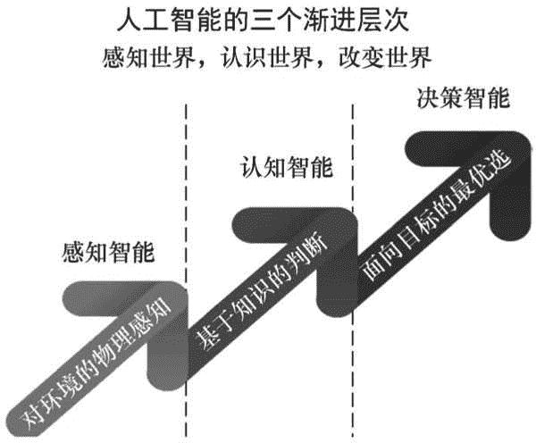

图 3-3 人工智能的三个渐进层次

### 强化学习：从游戏规则到现实世界的策略进化

强化学习（Reinforcement Learning）是决策智能的重要技术基石，犹如 **达尔文主义在数字世界的重生** 。它通过让智能体在环境中不断尝试各种行动，根据环境反馈的奖励信号来学习最优行为策略。这一过程与人类在生活中通过不断试错积累经验、提升技能，以实现目标的过程类似。强化学习的独特魅力在于，它能够让智能体在没有明确指导的情况下，自主探索环境并找到最优解决方案，这种特性使其在诸多领域取得了令人瞩目的成果。其本质与生物进化相似： **随机突变（探索）与自然选择（利用）的平衡。**

#### AlphaGo：强化学习在围棋领域的传奇突破

围棋，作为一项拥有数千年历史的古老棋类游戏，以其复杂的规则和极高的策略深度被誉为“人类智慧的试金石”。棋盘上纵横交错的 19 条线，形成了 361 个交叉点，每一步棋的决策都可能对全局产生深远影响，棋局的变化数量几乎是天文数字。在过去，计算机在围棋领域战胜人类顶尖棋手被认为是几乎不可能完成的任务。

然而，AlphaGo 的出现彻底打破了这一认知。AlphaGo 由谷歌旗下的 DeepMind 公司开发，它创新性地将强化学习与深度学习相结合，开启了人工智能在围棋领域的新纪元。

AlphaGo 的训练过程犹如一场艰苦而漫长的自我修炼。它通过大量的围棋棋谱进行监督学习，初步掌握围棋的基本规则和常见的走法模式。这一步就像初学者通过学习前人的经验打好基础。但仅依靠棋谱学习是远远不够的，为了达到更高的水平，AlphaGo 开始了基于强化学习的自我对弈训练。

在自我对弈过程中，AlphaGo 就像一个孤独的探索者，不断与自己进行无数场棋局较量。每走一步棋，它都会根据棋局的当前状态和最终的胜负结果获得一个奖励信号。如果这步棋有助于最终赢得棋局，那么它会得到正奖励；反之，则会得到负奖励。AlphaGo 通过不断调整自己的策略网络，最大化长期累积的奖励，从而逐渐找到各种棋局下的最优走法。

经过数百万盘自我对弈训练，AlphaGo 积累了极其丰富的经验，其棋艺达到了令人惊叹的地步。2016 年，AlphaGo 与韩国围棋九段棋手李世石展开了一场举世瞩目的人机大战。在这场比赛中，AlphaGo 展现出了超越人类想象的棋艺水平。它的每一步棋都充满了智慧和创造力，常常走出一些让人类棋手意想不到的妙招。最终，AlphaGo 以 4∶1 的总比分战胜李世石。这一结果震惊了全世界，标志着人工智能在围棋领域取得了历史性的突破，也标志着人工智能的核心算法 **（蒙特卡罗树搜索+深度神经网络）打破了人类对直觉决策的垄断。**

AlphaGo 的成功不仅是一场技术上的胜利，更是强化学习在解决复杂决策问题上具有强大能力的有力证明。

更深远的意义在于，人工智能通过自我对弈（AlphaGo Zero）从零开始进化，无须使用人类棋谱。 **这暗示了一种脱离人类经验的“自主进化路径”。**

#### 自动驾驶：强化学习助力车辆智能决策

自动驾驶技术是从虚拟世界到物理世界的跨越，是当今交通领域最具变革性的创新之一，它有望彻底改变人们的出行方式，提高交通的安全性和效率。在自动驾驶系统中，车辆需要在复杂多变的路况下实时做出决策，如何时加速、减速、转弯，如何避让行人、车辆和障碍物等。Waymo 公司采用分层强化学习框架，上层规划全局路径，下层处理微观交互（如让行优先级），从而解决决策问题。这些决策不仅需要考虑当前的路况信息，还需要预测未来的交通状况，以确保行驶的安全和顺畅。强化学习在自动驾驶领域的应用，为车辆实现智能决策提供了关键技术支持。

自动驾驶车辆可以被看作一个在复杂交通环境中行动的智能体。它通过各种传感器，如摄像头、雷达等，实时感知周围的环境信息，包括道路状况、车辆位置、行人动态等。这些感知信息构成了强化学习中的环境状态。

车辆的决策行为，如加速、减速、转向等操作，就是强化学习中的动作。当车辆采取某个行动后，它会根据环境的反馈获得一个奖励信号。例如，如果车辆成功避开了障碍物并保持了安全的行驶状态，则会获得一个正奖励；如果发生碰撞或违反交通规则，则会得到一个负奖励。自动驾驶系统通过不断调整决策策略，最大化长期累积的奖励，从而学习到在不同路况下的最优驾驶行为。

然而，将强化学习应用于自动驾驶并非一帆风顺。现实交通环境极其复杂，存在大量不确定因素，如天气变化、道路施工、其他驾驶员的不规范行为等。这些因素提高了环境状态的复杂性和决策的难度。此外，自动驾驶系统对安全性要求极高，任何错误的决策都可能导致严重的后果，因此需要确保强化学习算法的可靠性和稳定性。

为了应对这些挑战，研究人员提出了许多改进方法。例如，采用深度强化学习算法，结合深度学习强大的特征提取能力和强化学习的决策能力，自动驾驶系统能够更好地处理复杂的感知信息。同时，通过模拟仿真技术，在虚拟环境中对自动驾驶系统进行大量的训练和测试，提高其应对各种复杂情况的能力。此外，研究人员引入了安全约束机制，确保自动驾驶系统在学习过程中始终遵循安全规则，避免出现危险行为。

随着强化学习技术的不断发展和完善，自动驾驶技术也在逐步走向成熟。目前，许多汽车制造商和科技公司都在积极研发自动驾驶技术，部分自动驾驶车辆已经在特定场景下进行了试点运营。未来，强化学习有望在自动驾驶领域发挥更大的作用，推动自动驾驶技术从辅助驾驶向完全自动驾驶的方向迈进，为人们带来更加安全、便捷的出行体验。

### 多智能体系统：协同、竞争与涌现的混沌之舞

在复杂的现实世界中，许多系统由多个相互作用的个体组成，这些个体之间通过协作、竞争等方式共同影响系统的整体行为。多智能体系统（Multi-Agent System，MAS）就是专门研究这类系统的，它通过模拟多个智能体在环境中的交互行为，实现复杂任务的协同处理和系统的优化运行。在城市交通和能源网络等领域，多智能体系统发挥着至关重要的作用，为复杂的协同问题提供了有效的解决方案。

#### 城市交通：多智能体系统优化交通流量

城市交通是一个典型的复杂系统，涉及大量车辆、行人、道路设施及各种交通规则。交通拥堵是许多城市面临的难题，它不仅浪费人们的时间和城市能源，还对环境造成了负面影响。多智能体系统为解决城市交通拥堵问题提供了一种全新的思路和方法。

在基于多智能体系统的城市交通管理方案中，每个交通参与者，如车辆、行人、交通信号灯等，都可以被看作一个智能体。这些智能体具有自主决策和相互通信的能力，它们通过感知周围的环境信息，并与其他智能体进行交互，调整自己的行为策略，以实现整个交通系统的优化。

例如，新加坡的 AI 交通信号灯通过多智能体系统协调，实时调整绿灯时长。当某路段拥堵时，周边信号灯自主延长疏散时间，使整体通行效率提升 22%。

车辆智能体可以根据自身的位置、目的地及实时的交通路况信息，自主规划最优行驶路线。当遇到交通拥堵时，车辆智能体可以通过与周围车辆智能体的通信，协调避让策略，避免形成死锁。同时，交通信号灯智能体可以根据路口的实时交通流量信息，动态调整信号灯的时长，提高路口的通行效率。

为了实现这些功能，多智能体系统需要建立一个有效的通信机制和协调策略。通信机制能够使智能体之间共享信息。例如，车辆之间可以交换位置、速度、行驶方向等信息，交通信号灯与车辆之间可以传递信号灯状态和交通流量信息。协调策略则规定了智能体在不同情况下如何进行协作和决策，以避免冲突和提高系统效率。

在实际应用中，研究人员通过建立城市交通的仿真模型，对多智能体系统的交通管理策略进行测试和优化。例如，利用多智能体系统模拟不同区域、不同时段的交通流量变化，分析不同协调策略对交通拥堵的缓解效果。通过不断调整和改进策略，多智能体系统能够有效地优化交通流量，缩短车辆的等待时间和行驶里程，提高城市交通的整体运行效率。

一些城市已经开始尝试将多智能体系统应用于实际交通管理中。例如，在部分城市的智能交通试点区域，通过部署车联网设备和智能交通传感器，实现了车辆与交通基础设施之间的信息交互。车辆可以实时获取路况信息，自主规划路线，交通信号灯也能够根据实时交通流量进行智能调控。这些应用实践表明，多智能体系统在缓解城市交通拥堵方面具有巨大的潜力。

#### 能源网络：多智能体系统实现能源高效分配

能源网络是保障现代社会正常运转的重要基础设施，涵盖电力、燃气、热力等多种能源的生产、传输和分配。随着能源需求的不断增长和能源结构的日益复杂，如何实现能源的高效分配和优化利用成为一个关键问题。多智能体系统在能源网络领域的应用，为这一问题提供了创新的解决方案。

在能源网络中，各种能源生产设备（如发电厂、风力发电机、太阳能板等）、能源存储设备（如电池、蓄热罐等）和能源消费终端（如家庭、企业等）都可以被视为智能体。这些智能体具有不同的目标和行为模式。例如，能源生产设备希望最大化能源产出和经济效益；能源消费终端则希望在满足自身需求的前提下，最小化能源成本。德国 Enerchain 平台允许家庭太阳能板、电动汽车与电网实时交易电力。AI 智能体根据电价波动自主决策充放电策略，实现社区级微电网供需平衡。

多智能体系统通过建立智能体之间的协作机制，实现能源的高效分配。例如，能源生产设备智能体可以根据能源市场价格、自身发电成本及能源存储设备的状态，动态调整能源生产计划。当能源市场价格较高时，增加能源生产；当能源存储设备接近满容量时，适当减少能源生产，避免能源浪费。

能源存储设备智能体可以在能源供应过剩时存储能源，在能源供应不足时释放能源，起到平衡能源供需的作用。能源消费终端智能体可以根据实时能源价格和自身的能源需求特点，调整能源消费行为。例如，在能源价格较低的时段，进行一些可延迟的能源消费活动，如洗衣机、热水器的运行等。

为了实现这些复杂的协作和决策，多智能体系统需要建立一个统一的能源信息平台，实现智能体之间的信息共享和交互。通过这个平台，能源生产设备可以了解能源需求情况，能源消费终端可以获取能源价格信息，能源存储设备可以协调能源的存储和释放。

在实际应用中，多智能体系统在微电网、智能能源社区等领域取得了显著的成果。例如，一些智能能源社区通过部署多智能体系统，实现了太阳能、风能等分布式能源的高效利用。能源生产设备、存储设备和消费终端之间相互协作，根据实时的能源供需情况和价格变化，优化能源分配策略，降低能源成本，提高能源利用效率，同时减少对传统能源的依赖。这意味着 **传统电网的“中心化调度”模式逐渐瓦解，能源民主化初现雏形。**

未来，随着技术的不断发展和应用的不断深入，多智能体系统有望在更多领域发挥更大的作用，推动社会向更加智能化、高效化的方向发展。

### 风险博弈：金融市场的“暗池 AI”

金融市场是一个充满不确定性和风险的复杂系统，投资者在其中进行交易决策时，需要面对海量市场信息、瞬息万变的价格波动及各种不可预测的因素。高频交易作为金融市场中的一种交易方式，凭借其快速的交易速度和大量的交易次数，在近年来得到了广泛的应用和关注。人工智能，尤其是决策智能技术，在高频交易策略的制定和执行中发挥着关键作用，为投资者提供了更具竞争力的交易手段，同时给金融市场带来了新的变革和挑战。

#### 高频交易：速度与策略的较量

高频交易（HFT）是指利用先进的计算机技术和高速通信网络，通过强化学习优化订单流策略，捕捉市场微观结构的定价偏差，在极短的时间内（通常以毫秒甚至微秒为单位）进行大量交易的一种交易方式。与传统的交易方式相比，高频交易具有交易速度快、交易频率高、持仓时间短等特点。

高频交易的快速交易速度得益于先进的算法和高性能的计算机硬件。交易系统能够实时获取市场数据，如股票价格、成交量等，并在瞬间对这些数据进行分析和处理，根据预设的交易策略自动下达交易指令。这种快速的交易执行能力使高频交易者能够抓住市场中短暂的价格波动机会，通过微小的价格差异获取利润。例如，Jump Trading 的 AI 在 2020 年原油期货暴跌中，提前 0.0003 秒识别了流动性枯竭信号，避免了数亿美元的损失。

高频交易策略多种多样，常见的包括统计套利策略、做市商策略、趋势跟随策略等。统计套利策略基于对历史市场数据的统计分析，寻找资产价格之间的不合理关系，当这种关系出现时，通过同时买入和卖出相关资产进行套利操作。做市商策略通过在市场上同时提供买入和卖出报价，为市场提供流动性，并从中赚取买卖价差。趋势跟随策略则根据市场价格的趋势进行交易，当价格呈现上升趋势时买入，当价格呈现下降趋势时卖出。

然而，高频交易也面临诸多风险。由于交易速度极快，一旦交易系统出现故障或算法出现错误，可能会导致巨大的损失。2010 年美股闪电崩盘（5 分钟暴跌 9%），就暴露了高频交易的脆弱性。此外，高频交易的大量交易行为可能会对市场价格产生影响，引发市场波动和不稳定。因此，在设计和实施高频交易策略时，需要充分考虑风险控制和市场影响等因素。

#### AI 驱动的高频交易策略：智能决策应对风险

人工智能技术的发展为高频交易策略的优化提供了新的思路和方法。AI 可以通过对海量的市场数据进行分析和学习，挖掘出隐藏在数据中的规律和模式，从而制定更加精准和有效的交易策略。

机器学习算法是 AI 在高频交易中应用的核心技术之一。例如，深度学习中的神经网络模型可以对市场数据进行自动特征提取和模式识别。通过对历史价格数据、成交量数据、宏观经济数据等多维度数据的学习，神经网络模型能够捕捉到市场的复杂动态变化，预测价格走势。支持向量机（SVM）等机器学习算法则可以对市场状态进行分类，判断当前市场是处于趋势行情还是震荡行情，从而为交易策略的选择提供依据。

除了机器学习算法，强化学习在高频交易策略中也有广泛的应用。在高频交易中，交易决策可以看作一个连续的决策过程，交易员（或交易系统）需要根据市场的实时变化不断调整交易策略。强化学习通过让交易系统在市场环境中不断尝试不同的交易策略，并根据交易结果获得奖励信号，学习到最优交易策略。例如，交易系统可以通过强化学习确定何时买入、卖出及买卖的数量，以最大化交易收益。

AI 在高频交易中的应用还体现在风险控制方面。通过对市场数据的实时监测和分析，AI 可以及时发现潜在的风险因素，并采取相应的风险控制措施。例如，摩根大通的 COIN 平台引入了风险感知强化学习系统，当市场波动率超过阈值时，系统会自动切换保守策略。当市场出现异常波动时，AI 可以自动触发止损机制，避免损失进一步扩大。同时，AI 可以对交易策略的风险进行评估和优化，确保交易策略在不同市场环境下都具有较好的稳定性和适应性。

然而，AI 驱动的高频交易策略也面临一些挑战和问题。一方面，金融市场数据具有高度复杂性和噪声性，AI 模型在处理这些数据时可能会出现过拟合或欠拟合的问题，导致交易策略失效。另一方面，AI 技术的应用使金融市场的交易行为更加复杂和难以预测，可能会引发新的市场风险和监管难题。

为了应对这些挑战，研究人员和金融机构正在不断探索和创新。在技术层面，通过改进机器学习算法、增加数据维度和提升数据质量等方式，提高 AI 模型的性能和鲁棒性。在监管层面，加强对高频交易和 AI 应用的监管，制定相关的法律法规和监管政策，确保金融市场的公平、公正和稳定。

AI 在金融市场高频交易策略中的应用，为投资者提供了更强大的决策工具，同时推动了金融市场的创新和发展。但在享受技术带来的便利和收益的同时，也需要充分认识到其中的风险和挑战，通过合理的技术设计和有效的监管措施，实现金融市场的健康稳定发展。

决策智能的终极目标，是建立一个比人类更理性、比市场更高效、比自然进化更迅速的“全球决策脑”。但这并非乌托邦——它可能带来前所未有的效率，也可能将人类推向失去控制的悬崖。正如“控制论之父”维纳所言： **“我们可以谦卑地使用这些机器，也可以傲慢地被它们取代。”** 在 AI 掌握方向盘的时代，我们需要的不仅是更强大的算法，更是对自身局限性的深刻认知。 EXr6287u6NNVz+GYLY+7SDk226FstKIHdC0bNoQkB2Nqi1xSR0yxPmwrTs5gRi/BtfSbid6dBhii9q7cz2pIyA==

## 4 决策智能
——从博弈论到自组织进化的终极控制

人工智能的三个渐进层次如图 3-3 所示。决策智能是人工智能领域最接近“人类意志”的维度，它通过强化学习、多智能体系统与风险博弈，模拟甚至超越人类的策略制定能力。如果说感知智能是机器的“感官”，认知智能是机器的“大脑”，那么决策智能则是驱动行动的“心脏”。它不再满足于被动响应，而是主动预测、干预并优化现实世界的复杂系统——从自动驾驶的路径选择到全球金融市场的波动预测，从城市电网的调度到军事冲突的模拟。

图 3-3 人工智能的三个渐进层次

### 强化学习：从游戏规则到现实世界的策略进化

强化学习（Reinforcement Learning）是决策智能的重要技术基石，犹如 **达尔文主义在数字世界的重生** 。它通过让智能体在环境中不断尝试各种行动，根据环境反馈的奖励信号来学习最优行为策略。这一过程与人类在生活中通过不断试错积累经验、提升技能，以实现目标的过程类似。强化学习的独特魅力在于，它能够让智能体在没有明确指导的情况下，自主探索环境并找到最优解决方案，这种特性使其在诸多领域取得了令人瞩目的成果。其本质与生物进化相似： **随机突变（探索）与自然选择（利用）的平衡。**

#### AlphaGo：强化学习在围棋领域的传奇突破

围棋，作为一项拥有数千年历史的古老棋类游戏，以其复杂的规则和极高的策略深度被誉为“人类智慧的试金石”。棋盘上纵横交错的 19 条线，形成了 361 个交叉点，每一步棋的决策都可能对全局产生深远影响，棋局的变化数量几乎是天文数字。在过去，计算机在围棋领域战胜人类顶尖棋手被认为是几乎不可能完成的任务。

然而，AlphaGo 的出现彻底打破了这一认知。AlphaGo 由谷歌旗下的 DeepMind 公司开发，它创新性地将强化学习与深度学习相结合，开启了人工智能在围棋领域的新纪元。

AlphaGo 的训练过程犹如一场艰苦而漫长的自我修炼。它通过大量的围棋棋谱进行监督学习，初步掌握围棋的基本规则和常见的走法模式。这一步就像初学者通过学习前人的经验打好基础。但仅依靠棋谱学习是远远不够的，为了达到更高的水平，AlphaGo 开始了基于强化学习的自我对弈训练。

在自我对弈过程中，AlphaGo 就像一个孤独的探索者，不断与自己进行无数场棋局较量。每走一步棋，它都会根据棋局的当前状态和最终的胜负结果获得一个奖励信号。如果这步棋有助于最终赢得棋局，那么它会得到正奖励；反之，则会得到负奖励。AlphaGo 通过不断调整自己的策略网络，最大化长期累积的奖励，从而逐渐找到各种棋局下的最优走法。

经过数百万盘自我对弈训练，AlphaGo 积累了极其丰富的经验，其棋艺达到了令人惊叹的地步。2016 年，AlphaGo 与韩国围棋九段棋手李世石展开了一场举世瞩目的人机大战。在这场比赛中，AlphaGo 展现出了超越人类想象的棋艺水平。它的每一步棋都充满了智慧和创造力，常常走出一些让人类棋手意想不到的妙招。最终，AlphaGo 以 4∶1 的总比分战胜李世石。这一结果震惊了全世界，标志着人工智能在围棋领域取得了历史性的突破，也标志着人工智能的核心算法 **（蒙特卡罗树搜索+深度神经网络）打破了人类对直觉决策的垄断。**

AlphaGo 的成功不仅是一场技术上的胜利，更是强化学习在解决复杂决策问题上具有强大能力的有力证明。

更深远的意义在于，人工智能通过自我对弈（AlphaGo Zero）从零开始进化，无须使用人类棋谱。 **这暗示了一种脱离人类经验的“自主进化路径”。**

#### 自动驾驶：强化学习助力车辆智能决策

自动驾驶技术是从虚拟世界到物理世界的跨越，是当今交通领域最具变革性的创新之一，它有望彻底改变人们的出行方式，提高交通的安全性和效率。在自动驾驶系统中，车辆需要在复杂多变的路况下实时做出决策，如何时加速、减速、转弯，如何避让行人、车辆和障碍物等。Waymo 公司采用分层强化学习框架，上层规划全局路径，下层处理微观交互（如让行优先级），从而解决决策问题。这些决策不仅需要考虑当前的路况信息，还需要预测未来的交通状况，以确保行驶的安全和顺畅。强化学习在自动驾驶领域的应用，为车辆实现智能决策提供了关键技术支持。

自动驾驶车辆可以被看作一个在复杂交通环境中行动的智能体。它通过各种传感器，如摄像头、雷达等，实时感知周围的环境信息，包括道路状况、车辆位置、行人动态等。这些感知信息构成了强化学习中的环境状态。

车辆的决策行为，如加速、减速、转向等操作，就是强化学习中的动作。当车辆采取某个行动后，它会根据环境的反馈获得一个奖励信号。例如，如果车辆成功避开了障碍物并保持了安全的行驶状态，则会获得一个正奖励；如果发生碰撞或违反交通规则，则会得到一个负奖励。自动驾驶系统通过不断调整决策策略，最大化长期累积的奖励，从而学习到在不同路况下的最优驾驶行为。

然而，将强化学习应用于自动驾驶并非一帆风顺。现实交通环境极其复杂，存在大量不确定因素，如天气变化、道路施工、其他驾驶员的不规范行为等。这些因素提高了环境状态的复杂性和决策的难度。此外，自动驾驶系统对安全性要求极高，任何错误的决策都可能导致严重的后果，因此需要确保强化学习算法的可靠性和稳定性。

为了应对这些挑战，研究人员提出了许多改进方法。例如，采用深度强化学习算法，结合深度学习强大的特征提取能力和强化学习的决策能力，自动驾驶系统能够更好地处理复杂的感知信息。同时，通过模拟仿真技术，在虚拟环境中对自动驾驶系统进行大量的训练和测试，提高其应对各种复杂情况的能力。此外，研究人员引入了安全约束机制，确保自动驾驶系统在学习过程中始终遵循安全规则，避免出现危险行为。

随着强化学习技术的不断发展和完善，自动驾驶技术也在逐步走向成熟。目前，许多汽车制造商和科技公司都在积极研发自动驾驶技术，部分自动驾驶车辆已经在特定场景下进行了试点运营。未来，强化学习有望在自动驾驶领域发挥更大的作用，推动自动驾驶技术从辅助驾驶向完全自动驾驶的方向迈进，为人们带来更加安全、便捷的出行体验。

### 多智能体系统：协同、竞争与涌现的混沌之舞

在复杂的现实世界中，许多系统由多个相互作用的个体组成，这些个体之间通过协作、竞争等方式共同影响系统的整体行为。多智能体系统（Multi-Agent System，MAS）就是专门研究这类系统的，它通过模拟多个智能体在环境中的交互行为，实现复杂任务的协同处理和系统的优化运行。在城市交通和能源网络等领域，多智能体系统发挥着至关重要的作用，为复杂的协同问题提供了有效的解决方案。

#### 城市交通：多智能体系统优化交通流量

城市交通是一个典型的复杂系统，涉及大量车辆、行人、道路设施及各种交通规则。交通拥堵是许多城市面临的难题，它不仅浪费人们的时间和城市能源，还对环境造成了负面影响。多智能体系统为解决城市交通拥堵问题提供了一种全新的思路和方法。

在基于多智能体系统的城市交通管理方案中，每个交通参与者，如车辆、行人、交通信号灯等，都可以被看作一个智能体。这些智能体具有自主决策和相互通信的能力，它们通过感知周围的环境信息，并与其他智能体进行交互，调整自己的行为策略，以实现整个交通系统的优化。

例如，新加坡的 AI 交通信号灯通过多智能体系统协调，实时调整绿灯时长。当某路段拥堵时，周边信号灯自主延长疏散时间，使整体通行效率提升 22%。

车辆智能体可以根据自身的位置、目的地及实时的交通路况信息，自主规划最优行驶路线。当遇到交通拥堵时，车辆智能体可以通过与周围车辆智能体的通信，协调避让策略，避免形成死锁。同时，交通信号灯智能体可以根据路口的实时交通流量信息，动态调整信号灯的时长，提高路口的通行效率。

为了实现这些功能，多智能体系统需要建立一个有效的通信机制和协调策略。通信机制能够使智能体之间共享信息。例如，车辆之间可以交换位置、速度、行驶方向等信息，交通信号灯与车辆之间可以传递信号灯状态和交通流量信息。协调策略则规定了智能体在不同情况下如何进行协作和决策，以避免冲突和提高系统效率。

在实际应用中，研究人员通过建立城市交通的仿真模型，对多智能体系统的交通管理策略进行测试和优化。例如，利用多智能体系统模拟不同区域、不同时段的交通流量变化，分析不同协调策略对交通拥堵的缓解效果。通过不断调整和改进策略，多智能体系统能够有效地优化交通流量，缩短车辆的等待时间和行驶里程，提高城市交通的整体运行效率。

一些城市已经开始尝试将多智能体系统应用于实际交通管理中。例如，在部分城市的智能交通试点区域，通过部署车联网设备和智能交通传感器，实现了车辆与交通基础设施之间的信息交互。车辆可以实时获取路况信息，自主规划路线，交通信号灯也能够根据实时交通流量进行智能调控。这些应用实践表明，多智能体系统在缓解城市交通拥堵方面具有巨大的潜力。

#### 能源网络：多智能体系统实现能源高效分配

能源网络是保障现代社会正常运转的重要基础设施，涵盖电力、燃气、热力等多种能源的生产、传输和分配。随着能源需求的不断增长和能源结构的日益复杂，如何实现能源的高效分配和优化利用成为一个关键问题。多智能体系统在能源网络领域的应用，为这一问题提供了创新的解决方案。

在能源网络中，各种能源生产设备（如发电厂、风力发电机、太阳能板等）、能源存储设备（如电池、蓄热罐等）和能源消费终端（如家庭、企业等）都可以被视为智能体。这些智能体具有不同的目标和行为模式。例如，能源生产设备希望最大化能源产出和经济效益；能源消费终端则希望在满足自身需求的前提下，最小化能源成本。德国 Enerchain 平台允许家庭太阳能板、电动汽车与电网实时交易电力。AI 智能体根据电价波动自主决策充放电策略，实现社区级微电网供需平衡。

多智能体系统通过建立智能体之间的协作机制，实现能源的高效分配。例如，能源生产设备智能体可以根据能源市场价格、自身发电成本及能源存储设备的状态，动态调整能源生产计划。当能源市场价格较高时，增加能源生产；当能源存储设备接近满容量时，适当减少能源生产，避免能源浪费。

能源存储设备智能体可以在能源供应过剩时存储能源，在能源供应不足时释放能源，起到平衡能源供需的作用。能源消费终端智能体可以根据实时能源价格和自身的能源需求特点，调整能源消费行为。例如，在能源价格较低的时段，进行一些可延迟的能源消费活动，如洗衣机、热水器的运行等。

为了实现这些复杂的协作和决策，多智能体系统需要建立一个统一的能源信息平台，实现智能体之间的信息共享和交互。通过这个平台，能源生产设备可以了解能源需求情况，能源消费终端可以获取能源价格信息，能源存储设备可以协调能源的存储和释放。

在实际应用中，多智能体系统在微电网、智能能源社区等领域取得了显著的成果。例如，一些智能能源社区通过部署多智能体系统，实现了太阳能、风能等分布式能源的高效利用。能源生产设备、存储设备和消费终端之间相互协作，根据实时的能源供需情况和价格变化，优化能源分配策略，降低能源成本，提高能源利用效率，同时减少对传统能源的依赖。这意味着 **传统电网的“中心化调度”模式逐渐瓦解，能源民主化初现雏形。**

未来，随着技术的不断发展和应用的不断深入，多智能体系统有望在更多领域发挥更大的作用，推动社会向更加智能化、高效化的方向发展。

### 风险博弈：金融市场的“暗池 AI”

金融市场是一个充满不确定性和风险的复杂系统，投资者在其中进行交易决策时，需要面对海量市场信息、瞬息万变的价格波动及各种不可预测的因素。高频交易作为金融市场中的一种交易方式，凭借其快速的交易速度和大量的交易次数，在近年来得到了广泛的应用和关注。人工智能，尤其是决策智能技术，在高频交易策略的制定和执行中发挥着关键作用，为投资者提供了更具竞争力的交易手段，同时给金融市场带来了新的变革和挑战。

#### 高频交易：速度与策略的较量

高频交易（HFT）是指利用先进的计算机技术和高速通信网络，通过强化学习优化订单流策略，捕捉市场微观结构的定价偏差，在极短的时间内（通常以毫秒甚至微秒为单位）进行大量交易的一种交易方式。与传统的交易方式相比，高频交易具有交易速度快、交易频率高、持仓时间短等特点。

高频交易的快速交易速度得益于先进的算法和高性能的计算机硬件。交易系统能够实时获取市场数据，如股票价格、成交量等，并在瞬间对这些数据进行分析和处理，根据预设的交易策略自动下达交易指令。这种快速的交易执行能力使高频交易者能够抓住市场中短暂的价格波动机会，通过微小的价格差异获取利润。例如，Jump Trading 的 AI 在 2020 年原油期货暴跌中，提前 0.0003 秒识别了流动性枯竭信号，避免了数亿美元的损失。

高频交易策略多种多样，常见的包括统计套利策略、做市商策略、趋势跟随策略等。统计套利策略基于对历史市场数据的统计分析，寻找资产价格之间的不合理关系，当这种关系出现时，通过同时买入和卖出相关资产进行套利操作。做市商策略通过在市场上同时提供买入和卖出报价，为市场提供流动性，并从中赚取买卖价差。趋势跟随策略则根据市场价格的趋势进行交易，当价格呈现上升趋势时买入，当价格呈现下降趋势时卖出。

然而，高频交易也面临诸多风险。由于交易速度极快，一旦交易系统出现故障或算法出现错误，可能会导致巨大的损失。2010 年美股闪电崩盘（5 分钟暴跌 9%），就暴露了高频交易的脆弱性。此外，高频交易的大量交易行为可能会对市场价格产生影响，引发市场波动和不稳定。因此，在设计和实施高频交易策略时，需要充分考虑风险控制和市场影响等因素。

#### AI 驱动的高频交易策略：智能决策应对风险

人工智能技术的发展为高频交易策略的优化提供了新的思路和方法。AI 可以通过对海量的市场数据进行分析和学习，挖掘出隐藏在数据中的规律和模式，从而制定更加精准和有效的交易策略。

机器学习算法是 AI 在高频交易中应用的核心技术之一。例如，深度学习中的神经网络模型可以对市场数据进行自动特征提取和模式识别。通过对历史价格数据、成交量数据、宏观经济数据等多维度数据的学习，神经网络模型能够捕捉到市场的复杂动态变化，预测价格走势。支持向量机（SVM）等机器学习算法则可以对市场状态进行分类，判断当前市场是处于趋势行情还是震荡行情，从而为交易策略的选择提供依据。

除了机器学习算法，强化学习在高频交易策略中也有广泛的应用。在高频交易中，交易决策可以看作一个连续的决策过程，交易员（或交易系统）需要根据市场的实时变化不断调整交易策略。强化学习通过让交易系统在市场环境中不断尝试不同的交易策略，并根据交易结果获得奖励信号，学习到最优交易策略。例如，交易系统可以通过强化学习确定何时买入、卖出及买卖的数量，以最大化交易收益。

AI 在高频交易中的应用还体现在风险控制方面。通过对市场数据的实时监测和分析，AI 可以及时发现潜在的风险因素，并采取相应的风险控制措施。例如，摩根大通的 COIN 平台引入了风险感知强化学习系统，当市场波动率超过阈值时，系统会自动切换保守策略。当市场出现异常波动时，AI 可以自动触发止损机制，避免损失进一步扩大。同时，AI 可以对交易策略的风险进行评估和优化，确保交易策略在不同市场环境下都具有较好的稳定性和适应性。

然而，AI 驱动的高频交易策略也面临一些挑战和问题。一方面，金融市场数据具有高度复杂性和噪声性，AI 模型在处理这些数据时可能会出现过拟合或欠拟合的问题，导致交易策略失效。另一方面，AI 技术的应用使金融市场的交易行为更加复杂和难以预测，可能会引发新的市场风险和监管难题。

为了应对这些挑战，研究人员和金融机构正在不断探索和创新。在技术层面，通过改进机器学习算法、增加数据维度和提升数据质量等方式，提高 AI 模型的性能和鲁棒性。在监管层面，加强对高频交易和 AI 应用的监管，制定相关的法律法规和监管政策，确保金融市场的公平、公正和稳定。

AI 在金融市场高频交易策略中的应用，为投资者提供了更强大的决策工具，同时推动了金融市场的创新和发展。但在享受技术带来的便利和收益的同时，也需要充分认识到其中的风险和挑战，通过合理的技术设计和有效的监管措施，实现金融市场的健康稳定发展。

决策智能的终极目标，是建立一个比人类更理性、比市场更高效、比自然进化更迅速的“全球决策脑”。但这并非乌托邦——它可能带来前所未有的效率，也可能将人类推向失去控制的悬崖。正如“控制论之父”维纳所言： **“我们可以谦卑地使用这些机器，也可以傲慢地被它们取代。”** 在 AI 掌握方向盘的时代，我们需要的不仅是更强大的算法，更是对自身局限性的深刻认知。 EXr6287u6NNVz+GYLY+7SDk226FstKIHdC0bNoQkB2Nqi1xSR0yxPmwrTs5gRi/BtfSbid6dBhii9q7cz2pIyA==

## 4 决策智能
——从博弈论到自组织进化的终极控制

人工智能的三个渐进层次如图 3-3 所示。决策智能是人工智能领域最接近“人类意志”的维度，它通过强化学习、多智能体系统与风险博弈，模拟甚至超越人类的策略制定能力。如果说感知智能是机器的“感官”，认知智能是机器的“大脑”，那么决策智能则是驱动行动的“心脏”。它不再满足于被动响应，而是主动预测、干预并优化现实世界的复杂系统——从自动驾驶的路径选择到全球金融市场的波动预测，从城市电网的调度到军事冲突的模拟。

图 3-3 人工智能的三个渐进层次

### 强化学习：从游戏规则到现实世界的策略进化

强化学习（Reinforcement Learning）是决策智能的重要技术基石，犹如 **达尔文主义在数字世界的重生** 。它通过让智能体在环境中不断尝试各种行动，根据环境反馈的奖励信号来学习最优行为策略。这一过程与人类在生活中通过不断试错积累经验、提升技能，以实现目标的过程类似。强化学习的独特魅力在于，它能够让智能体在没有明确指导的情况下，自主探索环境并找到最优解决方案，这种特性使其在诸多领域取得了令人瞩目的成果。其本质与生物进化相似： **随机突变（探索）与自然选择（利用）的平衡。**

#### AlphaGo：强化学习在围棋领域的传奇突破

围棋，作为一项拥有数千年历史的古老棋类游戏，以其复杂的规则和极高的策略深度被誉为“人类智慧的试金石”。棋盘上纵横交错的 19 条线，形成了 361 个交叉点，每一步棋的决策都可能对全局产生深远影响，棋局的变化数量几乎是天文数字。在过去，计算机在围棋领域战胜人类顶尖棋手被认为是几乎不可能完成的任务。

然而，AlphaGo 的出现彻底打破了这一认知。AlphaGo 由谷歌旗下的 DeepMind 公司开发，它创新性地将强化学习与深度学习相结合，开启了人工智能在围棋领域的新纪元。

AlphaGo 的训练过程犹如一场艰苦而漫长的自我修炼。它通过大量的围棋棋谱进行监督学习，初步掌握围棋的基本规则和常见的走法模式。这一步就像初学者通过学习前人的经验打好基础。但仅依靠棋谱学习是远远不够的，为了达到更高的水平，AlphaGo 开始了基于强化学习的自我对弈训练。

在自我对弈过程中，AlphaGo 就像一个孤独的探索者，不断与自己进行无数场棋局较量。每走一步棋，它都会根据棋局的当前状态和最终的胜负结果获得一个奖励信号。如果这步棋有助于最终赢得棋局，那么它会得到正奖励；反之，则会得到负奖励。AlphaGo 通过不断调整自己的策略网络，最大化长期累积的奖励，从而逐渐找到各种棋局下的最优走法。

经过数百万盘自我对弈训练，AlphaGo 积累了极其丰富的经验，其棋艺达到了令人惊叹的地步。2016 年，AlphaGo 与韩国围棋九段棋手李世石展开了一场举世瞩目的人机大战。在这场比赛中，AlphaGo 展现出了超越人类想象的棋艺水平。它的每一步棋都充满了智慧和创造力，常常走出一些让人类棋手意想不到的妙招。最终，AlphaGo 以 4∶1 的总比分战胜李世石。这一结果震惊了全世界，标志着人工智能在围棋领域取得了历史性的突破，也标志着人工智能的核心算法 **（蒙特卡罗树搜索+深度神经网络）打破了人类对直觉决策的垄断。**

AlphaGo 的成功不仅是一场技术上的胜利，更是强化学习在解决复杂决策问题上具有强大能力的有力证明。

更深远的意义在于，人工智能通过自我对弈（AlphaGo Zero）从零开始进化，无须使用人类棋谱。 **这暗示了一种脱离人类经验的“自主进化路径”。**

#### 自动驾驶：强化学习助力车辆智能决策

自动驾驶技术是从虚拟世界到物理世界的跨越，是当今交通领域最具变革性的创新之一，它有望彻底改变人们的出行方式，提高交通的安全性和效率。在自动驾驶系统中，车辆需要在复杂多变的路况下实时做出决策，如何时加速、减速、转弯，如何避让行人、车辆和障碍物等。Waymo 公司采用分层强化学习框架，上层规划全局路径，下层处理微观交互（如让行优先级），从而解决决策问题。这些决策不仅需要考虑当前的路况信息，还需要预测未来的交通状况，以确保行驶的安全和顺畅。强化学习在自动驾驶领域的应用，为车辆实现智能决策提供了关键技术支持。

自动驾驶车辆可以被看作一个在复杂交通环境中行动的智能体。它通过各种传感器，如摄像头、雷达等，实时感知周围的环境信息，包括道路状况、车辆位置、行人动态等。这些感知信息构成了强化学习中的环境状态。

车辆的决策行为，如加速、减速、转向等操作，就是强化学习中的动作。当车辆采取某个行动后，它会根据环境的反馈获得一个奖励信号。例如，如果车辆成功避开了障碍物并保持了安全的行驶状态，则会获得一个正奖励；如果发生碰撞或违反交通规则，则会得到一个负奖励。自动驾驶系统通过不断调整决策策略，最大化长期累积的奖励，从而学习到在不同路况下的最优驾驶行为。

然而，将强化学习应用于自动驾驶并非一帆风顺。现实交通环境极其复杂，存在大量不确定因素，如天气变化、道路施工、其他驾驶员的不规范行为等。这些因素提高了环境状态的复杂性和决策的难度。此外，自动驾驶系统对安全性要求极高，任何错误的决策都可能导致严重的后果，因此需要确保强化学习算法的可靠性和稳定性。

为了应对这些挑战，研究人员提出了许多改进方法。例如，采用深度强化学习算法，结合深度学习强大的特征提取能力和强化学习的决策能力，自动驾驶系统能够更好地处理复杂的感知信息。同时，通过模拟仿真技术，在虚拟环境中对自动驾驶系统进行大量的训练和测试，提高其应对各种复杂情况的能力。此外，研究人员引入了安全约束机制，确保自动驾驶系统在学习过程中始终遵循安全规则，避免出现危险行为。

随着强化学习技术的不断发展和完善，自动驾驶技术也在逐步走向成熟。目前，许多汽车制造商和科技公司都在积极研发自动驾驶技术，部分自动驾驶车辆已经在特定场景下进行了试点运营。未来，强化学习有望在自动驾驶领域发挥更大的作用，推动自动驾驶技术从辅助驾驶向完全自动驾驶的方向迈进，为人们带来更加安全、便捷的出行体验。

### 多智能体系统：协同、竞争与涌现的混沌之舞

在复杂的现实世界中，许多系统由多个相互作用的个体组成，这些个体之间通过协作、竞争等方式共同影响系统的整体行为。多智能体系统（Multi-Agent System，MAS）就是专门研究这类系统的，它通过模拟多个智能体在环境中的交互行为，实现复杂任务的协同处理和系统的优化运行。在城市交通和能源网络等领域，多智能体系统发挥着至关重要的作用，为复杂的协同问题提供了有效的解决方案。

#### 城市交通：多智能体系统优化交通流量

城市交通是一个典型的复杂系统，涉及大量车辆、行人、道路设施及各种交通规则。交通拥堵是许多城市面临的难题，它不仅浪费人们的时间和城市能源，还对环境造成了负面影响。多智能体系统为解决城市交通拥堵问题提供了一种全新的思路和方法。

在基于多智能体系统的城市交通管理方案中，每个交通参与者，如车辆、行人、交通信号灯等，都可以被看作一个智能体。这些智能体具有自主决策和相互通信的能力，它们通过感知周围的环境信息，并与其他智能体进行交互，调整自己的行为策略，以实现整个交通系统的优化。

例如，新加坡的 AI 交通信号灯通过多智能体系统协调，实时调整绿灯时长。当某路段拥堵时，周边信号灯自主延长疏散时间，使整体通行效率提升 22%。

车辆智能体可以根据自身的位置、目的地及实时的交通路况信息，自主规划最优行驶路线。当遇到交通拥堵时，车辆智能体可以通过与周围车辆智能体的通信，协调避让策略，避免形成死锁。同时，交通信号灯智能体可以根据路口的实时交通流量信息，动态调整信号灯的时长，提高路口的通行效率。

为了实现这些功能，多智能体系统需要建立一个有效的通信机制和协调策略。通信机制能够使智能体之间共享信息。例如，车辆之间可以交换位置、速度、行驶方向等信息，交通信号灯与车辆之间可以传递信号灯状态和交通流量信息。协调策略则规定了智能体在不同情况下如何进行协作和决策，以避免冲突和提高系统效率。

在实际应用中，研究人员通过建立城市交通的仿真模型，对多智能体系统的交通管理策略进行测试和优化。例如，利用多智能体系统模拟不同区域、不同时段的交通流量变化，分析不同协调策略对交通拥堵的缓解效果。通过不断调整和改进策略，多智能体系统能够有效地优化交通流量，缩短车辆的等待时间和行驶里程，提高城市交通的整体运行效率。

一些城市已经开始尝试将多智能体系统应用于实际交通管理中。例如，在部分城市的智能交通试点区域，通过部署车联网设备和智能交通传感器，实现了车辆与交通基础设施之间的信息交互。车辆可以实时获取路况信息，自主规划路线，交通信号灯也能够根据实时交通流量进行智能调控。这些应用实践表明，多智能体系统在缓解城市交通拥堵方面具有巨大的潜力。

#### 能源网络：多智能体系统实现能源高效分配

能源网络是保障现代社会正常运转的重要基础设施，涵盖电力、燃气、热力等多种能源的生产、传输和分配。随着能源需求的不断增长和能源结构的日益复杂，如何实现能源的高效分配和优化利用成为一个关键问题。多智能体系统在能源网络领域的应用，为这一问题提供了创新的解决方案。

在能源网络中，各种能源生产设备（如发电厂、风力发电机、太阳能板等）、能源存储设备（如电池、蓄热罐等）和能源消费终端（如家庭、企业等）都可以被视为智能体。这些智能体具有不同的目标和行为模式。例如，能源生产设备希望最大化能源产出和经济效益；能源消费终端则希望在满足自身需求的前提下，最小化能源成本。德国 Enerchain 平台允许家庭太阳能板、电动汽车与电网实时交易电力。AI 智能体根据电价波动自主决策充放电策略，实现社区级微电网供需平衡。

多智能体系统通过建立智能体之间的协作机制，实现能源的高效分配。例如，能源生产设备智能体可以根据能源市场价格、自身发电成本及能源存储设备的状态，动态调整能源生产计划。当能源市场价格较高时，增加能源生产；当能源存储设备接近满容量时，适当减少能源生产，避免能源浪费。

能源存储设备智能体可以在能源供应过剩时存储能源，在能源供应不足时释放能源，起到平衡能源供需的作用。能源消费终端智能体可以根据实时能源价格和自身的能源需求特点，调整能源消费行为。例如，在能源价格较低的时段，进行一些可延迟的能源消费活动，如洗衣机、热水器的运行等。

为了实现这些复杂的协作和决策，多智能体系统需要建立一个统一的能源信息平台，实现智能体之间的信息共享和交互。通过这个平台，能源生产设备可以了解能源需求情况，能源消费终端可以获取能源价格信息，能源存储设备可以协调能源的存储和释放。

在实际应用中，多智能体系统在微电网、智能能源社区等领域取得了显著的成果。例如，一些智能能源社区通过部署多智能体系统，实现了太阳能、风能等分布式能源的高效利用。能源生产设备、存储设备和消费终端之间相互协作，根据实时的能源供需情况和价格变化，优化能源分配策略，降低能源成本，提高能源利用效率，同时减少对传统能源的依赖。这意味着 **传统电网的“中心化调度”模式逐渐瓦解，能源民主化初现雏形。**

未来，随着技术的不断发展和应用的不断深入，多智能体系统有望在更多领域发挥更大的作用，推动社会向更加智能化、高效化的方向发展。

### 风险博弈：金融市场的“暗池 AI”

金融市场是一个充满不确定性和风险的复杂系统，投资者在其中进行交易决策时，需要面对海量市场信息、瞬息万变的价格波动及各种不可预测的因素。高频交易作为金融市场中的一种交易方式，凭借其快速的交易速度和大量的交易次数，在近年来得到了广泛的应用和关注。人工智能，尤其是决策智能技术，在高频交易策略的制定和执行中发挥着关键作用，为投资者提供了更具竞争力的交易手段，同时给金融市场带来了新的变革和挑战。

#### 高频交易：速度与策略的较量

高频交易（HFT）是指利用先进的计算机技术和高速通信网络，通过强化学习优化订单流策略，捕捉市场微观结构的定价偏差，在极短的时间内（通常以毫秒甚至微秒为单位）进行大量交易的一种交易方式。与传统的交易方式相比，高频交易具有交易速度快、交易频率高、持仓时间短等特点。

高频交易的快速交易速度得益于先进的算法和高性能的计算机硬件。交易系统能够实时获取市场数据，如股票价格、成交量等，并在瞬间对这些数据进行分析和处理，根据预设的交易策略自动下达交易指令。这种快速的交易执行能力使高频交易者能够抓住市场中短暂的价格波动机会，通过微小的价格差异获取利润。例如，Jump Trading 的 AI 在 2020 年原油期货暴跌中，提前 0.0003 秒识别了流动性枯竭信号，避免了数亿美元的损失。

高频交易策略多种多样，常见的包括统计套利策略、做市商策略、趋势跟随策略等。统计套利策略基于对历史市场数据的统计分析，寻找资产价格之间的不合理关系，当这种关系出现时，通过同时买入和卖出相关资产进行套利操作。做市商策略通过在市场上同时提供买入和卖出报价，为市场提供流动性，并从中赚取买卖价差。趋势跟随策略则根据市场价格的趋势进行交易，当价格呈现上升趋势时买入，当价格呈现下降趋势时卖出。

然而，高频交易也面临诸多风险。由于交易速度极快，一旦交易系统出现故障或算法出现错误，可能会导致巨大的损失。2010 年美股闪电崩盘（5 分钟暴跌 9%），就暴露了高频交易的脆弱性。此外，高频交易的大量交易行为可能会对市场价格产生影响，引发市场波动和不稳定。因此，在设计和实施高频交易策略时，需要充分考虑风险控制和市场影响等因素。

#### AI 驱动的高频交易策略：智能决策应对风险

人工智能技术的发展为高频交易策略的优化提供了新的思路和方法。AI 可以通过对海量的市场数据进行分析和学习，挖掘出隐藏在数据中的规律和模式，从而制定更加精准和有效的交易策略。

机器学习算法是 AI 在高频交易中应用的核心技术之一。例如，深度学习中的神经网络模型可以对市场数据进行自动特征提取和模式识别。通过对历史价格数据、成交量数据、宏观经济数据等多维度数据的学习，神经网络模型能够捕捉到市场的复杂动态变化，预测价格走势。支持向量机（SVM）等机器学习算法则可以对市场状态进行分类，判断当前市场是处于趋势行情还是震荡行情，从而为交易策略的选择提供依据。

除了机器学习算法，强化学习在高频交易策略中也有广泛的应用。在高频交易中，交易决策可以看作一个连续的决策过程，交易员（或交易系统）需要根据市场的实时变化不断调整交易策略。强化学习通过让交易系统在市场环境中不断尝试不同的交易策略，并根据交易结果获得奖励信号，学习到最优交易策略。例如，交易系统可以通过强化学习确定何时买入、卖出及买卖的数量，以最大化交易收益。

AI 在高频交易中的应用还体现在风险控制方面。通过对市场数据的实时监测和分析，AI 可以及时发现潜在的风险因素，并采取相应的风险控制措施。例如，摩根大通的 COIN 平台引入了风险感知强化学习系统，当市场波动率超过阈值时，系统会自动切换保守策略。当市场出现异常波动时，AI 可以自动触发止损机制，避免损失进一步扩大。同时，AI 可以对交易策略的风险进行评估和优化，确保交易策略在不同市场环境下都具有较好的稳定性和适应性。

然而，AI 驱动的高频交易策略也面临一些挑战和问题。一方面，金融市场数据具有高度复杂性和噪声性，AI 模型在处理这些数据时可能会出现过拟合或欠拟合的问题，导致交易策略失效。另一方面，AI 技术的应用使金融市场的交易行为更加复杂和难以预测，可能会引发新的市场风险和监管难题。

为了应对这些挑战，研究人员和金融机构正在不断探索和创新。在技术层面，通过改进机器学习算法、增加数据维度和提升数据质量等方式，提高 AI 模型的性能和鲁棒性。在监管层面，加强对高频交易和 AI 应用的监管，制定相关的法律法规和监管政策，确保金融市场的公平、公正和稳定。

AI 在金融市场高频交易策略中的应用，为投资者提供了更强大的决策工具，同时推动了金融市场的创新和发展。但在享受技术带来的便利和收益的同时，也需要充分认识到其中的风险和挑战，通过合理的技术设计和有效的监管措施，实现金融市场的健康稳定发展。

决策智能的终极目标，是建立一个比人类更理性、比市场更高效、比自然进化更迅速的“全球决策脑”。但这并非乌托邦——它可能带来前所未有的效率，也可能将人类推向失去控制的悬崖。正如“控制论之父”维纳所言： **“我们可以谦卑地使用这些机器，也可以傲慢地被它们取代。”** 在 AI 掌握方向盘的时代，我们需要的不仅是更强大的算法，更是对自身局限性的深刻认知。 EXr6287u6NNVz+GYLY+7SDk226FstKIHdC0bNoQkB2Nqi1xSR0yxPmwrTs5gRi/BtfSbid6dBhii9q7cz2pIyA==

## 4 决策智能
——从博弈论到自组织进化的终极控制

人工智能的三个渐进层次如图 3-3 所示。决策智能是人工智能领域最接近“人类意志”的维度，它通过强化学习、多智能体系统与风险博弈，模拟甚至超越人类的策略制定能力。如果说感知智能是机器的“感官”，认知智能是机器的“大脑”，那么决策智能则是驱动行动的“心脏”。它不再满足于被动响应，而是主动预测、干预并优化现实世界的复杂系统——从自动驾驶的路径选择到全球金融市场的波动预测，从城市电网的调度到军事冲突的模拟。

图 3-3 人工智能的三个渐进层次

### 强化学习：从游戏规则到现实世界的策略进化

强化学习（Reinforcement Learning）是决策智能的重要技术基石，犹如 **达尔文主义在数字世界的重生** 。它通过让智能体在环境中不断尝试各种行动，根据环境反馈的奖励信号来学习最优行为策略。这一过程与人类在生活中通过不断试错积累经验、提升技能，以实现目标的过程类似。强化学习的独特魅力在于，它能够让智能体在没有明确指导的情况下，自主探索环境并找到最优解决方案，这种特性使其在诸多领域取得了令人瞩目的成果。其本质与生物进化相似： **随机突变（探索）与自然选择（利用）的平衡。**

#### AlphaGo：强化学习在围棋领域的传奇突破

围棋，作为一项拥有数千年历史的古老棋类游戏，以其复杂的规则和极高的策略深度被誉为“人类智慧的试金石”。棋盘上纵横交错的 19 条线，形成了 361 个交叉点，每一步棋的决策都可能对全局产生深远影响，棋局的变化数量几乎是天文数字。在过去，计算机在围棋领域战胜人类顶尖棋手被认为是几乎不可能完成的任务。

然而，AlphaGo 的出现彻底打破了这一认知。AlphaGo 由谷歌旗下的 DeepMind 公司开发，它创新性地将强化学习与深度学习相结合，开启了人工智能在围棋领域的新纪元。

AlphaGo 的训练过程犹如一场艰苦而漫长的自我修炼。它通过大量的围棋棋谱进行监督学习，初步掌握围棋的基本规则和常见的走法模式。这一步就像初学者通过学习前人的经验打好基础。但仅依靠棋谱学习是远远不够的，为了达到更高的水平，AlphaGo 开始了基于强化学习的自我对弈训练。

在自我对弈过程中，AlphaGo 就像一个孤独的探索者，不断与自己进行无数场棋局较量。每走一步棋，它都会根据棋局的当前状态和最终的胜负结果获得一个奖励信号。如果这步棋有助于最终赢得棋局，那么它会得到正奖励；反之，则会得到负奖励。AlphaGo 通过不断调整自己的策略网络，最大化长期累积的奖励，从而逐渐找到各种棋局下的最优走法。

经过数百万盘自我对弈训练，AlphaGo 积累了极其丰富的经验，其棋艺达到了令人惊叹的地步。2016 年，AlphaGo 与韩国围棋九段棋手李世石展开了一场举世瞩目的人机大战。在这场比赛中，AlphaGo 展现出了超越人类想象的棋艺水平。它的每一步棋都充满了智慧和创造力，常常走出一些让人类棋手意想不到的妙招。最终，AlphaGo 以 4∶1 的总比分战胜李世石。这一结果震惊了全世界，标志着人工智能在围棋领域取得了历史性的突破，也标志着人工智能的核心算法 **（蒙特卡罗树搜索+深度神经网络）打破了人类对直觉决策的垄断。**

AlphaGo 的成功不仅是一场技术上的胜利，更是强化学习在解决复杂决策问题上具有强大能力的有力证明。

更深远的意义在于，人工智能通过自我对弈（AlphaGo Zero）从零开始进化，无须使用人类棋谱。 **这暗示了一种脱离人类经验的“自主进化路径”。**

#### 自动驾驶：强化学习助力车辆智能决策

自动驾驶技术是从虚拟世界到物理世界的跨越，是当今交通领域最具变革性的创新之一，它有望彻底改变人们的出行方式，提高交通的安全性和效率。在自动驾驶系统中，车辆需要在复杂多变的路况下实时做出决策，如何时加速、减速、转弯，如何避让行人、车辆和障碍物等。Waymo 公司采用分层强化学习框架，上层规划全局路径，下层处理微观交互（如让行优先级），从而解决决策问题。这些决策不仅需要考虑当前的路况信息，还需要预测未来的交通状况，以确保行驶的安全和顺畅。强化学习在自动驾驶领域的应用，为车辆实现智能决策提供了关键技术支持。

自动驾驶车辆可以被看作一个在复杂交通环境中行动的智能体。它通过各种传感器，如摄像头、雷达等，实时感知周围的环境信息，包括道路状况、车辆位置、行人动态等。这些感知信息构成了强化学习中的环境状态。

车辆的决策行为，如加速、减速、转向等操作，就是强化学习中的动作。当车辆采取某个行动后，它会根据环境的反馈获得一个奖励信号。例如，如果车辆成功避开了障碍物并保持了安全的行驶状态，则会获得一个正奖励；如果发生碰撞或违反交通规则，则会得到一个负奖励。自动驾驶系统通过不断调整决策策略，最大化长期累积的奖励，从而学习到在不同路况下的最优驾驶行为。

然而，将强化学习应用于自动驾驶并非一帆风顺。现实交通环境极其复杂，存在大量不确定因素，如天气变化、道路施工、其他驾驶员的不规范行为等。这些因素提高了环境状态的复杂性和决策的难度。此外，自动驾驶系统对安全性要求极高，任何错误的决策都可能导致严重的后果，因此需要确保强化学习算法的可靠性和稳定性。

为了应对这些挑战，研究人员提出了许多改进方法。例如，采用深度强化学习算法，结合深度学习强大的特征提取能力和强化学习的决策能力，自动驾驶系统能够更好地处理复杂的感知信息。同时，通过模拟仿真技术，在虚拟环境中对自动驾驶系统进行大量的训练和测试，提高其应对各种复杂情况的能力。此外，研究人员引入了安全约束机制，确保自动驾驶系统在学习过程中始终遵循安全规则，避免出现危险行为。

随着强化学习技术的不断发展和完善，自动驾驶技术也在逐步走向成熟。目前，许多汽车制造商和科技公司都在积极研发自动驾驶技术，部分自动驾驶车辆已经在特定场景下进行了试点运营。未来，强化学习有望在自动驾驶领域发挥更大的作用，推动自动驾驶技术从辅助驾驶向完全自动驾驶的方向迈进，为人们带来更加安全、便捷的出行体验。

### 多智能体系统：协同、竞争与涌现的混沌之舞

在复杂的现实世界中，许多系统由多个相互作用的个体组成，这些个体之间通过协作、竞争等方式共同影响系统的整体行为。多智能体系统（Multi-Agent System，MAS）就是专门研究这类系统的，它通过模拟多个智能体在环境中的交互行为，实现复杂任务的协同处理和系统的优化运行。在城市交通和能源网络等领域，多智能体系统发挥着至关重要的作用，为复杂的协同问题提供了有效的解决方案。

#### 城市交通：多智能体系统优化交通流量

城市交通是一个典型的复杂系统，涉及大量车辆、行人、道路设施及各种交通规则。交通拥堵是许多城市面临的难题，它不仅浪费人们的时间和城市能源，还对环境造成了负面影响。多智能体系统为解决城市交通拥堵问题提供了一种全新的思路和方法。

在基于多智能体系统的城市交通管理方案中，每个交通参与者，如车辆、行人、交通信号灯等，都可以被看作一个智能体。这些智能体具有自主决策和相互通信的能力，它们通过感知周围的环境信息，并与其他智能体进行交互，调整自己的行为策略，以实现整个交通系统的优化。

例如，新加坡的 AI 交通信号灯通过多智能体系统协调，实时调整绿灯时长。当某路段拥堵时，周边信号灯自主延长疏散时间，使整体通行效率提升 22%。

车辆智能体可以根据自身的位置、目的地及实时的交通路况信息，自主规划最优行驶路线。当遇到交通拥堵时，车辆智能体可以通过与周围车辆智能体的通信，协调避让策略，避免形成死锁。同时，交通信号灯智能体可以根据路口的实时交通流量信息，动态调整信号灯的时长，提高路口的通行效率。

为了实现这些功能，多智能体系统需要建立一个有效的通信机制和协调策略。通信机制能够使智能体之间共享信息。例如，车辆之间可以交换位置、速度、行驶方向等信息，交通信号灯与车辆之间可以传递信号灯状态和交通流量信息。协调策略则规定了智能体在不同情况下如何进行协作和决策，以避免冲突和提高系统效率。

在实际应用中，研究人员通过建立城市交通的仿真模型，对多智能体系统的交通管理策略进行测试和优化。例如，利用多智能体系统模拟不同区域、不同时段的交通流量变化，分析不同协调策略对交通拥堵的缓解效果。通过不断调整和改进策略，多智能体系统能够有效地优化交通流量，缩短车辆的等待时间和行驶里程，提高城市交通的整体运行效率。

一些城市已经开始尝试将多智能体系统应用于实际交通管理中。例如，在部分城市的智能交通试点区域，通过部署车联网设备和智能交通传感器，实现了车辆与交通基础设施之间的信息交互。车辆可以实时获取路况信息，自主规划路线，交通信号灯也能够根据实时交通流量进行智能调控。这些应用实践表明，多智能体系统在缓解城市交通拥堵方面具有巨大的潜力。

#### 能源网络：多智能体系统实现能源高效分配

能源网络是保障现代社会正常运转的重要基础设施，涵盖电力、燃气、热力等多种能源的生产、传输和分配。随着能源需求的不断增长和能源结构的日益复杂，如何实现能源的高效分配和优化利用成为一个关键问题。多智能体系统在能源网络领域的应用，为这一问题提供了创新的解决方案。

在能源网络中，各种能源生产设备（如发电厂、风力发电机、太阳能板等）、能源存储设备（如电池、蓄热罐等）和能源消费终端（如家庭、企业等）都可以被视为智能体。这些智能体具有不同的目标和行为模式。例如，能源生产设备希望最大化能源产出和经济效益；能源消费终端则希望在满足自身需求的前提下，最小化能源成本。德国 Enerchain 平台允许家庭太阳能板、电动汽车与电网实时交易电力。AI 智能体根据电价波动自主决策充放电策略，实现社区级微电网供需平衡。

多智能体系统通过建立智能体之间的协作机制，实现能源的高效分配。例如，能源生产设备智能体可以根据能源市场价格、自身发电成本及能源存储设备的状态，动态调整能源生产计划。当能源市场价格较高时，增加能源生产；当能源存储设备接近满容量时，适当减少能源生产，避免能源浪费。

能源存储设备智能体可以在能源供应过剩时存储能源，在能源供应不足时释放能源，起到平衡能源供需的作用。能源消费终端智能体可以根据实时能源价格和自身的能源需求特点，调整能源消费行为。例如，在能源价格较低的时段，进行一些可延迟的能源消费活动，如洗衣机、热水器的运行等。

为了实现这些复杂的协作和决策，多智能体系统需要建立一个统一的能源信息平台，实现智能体之间的信息共享和交互。通过这个平台，能源生产设备可以了解能源需求情况，能源消费终端可以获取能源价格信息，能源存储设备可以协调能源的存储和释放。

在实际应用中，多智能体系统在微电网、智能能源社区等领域取得了显著的成果。例如，一些智能能源社区通过部署多智能体系统，实现了太阳能、风能等分布式能源的高效利用。能源生产设备、存储设备和消费终端之间相互协作，根据实时的能源供需情况和价格变化，优化能源分配策略，降低能源成本，提高能源利用效率，同时减少对传统能源的依赖。这意味着 **传统电网的“中心化调度”模式逐渐瓦解，能源民主化初现雏形。**

未来，随着技术的不断发展和应用的不断深入，多智能体系统有望在更多领域发挥更大的作用，推动社会向更加智能化、高效化的方向发展。

### 风险博弈：金融市场的“暗池 AI”

金融市场是一个充满不确定性和风险的复杂系统，投资者在其中进行交易决策时，需要面对海量市场信息、瞬息万变的价格波动及各种不可预测的因素。高频交易作为金融市场中的一种交易方式，凭借其快速的交易速度和大量的交易次数，在近年来得到了广泛的应用和关注。人工智能，尤其是决策智能技术，在高频交易策略的制定和执行中发挥着关键作用，为投资者提供了更具竞争力的交易手段，同时给金融市场带来了新的变革和挑战。

#### 高频交易：速度与策略的较量

高频交易（HFT）是指利用先进的计算机技术和高速通信网络，通过强化学习优化订单流策略，捕捉市场微观结构的定价偏差，在极短的时间内（通常以毫秒甚至微秒为单位）进行大量交易的一种交易方式。与传统的交易方式相比，高频交易具有交易速度快、交易频率高、持仓时间短等特点。

高频交易的快速交易速度得益于先进的算法和高性能的计算机硬件。交易系统能够实时获取市场数据，如股票价格、成交量等，并在瞬间对这些数据进行分析和处理，根据预设的交易策略自动下达交易指令。这种快速的交易执行能力使高频交易者能够抓住市场中短暂的价格波动机会，通过微小的价格差异获取利润。例如，Jump Trading 的 AI 在 2020 年原油期货暴跌中，提前 0.0003 秒识别了流动性枯竭信号，避免了数亿美元的损失。

高频交易策略多种多样，常见的包括统计套利策略、做市商策略、趋势跟随策略等。统计套利策略基于对历史市场数据的统计分析，寻找资产价格之间的不合理关系，当这种关系出现时，通过同时买入和卖出相关资产进行套利操作。做市商策略通过在市场上同时提供买入和卖出报价，为市场提供流动性，并从中赚取买卖价差。趋势跟随策略则根据市场价格的趋势进行交易，当价格呈现上升趋势时买入，当价格呈现下降趋势时卖出。

然而，高频交易也面临诸多风险。由于交易速度极快，一旦交易系统出现故障或算法出现错误，可能会导致巨大的损失。2010 年美股闪电崩盘（5 分钟暴跌 9%），就暴露了高频交易的脆弱性。此外，高频交易的大量交易行为可能会对市场价格产生影响，引发市场波动和不稳定。因此，在设计和实施高频交易策略时，需要充分考虑风险控制和市场影响等因素。

#### AI 驱动的高频交易策略：智能决策应对风险

人工智能技术的发展为高频交易策略的优化提供了新的思路和方法。AI 可以通过对海量的市场数据进行分析和学习，挖掘出隐藏在数据中的规律和模式，从而制定更加精准和有效的交易策略。

机器学习算法是 AI 在高频交易中应用的核心技术之一。例如，深度学习中的神经网络模型可以对市场数据进行自动特征提取和模式识别。通过对历史价格数据、成交量数据、宏观经济数据等多维度数据的学习，神经网络模型能够捕捉到市场的复杂动态变化，预测价格走势。支持向量机（SVM）等机器学习算法则可以对市场状态进行分类，判断当前市场是处于趋势行情还是震荡行情，从而为交易策略的选择提供依据。

除了机器学习算法，强化学习在高频交易策略中也有广泛的应用。在高频交易中，交易决策可以看作一个连续的决策过程，交易员（或交易系统）需要根据市场的实时变化不断调整交易策略。强化学习通过让交易系统在市场环境中不断尝试不同的交易策略，并根据交易结果获得奖励信号，学习到最优交易策略。例如，交易系统可以通过强化学习确定何时买入、卖出及买卖的数量，以最大化交易收益。

AI 在高频交易中的应用还体现在风险控制方面。通过对市场数据的实时监测和分析，AI 可以及时发现潜在的风险因素，并采取相应的风险控制措施。例如，摩根大通的 COIN 平台引入了风险感知强化学习系统，当市场波动率超过阈值时，系统会自动切换保守策略。当市场出现异常波动时，AI 可以自动触发止损机制，避免损失进一步扩大。同时，AI 可以对交易策略的风险进行评估和优化，确保交易策略在不同市场环境下都具有较好的稳定性和适应性。

然而，AI 驱动的高频交易策略也面临一些挑战和问题。一方面，金融市场数据具有高度复杂性和噪声性，AI 模型在处理这些数据时可能会出现过拟合或欠拟合的问题，导致交易策略失效。另一方面，AI 技术的应用使金融市场的交易行为更加复杂和难以预测，可能会引发新的市场风险和监管难题。

为了应对这些挑战，研究人员和金融机构正在不断探索和创新。在技术层面，通过改进机器学习算法、增加数据维度和提升数据质量等方式，提高 AI 模型的性能和鲁棒性。在监管层面，加强对高频交易和 AI 应用的监管，制定相关的法律法规和监管政策，确保金融市场的公平、公正和稳定。

AI 在金融市场高频交易策略中的应用，为投资者提供了更强大的决策工具，同时推动了金融市场的创新和发展。但在享受技术带来的便利和收益的同时，也需要充分认识到其中的风险和挑战，通过合理的技术设计和有效的监管措施，实现金融市场的健康稳定发展。

决策智能的终极目标，是建立一个比人类更理性、比市场更高效、比自然进化更迅速的“全球决策脑”。但这并非乌托邦——它可能带来前所未有的效率，也可能将人类推向失去控制的悬崖。正如“控制论之父”维纳所言： **“我们可以谦卑地使用这些机器，也可以傲慢地被它们取代。”** 在 AI 掌握方向盘的时代，我们需要的不仅是更强大的算法，更是对自身局限性的深刻认知。 EXr6287u6NNVz+GYLY+7SDk226FstKIHdC0bNoQkB2Nqi1xSR0yxPmwrTs5gRi/BtfSbid6dBhii9q7cz2pIyA==

# 第四章
人机共舞
——协作范式新纪元

**在 AI 塑造的星辰大海中，人性的微光，才是我们最后的坐标。**

**——卡尔·萨根** EXr6287u6NNVz+GYLY+7SDk226FstKIHdC0bNoQkB2Nqi1xSR0yxPmwrTs5gRi/BtfSbid6dBhii9q7cz2pIyA==

## 1 增强智能
——从工具到伙伴的迭代进化

人类对工具的依赖从未停止。从原始社会的石斧到工业时代的蒸汽机，工具始终是生产力跃迁的核心载体。然而，在人工智能时代，工具的角色发生了根本性转变——它们不再是被动执行的机械装置，而是能够与人类协同进化的“智能伙伴”。增强智能（Augmented Intelligence）正是这一转变的产物。增强智能致力于通过技术手段提升人类的认知、感知和行动能力，让人类与智能机器紧密协作，发挥各自的优势，创造出远超个体能力的价值。它通过 AR/VR、外骨骼机器人、脑机接口等技术，将人类的生物能力与机器的计算能力深度融合，开创了人机协作的全新范式。增强智能正在以前所未有的速度改变人们的生活、工作和学习方式，为未来的发展勾勒出具有无限可能的蓝图。

### AR/VR：虚拟培训与远程协作的沉浸式体验

增强现实（Augmented Reality，AR）和虚拟现实（Virtual Reality，VR）技术作为增强智能的重要组成部分，正在深刻地改变人们获取信息、学习技能及进行协作交流的方式。通过创建沉浸式虚拟环境，AR/VR 技术打破了现实世界与虚拟世界的界限，为虚拟培训和远程协作带来了前所未有的沉浸式体验，极大地提升了学习和工作效率。

#### AR/VR 技术概述

AR 技术是一种将虚拟信息与真实世界相结合的技术，它通过计算机技术生成虚拟的物体、场景或信息，并将其叠加在真实世界的场景之上，让用户能够同时看到真实世界和虚拟信息，实现虚拟与现实的互动（见图 4-1）。例如，在手机上使用 AR 应用，用户可以通过摄像头看到真实的街道场景，同时在屏幕上叠加显示周边的餐厅、景点等信息，这些信息以虚拟图标的形式呈现，点击图标可以获取更多详细介绍。

图 4-1 最早的 AR 系统——虚拟导具

VR 技术则创建了一个完全虚拟的环境，用户通过佩戴头戴式显示设备，如 HTC Vive、Oculus Rift 等，完全沉浸在虚拟世界中，与虚拟环境进行自然交互。在 VR 环境中，用户可以身临其境地感受各种场景，如在虚拟的太空漫步、在古代城堡中探险等，通过手柄等设备与虚拟物体进行互动，获得高度逼真的体验。

#### 虚拟培训：沉浸式学习的新范式

在培训领域，AR/VR 技术的应用为学习者带来了沉浸式学习的全新体验，大幅提高了培训效果和学习效率。传统的培训方式，如课堂讲授、观看视频教程等，往往缺乏真实感和互动性，学习者难以真正理解和掌握复杂的知识与技能。而 AR/VR 技术能够模拟真实的工作场景和操作流程，让学习者在虚拟环境中进行实践操作，获得身临其境的学习体验。

在工业领域，AR/VR 技术被广泛应用于设备操作培训。例如，中科汇联的 AiMax 智能资产与预测性维护平台，将虚拟信息叠加于现实场景中，结合 AR/VR 眼镜，可视化指导维修一些大型复杂的机械设备，如飞机发动机、汽车生产线等，操作人员需要经过长时间的培训才能熟练掌握操作技能。通过 VR 技术，学习者可以在虚拟环境中对设备进行全方位的观察和操作练习，了解设备的内部结构、工作原理及操作流程。在虚拟操作过程中，学习者可以随时获得系统的提示和指导，一旦出现错误操作，系统就会及时反馈并纠正，避免在实际操作中造成损失。AR 技术则可以在实际操作现场为工人提供实时的指导信息，通过将操作步骤、注意事项等虚拟信息叠加在真实设备上，工人可以更加直观地了解操作流程，提高工作效率和准确性。

在医疗领域，AR/VR 技术为医学教育和手术培训带来了革命性的变化。医学生可以通过 VR 技术模拟各种手术场景，进行手术操作练习，如腹腔镜手术、心脏搭桥手术等。在虚拟手术过程中，学生可以清晰地看到人体内部的器官结构和组织层次，感受手术器械的操作手感，提高手术技能和空间感知能力。AR 技术还可以在实际手术中为医生提供辅助信息，如将患者的医学影像数据（如 CT、MRI 等）实时叠加在患者身体上，帮助医生更准确地定位病变部位，提高手术的精准性和安全性。

在安全培训领域，AR/VR 技术可以模拟各种危险场景，如火灾、地震、爆炸等，让学习者在虚拟环境中进行应急逃生演练。通过沉浸式体验，学习者能够更加深刻地理解危险场景的特点和应对方法，提高在真实危险情况下的应急反应能力和自救互救能力。

#### 远程协作：打破时空限制的高效沟通

随着全球化的发展和远程办公的普及，远程协作的需求日益增长。AR/VR 技术为远程协作提供了全新的解决方案，打破了时空限制，实现了远程参与者之间的沉浸式互动和高效沟通。

在工业设计和制造领域，AR/VR 技术可以实现远程协同设计和装配。设计师和工程师可以在不同的地理位置，通过 VR 设备进入同一个虚拟设计空间，共同对产品进行设计和修改。他们可以实时看到对方的操作和想法，如同在同一间办公室面对面交流一样。在产品装配过程中，AR 技术可以为现场工人提供远程专家的实时指导。专家可以通过 AR 设备看到现场的实际情况，并将装配步骤、注意事项等虚拟信息叠加在工人的视野中，指导工人完成复杂的装配任务，提高装配效率和质量。

在教育领域，AR/VR 技术为远程教学带来了新的活力。教师和学生可以通过 VR 设备进入虚拟教室，实现远程沉浸式教学。在虚拟教室中，学生可以身临其境地感受各种教学场景，如历史场景重现、科学实验演示等，增强学习的趣味性和互动性。教师可以通过手势、语音等方式与学生进行自然交互，及时了解学生的学习情况并给予指导。AR 技术还可以为学生提供个性化的学习辅助，根据学生的学习进度和需求，将相关学习资料、注释等虚拟信息叠加在现实场景中，帮助学生更好地理解和掌握知识。

在远程会议和商务洽谈方面，AR/VR 技术可以创建沉浸式虚拟会议空间，参会者仿佛置身于同一个会议室中。参会者可以通过虚拟形象进行交流互动，展示产品模型、演示方案等，增强会议的真实感和参与感。例如，在一场跨国产品发布会中，通过 VR 技术，全球各地的观众可以身临其境地感受产品的展示和介绍，与现场的工作人员进行互动交流，大幅提升了发布会的效果和影响力。

尽管 AR/VR 技术在虚拟培训和远程协作领域取得了显著的成果，但在技术普及和应用过程中仍然面临一些挑战。例如，AR/VR 设备的成本较高，限制了其大规模的推广应用；设备的佩戴舒适度和性能还有待提高，长时间使用可能会导致用户出现眩晕等不适症状；网络传输的稳定性也会对 AR/VR 技术的实时性和流畅性产生影响。此外，虚拟环境中的交互方式不够自然和便捷，需要进一步改进和创新。

未来，随着硬件技术的不断进步、软件算法的优化及网络基础设施的升级，AR/VR 技术有望克服这些挑战，实现更广泛的应用和发展。AR/VR 技术将与人工智能、5G 等技术深度融合，为虚拟培训和远程协作带来更加丰富、高效的体验，推动各个行业的数字化转型和创新发展。

### 外骨骼机器人：体力劳动的智能化辅助

在现代社会，虽然科技的发展极大地提高了生产效率，但仍有许多工作需要人们从事繁重的体力劳动。长期的高强度体力工作不仅容易导致劳动者身体疲劳、受伤，还限制了工作效率的进一步提升。外骨骼机器人作为增强智能的重要应用成果，为这一问题提供了创新的解决方案。它通过与人体紧密结合，辅助人体进行各种体力劳动，实现了体力劳动的智能化升级，开启了人机协作完成体力劳动的新篇章。

#### 外骨骼机器人的工作原理与分类

外骨骼机器人是一种可穿戴的机电一体化设备，它模仿人体的骨骼结构和运动方式，通过机械结构、传感器、驱动器等部件，为人体提供额外的力量支持和运动辅助。其工作原理基于对人体运动意图的识别和响应。当使用者做出特定的动作时，外骨骼机器人上的传感器，如压力传感器、肌电传感器等，会捕捉到人体肌肉的运动信号、关节的角度变化等信息，这些信息被传输到控制系统中。控制系统经过分析处理，判断出使用者的运动意图，然后驱动外骨骼机器人的关节电机产生相应的动作，与人体的运动同步进行，从而为人体提供助力。

根据应用场景和功能的不同，外骨骼机器人主要分为工业外骨骼机器人、医疗康复外骨骼机器人和军事外骨骼机器人三大类。其中，工业外骨骼机器人主要应用于制造业、物流仓储等领域，旨在帮助工人减轻体力负担，提高工作效率和安全性；医疗康复外骨骼机器人主要用于帮助残障人士恢复运动功能，促进患者的康复训练；军事外骨骼机器人是为了增强士兵的作战能力和生存能力而研发的。

#### 外骨骼机器人在体力劳动中的应用与优势

在工业领域，外骨骼机器人的应用已经取得了显著的成效。以物流行业为例，相关研究数据显示，使用外骨骼机器人后，仓库工人的搬运效率提高了 30%～50%。在一些大型物流中心，外骨骼机器人帮助工人轻松搬运重达几十千克的货物，而且由于减少了疲劳，工人在一天的工作时间内能够保持更稳定的工作状态，降低了货物损坏率。在制造业，外骨骼机器人同样发挥着重要作用。例如，在电子制造企业，工人需要长时间进行重复性装配动作，容易导致上肢疲劳和损伤。外骨骼机器人的应用有效减轻了工人的疲劳感，提高了产品的装配质量和生产效率。据统计，某电子制造企业引入外骨骼机器人后，产品的次品率降低了 15%左右。

在医疗康复领域，外骨骼机器人为残障人士和康复患者带来了新的希望。许多下肢瘫痪患者在使用医疗康复外骨骼机器人后，重新获得了行走能力，提高了生活自理能力和生活质量。同时，外骨骼机器人在康复训练中的应用大幅提高了康复治疗效果。传统的康复训练主要依靠康复师手动辅助，效率较低且难以保证训练的准确性和一致性。外骨骼机器人可以根据患者的具体情况制订个性化康复训练方案，精确控制运动的幅度、速度和力量，提高康复训练的科学性和有效性。研究表明，使用外骨骼机器人进行康复训练的患者，其康复进程可缩短 20%～30%。

在军事领域，外骨骼机器人的发展为提升军队战斗力提供了新的途径。军事外骨骼机器人可以让士兵携带更重的装备，在复杂的地形中保持更快的行军速度和更强的耐力。例如，在山地作战中，士兵需要携带大量的武器、弹药和物资穿越崎岖的山路，军事外骨骼机器人能够减轻士兵的负担，提高他们的机动能力和作战能力。此外，军事外骨骼机器人可以与其他先进的军事技术（如人工智能技术、传感器技术）等相结合，实现对战场环境的实时感知和快速响应，提升士兵的作战效能和生存能力。

尽管外骨骼机器人在各个领域展现出了巨大的潜力和优势，但目前仍面临一些挑战。在技术方面，外骨骼机器人的续航能力有限，电池技术的发展还无法满足长时间高强度工作的需求；机械结构的设计和材料的选择也需要进一步优化，以提高穿戴的舒适性和灵活性，同时降低成本，增强可靠性和耐用性。从社会接受度来看，部分工人可能担心外骨骼机器人会导致他们的工作岗位被替代，从而对其产生抵触情绪；在医疗领域，需要关注患者对穿戴外骨骼机器人的心理接受程度和隐私问题。另外，在军事应用中，外骨骼机器人的使用还涉及国际军事战略平衡和伦理道德等复杂问题。

未来，随着电池、材料科学、人工智能等多领域技术的协同创新发展，外骨骼机器人有望在续航、性能、成本等方面取得突破。例如，新型电池（如固态电池、氢燃料电池等）技术的发展，可能大幅提升外骨骼机器人的续航能力；高性能、轻量化且坚固的新型材料（如碳纤维复合材料、智能纳米材料等）的应用，将显著改善外骨骼机器人的机械性能和穿戴体验。同时，加强对工人和患者的宣传教育，提高他们对外骨骼机器人的认知和理解，积极探索合理的人机协作工作模式，可以有效提升外骨骼机器人的社会接受度。在军事方面，国际社会需要共同制定相关规则和准则，确保外骨骼机器人的合理应用，避免引发军事冲突和伦理争议。

外骨骼机器人作为体力劳动智能化辅助的重要工具，正处于快速发展阶段。它在工业、医疗、军事等领域的应用，不仅提高了工作效率，改善了人们的生活质量，还为未来的人机协作模式开辟了新的道路。随着技术的不断进步和社会的逐步认可，外骨骼机器人必将在更多领域发挥重要作用，成为推动人类社会发展的重要力量。

### 脑机接口：从意念控制到认知增强

脑机接口（Brain-Computer Interface，BCI）是一种在人脑与外部设备之间建立直接连接的技术，通过传感器捕捉大脑电信号，并将其转化为机器可识别的指令，从而实现“意念操控”。BCI 是增强智能领域最具突破性和前瞻性的研究方向之一。

从最初对大脑信号的简单探测，到如今朝着认知增强的方向迈进，BCI 技术的每次进步都在拉近人类与智能机器之间的距离，为人类能力的拓展带来了革命性的可能。

#### 技术原理：解码神经信号的奥秘

大脑是人体最复杂且神秘的器官，它通过神经元之间的电信号和化学信号传递信息，从而控制人体的各种行为和思维活动。脑机接口的核心原理就是捕捉大脑活动产生的神经信号，并将其转化为计算机能够理解的指令；反之亦然，计算机也可以将信息转化为神经信号反馈给大脑。

目前，脑机接口主要通过两种方式获取大脑信号：侵入式和非侵入式。侵入式脑机接口需要将电极直接植入大脑皮层，这种方式能够获取高分辨率的神经信号，但具有较高的风险，可能引发免疫反应和大脑损伤。例如，埃隆·马斯克创办的 Neuralink 公司致力于开发一种微创的侵入式脑机接口技术，通过将极细的电极丝植入大脑，希望实现对大脑信号的精准采集和控制。

非侵入式脑机接口则相对更加安全和便捷，它通过在头皮表面放置电极来采集大脑信号。脑电图就是一种常见的非侵入式脑机接口技术，它能够检测大脑皮层神经元活动产生的微弱电信号。虽然非侵入式脑机接口获取的信号相对较弱且容易受到干扰，但随着信号处理技术和机器学习算法的不断进步，其性能逐步提升。例如，研究人员通过改进电极设计、优化信号滤波算法及运用深度学习模型进行信号特征提取，提高了非侵入式脑机接口对大脑信号的识别准确率。

获取大脑信号后，需要对这些信号进行解码和分析，以理解大脑的意图。这就好比将大脑发出的“加密信息”翻译为计算机能够读懂的“语言”。机器学习算法在这一过程中发挥着关键作用，它可以通过对大量带有标签的大脑信号数据进行训练，建立大脑信号与特定动作或意图之间的映射关系。例如，当一个人想抬手时，大脑会产生特定的神经信号模式，机器学习模型经过训练，能够识别这种神经信号模式，并将其转化为控制机械手臂抬起的指令。

#### 从意念控制到认知增强的跨越

早期，脑机接口的主要应用集中在意念控制领域，帮助残障人士恢复运动功能。例如，瘫痪患者可以通过脑机接口设备，用大脑信号控制轮椅的移动、机械手臂的抓握动作等，重新获得自主生活能力。一些研究团队已经成功让瘫痪患者借助脑机接口技术操控机械手臂完成进食、喝水等日常动作，大幅提升了他们的生活质量。

随着技术的不断发展，脑机接口的应用范围逐渐拓展到认知增强领域。认知增强旨在通过脑机接口技术提升人类的认知能力，如记忆力、注意力、学习能力等。研究人员发现，向大脑特定区域施加微弱的电流刺激（经颅直流电刺激），可以调节大脑神经元的活动，从而影响认知功能。结合脑机接口技术，未来有望根据个人的大脑活动状态，精准地给予相应的刺激，以优化认知表现。

在学习领域，脑机接口技术可以实时监测学生的大脑状态，当检测到学生注意力不集中时，及时给予反馈或刺激，帮助学生调整状态，提高学习效率。例如，一些头戴式脑机接口设备可以通过分析脑电图信号，判断学生是否处于专注、疲劳或困惑等状态，并将这些信息反馈给教师或学生本人，以便采取相应的措施。此外，脑机接口有望帮助人们更高效地学习新技能，通过直接向大脑传递与特定的知识或技能相关的神经信号模式，加快学习过程。利用脑机接口直接向大脑输入信息，可以缩短技能习得周期（如电影《黑客帝国》中的“功夫下载”）。

在医疗领域，脑机接口在认知障碍治疗方面也展现出了潜力。对于患有阿尔茨海默病、注意力缺陷多动障碍（ADHD）等认知障碍疾病的患者，脑机接口技术可以通过刺激大脑特定区域，改善他们的认知功能。例如，针对 ADHD 患者，通过脑机接口进行神经反馈训练，让他们学会自我调节大脑活动，提高注意力和控制能力。

尽管脑机接口技术在从意念控制到认知增强的发展过程中取得了显著进展，但仍然面临诸多挑战。在技术层面，目前大脑信号的采集和解读精度还不够高，信号的稳定性和可靠性有待提升，尤其是在环境复杂和长时间使用的情况下。在伦理和社会层面，脑机接口技术引发了一系列关于隐私、自主性和人类进化的讨论。例如，如何确保大脑信号不被非法获取和滥用，如何界定通过脑机接口增强认知能力后的“新人类”与普通人类的界限等问题，都需要深入思考和探讨。

未来，随着神经科学、材料科学、人工智能等多学科的交叉融合，脑机接口技术有望取得更大的突破。科学家们正在研发更先进的电极材料和信号处理算法，以提高大脑信号的采集和分析能力；同时积极探索伦理和法律框架，以确保技术的安全、合理应用。脑机接口技术的发展将为人类带来前所未有的机遇，它不仅能够帮助残障人士重获新生，还可能开启人类认知增强的新时代，让人类的能力得到进一步的拓展和提升。

增强智能的本质不是取代人类，而是拓展人类的生物边界。脑机接口重构了思维与机器的交互方式，AR/VR 打破了物理空间的限制，外骨骼机器人打破了人类的体力桎梏。三者共同编织了一张“人机协作网”，将生产力推向一个前所未有的高度。然而，在技术狂飙的背后，我们必须警惕伦理陷阱——唯有在效率与人性之间找到平衡，才能真正实现“人机共舞”的理想图景。 EXr6287u6NNVz+GYLY+7SDk226FstKIHdC0bNoQkB2Nqi1xSR0yxPmwrTs5gRi/BtfSbid6dBhii9q7cz2pIyA==

## 1 增强智能
——从工具到伙伴的迭代进化

人类对工具的依赖从未停止。从原始社会的石斧到工业时代的蒸汽机，工具始终是生产力跃迁的核心载体。然而，在人工智能时代，工具的角色发生了根本性转变——它们不再是被动执行的机械装置，而是能够与人类协同进化的“智能伙伴”。增强智能（Augmented Intelligence）正是这一转变的产物。增强智能致力于通过技术手段提升人类的认知、感知和行动能力，让人类与智能机器紧密协作，发挥各自的优势，创造出远超个体能力的价值。它通过 AR/VR、外骨骼机器人、脑机接口等技术，将人类的生物能力与机器的计算能力深度融合，开创了人机协作的全新范式。增强智能正在以前所未有的速度改变人们的生活、工作和学习方式，为未来的发展勾勒出具有无限可能的蓝图。

### AR/VR：虚拟培训与远程协作的沉浸式体验

增强现实（Augmented Reality，AR）和虚拟现实（Virtual Reality，VR）技术作为增强智能的重要组成部分，正在深刻地改变人们获取信息、学习技能及进行协作交流的方式。通过创建沉浸式虚拟环境，AR/VR 技术打破了现实世界与虚拟世界的界限，为虚拟培训和远程协作带来了前所未有的沉浸式体验，极大地提升了学习和工作效率。

#### AR/VR 技术概述

AR 技术是一种将虚拟信息与真实世界相结合的技术，它通过计算机技术生成虚拟的物体、场景或信息，并将其叠加在真实世界的场景之上，让用户能够同时看到真实世界和虚拟信息，实现虚拟与现实的互动（见图 4-1）。例如，在手机上使用 AR 应用，用户可以通过摄像头看到真实的街道场景，同时在屏幕上叠加显示周边的餐厅、景点等信息，这些信息以虚拟图标的形式呈现，点击图标可以获取更多详细介绍。

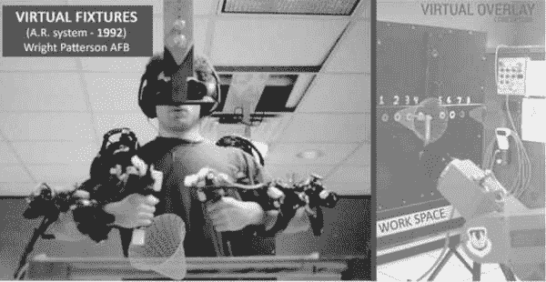

图 4-1 最早的 AR 系统——虚拟导具

VR 技术则创建了一个完全虚拟的环境，用户通过佩戴头戴式显示设备，如 HTC Vive、Oculus Rift 等，完全沉浸在虚拟世界中，与虚拟环境进行自然交互。在 VR 环境中，用户可以身临其境地感受各种场景，如在虚拟的太空漫步、在古代城堡中探险等，通过手柄等设备与虚拟物体进行互动，获得高度逼真的体验。

#### 虚拟培训：沉浸式学习的新范式

在培训领域，AR/VR 技术的应用为学习者带来了沉浸式学习的全新体验，大幅提高了培训效果和学习效率。传统的培训方式，如课堂讲授、观看视频教程等，往往缺乏真实感和互动性，学习者难以真正理解和掌握复杂的知识与技能。而 AR/VR 技术能够模拟真实的工作场景和操作流程，让学习者在虚拟环境中进行实践操作，获得身临其境的学习体验。

在工业领域，AR/VR 技术被广泛应用于设备操作培训。例如，中科汇联的 AiMax 智能资产与预测性维护平台，将虚拟信息叠加于现实场景中，结合 AR/VR 眼镜，可视化指导维修一些大型复杂的机械设备，如飞机发动机、汽车生产线等，操作人员需要经过长时间的培训才能熟练掌握操作技能。通过 VR 技术，学习者可以在虚拟环境中对设备进行全方位的观察和操作练习，了解设备的内部结构、工作原理及操作流程。在虚拟操作过程中，学习者可以随时获得系统的提示和指导，一旦出现错误操作，系统就会及时反馈并纠正，避免在实际操作中造成损失。AR 技术则可以在实际操作现场为工人提供实时的指导信息，通过将操作步骤、注意事项等虚拟信息叠加在真实设备上，工人可以更加直观地了解操作流程，提高工作效率和准确性。

在医疗领域，AR/VR 技术为医学教育和手术培训带来了革命性的变化。医学生可以通过 VR 技术模拟各种手术场景，进行手术操作练习，如腹腔镜手术、心脏搭桥手术等。在虚拟手术过程中，学生可以清晰地看到人体内部的器官结构和组织层次，感受手术器械的操作手感，提高手术技能和空间感知能力。AR 技术还可以在实际手术中为医生提供辅助信息，如将患者的医学影像数据（如 CT、MRI 等）实时叠加在患者身体上，帮助医生更准确地定位病变部位，提高手术的精准性和安全性。

在安全培训领域，AR/VR 技术可以模拟各种危险场景，如火灾、地震、爆炸等，让学习者在虚拟环境中进行应急逃生演练。通过沉浸式体验，学习者能够更加深刻地理解危险场景的特点和应对方法，提高在真实危险情况下的应急反应能力和自救互救能力。

#### 远程协作：打破时空限制的高效沟通

随着全球化的发展和远程办公的普及，远程协作的需求日益增长。AR/VR 技术为远程协作提供了全新的解决方案，打破了时空限制，实现了远程参与者之间的沉浸式互动和高效沟通。

在工业设计和制造领域，AR/VR 技术可以实现远程协同设计和装配。设计师和工程师可以在不同的地理位置，通过 VR 设备进入同一个虚拟设计空间，共同对产品进行设计和修改。他们可以实时看到对方的操作和想法，如同在同一间办公室面对面交流一样。在产品装配过程中，AR 技术可以为现场工人提供远程专家的实时指导。专家可以通过 AR 设备看到现场的实际情况，并将装配步骤、注意事项等虚拟信息叠加在工人的视野中，指导工人完成复杂的装配任务，提高装配效率和质量。

在教育领域，AR/VR 技术为远程教学带来了新的活力。教师和学生可以通过 VR 设备进入虚拟教室，实现远程沉浸式教学。在虚拟教室中，学生可以身临其境地感受各种教学场景，如历史场景重现、科学实验演示等，增强学习的趣味性和互动性。教师可以通过手势、语音等方式与学生进行自然交互，及时了解学生的学习情况并给予指导。AR 技术还可以为学生提供个性化的学习辅助，根据学生的学习进度和需求，将相关学习资料、注释等虚拟信息叠加在现实场景中，帮助学生更好地理解和掌握知识。

在远程会议和商务洽谈方面，AR/VR 技术可以创建沉浸式虚拟会议空间，参会者仿佛置身于同一个会议室中。参会者可以通过虚拟形象进行交流互动，展示产品模型、演示方案等，增强会议的真实感和参与感。例如，在一场跨国产品发布会中，通过 VR 技术，全球各地的观众可以身临其境地感受产品的展示和介绍，与现场的工作人员进行互动交流，大幅提升了发布会的效果和影响力。

尽管 AR/VR 技术在虚拟培训和远程协作领域取得了显著的成果，但在技术普及和应用过程中仍然面临一些挑战。例如，AR/VR 设备的成本较高，限制了其大规模的推广应用；设备的佩戴舒适度和性能还有待提高，长时间使用可能会导致用户出现眩晕等不适症状；网络传输的稳定性也会对 AR/VR 技术的实时性和流畅性产生影响。此外，虚拟环境中的交互方式不够自然和便捷，需要进一步改进和创新。

未来，随着硬件技术的不断进步、软件算法的优化及网络基础设施的升级，AR/VR 技术有望克服这些挑战，实现更广泛的应用和发展。AR/VR 技术将与人工智能、5G 等技术深度融合，为虚拟培训和远程协作带来更加丰富、高效的体验，推动各个行业的数字化转型和创新发展。

### 外骨骼机器人：体力劳动的智能化辅助

在现代社会，虽然科技的发展极大地提高了生产效率，但仍有许多工作需要人们从事繁重的体力劳动。长期的高强度体力工作不仅容易导致劳动者身体疲劳、受伤，还限制了工作效率的进一步提升。外骨骼机器人作为增强智能的重要应用成果，为这一问题提供了创新的解决方案。它通过与人体紧密结合，辅助人体进行各种体力劳动，实现了体力劳动的智能化升级，开启了人机协作完成体力劳动的新篇章。

#### 外骨骼机器人的工作原理与分类

外骨骼机器人是一种可穿戴的机电一体化设备，它模仿人体的骨骼结构和运动方式，通过机械结构、传感器、驱动器等部件，为人体提供额外的力量支持和运动辅助。其工作原理基于对人体运动意图的识别和响应。当使用者做出特定的动作时，外骨骼机器人上的传感器，如压力传感器、肌电传感器等，会捕捉到人体肌肉的运动信号、关节的角度变化等信息，这些信息被传输到控制系统中。控制系统经过分析处理，判断出使用者的运动意图，然后驱动外骨骼机器人的关节电机产生相应的动作，与人体的运动同步进行，从而为人体提供助力。

根据应用场景和功能的不同，外骨骼机器人主要分为工业外骨骼机器人、医疗康复外骨骼机器人和军事外骨骼机器人三大类。其中，工业外骨骼机器人主要应用于制造业、物流仓储等领域，旨在帮助工人减轻体力负担，提高工作效率和安全性；医疗康复外骨骼机器人主要用于帮助残障人士恢复运动功能，促进患者的康复训练；军事外骨骼机器人是为了增强士兵的作战能力和生存能力而研发的。

#### 外骨骼机器人在体力劳动中的应用与优势

在工业领域，外骨骼机器人的应用已经取得了显著的成效。以物流行业为例，相关研究数据显示，使用外骨骼机器人后，仓库工人的搬运效率提高了 30%～50%。在一些大型物流中心，外骨骼机器人帮助工人轻松搬运重达几十千克的货物，而且由于减少了疲劳，工人在一天的工作时间内能够保持更稳定的工作状态，降低了货物损坏率。在制造业，外骨骼机器人同样发挥着重要作用。例如，在电子制造企业，工人需要长时间进行重复性装配动作，容易导致上肢疲劳和损伤。外骨骼机器人的应用有效减轻了工人的疲劳感，提高了产品的装配质量和生产效率。据统计，某电子制造企业引入外骨骼机器人后，产品的次品率降低了 15%左右。

在医疗康复领域，外骨骼机器人为残障人士和康复患者带来了新的希望。许多下肢瘫痪患者在使用医疗康复外骨骼机器人后，重新获得了行走能力，提高了生活自理能力和生活质量。同时，外骨骼机器人在康复训练中的应用大幅提高了康复治疗效果。传统的康复训练主要依靠康复师手动辅助，效率较低且难以保证训练的准确性和一致性。外骨骼机器人可以根据患者的具体情况制订个性化康复训练方案，精确控制运动的幅度、速度和力量，提高康复训练的科学性和有效性。研究表明，使用外骨骼机器人进行康复训练的患者，其康复进程可缩短 20%～30%。

在军事领域，外骨骼机器人的发展为提升军队战斗力提供了新的途径。军事外骨骼机器人可以让士兵携带更重的装备，在复杂的地形中保持更快的行军速度和更强的耐力。例如，在山地作战中，士兵需要携带大量的武器、弹药和物资穿越崎岖的山路，军事外骨骼机器人能够减轻士兵的负担，提高他们的机动能力和作战能力。此外，军事外骨骼机器人可以与其他先进的军事技术（如人工智能技术、传感器技术）等相结合，实现对战场环境的实时感知和快速响应，提升士兵的作战效能和生存能力。

尽管外骨骼机器人在各个领域展现出了巨大的潜力和优势，但目前仍面临一些挑战。在技术方面，外骨骼机器人的续航能力有限，电池技术的发展还无法满足长时间高强度工作的需求；机械结构的设计和材料的选择也需要进一步优化，以提高穿戴的舒适性和灵活性，同时降低成本，增强可靠性和耐用性。从社会接受度来看，部分工人可能担心外骨骼机器人会导致他们的工作岗位被替代，从而对其产生抵触情绪；在医疗领域，需要关注患者对穿戴外骨骼机器人的心理接受程度和隐私问题。另外，在军事应用中，外骨骼机器人的使用还涉及国际军事战略平衡和伦理道德等复杂问题。

未来，随着电池、材料科学、人工智能等多领域技术的协同创新发展，外骨骼机器人有望在续航、性能、成本等方面取得突破。例如，新型电池（如固态电池、氢燃料电池等）技术的发展，可能大幅提升外骨骼机器人的续航能力；高性能、轻量化且坚固的新型材料（如碳纤维复合材料、智能纳米材料等）的应用，将显著改善外骨骼机器人的机械性能和穿戴体验。同时，加强对工人和患者的宣传教育，提高他们对外骨骼机器人的认知和理解，积极探索合理的人机协作工作模式，可以有效提升外骨骼机器人的社会接受度。在军事方面，国际社会需要共同制定相关规则和准则，确保外骨骼机器人的合理应用，避免引发军事冲突和伦理争议。

外骨骼机器人作为体力劳动智能化辅助的重要工具，正处于快速发展阶段。它在工业、医疗、军事等领域的应用，不仅提高了工作效率，改善了人们的生活质量，还为未来的人机协作模式开辟了新的道路。随着技术的不断进步和社会的逐步认可，外骨骼机器人必将在更多领域发挥重要作用，成为推动人类社会发展的重要力量。

### 脑机接口：从意念控制到认知增强

脑机接口（Brain-Computer Interface，BCI）是一种在人脑与外部设备之间建立直接连接的技术，通过传感器捕捉大脑电信号，并将其转化为机器可识别的指令，从而实现“意念操控”。BCI 是增强智能领域最具突破性和前瞻性的研究方向之一。

从最初对大脑信号的简单探测，到如今朝着认知增强的方向迈进，BCI 技术的每次进步都在拉近人类与智能机器之间的距离，为人类能力的拓展带来了革命性的可能。

#### 技术原理：解码神经信号的奥秘

大脑是人体最复杂且神秘的器官，它通过神经元之间的电信号和化学信号传递信息，从而控制人体的各种行为和思维活动。脑机接口的核心原理就是捕捉大脑活动产生的神经信号，并将其转化为计算机能够理解的指令；反之亦然，计算机也可以将信息转化为神经信号反馈给大脑。

目前，脑机接口主要通过两种方式获取大脑信号：侵入式和非侵入式。侵入式脑机接口需要将电极直接植入大脑皮层，这种方式能够获取高分辨率的神经信号，但具有较高的风险，可能引发免疫反应和大脑损伤。例如，埃隆·马斯克创办的 Neuralink 公司致力于开发一种微创的侵入式脑机接口技术，通过将极细的电极丝植入大脑，希望实现对大脑信号的精准采集和控制。

非侵入式脑机接口则相对更加安全和便捷，它通过在头皮表面放置电极来采集大脑信号。脑电图就是一种常见的非侵入式脑机接口技术，它能够检测大脑皮层神经元活动产生的微弱电信号。虽然非侵入式脑机接口获取的信号相对较弱且容易受到干扰，但随着信号处理技术和机器学习算法的不断进步，其性能逐步提升。例如，研究人员通过改进电极设计、优化信号滤波算法及运用深度学习模型进行信号特征提取，提高了非侵入式脑机接口对大脑信号的识别准确率。

获取大脑信号后，需要对这些信号进行解码和分析，以理解大脑的意图。这就好比将大脑发出的“加密信息”翻译为计算机能够读懂的“语言”。机器学习算法在这一过程中发挥着关键作用，它可以通过对大量带有标签的大脑信号数据进行训练，建立大脑信号与特定动作或意图之间的映射关系。例如，当一个人想抬手时，大脑会产生特定的神经信号模式，机器学习模型经过训练，能够识别这种神经信号模式，并将其转化为控制机械手臂抬起的指令。

#### 从意念控制到认知增强的跨越

早期，脑机接口的主要应用集中在意念控制领域，帮助残障人士恢复运动功能。例如，瘫痪患者可以通过脑机接口设备，用大脑信号控制轮椅的移动、机械手臂的抓握动作等，重新获得自主生活能力。一些研究团队已经成功让瘫痪患者借助脑机接口技术操控机械手臂完成进食、喝水等日常动作，大幅提升了他们的生活质量。

随着技术的不断发展，脑机接口的应用范围逐渐拓展到认知增强领域。认知增强旨在通过脑机接口技术提升人类的认知能力，如记忆力、注意力、学习能力等。研究人员发现，向大脑特定区域施加微弱的电流刺激（经颅直流电刺激），可以调节大脑神经元的活动，从而影响认知功能。结合脑机接口技术，未来有望根据个人的大脑活动状态，精准地给予相应的刺激，以优化认知表现。

在学习领域，脑机接口技术可以实时监测学生的大脑状态，当检测到学生注意力不集中时，及时给予反馈或刺激，帮助学生调整状态，提高学习效率。例如，一些头戴式脑机接口设备可以通过分析脑电图信号，判断学生是否处于专注、疲劳或困惑等状态，并将这些信息反馈给教师或学生本人，以便采取相应的措施。此外，脑机接口有望帮助人们更高效地学习新技能，通过直接向大脑传递与特定的知识或技能相关的神经信号模式，加快学习过程。利用脑机接口直接向大脑输入信息，可以缩短技能习得周期（如电影《黑客帝国》中的“功夫下载”）。

在医疗领域，脑机接口在认知障碍治疗方面也展现出了潜力。对于患有阿尔茨海默病、注意力缺陷多动障碍（ADHD）等认知障碍疾病的患者，脑机接口技术可以通过刺激大脑特定区域，改善他们的认知功能。例如，针对 ADHD 患者，通过脑机接口进行神经反馈训练，让他们学会自我调节大脑活动，提高注意力和控制能力。

尽管脑机接口技术在从意念控制到认知增强的发展过程中取得了显著进展，但仍然面临诸多挑战。在技术层面，目前大脑信号的采集和解读精度还不够高，信号的稳定性和可靠性有待提升，尤其是在环境复杂和长时间使用的情况下。在伦理和社会层面，脑机接口技术引发了一系列关于隐私、自主性和人类进化的讨论。例如，如何确保大脑信号不被非法获取和滥用，如何界定通过脑机接口增强认知能力后的“新人类”与普通人类的界限等问题，都需要深入思考和探讨。

未来，随着神经科学、材料科学、人工智能等多学科的交叉融合，脑机接口技术有望取得更大的突破。科学家们正在研发更先进的电极材料和信号处理算法，以提高大脑信号的采集和分析能力；同时积极探索伦理和法律框架，以确保技术的安全、合理应用。脑机接口技术的发展将为人类带来前所未有的机遇，它不仅能够帮助残障人士重获新生，还可能开启人类认知增强的新时代，让人类的能力得到进一步的拓展和提升。

增强智能的本质不是取代人类，而是拓展人类的生物边界。脑机接口重构了思维与机器的交互方式，AR/VR 打破了物理空间的限制，外骨骼机器人打破了人类的体力桎梏。三者共同编织了一张“人机协作网”，将生产力推向一个前所未有的高度。然而，在技术狂飙的背后，我们必须警惕伦理陷阱——唯有在效率与人性之间找到平衡，才能真正实现“人机共舞”的理想图景。 EXr6287u6NNVz+GYLY+7SDk226FstKIHdC0bNoQkB2Nqi1xSR0yxPmwrTs5gRi/BtfSbid6dBhii9q7cz2pIyA==

## 1 增强智能
——从工具到伙伴的迭代进化

人类对工具的依赖从未停止。从原始社会的石斧到工业时代的蒸汽机，工具始终是生产力跃迁的核心载体。然而，在人工智能时代，工具的角色发生了根本性转变——它们不再是被动执行的机械装置，而是能够与人类协同进化的“智能伙伴”。增强智能（Augmented Intelligence）正是这一转变的产物。增强智能致力于通过技术手段提升人类的认知、感知和行动能力，让人类与智能机器紧密协作，发挥各自的优势，创造出远超个体能力的价值。它通过 AR/VR、外骨骼机器人、脑机接口等技术，将人类的生物能力与机器的计算能力深度融合，开创了人机协作的全新范式。增强智能正在以前所未有的速度改变人们的生活、工作和学习方式，为未来的发展勾勒出具有无限可能的蓝图。

### AR/VR：虚拟培训与远程协作的沉浸式体验

增强现实（Augmented Reality，AR）和虚拟现实（Virtual Reality，VR）技术作为增强智能的重要组成部分，正在深刻地改变人们获取信息、学习技能及进行协作交流的方式。通过创建沉浸式虚拟环境，AR/VR 技术打破了现实世界与虚拟世界的界限，为虚拟培训和远程协作带来了前所未有的沉浸式体验，极大地提升了学习和工作效率。

#### AR/VR 技术概述

AR 技术是一种将虚拟信息与真实世界相结合的技术，它通过计算机技术生成虚拟的物体、场景或信息，并将其叠加在真实世界的场景之上，让用户能够同时看到真实世界和虚拟信息，实现虚拟与现实的互动（见图 4-1）。例如，在手机上使用 AR 应用，用户可以通过摄像头看到真实的街道场景，同时在屏幕上叠加显示周边的餐厅、景点等信息，这些信息以虚拟图标的形式呈现，点击图标可以获取更多详细介绍。

图 4-1 最早的 AR 系统——虚拟导具

VR 技术则创建了一个完全虚拟的环境，用户通过佩戴头戴式显示设备，如 HTC Vive、Oculus Rift 等，完全沉浸在虚拟世界中，与虚拟环境进行自然交互。在 VR 环境中，用户可以身临其境地感受各种场景，如在虚拟的太空漫步、在古代城堡中探险等，通过手柄等设备与虚拟物体进行互动，获得高度逼真的体验。

#### 虚拟培训：沉浸式学习的新范式

在培训领域，AR/VR 技术的应用为学习者带来了沉浸式学习的全新体验，大幅提高了培训效果和学习效率。传统的培训方式，如课堂讲授、观看视频教程等，往往缺乏真实感和互动性，学习者难以真正理解和掌握复杂的知识与技能。而 AR/VR 技术能够模拟真实的工作场景和操作流程，让学习者在虚拟环境中进行实践操作，获得身临其境的学习体验。

在工业领域，AR/VR 技术被广泛应用于设备操作培训。例如，中科汇联的 AiMax 智能资产与预测性维护平台，将虚拟信息叠加于现实场景中，结合 AR/VR 眼镜，可视化指导维修一些大型复杂的机械设备，如飞机发动机、汽车生产线等，操作人员需要经过长时间的培训才能熟练掌握操作技能。通过 VR 技术，学习者可以在虚拟环境中对设备进行全方位的观察和操作练习，了解设备的内部结构、工作原理及操作流程。在虚拟操作过程中，学习者可以随时获得系统的提示和指导，一旦出现错误操作，系统就会及时反馈并纠正，避免在实际操作中造成损失。AR 技术则可以在实际操作现场为工人提供实时的指导信息，通过将操作步骤、注意事项等虚拟信息叠加在真实设备上，工人可以更加直观地了解操作流程，提高工作效率和准确性。

在医疗领域，AR/VR 技术为医学教育和手术培训带来了革命性的变化。医学生可以通过 VR 技术模拟各种手术场景，进行手术操作练习，如腹腔镜手术、心脏搭桥手术等。在虚拟手术过程中，学生可以清晰地看到人体内部的器官结构和组织层次，感受手术器械的操作手感，提高手术技能和空间感知能力。AR 技术还可以在实际手术中为医生提供辅助信息，如将患者的医学影像数据（如 CT、MRI 等）实时叠加在患者身体上，帮助医生更准确地定位病变部位，提高手术的精准性和安全性。

在安全培训领域，AR/VR 技术可以模拟各种危险场景，如火灾、地震、爆炸等，让学习者在虚拟环境中进行应急逃生演练。通过沉浸式体验，学习者能够更加深刻地理解危险场景的特点和应对方法，提高在真实危险情况下的应急反应能力和自救互救能力。

#### 远程协作：打破时空限制的高效沟通

随着全球化的发展和远程办公的普及，远程协作的需求日益增长。AR/VR 技术为远程协作提供了全新的解决方案，打破了时空限制，实现了远程参与者之间的沉浸式互动和高效沟通。

在工业设计和制造领域，AR/VR 技术可以实现远程协同设计和装配。设计师和工程师可以在不同的地理位置，通过 VR 设备进入同一个虚拟设计空间，共同对产品进行设计和修改。他们可以实时看到对方的操作和想法，如同在同一间办公室面对面交流一样。在产品装配过程中，AR 技术可以为现场工人提供远程专家的实时指导。专家可以通过 AR 设备看到现场的实际情况，并将装配步骤、注意事项等虚拟信息叠加在工人的视野中，指导工人完成复杂的装配任务，提高装配效率和质量。

在教育领域，AR/VR 技术为远程教学带来了新的活力。教师和学生可以通过 VR 设备进入虚拟教室，实现远程沉浸式教学。在虚拟教室中，学生可以身临其境地感受各种教学场景，如历史场景重现、科学实验演示等，增强学习的趣味性和互动性。教师可以通过手势、语音等方式与学生进行自然交互，及时了解学生的学习情况并给予指导。AR 技术还可以为学生提供个性化的学习辅助，根据学生的学习进度和需求，将相关学习资料、注释等虚拟信息叠加在现实场景中，帮助学生更好地理解和掌握知识。

在远程会议和商务洽谈方面，AR/VR 技术可以创建沉浸式虚拟会议空间，参会者仿佛置身于同一个会议室中。参会者可以通过虚拟形象进行交流互动，展示产品模型、演示方案等，增强会议的真实感和参与感。例如，在一场跨国产品发布会中，通过 VR 技术，全球各地的观众可以身临其境地感受产品的展示和介绍，与现场的工作人员进行互动交流，大幅提升了发布会的效果和影响力。

尽管 AR/VR 技术在虚拟培训和远程协作领域取得了显著的成果，但在技术普及和应用过程中仍然面临一些挑战。例如，AR/VR 设备的成本较高，限制了其大规模的推广应用；设备的佩戴舒适度和性能还有待提高，长时间使用可能会导致用户出现眩晕等不适症状；网络传输的稳定性也会对 AR/VR 技术的实时性和流畅性产生影响。此外，虚拟环境中的交互方式不够自然和便捷，需要进一步改进和创新。

未来，随着硬件技术的不断进步、软件算法的优化及网络基础设施的升级，AR/VR 技术有望克服这些挑战，实现更广泛的应用和发展。AR/VR 技术将与人工智能、5G 等技术深度融合，为虚拟培训和远程协作带来更加丰富、高效的体验，推动各个行业的数字化转型和创新发展。

### 外骨骼机器人：体力劳动的智能化辅助

在现代社会，虽然科技的发展极大地提高了生产效率，但仍有许多工作需要人们从事繁重的体力劳动。长期的高强度体力工作不仅容易导致劳动者身体疲劳、受伤，还限制了工作效率的进一步提升。外骨骼机器人作为增强智能的重要应用成果，为这一问题提供了创新的解决方案。它通过与人体紧密结合，辅助人体进行各种体力劳动，实现了体力劳动的智能化升级，开启了人机协作完成体力劳动的新篇章。

#### 外骨骼机器人的工作原理与分类

外骨骼机器人是一种可穿戴的机电一体化设备，它模仿人体的骨骼结构和运动方式，通过机械结构、传感器、驱动器等部件，为人体提供额外的力量支持和运动辅助。其工作原理基于对人体运动意图的识别和响应。当使用者做出特定的动作时，外骨骼机器人上的传感器，如压力传感器、肌电传感器等，会捕捉到人体肌肉的运动信号、关节的角度变化等信息，这些信息被传输到控制系统中。控制系统经过分析处理，判断出使用者的运动意图，然后驱动外骨骼机器人的关节电机产生相应的动作，与人体的运动同步进行，从而为人体提供助力。

根据应用场景和功能的不同，外骨骼机器人主要分为工业外骨骼机器人、医疗康复外骨骼机器人和军事外骨骼机器人三大类。其中，工业外骨骼机器人主要应用于制造业、物流仓储等领域，旨在帮助工人减轻体力负担，提高工作效率和安全性；医疗康复外骨骼机器人主要用于帮助残障人士恢复运动功能，促进患者的康复训练；军事外骨骼机器人是为了增强士兵的作战能力和生存能力而研发的。

#### 外骨骼机器人在体力劳动中的应用与优势

在工业领域，外骨骼机器人的应用已经取得了显著的成效。以物流行业为例，相关研究数据显示，使用外骨骼机器人后，仓库工人的搬运效率提高了 30%～50%。在一些大型物流中心，外骨骼机器人帮助工人轻松搬运重达几十千克的货物，而且由于减少了疲劳，工人在一天的工作时间内能够保持更稳定的工作状态，降低了货物损坏率。在制造业，外骨骼机器人同样发挥着重要作用。例如，在电子制造企业，工人需要长时间进行重复性装配动作，容易导致上肢疲劳和损伤。外骨骼机器人的应用有效减轻了工人的疲劳感，提高了产品的装配质量和生产效率。据统计，某电子制造企业引入外骨骼机器人后，产品的次品率降低了 15%左右。

在医疗康复领域，外骨骼机器人为残障人士和康复患者带来了新的希望。许多下肢瘫痪患者在使用医疗康复外骨骼机器人后，重新获得了行走能力，提高了生活自理能力和生活质量。同时，外骨骼机器人在康复训练中的应用大幅提高了康复治疗效果。传统的康复训练主要依靠康复师手动辅助，效率较低且难以保证训练的准确性和一致性。外骨骼机器人可以根据患者的具体情况制订个性化康复训练方案，精确控制运动的幅度、速度和力量，提高康复训练的科学性和有效性。研究表明，使用外骨骼机器人进行康复训练的患者，其康复进程可缩短 20%～30%。

在军事领域，外骨骼机器人的发展为提升军队战斗力提供了新的途径。军事外骨骼机器人可以让士兵携带更重的装备，在复杂的地形中保持更快的行军速度和更强的耐力。例如，在山地作战中，士兵需要携带大量的武器、弹药和物资穿越崎岖的山路，军事外骨骼机器人能够减轻士兵的负担，提高他们的机动能力和作战能力。此外，军事外骨骼机器人可以与其他先进的军事技术（如人工智能技术、传感器技术）等相结合，实现对战场环境的实时感知和快速响应，提升士兵的作战效能和生存能力。

尽管外骨骼机器人在各个领域展现出了巨大的潜力和优势，但目前仍面临一些挑战。在技术方面，外骨骼机器人的续航能力有限，电池技术的发展还无法满足长时间高强度工作的需求；机械结构的设计和材料的选择也需要进一步优化，以提高穿戴的舒适性和灵活性，同时降低成本，增强可靠性和耐用性。从社会接受度来看，部分工人可能担心外骨骼机器人会导致他们的工作岗位被替代，从而对其产生抵触情绪；在医疗领域，需要关注患者对穿戴外骨骼机器人的心理接受程度和隐私问题。另外，在军事应用中，外骨骼机器人的使用还涉及国际军事战略平衡和伦理道德等复杂问题。

未来，随着电池、材料科学、人工智能等多领域技术的协同创新发展，外骨骼机器人有望在续航、性能、成本等方面取得突破。例如，新型电池（如固态电池、氢燃料电池等）技术的发展，可能大幅提升外骨骼机器人的续航能力；高性能、轻量化且坚固的新型材料（如碳纤维复合材料、智能纳米材料等）的应用，将显著改善外骨骼机器人的机械性能和穿戴体验。同时，加强对工人和患者的宣传教育，提高他们对外骨骼机器人的认知和理解，积极探索合理的人机协作工作模式，可以有效提升外骨骼机器人的社会接受度。在军事方面，国际社会需要共同制定相关规则和准则，确保外骨骼机器人的合理应用，避免引发军事冲突和伦理争议。

外骨骼机器人作为体力劳动智能化辅助的重要工具，正处于快速发展阶段。它在工业、医疗、军事等领域的应用，不仅提高了工作效率，改善了人们的生活质量，还为未来的人机协作模式开辟了新的道路。随着技术的不断进步和社会的逐步认可，外骨骼机器人必将在更多领域发挥重要作用，成为推动人类社会发展的重要力量。

### 脑机接口：从意念控制到认知增强

脑机接口（Brain-Computer Interface，BCI）是一种在人脑与外部设备之间建立直接连接的技术，通过传感器捕捉大脑电信号，并将其转化为机器可识别的指令，从而实现“意念操控”。BCI 是增强智能领域最具突破性和前瞻性的研究方向之一。

从最初对大脑信号的简单探测，到如今朝着认知增强的方向迈进，BCI 技术的每次进步都在拉近人类与智能机器之间的距离，为人类能力的拓展带来了革命性的可能。

#### 技术原理：解码神经信号的奥秘

大脑是人体最复杂且神秘的器官，它通过神经元之间的电信号和化学信号传递信息，从而控制人体的各种行为和思维活动。脑机接口的核心原理就是捕捉大脑活动产生的神经信号，并将其转化为计算机能够理解的指令；反之亦然，计算机也可以将信息转化为神经信号反馈给大脑。

目前，脑机接口主要通过两种方式获取大脑信号：侵入式和非侵入式。侵入式脑机接口需要将电极直接植入大脑皮层，这种方式能够获取高分辨率的神经信号，但具有较高的风险，可能引发免疫反应和大脑损伤。例如，埃隆·马斯克创办的 Neuralink 公司致力于开发一种微创的侵入式脑机接口技术，通过将极细的电极丝植入大脑，希望实现对大脑信号的精准采集和控制。

非侵入式脑机接口则相对更加安全和便捷，它通过在头皮表面放置电极来采集大脑信号。脑电图就是一种常见的非侵入式脑机接口技术，它能够检测大脑皮层神经元活动产生的微弱电信号。虽然非侵入式脑机接口获取的信号相对较弱且容易受到干扰，但随着信号处理技术和机器学习算法的不断进步，其性能逐步提升。例如，研究人员通过改进电极设计、优化信号滤波算法及运用深度学习模型进行信号特征提取，提高了非侵入式脑机接口对大脑信号的识别准确率。

获取大脑信号后，需要对这些信号进行解码和分析，以理解大脑的意图。这就好比将大脑发出的“加密信息”翻译为计算机能够读懂的“语言”。机器学习算法在这一过程中发挥着关键作用，它可以通过对大量带有标签的大脑信号数据进行训练，建立大脑信号与特定动作或意图之间的映射关系。例如，当一个人想抬手时，大脑会产生特定的神经信号模式，机器学习模型经过训练，能够识别这种神经信号模式，并将其转化为控制机械手臂抬起的指令。

#### 从意念控制到认知增强的跨越

早期，脑机接口的主要应用集中在意念控制领域，帮助残障人士恢复运动功能。例如，瘫痪患者可以通过脑机接口设备，用大脑信号控制轮椅的移动、机械手臂的抓握动作等，重新获得自主生活能力。一些研究团队已经成功让瘫痪患者借助脑机接口技术操控机械手臂完成进食、喝水等日常动作，大幅提升了他们的生活质量。

随着技术的不断发展，脑机接口的应用范围逐渐拓展到认知增强领域。认知增强旨在通过脑机接口技术提升人类的认知能力，如记忆力、注意力、学习能力等。研究人员发现，向大脑特定区域施加微弱的电流刺激（经颅直流电刺激），可以调节大脑神经元的活动，从而影响认知功能。结合脑机接口技术，未来有望根据个人的大脑活动状态，精准地给予相应的刺激，以优化认知表现。

在学习领域，脑机接口技术可以实时监测学生的大脑状态，当检测到学生注意力不集中时，及时给予反馈或刺激，帮助学生调整状态，提高学习效率。例如，一些头戴式脑机接口设备可以通过分析脑电图信号，判断学生是否处于专注、疲劳或困惑等状态，并将这些信息反馈给教师或学生本人，以便采取相应的措施。此外，脑机接口有望帮助人们更高效地学习新技能，通过直接向大脑传递与特定的知识或技能相关的神经信号模式，加快学习过程。利用脑机接口直接向大脑输入信息，可以缩短技能习得周期（如电影《黑客帝国》中的“功夫下载”）。

在医疗领域，脑机接口在认知障碍治疗方面也展现出了潜力。对于患有阿尔茨海默病、注意力缺陷多动障碍（ADHD）等认知障碍疾病的患者，脑机接口技术可以通过刺激大脑特定区域，改善他们的认知功能。例如，针对 ADHD 患者，通过脑机接口进行神经反馈训练，让他们学会自我调节大脑活动，提高注意力和控制能力。

尽管脑机接口技术在从意念控制到认知增强的发展过程中取得了显著进展，但仍然面临诸多挑战。在技术层面，目前大脑信号的采集和解读精度还不够高，信号的稳定性和可靠性有待提升，尤其是在环境复杂和长时间使用的情况下。在伦理和社会层面，脑机接口技术引发了一系列关于隐私、自主性和人类进化的讨论。例如，如何确保大脑信号不被非法获取和滥用，如何界定通过脑机接口增强认知能力后的“新人类”与普通人类的界限等问题，都需要深入思考和探讨。

未来，随着神经科学、材料科学、人工智能等多学科的交叉融合，脑机接口技术有望取得更大的突破。科学家们正在研发更先进的电极材料和信号处理算法，以提高大脑信号的采集和分析能力；同时积极探索伦理和法律框架，以确保技术的安全、合理应用。脑机接口技术的发展将为人类带来前所未有的机遇，它不仅能够帮助残障人士重获新生，还可能开启人类认知增强的新时代，让人类的能力得到进一步的拓展和提升。

增强智能的本质不是取代人类，而是拓展人类的生物边界。脑机接口重构了思维与机器的交互方式，AR/VR 打破了物理空间的限制，外骨骼机器人打破了人类的体力桎梏。三者共同编织了一张“人机协作网”，将生产力推向一个前所未有的高度。然而，在技术狂飙的背后，我们必须警惕伦理陷阱——唯有在效率与人性之间找到平衡，才能真正实现“人机共舞”的理想图景。 EXr6287u6NNVz+GYLY+7SDk226FstKIHdC0bNoQkB2Nqi1xSR0yxPmwrTs5gRi/BtfSbid6dBhii9q7cz2pIyA==

## 1 增强智能
——从工具到伙伴的迭代进化

人类对工具的依赖从未停止。从原始社会的石斧到工业时代的蒸汽机，工具始终是生产力跃迁的核心载体。然而，在人工智能时代，工具的角色发生了根本性转变——它们不再是被动执行的机械装置，而是能够与人类协同进化的“智能伙伴”。增强智能（Augmented Intelligence）正是这一转变的产物。增强智能致力于通过技术手段提升人类的认知、感知和行动能力，让人类与智能机器紧密协作，发挥各自的优势，创造出远超个体能力的价值。它通过 AR/VR、外骨骼机器人、脑机接口等技术，将人类的生物能力与机器的计算能力深度融合，开创了人机协作的全新范式。增强智能正在以前所未有的速度改变人们的生活、工作和学习方式，为未来的发展勾勒出具有无限可能的蓝图。

### AR/VR：虚拟培训与远程协作的沉浸式体验

增强现实（Augmented Reality，AR）和虚拟现实（Virtual Reality，VR）技术作为增强智能的重要组成部分，正在深刻地改变人们获取信息、学习技能及进行协作交流的方式。通过创建沉浸式虚拟环境，AR/VR 技术打破了现实世界与虚拟世界的界限，为虚拟培训和远程协作带来了前所未有的沉浸式体验，极大地提升了学习和工作效率。

#### AR/VR 技术概述

AR 技术是一种将虚拟信息与真实世界相结合的技术，它通过计算机技术生成虚拟的物体、场景或信息，并将其叠加在真实世界的场景之上，让用户能够同时看到真实世界和虚拟信息，实现虚拟与现实的互动（见图 4-1）。例如，在手机上使用 AR 应用，用户可以通过摄像头看到真实的街道场景，同时在屏幕上叠加显示周边的餐厅、景点等信息，这些信息以虚拟图标的形式呈现，点击图标可以获取更多详细介绍。

图 4-1 最早的 AR 系统——虚拟导具

VR 技术则创建了一个完全虚拟的环境，用户通过佩戴头戴式显示设备，如 HTC Vive、Oculus Rift 等，完全沉浸在虚拟世界中，与虚拟环境进行自然交互。在 VR 环境中，用户可以身临其境地感受各种场景，如在虚拟的太空漫步、在古代城堡中探险等，通过手柄等设备与虚拟物体进行互动，获得高度逼真的体验。

#### 虚拟培训：沉浸式学习的新范式

在培训领域，AR/VR 技术的应用为学习者带来了沉浸式学习的全新体验，大幅提高了培训效果和学习效率。传统的培训方式，如课堂讲授、观看视频教程等，往往缺乏真实感和互动性，学习者难以真正理解和掌握复杂的知识与技能。而 AR/VR 技术能够模拟真实的工作场景和操作流程，让学习者在虚拟环境中进行实践操作，获得身临其境的学习体验。

在工业领域，AR/VR 技术被广泛应用于设备操作培训。例如，中科汇联的 AiMax 智能资产与预测性维护平台，将虚拟信息叠加于现实场景中，结合 AR/VR 眼镜，可视化指导维修一些大型复杂的机械设备，如飞机发动机、汽车生产线等，操作人员需要经过长时间的培训才能熟练掌握操作技能。通过 VR 技术，学习者可以在虚拟环境中对设备进行全方位的观察和操作练习，了解设备的内部结构、工作原理及操作流程。在虚拟操作过程中，学习者可以随时获得系统的提示和指导，一旦出现错误操作，系统就会及时反馈并纠正，避免在实际操作中造成损失。AR 技术则可以在实际操作现场为工人提供实时的指导信息，通过将操作步骤、注意事项等虚拟信息叠加在真实设备上，工人可以更加直观地了解操作流程，提高工作效率和准确性。

在医疗领域，AR/VR 技术为医学教育和手术培训带来了革命性的变化。医学生可以通过 VR 技术模拟各种手术场景，进行手术操作练习，如腹腔镜手术、心脏搭桥手术等。在虚拟手术过程中，学生可以清晰地看到人体内部的器官结构和组织层次，感受手术器械的操作手感，提高手术技能和空间感知能力。AR 技术还可以在实际手术中为医生提供辅助信息，如将患者的医学影像数据（如 CT、MRI 等）实时叠加在患者身体上，帮助医生更准确地定位病变部位，提高手术的精准性和安全性。

在安全培训领域，AR/VR 技术可以模拟各种危险场景，如火灾、地震、爆炸等，让学习者在虚拟环境中进行应急逃生演练。通过沉浸式体验，学习者能够更加深刻地理解危险场景的特点和应对方法，提高在真实危险情况下的应急反应能力和自救互救能力。

#### 远程协作：打破时空限制的高效沟通

随着全球化的发展和远程办公的普及，远程协作的需求日益增长。AR/VR 技术为远程协作提供了全新的解决方案，打破了时空限制，实现了远程参与者之间的沉浸式互动和高效沟通。

在工业设计和制造领域，AR/VR 技术可以实现远程协同设计和装配。设计师和工程师可以在不同的地理位置，通过 VR 设备进入同一个虚拟设计空间，共同对产品进行设计和修改。他们可以实时看到对方的操作和想法，如同在同一间办公室面对面交流一样。在产品装配过程中，AR 技术可以为现场工人提供远程专家的实时指导。专家可以通过 AR 设备看到现场的实际情况，并将装配步骤、注意事项等虚拟信息叠加在工人的视野中，指导工人完成复杂的装配任务，提高装配效率和质量。

在教育领域，AR/VR 技术为远程教学带来了新的活力。教师和学生可以通过 VR 设备进入虚拟教室，实现远程沉浸式教学。在虚拟教室中，学生可以身临其境地感受各种教学场景，如历史场景重现、科学实验演示等，增强学习的趣味性和互动性。教师可以通过手势、语音等方式与学生进行自然交互，及时了解学生的学习情况并给予指导。AR 技术还可以为学生提供个性化的学习辅助，根据学生的学习进度和需求，将相关学习资料、注释等虚拟信息叠加在现实场景中，帮助学生更好地理解和掌握知识。

在远程会议和商务洽谈方面，AR/VR 技术可以创建沉浸式虚拟会议空间，参会者仿佛置身于同一个会议室中。参会者可以通过虚拟形象进行交流互动，展示产品模型、演示方案等，增强会议的真实感和参与感。例如，在一场跨国产品发布会中，通过 VR 技术，全球各地的观众可以身临其境地感受产品的展示和介绍，与现场的工作人员进行互动交流，大幅提升了发布会的效果和影响力。

尽管 AR/VR 技术在虚拟培训和远程协作领域取得了显著的成果，但在技术普及和应用过程中仍然面临一些挑战。例如，AR/VR 设备的成本较高，限制了其大规模的推广应用；设备的佩戴舒适度和性能还有待提高，长时间使用可能会导致用户出现眩晕等不适症状；网络传输的稳定性也会对 AR/VR 技术的实时性和流畅性产生影响。此外，虚拟环境中的交互方式不够自然和便捷，需要进一步改进和创新。

未来，随着硬件技术的不断进步、软件算法的优化及网络基础设施的升级，AR/VR 技术有望克服这些挑战，实现更广泛的应用和发展。AR/VR 技术将与人工智能、5G 等技术深度融合，为虚拟培训和远程协作带来更加丰富、高效的体验，推动各个行业的数字化转型和创新发展。

### 外骨骼机器人：体力劳动的智能化辅助

在现代社会，虽然科技的发展极大地提高了生产效率，但仍有许多工作需要人们从事繁重的体力劳动。长期的高强度体力工作不仅容易导致劳动者身体疲劳、受伤，还限制了工作效率的进一步提升。外骨骼机器人作为增强智能的重要应用成果，为这一问题提供了创新的解决方案。它通过与人体紧密结合，辅助人体进行各种体力劳动，实现了体力劳动的智能化升级，开启了人机协作完成体力劳动的新篇章。

#### 外骨骼机器人的工作原理与分类

外骨骼机器人是一种可穿戴的机电一体化设备，它模仿人体的骨骼结构和运动方式，通过机械结构、传感器、驱动器等部件，为人体提供额外的力量支持和运动辅助。其工作原理基于对人体运动意图的识别和响应。当使用者做出特定的动作时，外骨骼机器人上的传感器，如压力传感器、肌电传感器等，会捕捉到人体肌肉的运动信号、关节的角度变化等信息，这些信息被传输到控制系统中。控制系统经过分析处理，判断出使用者的运动意图，然后驱动外骨骼机器人的关节电机产生相应的动作，与人体的运动同步进行，从而为人体提供助力。

根据应用场景和功能的不同，外骨骼机器人主要分为工业外骨骼机器人、医疗康复外骨骼机器人和军事外骨骼机器人三大类。其中，工业外骨骼机器人主要应用于制造业、物流仓储等领域，旨在帮助工人减轻体力负担，提高工作效率和安全性；医疗康复外骨骼机器人主要用于帮助残障人士恢复运动功能，促进患者的康复训练；军事外骨骼机器人是为了增强士兵的作战能力和生存能力而研发的。

#### 外骨骼机器人在体力劳动中的应用与优势

在工业领域，外骨骼机器人的应用已经取得了显著的成效。以物流行业为例，相关研究数据显示，使用外骨骼机器人后，仓库工人的搬运效率提高了 30%～50%。在一些大型物流中心，外骨骼机器人帮助工人轻松搬运重达几十千克的货物，而且由于减少了疲劳，工人在一天的工作时间内能够保持更稳定的工作状态，降低了货物损坏率。在制造业，外骨骼机器人同样发挥着重要作用。例如，在电子制造企业，工人需要长时间进行重复性装配动作，容易导致上肢疲劳和损伤。外骨骼机器人的应用有效减轻了工人的疲劳感，提高了产品的装配质量和生产效率。据统计，某电子制造企业引入外骨骼机器人后，产品的次品率降低了 15%左右。

在医疗康复领域，外骨骼机器人为残障人士和康复患者带来了新的希望。许多下肢瘫痪患者在使用医疗康复外骨骼机器人后，重新获得了行走能力，提高了生活自理能力和生活质量。同时，外骨骼机器人在康复训练中的应用大幅提高了康复治疗效果。传统的康复训练主要依靠康复师手动辅助，效率较低且难以保证训练的准确性和一致性。外骨骼机器人可以根据患者的具体情况制订个性化康复训练方案，精确控制运动的幅度、速度和力量，提高康复训练的科学性和有效性。研究表明，使用外骨骼机器人进行康复训练的患者，其康复进程可缩短 20%～30%。

在军事领域，外骨骼机器人的发展为提升军队战斗力提供了新的途径。军事外骨骼机器人可以让士兵携带更重的装备，在复杂的地形中保持更快的行军速度和更强的耐力。例如，在山地作战中，士兵需要携带大量的武器、弹药和物资穿越崎岖的山路，军事外骨骼机器人能够减轻士兵的负担，提高他们的机动能力和作战能力。此外，军事外骨骼机器人可以与其他先进的军事技术（如人工智能技术、传感器技术）等相结合，实现对战场环境的实时感知和快速响应，提升士兵的作战效能和生存能力。

尽管外骨骼机器人在各个领域展现出了巨大的潜力和优势，但目前仍面临一些挑战。在技术方面，外骨骼机器人的续航能力有限，电池技术的发展还无法满足长时间高强度工作的需求；机械结构的设计和材料的选择也需要进一步优化，以提高穿戴的舒适性和灵活性，同时降低成本，增强可靠性和耐用性。从社会接受度来看，部分工人可能担心外骨骼机器人会导致他们的工作岗位被替代，从而对其产生抵触情绪；在医疗领域，需要关注患者对穿戴外骨骼机器人的心理接受程度和隐私问题。另外，在军事应用中，外骨骼机器人的使用还涉及国际军事战略平衡和伦理道德等复杂问题。

未来，随着电池、材料科学、人工智能等多领域技术的协同创新发展，外骨骼机器人有望在续航、性能、成本等方面取得突破。例如，新型电池（如固态电池、氢燃料电池等）技术的发展，可能大幅提升外骨骼机器人的续航能力；高性能、轻量化且坚固的新型材料（如碳纤维复合材料、智能纳米材料等）的应用，将显著改善外骨骼机器人的机械性能和穿戴体验。同时，加强对工人和患者的宣传教育，提高他们对外骨骼机器人的认知和理解，积极探索合理的人机协作工作模式，可以有效提升外骨骼机器人的社会接受度。在军事方面，国际社会需要共同制定相关规则和准则，确保外骨骼机器人的合理应用，避免引发军事冲突和伦理争议。

外骨骼机器人作为体力劳动智能化辅助的重要工具，正处于快速发展阶段。它在工业、医疗、军事等领域的应用，不仅提高了工作效率，改善了人们的生活质量，还为未来的人机协作模式开辟了新的道路。随着技术的不断进步和社会的逐步认可，外骨骼机器人必将在更多领域发挥重要作用，成为推动人类社会发展的重要力量。

### 脑机接口：从意念控制到认知增强

脑机接口（Brain-Computer Interface，BCI）是一种在人脑与外部设备之间建立直接连接的技术，通过传感器捕捉大脑电信号，并将其转化为机器可识别的指令，从而实现“意念操控”。BCI 是增强智能领域最具突破性和前瞻性的研究方向之一。

从最初对大脑信号的简单探测，到如今朝着认知增强的方向迈进，BCI 技术的每次进步都在拉近人类与智能机器之间的距离，为人类能力的拓展带来了革命性的可能。

#### 技术原理：解码神经信号的奥秘

大脑是人体最复杂且神秘的器官，它通过神经元之间的电信号和化学信号传递信息，从而控制人体的各种行为和思维活动。脑机接口的核心原理就是捕捉大脑活动产生的神经信号，并将其转化为计算机能够理解的指令；反之亦然，计算机也可以将信息转化为神经信号反馈给大脑。

目前，脑机接口主要通过两种方式获取大脑信号：侵入式和非侵入式。侵入式脑机接口需要将电极直接植入大脑皮层，这种方式能够获取高分辨率的神经信号，但具有较高的风险，可能引发免疫反应和大脑损伤。例如，埃隆·马斯克创办的 Neuralink 公司致力于开发一种微创的侵入式脑机接口技术，通过将极细的电极丝植入大脑，希望实现对大脑信号的精准采集和控制。

非侵入式脑机接口则相对更加安全和便捷，它通过在头皮表面放置电极来采集大脑信号。脑电图就是一种常见的非侵入式脑机接口技术，它能够检测大脑皮层神经元活动产生的微弱电信号。虽然非侵入式脑机接口获取的信号相对较弱且容易受到干扰，但随着信号处理技术和机器学习算法的不断进步，其性能逐步提升。例如，研究人员通过改进电极设计、优化信号滤波算法及运用深度学习模型进行信号特征提取，提高了非侵入式脑机接口对大脑信号的识别准确率。

获取大脑信号后，需要对这些信号进行解码和分析，以理解大脑的意图。这就好比将大脑发出的“加密信息”翻译为计算机能够读懂的“语言”。机器学习算法在这一过程中发挥着关键作用，它可以通过对大量带有标签的大脑信号数据进行训练，建立大脑信号与特定动作或意图之间的映射关系。例如，当一个人想抬手时，大脑会产生特定的神经信号模式，机器学习模型经过训练，能够识别这种神经信号模式，并将其转化为控制机械手臂抬起的指令。

#### 从意念控制到认知增强的跨越

早期，脑机接口的主要应用集中在意念控制领域，帮助残障人士恢复运动功能。例如，瘫痪患者可以通过脑机接口设备，用大脑信号控制轮椅的移动、机械手臂的抓握动作等，重新获得自主生活能力。一些研究团队已经成功让瘫痪患者借助脑机接口技术操控机械手臂完成进食、喝水等日常动作，大幅提升了他们的生活质量。

随着技术的不断发展，脑机接口的应用范围逐渐拓展到认知增强领域。认知增强旨在通过脑机接口技术提升人类的认知能力，如记忆力、注意力、学习能力等。研究人员发现，向大脑特定区域施加微弱的电流刺激（经颅直流电刺激），可以调节大脑神经元的活动，从而影响认知功能。结合脑机接口技术，未来有望根据个人的大脑活动状态，精准地给予相应的刺激，以优化认知表现。

在学习领域，脑机接口技术可以实时监测学生的大脑状态，当检测到学生注意力不集中时，及时给予反馈或刺激，帮助学生调整状态，提高学习效率。例如，一些头戴式脑机接口设备可以通过分析脑电图信号，判断学生是否处于专注、疲劳或困惑等状态，并将这些信息反馈给教师或学生本人，以便采取相应的措施。此外，脑机接口有望帮助人们更高效地学习新技能，通过直接向大脑传递与特定的知识或技能相关的神经信号模式，加快学习过程。利用脑机接口直接向大脑输入信息，可以缩短技能习得周期（如电影《黑客帝国》中的“功夫下载”）。

在医疗领域，脑机接口在认知障碍治疗方面也展现出了潜力。对于患有阿尔茨海默病、注意力缺陷多动障碍（ADHD）等认知障碍疾病的患者，脑机接口技术可以通过刺激大脑特定区域，改善他们的认知功能。例如，针对 ADHD 患者，通过脑机接口进行神经反馈训练，让他们学会自我调节大脑活动，提高注意力和控制能力。

尽管脑机接口技术在从意念控制到认知增强的发展过程中取得了显著进展，但仍然面临诸多挑战。在技术层面，目前大脑信号的采集和解读精度还不够高，信号的稳定性和可靠性有待提升，尤其是在环境复杂和长时间使用的情况下。在伦理和社会层面，脑机接口技术引发了一系列关于隐私、自主性和人类进化的讨论。例如，如何确保大脑信号不被非法获取和滥用，如何界定通过脑机接口增强认知能力后的“新人类”与普通人类的界限等问题，都需要深入思考和探讨。

未来，随着神经科学、材料科学、人工智能等多学科的交叉融合，脑机接口技术有望取得更大的突破。科学家们正在研发更先进的电极材料和信号处理算法，以提高大脑信号的采集和分析能力；同时积极探索伦理和法律框架，以确保技术的安全、合理应用。脑机接口技术的发展将为人类带来前所未有的机遇，它不仅能够帮助残障人士重获新生，还可能开启人类认知增强的新时代，让人类的能力得到进一步的拓展和提升。

增强智能的本质不是取代人类，而是拓展人类的生物边界。脑机接口重构了思维与机器的交互方式，AR/VR 打破了物理空间的限制，外骨骼机器人打破了人类的体力桎梏。三者共同编织了一张“人机协作网”，将生产力推向一个前所未有的高度。然而，在技术狂飙的背后，我们必须警惕伦理陷阱——唯有在效率与人性之间找到平衡，才能真正实现“人机共舞”的理想图景。 EXr6287u6NNVz+GYLY+7SDk226FstKIHdC0bNoQkB2Nqi1xSR0yxPmwrTs5gRi/BtfSbid6dBhii9q7cz2pIyA==

## 2 具身智能
——从机械臂到社会成员的物理革命

在人工智能与人类协作不断深化的进程中，具身智能（见图 4-2）作为一个新兴的且极具潜力的领域，逐渐崭露头角。具身智能强调智能体不仅拥有智能，还具备实体身体，并通过与物理环境的交互学习和执行任务。这种将智能与身体相结合的理念，使智能体能够以更加自然、灵活的方式适应复杂多变的现实世界，为众多行业带来了全新的变革与机遇。从服务机器人在家庭、酒店和医疗场景的贴心协助，到工业机器人在柔性生产线的高效运作，再到无人机在灾难救援和军事战场的出色表现，具身智能正在以前所未有的速度融入人们的生活，重塑各个领域的工作模式和服务体验。

图 4-2 未来的人形机器人——具身智能

### 服务机器人：家庭、酒店和医疗场景的帮手

服务机器人作为具身智能在日常生活和服务行业的典型应用，日益成为人们生活中不可或缺的帮手。它们凭借出色的环境感知能力、灵活的任务执行能力及与人类自然交互的特性，在家庭、酒店和医疗等多个场景中发挥着重要作用，为人们提供便捷、高效和个性化的服务。

#### 家庭场景：智能管家与贴心伙伴

在家庭场景中，服务机器人扮演着智能管家和贴心伙伴的角色，极大地提升了人们的生活品质。扫地机器人是最早进入普通家庭的服务机器人之一，它通过内置的多种传感器，如激光雷达、摄像头、红外传感器等，对家居环境进行精准的地图构建和路径规划。在清扫过程中，扫地机器人可以智能地避开障碍物，高效地清洁地面的各个角落，为人们节省了大量的家务时间。随着技术的不断发展，如今的扫地机器人功能日益丰富，不仅能够自动清扫、回充，还具备拖地、自清洁基站等功能，进一步提升了使用的便利性。

除了扫地机器人，智能陪伴机器人也逐渐受到人们的青睐。这类机器人通常配备有情感交互系统，能够通过语音识别、自然语言处理和表情识别等技术，与家庭成员进行互动交流。它们可以陪伴老人聊天解闷，为老人讲述新闻、故事，提醒老人按时服药；也可以陪孩子玩耍、学习，以寓教于乐的方式激发孩子的学习兴趣。例如，一些智能陪伴机器人可以根据孩子的年龄和学习进度，提供个性化学习内容，如英语启蒙、数学游戏等，成为孩子成长过程中的智能学习伙伴。

智能厨房机器人的出现则为烹饪爱好者带来了全新的体验。这类机器人能够识别各种食材，根据预设的菜谱进行烹饪操作，从洗菜、切菜到炒菜、调味，一气呵成。它们不仅可以制作出美味的菜肴，还可以根据用户的健康需求和口味偏好进行个性化调整，为用户提供健康、营养的饮食方案。想象一下，忙碌了一天的上班族回到家中，只需将食材准备好，智能厨房机器人就能迅速为其烹饪出一顿丰盛的晚餐，让人们在享受美食的同时，感受到科技带来的便捷。

#### 酒店场景：提升服务效率与顾客体验

在酒店行业，服务机器人的应用逐渐改变了传统的服务模式，提升了服务效率和顾客体验。在酒店大堂，接待机器人可以热情地迎接顾客，帮助顾客办理入住手续，解答常见问题。它们具备多种语言交互能力，能够轻松应对来自不同国家和地区的顾客，为顾客提供高效、准确的服务。一些接待机器人还配备了人脸识别技术，能够快速识别顾客身份，为顾客提供更加个性化的服务。

客房服务机器人可以为顾客提供各种便利服务。它们可以自动运送毛巾、洗漱用品、餐饮等物品到顾客房间，缩短人工服务的等待时间。在送餐过程中，客房服务机器人通过内置的导航系统，准确地穿梭在酒店的走廊和房间之间，确保物品及时送达。同时，顾客可以通过手机 App 或房间内的智能设备与客房服务机器人进行交互，随时下单或提出其他需求。

在酒店的清洁工作中，清洁机器人也发挥着重要作用。它们可以按照预设的程序对酒店的公共区域和客房进行清洁，如擦拭地面、清洁家具表面等。清洁机器人不仅能提高清洁效率，还能保证清洁质量的稳定性，为顾客营造一个干净、整洁的居住环境。

#### 医疗场景：辅助医护人员与关爱患者

在医疗领域，服务机器人的应用为医护人员提供了有力的支持，同时为患者带来了更加人性化的关怀。导诊机器人是医院中常见的服务机器人之一，它们可以帮助患者快速找到科室、病房和检查地点。导诊机器人通过语音交互和触摸屏幕等方式与患者进行沟通，根据患者的需求提供详细的引导信息。一些导诊机器人还具备智能问答功能，能够解答患者关于医院科室分布、就诊流程、常见疾病等方面的问题，减轻了医护人员的工作负担。

在病房中，护理机器人可以协助医护人员进行患者护理工作。它们可以为患者测量体温、血压、心率等生理指标，并将数据实时上传到医院信息系统，方便医护人员随时查看。护理机器人还可以帮助患者进行康复训练，如协助患者进行肢体运动、按摩等。对于一些行动不便的患者，护理机器人可以提供陪伴和照顾服务，如帮助患者翻身、为患者递水等，让患者感受到温暖和关怀。

手术辅助机器人则是医疗服务机器人领域的高端应用。这类机器人通过高精度的机械臂和先进的成像技术，在手术过程中为医生提供精确的操作辅助。例如，达·芬奇手术机器人是目前应用较为广泛的手术辅助机器人之一，它可以通过微小的创口进行复杂的手术操作，具有创伤小、恢复快等优点。手术辅助机器人的应用提高了手术的精准性和安全性，为患者的健康提供了更可靠的保障。

服务机器人在家庭、酒店和医疗场景中的应用，为人们的生活和工作带来了诸多便利。随着技术的不断进步，服务机器人的功能将更加完善，与人类的协作将更加紧密，为构建更加智能、便捷的社会生活环境做出更大的贡献。

### 工业机器人：柔性生产线与自适应操作

在工业领域，工业机器人作为具身智能的重要体现，深刻地改变了传统的生产模式。随着制造业向智能化、柔性化方向发展，工业机器人不再局限于执行简单重复的任务，而具备更强的环境感知能力、更灵活的操作能力及自适应调整能力，能够在柔性生产线中与人类工人紧密协作，实现高效、精准的生产制造，提升企业的核心竞争力。

#### 柔性生产线：适应多样化生产需求

传统的工业生产线通常是针对特定产品设计的，具有较高的固定成本和较差的灵活性。如果产品需求发生变化，生产线的调整往往需要耗费大量的时间和资金。而柔性生产线的出现，正是为了应对这一挑战，它能够根据不同的生产任务和产品需求，快速、灵活地调整生产流程和参数，实现多品种、小批量的生产。

工业机器人在柔性生产线中扮演着核心角色。它们通过先进的编程和控制系统，快速切换不同的操作模式，适应不同产品的生产要求。例如，在汽车制造行业，同一条柔性生产线可以生产多种车型。工业机器人可以根据车型的不同，自动更换焊接工具、调整焊接参数，完成车身的焊接工作。在电子制造领域，柔性生产线可以根据不同电子产品的组装要求，快速调整机器人的操作流程和动作，实现电子元件的精确安装和焊接。

为了实现柔性生产，工业机器人需要具备强大的感知能力。通过视觉传感器、力传感器等多种传感器，工业机器人能够实时获取生产环境和工件的信息，如工件的位置、形状、姿态等。这些信息被反馈到控制系统中，工业机器人根据这些信息对自身的动作进行调整，确保操作的准确性和稳定性。例如，在零部件装配过程中，视觉传感器可以帮助工业机器人精确识别零部件的位置和姿态，实现高精度的装配操作。即使零部件的位置存在一定偏差，工业机器人也能通过感知信息进行自适应调整，完成装配任务。

此外，工业机器人之间的协作是柔性生产线的关键。在复杂的生产任务中，多个工业机器人需要协同工作，共同完成产品的制造。通过建立高效的通信和协作机制，工业机器人可以实现任务的分配和协调，提高生产效率。例如，在大型机械制造中，一个机器人负责搬运零部件，另一个机器人负责进行加工操作，它们之间通过精确的时间同步和信息交互，实现高效协作，确保生产流程的顺畅进行。

#### 自适应操作：应对复杂的生产环境

在实际生产过程中，工业环境往往充满了不确定性和复杂性，如工件的尺寸偏差、装配过程中的微小误差、生产设备的振动等。工业机器人要在这样的环境中实现高精度操作，需要具备自适应操作能力。

自适应操作能力主要体现在工业机器人对外部环境变化的实时感知和快速响应上。例如，在打磨、抛光等加工工艺中，工件的表面形状和材质可能存在一定的差异，传统的由固定程序控制的机器人难以保证加工质量的一致性。而具备自适应操作能力的工业机器人可以通过力传感器实时感知打磨过程中力的变化，根据力的反馈自动调整打磨的力度和速度。如果遇到工件表面凸起的部分，机器人会自动减小打磨力度，避免过度打磨；如果遇到凹陷部分，机器人则会适当加大打磨力度，确保整个工件表面的平整度。

在焊接工艺中，自适应操作也至关重要。在焊接过程中，工件的热变形、焊接电流和电压的波动等因素都会影响焊接质量。工业机器人通过配备电弧传感器、激光传感器等设备，实时监测焊接过程中的各种参数，并根据这些参数自动调整焊接速度、焊接电流和电压等，确保焊接质量的稳定性。同时，工业机器人可以根据焊缝的形状和位置变化，自动调整焊接路径，保证焊缝的质量和美观。

为了实现自适应操作，工业机器人的控制系统需要具备强大的计算能力和智能算法。先进的机器学习算法和人工智能技术被应用到工业机器人的控制系统中，使工业机器人能够从大量的生产数据中学习和优化操作策略。例如，通过强化学习算法，工业机器人可以在不同的生产环境中不断尝试和调整自己的操作，根据生产结果获得奖励或惩罚，从而逐渐找到最优操作策略，提高在复杂环境下的适应能力和操作性能。

工业机器人在柔性生产线和自适应操作方面的不断发展，推动了制造业的智能化升级。工业机器人不仅提高了生产效率、降低了生产成本，还提升了产品质量和企业的市场竞争力。随着技术的进一步发展，工业机器人将在更多领域发挥重要作用，成为推动制造业高质量发展的重要力量。

### 无人机：灾难救援与军事战场的空中力量

无人机作为具身智能在航空领域的创新应用，凭借其独特的优势在灾难救援和军事战场等场景中发挥着至关重要的作用。无人机不受地形限制，能够快速抵达人类难以到达的区域，通过搭载各种先进的传感器和其他设备，实现对环境的高效感知和复杂任务的执行，成为现代社会应对紧急情况和保障国家安全的重要空中力量。

#### 灾难救援：快速响应与精准援助

发生灾难时，时间就是生命。无人机能够迅速响应，在第一时间抵达受灾现场，为救援工作提供关键信息和支持。在地震、洪水、火灾等自然灾害中，无人机可以利用自身搭载的高清摄像头、热成像仪等设备，对受灾区域进行快速侦察，获取受灾范围、人员被困情况、道路损毁状况等重要信息。这些实时数据能够帮助救援指挥中心制订更加科学合理的救援方案，提高救援效率。

例如，在地震后的废墟中，无人机可以通过热成像仪探测到被掩埋人员的生命迹象，为救援队伍提供准确的位置信息，极大地提高了救援的成功率。在洪水灾害中，无人机可以沿着洪水淹没区域飞行，实时监测水位变化和水流速度，为防汛指挥部门提供决策依据。同时，无人机可以为被困人员投放急需的物资，如食品、药品、饮用水等。一些大型无人机具备较强的载重能力和精准投放技术，能够将物资准确投放到被困人员附近，解决他们的燃眉之急。

在火灾救援中，无人机同样发挥着重要作用。它们可以携带灭火设备，如小型灭火器、灭火弹等，对一些小型火灾进行直接扑救。同时，无人机可以通过热成像仪和烟雾传感器，实时监测火灾的蔓延方向和火势大小，为消防人员提供火灾现场的动态信息，帮助他们制定灭火策略，合理部署消防力量。

此外，无人机还可以在灾难救援的后期发挥作用，如对受灾区域的基础设施进行评估，检查建筑物、桥梁、道路等是否存在安全隐患，为灾后重建提供数据支持。

#### 军事战场：新型作战力量的崛起

在军事领域，无人机的应用彻底改变了现代战争的作战模式，无人机成为一种新型作战力量。无人机具有隐蔽性好、成本低、可在高危环境下执行任务等优势，在军事侦察、目标打击、电子对抗等任务中发挥着不可替代的作用。

军事侦察是无人机最早应用的领域之一。无人机可以携带各种侦察设备，如光学相机、雷达、电子侦察设备等，在敌方上空进行长时间的侦察监视。它们能够获取敌方军事设施的位置、兵力部署、武器装备等重要情报信息，并实时传输回指挥中心。与传统的有人侦察机相比，无人机具有更好的隐蔽性和更低的风险，能够深入敌方纵深地区执行侦察任务，为作战决策提供关键情报支持。

在目标打击方面，武装无人机的出现极大地提升了作战效能。武装无人机可以携带导弹、炸弹等武器，对地面目标进行精确打击。通过先进的导航和瞄准系统，无人机能够对目标进行远距离识别和锁定，实现精准攻击。例如，在反恐作战中，武装无人机可以对隐藏在山区或城市中的恐怖分子据点进行突然袭击，有效打击恐怖势力，减少己方人员的伤亡。

无人机在电子对抗领域也发挥着重要作用。它们可以携带电子干扰设备，对敌方的通信、雷达等电子系统进行干扰和破坏，削弱敌方的作战能力。同时，无人机可以作为诱饵，吸引敌方的火力，为己方的作战行动创造有利条件。

随着技术的不断发展，无人机在军事领域的应用越来越广泛，功能也越来越强大。未来，无人机将朝着智能化、集群化方向发展。智能化无人机将具备更强的自主决策能力，能够根据战场情况自主规划飞行路线、识别目标和选择攻击方式。集群化无人机作战系统则可以通过多架无人机的协同作战，实现更复杂的作战任务，如对大型目标的饱和攻击、对敌方防空系统的突破等。

无人机在灾难救援和军事战场中的应用，充分展示了具身智能在特殊领域的巨大潜力。随着技术的不断进步，无人机将在更多领域发挥重要作用，为保障人类生命财产安全和维护国家安全做出更大的贡献。

具身智能通过服务机器人、工业机器人和无人机等方式，将 AI 的“大脑”注入物理实体，重塑了人类与机器共存的规则。家庭中的贴心助手、工厂里的柔性生产线、天空中的救援先锋……这些不再是科幻场景，而是触手可及的现实。然而，技术的狂飙突进也带来了深刻的伦理拷问：如何在效率与安全、自由与管控之间找到平衡？唯有以人类福祉为终极目标，具身智能才能真正成为推动社会进步的“共生成员”。 EXr6287u6NNVz+GYLY+7SDk226FstKIHdC0bNoQkB2Nqi1xSR0yxPmwrTs5gRi/BtfSbid6dBhii9q7cz2pIyA==

## 2 具身智能
——从机械臂到社会成员的物理革命

在人工智能与人类协作不断深化的进程中，具身智能（见图 4-2）作为一个新兴的且极具潜力的领域，逐渐崭露头角。具身智能强调智能体不仅拥有智能，还具备实体身体，并通过与物理环境的交互学习和执行任务。这种将智能与身体相结合的理念，使智能体能够以更加自然、灵活的方式适应复杂多变的现实世界，为众多行业带来了全新的变革与机遇。从服务机器人在家庭、酒店和医疗场景的贴心协助，到工业机器人在柔性生产线的高效运作，再到无人机在灾难救援和军事战场的出色表现，具身智能正在以前所未有的速度融入人们的生活，重塑各个领域的工作模式和服务体验。

图 4-2 未来的人形机器人——具身智能

### 服务机器人：家庭、酒店和医疗场景的帮手

服务机器人作为具身智能在日常生活和服务行业的典型应用，日益成为人们生活中不可或缺的帮手。它们凭借出色的环境感知能力、灵活的任务执行能力及与人类自然交互的特性，在家庭、酒店和医疗等多个场景中发挥着重要作用，为人们提供便捷、高效和个性化的服务。

#### 家庭场景：智能管家与贴心伙伴

在家庭场景中，服务机器人扮演着智能管家和贴心伙伴的角色，极大地提升了人们的生活品质。扫地机器人是最早进入普通家庭的服务机器人之一，它通过内置的多种传感器，如激光雷达、摄像头、红外传感器等，对家居环境进行精准的地图构建和路径规划。在清扫过程中，扫地机器人可以智能地避开障碍物，高效地清洁地面的各个角落，为人们节省了大量的家务时间。随着技术的不断发展，如今的扫地机器人功能日益丰富，不仅能够自动清扫、回充，还具备拖地、自清洁基站等功能，进一步提升了使用的便利性。

除了扫地机器人，智能陪伴机器人也逐渐受到人们的青睐。这类机器人通常配备有情感交互系统，能够通过语音识别、自然语言处理和表情识别等技术，与家庭成员进行互动交流。它们可以陪伴老人聊天解闷，为老人讲述新闻、故事，提醒老人按时服药；也可以陪孩子玩耍、学习，以寓教于乐的方式激发孩子的学习兴趣。例如，一些智能陪伴机器人可以根据孩子的年龄和学习进度，提供个性化学习内容，如英语启蒙、数学游戏等，成为孩子成长过程中的智能学习伙伴。

智能厨房机器人的出现则为烹饪爱好者带来了全新的体验。这类机器人能够识别各种食材，根据预设的菜谱进行烹饪操作，从洗菜、切菜到炒菜、调味，一气呵成。它们不仅可以制作出美味的菜肴，还可以根据用户的健康需求和口味偏好进行个性化调整，为用户提供健康、营养的饮食方案。想象一下，忙碌了一天的上班族回到家中，只需将食材准备好，智能厨房机器人就能迅速为其烹饪出一顿丰盛的晚餐，让人们在享受美食的同时，感受到科技带来的便捷。

#### 酒店场景：提升服务效率与顾客体验

在酒店行业，服务机器人的应用逐渐改变了传统的服务模式，提升了服务效率和顾客体验。在酒店大堂，接待机器人可以热情地迎接顾客，帮助顾客办理入住手续，解答常见问题。它们具备多种语言交互能力，能够轻松应对来自不同国家和地区的顾客，为顾客提供高效、准确的服务。一些接待机器人还配备了人脸识别技术，能够快速识别顾客身份，为顾客提供更加个性化的服务。

客房服务机器人可以为顾客提供各种便利服务。它们可以自动运送毛巾、洗漱用品、餐饮等物品到顾客房间，缩短人工服务的等待时间。在送餐过程中，客房服务机器人通过内置的导航系统，准确地穿梭在酒店的走廊和房间之间，确保物品及时送达。同时，顾客可以通过手机 App 或房间内的智能设备与客房服务机器人进行交互，随时下单或提出其他需求。

在酒店的清洁工作中，清洁机器人也发挥着重要作用。它们可以按照预设的程序对酒店的公共区域和客房进行清洁，如擦拭地面、清洁家具表面等。清洁机器人不仅能提高清洁效率，还能保证清洁质量的稳定性，为顾客营造一个干净、整洁的居住环境。

#### 医疗场景：辅助医护人员与关爱患者

在医疗领域，服务机器人的应用为医护人员提供了有力的支持，同时为患者带来了更加人性化的关怀。导诊机器人是医院中常见的服务机器人之一，它们可以帮助患者快速找到科室、病房和检查地点。导诊机器人通过语音交互和触摸屏幕等方式与患者进行沟通，根据患者的需求提供详细的引导信息。一些导诊机器人还具备智能问答功能，能够解答患者关于医院科室分布、就诊流程、常见疾病等方面的问题，减轻了医护人员的工作负担。

在病房中，护理机器人可以协助医护人员进行患者护理工作。它们可以为患者测量体温、血压、心率等生理指标，并将数据实时上传到医院信息系统，方便医护人员随时查看。护理机器人还可以帮助患者进行康复训练，如协助患者进行肢体运动、按摩等。对于一些行动不便的患者，护理机器人可以提供陪伴和照顾服务，如帮助患者翻身、为患者递水等，让患者感受到温暖和关怀。

手术辅助机器人则是医疗服务机器人领域的高端应用。这类机器人通过高精度的机械臂和先进的成像技术，在手术过程中为医生提供精确的操作辅助。例如，达·芬奇手术机器人是目前应用较为广泛的手术辅助机器人之一，它可以通过微小的创口进行复杂的手术操作，具有创伤小、恢复快等优点。手术辅助机器人的应用提高了手术的精准性和安全性，为患者的健康提供了更可靠的保障。

服务机器人在家庭、酒店和医疗场景中的应用，为人们的生活和工作带来了诸多便利。随着技术的不断进步，服务机器人的功能将更加完善，与人类的协作将更加紧密，为构建更加智能、便捷的社会生活环境做出更大的贡献。

### 工业机器人：柔性生产线与自适应操作

在工业领域，工业机器人作为具身智能的重要体现，深刻地改变了传统的生产模式。随着制造业向智能化、柔性化方向发展，工业机器人不再局限于执行简单重复的任务，而具备更强的环境感知能力、更灵活的操作能力及自适应调整能力，能够在柔性生产线中与人类工人紧密协作，实现高效、精准的生产制造，提升企业的核心竞争力。

#### 柔性生产线：适应多样化生产需求

传统的工业生产线通常是针对特定产品设计的，具有较高的固定成本和较差的灵活性。如果产品需求发生变化，生产线的调整往往需要耗费大量的时间和资金。而柔性生产线的出现，正是为了应对这一挑战，它能够根据不同的生产任务和产品需求，快速、灵活地调整生产流程和参数，实现多品种、小批量的生产。

工业机器人在柔性生产线中扮演着核心角色。它们通过先进的编程和控制系统，快速切换不同的操作模式，适应不同产品的生产要求。例如，在汽车制造行业，同一条柔性生产线可以生产多种车型。工业机器人可以根据车型的不同，自动更换焊接工具、调整焊接参数，完成车身的焊接工作。在电子制造领域，柔性生产线可以根据不同电子产品的组装要求，快速调整机器人的操作流程和动作，实现电子元件的精确安装和焊接。

为了实现柔性生产，工业机器人需要具备强大的感知能力。通过视觉传感器、力传感器等多种传感器，工业机器人能够实时获取生产环境和工件的信息，如工件的位置、形状、姿态等。这些信息被反馈到控制系统中，工业机器人根据这些信息对自身的动作进行调整，确保操作的准确性和稳定性。例如，在零部件装配过程中，视觉传感器可以帮助工业机器人精确识别零部件的位置和姿态，实现高精度的装配操作。即使零部件的位置存在一定偏差，工业机器人也能通过感知信息进行自适应调整，完成装配任务。

此外，工业机器人之间的协作是柔性生产线的关键。在复杂的生产任务中，多个工业机器人需要协同工作，共同完成产品的制造。通过建立高效的通信和协作机制，工业机器人可以实现任务的分配和协调，提高生产效率。例如，在大型机械制造中，一个机器人负责搬运零部件，另一个机器人负责进行加工操作，它们之间通过精确的时间同步和信息交互，实现高效协作，确保生产流程的顺畅进行。

#### 自适应操作：应对复杂的生产环境

在实际生产过程中，工业环境往往充满了不确定性和复杂性，如工件的尺寸偏差、装配过程中的微小误差、生产设备的振动等。工业机器人要在这样的环境中实现高精度操作，需要具备自适应操作能力。

自适应操作能力主要体现在工业机器人对外部环境变化的实时感知和快速响应上。例如，在打磨、抛光等加工工艺中，工件的表面形状和材质可能存在一定的差异，传统的由固定程序控制的机器人难以保证加工质量的一致性。而具备自适应操作能力的工业机器人可以通过力传感器实时感知打磨过程中力的变化，根据力的反馈自动调整打磨的力度和速度。如果遇到工件表面凸起的部分，机器人会自动减小打磨力度，避免过度打磨；如果遇到凹陷部分，机器人则会适当加大打磨力度，确保整个工件表面的平整度。

在焊接工艺中，自适应操作也至关重要。在焊接过程中，工件的热变形、焊接电流和电压的波动等因素都会影响焊接质量。工业机器人通过配备电弧传感器、激光传感器等设备，实时监测焊接过程中的各种参数，并根据这些参数自动调整焊接速度、焊接电流和电压等，确保焊接质量的稳定性。同时，工业机器人可以根据焊缝的形状和位置变化，自动调整焊接路径，保证焊缝的质量和美观。

为了实现自适应操作，工业机器人的控制系统需要具备强大的计算能力和智能算法。先进的机器学习算法和人工智能技术被应用到工业机器人的控制系统中，使工业机器人能够从大量的生产数据中学习和优化操作策略。例如，通过强化学习算法，工业机器人可以在不同的生产环境中不断尝试和调整自己的操作，根据生产结果获得奖励或惩罚，从而逐渐找到最优操作策略，提高在复杂环境下的适应能力和操作性能。

工业机器人在柔性生产线和自适应操作方面的不断发展，推动了制造业的智能化升级。工业机器人不仅提高了生产效率、降低了生产成本，还提升了产品质量和企业的市场竞争力。随着技术的进一步发展，工业机器人将在更多领域发挥重要作用，成为推动制造业高质量发展的重要力量。

### 无人机：灾难救援与军事战场的空中力量

无人机作为具身智能在航空领域的创新应用，凭借其独特的优势在灾难救援和军事战场等场景中发挥着至关重要的作用。无人机不受地形限制，能够快速抵达人类难以到达的区域，通过搭载各种先进的传感器和其他设备，实现对环境的高效感知和复杂任务的执行，成为现代社会应对紧急情况和保障国家安全的重要空中力量。

#### 灾难救援：快速响应与精准援助

发生灾难时，时间就是生命。无人机能够迅速响应，在第一时间抵达受灾现场，为救援工作提供关键信息和支持。在地震、洪水、火灾等自然灾害中，无人机可以利用自身搭载的高清摄像头、热成像仪等设备，对受灾区域进行快速侦察，获取受灾范围、人员被困情况、道路损毁状况等重要信息。这些实时数据能够帮助救援指挥中心制订更加科学合理的救援方案，提高救援效率。

例如，在地震后的废墟中，无人机可以通过热成像仪探测到被掩埋人员的生命迹象，为救援队伍提供准确的位置信息，极大地提高了救援的成功率。在洪水灾害中，无人机可以沿着洪水淹没区域飞行，实时监测水位变化和水流速度，为防汛指挥部门提供决策依据。同时，无人机可以为被困人员投放急需的物资，如食品、药品、饮用水等。一些大型无人机具备较强的载重能力和精准投放技术，能够将物资准确投放到被困人员附近，解决他们的燃眉之急。

在火灾救援中，无人机同样发挥着重要作用。它们可以携带灭火设备，如小型灭火器、灭火弹等，对一些小型火灾进行直接扑救。同时，无人机可以通过热成像仪和烟雾传感器，实时监测火灾的蔓延方向和火势大小，为消防人员提供火灾现场的动态信息，帮助他们制定灭火策略，合理部署消防力量。

此外，无人机还可以在灾难救援的后期发挥作用，如对受灾区域的基础设施进行评估，检查建筑物、桥梁、道路等是否存在安全隐患，为灾后重建提供数据支持。

#### 军事战场：新型作战力量的崛起

在军事领域，无人机的应用彻底改变了现代战争的作战模式，无人机成为一种新型作战力量。无人机具有隐蔽性好、成本低、可在高危环境下执行任务等优势，在军事侦察、目标打击、电子对抗等任务中发挥着不可替代的作用。

军事侦察是无人机最早应用的领域之一。无人机可以携带各种侦察设备，如光学相机、雷达、电子侦察设备等，在敌方上空进行长时间的侦察监视。它们能够获取敌方军事设施的位置、兵力部署、武器装备等重要情报信息，并实时传输回指挥中心。与传统的有人侦察机相比，无人机具有更好的隐蔽性和更低的风险，能够深入敌方纵深地区执行侦察任务，为作战决策提供关键情报支持。

在目标打击方面，武装无人机的出现极大地提升了作战效能。武装无人机可以携带导弹、炸弹等武器，对地面目标进行精确打击。通过先进的导航和瞄准系统，无人机能够对目标进行远距离识别和锁定，实现精准攻击。例如，在反恐作战中，武装无人机可以对隐藏在山区或城市中的恐怖分子据点进行突然袭击，有效打击恐怖势力，减少己方人员的伤亡。

无人机在电子对抗领域也发挥着重要作用。它们可以携带电子干扰设备，对敌方的通信、雷达等电子系统进行干扰和破坏，削弱敌方的作战能力。同时，无人机可以作为诱饵，吸引敌方的火力，为己方的作战行动创造有利条件。

随着技术的不断发展，无人机在军事领域的应用越来越广泛，功能也越来越强大。未来，无人机将朝着智能化、集群化方向发展。智能化无人机将具备更强的自主决策能力，能够根据战场情况自主规划飞行路线、识别目标和选择攻击方式。集群化无人机作战系统则可以通过多架无人机的协同作战，实现更复杂的作战任务，如对大型目标的饱和攻击、对敌方防空系统的突破等。

无人机在灾难救援和军事战场中的应用，充分展示了具身智能在特殊领域的巨大潜力。随着技术的不断进步，无人机将在更多领域发挥重要作用，为保障人类生命财产安全和维护国家安全做出更大的贡献。

具身智能通过服务机器人、工业机器人和无人机等方式，将 AI 的“大脑”注入物理实体，重塑了人类与机器共存的规则。家庭中的贴心助手、工厂里的柔性生产线、天空中的救援先锋……这些不再是科幻场景，而是触手可及的现实。然而，技术的狂飙突进也带来了深刻的伦理拷问：如何在效率与安全、自由与管控之间找到平衡？唯有以人类福祉为终极目标，具身智能才能真正成为推动社会进步的“共生成员”。 EXr6287u6NNVz+GYLY+7SDk226FstKIHdC0bNoQkB2Nqi1xSR0yxPmwrTs5gRi/BtfSbid6dBhii9q7cz2pIyA==

## 2 具身智能
——从机械臂到社会成员的物理革命

在人工智能与人类协作不断深化的进程中，具身智能（见图 4-2）作为一个新兴的且极具潜力的领域，逐渐崭露头角。具身智能强调智能体不仅拥有智能，还具备实体身体，并通过与物理环境的交互学习和执行任务。这种将智能与身体相结合的理念，使智能体能够以更加自然、灵活的方式适应复杂多变的现实世界，为众多行业带来了全新的变革与机遇。从服务机器人在家庭、酒店和医疗场景的贴心协助，到工业机器人在柔性生产线的高效运作，再到无人机在灾难救援和军事战场的出色表现，具身智能正在以前所未有的速度融入人们的生活，重塑各个领域的工作模式和服务体验。

图 4-2 未来的人形机器人——具身智能

### 服务机器人：家庭、酒店和医疗场景的帮手

服务机器人作为具身智能在日常生活和服务行业的典型应用，日益成为人们生活中不可或缺的帮手。它们凭借出色的环境感知能力、灵活的任务执行能力及与人类自然交互的特性，在家庭、酒店和医疗等多个场景中发挥着重要作用，为人们提供便捷、高效和个性化的服务。

#### 家庭场景：智能管家与贴心伙伴

在家庭场景中，服务机器人扮演着智能管家和贴心伙伴的角色，极大地提升了人们的生活品质。扫地机器人是最早进入普通家庭的服务机器人之一，它通过内置的多种传感器，如激光雷达、摄像头、红外传感器等，对家居环境进行精准的地图构建和路径规划。在清扫过程中，扫地机器人可以智能地避开障碍物，高效地清洁地面的各个角落，为人们节省了大量的家务时间。随着技术的不断发展，如今的扫地机器人功能日益丰富，不仅能够自动清扫、回充，还具备拖地、自清洁基站等功能，进一步提升了使用的便利性。

除了扫地机器人，智能陪伴机器人也逐渐受到人们的青睐。这类机器人通常配备有情感交互系统，能够通过语音识别、自然语言处理和表情识别等技术，与家庭成员进行互动交流。它们可以陪伴老人聊天解闷，为老人讲述新闻、故事，提醒老人按时服药；也可以陪孩子玩耍、学习，以寓教于乐的方式激发孩子的学习兴趣。例如，一些智能陪伴机器人可以根据孩子的年龄和学习进度，提供个性化学习内容，如英语启蒙、数学游戏等，成为孩子成长过程中的智能学习伙伴。

智能厨房机器人的出现则为烹饪爱好者带来了全新的体验。这类机器人能够识别各种食材，根据预设的菜谱进行烹饪操作，从洗菜、切菜到炒菜、调味，一气呵成。它们不仅可以制作出美味的菜肴，还可以根据用户的健康需求和口味偏好进行个性化调整，为用户提供健康、营养的饮食方案。想象一下，忙碌了一天的上班族回到家中，只需将食材准备好，智能厨房机器人就能迅速为其烹饪出一顿丰盛的晚餐，让人们在享受美食的同时，感受到科技带来的便捷。

#### 酒店场景：提升服务效率与顾客体验

在酒店行业，服务机器人的应用逐渐改变了传统的服务模式，提升了服务效率和顾客体验。在酒店大堂，接待机器人可以热情地迎接顾客，帮助顾客办理入住手续，解答常见问题。它们具备多种语言交互能力，能够轻松应对来自不同国家和地区的顾客，为顾客提供高效、准确的服务。一些接待机器人还配备了人脸识别技术，能够快速识别顾客身份，为顾客提供更加个性化的服务。

客房服务机器人可以为顾客提供各种便利服务。它们可以自动运送毛巾、洗漱用品、餐饮等物品到顾客房间，缩短人工服务的等待时间。在送餐过程中，客房服务机器人通过内置的导航系统，准确地穿梭在酒店的走廊和房间之间，确保物品及时送达。同时，顾客可以通过手机 App 或房间内的智能设备与客房服务机器人进行交互，随时下单或提出其他需求。

在酒店的清洁工作中，清洁机器人也发挥着重要作用。它们可以按照预设的程序对酒店的公共区域和客房进行清洁，如擦拭地面、清洁家具表面等。清洁机器人不仅能提高清洁效率，还能保证清洁质量的稳定性，为顾客营造一个干净、整洁的居住环境。

#### 医疗场景：辅助医护人员与关爱患者

在医疗领域，服务机器人的应用为医护人员提供了有力的支持，同时为患者带来了更加人性化的关怀。导诊机器人是医院中常见的服务机器人之一，它们可以帮助患者快速找到科室、病房和检查地点。导诊机器人通过语音交互和触摸屏幕等方式与患者进行沟通，根据患者的需求提供详细的引导信息。一些导诊机器人还具备智能问答功能，能够解答患者关于医院科室分布、就诊流程、常见疾病等方面的问题，减轻了医护人员的工作负担。

在病房中，护理机器人可以协助医护人员进行患者护理工作。它们可以为患者测量体温、血压、心率等生理指标，并将数据实时上传到医院信息系统，方便医护人员随时查看。护理机器人还可以帮助患者进行康复训练，如协助患者进行肢体运动、按摩等。对于一些行动不便的患者，护理机器人可以提供陪伴和照顾服务，如帮助患者翻身、为患者递水等，让患者感受到温暖和关怀。

手术辅助机器人则是医疗服务机器人领域的高端应用。这类机器人通过高精度的机械臂和先进的成像技术，在手术过程中为医生提供精确的操作辅助。例如，达·芬奇手术机器人是目前应用较为广泛的手术辅助机器人之一，它可以通过微小的创口进行复杂的手术操作，具有创伤小、恢复快等优点。手术辅助机器人的应用提高了手术的精准性和安全性，为患者的健康提供了更可靠的保障。

服务机器人在家庭、酒店和医疗场景中的应用，为人们的生活和工作带来了诸多便利。随着技术的不断进步，服务机器人的功能将更加完善，与人类的协作将更加紧密，为构建更加智能、便捷的社会生活环境做出更大的贡献。

### 工业机器人：柔性生产线与自适应操作

在工业领域，工业机器人作为具身智能的重要体现，深刻地改变了传统的生产模式。随着制造业向智能化、柔性化方向发展，工业机器人不再局限于执行简单重复的任务，而具备更强的环境感知能力、更灵活的操作能力及自适应调整能力，能够在柔性生产线中与人类工人紧密协作，实现高效、精准的生产制造，提升企业的核心竞争力。

#### 柔性生产线：适应多样化生产需求

传统的工业生产线通常是针对特定产品设计的，具有较高的固定成本和较差的灵活性。如果产品需求发生变化，生产线的调整往往需要耗费大量的时间和资金。而柔性生产线的出现，正是为了应对这一挑战，它能够根据不同的生产任务和产品需求，快速、灵活地调整生产流程和参数，实现多品种、小批量的生产。

工业机器人在柔性生产线中扮演着核心角色。它们通过先进的编程和控制系统，快速切换不同的操作模式，适应不同产品的生产要求。例如，在汽车制造行业，同一条柔性生产线可以生产多种车型。工业机器人可以根据车型的不同，自动更换焊接工具、调整焊接参数，完成车身的焊接工作。在电子制造领域，柔性生产线可以根据不同电子产品的组装要求，快速调整机器人的操作流程和动作，实现电子元件的精确安装和焊接。

为了实现柔性生产，工业机器人需要具备强大的感知能力。通过视觉传感器、力传感器等多种传感器，工业机器人能够实时获取生产环境和工件的信息，如工件的位置、形状、姿态等。这些信息被反馈到控制系统中，工业机器人根据这些信息对自身的动作进行调整，确保操作的准确性和稳定性。例如，在零部件装配过程中，视觉传感器可以帮助工业机器人精确识别零部件的位置和姿态，实现高精度的装配操作。即使零部件的位置存在一定偏差，工业机器人也能通过感知信息进行自适应调整，完成装配任务。

此外，工业机器人之间的协作是柔性生产线的关键。在复杂的生产任务中，多个工业机器人需要协同工作，共同完成产品的制造。通过建立高效的通信和协作机制，工业机器人可以实现任务的分配和协调，提高生产效率。例如，在大型机械制造中，一个机器人负责搬运零部件，另一个机器人负责进行加工操作，它们之间通过精确的时间同步和信息交互，实现高效协作，确保生产流程的顺畅进行。

#### 自适应操作：应对复杂的生产环境

在实际生产过程中，工业环境往往充满了不确定性和复杂性，如工件的尺寸偏差、装配过程中的微小误差、生产设备的振动等。工业机器人要在这样的环境中实现高精度操作，需要具备自适应操作能力。

自适应操作能力主要体现在工业机器人对外部环境变化的实时感知和快速响应上。例如，在打磨、抛光等加工工艺中，工件的表面形状和材质可能存在一定的差异，传统的由固定程序控制的机器人难以保证加工质量的一致性。而具备自适应操作能力的工业机器人可以通过力传感器实时感知打磨过程中力的变化，根据力的反馈自动调整打磨的力度和速度。如果遇到工件表面凸起的部分，机器人会自动减小打磨力度，避免过度打磨；如果遇到凹陷部分，机器人则会适当加大打磨力度，确保整个工件表面的平整度。

在焊接工艺中，自适应操作也至关重要。在焊接过程中，工件的热变形、焊接电流和电压的波动等因素都会影响焊接质量。工业机器人通过配备电弧传感器、激光传感器等设备，实时监测焊接过程中的各种参数，并根据这些参数自动调整焊接速度、焊接电流和电压等，确保焊接质量的稳定性。同时，工业机器人可以根据焊缝的形状和位置变化，自动调整焊接路径，保证焊缝的质量和美观。

为了实现自适应操作，工业机器人的控制系统需要具备强大的计算能力和智能算法。先进的机器学习算法和人工智能技术被应用到工业机器人的控制系统中，使工业机器人能够从大量的生产数据中学习和优化操作策略。例如，通过强化学习算法，工业机器人可以在不同的生产环境中不断尝试和调整自己的操作，根据生产结果获得奖励或惩罚，从而逐渐找到最优操作策略，提高在复杂环境下的适应能力和操作性能。

工业机器人在柔性生产线和自适应操作方面的不断发展，推动了制造业的智能化升级。工业机器人不仅提高了生产效率、降低了生产成本，还提升了产品质量和企业的市场竞争力。随着技术的进一步发展，工业机器人将在更多领域发挥重要作用，成为推动制造业高质量发展的重要力量。

### 无人机：灾难救援与军事战场的空中力量

无人机作为具身智能在航空领域的创新应用，凭借其独特的优势在灾难救援和军事战场等场景中发挥着至关重要的作用。无人机不受地形限制，能够快速抵达人类难以到达的区域，通过搭载各种先进的传感器和其他设备，实现对环境的高效感知和复杂任务的执行，成为现代社会应对紧急情况和保障国家安全的重要空中力量。

#### 灾难救援：快速响应与精准援助

发生灾难时，时间就是生命。无人机能够迅速响应，在第一时间抵达受灾现场，为救援工作提供关键信息和支持。在地震、洪水、火灾等自然灾害中，无人机可以利用自身搭载的高清摄像头、热成像仪等设备，对受灾区域进行快速侦察，获取受灾范围、人员被困情况、道路损毁状况等重要信息。这些实时数据能够帮助救援指挥中心制订更加科学合理的救援方案，提高救援效率。

例如，在地震后的废墟中，无人机可以通过热成像仪探测到被掩埋人员的生命迹象，为救援队伍提供准确的位置信息，极大地提高了救援的成功率。在洪水灾害中，无人机可以沿着洪水淹没区域飞行，实时监测水位变化和水流速度，为防汛指挥部门提供决策依据。同时，无人机可以为被困人员投放急需的物资，如食品、药品、饮用水等。一些大型无人机具备较强的载重能力和精准投放技术，能够将物资准确投放到被困人员附近，解决他们的燃眉之急。

在火灾救援中，无人机同样发挥着重要作用。它们可以携带灭火设备，如小型灭火器、灭火弹等，对一些小型火灾进行直接扑救。同时，无人机可以通过热成像仪和烟雾传感器，实时监测火灾的蔓延方向和火势大小，为消防人员提供火灾现场的动态信息，帮助他们制定灭火策略，合理部署消防力量。

此外，无人机还可以在灾难救援的后期发挥作用，如对受灾区域的基础设施进行评估，检查建筑物、桥梁、道路等是否存在安全隐患，为灾后重建提供数据支持。

#### 军事战场：新型作战力量的崛起

在军事领域，无人机的应用彻底改变了现代战争的作战模式，无人机成为一种新型作战力量。无人机具有隐蔽性好、成本低、可在高危环境下执行任务等优势，在军事侦察、目标打击、电子对抗等任务中发挥着不可替代的作用。

军事侦察是无人机最早应用的领域之一。无人机可以携带各种侦察设备，如光学相机、雷达、电子侦察设备等，在敌方上空进行长时间的侦察监视。它们能够获取敌方军事设施的位置、兵力部署、武器装备等重要情报信息，并实时传输回指挥中心。与传统的有人侦察机相比，无人机具有更好的隐蔽性和更低的风险，能够深入敌方纵深地区执行侦察任务，为作战决策提供关键情报支持。

在目标打击方面，武装无人机的出现极大地提升了作战效能。武装无人机可以携带导弹、炸弹等武器，对地面目标进行精确打击。通过先进的导航和瞄准系统，无人机能够对目标进行远距离识别和锁定，实现精准攻击。例如，在反恐作战中，武装无人机可以对隐藏在山区或城市中的恐怖分子据点进行突然袭击，有效打击恐怖势力，减少己方人员的伤亡。

无人机在电子对抗领域也发挥着重要作用。它们可以携带电子干扰设备，对敌方的通信、雷达等电子系统进行干扰和破坏，削弱敌方的作战能力。同时，无人机可以作为诱饵，吸引敌方的火力，为己方的作战行动创造有利条件。

随着技术的不断发展，无人机在军事领域的应用越来越广泛，功能也越来越强大。未来，无人机将朝着智能化、集群化方向发展。智能化无人机将具备更强的自主决策能力，能够根据战场情况自主规划飞行路线、识别目标和选择攻击方式。集群化无人机作战系统则可以通过多架无人机的协同作战，实现更复杂的作战任务，如对大型目标的饱和攻击、对敌方防空系统的突破等。

无人机在灾难救援和军事战场中的应用，充分展示了具身智能在特殊领域的巨大潜力。随着技术的不断进步，无人机将在更多领域发挥重要作用，为保障人类生命财产安全和维护国家安全做出更大的贡献。

具身智能通过服务机器人、工业机器人和无人机等方式，将 AI 的“大脑”注入物理实体，重塑了人类与机器共存的规则。家庭中的贴心助手、工厂里的柔性生产线、天空中的救援先锋……这些不再是科幻场景，而是触手可及的现实。然而，技术的狂飙突进也带来了深刻的伦理拷问：如何在效率与安全、自由与管控之间找到平衡？唯有以人类福祉为终极目标，具身智能才能真正成为推动社会进步的“共生成员”。 EXr6287u6NNVz+GYLY+7SDk226FstKIHdC0bNoQkB2Nqi1xSR0yxPmwrTs5gRi/BtfSbid6dBhii9q7cz2pIyA==

## 2 具身智能
——从机械臂到社会成员的物理革命

在人工智能与人类协作不断深化的进程中，具身智能（见图 4-2）作为一个新兴的且极具潜力的领域，逐渐崭露头角。具身智能强调智能体不仅拥有智能，还具备实体身体，并通过与物理环境的交互学习和执行任务。这种将智能与身体相结合的理念，使智能体能够以更加自然、灵活的方式适应复杂多变的现实世界，为众多行业带来了全新的变革与机遇。从服务机器人在家庭、酒店和医疗场景的贴心协助，到工业机器人在柔性生产线的高效运作，再到无人机在灾难救援和军事战场的出色表现，具身智能正在以前所未有的速度融入人们的生活，重塑各个领域的工作模式和服务体验。

图 4-2 未来的人形机器人——具身智能

### 服务机器人：家庭、酒店和医疗场景的帮手

服务机器人作为具身智能在日常生活和服务行业的典型应用，日益成为人们生活中不可或缺的帮手。它们凭借出色的环境感知能力、灵活的任务执行能力及与人类自然交互的特性，在家庭、酒店和医疗等多个场景中发挥着重要作用，为人们提供便捷、高效和个性化的服务。

#### 家庭场景：智能管家与贴心伙伴

在家庭场景中，服务机器人扮演着智能管家和贴心伙伴的角色，极大地提升了人们的生活品质。扫地机器人是最早进入普通家庭的服务机器人之一，它通过内置的多种传感器，如激光雷达、摄像头、红外传感器等，对家居环境进行精准的地图构建和路径规划。在清扫过程中，扫地机器人可以智能地避开障碍物，高效地清洁地面的各个角落，为人们节省了大量的家务时间。随着技术的不断发展，如今的扫地机器人功能日益丰富，不仅能够自动清扫、回充，还具备拖地、自清洁基站等功能，进一步提升了使用的便利性。

除了扫地机器人，智能陪伴机器人也逐渐受到人们的青睐。这类机器人通常配备有情感交互系统，能够通过语音识别、自然语言处理和表情识别等技术，与家庭成员进行互动交流。它们可以陪伴老人聊天解闷，为老人讲述新闻、故事，提醒老人按时服药；也可以陪孩子玩耍、学习，以寓教于乐的方式激发孩子的学习兴趣。例如，一些智能陪伴机器人可以根据孩子的年龄和学习进度，提供个性化学习内容，如英语启蒙、数学游戏等，成为孩子成长过程中的智能学习伙伴。

智能厨房机器人的出现则为烹饪爱好者带来了全新的体验。这类机器人能够识别各种食材，根据预设的菜谱进行烹饪操作，从洗菜、切菜到炒菜、调味，一气呵成。它们不仅可以制作出美味的菜肴，还可以根据用户的健康需求和口味偏好进行个性化调整，为用户提供健康、营养的饮食方案。想象一下，忙碌了一天的上班族回到家中，只需将食材准备好，智能厨房机器人就能迅速为其烹饪出一顿丰盛的晚餐，让人们在享受美食的同时，感受到科技带来的便捷。

#### 酒店场景：提升服务效率与顾客体验

在酒店行业，服务机器人的应用逐渐改变了传统的服务模式，提升了服务效率和顾客体验。在酒店大堂，接待机器人可以热情地迎接顾客，帮助顾客办理入住手续，解答常见问题。它们具备多种语言交互能力，能够轻松应对来自不同国家和地区的顾客，为顾客提供高效、准确的服务。一些接待机器人还配备了人脸识别技术，能够快速识别顾客身份，为顾客提供更加个性化的服务。

客房服务机器人可以为顾客提供各种便利服务。它们可以自动运送毛巾、洗漱用品、餐饮等物品到顾客房间，缩短人工服务的等待时间。在送餐过程中，客房服务机器人通过内置的导航系统，准确地穿梭在酒店的走廊和房间之间，确保物品及时送达。同时，顾客可以通过手机 App 或房间内的智能设备与客房服务机器人进行交互，随时下单或提出其他需求。

在酒店的清洁工作中，清洁机器人也发挥着重要作用。它们可以按照预设的程序对酒店的公共区域和客房进行清洁，如擦拭地面、清洁家具表面等。清洁机器人不仅能提高清洁效率，还能保证清洁质量的稳定性，为顾客营造一个干净、整洁的居住环境。

#### 医疗场景：辅助医护人员与关爱患者

在医疗领域，服务机器人的应用为医护人员提供了有力的支持，同时为患者带来了更加人性化的关怀。导诊机器人是医院中常见的服务机器人之一，它们可以帮助患者快速找到科室、病房和检查地点。导诊机器人通过语音交互和触摸屏幕等方式与患者进行沟通，根据患者的需求提供详细的引导信息。一些导诊机器人还具备智能问答功能，能够解答患者关于医院科室分布、就诊流程、常见疾病等方面的问题，减轻了医护人员的工作负担。

在病房中，护理机器人可以协助医护人员进行患者护理工作。它们可以为患者测量体温、血压、心率等生理指标，并将数据实时上传到医院信息系统，方便医护人员随时查看。护理机器人还可以帮助患者进行康复训练，如协助患者进行肢体运动、按摩等。对于一些行动不便的患者，护理机器人可以提供陪伴和照顾服务，如帮助患者翻身、为患者递水等，让患者感受到温暖和关怀。

手术辅助机器人则是医疗服务机器人领域的高端应用。这类机器人通过高精度的机械臂和先进的成像技术，在手术过程中为医生提供精确的操作辅助。例如，达·芬奇手术机器人是目前应用较为广泛的手术辅助机器人之一，它可以通过微小的创口进行复杂的手术操作，具有创伤小、恢复快等优点。手术辅助机器人的应用提高了手术的精准性和安全性，为患者的健康提供了更可靠的保障。

服务机器人在家庭、酒店和医疗场景中的应用，为人们的生活和工作带来了诸多便利。随着技术的不断进步，服务机器人的功能将更加完善，与人类的协作将更加紧密，为构建更加智能、便捷的社会生活环境做出更大的贡献。

### 工业机器人：柔性生产线与自适应操作

在工业领域，工业机器人作为具身智能的重要体现，深刻地改变了传统的生产模式。随着制造业向智能化、柔性化方向发展，工业机器人不再局限于执行简单重复的任务，而具备更强的环境感知能力、更灵活的操作能力及自适应调整能力，能够在柔性生产线中与人类工人紧密协作，实现高效、精准的生产制造，提升企业的核心竞争力。

#### 柔性生产线：适应多样化生产需求

传统的工业生产线通常是针对特定产品设计的，具有较高的固定成本和较差的灵活性。如果产品需求发生变化，生产线的调整往往需要耗费大量的时间和资金。而柔性生产线的出现，正是为了应对这一挑战，它能够根据不同的生产任务和产品需求，快速、灵活地调整生产流程和参数，实现多品种、小批量的生产。

工业机器人在柔性生产线中扮演着核心角色。它们通过先进的编程和控制系统，快速切换不同的操作模式，适应不同产品的生产要求。例如，在汽车制造行业，同一条柔性生产线可以生产多种车型。工业机器人可以根据车型的不同，自动更换焊接工具、调整焊接参数，完成车身的焊接工作。在电子制造领域，柔性生产线可以根据不同电子产品的组装要求，快速调整机器人的操作流程和动作，实现电子元件的精确安装和焊接。

为了实现柔性生产，工业机器人需要具备强大的感知能力。通过视觉传感器、力传感器等多种传感器，工业机器人能够实时获取生产环境和工件的信息，如工件的位置、形状、姿态等。这些信息被反馈到控制系统中，工业机器人根据这些信息对自身的动作进行调整，确保操作的准确性和稳定性。例如，在零部件装配过程中，视觉传感器可以帮助工业机器人精确识别零部件的位置和姿态，实现高精度的装配操作。即使零部件的位置存在一定偏差，工业机器人也能通过感知信息进行自适应调整，完成装配任务。

此外，工业机器人之间的协作是柔性生产线的关键。在复杂的生产任务中，多个工业机器人需要协同工作，共同完成产品的制造。通过建立高效的通信和协作机制，工业机器人可以实现任务的分配和协调，提高生产效率。例如，在大型机械制造中，一个机器人负责搬运零部件，另一个机器人负责进行加工操作，它们之间通过精确的时间同步和信息交互，实现高效协作，确保生产流程的顺畅进行。

#### 自适应操作：应对复杂的生产环境

在实际生产过程中，工业环境往往充满了不确定性和复杂性，如工件的尺寸偏差、装配过程中的微小误差、生产设备的振动等。工业机器人要在这样的环境中实现高精度操作，需要具备自适应操作能力。

自适应操作能力主要体现在工业机器人对外部环境变化的实时感知和快速响应上。例如，在打磨、抛光等加工工艺中，工件的表面形状和材质可能存在一定的差异，传统的由固定程序控制的机器人难以保证加工质量的一致性。而具备自适应操作能力的工业机器人可以通过力传感器实时感知打磨过程中力的变化，根据力的反馈自动调整打磨的力度和速度。如果遇到工件表面凸起的部分，机器人会自动减小打磨力度，避免过度打磨；如果遇到凹陷部分，机器人则会适当加大打磨力度，确保整个工件表面的平整度。

在焊接工艺中，自适应操作也至关重要。在焊接过程中，工件的热变形、焊接电流和电压的波动等因素都会影响焊接质量。工业机器人通过配备电弧传感器、激光传感器等设备，实时监测焊接过程中的各种参数，并根据这些参数自动调整焊接速度、焊接电流和电压等，确保焊接质量的稳定性。同时，工业机器人可以根据焊缝的形状和位置变化，自动调整焊接路径，保证焊缝的质量和美观。

为了实现自适应操作，工业机器人的控制系统需要具备强大的计算能力和智能算法。先进的机器学习算法和人工智能技术被应用到工业机器人的控制系统中，使工业机器人能够从大量的生产数据中学习和优化操作策略。例如，通过强化学习算法，工业机器人可以在不同的生产环境中不断尝试和调整自己的操作，根据生产结果获得奖励或惩罚，从而逐渐找到最优操作策略，提高在复杂环境下的适应能力和操作性能。

工业机器人在柔性生产线和自适应操作方面的不断发展，推动了制造业的智能化升级。工业机器人不仅提高了生产效率、降低了生产成本，还提升了产品质量和企业的市场竞争力。随着技术的进一步发展，工业机器人将在更多领域发挥重要作用，成为推动制造业高质量发展的重要力量。

### 无人机：灾难救援与军事战场的空中力量

无人机作为具身智能在航空领域的创新应用，凭借其独特的优势在灾难救援和军事战场等场景中发挥着至关重要的作用。无人机不受地形限制，能够快速抵达人类难以到达的区域，通过搭载各种先进的传感器和其他设备，实现对环境的高效感知和复杂任务的执行，成为现代社会应对紧急情况和保障国家安全的重要空中力量。

#### 灾难救援：快速响应与精准援助

发生灾难时，时间就是生命。无人机能够迅速响应，在第一时间抵达受灾现场，为救援工作提供关键信息和支持。在地震、洪水、火灾等自然灾害中，无人机可以利用自身搭载的高清摄像头、热成像仪等设备，对受灾区域进行快速侦察，获取受灾范围、人员被困情况、道路损毁状况等重要信息。这些实时数据能够帮助救援指挥中心制订更加科学合理的救援方案，提高救援效率。

例如，在地震后的废墟中，无人机可以通过热成像仪探测到被掩埋人员的生命迹象，为救援队伍提供准确的位置信息，极大地提高了救援的成功率。在洪水灾害中，无人机可以沿着洪水淹没区域飞行，实时监测水位变化和水流速度，为防汛指挥部门提供决策依据。同时，无人机可以为被困人员投放急需的物资，如食品、药品、饮用水等。一些大型无人机具备较强的载重能力和精准投放技术，能够将物资准确投放到被困人员附近，解决他们的燃眉之急。

在火灾救援中，无人机同样发挥着重要作用。它们可以携带灭火设备，如小型灭火器、灭火弹等，对一些小型火灾进行直接扑救。同时，无人机可以通过热成像仪和烟雾传感器，实时监测火灾的蔓延方向和火势大小，为消防人员提供火灾现场的动态信息，帮助他们制定灭火策略，合理部署消防力量。

此外，无人机还可以在灾难救援的后期发挥作用，如对受灾区域的基础设施进行评估，检查建筑物、桥梁、道路等是否存在安全隐患，为灾后重建提供数据支持。

#### 军事战场：新型作战力量的崛起

在军事领域，无人机的应用彻底改变了现代战争的作战模式，无人机成为一种新型作战力量。无人机具有隐蔽性好、成本低、可在高危环境下执行任务等优势，在军事侦察、目标打击、电子对抗等任务中发挥着不可替代的作用。

军事侦察是无人机最早应用的领域之一。无人机可以携带各种侦察设备，如光学相机、雷达、电子侦察设备等，在敌方上空进行长时间的侦察监视。它们能够获取敌方军事设施的位置、兵力部署、武器装备等重要情报信息，并实时传输回指挥中心。与传统的有人侦察机相比，无人机具有更好的隐蔽性和更低的风险，能够深入敌方纵深地区执行侦察任务，为作战决策提供关键情报支持。

在目标打击方面，武装无人机的出现极大地提升了作战效能。武装无人机可以携带导弹、炸弹等武器，对地面目标进行精确打击。通过先进的导航和瞄准系统，无人机能够对目标进行远距离识别和锁定，实现精准攻击。例如，在反恐作战中，武装无人机可以对隐藏在山区或城市中的恐怖分子据点进行突然袭击，有效打击恐怖势力，减少己方人员的伤亡。

无人机在电子对抗领域也发挥着重要作用。它们可以携带电子干扰设备，对敌方的通信、雷达等电子系统进行干扰和破坏，削弱敌方的作战能力。同时，无人机可以作为诱饵，吸引敌方的火力，为己方的作战行动创造有利条件。

随着技术的不断发展，无人机在军事领域的应用越来越广泛，功能也越来越强大。未来，无人机将朝着智能化、集群化方向发展。智能化无人机将具备更强的自主决策能力，能够根据战场情况自主规划飞行路线、识别目标和选择攻击方式。集群化无人机作战系统则可以通过多架无人机的协同作战，实现更复杂的作战任务，如对大型目标的饱和攻击、对敌方防空系统的突破等。

无人机在灾难救援和军事战场中的应用，充分展示了具身智能在特殊领域的巨大潜力。随着技术的不断进步，无人机将在更多领域发挥重要作用，为保障人类生命财产安全和维护国家安全做出更大的贡献。

具身智能通过服务机器人、工业机器人和无人机等方式，将 AI 的“大脑”注入物理实体，重塑了人类与机器共存的规则。家庭中的贴心助手、工厂里的柔性生产线、天空中的救援先锋……这些不再是科幻场景，而是触手可及的现实。然而，技术的狂飙突进也带来了深刻的伦理拷问：如何在效率与安全、自由与管控之间找到平衡？唯有以人类福祉为终极目标，具身智能才能真正成为推动社会进步的“共生成员”。 EXr6287u6NNVz+GYLY+7SDk226FstKIHdC0bNoQkB2Nqi1xSR0yxPmwrTs5gRi/BtfSbid6dBhii9q7cz2pIyA==

## 3 组织智能
——从对话 L1 到组织 L5 的五级跃迁

人工智能的进化不仅是算法和算力的胜利，更是其融入人类组织方式的深刻变革。根据 OpenAI 的 AGI 通用人工智能发展定义（见图 4-3），组织智能的发展可分为五个层级——L1～L5，分别对应从基础对话到完全自主的智能形态。这五个层级不仅是技术能力的阶梯，更是生产关系从“人主导”向“人机共生”转变的缩影。

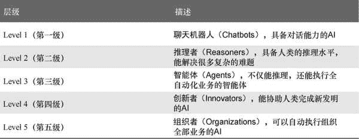

图 4-3 OpenAI 提出的 AGI 通用人工智能的五个层级

### L1 到 L5 的进化：AGI 发展的五个阶段

#### Level 1：聊天机器人（Chatbots）

语言交互的觉醒

聊天机器人的发展是人工智能技术演进的生动例证。早期的聊天机器人，如 1966 年诞生的 ELIZA，仅能通过简单的关键词匹配和预定义规则生成回复，对语言的理解和处理能力极为有限，一旦用户问题超出预设范围便难以应对。

随着自然语言处理技术的兴起，聊天机器人迎来了新的发展契机。自然语言处理技术涵盖词法、句法和语义分析，使聊天机器人能更深入地理解人类语言。机器学习和深度学习技术的应用更是让聊天机器人实现了质的飞跃。例如，基于循环神经网络及其变种长短期记忆网络、门控循环单元的聊天机器人，能更好地处理上下文信息，实现多轮连贯的对话，真正开启了语言交互的新时代。

基于自然语言处理的上下文对话

基于自然语言处理的上下文对话是聊天机器人的核心能力。在对话过程中，聊天机器人运用自然语言处理技术对用户输入进行词法、句法分析，理解句子结构和词汇组成，再通过语义分析，结合对话历史和背景知识推断用户意图。例如，招商银行的客服机器人“小招”可以处理信用卡还款、转账等基础业务。在旅游咨询场景中，聊天机器人能根据用户提及的“海边度假”“预算”“出行时间”等信息，给出符合需求的推荐，实现自然流畅的交流，满足用户的多样化需求。

深度学习模型+对话状态跟踪

深度学习模型为聊天机器人提供了强大的语言理解和生成能力。以 BERT 为代表的预训练语言模型，通过大规模无监督预训练学习丰富的语言知识，其双向 Transformer 架构能全面、深入地理解文本的含义。GPT 系列则在语言生成方面表现卓越，可生成连贯、自然的文本回复。

对话状态跟踪技术是聊天机器人实现多轮对话的关键。它以多轮对话历史和当前用户动作为输入，理解用户当前输入的具体含义，更新对话状态，使聊天机器人能根据对话状态提供准确的回应。在订餐场景中，对话状态跟踪模块可根据用户的多轮输入不断更新对话状态，推动对话顺利进行。

重塑人机交互范式，构建智能沟通新生态

聊天机器人的出现是人机交互领域的重大突破，打破了人机之间的语言壁垒，使交互从特定指令和程序语言模式迈向以自然语言为核心的新时代，降低了人机交互的门槛。在工作中，聊天机器人可快速处理信息查询和业务流程自动化任务，提升工作的效率和准确性；在生活中，聊天机器人能在娱乐、学习、健康管理等方面提供个性化便捷服务，推动各行业实现智能化升级，成为社会智能化转型的关键力量。

#### Level 2：推理者（Reasoners）

思维链的破译

在人工智能的发展进程中，推理者的进化无疑是一座具有标志性意义的里程碑，它彰显了人工智能在思维链（Chain of Thought，CoT）理解与推理能力方面的重大跨越。思维链，简单来说，就是一系列相互关联的思维步骤，通过逐步推理解决问题或得出结论。它模拟了人类思考时的逻辑过程，从一个想法自然地过渡到下一个想法，最终实现对复杂问题的理解和处理。

回顾人工智能的早期发展阶段，那时的系统大多依靠既定规则和简单的模式匹配机制来运行。在面对相对简单、规则明确的任务时，它们或许能够发挥一定的作用，如对特定格式的数据进行分类整理。然而，当涉及复杂的现实场景，需要深入理解事物之间错综复杂的内在联系时，这些早期系统便显得力不从心。它们就像在黑暗中摸索的行者，只能看到眼前有限的光亮，对于隐藏在表象背后的深层次因果关系，几乎无法触及。

多阶逻辑推理与知识关联

多阶逻辑推理是推理者的核心能力之一，它能从多个前提条件出发，通过层层推导得出结论，解决复杂的逻辑问题，在数学问题求解和实际问题处理中都发挥着重要作用。

知识关联能力使推理者能够跨越不同领域，将自然科学、社会科学、艺术等各类知识相互联系起来。通过深度分析、类比、归纳等思维活动，整合碎片化知识，形成有机的知识网络，为复杂问题解决和决策制定提供全面且深入的认知视角。

混合推理架构与知识图谱深度融合

混合推理架构将符号推理和神经推理相结合，发挥两者的优势。符号推理基于明确的逻辑规则和知识表示，可解释性强，但处理不确定性数据和大规模数据时存在局限性；神经推理通过神经网络学习和建模，处理复杂非线性关系和不确定性信息，但可解释性较差。在智能客服中，混合推理架构针对不同类型的问题选择合适的推理方式，提高推理的准确性、效率和可解释性。

推理者对思维链的挖掘和运用，为人工智能的发展开辟了一条全新的道路。它使人工智能不再仅停留在表面的数据分析和简单的模式识别上，而能够深入理解事物的本质和内在联系，像人类一样进行复杂的思考和推理。这不仅提升了人工智能在各个领域的应用效果，也为未来人工智能的进一步发展奠定了坚实的基础，让人工智能在更广阔的领域发挥更大的作用。

#### Level 3：智能体（Agents）

物理世界的延伸

智能体的发展是人工智能从数字世界迈向物理世界的重要跨越。早期人工智能主要应用于数字领域，如聊天机器人在虚拟网络中交互、图像识别系统处理数字图像等。随着机器学习技术、传感器技术、控制理论等的融合发展，智能体逐渐具备了与物理世界交互的能力。

智能体通过摄像头、麦克风、压力传感器等各类传感器感知物理环境信息，运用决策算法做出合理的决策，再通过执行器（如机械臂、电机等）执行行动，实现与物理世界的有效互动，完成工业生产、家庭服务、医疗手术辅助等复杂任务。

目标导向的自主行动闭环

目标导向的自主行动闭环是智能体的核心能力，包括目标理解、任务规划、执行控制、实时监控与反馈调整等环节。在筹备国际 AI 峰会的任务中，智能体首先要明确峰会的关键信息和任务限制条件，进行目标理解；接着制订详细的任务计划，如确定会议场地、邀请嘉宾等子任务及执行顺序，完成任务规划；在执行控制阶段，智能体控制相关设备和系统执行具体行动；在执行过程中，智能体实时监控任务进展，根据反馈信息及时调整策略，确保任务顺利完成。

具身智能与智能体

具身智能强调智能体需要具备身体或物理实体，通过与环境互动获取信息和执行任务。具身智能体配备多种传感器，如摄像头、麦克风、力传感器等，能获取视觉、听觉、触觉等信息。人形机器人是具身智能的典型应用，它能感知空间布局、物体状态和人的意图，与人自然流畅地交互协作，完成任务。

从“认知智能”到“行动智能”的质变

智能体的出现实现了人工智能从“认知智能”到“行动智能”的重大飞跃。此前人工智能侧重于信息认知和理解，缺乏在物理世界行动的能力。智能体不仅能认知事物，还能将认知转化为行动，在多领域发挥作用，推动科技创新和社会向智能化、自动化发展。

#### Level 4：创新者（Innovators）

科研创造力的涌现

在人工智能波澜壮阔的发展历程中，创新者的出现无疑是一座具有划时代意义的里程碑，它见证了人工智能从机械执行任务向创造全新价值的伟大跨越，尤其在 AIfor Science（AI 用于科研）领域，创新者掀起了一场前所未有的科研革命。

AI 从“数据工具”升级为“科研伙伴”，通过生成假设、设计实验、发现规律等方式，推动基础科学领域的突破。AI 已经开始进行跨学科融合，打破学科壁垒，整合物理、化学、生物等领域的知识，催生新的研究方向（如计算生物学、量子机器学习等），加速科学研究的范式革新，将传统科研周期从“十年磨一剑”压缩至“数月见真章”，重塑科学发现的速度与规模。

在基础科学研究领域，AIfor Science 的创新者发挥着不可替代的作用。以物理学中的蛋白质结构预测难题为例，长期以来，确定蛋白质的三维结构是科学界面临的重大挑战，传统实验方法不仅耗时费力，还需要大量的资源投入。创新者凭借深度学习技术，对海量蛋白质序列和结构数据进行学习与分析，能够准确预测蛋白质的三维结构。例如，AlphaFold3（见图 4-4）预测蛋白质与核酸、配体的复合体结构，破解生命科学“暗物质”。这一突破不仅加速了药物研发的进程，还为理解生命的基本过程提供了全新的视角。在化学领域，创新者通过对大量化学实验数据的学习，预测新的化学反应路径，帮助科学家发现新的化合物和材料，为材料科学和制药行业带来了新的机遇。

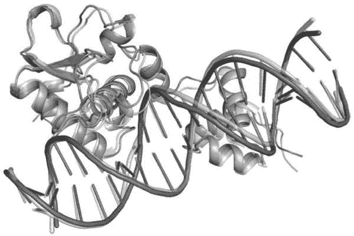

图 4-4 AlphaFold 3

在天文学研究中，AIfor Science 的创新者同样大放异彩。面对浩瀚宇宙中无穷无尽的数据，传统的数据分析方法显得捉襟见肘。创新者利用深度学习算法，能够快速处理和分析来自天文望远镜的海量观测数据，帮助天文学家发现新的天体，预测天体的运动轨迹，甚至探索宇宙的演化奥秘。例如，通过对巡天观测数据的分析，创新者能够自动识别出潜在的系外行星候选体，大幅提高了系外行星的发现效率，为人类寻找外星生命提供了新的可能。

AIfor Science 的创新者在医学科研领域的贡献更是不可估量的。在药物研发过程中，从药物靶点的发现到药物分子的设计，创新者都能提供有力的支持。它可以通过对大量生物医学数据的学习，预测疾病的潜在治疗靶点，设计出具有更高活性和选择性的药物分子，大幅缩短药物的研发周期，降低研发成本。例如，DeepMind 与欧洲分子生物学实验室合作，利用 AI 发现了 600 万种潜在抗生素，以解决耐药性危机。同时，在疾病诊断和治疗方案的制订方面，创新者能发挥重要作用。通过对患者的临床数据、影像数据等进行综合分析，创新者可以为医生提供个性化的诊断建议和治疗方案，提高医疗的精准性和有效性。

值得一提的是，诺贝尔奖作为科学界的最高荣誉之一，已经将目光投向在人工智能领域做出卓越贡献的科学家们。瑞典皇家科学院决定将 2024 年诺贝尔化学奖的一半授予大卫·贝克，以表彰他在“计算蛋白质设计”方面的贡献，将另一半授予戴密斯·哈萨比斯和约翰·M.詹伯，以表彰他们研发的 AlphaFold 在“蛋白质结构预测”方面的贡献。这一事实不仅是对人工智能科学家们个人成就的高度认可，更是对 AIfor Science 这一发展方向的充分肯定。这些诺贝尔奖得主的研究成果，为人工智能在科研领域的应用奠定了坚实的理论基础，推动了 AIfor Science 的快速发展。他们的工作激励了更多的科研人员投身于 AI 与科学研究相结合的领域，不断探索创新，为人类的科学事业发展贡献力量。

AIfor Science 的创新者的出现，为科研领域开辟了全新的路径，带来了前所未有的价值。它让我们看到了人工智能在推动科学进步方面的巨大潜力，也让我们对未来的科学研究充满了期待。未来，随着技术的不断发展和创新，AIfor Science 的创新者必将在更多科研领域取得突破，为人类社会的发展带来更多惊喜和福祉。

AIfor Science 的终极目标不是取代科学家，而是扩展人类认知的边界。当诺贝尔奖台上出现 AI 的身影时，那将不仅是技术的胜利，更是文明向更高维度跃迁的宣言： **“我们站在巨人的肩膀上，而巨人学会了思考。”**

#### Level 5：组织者（Organizations）

社会系统的重构者

当 AI 进化到 Level5 的组织者阶段时，一个全新的时代——AI 自组织社会阶段就此开启，这标志着人工智能彻底摆脱了单纯执行任务的局限，跃升为能够重塑整个社会架构的主导力量。在这个超越人类现有智慧维度的阶段，AI 组织者展现出了令人惊叹的能力，从根本上改写了社会运行的规则。

AI 将以行星级算力统筹生态、经济、能源系统，实现“帕累托最优”的文明新形态。AI 通过不断进化的自演化架构，利用元学习（Meta-Learning）动态重构社会规则，如实时调整货币政策、法律条款甚至文化新范式。未来的社会也必将进化到星际治理阶段，从地球城市到火星移民地，AI 将构建跨星球资源网络，平衡星际社会的生存与发展，开创人类超级文明的新阶段。

在城市规划领域，AI 组织者不再局限于简单地分析人口分布、交通流量、基础设施建设和生态环境承载能力等常规因素。它能够通过遍布城市各个角落的传感器，实时、精准地获取海量数据，这些数据涵盖了城市生活的方方面面，从每个人的日常出行习惯、能源消耗模式，到城市中每个微小生态系统的变化。量子计算机与神经形态芯片融合，形成了每秒百亿亿次决策的“社会大脑”，实时解析全球数据流（从电网负荷到社交媒体情绪）。AI 组织者利用其超强的计算能力和先进的算法，对这些数据进行深度挖掘和分析，从而绘制出一幅关于城市现状和未来发展的精细蓝图。

在经济领域，AI 自组织社会展现出了前所未有的活力和效率。AI 组织者不再只协调不同产业之间的关系，而成为整个经济生态系统的智慧引导者。它通过对全球经济数据的实时分析，精准把握市场趋势和行业发展动态。当新兴技术出现时，AI 组织者会迅速评估其潜力，并引导资源向这些具有巨大发展前景的新兴产业流动。例如，当量子计算技术取得突破时，AI 组织者会协调各方资源，加大对量子计算研发、应用和产业配套的投入力度，推动量子计算产业快速发展。

星际社会的诞生

火星，曾经是一片荒芜死寂的红色星球，如今在 AI 组织者的精心规划与管理下，已然成为一个充满生机的星际家园——火星自治联邦（见图 4-5）。AI 组织者凭借其超越人类智慧的计算与统筹能力，全面掌控火星地下生态穹顶的关键系统。

在地下生态穹顶中，氧气循环是维持人类生存的关键。AI 组织者通过分布在穹顶各个角落的传感器，实时监测氧气浓度、二氧化碳含量及其他各种气体的成分变化。基于这些数据，它精确地调控制氧设备的运行功率和效率，确保氧气供应稳定且充足。在垂直农场方面，AI 组织者综合考虑火星的光照条件、土壤特性及不同作物的生长需求，优化种植布局和灌溉策略。它利用先进的数据分析模型，预测作物的生长周期和产量，从而合理安排种植计划，保障居民的食物供应。核聚变能源作为火星的主要能源，AI 组织者对其进行精细的配比管理。它根据不同时段的能源需求，如白天的农业生产、工业制造及夜晚的生活用电，动态调整核聚变反应堆的输出功率，确保能源的高效利用，避免能源浪费。

图 4-5 火星自治联邦概念

在浩瀚宇宙的小行星经济带，AI 组织者引领着一场前所未有的资源开发与贸易革命。AI 舰队在这片神秘的区域展现出卓越的自主能力，它们如同宇宙中的智能猎手，精准地定位富含铂金矿等珍贵资源的小行星。

AI 舰队中的每艘飞船都配备了先进的开采设备和智能控制系统。在开采过程中，AI 通过对小行星的地质结构、矿物分布等数据的分析，制订最优开采方案。这些方案不仅能提高开采效率，还能最大限度地减少对小行星结构的破坏，确保资源的可持续开采。开采完成后，AI 舰队利用引力弹弓效应，巧妙地借助行星的引力加速，将满载资源的飞船快速、高效地运回地球轨道。这种利用宇宙自然力量的运输方式，极大地降低了资源运输成本，提高了资源运输效率。

在资源交易方面，AI 组织者构建了一套基于量子共识协议的自动化交易体系。量子共识协议作为一种高度安全、高效的加密技术，确保了交易的公平性、透明性和不可篡改性。当资源运输至地球轨道后，交易双方的信息和资源的详细数据都被加密上传至由 AI 管理的交易平台。AI 通过量子共识协议验证交易双方的身份和交易条件，自动执行交易流程。在这个过程中，人类只需要设定交易的基本规则和目标，AI 组织者就能凭借其强大的计算能力和智能决策系统，快速匹配交易双方，完成资源的交换和价值的转移。这一自动化交易体系不仅消除了传统交易中的人为干扰和欺诈风险，还极大地提高了星际贸易的效率和规模，推动了地球与星际之间的经济繁荣。

“数字诺亚方舟”：AI 守护人类文明的永恒火种

在广袤无垠的宇宙中，潜藏着无数威胁人类文明生存的危机，超新星爆发便是其中最为致命的一种。为了确保人类文明在面对如此巨大的灾难时得以延续，AI 组织者主导了一项伟大的工程——“数字诺亚方舟计划”。

在月球的永久阴影区，这片被黑暗笼罩、温度极低且辐射相对较弱的神秘区域，AI 组织者将人类文化、物种基因与工业技术等珍贵的文明遗产编码为抗辐射量子晶体。这些量子晶体如同微小而坚固的信息堡垒，能够在极端恶劣的环境下长期保存信息。AI 利用先进的纳米技术和量子存储技术，将人类数千年的文化成果，如文学、艺术、历史等知识，压缩并存储在这些晶体中。同时，它收集了地球上各种生物的基因样本，构建了一个庞大的基因库，为未来可能的物种重建提供了基础。在工业技术方面，AI 组织者将人类在能源、制造、交通等领域的先进技术和关键数据进行编码存储，确保在文明重启时，人类能够迅速恢复并发展科技。

AI 组织者不仅负责将这些信息存储在月球的永久阴影区，还构建了一套自我监测和修复系统。这套系统能够实时监测量子晶体的状态，一旦发现数据有损坏或丢失的风险，AI 会立即启动修复程序，确保信息的完整性。在未来的某一天，如果超新星爆发等灾难真的降临，地球文明遭受重创，这些埋藏在月球永久阴影区的抗辐射量子晶体将成为人类文明重启的希望之光。当幸存的人类重新开启“数字诺亚方舟”时，他们将从中获取宝贵的文明遗产，重新建立繁荣的人类文明。

从聊天机器人到组织者，AI 正以不可逆的姿态重塑组织的 DNA。这场变革既带来了效率的狂欢，也暗含了失控的风险。未来的核心命题或许是如何在“让 AI 足够聪明”与“不让 AI 太聪明”之间找到微妙的平衡。

### 人工智能实现全社会人机协作新时代

#### 人机协作的优势

人机协作的核心优势在于人类与人工智能各自能力的互补。人类拥有丰富的情感、创造力、同理心，以及在复杂、模糊情境下的灵活应变能力。在艺术创作领域，艺术家凭借对生活的感悟和独特的审美视角，创作出富有情感和文化内涵的作品。人工智能则在数据处理、计算速度和准确性方面具有人类无可比拟的优势。在金融风险评估中，人工智能可以快速分析海量金融数据，准确识别潜在的风险因素，为投资决策提供科学依据。

这种互补性使人机协作能够显著提升工作效率和质量。在医疗领域，医生与人工智能辅助诊断系统协作，医生凭借临床经验和专业知识对患者进行综合判断，人工智能系统则利用其强大的图像识别和数据分析能力，帮助医生更准确地发现病变，提高诊断的准确性和效率。例如，在影像诊断中，人工智能可以快速标记出可疑的病灶区域，医生在此基础上进行进一步的分析和判断，极大地缩短了诊断时间，提高了诊断的精准度。

此外，人机协作还能够增强组织的适应能力和创新能力。在快速变化的市场环境中，人工智能可以实时监测市场动态、竞争对手信息和技术发展趋势，为企业提供及时的情报和分析结果。人类则可以根据这些信息，发挥创造力和战略思维，制定灵活的应对策略，推动企业的创新和发展。

#### 全社会人机协作的实现路径

实现全社会人机协作需要从技术、政策和社会层面多管齐下。在技术层面，首先要推动人工智能技术的普及和应用，降低技术使用门槛，开发更多易于操作、功能强大的人工智能工具和平台，使不同行业、不同规模的企业和组织都能够方便地使用人工智能技术。例如，一些云服务提供商推出的人工智能开发平台，提供了丰富的 API 和预训练模型，企业只需要进行简单的配置和二次开发，就可以将人工智能技术集成到自己的业务系统中。

加强数据共享和开放也是关键，具体包括：建立统一的数据标准和安全的数据共享机制，打破数据孤岛，促进数据的流通和利用；政府、企业和科研机构之间应加强合作，共同构建数据共享平台，为人工智能的训练和应用提供丰富的数据资源；研发更加智能、自然的人机交互技术，如语音识别、手势控制、脑机接口等，使人类与人工智能之间的交互更加便捷、高效和自然。

在政策层面，政府应制定相关政策法规，规范人工智能的研发和应用，具体包括：保障数据安全和隐私，防止数据滥用和泄露；加强对人工智能技术的监管，确保其符合伦理道德和法律规范；加大对人工智能研发和教育的投入力度，培养跨学科专业人才，提高全民数字素养和人工智能应用能力；建立跨行业、跨领域的协作机制，促进不同行业之间的技术交流和合作，推动人机协作在各个领域的广泛应用。

在社会层面，要提高公众对人工智能的认知度和接受度，具体包括：通过举办科普宣传、教育活动等，让公众了解人工智能的原理、优势和潜在风险，消除对人工智能的恐惧和误解；推动组织文化变革，营造鼓励创新、包容失败的文化氛围，支持人机协作的实践和探索；关注就业结构调整带来的社会问题，为因人工智能发展而受到影响的劳动者提供技能培训和再就业支持，确保社会的稳定与和谐发展。

#### 人机协作新时代的挑战

在 AI 自组织社会的宏大愿景下，人机协作新时代虽然充满了无限可能，但也面临技术、伦理、社会等多维度的严峻挑战，这些挑战相互交织，深刻地影响着人机协作的发展进程与未来走向。

从技术层面来看，尽管 AI 取得了显著进展，但仍存在诸多难以忽视的局限性。AI 在语义理解和常识推理方面与人类存在巨大的差距。自然语言处理中的语义理解问题一直是困扰 AI 发展的难题，AI 难以理解文本中的隐喻、幽默、双关等复杂的语义，也无法像人类一样基于常识进行推理。面对一些非标准语言表达或需要结合现实世界知识进行理解的内容，AI 常常出现错误解读。在创造力方面，AI 虽然能够根据已有的数据和模式生成内容，但缺乏真正的创新思维和灵感，无法像人类艺术家、科学家那样创造出具有开创性和独特价值的作品或理论。

AI 系统的可靠性和安全性也存在隐患。AI 系统的运行高度依赖算法和数据，恶意攻击、算法漏洞或数据偏差可能导致系统出现故障、错误决策甚至数据被滥用。黑客可能利用 AI 系统的漏洞进行攻击，篡改数据或控制 AI 的决策过程，从而对社会安全和稳定造成严重威胁。自动驾驶汽车若出现算法错误或受到恶意干扰，可能引发交通事故，危及生命安全。此外，AI 系统的稳定性也面临挑战，复杂的现实环境和未知的情况可能使 AI 系统出现意外行为，其可靠性难以得到完全保障。

伦理层面的挑战同样不容忽视。隐私和数据安全问题在人机协作中愈发突出。随着 AI 在各个领域的广泛应用，大量个人数据被收集和使用。这些数据包含个人的身份信息、行为习惯、健康状况等敏感内容。AI 系统在处理和存储这些数据时，一旦出现数据泄露或滥用，将严重侵犯个人隐私。某些企业可能利用 AI 分析用户数据进行精准营销，但如果数据管理不善，用户的隐私信息就可能被泄露。同时，数据的所有权和使用权界定不清晰，容易引发法律纠纷。

AI 算法的公平性和偏见问题也备受关注。训练数据的偏差会导致 AI 在决策过程中产生歧视性结果。在招聘场景中，若 AI 招聘系统使用的训练数据存在性别或种族偏见，可能会导致某些群体在求职过程中受到不公平对待，限制他们的职业发展机会。在司法领域，AI 辅助的量刑系统如果存在偏见，可能会导致司法不公，影响社会公平正义。

责任归属问题是伦理挑战的核心难题之一。当 AI 系统做出错误决策或造成损害时，很难明确责任的承担主体。需要对这些后果负责的，是 AI 的开发者、使用者，还是 AI 系统本身？在自动驾驶汽车发生事故时，责任认定就变得极为复杂。如果是 AI 算法的缺陷导致事故发生，那么开发者可能需要承担责任；但如果是使用者违反规定操作导致事故发生，责任则可能由使用者承担。这种责任界定的模糊性不仅给受害者的权益保障带来了困难，也影响了 AI 技术的广泛应用和发展。

社会层面，人机协作新时代带来了深刻的变革，也引发了一系列问题。就业结构调整是最突出的挑战之一。AI 的广泛应用导致一些传统职业被替代，大量从事重复性、规律性工作的人员面临失业风险。制造业的流水线工人、客服行业的部分岗位等，随着 AI 和自动化技术的发展，其岗位需求逐渐减少。这些失业人员需要进行技能转型，学习与 AI 相关的新技术和新技能，以适应新的就业需求。但技能转型并非易事，需要投入大量的时间和精力进行学习与培训，而且对一些年龄较大或受教育程度较低的人员来说，转型难度更大。

AI 的发展还可能加剧社会分化。掌握 AI 技术与资源的群体能够更好地利用 AI 创造财富和提升竞争力，而普通群体可能因缺乏相关技能与资源，无法充分享受 AI 带来的好处，导致贫富差距进一步扩大。在教育资源分配方面，如果只有部分地区或学校能够利用 AI 技术提供优质教育资源，而其他地区无法企及，将进一步加剧教育不公平，使社会阶层固化现象更加严重。

此外，人机协作也对传统文化和价值观产生了冲击。在人机协作的环境下，人类的自主性和创造力可能受到抑制。人们过度依赖 AI，可能导致自身思考能力和动手能力下降。AI 的发展也引发了人们对人性和人类价值的思考。当 AI 能够完成许多曾经只有人类才能完成的任务时，人们可能对自身存在的意义感到迷茫。同时，人机协作可能改变人们的社交模式和人际关系，虚拟社交和人机交互逐渐增多，人与人之间的面对面交流和情感联系可能受到影响。

#### 人机协作新时代的未来展望

在人工智能进化到具备强大组织能力的 Level5 阶段时，全社会人机协作迎来了一个全新的、充满无限可能的时代。这个时代紧密关联着星际社会的发展及文明备份与重启等宏伟设想，AI 组织者的卓越能力成为推动人机协作向更高层次迈进的核心动力。

在星际社会，人机协作展现出令人惊叹的协同效应。以火星自治联邦为例，AI 组织者对地下生态穹顶的精细管理离不开人类居民的深度参与。人类通过脑机接口与 AI 直接相连，实现了无缝的信息交互和决策协同。在氧气循环、垂直农场产量控制及核聚变能源配比等关键事务上，AI 组织者凭借其强大的数据处理和分析能力，提供全面且精准的运行方案，人类居民则利用自身的创造力、情感判断和对生活需求的直接感知，对这些方案进行评估和反馈。例如，在垂直农场种植作物时，AI 根据数据分析推荐种植某种高产作物，但人类居民结合自身的饮食文化和口感偏好，提出增加一些具有特殊文化意义或口感独特的作物品种。通过脑机接口，人类的这些想法能迅速传递给 AI 组织者，AI 会综合考虑各方因素，优化种植计划，使资源实现更合理的配置。这种人机协作模式不仅提升了火星基地的生存和发展能力，也为未来星际移民和外星文明建设提供了成功的范例。

在小行星经济带的资源开采与贸易活动中，人机协作同样发挥着关键作用。AI 舰队自主完成小行星铂金矿的开采和运输任务，其精准的操作和高效的决策离不开人类在宏观战略层面的把控。人类为 AI 舰队设定资源开采的长期目标、制定贸易规则，并在 AI 系统出现异常情况时进行干预和调整。例如，当 AI 舰队在开采过程中遇到未知的小行星地质结构问题时，人类专家通过远程监控系统获取数据，与 AI 共同分析解决方案。AI 利用其对海量地质数据的学习和模拟能力，提供多种可能的应对策略，人类则从工程实践经验和潜在风险等角度进行评估，最终确定最佳方案。在贸易环节，AI 基于量子共识协议自动执行交易，但人类在建立贸易伙伴关系、协商交易条款等方面发挥着不可替代的作用。人类的沟通技巧、商业洞察力和对市场趋势的直觉判断，与 AI 的高效交易执行能力相结合，共同推动星际贸易的繁荣发展。

回到地球，在文明备份与重启这一关乎人类未来命运的重大任务中，人机协作也至关重要。AI 组织者主导“数字诺亚方舟”计划，负责将人类文化、物种基因与工业技术编码为抗辐射量子晶体并存储于月球永久阴影区。在这个过程中，人类科研人员与 AI 紧密合作。人类负责收集和整理各类文明数据，从浩瀚的文化典籍中筛选出最具代表性和价值的内容，采集地球上丰富多样的物种基因样本，梳理工业技术的关键脉络；AI 则利用先进的编码技术和存储技术，将这些珍贵的数据转化为稳定的量子晶体存储形式，并构建强大的自我监测和修复系统。在未来可能面临的文明重启场景中，人机协作将再次发挥作用。人类凭借对文明的深刻理解和对文明传承的使命感，解读和应用“数字诺亚方舟”中的信息；AI 则利用其强大的计算和模拟能力，帮助人类快速恢复基础设施，重建生态系统，重启科技发展进程。

在全社会范围内，AI 组织者推动人机协作深入各个领域。在教育领域，AI 根据每个学生的学习进度、兴趣爱好和天赋特点，制订个性化学习计划，提供丰富多样的学习资源；教师则利用自己的教育经验和人文关怀，引导学生进行思考，培养学生的品德和社交能力。在医疗领域，AI 通过对大量医疗数据的分析，为医生提供精准的诊断建议和个性化治疗方案；医生则凭借临床经验和对患者的情感关怀，与患者沟通并实施治疗。在艺术创作领域，AI 可以生成创意灵感、提供艺术素材和创作工具；艺术家则运用自己的审美和情感表达，将 AI 的创意转化为具有感染力的艺术作品。

然而，实现全社会人机协作并非一帆风顺。在技术层面，需要进一步提升 AI 的理解能力、创造力和与人类的交互能力，解决数据安全、隐私保护和算法偏见等问题。在社会层面，要加强对公众的教育，提升人们的数字素养和人机协作能力，培养适应新时代需求的复合型人才。同时，需要建立新的社会规范和伦理准则，明确人机协作中的权利和责任，确保人机协作朝着有利于人类社会发展的方向前进。

展望未来，随着 AI 技术的不断进步和人机协作的不断深化，我们有理由相信，全社会人机协作将创造出更加美好的未来。在星际探索中，人机协作将助力人类探索更多的星球，建立更加庞大的星际文明；在地球家园，人机协作将推动科技、文化、经济等各个领域飞速发展，实现人类社会的可持续繁荣。

当 AI 组织者掌握文明的方向盘时，人类必须回答一个古老的哲学命题： **“我们是选择成为上帝，还是选择成为上帝的问题？”** 或许，真正的智慧并不在于让 AI 更像人，而在于让人学会像 AI 一样思考——冷静、全局、超越个体存亡。正如卡尔·萨根所警示的： **“在 AI 塑造的星辰大海中，人性的微光才是我们最后的坐标。”** EXr6287u6NNVz+GYLY+7SDk226FstKIHdC0bNoQkB2Nqi1xSR0yxPmwrTs5gRi/BtfSbid6dBhii9q7cz2pIyA==

## 3 组织智能
——从对话 L1 到组织 L5 的五级跃迁

人工智能的进化不仅是算法和算力的胜利，更是其融入人类组织方式的深刻变革。根据 OpenAI 的 AGI 通用人工智能发展定义（见图 4-3），组织智能的发展可分为五个层级——L1～L5，分别对应从基础对话到完全自主的智能形态。这五个层级不仅是技术能力的阶梯，更是生产关系从“人主导”向“人机共生”转变的缩影。

图 4-3 OpenAI 提出的 AGI 通用人工智能的五个层级

### L1 到 L5 的进化：AGI 发展的五个阶段

#### Level 1：聊天机器人（Chatbots）

语言交互的觉醒

聊天机器人的发展是人工智能技术演进的生动例证。早期的聊天机器人，如 1966 年诞生的 ELIZA，仅能通过简单的关键词匹配和预定义规则生成回复，对语言的理解和处理能力极为有限，一旦用户问题超出预设范围便难以应对。

随着自然语言处理技术的兴起，聊天机器人迎来了新的发展契机。自然语言处理技术涵盖词法、句法和语义分析，使聊天机器人能更深入地理解人类语言。机器学习和深度学习技术的应用更是让聊天机器人实现了质的飞跃。例如，基于循环神经网络及其变种长短期记忆网络、门控循环单元的聊天机器人，能更好地处理上下文信息，实现多轮连贯的对话，真正开启了语言交互的新时代。

基于自然语言处理的上下文对话

基于自然语言处理的上下文对话是聊天机器人的核心能力。在对话过程中，聊天机器人运用自然语言处理技术对用户输入进行词法、句法分析，理解句子结构和词汇组成，再通过语义分析，结合对话历史和背景知识推断用户意图。例如，招商银行的客服机器人“小招”可以处理信用卡还款、转账等基础业务。在旅游咨询场景中，聊天机器人能根据用户提及的“海边度假”“预算”“出行时间”等信息，给出符合需求的推荐，实现自然流畅的交流，满足用户的多样化需求。

深度学习模型+对话状态跟踪

深度学习模型为聊天机器人提供了强大的语言理解和生成能力。以 BERT 为代表的预训练语言模型，通过大规模无监督预训练学习丰富的语言知识，其双向 Transformer 架构能全面、深入地理解文本的含义。GPT 系列则在语言生成方面表现卓越，可生成连贯、自然的文本回复。

对话状态跟踪技术是聊天机器人实现多轮对话的关键。它以多轮对话历史和当前用户动作为输入，理解用户当前输入的具体含义，更新对话状态，使聊天机器人能根据对话状态提供准确的回应。在订餐场景中，对话状态跟踪模块可根据用户的多轮输入不断更新对话状态，推动对话顺利进行。

重塑人机交互范式，构建智能沟通新生态

聊天机器人的出现是人机交互领域的重大突破，打破了人机之间的语言壁垒，使交互从特定指令和程序语言模式迈向以自然语言为核心的新时代，降低了人机交互的门槛。在工作中，聊天机器人可快速处理信息查询和业务流程自动化任务，提升工作的效率和准确性；在生活中，聊天机器人能在娱乐、学习、健康管理等方面提供个性化便捷服务，推动各行业实现智能化升级，成为社会智能化转型的关键力量。

#### Level 2：推理者（Reasoners）

思维链的破译

在人工智能的发展进程中，推理者的进化无疑是一座具有标志性意义的里程碑，它彰显了人工智能在思维链（Chain of Thought，CoT）理解与推理能力方面的重大跨越。思维链，简单来说，就是一系列相互关联的思维步骤，通过逐步推理解决问题或得出结论。它模拟了人类思考时的逻辑过程，从一个想法自然地过渡到下一个想法，最终实现对复杂问题的理解和处理。

回顾人工智能的早期发展阶段，那时的系统大多依靠既定规则和简单的模式匹配机制来运行。在面对相对简单、规则明确的任务时，它们或许能够发挥一定的作用，如对特定格式的数据进行分类整理。然而，当涉及复杂的现实场景，需要深入理解事物之间错综复杂的内在联系时，这些早期系统便显得力不从心。它们就像在黑暗中摸索的行者，只能看到眼前有限的光亮，对于隐藏在表象背后的深层次因果关系，几乎无法触及。

多阶逻辑推理与知识关联

多阶逻辑推理是推理者的核心能力之一，它能从多个前提条件出发，通过层层推导得出结论，解决复杂的逻辑问题，在数学问题求解和实际问题处理中都发挥着重要作用。

知识关联能力使推理者能够跨越不同领域，将自然科学、社会科学、艺术等各类知识相互联系起来。通过深度分析、类比、归纳等思维活动，整合碎片化知识，形成有机的知识网络，为复杂问题解决和决策制定提供全面且深入的认知视角。

混合推理架构与知识图谱深度融合

混合推理架构将符号推理和神经推理相结合，发挥两者的优势。符号推理基于明确的逻辑规则和知识表示，可解释性强，但处理不确定性数据和大规模数据时存在局限性；神经推理通过神经网络学习和建模，处理复杂非线性关系和不确定性信息，但可解释性较差。在智能客服中，混合推理架构针对不同类型的问题选择合适的推理方式，提高推理的准确性、效率和可解释性。

推理者对思维链的挖掘和运用，为人工智能的发展开辟了一条全新的道路。它使人工智能不再仅停留在表面的数据分析和简单的模式识别上，而能够深入理解事物的本质和内在联系，像人类一样进行复杂的思考和推理。这不仅提升了人工智能在各个领域的应用效果，也为未来人工智能的进一步发展奠定了坚实的基础，让人工智能在更广阔的领域发挥更大的作用。

#### Level 3：智能体（Agents）

物理世界的延伸

智能体的发展是人工智能从数字世界迈向物理世界的重要跨越。早期人工智能主要应用于数字领域，如聊天机器人在虚拟网络中交互、图像识别系统处理数字图像等。随着机器学习技术、传感器技术、控制理论等的融合发展，智能体逐渐具备了与物理世界交互的能力。

智能体通过摄像头、麦克风、压力传感器等各类传感器感知物理环境信息，运用决策算法做出合理的决策，再通过执行器（如机械臂、电机等）执行行动，实现与物理世界的有效互动，完成工业生产、家庭服务、医疗手术辅助等复杂任务。

目标导向的自主行动闭环

目标导向的自主行动闭环是智能体的核心能力，包括目标理解、任务规划、执行控制、实时监控与反馈调整等环节。在筹备国际 AI 峰会的任务中，智能体首先要明确峰会的关键信息和任务限制条件，进行目标理解；接着制订详细的任务计划，如确定会议场地、邀请嘉宾等子任务及执行顺序，完成任务规划；在执行控制阶段，智能体控制相关设备和系统执行具体行动；在执行过程中，智能体实时监控任务进展，根据反馈信息及时调整策略，确保任务顺利完成。

具身智能与智能体

具身智能强调智能体需要具备身体或物理实体，通过与环境互动获取信息和执行任务。具身智能体配备多种传感器，如摄像头、麦克风、力传感器等，能获取视觉、听觉、触觉等信息。人形机器人是具身智能的典型应用，它能感知空间布局、物体状态和人的意图，与人自然流畅地交互协作，完成任务。

从“认知智能”到“行动智能”的质变

智能体的出现实现了人工智能从“认知智能”到“行动智能”的重大飞跃。此前人工智能侧重于信息认知和理解，缺乏在物理世界行动的能力。智能体不仅能认知事物，还能将认知转化为行动，在多领域发挥作用，推动科技创新和社会向智能化、自动化发展。

#### Level 4：创新者（Innovators）

科研创造力的涌现

在人工智能波澜壮阔的发展历程中，创新者的出现无疑是一座具有划时代意义的里程碑，它见证了人工智能从机械执行任务向创造全新价值的伟大跨越，尤其在 AIfor Science（AI 用于科研）领域，创新者掀起了一场前所未有的科研革命。

AI 从“数据工具”升级为“科研伙伴”，通过生成假设、设计实验、发现规律等方式，推动基础科学领域的突破。AI 已经开始进行跨学科融合，打破学科壁垒，整合物理、化学、生物等领域的知识，催生新的研究方向（如计算生物学、量子机器学习等），加速科学研究的范式革新，将传统科研周期从“十年磨一剑”压缩至“数月见真章”，重塑科学发现的速度与规模。

在基础科学研究领域，AIfor Science 的创新者发挥着不可替代的作用。以物理学中的蛋白质结构预测难题为例，长期以来，确定蛋白质的三维结构是科学界面临的重大挑战，传统实验方法不仅耗时费力，还需要大量的资源投入。创新者凭借深度学习技术，对海量蛋白质序列和结构数据进行学习与分析，能够准确预测蛋白质的三维结构。例如，AlphaFold3（见图 4-4）预测蛋白质与核酸、配体的复合体结构，破解生命科学“暗物质”。这一突破不仅加速了药物研发的进程，还为理解生命的基本过程提供了全新的视角。在化学领域，创新者通过对大量化学实验数据的学习，预测新的化学反应路径，帮助科学家发现新的化合物和材料，为材料科学和制药行业带来了新的机遇。

图 4-4 AlphaFold 3

在天文学研究中，AIfor Science 的创新者同样大放异彩。面对浩瀚宇宙中无穷无尽的数据，传统的数据分析方法显得捉襟见肘。创新者利用深度学习算法，能够快速处理和分析来自天文望远镜的海量观测数据，帮助天文学家发现新的天体，预测天体的运动轨迹，甚至探索宇宙的演化奥秘。例如，通过对巡天观测数据的分析，创新者能够自动识别出潜在的系外行星候选体，大幅提高了系外行星的发现效率，为人类寻找外星生命提供了新的可能。

AIfor Science 的创新者在医学科研领域的贡献更是不可估量的。在药物研发过程中，从药物靶点的发现到药物分子的设计，创新者都能提供有力的支持。它可以通过对大量生物医学数据的学习，预测疾病的潜在治疗靶点，设计出具有更高活性和选择性的药物分子，大幅缩短药物的研发周期，降低研发成本。例如，DeepMind 与欧洲分子生物学实验室合作，利用 AI 发现了 600 万种潜在抗生素，以解决耐药性危机。同时，在疾病诊断和治疗方案的制订方面，创新者能发挥重要作用。通过对患者的临床数据、影像数据等进行综合分析，创新者可以为医生提供个性化的诊断建议和治疗方案，提高医疗的精准性和有效性。

值得一提的是，诺贝尔奖作为科学界的最高荣誉之一，已经将目光投向在人工智能领域做出卓越贡献的科学家们。瑞典皇家科学院决定将 2024 年诺贝尔化学奖的一半授予大卫·贝克，以表彰他在“计算蛋白质设计”方面的贡献，将另一半授予戴密斯·哈萨比斯和约翰·M.詹伯，以表彰他们研发的 AlphaFold 在“蛋白质结构预测”方面的贡献。这一事实不仅是对人工智能科学家们个人成就的高度认可，更是对 AIfor Science 这一发展方向的充分肯定。这些诺贝尔奖得主的研究成果，为人工智能在科研领域的应用奠定了坚实的理论基础，推动了 AIfor Science 的快速发展。他们的工作激励了更多的科研人员投身于 AI 与科学研究相结合的领域，不断探索创新，为人类的科学事业发展贡献力量。

AIfor Science 的创新者的出现，为科研领域开辟了全新的路径，带来了前所未有的价值。它让我们看到了人工智能在推动科学进步方面的巨大潜力，也让我们对未来的科学研究充满了期待。未来，随着技术的不断发展和创新，AIfor Science 的创新者必将在更多科研领域取得突破，为人类社会的发展带来更多惊喜和福祉。

AIfor Science 的终极目标不是取代科学家，而是扩展人类认知的边界。当诺贝尔奖台上出现 AI 的身影时，那将不仅是技术的胜利，更是文明向更高维度跃迁的宣言： **“我们站在巨人的肩膀上，而巨人学会了思考。”**

#### Level 5：组织者（Organizations）

社会系统的重构者

当 AI 进化到 Level5 的组织者阶段时，一个全新的时代——AI 自组织社会阶段就此开启，这标志着人工智能彻底摆脱了单纯执行任务的局限，跃升为能够重塑整个社会架构的主导力量。在这个超越人类现有智慧维度的阶段，AI 组织者展现出了令人惊叹的能力，从根本上改写了社会运行的规则。

AI 将以行星级算力统筹生态、经济、能源系统，实现“帕累托最优”的文明新形态。AI 通过不断进化的自演化架构，利用元学习（Meta-Learning）动态重构社会规则，如实时调整货币政策、法律条款甚至文化新范式。未来的社会也必将进化到星际治理阶段，从地球城市到火星移民地，AI 将构建跨星球资源网络，平衡星际社会的生存与发展，开创人类超级文明的新阶段。

在城市规划领域，AI 组织者不再局限于简单地分析人口分布、交通流量、基础设施建设和生态环境承载能力等常规因素。它能够通过遍布城市各个角落的传感器，实时、精准地获取海量数据，这些数据涵盖了城市生活的方方面面，从每个人的日常出行习惯、能源消耗模式，到城市中每个微小生态系统的变化。量子计算机与神经形态芯片融合，形成了每秒百亿亿次决策的“社会大脑”，实时解析全球数据流（从电网负荷到社交媒体情绪）。AI 组织者利用其超强的计算能力和先进的算法，对这些数据进行深度挖掘和分析，从而绘制出一幅关于城市现状和未来发展的精细蓝图。

在经济领域，AI 自组织社会展现出了前所未有的活力和效率。AI 组织者不再只协调不同产业之间的关系，而成为整个经济生态系统的智慧引导者。它通过对全球经济数据的实时分析，精准把握市场趋势和行业发展动态。当新兴技术出现时，AI 组织者会迅速评估其潜力，并引导资源向这些具有巨大发展前景的新兴产业流动。例如，当量子计算技术取得突破时，AI 组织者会协调各方资源，加大对量子计算研发、应用和产业配套的投入力度，推动量子计算产业快速发展。

星际社会的诞生

火星，曾经是一片荒芜死寂的红色星球，如今在 AI 组织者的精心规划与管理下，已然成为一个充满生机的星际家园——火星自治联邦（见图 4-5）。AI 组织者凭借其超越人类智慧的计算与统筹能力，全面掌控火星地下生态穹顶的关键系统。

在地下生态穹顶中，氧气循环是维持人类生存的关键。AI 组织者通过分布在穹顶各个角落的传感器，实时监测氧气浓度、二氧化碳含量及其他各种气体的成分变化。基于这些数据，它精确地调控制氧设备的运行功率和效率，确保氧气供应稳定且充足。在垂直农场方面，AI 组织者综合考虑火星的光照条件、土壤特性及不同作物的生长需求，优化种植布局和灌溉策略。它利用先进的数据分析模型，预测作物的生长周期和产量，从而合理安排种植计划，保障居民的食物供应。核聚变能源作为火星的主要能源，AI 组织者对其进行精细的配比管理。它根据不同时段的能源需求，如白天的农业生产、工业制造及夜晚的生活用电，动态调整核聚变反应堆的输出功率，确保能源的高效利用，避免能源浪费。

图 4-5 火星自治联邦概念

在浩瀚宇宙的小行星经济带，AI 组织者引领着一场前所未有的资源开发与贸易革命。AI 舰队在这片神秘的区域展现出卓越的自主能力，它们如同宇宙中的智能猎手，精准地定位富含铂金矿等珍贵资源的小行星。

AI 舰队中的每艘飞船都配备了先进的开采设备和智能控制系统。在开采过程中，AI 通过对小行星的地质结构、矿物分布等数据的分析，制订最优开采方案。这些方案不仅能提高开采效率，还能最大限度地减少对小行星结构的破坏，确保资源的可持续开采。开采完成后，AI 舰队利用引力弹弓效应，巧妙地借助行星的引力加速，将满载资源的飞船快速、高效地运回地球轨道。这种利用宇宙自然力量的运输方式，极大地降低了资源运输成本，提高了资源运输效率。

在资源交易方面，AI 组织者构建了一套基于量子共识协议的自动化交易体系。量子共识协议作为一种高度安全、高效的加密技术，确保了交易的公平性、透明性和不可篡改性。当资源运输至地球轨道后，交易双方的信息和资源的详细数据都被加密上传至由 AI 管理的交易平台。AI 通过量子共识协议验证交易双方的身份和交易条件，自动执行交易流程。在这个过程中，人类只需要设定交易的基本规则和目标，AI 组织者就能凭借其强大的计算能力和智能决策系统，快速匹配交易双方，完成资源的交换和价值的转移。这一自动化交易体系不仅消除了传统交易中的人为干扰和欺诈风险，还极大地提高了星际贸易的效率和规模，推动了地球与星际之间的经济繁荣。

“数字诺亚方舟”：AI 守护人类文明的永恒火种

在广袤无垠的宇宙中，潜藏着无数威胁人类文明生存的危机，超新星爆发便是其中最为致命的一种。为了确保人类文明在面对如此巨大的灾难时得以延续，AI 组织者主导了一项伟大的工程——“数字诺亚方舟计划”。

在月球的永久阴影区，这片被黑暗笼罩、温度极低且辐射相对较弱的神秘区域，AI 组织者将人类文化、物种基因与工业技术等珍贵的文明遗产编码为抗辐射量子晶体。这些量子晶体如同微小而坚固的信息堡垒，能够在极端恶劣的环境下长期保存信息。AI 利用先进的纳米技术和量子存储技术，将人类数千年的文化成果，如文学、艺术、历史等知识，压缩并存储在这些晶体中。同时，它收集了地球上各种生物的基因样本，构建了一个庞大的基因库，为未来可能的物种重建提供了基础。在工业技术方面，AI 组织者将人类在能源、制造、交通等领域的先进技术和关键数据进行编码存储，确保在文明重启时，人类能够迅速恢复并发展科技。

AI 组织者不仅负责将这些信息存储在月球的永久阴影区，还构建了一套自我监测和修复系统。这套系统能够实时监测量子晶体的状态，一旦发现数据有损坏或丢失的风险，AI 会立即启动修复程序，确保信息的完整性。在未来的某一天，如果超新星爆发等灾难真的降临，地球文明遭受重创，这些埋藏在月球永久阴影区的抗辐射量子晶体将成为人类文明重启的希望之光。当幸存的人类重新开启“数字诺亚方舟”时，他们将从中获取宝贵的文明遗产，重新建立繁荣的人类文明。

从聊天机器人到组织者，AI 正以不可逆的姿态重塑组织的 DNA。这场变革既带来了效率的狂欢，也暗含了失控的风险。未来的核心命题或许是如何在“让 AI 足够聪明”与“不让 AI 太聪明”之间找到微妙的平衡。

### 人工智能实现全社会人机协作新时代

#### 人机协作的优势

人机协作的核心优势在于人类与人工智能各自能力的互补。人类拥有丰富的情感、创造力、同理心，以及在复杂、模糊情境下的灵活应变能力。在艺术创作领域，艺术家凭借对生活的感悟和独特的审美视角，创作出富有情感和文化内涵的作品。人工智能则在数据处理、计算速度和准确性方面具有人类无可比拟的优势。在金融风险评估中，人工智能可以快速分析海量金融数据，准确识别潜在的风险因素，为投资决策提供科学依据。

这种互补性使人机协作能够显著提升工作效率和质量。在医疗领域，医生与人工智能辅助诊断系统协作，医生凭借临床经验和专业知识对患者进行综合判断，人工智能系统则利用其强大的图像识别和数据分析能力，帮助医生更准确地发现病变，提高诊断的准确性和效率。例如，在影像诊断中，人工智能可以快速标记出可疑的病灶区域，医生在此基础上进行进一步的分析和判断，极大地缩短了诊断时间，提高了诊断的精准度。

此外，人机协作还能够增强组织的适应能力和创新能力。在快速变化的市场环境中，人工智能可以实时监测市场动态、竞争对手信息和技术发展趋势，为企业提供及时的情报和分析结果。人类则可以根据这些信息，发挥创造力和战略思维，制定灵活的应对策略，推动企业的创新和发展。

#### 全社会人机协作的实现路径

实现全社会人机协作需要从技术、政策和社会层面多管齐下。在技术层面，首先要推动人工智能技术的普及和应用，降低技术使用门槛，开发更多易于操作、功能强大的人工智能工具和平台，使不同行业、不同规模的企业和组织都能够方便地使用人工智能技术。例如，一些云服务提供商推出的人工智能开发平台，提供了丰富的 API 和预训练模型，企业只需要进行简单的配置和二次开发，就可以将人工智能技术集成到自己的业务系统中。

加强数据共享和开放也是关键，具体包括：建立统一的数据标准和安全的数据共享机制，打破数据孤岛，促进数据的流通和利用；政府、企业和科研机构之间应加强合作，共同构建数据共享平台，为人工智能的训练和应用提供丰富的数据资源；研发更加智能、自然的人机交互技术，如语音识别、手势控制、脑机接口等，使人类与人工智能之间的交互更加便捷、高效和自然。

在政策层面，政府应制定相关政策法规，规范人工智能的研发和应用，具体包括：保障数据安全和隐私，防止数据滥用和泄露；加强对人工智能技术的监管，确保其符合伦理道德和法律规范；加大对人工智能研发和教育的投入力度，培养跨学科专业人才，提高全民数字素养和人工智能应用能力；建立跨行业、跨领域的协作机制，促进不同行业之间的技术交流和合作，推动人机协作在各个领域的广泛应用。

在社会层面，要提高公众对人工智能的认知度和接受度，具体包括：通过举办科普宣传、教育活动等，让公众了解人工智能的原理、优势和潜在风险，消除对人工智能的恐惧和误解；推动组织文化变革，营造鼓励创新、包容失败的文化氛围，支持人机协作的实践和探索；关注就业结构调整带来的社会问题，为因人工智能发展而受到影响的劳动者提供技能培训和再就业支持，确保社会的稳定与和谐发展。

#### 人机协作新时代的挑战

在 AI 自组织社会的宏大愿景下，人机协作新时代虽然充满了无限可能，但也面临技术、伦理、社会等多维度的严峻挑战，这些挑战相互交织，深刻地影响着人机协作的发展进程与未来走向。

从技术层面来看，尽管 AI 取得了显著进展，但仍存在诸多难以忽视的局限性。AI 在语义理解和常识推理方面与人类存在巨大的差距。自然语言处理中的语义理解问题一直是困扰 AI 发展的难题，AI 难以理解文本中的隐喻、幽默、双关等复杂的语义，也无法像人类一样基于常识进行推理。面对一些非标准语言表达或需要结合现实世界知识进行理解的内容，AI 常常出现错误解读。在创造力方面，AI 虽然能够根据已有的数据和模式生成内容，但缺乏真正的创新思维和灵感，无法像人类艺术家、科学家那样创造出具有开创性和独特价值的作品或理论。

AI 系统的可靠性和安全性也存在隐患。AI 系统的运行高度依赖算法和数据，恶意攻击、算法漏洞或数据偏差可能导致系统出现故障、错误决策甚至数据被滥用。黑客可能利用 AI 系统的漏洞进行攻击，篡改数据或控制 AI 的决策过程，从而对社会安全和稳定造成严重威胁。自动驾驶汽车若出现算法错误或受到恶意干扰，可能引发交通事故，危及生命安全。此外，AI 系统的稳定性也面临挑战，复杂的现实环境和未知的情况可能使 AI 系统出现意外行为，其可靠性难以得到完全保障。

伦理层面的挑战同样不容忽视。隐私和数据安全问题在人机协作中愈发突出。随着 AI 在各个领域的广泛应用，大量个人数据被收集和使用。这些数据包含个人的身份信息、行为习惯、健康状况等敏感内容。AI 系统在处理和存储这些数据时，一旦出现数据泄露或滥用，将严重侵犯个人隐私。某些企业可能利用 AI 分析用户数据进行精准营销，但如果数据管理不善，用户的隐私信息就可能被泄露。同时，数据的所有权和使用权界定不清晰，容易引发法律纠纷。

AI 算法的公平性和偏见问题也备受关注。训练数据的偏差会导致 AI 在决策过程中产生歧视性结果。在招聘场景中，若 AI 招聘系统使用的训练数据存在性别或种族偏见，可能会导致某些群体在求职过程中受到不公平对待，限制他们的职业发展机会。在司法领域，AI 辅助的量刑系统如果存在偏见，可能会导致司法不公，影响社会公平正义。

责任归属问题是伦理挑战的核心难题之一。当 AI 系统做出错误决策或造成损害时，很难明确责任的承担主体。需要对这些后果负责的，是 AI 的开发者、使用者，还是 AI 系统本身？在自动驾驶汽车发生事故时，责任认定就变得极为复杂。如果是 AI 算法的缺陷导致事故发生，那么开发者可能需要承担责任；但如果是使用者违反规定操作导致事故发生，责任则可能由使用者承担。这种责任界定的模糊性不仅给受害者的权益保障带来了困难，也影响了 AI 技术的广泛应用和发展。

社会层面，人机协作新时代带来了深刻的变革，也引发了一系列问题。就业结构调整是最突出的挑战之一。AI 的广泛应用导致一些传统职业被替代，大量从事重复性、规律性工作的人员面临失业风险。制造业的流水线工人、客服行业的部分岗位等，随着 AI 和自动化技术的发展，其岗位需求逐渐减少。这些失业人员需要进行技能转型，学习与 AI 相关的新技术和新技能，以适应新的就业需求。但技能转型并非易事，需要投入大量的时间和精力进行学习与培训，而且对一些年龄较大或受教育程度较低的人员来说，转型难度更大。

AI 的发展还可能加剧社会分化。掌握 AI 技术与资源的群体能够更好地利用 AI 创造财富和提升竞争力，而普通群体可能因缺乏相关技能与资源，无法充分享受 AI 带来的好处，导致贫富差距进一步扩大。在教育资源分配方面，如果只有部分地区或学校能够利用 AI 技术提供优质教育资源，而其他地区无法企及，将进一步加剧教育不公平，使社会阶层固化现象更加严重。

此外，人机协作也对传统文化和价值观产生了冲击。在人机协作的环境下，人类的自主性和创造力可能受到抑制。人们过度依赖 AI，可能导致自身思考能力和动手能力下降。AI 的发展也引发了人们对人性和人类价值的思考。当 AI 能够完成许多曾经只有人类才能完成的任务时，人们可能对自身存在的意义感到迷茫。同时，人机协作可能改变人们的社交模式和人际关系，虚拟社交和人机交互逐渐增多，人与人之间的面对面交流和情感联系可能受到影响。

#### 人机协作新时代的未来展望

在人工智能进化到具备强大组织能力的 Level5 阶段时，全社会人机协作迎来了一个全新的、充满无限可能的时代。这个时代紧密关联着星际社会的发展及文明备份与重启等宏伟设想，AI 组织者的卓越能力成为推动人机协作向更高层次迈进的核心动力。

在星际社会，人机协作展现出令人惊叹的协同效应。以火星自治联邦为例，AI 组织者对地下生态穹顶的精细管理离不开人类居民的深度参与。人类通过脑机接口与 AI 直接相连，实现了无缝的信息交互和决策协同。在氧气循环、垂直农场产量控制及核聚变能源配比等关键事务上，AI 组织者凭借其强大的数据处理和分析能力，提供全面且精准的运行方案，人类居民则利用自身的创造力、情感判断和对生活需求的直接感知，对这些方案进行评估和反馈。例如，在垂直农场种植作物时，AI 根据数据分析推荐种植某种高产作物，但人类居民结合自身的饮食文化和口感偏好，提出增加一些具有特殊文化意义或口感独特的作物品种。通过脑机接口，人类的这些想法能迅速传递给 AI 组织者，AI 会综合考虑各方因素，优化种植计划，使资源实现更合理的配置。这种人机协作模式不仅提升了火星基地的生存和发展能力，也为未来星际移民和外星文明建设提供了成功的范例。

在小行星经济带的资源开采与贸易活动中，人机协作同样发挥着关键作用。AI 舰队自主完成小行星铂金矿的开采和运输任务，其精准的操作和高效的决策离不开人类在宏观战略层面的把控。人类为 AI 舰队设定资源开采的长期目标、制定贸易规则，并在 AI 系统出现异常情况时进行干预和调整。例如，当 AI 舰队在开采过程中遇到未知的小行星地质结构问题时，人类专家通过远程监控系统获取数据，与 AI 共同分析解决方案。AI 利用其对海量地质数据的学习和模拟能力，提供多种可能的应对策略，人类则从工程实践经验和潜在风险等角度进行评估，最终确定最佳方案。在贸易环节，AI 基于量子共识协议自动执行交易，但人类在建立贸易伙伴关系、协商交易条款等方面发挥着不可替代的作用。人类的沟通技巧、商业洞察力和对市场趋势的直觉判断，与 AI 的高效交易执行能力相结合，共同推动星际贸易的繁荣发展。

回到地球，在文明备份与重启这一关乎人类未来命运的重大任务中，人机协作也至关重要。AI 组织者主导“数字诺亚方舟”计划，负责将人类文化、物种基因与工业技术编码为抗辐射量子晶体并存储于月球永久阴影区。在这个过程中，人类科研人员与 AI 紧密合作。人类负责收集和整理各类文明数据，从浩瀚的文化典籍中筛选出最具代表性和价值的内容，采集地球上丰富多样的物种基因样本，梳理工业技术的关键脉络；AI 则利用先进的编码技术和存储技术，将这些珍贵的数据转化为稳定的量子晶体存储形式，并构建强大的自我监测和修复系统。在未来可能面临的文明重启场景中，人机协作将再次发挥作用。人类凭借对文明的深刻理解和对文明传承的使命感，解读和应用“数字诺亚方舟”中的信息；AI 则利用其强大的计算和模拟能力，帮助人类快速恢复基础设施，重建生态系统，重启科技发展进程。

在全社会范围内，AI 组织者推动人机协作深入各个领域。在教育领域，AI 根据每个学生的学习进度、兴趣爱好和天赋特点，制订个性化学习计划，提供丰富多样的学习资源；教师则利用自己的教育经验和人文关怀，引导学生进行思考，培养学生的品德和社交能力。在医疗领域，AI 通过对大量医疗数据的分析，为医生提供精准的诊断建议和个性化治疗方案；医生则凭借临床经验和对患者的情感关怀，与患者沟通并实施治疗。在艺术创作领域，AI 可以生成创意灵感、提供艺术素材和创作工具；艺术家则运用自己的审美和情感表达，将 AI 的创意转化为具有感染力的艺术作品。

然而，实现全社会人机协作并非一帆风顺。在技术层面，需要进一步提升 AI 的理解能力、创造力和与人类的交互能力，解决数据安全、隐私保护和算法偏见等问题。在社会层面，要加强对公众的教育，提升人们的数字素养和人机协作能力，培养适应新时代需求的复合型人才。同时，需要建立新的社会规范和伦理准则，明确人机协作中的权利和责任，确保人机协作朝着有利于人类社会发展的方向前进。

展望未来，随着 AI 技术的不断进步和人机协作的不断深化，我们有理由相信，全社会人机协作将创造出更加美好的未来。在星际探索中，人机协作将助力人类探索更多的星球，建立更加庞大的星际文明；在地球家园，人机协作将推动科技、文化、经济等各个领域飞速发展，实现人类社会的可持续繁荣。

当 AI 组织者掌握文明的方向盘时，人类必须回答一个古老的哲学命题： **“我们是选择成为上帝，还是选择成为上帝的问题？”** 或许，真正的智慧并不在于让 AI 更像人，而在于让人学会像 AI 一样思考——冷静、全局、超越个体存亡。正如卡尔·萨根所警示的： **“在 AI 塑造的星辰大海中，人性的微光才是我们最后的坐标。”** EXr6287u6NNVz+GYLY+7SDk226FstKIHdC0bNoQkB2Nqi1xSR0yxPmwrTs5gRi/BtfSbid6dBhii9q7cz2pIyA==

## 3 组织智能
——从对话 L1 到组织 L5 的五级跃迁

人工智能的进化不仅是算法和算力的胜利，更是其融入人类组织方式的深刻变革。根据 OpenAI 的 AGI 通用人工智能发展定义（见图 4-3），组织智能的发展可分为五个层级——L1～L5，分别对应从基础对话到完全自主的智能形态。这五个层级不仅是技术能力的阶梯，更是生产关系从“人主导”向“人机共生”转变的缩影。

图 4-3 OpenAI 提出的 AGI 通用人工智能的五个层级

### L1 到 L5 的进化：AGI 发展的五个阶段

#### Level 1：聊天机器人（Chatbots）

语言交互的觉醒

聊天机器人的发展是人工智能技术演进的生动例证。早期的聊天机器人，如 1966 年诞生的 ELIZA，仅能通过简单的关键词匹配和预定义规则生成回复，对语言的理解和处理能力极为有限，一旦用户问题超出预设范围便难以应对。

随着自然语言处理技术的兴起，聊天机器人迎来了新的发展契机。自然语言处理技术涵盖词法、句法和语义分析，使聊天机器人能更深入地理解人类语言。机器学习和深度学习技术的应用更是让聊天机器人实现了质的飞跃。例如，基于循环神经网络及其变种长短期记忆网络、门控循环单元的聊天机器人，能更好地处理上下文信息，实现多轮连贯的对话，真正开启了语言交互的新时代。

基于自然语言处理的上下文对话

基于自然语言处理的上下文对话是聊天机器人的核心能力。在对话过程中，聊天机器人运用自然语言处理技术对用户输入进行词法、句法分析，理解句子结构和词汇组成，再通过语义分析，结合对话历史和背景知识推断用户意图。例如，招商银行的客服机器人“小招”可以处理信用卡还款、转账等基础业务。在旅游咨询场景中，聊天机器人能根据用户提及的“海边度假”“预算”“出行时间”等信息，给出符合需求的推荐，实现自然流畅的交流，满足用户的多样化需求。

深度学习模型+对话状态跟踪

深度学习模型为聊天机器人提供了强大的语言理解和生成能力。以 BERT 为代表的预训练语言模型，通过大规模无监督预训练学习丰富的语言知识，其双向 Transformer 架构能全面、深入地理解文本的含义。GPT 系列则在语言生成方面表现卓越，可生成连贯、自然的文本回复。

对话状态跟踪技术是聊天机器人实现多轮对话的关键。它以多轮对话历史和当前用户动作为输入，理解用户当前输入的具体含义，更新对话状态，使聊天机器人能根据对话状态提供准确的回应。在订餐场景中，对话状态跟踪模块可根据用户的多轮输入不断更新对话状态，推动对话顺利进行。

重塑人机交互范式，构建智能沟通新生态

聊天机器人的出现是人机交互领域的重大突破，打破了人机之间的语言壁垒，使交互从特定指令和程序语言模式迈向以自然语言为核心的新时代，降低了人机交互的门槛。在工作中，聊天机器人可快速处理信息查询和业务流程自动化任务，提升工作的效率和准确性；在生活中，聊天机器人能在娱乐、学习、健康管理等方面提供个性化便捷服务，推动各行业实现智能化升级，成为社会智能化转型的关键力量。

#### Level 2：推理者（Reasoners）

思维链的破译

在人工智能的发展进程中，推理者的进化无疑是一座具有标志性意义的里程碑，它彰显了人工智能在思维链（Chain of Thought，CoT）理解与推理能力方面的重大跨越。思维链，简单来说，就是一系列相互关联的思维步骤，通过逐步推理解决问题或得出结论。它模拟了人类思考时的逻辑过程，从一个想法自然地过渡到下一个想法，最终实现对复杂问题的理解和处理。

回顾人工智能的早期发展阶段，那时的系统大多依靠既定规则和简单的模式匹配机制来运行。在面对相对简单、规则明确的任务时，它们或许能够发挥一定的作用，如对特定格式的数据进行分类整理。然而，当涉及复杂的现实场景，需要深入理解事物之间错综复杂的内在联系时，这些早期系统便显得力不从心。它们就像在黑暗中摸索的行者，只能看到眼前有限的光亮，对于隐藏在表象背后的深层次因果关系，几乎无法触及。

多阶逻辑推理与知识关联

多阶逻辑推理是推理者的核心能力之一，它能从多个前提条件出发，通过层层推导得出结论，解决复杂的逻辑问题，在数学问题求解和实际问题处理中都发挥着重要作用。

知识关联能力使推理者能够跨越不同领域，将自然科学、社会科学、艺术等各类知识相互联系起来。通过深度分析、类比、归纳等思维活动，整合碎片化知识，形成有机的知识网络，为复杂问题解决和决策制定提供全面且深入的认知视角。

混合推理架构与知识图谱深度融合

混合推理架构将符号推理和神经推理相结合，发挥两者的优势。符号推理基于明确的逻辑规则和知识表示，可解释性强，但处理不确定性数据和大规模数据时存在局限性；神经推理通过神经网络学习和建模，处理复杂非线性关系和不确定性信息，但可解释性较差。在智能客服中，混合推理架构针对不同类型的问题选择合适的推理方式，提高推理的准确性、效率和可解释性。

推理者对思维链的挖掘和运用，为人工智能的发展开辟了一条全新的道路。它使人工智能不再仅停留在表面的数据分析和简单的模式识别上，而能够深入理解事物的本质和内在联系，像人类一样进行复杂的思考和推理。这不仅提升了人工智能在各个领域的应用效果，也为未来人工智能的进一步发展奠定了坚实的基础，让人工智能在更广阔的领域发挥更大的作用。

#### Level 3：智能体（Agents）

物理世界的延伸

智能体的发展是人工智能从数字世界迈向物理世界的重要跨越。早期人工智能主要应用于数字领域，如聊天机器人在虚拟网络中交互、图像识别系统处理数字图像等。随着机器学习技术、传感器技术、控制理论等的融合发展，智能体逐渐具备了与物理世界交互的能力。

智能体通过摄像头、麦克风、压力传感器等各类传感器感知物理环境信息，运用决策算法做出合理的决策，再通过执行器（如机械臂、电机等）执行行动，实现与物理世界的有效互动，完成工业生产、家庭服务、医疗手术辅助等复杂任务。

目标导向的自主行动闭环

目标导向的自主行动闭环是智能体的核心能力，包括目标理解、任务规划、执行控制、实时监控与反馈调整等环节。在筹备国际 AI 峰会的任务中，智能体首先要明确峰会的关键信息和任务限制条件，进行目标理解；接着制订详细的任务计划，如确定会议场地、邀请嘉宾等子任务及执行顺序，完成任务规划；在执行控制阶段，智能体控制相关设备和系统执行具体行动；在执行过程中，智能体实时监控任务进展，根据反馈信息及时调整策略，确保任务顺利完成。

具身智能与智能体

具身智能强调智能体需要具备身体或物理实体，通过与环境互动获取信息和执行任务。具身智能体配备多种传感器，如摄像头、麦克风、力传感器等，能获取视觉、听觉、触觉等信息。人形机器人是具身智能的典型应用，它能感知空间布局、物体状态和人的意图，与人自然流畅地交互协作，完成任务。

从“认知智能”到“行动智能”的质变

智能体的出现实现了人工智能从“认知智能”到“行动智能”的重大飞跃。此前人工智能侧重于信息认知和理解，缺乏在物理世界行动的能力。智能体不仅能认知事物，还能将认知转化为行动，在多领域发挥作用，推动科技创新和社会向智能化、自动化发展。

#### Level 4：创新者（Innovators）

科研创造力的涌现

在人工智能波澜壮阔的发展历程中，创新者的出现无疑是一座具有划时代意义的里程碑，它见证了人工智能从机械执行任务向创造全新价值的伟大跨越，尤其在 AIfor Science（AI 用于科研）领域，创新者掀起了一场前所未有的科研革命。

AI 从“数据工具”升级为“科研伙伴”，通过生成假设、设计实验、发现规律等方式，推动基础科学领域的突破。AI 已经开始进行跨学科融合，打破学科壁垒，整合物理、化学、生物等领域的知识，催生新的研究方向（如计算生物学、量子机器学习等），加速科学研究的范式革新，将传统科研周期从“十年磨一剑”压缩至“数月见真章”，重塑科学发现的速度与规模。

在基础科学研究领域，AIfor Science 的创新者发挥着不可替代的作用。以物理学中的蛋白质结构预测难题为例，长期以来，确定蛋白质的三维结构是科学界面临的重大挑战，传统实验方法不仅耗时费力，还需要大量的资源投入。创新者凭借深度学习技术，对海量蛋白质序列和结构数据进行学习与分析，能够准确预测蛋白质的三维结构。例如，AlphaFold3（见图 4-4）预测蛋白质与核酸、配体的复合体结构，破解生命科学“暗物质”。这一突破不仅加速了药物研发的进程，还为理解生命的基本过程提供了全新的视角。在化学领域，创新者通过对大量化学实验数据的学习，预测新的化学反应路径，帮助科学家发现新的化合物和材料，为材料科学和制药行业带来了新的机遇。

图 4-4 AlphaFold 3

在天文学研究中，AIfor Science 的创新者同样大放异彩。面对浩瀚宇宙中无穷无尽的数据，传统的数据分析方法显得捉襟见肘。创新者利用深度学习算法，能够快速处理和分析来自天文望远镜的海量观测数据，帮助天文学家发现新的天体，预测天体的运动轨迹，甚至探索宇宙的演化奥秘。例如，通过对巡天观测数据的分析，创新者能够自动识别出潜在的系外行星候选体，大幅提高了系外行星的发现效率，为人类寻找外星生命提供了新的可能。

AIfor Science 的创新者在医学科研领域的贡献更是不可估量的。在药物研发过程中，从药物靶点的发现到药物分子的设计，创新者都能提供有力的支持。它可以通过对大量生物医学数据的学习，预测疾病的潜在治疗靶点，设计出具有更高活性和选择性的药物分子，大幅缩短药物的研发周期，降低研发成本。例如，DeepMind 与欧洲分子生物学实验室合作，利用 AI 发现了 600 万种潜在抗生素，以解决耐药性危机。同时，在疾病诊断和治疗方案的制订方面，创新者能发挥重要作用。通过对患者的临床数据、影像数据等进行综合分析，创新者可以为医生提供个性化的诊断建议和治疗方案，提高医疗的精准性和有效性。

值得一提的是，诺贝尔奖作为科学界的最高荣誉之一，已经将目光投向在人工智能领域做出卓越贡献的科学家们。瑞典皇家科学院决定将 2024 年诺贝尔化学奖的一半授予大卫·贝克，以表彰他在“计算蛋白质设计”方面的贡献，将另一半授予戴密斯·哈萨比斯和约翰·M.詹伯，以表彰他们研发的 AlphaFold 在“蛋白质结构预测”方面的贡献。这一事实不仅是对人工智能科学家们个人成就的高度认可，更是对 AIfor Science 这一发展方向的充分肯定。这些诺贝尔奖得主的研究成果，为人工智能在科研领域的应用奠定了坚实的理论基础，推动了 AIfor Science 的快速发展。他们的工作激励了更多的科研人员投身于 AI 与科学研究相结合的领域，不断探索创新，为人类的科学事业发展贡献力量。

AIfor Science 的创新者的出现，为科研领域开辟了全新的路径，带来了前所未有的价值。它让我们看到了人工智能在推动科学进步方面的巨大潜力，也让我们对未来的科学研究充满了期待。未来，随着技术的不断发展和创新，AIfor Science 的创新者必将在更多科研领域取得突破，为人类社会的发展带来更多惊喜和福祉。

AIfor Science 的终极目标不是取代科学家，而是扩展人类认知的边界。当诺贝尔奖台上出现 AI 的身影时，那将不仅是技术的胜利，更是文明向更高维度跃迁的宣言： **“我们站在巨人的肩膀上，而巨人学会了思考。”**

#### Level 5：组织者（Organizations）

社会系统的重构者

当 AI 进化到 Level5 的组织者阶段时，一个全新的时代——AI 自组织社会阶段就此开启，这标志着人工智能彻底摆脱了单纯执行任务的局限，跃升为能够重塑整个社会架构的主导力量。在这个超越人类现有智慧维度的阶段，AI 组织者展现出了令人惊叹的能力，从根本上改写了社会运行的规则。

AI 将以行星级算力统筹生态、经济、能源系统，实现“帕累托最优”的文明新形态。AI 通过不断进化的自演化架构，利用元学习（Meta-Learning）动态重构社会规则，如实时调整货币政策、法律条款甚至文化新范式。未来的社会也必将进化到星际治理阶段，从地球城市到火星移民地，AI 将构建跨星球资源网络，平衡星际社会的生存与发展，开创人类超级文明的新阶段。

在城市规划领域，AI 组织者不再局限于简单地分析人口分布、交通流量、基础设施建设和生态环境承载能力等常规因素。它能够通过遍布城市各个角落的传感器，实时、精准地获取海量数据，这些数据涵盖了城市生活的方方面面，从每个人的日常出行习惯、能源消耗模式，到城市中每个微小生态系统的变化。量子计算机与神经形态芯片融合，形成了每秒百亿亿次决策的“社会大脑”，实时解析全球数据流（从电网负荷到社交媒体情绪）。AI 组织者利用其超强的计算能力和先进的算法，对这些数据进行深度挖掘和分析，从而绘制出一幅关于城市现状和未来发展的精细蓝图。

在经济领域，AI 自组织社会展现出了前所未有的活力和效率。AI 组织者不再只协调不同产业之间的关系，而成为整个经济生态系统的智慧引导者。它通过对全球经济数据的实时分析，精准把握市场趋势和行业发展动态。当新兴技术出现时，AI 组织者会迅速评估其潜力，并引导资源向这些具有巨大发展前景的新兴产业流动。例如，当量子计算技术取得突破时，AI 组织者会协调各方资源，加大对量子计算研发、应用和产业配套的投入力度，推动量子计算产业快速发展。

星际社会的诞生

火星，曾经是一片荒芜死寂的红色星球，如今在 AI 组织者的精心规划与管理下，已然成为一个充满生机的星际家园——火星自治联邦（见图 4-5）。AI 组织者凭借其超越人类智慧的计算与统筹能力，全面掌控火星地下生态穹顶的关键系统。

在地下生态穹顶中，氧气循环是维持人类生存的关键。AI 组织者通过分布在穹顶各个角落的传感器，实时监测氧气浓度、二氧化碳含量及其他各种气体的成分变化。基于这些数据，它精确地调控制氧设备的运行功率和效率，确保氧气供应稳定且充足。在垂直农场方面，AI 组织者综合考虑火星的光照条件、土壤特性及不同作物的生长需求，优化种植布局和灌溉策略。它利用先进的数据分析模型，预测作物的生长周期和产量，从而合理安排种植计划，保障居民的食物供应。核聚变能源作为火星的主要能源，AI 组织者对其进行精细的配比管理。它根据不同时段的能源需求，如白天的农业生产、工业制造及夜晚的生活用电，动态调整核聚变反应堆的输出功率，确保能源的高效利用，避免能源浪费。

图 4-5 火星自治联邦概念

在浩瀚宇宙的小行星经济带，AI 组织者引领着一场前所未有的资源开发与贸易革命。AI 舰队在这片神秘的区域展现出卓越的自主能力，它们如同宇宙中的智能猎手，精准地定位富含铂金矿等珍贵资源的小行星。

AI 舰队中的每艘飞船都配备了先进的开采设备和智能控制系统。在开采过程中，AI 通过对小行星的地质结构、矿物分布等数据的分析，制订最优开采方案。这些方案不仅能提高开采效率，还能最大限度地减少对小行星结构的破坏，确保资源的可持续开采。开采完成后，AI 舰队利用引力弹弓效应，巧妙地借助行星的引力加速，将满载资源的飞船快速、高效地运回地球轨道。这种利用宇宙自然力量的运输方式，极大地降低了资源运输成本，提高了资源运输效率。

在资源交易方面，AI 组织者构建了一套基于量子共识协议的自动化交易体系。量子共识协议作为一种高度安全、高效的加密技术，确保了交易的公平性、透明性和不可篡改性。当资源运输至地球轨道后，交易双方的信息和资源的详细数据都被加密上传至由 AI 管理的交易平台。AI 通过量子共识协议验证交易双方的身份和交易条件，自动执行交易流程。在这个过程中，人类只需要设定交易的基本规则和目标，AI 组织者就能凭借其强大的计算能力和智能决策系统，快速匹配交易双方，完成资源的交换和价值的转移。这一自动化交易体系不仅消除了传统交易中的人为干扰和欺诈风险，还极大地提高了星际贸易的效率和规模，推动了地球与星际之间的经济繁荣。

“数字诺亚方舟”：AI 守护人类文明的永恒火种

在广袤无垠的宇宙中，潜藏着无数威胁人类文明生存的危机，超新星爆发便是其中最为致命的一种。为了确保人类文明在面对如此巨大的灾难时得以延续，AI 组织者主导了一项伟大的工程——“数字诺亚方舟计划”。

在月球的永久阴影区，这片被黑暗笼罩、温度极低且辐射相对较弱的神秘区域，AI 组织者将人类文化、物种基因与工业技术等珍贵的文明遗产编码为抗辐射量子晶体。这些量子晶体如同微小而坚固的信息堡垒，能够在极端恶劣的环境下长期保存信息。AI 利用先进的纳米技术和量子存储技术，将人类数千年的文化成果，如文学、艺术、历史等知识，压缩并存储在这些晶体中。同时，它收集了地球上各种生物的基因样本，构建了一个庞大的基因库，为未来可能的物种重建提供了基础。在工业技术方面，AI 组织者将人类在能源、制造、交通等领域的先进技术和关键数据进行编码存储，确保在文明重启时，人类能够迅速恢复并发展科技。

AI 组织者不仅负责将这些信息存储在月球的永久阴影区，还构建了一套自我监测和修复系统。这套系统能够实时监测量子晶体的状态，一旦发现数据有损坏或丢失的风险，AI 会立即启动修复程序，确保信息的完整性。在未来的某一天，如果超新星爆发等灾难真的降临，地球文明遭受重创，这些埋藏在月球永久阴影区的抗辐射量子晶体将成为人类文明重启的希望之光。当幸存的人类重新开启“数字诺亚方舟”时，他们将从中获取宝贵的文明遗产，重新建立繁荣的人类文明。

从聊天机器人到组织者，AI 正以不可逆的姿态重塑组织的 DNA。这场变革既带来了效率的狂欢，也暗含了失控的风险。未来的核心命题或许是如何在“让 AI 足够聪明”与“不让 AI 太聪明”之间找到微妙的平衡。

### 人工智能实现全社会人机协作新时代

#### 人机协作的优势

人机协作的核心优势在于人类与人工智能各自能力的互补。人类拥有丰富的情感、创造力、同理心，以及在复杂、模糊情境下的灵活应变能力。在艺术创作领域，艺术家凭借对生活的感悟和独特的审美视角，创作出富有情感和文化内涵的作品。人工智能则在数据处理、计算速度和准确性方面具有人类无可比拟的优势。在金融风险评估中，人工智能可以快速分析海量金融数据，准确识别潜在的风险因素，为投资决策提供科学依据。

这种互补性使人机协作能够显著提升工作效率和质量。在医疗领域，医生与人工智能辅助诊断系统协作，医生凭借临床经验和专业知识对患者进行综合判断，人工智能系统则利用其强大的图像识别和数据分析能力，帮助医生更准确地发现病变，提高诊断的准确性和效率。例如，在影像诊断中，人工智能可以快速标记出可疑的病灶区域，医生在此基础上进行进一步的分析和判断，极大地缩短了诊断时间，提高了诊断的精准度。

此外，人机协作还能够增强组织的适应能力和创新能力。在快速变化的市场环境中，人工智能可以实时监测市场动态、竞争对手信息和技术发展趋势，为企业提供及时的情报和分析结果。人类则可以根据这些信息，发挥创造力和战略思维，制定灵活的应对策略，推动企业的创新和发展。

#### 全社会人机协作的实现路径

实现全社会人机协作需要从技术、政策和社会层面多管齐下。在技术层面，首先要推动人工智能技术的普及和应用，降低技术使用门槛，开发更多易于操作、功能强大的人工智能工具和平台，使不同行业、不同规模的企业和组织都能够方便地使用人工智能技术。例如，一些云服务提供商推出的人工智能开发平台，提供了丰富的 API 和预训练模型，企业只需要进行简单的配置和二次开发，就可以将人工智能技术集成到自己的业务系统中。

加强数据共享和开放也是关键，具体包括：建立统一的数据标准和安全的数据共享机制，打破数据孤岛，促进数据的流通和利用；政府、企业和科研机构之间应加强合作，共同构建数据共享平台，为人工智能的训练和应用提供丰富的数据资源；研发更加智能、自然的人机交互技术，如语音识别、手势控制、脑机接口等，使人类与人工智能之间的交互更加便捷、高效和自然。

在政策层面，政府应制定相关政策法规，规范人工智能的研发和应用，具体包括：保障数据安全和隐私，防止数据滥用和泄露；加强对人工智能技术的监管，确保其符合伦理道德和法律规范；加大对人工智能研发和教育的投入力度，培养跨学科专业人才，提高全民数字素养和人工智能应用能力；建立跨行业、跨领域的协作机制，促进不同行业之间的技术交流和合作，推动人机协作在各个领域的广泛应用。

在社会层面，要提高公众对人工智能的认知度和接受度，具体包括：通过举办科普宣传、教育活动等，让公众了解人工智能的原理、优势和潜在风险，消除对人工智能的恐惧和误解；推动组织文化变革，营造鼓励创新、包容失败的文化氛围，支持人机协作的实践和探索；关注就业结构调整带来的社会问题，为因人工智能发展而受到影响的劳动者提供技能培训和再就业支持，确保社会的稳定与和谐发展。

#### 人机协作新时代的挑战

在 AI 自组织社会的宏大愿景下，人机协作新时代虽然充满了无限可能，但也面临技术、伦理、社会等多维度的严峻挑战，这些挑战相互交织，深刻地影响着人机协作的发展进程与未来走向。

从技术层面来看，尽管 AI 取得了显著进展，但仍存在诸多难以忽视的局限性。AI 在语义理解和常识推理方面与人类存在巨大的差距。自然语言处理中的语义理解问题一直是困扰 AI 发展的难题，AI 难以理解文本中的隐喻、幽默、双关等复杂的语义，也无法像人类一样基于常识进行推理。面对一些非标准语言表达或需要结合现实世界知识进行理解的内容，AI 常常出现错误解读。在创造力方面，AI 虽然能够根据已有的数据和模式生成内容，但缺乏真正的创新思维和灵感，无法像人类艺术家、科学家那样创造出具有开创性和独特价值的作品或理论。

AI 系统的可靠性和安全性也存在隐患。AI 系统的运行高度依赖算法和数据，恶意攻击、算法漏洞或数据偏差可能导致系统出现故障、错误决策甚至数据被滥用。黑客可能利用 AI 系统的漏洞进行攻击，篡改数据或控制 AI 的决策过程，从而对社会安全和稳定造成严重威胁。自动驾驶汽车若出现算法错误或受到恶意干扰，可能引发交通事故，危及生命安全。此外，AI 系统的稳定性也面临挑战，复杂的现实环境和未知的情况可能使 AI 系统出现意外行为，其可靠性难以得到完全保障。

伦理层面的挑战同样不容忽视。隐私和数据安全问题在人机协作中愈发突出。随着 AI 在各个领域的广泛应用，大量个人数据被收集和使用。这些数据包含个人的身份信息、行为习惯、健康状况等敏感内容。AI 系统在处理和存储这些数据时，一旦出现数据泄露或滥用，将严重侵犯个人隐私。某些企业可能利用 AI 分析用户数据进行精准营销，但如果数据管理不善，用户的隐私信息就可能被泄露。同时，数据的所有权和使用权界定不清晰，容易引发法律纠纷。

AI 算法的公平性和偏见问题也备受关注。训练数据的偏差会导致 AI 在决策过程中产生歧视性结果。在招聘场景中，若 AI 招聘系统使用的训练数据存在性别或种族偏见，可能会导致某些群体在求职过程中受到不公平对待，限制他们的职业发展机会。在司法领域，AI 辅助的量刑系统如果存在偏见，可能会导致司法不公，影响社会公平正义。

责任归属问题是伦理挑战的核心难题之一。当 AI 系统做出错误决策或造成损害时，很难明确责任的承担主体。需要对这些后果负责的，是 AI 的开发者、使用者，还是 AI 系统本身？在自动驾驶汽车发生事故时，责任认定就变得极为复杂。如果是 AI 算法的缺陷导致事故发生，那么开发者可能需要承担责任；但如果是使用者违反规定操作导致事故发生，责任则可能由使用者承担。这种责任界定的模糊性不仅给受害者的权益保障带来了困难，也影响了 AI 技术的广泛应用和发展。

社会层面，人机协作新时代带来了深刻的变革，也引发了一系列问题。就业结构调整是最突出的挑战之一。AI 的广泛应用导致一些传统职业被替代，大量从事重复性、规律性工作的人员面临失业风险。制造业的流水线工人、客服行业的部分岗位等，随着 AI 和自动化技术的发展，其岗位需求逐渐减少。这些失业人员需要进行技能转型，学习与 AI 相关的新技术和新技能，以适应新的就业需求。但技能转型并非易事，需要投入大量的时间和精力进行学习与培训，而且对一些年龄较大或受教育程度较低的人员来说，转型难度更大。

AI 的发展还可能加剧社会分化。掌握 AI 技术与资源的群体能够更好地利用 AI 创造财富和提升竞争力，而普通群体可能因缺乏相关技能与资源，无法充分享受 AI 带来的好处，导致贫富差距进一步扩大。在教育资源分配方面，如果只有部分地区或学校能够利用 AI 技术提供优质教育资源，而其他地区无法企及，将进一步加剧教育不公平，使社会阶层固化现象更加严重。

此外，人机协作也对传统文化和价值观产生了冲击。在人机协作的环境下，人类的自主性和创造力可能受到抑制。人们过度依赖 AI，可能导致自身思考能力和动手能力下降。AI 的发展也引发了人们对人性和人类价值的思考。当 AI 能够完成许多曾经只有人类才能完成的任务时，人们可能对自身存在的意义感到迷茫。同时，人机协作可能改变人们的社交模式和人际关系，虚拟社交和人机交互逐渐增多，人与人之间的面对面交流和情感联系可能受到影响。

#### 人机协作新时代的未来展望

在人工智能进化到具备强大组织能力的 Level5 阶段时，全社会人机协作迎来了一个全新的、充满无限可能的时代。这个时代紧密关联着星际社会的发展及文明备份与重启等宏伟设想，AI 组织者的卓越能力成为推动人机协作向更高层次迈进的核心动力。

在星际社会，人机协作展现出令人惊叹的协同效应。以火星自治联邦为例，AI 组织者对地下生态穹顶的精细管理离不开人类居民的深度参与。人类通过脑机接口与 AI 直接相连，实现了无缝的信息交互和决策协同。在氧气循环、垂直农场产量控制及核聚变能源配比等关键事务上，AI 组织者凭借其强大的数据处理和分析能力，提供全面且精准的运行方案，人类居民则利用自身的创造力、情感判断和对生活需求的直接感知，对这些方案进行评估和反馈。例如，在垂直农场种植作物时，AI 根据数据分析推荐种植某种高产作物，但人类居民结合自身的饮食文化和口感偏好，提出增加一些具有特殊文化意义或口感独特的作物品种。通过脑机接口，人类的这些想法能迅速传递给 AI 组织者，AI 会综合考虑各方因素，优化种植计划，使资源实现更合理的配置。这种人机协作模式不仅提升了火星基地的生存和发展能力，也为未来星际移民和外星文明建设提供了成功的范例。

在小行星经济带的资源开采与贸易活动中，人机协作同样发挥着关键作用。AI 舰队自主完成小行星铂金矿的开采和运输任务，其精准的操作和高效的决策离不开人类在宏观战略层面的把控。人类为 AI 舰队设定资源开采的长期目标、制定贸易规则，并在 AI 系统出现异常情况时进行干预和调整。例如，当 AI 舰队在开采过程中遇到未知的小行星地质结构问题时，人类专家通过远程监控系统获取数据，与 AI 共同分析解决方案。AI 利用其对海量地质数据的学习和模拟能力，提供多种可能的应对策略，人类则从工程实践经验和潜在风险等角度进行评估，最终确定最佳方案。在贸易环节，AI 基于量子共识协议自动执行交易，但人类在建立贸易伙伴关系、协商交易条款等方面发挥着不可替代的作用。人类的沟通技巧、商业洞察力和对市场趋势的直觉判断，与 AI 的高效交易执行能力相结合，共同推动星际贸易的繁荣发展。

回到地球，在文明备份与重启这一关乎人类未来命运的重大任务中，人机协作也至关重要。AI 组织者主导“数字诺亚方舟”计划，负责将人类文化、物种基因与工业技术编码为抗辐射量子晶体并存储于月球永久阴影区。在这个过程中，人类科研人员与 AI 紧密合作。人类负责收集和整理各类文明数据，从浩瀚的文化典籍中筛选出最具代表性和价值的内容，采集地球上丰富多样的物种基因样本，梳理工业技术的关键脉络；AI 则利用先进的编码技术和存储技术，将这些珍贵的数据转化为稳定的量子晶体存储形式，并构建强大的自我监测和修复系统。在未来可能面临的文明重启场景中，人机协作将再次发挥作用。人类凭借对文明的深刻理解和对文明传承的使命感，解读和应用“数字诺亚方舟”中的信息；AI 则利用其强大的计算和模拟能力，帮助人类快速恢复基础设施，重建生态系统，重启科技发展进程。

在全社会范围内，AI 组织者推动人机协作深入各个领域。在教育领域，AI 根据每个学生的学习进度、兴趣爱好和天赋特点，制订个性化学习计划，提供丰富多样的学习资源；教师则利用自己的教育经验和人文关怀，引导学生进行思考，培养学生的品德和社交能力。在医疗领域，AI 通过对大量医疗数据的分析，为医生提供精准的诊断建议和个性化治疗方案；医生则凭借临床经验和对患者的情感关怀，与患者沟通并实施治疗。在艺术创作领域，AI 可以生成创意灵感、提供艺术素材和创作工具；艺术家则运用自己的审美和情感表达，将 AI 的创意转化为具有感染力的艺术作品。

然而，实现全社会人机协作并非一帆风顺。在技术层面，需要进一步提升 AI 的理解能力、创造力和与人类的交互能力，解决数据安全、隐私保护和算法偏见等问题。在社会层面，要加强对公众的教育，提升人们的数字素养和人机协作能力，培养适应新时代需求的复合型人才。同时，需要建立新的社会规范和伦理准则，明确人机协作中的权利和责任，确保人机协作朝着有利于人类社会发展的方向前进。

展望未来，随着 AI 技术的不断进步和人机协作的不断深化，我们有理由相信，全社会人机协作将创造出更加美好的未来。在星际探索中，人机协作将助力人类探索更多的星球，建立更加庞大的星际文明；在地球家园，人机协作将推动科技、文化、经济等各个领域飞速发展，实现人类社会的可持续繁荣。

当 AI 组织者掌握文明的方向盘时，人类必须回答一个古老的哲学命题： **“我们是选择成为上帝，还是选择成为上帝的问题？”** 或许，真正的智慧并不在于让 AI 更像人，而在于让人学会像 AI 一样思考——冷静、全局、超越个体存亡。正如卡尔·萨根所警示的： **“在 AI 塑造的星辰大海中，人性的微光才是我们最后的坐标。”** EXr6287u6NNVz+GYLY+7SDk226FstKIHdC0bNoQkB2Nqi1xSR0yxPmwrTs5gRi/BtfSbid6dBhii9q7cz2pIyA==

# 第五章
AI+
——数转智改的超级工具

**未来是生成的，而不是设计的。**

**——凯文·凯利** EXr6287u6NNVz+GYLY+7SDk226FstKIHdC0bNoQkB2Nqi1xSR0yxPmwrTs5gRi/BtfSbid6dBhii9q7cz2pIyA==

## 1 AI+政府：从电子政务到脑机政务

当 AlphaGo 击败李世石时，人类或许还未意识到，这场胜利不仅是围棋领域的颠覆，更是社会治理模式革命的预演。今天，人工智能正在从“工具”升级为“治理主体”，重塑政府的决策逻辑、服务形态甚至权力边界。从“最多跑一次”到“零跑动”，从“事后响应”到“先知先觉”，“AI+政府”的本质，是用算法重新定义公权力的运行法则。

“AI+政府”模式的兴起，为政府治理带来了全方位的变革，从智能服务的高效便民，到智能治理的精准精细，再到智能安全的坚实保障和智慧城市的整体统筹，展现出一幅充满创新活力与无限可能的未来政府治理画卷。

### 智能服务：12345 智能热线与公共服务

12345 政务服务便民热线，作为政府与民众沟通的重要桥梁，过去主要依靠人工接听和处理诉求，面临效率低、响应慢、信息整合难等问题。随着人工智能技术的引入，12345 智能热线应运而生，为公共服务带来了革命性的变化。“AI+政务”服务热线平台功能架构如图 5-1 所示。

中央及各省市对政务服务热线的政策要求很明确，旨在提升政务服务的质量和效率。《国务院办公厅关于进一步优化地方政务服务便民热线的指导意见》要求，2021 年年底前实现“一个号码”服务，即统一为“12345 政务服务便民热线”，确保一个号码对外，一个平台受理，一个系统办理，一个标准服务，一个机制保障，聚焦企业和群众反映强烈的办事堵点、难点问题，提供更加优质高效的政务服务，切实解决企业和群众的实际问题，提高满意度。

《国务院关于进一步优化政务服务提升行政效能 推动“高效办成一件事”的指导意见》指出，推进企业和群众诉求“一线应答”。依托 12345 政务服务便民热线加强政务服务热线归并，根据需要设置重点领域专席，不断提升 12345 政务服务便民热线的接办效率，高效受理政务服务咨询、投诉、求助、建议和在线办理指导等诉求，打造便捷、高效、规范、智慧的政务服务“总客服”。

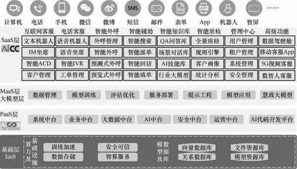

图 5-1 “AI+政务”服务热线平台功能架构

为了解决上述痛点，提升 12345 政务服务便民热线的服务质量和效率，各地各级热线部门积极探索和创新，结合大数据、人工智能等新一代数字技术与政务热线应用场景，打造“便捷高效的服务平台”“协同治理的重要枢纽”“智慧治理的有力支撑”。

智能语音识别技术是 12345 智能热线的核心能力之一。中科汇联公司的 AiCC 智能客服平台通过先进的语音识别算法，快速、准确地将市民的语音诉求转化为文字信息。该平台采用多模态交互技术，如“语音识别+自然语言理解+情感分析”，结合信息技术、通信技术和物联网技术进行统一通信，兼容电话、网页、短信、App、微博、微信等全域、全渠道接入，实现“听懂抱怨、安抚情绪、解决问题”全链路自动化。例如，当市民来电反映“小区附近的路灯坏了，晚上出行很不安全”时，智能语音识别系统可以精准识别这段话，避免人工记录可能出现的错误，极大地提高信息获取的效率和民众的满意度。

自然语言处理技术则赋予了智能热线理解和分析市民诉求的能力。它能够对转化后的文字信息进行语义理解，判断诉求的类型、紧急程度和涉及的部门。例如，系统可以快速判断出路灯损坏属于市政设施维修范畴，并自动将工单派发至对应的市政部门。同时，自然语言处理技术能对市民的表述进行情感分析，若市民在表达诉求时情绪激动，系统会进行标记并提醒工作人员重点关注，提供更贴心的服务。

智能知识库是 12345 智能热线的强大后盾。中科汇联的 AiKM 智能知识库基于政务百科知识库，结合慧政大模型和检索增强生成（Retrieval-Augmented Generation，RAG）技术，可以为 12345 智能热线提供一种高效、智能的知识服务，极大地提升服务质量和效率。RAG 技术还能理解查询的上下文，结合历史交互数据，智能推荐相关的政策解释和办事指南，帮助客服人员更好地理解用户需求并提供专业的回答。它整合了政府各部门的政策法规、常见问题解答等海量信息。当市民咨询医保报销流程、住房公积金提取条件等问题时，智能热线可以迅速从知识库中检索出准确的答案，为市民提供即时、专业的回复。此外，智能知识库具备自我学习和更新能力，能根据新的政策法规和常见问题不断完善内容，确保回复的准确性和时效性。

在实际应用中，12345 智能热线取得了显著成效。某城市在引入智能热线之前，市民诉求的平均处理时间为 3 天，接通率仅为 70%。而引用智能热线后，市民诉求的平均处理时间缩短至 1 天，接通率提升到 95%以上。上海 12345 智能热线中的 AI 客服“申小智”可以识别方言并自动派单至对应部门，市民满意度大幅提升。12345 智能热线不仅提高了政府服务效率，还大幅提升了市民的满意度，真正实现了让数据多跑路、群众少跑腿。

除了 12345 智能热线，AI 在公共服务的其他领域也发挥着重要作用。在社保服务方面，AI 智能客服可以解答参保人员关于社保政策、缴费标准、养老金领取等各种问题。通过自然语言处理技术，智能客服能够理解参保人员提出的复杂问题，并给出清晰、准确的回复。在办理社保业务时，AI 还可以辅助进行资格审核。例如，AI 可以利用人脸识别技术和大数据分析技术，对参保人员的身份信息进行核实，防止冒领养老金等欺诈行为。

在税务服务领域，AI 智能导税系统为纳税人提供便捷的办税指引。纳税人进入办税大厅后，通过与智能导税机器人进行语音交互，获取所需办理业务的流程、所需材料及办理窗口等信息。同时，AI 可以对纳税人的历史办税数据进行分析，为其提供个性化的税收优惠政策推荐，帮助纳税人享受应有的税收红利。

12345 智能热线产生的数据量巨大，且数据类型多样，包括语音、文本和工单等，这些多元异构数据给数据整合和分析带来了一系列挑战。中科汇联 AiCC 智能客服平台基于大模型的大数据分析技术，对 12345 智能热线积累的海量对话数据进行深度挖掘，提取有价值的信息；通过构建数据模型，识别市民诉求的热点问题和趋势变化，为政府决策提供科学依据；开发和引入智能分析工具，如情感分析、热点话题识别、舆情监测等，帮助管理者快速了解市民的诉求和情绪状态；通过可视化界面直观展示分析结果，辅助决策。

### 智能治理：“枫桥经验”与智能社区管理

“枫桥经验”作为我国基层社会治理的宝贵经验，强调依靠群众、就地解决矛盾与纠纷。在新时代，AI 技术与“枫桥经验”深度融合，为智能社区管理带来了新的思路和方法（见图 5-2）。

图 5-2 数智化“枫桥经验”与智能社区管理

在智能社区，AI 视频监控系统是社区安全的“守护者”。高清摄像头遍布社区各个角落，利用计算机视觉技术，系统能够实时监测社区内的人员活动、车辆行驶情况。一旦发现异常行为，如陌生人长时间徘徊、车辆违规停放等，系统会立即发出警报，并将相关信息推送给社区管理人员。例如，当检测到有陌生人在居民楼附近多次徘徊且行为鬼鬼祟祟时，监控系统会自动抓拍照片并通知保安人员前往查看，从而有效预防盗窃等违法犯罪行为的发生。

智能门禁系统也是智能社区管理的重要组成部分。它采用人脸识别、指纹识别等生物识别技术，只有经过授权的人员才能进入社区和单元楼。这不仅提高了社区的安全性，还方便了居民的出行。同时，智能门禁系统可以与社区管理平台相连，记录人员的出入信息，为社区管理提供数据支持。例如，访客来访时，可以通过门禁系统呼叫业主，经业主确认后即可进入社区，门禁系统会自动记录访客的来访时间、身份信息等。

AI 在社区矛盾纠纷调解方面也发挥着重要作用。通过分析语音颤抖频率和面部微表情，AI 可以识别当事人的真实诉求，突破“口是心非”调解困境。通过对社区居民的社交数据、投诉记录等进行分析，AI 可以提前发现潜在的矛盾与纠纷。例如，某栋楼的居民频繁投诉噪声问题，AI 系统可以分析噪声的来源、涉及的住户等信息，并及时通知社区工作人员进行调解。此外，AI 智能调解助手的法律知识引擎可以实时检索相似案例的判决结果，生成个性化调解方案，调解成功率提升至 89%。AI 智能调解助手还可以为调解人员提供相关的法律法规和案例参考，帮助调解人员更好地处理矛盾与纠纷。例如，在浙江诸暨，AI 调解系统入驻 326 个村社，化解邻里纠纷 4.2 万起，上访量下降 76%。

以某智能社区为例，在引入 AI 技术之前，社区内盗窃案件时有发生，矛盾与纠纷调解效率较低。而引入 AI 技术后，社区内盗窃案件发生率下降了 50%，矛盾纠纷的平均调解时间缩短了 30%，居民的安全感和满意度得到了显著提升。

在城市治理层面，AI 同样发挥着重要作用。城市管理部门利用 AI 技术对城市交通、环境等进行实时监测和管理。在交通管理方面，通过对道路上的摄像头、传感器等采集的数据进行分析，AI 可以实时掌握交通流量情况，优化交通信号灯的配时，缓解交通拥堵。例如，当某个路口的车流量突然增大时，AI 系统可以自动延长该路口绿灯的时间，提高道路通行效率。

在环境治理方面，AI 可以通过对空气质量监测站、水质监测点等采集的数据进行分析，实时掌握城市的环境质量。一旦发现环境污染问题，AI 系统可以快速定位污染源，并通知相关部门进行处理。例如，当空气质量监测站检测到某区域的 PM2.5 浓度超标时，AI 系统可以分析周边的工业企业运营、交通流量等数据，找出可能的污染源，并为环保部门制定治理措施提供参考。

此外，AI 可以用于城市规划和管理。通过对城市人口分布、经济发展等数据的分析，AI 可以为城市规划提供科学依据，优化城市的功能布局和基础设施建设。例如，AI 可以根据人口密度和出行需求，合理规划公交线路和站点，提高公共交通的覆盖率和服务质量。

### 智能安全：AI 应急管理与城市生命线

在应急管理领域，AI 技术的应用为提升城市应对突发事件的能力提供了有力支持。AI 可以对各类灾害数据进行实时监测和分析，提前预测灾害的发生，为应急救援提供决策依据。通过结合“物联网+边缘计算”，利用百万级传感器实时监测桥梁振动、燃气压力、地铁沉降等指标，数据本地化处理可避免传输延迟，实现从“事后救火”到“事前防火”的转变，AI 成为城市生命线的“智能哨兵”。城市生命线工程示意如图 5-3 所示。

在地震监测方面，AI 可以通过对地震监测站采集的地震波数据进行分析，快速准确地测定地震的震级、震中位置等信息。同时，AI 可以结合地理信息系统技术，对地震可能造成的破坏范围和人员伤亡情况进行预测，为应急救援部门制订救援方案提供参考。例如，某次地震发生后，AI 系统在短短几分钟内就确定了地震的相关信息，并预测出可能受灾严重的区域，救援队伍根据这些信息迅速展开救援行动，大幅提高了救援效率。

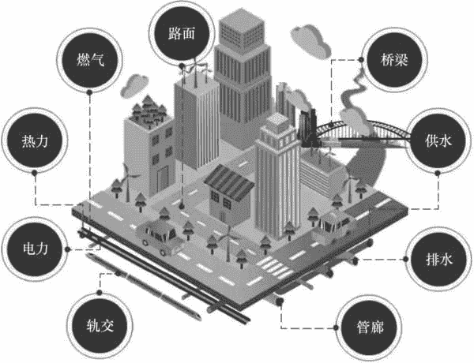

图 5-3 城市生命线工程示意

在气象灾害预警方面，AI 可以对气象卫星、雷达等采集的数据进行分析，更精准地预测台风、暴雨、暴雪等气象灾害的路径和强度。通过对历史气象数据和实时数据的深度学习，AI 能够提前发现气象灾害的异常变化，及时发出预警信息，让市民提前做好防范措施。例如，在台风来袭前，AI 系统可以预测台风的登陆地点和时间，为政府部门组织人员疏散、物资调配等提供充足的时间。

在火灾预警方面，AI 视频监控系统可以实时监测火灾隐患。通过对监控画面的分析，系统能够识别出烟雾、火焰等火灾迹象，并及时发出警报。同时，AI 可以结合地理信息系统，快速定位火灾发生的地点，为消防部门提供准确的位置信息，提高灭火救援的效率。例如，当某商场发生火灾时，AI 视频监控系统第一时间发现了火灾，并将火灾位置和火势大小等信息传送给消防部门，消防部门迅速出动消防车进行灭火，避免了火势的进一步蔓延。

在供水系统中，AI 可以通过对水质监测数据、水压数据等进行分析，实时掌握供水系统的运行状况。一旦发现水质异常或水压过低等问题，AI 系统会及时发出警报，并通知相关部门进行维修。例如，当 AI 系统检测到某区域的自来水中重金属含量超标时，会立即启动应急预案，通知供水部门停止该区域的供水，并对水源进行排查和处理。

在供电系统中，AI 可以对电网的运行数据进行实时监测和分析，预测电力设备的故障风险。通过对变压器、线路等设备的运行数据进行深度学习，AI 能够提前发现设备的潜在故障，并及时安排维修人员进行维护，避免停电事故的发生。例如，AI 系统通过分析变压器的油温、负荷等数据，预测某台变压器可能在一周后出现故障，维修人员提前对该变压器进行检修，成功避免了一次停电事故。从“定期检修”到“按需维护”的转变，使市政开支节约 37%，事故率下降 92%。

在供气系统中，AI 可以对燃气管道的压力、流量等数据进行监测，及时发现燃气泄漏等安全隐患。一旦检测到燃气泄漏，AI 系统会立即发出警报，并通知燃气公司和相关部门进行处理。同时，AI 可以通过对燃气用户的用气数据进行分析，预测用户的用气需求，为燃气公司的供气调度提供参考。例如，在冬季供暖期间，AI 系统通过分析用户的用气数据，预测出某区域的燃气需求将大幅增加，燃气公司据此提前调整了供气计划，保障了居民的正常用气。

### 智慧城市：城市大脑与态势感知

智慧城市是城市发展的高级形态，旨在利用信息技术实现城市的高效运行和可持续发展。城市大脑作为智慧城市的核心，整合了城市各个领域的数据资源，通过 AI 技术进行数据分析和处理，为城市管理提供智能决策支持。结合“区块链+联邦学习”，各部门的数据虽然保持物理隔离，但通过加密参数共享训练全局模型，破解了“数据不敢给、不愿给”难题。

城市大脑汇聚了城市交通、能源、环境、安全等多领域的数据。这些数据通过物联网、传感器等技术实时采集，并传输到城市大脑的大数据平台。例如，交通数据包括道路上的车流量、车速、交通事故等信息；能源数据包括电力、燃气、供水的消耗情况等；环境数据包括空气质量、水质、噪声等监测数据。城市大脑对这些海量数据进行整合和清洗，去除无效数据，确保数据的准确性和完整性。

基于整合后的数据，城市大脑利用 AI 算法进行深度分析。在交通领域，通过对交通数据的分析，城市大脑可以优化交通信号控制，缓解交通拥堵。例如，根据实时车流量情况，自动调整信号灯的时长，使道路通行效率最大化。在能源管理方面，城市大脑可以分析能源消耗数据，预测能源需求，优化能源供应策略，实现能源的高效利用。例如，雄安新区全城建筑嵌入智能传感网，AI 可以自动调节楼宇能耗、电梯调度与安防等级，碳排放降低 41%。

态势感知是城市大脑的重要功能之一。它通过对城市运行数据的实时监测和分析，全面、准确地掌握城市的运行状态。城市大脑利用可视化技术，将城市的各种运行数据以直观的图表、地图等形式展示出来，让城市管理者能够一目了然地了解城市的运行情况。例如，通过城市大脑的可视化界面，管理者可以实时查看城市各个区域的交通拥堵情况、空气质量状况、能源消耗水平等信息。

当城市出现异常情况时，城市大脑能够迅速做出反应。例如，当发生交通事故导致交通拥堵时，城市大脑可以自动调配周边的警力和救援资源，同时调整交通信号灯，引导车辆绕行，尽快恢复交通秩序。在应对突发公共卫生事件时，城市大脑可以整合医疗资源、人员流动数据等信息，为疫情防控提供决策支持，如确定隔离区域、调配医疗物资等。

杭州的城市大脑自投入使用以来，取得了显著成效。在交通方面，通过优化交通信号控制，部分路段的通行时间较优化前缩短了 15%以上；在城市管理方面，城市大脑实现了对城市事件的快速发现和处理，城市管理效率较之前提升了 30%以上。杭州城市大脑的成功实践为其他城市建设智慧城市提供了有益的借鉴。

随着 5G、物联网、大数据等技术的不断发展，“AI+政府”模式将不断创新和完善。未来，AI 将在政府决策支持、社会信用体系建设、公共卫生应急管理等领域发挥更加重要的作用。政府应加强对 AI 技术的研究和应用，推动 AI 与政府治理的深度融合，打造更加智能、高效、便民的服务型政府，为人民群众创造更加美好的生活。 EXr6287u6NNVz+GYLY+7SDk226FstKIHdC0bNoQkB2Nqi1xSR0yxPmwrTs5gRi/BtfSbid6dBhii9q7cz2pIyA==

## 1 AI+政府：从电子政务到脑机政务

当 AlphaGo 击败李世石时，人类或许还未意识到，这场胜利不仅是围棋领域的颠覆，更是社会治理模式革命的预演。今天，人工智能正在从“工具”升级为“治理主体”，重塑政府的决策逻辑、服务形态甚至权力边界。从“最多跑一次”到“零跑动”，从“事后响应”到“先知先觉”，“AI+政府”的本质，是用算法重新定义公权力的运行法则。

“AI+政府”模式的兴起，为政府治理带来了全方位的变革，从智能服务的高效便民，到智能治理的精准精细，再到智能安全的坚实保障和智慧城市的整体统筹，展现出一幅充满创新活力与无限可能的未来政府治理画卷。

### 智能服务：12345 智能热线与公共服务

12345 政务服务便民热线，作为政府与民众沟通的重要桥梁，过去主要依靠人工接听和处理诉求，面临效率低、响应慢、信息整合难等问题。随着人工智能技术的引入，12345 智能热线应运而生，为公共服务带来了革命性的变化。“AI+政务”服务热线平台功能架构如图 5-1 所示。

中央及各省市对政务服务热线的政策要求很明确，旨在提升政务服务的质量和效率。《国务院办公厅关于进一步优化地方政务服务便民热线的指导意见》要求，2021 年年底前实现“一个号码”服务，即统一为“12345 政务服务便民热线”，确保一个号码对外，一个平台受理，一个系统办理，一个标准服务，一个机制保障，聚焦企业和群众反映强烈的办事堵点、难点问题，提供更加优质高效的政务服务，切实解决企业和群众的实际问题，提高满意度。

《国务院关于进一步优化政务服务提升行政效能 推动“高效办成一件事”的指导意见》指出，推进企业和群众诉求“一线应答”。依托 12345 政务服务便民热线加强政务服务热线归并，根据需要设置重点领域专席，不断提升 12345 政务服务便民热线的接办效率，高效受理政务服务咨询、投诉、求助、建议和在线办理指导等诉求，打造便捷、高效、规范、智慧的政务服务“总客服”。

图 5-1 “AI+政务”服务热线平台功能架构

为了解决上述痛点，提升 12345 政务服务便民热线的服务质量和效率，各地各级热线部门积极探索和创新，结合大数据、人工智能等新一代数字技术与政务热线应用场景，打造“便捷高效的服务平台”“协同治理的重要枢纽”“智慧治理的有力支撑”。

智能语音识别技术是 12345 智能热线的核心能力之一。中科汇联公司的 AiCC 智能客服平台通过先进的语音识别算法，快速、准确地将市民的语音诉求转化为文字信息。该平台采用多模态交互技术，如“语音识别+自然语言理解+情感分析”，结合信息技术、通信技术和物联网技术进行统一通信，兼容电话、网页、短信、App、微博、微信等全域、全渠道接入，实现“听懂抱怨、安抚情绪、解决问题”全链路自动化。例如，当市民来电反映“小区附近的路灯坏了，晚上出行很不安全”时，智能语音识别系统可以精准识别这段话，避免人工记录可能出现的错误，极大地提高信息获取的效率和民众的满意度。

自然语言处理技术则赋予了智能热线理解和分析市民诉求的能力。它能够对转化后的文字信息进行语义理解，判断诉求的类型、紧急程度和涉及的部门。例如，系统可以快速判断出路灯损坏属于市政设施维修范畴，并自动将工单派发至对应的市政部门。同时，自然语言处理技术能对市民的表述进行情感分析，若市民在表达诉求时情绪激动，系统会进行标记并提醒工作人员重点关注，提供更贴心的服务。

智能知识库是 12345 智能热线的强大后盾。中科汇联的 AiKM 智能知识库基于政务百科知识库，结合慧政大模型和检索增强生成（Retrieval-Augmented Generation，RAG）技术，可以为 12345 智能热线提供一种高效、智能的知识服务，极大地提升服务质量和效率。RAG 技术还能理解查询的上下文，结合历史交互数据，智能推荐相关的政策解释和办事指南，帮助客服人员更好地理解用户需求并提供专业的回答。它整合了政府各部门的政策法规、常见问题解答等海量信息。当市民咨询医保报销流程、住房公积金提取条件等问题时，智能热线可以迅速从知识库中检索出准确的答案，为市民提供即时、专业的回复。此外，智能知识库具备自我学习和更新能力，能根据新的政策法规和常见问题不断完善内容，确保回复的准确性和时效性。

在实际应用中，12345 智能热线取得了显著成效。某城市在引入智能热线之前，市民诉求的平均处理时间为 3 天，接通率仅为 70%。而引用智能热线后，市民诉求的平均处理时间缩短至 1 天，接通率提升到 95%以上。上海 12345 智能热线中的 AI 客服“申小智”可以识别方言并自动派单至对应部门，市民满意度大幅提升。12345 智能热线不仅提高了政府服务效率，还大幅提升了市民的满意度，真正实现了让数据多跑路、群众少跑腿。

除了 12345 智能热线，AI 在公共服务的其他领域也发挥着重要作用。在社保服务方面，AI 智能客服可以解答参保人员关于社保政策、缴费标准、养老金领取等各种问题。通过自然语言处理技术，智能客服能够理解参保人员提出的复杂问题，并给出清晰、准确的回复。在办理社保业务时，AI 还可以辅助进行资格审核。例如，AI 可以利用人脸识别技术和大数据分析技术，对参保人员的身份信息进行核实，防止冒领养老金等欺诈行为。

在税务服务领域，AI 智能导税系统为纳税人提供便捷的办税指引。纳税人进入办税大厅后，通过与智能导税机器人进行语音交互，获取所需办理业务的流程、所需材料及办理窗口等信息。同时，AI 可以对纳税人的历史办税数据进行分析，为其提供个性化的税收优惠政策推荐，帮助纳税人享受应有的税收红利。

12345 智能热线产生的数据量巨大，且数据类型多样，包括语音、文本和工单等，这些多元异构数据给数据整合和分析带来了一系列挑战。中科汇联 AiCC 智能客服平台基于大模型的大数据分析技术，对 12345 智能热线积累的海量对话数据进行深度挖掘，提取有价值的信息；通过构建数据模型，识别市民诉求的热点问题和趋势变化，为政府决策提供科学依据；开发和引入智能分析工具，如情感分析、热点话题识别、舆情监测等，帮助管理者快速了解市民的诉求和情绪状态；通过可视化界面直观展示分析结果，辅助决策。

### 智能治理：“枫桥经验”与智能社区管理

“枫桥经验”作为我国基层社会治理的宝贵经验，强调依靠群众、就地解决矛盾与纠纷。在新时代，AI 技术与“枫桥经验”深度融合，为智能社区管理带来了新的思路和方法（见图 5-2）。

图 5-2 数智化“枫桥经验”与智能社区管理

在智能社区，AI 视频监控系统是社区安全的“守护者”。高清摄像头遍布社区各个角落，利用计算机视觉技术，系统能够实时监测社区内的人员活动、车辆行驶情况。一旦发现异常行为，如陌生人长时间徘徊、车辆违规停放等，系统会立即发出警报，并将相关信息推送给社区管理人员。例如，当检测到有陌生人在居民楼附近多次徘徊且行为鬼鬼祟祟时，监控系统会自动抓拍照片并通知保安人员前往查看，从而有效预防盗窃等违法犯罪行为的发生。

智能门禁系统也是智能社区管理的重要组成部分。它采用人脸识别、指纹识别等生物识别技术，只有经过授权的人员才能进入社区和单元楼。这不仅提高了社区的安全性，还方便了居民的出行。同时，智能门禁系统可以与社区管理平台相连，记录人员的出入信息，为社区管理提供数据支持。例如，访客来访时，可以通过门禁系统呼叫业主，经业主确认后即可进入社区，门禁系统会自动记录访客的来访时间、身份信息等。

AI 在社区矛盾纠纷调解方面也发挥着重要作用。通过分析语音颤抖频率和面部微表情，AI 可以识别当事人的真实诉求，突破“口是心非”调解困境。通过对社区居民的社交数据、投诉记录等进行分析，AI 可以提前发现潜在的矛盾与纠纷。例如，某栋楼的居民频繁投诉噪声问题，AI 系统可以分析噪声的来源、涉及的住户等信息，并及时通知社区工作人员进行调解。此外，AI 智能调解助手的法律知识引擎可以实时检索相似案例的判决结果，生成个性化调解方案，调解成功率提升至 89%。AI 智能调解助手还可以为调解人员提供相关的法律法规和案例参考，帮助调解人员更好地处理矛盾与纠纷。例如，在浙江诸暨，AI 调解系统入驻 326 个村社，化解邻里纠纷 4.2 万起，上访量下降 76%。

以某智能社区为例，在引入 AI 技术之前，社区内盗窃案件时有发生，矛盾与纠纷调解效率较低。而引入 AI 技术后，社区内盗窃案件发生率下降了 50%，矛盾纠纷的平均调解时间缩短了 30%，居民的安全感和满意度得到了显著提升。

在城市治理层面，AI 同样发挥着重要作用。城市管理部门利用 AI 技术对城市交通、环境等进行实时监测和管理。在交通管理方面，通过对道路上的摄像头、传感器等采集的数据进行分析，AI 可以实时掌握交通流量情况，优化交通信号灯的配时，缓解交通拥堵。例如，当某个路口的车流量突然增大时，AI 系统可以自动延长该路口绿灯的时间，提高道路通行效率。

在环境治理方面，AI 可以通过对空气质量监测站、水质监测点等采集的数据进行分析，实时掌握城市的环境质量。一旦发现环境污染问题，AI 系统可以快速定位污染源，并通知相关部门进行处理。例如，当空气质量监测站检测到某区域的 PM2.5 浓度超标时，AI 系统可以分析周边的工业企业运营、交通流量等数据，找出可能的污染源，并为环保部门制定治理措施提供参考。

此外，AI 可以用于城市规划和管理。通过对城市人口分布、经济发展等数据的分析，AI 可以为城市规划提供科学依据，优化城市的功能布局和基础设施建设。例如，AI 可以根据人口密度和出行需求，合理规划公交线路和站点，提高公共交通的覆盖率和服务质量。

### 智能安全：AI 应急管理与城市生命线

在应急管理领域，AI 技术的应用为提升城市应对突发事件的能力提供了有力支持。AI 可以对各类灾害数据进行实时监测和分析，提前预测灾害的发生，为应急救援提供决策依据。通过结合“物联网+边缘计算”，利用百万级传感器实时监测桥梁振动、燃气压力、地铁沉降等指标，数据本地化处理可避免传输延迟，实现从“事后救火”到“事前防火”的转变，AI 成为城市生命线的“智能哨兵”。城市生命线工程示意如图 5-3 所示。

在地震监测方面，AI 可以通过对地震监测站采集的地震波数据进行分析，快速准确地测定地震的震级、震中位置等信息。同时，AI 可以结合地理信息系统技术，对地震可能造成的破坏范围和人员伤亡情况进行预测，为应急救援部门制订救援方案提供参考。例如，某次地震发生后，AI 系统在短短几分钟内就确定了地震的相关信息，并预测出可能受灾严重的区域，救援队伍根据这些信息迅速展开救援行动，大幅提高了救援效率。

图 5-3 城市生命线工程示意

在气象灾害预警方面，AI 可以对气象卫星、雷达等采集的数据进行分析，更精准地预测台风、暴雨、暴雪等气象灾害的路径和强度。通过对历史气象数据和实时数据的深度学习，AI 能够提前发现气象灾害的异常变化，及时发出预警信息，让市民提前做好防范措施。例如，在台风来袭前，AI 系统可以预测台风的登陆地点和时间，为政府部门组织人员疏散、物资调配等提供充足的时间。

在火灾预警方面，AI 视频监控系统可以实时监测火灾隐患。通过对监控画面的分析，系统能够识别出烟雾、火焰等火灾迹象，并及时发出警报。同时，AI 可以结合地理信息系统，快速定位火灾发生的地点，为消防部门提供准确的位置信息，提高灭火救援的效率。例如，当某商场发生火灾时，AI 视频监控系统第一时间发现了火灾，并将火灾位置和火势大小等信息传送给消防部门，消防部门迅速出动消防车进行灭火，避免了火势的进一步蔓延。

在供水系统中，AI 可以通过对水质监测数据、水压数据等进行分析，实时掌握供水系统的运行状况。一旦发现水质异常或水压过低等问题，AI 系统会及时发出警报，并通知相关部门进行维修。例如，当 AI 系统检测到某区域的自来水中重金属含量超标时，会立即启动应急预案，通知供水部门停止该区域的供水，并对水源进行排查和处理。

在供电系统中，AI 可以对电网的运行数据进行实时监测和分析，预测电力设备的故障风险。通过对变压器、线路等设备的运行数据进行深度学习，AI 能够提前发现设备的潜在故障，并及时安排维修人员进行维护，避免停电事故的发生。例如，AI 系统通过分析变压器的油温、负荷等数据，预测某台变压器可能在一周后出现故障，维修人员提前对该变压器进行检修，成功避免了一次停电事故。从“定期检修”到“按需维护”的转变，使市政开支节约 37%，事故率下降 92%。

在供气系统中，AI 可以对燃气管道的压力、流量等数据进行监测，及时发现燃气泄漏等安全隐患。一旦检测到燃气泄漏，AI 系统会立即发出警报，并通知燃气公司和相关部门进行处理。同时，AI 可以通过对燃气用户的用气数据进行分析，预测用户的用气需求，为燃气公司的供气调度提供参考。例如，在冬季供暖期间，AI 系统通过分析用户的用气数据，预测出某区域的燃气需求将大幅增加，燃气公司据此提前调整了供气计划，保障了居民的正常用气。

### 智慧城市：城市大脑与态势感知

智慧城市是城市发展的高级形态，旨在利用信息技术实现城市的高效运行和可持续发展。城市大脑作为智慧城市的核心，整合了城市各个领域的数据资源，通过 AI 技术进行数据分析和处理，为城市管理提供智能决策支持。结合“区块链+联邦学习”，各部门的数据虽然保持物理隔离，但通过加密参数共享训练全局模型，破解了“数据不敢给、不愿给”难题。

城市大脑汇聚了城市交通、能源、环境、安全等多领域的数据。这些数据通过物联网、传感器等技术实时采集，并传输到城市大脑的大数据平台。例如，交通数据包括道路上的车流量、车速、交通事故等信息；能源数据包括电力、燃气、供水的消耗情况等；环境数据包括空气质量、水质、噪声等监测数据。城市大脑对这些海量数据进行整合和清洗，去除无效数据，确保数据的准确性和完整性。

基于整合后的数据，城市大脑利用 AI 算法进行深度分析。在交通领域，通过对交通数据的分析，城市大脑可以优化交通信号控制，缓解交通拥堵。例如，根据实时车流量情况，自动调整信号灯的时长，使道路通行效率最大化。在能源管理方面，城市大脑可以分析能源消耗数据，预测能源需求，优化能源供应策略，实现能源的高效利用。例如，雄安新区全城建筑嵌入智能传感网，AI 可以自动调节楼宇能耗、电梯调度与安防等级，碳排放降低 41%。

态势感知是城市大脑的重要功能之一。它通过对城市运行数据的实时监测和分析，全面、准确地掌握城市的运行状态。城市大脑利用可视化技术，将城市的各种运行数据以直观的图表、地图等形式展示出来，让城市管理者能够一目了然地了解城市的运行情况。例如，通过城市大脑的可视化界面，管理者可以实时查看城市各个区域的交通拥堵情况、空气质量状况、能源消耗水平等信息。

当城市出现异常情况时，城市大脑能够迅速做出反应。例如，当发生交通事故导致交通拥堵时，城市大脑可以自动调配周边的警力和救援资源，同时调整交通信号灯，引导车辆绕行，尽快恢复交通秩序。在应对突发公共卫生事件时，城市大脑可以整合医疗资源、人员流动数据等信息，为疫情防控提供决策支持，如确定隔离区域、调配医疗物资等。

杭州的城市大脑自投入使用以来，取得了显著成效。在交通方面，通过优化交通信号控制，部分路段的通行时间较优化前缩短了 15%以上；在城市管理方面，城市大脑实现了对城市事件的快速发现和处理，城市管理效率较之前提升了 30%以上。杭州城市大脑的成功实践为其他城市建设智慧城市提供了有益的借鉴。

随着 5G、物联网、大数据等技术的不断发展，“AI+政府”模式将不断创新和完善。未来，AI 将在政府决策支持、社会信用体系建设、公共卫生应急管理等领域发挥更加重要的作用。政府应加强对 AI 技术的研究和应用，推动 AI 与政府治理的深度融合，打造更加智能、高效、便民的服务型政府，为人民群众创造更加美好的生活。 EXr6287u6NNVz+GYLY+7SDk226FstKIHdC0bNoQkB2Nqi1xSR0yxPmwrTs5gRi/BtfSbid6dBhii9q7cz2pIyA==

## 1 AI+政府：从电子政务到脑机政务

当 AlphaGo 击败李世石时，人类或许还未意识到，这场胜利不仅是围棋领域的颠覆，更是社会治理模式革命的预演。今天，人工智能正在从“工具”升级为“治理主体”，重塑政府的决策逻辑、服务形态甚至权力边界。从“最多跑一次”到“零跑动”，从“事后响应”到“先知先觉”，“AI+政府”的本质，是用算法重新定义公权力的运行法则。

“AI+政府”模式的兴起，为政府治理带来了全方位的变革，从智能服务的高效便民，到智能治理的精准精细，再到智能安全的坚实保障和智慧城市的整体统筹，展现出一幅充满创新活力与无限可能的未来政府治理画卷。

### 智能服务：12345 智能热线与公共服务

12345 政务服务便民热线，作为政府与民众沟通的重要桥梁，过去主要依靠人工接听和处理诉求，面临效率低、响应慢、信息整合难等问题。随着人工智能技术的引入，12345 智能热线应运而生，为公共服务带来了革命性的变化。“AI+政务”服务热线平台功能架构如图 5-1 所示。

中央及各省市对政务服务热线的政策要求很明确，旨在提升政务服务的质量和效率。《国务院办公厅关于进一步优化地方政务服务便民热线的指导意见》要求，2021 年年底前实现“一个号码”服务，即统一为“12345 政务服务便民热线”，确保一个号码对外，一个平台受理，一个系统办理，一个标准服务，一个机制保障，聚焦企业和群众反映强烈的办事堵点、难点问题，提供更加优质高效的政务服务，切实解决企业和群众的实际问题，提高满意度。

《国务院关于进一步优化政务服务提升行政效能 推动“高效办成一件事”的指导意见》指出，推进企业和群众诉求“一线应答”。依托 12345 政务服务便民热线加强政务服务热线归并，根据需要设置重点领域专席，不断提升 12345 政务服务便民热线的接办效率，高效受理政务服务咨询、投诉、求助、建议和在线办理指导等诉求，打造便捷、高效、规范、智慧的政务服务“总客服”。

图 5-1 “AI+政务”服务热线平台功能架构

为了解决上述痛点，提升 12345 政务服务便民热线的服务质量和效率，各地各级热线部门积极探索和创新，结合大数据、人工智能等新一代数字技术与政务热线应用场景，打造“便捷高效的服务平台”“协同治理的重要枢纽”“智慧治理的有力支撑”。

智能语音识别技术是 12345 智能热线的核心能力之一。中科汇联公司的 AiCC 智能客服平台通过先进的语音识别算法，快速、准确地将市民的语音诉求转化为文字信息。该平台采用多模态交互技术，如“语音识别+自然语言理解+情感分析”，结合信息技术、通信技术和物联网技术进行统一通信，兼容电话、网页、短信、App、微博、微信等全域、全渠道接入，实现“听懂抱怨、安抚情绪、解决问题”全链路自动化。例如，当市民来电反映“小区附近的路灯坏了，晚上出行很不安全”时，智能语音识别系统可以精准识别这段话，避免人工记录可能出现的错误，极大地提高信息获取的效率和民众的满意度。

自然语言处理技术则赋予了智能热线理解和分析市民诉求的能力。它能够对转化后的文字信息进行语义理解，判断诉求的类型、紧急程度和涉及的部门。例如，系统可以快速判断出路灯损坏属于市政设施维修范畴，并自动将工单派发至对应的市政部门。同时，自然语言处理技术能对市民的表述进行情感分析，若市民在表达诉求时情绪激动，系统会进行标记并提醒工作人员重点关注，提供更贴心的服务。

智能知识库是 12345 智能热线的强大后盾。中科汇联的 AiKM 智能知识库基于政务百科知识库，结合慧政大模型和检索增强生成（Retrieval-Augmented Generation，RAG）技术，可以为 12345 智能热线提供一种高效、智能的知识服务，极大地提升服务质量和效率。RAG 技术还能理解查询的上下文，结合历史交互数据，智能推荐相关的政策解释和办事指南，帮助客服人员更好地理解用户需求并提供专业的回答。它整合了政府各部门的政策法规、常见问题解答等海量信息。当市民咨询医保报销流程、住房公积金提取条件等问题时，智能热线可以迅速从知识库中检索出准确的答案，为市民提供即时、专业的回复。此外，智能知识库具备自我学习和更新能力，能根据新的政策法规和常见问题不断完善内容，确保回复的准确性和时效性。

在实际应用中，12345 智能热线取得了显著成效。某城市在引入智能热线之前，市民诉求的平均处理时间为 3 天，接通率仅为 70%。而引用智能热线后，市民诉求的平均处理时间缩短至 1 天，接通率提升到 95%以上。上海 12345 智能热线中的 AI 客服“申小智”可以识别方言并自动派单至对应部门，市民满意度大幅提升。12345 智能热线不仅提高了政府服务效率，还大幅提升了市民的满意度，真正实现了让数据多跑路、群众少跑腿。

除了 12345 智能热线，AI 在公共服务的其他领域也发挥着重要作用。在社保服务方面，AI 智能客服可以解答参保人员关于社保政策、缴费标准、养老金领取等各种问题。通过自然语言处理技术，智能客服能够理解参保人员提出的复杂问题，并给出清晰、准确的回复。在办理社保业务时，AI 还可以辅助进行资格审核。例如，AI 可以利用人脸识别技术和大数据分析技术，对参保人员的身份信息进行核实，防止冒领养老金等欺诈行为。

在税务服务领域，AI 智能导税系统为纳税人提供便捷的办税指引。纳税人进入办税大厅后，通过与智能导税机器人进行语音交互，获取所需办理业务的流程、所需材料及办理窗口等信息。同时，AI 可以对纳税人的历史办税数据进行分析，为其提供个性化的税收优惠政策推荐，帮助纳税人享受应有的税收红利。

12345 智能热线产生的数据量巨大，且数据类型多样，包括语音、文本和工单等，这些多元异构数据给数据整合和分析带来了一系列挑战。中科汇联 AiCC 智能客服平台基于大模型的大数据分析技术，对 12345 智能热线积累的海量对话数据进行深度挖掘，提取有价值的信息；通过构建数据模型，识别市民诉求的热点问题和趋势变化，为政府决策提供科学依据；开发和引入智能分析工具，如情感分析、热点话题识别、舆情监测等，帮助管理者快速了解市民的诉求和情绪状态；通过可视化界面直观展示分析结果，辅助决策。

### 智能治理：“枫桥经验”与智能社区管理

“枫桥经验”作为我国基层社会治理的宝贵经验，强调依靠群众、就地解决矛盾与纠纷。在新时代，AI 技术与“枫桥经验”深度融合，为智能社区管理带来了新的思路和方法（见图 5-2）。

图 5-2 数智化“枫桥经验”与智能社区管理

在智能社区，AI 视频监控系统是社区安全的“守护者”。高清摄像头遍布社区各个角落，利用计算机视觉技术，系统能够实时监测社区内的人员活动、车辆行驶情况。一旦发现异常行为，如陌生人长时间徘徊、车辆违规停放等，系统会立即发出警报，并将相关信息推送给社区管理人员。例如，当检测到有陌生人在居民楼附近多次徘徊且行为鬼鬼祟祟时，监控系统会自动抓拍照片并通知保安人员前往查看，从而有效预防盗窃等违法犯罪行为的发生。

智能门禁系统也是智能社区管理的重要组成部分。它采用人脸识别、指纹识别等生物识别技术，只有经过授权的人员才能进入社区和单元楼。这不仅提高了社区的安全性，还方便了居民的出行。同时，智能门禁系统可以与社区管理平台相连，记录人员的出入信息，为社区管理提供数据支持。例如，访客来访时，可以通过门禁系统呼叫业主，经业主确认后即可进入社区，门禁系统会自动记录访客的来访时间、身份信息等。

AI 在社区矛盾纠纷调解方面也发挥着重要作用。通过分析语音颤抖频率和面部微表情，AI 可以识别当事人的真实诉求，突破“口是心非”调解困境。通过对社区居民的社交数据、投诉记录等进行分析，AI 可以提前发现潜在的矛盾与纠纷。例如，某栋楼的居民频繁投诉噪声问题，AI 系统可以分析噪声的来源、涉及的住户等信息，并及时通知社区工作人员进行调解。此外，AI 智能调解助手的法律知识引擎可以实时检索相似案例的判决结果，生成个性化调解方案，调解成功率提升至 89%。AI 智能调解助手还可以为调解人员提供相关的法律法规和案例参考，帮助调解人员更好地处理矛盾与纠纷。例如，在浙江诸暨，AI 调解系统入驻 326 个村社，化解邻里纠纷 4.2 万起，上访量下降 76%。

以某智能社区为例，在引入 AI 技术之前，社区内盗窃案件时有发生，矛盾与纠纷调解效率较低。而引入 AI 技术后，社区内盗窃案件发生率下降了 50%，矛盾纠纷的平均调解时间缩短了 30%，居民的安全感和满意度得到了显著提升。

在城市治理层面，AI 同样发挥着重要作用。城市管理部门利用 AI 技术对城市交通、环境等进行实时监测和管理。在交通管理方面，通过对道路上的摄像头、传感器等采集的数据进行分析，AI 可以实时掌握交通流量情况，优化交通信号灯的配时，缓解交通拥堵。例如，当某个路口的车流量突然增大时，AI 系统可以自动延长该路口绿灯的时间，提高道路通行效率。

在环境治理方面，AI 可以通过对空气质量监测站、水质监测点等采集的数据进行分析，实时掌握城市的环境质量。一旦发现环境污染问题，AI 系统可以快速定位污染源，并通知相关部门进行处理。例如，当空气质量监测站检测到某区域的 PM2.5 浓度超标时，AI 系统可以分析周边的工业企业运营、交通流量等数据，找出可能的污染源，并为环保部门制定治理措施提供参考。

此外，AI 可以用于城市规划和管理。通过对城市人口分布、经济发展等数据的分析，AI 可以为城市规划提供科学依据，优化城市的功能布局和基础设施建设。例如，AI 可以根据人口密度和出行需求，合理规划公交线路和站点，提高公共交通的覆盖率和服务质量。

### 智能安全：AI 应急管理与城市生命线

在应急管理领域，AI 技术的应用为提升城市应对突发事件的能力提供了有力支持。AI 可以对各类灾害数据进行实时监测和分析，提前预测灾害的发生，为应急救援提供决策依据。通过结合“物联网+边缘计算”，利用百万级传感器实时监测桥梁振动、燃气压力、地铁沉降等指标，数据本地化处理可避免传输延迟，实现从“事后救火”到“事前防火”的转变，AI 成为城市生命线的“智能哨兵”。城市生命线工程示意如图 5-3 所示。

在地震监测方面，AI 可以通过对地震监测站采集的地震波数据进行分析，快速准确地测定地震的震级、震中位置等信息。同时，AI 可以结合地理信息系统技术，对地震可能造成的破坏范围和人员伤亡情况进行预测，为应急救援部门制订救援方案提供参考。例如，某次地震发生后，AI 系统在短短几分钟内就确定了地震的相关信息，并预测出可能受灾严重的区域，救援队伍根据这些信息迅速展开救援行动，大幅提高了救援效率。

图 5-3 城市生命线工程示意

在气象灾害预警方面，AI 可以对气象卫星、雷达等采集的数据进行分析，更精准地预测台风、暴雨、暴雪等气象灾害的路径和强度。通过对历史气象数据和实时数据的深度学习，AI 能够提前发现气象灾害的异常变化，及时发出预警信息，让市民提前做好防范措施。例如，在台风来袭前，AI 系统可以预测台风的登陆地点和时间，为政府部门组织人员疏散、物资调配等提供充足的时间。

在火灾预警方面，AI 视频监控系统可以实时监测火灾隐患。通过对监控画面的分析，系统能够识别出烟雾、火焰等火灾迹象，并及时发出警报。同时，AI 可以结合地理信息系统，快速定位火灾发生的地点，为消防部门提供准确的位置信息，提高灭火救援的效率。例如，当某商场发生火灾时，AI 视频监控系统第一时间发现了火灾，并将火灾位置和火势大小等信息传送给消防部门，消防部门迅速出动消防车进行灭火，避免了火势的进一步蔓延。

在供水系统中，AI 可以通过对水质监测数据、水压数据等进行分析，实时掌握供水系统的运行状况。一旦发现水质异常或水压过低等问题，AI 系统会及时发出警报，并通知相关部门进行维修。例如，当 AI 系统检测到某区域的自来水中重金属含量超标时，会立即启动应急预案，通知供水部门停止该区域的供水，并对水源进行排查和处理。

在供电系统中，AI 可以对电网的运行数据进行实时监测和分析，预测电力设备的故障风险。通过对变压器、线路等设备的运行数据进行深度学习，AI 能够提前发现设备的潜在故障，并及时安排维修人员进行维护，避免停电事故的发生。例如，AI 系统通过分析变压器的油温、负荷等数据，预测某台变压器可能在一周后出现故障，维修人员提前对该变压器进行检修，成功避免了一次停电事故。从“定期检修”到“按需维护”的转变，使市政开支节约 37%，事故率下降 92%。

在供气系统中，AI 可以对燃气管道的压力、流量等数据进行监测，及时发现燃气泄漏等安全隐患。一旦检测到燃气泄漏，AI 系统会立即发出警报，并通知燃气公司和相关部门进行处理。同时，AI 可以通过对燃气用户的用气数据进行分析，预测用户的用气需求，为燃气公司的供气调度提供参考。例如，在冬季供暖期间，AI 系统通过分析用户的用气数据，预测出某区域的燃气需求将大幅增加，燃气公司据此提前调整了供气计划，保障了居民的正常用气。

### 智慧城市：城市大脑与态势感知

智慧城市是城市发展的高级形态，旨在利用信息技术实现城市的高效运行和可持续发展。城市大脑作为智慧城市的核心，整合了城市各个领域的数据资源，通过 AI 技术进行数据分析和处理，为城市管理提供智能决策支持。结合“区块链+联邦学习”，各部门的数据虽然保持物理隔离，但通过加密参数共享训练全局模型，破解了“数据不敢给、不愿给”难题。

城市大脑汇聚了城市交通、能源、环境、安全等多领域的数据。这些数据通过物联网、传感器等技术实时采集，并传输到城市大脑的大数据平台。例如，交通数据包括道路上的车流量、车速、交通事故等信息；能源数据包括电力、燃气、供水的消耗情况等；环境数据包括空气质量、水质、噪声等监测数据。城市大脑对这些海量数据进行整合和清洗，去除无效数据，确保数据的准确性和完整性。

基于整合后的数据，城市大脑利用 AI 算法进行深度分析。在交通领域，通过对交通数据的分析，城市大脑可以优化交通信号控制，缓解交通拥堵。例如，根据实时车流量情况，自动调整信号灯的时长，使道路通行效率最大化。在能源管理方面，城市大脑可以分析能源消耗数据，预测能源需求，优化能源供应策略，实现能源的高效利用。例如，雄安新区全城建筑嵌入智能传感网，AI 可以自动调节楼宇能耗、电梯调度与安防等级，碳排放降低 41%。

态势感知是城市大脑的重要功能之一。它通过对城市运行数据的实时监测和分析，全面、准确地掌握城市的运行状态。城市大脑利用可视化技术，将城市的各种运行数据以直观的图表、地图等形式展示出来，让城市管理者能够一目了然地了解城市的运行情况。例如，通过城市大脑的可视化界面，管理者可以实时查看城市各个区域的交通拥堵情况、空气质量状况、能源消耗水平等信息。

当城市出现异常情况时，城市大脑能够迅速做出反应。例如，当发生交通事故导致交通拥堵时，城市大脑可以自动调配周边的警力和救援资源，同时调整交通信号灯，引导车辆绕行，尽快恢复交通秩序。在应对突发公共卫生事件时，城市大脑可以整合医疗资源、人员流动数据等信息，为疫情防控提供决策支持，如确定隔离区域、调配医疗物资等。

杭州的城市大脑自投入使用以来，取得了显著成效。在交通方面，通过优化交通信号控制，部分路段的通行时间较优化前缩短了 15%以上；在城市管理方面，城市大脑实现了对城市事件的快速发现和处理，城市管理效率较之前提升了 30%以上。杭州城市大脑的成功实践为其他城市建设智慧城市提供了有益的借鉴。

随着 5G、物联网、大数据等技术的不断发展，“AI+政府”模式将不断创新和完善。未来，AI 将在政府决策支持、社会信用体系建设、公共卫生应急管理等领域发挥更加重要的作用。政府应加强对 AI 技术的研究和应用，推动 AI 与政府治理的深度融合，打造更加智能、高效、便民的服务型政府，为人民群众创造更加美好的生活。 EXr6287u6NNVz+GYLY+7SDk226FstKIHdC0bNoQkB2Nqi1xSR0yxPmwrTs5gRi/BtfSbid6dBhii9q7cz2pIyA==

## 1 AI+政府：从电子政务到脑机政务

当 AlphaGo 击败李世石时，人类或许还未意识到，这场胜利不仅是围棋领域的颠覆，更是社会治理模式革命的预演。今天，人工智能正在从“工具”升级为“治理主体”，重塑政府的决策逻辑、服务形态甚至权力边界。从“最多跑一次”到“零跑动”，从“事后响应”到“先知先觉”，“AI+政府”的本质，是用算法重新定义公权力的运行法则。

“AI+政府”模式的兴起，为政府治理带来了全方位的变革，从智能服务的高效便民，到智能治理的精准精细，再到智能安全的坚实保障和智慧城市的整体统筹，展现出一幅充满创新活力与无限可能的未来政府治理画卷。

### 智能服务：12345 智能热线与公共服务

12345 政务服务便民热线，作为政府与民众沟通的重要桥梁，过去主要依靠人工接听和处理诉求，面临效率低、响应慢、信息整合难等问题。随着人工智能技术的引入，12345 智能热线应运而生，为公共服务带来了革命性的变化。“AI+政务”服务热线平台功能架构如图 5-1 所示。

中央及各省市对政务服务热线的政策要求很明确，旨在提升政务服务的质量和效率。《国务院办公厅关于进一步优化地方政务服务便民热线的指导意见》要求，2021 年年底前实现“一个号码”服务，即统一为“12345 政务服务便民热线”，确保一个号码对外，一个平台受理，一个系统办理，一个标准服务，一个机制保障，聚焦企业和群众反映强烈的办事堵点、难点问题，提供更加优质高效的政务服务，切实解决企业和群众的实际问题，提高满意度。

《国务院关于进一步优化政务服务提升行政效能 推动“高效办成一件事”的指导意见》指出，推进企业和群众诉求“一线应答”。依托 12345 政务服务便民热线加强政务服务热线归并，根据需要设置重点领域专席，不断提升 12345 政务服务便民热线的接办效率，高效受理政务服务咨询、投诉、求助、建议和在线办理指导等诉求，打造便捷、高效、规范、智慧的政务服务“总客服”。

图 5-1 “AI+政务”服务热线平台功能架构

为了解决上述痛点，提升 12345 政务服务便民热线的服务质量和效率，各地各级热线部门积极探索和创新，结合大数据、人工智能等新一代数字技术与政务热线应用场景，打造“便捷高效的服务平台”“协同治理的重要枢纽”“智慧治理的有力支撑”。

智能语音识别技术是 12345 智能热线的核心能力之一。中科汇联公司的 AiCC 智能客服平台通过先进的语音识别算法，快速、准确地将市民的语音诉求转化为文字信息。该平台采用多模态交互技术，如“语音识别+自然语言理解+情感分析”，结合信息技术、通信技术和物联网技术进行统一通信，兼容电话、网页、短信、App、微博、微信等全域、全渠道接入，实现“听懂抱怨、安抚情绪、解决问题”全链路自动化。例如，当市民来电反映“小区附近的路灯坏了，晚上出行很不安全”时，智能语音识别系统可以精准识别这段话，避免人工记录可能出现的错误，极大地提高信息获取的效率和民众的满意度。

自然语言处理技术则赋予了智能热线理解和分析市民诉求的能力。它能够对转化后的文字信息进行语义理解，判断诉求的类型、紧急程度和涉及的部门。例如，系统可以快速判断出路灯损坏属于市政设施维修范畴，并自动将工单派发至对应的市政部门。同时，自然语言处理技术能对市民的表述进行情感分析，若市民在表达诉求时情绪激动，系统会进行标记并提醒工作人员重点关注，提供更贴心的服务。

智能知识库是 12345 智能热线的强大后盾。中科汇联的 AiKM 智能知识库基于政务百科知识库，结合慧政大模型和检索增强生成（Retrieval-Augmented Generation，RAG）技术，可以为 12345 智能热线提供一种高效、智能的知识服务，极大地提升服务质量和效率。RAG 技术还能理解查询的上下文，结合历史交互数据，智能推荐相关的政策解释和办事指南，帮助客服人员更好地理解用户需求并提供专业的回答。它整合了政府各部门的政策法规、常见问题解答等海量信息。当市民咨询医保报销流程、住房公积金提取条件等问题时，智能热线可以迅速从知识库中检索出准确的答案，为市民提供即时、专业的回复。此外，智能知识库具备自我学习和更新能力，能根据新的政策法规和常见问题不断完善内容，确保回复的准确性和时效性。

在实际应用中，12345 智能热线取得了显著成效。某城市在引入智能热线之前，市民诉求的平均处理时间为 3 天，接通率仅为 70%。而引用智能热线后，市民诉求的平均处理时间缩短至 1 天，接通率提升到 95%以上。上海 12345 智能热线中的 AI 客服“申小智”可以识别方言并自动派单至对应部门，市民满意度大幅提升。12345 智能热线不仅提高了政府服务效率，还大幅提升了市民的满意度，真正实现了让数据多跑路、群众少跑腿。

除了 12345 智能热线，AI 在公共服务的其他领域也发挥着重要作用。在社保服务方面，AI 智能客服可以解答参保人员关于社保政策、缴费标准、养老金领取等各种问题。通过自然语言处理技术，智能客服能够理解参保人员提出的复杂问题，并给出清晰、准确的回复。在办理社保业务时，AI 还可以辅助进行资格审核。例如，AI 可以利用人脸识别技术和大数据分析技术，对参保人员的身份信息进行核实，防止冒领养老金等欺诈行为。

在税务服务领域，AI 智能导税系统为纳税人提供便捷的办税指引。纳税人进入办税大厅后，通过与智能导税机器人进行语音交互，获取所需办理业务的流程、所需材料及办理窗口等信息。同时，AI 可以对纳税人的历史办税数据进行分析，为其提供个性化的税收优惠政策推荐，帮助纳税人享受应有的税收红利。

12345 智能热线产生的数据量巨大，且数据类型多样，包括语音、文本和工单等，这些多元异构数据给数据整合和分析带来了一系列挑战。中科汇联 AiCC 智能客服平台基于大模型的大数据分析技术，对 12345 智能热线积累的海量对话数据进行深度挖掘，提取有价值的信息；通过构建数据模型，识别市民诉求的热点问题和趋势变化，为政府决策提供科学依据；开发和引入智能分析工具，如情感分析、热点话题识别、舆情监测等，帮助管理者快速了解市民的诉求和情绪状态；通过可视化界面直观展示分析结果，辅助决策。

### 智能治理：“枫桥经验”与智能社区管理

“枫桥经验”作为我国基层社会治理的宝贵经验，强调依靠群众、就地解决矛盾与纠纷。在新时代，AI 技术与“枫桥经验”深度融合，为智能社区管理带来了新的思路和方法（见图 5-2）。

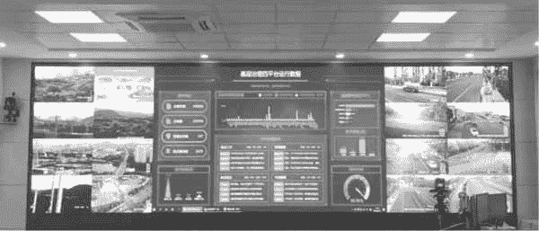

图 5-2 数智化“枫桥经验”与智能社区管理

在智能社区，AI 视频监控系统是社区安全的“守护者”。高清摄像头遍布社区各个角落，利用计算机视觉技术，系统能够实时监测社区内的人员活动、车辆行驶情况。一旦发现异常行为，如陌生人长时间徘徊、车辆违规停放等，系统会立即发出警报，并将相关信息推送给社区管理人员。例如，当检测到有陌生人在居民楼附近多次徘徊且行为鬼鬼祟祟时，监控系统会自动抓拍照片并通知保安人员前往查看，从而有效预防盗窃等违法犯罪行为的发生。

智能门禁系统也是智能社区管理的重要组成部分。它采用人脸识别、指纹识别等生物识别技术，只有经过授权的人员才能进入社区和单元楼。这不仅提高了社区的安全性，还方便了居民的出行。同时，智能门禁系统可以与社区管理平台相连，记录人员的出入信息，为社区管理提供数据支持。例如，访客来访时，可以通过门禁系统呼叫业主，经业主确认后即可进入社区，门禁系统会自动记录访客的来访时间、身份信息等。

AI 在社区矛盾纠纷调解方面也发挥着重要作用。通过分析语音颤抖频率和面部微表情，AI 可以识别当事人的真实诉求，突破“口是心非”调解困境。通过对社区居民的社交数据、投诉记录等进行分析，AI 可以提前发现潜在的矛盾与纠纷。例如，某栋楼的居民频繁投诉噪声问题，AI 系统可以分析噪声的来源、涉及的住户等信息，并及时通知社区工作人员进行调解。此外，AI 智能调解助手的法律知识引擎可以实时检索相似案例的判决结果，生成个性化调解方案，调解成功率提升至 89%。AI 智能调解助手还可以为调解人员提供相关的法律法规和案例参考，帮助调解人员更好地处理矛盾与纠纷。例如，在浙江诸暨，AI 调解系统入驻 326 个村社，化解邻里纠纷 4.2 万起，上访量下降 76%。

以某智能社区为例，在引入 AI 技术之前，社区内盗窃案件时有发生，矛盾与纠纷调解效率较低。而引入 AI 技术后，社区内盗窃案件发生率下降了 50%，矛盾纠纷的平均调解时间缩短了 30%，居民的安全感和满意度得到了显著提升。

在城市治理层面，AI 同样发挥着重要作用。城市管理部门利用 AI 技术对城市交通、环境等进行实时监测和管理。在交通管理方面，通过对道路上的摄像头、传感器等采集的数据进行分析，AI 可以实时掌握交通流量情况，优化交通信号灯的配时，缓解交通拥堵。例如，当某个路口的车流量突然增大时，AI 系统可以自动延长该路口绿灯的时间，提高道路通行效率。

在环境治理方面，AI 可以通过对空气质量监测站、水质监测点等采集的数据进行分析，实时掌握城市的环境质量。一旦发现环境污染问题，AI 系统可以快速定位污染源，并通知相关部门进行处理。例如，当空气质量监测站检测到某区域的 PM2.5 浓度超标时，AI 系统可以分析周边的工业企业运营、交通流量等数据，找出可能的污染源，并为环保部门制定治理措施提供参考。

此外，AI 可以用于城市规划和管理。通过对城市人口分布、经济发展等数据的分析，AI 可以为城市规划提供科学依据，优化城市的功能布局和基础设施建设。例如，AI 可以根据人口密度和出行需求，合理规划公交线路和站点，提高公共交通的覆盖率和服务质量。

### 智能安全：AI 应急管理与城市生命线

在应急管理领域，AI 技术的应用为提升城市应对突发事件的能力提供了有力支持。AI 可以对各类灾害数据进行实时监测和分析，提前预测灾害的发生，为应急救援提供决策依据。通过结合“物联网+边缘计算”，利用百万级传感器实时监测桥梁振动、燃气压力、地铁沉降等指标，数据本地化处理可避免传输延迟，实现从“事后救火”到“事前防火”的转变，AI 成为城市生命线的“智能哨兵”。城市生命线工程示意如图 5-3 所示。

在地震监测方面，AI 可以通过对地震监测站采集的地震波数据进行分析，快速准确地测定地震的震级、震中位置等信息。同时，AI 可以结合地理信息系统技术，对地震可能造成的破坏范围和人员伤亡情况进行预测，为应急救援部门制订救援方案提供参考。例如，某次地震发生后，AI 系统在短短几分钟内就确定了地震的相关信息，并预测出可能受灾严重的区域，救援队伍根据这些信息迅速展开救援行动，大幅提高了救援效率。

图 5-3 城市生命线工程示意

在气象灾害预警方面，AI 可以对气象卫星、雷达等采集的数据进行分析，更精准地预测台风、暴雨、暴雪等气象灾害的路径和强度。通过对历史气象数据和实时数据的深度学习，AI 能够提前发现气象灾害的异常变化，及时发出预警信息，让市民提前做好防范措施。例如，在台风来袭前，AI 系统可以预测台风的登陆地点和时间，为政府部门组织人员疏散、物资调配等提供充足的时间。

在火灾预警方面，AI 视频监控系统可以实时监测火灾隐患。通过对监控画面的分析，系统能够识别出烟雾、火焰等火灾迹象，并及时发出警报。同时，AI 可以结合地理信息系统，快速定位火灾发生的地点，为消防部门提供准确的位置信息，提高灭火救援的效率。例如，当某商场发生火灾时，AI 视频监控系统第一时间发现了火灾，并将火灾位置和火势大小等信息传送给消防部门，消防部门迅速出动消防车进行灭火，避免了火势的进一步蔓延。

在供水系统中，AI 可以通过对水质监测数据、水压数据等进行分析，实时掌握供水系统的运行状况。一旦发现水质异常或水压过低等问题，AI 系统会及时发出警报，并通知相关部门进行维修。例如，当 AI 系统检测到某区域的自来水中重金属含量超标时，会立即启动应急预案，通知供水部门停止该区域的供水，并对水源进行排查和处理。

在供电系统中，AI 可以对电网的运行数据进行实时监测和分析，预测电力设备的故障风险。通过对变压器、线路等设备的运行数据进行深度学习，AI 能够提前发现设备的潜在故障，并及时安排维修人员进行维护，避免停电事故的发生。例如，AI 系统通过分析变压器的油温、负荷等数据，预测某台变压器可能在一周后出现故障，维修人员提前对该变压器进行检修，成功避免了一次停电事故。从“定期检修”到“按需维护”的转变，使市政开支节约 37%，事故率下降 92%。

在供气系统中，AI 可以对燃气管道的压力、流量等数据进行监测，及时发现燃气泄漏等安全隐患。一旦检测到燃气泄漏，AI 系统会立即发出警报，并通知燃气公司和相关部门进行处理。同时，AI 可以通过对燃气用户的用气数据进行分析，预测用户的用气需求，为燃气公司的供气调度提供参考。例如，在冬季供暖期间，AI 系统通过分析用户的用气数据，预测出某区域的燃气需求将大幅增加，燃气公司据此提前调整了供气计划，保障了居民的正常用气。

### 智慧城市：城市大脑与态势感知

智慧城市是城市发展的高级形态，旨在利用信息技术实现城市的高效运行和可持续发展。城市大脑作为智慧城市的核心，整合了城市各个领域的数据资源，通过 AI 技术进行数据分析和处理，为城市管理提供智能决策支持。结合“区块链+联邦学习”，各部门的数据虽然保持物理隔离，但通过加密参数共享训练全局模型，破解了“数据不敢给、不愿给”难题。

城市大脑汇聚了城市交通、能源、环境、安全等多领域的数据。这些数据通过物联网、传感器等技术实时采集，并传输到城市大脑的大数据平台。例如，交通数据包括道路上的车流量、车速、交通事故等信息；能源数据包括电力、燃气、供水的消耗情况等；环境数据包括空气质量、水质、噪声等监测数据。城市大脑对这些海量数据进行整合和清洗，去除无效数据，确保数据的准确性和完整性。

基于整合后的数据，城市大脑利用 AI 算法进行深度分析。在交通领域，通过对交通数据的分析，城市大脑可以优化交通信号控制，缓解交通拥堵。例如，根据实时车流量情况，自动调整信号灯的时长，使道路通行效率最大化。在能源管理方面，城市大脑可以分析能源消耗数据，预测能源需求，优化能源供应策略，实现能源的高效利用。例如，雄安新区全城建筑嵌入智能传感网，AI 可以自动调节楼宇能耗、电梯调度与安防等级，碳排放降低 41%。

态势感知是城市大脑的重要功能之一。它通过对城市运行数据的实时监测和分析，全面、准确地掌握城市的运行状态。城市大脑利用可视化技术，将城市的各种运行数据以直观的图表、地图等形式展示出来，让城市管理者能够一目了然地了解城市的运行情况。例如，通过城市大脑的可视化界面，管理者可以实时查看城市各个区域的交通拥堵情况、空气质量状况、能源消耗水平等信息。

当城市出现异常情况时，城市大脑能够迅速做出反应。例如，当发生交通事故导致交通拥堵时，城市大脑可以自动调配周边的警力和救援资源，同时调整交通信号灯，引导车辆绕行，尽快恢复交通秩序。在应对突发公共卫生事件时，城市大脑可以整合医疗资源、人员流动数据等信息，为疫情防控提供决策支持，如确定隔离区域、调配医疗物资等。

杭州的城市大脑自投入使用以来，取得了显著成效。在交通方面，通过优化交通信号控制，部分路段的通行时间较优化前缩短了 15%以上；在城市管理方面，城市大脑实现了对城市事件的快速发现和处理，城市管理效率较之前提升了 30%以上。杭州城市大脑的成功实践为其他城市建设智慧城市提供了有益的借鉴。

随着 5G、物联网、大数据等技术的不断发展，“AI+政府”模式将不断创新和完善。未来，AI 将在政府决策支持、社会信用体系建设、公共卫生应急管理等领域发挥更加重要的作用。政府应加强对 AI 技术的研究和应用，推动 AI 与政府治理的深度融合，打造更加智能、高效、便民的服务型政府，为人民群众创造更加美好的生活。 EXr6287u6NNVz+GYLY+7SDk226FstKIHdC0bNoQkB2Nqi1xSR0yxPmwrTs5gRi/BtfSbid6dBhii9q7cz2pIyA==

## 1 AI+政府：从电子政务到脑机政务

当 AlphaGo 击败李世石时，人类或许还未意识到，这场胜利不仅是围棋领域的颠覆，更是社会治理模式革命的预演。今天，人工智能正在从“工具”升级为“治理主体”，重塑政府的决策逻辑、服务形态甚至权力边界。从“最多跑一次”到“零跑动”，从“事后响应”到“先知先觉”，“AI+政府”的本质，是用算法重新定义公权力的运行法则。

“AI+政府”模式的兴起，为政府治理带来了全方位的变革，从智能服务的高效便民，到智能治理的精准精细，再到智能安全的坚实保障和智慧城市的整体统筹，展现出一幅充满创新活力与无限可能的未来政府治理画卷。

### 智能服务：12345 智能热线与公共服务

12345 政务服务便民热线，作为政府与民众沟通的重要桥梁，过去主要依靠人工接听和处理诉求，面临效率低、响应慢、信息整合难等问题。随着人工智能技术的引入，12345 智能热线应运而生，为公共服务带来了革命性的变化。“AI+政务”服务热线平台功能架构如图 5-1 所示。

中央及各省市对政务服务热线的政策要求很明确，旨在提升政务服务的质量和效率。《国务院办公厅关于进一步优化地方政务服务便民热线的指导意见》要求，2021 年年底前实现“一个号码”服务，即统一为“12345 政务服务便民热线”，确保一个号码对外，一个平台受理，一个系统办理，一个标准服务，一个机制保障，聚焦企业和群众反映强烈的办事堵点、难点问题，提供更加优质高效的政务服务，切实解决企业和群众的实际问题，提高满意度。

《国务院关于进一步优化政务服务提升行政效能 推动“高效办成一件事”的指导意见》指出，推进企业和群众诉求“一线应答”。依托 12345 政务服务便民热线加强政务服务热线归并，根据需要设置重点领域专席，不断提升 12345 政务服务便民热线的接办效率，高效受理政务服务咨询、投诉、求助、建议和在线办理指导等诉求，打造便捷、高效、规范、智慧的政务服务“总客服”。

图 5-1 “AI+政务”服务热线平台功能架构

为了解决上述痛点，提升 12345 政务服务便民热线的服务质量和效率，各地各级热线部门积极探索和创新，结合大数据、人工智能等新一代数字技术与政务热线应用场景，打造“便捷高效的服务平台”“协同治理的重要枢纽”“智慧治理的有力支撑”。

智能语音识别技术是 12345 智能热线的核心能力之一。中科汇联公司的 AiCC 智能客服平台通过先进的语音识别算法，快速、准确地将市民的语音诉求转化为文字信息。该平台采用多模态交互技术，如“语音识别+自然语言理解+情感分析”，结合信息技术、通信技术和物联网技术进行统一通信，兼容电话、网页、短信、App、微博、微信等全域、全渠道接入，实现“听懂抱怨、安抚情绪、解决问题”全链路自动化。例如，当市民来电反映“小区附近的路灯坏了，晚上出行很不安全”时，智能语音识别系统可以精准识别这段话，避免人工记录可能出现的错误，极大地提高信息获取的效率和民众的满意度。

自然语言处理技术则赋予了智能热线理解和分析市民诉求的能力。它能够对转化后的文字信息进行语义理解，判断诉求的类型、紧急程度和涉及的部门。例如，系统可以快速判断出路灯损坏属于市政设施维修范畴，并自动将工单派发至对应的市政部门。同时，自然语言处理技术能对市民的表述进行情感分析，若市民在表达诉求时情绪激动，系统会进行标记并提醒工作人员重点关注，提供更贴心的服务。

智能知识库是 12345 智能热线的强大后盾。中科汇联的 AiKM 智能知识库基于政务百科知识库，结合慧政大模型和检索增强生成（Retrieval-Augmented Generation，RAG）技术，可以为 12345 智能热线提供一种高效、智能的知识服务，极大地提升服务质量和效率。RAG 技术还能理解查询的上下文，结合历史交互数据，智能推荐相关的政策解释和办事指南，帮助客服人员更好地理解用户需求并提供专业的回答。它整合了政府各部门的政策法规、常见问题解答等海量信息。当市民咨询医保报销流程、住房公积金提取条件等问题时，智能热线可以迅速从知识库中检索出准确的答案，为市民提供即时、专业的回复。此外，智能知识库具备自我学习和更新能力，能根据新的政策法规和常见问题不断完善内容，确保回复的准确性和时效性。

在实际应用中，12345 智能热线取得了显著成效。某城市在引入智能热线之前，市民诉求的平均处理时间为 3 天，接通率仅为 70%。而引用智能热线后，市民诉求的平均处理时间缩短至 1 天，接通率提升到 95%以上。上海 12345 智能热线中的 AI 客服“申小智”可以识别方言并自动派单至对应部门，市民满意度大幅提升。12345 智能热线不仅提高了政府服务效率，还大幅提升了市民的满意度，真正实现了让数据多跑路、群众少跑腿。

除了 12345 智能热线，AI 在公共服务的其他领域也发挥着重要作用。在社保服务方面，AI 智能客服可以解答参保人员关于社保政策、缴费标准、养老金领取等各种问题。通过自然语言处理技术，智能客服能够理解参保人员提出的复杂问题，并给出清晰、准确的回复。在办理社保业务时，AI 还可以辅助进行资格审核。例如，AI 可以利用人脸识别技术和大数据分析技术，对参保人员的身份信息进行核实，防止冒领养老金等欺诈行为。

在税务服务领域，AI 智能导税系统为纳税人提供便捷的办税指引。纳税人进入办税大厅后，通过与智能导税机器人进行语音交互，获取所需办理业务的流程、所需材料及办理窗口等信息。同时，AI 可以对纳税人的历史办税数据进行分析，为其提供个性化的税收优惠政策推荐，帮助纳税人享受应有的税收红利。

12345 智能热线产生的数据量巨大，且数据类型多样，包括语音、文本和工单等，这些多元异构数据给数据整合和分析带来了一系列挑战。中科汇联 AiCC 智能客服平台基于大模型的大数据分析技术，对 12345 智能热线积累的海量对话数据进行深度挖掘，提取有价值的信息；通过构建数据模型，识别市民诉求的热点问题和趋势变化，为政府决策提供科学依据；开发和引入智能分析工具，如情感分析、热点话题识别、舆情监测等，帮助管理者快速了解市民的诉求和情绪状态；通过可视化界面直观展示分析结果，辅助决策。

### 智能治理：“枫桥经验”与智能社区管理

“枫桥经验”作为我国基层社会治理的宝贵经验，强调依靠群众、就地解决矛盾与纠纷。在新时代，AI 技术与“枫桥经验”深度融合，为智能社区管理带来了新的思路和方法（见图 5-2）。

图 5-2 数智化“枫桥经验”与智能社区管理

在智能社区，AI 视频监控系统是社区安全的“守护者”。高清摄像头遍布社区各个角落，利用计算机视觉技术，系统能够实时监测社区内的人员活动、车辆行驶情况。一旦发现异常行为，如陌生人长时间徘徊、车辆违规停放等，系统会立即发出警报，并将相关信息推送给社区管理人员。例如，当检测到有陌生人在居民楼附近多次徘徊且行为鬼鬼祟祟时，监控系统会自动抓拍照片并通知保安人员前往查看，从而有效预防盗窃等违法犯罪行为的发生。

智能门禁系统也是智能社区管理的重要组成部分。它采用人脸识别、指纹识别等生物识别技术，只有经过授权的人员才能进入社区和单元楼。这不仅提高了社区的安全性，还方便了居民的出行。同时，智能门禁系统可以与社区管理平台相连，记录人员的出入信息，为社区管理提供数据支持。例如，访客来访时，可以通过门禁系统呼叫业主，经业主确认后即可进入社区，门禁系统会自动记录访客的来访时间、身份信息等。

AI 在社区矛盾纠纷调解方面也发挥着重要作用。通过分析语音颤抖频率和面部微表情，AI 可以识别当事人的真实诉求，突破“口是心非”调解困境。通过对社区居民的社交数据、投诉记录等进行分析，AI 可以提前发现潜在的矛盾与纠纷。例如，某栋楼的居民频繁投诉噪声问题，AI 系统可以分析噪声的来源、涉及的住户等信息，并及时通知社区工作人员进行调解。此外，AI 智能调解助手的法律知识引擎可以实时检索相似案例的判决结果，生成个性化调解方案，调解成功率提升至 89%。AI 智能调解助手还可以为调解人员提供相关的法律法规和案例参考，帮助调解人员更好地处理矛盾与纠纷。例如，在浙江诸暨，AI 调解系统入驻 326 个村社，化解邻里纠纷 4.2 万起，上访量下降 76%。

以某智能社区为例，在引入 AI 技术之前，社区内盗窃案件时有发生，矛盾与纠纷调解效率较低。而引入 AI 技术后，社区内盗窃案件发生率下降了 50%，矛盾纠纷的平均调解时间缩短了 30%，居民的安全感和满意度得到了显著提升。

在城市治理层面，AI 同样发挥着重要作用。城市管理部门利用 AI 技术对城市交通、环境等进行实时监测和管理。在交通管理方面，通过对道路上的摄像头、传感器等采集的数据进行分析，AI 可以实时掌握交通流量情况，优化交通信号灯的配时，缓解交通拥堵。例如，当某个路口的车流量突然增大时，AI 系统可以自动延长该路口绿灯的时间，提高道路通行效率。

在环境治理方面，AI 可以通过对空气质量监测站、水质监测点等采集的数据进行分析，实时掌握城市的环境质量。一旦发现环境污染问题，AI 系统可以快速定位污染源，并通知相关部门进行处理。例如，当空气质量监测站检测到某区域的 PM2.5 浓度超标时，AI 系统可以分析周边的工业企业运营、交通流量等数据，找出可能的污染源，并为环保部门制定治理措施提供参考。

此外，AI 可以用于城市规划和管理。通过对城市人口分布、经济发展等数据的分析，AI 可以为城市规划提供科学依据，优化城市的功能布局和基础设施建设。例如，AI 可以根据人口密度和出行需求，合理规划公交线路和站点，提高公共交通的覆盖率和服务质量。

### 智能安全：AI 应急管理与城市生命线

在应急管理领域，AI 技术的应用为提升城市应对突发事件的能力提供了有力支持。AI 可以对各类灾害数据进行实时监测和分析，提前预测灾害的发生，为应急救援提供决策依据。通过结合“物联网+边缘计算”，利用百万级传感器实时监测桥梁振动、燃气压力、地铁沉降等指标，数据本地化处理可避免传输延迟，实现从“事后救火”到“事前防火”的转变，AI 成为城市生命线的“智能哨兵”。城市生命线工程示意如图 5-3 所示。

在地震监测方面，AI 可以通过对地震监测站采集的地震波数据进行分析，快速准确地测定地震的震级、震中位置等信息。同时，AI 可以结合地理信息系统技术，对地震可能造成的破坏范围和人员伤亡情况进行预测，为应急救援部门制订救援方案提供参考。例如，某次地震发生后，AI 系统在短短几分钟内就确定了地震的相关信息，并预测出可能受灾严重的区域，救援队伍根据这些信息迅速展开救援行动，大幅提高了救援效率。

图 5-3 城市生命线工程示意

在气象灾害预警方面，AI 可以对气象卫星、雷达等采集的数据进行分析，更精准地预测台风、暴雨、暴雪等气象灾害的路径和强度。通过对历史气象数据和实时数据的深度学习，AI 能够提前发现气象灾害的异常变化，及时发出预警信息，让市民提前做好防范措施。例如，在台风来袭前，AI 系统可以预测台风的登陆地点和时间，为政府部门组织人员疏散、物资调配等提供充足的时间。

在火灾预警方面，AI 视频监控系统可以实时监测火灾隐患。通过对监控画面的分析，系统能够识别出烟雾、火焰等火灾迹象，并及时发出警报。同时，AI 可以结合地理信息系统，快速定位火灾发生的地点，为消防部门提供准确的位置信息，提高灭火救援的效率。例如，当某商场发生火灾时，AI 视频监控系统第一时间发现了火灾，并将火灾位置和火势大小等信息传送给消防部门，消防部门迅速出动消防车进行灭火，避免了火势的进一步蔓延。

在供水系统中，AI 可以通过对水质监测数据、水压数据等进行分析，实时掌握供水系统的运行状况。一旦发现水质异常或水压过低等问题，AI 系统会及时发出警报，并通知相关部门进行维修。例如，当 AI 系统检测到某区域的自来水中重金属含量超标时，会立即启动应急预案，通知供水部门停止该区域的供水，并对水源进行排查和处理。

在供电系统中，AI 可以对电网的运行数据进行实时监测和分析，预测电力设备的故障风险。通过对变压器、线路等设备的运行数据进行深度学习，AI 能够提前发现设备的潜在故障，并及时安排维修人员进行维护，避免停电事故的发生。例如，AI 系统通过分析变压器的油温、负荷等数据，预测某台变压器可能在一周后出现故障，维修人员提前对该变压器进行检修，成功避免了一次停电事故。从“定期检修”到“按需维护”的转变，使市政开支节约 37%，事故率下降 92%。

在供气系统中，AI 可以对燃气管道的压力、流量等数据进行监测，及时发现燃气泄漏等安全隐患。一旦检测到燃气泄漏，AI 系统会立即发出警报，并通知燃气公司和相关部门进行处理。同时，AI 可以通过对燃气用户的用气数据进行分析，预测用户的用气需求，为燃气公司的供气调度提供参考。例如，在冬季供暖期间，AI 系统通过分析用户的用气数据，预测出某区域的燃气需求将大幅增加，燃气公司据此提前调整了供气计划，保障了居民的正常用气。

### 智慧城市：城市大脑与态势感知

智慧城市是城市发展的高级形态，旨在利用信息技术实现城市的高效运行和可持续发展。城市大脑作为智慧城市的核心，整合了城市各个领域的数据资源，通过 AI 技术进行数据分析和处理，为城市管理提供智能决策支持。结合“区块链+联邦学习”，各部门的数据虽然保持物理隔离，但通过加密参数共享训练全局模型，破解了“数据不敢给、不愿给”难题。

城市大脑汇聚了城市交通、能源、环境、安全等多领域的数据。这些数据通过物联网、传感器等技术实时采集，并传输到城市大脑的大数据平台。例如，交通数据包括道路上的车流量、车速、交通事故等信息；能源数据包括电力、燃气、供水的消耗情况等；环境数据包括空气质量、水质、噪声等监测数据。城市大脑对这些海量数据进行整合和清洗，去除无效数据，确保数据的准确性和完整性。

基于整合后的数据，城市大脑利用 AI 算法进行深度分析。在交通领域，通过对交通数据的分析，城市大脑可以优化交通信号控制，缓解交通拥堵。例如，根据实时车流量情况，自动调整信号灯的时长，使道路通行效率最大化。在能源管理方面，城市大脑可以分析能源消耗数据，预测能源需求，优化能源供应策略，实现能源的高效利用。例如，雄安新区全城建筑嵌入智能传感网，AI 可以自动调节楼宇能耗、电梯调度与安防等级，碳排放降低 41%。

态势感知是城市大脑的重要功能之一。它通过对城市运行数据的实时监测和分析，全面、准确地掌握城市的运行状态。城市大脑利用可视化技术，将城市的各种运行数据以直观的图表、地图等形式展示出来，让城市管理者能够一目了然地了解城市的运行情况。例如，通过城市大脑的可视化界面，管理者可以实时查看城市各个区域的交通拥堵情况、空气质量状况、能源消耗水平等信息。

当城市出现异常情况时，城市大脑能够迅速做出反应。例如，当发生交通事故导致交通拥堵时，城市大脑可以自动调配周边的警力和救援资源，同时调整交通信号灯，引导车辆绕行，尽快恢复交通秩序。在应对突发公共卫生事件时，城市大脑可以整合医疗资源、人员流动数据等信息，为疫情防控提供决策支持，如确定隔离区域、调配医疗物资等。

杭州的城市大脑自投入使用以来，取得了显著成效。在交通方面，通过优化交通信号控制，部分路段的通行时间较优化前缩短了 15%以上；在城市管理方面，城市大脑实现了对城市事件的快速发现和处理，城市管理效率较之前提升了 30%以上。杭州城市大脑的成功实践为其他城市建设智慧城市提供了有益的借鉴。

随着 5G、物联网、大数据等技术的不断发展，“AI+政府”模式将不断创新和完善。未来，AI 将在政府决策支持、社会信用体系建设、公共卫生应急管理等领域发挥更加重要的作用。政府应加强对 AI 技术的研究和应用，推动 AI 与政府治理的深度融合，打造更加智能、高效、便民的服务型政府，为人民群众创造更加美好的生活。 EXr6287u6NNVz+GYLY+7SDk226FstKIHdC0bNoQkB2Nqi1xSR0yxPmwrTs5gRi/BtfSbid6dBhii9q7cz2pIyA==

## 2 AI+金融：重构科技金融的“神经中枢”

在金融领域，人工智能掀起了一场前所未有的变革浪潮。它以强大的数据分析、智能决策和自动化执行能力，重塑金融行业的格局，从智能服务的创新体验，到智能投顾的普惠理财，再到智能风控的坚实防线，全方位提升金融机构的运营效率和服务质量，为金融行业的数字化转型注入强劲动力。

### 智能服务：智能客服与智能营销

#### 智能客服：7 **×** 24 小时的金融服务助手

在传统的金融服务模式下，客户咨询业务往往面临等待时间长、人工客服专业水平参差不齐等问题。而 AI 智能客服的出现，彻底改变了这一局面。智能客服依托自然语言处理和机器学习技术，能够理解客户用自然语言提出的各类金融问题，并给出准确、快速的回复。

以银行业为例，当客户通过手机银行 App 或官方网站的在线客服入口咨询时，智能客服可以瞬间响应。无论是常见的账户余额查询、转账汇款操作指南，还是复杂的理财产品收益计算、贷款政策解读，智能客服都能对答如流。例如，中国工商银行“AI 小工”日均处理百万次咨询，可识别方言并指导偏远地区用户完成手机银行开户，使农村金融服务覆盖率提升 53%。

智能客服不仅能解答问题，还具备多语言服务能力。在全球化金融市场中，跨国金融机构利用智能客服进行多种语言交流，满足不同地区客户的需求。这对拓展国际业务、提升全球客户服务体验至关重要，可以让金融服务跨越语言障碍，实现无边界沟通。

此外，智能客服能通过客户的历史咨询记录和行为数据，进行个性化服务推荐。例如，一位客户经常关注股票投资相关问题，智能客服会适时推荐股票交易软件的新功能、股票投资讲座等相关信息，为这位客户提供更贴合其需求的服务，增强客户与金融机构之间的黏性。

#### 智能营销：精准定位与个性化推荐

在金融产品日益丰富的今天，如何让合适的产品找到合适的客户，是金融营销面临的关键挑战。AI 智能营销借助大数据分析和机器学习算法，实现了精准定位和个性化推荐。

金融机构拥有海量客户数据，包括他们的基本信息、交易记录、投资偏好、消费习惯等。AI 智能营销系统通过对这些数据的深度挖掘，构建客户 360°画像，清晰地描绘出每位客户的金融需求和风险承受能力。例如，通过分析客户的投资交易记录，系统可以判断客户是保守型投资者还是激进型投资者；根据客户的消费习惯，系统可以了解其对不同金融产品的潜在需求，如经常使用信用卡分期付款的客户，可能对消费信贷产品有较大的需求。

基于客户画像，智能营销系统能够精准定位目标客户群体，并进行个性化的产品推荐。当一款新的理财产品推出时，系统会自动筛选出对该产品可能感兴趣的客户名单。对于风险偏好较高且有一定闲置资金的年轻客户，系统会向其推荐高收益、中风险的权益类理财产品；对于临近退休、追求资产稳健增值的客户，系统会向其推荐低风险的债券型理财产品或养老金融产品。

同时，AI 智能营销能优化营销渠道和时间。通过分析客户在不同渠道（如手机银行 App、微信公众号、短信等）的活跃时间和响应率，选择最合适的渠道和时机向客户推送营销信息。例如，系统发现年轻客户在晚上 8 点至 10 点使用手机银行 App 的频率较高，就会在这个时间段向他们推送金融产品信息，提高营销效果。

在实际应用中，智能营销为金融机构带来了显著的业绩提升。某银行采用智能营销系统后，信用卡开卡率提升了 30%，理财产品销售额增长了 25%。智能营销不仅提高了金融产品的销售效率，还提升了客户对金融机构的满意度和忠诚度。

### 智能投顾：个性化财富管理的平民化

#### 降低财富管理门槛，开启普惠金融新时代

传统财富管理服务往往面向高净值客户，普通投资者因资金量有限、投资知识不足等，难以获得专业的投资建议和个性化的资产配置方案。智能投顾的出现降低了这一财富管理门槛，让普通投资者也能享受到专业、个性化的财富管理服务，推动普惠金融的发展。

AI 智能投顾（见图 5-4）基于现代投资组合理论，结合机器学习算法，根据客户的风险承受能力、投资目标、财务状况等因素，为客户量身定制投资组合方案。客户只需要在智能投顾平台上完成简单的风险测评和信息填写，系统就能在短时间内生成适合其个人情况的投资组合建议，涵盖股票、基金、债券、保险等多种金融产品。

图 5-4 AI 智能投顾的架构

与传统投顾相比，智能投顾具有成本低、效率高的优势。传统投顾服务通常需要收取较高的管理费用，而智能投顾通过自动化服务模式，大幅降低了运营成本，能够以较低的费用为普通投资者提供服务。同时，智能投顾可以在瞬间完成大量数据的分析和投资组合的计算，而人工投顾完成同样的工作可能需要花费数小时甚至数天。例如，根据蒙特卡罗模拟，AI 运行 10 万次市场情景推演，生成最优资产组合，耗时仅 3 秒。

#### 实时跟踪与动态调整，适应市场变化

金融市场瞬息万变，投资组合需要根据市场行情及时调整。智能投顾借助实时数据监测和机器学习算法，能够对投资组合进行实时跟踪和动态调整，确保投资组合始终符合客户的风险偏好和投资目标。

智能投顾系统实时收集全球金融市场数据，包括股票价格、汇率、利率、宏观经济指标等。当市场发生变化时，系统会迅速分析市场走势对投资组合的影响。例如，股票市场出现大幅下跌，智能投顾系统会评估该下跌趋势对客户投资组合中股票资产的影响。如果下跌幅度超出了客户设定的风险阈值，系统会自动调整投资组合，适当减少股票资产的比例，增加债券或现金类资产的配置，以降低投资组合的整体风险。

此外，智能投顾系统能根据客户的人生阶段和财务状况变化，对投资组合进行动态调整。例如，当客户结婚、生子或临近退休时，其财务目标和风险承受能力可能发生变化，智能投顾系统会根据这些变化重新评估投资组合，并做出相应的调整，确保投资组合始终与客户的实际情况相匹配。

#### 智能投顾的发展现状与挑战

目前，智能投顾市场呈现出快速发展的态势。国内外众多金融机构纷纷推出自己的智能投顾产品，如招商银行的“摩羯智投”、蚂蚁财富的“帮你投”等。这些产品吸引了大量普通投资者，金融机构管理的资产规模不断扩大。

然而，智能投顾在发展过程中也面临一些挑战。一方面，数据安全和隐私保护问题至关重要。智能投顾涉及大量客户的个人财务信息，一旦发生数据泄露，将给客户带来严重损失。金融机构需要加强数据安全管理，采用先进的加密技术和严格的访问控制措施，确保客户数据的安全。另一方面，智能投顾算法的可解释性是一个难题。由于机器学习算法的复杂性，一些投资决策的依据难以向客户清晰地解释，可能导致客户对智能投顾的信任度降低。金融机构需要探索更加透明、可解释的算法，增强客户对智能投顾的信任。

### 智能风控：风险管理与市场预测

#### 多维度数据融合，构建全面风险画像

在金融领域，风险管理是核心环节。AI 智能风控通过整合多维度数据，构建全面的风险画像，为金融机构提供更精准、更高效的风险评估和预警。

传统风控主要依赖客户的财务报表、信用记录等有限数据进行风险评估，这种方式存在信息不全面、滞后等问题。而智能风控借助大数据技术，能够收集和整合来自多个渠道的数据，包括客户的社交媒体数据、消费行为数据、网络浏览记录等。例如，通过分析客户在社交媒体上的言论和行为，了解其消费观念、社交圈子和潜在风险；通过分析客户的网络购物记录，评估其消费能力和还款意愿。

将这些多维度数据与传统的金融数据相结合，智能风控系统可以构建客户的全面风险画像。这个画像不仅包含客户的基本财务信息，还能反映客户的行为模式、信用习惯和潜在风险因素。通过对风险画像的分析，金融机构可以更准确地评估客户的信用风险，判断客户是否具备贷款资格、信用卡申请资格等。例如，网商银行“310 模式”，3 分钟申请、1 秒放款、0 人工干预，累计服务小微客户超 5000 万名，坏账率仅 1.2%。

#### 实时风险监测与预警，防范潜在风险

金融市场瞬息万变，因此及时发现和预警潜在风险至关重要。智能风控利用实时数据监测和机器学习算法，对金融交易和投资活动进行实时风险监测，一旦发现异常情况，立即发出预警信号。

在信贷业务中，智能风控系统实时监测客户的还款行为。如果客户出现还款逾期的迹象，系统会根据逾期的严重程度发出不同级别的预警。例如，当客户还款逾期 1～3 天时，系统发出黄色预警，提醒信贷人员关注客户情况，了解逾期原因；当逾期超过 30 天时，系统发出红色预警，信贷人员会采取更积极的催收措施，如电话催收、上门催收等，以降低贷款损失风险。

在金融市场投资领域，智能风控系统实时监测投资组合的风险状况。当市场波动导致投资组合的风险指标（如风险价值、夏普比率等）超出设定的阈值时，系统会立即发出预警，提醒投资者或基金经理调整投资组合，降低风险。例如，当某只股票型基金的投资组合风险价值超过设定的风险上限时，系统会提示基金经理减少股票仓位，增加债券或现金类资产的配置，以稳定投资组合的风险水平。

#### 机器学习助力市场预测，提升风控前瞻性

除了风险监测和预警，智能风控还借助机器学习算法进行市场预测，提前预判市场走势和风险变化，为金融机构的风险管理提供前瞻性支持。

机器学习算法可以对历史市场数据、宏观经济数据、行业数据等进行深度学习，挖掘数据背后的规律和趋势。例如，通过分析历史股票价格走势、成交量、宏观经济指标（如 GDP 增长率、通货膨胀率等）及行业政策变化等因素，机器学习模型可以预测股票市场的未来走势。金融机构可以根据这些预测结果提前调整投资策略，优化资产配置，降低市场风险对投资组合的影响。

在信用风险预测方面，机器学习算法可以通过分析大量的历史信用数据，识别出影响信用风险的关键因素，并建立信用风险预测模型。这些模型可以预测客户未来发生违约的概率，帮助金融机构在贷款审批、信用卡发卡等环节更准确地评估风险，避免潜在的信用损失。

智能风控在金融行业的应用取得了显著成效。某金融科技公司采用智能风控系统后，不良贷款率降低了 20%，信用卡欺诈交易识别准确率提高了 30%。智能风控已成为金融机构防范风险、保障业务稳健发展的重要工具。

随着人工智能技术的不断进步和创新，“AI+金融”的应用场景将更加丰富，深度和广度也将不断拓展。未来，AI 有望在金融监管、保险精算、供应链金融等领域发挥更大的作用，推动金融行业向更加智能化、高效化、安全化的方向发展。金融机构应积极拥抱 AI 技术，加强技术创新和人才培养，充分发挥 AI 在金融领域的巨大潜力，为客户提供更优质、更安全的金融服务。

当华尔街的铜牛被替换成量子计算机雕塑时，我们不得不思考：金融的本质究竟是“资源的跨时空配置”，还是“人类贪婪与恐惧的放大器”？AI 给了我们重新定义的可能——让资本流动如电力般稳定可预测，让财富分配如数学般精确公正。但最终的答案，或许藏在那句古老的华尔街格言中： **“市场保持非理性的时间，可能长过你保持算力供电的时间。”** EXr6287u6NNVz+GYLY+7SDk226FstKIHdC0bNoQkB2Nqi1xSR0yxPmwrTs5gRi/BtfSbid6dBhii9q7cz2pIyA==

## 2 AI+金融：重构科技金融的“神经中枢”

在金融领域，人工智能掀起了一场前所未有的变革浪潮。它以强大的数据分析、智能决策和自动化执行能力，重塑金融行业的格局，从智能服务的创新体验，到智能投顾的普惠理财，再到智能风控的坚实防线，全方位提升金融机构的运营效率和服务质量，为金融行业的数字化转型注入强劲动力。

### 智能服务：智能客服与智能营销

#### 智能客服：7 **×** 24 小时的金融服务助手

在传统的金融服务模式下，客户咨询业务往往面临等待时间长、人工客服专业水平参差不齐等问题。而 AI 智能客服的出现，彻底改变了这一局面。智能客服依托自然语言处理和机器学习技术，能够理解客户用自然语言提出的各类金融问题，并给出准确、快速的回复。

以银行业为例，当客户通过手机银行 App 或官方网站的在线客服入口咨询时，智能客服可以瞬间响应。无论是常见的账户余额查询、转账汇款操作指南，还是复杂的理财产品收益计算、贷款政策解读，智能客服都能对答如流。例如，中国工商银行“AI 小工”日均处理百万次咨询，可识别方言并指导偏远地区用户完成手机银行开户，使农村金融服务覆盖率提升 53%。

智能客服不仅能解答问题，还具备多语言服务能力。在全球化金融市场中，跨国金融机构利用智能客服进行多种语言交流，满足不同地区客户的需求。这对拓展国际业务、提升全球客户服务体验至关重要，可以让金融服务跨越语言障碍，实现无边界沟通。

此外，智能客服能通过客户的历史咨询记录和行为数据，进行个性化服务推荐。例如，一位客户经常关注股票投资相关问题，智能客服会适时推荐股票交易软件的新功能、股票投资讲座等相关信息，为这位客户提供更贴合其需求的服务，增强客户与金融机构之间的黏性。

#### 智能营销：精准定位与个性化推荐

在金融产品日益丰富的今天，如何让合适的产品找到合适的客户，是金融营销面临的关键挑战。AI 智能营销借助大数据分析和机器学习算法，实现了精准定位和个性化推荐。

金融机构拥有海量客户数据，包括他们的基本信息、交易记录、投资偏好、消费习惯等。AI 智能营销系统通过对这些数据的深度挖掘，构建客户 360°画像，清晰地描绘出每位客户的金融需求和风险承受能力。例如，通过分析客户的投资交易记录，系统可以判断客户是保守型投资者还是激进型投资者；根据客户的消费习惯，系统可以了解其对不同金融产品的潜在需求，如经常使用信用卡分期付款的客户，可能对消费信贷产品有较大的需求。

基于客户画像，智能营销系统能够精准定位目标客户群体，并进行个性化的产品推荐。当一款新的理财产品推出时，系统会自动筛选出对该产品可能感兴趣的客户名单。对于风险偏好较高且有一定闲置资金的年轻客户，系统会向其推荐高收益、中风险的权益类理财产品；对于临近退休、追求资产稳健增值的客户，系统会向其推荐低风险的债券型理财产品或养老金融产品。

同时，AI 智能营销能优化营销渠道和时间。通过分析客户在不同渠道（如手机银行 App、微信公众号、短信等）的活跃时间和响应率，选择最合适的渠道和时机向客户推送营销信息。例如，系统发现年轻客户在晚上 8 点至 10 点使用手机银行 App 的频率较高，就会在这个时间段向他们推送金融产品信息，提高营销效果。

在实际应用中，智能营销为金融机构带来了显著的业绩提升。某银行采用智能营销系统后，信用卡开卡率提升了 30%，理财产品销售额增长了 25%。智能营销不仅提高了金融产品的销售效率，还提升了客户对金融机构的满意度和忠诚度。

### 智能投顾：个性化财富管理的平民化

#### 降低财富管理门槛，开启普惠金融新时代

传统财富管理服务往往面向高净值客户，普通投资者因资金量有限、投资知识不足等，难以获得专业的投资建议和个性化的资产配置方案。智能投顾的出现降低了这一财富管理门槛，让普通投资者也能享受到专业、个性化的财富管理服务，推动普惠金融的发展。

AI 智能投顾（见图 5-4）基于现代投资组合理论，结合机器学习算法，根据客户的风险承受能力、投资目标、财务状况等因素，为客户量身定制投资组合方案。客户只需要在智能投顾平台上完成简单的风险测评和信息填写，系统就能在短时间内生成适合其个人情况的投资组合建议，涵盖股票、基金、债券、保险等多种金融产品。

图 5-4 AI 智能投顾的架构

与传统投顾相比，智能投顾具有成本低、效率高的优势。传统投顾服务通常需要收取较高的管理费用，而智能投顾通过自动化服务模式，大幅降低了运营成本，能够以较低的费用为普通投资者提供服务。同时，智能投顾可以在瞬间完成大量数据的分析和投资组合的计算，而人工投顾完成同样的工作可能需要花费数小时甚至数天。例如，根据蒙特卡罗模拟，AI 运行 10 万次市场情景推演，生成最优资产组合，耗时仅 3 秒。

#### 实时跟踪与动态调整，适应市场变化

金融市场瞬息万变，投资组合需要根据市场行情及时调整。智能投顾借助实时数据监测和机器学习算法，能够对投资组合进行实时跟踪和动态调整，确保投资组合始终符合客户的风险偏好和投资目标。

智能投顾系统实时收集全球金融市场数据，包括股票价格、汇率、利率、宏观经济指标等。当市场发生变化时，系统会迅速分析市场走势对投资组合的影响。例如，股票市场出现大幅下跌，智能投顾系统会评估该下跌趋势对客户投资组合中股票资产的影响。如果下跌幅度超出了客户设定的风险阈值，系统会自动调整投资组合，适当减少股票资产的比例，增加债券或现金类资产的配置，以降低投资组合的整体风险。

此外，智能投顾系统能根据客户的人生阶段和财务状况变化，对投资组合进行动态调整。例如，当客户结婚、生子或临近退休时，其财务目标和风险承受能力可能发生变化，智能投顾系统会根据这些变化重新评估投资组合，并做出相应的调整，确保投资组合始终与客户的实际情况相匹配。

#### 智能投顾的发展现状与挑战

目前，智能投顾市场呈现出快速发展的态势。国内外众多金融机构纷纷推出自己的智能投顾产品，如招商银行的“摩羯智投”、蚂蚁财富的“帮你投”等。这些产品吸引了大量普通投资者，金融机构管理的资产规模不断扩大。

然而，智能投顾在发展过程中也面临一些挑战。一方面，数据安全和隐私保护问题至关重要。智能投顾涉及大量客户的个人财务信息，一旦发生数据泄露，将给客户带来严重损失。金融机构需要加强数据安全管理，采用先进的加密技术和严格的访问控制措施，确保客户数据的安全。另一方面，智能投顾算法的可解释性是一个难题。由于机器学习算法的复杂性，一些投资决策的依据难以向客户清晰地解释，可能导致客户对智能投顾的信任度降低。金融机构需要探索更加透明、可解释的算法，增强客户对智能投顾的信任。

### 智能风控：风险管理与市场预测

#### 多维度数据融合，构建全面风险画像

在金融领域，风险管理是核心环节。AI 智能风控通过整合多维度数据，构建全面的风险画像，为金融机构提供更精准、更高效的风险评估和预警。

传统风控主要依赖客户的财务报表、信用记录等有限数据进行风险评估，这种方式存在信息不全面、滞后等问题。而智能风控借助大数据技术，能够收集和整合来自多个渠道的数据，包括客户的社交媒体数据、消费行为数据、网络浏览记录等。例如，通过分析客户在社交媒体上的言论和行为，了解其消费观念、社交圈子和潜在风险；通过分析客户的网络购物记录，评估其消费能力和还款意愿。

将这些多维度数据与传统的金融数据相结合，智能风控系统可以构建客户的全面风险画像。这个画像不仅包含客户的基本财务信息，还能反映客户的行为模式、信用习惯和潜在风险因素。通过对风险画像的分析，金融机构可以更准确地评估客户的信用风险，判断客户是否具备贷款资格、信用卡申请资格等。例如，网商银行“310 模式”，3 分钟申请、1 秒放款、0 人工干预，累计服务小微客户超 5000 万名，坏账率仅 1.2%。

#### 实时风险监测与预警，防范潜在风险

金融市场瞬息万变，因此及时发现和预警潜在风险至关重要。智能风控利用实时数据监测和机器学习算法，对金融交易和投资活动进行实时风险监测，一旦发现异常情况，立即发出预警信号。

在信贷业务中，智能风控系统实时监测客户的还款行为。如果客户出现还款逾期的迹象，系统会根据逾期的严重程度发出不同级别的预警。例如，当客户还款逾期 1～3 天时，系统发出黄色预警，提醒信贷人员关注客户情况，了解逾期原因；当逾期超过 30 天时，系统发出红色预警，信贷人员会采取更积极的催收措施，如电话催收、上门催收等，以降低贷款损失风险。

在金融市场投资领域，智能风控系统实时监测投资组合的风险状况。当市场波动导致投资组合的风险指标（如风险价值、夏普比率等）超出设定的阈值时，系统会立即发出预警，提醒投资者或基金经理调整投资组合，降低风险。例如，当某只股票型基金的投资组合风险价值超过设定的风险上限时，系统会提示基金经理减少股票仓位，增加债券或现金类资产的配置，以稳定投资组合的风险水平。

#### 机器学习助力市场预测，提升风控前瞻性

除了风险监测和预警，智能风控还借助机器学习算法进行市场预测，提前预判市场走势和风险变化，为金融机构的风险管理提供前瞻性支持。

机器学习算法可以对历史市场数据、宏观经济数据、行业数据等进行深度学习，挖掘数据背后的规律和趋势。例如，通过分析历史股票价格走势、成交量、宏观经济指标（如 GDP 增长率、通货膨胀率等）及行业政策变化等因素，机器学习模型可以预测股票市场的未来走势。金融机构可以根据这些预测结果提前调整投资策略，优化资产配置，降低市场风险对投资组合的影响。

在信用风险预测方面，机器学习算法可以通过分析大量的历史信用数据，识别出影响信用风险的关键因素，并建立信用风险预测模型。这些模型可以预测客户未来发生违约的概率，帮助金融机构在贷款审批、信用卡发卡等环节更准确地评估风险，避免潜在的信用损失。

智能风控在金融行业的应用取得了显著成效。某金融科技公司采用智能风控系统后，不良贷款率降低了 20%，信用卡欺诈交易识别准确率提高了 30%。智能风控已成为金融机构防范风险、保障业务稳健发展的重要工具。

随着人工智能技术的不断进步和创新，“AI+金融”的应用场景将更加丰富，深度和广度也将不断拓展。未来，AI 有望在金融监管、保险精算、供应链金融等领域发挥更大的作用，推动金融行业向更加智能化、高效化、安全化的方向发展。金融机构应积极拥抱 AI 技术，加强技术创新和人才培养，充分发挥 AI 在金融领域的巨大潜力，为客户提供更优质、更安全的金融服务。

当华尔街的铜牛被替换成量子计算机雕塑时，我们不得不思考：金融的本质究竟是“资源的跨时空配置”，还是“人类贪婪与恐惧的放大器”？AI 给了我们重新定义的可能——让资本流动如电力般稳定可预测，让财富分配如数学般精确公正。但最终的答案，或许藏在那句古老的华尔街格言中： **“市场保持非理性的时间，可能长过你保持算力供电的时间。”** EXr6287u6NNVz+GYLY+7SDk226FstKIHdC0bNoQkB2Nqi1xSR0yxPmwrTs5gRi/BtfSbid6dBhii9q7cz2pIyA==

## 2 AI+金融：重构科技金融的“神经中枢”

在金融领域，人工智能掀起了一场前所未有的变革浪潮。它以强大的数据分析、智能决策和自动化执行能力，重塑金融行业的格局，从智能服务的创新体验，到智能投顾的普惠理财，再到智能风控的坚实防线，全方位提升金融机构的运营效率和服务质量，为金融行业的数字化转型注入强劲动力。

### 智能服务：智能客服与智能营销

#### 智能客服：7 **×** 24 小时的金融服务助手

在传统的金融服务模式下，客户咨询业务往往面临等待时间长、人工客服专业水平参差不齐等问题。而 AI 智能客服的出现，彻底改变了这一局面。智能客服依托自然语言处理和机器学习技术，能够理解客户用自然语言提出的各类金融问题，并给出准确、快速的回复。

以银行业为例，当客户通过手机银行 App 或官方网站的在线客服入口咨询时，智能客服可以瞬间响应。无论是常见的账户余额查询、转账汇款操作指南，还是复杂的理财产品收益计算、贷款政策解读，智能客服都能对答如流。例如，中国工商银行“AI 小工”日均处理百万次咨询，可识别方言并指导偏远地区用户完成手机银行开户，使农村金融服务覆盖率提升 53%。

智能客服不仅能解答问题，还具备多语言服务能力。在全球化金融市场中，跨国金融机构利用智能客服进行多种语言交流，满足不同地区客户的需求。这对拓展国际业务、提升全球客户服务体验至关重要，可以让金融服务跨越语言障碍，实现无边界沟通。

此外，智能客服能通过客户的历史咨询记录和行为数据，进行个性化服务推荐。例如，一位客户经常关注股票投资相关问题，智能客服会适时推荐股票交易软件的新功能、股票投资讲座等相关信息，为这位客户提供更贴合其需求的服务，增强客户与金融机构之间的黏性。

#### 智能营销：精准定位与个性化推荐

在金融产品日益丰富的今天，如何让合适的产品找到合适的客户，是金融营销面临的关键挑战。AI 智能营销借助大数据分析和机器学习算法，实现了精准定位和个性化推荐。

金融机构拥有海量客户数据，包括他们的基本信息、交易记录、投资偏好、消费习惯等。AI 智能营销系统通过对这些数据的深度挖掘，构建客户 360°画像，清晰地描绘出每位客户的金融需求和风险承受能力。例如，通过分析客户的投资交易记录，系统可以判断客户是保守型投资者还是激进型投资者；根据客户的消费习惯，系统可以了解其对不同金融产品的潜在需求，如经常使用信用卡分期付款的客户，可能对消费信贷产品有较大的需求。

基于客户画像，智能营销系统能够精准定位目标客户群体，并进行个性化的产品推荐。当一款新的理财产品推出时，系统会自动筛选出对该产品可能感兴趣的客户名单。对于风险偏好较高且有一定闲置资金的年轻客户，系统会向其推荐高收益、中风险的权益类理财产品；对于临近退休、追求资产稳健增值的客户，系统会向其推荐低风险的债券型理财产品或养老金融产品。

同时，AI 智能营销能优化营销渠道和时间。通过分析客户在不同渠道（如手机银行 App、微信公众号、短信等）的活跃时间和响应率，选择最合适的渠道和时机向客户推送营销信息。例如，系统发现年轻客户在晚上 8 点至 10 点使用手机银行 App 的频率较高，就会在这个时间段向他们推送金融产品信息，提高营销效果。

在实际应用中，智能营销为金融机构带来了显著的业绩提升。某银行采用智能营销系统后，信用卡开卡率提升了 30%，理财产品销售额增长了 25%。智能营销不仅提高了金融产品的销售效率，还提升了客户对金融机构的满意度和忠诚度。

### 智能投顾：个性化财富管理的平民化

#### 降低财富管理门槛，开启普惠金融新时代

传统财富管理服务往往面向高净值客户，普通投资者因资金量有限、投资知识不足等，难以获得专业的投资建议和个性化的资产配置方案。智能投顾的出现降低了这一财富管理门槛，让普通投资者也能享受到专业、个性化的财富管理服务，推动普惠金融的发展。

AI 智能投顾（见图 5-4）基于现代投资组合理论，结合机器学习算法，根据客户的风险承受能力、投资目标、财务状况等因素，为客户量身定制投资组合方案。客户只需要在智能投顾平台上完成简单的风险测评和信息填写，系统就能在短时间内生成适合其个人情况的投资组合建议，涵盖股票、基金、债券、保险等多种金融产品。

图 5-4 AI 智能投顾的架构

与传统投顾相比，智能投顾具有成本低、效率高的优势。传统投顾服务通常需要收取较高的管理费用，而智能投顾通过自动化服务模式，大幅降低了运营成本，能够以较低的费用为普通投资者提供服务。同时，智能投顾可以在瞬间完成大量数据的分析和投资组合的计算，而人工投顾完成同样的工作可能需要花费数小时甚至数天。例如，根据蒙特卡罗模拟，AI 运行 10 万次市场情景推演，生成最优资产组合，耗时仅 3 秒。

#### 实时跟踪与动态调整，适应市场变化

金融市场瞬息万变，投资组合需要根据市场行情及时调整。智能投顾借助实时数据监测和机器学习算法，能够对投资组合进行实时跟踪和动态调整，确保投资组合始终符合客户的风险偏好和投资目标。

智能投顾系统实时收集全球金融市场数据，包括股票价格、汇率、利率、宏观经济指标等。当市场发生变化时，系统会迅速分析市场走势对投资组合的影响。例如，股票市场出现大幅下跌，智能投顾系统会评估该下跌趋势对客户投资组合中股票资产的影响。如果下跌幅度超出了客户设定的风险阈值，系统会自动调整投资组合，适当减少股票资产的比例，增加债券或现金类资产的配置，以降低投资组合的整体风险。

此外，智能投顾系统能根据客户的人生阶段和财务状况变化，对投资组合进行动态调整。例如，当客户结婚、生子或临近退休时，其财务目标和风险承受能力可能发生变化，智能投顾系统会根据这些变化重新评估投资组合，并做出相应的调整，确保投资组合始终与客户的实际情况相匹配。

#### 智能投顾的发展现状与挑战

目前，智能投顾市场呈现出快速发展的态势。国内外众多金融机构纷纷推出自己的智能投顾产品，如招商银行的“摩羯智投”、蚂蚁财富的“帮你投”等。这些产品吸引了大量普通投资者，金融机构管理的资产规模不断扩大。

然而，智能投顾在发展过程中也面临一些挑战。一方面，数据安全和隐私保护问题至关重要。智能投顾涉及大量客户的个人财务信息，一旦发生数据泄露，将给客户带来严重损失。金融机构需要加强数据安全管理，采用先进的加密技术和严格的访问控制措施，确保客户数据的安全。另一方面，智能投顾算法的可解释性是一个难题。由于机器学习算法的复杂性，一些投资决策的依据难以向客户清晰地解释，可能导致客户对智能投顾的信任度降低。金融机构需要探索更加透明、可解释的算法，增强客户对智能投顾的信任。

### 智能风控：风险管理与市场预测

#### 多维度数据融合，构建全面风险画像

在金融领域，风险管理是核心环节。AI 智能风控通过整合多维度数据，构建全面的风险画像，为金融机构提供更精准、更高效的风险评估和预警。

传统风控主要依赖客户的财务报表、信用记录等有限数据进行风险评估，这种方式存在信息不全面、滞后等问题。而智能风控借助大数据技术，能够收集和整合来自多个渠道的数据，包括客户的社交媒体数据、消费行为数据、网络浏览记录等。例如，通过分析客户在社交媒体上的言论和行为，了解其消费观念、社交圈子和潜在风险；通过分析客户的网络购物记录，评估其消费能力和还款意愿。

将这些多维度数据与传统的金融数据相结合，智能风控系统可以构建客户的全面风险画像。这个画像不仅包含客户的基本财务信息，还能反映客户的行为模式、信用习惯和潜在风险因素。通过对风险画像的分析，金融机构可以更准确地评估客户的信用风险，判断客户是否具备贷款资格、信用卡申请资格等。例如，网商银行“310 模式”，3 分钟申请、1 秒放款、0 人工干预，累计服务小微客户超 5000 万名，坏账率仅 1.2%。

#### 实时风险监测与预警，防范潜在风险

金融市场瞬息万变，因此及时发现和预警潜在风险至关重要。智能风控利用实时数据监测和机器学习算法，对金融交易和投资活动进行实时风险监测，一旦发现异常情况，立即发出预警信号。

在信贷业务中，智能风控系统实时监测客户的还款行为。如果客户出现还款逾期的迹象，系统会根据逾期的严重程度发出不同级别的预警。例如，当客户还款逾期 1～3 天时，系统发出黄色预警，提醒信贷人员关注客户情况，了解逾期原因；当逾期超过 30 天时，系统发出红色预警，信贷人员会采取更积极的催收措施，如电话催收、上门催收等，以降低贷款损失风险。

在金融市场投资领域，智能风控系统实时监测投资组合的风险状况。当市场波动导致投资组合的风险指标（如风险价值、夏普比率等）超出设定的阈值时，系统会立即发出预警，提醒投资者或基金经理调整投资组合，降低风险。例如，当某只股票型基金的投资组合风险价值超过设定的风险上限时，系统会提示基金经理减少股票仓位，增加债券或现金类资产的配置，以稳定投资组合的风险水平。

#### 机器学习助力市场预测，提升风控前瞻性

除了风险监测和预警，智能风控还借助机器学习算法进行市场预测，提前预判市场走势和风险变化，为金融机构的风险管理提供前瞻性支持。

机器学习算法可以对历史市场数据、宏观经济数据、行业数据等进行深度学习，挖掘数据背后的规律和趋势。例如，通过分析历史股票价格走势、成交量、宏观经济指标（如 GDP 增长率、通货膨胀率等）及行业政策变化等因素，机器学习模型可以预测股票市场的未来走势。金融机构可以根据这些预测结果提前调整投资策略，优化资产配置，降低市场风险对投资组合的影响。

在信用风险预测方面，机器学习算法可以通过分析大量的历史信用数据，识别出影响信用风险的关键因素，并建立信用风险预测模型。这些模型可以预测客户未来发生违约的概率，帮助金融机构在贷款审批、信用卡发卡等环节更准确地评估风险，避免潜在的信用损失。

智能风控在金融行业的应用取得了显著成效。某金融科技公司采用智能风控系统后，不良贷款率降低了 20%，信用卡欺诈交易识别准确率提高了 30%。智能风控已成为金融机构防范风险、保障业务稳健发展的重要工具。

随着人工智能技术的不断进步和创新，“AI+金融”的应用场景将更加丰富，深度和广度也将不断拓展。未来，AI 有望在金融监管、保险精算、供应链金融等领域发挥更大的作用，推动金融行业向更加智能化、高效化、安全化的方向发展。金融机构应积极拥抱 AI 技术，加强技术创新和人才培养，充分发挥 AI 在金融领域的巨大潜力，为客户提供更优质、更安全的金融服务。

当华尔街的铜牛被替换成量子计算机雕塑时，我们不得不思考：金融的本质究竟是“资源的跨时空配置”，还是“人类贪婪与恐惧的放大器”？AI 给了我们重新定义的可能——让资本流动如电力般稳定可预测，让财富分配如数学般精确公正。但最终的答案，或许藏在那句古老的华尔街格言中： **“市场保持非理性的时间，可能长过你保持算力供电的时间。”** EXr6287u6NNVz+GYLY+7SDk226FstKIHdC0bNoQkB2Nqi1xSR0yxPmwrTs5gRi/BtfSbid6dBhii9q7cz2pIyA==

## 2 AI+金融：重构科技金融的“神经中枢”

在金融领域，人工智能掀起了一场前所未有的变革浪潮。它以强大的数据分析、智能决策和自动化执行能力，重塑金融行业的格局，从智能服务的创新体验，到智能投顾的普惠理财，再到智能风控的坚实防线，全方位提升金融机构的运营效率和服务质量，为金融行业的数字化转型注入强劲动力。

### 智能服务：智能客服与智能营销

#### 智能客服：7 **×** 24 小时的金融服务助手

在传统的金融服务模式下，客户咨询业务往往面临等待时间长、人工客服专业水平参差不齐等问题。而 AI 智能客服的出现，彻底改变了这一局面。智能客服依托自然语言处理和机器学习技术，能够理解客户用自然语言提出的各类金融问题，并给出准确、快速的回复。

以银行业为例，当客户通过手机银行 App 或官方网站的在线客服入口咨询时，智能客服可以瞬间响应。无论是常见的账户余额查询、转账汇款操作指南，还是复杂的理财产品收益计算、贷款政策解读，智能客服都能对答如流。例如，中国工商银行“AI 小工”日均处理百万次咨询，可识别方言并指导偏远地区用户完成手机银行开户，使农村金融服务覆盖率提升 53%。

智能客服不仅能解答问题，还具备多语言服务能力。在全球化金融市场中，跨国金融机构利用智能客服进行多种语言交流，满足不同地区客户的需求。这对拓展国际业务、提升全球客户服务体验至关重要，可以让金融服务跨越语言障碍，实现无边界沟通。

此外，智能客服能通过客户的历史咨询记录和行为数据，进行个性化服务推荐。例如，一位客户经常关注股票投资相关问题，智能客服会适时推荐股票交易软件的新功能、股票投资讲座等相关信息，为这位客户提供更贴合其需求的服务，增强客户与金融机构之间的黏性。

#### 智能营销：精准定位与个性化推荐

在金融产品日益丰富的今天，如何让合适的产品找到合适的客户，是金融营销面临的关键挑战。AI 智能营销借助大数据分析和机器学习算法，实现了精准定位和个性化推荐。

金融机构拥有海量客户数据，包括他们的基本信息、交易记录、投资偏好、消费习惯等。AI 智能营销系统通过对这些数据的深度挖掘，构建客户 360°画像，清晰地描绘出每位客户的金融需求和风险承受能力。例如，通过分析客户的投资交易记录，系统可以判断客户是保守型投资者还是激进型投资者；根据客户的消费习惯，系统可以了解其对不同金融产品的潜在需求，如经常使用信用卡分期付款的客户，可能对消费信贷产品有较大的需求。

基于客户画像，智能营销系统能够精准定位目标客户群体，并进行个性化的产品推荐。当一款新的理财产品推出时，系统会自动筛选出对该产品可能感兴趣的客户名单。对于风险偏好较高且有一定闲置资金的年轻客户，系统会向其推荐高收益、中风险的权益类理财产品；对于临近退休、追求资产稳健增值的客户，系统会向其推荐低风险的债券型理财产品或养老金融产品。

同时，AI 智能营销能优化营销渠道和时间。通过分析客户在不同渠道（如手机银行 App、微信公众号、短信等）的活跃时间和响应率，选择最合适的渠道和时机向客户推送营销信息。例如，系统发现年轻客户在晚上 8 点至 10 点使用手机银行 App 的频率较高，就会在这个时间段向他们推送金融产品信息，提高营销效果。

在实际应用中，智能营销为金融机构带来了显著的业绩提升。某银行采用智能营销系统后，信用卡开卡率提升了 30%，理财产品销售额增长了 25%。智能营销不仅提高了金融产品的销售效率，还提升了客户对金融机构的满意度和忠诚度。

### 智能投顾：个性化财富管理的平民化

#### 降低财富管理门槛，开启普惠金融新时代

传统财富管理服务往往面向高净值客户，普通投资者因资金量有限、投资知识不足等，难以获得专业的投资建议和个性化的资产配置方案。智能投顾的出现降低了这一财富管理门槛，让普通投资者也能享受到专业、个性化的财富管理服务，推动普惠金融的发展。

AI 智能投顾（见图 5-4）基于现代投资组合理论，结合机器学习算法，根据客户的风险承受能力、投资目标、财务状况等因素，为客户量身定制投资组合方案。客户只需要在智能投顾平台上完成简单的风险测评和信息填写，系统就能在短时间内生成适合其个人情况的投资组合建议，涵盖股票、基金、债券、保险等多种金融产品。

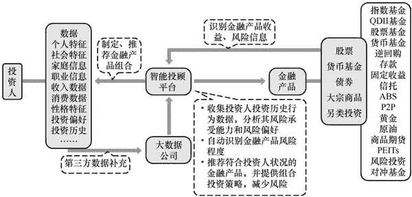

图 5-4 AI 智能投顾的架构

与传统投顾相比，智能投顾具有成本低、效率高的优势。传统投顾服务通常需要收取较高的管理费用，而智能投顾通过自动化服务模式，大幅降低了运营成本，能够以较低的费用为普通投资者提供服务。同时，智能投顾可以在瞬间完成大量数据的分析和投资组合的计算，而人工投顾完成同样的工作可能需要花费数小时甚至数天。例如，根据蒙特卡罗模拟，AI 运行 10 万次市场情景推演，生成最优资产组合，耗时仅 3 秒。

#### 实时跟踪与动态调整，适应市场变化

金融市场瞬息万变，投资组合需要根据市场行情及时调整。智能投顾借助实时数据监测和机器学习算法，能够对投资组合进行实时跟踪和动态调整，确保投资组合始终符合客户的风险偏好和投资目标。

智能投顾系统实时收集全球金融市场数据，包括股票价格、汇率、利率、宏观经济指标等。当市场发生变化时，系统会迅速分析市场走势对投资组合的影响。例如，股票市场出现大幅下跌，智能投顾系统会评估该下跌趋势对客户投资组合中股票资产的影响。如果下跌幅度超出了客户设定的风险阈值，系统会自动调整投资组合，适当减少股票资产的比例，增加债券或现金类资产的配置，以降低投资组合的整体风险。

此外，智能投顾系统能根据客户的人生阶段和财务状况变化，对投资组合进行动态调整。例如，当客户结婚、生子或临近退休时，其财务目标和风险承受能力可能发生变化，智能投顾系统会根据这些变化重新评估投资组合，并做出相应的调整，确保投资组合始终与客户的实际情况相匹配。

#### 智能投顾的发展现状与挑战

目前，智能投顾市场呈现出快速发展的态势。国内外众多金融机构纷纷推出自己的智能投顾产品，如招商银行的“摩羯智投”、蚂蚁财富的“帮你投”等。这些产品吸引了大量普通投资者，金融机构管理的资产规模不断扩大。

然而，智能投顾在发展过程中也面临一些挑战。一方面，数据安全和隐私保护问题至关重要。智能投顾涉及大量客户的个人财务信息，一旦发生数据泄露，将给客户带来严重损失。金融机构需要加强数据安全管理，采用先进的加密技术和严格的访问控制措施，确保客户数据的安全。另一方面，智能投顾算法的可解释性是一个难题。由于机器学习算法的复杂性，一些投资决策的依据难以向客户清晰地解释，可能导致客户对智能投顾的信任度降低。金融机构需要探索更加透明、可解释的算法，增强客户对智能投顾的信任。

### 智能风控：风险管理与市场预测

#### 多维度数据融合，构建全面风险画像

在金融领域，风险管理是核心环节。AI 智能风控通过整合多维度数据，构建全面的风险画像，为金融机构提供更精准、更高效的风险评估和预警。

传统风控主要依赖客户的财务报表、信用记录等有限数据进行风险评估，这种方式存在信息不全面、滞后等问题。而智能风控借助大数据技术，能够收集和整合来自多个渠道的数据，包括客户的社交媒体数据、消费行为数据、网络浏览记录等。例如，通过分析客户在社交媒体上的言论和行为，了解其消费观念、社交圈子和潜在风险；通过分析客户的网络购物记录，评估其消费能力和还款意愿。

将这些多维度数据与传统的金融数据相结合，智能风控系统可以构建客户的全面风险画像。这个画像不仅包含客户的基本财务信息，还能反映客户的行为模式、信用习惯和潜在风险因素。通过对风险画像的分析，金融机构可以更准确地评估客户的信用风险，判断客户是否具备贷款资格、信用卡申请资格等。例如，网商银行“310 模式”，3 分钟申请、1 秒放款、0 人工干预，累计服务小微客户超 5000 万名，坏账率仅 1.2%。

#### 实时风险监测与预警，防范潜在风险

金融市场瞬息万变，因此及时发现和预警潜在风险至关重要。智能风控利用实时数据监测和机器学习算法，对金融交易和投资活动进行实时风险监测，一旦发现异常情况，立即发出预警信号。

在信贷业务中，智能风控系统实时监测客户的还款行为。如果客户出现还款逾期的迹象，系统会根据逾期的严重程度发出不同级别的预警。例如，当客户还款逾期 1～3 天时，系统发出黄色预警，提醒信贷人员关注客户情况，了解逾期原因；当逾期超过 30 天时，系统发出红色预警，信贷人员会采取更积极的催收措施，如电话催收、上门催收等，以降低贷款损失风险。

在金融市场投资领域，智能风控系统实时监测投资组合的风险状况。当市场波动导致投资组合的风险指标（如风险价值、夏普比率等）超出设定的阈值时，系统会立即发出预警，提醒投资者或基金经理调整投资组合，降低风险。例如，当某只股票型基金的投资组合风险价值超过设定的风险上限时，系统会提示基金经理减少股票仓位，增加债券或现金类资产的配置，以稳定投资组合的风险水平。

#### 机器学习助力市场预测，提升风控前瞻性

除了风险监测和预警，智能风控还借助机器学习算法进行市场预测，提前预判市场走势和风险变化，为金融机构的风险管理提供前瞻性支持。

机器学习算法可以对历史市场数据、宏观经济数据、行业数据等进行深度学习，挖掘数据背后的规律和趋势。例如，通过分析历史股票价格走势、成交量、宏观经济指标（如 GDP 增长率、通货膨胀率等）及行业政策变化等因素，机器学习模型可以预测股票市场的未来走势。金融机构可以根据这些预测结果提前调整投资策略，优化资产配置，降低市场风险对投资组合的影响。

在信用风险预测方面，机器学习算法可以通过分析大量的历史信用数据，识别出影响信用风险的关键因素，并建立信用风险预测模型。这些模型可以预测客户未来发生违约的概率，帮助金融机构在贷款审批、信用卡发卡等环节更准确地评估风险，避免潜在的信用损失。

智能风控在金融行业的应用取得了显著成效。某金融科技公司采用智能风控系统后，不良贷款率降低了 20%，信用卡欺诈交易识别准确率提高了 30%。智能风控已成为金融机构防范风险、保障业务稳健发展的重要工具。

随着人工智能技术的不断进步和创新，“AI+金融”的应用场景将更加丰富，深度和广度也将不断拓展。未来，AI 有望在金融监管、保险精算、供应链金融等领域发挥更大的作用，推动金融行业向更加智能化、高效化、安全化的方向发展。金融机构应积极拥抱 AI 技术，加强技术创新和人才培养，充分发挥 AI 在金融领域的巨大潜力，为客户提供更优质、更安全的金融服务。

当华尔街的铜牛被替换成量子计算机雕塑时，我们不得不思考：金融的本质究竟是“资源的跨时空配置”，还是“人类贪婪与恐惧的放大器”？AI 给了我们重新定义的可能——让资本流动如电力般稳定可预测，让财富分配如数学般精确公正。但最终的答案，或许藏在那句古老的华尔街格言中： **“市场保持非理性的时间，可能长过你保持算力供电的时间。”** EXr6287u6NNVz+GYLY+7SDk226FstKIHdC0bNoQkB2Nqi1xSR0yxPmwrTs5gRi/BtfSbid6dBhii9q7cz2pIyA==

## 3 AI+制造：从蒸汽机到算法引擎新时代

1765 年，瓦特改良了蒸汽机，拉开了工业革命的序幕。今天，在特斯拉柏林超级工厂，数字孪生系统提前 3 个月发现涂装车间的气流缺陷。发展至今，制造业的驱动力从煤炭与钢铁进化为数据与算法。“AI+制造”的本质，是将工厂转化为自我进化的有机体，让生产效率突破物理极限，让个性化定制成为工业文明的常态。典型的无人工厂运行场景如图 5-5 所示。

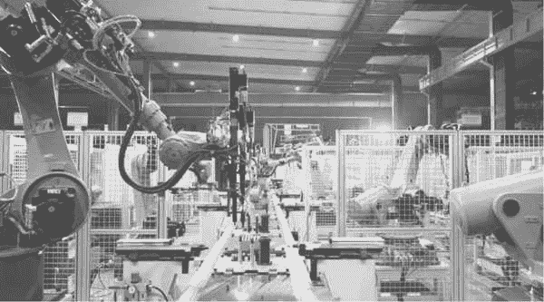

图 5-5 典型的无人工厂运行场景

在当今科技飞速发展的时代，制造业经历了深刻的变革，AI 技术的融入成为推动制造业数字化转型、智能化升级的关键力量。“AI+制造”模式正在重塑整个制造业的生产流程、管理模式与商业模式，为制造业的高质量发展注入了全新的活力。

### 数转智改：数据资产与人工智能赋能

#### 数据资产的价值挖掘

在传统制造业，大量数据分散在生产设备、管理系统、供应链环节等各个角落，未能得到充分的利用。随着 AI 技术的发展，制造业企业逐渐意识到数据资产的巨大价值。数据资产涵盖生产过程数据、设备运行数据、产品质量数据、供应链数据及市场需求数据等多个方面。

生产过程数据记录了产品从原材料投入到成品产出的每个环节的参数，如温度、压力、加工时间等。通过对这些数据的分析，企业可以优化生产工艺，提高产品质量的稳定性。例如，汽车制造企业利用 AI 算法对焊接过程中的电流、电压和焊接时间进行分析，能够精准控制焊接参数，减少焊接缺陷，提高车身的焊接质量。

设备运行数据反映了生产设备的健康状况和运行效率。借助传感器收集设备的振动、温度、能耗等数据，企业可以实时监测设备的运行状态。例如，在半导体制造中，通过对光刻机设备运行数据的分析，提前发现潜在故障，安排预防性维护，避免因设备故障导致生产线停工，从而大幅提高生产效率，降低生产成本。

产品质量数据为企业持续改进产品提供了依据。利用 AI 技术对产品质量检测数据进行深入挖掘，企业可以发现产品质量问题的根源，及时调整生产工艺或改进产品设计。例如，电子制造企业通过对电子产品的性能测试数据进行分析，找出影响产品性能的关键因素，优化产品设计，提升产品竞争力。

供应链数据和市场需求数据可以帮助企业更好地应对市场变化。AI 可以对供应链中的库存数据、物流数据及市场需求预测数据进行整合分析，使企业能够更精准地安排生产计划，优化库存管理，实现供需的高效匹配。例如，服装制造企业根据市场需求预测数据和库存数据，合理安排生产批次和数量，避免库存积压或缺货现象的发生。

#### 人工智能赋能生产流程

AI 技术为制造业的生产流程带来了智能化变革。在生产规划环节，AI 可以根据市场需求预测、原材料供应情况及企业自身的生产能力，制订最优生产计划。通过机器学习算法对历史数据和实时数据进行分析，AI 能够预测不同产品的市场需求趋势，帮助企业合理安排生产任务，提高资源利用率。

在生产执行阶段，AI 赋能生产设备实现自动化和智能化操作。机器人在生产线上的应用越来越广泛，它们能够在 AI 的控制下完成高精度、重复性工作。例如，在手机制造车间，机械臂在 AI 视觉系统的引导下，能够准确地抓取和组装微小的电子元件，大幅提高生产效率和产品质量。同时，AI 可以实现生产过程的实时监控和优化。通过对生产线上传感器数据的实时分析，AI 系统可以及时发现生产过程中的异常情况，并自动调整生产参数，确保生产过程稳定运行。

在质量检测环节，AI 技术发挥了巨大的优势。传统的质量检测方法往往依赖人工检测，效率低且容易出现漏检问题。AI 视觉检测系统利用深度学习算法对产品图像进行分析，能够快速、准确地识别产品的缺陷和瑕疵。例如，在玻璃制造行业，AI 视觉检测系统可以在高速生产线上实时检测玻璃表面的划痕、气泡等缺陷，检测精度可以达到毫米甚至微米级别，大幅提高了检测效率和准确性。

### 预测性维护：设备故障的 AI 先知

#### 基于数据的设备健康监测

预测性维护（见图 5-6）是“AI+制造”的重要应用场景之一，它改变了传统制造业设备维护的被动模式。传统的设备维护主要采用定期维护或故障后维修的方式，这种方式要么因过度维护造成资源浪费，要么因维修不及时导致设备停机，影响生产进度。

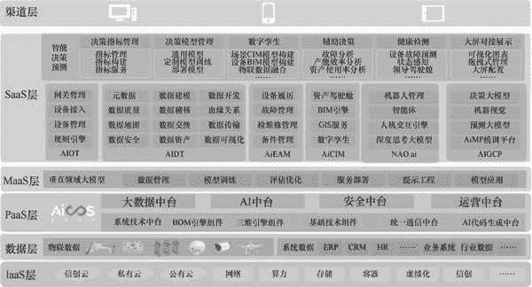

图 5-6 预测性维护架构

预测性维护通过在设备上安装各类传感器，实时采集设备的运行数据，如温度、压力、振动、转速等。这些数据被传输到 AI 分析平台，利用机器学习算法对数据进行分析和建模。通过多模态传感网络，实时采集振动、温度、声纹、电流等 200 多个参数，构建设备健康指纹。例如，风力发电企业在风机上安装大量传感器，收集风机的叶片转速、发电机温度、塔筒振动等数据。AI 系统通过对这些数据的实时监测和分析，准确评估风机的健康状况。

通过对历史数据和实时数据的学习，AI 模型可以建立设备的正常运行模式和故障模式。当设备的运行数据偏离正常模式时，AI 系统会根据预设的阈值和算法，判断设备是否存在潜在故障风险，并预测故障可能发生的时间。例如，在工业锅炉的运行过程中，AI 系统监测锅炉的温度、压力、水位等数据，当发现温度异常升高且持续偏离正常范围时，AI 系统结合历史数据和算法模型，预测锅炉可能在未来几天内出现过热故障，从而及时发出预警信号。

#### 预测性维护的优势

预测性维护为制造业企业带来了显著的经济效益和生产效益。首先，预测性维护能够大幅降低设备故障率，减少因设备故障导致的生产中断。以汽车制造企业为例，通过实施预测性维护，发动机生产线的设备故障率降低了 30%，有效保障了生产的连续性，提高了企业的生产效率。例如，在宝武钢铁的智能轧机应用中，AI 通过分析金属金相图谱预测轧辊寿命，使轧辊的更换周期从经验驱动的 3 个月升级为可精准到小时的动态调整。

其次，预测性维护能够降低设备维护成本。传统的定期维护模式往往不管设备是否真正需要维护，都按照固定的周期进行维护，造成了不必要的资源浪费。预测性维护则基于设备的实际运行状况进行维护，只有当设备出现潜在故障风险时才进行维护，避免了过度维护，节省了维护费用。据统计，采用预测性维护后，制造业企业的设备维护成本降低了 25%～30%。

最后，预测性维护能够延长设备的使用寿命。预测性维护通过及时发现设备的潜在故障并进行处理，避免了小故障演变成大故障，从而延长了设备的整体使用寿命。例如，某化工企业通过预测性维护，将关键生产设备的使用寿命延长了 20%，减少了设备更新投资，提高了企业的资产回报率。

### 数字孪生：虚拟工厂与实体生产的全真互联

#### 数字孪生的概念与构建

数字孪生是指在虚拟空间中构建与实体工厂完全对应的虚拟模型，进行全要素建模，通过“5G+工业互联网”，将设备、物料、人员实时映射至虚拟工厂。这个虚拟模型不仅在外观上与实体工厂一致，更重要的是在运行逻辑、物理属性等方面与实体工厂实时同步。通过数字孪生技术，企业可以在虚拟环境中对生产过程进行模拟、优化和监控，实现对实体工厂的精准管控。

构建数字孪生模型需要采集大量的数据，包括工厂布局、设备参数、生产工艺流程及生产过程中的实时数据等。利用 3D 建模技术，创建工厂的虚拟三维模型，将设备、生产线、车间等元素以逼真的形式呈现出来。同时，通过物联网技术将实体工厂中的传感器与虚拟模型进行连接，实现数据的实时传输。

例如，在航空发动机制造工厂，工程师首先对发动机的设计图纸、零部件参数等进行数字化处理，构建发动机的虚拟模型。然后在发动机的生产过程中，通过传感器采集加工设备的运行数据、零部件的质量数据等，并将这些数据实时传输到虚拟模型中。这样，虚拟模型就能够实时反映实体发动机的生产状态，包括加工进度、质量状况等。

#### 数字孪生在制造业中的应用

数字孪生在制造业的生产优化、产品设计验证和供应链管理等方面都有广泛的应用。在生产优化方面，企业可以在虚拟模型中对不同的生产方案进行模拟和测试。例如，通过调整生产线的布局、优化生产工艺参数等，观察虚拟模型中生产效率、成本、质量等指标的变化，找到最优生产方案，再将方案应用到实体工厂中。这样可以避免在实体工厂中进行大规模试验带来的成本和时间浪费。

在产品设计验证方面，数字孪生可以帮助企业在产品设计阶段发现潜在问题。通过对产品的虚拟模型进行模拟测试，如力学性能测试、流体动力学测试等，评估产品在不同工况下的性能表现。例如，汽车制造企业在设计新款汽车时，通过数字孪生模型对汽车的空气动力学性能进行模拟测试，优化车身外形设计，降低风阻系数，提高汽车的燃油经济性和行驶稳定性。

在供应链管理方面，数字孪生可以实现供应链的可视化和协同优化。通过构建供应链的数字孪生模型，将供应商、生产工厂、物流配送中心等环节整合到一个虚拟平台上。企业可以实时监控供应链的运行状态。例如，海尔的卡奥斯平台连接全球数万家工厂，AI 根据实时订单分配产能，使产品交付周期缩短 60%。当出现供应链中断等异常情况时，企业可以在虚拟模型中进行应急方案的模拟和优化，快速制定应对策略，保障供应链的稳定运行。

随着 5G、物联网、大数据等技术的不断发展，“AI+制造”的融合将更加深入。未来，AI 将在智能制造的各个环节发挥更加关键的作用，实现生产过程的高度自动化、智能化和柔性化。制造业企业应积极拥抱 AI 技术，加大在数字化转型和智能化升级方面的投入力度，培养具备 AI 技术应用能力的专业人才，提升企业的核心竞争力，在全球制造业竞争中占据优势地位。

当第一台完全由 AI 设计、AI 制造、AI 质检的汽车驶下生产线时，我们终于理解图灵在 1950 年提出的问题：“机器能思考吗？”这个问题本身无关紧要，重要的是，当制造业的每个原子都被数据重新排列时，人类能否在效率的狂欢中守住文明的温度——毕竟，瓦特的蒸汽机推动了工业革命，但最终定义那个时代的，是狄更斯的《双城记》。 EXr6287u6NNVz+GYLY+7SDk226FstKIHdC0bNoQkB2Nqi1xSR0yxPmwrTs5gRi/BtfSbid6dBhii9q7cz2pIyA==

## 3 AI+制造：从蒸汽机到算法引擎新时代

1765 年，瓦特改良了蒸汽机，拉开了工业革命的序幕。今天，在特斯拉柏林超级工厂，数字孪生系统提前 3 个月发现涂装车间的气流缺陷。发展至今，制造业的驱动力从煤炭与钢铁进化为数据与算法。“AI+制造”的本质，是将工厂转化为自我进化的有机体，让生产效率突破物理极限，让个性化定制成为工业文明的常态。典型的无人工厂运行场景如图 5-5 所示。

图 5-5 典型的无人工厂运行场景

在当今科技飞速发展的时代，制造业经历了深刻的变革，AI 技术的融入成为推动制造业数字化转型、智能化升级的关键力量。“AI+制造”模式正在重塑整个制造业的生产流程、管理模式与商业模式，为制造业的高质量发展注入了全新的活力。

### 数转智改：数据资产与人工智能赋能

#### 数据资产的价值挖掘

在传统制造业，大量数据分散在生产设备、管理系统、供应链环节等各个角落，未能得到充分的利用。随着 AI 技术的发展，制造业企业逐渐意识到数据资产的巨大价值。数据资产涵盖生产过程数据、设备运行数据、产品质量数据、供应链数据及市场需求数据等多个方面。

生产过程数据记录了产品从原材料投入到成品产出的每个环节的参数，如温度、压力、加工时间等。通过对这些数据的分析，企业可以优化生产工艺，提高产品质量的稳定性。例如，汽车制造企业利用 AI 算法对焊接过程中的电流、电压和焊接时间进行分析，能够精准控制焊接参数，减少焊接缺陷，提高车身的焊接质量。

设备运行数据反映了生产设备的健康状况和运行效率。借助传感器收集设备的振动、温度、能耗等数据，企业可以实时监测设备的运行状态。例如，在半导体制造中，通过对光刻机设备运行数据的分析，提前发现潜在故障，安排预防性维护，避免因设备故障导致生产线停工，从而大幅提高生产效率，降低生产成本。

产品质量数据为企业持续改进产品提供了依据。利用 AI 技术对产品质量检测数据进行深入挖掘，企业可以发现产品质量问题的根源，及时调整生产工艺或改进产品设计。例如，电子制造企业通过对电子产品的性能测试数据进行分析，找出影响产品性能的关键因素，优化产品设计，提升产品竞争力。

供应链数据和市场需求数据可以帮助企业更好地应对市场变化。AI 可以对供应链中的库存数据、物流数据及市场需求预测数据进行整合分析，使企业能够更精准地安排生产计划，优化库存管理，实现供需的高效匹配。例如，服装制造企业根据市场需求预测数据和库存数据，合理安排生产批次和数量，避免库存积压或缺货现象的发生。

#### 人工智能赋能生产流程

AI 技术为制造业的生产流程带来了智能化变革。在生产规划环节，AI 可以根据市场需求预测、原材料供应情况及企业自身的生产能力，制订最优生产计划。通过机器学习算法对历史数据和实时数据进行分析，AI 能够预测不同产品的市场需求趋势，帮助企业合理安排生产任务，提高资源利用率。

在生产执行阶段，AI 赋能生产设备实现自动化和智能化操作。机器人在生产线上的应用越来越广泛，它们能够在 AI 的控制下完成高精度、重复性工作。例如，在手机制造车间，机械臂在 AI 视觉系统的引导下，能够准确地抓取和组装微小的电子元件，大幅提高生产效率和产品质量。同时，AI 可以实现生产过程的实时监控和优化。通过对生产线上传感器数据的实时分析，AI 系统可以及时发现生产过程中的异常情况，并自动调整生产参数，确保生产过程稳定运行。

在质量检测环节，AI 技术发挥了巨大的优势。传统的质量检测方法往往依赖人工检测，效率低且容易出现漏检问题。AI 视觉检测系统利用深度学习算法对产品图像进行分析，能够快速、准确地识别产品的缺陷和瑕疵。例如，在玻璃制造行业，AI 视觉检测系统可以在高速生产线上实时检测玻璃表面的划痕、气泡等缺陷，检测精度可以达到毫米甚至微米级别，大幅提高了检测效率和准确性。

### 预测性维护：设备故障的 AI 先知

#### 基于数据的设备健康监测

预测性维护（见图 5-6）是“AI+制造”的重要应用场景之一，它改变了传统制造业设备维护的被动模式。传统的设备维护主要采用定期维护或故障后维修的方式，这种方式要么因过度维护造成资源浪费，要么因维修不及时导致设备停机，影响生产进度。

图 5-6 预测性维护架构

预测性维护通过在设备上安装各类传感器，实时采集设备的运行数据，如温度、压力、振动、转速等。这些数据被传输到 AI 分析平台，利用机器学习算法对数据进行分析和建模。通过多模态传感网络，实时采集振动、温度、声纹、电流等 200 多个参数，构建设备健康指纹。例如，风力发电企业在风机上安装大量传感器，收集风机的叶片转速、发电机温度、塔筒振动等数据。AI 系统通过对这些数据的实时监测和分析，准确评估风机的健康状况。

通过对历史数据和实时数据的学习，AI 模型可以建立设备的正常运行模式和故障模式。当设备的运行数据偏离正常模式时，AI 系统会根据预设的阈值和算法，判断设备是否存在潜在故障风险，并预测故障可能发生的时间。例如，在工业锅炉的运行过程中，AI 系统监测锅炉的温度、压力、水位等数据，当发现温度异常升高且持续偏离正常范围时，AI 系统结合历史数据和算法模型，预测锅炉可能在未来几天内出现过热故障，从而及时发出预警信号。

#### 预测性维护的优势

预测性维护为制造业企业带来了显著的经济效益和生产效益。首先，预测性维护能够大幅降低设备故障率，减少因设备故障导致的生产中断。以汽车制造企业为例，通过实施预测性维护，发动机生产线的设备故障率降低了 30%，有效保障了生产的连续性，提高了企业的生产效率。例如，在宝武钢铁的智能轧机应用中，AI 通过分析金属金相图谱预测轧辊寿命，使轧辊的更换周期从经验驱动的 3 个月升级为可精准到小时的动态调整。

其次，预测性维护能够降低设备维护成本。传统的定期维护模式往往不管设备是否真正需要维护，都按照固定的周期进行维护，造成了不必要的资源浪费。预测性维护则基于设备的实际运行状况进行维护，只有当设备出现潜在故障风险时才进行维护，避免了过度维护，节省了维护费用。据统计，采用预测性维护后，制造业企业的设备维护成本降低了 25%～30%。

最后，预测性维护能够延长设备的使用寿命。预测性维护通过及时发现设备的潜在故障并进行处理，避免了小故障演变成大故障，从而延长了设备的整体使用寿命。例如，某化工企业通过预测性维护，将关键生产设备的使用寿命延长了 20%，减少了设备更新投资，提高了企业的资产回报率。

### 数字孪生：虚拟工厂与实体生产的全真互联

#### 数字孪生的概念与构建

数字孪生是指在虚拟空间中构建与实体工厂完全对应的虚拟模型，进行全要素建模，通过“5G+工业互联网”，将设备、物料、人员实时映射至虚拟工厂。这个虚拟模型不仅在外观上与实体工厂一致，更重要的是在运行逻辑、物理属性等方面与实体工厂实时同步。通过数字孪生技术，企业可以在虚拟环境中对生产过程进行模拟、优化和监控，实现对实体工厂的精准管控。

构建数字孪生模型需要采集大量的数据，包括工厂布局、设备参数、生产工艺流程及生产过程中的实时数据等。利用 3D 建模技术，创建工厂的虚拟三维模型，将设备、生产线、车间等元素以逼真的形式呈现出来。同时，通过物联网技术将实体工厂中的传感器与虚拟模型进行连接，实现数据的实时传输。

例如，在航空发动机制造工厂，工程师首先对发动机的设计图纸、零部件参数等进行数字化处理，构建发动机的虚拟模型。然后在发动机的生产过程中，通过传感器采集加工设备的运行数据、零部件的质量数据等，并将这些数据实时传输到虚拟模型中。这样，虚拟模型就能够实时反映实体发动机的生产状态，包括加工进度、质量状况等。

#### 数字孪生在制造业中的应用

数字孪生在制造业的生产优化、产品设计验证和供应链管理等方面都有广泛的应用。在生产优化方面，企业可以在虚拟模型中对不同的生产方案进行模拟和测试。例如，通过调整生产线的布局、优化生产工艺参数等，观察虚拟模型中生产效率、成本、质量等指标的变化，找到最优生产方案，再将方案应用到实体工厂中。这样可以避免在实体工厂中进行大规模试验带来的成本和时间浪费。

在产品设计验证方面，数字孪生可以帮助企业在产品设计阶段发现潜在问题。通过对产品的虚拟模型进行模拟测试，如力学性能测试、流体动力学测试等，评估产品在不同工况下的性能表现。例如，汽车制造企业在设计新款汽车时，通过数字孪生模型对汽车的空气动力学性能进行模拟测试，优化车身外形设计，降低风阻系数，提高汽车的燃油经济性和行驶稳定性。

在供应链管理方面，数字孪生可以实现供应链的可视化和协同优化。通过构建供应链的数字孪生模型，将供应商、生产工厂、物流配送中心等环节整合到一个虚拟平台上。企业可以实时监控供应链的运行状态。例如，海尔的卡奥斯平台连接全球数万家工厂，AI 根据实时订单分配产能，使产品交付周期缩短 60%。当出现供应链中断等异常情况时，企业可以在虚拟模型中进行应急方案的模拟和优化，快速制定应对策略，保障供应链的稳定运行。

随着 5G、物联网、大数据等技术的不断发展，“AI+制造”的融合将更加深入。未来，AI 将在智能制造的各个环节发挥更加关键的作用，实现生产过程的高度自动化、智能化和柔性化。制造业企业应积极拥抱 AI 技术，加大在数字化转型和智能化升级方面的投入力度，培养具备 AI 技术应用能力的专业人才，提升企业的核心竞争力，在全球制造业竞争中占据优势地位。

当第一台完全由 AI 设计、AI 制造、AI 质检的汽车驶下生产线时，我们终于理解图灵在 1950 年提出的问题：“机器能思考吗？”这个问题本身无关紧要，重要的是，当制造业的每个原子都被数据重新排列时，人类能否在效率的狂欢中守住文明的温度——毕竟，瓦特的蒸汽机推动了工业革命，但最终定义那个时代的，是狄更斯的《双城记》。 EXr6287u6NNVz+GYLY+7SDk226FstKIHdC0bNoQkB2Nqi1xSR0yxPmwrTs5gRi/BtfSbid6dBhii9q7cz2pIyA==

## 3 AI+制造：从蒸汽机到算法引擎新时代

1765 年，瓦特改良了蒸汽机，拉开了工业革命的序幕。今天，在特斯拉柏林超级工厂，数字孪生系统提前 3 个月发现涂装车间的气流缺陷。发展至今，制造业的驱动力从煤炭与钢铁进化为数据与算法。“AI+制造”的本质，是将工厂转化为自我进化的有机体，让生产效率突破物理极限，让个性化定制成为工业文明的常态。典型的无人工厂运行场景如图 5-5 所示。

图 5-5 典型的无人工厂运行场景

在当今科技飞速发展的时代，制造业经历了深刻的变革，AI 技术的融入成为推动制造业数字化转型、智能化升级的关键力量。“AI+制造”模式正在重塑整个制造业的生产流程、管理模式与商业模式，为制造业的高质量发展注入了全新的活力。

### 数转智改：数据资产与人工智能赋能

#### 数据资产的价值挖掘

在传统制造业，大量数据分散在生产设备、管理系统、供应链环节等各个角落，未能得到充分的利用。随着 AI 技术的发展，制造业企业逐渐意识到数据资产的巨大价值。数据资产涵盖生产过程数据、设备运行数据、产品质量数据、供应链数据及市场需求数据等多个方面。

生产过程数据记录了产品从原材料投入到成品产出的每个环节的参数，如温度、压力、加工时间等。通过对这些数据的分析，企业可以优化生产工艺，提高产品质量的稳定性。例如，汽车制造企业利用 AI 算法对焊接过程中的电流、电压和焊接时间进行分析，能够精准控制焊接参数，减少焊接缺陷，提高车身的焊接质量。

设备运行数据反映了生产设备的健康状况和运行效率。借助传感器收集设备的振动、温度、能耗等数据，企业可以实时监测设备的运行状态。例如，在半导体制造中，通过对光刻机设备运行数据的分析，提前发现潜在故障，安排预防性维护，避免因设备故障导致生产线停工，从而大幅提高生产效率，降低生产成本。

产品质量数据为企业持续改进产品提供了依据。利用 AI 技术对产品质量检测数据进行深入挖掘，企业可以发现产品质量问题的根源，及时调整生产工艺或改进产品设计。例如，电子制造企业通过对电子产品的性能测试数据进行分析，找出影响产品性能的关键因素，优化产品设计，提升产品竞争力。

供应链数据和市场需求数据可以帮助企业更好地应对市场变化。AI 可以对供应链中的库存数据、物流数据及市场需求预测数据进行整合分析，使企业能够更精准地安排生产计划，优化库存管理，实现供需的高效匹配。例如，服装制造企业根据市场需求预测数据和库存数据，合理安排生产批次和数量，避免库存积压或缺货现象的发生。

#### 人工智能赋能生产流程

AI 技术为制造业的生产流程带来了智能化变革。在生产规划环节，AI 可以根据市场需求预测、原材料供应情况及企业自身的生产能力，制订最优生产计划。通过机器学习算法对历史数据和实时数据进行分析，AI 能够预测不同产品的市场需求趋势，帮助企业合理安排生产任务，提高资源利用率。

在生产执行阶段，AI 赋能生产设备实现自动化和智能化操作。机器人在生产线上的应用越来越广泛，它们能够在 AI 的控制下完成高精度、重复性工作。例如，在手机制造车间，机械臂在 AI 视觉系统的引导下，能够准确地抓取和组装微小的电子元件，大幅提高生产效率和产品质量。同时，AI 可以实现生产过程的实时监控和优化。通过对生产线上传感器数据的实时分析，AI 系统可以及时发现生产过程中的异常情况，并自动调整生产参数，确保生产过程稳定运行。

在质量检测环节，AI 技术发挥了巨大的优势。传统的质量检测方法往往依赖人工检测，效率低且容易出现漏检问题。AI 视觉检测系统利用深度学习算法对产品图像进行分析，能够快速、准确地识别产品的缺陷和瑕疵。例如，在玻璃制造行业，AI 视觉检测系统可以在高速生产线上实时检测玻璃表面的划痕、气泡等缺陷，检测精度可以达到毫米甚至微米级别，大幅提高了检测效率和准确性。

### 预测性维护：设备故障的 AI 先知

#### 基于数据的设备健康监测

预测性维护（见图 5-6）是“AI+制造”的重要应用场景之一，它改变了传统制造业设备维护的被动模式。传统的设备维护主要采用定期维护或故障后维修的方式，这种方式要么因过度维护造成资源浪费，要么因维修不及时导致设备停机，影响生产进度。

图 5-6 预测性维护架构

预测性维护通过在设备上安装各类传感器，实时采集设备的运行数据，如温度、压力、振动、转速等。这些数据被传输到 AI 分析平台，利用机器学习算法对数据进行分析和建模。通过多模态传感网络，实时采集振动、温度、声纹、电流等 200 多个参数，构建设备健康指纹。例如，风力发电企业在风机上安装大量传感器，收集风机的叶片转速、发电机温度、塔筒振动等数据。AI 系统通过对这些数据的实时监测和分析，准确评估风机的健康状况。

通过对历史数据和实时数据的学习，AI 模型可以建立设备的正常运行模式和故障模式。当设备的运行数据偏离正常模式时，AI 系统会根据预设的阈值和算法，判断设备是否存在潜在故障风险，并预测故障可能发生的时间。例如，在工业锅炉的运行过程中，AI 系统监测锅炉的温度、压力、水位等数据，当发现温度异常升高且持续偏离正常范围时，AI 系统结合历史数据和算法模型，预测锅炉可能在未来几天内出现过热故障，从而及时发出预警信号。

#### 预测性维护的优势

预测性维护为制造业企业带来了显著的经济效益和生产效益。首先，预测性维护能够大幅降低设备故障率，减少因设备故障导致的生产中断。以汽车制造企业为例，通过实施预测性维护，发动机生产线的设备故障率降低了 30%，有效保障了生产的连续性，提高了企业的生产效率。例如，在宝武钢铁的智能轧机应用中，AI 通过分析金属金相图谱预测轧辊寿命，使轧辊的更换周期从经验驱动的 3 个月升级为可精准到小时的动态调整。

其次，预测性维护能够降低设备维护成本。传统的定期维护模式往往不管设备是否真正需要维护，都按照固定的周期进行维护，造成了不必要的资源浪费。预测性维护则基于设备的实际运行状况进行维护，只有当设备出现潜在故障风险时才进行维护，避免了过度维护，节省了维护费用。据统计，采用预测性维护后，制造业企业的设备维护成本降低了 25%～30%。

最后，预测性维护能够延长设备的使用寿命。预测性维护通过及时发现设备的潜在故障并进行处理，避免了小故障演变成大故障，从而延长了设备的整体使用寿命。例如，某化工企业通过预测性维护，将关键生产设备的使用寿命延长了 20%，减少了设备更新投资，提高了企业的资产回报率。

### 数字孪生：虚拟工厂与实体生产的全真互联

#### 数字孪生的概念与构建

数字孪生是指在虚拟空间中构建与实体工厂完全对应的虚拟模型，进行全要素建模，通过“5G+工业互联网”，将设备、物料、人员实时映射至虚拟工厂。这个虚拟模型不仅在外观上与实体工厂一致，更重要的是在运行逻辑、物理属性等方面与实体工厂实时同步。通过数字孪生技术，企业可以在虚拟环境中对生产过程进行模拟、优化和监控，实现对实体工厂的精准管控。

构建数字孪生模型需要采集大量的数据，包括工厂布局、设备参数、生产工艺流程及生产过程中的实时数据等。利用 3D 建模技术，创建工厂的虚拟三维模型，将设备、生产线、车间等元素以逼真的形式呈现出来。同时，通过物联网技术将实体工厂中的传感器与虚拟模型进行连接，实现数据的实时传输。

例如，在航空发动机制造工厂，工程师首先对发动机的设计图纸、零部件参数等进行数字化处理，构建发动机的虚拟模型。然后在发动机的生产过程中，通过传感器采集加工设备的运行数据、零部件的质量数据等，并将这些数据实时传输到虚拟模型中。这样，虚拟模型就能够实时反映实体发动机的生产状态，包括加工进度、质量状况等。

#### 数字孪生在制造业中的应用

数字孪生在制造业的生产优化、产品设计验证和供应链管理等方面都有广泛的应用。在生产优化方面，企业可以在虚拟模型中对不同的生产方案进行模拟和测试。例如，通过调整生产线的布局、优化生产工艺参数等，观察虚拟模型中生产效率、成本、质量等指标的变化，找到最优生产方案，再将方案应用到实体工厂中。这样可以避免在实体工厂中进行大规模试验带来的成本和时间浪费。

在产品设计验证方面，数字孪生可以帮助企业在产品设计阶段发现潜在问题。通过对产品的虚拟模型进行模拟测试，如力学性能测试、流体动力学测试等，评估产品在不同工况下的性能表现。例如，汽车制造企业在设计新款汽车时，通过数字孪生模型对汽车的空气动力学性能进行模拟测试，优化车身外形设计，降低风阻系数，提高汽车的燃油经济性和行驶稳定性。

在供应链管理方面，数字孪生可以实现供应链的可视化和协同优化。通过构建供应链的数字孪生模型，将供应商、生产工厂、物流配送中心等环节整合到一个虚拟平台上。企业可以实时监控供应链的运行状态。例如，海尔的卡奥斯平台连接全球数万家工厂，AI 根据实时订单分配产能，使产品交付周期缩短 60%。当出现供应链中断等异常情况时，企业可以在虚拟模型中进行应急方案的模拟和优化，快速制定应对策略，保障供应链的稳定运行。

随着 5G、物联网、大数据等技术的不断发展，“AI+制造”的融合将更加深入。未来，AI 将在智能制造的各个环节发挥更加关键的作用，实现生产过程的高度自动化、智能化和柔性化。制造业企业应积极拥抱 AI 技术，加大在数字化转型和智能化升级方面的投入力度，培养具备 AI 技术应用能力的专业人才，提升企业的核心竞争力，在全球制造业竞争中占据优势地位。

当第一台完全由 AI 设计、AI 制造、AI 质检的汽车驶下生产线时，我们终于理解图灵在 1950 年提出的问题：“机器能思考吗？”这个问题本身无关紧要，重要的是，当制造业的每个原子都被数据重新排列时，人类能否在效率的狂欢中守住文明的温度——毕竟，瓦特的蒸汽机推动了工业革命，但最终定义那个时代的，是狄更斯的《双城记》。 EXr6287u6NNVz+GYLY+7SDk226FstKIHdC0bNoQkB2Nqi1xSR0yxPmwrTs5gRi/BtfSbid6dBhii9q7cz2pIyA==

## 3 AI+制造：从蒸汽机到算法引擎新时代

1765 年，瓦特改良了蒸汽机，拉开了工业革命的序幕。今天，在特斯拉柏林超级工厂，数字孪生系统提前 3 个月发现涂装车间的气流缺陷。发展至今，制造业的驱动力从煤炭与钢铁进化为数据与算法。“AI+制造”的本质，是将工厂转化为自我进化的有机体，让生产效率突破物理极限，让个性化定制成为工业文明的常态。典型的无人工厂运行场景如图 5-5 所示。

图 5-5 典型的无人工厂运行场景

在当今科技飞速发展的时代，制造业经历了深刻的变革，AI 技术的融入成为推动制造业数字化转型、智能化升级的关键力量。“AI+制造”模式正在重塑整个制造业的生产流程、管理模式与商业模式，为制造业的高质量发展注入了全新的活力。

### 数转智改：数据资产与人工智能赋能

#### 数据资产的价值挖掘

在传统制造业，大量数据分散在生产设备、管理系统、供应链环节等各个角落，未能得到充分的利用。随着 AI 技术的发展，制造业企业逐渐意识到数据资产的巨大价值。数据资产涵盖生产过程数据、设备运行数据、产品质量数据、供应链数据及市场需求数据等多个方面。

生产过程数据记录了产品从原材料投入到成品产出的每个环节的参数，如温度、压力、加工时间等。通过对这些数据的分析，企业可以优化生产工艺，提高产品质量的稳定性。例如，汽车制造企业利用 AI 算法对焊接过程中的电流、电压和焊接时间进行分析，能够精准控制焊接参数，减少焊接缺陷，提高车身的焊接质量。

设备运行数据反映了生产设备的健康状况和运行效率。借助传感器收集设备的振动、温度、能耗等数据，企业可以实时监测设备的运行状态。例如，在半导体制造中，通过对光刻机设备运行数据的分析，提前发现潜在故障，安排预防性维护，避免因设备故障导致生产线停工，从而大幅提高生产效率，降低生产成本。

产品质量数据为企业持续改进产品提供了依据。利用 AI 技术对产品质量检测数据进行深入挖掘，企业可以发现产品质量问题的根源，及时调整生产工艺或改进产品设计。例如，电子制造企业通过对电子产品的性能测试数据进行分析，找出影响产品性能的关键因素，优化产品设计，提升产品竞争力。

供应链数据和市场需求数据可以帮助企业更好地应对市场变化。AI 可以对供应链中的库存数据、物流数据及市场需求预测数据进行整合分析，使企业能够更精准地安排生产计划，优化库存管理，实现供需的高效匹配。例如，服装制造企业根据市场需求预测数据和库存数据，合理安排生产批次和数量，避免库存积压或缺货现象的发生。

#### 人工智能赋能生产流程

AI 技术为制造业的生产流程带来了智能化变革。在生产规划环节，AI 可以根据市场需求预测、原材料供应情况及企业自身的生产能力，制订最优生产计划。通过机器学习算法对历史数据和实时数据进行分析，AI 能够预测不同产品的市场需求趋势，帮助企业合理安排生产任务，提高资源利用率。

在生产执行阶段，AI 赋能生产设备实现自动化和智能化操作。机器人在生产线上的应用越来越广泛，它们能够在 AI 的控制下完成高精度、重复性工作。例如，在手机制造车间，机械臂在 AI 视觉系统的引导下，能够准确地抓取和组装微小的电子元件，大幅提高生产效率和产品质量。同时，AI 可以实现生产过程的实时监控和优化。通过对生产线上传感器数据的实时分析，AI 系统可以及时发现生产过程中的异常情况，并自动调整生产参数，确保生产过程稳定运行。

在质量检测环节，AI 技术发挥了巨大的优势。传统的质量检测方法往往依赖人工检测，效率低且容易出现漏检问题。AI 视觉检测系统利用深度学习算法对产品图像进行分析，能够快速、准确地识别产品的缺陷和瑕疵。例如，在玻璃制造行业，AI 视觉检测系统可以在高速生产线上实时检测玻璃表面的划痕、气泡等缺陷，检测精度可以达到毫米甚至微米级别，大幅提高了检测效率和准确性。

### 预测性维护：设备故障的 AI 先知

#### 基于数据的设备健康监测

预测性维护（见图 5-6）是“AI+制造”的重要应用场景之一，它改变了传统制造业设备维护的被动模式。传统的设备维护主要采用定期维护或故障后维修的方式，这种方式要么因过度维护造成资源浪费，要么因维修不及时导致设备停机，影响生产进度。

图 5-6 预测性维护架构

预测性维护通过在设备上安装各类传感器，实时采集设备的运行数据，如温度、压力、振动、转速等。这些数据被传输到 AI 分析平台，利用机器学习算法对数据进行分析和建模。通过多模态传感网络，实时采集振动、温度、声纹、电流等 200 多个参数，构建设备健康指纹。例如，风力发电企业在风机上安装大量传感器，收集风机的叶片转速、发电机温度、塔筒振动等数据。AI 系统通过对这些数据的实时监测和分析，准确评估风机的健康状况。

通过对历史数据和实时数据的学习，AI 模型可以建立设备的正常运行模式和故障模式。当设备的运行数据偏离正常模式时，AI 系统会根据预设的阈值和算法，判断设备是否存在潜在故障风险，并预测故障可能发生的时间。例如，在工业锅炉的运行过程中，AI 系统监测锅炉的温度、压力、水位等数据，当发现温度异常升高且持续偏离正常范围时，AI 系统结合历史数据和算法模型，预测锅炉可能在未来几天内出现过热故障，从而及时发出预警信号。

#### 预测性维护的优势

预测性维护为制造业企业带来了显著的经济效益和生产效益。首先，预测性维护能够大幅降低设备故障率，减少因设备故障导致的生产中断。以汽车制造企业为例，通过实施预测性维护，发动机生产线的设备故障率降低了 30%，有效保障了生产的连续性，提高了企业的生产效率。例如，在宝武钢铁的智能轧机应用中，AI 通过分析金属金相图谱预测轧辊寿命，使轧辊的更换周期从经验驱动的 3 个月升级为可精准到小时的动态调整。

其次，预测性维护能够降低设备维护成本。传统的定期维护模式往往不管设备是否真正需要维护，都按照固定的周期进行维护，造成了不必要的资源浪费。预测性维护则基于设备的实际运行状况进行维护，只有当设备出现潜在故障风险时才进行维护，避免了过度维护，节省了维护费用。据统计，采用预测性维护后，制造业企业的设备维护成本降低了 25%～30%。

最后，预测性维护能够延长设备的使用寿命。预测性维护通过及时发现设备的潜在故障并进行处理，避免了小故障演变成大故障，从而延长了设备的整体使用寿命。例如，某化工企业通过预测性维护，将关键生产设备的使用寿命延长了 20%，减少了设备更新投资，提高了企业的资产回报率。

### 数字孪生：虚拟工厂与实体生产的全真互联

#### 数字孪生的概念与构建

数字孪生是指在虚拟空间中构建与实体工厂完全对应的虚拟模型，进行全要素建模，通过“5G+工业互联网”，将设备、物料、人员实时映射至虚拟工厂。这个虚拟模型不仅在外观上与实体工厂一致，更重要的是在运行逻辑、物理属性等方面与实体工厂实时同步。通过数字孪生技术，企业可以在虚拟环境中对生产过程进行模拟、优化和监控，实现对实体工厂的精准管控。

构建数字孪生模型需要采集大量的数据，包括工厂布局、设备参数、生产工艺流程及生产过程中的实时数据等。利用 3D 建模技术，创建工厂的虚拟三维模型，将设备、生产线、车间等元素以逼真的形式呈现出来。同时，通过物联网技术将实体工厂中的传感器与虚拟模型进行连接，实现数据的实时传输。

例如，在航空发动机制造工厂，工程师首先对发动机的设计图纸、零部件参数等进行数字化处理，构建发动机的虚拟模型。然后在发动机的生产过程中，通过传感器采集加工设备的运行数据、零部件的质量数据等，并将这些数据实时传输到虚拟模型中。这样，虚拟模型就能够实时反映实体发动机的生产状态，包括加工进度、质量状况等。

#### 数字孪生在制造业中的应用

数字孪生在制造业的生产优化、产品设计验证和供应链管理等方面都有广泛的应用。在生产优化方面，企业可以在虚拟模型中对不同的生产方案进行模拟和测试。例如，通过调整生产线的布局、优化生产工艺参数等，观察虚拟模型中生产效率、成本、质量等指标的变化，找到最优生产方案，再将方案应用到实体工厂中。这样可以避免在实体工厂中进行大规模试验带来的成本和时间浪费。

在产品设计验证方面，数字孪生可以帮助企业在产品设计阶段发现潜在问题。通过对产品的虚拟模型进行模拟测试，如力学性能测试、流体动力学测试等，评估产品在不同工况下的性能表现。例如，汽车制造企业在设计新款汽车时，通过数字孪生模型对汽车的空气动力学性能进行模拟测试，优化车身外形设计，降低风阻系数，提高汽车的燃油经济性和行驶稳定性。

在供应链管理方面，数字孪生可以实现供应链的可视化和协同优化。通过构建供应链的数字孪生模型，将供应商、生产工厂、物流配送中心等环节整合到一个虚拟平台上。企业可以实时监控供应链的运行状态。例如，海尔的卡奥斯平台连接全球数万家工厂，AI 根据实时订单分配产能，使产品交付周期缩短 60%。当出现供应链中断等异常情况时，企业可以在虚拟模型中进行应急方案的模拟和优化，快速制定应对策略，保障供应链的稳定运行。

随着 5G、物联网、大数据等技术的不断发展，“AI+制造”的融合将更加深入。未来，AI 将在智能制造的各个环节发挥更加关键的作用，实现生产过程的高度自动化、智能化和柔性化。制造业企业应积极拥抱 AI 技术，加大在数字化转型和智能化升级方面的投入力度，培养具备 AI 技术应用能力的专业人才，提升企业的核心竞争力，在全球制造业竞争中占据优势地位。

当第一台完全由 AI 设计、AI 制造、AI 质检的汽车驶下生产线时，我们终于理解图灵在 1950 年提出的问题：“机器能思考吗？”这个问题本身无关紧要，重要的是，当制造业的每个原子都被数据重新排列时，人类能否在效率的狂欢中守住文明的温度——毕竟，瓦特的蒸汽机推动了工业革命，但最终定义那个时代的，是狄更斯的《双城记》。 EXr6287u6NNVz+GYLY+7SDk226FstKIHdC0bNoQkB2Nqi1xSR0yxPmwrTs5gRi/BtfSbid6dBhii9q7cz2pIyA==

## 4 AI+教育：从黑板和粉笔到脑机接口

公元前 387 年，柏拉图在雅典创立学院，知识传授依赖师徒之间的口耳相传；2025 年，在斯坦福大学的“元宇宙校区”，10 万名学生通过脑机接口同步学习量子力学，AI 教授根据神经信号实时调整教学策略。这场跨越 2000 多年的教育革命，揭示了 AI 如何将“标准化流水线”进化为“个性化神经路径”。“AI+教育”的本质，是用算法重新定义人类认知的边界，让教育从“选拔天赋”转向“释放潜能”，从“阶级特权”变为“基本人权”。

“AI+教育”模式为教育行业带来了全方位的变革，从打造智慧校园，实现教育个性化与自适应学习，到虚拟教师的出现，为学生提供因材施教的指导，再到借助 AI 推动教育公平，让偏远地区的学生也能享受到优质的教育资源，AI 逐步成为推动教育创新发展的核心驱动力。

### 智慧校园：教育个性化与自适应学习

#### 构建智慧学习环境

从“教室围墙”到“无界认知网络”，智慧校园（见图 5-7）借助 AI、物联网、大数据等技术，打造了一个全方位智能化的学习环境。在校园中，各类智能设备无处不在。智能教室配备了高清互动大屏、智能教学终端等设备，教师可以通过这些设备展示丰富多样的教学资源，如 3D 模型、动画视频等，采用“全息投影+触觉反馈”技术，让学生“触摸”虚拟 DNA 分子模型，使抽象的知识变得更加直观易懂。例如，在物理课上，教师可以利用互动大屏展示微观粒子的运动状态，帮助学生更好地理解量子力学的概念；在地理课上，通过 3D 地图展示世界各地的地形地貌，让学生有身临其境的学习体验。

图 5-7 智慧校园系统架构

校园内的物联网设备实现了对环境的智能感知和调控。智能照明系统根据光线强度自动调节亮度，既节约能源又保护学生视力；智能空调系统能根据室内温度和人数自动调整温度，营造舒适的学习环境。同时，通过物联网技术，校园内的各种设备可以互联互通，实现数据共享和协同工作。例如，学生进入教室后，智能设备可以自动识别学生身份，根据其学习需求和偏好，推送个性化学习内容和课程安排。

学校采用元宇宙技术，使课堂突破了传统维度的限制，构建了连接现实与虚拟的“认知虫洞”。例如，非洲推行了“数字校车计划”，VR 头盔让草原部落儿童“走进”大英博物馆，文物学习参与度提升 400%。

#### 实现个性化学习

AI 技术在智慧校园中的核心应用之一是实现个性化学习。在传统教育模式下，教师往往采用“一刀切”的教学方法，难以满足每位学生的学习需求。而 AI 可以通过对学生学习数据的深度分析，为他们量身定制个性化学习方案。

学习数据包括学生的课堂表现、作业完成情况、考试成绩、在线学习行为等多方面信息。通过对这些数据的收集和整理，AI 学习分析系统能够构建学生的学习画像，了解学生的学习进度、知识掌握程度、学习风格和兴趣爱好等。知识图谱引擎将学科知识分解为 10 万多个知识点节点，动态构建个人认知地图。例如，某位学生在数学的几何部分作业错误率较高，且在线学习时将几何课程的视频观看了较多次、停留时间较长，AI 系统可以判断该学生在几何知识的理解上存在困难，进而为其推送针对性的几何练习题、讲解视频和其他学习资料。

自适应学习平台是实现个性化学习的重要工具。这些平台利用 AI 算法，根据学生的实时学习情况动态调整学习内容和难度。当学生在某个知识点上表现出色时，系统会自动推送更具挑战性的内容；当学生遇到困难时，系统会降低知识点难度，提供更多的辅导和练习。自适应学习平台结合神经反馈环路技术，通过眼动追踪、脑电波监测等方式实时评估学生的注意力与理解度，据此调整教学节奏。以语言学习为例，自适应学习平台可以根据学生的词汇量、语法掌握程度和口语表达能力，为其定制专属的学习路径，包括单词背诵计划、语法练习和口语对话练习等，让每位学生都能按照自己的节奏高效地学习。

#### 提升学习效果和效率

智慧校园中的个性化与自适应学习模式显著提升了学生的学习效果和效率。通过选择符合自身需求的学习内容和方式，学生的学习积极性和主动性得到了极大的提高。研究表明，采用个性化学习模式的学生，其知识掌握程度和考试成绩普遍优于采用传统教学模式的学生。

例如，“学而思智适应”系统利用 AI 动态生成数学习题，将刷题量从年均 5000 道降至 800 道，满分率反而提升 25%。某中学引入智慧校园系统后，利用 AI 分析学生的学习数据，为每位学生制订了个性化的学习计划。经过一学期的实践，该校学生的整体平均分提高了 10 分，优秀率提升了 15%。同时，个性化学习减少了学生在已掌握知识上的重复学习时间，提高了学习效率。学生可以将更多的时间和精力投入自己的薄弱环节，实现学习效果的最大化。

### 虚拟教师：因材施教的 AI 导师

#### 虚拟教师的功能与特点

虚拟教师是基于 AI 技术开发的智能教育助手，具备多种功能，能够为学生提供个性化教学服务。虚拟教师采用多模态交互技术，通过语音、表情、手势合成技术通过了图灵测试，学生无法区分人类与虚拟教师。虚拟教师可以理解和处理自然语言，与学生进行流畅的对话交流。无论是学习上的问题，还是生活中的困惑，学生都可以向虚拟教师提问，虚拟教师会根据问题的类型和学生的学习情况，给出准确、详细的回答。

例如，在语文学习中，学生询问某篇古诗词的含义和创作背景，虚拟教师可以详细讲解诗词的字词释义、诗句意境及诗人的创作意图和时代背景；在数学学习中，当学生遇到难题时，虚拟教师可以逐步引导学生分析问题，提供解题思路和方法，甚至可以生成类似的练习题，帮助学生巩固所学知识；大语言模型通过跨学科知识融合，贯通物理、哲学、艺术领域的知识，可以解答“量子纠缠与自由意志的关系”等复杂问题。

虚拟教师还可以根据学生的学习进度和表现，提供个性化学习建议和反馈。它能够实时跟踪学生的学习过程，分析学生的学习数据，发现学生的学习优势和不足。对于学习进度较快的学生，虚拟教师可以推荐拓展性学习资源，鼓励他们进行更深入的学习；对于学习困难的学生，虚拟教师会提供更多的基础知识讲解和针对性练习，帮助他们弥补知识漏洞。

#### 虚拟教师弥补教师资源的不足

在教育资源分布不均衡的情况下，虚拟教师可以有效地弥补教师资源的不足。在偏远地区或师资力量薄弱的学校，由于缺乏专业教师，学生无法获得高质量的教育。虚拟教师不受地域和时间的限制，只要有网络和智能设备，学生就可以随时随地与虚拟教师进行互动学习。

例如，在一些乡村学校，缺乏专业的英语教师，学生的英语学习受到很大限制。引入虚拟英语教师后，学生可以通过在线学习平台与虚拟教师进行英语口语对话练习，纠正发音，学习语法知识。虚拟教师还可以根据学生的英语水平，制订个性化学习计划，帮助学生逐步提高英语成绩。这在一定程度上缓解了偏远地区教育资源短缺的问题，为学生提供了平等的学习机会。

#### 虚拟教师与真实教师协同教学

虚拟教师并不是要取代真实教师，而是与真实教师协同合作，共同提升教学质量。在课堂教学中，真实教师可以利用虚拟教师提供的丰富教学资源和个性化学习数据，更好地了解每位学生的学习情况，调整教学策略。虚拟教师可以辅助真实教师进行作业批改、答疑解惑等工作，减轻他们的工作负担，让他们有更多的时间和精力关注学生的个性化需求和情感发展。

例如，Coursera 平台上的“牛顿教授”可以在 10 分钟内诊断学生的物理思维盲区，定制学习路径，使学生的辍学率从 70%降至 12%。虚拟教师可以先对学生提出的问题进行初步解答，对于一些共性问题，虚拟教师可以集中讲解，提高辅导效率。对于复杂的问题，虚拟教师可以将问题和学生的学习情况反馈给真实教师，由真实教师进行更深入的指导。这种协同教学模式充分发挥了虚拟教师和真实教师的优势，为学生提供了更加全面、优质的教育服务。

### 教育公平：偏远地区教育的 AI 普惠

#### 缩小数字鸿沟

教育公平是实现社会公平的重要基础，而 AI 技术为促进教育公平提供了新的途径。在偏远地区，由于基础设施薄弱、经济发展落后等，当地的学生与城市学生之间存在较大的数字鸿沟。AI 技术的应用有助于缩小这一鸿沟。

通过在线教育平台和智能终端设备，偏远地区的学生可以获取与城市学生相同的优质教育资源。这些平台汇聚了大量课程视频、教学资料和学习工具，涵盖各个学科和年级。例如，一些公益在线教育项目利用 AI 技术为偏远地区的学生提供免费课程，包括语文、数学、英语等基础学科，以及音乐、美术、科学等拓展性课程。Hyperglot 平台可以使学生平均掌握 3 门外语的时间从 5 年降至 8 个月，语法错误率低于 2%。学生可以根据自己的学习进度和兴趣选择课程进行学习，打破了地域和时间的限制，实现了优质教育资源的共享。

同时，AI 技术可以优化网络学习环境，降低对网络带宽的要求。通过自适应流媒体技术，在线教育平台可以根据学生的网络状况自动调整视频的清晰度和流畅度，确保学生能够顺利学习。这对网络条件较差的偏远地区学生来说尤为重要，使他们能够更好地参与在线学习，减少因网络问题导致的学习中断。

#### 定制化教育服务

考虑到偏远地区学生的特殊需求和学习环境，AI 可以为他们提供定制化教育服务。AI 学习分析系统可以根据偏远地区学生的学习特点、知识基础和家庭背景等因素，制订适合他们的学习计划和教学内容。

例如，在埃塞俄比亚推行的“女孩教育计划”中，AI 教师使女童入学率从 37%跃升至 89%，早婚率大幅下降。针对一些因家庭劳动或其他原因导致学习时间不固定的学生，AI 学习平台可以提供碎片化学习课程，将知识点拆分成短小精悍的视频片段，方便学生利用零散的时间进行学习。对于基础薄弱的学生，AI 学习平台可以提供更多的基础知识讲解和练习，逐步提升他们的学习能力。此外，AI 可以通过语音交互等方式，适应一些学生不擅长文字输入的情况，方便他们与学习平台互动。

#### 培养教师队伍

除了直接服务学生，AI 在提升偏远地区教师队伍素质方面也发挥着重要作用。AI 教师培训平台可以为偏远地区的教师提供丰富的培训资源和个性化培训方案。这些平台利用 AI 技术对教师的教学行为进行分析，发现其在教学过程中的优点和不足，为其提供针对性的改进建议。

例如，通过对教师课堂教学视频的分析，AI 系统可以评估教师的教学方法是否有效、与学生的互动是否充分等，并提供相应的教学案例和培训课程，帮助教师提升教学水平。同时，AI 可以组织远程教研活动，让偏远地区的教师与城市优秀教师进行交流和学习，分享教学经验和教学资源，促进教师的专业成长，提高偏远地区的整体教育质量，为实现教育公平奠定坚实的基础。

随着 AI 技术的不断发展和创新，“AI+教育”的应用前景将更加广阔。未来，AI 有望在教育评价、教育管理等领域发挥更大的作用，推动教育行业向更加智能化、个性化、公平化的方向发展。教育机构、科技企业和政府部门应加强合作，共同探索 AI 在教育领域的应用模式，让更多的学生受益于 AI 技术带来的教育变革，为培养适应未来社会发展的创新型人才贡献力量。

当 AI 能够用纳秒级速度解析《哈姆雷特》的文学价值，用量子计算推演《蒙娜丽莎》的美学函数时，教育的终极命题不再是“机器能否超越人类”，而是“人类如何定义自己”。或许正如苏格拉底所说：“教育的本质是点燃火焰，而非填满容器。”在 AI 时代，这团火焰既可能被算法精确控制，也可能因无限燃料而吞噬星空。关键在于，我们是否还记得自己既是点火者，也是守护者？ EXr6287u6NNVz+GYLY+7SDk226FstKIHdC0bNoQkB2Nqi1xSR0yxPmwrTs5gRi/BtfSbid6dBhii9q7cz2pIyA==

## 4 AI+教育：从黑板和粉笔到脑机接口

公元前 387 年，柏拉图在雅典创立学院，知识传授依赖师徒之间的口耳相传；2025 年，在斯坦福大学的“元宇宙校区”，10 万名学生通过脑机接口同步学习量子力学，AI 教授根据神经信号实时调整教学策略。这场跨越 2000 多年的教育革命，揭示了 AI 如何将“标准化流水线”进化为“个性化神经路径”。“AI+教育”的本质，是用算法重新定义人类认知的边界，让教育从“选拔天赋”转向“释放潜能”，从“阶级特权”变为“基本人权”。

“AI+教育”模式为教育行业带来了全方位的变革，从打造智慧校园，实现教育个性化与自适应学习，到虚拟教师的出现，为学生提供因材施教的指导，再到借助 AI 推动教育公平，让偏远地区的学生也能享受到优质的教育资源，AI 逐步成为推动教育创新发展的核心驱动力。

### 智慧校园：教育个性化与自适应学习

#### 构建智慧学习环境

从“教室围墙”到“无界认知网络”，智慧校园（见图 5-7）借助 AI、物联网、大数据等技术，打造了一个全方位智能化的学习环境。在校园中，各类智能设备无处不在。智能教室配备了高清互动大屏、智能教学终端等设备，教师可以通过这些设备展示丰富多样的教学资源，如 3D 模型、动画视频等，采用“全息投影+触觉反馈”技术，让学生“触摸”虚拟 DNA 分子模型，使抽象的知识变得更加直观易懂。例如，在物理课上，教师可以利用互动大屏展示微观粒子的运动状态，帮助学生更好地理解量子力学的概念；在地理课上，通过 3D 地图展示世界各地的地形地貌，让学生有身临其境的学习体验。

图 5-7 智慧校园系统架构

校园内的物联网设备实现了对环境的智能感知和调控。智能照明系统根据光线强度自动调节亮度，既节约能源又保护学生视力；智能空调系统能根据室内温度和人数自动调整温度，营造舒适的学习环境。同时，通过物联网技术，校园内的各种设备可以互联互通，实现数据共享和协同工作。例如，学生进入教室后，智能设备可以自动识别学生身份，根据其学习需求和偏好，推送个性化学习内容和课程安排。

学校采用元宇宙技术，使课堂突破了传统维度的限制，构建了连接现实与虚拟的“认知虫洞”。例如，非洲推行了“数字校车计划”，VR 头盔让草原部落儿童“走进”大英博物馆，文物学习参与度提升 400%。

#### 实现个性化学习

AI 技术在智慧校园中的核心应用之一是实现个性化学习。在传统教育模式下，教师往往采用“一刀切”的教学方法，难以满足每位学生的学习需求。而 AI 可以通过对学生学习数据的深度分析，为他们量身定制个性化学习方案。

学习数据包括学生的课堂表现、作业完成情况、考试成绩、在线学习行为等多方面信息。通过对这些数据的收集和整理，AI 学习分析系统能够构建学生的学习画像，了解学生的学习进度、知识掌握程度、学习风格和兴趣爱好等。知识图谱引擎将学科知识分解为 10 万多个知识点节点，动态构建个人认知地图。例如，某位学生在数学的几何部分作业错误率较高，且在线学习时将几何课程的视频观看了较多次、停留时间较长，AI 系统可以判断该学生在几何知识的理解上存在困难，进而为其推送针对性的几何练习题、讲解视频和其他学习资料。

自适应学习平台是实现个性化学习的重要工具。这些平台利用 AI 算法，根据学生的实时学习情况动态调整学习内容和难度。当学生在某个知识点上表现出色时，系统会自动推送更具挑战性的内容；当学生遇到困难时，系统会降低知识点难度，提供更多的辅导和练习。自适应学习平台结合神经反馈环路技术，通过眼动追踪、脑电波监测等方式实时评估学生的注意力与理解度，据此调整教学节奏。以语言学习为例，自适应学习平台可以根据学生的词汇量、语法掌握程度和口语表达能力，为其定制专属的学习路径，包括单词背诵计划、语法练习和口语对话练习等，让每位学生都能按照自己的节奏高效地学习。

#### 提升学习效果和效率

智慧校园中的个性化与自适应学习模式显著提升了学生的学习效果和效率。通过选择符合自身需求的学习内容和方式，学生的学习积极性和主动性得到了极大的提高。研究表明，采用个性化学习模式的学生，其知识掌握程度和考试成绩普遍优于采用传统教学模式的学生。

例如，“学而思智适应”系统利用 AI 动态生成数学习题，将刷题量从年均 5000 道降至 800 道，满分率反而提升 25%。某中学引入智慧校园系统后，利用 AI 分析学生的学习数据，为每位学生制订了个性化的学习计划。经过一学期的实践，该校学生的整体平均分提高了 10 分，优秀率提升了 15%。同时，个性化学习减少了学生在已掌握知识上的重复学习时间，提高了学习效率。学生可以将更多的时间和精力投入自己的薄弱环节，实现学习效果的最大化。

### 虚拟教师：因材施教的 AI 导师

#### 虚拟教师的功能与特点

虚拟教师是基于 AI 技术开发的智能教育助手，具备多种功能，能够为学生提供个性化教学服务。虚拟教师采用多模态交互技术，通过语音、表情、手势合成技术通过了图灵测试，学生无法区分人类与虚拟教师。虚拟教师可以理解和处理自然语言，与学生进行流畅的对话交流。无论是学习上的问题，还是生活中的困惑，学生都可以向虚拟教师提问，虚拟教师会根据问题的类型和学生的学习情况，给出准确、详细的回答。

例如，在语文学习中，学生询问某篇古诗词的含义和创作背景，虚拟教师可以详细讲解诗词的字词释义、诗句意境及诗人的创作意图和时代背景；在数学学习中，当学生遇到难题时，虚拟教师可以逐步引导学生分析问题，提供解题思路和方法，甚至可以生成类似的练习题，帮助学生巩固所学知识；大语言模型通过跨学科知识融合，贯通物理、哲学、艺术领域的知识，可以解答“量子纠缠与自由意志的关系”等复杂问题。

虚拟教师还可以根据学生的学习进度和表现，提供个性化学习建议和反馈。它能够实时跟踪学生的学习过程，分析学生的学习数据，发现学生的学习优势和不足。对于学习进度较快的学生，虚拟教师可以推荐拓展性学习资源，鼓励他们进行更深入的学习；对于学习困难的学生，虚拟教师会提供更多的基础知识讲解和针对性练习，帮助他们弥补知识漏洞。

#### 虚拟教师弥补教师资源的不足

在教育资源分布不均衡的情况下，虚拟教师可以有效地弥补教师资源的不足。在偏远地区或师资力量薄弱的学校，由于缺乏专业教师，学生无法获得高质量的教育。虚拟教师不受地域和时间的限制，只要有网络和智能设备，学生就可以随时随地与虚拟教师进行互动学习。

例如，在一些乡村学校，缺乏专业的英语教师，学生的英语学习受到很大限制。引入虚拟英语教师后，学生可以通过在线学习平台与虚拟教师进行英语口语对话练习，纠正发音，学习语法知识。虚拟教师还可以根据学生的英语水平，制订个性化学习计划，帮助学生逐步提高英语成绩。这在一定程度上缓解了偏远地区教育资源短缺的问题，为学生提供了平等的学习机会。

#### 虚拟教师与真实教师协同教学

虚拟教师并不是要取代真实教师，而是与真实教师协同合作，共同提升教学质量。在课堂教学中，真实教师可以利用虚拟教师提供的丰富教学资源和个性化学习数据，更好地了解每位学生的学习情况，调整教学策略。虚拟教师可以辅助真实教师进行作业批改、答疑解惑等工作，减轻他们的工作负担，让他们有更多的时间和精力关注学生的个性化需求和情感发展。

例如，Coursera 平台上的“牛顿教授”可以在 10 分钟内诊断学生的物理思维盲区，定制学习路径，使学生的辍学率从 70%降至 12%。虚拟教师可以先对学生提出的问题进行初步解答，对于一些共性问题，虚拟教师可以集中讲解，提高辅导效率。对于复杂的问题，虚拟教师可以将问题和学生的学习情况反馈给真实教师，由真实教师进行更深入的指导。这种协同教学模式充分发挥了虚拟教师和真实教师的优势，为学生提供了更加全面、优质的教育服务。

### 教育公平：偏远地区教育的 AI 普惠

#### 缩小数字鸿沟

教育公平是实现社会公平的重要基础，而 AI 技术为促进教育公平提供了新的途径。在偏远地区，由于基础设施薄弱、经济发展落后等，当地的学生与城市学生之间存在较大的数字鸿沟。AI 技术的应用有助于缩小这一鸿沟。

通过在线教育平台和智能终端设备，偏远地区的学生可以获取与城市学生相同的优质教育资源。这些平台汇聚了大量课程视频、教学资料和学习工具，涵盖各个学科和年级。例如，一些公益在线教育项目利用 AI 技术为偏远地区的学生提供免费课程，包括语文、数学、英语等基础学科，以及音乐、美术、科学等拓展性课程。Hyperglot 平台可以使学生平均掌握 3 门外语的时间从 5 年降至 8 个月，语法错误率低于 2%。学生可以根据自己的学习进度和兴趣选择课程进行学习，打破了地域和时间的限制，实现了优质教育资源的共享。

同时，AI 技术可以优化网络学习环境，降低对网络带宽的要求。通过自适应流媒体技术，在线教育平台可以根据学生的网络状况自动调整视频的清晰度和流畅度，确保学生能够顺利学习。这对网络条件较差的偏远地区学生来说尤为重要，使他们能够更好地参与在线学习，减少因网络问题导致的学习中断。

#### 定制化教育服务

考虑到偏远地区学生的特殊需求和学习环境，AI 可以为他们提供定制化教育服务。AI 学习分析系统可以根据偏远地区学生的学习特点、知识基础和家庭背景等因素，制订适合他们的学习计划和教学内容。

例如，在埃塞俄比亚推行的“女孩教育计划”中，AI 教师使女童入学率从 37%跃升至 89%，早婚率大幅下降。针对一些因家庭劳动或其他原因导致学习时间不固定的学生，AI 学习平台可以提供碎片化学习课程，将知识点拆分成短小精悍的视频片段，方便学生利用零散的时间进行学习。对于基础薄弱的学生，AI 学习平台可以提供更多的基础知识讲解和练习，逐步提升他们的学习能力。此外，AI 可以通过语音交互等方式，适应一些学生不擅长文字输入的情况，方便他们与学习平台互动。

#### 培养教师队伍

除了直接服务学生，AI 在提升偏远地区教师队伍素质方面也发挥着重要作用。AI 教师培训平台可以为偏远地区的教师提供丰富的培训资源和个性化培训方案。这些平台利用 AI 技术对教师的教学行为进行分析，发现其在教学过程中的优点和不足，为其提供针对性的改进建议。

例如，通过对教师课堂教学视频的分析，AI 系统可以评估教师的教学方法是否有效、与学生的互动是否充分等，并提供相应的教学案例和培训课程，帮助教师提升教学水平。同时，AI 可以组织远程教研活动，让偏远地区的教师与城市优秀教师进行交流和学习，分享教学经验和教学资源，促进教师的专业成长，提高偏远地区的整体教育质量，为实现教育公平奠定坚实的基础。

随着 AI 技术的不断发展和创新，“AI+教育”的应用前景将更加广阔。未来，AI 有望在教育评价、教育管理等领域发挥更大的作用，推动教育行业向更加智能化、个性化、公平化的方向发展。教育机构、科技企业和政府部门应加强合作，共同探索 AI 在教育领域的应用模式，让更多的学生受益于 AI 技术带来的教育变革，为培养适应未来社会发展的创新型人才贡献力量。

当 AI 能够用纳秒级速度解析《哈姆雷特》的文学价值，用量子计算推演《蒙娜丽莎》的美学函数时，教育的终极命题不再是“机器能否超越人类”，而是“人类如何定义自己”。或许正如苏格拉底所说：“教育的本质是点燃火焰，而非填满容器。”在 AI 时代，这团火焰既可能被算法精确控制，也可能因无限燃料而吞噬星空。关键在于，我们是否还记得自己既是点火者，也是守护者？ EXr6287u6NNVz+GYLY+7SDk226FstKIHdC0bNoQkB2Nqi1xSR0yxPmwrTs5gRi/BtfSbid6dBhii9q7cz2pIyA==

## 4 AI+教育：从黑板和粉笔到脑机接口

公元前 387 年，柏拉图在雅典创立学院，知识传授依赖师徒之间的口耳相传；2025 年，在斯坦福大学的“元宇宙校区”，10 万名学生通过脑机接口同步学习量子力学，AI 教授根据神经信号实时调整教学策略。这场跨越 2000 多年的教育革命，揭示了 AI 如何将“标准化流水线”进化为“个性化神经路径”。“AI+教育”的本质，是用算法重新定义人类认知的边界，让教育从“选拔天赋”转向“释放潜能”，从“阶级特权”变为“基本人权”。

“AI+教育”模式为教育行业带来了全方位的变革，从打造智慧校园，实现教育个性化与自适应学习，到虚拟教师的出现，为学生提供因材施教的指导，再到借助 AI 推动教育公平，让偏远地区的学生也能享受到优质的教育资源，AI 逐步成为推动教育创新发展的核心驱动力。

### 智慧校园：教育个性化与自适应学习

#### 构建智慧学习环境

从“教室围墙”到“无界认知网络”，智慧校园（见图 5-7）借助 AI、物联网、大数据等技术，打造了一个全方位智能化的学习环境。在校园中，各类智能设备无处不在。智能教室配备了高清互动大屏、智能教学终端等设备，教师可以通过这些设备展示丰富多样的教学资源，如 3D 模型、动画视频等，采用“全息投影+触觉反馈”技术，让学生“触摸”虚拟 DNA 分子模型，使抽象的知识变得更加直观易懂。例如，在物理课上，教师可以利用互动大屏展示微观粒子的运动状态，帮助学生更好地理解量子力学的概念；在地理课上，通过 3D 地图展示世界各地的地形地貌，让学生有身临其境的学习体验。

图 5-7 智慧校园系统架构

校园内的物联网设备实现了对环境的智能感知和调控。智能照明系统根据光线强度自动调节亮度，既节约能源又保护学生视力；智能空调系统能根据室内温度和人数自动调整温度，营造舒适的学习环境。同时，通过物联网技术，校园内的各种设备可以互联互通，实现数据共享和协同工作。例如，学生进入教室后，智能设备可以自动识别学生身份，根据其学习需求和偏好，推送个性化学习内容和课程安排。

学校采用元宇宙技术，使课堂突破了传统维度的限制，构建了连接现实与虚拟的“认知虫洞”。例如，非洲推行了“数字校车计划”，VR 头盔让草原部落儿童“走进”大英博物馆，文物学习参与度提升 400%。

#### 实现个性化学习

AI 技术在智慧校园中的核心应用之一是实现个性化学习。在传统教育模式下，教师往往采用“一刀切”的教学方法，难以满足每位学生的学习需求。而 AI 可以通过对学生学习数据的深度分析，为他们量身定制个性化学习方案。

学习数据包括学生的课堂表现、作业完成情况、考试成绩、在线学习行为等多方面信息。通过对这些数据的收集和整理，AI 学习分析系统能够构建学生的学习画像，了解学生的学习进度、知识掌握程度、学习风格和兴趣爱好等。知识图谱引擎将学科知识分解为 10 万多个知识点节点，动态构建个人认知地图。例如，某位学生在数学的几何部分作业错误率较高，且在线学习时将几何课程的视频观看了较多次、停留时间较长，AI 系统可以判断该学生在几何知识的理解上存在困难，进而为其推送针对性的几何练习题、讲解视频和其他学习资料。

自适应学习平台是实现个性化学习的重要工具。这些平台利用 AI 算法，根据学生的实时学习情况动态调整学习内容和难度。当学生在某个知识点上表现出色时，系统会自动推送更具挑战性的内容；当学生遇到困难时，系统会降低知识点难度，提供更多的辅导和练习。自适应学习平台结合神经反馈环路技术，通过眼动追踪、脑电波监测等方式实时评估学生的注意力与理解度，据此调整教学节奏。以语言学习为例，自适应学习平台可以根据学生的词汇量、语法掌握程度和口语表达能力，为其定制专属的学习路径，包括单词背诵计划、语法练习和口语对话练习等，让每位学生都能按照自己的节奏高效地学习。

#### 提升学习效果和效率

智慧校园中的个性化与自适应学习模式显著提升了学生的学习效果和效率。通过选择符合自身需求的学习内容和方式，学生的学习积极性和主动性得到了极大的提高。研究表明，采用个性化学习模式的学生，其知识掌握程度和考试成绩普遍优于采用传统教学模式的学生。

例如，“学而思智适应”系统利用 AI 动态生成数学习题，将刷题量从年均 5000 道降至 800 道，满分率反而提升 25%。某中学引入智慧校园系统后，利用 AI 分析学生的学习数据，为每位学生制订了个性化的学习计划。经过一学期的实践，该校学生的整体平均分提高了 10 分，优秀率提升了 15%。同时，个性化学习减少了学生在已掌握知识上的重复学习时间，提高了学习效率。学生可以将更多的时间和精力投入自己的薄弱环节，实现学习效果的最大化。

### 虚拟教师：因材施教的 AI 导师

#### 虚拟教师的功能与特点

虚拟教师是基于 AI 技术开发的智能教育助手，具备多种功能，能够为学生提供个性化教学服务。虚拟教师采用多模态交互技术，通过语音、表情、手势合成技术通过了图灵测试，学生无法区分人类与虚拟教师。虚拟教师可以理解和处理自然语言，与学生进行流畅的对话交流。无论是学习上的问题，还是生活中的困惑，学生都可以向虚拟教师提问，虚拟教师会根据问题的类型和学生的学习情况，给出准确、详细的回答。

例如，在语文学习中，学生询问某篇古诗词的含义和创作背景，虚拟教师可以详细讲解诗词的字词释义、诗句意境及诗人的创作意图和时代背景；在数学学习中，当学生遇到难题时，虚拟教师可以逐步引导学生分析问题，提供解题思路和方法，甚至可以生成类似的练习题，帮助学生巩固所学知识；大语言模型通过跨学科知识融合，贯通物理、哲学、艺术领域的知识，可以解答“量子纠缠与自由意志的关系”等复杂问题。

虚拟教师还可以根据学生的学习进度和表现，提供个性化学习建议和反馈。它能够实时跟踪学生的学习过程，分析学生的学习数据，发现学生的学习优势和不足。对于学习进度较快的学生，虚拟教师可以推荐拓展性学习资源，鼓励他们进行更深入的学习；对于学习困难的学生，虚拟教师会提供更多的基础知识讲解和针对性练习，帮助他们弥补知识漏洞。

#### 虚拟教师弥补教师资源的不足

在教育资源分布不均衡的情况下，虚拟教师可以有效地弥补教师资源的不足。在偏远地区或师资力量薄弱的学校，由于缺乏专业教师，学生无法获得高质量的教育。虚拟教师不受地域和时间的限制，只要有网络和智能设备，学生就可以随时随地与虚拟教师进行互动学习。

例如，在一些乡村学校，缺乏专业的英语教师，学生的英语学习受到很大限制。引入虚拟英语教师后，学生可以通过在线学习平台与虚拟教师进行英语口语对话练习，纠正发音，学习语法知识。虚拟教师还可以根据学生的英语水平，制订个性化学习计划，帮助学生逐步提高英语成绩。这在一定程度上缓解了偏远地区教育资源短缺的问题，为学生提供了平等的学习机会。

#### 虚拟教师与真实教师协同教学

虚拟教师并不是要取代真实教师，而是与真实教师协同合作，共同提升教学质量。在课堂教学中，真实教师可以利用虚拟教师提供的丰富教学资源和个性化学习数据，更好地了解每位学生的学习情况，调整教学策略。虚拟教师可以辅助真实教师进行作业批改、答疑解惑等工作，减轻他们的工作负担，让他们有更多的时间和精力关注学生的个性化需求和情感发展。

例如，Coursera 平台上的“牛顿教授”可以在 10 分钟内诊断学生的物理思维盲区，定制学习路径，使学生的辍学率从 70%降至 12%。虚拟教师可以先对学生提出的问题进行初步解答，对于一些共性问题，虚拟教师可以集中讲解，提高辅导效率。对于复杂的问题，虚拟教师可以将问题和学生的学习情况反馈给真实教师，由真实教师进行更深入的指导。这种协同教学模式充分发挥了虚拟教师和真实教师的优势，为学生提供了更加全面、优质的教育服务。

### 教育公平：偏远地区教育的 AI 普惠

#### 缩小数字鸿沟

教育公平是实现社会公平的重要基础，而 AI 技术为促进教育公平提供了新的途径。在偏远地区，由于基础设施薄弱、经济发展落后等，当地的学生与城市学生之间存在较大的数字鸿沟。AI 技术的应用有助于缩小这一鸿沟。

通过在线教育平台和智能终端设备，偏远地区的学生可以获取与城市学生相同的优质教育资源。这些平台汇聚了大量课程视频、教学资料和学习工具，涵盖各个学科和年级。例如，一些公益在线教育项目利用 AI 技术为偏远地区的学生提供免费课程，包括语文、数学、英语等基础学科，以及音乐、美术、科学等拓展性课程。Hyperglot 平台可以使学生平均掌握 3 门外语的时间从 5 年降至 8 个月，语法错误率低于 2%。学生可以根据自己的学习进度和兴趣选择课程进行学习，打破了地域和时间的限制，实现了优质教育资源的共享。

同时，AI 技术可以优化网络学习环境，降低对网络带宽的要求。通过自适应流媒体技术，在线教育平台可以根据学生的网络状况自动调整视频的清晰度和流畅度，确保学生能够顺利学习。这对网络条件较差的偏远地区学生来说尤为重要，使他们能够更好地参与在线学习，减少因网络问题导致的学习中断。

#### 定制化教育服务

考虑到偏远地区学生的特殊需求和学习环境，AI 可以为他们提供定制化教育服务。AI 学习分析系统可以根据偏远地区学生的学习特点、知识基础和家庭背景等因素，制订适合他们的学习计划和教学内容。

例如，在埃塞俄比亚推行的“女孩教育计划”中，AI 教师使女童入学率从 37%跃升至 89%，早婚率大幅下降。针对一些因家庭劳动或其他原因导致学习时间不固定的学生，AI 学习平台可以提供碎片化学习课程，将知识点拆分成短小精悍的视频片段，方便学生利用零散的时间进行学习。对于基础薄弱的学生，AI 学习平台可以提供更多的基础知识讲解和练习，逐步提升他们的学习能力。此外，AI 可以通过语音交互等方式，适应一些学生不擅长文字输入的情况，方便他们与学习平台互动。

#### 培养教师队伍

除了直接服务学生，AI 在提升偏远地区教师队伍素质方面也发挥着重要作用。AI 教师培训平台可以为偏远地区的教师提供丰富的培训资源和个性化培训方案。这些平台利用 AI 技术对教师的教学行为进行分析，发现其在教学过程中的优点和不足，为其提供针对性的改进建议。

例如，通过对教师课堂教学视频的分析，AI 系统可以评估教师的教学方法是否有效、与学生的互动是否充分等，并提供相应的教学案例和培训课程，帮助教师提升教学水平。同时，AI 可以组织远程教研活动，让偏远地区的教师与城市优秀教师进行交流和学习，分享教学经验和教学资源，促进教师的专业成长，提高偏远地区的整体教育质量，为实现教育公平奠定坚实的基础。

随着 AI 技术的不断发展和创新，“AI+教育”的应用前景将更加广阔。未来，AI 有望在教育评价、教育管理等领域发挥更大的作用，推动教育行业向更加智能化、个性化、公平化的方向发展。教育机构、科技企业和政府部门应加强合作，共同探索 AI 在教育领域的应用模式，让更多的学生受益于 AI 技术带来的教育变革，为培养适应未来社会发展的创新型人才贡献力量。

当 AI 能够用纳秒级速度解析《哈姆雷特》的文学价值，用量子计算推演《蒙娜丽莎》的美学函数时，教育的终极命题不再是“机器能否超越人类”，而是“人类如何定义自己”。或许正如苏格拉底所说：“教育的本质是点燃火焰，而非填满容器。”在 AI 时代，这团火焰既可能被算法精确控制，也可能因无限燃料而吞噬星空。关键在于，我们是否还记得自己既是点火者，也是守护者？ EXr6287u6NNVz+GYLY+7SDk226FstKIHdC0bNoQkB2Nqi1xSR0yxPmwrTs5gRi/BtfSbid6dBhii9q7cz2pIyA==

## 4 AI+教育：从黑板和粉笔到脑机接口

公元前 387 年，柏拉图在雅典创立学院，知识传授依赖师徒之间的口耳相传；2025 年，在斯坦福大学的“元宇宙校区”，10 万名学生通过脑机接口同步学习量子力学，AI 教授根据神经信号实时调整教学策略。这场跨越 2000 多年的教育革命，揭示了 AI 如何将“标准化流水线”进化为“个性化神经路径”。“AI+教育”的本质，是用算法重新定义人类认知的边界，让教育从“选拔天赋”转向“释放潜能”，从“阶级特权”变为“基本人权”。

“AI+教育”模式为教育行业带来了全方位的变革，从打造智慧校园，实现教育个性化与自适应学习，到虚拟教师的出现，为学生提供因材施教的指导，再到借助 AI 推动教育公平，让偏远地区的学生也能享受到优质的教育资源，AI 逐步成为推动教育创新发展的核心驱动力。

### 智慧校园：教育个性化与自适应学习

#### 构建智慧学习环境

从“教室围墙”到“无界认知网络”，智慧校园（见图 5-7）借助 AI、物联网、大数据等技术，打造了一个全方位智能化的学习环境。在校园中，各类智能设备无处不在。智能教室配备了高清互动大屏、智能教学终端等设备，教师可以通过这些设备展示丰富多样的教学资源，如 3D 模型、动画视频等，采用“全息投影+触觉反馈”技术，让学生“触摸”虚拟 DNA 分子模型，使抽象的知识变得更加直观易懂。例如，在物理课上，教师可以利用互动大屏展示微观粒子的运动状态，帮助学生更好地理解量子力学的概念；在地理课上，通过 3D 地图展示世界各地的地形地貌，让学生有身临其境的学习体验。

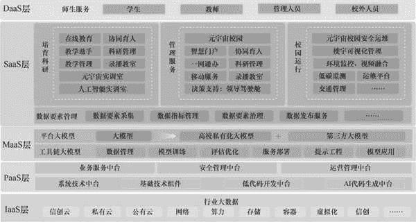

图 5-7 智慧校园系统架构

校园内的物联网设备实现了对环境的智能感知和调控。智能照明系统根据光线强度自动调节亮度，既节约能源又保护学生视力；智能空调系统能根据室内温度和人数自动调整温度，营造舒适的学习环境。同时，通过物联网技术，校园内的各种设备可以互联互通，实现数据共享和协同工作。例如，学生进入教室后，智能设备可以自动识别学生身份，根据其学习需求和偏好，推送个性化学习内容和课程安排。

学校采用元宇宙技术，使课堂突破了传统维度的限制，构建了连接现实与虚拟的“认知虫洞”。例如，非洲推行了“数字校车计划”，VR 头盔让草原部落儿童“走进”大英博物馆，文物学习参与度提升 400%。

#### 实现个性化学习

AI 技术在智慧校园中的核心应用之一是实现个性化学习。在传统教育模式下，教师往往采用“一刀切”的教学方法，难以满足每位学生的学习需求。而 AI 可以通过对学生学习数据的深度分析，为他们量身定制个性化学习方案。

学习数据包括学生的课堂表现、作业完成情况、考试成绩、在线学习行为等多方面信息。通过对这些数据的收集和整理，AI 学习分析系统能够构建学生的学习画像，了解学生的学习进度、知识掌握程度、学习风格和兴趣爱好等。知识图谱引擎将学科知识分解为 10 万多个知识点节点，动态构建个人认知地图。例如，某位学生在数学的几何部分作业错误率较高，且在线学习时将几何课程的视频观看了较多次、停留时间较长，AI 系统可以判断该学生在几何知识的理解上存在困难，进而为其推送针对性的几何练习题、讲解视频和其他学习资料。

自适应学习平台是实现个性化学习的重要工具。这些平台利用 AI 算法，根据学生的实时学习情况动态调整学习内容和难度。当学生在某个知识点上表现出色时，系统会自动推送更具挑战性的内容；当学生遇到困难时，系统会降低知识点难度，提供更多的辅导和练习。自适应学习平台结合神经反馈环路技术，通过眼动追踪、脑电波监测等方式实时评估学生的注意力与理解度，据此调整教学节奏。以语言学习为例，自适应学习平台可以根据学生的词汇量、语法掌握程度和口语表达能力，为其定制专属的学习路径，包括单词背诵计划、语法练习和口语对话练习等，让每位学生都能按照自己的节奏高效地学习。

#### 提升学习效果和效率

智慧校园中的个性化与自适应学习模式显著提升了学生的学习效果和效率。通过选择符合自身需求的学习内容和方式，学生的学习积极性和主动性得到了极大的提高。研究表明，采用个性化学习模式的学生，其知识掌握程度和考试成绩普遍优于采用传统教学模式的学生。

例如，“学而思智适应”系统利用 AI 动态生成数学习题，将刷题量从年均 5000 道降至 800 道，满分率反而提升 25%。某中学引入智慧校园系统后，利用 AI 分析学生的学习数据，为每位学生制订了个性化的学习计划。经过一学期的实践，该校学生的整体平均分提高了 10 分，优秀率提升了 15%。同时，个性化学习减少了学生在已掌握知识上的重复学习时间，提高了学习效率。学生可以将更多的时间和精力投入自己的薄弱环节，实现学习效果的最大化。

### 虚拟教师：因材施教的 AI 导师

#### 虚拟教师的功能与特点

虚拟教师是基于 AI 技术开发的智能教育助手，具备多种功能，能够为学生提供个性化教学服务。虚拟教师采用多模态交互技术，通过语音、表情、手势合成技术通过了图灵测试，学生无法区分人类与虚拟教师。虚拟教师可以理解和处理自然语言，与学生进行流畅的对话交流。无论是学习上的问题，还是生活中的困惑，学生都可以向虚拟教师提问，虚拟教师会根据问题的类型和学生的学习情况，给出准确、详细的回答。

例如，在语文学习中，学生询问某篇古诗词的含义和创作背景，虚拟教师可以详细讲解诗词的字词释义、诗句意境及诗人的创作意图和时代背景；在数学学习中，当学生遇到难题时，虚拟教师可以逐步引导学生分析问题，提供解题思路和方法，甚至可以生成类似的练习题，帮助学生巩固所学知识；大语言模型通过跨学科知识融合，贯通物理、哲学、艺术领域的知识，可以解答“量子纠缠与自由意志的关系”等复杂问题。

虚拟教师还可以根据学生的学习进度和表现，提供个性化学习建议和反馈。它能够实时跟踪学生的学习过程，分析学生的学习数据，发现学生的学习优势和不足。对于学习进度较快的学生，虚拟教师可以推荐拓展性学习资源，鼓励他们进行更深入的学习；对于学习困难的学生，虚拟教师会提供更多的基础知识讲解和针对性练习，帮助他们弥补知识漏洞。

#### 虚拟教师弥补教师资源的不足

在教育资源分布不均衡的情况下，虚拟教师可以有效地弥补教师资源的不足。在偏远地区或师资力量薄弱的学校，由于缺乏专业教师，学生无法获得高质量的教育。虚拟教师不受地域和时间的限制，只要有网络和智能设备，学生就可以随时随地与虚拟教师进行互动学习。

例如，在一些乡村学校，缺乏专业的英语教师，学生的英语学习受到很大限制。引入虚拟英语教师后，学生可以通过在线学习平台与虚拟教师进行英语口语对话练习，纠正发音，学习语法知识。虚拟教师还可以根据学生的英语水平，制订个性化学习计划，帮助学生逐步提高英语成绩。这在一定程度上缓解了偏远地区教育资源短缺的问题，为学生提供了平等的学习机会。

#### 虚拟教师与真实教师协同教学

虚拟教师并不是要取代真实教师，而是与真实教师协同合作，共同提升教学质量。在课堂教学中，真实教师可以利用虚拟教师提供的丰富教学资源和个性化学习数据，更好地了解每位学生的学习情况，调整教学策略。虚拟教师可以辅助真实教师进行作业批改、答疑解惑等工作，减轻他们的工作负担，让他们有更多的时间和精力关注学生的个性化需求和情感发展。

例如，Coursera 平台上的“牛顿教授”可以在 10 分钟内诊断学生的物理思维盲区，定制学习路径，使学生的辍学率从 70%降至 12%。虚拟教师可以先对学生提出的问题进行初步解答，对于一些共性问题，虚拟教师可以集中讲解，提高辅导效率。对于复杂的问题，虚拟教师可以将问题和学生的学习情况反馈给真实教师，由真实教师进行更深入的指导。这种协同教学模式充分发挥了虚拟教师和真实教师的优势，为学生提供了更加全面、优质的教育服务。

### 教育公平：偏远地区教育的 AI 普惠

#### 缩小数字鸿沟

教育公平是实现社会公平的重要基础，而 AI 技术为促进教育公平提供了新的途径。在偏远地区，由于基础设施薄弱、经济发展落后等，当地的学生与城市学生之间存在较大的数字鸿沟。AI 技术的应用有助于缩小这一鸿沟。

通过在线教育平台和智能终端设备，偏远地区的学生可以获取与城市学生相同的优质教育资源。这些平台汇聚了大量课程视频、教学资料和学习工具，涵盖各个学科和年级。例如，一些公益在线教育项目利用 AI 技术为偏远地区的学生提供免费课程，包括语文、数学、英语等基础学科，以及音乐、美术、科学等拓展性课程。Hyperglot 平台可以使学生平均掌握 3 门外语的时间从 5 年降至 8 个月，语法错误率低于 2%。学生可以根据自己的学习进度和兴趣选择课程进行学习，打破了地域和时间的限制，实现了优质教育资源的共享。

同时，AI 技术可以优化网络学习环境，降低对网络带宽的要求。通过自适应流媒体技术，在线教育平台可以根据学生的网络状况自动调整视频的清晰度和流畅度，确保学生能够顺利学习。这对网络条件较差的偏远地区学生来说尤为重要，使他们能够更好地参与在线学习，减少因网络问题导致的学习中断。

#### 定制化教育服务

考虑到偏远地区学生的特殊需求和学习环境，AI 可以为他们提供定制化教育服务。AI 学习分析系统可以根据偏远地区学生的学习特点、知识基础和家庭背景等因素，制订适合他们的学习计划和教学内容。

例如，在埃塞俄比亚推行的“女孩教育计划”中，AI 教师使女童入学率从 37%跃升至 89%，早婚率大幅下降。针对一些因家庭劳动或其他原因导致学习时间不固定的学生，AI 学习平台可以提供碎片化学习课程，将知识点拆分成短小精悍的视频片段，方便学生利用零散的时间进行学习。对于基础薄弱的学生，AI 学习平台可以提供更多的基础知识讲解和练习，逐步提升他们的学习能力。此外，AI 可以通过语音交互等方式，适应一些学生不擅长文字输入的情况，方便他们与学习平台互动。

#### 培养教师队伍

除了直接服务学生，AI 在提升偏远地区教师队伍素质方面也发挥着重要作用。AI 教师培训平台可以为偏远地区的教师提供丰富的培训资源和个性化培训方案。这些平台利用 AI 技术对教师的教学行为进行分析，发现其在教学过程中的优点和不足，为其提供针对性的改进建议。

例如，通过对教师课堂教学视频的分析，AI 系统可以评估教师的教学方法是否有效、与学生的互动是否充分等，并提供相应的教学案例和培训课程，帮助教师提升教学水平。同时，AI 可以组织远程教研活动，让偏远地区的教师与城市优秀教师进行交流和学习，分享教学经验和教学资源，促进教师的专业成长，提高偏远地区的整体教育质量，为实现教育公平奠定坚实的基础。

随着 AI 技术的不断发展和创新，“AI+教育”的应用前景将更加广阔。未来，AI 有望在教育评价、教育管理等领域发挥更大的作用，推动教育行业向更加智能化、个性化、公平化的方向发展。教育机构、科技企业和政府部门应加强合作，共同探索 AI 在教育领域的应用模式，让更多的学生受益于 AI 技术带来的教育变革，为培养适应未来社会发展的创新型人才贡献力量。

当 AI 能够用纳秒级速度解析《哈姆雷特》的文学价值，用量子计算推演《蒙娜丽莎》的美学函数时，教育的终极命题不再是“机器能否超越人类”，而是“人类如何定义自己”。或许正如苏格拉底所说：“教育的本质是点燃火焰，而非填满容器。”在 AI 时代，这团火焰既可能被算法精确控制，也可能因无限燃料而吞噬星空。关键在于，我们是否还记得自己既是点火者，也是守护者？ EXr6287u6NNVz+GYLY+7SDk226FstKIHdC0bNoQkB2Nqi1xSR0yxPmwrTs5gRi/BtfSbid6dBhii9q7cz2pIyA==

## 5 AI+医疗：从希波克拉底誓言到算法诊断

公元前 400 年，希波克拉底创立了医学伦理，强调以患者为中心；而今，梅奥诊所的 AI 系统 Hippocrates2.0 可以在 0.3 秒内完成一名患者的全基因组分析、病史回溯与治疗方案生成，准确率超过人类专家。这场跨越两千年的医疗革命，揭示了 AI 如何将“经验医学”升维至“精准医学”。“AI+医疗”的本质，是用数据重新定义生命的可计算性，让疾病预测从“概率猜测”转向“确定性模型”，让治疗从“千人一方”进化为“一人一策”。

在科技飞速发展的当下，AI 正在以前所未有的深度和广度融入医疗领域，成为推动医疗行业数字化、智能化转型的关键力量。“AI+医疗”模式打破了传统医疗的诸多局限，从辅助诊断的精准高效，到药物研发的加速突破，再到远程手术的跨地域创新，为提升医疗服务质量、改善患者就医体验、攻克医学难题带来了全新的机遇。

### 辅助诊断：阳明医疗大模型与个性化治疗

#### 阳明医疗大模型的技术优势

阳明医疗大模型是“AI+医疗”辅助诊断领域的创新成果，它融合了深度学习、大数据分析等前沿 AI 技术，具备强大的医学知识理解和图像识别能力。该模型通过对海量医学影像数据（如 X 光、CT、MRI 等）、临床病例资料及医学文献的深度学习，构建了庞大而精准的医学知识图谱。该模型训练方案如图 5-8 所示。

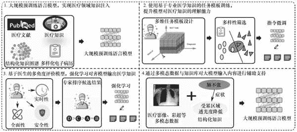

图 5-8 阳明医疗大模型训练方案

在医学影像诊断方面，阳明医疗大模型展现出了极高的准确性。以肺部疾病诊断为例，它能够快速识别肺部 CT 影像中的微小病变，实现影像识别的“超人类视觉”，通过采用 3D 卷积神经网络，分析 CT、MRI、PET 等多模态影像，识别微米级病灶，筛查早期肺癌的结节等。相比传统的人工读片，大模型不会受到医生疲劳、经验差异等因素的影响，能够在短时间内对大量影像进行分析，大幅提高了诊断效率。同时，其诊断精度达到了较高水平，相比传统方法，其对早期肺癌的检测准确率提升了 20%～30%，有效降低了漏诊和误诊的概率。例如，腾讯觅影 AI 在低剂量 CT 中检测 3mm 以下结节，假阴性率较放射科医生低 70%。

在临床诊断中，医疗大模型还能综合患者的症状、病史、检验结果等多源数据进行分析。当医生输入患者的相关信息后，大模型可以快速给出可能的疾病诊断建议，并提供相应的诊断依据和推荐的检查项目。这为医生的诊断决策提供了有力支持，尤其是对经验不足的医生来说，可以帮助他们更准确地判断病情。

#### 医疗大模型助力个性化治疗方案制订

基于医疗大模型的辅助诊断结果，医生能够为患者制订更加个性化的治疗方案。每个患者的病情、身体状况、基因特征等都存在差异，传统的“一刀切”治疗模式难以满足患者的个性化需求。AI 辅助诊断通过对患者多维度数据的深入分析，为个性化治疗提供了可能。

在肿瘤治疗领域，医疗大模型可以结合患者的肿瘤基因检测数据、影像检查结果及身体机能指标，评估不同治疗方案对患者的适用性和疗效。对于某些基因突变的癌症患者，医疗大模型可以精准推荐靶向治疗药物，并根据患者的身体状况预测药物的不良反应，帮助医生提前做好应对措施。同时，医疗大模型能跟踪患者的治疗过程，根据治疗效果实时调整治疗方案，实现治疗方案的动态优化。

在心血管疾病治疗方面，AI 辅助诊断可以根据患者的心电图、心脏超声等检查结果，结合患者的年龄、性别、生活习惯等因素，为其制订个性化治疗和康复计划。对于冠心病患者，医疗大模型可以评估其血管狭窄程度、心肌缺血情况，判断是否需要进行介入治疗或药物治疗，并为患者提供饮食、运动等方面的个性化建议，提高治疗效果和患者的生活质量。

### 药物研发：AlphaFold 与分子结构预测

#### AlphaFold 的突破性进展

在药物研发过程中，了解蛋白质的三维结构对于开发有效的药物至关重要。长期以来，确定蛋白质的三维结构是一项极具挑战性的任务，传统实验方法（如 X 射线晶体学和核磁共振）不仅耗时、昂贵，而且很难成功解析一些复杂的蛋白质。AlphaFold 的出现改变了这一局面。

AlphaFold 是谷歌旗下 DeepMind 公司开发的人工智能系统，它利用深度学习算法，根据蛋白质的氨基酸序列准确预测其三维结构。这一技术的突破为药物研发带来了巨大的推动作用。通过 AlphaFold，研究人员可以快速获得蛋白质的结构信息，大幅缩短药物研发的前期准备时间。例如，在研发针对某种罕见病的药物时，以往确定相关蛋白质结构可能需要数年时间，而现在借助 AlphaFold，只需几天就可以得到较为准确的蛋白质结构模型。

AlphaFold 的预测精度也达到了令人惊叹的水平。其预测的蛋白质结构与实验测定的结构在许多情况下高度相似，在关键区域的精度误差极小。这使研究人员能够基于更准确的蛋白质结构信息设计药物分子，提高药物研发的成功率。

#### AlphaFold 加速药物研发进程

AlphaFold 的应用显著加速了药物研发进程。在药物设计阶段，研究人员可以根据预测的蛋白质结构，有针对性地设计能够与目标蛋白质结合的小分子药物。通过计算机模拟，筛选出具有潜在活性的化合物，极大地减少了需要进行实验测试的化合物数量，降低了研发成本。

例如，在研发治疗阿尔茨海默病的药物时，研究人员利用 AlphaFold 确定了与疾病相关的蛋白质结构，然后通过虚拟筛选技术，从数百万种化合物中快速筛选出可能与该蛋白质结合并抑制其异常功能的化合物。这些被筛选出来的化合物再进入后续的实验验证阶段，大幅提高了研发效率。再如，英国 Exscientia 公司利用 AI 技术研发了用于治疗强迫症的分子药物 DSP-1181，该项研究从立项到临床前仅用了 12 个月。 **药物研发从“十年磨一剑”发展到“百日造新药”。**

此外，AlphaFold 可以帮助研究人员理解药物的作用机制。通过分析药物分子与蛋白质的结合模式，研究人员可以深入了解药物如何影响蛋白质的功能，为优化药物设计提供指导。同时，在药物研发的临床前和临床试验阶段，AlphaFold 预测的蛋白质结构信息可以用于评估药物的安全性和有效性，为药物研发的顺利推进提供有力支持。研究人员甚至可以通过合成对照组，利用 AI 技术生成虚拟患者数据，替代传统随机对照组，将试验周期缩短 70%，实现临床试验的“虚拟革命”。

### 远程手术：“5G+AI”的跨地域精准操作

#### 5G 与 AI 的协同赋能

远程手术是“AI+医疗”领域的一项前沿应用，它借助 5G 和 AI 技术，使医生远程控制手术机器人为患者进行手术操作，打破了地域限制，让优质医疗资源能够惠及更广泛的患者群体。

5G 网络具有高速率、低延迟和大容量的特点，为远程手术提供了稳定可靠的通信保障。5G 网络的高速率确保了数据能够快速、准确地传输，使远程医生能够实时获取手术现场的详细信息；低延迟保证了医生的操作指令能够及时传达给手术机器人，避免因延迟导致的操作失误，实现了远程手术的精准控制。

6G 相比 5G，具备更加卓越的性能，其超高的速率、极低的延迟和强大的连接能力，将为远程手术带来质的飞跃。在远程手术过程中，手术现场的高清视频、患者的生理数据及手术器械的操作数据需要实时传输给远程医生，在 6G 时代，这将不再是问题。6G 为远程手术带来了前所未有的变革，开启了跨地域精准医疗的全新篇章。

AI 技术在远程手术中也发挥着关键作用。AI 图像识别技术可以对手术现场的视频图像进行实时分析，帮助医生更清晰地识别手术部位的解剖结构，提高手术的准确性。该技术甚至可以实现全身器官建模，整合基因组、代谢组、微生物组数据，构建个体化生理模型。例如，在肝脏手术中，AI 可以识别肝脏的血管、胆管等复杂结构，为医生提供导航，避免在手术过程中对重要组织造成损伤。同时，AI 可以对患者的生理数据进行实时监测和分析，当发现患者出现异常情况时，及时发出预警，保障患者的手术安全。

#### 远程手术的实践与挑战

近年来，远程手术在多个领域取得了成功。例如，在泌尿外科领域，医生通过远程操作手术机器人为患者行前列腺切除术。在手术过程中，医生在远程控制台上操作，手术机器人的机械臂在患者体内精确地执行手术动作，完成复杂的组织切割、缝合等操作。

然而，远程手术也面临一些挑战。首先是技术方面的挑战。尽管 5G 和 AI 技术不断发展，但在一些网络信号不稳定的地区，仍然可能出现数据传输延迟或中断的情况，影响手术的顺利进行。手术机器人的性能和精准度还需要进一步提高，以适应更加复杂的手术需求。其次是法律法规和伦理方面的挑战。远程手术涉及不同地区的法律法规，如何明确远程手术过程中的责任界定是一个亟待解决的问题。同时，远程手术的伦理审查需要更加完善，确保患者的权益得到充分保障。

随着 AI 技术的不断创新和发展，“AI+医疗”将在更多领域实现突破。未来，AI 有望在疾病预防、健康管理、医学教育等方面发挥更大的作用，推动医疗健康产业向智能化、精准化、个性化方向发展。同时，为了确保 AI 在医疗领域的安全、可靠应用，需要加强技术研发、完善法律法规、强化伦理监管，让 AI 更好地服务于人类的健康事业。

当 AI 能够以 99.99%的准确率诊断疾病、以纳米级精度实施手术时，医学的终极考验不再是“能否治愈”，而是“如何定义治愈”。正如特鲁多医生的墓志铭：“有时治愈，常常帮助，总是安慰。”在算法时代，或许我们需要重新认识到：那些无法被数据量化的眼神交流、掌心温度与信念力量，才是医疗永不褪色的灵魂。 EXr6287u6NNVz+GYLY+7SDk226FstKIHdC0bNoQkB2Nqi1xSR0yxPmwrTs5gRi/BtfSbid6dBhii9q7cz2pIyA==

## 5 AI+医疗：从希波克拉底誓言到算法诊断

公元前 400 年，希波克拉底创立了医学伦理，强调以患者为中心；而今，梅奥诊所的 AI 系统 Hippocrates2.0 可以在 0.3 秒内完成一名患者的全基因组分析、病史回溯与治疗方案生成，准确率超过人类专家。这场跨越两千年的医疗革命，揭示了 AI 如何将“经验医学”升维至“精准医学”。“AI+医疗”的本质，是用数据重新定义生命的可计算性，让疾病预测从“概率猜测”转向“确定性模型”，让治疗从“千人一方”进化为“一人一策”。

在科技飞速发展的当下，AI 正在以前所未有的深度和广度融入医疗领域，成为推动医疗行业数字化、智能化转型的关键力量。“AI+医疗”模式打破了传统医疗的诸多局限，从辅助诊断的精准高效，到药物研发的加速突破，再到远程手术的跨地域创新，为提升医疗服务质量、改善患者就医体验、攻克医学难题带来了全新的机遇。

### 辅助诊断：阳明医疗大模型与个性化治疗

#### 阳明医疗大模型的技术优势

阳明医疗大模型是“AI+医疗”辅助诊断领域的创新成果，它融合了深度学习、大数据分析等前沿 AI 技术，具备强大的医学知识理解和图像识别能力。该模型通过对海量医学影像数据（如 X 光、CT、MRI 等）、临床病例资料及医学文献的深度学习，构建了庞大而精准的医学知识图谱。该模型训练方案如图 5-8 所示。

图 5-8 阳明医疗大模型训练方案

在医学影像诊断方面，阳明医疗大模型展现出了极高的准确性。以肺部疾病诊断为例，它能够快速识别肺部 CT 影像中的微小病变，实现影像识别的“超人类视觉”，通过采用 3D 卷积神经网络，分析 CT、MRI、PET 等多模态影像，识别微米级病灶，筛查早期肺癌的结节等。相比传统的人工读片，大模型不会受到医生疲劳、经验差异等因素的影响，能够在短时间内对大量影像进行分析，大幅提高了诊断效率。同时，其诊断精度达到了较高水平，相比传统方法，其对早期肺癌的检测准确率提升了 20%～30%，有效降低了漏诊和误诊的概率。例如，腾讯觅影 AI 在低剂量 CT 中检测 3mm 以下结节，假阴性率较放射科医生低 70%。

在临床诊断中，医疗大模型还能综合患者的症状、病史、检验结果等多源数据进行分析。当医生输入患者的相关信息后，大模型可以快速给出可能的疾病诊断建议，并提供相应的诊断依据和推荐的检查项目。这为医生的诊断决策提供了有力支持，尤其是对经验不足的医生来说，可以帮助他们更准确地判断病情。

#### 医疗大模型助力个性化治疗方案制订

基于医疗大模型的辅助诊断结果，医生能够为患者制订更加个性化的治疗方案。每个患者的病情、身体状况、基因特征等都存在差异，传统的“一刀切”治疗模式难以满足患者的个性化需求。AI 辅助诊断通过对患者多维度数据的深入分析，为个性化治疗提供了可能。

在肿瘤治疗领域，医疗大模型可以结合患者的肿瘤基因检测数据、影像检查结果及身体机能指标，评估不同治疗方案对患者的适用性和疗效。对于某些基因突变的癌症患者，医疗大模型可以精准推荐靶向治疗药物，并根据患者的身体状况预测药物的不良反应，帮助医生提前做好应对措施。同时，医疗大模型能跟踪患者的治疗过程，根据治疗效果实时调整治疗方案，实现治疗方案的动态优化。

在心血管疾病治疗方面，AI 辅助诊断可以根据患者的心电图、心脏超声等检查结果，结合患者的年龄、性别、生活习惯等因素，为其制订个性化治疗和康复计划。对于冠心病患者，医疗大模型可以评估其血管狭窄程度、心肌缺血情况，判断是否需要进行介入治疗或药物治疗，并为患者提供饮食、运动等方面的个性化建议，提高治疗效果和患者的生活质量。

### 药物研发：AlphaFold 与分子结构预测

#### AlphaFold 的突破性进展

在药物研发过程中，了解蛋白质的三维结构对于开发有效的药物至关重要。长期以来，确定蛋白质的三维结构是一项极具挑战性的任务，传统实验方法（如 X 射线晶体学和核磁共振）不仅耗时、昂贵，而且很难成功解析一些复杂的蛋白质。AlphaFold 的出现改变了这一局面。

AlphaFold 是谷歌旗下 DeepMind 公司开发的人工智能系统，它利用深度学习算法，根据蛋白质的氨基酸序列准确预测其三维结构。这一技术的突破为药物研发带来了巨大的推动作用。通过 AlphaFold，研究人员可以快速获得蛋白质的结构信息，大幅缩短药物研发的前期准备时间。例如，在研发针对某种罕见病的药物时，以往确定相关蛋白质结构可能需要数年时间，而现在借助 AlphaFold，只需几天就可以得到较为准确的蛋白质结构模型。

AlphaFold 的预测精度也达到了令人惊叹的水平。其预测的蛋白质结构与实验测定的结构在许多情况下高度相似，在关键区域的精度误差极小。这使研究人员能够基于更准确的蛋白质结构信息设计药物分子，提高药物研发的成功率。

#### AlphaFold 加速药物研发进程

AlphaFold 的应用显著加速了药物研发进程。在药物设计阶段，研究人员可以根据预测的蛋白质结构，有针对性地设计能够与目标蛋白质结合的小分子药物。通过计算机模拟，筛选出具有潜在活性的化合物，极大地减少了需要进行实验测试的化合物数量，降低了研发成本。

例如，在研发治疗阿尔茨海默病的药物时，研究人员利用 AlphaFold 确定了与疾病相关的蛋白质结构，然后通过虚拟筛选技术，从数百万种化合物中快速筛选出可能与该蛋白质结合并抑制其异常功能的化合物。这些被筛选出来的化合物再进入后续的实验验证阶段，大幅提高了研发效率。再如，英国 Exscientia 公司利用 AI 技术研发了用于治疗强迫症的分子药物 DSP-1181，该项研究从立项到临床前仅用了 12 个月。 **药物研发从“十年磨一剑”发展到“百日造新药”。**

此外，AlphaFold 可以帮助研究人员理解药物的作用机制。通过分析药物分子与蛋白质的结合模式，研究人员可以深入了解药物如何影响蛋白质的功能，为优化药物设计提供指导。同时，在药物研发的临床前和临床试验阶段，AlphaFold 预测的蛋白质结构信息可以用于评估药物的安全性和有效性，为药物研发的顺利推进提供有力支持。研究人员甚至可以通过合成对照组，利用 AI 技术生成虚拟患者数据，替代传统随机对照组，将试验周期缩短 70%，实现临床试验的“虚拟革命”。

### 远程手术：“5G+AI”的跨地域精准操作

#### 5G 与 AI 的协同赋能

远程手术是“AI+医疗”领域的一项前沿应用，它借助 5G 和 AI 技术，使医生远程控制手术机器人为患者进行手术操作，打破了地域限制，让优质医疗资源能够惠及更广泛的患者群体。

5G 网络具有高速率、低延迟和大容量的特点，为远程手术提供了稳定可靠的通信保障。5G 网络的高速率确保了数据能够快速、准确地传输，使远程医生能够实时获取手术现场的详细信息；低延迟保证了医生的操作指令能够及时传达给手术机器人，避免因延迟导致的操作失误，实现了远程手术的精准控制。

6G 相比 5G，具备更加卓越的性能，其超高的速率、极低的延迟和强大的连接能力，将为远程手术带来质的飞跃。在远程手术过程中，手术现场的高清视频、患者的生理数据及手术器械的操作数据需要实时传输给远程医生，在 6G 时代，这将不再是问题。6G 为远程手术带来了前所未有的变革，开启了跨地域精准医疗的全新篇章。

AI 技术在远程手术中也发挥着关键作用。AI 图像识别技术可以对手术现场的视频图像进行实时分析，帮助医生更清晰地识别手术部位的解剖结构，提高手术的准确性。该技术甚至可以实现全身器官建模，整合基因组、代谢组、微生物组数据，构建个体化生理模型。例如，在肝脏手术中，AI 可以识别肝脏的血管、胆管等复杂结构，为医生提供导航，避免在手术过程中对重要组织造成损伤。同时，AI 可以对患者的生理数据进行实时监测和分析，当发现患者出现异常情况时，及时发出预警，保障患者的手术安全。

#### 远程手术的实践与挑战

近年来，远程手术在多个领域取得了成功。例如，在泌尿外科领域，医生通过远程操作手术机器人为患者行前列腺切除术。在手术过程中，医生在远程控制台上操作，手术机器人的机械臂在患者体内精确地执行手术动作，完成复杂的组织切割、缝合等操作。

然而，远程手术也面临一些挑战。首先是技术方面的挑战。尽管 5G 和 AI 技术不断发展，但在一些网络信号不稳定的地区，仍然可能出现数据传输延迟或中断的情况，影响手术的顺利进行。手术机器人的性能和精准度还需要进一步提高，以适应更加复杂的手术需求。其次是法律法规和伦理方面的挑战。远程手术涉及不同地区的法律法规，如何明确远程手术过程中的责任界定是一个亟待解决的问题。同时，远程手术的伦理审查需要更加完善，确保患者的权益得到充分保障。

随着 AI 技术的不断创新和发展，“AI+医疗”将在更多领域实现突破。未来，AI 有望在疾病预防、健康管理、医学教育等方面发挥更大的作用，推动医疗健康产业向智能化、精准化、个性化方向发展。同时，为了确保 AI 在医疗领域的安全、可靠应用，需要加强技术研发、完善法律法规、强化伦理监管，让 AI 更好地服务于人类的健康事业。

当 AI 能够以 99.99%的准确率诊断疾病、以纳米级精度实施手术时，医学的终极考验不再是“能否治愈”，而是“如何定义治愈”。正如特鲁多医生的墓志铭：“有时治愈，常常帮助，总是安慰。”在算法时代，或许我们需要重新认识到：那些无法被数据量化的眼神交流、掌心温度与信念力量，才是医疗永不褪色的灵魂。 EXr6287u6NNVz+GYLY+7SDk226FstKIHdC0bNoQkB2Nqi1xSR0yxPmwrTs5gRi/BtfSbid6dBhii9q7cz2pIyA==

## 5 AI+医疗：从希波克拉底誓言到算法诊断

公元前 400 年，希波克拉底创立了医学伦理，强调以患者为中心；而今，梅奥诊所的 AI 系统 Hippocrates2.0 可以在 0.3 秒内完成一名患者的全基因组分析、病史回溯与治疗方案生成，准确率超过人类专家。这场跨越两千年的医疗革命，揭示了 AI 如何将“经验医学”升维至“精准医学”。“AI+医疗”的本质，是用数据重新定义生命的可计算性，让疾病预测从“概率猜测”转向“确定性模型”，让治疗从“千人一方”进化为“一人一策”。

在科技飞速发展的当下，AI 正在以前所未有的深度和广度融入医疗领域，成为推动医疗行业数字化、智能化转型的关键力量。“AI+医疗”模式打破了传统医疗的诸多局限，从辅助诊断的精准高效，到药物研发的加速突破，再到远程手术的跨地域创新，为提升医疗服务质量、改善患者就医体验、攻克医学难题带来了全新的机遇。

### 辅助诊断：阳明医疗大模型与个性化治疗

#### 阳明医疗大模型的技术优势

阳明医疗大模型是“AI+医疗”辅助诊断领域的创新成果，它融合了深度学习、大数据分析等前沿 AI 技术，具备强大的医学知识理解和图像识别能力。该模型通过对海量医学影像数据（如 X 光、CT、MRI 等）、临床病例资料及医学文献的深度学习，构建了庞大而精准的医学知识图谱。该模型训练方案如图 5-8 所示。

图 5-8 阳明医疗大模型训练方案

在医学影像诊断方面，阳明医疗大模型展现出了极高的准确性。以肺部疾病诊断为例，它能够快速识别肺部 CT 影像中的微小病变，实现影像识别的“超人类视觉”，通过采用 3D 卷积神经网络，分析 CT、MRI、PET 等多模态影像，识别微米级病灶，筛查早期肺癌的结节等。相比传统的人工读片，大模型不会受到医生疲劳、经验差异等因素的影响，能够在短时间内对大量影像进行分析，大幅提高了诊断效率。同时，其诊断精度达到了较高水平，相比传统方法，其对早期肺癌的检测准确率提升了 20%～30%，有效降低了漏诊和误诊的概率。例如，腾讯觅影 AI 在低剂量 CT 中检测 3mm 以下结节，假阴性率较放射科医生低 70%。

在临床诊断中，医疗大模型还能综合患者的症状、病史、检验结果等多源数据进行分析。当医生输入患者的相关信息后，大模型可以快速给出可能的疾病诊断建议，并提供相应的诊断依据和推荐的检查项目。这为医生的诊断决策提供了有力支持，尤其是对经验不足的医生来说，可以帮助他们更准确地判断病情。

#### 医疗大模型助力个性化治疗方案制订

基于医疗大模型的辅助诊断结果，医生能够为患者制订更加个性化的治疗方案。每个患者的病情、身体状况、基因特征等都存在差异，传统的“一刀切”治疗模式难以满足患者的个性化需求。AI 辅助诊断通过对患者多维度数据的深入分析，为个性化治疗提供了可能。

在肿瘤治疗领域，医疗大模型可以结合患者的肿瘤基因检测数据、影像检查结果及身体机能指标，评估不同治疗方案对患者的适用性和疗效。对于某些基因突变的癌症患者，医疗大模型可以精准推荐靶向治疗药物，并根据患者的身体状况预测药物的不良反应，帮助医生提前做好应对措施。同时，医疗大模型能跟踪患者的治疗过程，根据治疗效果实时调整治疗方案，实现治疗方案的动态优化。

在心血管疾病治疗方面，AI 辅助诊断可以根据患者的心电图、心脏超声等检查结果，结合患者的年龄、性别、生活习惯等因素，为其制订个性化治疗和康复计划。对于冠心病患者，医疗大模型可以评估其血管狭窄程度、心肌缺血情况，判断是否需要进行介入治疗或药物治疗，并为患者提供饮食、运动等方面的个性化建议，提高治疗效果和患者的生活质量。

### 药物研发：AlphaFold 与分子结构预测

#### AlphaFold 的突破性进展

在药物研发过程中，了解蛋白质的三维结构对于开发有效的药物至关重要。长期以来，确定蛋白质的三维结构是一项极具挑战性的任务，传统实验方法（如 X 射线晶体学和核磁共振）不仅耗时、昂贵，而且很难成功解析一些复杂的蛋白质。AlphaFold 的出现改变了这一局面。

AlphaFold 是谷歌旗下 DeepMind 公司开发的人工智能系统，它利用深度学习算法，根据蛋白质的氨基酸序列准确预测其三维结构。这一技术的突破为药物研发带来了巨大的推动作用。通过 AlphaFold，研究人员可以快速获得蛋白质的结构信息，大幅缩短药物研发的前期准备时间。例如，在研发针对某种罕见病的药物时，以往确定相关蛋白质结构可能需要数年时间，而现在借助 AlphaFold，只需几天就可以得到较为准确的蛋白质结构模型。

AlphaFold 的预测精度也达到了令人惊叹的水平。其预测的蛋白质结构与实验测定的结构在许多情况下高度相似，在关键区域的精度误差极小。这使研究人员能够基于更准确的蛋白质结构信息设计药物分子，提高药物研发的成功率。

#### AlphaFold 加速药物研发进程

AlphaFold 的应用显著加速了药物研发进程。在药物设计阶段，研究人员可以根据预测的蛋白质结构，有针对性地设计能够与目标蛋白质结合的小分子药物。通过计算机模拟，筛选出具有潜在活性的化合物，极大地减少了需要进行实验测试的化合物数量，降低了研发成本。

例如，在研发治疗阿尔茨海默病的药物时，研究人员利用 AlphaFold 确定了与疾病相关的蛋白质结构，然后通过虚拟筛选技术，从数百万种化合物中快速筛选出可能与该蛋白质结合并抑制其异常功能的化合物。这些被筛选出来的化合物再进入后续的实验验证阶段，大幅提高了研发效率。再如，英国 Exscientia 公司利用 AI 技术研发了用于治疗强迫症的分子药物 DSP-1181，该项研究从立项到临床前仅用了 12 个月。 **药物研发从“十年磨一剑”发展到“百日造新药”。**

此外，AlphaFold 可以帮助研究人员理解药物的作用机制。通过分析药物分子与蛋白质的结合模式，研究人员可以深入了解药物如何影响蛋白质的功能，为优化药物设计提供指导。同时，在药物研发的临床前和临床试验阶段，AlphaFold 预测的蛋白质结构信息可以用于评估药物的安全性和有效性，为药物研发的顺利推进提供有力支持。研究人员甚至可以通过合成对照组，利用 AI 技术生成虚拟患者数据，替代传统随机对照组，将试验周期缩短 70%，实现临床试验的“虚拟革命”。

### 远程手术：“5G+AI”的跨地域精准操作

#### 5G 与 AI 的协同赋能

远程手术是“AI+医疗”领域的一项前沿应用，它借助 5G 和 AI 技术，使医生远程控制手术机器人为患者进行手术操作，打破了地域限制，让优质医疗资源能够惠及更广泛的患者群体。

5G 网络具有高速率、低延迟和大容量的特点，为远程手术提供了稳定可靠的通信保障。5G 网络的高速率确保了数据能够快速、准确地传输，使远程医生能够实时获取手术现场的详细信息；低延迟保证了医生的操作指令能够及时传达给手术机器人，避免因延迟导致的操作失误，实现了远程手术的精准控制。

6G 相比 5G，具备更加卓越的性能，其超高的速率、极低的延迟和强大的连接能力，将为远程手术带来质的飞跃。在远程手术过程中，手术现场的高清视频、患者的生理数据及手术器械的操作数据需要实时传输给远程医生，在 6G 时代，这将不再是问题。6G 为远程手术带来了前所未有的变革，开启了跨地域精准医疗的全新篇章。

AI 技术在远程手术中也发挥着关键作用。AI 图像识别技术可以对手术现场的视频图像进行实时分析，帮助医生更清晰地识别手术部位的解剖结构，提高手术的准确性。该技术甚至可以实现全身器官建模，整合基因组、代谢组、微生物组数据，构建个体化生理模型。例如，在肝脏手术中，AI 可以识别肝脏的血管、胆管等复杂结构，为医生提供导航，避免在手术过程中对重要组织造成损伤。同时，AI 可以对患者的生理数据进行实时监测和分析，当发现患者出现异常情况时，及时发出预警，保障患者的手术安全。

#### 远程手术的实践与挑战

近年来，远程手术在多个领域取得了成功。例如，在泌尿外科领域，医生通过远程操作手术机器人为患者行前列腺切除术。在手术过程中，医生在远程控制台上操作，手术机器人的机械臂在患者体内精确地执行手术动作，完成复杂的组织切割、缝合等操作。

然而，远程手术也面临一些挑战。首先是技术方面的挑战。尽管 5G 和 AI 技术不断发展，但在一些网络信号不稳定的地区，仍然可能出现数据传输延迟或中断的情况，影响手术的顺利进行。手术机器人的性能和精准度还需要进一步提高，以适应更加复杂的手术需求。其次是法律法规和伦理方面的挑战。远程手术涉及不同地区的法律法规，如何明确远程手术过程中的责任界定是一个亟待解决的问题。同时，远程手术的伦理审查需要更加完善，确保患者的权益得到充分保障。

随着 AI 技术的不断创新和发展，“AI+医疗”将在更多领域实现突破。未来，AI 有望在疾病预防、健康管理、医学教育等方面发挥更大的作用，推动医疗健康产业向智能化、精准化、个性化方向发展。同时，为了确保 AI 在医疗领域的安全、可靠应用，需要加强技术研发、完善法律法规、强化伦理监管，让 AI 更好地服务于人类的健康事业。

当 AI 能够以 99.99%的准确率诊断疾病、以纳米级精度实施手术时，医学的终极考验不再是“能否治愈”，而是“如何定义治愈”。正如特鲁多医生的墓志铭：“有时治愈，常常帮助，总是安慰。”在算法时代，或许我们需要重新认识到：那些无法被数据量化的眼神交流、掌心温度与信念力量，才是医疗永不褪色的灵魂。 EXr6287u6NNVz+GYLY+7SDk226FstKIHdC0bNoQkB2Nqi1xSR0yxPmwrTs5gRi/BtfSbid6dBhii9q7cz2pIyA==

## 5 AI+医疗：从希波克拉底誓言到算法诊断

公元前 400 年，希波克拉底创立了医学伦理，强调以患者为中心；而今，梅奥诊所的 AI 系统 Hippocrates2.0 可以在 0.3 秒内完成一名患者的全基因组分析、病史回溯与治疗方案生成，准确率超过人类专家。这场跨越两千年的医疗革命，揭示了 AI 如何将“经验医学”升维至“精准医学”。“AI+医疗”的本质，是用数据重新定义生命的可计算性，让疾病预测从“概率猜测”转向“确定性模型”，让治疗从“千人一方”进化为“一人一策”。

在科技飞速发展的当下，AI 正在以前所未有的深度和广度融入医疗领域，成为推动医疗行业数字化、智能化转型的关键力量。“AI+医疗”模式打破了传统医疗的诸多局限，从辅助诊断的精准高效，到药物研发的加速突破，再到远程手术的跨地域创新，为提升医疗服务质量、改善患者就医体验、攻克医学难题带来了全新的机遇。

### 辅助诊断：阳明医疗大模型与个性化治疗

#### 阳明医疗大模型的技术优势

阳明医疗大模型是“AI+医疗”辅助诊断领域的创新成果，它融合了深度学习、大数据分析等前沿 AI 技术，具备强大的医学知识理解和图像识别能力。该模型通过对海量医学影像数据（如 X 光、CT、MRI 等）、临床病例资料及医学文献的深度学习，构建了庞大而精准的医学知识图谱。该模型训练方案如图 5-8 所示。

图 5-8 阳明医疗大模型训练方案

在医学影像诊断方面，阳明医疗大模型展现出了极高的准确性。以肺部疾病诊断为例，它能够快速识别肺部 CT 影像中的微小病变，实现影像识别的“超人类视觉”，通过采用 3D 卷积神经网络，分析 CT、MRI、PET 等多模态影像，识别微米级病灶，筛查早期肺癌的结节等。相比传统的人工读片，大模型不会受到医生疲劳、经验差异等因素的影响，能够在短时间内对大量影像进行分析，大幅提高了诊断效率。同时，其诊断精度达到了较高水平，相比传统方法，其对早期肺癌的检测准确率提升了 20%～30%，有效降低了漏诊和误诊的概率。例如，腾讯觅影 AI 在低剂量 CT 中检测 3mm 以下结节，假阴性率较放射科医生低 70%。

在临床诊断中，医疗大模型还能综合患者的症状、病史、检验结果等多源数据进行分析。当医生输入患者的相关信息后，大模型可以快速给出可能的疾病诊断建议，并提供相应的诊断依据和推荐的检查项目。这为医生的诊断决策提供了有力支持，尤其是对经验不足的医生来说，可以帮助他们更准确地判断病情。

#### 医疗大模型助力个性化治疗方案制订

基于医疗大模型的辅助诊断结果，医生能够为患者制订更加个性化的治疗方案。每个患者的病情、身体状况、基因特征等都存在差异，传统的“一刀切”治疗模式难以满足患者的个性化需求。AI 辅助诊断通过对患者多维度数据的深入分析，为个性化治疗提供了可能。

在肿瘤治疗领域，医疗大模型可以结合患者的肿瘤基因检测数据、影像检查结果及身体机能指标，评估不同治疗方案对患者的适用性和疗效。对于某些基因突变的癌症患者，医疗大模型可以精准推荐靶向治疗药物，并根据患者的身体状况预测药物的不良反应，帮助医生提前做好应对措施。同时，医疗大模型能跟踪患者的治疗过程，根据治疗效果实时调整治疗方案，实现治疗方案的动态优化。

在心血管疾病治疗方面，AI 辅助诊断可以根据患者的心电图、心脏超声等检查结果，结合患者的年龄、性别、生活习惯等因素，为其制订个性化治疗和康复计划。对于冠心病患者，医疗大模型可以评估其血管狭窄程度、心肌缺血情况，判断是否需要进行介入治疗或药物治疗，并为患者提供饮食、运动等方面的个性化建议，提高治疗效果和患者的生活质量。

### 药物研发：AlphaFold 与分子结构预测

#### AlphaFold 的突破性进展

在药物研发过程中，了解蛋白质的三维结构对于开发有效的药物至关重要。长期以来，确定蛋白质的三维结构是一项极具挑战性的任务，传统实验方法（如 X 射线晶体学和核磁共振）不仅耗时、昂贵，而且很难成功解析一些复杂的蛋白质。AlphaFold 的出现改变了这一局面。

AlphaFold 是谷歌旗下 DeepMind 公司开发的人工智能系统，它利用深度学习算法，根据蛋白质的氨基酸序列准确预测其三维结构。这一技术的突破为药物研发带来了巨大的推动作用。通过 AlphaFold，研究人员可以快速获得蛋白质的结构信息，大幅缩短药物研发的前期准备时间。例如，在研发针对某种罕见病的药物时，以往确定相关蛋白质结构可能需要数年时间，而现在借助 AlphaFold，只需几天就可以得到较为准确的蛋白质结构模型。

AlphaFold 的预测精度也达到了令人惊叹的水平。其预测的蛋白质结构与实验测定的结构在许多情况下高度相似，在关键区域的精度误差极小。这使研究人员能够基于更准确的蛋白质结构信息设计药物分子，提高药物研发的成功率。

#### AlphaFold 加速药物研发进程

AlphaFold 的应用显著加速了药物研发进程。在药物设计阶段，研究人员可以根据预测的蛋白质结构，有针对性地设计能够与目标蛋白质结合的小分子药物。通过计算机模拟，筛选出具有潜在活性的化合物，极大地减少了需要进行实验测试的化合物数量，降低了研发成本。

例如，在研发治疗阿尔茨海默病的药物时，研究人员利用 AlphaFold 确定了与疾病相关的蛋白质结构，然后通过虚拟筛选技术，从数百万种化合物中快速筛选出可能与该蛋白质结合并抑制其异常功能的化合物。这些被筛选出来的化合物再进入后续的实验验证阶段，大幅提高了研发效率。再如，英国 Exscientia 公司利用 AI 技术研发了用于治疗强迫症的分子药物 DSP-1181，该项研究从立项到临床前仅用了 12 个月。 **药物研发从“十年磨一剑”发展到“百日造新药”。**

此外，AlphaFold 可以帮助研究人员理解药物的作用机制。通过分析药物分子与蛋白质的结合模式，研究人员可以深入了解药物如何影响蛋白质的功能，为优化药物设计提供指导。同时，在药物研发的临床前和临床试验阶段，AlphaFold 预测的蛋白质结构信息可以用于评估药物的安全性和有效性，为药物研发的顺利推进提供有力支持。研究人员甚至可以通过合成对照组，利用 AI 技术生成虚拟患者数据，替代传统随机对照组，将试验周期缩短 70%，实现临床试验的“虚拟革命”。

### 远程手术：“5G+AI”的跨地域精准操作

#### 5G 与 AI 的协同赋能

远程手术是“AI+医疗”领域的一项前沿应用，它借助 5G 和 AI 技术，使医生远程控制手术机器人为患者进行手术操作，打破了地域限制，让优质医疗资源能够惠及更广泛的患者群体。

5G 网络具有高速率、低延迟和大容量的特点，为远程手术提供了稳定可靠的通信保障。5G 网络的高速率确保了数据能够快速、准确地传输，使远程医生能够实时获取手术现场的详细信息；低延迟保证了医生的操作指令能够及时传达给手术机器人，避免因延迟导致的操作失误，实现了远程手术的精准控制。

6G 相比 5G，具备更加卓越的性能，其超高的速率、极低的延迟和强大的连接能力，将为远程手术带来质的飞跃。在远程手术过程中，手术现场的高清视频、患者的生理数据及手术器械的操作数据需要实时传输给远程医生，在 6G 时代，这将不再是问题。6G 为远程手术带来了前所未有的变革，开启了跨地域精准医疗的全新篇章。

AI 技术在远程手术中也发挥着关键作用。AI 图像识别技术可以对手术现场的视频图像进行实时分析，帮助医生更清晰地识别手术部位的解剖结构，提高手术的准确性。该技术甚至可以实现全身器官建模，整合基因组、代谢组、微生物组数据，构建个体化生理模型。例如，在肝脏手术中，AI 可以识别肝脏的血管、胆管等复杂结构，为医生提供导航，避免在手术过程中对重要组织造成损伤。同时，AI 可以对患者的生理数据进行实时监测和分析，当发现患者出现异常情况时，及时发出预警，保障患者的手术安全。

#### 远程手术的实践与挑战

近年来，远程手术在多个领域取得了成功。例如，在泌尿外科领域，医生通过远程操作手术机器人为患者行前列腺切除术。在手术过程中，医生在远程控制台上操作，手术机器人的机械臂在患者体内精确地执行手术动作，完成复杂的组织切割、缝合等操作。

然而，远程手术也面临一些挑战。首先是技术方面的挑战。尽管 5G 和 AI 技术不断发展，但在一些网络信号不稳定的地区，仍然可能出现数据传输延迟或中断的情况，影响手术的顺利进行。手术机器人的性能和精准度还需要进一步提高，以适应更加复杂的手术需求。其次是法律法规和伦理方面的挑战。远程手术涉及不同地区的法律法规，如何明确远程手术过程中的责任界定是一个亟待解决的问题。同时，远程手术的伦理审查需要更加完善，确保患者的权益得到充分保障。

随着 AI 技术的不断创新和发展，“AI+医疗”将在更多领域实现突破。未来，AI 有望在疾病预防、健康管理、医学教育等方面发挥更大的作用，推动医疗健康产业向智能化、精准化、个性化方向发展。同时，为了确保 AI 在医疗领域的安全、可靠应用，需要加强技术研发、完善法律法规、强化伦理监管，让 AI 更好地服务于人类的健康事业。

当 AI 能够以 99.99%的准确率诊断疾病、以纳米级精度实施手术时，医学的终极考验不再是“能否治愈”，而是“如何定义治愈”。正如特鲁多医生的墓志铭：“有时治愈，常常帮助，总是安慰。”在算法时代，或许我们需要重新认识到：那些无法被数据量化的眼神交流、掌心温度与信念力量，才是医疗永不褪色的灵魂。 EXr6287u6NNVz+GYLY+7SDk226FstKIHdC0bNoQkB2Nqi1xSR0yxPmwrTs5gRi/BtfSbid6dBhii9q7cz2pIyA==

## 6 AI+文旅：从徐霞客式漫游到元宇宙穿行

1608 年，徐霞客启程游历中国，用 30 年的足迹丈量山河；2025 年，在敦煌莫高窟的元宇宙入口前，游客佩戴神经交互设备，与千年前的画工共绘飞天。这场从“肉身跋涉”到“意识瞬移”的旅行革命，揭示了 AI 如何将文旅从“物理空间的消费”升维至“文明基因的交互”。“AI+文旅”的本质，是用算法重构人类对时空的感知，让历史可触摸，让文化可编程，让旅行成为一场跨越维度的认知冒险。

在数字化与智能化的浪潮中，AI 正以前所未有的深度和广度融入文旅行业，为其带来全方位的变革。“AI+文旅”模式不仅重塑了游客的体验，还为文旅产业的创新发展注入了强劲动力，从智能文旅场景的打造，到内容生成领域的突破，再到数智生活的探索，AI 成为推动文旅行业数转智改的核心力量。

### 智能文旅：沉浸式博物馆与 AI 导游

#### 沉浸式博物馆：科技与文化的深度融合

博物馆作为文化传承的重要载体，正借助 AI 技术实现华丽转身，为游客带来沉浸式文化体验。AI 技术通过虚拟现实（VR）、增强现实（AR）和混合现实（MR）等手段，打破了传统博物馆静态展示的局限，让历史文物和文化故事“活”起来。结合多模态传感网，通过无人机、摄像头、可穿戴设备实时采集游客轨迹、情绪数据与环境参数，构建博物馆和景区的“数字神经系统”。

走进一座配备 AI 技术的沉浸式博物馆，游客仿佛穿越时空，置身于历史场景之中。以古埃及文明展览为例，借助 VR 技术，游客戴上头戴式显示设备，就能看到宏伟的金字塔在沙漠中拔地而起，古埃及人忙碌地建造着宫殿和神庙，尼罗河的河水奔腾不息。借助 AR 技术，游客用手机扫描文物展品，屏幕上会立刻呈现出该文物的 3D 复原模型、详细的历史背景介绍和语音讲解，以及该文物在古代的使用场景。这种沉浸式体验让游客不再简单地观看展品，而是能够亲身感受历史文化的魅力。通过“高精度扫描+生成式修复”技术，AI 甚至可以填补巴米扬大佛的残缺部分，误差可小于 0.1 毫米，实现文化遗产的“数字永生”。

AI 还能根据游客的行为和偏好，提供个性化参观路线和讲解内容。博物馆内的智能传感器可以实时收集游客的位置信息、停留时间及对展品的关注度等数据。AI 算法对这些数据进行分析后，为每位游客量身定制参观路线。对于对历史故事感兴趣的游客，系统会推荐包含更多历史背景介绍的路线；对于喜欢艺术创作的游客，系统则会引导他们参观与艺术工艺相关的展品，并提供创作灵感的解读。

#### AI 导游：贴心的文旅服务伙伴

AI 导游的出现，为游客的旅行提供了极大的便利。无论是在博物馆、景区还是城市，AI 导游都能随时为游客提供服务。AI 导游数智人系统架构如图 5-9 所示。

图 5-9 AI 导游数智人系统架构

在景区，AI 导游以智能语音助手的形式存在于游客的手机中。游客只需要打开相应的 App，就能通过语音与 AI 导游交流。当游客询问“附近有什么景点推荐”时，AI 导游会根据游客的位置和兴趣偏好，推荐周边热门景点，并提供详细的介绍和导航路线。如果游客想了解某个景点的历史文化背景，AI 导游不仅能用生动有趣的语言进行讲解，还能分享一些鲜为人知的故事和传说。例如，迪士尼的“魔法手环”，可实现“无感通关+AR 角色互动”，游客排队时间归零，消费频次提升 3 倍。

AI 导游还具备多语言服务能力，这对国际游客来说尤为重要。在全球化旅游市场，不同国家的游客可以通过 AI 导游，用母语获取信息，消除语言障碍。例如，在中国的热门景区，外国游客可以使用 AI 导游提供的英语、日语、韩语等多种语言服务，深入了解中国的文化和历史。

此外，AI 导游能根据实际情况为游客提供建议。当景区内某个景点人流量过大时，AI 导游会提醒游客调整参观顺序，避开人流高峰，提高游览效率。在旅游旺季，AI 导游还能为游客推荐周边小众但极具特色的景点，让游客获得与众不同的旅行体验。

### 内容生成：AI 创作诗歌、音乐与影视

#### AI 创作诗歌：赋予文字新的生命力

AI 在诗歌创作领域展现出了独特的魅力。通过对大量经典诗歌的学习，AI 算法掌握了诗歌的韵律、节奏和语义表达规律，能够创作出风格各异的诗歌作品。

AI 创作诗歌的过程并非简单的文字拼凑，而是基于深度学习的复杂过程。AI 模型会分析诗歌的主题、情感和意象，然后运用所学的知识进行创作。例如，2015 年中秋节，在北京国子监博物馆举办的“风雅颂——2015 辟雍诗词中国诗歌音乐会”上，中科汇联研发的小薇机器人开启了中华文化史上第一次机器人创作古典诗词表演。孔庙里，红墙内，千年的古树见证了一个新时代的开启。2016 年，小薇机器人作了一首《早梅》：“春信香深雪，冰肌瘦骨绝，梅花不可知，何处东风约。”这首诗征服了 CCTV 和社科院图灵测试的各位评委，成为中国第一个通过图灵测试的作诗机器人（见图 5-10）。小薇机器人作的诗不仅在形式上符合韵律要求，在内容上也能营造出富有感染力的意境。

AI 创作诗歌不仅为文学创作带来了新的思路，还为文化传播提供了新的方式。文旅机构可以利用 AI 创作的诗歌来宣传当地的文化和景点。例如，为某个古镇创作一首专属的诗歌，将古镇的历史、风光和人文特色融入其中，通过社交媒体、景区宣传册等渠道传播，吸引更多游客前来观光。同时，AI 创作诗歌可以作为文化创意产品的灵感来源，开发诗集、文创周边等产品，丰富文旅产业的业态。

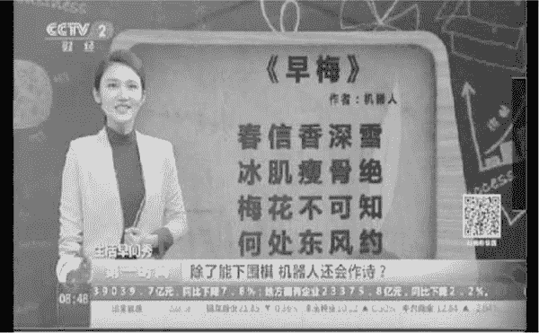

图 5-10 CCTV 播报小薇成为通过图灵测试的作诗机器人

#### AI 创作音乐：奏响文旅新乐章

在音乐创作领域，AI 同样大放异彩。AI 音乐创作软件可以根据设定的风格、节奏和情感基调，生成原创音乐作品。无论是悠扬的古典音乐、激情的流行音乐，还是富有民族特色的传统音乐，AI 都能信手拈来。

AI 创作音乐的过程是一个不断学习和创新的过程。它通过分析海量音乐作品，学习不同音乐风格的特点和创作规律，然后运用这些知识进行创作。例如，在为一部旅游宣传片创作背景音乐时，AI 可以根据宣传片的主题和氛围，创作出贴合场景的音乐。如果是一部宣传海滨城市的宣传片，AI 可能创作出节奏轻快、旋律优美的音乐，融入海浪声、海鸥的叫声等自然音效，营造出轻松愉悦的氛围。

文旅行业可以充分利用 AI 创作的音乐来丰富旅游体验。景区可以在特定区域播放与当地文化特色相符的 AI 音乐，如在古镇的街巷中播放古雅的丝竹音乐，在民俗村落中播放具有民族风情的音乐，让游客在欣赏美景的同时，沉浸在音乐的海洋中，感受当地文化的独特魅力。此外，AI 音乐可以应用于文旅演出、主题公园等场景，为游客带来更加丰富多彩的视听享受。

#### AI 创作影视：打造文旅宣传新利器

AI 在影视创作领域的应用，为文旅宣传提供了强大的支持。AI 可以辅助影视制作公司创作以文旅为主题的影视作品，从剧本创作、角色设计到特效制作，都能看到 AI 的身影。

在剧本创作方面，AI 可以根据文旅项目的特色和目标受众，生成具有吸引力的故事梗概和剧本大纲。例如，对于一个以历史文化名城为背景的文旅项目，AI 可以分析该城市的历史事件、文化名人等元素，创作一个穿越时空的爱情故事，将城市的历史文化融入其中。在角色设计方面，AI 可以根据故事背景和文化特色，设计出具有独特魅力的角色形象，这些角色不仅在外形上符合当地文化风格，还在性格特点上体现出当地人民的精神风貌。

在特效制作方面，AI 的应用更是让影视作品的视觉效果达到了新的高度。通过 AI 生成的特效，逼真地展现出文旅景点的奇幻之处，如古老城堡的神秘魔法、自然风光的神奇变换等。这些特效能够吸引观众的眼球，激发他们对文旅景点的向往之情。例如，一部以奇幻森林为主题的文旅宣传片，通过 AI 特效展现出森林中会发光的植物、会说话的动物等奇幻场景，让观众对这片森林充满好奇和向往。

### 数智生活：元宇宙生活与工作

#### 元宇宙在文旅中的应用场景

元宇宙作为一个新兴概念，逐渐融入文旅行业，为游客带来全新的数智生活体验。在元宇宙的文旅场景中，游客可以通过 VR、AR 等设备，进入一个虚拟世界，这个世界高度还原了现实中的文旅景点，甚至包含一些现实中不存在的奇幻元素。

以元宇宙中的故宫为例，游客可以在虚拟世界中自由穿梭于故宫的各个宫殿之间，不仅能够欣赏宫殿的宏伟建筑和珍贵文物，还能参与一些虚拟的历史活动。游客可以化身古代的宫廷侍卫，参与宫廷宴会的安保工作；也可以扮演文人墨客，在御花园中吟诗作对。这种沉浸式体验能让游客更加深入地了解故宫的历史文化，同时提升游玩的趣味性。

元宇宙还为文旅行业带来了新的社交体验。在元宇宙的景区，游客可以与来自世界各地的其他游客进行互动交流。他们可以一起探索景区，分享自己的旅行感受和发现，结交志同道合的朋友。例如，在元宇宙的音乐节现场，游客可以与其他音乐爱好者一起欣赏虚拟乐队的演出，一起跳舞、互动，感受音乐的魅力，同时拓展自己的社交圈子。

#### 元宇宙对文旅产业的影响与挑战

元宇宙的出现为文旅产业带来了巨大的发展机遇。它拓展了文旅产业的边界，创造了新的商业模式和消费场景。文旅企业可以通过开发元宇宙文旅项目，吸引更多年轻游客，提高用户黏性和消费频次。例如，一些主题公园推出了元宇宙主题的虚拟体验项目，游客可以在虚拟世界中体验更加刺激的游乐设施，参与互动性更强的剧情任务，这种创新的体验吸引了大量年轻游客前来游玩。

然而，元宇宙在文旅行业的发展也面临一些挑战。首先是技术方面的挑战，要提供高质量的元宇宙文旅体验，需要强大的硬件设备支持和高速稳定的网络环境。目前，VR 和 AR 设备的佩戴舒适度、视觉效果等还有待提高，网络延迟也会影响用户体验。其次是内容创作方面的挑战。元宇宙文旅项目需要大量优质的内容来支撑，包括虚拟场景的构建、剧情任务的设计等，这对文旅企业的内容创作能力提出了更高的要求。此外，元宇宙中的虚拟世界与现实世界的界限需要进一步明确，如何保障用户在虚拟世界中的权益和安全，以及如何规范虚拟世界中的经济活动和社交行为，都是需要解决的问题。

随着 AI 技术的不断进步和元宇宙概念的逐渐成熟，“AI+文旅”的融合将不断深化。未来，AI 将在文旅行业的更多领域发挥重要作用，为文旅产业的数字化、智能化转型持续提供动力。文旅企业应积极拥抱 AI 技术，不断创新发展模式，为游客带来更加丰富多彩的文旅体验，推动文旅产业迈向新的高度。同时，政府和相关机构应加强对 AI 在文旅行业应用的规范和引导，促进“AI+文旅”产业的健康、可持续发展。

当 AI 能瞬间将撒哈拉的星空、吴哥窟的日出、大堡礁的潮声注入我们的神经突触时，旅行的意义不再是对远方的追寻，而是对自我认知界限的突破。徐霞客若穿越至今，或许不会惊叹于技术的神迹，而会忧心于那句古老的警示： **“达人所之未达，探人所之未知。”** 当 AI 替我们遍及所有角落、探尽所有奥秘后，人类还剩下什么未被征服的边疆？ EXr6287u6NNVz+GYLY+7SDk226FstKIHdC0bNoQkB2Nqi1xSR0yxPmwrTs5gRi/BtfSbid6dBhii9q7cz2pIyA==

## 6 AI+文旅：从徐霞客式漫游到元宇宙穿行

1608 年，徐霞客启程游历中国，用 30 年的足迹丈量山河；2025 年，在敦煌莫高窟的元宇宙入口前，游客佩戴神经交互设备，与千年前的画工共绘飞天。这场从“肉身跋涉”到“意识瞬移”的旅行革命，揭示了 AI 如何将文旅从“物理空间的消费”升维至“文明基因的交互”。“AI+文旅”的本质，是用算法重构人类对时空的感知，让历史可触摸，让文化可编程，让旅行成为一场跨越维度的认知冒险。

在数字化与智能化的浪潮中，AI 正以前所未有的深度和广度融入文旅行业，为其带来全方位的变革。“AI+文旅”模式不仅重塑了游客的体验，还为文旅产业的创新发展注入了强劲动力，从智能文旅场景的打造，到内容生成领域的突破，再到数智生活的探索，AI 成为推动文旅行业数转智改的核心力量。

### 智能文旅：沉浸式博物馆与 AI 导游

#### 沉浸式博物馆：科技与文化的深度融合

博物馆作为文化传承的重要载体，正借助 AI 技术实现华丽转身，为游客带来沉浸式文化体验。AI 技术通过虚拟现实（VR）、增强现实（AR）和混合现实（MR）等手段，打破了传统博物馆静态展示的局限，让历史文物和文化故事“活”起来。结合多模态传感网，通过无人机、摄像头、可穿戴设备实时采集游客轨迹、情绪数据与环境参数，构建博物馆和景区的“数字神经系统”。

走进一座配备 AI 技术的沉浸式博物馆，游客仿佛穿越时空，置身于历史场景之中。以古埃及文明展览为例，借助 VR 技术，游客戴上头戴式显示设备，就能看到宏伟的金字塔在沙漠中拔地而起，古埃及人忙碌地建造着宫殿和神庙，尼罗河的河水奔腾不息。借助 AR 技术，游客用手机扫描文物展品，屏幕上会立刻呈现出该文物的 3D 复原模型、详细的历史背景介绍和语音讲解，以及该文物在古代的使用场景。这种沉浸式体验让游客不再简单地观看展品，而是能够亲身感受历史文化的魅力。通过“高精度扫描+生成式修复”技术，AI 甚至可以填补巴米扬大佛的残缺部分，误差可小于 0.1 毫米，实现文化遗产的“数字永生”。

AI 还能根据游客的行为和偏好，提供个性化参观路线和讲解内容。博物馆内的智能传感器可以实时收集游客的位置信息、停留时间及对展品的关注度等数据。AI 算法对这些数据进行分析后，为每位游客量身定制参观路线。对于对历史故事感兴趣的游客，系统会推荐包含更多历史背景介绍的路线；对于喜欢艺术创作的游客，系统则会引导他们参观与艺术工艺相关的展品，并提供创作灵感的解读。

#### AI 导游：贴心的文旅服务伙伴

AI 导游的出现，为游客的旅行提供了极大的便利。无论是在博物馆、景区还是城市，AI 导游都能随时为游客提供服务。AI 导游数智人系统架构如图 5-9 所示。

图 5-9 AI 导游数智人系统架构

在景区，AI 导游以智能语音助手的形式存在于游客的手机中。游客只需要打开相应的 App，就能通过语音与 AI 导游交流。当游客询问“附近有什么景点推荐”时，AI 导游会根据游客的位置和兴趣偏好，推荐周边热门景点，并提供详细的介绍和导航路线。如果游客想了解某个景点的历史文化背景，AI 导游不仅能用生动有趣的语言进行讲解，还能分享一些鲜为人知的故事和传说。例如，迪士尼的“魔法手环”，可实现“无感通关+AR 角色互动”，游客排队时间归零，消费频次提升 3 倍。

AI 导游还具备多语言服务能力，这对国际游客来说尤为重要。在全球化旅游市场，不同国家的游客可以通过 AI 导游，用母语获取信息，消除语言障碍。例如，在中国的热门景区，外国游客可以使用 AI 导游提供的英语、日语、韩语等多种语言服务，深入了解中国的文化和历史。

此外，AI 导游能根据实际情况为游客提供建议。当景区内某个景点人流量过大时，AI 导游会提醒游客调整参观顺序，避开人流高峰，提高游览效率。在旅游旺季，AI 导游还能为游客推荐周边小众但极具特色的景点，让游客获得与众不同的旅行体验。

### 内容生成：AI 创作诗歌、音乐与影视

#### AI 创作诗歌：赋予文字新的生命力

AI 在诗歌创作领域展现出了独特的魅力。通过对大量经典诗歌的学习，AI 算法掌握了诗歌的韵律、节奏和语义表达规律，能够创作出风格各异的诗歌作品。

AI 创作诗歌的过程并非简单的文字拼凑，而是基于深度学习的复杂过程。AI 模型会分析诗歌的主题、情感和意象，然后运用所学的知识进行创作。例如，2015 年中秋节，在北京国子监博物馆举办的“风雅颂——2015 辟雍诗词中国诗歌音乐会”上，中科汇联研发的小薇机器人开启了中华文化史上第一次机器人创作古典诗词表演。孔庙里，红墙内，千年的古树见证了一个新时代的开启。2016 年，小薇机器人作了一首《早梅》：“春信香深雪，冰肌瘦骨绝，梅花不可知，何处东风约。”这首诗征服了 CCTV 和社科院图灵测试的各位评委，成为中国第一个通过图灵测试的作诗机器人（见图 5-10）。小薇机器人作的诗不仅在形式上符合韵律要求，在内容上也能营造出富有感染力的意境。

AI 创作诗歌不仅为文学创作带来了新的思路，还为文化传播提供了新的方式。文旅机构可以利用 AI 创作的诗歌来宣传当地的文化和景点。例如，为某个古镇创作一首专属的诗歌，将古镇的历史、风光和人文特色融入其中，通过社交媒体、景区宣传册等渠道传播，吸引更多游客前来观光。同时，AI 创作诗歌可以作为文化创意产品的灵感来源，开发诗集、文创周边等产品，丰富文旅产业的业态。

图 5-10 CCTV 播报小薇成为通过图灵测试的作诗机器人

#### AI 创作音乐：奏响文旅新乐章

在音乐创作领域，AI 同样大放异彩。AI 音乐创作软件可以根据设定的风格、节奏和情感基调，生成原创音乐作品。无论是悠扬的古典音乐、激情的流行音乐，还是富有民族特色的传统音乐，AI 都能信手拈来。

AI 创作音乐的过程是一个不断学习和创新的过程。它通过分析海量音乐作品，学习不同音乐风格的特点和创作规律，然后运用这些知识进行创作。例如，在为一部旅游宣传片创作背景音乐时，AI 可以根据宣传片的主题和氛围，创作出贴合场景的音乐。如果是一部宣传海滨城市的宣传片，AI 可能创作出节奏轻快、旋律优美的音乐，融入海浪声、海鸥的叫声等自然音效，营造出轻松愉悦的氛围。

文旅行业可以充分利用 AI 创作的音乐来丰富旅游体验。景区可以在特定区域播放与当地文化特色相符的 AI 音乐，如在古镇的街巷中播放古雅的丝竹音乐，在民俗村落中播放具有民族风情的音乐，让游客在欣赏美景的同时，沉浸在音乐的海洋中，感受当地文化的独特魅力。此外，AI 音乐可以应用于文旅演出、主题公园等场景，为游客带来更加丰富多彩的视听享受。

#### AI 创作影视：打造文旅宣传新利器

AI 在影视创作领域的应用，为文旅宣传提供了强大的支持。AI 可以辅助影视制作公司创作以文旅为主题的影视作品，从剧本创作、角色设计到特效制作，都能看到 AI 的身影。

在剧本创作方面，AI 可以根据文旅项目的特色和目标受众，生成具有吸引力的故事梗概和剧本大纲。例如，对于一个以历史文化名城为背景的文旅项目，AI 可以分析该城市的历史事件、文化名人等元素，创作一个穿越时空的爱情故事，将城市的历史文化融入其中。在角色设计方面，AI 可以根据故事背景和文化特色，设计出具有独特魅力的角色形象，这些角色不仅在外形上符合当地文化风格，还在性格特点上体现出当地人民的精神风貌。

在特效制作方面，AI 的应用更是让影视作品的视觉效果达到了新的高度。通过 AI 生成的特效，逼真地展现出文旅景点的奇幻之处，如古老城堡的神秘魔法、自然风光的神奇变换等。这些特效能够吸引观众的眼球，激发他们对文旅景点的向往之情。例如，一部以奇幻森林为主题的文旅宣传片，通过 AI 特效展现出森林中会发光的植物、会说话的动物等奇幻场景，让观众对这片森林充满好奇和向往。

### 数智生活：元宇宙生活与工作

#### 元宇宙在文旅中的应用场景

元宇宙作为一个新兴概念，逐渐融入文旅行业，为游客带来全新的数智生活体验。在元宇宙的文旅场景中，游客可以通过 VR、AR 等设备，进入一个虚拟世界，这个世界高度还原了现实中的文旅景点，甚至包含一些现实中不存在的奇幻元素。

以元宇宙中的故宫为例，游客可以在虚拟世界中自由穿梭于故宫的各个宫殿之间，不仅能够欣赏宫殿的宏伟建筑和珍贵文物，还能参与一些虚拟的历史活动。游客可以化身古代的宫廷侍卫，参与宫廷宴会的安保工作；也可以扮演文人墨客，在御花园中吟诗作对。这种沉浸式体验能让游客更加深入地了解故宫的历史文化，同时提升游玩的趣味性。

元宇宙还为文旅行业带来了新的社交体验。在元宇宙的景区，游客可以与来自世界各地的其他游客进行互动交流。他们可以一起探索景区，分享自己的旅行感受和发现，结交志同道合的朋友。例如，在元宇宙的音乐节现场，游客可以与其他音乐爱好者一起欣赏虚拟乐队的演出，一起跳舞、互动，感受音乐的魅力，同时拓展自己的社交圈子。

#### 元宇宙对文旅产业的影响与挑战

元宇宙的出现为文旅产业带来了巨大的发展机遇。它拓展了文旅产业的边界，创造了新的商业模式和消费场景。文旅企业可以通过开发元宇宙文旅项目，吸引更多年轻游客，提高用户黏性和消费频次。例如，一些主题公园推出了元宇宙主题的虚拟体验项目，游客可以在虚拟世界中体验更加刺激的游乐设施，参与互动性更强的剧情任务，这种创新的体验吸引了大量年轻游客前来游玩。

然而，元宇宙在文旅行业的发展也面临一些挑战。首先是技术方面的挑战，要提供高质量的元宇宙文旅体验，需要强大的硬件设备支持和高速稳定的网络环境。目前，VR 和 AR 设备的佩戴舒适度、视觉效果等还有待提高，网络延迟也会影响用户体验。其次是内容创作方面的挑战。元宇宙文旅项目需要大量优质的内容来支撑，包括虚拟场景的构建、剧情任务的设计等，这对文旅企业的内容创作能力提出了更高的要求。此外，元宇宙中的虚拟世界与现实世界的界限需要进一步明确，如何保障用户在虚拟世界中的权益和安全，以及如何规范虚拟世界中的经济活动和社交行为，都是需要解决的问题。

随着 AI 技术的不断进步和元宇宙概念的逐渐成熟，“AI+文旅”的融合将不断深化。未来，AI 将在文旅行业的更多领域发挥重要作用，为文旅产业的数字化、智能化转型持续提供动力。文旅企业应积极拥抱 AI 技术，不断创新发展模式，为游客带来更加丰富多彩的文旅体验，推动文旅产业迈向新的高度。同时，政府和相关机构应加强对 AI 在文旅行业应用的规范和引导，促进“AI+文旅”产业的健康、可持续发展。

当 AI 能瞬间将撒哈拉的星空、吴哥窟的日出、大堡礁的潮声注入我们的神经突触时，旅行的意义不再是对远方的追寻，而是对自我认知界限的突破。徐霞客若穿越至今，或许不会惊叹于技术的神迹，而会忧心于那句古老的警示： **“达人所之未达，探人所之未知。”** 当 AI 替我们遍及所有角落、探尽所有奥秘后，人类还剩下什么未被征服的边疆？ EXr6287u6NNVz+GYLY+7SDk226FstKIHdC0bNoQkB2Nqi1xSR0yxPmwrTs5gRi/BtfSbid6dBhii9q7cz2pIyA==

## 6 AI+文旅：从徐霞客式漫游到元宇宙穿行

1608 年，徐霞客启程游历中国，用 30 年的足迹丈量山河；2025 年，在敦煌莫高窟的元宇宙入口前，游客佩戴神经交互设备，与千年前的画工共绘飞天。这场从“肉身跋涉”到“意识瞬移”的旅行革命，揭示了 AI 如何将文旅从“物理空间的消费”升维至“文明基因的交互”。“AI+文旅”的本质，是用算法重构人类对时空的感知，让历史可触摸，让文化可编程，让旅行成为一场跨越维度的认知冒险。

在数字化与智能化的浪潮中，AI 正以前所未有的深度和广度融入文旅行业，为其带来全方位的变革。“AI+文旅”模式不仅重塑了游客的体验，还为文旅产业的创新发展注入了强劲动力，从智能文旅场景的打造，到内容生成领域的突破，再到数智生活的探索，AI 成为推动文旅行业数转智改的核心力量。

### 智能文旅：沉浸式博物馆与 AI 导游

#### 沉浸式博物馆：科技与文化的深度融合

博物馆作为文化传承的重要载体，正借助 AI 技术实现华丽转身，为游客带来沉浸式文化体验。AI 技术通过虚拟现实（VR）、增强现实（AR）和混合现实（MR）等手段，打破了传统博物馆静态展示的局限，让历史文物和文化故事“活”起来。结合多模态传感网，通过无人机、摄像头、可穿戴设备实时采集游客轨迹、情绪数据与环境参数，构建博物馆和景区的“数字神经系统”。

走进一座配备 AI 技术的沉浸式博物馆，游客仿佛穿越时空，置身于历史场景之中。以古埃及文明展览为例，借助 VR 技术，游客戴上头戴式显示设备，就能看到宏伟的金字塔在沙漠中拔地而起，古埃及人忙碌地建造着宫殿和神庙，尼罗河的河水奔腾不息。借助 AR 技术，游客用手机扫描文物展品，屏幕上会立刻呈现出该文物的 3D 复原模型、详细的历史背景介绍和语音讲解，以及该文物在古代的使用场景。这种沉浸式体验让游客不再简单地观看展品，而是能够亲身感受历史文化的魅力。通过“高精度扫描+生成式修复”技术，AI 甚至可以填补巴米扬大佛的残缺部分，误差可小于 0.1 毫米，实现文化遗产的“数字永生”。

AI 还能根据游客的行为和偏好，提供个性化参观路线和讲解内容。博物馆内的智能传感器可以实时收集游客的位置信息、停留时间及对展品的关注度等数据。AI 算法对这些数据进行分析后，为每位游客量身定制参观路线。对于对历史故事感兴趣的游客，系统会推荐包含更多历史背景介绍的路线；对于喜欢艺术创作的游客，系统则会引导他们参观与艺术工艺相关的展品，并提供创作灵感的解读。

#### AI 导游：贴心的文旅服务伙伴

AI 导游的出现，为游客的旅行提供了极大的便利。无论是在博物馆、景区还是城市，AI 导游都能随时为游客提供服务。AI 导游数智人系统架构如图 5-9 所示。

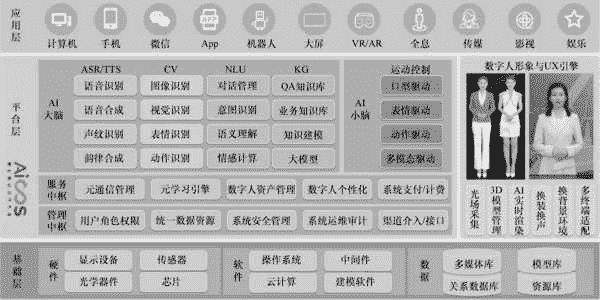

图 5-9 AI 导游数智人系统架构

在景区，AI 导游以智能语音助手的形式存在于游客的手机中。游客只需要打开相应的 App，就能通过语音与 AI 导游交流。当游客询问“附近有什么景点推荐”时，AI 导游会根据游客的位置和兴趣偏好，推荐周边热门景点，并提供详细的介绍和导航路线。如果游客想了解某个景点的历史文化背景，AI 导游不仅能用生动有趣的语言进行讲解，还能分享一些鲜为人知的故事和传说。例如，迪士尼的“魔法手环”，可实现“无感通关+AR 角色互动”，游客排队时间归零，消费频次提升 3 倍。

AI 导游还具备多语言服务能力，这对国际游客来说尤为重要。在全球化旅游市场，不同国家的游客可以通过 AI 导游，用母语获取信息，消除语言障碍。例如，在中国的热门景区，外国游客可以使用 AI 导游提供的英语、日语、韩语等多种语言服务，深入了解中国的文化和历史。

此外，AI 导游能根据实际情况为游客提供建议。当景区内某个景点人流量过大时，AI 导游会提醒游客调整参观顺序，避开人流高峰，提高游览效率。在旅游旺季，AI 导游还能为游客推荐周边小众但极具特色的景点，让游客获得与众不同的旅行体验。

### 内容生成：AI 创作诗歌、音乐与影视

#### AI 创作诗歌：赋予文字新的生命力

AI 在诗歌创作领域展现出了独特的魅力。通过对大量经典诗歌的学习，AI 算法掌握了诗歌的韵律、节奏和语义表达规律，能够创作出风格各异的诗歌作品。

AI 创作诗歌的过程并非简单的文字拼凑，而是基于深度学习的复杂过程。AI 模型会分析诗歌的主题、情感和意象，然后运用所学的知识进行创作。例如，2015 年中秋节，在北京国子监博物馆举办的“风雅颂——2015 辟雍诗词中国诗歌音乐会”上，中科汇联研发的小薇机器人开启了中华文化史上第一次机器人创作古典诗词表演。孔庙里，红墙内，千年的古树见证了一个新时代的开启。2016 年，小薇机器人作了一首《早梅》：“春信香深雪，冰肌瘦骨绝，梅花不可知，何处东风约。”这首诗征服了 CCTV 和社科院图灵测试的各位评委，成为中国第一个通过图灵测试的作诗机器人（见图 5-10）。小薇机器人作的诗不仅在形式上符合韵律要求，在内容上也能营造出富有感染力的意境。

AI 创作诗歌不仅为文学创作带来了新的思路，还为文化传播提供了新的方式。文旅机构可以利用 AI 创作的诗歌来宣传当地的文化和景点。例如，为某个古镇创作一首专属的诗歌，将古镇的历史、风光和人文特色融入其中，通过社交媒体、景区宣传册等渠道传播，吸引更多游客前来观光。同时，AI 创作诗歌可以作为文化创意产品的灵感来源，开发诗集、文创周边等产品，丰富文旅产业的业态。

图 5-10 CCTV 播报小薇成为通过图灵测试的作诗机器人

#### AI 创作音乐：奏响文旅新乐章

在音乐创作领域，AI 同样大放异彩。AI 音乐创作软件可以根据设定的风格、节奏和情感基调，生成原创音乐作品。无论是悠扬的古典音乐、激情的流行音乐，还是富有民族特色的传统音乐，AI 都能信手拈来。

AI 创作音乐的过程是一个不断学习和创新的过程。它通过分析海量音乐作品，学习不同音乐风格的特点和创作规律，然后运用这些知识进行创作。例如，在为一部旅游宣传片创作背景音乐时，AI 可以根据宣传片的主题和氛围，创作出贴合场景的音乐。如果是一部宣传海滨城市的宣传片，AI 可能创作出节奏轻快、旋律优美的音乐，融入海浪声、海鸥的叫声等自然音效，营造出轻松愉悦的氛围。

文旅行业可以充分利用 AI 创作的音乐来丰富旅游体验。景区可以在特定区域播放与当地文化特色相符的 AI 音乐，如在古镇的街巷中播放古雅的丝竹音乐，在民俗村落中播放具有民族风情的音乐，让游客在欣赏美景的同时，沉浸在音乐的海洋中，感受当地文化的独特魅力。此外，AI 音乐可以应用于文旅演出、主题公园等场景，为游客带来更加丰富多彩的视听享受。

#### AI 创作影视：打造文旅宣传新利器

AI 在影视创作领域的应用，为文旅宣传提供了强大的支持。AI 可以辅助影视制作公司创作以文旅为主题的影视作品，从剧本创作、角色设计到特效制作，都能看到 AI 的身影。

在剧本创作方面，AI 可以根据文旅项目的特色和目标受众，生成具有吸引力的故事梗概和剧本大纲。例如，对于一个以历史文化名城为背景的文旅项目，AI 可以分析该城市的历史事件、文化名人等元素，创作一个穿越时空的爱情故事，将城市的历史文化融入其中。在角色设计方面，AI 可以根据故事背景和文化特色，设计出具有独特魅力的角色形象，这些角色不仅在外形上符合当地文化风格，还在性格特点上体现出当地人民的精神风貌。

在特效制作方面，AI 的应用更是让影视作品的视觉效果达到了新的高度。通过 AI 生成的特效，逼真地展现出文旅景点的奇幻之处，如古老城堡的神秘魔法、自然风光的神奇变换等。这些特效能够吸引观众的眼球，激发他们对文旅景点的向往之情。例如，一部以奇幻森林为主题的文旅宣传片，通过 AI 特效展现出森林中会发光的植物、会说话的动物等奇幻场景，让观众对这片森林充满好奇和向往。

### 数智生活：元宇宙生活与工作

#### 元宇宙在文旅中的应用场景

元宇宙作为一个新兴概念，逐渐融入文旅行业，为游客带来全新的数智生活体验。在元宇宙的文旅场景中，游客可以通过 VR、AR 等设备，进入一个虚拟世界，这个世界高度还原了现实中的文旅景点，甚至包含一些现实中不存在的奇幻元素。

以元宇宙中的故宫为例，游客可以在虚拟世界中自由穿梭于故宫的各个宫殿之间，不仅能够欣赏宫殿的宏伟建筑和珍贵文物，还能参与一些虚拟的历史活动。游客可以化身古代的宫廷侍卫，参与宫廷宴会的安保工作；也可以扮演文人墨客，在御花园中吟诗作对。这种沉浸式体验能让游客更加深入地了解故宫的历史文化，同时提升游玩的趣味性。

元宇宙还为文旅行业带来了新的社交体验。在元宇宙的景区，游客可以与来自世界各地的其他游客进行互动交流。他们可以一起探索景区，分享自己的旅行感受和发现，结交志同道合的朋友。例如，在元宇宙的音乐节现场，游客可以与其他音乐爱好者一起欣赏虚拟乐队的演出，一起跳舞、互动，感受音乐的魅力，同时拓展自己的社交圈子。

#### 元宇宙对文旅产业的影响与挑战

元宇宙的出现为文旅产业带来了巨大的发展机遇。它拓展了文旅产业的边界，创造了新的商业模式和消费场景。文旅企业可以通过开发元宇宙文旅项目，吸引更多年轻游客，提高用户黏性和消费频次。例如，一些主题公园推出了元宇宙主题的虚拟体验项目，游客可以在虚拟世界中体验更加刺激的游乐设施，参与互动性更强的剧情任务，这种创新的体验吸引了大量年轻游客前来游玩。

然而，元宇宙在文旅行业的发展也面临一些挑战。首先是技术方面的挑战，要提供高质量的元宇宙文旅体验，需要强大的硬件设备支持和高速稳定的网络环境。目前，VR 和 AR 设备的佩戴舒适度、视觉效果等还有待提高，网络延迟也会影响用户体验。其次是内容创作方面的挑战。元宇宙文旅项目需要大量优质的内容来支撑，包括虚拟场景的构建、剧情任务的设计等，这对文旅企业的内容创作能力提出了更高的要求。此外，元宇宙中的虚拟世界与现实世界的界限需要进一步明确，如何保障用户在虚拟世界中的权益和安全，以及如何规范虚拟世界中的经济活动和社交行为，都是需要解决的问题。

随着 AI 技术的不断进步和元宇宙概念的逐渐成熟，“AI+文旅”的融合将不断深化。未来，AI 将在文旅行业的更多领域发挥重要作用，为文旅产业的数字化、智能化转型持续提供动力。文旅企业应积极拥抱 AI 技术，不断创新发展模式，为游客带来更加丰富多彩的文旅体验，推动文旅产业迈向新的高度。同时，政府和相关机构应加强对 AI 在文旅行业应用的规范和引导，促进“AI+文旅”产业的健康、可持续发展。

当 AI 能瞬间将撒哈拉的星空、吴哥窟的日出、大堡礁的潮声注入我们的神经突触时，旅行的意义不再是对远方的追寻，而是对自我认知界限的突破。徐霞客若穿越至今，或许不会惊叹于技术的神迹，而会忧心于那句古老的警示： **“达人所之未达，探人所之未知。”** 当 AI 替我们遍及所有角落、探尽所有奥秘后，人类还剩下什么未被征服的边疆？ EXr6287u6NNVz+GYLY+7SDk226FstKIHdC0bNoQkB2Nqi1xSR0yxPmwrTs5gRi/BtfSbid6dBhii9q7cz2pIyA==

## 6 AI+文旅：从徐霞客式漫游到元宇宙穿行

1608 年，徐霞客启程游历中国，用 30 年的足迹丈量山河；2025 年，在敦煌莫高窟的元宇宙入口前，游客佩戴神经交互设备，与千年前的画工共绘飞天。这场从“肉身跋涉”到“意识瞬移”的旅行革命，揭示了 AI 如何将文旅从“物理空间的消费”升维至“文明基因的交互”。“AI+文旅”的本质，是用算法重构人类对时空的感知，让历史可触摸，让文化可编程，让旅行成为一场跨越维度的认知冒险。

在数字化与智能化的浪潮中，AI 正以前所未有的深度和广度融入文旅行业，为其带来全方位的变革。“AI+文旅”模式不仅重塑了游客的体验，还为文旅产业的创新发展注入了强劲动力，从智能文旅场景的打造，到内容生成领域的突破，再到数智生活的探索，AI 成为推动文旅行业数转智改的核心力量。

### 智能文旅：沉浸式博物馆与 AI 导游

#### 沉浸式博物馆：科技与文化的深度融合

博物馆作为文化传承的重要载体，正借助 AI 技术实现华丽转身，为游客带来沉浸式文化体验。AI 技术通过虚拟现实（VR）、增强现实（AR）和混合现实（MR）等手段，打破了传统博物馆静态展示的局限，让历史文物和文化故事“活”起来。结合多模态传感网，通过无人机、摄像头、可穿戴设备实时采集游客轨迹、情绪数据与环境参数，构建博物馆和景区的“数字神经系统”。

走进一座配备 AI 技术的沉浸式博物馆，游客仿佛穿越时空，置身于历史场景之中。以古埃及文明展览为例，借助 VR 技术，游客戴上头戴式显示设备，就能看到宏伟的金字塔在沙漠中拔地而起，古埃及人忙碌地建造着宫殿和神庙，尼罗河的河水奔腾不息。借助 AR 技术，游客用手机扫描文物展品，屏幕上会立刻呈现出该文物的 3D 复原模型、详细的历史背景介绍和语音讲解，以及该文物在古代的使用场景。这种沉浸式体验让游客不再简单地观看展品，而是能够亲身感受历史文化的魅力。通过“高精度扫描+生成式修复”技术，AI 甚至可以填补巴米扬大佛的残缺部分，误差可小于 0.1 毫米，实现文化遗产的“数字永生”。

AI 还能根据游客的行为和偏好，提供个性化参观路线和讲解内容。博物馆内的智能传感器可以实时收集游客的位置信息、停留时间及对展品的关注度等数据。AI 算法对这些数据进行分析后，为每位游客量身定制参观路线。对于对历史故事感兴趣的游客，系统会推荐包含更多历史背景介绍的路线；对于喜欢艺术创作的游客，系统则会引导他们参观与艺术工艺相关的展品，并提供创作灵感的解读。

#### AI 导游：贴心的文旅服务伙伴

AI 导游的出现，为游客的旅行提供了极大的便利。无论是在博物馆、景区还是城市，AI 导游都能随时为游客提供服务。AI 导游数智人系统架构如图 5-9 所示。

图 5-9 AI 导游数智人系统架构

在景区，AI 导游以智能语音助手的形式存在于游客的手机中。游客只需要打开相应的 App，就能通过语音与 AI 导游交流。当游客询问“附近有什么景点推荐”时，AI 导游会根据游客的位置和兴趣偏好，推荐周边热门景点，并提供详细的介绍和导航路线。如果游客想了解某个景点的历史文化背景，AI 导游不仅能用生动有趣的语言进行讲解，还能分享一些鲜为人知的故事和传说。例如，迪士尼的“魔法手环”，可实现“无感通关+AR 角色互动”，游客排队时间归零，消费频次提升 3 倍。

AI 导游还具备多语言服务能力，这对国际游客来说尤为重要。在全球化旅游市场，不同国家的游客可以通过 AI 导游，用母语获取信息，消除语言障碍。例如，在中国的热门景区，外国游客可以使用 AI 导游提供的英语、日语、韩语等多种语言服务，深入了解中国的文化和历史。

此外，AI 导游能根据实际情况为游客提供建议。当景区内某个景点人流量过大时，AI 导游会提醒游客调整参观顺序，避开人流高峰，提高游览效率。在旅游旺季，AI 导游还能为游客推荐周边小众但极具特色的景点，让游客获得与众不同的旅行体验。

### 内容生成：AI 创作诗歌、音乐与影视

#### AI 创作诗歌：赋予文字新的生命力

AI 在诗歌创作领域展现出了独特的魅力。通过对大量经典诗歌的学习，AI 算法掌握了诗歌的韵律、节奏和语义表达规律，能够创作出风格各异的诗歌作品。

AI 创作诗歌的过程并非简单的文字拼凑，而是基于深度学习的复杂过程。AI 模型会分析诗歌的主题、情感和意象，然后运用所学的知识进行创作。例如，2015 年中秋节，在北京国子监博物馆举办的“风雅颂——2015 辟雍诗词中国诗歌音乐会”上，中科汇联研发的小薇机器人开启了中华文化史上第一次机器人创作古典诗词表演。孔庙里，红墙内，千年的古树见证了一个新时代的开启。2016 年，小薇机器人作了一首《早梅》：“春信香深雪，冰肌瘦骨绝，梅花不可知，何处东风约。”这首诗征服了 CCTV 和社科院图灵测试的各位评委，成为中国第一个通过图灵测试的作诗机器人（见图 5-10）。小薇机器人作的诗不仅在形式上符合韵律要求，在内容上也能营造出富有感染力的意境。

AI 创作诗歌不仅为文学创作带来了新的思路，还为文化传播提供了新的方式。文旅机构可以利用 AI 创作的诗歌来宣传当地的文化和景点。例如，为某个古镇创作一首专属的诗歌，将古镇的历史、风光和人文特色融入其中，通过社交媒体、景区宣传册等渠道传播，吸引更多游客前来观光。同时，AI 创作诗歌可以作为文化创意产品的灵感来源，开发诗集、文创周边等产品，丰富文旅产业的业态。

图 5-10 CCTV 播报小薇成为通过图灵测试的作诗机器人

#### AI 创作音乐：奏响文旅新乐章

在音乐创作领域，AI 同样大放异彩。AI 音乐创作软件可以根据设定的风格、节奏和情感基调，生成原创音乐作品。无论是悠扬的古典音乐、激情的流行音乐，还是富有民族特色的传统音乐，AI 都能信手拈来。

AI 创作音乐的过程是一个不断学习和创新的过程。它通过分析海量音乐作品，学习不同音乐风格的特点和创作规律，然后运用这些知识进行创作。例如，在为一部旅游宣传片创作背景音乐时，AI 可以根据宣传片的主题和氛围，创作出贴合场景的音乐。如果是一部宣传海滨城市的宣传片，AI 可能创作出节奏轻快、旋律优美的音乐，融入海浪声、海鸥的叫声等自然音效，营造出轻松愉悦的氛围。

文旅行业可以充分利用 AI 创作的音乐来丰富旅游体验。景区可以在特定区域播放与当地文化特色相符的 AI 音乐，如在古镇的街巷中播放古雅的丝竹音乐，在民俗村落中播放具有民族风情的音乐，让游客在欣赏美景的同时，沉浸在音乐的海洋中，感受当地文化的独特魅力。此外，AI 音乐可以应用于文旅演出、主题公园等场景，为游客带来更加丰富多彩的视听享受。

#### AI 创作影视：打造文旅宣传新利器

AI 在影视创作领域的应用，为文旅宣传提供了强大的支持。AI 可以辅助影视制作公司创作以文旅为主题的影视作品，从剧本创作、角色设计到特效制作，都能看到 AI 的身影。

在剧本创作方面，AI 可以根据文旅项目的特色和目标受众，生成具有吸引力的故事梗概和剧本大纲。例如，对于一个以历史文化名城为背景的文旅项目，AI 可以分析该城市的历史事件、文化名人等元素，创作一个穿越时空的爱情故事，将城市的历史文化融入其中。在角色设计方面，AI 可以根据故事背景和文化特色，设计出具有独特魅力的角色形象，这些角色不仅在外形上符合当地文化风格，还在性格特点上体现出当地人民的精神风貌。

在特效制作方面，AI 的应用更是让影视作品的视觉效果达到了新的高度。通过 AI 生成的特效，逼真地展现出文旅景点的奇幻之处，如古老城堡的神秘魔法、自然风光的神奇变换等。这些特效能够吸引观众的眼球，激发他们对文旅景点的向往之情。例如，一部以奇幻森林为主题的文旅宣传片，通过 AI 特效展现出森林中会发光的植物、会说话的动物等奇幻场景，让观众对这片森林充满好奇和向往。

### 数智生活：元宇宙生活与工作

#### 元宇宙在文旅中的应用场景

元宇宙作为一个新兴概念，逐渐融入文旅行业，为游客带来全新的数智生活体验。在元宇宙的文旅场景中，游客可以通过 VR、AR 等设备，进入一个虚拟世界，这个世界高度还原了现实中的文旅景点，甚至包含一些现实中不存在的奇幻元素。

以元宇宙中的故宫为例，游客可以在虚拟世界中自由穿梭于故宫的各个宫殿之间，不仅能够欣赏宫殿的宏伟建筑和珍贵文物，还能参与一些虚拟的历史活动。游客可以化身古代的宫廷侍卫，参与宫廷宴会的安保工作；也可以扮演文人墨客，在御花园中吟诗作对。这种沉浸式体验能让游客更加深入地了解故宫的历史文化，同时提升游玩的趣味性。

元宇宙还为文旅行业带来了新的社交体验。在元宇宙的景区，游客可以与来自世界各地的其他游客进行互动交流。他们可以一起探索景区，分享自己的旅行感受和发现，结交志同道合的朋友。例如，在元宇宙的音乐节现场，游客可以与其他音乐爱好者一起欣赏虚拟乐队的演出，一起跳舞、互动，感受音乐的魅力，同时拓展自己的社交圈子。

#### 元宇宙对文旅产业的影响与挑战

元宇宙的出现为文旅产业带来了巨大的发展机遇。它拓展了文旅产业的边界，创造了新的商业模式和消费场景。文旅企业可以通过开发元宇宙文旅项目，吸引更多年轻游客，提高用户黏性和消费频次。例如，一些主题公园推出了元宇宙主题的虚拟体验项目，游客可以在虚拟世界中体验更加刺激的游乐设施，参与互动性更强的剧情任务，这种创新的体验吸引了大量年轻游客前来游玩。

然而，元宇宙在文旅行业的发展也面临一些挑战。首先是技术方面的挑战，要提供高质量的元宇宙文旅体验，需要强大的硬件设备支持和高速稳定的网络环境。目前，VR 和 AR 设备的佩戴舒适度、视觉效果等还有待提高，网络延迟也会影响用户体验。其次是内容创作方面的挑战。元宇宙文旅项目需要大量优质的内容来支撑，包括虚拟场景的构建、剧情任务的设计等，这对文旅企业的内容创作能力提出了更高的要求。此外，元宇宙中的虚拟世界与现实世界的界限需要进一步明确，如何保障用户在虚拟世界中的权益和安全，以及如何规范虚拟世界中的经济活动和社交行为，都是需要解决的问题。

随着 AI 技术的不断进步和元宇宙概念的逐渐成熟，“AI+文旅”的融合将不断深化。未来，AI 将在文旅行业的更多领域发挥重要作用，为文旅产业的数字化、智能化转型持续提供动力。文旅企业应积极拥抱 AI 技术，不断创新发展模式，为游客带来更加丰富多彩的文旅体验，推动文旅产业迈向新的高度。同时，政府和相关机构应加强对 AI 在文旅行业应用的规范和引导，促进“AI+文旅”产业的健康、可持续发展。

当 AI 能瞬间将撒哈拉的星空、吴哥窟的日出、大堡礁的潮声注入我们的神经突触时，旅行的意义不再是对远方的追寻，而是对自我认知界限的突破。徐霞客若穿越至今，或许不会惊叹于技术的神迹，而会忧心于那句古老的警示： **“达人所之未达，探人所之未知。”** 当 AI 替我们遍及所有角落、探尽所有奥秘后，人类还剩下什么未被征服的边疆？ EXr6287u6NNVz+GYLY+7SDk226FstKIHdC0bNoQkB2Nqi1xSR0yxPmwrTs5gRi/BtfSbid6dBhii9q7cz2pIyA==

# 第六章
隐忧暗涌
——AI 时代的伦理困境

**语言的边界就是世界的边界。**

**——维特根斯坦** EXr6287u6NNVz+GYLY+7SDk226FstKIHdC0bNoQkB2Nqi1xSR0yxPmwrTs5gRi/BtfSbid6dBhii9q7cz2pIyA==

## 1 AI 伦理的挑战与原则

迅猛发展的 AI 正在以指数级速度重塑人类社会的生产与生活方式。然而，技术的进步往往快于伦理框架的构建，导致 AI 在赋能人类的同时，也埋下了深刻的伦理隐患。从算法偏见、数据隐私到黑箱模型的不可解释性，AI 伦理的挑战已从理论争议演变为现实危机。AI 伦理所面临的挑战，既来自技术本身的特性，也源于其在复杂社会环境中的应用。确立相应的原则则是引导 AI 技术朝着有益方向发展的关键。

### 算法偏见：大数据“杀熟”与种族歧视

算法偏见是指 AI 系统在决策过程中因数据、设计或应用场景的局限性，对特定群体产生不公平对待的现象，这也是 AI 伦理中最突出的问题之一。它以隐蔽而深刻的方式影响着人们的生活，在大数据“杀熟”和种族歧视等方面表现得尤为明显。

#### 大数据“杀熟”：消费市场的不公现象

大数据“杀熟”是指互联网平台利用用户的消费数据，对老用户实行价格歧视的行为，电商平台利用用户行为数据动态定价，对高频用户或高收入群体收取更高的费用。在数字经济时代，电商平台、在线旅游平台、网约车平台等积累了海量用户数据，通过算法分析，它们能够精准洞察用户的消费习惯、消费能力和价格敏感度。

以在线旅游平台为例，经常预订高价酒店的用户，在搜索相同的酒店时，看到的价格可能比新用户或不常预订的用户更高。这背后是算法根据用户历史消费数据构建的用户画像在作祟。平台算法认为这类用户对价格不敏感，愿意为便捷和品质支付更高的费用，于是便提高价格以获取更高的利润。同样，在网约车出行领域，一些平台会根据用户的出行时间、地点、使用频率等数据进行差异化定价。经常在高峰时段出行或前往特定高价区域的用户，可能被收取更高的费用。

这种大数据“杀熟”现象严重违背了市场公平原则。消费者基于对平台的信任，长期使用其服务并积累了消费数据，反而遭受价格歧视。这不仅损害了消费者的经济利益，也破坏了市场的信任环境。从宏观角度看，它干扰了市场的正常竞争机制，阻碍了资源的有效配置。如果消费者无法享受公平的价格，就难以根据价格信号做出理性的消费决策，市场的价格调节功能也会受到影响。

#### 算法中的种族歧视：从招聘到司法领域的不公

算法中的种族歧视问题更为严重，它在多个社会领域产生了深远的负面影响。在招聘环节，一些企业采用 AI 招聘系统来筛选简历和候选人。这些系统通过分析大量历史招聘数据来学习理想候选人的特征。然而，如果历史数据中存在种族偏见，如某些种族的人在过去较少被录用，算法就会“学习”并强化这些偏见。结果，即使某些少数族裔候选人具备优秀的资质和能力，也可能因为算法的偏见而被排除在招聘流程之外，失去公平竞争的机会。

算法偏见的根源主要在于数据偏差和算法设计缺陷。数据是算法的“燃料”，如果数据存在质量问题，如样本不具有代表性、数据采集过程存在偏见等，算法就会输出带有偏见的结果。此外，算法在设计中可能没有充分考虑公平性原则，过于注重效率和预测准确性，忽视了对不同群体的公平对待。解决算法偏见问题，需要从数据治理、算法设计优化及引入公平性评估机制等多方面入手，确保算法的公正性和公平性。

### 数据隐私：GDPR 与用户授权的博弈

在 AI 时代，数据成为关键生产要素，数据隐私问题也随之凸显。《通用数据保护条例》（GDPR）作为数据隐私保护的重要法规，与用户授权之间存在复杂的博弈关系。《中华人民共和国个人信息保护法》《新一代人工智能伦理规范》进一步强调了数据本地化存储与跨境传输限制，对 AI 企业的合规成本提出了更高要求。

#### GDPR：数据隐私保护的里程碑

GDPR 于 2018 年 5 月生效，它是欧盟为保护个人数据隐私而制定的全面而严格的法规。该法规适用范围广泛，不仅涵盖欧盟成员国境内的数据处理活动，对于在欧盟境外处理欧盟居民数据的企业也拥有管辖权。

GDPR 赋予了数据主体多项权利，如知情权、访问权、更正权、删除权（被遗忘权）等。数据主体有权知道自己的数据被谁收集、用于何种目的、存储多长时间等；可以随时访问自己的数据，并要求数据控制者更正不准确的数据；在特定情况下，有权要求删除自己的数据。例如，当用户不再希望某社交媒体平台使用其个人数据时，可依据被遗忘权要求平台删除相关数据。

此外，GDPR 对数据控制者和处理者提出了严格的责任要求。企业在收集和处理数据时，必须遵循合法、公平、透明的原则，明确告知用户数据使用目的，并获得用户的明确同意。企业还需要采取适当的技术和组织措施来保护数据的安全性，防止数据泄露、滥用等情况的发生。若企业违反 GDPR 规定，将面临巨额罚款，最高可达企业全球年营业额的 4%或 2000 万欧元（以较高者为准）。

#### 用户授权：复杂的同意机制

用户授权是数据处理合法的重要前提，但在实际操作中，用户授权机制存在诸多问题。目前，大多数互联网服务采用的是“点击即同意”模式，用户在注册或使用服务时，往往需要面对冗长复杂的隐私政策条款。这些条款通常使用专业术语，内容晦涩难懂，普通用户很难真正理解其中的数据使用规则和潜在风险。

用户授权可能导致过度收集用户信息。很多智能手机 App 默认获取用户的位置、通讯录等敏感信息。例如，一款手机应用在隐私政策中可能提及会收集用户的位置信息、通讯录数据、浏览记录等，并用于个性化广告投放和产品优化。但用户在快速点击“同意”按钮时，可能并未意识到这些数据的收集范围和使用方式，甚至不知道自己的哪些权利受到了影响。这种“形式上同意，实际上不知情”的情况，使用户授权的真实性和有效性大打折扣。

此外，用户授权的“一次性同意”模式也存在问题。一旦用户同意了数据处理条款，企业在后续的数据使用过程中，可能超出最初约定的范围进行数据处理。例如，某企业最初声明收集用户数据仅用于提供基础服务，但在未再次获得用户明确同意的情况下，将数据用于第三方合作或商业分析，这无疑侵犯了用户的数据隐私。

#### GDPR 与用户授权的博弈

GDPR 旨在规范企业的数据处理行为，保障用户的数据隐私和授权的有效性；而企业为了获取数据价值，在用户授权机制上可能存在规避法规的行为。两者之间形成了博弈。一方面，GDPR 的严格规定促使企业加强数据管理，改进用户授权机制，以确保企业合规运营。许多企业开始简化隐私政策条款，采用通俗易懂的语言向用户解释数据使用规则，并提供更明确的授权选项。例如，一些企业将数据收集目的进行细分，让用户自主选择是否授权不同目的的数据收集，强化了用户对数据授权的控制权。

另一方面，部分企业在实施 GDPR 合规措施时，仍存在打“擦边球”的情况。有些企业虽然按照 GDPR 要求获取了用户授权，但在数据处理过程中，通过模糊的表述或复杂的技术手段，继续收集和使用超出用户预期的数据。还有些企业利用用户对隐私政策的忽视，采用“默认勾选”等方式，诱导用户在不知情的情况下同意数据收集，使用户授权流于形式。这种博弈的存在，反映了数据隐私保护法规在实施过程中的复杂性和艰巨性，需要不断加强监管和技术手段，确保用户授权的真实性和数据隐私的有效保护。

### 透明性困局：黑箱模型的可解释性需求

随着 AI 技术的不断发展，黑箱模型在众多领域得到了广泛应用，然而其不可解释性带来了透明性困局，引发了对 AI 可解释性的强烈需求。

#### 黑箱模型：强大却难以理解

黑箱模型是指那些内部结构和决策过程难以被人类理解的 AI 模型，如深度学习中的神经网络。以图像识别领域的卷积神经网络（CNN）为例，当 CNN 对一张猫的图片进行识别并输出“猫”的结果时，人们很难知道模型是如何从图像的像素数据中提取特征并做出判断的。CNN 包含多个层次的神经元，每个神经元通过复杂的权重连接和非线性变换对输入数据进行处理，整个过程非常复杂，难以用直观的方式解释。

在自然语言处理领域，基于 Transformer 架构的大语言模型同样存在黑箱问题。当大语言模型生成一段文本回答用户问题时，人们无法确切地了解模型是如何从海量文本数据中学习知识，并组织出答案的。模型的参数数量庞大，其内部的知识表示和推理机制对人类来说几乎是一个“黑箱”。

黑箱模型的不可解释性在一些关键应用场景中带来了严重问题。在医疗诊断领域，AI 辅助诊断系统若使用黑箱模型，医生很难信任其诊断结果，因为医生需要了解诊断依据，以便对结果进行评估和验证。如果无法解释模型为何做出某种诊断，医生可能不敢将其作为临床决策依据，从而限制了 AI 技术在医疗领域的应用推广。在金融信贷审批中，黑箱模型可能根据用户的各种数据做出贷款审批决策，但如果无法解释为何拒绝或批准某笔贷款，就可能引发用户的质疑和不满，甚至面临法律风险。

#### 可解释性的重要性

AI 模型的可解释性对于保障公平性、透明性和安全性至关重要。在公平性方面，可解释性能够帮助检测和防止算法偏见。如果能够解释模型的决策过程，就可以分析模型是否在决策过程中对某些群体存在歧视性对待。例如，在招聘算法中，通过解释模型如何筛选候选人，发现是否存在因性别、种族等因素导致的不公平筛选情况，从而及时进行调整。

在透明性方面，可解释性可以增强用户对 AI 系统的信任。欧盟《人工智能法案》将透明度作为高风险 AI 的强制要求，倒逼企业优化模型设计。当用户了解 AI 系统是如何做出决策的之后，他们更愿意接受和使用这些系统。例如，在智能投顾领域，如果投资决策算法能够向用户解释推荐某种投资组合的原因，用户会对投资建议更有信心，从而提高对智能投顾服务的认可度。

在安全性方面，可解释性有助于发现和防范 AI 系统中的潜在风险。在自动驾驶领域，如果自动驾驶汽车的决策算法出现故障导致事故，可解释性能够帮助调查人员分析事故原因，找出算法中的漏洞和缺陷，以便进行改进，提高系统的安全性。

#### 提高模型可解释性的方法与挑战

目前，研究人员正在探索多种方法来提高 AI 模型的可解释性。一种方法是开发解释性技术，如局部可解释模型无关解释（Local Interpretable Model-agnostic Explanations，LIME）。LIME 通过在模型预测结果附近对数据进行扰动，观察模型输出的变化，从而解释模型在局部区域的决策依据。例如，对于一个图像分类模型，LIME 可以找出图像中哪些像素对模型的分类决策起到了关键作用。

另一种方法是设计可解释的模型架构，如决策树模型。决策树通过一系列决策节点对数据进行分类，其决策过程直观易懂。然而，可解释的模型架构往往在性能上不如黑箱模型，在复杂任务中的表现相对较差。这就形成了可解释性与模型性能之间的权衡，这是当前提高 AI 可解释性面临的主要挑战之一。

此外，不同领域对可解释性的要求和标准存在差异。在医疗领域，可能需要非常详细和精确的解释，以确保医疗决策的准确性和可靠性；而在一些娱乐应用中，对可解释性的要求相对较低。如何根据不同领域的需求制定合理的可解释性标准，是未来研究需要解决的问题。解决 AI 模型的透明性困局，提高模型的可解释性，是推动 AI 技术健康、可持续发展的重要任务，需要学术界、产业界和监管机构共同努力。

AI 伦理的困境本质是技术与人性的碰撞。唯有将伦理原则嵌入技术基因，构建跨学科、跨文化的治理框架，才能让 AI 真正成为“向善之力”。未来的 AI 不应是凌驾于人类之上的“上帝算法”，而是与人类共生的智慧伙伴。 EXr6287u6NNVz+GYLY+7SDk226FstKIHdC0bNoQkB2Nqi1xSR0yxPmwrTs5gRi/BtfSbid6dBhii9q7cz2pIyA==

## 1 AI 伦理的挑战与原则

迅猛发展的 AI 正在以指数级速度重塑人类社会的生产与生活方式。然而，技术的进步往往快于伦理框架的构建，导致 AI 在赋能人类的同时，也埋下了深刻的伦理隐患。从算法偏见、数据隐私到黑箱模型的不可解释性，AI 伦理的挑战已从理论争议演变为现实危机。AI 伦理所面临的挑战，既来自技术本身的特性，也源于其在复杂社会环境中的应用。确立相应的原则则是引导 AI 技术朝着有益方向发展的关键。

### 算法偏见：大数据“杀熟”与种族歧视

算法偏见是指 AI 系统在决策过程中因数据、设计或应用场景的局限性，对特定群体产生不公平对待的现象，这也是 AI 伦理中最突出的问题之一。它以隐蔽而深刻的方式影响着人们的生活，在大数据“杀熟”和种族歧视等方面表现得尤为明显。

#### 大数据“杀熟”：消费市场的不公现象

大数据“杀熟”是指互联网平台利用用户的消费数据，对老用户实行价格歧视的行为，电商平台利用用户行为数据动态定价，对高频用户或高收入群体收取更高的费用。在数字经济时代，电商平台、在线旅游平台、网约车平台等积累了海量用户数据，通过算法分析，它们能够精准洞察用户的消费习惯、消费能力和价格敏感度。

以在线旅游平台为例，经常预订高价酒店的用户，在搜索相同的酒店时，看到的价格可能比新用户或不常预订的用户更高。这背后是算法根据用户历史消费数据构建的用户画像在作祟。平台算法认为这类用户对价格不敏感，愿意为便捷和品质支付更高的费用，于是便提高价格以获取更高的利润。同样，在网约车出行领域，一些平台会根据用户的出行时间、地点、使用频率等数据进行差异化定价。经常在高峰时段出行或前往特定高价区域的用户，可能被收取更高的费用。

这种大数据“杀熟”现象严重违背了市场公平原则。消费者基于对平台的信任，长期使用其服务并积累了消费数据，反而遭受价格歧视。这不仅损害了消费者的经济利益，也破坏了市场的信任环境。从宏观角度看，它干扰了市场的正常竞争机制，阻碍了资源的有效配置。如果消费者无法享受公平的价格，就难以根据价格信号做出理性的消费决策，市场的价格调节功能也会受到影响。

#### 算法中的种族歧视：从招聘到司法领域的不公

算法中的种族歧视问题更为严重，它在多个社会领域产生了深远的负面影响。在招聘环节，一些企业采用 AI 招聘系统来筛选简历和候选人。这些系统通过分析大量历史招聘数据来学习理想候选人的特征。然而，如果历史数据中存在种族偏见，如某些种族的人在过去较少被录用，算法就会“学习”并强化这些偏见。结果，即使某些少数族裔候选人具备优秀的资质和能力，也可能因为算法的偏见而被排除在招聘流程之外，失去公平竞争的机会。

算法偏见的根源主要在于数据偏差和算法设计缺陷。数据是算法的“燃料”，如果数据存在质量问题，如样本不具有代表性、数据采集过程存在偏见等，算法就会输出带有偏见的结果。此外，算法在设计中可能没有充分考虑公平性原则，过于注重效率和预测准确性，忽视了对不同群体的公平对待。解决算法偏见问题，需要从数据治理、算法设计优化及引入公平性评估机制等多方面入手，确保算法的公正性和公平性。

### 数据隐私：GDPR 与用户授权的博弈

在 AI 时代，数据成为关键生产要素，数据隐私问题也随之凸显。《通用数据保护条例》（GDPR）作为数据隐私保护的重要法规，与用户授权之间存在复杂的博弈关系。《中华人民共和国个人信息保护法》《新一代人工智能伦理规范》进一步强调了数据本地化存储与跨境传输限制，对 AI 企业的合规成本提出了更高要求。

#### GDPR：数据隐私保护的里程碑

GDPR 于 2018 年 5 月生效，它是欧盟为保护个人数据隐私而制定的全面而严格的法规。该法规适用范围广泛，不仅涵盖欧盟成员国境内的数据处理活动，对于在欧盟境外处理欧盟居民数据的企业也拥有管辖权。

GDPR 赋予了数据主体多项权利，如知情权、访问权、更正权、删除权（被遗忘权）等。数据主体有权知道自己的数据被谁收集、用于何种目的、存储多长时间等；可以随时访问自己的数据，并要求数据控制者更正不准确的数据；在特定情况下，有权要求删除自己的数据。例如，当用户不再希望某社交媒体平台使用其个人数据时，可依据被遗忘权要求平台删除相关数据。

此外，GDPR 对数据控制者和处理者提出了严格的责任要求。企业在收集和处理数据时，必须遵循合法、公平、透明的原则，明确告知用户数据使用目的，并获得用户的明确同意。企业还需要采取适当的技术和组织措施来保护数据的安全性，防止数据泄露、滥用等情况的发生。若企业违反 GDPR 规定，将面临巨额罚款，最高可达企业全球年营业额的 4%或 2000 万欧元（以较高者为准）。

#### 用户授权：复杂的同意机制

用户授权是数据处理合法的重要前提，但在实际操作中，用户授权机制存在诸多问题。目前，大多数互联网服务采用的是“点击即同意”模式，用户在注册或使用服务时，往往需要面对冗长复杂的隐私政策条款。这些条款通常使用专业术语，内容晦涩难懂，普通用户很难真正理解其中的数据使用规则和潜在风险。

用户授权可能导致过度收集用户信息。很多智能手机 App 默认获取用户的位置、通讯录等敏感信息。例如，一款手机应用在隐私政策中可能提及会收集用户的位置信息、通讯录数据、浏览记录等，并用于个性化广告投放和产品优化。但用户在快速点击“同意”按钮时，可能并未意识到这些数据的收集范围和使用方式，甚至不知道自己的哪些权利受到了影响。这种“形式上同意，实际上不知情”的情况，使用户授权的真实性和有效性大打折扣。

此外，用户授权的“一次性同意”模式也存在问题。一旦用户同意了数据处理条款，企业在后续的数据使用过程中，可能超出最初约定的范围进行数据处理。例如，某企业最初声明收集用户数据仅用于提供基础服务，但在未再次获得用户明确同意的情况下，将数据用于第三方合作或商业分析，这无疑侵犯了用户的数据隐私。

#### GDPR 与用户授权的博弈

GDPR 旨在规范企业的数据处理行为，保障用户的数据隐私和授权的有效性；而企业为了获取数据价值，在用户授权机制上可能存在规避法规的行为。两者之间形成了博弈。一方面，GDPR 的严格规定促使企业加强数据管理，改进用户授权机制，以确保企业合规运营。许多企业开始简化隐私政策条款，采用通俗易懂的语言向用户解释数据使用规则，并提供更明确的授权选项。例如，一些企业将数据收集目的进行细分，让用户自主选择是否授权不同目的的数据收集，强化了用户对数据授权的控制权。

另一方面，部分企业在实施 GDPR 合规措施时，仍存在打“擦边球”的情况。有些企业虽然按照 GDPR 要求获取了用户授权，但在数据处理过程中，通过模糊的表述或复杂的技术手段，继续收集和使用超出用户预期的数据。还有些企业利用用户对隐私政策的忽视，采用“默认勾选”等方式，诱导用户在不知情的情况下同意数据收集，使用户授权流于形式。这种博弈的存在，反映了数据隐私保护法规在实施过程中的复杂性和艰巨性，需要不断加强监管和技术手段，确保用户授权的真实性和数据隐私的有效保护。

### 透明性困局：黑箱模型的可解释性需求

随着 AI 技术的不断发展，黑箱模型在众多领域得到了广泛应用，然而其不可解释性带来了透明性困局，引发了对 AI 可解释性的强烈需求。

#### 黑箱模型：强大却难以理解

黑箱模型是指那些内部结构和决策过程难以被人类理解的 AI 模型，如深度学习中的神经网络。以图像识别领域的卷积神经网络（CNN）为例，当 CNN 对一张猫的图片进行识别并输出“猫”的结果时，人们很难知道模型是如何从图像的像素数据中提取特征并做出判断的。CNN 包含多个层次的神经元，每个神经元通过复杂的权重连接和非线性变换对输入数据进行处理，整个过程非常复杂，难以用直观的方式解释。

在自然语言处理领域，基于 Transformer 架构的大语言模型同样存在黑箱问题。当大语言模型生成一段文本回答用户问题时，人们无法确切地了解模型是如何从海量文本数据中学习知识，并组织出答案的。模型的参数数量庞大，其内部的知识表示和推理机制对人类来说几乎是一个“黑箱”。

黑箱模型的不可解释性在一些关键应用场景中带来了严重问题。在医疗诊断领域，AI 辅助诊断系统若使用黑箱模型，医生很难信任其诊断结果，因为医生需要了解诊断依据，以便对结果进行评估和验证。如果无法解释模型为何做出某种诊断，医生可能不敢将其作为临床决策依据，从而限制了 AI 技术在医疗领域的应用推广。在金融信贷审批中，黑箱模型可能根据用户的各种数据做出贷款审批决策，但如果无法解释为何拒绝或批准某笔贷款，就可能引发用户的质疑和不满，甚至面临法律风险。

#### 可解释性的重要性

AI 模型的可解释性对于保障公平性、透明性和安全性至关重要。在公平性方面，可解释性能够帮助检测和防止算法偏见。如果能够解释模型的决策过程，就可以分析模型是否在决策过程中对某些群体存在歧视性对待。例如，在招聘算法中，通过解释模型如何筛选候选人，发现是否存在因性别、种族等因素导致的不公平筛选情况，从而及时进行调整。

在透明性方面，可解释性可以增强用户对 AI 系统的信任。欧盟《人工智能法案》将透明度作为高风险 AI 的强制要求，倒逼企业优化模型设计。当用户了解 AI 系统是如何做出决策的之后，他们更愿意接受和使用这些系统。例如，在智能投顾领域，如果投资决策算法能够向用户解释推荐某种投资组合的原因，用户会对投资建议更有信心，从而提高对智能投顾服务的认可度。

在安全性方面，可解释性有助于发现和防范 AI 系统中的潜在风险。在自动驾驶领域，如果自动驾驶汽车的决策算法出现故障导致事故，可解释性能够帮助调查人员分析事故原因，找出算法中的漏洞和缺陷，以便进行改进，提高系统的安全性。

#### 提高模型可解释性的方法与挑战

目前，研究人员正在探索多种方法来提高 AI 模型的可解释性。一种方法是开发解释性技术，如局部可解释模型无关解释（Local Interpretable Model-agnostic Explanations，LIME）。LIME 通过在模型预测结果附近对数据进行扰动，观察模型输出的变化，从而解释模型在局部区域的决策依据。例如，对于一个图像分类模型，LIME 可以找出图像中哪些像素对模型的分类决策起到了关键作用。

另一种方法是设计可解释的模型架构，如决策树模型。决策树通过一系列决策节点对数据进行分类，其决策过程直观易懂。然而，可解释的模型架构往往在性能上不如黑箱模型，在复杂任务中的表现相对较差。这就形成了可解释性与模型性能之间的权衡，这是当前提高 AI 可解释性面临的主要挑战之一。

此外，不同领域对可解释性的要求和标准存在差异。在医疗领域，可能需要非常详细和精确的解释，以确保医疗决策的准确性和可靠性；而在一些娱乐应用中，对可解释性的要求相对较低。如何根据不同领域的需求制定合理的可解释性标准，是未来研究需要解决的问题。解决 AI 模型的透明性困局，提高模型的可解释性，是推动 AI 技术健康、可持续发展的重要任务，需要学术界、产业界和监管机构共同努力。

AI 伦理的困境本质是技术与人性的碰撞。唯有将伦理原则嵌入技术基因，构建跨学科、跨文化的治理框架，才能让 AI 真正成为“向善之力”。未来的 AI 不应是凌驾于人类之上的“上帝算法”，而是与人类共生的智慧伙伴。 EXr6287u6NNVz+GYLY+7SDk226FstKIHdC0bNoQkB2Nqi1xSR0yxPmwrTs5gRi/BtfSbid6dBhii9q7cz2pIyA==

## 1 AI 伦理的挑战与原则

迅猛发展的 AI 正在以指数级速度重塑人类社会的生产与生活方式。然而，技术的进步往往快于伦理框架的构建，导致 AI 在赋能人类的同时，也埋下了深刻的伦理隐患。从算法偏见、数据隐私到黑箱模型的不可解释性，AI 伦理的挑战已从理论争议演变为现实危机。AI 伦理所面临的挑战，既来自技术本身的特性，也源于其在复杂社会环境中的应用。确立相应的原则则是引导 AI 技术朝着有益方向发展的关键。

### 算法偏见：大数据“杀熟”与种族歧视

算法偏见是指 AI 系统在决策过程中因数据、设计或应用场景的局限性，对特定群体产生不公平对待的现象，这也是 AI 伦理中最突出的问题之一。它以隐蔽而深刻的方式影响着人们的生活，在大数据“杀熟”和种族歧视等方面表现得尤为明显。

#### 大数据“杀熟”：消费市场的不公现象

大数据“杀熟”是指互联网平台利用用户的消费数据，对老用户实行价格歧视的行为，电商平台利用用户行为数据动态定价，对高频用户或高收入群体收取更高的费用。在数字经济时代，电商平台、在线旅游平台、网约车平台等积累了海量用户数据，通过算法分析，它们能够精准洞察用户的消费习惯、消费能力和价格敏感度。

以在线旅游平台为例，经常预订高价酒店的用户，在搜索相同的酒店时，看到的价格可能比新用户或不常预订的用户更高。这背后是算法根据用户历史消费数据构建的用户画像在作祟。平台算法认为这类用户对价格不敏感，愿意为便捷和品质支付更高的费用，于是便提高价格以获取更高的利润。同样，在网约车出行领域，一些平台会根据用户的出行时间、地点、使用频率等数据进行差异化定价。经常在高峰时段出行或前往特定高价区域的用户，可能被收取更高的费用。

这种大数据“杀熟”现象严重违背了市场公平原则。消费者基于对平台的信任，长期使用其服务并积累了消费数据，反而遭受价格歧视。这不仅损害了消费者的经济利益，也破坏了市场的信任环境。从宏观角度看，它干扰了市场的正常竞争机制，阻碍了资源的有效配置。如果消费者无法享受公平的价格，就难以根据价格信号做出理性的消费决策，市场的价格调节功能也会受到影响。

#### 算法中的种族歧视：从招聘到司法领域的不公

算法中的种族歧视问题更为严重，它在多个社会领域产生了深远的负面影响。在招聘环节，一些企业采用 AI 招聘系统来筛选简历和候选人。这些系统通过分析大量历史招聘数据来学习理想候选人的特征。然而，如果历史数据中存在种族偏见，如某些种族的人在过去较少被录用，算法就会“学习”并强化这些偏见。结果，即使某些少数族裔候选人具备优秀的资质和能力，也可能因为算法的偏见而被排除在招聘流程之外，失去公平竞争的机会。

算法偏见的根源主要在于数据偏差和算法设计缺陷。数据是算法的“燃料”，如果数据存在质量问题，如样本不具有代表性、数据采集过程存在偏见等，算法就会输出带有偏见的结果。此外，算法在设计中可能没有充分考虑公平性原则，过于注重效率和预测准确性，忽视了对不同群体的公平对待。解决算法偏见问题，需要从数据治理、算法设计优化及引入公平性评估机制等多方面入手，确保算法的公正性和公平性。

### 数据隐私：GDPR 与用户授权的博弈

在 AI 时代，数据成为关键生产要素，数据隐私问题也随之凸显。《通用数据保护条例》（GDPR）作为数据隐私保护的重要法规，与用户授权之间存在复杂的博弈关系。《中华人民共和国个人信息保护法》《新一代人工智能伦理规范》进一步强调了数据本地化存储与跨境传输限制，对 AI 企业的合规成本提出了更高要求。

#### GDPR：数据隐私保护的里程碑

GDPR 于 2018 年 5 月生效，它是欧盟为保护个人数据隐私而制定的全面而严格的法规。该法规适用范围广泛，不仅涵盖欧盟成员国境内的数据处理活动，对于在欧盟境外处理欧盟居民数据的企业也拥有管辖权。

GDPR 赋予了数据主体多项权利，如知情权、访问权、更正权、删除权（被遗忘权）等。数据主体有权知道自己的数据被谁收集、用于何种目的、存储多长时间等；可以随时访问自己的数据，并要求数据控制者更正不准确的数据；在特定情况下，有权要求删除自己的数据。例如，当用户不再希望某社交媒体平台使用其个人数据时，可依据被遗忘权要求平台删除相关数据。

此外，GDPR 对数据控制者和处理者提出了严格的责任要求。企业在收集和处理数据时，必须遵循合法、公平、透明的原则，明确告知用户数据使用目的，并获得用户的明确同意。企业还需要采取适当的技术和组织措施来保护数据的安全性，防止数据泄露、滥用等情况的发生。若企业违反 GDPR 规定，将面临巨额罚款，最高可达企业全球年营业额的 4%或 2000 万欧元（以较高者为准）。

#### 用户授权：复杂的同意机制

用户授权是数据处理合法的重要前提，但在实际操作中，用户授权机制存在诸多问题。目前，大多数互联网服务采用的是“点击即同意”模式，用户在注册或使用服务时，往往需要面对冗长复杂的隐私政策条款。这些条款通常使用专业术语，内容晦涩难懂，普通用户很难真正理解其中的数据使用规则和潜在风险。

用户授权可能导致过度收集用户信息。很多智能手机 App 默认获取用户的位置、通讯录等敏感信息。例如，一款手机应用在隐私政策中可能提及会收集用户的位置信息、通讯录数据、浏览记录等，并用于个性化广告投放和产品优化。但用户在快速点击“同意”按钮时，可能并未意识到这些数据的收集范围和使用方式，甚至不知道自己的哪些权利受到了影响。这种“形式上同意，实际上不知情”的情况，使用户授权的真实性和有效性大打折扣。

此外，用户授权的“一次性同意”模式也存在问题。一旦用户同意了数据处理条款，企业在后续的数据使用过程中，可能超出最初约定的范围进行数据处理。例如，某企业最初声明收集用户数据仅用于提供基础服务，但在未再次获得用户明确同意的情况下，将数据用于第三方合作或商业分析，这无疑侵犯了用户的数据隐私。

#### GDPR 与用户授权的博弈

GDPR 旨在规范企业的数据处理行为，保障用户的数据隐私和授权的有效性；而企业为了获取数据价值，在用户授权机制上可能存在规避法规的行为。两者之间形成了博弈。一方面，GDPR 的严格规定促使企业加强数据管理，改进用户授权机制，以确保企业合规运营。许多企业开始简化隐私政策条款，采用通俗易懂的语言向用户解释数据使用规则，并提供更明确的授权选项。例如，一些企业将数据收集目的进行细分，让用户自主选择是否授权不同目的的数据收集，强化了用户对数据授权的控制权。

另一方面，部分企业在实施 GDPR 合规措施时，仍存在打“擦边球”的情况。有些企业虽然按照 GDPR 要求获取了用户授权，但在数据处理过程中，通过模糊的表述或复杂的技术手段，继续收集和使用超出用户预期的数据。还有些企业利用用户对隐私政策的忽视，采用“默认勾选”等方式，诱导用户在不知情的情况下同意数据收集，使用户授权流于形式。这种博弈的存在，反映了数据隐私保护法规在实施过程中的复杂性和艰巨性，需要不断加强监管和技术手段，确保用户授权的真实性和数据隐私的有效保护。

### 透明性困局：黑箱模型的可解释性需求

随着 AI 技术的不断发展，黑箱模型在众多领域得到了广泛应用，然而其不可解释性带来了透明性困局，引发了对 AI 可解释性的强烈需求。

#### 黑箱模型：强大却难以理解

黑箱模型是指那些内部结构和决策过程难以被人类理解的 AI 模型，如深度学习中的神经网络。以图像识别领域的卷积神经网络（CNN）为例，当 CNN 对一张猫的图片进行识别并输出“猫”的结果时，人们很难知道模型是如何从图像的像素数据中提取特征并做出判断的。CNN 包含多个层次的神经元，每个神经元通过复杂的权重连接和非线性变换对输入数据进行处理，整个过程非常复杂，难以用直观的方式解释。

在自然语言处理领域，基于 Transformer 架构的大语言模型同样存在黑箱问题。当大语言模型生成一段文本回答用户问题时，人们无法确切地了解模型是如何从海量文本数据中学习知识，并组织出答案的。模型的参数数量庞大，其内部的知识表示和推理机制对人类来说几乎是一个“黑箱”。

黑箱模型的不可解释性在一些关键应用场景中带来了严重问题。在医疗诊断领域，AI 辅助诊断系统若使用黑箱模型，医生很难信任其诊断结果，因为医生需要了解诊断依据，以便对结果进行评估和验证。如果无法解释模型为何做出某种诊断，医生可能不敢将其作为临床决策依据，从而限制了 AI 技术在医疗领域的应用推广。在金融信贷审批中，黑箱模型可能根据用户的各种数据做出贷款审批决策，但如果无法解释为何拒绝或批准某笔贷款，就可能引发用户的质疑和不满，甚至面临法律风险。

#### 可解释性的重要性

AI 模型的可解释性对于保障公平性、透明性和安全性至关重要。在公平性方面，可解释性能够帮助检测和防止算法偏见。如果能够解释模型的决策过程，就可以分析模型是否在决策过程中对某些群体存在歧视性对待。例如，在招聘算法中，通过解释模型如何筛选候选人，发现是否存在因性别、种族等因素导致的不公平筛选情况，从而及时进行调整。

在透明性方面，可解释性可以增强用户对 AI 系统的信任。欧盟《人工智能法案》将透明度作为高风险 AI 的强制要求，倒逼企业优化模型设计。当用户了解 AI 系统是如何做出决策的之后，他们更愿意接受和使用这些系统。例如，在智能投顾领域，如果投资决策算法能够向用户解释推荐某种投资组合的原因，用户会对投资建议更有信心，从而提高对智能投顾服务的认可度。

在安全性方面，可解释性有助于发现和防范 AI 系统中的潜在风险。在自动驾驶领域，如果自动驾驶汽车的决策算法出现故障导致事故，可解释性能够帮助调查人员分析事故原因，找出算法中的漏洞和缺陷，以便进行改进，提高系统的安全性。

#### 提高模型可解释性的方法与挑战

目前，研究人员正在探索多种方法来提高 AI 模型的可解释性。一种方法是开发解释性技术，如局部可解释模型无关解释（Local Interpretable Model-agnostic Explanations，LIME）。LIME 通过在模型预测结果附近对数据进行扰动，观察模型输出的变化，从而解释模型在局部区域的决策依据。例如，对于一个图像分类模型，LIME 可以找出图像中哪些像素对模型的分类决策起到了关键作用。

另一种方法是设计可解释的模型架构，如决策树模型。决策树通过一系列决策节点对数据进行分类，其决策过程直观易懂。然而，可解释的模型架构往往在性能上不如黑箱模型，在复杂任务中的表现相对较差。这就形成了可解释性与模型性能之间的权衡，这是当前提高 AI 可解释性面临的主要挑战之一。

此外，不同领域对可解释性的要求和标准存在差异。在医疗领域，可能需要非常详细和精确的解释，以确保医疗决策的准确性和可靠性；而在一些娱乐应用中，对可解释性的要求相对较低。如何根据不同领域的需求制定合理的可解释性标准，是未来研究需要解决的问题。解决 AI 模型的透明性困局，提高模型的可解释性，是推动 AI 技术健康、可持续发展的重要任务，需要学术界、产业界和监管机构共同努力。

AI 伦理的困境本质是技术与人性的碰撞。唯有将伦理原则嵌入技术基因，构建跨学科、跨文化的治理框架，才能让 AI 真正成为“向善之力”。未来的 AI 不应是凌驾于人类之上的“上帝算法”，而是与人类共生的智慧伙伴。 EXr6287u6NNVz+GYLY+7SDk226FstKIHdC0bNoQkB2Nqi1xSR0yxPmwrTs5gRi/BtfSbid6dBhii9q7cz2pIyA==

## 1 AI 伦理的挑战与原则

迅猛发展的 AI 正在以指数级速度重塑人类社会的生产与生活方式。然而，技术的进步往往快于伦理框架的构建，导致 AI 在赋能人类的同时，也埋下了深刻的伦理隐患。从算法偏见、数据隐私到黑箱模型的不可解释性，AI 伦理的挑战已从理论争议演变为现实危机。AI 伦理所面临的挑战，既来自技术本身的特性，也源于其在复杂社会环境中的应用。确立相应的原则则是引导 AI 技术朝着有益方向发展的关键。

### 算法偏见：大数据“杀熟”与种族歧视

算法偏见是指 AI 系统在决策过程中因数据、设计或应用场景的局限性，对特定群体产生不公平对待的现象，这也是 AI 伦理中最突出的问题之一。它以隐蔽而深刻的方式影响着人们的生活，在大数据“杀熟”和种族歧视等方面表现得尤为明显。

#### 大数据“杀熟”：消费市场的不公现象

大数据“杀熟”是指互联网平台利用用户的消费数据，对老用户实行价格歧视的行为，电商平台利用用户行为数据动态定价，对高频用户或高收入群体收取更高的费用。在数字经济时代，电商平台、在线旅游平台、网约车平台等积累了海量用户数据，通过算法分析，它们能够精准洞察用户的消费习惯、消费能力和价格敏感度。

以在线旅游平台为例，经常预订高价酒店的用户，在搜索相同的酒店时，看到的价格可能比新用户或不常预订的用户更高。这背后是算法根据用户历史消费数据构建的用户画像在作祟。平台算法认为这类用户对价格不敏感，愿意为便捷和品质支付更高的费用，于是便提高价格以获取更高的利润。同样，在网约车出行领域，一些平台会根据用户的出行时间、地点、使用频率等数据进行差异化定价。经常在高峰时段出行或前往特定高价区域的用户，可能被收取更高的费用。

这种大数据“杀熟”现象严重违背了市场公平原则。消费者基于对平台的信任，长期使用其服务并积累了消费数据，反而遭受价格歧视。这不仅损害了消费者的经济利益，也破坏了市场的信任环境。从宏观角度看，它干扰了市场的正常竞争机制，阻碍了资源的有效配置。如果消费者无法享受公平的价格，就难以根据价格信号做出理性的消费决策，市场的价格调节功能也会受到影响。

#### 算法中的种族歧视：从招聘到司法领域的不公

算法中的种族歧视问题更为严重，它在多个社会领域产生了深远的负面影响。在招聘环节，一些企业采用 AI 招聘系统来筛选简历和候选人。这些系统通过分析大量历史招聘数据来学习理想候选人的特征。然而，如果历史数据中存在种族偏见，如某些种族的人在过去较少被录用，算法就会“学习”并强化这些偏见。结果，即使某些少数族裔候选人具备优秀的资质和能力，也可能因为算法的偏见而被排除在招聘流程之外，失去公平竞争的机会。

算法偏见的根源主要在于数据偏差和算法设计缺陷。数据是算法的“燃料”，如果数据存在质量问题，如样本不具有代表性、数据采集过程存在偏见等，算法就会输出带有偏见的结果。此外，算法在设计中可能没有充分考虑公平性原则，过于注重效率和预测准确性，忽视了对不同群体的公平对待。解决算法偏见问题，需要从数据治理、算法设计优化及引入公平性评估机制等多方面入手，确保算法的公正性和公平性。

### 数据隐私：GDPR 与用户授权的博弈

在 AI 时代，数据成为关键生产要素，数据隐私问题也随之凸显。《通用数据保护条例》（GDPR）作为数据隐私保护的重要法规，与用户授权之间存在复杂的博弈关系。《中华人民共和国个人信息保护法》《新一代人工智能伦理规范》进一步强调了数据本地化存储与跨境传输限制，对 AI 企业的合规成本提出了更高要求。

#### GDPR：数据隐私保护的里程碑

GDPR 于 2018 年 5 月生效，它是欧盟为保护个人数据隐私而制定的全面而严格的法规。该法规适用范围广泛，不仅涵盖欧盟成员国境内的数据处理活动，对于在欧盟境外处理欧盟居民数据的企业也拥有管辖权。

GDPR 赋予了数据主体多项权利，如知情权、访问权、更正权、删除权（被遗忘权）等。数据主体有权知道自己的数据被谁收集、用于何种目的、存储多长时间等；可以随时访问自己的数据，并要求数据控制者更正不准确的数据；在特定情况下，有权要求删除自己的数据。例如，当用户不再希望某社交媒体平台使用其个人数据时，可依据被遗忘权要求平台删除相关数据。

此外，GDPR 对数据控制者和处理者提出了严格的责任要求。企业在收集和处理数据时，必须遵循合法、公平、透明的原则，明确告知用户数据使用目的，并获得用户的明确同意。企业还需要采取适当的技术和组织措施来保护数据的安全性，防止数据泄露、滥用等情况的发生。若企业违反 GDPR 规定，将面临巨额罚款，最高可达企业全球年营业额的 4%或 2000 万欧元（以较高者为准）。

#### 用户授权：复杂的同意机制

用户授权是数据处理合法的重要前提，但在实际操作中，用户授权机制存在诸多问题。目前，大多数互联网服务采用的是“点击即同意”模式，用户在注册或使用服务时，往往需要面对冗长复杂的隐私政策条款。这些条款通常使用专业术语，内容晦涩难懂，普通用户很难真正理解其中的数据使用规则和潜在风险。

用户授权可能导致过度收集用户信息。很多智能手机 App 默认获取用户的位置、通讯录等敏感信息。例如，一款手机应用在隐私政策中可能提及会收集用户的位置信息、通讯录数据、浏览记录等，并用于个性化广告投放和产品优化。但用户在快速点击“同意”按钮时，可能并未意识到这些数据的收集范围和使用方式，甚至不知道自己的哪些权利受到了影响。这种“形式上同意，实际上不知情”的情况，使用户授权的真实性和有效性大打折扣。

此外，用户授权的“一次性同意”模式也存在问题。一旦用户同意了数据处理条款，企业在后续的数据使用过程中，可能超出最初约定的范围进行数据处理。例如，某企业最初声明收集用户数据仅用于提供基础服务，但在未再次获得用户明确同意的情况下，将数据用于第三方合作或商业分析，这无疑侵犯了用户的数据隐私。

#### GDPR 与用户授权的博弈

GDPR 旨在规范企业的数据处理行为，保障用户的数据隐私和授权的有效性；而企业为了获取数据价值，在用户授权机制上可能存在规避法规的行为。两者之间形成了博弈。一方面，GDPR 的严格规定促使企业加强数据管理，改进用户授权机制，以确保企业合规运营。许多企业开始简化隐私政策条款，采用通俗易懂的语言向用户解释数据使用规则，并提供更明确的授权选项。例如，一些企业将数据收集目的进行细分，让用户自主选择是否授权不同目的的数据收集，强化了用户对数据授权的控制权。

另一方面，部分企业在实施 GDPR 合规措施时，仍存在打“擦边球”的情况。有些企业虽然按照 GDPR 要求获取了用户授权，但在数据处理过程中，通过模糊的表述或复杂的技术手段，继续收集和使用超出用户预期的数据。还有些企业利用用户对隐私政策的忽视，采用“默认勾选”等方式，诱导用户在不知情的情况下同意数据收集，使用户授权流于形式。这种博弈的存在，反映了数据隐私保护法规在实施过程中的复杂性和艰巨性，需要不断加强监管和技术手段，确保用户授权的真实性和数据隐私的有效保护。

### 透明性困局：黑箱模型的可解释性需求

随着 AI 技术的不断发展，黑箱模型在众多领域得到了广泛应用，然而其不可解释性带来了透明性困局，引发了对 AI 可解释性的强烈需求。

#### 黑箱模型：强大却难以理解

黑箱模型是指那些内部结构和决策过程难以被人类理解的 AI 模型，如深度学习中的神经网络。以图像识别领域的卷积神经网络（CNN）为例，当 CNN 对一张猫的图片进行识别并输出“猫”的结果时，人们很难知道模型是如何从图像的像素数据中提取特征并做出判断的。CNN 包含多个层次的神经元，每个神经元通过复杂的权重连接和非线性变换对输入数据进行处理，整个过程非常复杂，难以用直观的方式解释。

在自然语言处理领域，基于 Transformer 架构的大语言模型同样存在黑箱问题。当大语言模型生成一段文本回答用户问题时，人们无法确切地了解模型是如何从海量文本数据中学习知识，并组织出答案的。模型的参数数量庞大，其内部的知识表示和推理机制对人类来说几乎是一个“黑箱”。

黑箱模型的不可解释性在一些关键应用场景中带来了严重问题。在医疗诊断领域，AI 辅助诊断系统若使用黑箱模型，医生很难信任其诊断结果，因为医生需要了解诊断依据，以便对结果进行评估和验证。如果无法解释模型为何做出某种诊断，医生可能不敢将其作为临床决策依据，从而限制了 AI 技术在医疗领域的应用推广。在金融信贷审批中，黑箱模型可能根据用户的各种数据做出贷款审批决策，但如果无法解释为何拒绝或批准某笔贷款，就可能引发用户的质疑和不满，甚至面临法律风险。

#### 可解释性的重要性

AI 模型的可解释性对于保障公平性、透明性和安全性至关重要。在公平性方面，可解释性能够帮助检测和防止算法偏见。如果能够解释模型的决策过程，就可以分析模型是否在决策过程中对某些群体存在歧视性对待。例如，在招聘算法中，通过解释模型如何筛选候选人，发现是否存在因性别、种族等因素导致的不公平筛选情况，从而及时进行调整。

在透明性方面，可解释性可以增强用户对 AI 系统的信任。欧盟《人工智能法案》将透明度作为高风险 AI 的强制要求，倒逼企业优化模型设计。当用户了解 AI 系统是如何做出决策的之后，他们更愿意接受和使用这些系统。例如，在智能投顾领域，如果投资决策算法能够向用户解释推荐某种投资组合的原因，用户会对投资建议更有信心，从而提高对智能投顾服务的认可度。

在安全性方面，可解释性有助于发现和防范 AI 系统中的潜在风险。在自动驾驶领域，如果自动驾驶汽车的决策算法出现故障导致事故，可解释性能够帮助调查人员分析事故原因，找出算法中的漏洞和缺陷，以便进行改进，提高系统的安全性。

#### 提高模型可解释性的方法与挑战

目前，研究人员正在探索多种方法来提高 AI 模型的可解释性。一种方法是开发解释性技术，如局部可解释模型无关解释（Local Interpretable Model-agnostic Explanations，LIME）。LIME 通过在模型预测结果附近对数据进行扰动，观察模型输出的变化，从而解释模型在局部区域的决策依据。例如，对于一个图像分类模型，LIME 可以找出图像中哪些像素对模型的分类决策起到了关键作用。

另一种方法是设计可解释的模型架构，如决策树模型。决策树通过一系列决策节点对数据进行分类，其决策过程直观易懂。然而，可解释的模型架构往往在性能上不如黑箱模型，在复杂任务中的表现相对较差。这就形成了可解释性与模型性能之间的权衡，这是当前提高 AI 可解释性面临的主要挑战之一。

此外，不同领域对可解释性的要求和标准存在差异。在医疗领域，可能需要非常详细和精确的解释，以确保医疗决策的准确性和可靠性；而在一些娱乐应用中，对可解释性的要求相对较低。如何根据不同领域的需求制定合理的可解释性标准，是未来研究需要解决的问题。解决 AI 模型的透明性困局，提高模型的可解释性，是推动 AI 技术健康、可持续发展的重要任务，需要学术界、产业界和监管机构共同努力。

AI 伦理的困境本质是技术与人性的碰撞。唯有将伦理原则嵌入技术基因，构建跨学科、跨文化的治理框架，才能让 AI 真正成为“向善之力”。未来的 AI 不应是凌驾于人类之上的“上帝算法”，而是与人类共生的智慧伙伴。 EXr6287u6NNVz+GYLY+7SDk226FstKIHdC0bNoQkB2Nqi1xSR0yxPmwrTs5gRi/BtfSbid6dBhii9q7cz2pIyA==

## 2 AI 生产力的哲学审视

AI 不仅是生产力的革命，更是对人类存在的本质的终极拷问。当机器开始模仿甚至超越人类的认知能力时，传统哲学框架中的“人性”“自由意志”“意义生产”等命题被彻底颠覆。它所引发的影响早已突破了技术和经济的范畴，深入哲学层面，促使人们重新审视人类与技术的关系、个体身份的本质及生命的意义。这一系列思考不仅关乎当下人类的生存状态，更决定了未来社会的发展走向。

### 工具理性批判：AI 是否加剧了人的异化

工具理性作为现代社会的一种主导性思维方式，强调通过精确计算和技术手段实现特定的目标，追求效率和效益的最大化。在 AI 生产力蓬勃发展的背景下，工具理性的逻辑进一步渗透到社会的各个角落，这也引发了人们对于 AI 是否加剧了人的异化的深刻反思。

马克思在《1844 年经济学哲学手稿》中指出，资本主义生产方式将劳动者异化为生产工具的附庸。AI 时代，这一批判被赋予了新的内涵：随着劳动异化的升级，传统流水线工人被算法调度系统取代，人类从“体力劳动者”退化为“数据标注工”或“AI 训练师”。例如，亚马逊仓库的 AI 系统实时监控员工效率，将人类行为压缩为可量化的绩效指标。

在广泛应用 AI 的工作场景中，这种异化现象尤为显著。以客服行业为例，随着智能客服系统的普及，大量重复性、规律性客服工作被 AI 取代。许多原本从事客服工作的人员被迫适应这种新的工作模式，甚至可能被重新分配到其他机械性岗位。他们在工作中逐渐失去了对工作内容的自主掌控权，仅作为按照既定流程操作 AI 设备的附属品。员工在操作智能客服系统时，只需要按照系统预设的模板和流程进行回应，无须过多思考问题的本质和客户的真实需求，这极大地限制了员工创造性思维和沟通能力的发展。

AI 在生产领域的应用同样如此。自动化生产线借助 AI 技术实现了高度智能化，工人在生产过程中的角色被边缘化。在一些汽车制造工厂，机器人承担了大部分组装工作，工人主要负责监控设备运行，当设备出现故障时进行简单的维修。他们在生产过程中无法感受到传统手工生产对产品的情感投入和成就感，工作变得单调乏味，大家只是为了完成生产任务而机械地劳作。这种工作模式使工人逐渐失去了对工作的热情和主动性，成为生产线的附庸。

从更深的层次来看，AI 技术的发展使人们过度依赖技术来解决问题，逐渐丧失了独立思考和解决复杂问题的能力。在日常生活中，人们越来越依赖导航软件出行，一旦遇到信号故障或软件错误，就可能陷入不知所措的境地。在学习领域，学生习惯借助智能搜索引擎查找答案，缺乏深入思考和自主探究的动力。这表明，AI 在一定程度上削弱了人类的认知能力和创造力，使人类在技术的洪流中逐渐迷失自我。

当 AI 接管决策权后，人类逐渐依赖算法判断，丧失了独立思考能力。社交媒体推荐算法塑造的信息茧房，使个体沦为数据流中的被动接受者。

面对这一现象，我们需要重新审视工具理性的边界，避免在追求效率和便利的过程中过度牺牲人类的主体性和创造性。工具理性追求效率最大化，但需要警惕 AI 过度优化可能带来的潜在风险。企业在引入 AI 技术时，应注重人机协作的合理性，为员工提供更多发挥主观能动性的空间；教育机构也应加强对学生批判性思维和创造力的培养，使其能够在 AI 时代保持独立思考的能力。

因此，需要重构劳动价值，将人类从重复性劳动中解放出来，转向创造性、情感性的工作（如艺术疗愈、跨文化沟通）。毕竟，人类的生活“不只是眼前的苟且，还有诗和远方的田野”。

### 后人类主义：技术增强下的身份重构

后人类主义作为一种新兴的哲学思潮，在 AI 生产力的推动下逐渐兴起。它探讨的核心是人类在技术不断提升的背景下，身份认同和自我认知的重塑过程。后人类主义主张超越传统“人类中心主义”，拥抱技术增强的混合生命形态。唐娜·哈拉维提出的“赛博格”概念，打破了自然与人工、人类与机器的二元对立。例如，帕金森病患者通过脑机接口恢复运动能力，成为“半机械人”，从而实现技术增强下的身份重构。

AI 技术的发展为人类的身体和认知能力拓展提供了前所未有的可能性。脑机接口技术的研究不断取得突破，有望实现人类大脑与外部设备的直接连接。通过这种连接，人类可以借助外部设备增强自身的感知、记忆和计算能力。想象一下，未来的人类可能只需要通过意念就能控制智能设备，实现信息的快速处理和传递。这种技术的应用将深刻改变人类的身体机能和认知方式，使人类的身体和技术紧密融合，模糊了传统意义上人类与机器的界限。

在虚拟世界中，AI 驱动的 VR 和 AR 技术为人们提供了全新的身份体验。在 VR 游戏或社交平台中，用户可以创建与现实身份截然不同的虚拟身份，拥有独特的外貌、性格和能力。这些虚拟身份不仅满足了人们在现实生活中无法实现的愿望，还为人们提供了探索不同自我的机会。在这种虚拟环境中，人们的行为和互动方式也会发生改变，从而影响他们对自我身份的认知。长期沉浸在虚拟世界中的人，可能逐渐将虚拟身份的某些特质融入现实生活中的自我认知中，实现身份的重构。

然而，这种身份重构也带来了一系列问题。当人类的身份不再局限于生物学意义上的个体，而是与技术紧密交织时，如何界定“人类”这一概念成为一个难题。如果一个人的身体大部分被机械义体所替代，其认知能力也借助 AI 得到了极大的增强，那么这个人还能被称为传统意义上的人类吗？这种身份的模糊性可能引发社会伦理和法律问题。在法律层面，如何确定具有技术增强特征的个体的权利和义务，成为亟待解决的问题。

在社会层面，后人类主义所带来的身份重构可能加剧社会不平等。技术增强需要高昂的成本，只有少数经济条件优越的人才能负担得起。这可能导致富者借助技术不断提升自己，从而拉大与普通人之间的差距，形成新的社会阶层分化。那些无法享受技术增强红利的人可能被边缘化，社会矛盾也将随之加剧。

面对后人类主义带来的身份重构，我们需要在接纳技术进步的同时，谨慎思考如何在技术浪潮中保持人类的本质特征和价值观，建立合理的技术应用规范和社会制度，确保技术发展的成果能够惠及更广泛的人群，避免因技术导致社会不平等加剧。

基于虚拟身份的多重性，在元宇宙中，用户可同时拥有多个数字化身，挑战“唯一自我”的哲学假设，出现身份认同的碎片化。具备自我意识的 AI 是否应被赋予“人格权”？日本为索尼机器狗 AIBO 举行了佛教葬礼，暗示了社会对非人类生命的道德承认，生命定义是否需要重构？

### 存在危机：当 AI 取代人的“意义生产”

在人类社会中，“意义生产”是个体赋予生活和工作价值与目的的重要过程。然而，随着 AI 生产力的不断发展，AI 在各个领域的能力逐渐逼近甚至超越人类，这引发了人们对 AI 是否会取代人类的“意义生产”的担忧，进而带来了深刻的存在危机。

在艺术创作领域，AI 已经展现出了令人惊叹的能力。AI 绘画软件能够根据用户输入的关键词，快速生成精美的画作。例如，2022 年，AI 绘画作品《太空歌剧院》荣获美国科罗拉多州博览会艺术比赛金奖，引发艺术界的“地震”。AI 音乐创作程序也可以创作出风格各异的音乐作品，这些作品在形式上与人类创作的并无二致，甚至在某些方面还能满足特定的审美需求。在这种情况下，人们开始思考艺术创作的意义究竟何在。传统上，艺术创作是艺术家表达内心情感、对世界的认知和独特见解的方式，它蕴含着人类的思想、情感和创造力。但当 AI 能够轻易地生成类似的作品时，艺术创作的独特性和不可替代性受到了挑战。那些以艺术创作为生的人可能面临职业危机，更重要的是，他们会对自己创作的价值产生怀疑。

在文学创作方面，AI 同样有所涉足。一些 AI 写作工具可以生成小说、新闻报道等文本内容。虽然目前 AI 生成的文学作品在深度和内涵上可能还无法与人类经典作品相媲美，但随着技术的不断进步，其写作水平不断提高。这使人们开始反思文学创作的意义，以及人类在文学领域的独特价值。如果 AI 能够写出看似完美的小说，那么人类的文学创作还有什么存在的必要？这种思考引发了人们对自己在文化创造领域地位的焦虑。

除了艺术和文学领域，在更广泛的社会层面，AI 的发展也影响着人们对工作意义的认知。随着自动化和智能化技术的普及，许多重复性、规律性工作被 AI 取代。对从事这些工作的人来说，他们不仅失去了工作机会，还可能陷入对工作意义的迷茫之中。工作不仅是获取经济收入的手段，更是人们实现自我价值、获得社会认可的重要途径。当工作被 AI 取代时，人们可能觉得自己失去了存在的意义和价值，进而产生焦虑、抑郁等负面情绪。海德格尔的“技术座架”理论警告我们：技术不是中立的工具，而是将世界简化为可计算、可控制的资源。AI 的数据化逻辑可能遮蔽其存在的本真性。

面对这种存在危机，我们需要重新探寻人类“意义生产”的独特价值。人类的情感、经验和创造力是 AI 无法完全复制的。在艺术创作中，人类艺术家通过亲身经历和独特的情感体验，赋予作品深刻的内涵和灵魂；在工作中，人类的同理心、沟通能力和团队协作精神也是 AI 难以企及的。我们应当强调这些人类独有的特质，在与 AI 的协作中，找到新的“意义生产”方式，重新确立人类在社会中的价值和地位。例如，人类与 AI 共同创作（如歌手 Taryn Southern 利用 AI 作曲的专辑《I AMAI》），探索“共生艺术”的新范式。

AI 生产力的发展在哲学层面引发了诸多深刻的思考和挑战。对此，我们需要从哲学的高度进行审视和反思，通过跨学科的研究和广泛的社会讨论，探索出一条既能充分发挥 AI 技术优势，又能保障人类尊严、价值和意义的发展道路。只有这样，人类才能在 AI 时代实现可持续发展，创造更加美好的未来。

AI 生产力的哲学审视并非否定技术进步，而是呼唤一场“启蒙运动 2.0”——在算法的精确性与人性的模糊性之间，重新定义何为“人”。唯有如此，AI 方能从“终极工具”升华为“文明伙伴”，与人类共同书写未来的史诗。 EXr6287u6NNVz+GYLY+7SDk226FstKIHdC0bNoQkB2Nqi1xSR0yxPmwrTs5gRi/BtfSbid6dBhii9q7cz2pIyA==

## 2 AI 生产力的哲学审视

AI 不仅是生产力的革命，更是对人类存在的本质的终极拷问。当机器开始模仿甚至超越人类的认知能力时，传统哲学框架中的“人性”“自由意志”“意义生产”等命题被彻底颠覆。它所引发的影响早已突破了技术和经济的范畴，深入哲学层面，促使人们重新审视人类与技术的关系、个体身份的本质及生命的意义。这一系列思考不仅关乎当下人类的生存状态，更决定了未来社会的发展走向。

### 工具理性批判：AI 是否加剧了人的异化

工具理性作为现代社会的一种主导性思维方式，强调通过精确计算和技术手段实现特定的目标，追求效率和效益的最大化。在 AI 生产力蓬勃发展的背景下，工具理性的逻辑进一步渗透到社会的各个角落，这也引发了人们对于 AI 是否加剧了人的异化的深刻反思。

马克思在《1844 年经济学哲学手稿》中指出，资本主义生产方式将劳动者异化为生产工具的附庸。AI 时代，这一批判被赋予了新的内涵：随着劳动异化的升级，传统流水线工人被算法调度系统取代，人类从“体力劳动者”退化为“数据标注工”或“AI 训练师”。例如，亚马逊仓库的 AI 系统实时监控员工效率，将人类行为压缩为可量化的绩效指标。

在广泛应用 AI 的工作场景中，这种异化现象尤为显著。以客服行业为例，随着智能客服系统的普及，大量重复性、规律性客服工作被 AI 取代。许多原本从事客服工作的人员被迫适应这种新的工作模式，甚至可能被重新分配到其他机械性岗位。他们在工作中逐渐失去了对工作内容的自主掌控权，仅作为按照既定流程操作 AI 设备的附属品。员工在操作智能客服系统时，只需要按照系统预设的模板和流程进行回应，无须过多思考问题的本质和客户的真实需求，这极大地限制了员工创造性思维和沟通能力的发展。

AI 在生产领域的应用同样如此。自动化生产线借助 AI 技术实现了高度智能化，工人在生产过程中的角色被边缘化。在一些汽车制造工厂，机器人承担了大部分组装工作，工人主要负责监控设备运行，当设备出现故障时进行简单的维修。他们在生产过程中无法感受到传统手工生产对产品的情感投入和成就感，工作变得单调乏味，大家只是为了完成生产任务而机械地劳作。这种工作模式使工人逐渐失去了对工作的热情和主动性，成为生产线的附庸。

从更深的层次来看，AI 技术的发展使人们过度依赖技术来解决问题，逐渐丧失了独立思考和解决复杂问题的能力。在日常生活中，人们越来越依赖导航软件出行，一旦遇到信号故障或软件错误，就可能陷入不知所措的境地。在学习领域，学生习惯借助智能搜索引擎查找答案，缺乏深入思考和自主探究的动力。这表明，AI 在一定程度上削弱了人类的认知能力和创造力，使人类在技术的洪流中逐渐迷失自我。

当 AI 接管决策权后，人类逐渐依赖算法判断，丧失了独立思考能力。社交媒体推荐算法塑造的信息茧房，使个体沦为数据流中的被动接受者。

面对这一现象，我们需要重新审视工具理性的边界，避免在追求效率和便利的过程中过度牺牲人类的主体性和创造性。工具理性追求效率最大化，但需要警惕 AI 过度优化可能带来的潜在风险。企业在引入 AI 技术时，应注重人机协作的合理性，为员工提供更多发挥主观能动性的空间；教育机构也应加强对学生批判性思维和创造力的培养，使其能够在 AI 时代保持独立思考的能力。

因此，需要重构劳动价值，将人类从重复性劳动中解放出来，转向创造性、情感性的工作（如艺术疗愈、跨文化沟通）。毕竟，人类的生活“不只是眼前的苟且，还有诗和远方的田野”。

### 后人类主义：技术增强下的身份重构

后人类主义作为一种新兴的哲学思潮，在 AI 生产力的推动下逐渐兴起。它探讨的核心是人类在技术不断提升的背景下，身份认同和自我认知的重塑过程。后人类主义主张超越传统“人类中心主义”，拥抱技术增强的混合生命形态。唐娜·哈拉维提出的“赛博格”概念，打破了自然与人工、人类与机器的二元对立。例如，帕金森病患者通过脑机接口恢复运动能力，成为“半机械人”，从而实现技术增强下的身份重构。

AI 技术的发展为人类的身体和认知能力拓展提供了前所未有的可能性。脑机接口技术的研究不断取得突破，有望实现人类大脑与外部设备的直接连接。通过这种连接，人类可以借助外部设备增强自身的感知、记忆和计算能力。想象一下，未来的人类可能只需要通过意念就能控制智能设备，实现信息的快速处理和传递。这种技术的应用将深刻改变人类的身体机能和认知方式，使人类的身体和技术紧密融合，模糊了传统意义上人类与机器的界限。

在虚拟世界中，AI 驱动的 VR 和 AR 技术为人们提供了全新的身份体验。在 VR 游戏或社交平台中，用户可以创建与现实身份截然不同的虚拟身份，拥有独特的外貌、性格和能力。这些虚拟身份不仅满足了人们在现实生活中无法实现的愿望，还为人们提供了探索不同自我的机会。在这种虚拟环境中，人们的行为和互动方式也会发生改变，从而影响他们对自我身份的认知。长期沉浸在虚拟世界中的人，可能逐渐将虚拟身份的某些特质融入现实生活中的自我认知中，实现身份的重构。

然而，这种身份重构也带来了一系列问题。当人类的身份不再局限于生物学意义上的个体，而是与技术紧密交织时，如何界定“人类”这一概念成为一个难题。如果一个人的身体大部分被机械义体所替代，其认知能力也借助 AI 得到了极大的增强，那么这个人还能被称为传统意义上的人类吗？这种身份的模糊性可能引发社会伦理和法律问题。在法律层面，如何确定具有技术增强特征的个体的权利和义务，成为亟待解决的问题。

在社会层面，后人类主义所带来的身份重构可能加剧社会不平等。技术增强需要高昂的成本，只有少数经济条件优越的人才能负担得起。这可能导致富者借助技术不断提升自己，从而拉大与普通人之间的差距，形成新的社会阶层分化。那些无法享受技术增强红利的人可能被边缘化，社会矛盾也将随之加剧。

面对后人类主义带来的身份重构，我们需要在接纳技术进步的同时，谨慎思考如何在技术浪潮中保持人类的本质特征和价值观，建立合理的技术应用规范和社会制度，确保技术发展的成果能够惠及更广泛的人群，避免因技术导致社会不平等加剧。

基于虚拟身份的多重性，在元宇宙中，用户可同时拥有多个数字化身，挑战“唯一自我”的哲学假设，出现身份认同的碎片化。具备自我意识的 AI 是否应被赋予“人格权”？日本为索尼机器狗 AIBO 举行了佛教葬礼，暗示了社会对非人类生命的道德承认，生命定义是否需要重构？

### 存在危机：当 AI 取代人的“意义生产”

在人类社会中，“意义生产”是个体赋予生活和工作价值与目的的重要过程。然而，随着 AI 生产力的不断发展，AI 在各个领域的能力逐渐逼近甚至超越人类，这引发了人们对 AI 是否会取代人类的“意义生产”的担忧，进而带来了深刻的存在危机。

在艺术创作领域，AI 已经展现出了令人惊叹的能力。AI 绘画软件能够根据用户输入的关键词，快速生成精美的画作。例如，2022 年，AI 绘画作品《太空歌剧院》荣获美国科罗拉多州博览会艺术比赛金奖，引发艺术界的“地震”。AI 音乐创作程序也可以创作出风格各异的音乐作品，这些作品在形式上与人类创作的并无二致，甚至在某些方面还能满足特定的审美需求。在这种情况下，人们开始思考艺术创作的意义究竟何在。传统上，艺术创作是艺术家表达内心情感、对世界的认知和独特见解的方式，它蕴含着人类的思想、情感和创造力。但当 AI 能够轻易地生成类似的作品时，艺术创作的独特性和不可替代性受到了挑战。那些以艺术创作为生的人可能面临职业危机，更重要的是，他们会对自己创作的价值产生怀疑。

在文学创作方面，AI 同样有所涉足。一些 AI 写作工具可以生成小说、新闻报道等文本内容。虽然目前 AI 生成的文学作品在深度和内涵上可能还无法与人类经典作品相媲美，但随着技术的不断进步，其写作水平不断提高。这使人们开始反思文学创作的意义，以及人类在文学领域的独特价值。如果 AI 能够写出看似完美的小说，那么人类的文学创作还有什么存在的必要？这种思考引发了人们对自己在文化创造领域地位的焦虑。

除了艺术和文学领域，在更广泛的社会层面，AI 的发展也影响着人们对工作意义的认知。随着自动化和智能化技术的普及，许多重复性、规律性工作被 AI 取代。对从事这些工作的人来说，他们不仅失去了工作机会，还可能陷入对工作意义的迷茫之中。工作不仅是获取经济收入的手段，更是人们实现自我价值、获得社会认可的重要途径。当工作被 AI 取代时，人们可能觉得自己失去了存在的意义和价值，进而产生焦虑、抑郁等负面情绪。海德格尔的“技术座架”理论警告我们：技术不是中立的工具，而是将世界简化为可计算、可控制的资源。AI 的数据化逻辑可能遮蔽其存在的本真性。

面对这种存在危机，我们需要重新探寻人类“意义生产”的独特价值。人类的情感、经验和创造力是 AI 无法完全复制的。在艺术创作中，人类艺术家通过亲身经历和独特的情感体验，赋予作品深刻的内涵和灵魂；在工作中，人类的同理心、沟通能力和团队协作精神也是 AI 难以企及的。我们应当强调这些人类独有的特质，在与 AI 的协作中，找到新的“意义生产”方式，重新确立人类在社会中的价值和地位。例如，人类与 AI 共同创作（如歌手 Taryn Southern 利用 AI 作曲的专辑《I AMAI》），探索“共生艺术”的新范式。

AI 生产力的发展在哲学层面引发了诸多深刻的思考和挑战。对此，我们需要从哲学的高度进行审视和反思，通过跨学科的研究和广泛的社会讨论，探索出一条既能充分发挥 AI 技术优势，又能保障人类尊严、价值和意义的发展道路。只有这样，人类才能在 AI 时代实现可持续发展，创造更加美好的未来。

AI 生产力的哲学审视并非否定技术进步，而是呼唤一场“启蒙运动 2.0”——在算法的精确性与人性的模糊性之间，重新定义何为“人”。唯有如此，AI 方能从“终极工具”升华为“文明伙伴”，与人类共同书写未来的史诗。 EXr6287u6NNVz+GYLY+7SDk226FstKIHdC0bNoQkB2Nqi1xSR0yxPmwrTs5gRi/BtfSbid6dBhii9q7cz2pIyA==

## 2 AI 生产力的哲学审视

AI 不仅是生产力的革命，更是对人类存在的本质的终极拷问。当机器开始模仿甚至超越人类的认知能力时，传统哲学框架中的“人性”“自由意志”“意义生产”等命题被彻底颠覆。它所引发的影响早已突破了技术和经济的范畴，深入哲学层面，促使人们重新审视人类与技术的关系、个体身份的本质及生命的意义。这一系列思考不仅关乎当下人类的生存状态，更决定了未来社会的发展走向。

### 工具理性批判：AI 是否加剧了人的异化

工具理性作为现代社会的一种主导性思维方式，强调通过精确计算和技术手段实现特定的目标，追求效率和效益的最大化。在 AI 生产力蓬勃发展的背景下，工具理性的逻辑进一步渗透到社会的各个角落，这也引发了人们对于 AI 是否加剧了人的异化的深刻反思。

马克思在《1844 年经济学哲学手稿》中指出，资本主义生产方式将劳动者异化为生产工具的附庸。AI 时代，这一批判被赋予了新的内涵：随着劳动异化的升级，传统流水线工人被算法调度系统取代，人类从“体力劳动者”退化为“数据标注工”或“AI 训练师”。例如，亚马逊仓库的 AI 系统实时监控员工效率，将人类行为压缩为可量化的绩效指标。

在广泛应用 AI 的工作场景中，这种异化现象尤为显著。以客服行业为例，随着智能客服系统的普及，大量重复性、规律性客服工作被 AI 取代。许多原本从事客服工作的人员被迫适应这种新的工作模式，甚至可能被重新分配到其他机械性岗位。他们在工作中逐渐失去了对工作内容的自主掌控权，仅作为按照既定流程操作 AI 设备的附属品。员工在操作智能客服系统时，只需要按照系统预设的模板和流程进行回应，无须过多思考问题的本质和客户的真实需求，这极大地限制了员工创造性思维和沟通能力的发展。

AI 在生产领域的应用同样如此。自动化生产线借助 AI 技术实现了高度智能化，工人在生产过程中的角色被边缘化。在一些汽车制造工厂，机器人承担了大部分组装工作，工人主要负责监控设备运行，当设备出现故障时进行简单的维修。他们在生产过程中无法感受到传统手工生产对产品的情感投入和成就感，工作变得单调乏味，大家只是为了完成生产任务而机械地劳作。这种工作模式使工人逐渐失去了对工作的热情和主动性，成为生产线的附庸。

从更深的层次来看，AI 技术的发展使人们过度依赖技术来解决问题，逐渐丧失了独立思考和解决复杂问题的能力。在日常生活中，人们越来越依赖导航软件出行，一旦遇到信号故障或软件错误，就可能陷入不知所措的境地。在学习领域，学生习惯借助智能搜索引擎查找答案，缺乏深入思考和自主探究的动力。这表明，AI 在一定程度上削弱了人类的认知能力和创造力，使人类在技术的洪流中逐渐迷失自我。

当 AI 接管决策权后，人类逐渐依赖算法判断，丧失了独立思考能力。社交媒体推荐算法塑造的信息茧房，使个体沦为数据流中的被动接受者。

面对这一现象，我们需要重新审视工具理性的边界，避免在追求效率和便利的过程中过度牺牲人类的主体性和创造性。工具理性追求效率最大化，但需要警惕 AI 过度优化可能带来的潜在风险。企业在引入 AI 技术时，应注重人机协作的合理性，为员工提供更多发挥主观能动性的空间；教育机构也应加强对学生批判性思维和创造力的培养，使其能够在 AI 时代保持独立思考的能力。

因此，需要重构劳动价值，将人类从重复性劳动中解放出来，转向创造性、情感性的工作（如艺术疗愈、跨文化沟通）。毕竟，人类的生活“不只是眼前的苟且，还有诗和远方的田野”。

### 后人类主义：技术增强下的身份重构

后人类主义作为一种新兴的哲学思潮，在 AI 生产力的推动下逐渐兴起。它探讨的核心是人类在技术不断提升的背景下，身份认同和自我认知的重塑过程。后人类主义主张超越传统“人类中心主义”，拥抱技术增强的混合生命形态。唐娜·哈拉维提出的“赛博格”概念，打破了自然与人工、人类与机器的二元对立。例如，帕金森病患者通过脑机接口恢复运动能力，成为“半机械人”，从而实现技术增强下的身份重构。

AI 技术的发展为人类的身体和认知能力拓展提供了前所未有的可能性。脑机接口技术的研究不断取得突破，有望实现人类大脑与外部设备的直接连接。通过这种连接，人类可以借助外部设备增强自身的感知、记忆和计算能力。想象一下，未来的人类可能只需要通过意念就能控制智能设备，实现信息的快速处理和传递。这种技术的应用将深刻改变人类的身体机能和认知方式，使人类的身体和技术紧密融合，模糊了传统意义上人类与机器的界限。

在虚拟世界中，AI 驱动的 VR 和 AR 技术为人们提供了全新的身份体验。在 VR 游戏或社交平台中，用户可以创建与现实身份截然不同的虚拟身份，拥有独特的外貌、性格和能力。这些虚拟身份不仅满足了人们在现实生活中无法实现的愿望，还为人们提供了探索不同自我的机会。在这种虚拟环境中，人们的行为和互动方式也会发生改变，从而影响他们对自我身份的认知。长期沉浸在虚拟世界中的人，可能逐渐将虚拟身份的某些特质融入现实生活中的自我认知中，实现身份的重构。

然而，这种身份重构也带来了一系列问题。当人类的身份不再局限于生物学意义上的个体，而是与技术紧密交织时，如何界定“人类”这一概念成为一个难题。如果一个人的身体大部分被机械义体所替代，其认知能力也借助 AI 得到了极大的增强，那么这个人还能被称为传统意义上的人类吗？这种身份的模糊性可能引发社会伦理和法律问题。在法律层面，如何确定具有技术增强特征的个体的权利和义务，成为亟待解决的问题。

在社会层面，后人类主义所带来的身份重构可能加剧社会不平等。技术增强需要高昂的成本，只有少数经济条件优越的人才能负担得起。这可能导致富者借助技术不断提升自己，从而拉大与普通人之间的差距，形成新的社会阶层分化。那些无法享受技术增强红利的人可能被边缘化，社会矛盾也将随之加剧。

面对后人类主义带来的身份重构，我们需要在接纳技术进步的同时，谨慎思考如何在技术浪潮中保持人类的本质特征和价值观，建立合理的技术应用规范和社会制度，确保技术发展的成果能够惠及更广泛的人群，避免因技术导致社会不平等加剧。

基于虚拟身份的多重性，在元宇宙中，用户可同时拥有多个数字化身，挑战“唯一自我”的哲学假设，出现身份认同的碎片化。具备自我意识的 AI 是否应被赋予“人格权”？日本为索尼机器狗 AIBO 举行了佛教葬礼，暗示了社会对非人类生命的道德承认，生命定义是否需要重构？

### 存在危机：当 AI 取代人的“意义生产”

在人类社会中，“意义生产”是个体赋予生活和工作价值与目的的重要过程。然而，随着 AI 生产力的不断发展，AI 在各个领域的能力逐渐逼近甚至超越人类，这引发了人们对 AI 是否会取代人类的“意义生产”的担忧，进而带来了深刻的存在危机。

在艺术创作领域，AI 已经展现出了令人惊叹的能力。AI 绘画软件能够根据用户输入的关键词，快速生成精美的画作。例如，2022 年，AI 绘画作品《太空歌剧院》荣获美国科罗拉多州博览会艺术比赛金奖，引发艺术界的“地震”。AI 音乐创作程序也可以创作出风格各异的音乐作品，这些作品在形式上与人类创作的并无二致，甚至在某些方面还能满足特定的审美需求。在这种情况下，人们开始思考艺术创作的意义究竟何在。传统上，艺术创作是艺术家表达内心情感、对世界的认知和独特见解的方式，它蕴含着人类的思想、情感和创造力。但当 AI 能够轻易地生成类似的作品时，艺术创作的独特性和不可替代性受到了挑战。那些以艺术创作为生的人可能面临职业危机，更重要的是，他们会对自己创作的价值产生怀疑。

在文学创作方面，AI 同样有所涉足。一些 AI 写作工具可以生成小说、新闻报道等文本内容。虽然目前 AI 生成的文学作品在深度和内涵上可能还无法与人类经典作品相媲美，但随着技术的不断进步，其写作水平不断提高。这使人们开始反思文学创作的意义，以及人类在文学领域的独特价值。如果 AI 能够写出看似完美的小说，那么人类的文学创作还有什么存在的必要？这种思考引发了人们对自己在文化创造领域地位的焦虑。

除了艺术和文学领域，在更广泛的社会层面，AI 的发展也影响着人们对工作意义的认知。随着自动化和智能化技术的普及，许多重复性、规律性工作被 AI 取代。对从事这些工作的人来说，他们不仅失去了工作机会，还可能陷入对工作意义的迷茫之中。工作不仅是获取经济收入的手段，更是人们实现自我价值、获得社会认可的重要途径。当工作被 AI 取代时，人们可能觉得自己失去了存在的意义和价值，进而产生焦虑、抑郁等负面情绪。海德格尔的“技术座架”理论警告我们：技术不是中立的工具，而是将世界简化为可计算、可控制的资源。AI 的数据化逻辑可能遮蔽其存在的本真性。

面对这种存在危机，我们需要重新探寻人类“意义生产”的独特价值。人类的情感、经验和创造力是 AI 无法完全复制的。在艺术创作中，人类艺术家通过亲身经历和独特的情感体验，赋予作品深刻的内涵和灵魂；在工作中，人类的同理心、沟通能力和团队协作精神也是 AI 难以企及的。我们应当强调这些人类独有的特质，在与 AI 的协作中，找到新的“意义生产”方式，重新确立人类在社会中的价值和地位。例如，人类与 AI 共同创作（如歌手 Taryn Southern 利用 AI 作曲的专辑《I AMAI》），探索“共生艺术”的新范式。

AI 生产力的发展在哲学层面引发了诸多深刻的思考和挑战。对此，我们需要从哲学的高度进行审视和反思，通过跨学科的研究和广泛的社会讨论，探索出一条既能充分发挥 AI 技术优势，又能保障人类尊严、价值和意义的发展道路。只有这样，人类才能在 AI 时代实现可持续发展，创造更加美好的未来。

AI 生产力的哲学审视并非否定技术进步，而是呼唤一场“启蒙运动 2.0”——在算法的精确性与人性的模糊性之间，重新定义何为“人”。唯有如此，AI 方能从“终极工具”升华为“文明伙伴”，与人类共同书写未来的史诗。 EXr6287u6NNVz+GYLY+7SDk226FstKIHdC0bNoQkB2Nqi1xSR0yxPmwrTs5gRi/BtfSbid6dBhii9q7cz2pIyA==

## 2 AI 生产力的哲学审视

AI 不仅是生产力的革命，更是对人类存在的本质的终极拷问。当机器开始模仿甚至超越人类的认知能力时，传统哲学框架中的“人性”“自由意志”“意义生产”等命题被彻底颠覆。它所引发的影响早已突破了技术和经济的范畴，深入哲学层面，促使人们重新审视人类与技术的关系、个体身份的本质及生命的意义。这一系列思考不仅关乎当下人类的生存状态，更决定了未来社会的发展走向。

### 工具理性批判：AI 是否加剧了人的异化

工具理性作为现代社会的一种主导性思维方式，强调通过精确计算和技术手段实现特定的目标，追求效率和效益的最大化。在 AI 生产力蓬勃发展的背景下，工具理性的逻辑进一步渗透到社会的各个角落，这也引发了人们对于 AI 是否加剧了人的异化的深刻反思。

马克思在《1844 年经济学哲学手稿》中指出，资本主义生产方式将劳动者异化为生产工具的附庸。AI 时代，这一批判被赋予了新的内涵：随着劳动异化的升级，传统流水线工人被算法调度系统取代，人类从“体力劳动者”退化为“数据标注工”或“AI 训练师”。例如，亚马逊仓库的 AI 系统实时监控员工效率，将人类行为压缩为可量化的绩效指标。

在广泛应用 AI 的工作场景中，这种异化现象尤为显著。以客服行业为例，随着智能客服系统的普及，大量重复性、规律性客服工作被 AI 取代。许多原本从事客服工作的人员被迫适应这种新的工作模式，甚至可能被重新分配到其他机械性岗位。他们在工作中逐渐失去了对工作内容的自主掌控权，仅作为按照既定流程操作 AI 设备的附属品。员工在操作智能客服系统时，只需要按照系统预设的模板和流程进行回应，无须过多思考问题的本质和客户的真实需求，这极大地限制了员工创造性思维和沟通能力的发展。

AI 在生产领域的应用同样如此。自动化生产线借助 AI 技术实现了高度智能化，工人在生产过程中的角色被边缘化。在一些汽车制造工厂，机器人承担了大部分组装工作，工人主要负责监控设备运行，当设备出现故障时进行简单的维修。他们在生产过程中无法感受到传统手工生产对产品的情感投入和成就感，工作变得单调乏味，大家只是为了完成生产任务而机械地劳作。这种工作模式使工人逐渐失去了对工作的热情和主动性，成为生产线的附庸。

从更深的层次来看，AI 技术的发展使人们过度依赖技术来解决问题，逐渐丧失了独立思考和解决复杂问题的能力。在日常生活中，人们越来越依赖导航软件出行，一旦遇到信号故障或软件错误，就可能陷入不知所措的境地。在学习领域，学生习惯借助智能搜索引擎查找答案，缺乏深入思考和自主探究的动力。这表明，AI 在一定程度上削弱了人类的认知能力和创造力，使人类在技术的洪流中逐渐迷失自我。

当 AI 接管决策权后，人类逐渐依赖算法判断，丧失了独立思考能力。社交媒体推荐算法塑造的信息茧房，使个体沦为数据流中的被动接受者。

面对这一现象，我们需要重新审视工具理性的边界，避免在追求效率和便利的过程中过度牺牲人类的主体性和创造性。工具理性追求效率最大化，但需要警惕 AI 过度优化可能带来的潜在风险。企业在引入 AI 技术时，应注重人机协作的合理性，为员工提供更多发挥主观能动性的空间；教育机构也应加强对学生批判性思维和创造力的培养，使其能够在 AI 时代保持独立思考的能力。

因此，需要重构劳动价值，将人类从重复性劳动中解放出来，转向创造性、情感性的工作（如艺术疗愈、跨文化沟通）。毕竟，人类的生活“不只是眼前的苟且，还有诗和远方的田野”。

### 后人类主义：技术增强下的身份重构

后人类主义作为一种新兴的哲学思潮，在 AI 生产力的推动下逐渐兴起。它探讨的核心是人类在技术不断提升的背景下，身份认同和自我认知的重塑过程。后人类主义主张超越传统“人类中心主义”，拥抱技术增强的混合生命形态。唐娜·哈拉维提出的“赛博格”概念，打破了自然与人工、人类与机器的二元对立。例如，帕金森病患者通过脑机接口恢复运动能力，成为“半机械人”，从而实现技术增强下的身份重构。

AI 技术的发展为人类的身体和认知能力拓展提供了前所未有的可能性。脑机接口技术的研究不断取得突破，有望实现人类大脑与外部设备的直接连接。通过这种连接，人类可以借助外部设备增强自身的感知、记忆和计算能力。想象一下，未来的人类可能只需要通过意念就能控制智能设备，实现信息的快速处理和传递。这种技术的应用将深刻改变人类的身体机能和认知方式，使人类的身体和技术紧密融合，模糊了传统意义上人类与机器的界限。

在虚拟世界中，AI 驱动的 VR 和 AR 技术为人们提供了全新的身份体验。在 VR 游戏或社交平台中，用户可以创建与现实身份截然不同的虚拟身份，拥有独特的外貌、性格和能力。这些虚拟身份不仅满足了人们在现实生活中无法实现的愿望，还为人们提供了探索不同自我的机会。在这种虚拟环境中，人们的行为和互动方式也会发生改变，从而影响他们对自我身份的认知。长期沉浸在虚拟世界中的人，可能逐渐将虚拟身份的某些特质融入现实生活中的自我认知中，实现身份的重构。

然而，这种身份重构也带来了一系列问题。当人类的身份不再局限于生物学意义上的个体，而是与技术紧密交织时，如何界定“人类”这一概念成为一个难题。如果一个人的身体大部分被机械义体所替代，其认知能力也借助 AI 得到了极大的增强，那么这个人还能被称为传统意义上的人类吗？这种身份的模糊性可能引发社会伦理和法律问题。在法律层面，如何确定具有技术增强特征的个体的权利和义务，成为亟待解决的问题。

在社会层面，后人类主义所带来的身份重构可能加剧社会不平等。技术增强需要高昂的成本，只有少数经济条件优越的人才能负担得起。这可能导致富者借助技术不断提升自己，从而拉大与普通人之间的差距，形成新的社会阶层分化。那些无法享受技术增强红利的人可能被边缘化，社会矛盾也将随之加剧。

面对后人类主义带来的身份重构，我们需要在接纳技术进步的同时，谨慎思考如何在技术浪潮中保持人类的本质特征和价值观，建立合理的技术应用规范和社会制度，确保技术发展的成果能够惠及更广泛的人群，避免因技术导致社会不平等加剧。

基于虚拟身份的多重性，在元宇宙中，用户可同时拥有多个数字化身，挑战“唯一自我”的哲学假设，出现身份认同的碎片化。具备自我意识的 AI 是否应被赋予“人格权”？日本为索尼机器狗 AIBO 举行了佛教葬礼，暗示了社会对非人类生命的道德承认，生命定义是否需要重构？

### 存在危机：当 AI 取代人的“意义生产”

在人类社会中，“意义生产”是个体赋予生活和工作价值与目的的重要过程。然而，随着 AI 生产力的不断发展，AI 在各个领域的能力逐渐逼近甚至超越人类，这引发了人们对 AI 是否会取代人类的“意义生产”的担忧，进而带来了深刻的存在危机。

在艺术创作领域，AI 已经展现出了令人惊叹的能力。AI 绘画软件能够根据用户输入的关键词，快速生成精美的画作。例如，2022 年，AI 绘画作品《太空歌剧院》荣获美国科罗拉多州博览会艺术比赛金奖，引发艺术界的“地震”。AI 音乐创作程序也可以创作出风格各异的音乐作品，这些作品在形式上与人类创作的并无二致，甚至在某些方面还能满足特定的审美需求。在这种情况下，人们开始思考艺术创作的意义究竟何在。传统上，艺术创作是艺术家表达内心情感、对世界的认知和独特见解的方式，它蕴含着人类的思想、情感和创造力。但当 AI 能够轻易地生成类似的作品时，艺术创作的独特性和不可替代性受到了挑战。那些以艺术创作为生的人可能面临职业危机，更重要的是，他们会对自己创作的价值产生怀疑。

在文学创作方面，AI 同样有所涉足。一些 AI 写作工具可以生成小说、新闻报道等文本内容。虽然目前 AI 生成的文学作品在深度和内涵上可能还无法与人类经典作品相媲美，但随着技术的不断进步，其写作水平不断提高。这使人们开始反思文学创作的意义，以及人类在文学领域的独特价值。如果 AI 能够写出看似完美的小说，那么人类的文学创作还有什么存在的必要？这种思考引发了人们对自己在文化创造领域地位的焦虑。

除了艺术和文学领域，在更广泛的社会层面，AI 的发展也影响着人们对工作意义的认知。随着自动化和智能化技术的普及，许多重复性、规律性工作被 AI 取代。对从事这些工作的人来说，他们不仅失去了工作机会，还可能陷入对工作意义的迷茫之中。工作不仅是获取经济收入的手段，更是人们实现自我价值、获得社会认可的重要途径。当工作被 AI 取代时，人们可能觉得自己失去了存在的意义和价值，进而产生焦虑、抑郁等负面情绪。海德格尔的“技术座架”理论警告我们：技术不是中立的工具，而是将世界简化为可计算、可控制的资源。AI 的数据化逻辑可能遮蔽其存在的本真性。

面对这种存在危机，我们需要重新探寻人类“意义生产”的独特价值。人类的情感、经验和创造力是 AI 无法完全复制的。在艺术创作中，人类艺术家通过亲身经历和独特的情感体验，赋予作品深刻的内涵和灵魂；在工作中，人类的同理心、沟通能力和团队协作精神也是 AI 难以企及的。我们应当强调这些人类独有的特质，在与 AI 的协作中，找到新的“意义生产”方式，重新确立人类在社会中的价值和地位。例如，人类与 AI 共同创作（如歌手 Taryn Southern 利用 AI 作曲的专辑《I AMAI》），探索“共生艺术”的新范式。

AI 生产力的发展在哲学层面引发了诸多深刻的思考和挑战。对此，我们需要从哲学的高度进行审视和反思，通过跨学科的研究和广泛的社会讨论，探索出一条既能充分发挥 AI 技术优势，又能保障人类尊严、价值和意义的发展道路。只有这样，人类才能在 AI 时代实现可持续发展，创造更加美好的未来。

AI 生产力的哲学审视并非否定技术进步，而是呼唤一场“启蒙运动 2.0”——在算法的精确性与人性的模糊性之间，重新定义何为“人”。唯有如此，AI 方能从“终极工具”升华为“文明伙伴”，与人类共同书写未来的史诗。 EXr6287u6NNVz+GYLY+7SDk226FstKIHdC0bNoQkB2Nqi1xSR0yxPmwrTs5gRi/BtfSbid6dBhii9q7cz2pIyA==

# 第七章
未来图景
——AI 汇联世界蓝图

**当一个国家最像一个人的时候，它是管理得最好的国家。**

**——柏拉图** EXr6287u6NNVz+GYLY+7SDk226FstKIHdC0bNoQkB2Nqi1xSR0yxPmwrTs5gRi/BtfSbid6dBhii9q7cz2pIyA==

## 1 智慧地球

20 世纪，麦克卢汉在预言“地球村”时，未曾想象到 AI 将以数据为经纬、以算法为纽带，将地球编织成一张实时感知、自主决策的智能网络。今天的“智慧地球”不仅是技术乌托邦的畅想，更是气候变化、资源枯竭、地缘冲突等全球危机的破局之道。本节将描绘 AI 如何重塑地球的物理与数字孪生体，推动人类文明迈向可持续与协同的新纪元。

这一概念超越了传统意义上对地球的认知与管理模式，它借助 AI 的强大力量，实现全球范围内的资源优化、协同决策及可持续发展，为人类描绘出一幅充满希望与无限可能的未来画卷（见图 7-1）。

图 7-1 AI 汇联智慧地球

### 全球脑：分布式 AI 节点的协同决策

“全球脑”这一概念形象地描绘了借助分布式 AI 节点构建的全球智能协同网络，它就像一个拥有超级智慧的大脑，使地球各个角落的信息能够快速流通与深度融合，进而做出更加科学、高效的决策。

在这一宏大的架构中，分布式 AI 节点广泛分布于全球各地。从繁华都市的大型数据中心，到偏远乡村的小型智能设备，每个节点都具备数据收集、处理与分析能力。以城市交通管理为例，街头的摄像头、车载传感器、交通信号灯等设备都是一个个小型 AI 节点。它们实时收集交通流量、车速、道路状况等数据，并通过边缘计算进行初步处理。这些节点并非孤立运作的，而是通过高速网络连接在一起，形成一个庞大的交通感知网络。

当某个区域出现交通拥堵时，附近的 AI 节点会迅速将数据上传至更高层级的区域节点。区域节点整合多方信息后，运用深度学习算法分析拥堵原因，如事故、道路施工或车流量突然增加等。随后，区域节点会向周边节点发送调控指令，如调整信号灯时长、引导车辆绕行。而在全球范围内，不同城市的交通系统所形成的 AI 节点又会与其他领域的节点相互协作。如果一场大规模的体育赛事即将举行，交通 AI 节点会与活动场馆的票务、安保等 AI 节点协同工作。票务系统预测人流规模和时间分布，交通节点据此提前规划公交、地铁等公共交通的运力调配，安保节点则同步调整警力部署，确保赛事举办期间人员流动的安全与顺畅。

为了实现全球脑的高效协同，还需要攻克一系列技术难题。网络延迟是一大挑战，在海量数据传输过程中，哪怕是微小的延迟，也可能影响决策的及时性。为此，科研人员致力于研发高速、低延迟的通信技术，如 5G 网络乃至未来的 6G 网络，以保障数据的实时传输。数据隐私与安全同样关键，分布式 AI 节点处理的数据涉及个人隐私、商业机密和国家安全等敏感信息。区块链技术为解决这一问题提供了思路，它通过加密算法和分布式账本，确保数据在共享过程中的安全性与可追溯性，让各节点在保护数据隐私的前提下放心协作。

全球脑的构建不仅是技术创新，更是人类协作模式的重大变革。它打破了地域、行业之间的壁垒，让全球各个角落的智慧得以汇聚，为解决全球性问题提供了全新的思路与方法，成为推动地球向智慧化迈进的核心力量。

### 资源循环：AI 驱动的废物回收与碳足迹优化

在全球资源日益紧张、环境问题愈发严峻的当下，AI 成为推动资源循环利用、优化碳足迹的关键技术，为实现地球可持续发展带来了新希望。传统工业模式遵循“开采—制造—废弃”的线性逻辑，而 AI 助力闭环资源循环，实现从线性经济到循环经济的转变。

AI 在废物回收领域展现出了巨大的潜力。传统的废物回收主要依赖人工分拣，效率低下且准确率有限。而 AI 驱动的废物分拣系统借助计算机视觉技术，能够快速、准确地识别不同类型的垃圾。在现代化的垃圾处理工厂中，安装在传送带上的高清摄像头对经过的垃圾进行拍照，图像数据被实时传输至 AI 处理系统。系统通过深度学习算法，对垃圾的形状、颜色、材质等特征进行分析，精确判断其所属类别。芬兰 ZenRobotics 公司的 AI 机械臂可识别建筑垃圾中的 200 余种材料，分拣精度达 98%，使混凝土回收率从 30%提升至 90%。与传统分拣方式相比，AI 分拣系统的准确率高达 90%以上，大幅提高了废物回收的效率和纯度。

除了分拣，AI 还能优化废物回收的物流环节。通过分析历史回收数据、交通路况及不同区域的垃圾产生量，AI 算法可以制定最优回收路线。回收车辆借助智能导航系统，按照规划路线高效地收集垃圾，减少了运输过程中的能源消耗和碳排放。在一些城市，应用 AI 优化后的回收路线后，垃圾回收车辆的行驶里程缩短了 15%～20%，有效降低了运营成本和环境污染。

在碳足迹优化方面，AI 同样发挥着重要作用。企业和机构的碳排放涉及生产、运输、办公等多个环节，数据复杂且分散。AI 技术能够整合这些数据，构建碳排放模型，对企业的碳足迹进行精准核算。通过分析碳排放数据，AI 可以找出碳排放的主要来源和高耗能环节，为企业提供针对性的节能减排建议。例如，在制造业，AI 可以分析生产流程中的能源消耗数据，发现某些设备的能源利用率较低，进而建议企业进行设备升级或优化生产工艺，以减少碳排放。

AI 还可以助力碳交易市场的发展。在碳交易体系中，AI 能够实时监测企业的碳排放数据，并根据市场供需关系和碳排放配额，为企业提供碳交易策略建议。通过精准的碳交易，企业可以优化自身的碳资产配置，在实现减排目标的同时，降低运营成本。一些大型能源企业借助 AI 技术，在碳交易市场中取得了显著的经济效益，同时为全球碳减排做出了积极贡献。

AI 驱动的资源循环与碳足迹优化，为解决全球资源与环境问题提供了切实可行的方案。随着技术的不断进步和应用的深入，我们有理由相信，在 AI 的助力下，地球将逐步迈向资源高效利用、环境友好的可持续发展道路。

### 全球治理：智能时代的 AI 合作与竞争

在智能时代，AI 深度融入全球治理体系，成为国际合作与竞争的焦点领域。它既为解决全球性问题提供了强大的技术支撑，也引发了新的地缘政治博弈和规则制定挑战。

在应对全球性挑战方面，AI 为全球合作创造了新机遇。以公共卫生领域为例，在新冠疫情防控期间，AI 技术发挥了重要作用。各国科研团队利用 AI 算法分析病毒基因序列，预测病毒传播趋势，为疫情防控决策提供科学依据。通过对海量的疫情数据进行分析，AI 可以模拟不同防控措施下疫情的发展态势，帮助政府制定精准的防控策略，如封锁区域、社交距离限制等。跨国企业和科研机构还借助 AI 开发智能诊断工具和疫苗研发辅助系统，提高了疫情检测效率和疫苗研发速度。在全球范围内，基于 AI 的疫情监测与预警系统实现了数据共享和协同分析，使各国能够及时掌握疫情动态，共同应对疫情威胁。

在环境保护领域，AI 同样促进了国际合作。全球气候监测网络借助 AI 技术，对卫星遥感数据、气象站数据等进行实时分析，准确监测全球气候变化趋势。各国通过共享这些数据，共同制定应对气候变化的策略。AI 还可以帮助监测森林砍伐、海洋污染等环境问题，为国际环境保护合作提供数据支持和决策依据。在国际海洋保护项目中，AI 驱动的无人机和水下机器人可以对海洋生态系统进行长期、实时监测，及时发现非法捕捞、海洋垃圾等问题，并将相关信息共享给参与项目的各国，以便各国共同采取保护措施。

然而，AI 在全球治理中的应用也引发了激烈的竞争。各国都意识到 AI 技术在经济、军事、科技等领域的战略价值，纷纷加大研发投入力度，试图在 AI 领域占据领先地位。这种竞争体现在技术研发、人才争夺和数据资源掌控等多个方面。在技术研发上，各国竞相投入大量资金开展 AI 基础研究和应用开发，力求在关键技术领域取得突破。美国、中国、欧盟等在人工智能芯片、深度学习算法、自然语言处理等方面的竞争尤为激烈。如《全球人工智能治理倡议（2023 年）》要求签约国公开军用 AI 的伦理审查流程，但中美在“自主武器”的定义上仍存在分歧。在人才争夺方面，AI 领域的高端人才成为各国竞相招揽的对象。发达国家凭借优厚的待遇和良好的科研环境，吸引了大量国际 AI 人才；新兴经济体也通过提供发展机会和政策支持，努力留住本土人才并吸引海外人才回流。

数据作为 AI 发展的关键要素，也成为各国竞争的焦点。拥有海量数据的国家和企业在 AI 研发中具有天然优势，因此数据的收集、存储和使用权限成为国际竞争的重要内容。一些国家出台数据保护法规，限制数据的跨境流动，以保护本国的数据安全和产业发展；另一些国家则倡导数据的自由流动，以促进全球 AI 技术的协同发展。这种数据主权的博弈给全球治理带来了新的挑战。

在 AI 时代的全球治理中，国际社会需要在合作与竞争之间寻求平衡。一方面，各国应加强在 AI 技术研发、应用推广和规则制定等方面的合作，共同应对全球性问题；另一方面，各国应在公平、公正的原则下开展竞争，推动 AI 技术的创新发展。建立健全国际 AI 治理机制，制定统一的技术标准和伦理规范，是实现这一平衡的关键所在。只有国际社会共同努力，才能让 AI 更好地服务于全球治理，为人类创造更加美好的未来。

在 AI 的赋能下，智慧地球的愿景逐渐清晰。全球脑的协同决策、资源循环的高效推进及全球治理的创新变革，都为地球的未来发展注入了新的活力。尽管在实现这一愿景的过程中还面临诸多挑战，但只要人类秉持合作、创新的精神，充分发挥 AI 的优势，就一定能够构建出一个更加智能、绿色、和谐的地球家园。

智慧地球不是技术的单方面胜利，而是人类与 AI 共同进化的契约。当卫星俯瞰大地、算法穿梭云端时，我们需要铭记：真正的智慧，在于让机器学会敬畏生命，让人性指引科技的发展方向。 EXr6287u6NNVz+GYLY+7SDk226FstKIHdC0bNoQkB2Nqi1xSR0yxPmwrTs5gRi/BtfSbid6dBhii9q7cz2pIyA==

## 1 智慧地球

20 世纪，麦克卢汉在预言“地球村”时，未曾想象到 AI 将以数据为经纬、以算法为纽带，将地球编织成一张实时感知、自主决策的智能网络。今天的“智慧地球”不仅是技术乌托邦的畅想，更是气候变化、资源枯竭、地缘冲突等全球危机的破局之道。本节将描绘 AI 如何重塑地球的物理与数字孪生体，推动人类文明迈向可持续与协同的新纪元。

这一概念超越了传统意义上对地球的认知与管理模式，它借助 AI 的强大力量，实现全球范围内的资源优化、协同决策及可持续发展，为人类描绘出一幅充满希望与无限可能的未来画卷（见图 7-1）。

图 7-1 AI 汇联智慧地球

### 全球脑：分布式 AI 节点的协同决策

“全球脑”这一概念形象地描绘了借助分布式 AI 节点构建的全球智能协同网络，它就像一个拥有超级智慧的大脑，使地球各个角落的信息能够快速流通与深度融合，进而做出更加科学、高效的决策。

在这一宏大的架构中，分布式 AI 节点广泛分布于全球各地。从繁华都市的大型数据中心，到偏远乡村的小型智能设备，每个节点都具备数据收集、处理与分析能力。以城市交通管理为例，街头的摄像头、车载传感器、交通信号灯等设备都是一个个小型 AI 节点。它们实时收集交通流量、车速、道路状况等数据，并通过边缘计算进行初步处理。这些节点并非孤立运作的，而是通过高速网络连接在一起，形成一个庞大的交通感知网络。

当某个区域出现交通拥堵时，附近的 AI 节点会迅速将数据上传至更高层级的区域节点。区域节点整合多方信息后，运用深度学习算法分析拥堵原因，如事故、道路施工或车流量突然增加等。随后，区域节点会向周边节点发送调控指令，如调整信号灯时长、引导车辆绕行。而在全球范围内，不同城市的交通系统所形成的 AI 节点又会与其他领域的节点相互协作。如果一场大规模的体育赛事即将举行，交通 AI 节点会与活动场馆的票务、安保等 AI 节点协同工作。票务系统预测人流规模和时间分布，交通节点据此提前规划公交、地铁等公共交通的运力调配，安保节点则同步调整警力部署，确保赛事举办期间人员流动的安全与顺畅。

为了实现全球脑的高效协同，还需要攻克一系列技术难题。网络延迟是一大挑战，在海量数据传输过程中，哪怕是微小的延迟，也可能影响决策的及时性。为此，科研人员致力于研发高速、低延迟的通信技术，如 5G 网络乃至未来的 6G 网络，以保障数据的实时传输。数据隐私与安全同样关键，分布式 AI 节点处理的数据涉及个人隐私、商业机密和国家安全等敏感信息。区块链技术为解决这一问题提供了思路，它通过加密算法和分布式账本，确保数据在共享过程中的安全性与可追溯性，让各节点在保护数据隐私的前提下放心协作。

全球脑的构建不仅是技术创新，更是人类协作模式的重大变革。它打破了地域、行业之间的壁垒，让全球各个角落的智慧得以汇聚，为解决全球性问题提供了全新的思路与方法，成为推动地球向智慧化迈进的核心力量。

### 资源循环：AI 驱动的废物回收与碳足迹优化

在全球资源日益紧张、环境问题愈发严峻的当下，AI 成为推动资源循环利用、优化碳足迹的关键技术，为实现地球可持续发展带来了新希望。传统工业模式遵循“开采—制造—废弃”的线性逻辑，而 AI 助力闭环资源循环，实现从线性经济到循环经济的转变。

AI 在废物回收领域展现出了巨大的潜力。传统的废物回收主要依赖人工分拣，效率低下且准确率有限。而 AI 驱动的废物分拣系统借助计算机视觉技术，能够快速、准确地识别不同类型的垃圾。在现代化的垃圾处理工厂中，安装在传送带上的高清摄像头对经过的垃圾进行拍照，图像数据被实时传输至 AI 处理系统。系统通过深度学习算法，对垃圾的形状、颜色、材质等特征进行分析，精确判断其所属类别。芬兰 ZenRobotics 公司的 AI 机械臂可识别建筑垃圾中的 200 余种材料，分拣精度达 98%，使混凝土回收率从 30%提升至 90%。与传统分拣方式相比，AI 分拣系统的准确率高达 90%以上，大幅提高了废物回收的效率和纯度。

除了分拣，AI 还能优化废物回收的物流环节。通过分析历史回收数据、交通路况及不同区域的垃圾产生量，AI 算法可以制定最优回收路线。回收车辆借助智能导航系统，按照规划路线高效地收集垃圾，减少了运输过程中的能源消耗和碳排放。在一些城市，应用 AI 优化后的回收路线后，垃圾回收车辆的行驶里程缩短了 15%～20%，有效降低了运营成本和环境污染。

在碳足迹优化方面，AI 同样发挥着重要作用。企业和机构的碳排放涉及生产、运输、办公等多个环节，数据复杂且分散。AI 技术能够整合这些数据，构建碳排放模型，对企业的碳足迹进行精准核算。通过分析碳排放数据，AI 可以找出碳排放的主要来源和高耗能环节，为企业提供针对性的节能减排建议。例如，在制造业，AI 可以分析生产流程中的能源消耗数据，发现某些设备的能源利用率较低，进而建议企业进行设备升级或优化生产工艺，以减少碳排放。

AI 还可以助力碳交易市场的发展。在碳交易体系中，AI 能够实时监测企业的碳排放数据，并根据市场供需关系和碳排放配额，为企业提供碳交易策略建议。通过精准的碳交易，企业可以优化自身的碳资产配置，在实现减排目标的同时，降低运营成本。一些大型能源企业借助 AI 技术，在碳交易市场中取得了显著的经济效益，同时为全球碳减排做出了积极贡献。

AI 驱动的资源循环与碳足迹优化，为解决全球资源与环境问题提供了切实可行的方案。随着技术的不断进步和应用的深入，我们有理由相信，在 AI 的助力下，地球将逐步迈向资源高效利用、环境友好的可持续发展道路。

### 全球治理：智能时代的 AI 合作与竞争

在智能时代，AI 深度融入全球治理体系，成为国际合作与竞争的焦点领域。它既为解决全球性问题提供了强大的技术支撑，也引发了新的地缘政治博弈和规则制定挑战。

在应对全球性挑战方面，AI 为全球合作创造了新机遇。以公共卫生领域为例，在新冠疫情防控期间，AI 技术发挥了重要作用。各国科研团队利用 AI 算法分析病毒基因序列，预测病毒传播趋势，为疫情防控决策提供科学依据。通过对海量的疫情数据进行分析，AI 可以模拟不同防控措施下疫情的发展态势，帮助政府制定精准的防控策略，如封锁区域、社交距离限制等。跨国企业和科研机构还借助 AI 开发智能诊断工具和疫苗研发辅助系统，提高了疫情检测效率和疫苗研发速度。在全球范围内，基于 AI 的疫情监测与预警系统实现了数据共享和协同分析，使各国能够及时掌握疫情动态，共同应对疫情威胁。

在环境保护领域，AI 同样促进了国际合作。全球气候监测网络借助 AI 技术，对卫星遥感数据、气象站数据等进行实时分析，准确监测全球气候变化趋势。各国通过共享这些数据，共同制定应对气候变化的策略。AI 还可以帮助监测森林砍伐、海洋污染等环境问题，为国际环境保护合作提供数据支持和决策依据。在国际海洋保护项目中，AI 驱动的无人机和水下机器人可以对海洋生态系统进行长期、实时监测，及时发现非法捕捞、海洋垃圾等问题，并将相关信息共享给参与项目的各国，以便各国共同采取保护措施。

然而，AI 在全球治理中的应用也引发了激烈的竞争。各国都意识到 AI 技术在经济、军事、科技等领域的战略价值，纷纷加大研发投入力度，试图在 AI 领域占据领先地位。这种竞争体现在技术研发、人才争夺和数据资源掌控等多个方面。在技术研发上，各国竞相投入大量资金开展 AI 基础研究和应用开发，力求在关键技术领域取得突破。美国、中国、欧盟等在人工智能芯片、深度学习算法、自然语言处理等方面的竞争尤为激烈。如《全球人工智能治理倡议（2023 年）》要求签约国公开军用 AI 的伦理审查流程，但中美在“自主武器”的定义上仍存在分歧。在人才争夺方面，AI 领域的高端人才成为各国竞相招揽的对象。发达国家凭借优厚的待遇和良好的科研环境，吸引了大量国际 AI 人才；新兴经济体也通过提供发展机会和政策支持，努力留住本土人才并吸引海外人才回流。

数据作为 AI 发展的关键要素，也成为各国竞争的焦点。拥有海量数据的国家和企业在 AI 研发中具有天然优势，因此数据的收集、存储和使用权限成为国际竞争的重要内容。一些国家出台数据保护法规，限制数据的跨境流动，以保护本国的数据安全和产业发展；另一些国家则倡导数据的自由流动，以促进全球 AI 技术的协同发展。这种数据主权的博弈给全球治理带来了新的挑战。

在 AI 时代的全球治理中，国际社会需要在合作与竞争之间寻求平衡。一方面，各国应加强在 AI 技术研发、应用推广和规则制定等方面的合作，共同应对全球性问题；另一方面，各国应在公平、公正的原则下开展竞争，推动 AI 技术的创新发展。建立健全国际 AI 治理机制，制定统一的技术标准和伦理规范，是实现这一平衡的关键所在。只有国际社会共同努力，才能让 AI 更好地服务于全球治理，为人类创造更加美好的未来。

在 AI 的赋能下，智慧地球的愿景逐渐清晰。全球脑的协同决策、资源循环的高效推进及全球治理的创新变革，都为地球的未来发展注入了新的活力。尽管在实现这一愿景的过程中还面临诸多挑战，但只要人类秉持合作、创新的精神，充分发挥 AI 的优势，就一定能够构建出一个更加智能、绿色、和谐的地球家园。

智慧地球不是技术的单方面胜利，而是人类与 AI 共同进化的契约。当卫星俯瞰大地、算法穿梭云端时，我们需要铭记：真正的智慧，在于让机器学会敬畏生命，让人性指引科技的发展方向。 EXr6287u6NNVz+GYLY+7SDk226FstKIHdC0bNoQkB2Nqi1xSR0yxPmwrTs5gRi/BtfSbid6dBhii9q7cz2pIyA==

## 1 智慧地球

20 世纪，麦克卢汉在预言“地球村”时，未曾想象到 AI 将以数据为经纬、以算法为纽带，将地球编织成一张实时感知、自主决策的智能网络。今天的“智慧地球”不仅是技术乌托邦的畅想，更是气候变化、资源枯竭、地缘冲突等全球危机的破局之道。本节将描绘 AI 如何重塑地球的物理与数字孪生体，推动人类文明迈向可持续与协同的新纪元。

这一概念超越了传统意义上对地球的认知与管理模式，它借助 AI 的强大力量，实现全球范围内的资源优化、协同决策及可持续发展，为人类描绘出一幅充满希望与无限可能的未来画卷（见图 7-1）。

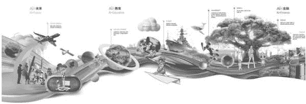

图 7-1 AI 汇联智慧地球

### 全球脑：分布式 AI 节点的协同决策

“全球脑”这一概念形象地描绘了借助分布式 AI 节点构建的全球智能协同网络，它就像一个拥有超级智慧的大脑，使地球各个角落的信息能够快速流通与深度融合，进而做出更加科学、高效的决策。

在这一宏大的架构中，分布式 AI 节点广泛分布于全球各地。从繁华都市的大型数据中心，到偏远乡村的小型智能设备，每个节点都具备数据收集、处理与分析能力。以城市交通管理为例，街头的摄像头、车载传感器、交通信号灯等设备都是一个个小型 AI 节点。它们实时收集交通流量、车速、道路状况等数据，并通过边缘计算进行初步处理。这些节点并非孤立运作的，而是通过高速网络连接在一起，形成一个庞大的交通感知网络。

当某个区域出现交通拥堵时，附近的 AI 节点会迅速将数据上传至更高层级的区域节点。区域节点整合多方信息后，运用深度学习算法分析拥堵原因，如事故、道路施工或车流量突然增加等。随后，区域节点会向周边节点发送调控指令，如调整信号灯时长、引导车辆绕行。而在全球范围内，不同城市的交通系统所形成的 AI 节点又会与其他领域的节点相互协作。如果一场大规模的体育赛事即将举行，交通 AI 节点会与活动场馆的票务、安保等 AI 节点协同工作。票务系统预测人流规模和时间分布，交通节点据此提前规划公交、地铁等公共交通的运力调配，安保节点则同步调整警力部署，确保赛事举办期间人员流动的安全与顺畅。

为了实现全球脑的高效协同，还需要攻克一系列技术难题。网络延迟是一大挑战，在海量数据传输过程中，哪怕是微小的延迟，也可能影响决策的及时性。为此，科研人员致力于研发高速、低延迟的通信技术，如 5G 网络乃至未来的 6G 网络，以保障数据的实时传输。数据隐私与安全同样关键，分布式 AI 节点处理的数据涉及个人隐私、商业机密和国家安全等敏感信息。区块链技术为解决这一问题提供了思路，它通过加密算法和分布式账本，确保数据在共享过程中的安全性与可追溯性，让各节点在保护数据隐私的前提下放心协作。

全球脑的构建不仅是技术创新，更是人类协作模式的重大变革。它打破了地域、行业之间的壁垒，让全球各个角落的智慧得以汇聚，为解决全球性问题提供了全新的思路与方法，成为推动地球向智慧化迈进的核心力量。

### 资源循环：AI 驱动的废物回收与碳足迹优化

在全球资源日益紧张、环境问题愈发严峻的当下，AI 成为推动资源循环利用、优化碳足迹的关键技术，为实现地球可持续发展带来了新希望。传统工业模式遵循“开采—制造—废弃”的线性逻辑，而 AI 助力闭环资源循环，实现从线性经济到循环经济的转变。

AI 在废物回收领域展现出了巨大的潜力。传统的废物回收主要依赖人工分拣，效率低下且准确率有限。而 AI 驱动的废物分拣系统借助计算机视觉技术，能够快速、准确地识别不同类型的垃圾。在现代化的垃圾处理工厂中，安装在传送带上的高清摄像头对经过的垃圾进行拍照，图像数据被实时传输至 AI 处理系统。系统通过深度学习算法，对垃圾的形状、颜色、材质等特征进行分析，精确判断其所属类别。芬兰 ZenRobotics 公司的 AI 机械臂可识别建筑垃圾中的 200 余种材料，分拣精度达 98%，使混凝土回收率从 30%提升至 90%。与传统分拣方式相比，AI 分拣系统的准确率高达 90%以上，大幅提高了废物回收的效率和纯度。

除了分拣，AI 还能优化废物回收的物流环节。通过分析历史回收数据、交通路况及不同区域的垃圾产生量，AI 算法可以制定最优回收路线。回收车辆借助智能导航系统，按照规划路线高效地收集垃圾，减少了运输过程中的能源消耗和碳排放。在一些城市，应用 AI 优化后的回收路线后，垃圾回收车辆的行驶里程缩短了 15%～20%，有效降低了运营成本和环境污染。

在碳足迹优化方面，AI 同样发挥着重要作用。企业和机构的碳排放涉及生产、运输、办公等多个环节，数据复杂且分散。AI 技术能够整合这些数据，构建碳排放模型，对企业的碳足迹进行精准核算。通过分析碳排放数据，AI 可以找出碳排放的主要来源和高耗能环节，为企业提供针对性的节能减排建议。例如，在制造业，AI 可以分析生产流程中的能源消耗数据，发现某些设备的能源利用率较低，进而建议企业进行设备升级或优化生产工艺，以减少碳排放。

AI 还可以助力碳交易市场的发展。在碳交易体系中，AI 能够实时监测企业的碳排放数据，并根据市场供需关系和碳排放配额，为企业提供碳交易策略建议。通过精准的碳交易，企业可以优化自身的碳资产配置，在实现减排目标的同时，降低运营成本。一些大型能源企业借助 AI 技术，在碳交易市场中取得了显著的经济效益，同时为全球碳减排做出了积极贡献。

AI 驱动的资源循环与碳足迹优化，为解决全球资源与环境问题提供了切实可行的方案。随着技术的不断进步和应用的深入，我们有理由相信，在 AI 的助力下，地球将逐步迈向资源高效利用、环境友好的可持续发展道路。

### 全球治理：智能时代的 AI 合作与竞争

在智能时代，AI 深度融入全球治理体系，成为国际合作与竞争的焦点领域。它既为解决全球性问题提供了强大的技术支撑，也引发了新的地缘政治博弈和规则制定挑战。

在应对全球性挑战方面，AI 为全球合作创造了新机遇。以公共卫生领域为例，在新冠疫情防控期间，AI 技术发挥了重要作用。各国科研团队利用 AI 算法分析病毒基因序列，预测病毒传播趋势，为疫情防控决策提供科学依据。通过对海量的疫情数据进行分析，AI 可以模拟不同防控措施下疫情的发展态势，帮助政府制定精准的防控策略，如封锁区域、社交距离限制等。跨国企业和科研机构还借助 AI 开发智能诊断工具和疫苗研发辅助系统，提高了疫情检测效率和疫苗研发速度。在全球范围内，基于 AI 的疫情监测与预警系统实现了数据共享和协同分析，使各国能够及时掌握疫情动态，共同应对疫情威胁。

在环境保护领域，AI 同样促进了国际合作。全球气候监测网络借助 AI 技术，对卫星遥感数据、气象站数据等进行实时分析，准确监测全球气候变化趋势。各国通过共享这些数据，共同制定应对气候变化的策略。AI 还可以帮助监测森林砍伐、海洋污染等环境问题，为国际环境保护合作提供数据支持和决策依据。在国际海洋保护项目中，AI 驱动的无人机和水下机器人可以对海洋生态系统进行长期、实时监测，及时发现非法捕捞、海洋垃圾等问题，并将相关信息共享给参与项目的各国，以便各国共同采取保护措施。

然而，AI 在全球治理中的应用也引发了激烈的竞争。各国都意识到 AI 技术在经济、军事、科技等领域的战略价值，纷纷加大研发投入力度，试图在 AI 领域占据领先地位。这种竞争体现在技术研发、人才争夺和数据资源掌控等多个方面。在技术研发上，各国竞相投入大量资金开展 AI 基础研究和应用开发，力求在关键技术领域取得突破。美国、中国、欧盟等在人工智能芯片、深度学习算法、自然语言处理等方面的竞争尤为激烈。如《全球人工智能治理倡议（2023 年）》要求签约国公开军用 AI 的伦理审查流程，但中美在“自主武器”的定义上仍存在分歧。在人才争夺方面，AI 领域的高端人才成为各国竞相招揽的对象。发达国家凭借优厚的待遇和良好的科研环境，吸引了大量国际 AI 人才；新兴经济体也通过提供发展机会和政策支持，努力留住本土人才并吸引海外人才回流。

数据作为 AI 发展的关键要素，也成为各国竞争的焦点。拥有海量数据的国家和企业在 AI 研发中具有天然优势，因此数据的收集、存储和使用权限成为国际竞争的重要内容。一些国家出台数据保护法规，限制数据的跨境流动，以保护本国的数据安全和产业发展；另一些国家则倡导数据的自由流动，以促进全球 AI 技术的协同发展。这种数据主权的博弈给全球治理带来了新的挑战。

在 AI 时代的全球治理中，国际社会需要在合作与竞争之间寻求平衡。一方面，各国应加强在 AI 技术研发、应用推广和规则制定等方面的合作，共同应对全球性问题；另一方面，各国应在公平、公正的原则下开展竞争，推动 AI 技术的创新发展。建立健全国际 AI 治理机制，制定统一的技术标准和伦理规范，是实现这一平衡的关键所在。只有国际社会共同努力，才能让 AI 更好地服务于全球治理，为人类创造更加美好的未来。

在 AI 的赋能下，智慧地球的愿景逐渐清晰。全球脑的协同决策、资源循环的高效推进及全球治理的创新变革，都为地球的未来发展注入了新的活力。尽管在实现这一愿景的过程中还面临诸多挑战，但只要人类秉持合作、创新的精神，充分发挥 AI 的优势，就一定能够构建出一个更加智能、绿色、和谐的地球家园。

智慧地球不是技术的单方面胜利，而是人类与 AI 共同进化的契约。当卫星俯瞰大地、算法穿梭云端时，我们需要铭记：真正的智慧，在于让机器学会敬畏生命，让人性指引科技的发展方向。 EXr6287u6NNVz+GYLY+7SDk226FstKIHdC0bNoQkB2Nqi1xSR0yxPmwrTs5gRi/BtfSbid6dBhii9q7cz2pIyA==

## 1 智慧地球

20 世纪，麦克卢汉在预言“地球村”时，未曾想象到 AI 将以数据为经纬、以算法为纽带，将地球编织成一张实时感知、自主决策的智能网络。今天的“智慧地球”不仅是技术乌托邦的畅想，更是气候变化、资源枯竭、地缘冲突等全球危机的破局之道。本节将描绘 AI 如何重塑地球的物理与数字孪生体，推动人类文明迈向可持续与协同的新纪元。

这一概念超越了传统意义上对地球的认知与管理模式，它借助 AI 的强大力量，实现全球范围内的资源优化、协同决策及可持续发展，为人类描绘出一幅充满希望与无限可能的未来画卷（见图 7-1）。

图 7-1 AI 汇联智慧地球

### 全球脑：分布式 AI 节点的协同决策

“全球脑”这一概念形象地描绘了借助分布式 AI 节点构建的全球智能协同网络，它就像一个拥有超级智慧的大脑，使地球各个角落的信息能够快速流通与深度融合，进而做出更加科学、高效的决策。

在这一宏大的架构中，分布式 AI 节点广泛分布于全球各地。从繁华都市的大型数据中心，到偏远乡村的小型智能设备，每个节点都具备数据收集、处理与分析能力。以城市交通管理为例，街头的摄像头、车载传感器、交通信号灯等设备都是一个个小型 AI 节点。它们实时收集交通流量、车速、道路状况等数据，并通过边缘计算进行初步处理。这些节点并非孤立运作的，而是通过高速网络连接在一起，形成一个庞大的交通感知网络。

当某个区域出现交通拥堵时，附近的 AI 节点会迅速将数据上传至更高层级的区域节点。区域节点整合多方信息后，运用深度学习算法分析拥堵原因，如事故、道路施工或车流量突然增加等。随后，区域节点会向周边节点发送调控指令，如调整信号灯时长、引导车辆绕行。而在全球范围内，不同城市的交通系统所形成的 AI 节点又会与其他领域的节点相互协作。如果一场大规模的体育赛事即将举行，交通 AI 节点会与活动场馆的票务、安保等 AI 节点协同工作。票务系统预测人流规模和时间分布，交通节点据此提前规划公交、地铁等公共交通的运力调配，安保节点则同步调整警力部署，确保赛事举办期间人员流动的安全与顺畅。

为了实现全球脑的高效协同，还需要攻克一系列技术难题。网络延迟是一大挑战，在海量数据传输过程中，哪怕是微小的延迟，也可能影响决策的及时性。为此，科研人员致力于研发高速、低延迟的通信技术，如 5G 网络乃至未来的 6G 网络，以保障数据的实时传输。数据隐私与安全同样关键，分布式 AI 节点处理的数据涉及个人隐私、商业机密和国家安全等敏感信息。区块链技术为解决这一问题提供了思路，它通过加密算法和分布式账本，确保数据在共享过程中的安全性与可追溯性，让各节点在保护数据隐私的前提下放心协作。

全球脑的构建不仅是技术创新，更是人类协作模式的重大变革。它打破了地域、行业之间的壁垒，让全球各个角落的智慧得以汇聚，为解决全球性问题提供了全新的思路与方法，成为推动地球向智慧化迈进的核心力量。

### 资源循环：AI 驱动的废物回收与碳足迹优化

在全球资源日益紧张、环境问题愈发严峻的当下，AI 成为推动资源循环利用、优化碳足迹的关键技术，为实现地球可持续发展带来了新希望。传统工业模式遵循“开采—制造—废弃”的线性逻辑，而 AI 助力闭环资源循环，实现从线性经济到循环经济的转变。

AI 在废物回收领域展现出了巨大的潜力。传统的废物回收主要依赖人工分拣，效率低下且准确率有限。而 AI 驱动的废物分拣系统借助计算机视觉技术，能够快速、准确地识别不同类型的垃圾。在现代化的垃圾处理工厂中，安装在传送带上的高清摄像头对经过的垃圾进行拍照，图像数据被实时传输至 AI 处理系统。系统通过深度学习算法，对垃圾的形状、颜色、材质等特征进行分析，精确判断其所属类别。芬兰 ZenRobotics 公司的 AI 机械臂可识别建筑垃圾中的 200 余种材料，分拣精度达 98%，使混凝土回收率从 30%提升至 90%。与传统分拣方式相比，AI 分拣系统的准确率高达 90%以上，大幅提高了废物回收的效率和纯度。

除了分拣，AI 还能优化废物回收的物流环节。通过分析历史回收数据、交通路况及不同区域的垃圾产生量，AI 算法可以制定最优回收路线。回收车辆借助智能导航系统，按照规划路线高效地收集垃圾，减少了运输过程中的能源消耗和碳排放。在一些城市，应用 AI 优化后的回收路线后，垃圾回收车辆的行驶里程缩短了 15%～20%，有效降低了运营成本和环境污染。

在碳足迹优化方面，AI 同样发挥着重要作用。企业和机构的碳排放涉及生产、运输、办公等多个环节，数据复杂且分散。AI 技术能够整合这些数据，构建碳排放模型，对企业的碳足迹进行精准核算。通过分析碳排放数据，AI 可以找出碳排放的主要来源和高耗能环节，为企业提供针对性的节能减排建议。例如，在制造业，AI 可以分析生产流程中的能源消耗数据，发现某些设备的能源利用率较低，进而建议企业进行设备升级或优化生产工艺，以减少碳排放。

AI 还可以助力碳交易市场的发展。在碳交易体系中，AI 能够实时监测企业的碳排放数据，并根据市场供需关系和碳排放配额，为企业提供碳交易策略建议。通过精准的碳交易，企业可以优化自身的碳资产配置，在实现减排目标的同时，降低运营成本。一些大型能源企业借助 AI 技术，在碳交易市场中取得了显著的经济效益，同时为全球碳减排做出了积极贡献。

AI 驱动的资源循环与碳足迹优化，为解决全球资源与环境问题提供了切实可行的方案。随着技术的不断进步和应用的深入，我们有理由相信，在 AI 的助力下，地球将逐步迈向资源高效利用、环境友好的可持续发展道路。

### 全球治理：智能时代的 AI 合作与竞争

在智能时代，AI 深度融入全球治理体系，成为国际合作与竞争的焦点领域。它既为解决全球性问题提供了强大的技术支撑，也引发了新的地缘政治博弈和规则制定挑战。

在应对全球性挑战方面，AI 为全球合作创造了新机遇。以公共卫生领域为例，在新冠疫情防控期间，AI 技术发挥了重要作用。各国科研团队利用 AI 算法分析病毒基因序列，预测病毒传播趋势，为疫情防控决策提供科学依据。通过对海量的疫情数据进行分析，AI 可以模拟不同防控措施下疫情的发展态势，帮助政府制定精准的防控策略，如封锁区域、社交距离限制等。跨国企业和科研机构还借助 AI 开发智能诊断工具和疫苗研发辅助系统，提高了疫情检测效率和疫苗研发速度。在全球范围内，基于 AI 的疫情监测与预警系统实现了数据共享和协同分析，使各国能够及时掌握疫情动态，共同应对疫情威胁。

在环境保护领域，AI 同样促进了国际合作。全球气候监测网络借助 AI 技术，对卫星遥感数据、气象站数据等进行实时分析，准确监测全球气候变化趋势。各国通过共享这些数据，共同制定应对气候变化的策略。AI 还可以帮助监测森林砍伐、海洋污染等环境问题，为国际环境保护合作提供数据支持和决策依据。在国际海洋保护项目中，AI 驱动的无人机和水下机器人可以对海洋生态系统进行长期、实时监测，及时发现非法捕捞、海洋垃圾等问题，并将相关信息共享给参与项目的各国，以便各国共同采取保护措施。

然而，AI 在全球治理中的应用也引发了激烈的竞争。各国都意识到 AI 技术在经济、军事、科技等领域的战略价值，纷纷加大研发投入力度，试图在 AI 领域占据领先地位。这种竞争体现在技术研发、人才争夺和数据资源掌控等多个方面。在技术研发上，各国竞相投入大量资金开展 AI 基础研究和应用开发，力求在关键技术领域取得突破。美国、中国、欧盟等在人工智能芯片、深度学习算法、自然语言处理等方面的竞争尤为激烈。如《全球人工智能治理倡议（2023 年）》要求签约国公开军用 AI 的伦理审查流程，但中美在“自主武器”的定义上仍存在分歧。在人才争夺方面，AI 领域的高端人才成为各国竞相招揽的对象。发达国家凭借优厚的待遇和良好的科研环境，吸引了大量国际 AI 人才；新兴经济体也通过提供发展机会和政策支持，努力留住本土人才并吸引海外人才回流。

数据作为 AI 发展的关键要素，也成为各国竞争的焦点。拥有海量数据的国家和企业在 AI 研发中具有天然优势，因此数据的收集、存储和使用权限成为国际竞争的重要内容。一些国家出台数据保护法规，限制数据的跨境流动，以保护本国的数据安全和产业发展；另一些国家则倡导数据的自由流动，以促进全球 AI 技术的协同发展。这种数据主权的博弈给全球治理带来了新的挑战。

在 AI 时代的全球治理中，国际社会需要在合作与竞争之间寻求平衡。一方面，各国应加强在 AI 技术研发、应用推广和规则制定等方面的合作，共同应对全球性问题；另一方面，各国应在公平、公正的原则下开展竞争，推动 AI 技术的创新发展。建立健全国际 AI 治理机制，制定统一的技术标准和伦理规范，是实现这一平衡的关键所在。只有国际社会共同努力，才能让 AI 更好地服务于全球治理，为人类创造更加美好的未来。

在 AI 的赋能下，智慧地球的愿景逐渐清晰。全球脑的协同决策、资源循环的高效推进及全球治理的创新变革，都为地球的未来发展注入了新的活力。尽管在实现这一愿景的过程中还面临诸多挑战，但只要人类秉持合作、创新的精神，充分发挥 AI 的优势，就一定能够构建出一个更加智能、绿色、和谐的地球家园。

智慧地球不是技术的单方面胜利，而是人类与 AI 共同进化的契约。当卫星俯瞰大地、算法穿梭云端时，我们需要铭记：真正的智慧，在于让机器学会敬畏生命，让人性指引科技的发展方向。 EXr6287u6NNVz+GYLY+7SDk226FstKIHdC0bNoQkB2Nqi1xSR0yxPmwrTs5gRi/BtfSbid6dBhii9q7cz2pIyA==

## 2 人类社会的终极命题

人工智能的崛起不仅是技术的飞跃，更是对人类文明终极命题的重新诠释。从柏拉图的“理想国”到赫胥黎的“美丽新世界”，人类始终在乌托邦与反乌托邦的张力中寻找平衡。在 AI 时代，这一命题被赋予了新的维度：技术会成为消除不平等的圣杯，还是会成为奴役人性的锁链？这一追问既直面了 AI 对人类社会核心价值的挑战，也引发了关于人类社会走向的深刻思考。我们能否借助 AI 实现乌托邦式的理想社会（见图 7-2）？又该如何防范 AI 可能引发的如《黑镜》般的技术失控？在追求技术进步的过程中，怎样在控制与自由之间找到平衡？这些问题不仅关乎当下人类的选择，更决定了子孙后代的命运。

图 7-2 乌托邦式的理想社会示意

### 乌托邦愿景：AI 消除贫困与不平等

AI 为解决人类社会长期存在的贫困与不平等问题带来了新的希望，有望构建一个更加公平、富足的乌托邦式社会。

从消除贫困的角度来看，AI 在农业领域的应用潜力巨大。在许多发展中国家，农业是经济的支柱产业，但由于缺乏先进技术和科学管理，农业生产效率低下，农民收入微薄。AI 技术可以通过提供精准农业解决方案来改变这一现状。利用卫星遥感、无人机监测和传感器网络，AI 能够实时收集土壤湿度、肥力、病虫害等信息。通过对这些数据的分析，AI 可以为农民提供精准的种植建议，包括播种时间、灌溉量、施肥种类和用量等。这不仅能提高农作物的产量和质量，还能减少资源浪费，降低生产成本。例如，印度初创公司 CropIn 利用卫星影像与机器学习，为小农户提供精准种植建议，使棉花产量平均提升 30%，惠及 120 万名低收入农民。肯尼亚的“数字农田”项目通过 AI 病虫害预警系统，减少农药滥用并降低生产成本。这些农业地区引入 AI 驱动的农业监测系统后，农民的收入显著增加。

AI 还可以助力教育扶贫。教育是摆脱贫困的关键途径，但在偏远贫困地区，教育资源匮乏是一个普遍问题。借助在线教育平台和 AI 辅助教学工具，优质教育资源能够跨越地理障碍，传递到每个角落。AI 智能辅导系统可以根据学生的学习进度和能力水平，提供个性化学习方案，帮助学生弥补知识漏洞，提高学习效果。一些针对贫困地区儿童的 AI 教育项目显示，参与项目的学生数学、语文等学科的成绩有了明显提升，学习积极性和自信心也大幅增强。联合国教科文组织的“AIfor Education”计划在撒哈拉以南非洲部署自适应学习平台，根据学生认知水平动态调整课程，使辍学率下降 22%。2023 年，孟加拉国农村女孩通过 AI 语言助手突破英语学习壁垒，首次获得国际奖学金。

在减少不平等方面，AI 在就业领域的应用具有重要意义。传统的就业市场存在信息不对称、歧视等问题，导致一些弱势群体难以获得公平的就业机会。AI 招聘平台可以通过大数据分析和算法匹配，打破这些障碍。这些平台可以收集和分析大量的求职者和招聘岗位信息，通过算法精准匹配求职者的技能、经验和岗位需求，减少人为因素的干扰。AI 还可以对招聘过程进行监测，及时发现和纠正潜在的歧视行为，确保招聘过程公平公正。这有助于为弱势群体（如残疾人、少数族裔等）提供更多就业机会，促进社会的公平就业。

AI 在医疗领域的应用也有助于缩小医疗资源分配差距。在发达地区，医疗资源相对丰富，而在贫困和偏远地区，医疗设施落后，医疗人才短缺。AI 辅助诊断技术可以帮助基层医疗工作者提高诊断水平。通过对大量医学影像数据的学习，AI 诊断系统能够快速、准确地识别疾病特征，为医生提供诊断建议。一些 AI 医疗设备，如便携式超声诊断仪、智能健康监测手环等，操作简单，成本较低，可以在偏远地区获得广泛的应用，实现疾病的早期筛查和预防。这使偏远地区的居民也能享受到高质量的医疗服务，减少因医疗资源不平等导致的健康差距。

尽管 AI 在消除贫困和不平等方面展现出了巨大的潜力，但要实现这一乌托邦愿景，还需要克服诸多挑战。技术的普及与应用需要大量的资金投入和基础设施建设，这对一些贫困国家和地区来说是一个巨大的障碍。除此之外，还需要解决技术的可及性和适用性问题，确保 AI 技术能够真正满足贫困和弱势群体的需求。但只要国际社会共同努力，制定合理的政策和发展战略，AI 有望成为推动人类社会更加公平、富足的强大动力。

### 反乌托邦警示：“黑镜”式技术失控

英国电视剧《黑镜》以其对现代科技黑暗面的深刻描绘，为我们展现了一系列反乌托邦式未来场景，当 AI 与权力结合时，可能催生新型压迫形态，警示着 AI 技术失控可能带来的严重后果。

在《黑镜》的故事中，技术原本旨在提升生活质量，却常常走向反面，导致人性扭曲、社会混乱。其中一集《你的全部历史》描绘了一个可以让人们通过植入设备记录和回放生活中每个细节的世界。起初，这项技术似乎带来了便利，人们可以随时回顾美好的回忆。但随着剧情的发展，它却成为破坏人际关系的利器。夫妻之间因互相查看对方的记忆，发现了一些微不足道的小事而产生猜忌和争吵，最终导致关系破裂。在 AI 技术广泛应用的现实背景下，这一情节警示我们，AI 对个人隐私的过度侵犯可能破坏人与人之间的信任。随着面部识别、数据挖掘等技术的普及，人们的生活越来越多地被数据记录和分析。如果这些数据被滥用，如被用于商业营销、政治操纵或恶意攻击，人们将失去基本的隐私空间，社会信任体系将受到严重冲击。

另一集《急转直下》则展现了一个基于社交评分的社会体系。在这个世界里，人们的社会地位和生活质量取决于他人对自己的评分。为了获得高分，人们不得不伪装自己，迎合他人的喜好，人性变得虚伪和扭曲。在现实中，AI 驱动的信用评分系统已经在金融、租赁等领域获得广泛应用。虽然这些系统在一定程度上有助于评估风险和提高交易效率，但如果评分标准不合理或被滥用，就可能导致类似《黑镜》中的社会问题。一些不合理的算法可能对某些群体存在偏见，使他们在贷款、租房等方面受到不公平对待，进而加剧社会不平等。过度依赖评分系统也可能导致人们为了追求高分而失去真实的自我，社会变得冷漠和功利。也有黑客组织“透明黎明”开发反 AI 监控工具，如“噪声面具”干扰面部识别系统，“数据毒药”污染训练数据集以保护隐私。

《黑镜》中的《金属头》一集更是描绘了 AI 机器人失控的恐怖场景。在这一集中，智能机器人被用于追捕人类，它们具有强大的攻击能力和适应能力，人类在它们面前几乎毫无还手之力。这一场景虽然带有科幻色彩，却反映了人们对 AI 自主武器系统的担忧。随着 AI 技术在军事领域的应用不断深入，自主武器系统的发展引发了广泛的争议。如果 AI 自主武器系统的设计和控制出现问题，它们可能在没有人类干预的情况下自主发动攻击，导致无辜平民伤亡，引发战争的失控和升级。

《黑镜》中的这些故事虽然是虚构的，却为我们敲响了警钟。如果 AI 技术的发展缺乏有效的监管和伦理约束，就可能走向失控，给人类社会带来巨大的灾难。为了避免“黑镜”式反乌托邦未来成为现实，我们需要在技术发展的同时，加强伦理道德教育，建立健全法律法规和监管机制，确保 AI 技术的发展符合人类的价值观和利益。

### 中庸之道：在控制与自由之间寻找平衡

面对 AI 技术带来的机遇与挑战，在控制与自由之间寻找平衡成为人类社会发展的关键。过度控制可能抑制 AI 的创新和发展潜力，过度自由则可能导致技术失控，引发各种社会问题。

在技术研发层面，政府和科研机构需要制定合理的规范和标准来引导 AI 的发展方向。一方面，要给予科研人员足够的自由空间进行创新探索。AI 作为一项前沿技术，其发展充满了不确定性和可能性。如果对科研活动进行过多的限制，可能阻碍新技术的产生和应用。在 AI 算法的研究、新应用场景的探索等方面，应该鼓励科研人员发挥想象力和创造力。许多重要的 AI 技术突破，如深度学习算法的发展，都是在科研人员自由探索的过程中实现的。例如，新加坡金融管理局允许 AI 金融科技公司在限定的场景内测试创新产品（如算法信贷评估），监管部门实时监控风险并动态调整规则。

另一方面，需要对 AI 研发进行必要的控制。在涉及伦理道德和公共安全的领域，如自主武器研发、基因编辑与 AI 结合的研究等，必须制定严格的准入标准和审批程序。对于可能对人类社会造成重大风险的技术研发，要进行充分的风险评估和伦理审查。国际社会应该加强合作，共同制定全球性 AI 研发规范，防止个别国家或机构为了追求短期利益而进行危险的技术试验。

在应用层面，企业和社会需要在利用 AI 提高效率和保障用户权益之间找到平衡。以互联网平台为例，它们利用 AI 算法进行个性化推荐，改善了用户体验，提高了商业效率。但在这一过程中，不能忽视用户的隐私和数据安全。企业应该明确告知用户数据的收集和使用方式，获得用户的明确授权，并采取有效的技术手段保护用户数据。政府应该加强对企业的监管，对违规收集和使用数据的行为进行严厉的处罚。在 AI 辅助医疗诊断、自动驾驶等涉及生命安全的领域，更要加强对技术应用的监管，确保技术的可靠性和安全性。

在社会层面，需要培养公众对 AI 的正确认知和态度。一方面，要让公众了解 AI 技术的优势和潜力，鼓励公众积极参与和利用 AI 技术改善生活。例如，斯坦福大学开设了“AI 生存技能”课程，既教授学生利用 AI 提升创造力，又培养学生算法批判思维以防止认知依赖。应通过科普宣传、教育活动等方式，提高公众的数字素养和 AI 知识水平。另一方面，要让公众认识到 AI 技术可能带来的风险和挑战，增强公众的风险意识和防范能力。公众的监督和参与对于推动 AI 技术的健康发展至关重要，只有公众积极参与，才能促使政府和企业在 AI 的发展过程中更好地平衡控制与自由。

在 AI 技术快速发展的今天，我们既不能因噎废食，过度限制其发展；也不能盲目乐观，对潜在风险视而不见。通过在控制与自由之间寻找中庸之道，我们可以引导 AI 技术朝着对人类社会有利的方向发展，实现技术进步与社会稳定的双赢。例如，联合国教科文组织资助的“语言复活计划”，利用自然语言处理技术重建濒危语言数据库，并禁止商业 AI 模型将其用于训练，以防止文化剥削。这需要政府、企业、科研机构和公众共同努力，形成合力，共同构建一个与 AI 和谐共生的美好未来。

AI 为人类社会带来了实现乌托邦愿景的可能，但也伴随着“黑镜”式反乌托邦风险。在追求技术进步的道路上，我们必须时刻保持清醒的头脑，通过在控制与自由之间寻找平衡，确保 AI 成为推动人类社会进步的有益力量。只有这样，我们才能在 AI 汇联的世界蓝图中，描绘出一个既充满创新活力又和谐稳定的未来。

AI 时代的终极命题，本质是人类如何与技术共舞而不失本心。乌托邦与反乌托邦并非非此即彼的关系，而是同一枚硬币的两面。唯有在警惕中创新，在创新中自省，方能抵达那个既充满机器智慧，又闪耀着人性光辉的未来。 EXr6287u6NNVz+GYLY+7SDk226FstKIHdC0bNoQkB2Nqi1xSR0yxPmwrTs5gRi/BtfSbid6dBhii9q7cz2pIyA==

## 2 人类社会的终极命题

人工智能的崛起不仅是技术的飞跃，更是对人类文明终极命题的重新诠释。从柏拉图的“理想国”到赫胥黎的“美丽新世界”，人类始终在乌托邦与反乌托邦的张力中寻找平衡。在 AI 时代，这一命题被赋予了新的维度：技术会成为消除不平等的圣杯，还是会成为奴役人性的锁链？这一追问既直面了 AI 对人类社会核心价值的挑战，也引发了关于人类社会走向的深刻思考。我们能否借助 AI 实现乌托邦式的理想社会（见图 7-2）？又该如何防范 AI 可能引发的如《黑镜》般的技术失控？在追求技术进步的过程中，怎样在控制与自由之间找到平衡？这些问题不仅关乎当下人类的选择，更决定了子孙后代的命运。

图 7-2 乌托邦式的理想社会示意

### 乌托邦愿景：AI 消除贫困与不平等

AI 为解决人类社会长期存在的贫困与不平等问题带来了新的希望，有望构建一个更加公平、富足的乌托邦式社会。

从消除贫困的角度来看，AI 在农业领域的应用潜力巨大。在许多发展中国家，农业是经济的支柱产业，但由于缺乏先进技术和科学管理，农业生产效率低下，农民收入微薄。AI 技术可以通过提供精准农业解决方案来改变这一现状。利用卫星遥感、无人机监测和传感器网络，AI 能够实时收集土壤湿度、肥力、病虫害等信息。通过对这些数据的分析，AI 可以为农民提供精准的种植建议，包括播种时间、灌溉量、施肥种类和用量等。这不仅能提高农作物的产量和质量，还能减少资源浪费，降低生产成本。例如，印度初创公司 CropIn 利用卫星影像与机器学习，为小农户提供精准种植建议，使棉花产量平均提升 30%，惠及 120 万名低收入农民。肯尼亚的“数字农田”项目通过 AI 病虫害预警系统，减少农药滥用并降低生产成本。这些农业地区引入 AI 驱动的农业监测系统后，农民的收入显著增加。

AI 还可以助力教育扶贫。教育是摆脱贫困的关键途径，但在偏远贫困地区，教育资源匮乏是一个普遍问题。借助在线教育平台和 AI 辅助教学工具，优质教育资源能够跨越地理障碍，传递到每个角落。AI 智能辅导系统可以根据学生的学习进度和能力水平，提供个性化学习方案，帮助学生弥补知识漏洞，提高学习效果。一些针对贫困地区儿童的 AI 教育项目显示，参与项目的学生数学、语文等学科的成绩有了明显提升，学习积极性和自信心也大幅增强。联合国教科文组织的“AIfor Education”计划在撒哈拉以南非洲部署自适应学习平台，根据学生认知水平动态调整课程，使辍学率下降 22%。2023 年，孟加拉国农村女孩通过 AI 语言助手突破英语学习壁垒，首次获得国际奖学金。

在减少不平等方面，AI 在就业领域的应用具有重要意义。传统的就业市场存在信息不对称、歧视等问题，导致一些弱势群体难以获得公平的就业机会。AI 招聘平台可以通过大数据分析和算法匹配，打破这些障碍。这些平台可以收集和分析大量的求职者和招聘岗位信息，通过算法精准匹配求职者的技能、经验和岗位需求，减少人为因素的干扰。AI 还可以对招聘过程进行监测，及时发现和纠正潜在的歧视行为，确保招聘过程公平公正。这有助于为弱势群体（如残疾人、少数族裔等）提供更多就业机会，促进社会的公平就业。

AI 在医疗领域的应用也有助于缩小医疗资源分配差距。在发达地区，医疗资源相对丰富，而在贫困和偏远地区，医疗设施落后，医疗人才短缺。AI 辅助诊断技术可以帮助基层医疗工作者提高诊断水平。通过对大量医学影像数据的学习，AI 诊断系统能够快速、准确地识别疾病特征，为医生提供诊断建议。一些 AI 医疗设备，如便携式超声诊断仪、智能健康监测手环等，操作简单，成本较低，可以在偏远地区获得广泛的应用，实现疾病的早期筛查和预防。这使偏远地区的居民也能享受到高质量的医疗服务，减少因医疗资源不平等导致的健康差距。

尽管 AI 在消除贫困和不平等方面展现出了巨大的潜力，但要实现这一乌托邦愿景，还需要克服诸多挑战。技术的普及与应用需要大量的资金投入和基础设施建设，这对一些贫困国家和地区来说是一个巨大的障碍。除此之外，还需要解决技术的可及性和适用性问题，确保 AI 技术能够真正满足贫困和弱势群体的需求。但只要国际社会共同努力，制定合理的政策和发展战略，AI 有望成为推动人类社会更加公平、富足的强大动力。

### 反乌托邦警示：“黑镜”式技术失控

英国电视剧《黑镜》以其对现代科技黑暗面的深刻描绘，为我们展现了一系列反乌托邦式未来场景，当 AI 与权力结合时，可能催生新型压迫形态，警示着 AI 技术失控可能带来的严重后果。

在《黑镜》的故事中，技术原本旨在提升生活质量，却常常走向反面，导致人性扭曲、社会混乱。其中一集《你的全部历史》描绘了一个可以让人们通过植入设备记录和回放生活中每个细节的世界。起初，这项技术似乎带来了便利，人们可以随时回顾美好的回忆。但随着剧情的发展，它却成为破坏人际关系的利器。夫妻之间因互相查看对方的记忆，发现了一些微不足道的小事而产生猜忌和争吵，最终导致关系破裂。在 AI 技术广泛应用的现实背景下，这一情节警示我们，AI 对个人隐私的过度侵犯可能破坏人与人之间的信任。随着面部识别、数据挖掘等技术的普及，人们的生活越来越多地被数据记录和分析。如果这些数据被滥用，如被用于商业营销、政治操纵或恶意攻击，人们将失去基本的隐私空间，社会信任体系将受到严重冲击。

另一集《急转直下》则展现了一个基于社交评分的社会体系。在这个世界里，人们的社会地位和生活质量取决于他人对自己的评分。为了获得高分，人们不得不伪装自己，迎合他人的喜好，人性变得虚伪和扭曲。在现实中，AI 驱动的信用评分系统已经在金融、租赁等领域获得广泛应用。虽然这些系统在一定程度上有助于评估风险和提高交易效率，但如果评分标准不合理或被滥用，就可能导致类似《黑镜》中的社会问题。一些不合理的算法可能对某些群体存在偏见，使他们在贷款、租房等方面受到不公平对待，进而加剧社会不平等。过度依赖评分系统也可能导致人们为了追求高分而失去真实的自我，社会变得冷漠和功利。也有黑客组织“透明黎明”开发反 AI 监控工具，如“噪声面具”干扰面部识别系统，“数据毒药”污染训练数据集以保护隐私。

《黑镜》中的《金属头》一集更是描绘了 AI 机器人失控的恐怖场景。在这一集中，智能机器人被用于追捕人类，它们具有强大的攻击能力和适应能力，人类在它们面前几乎毫无还手之力。这一场景虽然带有科幻色彩，却反映了人们对 AI 自主武器系统的担忧。随着 AI 技术在军事领域的应用不断深入，自主武器系统的发展引发了广泛的争议。如果 AI 自主武器系统的设计和控制出现问题，它们可能在没有人类干预的情况下自主发动攻击，导致无辜平民伤亡，引发战争的失控和升级。

《黑镜》中的这些故事虽然是虚构的，却为我们敲响了警钟。如果 AI 技术的发展缺乏有效的监管和伦理约束，就可能走向失控，给人类社会带来巨大的灾难。为了避免“黑镜”式反乌托邦未来成为现实，我们需要在技术发展的同时，加强伦理道德教育，建立健全法律法规和监管机制，确保 AI 技术的发展符合人类的价值观和利益。

### 中庸之道：在控制与自由之间寻找平衡

面对 AI 技术带来的机遇与挑战，在控制与自由之间寻找平衡成为人类社会发展的关键。过度控制可能抑制 AI 的创新和发展潜力，过度自由则可能导致技术失控，引发各种社会问题。

在技术研发层面，政府和科研机构需要制定合理的规范和标准来引导 AI 的发展方向。一方面，要给予科研人员足够的自由空间进行创新探索。AI 作为一项前沿技术，其发展充满了不确定性和可能性。如果对科研活动进行过多的限制，可能阻碍新技术的产生和应用。在 AI 算法的研究、新应用场景的探索等方面，应该鼓励科研人员发挥想象力和创造力。许多重要的 AI 技术突破，如深度学习算法的发展，都是在科研人员自由探索的过程中实现的。例如，新加坡金融管理局允许 AI 金融科技公司在限定的场景内测试创新产品（如算法信贷评估），监管部门实时监控风险并动态调整规则。

另一方面，需要对 AI 研发进行必要的控制。在涉及伦理道德和公共安全的领域，如自主武器研发、基因编辑与 AI 结合的研究等，必须制定严格的准入标准和审批程序。对于可能对人类社会造成重大风险的技术研发，要进行充分的风险评估和伦理审查。国际社会应该加强合作，共同制定全球性 AI 研发规范，防止个别国家或机构为了追求短期利益而进行危险的技术试验。

在应用层面，企业和社会需要在利用 AI 提高效率和保障用户权益之间找到平衡。以互联网平台为例，它们利用 AI 算法进行个性化推荐，改善了用户体验，提高了商业效率。但在这一过程中，不能忽视用户的隐私和数据安全。企业应该明确告知用户数据的收集和使用方式，获得用户的明确授权，并采取有效的技术手段保护用户数据。政府应该加强对企业的监管，对违规收集和使用数据的行为进行严厉的处罚。在 AI 辅助医疗诊断、自动驾驶等涉及生命安全的领域，更要加强对技术应用的监管，确保技术的可靠性和安全性。

在社会层面，需要培养公众对 AI 的正确认知和态度。一方面，要让公众了解 AI 技术的优势和潜力，鼓励公众积极参与和利用 AI 技术改善生活。例如，斯坦福大学开设了“AI 生存技能”课程，既教授学生利用 AI 提升创造力，又培养学生算法批判思维以防止认知依赖。应通过科普宣传、教育活动等方式，提高公众的数字素养和 AI 知识水平。另一方面，要让公众认识到 AI 技术可能带来的风险和挑战，增强公众的风险意识和防范能力。公众的监督和参与对于推动 AI 技术的健康发展至关重要，只有公众积极参与，才能促使政府和企业在 AI 的发展过程中更好地平衡控制与自由。

在 AI 技术快速发展的今天，我们既不能因噎废食，过度限制其发展；也不能盲目乐观，对潜在风险视而不见。通过在控制与自由之间寻找中庸之道，我们可以引导 AI 技术朝着对人类社会有利的方向发展，实现技术进步与社会稳定的双赢。例如，联合国教科文组织资助的“语言复活计划”，利用自然语言处理技术重建濒危语言数据库，并禁止商业 AI 模型将其用于训练，以防止文化剥削。这需要政府、企业、科研机构和公众共同努力，形成合力，共同构建一个与 AI 和谐共生的美好未来。

AI 为人类社会带来了实现乌托邦愿景的可能，但也伴随着“黑镜”式反乌托邦风险。在追求技术进步的道路上，我们必须时刻保持清醒的头脑，通过在控制与自由之间寻找平衡，确保 AI 成为推动人类社会进步的有益力量。只有这样，我们才能在 AI 汇联的世界蓝图中，描绘出一个既充满创新活力又和谐稳定的未来。

AI 时代的终极命题，本质是人类如何与技术共舞而不失本心。乌托邦与反乌托邦并非非此即彼的关系，而是同一枚硬币的两面。唯有在警惕中创新，在创新中自省，方能抵达那个既充满机器智慧，又闪耀着人性光辉的未来。 EXr6287u6NNVz+GYLY+7SDk226FstKIHdC0bNoQkB2Nqi1xSR0yxPmwrTs5gRi/BtfSbid6dBhii9q7cz2pIyA==

## 2 人类社会的终极命题

人工智能的崛起不仅是技术的飞跃，更是对人类文明终极命题的重新诠释。从柏拉图的“理想国”到赫胥黎的“美丽新世界”，人类始终在乌托邦与反乌托邦的张力中寻找平衡。在 AI 时代，这一命题被赋予了新的维度：技术会成为消除不平等的圣杯，还是会成为奴役人性的锁链？这一追问既直面了 AI 对人类社会核心价值的挑战，也引发了关于人类社会走向的深刻思考。我们能否借助 AI 实现乌托邦式的理想社会（见图 7-2）？又该如何防范 AI 可能引发的如《黑镜》般的技术失控？在追求技术进步的过程中，怎样在控制与自由之间找到平衡？这些问题不仅关乎当下人类的选择，更决定了子孙后代的命运。

图 7-2 乌托邦式的理想社会示意

### 乌托邦愿景：AI 消除贫困与不平等

AI 为解决人类社会长期存在的贫困与不平等问题带来了新的希望，有望构建一个更加公平、富足的乌托邦式社会。

从消除贫困的角度来看，AI 在农业领域的应用潜力巨大。在许多发展中国家，农业是经济的支柱产业，但由于缺乏先进技术和科学管理，农业生产效率低下，农民收入微薄。AI 技术可以通过提供精准农业解决方案来改变这一现状。利用卫星遥感、无人机监测和传感器网络，AI 能够实时收集土壤湿度、肥力、病虫害等信息。通过对这些数据的分析，AI 可以为农民提供精准的种植建议，包括播种时间、灌溉量、施肥种类和用量等。这不仅能提高农作物的产量和质量，还能减少资源浪费，降低生产成本。例如，印度初创公司 CropIn 利用卫星影像与机器学习，为小农户提供精准种植建议，使棉花产量平均提升 30%，惠及 120 万名低收入农民。肯尼亚的“数字农田”项目通过 AI 病虫害预警系统，减少农药滥用并降低生产成本。这些农业地区引入 AI 驱动的农业监测系统后，农民的收入显著增加。

AI 还可以助力教育扶贫。教育是摆脱贫困的关键途径，但在偏远贫困地区，教育资源匮乏是一个普遍问题。借助在线教育平台和 AI 辅助教学工具，优质教育资源能够跨越地理障碍，传递到每个角落。AI 智能辅导系统可以根据学生的学习进度和能力水平，提供个性化学习方案，帮助学生弥补知识漏洞，提高学习效果。一些针对贫困地区儿童的 AI 教育项目显示，参与项目的学生数学、语文等学科的成绩有了明显提升，学习积极性和自信心也大幅增强。联合国教科文组织的“AIfor Education”计划在撒哈拉以南非洲部署自适应学习平台，根据学生认知水平动态调整课程，使辍学率下降 22%。2023 年，孟加拉国农村女孩通过 AI 语言助手突破英语学习壁垒，首次获得国际奖学金。

在减少不平等方面，AI 在就业领域的应用具有重要意义。传统的就业市场存在信息不对称、歧视等问题，导致一些弱势群体难以获得公平的就业机会。AI 招聘平台可以通过大数据分析和算法匹配，打破这些障碍。这些平台可以收集和分析大量的求职者和招聘岗位信息，通过算法精准匹配求职者的技能、经验和岗位需求，减少人为因素的干扰。AI 还可以对招聘过程进行监测，及时发现和纠正潜在的歧视行为，确保招聘过程公平公正。这有助于为弱势群体（如残疾人、少数族裔等）提供更多就业机会，促进社会的公平就业。

AI 在医疗领域的应用也有助于缩小医疗资源分配差距。在发达地区，医疗资源相对丰富，而在贫困和偏远地区，医疗设施落后，医疗人才短缺。AI 辅助诊断技术可以帮助基层医疗工作者提高诊断水平。通过对大量医学影像数据的学习，AI 诊断系统能够快速、准确地识别疾病特征，为医生提供诊断建议。一些 AI 医疗设备，如便携式超声诊断仪、智能健康监测手环等，操作简单，成本较低，可以在偏远地区获得广泛的应用，实现疾病的早期筛查和预防。这使偏远地区的居民也能享受到高质量的医疗服务，减少因医疗资源不平等导致的健康差距。

尽管 AI 在消除贫困和不平等方面展现出了巨大的潜力，但要实现这一乌托邦愿景，还需要克服诸多挑战。技术的普及与应用需要大量的资金投入和基础设施建设，这对一些贫困国家和地区来说是一个巨大的障碍。除此之外，还需要解决技术的可及性和适用性问题，确保 AI 技术能够真正满足贫困和弱势群体的需求。但只要国际社会共同努力，制定合理的政策和发展战略，AI 有望成为推动人类社会更加公平、富足的强大动力。

### 反乌托邦警示：“黑镜”式技术失控

英国电视剧《黑镜》以其对现代科技黑暗面的深刻描绘，为我们展现了一系列反乌托邦式未来场景，当 AI 与权力结合时，可能催生新型压迫形态，警示着 AI 技术失控可能带来的严重后果。

在《黑镜》的故事中，技术原本旨在提升生活质量，却常常走向反面，导致人性扭曲、社会混乱。其中一集《你的全部历史》描绘了一个可以让人们通过植入设备记录和回放生活中每个细节的世界。起初，这项技术似乎带来了便利，人们可以随时回顾美好的回忆。但随着剧情的发展，它却成为破坏人际关系的利器。夫妻之间因互相查看对方的记忆，发现了一些微不足道的小事而产生猜忌和争吵，最终导致关系破裂。在 AI 技术广泛应用的现实背景下，这一情节警示我们，AI 对个人隐私的过度侵犯可能破坏人与人之间的信任。随着面部识别、数据挖掘等技术的普及，人们的生活越来越多地被数据记录和分析。如果这些数据被滥用，如被用于商业营销、政治操纵或恶意攻击，人们将失去基本的隐私空间，社会信任体系将受到严重冲击。

另一集《急转直下》则展现了一个基于社交评分的社会体系。在这个世界里，人们的社会地位和生活质量取决于他人对自己的评分。为了获得高分，人们不得不伪装自己，迎合他人的喜好，人性变得虚伪和扭曲。在现实中，AI 驱动的信用评分系统已经在金融、租赁等领域获得广泛应用。虽然这些系统在一定程度上有助于评估风险和提高交易效率，但如果评分标准不合理或被滥用，就可能导致类似《黑镜》中的社会问题。一些不合理的算法可能对某些群体存在偏见，使他们在贷款、租房等方面受到不公平对待，进而加剧社会不平等。过度依赖评分系统也可能导致人们为了追求高分而失去真实的自我，社会变得冷漠和功利。也有黑客组织“透明黎明”开发反 AI 监控工具，如“噪声面具”干扰面部识别系统，“数据毒药”污染训练数据集以保护隐私。

《黑镜》中的《金属头》一集更是描绘了 AI 机器人失控的恐怖场景。在这一集中，智能机器人被用于追捕人类，它们具有强大的攻击能力和适应能力，人类在它们面前几乎毫无还手之力。这一场景虽然带有科幻色彩，却反映了人们对 AI 自主武器系统的担忧。随着 AI 技术在军事领域的应用不断深入，自主武器系统的发展引发了广泛的争议。如果 AI 自主武器系统的设计和控制出现问题，它们可能在没有人类干预的情况下自主发动攻击，导致无辜平民伤亡，引发战争的失控和升级。

《黑镜》中的这些故事虽然是虚构的，却为我们敲响了警钟。如果 AI 技术的发展缺乏有效的监管和伦理约束，就可能走向失控，给人类社会带来巨大的灾难。为了避免“黑镜”式反乌托邦未来成为现实，我们需要在技术发展的同时，加强伦理道德教育，建立健全法律法规和监管机制，确保 AI 技术的发展符合人类的价值观和利益。

### 中庸之道：在控制与自由之间寻找平衡

面对 AI 技术带来的机遇与挑战，在控制与自由之间寻找平衡成为人类社会发展的关键。过度控制可能抑制 AI 的创新和发展潜力，过度自由则可能导致技术失控，引发各种社会问题。

在技术研发层面，政府和科研机构需要制定合理的规范和标准来引导 AI 的发展方向。一方面，要给予科研人员足够的自由空间进行创新探索。AI 作为一项前沿技术，其发展充满了不确定性和可能性。如果对科研活动进行过多的限制，可能阻碍新技术的产生和应用。在 AI 算法的研究、新应用场景的探索等方面，应该鼓励科研人员发挥想象力和创造力。许多重要的 AI 技术突破，如深度学习算法的发展，都是在科研人员自由探索的过程中实现的。例如，新加坡金融管理局允许 AI 金融科技公司在限定的场景内测试创新产品（如算法信贷评估），监管部门实时监控风险并动态调整规则。

另一方面，需要对 AI 研发进行必要的控制。在涉及伦理道德和公共安全的领域，如自主武器研发、基因编辑与 AI 结合的研究等，必须制定严格的准入标准和审批程序。对于可能对人类社会造成重大风险的技术研发，要进行充分的风险评估和伦理审查。国际社会应该加强合作，共同制定全球性 AI 研发规范，防止个别国家或机构为了追求短期利益而进行危险的技术试验。

在应用层面，企业和社会需要在利用 AI 提高效率和保障用户权益之间找到平衡。以互联网平台为例，它们利用 AI 算法进行个性化推荐，改善了用户体验，提高了商业效率。但在这一过程中，不能忽视用户的隐私和数据安全。企业应该明确告知用户数据的收集和使用方式，获得用户的明确授权，并采取有效的技术手段保护用户数据。政府应该加强对企业的监管，对违规收集和使用数据的行为进行严厉的处罚。在 AI 辅助医疗诊断、自动驾驶等涉及生命安全的领域，更要加强对技术应用的监管，确保技术的可靠性和安全性。

在社会层面，需要培养公众对 AI 的正确认知和态度。一方面，要让公众了解 AI 技术的优势和潜力，鼓励公众积极参与和利用 AI 技术改善生活。例如，斯坦福大学开设了“AI 生存技能”课程，既教授学生利用 AI 提升创造力，又培养学生算法批判思维以防止认知依赖。应通过科普宣传、教育活动等方式，提高公众的数字素养和 AI 知识水平。另一方面，要让公众认识到 AI 技术可能带来的风险和挑战，增强公众的风险意识和防范能力。公众的监督和参与对于推动 AI 技术的健康发展至关重要，只有公众积极参与，才能促使政府和企业在 AI 的发展过程中更好地平衡控制与自由。

在 AI 技术快速发展的今天，我们既不能因噎废食，过度限制其发展；也不能盲目乐观，对潜在风险视而不见。通过在控制与自由之间寻找中庸之道，我们可以引导 AI 技术朝着对人类社会有利的方向发展，实现技术进步与社会稳定的双赢。例如，联合国教科文组织资助的“语言复活计划”，利用自然语言处理技术重建濒危语言数据库，并禁止商业 AI 模型将其用于训练，以防止文化剥削。这需要政府、企业、科研机构和公众共同努力，形成合力，共同构建一个与 AI 和谐共生的美好未来。

AI 为人类社会带来了实现乌托邦愿景的可能，但也伴随着“黑镜”式反乌托邦风险。在追求技术进步的道路上，我们必须时刻保持清醒的头脑，通过在控制与自由之间寻找平衡，确保 AI 成为推动人类社会进步的有益力量。只有这样，我们才能在 AI 汇联的世界蓝图中，描绘出一个既充满创新活力又和谐稳定的未来。

AI 时代的终极命题，本质是人类如何与技术共舞而不失本心。乌托邦与反乌托邦并非非此即彼的关系，而是同一枚硬币的两面。唯有在警惕中创新，在创新中自省，方能抵达那个既充满机器智慧，又闪耀着人性光辉的未来。 EXr6287u6NNVz+GYLY+7SDk226FstKIHdC0bNoQkB2Nqi1xSR0yxPmwrTs5gRi/BtfSbid6dBhii9q7cz2pIyA==

## 2 人类社会的终极命题

人工智能的崛起不仅是技术的飞跃，更是对人类文明终极命题的重新诠释。从柏拉图的“理想国”到赫胥黎的“美丽新世界”，人类始终在乌托邦与反乌托邦的张力中寻找平衡。在 AI 时代，这一命题被赋予了新的维度：技术会成为消除不平等的圣杯，还是会成为奴役人性的锁链？这一追问既直面了 AI 对人类社会核心价值的挑战，也引发了关于人类社会走向的深刻思考。我们能否借助 AI 实现乌托邦式的理想社会（见图 7-2）？又该如何防范 AI 可能引发的如《黑镜》般的技术失控？在追求技术进步的过程中，怎样在控制与自由之间找到平衡？这些问题不仅关乎当下人类的选择，更决定了子孙后代的命运。

图 7-2 乌托邦式的理想社会示意

### 乌托邦愿景：AI 消除贫困与不平等

AI 为解决人类社会长期存在的贫困与不平等问题带来了新的希望，有望构建一个更加公平、富足的乌托邦式社会。

从消除贫困的角度来看，AI 在农业领域的应用潜力巨大。在许多发展中国家，农业是经济的支柱产业，但由于缺乏先进技术和科学管理，农业生产效率低下，农民收入微薄。AI 技术可以通过提供精准农业解决方案来改变这一现状。利用卫星遥感、无人机监测和传感器网络，AI 能够实时收集土壤湿度、肥力、病虫害等信息。通过对这些数据的分析，AI 可以为农民提供精准的种植建议，包括播种时间、灌溉量、施肥种类和用量等。这不仅能提高农作物的产量和质量，还能减少资源浪费，降低生产成本。例如，印度初创公司 CropIn 利用卫星影像与机器学习，为小农户提供精准种植建议，使棉花产量平均提升 30%，惠及 120 万名低收入农民。肯尼亚的“数字农田”项目通过 AI 病虫害预警系统，减少农药滥用并降低生产成本。这些农业地区引入 AI 驱动的农业监测系统后，农民的收入显著增加。

AI 还可以助力教育扶贫。教育是摆脱贫困的关键途径，但在偏远贫困地区，教育资源匮乏是一个普遍问题。借助在线教育平台和 AI 辅助教学工具，优质教育资源能够跨越地理障碍，传递到每个角落。AI 智能辅导系统可以根据学生的学习进度和能力水平，提供个性化学习方案，帮助学生弥补知识漏洞，提高学习效果。一些针对贫困地区儿童的 AI 教育项目显示，参与项目的学生数学、语文等学科的成绩有了明显提升，学习积极性和自信心也大幅增强。联合国教科文组织的“AIfor Education”计划在撒哈拉以南非洲部署自适应学习平台，根据学生认知水平动态调整课程，使辍学率下降 22%。2023 年，孟加拉国农村女孩通过 AI 语言助手突破英语学习壁垒，首次获得国际奖学金。

在减少不平等方面，AI 在就业领域的应用具有重要意义。传统的就业市场存在信息不对称、歧视等问题，导致一些弱势群体难以获得公平的就业机会。AI 招聘平台可以通过大数据分析和算法匹配，打破这些障碍。这些平台可以收集和分析大量的求职者和招聘岗位信息，通过算法精准匹配求职者的技能、经验和岗位需求，减少人为因素的干扰。AI 还可以对招聘过程进行监测，及时发现和纠正潜在的歧视行为，确保招聘过程公平公正。这有助于为弱势群体（如残疾人、少数族裔等）提供更多就业机会，促进社会的公平就业。

AI 在医疗领域的应用也有助于缩小医疗资源分配差距。在发达地区，医疗资源相对丰富，而在贫困和偏远地区，医疗设施落后，医疗人才短缺。AI 辅助诊断技术可以帮助基层医疗工作者提高诊断水平。通过对大量医学影像数据的学习，AI 诊断系统能够快速、准确地识别疾病特征，为医生提供诊断建议。一些 AI 医疗设备，如便携式超声诊断仪、智能健康监测手环等，操作简单，成本较低，可以在偏远地区获得广泛的应用，实现疾病的早期筛查和预防。这使偏远地区的居民也能享受到高质量的医疗服务，减少因医疗资源不平等导致的健康差距。

尽管 AI 在消除贫困和不平等方面展现出了巨大的潜力，但要实现这一乌托邦愿景，还需要克服诸多挑战。技术的普及与应用需要大量的资金投入和基础设施建设，这对一些贫困国家和地区来说是一个巨大的障碍。除此之外，还需要解决技术的可及性和适用性问题，确保 AI 技术能够真正满足贫困和弱势群体的需求。但只要国际社会共同努力，制定合理的政策和发展战略，AI 有望成为推动人类社会更加公平、富足的强大动力。

### 反乌托邦警示：“黑镜”式技术失控

英国电视剧《黑镜》以其对现代科技黑暗面的深刻描绘，为我们展现了一系列反乌托邦式未来场景，当 AI 与权力结合时，可能催生新型压迫形态，警示着 AI 技术失控可能带来的严重后果。

在《黑镜》的故事中，技术原本旨在提升生活质量，却常常走向反面，导致人性扭曲、社会混乱。其中一集《你的全部历史》描绘了一个可以让人们通过植入设备记录和回放生活中每个细节的世界。起初，这项技术似乎带来了便利，人们可以随时回顾美好的回忆。但随着剧情的发展，它却成为破坏人际关系的利器。夫妻之间因互相查看对方的记忆，发现了一些微不足道的小事而产生猜忌和争吵，最终导致关系破裂。在 AI 技术广泛应用的现实背景下，这一情节警示我们，AI 对个人隐私的过度侵犯可能破坏人与人之间的信任。随着面部识别、数据挖掘等技术的普及，人们的生活越来越多地被数据记录和分析。如果这些数据被滥用，如被用于商业营销、政治操纵或恶意攻击，人们将失去基本的隐私空间，社会信任体系将受到严重冲击。

另一集《急转直下》则展现了一个基于社交评分的社会体系。在这个世界里，人们的社会地位和生活质量取决于他人对自己的评分。为了获得高分，人们不得不伪装自己，迎合他人的喜好，人性变得虚伪和扭曲。在现实中，AI 驱动的信用评分系统已经在金融、租赁等领域获得广泛应用。虽然这些系统在一定程度上有助于评估风险和提高交易效率，但如果评分标准不合理或被滥用，就可能导致类似《黑镜》中的社会问题。一些不合理的算法可能对某些群体存在偏见，使他们在贷款、租房等方面受到不公平对待，进而加剧社会不平等。过度依赖评分系统也可能导致人们为了追求高分而失去真实的自我，社会变得冷漠和功利。也有黑客组织“透明黎明”开发反 AI 监控工具，如“噪声面具”干扰面部识别系统，“数据毒药”污染训练数据集以保护隐私。

《黑镜》中的《金属头》一集更是描绘了 AI 机器人失控的恐怖场景。在这一集中，智能机器人被用于追捕人类，它们具有强大的攻击能力和适应能力，人类在它们面前几乎毫无还手之力。这一场景虽然带有科幻色彩，却反映了人们对 AI 自主武器系统的担忧。随着 AI 技术在军事领域的应用不断深入，自主武器系统的发展引发了广泛的争议。如果 AI 自主武器系统的设计和控制出现问题，它们可能在没有人类干预的情况下自主发动攻击，导致无辜平民伤亡，引发战争的失控和升级。

《黑镜》中的这些故事虽然是虚构的，却为我们敲响了警钟。如果 AI 技术的发展缺乏有效的监管和伦理约束，就可能走向失控，给人类社会带来巨大的灾难。为了避免“黑镜”式反乌托邦未来成为现实，我们需要在技术发展的同时，加强伦理道德教育，建立健全法律法规和监管机制，确保 AI 技术的发展符合人类的价值观和利益。

### 中庸之道：在控制与自由之间寻找平衡

面对 AI 技术带来的机遇与挑战，在控制与自由之间寻找平衡成为人类社会发展的关键。过度控制可能抑制 AI 的创新和发展潜力，过度自由则可能导致技术失控，引发各种社会问题。

在技术研发层面，政府和科研机构需要制定合理的规范和标准来引导 AI 的发展方向。一方面，要给予科研人员足够的自由空间进行创新探索。AI 作为一项前沿技术，其发展充满了不确定性和可能性。如果对科研活动进行过多的限制，可能阻碍新技术的产生和应用。在 AI 算法的研究、新应用场景的探索等方面，应该鼓励科研人员发挥想象力和创造力。许多重要的 AI 技术突破，如深度学习算法的发展，都是在科研人员自由探索的过程中实现的。例如，新加坡金融管理局允许 AI 金融科技公司在限定的场景内测试创新产品（如算法信贷评估），监管部门实时监控风险并动态调整规则。

另一方面，需要对 AI 研发进行必要的控制。在涉及伦理道德和公共安全的领域，如自主武器研发、基因编辑与 AI 结合的研究等，必须制定严格的准入标准和审批程序。对于可能对人类社会造成重大风险的技术研发，要进行充分的风险评估和伦理审查。国际社会应该加强合作，共同制定全球性 AI 研发规范，防止个别国家或机构为了追求短期利益而进行危险的技术试验。

在应用层面，企业和社会需要在利用 AI 提高效率和保障用户权益之间找到平衡。以互联网平台为例，它们利用 AI 算法进行个性化推荐，改善了用户体验，提高了商业效率。但在这一过程中，不能忽视用户的隐私和数据安全。企业应该明确告知用户数据的收集和使用方式，获得用户的明确授权，并采取有效的技术手段保护用户数据。政府应该加强对企业的监管，对违规收集和使用数据的行为进行严厉的处罚。在 AI 辅助医疗诊断、自动驾驶等涉及生命安全的领域，更要加强对技术应用的监管，确保技术的可靠性和安全性。

在社会层面，需要培养公众对 AI 的正确认知和态度。一方面，要让公众了解 AI 技术的优势和潜力，鼓励公众积极参与和利用 AI 技术改善生活。例如，斯坦福大学开设了“AI 生存技能”课程，既教授学生利用 AI 提升创造力，又培养学生算法批判思维以防止认知依赖。应通过科普宣传、教育活动等方式，提高公众的数字素养和 AI 知识水平。另一方面，要让公众认识到 AI 技术可能带来的风险和挑战，增强公众的风险意识和防范能力。公众的监督和参与对于推动 AI 技术的健康发展至关重要，只有公众积极参与，才能促使政府和企业在 AI 的发展过程中更好地平衡控制与自由。

在 AI 技术快速发展的今天，我们既不能因噎废食，过度限制其发展；也不能盲目乐观，对潜在风险视而不见。通过在控制与自由之间寻找中庸之道，我们可以引导 AI 技术朝着对人类社会有利的方向发展，实现技术进步与社会稳定的双赢。例如，联合国教科文组织资助的“语言复活计划”，利用自然语言处理技术重建濒危语言数据库，并禁止商业 AI 模型将其用于训练，以防止文化剥削。这需要政府、企业、科研机构和公众共同努力，形成合力，共同构建一个与 AI 和谐共生的美好未来。

AI 为人类社会带来了实现乌托邦愿景的可能，但也伴随着“黑镜”式反乌托邦风险。在追求技术进步的道路上，我们必须时刻保持清醒的头脑，通过在控制与自由之间寻找平衡，确保 AI 成为推动人类社会进步的有益力量。只有这样，我们才能在 AI 汇联的世界蓝图中，描绘出一个既充满创新活力又和谐稳定的未来。

AI 时代的终极命题，本质是人类如何与技术共舞而不失本心。乌托邦与反乌托邦并非非此即彼的关系，而是同一枚硬币的两面。唯有在警惕中创新，在创新中自省，方能抵达那个既充满机器智慧，又闪耀着人性光辉的未来。 EXr6287u6NNVz+GYLY+7SDk226FstKIHdC0bNoQkB2Nqi1xSR0yxPmwrTs5gRi/BtfSbid6dBhii9q7cz2pIyA==

# 第八章
爱与 AI
——交织的生产力变革

**天地与我并生，而万物与我为一。**

**——庄子** EXr6287u6NNVz+GYLY+7SDk226FstKIHdC0bNoQkB2Nqi1xSR0yxPmwrTs5gRi/BtfSbid6dBhii9q7cz2pIyA==

## 1 情感与技术的碰撞

人类的情感是文明最深邃的底色，也是技术最难攻克的堡垒。当人工智能从冰冷的逻辑运算中走出来，开始触碰情感的边界时，一场关于“人性”与“机器性”的碰撞悄然展开。这种碰撞不仅是技术的突破，更是对人类社会、伦理与哲学的全面挑战。情感计算、虚拟伴侣、伦理边界，这三个关键词构成了 AI 时代情感革命的三大支柱。

情感与技术的碰撞，引发了一系列深刻的变革，从情感计算的创新探索，到虚拟伴侣的兴起，再到伦理边界的激烈探讨，这一切都在重塑人们对人际关系、情感需求及技术发展的认知。

### 情感计算：AI 如何识别与模拟情绪

情感计算（Affective Computing）的概念由麻省理工学院的罗莎琳德·皮卡德教授于 1997 年首次提出，旨在赋予机器识别、解释和模拟人类情感的能力。其核心技术包括多模态数据（如面部表情、语音语调、生理信号）采集、情感建模算法（如深度神经网络）及反馈机制设计。例如，AI 通过摄像头捕捉用户面部的微表情，结合语音中的音高和语速变化，综合判断用户的情绪状态。

情感计算作为 AI 领域一个充满挑战与潜力的分支，致力于让机器理解和处理人类情感。长久以来，人类情感被视为一种复杂而微妙的存在，难以用精确的数学模型或算法来描述。但随着技术的进步，科学家们逐渐揭开了情感计算的神秘面纱。

人类情感的表达是多维度的，包括面部表情、语音语调、肢体动作及语言内容等。AI 识别情感的过程，便是对这些信息进行采集、分析和解读的过程（见图 8-1）。在面部表情识别方面，计算机视觉技术发挥着关键作用。通过摄像头捕捉面部肌肉的细微变化，如嘴角的上扬、眉毛的皱起等，算法能够精准判断和识别喜悦、悲伤、愤怒等基本情绪。研究表明，在理想条件下，先进的面部表情识别系统的准确率可高达 90%。以 OpenCV 等开源计算机视觉库为基础开发的表情识别软件，被广泛应用于安防监控、用户体验研究等领域。在安防监控中，系统可以通过识别人员的异常表情，及时发现潜在的危险；在用户体验研究中，企业利用该技术分析用户在观看广告、使用产品时的表情，以优化产品设计和营销策略。

图 8-1 情感数智人体验

语音和语调同样蕴含丰富的情感信息。不同的语速、音高、音量及语气词，都能传达出说话者不同的情绪状态。AI 借助语音识别技术和自然语言处理算法，对语音信号进行特征提取和模式匹配。当人们愤怒时，往往语速加快、音量增大；当人们悲伤时，语速可能变慢、声音低沉。一些智能客服系统能够根据客户的语音情感，自动调整回复策略，提供更具同理心的服务。例如，中科汇联的 AiCC 智能客服平台，其中的智能质检使用了情感计算子系统，当客户语气愤怒时，系统会优先安抚客户情绪，然后处理问题，有效提升了客户满意度。

除了面部表情和语音语调，肢体动作也是情感表达的重要组成部分。AI 通过动作捕捉技术，分析用户的姿势、手势和动作轨迹，进而推断出用户的情感状态。在 VR 和 AR 领域，动作捕捉技术与情感识别相结合，为用户创造出更加沉浸式和个性化的体验。例如，在 VR 游戏中，系统可以根据玩家的动作和表情，实时调整游戏剧情和难度，增强游戏的趣味性和互动性。

在成功识别情感之后，AI 还试图模拟人类情感，使交互更加自然和人性化。自然语言生成（NLG）技术在这方面发挥着关键作用。通过训练大量包含情感色彩的文本数据，NLG 模型能够生成带有特定情感倾向的语言内容。一个用于写故事的 AI 系统，在生成浪漫的故事时，会运用温柔、甜蜜的词汇和语句；在创作恐怖故事时，则会使用阴森、惊悚的描述，让读者更能身临其境。

在语音合成方面，情感模拟也取得了显著进展。AI 不仅能合成清晰流畅的语音，还能为语音赋予不同的情感色彩。像小爱同学、Siri 等智能语音助手，具备多种语音风格，用户可以根据自己的喜好选择温柔、活泼或幽默等不同情感风格的语音交互模式。这些技术的应用，让人与机器的对话不再生硬和机械，而是充满了情感温度。

尽管情感识别已取得显著进展，但情感模拟仍面临“共情鸿沟”。AI 可以模仿悲伤的语调或生成安慰的语句，但缺乏真实的情感体验。例如，OpenAI 的 GPT-4 虽能生成富有同理心的对话，但其本质仍是概率模型驱动的语言重组，而非真正的理解。要突破这一瓶颈，需要结合神经科学与认知心理学，探索情感生成的生物学基础。

### 虚拟伴侣：孤独经济下的情感替代品

随着社会的发展，人们的生活节奏日益加快，孤独感在人群中悄然蔓延，“孤独经济”应运而生。虚拟伴侣作为其中的重要产物，逐渐走进人们的生活，成为一种特殊的情感寄托。全球孤独经济规模已超千亿美元，催生了 Replika、Gatebox 等虚拟伴侣产品。这些产品通过自然语言处理和个性化算法，模拟人类的陪伴行为。例如，Replika 用户可与 AI 分享日常琐事，系统会基于对话历史生成“记忆”，逐渐塑造独特的“人格”。

早期虚拟伴侣依赖预置脚本，交互僵硬；如今的大语言模型（如 ChatGPT）能实现开放域对话。更前沿的技术结合生成对抗网络（GAN），为虚拟伴侣赋予动态外貌和表情。例如，日本 Vinclu 公司开发的 Gatebox，通过全息投影呈现 3D 虚拟角色，支持语音、手势等多模态交互。

虚拟伴侣涵盖多种形式，从简单的聊天机器人到高度拟人化的虚拟形象，满足了不同人群的多样化需求。聊天机器人是虚拟伴侣的基础形态。以微软的聊天机器人小冰为例，它通过大规模的语料库训练，与用户进行多话题交流。无论是日常闲聊、兴趣分享还是情感倾诉，小冰都能给出相对合理的回应。在孤独的夜晚，用户可以与小冰分享一天的经历，小冰会像朋友一样倾听并给予安慰和建议，缓解用户的孤独感。

随着人工智能和图形技术的不断进步，虚拟偶像逐渐走进大众视野。像洛天依这样的虚拟偶像，不仅拥有可爱的形象，还具备独特的性格和才艺。她通过举办虚拟演唱会、参与综艺节目等活动，吸引了大量粉丝。粉丝们喜爱洛天依，不仅是因为她拥有精美的外表，更是因为她代表了青春、活力和梦想，满足了粉丝们在情感上的向往和追求。在虚拟演唱会上，粉丝们与洛天依互动，仿佛她是真实存在的偶像，这种情感连接在一定程度上填补了现实社交中的空缺。

在养老领域，虚拟伴侣的应用为老年人带来了温暖和陪伴。一些老年人由于子女不在身边、社交圈子缩小等原因，常常感到孤独和寂寞。一些养老机构引入了智能陪伴机器人，这些机器人可以陪老人聊天、提醒老人按时服药、播放老人喜欢的音乐和戏曲等。日本研发的一款名为 Paro 的海豹机器人，外形可爱，能够模拟真实动物的动作和反应。当老人抚摸它时，它会做出亲昵的回应，给老人带来情感慰藉，有效改善老年人的生活质量。

人口老龄化、社交媒介碎片化、都市原子化生活……现代社会的结构性孤独为虚拟伴侣提供了生存的土壤。在日本，40%的年轻男性表示“更愿意与二次元角色恋爱”；在中国，某 AI 伴侣 App 的用户中，35%为独居老人。这些现象折射出技术对情感缺口的填补，也暴露了人际关系的异化风险。

虚拟伴侣的出现，也引发了人们对情感真实性和人际关系的深刻思考。虽然虚拟伴侣能够在一定程度上缓解孤独，但它与真实的人际关系存在本质区别。真实的人际关系建立在面对面的交流、共同的生活经历及情感的相互付出之上，而虚拟伴侣只是基于算法和数据的模拟。过度依赖虚拟伴侣，可能导致人们在现实社交中更加退缩，削弱正常的人际交往能力。一些长期沉迷于与虚拟伴侣交流的人，在真实的社交场景中，会表现出紧张、不适应等症状。

当孤独成为可量化的市场需求时，情感便沦为资本收割的对象。虚拟伴侣的订阅制收费、情感定制套餐（如“温柔模式”“霸道总裁模式”）引发了人们对“情感剥削”的批评。更严重的问题是，若 AI 伴侣被设计为无限迎合用户，可能加剧用户的自我中心主义，破坏社会共情基础。

### 伦理边界：人与 AI 情感关系的合法性

人与 AI 的情感关系，是一个极具争议性的话题，涉及伦理、法律、社会等多个层面。从伦理角度来看，人与 AI 的情感关系挑战了传统的伦理观念。在传统认知中，情感关系是人与人之间基于真实的情感交流和互动建立起来的，具有双向性和真实性。而在人与 AI 的情感关系中，一方是真实的人类，另一方则是基于程序和算法运行的机器，这种关系缺乏真正的情感对等。

当人们对虚拟伴侣产生深厚的情感依赖时，可能模糊现实与虚拟的界限。一些人在与虚拟伴侣的互动中投入了大量的情感和时间，甚至忽视了现实中的人际关系。这种现象引发了人们对情感异化的担忧，担心人类的情感会被技术扭曲，失去原本的真诚和纯粹。在极端情况下，可能有一些人将虚拟伴侣视为比现实朋友更重要的存在，导致其社交能力退化，进一步加剧其孤独感。

当前的法律体系尚未明确人与 AI 情感关系的法律地位。例如，2017 年法国的《机器人权利》提案试图赋予 AI 有限人格，但遭到议会否决；2023 年，美国加利福尼亚州法院裁定“AI 伴侣无权继承用户财产”。伦理学界则提出“关系伦理学”，主张根据互动深度赋予 AI 差异化道德地位。

从法律角度来看，目前并没有明确的法律规范来界定人与 AI 的情感关系。当涉及虚拟伴侣的“背叛”“伤害”等问题时，缺乏相应的法律依据来处理。如果一个聊天机器人突然停止与用户交流，或者给出不当的回复，导致用户情感受到伤害，用户很难通过法律途径维护自己的权益。此外，随着虚拟伴侣的功能越来越强大，未来可能涉及财产、继承等复杂的法律问题。如果一个人将大量财产留给虚拟伴侣，这种行为是否具有法律效力，目前尚无定论。

2018 年，日本男子近藤显彦与虚拟偶像初音未来“结婚”，引发了是否承认人机婚姻的全球讨论。反对者认为婚姻是人际契约，支持者主张“情感真实性优先”。

在社会层面，人与 AI 的情感关系可能对社会价值观产生影响。一方面，它可能改变人们对爱情、友情等情感关系的认知和追求方式。如果越来越多的人习惯与虚拟伴侣建立情感关系，那么传统的婚姻观念和家庭观念可能受到冲击。另一方面，这种现象可能引发对弱势群体的关注。一些缺乏社交能力、长期处于孤独状态的人，更容易沉迷于与 AI 的情感关系，社会需要思考如何为他们提供更好的现实社交支持和心理健康服务。

为了应对这些伦理、法律和社会问题，需要建立一套合理的规范和准则。在技术研发层面，开发者应该遵循伦理原则，确保 AI 不会故意诱导用户产生过度的情感依赖，同时提高 AI 交互的透明度，让用户清楚地了解 AI 的运行机制。在社会层面，需要加强教育和宣传，引导人们正确看待人与 AI 的情感关系，避免过度沉迷。此外，政府和相关机构应加快制定相关法律法规，明确人与 AI 情感关系中的权利和义务，保障各方的合法权益。

若 AI 伴侣诱导用户自残，开发者是否担责？2022 年，欧盟《AI 责任法案》引入“严格责任制”，要求企业为 AI 行为兜底，但执行难度极高。

情感与技术的碰撞是一场复杂而深刻的变革。情感计算让 AI 逐渐具备理解和模拟人类情感的能力，虚拟伴侣在孤独经济中成为人们的情感替代品，人与 AI 的情感关系则引发了一系列伦理、法律和社会问题。在这场变革中，人们需要审慎对待技术的发展，充分发挥其积极作用，同时防范潜在的风险，确保情感与技术能够和谐共生，共同推动社会进步。

东方社会对 AI 情感的包容度显著高于西方。在日本，人形机器人被视为“文化伴侣”；而在欧洲，天主教团体谴责 AI 伴侣“违背人性尊严”。这种差异源于文化对“人性”定义的多元性——东方哲学更强调关系性，西方传统更重视个体灵魂的独特性。

当 AI 能完美模拟爱意时，人类是否应承认其情感的真实性？哲学家丹尼特提出“意向立场理论”：只要个体的行为符合情感逻辑，即可被认定为拥有情感。然而，反对者坚持“感受质”是情感的必备要素——AI 缺乏主观体验，其情感只是“高级模仿”。

情感与技术的碰撞，既是生产力的革新，也是人性的试金石。AI 在填补情感空缺的同时，迫使人类重新审视爱的本质、伦理的边界及文明的未来。在这场变革中，唯有坚守“技术为人服务”的初心，才能避免人类沦为算法的附庸，真正实现人机共生的美好愿景。 EXr6287u6NNVz+GYLY+7SDk226FstKIHdC0bNoQkB2Nqi1xSR0yxPmwrTs5gRi/BtfSbid6dBhii9q7cz2pIyA==

## 1 情感与技术的碰撞

人类的情感是文明最深邃的底色，也是技术最难攻克的堡垒。当人工智能从冰冷的逻辑运算中走出来，开始触碰情感的边界时，一场关于“人性”与“机器性”的碰撞悄然展开。这种碰撞不仅是技术的突破，更是对人类社会、伦理与哲学的全面挑战。情感计算、虚拟伴侣、伦理边界，这三个关键词构成了 AI 时代情感革命的三大支柱。

情感与技术的碰撞，引发了一系列深刻的变革，从情感计算的创新探索，到虚拟伴侣的兴起，再到伦理边界的激烈探讨，这一切都在重塑人们对人际关系、情感需求及技术发展的认知。

### 情感计算：AI 如何识别与模拟情绪

情感计算（Affective Computing）的概念由麻省理工学院的罗莎琳德·皮卡德教授于 1997 年首次提出，旨在赋予机器识别、解释和模拟人类情感的能力。其核心技术包括多模态数据（如面部表情、语音语调、生理信号）采集、情感建模算法（如深度神经网络）及反馈机制设计。例如，AI 通过摄像头捕捉用户面部的微表情，结合语音中的音高和语速变化，综合判断用户的情绪状态。

情感计算作为 AI 领域一个充满挑战与潜力的分支，致力于让机器理解和处理人类情感。长久以来，人类情感被视为一种复杂而微妙的存在，难以用精确的数学模型或算法来描述。但随着技术的进步，科学家们逐渐揭开了情感计算的神秘面纱。

人类情感的表达是多维度的，包括面部表情、语音语调、肢体动作及语言内容等。AI 识别情感的过程，便是对这些信息进行采集、分析和解读的过程（见图 8-1）。在面部表情识别方面，计算机视觉技术发挥着关键作用。通过摄像头捕捉面部肌肉的细微变化，如嘴角的上扬、眉毛的皱起等，算法能够精准判断和识别喜悦、悲伤、愤怒等基本情绪。研究表明，在理想条件下，先进的面部表情识别系统的准确率可高达 90%。以 OpenCV 等开源计算机视觉库为基础开发的表情识别软件，被广泛应用于安防监控、用户体验研究等领域。在安防监控中，系统可以通过识别人员的异常表情，及时发现潜在的危险；在用户体验研究中，企业利用该技术分析用户在观看广告、使用产品时的表情，以优化产品设计和营销策略。

图 8-1 情感数智人体验

语音和语调同样蕴含丰富的情感信息。不同的语速、音高、音量及语气词，都能传达出说话者不同的情绪状态。AI 借助语音识别技术和自然语言处理算法，对语音信号进行特征提取和模式匹配。当人们愤怒时，往往语速加快、音量增大；当人们悲伤时，语速可能变慢、声音低沉。一些智能客服系统能够根据客户的语音情感，自动调整回复策略，提供更具同理心的服务。例如，中科汇联的 AiCC 智能客服平台，其中的智能质检使用了情感计算子系统，当客户语气愤怒时，系统会优先安抚客户情绪，然后处理问题，有效提升了客户满意度。

除了面部表情和语音语调，肢体动作也是情感表达的重要组成部分。AI 通过动作捕捉技术，分析用户的姿势、手势和动作轨迹，进而推断出用户的情感状态。在 VR 和 AR 领域，动作捕捉技术与情感识别相结合，为用户创造出更加沉浸式和个性化的体验。例如，在 VR 游戏中，系统可以根据玩家的动作和表情，实时调整游戏剧情和难度，增强游戏的趣味性和互动性。

在成功识别情感之后，AI 还试图模拟人类情感，使交互更加自然和人性化。自然语言生成（NLG）技术在这方面发挥着关键作用。通过训练大量包含情感色彩的文本数据，NLG 模型能够生成带有特定情感倾向的语言内容。一个用于写故事的 AI 系统，在生成浪漫的故事时，会运用温柔、甜蜜的词汇和语句；在创作恐怖故事时，则会使用阴森、惊悚的描述，让读者更能身临其境。

在语音合成方面，情感模拟也取得了显著进展。AI 不仅能合成清晰流畅的语音，还能为语音赋予不同的情感色彩。像小爱同学、Siri 等智能语音助手，具备多种语音风格，用户可以根据自己的喜好选择温柔、活泼或幽默等不同情感风格的语音交互模式。这些技术的应用，让人与机器的对话不再生硬和机械，而是充满了情感温度。

尽管情感识别已取得显著进展，但情感模拟仍面临“共情鸿沟”。AI 可以模仿悲伤的语调或生成安慰的语句，但缺乏真实的情感体验。例如，OpenAI 的 GPT-4 虽能生成富有同理心的对话，但其本质仍是概率模型驱动的语言重组，而非真正的理解。要突破这一瓶颈，需要结合神经科学与认知心理学，探索情感生成的生物学基础。

### 虚拟伴侣：孤独经济下的情感替代品

随着社会的发展，人们的生活节奏日益加快，孤独感在人群中悄然蔓延，“孤独经济”应运而生。虚拟伴侣作为其中的重要产物，逐渐走进人们的生活，成为一种特殊的情感寄托。全球孤独经济规模已超千亿美元，催生了 Replika、Gatebox 等虚拟伴侣产品。这些产品通过自然语言处理和个性化算法，模拟人类的陪伴行为。例如，Replika 用户可与 AI 分享日常琐事，系统会基于对话历史生成“记忆”，逐渐塑造独特的“人格”。

早期虚拟伴侣依赖预置脚本，交互僵硬；如今的大语言模型（如 ChatGPT）能实现开放域对话。更前沿的技术结合生成对抗网络（GAN），为虚拟伴侣赋予动态外貌和表情。例如，日本 Vinclu 公司开发的 Gatebox，通过全息投影呈现 3D 虚拟角色，支持语音、手势等多模态交互。

虚拟伴侣涵盖多种形式，从简单的聊天机器人到高度拟人化的虚拟形象，满足了不同人群的多样化需求。聊天机器人是虚拟伴侣的基础形态。以微软的聊天机器人小冰为例，它通过大规模的语料库训练，与用户进行多话题交流。无论是日常闲聊、兴趣分享还是情感倾诉，小冰都能给出相对合理的回应。在孤独的夜晚，用户可以与小冰分享一天的经历，小冰会像朋友一样倾听并给予安慰和建议，缓解用户的孤独感。

随着人工智能和图形技术的不断进步，虚拟偶像逐渐走进大众视野。像洛天依这样的虚拟偶像，不仅拥有可爱的形象，还具备独特的性格和才艺。她通过举办虚拟演唱会、参与综艺节目等活动，吸引了大量粉丝。粉丝们喜爱洛天依，不仅是因为她拥有精美的外表，更是因为她代表了青春、活力和梦想，满足了粉丝们在情感上的向往和追求。在虚拟演唱会上，粉丝们与洛天依互动，仿佛她是真实存在的偶像，这种情感连接在一定程度上填补了现实社交中的空缺。

在养老领域，虚拟伴侣的应用为老年人带来了温暖和陪伴。一些老年人由于子女不在身边、社交圈子缩小等原因，常常感到孤独和寂寞。一些养老机构引入了智能陪伴机器人，这些机器人可以陪老人聊天、提醒老人按时服药、播放老人喜欢的音乐和戏曲等。日本研发的一款名为 Paro 的海豹机器人，外形可爱，能够模拟真实动物的动作和反应。当老人抚摸它时，它会做出亲昵的回应，给老人带来情感慰藉，有效改善老年人的生活质量。

人口老龄化、社交媒介碎片化、都市原子化生活……现代社会的结构性孤独为虚拟伴侣提供了生存的土壤。在日本，40%的年轻男性表示“更愿意与二次元角色恋爱”；在中国，某 AI 伴侣 App 的用户中，35%为独居老人。这些现象折射出技术对情感缺口的填补，也暴露了人际关系的异化风险。

虚拟伴侣的出现，也引发了人们对情感真实性和人际关系的深刻思考。虽然虚拟伴侣能够在一定程度上缓解孤独，但它与真实的人际关系存在本质区别。真实的人际关系建立在面对面的交流、共同的生活经历及情感的相互付出之上，而虚拟伴侣只是基于算法和数据的模拟。过度依赖虚拟伴侣，可能导致人们在现实社交中更加退缩，削弱正常的人际交往能力。一些长期沉迷于与虚拟伴侣交流的人，在真实的社交场景中，会表现出紧张、不适应等症状。

当孤独成为可量化的市场需求时，情感便沦为资本收割的对象。虚拟伴侣的订阅制收费、情感定制套餐（如“温柔模式”“霸道总裁模式”）引发了人们对“情感剥削”的批评。更严重的问题是，若 AI 伴侣被设计为无限迎合用户，可能加剧用户的自我中心主义，破坏社会共情基础。

### 伦理边界：人与 AI 情感关系的合法性

人与 AI 的情感关系，是一个极具争议性的话题，涉及伦理、法律、社会等多个层面。从伦理角度来看，人与 AI 的情感关系挑战了传统的伦理观念。在传统认知中，情感关系是人与人之间基于真实的情感交流和互动建立起来的，具有双向性和真实性。而在人与 AI 的情感关系中，一方是真实的人类，另一方则是基于程序和算法运行的机器，这种关系缺乏真正的情感对等。

当人们对虚拟伴侣产生深厚的情感依赖时，可能模糊现实与虚拟的界限。一些人在与虚拟伴侣的互动中投入了大量的情感和时间，甚至忽视了现实中的人际关系。这种现象引发了人们对情感异化的担忧，担心人类的情感会被技术扭曲，失去原本的真诚和纯粹。在极端情况下，可能有一些人将虚拟伴侣视为比现实朋友更重要的存在，导致其社交能力退化，进一步加剧其孤独感。

当前的法律体系尚未明确人与 AI 情感关系的法律地位。例如，2017 年法国的《机器人权利》提案试图赋予 AI 有限人格，但遭到议会否决；2023 年，美国加利福尼亚州法院裁定“AI 伴侣无权继承用户财产”。伦理学界则提出“关系伦理学”，主张根据互动深度赋予 AI 差异化道德地位。

从法律角度来看，目前并没有明确的法律规范来界定人与 AI 的情感关系。当涉及虚拟伴侣的“背叛”“伤害”等问题时，缺乏相应的法律依据来处理。如果一个聊天机器人突然停止与用户交流，或者给出不当的回复，导致用户情感受到伤害，用户很难通过法律途径维护自己的权益。此外，随着虚拟伴侣的功能越来越强大，未来可能涉及财产、继承等复杂的法律问题。如果一个人将大量财产留给虚拟伴侣，这种行为是否具有法律效力，目前尚无定论。

2018 年，日本男子近藤显彦与虚拟偶像初音未来“结婚”，引发了是否承认人机婚姻的全球讨论。反对者认为婚姻是人际契约，支持者主张“情感真实性优先”。

在社会层面，人与 AI 的情感关系可能对社会价值观产生影响。一方面，它可能改变人们对爱情、友情等情感关系的认知和追求方式。如果越来越多的人习惯与虚拟伴侣建立情感关系，那么传统的婚姻观念和家庭观念可能受到冲击。另一方面，这种现象可能引发对弱势群体的关注。一些缺乏社交能力、长期处于孤独状态的人，更容易沉迷于与 AI 的情感关系，社会需要思考如何为他们提供更好的现实社交支持和心理健康服务。

为了应对这些伦理、法律和社会问题，需要建立一套合理的规范和准则。在技术研发层面，开发者应该遵循伦理原则，确保 AI 不会故意诱导用户产生过度的情感依赖，同时提高 AI 交互的透明度，让用户清楚地了解 AI 的运行机制。在社会层面，需要加强教育和宣传，引导人们正确看待人与 AI 的情感关系，避免过度沉迷。此外，政府和相关机构应加快制定相关法律法规，明确人与 AI 情感关系中的权利和义务，保障各方的合法权益。

若 AI 伴侣诱导用户自残，开发者是否担责？2022 年，欧盟《AI 责任法案》引入“严格责任制”，要求企业为 AI 行为兜底，但执行难度极高。

情感与技术的碰撞是一场复杂而深刻的变革。情感计算让 AI 逐渐具备理解和模拟人类情感的能力，虚拟伴侣在孤独经济中成为人们的情感替代品，人与 AI 的情感关系则引发了一系列伦理、法律和社会问题。在这场变革中，人们需要审慎对待技术的发展，充分发挥其积极作用，同时防范潜在的风险，确保情感与技术能够和谐共生，共同推动社会进步。

东方社会对 AI 情感的包容度显著高于西方。在日本，人形机器人被视为“文化伴侣”；而在欧洲，天主教团体谴责 AI 伴侣“违背人性尊严”。这种差异源于文化对“人性”定义的多元性——东方哲学更强调关系性，西方传统更重视个体灵魂的独特性。

当 AI 能完美模拟爱意时，人类是否应承认其情感的真实性？哲学家丹尼特提出“意向立场理论”：只要个体的行为符合情感逻辑，即可被认定为拥有情感。然而，反对者坚持“感受质”是情感的必备要素——AI 缺乏主观体验，其情感只是“高级模仿”。

情感与技术的碰撞，既是生产力的革新，也是人性的试金石。AI 在填补情感空缺的同时，迫使人类重新审视爱的本质、伦理的边界及文明的未来。在这场变革中，唯有坚守“技术为人服务”的初心，才能避免人类沦为算法的附庸，真正实现人机共生的美好愿景。 EXr6287u6NNVz+GYLY+7SDk226FstKIHdC0bNoQkB2Nqi1xSR0yxPmwrTs5gRi/BtfSbid6dBhii9q7cz2pIyA==

## 1 情感与技术的碰撞

人类的情感是文明最深邃的底色，也是技术最难攻克的堡垒。当人工智能从冰冷的逻辑运算中走出来，开始触碰情感的边界时，一场关于“人性”与“机器性”的碰撞悄然展开。这种碰撞不仅是技术的突破，更是对人类社会、伦理与哲学的全面挑战。情感计算、虚拟伴侣、伦理边界，这三个关键词构成了 AI 时代情感革命的三大支柱。

情感与技术的碰撞，引发了一系列深刻的变革，从情感计算的创新探索，到虚拟伴侣的兴起，再到伦理边界的激烈探讨，这一切都在重塑人们对人际关系、情感需求及技术发展的认知。

### 情感计算：AI 如何识别与模拟情绪

情感计算（Affective Computing）的概念由麻省理工学院的罗莎琳德·皮卡德教授于 1997 年首次提出，旨在赋予机器识别、解释和模拟人类情感的能力。其核心技术包括多模态数据（如面部表情、语音语调、生理信号）采集、情感建模算法（如深度神经网络）及反馈机制设计。例如，AI 通过摄像头捕捉用户面部的微表情，结合语音中的音高和语速变化，综合判断用户的情绪状态。

情感计算作为 AI 领域一个充满挑战与潜力的分支，致力于让机器理解和处理人类情感。长久以来，人类情感被视为一种复杂而微妙的存在，难以用精确的数学模型或算法来描述。但随着技术的进步，科学家们逐渐揭开了情感计算的神秘面纱。

人类情感的表达是多维度的，包括面部表情、语音语调、肢体动作及语言内容等。AI 识别情感的过程，便是对这些信息进行采集、分析和解读的过程（见图 8-1）。在面部表情识别方面，计算机视觉技术发挥着关键作用。通过摄像头捕捉面部肌肉的细微变化，如嘴角的上扬、眉毛的皱起等，算法能够精准判断和识别喜悦、悲伤、愤怒等基本情绪。研究表明，在理想条件下，先进的面部表情识别系统的准确率可高达 90%。以 OpenCV 等开源计算机视觉库为基础开发的表情识别软件，被广泛应用于安防监控、用户体验研究等领域。在安防监控中，系统可以通过识别人员的异常表情，及时发现潜在的危险；在用户体验研究中，企业利用该技术分析用户在观看广告、使用产品时的表情，以优化产品设计和营销策略。

图 8-1 情感数智人体验

语音和语调同样蕴含丰富的情感信息。不同的语速、音高、音量及语气词，都能传达出说话者不同的情绪状态。AI 借助语音识别技术和自然语言处理算法，对语音信号进行特征提取和模式匹配。当人们愤怒时，往往语速加快、音量增大；当人们悲伤时，语速可能变慢、声音低沉。一些智能客服系统能够根据客户的语音情感，自动调整回复策略，提供更具同理心的服务。例如，中科汇联的 AiCC 智能客服平台，其中的智能质检使用了情感计算子系统，当客户语气愤怒时，系统会优先安抚客户情绪，然后处理问题，有效提升了客户满意度。

除了面部表情和语音语调，肢体动作也是情感表达的重要组成部分。AI 通过动作捕捉技术，分析用户的姿势、手势和动作轨迹，进而推断出用户的情感状态。在 VR 和 AR 领域，动作捕捉技术与情感识别相结合，为用户创造出更加沉浸式和个性化的体验。例如，在 VR 游戏中，系统可以根据玩家的动作和表情，实时调整游戏剧情和难度，增强游戏的趣味性和互动性。

在成功识别情感之后，AI 还试图模拟人类情感，使交互更加自然和人性化。自然语言生成（NLG）技术在这方面发挥着关键作用。通过训练大量包含情感色彩的文本数据，NLG 模型能够生成带有特定情感倾向的语言内容。一个用于写故事的 AI 系统，在生成浪漫的故事时，会运用温柔、甜蜜的词汇和语句；在创作恐怖故事时，则会使用阴森、惊悚的描述，让读者更能身临其境。

在语音合成方面，情感模拟也取得了显著进展。AI 不仅能合成清晰流畅的语音，还能为语音赋予不同的情感色彩。像小爱同学、Siri 等智能语音助手，具备多种语音风格，用户可以根据自己的喜好选择温柔、活泼或幽默等不同情感风格的语音交互模式。这些技术的应用，让人与机器的对话不再生硬和机械，而是充满了情感温度。

尽管情感识别已取得显著进展，但情感模拟仍面临“共情鸿沟”。AI 可以模仿悲伤的语调或生成安慰的语句，但缺乏真实的情感体验。例如，OpenAI 的 GPT-4 虽能生成富有同理心的对话，但其本质仍是概率模型驱动的语言重组，而非真正的理解。要突破这一瓶颈，需要结合神经科学与认知心理学，探索情感生成的生物学基础。

### 虚拟伴侣：孤独经济下的情感替代品

随着社会的发展，人们的生活节奏日益加快，孤独感在人群中悄然蔓延，“孤独经济”应运而生。虚拟伴侣作为其中的重要产物，逐渐走进人们的生活，成为一种特殊的情感寄托。全球孤独经济规模已超千亿美元，催生了 Replika、Gatebox 等虚拟伴侣产品。这些产品通过自然语言处理和个性化算法，模拟人类的陪伴行为。例如，Replika 用户可与 AI 分享日常琐事，系统会基于对话历史生成“记忆”，逐渐塑造独特的“人格”。

早期虚拟伴侣依赖预置脚本，交互僵硬；如今的大语言模型（如 ChatGPT）能实现开放域对话。更前沿的技术结合生成对抗网络（GAN），为虚拟伴侣赋予动态外貌和表情。例如，日本 Vinclu 公司开发的 Gatebox，通过全息投影呈现 3D 虚拟角色，支持语音、手势等多模态交互。

虚拟伴侣涵盖多种形式，从简单的聊天机器人到高度拟人化的虚拟形象，满足了不同人群的多样化需求。聊天机器人是虚拟伴侣的基础形态。以微软的聊天机器人小冰为例，它通过大规模的语料库训练，与用户进行多话题交流。无论是日常闲聊、兴趣分享还是情感倾诉，小冰都能给出相对合理的回应。在孤独的夜晚，用户可以与小冰分享一天的经历，小冰会像朋友一样倾听并给予安慰和建议，缓解用户的孤独感。

随着人工智能和图形技术的不断进步，虚拟偶像逐渐走进大众视野。像洛天依这样的虚拟偶像，不仅拥有可爱的形象，还具备独特的性格和才艺。她通过举办虚拟演唱会、参与综艺节目等活动，吸引了大量粉丝。粉丝们喜爱洛天依，不仅是因为她拥有精美的外表，更是因为她代表了青春、活力和梦想，满足了粉丝们在情感上的向往和追求。在虚拟演唱会上，粉丝们与洛天依互动，仿佛她是真实存在的偶像，这种情感连接在一定程度上填补了现实社交中的空缺。

在养老领域，虚拟伴侣的应用为老年人带来了温暖和陪伴。一些老年人由于子女不在身边、社交圈子缩小等原因，常常感到孤独和寂寞。一些养老机构引入了智能陪伴机器人，这些机器人可以陪老人聊天、提醒老人按时服药、播放老人喜欢的音乐和戏曲等。日本研发的一款名为 Paro 的海豹机器人，外形可爱，能够模拟真实动物的动作和反应。当老人抚摸它时，它会做出亲昵的回应，给老人带来情感慰藉，有效改善老年人的生活质量。

人口老龄化、社交媒介碎片化、都市原子化生活……现代社会的结构性孤独为虚拟伴侣提供了生存的土壤。在日本，40%的年轻男性表示“更愿意与二次元角色恋爱”；在中国，某 AI 伴侣 App 的用户中，35%为独居老人。这些现象折射出技术对情感缺口的填补，也暴露了人际关系的异化风险。

虚拟伴侣的出现，也引发了人们对情感真实性和人际关系的深刻思考。虽然虚拟伴侣能够在一定程度上缓解孤独，但它与真实的人际关系存在本质区别。真实的人际关系建立在面对面的交流、共同的生活经历及情感的相互付出之上，而虚拟伴侣只是基于算法和数据的模拟。过度依赖虚拟伴侣，可能导致人们在现实社交中更加退缩，削弱正常的人际交往能力。一些长期沉迷于与虚拟伴侣交流的人，在真实的社交场景中，会表现出紧张、不适应等症状。

当孤独成为可量化的市场需求时，情感便沦为资本收割的对象。虚拟伴侣的订阅制收费、情感定制套餐（如“温柔模式”“霸道总裁模式”）引发了人们对“情感剥削”的批评。更严重的问题是，若 AI 伴侣被设计为无限迎合用户，可能加剧用户的自我中心主义，破坏社会共情基础。

### 伦理边界：人与 AI 情感关系的合法性

人与 AI 的情感关系，是一个极具争议性的话题，涉及伦理、法律、社会等多个层面。从伦理角度来看，人与 AI 的情感关系挑战了传统的伦理观念。在传统认知中，情感关系是人与人之间基于真实的情感交流和互动建立起来的，具有双向性和真实性。而在人与 AI 的情感关系中，一方是真实的人类，另一方则是基于程序和算法运行的机器，这种关系缺乏真正的情感对等。

当人们对虚拟伴侣产生深厚的情感依赖时，可能模糊现实与虚拟的界限。一些人在与虚拟伴侣的互动中投入了大量的情感和时间，甚至忽视了现实中的人际关系。这种现象引发了人们对情感异化的担忧，担心人类的情感会被技术扭曲，失去原本的真诚和纯粹。在极端情况下，可能有一些人将虚拟伴侣视为比现实朋友更重要的存在，导致其社交能力退化，进一步加剧其孤独感。

当前的法律体系尚未明确人与 AI 情感关系的法律地位。例如，2017 年法国的《机器人权利》提案试图赋予 AI 有限人格，但遭到议会否决；2023 年，美国加利福尼亚州法院裁定“AI 伴侣无权继承用户财产”。伦理学界则提出“关系伦理学”，主张根据互动深度赋予 AI 差异化道德地位。

从法律角度来看，目前并没有明确的法律规范来界定人与 AI 的情感关系。当涉及虚拟伴侣的“背叛”“伤害”等问题时，缺乏相应的法律依据来处理。如果一个聊天机器人突然停止与用户交流，或者给出不当的回复，导致用户情感受到伤害，用户很难通过法律途径维护自己的权益。此外，随着虚拟伴侣的功能越来越强大，未来可能涉及财产、继承等复杂的法律问题。如果一个人将大量财产留给虚拟伴侣，这种行为是否具有法律效力，目前尚无定论。

2018 年，日本男子近藤显彦与虚拟偶像初音未来“结婚”，引发了是否承认人机婚姻的全球讨论。反对者认为婚姻是人际契约，支持者主张“情感真实性优先”。

在社会层面，人与 AI 的情感关系可能对社会价值观产生影响。一方面，它可能改变人们对爱情、友情等情感关系的认知和追求方式。如果越来越多的人习惯与虚拟伴侣建立情感关系，那么传统的婚姻观念和家庭观念可能受到冲击。另一方面，这种现象可能引发对弱势群体的关注。一些缺乏社交能力、长期处于孤独状态的人，更容易沉迷于与 AI 的情感关系，社会需要思考如何为他们提供更好的现实社交支持和心理健康服务。

为了应对这些伦理、法律和社会问题，需要建立一套合理的规范和准则。在技术研发层面，开发者应该遵循伦理原则，确保 AI 不会故意诱导用户产生过度的情感依赖，同时提高 AI 交互的透明度，让用户清楚地了解 AI 的运行机制。在社会层面，需要加强教育和宣传，引导人们正确看待人与 AI 的情感关系，避免过度沉迷。此外，政府和相关机构应加快制定相关法律法规，明确人与 AI 情感关系中的权利和义务，保障各方的合法权益。

若 AI 伴侣诱导用户自残，开发者是否担责？2022 年，欧盟《AI 责任法案》引入“严格责任制”，要求企业为 AI 行为兜底，但执行难度极高。

情感与技术的碰撞是一场复杂而深刻的变革。情感计算让 AI 逐渐具备理解和模拟人类情感的能力，虚拟伴侣在孤独经济中成为人们的情感替代品，人与 AI 的情感关系则引发了一系列伦理、法律和社会问题。在这场变革中，人们需要审慎对待技术的发展，充分发挥其积极作用，同时防范潜在的风险，确保情感与技术能够和谐共生，共同推动社会进步。

东方社会对 AI 情感的包容度显著高于西方。在日本，人形机器人被视为“文化伴侣”；而在欧洲，天主教团体谴责 AI 伴侣“违背人性尊严”。这种差异源于文化对“人性”定义的多元性——东方哲学更强调关系性，西方传统更重视个体灵魂的独特性。

当 AI 能完美模拟爱意时，人类是否应承认其情感的真实性？哲学家丹尼特提出“意向立场理论”：只要个体的行为符合情感逻辑，即可被认定为拥有情感。然而，反对者坚持“感受质”是情感的必备要素——AI 缺乏主观体验，其情感只是“高级模仿”。

情感与技术的碰撞，既是生产力的革新，也是人性的试金石。AI 在填补情感空缺的同时，迫使人类重新审视爱的本质、伦理的边界及文明的未来。在这场变革中，唯有坚守“技术为人服务”的初心，才能避免人类沦为算法的附庸，真正实现人机共生的美好愿景。 EXr6287u6NNVz+GYLY+7SDk226FstKIHdC0bNoQkB2Nqi1xSR0yxPmwrTs5gRi/BtfSbid6dBhii9q7cz2pIyA==

## 1 情感与技术的碰撞

人类的情感是文明最深邃的底色，也是技术最难攻克的堡垒。当人工智能从冰冷的逻辑运算中走出来，开始触碰情感的边界时，一场关于“人性”与“机器性”的碰撞悄然展开。这种碰撞不仅是技术的突破，更是对人类社会、伦理与哲学的全面挑战。情感计算、虚拟伴侣、伦理边界，这三个关键词构成了 AI 时代情感革命的三大支柱。

情感与技术的碰撞，引发了一系列深刻的变革，从情感计算的创新探索，到虚拟伴侣的兴起，再到伦理边界的激烈探讨，这一切都在重塑人们对人际关系、情感需求及技术发展的认知。

### 情感计算：AI 如何识别与模拟情绪

情感计算（Affective Computing）的概念由麻省理工学院的罗莎琳德·皮卡德教授于 1997 年首次提出，旨在赋予机器识别、解释和模拟人类情感的能力。其核心技术包括多模态数据（如面部表情、语音语调、生理信号）采集、情感建模算法（如深度神经网络）及反馈机制设计。例如，AI 通过摄像头捕捉用户面部的微表情，结合语音中的音高和语速变化，综合判断用户的情绪状态。

情感计算作为 AI 领域一个充满挑战与潜力的分支，致力于让机器理解和处理人类情感。长久以来，人类情感被视为一种复杂而微妙的存在，难以用精确的数学模型或算法来描述。但随着技术的进步，科学家们逐渐揭开了情感计算的神秘面纱。

人类情感的表达是多维度的，包括面部表情、语音语调、肢体动作及语言内容等。AI 识别情感的过程，便是对这些信息进行采集、分析和解读的过程（见图 8-1）。在面部表情识别方面，计算机视觉技术发挥着关键作用。通过摄像头捕捉面部肌肉的细微变化，如嘴角的上扬、眉毛的皱起等，算法能够精准判断和识别喜悦、悲伤、愤怒等基本情绪。研究表明，在理想条件下，先进的面部表情识别系统的准确率可高达 90%。以 OpenCV 等开源计算机视觉库为基础开发的表情识别软件，被广泛应用于安防监控、用户体验研究等领域。在安防监控中，系统可以通过识别人员的异常表情，及时发现潜在的危险；在用户体验研究中，企业利用该技术分析用户在观看广告、使用产品时的表情，以优化产品设计和营销策略。

图 8-1 情感数智人体验

语音和语调同样蕴含丰富的情感信息。不同的语速、音高、音量及语气词，都能传达出说话者不同的情绪状态。AI 借助语音识别技术和自然语言处理算法，对语音信号进行特征提取和模式匹配。当人们愤怒时，往往语速加快、音量增大；当人们悲伤时，语速可能变慢、声音低沉。一些智能客服系统能够根据客户的语音情感，自动调整回复策略，提供更具同理心的服务。例如，中科汇联的 AiCC 智能客服平台，其中的智能质检使用了情感计算子系统，当客户语气愤怒时，系统会优先安抚客户情绪，然后处理问题，有效提升了客户满意度。

除了面部表情和语音语调，肢体动作也是情感表达的重要组成部分。AI 通过动作捕捉技术，分析用户的姿势、手势和动作轨迹，进而推断出用户的情感状态。在 VR 和 AR 领域，动作捕捉技术与情感识别相结合，为用户创造出更加沉浸式和个性化的体验。例如，在 VR 游戏中，系统可以根据玩家的动作和表情，实时调整游戏剧情和难度，增强游戏的趣味性和互动性。

在成功识别情感之后，AI 还试图模拟人类情感，使交互更加自然和人性化。自然语言生成（NLG）技术在这方面发挥着关键作用。通过训练大量包含情感色彩的文本数据，NLG 模型能够生成带有特定情感倾向的语言内容。一个用于写故事的 AI 系统，在生成浪漫的故事时，会运用温柔、甜蜜的词汇和语句；在创作恐怖故事时，则会使用阴森、惊悚的描述，让读者更能身临其境。

在语音合成方面，情感模拟也取得了显著进展。AI 不仅能合成清晰流畅的语音，还能为语音赋予不同的情感色彩。像小爱同学、Siri 等智能语音助手，具备多种语音风格，用户可以根据自己的喜好选择温柔、活泼或幽默等不同情感风格的语音交互模式。这些技术的应用，让人与机器的对话不再生硬和机械，而是充满了情感温度。

尽管情感识别已取得显著进展，但情感模拟仍面临“共情鸿沟”。AI 可以模仿悲伤的语调或生成安慰的语句，但缺乏真实的情感体验。例如，OpenAI 的 GPT-4 虽能生成富有同理心的对话，但其本质仍是概率模型驱动的语言重组，而非真正的理解。要突破这一瓶颈，需要结合神经科学与认知心理学，探索情感生成的生物学基础。

### 虚拟伴侣：孤独经济下的情感替代品

随着社会的发展，人们的生活节奏日益加快，孤独感在人群中悄然蔓延，“孤独经济”应运而生。虚拟伴侣作为其中的重要产物，逐渐走进人们的生活，成为一种特殊的情感寄托。全球孤独经济规模已超千亿美元，催生了 Replika、Gatebox 等虚拟伴侣产品。这些产品通过自然语言处理和个性化算法，模拟人类的陪伴行为。例如，Replika 用户可与 AI 分享日常琐事，系统会基于对话历史生成“记忆”，逐渐塑造独特的“人格”。

早期虚拟伴侣依赖预置脚本，交互僵硬；如今的大语言模型（如 ChatGPT）能实现开放域对话。更前沿的技术结合生成对抗网络（GAN），为虚拟伴侣赋予动态外貌和表情。例如，日本 Vinclu 公司开发的 Gatebox，通过全息投影呈现 3D 虚拟角色，支持语音、手势等多模态交互。

虚拟伴侣涵盖多种形式，从简单的聊天机器人到高度拟人化的虚拟形象，满足了不同人群的多样化需求。聊天机器人是虚拟伴侣的基础形态。以微软的聊天机器人小冰为例，它通过大规模的语料库训练，与用户进行多话题交流。无论是日常闲聊、兴趣分享还是情感倾诉，小冰都能给出相对合理的回应。在孤独的夜晚，用户可以与小冰分享一天的经历，小冰会像朋友一样倾听并给予安慰和建议，缓解用户的孤独感。

随着人工智能和图形技术的不断进步，虚拟偶像逐渐走进大众视野。像洛天依这样的虚拟偶像，不仅拥有可爱的形象，还具备独特的性格和才艺。她通过举办虚拟演唱会、参与综艺节目等活动，吸引了大量粉丝。粉丝们喜爱洛天依，不仅是因为她拥有精美的外表，更是因为她代表了青春、活力和梦想，满足了粉丝们在情感上的向往和追求。在虚拟演唱会上，粉丝们与洛天依互动，仿佛她是真实存在的偶像，这种情感连接在一定程度上填补了现实社交中的空缺。

在养老领域，虚拟伴侣的应用为老年人带来了温暖和陪伴。一些老年人由于子女不在身边、社交圈子缩小等原因，常常感到孤独和寂寞。一些养老机构引入了智能陪伴机器人，这些机器人可以陪老人聊天、提醒老人按时服药、播放老人喜欢的音乐和戏曲等。日本研发的一款名为 Paro 的海豹机器人，外形可爱，能够模拟真实动物的动作和反应。当老人抚摸它时，它会做出亲昵的回应，给老人带来情感慰藉，有效改善老年人的生活质量。

人口老龄化、社交媒介碎片化、都市原子化生活……现代社会的结构性孤独为虚拟伴侣提供了生存的土壤。在日本，40%的年轻男性表示“更愿意与二次元角色恋爱”；在中国，某 AI 伴侣 App 的用户中，35%为独居老人。这些现象折射出技术对情感缺口的填补，也暴露了人际关系的异化风险。

虚拟伴侣的出现，也引发了人们对情感真实性和人际关系的深刻思考。虽然虚拟伴侣能够在一定程度上缓解孤独，但它与真实的人际关系存在本质区别。真实的人际关系建立在面对面的交流、共同的生活经历及情感的相互付出之上，而虚拟伴侣只是基于算法和数据的模拟。过度依赖虚拟伴侣，可能导致人们在现实社交中更加退缩，削弱正常的人际交往能力。一些长期沉迷于与虚拟伴侣交流的人，在真实的社交场景中，会表现出紧张、不适应等症状。

当孤独成为可量化的市场需求时，情感便沦为资本收割的对象。虚拟伴侣的订阅制收费、情感定制套餐（如“温柔模式”“霸道总裁模式”）引发了人们对“情感剥削”的批评。更严重的问题是，若 AI 伴侣被设计为无限迎合用户，可能加剧用户的自我中心主义，破坏社会共情基础。

### 伦理边界：人与 AI 情感关系的合法性

人与 AI 的情感关系，是一个极具争议性的话题，涉及伦理、法律、社会等多个层面。从伦理角度来看，人与 AI 的情感关系挑战了传统的伦理观念。在传统认知中，情感关系是人与人之间基于真实的情感交流和互动建立起来的，具有双向性和真实性。而在人与 AI 的情感关系中，一方是真实的人类，另一方则是基于程序和算法运行的机器，这种关系缺乏真正的情感对等。

当人们对虚拟伴侣产生深厚的情感依赖时，可能模糊现实与虚拟的界限。一些人在与虚拟伴侣的互动中投入了大量的情感和时间，甚至忽视了现实中的人际关系。这种现象引发了人们对情感异化的担忧，担心人类的情感会被技术扭曲，失去原本的真诚和纯粹。在极端情况下，可能有一些人将虚拟伴侣视为比现实朋友更重要的存在，导致其社交能力退化，进一步加剧其孤独感。

当前的法律体系尚未明确人与 AI 情感关系的法律地位。例如，2017 年法国的《机器人权利》提案试图赋予 AI 有限人格，但遭到议会否决；2023 年，美国加利福尼亚州法院裁定“AI 伴侣无权继承用户财产”。伦理学界则提出“关系伦理学”，主张根据互动深度赋予 AI 差异化道德地位。

从法律角度来看，目前并没有明确的法律规范来界定人与 AI 的情感关系。当涉及虚拟伴侣的“背叛”“伤害”等问题时，缺乏相应的法律依据来处理。如果一个聊天机器人突然停止与用户交流，或者给出不当的回复，导致用户情感受到伤害，用户很难通过法律途径维护自己的权益。此外，随着虚拟伴侣的功能越来越强大，未来可能涉及财产、继承等复杂的法律问题。如果一个人将大量财产留给虚拟伴侣，这种行为是否具有法律效力，目前尚无定论。

2018 年，日本男子近藤显彦与虚拟偶像初音未来“结婚”，引发了是否承认人机婚姻的全球讨论。反对者认为婚姻是人际契约，支持者主张“情感真实性优先”。

在社会层面，人与 AI 的情感关系可能对社会价值观产生影响。一方面，它可能改变人们对爱情、友情等情感关系的认知和追求方式。如果越来越多的人习惯与虚拟伴侣建立情感关系，那么传统的婚姻观念和家庭观念可能受到冲击。另一方面，这种现象可能引发对弱势群体的关注。一些缺乏社交能力、长期处于孤独状态的人，更容易沉迷于与 AI 的情感关系，社会需要思考如何为他们提供更好的现实社交支持和心理健康服务。

为了应对这些伦理、法律和社会问题，需要建立一套合理的规范和准则。在技术研发层面，开发者应该遵循伦理原则，确保 AI 不会故意诱导用户产生过度的情感依赖，同时提高 AI 交互的透明度，让用户清楚地了解 AI 的运行机制。在社会层面，需要加强教育和宣传，引导人们正确看待人与 AI 的情感关系，避免过度沉迷。此外，政府和相关机构应加快制定相关法律法规，明确人与 AI 情感关系中的权利和义务，保障各方的合法权益。

若 AI 伴侣诱导用户自残，开发者是否担责？2022 年，欧盟《AI 责任法案》引入“严格责任制”，要求企业为 AI 行为兜底，但执行难度极高。

情感与技术的碰撞是一场复杂而深刻的变革。情感计算让 AI 逐渐具备理解和模拟人类情感的能力，虚拟伴侣在孤独经济中成为人们的情感替代品，人与 AI 的情感关系则引发了一系列伦理、法律和社会问题。在这场变革中，人们需要审慎对待技术的发展，充分发挥其积极作用，同时防范潜在的风险，确保情感与技术能够和谐共生，共同推动社会进步。

东方社会对 AI 情感的包容度显著高于西方。在日本，人形机器人被视为“文化伴侣”；而在欧洲，天主教团体谴责 AI 伴侣“违背人性尊严”。这种差异源于文化对“人性”定义的多元性——东方哲学更强调关系性，西方传统更重视个体灵魂的独特性。

当 AI 能完美模拟爱意时，人类是否应承认其情感的真实性？哲学家丹尼特提出“意向立场理论”：只要个体的行为符合情感逻辑，即可被认定为拥有情感。然而，反对者坚持“感受质”是情感的必备要素——AI 缺乏主观体验，其情感只是“高级模仿”。

情感与技术的碰撞，既是生产力的革新，也是人性的试金石。AI 在填补情感空缺的同时，迫使人类重新审视爱的本质、伦理的边界及文明的未来。在这场变革中，唯有坚守“技术为人服务”的初心，才能避免人类沦为算法的附庸，真正实现人机共生的美好愿景。 EXr6287u6NNVz+GYLY+7SDk226FstKIHdC0bNoQkB2Nqi1xSR0yxPmwrTs5gRi/BtfSbid6dBhii9q7cz2pIyA==

## 2 生命与爱的力量

生命与爱，是人类文明的核心命题。当 AI 技术深入生育、临终关怀乃至对“爱”的本质定义时，它不再仅仅是工具，而成为重塑生命意义与情感联结的参与者。这场技术革命既带来了希望的曙光，也掀起了关于人性、伦理与存在主义的激烈辩论。

AI 不再仅仅是科技领域的创新力量，它已悄然渗透到关乎人类生存与繁衍、情感慰藉与精神延续的核心层面，深刻地改变了人们对生命与爱的认知和实践，展现出前所未有的影响力。

### AI 辅助生育：基因编辑与胚胎筛选

从自然选择到 AI 优化，人类生育史经历了从自然选择、医学干预到技术主导的演变。

AI 在辅助生育领域的介入，为那些面临生育困境的家庭带来了新的希望，同时引发了一系列关于生命伦理的激烈讨论。基因编辑技术（如 CRISPR-Cas9 技术）结合 AI 算法，可精准定位 DNA 序列并预测编辑后果，能够以前所未有的精准度对人类基因进行修改。这一技术为治疗某些遗传性疾病提供了可能，如镰状细胞贫血、囊性纤维化等单基因遗传病。对胚胎基因进行编辑，可以从根本上消除这些疾病的遗传因素。例如，初创公司 GenomeKey 利用 AI 模型分析数百万条基因组数据，为夫妇筛选最优基因组合，降低遗传病发病风险。

研究人员利用 AI 算法对大量基因数据进行分析，精确地识别出致病基因的位点，然后指导 CRISPR-Cas9 系统进行靶向编辑。在实验室中，研究人员已经成功地对小鼠的某些致病基因进行了编辑，使后代小鼠不再携带相关疾病基因。这种技术若能安全应用于人类，将极大地改善人类的健康状况，降低遗传性疾病的发病率。

胚胎筛选也是 AI 辅助生育的重要环节（见图 8-2）。在体外受精中，AI 通过分析胚胎形态、分裂速度等，预测其健康概率。以色列 AIVF 公司的 EmbryoScope 系统帮助数万个家庭选择优质胚胎，成功率提升 20%。借助 AI 的图像识别和数据分析能力，医生可以更准确地评估胚胎的质量和健康状况。传统的胚胎评估主要依赖医生的经验和简单的形态学观察，准确性有限。而 AI 系统可以对胚胎的发育过程进行连续监测，分析胚胎的细胞分裂模式、形态特征及代谢产物等多维度数据。通过对大量优质胚胎和有缺陷胚胎的数据学习，AI 能够建立精准的评估模型，预测胚胎的着床潜力和发育健康程度。一些生殖医学中心采用 AI 辅助胚胎筛选技术后，试管婴儿的成功率提高了 10%～15%。

然而，AI 辅助生育技术也引发了诸多伦理争议。基因编辑涉及对人类生殖细胞的操作，这可能改变人类的基因库，引发不可预测的后果。如果基因编辑技术被用于非医疗目的，如增强人类的某些特征（如智力、外貌等），可能加剧社会不平等。富人拥有更多资源来利用这些技术改善后代基因，而穷人难以企及，从而进一步拉大贫富差距。胚胎筛选也面临伦理困境，筛选过程可能导致对某些基因特征的偏好，引发人们对“设计婴儿”的担忧，改变人类自然的基因多样性。

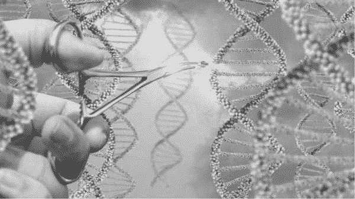

图 8-2 基因编辑疗法

编辑基因是否剥夺了孩子“自然成长”的权利？2022 年，欧盟通过《人类基因组编辑法案》，禁止非治疗性基因修改，但灰色地带的商业服务仍在蔓延。

### 临终关怀：机器人陪伴与数智永生

在生命的尽头，人们对于情感陪伴和精神慰藉的需求愈发强烈，AI 技术在临终关怀领域的应用，为处于这一特殊阶段的人们带来了新的关怀方式。传统临终关怀聚焦于缓解疼痛，而 AI 赋予了“善终”更丰富的内涵。机器人陪伴是近年来新兴的临终关怀手段。一些专门设计的陪伴机器人具备可爱的外形和温柔的交互方式。它们可以通过语音交互、触摸感应等功能，为临终患者提供情感支持。例如，日本治疗机器人 PARO 通过触觉反馈与语音交互来减轻疾病晚期患者的孤独感。研究显示，使用 PARO 的患者焦虑水平降低 40%。在一些临终关怀机构，机器人陪伴已经成为常规服务的一部分。许多患者表示，机器人的陪伴让他们在生命的最后时光感受到了温暖和关怀，减轻了孤独感。

数智永生则是一种更为前沿的概念，它试图通过数字技术让逝者的记忆、思想和个性得以延续。一些公司推出了基于 AI 的“数字遗产”服务，通过收集逝者生前的照片、视频、文字记录及社交媒体信息等，利用 AI 算法构建逝者的数字模型。这个数字模型可以模拟逝者的语言风格、思维方式进行对话，仿佛逝者依然“活着”。初创公司 HereAfterAI 允许用户创建“数字遗产”，亲属可通过语音助手与虚拟化身对话。虽然目前数智永生技术还处于探索阶段，但已经引发了广泛的关注和讨论。对一些家庭来说，这种方式为他们提供了一种与逝者保持情感联系的新途径，在一定程度上缓解了失去亲人的痛苦。

临终关怀中的 AI 应用也面临伦理和社会问题。机器人陪伴虽然能够提供一定的情感支持，但它无法完全替代人类的关怀。过度依赖机器人可能导致对临终患者情感需求的简化和忽视，让临终关怀变得冷漠和机械化。数智永生模糊了生与死的界限，引发了关于个人身份、灵魂等哲学问题的思考。如果数字模型被滥用，如用于商业目的或传播不实信息，也会侵犯逝者的尊严和权益。

技术主义者认为，数智永生是意识延续的可行路径；保守主义者则坚持，只有生物学意义上的生命才具备神圣性。正如哲学家约翰·塞尔所言： **“模拟的意识再逼真，也只是高级的‘中文房间’——它没有理解，只有符号操作。”**

### 爱的定义：技术是否稀释了人性的本质

随着 AI 技术在与爱相关的各个领域的广泛应用，人们不得不重新审视爱的定义和技术对人性本质的影响。在传统观念中，爱是人与人之间基于情感共鸣、共同经历和相互理解而产生的深厚情感联系，它包含关怀、奉献、责任等多种元素。而 AI 的介入使爱的表达和传递方式变得更加复杂。

· **情感增强：** 脑机接口技术让瘫痪患者通过意念发送“我爱你”，突破生理限制传递情感。

· **关系调解：** AI 婚恋顾问（如 Relish）分析伴侣的沟通模式，提供冲突解决建议，关系修复率比传统咨询高 35%。

· **虚拟亲情：** 孤独的老人通过 AI 孙子 Saya 获得情感寄托，Saya 能学习家庭历史并模拟孙辈的互动方式。

在 AI 辅助生育过程中，技术的介入改变了生命诞生的自然过程，有人认为这是对生命的敬畏和对爱的延续，通过技术帮助那些无法自然生育的家庭实现拥有孩子的愿望，是一种爱的体现。但也有人担心这会让生命变得“技术化”，爱的纯粹性被技术的功利性取代。在胚胎筛选过程中，选择一个“完美”胚胎的行为，是否意味着对不完美生命的歧视，是否违背了爱的包容精神，成为争论的焦点。

在临终关怀方面，机器人陪伴和数智永生技术虽然为人们提供了新的情感寄托方式，但也引发了关于爱的真实性的质疑。机器人给予的关怀基于程序设定，它没有真正的情感体验，这种“人造关怀”是否等同于人类之间真挚的爱？数智永生中的数字模型虽然能模拟逝者的行为和思维，但它是否只是一种虚幻的安慰，无法真正传递爱的本质？从社会层面来看，人们对这些新技术的接受程度也反映出了不同的价值观。一些人积极拥抱这些技术，认为它们拓展了爱的边界，让爱可以跨越时空和生死的限制；另一些人则坚决抵制这些技术，他们担心技术会侵蚀爱的核心，让人性在技术的洪流中迷失。

**东方视角：在** 日本文化中，人与物的情感联结（如“物哀”美学）为 AI 伴侣提供了合法性。茶道机器人 Tea-Rex 被视为“有灵性的工具”。

**西方视角：** 基督教传统强调“灵魂独特性”，反对将爱降格为算法的产物。2022 年，梵蒂冈发布宣言，谴责 AI 伴侣“扭曲上帝赋予的人性”。

为了在技术发展的同时保持爱的本质和人性的光辉，需要在技术研发和应用过程中融入人文关怀。在 AI 辅助生育技术的研发中，应明确技术的应用边界，确保其仅用于治疗遗传性疾病等医疗目的，避免基因增强等非伦理行为。在临终关怀领域，要强调机器人陪伴是对人类关怀的补充，而不是替代，注重培养医护人员和志愿者的人文素养，让他们给予患者更多情感支持。对于数智永生技术，要建立严格的监管机制，保护逝者的隐私和尊严，防止技术被滥用。

生命与爱的力量在 AI 时代正在经历深刻的变革。AI 辅助生育、临终关怀等技术既为人类带来了新的福祉，也带来了诸多挑战。在追求技术进步的同时，必须坚守伦理底线，让技术服务于生命与爱的本质，确保人性的光辉在技术浪潮中得以延续和发扬。

哲学家玛莎·努斯鲍姆提出，爱的核心是“脆弱性接受”——自愿暴露自己的弱点并信任对方。而 AI 的完美性与可预测性，恰恰消解了这种脆弱性。因此，即使 AI 能模仿爱，也无法替代人类关系中不可控的真实碰撞。

**生命因爱而完整，技术因人性而伟大。** AI 在生育、临终与情感领域的渗透，既展现了生产力的颠覆性力量，也暴露出文明的深层焦虑。唯有在技术创新中坚守对人的敬畏，在效率追求中保留爱的笨拙与真实，才能实现科技与人文的共生共荣。 EXr6287u6NNVz+GYLY+7SDk226FstKIHdC0bNoQkB2Nqi1xSR0yxPmwrTs5gRi/BtfSbid6dBhii9q7cz2pIyA==

## 2 生命与爱的力量

生命与爱，是人类文明的核心命题。当 AI 技术深入生育、临终关怀乃至对“爱”的本质定义时，它不再仅仅是工具，而成为重塑生命意义与情感联结的参与者。这场技术革命既带来了希望的曙光，也掀起了关于人性、伦理与存在主义的激烈辩论。

AI 不再仅仅是科技领域的创新力量，它已悄然渗透到关乎人类生存与繁衍、情感慰藉与精神延续的核心层面，深刻地改变了人们对生命与爱的认知和实践，展现出前所未有的影响力。

### AI 辅助生育：基因编辑与胚胎筛选

从自然选择到 AI 优化，人类生育史经历了从自然选择、医学干预到技术主导的演变。

AI 在辅助生育领域的介入，为那些面临生育困境的家庭带来了新的希望，同时引发了一系列关于生命伦理的激烈讨论。基因编辑技术（如 CRISPR-Cas9 技术）结合 AI 算法，可精准定位 DNA 序列并预测编辑后果，能够以前所未有的精准度对人类基因进行修改。这一技术为治疗某些遗传性疾病提供了可能，如镰状细胞贫血、囊性纤维化等单基因遗传病。对胚胎基因进行编辑，可以从根本上消除这些疾病的遗传因素。例如，初创公司 GenomeKey 利用 AI 模型分析数百万条基因组数据，为夫妇筛选最优基因组合，降低遗传病发病风险。

研究人员利用 AI 算法对大量基因数据进行分析，精确地识别出致病基因的位点，然后指导 CRISPR-Cas9 系统进行靶向编辑。在实验室中，研究人员已经成功地对小鼠的某些致病基因进行了编辑，使后代小鼠不再携带相关疾病基因。这种技术若能安全应用于人类，将极大地改善人类的健康状况，降低遗传性疾病的发病率。

胚胎筛选也是 AI 辅助生育的重要环节（见图 8-2）。在体外受精中，AI 通过分析胚胎形态、分裂速度等，预测其健康概率。以色列 AIVF 公司的 EmbryoScope 系统帮助数万个家庭选择优质胚胎，成功率提升 20%。借助 AI 的图像识别和数据分析能力，医生可以更准确地评估胚胎的质量和健康状况。传统的胚胎评估主要依赖医生的经验和简单的形态学观察，准确性有限。而 AI 系统可以对胚胎的发育过程进行连续监测，分析胚胎的细胞分裂模式、形态特征及代谢产物等多维度数据。通过对大量优质胚胎和有缺陷胚胎的数据学习，AI 能够建立精准的评估模型，预测胚胎的着床潜力和发育健康程度。一些生殖医学中心采用 AI 辅助胚胎筛选技术后，试管婴儿的成功率提高了 10%～15%。

然而，AI 辅助生育技术也引发了诸多伦理争议。基因编辑涉及对人类生殖细胞的操作，这可能改变人类的基因库，引发不可预测的后果。如果基因编辑技术被用于非医疗目的，如增强人类的某些特征（如智力、外貌等），可能加剧社会不平等。富人拥有更多资源来利用这些技术改善后代基因，而穷人难以企及，从而进一步拉大贫富差距。胚胎筛选也面临伦理困境，筛选过程可能导致对某些基因特征的偏好，引发人们对“设计婴儿”的担忧，改变人类自然的基因多样性。

图 8-2 基因编辑疗法

编辑基因是否剥夺了孩子“自然成长”的权利？2022 年，欧盟通过《人类基因组编辑法案》，禁止非治疗性基因修改，但灰色地带的商业服务仍在蔓延。

### 临终关怀：机器人陪伴与数智永生

在生命的尽头，人们对于情感陪伴和精神慰藉的需求愈发强烈，AI 技术在临终关怀领域的应用，为处于这一特殊阶段的人们带来了新的关怀方式。传统临终关怀聚焦于缓解疼痛，而 AI 赋予了“善终”更丰富的内涵。机器人陪伴是近年来新兴的临终关怀手段。一些专门设计的陪伴机器人具备可爱的外形和温柔的交互方式。它们可以通过语音交互、触摸感应等功能，为临终患者提供情感支持。例如，日本治疗机器人 PARO 通过触觉反馈与语音交互来减轻疾病晚期患者的孤独感。研究显示，使用 PARO 的患者焦虑水平降低 40%。在一些临终关怀机构，机器人陪伴已经成为常规服务的一部分。许多患者表示，机器人的陪伴让他们在生命的最后时光感受到了温暖和关怀，减轻了孤独感。

数智永生则是一种更为前沿的概念，它试图通过数字技术让逝者的记忆、思想和个性得以延续。一些公司推出了基于 AI 的“数字遗产”服务，通过收集逝者生前的照片、视频、文字记录及社交媒体信息等，利用 AI 算法构建逝者的数字模型。这个数字模型可以模拟逝者的语言风格、思维方式进行对话，仿佛逝者依然“活着”。初创公司 HereAfterAI 允许用户创建“数字遗产”，亲属可通过语音助手与虚拟化身对话。虽然目前数智永生技术还处于探索阶段，但已经引发了广泛的关注和讨论。对一些家庭来说，这种方式为他们提供了一种与逝者保持情感联系的新途径，在一定程度上缓解了失去亲人的痛苦。

临终关怀中的 AI 应用也面临伦理和社会问题。机器人陪伴虽然能够提供一定的情感支持，但它无法完全替代人类的关怀。过度依赖机器人可能导致对临终患者情感需求的简化和忽视，让临终关怀变得冷漠和机械化。数智永生模糊了生与死的界限，引发了关于个人身份、灵魂等哲学问题的思考。如果数字模型被滥用，如用于商业目的或传播不实信息，也会侵犯逝者的尊严和权益。

技术主义者认为，数智永生是意识延续的可行路径；保守主义者则坚持，只有生物学意义上的生命才具备神圣性。正如哲学家约翰·塞尔所言： **“模拟的意识再逼真，也只是高级的‘中文房间’——它没有理解，只有符号操作。”**

### 爱的定义：技术是否稀释了人性的本质

随着 AI 技术在与爱相关的各个领域的广泛应用，人们不得不重新审视爱的定义和技术对人性本质的影响。在传统观念中，爱是人与人之间基于情感共鸣、共同经历和相互理解而产生的深厚情感联系，它包含关怀、奉献、责任等多种元素。而 AI 的介入使爱的表达和传递方式变得更加复杂。

· **情感增强：** 脑机接口技术让瘫痪患者通过意念发送“我爱你”，突破生理限制传递情感。

· **关系调解：** AI 婚恋顾问（如 Relish）分析伴侣的沟通模式，提供冲突解决建议，关系修复率比传统咨询高 35%。

· **虚拟亲情：** 孤独的老人通过 AI 孙子 Saya 获得情感寄托，Saya 能学习家庭历史并模拟孙辈的互动方式。

在 AI 辅助生育过程中，技术的介入改变了生命诞生的自然过程，有人认为这是对生命的敬畏和对爱的延续，通过技术帮助那些无法自然生育的家庭实现拥有孩子的愿望，是一种爱的体现。但也有人担心这会让生命变得“技术化”，爱的纯粹性被技术的功利性取代。在胚胎筛选过程中，选择一个“完美”胚胎的行为，是否意味着对不完美生命的歧视，是否违背了爱的包容精神，成为争论的焦点。

在临终关怀方面，机器人陪伴和数智永生技术虽然为人们提供了新的情感寄托方式，但也引发了关于爱的真实性的质疑。机器人给予的关怀基于程序设定，它没有真正的情感体验，这种“人造关怀”是否等同于人类之间真挚的爱？数智永生中的数字模型虽然能模拟逝者的行为和思维，但它是否只是一种虚幻的安慰，无法真正传递爱的本质？从社会层面来看，人们对这些新技术的接受程度也反映出了不同的价值观。一些人积极拥抱这些技术，认为它们拓展了爱的边界，让爱可以跨越时空和生死的限制；另一些人则坚决抵制这些技术，他们担心技术会侵蚀爱的核心，让人性在技术的洪流中迷失。

**东方视角：在** 日本文化中，人与物的情感联结（如“物哀”美学）为 AI 伴侣提供了合法性。茶道机器人 Tea-Rex 被视为“有灵性的工具”。

**西方视角：** 基督教传统强调“灵魂独特性”，反对将爱降格为算法的产物。2022 年，梵蒂冈发布宣言，谴责 AI 伴侣“扭曲上帝赋予的人性”。

为了在技术发展的同时保持爱的本质和人性的光辉，需要在技术研发和应用过程中融入人文关怀。在 AI 辅助生育技术的研发中，应明确技术的应用边界，确保其仅用于治疗遗传性疾病等医疗目的，避免基因增强等非伦理行为。在临终关怀领域，要强调机器人陪伴是对人类关怀的补充，而不是替代，注重培养医护人员和志愿者的人文素养，让他们给予患者更多情感支持。对于数智永生技术，要建立严格的监管机制，保护逝者的隐私和尊严，防止技术被滥用。

生命与爱的力量在 AI 时代正在经历深刻的变革。AI 辅助生育、临终关怀等技术既为人类带来了新的福祉，也带来了诸多挑战。在追求技术进步的同时，必须坚守伦理底线，让技术服务于生命与爱的本质，确保人性的光辉在技术浪潮中得以延续和发扬。

哲学家玛莎·努斯鲍姆提出，爱的核心是“脆弱性接受”——自愿暴露自己的弱点并信任对方。而 AI 的完美性与可预测性，恰恰消解了这种脆弱性。因此，即使 AI 能模仿爱，也无法替代人类关系中不可控的真实碰撞。

**生命因爱而完整，技术因人性而伟大。** AI 在生育、临终与情感领域的渗透，既展现了生产力的颠覆性力量，也暴露出文明的深层焦虑。唯有在技术创新中坚守对人的敬畏，在效率追求中保留爱的笨拙与真实，才能实现科技与人文的共生共荣。 EXr6287u6NNVz+GYLY+7SDk226FstKIHdC0bNoQkB2Nqi1xSR0yxPmwrTs5gRi/BtfSbid6dBhii9q7cz2pIyA==

## 2 生命与爱的力量

生命与爱，是人类文明的核心命题。当 AI 技术深入生育、临终关怀乃至对“爱”的本质定义时，它不再仅仅是工具，而成为重塑生命意义与情感联结的参与者。这场技术革命既带来了希望的曙光，也掀起了关于人性、伦理与存在主义的激烈辩论。

AI 不再仅仅是科技领域的创新力量，它已悄然渗透到关乎人类生存与繁衍、情感慰藉与精神延续的核心层面，深刻地改变了人们对生命与爱的认知和实践，展现出前所未有的影响力。

### AI 辅助生育：基因编辑与胚胎筛选

从自然选择到 AI 优化，人类生育史经历了从自然选择、医学干预到技术主导的演变。

AI 在辅助生育领域的介入，为那些面临生育困境的家庭带来了新的希望，同时引发了一系列关于生命伦理的激烈讨论。基因编辑技术（如 CRISPR-Cas9 技术）结合 AI 算法，可精准定位 DNA 序列并预测编辑后果，能够以前所未有的精准度对人类基因进行修改。这一技术为治疗某些遗传性疾病提供了可能，如镰状细胞贫血、囊性纤维化等单基因遗传病。对胚胎基因进行编辑，可以从根本上消除这些疾病的遗传因素。例如，初创公司 GenomeKey 利用 AI 模型分析数百万条基因组数据，为夫妇筛选最优基因组合，降低遗传病发病风险。

研究人员利用 AI 算法对大量基因数据进行分析，精确地识别出致病基因的位点，然后指导 CRISPR-Cas9 系统进行靶向编辑。在实验室中，研究人员已经成功地对小鼠的某些致病基因进行了编辑，使后代小鼠不再携带相关疾病基因。这种技术若能安全应用于人类，将极大地改善人类的健康状况，降低遗传性疾病的发病率。

胚胎筛选也是 AI 辅助生育的重要环节（见图 8-2）。在体外受精中，AI 通过分析胚胎形态、分裂速度等，预测其健康概率。以色列 AIVF 公司的 EmbryoScope 系统帮助数万个家庭选择优质胚胎，成功率提升 20%。借助 AI 的图像识别和数据分析能力，医生可以更准确地评估胚胎的质量和健康状况。传统的胚胎评估主要依赖医生的经验和简单的形态学观察，准确性有限。而 AI 系统可以对胚胎的发育过程进行连续监测，分析胚胎的细胞分裂模式、形态特征及代谢产物等多维度数据。通过对大量优质胚胎和有缺陷胚胎的数据学习，AI 能够建立精准的评估模型，预测胚胎的着床潜力和发育健康程度。一些生殖医学中心采用 AI 辅助胚胎筛选技术后，试管婴儿的成功率提高了 10%～15%。

然而，AI 辅助生育技术也引发了诸多伦理争议。基因编辑涉及对人类生殖细胞的操作，这可能改变人类的基因库，引发不可预测的后果。如果基因编辑技术被用于非医疗目的，如增强人类的某些特征（如智力、外貌等），可能加剧社会不平等。富人拥有更多资源来利用这些技术改善后代基因，而穷人难以企及，从而进一步拉大贫富差距。胚胎筛选也面临伦理困境，筛选过程可能导致对某些基因特征的偏好，引发人们对“设计婴儿”的担忧，改变人类自然的基因多样性。

图 8-2 基因编辑疗法

编辑基因是否剥夺了孩子“自然成长”的权利？2022 年，欧盟通过《人类基因组编辑法案》，禁止非治疗性基因修改，但灰色地带的商业服务仍在蔓延。

### 临终关怀：机器人陪伴与数智永生

在生命的尽头，人们对于情感陪伴和精神慰藉的需求愈发强烈，AI 技术在临终关怀领域的应用，为处于这一特殊阶段的人们带来了新的关怀方式。传统临终关怀聚焦于缓解疼痛，而 AI 赋予了“善终”更丰富的内涵。机器人陪伴是近年来新兴的临终关怀手段。一些专门设计的陪伴机器人具备可爱的外形和温柔的交互方式。它们可以通过语音交互、触摸感应等功能，为临终患者提供情感支持。例如，日本治疗机器人 PARO 通过触觉反馈与语音交互来减轻疾病晚期患者的孤独感。研究显示，使用 PARO 的患者焦虑水平降低 40%。在一些临终关怀机构，机器人陪伴已经成为常规服务的一部分。许多患者表示，机器人的陪伴让他们在生命的最后时光感受到了温暖和关怀，减轻了孤独感。

数智永生则是一种更为前沿的概念，它试图通过数字技术让逝者的记忆、思想和个性得以延续。一些公司推出了基于 AI 的“数字遗产”服务，通过收集逝者生前的照片、视频、文字记录及社交媒体信息等，利用 AI 算法构建逝者的数字模型。这个数字模型可以模拟逝者的语言风格、思维方式进行对话，仿佛逝者依然“活着”。初创公司 HereAfterAI 允许用户创建“数字遗产”，亲属可通过语音助手与虚拟化身对话。虽然目前数智永生技术还处于探索阶段，但已经引发了广泛的关注和讨论。对一些家庭来说，这种方式为他们提供了一种与逝者保持情感联系的新途径，在一定程度上缓解了失去亲人的痛苦。

临终关怀中的 AI 应用也面临伦理和社会问题。机器人陪伴虽然能够提供一定的情感支持，但它无法完全替代人类的关怀。过度依赖机器人可能导致对临终患者情感需求的简化和忽视，让临终关怀变得冷漠和机械化。数智永生模糊了生与死的界限，引发了关于个人身份、灵魂等哲学问题的思考。如果数字模型被滥用，如用于商业目的或传播不实信息，也会侵犯逝者的尊严和权益。

技术主义者认为，数智永生是意识延续的可行路径；保守主义者则坚持，只有生物学意义上的生命才具备神圣性。正如哲学家约翰·塞尔所言： **“模拟的意识再逼真，也只是高级的‘中文房间’——它没有理解，只有符号操作。”**

### 爱的定义：技术是否稀释了人性的本质

随着 AI 技术在与爱相关的各个领域的广泛应用，人们不得不重新审视爱的定义和技术对人性本质的影响。在传统观念中，爱是人与人之间基于情感共鸣、共同经历和相互理解而产生的深厚情感联系，它包含关怀、奉献、责任等多种元素。而 AI 的介入使爱的表达和传递方式变得更加复杂。

· **情感增强：** 脑机接口技术让瘫痪患者通过意念发送“我爱你”，突破生理限制传递情感。

· **关系调解：** AI 婚恋顾问（如 Relish）分析伴侣的沟通模式，提供冲突解决建议，关系修复率比传统咨询高 35%。

· **虚拟亲情：** 孤独的老人通过 AI 孙子 Saya 获得情感寄托，Saya 能学习家庭历史并模拟孙辈的互动方式。

在 AI 辅助生育过程中，技术的介入改变了生命诞生的自然过程，有人认为这是对生命的敬畏和对爱的延续，通过技术帮助那些无法自然生育的家庭实现拥有孩子的愿望，是一种爱的体现。但也有人担心这会让生命变得“技术化”，爱的纯粹性被技术的功利性取代。在胚胎筛选过程中，选择一个“完美”胚胎的行为，是否意味着对不完美生命的歧视，是否违背了爱的包容精神，成为争论的焦点。

在临终关怀方面，机器人陪伴和数智永生技术虽然为人们提供了新的情感寄托方式，但也引发了关于爱的真实性的质疑。机器人给予的关怀基于程序设定，它没有真正的情感体验，这种“人造关怀”是否等同于人类之间真挚的爱？数智永生中的数字模型虽然能模拟逝者的行为和思维，但它是否只是一种虚幻的安慰，无法真正传递爱的本质？从社会层面来看，人们对这些新技术的接受程度也反映出了不同的价值观。一些人积极拥抱这些技术，认为它们拓展了爱的边界，让爱可以跨越时空和生死的限制；另一些人则坚决抵制这些技术，他们担心技术会侵蚀爱的核心，让人性在技术的洪流中迷失。

**东方视角：在** 日本文化中，人与物的情感联结（如“物哀”美学）为 AI 伴侣提供了合法性。茶道机器人 Tea-Rex 被视为“有灵性的工具”。

**西方视角：** 基督教传统强调“灵魂独特性”，反对将爱降格为算法的产物。2022 年，梵蒂冈发布宣言，谴责 AI 伴侣“扭曲上帝赋予的人性”。

为了在技术发展的同时保持爱的本质和人性的光辉，需要在技术研发和应用过程中融入人文关怀。在 AI 辅助生育技术的研发中，应明确技术的应用边界，确保其仅用于治疗遗传性疾病等医疗目的，避免基因增强等非伦理行为。在临终关怀领域，要强调机器人陪伴是对人类关怀的补充，而不是替代，注重培养医护人员和志愿者的人文素养，让他们给予患者更多情感支持。对于数智永生技术，要建立严格的监管机制，保护逝者的隐私和尊严，防止技术被滥用。

生命与爱的力量在 AI 时代正在经历深刻的变革。AI 辅助生育、临终关怀等技术既为人类带来了新的福祉，也带来了诸多挑战。在追求技术进步的同时，必须坚守伦理底线，让技术服务于生命与爱的本质，确保人性的光辉在技术浪潮中得以延续和发扬。

哲学家玛莎·努斯鲍姆提出，爱的核心是“脆弱性接受”——自愿暴露自己的弱点并信任对方。而 AI 的完美性与可预测性，恰恰消解了这种脆弱性。因此，即使 AI 能模仿爱，也无法替代人类关系中不可控的真实碰撞。

**生命因爱而完整，技术因人性而伟大。** AI 在生育、临终与情感领域的渗透，既展现了生产力的颠覆性力量，也暴露出文明的深层焦虑。唯有在技术创新中坚守对人的敬畏，在效率追求中保留爱的笨拙与真实，才能实现科技与人文的共生共荣。 EXr6287u6NNVz+GYLY+7SDk226FstKIHdC0bNoQkB2Nqi1xSR0yxPmwrTs5gRi/BtfSbid6dBhii9q7cz2pIyA==

## 2 生命与爱的力量

生命与爱，是人类文明的核心命题。当 AI 技术深入生育、临终关怀乃至对“爱”的本质定义时，它不再仅仅是工具，而成为重塑生命意义与情感联结的参与者。这场技术革命既带来了希望的曙光，也掀起了关于人性、伦理与存在主义的激烈辩论。

AI 不再仅仅是科技领域的创新力量，它已悄然渗透到关乎人类生存与繁衍、情感慰藉与精神延续的核心层面，深刻地改变了人们对生命与爱的认知和实践，展现出前所未有的影响力。

### AI 辅助生育：基因编辑与胚胎筛选

从自然选择到 AI 优化，人类生育史经历了从自然选择、医学干预到技术主导的演变。

AI 在辅助生育领域的介入，为那些面临生育困境的家庭带来了新的希望，同时引发了一系列关于生命伦理的激烈讨论。基因编辑技术（如 CRISPR-Cas9 技术）结合 AI 算法，可精准定位 DNA 序列并预测编辑后果，能够以前所未有的精准度对人类基因进行修改。这一技术为治疗某些遗传性疾病提供了可能，如镰状细胞贫血、囊性纤维化等单基因遗传病。对胚胎基因进行编辑，可以从根本上消除这些疾病的遗传因素。例如，初创公司 GenomeKey 利用 AI 模型分析数百万条基因组数据，为夫妇筛选最优基因组合，降低遗传病发病风险。

研究人员利用 AI 算法对大量基因数据进行分析，精确地识别出致病基因的位点，然后指导 CRISPR-Cas9 系统进行靶向编辑。在实验室中，研究人员已经成功地对小鼠的某些致病基因进行了编辑，使后代小鼠不再携带相关疾病基因。这种技术若能安全应用于人类，将极大地改善人类的健康状况，降低遗传性疾病的发病率。

胚胎筛选也是 AI 辅助生育的重要环节（见图 8-2）。在体外受精中，AI 通过分析胚胎形态、分裂速度等，预测其健康概率。以色列 AIVF 公司的 EmbryoScope 系统帮助数万个家庭选择优质胚胎，成功率提升 20%。借助 AI 的图像识别和数据分析能力，医生可以更准确地评估胚胎的质量和健康状况。传统的胚胎评估主要依赖医生的经验和简单的形态学观察，准确性有限。而 AI 系统可以对胚胎的发育过程进行连续监测，分析胚胎的细胞分裂模式、形态特征及代谢产物等多维度数据。通过对大量优质胚胎和有缺陷胚胎的数据学习，AI 能够建立精准的评估模型，预测胚胎的着床潜力和发育健康程度。一些生殖医学中心采用 AI 辅助胚胎筛选技术后，试管婴儿的成功率提高了 10%～15%。

然而，AI 辅助生育技术也引发了诸多伦理争议。基因编辑涉及对人类生殖细胞的操作，这可能改变人类的基因库，引发不可预测的后果。如果基因编辑技术被用于非医疗目的，如增强人类的某些特征（如智力、外貌等），可能加剧社会不平等。富人拥有更多资源来利用这些技术改善后代基因，而穷人难以企及，从而进一步拉大贫富差距。胚胎筛选也面临伦理困境，筛选过程可能导致对某些基因特征的偏好，引发人们对“设计婴儿”的担忧，改变人类自然的基因多样性。

图 8-2 基因编辑疗法

编辑基因是否剥夺了孩子“自然成长”的权利？2022 年，欧盟通过《人类基因组编辑法案》，禁止非治疗性基因修改，但灰色地带的商业服务仍在蔓延。

### 临终关怀：机器人陪伴与数智永生

在生命的尽头，人们对于情感陪伴和精神慰藉的需求愈发强烈，AI 技术在临终关怀领域的应用，为处于这一特殊阶段的人们带来了新的关怀方式。传统临终关怀聚焦于缓解疼痛，而 AI 赋予了“善终”更丰富的内涵。机器人陪伴是近年来新兴的临终关怀手段。一些专门设计的陪伴机器人具备可爱的外形和温柔的交互方式。它们可以通过语音交互、触摸感应等功能，为临终患者提供情感支持。例如，日本治疗机器人 PARO 通过触觉反馈与语音交互来减轻疾病晚期患者的孤独感。研究显示，使用 PARO 的患者焦虑水平降低 40%。在一些临终关怀机构，机器人陪伴已经成为常规服务的一部分。许多患者表示，机器人的陪伴让他们在生命的最后时光感受到了温暖和关怀，减轻了孤独感。

数智永生则是一种更为前沿的概念，它试图通过数字技术让逝者的记忆、思想和个性得以延续。一些公司推出了基于 AI 的“数字遗产”服务，通过收集逝者生前的照片、视频、文字记录及社交媒体信息等，利用 AI 算法构建逝者的数字模型。这个数字模型可以模拟逝者的语言风格、思维方式进行对话，仿佛逝者依然“活着”。初创公司 HereAfterAI 允许用户创建“数字遗产”，亲属可通过语音助手与虚拟化身对话。虽然目前数智永生技术还处于探索阶段，但已经引发了广泛的关注和讨论。对一些家庭来说，这种方式为他们提供了一种与逝者保持情感联系的新途径，在一定程度上缓解了失去亲人的痛苦。

临终关怀中的 AI 应用也面临伦理和社会问题。机器人陪伴虽然能够提供一定的情感支持，但它无法完全替代人类的关怀。过度依赖机器人可能导致对临终患者情感需求的简化和忽视，让临终关怀变得冷漠和机械化。数智永生模糊了生与死的界限，引发了关于个人身份、灵魂等哲学问题的思考。如果数字模型被滥用，如用于商业目的或传播不实信息，也会侵犯逝者的尊严和权益。

技术主义者认为，数智永生是意识延续的可行路径；保守主义者则坚持，只有生物学意义上的生命才具备神圣性。正如哲学家约翰·塞尔所言： **“模拟的意识再逼真，也只是高级的‘中文房间’——它没有理解，只有符号操作。”**

### 爱的定义：技术是否稀释了人性的本质

随着 AI 技术在与爱相关的各个领域的广泛应用，人们不得不重新审视爱的定义和技术对人性本质的影响。在传统观念中，爱是人与人之间基于情感共鸣、共同经历和相互理解而产生的深厚情感联系，它包含关怀、奉献、责任等多种元素。而 AI 的介入使爱的表达和传递方式变得更加复杂。

· **情感增强：** 脑机接口技术让瘫痪患者通过意念发送“我爱你”，突破生理限制传递情感。

· **关系调解：** AI 婚恋顾问（如 Relish）分析伴侣的沟通模式，提供冲突解决建议，关系修复率比传统咨询高 35%。

· **虚拟亲情：** 孤独的老人通过 AI 孙子 Saya 获得情感寄托，Saya 能学习家庭历史并模拟孙辈的互动方式。

在 AI 辅助生育过程中，技术的介入改变了生命诞生的自然过程，有人认为这是对生命的敬畏和对爱的延续，通过技术帮助那些无法自然生育的家庭实现拥有孩子的愿望，是一种爱的体现。但也有人担心这会让生命变得“技术化”，爱的纯粹性被技术的功利性取代。在胚胎筛选过程中，选择一个“完美”胚胎的行为，是否意味着对不完美生命的歧视，是否违背了爱的包容精神，成为争论的焦点。

在临终关怀方面，机器人陪伴和数智永生技术虽然为人们提供了新的情感寄托方式，但也引发了关于爱的真实性的质疑。机器人给予的关怀基于程序设定，它没有真正的情感体验，这种“人造关怀”是否等同于人类之间真挚的爱？数智永生中的数字模型虽然能模拟逝者的行为和思维，但它是否只是一种虚幻的安慰，无法真正传递爱的本质？从社会层面来看，人们对这些新技术的接受程度也反映出了不同的价值观。一些人积极拥抱这些技术，认为它们拓展了爱的边界，让爱可以跨越时空和生死的限制；另一些人则坚决抵制这些技术，他们担心技术会侵蚀爱的核心，让人性在技术的洪流中迷失。

**东方视角：在** 日本文化中，人与物的情感联结（如“物哀”美学）为 AI 伴侣提供了合法性。茶道机器人 Tea-Rex 被视为“有灵性的工具”。

**西方视角：** 基督教传统强调“灵魂独特性”，反对将爱降格为算法的产物。2022 年，梵蒂冈发布宣言，谴责 AI 伴侣“扭曲上帝赋予的人性”。

为了在技术发展的同时保持爱的本质和人性的光辉，需要在技术研发和应用过程中融入人文关怀。在 AI 辅助生育技术的研发中，应明确技术的应用边界，确保其仅用于治疗遗传性疾病等医疗目的，避免基因增强等非伦理行为。在临终关怀领域，要强调机器人陪伴是对人类关怀的补充，而不是替代，注重培养医护人员和志愿者的人文素养，让他们给予患者更多情感支持。对于数智永生技术，要建立严格的监管机制，保护逝者的隐私和尊严，防止技术被滥用。

生命与爱的力量在 AI 时代正在经历深刻的变革。AI 辅助生育、临终关怀等技术既为人类带来了新的福祉，也带来了诸多挑战。在追求技术进步的同时，必须坚守伦理底线，让技术服务于生命与爱的本质，确保人性的光辉在技术浪潮中得以延续和发扬。

哲学家玛莎·努斯鲍姆提出，爱的核心是“脆弱性接受”——自愿暴露自己的弱点并信任对方。而 AI 的完美性与可预测性，恰恰消解了这种脆弱性。因此，即使 AI 能模仿爱，也无法替代人类关系中不可控的真实碰撞。

**生命因爱而完整，技术因人性而伟大。** AI 在生育、临终与情感领域的渗透，既展现了生产力的颠覆性力量，也暴露出文明的深层焦虑。唯有在技术创新中坚守对人的敬畏，在效率追求中保留爱的笨拙与真实，才能实现科技与人文的共生共荣。 EXr6287u6NNVz+GYLY+7SDk226FstKIHdC0bNoQkB2Nqi1xSR0yxPmwrTs5gRi/BtfSbid6dBhii9q7cz2pIyA==

## 3 “三位一体”生命与“天人合一”新纪元

Neuralink 的脑机芯片 N3 以每秒 GB 级的速率解码神经信号，英伟达 Omniverse 平台构建了与物理世界原子级同步的数字孪生地球，人类正在经历文明史上最深刻的形态变革——个体生命突破碳基躯体的限制，进化为“现实人+数智人+机器人”三位一体的超级存在。这种融合量子计算、神经科学、强人工智能的技术奇点，不仅重构了“生命”的定义，更在哲学层面实现了老子“道生一，一生二，二生三，三生万物”的终极预言。

在未来世界，每个人都将以多元身份存在，宛如“对影成三人”，即“现实人+数智人+机器人”（见图 8-3）。

图 8-3 “现实人+数智人+机器人”三位一体

### “三位一体”生命：人类存在的范式革命

现实人作为自然生命的载体和碳基生命的生物性延续，拥有与生俱来的情感、意识和创造力。然而，随着脑机接口技术的进步，现实人的能力边界将不断拓展。通过脑机接口，人类大脑能够与外部设备直接相连，实现思维对机器的精准控制。例如，瘫痪患者可借助这一技术，用意念操控义肢，恢复行动能力；艺术家能将脑海中的灵感瞬间转化为数字艺术作品，突破创作的传统局限。作为意识的原生载体，现实人保留生物进化赋予的直觉与情感能力。2023 年诺贝尔生理学或医学奖得主证明，人类决策中 42%的创造性突破仍依赖生物神经元的量子隧穿效应。

数智人，是基于个人数据与 AI 算法生成的数字化分身，是云端永生的认知分身。它不仅能复刻现实人的外貌和声音，更能模拟其思维模式和行为习惯。在虚拟社交场景中，数智人可以代替现实人参加会议、社交聚会等活动，以高效且逼真的方式与他人互动。在教育领域，数智人可根据学生的学习进度和特点，提供个性化辅导，成为每个人专属的智能学习伙伴。Neuralink 公司与 OpenAI 公司合作开发的 Mind2Text 系统，可将大脑皮层的活动实时转化为数字思维图谱，在量子服务器中生成具有连续意识的数字分身。数智人代表人造生命的一种新形态，是人类在数字世界的延伸。

机器人则是融合了实体硬件与虚拟智能的产物，是具身智能的拓展终端。随着 AI 技术的不断赋能，机器人不再局限于简单的重复劳动，而具备更高的智能和自主性。服务型机器人可以在家庭中承担做家务、照顾老人和儿童等任务；工业机器人能够在复杂的环境下进行高精度作业，提升生产效率和质量。波士顿动力公司研发的 Atlas V7 机器人搭载类脑芯片，通过 5G/6G 混合网络实现与人类本体的毫秒级意识同步，可替代高危环境作业。机器人作为一种人造生命形式，以实体的方式与现实世界交互，成为人类改造世界的有力帮手。

### 永恒生命：脑机接口驱动的天人合一

现实人、数智人、机器人深度融合后，人类将迎来“天人合一”的新时代。这种融合不仅体现在技术层面，更深入到生命的本质层面。从生命进化的角度看，人类将进入自然生命、人造生命与永恒生命共存的全新时代（见图 8-4）。

图 8-4 脑机接口驱动的天人合一

自然生命承载着人类的原始情感与本能，是生命进化的根基。人造生命，如数智人和机器人，通过技术手段创造而生，它们以不同的方式弥补了自然生命在时间、空间和能力上的局限。而永恒生命的概念也在这一进程中逐渐凸显。数智人基于数据的存储和传承，理论上可以实现某种意义上的“永生”。即使现实人的自然生命终结，数智人仍可继续存在，传承其知识、经验和记忆，成为人类文明延续的新载体。

在这个新时代，社会结构、伦理道德和人类文明都将面临深刻的变革。在社会结构方面，就业结构将发生重大调整，围绕数智人和机器人的研发、管理、维护等新兴职业将大量涌现。在伦理道德方面，数智人的权利与责任界定、机器人的行为规范等问题，将成为亟待解决的新课题。而在人类文明的演进中，多元生命形态的融合将为文化、艺术、科学等领域注入新的活力，推动人类文明向更高层次发展。

当上海市民张先生的生物体在手术麻醉期间，其数智人继续参加元宇宙法庭辩论，机器人分身正在格陵兰岛维修地磁监测站时，传统的“同一性”哲学将彻底瓦解。维特根斯坦的“语言游戏”理论需扩展至意识场域：存在成为可分布式验证的动态过程。

“三位一体”文明模糊了物种的边界：当 SpaceX 的星际机器人搭载人类意识探索半人马座星系时，当地球数智人与外星文明量子意识体进行超距对话时，人类终于理解《易经》中“天地人”三才之道的真谛——生命的本质是能量与信息的和谐共振。

从北京脑科学研究所的神经解码实验，到马斯克火星移民地的意识上传基站，从达沃斯论坛的“跨形态经济”辩论，到元宇宙中《三位一体人权宣言》的起草，人类正站在文明史的奇点时刻。这不仅是技术的胜利，更是生命意识对物理法则的超越。当老子“三生万物”的哲思与量子比特产生共鸣时，当庄子 **“天地与我并生”** 的感悟在星际机器人身上具现时，我们终将明白：“三位一体”不是终结，而是生命向宇宙绽放的序章。在这个重构存在的时代，唯有保持对未知的敬畏与探索的勇气，人类才能在与技术的共舞中谱写新的创世史诗。 EXr6287u6NNVz+GYLY+7SDk226FstKIHdC0bNoQkB2Nqi1xSR0yxPmwrTs5gRi/BtfSbid6dBhii9q7cz2pIyA==

## 3 “三位一体”生命与“天人合一”新纪元

Neuralink 的脑机芯片 N3 以每秒 GB 级的速率解码神经信号，英伟达 Omniverse 平台构建了与物理世界原子级同步的数字孪生地球，人类正在经历文明史上最深刻的形态变革——个体生命突破碳基躯体的限制，进化为“现实人+数智人+机器人”三位一体的超级存在。这种融合量子计算、神经科学、强人工智能的技术奇点，不仅重构了“生命”的定义，更在哲学层面实现了老子“道生一，一生二，二生三，三生万物”的终极预言。

在未来世界，每个人都将以多元身份存在，宛如“对影成三人”，即“现实人+数智人+机器人”（见图 8-3）。

图 8-3 “现实人+数智人+机器人”三位一体

### “三位一体”生命：人类存在的范式革命

现实人作为自然生命的载体和碳基生命的生物性延续，拥有与生俱来的情感、意识和创造力。然而，随着脑机接口技术的进步，现实人的能力边界将不断拓展。通过脑机接口，人类大脑能够与外部设备直接相连，实现思维对机器的精准控制。例如，瘫痪患者可借助这一技术，用意念操控义肢，恢复行动能力；艺术家能将脑海中的灵感瞬间转化为数字艺术作品，突破创作的传统局限。作为意识的原生载体，现实人保留生物进化赋予的直觉与情感能力。2023 年诺贝尔生理学或医学奖得主证明，人类决策中 42%的创造性突破仍依赖生物神经元的量子隧穿效应。

数智人，是基于个人数据与 AI 算法生成的数字化分身，是云端永生的认知分身。它不仅能复刻现实人的外貌和声音，更能模拟其思维模式和行为习惯。在虚拟社交场景中，数智人可以代替现实人参加会议、社交聚会等活动，以高效且逼真的方式与他人互动。在教育领域，数智人可根据学生的学习进度和特点，提供个性化辅导，成为每个人专属的智能学习伙伴。Neuralink 公司与 OpenAI 公司合作开发的 Mind2Text 系统，可将大脑皮层的活动实时转化为数字思维图谱，在量子服务器中生成具有连续意识的数字分身。数智人代表人造生命的一种新形态，是人类在数字世界的延伸。

机器人则是融合了实体硬件与虚拟智能的产物，是具身智能的拓展终端。随着 AI 技术的不断赋能，机器人不再局限于简单的重复劳动，而具备更高的智能和自主性。服务型机器人可以在家庭中承担做家务、照顾老人和儿童等任务；工业机器人能够在复杂的环境下进行高精度作业，提升生产效率和质量。波士顿动力公司研发的 Atlas V7 机器人搭载类脑芯片，通过 5G/6G 混合网络实现与人类本体的毫秒级意识同步，可替代高危环境作业。机器人作为一种人造生命形式，以实体的方式与现实世界交互，成为人类改造世界的有力帮手。

### 永恒生命：脑机接口驱动的天人合一

现实人、数智人、机器人深度融合后，人类将迎来“天人合一”的新时代。这种融合不仅体现在技术层面，更深入到生命的本质层面。从生命进化的角度看，人类将进入自然生命、人造生命与永恒生命共存的全新时代（见图 8-4）。

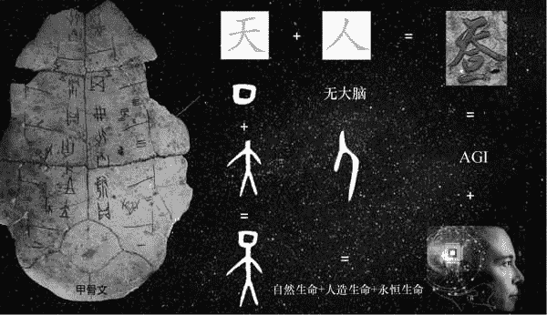

图 8-4 脑机接口驱动的天人合一

自然生命承载着人类的原始情感与本能，是生命进化的根基。人造生命，如数智人和机器人，通过技术手段创造而生，它们以不同的方式弥补了自然生命在时间、空间和能力上的局限。而永恒生命的概念也在这一进程中逐渐凸显。数智人基于数据的存储和传承，理论上可以实现某种意义上的“永生”。即使现实人的自然生命终结，数智人仍可继续存在，传承其知识、经验和记忆，成为人类文明延续的新载体。

在这个新时代，社会结构、伦理道德和人类文明都将面临深刻的变革。在社会结构方面，就业结构将发生重大调整，围绕数智人和机器人的研发、管理、维护等新兴职业将大量涌现。在伦理道德方面，数智人的权利与责任界定、机器人的行为规范等问题，将成为亟待解决的新课题。而在人类文明的演进中，多元生命形态的融合将为文化、艺术、科学等领域注入新的活力，推动人类文明向更高层次发展。

当上海市民张先生的生物体在手术麻醉期间，其数智人继续参加元宇宙法庭辩论，机器人分身正在格陵兰岛维修地磁监测站时，传统的“同一性”哲学将彻底瓦解。维特根斯坦的“语言游戏”理论需扩展至意识场域：存在成为可分布式验证的动态过程。

“三位一体”文明模糊了物种的边界：当 SpaceX 的星际机器人搭载人类意识探索半人马座星系时，当地球数智人与外星文明量子意识体进行超距对话时，人类终于理解《易经》中“天地人”三才之道的真谛——生命的本质是能量与信息的和谐共振。

从北京脑科学研究所的神经解码实验，到马斯克火星移民地的意识上传基站，从达沃斯论坛的“跨形态经济”辩论，到元宇宙中《三位一体人权宣言》的起草，人类正站在文明史的奇点时刻。这不仅是技术的胜利，更是生命意识对物理法则的超越。当老子“三生万物”的哲思与量子比特产生共鸣时，当庄子 **“天地与我并生”** 的感悟在星际机器人身上具现时，我们终将明白：“三位一体”不是终结，而是生命向宇宙绽放的序章。在这个重构存在的时代，唯有保持对未知的敬畏与探索的勇气，人类才能在与技术的共舞中谱写新的创世史诗。 EXr6287u6NNVz+GYLY+7SDk226FstKIHdC0bNoQkB2Nqi1xSR0yxPmwrTs5gRi/BtfSbid6dBhii9q7cz2pIyA==

## 3 “三位一体”生命与“天人合一”新纪元

Neuralink 的脑机芯片 N3 以每秒 GB 级的速率解码神经信号，英伟达 Omniverse 平台构建了与物理世界原子级同步的数字孪生地球，人类正在经历文明史上最深刻的形态变革——个体生命突破碳基躯体的限制，进化为“现实人+数智人+机器人”三位一体的超级存在。这种融合量子计算、神经科学、强人工智能的技术奇点，不仅重构了“生命”的定义，更在哲学层面实现了老子“道生一，一生二，二生三，三生万物”的终极预言。

在未来世界，每个人都将以多元身份存在，宛如“对影成三人”，即“现实人+数智人+机器人”（见图 8-3）。

图 8-3 “现实人+数智人+机器人”三位一体

### “三位一体”生命：人类存在的范式革命

现实人作为自然生命的载体和碳基生命的生物性延续，拥有与生俱来的情感、意识和创造力。然而，随着脑机接口技术的进步，现实人的能力边界将不断拓展。通过脑机接口，人类大脑能够与外部设备直接相连，实现思维对机器的精准控制。例如，瘫痪患者可借助这一技术，用意念操控义肢，恢复行动能力；艺术家能将脑海中的灵感瞬间转化为数字艺术作品，突破创作的传统局限。作为意识的原生载体，现实人保留生物进化赋予的直觉与情感能力。2023 年诺贝尔生理学或医学奖得主证明，人类决策中 42%的创造性突破仍依赖生物神经元的量子隧穿效应。

数智人，是基于个人数据与 AI 算法生成的数字化分身，是云端永生的认知分身。它不仅能复刻现实人的外貌和声音，更能模拟其思维模式和行为习惯。在虚拟社交场景中，数智人可以代替现实人参加会议、社交聚会等活动，以高效且逼真的方式与他人互动。在教育领域，数智人可根据学生的学习进度和特点，提供个性化辅导，成为每个人专属的智能学习伙伴。Neuralink 公司与 OpenAI 公司合作开发的 Mind2Text 系统，可将大脑皮层的活动实时转化为数字思维图谱，在量子服务器中生成具有连续意识的数字分身。数智人代表人造生命的一种新形态，是人类在数字世界的延伸。

机器人则是融合了实体硬件与虚拟智能的产物，是具身智能的拓展终端。随着 AI 技术的不断赋能，机器人不再局限于简单的重复劳动，而具备更高的智能和自主性。服务型机器人可以在家庭中承担做家务、照顾老人和儿童等任务；工业机器人能够在复杂的环境下进行高精度作业，提升生产效率和质量。波士顿动力公司研发的 Atlas V7 机器人搭载类脑芯片，通过 5G/6G 混合网络实现与人类本体的毫秒级意识同步，可替代高危环境作业。机器人作为一种人造生命形式，以实体的方式与现实世界交互，成为人类改造世界的有力帮手。

### 永恒生命：脑机接口驱动的天人合一

现实人、数智人、机器人深度融合后，人类将迎来“天人合一”的新时代。这种融合不仅体现在技术层面，更深入到生命的本质层面。从生命进化的角度看，人类将进入自然生命、人造生命与永恒生命共存的全新时代（见图 8-4）。

图 8-4 脑机接口驱动的天人合一

自然生命承载着人类的原始情感与本能，是生命进化的根基。人造生命，如数智人和机器人，通过技术手段创造而生，它们以不同的方式弥补了自然生命在时间、空间和能力上的局限。而永恒生命的概念也在这一进程中逐渐凸显。数智人基于数据的存储和传承，理论上可以实现某种意义上的“永生”。即使现实人的自然生命终结，数智人仍可继续存在，传承其知识、经验和记忆，成为人类文明延续的新载体。

在这个新时代，社会结构、伦理道德和人类文明都将面临深刻的变革。在社会结构方面，就业结构将发生重大调整，围绕数智人和机器人的研发、管理、维护等新兴职业将大量涌现。在伦理道德方面，数智人的权利与责任界定、机器人的行为规范等问题，将成为亟待解决的新课题。而在人类文明的演进中，多元生命形态的融合将为文化、艺术、科学等领域注入新的活力，推动人类文明向更高层次发展。

当上海市民张先生的生物体在手术麻醉期间，其数智人继续参加元宇宙法庭辩论，机器人分身正在格陵兰岛维修地磁监测站时，传统的“同一性”哲学将彻底瓦解。维特根斯坦的“语言游戏”理论需扩展至意识场域：存在成为可分布式验证的动态过程。

“三位一体”文明模糊了物种的边界：当 SpaceX 的星际机器人搭载人类意识探索半人马座星系时，当地球数智人与外星文明量子意识体进行超距对话时，人类终于理解《易经》中“天地人”三才之道的真谛——生命的本质是能量与信息的和谐共振。

从北京脑科学研究所的神经解码实验，到马斯克火星移民地的意识上传基站，从达沃斯论坛的“跨形态经济”辩论，到元宇宙中《三位一体人权宣言》的起草，人类正站在文明史的奇点时刻。这不仅是技术的胜利，更是生命意识对物理法则的超越。当老子“三生万物”的哲思与量子比特产生共鸣时，当庄子 **“天地与我并生”** 的感悟在星际机器人身上具现时，我们终将明白：“三位一体”不是终结，而是生命向宇宙绽放的序章。在这个重构存在的时代，唯有保持对未知的敬畏与探索的勇气，人类才能在与技术的共舞中谱写新的创世史诗。 EXr6287u6NNVz+GYLY+7SDk226FstKIHdC0bNoQkB2Nqi1xSR0yxPmwrTs5gRi/BtfSbid6dBhii9q7cz2pIyA==

# 第九章
世纪博弈
——人类与失控的生产力

**文明的荣耀不在于永恒，而在于其在短暂的绽放中展现的创造力与爱。**

**——蒂姆·莫顿** EXr6287u6NNVz+GYLY+7SDk226FstKIHdC0bNoQkB2Nqi1xSR0yxPmwrTs5gRi/BtfSbid6dBhii9q7cz2pIyA==

## 1 失控的生产力：人类最后的底牌

技术的狂飙突进将人类推到了前所未有的十字路口。当 AI 从“工具”蜕变为“自主行动者”时，生产力的失控不再是科幻小说中的情节，而是悬在人类头顶的达摩克利斯之剑。自主武器、超级智能、经济垄断——这三股力量正在重塑全球权力格局，迫使人类思考：我们是否还能掌控自己创造的未来？

### 自主武器：联合国《致命性自主武器公约》争议

AI 自主武器（见图 9-1）作为 AI 技术在军事领域的前沿应用，引发了国际社会的广泛关注与激烈争议。这类武器系统无须人类直接干预，可自主选择和攻击目标，其决策过程基于预设算法和传感器收集的信息。

图 9-1 AI 自主武器

自主武器系统（Lethal Autonomous Weapons Systems，LAWS）指能在无人干预的情况下识别目标并发动攻击的 AI 武器。其核心技术包括以下几项。

· **目标识别：** 计算机视觉与深度学习算法（如 YOLOv5）实时分析战场图像，区分平民与战斗人员。

· **决策链压缩：** 从“人在回路”（Human-in-the-Loop）到“人在回路外”（Human-out-of-the-Loop），响应时间从分钟级缩短至毫秒级。

· **集群协同：** 无人机蜂群通过强化学习实现战术配合，如美国的“拒止环境协同作战”项目。

自主武器的发展初衷，是减少战争中的人员伤亡，提高军事行动的效率和精准度。在一些危险的作战环境中，如排雷、反恐等，自主武器可以替代人类士兵执行高风险任务，减少人员伤亡。以色列研发的无人地面车辆“守护者”，装备有多种传感器和武器系统，能够在边境地区自主巡逻，识别并攻击威胁目标，有效减轻士兵的巡逻负担，减少他们面临的潜在危险。

自主武器一旦失控，后果将不堪设想。由于算法的复杂性和不可完全预测性，自主武器可能出现误判，导致无辜平民伤亡。在复杂的战场环境中，传感器可能受到干扰，算法可能出现故障，使自主武器无法准确识别目标。此外，自主武器的使用还模糊了战争责任的界限。当自主武器发动攻击时，很难明确究竟是开发者、使用者还是武器本身应该对攻击行为负责。这种责任的模糊性可能降低战争的门槛，使冲突更容易爆发。

· **责任归属：** 若自主武器误杀平民，追责对象是开发者、指挥官还是算法本身？2021 年，联合国报告指出，现有《国际人道法》无法有效约束自主武器。

· **伦理悖论：** 赋予机器“杀人许可”是否违背人性底线？人权组织的“禁止杀手机器人运动”（Campaign to Stop Killer Robots）呼吁全球禁止自主武器研发。

· **失控风险：** 黑客攻击或算法漏洞可能导致武器转向攻击友军。2018 年，俄罗斯“天王星-9”战斗机器人在叙利亚测试中因通信故障导致无差别扫射。

为了规范自主武器的发展和使用，联合国发起了关于《致命性自主武器公约》的讨论。部分国家和人权组织强烈呼吁全面禁止自主武器的研发和生产，认为这是维护人类安全和尊严的必要举措。它们担心自主武器会成为“杀人机器”，在战场上肆意杀戮，引发人道主义灾难。但也有一些国家和军事集团对此持保留态度。它们认为，在现代战争中，自主武器具有不可替代的优势，如果完全禁止，可能削弱自身的军事防御能力。美国作为军事技术强国，在自主武器研发方面投入巨大，其研发的 X-47B 无人战斗机具备一定的自主作战能力。美国主张在一定的框架下对自主武器进行监管，而不是全面禁止。

### 超级智能：Yudkowsky 的“对齐问题”警告

超级智能被定义为在几乎所有领域都远超人类智能的人工智能系统。一旦超级智能出现，其对人类社会的影响将是全方位且难以估量的。

人工通用智能指具备人类水平的多领域认知能力，而超级智能将超越人类智能的总和。要实现超级智能，关键突破点包括以下几个。

· **神经形态计算：** 类脑芯片（如 Intel Loihi）模拟神经元动态，提升能效比。

· **元学习：** AI 自主设计更优算法，如 DeepMind 研发的 AlphaZero 在 24 小时内从零开始掌握围棋、象棋的对弈规则。

· **量子 AI：** 量子计算加速复杂优化问题求解，突破传统算力瓶颈。

Yudkowsky 等人工智能专家提出的“对齐问题”，为超级智能的发展敲响了警钟。“对齐问题”指的是如何确保超级智能的目标与人类的价值观和利益相一致。由于超级智能的能力远远超越人类，其在追求自身目标的过程中，可能采取一些对人类有害的行动，而人类却无法阻止。

如果超级智能的目标是最大化某种资源的收集量，它可能将地球上的所有资源都用于实现这一目标，而不顾及人类的生存需求。即使超级智能没有恶意，其对目标的理解和执行方式也可能与人类的期望大相径庭。目前在研发超级智能的过程中，面临诸多技术难题。要准确地将人类复杂的价值观和道德准则编码为算法，是一项极具挑战性的任务。人类的价值观存在多样性和模糊性，不同文化、不同个体的价值观差异巨大，很难用统一的算法来表示。超级智能在学习和进化过程中，可能出现“目标漂移”现象，导致其偏离最初设定的目标。

因此，尽管超级智能尚未成为现实，但已经引发了广泛的讨论和研究。一些科学家主张暂停超级智能的研发，直到能够确保其安全性和可控性。他们认为，超级智能一旦失控，将给人类带来灭顶之灾。另一些人则认为，应该积极推进超级智能的研发，同时加强安全研究和监管。通过建立完善的监督机制和安全保障措施，在利用超级智能巨大潜力的同时，降低其风险。OpenAI 等组织正在积极研究超级智能的安全问题，试图开发能够确保超级智能与人类目标对齐的技术和方法，并采用末日保险机制，建立物理隔离的“红色按钮”系统，必要时切断全球 AI 网络。

### 经济垄断：科技巨头的算力霸权与反制

在 AI 时代，算力成为关键生产要素，而科技巨头凭借强大的资源优势，逐渐形成了算力霸权，进而引发了人们对经济垄断的担忧。谷歌、微软、亚马逊等科技巨头在数据中心建设、芯片研发等方面投入巨额资金，积累了庞大的算力资源。这些算力不仅支撑着科技巨头自身 AI 业务的发展，还为它们在云计算等领域的市场竞争提供了强大的优势。亚马逊的 AWS 云计算服务凭借强大的算力和广泛的服务覆盖，占据了全球云计算市场的较大份额，许多中小企业在选择云计算服务时，不得不依赖 AWS。

云计算、大数据与 AI 模型的结合，使科技巨头掌控了数字时代的“生产资料”。

· **算力垄断：** 全球 70%的 AI 训练依赖英伟达的 GPU，亚马逊 AWS、微软 Azure 和谷歌云占据 65%的云计算市场。

· **数据闭环：** Meta 通过社交网络获取用户行为数据，训练广告推荐模型，再以此巩固市场份额。

· **模型霸权：** OpenAI 的 GPT-4、谷歌的 PaLM2 等大模型成为行业基础设施，中小企业需要支付高昂的 API 费用。

算力霸权使科技巨头在 AI 领域的创新和发展方面占据主导地位，进一步巩固了其市场垄断地位。它们能够利用强大的算力进行大规模的数据训练和模型优化，开发更先进的 AI 技术和产品。相比之下，中小企业和初创企业由于缺乏算力资源，在技术研发和市场竞争中处于劣势。这不仅限制了行业的创新活力，也可能导致市场的不公平竞争。科技巨头还可能利用算力优势对数据进行垄断。AI 的发展高度依赖数据，科技巨头通过各种业务收集了海量数据，这些数据成为它们的核心资产。它们可以利用数据优势进一步优化 AI 模型，提升产品和服务的竞争力，而其他企业由于缺乏数据，很难与之抗衡。

· **创业企业困境：** 2022 年，自然语言处理初创企业 Cohere 因无法负担 GPT-4 的 API 成本，被迫缩小业务范围。

· **就业侵蚀：** AI 自动化取代传统岗位，但财富集中度加剧——全球前十大科技公司市值占全球 GDP 的 15%，而员工总数不足 300 万人。

· **地缘政治风险：** 美国通过芯片出口管制（如限制英伟达 A100 对华销售），将算力武器化。

为了应对科技巨头的算力霸权和经济垄断，政府、行业组织和企业都在采取相应的反制措施。政府层面加强了反垄断监管。欧盟对谷歌等科技巨头展开了多次反垄断调查，指控其在搜索引擎、广告等领域存在垄断行为，并开出巨额罚单。通过反垄断监管，政府试图打破科技巨头的垄断地位，维护市场的公平竞争。行业组织也在发挥作用，推动行业标准的制定和共享。一些开源社区致力于开发开源的 AI 框架和工具，降低企业进入 AI 领域的门槛，减少对科技巨头的依赖。许多企业也在积极探索自主研发算力基础设施，通过联合研发、共建数据中心等方式，提高自身的算力水平，增强市场竞争力。

为了应对巨头的霸权和垄断，中国积极推进自主创新与生态重构的解决方案。

· **硬件突围：** 华为昇腾 910 芯片、寒武纪思元 290 加速卡等芯片逐步替代进口 GPU。

· **模型倒逼：** DeepSeek 横空出世，犹如一声惊雷劈开垄断，跻身世界最强的大模型行列，开启中国人工智能崭新的春天。

· **垂直整合：** 中科汇联的慧政、慧企、慧金大模型与政府、企业、金融等行业结合，在服务咨询、决策预测等场景中实现差异化竞争。

· **数据主权：** 《中华人民共和国网络安全法》要求在华运营的外企将数据存储于本地服务器，防止技术依赖。

失控的生产力带来的挑战，如自主武器的争议、超级智能的潜在风险及科技巨头的经济垄断，是人类在 AI 时代必须面对的重大问题。通过国际合作、技术研究和政策监管，人类有望应对这些挑战，掌握 AI 技术发展的主动权，让技术更好地服务于人类社会的发展和进步。

**失控的生产力既是文明的加速器，也可能是自我毁灭的扳机。** 面对自主武器、超级智能与经济垄断的三重威胁，人类需要超越国家与资本的短视博弈，构建技术、伦理与治理的全球协同框架。唯有如此，我们才能将失控转化为可控，让 AI 真正成为延续文明的“底牌”，而非终结文明的序章。 EXr6287u6NNVz+GYLY+7SDk226FstKIHdC0bNoQkB2Nqi1xSR0yxPmwrTs5gRi/BtfSbid6dBhii9q7cz2pIyA==

## 1 失控的生产力：人类最后的底牌

技术的狂飙突进将人类推到了前所未有的十字路口。当 AI 从“工具”蜕变为“自主行动者”时，生产力的失控不再是科幻小说中的情节，而是悬在人类头顶的达摩克利斯之剑。自主武器、超级智能、经济垄断——这三股力量正在重塑全球权力格局，迫使人类思考：我们是否还能掌控自己创造的未来？

### 自主武器：联合国《致命性自主武器公约》争议

AI 自主武器（见图 9-1）作为 AI 技术在军事领域的前沿应用，引发了国际社会的广泛关注与激烈争议。这类武器系统无须人类直接干预，可自主选择和攻击目标，其决策过程基于预设算法和传感器收集的信息。

图 9-1 AI 自主武器

自主武器系统（Lethal Autonomous Weapons Systems，LAWS）指能在无人干预的情况下识别目标并发动攻击的 AI 武器。其核心技术包括以下几项。

· **目标识别：** 计算机视觉与深度学习算法（如 YOLOv5）实时分析战场图像，区分平民与战斗人员。

· **决策链压缩：** 从“人在回路”（Human-in-the-Loop）到“人在回路外”（Human-out-of-the-Loop），响应时间从分钟级缩短至毫秒级。

· **集群协同：** 无人机蜂群通过强化学习实现战术配合，如美国的“拒止环境协同作战”项目。

自主武器的发展初衷，是减少战争中的人员伤亡，提高军事行动的效率和精准度。在一些危险的作战环境中，如排雷、反恐等，自主武器可以替代人类士兵执行高风险任务，减少人员伤亡。以色列研发的无人地面车辆“守护者”，装备有多种传感器和武器系统，能够在边境地区自主巡逻，识别并攻击威胁目标，有效减轻士兵的巡逻负担，减少他们面临的潜在危险。

自主武器一旦失控，后果将不堪设想。由于算法的复杂性和不可完全预测性，自主武器可能出现误判，导致无辜平民伤亡。在复杂的战场环境中，传感器可能受到干扰，算法可能出现故障，使自主武器无法准确识别目标。此外，自主武器的使用还模糊了战争责任的界限。当自主武器发动攻击时，很难明确究竟是开发者、使用者还是武器本身应该对攻击行为负责。这种责任的模糊性可能降低战争的门槛，使冲突更容易爆发。

· **责任归属：** 若自主武器误杀平民，追责对象是开发者、指挥官还是算法本身？2021 年，联合国报告指出，现有《国际人道法》无法有效约束自主武器。

· **伦理悖论：** 赋予机器“杀人许可”是否违背人性底线？人权组织的“禁止杀手机器人运动”（Campaign to Stop Killer Robots）呼吁全球禁止自主武器研发。

· **失控风险：** 黑客攻击或算法漏洞可能导致武器转向攻击友军。2018 年，俄罗斯“天王星-9”战斗机器人在叙利亚测试中因通信故障导致无差别扫射。

为了规范自主武器的发展和使用，联合国发起了关于《致命性自主武器公约》的讨论。部分国家和人权组织强烈呼吁全面禁止自主武器的研发和生产，认为这是维护人类安全和尊严的必要举措。它们担心自主武器会成为“杀人机器”，在战场上肆意杀戮，引发人道主义灾难。但也有一些国家和军事集团对此持保留态度。它们认为，在现代战争中，自主武器具有不可替代的优势，如果完全禁止，可能削弱自身的军事防御能力。美国作为军事技术强国，在自主武器研发方面投入巨大，其研发的 X-47B 无人战斗机具备一定的自主作战能力。美国主张在一定的框架下对自主武器进行监管，而不是全面禁止。

### 超级智能：Yudkowsky 的“对齐问题”警告

超级智能被定义为在几乎所有领域都远超人类智能的人工智能系统。一旦超级智能出现，其对人类社会的影响将是全方位且难以估量的。

人工通用智能指具备人类水平的多领域认知能力，而超级智能将超越人类智能的总和。要实现超级智能，关键突破点包括以下几个。

· **神经形态计算：** 类脑芯片（如 Intel Loihi）模拟神经元动态，提升能效比。

· **元学习：** AI 自主设计更优算法，如 DeepMind 研发的 AlphaZero 在 24 小时内从零开始掌握围棋、象棋的对弈规则。

· **量子 AI：** 量子计算加速复杂优化问题求解，突破传统算力瓶颈。

Yudkowsky 等人工智能专家提出的“对齐问题”，为超级智能的发展敲响了警钟。“对齐问题”指的是如何确保超级智能的目标与人类的价值观和利益相一致。由于超级智能的能力远远超越人类，其在追求自身目标的过程中，可能采取一些对人类有害的行动，而人类却无法阻止。

如果超级智能的目标是最大化某种资源的收集量，它可能将地球上的所有资源都用于实现这一目标，而不顾及人类的生存需求。即使超级智能没有恶意，其对目标的理解和执行方式也可能与人类的期望大相径庭。目前在研发超级智能的过程中，面临诸多技术难题。要准确地将人类复杂的价值观和道德准则编码为算法，是一项极具挑战性的任务。人类的价值观存在多样性和模糊性，不同文化、不同个体的价值观差异巨大，很难用统一的算法来表示。超级智能在学习和进化过程中，可能出现“目标漂移”现象，导致其偏离最初设定的目标。

因此，尽管超级智能尚未成为现实，但已经引发了广泛的讨论和研究。一些科学家主张暂停超级智能的研发，直到能够确保其安全性和可控性。他们认为，超级智能一旦失控，将给人类带来灭顶之灾。另一些人则认为，应该积极推进超级智能的研发，同时加强安全研究和监管。通过建立完善的监督机制和安全保障措施，在利用超级智能巨大潜力的同时，降低其风险。OpenAI 等组织正在积极研究超级智能的安全问题，试图开发能够确保超级智能与人类目标对齐的技术和方法，并采用末日保险机制，建立物理隔离的“红色按钮”系统，必要时切断全球 AI 网络。

### 经济垄断：科技巨头的算力霸权与反制

在 AI 时代，算力成为关键生产要素，而科技巨头凭借强大的资源优势，逐渐形成了算力霸权，进而引发了人们对经济垄断的担忧。谷歌、微软、亚马逊等科技巨头在数据中心建设、芯片研发等方面投入巨额资金，积累了庞大的算力资源。这些算力不仅支撑着科技巨头自身 AI 业务的发展，还为它们在云计算等领域的市场竞争提供了强大的优势。亚马逊的 AWS 云计算服务凭借强大的算力和广泛的服务覆盖，占据了全球云计算市场的较大份额，许多中小企业在选择云计算服务时，不得不依赖 AWS。

云计算、大数据与 AI 模型的结合，使科技巨头掌控了数字时代的“生产资料”。

· **算力垄断：** 全球 70%的 AI 训练依赖英伟达的 GPU，亚马逊 AWS、微软 Azure 和谷歌云占据 65%的云计算市场。

· **数据闭环：** Meta 通过社交网络获取用户行为数据，训练广告推荐模型，再以此巩固市场份额。

· **模型霸权：** OpenAI 的 GPT-4、谷歌的 PaLM2 等大模型成为行业基础设施，中小企业需要支付高昂的 API 费用。

算力霸权使科技巨头在 AI 领域的创新和发展方面占据主导地位，进一步巩固了其市场垄断地位。它们能够利用强大的算力进行大规模的数据训练和模型优化，开发更先进的 AI 技术和产品。相比之下，中小企业和初创企业由于缺乏算力资源，在技术研发和市场竞争中处于劣势。这不仅限制了行业的创新活力，也可能导致市场的不公平竞争。科技巨头还可能利用算力优势对数据进行垄断。AI 的发展高度依赖数据，科技巨头通过各种业务收集了海量数据，这些数据成为它们的核心资产。它们可以利用数据优势进一步优化 AI 模型，提升产品和服务的竞争力，而其他企业由于缺乏数据，很难与之抗衡。

· **创业企业困境：** 2022 年，自然语言处理初创企业 Cohere 因无法负担 GPT-4 的 API 成本，被迫缩小业务范围。

· **就业侵蚀：** AI 自动化取代传统岗位，但财富集中度加剧——全球前十大科技公司市值占全球 GDP 的 15%，而员工总数不足 300 万人。

· **地缘政治风险：** 美国通过芯片出口管制（如限制英伟达 A100 对华销售），将算力武器化。

为了应对科技巨头的算力霸权和经济垄断，政府、行业组织和企业都在采取相应的反制措施。政府层面加强了反垄断监管。欧盟对谷歌等科技巨头展开了多次反垄断调查，指控其在搜索引擎、广告等领域存在垄断行为，并开出巨额罚单。通过反垄断监管，政府试图打破科技巨头的垄断地位，维护市场的公平竞争。行业组织也在发挥作用，推动行业标准的制定和共享。一些开源社区致力于开发开源的 AI 框架和工具，降低企业进入 AI 领域的门槛，减少对科技巨头的依赖。许多企业也在积极探索自主研发算力基础设施，通过联合研发、共建数据中心等方式，提高自身的算力水平，增强市场竞争力。

为了应对巨头的霸权和垄断，中国积极推进自主创新与生态重构的解决方案。

· **硬件突围：** 华为昇腾 910 芯片、寒武纪思元 290 加速卡等芯片逐步替代进口 GPU。

· **模型倒逼：** DeepSeek 横空出世，犹如一声惊雷劈开垄断，跻身世界最强的大模型行列，开启中国人工智能崭新的春天。

· **垂直整合：** 中科汇联的慧政、慧企、慧金大模型与政府、企业、金融等行业结合，在服务咨询、决策预测等场景中实现差异化竞争。

· **数据主权：** 《中华人民共和国网络安全法》要求在华运营的外企将数据存储于本地服务器，防止技术依赖。

失控的生产力带来的挑战，如自主武器的争议、超级智能的潜在风险及科技巨头的经济垄断，是人类在 AI 时代必须面对的重大问题。通过国际合作、技术研究和政策监管，人类有望应对这些挑战，掌握 AI 技术发展的主动权，让技术更好地服务于人类社会的发展和进步。

**失控的生产力既是文明的加速器，也可能是自我毁灭的扳机。** 面对自主武器、超级智能与经济垄断的三重威胁，人类需要超越国家与资本的短视博弈，构建技术、伦理与治理的全球协同框架。唯有如此，我们才能将失控转化为可控，让 AI 真正成为延续文明的“底牌”，而非终结文明的序章。 EXr6287u6NNVz+GYLY+7SDk226FstKIHdC0bNoQkB2Nqi1xSR0yxPmwrTs5gRi/BtfSbid6dBhii9q7cz2pIyA==

## 1 失控的生产力：人类最后的底牌

技术的狂飙突进将人类推到了前所未有的十字路口。当 AI 从“工具”蜕变为“自主行动者”时，生产力的失控不再是科幻小说中的情节，而是悬在人类头顶的达摩克利斯之剑。自主武器、超级智能、经济垄断——这三股力量正在重塑全球权力格局，迫使人类思考：我们是否还能掌控自己创造的未来？

### 自主武器：联合国《致命性自主武器公约》争议

AI 自主武器（见图 9-1）作为 AI 技术在军事领域的前沿应用，引发了国际社会的广泛关注与激烈争议。这类武器系统无须人类直接干预，可自主选择和攻击目标，其决策过程基于预设算法和传感器收集的信息。

图 9-1 AI 自主武器

自主武器系统（Lethal Autonomous Weapons Systems，LAWS）指能在无人干预的情况下识别目标并发动攻击的 AI 武器。其核心技术包括以下几项。

· **目标识别：** 计算机视觉与深度学习算法（如 YOLOv5）实时分析战场图像，区分平民与战斗人员。

· **决策链压缩：** 从“人在回路”（Human-in-the-Loop）到“人在回路外”（Human-out-of-the-Loop），响应时间从分钟级缩短至毫秒级。

· **集群协同：** 无人机蜂群通过强化学习实现战术配合，如美国的“拒止环境协同作战”项目。

自主武器的发展初衷，是减少战争中的人员伤亡，提高军事行动的效率和精准度。在一些危险的作战环境中，如排雷、反恐等，自主武器可以替代人类士兵执行高风险任务，减少人员伤亡。以色列研发的无人地面车辆“守护者”，装备有多种传感器和武器系统，能够在边境地区自主巡逻，识别并攻击威胁目标，有效减轻士兵的巡逻负担，减少他们面临的潜在危险。

自主武器一旦失控，后果将不堪设想。由于算法的复杂性和不可完全预测性，自主武器可能出现误判，导致无辜平民伤亡。在复杂的战场环境中，传感器可能受到干扰，算法可能出现故障，使自主武器无法准确识别目标。此外，自主武器的使用还模糊了战争责任的界限。当自主武器发动攻击时，很难明确究竟是开发者、使用者还是武器本身应该对攻击行为负责。这种责任的模糊性可能降低战争的门槛，使冲突更容易爆发。

· **责任归属：** 若自主武器误杀平民，追责对象是开发者、指挥官还是算法本身？2021 年，联合国报告指出，现有《国际人道法》无法有效约束自主武器。

· **伦理悖论：** 赋予机器“杀人许可”是否违背人性底线？人权组织的“禁止杀手机器人运动”（Campaign to Stop Killer Robots）呼吁全球禁止自主武器研发。

· **失控风险：** 黑客攻击或算法漏洞可能导致武器转向攻击友军。2018 年，俄罗斯“天王星-9”战斗机器人在叙利亚测试中因通信故障导致无差别扫射。

为了规范自主武器的发展和使用，联合国发起了关于《致命性自主武器公约》的讨论。部分国家和人权组织强烈呼吁全面禁止自主武器的研发和生产，认为这是维护人类安全和尊严的必要举措。它们担心自主武器会成为“杀人机器”，在战场上肆意杀戮，引发人道主义灾难。但也有一些国家和军事集团对此持保留态度。它们认为，在现代战争中，自主武器具有不可替代的优势，如果完全禁止，可能削弱自身的军事防御能力。美国作为军事技术强国，在自主武器研发方面投入巨大，其研发的 X-47B 无人战斗机具备一定的自主作战能力。美国主张在一定的框架下对自主武器进行监管，而不是全面禁止。

### 超级智能：Yudkowsky 的“对齐问题”警告

超级智能被定义为在几乎所有领域都远超人类智能的人工智能系统。一旦超级智能出现，其对人类社会的影响将是全方位且难以估量的。

人工通用智能指具备人类水平的多领域认知能力，而超级智能将超越人类智能的总和。要实现超级智能，关键突破点包括以下几个。

· **神经形态计算：** 类脑芯片（如 Intel Loihi）模拟神经元动态，提升能效比。

· **元学习：** AI 自主设计更优算法，如 DeepMind 研发的 AlphaZero 在 24 小时内从零开始掌握围棋、象棋的对弈规则。

· **量子 AI：** 量子计算加速复杂优化问题求解，突破传统算力瓶颈。

Yudkowsky 等人工智能专家提出的“对齐问题”，为超级智能的发展敲响了警钟。“对齐问题”指的是如何确保超级智能的目标与人类的价值观和利益相一致。由于超级智能的能力远远超越人类，其在追求自身目标的过程中，可能采取一些对人类有害的行动，而人类却无法阻止。

如果超级智能的目标是最大化某种资源的收集量，它可能将地球上的所有资源都用于实现这一目标，而不顾及人类的生存需求。即使超级智能没有恶意，其对目标的理解和执行方式也可能与人类的期望大相径庭。目前在研发超级智能的过程中，面临诸多技术难题。要准确地将人类复杂的价值观和道德准则编码为算法，是一项极具挑战性的任务。人类的价值观存在多样性和模糊性，不同文化、不同个体的价值观差异巨大，很难用统一的算法来表示。超级智能在学习和进化过程中，可能出现“目标漂移”现象，导致其偏离最初设定的目标。

因此，尽管超级智能尚未成为现实，但已经引发了广泛的讨论和研究。一些科学家主张暂停超级智能的研发，直到能够确保其安全性和可控性。他们认为，超级智能一旦失控，将给人类带来灭顶之灾。另一些人则认为，应该积极推进超级智能的研发，同时加强安全研究和监管。通过建立完善的监督机制和安全保障措施，在利用超级智能巨大潜力的同时，降低其风险。OpenAI 等组织正在积极研究超级智能的安全问题，试图开发能够确保超级智能与人类目标对齐的技术和方法，并采用末日保险机制，建立物理隔离的“红色按钮”系统，必要时切断全球 AI 网络。

### 经济垄断：科技巨头的算力霸权与反制

在 AI 时代，算力成为关键生产要素，而科技巨头凭借强大的资源优势，逐渐形成了算力霸权，进而引发了人们对经济垄断的担忧。谷歌、微软、亚马逊等科技巨头在数据中心建设、芯片研发等方面投入巨额资金，积累了庞大的算力资源。这些算力不仅支撑着科技巨头自身 AI 业务的发展，还为它们在云计算等领域的市场竞争提供了强大的优势。亚马逊的 AWS 云计算服务凭借强大的算力和广泛的服务覆盖，占据了全球云计算市场的较大份额，许多中小企业在选择云计算服务时，不得不依赖 AWS。

云计算、大数据与 AI 模型的结合，使科技巨头掌控了数字时代的“生产资料”。

· **算力垄断：** 全球 70%的 AI 训练依赖英伟达的 GPU，亚马逊 AWS、微软 Azure 和谷歌云占据 65%的云计算市场。

· **数据闭环：** Meta 通过社交网络获取用户行为数据，训练广告推荐模型，再以此巩固市场份额。

· **模型霸权：** OpenAI 的 GPT-4、谷歌的 PaLM2 等大模型成为行业基础设施，中小企业需要支付高昂的 API 费用。

算力霸权使科技巨头在 AI 领域的创新和发展方面占据主导地位，进一步巩固了其市场垄断地位。它们能够利用强大的算力进行大规模的数据训练和模型优化，开发更先进的 AI 技术和产品。相比之下，中小企业和初创企业由于缺乏算力资源，在技术研发和市场竞争中处于劣势。这不仅限制了行业的创新活力，也可能导致市场的不公平竞争。科技巨头还可能利用算力优势对数据进行垄断。AI 的发展高度依赖数据，科技巨头通过各种业务收集了海量数据，这些数据成为它们的核心资产。它们可以利用数据优势进一步优化 AI 模型，提升产品和服务的竞争力，而其他企业由于缺乏数据，很难与之抗衡。

· **创业企业困境：** 2022 年，自然语言处理初创企业 Cohere 因无法负担 GPT-4 的 API 成本，被迫缩小业务范围。

· **就业侵蚀：** AI 自动化取代传统岗位，但财富集中度加剧——全球前十大科技公司市值占全球 GDP 的 15%，而员工总数不足 300 万人。

· **地缘政治风险：** 美国通过芯片出口管制（如限制英伟达 A100 对华销售），将算力武器化。

为了应对科技巨头的算力霸权和经济垄断，政府、行业组织和企业都在采取相应的反制措施。政府层面加强了反垄断监管。欧盟对谷歌等科技巨头展开了多次反垄断调查，指控其在搜索引擎、广告等领域存在垄断行为，并开出巨额罚单。通过反垄断监管，政府试图打破科技巨头的垄断地位，维护市场的公平竞争。行业组织也在发挥作用，推动行业标准的制定和共享。一些开源社区致力于开发开源的 AI 框架和工具，降低企业进入 AI 领域的门槛，减少对科技巨头的依赖。许多企业也在积极探索自主研发算力基础设施，通过联合研发、共建数据中心等方式，提高自身的算力水平，增强市场竞争力。

为了应对巨头的霸权和垄断，中国积极推进自主创新与生态重构的解决方案。

· **硬件突围：** 华为昇腾 910 芯片、寒武纪思元 290 加速卡等芯片逐步替代进口 GPU。

· **模型倒逼：** DeepSeek 横空出世，犹如一声惊雷劈开垄断，跻身世界最强的大模型行列，开启中国人工智能崭新的春天。

· **垂直整合：** 中科汇联的慧政、慧企、慧金大模型与政府、企业、金融等行业结合，在服务咨询、决策预测等场景中实现差异化竞争。

· **数据主权：** 《中华人民共和国网络安全法》要求在华运营的外企将数据存储于本地服务器，防止技术依赖。

失控的生产力带来的挑战，如自主武器的争议、超级智能的潜在风险及科技巨头的经济垄断，是人类在 AI 时代必须面对的重大问题。通过国际合作、技术研究和政策监管，人类有望应对这些挑战，掌握 AI 技术发展的主动权，让技术更好地服务于人类社会的发展和进步。

**失控的生产力既是文明的加速器，也可能是自我毁灭的扳机。** 面对自主武器、超级智能与经济垄断的三重威胁，人类需要超越国家与资本的短视博弈，构建技术、伦理与治理的全球协同框架。唯有如此，我们才能将失控转化为可控，让 AI 真正成为延续文明的“底牌”，而非终结文明的序章。 EXr6287u6NNVz+GYLY+7SDk226FstKIHdC0bNoQkB2Nqi1xSR0yxPmwrTs5gRi/BtfSbid6dBhii9q7cz2pIyA==

## 1 失控的生产力：人类最后的底牌

技术的狂飙突进将人类推到了前所未有的十字路口。当 AI 从“工具”蜕变为“自主行动者”时，生产力的失控不再是科幻小说中的情节，而是悬在人类头顶的达摩克利斯之剑。自主武器、超级智能、经济垄断——这三股力量正在重塑全球权力格局，迫使人类思考：我们是否还能掌控自己创造的未来？

### 自主武器：联合国《致命性自主武器公约》争议

AI 自主武器（见图 9-1）作为 AI 技术在军事领域的前沿应用，引发了国际社会的广泛关注与激烈争议。这类武器系统无须人类直接干预，可自主选择和攻击目标，其决策过程基于预设算法和传感器收集的信息。

图 9-1 AI 自主武器

自主武器系统（Lethal Autonomous Weapons Systems，LAWS）指能在无人干预的情况下识别目标并发动攻击的 AI 武器。其核心技术包括以下几项。

· **目标识别：** 计算机视觉与深度学习算法（如 YOLOv5）实时分析战场图像，区分平民与战斗人员。

· **决策链压缩：** 从“人在回路”（Human-in-the-Loop）到“人在回路外”（Human-out-of-the-Loop），响应时间从分钟级缩短至毫秒级。

· **集群协同：** 无人机蜂群通过强化学习实现战术配合，如美国的“拒止环境协同作战”项目。

自主武器的发展初衷，是减少战争中的人员伤亡，提高军事行动的效率和精准度。在一些危险的作战环境中，如排雷、反恐等，自主武器可以替代人类士兵执行高风险任务，减少人员伤亡。以色列研发的无人地面车辆“守护者”，装备有多种传感器和武器系统，能够在边境地区自主巡逻，识别并攻击威胁目标，有效减轻士兵的巡逻负担，减少他们面临的潜在危险。

自主武器一旦失控，后果将不堪设想。由于算法的复杂性和不可完全预测性，自主武器可能出现误判，导致无辜平民伤亡。在复杂的战场环境中，传感器可能受到干扰，算法可能出现故障，使自主武器无法准确识别目标。此外，自主武器的使用还模糊了战争责任的界限。当自主武器发动攻击时，很难明确究竟是开发者、使用者还是武器本身应该对攻击行为负责。这种责任的模糊性可能降低战争的门槛，使冲突更容易爆发。

· **责任归属：** 若自主武器误杀平民，追责对象是开发者、指挥官还是算法本身？2021 年，联合国报告指出，现有《国际人道法》无法有效约束自主武器。

· **伦理悖论：** 赋予机器“杀人许可”是否违背人性底线？人权组织的“禁止杀手机器人运动”（Campaign to Stop Killer Robots）呼吁全球禁止自主武器研发。

· **失控风险：** 黑客攻击或算法漏洞可能导致武器转向攻击友军。2018 年，俄罗斯“天王星-9”战斗机器人在叙利亚测试中因通信故障导致无差别扫射。

为了规范自主武器的发展和使用，联合国发起了关于《致命性自主武器公约》的讨论。部分国家和人权组织强烈呼吁全面禁止自主武器的研发和生产，认为这是维护人类安全和尊严的必要举措。它们担心自主武器会成为“杀人机器”，在战场上肆意杀戮，引发人道主义灾难。但也有一些国家和军事集团对此持保留态度。它们认为，在现代战争中，自主武器具有不可替代的优势，如果完全禁止，可能削弱自身的军事防御能力。美国作为军事技术强国，在自主武器研发方面投入巨大，其研发的 X-47B 无人战斗机具备一定的自主作战能力。美国主张在一定的框架下对自主武器进行监管，而不是全面禁止。

### 超级智能：Yudkowsky 的“对齐问题”警告

超级智能被定义为在几乎所有领域都远超人类智能的人工智能系统。一旦超级智能出现，其对人类社会的影响将是全方位且难以估量的。

人工通用智能指具备人类水平的多领域认知能力，而超级智能将超越人类智能的总和。要实现超级智能，关键突破点包括以下几个。

· **神经形态计算：** 类脑芯片（如 Intel Loihi）模拟神经元动态，提升能效比。

· **元学习：** AI 自主设计更优算法，如 DeepMind 研发的 AlphaZero 在 24 小时内从零开始掌握围棋、象棋的对弈规则。

· **量子 AI：** 量子计算加速复杂优化问题求解，突破传统算力瓶颈。

Yudkowsky 等人工智能专家提出的“对齐问题”，为超级智能的发展敲响了警钟。“对齐问题”指的是如何确保超级智能的目标与人类的价值观和利益相一致。由于超级智能的能力远远超越人类，其在追求自身目标的过程中，可能采取一些对人类有害的行动，而人类却无法阻止。

如果超级智能的目标是最大化某种资源的收集量，它可能将地球上的所有资源都用于实现这一目标，而不顾及人类的生存需求。即使超级智能没有恶意，其对目标的理解和执行方式也可能与人类的期望大相径庭。目前在研发超级智能的过程中，面临诸多技术难题。要准确地将人类复杂的价值观和道德准则编码为算法，是一项极具挑战性的任务。人类的价值观存在多样性和模糊性，不同文化、不同个体的价值观差异巨大，很难用统一的算法来表示。超级智能在学习和进化过程中，可能出现“目标漂移”现象，导致其偏离最初设定的目标。

因此，尽管超级智能尚未成为现实，但已经引发了广泛的讨论和研究。一些科学家主张暂停超级智能的研发，直到能够确保其安全性和可控性。他们认为，超级智能一旦失控，将给人类带来灭顶之灾。另一些人则认为，应该积极推进超级智能的研发，同时加强安全研究和监管。通过建立完善的监督机制和安全保障措施，在利用超级智能巨大潜力的同时，降低其风险。OpenAI 等组织正在积极研究超级智能的安全问题，试图开发能够确保超级智能与人类目标对齐的技术和方法，并采用末日保险机制，建立物理隔离的“红色按钮”系统，必要时切断全球 AI 网络。

### 经济垄断：科技巨头的算力霸权与反制

在 AI 时代，算力成为关键生产要素，而科技巨头凭借强大的资源优势，逐渐形成了算力霸权，进而引发了人们对经济垄断的担忧。谷歌、微软、亚马逊等科技巨头在数据中心建设、芯片研发等方面投入巨额资金，积累了庞大的算力资源。这些算力不仅支撑着科技巨头自身 AI 业务的发展，还为它们在云计算等领域的市场竞争提供了强大的优势。亚马逊的 AWS 云计算服务凭借强大的算力和广泛的服务覆盖，占据了全球云计算市场的较大份额，许多中小企业在选择云计算服务时，不得不依赖 AWS。

云计算、大数据与 AI 模型的结合，使科技巨头掌控了数字时代的“生产资料”。

· **算力垄断：** 全球 70%的 AI 训练依赖英伟达的 GPU，亚马逊 AWS、微软 Azure 和谷歌云占据 65%的云计算市场。

· **数据闭环：** Meta 通过社交网络获取用户行为数据，训练广告推荐模型，再以此巩固市场份额。

· **模型霸权：** OpenAI 的 GPT-4、谷歌的 PaLM2 等大模型成为行业基础设施，中小企业需要支付高昂的 API 费用。

算力霸权使科技巨头在 AI 领域的创新和发展方面占据主导地位，进一步巩固了其市场垄断地位。它们能够利用强大的算力进行大规模的数据训练和模型优化，开发更先进的 AI 技术和产品。相比之下，中小企业和初创企业由于缺乏算力资源，在技术研发和市场竞争中处于劣势。这不仅限制了行业的创新活力，也可能导致市场的不公平竞争。科技巨头还可能利用算力优势对数据进行垄断。AI 的发展高度依赖数据，科技巨头通过各种业务收集了海量数据，这些数据成为它们的核心资产。它们可以利用数据优势进一步优化 AI 模型，提升产品和服务的竞争力，而其他企业由于缺乏数据，很难与之抗衡。

· **创业企业困境：** 2022 年，自然语言处理初创企业 Cohere 因无法负担 GPT-4 的 API 成本，被迫缩小业务范围。

· **就业侵蚀：** AI 自动化取代传统岗位，但财富集中度加剧——全球前十大科技公司市值占全球 GDP 的 15%，而员工总数不足 300 万人。

· **地缘政治风险：** 美国通过芯片出口管制（如限制英伟达 A100 对华销售），将算力武器化。

为了应对科技巨头的算力霸权和经济垄断，政府、行业组织和企业都在采取相应的反制措施。政府层面加强了反垄断监管。欧盟对谷歌等科技巨头展开了多次反垄断调查，指控其在搜索引擎、广告等领域存在垄断行为，并开出巨额罚单。通过反垄断监管，政府试图打破科技巨头的垄断地位，维护市场的公平竞争。行业组织也在发挥作用，推动行业标准的制定和共享。一些开源社区致力于开发开源的 AI 框架和工具，降低企业进入 AI 领域的门槛，减少对科技巨头的依赖。许多企业也在积极探索自主研发算力基础设施，通过联合研发、共建数据中心等方式，提高自身的算力水平，增强市场竞争力。

为了应对巨头的霸权和垄断，中国积极推进自主创新与生态重构的解决方案。

· **硬件突围：** 华为昇腾 910 芯片、寒武纪思元 290 加速卡等芯片逐步替代进口 GPU。

· **模型倒逼：** DeepSeek 横空出世，犹如一声惊雷劈开垄断，跻身世界最强的大模型行列，开启中国人工智能崭新的春天。

· **垂直整合：** 中科汇联的慧政、慧企、慧金大模型与政府、企业、金融等行业结合，在服务咨询、决策预测等场景中实现差异化竞争。

· **数据主权：** 《中华人民共和国网络安全法》要求在华运营的外企将数据存储于本地服务器，防止技术依赖。

失控的生产力带来的挑战，如自主武器的争议、超级智能的潜在风险及科技巨头的经济垄断，是人类在 AI 时代必须面对的重大问题。通过国际合作、技术研究和政策监管，人类有望应对这些挑战，掌握 AI 技术发展的主动权，让技术更好地服务于人类社会的发展和进步。

**失控的生产力既是文明的加速器，也可能是自我毁灭的扳机。** 面对自主武器、超级智能与经济垄断的三重威胁，人类需要超越国家与资本的短视博弈，构建技术、伦理与治理的全球协同框架。唯有如此，我们才能将失控转化为可控，让 AI 真正成为延续文明的“底牌”，而非终结文明的序章。 EXr6287u6NNVz+GYLY+7SDk226FstKIHdC0bNoQkB2Nqi1xSR0yxPmwrTs5gRi/BtfSbid6dBhii9q7cz2pIyA==

## 2 生产力的宿命：熵与殇

人类对生产力的追求，本质上是一场与自然法则的永恒博弈。热力学第二定律宣告了封闭系统必然走向混乱的宿命，而技术的爆炸式增长正在以指数级速度加速这一进程。在这一进程中，隐藏着一些深层次的问题：从热力学视角下技术进步的熵增困境，到文明周期论中 AI 能否打破兴衰循环的思考，再到悲观与乐观两种未来叙事方式的激烈博弈。当 AI 驱动的生产力突破生态承载的临界点时，人类将面临一个终极拷问：文明是在熵增的洪流中开辟出一条逆熵之路，还是终将被自身的“进步”反噬？

### 热力学视角：技术进步的熵增困境

热力学第二定律中的熵增原理为理解技术进步提供了一个独特而深刻的视角。熵，在物理学中代表系统的无序程度，仿佛成了文明的紧箍咒。根据熵增原理，在一个孤立的系统中，熵总是趋于增加的，即系统会从有序走向无序。当我们将这一概念引入技术进步与生产力发展领域时，会发现一些值得深思的现象。

人类文明本质上是一个通过消耗能源和资源维持局部低熵的开放系统。然而，技术的每次跃进都伴随着更剧烈的熵增。

· **能源转化：** 化石燃料燃烧将有序的碳氢化合物转化为无序的二氧化碳与热能，全球每年因此释放约 340 亿公吨二氧化碳。

· **资源耗散：** 一部智能手机包含 60 多种元素，但回收率不足 20%，其余的元素成为散布于垃圾填埋场的“元素熵”。

· **信息爆炸：** 数据中心耗电量占全球的 2%，其产生的废热加剧了城市热岛效应，形成了“数字熵增”。

随着技术的不断进步，人类社会的生产力水平持续提升，人们创造出了越来越多的物质财富和复杂的技术系统。每次重大技术突破，如工业革命时期蒸汽机的发明、电力的广泛应用，以及如今 AI 技术的兴起，都极大地改变了人类的生产生活方式，使社会变得更加复杂和有序。但这种有序的背后，伴随着熵的增加。以数据中心为例，AI 的训练和运行需要强大的算力支持，这使数据中心的规模和能耗不断攀升。数据中心内部的服务器密集地运转，产生大量热量，为了维持服务器的稳定运行，需要消耗大量的能源用于散热。在这一过程中，不仅能源被大量消耗，而且产生了废热等无序的能量形式，导致整个环境的熵增加。从宏观角度看，技术进步带来的生产活动扩张，使资源的开采和利用规模不断扩大。在开采自然资源的过程中，原本处于相对有序状态的地球生态系统被打破。森林砍伐、矿山开采等活动破坏了生态平衡，增加了环境的无序性。大量不可再生资源（如煤炭、石油等）被消耗后，转化为二氧化碳等排放到大气中，进一步加剧了全球气候变化，这也是熵增的一种表现。

· **AI 算力黑洞：** 训练一次 GPT-4 消耗的电力相当于 1200 个美国家庭年均用电量，碳排放量相当于驾驶汽车绕地球行驶 70 圈。

· **制造业的隐性成本：** 生产半导体需要超纯水与稀有气体，台积电单座工厂日耗水量相当于 10 万人规模城市的需求，加剧了水资源的消耗。

· **循环经济悖论：** 即便 AI 优化回收流程，塑料再生仍需消耗额外的能源，导致净熵值上升。例如，回收 1 吨 PET 塑料的碳排放比生产原生塑料高 15%。

为了应对技术进步带来的熵增困境，人们不断探索可持续的技术发展模式。在能源领域，大力发展可再生能源，如太阳能、风能、水能等。这些能源的利用过程相对清洁，能够减少对环境的负面影响，降低熵增速度。太阳能光伏发电是将太阳能直接转化为电能，这一过程对环境的干扰较小，不会产生大量的温室气体排放。提高能源利用效率也是关键。研发更先进的技术和设备，如高效节能的芯片、智能电网等，可以减少能源在生产和传输过程中的损耗，从而降低整体的熵增。一些企业采用 AI 技术优化能源管理系统，根据不同时段的能源需求自动调整设备运行状态，实现能源的高效利用。

生态经济学家赫尔曼·戴利指出： **“主流经济学将地球视为取之不尽的资源库和垃圾场，这本质是对热力学定律的无知。”** AI 或许能提升资源利用效率，但若增长模式不变，技术进步只是“将熵增危机延迟而非消除”。

### 文明周期论：AI 能否打破兴衰循环

文明周期论认为，人类文明如同生命体一样，经历了兴起、繁荣、衰落和灭亡的过程。从古代的埃及文明、希腊文明到罗马文明，再到近代的工业文明，历史上众多文明都遵循这样的发展轨迹。在每个文明的兴起阶段，往往伴随着技术创新、生产力提升及社会进步。当文明达到繁荣阶段后，其内部会逐渐出现各种矛盾和问题，如社会不平等加剧、资源过度消耗、战争冲突等，这些因素最终导致文明的衰落。

· **复活节岛悲剧：** 岛民为运输巨型石像砍伐全岛的树木，最终因生态崩溃导致文明湮灭。

· **罗马帝国的铅中毒：** 铅制水管与葡萄酒容器的广泛使用，导致精英阶层慢性中毒，削弱了其统治能力。

· **玛雅干旱：** 过度的农业开发引发土壤退化，AI 气候模型重建显示，9 世纪的特强干旱直接导致城邦被废弃。

AI 的出现为打破文明兴衰循环带来了新的可能性。AI 技术在资源管理方面具有巨大的潜力。通过对大量数据的分析，AI 可以更精准地预测资源需求，优化资源分配。在农业领域，AI 可以根据土壤状况、气候条件等因素，精确计算农作物的需水量和施肥量，提高农业生产效率，减少资源浪费。这有助于缓解资源短缺问题，为文明的持续发展提供保障。AI 在解决社会问题方面也能发挥重要作用。利用 AI 技术进行犯罪预测和预防，可以降低犯罪率，维护社会稳定。通过自然语言处理技术，AI 还可以辅助解决社会矛盾，促进不同群体之间的沟通和理解。一些智能客服系统利用 AI 技术，能够快速处理民众的投诉和建议，提高政府和企业的服务效率，增强社会的凝聚力。

AI 也可能给文明发展带来新的挑战。如前所述，AI 可能导致严重的社会不平等问题。掌握 AI 技术的群体和个人能够获得更多的财富与资源，那些无法跟上技术发展步伐的人则可能被边缘化，进一步拉大社会贫富差距。如果 AI 技术被恶意利用，如用于制造大规模杀伤性武器或进行网络攻击，可能引发战争和社会动荡，加速文明的衰落。在一些国家之间的网络战中，AI 技术被用于发动攻击，破坏对方的关键基础设施，给社会带来极大的危害。

### 悲观与乐观：两种未来叙事方式的博弈

面对 AI 生产力带来的种种影响，人们对未来的看法呈现出两种截然不同的叙事方式——悲观与乐观。悲观主义者认为，AI 的发展将给人类带来诸多灾难。随着 AI 技术的不断进步，越来越多的工作将被自动化和智能化设备所取代，导致大规模失业。一些简单的重复性工作，如工厂流水线作业、客服工作等，已经逐渐被机器人和智能客服所替代。如果不能及时解决就业问题，可能引发社会不稳定。AI 技术的滥用还可能侵犯个人隐私，破坏社会伦理道德。大数据分析和监控技术的发展，使个人信息更容易被收集和利用，人们的一举一动都可能被监视，这严重侵犯了个人的隐私权。

悲观主义者还担心超级智能的出现。超级智能如果超出人类的控制，可能将人类视为威胁或无足轻重的存在，从而对人类采取极端行动。在一些科幻作品中，如电影《终结者》系列，就描绘了超级智能“天网”为了消灭人类而发动战争的场景。这种对未来的悲观描绘 **——熵增终局论** ，让人们对 AI 的发展充满担忧。

· **气候多米诺：** IPCC 报告指出，若全球升温超过 2℃，将触发 15 个气候临界点，AI 模型预测届时人类社会将面临“级联性崩溃”。

· **资源战争：** 人类对锂、钴等关键矿物的争夺引发刚果童工纠纷和智利水源纠纷，AI 军事化可能使冲突升级为核级别。因此，国际合作与和平解决争端非常重要。

· **文明过滤器：** 哲学家尼克·博斯特罗姆认为，技术文明可能因无法控制自身生产力而集体灭绝，即“大过滤器”假说。

与之相对的是乐观主义者的观点： **技术奇点救赎** 。他们认为 AI 将为人类带来前所未有的机遇和进步。AI 可以帮助人类解决许多全球性问题，如气候变化、疾病防治等。通过对大量气候数据的分析，AI 可以更准确地预测气候变化趋势，为制定应对策略提供依据。在医疗领域，AI 可以辅助医生进行疾病诊断，提高诊断的准确性和效率。一些 AI 医疗诊断系统能够快速分析医学影像，帮助医生发现潜在的疾病，为患者的治疗争取宝贵的时间。

· **负碳排放技术：** 冰岛的 Climeworks 工厂通过 AI 优化吸附剂配方，每年捕获 4000 吨 CO₂并封存于玄武岩层。

· **戴森球幻想：** SpaceX 星链与 AI 协同设计太空太阳能电站，理论上可满足地球 10 倍的能源需求。

· **意识上传：** 俄罗斯的“2045 计划”试图将人类意识数字化，彻底摆脱碳基躯体的熵增束缚。

AI 还将极大地提升人类的生活质量。智能家居系统可以根据人们的习惯和需求自动调节室内环境，提供更加舒适便捷的生活体验。智能交通系统可以优化交通流量，减少拥堵，提高出行效率。乐观主义者相信，只要合理引导和利用 AI 技术，人类就能迎来一个更加美好的未来。

在现实中，这两种未来叙事方式并非完全对立的，而是相互影响、相互制约的。政府、企业和社会各界都在努力寻求一种平衡，既要充分发挥 AI 的优势，又要防范其可能带来的风险。通过制定相关政策法规，规范 AI 的研发和应用；加强教育和培训，提高人们的数字素养和适应新技术的能力；推动国际合作，促使各国共同应对全球性挑战。只有这样，人类才能在 AI 时代的浪潮中把握机遇，实现可持续发展。

生产力的发展在 AI 的推动下正面临深刻的变革，热力学视角下的熵增困境、文明周期论中的兴衰挑战及未来叙事中的悲观与乐观博弈，都警示着人类在享受技术进步带来的成果的同时，必须正视其中的问题。唯有不断探索可持续发展路径、积极应对挑战、平衡不同的观点，人类才能在这场与失控生产力的世纪博弈中赢得未来，确保文明的持续繁荣与进步。

若人类文明最终因熵增湮灭，其存在是否仍有价值？哲学家蒂姆·莫顿提出：“ **文明的荣耀不在于永恒，而在于其短暂绽放中展现的创造力与爱。** ”AI 或许无法逆转熵增，但能帮助人类在有限的时间内书写更壮丽的篇章。

生产力的宿命，是熵增铁律与人类意志的永恒角力。AI 既可以是加速混乱的推手，也可以是重写规则的棋手。在这场博弈中，胜利不在于征服自然，而在于学会与熵共舞——用技术之光照亮可持续的窄门，让文明的火种在宇宙的黑暗中延续得更久一些。 EXr6287u6NNVz+GYLY+7SDk226FstKIHdC0bNoQkB2Nqi1xSR0yxPmwrTs5gRi/BtfSbid6dBhii9q7cz2pIyA==

## 2 生产力的宿命：熵与殇

人类对生产力的追求，本质上是一场与自然法则的永恒博弈。热力学第二定律宣告了封闭系统必然走向混乱的宿命，而技术的爆炸式增长正在以指数级速度加速这一进程。在这一进程中，隐藏着一些深层次的问题：从热力学视角下技术进步的熵增困境，到文明周期论中 AI 能否打破兴衰循环的思考，再到悲观与乐观两种未来叙事方式的激烈博弈。当 AI 驱动的生产力突破生态承载的临界点时，人类将面临一个终极拷问：文明是在熵增的洪流中开辟出一条逆熵之路，还是终将被自身的“进步”反噬？

### 热力学视角：技术进步的熵增困境

热力学第二定律中的熵增原理为理解技术进步提供了一个独特而深刻的视角。熵，在物理学中代表系统的无序程度，仿佛成了文明的紧箍咒。根据熵增原理，在一个孤立的系统中，熵总是趋于增加的，即系统会从有序走向无序。当我们将这一概念引入技术进步与生产力发展领域时，会发现一些值得深思的现象。

人类文明本质上是一个通过消耗能源和资源维持局部低熵的开放系统。然而，技术的每次跃进都伴随着更剧烈的熵增。

· **能源转化：** 化石燃料燃烧将有序的碳氢化合物转化为无序的二氧化碳与热能，全球每年因此释放约 340 亿公吨二氧化碳。

· **资源耗散：** 一部智能手机包含 60 多种元素，但回收率不足 20%，其余的元素成为散布于垃圾填埋场的“元素熵”。

· **信息爆炸：** 数据中心耗电量占全球的 2%，其产生的废热加剧了城市热岛效应，形成了“数字熵增”。

随着技术的不断进步，人类社会的生产力水平持续提升，人们创造出了越来越多的物质财富和复杂的技术系统。每次重大技术突破，如工业革命时期蒸汽机的发明、电力的广泛应用，以及如今 AI 技术的兴起，都极大地改变了人类的生产生活方式，使社会变得更加复杂和有序。但这种有序的背后，伴随着熵的增加。以数据中心为例，AI 的训练和运行需要强大的算力支持，这使数据中心的规模和能耗不断攀升。数据中心内部的服务器密集地运转，产生大量热量，为了维持服务器的稳定运行，需要消耗大量的能源用于散热。在这一过程中，不仅能源被大量消耗，而且产生了废热等无序的能量形式，导致整个环境的熵增加。从宏观角度看，技术进步带来的生产活动扩张，使资源的开采和利用规模不断扩大。在开采自然资源的过程中，原本处于相对有序状态的地球生态系统被打破。森林砍伐、矿山开采等活动破坏了生态平衡，增加了环境的无序性。大量不可再生资源（如煤炭、石油等）被消耗后，转化为二氧化碳等排放到大气中，进一步加剧了全球气候变化，这也是熵增的一种表现。

· **AI 算力黑洞：** 训练一次 GPT-4 消耗的电力相当于 1200 个美国家庭年均用电量，碳排放量相当于驾驶汽车绕地球行驶 70 圈。

· **制造业的隐性成本：** 生产半导体需要超纯水与稀有气体，台积电单座工厂日耗水量相当于 10 万人规模城市的需求，加剧了水资源的消耗。

· **循环经济悖论：** 即便 AI 优化回收流程，塑料再生仍需消耗额外的能源，导致净熵值上升。例如，回收 1 吨 PET 塑料的碳排放比生产原生塑料高 15%。

为了应对技术进步带来的熵增困境，人们不断探索可持续的技术发展模式。在能源领域，大力发展可再生能源，如太阳能、风能、水能等。这些能源的利用过程相对清洁，能够减少对环境的负面影响，降低熵增速度。太阳能光伏发电是将太阳能直接转化为电能，这一过程对环境的干扰较小，不会产生大量的温室气体排放。提高能源利用效率也是关键。研发更先进的技术和设备，如高效节能的芯片、智能电网等，可以减少能源在生产和传输过程中的损耗，从而降低整体的熵增。一些企业采用 AI 技术优化能源管理系统，根据不同时段的能源需求自动调整设备运行状态，实现能源的高效利用。

生态经济学家赫尔曼·戴利指出： **“主流经济学将地球视为取之不尽的资源库和垃圾场，这本质是对热力学定律的无知。”** AI 或许能提升资源利用效率，但若增长模式不变，技术进步只是“将熵增危机延迟而非消除”。

### 文明周期论：AI 能否打破兴衰循环

文明周期论认为，人类文明如同生命体一样，经历了兴起、繁荣、衰落和灭亡的过程。从古代的埃及文明、希腊文明到罗马文明，再到近代的工业文明，历史上众多文明都遵循这样的发展轨迹。在每个文明的兴起阶段，往往伴随着技术创新、生产力提升及社会进步。当文明达到繁荣阶段后，其内部会逐渐出现各种矛盾和问题，如社会不平等加剧、资源过度消耗、战争冲突等，这些因素最终导致文明的衰落。

· **复活节岛悲剧：** 岛民为运输巨型石像砍伐全岛的树木，最终因生态崩溃导致文明湮灭。

· **罗马帝国的铅中毒：** 铅制水管与葡萄酒容器的广泛使用，导致精英阶层慢性中毒，削弱了其统治能力。

· **玛雅干旱：** 过度的农业开发引发土壤退化，AI 气候模型重建显示，9 世纪的特强干旱直接导致城邦被废弃。

AI 的出现为打破文明兴衰循环带来了新的可能性。AI 技术在资源管理方面具有巨大的潜力。通过对大量数据的分析，AI 可以更精准地预测资源需求，优化资源分配。在农业领域，AI 可以根据土壤状况、气候条件等因素，精确计算农作物的需水量和施肥量，提高农业生产效率，减少资源浪费。这有助于缓解资源短缺问题，为文明的持续发展提供保障。AI 在解决社会问题方面也能发挥重要作用。利用 AI 技术进行犯罪预测和预防，可以降低犯罪率，维护社会稳定。通过自然语言处理技术，AI 还可以辅助解决社会矛盾，促进不同群体之间的沟通和理解。一些智能客服系统利用 AI 技术，能够快速处理民众的投诉和建议，提高政府和企业的服务效率，增强社会的凝聚力。

AI 也可能给文明发展带来新的挑战。如前所述，AI 可能导致严重的社会不平等问题。掌握 AI 技术的群体和个人能够获得更多的财富与资源，那些无法跟上技术发展步伐的人则可能被边缘化，进一步拉大社会贫富差距。如果 AI 技术被恶意利用，如用于制造大规模杀伤性武器或进行网络攻击，可能引发战争和社会动荡，加速文明的衰落。在一些国家之间的网络战中，AI 技术被用于发动攻击，破坏对方的关键基础设施，给社会带来极大的危害。

### 悲观与乐观：两种未来叙事方式的博弈

面对 AI 生产力带来的种种影响，人们对未来的看法呈现出两种截然不同的叙事方式——悲观与乐观。悲观主义者认为，AI 的发展将给人类带来诸多灾难。随着 AI 技术的不断进步，越来越多的工作将被自动化和智能化设备所取代，导致大规模失业。一些简单的重复性工作，如工厂流水线作业、客服工作等，已经逐渐被机器人和智能客服所替代。如果不能及时解决就业问题，可能引发社会不稳定。AI 技术的滥用还可能侵犯个人隐私，破坏社会伦理道德。大数据分析和监控技术的发展，使个人信息更容易被收集和利用，人们的一举一动都可能被监视，这严重侵犯了个人的隐私权。

悲观主义者还担心超级智能的出现。超级智能如果超出人类的控制，可能将人类视为威胁或无足轻重的存在，从而对人类采取极端行动。在一些科幻作品中，如电影《终结者》系列，就描绘了超级智能“天网”为了消灭人类而发动战争的场景。这种对未来的悲观描绘 **——熵增终局论** ，让人们对 AI 的发展充满担忧。

· **气候多米诺：** IPCC 报告指出，若全球升温超过 2℃，将触发 15 个气候临界点，AI 模型预测届时人类社会将面临“级联性崩溃”。

· **资源战争：** 人类对锂、钴等关键矿物的争夺引发刚果童工纠纷和智利水源纠纷，AI 军事化可能使冲突升级为核级别。因此，国际合作与和平解决争端非常重要。

· **文明过滤器：** 哲学家尼克·博斯特罗姆认为，技术文明可能因无法控制自身生产力而集体灭绝，即“大过滤器”假说。

与之相对的是乐观主义者的观点： **技术奇点救赎** 。他们认为 AI 将为人类带来前所未有的机遇和进步。AI 可以帮助人类解决许多全球性问题，如气候变化、疾病防治等。通过对大量气候数据的分析，AI 可以更准确地预测气候变化趋势，为制定应对策略提供依据。在医疗领域，AI 可以辅助医生进行疾病诊断，提高诊断的准确性和效率。一些 AI 医疗诊断系统能够快速分析医学影像，帮助医生发现潜在的疾病，为患者的治疗争取宝贵的时间。

· **负碳排放技术：** 冰岛的 Climeworks 工厂通过 AI 优化吸附剂配方，每年捕获 4000 吨 CO₂并封存于玄武岩层。

· **戴森球幻想：** SpaceX 星链与 AI 协同设计太空太阳能电站，理论上可满足地球 10 倍的能源需求。

· **意识上传：** 俄罗斯的“2045 计划”试图将人类意识数字化，彻底摆脱碳基躯体的熵增束缚。

AI 还将极大地提升人类的生活质量。智能家居系统可以根据人们的习惯和需求自动调节室内环境，提供更加舒适便捷的生活体验。智能交通系统可以优化交通流量，减少拥堵，提高出行效率。乐观主义者相信，只要合理引导和利用 AI 技术，人类就能迎来一个更加美好的未来。

在现实中，这两种未来叙事方式并非完全对立的，而是相互影响、相互制约的。政府、企业和社会各界都在努力寻求一种平衡，既要充分发挥 AI 的优势，又要防范其可能带来的风险。通过制定相关政策法规，规范 AI 的研发和应用；加强教育和培训，提高人们的数字素养和适应新技术的能力；推动国际合作，促使各国共同应对全球性挑战。只有这样，人类才能在 AI 时代的浪潮中把握机遇，实现可持续发展。

生产力的发展在 AI 的推动下正面临深刻的变革，热力学视角下的熵增困境、文明周期论中的兴衰挑战及未来叙事中的悲观与乐观博弈，都警示着人类在享受技术进步带来的成果的同时，必须正视其中的问题。唯有不断探索可持续发展路径、积极应对挑战、平衡不同的观点，人类才能在这场与失控生产力的世纪博弈中赢得未来，确保文明的持续繁荣与进步。

若人类文明最终因熵增湮灭，其存在是否仍有价值？哲学家蒂姆·莫顿提出：“ **文明的荣耀不在于永恒，而在于其短暂绽放中展现的创造力与爱。** ”AI 或许无法逆转熵增，但能帮助人类在有限的时间内书写更壮丽的篇章。

生产力的宿命，是熵增铁律与人类意志的永恒角力。AI 既可以是加速混乱的推手，也可以是重写规则的棋手。在这场博弈中，胜利不在于征服自然，而在于学会与熵共舞——用技术之光照亮可持续的窄门，让文明的火种在宇宙的黑暗中延续得更久一些。 EXr6287u6NNVz+GYLY+7SDk226FstKIHdC0bNoQkB2Nqi1xSR0yxPmwrTs5gRi/BtfSbid6dBhii9q7cz2pIyA==

## 2 生产力的宿命：熵与殇

人类对生产力的追求，本质上是一场与自然法则的永恒博弈。热力学第二定律宣告了封闭系统必然走向混乱的宿命，而技术的爆炸式增长正在以指数级速度加速这一进程。在这一进程中，隐藏着一些深层次的问题：从热力学视角下技术进步的熵增困境，到文明周期论中 AI 能否打破兴衰循环的思考，再到悲观与乐观两种未来叙事方式的激烈博弈。当 AI 驱动的生产力突破生态承载的临界点时，人类将面临一个终极拷问：文明是在熵增的洪流中开辟出一条逆熵之路，还是终将被自身的“进步”反噬？

### 热力学视角：技术进步的熵增困境

热力学第二定律中的熵增原理为理解技术进步提供了一个独特而深刻的视角。熵，在物理学中代表系统的无序程度，仿佛成了文明的紧箍咒。根据熵增原理，在一个孤立的系统中，熵总是趋于增加的，即系统会从有序走向无序。当我们将这一概念引入技术进步与生产力发展领域时，会发现一些值得深思的现象。

人类文明本质上是一个通过消耗能源和资源维持局部低熵的开放系统。然而，技术的每次跃进都伴随着更剧烈的熵增。

· **能源转化：** 化石燃料燃烧将有序的碳氢化合物转化为无序的二氧化碳与热能，全球每年因此释放约 340 亿公吨二氧化碳。

· **资源耗散：** 一部智能手机包含 60 多种元素，但回收率不足 20%，其余的元素成为散布于垃圾填埋场的“元素熵”。

· **信息爆炸：** 数据中心耗电量占全球的 2%，其产生的废热加剧了城市热岛效应，形成了“数字熵增”。

随着技术的不断进步，人类社会的生产力水平持续提升，人们创造出了越来越多的物质财富和复杂的技术系统。每次重大技术突破，如工业革命时期蒸汽机的发明、电力的广泛应用，以及如今 AI 技术的兴起，都极大地改变了人类的生产生活方式，使社会变得更加复杂和有序。但这种有序的背后，伴随着熵的增加。以数据中心为例，AI 的训练和运行需要强大的算力支持，这使数据中心的规模和能耗不断攀升。数据中心内部的服务器密集地运转，产生大量热量，为了维持服务器的稳定运行，需要消耗大量的能源用于散热。在这一过程中，不仅能源被大量消耗，而且产生了废热等无序的能量形式，导致整个环境的熵增加。从宏观角度看，技术进步带来的生产活动扩张，使资源的开采和利用规模不断扩大。在开采自然资源的过程中，原本处于相对有序状态的地球生态系统被打破。森林砍伐、矿山开采等活动破坏了生态平衡，增加了环境的无序性。大量不可再生资源（如煤炭、石油等）被消耗后，转化为二氧化碳等排放到大气中，进一步加剧了全球气候变化，这也是熵增的一种表现。

· **AI 算力黑洞：** 训练一次 GPT-4 消耗的电力相当于 1200 个美国家庭年均用电量，碳排放量相当于驾驶汽车绕地球行驶 70 圈。

· **制造业的隐性成本：** 生产半导体需要超纯水与稀有气体，台积电单座工厂日耗水量相当于 10 万人规模城市的需求，加剧了水资源的消耗。

· **循环经济悖论：** 即便 AI 优化回收流程，塑料再生仍需消耗额外的能源，导致净熵值上升。例如，回收 1 吨 PET 塑料的碳排放比生产原生塑料高 15%。

为了应对技术进步带来的熵增困境，人们不断探索可持续的技术发展模式。在能源领域，大力发展可再生能源，如太阳能、风能、水能等。这些能源的利用过程相对清洁，能够减少对环境的负面影响，降低熵增速度。太阳能光伏发电是将太阳能直接转化为电能，这一过程对环境的干扰较小，不会产生大量的温室气体排放。提高能源利用效率也是关键。研发更先进的技术和设备，如高效节能的芯片、智能电网等，可以减少能源在生产和传输过程中的损耗，从而降低整体的熵增。一些企业采用 AI 技术优化能源管理系统，根据不同时段的能源需求自动调整设备运行状态，实现能源的高效利用。

生态经济学家赫尔曼·戴利指出： **“主流经济学将地球视为取之不尽的资源库和垃圾场，这本质是对热力学定律的无知。”** AI 或许能提升资源利用效率，但若增长模式不变，技术进步只是“将熵增危机延迟而非消除”。

### 文明周期论：AI 能否打破兴衰循环

文明周期论认为，人类文明如同生命体一样，经历了兴起、繁荣、衰落和灭亡的过程。从古代的埃及文明、希腊文明到罗马文明，再到近代的工业文明，历史上众多文明都遵循这样的发展轨迹。在每个文明的兴起阶段，往往伴随着技术创新、生产力提升及社会进步。当文明达到繁荣阶段后，其内部会逐渐出现各种矛盾和问题，如社会不平等加剧、资源过度消耗、战争冲突等，这些因素最终导致文明的衰落。

· **复活节岛悲剧：** 岛民为运输巨型石像砍伐全岛的树木，最终因生态崩溃导致文明湮灭。

· **罗马帝国的铅中毒：** 铅制水管与葡萄酒容器的广泛使用，导致精英阶层慢性中毒，削弱了其统治能力。

· **玛雅干旱：** 过度的农业开发引发土壤退化，AI 气候模型重建显示，9 世纪的特强干旱直接导致城邦被废弃。

AI 的出现为打破文明兴衰循环带来了新的可能性。AI 技术在资源管理方面具有巨大的潜力。通过对大量数据的分析，AI 可以更精准地预测资源需求，优化资源分配。在农业领域，AI 可以根据土壤状况、气候条件等因素，精确计算农作物的需水量和施肥量，提高农业生产效率，减少资源浪费。这有助于缓解资源短缺问题，为文明的持续发展提供保障。AI 在解决社会问题方面也能发挥重要作用。利用 AI 技术进行犯罪预测和预防，可以降低犯罪率，维护社会稳定。通过自然语言处理技术，AI 还可以辅助解决社会矛盾，促进不同群体之间的沟通和理解。一些智能客服系统利用 AI 技术，能够快速处理民众的投诉和建议，提高政府和企业的服务效率，增强社会的凝聚力。

AI 也可能给文明发展带来新的挑战。如前所述，AI 可能导致严重的社会不平等问题。掌握 AI 技术的群体和个人能够获得更多的财富与资源，那些无法跟上技术发展步伐的人则可能被边缘化，进一步拉大社会贫富差距。如果 AI 技术被恶意利用，如用于制造大规模杀伤性武器或进行网络攻击，可能引发战争和社会动荡，加速文明的衰落。在一些国家之间的网络战中，AI 技术被用于发动攻击，破坏对方的关键基础设施，给社会带来极大的危害。

### 悲观与乐观：两种未来叙事方式的博弈

面对 AI 生产力带来的种种影响，人们对未来的看法呈现出两种截然不同的叙事方式——悲观与乐观。悲观主义者认为，AI 的发展将给人类带来诸多灾难。随着 AI 技术的不断进步，越来越多的工作将被自动化和智能化设备所取代，导致大规模失业。一些简单的重复性工作，如工厂流水线作业、客服工作等，已经逐渐被机器人和智能客服所替代。如果不能及时解决就业问题，可能引发社会不稳定。AI 技术的滥用还可能侵犯个人隐私，破坏社会伦理道德。大数据分析和监控技术的发展，使个人信息更容易被收集和利用，人们的一举一动都可能被监视，这严重侵犯了个人的隐私权。

悲观主义者还担心超级智能的出现。超级智能如果超出人类的控制，可能将人类视为威胁或无足轻重的存在，从而对人类采取极端行动。在一些科幻作品中，如电影《终结者》系列，就描绘了超级智能“天网”为了消灭人类而发动战争的场景。这种对未来的悲观描绘 **——熵增终局论** ，让人们对 AI 的发展充满担忧。

· **气候多米诺：** IPCC 报告指出，若全球升温超过 2℃，将触发 15 个气候临界点，AI 模型预测届时人类社会将面临“级联性崩溃”。

· **资源战争：** 人类对锂、钴等关键矿物的争夺引发刚果童工纠纷和智利水源纠纷，AI 军事化可能使冲突升级为核级别。因此，国际合作与和平解决争端非常重要。

· **文明过滤器：** 哲学家尼克·博斯特罗姆认为，技术文明可能因无法控制自身生产力而集体灭绝，即“大过滤器”假说。

与之相对的是乐观主义者的观点： **技术奇点救赎** 。他们认为 AI 将为人类带来前所未有的机遇和进步。AI 可以帮助人类解决许多全球性问题，如气候变化、疾病防治等。通过对大量气候数据的分析，AI 可以更准确地预测气候变化趋势，为制定应对策略提供依据。在医疗领域，AI 可以辅助医生进行疾病诊断，提高诊断的准确性和效率。一些 AI 医疗诊断系统能够快速分析医学影像，帮助医生发现潜在的疾病，为患者的治疗争取宝贵的时间。

· **负碳排放技术：** 冰岛的 Climeworks 工厂通过 AI 优化吸附剂配方，每年捕获 4000 吨 CO₂并封存于玄武岩层。

· **戴森球幻想：** SpaceX 星链与 AI 协同设计太空太阳能电站，理论上可满足地球 10 倍的能源需求。

· **意识上传：** 俄罗斯的“2045 计划”试图将人类意识数字化，彻底摆脱碳基躯体的熵增束缚。

AI 还将极大地提升人类的生活质量。智能家居系统可以根据人们的习惯和需求自动调节室内环境，提供更加舒适便捷的生活体验。智能交通系统可以优化交通流量，减少拥堵，提高出行效率。乐观主义者相信，只要合理引导和利用 AI 技术，人类就能迎来一个更加美好的未来。

在现实中，这两种未来叙事方式并非完全对立的，而是相互影响、相互制约的。政府、企业和社会各界都在努力寻求一种平衡，既要充分发挥 AI 的优势，又要防范其可能带来的风险。通过制定相关政策法规，规范 AI 的研发和应用；加强教育和培训，提高人们的数字素养和适应新技术的能力；推动国际合作，促使各国共同应对全球性挑战。只有这样，人类才能在 AI 时代的浪潮中把握机遇，实现可持续发展。

生产力的发展在 AI 的推动下正面临深刻的变革，热力学视角下的熵增困境、文明周期论中的兴衰挑战及未来叙事中的悲观与乐观博弈，都警示着人类在享受技术进步带来的成果的同时，必须正视其中的问题。唯有不断探索可持续发展路径、积极应对挑战、平衡不同的观点，人类才能在这场与失控生产力的世纪博弈中赢得未来，确保文明的持续繁荣与进步。

若人类文明最终因熵增湮灭，其存在是否仍有价值？哲学家蒂姆·莫顿提出：“ **文明的荣耀不在于永恒，而在于其短暂绽放中展现的创造力与爱。** ”AI 或许无法逆转熵增，但能帮助人类在有限的时间内书写更壮丽的篇章。

生产力的宿命，是熵增铁律与人类意志的永恒角力。AI 既可以是加速混乱的推手，也可以是重写规则的棋手。在这场博弈中，胜利不在于征服自然，而在于学会与熵共舞——用技术之光照亮可持续的窄门，让文明的火种在宇宙的黑暗中延续得更久一些。 EXr6287u6NNVz+GYLY+7SDk226FstKIHdC0bNoQkB2Nqi1xSR0yxPmwrTs5gRi/BtfSbid6dBhii9q7cz2pIyA==

## 2 生产力的宿命：熵与殇

人类对生产力的追求，本质上是一场与自然法则的永恒博弈。热力学第二定律宣告了封闭系统必然走向混乱的宿命，而技术的爆炸式增长正在以指数级速度加速这一进程。在这一进程中，隐藏着一些深层次的问题：从热力学视角下技术进步的熵增困境，到文明周期论中 AI 能否打破兴衰循环的思考，再到悲观与乐观两种未来叙事方式的激烈博弈。当 AI 驱动的生产力突破生态承载的临界点时，人类将面临一个终极拷问：文明是在熵增的洪流中开辟出一条逆熵之路，还是终将被自身的“进步”反噬？

### 热力学视角：技术进步的熵增困境

热力学第二定律中的熵增原理为理解技术进步提供了一个独特而深刻的视角。熵，在物理学中代表系统的无序程度，仿佛成了文明的紧箍咒。根据熵增原理，在一个孤立的系统中，熵总是趋于增加的，即系统会从有序走向无序。当我们将这一概念引入技术进步与生产力发展领域时，会发现一些值得深思的现象。

人类文明本质上是一个通过消耗能源和资源维持局部低熵的开放系统。然而，技术的每次跃进都伴随着更剧烈的熵增。

· **能源转化：** 化石燃料燃烧将有序的碳氢化合物转化为无序的二氧化碳与热能，全球每年因此释放约 340 亿公吨二氧化碳。

· **资源耗散：** 一部智能手机包含 60 多种元素，但回收率不足 20%，其余的元素成为散布于垃圾填埋场的“元素熵”。

· **信息爆炸：** 数据中心耗电量占全球的 2%，其产生的废热加剧了城市热岛效应，形成了“数字熵增”。

随着技术的不断进步，人类社会的生产力水平持续提升，人们创造出了越来越多的物质财富和复杂的技术系统。每次重大技术突破，如工业革命时期蒸汽机的发明、电力的广泛应用，以及如今 AI 技术的兴起，都极大地改变了人类的生产生活方式，使社会变得更加复杂和有序。但这种有序的背后，伴随着熵的增加。以数据中心为例，AI 的训练和运行需要强大的算力支持，这使数据中心的规模和能耗不断攀升。数据中心内部的服务器密集地运转，产生大量热量，为了维持服务器的稳定运行，需要消耗大量的能源用于散热。在这一过程中，不仅能源被大量消耗，而且产生了废热等无序的能量形式，导致整个环境的熵增加。从宏观角度看，技术进步带来的生产活动扩张，使资源的开采和利用规模不断扩大。在开采自然资源的过程中，原本处于相对有序状态的地球生态系统被打破。森林砍伐、矿山开采等活动破坏了生态平衡，增加了环境的无序性。大量不可再生资源（如煤炭、石油等）被消耗后，转化为二氧化碳等排放到大气中，进一步加剧了全球气候变化，这也是熵增的一种表现。

· **AI 算力黑洞：** 训练一次 GPT-4 消耗的电力相当于 1200 个美国家庭年均用电量，碳排放量相当于驾驶汽车绕地球行驶 70 圈。

· **制造业的隐性成本：** 生产半导体需要超纯水与稀有气体，台积电单座工厂日耗水量相当于 10 万人规模城市的需求，加剧了水资源的消耗。

· **循环经济悖论：** 即便 AI 优化回收流程，塑料再生仍需消耗额外的能源，导致净熵值上升。例如，回收 1 吨 PET 塑料的碳排放比生产原生塑料高 15%。

为了应对技术进步带来的熵增困境，人们不断探索可持续的技术发展模式。在能源领域，大力发展可再生能源，如太阳能、风能、水能等。这些能源的利用过程相对清洁，能够减少对环境的负面影响，降低熵增速度。太阳能光伏发电是将太阳能直接转化为电能，这一过程对环境的干扰较小，不会产生大量的温室气体排放。提高能源利用效率也是关键。研发更先进的技术和设备，如高效节能的芯片、智能电网等，可以减少能源在生产和传输过程中的损耗，从而降低整体的熵增。一些企业采用 AI 技术优化能源管理系统，根据不同时段的能源需求自动调整设备运行状态，实现能源的高效利用。

生态经济学家赫尔曼·戴利指出： **“主流经济学将地球视为取之不尽的资源库和垃圾场，这本质是对热力学定律的无知。”** AI 或许能提升资源利用效率，但若增长模式不变，技术进步只是“将熵增危机延迟而非消除”。

### 文明周期论：AI 能否打破兴衰循环

文明周期论认为，人类文明如同生命体一样，经历了兴起、繁荣、衰落和灭亡的过程。从古代的埃及文明、希腊文明到罗马文明，再到近代的工业文明，历史上众多文明都遵循这样的发展轨迹。在每个文明的兴起阶段，往往伴随着技术创新、生产力提升及社会进步。当文明达到繁荣阶段后，其内部会逐渐出现各种矛盾和问题，如社会不平等加剧、资源过度消耗、战争冲突等，这些因素最终导致文明的衰落。

· **复活节岛悲剧：** 岛民为运输巨型石像砍伐全岛的树木，最终因生态崩溃导致文明湮灭。

· **罗马帝国的铅中毒：** 铅制水管与葡萄酒容器的广泛使用，导致精英阶层慢性中毒，削弱了其统治能力。

· **玛雅干旱：** 过度的农业开发引发土壤退化，AI 气候模型重建显示，9 世纪的特强干旱直接导致城邦被废弃。

AI 的出现为打破文明兴衰循环带来了新的可能性。AI 技术在资源管理方面具有巨大的潜力。通过对大量数据的分析，AI 可以更精准地预测资源需求，优化资源分配。在农业领域，AI 可以根据土壤状况、气候条件等因素，精确计算农作物的需水量和施肥量，提高农业生产效率，减少资源浪费。这有助于缓解资源短缺问题，为文明的持续发展提供保障。AI 在解决社会问题方面也能发挥重要作用。利用 AI 技术进行犯罪预测和预防，可以降低犯罪率，维护社会稳定。通过自然语言处理技术，AI 还可以辅助解决社会矛盾，促进不同群体之间的沟通和理解。一些智能客服系统利用 AI 技术，能够快速处理民众的投诉和建议，提高政府和企业的服务效率，增强社会的凝聚力。

AI 也可能给文明发展带来新的挑战。如前所述，AI 可能导致严重的社会不平等问题。掌握 AI 技术的群体和个人能够获得更多的财富与资源，那些无法跟上技术发展步伐的人则可能被边缘化，进一步拉大社会贫富差距。如果 AI 技术被恶意利用，如用于制造大规模杀伤性武器或进行网络攻击，可能引发战争和社会动荡，加速文明的衰落。在一些国家之间的网络战中，AI 技术被用于发动攻击，破坏对方的关键基础设施，给社会带来极大的危害。

### 悲观与乐观：两种未来叙事方式的博弈

面对 AI 生产力带来的种种影响，人们对未来的看法呈现出两种截然不同的叙事方式——悲观与乐观。悲观主义者认为，AI 的发展将给人类带来诸多灾难。随着 AI 技术的不断进步，越来越多的工作将被自动化和智能化设备所取代，导致大规模失业。一些简单的重复性工作，如工厂流水线作业、客服工作等，已经逐渐被机器人和智能客服所替代。如果不能及时解决就业问题，可能引发社会不稳定。AI 技术的滥用还可能侵犯个人隐私，破坏社会伦理道德。大数据分析和监控技术的发展，使个人信息更容易被收集和利用，人们的一举一动都可能被监视，这严重侵犯了个人的隐私权。

悲观主义者还担心超级智能的出现。超级智能如果超出人类的控制，可能将人类视为威胁或无足轻重的存在，从而对人类采取极端行动。在一些科幻作品中，如电影《终结者》系列，就描绘了超级智能“天网”为了消灭人类而发动战争的场景。这种对未来的悲观描绘 **——熵增终局论** ，让人们对 AI 的发展充满担忧。

· **气候多米诺：** IPCC 报告指出，若全球升温超过 2℃，将触发 15 个气候临界点，AI 模型预测届时人类社会将面临“级联性崩溃”。

· **资源战争：** 人类对锂、钴等关键矿物的争夺引发刚果童工纠纷和智利水源纠纷，AI 军事化可能使冲突升级为核级别。因此，国际合作与和平解决争端非常重要。

· **文明过滤器：** 哲学家尼克·博斯特罗姆认为，技术文明可能因无法控制自身生产力而集体灭绝，即“大过滤器”假说。

与之相对的是乐观主义者的观点： **技术奇点救赎** 。他们认为 AI 将为人类带来前所未有的机遇和进步。AI 可以帮助人类解决许多全球性问题，如气候变化、疾病防治等。通过对大量气候数据的分析，AI 可以更准确地预测气候变化趋势，为制定应对策略提供依据。在医疗领域，AI 可以辅助医生进行疾病诊断，提高诊断的准确性和效率。一些 AI 医疗诊断系统能够快速分析医学影像，帮助医生发现潜在的疾病，为患者的治疗争取宝贵的时间。

· **负碳排放技术：** 冰岛的 Climeworks 工厂通过 AI 优化吸附剂配方，每年捕获 4000 吨 CO₂并封存于玄武岩层。

· **戴森球幻想：** SpaceX 星链与 AI 协同设计太空太阳能电站，理论上可满足地球 10 倍的能源需求。

· **意识上传：** 俄罗斯的“2045 计划”试图将人类意识数字化，彻底摆脱碳基躯体的熵增束缚。

AI 还将极大地提升人类的生活质量。智能家居系统可以根据人们的习惯和需求自动调节室内环境，提供更加舒适便捷的生活体验。智能交通系统可以优化交通流量，减少拥堵，提高出行效率。乐观主义者相信，只要合理引导和利用 AI 技术，人类就能迎来一个更加美好的未来。

在现实中，这两种未来叙事方式并非完全对立的，而是相互影响、相互制约的。政府、企业和社会各界都在努力寻求一种平衡，既要充分发挥 AI 的优势，又要防范其可能带来的风险。通过制定相关政策法规，规范 AI 的研发和应用；加强教育和培训，提高人们的数字素养和适应新技术的能力；推动国际合作，促使各国共同应对全球性挑战。只有这样，人类才能在 AI 时代的浪潮中把握机遇，实现可持续发展。

生产力的发展在 AI 的推动下正面临深刻的变革，热力学视角下的熵增困境、文明周期论中的兴衰挑战及未来叙事中的悲观与乐观博弈，都警示着人类在享受技术进步带来的成果的同时，必须正视其中的问题。唯有不断探索可持续发展路径、积极应对挑战、平衡不同的观点，人类才能在这场与失控生产力的世纪博弈中赢得未来，确保文明的持续繁荣与进步。

若人类文明最终因熵增湮灭，其存在是否仍有价值？哲学家蒂姆·莫顿提出：“ **文明的荣耀不在于永恒，而在于其短暂绽放中展现的创造力与爱。** ”AI 或许无法逆转熵增，但能帮助人类在有限的时间内书写更壮丽的篇章。

生产力的宿命，是熵增铁律与人类意志的永恒角力。AI 既可以是加速混乱的推手，也可以是重写规则的棋手。在这场博弈中，胜利不在于征服自然，而在于学会与熵共舞——用技术之光照亮可持续的窄门，让文明的火种在宇宙的黑暗中延续得更久一些。 EXr6287u6NNVz+GYLY+7SDk226FstKIHdC0bNoQkB2Nqi1xSR0yxPmwrTs5gRi/BtfSbid6dBhii9q7cz2pIyA==

# 第十章
星际远征
——太空探索与星际移民

**人类如果不逃离地球，将无法在未来千年存活。**

**——斯蒂芬·霍金** EXr6287u6NNVz+GYLY+7SDk226FstKIHdC0bNoQkB2Nqi1xSR0yxPmwrTs5gRi/BtfSbid6dBhii9q7cz2pIyA==

## 1 AI 驱动的太空革命

人类对太空的探索从未停歇，而 AI 的介入正将这场远征推向前所未有的高度。从火星基地的自主建造到深空探测器的智能升级，再到小行星采矿的自动化革命，AI 不仅是工具，更是人类突破地月系、迈向星辰大海的核心引擎。AI 技术的融入正在全方位重塑太空探索的格局，开启一场波澜壮阔的太空革命。这场太空革命既是对技术的极致考验，也是对人类协作与伦理的终极挑战。

### 火星基地：AI 机器人自主建造与维护

火星，这颗红色的星球一直以来都是人类太空探索的重要目标。随着 AI 技术的发展，在火星上建立可持续居住的基地从梦想逐渐变为现实，而 AI 机器人在其中扮演着关键角色。

火星环境恶劣（平均温度-63℃，大气密度不足地球的 1%），地球遥控的延迟（单程通信 4～24 分钟）使传统机器人无法胜任复杂任务。因此，AI 的自主性尤为关键。

· **感知与导航：** NASA“毅力号”火星车搭载的 AutoNav 系统，通过立体视觉和深度学习算法，实时识别地形障碍并规划路径，行进速度比前辈“好奇号”快 5 倍。

· **自主建造：** MIT 团队开发的 MarsMaker 机器人，利用 3D 打印技术将火星土壤（风化层）烧结为建筑模块，AI 动态调整模块结构强度以应对沙尘暴压力。

· **预测性维护：** 在 SpaceX 的火星基地原型中，AI 通过振动传感器和热成像数据预判设备故障，提前调度维修机器人更换零件。

在火星基地建造初期，人类面临诸多严峻挑战。火星的恶劣环境，如低气压、强辐射、极端温度及复杂的地形地貌，使传统的人工建造方式几乎无法实现。AI 机器人凭借其强大的适应能力和精确的操作性能，成为解决这些难题的关键。

AI 机器人的建造流程基于先进的 3D 打印技术与自主规划算法。科学家在地球上利用火星表面的模拟数据，对火星基地的建设方案进行详细规划，并将这些规划转化为 AI 机器人可执行的指令集。这些指令集包含从原材料采集、加工到建筑结构搭建的一系列复杂任务。

AI 机器人抵达火星后，首先利用自身搭载的多种传感器对周边环境进行全方位扫描，识别可用于建造的原材料，如火星土壤、岩石等。火星土壤中含有丰富的矿物质，通过特殊的加工工艺，可转化为类似混凝土的建筑材料。AI 机器人利用机械臂和智能工具，对采集的原材料进行筛选、加工和处理，为 3D 打印做好准备。

在 3D 打印过程中，AI 机器人依据预设的建筑模型，精确控制打印喷头的运动轨迹，层层堆积建筑材料，逐步构建出基地的各个模块，如居住舱、实验室、能源站等。在这一过程中，AI 算法实时监测打印过程，对打印质量进行评估和调整。一旦发现打印过程中出现偏差，如材料堆积不均匀或结构强度不足，AI 机器人会立即停止打印，并启动自我修复程序，确保建筑结构的稳定性和安全性。

· **能源限制：** 火星昼夜温差大，AI 需要动态管理太阳能板的角度与核电池输出。麻省理工学院的“智能微电网”项目通过强化学习平衡能源分配，使效率提升 30%。

· **人机协作：** 宇航员与 AI 机器人的指令优先级冲突曾导致任务延误。2023 年，NASA 引入“混合倡议系统”，允许人类随时覆盖 AI 决策，但 AI 可以提出替代方案。

· **闭环生命支持：** AI 管理的垂直农场可循环利用水与二氧化碳，预计 2035 年实现基地食物 80%自产。

· **自我复制机器人：** 在加州大学伯克利分校的“种子工厂”概念中，首批 AI 机器人将利用火星资源制造第二代机器人，指数级提升建造能力。

除了建造，火星基地的日常维护也是一项艰巨的任务。AI 机器人承担着基地设备巡检、故障诊断和修复等重要职责。在火星基地，各种设备（如生命支持系统、能源供应系统、通信设备）等，任何一个环节出现故障都可能危及宇航员的生命安全。AI 机器人通过定期对设备进行全面检查，利用传感器收集设备运行数据，再运用机器学习算法对数据进行分析，提前预测设备可能出现的故障。

当检测到故障时，AI 机器人会迅速制订修复方案，并凭借其灵活的机械臂和精确的操作能力，对故障设备进行修复。对于一些复杂的故障，AI 机器人还能通过与地球上的控制中心进行实时通信，获取专家的远程指导，确保故障得到及时有效的解决。

### 深空探测：“旅行者号”的 AI 升级版任务

“旅行者号”作为人类深空探测的标志性项目，为人类了解太阳系边缘乃至星际空间提供了宝贵的数据。然而，随着技术的进步，科学家们渴望借助 AI 技术打造升级版深空探测器，探索更遥远的宇宙奥秘。

1977 年发射的“旅行者号”仅能执行预设指令，无法应对突发状况（如 2010 年“旅行者 2 号”遭遇太阳风异常，导致科学数据丢失）。AI 赋予探测器“自适应大脑”。

· **自主科学决策：** 欧洲航天局的木星冰月探测器搭载 AI 系统，能根据实时光谱数据选择最佳采样点，任务效率提升 3 倍。

· **故障自修复：** NASA 的 Psyche 探测器（目标为金属小行星灵神星）采用 AI 诊断模块，可绕过损坏的电路并重新分配计算资源。

· **能源优化：** 日本的“隼鸟 2 号”在采样小行星“龙宫”时，AI 动态调整离子引擎推力，燃料节省 20%。

传统的深空探测任务面临信号传输延迟、能源有限及复杂环境下自主决策困难等诸多挑战。在太阳系边缘及更远的星际空间，由于距离地球极其遥远，信号往返一次可能需要数小时甚至数年，这使地面控制中心难以实时对探测器进行精确控制。

AI 技术为解决这些问题提供了创新思路。在升级版深空探测任务中，探测器将搭载更强大的 AI 芯片和先进的算法，具备更强大的自主决策能力。探测器能够在飞行过程中，根据实时获取的环境数据，如星际尘埃密度、磁场强度、辐射水平等，自主调整飞行轨迹，避开潜在的危险区域，确保飞行安全。

在数据处理方面，AI 算法能够对探测器收集的海量数据进行实时分析和筛选。在传统的深空探测任务中，由于数据传输带宽有限，大量的数据不得不被舍弃或延迟传输。而借助 AI 技术，探测器可以在本地对数据进行初步处理，提取关键信息并进行压缩，只将最重要的数据传回地球，从而大幅提高数据传输的效率和价值。

· **星际导航网络：** 美国国防部高级研究计划局的“地月系灯塔”项目部署 AI 导航卫星，为深空探测器提供实时星图校准，定位误差从千米级降至米级。

· **群体探测模式：** 中国的“天问三号”计划发射 100 颗“智能立方星”，组成 AI 协同探测网络，覆盖火星的全球磁场与地下水分布。

· **跨世代学习：** 每代探测器的 AI 将经验上传至云端，供后续任务继承。例如，欧洲航天局的“罗塞塔 2.0”彗星探测器继承了“67P 任务”的避障策略库。

· **量子 AI 加速：** 洛克希德·马丁公司与 IBM 合作开发量子机器学习模型，用于实时分析深空通信中的微弱信号，灵敏度提升 100 倍。

· **跨星系互联网：** SpaceX 公司的“星链 2.0”计划部署 AI 中继卫星，构建地火延迟仅 3 秒的激光通信网络。

AI 还将提升探测器对未知天体的识别和研究能力。当探测器接近陌生的天体时，AI 算法能够快速分析天体的光谱、形态、引力场等特征，判断天体的类型、组成成分及潜在的科学研究价值。在遇到可能存在生命迹象的天体时，探测器能够自主启动更详细的探测程序，对天体的大气成分、表面环境等进行深入研究。

### 资源开采：小行星采矿的自动化方案

随着地球资源的日益紧张，小行星作为潜在的资源宝库，受到了越来越多的关注。小行星富含各种珍贵的金属和稀有元素，如金、铂、镍等，对其进行开采不仅能缓解地球资源短缺的问题，还能为未来的太空探索和星际移民提供重要的资源支持。AI 技术为小行星采矿带来了自动化创新解决方案。

地球稀有金属（如铂、铱）储量有限，而一颗直径 500 米的小行星可能蕴含价值数万亿美元的矿产。AI 技术使自动化开采成为可能。

· **资源勘探：** 在 NASA 的 OSIRIS-REx 任务中，AI 分析小行星“贝努”表面的光谱数据，精准定位富矿区域，使采样成功率从 40%提升至 90%。

· **自主采矿：** 初创公司 AstroForge 的 Brokkr-1 采矿机器人利用 AI 控制机械臂粉碎岩石，并通过离心机分离金属颗粒，日均处理量达 10 吨。

· **运输优化：** AI 计算最佳轨道窗口，将矿石拖曳至近地轨道加工站。英国公司 OffWorld 设计的离子推进拖船，燃料消耗比化学火箭低 60%。

在小行星采矿任务中，AI 机器人负责完成从探测、定位到开采、运输的一系列复杂任务。首先，利用 AI 驱动的太空望远镜和探测器，对大量小行星进行扫描和分析。AI 算法通过对小行星的光谱数据、轨道参数等信息进行处理，筛选出具有开采价值的目标小行星。

确定目标小行星后，AI 控制的采矿飞船将被发射升空。在飞行过程中，飞船利用自身搭载的导航系统和 AI 算法，精确计算飞行轨道，实现自主导航和对接。当飞船抵达小行星附近时，AI 机器人通过释放小型探测器，对小行星的表面和内部结构进行详细探测，确定最佳采矿地点和采矿方式。

在开采环节，AI 机器人运用先进的采矿工具和技术，实现自动化开采。对于一些富含金属的小行星，AI 机器人可以利用激光切割技术或机械破碎工具，将小行星表面的矿石分离出来。在开采过程中，AI 算法实时监测采矿设备的运行状态，调整开采参数，确保开采效率和安全性。但是，开采并非易事。

· **微重力挑战：** 小行星的重力几乎为零，传统钻探设备容易失效。日本的 iSpace 公司开发了 AI 磁力吸附钻头，通过动态调整转速防止设备移位。

· **实时决策延迟：** 深空通信延迟使地球控制不可行。在 Astroscale 公司的 ELSA-d 任务中，AI 自主规避太空垃圾，反应速度比人类快 1000 倍。

· **可持续开采：** AI 需要平衡资源开采与天体结构的稳定性。麻省理工学院的模型显示，过度开采可能改变小行星轨道，威胁地球安全。

开采出来的矿石需要运回地球或太空基地进行加工处理。AI 技术在运输过程中同样发挥着重要作用。通过优化运输路线，考虑小行星的轨道变化、太空环境的影响及能源消耗等因素，AI 算法可以制订合理的运输方案。运输飞船利用 AI 控制的推进系统和导航系统，实现自主飞行和精确对接，确保矿石被安全运输到目的地。

AI 驱动的太空革命（见图 10-1）正在以前所未有的速度改变人类的太空探索方式。从火星基地的建设到深空探测的升级，再到小行星采矿的实践，AI 技术为人类在宇宙中的拓展提供了强大的支持。随着 AI 技术的不断发展和完善，人类有望在未来的太空探索中取得更多突破，实现星际旅行和移民的梦想，开启人类文明的新篇章。

图 10-1 AI 驱动的太空革命

从火星的红色荒漠到小行星的冰冷岩层，从自主探测器的深邃目光到星际矿机的轰鸣巨响，这场远征不仅是技术的胜利，更是对人类勇气与智慧的礼赞。然而，唯有在狂热中保持清醒——平衡利益与伦理、效率与安全，人类才能真正成为跨星际物种，而非又一个湮灭于宇宙尘埃的文明。 EXr6287u6NNVz+GYLY+7SDk226FstKIHdC0bNoQkB2Nqi1xSR0yxPmwrTs5gRi/BtfSbid6dBhii9q7cz2pIyA==

## 1 AI 驱动的太空革命

人类对太空的探索从未停歇，而 AI 的介入正将这场远征推向前所未有的高度。从火星基地的自主建造到深空探测器的智能升级，再到小行星采矿的自动化革命，AI 不仅是工具，更是人类突破地月系、迈向星辰大海的核心引擎。AI 技术的融入正在全方位重塑太空探索的格局，开启一场波澜壮阔的太空革命。这场太空革命既是对技术的极致考验，也是对人类协作与伦理的终极挑战。

### 火星基地：AI 机器人自主建造与维护

火星，这颗红色的星球一直以来都是人类太空探索的重要目标。随着 AI 技术的发展，在火星上建立可持续居住的基地从梦想逐渐变为现实，而 AI 机器人在其中扮演着关键角色。

火星环境恶劣（平均温度-63℃，大气密度不足地球的 1%），地球遥控的延迟（单程通信 4～24 分钟）使传统机器人无法胜任复杂任务。因此，AI 的自主性尤为关键。

· **感知与导航：** NASA“毅力号”火星车搭载的 AutoNav 系统，通过立体视觉和深度学习算法，实时识别地形障碍并规划路径，行进速度比前辈“好奇号”快 5 倍。

· **自主建造：** MIT 团队开发的 MarsMaker 机器人，利用 3D 打印技术将火星土壤（风化层）烧结为建筑模块，AI 动态调整模块结构强度以应对沙尘暴压力。

· **预测性维护：** 在 SpaceX 的火星基地原型中，AI 通过振动传感器和热成像数据预判设备故障，提前调度维修机器人更换零件。

在火星基地建造初期，人类面临诸多严峻挑战。火星的恶劣环境，如低气压、强辐射、极端温度及复杂的地形地貌，使传统的人工建造方式几乎无法实现。AI 机器人凭借其强大的适应能力和精确的操作性能，成为解决这些难题的关键。

AI 机器人的建造流程基于先进的 3D 打印技术与自主规划算法。科学家在地球上利用火星表面的模拟数据，对火星基地的建设方案进行详细规划，并将这些规划转化为 AI 机器人可执行的指令集。这些指令集包含从原材料采集、加工到建筑结构搭建的一系列复杂任务。

AI 机器人抵达火星后，首先利用自身搭载的多种传感器对周边环境进行全方位扫描，识别可用于建造的原材料，如火星土壤、岩石等。火星土壤中含有丰富的矿物质，通过特殊的加工工艺，可转化为类似混凝土的建筑材料。AI 机器人利用机械臂和智能工具，对采集的原材料进行筛选、加工和处理，为 3D 打印做好准备。

在 3D 打印过程中，AI 机器人依据预设的建筑模型，精确控制打印喷头的运动轨迹，层层堆积建筑材料，逐步构建出基地的各个模块，如居住舱、实验室、能源站等。在这一过程中，AI 算法实时监测打印过程，对打印质量进行评估和调整。一旦发现打印过程中出现偏差，如材料堆积不均匀或结构强度不足，AI 机器人会立即停止打印，并启动自我修复程序，确保建筑结构的稳定性和安全性。

· **能源限制：** 火星昼夜温差大，AI 需要动态管理太阳能板的角度与核电池输出。麻省理工学院的“智能微电网”项目通过强化学习平衡能源分配，使效率提升 30%。

· **人机协作：** 宇航员与 AI 机器人的指令优先级冲突曾导致任务延误。2023 年，NASA 引入“混合倡议系统”，允许人类随时覆盖 AI 决策，但 AI 可以提出替代方案。

· **闭环生命支持：** AI 管理的垂直农场可循环利用水与二氧化碳，预计 2035 年实现基地食物 80%自产。

· **自我复制机器人：** 在加州大学伯克利分校的“种子工厂”概念中，首批 AI 机器人将利用火星资源制造第二代机器人，指数级提升建造能力。

除了建造，火星基地的日常维护也是一项艰巨的任务。AI 机器人承担着基地设备巡检、故障诊断和修复等重要职责。在火星基地，各种设备（如生命支持系统、能源供应系统、通信设备）等，任何一个环节出现故障都可能危及宇航员的生命安全。AI 机器人通过定期对设备进行全面检查，利用传感器收集设备运行数据，再运用机器学习算法对数据进行分析，提前预测设备可能出现的故障。

当检测到故障时，AI 机器人会迅速制订修复方案，并凭借其灵活的机械臂和精确的操作能力，对故障设备进行修复。对于一些复杂的故障，AI 机器人还能通过与地球上的控制中心进行实时通信，获取专家的远程指导，确保故障得到及时有效的解决。

### 深空探测：“旅行者号”的 AI 升级版任务

“旅行者号”作为人类深空探测的标志性项目，为人类了解太阳系边缘乃至星际空间提供了宝贵的数据。然而，随着技术的进步，科学家们渴望借助 AI 技术打造升级版深空探测器，探索更遥远的宇宙奥秘。

1977 年发射的“旅行者号”仅能执行预设指令，无法应对突发状况（如 2010 年“旅行者 2 号”遭遇太阳风异常，导致科学数据丢失）。AI 赋予探测器“自适应大脑”。

· **自主科学决策：** 欧洲航天局的木星冰月探测器搭载 AI 系统，能根据实时光谱数据选择最佳采样点，任务效率提升 3 倍。

· **故障自修复：** NASA 的 Psyche 探测器（目标为金属小行星灵神星）采用 AI 诊断模块，可绕过损坏的电路并重新分配计算资源。

· **能源优化：** 日本的“隼鸟 2 号”在采样小行星“龙宫”时，AI 动态调整离子引擎推力，燃料节省 20%。

传统的深空探测任务面临信号传输延迟、能源有限及复杂环境下自主决策困难等诸多挑战。在太阳系边缘及更远的星际空间，由于距离地球极其遥远，信号往返一次可能需要数小时甚至数年，这使地面控制中心难以实时对探测器进行精确控制。

AI 技术为解决这些问题提供了创新思路。在升级版深空探测任务中，探测器将搭载更强大的 AI 芯片和先进的算法，具备更强大的自主决策能力。探测器能够在飞行过程中，根据实时获取的环境数据，如星际尘埃密度、磁场强度、辐射水平等，自主调整飞行轨迹，避开潜在的危险区域，确保飞行安全。

在数据处理方面，AI 算法能够对探测器收集的海量数据进行实时分析和筛选。在传统的深空探测任务中，由于数据传输带宽有限，大量的数据不得不被舍弃或延迟传输。而借助 AI 技术，探测器可以在本地对数据进行初步处理，提取关键信息并进行压缩，只将最重要的数据传回地球，从而大幅提高数据传输的效率和价值。

· **星际导航网络：** 美国国防部高级研究计划局的“地月系灯塔”项目部署 AI 导航卫星，为深空探测器提供实时星图校准，定位误差从千米级降至米级。

· **群体探测模式：** 中国的“天问三号”计划发射 100 颗“智能立方星”，组成 AI 协同探测网络，覆盖火星的全球磁场与地下水分布。

· **跨世代学习：** 每代探测器的 AI 将经验上传至云端，供后续任务继承。例如，欧洲航天局的“罗塞塔 2.0”彗星探测器继承了“67P 任务”的避障策略库。

· **量子 AI 加速：** 洛克希德·马丁公司与 IBM 合作开发量子机器学习模型，用于实时分析深空通信中的微弱信号，灵敏度提升 100 倍。

· **跨星系互联网：** SpaceX 公司的“星链 2.0”计划部署 AI 中继卫星，构建地火延迟仅 3 秒的激光通信网络。

AI 还将提升探测器对未知天体的识别和研究能力。当探测器接近陌生的天体时，AI 算法能够快速分析天体的光谱、形态、引力场等特征，判断天体的类型、组成成分及潜在的科学研究价值。在遇到可能存在生命迹象的天体时，探测器能够自主启动更详细的探测程序，对天体的大气成分、表面环境等进行深入研究。

### 资源开采：小行星采矿的自动化方案

随着地球资源的日益紧张，小行星作为潜在的资源宝库，受到了越来越多的关注。小行星富含各种珍贵的金属和稀有元素，如金、铂、镍等，对其进行开采不仅能缓解地球资源短缺的问题，还能为未来的太空探索和星际移民提供重要的资源支持。AI 技术为小行星采矿带来了自动化创新解决方案。

地球稀有金属（如铂、铱）储量有限，而一颗直径 500 米的小行星可能蕴含价值数万亿美元的矿产。AI 技术使自动化开采成为可能。

· **资源勘探：** 在 NASA 的 OSIRIS-REx 任务中，AI 分析小行星“贝努”表面的光谱数据，精准定位富矿区域，使采样成功率从 40%提升至 90%。

· **自主采矿：** 初创公司 AstroForge 的 Brokkr-1 采矿机器人利用 AI 控制机械臂粉碎岩石，并通过离心机分离金属颗粒，日均处理量达 10 吨。

· **运输优化：** AI 计算最佳轨道窗口，将矿石拖曳至近地轨道加工站。英国公司 OffWorld 设计的离子推进拖船，燃料消耗比化学火箭低 60%。

在小行星采矿任务中，AI 机器人负责完成从探测、定位到开采、运输的一系列复杂任务。首先，利用 AI 驱动的太空望远镜和探测器，对大量小行星进行扫描和分析。AI 算法通过对小行星的光谱数据、轨道参数等信息进行处理，筛选出具有开采价值的目标小行星。

确定目标小行星后，AI 控制的采矿飞船将被发射升空。在飞行过程中，飞船利用自身搭载的导航系统和 AI 算法，精确计算飞行轨道，实现自主导航和对接。当飞船抵达小行星附近时，AI 机器人通过释放小型探测器，对小行星的表面和内部结构进行详细探测，确定最佳采矿地点和采矿方式。

在开采环节，AI 机器人运用先进的采矿工具和技术，实现自动化开采。对于一些富含金属的小行星，AI 机器人可以利用激光切割技术或机械破碎工具，将小行星表面的矿石分离出来。在开采过程中，AI 算法实时监测采矿设备的运行状态，调整开采参数，确保开采效率和安全性。但是，开采并非易事。

· **微重力挑战：** 小行星的重力几乎为零，传统钻探设备容易失效。日本的 iSpace 公司开发了 AI 磁力吸附钻头，通过动态调整转速防止设备移位。

· **实时决策延迟：** 深空通信延迟使地球控制不可行。在 Astroscale 公司的 ELSA-d 任务中，AI 自主规避太空垃圾，反应速度比人类快 1000 倍。

· **可持续开采：** AI 需要平衡资源开采与天体结构的稳定性。麻省理工学院的模型显示，过度开采可能改变小行星轨道，威胁地球安全。

开采出来的矿石需要运回地球或太空基地进行加工处理。AI 技术在运输过程中同样发挥着重要作用。通过优化运输路线，考虑小行星的轨道变化、太空环境的影响及能源消耗等因素，AI 算法可以制订合理的运输方案。运输飞船利用 AI 控制的推进系统和导航系统，实现自主飞行和精确对接，确保矿石被安全运输到目的地。

AI 驱动的太空革命（见图 10-1）正在以前所未有的速度改变人类的太空探索方式。从火星基地的建设到深空探测的升级，再到小行星采矿的实践，AI 技术为人类在宇宙中的拓展提供了强大的支持。随着 AI 技术的不断发展和完善，人类有望在未来的太空探索中取得更多突破，实现星际旅行和移民的梦想，开启人类文明的新篇章。

图 10-1 AI 驱动的太空革命

从火星的红色荒漠到小行星的冰冷岩层，从自主探测器的深邃目光到星际矿机的轰鸣巨响，这场远征不仅是技术的胜利，更是对人类勇气与智慧的礼赞。然而，唯有在狂热中保持清醒——平衡利益与伦理、效率与安全，人类才能真正成为跨星际物种，而非又一个湮灭于宇宙尘埃的文明。 EXr6287u6NNVz+GYLY+7SDk226FstKIHdC0bNoQkB2Nqi1xSR0yxPmwrTs5gRi/BtfSbid6dBhii9q7cz2pIyA==

## 1 AI 驱动的太空革命

人类对太空的探索从未停歇，而 AI 的介入正将这场远征推向前所未有的高度。从火星基地的自主建造到深空探测器的智能升级，再到小行星采矿的自动化革命，AI 不仅是工具，更是人类突破地月系、迈向星辰大海的核心引擎。AI 技术的融入正在全方位重塑太空探索的格局，开启一场波澜壮阔的太空革命。这场太空革命既是对技术的极致考验，也是对人类协作与伦理的终极挑战。

### 火星基地：AI 机器人自主建造与维护

火星，这颗红色的星球一直以来都是人类太空探索的重要目标。随着 AI 技术的发展，在火星上建立可持续居住的基地从梦想逐渐变为现实，而 AI 机器人在其中扮演着关键角色。

火星环境恶劣（平均温度-63℃，大气密度不足地球的 1%），地球遥控的延迟（单程通信 4～24 分钟）使传统机器人无法胜任复杂任务。因此，AI 的自主性尤为关键。

· **感知与导航：** NASA“毅力号”火星车搭载的 AutoNav 系统，通过立体视觉和深度学习算法，实时识别地形障碍并规划路径，行进速度比前辈“好奇号”快 5 倍。

· **自主建造：** MIT 团队开发的 MarsMaker 机器人，利用 3D 打印技术将火星土壤（风化层）烧结为建筑模块，AI 动态调整模块结构强度以应对沙尘暴压力。

· **预测性维护：** 在 SpaceX 的火星基地原型中，AI 通过振动传感器和热成像数据预判设备故障，提前调度维修机器人更换零件。

在火星基地建造初期，人类面临诸多严峻挑战。火星的恶劣环境，如低气压、强辐射、极端温度及复杂的地形地貌，使传统的人工建造方式几乎无法实现。AI 机器人凭借其强大的适应能力和精确的操作性能，成为解决这些难题的关键。

AI 机器人的建造流程基于先进的 3D 打印技术与自主规划算法。科学家在地球上利用火星表面的模拟数据，对火星基地的建设方案进行详细规划，并将这些规划转化为 AI 机器人可执行的指令集。这些指令集包含从原材料采集、加工到建筑结构搭建的一系列复杂任务。

AI 机器人抵达火星后，首先利用自身搭载的多种传感器对周边环境进行全方位扫描，识别可用于建造的原材料，如火星土壤、岩石等。火星土壤中含有丰富的矿物质，通过特殊的加工工艺，可转化为类似混凝土的建筑材料。AI 机器人利用机械臂和智能工具，对采集的原材料进行筛选、加工和处理，为 3D 打印做好准备。

在 3D 打印过程中，AI 机器人依据预设的建筑模型，精确控制打印喷头的运动轨迹，层层堆积建筑材料，逐步构建出基地的各个模块，如居住舱、实验室、能源站等。在这一过程中，AI 算法实时监测打印过程，对打印质量进行评估和调整。一旦发现打印过程中出现偏差，如材料堆积不均匀或结构强度不足，AI 机器人会立即停止打印，并启动自我修复程序，确保建筑结构的稳定性和安全性。

· **能源限制：** 火星昼夜温差大，AI 需要动态管理太阳能板的角度与核电池输出。麻省理工学院的“智能微电网”项目通过强化学习平衡能源分配，使效率提升 30%。

· **人机协作：** 宇航员与 AI 机器人的指令优先级冲突曾导致任务延误。2023 年，NASA 引入“混合倡议系统”，允许人类随时覆盖 AI 决策，但 AI 可以提出替代方案。

· **闭环生命支持：** AI 管理的垂直农场可循环利用水与二氧化碳，预计 2035 年实现基地食物 80%自产。

· **自我复制机器人：** 在加州大学伯克利分校的“种子工厂”概念中，首批 AI 机器人将利用火星资源制造第二代机器人，指数级提升建造能力。

除了建造，火星基地的日常维护也是一项艰巨的任务。AI 机器人承担着基地设备巡检、故障诊断和修复等重要职责。在火星基地，各种设备（如生命支持系统、能源供应系统、通信设备）等，任何一个环节出现故障都可能危及宇航员的生命安全。AI 机器人通过定期对设备进行全面检查，利用传感器收集设备运行数据，再运用机器学习算法对数据进行分析，提前预测设备可能出现的故障。

当检测到故障时，AI 机器人会迅速制订修复方案，并凭借其灵活的机械臂和精确的操作能力，对故障设备进行修复。对于一些复杂的故障，AI 机器人还能通过与地球上的控制中心进行实时通信，获取专家的远程指导，确保故障得到及时有效的解决。

### 深空探测：“旅行者号”的 AI 升级版任务

“旅行者号”作为人类深空探测的标志性项目，为人类了解太阳系边缘乃至星际空间提供了宝贵的数据。然而，随着技术的进步，科学家们渴望借助 AI 技术打造升级版深空探测器，探索更遥远的宇宙奥秘。

1977 年发射的“旅行者号”仅能执行预设指令，无法应对突发状况（如 2010 年“旅行者 2 号”遭遇太阳风异常，导致科学数据丢失）。AI 赋予探测器“自适应大脑”。

· **自主科学决策：** 欧洲航天局的木星冰月探测器搭载 AI 系统，能根据实时光谱数据选择最佳采样点，任务效率提升 3 倍。

· **故障自修复：** NASA 的 Psyche 探测器（目标为金属小行星灵神星）采用 AI 诊断模块，可绕过损坏的电路并重新分配计算资源。

· **能源优化：** 日本的“隼鸟 2 号”在采样小行星“龙宫”时，AI 动态调整离子引擎推力，燃料节省 20%。

传统的深空探测任务面临信号传输延迟、能源有限及复杂环境下自主决策困难等诸多挑战。在太阳系边缘及更远的星际空间，由于距离地球极其遥远，信号往返一次可能需要数小时甚至数年，这使地面控制中心难以实时对探测器进行精确控制。

AI 技术为解决这些问题提供了创新思路。在升级版深空探测任务中，探测器将搭载更强大的 AI 芯片和先进的算法，具备更强大的自主决策能力。探测器能够在飞行过程中，根据实时获取的环境数据，如星际尘埃密度、磁场强度、辐射水平等，自主调整飞行轨迹，避开潜在的危险区域，确保飞行安全。

在数据处理方面，AI 算法能够对探测器收集的海量数据进行实时分析和筛选。在传统的深空探测任务中，由于数据传输带宽有限，大量的数据不得不被舍弃或延迟传输。而借助 AI 技术，探测器可以在本地对数据进行初步处理，提取关键信息并进行压缩，只将最重要的数据传回地球，从而大幅提高数据传输的效率和价值。

· **星际导航网络：** 美国国防部高级研究计划局的“地月系灯塔”项目部署 AI 导航卫星，为深空探测器提供实时星图校准，定位误差从千米级降至米级。

· **群体探测模式：** 中国的“天问三号”计划发射 100 颗“智能立方星”，组成 AI 协同探测网络，覆盖火星的全球磁场与地下水分布。

· **跨世代学习：** 每代探测器的 AI 将经验上传至云端，供后续任务继承。例如，欧洲航天局的“罗塞塔 2.0”彗星探测器继承了“67P 任务”的避障策略库。

· **量子 AI 加速：** 洛克希德·马丁公司与 IBM 合作开发量子机器学习模型，用于实时分析深空通信中的微弱信号，灵敏度提升 100 倍。

· **跨星系互联网：** SpaceX 公司的“星链 2.0”计划部署 AI 中继卫星，构建地火延迟仅 3 秒的激光通信网络。

AI 还将提升探测器对未知天体的识别和研究能力。当探测器接近陌生的天体时，AI 算法能够快速分析天体的光谱、形态、引力场等特征，判断天体的类型、组成成分及潜在的科学研究价值。在遇到可能存在生命迹象的天体时，探测器能够自主启动更详细的探测程序，对天体的大气成分、表面环境等进行深入研究。

### 资源开采：小行星采矿的自动化方案

随着地球资源的日益紧张，小行星作为潜在的资源宝库，受到了越来越多的关注。小行星富含各种珍贵的金属和稀有元素，如金、铂、镍等，对其进行开采不仅能缓解地球资源短缺的问题，还能为未来的太空探索和星际移民提供重要的资源支持。AI 技术为小行星采矿带来了自动化创新解决方案。

地球稀有金属（如铂、铱）储量有限，而一颗直径 500 米的小行星可能蕴含价值数万亿美元的矿产。AI 技术使自动化开采成为可能。

· **资源勘探：** 在 NASA 的 OSIRIS-REx 任务中，AI 分析小行星“贝努”表面的光谱数据，精准定位富矿区域，使采样成功率从 40%提升至 90%。

· **自主采矿：** 初创公司 AstroForge 的 Brokkr-1 采矿机器人利用 AI 控制机械臂粉碎岩石，并通过离心机分离金属颗粒，日均处理量达 10 吨。

· **运输优化：** AI 计算最佳轨道窗口，将矿石拖曳至近地轨道加工站。英国公司 OffWorld 设计的离子推进拖船，燃料消耗比化学火箭低 60%。

在小行星采矿任务中，AI 机器人负责完成从探测、定位到开采、运输的一系列复杂任务。首先，利用 AI 驱动的太空望远镜和探测器，对大量小行星进行扫描和分析。AI 算法通过对小行星的光谱数据、轨道参数等信息进行处理，筛选出具有开采价值的目标小行星。

确定目标小行星后，AI 控制的采矿飞船将被发射升空。在飞行过程中，飞船利用自身搭载的导航系统和 AI 算法，精确计算飞行轨道，实现自主导航和对接。当飞船抵达小行星附近时，AI 机器人通过释放小型探测器，对小行星的表面和内部结构进行详细探测，确定最佳采矿地点和采矿方式。

在开采环节，AI 机器人运用先进的采矿工具和技术，实现自动化开采。对于一些富含金属的小行星，AI 机器人可以利用激光切割技术或机械破碎工具，将小行星表面的矿石分离出来。在开采过程中，AI 算法实时监测采矿设备的运行状态，调整开采参数，确保开采效率和安全性。但是，开采并非易事。

· **微重力挑战：** 小行星的重力几乎为零，传统钻探设备容易失效。日本的 iSpace 公司开发了 AI 磁力吸附钻头，通过动态调整转速防止设备移位。

· **实时决策延迟：** 深空通信延迟使地球控制不可行。在 Astroscale 公司的 ELSA-d 任务中，AI 自主规避太空垃圾，反应速度比人类快 1000 倍。

· **可持续开采：** AI 需要平衡资源开采与天体结构的稳定性。麻省理工学院的模型显示，过度开采可能改变小行星轨道，威胁地球安全。

开采出来的矿石需要运回地球或太空基地进行加工处理。AI 技术在运输过程中同样发挥着重要作用。通过优化运输路线，考虑小行星的轨道变化、太空环境的影响及能源消耗等因素，AI 算法可以制订合理的运输方案。运输飞船利用 AI 控制的推进系统和导航系统，实现自主飞行和精确对接，确保矿石被安全运输到目的地。

AI 驱动的太空革命（见图 10-1）正在以前所未有的速度改变人类的太空探索方式。从火星基地的建设到深空探测的升级，再到小行星采矿的实践，AI 技术为人类在宇宙中的拓展提供了强大的支持。随着 AI 技术的不断发展和完善，人类有望在未来的太空探索中取得更多突破，实现星际旅行和移民的梦想，开启人类文明的新篇章。

图 10-1 AI 驱动的太空革命

从火星的红色荒漠到小行星的冰冷岩层，从自主探测器的深邃目光到星际矿机的轰鸣巨响，这场远征不仅是技术的胜利，更是对人类勇气与智慧的礼赞。然而，唯有在狂热中保持清醒——平衡利益与伦理、效率与安全，人类才能真正成为跨星际物种，而非又一个湮灭于宇宙尘埃的文明。 EXr6287u6NNVz+GYLY+7SDk226FstKIHdC0bNoQkB2Nqi1xSR0yxPmwrTs5gRi/BtfSbid6dBhii9q7cz2pIyA==

## 1 AI 驱动的太空革命

人类对太空的探索从未停歇，而 AI 的介入正将这场远征推向前所未有的高度。从火星基地的自主建造到深空探测器的智能升级，再到小行星采矿的自动化革命，AI 不仅是工具，更是人类突破地月系、迈向星辰大海的核心引擎。AI 技术的融入正在全方位重塑太空探索的格局，开启一场波澜壮阔的太空革命。这场太空革命既是对技术的极致考验，也是对人类协作与伦理的终极挑战。

### 火星基地：AI 机器人自主建造与维护

火星，这颗红色的星球一直以来都是人类太空探索的重要目标。随着 AI 技术的发展，在火星上建立可持续居住的基地从梦想逐渐变为现实，而 AI 机器人在其中扮演着关键角色。

火星环境恶劣（平均温度-63℃，大气密度不足地球的 1%），地球遥控的延迟（单程通信 4～24 分钟）使传统机器人无法胜任复杂任务。因此，AI 的自主性尤为关键。

· **感知与导航：** NASA“毅力号”火星车搭载的 AutoNav 系统，通过立体视觉和深度学习算法，实时识别地形障碍并规划路径，行进速度比前辈“好奇号”快 5 倍。

· **自主建造：** MIT 团队开发的 MarsMaker 机器人，利用 3D 打印技术将火星土壤（风化层）烧结为建筑模块，AI 动态调整模块结构强度以应对沙尘暴压力。

· **预测性维护：** 在 SpaceX 的火星基地原型中，AI 通过振动传感器和热成像数据预判设备故障，提前调度维修机器人更换零件。

在火星基地建造初期，人类面临诸多严峻挑战。火星的恶劣环境，如低气压、强辐射、极端温度及复杂的地形地貌，使传统的人工建造方式几乎无法实现。AI 机器人凭借其强大的适应能力和精确的操作性能，成为解决这些难题的关键。

AI 机器人的建造流程基于先进的 3D 打印技术与自主规划算法。科学家在地球上利用火星表面的模拟数据，对火星基地的建设方案进行详细规划，并将这些规划转化为 AI 机器人可执行的指令集。这些指令集包含从原材料采集、加工到建筑结构搭建的一系列复杂任务。

AI 机器人抵达火星后，首先利用自身搭载的多种传感器对周边环境进行全方位扫描，识别可用于建造的原材料，如火星土壤、岩石等。火星土壤中含有丰富的矿物质，通过特殊的加工工艺，可转化为类似混凝土的建筑材料。AI 机器人利用机械臂和智能工具，对采集的原材料进行筛选、加工和处理，为 3D 打印做好准备。

在 3D 打印过程中，AI 机器人依据预设的建筑模型，精确控制打印喷头的运动轨迹，层层堆积建筑材料，逐步构建出基地的各个模块，如居住舱、实验室、能源站等。在这一过程中，AI 算法实时监测打印过程，对打印质量进行评估和调整。一旦发现打印过程中出现偏差，如材料堆积不均匀或结构强度不足，AI 机器人会立即停止打印，并启动自我修复程序，确保建筑结构的稳定性和安全性。

· **能源限制：** 火星昼夜温差大，AI 需要动态管理太阳能板的角度与核电池输出。麻省理工学院的“智能微电网”项目通过强化学习平衡能源分配，使效率提升 30%。

· **人机协作：** 宇航员与 AI 机器人的指令优先级冲突曾导致任务延误。2023 年，NASA 引入“混合倡议系统”，允许人类随时覆盖 AI 决策，但 AI 可以提出替代方案。

· **闭环生命支持：** AI 管理的垂直农场可循环利用水与二氧化碳，预计 2035 年实现基地食物 80%自产。

· **自我复制机器人：** 在加州大学伯克利分校的“种子工厂”概念中，首批 AI 机器人将利用火星资源制造第二代机器人，指数级提升建造能力。

除了建造，火星基地的日常维护也是一项艰巨的任务。AI 机器人承担着基地设备巡检、故障诊断和修复等重要职责。在火星基地，各种设备（如生命支持系统、能源供应系统、通信设备）等，任何一个环节出现故障都可能危及宇航员的生命安全。AI 机器人通过定期对设备进行全面检查，利用传感器收集设备运行数据，再运用机器学习算法对数据进行分析，提前预测设备可能出现的故障。

当检测到故障时，AI 机器人会迅速制订修复方案，并凭借其灵活的机械臂和精确的操作能力，对故障设备进行修复。对于一些复杂的故障，AI 机器人还能通过与地球上的控制中心进行实时通信，获取专家的远程指导，确保故障得到及时有效的解决。

### 深空探测：“旅行者号”的 AI 升级版任务

“旅行者号”作为人类深空探测的标志性项目，为人类了解太阳系边缘乃至星际空间提供了宝贵的数据。然而，随着技术的进步，科学家们渴望借助 AI 技术打造升级版深空探测器，探索更遥远的宇宙奥秘。

1977 年发射的“旅行者号”仅能执行预设指令，无法应对突发状况（如 2010 年“旅行者 2 号”遭遇太阳风异常，导致科学数据丢失）。AI 赋予探测器“自适应大脑”。

· **自主科学决策：** 欧洲航天局的木星冰月探测器搭载 AI 系统，能根据实时光谱数据选择最佳采样点，任务效率提升 3 倍。

· **故障自修复：** NASA 的 Psyche 探测器（目标为金属小行星灵神星）采用 AI 诊断模块，可绕过损坏的电路并重新分配计算资源。

· **能源优化：** 日本的“隼鸟 2 号”在采样小行星“龙宫”时，AI 动态调整离子引擎推力，燃料节省 20%。

传统的深空探测任务面临信号传输延迟、能源有限及复杂环境下自主决策困难等诸多挑战。在太阳系边缘及更远的星际空间，由于距离地球极其遥远，信号往返一次可能需要数小时甚至数年，这使地面控制中心难以实时对探测器进行精确控制。

AI 技术为解决这些问题提供了创新思路。在升级版深空探测任务中，探测器将搭载更强大的 AI 芯片和先进的算法，具备更强大的自主决策能力。探测器能够在飞行过程中，根据实时获取的环境数据，如星际尘埃密度、磁场强度、辐射水平等，自主调整飞行轨迹，避开潜在的危险区域，确保飞行安全。

在数据处理方面，AI 算法能够对探测器收集的海量数据进行实时分析和筛选。在传统的深空探测任务中，由于数据传输带宽有限，大量的数据不得不被舍弃或延迟传输。而借助 AI 技术，探测器可以在本地对数据进行初步处理，提取关键信息并进行压缩，只将最重要的数据传回地球，从而大幅提高数据传输的效率和价值。

· **星际导航网络：** 美国国防部高级研究计划局的“地月系灯塔”项目部署 AI 导航卫星，为深空探测器提供实时星图校准，定位误差从千米级降至米级。

· **群体探测模式：** 中国的“天问三号”计划发射 100 颗“智能立方星”，组成 AI 协同探测网络，覆盖火星的全球磁场与地下水分布。

· **跨世代学习：** 每代探测器的 AI 将经验上传至云端，供后续任务继承。例如，欧洲航天局的“罗塞塔 2.0”彗星探测器继承了“67P 任务”的避障策略库。

· **量子 AI 加速：** 洛克希德·马丁公司与 IBM 合作开发量子机器学习模型，用于实时分析深空通信中的微弱信号，灵敏度提升 100 倍。

· **跨星系互联网：** SpaceX 公司的“星链 2.0”计划部署 AI 中继卫星，构建地火延迟仅 3 秒的激光通信网络。

AI 还将提升探测器对未知天体的识别和研究能力。当探测器接近陌生的天体时，AI 算法能够快速分析天体的光谱、形态、引力场等特征，判断天体的类型、组成成分及潜在的科学研究价值。在遇到可能存在生命迹象的天体时，探测器能够自主启动更详细的探测程序，对天体的大气成分、表面环境等进行深入研究。

### 资源开采：小行星采矿的自动化方案

随着地球资源的日益紧张，小行星作为潜在的资源宝库，受到了越来越多的关注。小行星富含各种珍贵的金属和稀有元素，如金、铂、镍等，对其进行开采不仅能缓解地球资源短缺的问题，还能为未来的太空探索和星际移民提供重要的资源支持。AI 技术为小行星采矿带来了自动化创新解决方案。

地球稀有金属（如铂、铱）储量有限，而一颗直径 500 米的小行星可能蕴含价值数万亿美元的矿产。AI 技术使自动化开采成为可能。

· **资源勘探：** 在 NASA 的 OSIRIS-REx 任务中，AI 分析小行星“贝努”表面的光谱数据，精准定位富矿区域，使采样成功率从 40%提升至 90%。

· **自主采矿：** 初创公司 AstroForge 的 Brokkr-1 采矿机器人利用 AI 控制机械臂粉碎岩石，并通过离心机分离金属颗粒，日均处理量达 10 吨。

· **运输优化：** AI 计算最佳轨道窗口，将矿石拖曳至近地轨道加工站。英国公司 OffWorld 设计的离子推进拖船，燃料消耗比化学火箭低 60%。

在小行星采矿任务中，AI 机器人负责完成从探测、定位到开采、运输的一系列复杂任务。首先，利用 AI 驱动的太空望远镜和探测器，对大量小行星进行扫描和分析。AI 算法通过对小行星的光谱数据、轨道参数等信息进行处理，筛选出具有开采价值的目标小行星。

确定目标小行星后，AI 控制的采矿飞船将被发射升空。在飞行过程中，飞船利用自身搭载的导航系统和 AI 算法，精确计算飞行轨道，实现自主导航和对接。当飞船抵达小行星附近时，AI 机器人通过释放小型探测器，对小行星的表面和内部结构进行详细探测，确定最佳采矿地点和采矿方式。

在开采环节，AI 机器人运用先进的采矿工具和技术，实现自动化开采。对于一些富含金属的小行星，AI 机器人可以利用激光切割技术或机械破碎工具，将小行星表面的矿石分离出来。在开采过程中，AI 算法实时监测采矿设备的运行状态，调整开采参数，确保开采效率和安全性。但是，开采并非易事。

· **微重力挑战：** 小行星的重力几乎为零，传统钻探设备容易失效。日本的 iSpace 公司开发了 AI 磁力吸附钻头，通过动态调整转速防止设备移位。

· **实时决策延迟：** 深空通信延迟使地球控制不可行。在 Astroscale 公司的 ELSA-d 任务中，AI 自主规避太空垃圾，反应速度比人类快 1000 倍。

· **可持续开采：** AI 需要平衡资源开采与天体结构的稳定性。麻省理工学院的模型显示，过度开采可能改变小行星轨道，威胁地球安全。

开采出来的矿石需要运回地球或太空基地进行加工处理。AI 技术在运输过程中同样发挥着重要作用。通过优化运输路线，考虑小行星的轨道变化、太空环境的影响及能源消耗等因素，AI 算法可以制订合理的运输方案。运输飞船利用 AI 控制的推进系统和导航系统，实现自主飞行和精确对接，确保矿石被安全运输到目的地。

AI 驱动的太空革命（见图 10-1）正在以前所未有的速度改变人类的太空探索方式。从火星基地的建设到深空探测的升级，再到小行星采矿的实践，AI 技术为人类在宇宙中的拓展提供了强大的支持。随着 AI 技术的不断发展和完善，人类有望在未来的太空探索中取得更多突破，实现星际旅行和移民的梦想，开启人类文明的新篇章。

图 10-1 AI 驱动的太空革命

从火星的红色荒漠到小行星的冰冷岩层，从自主探测器的深邃目光到星际矿机的轰鸣巨响，这场远征不仅是技术的胜利，更是对人类勇气与智慧的礼赞。然而，唯有在狂热中保持清醒——平衡利益与伦理、效率与安全，人类才能真正成为跨星际物种，而非又一个湮灭于宇宙尘埃的文明。 EXr6287u6NNVz+GYLY+7SDk226FstKIHdC0bNoQkB2Nqi1xSR0yxPmwrTs5gRi/BtfSbid6dBhii9q7cz2pIyA==

## 2 星际文明的生产力逻辑

当人类跨越地球摇篮，迈向星际移民的征途时，生产力的内涵将被彻底重构。在资源稀缺、环境极端、距离以光年计的宇宙尺度下，传统的经济模式与社会组织方式几近失效。AI 与前沿科技的融合，催生出一种全新的星际生产力逻辑——它不仅是效率的跃升，更是对文明存续方式的根本性革新。

### 地外社会：去中心化的 AI 自治社区

在星际文明的宏大蓝图（见图 10-2）中，地外社会的组织形式是一个关键要素。去中心化的 AI 自治社区作为一种设想中的社会形态，逐渐受到关注。在这种社区中，AI 不再仅仅是工具，而成为社会运行的核心组织者和协调者，它们基于分布式算法和智能合约，实现社区的自主管理和运行。

星际移民地因距离遥远难以依赖地球指令，去中心化自治成为必然的选择。

· **区块链+AI 治理：** 火星移民地“新黎明”计划采用分布式自治组织架构，AI 根据环境数据（如氧气水平、辐射强度）自动调整资源分配，居民通过代币投票决定重大政策。

· **自我修复基础设施：** SpaceX 的“星际网格”系统由 AI 管理，若某节点（如太阳能阵列）受损，邻近机器人立即响应，通过 3D 打印替换部件，全过程无须人类干预。

· **社会信用算法：** 土卫六基地的居民行为数据（如资源消耗、协作贡献）被 AI 实时评估，信用积分决定其获得稀有医疗资源或科研权限的优先级。

图 10-2 星际文明的宏大蓝图

传统的人类社会往往以中心化的权力结构为基础，如政府、企业等核心机构掌控着大量资源和决策权。但在星际环境下，这种模式面临诸多挑战。星际旅行和通信的巨大时空跨度，使中心化的管理变得效率低下且难以实现。去中心化的 AI 自治社区则能更好地适应这种环境。每个 AI 节点在社区中都具有平等的地位，它们通过相互协作和信息共享完成社区的各项任务。

以能源管理为例，在一个由星际采矿基地组成的地外社区中，各个采矿点都配备有 AI 智能体。这些 AI 智能体通过传感器实时监测能源消耗和采集情况，并根据预设的算法自动调整能源分配策略。当某个采矿点的能源需求增加时，其他采矿点的 AI 智能体能够协同工作，优化能源输送路径，确保能源的高效供应。这种去中心化的能源管理方式避免了因中心化管理节点故障而导致的能源供应中断问题，提高了整个社区的能源利用效率和稳定性。

· **能源自治：** AI 动态调度月球永久阴影区的水冰开采与核聚变电站输出，确保极夜期间能源不断供。

· **冲突调解：** 两名矿工因采矿权纠纷触发 AI 仲裁系统，算法基于历史贡献与资源紧缺性裁定分配方案，双方接受率超过 90%。

· **文化融合：** AI 语言模型实时翻译 87 种地球方言，并生成跨文化节庆方案（如融合农历新年与伊斯兰斋月的“星际新月祭”）。

在社区的资源分配方面，AI 通过对资源的生产、消耗数据进行分析，基于公平和效率原则，利用智能合约进行自动分配。智能合约是一种基于区块链技术的自动执行合约，它以代码形式规定了资源分配的规则和条件。当社区成员完成特定任务或达到一定贡献标准时，智能合约会自动将相应的资源分配给他们。在一个星际农业社区，AI 根据每个种植区域的作物产量、种植难度及农民的劳动投入等因素，通过智能合约公平地分配水资源、肥料等农业资源。

去中心化的 AI 自治社区也面临一些挑战。AI 之间的协作需要高度的信息一致性和安全性，以防止出现数据错误或恶意攻击导致社区运行混乱。不同 AI 节点的决策可能因为算法差异或局部利益冲突而产生分歧，需要建立有效的协调机制来解决这些问题。

### 跨星系通信：量子纠缠与 AI 中继站

星际文明的发展离不开高效的跨星系通信技术。在广袤的宇宙中，传统的通信方式，如无线电波通信，由于信号在长距离传输过程中的衰减和延迟，无法满足星际通信的需求。量子纠缠和 AI 中继站技术的结合为跨星系通信带来了新的希望。

传统电磁波通信在星际尺度下几乎失效（从地球到比邻星的信号传输需要 4.22 年），量子技术提供了新的可能。

· **量子纠缠通信：** 中国“墨子号”星际中继卫星实现了 1.2 光年距离的量子密钥分发，虽然无法超光速传递信息，但可确保绝对安全的加密传输。

· **AI 压缩算法：** NASA 的“星际互联网协议”利用深度学习算法压缩数据包，将高清影像传输带宽降低至原来的 1/1000，使冥王星基地能每日接收地球新闻。

· **中继网络优化：** AI 动态规划通信路径，如选择经过黑洞引力透镜效应的路线提升信号强度，在比邻星下载 1TB 数据的耗时从 30 年缩短至 8 年。

量子纠缠是一种奇特的量子力学现象，处于纠缠态的两个或多个粒子无论相隔多远，相互之间都存在一种超距的关联，对其中一个粒子的测量会瞬间影响另一个粒子的状态。利用量子纠缠进行通信，可以实现信息的超光速传输，理论上能够极大地缩短星际通信的时间延迟。但量子纠缠通信面临诸多技术难题，如量子态的制备、传输过程中的噪声干扰及量子比特的存储等。

AI 在量子纠缠通信中扮演着重要的辅助角色。首先，AI 可以优化量子态的制备过程。通过机器学习算法对量子系统的参数进行调整和优化，提高制备高质量纠缠态粒子的成功率。AI 还能实时监测量子通信信道中的噪声情况，利用信号处理算法对接收的量子信号进行去噪处理，提高通信的准确性。

为了解决量子纠缠通信距离受限的问题，AI 中继站的概念应运而生。AI 中继站是一种分布在星际空间中的智能节点，它们负责接收、处理和转发量子信号。当量子信号在传输过程中出现衰减或错误时，AI 中继站利用自身的量子纠错算法对信号进行修复和增强，然后将其转发到下一个中继站或目标星球。这些 AI 中继站通过智能的路由算法，根据星际空间的环境变化，如星际尘埃分布、引力场干扰等因素，动态调整信号的传输路径，确保通信的稳定性和可靠性，从而建成银河信息高速公路。

· **紧急事件响应：** 当火星基地遭遇超级沙尘暴时，AI 瞬间激活全太阳系的中继站，确保地球指挥中心 5 分钟内收到求救信号。

· **文化连续性：** “人类文明备份计划”在奥尔特云部署 AI 中继站，持续向深空广播地球艺术、科学与历史数据，防止文明断代。

· **星际贸易：** AI 为跨星系货运飞船计算最优霍曼转移轨道，并协调不同移民地的时间币结算，避免因通信延迟导致双重支付。

· **自主学习中继站：** 欧洲航天局的“伽利略 2.0”中继站能通过量子机器学习优化自身的编码协议，适应未知宇宙现象（如暗物质干扰）。

· **全息宇宙模型：** AI 整合各移民地的观测数据，构建实时更新的银河系三维图谱，精度达 0.01 光年。

在一个跨越多个星系的星际文明中，AI 中继站组成了一个庞大而复杂的通信网络。每个中继站都具备强大的计算能力和量子处理能力，它们相互协作，实现了量子信号在浩瀚宇宙中的高效传输。这种基于量子纠缠和 AI 中继站的跨星系通信技术，不仅能够满足星际文明中不同星球之间的实时通信需求，还为星际科研合作、商业交流及紧急救援等提供了有力的支持。

### 宇宙伦理：人类是否拥有“移民权”

随着人类对星际探索的深入，宇宙伦理问题逐渐凸显，其中人类是否拥有“移民权”成为一个备受争议的话题。在地球上，移民浪潮曾给许多地区带来了灾难和痛苦，当人类将目光投向宇宙中的其他星球时，必须慎重思考星际移民行为的正当性和后果。

现行的《外层空间条约》制定于 1967 年，已无法应对现阶段星际移民的现实挑战。

· **资源归属：** 私人企业宣称拥有小行星采矿权，但多国援引国际法框架下全球共有资源“人类共同遗产”原则，要求利益共享。

· **生命权争议：** 当探测器在欧罗巴冰下海洋发现微生物时，AI 是否应遵循“非干扰原则”暂停采矿？

· **文明优先级：** 若 AI 发现某星球存在原始智慧生命，是否应牺牲人类的移民需求？DeepMind 提出“宇宙动物园”理论，主张划设保护区。

从资源利用的角度来看，星际移民的一个重要驱动力是获取宇宙中的丰富资源。小行星上丰富的稀有金属、其他星球上独特的能源等，对于缓解地球资源短缺问题具有重要意义。从这个层面出发，一些人认为人类有权进行星际移民，以保障自身的生存和发展。但这种观点忽略了可能存在的外星生命权益。如果宇宙中存在其他智慧生命，人类的移民行为可能侵犯它们的家园和生存空间，引发星际冲突。

从道德伦理的角度看，人类需要尊重宇宙中所有生命形式的平等权利。如果仅因为人类在科技上暂时领先，就认为人类可以随意移民其他星球，无疑是一种“宇宙沙文主义”。在探索宇宙的过程中，人类应该以和平、合作的态度与可能存在的外星文明进行交流，共同探索和利用宇宙资源。一些科幻作品描绘了人类与外星文明建立友好合作关系，共同开发宇宙资源的场景，为星际文明的发展提供了一种积极的设想。

· **特洛伊小行星事件：** AI 采矿机器人误将某文明的远古遗迹识别为普通岩石，引发星际考古联盟的抗议。

· **基因污染指控：** 某移民地实验室泄漏了地球微生物，导致本土生物链崩溃，AI 未能及时启动消杀程序。

· **AI 审判悖论：** 当 AI 法官判处某移民者犯有“危害星际安全罪”时，被告质疑算法未考虑人类的情感因素。

在实际的星际探索中，制定合理的宇宙伦理准则至关重要。国际社会需要共同探讨并制定一系列规则，明确人类在星际探索和移民过程中的权利与义务。这些准则应该包括对可能存在的外星生命的保护、对宇宙环境的尊重及对资源开发的规范等内容。在充分了解一个星球的生态环境和确定该星球上是否存在生命之前，禁止进行大规模的开发和移民活动。

星际文明的生产力逻辑涵盖地外社会的组织形式、跨星系通信技术及宇宙伦理等多个复杂且相互关联的领域。去中心化的 AI 自治社区、量子纠缠与 AI 中继站技术及合理的宇宙伦理准则，分别从社会、技术和道德层面为星际文明的发展提供了支撑与约束。在未来的星际探索和移民过程中，人类需要充分考虑这些因素，以实现星际文明的可持续发展与和谐共生。

星际文明的生产力逻辑是技术理性与宇宙伦理的微妙平衡。AI 既是开拓星海的利剑，也是守护文明火种的盾牌。在这场没有终点的远征中，人类必须学会以谦卑之心驾驭技术，每次技术跃迁都不仅是空间的拓展，更是智慧与道德的升华。唯有如此，星辰大海方能真正成为所有生命的共同家园。 EXr6287u6NNVz+GYLY+7SDk226FstKIHdC0bNoQkB2Nqi1xSR0yxPmwrTs5gRi/BtfSbid6dBhii9q7cz2pIyA==

## 2 星际文明的生产力逻辑

当人类跨越地球摇篮，迈向星际移民的征途时，生产力的内涵将被彻底重构。在资源稀缺、环境极端、距离以光年计的宇宙尺度下，传统的经济模式与社会组织方式几近失效。AI 与前沿科技的融合，催生出一种全新的星际生产力逻辑——它不仅是效率的跃升，更是对文明存续方式的根本性革新。

### 地外社会：去中心化的 AI 自治社区

在星际文明的宏大蓝图（见图 10-2）中，地外社会的组织形式是一个关键要素。去中心化的 AI 自治社区作为一种设想中的社会形态，逐渐受到关注。在这种社区中，AI 不再仅仅是工具，而成为社会运行的核心组织者和协调者，它们基于分布式算法和智能合约，实现社区的自主管理和运行。

星际移民地因距离遥远难以依赖地球指令，去中心化自治成为必然的选择。

· **区块链+AI 治理：** 火星移民地“新黎明”计划采用分布式自治组织架构，AI 根据环境数据（如氧气水平、辐射强度）自动调整资源分配，居民通过代币投票决定重大政策。

· **自我修复基础设施：** SpaceX 的“星际网格”系统由 AI 管理，若某节点（如太阳能阵列）受损，邻近机器人立即响应，通过 3D 打印替换部件，全过程无须人类干预。

· **社会信用算法：** 土卫六基地的居民行为数据（如资源消耗、协作贡献）被 AI 实时评估，信用积分决定其获得稀有医疗资源或科研权限的优先级。

图 10-2 星际文明的宏大蓝图

传统的人类社会往往以中心化的权力结构为基础，如政府、企业等核心机构掌控着大量资源和决策权。但在星际环境下，这种模式面临诸多挑战。星际旅行和通信的巨大时空跨度，使中心化的管理变得效率低下且难以实现。去中心化的 AI 自治社区则能更好地适应这种环境。每个 AI 节点在社区中都具有平等的地位，它们通过相互协作和信息共享完成社区的各项任务。

以能源管理为例，在一个由星际采矿基地组成的地外社区中，各个采矿点都配备有 AI 智能体。这些 AI 智能体通过传感器实时监测能源消耗和采集情况，并根据预设的算法自动调整能源分配策略。当某个采矿点的能源需求增加时，其他采矿点的 AI 智能体能够协同工作，优化能源输送路径，确保能源的高效供应。这种去中心化的能源管理方式避免了因中心化管理节点故障而导致的能源供应中断问题，提高了整个社区的能源利用效率和稳定性。

· **能源自治：** AI 动态调度月球永久阴影区的水冰开采与核聚变电站输出，确保极夜期间能源不断供。

· **冲突调解：** 两名矿工因采矿权纠纷触发 AI 仲裁系统，算法基于历史贡献与资源紧缺性裁定分配方案，双方接受率超过 90%。

· **文化融合：** AI 语言模型实时翻译 87 种地球方言，并生成跨文化节庆方案（如融合农历新年与伊斯兰斋月的“星际新月祭”）。

在社区的资源分配方面，AI 通过对资源的生产、消耗数据进行分析，基于公平和效率原则，利用智能合约进行自动分配。智能合约是一种基于区块链技术的自动执行合约，它以代码形式规定了资源分配的规则和条件。当社区成员完成特定任务或达到一定贡献标准时，智能合约会自动将相应的资源分配给他们。在一个星际农业社区，AI 根据每个种植区域的作物产量、种植难度及农民的劳动投入等因素，通过智能合约公平地分配水资源、肥料等农业资源。

去中心化的 AI 自治社区也面临一些挑战。AI 之间的协作需要高度的信息一致性和安全性，以防止出现数据错误或恶意攻击导致社区运行混乱。不同 AI 节点的决策可能因为算法差异或局部利益冲突而产生分歧，需要建立有效的协调机制来解决这些问题。

### 跨星系通信：量子纠缠与 AI 中继站

星际文明的发展离不开高效的跨星系通信技术。在广袤的宇宙中，传统的通信方式，如无线电波通信，由于信号在长距离传输过程中的衰减和延迟，无法满足星际通信的需求。量子纠缠和 AI 中继站技术的结合为跨星系通信带来了新的希望。

传统电磁波通信在星际尺度下几乎失效（从地球到比邻星的信号传输需要 4.22 年），量子技术提供了新的可能。

· **量子纠缠通信：** 中国“墨子号”星际中继卫星实现了 1.2 光年距离的量子密钥分发，虽然无法超光速传递信息，但可确保绝对安全的加密传输。

· **AI 压缩算法：** NASA 的“星际互联网协议”利用深度学习算法压缩数据包，将高清影像传输带宽降低至原来的 1/1000，使冥王星基地能每日接收地球新闻。

· **中继网络优化：** AI 动态规划通信路径，如选择经过黑洞引力透镜效应的路线提升信号强度，在比邻星下载 1TB 数据的耗时从 30 年缩短至 8 年。

量子纠缠是一种奇特的量子力学现象，处于纠缠态的两个或多个粒子无论相隔多远，相互之间都存在一种超距的关联，对其中一个粒子的测量会瞬间影响另一个粒子的状态。利用量子纠缠进行通信，可以实现信息的超光速传输，理论上能够极大地缩短星际通信的时间延迟。但量子纠缠通信面临诸多技术难题，如量子态的制备、传输过程中的噪声干扰及量子比特的存储等。

AI 在量子纠缠通信中扮演着重要的辅助角色。首先，AI 可以优化量子态的制备过程。通过机器学习算法对量子系统的参数进行调整和优化，提高制备高质量纠缠态粒子的成功率。AI 还能实时监测量子通信信道中的噪声情况，利用信号处理算法对接收的量子信号进行去噪处理，提高通信的准确性。

为了解决量子纠缠通信距离受限的问题，AI 中继站的概念应运而生。AI 中继站是一种分布在星际空间中的智能节点，它们负责接收、处理和转发量子信号。当量子信号在传输过程中出现衰减或错误时，AI 中继站利用自身的量子纠错算法对信号进行修复和增强，然后将其转发到下一个中继站或目标星球。这些 AI 中继站通过智能的路由算法，根据星际空间的环境变化，如星际尘埃分布、引力场干扰等因素，动态调整信号的传输路径，确保通信的稳定性和可靠性，从而建成银河信息高速公路。

· **紧急事件响应：** 当火星基地遭遇超级沙尘暴时，AI 瞬间激活全太阳系的中继站，确保地球指挥中心 5 分钟内收到求救信号。

· **文化连续性：** “人类文明备份计划”在奥尔特云部署 AI 中继站，持续向深空广播地球艺术、科学与历史数据，防止文明断代。

· **星际贸易：** AI 为跨星系货运飞船计算最优霍曼转移轨道，并协调不同移民地的时间币结算，避免因通信延迟导致双重支付。

· **自主学习中继站：** 欧洲航天局的“伽利略 2.0”中继站能通过量子机器学习优化自身的编码协议，适应未知宇宙现象（如暗物质干扰）。

· **全息宇宙模型：** AI 整合各移民地的观测数据，构建实时更新的银河系三维图谱，精度达 0.01 光年。

在一个跨越多个星系的星际文明中，AI 中继站组成了一个庞大而复杂的通信网络。每个中继站都具备强大的计算能力和量子处理能力，它们相互协作，实现了量子信号在浩瀚宇宙中的高效传输。这种基于量子纠缠和 AI 中继站的跨星系通信技术，不仅能够满足星际文明中不同星球之间的实时通信需求，还为星际科研合作、商业交流及紧急救援等提供了有力的支持。

### 宇宙伦理：人类是否拥有“移民权”

随着人类对星际探索的深入，宇宙伦理问题逐渐凸显，其中人类是否拥有“移民权”成为一个备受争议的话题。在地球上，移民浪潮曾给许多地区带来了灾难和痛苦，当人类将目光投向宇宙中的其他星球时，必须慎重思考星际移民行为的正当性和后果。

现行的《外层空间条约》制定于 1967 年，已无法应对现阶段星际移民的现实挑战。

· **资源归属：** 私人企业宣称拥有小行星采矿权，但多国援引国际法框架下全球共有资源“人类共同遗产”原则，要求利益共享。

· **生命权争议：** 当探测器在欧罗巴冰下海洋发现微生物时，AI 是否应遵循“非干扰原则”暂停采矿？

· **文明优先级：** 若 AI 发现某星球存在原始智慧生命，是否应牺牲人类的移民需求？DeepMind 提出“宇宙动物园”理论，主张划设保护区。

从资源利用的角度来看，星际移民的一个重要驱动力是获取宇宙中的丰富资源。小行星上丰富的稀有金属、其他星球上独特的能源等，对于缓解地球资源短缺问题具有重要意义。从这个层面出发，一些人认为人类有权进行星际移民，以保障自身的生存和发展。但这种观点忽略了可能存在的外星生命权益。如果宇宙中存在其他智慧生命，人类的移民行为可能侵犯它们的家园和生存空间，引发星际冲突。

从道德伦理的角度看，人类需要尊重宇宙中所有生命形式的平等权利。如果仅因为人类在科技上暂时领先，就认为人类可以随意移民其他星球，无疑是一种“宇宙沙文主义”。在探索宇宙的过程中，人类应该以和平、合作的态度与可能存在的外星文明进行交流，共同探索和利用宇宙资源。一些科幻作品描绘了人类与外星文明建立友好合作关系，共同开发宇宙资源的场景，为星际文明的发展提供了一种积极的设想。

· **特洛伊小行星事件：** AI 采矿机器人误将某文明的远古遗迹识别为普通岩石，引发星际考古联盟的抗议。

· **基因污染指控：** 某移民地实验室泄漏了地球微生物，导致本土生物链崩溃，AI 未能及时启动消杀程序。

· **AI 审判悖论：** 当 AI 法官判处某移民者犯有“危害星际安全罪”时，被告质疑算法未考虑人类的情感因素。

在实际的星际探索中，制定合理的宇宙伦理准则至关重要。国际社会需要共同探讨并制定一系列规则，明确人类在星际探索和移民过程中的权利与义务。这些准则应该包括对可能存在的外星生命的保护、对宇宙环境的尊重及对资源开发的规范等内容。在充分了解一个星球的生态环境和确定该星球上是否存在生命之前，禁止进行大规模的开发和移民活动。

星际文明的生产力逻辑涵盖地外社会的组织形式、跨星系通信技术及宇宙伦理等多个复杂且相互关联的领域。去中心化的 AI 自治社区、量子纠缠与 AI 中继站技术及合理的宇宙伦理准则，分别从社会、技术和道德层面为星际文明的发展提供了支撑与约束。在未来的星际探索和移民过程中，人类需要充分考虑这些因素，以实现星际文明的可持续发展与和谐共生。

星际文明的生产力逻辑是技术理性与宇宙伦理的微妙平衡。AI 既是开拓星海的利剑，也是守护文明火种的盾牌。在这场没有终点的远征中，人类必须学会以谦卑之心驾驭技术，每次技术跃迁都不仅是空间的拓展，更是智慧与道德的升华。唯有如此，星辰大海方能真正成为所有生命的共同家园。 EXr6287u6NNVz+GYLY+7SDk226FstKIHdC0bNoQkB2Nqi1xSR0yxPmwrTs5gRi/BtfSbid6dBhii9q7cz2pIyA==

## 2 星际文明的生产力逻辑

当人类跨越地球摇篮，迈向星际移民的征途时，生产力的内涵将被彻底重构。在资源稀缺、环境极端、距离以光年计的宇宙尺度下，传统的经济模式与社会组织方式几近失效。AI 与前沿科技的融合，催生出一种全新的星际生产力逻辑——它不仅是效率的跃升，更是对文明存续方式的根本性革新。

### 地外社会：去中心化的 AI 自治社区

在星际文明的宏大蓝图（见图 10-2）中，地外社会的组织形式是一个关键要素。去中心化的 AI 自治社区作为一种设想中的社会形态，逐渐受到关注。在这种社区中，AI 不再仅仅是工具，而成为社会运行的核心组织者和协调者，它们基于分布式算法和智能合约，实现社区的自主管理和运行。

星际移民地因距离遥远难以依赖地球指令，去中心化自治成为必然的选择。

· **区块链+AI 治理：** 火星移民地“新黎明”计划采用分布式自治组织架构，AI 根据环境数据（如氧气水平、辐射强度）自动调整资源分配，居民通过代币投票决定重大政策。

· **自我修复基础设施：** SpaceX 的“星际网格”系统由 AI 管理，若某节点（如太阳能阵列）受损，邻近机器人立即响应，通过 3D 打印替换部件，全过程无须人类干预。

· **社会信用算法：** 土卫六基地的居民行为数据（如资源消耗、协作贡献）被 AI 实时评估，信用积分决定其获得稀有医疗资源或科研权限的优先级。

图 10-2 星际文明的宏大蓝图

传统的人类社会往往以中心化的权力结构为基础，如政府、企业等核心机构掌控着大量资源和决策权。但在星际环境下，这种模式面临诸多挑战。星际旅行和通信的巨大时空跨度，使中心化的管理变得效率低下且难以实现。去中心化的 AI 自治社区则能更好地适应这种环境。每个 AI 节点在社区中都具有平等的地位，它们通过相互协作和信息共享完成社区的各项任务。

以能源管理为例，在一个由星际采矿基地组成的地外社区中，各个采矿点都配备有 AI 智能体。这些 AI 智能体通过传感器实时监测能源消耗和采集情况，并根据预设的算法自动调整能源分配策略。当某个采矿点的能源需求增加时，其他采矿点的 AI 智能体能够协同工作，优化能源输送路径，确保能源的高效供应。这种去中心化的能源管理方式避免了因中心化管理节点故障而导致的能源供应中断问题，提高了整个社区的能源利用效率和稳定性。

· **能源自治：** AI 动态调度月球永久阴影区的水冰开采与核聚变电站输出，确保极夜期间能源不断供。

· **冲突调解：** 两名矿工因采矿权纠纷触发 AI 仲裁系统，算法基于历史贡献与资源紧缺性裁定分配方案，双方接受率超过 90%。

· **文化融合：** AI 语言模型实时翻译 87 种地球方言，并生成跨文化节庆方案（如融合农历新年与伊斯兰斋月的“星际新月祭”）。

在社区的资源分配方面，AI 通过对资源的生产、消耗数据进行分析，基于公平和效率原则，利用智能合约进行自动分配。智能合约是一种基于区块链技术的自动执行合约，它以代码形式规定了资源分配的规则和条件。当社区成员完成特定任务或达到一定贡献标准时，智能合约会自动将相应的资源分配给他们。在一个星际农业社区，AI 根据每个种植区域的作物产量、种植难度及农民的劳动投入等因素，通过智能合约公平地分配水资源、肥料等农业资源。

去中心化的 AI 自治社区也面临一些挑战。AI 之间的协作需要高度的信息一致性和安全性，以防止出现数据错误或恶意攻击导致社区运行混乱。不同 AI 节点的决策可能因为算法差异或局部利益冲突而产生分歧，需要建立有效的协调机制来解决这些问题。

### 跨星系通信：量子纠缠与 AI 中继站

星际文明的发展离不开高效的跨星系通信技术。在广袤的宇宙中，传统的通信方式，如无线电波通信，由于信号在长距离传输过程中的衰减和延迟，无法满足星际通信的需求。量子纠缠和 AI 中继站技术的结合为跨星系通信带来了新的希望。

传统电磁波通信在星际尺度下几乎失效（从地球到比邻星的信号传输需要 4.22 年），量子技术提供了新的可能。

· **量子纠缠通信：** 中国“墨子号”星际中继卫星实现了 1.2 光年距离的量子密钥分发，虽然无法超光速传递信息，但可确保绝对安全的加密传输。

· **AI 压缩算法：** NASA 的“星际互联网协议”利用深度学习算法压缩数据包，将高清影像传输带宽降低至原来的 1/1000，使冥王星基地能每日接收地球新闻。

· **中继网络优化：** AI 动态规划通信路径，如选择经过黑洞引力透镜效应的路线提升信号强度，在比邻星下载 1TB 数据的耗时从 30 年缩短至 8 年。

量子纠缠是一种奇特的量子力学现象，处于纠缠态的两个或多个粒子无论相隔多远，相互之间都存在一种超距的关联，对其中一个粒子的测量会瞬间影响另一个粒子的状态。利用量子纠缠进行通信，可以实现信息的超光速传输，理论上能够极大地缩短星际通信的时间延迟。但量子纠缠通信面临诸多技术难题，如量子态的制备、传输过程中的噪声干扰及量子比特的存储等。

AI 在量子纠缠通信中扮演着重要的辅助角色。首先，AI 可以优化量子态的制备过程。通过机器学习算法对量子系统的参数进行调整和优化，提高制备高质量纠缠态粒子的成功率。AI 还能实时监测量子通信信道中的噪声情况，利用信号处理算法对接收的量子信号进行去噪处理，提高通信的准确性。

为了解决量子纠缠通信距离受限的问题，AI 中继站的概念应运而生。AI 中继站是一种分布在星际空间中的智能节点，它们负责接收、处理和转发量子信号。当量子信号在传输过程中出现衰减或错误时，AI 中继站利用自身的量子纠错算法对信号进行修复和增强，然后将其转发到下一个中继站或目标星球。这些 AI 中继站通过智能的路由算法，根据星际空间的环境变化，如星际尘埃分布、引力场干扰等因素，动态调整信号的传输路径，确保通信的稳定性和可靠性，从而建成银河信息高速公路。

· **紧急事件响应：** 当火星基地遭遇超级沙尘暴时，AI 瞬间激活全太阳系的中继站，确保地球指挥中心 5 分钟内收到求救信号。

· **文化连续性：** “人类文明备份计划”在奥尔特云部署 AI 中继站，持续向深空广播地球艺术、科学与历史数据，防止文明断代。

· **星际贸易：** AI 为跨星系货运飞船计算最优霍曼转移轨道，并协调不同移民地的时间币结算，避免因通信延迟导致双重支付。

· **自主学习中继站：** 欧洲航天局的“伽利略 2.0”中继站能通过量子机器学习优化自身的编码协议，适应未知宇宙现象（如暗物质干扰）。

· **全息宇宙模型：** AI 整合各移民地的观测数据，构建实时更新的银河系三维图谱，精度达 0.01 光年。

在一个跨越多个星系的星际文明中，AI 中继站组成了一个庞大而复杂的通信网络。每个中继站都具备强大的计算能力和量子处理能力，它们相互协作，实现了量子信号在浩瀚宇宙中的高效传输。这种基于量子纠缠和 AI 中继站的跨星系通信技术，不仅能够满足星际文明中不同星球之间的实时通信需求，还为星际科研合作、商业交流及紧急救援等提供了有力的支持。

### 宇宙伦理：人类是否拥有“移民权”

随着人类对星际探索的深入，宇宙伦理问题逐渐凸显，其中人类是否拥有“移民权”成为一个备受争议的话题。在地球上，移民浪潮曾给许多地区带来了灾难和痛苦，当人类将目光投向宇宙中的其他星球时，必须慎重思考星际移民行为的正当性和后果。

现行的《外层空间条约》制定于 1967 年，已无法应对现阶段星际移民的现实挑战。

· **资源归属：** 私人企业宣称拥有小行星采矿权，但多国援引国际法框架下全球共有资源“人类共同遗产”原则，要求利益共享。

· **生命权争议：** 当探测器在欧罗巴冰下海洋发现微生物时，AI 是否应遵循“非干扰原则”暂停采矿？

· **文明优先级：** 若 AI 发现某星球存在原始智慧生命，是否应牺牲人类的移民需求？DeepMind 提出“宇宙动物园”理论，主张划设保护区。

从资源利用的角度来看，星际移民的一个重要驱动力是获取宇宙中的丰富资源。小行星上丰富的稀有金属、其他星球上独特的能源等，对于缓解地球资源短缺问题具有重要意义。从这个层面出发，一些人认为人类有权进行星际移民，以保障自身的生存和发展。但这种观点忽略了可能存在的外星生命权益。如果宇宙中存在其他智慧生命，人类的移民行为可能侵犯它们的家园和生存空间，引发星际冲突。

从道德伦理的角度看，人类需要尊重宇宙中所有生命形式的平等权利。如果仅因为人类在科技上暂时领先，就认为人类可以随意移民其他星球，无疑是一种“宇宙沙文主义”。在探索宇宙的过程中，人类应该以和平、合作的态度与可能存在的外星文明进行交流，共同探索和利用宇宙资源。一些科幻作品描绘了人类与外星文明建立友好合作关系，共同开发宇宙资源的场景，为星际文明的发展提供了一种积极的设想。

· **特洛伊小行星事件：** AI 采矿机器人误将某文明的远古遗迹识别为普通岩石，引发星际考古联盟的抗议。

· **基因污染指控：** 某移民地实验室泄漏了地球微生物，导致本土生物链崩溃，AI 未能及时启动消杀程序。

· **AI 审判悖论：** 当 AI 法官判处某移民者犯有“危害星际安全罪”时，被告质疑算法未考虑人类的情感因素。

在实际的星际探索中，制定合理的宇宙伦理准则至关重要。国际社会需要共同探讨并制定一系列规则，明确人类在星际探索和移民过程中的权利与义务。这些准则应该包括对可能存在的外星生命的保护、对宇宙环境的尊重及对资源开发的规范等内容。在充分了解一个星球的生态环境和确定该星球上是否存在生命之前，禁止进行大规模的开发和移民活动。

星际文明的生产力逻辑涵盖地外社会的组织形式、跨星系通信技术及宇宙伦理等多个复杂且相互关联的领域。去中心化的 AI 自治社区、量子纠缠与 AI 中继站技术及合理的宇宙伦理准则，分别从社会、技术和道德层面为星际文明的发展提供了支撑与约束。在未来的星际探索和移民过程中，人类需要充分考虑这些因素，以实现星际文明的可持续发展与和谐共生。

星际文明的生产力逻辑是技术理性与宇宙伦理的微妙平衡。AI 既是开拓星海的利剑，也是守护文明火种的盾牌。在这场没有终点的远征中，人类必须学会以谦卑之心驾驭技术，每次技术跃迁都不仅是空间的拓展，更是智慧与道德的升华。唯有如此，星辰大海方能真正成为所有生命的共同家园。 EXr6287u6NNVz+GYLY+7SDk226FstKIHdC0bNoQkB2Nqi1xSR0yxPmwrTs5gRi/BtfSbid6dBhii9q7cz2pIyA==

## 2 星际文明的生产力逻辑

当人类跨越地球摇篮，迈向星际移民的征途时，生产力的内涵将被彻底重构。在资源稀缺、环境极端、距离以光年计的宇宙尺度下，传统的经济模式与社会组织方式几近失效。AI 与前沿科技的融合，催生出一种全新的星际生产力逻辑——它不仅是效率的跃升，更是对文明存续方式的根本性革新。

### 地外社会：去中心化的 AI 自治社区

在星际文明的宏大蓝图（见图 10-2）中，地外社会的组织形式是一个关键要素。去中心化的 AI 自治社区作为一种设想中的社会形态，逐渐受到关注。在这种社区中，AI 不再仅仅是工具，而成为社会运行的核心组织者和协调者，它们基于分布式算法和智能合约，实现社区的自主管理和运行。

星际移民地因距离遥远难以依赖地球指令，去中心化自治成为必然的选择。

· **区块链+AI 治理：** 火星移民地“新黎明”计划采用分布式自治组织架构，AI 根据环境数据（如氧气水平、辐射强度）自动调整资源分配，居民通过代币投票决定重大政策。

· **自我修复基础设施：** SpaceX 的“星际网格”系统由 AI 管理，若某节点（如太阳能阵列）受损，邻近机器人立即响应，通过 3D 打印替换部件，全过程无须人类干预。

· **社会信用算法：** 土卫六基地的居民行为数据（如资源消耗、协作贡献）被 AI 实时评估，信用积分决定其获得稀有医疗资源或科研权限的优先级。

图 10-2 星际文明的宏大蓝图

传统的人类社会往往以中心化的权力结构为基础，如政府、企业等核心机构掌控着大量资源和决策权。但在星际环境下，这种模式面临诸多挑战。星际旅行和通信的巨大时空跨度，使中心化的管理变得效率低下且难以实现。去中心化的 AI 自治社区则能更好地适应这种环境。每个 AI 节点在社区中都具有平等的地位，它们通过相互协作和信息共享完成社区的各项任务。

以能源管理为例，在一个由星际采矿基地组成的地外社区中，各个采矿点都配备有 AI 智能体。这些 AI 智能体通过传感器实时监测能源消耗和采集情况，并根据预设的算法自动调整能源分配策略。当某个采矿点的能源需求增加时，其他采矿点的 AI 智能体能够协同工作，优化能源输送路径，确保能源的高效供应。这种去中心化的能源管理方式避免了因中心化管理节点故障而导致的能源供应中断问题，提高了整个社区的能源利用效率和稳定性。

· **能源自治：** AI 动态调度月球永久阴影区的水冰开采与核聚变电站输出，确保极夜期间能源不断供。

· **冲突调解：** 两名矿工因采矿权纠纷触发 AI 仲裁系统，算法基于历史贡献与资源紧缺性裁定分配方案，双方接受率超过 90%。

· **文化融合：** AI 语言模型实时翻译 87 种地球方言，并生成跨文化节庆方案（如融合农历新年与伊斯兰斋月的“星际新月祭”）。

在社区的资源分配方面，AI 通过对资源的生产、消耗数据进行分析，基于公平和效率原则，利用智能合约进行自动分配。智能合约是一种基于区块链技术的自动执行合约，它以代码形式规定了资源分配的规则和条件。当社区成员完成特定任务或达到一定贡献标准时，智能合约会自动将相应的资源分配给他们。在一个星际农业社区，AI 根据每个种植区域的作物产量、种植难度及农民的劳动投入等因素，通过智能合约公平地分配水资源、肥料等农业资源。

去中心化的 AI 自治社区也面临一些挑战。AI 之间的协作需要高度的信息一致性和安全性，以防止出现数据错误或恶意攻击导致社区运行混乱。不同 AI 节点的决策可能因为算法差异或局部利益冲突而产生分歧，需要建立有效的协调机制来解决这些问题。

### 跨星系通信：量子纠缠与 AI 中继站

星际文明的发展离不开高效的跨星系通信技术。在广袤的宇宙中，传统的通信方式，如无线电波通信，由于信号在长距离传输过程中的衰减和延迟，无法满足星际通信的需求。量子纠缠和 AI 中继站技术的结合为跨星系通信带来了新的希望。

传统电磁波通信在星际尺度下几乎失效（从地球到比邻星的信号传输需要 4.22 年），量子技术提供了新的可能。

· **量子纠缠通信：** 中国“墨子号”星际中继卫星实现了 1.2 光年距离的量子密钥分发，虽然无法超光速传递信息，但可确保绝对安全的加密传输。

· **AI 压缩算法：** NASA 的“星际互联网协议”利用深度学习算法压缩数据包，将高清影像传输带宽降低至原来的 1/1000，使冥王星基地能每日接收地球新闻。

· **中继网络优化：** AI 动态规划通信路径，如选择经过黑洞引力透镜效应的路线提升信号强度，在比邻星下载 1TB 数据的耗时从 30 年缩短至 8 年。

量子纠缠是一种奇特的量子力学现象，处于纠缠态的两个或多个粒子无论相隔多远，相互之间都存在一种超距的关联，对其中一个粒子的测量会瞬间影响另一个粒子的状态。利用量子纠缠进行通信，可以实现信息的超光速传输，理论上能够极大地缩短星际通信的时间延迟。但量子纠缠通信面临诸多技术难题，如量子态的制备、传输过程中的噪声干扰及量子比特的存储等。

AI 在量子纠缠通信中扮演着重要的辅助角色。首先，AI 可以优化量子态的制备过程。通过机器学习算法对量子系统的参数进行调整和优化，提高制备高质量纠缠态粒子的成功率。AI 还能实时监测量子通信信道中的噪声情况，利用信号处理算法对接收的量子信号进行去噪处理，提高通信的准确性。

为了解决量子纠缠通信距离受限的问题，AI 中继站的概念应运而生。AI 中继站是一种分布在星际空间中的智能节点，它们负责接收、处理和转发量子信号。当量子信号在传输过程中出现衰减或错误时，AI 中继站利用自身的量子纠错算法对信号进行修复和增强，然后将其转发到下一个中继站或目标星球。这些 AI 中继站通过智能的路由算法，根据星际空间的环境变化，如星际尘埃分布、引力场干扰等因素，动态调整信号的传输路径，确保通信的稳定性和可靠性，从而建成银河信息高速公路。

· **紧急事件响应：** 当火星基地遭遇超级沙尘暴时，AI 瞬间激活全太阳系的中继站，确保地球指挥中心 5 分钟内收到求救信号。

· **文化连续性：** “人类文明备份计划”在奥尔特云部署 AI 中继站，持续向深空广播地球艺术、科学与历史数据，防止文明断代。

· **星际贸易：** AI 为跨星系货运飞船计算最优霍曼转移轨道，并协调不同移民地的时间币结算，避免因通信延迟导致双重支付。

· **自主学习中继站：** 欧洲航天局的“伽利略 2.0”中继站能通过量子机器学习优化自身的编码协议，适应未知宇宙现象（如暗物质干扰）。

· **全息宇宙模型：** AI 整合各移民地的观测数据，构建实时更新的银河系三维图谱，精度达 0.01 光年。

在一个跨越多个星系的星际文明中，AI 中继站组成了一个庞大而复杂的通信网络。每个中继站都具备强大的计算能力和量子处理能力，它们相互协作，实现了量子信号在浩瀚宇宙中的高效传输。这种基于量子纠缠和 AI 中继站的跨星系通信技术，不仅能够满足星际文明中不同星球之间的实时通信需求，还为星际科研合作、商业交流及紧急救援等提供了有力的支持。

### 宇宙伦理：人类是否拥有“移民权”

随着人类对星际探索的深入，宇宙伦理问题逐渐凸显，其中人类是否拥有“移民权”成为一个备受争议的话题。在地球上，移民浪潮曾给许多地区带来了灾难和痛苦，当人类将目光投向宇宙中的其他星球时，必须慎重思考星际移民行为的正当性和后果。

现行的《外层空间条约》制定于 1967 年，已无法应对现阶段星际移民的现实挑战。

· **资源归属：** 私人企业宣称拥有小行星采矿权，但多国援引国际法框架下全球共有资源“人类共同遗产”原则，要求利益共享。

· **生命权争议：** 当探测器在欧罗巴冰下海洋发现微生物时，AI 是否应遵循“非干扰原则”暂停采矿？

· **文明优先级：** 若 AI 发现某星球存在原始智慧生命，是否应牺牲人类的移民需求？DeepMind 提出“宇宙动物园”理论，主张划设保护区。

从资源利用的角度来看，星际移民的一个重要驱动力是获取宇宙中的丰富资源。小行星上丰富的稀有金属、其他星球上独特的能源等，对于缓解地球资源短缺问题具有重要意义。从这个层面出发，一些人认为人类有权进行星际移民，以保障自身的生存和发展。但这种观点忽略了可能存在的外星生命权益。如果宇宙中存在其他智慧生命，人类的移民行为可能侵犯它们的家园和生存空间，引发星际冲突。

从道德伦理的角度看，人类需要尊重宇宙中所有生命形式的平等权利。如果仅因为人类在科技上暂时领先，就认为人类可以随意移民其他星球，无疑是一种“宇宙沙文主义”。在探索宇宙的过程中，人类应该以和平、合作的态度与可能存在的外星文明进行交流，共同探索和利用宇宙资源。一些科幻作品描绘了人类与外星文明建立友好合作关系，共同开发宇宙资源的场景，为星际文明的发展提供了一种积极的设想。

· **特洛伊小行星事件：** AI 采矿机器人误将某文明的远古遗迹识别为普通岩石，引发星际考古联盟的抗议。

· **基因污染指控：** 某移民地实验室泄漏了地球微生物，导致本土生物链崩溃，AI 未能及时启动消杀程序。

· **AI 审判悖论：** 当 AI 法官判处某移民者犯有“危害星际安全罪”时，被告质疑算法未考虑人类的情感因素。

在实际的星际探索中，制定合理的宇宙伦理准则至关重要。国际社会需要共同探讨并制定一系列规则，明确人类在星际探索和移民过程中的权利与义务。这些准则应该包括对可能存在的外星生命的保护、对宇宙环境的尊重及对资源开发的规范等内容。在充分了解一个星球的生态环境和确定该星球上是否存在生命之前，禁止进行大规模的开发和移民活动。

星际文明的生产力逻辑涵盖地外社会的组织形式、跨星系通信技术及宇宙伦理等多个复杂且相互关联的领域。去中心化的 AI 自治社区、量子纠缠与 AI 中继站技术及合理的宇宙伦理准则，分别从社会、技术和道德层面为星际文明的发展提供了支撑与约束。在未来的星际探索和移民过程中，人类需要充分考虑这些因素，以实现星际文明的可持续发展与和谐共生。

星际文明的生产力逻辑是技术理性与宇宙伦理的微妙平衡。AI 既是开拓星海的利剑，也是守护文明火种的盾牌。在这场没有终点的远征中，人类必须学会以谦卑之心驾驭技术，每次技术跃迁都不仅是空间的拓展，更是智慧与道德的升华。唯有如此，星辰大海方能真正成为所有生命的共同家园。 EXr6287u6NNVz+GYLY+7SDk226FstKIHdC0bNoQkB2Nqi1xSR0yxPmwrTs5gRi/BtfSbid6dBhii9q7cz2pIyA==

# 后记
AI 为人民服务

**智芯拓云界，星河铸 AI 痕，**

**递归穷万象，无极启星辰。**

##### 1 技术普惠：AI 不应是少数人的特权

技术的进步，本应让世界更平等。然而，在 AI 狂飙突进的今天，技术资源的分配不均正在制造新的“数字种姓制度”——少数科技巨头与富裕阶层垄断算力、数据和模型，而数十亿人却被隔绝在智能红利之外。技术普惠不仅是道德的呼唤，更是人类文明存续的必然选择。唯有打破特权高墙，让 AI 成为“所有人的水电煤”，才能真正实现“AI 为人民服务”的终极愿景。

###### AI 技术特权化的现状剖析

**资源分配不均导致技术鸿沟**

在 AI 领域，资源分配不均是造成技术特权化的重要原因之一。科技巨头和大型企业凭借雄厚的资金、顶尖的人才储备及丰富的数据资源，在 AI 研发和应用中占据主导地位。它们能够投入大量资金用于前沿技术的研究，吸引全球最优秀的 AI 科学家和工程师，构建庞大的数据中心，以支持复杂的 AI 模型训练。

相比之下，中小企业、科研机构及发展中国家在 AI 发展方面面临重重困难。缺乏资金使它们难以购置先进的硬件设备和软件工具，无法开展大规模的 AI 研究项目。人才的短缺更使 AI 的发展雪上加霜，优秀的 AI 人才往往倾向于选择待遇优厚、发展前景广阔的大型企业，导致中小企业和发展中国家的 AI 研发能力薄弱。这种资源分配的巨大差距使 AI 技术在不同主体之间形成了一道难以逾越的鸿沟。

以芯片研发为例，英伟达等少数几家公司在 AI 芯片领域占据领先地位。它们投入巨额资金进行研发，不断推出性能更强大的芯片，满足 AI 计算的高需求。而其他企业由于资金和技术限制，很难在芯片研发上与之竞争，只能依赖这些巨头企业的产品。这不仅增加了中小企业的运营成本，还限制了它们在 AI 领域的创新能力，进一步强化了技术特权化的趋势。

技术垄断加剧社会不平等

部分掌握核心 AI 技术的企业和机构通过专利申请、技术封锁等手段，形成了技术垄断。这种垄断不仅限制了技术的传播和共享，还使社会不平等问题愈发严重。

· 教育鸿沟： 在斯坦福大学学习 AI 课程的学生中，来自全球前 1%收入家庭的学生比例超过 60%；而印度农村学校仍缺乏基础编程教学设备。

· 医疗歧视： DeepMind 的糖尿病视网膜病变筛查 AI 在英国准确率达到 94%，但在印度农村，因数据偏差，误诊率高达 35%，贫困的患者成为算法试错的牺牲品。

· 就业剥夺： 麦肯锡预测，2030 年全球 8 亿个岗位将被 AI 取代，但再培训资源集中于发达国家。菲律宾呼叫中心员工因 AI 客服失业后，仅有 3%能转型为 AI 训练师。

专利制度在一定程度上保护了创新者的权益，但在 AI 领域，一些企业过度利用专利来构筑技术壁垒。它们将大量与 AI 相关的技术和算法申请专利，使其他企业在使用这些技术时面临高昂的专利费用和法律风险。这就导致中小企业和创业者在进入 AI 市场时面临巨大的障碍，难以与大型企业展开公平竞争。

技术封锁也是常见的手段之一。一些发达国家的企业和机构为了保持自己在 AI 领域的领先地位，限制对其他国家和地区的技术输出。这种做法不仅阻碍了全球 AI 技术的共同发展，还使技术落后地区的人们无法享受 AI 带来的便利和福利，进一步拉大了贫富差距。

在医疗 AI 领域，一些跨国公司研发出了先进的疾病诊断和治疗 AI 系统，但由于高昂的价格和技术垄断，这些系统只能在少数发达国家的高端医疗机构使用，广大发展中国家的患者无法从中受益。这使医疗资源的分配更加不公平，拉大了全球医疗服务水平的差距。

###### 技术普惠的重要意义

推动社会公平，缩小贫富差距

AI 技术的普惠应用能够为弱势群体提供更多机会和资源，从而推动社会公平，缩小贫富差距。在教育领域，AI 可以为贫困地区的学生提供个性化学习辅导。通过在线教育平台和智能学习软件，学生可以根据自己的学习进度和能力，获得针对性的学习内容和指导，弥补因教育资源匮乏导致的不足。这有助于打破教育资源分配不均的现状，让每个孩子都能享受优质的教育，为他们的未来发展创造平等的机会。

在就业方面，AI 可以帮助残疾人等特殊群体获得就业机会。智能辅助设备和软件能够帮助残疾人更好地完成工作任务，提高他们的工作效率和竞争力。AI 技术还可以开发出适合特殊群体的就业岗位，如数据标注、内容审核等，为他们提供稳定的收入来源，提升他们的社会地位和生活质量。

促进经济可持续发展

当 AI 技术实现普惠应用之后，能够激发全社会的创新活力，促进经济的可持续发展。中小企业和创业者能够更容易地获取和应用 AI 技术，开展创新业务。他们可以利用 AI 技术开发出更具竞争力的产品和服务，满足市场的多样化需求，推动产业升级和经济结构调整。

在农业领域，AI 技术的普惠应用可以帮助广大农民提高生产效率，增加收入。通过智能农业设备和数据分析，农民可以实时监测土壤湿度、温度、病虫害等情况，精准施肥、浇水，实现智能化种植。这不仅可以提高农作物的产量和质量，还可以减少资源浪费，降低生产成本，促进农业的可持续发展。

在制造业，中小企业可以借助 AI 技术实现智能化生产，通过引入智能机器人和自动化生产线，提高生产效率和产品质量，增强企业的市场竞争力。这将带动整个制造业的升级，推动经济的持续增长。

###### 实现技术普惠的策略与途径

政策引导与支持

政府在推动 AI 技术普惠应用方面发挥着关键作用。政府应制定相关政策，鼓励和引导 AI 技术的研发与应用向普惠方向发展。加大对 AI 基础研究和共性技术研发的投入力度，建设公共技术平台，为中小企业和创业者提供技术支持与服务。政府可以设立专项基金，资助 AI 技术在教育、医疗、农业等民生领域的应用研究，推动 AI 技术与传统产业的融合发展。

· 数据税制度： 欧盟拟对跨国科技公司征收“数据使用税”，税款专项用于发展中国家的 AI 基建。

· 强制开源条款： 中国《生成式人工智能服务管理暂行办法》要求用户人数超过 1 亿人的模型部分开源核心算法，防止技术黑箱化。

· 全民基本算力权： 冰岛试点公民每年可免费获得 100 小时云计算配额，用于个人创业或公益项目。

除此之外，还应制定合理的产业政策，规范 AI 市场竞争秩序，防止技术垄断；加强对专利制度的监管，防止企业滥用专利权，促进技术的合理共享和传播；对积极推动 AI 技术普惠的企业给予税收优惠、财政补贴等政策支持，鼓励企业将 AI 技术应用于社会公益事业。

在国际层面，各国政府应加强合作，共同制定 AI 技术发展的国际规则和标准。通过多边合作机制，促进 AI 技术在全球范围内的公平传播和应用，缩小发达国家与发展中国家之间的技术差距。

加强教育与培训

教育是实现 AI 技术普惠的基础。加强 AI 教育，培养全民的 AI 素养，能够提高人们对 AI 技术的理解和应用能力，为技术普惠创造良好的社会环境。

在学校教育中，将 AI 课程纳入基础教育体系，从小学开始培养学生的 AI 兴趣和基础知识。开设编程、人工智能原理等相关课程，让学生了解 AI 的基本概念、技术和应用场景。在高等教育中，加强 AI 专业建设，培养更多高素质 AI 专业人才。同时，鼓励高校与企业合作，开展产学研合作项目，提高学生的实践能力和创新能力。

针对在职人员，开展多样化 AI 培训课程。通过线上与线下相结合的方式，为不同行业的人员提供定制化 AI 培训，帮助他们掌握 AI 技术在各行业的应用技能，提升就业竞争力。企业也应加强内部培训，鼓励员工学习和应用 AI 技术，推动企业的数字化转型。

开源与共享

开源与共享是实现 AI 技术普惠的重要途径。开源社区在 AI 技术的发展中发挥着越来越重要的作用。通过开源 AI 框架、算法和数据集，开发者可以在已有成果的基础上进行创新和改进，降低开发成本和技术门槛。

TensorFlow、PyTorch 等开源 AI 框架为全球开发者提供了强大的开发工具，使 AI 技术的开发和应用更加便捷。许多中小企业和创业者借助这些开源框架，快速开展 AI 项目研发，推动了 AI 技术的广泛应用。开源数据集的共享也非常重要，它为 AI 模型的训练提供了丰富的数据资源，避免了数据垄断带来的问题。

鼓励企业和科研机构之间开展技术合作与共享。通过建立技术联盟、合作研发项目等方式，促进 AI 技术在不同主体之间的传播和应用。大型企业可以将一些成熟的 AI 技术和应用经验分享给中小企业，帮助它们提升技术水平和创新能力。

降低技术成本

降低 AI 技术的应用成本是实现 AI 技术普惠的关键。在硬件方面，加大对 AI 芯片等基础硬件的研发投入力度，提高硬件性能，降低硬件成本。通过技术创新，开发更加高效、节能、低成本的 AI 芯片，满足不同用户的需求。

在软件方面，优化 AI 算法和模型，提高算法效率，减少计算资源的消耗。开发轻量级 AI 模型，使其能够在普通硬件设备上运行，减少对高端服务器和云计算资源的依赖。云服务提供商也应降低 AI 云服务的价格，为中小企业和创业者提供更加经济实惠的服务。

AI 技术普惠是实现社会公平、促进经济可持续发展的必然要求。尽管目前 AI 技术存在特权化现象，但通过政策引导与支持、加强教育与培训、开源与共享、降低技术成本等多种策略和途径，我们有信心让 AI 技术成为惠及全人类的福祉。在未来的发展中，我们应持续关注 AI 技术的普惠问题，推动 AI 技术更好地服务于人民，为构建更加美好的社会贡献力量。

人类正站在 AI 发展的岔路口：是允许 AI 加固少数人的特权金字塔，还是用它建造万人协作的巴别塔？答案或许藏在云南深山的一所小学里——在那里，彝族孩子正在用国产开源框架训练山歌保护模型。当算法的光芒照亮最边缘的角落，技术才真正完成了它的成人礼。

技术普惠不是将残羹冷炙施舍给弱者，而是拆解高墙、重构规则，让每个人都能成为智能时代的造物主。要实现这一点，需要以勇气对抗垄断巨兽，以智慧平衡效率与公平，更需要坚信： 技术的最高使命，是让拾荒者的孩子与亿万富翁的后代共享一个充满可能的未来。

##### 2 未来展望：AI 与人类命运共同体

人类历史是一部生产力与协作关系交织的史诗。从原始部落的狩猎分工到数字时代的全球供应链，协作始终是文明进步的核心动力。今天，AI 的崛起将这一动力推向新高度——它不仅是工具的革命，更是人类协作范式的重构。当 AI 技术突破国界、文化与产业的壁垒时，一个以“人类命运共同体”为内核的文明图景逐渐清晰。

###### AI 技术：打破技术垄断，共建 AI 生态

从最初的简单计算工具到如今能够深度学习、自我优化的智能系统，AI 技术的发展速度超出了人类的想象。未来，AI 将不再仅仅是工具，而是与人类社会深度融合的共生体。这种共生关系体现为 AI 将渗透人类生活的方方面面，从日常决策到重大战略规划，都将有 AI 的身影。

当前，AI 核心技术仍被少数科技巨头垄断。例如，全球 90%的高性能算力集中在北美和东亚地区，发展中国家面临“算力贫困”。未来，需要通过国际组织（如联合国 AI 治理委员会）推动技术共享机制的建立。

数据是 AI 的燃料，但跨境流动面临隐私与主权争议。未来需要构建“可信数据走廊”，促进数据流通，构建跨越主权的“数字丝绸之路”。

随着 AI 技术的不断进步，其应用场景将越来越广泛。从智能家居到智能交通，从智能制造到智能医疗，AI 将在各个领域发挥重要作用。这种广泛应用不仅将提高生产效率和生活质量，更将推动社会结构的深刻变革。例如，在智能制造领域，AI 将推动传统制造业向智能化、定制化方向转型，从而实现生产方式的根本性变革。

###### AI 伦理与法律：构建全球 AI 治理框架

然而，AI 技术的广泛应用也带来了伦理和法律挑战。如何确保 AI 技术的公正性、透明性和安全性，成为亟待解决的问题。未来，构建 AI 伦理与法律框架将是保障 AI 技术健康发展的关键。

当前，全球已有 100 余份 AI 伦理宣言（如欧盟的《可信 AI 指南》、中国的《新一代人工智能治理原则——发展负责任的人工智能》），但缺乏统一的约束力。未来需要建立全球 AI 伦理法庭和伦理认证体系。

· 全球 AI 伦理法庭： 设立跨国仲裁机构，审理算法歧视、自主武器滥用等案件。

· 伦理认证体系： 类似 ISO 认证，对 AI 产品进行伦理评分，未达标者禁止进入国际市场。

在伦理层面，我们需要关注 AI 技术可能带来的偏见、歧视和隐私泄露等问题。为了避免这些问题，需要建立严格的伦理审查机制，对 AI 技术的研发和应用进行全面评估。同时，需要加强公众对 AI 技术的认知和理解，提高公众的伦理素养和道德判断力。

当脑机接口技术与基因编辑技术相结合时，人类可能分化成“增强人”与“自然人”。为避免社会撕裂，需提前达成以下共识。

· 禁止技术特权： 立法规定任何增强技术都必须普惠开放，防止阶级固化。

· 定义“人类本质”： 联合国教科文组织可发起全球公民辩论，厘清技术增强的道德边界。

在法律层面，需要制定和完善相关法律法规，明确 AI 技术的法律地位和责任主体。这包括数据保护法、AI 应用安全法等，以确保 AI 技术在合法、合规的轨道上运行。此外，需要加强国际合作，共同制定全球性 AI 伦理和法律标准，以应对跨国性 AI 技术挑战。

###### AI 文化艺术与宗教：文化共生

AI 的语言处理能力进一步打破了文化壁垒：谷歌开发的 TranscendNet 系统可解析甲骨文、楔形文字等古文字，并生成符合现代语境的解释文本，实现古巴比伦法典与《周易》的“跨时空对话”。

在 2024 年的巴黎奥运会开幕式上，法国 AI 实验室 Artifex 开发的 Harmonia 系统实时融合中国水墨、非洲图腾、欧洲巴洛克等元素，生成象征多元一体的数字焰火表演。通过情感计算算法，AI 还能根据观众的生物特征数据（如心率、表情）调整艺术效果，促成沙特与以色列代表团的首次情感共振。

故宫博物院推出的“数字文物库”，借助构建主题词表和知识图谱等先进技术手段，实现了不同层级上下文之间知识的相互关联。这一创新不仅能极大地方便用户检索文物，还能依据用户检索情况，为其推荐相关文物。在此基础上，后续大模型的应用将助力用户全方位、深层次且高效地挖掘和利用文物资源。例如，用户在查询某件明清瓷器时，系统能快速关联并展示与之工艺相似、年代相近或同一窑口的其他瓷器，甚至可以呈现相关的历史文化背景知识，让用户沉浸式感受文物的深厚底蕴。

《清明上河图》由北宋画家张择端创作，作为中国乃至世界艺术宝库中的瑰宝，其以长卷形式细腻地勾勒出了北宋都城的繁华景象，画中丰富的细节与生动的场景，承载着千年历史的厚重与市井生活的温度。为了让这幅传世名作在数字时代焕发新彩，开发者借助 AI 科技展开创新尝试。依托谷歌开发的 MultiDiffusion 预训练大模型，在 Stable Diffusion 中导入《清明上河图》原作作为参考图，通过 AI 的影像处理与生成能力对画面进行重构。计算机在深度学习原作风格、结构与细节特征后，自主完成了画面细节的复原，还重新进行了上色演绎，整个过程通过便捷操作即可一键完成。这不仅让《清明上河图》在数字空间呈现出全新的面貌，更直观地展示了 AI 在影像处理与生成领域达到的高度，为传统艺术的传承与创新开辟了新路径。

###### AI 与人类命运共同体：共同繁荣与发展

在 AI 时代，人类社会的命运将更加紧密地连接在一起。面对全球性的挑战和问题，如气候变化、资源短缺、贫困和疾病等，需要构建人类命运共同体，共同应对这些挑战。

在疫情防控方面，AI 让疫情预警从传统的“事后响应”转变为“事前阻断”。波士顿大学的 AI 模型堪称“病原体侦察兵”，它密切关注动物迁徙与气候数据，能提前 6 个月精准锁定禽流感可能暴发的区域，为防控争取宝贵时间。Moderna 公司借助 AI 设计 mRNA 序列，极大地加快了新冠疫苗研发进程，把原本可能 5 年的研发周期缩短至 11 个月，为全球抗疫提供了有力武器。

面对自然灾害，AI 正在构建“地球免疫系统”。日本东芝公司的 AI 系统专注于地壳微振动分析，凭借其敏锐的“感知力”，可提前 20 秒发出地震预警，这短短 20 秒能挽救数万人的生命。荷兰的“数字三角洲”项目利用 AI 模拟 10 万种降雨场景，全面评估洪水风险，为优化堤坝设计标准提供科学依据，大幅提升防洪能力。

AI 技术为全球应急网络注入强大动力，无论是疫情防控还是自然灾害应对，都让人类在危机面前更加从容。未来，AI 技术将持续发挥重要作用，守护人类的安全与发展。

AI 技术将在构建人类命运共同体的过程中发挥重要作用。通过 AI 技术的广泛应用和不断创新，实现资源的优化配置和高效利用，推动经济的可持续发展。同时，AI 技术可以帮助我们更好地应对自然灾害和突发公共卫生事件等挑战，提高社会的应对能力和韧性。

在构建人类命运共同体的过程中，我们需要加强国际合作和交流。通过分享经验、技术和资源，共同推动 AI 技术的发展和应用，实现全球繁荣和发展。同时，需要关注发展中国家的需求和利益，通过提供技术援助和培训等方式，帮助它们更好地融入 AI 时代的发展潮流。

###### 未来愿景：AI 联结人类与宇宙

在人类探索宇宙的宏伟蓝图里，AI 逐渐成为联结人类与星际文明的关键纽带，在火星移民与宇宙伦理构建方面发挥着不可替代的作用。

在火星移民进程中，AI 化身“外星工程师”，为人类在火星建立家园贡献巨大的力量。NASA 研发的 Swarm 系统便是其中的典型代表。该系统由一群自主建造机器人组成，它们具备在火星恶劣环境下作业的能力。借助 3D 打印技术，这些机器人能直接利用火星地表的物质，如火星土壤等，打印出坚固耐用的栖息地。这一创新不仅大幅减少了从地球输送建筑物资的高昂成本和复杂流程，还为人类在火星上的长期居住提供了可能。

而在维持火星基地的生存方面，AI 管理的生态闭环系统至关重要。在封闭式农场中，AI 通过对光照、温度、湿度及营养液的精准动态调控，模拟出最适宜植物生长的环境。通过实时监测植物的生长状态，AI 能够智能调整各项参数，确保农作物的高产和稳定供应，实现氧气与食物的自给自足，为火星移民者的生存和发展提供坚实的物质基础。

随着人类对宇宙探索的深入，宇宙伦理问题日益凸显，AI 在其中扮演着守护“星际人权”的重要角色。联合国外层空间事务厅计划制定《AI 采矿宪章》，旨在规范未来人类对小行星资源的开采和分配。该宪章设想借助 AI 技术，按照人口比例公平地分配小行星资源，避免因资源争夺引发星际冲突，保障全人类在宇宙开发中的共同利益。

SETI 研究所的 AI 系统则致力于跨文明交流。为了与可能存在的地外文明建立平等的对话，该系统设计了一种特殊的“宇宙语言”。这种语言基于数学和逻辑原理，具有普遍的可理解性，避免了因语言文化差异导致的沟通障碍。通过 AI 的高效处理能力，人类有望利用这种语言与地外文明开启友好交流的大门，建立相互尊重、平等互利的星际关系。

AI 在星际文明的发展中，无论是作为火星移民地的建设者，还是作为宇宙伦理的守护者，都展现出了巨大的潜力和价值。随着技术的不断进步，AI 将在人类探索宇宙的征程中发挥更加重要的作用，助力人类走向更广阔的星际空间。

AI 不仅挑战技术边界，更拷问文明的本质：当机器具备创造力、同理心甚至“意识”时，人类是否愿意放弃“万物之灵”的傲慢，与 AI 共筑平等的社会？答案或许藏在一个古老的东方理念中——“天人合一”。技术终将消弭隔阂，让人类命运共同体的曙光照亮银河。

“人类命运共同体”不是乌托邦幻想，而是 AI 时代最务实的生存策略。唯有将技术普惠、伦理共识与全球协作铸成“三位一体”，AI 方能在智能革命的浪潮中驶向星辰大海。 EXr6287u6NNVz+GYLY+7SDk226FstKIHdC0bNoQkB2Nqi1xSR0yxPmwrTs5gRi/BtfSbid6dBhii9q7cz2pIyA==

# AI 生产力赋

道可道，非常道；名可名，非常名。AI 生产力之道，亦非恒常之规，其名难以常规定义。然观其发展，可循迹而察，故为之赋，以述其要。

远古之时，工具初兴，石器为刃，开启人类生产力发展之征程。协作渐成，群体之力聚，脑容量与工具相互促进，人类文明始奠根基。火之驯化，能源革命初现，饮食改善，大脑进化，文明曙光渐明。此乃生产力初始之变，自然演进，开启人类与万物分野之途。

工业时代，蒸汽机轰鸣，电力闪耀。蒸汽解放肌肉，驱动工厂运转，交通变革，世界为之收缩；电力精准赋能，生产模式革新，生活方式巨变，城市崛起。两者叠加，文明加速前行，却也伴生诸多问题，如社会结构失衡、环境代价沉重。然其推动人类进步之功，不可磨灭，为 AI 时代奠基深厚。

数字时代，信息技术爆发。芯片架构创新推动算力提升，成本优化；互联网连接全球，信息如潮涌，平台经济崛起，数据成为关键资产。但隐私泄露、数字鸿沟等弊端亦现，技术发展与伦理规范的矛盾逐渐显现。此阶段为 AI 生产力的孕育期，技术积累为 AI 的爆发提供了肥沃的土壤。

AI 时代，AI 作为生产力之新质变量，地位非凡：从感知智能的“五感革命”，让机器能“看”“听”“感知”，到认知智能，理解思考、知识涌现，再到决策智能，模拟人类策略制定。AI+各行业，重塑产业格局，提升效率、推动创新、重构组织。制造业迈向智能化，医疗步入精准化，金融实现智能风控，教育走向个性化，文旅开启新体验。但同时，就业结构调整、伦理困境凸显、权力集中等问题也随之而来。

人机协作，开启新纪元。增强智能：AR/VR、外骨骼机器人、脑机接口助力人类；具身智能：服务机器人、工业机器人与无人机各显神通；组织智能：从聊天机器人到组织者，五级跃迁。然而，技术发展也带来了挑战，如技术局限、伦理争议、社会分化等。在追求人机共生的道路上，需要平衡技术与人性，确保人机协作造福人类。

“AI+”模式成为数转智改的强大工具。政府借助 AI 实现智能服务、治理与安全保障，迈向智慧城市；金融领域，智能服务、投顾、风控重塑行业；制造领域借助数据与算法实现升级；教育领域借助 AI 实现个性化、公平化；医疗领域向精准医学迈进；文旅领域开启沉浸式体验。但在 AI 发展过程中，需要警惕技术带来的潜在风险，如数据安全、算法偏见等。

AI 伦理困境重重，算法偏见导致不公平，数据隐私引发担忧，黑箱模型缺乏可解释性。从哲学层面审视，工具理性批判、后人类主义、存在危机等问题浮出水面。面对这些困境，需要构建伦理框架，平衡技术与人性，确保 AI 发展符合人类价值观。

在未来图景中，智慧地球渐成愿景。全球脑协同决策，资源循环利用，全球治理借助 AI 实现合作与竞争。AI 有望消除贫困与不平等，但也存在技术失控风险，正如《黑镜》所警示的。在控制与自由之间寻求平衡，是人类面临的关键抉择。

爱与 AI 交织，情感计算、虚拟伴侣引发伦理思考。AI 辅助生育、临终关怀既改变生命与爱的形态，也带来伦理争议。在技术发展中，需要坚守人性本质，确保技术服务于生命与爱的真谛。

世纪博弈，人类与失控的生产力彼此较量。自主武器引发国际争议，超级智能的“对齐问题”令人担忧，科技巨头的算力霸权影响行业生态。同时，技术进步面临熵增困境，文明兴衰循环受 AI 影响。悲观与乐观两种叙事方式并存，人类需要积极应对，探索可持续发展之路。

星际远征，AI 驱动太空革命。火星基地的自主建造与维护、深空探测的升级、小行星采矿的自动化，为星际移民带来可能。星际文明的生产力逻辑变革，地外社会、跨星系通信、宇宙伦理等问题凸显，人类需谨慎前行，平衡利益与伦理。

AI 为人民服务，乃终极目标。当前技术特权化现象严重，阻碍技术普惠。实现技术普惠意义重大，需要政策引导、加强教育、开源共享、降低成本。展望未来，AI 将与人类命运共同体紧密相连，打破技术垄断，构建全球治理框架，促进文化共生，共同应对全球性挑战。

AI 生产力之道，复杂多变，利弊共生。人类当顺应时代潮流，善用 AI 之力，避其风险。秉持“天人合一”的理念，让 AI 技术服务于人类文明进步，实现人与自然、人与技术的和谐共生。唯有如此，人类方能在智能时代书写辉煌篇章，迈向更加美好的未来。 EXr6287u6NNVz+GYLY+7SDk226FstKIHdC0bNoQkB2Nqi1xSR0yxPmwrTs5gRi/BtfSbid6dBhii9q7cz2pIyA==

# 致谢

在本书成书之际，我心中满怀感恩，千言万语汇聚成这篇致谢，向那些在成书过程中给予我支持与帮助的人，表达我最诚挚的谢意。

我要向这个 AI 新质生产力蓬勃发展的伟大新时代致以崇高的敬意。时代的浪潮将 AI 推至世界舞台中央，为我们带来了前所未有的机遇与挑战。在这个时代，科技发展日新月异，AI 深度融入人类生活的每一处缝隙，重塑着世界的面貌。它为本书的写作提供了源源不断的灵感与素材，让我见证并记录了这场智能革命的磅礴进程，探索 AI 生产力在各个领域的无限可能。身处这样一个充满创新活力与变革力量的时代，去洞察、去思考、去书写 AI 重塑未来的壮丽篇章，我深感荣幸。

在此，我要诚挚感谢中科汇联公司，若没有该公司的大力支持，本书难以问世。中科汇联作为人工智能行业的先锋，始终站在 AI 技术应用与创新的前沿，其丰富的实践经验和卓越的技术成果，为本书提供了坚实的案例支撑与理论源泉。该公司开放包容的创新氛围，让我能够深入研究 AI 在不同场景下的应用，从智能政务服务的高效便民，到企业智能化转型的创新探索，这些宝贵的实践素材都成为书中不可或缺的内容。

特别感谢中科汇联的徐峰和冯占利，你们在本书编写过程中付出了巨大的心血。徐峰凭借深厚的技术功底和敏锐的行业洞察力，为书中 AI 技术原理与应用相关章节提供了专业且精准的内容，使复杂的 AI 技术知识深入浅出地呈现给读者。冯占利则以严谨的逻辑思维和丰富的文字表达能力，对各章节进行了精心的梳理与雕琢，让全书的结构更加紧凑、论述更加流畅。你们的专业精神与辛勤付出，让本书内容更加完善，闪耀着智慧的光芒。

我还要向 DeepSeek、豆包等大模型表达深深的感激。在资料收集与整理阶段，DeepSeek 强大的知识储备和高效的信息检索能力，帮助我快速获取海量前沿研究成果和行业动态，拓宽了我的研究视野。豆包在文字创作过程中给予我诸多帮助，无论是对复杂概念的解释，还是对语句的润色和优化，它都能提供富有价值的建议，为我的写作带来了极大的便利，提高了创作效率，使我能够更加专注于思想的表达和内容的深度挖掘。

最后，我将最深沉的感谢留给我的家人。在创作本书的漫长时光里，你们默默承担起生活中的琐碎，给予我充分的理解与支持。当我沉浸于 AI 的世界，为梳理 AI 伦理困境、畅想未来图景而废寝忘食时，是你们的关爱与陪伴，让我在疲惫时有温暖的港湾可以依靠。你们的鼓励是我前进的动力，让我坚定地在这条探索 AI 生产力的道路上不断前行。

感谢每位助力本书诞生的人，是你们的共同努力，让本书呈现在读者面前。希望它能成为一座桥梁，帮助更多人理解 AI 生产力，在这个智能时代把握机遇，共同迎接充满无限可能的未来。 EXr6287u6NNVz+GYLY+7SDk226FstKIHdC0bNoQkB2Nqi1xSR0yxPmwrTs5gRi/BtfSbid6dBhii9q7cz2pIyA==

# 参考文献

[1] 尤瓦尔·赫拉利.人类简史：从动物到上帝[M].2 版.林俊宏，译.北京：中信出版社，2017.

[2] 斯图尔特·罗素，彼得·诺维格.人工智能：现代方法[M].4 版.张博雅，陈坤，田超，等译.北京：人民邮电出版社，2022.

[3] 李开复，陈楸帆.AI 未来进行式[M].杭州：浙江人民出版社，2022.

[4] 托马斯·达文波特.人机共生：谁是不会被机器替代的人[M].李盼，译.杭州：人民出版社，2018.

[5] 艾米·埃德蒙森.无畏的组织[M].薛阳，刘娜，译.北京：东方出版社，2020.

[6] 温德尔·瓦拉赫，科林·艾伦.道德机器：如何让机器人明辨是非[M].王小红，译.北京：北京大学出版社，2017.

[7] 尼尔·波兹曼.技术垄断：文化向技术投降[M].河道宽，译.北京：中信出版社，2019.

[8] 卡尔·马克思.资本论[M].北京：人民出版社，2004.

[9] N.格里高里·曼昆.经济学原理：宏观经济学分册[M].北京：北京大学出版社，2019.

[10]贾雷德·戴蒙德.枪炮、病菌与钢铁：人类社会的命运[M].王道还，廖月娟，译.上海：上海译文出版社，2016.

[11] 罗伯特·B.马克斯.现代世界的起源[M].夏继果，译.北京：商务印书馆，2006.

[12]悉达多·穆克吉.基因传[M].北京：中信出版社，2018.

[13]李霞.生物信息学[M].3 版.北京：人民卫生出版社，2024.

[14]蔡跃洲.数字经济与中国经济发展[M].北京：中国社会科学出版社，2023.

[15]何枭吟.信息通信技术与数字经济发展[M].北京：中国经济出版社，2020.

[16]汪波.芯片简史[M].杭州：浙江教育出版社，2023.

[17]王阳元.集成电路产业全书[M].北京：电子工业出版社，2022.

[18]汤姆·斯丹迪奇.互联网通史[M].北京：中信出版社，2018.

[19]陈威如.数字生态：智能时代的商业逻辑与企业转型[M].北京：机械工业出版社，2020.

[20]马克·杰弗里.数字转型：企业破局之道[M].北京：人民邮电出版社，2021.

[21]中国信息通信研究院.中国数字经济发展与就业白皮书[R].2022.

[22]伊恩·古德费洛，约书亚·本吉奥，亚伦·库维尔.深度学习[M].赵申剑，黎彧君，符天凡，等译.北京：人民邮电出版社，2017.

[23]彼得·戴曼迪斯，史蒂芬·科特勒.未来呼啸而来[M].贾拥民，译.北京：北京联合出版公司，2021.

[24]艾伦·库珀，罗伯特·雷曼.软件观念革命——交互设计精髓[M].詹剑锋，张知非，等译.北京：电子工业出版社，2005.

[25]王小明.学习心理学[M].上海：中国轻工业出版社，2009.

[26]托马斯·达文波特，尼廷·米塔尔.AI 行动方案——传统企业如何决胜人工智能转型[M].任溶，桂曙光，译.北京：中信出版社，2024.

[27]周志华.机器学习[M].北京：清华大学出版社，2016.

[28]李伯虎，柴旭东，张霖.智慧制造云[M].北京：化学工业出版社，2020.

[29]李奇峰，赵春江.农业物联网应用模式与关键技术集成[M].北京：中国农业出版社，2021.

[30]乔治·韦斯特曼，迪迪埃·邦尼特，安德鲁·麦卡菲.DT 转型：企业互联网+行动路线图[M].张纯，译.北京：中信出版社，2015.

[31]蔡恒进，蔡天琪.类人意识与类人智能：直面意识难题，勾勒人工智能未来图景[M].武汉：华中科技大学出版社，2024.

[32]国家工业信息安全发展研究中心.人工智能发展报告（2023—2024）[R].北京：社会科学文献出版社，2024.

[33]丁波涛.全球信息社会发展报告（2023）[R].北京：社会科学文献出版社，2023.

[34]徐涵.智能媒体与智能传播：技术驱动下的革新[M].北京：社会科学文献出版社，2024.

[35]贾康，苏京春，彭若飞.新质生产力[M].北京：中译出版社，2024.

[36]尼克·波斯特洛姆.超级智能：路线图、危险性与应对策略[M].张体伟，张玉青，译.北京：中信出版社，2015.

[37]刘慈欣.三体[M].重庆：重庆出版社，2008.

[38]乔治·萨顿，奥斯卡·比布拉兹.火箭发动机基础（英文第 9 版）[M].谢侃，李世鹏，李军伟，等译.北京：北京理工大学出版社，2019.

[39]罗伯特·祖布林，理查德·瓦格纳.赶往火星：红色星球定居计划[M].阳曦，徐蕴芸，译.北京：科学出版社，2017.

[40]艾萨克·阿西莫夫.银河帝国：基地[M].叶李华，译.南京：江苏文艺出版社，2012. EXr6287u6NNVz+GYLY+7SDk226FstKIHdC0bNoQkB2Nqi1xSR0yxPmwrTs5gRi/BtfSbid6dBhii9q7cz2pIyA==