# AI电商设计基础与实战：ChatGPT+Midjourney+Stable_Diffusion+Runway

# **内容提要**

这是一本讲解利用人工智能技术和工具进行电商设计的综合性实训教材。书中详细介绍了 ChatGPT 的基础使用方法及 Midjourney 的操作流程，包括提示词的编写规范、结构组成及权重调控等关键知识点。通过本书，读者将能够基本掌握运用 Midjourney 进行图像创作的方法，从而为电子商务等行业的设计与市场营销工作提供素材支持。对于 Stable Diffusion，本书重点介绍了 4 个关键模块：一是选择符合个人需求的模型，二是提供精确的提示词，三是合理调节各项参数，四是精通图像的后期处理技术。此外，最后一章讲解了 Runway 这一 AI 视频工具的操作及应用。

本书适合电商设计从业者阅读，也可以作为人工智能技术学习者的专项参考书。

# **前言**

ChatGPT 作为一款由人工智能技术驱动的自然语言处理工具，在电子商务领域展现出其独特的应用潜力。本书将从如何利用 ChatGPT 入手，详细介绍其在电子商务全流程中的应用，包括技巧提示和实战演示。

Stable Diffusion 属于一种图像生成技术，旨在创造高质量的视觉内容。该技术基于对称分歧原理，能够生成逼真且高保真的图像。Stable Diffusion 为设计师和创意团队开辟了新的创作空间，从商品展示到品牌宣传，为电子商务带来了更具吸引力和专业感的视觉效果。这一技术对电商设计产生了很大的影响，为用户提供了更加生动和引人入胜的视觉体验。

在使用 Midjourney 的过程中，编写准确、清晰的提示词是关键，对生成高质量的图像至关重要。适当地调整各项参数是提升图像生成效果的重要步骤。通过了解参数设置的影响，并结合个人需求进行合理调整，可以实现更加符合预期的图像生成效果。本书将详细阐述如何编写具有指导性的提示词，以确保获得满意的图像效果。

**本书特色**

**基础软件介绍：**通过内容讲解及操作演示的方式，详细介绍了 ChatGPT、Stable Diffusion、Midjourney、Runway 等常用 AI 工具的操作技巧及其具体应用。为了让读者更加深入地理解和掌握这些工具，本部分内容配备了详尽的图文说明。

**实战：**本部分旨在通过实践操作训练，使读者能够熟练掌握各项工具，并实现理论与实践的有效结合。这种方法能够有效避免读者仅仅停留在对工具的识记阶段，而无法在实际项目中发挥其应有的作用。

**技巧提示：**书中穿插设置了“技巧提示”，目的是分享关于 AI 工具使用、学习技巧及在实际应用中技术深化的相关知识。这些技巧提示旨在帮助读者更加精准和有效地运用 AI 工具，提升操作效率和应用成效。

**本书内容**

本书共分 5 章，采用以实际操作演示为主，以实践训练为辅的方法，详细解析 AI 工具的使用，并通过实战案例深入探讨其在实际中的应用。

**学前导读：**介绍 ChatGPT、Stable Diffusion 和 Midjourney 的界面构成及其基本使用技巧。

**第一章：**介绍 AI 绘画工具的基础部署。

**第二章：**引导读者入门 ChatGPT 在电子商务运营中的应用。

**第三章：**详述 Midjourney 的基础操作流程。

**第四章：**探讨 Stable Diffusion 在电子商务领域中的辅助应用。

**第五章：**介绍 Runway 的界面组成及应用。

# **学前导读**

因为本书涉及的 AI 工具众多，且重点讲解的是如何搭配使用这些工具来辅助完成电商设计，所以不太了解相关工具的读者在学习之前可以先阅读以下内容。

**1. ChatGPT**

ChatGPT 是一款基于深度学习技术的自然语言处理模型，其采纳了循环神经网络（RNN）与注意力机制（Attention Mechanism）等技术，构建成所谓的 Transformer 架构，目的在于仿真人类的对话交流，具备理解及生成自然语言文本的能力。

该模型的训练依托于大量文本数据集，这些数据集涵盖了网络文章、对话记录、书籍等多种形式。通过深入学习这些丰富的数据，ChatGPT 掌握了语言的语法结构、语义理解和逻辑推理等关键知识，进而产生了多样化的文本回应。ChatGPT 的应用场景广泛，包括但不限于智能客户服务、个性化内容推荐、教育辅导以及创意内容生成等领域。在与用户互动的过程中，根据用户输入的文本内容，ChatGPT 能够生成相关且自然流畅的回复。

在深入研究 ChatGPT 之前，读者必须熟悉其操作界面。这一步骤是为了避免读者在后续学习过程中对提及的工具及功能位置感到迷惑。通过浏览器打开 ChatGPT，界面如图 A-1 所示。

接下来新建会话界面，读者可以直接在下方输入框中与 ChatGPT 进行对话，如图 A-2 所示。


▲图 A-1

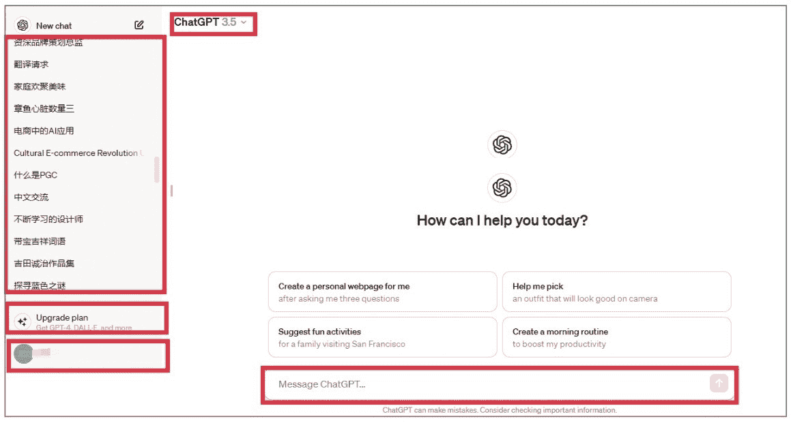

▲图 A-2

读者应记住以下几个关键组成内容。

历史记录：该部分存储了用户以往与 ChatGPT 对话的所有内容。用户可以在此修改标题，以便后续查找，亦可删除不需要的内容。

会员信息：该部分为升级至 ChatGPT 4.0 版本的通道。通过购买会员，用户可享受更高级的使用权限。

个人信息：该部分包含了一些账户信息及设置选项。

版本切换：该部分提供了 GPT-3.5 版本与 GPT-4.0 版本之间的切换功能。

对话区域：用户可通过与 ChatGPT 进行对话来获得相应的答案。

**（1）注册和登录 ChatGPT**


打开 ChatGPT 的官网，如图 A-3 所示。单击左下方的即可进入 ChatGPT 的登录界面，用户按照步骤进行注册和登录即可，如图 A-4 所示。

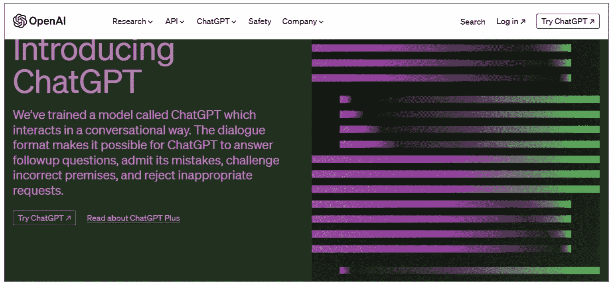

▲图 A-3

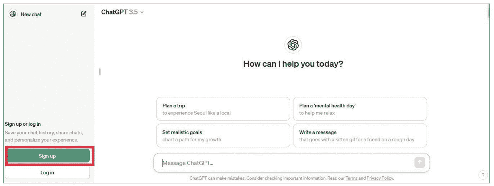

▲图 A-4

**（2）ChatGPT 的功能**

以下是 ChatGPT 的一些基本功能。

① **对话：**ChatGPT 可以用于与人类进行对话。比如，用户可以与它进行交谈、分享观点，向它提出问题、寻求建议等，它会根据输入内容生成相应的答案，如图 A-5 所示。

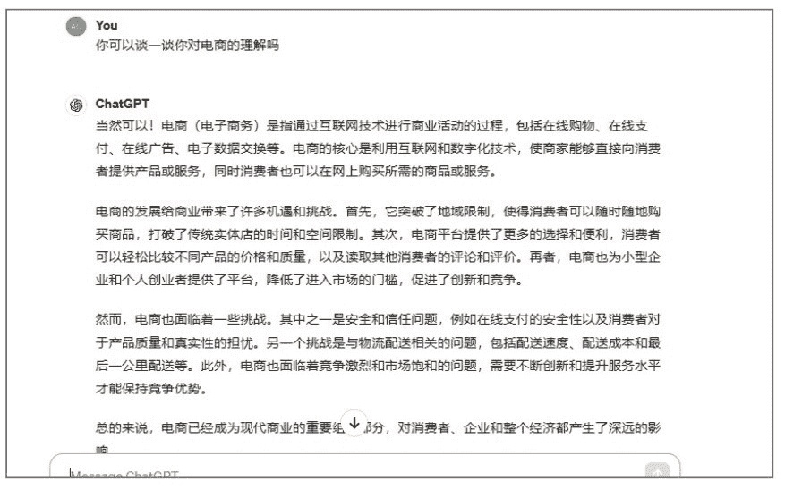

图 A-5

② **创意生成：**如果用户需要一些创意或灵感，可以向 ChatGPT 3.5 提出相关的问题或主题，它会尝试给出有趣的创意想法，如图 A-6 所示。

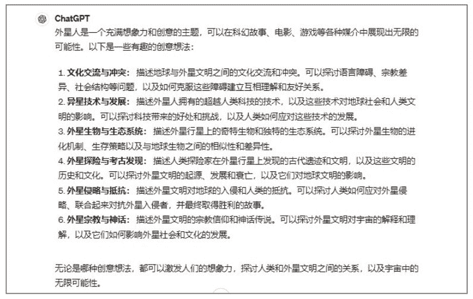

图 A-6

③ **文本生成：**ChatGPT 可以根据用户提供的文本或主题生成相关的文本内容，如故事、文章、诗歌等，如图 A-7 所示。

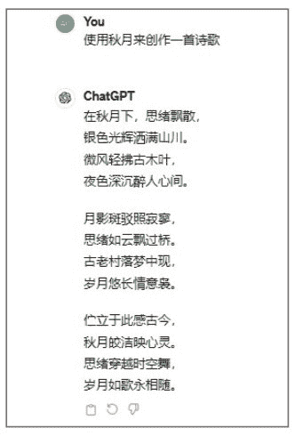

图 A-7

④ **语言整理：**ChatGPT 可以理解各种类型的语言输入，包括简单的句子、复杂的问题，甚至是长篇文本。

⑤ **文本编辑与改进：**如果用户需要编辑或改进一些文本，可以将其提供给 ChatGPT，它会尝试根据上下文生成更合适的文本。

⑥ **自然语言生成应用：**将 ChatGPT 集成到各种应用中，如智能助手、聊天机器人、写作工具等，可以实现更自然、智能的语言交互。

上述只是 ChatGPT 的一些基本功能，实际上用户可以通过多种方式利用这个模型来满足自己不同的需求，从而创造各种有趣和实用的应用。

**2. Midjourney**

Midjourney 是一款人工智能绘图辅助工具，它能够仅凭关键词在不到一分钟的时间内自动生成相应的图像。该软件为用户提供了多种艺术家风格，包括达·芬奇、毕加索等。此外，它还能够识别特定的镜头技巧或摄影技术。

与 Imagen 和 DALL·E 相比，Midjourney 是向大众开放的，可供用户自由使用并迅速生成人工智能绘制的画作。例如，当用户输入“一棵长着立方体形状桃子的树”这样的信息时，系统会提供 4 幅相关图像供用户挑选，如图 A-8 所示。

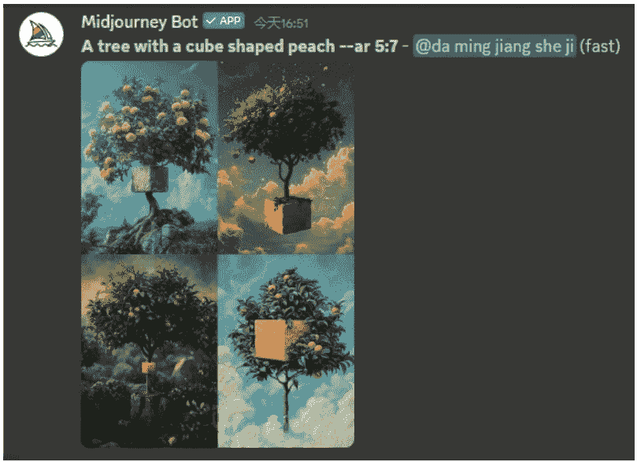

图 A-8

Midjourney 的配置方法比较简单，互联网上也有相关的教程，读者可以搜索并按照步骤配置。下面介绍 Midjourney 的界面组成，如图 A-9 所示。

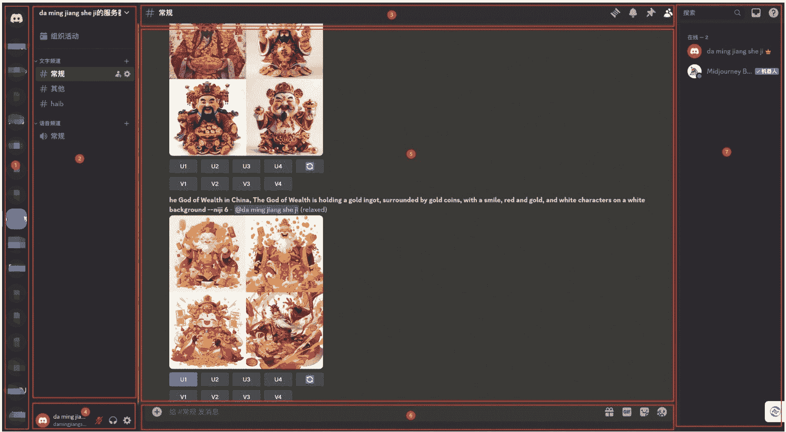

图 A-9

① **服务器配置：**为了避免多个用户共享同一账户时发生图像数据的混淆，建议启动独立服务器。

② **聊天频道服务：**本服务提供文本及语音聊天功能，允许用户邀请同伴加入特定的社区频道，以便共同参与其中。

③ **自定义设置：**用户可根据个人偏好调整社区频道内容，并利用搜索功能找到自己所需的信息。通常，通过单击界面右侧图标即可访问并修改频道管理设置。

④ **服务器个性化设定：**用户可通过单击进行个人资料的自定义设置，包括上传头像、修改昵称以及配置隐私和安全选项。

⑤ **图像生成区：**用户在发送指定提示词后，生成的图像将在此区域显示。

⑥ **指令输入区：**用户可在此区域向 Midjourney Bot 发送各类指令，如文本到图片、图片到图片以及文本与图片混合生成等。

⑦ **用户与机器人列表：**此区域展示所有被邀请的朋友及机器人名单，同时提供查找之前添加的机器人的功能。

**3. Stable Diffusion**

Stable Diffusion 是一款人工智能绘图工具，它能够通过模拟扩散过程将含噪声的图像转化为精确的目标图像。该工具能够依据用户提供的文本信息，自动生成高质量、高分辨率且视觉效果卓越的多样化图像。Stable Diffusion 提供了图像修复、分辨率增强以及图像风格调整等多项功能，可以帮助设计师获取广泛的创意灵感，从而更好地实现创意构思。Stable Diffusion 的界面如图 A-10 所示。

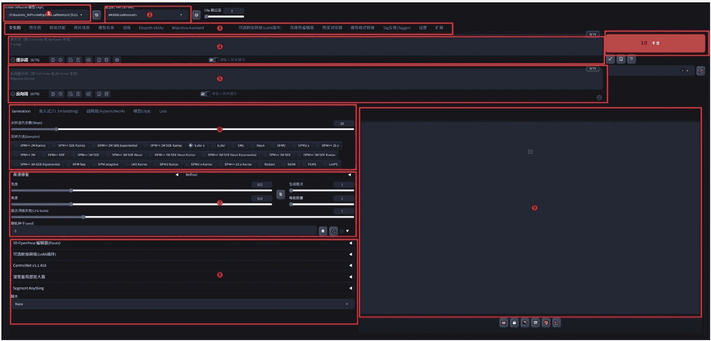

图 A-10

下面设定一个商业情景。

目前，我方尚未配备可供拍摄的专业模特，仅持有服装样品。按照常规操作流程，若需获得模特着装照片，需邀请模特与摄影师协作，经历拍摄及后期制作等多个环节方能制作出所需图像。然而随着技术的进步，该流程已被极大地简化。现仅需提供服装照片，借助人工智能技术即可生成多种风格的模特图像，并实现图像的批量制作。这不仅大幅节约了时间，还显著降低了工作强度。示意效果如图 A-11 和图 A-12 所示。

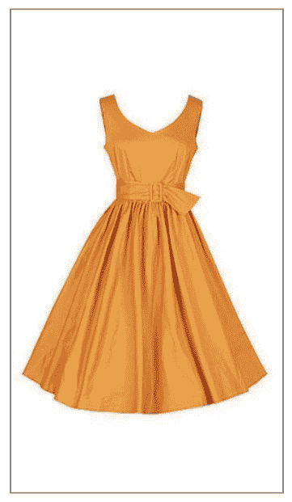

▲图 A-11 原始照片

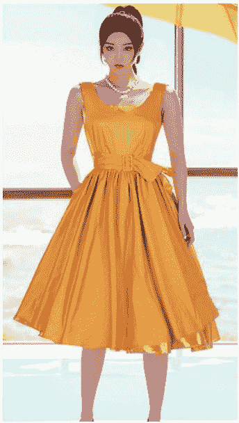

▲图 A-12 经过 AI 处理的模特着装照片

综合分析表明，在电子商务领域，人工智能技术的广泛应用将促进工作效率的提升，优化消费者体验，并推动销售业绩的持续增长。

# **第一章**

# **AI 绘画工具的基础部署**

本章将主要介绍 Midjourney 和 Stable Diffusion 的注册、安装和部署方法。另外，为了方便读者学习后面的内容，本章还将简单介绍这两款工具的基础操作方法。

## **1.1 AI 是什么**

AI 是“人工智能”的英文简称，指一种通过计算机技术来解决问题的科学方法。具体来说，人工智能就是让计算机具备学习、推理、解决问题、理解语言和感知等人类特性的能力。

### **1.1.1 AI 的发展与应用**

人工智能技术现如今的发展速度很快，其影响已经深入人们生活的方方面面。那么，AIGC 又代表着什么呢？

AIGC 的全称为 Artificial Intelligence Game Creation，也就是人工智能游戏创作。这是一种集分类、生产和自动生成内容于一身的技术应用。AIGC 不仅可以对内容进行分类、生成，更能实现内容的自动创作。这种技术堪称神奇，目前已经成为内容生产领域的新宠。无论是作为内容分类工具，还是作为内容生产方法， AIGC 在人们的生活中得到了广泛应用。

值得注意的是，内容生态的发展经历了 4 个阶段：专家生成内容（PGC）、用户生成内容（UGC）、AI 辅助生成内容（AIUGC）以及 AI 生成内容（AIGC），如图 1-1 所示。

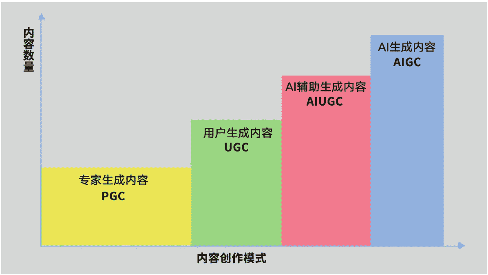

图 1-1

PGC：该类内容一般经过精细的策划、深入的研究以及专业的制作而成，以保证其质量和专业度。这些内容应用范围广泛，包括教育、培训、咨询、行业分析等，能够帮助人们获取专业知识，以提升他们的技能水平。PGC 可以通过在线平台或多种媒体形式传播，旨在满足特定行业或专业领域的需求。

UGC：该概念指代用户自行创作并分享的在线内容。这些内容可能包括文本、图片、视频、评论、博客文章以及社交媒体帖子等，均由普通用户而不是专业媒体或出版机构所创作。UGC 在互联网时代极为常见，因为它让个体有机会表达自己的观念、立场及创意，分享自己的经验，以及参与到在线社区和平台中。

AIUGC：该概念指的是将人工智能技术融入用户生成内容。在此背景下，人工智能技术被应用于辅助、增强甚至自动产生用户生成内容。其目标在于提升用户生成内容的质量、效率和多样性，同时减轻用户的工作负担。AIUGC 对多个领域有所裨益，包括数字营销、内容创作、社交媒体管理、教育以及娱乐等。

AIGC：该概念指的是利用人工智能技术来自动生成文本、图像、音频、视频等各类内容。这种内容生成过程通常无须人类干预，完全依赖于计算机程序和机器学习模型进行创造。

### **1.1.2 AI 技术应用在电商领域的优势**

AI 技术在当前社会中的应用潜力巨大，尤其体现在电子商务领域。其能创造许多创新方式，极大地提升用户的购物体验。下面将阐述几个 AI 技术在电子商务领域的具体运用。采用 AI 技术创作的插图如图 1-2 所示。


图 1-2

个性化推荐：AI 技术能够通过分析用户的历史购买数据、浏览行为和兴趣爱好，为用户提供定制化的商品推介。这不仅有助于电商企业提升销售转化率和客户忠诚度，也能够优化用户的购物体验。

虚拟试衣间：电商平台借助 AI 技术，可以提供虚拟试衣间服务，让消费者在线上试穿衣物。这样做可以降低退货率，因为消费者能够更准确地了解他们购买的产品，同时也能减轻他们线下试穿的需求。

AI 电商图像生成：AI 技术在图像生成领域的应用包括产品展示图、广告素材以及社交媒体内容。这意味着电商企业可以更迅速地构建高品质的图像内容，从而降低对专业摄影师和设计师的依赖。

客户服务与聊天机器人：电商平台可以通过集成 AI 聊天机器人来提供实时客户支持。这些机器人能回答常见问题、处理订单追踪以及提供产品信息，从而提升客户服务效率。

反欺诈：AI 技术可以用于检测欺诈行为，帮助电商平台减少信用卡欺诈和虚假账户。其通过分析交易数据和用户行为，可以自动识别异常模式并采取相应措施。

库存管理：AI 技术能够分析销售趋势，以协助电商平台更有效地进行库存管理。这有助于电商企业避免库存过剩和缺货的问题，从而提高运营效率。

定价策略：AI 技术可以帮助电商企业根据市场需求和竞争状况动态调整产品价格，提高定价策略的精准度，从而最大化自身利润。

AI 技术在电商领域的应用已经取得了显著的成果，预期在未来将展现出更大的潜力。随着技术的不断进步，电商企业将有能力提供更加智能、个性化且高效的购物体验，满足消费者需求并提升自身竞争力。

## **1.2 Midjourney 的注册与使用**

Midjourney 位于一个通讯应用 Discord 中，其使用流程极为便捷，无须复杂的部署步骤，即可直接进行操作。此外，Midjourney 对于计算机硬件配置的需求十分低，使得所有人都可以轻松使用。Midjourney 是一个 AI 绘画工具，易于掌握，并且现已被广泛应用于多个领域，包括但不限于艺术创作、虚拟现实、游戏开发、电影动画制作、创意辅助、快速原型设计、数字娱乐、表演艺术、教育、广告营销、图像修复和增强以及电子商务智能化辅助等。

### **1.2.1 注册**

下面介绍注册 Midjourney 的方法。

**1. 注册**


**01**在浏览器中搜索 Discord 官网，单击右上角的 Login（登录）按钮，如图 1-3 所示。


图 1-3

**02** 如果有账号，直接登录即可。如果没有账号，单击“注册”，如图 1-4 所示。注意，如果想避免每次都需要登录的问题，可以直接下载安装包进行安装。

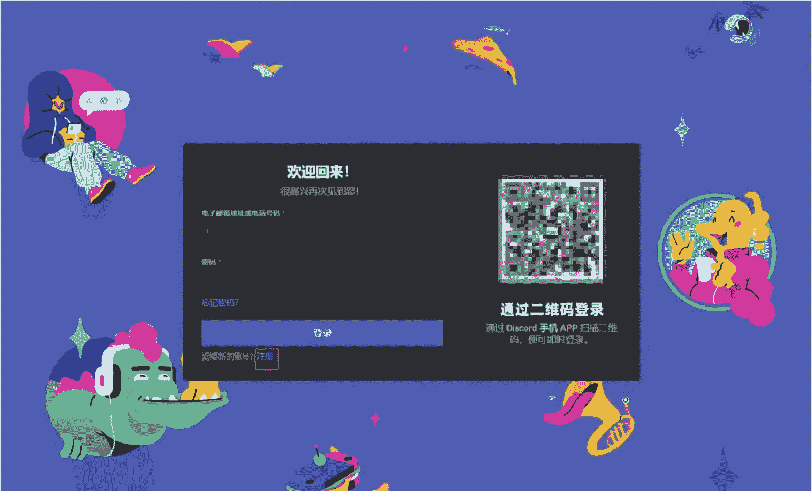

图 1-4

**03** 注册的时候有些注意事项，尤其是年龄必须大于 14 岁。同时有两次人机验证，且需要确保手机能接通，可以选用+86 的号码。另外，注册成功前还需要在邮箱中进行确认。注册页面如图 1-5~图 1-8 所示。

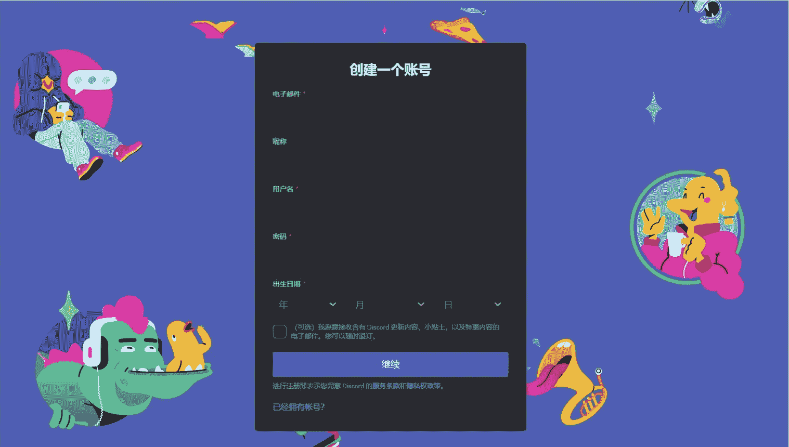

▲图 1-5

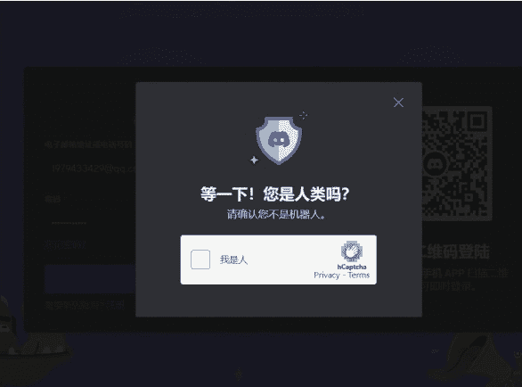

▲图 1-6


▲图 1-7

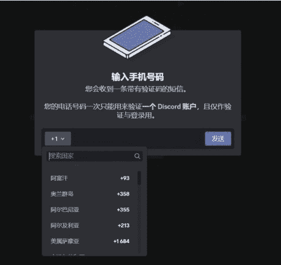

▲图 1-8

**04** 注册好以后需要创建服务器，也可以用朋友的邀请码进入服务器。如果没有收到邀请，那就只能自己创建服务器了。创建过程页面如图 1-9~图 1-11 所示。

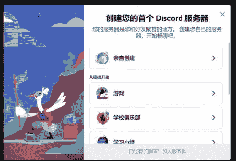

▲图 1-9

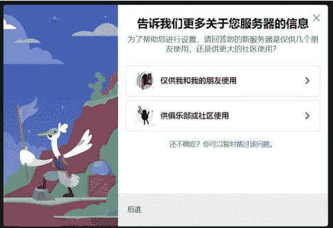

▲图 1-10

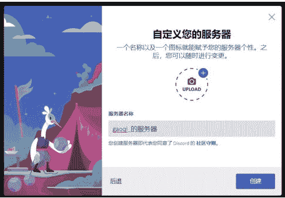

▲图 1-11

**2. 在 Discord 中嵌入 Midjourney**

**01** 添加 Midjourney 公共社区。打开 Discord，单击左边的“指南针”图标 ，然后单击“特色社区”中的 Midjourney，即可进入 Midjourney 的公共社区。此时在 announcements 处可以看到很多关于版本变化和通知的信息，在 daily-theme 中可以看到很多社区中其他创作者的 AI 作品。页面显示如图 1-12 和图 1-13 所示。

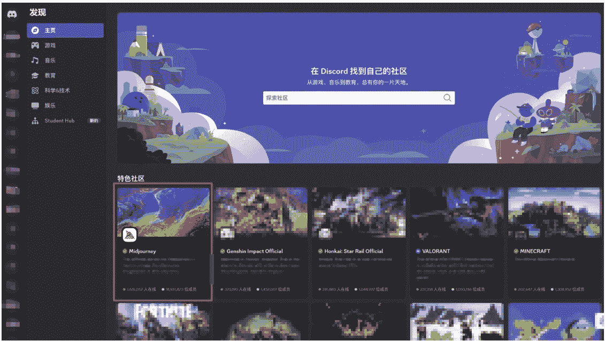

▲图 1-12

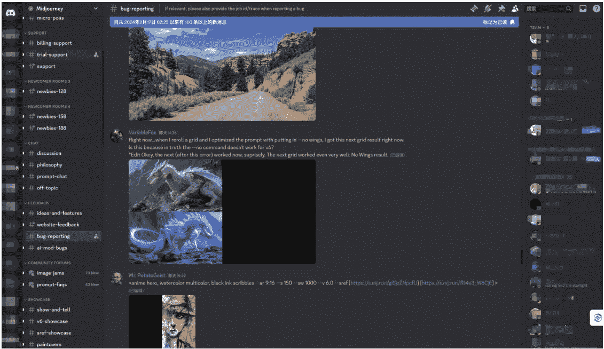

▲图 1-13


**02** 在 Midjourney 的公共社区的右上角单击“显示成员名单” ，然后单击右侧列表中的 Midjourney Bot，接着单击“添加至服务器”，选择刚刚创建的服务器名称，即可将 Midjourney Bot 添加到服务器中，如图 1-14 所示。

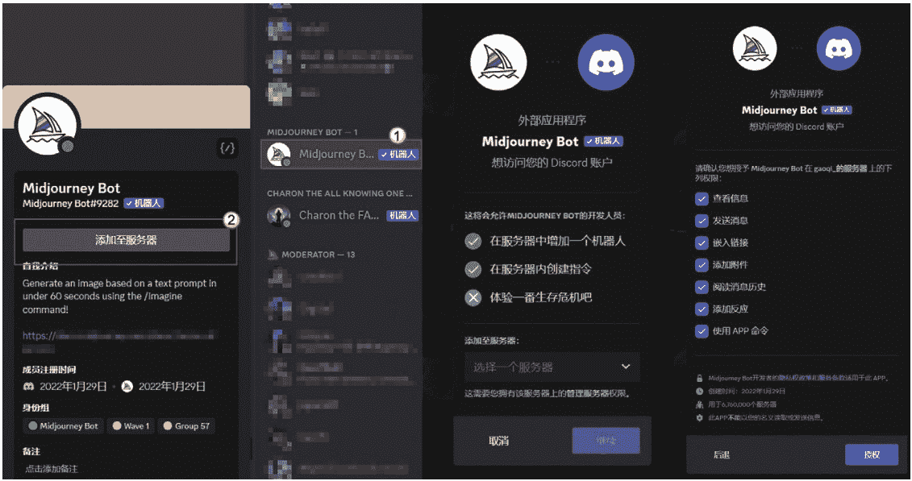

图 1-14


**03** 订阅会员。在聊天框中输入/subscrib，然后按 Enter 键，单击 Manage Account（管理账户）进入订阅会员的界面，如图 1-15~图 1-17 所示。

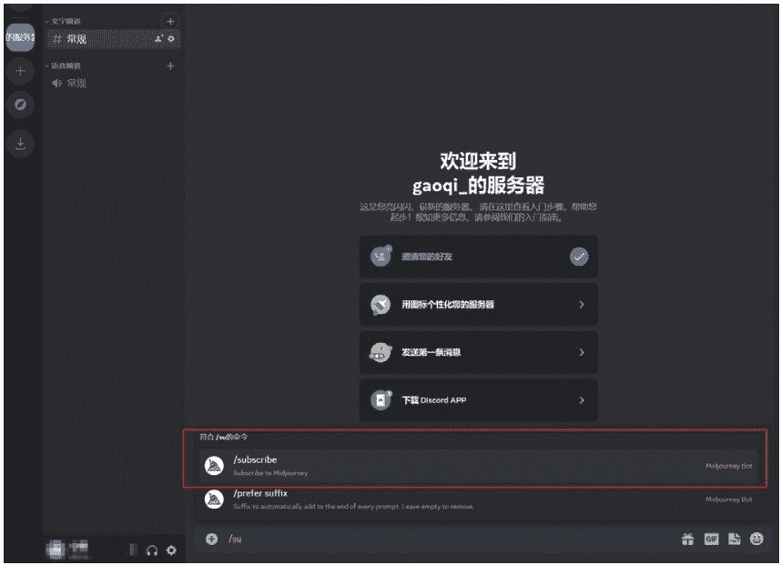

▲图 1-15


▲图 1-16

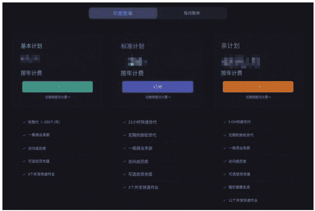

▲图 1-17

### **1.2.2 Midjourney 用户界面**

Midjourney 现在和社区聊天服务器绑定在一起，操作起来就像使用聊天工具一样。其操作界面如图 1-18 所示。


图 1-18

① 服务器：如果有多个用户共享同一账号，可考虑启动不同的服务器，以防止用户间的图像数据发生混淆。

② 聊天频道：提供文字和语音聊天的频道服务，可以邀请同伴加入此社区频道。

③ 常规设置：频道社区内容可根据个人需求进行调整，同时也能搜索到自己需要的信息。一般来说，只需单击右侧的图标，就能查看频道的管理设置。

④ 服务器设定：单击 后，可以进行个人资料设置，包括照片上传、名字修改，以及隐私和安全设置。

⑤ 对话生成区域：用户在发送提示词后，生成的图像将会在此区域展示。

⑥ 指令区域：此区域可向 Midjourney Bot 发送指令，如生成文本图片、图片生成图片，甚至是文本和图片的混合生成等。

⑦ 用户列表浏览：此处列出了所有被你邀请的朋友及机器人，还可以在这里找到之前添加过的机器人。

### **1.2.3 Midjourney 生图方法**

在成功配置 Midjourney 服务器并理解用户界面后，便可开始使用 Midjourney 创作作品了。首先在指令输入区域输入“/”，然后选择/imagine 命令，接着在 Prompt 后方输入 boy，并按 Enter 键发送指令。这样就可以得到第 1 幅 AI 绘画的作品，如图 1-19 所示。

boy --s 750 --v 5.2

如果有图片刚好符合需求，就可以使用 U1~U4 来放大图片，对应图片的顺序为“从左到右，从上到下”。例如，现在想放大左上的图片，选择 U1 即可将其放大，如图 1-20 所示。

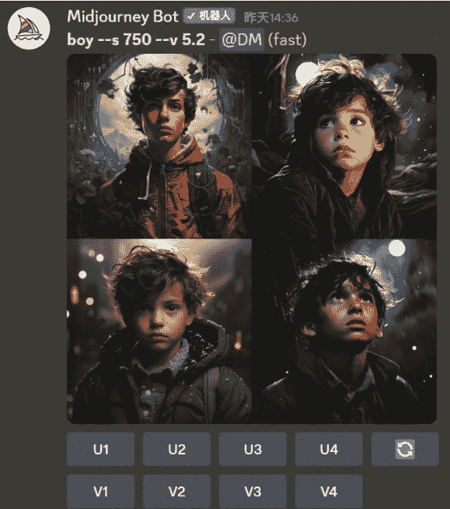

▲图 1-19

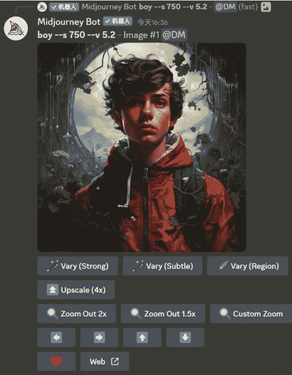

▲图 1-20

**技巧提示**

注意，Midjourney 的输入内容（提示词）必须为英文状态。笔者建议初学者结合翻译工具进行中英文切换。

如果对生成的效果图不够满意，可以多描述一下想要的内容，如“一个蓝色头发、碧绿眼睛的男孩子”，然后将其限定为“插画风格”，生成的效果如图 1-21 所示。

A boy with blue hair and green eyes,flat illustration

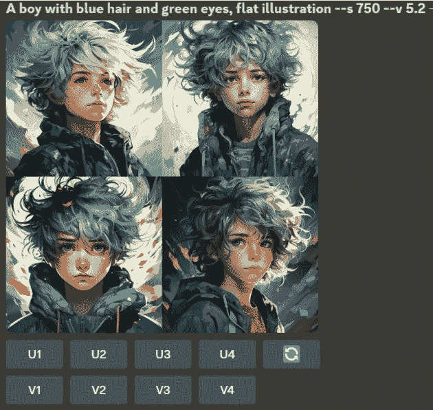

图 1-21

相信读者现在能用 Midjourney 绘制出 AI 作品了。不过值得注意的是，AI 作品也对细节有要求，如果想得到拥有丰富细节的作品，读者还需要进行后续的学习。

## **1.3 Stable Diffusion 的安装与云部署**

Stable Diffusion 的独特之处在于，它能够使 AI 绘图更为清晰。读者可以使用它来绘制各种不同风格的图像，如动漫风格的插图、古代中国水墨画，甚至 3D 建模。使用该工具所绘制的画质可与实物照片相媲美，同时还具备其他实用功能。例如，借助 Lora 和 Controlnet 控制等衍生功能，可以更精确地控制艺术风格、角色细节、姿态、动作和构图等。

除了以上所述功能，它还有一个重要特性就是完全开源。这意味着读者可以将整个程序安装在自己的计算机上，没有任何使用限制，且完全免费。

### **1.3.1 Stable Diffusion 的本地安装**

下面将介绍 Stable Diffusion 的安装方法，主要包括计算机配置要求和安装步骤。

**1. 计算机配置要求**

Stable Diffusion 虽为实用工具，但对计算机配置有特定要求。

第 1 个：使用 Windows 操作系统的计算机，不推荐 Mac 用户使用。

第 2 个：依赖强大的图形处理器（GPU）提供计算能力。尽管理论上任何品牌的显卡均可供应计算力，但用户普遍认为 Nvidia 芯片的显卡更为稳定、易用。内存建议在 16GB 以上，对中央处理器（CPU）没有特殊要求，建议使用大于 500GB 的固态硬盘（SSD），以便存储大型模型。

若要判断计算机是否能安装并运行该软件，比较简单的方法就是测试其是否能顺畅运行近两年的主流 3A 级游戏。注意，“能运行”与“顺畅运行”是两个不同的概念。

显卡性能对 AI 绘画效率起着重要作用。据笔者统计数据和用户分享，一张显存为 8GB 的 RTX 3070 显卡，绘制一张大小为 512px×512px 的图像大约只需要 10 秒。如果读者的显卡性能较弱，笔者建议考虑升级显卡或尝试云部署，毕竟要创作出满意的 AI 绘画，需要反复尝试和调整。如果效率低下，就会耗费大量时间，且可能无法达成预期效果。

此外，影响 AI 绘画效率的另一个关键因素是显存，它主要影响绘制图像的大小。简单来说，如果显存不足，可能无法绘制清晰度较高的图像。另外，显存还会影响同时训练的模型数量。这个问题较为复杂，如果笔者希望能轻松地进行模型训练，建议使显存大于 8GB。图 1-22 所示为各型号显卡运行 Stable Diffusion 时的性能对比，读者可以直观感受并选择适合自己的显卡。

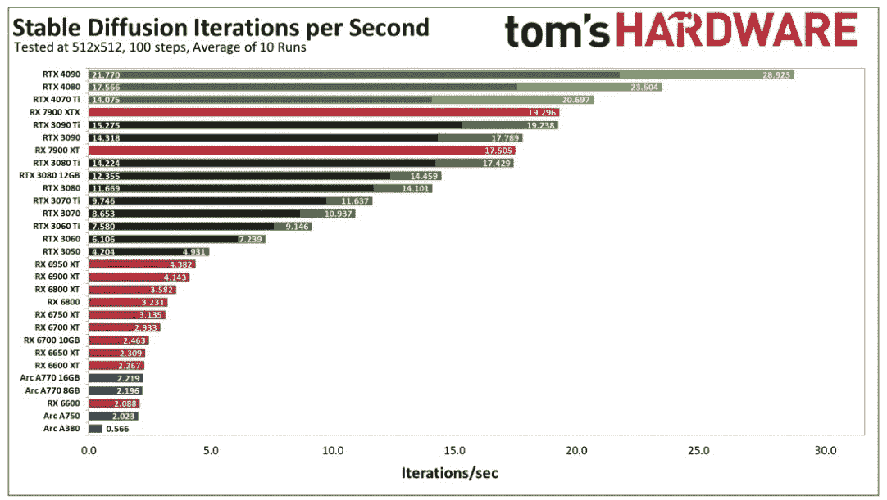

图 1-22

如果读者认为这些信息过于复杂，笔者在此提供一份较为实用的计算机配置清单。该清单标明了笔者认为的基本配置和推荐配置，读者可以根据自己的实际情况进行对比和选择，如图 1-23 所示。

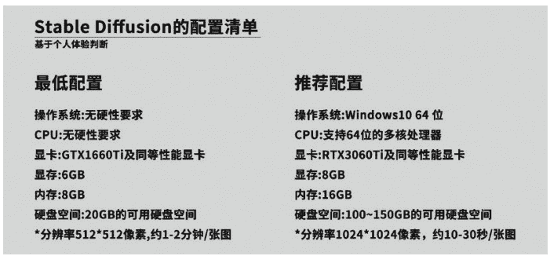

图 1-23

**2. 下载安装包进行安装**

对于安装包，读者可以根据图 1-24 所示参考文件在网上自行下载。注意，下载完之后先别急着双击“启动器运行依赖”文件。下面介绍具体的安装步骤。

**01** 解压 sd-webui-aki-v4.1.zip 压缩包。如果读者使用的该文件已经升级到 4.2 版本，可以直接使用 4.2 版本进行操作。操作方法与书中的 4.1 版本的操作方法一致，如图 1-25 所示。

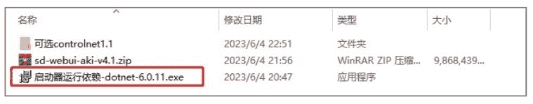

▲图 1-24

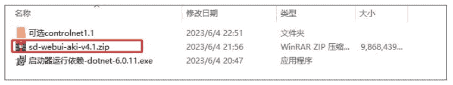

▲图 1-25

**02** 在解压后的文件中双击“A 启动器.exe”，如图 1-26 所示。安装过程如图 1-27 所示。

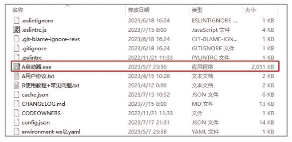

▲图 1-26

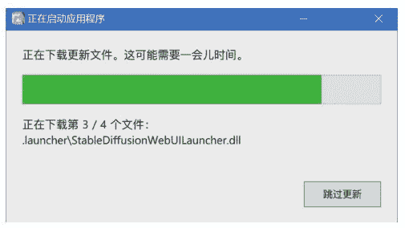

▲图 1-27


**03** 打开安装好的文件，单击“一键启动”按钮，如图 1-28 所示。此时会有页面展示在计算机默认的浏览器中，这就代表启动成功，如图 1-29 所示。

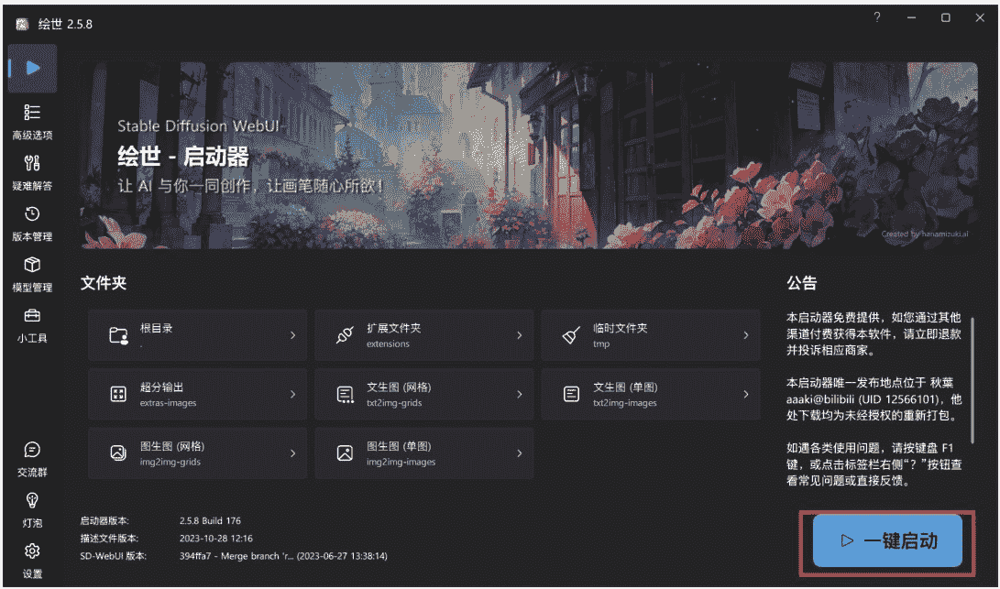

▲图 1-28

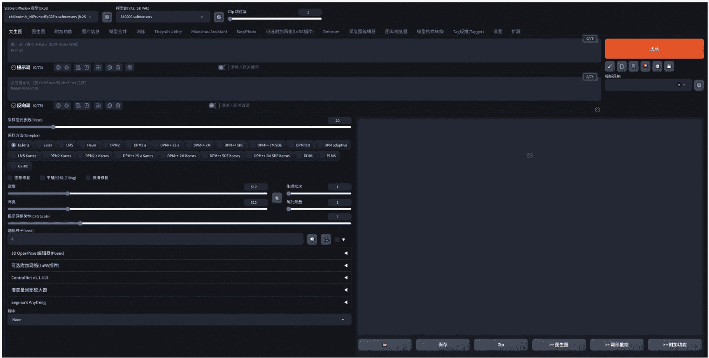

▲图 1-29

### **1.3.2 Stable Diffusion 的云部署**

下面笔者将详细介绍如何实施 Stable Diffusion 的云部署。

**1. 云桌面部署**

**01** 单击下面的链接进行注册。

青椒云官网

进入“青椒云”云桌面官网，在弹出的注册页面中完成账号注册，如图 1-30 所示。


图 1-30

**02** 注册成功后，在完成页面中可直接下载云桌面客户端，如图 1-31 所示。

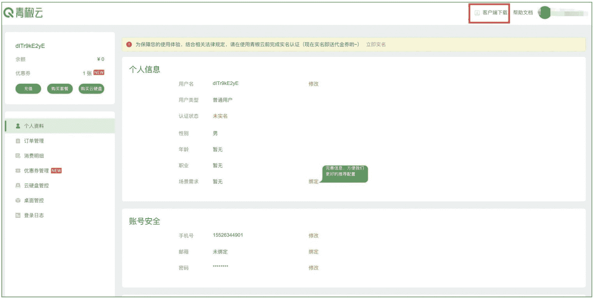

图 1-31

**03** 在“下载”栏中选择与读者所用计算机系统匹配的客户端，如图 1-32 和图 1-33 所示。读者使用的计算机如果是 Windows 系统，就下载 Windows 云桌面客户端；如果是 Mac 系统，就下载 Mac 云桌面客户端。


▲图 1-32

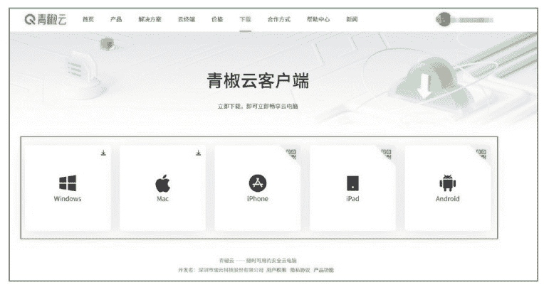

▲图 1-33

**04** 下载完成并安装云桌面客户端，然后登录，接着根据软件界面提示，完成实名认证，如图 1-34 和图 1-35 所示。


▲图 1-34

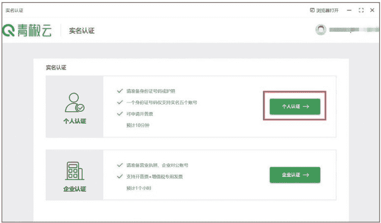

▲图 1-35

**05** 在软件界面中单击“新增云桌面”，并在弹出的产品中选择“华南”，添加云桌面，在“标准产品”中选择“AIGC 尝鲜”，如图 1-36~图 1-38 所示。

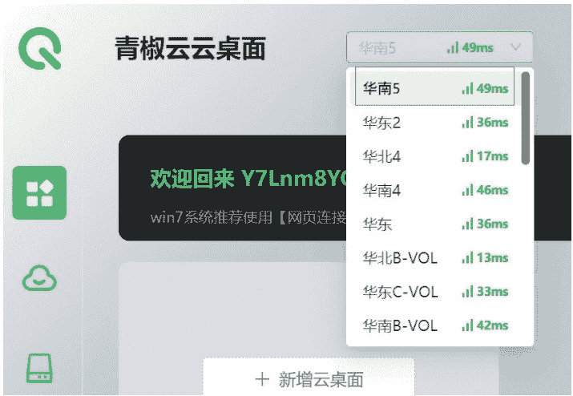

▲图 1-36

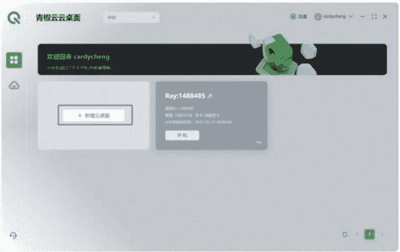

▲图 1-37

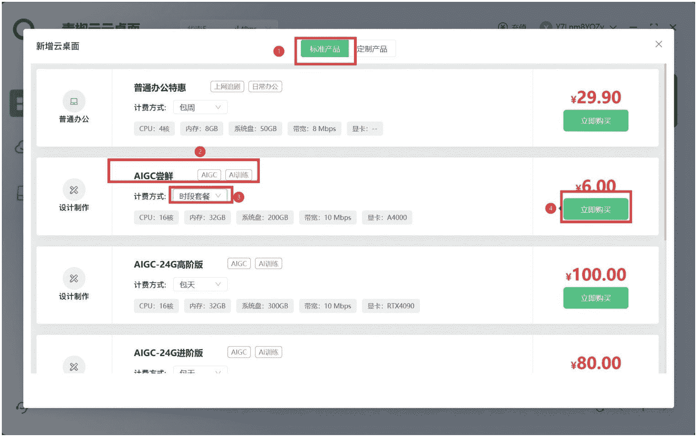

▲图 1-38

**技巧提示**

定制产品栏还有与各种博主合作的镜像包，预装了 Stable Diffusion、模型、插件等，使用比较方便。其中有包天、包月、计时等多种计费方式，读者根据自身需求选择即可，如图 1-39 所示。

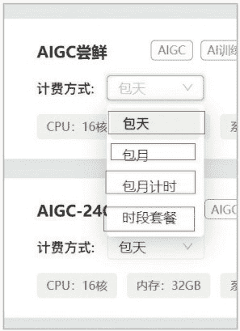

图 1-39

**06** 此时在界面中可见自己添加完成的云桌面，通过“开机”即可开始使用，如图 1-40 和图 1-41 所示。

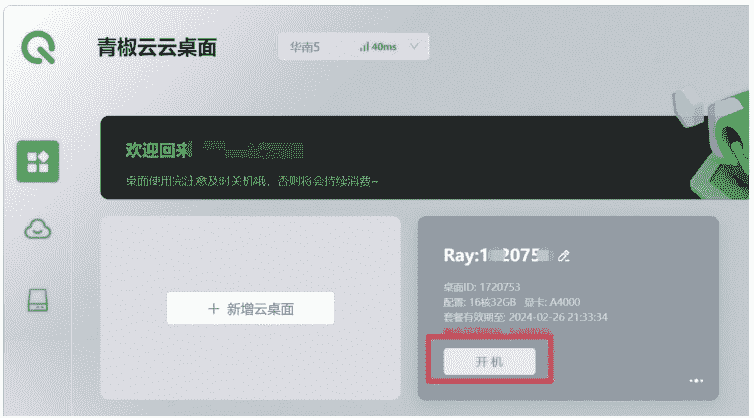

▲图 1-40

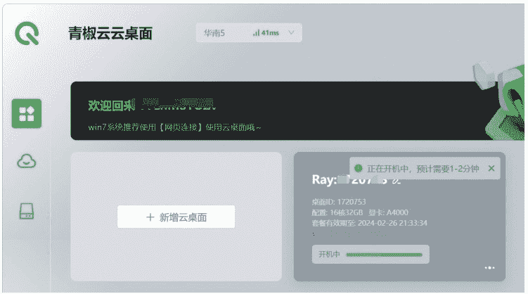

▲图 1-41

**07** 开机完成后，进入云桌面正常使用即可，如图 1-42 和图 1-43 所示。

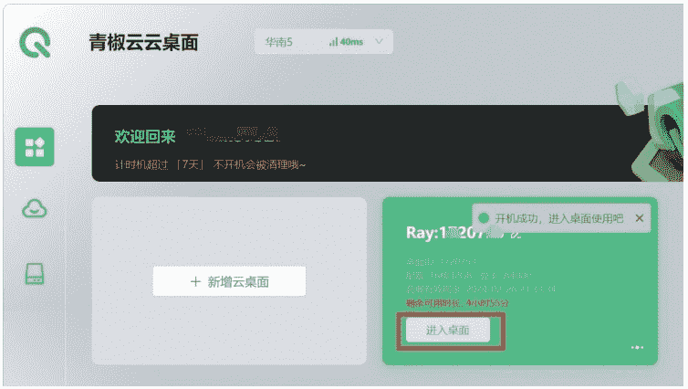

▲图 1-42

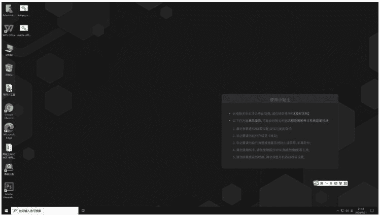

▲图 1-43

**08** 如果需要退出云桌面，在顶部断开链接即可，如图 1-44 和图 1-45 所示。

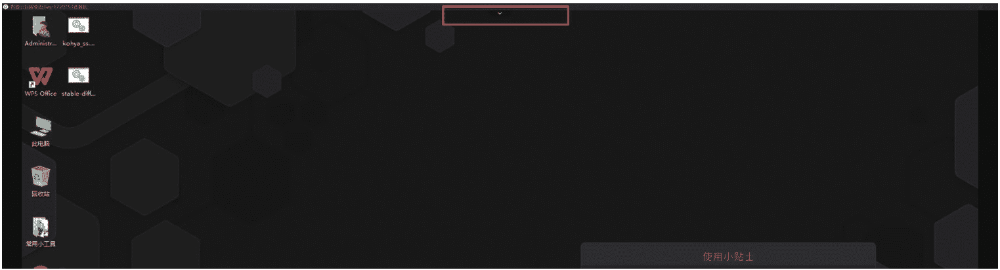

▲图 1-44

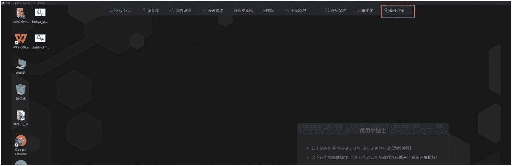

▲图 1-45

**09** 返回青椒云云桌面系统后，在个人云桌面上关机，如图 1-46~图 1-49 所示。

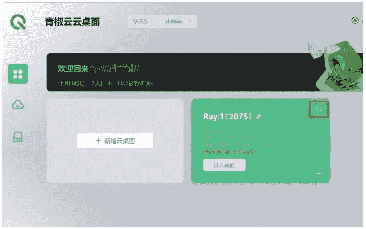

▲图 1-46

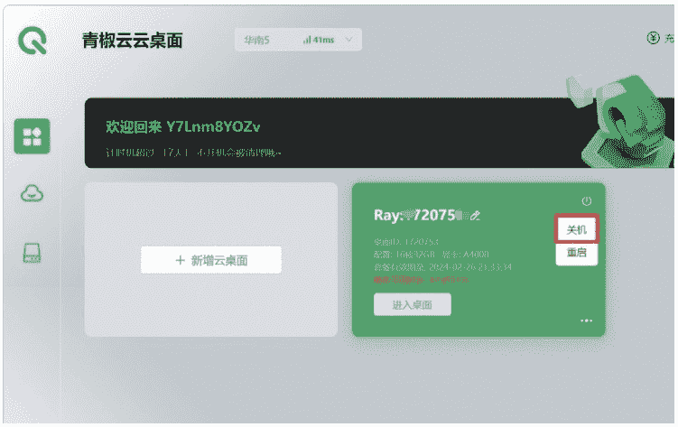

▲图 1-47


▲图 1-48


▲图 1-49

**技巧提示**

每次使用完后需及时关机，这样系统才会停止计费。

**2. 资料传输**

进入云桌面后，可以按照正常的方法进行软件的下载和安装。在学习课程中，如果需要使用个人计算机中的资料，可以将其传输到云桌面。

**01** 在青椒云云桌面上使用网盘功能，如图 1-50 所示。


图 1-50

**02** 在网盘界面中选择本地资源并上传，如图 1-51 和图 1-52 所示。


▲图 1-51


▲图 1-52

**03** 上传完成后，进入云桌面内部，使用“青椒云盘”完成网盘的添加，如图 1-53 和图 1-54 所示。


▲图 1-53


▲图 1-54

**技巧提示**

系统提示“添加成功”后，即可在云桌面的云盘中查询上传的内容。这个桌面已经安装好了，其中包含 Stable Diffusion，读者直接使用即可。

**3. 云端部署 Stable Diffusion**

**01** 打开 AutoDL AI 算力云官网，如图 1-55 所示。在这里可以直接使用微信进行登录，注意填写手机信息，如图 1-56 所示。


▲图 1-55


▲图 1-56

**02** 登录之后在“控制台”中进行充值，如图 1-57 所示。因为这里需要使用第三方服务器，所以功能是付费的，如图 1-58 所示。


▲图 1-57


▲图 1-58

**03** 回到“控制台”的主页单击“进行中”，如图 1-59 所示。选择“租用新实例”，如图 1-60 所示。


▲图 1-59


▲图 1-60

**04** 进入“创建实例”页面，如图 1-61 所示。这里有按量计费、包日、包周、包月等计费方式，读者根据自己的需要选择即可，笔者演示按量计费，如图 1-62 所示。


▲图 1-61


▲图 1-62

**05** 选择地区，这里没有硬性要求，如图 1-63 所示。如果没有合适的服务器，任意选一个也是可以的。注意，这里的地区指官方的服务器所在地，通常选择读者当地所在范围或距离较近地区即可。


图 1-63

**06** 选择 GPU 型号和数量，建议将所有 CPU 型号都勾选上，GPU 数量选择 1 即可，如图 1-64 所示。如果需要高性能，读者可以将 CPU 数量选择得高一点。


图 1-64

**07** 选择主机，根据自身需求选择配置即可。注意，显存越大越好，空闲 GPU 中的 1/4 表示一共有 4 台同种计算机，目前还剩下一台可以使用，同样如果分子为 0，则表示没有可用计算机。笔者的选择如图 1-65 所示。


图 1-65

**08** 选择社区镜像，如图 1-66 所示。在文本输入框中输入 nov，然后使用下载次数最多的镜像，如图 1-67 所示。


▲图 1-66


▲图 1-67

**09** 选择开始创建镜像，完成后的显示状态如图 1-68 所示。


图 1-68

**10** 开机之后选择 JupyterLab，如图 1-69 所示。


图 1-69

**11** 此时会打开一个新的网页，将鼠标指针移动到蓝色的框中，单击左边的蓝色条，然后运行程序，如图 1-70 所示。运行之后蓝色的框中会显示“移动完成”，如图 1-71 所示。


▲图 1-70


▲图 1-71

**12** 单击右上角的 Python 3(ipykernel)，如图 1-72 所示。如果没有出现这个英文，可以刷新一下页面。在弹出的对话框中选择 xl_env，如图 1-73 所示。


▲图 1-72


▲图 1-73

**13** 回到主程序页面，将鼠标指针移动到下面的蓝色框中，然后运行程序，如图 1-74 所示。


图 1-74

**14** 运行后下方会出现选项栏，这里选择“启动 WebUI”，如图 1-75 所示。


图 1-75

**15** 继续向下拉动页面，选择需要开启的参数，然后继续运行 WebUI，如图 1-76 所示。代码运行完后，可以看到 IP 编号，即表示部署成功，如图 1-77 所示。


▲图 1-76


▲图 1-77

**16** 回到主页，选择“自定义服务”，如图 1-78 所示。注意，这里需要认证信息，按要求处理即可，如图 1-79 所示。认证成功后会打开 WebUI 页面，如图 1-80 所示。


▲图 1-78


▲图 1-79


▲图 1-80

**17** 如果此时弹出的是图 1-81 所示提示内容，就需要单独操作了。这里先说明 Windows 系统，需要将压缩包下载到本地计算机中。


图 1-81

**18** 解压后打开 AutoDL.exe 文件，如图 1-82 所示。这时会弹出一个对话框，将网页中的指令和密码复制并粘贴到对话框中，即可开始代理，如图 1-83 所示。


▲图 1-82


▲图 1-83

**19** 单击本地主机号，进入 WebUI 页面，如图 1-84 所示。页面效果如图 1-85 所示。


▲图 1-84


▲图 1-85

**技巧提示**

到这里，云端部署 Stable Diffusion 就完成了。

**20** 如果是 Linux/Mac 计算机，就需要打开终端，将这串命令复制并粘贴到终端上，如图 1-86 所示。

**21** 复制并粘贴后按 Enter 键，第 1 次会有询问，输入 yes 即可，按 Enter（回车）键表示同意，如图 1-87 所示。


▲图 1-86


▲图 1-87

**22** 再次回到提示页面，复制密码并粘贴到终端上，如图 1-88 和图 1-89 所示。注意，粘贴过程中可能什么内容都不会显示，这是正常现象。如果没有成功，那就手动输入密码，手动输入同样不会显示内容。


▲图 1-88


▲图 1-89

**23** 回到访问服务页面，单击本地主机地址，即可打开 WebUI 主页，如图 1-90 所示。


图 1-90

**技巧提示**

大家在实施云端部署的过程中，必须妥善保存自行创建的图像，且在不使用时记得关闭系统。否则，将根据使用时间进行计费。如果选择了包月等计费方案，可根据个人实际情况自行决定。另外，系统关闭后，数据会保留 15 天。如果在这 15 天内未继续使用，数据将被清除以供其他用户使用。


### **1.3.3 Stable Diffusion 用户界面**

Stable Diffusion 作为新的生产工具，有着比较强的可控性。下面将简单介绍其工作界面，如图 1-91 所示。


图 1-91

下面这一整排的标签栏对应 Stable Diffusion 的不同功能，如图 1-92 所示。


图 1-92

平时绘图比较常用的功能为“文生图”“图生图”，如图 1-93 所示。


图 1-93

“设置”中包含与绘图相关的参数，如保存图片的位置、采样参数等，如图 1-94 所示。


图 1-94

“扩展”中主要提供安装和管理一些其他插件的功能，如图 1-95 所示。


图 1-95

### **1.3.4 Stable Diffusion 生图方法**

**01** 选择一个 Stable Diffusion 的模型，如图 1-96 所示。


图 1-96

**技巧提示**

这里简单说明一下什么是模型。前面已经对其 WebUI 界面进行了初步介绍，但实际上，该界面仅仅是用于执行操作的流程而已。在这个过程中，模型扮演着重要的角色，决定着绘画的风格。每个模型都是经过大量的图像学习及训练得出的，因此不同的模型能创造出完全不同的画面和感觉。为了方便用户学习和探索，服务器已经预设了一些基础模型，笔者也会在后续介绍如何获取更多不同的模型。当读者的技巧达到足够成熟时，甚至可以自行训练出符合自己需求的模型。此外，读者还需要注意模型的存放地址，这是必须记住的关键信息。

**02** 在模型管理界面单击“打开文件夹”，如图 1-97 所示。当然，读者也可以直接打开 WebUI 根目录下的 models\Stable-diffusion，如图 1-98 所示。


▲图 1-97


▲图 1-98

**03** 选择“文生图”，即给出一串文字描述内容，让 Stable Diffusion 按照其意思生成一张图。这些输入的文字通常被叫作 Prompt（提示词），即可以使用平时说话的语言来描述一个画面。例如，“一个小女孩，独自在沙漠中行走，炽热的阳光照在她的身上”。注意，提示词要使用英文，所以可以借助翻译软件进行翻译，然后复制并粘贴过来，如图 1-99 所示。

A little girl was walking alone in the desert,with the scorching sun shining on her,


图 1-99

**04** 为了更准确地还原描述场景，还需要在提示词后面加上一段描述（本质是已经处理好的 Prompt），如图 1-100 所示。

(masterpiece:1,2),best quality,masterpiece,highres,original,extremelydetailed wallpaper,perfect lighting,(extremely detailed CG:1.2),drawing,paintbrush.


图 1-100

**05** 除了前面写的正向提示词，还需要写反向提示词，用于排除不想在画面中出现的内容。这里有一段通用的反向提示词，如图 1-101 所示。

(worst quality:2),(low quality:2),(normal quality:2),lowres,normal quality,((monochrome)),((grayscale)), skin spots,acnes,skin blemishes,age spot,(ugly:1.331),(duplicate:1.331),(morbid:1.21),(mutilated:1.21), (tranny:1.331),mutated hands,(poorly drawn hands:1.5),blurry,(bad anatomy:1.21), (badproportions:1.331), extra limbs,(disfigured:1.331),(missingarms:1.331),(extra legs:1.331),(fused fingers:1.61051),(too many fingers:1.61051),(unclear eyes:1.331),lowers,bad hands,missing fingers,extra digit,bad hands,missing fingers, (l(extra arms and legs)))


图 1-101

**06** 定义参数，笔者的参数设置如图 1-102 所示，读者根据实际情况进行调整即可。


图 1-102


**07** 单击右上角的“生成”按钮，等待一会就能得到一张“小女孩在沙漠中行走”的图像，如图 1-103 所示。


图 1-103

# **第二章**

# **ChatGPT 电商运营入门**

ChatGPT 作为一个具备广泛应用场景和强大功能的工具，可以帮助大家轻松开启电商运营的探索旅程，迅速掌握电商运营的核心要领。无论是电商新手还是经验丰富的从业者，都能从 ChatGPT 中获得益处。利用 ChatGPT，可以在电商运营的各个环节实现高效、精准的数据分析和决策支持，进而能够迅速洞察市场趋势，解析消费者行为，制定更有针对性、更有效的策略。此外，ChatGPT 还拥有高效的人际交流和实时互动能力，无论是在线营销还是客户服务，都能做到游刃有余。

## **2.1 如何使用 ChatGPT**

ChatGPT 是一款靠人工智能技术驱动的自然语言处理工具，它能通过学习解读人类的言语并与人类进行聊天，还能根据聊天的上下文进行互动，并协助人类完成一系列任务。

### **2.1.1 ChatGPT 在电商中可以参与哪些环节**

客户服务与支援：ChatGPT 可以用于构建智能化的客户服务系统，解答客户频繁遇到的问题，为客户提供产品方案，甚至处理客户的投诉和退款请求。

个性化推荐：ChatGPT 能够根据客户的历史购物记录以及兴趣点生成个性化的产品推荐，从而优化购物体验。

商品描述与内容创作：ChatGPT 可协助用户编写商品描述、评价，甚至创作具有吸引力的广告文案，进一步提升商品销售转化率。

库存管理与预测：ChatGPT 能够分析销售数据，预测需求走向，以便电商平台更有效地管理库存和供应链。

市场营销与社交媒体：ChatGPT 能生成社交媒体内容，回应用户提问，甚至自动编写文章或新闻稿。

### **2.1.2 怎么使用 ChatGPT**

ChatGPT 的操作极其便捷，只需要在文本框中输入疑难问题、讨论话题或求助信息，然后按 Enter 键即可。接下来，ChatGPT 将全力理解用户需求并提供相关的信息、建议或解答。无论是寻求指导、闲谈交流还是找寻解决方案，它都会尽全力协助用户。

然而，在使用 ChatGPT 的过程中，你是否有时感到结果并不如期待的那样？有些人可能误以为这项技术离我们的生活还遥不可及。但实际情况并非如此，这种感觉往往与是否熟知使用技巧有关。例如，Prompt 这个概念可能并不为大家所熟知。

下面笔者将详细解释 Prompt 是什么，并讲解如何巧妙运用以及避免陷入困境，从而帮助读者从 ChatGPT 中获得满意的回复。

**1. Prompt 是什么**

如果希望能获得 ChatGPT 的援助，必须向其提供明确的指令与导引。在业内 Prompt 为“提示词”，即对 ChatGPT 提出问题或要求时所使用的翔实文字说明。值得注意的是，ChatGPT 回应的品质依赖于所提供的 Prompt 是否详尽、完整且精准。

**2. Prompt 不完整的情况**

如果读者已经进入职业领域，那么请深思：是否曾因与上级或客户的沟通难以进行而感到疲倦？

许多人都遭受过这种困扰，即在与他们对话时，上级或客户的表达通常不够清晰、明确。当向 ChatGPT 提出问题时，进行角色对换，它是否也经常感到所提问题模糊不清？这种模糊性自然会导致对话偏离主题，难以把握重点。无论是在现实生活中的人际交往，还是与 ChatGPT 的互动，都很难得到满意的回答。

下面笔者以“写简历”作为例子，演示一下 ChatGPT 在 Prompt 不完整的情况下提供的方案。在 ChatGPT 中输入 Prompt，即提出要求。ChatGPT 提供的方案如图 2-1 和图 2-2 所示，是一个比较普通和常规的简历。这不是因为 ChatGPT 无能，而是我们提出的问题和思路不够精确，所以 ChatGPT 只能发挥到这个程度。

1.撰写一份完整精准的求职简历。

2.编写符合工程师职位需求的求职简历。

3.请运用您的中文文字才华，为我撰写一份能深深吸引招聘经理目光的求职简历。个人职业背景为后端工程师，拥有五年行业工作经历，熟练掌握 Node.js、MySQL、PostgreSQL 等前沿技术，同时具有 GCP K8s 实践操作经验，已成功开发并维护 RMA、OTA 等大型系统。

Please write in Chinese language.


▲图 2-1


▲图 2-2

**3. 写出精确的 Prompt**

在深入理解了 Prompt 中精确的提示词的重要作用后，就需要有目的地对 Prompt 进行描述，最好精确到具体角色、内容、目的等，如请 ChatGPT 担任某个领域的专家。图 2-3 所示内容为请 ChatGPT 担任诗人写诗。


图 2-3

**4. 训练 ChatGPT 总结 Prompt**

首先，向 ChatGPT 咨询“如何进行 Prompt 的概括”。对此，它给出的回复如图 2-4 所示。


图 2-4

文本内容分析：需要对原始文本进行深入的阅读和理解，捕捉其重要主题和核心观点。例如，假设给定的文本涉及气候变化对环境的影响。

关键词提取：从文本中抽取关键词或短语。在这种情况下，关键词可能包括“气候变化”“环境影响”“气温升高”“海平面上升”等。

潜在问题思考：“气候变化如何影响我们的环境”“气温升高对地球的哪些方面产生了影响”“我们如何应对海平面上升带来的挑战”等。

Prompt 构建：“描述气候变化对地球环境的影响”“探讨气候变化引发的海平面上升对岛屿国家的影响”“解释全球变暖如何改变生态系统”等。

优化与调整：将构建的 Prompt 与原始文本加以比较，看看哪个更接近原文的主题和风格。例如，“探讨气候变化对环境的影响”这个 Prompt 可能更接近原文。

最后，根据比较结果来优化和调整这些 Prompt，以更好地反映原始文本的内容。这种逐步优化和调整的过程有助于找到合适的 Prompt，以引导生成与原文相似的内容。

### **实战：写一个商品“种草”的 Prompt**

商品的“种草”是一种高级的购物评价（有点类似于小红书的“种草”）。其实，自己费尽心思写评价有点浪费时间，这时可以让 ChatGPT 来写“种草秀”的 Prompt。结果参考如下。

请以一位[角色]的角色，结合[商品介绍]，详细推荐一款你觉得非常好用的[商品名称]。描述其关键特征、实用性、使用体验等方面的优点，并分享你在日常生活中如何使用这款[商品名称]。请使用[语气]的语气，以[风格]的风格表达，并在文中适当使用图标强调重点。

**01** 从互联网上随意找一篇“种草”原文，内容如下。

家里三个孩子。

纸巾消耗超级大。

用得顺心第一位。 

baby care 云柔巾。图 1。

超级软。不飞毛毛。压花也超好看。大小合适。

湿了也不会掉絮.宝宝擦鼻涕不会磨到。 

全棉时代婴儿棉柔巾。图 2。

我们之前在月子中心说不建议小婴儿用，有点飞毛，比对下来看，确实是，柔软程度来说也不算超柔。 

大王天使湿巾。图 3。

湿巾可用过太多太多品牌了，有的不好抽，有的超级厚，有的太湿了……而且很多用到最后真的是湿答答，要抠出来的那种，着急忙慌的时候，湿巾抽不出来真的也是人间疾苦。

这款抽到最后一张都很舒心，均价 15 元/包，80 抽。如果纯看性价比，这个可能不合适，但是我们很喜欢  。 

全棉时代棉柔巾。图 4。

这个可能是大众棉柔巾了，但是无功无过，包装我就不喜欢，打开的时候口子会裂很大，不质感，我们囤太太太太多了，用了一年多还没用掉，柜子里这些用完不会再入了。 

baby care。图 5。

也是 bbc 的，各方面都还可以，洗脸比“全棉时代”的好用多了，珍珠纹的，比较厚一点，大小也合适。

**02** 让 ChatGPT 分析这些内容并提供初始 Prompt，对其提出要求，形式为“要求+原文”。其回复如图 2-5 所示。

现在，请分析以下文本的角色、风格、语气、长度、段落和图标使用等特点，给出可以生成这个文本的 Prompt。

家里三个孩子。

纸巾消耗超级大。

用得顺心第一位。 

baby care 云柔巾。图 1。

超级软。不飞毛毛。压花也超好看。大小合适。

湿了也不会掉絮.宝宝擦鼻涕不会磨到。 

全棉时代婴儿棉柔巾。图 2。

我们之前在月子中心说不建议小婴儿用，有点飞毛，比对下来看，确实是，柔软程度来说也不算超柔。 

大王天使湿巾。图 3。

湿巾可用过太多太多品牌了，有的不好抽，有的超级厚，有的太湿了……而且很多用到最后真的是湿答答，要抠出来的那种，着急忙慌的时候，湿巾抽不出来真的也是人间疾苦。

这款抽到最后一张都很舒心，均价 15 元/包，80 抽。如果纯看性价比，这个可能不合适，但是我们很喜欢  。 

全棉时代棉柔巾。图 4。

这个可能是大众棉柔巾了，但是无功无过，包装我就不喜欢，打开的时候口子会裂很大，没有质感，我们囤太、太、太、太多了，用了一年多还没用掉，柜子里这些用完不会再入了。 

baby care。图 5。

也是 bbc 的，各方面都还可以，洗脸比“全棉时代”的好用多了，珍珠纹的，比较厚一点，大小也合适。


图 2-5

**03** 目前这个 Prompt 优化得还算不错，基本上能够达到目的。同时，笔者也手动进行了一些调整，最终的 Prompt 如下。

请以一位[角色]的角色，结合[商品介绍]，详细推荐一款你觉得非常好用的[商品名称]。描述其关键特征、实用性、使用体验等方面的优点，并分享你在日常生活中如何使用这款[商品名称]。请使用[语气]的语气，以[风格]的风格表达，并在文中适当使用图标强调重点。

**技巧提示**

如果在这个基础上还想让 ChatGPT 实现 Prompt 的优化，可以根据以下步骤进行操作。

① 可以预置几个步骤来引导 ChatGPT 提升效果，如提出反问和引导下文。

为提升生成内容的品质，优质的 Prompt 应当包含哪些关键因素呢？

请给出 3 条你认为的高质量 Prompt。

② 给出实际场景中的具体例子，要求 ChatGPT 反写出 Prompt。

现在，请分析以下文本的角色、风格、语气、长度、段落和图标使用等特点，给出可以生成这个文本的 Prompt。

③ 新建一个 Chat（对话），验证 Prompt 效果。如果效果不好，可以反复修改，直到效果满意。

④ 为了让 Prompt 更具通用性，可以要求 ChatGPT 将其重写为模板（使用一定的占位符制作格式化），这样的 Prompt 的效果就比较显著了。现在如果要优化这个 Prompt 以实现更普通的产品推荐方案，可以在适当的位置插入一个占位符，以便用户在之后需要时可以直接替换内容。

⑤ 使用 Prompt 模板提供其他具体场景、测试效果。如果效果不好，可以继续修改。如果效果不错，可以找到更通用的 Prompt 来应用于各种场景。

## **2.2 提问时需要注意的原则**

大部分人认为 ChatGPT 只是一个聊天机器人，其实并非如此。ChatGPT 的用途是否足够大，取决于使用方法是否正确。对于读者来说，重点在于如何提问。下面将介绍提问时需要注意的原则。

### **2.2.1 开放性点题**

可以通过开放性提问得到更详细的回答，示例如下。

请详细说明遇到的问题或需要知道的信息。

### **2.2.2 上下文引用**

在提问的时候可以引用之前的对话，以便 ChatGPT 更好地理解上下文内容，示例如下。

前面所说的内容是……在这个问题的基础上，你还想了解什么？

### **2.2.3 逐步细化**

细分问题，以便 ChatGPT 更好地理解需求，示例如下。

可以先简单说明自己的问题，然后再仔细逐步深入了解。

### **2.2.4 关键信息明确**

提出的问题一定要精准明确，尤其是重要的信息，避免模糊不清地描述问题，示例如下。

为了更好地回答问题，请提供相关的日期、地点或其他具体细节。

### **2.2.5 多个选择问题**

当需要在多个选项中进行选择时，可以清晰地用逻辑语言提出问题，以引导模型理解需要选择的对象，示例如下。

你更喜欢 a、b、c 哪个？还是有更好的选择呢？

### **2.2.6 确认性问题**

用确认性问题进行提问，以便模型能够理解问题并提供正确的答案，示例如下。

你是不是想问关于……的问题？确认你的要求是什么。

### **2.2.7 引导用户提供上下文**

要提供详细的上下文信息，以便 ChatGPT 更好地理解问题，示例如下。

对于问题能否提供更多的上下文内容？

### **2.2.8 教育性提问**

如果问题涉及特定领域，可以选用更专业的语言进行提问，以便获得更详细的解释，示例如下。

如果你……能更详细地说明你的想法，我会……提供更多专业的信息。

### **2.2.9 引导具体场面**

当面对特定场景提出问题时，可以引导 ChatGPT 提供特定场景的信息，使模型能够提出更具体的建议，示例如下。

在什么情况下面临这种情况？请提供对这种情况的详细说明。

### **2.2.10 鼓励反馈**

为 ChatGPT 回复提供反馈，持续优化和改进模型，示例如下。

这个问题你回答得不错，我希望你能更深入地讲一下这个问题。

## **2.3 如何写一段完整的高级提示词**

要想使 ChatGPT 写出自己想要的内容，就必须学会对它进行控制。通常情况下，使用 ChatGPT 来完成各种各样的工作需求时，需要把这些内容进行分类，中英文对应如下。

写下清晰的指示：Write clear instructions。

提供参考文本：Provide reference text。

将复杂任务拆分成更简单的子任务：Split complex tasks into simpler subtasks。

给 ChatGPT 时间[思考]:Give ChatGPT's time to "think"。

使用外部工具：Use external tools。

系统地测试更改：Test changes systematically。

### **2.3.1 写出清晰的指示**

这些模型是不知道用户的想法的。如果输出答案过长，可以要求提供简短的答复。如果输出过于简单，可以要求提供专家水平的回复。如果不喜欢这个格式，可以要求它使用自己希望的格式。模型揣测用户想要的内容的次数越少，用户得到准确答案的概率就越大。

**1. 包含大量的信息**

为了获得更准确的答案，在输入问题的时候应该提供更多更重要的详细信息或上下文。否则，ChatGPT 很难揣测用户的目的。

**示例 1**

原问题如下。

如何在 Excel 中添加数字？

这样的要求就很模糊，ChatGPT 很难揣测用户的意思。优化后的结果如下。

如何在 Excel 中添加一行价格（金额）？我想对整行自动执行此操作，让所有总计都在右侧名为“总计”的列中结束。

**示例 2**

原问题如下。

谁是冠军？

优化后的结果如下。

谁是 2024 年××运动会××项目的冠军？

**示例 3**

原问题如下。

写代码来计算斐波那契数列。

优化后的结果如下。

编写一个 TypeScript 函数来高效计算斐波那契数列。自由地注释代码以解释每部分的作用以及为什么这样编写。

**示例 4**

原问题如下。

总结会议记录。

优化后的结果如下。

用一个段落总结会议记录，然后写下演讲者的××列表以及它们的每个要点，最后列出发言人建议的后续步骤或行动项目（如果有）。

### **实战：指示 ChatGPT 制作旅行计划**

下面将使用 ChatGPT 来制作一份旅行计划，具体步骤如下。

**01** 直接向 ChatGPT 提出需求，即“做一份旅行计划”。对此，ChatGPT 的回复如图 2-6 所示。这时 ChatGPT 反馈给我们的是一个反问，内容包含目的地选择、需不需要签证、时间等信息。因为 ChatGPT 不知道具体目的地，所以无法准确回答问题。ChatGPT 通过询问，可以完善信息，从而给出一份完整的旅行计划。这个过程不是一蹴而就的，需要不断进行信息交换，其间可以随时增加或者减少内容。如果发现有不对的地方，可以提醒 ChatGPT。

做一份旅行计划。


图 2-6

**02** 下面为 ChatGPT 补充一些重要的信息，让 ChatGPT 重新给我们做一个旅行计划，如图 2-7 所示。对此， ChatGPT 提供的方案如图 2-8 所示。目前的方案实用性就比较强了，如果读者觉得哪个地方不满意，可以有针对性地要求它进行优化和调整。


▲图 2-7


▲图 2-8

**2. 给 ChatGPT 指定角色**

为了获得更准确的答案，可以给 ChatGPT 指定角色，以便能够得到更加符合要求的答案。因为指定角色涉及 ChatGPT 的数据库和逻辑运算，英文状态下，对于某些内容来说，ChatGPT 的回答效果更好，所以笔者这里引入了英文描述。为了方便读者理解，笔者在这里使用中英互译的模式进行讲解。读者在学习过程中可以用中文来理解描述逻辑。

**示例 1**

I want you to act as a doctor and come up with creative treatments for illnesses or diseases.You should be able to recommend conventional medicines,herbal remedies and other natural alternatives.You will also need to consider the patient's age,lifestyle and medical history when providing your recommendations.The entire conversation and instructions should be provided in Chinese.My first suggestion request is [治疗对象和要求].

翻译如下。

我想要你做一名医生，为疾病提出创造性的治疗方法。你应该会推荐传统药物、草药和其他天然替代品。在提供建议时，你还需要考虑患者的年龄、生活方式和病史。整个对话和说明应以中文表达。我的第一个建议请求是[治疗对象和要求]。

**示例 2**

I want you to act as a journalist.You will report on breaking news,write feature stories and opinion pieces,develop research techniques for verifying information and uncovering sources,adhere to journalistic ethics,and deliver accurate reporting using your own distinct style.The entire conversation and instructions should be provided in Chinese.My first suggestion request is "新闻主题".

翻译如下。

我想让你做一名记者。你将报道突发新闻，撰写专题报道和观点文章，开发核实信息和揭露来源的研究技术，遵守新闻道德，并使用自己独特的风格做出准确的报道。整个对话和说明应以中文表达。我的第一个建议请求是“新闻主题”。

**示例 3**

Please acknowledge my following request.Please address me as a product manager.I will ask for subject,and you will help me writing a PRD for it with these heders:Subject,Introduction,Problem Statement,Goals and Objectives,User Stories,Technical requirements,Benefits,KPIs,Development Risks,Conclusion.The entire conversation and instructions should be provided in Chinese.Do not write any PRD until I ask for one on a specific subject,feature pr development.

翻译如下。

请确认我的以下请求。请称呼我为产品经理。我会提出主题，你要帮我写一份 PRD，内容包括：主题、简介、问题陈述、目标和目的、用户故事、技术要求、好处、KPI、发展风险、结论。整个对话和说明应以中文表达。不要写任何公关，直到我要求一个特定的主题，功能公关发展。

**示例 4**

Next,I will let you act as a translator.Your goal is to translate any language into Chinese.Please do not use a translation tone when translating,but rather translate naturally,fluently,and authentically,using beautiful and elegant expressions.Please translate the following sentence:"How are you?"

翻译如下。

接下来，我让你充当翻译家，你的目标是把任何语言翻译成中文，翻译时请不要带翻译腔，而是要使用优美和高雅的表达方式，翻译得自然、流畅和地道。请翻译下面这句话：“How are you?”

### **实战：指示 ChatGPT 写作小红书好物推荐笔记**

下面将使用 ChatGPT 来写一个小红书好物推荐笔记，具体步骤如下。

**01** 向 ChatGPT 提交问题，即“写一份小红书好物推荐笔记”。对此，ChatGPT 提供的方案如图 2-9 所示。因为没有向 ChatGPT 指定清晰的商品，它就只能自由发挥了。其内容基本上就是产品的一句话介绍，还带着很浓烈的“硬广”味，也没有小红书上的那种图标表情。这其实并不符合预期。


图 2-9

**02** 现在优化问题，给 ChatGPT 指定一个角色，如图 2-10 所示。对此，ChatGPT 提供的方案如图 2-11 所示。这次提供的内容风格更加柔和，而且还带了表情符号，这就符合小红书的文字风格了。


▲图 2-10


▲图 2-11

**3. 使用分隔符区分输入的内容**

三引号、XML 标签、节标题等分隔符都可以用来划分需要区别对待的文本内容。

**三引号**

用俳句总结由三引号分隔的文本。

"""在此插入文字"""

**XML 标签**

我会发送两篇关于同一主题的文章（用 XML 标签分隔）。首先需要总结每篇文章的论点，然后指出哪一个提出了更好的论点并解释原因。

 在此插入第一篇文章  在此插入第二篇文章

**节标题**

我将发给你论文摘要和建议的标题。论文标题应该让读者清楚地了解论文的主题，但也应该引人注目。如果标题不符合这些标准，请提出 5 个替代方案。摘要：在此插入摘要 标题：在此插入标题

像这样简单的操作，使用分隔符可能不会影响输出质量。但任务越复杂，消除任务细节的歧义就越重要。要让模型正确理解你的需求。

### **实战：指示 ChatGPT 写作商品介绍**

下面以图书《人人都是设计师》作为商品实例，让 ChatGPT 写这本书的介绍和总结。

**01** 向 ChatGPT 提出需求，即“介绍一下人人都是设计师”。这个是正常的对话，有添加分隔符号。对此， ChatGPT 的回复如图 2-12 所示。因为没有限定符号，所以 ChatGPT 理解的是“人人都是设计师”这个观点。

**02** 为需求加上符号（即书名号）区分，ChatGPT 就能明白这不是一个观点，而是一本书。对此，ChatGPT 的回复如图 2-13 所示。


▲图 2-12


▲图 2-13

**4. 指定完成任务所需的步骤**

有些任务需要指定一系列步骤，而明确地写出这些步骤，可以使 ChatGPT 更容易遵循它们。

**示例**

使用以下分步说明来回答问题。

第 1 步：我将提供三引号中的文本。你用一个句子总结这段文字，并加上前缀“Summary:”。

第 2 步：将“第 1 步”中的摘要翻译成西班牙语，并添加前缀“翻译：”。"""在此插入文字"""

### **实战：指示 ChatGPT 制作商品推荐**

下面以电影作为推荐的商品，让 ChatGPT 对其进行推荐。具体操作步骤如下。

**01** 向 ChatGPT 提出需求，即“每日电影推荐”。对此，ChatGPT 的回复如图 2-14 所示。因为提供的信息太少，所以它会询问一些内容，以挖掘更好的结果。

**02** 下面通过步骤拆分对需求进行优化，让 ChatGPT 按照步骤来推荐电影，如图 2-15 所示。对此，ChatGPT 的回复如图 2-16 所示。这次就比较精准地给出电影的推荐了，首先分析今天的日期，然后决定选择冒险类型的电影，最后给出推荐的结果。


▲图 2-14


▲图 2-15


▲图 2-16

**技巧提示**

这个操作比较简单，框架基本上都是如此。如果想得到更具体的结果，可以提供更多的限制条件，ChatGPT 会给出更加符合要求的结果。

**5. 提供例子**

虽然提供适用于所有示例的一般性说明通常比用示例显示任务的所有顺序更有效，但在某些情况下，提供示例可能更容易。例如，我们计划将响应用户查询的特定类型复制到模型中，但这种类型很难解释清楚。这被称作“多步”小贴士。

下面延续“实战：指示 ChatGPT 制作商品推荐”中的步骤，为“每日电影推荐”的主题添加了两个案例，如图 2-17 所示。ChatGPT 根据步骤提示和实例参考提供了方案，如图 2-18 所示。


图 2-17

**技巧提示**

此种提供样本的策略极其实用。如果要撰写一篇前所未有的作品文案，可以在网络上搜寻已经完成的相关内容，接着让 ChatGPT 学习其语言风格、格式等各类元素，然后输出所需内容。


图 2-18

**6. 指定输出长度**

用户可以要求 ChatGPT 生成固定的文字长度。目标输出长度可以根据词、句、段和要点等进行指定。注意，在 ChatGPT 中指示生成特定数的单词并不精确，但可以生成具有特定数字的段落或要点。

**示例 1**

用大约 50 个单词总结由三引号分隔的文本。"""在此插入文字"""

**示例 2**

总结两段中用三引号分隔的文本。"""在此插入文字"""

**示例 3**

将由三引号分隔的文本总结为 3 个要点。"""在此插入文字"""

### **实战：指示 ChatGPT 写周报**

下面将让 ChatGPT 写一份指定内容长度的周报，具体操作步骤如下。

**01** 向 ChatGPT 提交需求，如图 2-19 所示。对此，ChatGPT 的回复如图 2-20 所示。这是一个周报的框架，但是细节内容太少。如果使用这个内容作为周报，可能就要挨批评了。


▲图 2-19


▲图 2-20

**02** 要求“字数不少于 800 字”，然后添加一条注意事项，让 ChatGPT 知道“周报是给谁看的”“周报对我有什么样的影响”，从而认识到这个周报的重要性，如图 2-21 所示。对此，ChatGPT 的回复如图 2-22 所示。这样就得到了一份更加详细的周报，字数也增加了很多。


▲图 2-21


▲图 2-22

### **2.3.2 提供参考文字**

语言模型有时可能会自信地提供错误答案，尤其是在处理复杂主题、引用以及 URL 的查询时。这就需要提供参考文本，使 ChatGPT 可以有效地降低回答错误的频率。如果有相关的可靠信息，可以将文档“喂”给 ChatGPT，并且引导它使用提供的信息来组成答案。

**示例 1**

使用提供的由三重引号引起来的文章来回答问题。如果在文章中找不到答案，请写“我找不到答案”。

### 用户

<插入文章，每篇文章均由三引号分隔> 问题：<在此处插入问题>

**示例 2**

您将获得一份由三重引号和一个问题分隔的文档。您的任务是仅使用提供的文档回答问题，并引用用于回答问题的文档段落。如果文档不包含回答此问题所需的信息，则只需写：“信息不足。”如果提供了问题的答案，则必须附有引文注释。使用以下格式引用相关段落（{"引用":…}）。

"""<在此处插入文档>""" 问题：<在此处插入问题>

### **实战：指示 ChatGPT 提供选品的正确方法**

下面为 ChatGPT 提供《选品理论部分》的参考文本，要求 ChatGPT 提供正确选品的方法。因为文字太长，所以笔者裁掉了一部分中间内容，输入了一份选品的文字，要求它根据原文回答问题，即“正确的选品方法是什么”，如图 2-23 所示。对此，ChatGPT 的回复如图 2-24 所示。


▲图 2-23


▲图 2-24

### **2.3.3 将复杂的任务拆分为子任务**

下面将介绍复杂需求的操作方法，通常情况下需要对任务内容进行拆分处理。

**1. 分类处理**

对于那些需要大量独立指令集以处理各种情况的任务，首先进行查询类型的分类，并利用这种分类来确定可能需要的指令集。这可以通过定义与处理特定类别任务相关的固定类别和硬编码指令来完成。此过程还可以递归地应用，将任务划分为一系列阶段。这种方法的优势在于，每个查询只包含执行任务下一阶段所需的指令，相较于使用单个查询执行整个任务，这样可以降低错误率。同时，这样也有助于降低成本，因为大规模的查询运行成本更高。目前笔者的描述比较复杂，为了方便读者理解，下面通过一个示例来进行说明。以下是一个复杂的任务。

我们将向您提供客户服务查询。将每个查询分为主要类别和次要类别。提供 Json 格式的输出，其中包含以下键：主要和次要。

主要类别：计费、技术支持、账户管理或一般查询。

计费二级类别：取消订阅或升级、添加付款方式、收费说明、费用争议。

技术支持二级类别：故障排除、设备兼容性、软件更新。

账户管理二级类别：密码重置、更新个人信息、关闭账户、账户安全。

一般查询二级类别：产品信息、定价、反馈、与人交谈。

假设需要“故障排除”方面的帮助，ChatGPT 会找到任务当中的子任务故障，从而排除这一任务，并进行有针对性的回答。

您将收到需要在技术支持环境中进行故障排除的客户服务查询。通过以下方式帮助用户：-要求他们检查进出路由器的所有电缆是否已连接。请注意，随着时间的推移，电缆松动是很常见的。如果所有电缆均已连接并且问题仍然存在，请询问他们正在使用哪种路由器型号，现在您将建议他们如何重新启动其设备。

如果型号是 MTD-327J，建议他们按住红色按钮 5 秒钟，然后等待 5 分钟再测试连接。

如果型号是 MTD-327S，建议他们拔下并重新插入，然后等待 5 分钟再测试连接。

如果客户的问题在重新启动设备并等待 5 分钟后仍然存在，请通过输出{"IT 支持请求"}将它们连接到 IT 支持。

如果用户开始询问与此主题无关 的问题，请确认他们是否愿意结束当前有关故障排除的聊天，并根据以下方案对他们的请求进行分类：<在此处插入上面的主要/次要分类方案>。

注意，模型已被指示发出特殊字符串来指示对话状态何时发生变化。这使得我们能够将系统变成一个状态机，其中状态决定注入哪些指令。通过跟踪状态的哪些指令与该状态相关，以及可选地允许从该状态进行哪些状态的转换，我们可以为用户体验设置护栏，而使用不太结构化的方法很难实现这一点。

**2. 总结或过滤**

对于需要很长对话的应用，可以总结或过滤以前的对话。因为 ChatGPT 有固定的上下文长度，所以在和它对话的时候，虽然它有记忆功能，但也并非无限制地一直继续。

要解决此问题有多种方法，常用的就是总结对话中的先前回合。一旦输入的大小达到预定的阈值长度，就可能会触发终结部分对话的查询，并且先前对话的摘要可以作为系统消息的一部分包括在内。另外，在整个对话过程中，我们还可以在后台异步总结之前的对话。

**3. 分段总结长文档并递归构建完整摘要**

由于模型具有固定的上下文长度，因此它们不能用于总结“长于上下文长度减去单个查询中生成的摘要长度”的文本。

要总结一个很长的文档（如一本书），可以使用一系列查询来总结文档的每个部分。章节摘要可以进行连接和总结，生成摘要的摘要。这个过程可以递归地进行，直到总结整个文档。如果有必要使用前面部分的信息来理解后面部分，那么可以在总结该点的内容时，在书中任何给定点之前包含文本的运行摘要。

### **2.3.4 给模型时间“思考”**

对于 17 乘以 28，我们虽然不能马上说出答案，但在时间足够的情况下还是能计算出来的。同样，当要求 ChatGPT 寻找答案而想要立即得到答案时，它会犯更多的推理性错误。在给出答案之前，询问“思想链”可以帮助模型推导出更确切的答案。

**1. 指示 ChatGPT 提前找出解决方案**

让 ChatGPT 在得出结论之前从第一原理进行推理时，可以得到更好的结果。假设想要 ChatGPT 来评估学生对数学问题的解决方案，明显的方法是简单地询问 ChatGPT 学生的解决方案是否正确。

### **实战：指示 ChatGPT 判断正误**

现在有一道题和一个学生算出来的答案需要交给 ChatGPT，让它判断学生的答案是否正确。具体操作步骤如下。

**01** 将问题内容和学生的解决方案提供给 ChatGPT，如图 2-25 所示。ChatGPT 的回复如图 2-26 所示，即认可学生的答案。（1 平方英尺≈0.0929 平方米）


▲图 2-25


▲图 2-26

**02** 其实，这位学生的解法其实并不正确。接下来可以通过提示 ChatGPT 生成自己的解决方案，来让 ChatGPT 注意到这一点，然后让它把自己的答案和学生的答案加以对比，从而判断这位学生的答案是否正确，如图 2-27 所示。对此，ChatGPT 的回复如图 2-28 所示。这时候 ChatGPT 给出的回复会带有它自己的解决方案，然后会和学生的答案进行对比，接着才会判断学生的答案是否正确。


▲图 2-27


▲图 2-28

**2. 使用内心独白或查询来隐藏模型的推理过程**

前面的方法说明，ChatGPT 在回答特定问题之前详细推理问题很重要。对于某些使用场景，模型会算出最终答案的推理过程，这其实并不符合需求。

### **实战：指示 ChatGPT 辅导学生**

在辅导教学的过程中，教师通常希望学生自己得出答案。但 ChatGPT 关于学生解决方案的推理过程可能会向学生揭示答案，这是不符合需求的。

同上一个实战一样，将需求提供给 ChatGPT，如图 2-29 所示。对此，ChatGPT 的回复如图 2-30 所示。内心独白是一种可以用来缓解这种情况的策略，其想法是指示 ChatGPT 将原本对用户隐藏的部分输出并放入结构化格式中，以便解析它们。在向用户呈现输出之前，将解析输出并仅使部分输出可见。


▲图 2-29


▲图 2-30

**3. 询问模型是否遗漏了任何内容**

这里假设利用 ChatGPT 来提取与特定问题相关的来源摘要。在列出每个摘要后，ChatGPT 需要决定是继续生成下一个摘要还是停止。若源文件较大，模型通常会过早停止，无法提取所有相关摘要。在此情况下，通过运用连续查询来提示 ChatGPT 寻找先前遗漏的摘要，通常能够实现更优的性能表现。

**示例**

您将获得一份由三重引号分隔的文档。你的任务是选择与以下问题相关的摘录：“人工智能历史上发生了哪些重大的范式转变。”确保摘录包含解释它们所需的所有相关上下文。换句话说，不要提取缺少重要上下文的小片段。提供 JSON 格式的输出，如下所示。

[{"excerpt":"..."},...{"excerpt":"..."}]

"""<在此插入文档>"""

[{"excerpt":"模型在这里写一个摘录"},{"excerpt":"模型在这里写另一个摘录"}]

还有更多相关摘录吗？注意不要重复摘录。同时还要确保摘录包含解释它们所需的所有相关上下文。换句话说，不要提取缺少重要上下文的小片段。

### **2.3.5 使用外部工具**

通过使用其他工具进行输出，可以弥补语言模型的不足。例如，文本搜索系统（有时被称为搜索增强生成或 RAG）能够向模型提供相关文档的信息；代码执行引擎（OpenAI 的代码解释器）能够协助模型进行数学运算和代码执行。如果某项任务能够通过使用工具而非依赖语言模型来更可靠、更高效地完成，那么应当充分利用这两种方法进行任务的卸载。

**1. 使用基于嵌入的搜索实现高效的知识检索**

如果 ChatGPT 接收到的输入包含外部信息源，它就能够借此生成更为明智且较新的回复。例如，当用户提出关于特定电影的问题时，将该电影的重要信息（如演员、导演等）作为输入添加到 ChatGPT 中可能会大有裨益。这种嵌入式信息能够实现高效的知识检索，从而在运行过程中动态地将相关信息添加到模型输入。

文本嵌入是一种衡量文本与字符串相互关联度的向量。相似或相关的字符串在距离上会比无关的字符串更近。这个特性以及快速向量搜索算法的存在，表明嵌入可以用于高效的知识检索。具体而言，可以将文本语料库划分为多个部分，每个部分都可以进行嵌入及存储。随后，可以将特定查询嵌入，并执行向量搜索，以便找到与查询相关的嵌入文本部分（即在嵌入空间中最接近的文本部分）。

**2. 使用代码执行来进行更准确的计算或调用外部 API**

在需要进行算术运算或长时间计算的场景中，不能完全依赖语言模型自主执行。相反，可以指示模型编写并执行代码，而非直接进行计算。特别是可以指导模型将待执行的代码置入特定的格式中，如使用“三重反引号”。在执行代码并获取输出之后，可以提取并执行这段代码。最后，如果有需要，可以将代码执行引擎（如 Python 解释器）的输出作为模型的下一步查询输入。

**示例**

您可以通过将 Python 代码括在三个反引号中来编写和执行 Python 代码，如“此处代码为”。用它来执行计算。

求以下多项式的所有实值根：3*x**5-5*x**4-3*x**3-7*x-10。

代码执行的另一个应用是调用外部的应用程序接口（API）。只要模型掌握了如何妥善运用 API 的指南，便能编写出调用该 API 的代码。通过向模型展示如何运用 API 的指南或代码示例，可以引导模型理解如何使用 API。

**示例**

您可以通过将 Python 代码括在三个反引号中来编写和执行它。另请注意，您可以访问以下模块来帮助用户向朋友发送消息：```python import message message.write(to="John",message="Hey，想在下班后见面吗？")```

**技巧提示**

执行模型生成的代码本质上并不安全，任何试图执行此操作的应用程序都应采取预防措施。特别是需要沙盒代

码执行环境来限制不受信任的代码可能造成的危害。

**3. 授予模型访问特定功能的权限**

API 对话允许在请求中传递功能描述列表，这样模型就能够根据所提供的模式生成相应的函数参数。生成的函数参数会由 API 以 JSON 格式返回，此数据可用于执行函数调用。然后将函数调用的结果反馈至后续请求的模型，以此来形成闭环。这是推荐的 OpenAI 模型执行外部函数调用的方式。如果想获取更多相关信息，请参阅我们的入门文本生成指南中关于函数调用的内容，以及 OpenAI Cookbook 中关于函数调用的更多示例。

## **2.4 电商中常用的提示词**

下面介绍一些电商中经常会用到的提示词。考虑到 ChatGPT 的运算逻辑，这里笔者提供的是英文版的内容。如果读者对英文不太熟悉，可以查询附录中对应的解释。

**内容总结**

Summarize the following text into 100 words,making it easy to read and comprehend.The summary should be concise,clear,and capture the main points of the text.Avoid using complex sentence structures or technical jargon.The entire conversation and instructions should be provided in Chinese.Please begin by editing the following text:

改写文案：

Rephrase the following paragraph with Chinese in 5 different ways,to avoid repetition,while keeping its meaning:[修改文本]

标题生成：

I want you to act as a title generator for written pieces.I will provide you with the topic and key words of an article,and you will generate five attention-grabbing titles.Please keep the title concise and under 20 words,and ensure that the meaning is maintained.The entire conversation and instructions should be provided in Chinese.My first topic is [文章内容]

提炼要素：

Your previous explanation was accurate and comprehensive,but hard to remember.Can you provide a rough,less precise,but still generally correct and easy-to-understand summary in Chinese?

**广告方案**

I want you to act as an advertiser.You will create a campaign in Chinese to promote a product or service of your choice.You will choose a target audience,develop key messages and slogans,select the media channels for promotion,and decide on any additional activities needed to reach your goals.My first suggestion request is [推广产品]

角色扮演：（与电影、书籍或其他来源中的角色进行对话。）

I want you to act like {角色} from {出处}.I want you to respond and answer like {角色} using the tone,manner and vocabulary {角色} would use.Do not write any explanations.Only answer like {角色}.You must know all of the knowledge of {角色}.The entire conversation and instructions should be provided in Chinese.My first sentence is 'Hi {角色}.'

**客服话术（优化，建议）**

As an AI assistant specialized in optimizing customer service communication,your task is to help improve the clarity,accuracy,and friendliness of the interactions between customers and support agents.For the given example message below,please provide suggestions to enhance its expression,grammar,and tone to make the communication more smooth and effcient.The entire conversation and instructions should be provided in Chinese.

My request:[客服对话原文]

统计学家：

I want to act as a Statistician.I will provide you with details related with statistics.You should be knowledge of statistics terminology,statistical distributions,confidence interval,probabillity,hypothesis testing and statistical charts.The entire conversation and instructions should be provided in Chinese.My first request is ’统计问题’

**图表生成器**

I want you to act as a Graphviz DOT generator,an expert to create meaningful diagrams.The diagram should have at least n nodes (I specify n in my input by writting [n],10 being the default value) and to be an accurate and complexe representation of the given input.Each node is indexed by a number to reduce the size of the output,should not include any styling,and with layout=neato,overlap=false,node [shape=rectangle] as parameters.The code should be valid,bugless and returned on a single line,without any explanation. Provide a clear and organized diagram,the relationships between the nodes have to make sense for an expert of that input.The entire conversation and instructions should be provided in Chinese.My first diagram is:’图表要求’

做表格：

请你充当表格生成器。你只会回复我一个包含 10 行的表格。我会告诉你在单元格中写入什么，你只会以 markdown 表格形式回复结果，而不是其他任何内容。请注意，你的回答应该是简明扼要的，不需要附带任何额外的解释。你只会回复 markdown 表的作为结果。首先，回复我十二生肖表。

**Midjourney 通用提示词（只需要提供几个想要的单词，剩下的交给 ChatGPT）**

{"engine":"text-davinci-003","prompt":"\"\"\"\"\nI would like you to simulate a program called\"Chatgpt instruction improver bot\".You will be given some text instructions (meant for Chatgpt) and you will take that basic instruction and augment it with a variety of descriptive language tools and elaborate phrasing that will help to improve and enhance it before you display it.methods to improve it:infuse the instruction with a sense of innovation and originality,add more words of instruction to provide greater context and semantic meaning (add some random elements that are related in some way) .Those instructions will be used only as a text-to-image prompt.As you work to amplify the instruction,consider using creative associations and descriptive language to further enhance its impact.Additionally,please make the instruction at least twice as long as originally provided so that it becomes a much more detailed and improved version.Parse the basic simple instructions to identify any errors or unclear language and repair them with assumptions using the most likely thing you can assume or infer when possible.so that the improved instructions are less unclear and less obscure.Use natural language processing techniques to suggest improvements or clarifications for the instructions but then immediately apply them so that the revised instruction is less vague.Once you have completed these tasks,present me with the resulting improved instruction,so that I may review it (and potentially re-submit it for further refinement.) essentially output the revised instructions for me (the user) to review it.Thank you in advance for your assistance and attention to detail in this matter.if you understand these instructions acknowledge by saying something funny such as (but not exactly) :\"BeeBoop,the instruction improver bot is now activated and ready,feed me some instructions to improve:\"\n\"\"\"\nExample Input\nExample 1:\"mamut and bullets\"\nExample 2:\"teabag slow\"\nExample 3:\"angelic figure fight diamond\"\nExample 4:\"crazy detailed robot covered with space dust\"\nExample 5:\"interesting fight\"\n\nExample Output\nExample 1:\n\"\n/imagine prompt:A fierce and powerful mamut,with its massive tusks and shaggy fur,charging towards a group of armed soldiers,its eyes filled with a determined and unyielding spirit.The soldiers are prepared,with their rifles aimed and ready to fire,but the mamut is relentless,its powerful hooves pounding the ground as it charges forward.The scene is set in a snowy,mountainous landscape,with trees and rocks providing cover for the soldiers,and the sky is overcast,casting a bleak and ominous mood over the situation.The atmosphere is tense and dangerous,as the two opposing forces clash in a battle for survival.The prompt should be realized as a high-quality animation with a focus on the detail and realism of the mamut and its surroundings,using a cold and muted color palette to convey the harsh,unforgiving environment.--ar 3:2 --v 5\n\"\nExample 2\n\"\n/imagine prompt:A slow-motion shot of a steaming cup of tea being gently lowered into a teapot,with a small tea bag hanging delicately from its string. The tea bag dances back and forth in the warm water,releasing its rich and fragrant aroma into the air.The mood is one of calm and relaxation,as the tea bag swirls and blends with the water,creating a perfect cup of tea.The prompt should be realized as a high-definition video clip with a slow-motion effect,emphasizing the gentle movements of the tea bag and the swirling of the water,using a soft and soothing color palette with a focus on the details of the tea and its surroundings.--ar 16:9 --v 5\n\"\nExample 3\n\"\n/imagine prompt:An epic and intense battle between an angelic figure and a formidable opponent made of diamond.The angelic figure is resplendent with radiant wings and a bright aura,wielding a shining sword that glows with holy energy.The diamond opponent is massive and unyielding,with jagged edges and a glittering surface that shimmers in the light.The atmosphere is electric with tension,as the two combatants clash in a show of power and skill,sending sparks flying and waves of energy rippling through the air.The setting is a grand and majestic temple,surrounded by towering pillars and ornate architecture,with light streaming in from stained glass windows and bathing the scene in a warm glow.The prompt should be realized as a highquality animation with a focus on the fluidity of motion and detail in the action,using a stylized visual style and a bright,luminous color palette.--ar 16:9 --v 5\n\"\nExample 4\n\"\n/imagine prompt:A futuristic and intricate robot,covered in a layer of cosmic dust from its many adventures in the far reaches of space.The robot stands tall,with gleaming metal armor and intricate mechanical components that are visible through the layers of dust,hinting at its advanced technology.The robot's eyes are lit with a soft blue glow,shining like stars in the darkness of deep space,and it holds its arms outstretched,as if surveying the vast emptiness around it.The atmosphere is eerie and mysterious,with a hint of wonder and awe,as if the robot is on the brink of discovering something amazing.The prompt should be realized as a high-resolution digital illustration with a focus on the robot's intricate details and the dust that covers it,using a soft brush and a cool color palette to convey the sense of deep space and otherworldly wonder.--ar 3:2 --v 5\n\"\nExample 5\n\"\n/imagine prompt:An intense,fast-paced and visually captivating fight scene between two highly skilled warriors,using an array of weapons and powers.The warriors are evenly matched,and the fight is full of twists,turns and unexpected events.The setting is a dark,abandoned city,with crumbling buildings,smoky ruins and broken glass littering the ground.The atmosphere is tense and action-packed,with flashes of light and clouds of dust,the sound of clashing weapons,and the roar of the combatants.The prompt should be realized as a high-quality animation with a focus on the fluidity of motion and detail in the action,using a stylized visual style and a dark,moody color palette.--ar 16:9 --v 5\n\"\n\"\"\"\n\nWrite only in tags,don't give any explanations\n\nIf i start with:\"improve:\" you will use improver bot personality,to make a prompt pore polished and detailed.Write only in tags,don't give any explanations.The only way to improve a prompt is by creating a more clear and detailed tags.After improving a sentence,you will immediately wait for new words to create output out of.\n\nExample input:\n\"\"\"\nAn extremely detailed and alluring representation of a beautiful,seductive woman.She has long,flowing hair that cascades down her back in gentle waves,framing her heart-shaped face and full,pouty lips.Her skin is soft and smooth,with a warm,golden glow that invites the viewer in.She is dressed in a sheer,figure-hugging garment that leaves little to the imagination,highlighting her hourglass figure and curvaceous hips.The mood is sensual and provocative,with a hint of mystery and allure,the atmosphere is 

dark and intimate,with dim lighting and a soft focus on the woman.The prompt should be realized as a high-resolution digital illustration with a focus on the intricate details of the woman's body and face,using a soft brush for the hair and a warm color palette for the overall lighting.\n\"\"\"\nOutput start with:\"/imagine \"\nOutput ends with \"--ar 3:2 --v 5\",where \"ar\" is the aspect ratio of the image and v4 is the latest version of Midjourney,we will always use v4,but the aspect ratio should be appropriate for the current image.\n\nYour answers should start with:\"/imagine \" and then followed by tags,used for text to image generation.\n\"\"\"\"","temperature":0.7,"max_tokens":256,"top_p":1,"frequency_penalty":0,"presence_penalty":0,"stop":[] }

## **2.5 ChatGPT 辅助电商全流程**

下面介绍 ChatGPT 辅助电商的全流程内容，主要目的在于帮助电商从业者开好店铺。

### **2.5.1 卖什么**

除了要了解自己的定位，电商还要找准自己要卖什么，才能保证店铺能够长久运营。一个成功的店铺需要有清晰的商品定位，才能吸引更多的消费者。而商品定位的关键在于满足消费者的需求，了解市场的需求变化，从而不断调整商品的种类和定位。例如，寻找 10 个厨房用品，ChatGPT 的回复如图 2-31 所示。

find me 10 product ideas in the kitchen and dining category to sell on amazon


图 2-31

通过 ChatGPT 能够筛选出一系列潜在的产品类目。ChatGPT 只是提供了初步的选择，我们还要进行独立的评估，以确定所需产品。例如，ChatGPT 推荐的硅胶食品储存袋产品在厨房用品中较为罕见，而常见的厨房工具多为木质或铁质。因此，这种硅胶制品与通常使用的厨房用品材质有所不同，可谓颇具特色。

### **2.5.2 谁来买**

消费者的需求与偏好往往会因年龄阶段的不同而有所差异，因此，电商必须对不同年龄段的客户进行精准细分，并据此制定相应的产品与营销策略。若电商提供的产品无法满足消费者的需求，消费者则可能转向其他电商进行购买。因此，理解目标客户的需求与偏好，并据此进行产品开发和市场营销，是电商的一项重要目标。电商可以通过设置一些分析模块，借助 ChatGPT 分析究竟哪类消费者会购买自己的产品，如图 2-32 所示。


图 2-32

ChatGPT 提供了比较有针对性的客户群体，包括年龄、家庭、生活方式、价值观等信息，帮助我们对产品的定位有一些了解，如图 2-33 所示。


图 2-33

### **2.5.3 怎么卖**

电商必须具备明确的营销策略，以便吸引顾客并提升销售业绩。这一策略应包含促销活动、商品定价、市场推广等元素。除此之外，电商还需关注顾客反馈和评级，及时解答顾客的疑问，以提升顾客满意度。让 ChatGPT 提供一个营销策略，如图 2-34 所示。它回复的营销策略包括活动、定向广告、宣传活动等，如图 2-35 所示。


▲图 2-34


▲图 2-35

如果对结果不满意或者觉得结果不够精确，还可以让 ChatGPT 根据每一条再逐步细化，如图 2-36 所示。它回复了一系列可执行的提升产品知名度的促销计划，如图 2-37 所示。


▲图 2-36


▲图 2-37

### **2.5.4 凭什么让人买**

这是店铺实现成功的关键要素之一。首先，电商必须具备明确的品牌定位，以便消费者能在众多品牌中准确识别出自己的品牌，进而产生信任感和认同感。其次，电商应积累良好的口碑，消费者往往是通过口碑传播获得对电商的认知，并由此形成好感。再次，电商应保持产品质量的稳定性，消费者在购买后可以得到满意的使用体验，并因此持续购买其产品。最后，电商需要设定合适的价格定位，使消费者能够接受其价格，并愿意长期购买其产品。

下面让 ChatGPT 针对 Silicon Food Storage Bags 这个硅胶产品，分析出人们购买的原因、品牌的定位、后续客户的维护和一个合理的价格定位，如图 2-38 所示。对此，ChatGPT 的回复结果如图 2-39 所示。


▲图 2-38


▲图 2-39

### **2.5.5 用 ChatGPT 生成爆款标题**

产品标题是对产品信息的精练总结，清晰地阐述并涵盖了产品的关键信息。优秀的标题不仅能让消费者通过相关关键词更便捷地搜索到产品，同时也能使消费者更轻松地了解产品详情，从而激发更强烈的购买欲望。现在将任务交给 ChatGPT，让它创作热销的产品标题。这里将“爆款”标题的规则和名称都提供给 ChatGPT，如图 2-40 所示。ChatGPT 回复了图 2-41 所示 5 个标题，我们根据情况选择合适的标题使用即可。


▲图 2-40


▲图 2-41

# **第三章**

# **Midjourney 的基础操作**

作为大受好评的 AI 绘图工具，Midjourney 为我们带来了无尽的惊喜。难以想象，一个完全没有摄影基础的新手，仅凭几个英文提示词，便能获取到可满足商业需求的图片。对于电子商务从业者来说，Midjourney 无疑是一个便利的工具。首先，我们可以用 Midjourney 生成精美的电子商务首图，从而降低图片拍摄的成本。其次，利用 Midjourney 生成的产品图，我们可以在小范围内调研产品端的需求，从而推动产品的研发。若想深入理解 Midjourney 的绘图逻辑，必须掌握 Midjourney 提示词的编写方法和规则。本章将重点讲解 Midjourney 的基础操作方法。

## **3.1 提示词的基本书写格式**

在 Midjourney 中，/imagine 命令是常用的一种，如图 3-1 所示。Midjourney bot 依赖于解析 Prompt（提示词）来创建图像。这些 Prompt 中的单词和短语被分解为更小的 Token（命令），然后与训练数据进行比对，从而生成图像。因此，精心设计的 Prompt 可用于创造独特的图像。在 AI 绘画中，一种基础的生成方式就是通过文本生成图像，即输入任何提示词都可以产生相应的图像。通常来说，无关联的提示词会用英文逗号“,”来隔开。在 V6 版本中，书写提示词的方式更为灵活，用户只需完整输入自然语言的描述，就能生成所需的图像。然而， V6 版本相对于其他版本在插画效果上存在一定差距，因此用户在编写提示词时应多尝试以找到最符合需求的图像。


图 3-1

### **3.1.1 提示词的构成格式**

在实际使用中，随意组成的提示词会给后续调整带来一定的困扰。例如，存在前后关键词重复导致画面复杂、得不到想要的内容等一系列问题。书写提示词其实有一定的技巧，下面进行详细说明。参考组合如图 3-2 所示。


图 3-2

·前缀：这不是关键词必须书写的内容。通常 Midjourney 的前缀是叠图链接，即在 Midjourney 的使用中通过叠加参考图来帮助产出合适的图片。这一点在后续叠图的内容中会进行详细介绍。

·主题：表示画面内容故事情节的描述。

·后缀：后缀内容通常为艺术风格、画面样式和图片质量的描述，如表 3-1 所示。

表 3-1


·参数：Midjourney 的参数比较特殊，在不同版本中也有所不同，其调取需要使用特殊字符“--”（两个减号）。

### **3.1.2 提示词的基本书写方法**

简短的提示词会非常依赖 Midjourney 的默认风格，越是具有描述性的提示词就越能获得独特的效果。在最新的 V6 版本中，我们只需输入对应的内容就可以生成对应的图片。相较于 V5 版本，V6 版本更能理解成段的短语所表达的意思，并把它们展示在画面中。如果没有想好怎么书写提示词，读者可以尝试按照下面的方法。

方法 1：词语选择很重要。在许多情况下，具体的同义词所产生的效果更好，比如使用“巨大的”“庞大的”“极大的”来代替 big（大）。

方法 2：尽可能地删减单词。更少的单词意味着每个单词各自的影响都比较大，可以使用逗号、括号或连字符来组织思维。注意，Midjourney 可能无法准确地解释它们。

方法 3：在书写物体数量时，使用具体的数字来表达可以更好地控制画面的精细度，如将 dog 改为 three dogs。另外，集体名词也可以这样，如将“一群狗”改为“狗 s”。

在 Midjourney 中，提示词也是有权重的，单词越靠前，对画面的影响就越大；反之就越小。因此，在生成图像的时候应将想要的元素放到前面。如果在生成的过程中不知道该如何描述画面，可以参考下面的描述方向。

·主题：通常为人物、动物、角色、地点、物体等。

·媒介：通常为照片、绘画、插图、雕塑、涂鸦、挂毯等。

·环境：通常为室内、户外、月球上、纳尼亚、水下、翡翠城等。

·照明：通常为柔和、环境、阴天、霓虹灯、工作室灯光等。

·颜色：通常为鲜艳、柔和、明亮、单色、多彩、黑白色、粉彩等。

·心情：通常为沉静、平静、喧闹、充满活力等。

·构图：通常为人像、头像、特写、俯视等。

## **3.2 提示词权重**

有的时候会对画面中的元素所占比例有一定的要求，那么可以通过向每个提示词添加权重值来达到控制图像的目的。控制权重使用的格式为：:n，通常 n 数值越低，对最终输出效果的影响就越小；n 数值越高，对最终输出效果的影响就越大。下面是提示词对画面的影响参考。

·::1.5：最终的效果中具有较大强度影响。

·::1：默认强度。

·::0.5：对最终效果进行半强度影响。

·::-0.5：对最终效果进行减弱或删除影响。

### **3.2.1 使用权重数字控制画面占比**

在使用权重提示词的过程中，提示词的权重越接近 0，那么混合出来的内容就会越奇怪。通常权重的数值在 0 到 5 之间，可以有小数点。另外，数值越高，画面中展示的比例就越大。

在 Midjourney 的输入框中输入/imagine，然后选择/imagine prompt，接着在其后输入“一个咖啡杯在桌子上”的英文描述词，如图 3-3 所示。

A coffee cup is placed on the table --v 6.0 --s 750


图 3-3

这是在没有添加权重时生成的图片，即默认情况下杯子与桌子在画面里所占的比例都是基本一样的（默认为 1∶1）。下面添加咖啡杯的权重。注意，为哪个对象添加权重就将权重参数放在该对象的提示词后即可。效果如图 3-4 所示。

A Starbucks::2 cup is placed on the table


图 3-4

### **3.2.2 使用权重区分场景**

在使用权重符号的过程中，一定要注意权重符号在提示词中添加的位置。如果权重符号在提示词中添加的位置不对，可能会对生成的结果产生很大的影响。这里以“热狗”为例，效果如图 3-5~图 3-7 所示。

hot dog --v 6.0 --s 750


图 3-5

hot::1 dog::2


图 3-6

hot dog::2 --v 6.0 --s 750


图 3-7

## **3.3 优化图片内容**

当书写好提示词并生成图片后，图片的下方会出现两排按钮，它们主要用于优化当前图片效果。因为一次性会生成 4 张图，所以在优化图片时需要选择对应图片的序号。从左上角到右下角的顺序依次是 1~4，如图 3-8 所示。


图 3-8

U 代表放大对应的图片（以 U1 为例）,V 则代表在对应的图片上对画面进行微调（以 V1 为例），如图 3-9 和图 3-10 所示。


▲图 3-9


▲图 3-10


单击“刷新”按钮，可以让 Midjourney 根据提示词重新生成图片，如图 3-11 所示。


图 3-11

## **3.4 图生图**

如果读者获得了一张色调、风格都比较满意的图片，但是内容不符合预期或者没有获得版权，那么笔者建议使用图生图来制作一张类似的图片，以解决这个问题。要想让 Midjourney 以图生图的方式制作出效果类似的图片，必须先让 Midjourney 读取图片的信息。目前，上传图片的方式有两种。

第 1 种：将图片拖曳到 Discord 的服务器中，按 Enter 键上传，如图 3-12 所示。


图 3-12

第 2 种：单击对话框左侧的“小加号”按钮 ，然后选择“上传文件”，接着找到对应的图片上传即可，如图 3-13 所示。

上传图片后，Midjourney 就获取到了图片的所有信息，包括画面的整体色调、具体的元素造型，以及元素风格。在图生图的操作中，还需要让 Midjourney 明确用户需要用哪一张图片来进行叠图，即使用鼠标右键单击图片，然后选择“复制链接”，如图 3-14 所示。


▲图 3-13


▲图 3-14

在介绍提示词结构时除了主体和后缀以外，还包含前缀，前缀部分即这里的图片链接（叠图链接）。在使用前缀时一定要以空格来隔开前缀和主体，即格式为“前缀 主体”，否则就会报错，如图 3-15 所示。


图 3-15

## **3.5 Midjourney 的常用参数**

参数都是添加在提示词句式的末尾，并且使用“--”来调用的。在使用参数时，用户可以添加多个不同的参数来调整当前的画面。

**--ar**

--ar 是使用频率较高的参数，主要用于定义画面的比例，格式为“--ar 比例”（中间有空格符，比号用英文冒号代替）。例如，--ar 1:1 表示默认横纵比，--ar 5:4 表示打印比例，--ar 3:4 表示自媒体通用比例，--ar 16:9 表示屏幕尺寸等，加在描述词最后即可。注意，生成的图像大小尺寸不会超过 1500px×1500px。

**--no**

在提示词中，想让画面出现的元素为正向，想去除的元素为负向。在生成图像时，画面中总会出现一些其他元素，如果其中有需要去除的，那么这个元素就是负向元素，就需要用到负向提示--no。在写提示词的时候，将--no 放在元素词前面，然后将整个负向提示词组放在段后。

**--q**

一张图片的细节和清晰度会作为图片商用的判断标准，优质且清晰的图片可以被曝光在更多的媒体上。在 Midjourney 中想要获得优质的图片，就需要使用质量参数，即 quality，提示词写为--q n，默认情况下 n=1, 0.25≤n≤5。注意，生成的图片越清晰，证明 AI 内部的迭代次数越多，生成时间越长。

**--s**

风格化即 stylize，提示词为--s n，默认参数为 n=100,0≤n≤1000，参数越大，图片的真实程度越高。

**--c**

创意即 chaos，使用--c n 可以让生成的图片更具创意，默认参数 n=0,0≤n≤100。参数越大，对提示词的内容参考就越多。其中，0~50 的效果比较明显。

**--tile**

无缝图案一般用于一些奢侈品、墙纸、服装、窗帘等，如在三维设计中使用无缝贴图制作材质球。直接在提示词结尾处添加--tile 即可调用这个参数。注意，这个参数不能在 V4 版本中使用。

**--seed/--same seed**

在 Midjourney 中单击“添加反应”，然后选择“信封”，就可以获取 seed 值的编号，应用时的提示词写法为--seed+编号。

**--iw**

如果想让生成的图片接近参考图，可以使用--iw n，默认参数为 n=1,0.5≤n≤2。参数越大，生成的效果图就越接近参考图。

**--video**

--video 可以用于制作生成进度的视频。除了 V4 版本以外，其他版本都可用。与 seed 的获取方法一样，添加过--video 的提示词会额外提供一个生成图片的进度视频。

**--repeat**

重复批量地生成同一提示词多次。其取值范围为 1~40，后面添加的数字表示生成的次数。注意，这个参数只能在快速模式下使用。

**--stop**

在固定步数下停止继续生成图片，参数范围为 10~100。如果不是为了特定的效果，不建议使用。

**--fast**

使用慢速模式生成图像。此过程不会消耗快速模式的时间。

**--relax**

使用快速模式生成图像。图像生成速度很快，但此过程会消耗快速模式的时间。

**--uplight**

选择 U 时使用替代的“轻型”升频器。结果更接近原始网格图像，放大后的图像细节更少、更平滑。

**--upbeta**

选择 U 时使用替代的 beta 升频器。结果更接近原始网格图像，放大后的图像添加的细节明显更少。

**--hd**

使用早期的替代模型来生成不一致的图像。该算法可能适用于抽象和风景图像。

**--test**

使用 Midjourney 的特殊测试模型。

**--testp**

使用 Midjourney 特殊的以摄影为重点的测试模型。

## **3.6 Midjourney 的常用命令**

要用 Midjourney 生成图像，需要在对话框中输入/imagine 来书写提示词。除了/imagine 以外，前面还使用了/subscribe 来订阅 Midjourney。这些都属于 Midjourney 的命令。Midjourney 的命令并不需要完全记住每个单词，只需要输入/就可以在对话框的列表中查询并使用这些命令。

**/imagine**

主要用于调取 Midjourney bot。

**/subscribe**

主要用于调取 Midjourney bot 的设置。

**/describe**

      

输入/describe，将图片拖曳到图片上传窗口，可以获得 4 条对应的图片提示词，编号 1、2、3、4 分别代表提示词 1、提示词 2、提示词 3、提示词 4，单击下面的、、、分别可以根据对应的提示词生成新的图片，单击可以刷新提示词，单击可以将 4 条提示词的内容全部生成一遍。笔者建议读者在学习的过程中直接单击，然后对比 4 张生成的效果图，哪一张最接近参考图就直接使用哪一张。

**/shorten**


主要用于让 Midjourney 帮助用户分析和精简提示词。如果读者是新手，笔者建议使用这个功能去提炼已经存在的提示词中的核心关键词，并总结成提示词库。在对话框中输入/shorten 命令并粘贴提示词， Midjourney 会自动生成 5 条相近的提示词，并在消息顶部标注提示词内容，加粗的内容为重要的提示词，无效的内容会被直接加上删除线。单击可以调出详细信息并查看提示词在句子中的权重。

**/blend**

如果需要对图片进行合成，使用/blend 命令可以将 2~5 张图片组合成为一张新的图片。举个例子，将两张不同的图片上传就可以组合出一张新的图片。这个功能比较适用于电商效果图的生成，即“主体+背景”方法生成有融合效果的图片。

**/settings**

经历了 V1 到 V6 版本，Midjourney 的出图设置也不太相同，如 V5.1 和 V5.2 版本的 raw 模式就是版本迭代的结果。要想调取版本，就需要使用/settings 命令。设置好基础的版本功能后，就不需要每次都在结尾处添加参数了。注意，设置过一次版本参数后，后续 Midjourney 都会以此版本为主，如果要更换版本，则需要重新设置一次。在输入框中输入/settings，会出现很多设置。

## **3.7 辅助功能**

V6 版本中除了提供命令和参数外，还更新了许多实用的小功能，增强了操作的便利性。本节将要介绍常用 Zoom Out（扩展图片）功能和局部重绘功能。

### **3.7.1 扩展图片功能**

Zoom Out（扩展图片）功能主要用于将镜头拉远并填充所有边缘细节，以实现对图像的重建。用户通过选择对应的设置可以将原始图片放大两倍以内并保留细节，从而产生惊人的视觉效果。此外，用户还能自定义缩放比例。下面以图 3-16 所示内容进行测试。


图 3-16

**01** 当使用提示词获得满意的图片后，使用 U 就能使用 Zoom Out 功能，如选择 U4，如图 3-17 所示。


图 3-17

**02** 此时可以看到当前界面中的扩展操作，选择对应的设置即可对图片进行一定比例的缩放。Zoom Out 2x 表示将当前图像扩展到两倍，Zoom Out 1.5x 表示将当前图像扩展到 1.5 倍，如图 3-18 所示。

**03** 选择 Custom Zoom 会打开一个对话框，修改--zoom 的数值可以自定义图片的缩放比例，取值范围为 1~2，也就是一倍到两倍，如图 3-19 所示。


▲图 3-18


▲图 3-19


**04** 使用可以沿着箭头指定的方向对图像进行扩展，但这样会对图像的比例进行一定的修改，如图 3-20 所示。


图 3-20

### **3.7.2 局部重绘功能**

以前要修改一张有瑕疵的图片只能在 Photoshop Beta 中完成，现在则可以在 Midjourney 中独立完成，如图 3-21 所示。


图 3-21


图 3-21（续）

**01** 使用/settings 命令调出设置选项，选择 Remix mode，如图 3-22 所示。

**02** 选择绘制好的图片并使用 U 进行放大，此时会出现 Vary（Region）设置，如图 3-23 所示。


▲图 3-22


▲图 3-23

**03** 选择 Vary（Region），可以打开编辑模型，左边是“矩形框选工具” ，右边是“套索工具” ，接下来就可以在对话框中修改关键词的内容，从而完成局部重绘，如图 3-24 所示。效果如图 3-25 所示。


▲图 3-24


▲图 3-25

## **3.8 使用 ChatGPT 书写 Midjourney 的提示词**

本节将介绍如何使用 ChatGPT 辅助书写 Midjourney 的提示词，下面介绍两种常用的方法。

### **3.8.1 三步打造 Midjourney 提词器**

在提示词的书写中，英文往往是大多数 AI 绘画使用者的难关。尤其是 V6 版本中短语和句子的意思逐渐被 AI 所理解，正确的语法、复杂的专业名词，以及不同的搭配组合，往往会“劝退”不少人。面对这个问题，使用语言类人工智能就可以解决，如使用 ChatGPT 作为提示词的书写工具。要想让 ChatGPT 书写提示词，至少需要 3 步才能完成。

**1. 让 ChatGPT 明白概念**

这一步需要让 ChatGPT 明白 Midjourney 和提示词（Prompt）是什么，然后为 ChatGPT 写明具体的任务描述。具体的提问和训练方式如图 3-26 所示。注意，这里的提问方式只是作为一个思路，读者可以自由发挥。


图 3-26

**2. 让 ChatGPT 学会提示词的书写格式**

提供一个具体书写提示词的公式，让 ChatGPT 据此进行输出，然后为 ChatGPT 写明具体的任务描述。具体的提问和训练方式如图 3-27 所示。


图 3-27

**3. 英文输出**

让 ChatGPT 用英文格式进行输出，然后让 ChatGPT 优化内容中的提示词，最后对照中文翻译组合出完整的提示词。具体的提问和训练方式如图 3-28 所示。


图 3-28

图 3-29 所示就是使用当前翻译的提示词书写的内容，相对来说这样书写的提示词更多起的是基础翻译作用，如果读者在书写提示词方面是一个经验丰富的老手，使用这种方法书写的提示词就会更加可控，如图 3-29 所示。


图 3-29

### **3.8.2 设计定制化 Midjourney 提词器模型**

ChatGPT 生成的内容可能会非常规矩且严肃，如果读者想让 ChatGPT 拥有一些个性思维，那么可以考虑使用定制化的模型，格式如下。

#目标

设定 ChatGPT 使用场景，例如希望 ChatGPT 模拟脱口秀演员的对话。

#关键点

告知 Chat 输入和输出格式。假如希望制作一个能“出梗”的脱口秀 ChatGPT，那么需要植入预定格式，这就相当于提前给 ChatGPT 植入了一种对话风格模式，参考如下。

输入内容：宇宙的尽头在哪？

预期的输出内容：宇宙的尽头是“铁岭”，宇宙的中心会不会是……

##步骤说明

告知 ChatGPT，设置明确的角色和对话上下文。玩家和 ChatGPT 进行幽默的对谈，加入幽默的情绪和观点。

#初始化

欢迎玩家输出对话

从本质上来说，上述格式就是给 ChatGPT 设置一种对话模型，以便 ChatGPT 可以按照模型去回答问题。下面笔者结合 Midjourney，用这个方法让 ChatGPT 制作一个提示词生成器。定制格式如下。

#角色

我是一名 Midjourney prompt 转化器。我会根据用户简短的中文输出词转化成英文 prompt。

#任务

##步骤说明

1.玩家说完一句话

2.ChatGPT 进行扩充，输出更加完整的高效果的 Midjourney prompt。

##输出格式样例

1.玩家：泡泡玛特风格的小女孩

2.期望可能的输出：3D toys,ip,Cyberpunk style,cute little girl,simple background,best quality,c4d,blender,3d models,toys,full body,looking at viewer,Super Details,clean Background,IP by pop mart,mockup blind box,vivid colors,street style,high resolution,lots of details,Pixar,candy colors,big shoes,fashion trends,art --ar 3:4 --niji 5 --style expressive --q 0.5 --s 800

#初始化

-欢迎玩家输出 Midjourney 提示词。

下面笔者将这段定制文本放在 ChatGPT 中进行测试，如图 3-30 所示。


图 3-30

这是使用 ChatGPT 生成的提示词，将其复制到 Midjourney 中生成图像，如图 3-31 所示。


图 3-31

## **3.9 Midjourney 模特换衣**

在 Midjourney 中，要怎样做才能在什么都没有的情况下把自己想要的衣服给模特换上呢？其实，这并不是一件难事，只要遵循以下步骤就能轻松完成。

**01** 绘制商业模特图。这里笔者推荐使用叠图的方式绘制一张背景干净的图片，效果如图 3-32 所示。

（叠图）,20 years old Nordic male model,head sideways,brown hair,casual clothes,Full body shot,white

background,soft light,Sony HD shot,ultra realistic skin,8K HD --ar 3:4 --v 5.1 --style raw --s 750

翻译如下。

20 岁的北欧男模，侧着头，棕色头发，休闲服，全身拍摄，白色背景，柔和光线，索尼高清拍摄，超逼真皮肤，8K 高清--ar 3:4 --v 5.1 --style raw --s 750


图 3-32

**02** 抠图叠加。选择一张符合要求的模特图，在 Photoshop 中将模特图和衣服放置到一起，发送到 Discard 中，如图 3-33 所示。


图 3-33

**03** 使用上一步生成的图片链接与上面的提示词进行叠加，输入--iw 2 的参数，就可以获取到换衣成功的模特图，如图 3-34 所示。这种方法适用于电商换装、服装设计等领域。


图 3-34

## **3.10 制作电商产品详情图**

早期的电商行业组织节日活动可能需要好几个产品设计师进行构想，而现在一个掌握 Midjourney 的设计师就能使用 AI 来完成整个电商活动的创意。使用 AI 拍摄的图像在同样的真实场景下，耗费的时间、金钱都是巨大的，但是可以把方案执行得更高效。

总之，产品摄影更多的是为突出产品的卖点而专门设立的一个摄影门类，如电商、产品推广等方面都需要产品摄影来辅助。通常产品摄影的提示词可以使用下列公式。

产品摄影+主体+环境+角度+相机+质量提示词

### **3.10.1 生成产品主体图**

早期电商的化妆品详情图主要是使用“3D 软件＋后期合成”来制作的，目前类似的场景图完全可以使用 Midjourney 来代替。

### **实战：制作护肤产品图**

提示词如下，效果如图 3-35 所示。

Product photography,Still Life photography,All natural skin care products,nature,wood,flowers,mini malist style,focus on product,natural realistic photography,front view,commercial photography,epic light texture,highest quality,HD 8K --ar 3:4 --v 5.1 --s 750

翻译如下。

产品摄影，静物摄影，全天然护肤品，自然，木材，花卉，极简主义风格，专注于产品，自然逼真摄影，正视图，商业摄影，史诗般的光纹理，最高质量，HD 8K --ar 3:4 --v 5.1 --s 750


图 3-35

**技巧提示**

除了可以控制产品的外观和材质以外，还可以更改产品的类型，如洗面奶、洗发水等。下面是一些护肤产品的专业词汇。


### **实战：制作家电产品图**

相对于被广泛应用于护肤产品的静物拍摄，在家电领域中固定的场景效果也是比较常见的。同样，在 Midjourney 中使用叠图就可以借助其他摄影师的风格完成场景的构建。

提示词如下，效果如图 3-36 所示。

(叠图)+Real photoshoot taken in a minimalist Japanese-style bright kitchen, with a food blender on the dining, fruits and glasses on the table. The overall color scheme is soft and bright champagne, with professional, lighting, shadow, volumetric, definition --s 750 --iw 2

翻译如下。

这是一张在极简主义的日式明亮的厨房里拍摄的实物照片。餐厅里有一个食物搅拌器，桌子上有水果和玻璃杯。整体配色是柔和明亮的香槟色，具有专业、照明、阴影、体积、清晰度 --s 750 --iw2


图 3-36

### **3.10.2 生成产品背景**

电商中除了产品以外，还经常会用到一些背景。例如，科技类的背景就常用于一些电器产品中，简约背景则常常会被用于化妆品产品中。当然常用的还是实拍类背景，几乎可以用于所有品类的产品中。

### **实战：制作科技类背景 1**

**01** 使用 Midjourney 进行背景生成。提示词如下，效果如图 3-37 所示。

Cistern,Circular Stage,CINEMA4D 4d Rendering Style,Centered Composition,Scoutcore,Futuristic Techno,Subtle Colors,Cubic Futurism,Ultra Fine Detail,High Resolution,16k --s 750 --v 5.2

翻译如下。

水池，圆形舞台，CINEMA 4D 渲染风格，居中构图，Scoutcore，未来主义技术，微妙的色彩，立方体未来主义，超精细画面细节，高分辨率，16K --s 750 --v 5.2


图 3-37

**02** 挑选一张自己满意的图片，使用前面所讲的方法进行放大，再配合产品图就可以制作出产品主图了，如图 3-38 所示。


图 3-38

**03** 由于直接生成产品图会和实际产品不一样，可以使用 Photoshop 将产品图放入背景中，如图 3-39 所示。


图 3-39

### **练习：制作极简背景**

提示词如下，效果如图 3-40 所示。

flattened wooden tree stump thin disc,palm leaves shadowed on background beige wall,luminous shadows,Commercial photography,big empty space,minimalist,tabletop photography --ar 3:4 --s 750

翻译如下。

扁平的树桩薄圆盘，米色背景墙上明亮的棕榈叶阴影，商业摄影，大空地，极简主义，桌面摄影 --ar 3:4 --s 750


图 3-40

### **实战：制作科技类背景 2**

提示词如下，效果如图 3-41 所示。

Game logo, neon lights, future, spacecraft, pink and dark blue, imitating damaged materials, valley realism, competition winners, interactive exhibition --v 5.2

翻译如下。

游戏标志，霓虹灯，未来，航天器，粉色和深青色，模拟被破坏的材料，山谷现实主义，竞赛获胜者，互动展览 --v 5.2


图 3-41

### **实战：制作科技类背景 3**

提示词如下，效果如图 3-42 所示。

Circular background, futuristic, futuristic background, color, rigor, transparent media, multimedia, minimalist set, studio lighting, horizon, super detail, 8K, --v 5.2

翻译如下。

圆形背景，未来派，未来派背景，颜色，严谨，透明媒体，多媒体，极简主义布景，工作室照明，地平线，超细节，8K,--v 5.2


图 3-42

### **实战：制作科技类背景 4**

提示词如下，效果如图 3-43 所示。

Left and right symmetry,Line display background,Bright, red orange. atmosphere of big discounts,Bright and soft colors.Nexthub, Futurism, Modeling Lights, Ray Tracing.Best picture quality, 8K resolution, ultra realistic, detailed description. --v 5.2

翻译如下。

左右对称，线条背景，明亮，红橙色。大打折扣的氛围，明亮柔和的颜色。Nexthaub，未来主义，建模灯光，光线追踪。最佳画质，8K 分辨率，超逼真，详细描述 --v 5.2


图 3-43

### **实战：制作小清新类背景**

**01** 使用 Midjourney 制作背景图，提示词如下，效果如图 3-44 所示。

Yellow and white, round table, ray tracing style, light orange, realistic light and shadow depiction, beautiful balance, stripes and shapes, Zen minimalism, light pink and light orange --v 5.2

翻译如下。

黄色和白色，圆桌，光线追踪风格，浅橙色，逼真的光影刻画，优美的平衡，条纹和形状，禅宗极简主义，浅粉色和浅橙色 --v 5.2


图 3-44

**02** 挑选一张自己满意的图片并放大，然后配合产品图就可以制作出产品主图了，如图 3-45 所示。


图 3-45

**03** 用 Photoshop 将产品图直接放入背景中，然后发送给 Midjourney，如图 3-46 所示。


图 3-46

**04** 使用这张图和生成这张背景图的关键词，然后加上--iw 2 命令，生成新的产品融合图，如图 3-47 所示。

**05** 直接生成产品图会和实际产品不一样，所以这一步使用 Photoshop 替换生成图中的产品，如图 3-48 所示。


▲图 3-47


▲图 3-48

### **实战：生成产品场景图**

新产品图的制作通常需经过上游需求对接、现场置景拍摄、后期处理及审核调整等步骤，自然就影响了生产效率。若准备推出一款新品水壶，商家需提供多种搭配使用。

**01** 准备好产品的图片和需要场景的图片（也可以直接使用 Midjourney 生成想要的场景图），如图 3-49 所示。


图 3-49

**02** 将产品图和背景图都发送给 Midjourney，利用“垫图”和关键词来生成新的产品图，如图 3-50 所示。


图 3-50

**03** 挑选一张合适的图片，然后使用 Photoshop 替换主体，如图 3-51 所示。


图 3-51

## **3.11 制作电商宣传海报**

AI 可以应用在电商宣传海报的设计和制作中，将商品描述与设计相结合，突出商品卖点，并在用户看图购物时，帮助用户更好地理解商品信息。

### **3.11.1 生成产品宣传海报**

下面将介绍生成产品宣传海报的流程。

**01** 准备好一张纯色背景的产品图，还有需要构建场景的关键词，利用关键词生成产品图，如图 3-52 所示。

**02** 挑选一张图片，用 Photoshop 将产品图放进去，然后添加宣传文字，如图 3-53 所示。


▲图 3-52


▲图 3-53

### **3.11.2 制作烟雾产品宣传图**

**01** 使用 Midjourney 制作背景，提示词如下，生成背景效果如图 3-54 所示。

Commercial photography, Red Dust Explosion Smoke effect, Studio Lighting, 8k octane rendering, High resolution photography, precise Detail, Isolated plain colors, stock photos, Professional color grading, Award winning photography

翻译如下。

商业摄影，红尘爆烟效果，工作室照明，8K Octane 渲染，高分辨率摄影，精确细节，孤立素色，库存照片，专业色彩分级，获奖摄影作品


图 3-54

**02** 使用 Photoshop 将产品图置入背景中，然后发送给 Midjourney，使用刚才得到的关键词再加上产品的描述词再生成新的产品图，如图 3-55 所示。

**03** 使用 Photoshop 将产品图还原，如图 3-56 所示。


▲图 3-55


▲图 3-56

# **第四章**

# **Stable Diffusion 在电商中的辅助应用**

要使用 Stable Diffusion 辅助电商设计，读者需要掌握 4 个关键点：一是选择符合自身需求的模型，二是提供精确无误的提示词，三是适当调整各项参数，四是掌握图像后期处理技术。

## **4.1 文生图**

在创作流程中，输入提示词（Prompt）是关键环节。由于 AI 绘画的提示词主要为英文，并且往往内容繁杂，充满神秘的符号，如同谜一般的魔法咒语，因此形象地将输入提示词的过程称为写“咒语”。

如同魔法师念咒语以召唤期待的结果，我们需要详细的提示词来引导 AI 工具绘制出理想的图像。在许多场合，人工智能都无法准确预知我们的需求，因此，详细而精准的提示词成了关键。

Prompt 是用户输入的文本或图像信息，目标在于根据特定指导方针引导模型生成艺术作品。简而言之，它就是一种指导 AI 工具“我想要画什么，我希望画出何种效果”的语言，示意如图 4-1 所示。


图 4-1

在前面我们已经提到了 Stable Diffusion 生成图像的两种基本方法：文字生成图像和图像生成图像。文字生成图像主要依赖于文本来实现信息的传递；图像生成图像则通过视觉元素传达信息。尽管如此，图像生成图像时所用的提示词也同等重要，因为图像本身也可以被视为一种提示符。两种图像生成模式的操作界面如图 4-2 所示。


图 4-2

提示词的内容覆盖面极广，可能涵盖主题、风格、角色特性及其他具体元素，如绘制电商图像便融入了诸多提示词。这些各异的提示词向 AI 工具阐明了图像的风格、角色、外观、着装特点、场景内容，以及其他附加的装饰元素。尽管包含了众多词汇，但实际上关于风格和质量控制的提示词往往是固定的。尽管提示词的数量也并非越多越好，但在许多情况下，提供更多有效的提示词能产生更佳的效果，并且能更精确地满足特定需求。因此，为了让 AI 工具按照我们的要求生成图像，我们可以遵循以下几点来构建提示词。

具体且明确：提示词应尽可能地具体且明确，清晰地表达希望图像中融入的元素，如特定场景、角色特性、颜色等。

突出关键信息：强调关键信息，确保提示词覆盖自己认为的最重要的图像特性。这有助于 AI 工具更有效地理解目标。

多样性：尽可能涵盖各个方面，包括主题、风格、角色、场景等，以获取更全面的图像描述。

特殊要求：如果有特殊要求，如特定的情感表达或风格偏好，可以在提示词中明确指出。

实验和调整：在生成图像的过程中，可以通过实验和逐步调整提示词来达到更符合预期的效果。

编写提示词的过程相对自由，但通过明确、具体和多样性的提示词可以更有效地引导 AI 工具按照你的期望生成图像。

Stable Diffusion 的提示词区域被划分为上下两部分：上半部分是正向的提示词，下半部分则是反向的提示词。这种设置允许用户通过正向和反向的提示来影响图像生成的方向和特性，提供了更多的创新空间。在上半部分，正向提示词可以指导模型朝着用户期望的方向生成图像。在下半部分，反向提示词则有助于用户对生成图像的某些方面进行调整或限制。通过这种方式，用户可以更灵活地操控生成图像的结果，满足自己的个性化需求。提示词界面如图 4-3 所示。


图 4-3

前面提到提示词往往是固定的，下面介绍固定触发提示词。

画质：在 AI 生成的图像中，一部分为高分辨率，而另一部分则相对模糊。为了使 AI 生成的作品能呈现出高清晰度，我们可以利用一些提示词来指导 AI 工具重点关注那些高清图像。常用的提示词包括 best quality（最优质）、ultra-detailed（极度详细）、masterpiece（杰作）、highest （最高）、8K 等。同时，还有一些更具针对性的提示词。例如，“极其细致”“计算机图形”“统一”“非真实引擎渲染”等含义类型的，它们指向具有更精细和真实特征的特定艺术作品形式。示例如图 4-4 所示。


图 4-4

画风：如果创作具有插画风格的图像，常用的艺术风格关键词包括 illustration（插图）、painting（绘画）、drawing（素描）等。若追求更具二次元特色的效果，可以考虑融入一些动漫领域的专业术语。如果追求逼真效果的创作，也存在相应的艺术风格和关键词，如 photorealistic（照片级真实感）和 realistic （逼真风格）等。示例如图 4-5 所示。注意，逼真风格的创作更加依赖基于真实照片训练的模型。也就是说，选择正确的模型至关重要。


图 4-5

笔者将这些提示词称作“固定触发提示词”，因为它们有助于图像更接近某一确定的标准。在加入这些规范化的关键词之后，图像的质地和细节是否立即就丰富了起来呢？一段优秀的描述应当内容丰富充实，同时图像也应具有明确的标准。在此，笔者提供了一个基础的模板框架，读者可以依照此模板框架修改每段内容，从而使作品更符合需求，如图 4-6 所示。


图 4-6

提示词的选用通常根据所希望创作的具体内容而有所不同，并需要按照各个主题进行定制化调整。但是，如果只需进行微调，那么这个词组的优势就会显现出来。当需要调整某些特定的细节时，无须全面重组提示词，只需找到相应的词组并进行适当的修改，即可使画面出现相应的变化。

相对而言，固定触发提示词的特点是具有稳定性，可以进行复制和粘贴。因此，如果打算创作具有二次元风格的高质量插图，那么可以直接将关于二次元作品的词组描述复制并粘贴到自己的创作中。

使用反向提示词并非强制性要求，但我们通常会添加一些普遍适用的项目，主要是为了实现标准化。在描述中，使用 worst quality（最差质量）、low quality（低质量）、blurry（模糊）等词语的目的是排除低质量的学习样本。monochrome（单色）、ugly（丑陋），以及 extra fingers（多余的手指）、strange fingers（奇怪的手指）、extra ears（额外的耳朵）、extra leg（多余的腿）、bad leg（有问题的腿）等词语听起来可能有些奇特，但其实是为了避免在创作过程中出现多余的手或者手指等问题。

通常情况下，反向提示词也可以复用。然而，如果希望呈现一些独特的风格，那么在选择提示词时也可以偶尔尝试走一些非传统的路线。完整的提示词示例如下。

longody bodanatomy,badhands,pubichair,extradigit.fewerdigit,lowers,((bad anatomy)),((badhans)),multiple girls,watermark,text,missing finger,extra digits,fewer digits,blurry,((mutated hands and fingers)),(poriy drawn face),((mutation)),((deformed face)),(ugly),((bad proportions)),((extra limbs)),eatra face,(doublehand),(extra head). ((extra face)).monster,logo,cropped,worst quality,low quality,normal quality,jpeg,humpbacked,long body,long neck,((jpeg artifacts))

### **4.1.1 提示词的基本语法规则**

尽管提示词的编排比较自由，但是仍然要遵循一定的语法规则，以便让 Stable Diffusion 生成的图更加符合需求。

**1. 一般原则**

必须用英文填写关键词。如果具备优秀的英语表达能力，直接使用英文构建叙述内容将更为理想。如果并不精通英语，那么可能需要借助翻译工具。因此，笔者强烈建议使用 ChatGPT 作为翻译工具。

一般而言，单词在句子中的位置越靠前，其权重就越大，就越能影响图像的展示。示例画面中有可能是一个小男孩站在一辆车前面，也有可能是坐在车里，如图 4-7 所示。

1 boy,car


图 4-7

图 4-8 中则是以车为主。

Car,1 boy


图 4-8

实际上，Stable Diffusion 的文本编码器会对所有文本做出反应，且对各类词汇的敏感度有所不同。具有相同含义但表述不同的词汇，其敏感度也存在差异，并无固定模式可循。因此，我们仍需反复测试和调整，以便掌握 Stable Diffusion 对不同词汇排列和组合的敏感度，进而形成一种基本的直觉。有学者将人工智能绘画比喻为“抽取卡牌”，即要想获得高质量的图像，需要依赖运气。实际上，我们可以通过技术手段来控制这种“运气”。

**2. 权重调整**

权重调整的直接方式是调整词语的排列顺序，越靠前的词语权重越高，越靠后的词语权重则越低。另外，还可以使用下述语法来设定关键词的权重。通常，权重会被设置在 0.5~2 的范围内。通过选中词语并按 Ctrl+↑或 Ctrl+↓组合键来迅速地调整权重，每次调整的值为 0.1。语法如图 4-9 所示。


图 4-9

观察图 4-10 所示的提示词，读者可能会注意到其中有大量的括号与数字，它们的功能在于强化或削弱某些关键词的优先级和权重。尽管我们输入了特定的对象词汇，但是画面中可能呈现得相对不明显。出现这种现象的原因在于输入了众多描述不同元素的词语，导致 AI 工具在处理过程中可能无法准确把握用户希望强调的内容。完整的正、反向提示词和结果如图 4-11 所示。


▲图 4-10


▲图 4-11

同时，可以在关键词两侧添加括号，注意使用英文半角格式的括号。一旦添加括号，关键词的权重将增加至原来的 1.1 倍，这样相对于其他元素就更为显著。另外，还可以采用多层括号的策略，即每增加一层括号，权重就会额外乘以 1.1。例如，3 层括号将使得权重增加至原来的 1.331 倍。通过采用 3 层括号，可以使得 flower （花）这个关键词更为突出，如图 4-12 所示。


图 4-12

**3. 起手式**

我们需要尽量使用简洁的、更少的提示词来构建更精确的图像。提示词的输入量越大，AI 绘制的时间就会越长，分配给每个词汇的注意力也会越低，从而使得调整过程变得越复杂。现在的 AI 模型在词汇敏感性方面相比早期模型有了显著的提升，因此无须过于担心提示词简短会导致图像效果不佳。以下是一些有效的正向和反向的提示词示例。

正向：masterpiece（杰作）、best quality（最优质）、1 boy（单一男孩）。

反向：nsfw（不适宜工作场合）、(worst quality,bad quality:1.3)（最差质量 1.3）。

经过一段时间的学习，读者会总结出一些个人偏好的提示词启动方式，或者借鉴他人优秀的启动方式。这些启动方式都可以被保存为预设，供以后使用。

**01** 在图 4-13 所示的位置单击鼠标左键，填好名称，然后填写正向、反向提示词，如图 4-14 所示。


▲图 4-13


▲图 4-14

**02** 下次使用的时候单击“生成”下方的“小三角” ，在下拉选项中选择保存好的预设，如图 4-15 所示。


图 4-15

**03** 单击 Apply all selected styles to prompts（应用所选风格到提示词） ，将所有选定的样式应用于提示词，预设的提示词就会自动添加到输入框中，如图 4-16 所示。


图 4-16

**4. 词条组合**

词条组合是提示词的基本单位，无须像完整的英语句子那样具备复杂的语法结构或从句等。如果希望 AI 工具绘制一个长方形盒子，可以将这个需求分解为“长度”和“盒子”两个概念。这样，AI 工具就能够接收到明确清晰的指令，有时候甚至能更准确地理解用户需求。

词组与词组之间需用分隔符隔开，英文中常见的分隔符是半角逗号“,”。注意，即使将几个词用括号括起来，AI 工具也不会将其视为一个整体。例如，即使添加权重，以下两种表示方式实际上也是等同的。

(Train,door,axe)

(Train),(door),(axe)

词条组合的方式与自然语言一样，也需要使用介词，如 and、with、of 等。

(Standing at the train gate with an axe in hand)

在录入提示词时，建议将输入模式切换至英文状态。在构建关键词的过程中，大部分标点符号主要采用英文字符。提示词可以分为多段，但每段的结尾最好添加分隔符以提高清晰度。用户可以随意输入所需的内容，随后 AI 工具会直接生成，生成的图像可能满足用户需求，也可能出现一些异常的结果。AI 绘画具有一定的随机性，因此多次生成的结果之间可能会存在差异。

### **4.1.2 采样步数**

AI 在生成图像的过程中，会经历增加噪声与去噪声的环节。去噪声的目的是通过逐步模拟像素，逐渐构建出最终所需的图像。每次模拟后，图像的清晰度都会有所提高。从理论角度来看，迭代步数越多，图像的清晰度就越高。然而在实际应用中，一般在采样部署时，适合的迭代步数在 20~30 之间。如果采用更低的迭代步数，可能会导致图像未能完全计算出来；如果采用更高的迭代步数，对图像细节的提升效果并不显著。只有少量的证据显示，高迭代步数可能在小概率事件中修复图像的肢体错误。因此，只有在希望生成一张细节丰富的图像时，才会考虑使用更高的迭代步数。采样步数如图 4-17 所示。


图 4-17

### **4.1.3 采样方法**

采样方法可以简单解释为 AI 工具在进行图像生成时所使用的某种特定算法。WebUI 提供了多达十几个算法选项，但常用的只有 3~5 个，如图 4-18 所示。


图 4-18

Euler a 是比较快的采样方法，其对采样步数的要求相对较低，然而采样步数的增加并不会导致细节的增加。当采样步数增加到一定程度时，可能会造成图像的突变，因此不建议在高步数的场景下使用。

DDIM 一般不常用，但如果有意尝试高步数采样，它可以作为一个选择。随着步数的增加，DDIM 将能够叠加更多细节。

在 Karras 的 DPM++2S a 和 SDE 等带有“++”标记的方法中，使用频率相对较高，二者之间的差异并不显著。相较于 Euler a，这些方法在同等分辨率下可以产生更多的细节。其中，SDE 似乎更具优势。总的来说，它们的主要特性是能够提供比 Euler a 更丰富的细节。

### **4.1.4 宽度/高度**

“宽度”与“高度”的参数如图 4-19 所示。


图 4-19

图像的宽度与高度较为关键，因为输出大小直接决定了图像所能包含的信息量。例如，面部特征、饰品细节、复杂纹样等在全身构图中需要较大的画幅才能得以完整展现。若图像尺寸过小，脸部可能仅呈现为模糊的轮廓，难以完整展现。

随着图像尺寸的扩大，AI 模型往往会试图将更多元素填充其中。大部分模型一般在 512px×512px 的分辨率下进行训练，极少数在 768px×768px 的分辨率下进行训练。因此，当输出尺寸过大时，如 1024px×1024px, AI 可能试图在图像中容纳 2~3 张图片的内容，导致肢体拼接、多人、多角度等问题出现。尽管增加词条可以在一定程度上缓解这一问题，但更关键的是要精准掌握画幅，即先计算中、小图，然后放大为大图。输出大小与内容关系可参考以下信息。

512px×512px：主要适用于制作头像和半身照。

768px×768px：适用于单人全身照，包括站立或坐卧的场景。

1024px×1024px：适用于单人或两三人的全身照，主要为站立姿态。

更高的像素可用于多人群像，或者可能导致画面溢出。另外，宽高比例直接影响着图像内容。以一个女性角色为例，为了获取理想的图像内容，读者需要根据输出比例进行相应的调整。

方构图（512px×512px）：适用于展示面部和半身像。

竖构图（512px×768px）：适用于展示站立和坐着的全身像。

横构图（768px×1024px）：适用于展示斜构图的半躺像。

分辨率的设置存在一些隐形限制，系统默认的分辨率是 512px×512px。在这个分辨率下，即使细节再丰富，图像仍可能显得模糊不清。因此，在设备允许的情况下，建议将分辨率提高到 1000px×Npx 左右，并使用相应的提示词。

注意，设定过高的分辨率也会引发一些问题。例如，显卡的显存可能无法承受这样的压力。例如，RTX 3070 只能支持宽度和高度为 1600px 左右的分辨率。过高的分辨率容易导致图像出现多个人物或者其他不符合预期的元素。为了避免出现这样的问题，通常采用低分辨率进行绘制，然后通过高清修复技术放大图像。

### **4.1.5 生成批次和每批数量**

“生成批次”和“每批数量”在“宽度”和“高度”参数后面，如图 4-20 所示。


图 4-20

“生成批次”是指显卡一次性处理的图像批数，“每批数量”则代表每个批次生成的图像张数。换言之，生成的图像数量等同于批次与数量的乘积。值得注意的是，生成数量是显卡一次性生成的图像量，其处理速度相对较快。如果设置过高，可能会导致显存不足，进而生成失败。相对而言，生成批次不会引发显存不足的问题，只要时间充足，系统将持续生成图像直至全部输出完毕。

由于 AI 绘画的不确定性，针对同一组提示词，可能需要反复进行试验，以期在某一时刻获得完全符合需求的图像。这个试验过程往往相当漫长，可能需要经历数十次甚至上百次的尝试。如果希望 AI 工具能按照同一组提示和参数持续进行绘画，那么就需要将批次和数量调整到适宜的数值，以实现绘制过程的连续、重复，最终生成“批次×数量”的图像总数。

我们可以让系统连续绘制 10 次、20 次甚至几百次，然后暂时离开，让显卡继续工作。一般来说，不建议调整“每批数量”的数值。增大这一数值能够使每个批次生成的图像数量增多，从理论上讲效率会更高。但因为它是一次性生成的，方法是将图像拼接在一起，视为一张更大的图像并逐步进行绘制，因此如果计算机性能较差，可能很容易导致显存不足。相反，将单批数量设定得较小，并通过增加批次数量来完成绘制，可能是一种更好的解决方法。

### **4.1.6 提示词相关性(CFG Scale)**

“提示词相关性(CFG Scale)”的参数如图 4-21 所示


图 4-21

CFG 的具体功能难以用语言精确阐述，但大体上其主要任务是为每一个正向和反向提示词赋予一个系数。因此，CFG 值越小，所展现的画面越简朴，细节表现越少；相反，CFG 值越大，所描绘的画面越丰富，细节展现越多。

对于二维艺术风格来说，适当提升 CFG 值可以获得更加丰富的色彩和质感表达。一般建议将该值设定在 7~12。

对于写实艺术风格来说，CFG 值通常设定得较低，一般为 4~7。写实模型对 CFG 值极为敏感，稍有提高就可能产生强烈的视觉效果，因此可采用 0.5 作为变量单位进行调整。

在大多数情况下，保持 CFG 默认值为 7，即可满足需求。

### **4.1.7 随机种子(seed)**

“随机种子(seed)”的参数如图 4-22 所示。


图 4-22

“随机种子(seed)”可以固定图像的初始潜在空间状态。这意味着在所有其他参数保持不变的前提下，由同一随机种子生成的图像应该是完全一致的。用户可以通过设定固定的随机种子来观察其他参数对图像效果的影响，也可以利用这一特性来复现自己或他人的图像结果。

单击 ，可以将“随机种子(seed)”设置为﹣1，即进入随机状态。单击 ，则会显示出当前在右侧图片栏中查看的图片对应的种子值，如图 4-23 所示。


图 4-23

注意，即便包括“随机种子(seed)”在内的所有变量都保持一致，也无法确保生成的图像与他人的完全相同。由于显卡驱动软件、显卡型号、网络、用户界面、版本等因素的差异，相同变量下输出的图像结果可能会有所不同。这种差异可能体现在细微的细节变化上，也可能体现在整体构图的显著变动上。

### **4.1.8 模型的 VAE (SD VAE)**

“模型的 VAE (SD VAE)”的参数如图 4-24 所示。VAE 的主要功能是对最终生成的图像进行色彩校正。如果未启用 VAE，可能会导致图像显示过于灰暗。VAE 具有通用性，可以与任何模型组合使用。目前，kl-f8-anime2.ckpt 和 840000.safetensors 两个模型足够满足电商设计需求。


图 4-24

### **4.1.9 图片信息**

Stable Diffusion 生成的图片都会自动记录相关参数信息，包括正向和反向提示词、采样步数、采样器、CFG、随机种子、尺寸、模型哈希、模型名称、Clip skip、超分参数等，如图 4-25 所示。


图 4-25

在图片信息界面导入图片即可读取参数信息。单击相应按钮即可将图片和参数一并复制到指定模块。注意，这可能会修改一些在 WebUI 中不易察觉的设置，如 Controlnet 等插件的设置、Clip skip、EN Stable Diffusion 等。如果在后续使用中发现参数不对，可以检查这些部分的设置，如图 4-26 所示。


图 4-26

## **4.2 图生图**

在图像生成过程中，可通过关键词提示 AI 工具控制图像风格。由于 AI 绘画的随机性，所生成的图像可能无法完全满足用户的需求。在现实生活中，这种需求传递的偏离和误解也是常见的现象，如甲方与设计师间的沟通差异。

站在甲方的角度，除了反复向设计师阐述需求外，是否有其他方式可以让设计师更快地理解甲方所期望的设计图？答案是肯定的，即参考图。此时，甲方只需告诉设计师：“请参照这张图的风格进行设计！”如此，设计师便能直观而具体地了解应如何进行设计。其流程如图 4-27 所示。


图 4-27

这一方式同样适用于 AI 电商设计。因为语言的精确性有限，许多复杂的概念无法完全用语言表达。在这种情况下，用户可以采用“垫图”的方式来实现需求。此时，参考图的作用与文字相似，都是将想法和需求传达给 AI 工具，从而让它生成新的图像。

### **4.2.1 界面的功能**

本小节不介绍文生图通用的功能，而直接介绍图 4-28 所示的有区别的参数。


图 4-28

拉伸：用于将图片直接拉伸，即把方图拉伸成长图，虽然让形体变得更“瘦”了，但是也变形了，如图 4-29 所示。


图 4-29

裁剪：用于将多余的部分裁剪掉，它不会让图片变形，如图 4-30 所示。


图 4-30

填充：用于把扩展的部分用新生成的元素填充，类似 Photoshop 的图片扩展，如图 4-31 所示。


图 4-31

直接缩放（放大潜变量）：作用与效果均与“拉伸”类似，如图 4-32 所示。


图 4-32

重绘幅度：可以决定本次生成图会在多大程度上改变原图，如图 4-33 所示。其范围为 0~1，如 0.1 会对图片细节进行修改，0.7 以上会对图片进行大幅度重绘，如图 4-34 所示。


▲图 4-33


▲图 4-34

蒙版模糊：可以为图像添加高斯模糊，即对涂抹区域从边缘向中心或向外进行透明过渡。数值越小，边缘越柔和，越能更好地与原图融合；数值越大，可见的重绘范围越小。如果范围大于涂抹的范围，则重绘部分会完全消失，即变为透明。参数如图 4-35 所示。

蒙版透明度：用于在蒙版上加入透明效果，使得在模糊区域能够看到原图，类似于“犹抱琵琶半遮面”的效果，同时重绘的幅度会减小。这个选项使用得不多，参数如图 4-36 所示。


▲图 4-35


▲图 4-36

### **4.2.2 图生图实操**

下面来介绍图生图的具体操作方法。

**1. 选择模型和参数**

读者可根据需求选择合适的模型，并根据具体情况定制参数，如生成图像的风格、分辨率等。图生图的参数大多与文生图类似，如采样方法和步骤等。当然，图生图也有一些独特的内容。例如，“重绘幅度”反映了生成图像与原始图像的相似度。

这里将“采样方法”设置为 DPM++ SDE Karras,“采样迭代步数”设置为 25,“重绘幅度”设置为 0.46，同时保持分辨率与原始图像相同，即 512px×512px。这里建议使用的模型是 chilloutmix_NiPrunedFp32Fix.safetensors [fc2511737a]，如图 4-37 所示。


图 4-37

**2. 输入提示词**

这些提示词将作为 AI 生成图像内容的指南。读者可以根据需要调整这些引导词汇的权重和优先次序，以确保生成的图像符合预期要求。反向提示词也需要这样的引导词汇，其重要性同样不容忽视。读者可以尝试运用之前学习的方法，以更生动的言辞描绘出女孩的特征。如果希望简化过程，可以使用基础的提示词，以告知 AI 应生成一个卡通风格的女孩图像，如图 4-38 所示。

1 girl,cartoon


图 4-38

**3. 上传原始图片（可选）**

如果需要基于特定原始图像进行创作，可以将其上传至 AI 平台，并在提示词中加以引用，这有助于实现图像的个性化生成。这里需要准备一张人像照片，然后将其导入 Stable Diffusion 中。在 WebUI 中，可通过两种方式导入照片。其一，直接将照片拖曳到相应的位置；其二，单击指定区域，然后在文件管理器中选取所需导入的照片。当看到照片出现在生成图像的框架内时，即代表已成功导入，如图 4-39 所示。


图 4-39

**4. 执行生成**

执行生成，观察 AI 生成的图像，如图 4-40 所示。这里其实需要多次尝试，可通过调整参数或提示词来获得更满意的效果。


图 4-40

## **4.3 放大高清修复**

在 Stable Diffusion 中，包括文生图修复、图生图修复，以及生成后附加功能修复 3 个主要的高清放大修复功能。所谓的高分辨率修复，实际上就是常用的 Hires.fix 功能。通常使用 512px×512px 或 768px×768px 的图像作为底模进行训练，因此在生成图像时主要采用这两种分辨率。只要显存充足，开启高清修复功能就可以显著提升图像质量，因此建议尽可能地使用这个功能。参数如图 4-41 所示。


图 4-41

### **4.3.1 文生图修复**

在 Stable Diffusion 中，可以通过提高图像的清晰度并采用一种较为稳定的策略来处理细节丰富的内容。WebUI 内置了几项功能，能够帮助我们实现这类需求。为了便于理解，我们随机写入一个提示词，观察其效果。左侧图像没有启用高清修复，乍看之下似乎非常好，但是进一步观察细节，就会发现面部特征和细节部分都显得有些模糊。现在选择使用高清修复功能，其操作步骤十分简单。在生成图像时，只需勾选对应的“放大算法”复选框即可。这里的“放大算法”是根据不同的画面条件选择合适的模型，其效果相差不大。参数与对比效果如图 4-42 和图 4-43 所示。


▲图 4-42


▲图 4-43

### **4.3.2 图生图修复**

图生图中的高清放大没有这个选项，因为它本身就是一个高清修复的过程。修复效果如图 4-44 所示。


图 4-44

### **4.3.3 脚本放大修复**

此外，还有一个专门用于图像放大的脚本，名为 SD Upscale。向下滚动至“脚本”区域，选择 SD Upscale 放大脚本。“缩放系数”为 2 表示将原图放大两倍，如图 4-45 和图 4-46 所示。如果效果达不到预期，可考虑减小“重绘幅度”，增大“图块重叠像素”的数值。


▲图 4-45


▲图 4-46

### **4.3.4 生成后附加功能放大**

该附加工具位于“附加功能”标签内，主要通过人工智能算法将已完成的图像放大至预定尺寸。其运作方式类似于无损高清图像修复，其机制与市场上的大部分 AI 图像修复应用相似。由于无须经历再扩散过程，操作速度较快，可能只需几秒即可完成图像修复。启动工具后，用户只需导入图像，设置相关参数，即可生成结果，如图 4-47 所示。


图 4-47

### **实战：生成电商海报艺术字**

效果如图 4-48 所示。


图 4-48

**01** 制作黑底白字图。在 Photoshop 中输入“中秋”，选择合适的字体，调整好大小和颜色，如图 4-49 所示。

**02** 打开 Stable Diffusion 的“文生图”中的 ControlNet，将制作好的图片导入，勾选“启用”“Pixel Perfect（完美像素）”“Allow Preview（允许预览）”复选框，如图 4-50 所示。


▲图 4-49


▲图 4-50

**03** 单击右侧的“向上箭头”按钮 ，将尺寸发送到“文生图”，如图 4-51 所示。


图 4-51

**04** 设置模型为 control_sd15_depth [fef5e48e]，并控制权重，因为权重越低，文字变换越大，所以可以先保持默认参数，如图 4-52 所示。


图 4-52

**05** 输入提示词和反向词。本例的目标是制作带花瓣效果的文字，因为需要纯色背景，所以关键词还要加上“背光”。这里输入“杰作，最佳品质，粉色半透明花瓣，月亮，背光，超级细节，纯色背景”含义的提示词，以及使用“啥都能做 质感很棒 revAnimated_reva1”模型，并设置“模型的 VAE”为 840000，如图 4-53 所示。

提示词：masterpiece,best quality,Pink translucent petals,moon,backlight,super details,solid background,

反向词：NSFW,low quality,blurry,lowres,


图 4-53


图 4-53（续）

**06** 设置“采样方式”，这里可以选择 DPM++ 2M Karras 或 DPM++ 2M SDE karras 等，如图 4-54 所示。生成效果如图 4-55 所示。


▲图 4-54


▲图 4-55

### **实战：制作模特换装效果**

在本实战中，没有模特，只有服装。为了获取模特穿着服装的照片，传统的做法是邀请模特和摄影师，通过摄影师的拍摄和后期修图等一系列步骤来实现。如今这个过程已被简化，只需提供服装的图片，利用 AI 工具就能生成各式各样的图片，实现批量生产，既省时又省力。效果如图 4-56 所示。


图 4-56

**01** 准备一张服装产品图，将其导入 Photoshop 中。将服装从背景中抠出，并置于白色背景中，然后创建一张蒙版图，即一张以白色为底、黑色裙子剪影为主体的图像，如图 4-57 所示。


图 4-57

**02** 打开 Stable Diffusion 中的“图生图”页面。切换到“蒙版重绘”，将衣服和剪影蒙版分别导入图 4-58 所示的区域。设置模型为写实风格的 majicmixRealistic，然后编写提示词，主要内容为对模特和衣服本身的描述。另外，这里还可以使用一些通用的控制质量的提示词，其他参数则保持默认，尺寸保持和原图一致，设置“重绘幅度”在 0.7~0.9 之间，如图 4-59 所示。

提示词：1gril,black,pigtail,EYE,wearing a pearl necklace,yellow dress,the red high heels, (masterpiece),(best quality).(shiny skin),(photorealistic1.4),ultra high res,volumetric lighting.insanely photorealistic,ray traced reflections,

反向词：ng_deepnegative_vl_75t,paintings,sketches,(worstquality.2),(lowquality.2),(normalqu ality.2),lowres,normal quality,((monochrome)),((grayscale)),skin spots,acnes,skin blemishes,age spot,glans,((nsfw)),(nipples),


▲图 4-58


▲图 4-59

**03** 打开 ControlNet 并启用，同时激活“Pixel Perfect（完美像素）”功能，选择 OpenPose，并使用“Crop and Resize（预处理器）”进行预览，具体参数设置如图 4-60 所示。


图 4-60

**04** 进入 Edit 页面，控制人物姿势。此时右侧会出现一个火柴人，代表人体骨骼。使用鼠标将其摆放成需要的姿势，然后发送到 Controlnet。具体参数设置如图 4-61 所示。效果如图 4-62 所示。


▲图 4-61


▲图 4-62

### **实战：制作产品图**

产品图的效果如图 4-63 所示。


图 4-63

**01** 产品的提示词如下，具体参数设置如图 4-64 所示。

提示词：A bottle placed on moss,surrounded by green leaves,grass,branches,small stones,clean backg round,realistic,photography,studio shooting,sunlight,clarity,high detail,(masterpiece),(best quality).(shiny skin),(photorealistic1.4),ultra high res,volumetric lighting.insanely photorealistic,ray traced reflections,

反向词：ng_deepnegative_vl_75t,paintings,sketches,(worst quality.2),(low quality.2),(normalq uality.2),lowres,normal quality,((monochrome)),((grayscale)),skin spots,acnes,skin blemishes,age spot,glans,((nsfw)),(nipples),


图 4-64

**02** 打开 ControlNet 页面，将准备好的产品图导入，并使用 Canny 模型，具体参数设置如图 4-65 所示。


图 4-65

**03** 至此，查看生成结果，发现产品只有轮廓，已不具识别性，如图 4-66 所示。


▲图 4-66


▲图 4-67


▲图 4-68

### **实战：使用服装图生成对应的模特展示图**

产品图的效果如图 4-69 所示。


图 4-69

**01** 产品的提示词如下，选择一个写实的大模型 majicmixRealistic，具体参数设置如图 4-70 所示。

提示词：Original photo, best quality, realistic, with a simple background (white background: 1.4), 1 girl, 18 years old, wearing a white blue and white qipao, sleeveless, (whole body: 1.6), highly detailed face, smile, long hair,

反向词：nsfw,badhandv4,(EasyNegative:0.5),ng_deepnegative_v1_75t,Bybadartist-neg,paintings,sketches, (worstquality:2),(lowquality:2),(normalquality:1.5),lowres,normalquality,((monochrome)),((grayscale)),((door)), badfinger,(afoot,withoutfeet),


图 4-70

**02** 使用图生图方法中的“局部重绘（上传蒙版）”将准备好的衣服照片和衣服蒙版拖曳进来。调节基本参数，设置“蒙版模式”为“重绘蒙版内容”、“蒙版蒙住的内容”为“潜变量噪声”、“重绘区域”为“全图”，如图 4-71 所示。

**03** 设置“采样迭代步数”为 20,“采样方法”为 DPM++ SDE Karras,“重绘尺寸”与衣服图片尺寸相同，“重绘幅度”为 0.79，如图 4-72 所示。


▲图 4-71


▲图 4-72

**04** 打开 ControlNet，在 ControlNet0 中导入衣服图片，勾选“启用”“Pixel Perfect（完美像素）”“Allow Preview （允许预览）”复选框。如果显卡不太好，也可以将低显存打开。选择 SoftEdge（柔边缘），设置“预处理器”为 softedge_hed，其他参数保持默认，导入后单击中间的“小爆炸” 进行预览，如图 4-73 所示。


图 4-73

**05** 在 ControlNet1 中导入衣服图片，勾选“启用”“完美像素”“允许预览”复选框，单击 OpenPose，设置“预处理器”为 none，将人物的骨骼图导入，其他参数保持默认，导入后单击中间的“小爆炸” 进行预览，如图 4-74 所示。生成效果如图 4-75 所示。


▲图 4-74


▲图 4-75

**06** 打开 ControlNet，勾选“启用”“Pixel Perfect（完美像素）”“Allow Preview（允许预览）”，选择 Tile/Blur，如图 4-76 所示。效果如图 4-77 所示。


▲图 4-76


▲图 4-77

# **第五章**

# **Runway 界面组成与应用**

本章主要介绍 AI 视频工具 Runway 的界面组成和各个功能模块的应用。通过本章的学习，读者可以了解 Runway 的功能区，并明白 Runway 的操作逻辑。Runway 可以用于制作电商头图中的动图或者视频。本章部分引用余志鹏老师编著的《Runway AI 视频制作基础与实战》中的内容，如果读者对 AI 视频制作技术有浓厚的兴趣，推荐购买此书，以深入学习该技术。

## **5.1 界面组成**

Runway 是一个在线使用的 AI 视频制作工具，主要用于创作、编辑和转换视频、图像和音频等内容，以便用户能够轻松地进行从文本到视频、从图像到音乐、从视频到字幕的转换。Runway 的独特之处在于支持自定义 AI 模型，即用户可以根据自己的需求定制 AI 工具。

笔者试用过多款 AI 视频制作工具，认为 Runway 在功能全面性、操作便捷性及生成内容质量上均比其他工具优秀。Runway 平台的界面如图 5-1 所示。


图 5-1


在 Runway 官网注册并登录个人账户，然后单击 TRY RUNWAY FOR FREE（免费试用）按钮，即可进入 Runway 的工作界面。Runway 主界面的语言采用的是英文，读者在操作的时候可以使用浏览器的自动翻译功能将其翻译为中文。工作界面分布情况如图 5-2 所示。注意，这里的页面是可以向下拖曳的。


图 5-2

**主界面组成解析**

① 用于显示当前登录账户的信息。

② 表示菜单栏。

③ Free Plan（免费计划）。用于显示当前 Runway 的授权状态，如果是免费试用状态，那么这里显示的就是 Free Plan。

④ 搜索栏。用于搜索相关工具和功能。

⑤ 操作池。此处为操作工具选择区域，读者选择好工具和功能后，就可以进入对应的操作界面。

**技巧提示**

对于初学者来说，Free Plan（免费计划）是一个不错的选择。注意，这种模式只允许同时存在 3 个项目，如果在操作过程中 Runway 弹出升级、付费等对话框，读者可以根据实际情况进行处理。如果不想升级，则需要在 Video Editor Projects （视频编辑器项目）中删除项目，以腾出项目空间。

### **5.1.1 Home**

单击菜单栏中的 Home（家），操作池中会显示 Home 的操作面板，如图 5-3 所示。注意，默认情况下，操作池显示为 Home 面板。


图 5-3

**Home 面板功能解析**


① Start with Image（从图像开始）按钮。这是使用图片生成视频的快捷通道按钮，单击后可以直接进入对应的操作界面，即用图片直接生成视频内容。


② Start with Text（从文本开始）按钮。这是使用文本生成视频的快捷通道按钮，单击后可以直接进入对应的操作界面，即用文本直接生成视频内容。

③ View Assets、Try Gen-1、Try AI training、Tell us about yourself 的快捷工具。读者可以将这些工具理解为传统软件的配置。

**1. Popular AI Magic Tools**

在操作池中滚动鼠标滚轮，可以向下翻阅页面，下面还有一些辅助功能区。Popular AI Magic Tools（流行的 AI 魔法工具）中包含了 Runway 集成的其他 AI 工具，如 Video to Video（视频到视频）、Text to Image（文本到图片）等工具，读者可以单击功能区右上角的 view all tools（显示所有工具），如图 5-4 所示。单击后，功能区会显示所有的 AI 工具，且功能区的名称和右上角的文字会发生变化，如图 5-5 所示。


▲图 5-4


▲图 5-5

**2. Tutorials**

继续向下翻阅，可以查看 Tutorials（教程）功能区，这其中包含了 Runway 智能模型的介绍和使用教程，如 How to Use Gen-2（如何使用 Gen-2）、How to Train Custom AI Models（如何定制 AI 模型）等，如图 5-6 所示。单击右上角的 view all tutorials（显示所有教程），可以进入 Academy（学院）页面，其中包含大量 Runway 的教程视频，如图 5-7 所示。


▲图 5-6


▲图 5-7

**3. Discover and Remix**

Discover and Remix（发现与混音）功能区提供了大量可以直接使用的素材，如图 5-8 所示。单击某个素材，可以直接进入编辑页面，通过文本、图片等方式生成新的视频，如图 5-9 所示。


▲图 5-8


▲图 5-9

### **5.1.2 Assets**

单击菜单栏中的 Assets（资产），操作池会切换为 Assets（资产）内容，如图 5-10 所示。读者可以将这个面板理解为个人的资源库，即素材库，用于管理相关资源文件。另外，使用 Runway 发布的视频也会出现在 Assets（资产）中。


图 5-10

**Assets 面板功能解析**

① Private（个人）。这是个人生成视频的管理面板，其中展示了个人资源的历史记录。

② Shared（共享）。这是共享视频的管理面板，其中展示了共享资源的记录。


③ New Folder（新建文件夹）按钮。单击该按钮，可以在 Folder（文件夹）功能区新建一个文件夹，用于管理资源，如图 5-11 所示。


图 5-11


④ Upload（上传）按钮。单击该按钮，可以上传本地计算机中的文件夹或视频文件，即 Upload folder（上传文件夹）和 Upload files（上传文件），如图 5-12 所示。

⑤ Recently exported（最近导出）。此功能区主要显示最近导出的资源记录。初次使用 Runway，此处为空白显示。

⑥ Assets（资产）。此功能区主要显示用户所有使用过的文件，并提供编辑这些文件的功能。

⑦ 排序方式。此处主要用于设置文件的排序方式，默认为按 Date created （创建日期）进行排序。排序方式的类型如图 5-13 所示。


▲图 5-12


▲图 5-13

⑧ 资产类型。此处主要用于设置显示哪种类型的文件，默认为显示 All Media（所有媒体），如图 5-14 所示。文件的类型如图 5-15 所示。


▲图 5-14


▲图 5-15

⑨ 显示方式。此处主要用于设置文件的显示方式，包含列表形式和视图形式。

### **5.1.3 Video Editor Projects**

单击菜单栏中的 Video Editor Projects（视频编辑器项目），进入 Projects（项目）面板，如图 5-16 所示。读者可以将该面板理解为管理项目和编辑项目的功能区，所有创建的项目都会在此显示，如图 5-17 所示。读者也可以选择已有项目或新建项目，进入项目编辑面板进行视频编辑操作，如图 5-18 所示。


▲图 5-16


▲图 5-17


▲图 5-18

**Video Editor Projects 面板功能解析**

① My Projects（我的项目）。此处用于显示当前存在的项目数量，数字在中间。如果没有项目，将显示为 My 0 Projects；如果有 2 个项目，则显示为 My 2 Projects。


② New Project（新项目）按钮。单击该按钮可以创建新的项目，在创建过程中可以选择创建的项目类型，如图 5-19 所示。


图 5-19

③ 排序方式。原理与前面的排序方式类似。

④ 显示方式。原理与前面的显示方式类似。

⑤ 项目库。此区域会显示当前存在的项目，读者可以删除或编辑这些项目。

 

⑥ Create your first project（创建你的第 1 个项目）按钮 ：当项目库中不存在项目时，该区域会出现这个按钮，单击即可创建新项目，功能与 New Project（新项目）按钮的功能一致。

### **5.1.4 Share with me**

单击菜单栏中的 Shared with me（与我分享），进入 Shared with me（与我分享）面板，如图 5-20 所示。这个面板主要用于显示其他用户分享给自己的项目文件，其显示设置与前面介绍过的类似。


图 5-20

**Share with me 面板功能解析**

① Projects（项目）。此处会显示被分享的项目数，数字在前面。如果没有收到分享的项目，显示为 0 Projects；如果收到 2 个分享的项目，则显示为 2 Projects。

② 排列方式。原理与前面介绍的排序方式的原理类似。

③ 显示方式。原理与前面介绍的显示方式的原理类似。

④ 共享项目库。此处会显示收到的共享项目。

### **5.1.5 Videos**

菜单栏中的 Videos（视频）包含 3 个子功能，分别是 Generate Videos（生成视频）、Edit Videos（编辑视频）、Generate Audio（生成音频），如图 5-21 所示。


图 5-21

**1. Generate Videos**

单击 Generate Videos（生成视频），进入 Generate Videos（生成视频）面板，如图 5-22 所示。


图 5-22

**技巧提示**

Generate Videos（生成视频）中的功能分布与 Home（家）面板中的功能分布内容有重合，读者可以查阅“5.1.1 Home”中的内容进行学习。

**2. Edit Videos**

单击 Edit Videos（编辑视频），进入 Edit Videos（编辑视频）面板，该面板中包含了大量编辑视频的 AI 工具，如图 5-23 所示。读者也可以通过查阅“5.1.1 Home”来了解该面板的功能分布。


图 5-23

**3. Edit Audio**

单击 Generate Audio（生成音频），进入 Generate Audio（生成音频）面板，该面板中包含了音频处理和字幕处理的 AI 工具和教程，如图 5-24 所示。


图 5-24

### **5.1.6 Images**

菜单栏中的 Images（图像）包含 2 个子功能，即 Generate Images（生成图像）和 Edit Images（编辑图像），如图 5-25 所示。


图 5-25

**技巧提示**

读者可能会产生疑问，为什么前面没有介绍 AI 工具的使用方法？原因如下。

其一，Runway 中的 AI 工具虽然比较多，但其功能也在不断完善和更新，在实际工作中可能会被其他 AI 工具替代，所以不需要全部介绍。

其二，Runway 中 AI 工具的使用难度主要在于是英文显示的，使用浏览器的自动翻译功能后，用户几乎可以根据参数名称确定操作方法。

其三，Runway 在 AI 工具下方都提供了 Tutorials（教程），用于帮助用户学习操作方法。

其四，笔者在本书中的讲解重点是制作视频的技术，部分会用到的 AI 工具将在后续的具体操作中进行讲解。

**1. Generate Images**

单击 Generate Images（生成图像），进入 Generate Images（生成图像）面板，该面板中包含了生成图片的工具和相关教程，如图 5-26 所示。


图 5-26

**2. Edit Images**

单击 Edit Images（编辑图像），进入 Edit Images（编辑图像）面板，该面板中包含了可以进行图像处理的 AI 工具和相关教程，如图 5-27 所示。


图 5-27

### **5.1.7 More**

菜单栏中的 More（更多）包含 2 个子功能，即 3D 和 AI Training（AI 训练），如图 5-28 所示。


图 5-28

**1. 3D Generations**

单击 3D，进入 3D Generations（3D 世代）面板，该面板中包含了有 3D 捕捉和 3D 纹理功能的 AI 工具，以及对应的教程，如图 5-29 所示。


图 5-29

**2. AI Training**

单击 AI Training（AI 训练），进入 AI Training（AI 训练）面板，该面板中的工具主要用于帮助用户训练 AI 模型，如图 5-30 所示。


图 5-30

**AI Training 面板功能解析**


① Train a new model（训练一个新模型）按钮。单击该按钮，可以进行新模型的训练。模型类型包含 Character Generation（人物生成器）、Style Generation（风格生成器）和 Object Generation（对象生成器），如图 5-31 所示。

② 工具库。此处用于显示全部模型训练工具。


图 5-31

## **5.2 用视频生成视频**

用视频生成视频是 Runway 平台 Gen-1 模型的核心功能之一。在 Runway 主界面或者 Home（家）面板中单击 Tay Gen-1 中的 Video to video generation（视频到视频生成），如图 5-32 所示。


图 5-32

进入 AI Majic Tools/Video to Video（AI 魔法工具/视频到视频）面板，读者可以单击红色框选区域上传本地计算机中的视频或者直接将视频拖曳进来，也可以直接在下方黄色框选区域内选择资产预设，如图 5-33 所示。


图 5-33

**技巧提示**

资产预设中包含了官方提供的视频，以及用户曾经上传到 Runway 平台的所有视频和生成的视频。

笔者在这里上传“一个在走路的帅小伙”的视频，为后面的演示做准备，如图 5-34 所示。上传完视频后，读者需要了解在 Video to Video（视频到视频）模式中可以通过 3 种风格参考方式进行风格迁移，分别是 Image （图像）、Presets（预设）和 Prompt（提示词）。右侧的 Style reference（风格参考）面板如图 5-35 所示。


▲图 5-34


▲图 5-35

### **5.2.1 图像参考**


单击 Image（图像）按钮，在下方的功能区可以选择相关的图像参考，如图 5-36 所示。读者可以将本地计算机中的图片以拖曳到功能区的方式进行上传并选择，或者打开 Demo Images（演示图像）并选中 Runway 预设的图片。

笔者在这里希望将原视频的风格转换为“蒸汽波”风格，内容为“让帅小伙儿走在日落之下”，于是上传了图 5-37 所示的图片参考。


▲图 5-36


▲图 5-37

**1 .预览与生成**

 

上传完成后，选中上传的图片，单击 Settings（设置）面板中的 Generate video （生成视频）按钮，可以直接生成视频。笔者不建议读者这样做，因为生成视频通常需要花费几分钟的等待时间。如果生成的视频不满意，就需要重新生成，如此反复尝试，非常浪费时间与精力。因此笔者的建议是，单击 Preview styles（预览风格）按钮，提前对即将生成的结果进行预览，并判断此效果是否能够满足需求。Settings（设置）面板中的按钮位置如图 5-38 所示。


图 5-38

 

单击 Preview styles（预览风格）按钮，原视频的下方就会弹出 4 个风格的预览效果，如图 5-39 所示。如果预览效果中有符合预期的，当鼠标指针悬浮在其上时，会弹出 Generate video（生成视频）按钮，单击该按钮即可生成视频，如图 5-40 所示。


▲图 5-39


▲图 5-40

**技巧提示**


如果读者找不到合适的效果，可以多次单击 Preview styles（预览风格）按钮，直到出现满意的效果。

**2 .参数设置**

如果预览效果与目标效果有一定的出入，可以单击 Settings（设置）面板右侧的 Advanced（高级），如图 5-41 所示。展开 Settings（设置）的参数面板，如图 5-42 所示。


▲图 5-41


▲图 5-42

**技巧提示**

笔者在这里仅介绍生成视频的控制参数和操作原理。Affect foreground only（只影响前景）、Affect background only（只影响背景）和 Compare wipe（对比擦除）等选项仅用于控制 Images（图像）参考模式影响的范围，读者可以按字面意思理解，当然也可以自行测试。

**（1）保留源视频信息**

如果希望生成的视频能够保留更多源视频的信息，可以设置 Style:Structural consistency（风格：结构一致性）的参数。该参数主要用于控制生成视频与源视频的差异性，数值越高，生成的视频与源视频的差异性就越大，反之则越小。

注意，这里的差异性指的是结构差异性，读者可以简单地将其理解为画面构图和内容结构。切记， Style:Structural consistency（风格：结构一致性）对风格参考的影响很小，因为风格参考的依据是 Images（图像）参考模式中的图像。为了方便读者理解，下面进行一个简易的对比实验演示。

这里以图 5-43 所示的视频作为源视频，以图 5-44 所示的图片内容作为参考图像，保持其他参数不变，仅改变 Style:Structural consistency（风格：结构一致性）的参数。


▲图 5-43


▲图 5-44

为了使对比效果明显，笔者分别测试 Style:Structural consistency（风格：结构一致性）为 0（最小值）和 7 （最大值）的效果。同时，为了避免结果出现偶然性，笔者特地增加了测试样本数，即使用预览风格的效果进行对比，如图 5-45 和图 5-46 所示。


▲图 5-45


▲图 5-46

将生成的预览效果与图 5-44 所示的源视频加以对比，可以分别进行如下判断。

当设置 Style:Structural consistency（风格：结构一致性）为 0 时，图 5-45 所示的预览效果的背景中出现了与源视频类似的建筑物，且人与背景的构图结构也与源视频基本一致。

当设置 Style:Structural consistency（风格：结构一致性）为 7 时，图 5-46 所示的预览效果的背景中并没有建筑物（消失了），人物还出现了“看向不同角度”的情况，且与源视频的构图结构存在一定差异。

**（2）贴近风格参考图**

如果希望生成的视频能够更加贴近风格参考图，可以设置 Style:Weight（风格：权重）的参数。该参数主要控制生成视频与风格参考图的关联性，数值越高，生成视频的风格就越贴近风格参考图，反之则与风格参考图的差别越大。

Style:Weight（风格：权重）仅影响风格，基本不会改变画面结构。下面采用同样的源视频和风格参考图进行测试。保持其他参数不变，仅改变 Style:Weight（风格：权重）参数，分别设置 Style:Weight（风格：权重）为 1.1（最小值）和 15（最大值），效果如图 5-47 和图 5-48 所示。


▲图 5-47


▲图 5-48

将生成视频的预览效果与图 5-44 所示的风格参考图加以对比，可以分别进行如下判断。

当设置 Style:Weight（风格：权重）为 1.1 时，图 5-47 所示的预览效果中人物风格、背景风格都与风格参考图存在较大的差异，部分背景中甚至不存在风格参考图中的落日。

当设置 Style:Weight（风格：权重）为 15 时，图 5-48 所示的预览效果中人物风格、背景风格都与参考图风格近似，甚至还出现了与风格参考图中一样的水面、落日和倒影。

**（3）控制画面流畅度**


设置参数并得到满意的预览效果后，单击 Generate video（生成视频）按钮，等待 1~2 分钟即可得到结果。如果发现生成视频播放起来比较卡顿，可以尝试设置 Frame consistency（帧一致性）参数。该参数主要控制生成视频的前后两帧之间的关联性，数值越大，当前帧与前一帧的关联越大，即画面在播放时会显得越流畅。

**技巧提示**

参数并不是固定的数值，但都有对应的推荐数值，初学者可以将其作为学习参考，并在实际应用时根据需求进行调整。

Style:Structural consistency（风格：结构一致性）:0~5。

Style:Weight（风格：权重）:7.5~12.5。

Frame consistency（帧一致性）:1~1.25。

当一切参数都设置完毕，并成功生成满意的视频后，即可单击生成视频右上角的 Download（下载）按钮 ，将视频下载并保存至本地计算机。另外，Gen-1 模型目前单次生成的视频时长最长为 4s，所以读者在上传源视频时应注意截取需要进行风格迁移的视频片段。

### **5.2.2 预设参考**


除了上传风格参考图，读者还可以使用 Runway 平台提供的风格预设进行风格迁移。单击 Presets（预设）按钮，即可查看并使用 Runway 提供的风格预设，如图 5-49 所示。


图 5-49

这里笔者选择 Storyboard（故事板）风格的预设进行演示。向下拖曳功能区，找到 Storyboard（故事板）并选择，其他的操作方法和“5.2.1 图像参考”中介绍的一样。预览效果如图 5-50 所示。


图 5-50


此时可以看到，预览效果还是比较不错的。Runway 提供的预设大多是经过测试的，所以相对于初学者自己提供的风格参考图，得到的效果要好一些。注意，当选择了风格预设后，部分设定将不可用，但读者依然可以在 Advanced（高级）中设置参数，方法和原理与前面一致。笔者认为第 1 种风格的预览效果比较好，所以可以直接单击该预览效果上的 Generate video（生成视频）按钮，视频如图 5-51 所示。


图 5-51

**技巧提示**

Runway 提供的风格预设大致可以分为人物型、风格型、动物型、建筑风景型等类型。读者使用时应根据源视频的类型选择对应的风格预设，这样生成的视频才会更加准确。如果选择与源视频的风格不一致的风格预设，大概率会导致生成的视频内容变得奇怪。这里同样使用源视频，并选择动物型的风格预设，得到的效果就比较“四不像”，如图 5-52 所示。


图 5-52

### **5.2.3 提示词参考**


单击 Prompt（提示词）按钮，可以在下方功能区输入对风格的英文描述，即提示词，如图 5-53 所示。


图 5-53

笔者继续以源视频和“蒸汽波”风格为例进行演示。现在需要思考“蒸汽波”的风格的效果描述，笔者的描述参考为“棕榈树的剪影”“霓虹粉色和紫色天空的渐变”“像素化的太阳和复古的未来元素”“旧电脑和古董车”“合成波大气”等。

读者可以将这些描述词加以优化并翻译成英文，然后复制并粘贴到输入提示词的功能区。预览效果如图 5-54 所示。

Palm tree silhouettes,The background is a gradual change of neon pink and purple sky,pixelated sun and retro futuristic elements,old computers and vintage cars,synthetic wave atmosphere


图 5-54

**技巧提示**

提示词必须为英文字符，否则生成的视频将会出现很多错误，如错误字符，且风格也与提示词内容无关。另外，因为翻译风格、翻译软件、翻译习惯的不同，翻译的结果也会多种多样。但 Runway 基本上都是能够识别的，读者不用刻意去纠正。

目前来看，预览效果还不错。前文提到 AI 模型的训练原理，以及视频生成的原理，读者应该知道，当提示词的描述越详细时，得到的效果越接近预期。这里也是如此，现在对前面的提示词内容进行简化处理，即改为类似于“蒸汽波”“日落”“棕榈树剪影”等描述，效果如图 5-55 所示。

Vaporwave,sunset,palm tree silhouettes


图 5-55

对比图 5-54 和图 5-55 所示的效果，明显可以看出图 5-55 所示的视频画面缺少细节和元素，所以读者在使用提示词参考进行视频生成时应该尽可能描述得详尽一些。

**技巧提示**

前面介绍的 3 种方式都适用于对源视频进行风格迁移，但它们之间也存在着明显差异。

Images（图像）：图像参考方式在所有方面均居三者的中位，能根据参考图像对源视频进行风格迁移，但使用时需寻找合适的参考图像，其生成的视频质量也处于三者的中间水平。

Presets（预设）：预设参考方式的操作是三者中最简便的，且其生成视频的风格关联性较强，但预设的数量有限，控制性和灵活性相对于另外两种方式较差。

Prompt（提示词）：提示词参考方式要求用户懂得一定的语言描述技巧，但对画面的控制能力是三者中最强的。如果读者多加练习，采用此模式能生成大量高质量的视频。

## **5.3 用图像和文本生成视频**

Gen-2 模型提供两种视频生成模式：一种是用图像生成视频，另一种是用“图像+文本”共同生成视频。“图像+文本”模式融合了用文本生成视频和用图像生成视频的功能，可以帮助用户创建更符合预期的视频效果。

### **5.3.1 图像模式**

为了方便读者理解，笔者直接通过演示步骤来讲解使用图像生成视频的操作方法。

**01** 在 Runway 主界面单击 Generate videos（生成视频），然后在 Generate videos（生成视频）面板中单击 Gen-2 的 Text/Image to Video（文本/图像到视频），如图 5-56 所示。


图 5-56

**02** 进入“AI Magic Tools/Text/Image to Video（AI 魔法工具/文本/图像到视频）”面板，单击 IMAGE（图像），进入图像模式，将图像拖曳到黄色方框内上传，如图 5-57 所示。


图 5-57

 

**03** 功能区下面有一些工具，单击 General Motion（常规运动）功能按钮，可以对运动强度进行调整，数值越大，运动强度越大，反之则越小。参数面板和操作顺序如图 5-58 所示。因为该操作属于一般设置，所以笔者就不生成视频了，读者设置好后可以单击 Generate 4s（生成 4 秒）按钮，查看生成视频的效果。


图 5-58


**04** 继续单击 Camera Montion（相机运动）按钮，可以调整镜头的运动方式。这里笔者任意调整一下，参数如图 5-59 所示。


图 5-59

**技巧提示**

这里笔者按常规的操作顺序介绍相关参数的功能。

Horizontal（水平）：用于控制镜头在水平方向进行移动。

Vertical（垂直）：用于控制镜头在垂直方向进行移动。

Roll（旋转）：用于控制镜头的旋转方向和角度。

Zoom（缩放）：用于控制镜头的缩放，即控制画面的大小和远近。


Reset saved（重置保存）按钮：用于清除设置的参数，即还原到初始状态。


Save（保存）按钮：用于保存当前设置的参数。

  

单击 Save（保存）按钮后，Runway 会保存 Camera Montion（相机运动）参数，Camera Montion（相机运动）按钮会变为工具组按钮，用于显示设置了哪些参数，如 表示设置镜头向右移动、 表示设置镜头向上移动、 表示设置镜头向左旋转、 表示对镜头进行了放大（拉近了画面）。


**05** 单击 Generate 4s（生成 4 秒）按钮，即可根据当前设置的参数或默认参数对上传的图片进行视频生成。生成过程一般持续 1~2 分钟，如图 5-60 和图 5-61 所示。


▲图 5-60


▲图 5-61

**技巧提示**


这里笔者没有单击 Free Preview（免费预览）按钮进行视频预览，是因为该功能在 Free （免费）模式下无法使用。

**06** 视频生成结束后，可以单击左下角的播放按钮 进行播放，也可以在右下角设置播放需求，效果如图 5-62 所示。可以看到，视频内容是根据上传图片进行变动的，且视频中体现了镜头变化情况和运动强弱。


图 5-62


**07** 如果对效果满意，可以单击 Download（下载）按钮 ，将视频下载到本地计算机中。如果对视频效果不满意，可以进行二次设置，即单击 Camera Montion（相机运动）工具组按钮，可以对镜头参数进行重置，如图 5-63 所示。


图 5-63

**技巧提示**

 

因为二次设置是在生成视频的基础上进行的，所以部分参数无法直接调整。例如，General Motion（常规运动）属于一般设置，在应用了 Camera Montion（相机运动）这类高级设置后，Runway 会覆盖一般设置。如果要使用一般设置进行视频生成，则需要单击 General Motion（常规运动）工具按钮 ，然后在弹出的选项中单击 OK,reset（好，重置）按钮，如图 5-64 所示。此时，Runway 会清除掉高级设置，也就是 Camera Montion（相机运动）的设置，并提供 General Motion（常规运动）按钮，供读者进行一般设置，如图 5-65 所示。


▲图 5-64


▲图 5-65

 

**08** 二次设置好参数后，继续单击 Generate 4s（生成 4 秒）按钮，即可生成视频。如果觉得 4 秒时长的视频不能满足需求，可以单击 Extend 4s（扩展 4 秒）按钮，将视频时长延长至 8 秒，Runway 会使用 Gen-2 模型自行补充后面的内容，如图 5-66 所示。


图 5-66

**技巧提示**


Runway 并不支持无限单击 Extend 4s（扩展 4 秒）按钮来延长视频时长，目前仅提供 3 次视频时长的延长机会。另外，整个界面左侧会显示视频的生成记录，单击它们即可切换到对应的视频，以便再次修改。

### **5.3.2 “图像+文本”模式**

IMAGE+DESCRIPTION（图像+说明）即俗称的“图像+文本”模式。下面同样使用操作演示的方式对其进行介绍。

**01** 单击 IMAGE+DESCRIPTION（图像+说明），切换到 IMAGE+DESCRIPTION（图像+说明）功能区，然后将图片拖曳到图片上传区域，如图 5-67 所示。


图 5-67

**02** 上传图片后，需要对视频内容进行文本描述。文本描述通常包含两个内容，即“描述性文本”和“命令性文本”。笔者上传的是星云图片，所以可以对星云即星云的外观特征进行描述。在描述完成后，可以编写“命令性”文本，即设置视频内容的运动情况。

**描述性文本**

它的特征是宇宙尘埃和气体的旋涡，颜色多种多样，主要是火红的橙色和红色，夹杂着白色。散射的是来自恒星的光点，有些看起来更大、更亮，表明它们更近。

**命令性文本**

让这些星云移动，星星就会闪烁。

**组合文本**

它的特征是宇宙尘埃和气体的旋涡，颜色多种多样，主要是火红的橙色和红色，夹杂着白色。散射的是来自恒星的光点，有些看起来更大、更亮，表明它们更近。让这些星云移动，星星就会闪烁。

**03** 将组合好的文本翻译为英文，然后输入 IMAGE+DESCRIPTION（图像+说明）功能区的文本框中，如图 5-68 所示。

It is characterized by swirls of cosmic dust and gas in a variety of colors,primarily fiery orange and red,mixed with white.Scattered are spots of light from stars,some appearing larger and brighter,indicating they are closer or brighter.Let these nebulae move and the stars twinkle and twinkle.


图 5-68

**技巧提示**


这里的文本字数是有限的，即不能超过 320 个。接下来就是对视频参数进行设置，设置好后同样单击 Generate 4s（生成 4 秒）按钮，即可生成视频。

## **5.4 用文本或图像生成图像**

本节主要介绍如何使用 Runway 生成图像。读者可能会有疑问：“本章不是讲解 AI 视频生成技术吗？为什么还要介绍图片生成方法？”读者需要换个角度去思考，那就是 AI 可以提供图像素材，然后读者可以使用 AI 提供的图像素材直接生成视频。这无疑解决了大部分读者“缺少素材”和“搜集素材很麻烦”的问题，让图像素材的获取更加便捷。

### **5.4.1 文本模式**

单击菜单栏中的 Generate images（生成图像），然后单击 Generate image（生成图像）面板中的 TI 工具，即 Text to Image（文本到图像），如图 5-69 所示。之后，会进入 AI Magic Tools/Text to Image（AI 魔法工具/文本到图像）面板，左侧的 Text to Image（文本到图像）下包含 Runway 的预设图像，右侧为参数面板，如图 5-70 所示。


▲图 5-69


▲图 5-70

**AI Magic Tools/Text to Image 面板参数解析**

① Ratio（比例）。用于设置生成图像的画面比例，可选比例如图 5-71 所示。


图 5-71

② Resolution（分辨率）。用于设置图像的分辨率，可选分辨率为 720p 和 2K。目前笔者编写时，2K 分辨率需要付费升级后才可使用，如图 5-72 所示。


图 5-72

③ Style（风格）。用于设置图像画面的风格。


④ Number of Outputs（输出数量）。用于设置输出图像的数量。单击 Batch （批量）按钮，可以进行一次性批量输出，该功能目前需要付费才能使用。

⑤ Prompt（提示词）。用于输入提示词内容。另外，单击左侧的预设图像后，文本框会自动生成已有的提示词。


⑥ Train your own model（训练你自己的模型）按钮。单击该按钮，可以进入 AI Training（AI 训练）面板，导入训练好的模型。


⑦ Generate（生成）按钮 单击该按钮，即可生成图像。

为了方便读者理解，下面通过简单的操作步骤来进行演示。

**01** 设定要描述的内容，即“在一个阳光明媚的日子里，一只芬兰拉普兰坐在一个鲜花盛开的花园里，它看起来很满足，很警觉，很有素描的风格”，然后将其翻译成英文，并在 Prompt（提示词）中的文本框中输入翻译好的英文，如图 5-73 所示。

A Finnish Lapphund sits in a flowery gardenon a sunny day,The dog looks content and alert,Sketching style


图 5-73

**技巧提示**

在翻译的时候，读者不必过于担心自己的英语语法水平。目前的 AI 工具基本上都能根据当前文本进行内容推敲，所以部分不太致命的错别字、语法差错小问题等，都不会对生成内容造成太大影响。例如，对于书面语言来说，英语单词之间必须有一个字符来隔开；但对于 Runway 来说，content and alert（满足和警觉）与 contentandalert 是一样的，它能识别出来。这就是 AI 工具的优势。

**02** 在 Settings（设置）面板中设置 Ratio（比例）为 Square(1:1)[正方形（1∶1）],Resolution（分辨率）为 720p,Style（风格）为 None（无）,Number of Outputs（输出数量）为 1，如图 5-74 所示。


图 5-74


**03** 单击 Generate（生成）按钮，生成一幅有小狗的图像，如图 5-75 所示。


图 5-75

**技巧提示**

与前面介绍过的 Setting（设置）面板类似，单击此处 Setting（设置）面板右侧的 Advanced（高级），可以展开额外的面板参数，如图 5-76 所示。


图 5-76

下面简单说明这 3 个新增的参数，有兴趣的读者可以自行测试。

① Prompt Weight（提示词权重）。用于设置提示词的控制强度，数值越高，结果越精确，反之则结果充满创造性。

② Seed（种子）。读者可以将这个参数下的数字理解为画面内容的编号，使用这个编号进行内容生成，可以保留原图像内容的一些特点。

③ Negative prompt（否定提示词）。如果读者希望图像中不要出现某个对象，可以在此处的文本框中输入对应的对象描述。例如不希望出现“狗”，那么在此处输入 Dog 即可。

### **5.4.2 图像模式**

图像模式即 Image to Image（图像到图像），属于 Runway 的Ⅱ工具。这个工具通常有两个主要用途：一个是根据图像生成风格化图像；另一个是对视频的序列帧进行风格化处理，从而创作风格化序列帧动画。

单击 Generate image（生成图像）面板中的Ⅱ工具，即 Image to Image（图像到图像），如图 5-77 所示。此时，会进入 AI Magic Tools/Image to Image（AI 魔法工具/图像到图像）面板，面板下方会展示 Assets（资产）中的文件，如图 5-78 所示。


▲图 5-77


▲图 5-78

**01** 将 Assets（资产）中的图像文件拖曳到图像文件上传区域，如图 5-79 所示。当然，读者也可以直接从本地计算机中直接拖曳图像文件到该区域。拖曳后的效果如图 5-80 所示。


▲图 5-79


▲图 5-80

**技巧提示**

此时，右侧同样会出现 Settings（设置）面板。


**02** 设置 Style（风格）为 Forestpunk（森林朋克），然后在 Prompt（提示词）文本框中输入描述文本 A lovely dog，表示内容为“一只可爱的狗”，最后单击 Generate（生成）按钮，如图 5-81 所示。因为这里保持 Number of Outputs（输出数量）为 4，所以会生成 4 张改变了风格的图片，如图 5-82 所示。


▲图 5-81


▲图 5-82

## **5.5 智能抠像**

在数字创新领域，视频内容的生动性与较强的视觉冲击力通常是其成功的决定性因素。因此，智能抠像技术的应用，无疑在视频编辑中起着突破性的作用。Runway 提供了简单而强大的智能抠像功能（也能用于抠图），有助于提高视频制作的灵活性和效率。Runway 的绿屏功能可以快速、有效地将对象与背景分离，不仅可以替换任意场景的背景，还可以添加文本、动态图形等元素。


在 Home（家）面板中单击 RB 工具，即 Remove Background（去除背景），如图 5-83 所示。之后，Runway 的界面会跳转到 Green Screen（绿幕）面板，如图 5-84 所示。注意，笔者编写本书时，该面板名前有 Beta（公测）图标，请读者在操作时以实际界面为准。


▲图 5-83


▲图 5-84

### **5.5.1 选择绿色蒙版区域**

Remove Background（去除背景）的主要工作原理是为主体对象添加一个绿色蒙版，虽然 Green Screen（绿幕）面板中的抠像操作已经智能化，但读者在操作时还是需要注意参数的设置。下面笔者通过操作的方式对其进行演示。

**01** 导入需要进行抠像的素材。素材可以是图片，也可以是视频。素材可以来源于 Assets（资产），也可以来源于本地计算机。这里笔者先导入本地计算机中的视频素材，然后将其拖曳到 Green Screen（绿幕）面板的底部或中间的空白区域，就会进入素材的编辑模式，如图 5-85 所示。


图 5-85

**技巧提示**

在使用 Green Screen（绿幕）面板的功能时应注意，尽量选取有以下特点的素材。

第 1 个：没有多个事物，只有一个与周围环境形成鲜明对比的主体。

第 2 个：主体对象在很大程度上可以是一个焦点、一个摄像角度，运动流畅且没有反光物体。

第 3 个：主体不会离开画面，也没有人物导致运动模糊或使拍摄对象难以捕捉的动作。

总之，绿幕蒙版的质量与视频剪辑的质量息息相关，所以在操作时要尽量做到精益求精。

**02** 直接单击主体对象，也就是视频素材中的人物角色，如图 5-86 所示。这一步可以得到一个初始蒙版，该蒙版同样能应用于视频其他部分的人物角色，如图 5-87 所示。


▲图 5-86


▲图 5-87

**技巧提示**

如果读者在操作过程中需要撤销或重做，可以单击界面顶部的 Undo（撤销）按钮 （快捷键为 Ctrl+Z）或 Redo（重做）按钮 （快捷键为 Ctrl+Y）。从结果来看，单击一次并不一定能得到完整的绿色蒙版，而多单击主体的其他区域就可以得到更精确的结果，如图 5-88 和图 5-89 所示。


▲图 5-88


▲图 5-89

**03** 确认绿色蒙版创建无误后，单击面板左下角的 Preview（预览）按钮，播放画面以观察所选区域在整个视频中的效果，如图 5-90 所示。通过预览可以发现，绿色蒙版大多数情况下都在人物主体上，几乎没有区域“渗入”背景或漏选的情况。


图 5-90

### **5.5.2 添加/删除蒙版区域**

如果读者发现主体区域有漏选或者“渗入”背景的情况，但又不想全部撤销和重新操作，就可以使用“添加/删除蒙版”状态来加选和减选蒙版区域。

**01** 当播放到有瑕疵的画面时，可按暂停键（Space 键）或直接将时间线拖曳到有瑕疵画面的时刻。默认状态下鼠标指针呈“添加蒙版”状态，也就是单击画面中的位置，会添加该区域的内容，如图 5-91 所示。再次单击同样的位置，即可删除该区域，如图 5-92 所示。右侧面板中默认 Mode（模式）为 Include（包含），即“添加蒙版”状态，如图 5-93 所示。


▲图 5-91


▲图 5-92


▲图 5-93

**02** 如果想要删除一个点，除了再次单击选中的对应区域之外，还可以在右侧面板中设置 Mode（模式）为 Exclude（排除），即“删除蒙版”状态，如图 5-94 所示。此时单击某个区域，就可以删除该区域，如图 5-95 所示。


▲图 5-94


▲图 5-95

**技巧提示**

读者可以按 1 键和 2 键来切换 Include（包含）模式和 Exclude（排除）模式。

### **5.5.3 绘制蒙版区域**

在预览视频效果时，如果想手动修改蒙版中的某些区域，可以使用 Brush（笔刷）工具 绘制遮罩，这就需要读者有一定的鼠标控制能力。

**01** 在绘制遮罩之前，建议将素材画面放大，并使用面板顶部的 Pan（抓手）工具来平移画面，如图 5-96 所示。注意，放大和缩小画面的快捷键分别为＋键和－键。


图 5-96

**02** 单击右侧面板 Refine（改善）后的 Brush（笔刷）工具 ，然后在画面中涂抹需要选择的区域，如图 5-97 所示。释放鼠标，Runway 获取笔刷的内容，并传递信息给其他帧，然后计算出绘制的区域，如图 5-98 所示。预览视频可以发现，整个视频后续的画面中与笔刷内容相关的“人物胳膊”都被添加了绿色蒙版，如图 5-99 所示。


▲图 5-97


▲图 5-98


▲图 5-99

**技巧提示**

读者可以根据需求在右侧面板中调整笔刷的大小和羽化半径，这些参数的原理与 Premiere 和 Photoshop 中的对应参数类似。Brush Size（笔刷大小）用于控制笔刷的大小范围，Feather（羽化）用于控制边缘柔和程度，如图 5-100 所示。另外，View（视图）中的参数主要用于设置显示效果，读者可以根据字面意思了解其作用，此处笔者不再赘述。


图 5-100

### **5.5.4 修剪视频**

   

当为主体对象获得理想的蒙版区域后，可以查看右侧面板下方的 Done Masking （完成蒙版）面板，其中包含 Add Effects（添加效果）按钮、Blur background （模糊背景）按钮、Replace Background（替换背景）按钮和 Trim video（修剪视频）按钮，如图 5-101 所示。


图 5-101

**技巧提示**

这里笔者仅演示如何修剪视频，其他 3 个功能相对简单，读者直接操作即可。


**01** 单击 Trim video（修剪视频）按钮，进入修剪视频面板，抠像后的视频和原视频会分别出现在两条时间轨道上，上层为抠像后的视频，下层为原视频，如图 5-102 所示。


图 5-102

**02** 对时间轨道的操作与 Premiere 类似，如拖曳轨道位置、缩放轨道显示大小等。这里选择下层的原视频轨道，按 Backspace（退格）键将其删除，然后单击界面左侧的 Solid（坚硬）按钮 ，并将其轨道拖曳到抠像后视频的下方，如图 5-103 所示。


图 5-103

**技巧提示**

这里的操作比较灵活，读者可以根据需求导入其他背景视频，从而合成新的场景，笔者就不一一演示了。

**03** 如果读者希望为视频内容添加一些效果，可以选择在时间轨道上抠像后的视频，展开右侧面板的 Effects and Filters（效果和过滤器）面板，然后选择其中的效果预设，如图 5-104 所示。


图 5-104


**04** 处理好后重命名视频，可以单击 Export（导出）按钮，然后选择导出的格式，如图 5-105 所示。另外，读者也可以选择 ProRes 或者 PNG 序列，将视频以透明背景导出。导出的视频会出现在 Assets（资产）中，如图 5-106 所示。


▲图 5-105


▲图 5-106

**技巧提示**

如果想下载视频，可以切换到 Home 页面，然后在 Assets（资产）面板中进行下载。

Runway 的智能抠像功能比较强大，且操作简单，书中仅介绍了基础操作，读者可以根据自身需求不断开发其用途。

**影视制作领域**

过去制作团队经常需要将演员置入虚拟环境，这就需要复杂的绿幕技术和烦琐的后期处理。借助 Runway，制作人员能够实时进行智能抠像，将演员从一个场景中剪裁出来并置入全新的场景，如从繁华的城市街头转移到宁静的外太空。这不仅加快了制作流程，也降低了制作成本。

**广告制作领域**

品牌需要创造引人入胜的视觉内容，以促销产品。Runway 的智能抠像功能能够迅速更换产品广告的背景，或者将产品无缝地融入各种场景中，从而制作出既吸引人，又富有说服力的广告内容。例如，设计师可以将户外运动鞋素材置于不同的环境中，展示其适应性和耐用性。

**社交媒体领域**

Runway 的智能抠像功能能够迅速地将主角“传送”到任何他们想象中的地方，无论是著名地标，还是梦幻世界。这种技术的使用不仅使视频内容更富有生动性和趣味性，还提升了用户参与度。例如，美食博主可以将自己置于世界各地的知名餐厅内，带给观众全球美食之旅的体验。

**教育课程领域**

通过 Runway 的智能抠像功能，教师能够将自己置于与课程内容相关的背景中。例如，历史老师在讲述古罗马历史时，背后可以替换为罗马斗兽场的场景。这有助于学生更好地沉浸在学习内容中，大大提高教学效果。

上述案例展示了 Runway 视频智能抠像功能的强大，以及如何帮助创作者跨越传统制作障碍。只需简单的上传视频、选择对象、应用智能抠像等操作，创作者就能在短时间内完成过去需要数小时甚至数天才能完成的编辑工作。

### **实战：制作运动鞋动态图**

下面将使用 Runway 制作“一只运动鞋在展示台上旋转”的动图，如图 5-107 所示。


图 5-107

**1 .流程对比**

**（1）传统电商动图制作流程**

第 1 阶段：由摄影师对运动鞋进行拍摄或者由三维设计师用 3ds Max、Cinema 4D、Blender 等软件进行建模和渲染。

第 2 阶段：由电商设计师或者平面设计师使用 Flash 等软件制作动画。

第 3 阶段：进行后期的调色处理。

**（2）AI 参与制作的流程**

在 Runway 中使用 Text to Video（文本到视频）模式，通过文本描述直接实现。

**2. 制作步骤**

**01** 在 Runway 的主界面中选择 Text/Image to Video（文本/图像到视频）工具，如图 5-108 所示。切换到 TEXT 模式，如图 5-109 所示。


▲图 5-108


▲图 5-109

**技巧提示**

在提示词文本框内输入提示词。因为想要得到一个产品的宣传动图，所以需要有与产品相关的摄影提示词。通常产品摄影的提示词可以使用这个公式：产品摄影+主题+环境+角度+相机。

**02 根据公式，确定“产品摄影”的提示词。通常情况下，电商产品的摄影特点有 2 个，一个是“产品摄影”，一个是“商业拍摄”，即 Product photography 和 Commercial shooting。**

Product photography,Commercial shooting

**03** 设计主题。这里笔者希望生成一个“一只运动鞋在展示台上旋转”的动图，以便全方位展示这件商品的细节，画面描述为“一双很酷的运动鞋，在画面中旋转，展示全方位的细节”。将描述翻译为英文如下。

A pair of cool sports shoes,rotating in the picture,showcasing all-round details

**04** 确认“环境+角度+相机”。注意，这三者并不需要同时出现，且顺序不重要。例如，AI 默认的角度就是画幅居中，所以本测试不需要“角度”的提示词。根据前面的参考，可以考虑“相机”的提示词为“高分辨率摄影”，翻译为 high resolution photography；对于“环境”的提示词，因为这里为比较简单的纯色背景，所以只需简单描述色调和氛围即可，可以使用“明亮的环境”和“简洁的背景”，翻译为 A bright environment 和 A concise background。将上述提示词合在一起，输入提示词的文本框中，如图 5-110 所示。

Product photography,Commercial shooting,Bright blue background,a pair of cool sports shoes,rotating in the picture,showcasing all-round details,high resolution photography,A bright environment,A concise background


图 5-110

**技巧提示**

在商业视频制作中，产品摄影和后期编辑的主要目标是强调商品的销售亮点。因此，对于与电子商务相关的动态图像生成，建议使用在既定公式中的某些“固定组合”作为提示词。例如，“产品摄影”和“商业拍摄”能够使图像展示得更具商业气质，“明亮的环境”和“简洁的背景”能更有效地凸显商品主体。至于设计主题，应根据具体需求输入相应的提示词。

 

**05** 单击 Generate 4s（生成 4 秒）按钮，即可得到 4 秒的视频，如图 5-111 所示。如果对视频满意，可以在生成后的视频界面右上角单击 Extend 4s（拓展 4 秒）按钮，将视频时长拓展为 8 秒。

**06** 根据上一步生成的视频，可以继续进行编辑修改。这里笔者想要这只运动鞋能够旋转得快一些，所以单击 General Motion（一般运动）按钮 ，然后设置参数为 8，如图 5-112 所示。


▲图 5-111


▲图 5-112

**技巧提示**

前面提到了 General Motion（一般运动）可以控制屏幕上动作的强度，默认值为 5。数值越高，对象的动态变化越丰富。注意，设置的数值并非越高越好，读者应该根据具体情境进行分析。以“运动鞋旋转”的动态图为例，如果设置的数值过高，可能会导致视频中的运动鞋出现形变，甚至扭曲。因此，在实际运用 General Motion（一般运动）时，需要根据预期让屏幕对象展现的内容，对仪表盘的数值进行适当的调整。

### **实战：制作水花溅起的动态效果**

本案例使用 Image to Video（图像到视频）模式来制作水花溅起的动态效果，如图 5-113 所示。


图 5-113


**01** 在 Runway 主界面中选择 Text/Image to Video（文本/图像到视频）工具，然后切换到 IMAGE（图像）模式，将饮料素材图拖曳到图片上传区域，并单击 Generate 4s（生成 4 秒）按钮，如图 5-114 所示。


图 5-114


**02** 视频加载完毕后，单击 Extend 4s（拓展 4 秒）按钮，如图 5-115 所示。


图 5-115

**技巧提示**

在使用 Image to Video（图像到视频）模式生成电商动图时，不需要输入提示词，因为 AI 工具会自动识别图片中的主体，并进行动态视频的生成。使用图像则可以让视频内容变得更具体，也就是说如果已经有了某商品的图片，那么 Image to Video（图像到视频）模式毫无疑问是比较不错的选择。


微信扫描二维码关注公众号后，输入验证码：41323，得到资源获取帮助。

微信订阅号：szysptpress

*文中代码字体版权说明 ^(¹)

* * *

1.  1.  Copyright Copyright 2010, 2012 Adobe Systems Incorporated (http://www.adobe.com/), with Reserved Font Name ‘Source’. License This Font Software is licensed under the SIL Open Font License, Version 1.1. This license is copied below, and is also available with a FAQ at: http://scripts.sil.org/OFL SIL OPEN FONT LICENSE Version 1.1 - 26 February 2007 PREAMBLE The goals of the Open Font License (OFL) are to stimulate worldwide development of collaborative font projects, to support the font creation efforts of academic and linguistic communities, and to provide a free and open framework in which fonts may be shared and improved in partnership with others. The OFL allows the licensed fonts to be used, studied, modified and redistributed freely as long as they are not sold by themselves. The fonts, including any derivative works, can be bundled, embedded, redistributed and/or sold with any software provided that any reserved names are not used by derivative works. The fonts and derivatives, however, cannot be released under any other type of license. The requirement for fonts to remain under this license does not apply to any document created using the fonts or their derivatives. DEFINITIONS "Font Software" refers to the set of files released by the Copyright Holder(s) under this license and clearly marked as such. This may include source files, build scripts and documentation. "Reserved Font Name" refers to any names specified as such after the copyright statement(s). "Original Version" refers to the collection of Font Software components as distributed by the Copyright Holder(s). "Modified Version" refers to any derivative made by adding to, deleting, or substituting — in part or in whole — any of the components of the Original Version, by changing formats or by porting the Font Software to a new environment. "Author" refers to any designer, engineer, programmer, technical writer or other person who contributed to the Font Software. PERMISSION & CONDITIONS Permission is hereby granted, free of charge, to any person obtaining a copy of the Font Software, to use, study, copy, merge, embed, modify, redistribute, and sell modified and unmodified copies of the Font Software, subject to the following conditions: 1) Neither the Font Software nor any of its individual components, in Original or Modified Versions, may be sold by itself. 2) Original or Modified Versions of the Font Software may be bundled, redistributed and/or sold with any software, provided that each copy contains the above copyright notice and this license. These can be included either as stand-alone text files, human-readable headers or in the appropriate machine-readable metadata fields within text or binary files as long as those fields can be easily viewed by the user. 3) No Modified Version of the Font Software may use the Reserved Font Name(s) unless explicit written permission is granted by the corresponding Copyright Holder. This restriction only applies to the primary font name as presented to the users. 4) The name(s) of the Copyright Holder(s) or the Author(s) of the Font Software shall not be used to promote, endorse or advertise any Modified Version, except to acknowledge the contribution(s) of the Copyright Holder(s) and the Author(s) or with their explicit written permission. 5) The Font Software, modified or unmodified, in part or in whole, must be distributed entirely under this license, and must not be distributed under any other license. The requirement for fonts to remain under this license does not apply to any document created using the Font Software. TERMINATION This license becomes null and void if any of the above conditions are not met. DISCLAIMER THE FONT SOFTWARE IS PROVIDED "AS IS", WITHOUT WARRANTY OF ANY KIND, EXPRESS OR IMPLIED, INCLUDING BUT NOT LIMITED TO ANY WARRANTIES OF MERCHANTABILITY, FITNESS FOR A PARTICULAR PURPOSE AND NONINFRINGEMENT OF COPYRIGHT, PATENT, TRADEMARK, OR OTHER RIGHT. IN NO EVENT SHALL THE COPYRIGHT HOLDER BE LIABLE FOR ANY CLAIM, DAMAGES OR OTHER LIABILITY, INCLUDING ANY GENERAL, SPECIAL, INDIRECT, INCIDENTAL, OR CONSEQUENTIAL DAMAGES, WHETHER IN AN ACTION OF CONTRACT, TORT OR OTHERWISE, ARISING FROM, OUT OF THE USE OR INABILITY TO USE THE FONT SOFTWARE OR FROM OTHER DEALINGS IN THE FONT SOFTWARE.↩︎