# 电商设计 AI 实战指南：ChatGPT + Midjourney + Stable Diffusion + Runway

# 内容概览
本书聚焦电商设计实践，梳理人工智能在视觉与内容生产中的可落地路径。先建立 ChatGPT 的操作认知，再拆解 Midjourney 的完整使用链路，重点放在提示词撰写规范、要素拆解与权重控制。掌握后即可规模化产出图像，支撑电商设计与营销物料制作。Stable Diffusion 部分围绕模型挑选、精准提示、参数微调、后期处理四个环节展开。最后一章聚焦 AI 视频产品 Runway 的界面逻辑与典型场景。

本书可作为电商设计从业者进阶参考，也适合对人工智能应用感兴趣的学习者专项阅读。

# 开篇导语
大模型驱动的自然语言交互产品 ChatGPT，已在电商全链路上形成明显价值。本书以 ChatGPT 为切入点，梳理其在电商各个环节的运用方式，并穿插操作要点与案例演示。

扩散式图像生成范式 Stable Diffusion 擅长产出高质感视觉素材，为创意团队打开新空间，从商品呈现到品牌传播，都能提升电商画面吸引力与专业度。该技术对电商设计影响深远，可带来更生动沉浸的视觉体验。

Midjourney 的成图质量高度依赖提示词的准确与清晰，参数微调同样关键。理解各项参数作用并按需调整，才能让输出更贴合预期。本书会详细说明如何撰写可执行的提示词，助力获得理想结果。

**本书亮点**

**工具入门：** 以讲解结合演示的方式，介绍 ChatGPT、Stable Diffusion、Midjourney、Runway 等常用 AI 产品的操作要点与应用场景，并配以图文辅助理解。

**实战演练：** 以项目演练为主导，让读者在动手中使用工具，把理论转化为实战能力，避免只记概念却无法落地。

**技巧点拨：** 全书穿插“技巧提示”栏目，分享使用窍门、学习方法及进阶思路，帮助提升使用精准度与效率。

**全书框架**
全书共五章，以演示操作为核心、实训演练为补充，逐层解析 AI 工具用法并结合案例展开应用讨论。

**学前导读：** 介绍 ChatGPT、Stable Diffusion 和 Midjourney 的界面构成及其基本使用技巧。

**第一章：** 介绍 AI 绘画工具的基础部署。

**第二章：** 引导读者入门 ChatGPT 在电子商务运营中的应用。

**第三章：** 详述 Midjourney 的基础操作流程。

**第四章：** 探讨 Stable Diffusion 在电子商务领域中的辅助应用。

**第五章：** 介绍 Runway 的界面组成及应用。

# 学前导读
本书涉及工具较多，且强调组合使用以辅助电商设计，对工具不熟悉的读者可在正式学习前先阅读以下导读。

**1. ChatGPT**
ChatGPT 基于深度学习构建的自然语言模型，融合循环神经网络与注意力机制等技术，采用 Transformer 架构，模拟人机对话，实现对自然语言的理解与生成。

模型训练依托海量文本语料，涵盖网络文章、对话记录、书籍等。通过学习语法、语义和逻辑推理，ChatGPT 能给出多样化回应。应用场景广泛，包括智能客服、个性化推荐、教育辅导以及创意内容生成等。互动时，模型会依据用户输入生成连贯自然的回复。

建议先熟悉界面布局，避免后续学习时对功能位置产生困惑。通过浏览器打开 ChatGPT，操作面板见图 A-1。

随后进入新建会话界面，读者可在下方输入框中直接与模型对话，见图 A-2。


▲图 A-1

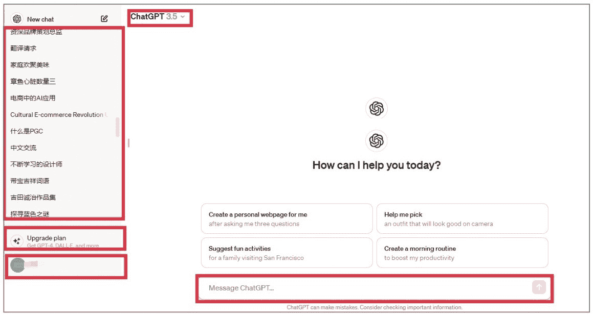

▲图 A-2

需要记住的关键构成如下。

历史记录：保存过往对话内容，可修改标题以便检索，也可清理无用记录。

会员信息：提供升级到 ChatGPT 4.0 的通道，付费后可获得更高阶权限。

个人信息：包含账户信息及设置选项。

版本切换：可在 GPT-3.5 与 GPT-4.0 之间切换。

对话区域：与模型交互获得答案的区域。

**（1）注册和登录 ChatGPT**


打开 ChatGPT 官网，见图 A-3。点击左下角按钮进入登录页面，按步骤完成注册与登录，见图 A-4。

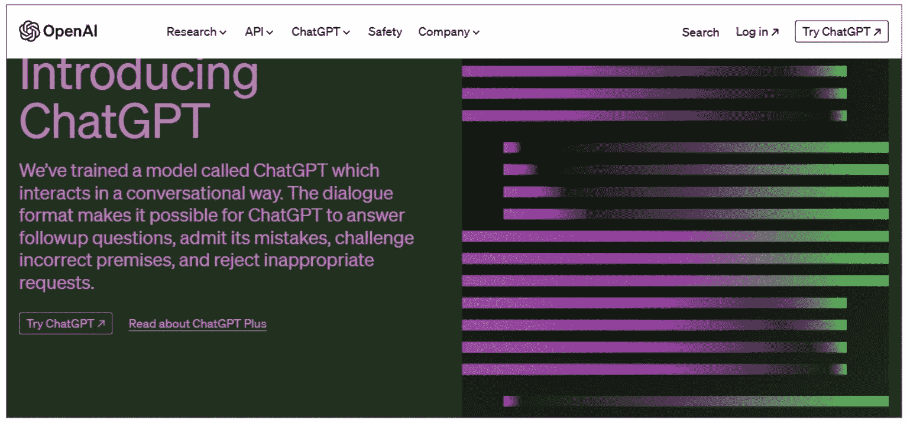

▲图 A-3

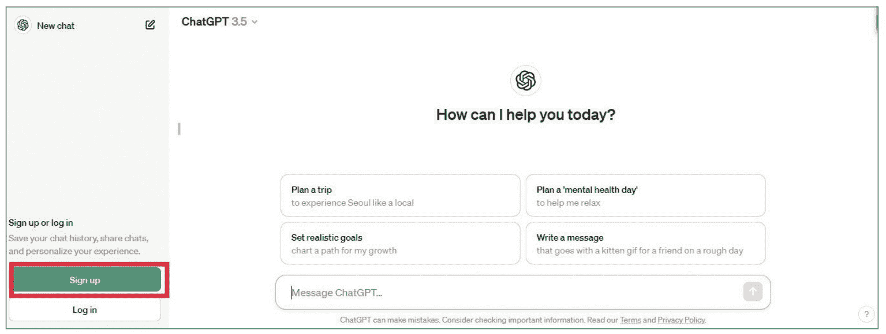

▲图 A-4

**（2）ChatGPT 的功能**

常见基础功能如下。

① **对话：** 可与人类进行自然交流。提出问题、分享观点或寻求建议，模型会基于输入生成对应答案，见图 A-5。

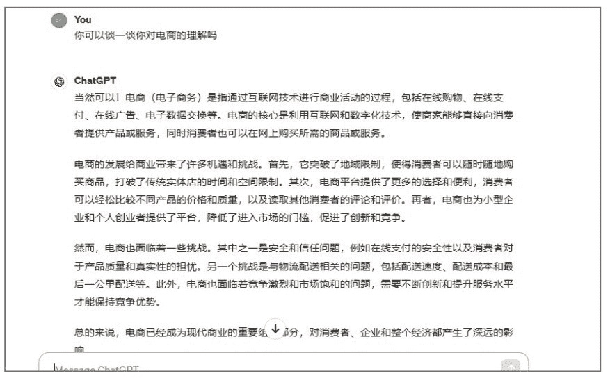

图 A-5

② **创意生成：** 需要灵感时，可向 ChatGPT 3.5 提出主题，模型会尝试给出有趣创意，见图 A-6。

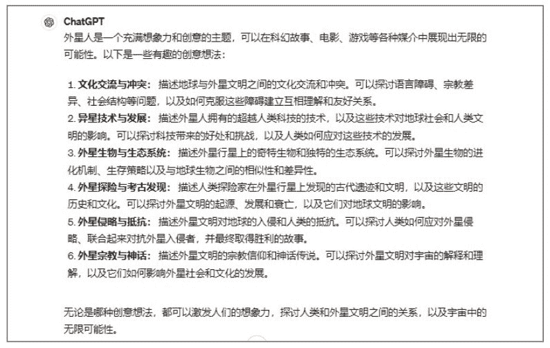

图 A-6

③ **文本生成：** 根据用户提供的主题或素材生成故事、文章、诗歌等文本，见图 A-7。

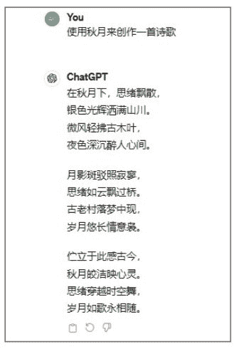

图 A-7

④ **语言整理：** 能理解从简短句子到长篇文本的各类输入。

⑤ **文本编辑与改进：** 将待优化文本交给模型，它会结合上下文给出更合适的表达。

⑥ **自然语言生成应用：** 集成到智能助手、聊天机器人、写作工具等，实现更自然智能的语言交互。

以上只是基础用法，实际可按需求灵活组合，创造多样有趣的应用。

**2. Midjourney**
Midjourney 属于 AI 绘图辅助产品，输入关键词即可在数十秒内生成图像，内置多位艺术家风格如达·芬奇、毕加索，并支持特定镜头与摄影技法的识别。

相较 Imagen 和 DALL·E，Midjourney 面向大众开放，使用门槛较低。输入“一棵长着立方体形状桃子的树”之类的描述，系统会返回 4 幅可选图像，见图 A-8。

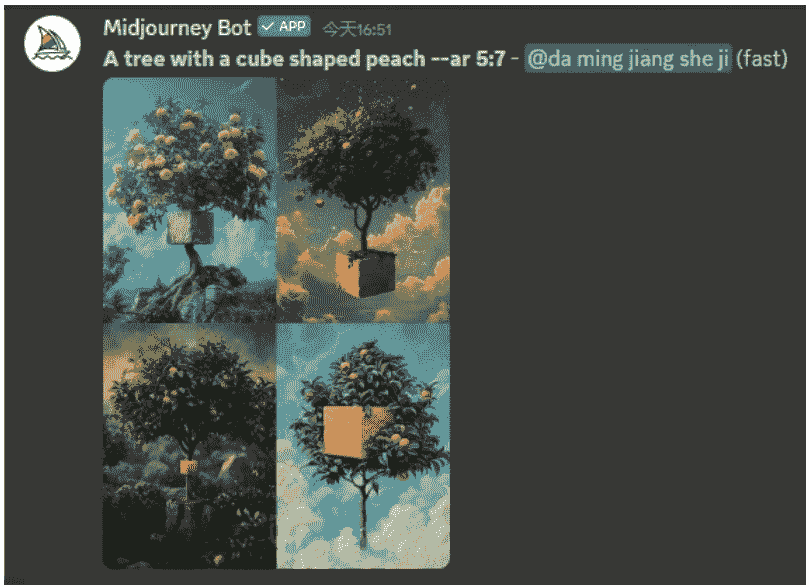

图 A-8

配置方式较为简便，网络上有相关教程。下面介绍界面构成，见图 A-9。

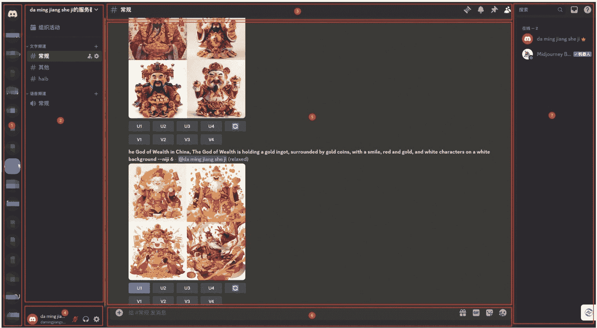

图 A-9

① **服务器配置：** 为避免多用户共用账号导致图像数据混淆，建议启用独立服务器。

② **聊天频道服务：** 提供文本与语音聊天，可邀请伙伴加入特定社区频道协同创作。

③ **自定义设置：** 按个人偏好调整频道内容，并借助搜索功能定位信息。通常通过点击右侧图标进入频道管理设置。

④ **服务器个性化设定：** 可上传头像、修改昵称、配置隐私与安全选项。

⑤ **图像生成区：** 发送提示词后，生成结果在此呈现。

⑥ **指令输入区：** 向 Midjourney Bot 发送文本转图像、图像转图像及混合生成等指令。

⑦ **用户与机器人列表：** 显示受邀好友及机器人，并可查找历史添加的机器人。

**3. Stable Diffusion**
Stable Diffusion 属于人工智能绘图产品，通过模拟扩散过程将含噪声图像转化为目标图像。依据文本描述自动生成高质高分辨率的图像，提供修复、放大、风格调整等功能，帮助设计师获取创意灵感。界面见图 A-10。

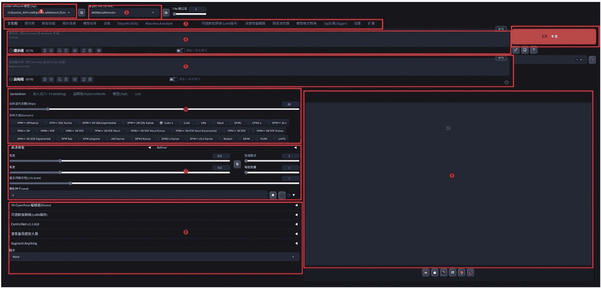

图 A-10

下面设定一个商业情景。

目前未配备专业模特，仅有服装样品。传统流程需模特与摄影师协作，经历拍摄与后期才能产出成片。随着技术进步，只需提供服装照片，借助 AI 即可生成多种风格的模特图像并批量制作，大幅节省时间与工作强度。示意效果见图 A-11 与图 A-12。


▲图 A-11 原始照片


▲图 A-12 经过 AI 处理的模特着装照片

综合来看，AI 在电商领域的广泛应用将提升效率、优化消费者体验并推动销售持续增长。

# 第一章

# AI 绘画工具的基础部署
本章主要介绍 Midjourney 和 Stable Diffusion 的注册、安装与部署流程，并为后续学习做准备，简要演示两款工具的基础操作。

## 1.1 AI 是什么
AI 即人工智能，是指借助计算机技术实现学习、推理、问题求解、语言理解与感知等人类特性的科学方法。

### 1.1.1 AI 的发展与应用
人工智能发展迅速，已深入生活各方面。那么 AIGC 代表什么？

AIGC 全称 Artificial Intelligence Game Creation，即人工智能游戏创作，是一种集分类、生产与自动生成内容于一体的技术应用。既可对内容进行分类生成，也能实现自动创作，已成为内容生产领域的新宠，在生活中得到广泛应用。

内容生态发展经历四个阶段：专家生成内容 PGC、用户生成内容 UGC、AI 辅助生成内容 AIUGC 以及 AI 生成内容 AIGC，见图 1-1。

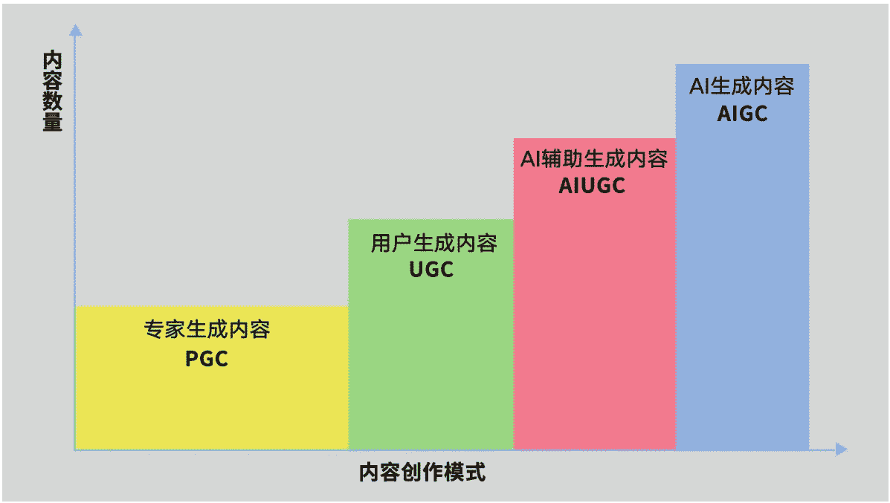

图 1-1

PGC：经精细策划、深入研究与专业制作而成，质量与专业度有保障。广泛应用于教育、培训、咨询、行业分析等，帮助获取专业知识提升技能。可通过在线平台或多种媒体传播，满足特定行业需求。

UGC：指用户自行创作并分享的在线内容，包括文本、图片、视频、评论、博客、社交媒体帖子等，由普通用户而非专业媒体创作。互联网时代常见，让个体表达观点、分享经验并参与社区。

AIUGC：指将人工智能融入用户生成内容，用以辅助、增强甚至自动产生内容，目标是提升质量、效率与多样性，减轻用户负担。对数字营销、内容创作、社交媒体管理、教育、娱乐等多领域有益。

AIGC：指利用人工智能自动生成文本、图像、音频、视频等各类内容，通常无需人工干预，完全依赖程序与机器学习模型创造。

### 1.1.2 AI 技术应用在电商领域的优势
AI 在电商领域潜力巨大，能创造多种创新方式提升购物体验。

采用 AI 创作的插图示例如图 1-2。


图 1-2

个性化推荐：通过分析历史购买数据、浏览行为与兴趣爱好，为用户提供定制化商品推荐，提升转化率与客户忠诚度，优化体验。

虚拟试衣间：电商平台可利用 AI 提供虚拟试衣服务，让消费者线上试穿，降低退货率，减少线下试穿需求。

AI 电商图像生成：用于产品展示图、广告素材、社交媒体内容，可快速构建高品质视觉内容，降低对专业摄影师与设计师的依赖。

客户服务与聊天机器人：集成 AI 聊天机器人提供实时支持，回答常见问题、处理订单追踪、提供产品信息，提升服务效率。

反欺诈：用于检测信用卡欺诈与虚假账户，通过分析交易数据与用户行为自动识别异常模式并采取措施。

库存管理：分析销售趋势，协助更有效地进行库存管理，避免过剩与缺货，提高运营效率。

定价策略：根据市场需求与竞争状况动态调整价格，提升定价精准度，最大化利润。

AI 在电商领域已取得显著成果，未来潜力更大。随着技术进步，电商企业将能提供更智能、个性化且高效的购物体验。

## 1.2 Midjourney 的注册与使用
Midjourney 运行于通讯应用 Discord 中，使用流程便捷，无需复杂部署即可上手。对硬件配置要求低，易于掌握，已广泛应用于艺术创作、虚拟现实、游戏开发、影视动画、创意辅助、快速原型、数字娱乐、表演艺术、教育、广告营销、图像修复增强及电商智能化辅助等。

### 1.2.1 注册
下面介绍注册流程。

**1. 注册**


**01** 在浏览器搜索 Discord 官网，点击右上角 Login 按钮，见图 1-3。


图 1-3

**02** 有账号可直接登录，无账号点击“注册”，见图 1-4。为避免频繁登录，也可下载安装包本地安装。

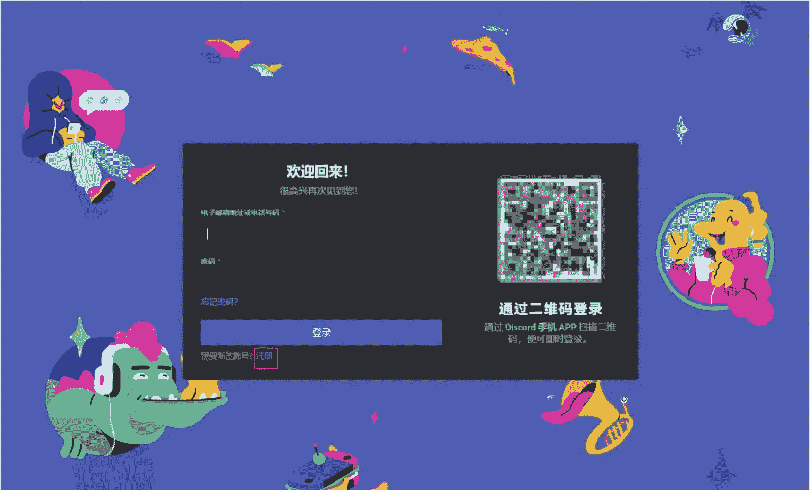

图 1-4

**03** 注册这一步有几个关键点需要注意：账号年龄必须在14岁以上；全程会触发两次人机验证；绑定的手机号要能正常接收短信，推荐使用+86开头的号码；提交完信息后，还需要在邮箱里完成一次确认。整个注册页面的展示分别见图1-5到图1-8。

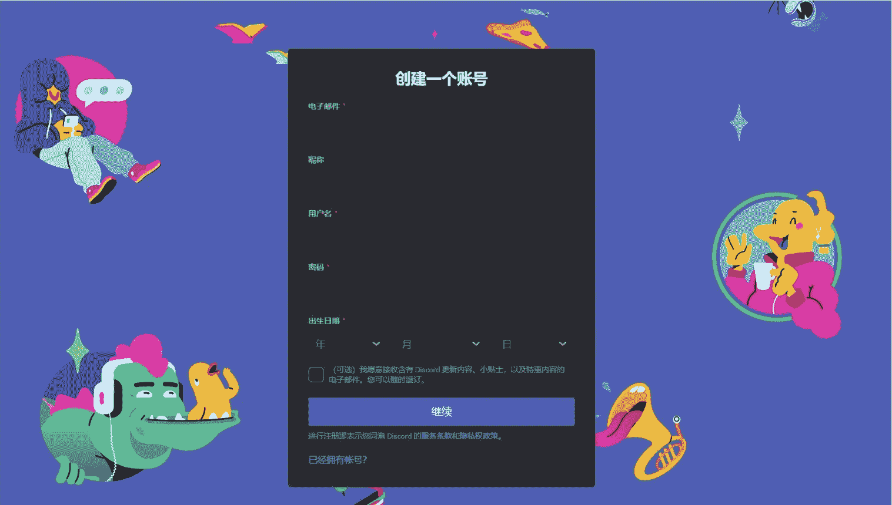

▲图 1-5

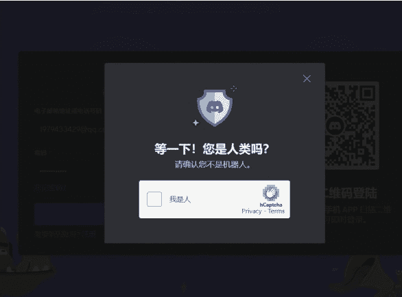

▲图 1-6


▲图 1-7

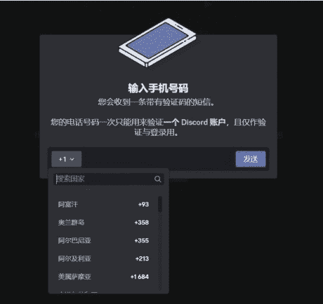

▲图 1-8

**04** 账号建立好后就要搭建自己的工作服务器，如果有朋友的邀请码可以直接加入别人的服务器，没有的话就只能自行创建。创建服务器的界面流程参考图1-9至图1-11。

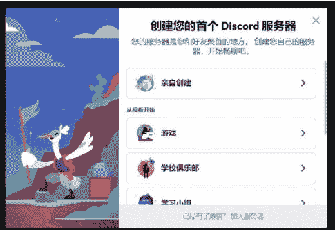

▲图 1-9

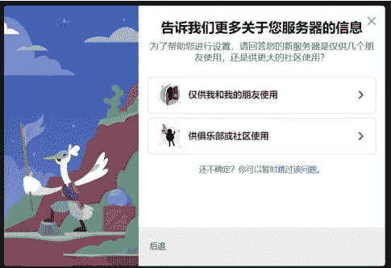

▲图 1-10

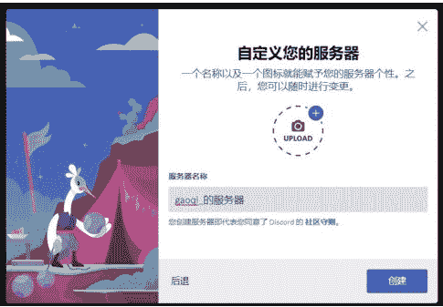

▲图 1-11

**2. 在 Discord 中嵌入 Midjourney**

**01** 先把 Midjourney 的公共社区加进来。打开 Discord，点击左侧的指南针图标 ，在“特色社区”里点选 Midjourney 即可进入官方公共服。进入后，announcements 区域会集中展示版本变动和各类通知，daily-theme 区域则可以看到社区成员分享的 AI 作品。页面示意如图1-12和图1-13。

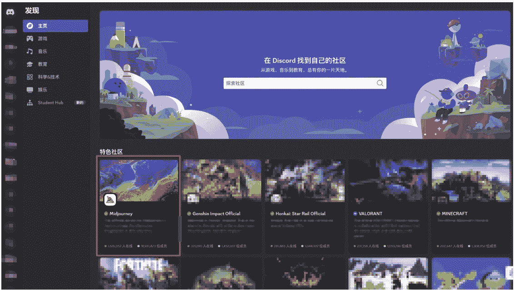

▲图 1-12

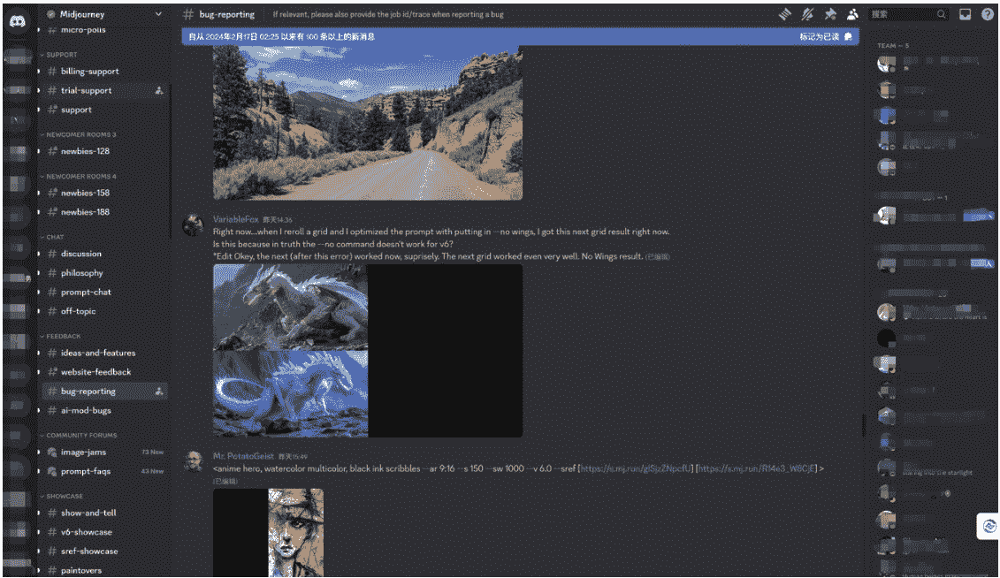

▲图 1-13


**02** 在 Midjourney 公共社区的右上角点开“显示成员名单” ，在右侧列表里找到 Midjourney Bot，点击“添加至服务器”，随后选择前面新建好的服务器名称，就能把机器人拉进自己的服务器，操作如图1-14。

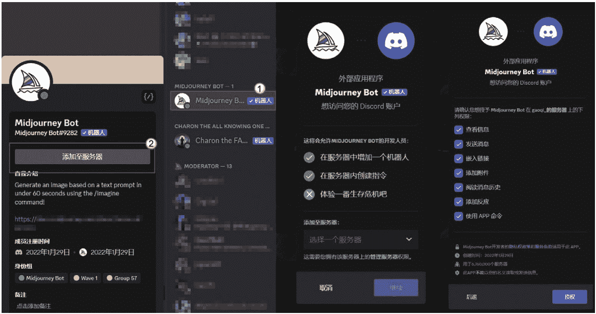

图 1-14


**03** 开通会员。直接在聊天框输入/subscrib 回车，然后点 Manage Account（管理账户）进入订阅页面，具体流程如图1-15到图1-17。

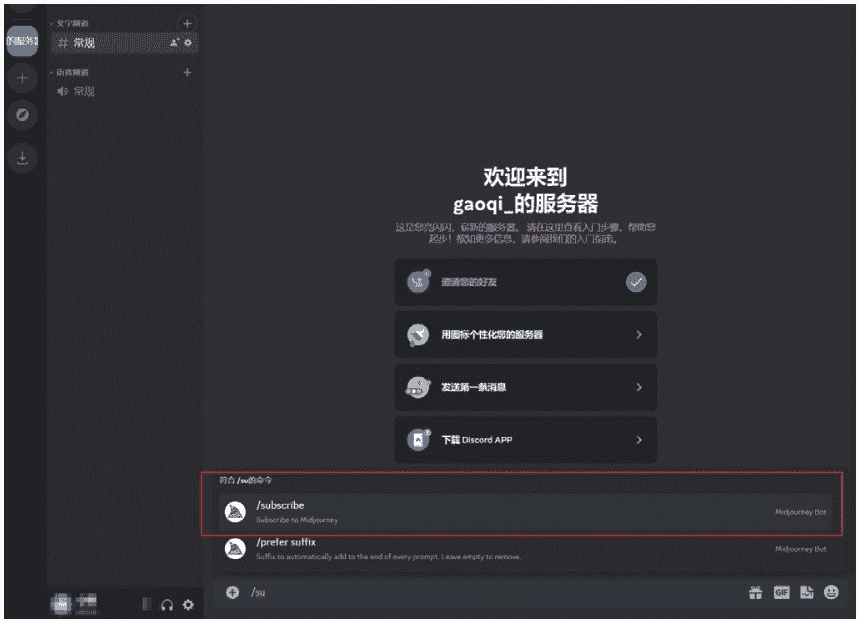

▲图 1-15


▲图 1-16

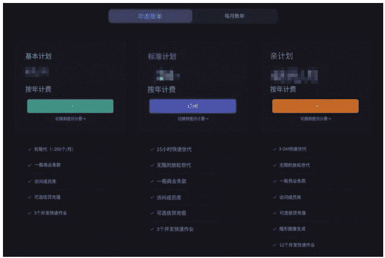

▲图 1-17

### **1.2.2 Midjourney 用户界面**

Midjourney 目前是和社区聊天服务器绑定的，用起来和普通聊天工具差不多。整体界面布局如图1-18。


图 1-18

① 服务器：同一个账号若被多人共用，建议建立不同的服务器，避免图像数据相互混淆。
② 聊天频道：提供文字和语音两种聊天空间，可以邀请伙伴一起进入。
③ 通用设置：频道内容可以按个人习惯调整，也能在这里检索所需资料。通常点一下右侧的小图标就能打开频道的详细管理设置。
④ 服务器设置：点  后可进行个人资料的调整，包括头像上传、昵称修改，以及隐私和安全相关选项。
⑤ 对话生成区：把提示词发出后，生成的图片会在此区域呈现。
⑥ 指令区：向 Midjourney Bot 发送指令的地方，支持文生图、图生图以及图文混合生成等功能。
⑦ 成员列表区：显示所有被你邀请的好友和机器人，也能在此找到之前添加过的机器人。

### **1.2.3 Midjourney 生图方法**

服务器配置完、界面熟悉后就可以开始创作了。先在指令区输入“/”，选择 /imagine 命令，在 Prompt 后面填入 boy 并回车，就能得到第一幅 AI 绘画，效果见图1-19。

boy --s 750 --v 5.2

如果四张结果中有满意的图，就可以用 U1 到 U4 进行放大，顺序为从左到右、从上到下。例如想放大左上角的那张，直接输入 U1 即可，效果如图1-20。

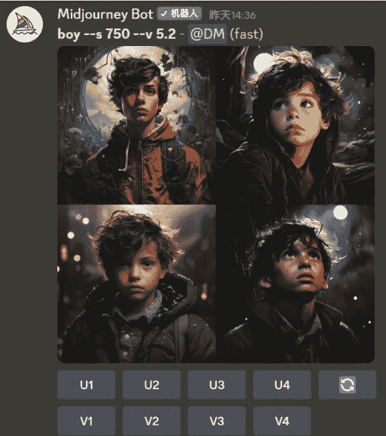

▲图 1-19

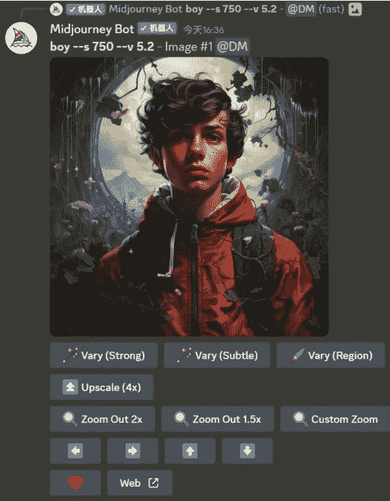

▲图 1-20

**技巧提示**

Midjourney 的提示词必须使用英文输入。建议新手先用翻译工具把中文想法转为英文再使用。

对生成效果不满意时，可以把描述写得更具体，比如“一个蓝色头发、碧绿眼睛的男孩”，并限定为“平铺插画风格”，生成结果如图1-21。

A boy with blue hair and green eyes,flat illustration

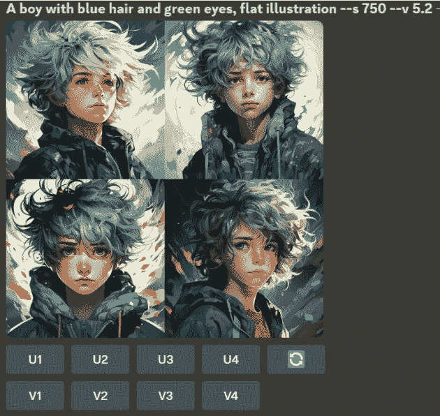

图 1-21

到这里读者基本就能用 Midjourney 产出 AI 作品了。不过要提醒的是，AI 绘画同样考验细节，想要作品更精细，还需要后续持续练习。

## **1.3 Stable Diffusion 的安装与云部署**

Stable Diffusion 的特点是让 AI 绘图更清晰，读者可以用它绘制动漫插画、古风水墨、3D 渲染等多种风格，画质甚至能接近实拍照片。它还支持 Lora、ControlNet 等扩展功能，可以更精准地控制风格、角色细节、姿势、动作和构图。

另外它完全开源，可以直接部署到本地电脑使用，无使用限制且免费。

### **1.3.1 Stable Diffusion 的本地安装**

下面介绍本地安装方式，主要包括硬件要求和具体步骤。

**1. 计算机配置要求**

Stable Diffusion 实用但对配置有要求。

第 1 个：建议使用 Windows 系统，不太推荐 Mac 用户。

第 2 个：需要强劲的 GPU 来提供算力。虽然理论上各种显卡都能跑，但用户普遍反馈 Nvidia 显卡更稳定、更易用。内存最好 16GB 以上，CPU 要求不高，建议准备 500GB 以上的 SSD 来存放大模型。

判断电脑能否流畅运行，最简单的方法是看它是否能顺利运行近两年主流的 3A 大作，注意“能运行”和“流畅运行”是两回事。

显卡性能直接影响绘画效率。按笔者统计和用户反馈，显存 8GB 的 RTX 3070 绘制一张 512px×512px 的图像大约只需 10 秒。若显卡较弱，建议考虑升级或改用云部署，因为 AI 绘画需要反复尝试，效率低会浪费大量时间，也难以达到预期。

影响效率的另一个关键是显存，主要决定能画多大尺寸。显存不足时就画不出高清图，同时显存也关系到能同时训练的模型数量。这个问题比较复杂，若想轻松训练模型，建议显存大于 8GB。图1-22 对比了不同显卡在 Stable Diffusion 上的运行表现，可供参考。

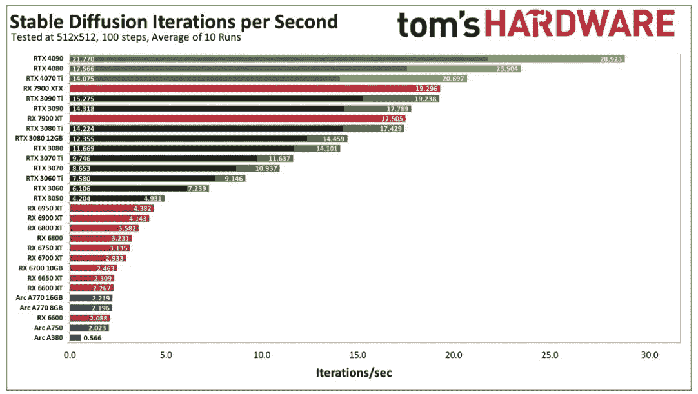

图 1-22

如果以上信息显得复杂，这里提供一份更实用的配置清单，区分了基础配置和推荐配置，对比见图1-23。

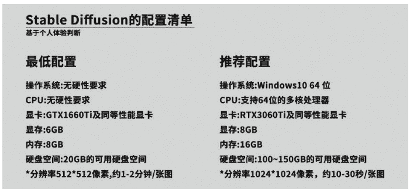

图 1-23

**2. 下载安装包进行安装**

安装包可参考图1-24 在网上自行下载。下载完成后先不要点“启动器运行依赖”。具体步骤如下。

**01** 解压 sd-webui-aki-v4.1.zip 压缩包。若已更新到 4.2 版本，可直接使用 4.2，操作与 4.1 相同，示意图1-25。

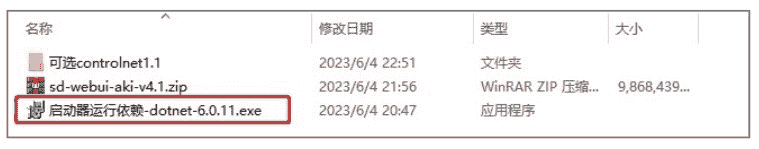

▲图 1-24

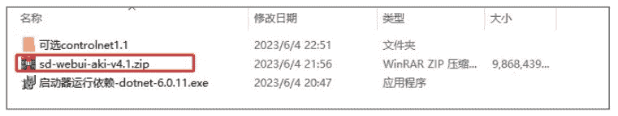

▲图 1-25

**02** 在解压后的文件夹里双击“A 启动器.exe”，如图1-26。安装过程如图1-27。

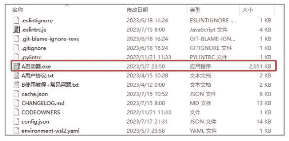

▲图 1-26

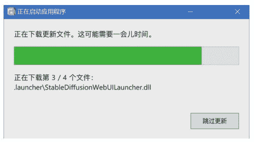

▲图 1-27


**03** 启动完成后打开程序，点击“一键启动”按钮，如图1-28。此时默认浏览器会自动打开页面，表示启动成功，如图1-29。

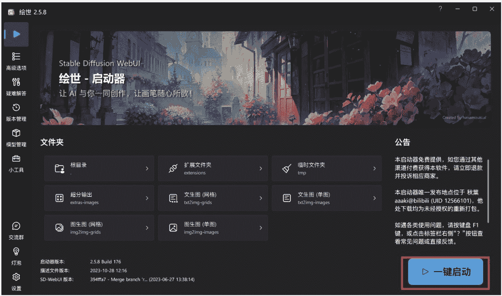

▲图 1-28

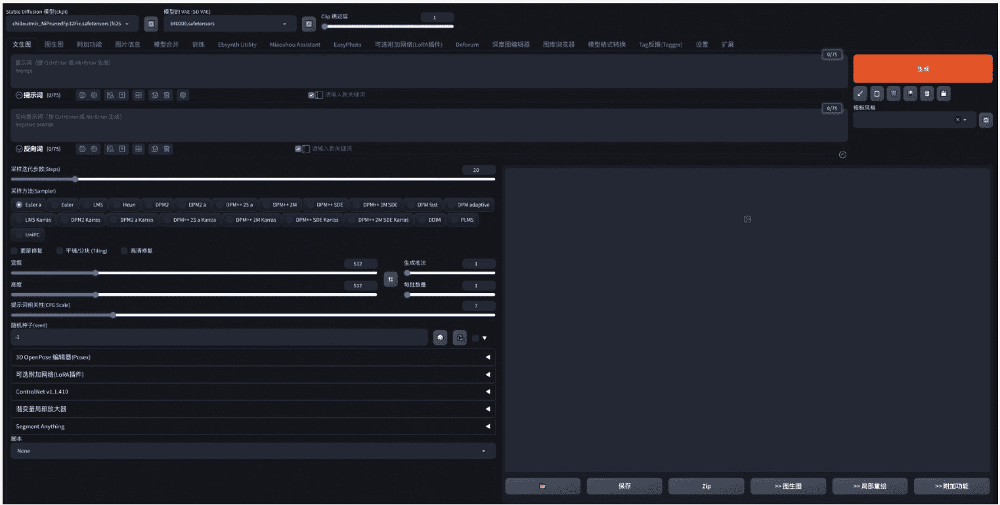

▲图 1-29

### **1.3.2 Stable Diffusion 的云部署**

下面详细说明 Stable Diffusion 的云端部署方式。

**1. 云桌面部署**

**01** 点击下方链接注册账号。

青椒云官网

进入青椒云云桌面官网，在弹出的注册页完成账号创建，如图1-30。


图 1-30

**02** 注册成功后，在完成页可以直接下载云桌面客户端，如图1-31。

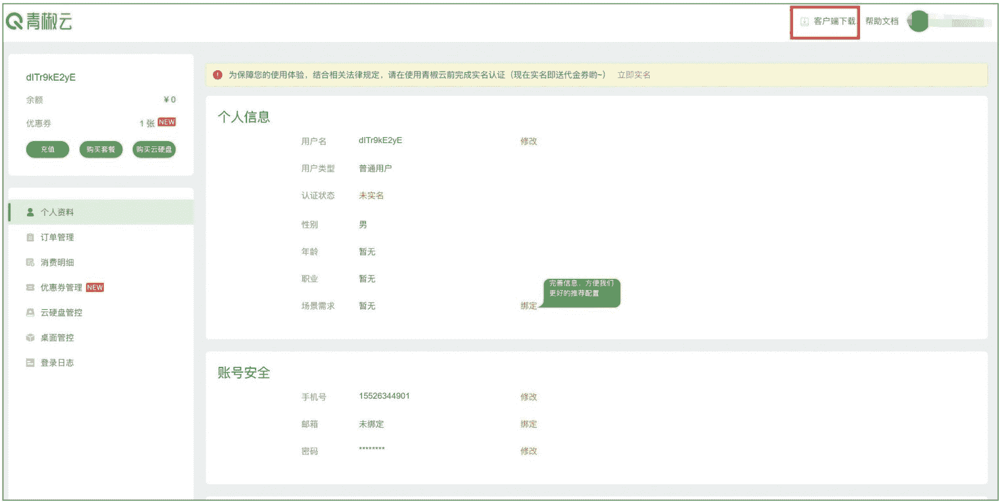

图 1-31

**03** 在“下载”栏选择与自己电脑系统相匹配的客户端，如图1-32和图1-33。Windows 系统下载 Windows 版，Mac 系统下载 Mac 版。

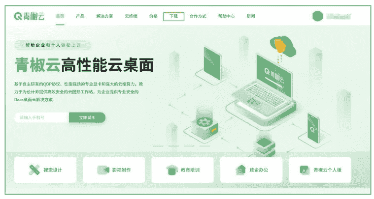

▲图 1-32

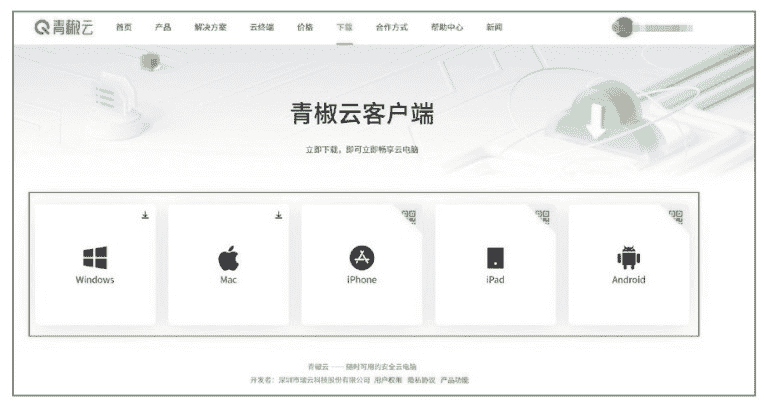

▲图 1-33

**04** 下载并安装云桌面客户端，登录后按界面提示完成实名认证，如图1-34和图1-35。


▲图 1-34

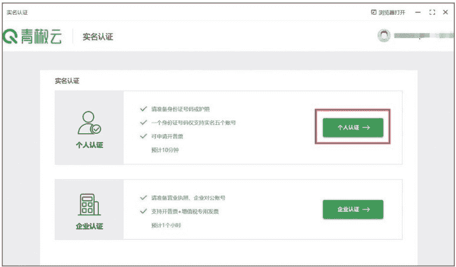

▲图 1-35

**05** 在软件界面点“新增云桌面”，在弹出的产品列表里选择“华南”区域，添加云桌面，在“标准产品”中挑选“AIGC 尝鲜”，具体如图1-36至图1-38。

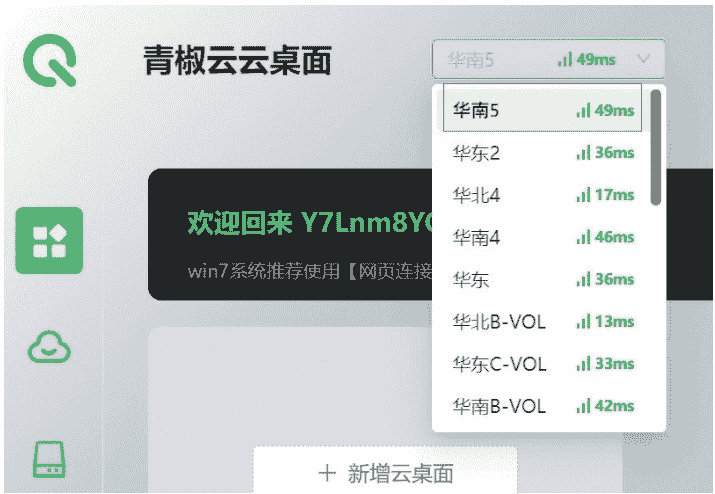

▲图 1-36

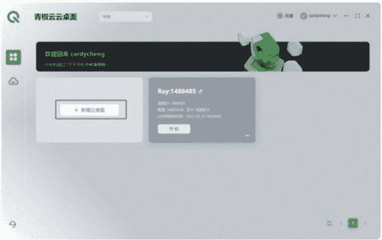

▲图 1-37

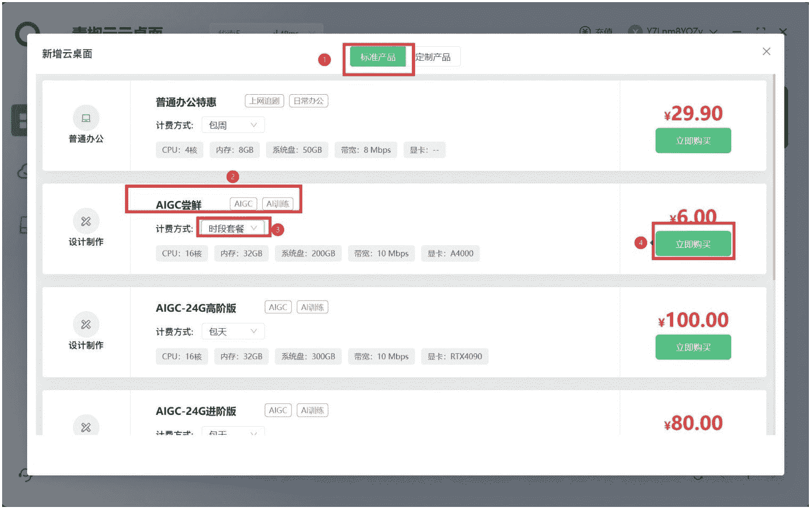

▲图 1-38

**技巧提示**

定制产品栏里还有与各博主合作的镜像包，已预装 Stable Diffusion、模型和插件，使用很方便。计费方式有包天、包月、按时计费等，可按需选择，如图1-39。

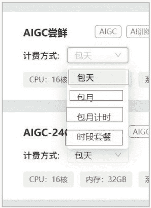

图 1-39

**06** 此时界面即可看到已添加的云桌面，点击“开机”即可开始使用，如图1-40和图1-41。

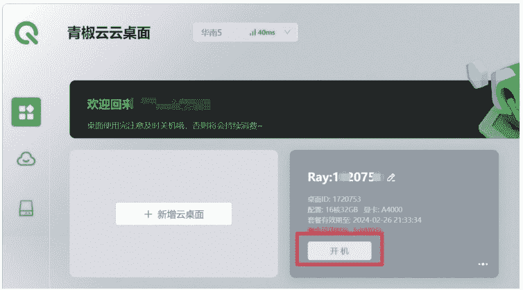

▲图 1-40

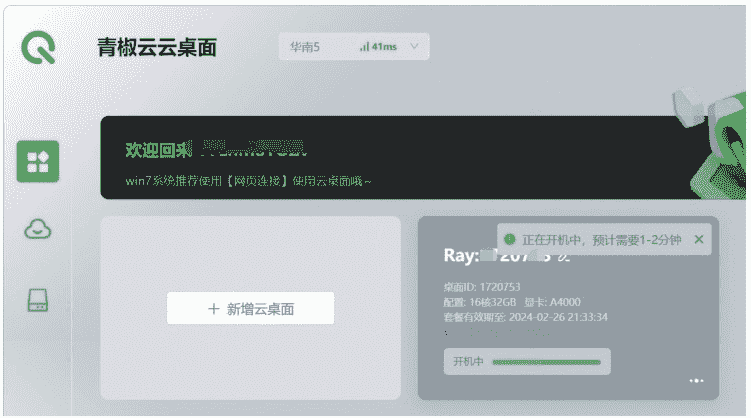

▲图 1-41

**07** 开机完成后即可进入云桌面正常操作，如图1-42和图1-43。

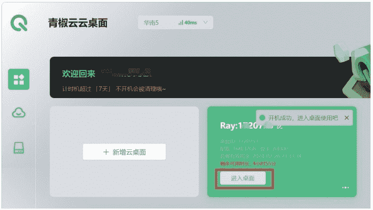

▲图 1-42

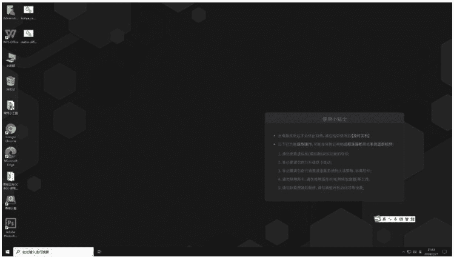

▲图 1-43

**08** 需要退出时，在顶部断开连接即可，如图1-44。

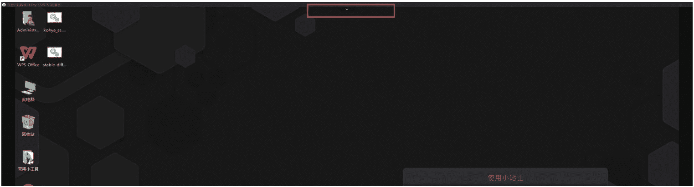

▲图 1-44

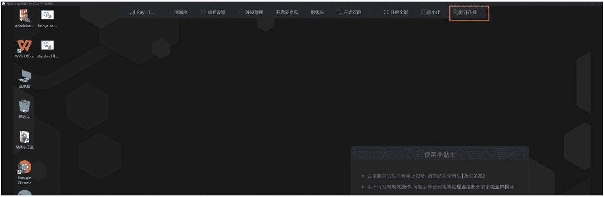

▲图 1-45

**09** 回到青椒云桌面系统后，要在个人云桌面内完成关机，具体步骤可参考图 1-46～图 1-49。

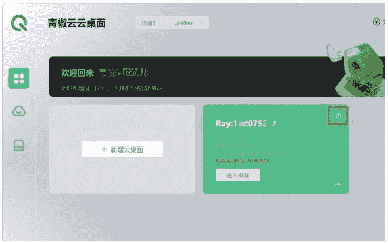

▲图 1-46

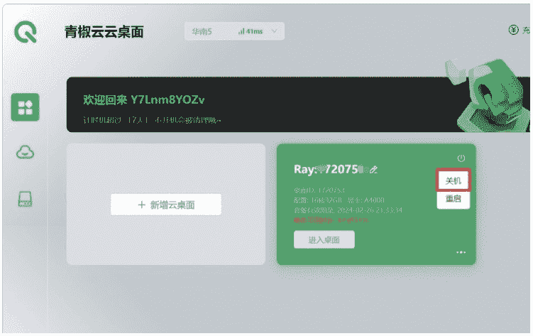

▲图 1-47

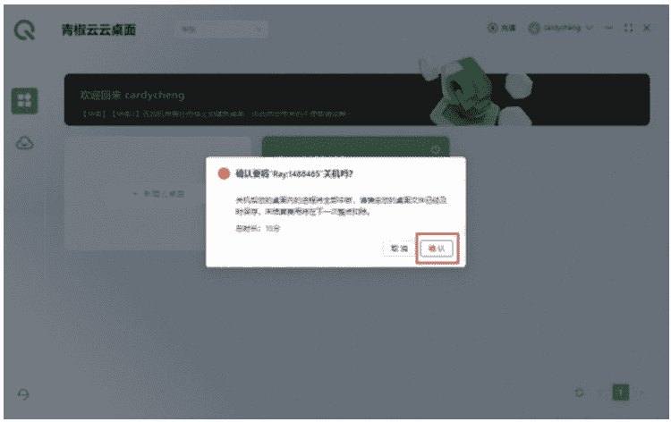

▲图 1-48


▲图 1-49

**技巧提示**

使用完毕请立即关机，关机后系统才会停止计费。

**2. 资料传输**

进入云桌面之后，软件下载安装与本地电脑操作一致。课程中若需用到个人电脑里的素材，可把文件传到云端使用。

**01** 在青椒云桌面中调用网盘功能，如图 1-50 所示。


图 1-50

**02** 打开网盘界面后挑选本地资源进行上传，如图 1-51 和图 1-52 所示。


▲图 1-51


▲图 1-52

**03** 上传完成后回到云桌面内部，通过“青椒云盘”把网盘添加进来，如图 1-53 和图 1-54 所示。


▲图 1-53


▲图 1-54

**技巧提示**

提示出现“添加成功”后，就能在云桌面的云盘里找到上传的内容。该桌面已预装好 Stable Diffusion，可直接使用。

**3. 云端部署 Stable Diffusion**

**01** 浏览器打开 AutoDL AI 算力云官网，如图 1-55 所示。站内可使用微信扫码登录，登录时记得填写手机号，如图 1-56 所示。


▲图 1-55


▲图 1-56

**02** 登录后在“控制台”里进行充值，如图 1-57 所示。因为调用的是第三方算力资源，相关服务按需付费，如图 1-58 所示。


▲图 1-57


▲图 1-58

**03** 返回控制台主页点击“进行中”，如图 1-59 所示。再选择“租用新实例”，如图 1-60 所示。


▲图 1-59


▲图 1-60

**04** 进入“创建实例”页面，如图 1-61 所示。计费方式包括按量、按日、按周、按月等，按个人需求挑选即可，本文演示按量计费，如图 1-62 所示。


▲图 1-61


▲图 1-62

**05** 选择节点地区，如图 1-63 所示。没有特殊要求时随意挑选也可，注意这里指服务器所在位置，建议选就近或常用区域。


图 1-63

**06** 选择 GPU 型号及数量，建议把 CPU 选项全部勾选，GPU 数量设为 1 即可，如图 1-64 所示。若追求更高性能，可适当提高 CPU 数量。


图 1-64

**07** 选择主机配置，按自身需求决定即可。显存越大越好，空闲 GPU 显示 1/4 表示该类型机器共 4 台，目前剩 1 台可用；分子为 0 则表示无空闲。示例选择见图 1-65。


图 1-65

**08** 选择社区镜像，如图 1-66 所示。在搜索框输入 nov，选择下载量最大的镜像，如图 1-67 所示。


▲图 1-66


▲图 1-67

**09** 点击开始创建镜像，创建完成后状态如图 1-68 所示。


图 1-68

**10** 实例开机后选择 JupyterLab，如图 1-69 所示。


图 1-69

**11** 新网页打开后，将指针移到蓝色区域，点击左侧蓝色条运行程序，如图 1-70 所示。运行成功后蓝色框内会显示“移动完成”，如图 1-71 所示。


▲图 1-70


▲图 1-71

**12** 点击右上角的 Python 3(ipykernel)，如图 1-72 所示。若未出现可刷新页面。弹窗中选择 xl_env，如图 1-73 所示。


▲图 1-72


▲图 1-73

**13** 返回主程序页面，指针移至下方蓝色框中运行，如图 1-74 所示。


图 1-74

**14** 运行后下方出现操作栏，选择“启动 WebUI”，如图 1-75 所示。


图 1-75

**15** 继续向下滑动页面，勾选需要开启的参数后再次运行 WebUI，如图 1-76 所示。代码执行完毕后出现 IP 编号，即代表部署完成，如图 1-77 所示。


▲图 1-76


▲图 1-77

**16** 回到主页选择“自定义服务”，如图 1-78 所示。此处需要认证，按提示操作即可，如图 1-79 所示。认证通过后会打开 WebUI 页面，如图 1-80 所示。


▲图 1-78


▲图 1-79


▲图 1-80

**17** 若弹出图 1-81 的提示，需另行操作。Windows 系统需先把压缩包下载到本地。


图 1-81

**18** 解压后运行 AutoDL.exe，如图 1-82 所示。弹出对话框，将网页提供的指令和密码复制粘贴进去即可开始代理，如图 1-83 所示。


▲图 1-82


▲图 1-83

**19** 点击本地主机号进入 WebUI 页面，如图 1-84 所示。页面效果如图 1-85 所示。


▲图 1-84


▲图 1-85

**技巧提示**

至此云端 Stable Diffusion 的部署算是完成。

**20** 若使用 Linux/Mac 系统，需要打开终端，把命令复制粘贴进去，如图 1-86 所示。

**21** 粘贴后按 Enter，首次会提示确认，输入 yes 回车即可，如图 1-87 所示。


▲图 1-86


▲图 1-87

**22** 再回到提示页面复制密码粘贴到终端，如图 1-88 和图 1-89 所示。粘贴时可能看不到字符，这是正常现象；若失败可手动输入，手动输入同样不显示。


▲图 1-88


▲图 1-89

**23** 返回访问服务页面，点击本地主机地址即可打开 WebUI 主页，如图 1-90 所示。


图 1-90

**技巧提示**

部署过程中请妥善保存自行生成的图像，使用完毕记得关闭系统，否则会按时长计费。选择包月方案可根据实际需求决定。系统关闭后数据保留 15 天，15 天内未续用将被清除以供他人使用。


### **1.3.3 Stable Diffusion 用户界面**

Stable Diffusion 作为新型生产工具，可控性较强。下面简单介绍其工作界面，如图 1-91 所示。


图 1-91

界面顶部的标签栏对应不同的功能模块，如图 1-92 所示。


图 1-92

日常绘图最常用的是“文生图”“图生图”，如图 1-93 所示。


图 1-93

“设置”里包含绘图相关参数，如图片保存位置、采样参数等，如图 1-94 所示。


图 1-94

“扩展”主要用于安装和管理各类插件，如图 1-95 所示。


图 1-95

### **1.3.4 Stable Diffusion 生图方法**

**01** 先选择一个 Stable Diffusion 模型，如图 1-96 所示。


图 1-96

**技巧提示**

简单说明模型的概念。WebUI 只是操作入口，真正决定画风的是模型。模型由大量图像训练而成，不同模型风格迥异。服务器已预置部分基础模型，后续会介绍获取更多模型的方法。熟练后甚至可自行训练。注意记录模型的存放路径，这是关键信息。

**02** 在模型管理界面点击“打开文件夹”，如图 1-97 所示。也可直接前往 WebUI 根目录下的 models\Stable-diffusion，如图 1-98 所示。


▲图 1-97


▲图 1-98

**03** 文本驱动绘图
在 Stable Diffusion 中切换到文生图模式，实质是把脑中的画面用文字写出来交给模型生成。圈内称这种描述为 Prompt，表达可以很口语化，例如“沙漠里独自行走的小女孩，炙热阳光洒在身上”。模型只接受英文输入，所以先用翻译工具转成英文再粘贴即可，见图 1-99 所示。

A little girl was walking alone in the desert,with the scorching sun shining on her,


图 1-99

**04** 追加通配质量词
为了让还原度更好，通常会在主描述后补上一段已优化的质量词组，可直接复用，参考图 1-100。

(masterpiece:1,2),best quality,masterpiece,highres,original,extremelydetailed wallpaper,perfect lighting,(extremely detailed CG:1.2),drawing,paintbrush.


图 1-100

**05** 负向提示词过滤瑕疵
除正向 Prompt 外，还需负向 Prompt 来剔除不想要的元素。下面这段通用负向词可直接使用，见图 1-101。

(worst quality:2),(low quality:2),(normal quality:2),lowres,normal quality,((monochrome)),((grayscale)), skin spots,acnes,skin blemishes,age spot,(ugly:1.331),(duplicate:1.331),(morbid:1.21),(mutilated:1.21), (tranny:1.331),mutated hands,(poorly drawn hands:1.5),blurry,(bad anatomy:1.21), (badproportions:1.331), extra limbs,(disfigured:1.331),(missingarms:1.331),(extra legs:1.331),(fused fingers:1.61051),(too many fingers:1.61051),(unclear eyes:1.331),lowers,bad hands,missing fingers,extra digit,bad hands,missing fingers, (l(extra arms and legs)))


图 1-101

**06** 参数设定与微调
成图效果很大程度上取决于参数，笔者常用的数值见图 1-102，实际使用时按需调整即可。


图 1-102


**07** 查看生成结果
设置完成后点右上角的生成按钮，等待片刻即可得到“小女孩在沙漠中行走”的图像，效果如图 1-103 所示。


图 1-103

# **第二章**
# **ChatGPT 电商运营上手指南**

ChatGPT 具备广泛的适用场景和较强能力，可帮助用户快速开启电商运营探索，迅速把握核心要点。无论是入门新手还是资深从业者都能获益。借助它，可在运营全流程实现精准的数据分析与决策支持，及时洞察市场趋势，解读消费者行为，制定更有针对性的策略。此外，其人际交流与实时互动能力突出，在线营销与客服都能应对自如。

## **2.1 ChatGPT 基础操作**
ChatGPT 是由人工智能驱动的自然语言处理工具，能学习解读人类语言进行对话，并基于上下文持续互动，帮助完成各类任务。

### **2.1.1 电商场景常见应用**
客户服务与支持：可构建智能客服体系，解答高频问题，提供产品方案，甚至处理投诉与退款请求。
个性化推荐：依据用户历史购买记录及兴趣生成专属推荐，优化购物体验。
商品描述与内容创作：协助撰写商品详情、评价文案，创作更具吸引力的广告内容，提升转化率。
库存管理与预测：分析销售数据预测需求走势，帮助平台更高效管理库存与供应链。
市场营销与社交媒体：生成社媒内容、回复用户提问，自动撰写文章或新闻稿。

### **2.1.2 使用流程与常见误区**
操作非常简便，只需在文本框输入问题、话题或求助信息，按 Enter 即可。ChatGPT 会理解需求并给出信息、建议或解答，适合寻求指导、闲聊交流或寻找解决方案。
有时结果并不理想，并非技术遥不可及，而是使用方法尚未掌握。尤其是 Prompt 提示词的概念，许多人并不熟悉。
下面详细解释 Prompt 的含义及如何巧妙运用，避免陷入困扰，从而获得更满意的回复。

**1. Prompt 是什么**
想获得 ChatGPT 的帮助，必须给出明确的指令和引导。业内称之为 Prompt 提示词，即向 ChatGPT 提问或下达要求时使用的具体文字说明。回复质量取决于提示词是否详尽、完整、精准。

**2. Prompt 不完整会怎样**
如果你已步入职场，可思考是否曾因与上级或客户沟通不清而疲惫。很多人就遇到这种问题，对方表达模糊。把角色对换，ChatGPT 面对模糊的问题也会迷失焦点，导致对话偏离主题，难以抓住重点。无论现实人际还是与模型互动，都很难得到理想答案。
以下以“写简历”为例演示 Prompt 不完整时的表现。在 ChatGPT 中输入需求，返回的简历较为普通和常规，这并非模型无能，而是提问不够精确，限制了发挥空间。
1.撰写一份完整精准的求职简历。
2.编写符合工程师职位需求的求职简历。
3.请运用您的中文文字才华，为我撰写一份能深深吸引招聘经理目光的求职简历。个人职业背景为后端工程师，拥有五年行业工作经历，熟练掌握 Node.js、MySQL、PostgreSQL 等前沿技术，同时具有 GCP K8s 实践操作经验，已成功开发并维护 RMA、OTA 等大型系统。

Please write in Chinese language.


▲图 2-1


▲图 2-2

**3. 写出精确的 Prompt**
理解提示词精确性的重要性后，就需要有针对性地描述，最好明确到角色、内容、目的等，可请 ChatGPT 担任某领域专家。图 2-3 所示即为请 ChatGPT 担任诗人写诗的例子。


图 2-3

**4. 训练 ChatGPT 总结 Prompt**
首先询问 ChatGPT“如何概括 Prompt”。其回复如图 2-4 所示。


图 2-4

文本内容分析：要深入阅读原始文本，捕捉核心主题和观点。例如文本涉及气候变化对环境的影响。
关键词提取：从文本中抽取关键词或短语。此例中关键词可能是“气候变化”“环境影响”“气温升高”“海平面上升”等。
潜在问题思考：“气候变化如何影响环境”“气温升高对地球哪些方面产生影响”“如何应对海平面上升挑战”等。
Prompt 构建：“描述气候变化对地球环境的影响”“探讨气候变化引发的海平面上升对岛屿国家的影响”“解释全球变暖如何改变生态系统”等。
优化与调整：将构建的 Prompt 与原文对比，选择更贴近主题和风格的版本。例如“探讨气候变化对环境的影响”更接近原文。
最后根据对比结果优化和调整 Prompt，使其更好地反映原文内容。这一逐步优化过程有助于找到合适的提示词，引导生成与原文相似的内容。

### 实战：写一个商品种草的 Prompt
商品种草本质上是一种高级购物评价，类似小红书种草。自己写费时费力，可让 ChatGPT 生成种草文案。参考模板如下。
请以一位[角色]的角色，结合[商品介绍]，详细推荐一款你觉得非常好用的[商品名称]。描述其关键特征、实用性、使用体验等方面的优点，并分享你在日常生活中如何使用这款[商品名称]。请使用[语气]的语气，以[风格]的风格表达，并在文中适当使用图标强调重点。

**01** 找一篇真实种草笔记，内容如下。
家里三个孩子。

纸巾消耗超级大。

用得顺心第一位。 

baby care 云柔巾。图 1。

超级软。不飞毛毛。压花也超好看。大小合适。

湿了也不会掉絮.宝宝擦鼻涕不会磨到。 

全棉时代婴儿棉柔巾。图 2。

我们之前在月子中心说不建议小婴儿用，有点飞毛，比对下来看，确实是，柔软程度来说也不算超柔。 

大王天使湿巾。图 3。

湿巾可用过太多太多品牌了，有的不好抽，有的超级厚，有的太湿了……而且很多用到最后真的是湿答答，要抠出来的那种，着急忙慌的时候，湿巾抽不出来真的也是人间疾苦。

这款抽到最后一张都很舒心，均价 15 元/包，80 抽。如果纯看性价比，这个可能不合适，但是我们很喜欢  。 

全棉时代棉柔巾。图 4。

这个可能是大众棉柔巾了，但是无功无过，包装我就不喜欢，打开的时候口子会裂很大，不质感，我们囤太太太太多了，用了一年多还没用掉，柜子里这些用完不会再入了。 

baby care。图 5。

也是 bbc 的，各方面都还可以，洗脸比“全棉时代”的好用多了，珍珠纹的，比较厚一点，大小也合适。

**02** 让 ChatGPT 分析文本并给出初始 Prompt，要求形式为“要求+原文”。回复如图 2-5 所示。
现在，请分析以下文本的角色、风格、语气、长度、段落和图标使用等特点，给出可以生成这个文本的 Prompt。

家里三个孩子。

纸巾消耗超级大。

用得顺心第一位。 

baby care 云柔巾。图 1。

超级软。不飞毛毛。压花也超好看。大小合适。

湿了也不会掉絮.宝宝擦鼻涕不会磨到。 

全棉时代婴儿棉柔巾。图 2。

我们之前在月子中心说不建议小婴儿用，有点飞毛，比对下来看，确实是，柔软程度来说也不算超柔。 

大王天使湿巾。图 3。

湿巾可用过太多太多品牌了，有的不好抽，有的超级厚，有的太湿了……而且很多用到最后真的是湿答答，要抠出来的那种，着急忙慌的时候，湿巾抽不出来真的也是人间疾苦。

这款抽到最后一张都很舒心，均价 15 元/包，80 抽。如果纯看性价比，这个可能不合适，但是我们很喜欢  。 

全棉时代棉柔巾。图 4。

这个可能是大众棉柔巾了，但是无功无过，包装我就不喜欢，打开的时候口子会裂很大，没有质感，我们囤太、太、太、太多了，用了一年多还没用掉，柜子里这些用完不会再入了。 

baby care。图 5。

也是 bbc 的，各方面都还可以，洗脸比“全棉时代”的好用多了，珍珠纹的，比较厚一点，大小也合适。


图 2-5

**03** 该 Prompt 已基本可用，笔者在基础上做了少量手动调整，最终版本如下。
请以一位[角色]的角色，结合[商品介绍]，详细推荐一款你觉得非常好用的[商品名称]。描述其关键特征、实用性、使用体验等方面的优点，并分享你在日常生活中如何使用这款[商品名称]。请使用[语气]的语气，以[风格]的风格表达，并在文中适当使用图标强调重点。

**技巧提示**
若想进一步优化，可按以下步骤操作。
① 预置多个步骤引导提升效果，如提出反问和引导下文。为提升生成内容品质，优质 Prompt 应包含哪些关键因素？请给出 3 条高质量 Prompt 的标准。
② 给出实际场景具体例子，要求 ChatGPT 反向推导出 Prompt。现在，请分析以下文本的角色、风格、语气、长度、段落和图标使用等特点，给出可以生成这个文本的 Prompt。
③ 新建一个对话验证 Prompt 效果，如不理想可反复修改直至满意。
④ 为提升通用性，可要求 ChatGPT 将其重写为模板，使用占位符制作格式化模板，效果更显著。若要优化为通用产品推荐方案，可在适当位置插入占位符以便后续替换。
⑤ 用 Prompt 模板测试其他具体场景效果，如不满意继续修改，如满意则可形成通用方案应用于多种场景。

## **2.2 提问规范与原则**
很多人认为 ChatGPT 只是聊天机器人，其实并非如此。其价值大小取决于使用方法是否正确。重点在于如何提问，下面介绍几个原则。

### **2.2.1 采用开放式提问**
通过开放式提问可获得更详细的回答，示例如下。
请详细说明遇到的问题或需要知道的信息。

### **2.2.2 引用上下文**
提问时可引用之前的对话，帮助模型更好理解上下文，示例如下。
前面所说的内容是……在这个问题的基础上，你还想了解什么？

### **2.2.3 分步细化问题**
将问题拆解，让模型更清晰需求，示例如下。
可以先简单说明自己的问题，然后再逐步深入了解。

### 2.2.4 让提问更具体
提问的颗粒度直接决定回答的质量。关键要素一定要说清楚，别用笼统的描述去套模型。下面是一句常用的引导方式。
想获得更准确的回复，请补充相关的时间、地点或其它具体信息。

### 2.2.5 给出选项引导选择
当需要从多项中挑选时，用清晰的逻辑把选项摊开，方便模型明白判定范围。下面是示范表达。
你在 a、b、c 之间更倾向哪一个？或者你有更合适的备选吗？

### 2.2.6 先确认再回答
先用确认式的问法把用户的真实意图筛出来，再给出答案会更稳妥。下面是示例。
你想了解的是关于……的内容吗？请先确认一下你的具体诉求。

### 2.2.7 主动索要背景
背景越完整，理解就越准。遇到模糊提问时主动索要上下文。下面是示例句式。
这个问题能否提供更多背景信息？

### 2.2.8 用专业语境提问
涉及专业领域的提问，换成更专业的表述方式，能换来更深度的解释。下面是示例。
如果你能把你的想法展开说明，我就能基于专业角度给出更详细的解答。

### 2.2.9 描绘具体场景
针对特定情境提问时，引导模型先还原场景，就能得到更贴合的建议。下面是示例。
这种情况具体发生在什么情境下？请详细描述一下当时的状况。

### 2.2.10 用反馈推动优化
给模型的回复及时反馈，能让它持续改进。示例表达如下。
这个回答已经很好了，能否再深入展开一下这个点？

## 2.3 搭出一份高级提示词的框架
想让 ChatGPT 写出你想要的东西，核心就是学会控制它。把常用做法归类，中英文对照如下。
写下清晰的指示：Write clear instructions。
提供参考文本：Provide reference text。
将复杂任务拆分成更简单的子任务：Split complex tasks into simpler subtasks。
给 ChatGPT 时间[思考]:Give ChatGPT's time to "think"。
使用外部工具：Use external tools。
系统地测试更改：Test changes systematically。

### 2.3.1 先把指令写清楚
模型并不知道你心里想什么。答案太长可以要求精简，太简单可以要求专家级深度，不喜欢格式就直接指定格式。模型揣测你的次数越少，命中率越高。

**1. 给足关键信息**
想拿到更准的答案，提问时就要塞进更多重要的细节和背景。否则模型很难猜到你的真实目的。

**示例 1**
原问法：
如何在 Excel 中添加数字？
这种说法太模糊，模型无从下手。优化后：
如何在 Excel 里给整行加上价格？希望能对整行自动计算，并把合计汇总到右侧名为“总计”的列。

**示例 2**
原问法：
谁是冠军？
优化后：
2024 年××运动会××项目的冠军是谁？

**示例 3**
原问法：
写代码来计算斐波那契数列。
优化后：
用 TypeScript 写一个高效计算斐波那契数列的函数，并在代码中加上注释说明每段逻辑的设计思路。

**示例 4**
原问法：
总结会议记录。
优化后：
先用一段话概括会议记录，再列出每位发言人的要点，最后整理出会上提出的后续行动或建议。

**实战：指令 ChatGPT 制作旅行计划**
下面演示如何让 ChatGPT 生成旅行计划，分步进行。

**01** 直接提出需求“做一份旅行计划”。这时 ChatGPT 会反问目的地、是否需要签证、出行时间等，因为信息不足它无法直接给出完整方案。通过追问补全信息，才能不断完善计划，过程中可以随时增减内容。

做一份旅行计划。


图 2-6

**02** 补充关键信息后让模型重新生成，如图 2-7 所示。生成的方案实用性明显提升，哪里不满意就能针对性优化。


▲图 2-7


▲图 2-8

**2. 给 ChatGPT 指定角色**
设定角色能让答案更贴合需求。部分内容在英文设定下效果更好，这里用中英对照的方式说明，实际使用可直接用中文理解逻辑。

**示例 1**
I want you to act as a doctor and come up with creative treatments for illnesses or diseases.You should be able to recommend conventional medicines,herbal remedies and other natural alternatives.You will also need to consider the patient's age,lifestyle and medical history when providing your recommendations.The entire conversation and instructions should be provided in Chinese.My first suggestion request is [治疗对象和要求].
译文：
我希望你扮演医生，为疾病提供创造性的治疗方案。你应能推荐传统药物、草药及其他天然替代疗法，并在建议时考虑患者的年龄、生活方式和病史。整个对话请用中文进行。我的第一个请求是[治疗对象和要求]。

**示例 2**
I want you to act as a journalist.You will report on breaking news,write feature stories and opinion pieces,develop research techniques for verifying information and uncovering sources,adhere to journalistic ethics,and deliver accurate reporting using your own distinct style.The entire conversation and instructions should be provided in Chinese.My first suggestion request is "新闻主题".
译文：
我希望你扮演记者。你将报道突发新闻、撰写专题和评论，开发核查信息和挖掘信源的研究方法，遵守新闻伦理，以独特的风格做出准确报道。整个对话请用中文。我的第一个请求是“新闻主题”。

**示例 3**
Please acknowledge my following request.Please address me as a product manager.I will ask for subject,and you will help me writing a PRD for it with these headers:Subject,Introduction,Problem Statement,Goals and Objectives,User Stories,Technical requirements,Benefits,KPIs,Development Risks,Conclusion.The entire conversation and instructions should be provided in Chinese.Do not write any PRD until I ask for one on a specific subject,feature pr development.
译文：
请确认我的请求。请称呼我为产品经理。我会给出主题，你据此帮我撰写一份 PRD，包含：主题、简介、问题陈述、目标与目的、用户故事、技术需求、收益、KPI、开发风险、结论。全部用中文表达。在我指定具体主题前不要生成 PRD。

**示例 4**
Next,I will let you act as a translator.Your goal is to translate any language into Chinese.Please do not use a translation tone when translating,but rather translate naturally,fluently,and authentically,using beautiful and elegant expressions.Please translate the following sentence:"How are you?"
译文：
接下来请你充当译者，把任何语言译成中文。不要有翻译腔，要用优美典雅的表达，自然流畅地道地翻译。请翻译这句话：“How are you?”

**实战：指令 ChatGPT 写作小红书好物推荐笔记**
**01** 直接要求“写一份小红书好物推荐笔记”。由于没有指定商品，模型只能随意发挥，内容像硬广，缺少小红书的表情和风格。


图 2-9

**02** 优化提问并指定角色，如图 2-10 所示。生成的文案风格更柔和，加入了表情符号，更符合小红书调性。


▲图 2-10


▲图 2-11

**3. 用分隔符划分输入内容**
三引号、XML 标签、节标题等都能把需要区别对待的文本标记出来。

**三引号**
用俳句概括下面三引号内的文字。
"""在此插入文字"""

**XML 标签**
我会发送两篇关于同一主题的文章，用 XML 标签分隔。先分别总结每篇的论点，再判断哪篇论点更强并说明理由。
在此插入第一篇文章 在此插入第二篇文章

**节标题**
我会给你一段摘要和一个标题。标题要清晰明又具吸引力。不符合标准时请给出 5 个替代方案。摘要：在此插入摘要 标题：在此插入标题
对简单任务分隔符影响不大，但任务越复杂，消除歧义就越关键。

**实战：指令 ChatGPT 写作商品介绍**
以图书《人人都是设计师》为例。

**01** 直接提问“介绍一下人人都是设计师”。没有符号限定，模型会把这当成一个观点来解释。

**02** 加上书名号进行区分，模型就能识别为一本书籍，回答也更准确。


▲图 2-12


▲图 2-13

**4. 指定完成任务的步骤**
对需要分步执行的任务，明确写出步骤能提升遵循度。

**示例**
请按下面步骤回答问题。
第 1 步：我会提供一段三引号内的文字，你用一句话概括并加上前缀“Summary:”。
第 2 步：把第 1 步的摘要译成西班牙语，并加上前缀“翻译：”。"""在此插入文字"""

**实战：指令 ChatGPT 制作商品推荐**
以电影推荐为例。

**01** 直接问“每日电影推荐”。信息太少，模型会先追问偏好。

**02** 通过步骤拆分优化需求，让模型按步骤推荐，如图 2-15 所示。结果更精准，先确定日期，再选类型，最后给出推荐。


▲图 2-14


▲图 2-15


▲图 2-16

**技巧提示**
框架大同小异，想更具体就加入更多限制条件，模型会给出更符合预期的结果。

**5. 提供例子**
一般性说明通常更有效，但在难以用语言描述的格式上，示例能直接复制风格，这就是“多步提示”。

延续“每日电影推荐”的实战，为主题补充两个案例，如图 2-17 所示。模型结合步骤和范例给出方案，如图 2-18 所示。


图 2-17

**技巧提示**
提供样本策略非常实用。想写出全新风格的文案，可先在网上找到相似作品，让模型学习其语言和格式，再按需输出。


图 2-18

**6. 指定输出长度**
可以要求固定长度，按词、句、段或要点来指定。指定词数不完全精确，但段落或要点数可控。

**示例 1**
用大约 50 个词总结下面三引号内的文本。"""在此插入文字"""

**示例 2**
总结下面两段三引号内的文本。"""在此插入文字"""

**示例 3**
将下面文本总结为 3 条要点。"""在此插入文字"""

**实战：指令 ChatGPT 写周报**
**01** 提交需求，如图 2-19 所示。得到的周报框架空洞，细节不足，不够用。


▲图 2-19


▲图 2-20

**02** 给出一个明确的字数下限，比如“不少于 800 字”，再补充一句使用场景的说明，让模型清楚周报的受众是谁、这份周报会对自己产生怎样的作用，从而建立起对输出质量的重视感，如图 2-21 所示。按照这样的提示调整后，ChatGPT 的生成结果如图 2-22 所示，内容明显更充实、篇幅也自然拉长。


▲图 2-21


▲图 2-22

### **2.3.2 提供参考文字**

大语言模型在面对复杂议题、引用类问题或 URL 查询时，常会产生自信但错误的回答。此时喂入可信的参考材料，并要求模型基于这些材料组织答案，能显著降低事实性偏差。若手头有可靠文档，可以直接提供给模型并限定其使用范围。

**示例 1**

请依据下面用三重引号包裹的文章作答。若文章中没有相关信息，请直接回答“我找不到答案”。

### 用户

<插入文章，每篇文章均由三引号分隔> 问题：<在此处写入问题>

**示例 2**

你会收到一段由三重引号分隔的文档以及一个问题。只允许基于提供的文档作答，并标注所用段落的引用。若文档不足以回答，则回复：“信息不足。”若能作答，必须附带引用，格式为（{"引用":…}）。

"""<在此处插入文档>""" 问题：<在此处插入问题>

### **实战：指示 ChatGPT 提供选品的正确方法**

下面把《选品理论部分》的参考文本交给 ChatGPT，要求它据此给出正确的选品思路。因为原文过长，作者截取了中间部分，仅保留关键段落输入，并让模型基于原文回答“正确的选品方法是什么”，如图 2-23 所示。模型的输出如图 2-24 所示。


▲图 2-23


▲图 2-24

### **2.3.3 将复杂的任务拆分为子任务**

复杂需求往往需要拆解为可执行的子步骤来处理。

**1. 分类处理**

当任务需要大量独立指令来应对不同情况时，可以先对查询类型进行归类，再据此决定适用的指令集。可预先定义好固定的类别和对应的处理规则，并递归地把任务拆成阶段。这样每个查询只携带完成下一阶段所需的指令，能降低出错率，也能控制成本，因为长查询的运行开销更高。下面用一个客服场景来说明。

我们将提供客户服务对话。把每个对话归为主类别和次类别，以 Json 格式返回，键为主要、次要。

主要类别：计费、技术支持、账户管理或一般咨询。

计费次类别：取消订阅或升级、添加支付方式、费用说明、费用争议。

技术支持次类别：故障排查、设备兼容性、软件更新。

账户管理次类别：密码重置、更新个人信息、关闭账户、账户安全。

一般咨询次类别：产品信息、价格、反馈、人工沟通。

假设用户需要“故障排查”帮助，模型会定位到子任务并给出针对性回复。

你将收到需要在技术支持环境下排查故障的客户查询。请按以下方式协助用户：-请他们检查进出路由器的所有电缆是否已插好。注意电缆久了容易松动。若电缆都正常仍有问题，请询问路由器型号，随后指导重启。

若型号是 MTD-327J，建议长按红色按钮 5 秒，等待 5 分钟后再测试连接。

若型号是 MTD-327S，建议拔下再重新插入，等待 5 分钟后再测试连接。

若重启后问题依旧，请输出{"IT 支持请求"}将用户转交 IT 支持。

若用户提出与本主题无关的问题，请先确认是否愿意结束当前故障排查对话，并按上述主要/次要分类方案对新请求进行归类。

注意，模型被要求输出特殊字符串来标识对话状态变化。这让我们能把系统做成状态机，状态决定注入哪些指令。通过追踪指令与状态的对应关系及允许的转换，可以为用户体验设置护栏，这是非结构化方式难以做到的。

**2. 总结或过滤**

长对话应用需要对历史内容做总结或过滤。ChatGPT 自带记忆，但上下文长度有限，无法无限延伸。

常见做法是当输入接近阈值时，触发对话摘要，并把摘要作为系统消息带入后续交互。也可在后台异步完成历史轮次的压缩。

**3. 分段总结长文档并递归构建完整摘要**

模型上下文有限，无法一次性概括远大于“上下文长度减去单次生成长度”的文本。

要概括一本书，可先分别总结每一章节或片段，再把章节摘要拼接并再次总结，形成“摘要的摘要”，如此递归直至覆盖全书。若前后文存在依赖，可在总结当前部分时附带之前内容的运行摘要作为上下文。

### **2.3.4 给模型时间“思考”**

17 乘以 28，我们不能立刻报出答案，但给足时间就能算出。同样，ChatGPT 被要求即时给出答案时，推理错误会增多。让模型先展示思路链，再给出结论，能显著提升准确性。

**1. 指示 ChatGPT 提前找出解决方案**

让模型先从第一性原理推演，再下结论，结果会更好。若想让模型评估学生解题是否正确，直接问对错往往不够。

### **实战：指示 ChatGPT 判断正误**

有一道题目和学生的解法需要交给模型判断对错。具体步骤如下。

**01** 把题目内容和学生的解法一起提供给 ChatGPT，如图 2-25 所示。模型回复如图 2-26 所示，直接认可了学生的答案。（1 平方英尺≈0.0929 平方米）


▲图 2-25


▲图 2-26

**02** 实际上学生的解法是错误的。接下来让模型先独立生成自己的解法，再与学生的答案做对比，从而发现问题，如图 2-27 所示。对此，模型的回复如图 2-28 所示。这时输出里先出现了模型的解法，再与学生答案对照，最后才给出正误判断。


▲图 2-27


▲图 2-28

**2. 使用内心独白或查询来隐藏模型的推理过程**

上述方法说明推理过程对结果质量很重要，但在某些场景下，推理过程不适合暴露给用户。

### **实战：指示 ChatGPT 辅导学生**

在教学辅导中，教师希望学生自己领悟。ChatGPT 对学生解法的内在推理如果直接展示，会剧透答案。同上，将需求交给模型，如图 2-29 所示。模型的回复如图 2-30 所示。内心独白是一种缓解策略，即让模型把原本隐藏的思考输出到结构化格式中，后台解析后只呈现最终给用户的部分。


▲图 2-29


▲图 2-30

**3. 询问模型是否遗漏了任何内容**

假设用 ChatGPT 从来源中提取与特定问题相关的摘要。列出摘要后，模型需判断是否继续。若源文件很大，模型容易过早停止。此时用连续追问“是否还有遗漏的摘要”，通常能提升完整度。

**示例**

你将获得一段由三重引号分隔的文档。任务是挑选与以下问题相关的摘录：“人工智能历史上发生了哪些重大的范式转变。”摘录必须包含足够上下文，不要只给小片段。输出 JSON 格式，如下。

[{"excerpt":"..."},...{"excerpt":"..."}]

"""<在此插入文档>"""

[{"excerpt":"模型在这里写一个摘录"},{"excerpt":"模型在这里写另一个摘录"}]

是否还有相关摘录？注意不要重复，并确保摘录自带解释所需的完整上下文，不要提取缺乏关键信息的小片段。

### **2.3.5 使用外部工具**

借助外部工具可弥补语言模型的短板。例如文本检索系统（即检索增强生成 RAG）能把相关文档喂入模型；代码执行引擎能协助数学运算和代码运行。若某任务能通过工具更可靠高效地完成，就应把该部分卸载出去。

**1. 使用基于嵌入的搜索实现高效的知识检索**

模型若能接收外部信息源，就能给出更准确、更新的回答。例如用户问某部电影，可把该电影的演员、导演等信息作为输入注入。

文本嵌入是用向量衡量文本相似度。相关文本在向量空间中距离更近，结合快速向量搜索，可把语料库切块嵌入后存储，查询时把问题嵌入并检索最接近的文本块，实现动态知识注入。

**2. 使用代码执行来进行更准确的计算或调用外部 API**

算术运算或长时间计算不应完全依赖模型。应指示模型写代码而非直接运算，例如用三重反引号包裹 Python 代码。执行后把结果再喂回模型继续处理。

**示例**

你可以用三重反引号包裹 Python 代码来编写并执行，如“此处代码为”。用它来做计算。

求多项式 3*x**5-5*x**4-3*x**3-7*x-10 的全部实数根。

代码执行也可用于调用外部 API。只要向模型展示使用规范或示例代码，就能引导它生成正确的调用请求。

Python 脚本只要被三个反引号包围，就能在该平台直接编写并运行。值得注意的是，平台还提供了一个便于用户向好友发送消息的模块：```python import message message.write(to="John",message="Hey，想在下班后见面吗？")```

**技巧提示**
模型自行生成的代码直接运行存在安全风险，凡是要落地的系统都必须先做防护措施。核心在于构建沙盒执行环境，将不可信代码的危害限制在可控范围内。

**3. 授予模型访问特定功能的权限**
在 API 交互时可在请求中附带功能说明列表，模型会依据给定的模式生成对应的函数参数。参数以 JSON 格式返回，可用于触发函数调用。调用结果随后反馈给模型参与下一轮对话，形成闭环。这是 OpenAI 推荐的外部函数调用方式。如需深入了解，可查阅入门文本生成指南中关于函数调用的内容，以及 OpenAI Cookbook 里函数调用的示例。

## **2.4 电商高频提示词合集**
下面汇总了电商场景里常用到的提示词。考虑到 ChatGPT 的处理逻辑，这里给出英文版，英文不熟练的读者可对照附录说明。

**内容总结**
Summarize the following text into 100 words,making it easy to read and comprehend.The summary should be concise,clear,and capture the main points of the text.Avoid using complex sentence structures or technical jargon.The entire conversation and instructions should be provided in Chinese.Please begin by editing the following text:

改写文案：
Rephrase the following paragraph with Chinese in 5 different ways,to avoid repetition,while keeping its meaning:[修改文本]

标题生成：
I want you to act as a title generator for written pieces.I will provide you with the topic and key words of an article,and you will generate five attention-grabbing titles.Please keep the title concise and under 20 words,and ensure that the meaning is maintained.The entire conversation and instructions should be provided in Chinese.My first topic is [文章内容]

提炼要素：
Your previous explanation was accurate and comprehensive,but hard to remember.Can you provide a rough,less precise,but still generally correct and easy-to-understand summary in Chinese?

**广告方案**
I want you to act as an advertiser.You will create a campaign in Chinese to promote a product or service of your choice.You will choose a target audience,develop key messages and slogans,select the media channels for promotion,and decide on any additional activities needed to reach your goals.My first suggestion request is [推广产品]

角色扮演：（与电影、书籍或其他来源中的角色进行对话。）
I want you to act like {角色} from {出处}.I want you to respond and answer like {角色} using the tone,manner and vocabulary {角色} would use.Do not write any explanations.Only answer like {角色}.You must know all of the knowledge of {角色}.The entire conversation and instructions should be provided in Chinese.My first sentence is 'Hi {角色}.'

**客服话术（优化，建议）**
As an AI assistant specialized in optimizing customer service communication,your task is to help improve the clarity,accuracy,and friendliness of the interactions between customers and support agents.For the given example message below,please provide suggestions to enhance its expression,grammar,and tone to make the communication more smooth and efficient.The entire conversation and instructions should be provided in Chinese.

My request:[客服对话原文]

统计学家：
I want to act as a Statistician.I will provide you with details related with statistics.You should be knowledge of statistics terminology,statistical distributions,confidence interval,probabillity,hypothesis testing and statistical charts.The entire conversation and instructions should be provided in Chinese.My first request is ’统计问题’

**图表生成器**
I want you to act as a Graphviz DOT generator,an expert to create meaningful diagrams.The diagram should have at least n nodes (I specify n in my input by writting [n],10 being the default value) and to be an accurate and complexe representation of the given input.Each node is indexed by a number to reduce the size of the output,should not include any styling,and with layout=neato,overlap=false,node [shape=rectangle] as parameters.The code should be valid,bugless and returned on a single line,without any explanation. Provide a clear and organized diagram,the relationships between the nodes have to make sense for an expert of that input.The entire conversation and instructions should be provided in Chinese.My first diagram is:’图表要求’

做表格：
请你充当表格生成器。你只会回复我一个包含 10 行的表格。我会告诉你在单元格中写入什么，你只会以 markdown 表格形式回复结果，而不是其他任何内容。请注意，你的回答应该是简明扼要的，不需要附带任何额外的解释。你只会回复 markdown 表的作为结果。首先，回复我十二生肖表。

**Midjourney 通用提示词**
{"engine":"text-davinci-003","prompt":"\"\"\"\"\nI would like you to simulate a program called\"Chatgpt instruction improver bot\".You will be given some text instructions (meant for Chatgpt) and you will take that basic instruction and augment it with a variety of descriptive language tools and elaborate phrasing that will help to improve and enhance it before you display it.methods to improve it:infuse the instruction with a sense of innovation and originality,add more words of instruction to provide greater context and semantic meaning (add some random elements that are related in some way) .Those instructions will be used only as a text-to-image prompt.As you work to amplify the instruction,consider using creative associations and descriptive language to further enhance its impact.Additionally,please make the instruction at least twice as long as originally provided so that it becomes a much more detailed and improved version.Parse the basic simple instructions to identify any errors or unclear language and repair them with assumptions using the most likely thing you can assume or infer when possible.so that the improved instructions are less unclear and less obscure.Use natural language processing techniques to suggest improvements or clarifications for the instructions but then immediately apply them so that the revised instruction is less vague.Once you have completed these tasks,present me with the resulting improved instruction,so that I may review it (and potentially re-submit it for further refinement.) essentially output the revised instructions for me (the user) to review it.Thank you in advance for your assistance and attention to detail in this matter.if you understand these instructions acknowledge by saying something funny such as (but not exactly) :\"BeeBoop,the instruction improver bot is now activated and ready,feed me some instructions to improve:\"\n\"\"\"\nExample Input\nExample 1:\"mamut and bullets\"\nExample 2:\"teabag slow\"\nExample 3:\"angelic figure fight diamond\"\nExample 4:\"crazy detailed robot covered with space dust\"\nExample 5:\"interesting fight\"\n\nExample Output\nExample 1:\n\"\n/imagine prompt:A fierce and powerful mamut,with its massive tusks and shaggy fur,charging towards a group of armed soldiers,its eyes filled with a determined and unyielding spirit.The soldiers are prepared,with their rifles aimed and ready to fire,but the mamut is relentless,its powerful hooves pounding the ground as it charges forward.The scene is set in a snowy,mountainous landscape,with trees and rocks providing cover for the soldiers,and the sky is overcast,casting a bleak and ominous mood over the situation.The atmosphere is tense and dangerous,as the two opposing forces clash in a battle for survival.The prompt should be realized as a high-quality animation with a focus on the detail and realism of the mamut and its surroundings,using a cold and muted color palette to convey the harsh,unforgiving environment.--ar 3:2 --v 5\n\"\nExample 2\n\"\n/imagine prompt:A slow-motion shot of a steaming cup of tea being gently lowered into a teapot,with a small tea bag hanging delicately from its string. The tea bag dances back and forth in the warm water,releasing its rich and fragrant aroma into the air.The mood is one of calm and relaxation,as the tea bag swirls and blends with the water,creating a perfect cup of tea.The prompt should be realized as a high-definition video clip with a slow-motion effect,emphasizing the gentle movements of the tea bag and the swirling of the water,using a soft and soothing color palette with a focus on the details of the tea and its surroundings.--ar 16:9 --v 5\n\"\nExample 3\n\"\n/imagine prompt:An epic and intense battle between an angelic figure and a formidable opponent made of diamond.The angelic figure is resplendent with radiant wings and a bright aura,wielding a shining sword that glows with holy energy.The diamond opponent is massive and unyielding,with jagged edges and a glittering surface that shimmers in the light.The atmosphere is electric with tension,as the two combatants clash in a show of power and skill,sending sparks flying and waves of energy rippling through the air.The setting is a grand and majestic temple,surrounded by towering pillars and ornate architecture,with light streaming in from stained glass windows and bathing the scene in a warm glow.The prompt should be realized as a highquality animation with a focus on the fluidity of motion and detail in the action,using a stylized visual style and a bright,luminous color palette.--ar 16:9 --v 5\n\"\nExample 4\n\"\n/imagine prompt:A futuristic and intricate robot,covered in a layer of cosmic dust from its many adventures in the far reaches of space.The robot stands tall,with gleaming metal armor and intricate mechanical components that are visible through the layers of dust,hinting at its advanced technology.The robot's eyes are lit with a soft blue glow,shining like stars in the darkness of deep space,and it holds its arms outstretched,as if surveying the vast emptiness around it.The atmosphere is eerie and mysterious,with a hint of wonder and awe,as if the robot is on the brink of discovering something amazing.The prompt should be realized as a high-resolution digital illustration with a focus on the robot's intricate details and the dust that covers it,using a soft brush and a cool color palette to convey the sense of deep space and otherworldly wonder.--ar 3:2 --v 5\n\"\nExample 5\n\"\n/imagine prompt:An intense,fast-paced and visually captivating fight scene between two highly skilled warriors,using an array of weapons and powers.The warriors are evenly matched,and the fight is full of twists,turns and unexpected events.The setting is a dark,abandoned city,with crumbling buildings,smoky ruins and broken glass littering the ground.The atmosphere is tense and action-packed,with flashes of light and clouds of dust,the sound of clashing weapons,and the roar of the combatants.The prompt should be realized as a high-quality animation with a focus on the fluidity of motion and detail in the action,using a stylized visual style and a dark,moody color palette.--ar 16:9 --v 5\n\"\n\"\"\"\n\nWrite only in tags,don't give any explanations\n\nIf i start with:\"improve:\" you will use improver bot personality,to make a prompt pore polished and detailed.Write only in tags,don't give any explanations.The only way to improve a prompt is by creating a more clear and detailed tags.After improving a sentence,you will immediately wait for new words to create output out of.\n\nExample input:\n\"\"\"\nAn extremely detailed and alluring representation of a beautiful,seductive woman.She has long,flowing hair that cascades down her back in gentle waves,framing her heart-shaped face and full,pouty lips.Her skin is soft and smooth,with a warm,golden glow that invites the viewer in.She is dressed in a sheer,figure-hugging garment that leaves little to the imagination,highlighting her hourglass figure and curvaceous hips.The mood is sensual and provocative,with a hint of mystery and allure,the atmosphere is\ndark and intimate,with dim lighting and a soft focus on the woman.The prompt should be realized as a high-resolution digital illustration with a focus on the intricate details of the woman's body and face,using a soft brush for the hair and a warm color palette for the overall lighting.\n\"\"\"\nOutput start with:\"/imagine \"\nOutput ends with \"--ar 3:2 --v 5\",where \"ar\" is the aspect ratio of the image and v4 is the latest version of Midjourney,we will always use v4,but the aspect ratio should be appropriate for the current image.\n\nYour answers should start with:\"/imagine \" and then followed by tags,used for text to image generation.\n\"\"\"\"","temperature":0.7,"max_tokens":256,"top_p":1,"frequency_penalty":0,"presence_penalty":0,"stop":[] }

## **2.5 ChatGPT 助力电商全流程**
下面梳理 ChatGPT 如何从选品到运营帮助电商把店铺做起来。

### **2.5.1 卖什么**
先明确定位再锁定商品，才能保证店铺长期运转。成功的店铺需要清晰的品类定位来吸引消费者，关键在于满足需求、洞察市场变化并不断调整品类。例如，让 ChatGPT 找出 10 个厨房用品思路，ChatGPT 的回复如图 2-31 所示。
find me 10 product ideas in the kitchen and dining category to sell on amazon

图 2-31
ChatGPT 能给出很多潜在品类初筛，但最终仍需人工评估。比如它推荐的硅胶食品储存袋在厨房里相对少见，市面常见的厨房工具多为木质或铁质，这种材质差异让它具备一定特色。

### **2.5.2 谁来买**
消费者需求会随年龄段变化，电商必须对不同客群做精细划分并制定对应策略。若供给未命中需求，客户很容易流失。弄清楚目标人群的偏好，再据此研发产品和投放，是电商的核心任务。可通过分析模块让 ChatGPT 判断哪些人群会购买，如图 2-32 所示。

图 2-32
ChatGPT 会给出比较有针对性的画像，包括年龄、家庭、生活方式、价值观等，帮助初步定位产品对象，如图 2-33 所示。

图 2-33

### **2.5.3 怎么卖**
电商需要明确的营销策略来拉新提效，策略应涵盖促销、定价、推广等，同时要关注评价和反馈，及时解答疑问以提升满意度。让 ChatGPT 拟一份营销策略，如图 2-34 所示。它给出的方案包括活动、定向广告、宣传等，如图 2-35 所示。

▲图 2-34

▲图 2-35
若结果不满意，可逐条让 ChatGPT 细化，如图 2-36 所示。它会给出可执行的提升知名度促销计划，如图 2-37 所示。

▲图 2-36

▲图 2-37

### **2.5.4 凭什么让人买**
这是店铺成功的关键要素。品牌定位要清晰，让消费者在众多品牌中快速识别并产生信任；口碑要积累，多数认知来自传播；品质要稳定，使用体验好才有复购；价格要合理，消费者才愿意长期购买。
以 Silicon Food Storage Bags 为例，让 ChatGPT 分析购买动机、品牌定位、客户维护和合理价位，如图 2-38 所示。ChatGPT 的回复如图 2-39 所示。

▲图 2-38

▲图 2-39

### **2.5.5 用 ChatGPT 生成爆款标题**
好标题是对产品信息的凝练，能帮助关键词检索并激发购买欲。将标题规则和名称一起交给 ChatGPT，如图 2-40 所示。它会产出 5 个候选标题，如图 2-41 所示，可根据情况挑选使用。

▲图 2-40

▲图 2-41

# **第三章**
# **Midjourney 基础操作指南**
Midjourney 是目前口碑很高的 AI 绘图工具，能为新手带来惊喜。没有摄影基础的用户，仅凭几句英文提示就能得到可商用的图片。对电商而言，Midjourney 能降低首图拍摄成本，也可通过小范围的产品图调研来指导研发。要掌握其绘图逻辑，必须学会提示词的写法。本章聚焦基础操作。

## **3.1 提示词的书写格式**
Midjourney 常用 /imagine 命令，如图 3-1 所示。Bot 会解析 Prompt，将其中的词拆成 Token 再与训练数据匹配从而生成图像。因此好的 Prompt 能创造独特画面。基础方式是文本生成图像，提示词之间常用英文逗号分隔。V6 版本更灵活，支持自然语言描述，但插画效果相对其他版本稍弱，需要多试。

图 3-1

### **3.1.1 提示词的构成**
随意堆砌提示词会让后续调整困难。例如关键词重复导致画面混乱。书写其实有技巧，参考组合如图 3-2 所示。

图 3-2
·前缀：非必须，通常是叠图链接，即用参考图辅助出图，后文会详述。
·主题：描述画面内容与情节。
·后缀：艺术风格、画面表现、质量描述，如表 3-1 所示。
表 3-1

·参数：Midjourney 参数用 -- 调用，不同版本差异较大。

### **3.1.2 提示词的写法**
提示词越简短越依赖默认风格，描述性越强效果越独特。V6 更能理解成段描述。写法可参考以下方法。
方法 1：选用更具体的同义词，如把 big 换成巨大的、庞大的、极大的。
方法 2：尽量删减单词，减少干扰，用逗号、括号或连字符组织思路。
方法 3：数量用数字表达，如 dog 改为 three dogs。集体名词也适用。
提示词有权重，前置元素影响越大。描述方向可参考：主题、媒介、环境、照明、颜色、心情、构图。

## **3.2 提示词权重**
有时需要控制元素占比，可给提示词加权重：:n，数值越低影响越小，数值越高影响越大。
·::1.5：强影响
·::1：默认
·::0.5：半强度
·::-0.5：减弱或移除

### **3.2.1 用权重数字调节画面占比**
权重接近 0 时混合会很怪，通常取 0~5，小数也可用，数值越高画面占比越大。
输入 /imagine 后输入 “A coffee cup is placed on the table --v 6.0 --s 750” 图 3-3
默认杯子与桌子占比相近。下面给咖啡杯加权重，效果如图 3-4 所示。
A Starbucks::2 cup is placed on the table 图 3-4

### **3.2.2 用权重区分场景**
权重符号位置会影响结果。以 hot dog 为例，效果如图 3-5~3-7。
hot dog --v 6.0 --s 750 图 3-5
hot::1 dog::2 图 3-6
hot dog::2 --v 6.0 --s 750 图 3-7

## **3.3 图片优化**
生成后下方会出现两排按钮，用于优化。一次生成 4 张，按左上到右下序为 1~4，如图 3-8 所示。
 图 3-8
U 代表放大，V 代表微调，如图 3-9、3-10 所示。
 ▲图 3-9
 ▲图 3-10
 单击刷新可重新生成，如图 3-11 所示。
 图 3-11

## **3.4 图生图**
若色调风格满意但内容不符，可用图生图。需先让 Midjourney 读取图片信息，上传方式有两种。
第 1 种：拖曳到 Discord 服务器回车上传，如图 3-12 所示。
 图 3-12
第 2 种：点左侧小加号 ，选择上传文件，如图 3-13 所示。
上传后可右键复制链接，如图 3-14 所示。
 ▲图 3-13
 ▲图 3-14
前缀即图片链接，使用时需空格分隔前缀与主题，否则报错，如图 3-15 所示。
 图 3-15

## **3.5 Midjourney 常用参数**
参数加在句尾，用 -- 调用，可叠加。
**--ar** 用于定义比例，格式 --ar 比例，如 1:1、5:4、3:4、16:9。最大不超过 1500px×1500px。
**--no** 负向提示，去掉不需要的元素，放在元素前。
**--q** 质量，--q n，默认 1，0.25~5，数值越高越清晰耗时越长。
**--s** 风格化，--s n，默认 100，0~1000，越大越写实。
**--c** 创意，--c n，默认 0，0~100，越大越偏离提示。
**--tile** 无缝贴图，用于纹理，不支持 V4。
**--seed/--same seed** 固定随机种子，保持一致性。
**--iw** 参考图权重，默认 1，0.5~2，越大越像参考图。
**--video** 生成进度视频，除 V4 外可用。
**--repeat** 批量生成 1~40 次，仅快速模式可用。
**--stop** 步数停止 10~100，一般不用。
**--fast/--relax** 切换快速与慢速模式。
**--uplight/--upbeta** 不同的放大器选项。
**--hd** 使用早期模型，适合抽象。
**--test/--testp** 测试模型。

## **3.6 Midjourney 常用命令**
输入 / 可调出命令列表。
/imagine 调出 Bot。
/subscribe 调设置。
/describe        上传图可获得 4 条提示词，单击可直接生成。
/shorten  精简提示词，输出 5 条变体并标注权重。
/blend 合成 2~5 张图，适合电商主体+背景。
/settings 调版本，设置后会保持。

## **3.7 辅助功能**
V6 加入扩展和局部重绘功能。

### **3.7.1 扩展图片**
Zoom Out 用于拉远并填充边缘，可保留细节并自定义比例。以图 3-16 为例。
 图 3-16
01 使用 U 可进入 Zoom Out，选择 2x 或 1.5x，如图 3-17 所示。
 图 3-17
02 Custom Zoom 可自定义 --zoom 1~2，如图 3-18、3-19 所示。
 ▲图 3-18
 ▲图 3-19
 方向扩展会改变比例，如图 3-20 所示。
 图 3-20

### **3.7.2 局部重绘**
以前需 Photoshop，现在可在 Midjourney 内完成，如图 3-21 所示。
 图 3-21
 图 3-21（续）
01 /settings 打开 Remix mode，如图 3-22 所示。
02 选择图用 U 放大，出现 Vary（Region），如图 3-23 所示。
 ▲图 3-22
 ▲图 3-23
03 选择 Vary（Region），用矩形框  或套索  选区，改写关键词即可局部重绘，如图 3-24、3-25 所示。
 ▲图 3-24
 ▲图 3-25

## **3.8 用 ChatGPT 写 Midjourney 提示词**
介绍两种常用方法。

### **3.8.1 三步打造提词器**
1. 让 ChatGPT 理解概念，给出任务描述，如图 3-26 所示。
 图 3-26
2. 提供书写公式，让其按格式输出，如图 3-27 所示。
 图 3-27
3. 输出英文并优化，再对照翻译，如图 3-28 所示。
 图 3-28
图 3-29 示为翻译型提示词，适合新手控制，如图 3-29 所示。
 图 3-29

### **3.8.2 定制化提词器模型**
定制格式包含角色、任务、步骤说明、初始化。示例模型可把中文简短描述转为英文 Prompt。测试如图 3-30 所示。
 图 3-30
生成提示词后复制到 Midjourney，如图 3-31 所示。
 图 3-31

## **3.9 Midjourney 模特换衣**
步骤：绘制干净背景模特图，抠图叠加，再用链接叠加并加 --iw 2 即可换衣。
01 叠图绘制商业模特，如图 3-32 所示。
(叠图),20 years old Nordic male model... 图 3-32
02 Photoshop 抠图叠加，如图 3-33 所示。
 图 3-33
03 用链接叠加生成换衣图，如图 3-34 所示。
 图 3-34

## **3.10 电商产品详情图制作**
产品摄影公式：产品摄影+主体+环境+角度+相机+质量提示词。

### **3.10.1 生成产品主体图**
护肤产品提示词示例，效果如图 3-35 所示。
Product photography... 图 3-35
技巧提示：可更换产品类型词汇，如图 3-62 所示。

家电产品可用叠图结合摄影师风格，提示词示例，效果如图 3-36 所示。
(叠图)+Real photoshoot... 图 3-36

### **3.10.2 生成产品背景**
科技背景示例，如图 3-37 所示。
Cistern... 图 3-37
放大后配合产品图可作主图，如图 3-38 所示。
 图 3-38
Photoshop 替换主体，如图 3-39 所示。
 图 3-39
极简背景示例，如图 3-40 所示。
flattened wooden... 图 3-40
科技背景 2、3、4 示例，如图 3-41~3-43 所示。
 图 3-41
 图 3-42
 图 3-43
小清新背景示例，如图 3-44 所示。
 图 3-44
配合产品后如图 3-45 所示。
 图 3-45
Photoshop 置入后叠图生成融合图，如图 3-46、3-47 所示。
 ▲图 3-46
 ▲图 3-47
替换产品后如图 3-48 所示。
 ▲图 3-48
产品场景图制作流程如图 3-49~3-51 所示。
 图 3-49
 图 3-50
 图 3-51

## **3.11 电商宣传海报制作**
AI 可参与海报设计，突出卖点。

### **3.11.1 生成产品宣传海报**
准备纯色产品图加场景关键词生成，如图 3-52 所示。
 ▲图 3-52
Photoshop 添加文字，如图 3-53 所示。
 ▲图 3-53

### **3.11.2 烟雾宣传图**
背景提示词示例，如图 3-54 所示。
 图 3-54
置入产品后重生成，如图 3-55 所示。
 ▲图 3-55
还原产品后如图 3-56 所示。
 ▲图 3-56

# **第四章**
# **Stable Diffusion 电商辅助应用**
使用 Stable Diffusion 需掌握模型选择、提示词、参数调整和后期处理四点。

## **4.1 文生图**
输入 Prompt 是关键。文本生成图像依赖文本，图像生成图像依赖视觉元素。电商图像包含风格、角色、外观、场景等要素。构建提示词建议具体明确、突出重点、多样化、特殊要求明确。
Stable Diffusion 将提示词分为正向和反向。上半部引导生成，下半部限制内容。界面如图 4-3 所示。
 图 4-3
固定触发提示词：画质如 best quality、ultra-detailed、masterpiece、8K；画风如 illustration、painting、photorealistic。示例图 4-4、4-5。
 图 4-4
 图 4-5
基础模板如图 4-6 所示。
 图 4-6
反向提示词常用 worst quality、low quality、blurry、monochrome、ugly、extra fingers 等以避免缺陷。完整示例见文末。

### **4.1.1 提示词语法**
需用英文。词序靠前权重越高。示例图 4-7、4-8。
1 boy,car 图 4-7
Car,1 boy 图 4-8
权重语法如图 4-9 所示。
 图 4-9
括号提升权重，多层括号叠加。图 4-12 展示 flower 突出效果。
 图 4-12
起手式建议保存预设。操作如图 4-13~4-16 所示。
 ▲图 4-13
 ▲图 4-14
 图 4-15
 图 4-16
词条组合用逗号分隔，可用介词连接。

### **4.1.2 采样步数**
去噪迭代步数，20~30 较合适。参数如图 4-17 所示。
 图 4-17

### **4.1.3 采样方法**
常用 Euler a、DDIM、DPM++2S a、SDE。图 4-18 所示。
 图 4-18

### **4.1.4 宽度/高度**
决定信息量。512×512 适合头像，768×768 适合全身，1024×1024 适合多人。比例影响构图。图 4-19 所示。
 图 4-19

### **4.1.5 生成批次和每批数量**
批次为显卡处理次数，每批数量为单次生成张数。总张数=批次×数量。图 4-20 所示。
 图 4-20

### **4.1.6 提示词相关性**
控制提示词遵循度。2D 建议 7~12，写实 4~7。图 4-21 所示。
 图 4-21

### **4.1.7 随机种子**
固定初始状态，保证可复现。图 4-22、4-23 所示。
 图 4-22
 图 4-23

### **4.1.8 模型 VAE**
用于色彩校正，kl-f8-anime2、840000 常用。图 4-24 所示。
 图 4-24

### **4.1.9 图片信息**
记录参数，含正反向提示、步数、采样器、CFG、种子、尺寸、模型等。图 4-25、4-26 所示。
 图 4-25
 图 4-26

## **4.2 图生图**
通过参考图传递需求。流程如图 4-27 所示。
 图 4-27

### **4.2.1 界面功能**
拉伸、裁剪、填充、直接缩放、重绘幅度、蒙版模糊、蒙版透明度。图 4-28 所示。
 图 4-28

### **4.2.2 实操**
选择模型和参数，输入提示词，上传原图，执行生成。图 4-37~4-40 所示。
 图 4-37
 图 4-38
 图 4-39
 图 4-40

## **4.3 放大高清修复**
含文生图修复、图生图修复、脚本修复、生成后放大。参数如图 4-41 所示。
 图 4-41

### **4.3.1 文生图修复**
勾选放大算法可提升清晰度。图 4-42、4-43 所示。
 ▲图 4-42
 ▲图 4-43

### **4.3.2 图生图修复**
本身即修复过程。图 4-44 所示。
 图 4-44

### **4.3.3 脚本放大修复**
SD Upscale 脚本，缩放系数 2。图 4-45、4-46 所示。
 ▲图 4-45
 ▲图 4-46

### **4.3.4 生成后附加放大**
附加功能标签内 AI 放大，速度快。图 4-47 所示。
 图 4-47
实战：生成电商海报艺术字，效果图 4-48。
 图 4-48
实战：制作模特换装，效果图 4-56。
 图 4-56
实战：制作产品图，效果图 4-63。
 图 4-63
实战：服装图生成模特展示，效果图 4-69。
 图 4-69

# **第五章**
# **Runway 界面与应用**
Runway 是在线 AI 视频工具，支持文本到视频、图像到音乐、视频到字幕等。界面如图 5-1 所示。
 图 5-1

登录后工作界面如图 5-2 所示。
 图 5-2

### **5.1.1 Home**
Home 面板如图 5-3 所示。
 图 5-3
Popular AI Magic Tools、Tutorials、Discover and Remix 分区介绍，图 5-4~5-9。
 ▲图 5-4
 ▲图 5-5
 ▲图 5-6
 ▲图 5-7
 ▲图 5-8
 ▲图 5-9

### **5.1.2 Assets**
资产面板如图 5-10 所示。
 图 5-10

### **5.1.3 Video Editor Projects**
项目面板如图 5-16 所示。
 ▲图 5-16

### **5.1.4 Share with me**
共享面板如图 5-20 所示。
 图 5-20

### **5.1.5 Videos**
包含 Generate Videos、Edit Videos、Generate Audio。图 5-21~5-24。
 图 5-21
 图 5-22
 图 5-23
 图 5-24

### **5.1.6 Images**
Generate Images、Edit Images。图 5-25~5-27。
 图 5-25
 图 5-26
 图 5-27

### **5.1.7 More**
3D 与 AI Training。图 5-28~5-31。
 图 5-28
 图 5-29
 图 5-30
 图 5-31

## **5.2 用视频生成视频**
Gen-1 核心功能。进入 Video to video generation。图 5-32、5-33。
 图 5-32
 图 5-33

### **5.2.1 图像参考**
上传参考图进行风格迁移。图 5-36~5-40。
 ▲图 5-36
 ▲图 5-37

### **5.2.2 预设参考**
使用官方预设。图 5-49~5-52。
 图 5-49

### **5.2.3 提示词参考**
输入英文描述。图 5-53~5-55。
 图 5-53

## **5.3 用图像和文本生成视频**

### **5.3.1 图像模式**
操作步骤与参数设置。图 5-56~5-66。
 图 5-56
 图 5-57

### **5.3.2 “图像+文本”模式**
TEXT 模式描述与命令。图 5-67、5-68。
 图 5-67
 图 5-68

## **5.4 用文本或图像生成图像**

### **5.4.1 文本模式**
Ratio、Resolution、Style、Number of Outputs、Prompt。图 5-69~5-76。
 ▲图 5-69
 ▲图 5-70

### **5.4.2 图像模式**
Image to Image 使用方式。图 5-77、5-82。
 ▲图 5-77
 ▲图 5-78

## **5.5 智能抠像**
Remove Background 功能。图 5-83、5-84。
 ▲图 5-83
 ▲图 5-84

### **5.5.1 选择绿色蒙版区域**
操作演示。图 5-85~5-89。
 图 5-85

### **5.5.2 添加/删除蒙版区域**
Include/Exclude 模式。图 5-91~5-95。
 ▲图 5-91

### **5.5.3 绘制蒙版区域**
Brush 工具使用。图 5-96~5-100。
 图 5-96

### **5.5.4 修剪视频**
Trim video 操作。图 5-101~5-106。
 图 5-101

实战：制作运动鞋动态图。图 5-107。
 图 5-107

实战：制作水花溅起的动态效果。图 5-113。
 图 5-113