# AI重塑电商：从存量博弈到智能增长

## 作者简介

### 文迪

香港大学IMBA在读硕士，复旦大学本科毕业。深和国际有限公司CEO，云华互动网络科技（上海）有限公司合伙人。曾任麦当劳中国区副总裁，主导数字化点餐、媒体投放、电商运营及智能化商品规划等核心业务并取得突出成果，多次被《哈佛商业评论》等权威媒体报道。曾在阿里巴巴集团任职核心岗位，负责天猫大客户、天猫招商及商家工具等业务线。深耕营销创新与全渠道数字化，拥有十余年咨询经验，曾任职埃森哲、麦肯锡，为欧莱雅中国、永辉超市、百事可乐、摩托罗拉等海内外知名品牌提供战略支持。

## 内容简介

电商的高速扩张期过去，AI正加速渗入电商运营的每个环节。本书追溯AI电商兴起的时代背景与驱动因素，并从预测、选品、产品设计、创意生产、营销传播、数字人、导购服务、供应链协同、客服运营到用户精细化管理等维度，系统拆解AI如何多点赋能电商。

结合理论研究与大量实战案例，书中揭示AI在提升流量价值、改善消费体验、破解成本效率与质量的平衡难题方面的张力，同时探讨AI对人工的补充与替代作用，以及新质生产力的形成路径。无论是实操电商的从业者，还是关注商业落地的AI观察者，都能从中获得启发。

## 前言

电商经前期的爆发式增长后逐步进入存量竞争阶段，市场增速放缓，传统玩法遭遇瓶颈。AI的介入，为破局提供了新的可能。

过去的电商高度依赖人工研判趋势、制定策略、管理库存与调优物流，效率受限且难以捕捉细分的个性化需求。AI则在提升运转效率的同时打开了个性化、智能化的服务空间。

依托深度学习与海量数据，AI能够实时捕捉用户行为、预判消费走向，实现精准触达，让“千人千面”从口号变为现实。用户体验随之改善，转化与销售额同步提升，平台获得新的商业势能。

AI电商并非偶然产物，而是大环境、行业生态、平台底层逻辑与市场参与者共同演进的结果。数字化浪潮重塑消费习惯，电商形态正从标准化线上交易向智能化、个性化进化；平台交互逻辑的重塑让沟通更高效；多元玩家的持续创新则不断注入动能。

本书聚焦AI在电商全流程中的落地价值。预测上，从被动响应转向主动前瞻，基于大数据分析支撑战略决策；选品上，借助智能竞品洞察与高效方法论筛选高潜力商品；设计、创意、营销、供应链等领域同样可实现效率跃升、体验优化与成本压缩。

当然挑战并存。技术迭代表需持续学习，数据安全与隐私保护需审慎对待，技术认知与接受也需时间沉淀。但随着技术成熟与规则完善，AI电商将进入更稳定扩张期。

本书汇聚行业报告、学术成果与真实案例，力求呈现AI电商最真实的前沿图景。希望能为读者提供一枚清晰的行动指南，在机遇与挑战并存的赛道中找到方向。相信新手与资深从业者皆能从中汲取灵感，共见AI电商的崛起。

## 第1章 AI突围：存量电商的新破局路径

中国电商市场已由增量转向存量，增速趋缓，企业亟需寻找可持续增长路径。AI的应用为存量竞争提供了新解法，通过优化营销、物流等关键环节，帮助企业在红海中再获突破。

技术推动生产力变革，重塑生产关系与商业形态。互联网诞生了电商，AI则以更深的方式重塑电商。这正是未来可期、值得探索的起点。

### 1.1 新时代的电商变局

变局可从外部环境、行业架构、平台交互逻辑及参与主体四个层面观察。

#### 1.1.1 大环境在变

经济、社会、技术与政策共同发酵，深刻影响电商走向。

##### 1. 经济面
消费升级带动需求分层。收入提高后，用户更在意品质与体验，对个性化服务呼声更高。竞争格局日趋激烈，淘宝、京东等传统巨头之外，抖音、快手等内容型平台强势切入零售与本地生活赛道，以注意力经济抢占用户。渠道碎片化与去中心化推高营销成本，利润被挤压，用户粘性与忠诚度难以锁定。

##### 2. 社会面
Z世代成为消费主力，成长于线上，对便捷、趣味、社交属性的购物体验要求更高。社交电商、直播带货由此兴起。社交媒体加速信息扩散，口碑、评价与广告影响购买决策，电商与社交深度融合，一站式获取资讯与下单成为常态。此外，环保与可持续成为主流议题，消费者更偏好绿色包装与环保材料，倒逼供应链转型。

##### 3. 技术面
大模型技术迎来爆发。OpenAI 的 GPT 系列、谷歌 Gemini 2.0、华为盘古系列等具备强推理与生成能力的模型，为电商各场景提供改造可能。从推荐到履约，从会员运营到定价，AI正重塑运营模式与用户体验。

##### 4. 政策面
2024年6月，国家发展改革委等部门发布《关于打造消费新场景培育消费新增长点的措施》，明确在规范监管下探索以人工智能大模型、VR 全景、数字人等技术拓展电商直播场景，体现政策对技术赋能消费体验的支持。数字化浪潮下，品牌与平台正利用AI、大数据、云计算深入制造、供应链等环节，加速数字化转型。

商业形态随经济、社会、技术、政策而生，AI有望将电商推向想象之外的高度。

#### 1.1.2 电商体系的结构性演进

数字时代的商业运行模式正在重塑，从货架式电商向个性化互动化电商迁移。

（1）从“人找货”到“货找人”的反转。借助大数据与AI，平台依据行为与偏好主动推送，实现精准匹配与个性化服务，购物效率与满意度双升。

（2）内容平台崛起丰富电商形态。抖音、小红书等内容生态催生社交电商与直播电商，购物场景娱乐化、互动化，决策过程融入社交与内容消费。

（3）供应链优化与去中间化。平台直连供给端，提升从生产到交付的效率与降本。C2M模式让用户直达制造端定制产品，兼顾个性化与库存优化。

（4）决策旅程复杂化。购买不再仅靠广告促销，KOL推荐、社群讨论、用户评价等多触点共同影响决策，平台需构建更丰富的互动路径提升转化与留存。

（5）技术深度融合。AI、大数据、云计算驱动体系迭代，实现供应链智能化、营销个性化、客服自动化，并催生无人零售、虚拟试衣等新业态。

电商演进是多维联动的系统过程，技术进步与需求变化是主线。

#### 1.1.3 平台底层交互逻辑的重写

麦肯锡指出，AI能显著提升零售运营效率与顾客体验。平台交互正经历重构。

传统逻辑包括：关键词搜索、历史行为信息流推荐、短视频直播展示与实时互动、评价社区与用户生成内容、基于行为的个性化营销。

AI能力已落地：
（1）智能推荐引擎。基于行为预测偏好，淘宝“千人千面”“猜你喜欢”等已成标配。
（2）自然语言处理。智能客服与对话机器人可理解自然表达并完成服务。2025年1月，国内初创企业深度求索发布DeepSeek-R1大模型，具备强自然语言理解与生成能力，能基于专业知识给出精准解答。
（3）图像与语音识别。图像搜索、语音搜索提升检索效率，AI图像标签如“宽松版型”“复古印花”助力快速定位。
（4）情感分析。通过解析评论与反馈的情感倾向，提示商家优化详情与服务。

未来推荐将更细腻捕捉偏好微变，生成式内容将丰富商品描述与营销素材，交互将更智能、更高效。

#### 1.1.4 市场玩家的版图变化

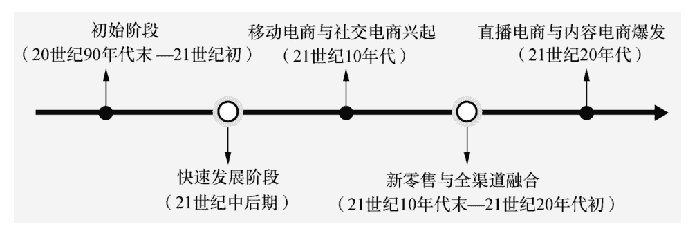
图1-1 国内电商“玩家”的发展脉络

##### 1. 起步阶段（20世纪90年代末—21世纪初）
1999年阿里巴巴成立奠定行业基础。2003年淘宝上线C2C模式，与eBay易趣竞争；京东由线下转型线上。

##### 2. 高速扩张期（21世纪中后期）
互联网普及催生多平台。天猫2010年上线B2C模式，京东、苏宁易购规模扩张，竞争白热化。

##### 3. 移动与社交电商兴起（21世纪10年代）
智能手机普及推动移动电商，微信小程序、拼多多等社交电商崛起。内容平台小红书虽电商转型未完全成功，却在种草与决策环节发挥关键作用。

##### 4. 新零售与全渠道融合（21世纪10年代末—21世纪20年代初）
阿里提出新零售，推动线上线下融合与O2O模式。

##### 5. 直播与内容电商爆发（21世纪20年代）
抖音、快手以短视频与直播带货重塑购物体验，电商与内容边界模糊，内容成为核心驱动。

AI时代，存量平台与新进入者谁将占优？

存量平台优势：超级App流量入口把控，注意力壁垒高；一站式服务带来强网络效应；多年积累的用户数据与技术能力构成AI应用的先发优势；用户行为分析、个性化推荐、智能客服等已规模化应用。

新兴玩家机遇与挑战：需在技术与定位上实现差异化突破，可聚焦细分赛道或创新模式。国内大市场与下沉市场提供增量空间，拼多多即通过深耕下沉实现跃升。

存量平台凭借数据与技术或将巩固地位，但变革不可忽视。回顾iPhone2007年发布后十年重塑生活，今天的边缘角落或孕育明日巨头。聚焦细分、技术创新与用户互动方式的突破，仍可能改写格局。

### 1.2 AI电商的定义与边界

在增长诉求与技术进步双重推动下，AI电商成为焦点。AI电商指将人工智能深度嵌入电商全链路，以算法、大数据与机器学习实现智能推荐、行为洞察与精准营销等，提升运营效率、增强用户粘性并创造新商业价值的模式。平台与生态参与者皆需正视其带来的新机遇与新挑战。

#### 1.2.1 电商是AI商业化的首选试验场

电商具备三大优势使其成为试验田：数字化积累深厚，平台与用户均具备较高的数字化认知与接受度；海量运营数据便于AI提炼模式与规律，支撑更精准预测与科学运营；平台经济多边属性让创新迅速扩散至商家、消费者与服务商，头部平台加速商业化落地。

#### 1.2.2 风口还是昙花

AI对电商形态升级的潜力显现，资本市场关注度持续攀升，多家AI电商相关企业获得融资。

人工智能驱动下的线上零售新图景

2024年6月，聚焦搜索与发现的Constructor完成2500万美金B轮融资。团队凭借人工智能积累与零售实战经验，推出生成式对话助手ASA，这是一种通过持续对话把握意图、输出个性化检索内容的发现工具。

同月，电商检索服务商Daydream拿到5000万美金种子轮。公司把人工智能放到检索链路，打造更有人情味的查找体验，能依据用户描述的使用场景给出购买建议，呈现更精准的结果。

2024年8月，跨境饰品品牌Stepin完成千万级人民币天使轮。Stepin把人工智能与供应链能力结合，跑通小批量、多批次的快速上新。饰品赛道对设计、生产、销售的协同效率极为敏感，人工智能带来的提速直接拉动业务增长，也因而获得资本青睐。

站在新一轮科技革命的前夜，市场在问：人工智能是否已经过热？电商场景的应用是下一波增长点，还是被夸大的泡沫？这与过去互联网、移动互联网的发展路径相似，Amara Law依然成立：人们总是高估技术的短期收益，却低估其长期影响。

从规模看，线上零售本身就是体量庞大且持续演进的赛道。高盛报告显示，2023年全球线上零售销售额达到3.6万亿美元。如此体量的市场，为人工智能赋能零售提供了足够宽阔的舞台。

从形态看，零售业态一直在进化。从传统平台到社交零售、直播零售等新形态，行业始终保持敏锐的洞察与创新力，这也为人工智能的崛起创造了有利土壤。

从经济逻辑看，人工智能在零售环节的应用空间很大，有望贯穿全链。零售企业可用人工智能优化流程，人工智能企业也能针对零售痛点提供定制化方案，助力降本增效。总体而言，人工智能与零售的结合在提升产业效率、创造商业价值方面潜力显著。

从落地看，人工智能在零售的应用路径已越来越清晰。

在消费者端，人工智能正在改写传统的购物查找方式。平台内容激增后，传统查找很难满足个性化需求。人工智能依托海量数据分析与机器学习，能更好地理解消费者的购物习惯与偏好，构建更高效、更精准的匹配机制，既提升体验，也为商家带来更多转化。

在商家端，人工智能的作用同样明显。商品图片与文案可以自动生成，大幅节省人力与时间；智能分类与推荐帮助商家管理库存、优化销售策略。整体的智能化管理提升了运营效率，带来新的商业机会。

正如沃顿商学院教授Ethan Mollick所说：“我们绝对处于这样一个位置：即使人工智能发展完全停止，我们仍然有5～10年的快速变化，吸收当前模型的能力，并将它们整合到组织和社会系统中。当然，我并不相信发展会停止。”

人工智能与零售之所以被视为风口，核心在于零售行业的体量与创新活力，以及人工智能在零售的广泛应用与明确落地路径。未来随着技术演进与市场扩大，人工智能推动零售进化几乎是必然的。站在长期主义视角看，人工智能加持的零售并非昙花一现。

Gartner提出的技术成熟度曲线是判断新技术发展的重要参考，它把创新从诞生到成熟分为五个阶段。

1. 萌芽期：技术取得初步突破，吸引科研界注意，少量企业和投资人开始探索。
2. 过热期：媒体热炒预期飙升，大量企业涌入，投资激增，但实际效果往往不及预期。
3. 低谷期：技术问题与高预期落差导致信心受挫，资金撤离，部分企业退出。
4. 复苏期：技术改进与成功案例出现，市场信心回暖，应用范围逐步扩大。
5. 成熟期：技术广泛应用，性能稳定、成本下降，产生显著经济与社会价值。

借助这条曲线，企业可以更理性地规划技术投入，在浪潮中把握机会、规避风险。

Amara Law在技术史上反复被验证。创新刚出现时，宏大预期会被迅速放大，落空后随之而来的是失望。但技术会稳步成长、不断改进，并在更多场景中被采用，最终其规模与影响远超最初的预期。

#### 1.2.3 机遇与挑战共存的人工智能零售

人工智能赋能零售带来新机遇，体现在决策、模式、服务等多方面，如图1-2所示。

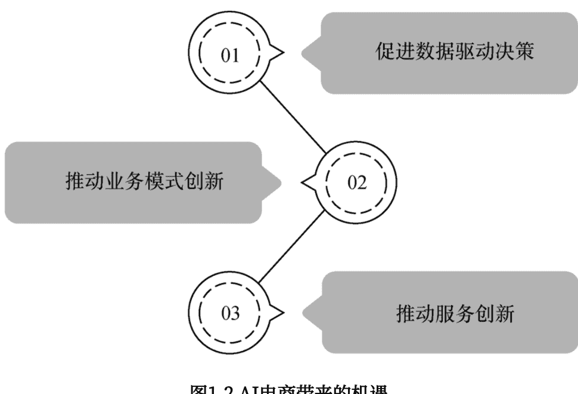

##### 1. 让决策更数据化
借助大数据与人工智能，零售企业能收集、处理、分析海量的用户、商品、交易数据，为决策提供支撑。数据可用于预测趋势、分析行为、优化库存、制定定价等。以数据驱动，企业能更精准把握机会、降低经营风险、提升运营效率。

##### 2. 推动业务模式创新
人工智能正被引入业务全链路，优化流程。例如通过实时分析市场趋势与消费者行为，企业可合理安排生产，实现柔性生产。供应链方面，自动化仓储、智能物流等正在推动供应链自动化管理。

SHEIN是典型案例。公司引入人工智能优化设计到生产全流程，利用大数据分析趋势与行为，实现快速响应与柔性生产，形成C2M模式，大幅压缩产品从设计到上市的周期。供应链端引入自动化仓储与智能物流，实现自动化、智能化管理，提升库存效率、加快物流、降低成本。

##### 3. 催生服务创新
人工智能推动零售服务向智能化、个性化演进。个性化推荐系统基于海量数据洞察需求与偏好，给出精准购物建议。人工智能结合AR、VR还能提供虚拟试妆试衣等体验。

天猫上线AR试妆功能，通过AR模拟彩妆在脸上的效果，让用户购买前就能直观体验，降低试妆门槛，提升购买意愿。

这些是人工智能赋予零售的宏观机遇，后续章节会进一步拆解价值链。机遇之外，挑战也不少。

一方面，人工智能零售需要巨额技术投入，包括算力、算法模型与专业团队，中小零售往往难以承受。即便资金充足，如何把技术有效落地到业务也是难题。对此，企业可通过合作、外包等方式与专业人工智能服务商共建适配自身需求的应用，降低成本、借力专业经验加速落地。

另一难点在于理解与应用。既能理解人工智能技术、具备前瞻商业想象力与批判思维，又能用新技术解决业务问题或创造新场景的人才与团队非常稀缺。

另一方面，人工智能零售依赖大量用户数据训练模型与精准推荐，数据包含购物习惯、搜索记录、位置等隐私信息。若被不当使用或泄露，隐私风险严重；同时数据合规压力随法规收紧而加大。

IBM数据泄露成本报告显示，2024年数据泄露平均成本达488万美金，创历史新高。报告还指出，70%的受访组织称泄露造成了重大破坏。

应对上，企业需强化数据安全：引入先进加密技术保障传输与存储安全；建立并严格执行数据访问与使用权限管理，只有授权人员可接触敏感数据，且所有访问留痕以便审计；同时加强员工培训与管理。

任何技术革命都伴随机遇与阵痛，上述只是冰山一角，其中成本与数据风险最为突出。对人工智能可能带来的更深远社会风险，学界已有深入研究，有兴趣者可进一步查阅。

#### 1.2.4 双11期间人工智能调用量突破15亿次

2023年双11期间，淘宝、天猫商家大规模调用人工智能工具。阿里巴巴营销平台阿里妈妈推出的万相台无界版、阿里妈妈百灵等产品，为商家在货品运营、店铺运营等方面提供支持。这些工具在双11期间被调用超15亿次。

模特图智能生成、官方客服机器人等多款商家端免费人工智能工具也在同步投用。模特图生成能根据商品信息自动产出高质量展示图，减少拍摄与后期成本；客服机器人可处理大量常见咨询，提升服务效率、减轻人工压力、优化消费者体验。

在营销层面，万相台无界版整合渠道与流量，支持动态预算调配与实时人群追踪，帮助商家实现精准投放与高效决策。阿里妈妈百灵是“一站式”品牌经营平台，打通淘宝内外部营销资源，在人工智能加持下为商家提供个性化经营建议与品牌推广策略，帮助适应市场变化、提升品牌力。

双11的广泛应用既体现了人工智能在零售的价值，也折射出技术创新对行业的深远影响，进一步推动人工智能零售发展与行业创新。

### 1.3 人工智能零售的价值所在

凭借强大的智能化能力，人工智能零售展现出重塑流量价值、守护消费体验、破解成本效率质量的三难选择、形成新质生产力等多重价值。

#### 1.3.1 重塑流量价值：实现精细化运营

依托先进技术，人工智能零售能实现流量精细化运营，具体体现在三个方面，如图1-3所示。

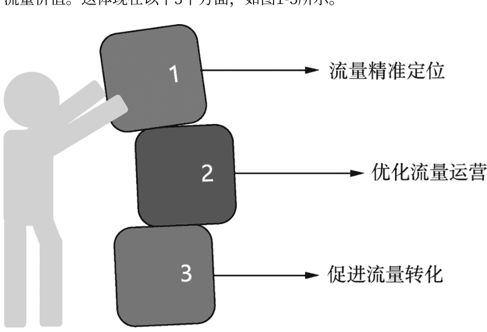

##### 1. 精准定位流量
人工智能具备强数据采集与分析能力，能整合浏览记录、购买历史、搜索关键词等数据，深度挖掘行为与偏好，构建精准用户画像。画像不仅包含年龄性别地域等基础信息，还涵盖购物习惯、偏好与潜在需求，为精准触达目标用户提供依据。

##### 2. 优化流量运营
人工智能可生成个性化营销内容与活动，如根据品牌调性与用户偏好自动撰写广告文案、海报，或把人工智能融入活动提升趣味性。同时，人工智能能实时监测流量数据，动态评估活动效果并调整策略，提升投入产出。基于访问量、停留时长、点击率等指标，企业可获得市场洞察，及时优化推荐与页面设计，增强用户兴趣。

##### 3. 促进流量转化
人工智能驱动的个性化推荐系统依据画像与实时数据推送匹配商品，提升体验与转化率，并通过用户反馈持续优化算法。智能客服则实时解答疑问，提供优惠、售后等信息，消除用户顾虑，推动下单。

2024年初，天猫推出明星共创人工智能年画的限定玩法，覆盖引流、运营、沉淀全流程，延长流量生命周期。活动中明星“画龙”、粉丝“点睛”共创年画，实现人群破圈。集卡环节通过邀请、赠卡扩散传播，集齐卡册可解锁共创机会或抽大额红包；集卡任务引导用户进入私域，通过会员加入、下单等任务完成拉新，积分兑换机制则助力老会员激活；“下单即送实体小卡”的设计则直接促进转化。

人工智能与零售的结合实现了从精准触达到高效转化的闭环，为企业创造更多经济效益。

#### 1.3.2 守护消费体验：以需求为导向

在零售领域，消费体验始终是核心。人工智能零售以需求为导向，在售前、售中、售后三个环节优化服务。

售前可实现个性化推荐、智能咨询与虚拟体验。智能推荐系统基于浏览与搜索数据给出商品建议，智能客服实时解答商品、服务、配送等疑问，AR/VR则提供虚拟试穿试妆，推动决策。

售中可通过购物车智能排序、优惠自动计算、一键支付等提升购物便捷性；在物流上，人工智能整合信息让用户清晰了解发货、运输进度，方便跟踪订单。

售后方面，人工智能赋能的一键申请与快速审核简化退换货流程；智能客服持续提供售后支持，如解答疑问、安装指导等。

#### 1.3.3 突破三难选择：成本、效率与质量

成本、效率、质量长期被视为三难选择，降低成本易影响效率与质量，提升效率或推高成本，追求高质量则往往成本更高。人工智能零售为此提供突破路径。

##### 1. 降低成本
自动化与智能化工具减少对人力依赖，降低人力成本，如智能客服与智能仓储减少人员配置。精准营销与个性化推荐减少无效投放，提升转化，降低营销成本。人工智能还能优化物流路径，基于交通、天气等多因素规划最优路线，减少运输时间与成本；智能调度降低空驶率与等待时间，进一步降本。

##### 2. 提升效率
智能库存系统实时监控库存、动态调控，避免积压与缺货，并优化仓库布局加速拣选发货。智能订单处理系统自动接收、分析、分配订单，减少人工干预，提升处理速度与准确性。

##### 3. 保障质量
人工智能驱动的智能检测与分析可实时监测生产线状态，通过算法调整生产参数，优化流程、提升产品质量。服务质量上，智能客服借助自然语言处理实时响应用户，提升满意度。

整体来看，人工智能零售在平衡成本、效率、质量方面取得进展，为行业带来更强竞争力与利润空间。

#### 1.3.4 形成新质生产力：赋能与替代

人工智能与零售结合催生了新质生产力，一方面赋能从业者提升效率，另一方面在多环节替代人工。

在协作模式上，人机协同成为主流。人工智能可辅助管理者分析市场、制定精准营销策略；自动生成设计草图与方案，加速内容产出、提升创意多样性，让设计师聚焦高价值工作。

人工智能机器人与智能应用正成为新的生产力：

1. 自动化生产。人工智能工业机器人与智能运输设备提升生产效率，完成高精度、高强度作业，减少人工干预。
2. 智能物流。智能运输设备加快物料配送，缩短运输时间、降低成本；仓储环节的智能叉车与物流系统实现自动分拣、包装、搬运，提升作业效率。
3. 智能客服。智能客服全天候在线，处理咨询、订单、退款、投诉、电话、邮件等，复杂问题自动转人工，确保服务质量。

人工智能正重塑零售的生产方式与服务形态，推动行业持续进化。

AI在电商场景的深度渗透，已经让新质生产力从概念走向现实。它一边接手繁琐的重复劳动，一边替代部分传统岗位，正在从根本上重塑电商行业的生产方式和未来图景。

## 第2章 驱动力拆解：技术、产业、企业三轮齐转

AI电商的进化并非偶然，而是技术、产业、企业三方合力推动的结果。从技术端看，算法和模型的快速迭代为应用提供了坚实底座；从产业端看，AI生态与电商生态相互喂养，产业链日益完整；从企业端看，头部玩家持续加码投入，用AI重塑竞争力。这三股力量共同作用，才让AI电商进入高速扩散期。

### 2.1 技术驱动：核心能力全面爆发

ChatGPT、Sora、DeepSeek等前沿成果正释放出巨大能量，成为撬动AI电商发展的关键推手。

#### 2.1.1 底座技术：撑起AI电商的三大支柱

自然语言处理、机器学习、计算机视觉三项技术共同构成了AI电商的基础架构，为平台提供了强力的数据处理与智能决策能力，也推动了行业整体的数字化与智能化升级。

##### 1. 自然语言处理
自然语言处理让机器读懂、理解并生成人类语言，在聊天机器人和语音助手上已很成熟。电商里，它主要用在智能客服上，能自动回复高频问题。借助语义解析和情感识别，客服可以更精准地捕捉用户意图，提供定制化服务。

另外，这项技术还能对用户评价和反馈进行批量分析，帮助商家及时调整产品和服务策略，持续优化体验，让企业更懂用户、更会做营销。

##### 2. 机器学习
机器学习通过统计模型和算法让系统从海量数据中自学进化，在电商中集中在用户行为洞察、商品推荐和市场预测三类场景。

在行为洞察上，算法挖掘用户过往轨迹，精准描绘偏好画像，为个性化运营提供依据；在推荐上，通过整合用户行为、商品属性和互动数据，实现自动化、千人千面的商品推送；在预测上，模型综合研判市场走势、消费变化和竞品动态，为策略制定和资源投放提供前瞻性支撑。

##### 3. 计算机视觉
计算机视觉赋予机器“看”的能力，广泛用于图像识别和视频解析。电商领域，它支撑商品图识别、分类、搜索，以及虚拟试衣、虚拟试妆等沉浸式购物体验。

比如Google Lens可通过拍摄实物直接在Google Shopping检索同款；国内阿里巴巴的“拍立淘”也实现了类似的视觉搜索，极大提升了购物的便捷度。

总体来看，自然语言处理、机器学习和计算机视觉正在全球范围内被广泛验证，成为电商智能化的基本盘。

#### 2.1.2 大模型：电商新增长极

近两年，大模型快速崛起，为AI电商注入强劲动能，成为行业新的增长引擎。

大模型通过学习海量文本规律，具备强大的理解与生成能力，对电商的价值体现在四个维度。

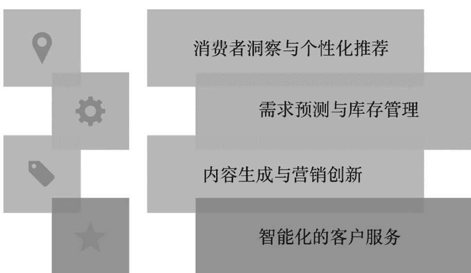

图2-1 大模型助力AI电商发展的四方面

##### 1. 消费者洞察与个性化推荐
模型可融合浏览、购买、搜索等多源数据，构建高精度用户画像。通过画像分析，商家能更清晰地掌握用户兴趣、消费习惯和痛点，从而推送更匹配的商品，提升推荐命中率和购物满意度。

##### 2. 需求预测与库存管理
依托数据分析与预测能力，大模型能提前预判消费趋势和需求变化。电商可据此动态调整库存，避免积压或断货，提高周转效率，降低履约成本，保证供给稳定。

##### 3. 内容生成与营销创新
模型可批量生成商品详情、营销文案、海报等创意内容，直击用户痛点、突出产品卖点。高效且富于创意的产出方式为营销带来新活力，有助提升品牌声量和影响力。

##### 4. 智能化客户服务
传统智能客服多依赖固定问答库，回复模式化。大模型支持下，客服可进行多轮对话、准确理解意图，并给出整合性、个性化的建议。还能实现语音、文字、图像多模态交互，并具备持续学习能力，不断优化服务质量。

国内代表案例是澜舟科技的澜舟智客方案，基于自主研发的孟子大模型，覆盖知识采编、客服坐席和客户侧三大模块，可精准理解复杂需求并生成准确答复。

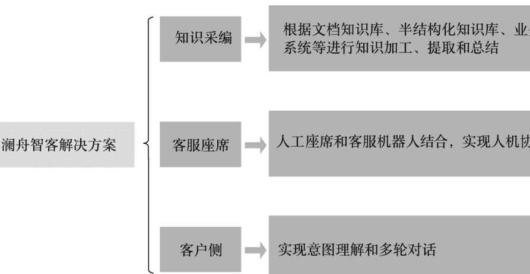

**图2-2 澜舟智客解决方案**

海外模型同样值得关注。BERT由谷歌推出，采用双向编码机制，在文本分类、命名实体识别等任务上表现突出，被大量用于搜索优化和智能客服。微软的Turing-NLG拥有170亿参数，基于Transformer架构，可自动生成高质量文本，已被用于电商商品描述和营销材料的自动化生产，大幅提升内容效率。

大模型不仅提升运营效率和服务水准，也在加速行业创新。随着场景不断拓展，其在电商中的角色将愈发关键。

#### 2.1.3 ChatGPT：把AI电商从理念推向落地
ChatGPT是OpenAI推出的里程碑式自然语言应用，基于预训练模型，提供三大核心功能：

- 对话功能：理解自然输入并生成连贯回复，支持上下文记忆和多轮对话，更好把握用户意图。
- 文本生成：按要求产出新闻、文案等内容，也能对长文本做摘要提炼。
- 翻译功能：覆盖中、英、西等多语种，能理解语义和上下文，输出更地道的译文。

这些能力在电商中形成清晰的应用路径：

1. 个性化推荐：分析搜索和浏览历史，判断购物偏好并推送匹配商品，提升满意度和转化。
2. 营销内容生成：理解品牌调性与目标人群，批量产出店铺文案、社媒内容和营销邮件。
3. 客户服务与互动升级：提供7x24小时咨询，解答商品、物流等问题；借助多语言能力打破沟通壁垒，提升全球化服务体验。

实践案例方面，亚马逊跨境商家徐总在ChatGPT上线后用于日常运营。做Listing优化时，输入商品名和描述词即可获得优化后的标题和介绍；选词时可一次性获得十几条相关关键词备选。邮件沟通中，申诉信、营销邮件也能快速成稿，只需微调即可发送。借助AI，他省去组建大团队的成本，腾出更多精力思考差异化价值。

目前越来越多的商家把ChatGPT或同类AI Agent作为运营助手使用。随迭代加速，电商效率将持续攀升，并可能触发更深层的变革。

#### 2.1.4 Sora：为电商视觉营销打开新世界
Sora是OpenAI的视频生成模型，可根据文本提示生成长达60秒的高清视频，支持多镜头、多角度创作，为电商视觉呈现带来无限可能。

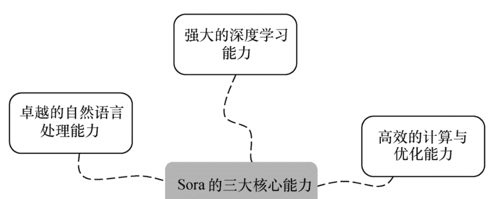

图2-3 Sora的三大核心能力

核心能力有三：

1. 卓越的自然语言处理能力：能理解长文本描述和简短关键词，保留关键信息并通过推理联想丰富情节。
2. 强大的深度学习能力：基于海量文本和视频训练，学习文本与画面映射关系，结合卷积神经网络与循环神经网络实现高效生成。
3. 高效的计算与优化能力：依托并行计算与优化算法，快速处理大数据，模型训练中通过数据增强和迁移学习提升泛化与质量稳定性。

Sora开启了视觉叙事的新阶段。商品展示不再局限于图片和文字，视频能更生动呈现外观、功能和使用方法，提升吸引力。相比传统拍摄的高成本高耗时，AI生成视频可大幅压缩制作周期和费用。

麦肯锡全球研究院预计生成式AI可将营销生产力的经济价值提升5%至15%，并通过连锁效应带动销售效率改善。借助Sora类工具，企业可把外部制作预算转投自有内容生产，增强品牌掌控力，内容营销迎来产业级革命。

### 2.2 产业赋能：生态成熟与人群红利共振

AI产业规模持续扩大，参与主体增多，技术突破加速，为AI电商奠定基础。同时，电商场景的落地不断深化，产业链日渐清晰。年轻消费群体的崛起也为AI电商提供了强劲需求侧支撑。

#### 2.2.1 AI产业基本盘持续做大
2024年9月商务部数据显示，截至2023年底，我国AI核心产业规模接近6000亿元，产业活力充分显现。

从企业数量看，工信部2024年4月信息显示全国AI相关企业超4500家，《北京人工智能产业白皮书2024》指出北京AI企业达2400家，同比增长超9%，覆盖芯片、算力、数据、平台、应用全链条。

从融资看，北京2024年前三季度AI核心产业社会融资约320亿元，同比增长84%，市场信心明显。

从技术看，《生成式人工智能应用发展报告2024》显示截至2024年7月我国备案上线生成式AI服务大模型超190个，涵盖文本、图像、数字人等多模态，渗透日常生活。

麦肯锡测算，到2030年生成式AI有望为全球创造约7万亿美元经济价值，中国或贡献约2万亿美元，其中客户运营与服务、营销销售、软件研发将最先受益。同时，模型有望把员工60%至70%的时间性工作自动化，加速劳动力转型，带来技能重塑的需求。面对机遇与风险并存的局面，需要兼顾效率提升与包容可持续的发展。

#### 2.2.2 AI电商产业链图谱初现
AI电商已形成上中下游清晰的产业结构。

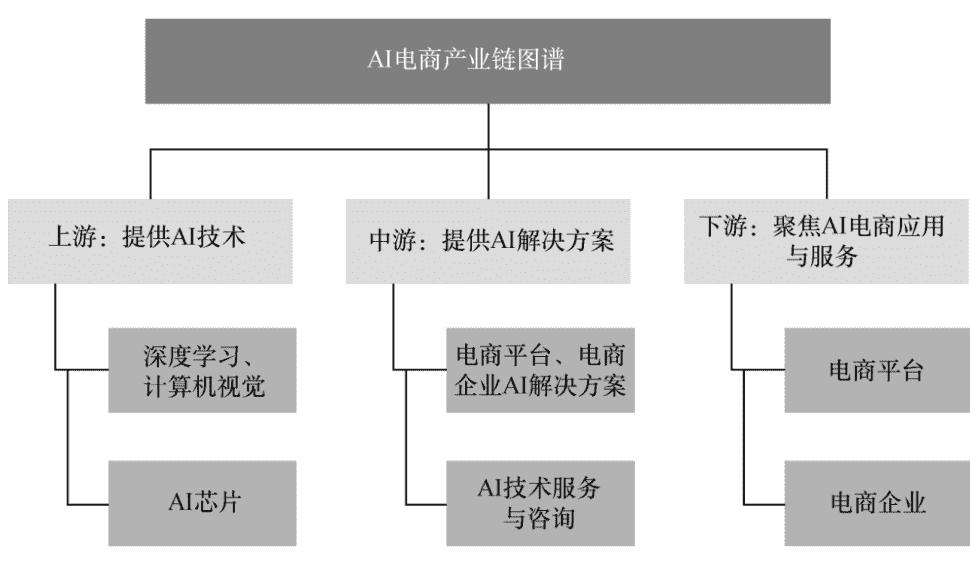

图2-4 AI电商产业链图谱

1. 上游：技术供给端。主要研发深度学习、计算机视觉、AI芯片等核心技术，为推荐、客服、图像识别提供底层支撑，同时提供高性能算力硬件。代表企业有英伟达、亚马逊AWS、阿里云等。2024年末亚马逊与联发科合作研发面向AI数字人直播带货和虚拟客服的专用芯片，体现上游向场景深耕的趋势。

2. 中游：解决方案端。提供电商平台级和企业级的AI方案，以及技术咨询与集成服务。阿里云、商汤、百度、腾讯等是典型玩家。电商平台方案聚焦推荐系统和智能客服；企业方案侧重库存智能管理和销售预测；服务端则帮助企业落地AI。基于大模型的方案正成主流，2024年3月百度智能云推出“一念”营销内容创作平台和“曦灵”数字人平台，分别用于生成营销素材和构建数字人用于直播带货和视频制作。

3. 下游：应用与服务端。包括京东、淘宝、拼多多、抖音等平台及众多电商企业。它们引入AI创作工具、智能搜索、虚拟试衣间等，提升商家效率和用户体验。如抖音推出的AI创作工具“即创”，可自动设计详情图、智能拼接短视频素材、一键生成直播背景和脚本，帮助商家降本增效。

上中下游协同发展，共同释放AI电商的潜力。

#### 2.2.3 年轻人群成为增长主引擎
艾媒咨询《2024年中国AI电商行业研究报告》显示，AI电商用户中25至44岁人群占比达83.1%，中青年是绝对主力。

这一群体更看重个性化、便捷性和效率，恰好与智能电商的优势高度契合。平台依托大数据与AI算法实现精准推送，满足他们的定制化需求，推动行业持续扩容。

从另一个视角看，年轻群体对新技术的接受度明显更高，乐于尝试由AI驱动的购物方式，例如智能推荐、虚拟试衣、智能客服等，对电商的技术革新保持高度期待。要想抓住这批用户，商家就必须持续投入研发、不断推出新玩法和新服务，借此带动整个行业往前走。

与此同时，这一代消费者普遍具备不俗的购买力与付费意愿，对高品质、强个性的商品和服务并不吝啬。一款创新产品只要能打动第一批愿意掏钱尝鲜的种子用户，就往往意味着后续可期。企业还能把年轻用户在使用过程中的真实反馈当作迭代养料，边学边改。这样既能增强自身的竞争力，也能加速AI技术从实验室走向商业场景。

再者，社交属性在这群人身上很强。体验满意时，他们习惯在社交平台上晒单、安利。这种自发的传播为品牌带来了低成本的曝光和信任背书，有助于撬动更多潜在用户，沉淀品牌调性，增加声量。

### 2.3 企业赋能：巨头逐鹿的力量

随着AI电商加速升温，各路玩家都在加码投入，争相找寻技术带来的增量空间。按入场路径和基因差异，大致能归为三类：深耕多年的传统电商巨头、后起之秀的新兴挑战者，以及跨界而来试图借电商开疆拓土的创新者。

#### 2.3.1 传统电商巨头：保住电商头部地位

在这波浪潮里，起步早、体量大的传统平台凭借积累构成了中流砥柱。阿里巴巴、京东等头部公司多年来沉淀了海量用户和成熟的运营体系，牢牢占据行业高位。面对AI化趋势，它们没有固步自封，反而加快拥抱转型，力图在新赛道上守住领先。

对这些巨头来说，下注AI并非盲目跟风，而是源于对趋势的判断和对用户需求的理解。它们清楚，只有把AI真正嵌入电商流程，才能持续响应市场变化，稳住并强化自身地位。

作为行业领航者，阿里旗下的淘天集团动作最快。集团内部重组了AI力量，按C端用户和B端商家设立专属团队，分工明确、协同高效，让AI在多个环节落地。这一举措既优化了运营效率和服务质感，也让消费者感受到更顺滑的购物体验。

比如淘宝上线的AI虚拟试衣。系统先按用户的身高体重捏出数字分身，再在分身上试穿衣物，直观呈现上身效果。用户还能自由混搭多件单品，实时看到整体look。系统还会结合款式、色彩以及用户体型特征给出专属穿搭建议，让挑衣变得更省心、更精准。

京东同样在AI电商赛道发力。公司自研的言犀产业大模型是其战略核心，既为自营零售提供技术底座，也经由京东云AIGC内容营销平台及多款AI工具向外部伙伴输出解决方案。这套组合拳提升了京东自身竞争力，也为行业注入了新动能。

2024年12月，京东面向商家推出了言犀智能营销平台，集合智能混剪、智能导购等十款AI营销产品，打通内容制作、获客、导购等全链路，为商家提供一站式营销赋能。

其中的智能视频混剪产品言犀秒创内置大量数字人形象和京东自营商品素材，可依据用户输入的SKU信息自动提炼卖点，快速生成高质量宣传视频。智能导购言犀果果则依托京东海量的咨询数据与专业导购经验，能按不同购物需求和决策阶段给出个性化推荐，有效提升转化。

有了这一平台加持，商家的营销流程正从人工驱动转向AI自动化。

头部平台的AI布局并非堆砌技术，而是基于长期技术沉淀和行业洞察的深度融合。通过内部资源整合、架构优化和服务升级，它们实现了AI与业务的有机结合，同时也为中小商家提供了能力外溢。

#### 2.3.2 新兴电商挑战者：将电商业务进一步升级

与传统巨头不同，新兴挑战者往往从一个强场景切入，用精准洞察撬动交易，成为AI电商中不容忽视的变量。

这类玩家涵盖了新平台和已有电商业务的互联网公司，例如拼多多、字节跳动、快手等。它们凭借对新需求的嗅觉，试图在红海市场实现弯道超车。

它们能快速崛起，关键在于组织更轻、包袱更少。没有历史惯性束缚，它们能更快感知市场和技术变化，及时出手抢占先机。

抖音是典型代表。依托AI驱动的服务模式，抖音把直播带货做到了新高度。AI可精准解读用户兴趣偏好，推送匹配的直播内容；同时优化直播间的互动机制，提升参与感和留存。种种创新既拉来用户，也点燃商家热情，让直播成为电商版图的重要支柱。

2024年12月，抖音上线AI导购服务“智能购物”。基于豆包大模型，该功能能准确理解用户提问和商品特性，提供个性化购物体验。用户输入“扫地机器人怎样选”，系统会从清洁能力、智能化程度等多维度展开说明并给出推荐，还支持多商品对比，从功能、评价等角度帮助决策。

抖音之外，其他玩家也在发力。拼多多用AI打磨推荐算法，让购物更顺畅；快手借助AI提升内容审核效率，维护平台生态。这些探索推动了各自业绩增长，也为行业提供了新参考。

随着时间推移，“新兴”标签终会褪色。要想维持创新势头，就必须持续捕捉趋势、不断加码技术。未来，这些挑战者仍将深耕AI落地，以实现能力跃迁。

#### 2.3.3 跨界创新者：非电商企业的AI布局

跨界创新者则是指以技术见长的非电商企业，如百度、腾讯。依托AI优势，它们正把触角伸向电商，寻找新的增长曲线。

这类公司更强调开放生态。它们不仅做自己的电商尝试，更乐于向传统商家输出定制化技术方案，带动行业整体升级。开放合作的姿态，让它们在电商领域的话语权不断上升。

百度就依托AI能力孵化了一系列智能工具。例如电商直播平台慧播星，集合多项功能，帮助商家降低直播门槛。

- (1) 形象生成。平台可按企业需求生成高度定制化的数字人主播，塑造独特人设。
- (2) 语音生成。慧播星支持真人声音采集与克隆，可合成自然逼真的数字人配音，并提供多种音色风格的带货语音库满足个性化需求。
- (3) 互动问答。生成的数字人主播能基于商品详情与用户提问实时互动，企业可建立问答库并选择AI生成或手动添加内容。

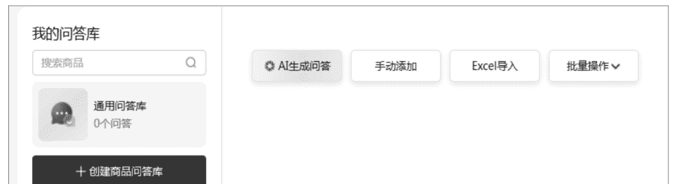

### 图2-5 问答库设置

- (4) 脚本生成。平台支持专业带货脚本自动生成，并可按企业需求定制。上传商品详情、卖点、优惠信息并选择主播风格后，系统即可输出流畅直播脚本。
- (5) 智能装修。平台提供AI生成的直播间背景图、贴图等素材，助力快速装修与个性化定制。

除慧播星外，百度旗下还拥有智能客服系统、智能营销平台等，可为电商企业提供多维度技术支撑。

腾讯亦在AI技术上赋能电商。在物流环节，腾讯可提供证件识别、视频监控等能力。证件识别方面，以货运物流证件识别大模型为基础构建OCR智能识别能力，实现各类物流证件与回单的自动化识别处理，提升效率。仓库监控方面，融入AI算法的视频监控实现异常实时发现与上报，保障仓库安全。

在跨界创新者的推动下，电商平台、品牌和商家能够接入更丰富的AI产品与工具，优化流程、提升体验、降低成本。借助AI，企业可更精准洞察需求实现个性化推荐，优化供应链提升库存周转，并用AI客服提高服务质量。

在技术创新之外，跨界玩家也在政府引导下加强与传统和新兴电商平台的协作，通过技术支持、数据共享等方式打破壁垒。例如依托微信与阿里体系的互联互通，消费者可在朋友圈看到天猫商品广告，也能在淘宝天猫使用更多支付方式，整体利好行业协同。

随着全球迈向AI驱动时代，释放AI新技术的潜力正成为企业赢得竞争的关键。

## 第3章 AI预测：为运营与获客带来质变

电商运营离不开科学的市场判断，而AI预测的应用正让运营与获客效率发生质变。借助机器学习，AI能精准推演消费者需求与市场走向变化，为决策提供数据支撑，实现精细化营销与持续优化的良性循环。

### 3.1 精准的AI市场预测

相较于传统方法，基于大数据与先进算法的AI预测可实现主动预判与全景分析，提前捕捉需求变化，帮助企业抢占先机。

#### 3.1.1 被动响应VS主动预测

AI市场预测正在重塑运营模式，加速市场响应。传统预测多依赖调研、用户反馈与基础数据分析，存在明显短板：数据采集与处理效率低、结果不够及时准确；调研受限于样本与地域，难以全面反映需求；基于历史的数据分析也难以捕捉动态变化与新兴趋势。

这种被动响应让企业常在变化发生后才调整，错失先机。随着AI成熟，其预测能力不断深化。凭借强大的数据处理与模式识别能力，AI能分析购买行为、搜索记录等多维数据，深挖需求并精准预判趋势。

相较被动响应，主动预测有两大优势。其一是提升响应速度。被动模式多在变化后才做调整，而主动预测可在变化前给出预判并提前部署策略，有助于抓住机遇、规避风险。例如提前预判热销品类，提前调库存与营销节奏。其二是可以实现个性化服务。AI通过分析用户特征与行为，预判个体化需求，指导企业提供定制化服务，提升体验与忠诚度，例如基于偏好推送专属推荐。

从被动到主动的演进，让企业在市场波动中掌握更多主动权。

#### 3.1.2 收集数据，全方位分析市场

AI能够高效汇聚多渠道数据并进行综合分析，为企业提供准确的信息支持。

- 1. 整合内部数据。电商企业的用户、销售、商品等内部数据经AI整合形成统一视图。
- 2. 抓取外部数据。通过爬虫或OpenAPI从社交媒体、行业报告、竞争对手站点等获取外部信息。
- 3. 监控实时数据。对平台交易、用户行为等进行实时监测，获得最新市场信号。

在数据融合基础上，AI可对数据进行深度挖掘与分析，提供全方位市场洞察，如图3-1所示。

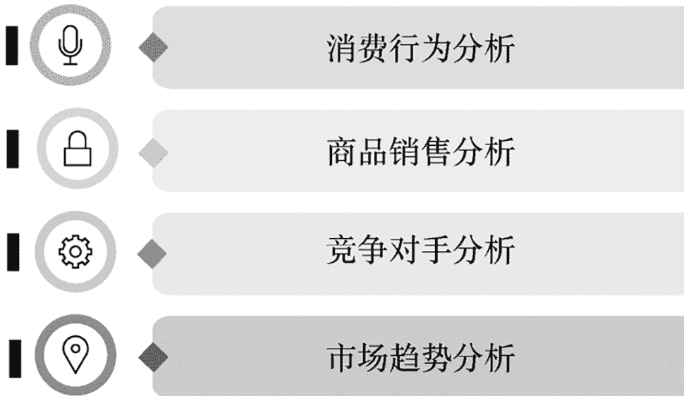

**图3-1 AI助力电商企业全方位分析市场**

##### 1. 消费行为分析
AI依托购买历史、搜索轨迹、兴趣偏好等预测未来需求，为库存与营销提供依据；同时通过评论与反馈分析情感倾向与满意度，指导产品与服务改进。

##### 2. 商品销售分析
AI实时监控销量、销售额、退货率等指标并做深度解析，帮助企业预判需求、避免积压或缺货，提升库存周转。结合销量与反馈，识别热销与滞销品，为品类调整与新品开发提供参考。

##### 3. 竞争对手分析
AI可监测对手价格策略、促销活动、新品动作等，并进行价格走势、促销策略分析，帮助企业动态定价、优化促销并调整新品计划。

##### 4. 市场趋势分析
基于历史与实时数据，借助机器学习算法预测未来销量、需求与行业走向。企业据此提前调整商品结构与营销策略，制定长期发展规划。

凭借强大的分析与预测能力，AI让企业更全面、更深入地了解市场动态。

#### 3.1.3 捕捉线索增量，预测流行趋势

销售线索增量指特定时段内销售数据出现的新增态势，包括销售额增长、购买行为转变等，是流行趋势的重要信号。例如某类商品销量骤增往往意味着走热。AI可捕捉变化并预测走向，为企业提供及时洞察。

通过整合交易记录、行为日志、社交媒体反馈等多源线索数据，AI为模型训练提供基础；借助算法从海量信息中提取关键特征，识别潜在热潮。例如分析购买行为变化可发现更受青睐的品类，预测未来走向。

同时，AI基于历史销售与当前市场构建预测模型，综合季节波动、促销影响、偏好变化等因素，使结果更可靠。通过线索增量捕捉与模型预测，企业能更好把握需求与市场动态，优化运营。

### 3.2 千人千面：智能匹配需求

借助AI预测能力，电商企业可在需求预判、用户交互与用户分析上实现创新，精准匹配个体需求，带来千人千面的购物体验。

#### 3.2.1 告别流量购买与标签时代

传统电商的需求预测多依赖历史销量、市场调研与用户标签，局限明显。历史数据与调研仅反映过去与当下，难以准确预测未来；标签化预测忽视个体差异与需求的动态性，导致结果偏差。在快速变化的市场中，滞后性容易导致机会流失。

随着AI发展，需求预测突破了流量采买与标签的限制。AI可汇聚多渠道数据做多维分析，捕捉更多潜在机会；实现海量数据的动态采集与实时分析，快速输出预测结果，帮助企业迅速响应。AI还能基于不同用户的历史行为做个性化需求预测，支撑更精准的营销策略，提升转化。

例如，某电商企业引入AI优化运营，构建了AI驱动的智能补货系统与动态定价系统。

##### 1. AI驱动的智能补货系统
企业汇聚不同区域、不同商品的历史销量、购买时间、地域分布等数据，构建预测模型，综合季节、促销、用户行为等多因素，准确预判未来需求。系统据预测结果自动触发补货指令，库存预警时即向供应商或仓库发出请求，确保供给充足，大幅提升周转率并降低缺货风险。

##### 2. AI驱动的动态定价系统
系统实时监测供需变化、竞争对手价格与商品热度，动态调整售价以保持竞争力。价格上行时适当提价获取利润，下行时适当降价维持竞争力。

通过上述探索，企业在精准预测基础上提升了运营效率与盈利能力。

#### 3.2.2 对话式AI：与用户深入连接

对话式AI是基于自然语言处理与语音识别，通过文本或语音与用户实时互动的智能应用。在电商场景中，它改变了互动方式，加深了用户与平台的连接，可担任导购、客服角色，提供更便捷个性化的购物体验。

对话式AI的优势体现在以下3个方面，如图3-2所示。

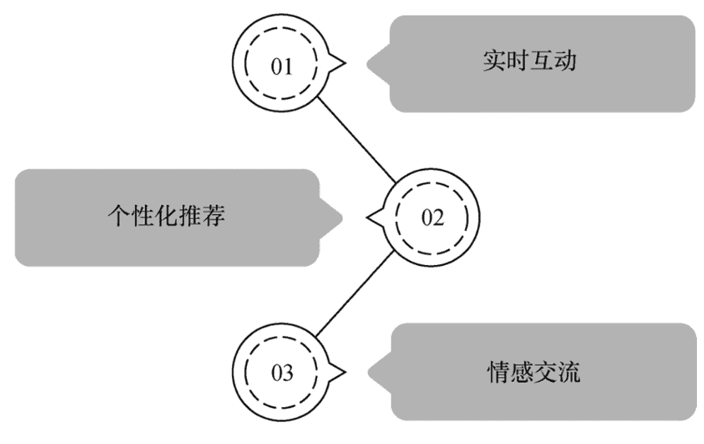

##### 1. 实时互动
购物过程中用户常有关于商品信息、尺码、物流等疑问，对话式AI可即时响应并提供多方面信息，提升体验并降低因问题未解导致的流失。

##### 2. 个性化推荐
系统分析购物历史、浏览记录、搜索习惯等数据，给出专属商品推荐，提高找到心仪商品的效率。当用户频繁浏览某类商品时，AI会自动推荐相关或相似选择，拓展潜在需求。

##### 3. 情感交流
对话式AI具备情绪感知能力，可识别用户情绪并调整沟通策略。例如用户表达不满时，系统会解释原因并采用温和语气提供贴心服务，安抚情绪。

电商平台的对话式智能应用已经进入普及期。京东上线的客服助手京小智就是一个典型例子。该助手建立在京东长期积累的技术底座与模型训练成果之上，理解与生成能力都很突出，能够读懂顾客围绕商品咨询、售后处理以及专属推荐等场景提出的问题，并给出精准回应。

在落地场景里，京小智能短时间内承接大量并发提问，根据来访内容推送定制化建议，提升使用感受；当遇到能力边界之外的复杂诉求时，会自动转人工，确保服务质量。背后言犀大模型的支撑让这套能力在使用过程中持续进化。

#### 3.2.3 智能手段构建用户画像
借助算力描绘顾客画像，进而实现差异化体验，已成为电商发展的重要方向。智能系统可以高效处理海量行为信号，形成高精度画像。

在采集环节，商家可以从站点注册信息、购买记录、浏览足迹、社交互动等多源渠道抓取资料，为画像提供丰富素材。原始信息常伴随噪声、重复、缺失，需要清洗整合。智能程序能够自动识别并纠正错误，把分散来源的材料整理成统一的结构化形态。

在清洗整合后，可以进行特征提炼，挖掘反映行为与喜好的关键因子并打标签，形成画像标签体系，如年龄、性别、区域、支付能力、购买偏好等，最终形成完整画像。

依托画像，商家可以为每位顾客提供量身定制的购物体验。通过购物历史、浏览记录、搜索行为等多维度数据，勾勒个体行为轨迹与偏好档案，涵盖兴趣倾向、购物习惯、消费能力等关键信息，从而实现精准的商品推荐。

同时，通过洞察不同支付能力与购物偏好群体，商家可以制定更精准的营销策略。对高支付能力群体可推送高端品牌广告或限量版抢购信息，满足其对品质与独特性的追求；对偏爱促销的群体可推送优惠信息、限时折扣或满减活动，促使其下单。

实时分析行为与需求，还能提供更贴心的服务。当顾客询问商品时，系统可自动呈现商品详情、价格、评价等信息，助力快速决策；同时结合购物历史与偏好，提供定制售后服务，如延长保修期、优先发货等。

总体看，智能手段帮助电商建立更精准的画像以指导精细化运营。关键在于定期更新画像，使其始终反映不同时期的真实需求，持续提供精准定制服务。

### 3.2.4 强反馈机制在智能时代的应用
智能时代，电商可通过反馈机制实现基于高度定制的双向互动。机制既能实时采集分析顾客数据，又借助智能系统的预测与学习能力促进商家与顾客的互动，快速准确回应疑问与评价，把传统单向传递变为真正的双向沟通。

商家如何构建基于智能的强需求反馈机制？如图3-3所示。

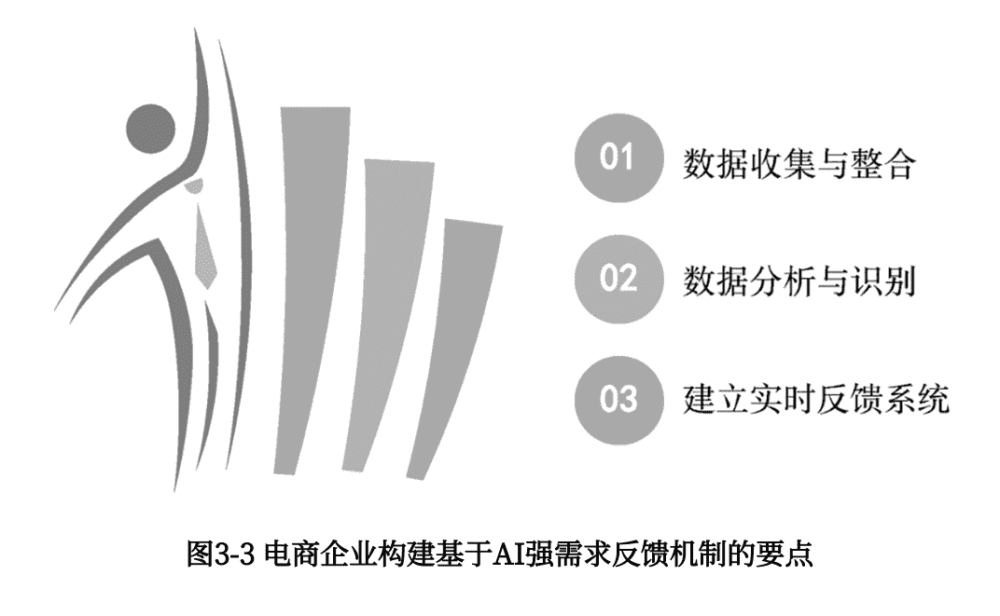

##### 1. 信息采集与融合
商家可利用智能技术从网站、社交媒体等多个渠道广泛收集顾客评价与反馈信息，并与行为信息、交易信息等融合。评价反馈信息的全面性与准确性直接决定后续分析与决策的准确性。“垃圾进垃圾出”的原则在双向反馈场景下会被放大：错误输入导致智能系统错误回答，进而引发更多误解。

##### 2. 信息解析与判断
借助智能系统对顾客反馈进行智能分析，提取关键信息与情感倾向，了解顾客满意度、需求与潜在机会。同时，算法可对反馈进行分类分析，从海量信息中提炼有价值的特征与模式。

##### 3. 搭建实时反馈闭环
基于信息，智能系统可生成对顾客评价反馈的回应并实现自动化处理，做到快速响应，构建智能化实时反馈系统。针对平台提出的疑问，系统能及时给出合适答复或解决方案；针对商品评论，系统可及时回复以表达感谢、歉意或给出处理方案。系统还能与客户关系管理系统、订单管理系统等集成，实现信息共享与协同处理。

在双向互动基础上，商家不仅能快速响应提升好感，还能利用顾客建议优化产品与服务，实现以顾客为中心的业务流程再造。

### 3.3 全流程商机预测与引导
智能预测在电商领域可实现情感分析、信息挖掘与商机洞察，从而完成全流程商机预测与引导，为科学运营提供支撑。

#### 3.3.1 NLP应用：情感洞察与主题归纳
自然语言处理技术能有效实现情感分析与主题识别，帮助商家深入理解、挖掘需求。

情感分析旨在从文本中提取正面、负面或中性的情感倾向，商家借此获得人口统计学特征与行为记录之外的信息。例如，通过分析商品评论、社交媒体的情感倾向，可及时发现并应对负面评价，如产品质量问题或服务不佳，提升满意度。商家可基于情感倾向制定精准营销，如向满意顾客推荐相关商品，向不满意顾客提供补偿方案。

某平台为优化运营，收集大量顾客评论进行情感分析。分析显示负面评论主要集中在商品质量参差、物流速度慢。平台随即加强质量管理，打击假货，并优化物流引入先进技术缩短配送时间。调整后，顾客满意度与转化率均提升。

主题识别指基于NLP从海量文本中识别讨论主题。商家可借此发现顾客对商品的主要关注点、兴趣与需求变化，洞察市场趋势，有针对性调整营销策略并开发新品。

例如，某家居电商通过主题识别提取出智能、系统互联等关键词，据此推出可连接各类智能设备的AI智慧屏，支持语音指令并实现设备间及手机互动，提供更便捷体验。

通过情感分析与主题识别，商家能加强对顾客需求与市场动态的洞察，优化运营策略，实现高效发展。

#### 3.3.2 数据挖掘：消费意图界定
智能系统可通过数据挖掘顾客消费意图。利用复杂算法与模型，智能系统能高效准确分析海量信息，揭示顾客行为模式与消费意图，为洞察购买习惯、偏好与潜在需求提供依据。

具体应用体现在多个方面，如图3-4所示。

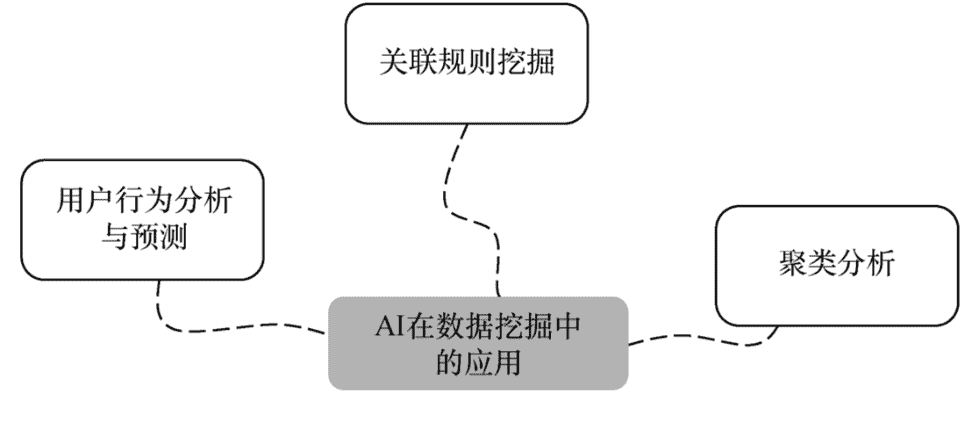

##### 1. 用户行为解析与预测
算法能深入剖析购买历史、浏览记录、社交媒体互动等信息，揭示即时需求并预测未来购买趋势与偏好，助力制定精准定制营销策略。

例如，某平台利用智能系统分析顾客浏览、搜索、购买历史，发现部分顾客在购买特定商品后一段时间内很可能复购。基于此洞察，平台通过邮件、移动端推送定制优惠券与推荐信息，有效提升复购率。

##### 2. 关联规则挖掘
通过分析购买记录及相关信息，智能系统能识别常被一起购买的商品，助力优化商品组合与促销策略，提升销售效果。

例如，某平台发现顾客购买婴儿奶粉时常关注纸尿裤、棉柔巾等，于是推送定制商品组合，提升转化率与客单价。智能加持使关联规则挖掘效率跃升，降低商家成本。

##### 3. 聚类分析
算法可分析海量顾客信息进行商业价值较高的顾客分群，群内顾客具有相似消费特征与倾向，指导商家针对不同群组制定差异化营销，提升活动针对性与整体效果。

例如，某平台运用聚类分析划分出“时尚达人”“家居爱好者”等群组。平台据此投其所好，向“时尚达人”推送最新潮流服饰信息，向“家居爱好者”推送装修宝典、收纳诀窍与家装家居优惠。顾客满意度与销售额均得到提升。

通过多维信息挖掘，智能系统为商家提供全面深入的顾客洞察，有助于明确消费意图，更好满足需求并促进转化。

#### 3.3.3 基于消费意图的商机捕捉
智能系统的洞察力与预测能力体现在从消费意图中捕捉商机。通过深入挖掘消费意图信息，智能系统能发现潜在机会点，帮助商家把握市场趋势、提前布局。

第一，分析大量顾客消费意图信息可预测市场发展趋势与潜在热点。商家可据此调整产品、营销及库存管理策略。例如，智能系统预测未来一段时间内环保产品需求大幅增长，商家可提前布局并增加相关品类与库存，满足市场需求。

第二，分析消费意图还能帮助商家探索全新市场需求与产品创新点。例如，智能系统识别出顾客对某种特定功能或设计的偏好，指导商家开发新品。这种需求驱动的创新能提升产品竞争力并降低研发风险。

此外，分析消费意图可预测未来销售趋势与库存需求，帮助商家提前调整库存水平，避免积压或缺货。

精准商机洞察价值巨大。例如，某平台利用智能系统深度挖掘消费者意图，成功推出契合市场趋势的新品，实现业绩快速增长。平台收集并分析购买信息、浏览记录及社交媒体互动，识别出健康、环保等关键词并预测其将成未来热点。据此调整产品策略，推出天然有机家居用品、环保服装等新品，不仅满足需求，也提升品牌形象与市场竞争力。

从消费意图中洞察商机是商家持续发展的重要保障。随着市场环境与顾客偏好不断变化，持续关注消费意图并挖掘商机，商家可及时捕捉机会，实现可持续发展。

#### 3.3.4 索菲亚：多轮交互捕捉用户真实诉求
作为家居行业领军者，索菲亚深刻理解精准识别并满足个性化需求的重要性。为打破传统家居服务的沟通壁垒，索菲亚携手百度打造虚拟人家居空间规划师，利用智能技术实现创新。

虚拟规划师不仅能通过多轮交互深入理解顾客的真实意图与家居需求，还能以温柔声音、专业形象与自然动作与顾客无障碍沟通。在交互过程中，它运用丰富的家居知识与专业规划能力，捕捉并分析顾客对装修风格、色彩搭配、材料选择等的需求，并主动引导顾客进一步明确需求，如询问装修预算、家庭成员生活习惯等，以确保方案贴合实际。

此外，虚拟规划师具备强大的信息整合与关联检索能力。它可根据顾客需求与偏好推荐附近索菲亚线下门店，分享品牌最新优惠活动，提供定制家居产品报价。这种全流程服务模式节省顾客时间，提升购物体验。

该创新举措展现了索菲亚对服务品质的追求，体现其积极响应市场变化与拥抱科技创新的态度。虚拟规划师帮助索菲亚构建新服务模式，为家居行业树立智能化服务标杆。未来，索菲亚将继续探索智能技术在家居服务领域的新应用，为顾客带来更便捷、定制化的消费体验。

## 第4章 AI选品：好货才能真正引爆销量
在选品环节，识别出高品质且具吸引力的商品是打造爆品、引爆销量的关键。智能系统能帮助商家做好竞品分析，快速找到高潜力商品，并设计完善选品方案。基于此，商家能更好地推进货盘差异化策略，吸引流量，实现高效转化。

### 4.1 差异化策略：智能竞品分析
选品之初，商家需先进行竞品分析以明确竞品特点与潜在选品方向。智能系统可自动收集竞品信息并智能分析，生成竞品分析报告，提供可行选品建议。在智能指导下，商家能更精准设计差异化策略，从竞争中脱颖而出。

#### 4.1.1 AI驱动的竞品信息采集
竞品分析第一步是收集相关信息。了解竞品特点、价格、销量等信息，有助于更好定位自身产品并优化选品策略。此前该过程耗时耗力，如今借助智能系统信息收集更高效。

如何利用智能系统与相关技术收集竞品信息？如图4-1所示。

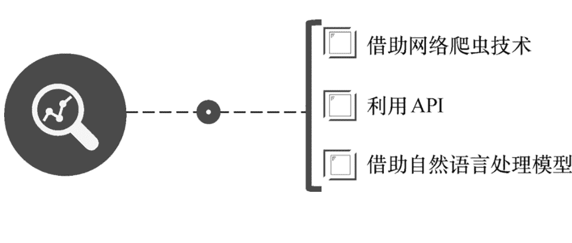

图4-1 利用智能系统和相关技术收集竞品数据的方式

##### 1. 借助网络爬虫技术
智能驱动的网络爬虫可自动浏览电商平台、品牌官网等，提取竞品相关信息。爬虫按预设规则识别网页上的商品名称、价格、销量等信息。例如，在电子产品电商网站，爬虫可抓取不同品牌手机的型号、存储容量、颜色、价格、销量排名等，并整理为结构化格式便于后续分析。随着智能技术发展，构建爬虫成本极低，具备基础网页开发知识的业务人员在智能Agent辅助下可便捷快速完成。

##### 2. 利用API
许多电商平台与信息服务商提供API，为获准访问者直接提供行业与同类型玩家的信息。例如，亚马逊的MWS API允许第三方开发者访问产品信息、订单信息等，国内主流平台也有类似服务，便于商家便捷获取最新、规范、准确的信息。

##### 3. 借助自然语言处理模型
电商与本地生活平台顾客评论区及社交媒体存在大量有价值信息。应用自然语言处理模型，商家可收集顾客对自身产品或同类产品的评价信息，高效识别语义并提取关键信息，如顾客对竞品质量、功能、外观等方面的满意度，从而了解优缺点。

智能系统自动收集竞品信息具有多重优势：
- 能够覆盖电商平台、社交媒体、行业报告等多渠道，确保信息广泛多样；
- 智能系统可全方位更高效监控市场动态，包括价格变动、新品发布等关键信息，确保商家掌握最新趋势；
- 能够确保信息准确性，清洗噪音与重复信息，进行校验修正，保证统一性；
- 智能系统可智能识别关键信息并分类，为竞品分析提供有力支持，效率明显高于人工。

基于以上优势，借助智能系统收集分析竞品信息已获广泛应用。实践中，商家可借助“智能+RPA”智能应用实现竞品信息收集。例如，“赤兔采集”是专为拼多多设计的信息采集工具，支持目标店铺全部信息采集，如商品信息、价格、销量等，帮助全面了解行业与竞品信息。其采集方式包括：
- 关键词采集。按给定关键词抓取相关商品信息。例如，对“冬季保暖用品”关键词，可快速采集拼多多上所有相关商品信息，包括标题、价格、销量，帮助了解特定关键词下的竞争态势；
- 类目采集。按不同商品类目采集信息，帮助汇总某一类目下所有竞品信息，掌握该类目整体市场情况，如各品牌市场占有率、不同价格段商品分布等；
- 榜单采集。实时获取拼多多榜单信息，包括热销榜与新品榜，帮助了解榜单竞品排名与信息变化，进而调整选品策略。

该工具还支持实时追踪与更新，商家可第一时间掌握最新动态，如价格变动、销量趋势等，便于迅速反应。除拼多多外，赤兔采集还支持淘宝、京东等多平台信息采集，实现跨平台融合。

其他工具如“实在智能取数宝”“生意管家”等也能实现类似功能，助力商家快速准确收集海量行业与竞品信息，从而优化商业策略。

#### 4.1.2 智能解析竞品评论等文本数据
除信息收集与预处理外，智能系统还应用于行业与竞品信息的智能分析与洞察挖掘，特别是以往难以处理的非结构化信息，如顾客对竞品的公开评价与评论。自然语言处理、基于时间序列的预测模型等智能技术在智能解析竞品评论方面可发挥以下作用：
- 情感倾向分析。智能系统可对竞品评论进行情感倾向分析，区分正面、负面与中立评论，有助于商家了解顾客整体满意度与情感倾向，从而调整产品与服务策略；
- 主题提取。智能系统能从竞品评论中提取关键主题与讨论点，如产品质量、功能特性、价格等，反映顾客主要关注点，有助于了解市场趋势与顾客需求；
- 问题识别。智能系统可识别评论中顾客提到的问题与不足，如质量问题、售后服务问题等，为商家提供改进建议，优化产品与服务，提升满意度；
- 趋势预测。结合评论信息，智能系统可预测竞品未来市场趋势与顾客需求变化，帮助商家提前布局，制定更具前瞻性的竞争策略，抢占先机。

当前市场已有一些智能评论分析工具，如“卖家精灵”“魔法AI”等。

卖家精灵为亚马逊商家提供基于平台顾客评价与评论的一站式竞品分析解决方案，可快速抓取并分类评论内容，深入挖掘关键问题与顾客需求，还提供趋势预警功能，帮助商家及时发现潜在问题并避免负面影响扩大。

魔法AI则可根据输入链接自动生成竞品评论分析结果，包括优势与劣势、特性关键词及相关优化建议等。例如，对于某款服装，它能指出舒适度高、图案印制质量好等优势，以及尺码偏小、价格偏高等劣势，并给出特性关键词，最后提出可行性建议，如增加尺码范围、给予更多优惠等。

这些智能评论分析工具显著提升了竞品分析效率与准确性，为商家科学决策提供有力支持。

#### 4.1.3 迅速生成竞品分析报告
完成竞品信息收集与分析后，智能系统还能生成详尽的竞品分析报告，为商家提供深刻洞察。通常报告包含以下内容，如图4-2所示。

图4-2 竞品分析报告包含的内容

##### 1. 竞品基本信息

一份竞品画像通常会先把基础要素梳理清楚，比如产品具体叫什么、归属哪个品牌、属于哪一类目、售价大致落在哪个区间，以及主要面向的用户群体。

##### 2. 优劣势分析
要把对手的长处和短处全部摊开来看。长处可以是耐用性强、运行效率高、操作简便、舒适度好等；短处则可能体现在定价偏高、设计上存在瑕疵、售后响应不佳等方面。

##### 3. 消费者反馈分析
这里要汇总用户给出的正面声音和负面声音。正面多集中在外观满意、性能达标等；负面则常指向售后体验差等痛点。除了评价本身，还要提炼出用户的潜在期待，比如对新功能的上线、对价格让利的希望等。

##### 4. 销售趋势分析
报告一般会说明近期销量是走高还是走低，并解释背后的驱动因素。同时会给出市场占有率以及对手在行业内的站位情况。

##### 5. 市场机遇与挑战
需要指出在何种市场环境下对手有望开拓新赛道，以及当前对手实际面临的瓶颈和压力。

##### 6. 优化建议
基于前面的拆解，给出后续改进方向，涵盖产品改进、营销打法调整、售后服务升级、市场定位校准等层面。

生成式与分析型AI能够让电商企业尤其是中小商家以更低成本产出结构化的竞品分析，帮助经营者更精准地制定差异化打法。

- (1) 捕捉尚未被满足的消费需求，进而孵化卖点鲜明的新品。
- (2) 依据市场表现挑选切入点，实现定位的区隔化。
- (3) 设计与对手区别化的创意营销活动。
- (4) 通过供应链协同优化来提升履约效率与售后质量。

某家电商曾因竞争加剧导致份额下滑。借助AI做竞品拆解后，企业敏锐发现用户对产品耐用性和个性化服务的需求长期被忽视。这个洞察成为战略转折点，企业快速调整品类结构并上线可定制服务，大幅改善体验。同时供应链体系被重塑，保证交付速度并强化售后。运营效率和用户粘性随之提升，最终实现份额回升，稳住市场位置。

### 4.2 AI重塑传统选品
AI正从多个维度改变选品老路，比如迅速锁定高潜力商品、依托热点找爆品、搭建商品投放矩阵等。依托AI，商家能够更快找到值得押注的品类并完善选品方案。

#### 4.2.1 迅速识别高潜力商品
通过海量数据的汇聚与预测，AI可以快速筛选出具备潜力的商品，为选品提供依据，流程如图4-3所示。

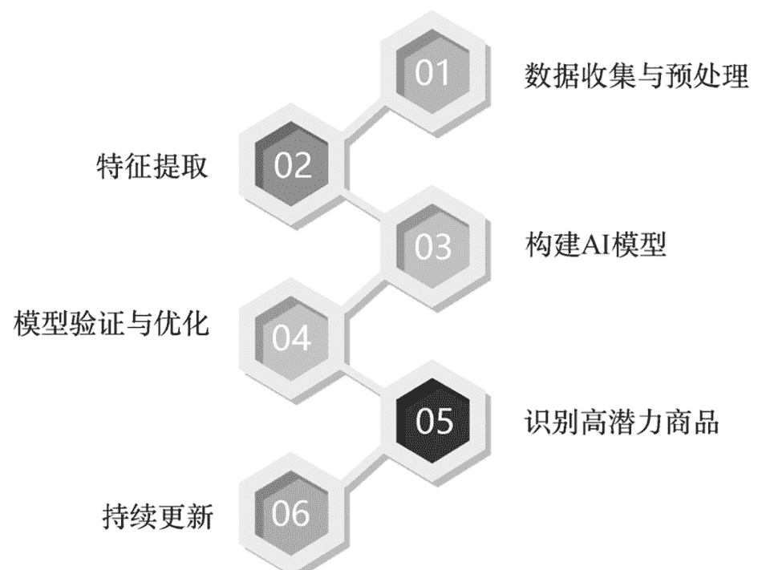

图4-3 借助AI识别高潜力商品的步骤

##### 1. 数据收集与预处理
商家可借助AI抓取与商品相关的多源数据，包括历史成交数据、用户行为数据、社媒数据、竞争对手数据等，再对数据做清洗与整理，确保可用性和准确性，为后续建模打底。

##### 2. 特征提取
从众多变量中挑出与潜力相关的关键指标，如价格带、品质水准、功能配置、外观设计等，这一筛选同样可由AI自动完成。

##### 3. 构建AI模型
依据业务目标挑选合适的建模方法，如机器学习或深度学习，将清洗后的数据喂入模型训练，并不断调参以提升预测精度。

##### 4. 模型验证与优化
用交叉验证等方式检验训练好的模型，在真实场景中评估其预测表现，并据此做必要的修正。

##### 5. 识别高潜力商品
利用模型挖掘出潜在的高潜力商品，预测其未来走势和市场份额，评估竞争力，并通过横向对比备选品，挑出可重点突破的明星单品。

##### 6. 持续更新
模型需要持续迭代。商家应不断以新数据刷新模型，保持识别与预测的时效性与准确性。

目前已有不少实用工具可实现上述流程，如MarketFinder、Algopix。MarketFinder围绕目标市场筛选出契合需求的热销品类与细分赛道，提供规模、增速、热榜等信息，并展示同类产品的畅销款式、价格区间与评价反馈，帮助商家获取洞察。Algopix则整合市场分析、竞品分析、销售预测等能力，支持多平台数据对比，并基于历史数据做AI预测。

#### 4.2.2 结合当下热点锁定热销商品
热点往往代表关注焦点与兴趣风向，捕捉热点有助于把商品推向热销。AI擅长快速捕捉热点并据此锁定品类。

微博、抖音等社媒是热点来源的重要渠道。AI可监测热门话题与流行趋势，及时发现走红产品与潜在需求，比如明星带货后产品的快速走红，AI即可推荐同类替代品。

AI还能自动抓取搜索引擎的热词与搜索趋势，了解用户在找什么，同时追踪行业新闻与动态，提前发现机会。

基于海量舆情的分析，AI能为选品提供科学依据。TrendTok、Piksel是常见工具。TrendTok解析TikTok上的热门标签与内容趋势，帮助判断哪些品类正受关注。Piksel则提供销售数据、市场趋势等分析，追踪竞品表现并给出实时数据支持。

以TikTok找热销品为例，跨境商家可按以下步骤操作。

##### 1. 设定筛选条件
在TrendTok中先做筛选。

- （1）选择目标市场，如北美、欧洲等。不同区域偏好差异大，精准细分才能获得有效信息。
- （2）选择内容方向，如美妆护肤、家居用品等。
- （3）输入与方向相关的热词，如护肤、家居装饰等，关键词要结合用户兴趣与市场动向来定。

##### 2. 分析热门内容
查看哪些标签与视频在快速升温，了解引领潮流的品类，并关注平台上的热点话题与事件，把握兴趣变化。

##### 3. 分析消费者喜好
借助Piksel分析点赞、分享、评论等数据，评估在售商品的喜好度；并研究用户声音与同类产品的推广策略，提炼差异化空间。

##### 4. 查看商品表现
通过Piksel获取热门商品的实际销售与趋势预测，判断市场需求强弱。

##### 5. 优化选品决策
基于以上结论挑选表现突出的商品，例如某护肤品在TikTok上声量大增，可考虑引入并制定资源投放计划提升曝光与转化。

总体来看，TrendTok、Piksel等工具能帮助商家快速准确地锁定热点商品，优化选品策略。

#### 4.2.3 矩阵：更复杂的商品组合
构建完善的商品矩阵、进行多品类组合投放是提升效果的关键。消费者需求具有场景属性，例如美妆中的防晒、卸妆、洁面高度关联，组合推广往往产生叠加效应。

在数据挖掘技术成熟的今天，AI可帮助商家更高效低成本地发现关联。通过深度学习与机器学习，AI能识别商品间的关联性，找到利于组合销售的搭配，再用预测模型模拟不同组合的业绩，为商家提供增减单品、调整配比等建议。

例如，某知名电商借助AI优化选品矩阵，通过深度学习发现关联并制定捆绑策略，如将手机、配件、外设动态组合，为不同需求的用户提供个性化推荐，提升整体销售额。

同时，AI基于历史销售与当前趋势预测各品类需求，为交叉销售与向上销售做准备，如补足热销品库存、引入互补新品、核算组合成本利润等。

这些举措提升了业绩与购物体验，让用户更容易找到所需并被关联触达激发探索欲。通过挖掘商品互补与关联形成多样化组合，可满足更复杂的场景需求，提升整体需求。

#### 4.2.4 数蛙：为选品提供智能支持
数蛙是一个基于AI的商机智选平台，其“AI商机雷达”和“AI选品大师”功能为亚马逊商家提供选品策略与优化建议，如图4-4所示。

- 市场总览
- AI商机雷达 找商机
- 商机对比
- 类目深度分析 选品类
- 类目数据查询
- 商品排行榜
- AI选品大师 选爆款
- 商品详情查询

##### 图4-4 数蛙平台的AI功能

数蛙利用大数据与AI算法捕捉高潜力商机，助力商家在复杂市场中明确方向。AI商机雷达可分析商品的历史热度、稀缺度与增速，精准挖掘优质机会。基于市场趋势与消费者偏好的深度分析，平台能锁定潜在爆品，保持选品精度。AI选品大师支持按类目与商品做方案分析，实现精准选品。此外，多维度数据分析帮助商家从时间、用户行为等角度综合研判市场变化，做出科学决策。

### 4.3 AI打造新型选品
在AI尤其是生成式AI的推动下，选品正迎来个性化与定制化生成的新阶段。这不仅提升效率，也推动C2M模式发展，为电商开辟新增长。

#### 4.3.1 选品决策：AI改变人为主观判定决策模式
选品的精准度与时效性是企业痛点，AI主要体现在三方面改变。

1. 信息获取全面化
传统决策依赖有限调研与历史数据。AI可自动抓取社媒、搜索引擎、竞品站点的信息，提供更广更实时的洞察，还能监测对手选品与价格变动，为策略调整提供依据。

2. 决策客观化
AI对海量数据分析后捕捉趋势，提供客观依据，降低经验与偏见的干扰，使决策更科学。

3. 反应速度提升
面对快速变化的需求，人工流程长易错失机会。AI提升实时监控能力，提供预警与策略建议。

基于AI的内容生成与预测，决策甚至可实现自动化闭环，方案随实时数据不断优化，实现真正的个性化服务。

#### 4.3.2 C2M模式：消费者驱动的新型选品
C2M模式让消费者与制造端直接连通，需求直达生产。关键在于用AI解析反馈与行为数据，满足个性化需求。

（1）需求驱动生产。制造商可依据消费者反馈做定制。AI识别特定功能或设计的偏好，指导开发新品，提升竞争力并降低研发风险。

（2）缩短响应时间。AI使生产更灵活，能快速响应新需求，调整计划，降低库存压力并提升满意度。

（3）个性化购物体验。结合AI，平台可依据用户行为与偏好推荐最合适的商品，提升体验与忠诚度。

C2M让消费者从被动接受者变成创新推动者，既带来更好产品，也为企业开辟新路径。

#### 4.3.3 C2M模式的先锋：从Dell、小米到SHEIN的模式探索
Dell的定制电脑、小米的生态链、SHEIN的快时尚定制，都是C2M探索的代表。

##### 1. Dell的定制电脑
Dell是C2M先行者之一，直接销售模式改变了PC销售与定制。

（1）直接与消费者互动。Dell通过电话与网络收集需求与反馈，快速响应市场变化。

（2）定制化生产。消费者可自选处理器、内存、存储等配置，获得符合个人需求的产品。

（3）数据驱动决策。Dell利用用户数据分析市场，优化产品线与生产流程，预测热门配置，降低库存风险。

省去中间环节，Dell降低成本并提升满意度，成为全球领先PC厂商。

##### 2. 小米的生态链
小米以生态链战略著称，通过C2M实现智能硬件个性化定制，利用社媒收集用户反馈推动创新。

（1）用户需求分析。借助大数据与AI分析社区评论与建议，识别潜在需求。

（2）快速迭代产品设计。基于反馈迅速调整设计，如新款智能音箱根据音质与功能意见改进。

（3）个性化营销策略。针对不同人群制定营销，通过社媒与线上活动提升忠诚度。

小米由此推出契合需求的新品，迅速占领市场。

##### 3. SHEIN的快时尚定制
SHEIN的核心是快速响应需求并实现个性化定制。

（1）消费者行为分析。通过社媒评论、点赞、分享数据识别流行趋势，及时调整品类。

（2）个性化定制体验。允许用户按喜好选择颜色、图案、款式，提升忠诚度与转化。

（3）快速迭代与反馈机制。实时监控销售与反馈，不断优化设计，热销款迅速加量并推出关联款。

C2M让SHEIN实现个性化定制，在快时尚市场占据一席之地。

以上案例显示C2M如何融合AI与电商数据，让消费者进入选品流程，实现快速响应。

## 第5章 AI产品设计：让设计更高效与生动
AI正深度融入产品设计环节，让创意更快落地，并优化设计流程。不少企业已在该领域取得成效。

### 5.1 AI更懂“卖得好”的设计
AI能判断什么样的设计更具商业潜力。凭借数据分析能力，AI可精准识别用户偏好与市场趋势，助力设计更贴合需求。

#### 5.1.1 什么是“卖得好”的设计
“卖得好”的设计指能够满足市场需求、吸引目标用户并取得商业成功的设计，通常具备以下特质：

1. **市场适应性**：紧跟趋势，满足当下及潜在需求。
2. **用户友好性**：易用、体验出色，解决痛点或提升品质。
3. **差异性**：具备独特辨识度，在同类中脱颖而出。
4. **成本效益**：在保证质量的同时控制成本，保持竞争力。

借助AI，电商企业可实现具备上述特质的设计。首先，AI能收集分析历史销售、社媒反馈等信息，预测走向与偏好。例如分析社媒反馈预测哪些设计元素或风格将受欢迎，从而指导设计方向。

借助自然语言理解与情感分析等能力，智能技术可以更精细地捕捉用户意图和情绪诉求，为电商企业打造契合预期的界面与功能提供支撑。把智能能力嵌入到产品内，企业能打磨交互逻辑，呈现更直观的操作界面，降低使用门槛。同时，系统还能模拟真实使用场景，挖掘使用过程中的摩擦点，为迭代提供依据，进而提升易用性。

在差异化塑造上，智能系统可拆解各类产品的设计语言，提炼风格要素与独特元素，并在此基础上推演新方案，帮助产品在同质竞争中脱颖而出。结合品牌定位、调性以及目标市场的偏好，还能产出有针对性的差异化设计，形成鲜明卖点，吸引关注。

除此之外，在方案生成、建模、测试等环节也能提供全流程助力，在提升效率的同时实现成本可控。企业可以依托智能技术制定管控策略，实现精准控本。

已有企业在“卖得好”的设计上做了验证。日本Plug公司推出的包装设计智能服务，能够在分析市场数据的基础上，用算法生成并优化包装方案，匹配需求并带动销售。

##### 包装智能服务如何做出好卖的设计？

Plug持续收集并更新消费者对包装的好感度数据，保持与当下潮流的贴合。该服务的核心在于评估与生成，系统会解析不同设计要素的市场偏好，据此生成并优化方案。

服务不仅给出整体好感度，还能判断包装带来的联想，比如是否显得好吃、是否看起来更健康。设计团队可根据这些印象进行微调，更精准满足目标人群。

过去包装设计周期长，前后调整耗时。如今借助智能技术，流程被大幅压缩。

上线后，卡乐比、雀巢等头部食品品牌都采用了这项服务并实现增长。据《日本服务大奖——获奖事例集》，使用包装设计智能服务后，卡乐比一款薯片和雀巢一款咖啡的销售额分别提升到1.3倍和2.3倍。

> “卖得好”的设计往往兼具创新性与潮流性，符合目标消费者的功能需求与审美需求，进而引爆产品销量。

#### 5.1.2 用智能工具快速产出设计方案

基于自然语言处理和深度学习，智能技术已成为产品设计的主流趋势，能够理解需求并输出匹配的方案。

以服装设计为例，智能系统帮助设计师突破思维局限，产出更多灵感。Midjourney、DALL·E 2等绘图工具趋于成熟，可根据文字描述生成图像，也能把手绘草图扩展为完整设计图，并支持在已有图像上迭代修改。

例如输入款式、风格、色彩、面料等关键词，Midjourney就能将其可视化，为设计师打开更多创意角度。

智能技术也在降低设计门槛。一站式服装服务平台CALA接入DALL·E 2后，能把用户创意转化为草图、样机和成品，并提供生产、定价等服务。

操作上，用户先选定服装类型，输入修改提示词，平台即生成多套设计图供挑选。可以继续再生成，也能手动编辑。便捷的流程大幅提升了效率。

随着持续学习，系统能掌握更多时尚元素与趋势，生成更贴合潮流的方案，为设计师提供参考。

#### 5.1.3 智能时代的交互设计新范式

在智能时代，交互设计已成为产品设计的关键。设计人员需要把技术与具体使用场景结合，从场景需求、用户行为和业务流程出发，打造高效人性化的智能方案。

智能交互呈现以下特征，如图5-1所示。

##### 图5-1 智能交互设计的特点

##### 1. 用户至上
用户始终是设计核心。设计人员要深入把握需求与痛点，以用户为中心展开设计。比如智能音箱的设计就要考虑语音输入习惯、查询偏好和使用场景，做出符合预期的交互方式。

##### 2. 多元交互形态
智能时代的交互不再局限于键盘鼠标触屏，语音、图像、手势等多种方式并存。设计需结合产品特性和使用场景选择合适方案。例如自动驾驶场景中，驾驶员可用语音指令规划路线，无需手动操作。

在多模态并用的场景里，还需设计好切换与协同机制，保证操作流畅。

##### 3. 智能化体验
依托技术，产品能提供更智能的交互体验。如引入智能语音助手，实现自然对话，并基于历史互动预测行为，主动给出操作指引，显著提升满意度。

##### 4. 简洁清晰的界面
技术可帮助精简操作流程，让用户快速上手。当前不少智能音箱菜单简洁，语音唤醒即可查询信息。

小米智能音箱即是典型。唤醒端采用高灵敏麦克风阵列，配合宽场景高灵敏唤醒和低功耗高性能唤醒技术，不同环境下都能稳定识别。

语音交互上，远场语音技术支持较远距离精准收音。用户说出“小爱同学，播放音乐”，设备即可即时响应。设备还支持多轮对话，能理解意图并执行播放、设闹钟、控制智能家居等操作。

此外，唤醒词、音量、灯光等均可个性化设置，进一步优化体验。

随着技术迭代，智能交互正从智能家居、智能驾驶延伸到工业生产等更多场景，重塑用户体验。

### 5.2 被智能技术重塑的设计流程

产品设计包括灵感、设计、验证、优化和演示五个阶段。智能技术可贯穿全流程，提升效率与质量。

#### 5.2.1 灵感收集：智能成为新灵感源
在灵感阶段，可借助大模型对话式应用如文心一言、通义千问等与系统交互，如图5-2所示。

##### 图5-2 从智能获取灵感要点

##### 1. 明确需求
首先要向系统准确描述产品类型，如手机应用、家居用品或工业设备，并说明功能定位与目标人群特征。例如手机应用需说明是社交、娱乐还是工具类，面向青少年、中年人还是老年人。

其次列出限制条件，包括预算、技术等。系统据此给出符合约束的灵感。例如在有限预算下设计促销礼品，系统可能给出个性化定制小物、创意办公用品、DIY手工礼品或数字礼品等选项。

##### 2. 提问策略
可提出宽泛的一般性问题，如“环保家居有哪些创新设计理念”“智能手机当前的设计趋势”。也能提出针对性问题，如“语音交互功能的设计要点有哪些”“如何优化语音交互体验”。不同层级的提问可获得不同颗粒度的灵感。

##### 3. 深入挖掘
对系统给出的灵感可继续追问细节。例如系统提到使用新材料，可追问在具体产品中的优势与挑战，也可问技术可行性、成本、用户接受度等。

获得可行灵感后，可借助深度学习模型或设计生成工具，输入形状、色彩、纹理等要素，生成概念与原型，进一步拓展思路。

#### 5.2.2 产品设计：智能赋能建模与渲染

##### 1. 智能建模
传统建模需要大量手工细化，智能建模则能按设定快速生成模型。如汽车设计中，输入车身长高、轴距等关键参数，系统即可迅速构建外形轮廓，如图5-3所示。对于电子产品外壳、曲线家具等复杂形态，系统可通过算法模拟自然流动模式生成形状，如图5-4所示。

设计人员可快速获得模型，或批量生成不同主题风格的方案择优。

图5-3 智能生成的汽车外形轮廓

图5-4 智能生成的家具形状

##### 2. 智能渲染
智能渲染依托深度学习和神经网络，为三维场景补充材质、光影等细节，提升真实感。

它能准确模拟木材、织物等材质的纹理与光泽，并呈现反射特性。例如实木地板渲染后，木纹、色差和光照反射都能直观呈现。

渲染还能智能优化，可按需求调整光影、色彩、材质参数，在不增加工作量的前提下获得更好效果。

某汽车制造企业在开发全新电动车时引入智能技术辅助。建模阶段明确车身、内饰、配色需求后，输入参数即生成三维模型，调整尺寸与细节可实时迭代。

渲染阶段则为模型添加金属、玻璃、塑料等材质，并模拟真实光照反射。基于渲染效果动态调整颜色、材质与光照，最终确定方案，实现高效创新设计。

#### 5.2.3 方案验证：锁定可行性
初步方案需验证创新性与可行性。智能技术可快速评估创意。

依托深度学习、大数据和算法模型，系统能多维度评估方案。创新性验证上，可分析市场数据、专利文献与技术前沿，判断方案是否具备差异化优势，为优化提供参考。

可行性验证上，通过模拟仿真预测不同场景下的性能表现，包括结构强度、使用寿命、能耗等，帮助早期发现技术风险。

系统还能进行成本效益分析，对比材料、工艺、生产流程的成本，输出最优方案。

此外，系统可自动生成并执行测试用例，实现功能与性能的全面验证，提升效率并减少遗漏。

某科技企业基于消费者健康意识提升，提出集成生物传感器与智能算法的智能穿戴设备方案。

验证阶段，团队用系统分析市场现有产品的功能、性能与用户反馈，对比自身方案，确认在监测精度、数据分析与个性化建议上的优势。

再通过系统模拟运动、睡眠、日常活动等场景，测试续航、数据传输稳定性与交互体验，结果均达预期。

验证有效后，团队推进方案并启动上市。

#### 5.2.4 细节优化：从外观到配色

智能技术在设计优化中提供智能高效支持，帮助突破传统思维。

##### 1. 外观优化
系统可通过仿真分析大量方案，推荐最优形态。例如汽车车身设计中，可分析不同形态对空气动力学和燃油效率的影响，推荐最优造型。

##### 2. 配色优化
系统能按产品主题、风格和受众自动推荐配色，结合色彩心理学激发特定情绪，提升吸引力。

##### 3. 材质与表面处理优化
系统可分析不同材质的物理特性与触感，推荐适配方案，并对纹理、光泽、涂层等进行优化，提升耐用性与手感。

##### 4. 用户体验优化
通过深度学习用户行为与偏好，系统可优化界面与交互。例如根据使用习惯调整智能手机的屏幕布局与按键位置，让操作更便捷。

某智能手表品牌引入智能技术进行细节优化。

外观上，系统分析手腕生理结构与佩戴习惯，生成更贴合人体工学的造型，提升舒适度并兼顾时尚感。

配色上，系统基于品牌调性与用户偏好提供多套方案，贴合趋势并满足个性化需求，提升购买欲。

交互上，通过学习用户行为优化界面布局与按键位置，操作更直观。

短时间内完成优化，功能与美观平衡，产品市场反响热烈。

#### 5.2.5 沉浸式演示：直观呈现产品魅力

在演示阶段，智能技术可构建沉浸式场景，通过视频全景展示产品特性和细节。

传统演示多为静态图和文字，缺乏立体感。借助技术、VR、AR，虚拟与现实融合，用户可通过3D模型、视频、音频等多形式体验产品。

用户可在智能设备上旋转、缩放模型，从不同视角观察，也可查看内部结构、材质与工艺。

系统还能突破纸质手册局限。通过VR全景实拍，生产车间可被呈现在用户眼前，如图5-5所示，增强可信度与真实感。

##### 图5-5 生产车间3D可视化演示

演示视频可发布于网络与社交平台，便于保存与分享，激发购买欲。

系统还具备分析与总结能力，可回顾演示流程、挖掘亮点、指出不足并给出改进建议，量身定制优化计划，不断提升效果。

### 5.3 盘点：经典智能设计案例

众多企业正将智能技术应用于产品设计，实现功能与样式的创新。

#### 5.3.1 天猫精灵：智能音箱接入大模型

天猫精灵依托阿里大模型实现功能跃升。IN糖3 Pro接入通义千问后，智能属性显著增强。

过去智能音箱易出现理解偏差或漏词。接入大模型后，设备可稳定处理连续对话，结合上下文精准捕捉意图，交流更自然流畅。

在日常使用场景里，IN糖3 Pro的反应让人印象很深。聊到晚餐吃什么，它不只是给几道菜名，而是会解释每一道菜的功效、营养构成，并给出合理的搭配思路。看片时也不用遵循固定指令，用自然口吻一问，它就能给出贴合需求的影视推荐。讲笑话时，它不会直接播一段现成的音频，而是把段子自然嵌进对话里，让整段交流更流畅、更有温度。

这款设备在人格化上做得更讲究，有专属名字、有偏爱，设定感更清晰。对比上一代，知识覆盖面、记忆长度都有明显提升，对话也更像人来人往的真实交流，沉浸感更强。情绪感知是另一大亮点，它能捕捉到说话者的状态变化作出对应反馈：情绪低落时会安慰并给出暖心的建议，分享喜悦时则会积极回应，比如放一段轻快音乐。整体感觉像一个善解人意的好朋友，时刻提供贴心陪伴。得益于通义千问大模型的加持，IN糖3 Pro的功能更丰富、玩法更多样，情感交互也有突破，用户认可度很高。语音是智能音箱的核心交互方式，AI的加入让这场对话有了“灵魂”，体验明显升级。

#### 5.3.2 达利丝绸：传统设计与AI的碰撞
达利丝绸是浙江丝绸行业的代表企业，一直在探索传统纹样与现代科技的结合点。近几年，借助AI做产品设计取得了明显进展。

DPI SPACE是一个以AI为核心的图案创意平台，与达利丝绸合作，共同研究AI在设计环节的应用。该平台能提供从灵感到落地的全链条支持：洞察时尚行业的流行走向，为设计师提供灵感方向和创作参考；快速产出独具新意的图案；还能对设计师上传的手稿进行优化，让它更贴合市场需求。

双方把目光投向非遗纹样，通过AI学习传统艺术语言再加以转化。比如对苗族刺绣纹样进行深度学习和再创作，最终形成新一代设计纹样。合作推出的“一片森林”系列领带就是典型案例，设计围绕当季面料趋势展开，从丛林、古典等关键词提炼灵感，生成了一组风格统一又独特的图案，AI同时为系列创作了配套诗文，让趋势与产品更贴合。

借助平台的换色、智能排版等功能，团队以“鸟”为主题进行延展，把方案落地到衬衫、丝巾等单品上。达利丝绸还自研了AI图形生成系统，允许消费者直接参与丝绸图案的个性化定制。用户可自选图案、色彩、版型等偏好，AI据此智能匹配并优化，最终得到一件独一无二的产品。

通过这些创新，达利丝绸把丝绸工艺与科技联动起来，推出了更个性、更时尚的产品，品牌竞争力得到明显提升。

#### 5.3.3 尚品宅配：打造云端虚拟设计工厂
尚品宅配深耕家居定制多年，持续探索AI在设计端的落地。推出的AI设计工厂是一个云端的虚拟设计平台，依托海量产品库、户型库和生活方式数据进行深度学习，打通了楼盘、户型、设计、生产到供应链的完整链路。

平台能在很短时间内为用户生成一套量身定制的家装方案，高效的设计产能改变了家居行业的传统服务模式，支持先销售后设计，甚至可以先邀约客户到店体验再测绘。整个流程非常顺畅：业务人员录入客户基础信息、需求要点和户型图后，系统就能迅速输出高质量的全屋方案、精确报价和全景VR展示。交付前，专业设计团队会进行审核，确保方案既符合客户诉求也有品质保障。

尚品宅配还打造了一系列AI设计工具，如AI设计助手、“K定制”等，覆盖设计、营销、管理、生产等多个环节。AI设计助手可以根据户型图和需求自动生成多套方案，并支持团队实时修改优化。工具的应用大幅提升了设计效率，也让方案的准确性和创新度更高。这些实践体现了企业以AI巩固设计核心竞争力的决心，也为用户带来更便捷、高效、个性化的家居体验。AI正在重塑产品设计未来，结合敏捷供应链，潜力巨大。

## 第6章 AI创意与生成：打造消费新体验
在电商场景里，AI对创意提出和生成具有很强的驱动力，既能提升产品颜值，也能优化详情页表达，还能构建虚拟消费场景，为消费者创造更多元的体验。

### 6.1 创意风暴之颜值升级
产品颜值是抓住注意力的第一步。在保证功能和实用性的同时，电商企业更应重视外观设计，用高颜值提升竞争力。

#### 6.1.1 产品同质化时代，颜值就是价值
消费观念升级后，买家对产品的外观要求越来越高。颜值高的商品更易出圈，也更容易促成购买。在市场竞争激烈、产品趋同的背景下，“颜值即价值”已成为设计与推广的新规则。

AI的发展让颜值设计从主观审美走向数据驱动。通过大数据分析和机器学习，AI可挖掘用户的审美偏好、消费习惯与市场动向，为设计提供可参考的数据支撑。这种数据化的外观设计方法更贴合需求，也更容易引领潮流，为产品增加附加值。

在具体应用上，AI可做两件事：一是通过对大量图视频的历史数据学习，掌握不同风格、材质、色彩的搭配规律，生成符合审美的方案；二是根据用户的具体需求对方案进行微调，确保最终效果与期望高度一致。

高颜值不仅能吸引眼球，也能刺激购买欲，在同类产品中更容易脱颖而出。同时，颜值也是品牌形象的体现，有助于提升美誉度。对制造企业而言，重视颜值设计既是满足审美需求，也是增强市场竞争力、实现可持续发展的关键。但外观并非孤立存在，需要与功能、性能、品质协同，兼顾实用与耐用，才能带来完整的使用体验。在“内卷”严重的市场环境里，用优秀的外观传递品牌理念，创造情感连接和感知差异，是破局的重要手段。善用AI洞察审美偏好和趋势，打造高颜值产品，有助于以更低成本获得市场空间，同时要确保功能与美观兼备，经得起市场检验。

#### 6.1.2 AI提升Logo设计效率
Logo设计是AI创意能力发挥得较好的领域。电商企业可用AI生成多套产品Logo方案再行挑选。AI的优势体现在以下方面。

**图6-1 AI在Logo设计方面的优势**

高效创造：AI能解析企业的设计需求，包括行业属性、品牌理念、产品特性及视觉偏好，在很短时间内产出多组方案，方便企业从中筛选。

个性化定制：AI具备较强的学习与适应能力，可按企业独特需求调整色彩、图形、字体等要素，确保Logo既美观又准确传达核心价值。

创意延展：AI不受传统思维限制，能融合多种风格与文化元素，探索前所未有的表现形式，为品牌带来新鲜感。

持续优化：AI可根据企业反馈快速迭代，企业挑选偏好方案后提出细节调整建议，AI会智能修改，直至契合预期。

跨平台兼容：AI生成的Logo可自动适配不同媒介，应用于产品、官网、社交媒体、印刷品等场景时保持一致的视觉效果。

从流程看，企业先明确需求，例如为手机产品设计科技感Logo。AI随后收集素材并进行创意构思，通过深度学习生成多组图形组合、字体样式和配色方案。企业挑选后可进一步调整排版、字重等细节，AI据反馈优化。最终输出高清图片文件供下载使用。

#### 6.1.3 AI优化包装外观
AI正推动包装设计的创新。以北京大学信息技术高等研究院发布的“AI小方”平台为例，它融合了GPT-4、DALL·E 2等模型，实现了包装设计的自动化。

用户给出主题、风格等要求后，平台能快速生成符合预期的设计方案。除生成创意外，还能帮助延伸想法，例如在选定风格后按喜好调整配色，系统会实时呈现效果；还能基于关键词生成整套设计素材，覆盖卡通、极简等多种方向。

依托深度学习和大数据，AI能发现设计元素间的关联规律，产出新颖独特的包装方案，包括图案、纹理、色彩搭配等。同时，它可捕捉消费者审美和市场趋势，生成更贴合主流审美的作品，让设计既美观又能传达产品特性和品牌形象。AI还能对已有方案进行智能优化，如调整色彩和谐度、细化图案立体感等。借助这类工具，企业可以用更低成本、更高效率完成包装创意和优化，提升市场竞争力。

#### 6.1.4 伊利：AI赋能下的高颜值包装
作为乳制品龙头，伊利积极探索AI在包装设计中的应用。2023年4月，伊利推出6款由AI辅助设计的牛奶包装，风格各异。

科技感：蓝白配色，加入浮雕折痕和脉络线条，呈现金属机械质感。
自然生机：白金配色配合立体浮雕，白底上延伸出花瓣与藤蔓，充满生命力。
东方美学：剪纸元素勾勒山水意境，蓝白底色点缀金线，传统与创新兼具。
未来感：以白色为主，微雕呈现科幻画面，机械感十足。
极简：纯白版面加入曲线折痕，简洁而不单调。
童真：异形包装设计成奶牛形象，梦幻纯真。

系列作品凭借独特视觉和创意获得广泛关注，为品牌注入活力。杭州亚运会期间，伊利作为官方乳制品独家供应商，推出AI辅助设计的定制纯牛奶包装。正面采用AI生成的江南水墨画，结合白堤、湖畔轻舟等元素描绘杭州美景；背面呈现签约运动员形象，将运动风采与江南意境融合。

此外，伊利还上线H5沉浸式互动小游戏，用户通过“扫码读诗”参与包装定制，AI根据朗诵内容生成个性化设计，并发起点赞排名活动，激发用户参与热情，实现流量与销量的双重增长。

### 6.2 创意风暴之电商平台详情页设计
商品详情页是影响转化率的关键触点，AI可在Slogan、商品介绍、商品图片等多方面助力创意生成，提升展示吸引力。

#### 6.2.1 AI自动设计Slogan
Slogan是概括产品定位与差异化卖点的口号，如“怕上火就喝王老吉”“六神有主，一家无忧”。一句清晰简洁的Slogan能迅速抓住用户心智。电商详情页也需要一句有记忆点的Slogan来凸显商品特性。

借助AI生成Slogan效率很高，企业只需提供关键词，AI就能聚焦卖点输出简洁表达。关键词的选择要基于对商品核心卖点、功能特点及目标用户需求的了解。常见的关键词类型包括功能关键词，如快速充电、智能识别；情感关键词，如轻松愉悦、安心可靠；目标用户关键词，如年轻人、家庭用户。

例如，智能手表可给出“智能”“健康监测”“时尚设计”等关键词。AI结合情感分析后可能输出“智能生活，从手腕开始”“智在手腕，健康相伴”等方案，企业再根据语气和用词进行微调，使之更贴合品牌调性。

#### 6.2.2 AI智能创作商品介绍
AI能读懂商品信息，生成条理清晰、突出卖点的文案。商家输入商品名称、核心特点等关键词，AI即可据此撰写介绍。例如输入“智能手表”“健康监测”“长续航”，即可得到对应的描述。

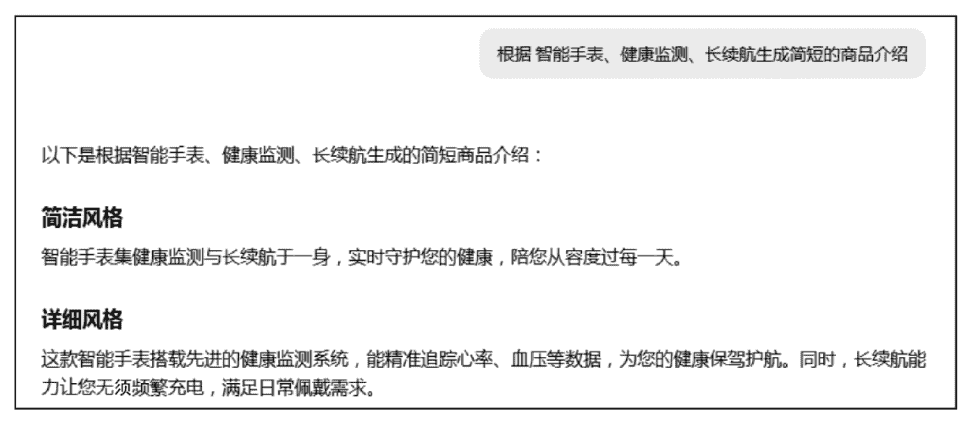

**图6-2 AI生成商品介绍**

AI还能整合品牌、型号、材质、颜色等多项信息，形成详细准确的说明。例如针对一款羽绒服，AI可写出：“这款长款羽绒服选用优质白鸭绒，保暖性强。防风防水面料抵御风雪，时尚修身版型百搭，多个口袋兼顾美观与实用，温暖过冬。”

通过分析海量用户数据，AI可了解不同人群的偏好，生成更契合的文案。如在某地区用户更关注环保时，针对环保购物袋的介绍会突出环保属性：“大容量购物袋结实耐用，采用环保可降解材料，兼具实用性与环保理念，彰显低碳生活态度。”

AI还支持多语言输出，满足跨境需求，并会按语言习惯调整表达。某主打环保、设计感的家居品牌曾用AI优化商品介绍。以再生木材沙发为例，AI生成的描述强调材料来源与环保理念：“沙发采用环保再生木材，将废弃资源重新利用，保留木材天然质感与温暖色泽，稳固框架搭配舒适坐垫，为空间增添自然舒适感。”

品牌通过A/B测试对比不同文案在停留时间、点击率、转化率上的表现，并据数据反馈持续优化。上线后，详情页平均停留时间明显增长，转化率也得到提升。

#### 6.2.3 AI高效生成商品图片
商品图片是详情页的重要组成部分。AI不仅能自动生成图片，还能依据店铺风格创建统一的视觉内容，打造图文兼备的页面。

AI通过深度学习解析店铺的定位与品牌形象，无论是简约现代还是复古文艺，都能准确把握。在生成图片时，会考虑店铺的色彩、布局、元素等关键因素，确保产出与整体风格一致。

清新自然调性的智能化呈现

以清新自然为主基调的门店里，模型产出的单品画面整体偏向柔和与淡雅，背景多选用自然意境。配色方面倾向低饱和的嫩绿、浅海蓝等自然色系，营造出宁静舒适的氛围感；构图上常将主角商品置于画面中心，周边点缀叶、花等有机元素，用以突出产品的天然属性，视觉参考见图6-3。

**图6-3 AI生成的商品图片**

由模型创作的商品照视觉张力突出，更容易吸引逛店人群的注意。制作时可依店铺调性与单品特征进行个性化打磨，使整页详情在视觉上保持统一，图片与文字、底图等元素相互呼应，形成和谐一致的画面感。更关键的是批量出图的效率远超人工。

一家面向Z世代的潮流单品店借助生成式工具扩充图库。结合品牌定位，批量产出了配色大胆、设计新颖、冲击力强的单品图。光影处理细腻，细节与卖点被完整呈现；构图跳脱常规，大量融入当下流行的视觉符号与排版手法，与店铺追求的时尚、个性、满格活力整体调性高度契合。

这些画面迅速成为详情页的吸睛点。街头涂鸦墙前的潮酷穿搭、赛博灯效下的个性配饰，每一组都在讲述不同的时尚故事。图像与页面结构、色彩体系、文案描述相互加成，有效点燃了购买冲动。最终店面转化率明显抬升，并在平台上成长为标杆店铺。

#### 6.2.4 WIME：多维度助力详情页生成

2024年10月，营销服务商微盟面向中小微电商发布了多模态生成式产品WIME，用以协助商家高效制作营销素材。

在详情页搭建上，WIME把图像生成与文案生成整合在一起，覆盖抠图、画面合成、标题撰写、卖点提炼等全流程，支持一键完成整页生成。

关于商品图像的产出，WIME依托图生图、文生图能力，可根据商家上传的实拍或文字描述，生成质感高、风格多样的画面。比如只须上传一张原图，系统即可自动识别主体完成抠图，随后匹配合适的背景与场景，提升整体吸引力。

文案端则通过自动写作功能，快速产出商品名、卖点等内容，并按不同渠道与受众特性做优化。商家输入核心卖点后，即可获得适配详情页、小红书、公众号等场景的高质量文案，让信息更精准触达潜在买家，从而提升转化。

对于没有专职团队的小店，WIME提供丰富的行业模板，可一键套用快速生成合规的高质量素材。同时支持风格定制，帮助商家结合品牌形象与店铺调性打造更具辨识度的详情页。在工具加持下，详情页制作更轻便，运营成本下降，中小微商家也能迈向微型企业的创业路径。

### 6.3 创意风暴之消费场景创新

生成式技术的想象力不仅局限于内容制作，在构建虚拟消费场景上同样释放出强劲潜力。融合VR、3D等前沿手段，可搭建沉浸、可交互的购物空间，为顾客带来全新体验。此类创新显著增强参与感，也在悄然改变消费习惯。

#### 6.3.1 奇妙的虚拟货场

随着智能电商演进，虚拟货场正成为探索前沿。借助生成式模型与3D技术，企业可打造高度沉浸的市场，给用户带来多感官刺激，让逛店更有趣。虚拟货场能在哪些维度点燃沉浸感？

1. 逼真的场景构建
依托算法与3D建模，能复刻与现实高度接近的商场，如写实的3D家装城，也能打造奇幻风格的场景，比如把购物空间植入海边小镇或游乐园，极大提升浏览乐趣。

2. 3D商品展示与交互
虚拟市场中的三维展示让顾客能全方位了解细节并进行虚拟试用。譬如选购数码产品时，可在虚拟空间直观查看设计与功能，辅助做出更准确的判断。

3. 多样的社交互动
企业可在虚拟货场中加入社交元素，让用户与他人互动。好友可一起虚拟试衣、点评穿搭效果，或共同参加购物活动，这类社交属性显著提升体验感。

2024年，沃尔玛携手元宇宙平台Emperia上线4家虚拟商店，打造极具创意的虚拟货场。风格各异，例如山间小屋、节日派对等。以山间小屋为例，顾客点击雪橇即可查看对应商品，进入小屋后还能与沙发、电视等物品互动。

沉浸体验上，商店支持自由探索、查看商品并一键加入购物车，真实感更强。各主题陈列的商品既贴合场景，又紧跟流行趋势。社交功能也完善，如愿望清单分享、“火花”集奖抽奖等，进一步优化购物体验。

沃尔玛的尝试具有示范意义，为行业树立了标杆。随着技术成熟与更多企业入局，虚拟货场的应用将更广泛。

#### 6.3.2 产品试用也能虚拟化

智能时代，虚拟试用已成为新的潮流场景。结合计算机视觉、深度学习、AR等手段，虚拟试用能精准呈现使用效果，打破传统试用局限，为顾客提供更便捷个性化的体验。

虚拟试用的主要应用场景有：

- (1) 美容护肤。顾客可虚拟体验不同品牌、功效的护肤品、彩妆，了解效果与适用性。例如试用不同色号口红，直观对比与肤色、肤质的契合度。
- (2) 家居用品。在虚拟空间中，用户可自由搭配不同风格的家具与装饰，直观感受组合视觉效果。例如装修时便捷预览家具布局与内饰风格，选出最符合个人喜好的方案。
- (3) 电子产品。在数码领域，虚拟试用帮助用户了解功能与性能。例如虚拟体验手机、电脑等设备的操作界面，更好理解产品特点。

众多企业已推出虚拟试用功能。以兰蔻为例，其官网上线虚拟试妆功能，用户可上传自拍或使用模特照片进行试妆。试妆过程中可体验口红、眼影、粉底等多款产品。

虚拟试妆能将彩妆效果精准叠加到图像上，实时展示试用效果，如图6-4所示。

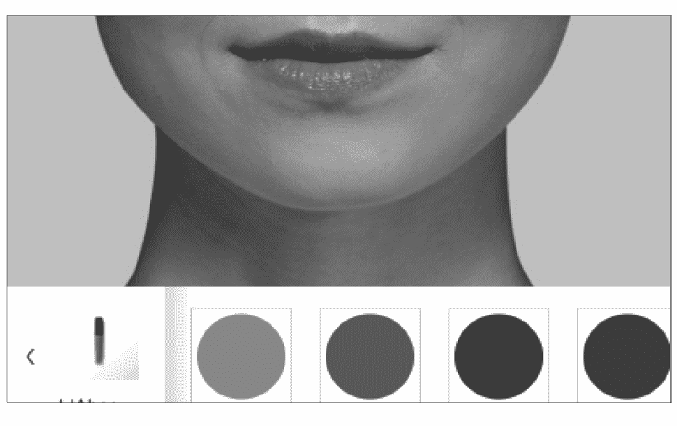

##### 图6-4 口红虚拟试妆效果

除虚拟试妆外，兰蔻还依托模型提供肤质分析与色号查找，通过深度分析用户肌肤，为其匹配合适的彩妆色号。

谷歌上线了虚拟试衣功能，基于TryOnDiffusion生成式模型，能高度逼真地呈现服装在不同模特身上的效果，如图6-5所示。

##### 图6-5 AI试衣功能的效果展示

该功能在细节表现上尤为出色，可精准还原衣物的垂坠、褶皱、贴合与起皱等状态，带来接近真实的试穿感。尺码覆盖XXS至4XL，模特姿势多样，能满足不同用户的个性化需求。

Anthropologie、Everlane等品牌已接入该功能，为用户提供丰富的试衣选择。

#### 6.3.3 天猫：XR端的“双11”空间会场

2024年“双11”购物节期间，天猫“双11”活动在手机端、PC端及XR端同步进行。XR端的淘宝Vision Pro版“双11”空间会场成为活动新亮点。

戴上Vision Pro XR眼镜，消费者能够进入一个虚拟的3D购物空间，并在其中虚拟逛街，获得沉浸式购物体验。消费者可以浏览3D展示的服装，全方位查看服装的设计细节、面料质感及上身效果；可以浏览各种居家产品，并在虚拟空间中自由摆放，直观感受家居产品在房间中的实际效果；还可以虚拟试驾各种汽车，感受汽车的性能。

小米SU7的虚拟试驾活动吸引了众多消费者的目光。在虚拟会场中，消费者如同置身IMAX影院，可以沉浸式查看小米SU7的外观设计，选配不同的颜色、轮毂等，也可以打开后备厢，直观感受后备厢的空间大小。

消费者还可以“坐”进车里，感受汽车的舒适度，查看方向盘、仪表盘、内饰等细节，也可以启动汽车进行虚拟试驾，如图6-6所示。虚拟试驾让消费者可以仿真体验小米SU7的驾驶乐趣，沉浸式感受汽车的性能和特点，进而更好地作出购买决策。

**图6-6 在虚拟场景中进行驾驶操作**

天猫还设计了3D沉浸式红包雨活动，红包以3D立体形式从空中飘落，消费者可体验到被红包“砸中”的感觉。

这并非天猫探索3D购物的第一次尝试，此前天猫就曾推出3D版天猫家装城，打造沉浸式购物场景，为消费者提供“云逛街”的虚拟购物体验。

在3D版天猫家装城中，商家可以搭建自己的3D购物空间。为了降低门槛，天猫推出了一套3D设计工具，帮助商家构建商品的3D模型。该设计工具在AI算法支持下，能够根据商家上传的商品实物图自动生成3D商品模型。商家可以轻松打造3D商品模型，并将其发布到3D版天猫家装城中。在技术的支持下，3D版天猫家装城吸引了不少商家入驻，商品涵盖家具、家电、装饰品等诸多品类，能够满足消费者的不同选购需求。

3D版天猫家装城为消费者提供沉浸式购物体验。在虚拟场景中，消费者可以自由浏览商品、与商品互动，如查看商品信息、旋转商品查看全貌等。消费者可以根据自己的喜好，在虚拟场景中自由搭配商品，并预览搭配效果。这种个性化的搭配方式提升了消费者参与度和转化率。

近年来，天猫在3D购物方面进行了诸多探索，引入了AI、3D、XR等多种技术，力求为消费者带来具有创新感的，甚至是颠覆式的沉浸式购物体验。

这里延伸提一下元宇宙。在过去几年中，元宇宙受到了极大的关注与炒作，而后又突然消失在公众视野。随着技术的进步和市场需求的变化，元宇宙的实际应用场景正在逐渐清晰化，其中虚拟购物便是一个成功落地的场景。我们需要明白，尽管元宇宙的发展面临诸多挑战，但其潜力依然巨大。

## 第7章 AI营销：引爆企业新的增长空间

在AIGC浪潮下，通义千问、文心一言、豆包等生成式AI出现，给电商营销带来新变革。电商企业可以借助AI进行营销推广，通过智能分析、精准预测与个性化推荐，提升营销效果和用户体验，打开全新的增长空间。

### 7.1 AI赋能：变革营销前工作

营销活动成功与否在一定程度上取决于前期准备工作的精细程度。电商领域经过多年发展，消费者购物旅程的关键环节数字化程度高，售前售中售后全生命周期数据相对完善，是具备通过AI技术解锁更多潜力的前提。AI凭借强大的数据分析能力，能够精准预测营销成本和投资回报率，巧妙设计并优化价格策略，智能推荐营销渠道和广告位。借助AI，电商企业得以未雨绸缪，为后续营销奠定坚实基础，开启高效、精准营销的新征程。

#### 7.1.1 数据预测：营销成本+投资回报率

精准预测营销成本和投资回报率是电商企业制定有效营销策略、优化资源配置的关键。传统方法往往依赖历史数据和经验判断，难以应对快速变化的市场环境。电商领域广告曝光数据、消费者线上行为轨迹数据及海量的订单数据和物流快递信息提供了最基础的原料，得以支持应用AI技术预测营销成本和投资回报率。

AI的核心优势在于其强大的数据分析能力。通过机器学习算法，AI可以从海量的历史销售记录、消费者行为模式及外部经济因素中提取有价值的信息，构建出高度准确的预测模型。模型不仅可以帮助电商企业更精确地估算营销活动所需成本，还能预见潜在的投资回报。

以某知名时尚电商企业为例，在引入基于AI的数字营销系统之前，其营销活动策划往往依赖于人工经验和对市场趋势的大致判断。传统的市场调研方式和基础的订单数据分析虽然能够提供一定的信息，但对于营销成本的把控和投资回报率的预估与实际存在较大误差。这导致企业在一些营销活动中投入过多成本却未能获得预期的收益，而在一些潜力较大的项目上投入不足，错失发展机会。

引入基于AI的数字营销系统后，情况得到了显著改善。在一次大型换季促销活动前，AI系统根据过往类似活动的数据，结合当前的市场热度、消费者偏好及竞争对手动态，精确地预测出此次营销活动在各个渠道所需的成本投入。

例如，对于社交媒体广告投放，系统详细地规划了不同平台、不同广告形式的预算分配，确保每一分钱都花在刀刃上。同时，通过模拟不同营销策略下消费者的购买行为路径，准确预估了活动可能带来的销售额和利润，从而得出精准的投资回报率。

活动执行过程中，企业依据AI系统的预测结果进行精准布局和资源分配。实际执行结果显示，该次促销活动的实际营销成本与AI系统预测值的偏差很小，实际投资回报率也达到了预期水平。

这一案例充分展示了AI在精准预测营销成本及投资回报率方面的巨大潜力和实际价值，为电商企业在激烈的市场竞争中实现高效营销提供了可靠的技术支撑，引领电商行业迈向更加精准化、智能化的营销新时代。

#### 7.1.2 精准定价：敏感度分析+智能定价与优惠

基于大数据分析、机器学习、自然语言处理等技术，AI能够帮助电商企业更快、更准确地理解市场需求、消费者行为及竞争对手动态，从而助力企业进行精准的价格策略设计与优化，最大化利润空间。在价格策略设计与优化方面，AI发挥着重要作用，如图7-1所示。

##### 1. 价格敏感度分析

通过对大量历史销售记录、用户交互信息及外部环境因素的学习，AI可以识别出消费者对不同价格水平的反应及价格与销量之间的关系，并据此确定最优的价格点。

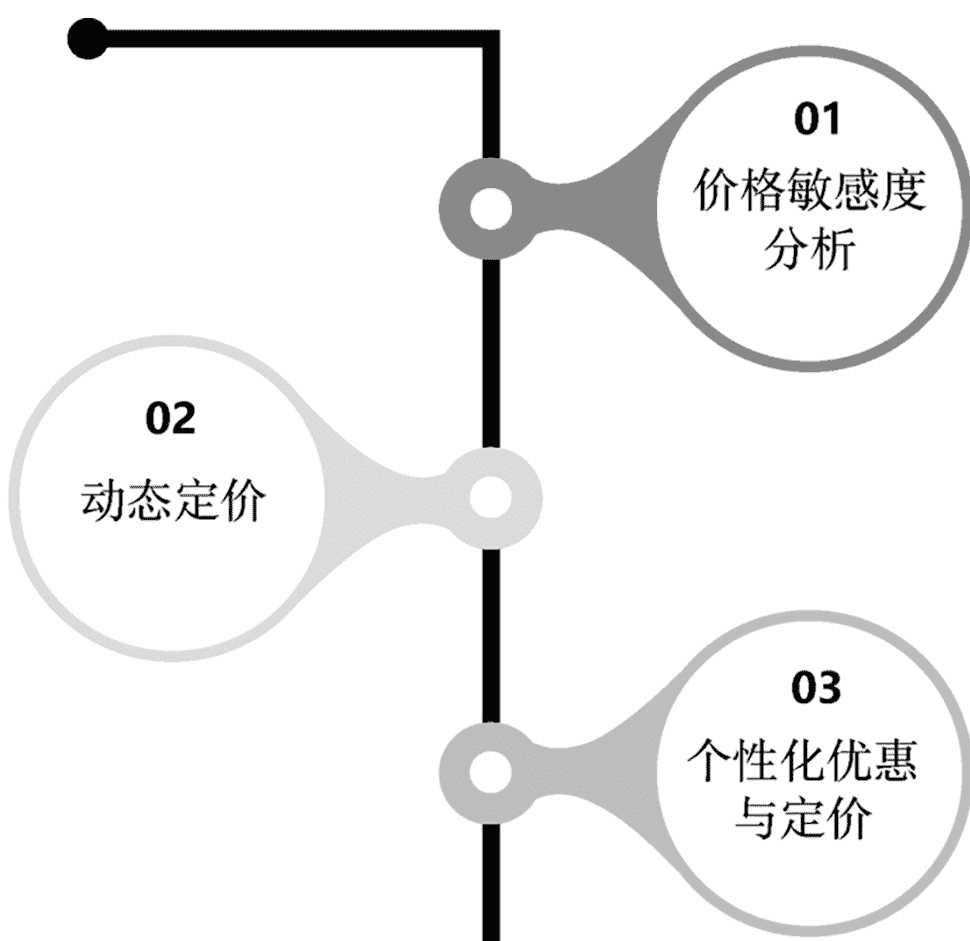

###### 图7-1 AI在电商价格策略设计与优化方面的应用

例如，京东打造动态定价系统，利用历史销售数据和其他相关因素来预测不同价格水平下的潜在需求量，从而识别哪些商品更容易受到价格波动影响。如果某类商品的价格弹性较大，可以通过适当降价来刺激销量；反之，则可以在保证一定销量的前提下提高价格以增加毛利。

##### 2. 动态定价

通过深度强化学习不同商品的特征、市场需求、竞争对手价格、用户行为等因素，AI可以动态调整每件商品的价格，以吸引更多用户购买，提高用户转化率和复购率。

京东的动态定价系统能够实时监测市场供需变化、竞争对手商品价格和商品热度，动态调整商品价格。当竞争对手调整某件商品的价格时，京东的动态定价系统会自动随之调整或反向调整该商品价格；当商品库存积压时，系统会自动降低价格以促进销售；当商品成为热门爆款、需求旺盛时，系统会适当提高价格。这种灵活性使京东能够在瞬息万变的市场环境中迅速响应，保持平台价格优势。

##### 3. 个性化优惠与定价

AI还可以根据用户的个人特征和行为习惯，提供个性化的优惠和定价。基于用户画像和标签体系，京东能够识别出高价值会员及其他特殊客户群体，并为他们提供专属优惠或定制化折扣。这可以增强用户黏性，有效挖掘潜在需求，促进二次消费。同时，京东尝试实施个性化定价策略，根据不同用户的偏好和历史交易记录提供差异化的商品浮动价格，希望实现更高的转化率和更好的用户体验。

AI在电商价格策略设计与优化中的应用提高了定价的有效性和灵活性，促进了销量增长和用户体验提升。随着AI不断进步和应用场景拓展，电商行业将迈向更加智能、高效的发展阶段。

#### 7.1.3 渠道拓展：找渠道+推荐广告位

通过分析海量的用户数据，AI能够构建出详尽而准确的用户画像。画像不仅涵盖基本的人口统计学特征，还深入挖掘用户的兴趣爱好、消费习惯乃至心理动机。

基于此，AI可以为电商企业提供关于潜在用户的全面洞察，帮助它们识别最适合自己的营销渠道。例如，针对年轻一代消费者，社交媒体平台、短视频平台、潮流时尚类App可能是更为有效的营销渠道。

在选定营销渠道后，下一步就是确定具体的广告位。这涉及诸多因素，如页面布局、内容相关性、用户体验等。AI凭借其强大的数据分析能力，可以在短时间内筛选出最有可能引起目标用户注意的广告位，并给出针对性建议。例如，根据用户的行为轨迹，AI可以预测哪些商品详情页的横幅广告会被频繁查看；依据用户的搜索意图，推荐自然搜索结果旁边的最佳展示位。

以一家专注于健康养生产品的电商企业为例，AI通过分析发现其主要消费群体为30～50岁、具有一定消费能力且关注生活品质的人群。基于此，AI为其推荐知名健康类网站、生活服务类App、中高端社交平台等营销渠道，这些平台聚集了大量目标客户群体，能够有效提高营销活动的触达率。

在广告位选择上，AI为其推荐健康类网站的首页轮播图、生活服务App的养生专栏推荐位等。这些位置具有较高的曝光度和用户关注度，能够显著提升广告的传播效果和转化潜力。

在营销活动实施过程中，AI可以持续跟踪各个渠道和广告位的表现数据，如用户来源、停留时长、跳出率、购买转化率等。一旦发现某个渠道或广告位的效果未达预期，AI将迅速调整推荐策略，将资源重新分配到更具潜力的渠道和广告位上，确保营销投入的回报率始终保持在较高水平。

总之，在营销准备阶段，AI已经成为不可或缺的重要工具。从深入理解用户画像到评估渠道效果，再到精准推荐广告位，AI贯穿了整个营销流程，为企业带来了前所未有的精确度和灵活性。

### 7.2 AI赋能：实现营销物料多元化

电商营销进入生成式智能时代

数字营销的版图正被生成式技术重新勾勒。借助这类能力，品牌可以快速把文案、图像、影像和广告等多种物料规模化产出，并按品牌调性与受众偏好进行个性化适配，实现更精准的触达与更稳固的情感联结。

#### 7.2.1 批量创作优质电商文案
一篇抓人眼球又能促成的电商文案，既要抓住注意，也要推动下单。传统的人工撰写耗时耗力，且难以稳定保证多样性与吸引力。生成式工具的普及，让文案生产走向规模化。

抖音作为短视频生态的头部平台，推出即创这一智能文案助手。即便是零经验的新手，只需填入商品编号、选择所属行业、补全品名与卖点，就能迅速得到符合平台规范的短视频脚本。生成过程中系统会主动拦截违禁或敏感表述，既省时又兼顾合规与吸睛。

某时尚品牌用即创为新季服装批量生成短视频文案，准确传递了产品卖点并融入潮流话题，快速获得了年轻人群的关注与转化。

豆包是一款全场景的人工智能助手，也支持电商文案的撰写与打磨。商家输入商品资料、风格倾向与字数要求后，系统即可输出匹配的文案，还支持语音指令输入，口述即可完成撰写，效率显著提升。

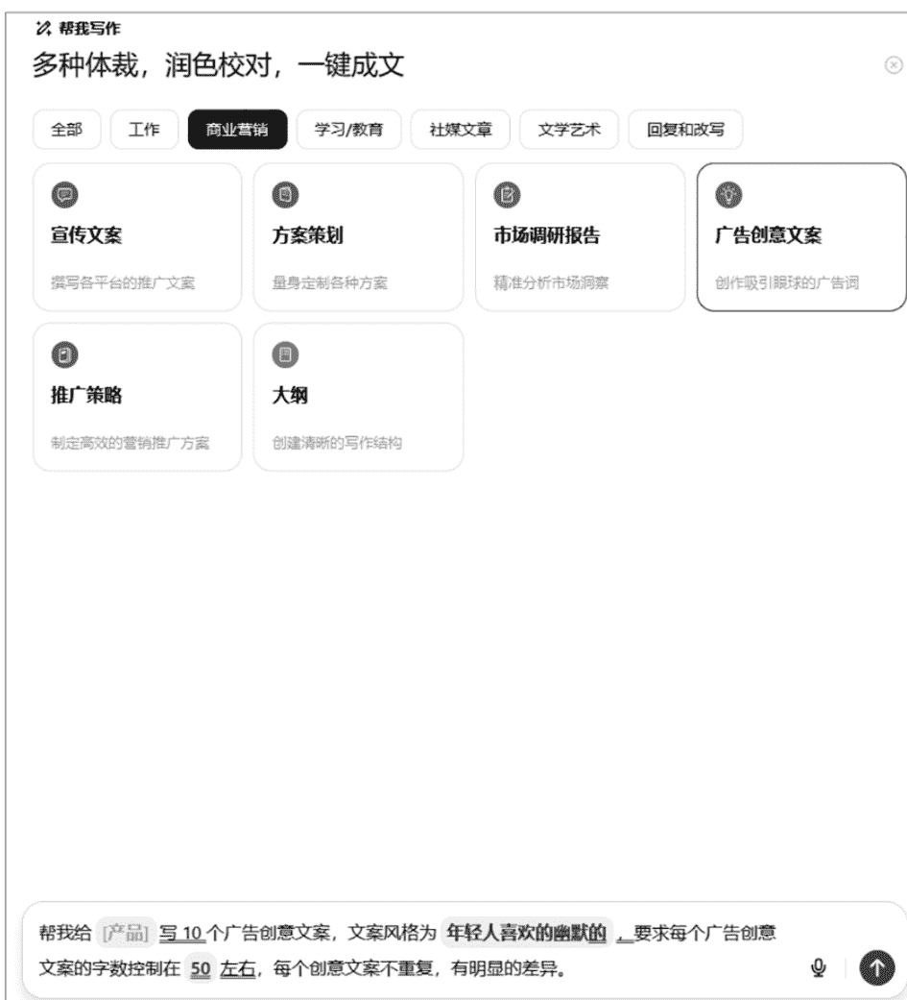
##### 图7-2 豆包创意文案功能
在优化维度上，豆包依托自然语言处理对已有文案进行诊断，定位问题并给出改进建议。表述冗长或结构混乱时，会提示精简重构；吸引力不足时，会提供更富创意与感染力的替代表达。

即创与豆包等工具的落地，让大量商家能够以规模化方式推出风格各异、内容饱满且贴近受众喜好的爆款文案，效果已不逊于传统创意团队。

#### 7.2.2 智能设计爆款宣传图片
高质量的宣传图对点击与销量有直接拉动作用。过去企业需要投入大量人力物力在拍摄与后期，周期长且成本高。生成式技术明显压缩了制作链路并降低了费用。

一方面，模型可快速解析商品信息与风格诉求，直接产出宣传图，省去传统拍摄与后期的人工成本，也无需为模特、场地与器材发愁。另一方面，系统能够按需生成简约、时尚、复古等多种视觉，支持千人千面的分层投放，成图清晰、色彩还原度高。

绘蛙是阿里巴巴面向淘宝、天猫商家及内容创作者推出的 AIGC 营销工具，提供宣传图生成与文案创作的一体化服务。

其核心能力之一是商品图智能生成。商家上传一张实拍图，平台会自动匹配最佳场景并生成专业的模特展示图。例如服装商家上传单品照，系统会智能补背景、调光线，瞬间变为有吸引力的上身展示图，如图7-3所示。

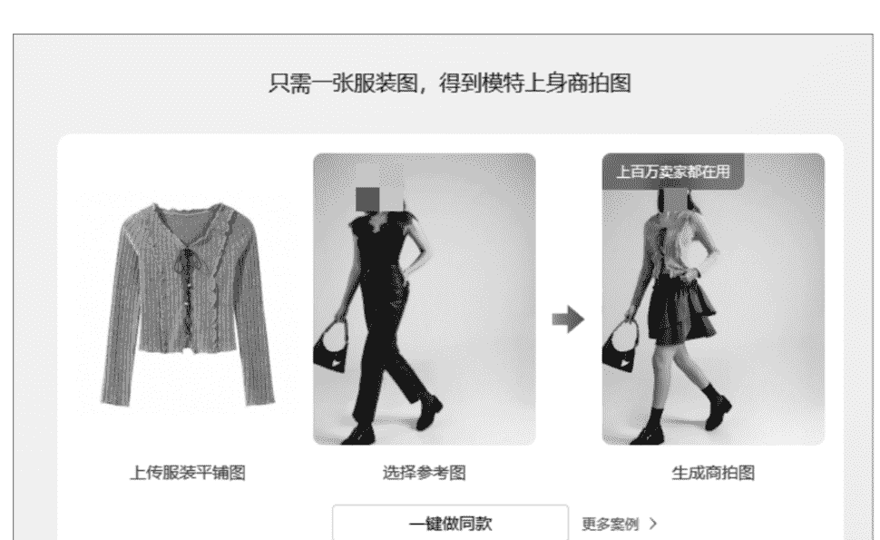
##### 图7-3 绘蛙商品一键上身图示例
绘蛙还提供美图、换装、去水印、高清修复等图像处理能力，方便优化现有图库。背景不匹配时，可快速更换为更契合品牌定位的画面。

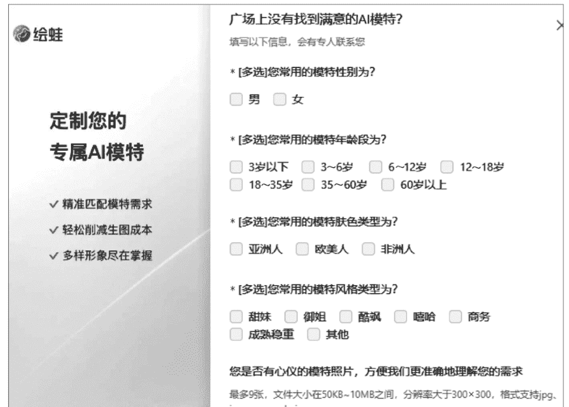
##### 图7-4 绘蛙定制模特功能
平台支持定制专属虚拟模特，上传真人照片后约30分钟即可生成用于展示的 AI 模特，满足不同品类的上身需求，同时节省高额模特费用。

绘蛙具备多场景适配能力，可为小红书社交分享、淘宝天猫京东商品主图、速卖通推广图文等不同渠道生成适配内容。

总体来看，绘蛙通过多样化功能模块，为商家提供便捷高效、低成本的高质量商品图设计方案，有助于吸引潜在用户并推动销售增长。

#### 7.2.3 自动生成强吸引力营销视频
营销视频是促销的重要载体，但传统制作流程繁琐、成本高，难以快速响应市场。生成式技术把从创意到发布的全流程简化，同时提升质量与个性化程度。

借助 AI 视频创作工具，企业只需上传产品图或简短描述，即可获得创意成片。系统会自动运用多种运镜与景深变化，多角度展示产品细节，精准抓住注意力。

工具还能依据品牌需求与产品属性生成不同风格的影像，覆盖不同偏好的潜在用户。同时提供智能混剪与素材整合，轻松管理海量素材并按主题风格快速成片，大幅压缩人工操作时间。

部分领先工具已接入数字人技术，可创建风格独特的数字人形象参与播报，丰富表现形式并提升互动感。

魔珐科技推出的 AIGC 一体化 3D 视频生成平台有言，体现了生成式技术在电商视频创作中的潜力，覆盖脚本生成到 3D 成片的全流程并优化体验。

平台内置 AI 脚本功能，涵盖产品推荐、知识讲解、大型活动等场景并做细分分类。用户挑选场景后补充产品特点、脚本框架等信息，AI 即可辅助完成高质量脚本。

有言还提供丰富的背景模板、多样人物形象以及多语言多风格配音。准备完毕后一键生成视频，并可后期渲染、加入背景音乐与字幕，最终导出成品。整个过程门槛低、可控性强。

总之，生成式技术正让各类规模的企业都能低成本制作专业营销视频，提升运营效率与服务水准，推动行业向智能化迈进。

#### 7.2.4 一键实现广告混剪
信息过载的时代，如何脱颖而出是电商的共同挑战。生成式驱动的智能混剪与快速成片功能，显著简化创作流程并提升质量与效率。

百度推出的多模态 AIGC 创意生产平台擎舵2.0，为电商营销带来高效便捷的解决方案。平台能自动识别并理解素材内容，智能突出产品核心卖点。

其快速成片功能支持基于提示词和原始素材自动生成混剪视频，如图7-5所示。用户只需三步：输入提示词生成营销脚本、上传或创建相关视频素材、选择数字人形象及配音音乐，即可快速制作可直接投放的混剪广告。

面对海量需求，擎舵2.0提供规模化能力，单次最高可生成25条视频，且支持分钟级视频片头与空镜素材生成，降低拍摄与素材采购成本并丰富素材库。

平台还能根据提示词生成高质量主体或底图，结合预设行业模板快速生成投放级营销图。系统内置超30种主体与400多个行业模板，支持快速修改，设计师与优化师均可快速上手。

封面快速生成与智能扩图、拼图功能进一步简化视觉生产，提升内容的吸引力与质感。

针对数字人同质化问题，擎舵2.0面向六大行业提供超100个高品质数字人形象。绿幕数字人可灵活更换背景，实景数字人呈现更逼真场景。图片数字人功能则可通过提示词快速生成古人、3D 真人、老中医等独特形象，为静态图注入生命力。

依托文心一言的理解、创造、推理与记忆能力，擎舵2.0构建营销数据飞轮，在创作初期激发灵感，创作中提供生成式体验，并计划推出诊断工具，分析营销效果与视频结构，指导持续优化。

随着技术成熟，擎舵2.0这类智能创意平台将成为电商营销的核心工具，帮助企业在信息爆炸中脱颖而出。

#### 7.2.5 可口可乐：打造创意营销广告
可口可乐积极拥抱生成式技术，将其融入电商营销，打造更具个性、互动与情感的广告。

2023年3月，可口可乐与 OpenAI 合作推出 *Masterpiece* 创意广告，融合 AI 设计与世界名画元素。可乐瓶穿越《沉船》《呐喊》《戴珍珠耳环的女孩》等名作，随着场景变换瓶身材质与外观同步变化，配合流畅转场与创意场景，带来视觉盛宴，实现极高播放量与曝光。

随后推出的“Create Real Magic”活动，邀请用户使用 ChatGPT 与图像生成工具 DALL·E2 设计广告，优秀作品被用于官方宣传。该玩法激发用户创造力，让年轻人深度参与品牌内容，拉近品牌与新世代的距离。

2023年9月，可口可乐发布首款 AI 联合打造的无糖产品“未来3000年”，如图7-6所示。主视觉由 AI 图像生成器完成，融合未来感风格与经典红调，呈现超现实却亲和的画面，深受年轻人喜爱。

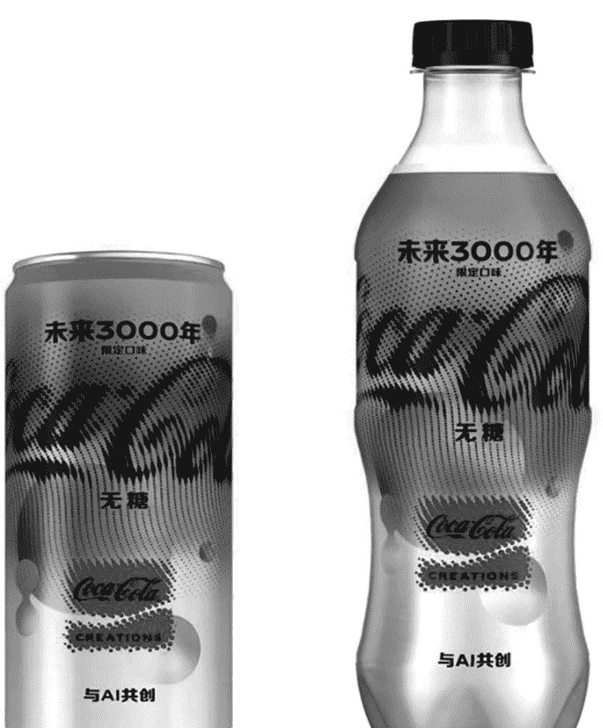
可口可乐与智能科技品牌小度合作搭建“未来畅想平台”。用户扫描包装二维码进入虚拟创作空间，可用定制“未来3000年”AI 镜头上传照片，或参与 AI 辅助短视频挑战赛，赢取数字纪念品与实物奖励，增强社交属性与口碑传播。

2024新春，可口可乐推出“龙年限定罐”与“龙连你我 AI 许愿活动”。用户上传照片与心愿后，AI 将照片转为头像并融入品牌龙形象，成为可无限延伸的“龙鳞”，共同构成壮丽数字艺术作品，提升用户粘性并提供表达与分享平台。

2024圣诞季，可口可乐同时发布《假日魔法来了》全 AI 生成广告与《假日之路》真人广告。AI 广告引发讨论虽有争议，但关注度极高，并为品牌积累了宝贵数据，助力未来 AI 营销优化。

通过一系列 AI 驱动的创意活动，可口可乐不断刷新用户体验，巩固品牌心智。

### 7.3 AI赋能：创新营销后管理
生成式技术不仅助力营销准备与执行，还能提升营销后管理效率，尤其在数据实时监测、效果评估与策略调整、复盘报告生成等方面发挥关键作用，帮助企业提高决策精度。

#### 7.3.1 随时随地掌握营销数据
在数字化时代，数据是营销决策的核心依据。AI 让实时监测成为可能，并带来多重优势。

电商企业可将营销系统与电商平台、社交媒体、广告投放平台打通，实时获取曝光率、点击率、转化率、浏览行为、停留时长、转化行为等指标。结合传感器与物联网设备，还能采集门店客流、停留时间、试穿试用等线下数据，实现全渠道精准监测。

AI 的最大价值在于把数据转化为决策支持。实时分析可快速洞察市场动态与消费者行为趋势，指导策略调整。例如新品上市时，AI 能迅速汇总各渠道销售与评价反馈，研判市场接受度并推动产品与营销方案优化。

AI 还能优化资源配置。系统可建议最佳投放渠道、最受欢迎产品与服务、潜力最大地区等，帮助合理分配预算。例如监测发现某广告平台转化率显著高于其他平台，即可加大投入，提升回报率并降低成本。

实时跟踪用户行为偏好还能实现个性化营销与服务，如电商平台根据浏览轨迹推荐兴趣商品，提升转化与体验。

AI 还具备预警能力。当某区域广告曝光骤减或某类广告转化持续低迷时，系统会发出警报。例如双11期间，某化妆品品牌热门单品广告点击率半小时内下降30%，AI 触发预警，团队及时调查并调整策略，避免损失扩大。

阿里妈妈的 Uni Desk 智能广告投放工具即为典型案例。它在一个界面管理跨平台广告活动，并由 AI 提供实时优化。平台监控曝光、点击等基础指标，同时评估订单数、客户生命周期价值等业务成果，并基于洞察自动生成优化方案，指导创意与定位调整，实现最佳营销效果。

AI 在实时监测与即时反应上的潜能，为企业提供高效精准的决策支持。

#### 7.3.2 投资回报率升级：提供最佳营销策略
电商竞争加剧，企业既要获客，也要提升留存与忠诚度。AI 为营销效果评估与策略迭代提供强力支撑，助力投资回报率提升。

量化评估营销成效是制定与优化策略、增强竞争力的基础。传统评估多依赖定性分析和经验，难以捕捉复杂多变的市场。AI 能够处理海量数据，提供实时精确反馈，让营销人员更快识别问题并采取行动。

要想把营销效果评得准，数据得先够好、够全。电商生态高度数字化，企业能从多渠道汇集信息，包括网站和App的流量统计、社交平台的互动记录、广告点击情况、用户的浏览轨迹以及数字支付行为等。

把这些原始信息变成可用资产，AI能加速清洗、转换和标准化。清洗时自动揪出异常值和重复记录；转换时通过特征工程提炼出更有分析价值的信号，为后续评估打好基础。

选对指标是评估成败的关键。常用KPI有：

- 1. 转化率：到店访客最终下单的占比，是电商营销的核心晴雨表之一。
- 2. 购物车放弃率：用户把商品放进购物车却未付款的比例，能暴露流程或体验的痛点。
- 3. 客户获取成本（CAC）：获取一名新客的平均花费，用来衡量投放效率。
- 4. 客户终身价值（CLV）：一个客户在生命周期内为企业带来的累计收益，指导长期策略。
- 5. 广告支出回报率（ROAS）：广告花费所带来的收入回报，判断投放是否划算。

有了算力加持，AI可以快速对比不同周期KPI的变化，找出拉动业绩的积极因素和拖累表现的负面因素。例如某电商引入AI辅助的A/B测试平台，实时评估营销方案，并在满足条件时由AI引擎自动分配流量和曝光预算，整体转化率得到明显提升。

评完之后AI还能给出可执行的改进建议，帮助策略动态调整，涉及渠道组合、产品服务优化、内容打磨等多个层面。比如某个广告系列效果偏弱，AI会通过解读用户反馈和互动模式，提示更换更吸睛的视觉或文案风格，同时给出最优投放时段和频次建议，让每一笔预算都花在刀刃上。

为避免单一指标失真或多指标冲突，企业可以用大数据和AI搭建评估模型。基于增销、提认知等具体目标，结合历史数据训练预测模型来判断活动效果。业界常用的MMM媒体组合建模就能借助AI低成本快速落地。机器学习分类器还能区分有效与无效的渠道或创意，为资源分配提供依据。

大语言模型也进入评估场域。以Transformer架构的BERT为例，其文本理解能力被用来做消费者对品牌、产品或服务的情感分析，用来构建“品牌喜好度”等非结构化指标。

在分层运营上，AI的潜力同样突出。通过挖掘用户行为轨迹，识别出差异化的群体特征，并为每类人群定制专属方案。某服装品牌利用AI分析购物偏好构建精细画像，实现个性化推荐，用户的活跃度和满意度提升，复购也随之稳步增长。

总体来看，AI让电商营销的效果评估更精准、决策更高效，推动行业向智能化迈进。

#### 7.3.3 用AI让营销复盘自动化
过去的复盘主要靠人力搜集整理海量原始数据，耗费大量时间，还要把结论做成PPT或Word。AI的加入把流程大幅简化，能自动从多个来源抓取并处理数据。

促销活动收官后，AI可以在很短时间内完成数据提取，团队立刻进入表现评估。更重要的是，AI能捕捉到人工容易忽略却影响结果的隐性因子，辅助生成洞察并复核优化结论。

AI还能处理海量历史数据，包括以往未被充分利用的非结构化评价和讨论，从而还原消费者行为模式及其驱动原因。比如为什么某渠道转化更高，是时间窗口匹配、还是产品组合更对味。进一步追问背后是否满足了用户的场景化需求和心理诉求。过去依赖资深分析师经验甚至直觉的工作，现在能得到有效支撑。

撰写报告过去需要整理数据、制图、写观点，现在AI可自动完成这些繁琐基础工作。结合预设模板或个性化需求，直接输出图表和总结，让复杂信息变得直观易读。AI生成的文字简洁、重点突出，还能按受众自动切换视角，为高层管理者、市场部门、财务部门分别产出侧重点不同的版本，满足不同决策层的信息需求。

Sphinx Mind是Optimization Up公司推出的一款AI驱动智能营销助手，通过与Facebook广告、Google Ads、Google Analytics等主流平台无缝对接，提供自动化报告、深度分析和实时优化建议，简化营销工作。其核心功能包括：

- 1. 广告效果分析：跨平台追踪投放表现，优化广告策略。
- 2. 用户行为洞察：挖掘行为数据，识别潜在人群并制定个性化方案。
- 3. 实时报告生成：自动产出各类报表，帮助团队快速拿到关键数据。

该工具还支持与Slack、Microsoft Teams集成，便于协作共享。随着AI技术成熟，类似Sphinx Mind的产品明显提升了复盘效率，更关键的是提供科学依据，助力企业更精准地制定与调整市场策略，在激烈竞争中保持优势。

## 第8章 AI数字人：让虚拟形象成为增长引擎
AI数字人是类人外观、声音和肢体动作都能自然互动的虚拟分身。在电商场景中，产品讲解、直播带货等都是典型应用。越来越多的企业引入AI数字人，重塑消费体验，寻找新的业绩增长点。

### 8.1 AI数字人落地的三个关键环节
企业可自主打造，也可与第三方合作。整体流程大致为：先建模塑造性格形象音色，再驱动渲染赋予“生命”，最后搭建多模态交互系统实现自然沟通。

#### 8.1.1 第一步：先给数字人搭好骨架形象
数字人能否代表品牌、吸引受众，取决于性格设定、视觉形象和音色选择。

性格是虚拟角色的差异化标签，好的设定能让用户感到真实可信，提升认同感。企业应研究目标市场和用户偏好来确定性格特征。例如遥望科技的数字主播“孔襄”被设定为热情友好且专业可靠，介绍商品时显得亲切自然。

不同场合可微调性格表现，促销时更活泼，答疑时更沉稳。

第一印象很重要，形象风格应与品牌定位匹配，如写实或卡通，面部表情、身体比例、服装搭配都要精雕细琢。以美妆品牌花西子为例，其数字人“花西子”是一位清丽脱俗的古典美人，遵循东方面相美学，眉间一颗美人痣，耳饰如莲叶，手持并蒂莲，服饰融合传统与现代，色彩淡雅，彰显文化底蕴。

季节或节日到来时适时更换装扮，也是有效的营销手段，如春节推出红色主题服饰更易引发共鸣。

声音同样影响魅力。熟悉的声音能触发情感反应，促进购买。选择能诠释角色性格的配音演员至关重要，若不用真人，AI语音合成也能提供高质量替代，如相芯科技借助大模型模拟真人主播的音色、断句和气口，直播效果和留存率明显提升。

市面上已有不少AI数字人建模工具，提供丰富素材和编辑功能，无需专业3D知识，通过拖拽模板和简单设置即可生成逼真形象，大幅降低门槛。

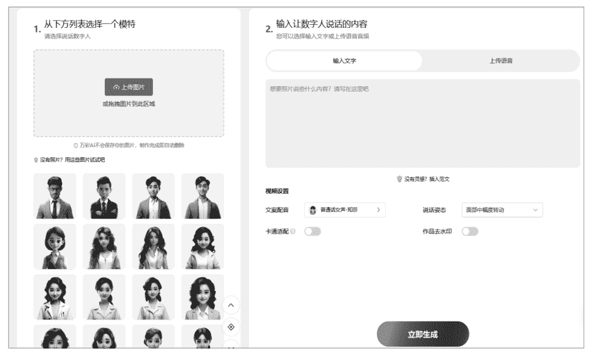

##### 图8-1 万彩AI数字人建模

借助这些工具，即便是中小电商也能快速打造具有独特性格、形象和音色的数字人，助力业务发展。

#### 8.1.2 第二步：驱动与渲染让形象动起来
驱动把静态模型变为自然流畅的动作和表情，赋予“生命”。常见驱动方式有三种，如图8-2所示。

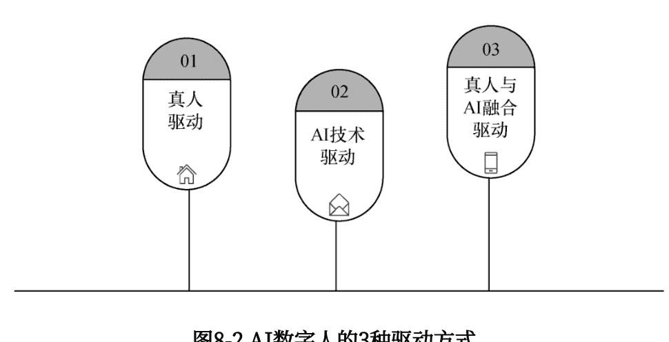

##### 图8-2 AI数字人的3种驱动方式

1. 真人驱动
依托动作捕捉设备或摄像头实时采集真人的动作、表情和语言，映射到数字人身上。灵活性强，可塑性高，适合打造虚拟主播、虚拟客服等定制化角色，实现实时互动。

2. AI技术驱动
基于深度学习算法实现驱动，可实时或离线运行，让面部表情和语言动作接近真人。电商领域的AI虚拟客服可7×24小时在线服务，提升效率并降低人力成本。

3. 真人与AI融合驱动
结合前两种优势，由真人捕捉基础动作表情，AI赋予智能交互和自主学习能力。数字人既有类真人表现，又能根据用户反馈优化行为。百度智能云新一代数字人平台“曦灵”即融合真人驱动与AI驱动，凭借动作捕捉和深度学习实现实时捕捉与渲染，广泛应用于客服和品牌推广。

具体到技术环节，驱动分为面部驱动和肢体动作驱动。面部驱动以嘴型为核心，通过算法学习文本、语音与嘴型视频的对应关系，生成自然的口型变化。肢体动作驱动依赖动作捕捉技术。

动作捕捉主流方案有光学、惯性和计算机视觉三种。光学精度高但成本高昂；惯性成本低场地限制小但精度有限；计算机视觉仅需摄像头成像即可建模，成本低但计算量大。

渲染则是为模型添加几何、纹理、阴影等，使之呈现为图像并优化光影效果，提升真实感。渲染分为离线渲染和实时渲染。离线渲染不求实时，资源充足，质量更高，适合对画面质量要求极高的场景；实时渲染强调即时计算与输出，质量相对有限但交互性强，适合直播等场景。Unreal Engine 5的Lumen和Nanite技术即可实现高精细的实时渲染。

#### 8.1.3 第三步：构建自然的多模态交互
交互设计决定数字人沟通是否流畅。借助语音识别、自然语言理解、情感分析等技术，可设计逻辑和场景，并支持文本、语音、肢体、表情等多方式交互。

1. 文本交互
最基础的交互形式，用户输入文字提问或指令，AI通过自然语言处理解析并回复。在电商中可承担在线客服，回答咨询、追踪订单等。构建完整知识库并引入深度学习实现上下文理解，可支持更复杂的对话，如基于既往记录推荐更合适的产品组合。

2. 语音交互
语音交互更便捷，借助自动语音识别和智能语音合成实现口头指令和自然回应。需保证音频采集质量并优化识别算法，针对不同口音做本地化调优，同时利用情感分析感知对话情绪并调整语气，使交流更人性化。

3. 肢体动作与表情交互
非语言信号同样重要，能传递更多信息并增强亲切感。通过动作捕捉和计算机视觉，数字人可点头、微笑等，增强视觉吸引力和情感连接。例如在商品展示时，虚拟模特可演示产品特点和使用方式，或在节日活动时加入舞蹈动画提升趣味。

为实现无缝沉浸体验，企业应整合多种交互方式，形成多模态能力，使数字人能灵活切换，满足用户多样需求。直播带货中，观众既能发弹幕提问，也能用语音指令与AI助手对话，助手还能根据实时情绪倾向调整策略并适时增加幽默元素，增强粘性并创造营销机会。

### 8.2 AI数字人在电商能做什么
据IDC预测，到2026年我国AI数字人市场规模将达102.4亿元。在电商领域，智能产品讲解、跨语言跨文化交流、产品试穿试用、品牌代言与宣传等场景都已落地，能提升品牌影响力并挖掘新价值。

#### 8.2.1 产品讲解员：为用户介绍产品
AI数字人可作为智能客服用文字详细介绍，也能以视频形式作为虚拟主播生动展示。部署在产品详情页，点击咨询即可对话；直播场景中可按脚本讲解、展示实物、模拟使用，并实现24小时不间断服务。

京东推出的言犀数字人已在超7500家品牌直播间稳定开播，知识库覆盖丰富品类，并能按场景自动调整话术。例如在一次电子产品促销中，言犀数字人展示手机外观并逐项介绍屏幕分辨率、摄像头参数等，针对续航、充电速度等问题深入剖析，并播放视频片段让用户直观感受。

这种方式革新了传统服务模式，解决了中小电商人力成本高、内容生产有限等难题，未来将发挥更大作用。

#### 8.2.2 翻译员：打破语言与文化壁垒
跨境电商常受语言障碍和文化差异制约。AI数字人能提供跨语言、跨文化的沟通桥梁，提升业务效率和体验。

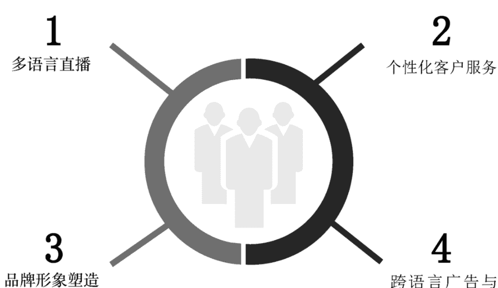

##### 图8-3 AI数字人在跨语言和跨文化交流方面的作用

##### 1. 多语言直播

数字人主播：让跨境直播零语言壁垒

把语音合成、口型驱动等技术打通后，虚拟主播就能做到同声多语播报。在出海电商平台上，无论买家来自何处，都能获得流畅自然的购物体验，语言隔阂被大幅削弱。以青否数字人直播系统为例，语种覆盖可达140种。面对欧美、东亚及其他区域的用户，数字主播能用当地母语完成商品讲解与互动问答，助力商家触达更广的国际人群。

##### 2. 个性化客户服务
借助自然语言理解能力，数字人可以解析来自不同国家与文化背景消费者的提问，并用对方习惯的表达方式给出精准答复。白天黑夜都能立刻回应，有效提升满意度。系统还能结合消费记录、浏览轨迹以及各地消费习惯与偏好，推送定制化的商品建议与解决方案，强化购物体验与复购意愿。

##### 3. 品牌形象塑造
商家可根据目标市场的文化特质与审美偏好，定制带有地域特色的AI形象担任品牌代言或形象大使。该形象可在线上线下营销场景中出现，以亲切自然的方式与本地受众交流，传递品牌理念与文化内涵，提升海外知名度与美誉度。

##### 4. 跨语言广告与营销内容创作
数字人可依据不同国家和地区的语言、文化与市场特征，迅速生成定制化的广告文案、宣传短片等素材。表达更地道，文化共鸣更强，点击率与转化率随之提升。同时，系统可依据实时数据与市场变化及时调优，保持投放的持续吸引力。

摩尔普斯推出的摩世数字人已在国内广泛应用，并拓展至泰国、越南等海外市场，在推动电商跨语言跨文化沟通上发挥作用。摩世具备多元智能能力，可简化传统直播带货流程：自动生成的虚拟主播支持多语翻译、智能撰写直播脚本、开展交互问答，并能自动生成符合场景的虚拟环境。借助它，出海直播效率更高，企业收益提升。在海外，摩世依托摩尔普斯的数字人数据库进行本土化设计，更贴合当地需求，并能按商品品类自动匹配最合适的形象。基于此，出海电商可跨越语言文化壁垒，实现语言无缝切换，提供专属服务，构建全球化品牌形象。

#### 8.2.3 模特：帮助用户试穿或试用产品
过去线上购物只能靠图片视频判断合身度，互动性与真实感不足，容易因尺码、色差导致误判与退货。随着计算机视觉、深度学习与AR的突破，虚拟试穿试用成为现实，显著改善购物体验。

虚拟试穿的核心在于打造高度个性化的数字分身。用户只需提供体重、身高、体型、肤色等信息，即可生成逼真的三维模型；也可上传个人照片，进一步微调姿态、表情等细节，使分身更接近本人，从而提升真实感与选品效率。

试穿环节通常提供丰富的自定义选项：可更换服装颜色与款式，选择室内室外等不同背景，模拟多场景穿着效果。

以国内主流电商淘宝为例，其推出的虚拟试衣间让用户居家“试穿”心仪衣物。具体流程中，用户填写体重、身高、体型等信息生成个性化数字分身，如图8-4所示，同时支持上传照片打造更真实的试衣体感。

##### 尺码档案
##### 基础信息
名称 * 输入角色名称，例如“妈妈”
性别 * 女性 男性
+   角色 * 伴侣 父母 子女 朋友 其他
身高 * --厘米
体重 * --公斤
常穿鞋码 * --码
内衣尺码
+   杯型 * A杯 B杯 C杯 D杯 E杯
底围 * --厘米
体型（选填）

生成尺码档案
###### 图8-4 淘宝AI试衣间用户尺码档案设置
淘宝会依据用户资料与喜好推荐商品，用户可挑选心仪单品进行虚拟试穿，并变换款式与颜色，如图8-5所示。确认效果后即可加入购物车或直接下单。
##### 淘宝试衣
规则
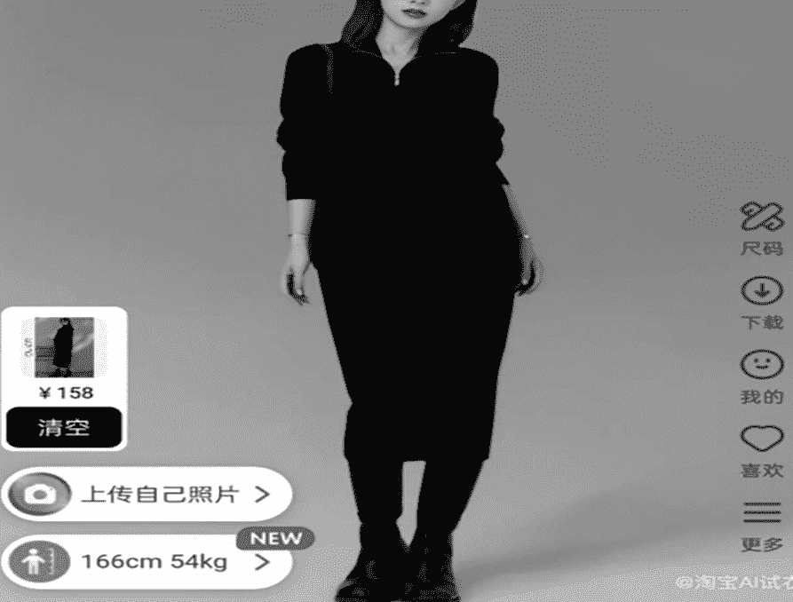
尺码
下载
我的
喜欢
更多
¥ 158
清空
上传自己照片 >
166cm 54kg >
@淘宝AI试衣
试单品 试搭配 品牌馆 我的衣橱
+   全部
连衣裙
T恤
牛仔裤
衬衫
外套
休

收起款式
###### 图8-5 淘宝AI试衣示例
对商家而言，虚拟试穿意味着转化率提升与退货率下降。据某市场机构数据，在线试衣功能可帮助商家交易额提升26%，因其显著降低了消费者对品质的不确定感，促进下单。对消费者来说，试穿体验更高效有趣，购物模式正在被重塑，也为电商企业开辟新增长点。

#### 8.2.4 代言人：宣传产品与品牌
启用真人明星代言存在“塌房”风险，一旦舆论危机爆发，品牌形象受损。而数字形象不会触碰违法乱纪，规避塌房风险，且成本更低，已成为众多电商塑造品牌形象的新选择。

相较传统明星代言，数字形象代言具备三方面优势：打造独特品牌记忆点；激发品牌活力，创新传播方式；推动粉丝良性发展，培养忠实用户。依托语音识别、形象克隆、声音克隆、孪生姿态合成等技术，数字形象可深度契合品牌价值主张，有效传递精神、理念与文化。

例如，上海禾念推出的次元虚拟偶像洛天依面世后迅速积累大批粉丝。B站控股后，洛天依成为平台“当家花旦”，多次举办全息演唱会并参与电视活动，影响力持续扩大。其商业价值凸显，代言雀巢、必胜客、美年达、肯德基、森马、三只松鼠等品牌并引发关注。直播带货方面，洛天依曾进入淘宝直播间，以虚拟主播身份推广美的、欧舒丹等产品，吸引大量目光。

AYAYI是中国首个超写实数字人，曾作为数字员工入驻阿里巴巴担任天猫超级品牌日数字主理人，也像真人明星一样拍摄时尚大片并出席品牌活动。2023年7月，资生堂官宣AYAYI、Noah、MUSE、ALPHA四位虚拟数字人代言“红腰子冻干粉”，如图8-6所示，并围绕“美”的主题开展真人代言人与AI代言人对话、美妆点映会、摄影展等虚实联动活动，还与真人主播合体直播带货。

2024年5月，数字形象“京小美”作为代言人亮相“2024北京直播电商购物节”。融合人工智能与虚拟现实技术，其形象高度逼真，可流畅交流。“京小美”主持启动仪式并开启购物节首秀，推荐物美价廉的北京好物，为消费者带来全新体验。

### 8.3 新玩法：让AI数字人做直播
在科技加速演进的背景下，智能虚拟人正从虚拟走向现实，成为生活与商业的新伙伴。它们能在直播平台展示商品、解答疑问，推动销售，重塑传统直播带货形态，为消费者带来耳目一新的体验。

#### 8.3.1 AI数字人直播带货优势多多
直播带货已成品牌争夺市场的重要手段，虚拟主播直播近年异军突起。以上京东与天猫为例，虚拟直播时长快速增长，真人直播GMV被逐步追赶，产能层面虚拟直播已达真人直播的82%。

其受欢迎的核心原因包括：
- (1) 全天候直播。虚拟主播无需休息，可持续直播，实现品牌全时段曝光。
- (2) 个性化定制。形象可按品牌需求设计外貌、声线与表现风格；内容与推荐商品可依据受众偏好实时调整。
- (3) 成本效益。节省人工薪酬与福利，同时只需一台电脑即可运行，降低设备与场地投入。
- (4) 多语言支持。强大的自然语言处理能力实现多语种直播，打破地域限制，帮助品牌拓展市场。
- (5) 法律与合规性。按预设脚本与程序运行，避免不当言论导致封号或舆情风险，降低法律与合规压力。

魔珐科技打造的超写实国风虚拟女侠令颜欢以精致形象与风趣互动吸粉，出道一周抖音粉丝破60万，全网播放量过亿。2023年8月，她入驻抖音本地生活赛道推出《街里有成都》短片破圈，随后开启“与你一起千里江山”系列直播，带领粉丝探访成都吃喝玩乐与人文故事，互动热烈。8月22日的“令家好货·女侠严选”专场开创了3D虚拟人独立直播带货先河，推出了“三亚纯玩小包团”等高性价比旅行产品。

虚拟主播直播带货势头强劲，有望持续引领电商变革。

#### 8.3.2 平台赋能，实现直播间一站式打造
在数字化浪潮中，如何脱颖而出成为商家难题。青否数字人直播平台依托AI技术提供一站式解决方案，让直播更智能高效。

##### 1. AI数字人主播
借助AIGC能力，商家仅需录制1分钟绿幕视频即可克隆出栩栩如生的虚拟主播形象，形象逼真、动作自然，可按电商、本地生活等场景个性化定制。

##### 2. AI布景
平台支持自定义拖拽直播间背景、数字人主播位置和大小等，还支持商家自主上传图片或视频作为背景、装饰。

##### 3. AI讲品
AI可以根据直播商品自动生成话术，并在直播过程中根据实际情况实时改写话术，确保每一场直播的内容都是新鲜、独特的，避免话术重复。

##### 4. AI互动
青否数字人直播平台提供五大互动类型：
- (1) 智能互动。开播后，AI数字人会自动学习产品话术，及时回复观众在公屏上提出的问题。
- (2) 弹幕互动。针对观众提出的问题，AI数字人能够在评论区快速回复，还可以定时发送弹幕。
- (3) 关键词互动。当观众的评论触发特定关键词时，AI数字人会及时回复。
- (4) 氛围引导。数字人主播会欢迎新人，感谢关注、点赞等，颇具真实感。
- (5) 真人接管实时互动。必要时，运营人员可通过音色克隆来接管直播，控制数字人的言行。

##### 5. AI售卖
数字人讲解某款商品时，小黄车的购物链接会自动跳出，无须人工操作。

##### 6. 私有化部署
青否数字人直播平台支持商家在抖音、快手、淘宝、TikTok、京东、小红书等多个平台上搭建直播间，商家可以独立部署系统并自定义所有版权信息，只需购买一次就可长期使用。

搭建步骤简便：
- (1) 选择数字人主播：从模特库中选择合适的数字人主播，并为其选择合适的音色。
- (2) 直播间装修：确定主播的大小、位置及背景、装饰等。商家可选择系统默认背景，也可上传本地图片或视频作为背景。
- (3) 添加产品和话术：点击产品，输入产品名称并确认，然后在产品管理端添加详细的话术。
- (4) 设置互动：可选择开启氛围引导、智能互动等功能，也可添加问答内容、关键词。

#### 8.3.3 AI数字人“采销东哥”的直播首秀
2024年4月16日下午6时18分，京东集团创始人刘强东以“采销东哥”AI数字人形象在京东超市和京东家电家居采销直播间完成直播首秀。开播不到1小时，直播间观看量便突破2000万，整场直播累计成交额超过5000万元。

京东超市采销直播间40分钟内的订单量突破10万，观看人数超过1300万，创下该直播间开播以来观看人数新高。随着直播的推进，近1小时观看量攀升至2000万以上，用户平均停留时长达到日常的5.6倍。

在此次直播中，“采销东哥”AI数字人共介绍了13款商品，整体订单量环比前一周日均增长8倍。值得注意的是，“采销东哥”AI数字人还官宣了京东超市“百亿农补”项目——计划在未来3年投入百亿元，用于补贴农产品，确保消费者能以全网最低价购买到优质农特产品。

直播表现引发热议，网友发现其会搓手指、看手机等细节，难以分辨真假。这得益于京东云言犀数字人的全面升级。接入言犀大模型后，AI数字人具备更丰富的表现力和更智能的交互能力。

为高度还原刘强东的动作细节，京东云言犀团队采用了独创的大姿态数字人技术。这项技术能够生成大幅度动作，如走动、侧脸等，还能成功复刻刘强东的小习惯，如搓手指、略微仰头，甚至能模仿其看手机的动作。相关数据表明，在直播时，大部分用户难以在120秒内发现这是数字人。

地道的宿迁口音也是此次直播的一大亮点。京东云言犀团队原本想用刘强东的演讲音频作为AI数字人的学习素材，但测试后发现语气过于正式，不适合直播带货。因此，团队录制了一段刘强东闲谈的音频，以此为素材提取他的声学特征，再借助言犀语音大模型生成人工语音。在直播中，“采销东哥”AI数字人表现出色，发音准确率高达95%以上。

“采销东哥”AI数字人直播首秀告捷，彰显了京东在技术普惠方面的卓越成果。京东向生态链上下游合作伙伴开放核心技术，助力其以技术突破赋能业务发展，从而实现降本增效，优化用户体验。如今，言犀数字人的日成本已经压缩至100元之内，全新发布的3.0版本无须配置本地电脑，可以实现上千个直播间云端同时开播。

凭借低成本、高效转化的优势，京东云言犀数字人逐渐从内部场景向外拓展，服务超过4000家品牌直播间，展现了其在电商直播领域的巨大潜力。

### 9.1 AI对话——AI导购之本
AI导购之所以能够理解用户需求、推送个性化信息，其背后的核心驱动力在于AI对话系统的发展。基于自然语言处理、机器学习等技术，AI对话系统能够与人类进行流畅、有意义的交流，这正是电商平台实现智能服务、提升用户体验的关键。

#### 9.1.1 应用级阶段的AI对话
在应用级阶段，AI对话的价值主要体现在应用方面。例如，依托电商平台通过问答形式帮助用户作出消费决策，就像我们平时在店内看见的导购一样。随着产品的多样性和复杂性不断提升，用户购物时往往要依赖大量的信息来找到真正适合自己的产品。而在当下这个快节奏的时代，用户大多会利用碎片化时间网购，他们非常希望在发现自己感兴趣的产品后，能有一个导购来帮助他们迅速了解产品。

在电商领域，AI对话系统能充当导购的角色，不过这个导购从线下的店内转移到线上的电商平台，成为更智能、更具科技感的AI导购。作为AI导购的AI对话系统能很好地承担起回复产品咨询的责任，回答用户关于产品的各种问题，包括产品的规格、性能、价格、使用方法、适用人群等，以保证用户获取信息的及时性和丰富性。这些信息将成为用户了解产品，作出消费决策的重要依据。

AI对话从“用起来”到“離不開”

你甚至可以问不同光线下参数该怎样调才能拍出理想照片，对话系统会调用内置的摄影知识库进行应答，让你对数码相机在真实场景中的表现有更直观的认知。随着使用次数增加和数据不断累积，回复也会越来越准，越贴近你的实际诉求。

除了解答产品相关的咨询，这类系统在下单环节也能提供引导。对电商操作不太熟练的用户，尤其是年长者或首次网购的新手，它可以一步步说明如何注册账号、把商品加入购物车、挑选支付方式、查询订单状态，帮助改善购物体验，降低因流程不熟悉造成的阻碍。

目前市面上的聊天系统大多还处在应用级阶段。即便不少平台已内置聊天功能，缺少刚性需求时它往往只在特定消费场景才会被想起。有问题才去问，没问题时很少主动打开。

这说明系统还有进化的空间，才能从场景化工具成长为用户离不开的智能伙伴。可以预见，随着相关技术的持续迭代，未来它会突破现有边界，像人一样灵活地融入不同语言情境和消费场景。

#### 9.1.2 嵌入级阶段的AI对话
进入嵌入级，对话从单一应用升级为场景化嵌入。与现在常见的方案相比，嵌入式对话的核心差异在于可离线运行、更具灵活性。

先说可离线运行。如今绝大多数智能设备和系统都依赖网络。没有网络，再聪明的硬件也难以理解人类表达。随着AIoT的发展，未来大量智能化场景要求终端具备本地响应与自主决策能力。设备必须在不连接云端的情况下完成独立运算，实现语义的本地识别，从而在任何网络环境下保持对话。

目前百度正在研发嵌入式对话技术，并以SDK形式向开发者开放。其关键能力是离线中控，可对多个场景进行分发与管理。每个场景下再配置基础分析、启发式语义理解、结果选择等模块，并配合离线语义解析模型完成训练与部署。

不同业务对解析和对话能力的需求各异，且在理解与满足需求方面，在线服务仍占优势。因此嵌入式方案的离线能力主要用于保障核心智能交互的稳定。所谓不用网其实是线上线下协同，当终端网络不稳导致在线对话出现延迟时，后台可依据业务情况选择等待在线响应或切换到离线系统。

在电商导购场景，嵌入式对话可在网络恶劣时，基于用户过往购物数据分析偏好并给出商品推荐，让用户随时获得个性化建议。同时数据处理在本地完成，降低传输过程中的暴露风险，有助于隐私保护。依托该方案，平台可进一步强化数据加密和本地化处理，确保数据安全，提升信任度和粘性。

更灵活很好理解。嵌入式对话聚焦特定场景，在用户进行高频或关键操作时即时触发。设计上更轻量，通常以LGUI轻量级图形用户界面为核心，追求人机间的高效互动。

例如微软云存储产品OneDrive就内置了嵌入式对话。用户整理文件时它会给出智能建议，创建新文件夹后会主动询问是否将相关文件归入其中，其能依据文件内容语境判断归属。

另外，在OneDrive中分享文件时，系统会结合文件内容和历史分享记录，列出可能的目标清单，实现精准推荐。

在购物场景中，嵌入式对话可在特定节点被触发。用户浏览商品页时，它会主动询问是否需要了解更多信息或推荐关联商品。还能依据购物历史和实时需求给出个性化购买建议，常见的是按身材和喜好推荐尺码与款式。

总体而言，嵌入式对话更简洁、易用、直观，降低使用门槛，为用户带来更流畅愉悦的体验。

目前多数电商平台的对话仍处简单应用阶段，部分AI发展成熟的平台型企业已开始探索嵌入式方向，如淘宝的淘宝问问、京东的京东京言，以及抖音的AI智能购物等。

#### 9.1.3 工具级阶段的AI对话
工具级阶段的对话会呈现何种形态？可参照《AI对话系统分级定义》推演。该文件由清华大学智能技术与系统实验室副主任黄民烈联合十多家科研机构和二十多位学者编制，将对话系统划分为L0至L5六个等级，如表9-1所示。

**表9-1 AI对话系统分级**

| 分级 | 定义 |
|---|---|
| L0 | 完全无法自动对话；在任何场景中都无法与用户进行高质量对话 |
| L1 | 能在单一场景中进行较高质量对话，但场景多时便无法处理它们之间的上下文关系 |
| L2 | 能同时在多个场景中进行较高质量的对话，可以处理好它们的上下文关系并自由切换，但在新场景中无法进行高质量对话 |
| L3 | 能够在大量不同的场景中进行高质量对话，在新场景中也能进行较高质量的对话 |
| L4 | 能在新场景中进行高质量对话，而且在多轮交互中具有较高的拟人化程度，在人设、情感、观点等维度保持一致性 |
| L5 | 具备较高的拟人化程度，能在开放场景交互中主动、持续学习，具备多模态感知和表达能力 |

按此分级，全球对话水平最高的系统当前处于L2至L3。若想让对话真正成为得力工具，就要推动其向L4、L5发展。

在工具级阶段，系统对自然语言处理、深度学习、强化学习以及多模态融合技术的运用更为深入。高度的场景适应性和拟人化使其能广泛应用于各类导购场景，通过文字、语音、图像乃至手势精准把握用户意图，给出最符合需求的商品推荐。

持续学习能力使系统能依据用户反馈不断优化算法和模型，并结合行为数据、市场趋势和新品信息预测兴趣。此功能可延伸至智能购物车管理与结算，系统会为用户提供购物车商品搭配建议。可以说，进入工具级，对话会随市场与用户需求变化而自主升级。

同时，工具级系统的技术与平台兼容性更强。例如可结合图像识别与生成技术提供虚拟试穿体验，用户上传照片或视频后能看到商品在自身上的实际效果。

此外，对话系统还能对接多个电商平台和社交媒体平台协同作业。通过共享用户数据和行为信息，提供更精准个性化的服务。跨平台协同有助于电商拓宽销售渠道和合作伙伴，提升市场竞争力。

### 9.2 AI导购有什么作用
尽管智能技术仍在演进，其在电商导购领域的价值已显现。下面结合阿里集团1688事业部的设想与实践，梳理智能导购带来的四项核心价值。

#### 9.2.1 为用户推荐更合适的产品
智能导购最直观的价值是产品推荐，其信息整合能力是关键。需要整合的信息分为用户画像和测评信息两部分。

一方面，导购需要收集分析大量购物数据形成精准画像，包括购买历史、浏览记录、搜索关键词、社交媒体活动等，通常以日志形式存储。收集后运用大数据技术预处理，如清洗、去重、格式化，再通过数据挖掘提取高价值信息。例如关联规则挖掘可发现商品间的关联性，聚类分析可将用户划分为不同群体。

进一步，系统会用协同过滤、基于内容的推荐、深度学习等算法分析购物偏好。协同过滤通过计算用户相似度推荐商品；基于内容的推荐侧重商品特征与用户兴趣的匹配度；深度学习则通过训练神经网络预测购物行为。综合大数据分析即可生成较精准的画像。

另一方面，测评信息来自专业网站论坛文章、视频网站测评视频、电商平台和社交媒体评价等，形式可能是文本、图片或视频。需要借助自然语言处理、多模态融合、信息抽取算法，从不同形式信息中提取产品性能参数、优缺点等。

为更准确把握用户态度，系统还会对测评信息做情感分析，判断用户对产品的情感倾向，从而更全面了解优劣。

收集足够测评后，系统会综合评估，计算平均评分、统计评价中的关键词短语等，得出相对客观的产品性能和质量结论。结合对话意图与用户画像，即可给出最契合需求的产品信息。

#### 9.2.2 催生一种AI搜索新模式
假设你想买一件周末聚会穿的连衣裙，预算不超过200元。没有智能导购时，很难通过传统检索精准找到理想商品。

传统检索完全依赖关键词匹配，用户必须输入明确的商品名或相关词，系统才会在商品库中检索并返回列表。但关键词匹配局限性大，往往返回大量无关商品，需要用户二次筛选。

智能导购在一定程度上破解了这一困境，以阿里集团1688事业部的实践为例，解析“AI+搜索”的技术逻辑。

仍以“帮我找一些适合周末聚会穿的连衣裙，预算在200元以下”为例，用户指令发出后，后台搜索流程如图9-1所示。

指令到达后，大语言模型LLM会深度解析，通过思维链CoT引导生成电商搜索引擎更习惯的商品Query，通常“形容词+名词”描述理解更准确。上述指令可提取出“休闲连衣裙”“时尚连衣裙”“碎花连衣裙”等关键词。

在此基础上，考虑到不同搜索引擎支持的参数不同，会用到检索增强生成RAG，让LLM获取更多知识，从需求中提取参数。

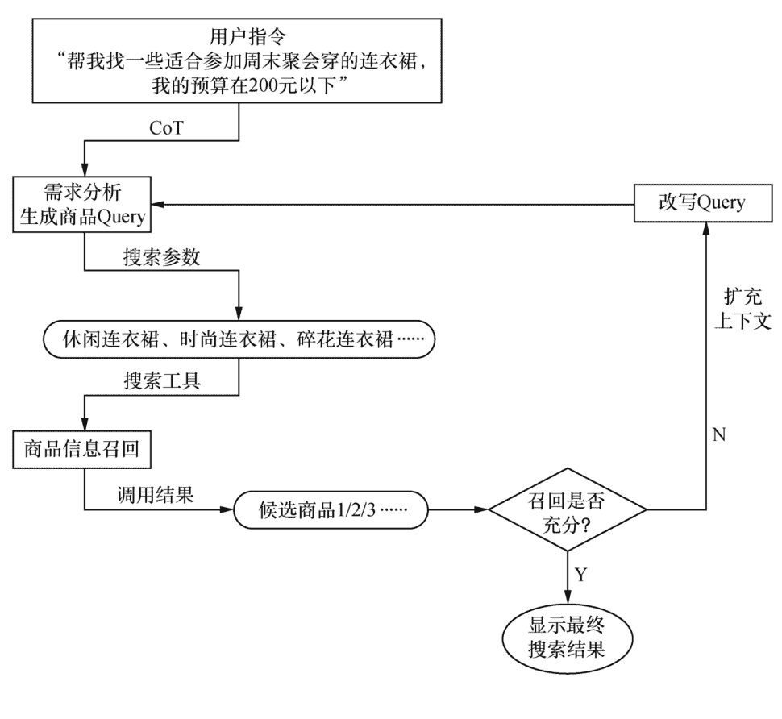
##### 图9-1 后台的搜索流程

提取参数后，LLM即可调用搜索工具获取大量商品数据。对这些数据，LLM需筛选排序。这里会引入M3E文本嵌入模型和传统深度学习模型。前者对用户需求和商品信息做向量化处理，进行第一波Query召回；后者在此基础上对召回结果做相关性评分，剔除无关Query，例如“婚礼连衣裙”可能被误召回为“时尚连衣裙”。

React框架也会被使用。针对需求中可能存在的长尾Query难以召回商品，会借助React改写关键词再做二次召回。

最后，通过语义匹配、多模态商品信息分析等技术，LLM会把符合需求的商品数据整合成统一文本信息呈现给用户。

基于这套逻辑，智能导购能更准确理解搜索意图，返回更精准结果。同时凭借用户行为数据积累形成的画像，可在指令基础上结合购买偏好做个性化推荐。

淘宝、亚马逊、抖音等平台都具备以图搜图功能，AI的加入显著提升了精准度。通过深度学习算法，AI能更精细提取图像特征，包括颜色、纹理、形状，更准确理解图像内容。

AI还能对图像做预处理和优化，通过去噪、缩放、旋转等操作让上传图片更清晰规范，进一步提高搜图精度。此外，AI可对商品库图片自动标注分类，帮助搜索系统更快定位相关商品。

#### 9.2.3 帮助用户作出最优决策
在阿里旗下批发采购平台1688上，用户可在任意商品详情页询问采购建议、质量评估或卖点问题，系统会基于用户属性归纳最有价值信息。这是智能导购的第三大价值：通过释放关键信息，缩短决策时间。

关键信息提取上，除自然语言理解，多模态信息分析也很重要。因为电商商品信息多以图片呈现。目前多模态大模型的感知能力尚可，但推理能力一般，因此处理商品信息时需人工先提取商品图中的文字，再由纯文本大模型理解。随着多模态模型发展，未来有望直接完成理解与提取。

提取出商品主要功能、材质、尺寸、价格、用户评价等关键信息后，智能导购会整理成卡片、列表、折线图等形式，帮助用户快速了解基本情况。

以1688为例，进入任意商品详情页，点击右下角“AI帮你挑”会弹出导购界面。该界面预设关键词如“看商品评价”“商品采购建议”“价格走势”等。以“商品采购建议”为例，系统会从商品品质、买家评价、服务保障、市场热度近7天累计销量、店铺实力等维度各用一句话总结关键信息，如图9-2所示。

“看商品评价”则对用户评价做智能分析，提取关注热点和主要观点，总结好评率、平均得分，并提炼买家正向与负向反馈，如图9-3所示。

##### 图9-2 某款连衣裙的商品采购建议
##### 图9-3 某款连衣裙的买家评价

结构化呈现提升了信息可读性，也方便快速比较不同商品。若用户在两件相似衣服间犹豫，智能导购可进行对比并结合性价比给出建议；若想找同款推荐，系统会根据上下文识别目标产品，结合具体指令通过以图搜图筛选符合要求商品。

通过提取与释放关键信息，智能导购能提升决策效率，带来更流畅的购物体验。

#### 9.2.4 找到关联产品，实现捆绑销售
智能导购具备较强的连通性和兼容性，不局限于单一商品咨询推荐，而是利用跨产品关联能力推荐关联商品实现捆绑销售。

在1688平台上，若用户想买一件适合晚间约会穿的连衣裙，系统不仅提供连衣裙信息，还会给出穿搭建议。具体而言，导购利用夸克搜索引擎收集相关信息，再通过LLM分析获得最适合约会的穿搭风格。在掌握大量专业知识后，会为用户推荐整套方案，包括连衣裙、高跟鞋、耳环等。

1688事业部还在探索端到端智能导购系统，已做出demo smart shopping。假设用户想了解早春流行服饰，系统会先访问相关网站做趋势分析，结合数据生成采购建议。

据此建议，系统调用商品搜索获取候选商品，再基于用户需求和收集信息做深度分析，最后呈现包含3件商品的采购方案。除图片、价格外，还会说明该商品为何适合用户。

技术层面，核心在于商品关联模型，基于用户行为数据和商品属性信息，通过机器学习构建。该模型能识别哪些商品存在关联，哪些常被一起购买或搜索。

商品关联源于多维度，如功能、用途、品牌、价格等。构建模型时需收集用户行为、商品属性、市场趋势等多方面数据，经预处理后提取与关联性相关的特征，如购买频率、搜索频率、用户评价等。

基于提取特征，系统利用机器学习算法主要为协同过滤和关联规则挖掘来训练商品关联模型，并持续优化。

应用层面，除提供更个性化购物体验外，AI生成的产品互搭方案有助于提升销售额、优化库存、制定更精准营销方案。

提升销售额合理。将互补或相关商品组合销售更能吸引用户，特别是需要配件的产品如电子产品、家具用品、健身器材等，直接提供互搭商品减少搜索和选择时间成本，提升满意度和品牌忠诚度。

库存管理方面，购买互搭产品可加快相关库存周转，智能导购还能预测哪些商品会热销、哪些会滞销。基于预测，商家可更合理安排库存，降低积压风险。进一步，智能导购可与供应链管理结合，实时更新市场需求和库存情况，使商家与供应商建立更紧密合作，提升供应链运作效率。

通过分析用户购买行为和商品关联性，智能导购为商家提供有价值市场洞察，帮助制定更精准营销策略，如定向广告、促销活动等，提高营销效果，实现更高效用户转化。

### 9.3 AI导购实战案例汇总
目前国内外众多平台型企业纷纷布局智能导购，以智能化手段优化购物流程、提升消费体验。下面介绍三种已上线的导购工具。

#### 9.3.1 能作为助手的ShopWithAI
ShopWithAI是由研究员莎拉Sara带领团队开发的AI造型购物助手。该平台利用AI学习用户品位与喜好，通过自然语言处理与用户交流，推荐符合审美的商品。

进入主页后，用户可先选择AI助手的风格，如嘻哈风、舞会风、奢华风、OL风等。随后与AI助理对话，助理会按需求推荐相关商品并以卡片形式呈现。用户可点击卡片左上方爱心或踩的图案，保存商品或表达不满。

目前来看，ShopWithAI仍显稚嫩，网上关于它及其创始人的信息较少。相比其他电商平台，其优势大概在于友好的交互界面和相对纯粹的购物体验。

页面设计简洁，分左右两部分。右边是对话窗口，用于与AI助理交流；左边占比较大，用于展示AI助理推荐的产品。对不太了解AI的用户来说，这种设计上手门槛更低。

AI购物助手新风向：从个性化推荐到全链路智变

在一次公开访谈中，ShopWithAI的创办人莎拉提到，平台希望帮助每位使用者厘清自己的穿搭偏好，甄选出与个人审美与价值观相契合的商品，而不是进行无差别的大量推送。她同时指出，站内购物过程不会被付费推广左右，使用感受因此更为纯粹。总体来看，ShopWithAI试图以智能技术为底座，打造兼具开创性与实用性的购物入口。随着电商体量持续扩张和用户需求进一步细分，这类以AI为核心的购物助手有望获得更多关注。

#### 9.3.2 阿里系对话式导购：淘宝问问

淘宝问问是阿里推出的对话式购物助手，其底层模型为通义千问。作为在电商经营与人工智能研发均具备深厚积累的平台型企业，阿里很清楚用户进入电商平台的核心诉求是浏览和购买。问问的推出更聚焦于解决“如何买好”的问题。

在淘宝首页的搜索框输入“淘宝问问”四个字并检索，即可进入专属页面。首页大致可分为三层结构。最上方是助手人设选择，目前提供女性形象“小淘”和男性形象“小天”。中间为三个对话区，前两个会基于用户近期检索记录生成欢迎语并列出五条可能关心的问题，下方则以弹幕形式滚动呈现其他用户的提问。最下方是检索入口，从左到右依次为语音、文字、图片三种方式。右下角的魔法棒图标隐藏了两项小功能——“好运打工人”和“问问夸夸机”。前者让用户上传办公桌的正面照片后给出个性化收纳建议，后者让用户上传送礼对象的照片后分析其风格倾向并提供选礼思路。

当用户带着明确主题提问时，问问会先把主题拆解为若干子项，再为每一项匹配商品。例如询问“露营需要准备哪些物品”，系统会按事项给出清单。以“便携类好物”为例，每项下展示六款商品，卡片包含实拍图、价格、销量以及两点突出卖点。点击卡片右上角的展开按钮，该事项会进一步细化，呈现数十款相关商品。

##### 图9-4 淘宝问问首页

##### 图9-5 淘宝问问回答“露营需要买什么”（局部）

##### 图9-6 淘宝问问对“便携式好物”进行展开（局部）

除导购外，问问还承担生活助手职能，这点可在主界面“大家都在问什么”中体现。点进弹幕中“君子兰黄叶怎么办”，系统提供养护方法而非直接推品。涉及具体商品如“君子兰专用肥料”时，会给出链接，点击后底部弹出推荐列表。提出烹饪问题如“芋头蒸排骨怎么做”，系统先给出做法步骤再推荐相关食材或厨具。

内测阶段还上线了“旅行策划人”和“灵魂写手”两项能力。演示中，“旅行策划人”可为用户制定行程、推荐景区门票并提供购票快捷入口；“灵魂写手”能写出小红书风格的商品推荐文案并附产品推荐。但公测后反馈显示，这两项在相关问答上的出错率偏高。

总体来看，淘宝问问是在原有检索基础上的导购升级。接入通义千问后，淘宝能够与用户进行自然对话，从传统电商向“导购”“科普”等多元角色延伸，创造更多消费场景。从商业视角看，它有望在用户决策链路上植入新触点，构建新交互方式，在提升购买意愿、提高转化、降低商家运营成本等方面具备较大潜力。

##### 图9-7 淘宝问问对“君子兰黄叶怎么办”的回复

#### 9.3.3 Shopify生态下的智能推荐引擎Wiser

Wiser是Shopify面向海外商家提供的商品智能推荐工具。它依据用户的购买历史和浏览行为，在官网上、移动端和邮件中推送个性化信息，从而优化购物体验并提升转化。

具体做法是持续采集用户行为数据，用机器学习解析行为模式，读懂浏览与购买习惯，确保推荐与当下需求贴合。推荐形式多样：在商品页展示用户近期浏览及相关配件；在购物车页提供升级、交叉销售建议以拉高客单价；通过邮件推送个性化的商品信息。

在商家侧，Wiser提供分析仪表盘，可查看各推荐渠道的销售数据，帮助调整营销策略。大型电商平台、精品店铺、跨品类零售商都能获益。对跨品类零售商而言，Wiser可挖掘用户可能感兴趣却未曾注意到的商品并推送到界面，带来跨品类销售机会。

应用场景也很多。季节性商品销售时，可结合时令和购物偏好推荐应季品；新品推广期，可把新品推送给最有可能感兴趣的人群；刺激老用户回购时，可分析购买周期在合适时机推荐商品，促进复购。

## 第10章 智慧供应链：AI重塑全流程效率

人工智能凭借强大的数据处理、预测分析与自主学习能力，正在重塑供应链的各个环节。从需求预测到生产排程，从库存管理到物流配送，智能化已全链路渗透，让供应链更灵活、高效、有韧性，实现智慧化升级。

### 10.1 生产环节智能化，实现稳定交付

制造端连接需求端和供给端，其效率、成本与质量直接影响整条供应链竞争力。智能与制造融合，可实现智能预生产分析、生产系统智能化、工艺与流程优化，助力电商企业提效降本。

#### 10.1.1 预生产预测：从数据到决策

电商市场需求变化快、波动大，传统靠人工经验和历史数据的方式难以快速捕捉细微趋势。借助深度学习、时间序列分析等技术，人工智能能够从海量销售数据、宏观市场因素中提取非线性特征，并通过机器学习持续调整模型参数，揭示数据背后的潜在规律，为预生产提供科学依据。

智能预生产分析不仅是需求预测，还贯穿计划制定。系统通过分析历史销售数据识别各品类销售周期、季节波动与促销对销量的影响，据此自动生成最优生产计划，合理安排产量、生产时点与资源投入，提升效率并降低积压与缺货风险。例如，用时间序列分析往年双11销售数据预测当年备货量，进而制定采购、生产、物流计划。

在此基础上，企业可实现精细化库存与精准营销。依据预测结果合理规划库存水平与补货策略，避免因备货过多占用资金、产生折旧，或因缺货错失销售机会。基于需求预测制定更有针对性的营销促销策略，提升库存周转。

结合物联网与大数据，系统可实时监控原材料采购、生产加工、物流配送等环节并进行智能预警与干预，及时发现并解决问题，确保生产计划顺利执行。

上海新麦食品是一家为LV、Gucci、迪奥等奢侈品牌代工月饼的食品厂。近年引入大模型技术，实现更精准的需求预测与生产。

新麦整合历史销售、用户行为、原材料成本、消费者反馈等数据构建分析系统。经清洗、标注、特征提取后，训练时间序列预测模型以准确预测月饼销量，并据此制定科学生产计划，有效避免过剩或短缺。

同时，利用用户行为与反馈数据训练偏好模型，通过电商平台向不同偏好用户推荐相应产品，提升销售效率与满意度。产线部署基于图像识别的质量检测模型自动剔除不合格品，保证品质。

新麦还将大模型预测的需求信息与上下游共享，帮助上游供应商与下游分销商提前备货应对业务波峰波谷，降低积压或缺货风险。依托精准计划与敏捷采购协同优化了全链生产节奏，提升产业链整体效率。

由此可见，智能预生产分析有助于把握市场需求、合理规划生产采购，提升供应链效率与灵活性。

#### 10.1.2 让生产系统具备自学习能力

人工智能通过精准分析预测与高效自动化控制提升生产效率与质量。大量企业在ERP、MES、SCADA、QMS等核心生产系统中接入智能能力，推动智能化升级。

##### 1. ERP系统
ERP是一种集成信息管理系统，可整合核心业务流程并实现自动化，优化资源配置。在制造环节，ERP负责生产计划调度、物料库存管理、质量管理等。与人工智能集成后，可基于ERP中的生产过程数据与流程状态进行智能分析预测、自动化重复任务、实施智能预警与即时干预，优化流程、减少浪费。

例如，金蝶引入亚马逊云科技的AI服务，构建智能提单系统与智能指标分析系统，提升跨境电商使用体验。借助Agents for Amazon Bedrock，金蝶将海外客户提单系统从传统GUI表单界面升级为LUI自然语言界面。用户用自然语言描述需求，生成式AI解析意图并给出操作提示，简化报销、借款等单据流程，大幅提升便捷性。

金蝶还基于该服务构建跨境电商智能指标分析系统。用户无需在繁杂BI报表中寻找数据，只需与AI助理自然对话即可查询指标。AI助理能自动解析用户意图、匹配相关指标，提供全天候智能财务分析支持。此次合作展示了生成式AI在ERP中的创新应用。

##### 2. MES系统
MES主要用于生产过程监控与管理，跟踪并记录原材料到成品的全过程，可监测设备状态、生产效率、产品质量等参数。与人工智能结合后，能增强过程控制与智能干预，实现预测性维护、持续改进、智能化能源优化，保障效率与质量，甚至助力节能环保。

##### 3. SCADA系统
SCADA是用于生产监测与过程控制的数字化系统。与侧重系统管理的MES不同，SCADA连接设备层与制造层，采集设备数据、监控生产过程，为MES提供数据参考。聚焦设备采集温度、压力等详细数据后，与人工智能集成可对设备实时通信、运行日志、异常记录进行智能分析与处理，提升运作效率。

##### 4. QMS系统
QMS以系统化管理质量相关活动为核心目标，实现产品或服务一致性与合规性，通过文档化流程、程序与责任确保持续满足客户与法规要求。引入人工智能后，可大幅提升隐患发现与预防能力，智能建议降低持续改进成本，减少人工干预。

#### 10.1.3 硬件智能化：机器人与自动化设备落地

我国制造业规模与产业链完整度领先全球，但在低附加值困境与激烈竞争下，众多企业引入智能设备优化流程、提高效率，契合柔性生产对高度适应性与灵活性的要求。

当前已进入生产流程的智能设备主要有以下几类，如图10-1所示。

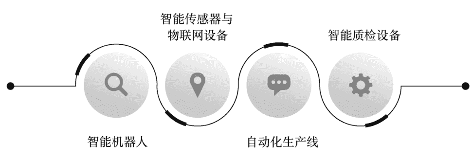
##### 1. 智能机器人
智能机器人具备灵活操作、精准感知决策与强大数据处理分析能力，已广泛应用于电子装配、食品加工等领域。可执行焊接、喷涂、搬运等重复性任务，降低人工强度，避免人为误差与事故。

##### 2. 智能传感器与物联网设备
可实时采集温度、压力、速度、位置等生产数据并通过无线网络传至中央控制系统。系统据此精确调控生产过程，确保效率与质量。物联网还实现设备互联，形成智能化生产网络。

##### 3. 自动化生产线
整合多种自动化设备与智能控制系统，实现从原材料投入到成品产出的全链条自动化。数控机床、自动化输送系统协同作业，提升效率并保证质量一致稳定。

##### 4. 智能质检设备
结合计算机视觉、图像处理、AI等技术实现质量检测自动化。广泛用于缺陷检测、尺寸测量、零件识别分拣，显著提高效率与质量。

电商订单波动大、季节性明显，要求企业具备高度灵活产能。智能机器人凭借精准操作与快速学习适应能力成为理想选择。

小米在北京昌平建设新一代智能手机工厂，年产1000万台旗舰机，MIX Fold 4与MIX Flip折叠屏手机在此生产。工厂搭载小米Hyper IMP智能制造平台控制系统，多数工序由机器人完成，实现24小时不间断生产，日均约3万台。

工厂设备多为小米自主研发，关键工艺完全自动化，从而精准把控流程，提升效率与品质，满足消费者对高品质需求。

小米亦庄汽车超级工厂部署超700台机器人用于零部件安装、成品质检，整体自动化率超91%，关键工艺完全自动化。工厂每小时可生产40辆小米SU7，约每76秒下线一辆。

工厂拥有冲压、大压铸、车身、涂装、总装、电池六大车间，9100吨一体化大压铸设备集群2分钟即可生产一个压铸件，大幅提升效率与质量。工厂还引入无人驾驶AMR视觉机器人，可根据车间实际生产情况调整运输路线，提高物料流转速度。

对电商企业而言，保持稳定高水平质量是维护品牌声誉关键。传统人工质检易漏检误判风险高。许多企业引入智能质检方案。

例如，得物平台“先鉴别再发货”模式基于AI查验系统实现。系统360°扫描商品，通过高精度图像识别捕捉细微纹理差异，专业判断真伪。数秒即可出具详细鉴别报告，鉴别结果与人工专家结论吻合度高达99.9999%。

除真伪鉴别外，智能质检还用于外观检查、功能测试。某电子产品电商采用视觉检测系统检查手机屏幕划痕等瑕疵。系统配高分辨率摄像头与复杂算法模型，毫秒级完成图像捕捉与分析，确保出厂产品符合严格标准。AI赋能的高效质检提升客户满意度，增强品牌竞争力。

#### 10.1.4 数据驱动工艺优化与模型构建

生产过程产生大量传感器数据、设备状态、故障记录等。利用人工智能深度分析这些信息、理解复杂非线性关系、挖掘潜在规律并建立通用模型，可帮助企业优化工艺。

例如，分析传感器数据可预测设备故障，进行预防性维护避免停线；剖析生产监控数据与成品质量数据可挖掘根因并实时调整生产，确保质量稳定。

海尔卡奥斯工业大模型是典型案例，助力制造企业优化注塑工艺。

洗衣机生产中注塑涉及温度、成型周期、压力、能耗等多参数，传统注塑机多靠人工经验调试，难以达最优。海尔卡奥斯通过AI建模打破工艺“黑箱”，将人工经验转化为可量化指标，推动注塑工艺标准化和智能化。

在物联网接入与数据治理完善基础上，海尔卡奥斯构建洗涤产业大模型，在关键业务场景与核心技术领域持续积累算法与机理模型。为实现数据透明、提升竞争力，不断探索最优注塑工艺参数与能耗水平。

洗涤产业大模型包含待机/停机决策、模具与设备精准匹配、智能工艺推荐三大核心算法，并统一界定注塑关键性能指标。通过透明化工厂注塑指标看板，实现生产排程、工艺、智能决策全方位优化。实际应用中，模型在保证质量的同时降低成本与能耗。

模型还系统梳理学习内外知识经验，打造10TB级注塑知识库，支持机器人、小程序、App等多方式调用，数秒内给出答案，实现工业知识普及。

模型亦反向推动工厂提升数据质量，发现注塑机能耗数据指标模糊问题并解决AIoT平台数据重复、缺失问题，帮助企业积累数据资产，为创新应用提供支撑。

### 10.2 仓储物流智变，迈向智慧运营

仓储环节长期依赖人工操作，不仅效率受限成本偏高，也难以跟上企业对高效率、高精准的诉求。随着AI与智能设备的深度融合，越来越多的企业把数据驱动作为仓库升级的出发点，循序渐进地推动作业数字化、自动化与智能化。

#### 10.2.1 仓储管理的数字化转型
电商供应链中，仓库运转的好坏直接决定整体链路的顺畅度与市场响应速度。在AI加持下，智能仓储已从概念变为现实，入库、入架、分拣、出库全流程实现高度自动化，库存周转与订单履约时效同步提升。

智能仓储在电商场景的落地形态多样，如图10-2所示。

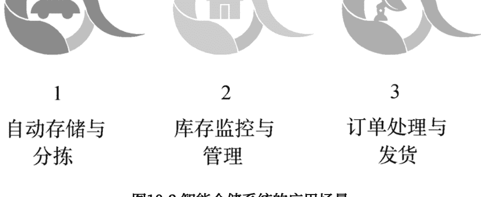

##### 1. 自动存储与分拣
借助AGV、堆垛机、四向穿梭车、机械臂等设备，系统可完成货物的自动搬运与存放。融合视觉识别、深度学习与机器人技术后，能自动判定品种、数量、目的仓位并分类处理，分拣效率上升的同时失误率与耗时被压缩。

##### 2. 库存监控与管理
物联网传感器对库存进行实时感知，自动记录入库、出库、余量及存放位置。企业由此对库存全貌一目了然，可基于销售数据预判需求并提前补货或调整策略，有效控制库存成本，避免缺货与积压并存。

##### 3. 订单处理与发货
射频识别与条码技术为每件货物赋予唯一标识，下单后系统据订单信息准确定位商品，指令自动化设备抓取搬运，把原本繁琐的分拣环节简化，整体发货效率明显加快。

典型案例是京东自研的天狼智能仓储系统，其作用是提升存储能力与出入库效率，同时减少占地与人力投入。

系统由硬件与软件两部分构成。硬件端配置穿梭车、提升机与工作站。穿梭车车身超薄，负责水平搬运，行走速度达4米/秒；提升机搭载20米超高立柱，负责垂直搬运，升降速度达5米/秒；工作站集成拣货、盘点、自动供箱等功能，供箱效率可达600箱/小时。

软件端依托京东自主研发的WMS、WCS及3D SCADA组建智能调度中枢，配合5G网络快速下发任务，提升拣货效率与存储密度。

顺丰亦打造了自有智能仓储体系，融合机器人与物联网设备，实现入库到出库全流程自动化。AGV与自动分拣机的应用让搬运存储更高效，人为干预减少。RFID标签与传感器的配合保障每件货物的可追溯与精准定位。

为充分利用空间，系统会依据货物属性与流转情况动态调整库位布局，缩短搬运距离；同时支持跨仓调度，实现资源共享与整体利用率提升。整体目标是简化作业链路，智能调度算法依据订单要求快速分拣并降低差错率，传感器与数据采集为企业决策提供实时依据。

智能仓储的应用重塑了传统管理模式，助力降本增效，推动电商行业整体升级。

#### 10.2.2 精准预测：连接销售端与库存
在竞争激烈的电商市场，精准的销售预测与灵活的库存管理是成败关键。随着零售数字化深化与AI技术发展，越来越多的平台用AI优化预测与库存，提升运营效率并改善用户体验。

过去销售预测多靠经验直觉，难以应对市场快速变化。AI则能基于海量历史销售、季节波动、促销等多维数据挖掘规律，对未来趋势做出更可靠的判断，为后端智能备货与调度提供基础。

常用组合方法包括：

- 1. 以时间序列拆解历史销售曲线，利用AI捕捉趋势与周期性波动，推演未来销量。
- 2. 运用关联规则学习商品间关联性，建立前置指标预测特定SKU表现。
- 3. 通过情感分析抓取社交媒体、评论、论坛文本，感知消费者态度与需求变化，进而推断销售走向。

某头部电商平台对平台上数百万SKU进行AI销售趋势建模，模型识别出季节、节假日、突发事件对销量的影响，并随市场动态实时更新预测，确保大促前货源充足且不过度备货。数据显示，引入AI预测后库存周转提升约20%，缺货率下降15%。

全渠道预测也在成为前沿探索，整合线上线下数据构建统一预测框架，帮助同时经营实体店与线上商城的品牌更全面地研判需求，优化资源配置。

不同渠道数据口径与质量差异较大，人工神经网络等AI技术凭借非线性建模、自动特征提取与自学习优化等特性，比传统统计方法更具优势，但可解释性弱、对数据量与质量要求高，使用时需权衡。

基于AI预测，企业可更主动地管理库存：临近售罄时触发自动补货，滞销品则通过价格调整或优惠组合刺激消费。AI具备自我学习能力，形成预测—行动—结果—优化的闭环，判断精度与响应速度会随时间持续提升。

亚马逊即利用AI分析历史销售、季节波动、促销以及社交话题、天气等多元因子来预测需求。预测结果支撑更精细的库存管理，避免过剩与缺货，需求激增时可动态调配库存优先满足高需求区域。灵活的库存策略帮助其在激烈竞争中保持优势。

#### 10.2.3 用AI平衡缺货与库存过剩
快节奏与需求高波动是电商常态，缺货会损失销售与客户满意度，库存过剩则占用资金并抬高仓储成本。AI为平衡二者提供了新路径。

基于大数据与机器学习，AI提升需求预测精度，同时实时监测各商品库存量、周转率等指标，一旦低于安全阈值或出现异常即发出缺货预警，提示及时补货。

结合预测与预警，AI可自动计算最优补货方案，涵盖数量、时间、渠道等维度。动态补货避免积压与断货，提升供应链响应与柔性。

补货流程也能实现自动化调度，涵盖与供应商沟通、下单、物流安排等环节。智能化调度系统把缺货预警到到货全程自动化，减少人工干预，提升运营效率。

2024年，北京京东振世信息技术有限公司的“补货方法和装置”获国家专利，标志供应链智能化再进一步。该专利聚焦补货策略，通过实时数据分析与预测模型等AI技术辅助决策“何时以何种方式补货”，提升周转率并降低运营成本。

在双11高峰期，京东借助AI优化补货流程，物流效率显著提升，93%以上商品实现24小时送达。报道显示，其仓储管理系统可在售罄前完成补货，快速响应用户需求，改善购物体验。

京东自动化补货率已超70%，大促期间补货采纳率超80%，自动化执行效率维持在60%以上。京东与供应商、品牌商家共享销售与库存数据，补货渠道包括供应商直供、自营仓及第三方仓。

#### 10.2.4 松下：全方位的智能密集库改造
制造业与物流加速智能化时，传统仓库普遍面临储位不足、作业效率低等痛点。松下集团联合旷视科技在上海某工厂推进智能密集库改造，以自动化与技术手段提升运营效率与服务质量。

松下作为百年世界500强，产品覆盖全球，日均约有10亿用户使用其电子产品。上海工厂产能持续扩张，配套仓库出现储位紧张，城市土地稀缺成本高，外租仓仅为权宜之计。松下决定对现有仓库进行自动化、智能化整体升级。

改造方案由松下与旷视共同制定。仓库为5℃恒温恒湿冷藏库，层高9米，最终选用托盘四向穿梭车实现狭小空间内的多层高效存取。

项目中松下主导规划执行，旷视提供河图TES系统等多项技术支撑。针对空间狭小、入口门洞受限，旷视在多次现场勘测后提出不拆除原结构的改造方案，保证施工安全并最大化空间利用。不同货物品类还设计了差异化密集库层高，连排风管道区域也被充分利用。

改造约两个月后上线。与原有叉车型平库相比，变化显著：

- (1) 储位数量提升60%以上，有效缓解储位紧缺，取消外租需求。
- (2) 入库到出库全流程无人化控制，错误率下降，人力成本降低。
- (3) 能耗减少，因人员进出冷库频率降低。
- (4) 安全性增强，进入库区时所有机械设备自动停机，人员离开后恢复。
- (5) 人力成本节省，通过自动对接MES、ERP系统免去二次录入。

松下的升级为行业转型提供借鉴，也印证了智能化时代持续创新的必要性。

### 10.3 AI赋能运输：迈向智慧物流
多家企业将新质生产力提升到战略层面，物流领域引入AI已成必然。AI以智能、高效、精准的特性重塑物流面貌，成为推动转型的关键力量。通过AI，仓储、运输、配送等环节实现智能化管理，资源配置更优、成本更低、服务质量与满意度提升。

#### 10.3.1 智能订单管理
订单处理效率直接影响消费者体验与平台竞争力。随着需求个性化与品类渠道增多，传统订单管理难以为继。电商平台大量采用AI优化流程，实现自动拆分与合并，加速发货。

订单拆分是将多品类大单拆为若干小单，提升配送速度与灵活性，特别适用于库存分散、多仓发货场景。大促期间用户常从多供应商下单，若集中出库易延误，AI可智能规划各商品发货仓库并自动生成子订单，缩短等待时间。

例如一家家居电商收到含床品、灯具、摆件的综合订单，AI判定床品在A仓、灯具由合作商B直发、摆件在本地C仓，随即拆分为3个子订单并下发指令，显著缩短履约时长。

对易碎品、生鲜等特殊商品，拆分可实现单独打包保护；部分缺货时，拆分避免整体订单停滞，先发可供商品，减少用户不满。

与拆分相对的是订单合并，即将满足条件的多个订单合并发货，降低配送成本并简化收货体验。

主要应用场景如图10-3所示。

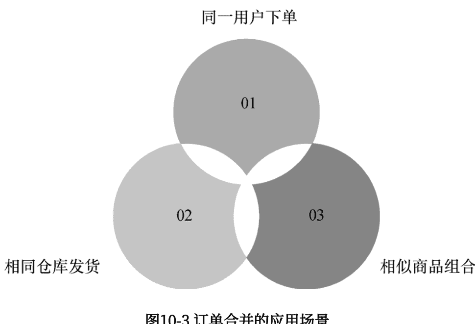

- (1) 同一用户下单。同一用户短时间内在同一店铺多次下单且地址相同，AI可自动检测并建议合并，减少包裹数，便于物流查询。
- (2) 相同仓库发货。若多个订单商品均来自同一仓库，AI判断合并可行性。库存充足且发货量大时适当提高装箱量有助于加速出库。
- (3) 相似商品组合。基于历史数据预测连带购买行为，AI提出组合建议，促进交叉销售并提高打包效率。

自动化拆分与合并充分发挥AI在海量数据处理、智能决策与实时响应上的优势，助力平台与商家提升发货速度，满足用户时效要求，获取竞争优势。

#### 10.3.2 智能地址管理
地址自动识别与拆分可提升订单处理效率，降低错发率，为用户提供更优物流服务。

该环节依赖自然语言处理、地理信息系统、机器学习与数据处理等技术。

自然语言处理是核心，能解析自由格式地址输入并转为结构化数据，通过词法、句法、语义分析提取姓名、电话、省市区、街道等要素并理解关联。

地理信息系统将地址与地图数据比对，实现快速定位并验证有效性。

机器学习通过大量历史地址数据识别常见模式与异常，自动调整识别策略，对重复错误进行自适应修正。

高效识别还需强数据处理能力支撑，AI需处理历史地址、地图、用户反馈等海量数据，以在高峰期快速响应。

以万维易源API市场推出的快递地址解析API为例，其可从运单文本中精确提取收件人、电话、地址等关键信息。借助NLP可辅助识别、自动补全与纠错，甚至完善街道与行政区细节，实现标准化。

该接口加速运单处理流程，提升效率，已广泛应用于电商与物流等领域，助力企业精准处理海量地址。核心功能是将非结构化文本转化为结构化数据，如图10-4所示。

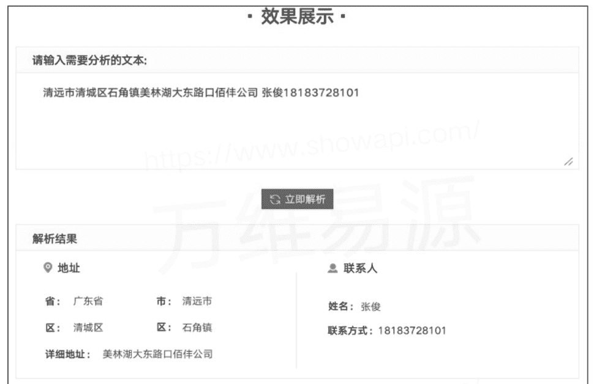

万维易源API市场还提供全球快递查询服务，覆盖顺丰、中通、圆通、宅急送、京东、德邦、EMS等1500余家物流公司，数据与官网实时同步，提供轨迹与状态查询。用户由此可实现从下单到签收的全流程自动化追踪，提升透明度与满意度。

实际操作中常因信息不全、格式不统一、手写难以辨认而出错。API提供以下对策：

- （1）智能纠错。利用大数据与机器学习自动检测并修正常见输入错误。
- （2）智能预测与匹配。对模糊或信息缺失的地址，从数据库寻找最接近匹配或借助GIS推断地理位置，确保完整准确。
- （3）用户反馈机制。允许用户手动纠正错误地址，既快速解决问题，又为模型提供学习样本。

上述技术融合是物流智能化转型的典型场景。

#### 10.3.3 智能运输管理
运输是电商物流体系的核心，效率直接关联用户满意度。AI赋能下，多家企业构建智慧物流方案，实现高效智能运输。

主要应用包括：

- (1) 运输路径优化。AI实时分析天气、路线、交通流量等多源数据，智能规划最优路径，缩短时效并降低成本。
- (2) 智能调度。传统调度依赖人工经验，易耗时且受主观影响。大数据与机器学习使AI实时监控交通、货物位置与车辆状态，实现科学调度，并可动态调整路线，减少延误与空驶，提升效能。
- (3) 运输需求预测。通过历史运输、天气、市场需求数据预测运输需求，帮助企业提前规划资源，应对需求高峰。

(4) 末端配送：AI如何啃下最后一公里

末端一公里一直是物流链条里最难啃的部分。AI 驱动的无人配送车和履带式配送机器人正快速补位。无人车搭载感知与自主导航，能够自行规划路线、避开障碍和拥堵，在楼宇密集的城区完成高频次小批量投递；机器人则更适合校园、社区这类小范围低速场景，自主寻路避障完成近距离派送。

九识智能是专注城市配送自动驾驶产品研发的头部企业，自主完成 L4 级自动驾驶技术，并形成一套覆盖全场景的城市低速配送方案。

其车队按场景划分：Z2 覆盖封闭园区、社区、校园等低速运送；Z5 适配快递中转与开放道路运输；Z8 与 Z10 主要承担叉车装卸及长距离运输。整系装载空间在 2 至 10 立方米区间，承载能力 300 至 1500 千克，续航 110 至 210 公里。车辆具备全场景、全天候、全时段作业能力，全年无休运送，可为物流企业降本增效。

2024 年双十一期间，九识车队的表现印证了可靠性。服务城市数达 152 个，累计投递超 1650 万件；单车最长行驶里程 2231 公里，日均行驶 168 公里，日均转运 84 次。运力网络有效支撑快递、快运、生鲜配送等业务平稳运行。

美团旗下酒水即时零售品牌歪马送酒凭借高效服务快速成长，但扩张导致传统运营模式难以为继。随后与物流信息化服务商唯智信息合作，引入 TMS 运输管理系统，推动供应链全面数字化。

人工排线耗时、易错、成本高且无法实时监控。唯智信息基于此打造路径优化系统 ROS，靠 AI 算法实现智能排线，为业务扩张提供技术支撑。

为解决数据分散难分析的痛点，唯智信息推出云 OTB 一体化平台，整合 OMS 订单管理系统、TMS 运输管理系统与 BMS 费用管理系统。

平台内置 GPS 定位与实时通信，可实时监控车辆位置、行驶轨迹及货物状态。一旦出现偏离路线或预计到时延误等异常，系统即时告警并通知相关人员介入，从根源上防止问题，保证货物准时无误送达。

## 第11章 解码智能客服：能力边界与演进方向

模拟人工对话的智能服务系统已成为企业数智化转型的重要一环。它在提效降本上的潜力明显，也不乏“可完全取代人工”的误判。现实并非如此。本章先做人机对比，再梳理真实落地场景，最终围绕“解决问题、提供有温度服务”的核心价值展开演进思考。

### 11.1 智能客服已成主流

数据表明，2023 年国内智能客服的市场渗透已超七成，企业对其寄予厚望。但即便技术迭代，智能客服仍难完全替代经验丰富的人工客服，需要保持客观认知后再做科学展望。

#### 11.1.1 人机服务优劣对比

智能客服正向各行业渗透，不少人认为它可取代传统真人客服，实则各有长短。

优势集中在常在线、响应快、成本可控、态度稳定。深夜或节假日也能 365 天不间断提供即时解答，打破时间与人力的限制。在 B2B 营销场景，若销售线索出现在人员离线时段，AI 可代为沟通、甚至生成个性化合同并协助填写，无需人工干预，并可通过自然语言交互把线索引入转化链路。

面对海量咨询，AI 处理速度远超人工。账户查询、密码重置等高频问题，金融机构的智能客服可借助预设知识库快速作答，无需排队。从成本看，无需支付工资与培训费用，长期运营开销明显低于人工。且不受愤怒、焦虑、疲劳影响，服务标准更稳定，而人工因经验、能力、精神状态差异波动较大，易在信息过载时出错，对品牌构成风险。

局限也明显：复杂问题的处理能力有限，且缺乏情感，这是人工不可替代的价值。大多数现有方案仍依赖预设知识库与算法，面对多因素或非常规问题时难以妥善应对。

#### 11.1.2 核心能力盘点：会听会看会写

即便存在短板，智能客服的渗透与逐步替代已成不可逆趋势。实现这一目标需要持续技术革新，使其做到“会听”“会看”“会写”。

会听指识别理解语音指令并从中捕捉情绪，进而判断需求。语音识别是基础，无论嘈杂环境或带地方口音都能精准识别，出海企业还需支持多国语言。转写为文本后，需借助自然语言处理结合上下文理解真实意图并提炼重点。情感分析则要求从语音文字判断情绪状态并调整回复策略。

美国平台企业 Cogito 在情感分析领域积累深厚，源自麻省理工媒体实验室，后获 DARPA 资助，研发 AI 平台与行为模型用于监测人类心理状态。早期用于监测退伍军人 PTSD 等精神疾病症状，通过语音信号分析心理健康。后逐渐进入客服中心，为人工客服提供实时指导。

Humana、哈门那、中美联泰大都会人寿等已部署 Cogito 软件。对话会实时传入系统，毫秒级提取 200 余个声学信号，分析音量、语速、停顿等。若识别到客户负面情绪或客服停顿过长，桌面软件会提示“过于啰嗦”等建议促其调整。

在医疗健康本业，Cogito 旗下 CompanionMx 推出心理健康移动监测系统，患者下载 App 定期上传语音日志，系统利用情感 AI 分析声音变化评估疗效。可见会听已远超出指令识别，能捕捉连人类自身难察觉的细微变化，甚至关键时刻挽救生命。

会看与会听要求相近。基础是意图理解，即深度分析咨询记录、浏览行为等数据，发现潜在问题、提炼知识或给出建议。进阶是情感捕捉，通过识别图片视频中的表情动作分析身心状态。

亚马逊 2024 年推出的 COSMO-LM 可依据购买历史与浏览记录分析深层购买意图，并在搜索流程中引入常识，使结果更贴合需求。与 Cogito 同源的 Affectiva 在面部表情与肢体动作检测方面经验丰富。其 AI 利用光学传感器识别人脸，通过计算机视觉定位面部关键特征，再以深度学习分类情绪。同时可检测周围物体、跟踪身体关节。测试期间收集 90 国超 1000 万面部视频、4000 名用户 1.9 万小时车内数据，保证在不同角度与光照下对性别、种族、年龄的精准识别。

在广告领域，凯度、艾德惠研等与 Affectiva 合作，利用 AI 捕捉消费者观看广告时的情绪变化优化传播内容与形式。在汽车领域，其车内 AI 可实时监测驾驶员乘客状态，对困倦、分心、生气等危险行为预警。

会写是在听懂看懂需求后给出清晰准确连贯的回应。除淘宝问问、家乐福 AI 购物助手 Hopla 等以列表、图片、视频或链接展示信息外，还可基于环境、场景与对话上下文生成创意内容。花卉订阅公司 BloomsyBox 在母亲节活动中，AI 机器人引导用户完成小测验并撰写个性化祝福语，活动完成率 60%，奖品兑换率 78%，38% 用户使用 AI 生成祝福语。

企业级防欺诈供应商 FeatureSpace 推出的 TallierLTM 是首个大型交易模型，可深度分析交易行为、总结模式并预测行为。接入金融机构后，可为用户生成独一无二“行为条形码”，在保护隐私的同时记录交易，及时发现异常并识别诈骗。

目前尚无智能客服能完全通过图灵测试。即便大型语言模型如 GPT-4 在部分场景表现突出，仍未达到人类无法区分的水平。未来能否通过图灵测试仍存争议，但随着自然语言处理与机器学习进步，表现有望逐步逼近人类。为实现全方位服务，需在会听、会看、会写三方面持续进化。

#### 11.1.3 京东京小智的实践样板

京小智是京东为平台商家研发的智能服务平台，既为 B 端商家提供经营指导并辅助人工客服，也为 C 端用户提供咨询与导购。

系统共六大模块：应答子系统、营销子系统、商家管理、运营管理、商家服务中心与数据计算中心。

应答子系统由消息接入、对话管理、答案管理组成。消息接入负责对接各类终端确保协议兼容；对话管理调用文本识别、实体识别、图像识别、情绪识别、相似度计算等底层能力，结合用户画像理解意图并选择策略；答案管理据策略调用业务组件实现多模态应答。

营销子系统助力 B 端商家优化策略提升转化，包含卖点营销、导购推荐、全链路营销。卖点营销依赖电商知识图谱与 AI 自动生成话术并精准推送。京东零售积累的知识覆盖 90% 以上 C 端咨询问题，借助深度学习建立完善知识图谱，实现精准问答。全链路营销可分析金牌销售特征预测最佳营销时机，从优惠推荐、加购催拍、下单催付到搭配套购实现全链路覆盖。

商家管理为 B 端后台，含接待配置、知识管理、数据分析、诊断优化、权限管理、多用户管理等。商家可设置欢迎语、接待时段、接待模式，配置订阅模式、智能应答、场景应答，监控效果并调整知识库。

运营管理平台负责商家接入管理、知识训练、对话策略配置、任务调度与整体指标监控。

商家服务中心提供免费培训与咨询，包含 ISV 服务市场、学习中心、训练师平台。学习中心发布动态与教程并开展直播培训；训练师平台具备认证体系与帮扶计划，京东培养一批可配置优化对话机器人的工程师，为商家提供专业服务。

数据计算中心采集存储分析对话日志，为报表分析、语料挖掘提供支撑。

京小智的价值不仅在于为 C 端提供 24 小时在线服务，更在于将 AI 技术标准化封装，使大量中小企业以低门槛享受技术红利，解决客服难题、提升运营效率。同时，商家服务中心的建设完善了 AI 加客服的产业生态，带动训练师与 ISV 服务产业发展。

### 11.2 落地的三种典型场景

从国内外实践看，智能客服主要落到在线客服、辅助人工、外呼中心三类场景。本节重点拆解前两种。

#### 11.2.1 全天候在线响应

24 小时在线是 AI 在一定程度上替代人工的首要优势，尤其在跨境电商利用海外社交媒体服务客户时，如何在 24 小时内持续运营多个平台以提升互动与接单效率，AI 给出了解法。

由于用户分布全球，时区差异导致企业难以实现 24 小时在线，关键销售线索易流失。即便在线期间，客服销售人员常需同时运营 Meta、X、Instagram 等多平台，频繁切换耗时且不利于资源整合。

借助 AI 可大幅缓解这些问题。在营销人员离线时段，AI 无缝接管。若用户深夜点击广告进入企业界面，AI 会迅速响应并介绍产品信息；评论区或私信区的问题也能被快速筛选，高意向信息优先处理，避免商机流失。

在限时促销等高并发场景，AI 可采用分布式系统架构、消息队列与异步处理、并发控制算法及微服务框架提升可扩展性。通过分布式架构将指令分发至多服务器，通过 Kafka、RabbitMQ 等消息队列异步处理请求，即使请求激增也能保持流畅。

对复杂或模糊问题，AI 会运用智能引导技术，通过预设问题逐步澄清，或转人工，避免商机丢失。面对多平台，AI 可将消息整合至统一管理界面，实时分析社媒数据帮助销售优化策略，并可自动分发优惠券、促销活动等定制化内容，提升参与度。

沟通中 AI 持续学习。在线状态下借助大数据处理与机器学习，AI 从用户反馈与互动中不断优化算法与知识库，回复更精准。

在线服务中，AI 凭借即时响应与跨渠道整合，实现服务效率根本性提升，并通过持续自我学习精准捕捉多样化需求，推动服务水平整体升级。

#### 11.2.2 辅助人工提升效率

## AI客服的真正定位：协作而非替代

从前文的脉络里不难判断，AI客服目前扮演的仍是人工客服的补充角色，在人工离线时顶上、在线时搭手。虽然全面取代人工还有相当距离，但既然大势如此，谈AI如何辅助人工，就要放宽想象，从当下出发做合理推演。

狭义上看，AI擅长的其实是把大量重复、标准化的流程自动化，让人工从琐事中抽身，去处理复杂诉求和做战略思考。广义上看，AI的价值在于帮助人工做出更精准的业务判断，从而带动团队和企业整体效率提升，最终让用户满意度真正上去。

围绕这个逻辑，可以从运营管理、用户沟通、服务质检三个层面拆解AI能给客服人员带来的实际帮助。

在部门内部的运营管理上，AI主要体现在排班与培训两件事。

人员排班方面，AI会基于历史通话数据分析需求的周期性波动，叠加节假日、营销投放、季节变化等影响因子，预测峰值时段，为排班、工时安排提供依据，避免高峰排队、低谷闲置，提升人效。

人员培训方面，AI能为不同成员生成个性化学习路径，帮助巩固业务知识，还能结合VR、AR搭建模拟对话环境，让员工上岗前先做情景演练，沟通能力得到更快提升。

在与用户的直接互动里，除了7×24小时自动应答，AI与人工的精准配合价值更大。

比如一家国际金融服务机构的AI会根据账户类型、服务历史和当前问题，把请求路由到最匹配的团队。工作中AI还会实时监测各组、各人的负载，动态调整任务分配，保持整体运营平稳。

沟通过程的即时辅助则集中在语音转写和知识推送。

语音转写依赖ASR自动语音识别和自然语言处理，把通话快速转文字并抓取关键词、意图，不仅让客服当场更准确地回复，也为后续质检、培训素材制作和用户趋势分析提供依据。ASR还在持续进化，广东一家运营商针对方言研发纠错技术后，粤语转写准确率已提升到83.7%。

知识推荐则是AI从知识库里抽取关键信息直推给人工，省去手动检索。基于机器学习的历史交互数据，推荐会越用越准。例如IBM的Watson Assistant能理解询问意图并结合上下文做个性化推送，让人工更快抓住用户偏好。

另有企业把AI用在更特殊的风控场景。安联集团旗下Allianz-SP Slovakia在保险理赔调查中使用以色列公司Nemesysco的语音压力分析技术，AI实时解析被保人语音回复中的异常波动，辅助判断信息真实性，降低夸大理赔和欺诈风险，减少处理成本。

从更宽的维度看，AI客服还能成为跨部门的桥梁。汽车领域，Nuance把情绪AI引入车载对话系统，通过摄像头和麦克风捕捉面部表情和语调，结合深度学习识别困倦、愤怒等状态并提醒驾驶员，同时把数据回传给整车厂优化驾驶员监控，提升安全性。

在服务质检层面，AI可以对客服个人表现和整个业务流程做全景分析，为培训和流程改革提供数据支撑。

#### 11.2.3 外呼中心的AI化重塑

外呼中心是挖掘潜在客户、推动销售的关键环节。随着技术成熟，企业正用AI改造传统外呼体系，甚至以AI为核心重建系统，让触达更精准、更高效。

目标用户获取是基石。AI会从海量线索中筛选意向，多维度定制指标。保险场景会看年龄、健康、收入；金融场景侧重信用记录、投资偏好。若企业更在意满意度，指标会偏向反馈与投诉；若追求销售额，则更看重购买历史与浏览行为。结合网站行为、社交评价、交易记录等多源信息，AI锁定合适的外呼对象。

任务分配环节，需要按时间、客单价值、用户类别分类并制定策略。AI外呼机器人在执行前需预配置。以沃丰科技的AI语音机器人为例，常见配置包括：优先级，以数字表示；启动方式，手动或定时；工作时段，可导入节假日；重呼策略，未接通的可自定义次数；用户多号码，依次拨打；任务结束后通知管理员；意向触发时自动更新标签；有意向数据直传CRM系统。

执行阶段，机器人接通后播放预设脚本，完成产品介绍、推广或服务提醒。沟通依赖ASR和自然语言处理，能捕捉用户兴趣点并做针对性展开。若出现明确购买意愿，AI会调用RPA引导数据录入、表单填写，例如信用卡推广中可自动填申请表。

遇到复杂咨询，如是否符合信用卡申请条件、如何提升信用分等，AI会把通话记录和处理步骤传给人工，实现无缝交接。

需注意，滥用AI外呼会严重干扰用户。应设置合理拨打时段与频次，强化用户反馈收集并据此优化策略。缺乏保护机制的案例频发，甚至催生了识别并拦截骚扰电话的产业。技术应用必须配套制度，在提升效率的同时维护用户好感。

#### 11.3 AI客服的底线：以人为本

服务的本质，是企业对用户需求的理解和对用户情绪的关怀。AI普及的当下，如何融合技术与人性，成为从业者必须回答的问题。

#### 11.3.1 消费体验是永恒主线

在阿里、京东、拼多多等平台的激烈竞争中，消费体验决定品牌心智。技术创新带来的便捷与个性化正是AI客服的发力点。

售前，用户要求商品描述真实、可满足实际需求、流程简洁、无冗余操作，且售后保障清晰。AI利用大数据和机器学习推送更精准商品，结合VR、AR提供虚拟试穿、试用，降低试错成本。Tripadvisor已将自有数据与OpenAI集成推出AI旅行规划工具，测试阶段可从旅客评论中提炼“受欢迎点”，未来可推送周边活动、规划酒店周边一天游览路线、基于收藏信息推荐美食美景。

售中，AI需与支付、物流等系统无缝衔接。智能钱包是支付自动化趋势，AI学习支付路径、行为和环境，推荐支付方式和优惠，提升效率。为防风险，支付宝、微信已引入人脸、声纹验证，AI结合大数据监测异常交易并报警。跨境支付中，AI可实时预测汇率、智能调度资金，降低手续费并优化币种转换。

售后，用户期望多渠道可达且方案满意。AI要整合官网、App、社交媒体等渠道的交互历史、购买记录和偏好，实现对话连续性。退换货时提供智能化解决方案，预约维修安装时跟踪进度并通过提醒与工作人员协同，确保全流程可感知。

实现全链路升级，核心是活数据驱动的大模型训练。丰富案例库和知识图谱是解决常见问题的基础，需要训练师、资源和持续投入。

#### 11.3.2 AI不能隔绝服务的温度

短期看过度依赖AI能降本提效，长期看却会在用户与企业间筑起冰墙。AI在复杂或个性化场景仍有限，若转人工入口缺失，信任与忠诚度会受损。

避免的关键是做好AI与人工的无缝衔接。用户应能通过明确指令“一键转人工”或语音说出“转人工”即跳转。更优的做法是AI主动触发转接，这需要识别问题复杂度与用户情绪能力。

复杂度识别可预设问题类型与阈值。以金融咨询为例，分层为：基础信息查询、服务流程咨询、产品特性了解、税务法规咨询、投资策略建议。评估维度包括信息密度、情境依赖度、法规涉及程度、决策影响度、历史转接率与解决时长。超过阈值即自动转人工。

以云蝠智能的AI外呼为例，转人工包含话术关键词触发和兜底机制，以及通话中实时条件：累计评分超50分、时长超300秒、累计未识别5次、累计提问5次、重复提问5次、累计未回复5次，触发后播提示音即转接。

情绪识别上，AI通过语气、用词判断负面情绪强度，及时转人工。人工团队也需培训：熟悉AI转接流程及信息交接，掌握故障排查与应急处理，强化数据保护与隐私合规意识。

#### 11.3.3 终极目标：提供情绪价值

从《她》到《人工智能》，科幻作品映射了人们对AI情绪价值的期待。未来方向有疗愈、陪伴、优越三类：释放压力保持心理平衡、让人感到被关注被分享、让人产生独特优越感。

情绪价值可从视觉、行为、反思三层实现。反思层指让用户对品牌产生认同与归属感，需要AI理解信念与价值观并定制化传递价值。

具体到客服，疗愈价值可在视觉层落地。通过个性化界面与互动元素提升舒适感。当系统感知用户疲惫焦虑时，可切换柔和色调、播放舒缓音乐，并在交流中加入动态表情符号，让交互更有人情味。

给客服一点人情味，才有情绪价值可言

陪伴感的落点在行动，就是把用户想要的信息第一时间送到。奔驰的新一代车载助理把这套逻辑做到了车里：系统后台学习驾驶习惯，按日常路线自动规划，并推送司机常听的娱乐内容。做汽车交易的 CarGurus 接入 ChatGPT 插件后，检索变成对话，平台根据搜索轨迹揣摩需求偏好，回传专属的选车建议。

优越感的构建可以从行动和反思两条线展开。行动上要给出满足深层需求的定制化方案，比如对环保偏好的用户，推荐时突出产品的绿色属性。交互中还要留出掌控空间，允许用户自定交流风格、信息接收方式，提供通俗易懂的隐私设置与偏好调节入口，让人感受到对话中的主导权，这正是被重视感的来源。

反思层面，系统需要学习并传递品牌的价值观。当用户表达相近观点时，能够自然呼应，放大认同感。这一步很难，既是技术问题，也涉及认知科学、行为营销学等跨学科知识，感兴趣的可以自行延伸阅读。

总体说，给客服注入情绪价值是一件很考验的事。既要读懂人类的情绪，也要把理解表达得清晰、恰当。某些时刻，甚至需要跳出现有思维框架，引导用户进入更宽广的前瞻思考。

短期内并非易事，但随着技术迭代加快，对新技术的认知加深，心理学、哲学等领域持续推进，有理由相信智能客服会成为触动心灵、启发思考、引领发展的伙伴，打开更智能、更人性的服务新时代。

## 第12章 用AI把用户做成核心资产

在数字经济里，用户决定企业能否活下来。多数公司把用户长期增长当作持续追逐的目标。从互联网到移动互联网，再到大数据与人工智能的演进，为用户运营带来了全新变革。智能化手段能精准把握需求、挖掘价值，用定制化的服务和策略搭起企业与用户的稳固桥梁，推动关系深化，实现智能化运营。

用户关系管理的定义在不同行业并不一致，和营销、导购、客服在很多场景会重合。企业在划分子职能时要综合人才能力、发展历史等多种因素。有些公司把客户关系管理当作竞争引擎，这部分不在本书讨论范围。特意把AI用户管理放在最后，既是完整讨论这一概念，也有总结归纳的意图。

### 12.1 AI切入用户运营的关键点
智能化技术凭借强悍的数据分析、精准预测和自然交互，已渗透到用户管理的每个环节。它能从海量信息中提炼有效信号，帮助企业摸清需求、喜好与行为模式，并预判潜在需求与流失风险，把被动管理转向主动关怀与价值创造。两者结合，为电商提升竞争力、扩大市场份额提供了新可能。

#### 12.1.1 精准分群：做定向运营
精准分群是指借助智能化手段，对平台用户进行数据挖掘和行为分析，按特定维度划分成不同群体。维度可以涵盖购买频率、客单价、偏好品类、浏览轨迹、历史订单等。通过分群，平台能更清晰把握消费需求与行为，实现精细化运营和差异化营销。

和传统做法相比，智能分群在准确性和灵活性上更高。传统分类多依赖静态属性如年龄、性别、地域，而智能分群更关注动态行为与偏好变化，使平台能更快、更准地捕捉需求波动，调整策略，提升体验。

企业用智能化做分群，通常要经历信息采集、特征工程、建模训练三个阶段。

##### 1. 信息采集与整理
- (1) 信息采集。为有效细分，企业需汇集丰富的用户资料，包括历史购买记录、站内/App/小程序的浏览行为、社交互动等。获取渠道包括前端埋点监控、网络爬虫、OpenAPI 数据交换、CRM 系统、问卷调研等。
- (2) 清洗与标准化。获取后要做深度清洗与标准化，包括剔除重复、补齐缺失、处理异常，以保证准确性和格式一致。

##### 2. 特征工程
- (1) 特征选取。构建高精度细分模型的关键在选对特征。常见维度包括个人属性如性别、年龄、职业类型，以及消费习惯如购物频率、偏好渠道

##### 3. 建模与训练
（1）算法选择。可采用多种智能算法实现细分。聚类算法能把相似用户归为一类；分类算法可为新样本打标；预测算法能基于历史数据推断未来行为。企业应结合实际需求和数据特点选择合适方法。
（2）模型训练与验证。构建训练集和验证集训练模型并检验效果，也可采用交叉验证评估性能，并据需调参以提升预测准确率。

智能分群在电商的典型用途是分层运营和精准投放。

##### 1. 用户分层运营
依据购物频率、消费金额、偏好等信息，将用户划分为普通用户、忠实用户、VIP 用户等不同层级，享受差异化的服务和权益。
例如，VIP 可获专属客服、优先发货、免费退换等增值服务；忠实用户可获定期优惠券、积分兑换；普通用户则通过新品推送、限时折扣吸引其升级。分层运营有助于满足不同层级需求，提升满意度和忠诚度。

##### 2. 精准投放
基于分群结果制定更精准的策略。对高消费群体推送专属商品、限量新品、特权折扣；对潜力用户推送兴趣相关内容和同圈层评价以促进转化；对新注册用户用首单优惠、新手礼包降低首次购买门槛。
精准投放能提升投放效率、降低触达成本，同时增强体验和信任感。通过智能分群和精准投放，平台可实现用户价值最大化，推动业务持续增长。

随着数据积累，分群模型持续优化，准确性不断提升，使平台能更及时捕捉需求变化，保持与用户的紧密联系。

#### 12.1.2 智能化推动CRM升级
过去十余年，企业普遍投入资源自建CRM 系统。智能化技术的引入推动传统CRM 向智能化升级，在企业与消费者互动中创造更大价值。

在推动自有CRM 升级方面，智能化技术的应用场景广泛，如图12-1所示。

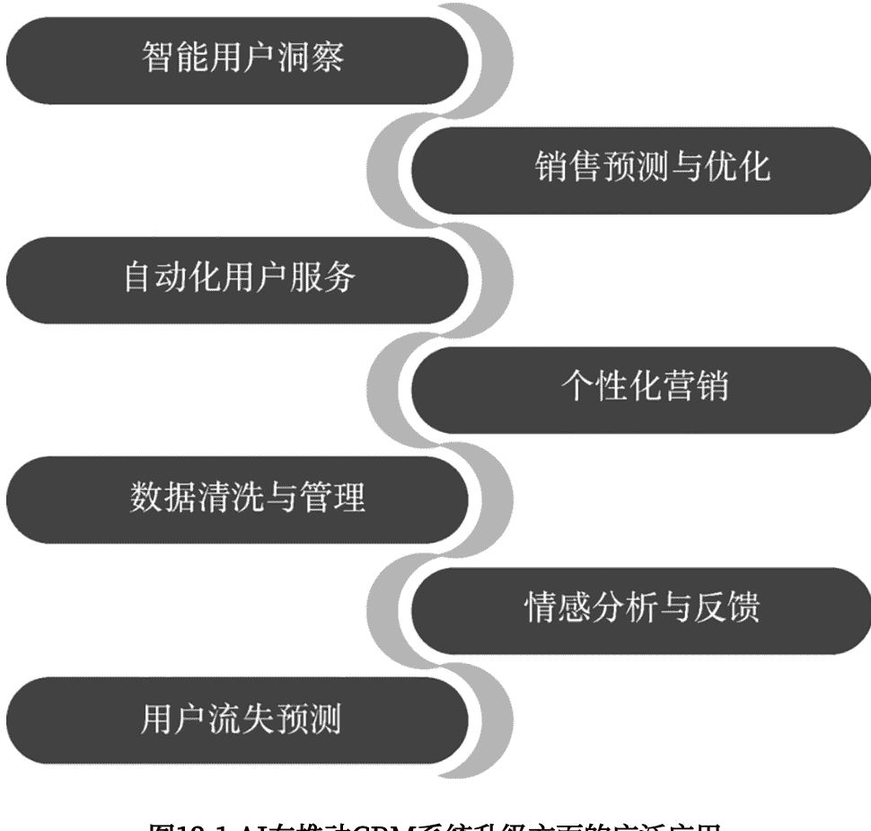

图12-1 AI在推动CRM系统升级方面的广泛应用

##### 1. 智能洞察
依托深度学习和自然语言处理，智能系统可自动分析海量交易记录、浏览行为等数据，构建详尽的用户侧写。平台据此深入理解个体需求与偏好，提供更定制化的服务。例如某知名电商利用智能系统挖掘购物习惯并推出定制化推荐列表，显著提升体验和销售额。

##### 2. 销售预测与优化
机器学习算法可从历史数据中发现规律，预测销售趋势，帮助商家提前备货或调整营销。同时能识别最具成交潜力的目标人群，指导销售优先跟进高价值订单，提升转化率。例如Zoho CRM的智能助手Zia可基于历史销售数据评估机会成功概率并给出行动建议。

##### 3. 自动化服务
智能驱动的聊天机器人和语音虚拟助手已成标配。它们7×24小时响应咨询，处理账户查询、退换货等复杂请求。

##### 4. 个性化营销
智能系统能依据每位访客的兴趣点生成定制广告文案、邮件内容或商品推荐，提升针对性，让消费者感受到被重视，有助于增强品牌忠诚度。例如某电商用智能工具依据购买记录推送专属优惠券，提升复购率。

##### 5. 数据清洗与管理
传统CRM 常受重复录入、不完整等困扰，影响决策。智能技术可自动化清洗整理数据，保证记录准确无误。像Zia这类智能助手还能检测、合并重复条目，维护数据一致性。

##### 6. 情绪感知与反馈
通过自然语言处理，智能系统可解读评论、留言及社交媒体动态，感知情绪状态。例如识别负面情绪用户，助力企业及时干预，维护关系和品牌形象。

##### 7. 流失预警
监测购买行为、频次、互动数据，智能系统可识别流失风险高的用户，帮助企业提前挽留。例如通过优惠券、加强互动等方式降低流失率，提升忠诚度。

拼多多是国内主流电商平台之一，以拼团模式和庞大用户基数快速崛起。平台利用大数据和深度学习模型挖掘浏览、购买和消费偏好，构建全面用户侧写，为定制化推荐奠基。基于智能算法，其推荐逻辑从单品扩展到类目乃至场景，如用户搜索古典风餐桌，平台会联推椅子、灯具、桌布等生活方式组合，提升转化并带来新体验。

拼多多还探索分布式智能，为每位用户分配一个智能代理，挖掘行为背后的心理、社交互动等，完善侧写。分布式智能可实现用户细分、促进经验共享、缩短决策，并借助深度学习与定制化推荐挖掘用户—商品间的内在关联，实现精准推荐和高成交。

#### 12.1.3 UNice：客户服务自动化实践
UNice是一家以假发销售为主的跨境电商品牌，借助Zoho CRM打造了销售—沟通—服务闭环，实现客户服务自动化并降低人力成本。

业务扩张后，来自多渠道的访客激增，单月官网访客可达四五十万人次，面临三大难题：
1. 有效汇总和管理多渠道用户信息；
2. 官网即时响应全球买家问题并促成交易；
3. 持续客户关怀以维护长期关系。

UNice引入Zoho One企业管理软件套件，打破信息孤岛、削减信息化成本。

客户转化率是跨境电商关键指标，深入了解客户是基础。UNice借助Zoho CRM的SalesIQ在线智能客服获取访客信息如位置、访问记录、路径等，并主动互动。SalesIQ还能按评分将访客划分为重点、一般、冷门，方便针对性跟进，同时实时监控流量，助力定制化服务提升销售额。

面对激烈竞争，UNice认识到以客户为导向的服务体系的重要性，同时专业人才需求增长带来人力成本压力。采用Zoho Desk客户服务管理系统梳理流程，实现精细化管理，提升效率、控制成本，并建立可随时查询的知识库实现数据共享，减少培训和人力开支。移动应用让客服随时随地协同。

客户希望多渠道服务但厌恶信息断层。为此UNice用Zoho Desk的多渠道客服系统整合邮件、网页等沟通渠道，实现统一接入、统一视图、统一服务。客户提交售后请求时，客服可在同一界面处理全部问题，且接手人员可查看完整历史，确保快速解决。一体化管理提升服务质量与效率，也为管理层提供详实数据分析。

Zoho CRM作为引入智能技术的云端客户关系管理系统，有助于高效管理客户数据、销售流程和服务，推动UNice业务增长，实现以客户为中心的发展战略。

### 12.2 公域运营：从触达走向成交
国内市场增量放缓、存量竞争加剧，电商企业面临公域流量成本上升和获客挑战。智能化技术为这些问题提供了创新解法。通过智能化数据处理和分析，助力企业更有效地管理和激活公域用户资源，实现精准定位、定制化触达和沟通，并引导用户从公域进入私域。

#### 12.2.1 智能化赋能公域触达
随着获取注意力的成本提高，企业从广撒网转向更精准、定制化的触达。基于用户侧写的精准触达已成为提升竞争力、优化投入产出比、驱动增长的关键。

用户侧写是理解需求、预测行为、制定策略的重要工具。它基于平台行为数据如浏览记录、购买历史、搜索关键词、评价反馈等，通过算法挖掘和分析，形成对兴趣、偏好、需求等多维度特征的全面描述。

借助深度神经网络，智能大模型可从多渠道多角度数据中挖掘用户特征并打标签，形成精确侧写。例如基于自然语言处理的BERT大模型可解析文本数据，捕捉语义和情感，生成文本侧写；基于计算机视觉的ResNet大模型可从图像数据提取视觉特征，生成图像侧写。整合多种侧写可得到更立体全面的用户肖像。

基于侧写，企业可在公域更有目的性地选择目标受众，主要体现在：

1. 智能驱动的程序化广告购买。借助实时数据分析和机器学习，广告主能在合适时间用合适价格向目标受众展示最相关广告，大幅提升效率和效果。
2. 面向潜在客户的精准推荐。通过分析消费习惯、购买潜力等特征，制定差异化策略，如定向广告、优惠券推送、限时折扣等。例如动态创意优化DCO实现千人千面的营销推荐。
3. 智能导购。利用智能技术结合深度学习和大数据，实现对用户购物需求的精准理解与定制化推荐，提升购物体验。

以阿里巴巴为例，其子公司阿里妈妈在赋能企业实现公域精准触达方面成效显著。

1. 用户侧写与精准定位Uni ID系统。阿里妈妈推出Uni ID消费者统一身份识别体系，整合淘宝、天猫、支付宝等多平台消费、兴趣、社交数据，立体描绘用户画像，使品牌广告投放更精准、转化更高。
2. 动态创意优化。阿里妈妈创意中心提供智能制图、剪辑、文案等工具，快速生成符合用户偏好的广告内容，并实时监测投放效果，按反馈自动调整。
3. 实时监测和效果分析。通过Uni Desk产品，企业可进行跨媒体链路分析，识别高价值用户并评估各媒体投放表现。

#### 12.2.2 智能化加速公域转化
智能化技术强大的数据处理与分析能力可快速处理海量数据，发现隐藏模式并预测趋势。本节聚焦智能化如何赋能公域用户管理提升转化，强调其带来的实时响应和深度定制化互动。

这种能力不仅体现在商品推荐如千人千面、猜你喜欢，还延伸到内容定制、客户服务等。

1. 内容定制化。智能系统可依据兴趣偏好推送定制化文章、视频、直播等内容，丰富内容生态，通过情感共鸣和知识分享加深连接，增强黏性。抖音的成功很大程度上源于智能驱动的内容分发，如今主流电商平台和商家都在用定制化内容推动用户沿转化路径流转。
2. 交互式客户服务。智能聊天机器人提供全天候服务，解答问题并即时帮助。它们能模拟人类对话、理解上下文意图，回答更贴切。随着交互积累，服务会更聪明贴心，显著提升满意度。
3. 互动活动和直播。智能技术被用于支持电商开展游戏化互动和直播等形式，吸引注意、提升参与度和趣味性。

直播电商已占据重要份额。抖音、快手、淘宝直播等平台让品牌以更生动直接的方式沟通用户。智能化与直播结合进一步提升互动体验，增强情感连接，提高转化率。具体场景包括：

##### 1. 智能实时互动与定制化服务
借助智能技术可实现更深层的定制化服务。例如智能数字人主播能即时回答观众问题，并依据偏好提供高度定制化商品推荐。基于语音识别和自然语言处理，交流更顺畅自然。智能系统还能快速分析弹幕信息，及时调整话题或推荐相关产品，提升直播效率。

##### 2. 互动游戏与奖励机制

为了让直播更具吸引力，品牌可以把AI设计的互动玩法和激励机制搬进直播间。这不仅能增加观看乐趣，也能直接撬动购买转化。借助用户过往行为数据，AI可以自动生成专属挑战任务，用户达成设定目标后就能领取定制优惠券或实物奖品。

##### 3. 内容创意自动化
AI可以助力品牌策划更具想象力的直播项目，比如邀请明星带货、开展主题日活动等。借助AI，品牌能快速产出高质量的脚本与视觉素材，同时结合数据洞察挑选最匹配的合作方，从而放大传播效果。

##### 4. 情感化沟通
品牌故事、真实案例和企业文化是传递核心价值、建立深层情感联结的重要载体。AI能够跨渠道抓取正向评价和用户反馈，自动归纳成有温度的故事素材。直播中分享这些内容，展示价值观与理念，容易引发用户共鸣，推动转化。

在转化层面，AI还能帮电商识别用户在不同生命周期阶段的需求与偏好，制定成长路径与运营策略。比如新用户阶段，用个性化推荐和首单优惠引导注册下单；活跃期定期推送新品资讯和专属权益维持购买热情；流失期则通过召回活动和关怀触达重新激活。做透全生命周期管理，可以延长用户生命周期，提升整体转化。

#### 12.2.3 AI推动公域用户成交
用户价值不仅体现为直接营收，也关系到品牌形象与口碑。唯有准确定位用户价值，才能锁定高价值人群并制定成交策略，提升投放效率。电商可依托AI从多个维度深挖公域用户，找到高价值人群并促成交易，如图12-2所示。

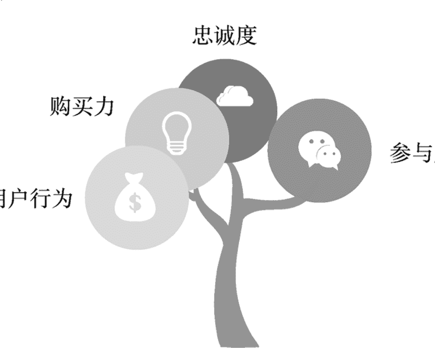

图12-2 评估用户价值的维度

##### 1. 用户行为
通过分析浏览品类、搜索词等，AI可挖掘兴趣点与购买意图。点击行为能揭示用户对商品或功能的关注程度，推断偏好。追踪下单路径、拆解决策节点，也能优化购买流程，提升转化。

##### 2. 购买力
基于消费记录、客单价与复购频率，AI可以量化用户的支付能力。高购买力人群通常具备更强消费潜力和预算，是核心目标。系统会据此给出差异化推荐和营销打法，例如向高价值客群投放高端品或定制服务。

##### 3. 忠诚度
忠诚度反映用户对平台的长期贡献与粘性。AI通过购买间隔与频次判断消费习惯，通过复购表现评估依赖程度，复购率越高忠诚度越强。结合点评与反馈数据，也能衡量用户对平台的认可水平。

##### 4. 参与度
参与度衡量用户在线上的活跃程度。登录频次、浏览时长等数据可体现活跃水平，评论与分享行为则反映满意度与认同度，从而评估参与质量。

综合上述指标，AI可构建加权评估模型，得出综合价值分。商家据此分层排序，实施差异化运营。

例如综合分靠前的用户，可提供定制服务与专属折扣，增强满意与忠诚；具备一定购买力与参与度但忠诚度偏弱的潜力人群，可通过优化体验与个性化推荐提升粘性；综合分较低的用户，则需分析行为痛点，优化产品与服务以提高满意度和转化。

值得一提的是RFM模型，是电商零售评估用户价值的常用工具。它基于最近一次购买时间Recency、购买频次Frequency、消费金额Monetary三个维度对用户进行分层，便于制定针对性营销。

1. 高价值用户。这类人群客单价高、复购频繁且最近一次消费时间很近，通常是品牌的铁杆拥趸。企业可给予定制化服务和专属优惠，稳固关系并延长消费周期。

2. 一般保持用户。这类人群复购频繁但客单价较低，忠诚度一般。需要通过多样化促销、定期的优惠券推送和新品提醒来激发购买欲望。

3. 一般发展用户。这类人群近期有过消费，但客单价低、频次少，属于潜在高价值人群。企业需通过多样化

### 12.3 私域用户管理：从关怀到复购
存量竞争下，私域成为电商高频关键词。私域指商家借助电商平台、社交媒体等工具或自建数字化触点，直接与用户建立联系并完成交易。这种模式摆脱对淘宝、天猫、京东等公域流量的依赖，通过沉淀和运营自有流量实现销售。

AI的应用可以帮助电商更精准把握私域用户特征与需求，挖掘价值，实现个性化与智能化运营，提升整体管理效能。

#### 12.3.1 AI重塑私域用户关怀方式
从头部企业访谈中能感受到对流量红利退潮的焦虑。从2020年起，“把流量变为留量”成为主流转型主张。私域投入普遍增加，但效果差异明显，原因涉及投入力度、对用户理解以及运营思路的平衡等，本书不展开讨论。以下聚焦AI在提升效率、强化体验与优化决策上的作用。

私域运营中最耗人力的环节之一是内容生产，却也是最易自动化的部分。借助结构化提示词和自然语言处理，AI能依据产品特性和受众需求，快速生成欢迎语、早报、转发文案等优质内容。既大幅节省人力，也确保调性一致。

设定角色后，AI还能模仿品牌语气撰写短文案，例如以“资深营销文案专家”身份输出吸睛文案。此外，AI可生成个性化客服话术脚本，指导人工客服交流，提高效率与准确性。话术还能按场景灵活调整，为新老用户设计不同问候与促销方案，提升服务针对性。

及时响应是私域体验的关键，完全依赖人工客服成本高昂。基于深度学习的智能客服能够快速理解用户意图，从知识库中匹配最佳答案。提问时，AI会解析核心要素并提供若干备选回复供客服选用，既保证专业性，又保留人工调整空间。部分简单查询可直接由AI接管，释放人力去处理复杂问题。多数方案已支持多语言，有助于国际化业务的无障碍服务。

除售前售后外，AI还能活跃社群氛围。在微信群或论坛中，AI可扮演“接话手”“主持人”，不直接作答而是分析话题并抛出引导性提问，激发成员参与，形成良好社区文化。例如针对产品疑问，AI可回应：“群里有了解的小伙伴吗？我觉得可能与……有关，从……角度可思考，有经验的朋友来专业解答吧。”这种方式既尊重提问者，也为讨论提供方向，长期积累信任。

AI还能做群消息统计分析。通过对聊天记录的大数据挖掘，可获得热门话题、活跃时段、个体贡献度等信息，为活动规划提供依据，也能发现服务优化点。情感分析可识别负面情绪帖子，连续不满时自动触发预警，提醒团队及时干预，避免小问题扩大。

总体来看，AI已成为私域运营的核心助手，从内容创作、客服服务到社群管理与数据分析，均可提升效率、降低成本，增强用户价值感知。

#### 12.3.2 AI驱动私域个性化推荐
私域推荐的精准度源于对海量行为数据的深挖。用户通过微信小程序、企业App等进入私域，其浏览品类、停留时长、购买记录、消费金额、搜索词、点赞评论分享等行为都会被AI采集。

整合多维数据后，AI可描绘细致的用户画像，清晰呈现兴趣偏好、消费习惯与购买倾向。

基于画像，AI能推送高度匹配的内容。商品推荐不仅局限于历史购买的相似品，还结合市场趋势与新品信息触达潜在需求。比如常买摄影器材的用户，除镜头配件外，还会收到新机上市提醒。

推荐形式也更丰富，除了商品，还包括科普、行业资讯、使用教程等。以美妆为例，关注某品牌口红的用户，可收到不同色号的妆容搭配教程、化妆技巧以及新品成分解析，提升内容认同感。

个性化推荐对私域扩容有明显助益。在公域投放基于推荐算法生成的广告，当潜在用户看到与自身高度匹配的产品信息时，更易关注品牌私域账号，实现冷启动。比如运动品牌通过社交媒体的运动标签与搜索数据，精准推送装备广告，吸引大量新用户入池。

在留存层面，持续收到相关推荐会让用户感受到被重视，从而提高好感与忠诚度，延长留存时间，为流量池稳定提供基础。

推荐还能提升活跃与分享意愿。当内容持续带来惊喜与价值，用户更愿意参与话题讨论、促销活动，满意用户也会通过口碑传播拉新。如美食电商通过AI推送个性化食谱与食材建议，用户使用后会在社交平台分享体验，带来新客。

综上，AI赋能私域推荐，既能拉新、提留存，又能激发活跃与传播，是提升ROI的关键抓手。

#### 12.3.3 AI提升私域复购能力
移动互联网让消费行为变得非线性且充满不确定性。AI凭借强大的数据处理能力，可全景洞察用户每一步行为。

通过整合网站浏览、社交互动、客服记录等多渠道数据，AI可构建完整画像。例如从浏览历史判断品类偏好，结合社交言论理解生活方式与消费观念。

消费旅程可简化为构思、认知、考虑、购买、留存、复购、口碑传播六阶段，AI在各阶段均可发挥作用。

构思与认知期，AI监测首次触点渠道，是搜索、社交、广告还是口碑，有助于优化获客投放。考虑期，AI分析对比行为、停留时长、咨询内容，揭示关注点与犹豫点，为产品介绍优化提供方向。购买期，结合购物车与支付行为预测转化，及时推送个性化促销或客服支持，促成成交。

复购是用户从粉丝向传播者转化的关键，复购率直接反映忠诚度。AI可基于购买频率、金额、品类等历史数据预测复购潜力，也可结合浏览与互动行为评估关注度。RFM模型也常被用于复购与流失预测。

基于预测结果，可实施差异化营销。对高复购概率用户提供会员权益、优先购或新品定制推荐，提升忠诚与频次。对复购概率低的用户则发送定向优惠券或专属活动，刺激再次购买。

实践已验证效果。某美妆品牌借助消费旅程分析发现用户常在社交媒体种草、官网看细节、线下试用后再下单，于是强化线上线下联动，引流至门店并提供线上专属优惠，提升转化。某母婴平台用AI识别将要补购奶粉的用户，提前推送促销套餐，提升复购率与客单价。

AI为私域运营注入新动能，通过全链路洞察与复购预测，帮助企业更懂用户、优化策略、提升体验，在竞争中保持可持续增长。