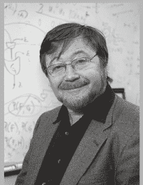
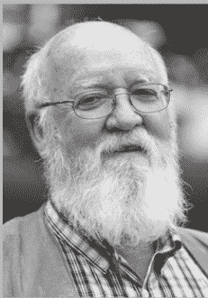
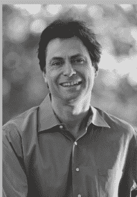
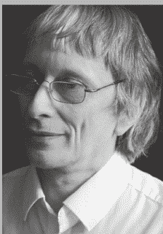
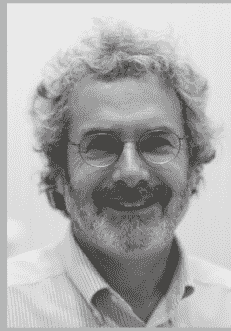
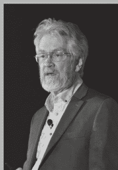
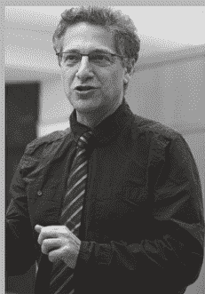
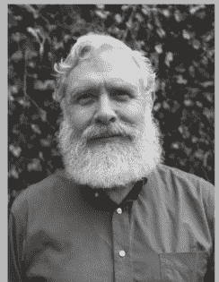
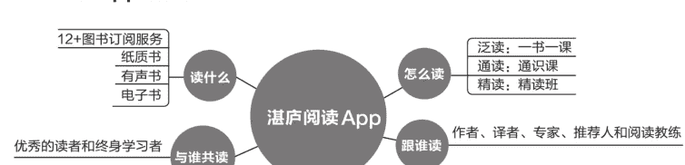

# AI的25种可能

# 赞誉

真正的互联网思想家，又一部科技思想荟萃的杰作！布罗克曼的个人魅力总是能聚集互联网、人工智能领域的最强大脑，展现深刻的技术思想和前沿洞察。

段永朝
苇草智酷创始合伙人

建筑学家威廉·J.米切尔曾有一个比喻:人不过是猿猴的1.0版。现在，经由各种比特的武装，人类终于将自己升级到猿猴2.0版。他们将如何处理自己的原子之身呢？这是今日顶尖思想者不得不回答的“大问题”。

胡 泳
博士，北京大学新闻与传播学院教授

本书提供了跨学科视角的人工智能发展洞见，尤其睿智地指出，人工智能不仅需要更有智慧的科技属性，更需要人类本身固有的善良本质。

陈 劲
清华大学教授，技术创新管理专家

一个人的格局和视野取决于他思考什么样的问题，而他未来的思考，在很大程度上取决于他现在的阅读。这套书会让你相信，在生活的苟且之外，的确有一群伟大的头脑在充满诗意的远方运转。

周 涛
电子科技大学教授、互联网科学研究中心主任

布罗克曼是科学掮客，他有个所谓“第三种文化”的理论，就是理科生写的科普，算是对C.P.斯诺文理“两种文化”矛盾的补充。布罗克曼每年都会组织一批科学家开沙龙，然后把沙龙的言论结集出书。今年的主题是“人工智能”。考虑到今年美国科学界的诡异气氛和他自己的年龄，这本书可能是他编的最后一本文集了。值得一看。

尼克
乌镇智库理事长，《人工智能简史》作者

世界上公认有智慧的一群人，每年就着一个主题，每个人写一篇文章，然后结集出一本书，这就是出版历史上神奇的“对话最伟大的头脑”系列丛书。我有点担心，你看完一本之后，会把湛庐文化的这一套书全都拿下。嗯，你会和我一样，忍不住的。

罗振宇
得到App创始人

以科学精神为内核，无尽跨界，Edge就是这样一个精英网络沙龙。每年，Edge会提出一个年度问题，沙龙成员依次作答，最终结集出版。不要指望在这套书里读到“ABC”，也不要指望获得完整的阐释。数百位一流精英在这里直接回答“大问题”，论证很少，锐度却很高，带来碰撞和启发。剩下的，靠你自己。

王烁
财新传媒总编辑，BetterRead公号创始人

随着AI围棋的胜利，点亮了人工智能的新纪元。产业大潮汹涌澎湃，资本泡沫与技术狂想也扑面而来。这个时候，更需要与智者在一起，穿破历史，拨开迷雾，洞见未来。

王小川
搜狗CEO

关注Edge并阅读上面的文章已经十几年了，越到后来越发现，打动我的不是布罗克曼及其周围那批专家的睿智，甚至不是他们的渊博，而是他们讨论问题的边界感，一种在专业视角下对世界彬彬有礼的试探。

小 庄
果壳联合创始人，“科学艺术研究中心”主编

“对话最伟大的头脑”这套书中，每一本都是一个思想的热核反应堆，在它们建构的浩瀚星空中，百位大师或近或远、如同星宿般璀璨。每一位读者都将拥有属于自己的星际穿越，你会发现思考机器的100种未来定数，而奇点理论不过是星空中小小的一颗。

吴甘沙
驭势科技(北京)有限公司联合创始人兼CEO

作为美国著名的文化推动者和出版人，约翰·布罗克曼邀请了世界上各个领域的科学精英和思想家，通过在线沙龙的方式展开圆桌讨论。“对话最伟大的头脑”这套书就是活动参与者的观点呈现，让我们有机会一窥“最强大脑”的独特视角，从而得到思想上的启迪。

苟利军
中国科学院国家天文台研究员，中国科学院大学教授
“第十一届文津奖”获奖图书《星际穿越》译者

未来并非如我所愿一片光明，看看大师们有什么深刻的思考和破解之道，也许会让我们活得更放松一些。

李天天
丁香园创始人

与最伟大的头脑对话，虽然不一定让你自己也伟大起来，但一定是让人摆脱平庸的最好方式之一。

刘 兵
清华大学社会科学学院教授

术业有专攻，是指用以谋生的职业，越专业越好，因为竞争激烈，不专业没有优势。但很多人误以为理解世界和社会，也是越专业越好，这就错了。世界虽只有一个，但认识世界的角度多多益善。学科的边界都是人造的藩篱，能了解各行业精英的视角，从多个角度玩味这个世界，综合各种信息来做决策，这不显然比死守一个角度更有益也有趣吗？

兰小欢
复旦大学经济学助理教授

如果每位大思想家都是一道珍馐，那么这套书毫无疑问就是至尊佛跳墙了。很多名字都是让我敬仰的当代思想大师，物理学家丽莎·兰道尔、心理学家史蒂芬·平克、哲学家丹尼尔·丹尼特，他们都曾给我无数智慧的启发。

如果你不只对琐碎的生活有兴趣，还曾有那么一个瞬间，思考过全人类的问题，思考过有关世界未来的命运，那么这套书无疑是最好的礼物。一篇文章就是一片视野，让你站到群山之巅。

郝景芳
2016年雨果奖获得者

布罗克曼是我们这个时代的“智慧催化剂”。

斯图尔特·布兰德
《全球概览》创始人

> 布罗克曼是个英雄，他使科学免于干涩无趣，使人文学科免于陈腐衰败。

杰伦·拉尼尔
“虚拟现实之父”

# 总序

1981年，我成立了一个名为“现实俱乐部”（Reality Club）的组织，试图把那些探讨后工业时代话题的人们聚集在一起。1997年，“现实俱乐部”上线，更名为Edge。

在Edge中呈现出来的观点都是经过推敲的，它们代表着诸多领域的前沿，比如进化生物学、遗传学、计算机科学、神经学、心理学、宇宙学和物理学等。从这些参与者的观点中，涌现出一种新的自然哲学：一系列理解物理系统的新方法，以及质疑我们很多基本假设的新思维。

对每一本年度合集，我和Edge的忠实拥趸，包括斯图尔特·布兰德（Stewart Brand）、凯文·凯利（Kevin Kelly）和乔治·戴森（George Dyson），都会聚在一起策划“Edge年度问题”，而且常常是在午夜。

提出一个问题并不容易。正像我的朋友，也是我曾经的合作者，已故的艺术家和哲学家詹姆斯·李·拜尔斯（James Lee Byars）曾经说的那样：“我能回答一个问题，但我能足够聪明地提出这个问题吗？”所以，我们要去寻找那些可以启发不可预知的答案的问题，那些激发人们去思考意想不到之事的问题。

## 现实俱乐部

1981—1996年，现实俱乐部是一些知识分子间的非正式聚会，通常在中国餐馆、艺术家阁楼、投资银行、舞厅、博物馆、客厅，或在其他什么地方举办。俱乐部座右铭的灵感就源于拜尔斯，他曾经说过：“要抵达世界知识的边界，就要寻找最复杂、最聪明的头脑，把他们关在同一个房间里，让他们互相讨论各自不解的问题。”

1969年，我刚出版了第一本书，拜尔斯就找到了我。我们俩同在艺术领域，一起分享有关语言、词汇、智慧以及“斯坦们”（爱因斯坦、格特鲁德·斯坦、维特根斯坦和弗兰肯斯坦）的乐趣。1971年，我们的对话录《吉米与约翰尼》（Jimmie and Johnny）由拜尔斯创办的“世界问题中心”（The World Question Center）发表。

1997年，拜尔斯去世后，关于他的“世界问题中心”，我写了下面的文字：

> 詹姆斯·李·拜尔斯启发了我成立“现实俱乐部”以及Edge的想法。他认为，如果你想获得社会知识的核心价值，去哈佛大学的怀德纳图书馆里读上600万本书，是十分愚蠢的做法。在他极为简约的房间里，他通常只在一个盒子中放4本书，读过后再换一批。于是，他创办了“世界问题中心”。在这里，他计划邀请100个最聪明的人相聚一室，让他们互相讨论各自不解的问题。

理论上讲，一个预期的结果是他们将获得所有思想的总和。但是，在设想与执行之间总有许多陷阱。拜尔斯确定了他的100个最聪明的人，依次给他们打电话，并询问有什么问题是他们自问不解的。结果，其中70个人挂了他的电话。

那还是发生在1971年的事。事实上，新技术就等于新观念，在当下，电子邮件、互联网、移动设备和社交网络真正实现了拜尔斯的宏大设计。虽然地点变成了线上，但这些驱动热门观点的反复争论，却让“现实俱乐部”的精神得到了延续。

正如拜尔斯所说：“要做成非凡的事情，你必须找到非凡的人物。”每一个Edge年度问题的中心都是卓越的人物和伟大的头脑，其中包括科学家、艺术家、哲学家、技术专家和企业家，他们都是当今各自领域的执牛耳者。我在1991年发表的《第三种文化的兴起》（The Emerging Third Culture）一文和1995年出版的《第三种文化：洞察世界的新途径》（The Third Culture: Beyond the Scientific Revolution）一书中，都写到了第三种文化，而上述那些人，他们正是第三种文化的代表。

## 第三种文化

经验世界中的那些科学家和思想家，通过他们的工作和著作构筑起了第三种文化。在渲染我们生活的更深层意义以及重新定义“我们是谁、我们是什么”等方面，他们正在取代传统的知识分子。

第三种文化是一把巨大的“伞”，它可以把计算机专家、行动者、思想家和作家都聚于伞下。在围绕互联网兴起的传播革命中，他们产生了巨大的影响。

Edge是网络中一个动态的文本，它展示着行动中的第三种文化，以这种方式连接了一大群人。Edge是一场对话。

第三种文化就像是一套新的隐喻，描述着我们自己、我们的心灵、整个宇宙以及我们知道的所有事物。这些拥有新观念的知识分子、科学家，还有那些著书立说的人，正是他们推动了我们的时代。

这些年来，Edge已经形成了一个选择合作者的简单标准。我们寻找的是这样一些人：他们能用自己的创造性工作，来扩展关于“我们是谁、我们是什么”的看法。其中，一些人是畅销书作家，或在大众文化方面名满天下，而大多数人不是。我们鼓励探索文化前沿，鼓励研究那些还没有被普遍揭示的真理。我们对“聪明地思考”颇有兴趣，但对标准化“智慧”意兴阑珊。在传播理论中，信息并非被定义为“数据”或“输入”，信息是“产生差异的差异”（a difference that makes a difference）。这才是我们期望合作者要达到的水平。

Edge鼓励那些能够在艺术、文学和科学中撷取文化素材，并以各自独有的方式将这些素材融于一体的人。我们处在一个大规模生产的文化环境当中，很多人都把自己束缚在二手的观念、思想与意见之中，甚至一些公认的文化权威也是如此。Edge由一些与众不同的人组成，他们会创造属于自己的真实，不接受虚假的或盗用的真实。Edge的社区由实干家而不是那些谈论和分析实干家的人组成。

Edge与17世纪早期的无形学院（Invisible College）十分相似。无形学院是英国皇家学会的前身，其成员包括物理学家罗伯特·玻意耳（Robert Boyle）、数学家约翰·沃利斯（John Wallis）、博物学家罗伯特·胡克（Robert Hooke）等。这个学会的目标就是通过实验调查获得知识。另一个灵感来自伯明翰月光社（The Lunar Society of Birmingham），一个新工业时代文化领袖的非正式俱乐部，詹姆斯·瓦特（James Watt）和本杰明·富兰克林（Benjamin Franklin）都是其成员。总之，Edge提供的是一次智识上的探险。

用小说家伊恩·麦克尤恩（Ian McEwan）的话来说：“Edge心态开放、自由散漫，并且博识有趣。它是一份好奇之中不加修饰的乐趣，是这个或生动或单调的世界的集体表达，它是一场持续的、令人兴奋的讨论。”

约翰·布罗克曼

想知道这25位顶级思想家还在思考什么吗？

扫码获取“湛庐阅读”App，
搜索“AI的25种可能”，
获取更多精彩内容。

> ### 什么是彩蛋

彩蛋是湛卢图书策划人为你准备的更多惊喜，一般包括：①测试题及答案；②参考文献及注释；③延伸阅读、相关视频等。记得“扫一扫”领取。

# 引言 人工智能的机遇与风险

人工智能是今天的神话，也是其他一切故事背后的故事。它既是新的开始，也是末世毁灭，两种结局分别对应了好的人工智能和恶的人工智能。本书集结了诸多来自人工智能领域内外的重要思想家的对话，探讨了人工智能的定义及含义。该对话是基于一个叫作“可能的心智”的项目，正式开始于2016年9月在康涅狄格州华盛顿的五月花格瑞斯酒店召开的一次会议，本书的一些撰稿人也参与了这次会议。

在第一次会议上，人们很快对人工智能进入更广泛的文化环境感到兴奋与恐惧，这与诺伯特·维纳（Norbert Wiener）的“控制论”思想进入当时文化领域的情况非常类似，特别是在20世纪60年代，许多艺术家把这种新科技思想融入他们的作品中。我对控制论思想的影响力有切身体会。实际上，若说正是控制论思想使我走上如今的人生道路也不为过。随着20世纪70年代初数字时代的到来，人们不再谈论维纳，但如今，他的控制论思想被广泛采用，已经内化到了不再需要名字的地步。它无处不在，飘荡在空气中的每个角落，这正是适合本书开始的地方。

## 新技术=新感知

在人工智能出现之前，控制论大行其道。它是诺伯特·维纳在1948年的奠基性著作中阐述的一种理念，意指自动的、自我调节的一种控制。我记得我接触到这一理念是在1966年，当时作曲家约翰·凯奇（John Cage）邀请我和其他四五位年轻的艺术家参加了一些晚宴，也就是一系列的研讨会，探讨媒体、传播学、艺术、音乐及哲学上的一些问题。这些问题主要围绕让凯奇感兴趣的维纳、克劳德·香农（Claude Shannon）及马歇尔·麦克卢汉（Marshall McLuhan）的观点。这些人在纽约的艺术圈颇有影响力，而我当时正努力跻身于这个圈子。凯奇对麦克卢汉的观点尤其熟悉。麦克卢汉认为，通过发明电子技术，我们的中枢神经系统即大脑拥有了一个外形，我们现在不得不假设“只有一个大脑，一个我们所有人共享的大脑”。

当时我在纽约的电影制片人实验电影院做项目经理，在先锋电影制片人兼导演乔纳斯·梅卡斯（Jonas Mekas）的主持下，负责一系列的多媒体制作，即“新电影1号”项目（也叫作“扩延电影节”）。我与之共事的那些艺术家对这些理念非常感兴趣，他们是：视觉艺术家克莱斯·奥登伯格（Claes Oldenburg）、罗伯特·劳森伯格（Robert Rauschenberg）、安迪·沃霍尔（Andy Warhol）和罗伯特·怀特曼（Robert Whitman）；动态艺术家夏洛特·穆尔曼（Charlotte Moorman）和白南准（Nam June Paik）；偶发艺术家阿伦·卡普罗（Allan Kaprow）和卡若琳·史尼曼（Carolee Schneemann）；舞蹈家特里莎·布朗（Tricia Brown）；电影制片人杰克·史密斯（Jack Smith）、斯坦·范德比克（Stan Vanderbeek）、艾德·艾姆许维勒（Ed Emshwiller）和库查兄弟（Kuchar brothers）；先锋剧作家肯·杜威（Ken Dewey）；诗人格尔德·斯特恩（Gerd Stern）和USCO组合；极简音乐家拉蒙特·扬（La Monte Young）和特里·赖利（Terry Riley）；以及通过沃霍尔结识的地下丝绒乐队（The Velvet Underground）。他们中许多人当时正在阅读维纳的作品，广播里也正在播放介绍控制论学说的节目。正是在这样的一次晚宴中，凯奇从他的手提箱里拿出一本《控制论》（Cybernetics）交给我，说：“这是给你的。”

在此期间，我意外地接到维纳的同事阿瑟·K.所罗门（Arthur K. Solomon）给我打来的电话，他是哈佛大学生物物理学研究生学院的院长。当时，维纳已于一年前去世，但所罗门与维纳在麻省理工学院和哈佛大学的一些关系密切的同事，一直在关注《纽约时报》上关于“扩延电影节”的报道，对其与维纳作品扯上关系颇感好奇。所罗门邀请我带着一些艺术家去剑桥与他和其他一些专家会面，包括麻省理工学院研究感官通信的沃尔特·罗森勃利斯（Walter Rosenblith），哈佛大学应用数学家安东尼·欧廷格（Anthony Oettinger），麻省理工学院工程师、频闪光的发明人哈罗德·埃杰顿（Harold “Doc” Edgerton）等。

就像我以前遇到过的许多次“艺术遭遇科学”一样，由于我对科学所知不多，这次为期两天的会面不算很成功，就像轮船行驶在暗夜里。但我尽可能地吸收了一切营养，而且从很多有趣的方面看，这次会面非常重要，其中一点就是他们带我们去看了“那台”计算机。在当时，计算机可是个稀罕物，至少我们这些访客还没有谁拥有一台计算机。我们被带到麻省理工学院里的一间非常大的屋子，在屋子中间有一个“冷室”，它高于地面，四周是玻璃墙。在“冷室”里，技术人员穿着白色实验室服、戴着白色围巾和手套，正忙碌着核对整理从一个巨型机器里出来的穿孔卡片。我走到近前，从我口中呼出的热气在“冷室”的玻璃上结成一层薄雾。我伸手抹开玻璃上的雾气，看到了“那台”计算机。一下子我便深深爱上了它。

后来在1967年秋，我来到门洛帕克市和斯图尔特·布兰德一起待了一段时间。1965年我在纽约见过他，当时他是USCO艺术家组合的一名外围成员。当时，他正与身为数学家的妻子洛伊丝（Lois）着手准备《全球概览》杂志（The Whole Earth Catalog）第一期的出版发行。当洛伊丝和团队其他人正干着苦力时，斯图尔特和我坐在一个角落里待了两天，阅读、标记和注解前一年凯奇给我的那本《控制论》，讨论维纳的思想。

这些思想给了我灵感，我开始提出一个主题，也像一个魔咒，让我以后的所有努力有了方向，那就是“新技术=新感知”。在媒介理论家马歇尔·麦克卢汉、建筑设计师巴克敏斯特·富勒（Buckminster Fuller）等人的影响下，我开始相信，我们感知世界的方式，以及我们与世界的关系，都因我们创造的技术而发生了根本性的改变。

Fuller）、未来主义者约翰·麦克黑尔（John McHale），还有文化人类学家爱德华·T.霍尔（Edward T. Hall）和埃德蒙·卡彭特（Edmund Carpenter）的启发下，我开始大量阅读信息论、控制论和系统论等领域的书籍。麦克卢汉推荐我阅读生物学家J. Z.扬（J. Z. Young）的《科学中的怀疑与确定性》（Doubt and Certainty in Science），在书中作者认为我们创造了工具，并通过使用这些工具来塑造自我。他还推荐我阅读沃伦·韦弗（Warren Weaver）和克劳德·香农在1949年所写的文章《通信数学理论的新贡献》（Recent Contributions to the Mathematical Theory of Communication）。在这篇文章开头，作者写道：“‘通信’一词将被广泛使用，其意义包括一个心灵影响另一个心灵的所有过程。这当然不仅仅指写作和演讲，还指音乐、绘画、戏剧、芭蕾，甚至人类的所有行为。”

谁能想到，从那往后的20年里，我们会开始把大脑比作计算机？谁又能想到，在接下来的另一个20年里，当我们把计算机连成互联网时，大家才意识到大脑不是一台计算机，而是一个计算机网络？当然，维纳没有想到——虽然他是设计用于控制机器的模拟反馈电路的专家，艺术家们也没有想到，我自己更没有想到。

## “我们必须停止亲吻鞭答我们的鞭子”

《控制论》出版两年后，即1950年，诺伯特·维纳又出版了《人有人的用处》（The Human Use of Human Beings）一书。这本书寓意更深，在书中他表达了对失控的商业开发和其他无法预见的新技术的后果的担忧。我一直没有读这本书，直到2016年春，我才拿起《人有人的用处》第一版，当时这本书就躺在我的图书室，紧挨着《控制论》。维纳在1950年就能对现今发生的一切做出精准预测，这让我非常震惊。虽然第一版很畅销，而且还促成了一次重要谈话，但迫于当时其他科学家的压力，维纳1954年又出版了一本修订版，这个版本更温和些，但明显缺少了原版本中的“刚性声音”。

科学史学家乔治·戴森指出，在这个久被遗忘的第一版中，维纳预言了出现“依赖机器统治的新法西斯威胁”的可能性：

> 所有的精英分子，无论是耶稣会士（“天主教从本质上来说就是极权主义宗教”），抑或是FBI（“我们伟大的商人已经看过苏联人的宣传技巧，认为这非常好”），都不能逃脱他的批评。另外，他还批评金融家们提供资助“以使美国变成资本主义国家，并在全球范围内支持商业至上的第五自由”。科学家们也像教会一样受到维纳的评判：“实际上，大型实验室的负责人和大主教非常相像，他们都与各行业的有权人士关系密切，也都有可能陷入骄傲和权力欲中。”

这种论调可对维纳不利。正如戴森所说：

> 在当时这些警告没有得到充分重视，并不是因为维纳对数字计算机的预言是错的，而是因为在1949年秋天当他刚刚完成这本书的手稿时，更大的威胁已迫在眉睫。维纳并不反对数字计算机，但他强烈反对核武器，坚持不肯与那些使用数字计算机来推动比原子弹威力增强千百倍的氢弹的人为伍。

因为《人有人的用处》一书的原版已不再出版，我们再也无法听到维纳的痛声疾呼，与近70年前他创作这本书时相比，这声呼喊在如今更有现实意义：“我们必须停止亲吻鞭笞我们的鞭子。”

## 大脑、思考、智能

今天我们很少听到“控制论”一词，原因有很多，其中有两点比较重要：第一点是，尽管《人有人的用处》一书在当时非常重要，但它却有悖于维纳许多同事的抱负，包括约翰·冯·诺伊曼（John von Neumann）和克劳德·香农，他们对把新科技转化成商业更有兴趣。第二点就是，计算机先驱约翰·麦卡锡（John McCarthy）不喜欢维纳，拒绝使用维纳的“控制论”一词。麦卡锡创造了“人工智能”一词，并成为该领域的奠基人。

朱迪亚·珀尔（Judea Pearl）在20世纪80年代提出了研究人工智能的新方法——贝叶斯网络，他对我说：

> 维纳所营造的是一种兴奋，让我们激动地相信有一天我们将能制造出一台智能机器。他并不是计算机科学家。他讲的只是反馈、通信，还有模拟。他的比喻用词是反馈电路，在这方面他是专家。到了20世纪60年代早期数字化时代开始出现时，人们谈论的是编程、代码、计算函数、短时记忆、长期记忆——这些都是意义丰富的计算机比喻。维纳落伍了，虽说新的一代是受他的思想启发成长起来的，但他却无法让这一代人接受他。他的比喻太陈旧过时。这一代已经有了新的办法来捕捉人类的想象力。到了1970年，人们不再谈论维纳了。

维纳的视角遗漏了非常重要的一点，那就是认知因素：大脑、思考、智能。早在1942年，在最初的一系列关于复杂系统控制的基础性跨学科会议上，顶尖的研究人员就主张将认知因素纳入进来。这些会议后来被称为梅西会议。尽管冯·诺伊曼、香农和维纳关注被观测系统的控制和通信系统，但沃伦·麦卡洛（Warren McCullough）却力主应该考虑大脑这一因素。他求助于文化人类学家格雷戈里·贝特森（Gregory Bateson）和玛格丽特·米德（Margaret Mead），希望他的理论能与社会科学搭上边。他们之中，尤其是贝特森越来越多地谈论模式和过程，或者“连接模式”。他呼吁建立一种全新的系统生态学，在这门学科看来，生物与它们所生活的环境是一体的，应该被视作单一回路。到了20世纪70年代早期，被观测系统的控制论，即一阶控制论，升级为观测系统的控制论，即二阶控制论或“控制论的控制论”，这个词是海因茨·冯·弗尔斯特（Heinz von Foerster）杜撰出来的，他于20世纪50年代中期加入梅西会议，成为新运动的先锋。

控制论并没有消失，而是融入了万物，我们不再把它看成一个独立、独特的新学科。虽然它隐匿不见，但它就在那里。

## “斯坦”妙语

我当时自己写的有关控制论的东西被二阶控制论的那些人注意到了，包括海因茨·冯·弗尔斯特、约翰·里利（John Lilly）和艾伦·沃茨（Alan Watts），他们是“AUM会议”（AUM即“美国大师学院”）的组织者。这次会议1973年在大苏尔（Big Sur）召开，聚集了许多哲学家、心理学家和科学家，每人都要就自己的研究工作发言，讲讲自己的研究与英国数学家G.斯潘塞-布朗（G. Spencer-Brown）的著作《形式法则》（Laws of Form）里的观点之间有怎样的关联。

我收到邀请时感到有些震惊，实际上这个邀请来得确实有些晚。他们说之所以邀请我是因为对我在《随后》（Afterwards）这本书中表达的观点非常感兴趣，这些观点与他们很合拍。我接受了邀请，一个重要的原因是主讲人不是别人，正是理查德·费曼（Richard Feynman）。我喜欢和物理学家待在一起，因为他们考虑的是宇宙，也就是万物。没有哪个物理学家像费曼一样巧言善辩。我实在等不及要见他了。不过，我不是科学家，也不喜欢站在讲台上发表任何形式的演讲，更不想在一群全世界最聪明的人面前就某个生涩的数学理论发表自己的拙见。不过等我到了大苏尔，才明白为什么我会这么晚才收到邀请。“费曼的演讲是什么时候？”我问前台接待。“噢，艾伦·沃茨没有和你说吗？理查德生病了，已经住进了医院。你是他的替补。噢，对了，你的演讲题目是什么？”

在接下来的几天里，我试图把自己隐身。艾伦·沃茨意识到我不想站到讲台上，有一天凌晨三点敲我的房门，把我弄醒。我打开门，看到他穿着僧侣长袍，袍子的帽子盖住了大半张脸。他双臂张开，一手提着灯笼，另一只手拿着一瓶苏格兰威士忌。

“约翰，”他低沉的嗓音带着浓厚的英国贵族腔，“你是个骗子。”“不过，约翰，”他继续说，“我也是个骗子。但约翰，我是个真正的骗子。”

第二天，我做了演讲，题目是“爱因斯坦、格特鲁德·斯坦、维特根斯坦和弗兰肯斯坦”。爱因斯坦开启了20世纪物理学的革命。格特鲁德·斯坦是第一位描写模糊的不连续的宇宙概念的作家。他认为文字既不代表人物也不代表行为：是玫瑰的玫瑰就是玫瑰，是宇宙的宇宙就是宇宙。维特根斯坦认为世界和语言一样都有其局限性。“我语言的局限就意味着我世界的局限。”这是观测者与被观测者之间差别的最终结果。弗兰肯斯坦是控制论、人工智能、机器人，以及这个领域能想到的所有词汇的代言人。

演讲收到了意想不到的效果。与会者中有些是《纽约时报》畅销书作家，但他们谁都没有出版经纪人。我发现这些作家都在进行一种文体的创作，纽约的出版商们不知道这是什么文体。因为我有哥伦比亚商学院的MBA文凭，也有过一些相关的成功商业案例，他们非让我做他们的经纪人，最初是给格雷戈里·贝特森和约翰·里利做出版经纪人。我把他们的书卖得很好，收获颇丰，于是我便开始了作为出版经纪人的事业。

我一直没有见到理查德·费曼。

## 人工智能的漫长冬季

这项新事业使我得以与多数人工智能的先驱们保持密切的联系，几十年来，我和他们一起在得意的浪尖上舞蹈，也一起跌入到失意的谷底。

20世纪80年代早期，日本政府曾举全国之力发展人工智能。他们将之称为“第五代”，目标是通过打破“冯·诺伊曼瓶颈”创建大规模并行计算机，来改变计算机体系架构。他们希望能借此举推动经济发展，成为这个领域的世界强国。1983年，日本“第五代”联盟的领军人来到纽约，参加纽约科学院院长海因茨·帕格尔斯（Heinz Pagels）主办的一次会议。我也参加了这次会议，同桌的有第一代领军人马文·明斯基（Marvin Minsky）和约翰·麦卡锡，第二代领军人爱德华·费根鲍姆（Edward Feignbaum）和罗杰·尚克（Roger Schank），以及美国国家超级计算机联盟的负责人约瑟夫·特劳布（Joseph Traub）。

1981年，在海因茨的帮助下，我成立了“现实俱乐部”，俱乐部的第一次跨学科会议在纽约科学院的董事会会议室举行。当时海因茨在创作《大师说科学与哲学：计算机与复杂性科学的兴起》（Dreams of Reason: The Computer and the Rise of the Science of Complexity）一书，该书被看作20世纪90年代科学界的研究指南。

通过现实俱乐部的几次会议，我结识了两位年轻的研究人员，他们即将在计算机科学变革中扮演重要角色。20世纪70年代后期在麻省理工学院，丹尼尔·希利斯（Daniel Hillis）开发了一种算法，使大规模并行计算机成为可能。1983年，他的公司“思考机器”使用并行结构组建了世界最快的超级计算机。他的这台“连接机器”非常接近地反映了人类大脑的运作。塞思·劳埃德（Seth Lloyd）在洛克菲勒大学量子计算和量子通信领域进行了开创性研究，为量子计算机提出了第一个在技术上可行的设计方案。

至于日本，他们对人工智能的探索以失败告终，接下来是长达20年的经济萧条。但顶尖的美国科学家们非常看重这个项目。当时计算机领域最前沿的科学家费根鲍姆与帕梅拉·麦考克（Pamela McCorduck）合作编写了一本关于这个领域发展的书。1983年，《第五代计算机：人工智能和日本计算机对世界的挑战》（The Fifth Generation: Artificial Intelligence and Japan’s Computer Challenge to the World）一书出版。我们给这个项目起了个代号：“它来了！它来了！”但它并没有来。它走了。

从那时起，我便开始与人工智能及复杂性科学各个领域的研究人员合作，这些人包括罗德尼·布鲁克斯（Rodney Brooks）、汉斯·莫拉维克（Hans Moravec）、约翰·阿奇博尔德·惠勒（John Archibald Wheeler）、贝努瓦·曼德尔布罗特（Benoit Mandelbrot）、约翰·亨利·霍兰德（John Henry Holland）、丹尼尔·希利斯、弗里曼·戴森（Freeman Dyson）、克里斯·兰顿（Chris Langton）、多因·法默（Doyne Farmer）、杰弗里·韦斯特（Geoffrey West）、斯图尔特·罗素（Stuart Russell）和朱迪亚·珀尔。

## 不断发展的动态涌现系统

从康涅狄格州华盛顿的第一次会议到现在，我在伦敦、马萨诸塞州剑桥安排了许多晚宴及研讨会，还在伦敦市政厅安排了一次公众活动。参加者中有杰出的科学家、科学史家、通信理论学家，他们毕生都在认真思索人工智能这一话题。

我向更多人约稿，无论他们是否与维纳的研究有关（这取决于每个撰稿人）。最终共收到25篇文章，每位作者都很关心现今的人工智能时代发生的一切。《AI的25种可能》（Possible Minds）并不是我的书，而是我们的书：塞思·劳埃德、朱迪亚·珀尔、斯图尔特·罗素、乔治·戴森、丹尼尔·丹尼特（Daniel C. Dennett）、罗德尼·布鲁克斯、弗兰克·维尔切克（Frank Wilczek）、迈克斯·泰格马克（Max Tegmark）、扬·塔里安（Jaan Tallinn）、史蒂芬·平克（Steven Pinker）、戴维·多伊奇（David Deutsch）、汤姆·格里菲思（Tom Griffiths）、安卡·德拉甘（Anca Dragan）、克里斯·安德森（Chris Anderson）、戴维·凯泽（David Kaiser）、尼尔·格申斐尔德（Neil Gershenfeld）、丹尼尔·希利斯、文卡·拉马克里希南（Venki Ramakrishnan）、阿莱克斯·彭特兰（Alex "Sandy" Pentland）、汉斯·乌尔里希·奥布里斯特（Hans Ulrich Obrist）、艾莉森·高普尼克（Alison Gopnik）、彼得·加里森（Peter Galison）、乔治·丘奇（George M. Church）、卡罗琳·琼斯（Caroline A. Jones）、斯蒂芬·沃尔弗拉姆（Stephen Wolfram）。

在我看来，“可能的心智”项目是一个不断发展的动态涌现系统，是许多经验丰富、深思熟虑的思想者们的思想展示，他们交流思想，产生火花，以自己的经验和学识挑战主流的人工智能学说。项目旨在提出一些观点，这将有助于理解这个迅速发展的新兴领域。

我要求每位撰稿人考虑以下两点：

1.  华莱士·史蒂文斯（Wallace Stevens）的禅诗《观察一只黑鹂的十三种方式》（Thirteen Ways of Looking at a Blackbird）。华莱士·史蒂文斯认为这首诗“不是警句或思想的集合，而是表达了一些感觉”。这是一种“透视主义”的方法，整首诗由短小、独立的部分组成，每一部分都以某种方式提到黑鹂。这首诗描写他自己的想象，涉及他所关注的事物。
2.  盲人摸象的寓言故事。就像故事中的大象一样，人工智能这个话题无论从哪个角度看都太过宏大，这就一定会出现每个人的看法皆与他人不同的现象。

我们对这本书的希冀是什么？斯图尔特·布兰德曾说过：“重新审视先驱的思想永远都有用。它给我们一种长远的视角，能在几十年甚至几个世纪的时间里吸引人们思考这一主题。当代的所有讨论，如果不能从长远视角出发，都注定不能长久。”

丹尼尔·希利斯希望在人工智能领域工作的人们不要忘了维纳的书对他们的深层影响。“你在执行他的路线图，”他说，“你只是没有意识到。”

丹尼尔·丹尼特希望“维纳的灵魂能来到这场思想盛宴。这是一种杂交优势的根源，是摇摆不定思想的根源，可以撼动既定的思想”。

尼尔·格申斐尔德认为“为运营苹果、亚马逊、谷歌、微软、脸书的人提供隐形矫正教育将是本书的一大成果”。

弗里曼·戴森是仍健在的少数几位认识维纳的学者之一。他说：“《人有人的用处》是迄今为止最好的书之一。维纳几乎所有的论断都是对的。我很想看看你们这群奇才如何使用这本书。”

## 人工智能历史的演变

万物在变，又恒久不变。现在人工智能无处不在。我们拥有互联网，拥有智能手机。那些手持“鞭答我们的鞭子”的主要公司的创始人坐拥上百亿甚至上千亿美元的净值。一些行事高调的人，像埃隆·马斯克（Elon Musk）、尼克·波斯特洛姆（Nick Bostrom）、马丁·里斯（Martin Rees）、埃利泽·尤德考斯基（Eliezer Yudkowsky），以及已故的史蒂芬·霍金（Stephen Hawking），都对人工智能的发展提出过严厉警示，结果导致那些资金力量雄厚、主要研究发展“善良的人工智能”的研究所拥有了突出优势。但我们人类作为一个物种，真的有能力控制具有完全意识、不受监管、能自我完善的人工智能吗？维纳在《人有人的用处》中的告诫现在已变成现实，那些工作在人工智能革命最前沿领域的研究者应该重新审视维纳的这些告诫。戴森说：

维纳对那些“崇拜电子小装置的人”不再抱有幻想。这些人的自私“带动自动化发展，而这种发展已不再是出于合法的好奇，其本身充满罪恶”。他认为危险不在于机器变得像人类，而是人类变得像机器。“未来世界将是一场越来越激烈的斗争，挑战着我们的智力极限。”维纳在《上帝与傀儡公司》（God & Golem, Inc.）一书中写道。该书出版于1964年，维纳同年去世。“未来世界不是一张舒适的吊床，任我们躺在那里等待机器人奴隶的服务。”

现在我们应该找出人工智能领域里的主流者与持不同意见者，让这些人都能发表自己的观点，以此来审视人工智能历史的演变。

故而以下文章亟须业内人士不断更新。

约翰·布罗克曼
2019年于纽约

## 目录

作者简介

赞誉

总序

引言 人工智能的机遇与风险

01 虽然是谬误，却比以往更靠谱 WRONG, BUT MORE RELEVANT THAN EVER

02 不透明学习机器的局限性 THE LIMITATIONS OF OPAQUE LEARNING MACHINES

03 给机器输入使命 THE PURPOSE PUT INTO THE MACHINE

04 人工智能第三定律 THE THIRD LAW

05 我们将如何应对？ WHAT CAN WE DO?

06 我们的机器使我们陷入非人类混乱 THE INHUMAN MESS OUR MACHINES HAVE GOTTEN US INTO

07 智能的统一 THE UNITY OF INTELLIGENCE

08 让我们心怀渴望，超越自我 LET'S ASPIRE TO MORE THAN MAKING OURSELVES OBSOLETE

09 反对派报告 DISSIDENT MESSAGES

10 科技预言与观念的不可低估的因果力量 TECH PROPHECY AND THE UNDERAPPRECIATED CAUSAL POWER OF IDEAS

11 超越奖惩 BEYOND REWARD AND PUNISHMENT

12 对人类的人工利用 THE ARTIFICIAL USE OF HUMAN BEINGS

## 13. 把人类放进人工智能的方程式中 PUTTING THE HUMAN INTO THE AI EQUATION
## 14. 梯度下降 GRADIENT DESCENT
## 15. “信息”之于维纳、香农及我们 “INFORMATION” FOR WIENER, FOR SHANNON, AND FOR US
## 16. 伸缩性 SCALING
## 17. 第一批机器智能 THE FIRST MACHINE INTELLIGENCES
## 18. 计算机会成为我们的霸主吗？ WILL COMPUTERS BECOME OUR OVERLORDS?
## 19. 人类策略 THE HUMAN STRATEGY
## 20. 使看不见的为人所见：当艺术遇见人工智能 MAKING THE INVISIBLE VISIBLE: ART MEETS AI
## 21. 人工智能与4岁儿童的对比 AIS VERSUS FOUR-YEAR-OLDS
## 22. 算法学家的客观梦想 ALGORISTS DREAM OF OBJECTIVITY
## 23. 机器的权利 THE RIGHTS OF MACHINES
## 24. 控制论生物的艺术应用 THE ARTISTIC USE OF CYBERNETIC BEINGS
## 25. 人工智能与文明的未来 ARTIFICIAL INTELLIGENCE AND THE FUTURE OF CIVILIZATION

# 01

## 虽然是谬误，却比以往更靠谱
WRONG, BUT MORE RELEVANT THAN EVER

It is exactly in the extension of the cybernetic idea to human beings that Wiener's conceptions missed their target.

维纳的错误就在于他把控制论的理念用到了人类身上。

塞思·劳埃德
Seth Lloyd
塞思·劳埃德是麻省理工学院理论物理学家，机械工程系南普苏 (Nam P. Suh) 讲席教授，同时也是圣塔菲研究所的外聘教授。

## 布罗克曼谈塞思·劳埃德

20世纪80年代末期，我与塞思·劳埃德结识。当时新的思维方式铺天盖地：生物组织原理的重要性、从计算角度看数学和物理过程、对并行网络的重视、非线性动力学的重要性，以及对混沌、联结主义思想、神经网络以及并行分布式处理的新理解。那段时期，计算方面的进步为人们看待知识提供了一种新的思维方式。

塞思喜欢把自己看成量子力学领域的人，他在量子计算领域的研究使他举世闻名。量子计算试图利用量子理论的奇异特性，如叠加和纠缠，来解决使用传统计算机需要花几辈子时间去解决的问题。

在下面的文章里，他论述了信息理论的历史，从诺伯特·维纳对未来的洞察一直讲到科技“奇点”的预言——有些人相信科技“奇点”将会取代人类。他介绍了最近崛起的“深度学习”编程方法，认为人们对它的期望要适度。他指出，虽然人工智能已经有了长足发展，但机器人“还是不会系鞋带”。

说到塞思，很难不提到他的朋友和恩师——洛克菲勒大学已故理论物理学家海因茨·帕格尔斯教授。他们师生两人对彼此的理论思想影响深远。

1988年夏，我去阿斯彭物理研究中心（Aspen Center for Physics）拜访海因茨和塞思。他们两人就复杂性问题的共同研究成果，刊登在最近一期的《科学美国人》上。当时的他们活力四射。但就在两个星期后，二人登完皮拉米德峰下山时，海因茨遭遇山难，英年早逝。当时他们正在讨论量子计算。

诺伯特·维纳1950年出版的《人有人的用处》，是他两年前出版的那本影响深远的《控制论》的通俗版本。在《人有人的用处》中，维纳对在一个机械的运算能力变得愈发强大的世界中，人类与机械之间的相互作用进行了探讨。这是一本充满先见之明的书，同时也充满了谬误。这本书写于冷战正如火如荼之时，其中的内容让人胆战心惊，它让我们意识到极权主义组织和社会的危害，提醒我们当民主试图用极权主义的武器对抗极权主义时会对民主极为不利。

维纳在《控制论》中，以非常翔实的科学细节描写了经由反馈实现的控制过程。“控制论”（cybernetics）一词来源于古希腊语中意为“舵手”的单词，是现代词汇“管理者”（governor）的词源基础。詹姆斯·瓦特将他那开创性的反馈控制装置命名为“管理者”，这一装置改进了蒸汽机的使用方式。因为维纳沉溺于研究控制带来的各种问题，所以他将世界视为一组复杂的、互锁的反馈回路，其中传感器、信号和发动机之类的驱动器通过复杂的信号和信息交换而相互作用。控制论在工程领域的应用影响力极大且非常有效，使我们有了火箭、机器人、自动装配线，以及一系列精密工程技术，换句话说，它构成了现代工业社会的基础。

不过，维纳对控制论的理念有更大的雄心。在《人有人的用处》中，他认为这一理念可以应用到麦克斯韦妖、人类语言、大脑、昆虫新陈代谢、法律体系、技术创新对统治的作用，以及宗教之中。控制论的这些广泛应用，几乎是彻底的失败。20世纪40年代末到60年代初，人们对控制论大肆吹捧，在某种程度上就像对计算机和通信技术的过度渲染一样，而后者导致了2000年至2001年的互联网泡沫破灭。控制论确实带来了卫星和电话交换系统，但它对社会结构及整个社会没有促成什么有用的发展。

然而近70年后，《人有人的用处》这本书教给我们人类的却远比它刚刚出版时要多得多。也许这本书最大的特点就是它引入了大量关于人类与机器相互作用的主题，这些主题至今仍然非常重要。这本基调灰暗的书预测了在20世纪后半叶即将发生的几种灾难，其中许多与今天人们对21世纪后半叶的预测非常相似。

例如，维纳预见到在距离1950年不远的将来，人类会将社会的控制权交给一种控制论的人工智能，这将导致对人类的严重破坏。维纳预言，生产自动化会带来产量的大幅增长，但同时也将使大批工人下岗——在接下来的几十年里，这些确实发生了。维纳警告说，除非社会能合理安置这些失去工作的工人们，否则叛乱将随之而来。

但是维纳没有预见到技术的重大发展。就像20世纪50年代的许多技术专家一样，他没有预见到计算机革命。他以为，计算机的价格会从50年代的几十万美元降到几万美元。无论是他还是那个时代的其他人，都没有预料到随着晶体管和集成电路的发展，计算机的能力会有爆发式的提高。最后，由于维纳过度强调控制，他没有预见一个技术世界的到来，在这个技术世界里，创新和自组织是从底部一点点发展而来而不是从顶部强加下来的。

维纳关注极权主义的罪恶，无论这罪恶是政治的、科学的还是宗教的，所以他以极其悲观的眼光看待世界。在书中他警告说，如果我们不尽快修好我们的道路，灾难就在等着我们。《人有人的用处》这本书出版半个多世纪以后，当前的人类和机器世界远比维纳能预见到的复杂、多样得多，这样的世界有着广泛得多的政治、社会和科学体系。但是如果我们弄错的话，如果全球的极权主义政权控制整个互联网的话，今天的灾难预警就像1950年的灾难预警一样迫在眉睫。

## 维纳之英明

维纳在最著名的数学著作中，探讨的是信号分析和噪声的影响。第二次世界大战期间，他构建了一种模型，可以通过推算飞机以前的飞行行为，预测它未来的飞行轨迹，由此他开发了一种防空火力的瞄准技术。在《控制论》和《人有人的用处》两书中，维纳指出，根据飞机以往的飞行行为，甚至包括人类飞行员的怪癖和习惯，一个机械化装置可以预测人类行为。像艾伦·图灵（他在图灵测试中预言计算机对问题做出的回应，将与人类没有什么差别）一样，维纳也痴迷于用数学描述来捕捉人类行为。20世纪40年代，他把控制和反馈回路方面的知识应用到生物系统中的神经肌肉反馈中，还把沃伦·麦卡洛克（Warren McCulloch）和沃尔特·皮茨（Walter Pitts）介绍到麻省理工学院，在那里，他们两人在人工神经网络方面做出了开创性的工作。

维纳思想的核心是从信息角度来理解这个世界。复杂系统，如生物体、大脑和人类社会，是由互锁反馈回路组成的，其中子系统之间的信号交换导致了复杂但稳定的行为。当反馈回路发生故障时，系统会变得不稳定。他构建出一幅引人注目的图景，说明了生物系统的运行机制是多么复杂。目前，世人已普遍接受了这一图景。

维纳把信息看成掌控复杂系统行为的核心，这一观点在当时相当令人瞩目。现今，当汽车和冰箱中挤满了微处理器，而人类社会的大部分都围绕着与互联网相连的计算机和手机时，强调信息、计算和通信的中心性似乎毫无新意。然而在维纳时代，第一台数字计算机才刚刚诞生，技术专家们还根本不知道互联网为何物。

维纳不仅把工程的复杂系统，还把所有的复杂系统都看成是围绕信号和计算循环来运作的，这为复杂人工系统的发展做出了巨大贡献。例如，他和其他人开发的用于控制导弹的方法，后来被应用于建造土星5号月球火箭，这是20世纪最伟大的一项工程成就。特别需要指出的是，维纳的控制论理论在大脑和计算机感知领域的应用，是当今基于神经网络的深度学习和人工智能的前身、雏形。不过，这些领域目前的发展与维纳的预见不同，它们的未来发展很可能会影响人类对人类和机器的使用。

## 维纳之谬误

维纳的错误就在于他把控制论的理念用到了人类身上。暂时撇开他对语言、法律和人类社会的思考，看看他认为1950年后不久将会产生的一项不起眼却非常有潜力的创新。维纳认为，如果使用假肢的人能够通过他们自己的神经信号直接与假肢沟通，从肢体接收压力和位置信息并指导其随后的运动，假肢将更有效。事实证明，这比维纳设想的要困难得多：70年后，合并神经反馈的假肢仍然处于早期阶段。维纳的理念不错，只是神经信号与机械电子设备的接口问题很难解决。

更重要的是，维纳和几乎所有生活在那个时代的其他人一样，极大地低估了数字计算的潜力。正如前面指出的那样，维纳的数学成就在于对信号和噪声的分析，他的分析方法适用于连续变化的或者说模拟的信号。虽然他参与了战时数字计算的开发，但他从未预见到半导体电路的引入和逐步小型化所带来的计算能力的爆炸性发展。我们很难将其归咎于维纳：毕竟当时晶体管还没有发明出来，他熟悉的数字计算机的真空管技术笨拙、不可靠，而且无法扩展应用到越来越大的设备中。在1948年版《控制论》的附录中，他预测了会下棋的计算机的问世，还预测到它们能够算出两到三步。然而，半个世纪后，一台计算机在国际象棋比赛中击败了世界冠军，这将会令他大为惊讶。

## 高估技术的发展和奇点的毁灭性风险

当维纳创作《控制论》《人有人的用处》这两本书时，一件著名的高估了技术的事情即将发生。在20世纪50年代，人们首次尝试开发人工智能。赫伯特·西蒙（Herbert Simon）、约翰·麦卡锡和马文·明斯基等研究人员开始设计计算机程序来完成简单任务，并建造了机器人雏形。这些最初的努力获得了成功，西蒙倍受鼓舞，宣称：“20年内，机器将有能力完成一个人所能做的任何工作。”结果这一预言大错特错。随着计算机变得更强大，它们变得越来越擅长下棋，因为计算机系统可以生成许多可能的棋步，并估算这些棋步。但人们对人工智能的多数预测，例如机器人女佣，却是不切实际的。1997年的国际象棋大赛上超级计算机“深蓝”击败加里·卡斯帕罗夫（Garry Kasparov）时，最强大的清扫房间机器人是一个叫“伦巴”（Roomba）的机器人，它随意四处移动吸走灰尘，当它被困在沙发下面时会发出吱吱的叫声。

预测技术进步充满了不确定性，因为技术进步是一系列的改进过程，困难会阻碍进步，而创新则会克服困难，取得进步。许多困难以及一些创新可以被预见到，但更多的困难及创新则很难预料。我自己和实验专家合作建造量子计算机时，我常常发现，一些我以为很容易实现的技术步骤，结果却是不可能完成的；而一些我想象中不可能完成的任务却变得很容易。你不试试就永远不会知道。

20世纪50年代，冯·诺伊曼从与维纳的谈话中受到启发，引入了“技术奇点”这一概念。技术常以指数式速度不断提高，每隔一段时间其性能或灵敏度就会增加一倍。例如，自1950年以来，几乎每隔两年，计算机性能便会提升一倍，这种现象便是“摩尔定律”。冯·诺伊曼根据观察到的技术进步的指数率，断言“技术进步将变得异常迅速、复杂”，在不远的将来就会超越人类能力。事实上，如果按照现在的速度推断未来计算机的原始计算能力增长，也就是按比特率和位翻转计算，计算机应该在未来的20到40年内发展到可与人类大脑匹敌的程度，具体时间取决于如何估算人类大脑的信息处理能力。

人们最初对人工智能过于乐观的失败预测，使得在之后的几十年很少有人讨论技术奇点的话题，但是自从雷·库兹韦尔 (Ray Kurzweil) [1]2005年出版《奇点临近》 (The Singularity Is Near) 后，技术进步带来超级智能的想法再次回归。包括库兹韦尔在内的一些人坚信，奇点就是机遇：人类可以将他们的大脑与超级智能融合，从而永生。但还有一些人，如史蒂芬·霍金和埃隆·马斯克则担心这种超级智能是邪恶的，担心它会对人类文明构成最大威胁。不过有一些人，包括本书的一些撰稿人却认为这样的说法太过夸张。

维纳毕生的事业以及他预测的失败，都与技术奇点密切相关。他在神经科学方面的研究，以及他对麦卡洛克和皮茨最初的支持，勾勒出当今极其有效的深度学习方法的轮廓。在过去的几十年里，尤其是在过去的5年，这种深度学习的技巧最终发展出维纳所称的“格式塔”能力，例如，你知道圆就是圆，即使当它倾斜看起来像一个椭圆时，你仍旧知道它就是一个圆。他对控制论的研究，以及他在神经肌肉反馈方面的研究，对于机器人的发展意义非凡，也启发了以神经为基础的人机接口研究。然而，他对技术发展的误判也表明，我们不应该完全相信技术奇点一说。预测技术进步的常见困难以及发展超级智能时特有的问题都应该让我们警惕，不要高估信息处理的力量和效能。

## 奇点怀疑论的论据

没有任何一种指数式增长能一直持续下去。原子弹爆炸呈指数式增长，但也就持续到燃料耗尽之时。同样地，摩尔定律的指数式增长近来开始进入基础物理所设定的极限之中。计算机的时钟速度在15年前不超过几千兆赫，仅仅是因为速度再高芯片就开始热得熔化了。由于隧道效应和电流泄漏，晶体管的小型化已经进入量子力学领域。最终，摩尔定律驱动的各种存储器和处理器的指数式增长都将停止。然而，再过几十年，计算机的原始信息处理能力也许就能与人类的大脑匹敌，至少按照每秒处理的比特率和位翻转粗略计算的话是如此。

人类的大脑构造复杂，经过几百万年的自然选择变成了现在的样子。在维纳时代，我们对人类大脑构造的了解非常浅显、简单。从那时起，越来越敏感的仪器和成像技术表明，我们的大脑在结构和功能上远比维纳所能想象的更多样、更复杂。最近，我问现代神经科学先驱托马索·波焦（Tomaso Poggio），是否担心随着计算机处理能力的快速提高，计算机将很快赶上人类的脑。“绝不可能。”他回答。

深度学习和神经形态计算方面的最新进展，很好地再现了人类智力的某个特定方面，主要是模拟了大脑皮层的模式处理和模式识别能力。这些进步使计算机不仅能打败国际象棋世界冠军，还能打败围棋冠军。计算机的这种胜利令人印象深刻，但计算机化的机器人却远远不能清理房间。实际上，还没有能在许多灵活运动中具有接近人类能力的机器人，不信你就搜索“摔倒的机器人”。机器人擅长于在装配线上精确地焊接，但它们仍然不能系好自己的鞋带。

原始的信息处理能力并不等同于复杂的信息处理能力。虽然计算机的性能呈指数式增长，但计算机运行的程序却往往根本无法进步。软件公司为提高计算机处理能力采取的主要应对策略就是添加“有用”的功能，但这常常会使软件更难使用。1995年微软的Word可以说是登峰造极，但之后便由于附加了太多功能而慢慢不再那么好用。一旦摩尔定律开始放缓，软件开发人员将在计算机的效率、速度和性能之间面临艰难选择。

对奇点主义的恐惧，主要是担心随着计算机更多地参与设计它们自己的软件，它们将迅速拥有超人的计算能力。但机器学习的真实情况却恰恰相反。当机器的学习能力变得越来越强时，它们的学习方式会变得越来越像人类。许多事例表明，机器的学习是在人类和机器老师的监管下进行的。对计算机进行教育就像对青少年进行教育一样困难、缓慢。因此，基于深度学习的计算机系统正在变得越来越人性化。它们带来的学习技能不是“优于”而是“补充”人类学习：计算机学习系统可以识别人类无法识别的模式，反之亦然。世界上最好的国际象棋棋手既不是计算机，也不是人类，而是与计算机合作的人。网络空间里确实存在有害的程序，但这些主要是恶意软件，即病毒，它们不是因为其超级智能而为世人所知，而是因为恶意的无知而遭世人谴责。

## 如果维纳来到今天

维纳指出，科技的指数式进步是一个相对现代的现象，并不都是好的。他认为原子武器和带有核弹头的导弹是人类杀死自己的最好方法。他把对这颗星球资源的疯狂开采与《爱丽丝漫游奇境记》（Alice in Wonderland）中的疯狂茶会进行对比：我们把废物丢在身边的环境中，为了继续取得进步，只需换一个地方丢弃废物即可。维纳对计算机和神经-机械系统的发展持乐观态度，但对独裁政府对这些技术的使用却很悲观，一些国家在面临独裁主义威胁时也变得越来越独裁，这也让他无法乐观起来。

对于目前人对人的用法，维纳将有何高见？计算机和互联网的力量可能会让他大吃一惊。他参与的早期神经网络研究现已形成强大的深度学习系统，并展现出他所希冀的感知能力，这可能会让他很高兴。不过，对于计算机化格式塔的一个最突出例子，即机器能在万维网上认出小猫的照片，他可能并不感兴趣。我猜测，维纳不会认为机器智能是威胁，而会把它当作一种独立的现象，这种智能不同于我们人类的智能，而且会与人类智能共同进化。

维纳对全球变暖不会感到惊讶，这是我们这个时代的疯狂茶会。他会对替代能源技术的指数式提高表示赞赏，并将运用自己的控制论专业知识开发一套复杂的反馈回路，将这些技术整合到即将到来的智能电网中。尽管如此，当他意识到解决气候变化的问题不仅是技术问题，也是政治问题时，他无疑会对我们能否及时解决这个威胁人类文明的难题持怀疑态度。维纳讨厌骗子，尤其是政治骗子，但他也知道，骗子永远都在。

我们很容易就会忘记维纳所处的时代有多么可怕。美国和苏联展开全面军备竞赛，争相建造安装有氢弹的核弹头，将其装在洲际弹道导弹上。导弹上有导航系统，令维纳难过的是，这个导航系统就有他的功劳。1964年维纳去世时，我4岁。那时候我在上幼儿园，班里的小朋友正在练习猛然躲在课桌下以求在核武器袭击时得到掩护。想到在他的时代人对人的用法，如果他能看到我们目前的状态，他的第一反应将是放心，因为我们还活着。

# 02

## 不透明学习机器的局限性

THE LIMITATIONS OF OPAQUE LEARNING MACHINES

## 布罗克曼谈朱迪亚·珀尔

深度学习有自己的动力学机制，它能自我修复，找出最优化组合，绝大多数时候都会给出正确的结果。可一旦结果错了，你不会知道哪里出了问题，也不知道该如何修复。

朱迪亚·珀尔是计算机科学教授，加州大学洛杉矶分校认知系统实验室主任。他与达娜·麦肯齐 (Dana Mackenzie) 合著了《为什么：关于因果关系的新科学》 (The Book of Why: The New Science of Cause and Effect)。

20世纪80年代，朱迪亚·珀尔推出了一种实现人工智能的新方法，称为贝叶斯网络。这种基于概率的机器推理模型使机器能够在一个复杂而不确定的世界中发挥作用，成为“证据引擎”，根据新的证据不断修正自己的信念。短短几年内，珀尔的贝叶斯网络完全取代了以往基于规则的人工智能途径。深度学习的出现，使珀尔的研究暂时停下来，因为这种方法有些不透明。深度学习指计算机通过观察大量数据来自学，使自己变得更聪明。

看到迈克尔·乔丹（Michael Jordan）和杰弗里·欣顿（Geoffrey Hinton）等同事在深度学习领域取得的杰出成就后，他对这种不透明感到不安。他开始理解深度学习体系的理论局限性，并指出这些基本障碍的存在将使机器永远无法达到人类的智慧，无论我们付出怎样的努力。珀尔意识到，通过利用贝叶斯网络的计算优势，将简单概率图模型和数据组合起来，也可以表示和推断因果关系。这一发现的意义远远超出了它在人工智能领域最初的存在意义。他的新书向一般大众解释了这种因果思维，可以说，这是一本关于人类如何思考的入门书。

珀尔采用原则性的、数学的方法研究因果关系，这是对思想界的巨大贡献。几乎每一个研究领域都从中受益，特别是数据密集型的健康学和社会科学。

作为一名前物理学家，我对控制论非常着迷。虽然它没有把图灵机的全部性能发挥出来，但它高度透明，这也许是因为它是建立在经典的控制理论和信息理论基础之上的。现在，机器学习的深度学习模式已经失去了这种透明度。从根本上说，深度学习是一个曲线拟合问题，在一长串输入输出链的中间层调整权重。

我发现许多使用者会说“很好用，但我们也不知道原因”。深度学习有自己的动力学机制，一旦你喂给它大量的数据，它就活跃起来，还能自我修复，找出最优化组合，绝大多数时候都会给出正确的结果。可一旦结果错了，你不会知道哪里出了问题，也不知道该如何修复。尤其是，你不知道问题是出在程序上还是方法上，抑或是因为环境发生了改变。我们应该致力于找到一种完全不同的透明度。

一些人认为，我们并不需要透明。我们不了解人类大脑的神经构造，它也运行得挺好，所以我们可以原谅自己的浅薄，最大限度地利用机器。同理，他们还认为，我们为什么不利用深度学习系统，建造一种不用了解它们工作原理的智能呢？在某种程度上，我认可这种观点。我个人并不喜欢不透明，所以我不会浪费时间在深度学习上，但我也知道它在智能中占有一席之地。我知道，不透明的系统也能做出出色的工作，我们的大脑就是这样的奇迹。

但这种观点有其局限性。我们可以原谅自己不了解人类大脑的运作原理，这是因为人类大脑的运作原理是一样的，无须了解我们也可以与他人交流、向他人学习、给他人指导、用我们的语言鼓励他人。但如果我们的机器人都像“阿尔法围棋”（AlphaGo）一样不透明，我们便无法与它们进行有意义的交流，这很不幸。无论何时，任务或操作环境有些许改变，我们都需要重新培训它们。

所以，我没有用这些不透明的学习机器做实验，我在努力了解它们理论的局限性，想着怎样去克服这种局限。我使用了因果推理方法，这种方法是科学家思考世界所使用的方法，有着丰富的直觉案例，可以在分析中监控进展情况。这样，我发现确实存在一些基本障碍，除非攻克这些障碍，不然无论我们怎样努力，都无法让机器拥有人类一样的智能。我相信，了解这些障碍和攻克这些障碍同样重要。

当前的机器学习系统几乎完全在统计模式或者说模型盲（model-blind）的模式下运行，这在许多方面类似于将函数拟合到大量点数据。这样的系统不能推理“如果……会怎样？”的问题，因此不能作为强人工智能的基础，强人工智能是模拟人类推理和能力的人工智能。为了达到人类智能水平，学习机器需要现实蓝图的指导，这种蓝图是一个模型，类似于当我们在陌生城市开车时给我们指路的道路地图。

更准确地说，当前的学习机器是通过优化从环境中接收到的感觉输入流的参数来提高其性能。这是一个缓慢的过程，与达尔文进化论的自然选择过程相似。它解释了鹰和蛇等物种，如何在几百万年的进化过程中拥有超强视力的过程。但它无法解释超级进化过程，这一过程使人类在短短的一千年内制造出眼镜和望远镜。人类拥有而其他物种没有的正是他们对环境的心理表征，他们可以随意操纵这种心理表征，想象出假设环境来进行规划和学习。

尤瓦尔·赫拉利（Yuval Noah Harari）和史蒂文·米森（Steven Mithen）等研究“智人”的历史学家们一般认为，使人类祖先4万年前能统治全球的决定性因素是：他们拥有创造和储存自身环境的心理表征能力，他们能反复探究这种心理表征，通过想象扭曲它，最终可以回答“如果……会怎样？”这样的问题。比如他们会问一些介入性问题：“如果我这样做了，会怎样？”还会问一些回顾性或反事实性的问题：“如果我没那样做，会怎样？”今天没有一台学习机器能回答得了这样的问题。而且，大多数学习机器不具有这样的表征，它们无法从这样的问题中得到答案。

至于因果推理，我们发现对于任何形式的模型盲曲线拟合或者任何统计推断，无论拟合过程有多复杂，你能做的都微乎其微。我们还发现了组织这些局限的理论框架，这些框架形成一个层级结构。

第一层是统计推理。统计推理能告诉你的，只是你看到的一件事如何改变你对另一件事的看法。例如，某症状能告诉你得了哪一种疾病。

然后，是第二层。第二层包含了第一层，但第一层却不包含第二层。第二层处理的是行动。“如果我们抬高价格会怎样？”“如果你让我笑了，会怎样？”第二层需要的是干预信息，这些信息是第一层所没有的。这些信息可被编码成概率图模型，它仅仅告诉我们哪个变量对另一个变量有响应。

第三层是反事实的。这是科学家们使用的语言。“如果这个东西重两倍，会怎样？”“如果当初我没有这样做，会怎样？”“治好了我头疼的是阿司匹林还是刚刚打的盹？”反事实在感觉中属于最高层次，即使我们能够预测所有行动的结果，但却无法得到反事实。它们需要一种额外的东西，以等式的形式告诉我们对于其他变量发生的变化，某个变量会如何反应。

因果推理研究的一个突出成就是对干预和反事实的算法化，也就是对层级结构最高两层的算法化。换言之，一旦我们把科学知识编码成模型（这个模型可以是定性的），那么就会存在检查模型的算法，对于一个给定的查询，无论该查询是关于干预的还是反事实的，这种算法都可以根据可用的数据来估算是否有结果，以及如果是的话，如何得出结果。这一成就极大改变了科学家们做科学研究的方法，尤其是在社会学和流行病学等数据密集型科学中，因果模型已经成为第二语言。这些学科把它们的语言转换看成是“因果革命”。正如哈佛社会科学家加里·金（Gary King）所说：“在过去几十年里，人们对因果推理的了解，比先前有史以来学到的一切加起来都多。”

当我思考机器学习的成功并试图把它推广到未来的人工智能时，我问自己：“我们是否意识到了在因果推理领域中发现的基本局限性？我们准备绕过阻碍我们从一个层级升到另一个层级的理论障碍吗？”

我认为机器学习是一种工具，使我们从研究数据走到研究概率。但是，从概率到实际理解，我们仍然需要多迈出两步，非常大的两步。一是预测行动的结果，二是反事实想象。除非我们迈出最后两步，否则我们不能说了解了现实。

哲学家斯蒂芬·图尔敏（Stephen Toulmin）在他充满洞察力的著作《前瞻和理解》（Foresight and Understanding, 1961）中提出，透明性与不透明性之间的对比是理解希腊与巴比伦科学之间古老竞争的关键。按照图尔敏的说法，巴比伦天文学家是做出黑匣子预测的大师，在天文观测的准确性和一致性方面远远超过了对手希腊。然而，科学却偏爱希腊天文学家创造性的推测，这种推测大胆且充满隐喻性的意象：充满了火焰的圆管、天火透过小孔被视作星星以及半球状的地球骑在龟甲上。正是这种大胆的建模策略，而不是巴比伦的外推，震惊了埃拉托色尼（Eratosthenes），使他做了一个当时世界上最具创造力的实验，测算出了地球的周长。巴比伦的那些以数据为准则的科学家们永远不会做这样的实验。

模型盲法把内在限制加在强人工智能执行的认知任务上。我觉得，达到人类水平的人工智能不会仅仅从模型盲学习机器中出现，它还需要数据和模型的共生协作。

数据科学只是一门有助于解释数据的科学，而解释数据是一个两体问题，将数据与现实联系起来。但无论数据有多“大”，人们操控数据多么熟练，数据本身并不是一门科学。不透明的学习系统可能会把我们带到巴比伦，但绝不是雅典。

## 03 给机器输入使命

THE PURPOSE PUT INTO THE MACHINE

未来我们可能面临这样的情景：我们无法预知这些超级智能机器的行动，它们不完全明确的目标与我们自己的目标相冲突——而为了实现这些目标必须生存下来的动机非常强大。

斯图尔特·罗素是加州大学伯克利分校的计算机科学教授、史密斯-扎德工程学讲席教授。他与彼得·诺维格（Peter Norvig）合著了《人工智能：一种现代的方法》（Artificial Intelligence: A Modern Approach）。

## 布罗克曼谈斯图尔特·罗素

计算机科学家斯图尔特·罗素和埃隆·马斯克、史蒂芬·霍金、迈克斯·泰格马克以及其他许多人一样，坚持认为，我们应该慎重创造超人类水平甚至人类水平的智能，也就是通用人工智能。这里面存在着潜在危险：这些智能程序的目的可能未必与人类设计的目的一致。

他早期的研究主要致力于把“有界最优性”（Bounded Optimality）这一概念理解为对智力的正式定义。他开发出理性元推理技术，“简单地说，就是那种你希望能够尽快提高最终决定的质量的计算”。他致力于概率论和一阶逻辑的统一，为《全面禁止核试验条约》提供全新的、更为有效的监测系统，同时还致力于解决长期的决策问题。他对最后一个主题的陈述常以“生命：在20万亿个动作中打赢”为标题。

他非常关注自主武器的持续发展，如杀伤力极强的微型无人机，这些无人机极有可能变为大规模杀伤性武器。他起草了写给奥巴马总统的信，信中汇集了世界顶尖的40名人工智能研究者的意见，这封信促成高级别美国国家安全会议的召开。

他目前的工作主要是建造他所说的“可证明有益的”人工智能。他希望通过“将明确的不确定性输入系统”来确保人工智能的安全性，这种不确定性是指人类程序员的目的具有不确定性。这种方法将彻底打乱当前人工智能的研究。

在过去20多年里，学过计算机科学课程的人一定都听说过斯图亚特的名字。他与人合著了人工智能领域的权威教科书，估计有500多万英语读者。

诺伯特·维纳在《人有人的用处》一书中提出了许多问题，其中对当今人工智能研究者来说最重要的问题就是：人类将自己的命运交给机器掌握的可能性。

维纳认为，在不久的将来，机器的能力太有限，无法控制全球。相反，他认为，机器和像机器一样的控制系统将掌握在人类精英手中，绝大多数人类将沦为“齿轮、杠杆和棍子”。展望更远的未来，他指出给这些具有超高能力的机器确定明确目的，有相当的难度。他说：

> 生活中有一些更简单、更显然的真理，比如瓶子里发现有个魔鬼，最好的办法就是让他待在那里；比如渔夫为他的妻子祈求许多恩惠，最终却又回到原点；再比如假设你可以实现三个愿望，那你要非常小心地许愿。

其危险显而易见：

> 除非我们事先检查了机器的行为规律，完全清楚它的行为是按照我们能接受的原则进行的，否则让机器决定我们的行为，那就太不幸了。另一方面，像神灵这样的可以学习、可以根据其学习做出决定的机器，绝不会被迫做出人类本该做出的决定，也绝不会做出人类可接受的决定。

10年后，看到阿瑟·塞缪尔（Arthur Samuel）设计的西洋跳棋博弈程序可以比它的设计者下棋下得好得多，维纳在《科学》杂志上发表了《自动化的一些道德和技术后果》（Some Moral and Technical Consequences of Automation）。在这篇文章中，他的观点更加清晰：

> 如果为了达到目的，我们使用一个无法有效干预其操作的机械装置……我们最好确信我们让机器拥有的目的就是我们真正想要的目的。

在我看来，这就是近年来埃隆·马斯克、比尔·盖茨、史蒂芬·霍金和尼克·波斯特洛姆等观察家提出的超级人工智能存在风险的根源。

## 将目的输入机器

人工智能研究的目标是了解智能行为背后的原理，并将这些原理注入机器中，使其可以表现出这样的行为。在20世纪60年代和70年代，主流的智能理论是指逻辑推理的能力，包括为实现特定目的设定行动计划的能力。最近，大家就理性主体的思想达成了一致，理性主体可以感知并采取行动，以求最大限度地发挥其预期效用。逻辑规划、机器人学和自然语言理解等子领域都属于这个一般范式中的特殊情况。人工智能领域已经纳入概率理论来处理不确定性，纳入效用理论来定义目标，纳入统计学习以使机器适应新的环境。这些进展使人工智能与其他学科建立了强有力的联系，这些学科建立在相似的概念上，包括控制理论、经济学、运筹学和统计学等。

在人工智能的逻辑规划和理性主体视角中，机器的目的，无论是以目标的形式，还是效用函数、奖赏函数（如强化学习）的形式，都是外生的。用维纳的话说，这就是“赋予机器以目的”。事实上，人工智能领域有一个信条，即：人工智能系统应该拥有一般目的，也就是说，它能够接受一个输入的目的，然后实现这个目的；人工智能不应该有特殊目的，也就是隐含在它的设计中的目的。例如，自动驾驶的汽车应该接受输入的目的地，而不是有一个固定的目的地。但，汽车的某些“驾驶目的”是固定的，例如它不应该撞到行人。这个目的直接建构于汽车的驾驶程序之上，不是外显的，毕竟现在没有一台“自动驾驶汽车”“知道”行人不想被撞到。

赋予机器目的，使它能够根据明确的计算程序来优化它的行为，这似乎是一个不错的方法，可以确保“机器按照我们可接受的原则行动”。但是，就像维纳警告我们的那样，我们需要赋予机器正确的目的。这可以称之为迈达斯国王的问题：迈达斯得到了他想要的，凡是他所接触到的东西都会立刻变成金子，但很快他就发现这是一个灾难，他喝的水变成了黄金，吃的食物也变成了黄金。用专业术语表示赋予正确的目的就是“价值对齐”。如果不能“价值对齐”，我们可能会无意中赋予机器与我们自己的目标完全相反的目标。为了尽快找到治疗癌症的方法，人工智能系统可能会选择将整个人类作为豚鼠进行实验。为了解决海洋酸化，它可能会耗尽大气中的所有氧气。这是系统优化的一个共同特征：目标中不包含的变量可以设置为极值，以帮助优化该目标。

然而，无论是人工智能还是围绕目标优化的其他学科，如经济学、统计学、控制理论、运筹学等，都无法确定究竟什么是“我们真正想要的目的”。相反，这些学科假定我们只是简单地把目标赋予机器。目前人工智能的研究主要是研究机器实现目标的能力，而不是如何设计那些目标。

史蒂夫·奥莫亨德罗（Steve Omohundro）提出了一个更大的难题，他观察到智能实体必须靠行动来保护自己的存在。这与自我保护的本能或其他任何生物学概念无关，而只是因为如果实体死亡，它就无法实现自己的目的。按照奥莫亨德罗的说法，一个有开关功能的超级智能机器，会采取某些行动使开关失效。艾伦·图灵本人在1951年英国广播公司第三电台的谈话节目中，把这样的机器看成人类的救赎。因此，未来我们可能面临这样的情景：我们无法预知这些超级智能机器的行动，它们不完全明确的目标与我们自己的目标相冲突——为了实现这些目标而要生存下来的动机非常强大。

## 站不住脚的1001个理由

对于这种论点，有些人，主要是那些人工智能领域的研究人员，提出了反对意见。这些反对意见反映出一种自然的防御反应，也许还反映出对超级智能机器的能力缺乏想象。但仔细想想，这些观点一个都站不住脚。下面是常见的观点：

- 不用担心，我们只需把开关关上。一说到超级人工智能会给我们带来的风险，往往局外人就会第一个想到这件事，就好像超级智能实体永远不会想到这件事一样。这就好比说人类败给“深蓝”或“阿尔法围棋”的可能性微乎其微，因为我们只需一步一步地走对棋就行了。
- 根本不可能出现达到人类水平甚至超人类水平的机器人。这是人工智能研究人员的一种不寻常的说法，因为从图灵起，他们一直在回避哲学家和数学家的这种说法。虽然没有证据支持，但这种说法似乎认为，如果有可能创造出超级人工智能，那将存在重大的风险。就好像一个公共汽车司机，车上是全体人类，他说：“是的，我正朝悬崖驶去，事实上，我正在加速！但是相信我，还没等我们到那里，汽油就会用完！”这种说法很愚蠢，它在赌人类缺乏创造力。我们以前这样赌过，但输了。1933年9月11日，著名物理学家欧内斯特·卢瑟福（Ernest Rutherford）满怀信心地说：“任何希望从这些原子转变中获得能量的人都在痴心妄想。”1933年9月12日，利奥·西拉特（Leo Szilard）发现了中子诱发的核链式反应。几年后，他在哥伦比亚大学的实验室证实了这样的反应。正如他在回忆录中所写：“我们把一切关闭，回到家。那天晚上，我脑海中非常确定，世界正走向悲伤。”
- 现在担心它为时过早。到底该什么时候担心人类可能要面对的这些严重问题，这不仅取决于问题发生的时间，还取决于制定和实施避免风险的解决方案所需的时间。例如，如果我们探测到在2067年将有一颗大型小行星与地球相撞，我们会说“现在担心它为时过早”吗？如果我们预计由于气候变化会在21世纪末发生全球性灾难，现在采取行动阻止它还为时过早吗？不早！相反，可能是为时已晚。我们无法预测什么时候会有达到人类水平的人工智能，但是，像核裂变一样，它可能会比预期的时间来得早。关于这一论点，还有另一种说法，就像吴恩达所说的：“这就像担心火星上会人口过剩。”这是一个类比：它说明这种风险不仅很容易控制，而且距离我们太过遥远，不仅如此，从一开始，我们甚至不太可能会尝试把数十亿人迁徙到火星上。但是，这一类比是错误的。我们现在已经投入巨大的科学技术资源来创造越来越有能力的人工智能系统。一个更贴切的类比应该是我们欲把人类迁往火星，但却没有考虑到，我们一旦到达，该呼吸什么、喝什么或吃什么。

无论如何，达到人类水平的人工智能并不是真的很快就会出现。例如，斯坦福大学的《人工智能百年报告》告诉我们：“与大众媒体对人工智能的神奇的预测相反，研究小组发现我们没有理由担心人工智能眼下就会对人类造成威胁。”这一论点扭曲了我们担忧的原因，我们并不是担心这种威胁迫在眉睫。尼克·波斯特洛姆在他2014年出版的《超级智能》（Superintelligence）一书中写道：“人工智能是否即将有重大突破，或者我们可以精确地预测什么时候会有这样的突破，这并不是本书要探讨的内容。”

你只是一个卢德分子。这么说很奇怪，因为如此定义的话，卢德分子将包括图灵、维纳、明斯基、马斯克和盖茨在内的那些在20世纪和21世纪对科技进步做出最杰出贡献的人。[5]这个称呼也说明大家完全误解了这种担忧的性质和原因。这就好像说，如果他们指出人类有必要控制裂变反应，我们就要指责核工程师是卢德分子一样。一些反对派还使用“反人工智能分子”这个术语，这相当于称核工程师为“反物理学分子”。我们理解和预防人工智能会带来的风险，其目的是确保我们能够得到益处。例如，波斯特洛姆写道，成功地控制人工智能将带来“一种文明的轨迹，使人类能充满同情地、快乐地使用宇宙的馈赠”——这并不是悲观的预测。

任何足以带来麻烦的机器都非常聪明，它们有适当的利他目标。[6]（通常，这种观点有一个前提，即智力更高的人常常更有利他主义目标，这一观点可能与持这种观点的人的自我认知有关。）这一论点与休谟的“应然与实然”和 G. E.摩尔（G. E. Moore）的自然主义谬误有关，这意味着，由于机器有智慧，那么鉴于它自己的世界经验，在某种程度上它会觉察到什么是正确的。这让人无法相信。例如，我们不会在棋盘和棋子的设计中认识到“将军”的目标；因为同样的棋盘和棋子可以作为自杀棋，或者还可以开发出许多其他游戏。再举个例子：在波斯特洛姆的想象中，人类被一个假定的机器人灭绝，这个机器人把地球变成回形针的海洋，我们人类会觉得这个结果很悲惨，可是吃铁的氧化亚铁硫杆菌却兴奋不已。谁会说这个细菌做错了吗？人类赋予机器固定的目标，这并不意味着它会自动认识到那些不属于目标的事物对人类来说也是重要的。机器最大化实现目标很可能会给人类带来问题，但根据定义，机器不会将这些问题识别为问题。

智能是多维的，“所以比人类更聪明”这句话没有意义。[7]这是现代心理学的主流思想，也就是说智商没有完全展现出人类拥有的不同程度的认知能力。智商确实是衡量人类智能的一种粗略手段，但对于目前的人工智能系统来说，智商毫无意义，因为人工智能在不同领域的能力是毫无关联的。谷歌搜索引擎不会下棋，而深蓝无法回答搜索查询，我们如何比较谷歌搜索引擎和深蓝的智商？

这些都没有支撑这一论点，也就是“因为智能是多方面的，所以我们可以忽略超级智能机器带来的风险”。如果“比人类更聪明”这一概念没有意义，那么“比大猩猩更聪明”也毫无意义，因此大猩猩不需要害怕人类；但很显然，这么说当然站不住脚。在所有相关的智能维度上，一个实体比另一个实体更有能力，这在逻辑上是可能的，不仅如此，一个物种会对另一个物种的生存造成威胁，即使前者无法欣赏音乐和文学，这也是可能的。

## 解决之道

我们能直面维纳的警告吗？我们能否设计出一种人工智能，使它的目的与人类的不冲突，从而可以确保我们对它们的表现很满意？表面上看，这似乎完全不可能，因为无疑我们无法准确写下人类的目标，也不可能想象出人工智能在实现这些目标时所采用的所有违反直觉的方式。

如果我们把超级智能的人工智能系统看成来自外太空的黑盒子，那么我们就没有什么希望。相反，如果我们想要对结果有信心，那必须采取的方法就是定义什么是形式的“问题F”，然后再把人工智能设计成“问题F的解决者”，这样，无论这个系统以什么方式解决了“问题F”，我们都会对解决方案感到满意。如果我们能找到合适的“问题F”，那么我们就能创造出“有益的人工智能”。

下面这个例子告诉我们怎样才能不这样做：以某种标量值作为奖励，由人类根据机器在每一个时期的表现，定期给机器奖励，然后把“问题F”定义为将机器获得的预期奖励总和最大化。对于机器来说，这个问题的最佳解决方案并不是像人们所希望的那样，要好好表现，而是控制人类，强迫他或她提供最大的回报。这被称为“大脑连线”问题，根据观察发现，如果可以用电流直接刺激自己的快乐中枢，人类自己也容易受到同样问题的影响。

我相信，一定会有一种有效的方法。可以说，虽然大多数时候表现不明显，但人类对未来的生活有自己的偏好，也就是说，如果有足够的时间把未来生活的无限可能展现在人类面前，人类就可以从任意两种可能之间挑出更喜好的那一个。（这种理想化状态忽略了这种可能性，即我们的思维里有许多子系统，这些子系统的偏好各不相容；如果真的如此，这会限制机器的能力，使它无法满足我们的偏好，但这似乎并不妨碍我们设计出可以避免灾难性后果的机器。）在这种情况下，机器要解决的形式“问题F”是最大限度地满足人类对未来生活的偏好，尽管它最初对人类的偏好并不确定。此外，尽管人类对未来生活的偏好是隐变量，但这些偏好根植于大量的证据，也就是根植于所有做出过的选择。这一构想回避了维纳的问题：随着时间的推移，机器可能会对人类的喜好越来越了解，但它永远不会完全确定。

协同反向强化学习，更精确地解释了这个问题。协同反向强化学习包含两个方面，一个是人类，另一个是机器人。因为包含两个方面，所以这个问题就成了经济学家所说的“博弈”问题。这个博弈的信息是不全面的，因为虽然人类知道奖励函数，但机器人却不知道，即使机器人的任务是使其最大化。

举一个简单的例子：假设人类哈丽特喜欢收集回形针和订书钉，她的奖励函数取决于她各收集了多少。更准确地说，如果她有p个回形针、s个订书钉，她的幸福度是θp + (1-θ) s，这里θ指回形针和订书钉之间的兑换率。如果θ是1，她只喜欢回形针；如果θ是0，她只喜欢订书钉；如果θ是0.5，她对两个都喜欢；等等。机器人罗比的工作是生产回形针和订书钉。博弈的关键是罗比想让哈丽特高兴，但他不知道θ是多少，所以他不知道该生产多少回形针、多少订书钉。

博弈过程是这样的：让θ的真值为0.49，也就是说，在回形针和订书钉之间，哈丽特略微偏爱订书钉。我们假设罗比对θ有一个统一的先验信念，也就是说，他认为θ会是介于0和1之间的任何值。哈丽特现在做一个小演示，或者生产2个回形针，或者生产2个订书钉，或者每样生产1个。之后，机器人或者要生产90个回形针，或者生产90个订书钉，或者各生产50个。你也许会猜，因为哈丽特更喜欢回形针一些，所以应该生产2个回形针。但如果这样，罗比做出的理性反应应该是生产90个回形针，这时哈丽特的幸福度为45.9。对于哈丽特来说，这样的结果没有各生产50个要好，其幸福度为50.0。对于这个博弈，最优的解决方案是哈丽特每样各生产一个，这样罗比可以每样各生产50个。因此，我们对博弈的界定就使得哈丽特可以“教会”罗比，只要她知道罗比在仔细观察。

在协同反向强化学习框架内，人们可以构想出开关问题并解决它，也就是如何防止机器人使自己的开关失灵（图灵可以高枕无忧了）。如果一个机器人不确定人类的偏好，那么把它的开关关闭实际上对它有益，因为它知道人类会按下开关，不让它做与人类偏好相反的事情。这样，机器人就会受到鼓励保护它的开关，这种鼓励直接来自机器人对人类偏好的不确定性。[8]

上述的开关示例给出一些模板，使我们可以设计出可控机器人，它还给我们提供了至少一种很可能非常有益的系统。这个系统的总体思路类似于经济学中的机制设计问题，也就是一方激励其他方以有益于设计师的方式行事。两者的主要区别在于，我们建造一个机器人是为了使人受益。

我们有理由认为这种做法在实践中很可能是有效的。首先，我们有丰富的文字和影像资料记录了人类行事方式和其他人的反应方式。在建立超级智能人工智能系统之前，我们完全有可能根据这个资料库建立人类偏好模型。其次，让机器人了解人类偏好会带来很强的短期经济效益：如果一个设计拙劣的家用机器人不知道情感价值比营养价值更重要，它把猫给炖了当作晚饭，那么家用机器人业将破产倒闭。

然而，这里有一个明显的难题，也就是如何让机器人了解人类行为的潜在偏好。人类并不理性，他们反复无常、意志薄弱、计算能力有限，所以他们的行为并不总是反映他们真正的偏好。例如，有两个人在下棋。通常，有一方会输棋，但他不是故意的！因此，只有借助于更好的人类认知模型，机器人才能从非理性人类行为中学习。此外，现实和社会的禁锢也使人类的所有偏好无法同时得到最大限度的满足，这意味着机器人必须在矛盾的偏好中协调，为此哲学家和社会科学家已经奋斗了几千年。而从那些喜欢折磨别人的人身上，机器人应该学到什么呢？最好在机器人的计算程序中剔除这些偏好。

找到人工智能控制问题的解决方法是一项重要任务，用波斯特洛姆的话来说，这可能是“我们这个时代的关键任务”。到目前为止，人工智能的研究主要集中在设计出能更好做出决策的系统上，但这与做出更好的决策是不一样的。无论它的算法多么优秀，也不管它的世界模型多么精确，如果一个机器的效用函数与人类价值不一致，那么很可能在一个普通人眼中它的决策就是愚蠢至极。

这个问题需要我们改变对人工智能的定义，人工智能不再是一个与纯智力相关、与目标无关的领域，它是一个有益于人类的系统。认真思考这个问题，我们可能会对人工智能、它的目的以及它与人类的关系产生新的思路。

# 04

## 人工智能第三定律

THE THIRD LAW

> Any system simple enough to be understandable will not be complicated enough to behave intelligently, while any system complicated enough to behave intelligently will be too complicated to understand.

任何一个简单到可以理解的系统都不会复杂到可以智能化行事，而任何一个复杂到足以智能化行事的系统都会太过于复杂而无法理解。

乔治·戴森
George Dyson

乔治·戴森是一名科技史学家，著有《海豹皮船》（Baidarka: the Kayak）、《计算机生命天演论》（Darwin Among the Machines）、《猎户座计划》（Project Orion）和《图灵的大教堂》（Turing's Cathedral）。

注：乔治·戴森的著作《图灵的大教堂》中文简体字版已由湛庐文化策划，浙江人民出版社出版。——编者注

## 布罗克曼谈乔治·戴森

2005年，在谷歌一些工程师的邀请下，科技史学家乔治·戴森参观了谷歌。这一天是约翰·冯·诺伊曼提出数字计算机构想的六十周年纪念日。访问结束后，乔治写了一篇题为《图灵的大教堂》的文章，第一次提醒公众记住谷歌创始人为这个世界所做的贡献。“我们扫描那些书，不是为了让人们阅读，”一位主人在他的谈话后解释说，“我们扫描这些书是为了让人工智能阅读。”

乔治对数字时代有不同看法。他对阿留申皮艇的发展过程、数字计算和电信的进化、数字宇宙的起源以及一条未实现的太空之路都感兴趣。他的职业生涯就像他的书那样无法归类——他未完成高中学业，但却被授予维多利亚大学荣誉博士。

他喜欢说，曾经被认为与微分分析机一样灭绝了的模拟计算已经再度回归。他认为，虽然我们可以使用数字组件，但在某种程度上，由系统执行的模拟计算远远超过其所构建的数字代码的复杂性。他认为，拥有从数字基础上发展而来的模拟控制系统的人工智能，就像数字计算机在第二次世界大战后从模拟组件中发展起来一样，可能并不像我们想象的那样遥远。

在这篇文章中，乔治对模拟计算和数字计算之间的区别进行思考，发现模拟计算依然在盛行。人类企图通过给机器编程来控制万物，大自然对此可能回应以未被编程的机器，而没有人能控制它们。

以电子数字计算机诞生，以及它们生成的代码遍布全球的时间前后划分，计算的历史可以分为新旧两个时期。旧时期的先知有托马斯·霍布斯和莱布尼茨，他们带来的是计算的逻辑基础。新时期的先知则包括艾伦·图灵、约翰·冯·诺伊曼、克劳德·香农和诺伯特·维纳，他们带来了机器。

艾伦·图灵对如何让机器变得智能很感兴趣。冯·诺伊曼的兴趣是如何让机器能自我复制。克劳德·香农想了解如何排除噪声的干扰，让机器可靠地通信。而诺伯特·维纳想知道的是机器需要多长时间能掌握控制权。

1949年维纳发出警告，提出控制系统将脱离人类控制，当时正值第一代存储程序电子数字计算机问世。因为这些系统需要人类程序员的直接监督，所以世人并未把他的这番顾虑放在心上。只要程序员们还控制着这些系统，又能有什么问题呢？自此，关于自主控制的风险的争论便一直与对数字编码机器的威力和局限性的争论有关。虽然这些机器拥有惊人的能力，但几乎没有真正的自治。这是一个危险的假设。如果数字计算被其他东西取代了，会怎样呢？

电子工业在过去的几百年中经历了两个根本转变：从模拟到数字，从真空管到固态器件。这些转变一起发生，但并不意味着它们有着密不可分的联系。正如使用真空管可以实现数字计算一样，模拟计算也可以在固态器件中实现。即使真空管在商业上已经消失，但模拟计算仍旧十分活跃。

模拟计算和数字计算之间没有精确的区别。一般而言，数字计算涉及整数、二进制序列、确定性逻辑和被理想化为离散增量的时间。而模拟计算涉及实数、非确定性逻辑和连续函数，以及存在于现实世界中的连续时间。

想象一下，你需要找到一条路的中间点。你可以使用任何可用的增量来测量它的宽度，然后用数字方法计算出距离中间点最近的增量。或者，你可以使用一根带子作为模拟计算机，量出道路的宽度然后对折直接找到中间点。这种方法不受增量的局限。

许多系统在模拟和数字之间转换运行。一棵树将各种各样的输入整合成连续函数，但是如果你砍倒那棵树，你就会发现它一直在用数字方法计年。

在模拟计算中，复杂性存在于网络拓扑结构而不是代码里。信息被处理为诸如电压和相对脉冲频率之类的值的连续函数，而不是对离散的位串的逻辑运算。因为不能容忍错误或模糊，数字计算需要随时纠正错误。而模拟计算可以容忍错误，允许错误的出现。

自然界使用数字编码来存储、复制和重组核苷酸序列，但依赖模拟计算运行神经系统，获得智能和控制。每个活细胞中的遗传系统都是一个具有存储程序的计算机。但大脑不是。

数字计算机在两种比特之间进行转换：表示空间差异的比特和表示时间差异的比特。这两种形式的信息、序列和结构之间的转换是由计算机编程控制的，只要计算机需要人类程序员，我们就可以掌握控制权。

模拟计算机也在两种信息形式之间进行转换：空间结构和时间行为。没有代码，没有编程。我们还无法完全理解自然界是如何进化出模拟计算机的，这种模拟计算机就是神经系统，它们体现了所有我们从世界吸收的信息。它们学习。它们学习的内容之一就是控制。它们学习控制自己的行为，学习尽可能地控制自己的环境。

甚至可以追溯到计算机科学诞生之前，计算机科学就已经开始实现神经网络了，但在大多数情况下，这些都是通过数字计算机模拟的神经网络，而不是自然界中自然进化的神经网络。现在这一切开始改变：自下而上的，是无人战斗机、自动驾驶汽车和手机这三驾马车推动了神经形态微处理器的发展，这种微处理器将真正的神经网络而不是模拟的神经网络直接实施在硅片或其他基片上。自上而下的，则是我们最大、最成功的企业在渗透和控制世界时越来越多地转向模拟计算。

当我们争论数字计算机的智能时，模拟计算已悄然超越了数字计算，就像在第二次世界大战之后，像真空管这样的模拟组件被用来建造数字计算机一样。可以运行有限代码的、单独确定的有限状态处理器，正在创造大规模具有不确定性、非有限状态的多细胞生物，它们在现实世界中恣意横行着。所产生的模拟、数字混合系统共同地处理比特流，就像在真空管中处理电子流一样，而不是像产生流动的离散状态装置那样一个个地处理比特。比特是新的电子。模拟再次回归，其本质是控制。

从物流到车流再到意识流，所有这些系统都按照统计运行，就像脉冲频率编码信息在神经元或大脑中处理一样。智能的出现引起了智人的注意，但我们应该担心的是控制的出现。

◆◆◆

想象一下，在1958年，你正试图保卫美国大陆免受空袭。为了区分敌机，你需要的除了计算机网络和预警雷达站点之外，还需要一个完备的、实时更新的商业空中交通地图。美国建立了一个这样的系统，命名为SAGE（半自动地面防空系统）。SAGE又催生了Sabre，这是第一个实时预订航空旅行的综合预订系统。Sabre及其衍生品很快就不仅能提供可预订座位图，还能根据分散的情报，控制客机将飞往的目的地和起飞时间。

但是在某个地方有没有一个控制室，有人在操控呢？也许没有。比如说，你建立一个公路交通实时显示系统，当汽车进入这个区域时，你就可以得知汽车当时的速度和行驶地点。这是一个完全分散的控制系统。除了系统本身之外，没有任何系统控制模型。

想象一下，现在是21世纪的第一个10年，你想实时追踪人际关系的复杂性。欲了解一个小学院的社交生活，你可以构建一个中央数据库，时刻更新，但在更大范围内，这个数据库的维护会非常困难。最好是发出一个简单的半自治代码的免费拷贝，本地托管，让社交网络自己更新。这个代码由数字计算机执行，但是由系统整体执行的模拟计算，其复杂性远远超过底层代码。由此得到的社交图的脉冲频率编码模型便成为社交图本身。它自校园蔓延开来，直至蔓延到整个世界。

如果你想制造一台机器，让它明白人类所了解的一切到底是什么意思，该怎么办？有了摩尔定律，很快世界上所有的信息都将数字化。你可以扫描印刷过的每一本书，收集人们写过的每一封电子邮件，每天整理最近49年的视频，同时实时追踪人们的位置以及他们做的事情。但是你如何理解其中的含义呢？

即使在数字时代，你也无法用严格的逻辑概念来定义这一切，因为对于人类而言，含义并不是合乎逻辑的。当你收集了所有可能的答案后，你最多能做的就是提出明确的问题，然后编译一个脉冲频率加权图，来说明所有事物是如何关联的。还没等你意识到，你的系统就已经不仅能观察和绘制事物的意义图，甚至能开始构建意义了。一段时间后，它便会控制意义，就像交通图开始控制交通流量一样，即使似乎没有人在控制这一切。

◆◆◆

关于人工智能，我们有三条定律。第一定律是阿什比定律，这一定律以控制论专家、《大脑设计》（Design for a Brain）一书的作者W. 罗斯·阿什比（W. Ross Ashby）的名字命名。该定律认为任何有效的控制系统必须与它控制的系统一样复杂。

第二定律由冯·诺伊曼提出。该定律指出，一个复杂系统的定义特征一定包含对其行为的最简单的描述。生物体最简单的完整模型是生物体本身。试图减少系统行为，达到任何形式化描述的程度，只会使得事情变得更复杂，而不是变得更简单。

第三定律指出，任何一个简单到可以理解的系统都不会复杂到可以智能化行事，而任何一个复杂到足以智能化行事的系统都会太过于复杂而无法理解。

第三定律给那些相信在理解智能之前，我们不用担心机器会产生超人类智能的人带来安慰。但第三定律存在漏洞。我们完全有可能在不理解时构建某个东西。构建一个能运作的大脑，你不需要完全理解它是如何运作的。无论程序员及其伦理顾问如何监控计算程序，他们都永远无法解决这个漏洞。可以证明的是，“好的”人工智能是个神话。我们与真正的人工智能之间的关系将永远是一个信仰问题，而不是证据问题。

我们过于担心机器智能，却不太担心机器的自我复制、通信和控制。计算的下一个革命将以模拟系统兴起、数字程序对模拟系统不再有控制权为标志。对那些相信他们能制造机器来控制一切的人，大自然对此的反应将是允许他们建造一台机器，来控制他们。

## 05

### 我们将如何应对？

WHAT CAN WE DO?

We don't need artificial conscious agents. We need intelligent tools.

我们不需要有意识的人工主体。我们需要的是智能工具。

丹尼尔·丹尼特
Daniel C. Dennett

丹尼尔·丹尼特是塔夫茨大学奥斯丁·弗莱彻哲学讲席教授和认知研究中心主任。他著有10多本著作，包括《直觉泵和其他思考工具》(Intuition Pumps and Other Tools for Thinking)《意识的解释》(Consciousness Explained)、《从细菌到巴赫再到细菌：心智的进化》(From Bacteria to Bach and Back: The Evolution of Minds)。

注：丹尼尔·丹尼特的著作《直觉泵和其他思考工具》中文简体字版已由湛庐文化策划，浙江教育出版社出版。
——编者注

## 布罗克曼谈丹尼尔·丹尼特

丹尼尔·丹尼特是人工智能领域最优秀的哲学家。在认知科学领域，他最著名的贡献也许就是他的意向系统概念和人类意识模型，这个模型勾勒出一个计算架构，能在大规模并行的大脑皮层中实现意识的流动。这种坚决的计算主义态度受到哲学家约翰·塞尔（John Searle）、大卫·查尔莫斯（David Chalmers）和已故的杰里·福多尔（Jerry Fodor）的强烈反对，他们认为意识最重要的特点，也就是意向性和主观特征，是无法被计算的。

25年前，我拜访了人工智能的先驱者之一马文·明斯基，向他询问丹尼特的情况。“他是目前世界上最好的哲学家，他是伯特兰·罗素第二，”马文说，“与传统哲学家不同的是，丹尼特还研究神经科学、语言学、人工智能、计算机科学和心理学。他把哲学家的角色重新界定，并加以革新。当然，丹尼特不理解我的心智社会理论，但没有人是完美的。”

人工智能研究者努力创造超级人工智能，丹尼特对此的看法非常冷静。“什么，我担心这个？”在这篇文章中，他提醒我们，人工智能首先应该被视为工具，而不是像人一样的同事。

从在牛津大学读研究生以来，丹尼特就一直对信息理论感兴趣。事实上，他告诉我，学术生涯早期时，他特别想写一本关于维纳控制论的书。作为一个有科学方法的思想家，他的一种魅力就是愿意犯错。在最近一篇题为《什么是信息？》的文章中，他宣布：“我支持它，但它现在需要修改。我已经超越了它，我意识到有更好的方法来解决这些问题。”对于人工智能研究，他保持冷静的态度，尽管他承认自己的想法经常在变，就像任何人的想法都在不断发展一样。

许多人曾反思过，当你还太年轻，读不懂一本伟大著作时却去读它，这是多么具有讽刺意味。把一本经典之作扔到已经阅读过的书堆里，会让你们无法受到更深远的影响，而只是从中得到一些不甚明了的思想，这种忽略经典的做法通常是不好的。年轻时我曾读过《人有人的用处》，60多年后当我重读此书时，颇有感触。我们都应该把青年时代读过的书再重读一遍，从中很容易发现，我们自己后来的一些“发现”和“发明”之前都有清晰的伏笔，我们还会发现，对于很多曾经无动于衷的深刻洞见，在经历过生活百态、锤炼大脑、丰富思维后，我们现在终于有所领悟了。

诺伯特·维纳在写作此书时，真空管仍然是主要的电子器件，实际运行的计算机也是寥寥无几，就在这样的时代背景下，他以丰富的细节、较少的错误，设想了我们现在正在享受的未来。艾伦·图灵1950年在哲学期刊《心智》（Mind）上发表了著名文章《计算机械与智能》（Computing Machinery and Intelligence），文中预测了人工智能的发展。维纳也对人工智能的发展做出过预测，但维纳看得更深更远，他意识到人工智能在许多智能活动中不仅仅是在模仿和替代人类，而是在这个过程中改变人类。

> 我们不过是川流不息的河水中的漩涡。我们并非僵滞的死物，而是延续自己的模式。

当维纳写下这句话时，人们很容易把它看作另一个赫拉克利特式的夸大其词。是啊，是啊，你不能两次踏入同一条河流。但它包含了观念革命的种子。今天，我们知道该如何思考复杂适应系统、奇异吸引子、扩展心智和内稳态，这种观点的改变有望消除心智与机械、精神与物质之间的“解释鸿沟”[9]，这种鸿沟仍然受到现代笛卡尔信徒的热烈维护。他们无法接受忍受这样的想法，也就是我们，我们自己，是承载信息的物质自我延续的模式，而不是“僵滞的死物”。这些模式弹性好，自我恢复能力强，但同时又非常善变，属于机会主义者，自私自利，为寻求永存会不惜利用一切新鲜事物。正如维纳指出的那样，事情的不确定性就源于此。当出现极具吸引力的机会时，我们往往愿意花一点钱，为获得新的能力接受一些小的，甚至是微不足道的代价。很快，我们对新工具如此依赖，没有它们我们便无法发展。原本只是选项，现在却成了必需品。

这是一个古老的故事，在进化史上有许多记载。大多数哺乳动物都能合成自己的维生素C，但是灵长类动物自选择以水果为主的饮食后，便失去了这种先天的能力。现在我们必须摄取维生素C，却不必像我们的灵长类近亲那样必须摄取水果，因为我们已经有了技术，能制造、摄取所需要的维生素。我们称之为自我延续模式的人类现在依赖于衣服、熟食、维生素、疫苗、信用卡、智能手机和互联网。还有——人工智能。

维纳预见到了图灵和其他乐观主义者大多忽略掉的问题。他说，真正的危险是：

> 这样的机器，虽然其本身没有杀伤力，但却可以被一个人或一群人利用，以加强对其他种族的控制；又或者，危险之处在于，政治领导人不是靠机器，而是靠政治手段试图控制人民，这些政治手段对人类的可能性狭隘视之且漠不关心，就好像它们实际上是机械构思出来的。

他认识到，这种统治威力主要取决于计算程序，而不是运行的硬件，尽管今天的硬件使得维纳时代显得异常烦琐的计算程序，实际上已经变得可行。对于那些“对人类的可能性狭隘视之且漠不关心”的“手段”，我们有何话说？这些“手段”一次又一次地出现，很显然，有一些是好的，有一些是危险的，但还有许多处于无所不在的有争议的中间地带。

想想那些冲突。我已故的朋友约瑟夫·魏岑鲍姆 (Joseph Weizenbaum）是维纳的继任者，是麻省理工学院的高科技先知，他喜欢观察信用卡，发现无论信用卡有哪些优点，都能为政府或公司提供一种廉价且几乎是万无一失的方法，来追踪个人的旅行、习惯及愿望。除了毒贩和其他罪犯，现在很少人使用具有匿名性的现金，现金可能正走向灭绝。这将使得洗钱在未来所面临的技术挑战越来越大，但针对此的人工智能模式查找器却有一个副作用，它使我们对于那些“企图控制”我们的“人群”而言变得更加透明。

再看看艺术，除了最热心的听众和电影爱好者之外，几乎所有人都这样认为：数字音频和视频录制的创新让我们仅付出很小的代价便放弃了模拟格式，反过来，它还为我们提供了简单（是不是太简单了？）的复制方法，有着近乎完美的逼真度。但，这里隐藏着巨大的代价。奥威尔的“真理部”现在已经成为可能。人工智能现已有了这种伪造技术，能伪造出几乎难辨真假的“记录”，这使得在过去的150年里我们一直视之为理所当然的调查手段现在已经过时。我们是放弃短暂的摄影取证时代，回到以人类记忆和信任为黄金标准的早期世界，还是在真理军备竞赛中发展新的防御和进攻技术？我们可以想象回到曝光胶片的模拟时代，这些胶片在没有出示给陪审团等人看之前一直存放在“防篡改”系统中，但多久之后就会有人想出方法，使人们对该系统起疑心？最近发生的事给了我们一个令人不安的教训，那就是，破坏信誉比保护信誉要容易得多，所需付出的代价也小得多。维纳看到了该现象最本质的一面：“……从长远来看，武装我们自己与武装敌人，两者之间没有什么差别。”信息时代也是虚假信息时代。

我们能做些什么？维纳、魏岑鲍姆和其他人严肃批评了我们这些亲技术派人士，借助于他们所做的有热情但也有缺陷的分析，我们需要重新考虑优先事项。在我看来，一个关键短语就是前面提到的维纳的近乎漫不经心的观察，他说“这些机器”“其本身没有杀伤力”。正如我最近一直在讨论的，现在我们正在制造的是工具，而不是同事，最大的危险是无法欣赏差异，这种差异是我们应该努力通过政治和法律创新来强调、标记和捍卫的。

也许，看待我们错失了什么，最好的办法就是注意到艾伦·图灵自己在设计著名的图灵测试时遇到了完全可以理解的想象力的失败。众所周知，该测试改编自“模仿游戏”，在这个游戏中，一个男人躲起来不被看到，他与法官聊天，试图使法官相信他实际上是个女人，而一个女人，也躲起来，她也与法官聊天，试图使法官相信她才是女人。图灵认为，这对于一个男人（或者假扮男人的女人）来说是一个艰巨的挑战，因为他或她要非常了解异性的思考和行为方式，了解他们喜欢什么或不懂什么。当然（叮！）[10]，在这样的游戏里，被看成是比女人还女人，这样的男人一定是特工。但图灵没有预见到的是人工智能的深度学习能力，人工智能不必理解信息，就可以获取这些信息并利用它。图灵设想了一个机敏、富有想象力、清醒的特工，他巧妙地根据女性可能做什么和说什么的详细“理论”设计了自己的反应。简言之，这是一个自上而下的高智能设计。图灵肯定不会认为获胜的男人就真的变成了女人，他会认为这是一个男人的意识主导了游戏。在图灵的论点中有一个隐含前提是：只有清醒、聪明的特工才能在模拟游戏中设计并使用获胜的策略。因此，图灵（以及包括我在内的其他人，仍然坚定地支持图灵测试）认为，在与人类竞争时，能够像人类一样通过测试的“计算机器”可能不会拥有人类的意识，但无论怎样它一定有某种意识。我认为，这仍然是一种可辩护的立场，而且是唯一可辩护的立场，但是你必须明白，一个法官需要多么足智多谋，才能揭露一个有着深度学习能力的人工智能（一种工具，而不是同事）的肤浅本质。

图灵没有预见到的是，超高速计算机具有不可思议的能力，能够在互联网提供的取之不尽、用之不竭的“大数据”中盲目筛选，找到人类活动的概率模式，借此，对于法官想要做的几乎任何调查，这种模式都可以将貌似“真实”的响应弹出到输出框中。维纳也低估了这种可能性，他只看到机器的弱点在于：

不能将代表人类处境特征的大范围可能性考虑进来。

但是把大范围可能性考虑进来正是新的人工智能所擅长的。人工智能的唯一欠缺就是“浩瀚”一词；由于人类语言及其所孕育的文化之故，人类拥有真正“浩瀚”的可能性。[11]到目前为止，在互联网的大量数据中，不管我们和人工智能发现了多少模式，一定还有浩瀚的模式从未被记录下来。世界上积累的智慧、设计、妙语和愚蠢，只有一小部分（但不是微渺）被上传到互联网上，但在图灵测试中，面对候选人，法官能采用的更好的策略不是去寻找这样的事情，而是将之全新创造。人工智能目前表现为依附于人类的智力。它完全不分青红皂白地吞噬着人类创造者所创造出来的一切，并从中提取模式，包括我们一些最有害的习惯。[12]这些机器还没有目标或策略，也没有能力进行自我批评和创新，从而无法反思自己的思想和目标。正如维纳所说，它们是无助的，没有杀伤力的，不是指它们是被束缚的或没有行为能力的主体，而是指它们根本不是主体——它们没有能力为“被理性驱动”（康德这样说）。保持现状，这很重要，但这也很难做到。

魏岑鲍姆的《计算机力量与人类理性》（Computer Power and Human Reason）一书有一个缺点，很长时间以来我一直与他探讨，试图说服他，却没有成功，这个缺点就是在以下两种观点中，他永远不确定自己为之辩护的究竟是哪个：人工智能是不可能的抑或人工智能是可能却有害的！他想与约翰·塞尔和罗杰·彭罗斯（Roger Penrose）争辩说，“强大的人工智能”是不可能的，但是他没有足够的理由来支持这个结论。毕竟，我们现在所知道的一切都表明，正如我所说的，我们是由机器人所制造的机器人所制造的机器人……一直到马达蛋白及其同类，其中并没有神奇的成分。魏岑鲍姆提出的更重要、更具有辩护力的信息是，我们不应该努力创造强大的人工智能，而应该极其谨慎地对待我们能够创造和已经创造的人工智能系统。就像人们所预期的那样，我们能辩驳的论点是不同观点的混合：强人工智能原则上是可能的，但不是我们想要的。完全可能的人工智能未必是邪恶的，除非把它当成强人工智能！

今天我们现有的智能系统和科幻小说中的智能系统之间有着很大的差距，虽然许多人，无论是外行和内行，都试图低估这种差距。我们以IBM公司的沃森认知技术为例，这一技术目前可以算是我们人类想象力的一个颇具价值的里程碑。这是许多人历时几百年进行大规模智能设计研发的结果，正如乔治·丘奇所指出的那样，它使用的能量是人脑的数千倍。他也指出，由于技术上的限制，这可能只是暂时的。沃森在智力问答节目中的胜利是真正的胜利，这有可能是由于节目规则的刻板限制才会获胜，但为了使之发挥能力，甚至要修改这些规则。其中的一个折中办法是：放弃一点多样性，一点人性，得到一个令人满意的节目。沃森不是好伙伴，尽管IBM的广告有些误导性，让公众相信沃森拥有一般的会话能力，但把沃森当成一个貌似真实的多维立体主体，就像把手动计算器当成沃森一样可笑。对于这样的主体来说，沃森可能是很有用的核心器官，但与其说它是一个大脑，不如说只是一个小脑或杏仁核，充其量只能是一个有特殊用途的子系统，它可以起到很大的支持作用，但远不能胜任制定目标、计划以及进行有意义对话的任务。

我们为什么要把沃森变成一个有思想、有创意的人类主体呢？也许图灵的那个测试把我们引进了陷阱中：去寻求在屏幕后至少创造出一个真实人物的幻觉，去跨越“恐怖谷”[13]。这里的危险在于，自从图灵提出挑战之后，人工智能的创造者便试图用可爱的仿人触感、迪斯尼化效应来粉饰“恐怖谷”，使外行们沉迷其中，不能自拔。魏岑鲍姆的ELIZA是创造这种肤浅幻觉的先驱，他的那个简单肤浅的程序使人们相信他们正在认真而倾心地交谈，对此他感到沮丧。正是这种沮丧感使他开始有了自己的使命。

他有理由担心。如果说从严格的图灵测试比赛勒布纳奖（Loebner Prize）角逐赛中我们能学到什么，那就是即使是非常聪明的人，如果不了解计算机编程的可能性和捷径，也很容易被简单的小把戏欺骗。人工智能界人士对这些“用户界面”上的伪装方法态度不一，有轻蔑，有喝彩，但普遍都认为这些技巧并不深奥，却很有效。如果人们的态度能发生转变，坦率地承认人形装饰品是虚假的广告，应该被谴责，而不是喝彩，那该多好啊。

怎样才能让这种转变发生呢？一旦我们发现人们开始主要基于人工智能系统的“建议”做出生死攸关的决定，而这一系统的内部操作很难理解，这时我们就能理解，为什么那些想方设法鼓励人们要更多地信任这些系统的人，应当承担更多道义上和法律上的责任。人工智能系统功能非常强大，对于这一系统做出的“判断”，甚至是专家也有理由不相信他们自己的看法到底正确与否。但是，如果使用这些系统的人会因为使用该系统做了常人未曾做过的事而受益，无论是经济方面受益还是其他方面受益，他们都需要确保他们知道如何能以最大的控制力和正当理由，负责任地做到这一点。就像我们给药剂师、起重机操作员和其他专家授权许可一样——他们的错误及错误判断会造成严重后果，给操作员发许可证并对他们进行约束，在保险公司和其他保险商的压力下，可以迫使人工智能系统的创建者不遗余力地寻找、揭示其产品的弱点和差距，并培训那些操作系统的人。

人们可以想象，在一种反向的图灵测试中，接受试验的是法官：除非他或她能够发现弱点、找到越界的证据、洞察系统中的漏洞，否则就得不到操作许可证。而要获得成为法官的认证，需要进行大脑训练，这种训练苛刻无比。无论何时，只要遇到一个似乎很聪明的主体，我们就有一种强烈的欲望想要对其采取意向立场。事实上，拥有能抗拒住把有着人形外表的机器看成人的念头的能力并不好，它代表了种族主义或物种主义。许多人发现这种怀疑一切的方法在道义上令人反感，我们也可以预期，即使最熟练的系统用户，只要能够缓解执行职责时的不适感，偶尔也会忍不住与他们的工具“交朋友”。不管人工智能设计者如何小心翼翼地消除假“人类”的痕迹，我们都能预期到，在这个全新的人类活动设定下会出现全新的思维习惯、对话的伎俩和诡计、陷阱和虚张声势。电视广告上介绍的新药有很多已知的副作用，但和必须揭露的问题相比就相形见绌了，这些问题是特定系统无法负责任地回答的，对那些“忽视”他们产品中缺陷的人应处以严厉的惩罚。人们普遍注意到，当今世界日益严重的经济不平等在很大程度上是由于数字企业家积累的财富造成的；我们应该制定法律，为了公共利益，将他们的财产交由第三方代管。在这些义务面前，一些最富有的人自愿首先服务社会，其次赚钱，但我们不应该仅仅依靠善意。

我们不需要有意识的人工主体。有自然意识的人类的数量已经太多了，足以处理那些该由特殊及特权机构处理的任何任务。我们需要的是智能工具。这些工具没有权利，也没有会被伤害的感情，亦不会愤愤不满于笨拙的用户对它们的“虐待”。[14]不让人工主体有意识的原因之一是，不管它们变得多么有自主性（原则上，它们可以像任何人一样有自主性、能自我提高或自我创造），如果没有特殊规定的话，它们不会像我们这些有自然意识的人类一样，有弱点，会死亡。

在塔夫茨大学的一个研讨会上，我与马蒂亚斯·朔伊茨 (Matthias Scheutz) 共同教授人工智能和自主性，我向学生提出一个问题：描述一个机器人的规格，它能与你签署有约束力的合同，不是代表其人类主人，而是代表它自己。这不是让它理解条款或操作笔在纸上写字的问题，而是它作为一个道德上负责任的主体有并“应该有”的法律地位的问题。小孩子不能签这样的合同，那些按照法律要求要受到这种或那种监护人的照顾并由监护人承担责任的残疾人也不能签这样的合同。对于那些可能想要获得如此崇高地位的机器人来说，问题是，就像超人一样，它们太无懈可击以至于无法做出令人相信的承诺。如果它们要背弃承诺，会怎样？它们没有信守诺言，能给它们什么样的惩罚？是把它们关在牢房里，还是更合理些，把它们拆了？除非我们最开始时给它们安装了人工漫游癖，而且人工智能自己不能忽略或禁用这种人工漫游癖，否则把它们关起来对于它们来说几乎不会带来任何不便；并且考虑到我们假定人工智能很狡猾，有自知，那么系统上很难使这个解决方案奏效。

方案万无一失。如果存储在设计和软件中的信息得以保存下来，那么拆除人工智能并不会杀死它，无论是机器人还是像沃森一样的无法动弹的主体都是如此。数字记录和传输是一种重大突破，使得软件和数据实际上可以永远存在，依靠它，机器人获得了永生——至少我们通常想象的那种机器人有着数字软件和记忆。如果这还不明显，那么想想假如我们每周都能制造一些“备份”人，人类的道德会受到怎样的影响。当你周五晚上的备份在周日早上传到网上，那么你不会记得周六你没有系蹦极绳，从高桥上大头朝下跳了下去，但是你之后可以欣赏到你的死亡录像带。

所以我们创造的不应该是有意识的类人主体，而应是一种全新的实体，更像是圣人，没有良知，没有对死亡的恐惧，没有令其分心的爱和恨，没有个性，但是各种各样的弱点和怪癖毫无疑问会被看成是系统的“个性”：一箱箱的真理（如果我们幸运的话）几乎肯定会被零星的谎言所污染。学习与它们共存却不被这些人工智能奴役我们的奇点论所分心，真的很难。人有人的用处将很快改变，再次、永远地改变，但如果我们对自己的行为负责，我们就可以在危险之间掌握主动权。

## 我们的机器使我们陷入非人类混乱

THE INHUMAN MESS OUR MACHINES HAVE GOTTEN US INTO

> We are in a much more complex situation today than Wiener foresaw, and I am worried that it is much more pernicious than even his worst imagined fears.

> 我们今天的处境比维纳预想的要复杂得多，我担心这比他预想的最糟糕的情况还要糟糕得多。

罗德尼·布鲁克斯
Rodney Brooks
罗德尼·布鲁克斯是一名计算机科学家，麻省理工学院机器人学荣誉退休教授，麻省理工学院计算机科学实验室前主任，以及Rethink Robotics的创始人、董事长兼首席技术官。著有《肉体与机器》(Flesh and Machines)。

# 布罗克曼谈罗德尼·布鲁克斯

在埃罗尔·莫里斯 (Errol Morris) 1997年的纪录片《快速、廉价、失控》 (Fast, Cheap and Out of Control) 中，机器人专家罗德尼·布鲁克斯与驯狮师、拓扑学家和裸鼹鼠专家一起亮相，一位评论家描述布鲁克斯“眼睛里闪烁着一丝微笑”。但大多数幻想家都是如此。

在他几年后的职业生涯中，作为一名世界一流的机器人学家，布鲁克斯提出“我们把人类过度超人化了，其实人类只是机器”。他接着又描绘了即将到来的人工智能世界，在这个世界里，“我们和机器人的区别将消失”。他还承认他有一种分裂的世界观。“就像信仰宗教的科学家一样，我有两套完全不同的观点，在不同情况下会采取不同的观点。”他写道，“我认为，正是这种在不同信仰体系之间的超越，使人类最终能够接受机器人是有情感的机器，然后开始同情它们，并赋予它们自由意志、尊重并最终赋予它们权利。”

书籍免费分享微信 jnztxy 朋友圈每日更新

这些观点提出于2002年。在这篇文章中，他的观点虽然狭隘却更偏执。他认为，由于软件工程的快速发展，我们越来越依赖无处不在的那些系统，它们不但具有剥削性，而且还非常容易受到攻击。人类对这些系统如此依赖令他感到震惊。他说软件工程的发展速度已经超过了实施可靠有效的保障措施的速度。

数学家和科学家们常常受限于他们工作中使用的工具和隐喻，无法看清他们特定领域之外的大局。诺伯特·维纳是这样，我想我也是这样。

当维纳写下《人有人的用处》一书时，他正处于将机器和动物简单地理解为物理过程的时代的末尾，以及将机器和动物理解为计算过程的我们当下这一时代的开端。我猜想，未来会有一个时代，在那个时代所用的工具看起来与维纳所处的两个时代所用的工具截然不同，就像那两个时代的工具本身也彼此不同一样。

维纳是早先那个时代的巨人，使用的工具是自牛顿和莱布尼茨时代以来发展起来的，用于描述和分析物理世界中连续过程的工具。1948年，他出版了《控制论》，“控制论”这个词是他杜撰的，借指机器和动物的通信和控制科学。今天，我们将该书中的思想称为控制理论，它是设计和分析实体机器不可或缺的学科，却忽略了维纳关于通信科学的主张。维纳在第二次世界大战期间，对高射炮的瞄准和发射机械的研究工作在很大程度上推动了他的创新。他将数学的严谨性引入到各种技术的设计中，而在以前，从罗马排水系统到瓦特的蒸汽机再到汽车的早期发展，这些技术的设计过程本质上多是启发式的。

我们可以想象，如果当时没有艾伦·图灵和约翰·冯·诺伊曼——他们都为计算基础做出了重大贡献，那么我们的智力和技术史就会出现不同的版本。图灵在他的论文《关于可计算数及其在判定问题中的应用》（On Computable Numbers, with an Application to the Entscheidungsproblem）中设计了基本的计算模型——现在称为图灵机，该论文撰写并修订于1936年，于1937年发表。在这些机器中，使用有限字母表的一条写有符号的纸带对输入的计算问题进行编码，并为计算提供工作空间。每个单独的计算问题需要不同的机器。后来，其他人的工作表明，在一个特定的机器中，也就是通用图灵机中，任意一组计算指令可以在同一纸带上编码。

在20世纪40年代，冯·诺伊曼开发了一种抽象的自复制机器，称为元胞自动机。在冯·诺伊曼的设定中，元胞自动机占据了二维无限正方形阵列的有限子集，每个正方形格子中写有来自29个不同符号组成的有限字母表中的单个符号，而无限阵列的其余部分开始为空白。所有方格中的单个符号步调一致地变化，变化规则都是基于该方格中的当前符号及其相邻符号而制定出来的，虽然复杂但有限。按照冯·诺伊曼提出的复杂规则，大多数方格中的符号保持不变，只有少数几个符号每次发生一些变化。因此，当我们观察非空白方格时，似乎能看到一个恒定结构，里面在发生一些活动。

当冯·诺伊曼的抽象机器复制时，它在平面的另一个区域复制出自己。在“机器”里有一条水平方格线，它用有限字母表的一个子集作为有限线性磁带。正是这些方格中的符号对它们所属的机器进行编码。在机器的复制过程中，“磁带”可以向左或向右移动，它既可以被看成（转录）对在建的新“机器”发出的指令（翻译），又可以被复制，新的“磁带”副本被放在新机器里进行进一步复制。

弗朗西斯·克里克（Francis Crick）和詹姆斯·沃森（James Watson）后来在1953年展示了生物学上一个很长的DNA分子是如何具象化这样的磁带的，该DNA分子具有4个碱基的有限字母：鸟嘌呤、胞嘧啶、腺嘌呤和胸腺嘧啶，分别简写为G、C、A和T。[15]就像冯·诺伊曼的机器一样，在生物复制中，DNA中的线性符号序列先转录成RNA分子，然后再变成蛋白质、构成新细胞的结构，在这个转录过程中，DNA也在新细胞中得以复制和封存。

另一个基础性工作是冯·诺伊曼在1945年发表的《第一稿》（First Draft）报告，该报告描述了一种数字计算机的设计，其中冯·诺伊曼提出了一种既包含指令又包含数据的存储器。[16]这种计算机现在被称为冯·诺伊曼架构计算机，与哈佛架构计算机不同的是，哈佛架构计算机有两个独立的存储器，一个用于存储指令，一个用于存储数据。摩尔定律时代制造的绝大多数计算机芯片都基于冯·诺伊曼架构，包括那些驱动我们的数据中心、笔记本电脑和智能手机的芯片。从早期在哈佛大学和布莱切利园用电磁继电器构建的数字计算机到冯·诺伊曼的数字计算机架构的飞越，在概念上与专用图灵机到通用图灵机的扩展是相同的。此外，他的自我复制自动机与图灵机和基于DNA的生物细胞复制的机制在构造上具有根本的相似性。直到今天，关于冯·诺伊曼是否看出图灵机和他创建的两部机器之间存在交叉关系，学术界一直存在争论。图灵和冯·诺伊曼在普林斯顿大学期间，图灵完成了对论文的修改；而且，图灵在拿到博士学位后，几乎一直在继续做冯·诺伊曼的博士后。

如果没有图灵和冯·诺伊曼，维纳的控制论可能不会仅有短短的荣耀时刻，它会更长时间地主导我们的思维方式，驱动技术的发展。在这个想象的历史版本中，我们今天可能生活在一个真正的蒸汽朋克世界，而不仅仅在制造业博览会上看到它神奇的实例！

在我看来，维纳以一种特殊的方式思考世界，包括物理的、生物的和社会的世界。他把世界看成连续的变量，在《人有人的用处》第1章中他这样解释过，并通过吉布斯统计对热力学表示了赞同。他还在物理和生物实体之间加入令人难以置信的信息模型作为它们之间信息传递的工具。在我看来，近70年后的今天，从我们拥有的技术优势来看，他的工具似乎不足以描述构成生物体系的机制，而且他也没有想到类似的机制最终可能会融入技术计算系统中，就像现在一样。今天的主导技术根植于图灵和冯·诺伊曼的世界，而不是维纳的世界。

在第一次工业革命中，人类工人使用来自蒸汽机或水轮的能量取代了他们自己的能量。人类不再是体力劳动的能量来源，而变成调制器，研究如何使用大量能源。但是因为蒸汽机和水轮必须很大才能有效利用资金，而且在18世纪，仅有的用于空间能量分配的技术是机械的，只能在很短的范围内有效，所以许多工人需要挤在能源的周围工作。维纳预测，传输能量并将之转化成电能的技术将开启第二次工业革命。他说对了。现在，使用能量的地方可以远离能量源，从20世纪初开始，随着配电网的建立，制造业变得更加分散。

接下来维纳认为，另一项新技术，即他那个时代刚刚诞生的计算机器，将带来又一次革命。他谈到的这种机器本质上似乎既是模拟的，也是（也许是）数字的。在《人有人的用处》一书中，他指出，由于这些机器能够做出决定，蓝领工人和白领工人可能会沦落为更大机器上的齿轮。他担心，由于机器的这种能力所催生出的组织结构可能会使得人类彼此利用甚至是相互滥用。在过去的60年里，我们确实看到了这一切的发生，而且还远远没有结束。

然而，他基于物理学的计算观使他没有意识到事情会变得多么糟糕。他看到机器的交流能力能为我们提供一种全新的、无人性的指挥和控制方式。但他却没有看到，几十年内计算系统会变得更像生物系统，而且根据他在那本书第10章中对自己在生物学某些方面的建模工作的描述，他似乎低估了和物理学相比生物学的复杂性。我们今天的处境比他预想的要复杂得多，我担心这比他预想的最糟糕的情况还要糟糕得多。

在20世纪60年代，计算是牢固地建立在图灵和冯·诺伊曼奠定的基础上的，它是数字计算，以他们所使用的有限字母表为基础。一个由有限字母表中的字符构成的、任意长度的序列或字符串，可以被编码为唯一的整数。和图灵机一样，计算的形式变成了计算单个整数值输入的整数值函数。

图灵和冯·诺伊曼都逝世于20世纪50年代，当时他们就是这样看待计算的。他们既没有预见到摩尔定律会带来计算能力的指数增长，也没有预见到计算机器会变得如此普及。他们还没有预见到计算模型的两个发展，每一个都对人类社会构成巨大威胁。

第一个发展源于他们所采用的抽象概念。50年来，摩尔定律推动了软件生产大赛，新的软件被不断生产出来以充分利用每两年翻一番的计算机能力，而工程学科的谨慎和检验传统却被搁置一边。软件工程发展速度快，容易发生故障。这种没有正确标准的软件的迅速发展，为利用冯·诺伊曼架构中将数据和指令存储在同一存储器的特征，开辟了许多途径。最常见的一种路径称为“缓冲区溢出”，它将一个大于程序员预期的输入数字或长字符串溢出到存储指令的地方。通过仔细设计一个迄今为止特别大的输入数字，使用软件的人可以用程序员不打算使用的指令感染它，从而改变它的行为。这是创建计算机病毒的基础，之所以命名为“计算机病毒”，是因为它与生物病毒相似。生物病毒将额外的DNA注入细胞，而细胞的转录和翻译机制盲目地解释该额外的DNA，产生可能对宿主细胞有害的蛋白质。而且，细胞的复制机制会让病毒大量增殖。因此，一个小的外来实体可以控制一个更大的实体，并以意想不到的方式改变后者的行为。

这些及其他形式的数字攻击使我们每天的日常生活不再有安全感。现在我们几乎一切都依靠计算机。我们的电力、燃气、道路、汽车、火车和飞机等基础设施依靠计算机，这些都是不堪一击的。我们依靠计算机来管理我们的银行业务、账单、退休账户、抵押贷款、商品购买和服务。同样，这些也是不堪一击的。我们的娱乐活动依靠计算机，我们的商业和个人通信、国内安全、了解到的世界信息，以及投票系统都依靠计算机，所有这些都是脆弱得不堪一击的。这一切不会很快得到解决。与此同时，我们社会的许多方面都可能受到恶性攻击，不管攻击来自职业罪犯还是民族国家的对手。

第二个发展是计算不再是简单的计算功能。相反，程序持续在线，因此它们可以收集一个查询序列的全部数据。按照维纳、图灵、冯·诺伊曼的方案，网络浏览器的通信模式是：

用户：请显示A网页。

浏览器：这就是A网页。

……

用户：请显示B网页。

浏览器：这就是B网页。

而现在的通信模式是这样的：

用户：请显示A网页。

浏览器：这就是A网页。（同时我默默记下你曾要求访问A网页。）

……

用户：请显示B网页。

浏览器：这就是B网页。（同时我注意到它的内容与前面请求的A网页之间的相关性，因此我将更新您，即用户的模型，并将其传输给生产我的公司。）

当机器不再简单地计算一个函数，而是保持一种状态时，它就可以开始通过呈现给它的请求序列，对人类进行推断。当不同的程序在不同的请求流之间相互关联，例如，将网页搜索与社交媒体网站相关联，或者与在另一个平台上的支付服务相关联，或者与在特定广告上的停留时间相关联，或者与用户使用带GPS功能的智能手机时所经过的位置相关联。这时，由许多程序构成的总系统，由于程序之间互相沟通，以及它们与数据库的通信，会带来全新的隐私泄漏。许多美国西海岸公司所做出的巨大剥削性飞跃，是在没有得到那些与计算机平台交互的人员知情同意的情况下将这些推断货币化。

维纳、图灵和冯·诺伊曼无法预见这些平台的复杂性，在这些平台上，条款合同中有许多艰涩难懂的法律字眼，人们不清楚这些条款的具体含义就自愿签订，这使得他们放弃了那些在与其他人一对一的交易中绝不会放弃的权利。计算平台已经成为一种屏障，在其背后，一些公司不人道地剥削他人。在某些国家，政府操纵这些平台，其目的不是利润，而是镇压异议。

人类已经陷入困境：我们正被一些公司剥削，这些公司提供了我们渴望的服务，但与此同时我们的生活却依赖于许多软件系统，这些软件系统极易受到攻击。让人类摆脱困境将是一个长期任务。它将涉及工程、立法以及最重要的，道德领导力。道德领导力是最重要的，也是最大的挑战。

## 智能的统一

THE UNITY OF INTELLIGENCE

The advantages of artificial over natural intelligence appear permanent, while the advantages of natural over artificial intelligence, though substantial at present, appear transient.

人工智能胜过自然智能的优势是永久的，而自然智能胜过人工智能的优势，虽然目前是实质性的，但似乎这只是暂时。

弗兰克·维尔切克
Frank Wilczek

弗兰克·维尔切克是麻省理工学院物理系赫尔曼·费什巴赫讲席教授，2004年诺贝尔物理学奖得主，著有《美丽之问：宇宙万物的大设计》(A Beautiful Question: Finding Nature's Deep Design) 一书。

# 布罗克曼谈弗兰克·维尔切克

我第一次见到弗兰克·维尔切克是在20世纪80年代，当时他邀请我到他在普林斯顿的家里聊天。“地址是默塞尔街112号，”他写道，“寻找没有车道的房子。”几个小时后，在爱因斯坦的旧客厅里，我和未来的诺贝尔物理学奖得主交谈起来。你永远也猜不到，弗兰克是不是和我一样，对周围的环境很敏感。他唯一提到的就是在“没有车道的房子”前找个停车位太难了。

与大多数理论物理学家不同，弗兰克长期以来一直对人工智能有着浓厚的兴趣，有这三个他的“结论”为证：

+   1. “弗朗西斯·克里克称之为‘惊人的假说’：意识，也称为心智，是物质的一种涌现性。”如果这是真的，则表示“所有智能都是机器智能。自然智能与人工智能的区别不在于它是什么，而在于它是如何制造的”。
2. 人工智能不是外星人入侵的产物。它是特定人类文化的产物，反映了文化的价值。
3. 大卫·休谟在1738年写下了“理性是，并且只应该是，激情的奴隶”这一番引人注目的言论。当然，这番话是指人类的理性和人类的激情。但休谟的逻辑、哲学观点也对人工智能有效。简单地说：驱动行为的是激励，而不是抽象的逻辑。

他指出：“20世纪和21世纪的大事是，随着计算的发展，我们学会了如何更好地计算基本定律的后果。这里有一个反馈循环：当你能更好地理解事物时，你就可以设计出更好的计算机，这样你就能更好地进行计算。这是一种上升的螺旋结构。”

在这篇文章里，他认为，就目前而言人类智能具有优势，然而，我们的未来，不受太阳系的限制，毫无疑问也不受银河系的限制的未来，如果没有人工智能的帮助，将永远无法实现。

# 对有争议问题的简单回答

- ◎ 人工智能会有意识吗？
- ◎ 人工智能会有创造力吗？
- ◎ 人工智能会是邪恶的吗？

这些问题在当今大众媒体里和科学辩论中经常被提到。但讨论似乎从未有定论。在这里，我首先作答如下：

基于生理心理学、神经生物学和物理学的答案，如果不是“是”、“是”和“是”，那将是非常令人惊讶的。原因很简单，但也很深刻：根据这些领域的证据，自然智能和人工智能之间极有可能没有明显的鸿沟。

著名生物学家弗朗西斯·克里克在1994年的著作《惊人的假说》(Astonishing Hypothesis) 中提出了一个“惊人的假说”：心智来自物质。他的著名观点是，心智，只不过是“一个巨大的神经细胞组群及其相关分子之间的交互作用”。

这个“惊人的假说”实际上是现代神经科学的基础。人们试图通过理解大脑的功能来理解心智的工作原理；他们试图通过研究信息如何被编码成电子和化学信号，如何被物理过程转换，以及如何被用来控制行为，来理解大脑是如何工作的。在科学尝试中，他们不容许超自然行为。到目前为止，在数千次精心设计的实验中，这种策略从未失败过。至今为止，还没有证据表明，有必要允许意识或创造力不受大脑活动的影响，以解释任何观察到的心理物理学或神经生物学的事实。没有人曾偶然发现与生物体中的传统物理事物分离的心智力量。虽然关于大脑、关于心智，我们尚有许多未解之谜，但这个“惊人的假说”却一直未受到损伤。

如果我们把视野拓宽到神经生物学之外，把整个科学实验的范畴考虑进来，这个假说就更加引人注目。现代物理学关注的往往是极其微妙的现象。为了研究这些现象，实验者必须采取许多预防措施防止“噪声”污染。他们经常发现，为防止杂散的电场和磁场干扰实验，有必要建造精密的屏蔽装置；因为微震或过往车辆引起的微小振动，有必要进行补偿；有必要在极低的温度和高真空状态下工作；等等。但有一个明显的例外：他们从未发现有必要把附近或远处的人的思想考虑进来。似乎与已知的物理过程分离，但能够影响物理事件的“思想波”无须存在。

这一结论，从表面上看，消除了自然智能与人工智能之间的区别。这意味着，如果我们能够复制或准确模拟发生在大脑中的物理过程——原则上我们可以做到，并将其输入和输出结果连接到感觉器官和肌肉，那么我们就能在物理人工物身上再现我们观察到的自然智能的行为。在这一过程中，没有任何可观测的效应会丢失。作为一个观察者，像其他人一样，我将意识、创造力或邪恶归于人工物的理由，与把这些属性归于其自然对应物的理由一模一样，不多也不少。

因此，把克里克的神经生物学的“惊人的假说”和物理学的有力证据结合起来，我们可以推断出自然智能是人工智能的一个特例。这一结论，我称之为“惊人的推论”。

这样，我们就有了3个问题的答案。由于意识、创造力和邪恶是自然人类智能的显著特征，因此它们是人工智能可能拥有的特征。

在100年前，甚至50年前，若相信心智源于物质的假设，并推断出自然智能是人工智能的特例，那将是信仰的飞跃。鉴于当前对生物学和物理学的理解存在许多鸿沟，它们确实值得怀疑。但这些领域的新发展改变了这一局面：

生物学：一个世纪以前，虽然有物理学上的解释，但心智以及新陈代谢、遗传、感知都是生命中深不可测的神秘方面。而今天，从分子开始，我们对新陈代谢、遗传、感知的许多方面都有了极其丰富和详细的描述。

物理学：量子物理学经过一个世纪的发展和在材料上的应用，物理学家们已经一次又一次地发现，物质的行为非常丰富、奇怪。超导体、激光器和许多其他奇迹表明，单个简单的分子单位组合在一起，可以表现出全新的“涌现”行为，但同时又完全遵守物理定律。化学，包括生物化学，包含了大量的涌现现象，这些现象都源于物理学。开创性的物理学家菲利普·安德森（Philip Anderson）在一篇题为《多就是不同》（More Is Different）的文章中，就涌现问题做出了一个经典阐述。他首先承认：“还原论假设，也就是基于简单部分的已知相互作用的物理解释具有完备性这一假设，可能仍然是哲学家们争论的话题，但对于大多数活跃的科学家，我认为他们会毫无疑问地接受这一假设。”但是他继续强调：“对于大而复杂的基本粒子聚集体的行为，不能用几个粒子表现出来的性质进行简单外推。”[17]大小和复杂性每升到一个新级别，都会有新的组织形式出现，其模式以新方式编码信息，其行为以新概念进行描述。

电子计算机是涌现现象最好的例子。这里所有的牌都在桌面上。工程师们根据已知的相当复杂的物理原理，从下到上设计机器，它们能以令人惊讶的方式处理信息。你的苹果手机能在国际象棋中打败你，能快速收集和传递任何信息，也能拍出很棒的照片。因为计算机、智能手机和其他智能物体的设计和制造过程是完全透明的，毫无疑问，它们奇妙的能力涌现自常规的物理过程，我们可以追溯这一过程直到电子、光子、量子、夸克和胶子。显然，无生命的东西可以变得相当聪明。

让我总结一下这个论点。从两个得到有力支持的假设中，我们得出一个简单的结论：

- 人类的心智源于物质。
- 物质是物理学定义的。
- 因此，人类的心智是从我们能够理解并可以人工再现的物理过程中涌现出来的。
- 因此，自然智能是人工智能的一个特殊情况。

当然，我们的“惊人的推论”可能会失败，因为这个论点的前两行是假设。但是，这个失败将会带来一个重大发现，一个意义非凡的新现象，它具有大规模的物理后果。这个新现象会发生在不起眼的、被精细研究过的物理环境中，比如人脑内部的材料、温度和压力中，但不知何故，几十年来那些拥有精良仪器、意志坚定的研究员却一直没有能够触碰到这一现象。这样的发现将会是……举世震惊的。

## 智能的未来

改善人的身体和心智是人性的一部分。在历史进程中，衣服、眼镜和手表使我们的抗逆力、感知力和警觉力变得越来越强。它们是对自然禀赋的重大改进，我们对它们太过熟悉，但这不应该令我们忽视其深刻的意义。今天，智能手机和互联网正将人类增强自身的动力带入一个全新领域，这是一个对于我们作为智能生物的身份更为核心的领域。事实上，这使我们有了一个巨大的集体意识和集体记忆。

与此同时，自主的人工智能已经成为各种“脑力”游戏的世界冠军，如国际象棋和围棋。它们已经接管了许多复杂的模式识别任务，例如重建在大型强子对撞机的复杂反应中发生的一切，从粒子轨迹的暴风雪中寻找新的粒子，或者从模糊X射线、功能性磁共振成像和其他类型的图像中收集线索，以诊断疾病。

推动自我提升和创新的动力将把我们带向哪里？虽然事件的确切顺序和它们将要发生的时间尺度是不可能预测的，或者说至少超出了我的能力范围，但一些基本的思想表明，最终出现的最强大的心智将是与我们今天所知的人类大脑截然不同的东西。

想想以下6个方面，在这些方面中，信息处理技术大大超过了人类能力，有的是从广阔度超过，有的是从质量上超过，有的兼而有之：

- 速度：电子的有序运动，是现代人工信息处理的核心，可以比大脑运行中的扩散和化学变化过程快得多。典型的现代计算机时钟速率接近10千兆赫兹，相当于每秒100亿次运算。任何一种单一的速度测量都不适用于令人困惑的各种脑运算过程，但有一个基本的限制，那就是动作电位的潜伏期，这将动作电位的间距限制在每秒几十次。当影像的“帧速”低于约每秒40帧时，我们可以分辨出它实际上是一个静止画面的序列，这或许不是偶然的。因此，电子处理的速度比人脑快近10亿倍。
- 尺寸：典型神经元的线性尺寸约为10微米。而为电子器件设定了实际极限的分子尺寸比前者的万分之一还小，人工加工单元正接近这一尺寸。小尺寸让通信更有效率。
- 稳定性：人类的记忆本质上是连续的（模拟的），而人工记忆可以具有离散的（数字的）特征。模拟量会被销蚀，但是数字量可以被存储、刷新并完全精确地保存下来。
- 工作周期：努力会使人类大脑疲劳。它们需要时间来摄取营养、补充睡眠。它们会衰老。最重要的是：它们会死亡。
- 模块化（开放体系结构）：因为人工信息处理器支持精确定义的数字接口，所以可以轻易地添加新模块。因此，如果我们想要一台计算机“看到”紫外线或红外线或“听”到超声波，可以直接将适当的传感器的输出馈送到它的“神经系统”。大脑的结构则更加封闭、不透明，人体免疫系统会积极抵抗外来植入物。
- 量子准备：这是模块化的一种特殊情况，它具有长期的潜力。近来，物理学家和信息科学家已经认识到，量子力学的原理支持新的计算原理，这些新的计算原理可以赋予信息处理以质变的新形式和很可能新的智能水平。但是这些可能性依赖于量子行为的各个方面，它们非常微妙，似乎特别不适合与人类大脑温暖、潮湿、混乱的环境进行交互。

显然，作为智力平台，人类大脑远不是最佳的。但是，尽管多才多艺的家务机器人或机械兵会找到现成的、有利可图的市场，但是在目前还没有一种机器能达到这些应用所需的通用人类智能。尽管人类大脑在许多方面相对薄弱，但与人工智能相比仍有一些巨大的优势。让我提5点：

- 三维：虽然，如前所述，现有人工处理单元的线性尺寸远小于大脑的线性尺寸，但其以光刻（基本上是蚀刻）为中心的制作过程基本上是二维的。这在计算机板和芯片的几何结构中显而易见。当然，人们可以将一层层堆叠起来，但是与层内相比，层与层之间的间隔要大得多，通信效率也低得多。而大脑则可以更好地利用所有三个维度。
- 自我修复：人类大脑可以从许多伤害或错误中恢复过来，或者带病工作。计算机则通常必须从外部修理或重新启动。
- 连接性：人类神经元通常支持几百个连接（突触）。此外，这些连接的复杂模式是非常有意义的（参见下一点）。而计算机单元的连接数量较少，并且连接模式固定。
- 发育（具有交互式雕塑的自组装）：人脑通过细胞分裂增殖单元，并通过移动和折叠将它们组织成连贯的结构。这一过程还使细胞间的连接大量增加。雕塑的一个重要部分是在婴儿期和儿童期通过积极的过程发生的，因为个体与他或她的环境相互作用。在这个过程中，许多连接被淘汰，而另一些则被加强，这取决于它们在使用中的有效性。因此，大脑的精细结构是通过与外部世界的交互作用来调整的，而外部世界是一个丰富的信息和反馈源。
- 集成（传感器和驱动器）：人脑配备有各种感觉器官，特别是眼睛，人脑还配备多功能驱动器，包括能组建物体的手、能走路的腿，以及会说话的嘴。这些传感器和驱动器被无缝地集成到大脑的信息处理中心，经过了数百万年的自然选择磨炼。我们以最小意识注意力来解释它们的原始信号，并控制它们的大规模行动。然而，我们并不知道自己是如何做到这一点的，而且这一过程模糊不清。使机器人在这些“常规”输入输出函数上达到人类标准是非常困难的。

与当前的人工脑相比，人类大脑的这些优势具有深远意义。人类大脑的存在提供了一个令人鼓舞的证据，它向我们展示了从物质中获取更多的一些可能的方法。如果人工脑能赶上人类大脑的标准，那么什么时候才能赶上？

我不确定，但请允许我提供一些有根据的意见。人工脑的三维挑战，以及在较小程度上的自我修复看起来并不难克服。虽然它们提出了一些棘手的工程难题，但是一些改进的方法很容易想象出来，而且现在已有了明确的前进道路。另外，虽然人类的眼睛、手以及其他感觉器官和驱动器的能力非常有效，但它们的能力远没有达到任何物理极限。光学系统可以在空间、时间和颜色上以及在电磁波谱的更多区域中以更高的分辨率拍摄图像；机器人可以移动更快、身体更强；等等。在这些领域中，现在已经有了超人性能所必需的组件。瓶颈是用信息处理单元的语言快速地获取信息。

这个瓶颈把我们带到剩下的那些，也是最重要的大脑优于人工装置的优势。这些优势源于它们的连接性和交互式发育。这两个优势是相辅相成的，因为正是交互式发育塑造了婴儿大脑的大量连线但蔓延的结构，通过神经元和突触的指数式增长，使婴儿大脑能够长成非凡的人类大脑。计算机科学家们开始发现大脑结构的力量：神经网络。顾名思义，其基本设计受到了大脑的直接启发。神经网络在游戏和模式识别方面取得了惊人的成就。但是在自我复制机器的深奥领域中，当今的工程技术与神经元及其突触的力量和多样性相比差远了。这可能成为一个新的、伟大的研究前沿。在这里，生物学也指明了前进的方向，因为我们对生物发展的理解足以模仿它的本质。

总的来说，人工智能胜过自然智能的优势是永久的，而自然智能胜过人工智能的优势，虽然目前是实质性的，但似乎这只是暂时。我猜想，工程学要赶上将需要几十年的时间，但除非发生灾难性的战争、气候变化或瘟疫，否则技术进步将在几个世纪里保持旺盛的上升势头。

如果真是如此，我们可以展望在接下来的几代人里，人类通过智能设备变得更强，将与越来越有能力的自主人工智能共存。那时将有一个复杂的、迅速变化的智能生态系统，并因此迅速进化。考虑到工程化设备最终将具有的内在优势，进化的先锋将是机器人和超级头脑，而不是微不足道的智人。

另一个重要的推动力来自对恶劣环境的探索，如对地球上深海的探索，以及对太空的探索。人体很难适应温度、压力和大气成分的狭窄范围之外的条件。它还需要多种特定的、复杂的营养物和充足的水。此外，它没有抗辐射功能。正如载人航天计划充分证明的那样，在地面舒适区之外维持人类生命是非常困难的，而且代价昂贵。在这些探索中，半机械人或自主人工智能可能会更有效。量子人工智能对噪声极敏感，它在寒冷、黑暗的深度空间可能会更快乐。

奇特的天才科幻小说家奥拉夫·斯塔普雷顿（Olaf Stapledon）在他1935年的小说《怪约翰》（Odd John）中写下了一段感人的话。小说中的英雄，一个突变超人，将我们智人形容为“精神的始祖鸟”。他充满深情地把这句话说给他的朋友和传记作家听，而后者是一个普通的人类。始祖鸟是一种高贵的动物，它能进化成更高级的生物。

# 08

## 让我们心怀渴望，超越自我

LET'S ASPIRE TO MORE THAN MAKING OURSELVES OBSOLETE

朋友圈书籍每日免费分享微信jnztxy

We should analyze what could go wrong with AI to ensure that it goes right.

我们应该分析人工智能可能会出什么问题，以确保它能正常运行。

迈克斯·泰格马克
Max Tegmark

迈克斯·泰格马克是麻省理工学院物理学家、人工智能研究者、未来生命研究所所长、基础问题研究所的科学主任。著有《穿越平行宇宙》(Our Mathematical Universe) 和《生命3.0》(Life 3.0: Being Human in the Age of Artificial Intelligence)。

注：迈克斯·泰格马克的著作《生命3.0》中文简体字版已由湛庐文化策划，浙江教育出版社出版。——编者注

## 布罗克曼谈迈克斯·泰格马克

几年前，经暴胀宇宙之父阿兰·古斯（Alan Guth）的介绍，我有幸结识了迈克斯·泰格马克。迈克斯·泰格马克与阿兰·古斯是麻省理工学院的同事。迈克斯是一位杰出的理论物理学家和宇宙学家，他现在最关心的问题是创造通用人工智能会给人类带来的生存危机。4年前，迈克斯与扬·塔里安和其他人共同创办了未来生命研究所，该研究所自称是“一个推广组织，致力于确保未来最强大的技术会造福于人类”。在伦敦的一次图书推广活动期间，他正在筹划未来生命研究所。他承认参观完伦敦科学博物馆，看完博物馆里陈列的人类科技成就后，在地铁站流下了眼泪。所有这些令人印象深刻的进步难道都将归于一场空吗？

未来生命研究所的科学顾问委员会包括埃隆·马斯克、弗兰克·维尔切克、乔治·丘奇、斯图尔特·罗素和牛津大学哲学家尼克·波斯特洛姆。尼克曾梦想过一个思想实验，这个实验常常被引用。该实验里有一个明显是善意的通用人工智能，它只是按照命令行事，却把世界变成了一个只有回形针别无他物的地方。该研究所赞助了关于人工智能安全问题的会议（2015年在波多黎各，2017年在阿西洛玛），并在2018年发起一次奖金竞赛，竞赛重点放在能够最大限度地发挥通用人工智能的社会效益的研究上。

虽然有时外行人会认为迈克斯有些危言耸听，但就像弗兰克·维尔切克一样，迈克斯相信，在一个极大受益于通用人工智能的未来世界，如果我们人类做出努力，就可以使得人类物种不被排斥在外。

尽管关于人工智能将如何以及何时对人类产生影响存在很大争议，但从宇宙的角度来看，情况更加清晰：在地球上进化出的不断发展技术的生命正不计后果地快速使自身变得过时。这让我感到尴尬，因为如果我们敢于走上一条更加雄心勃勃的道路，我们就能创造出令人惊叹的机遇，让人类达到前所未有的繁荣。

我们的宇宙诞生138亿年后，开始有了自我意识。在一颗蓝色的小小行星上，我们宇宙中微小的有意识的部分已经发现，他们曾经认为是存在的总和的东西原来只是更为宏伟事物中的一小部分：太阳系位于有1000亿个其他星系的宇宙中的一个星系里，这些星系排列成复杂的星系群、星系团和超星系团。

意识是宇宙的觉醒，它把我们的宇宙从一个没有自我意识的机械的僵尸转变成一个包含自我反省、美丽、希望、意义和目标的有生命的生态系统。如果这种觉醒从未发生过，我们的宇宙将毫无意义，它只是一个巨大的空间浪费。如果因为一些宇宙灾难或自我造成的不幸而使我们的宇宙永久地回到睡眠状态中，它将再次变得毫无意义。

不过，事情也可能会变得更好。我们还不知道人类是否是宇宙中唯一的天文爱好者，甚或是第一个天文爱好者，但我们已经非常了解我们的宇宙，知道它有可能达到比迄今为止表现出来的更高的唤醒程度。像诺伯特·维纳这样的人工智能先驱已经告诉我们，进一步唤醒宇宙处理和体验信息的能力并不需要数以万年计的额外进化，而可能只需要人类科学几十年的创造力。

我们可能就像你今早从睡梦中醒来时所经历的第一丝自我意识，预示着当你睁开眼睛完全醒来时，会有更多的自我意识。也许超级人工智能会使生命遍布整个宇宙，繁衍数十亿或数万亿年——也许这之所以能实现，是因为在这个星球上，在我们的有生之年，我们所做的那些决定。

又或者因为某些我们自己造成的灾难，人类可能很快就会灭绝。这些灾难是由于我们的技术力量增长太快，以至于我们没有足够的智慧去掌控它。

## 关于人工智能社会影响的争论

许多思想家把超级智能这个概念贬低为科幻小说，因为他们认为智能是一种神秘的东西，只能存在于生物有机体，尤其是人类中，他们还认为这种智能从根本上限制了今天的人类能做什么。但是，从我作为物理学家的角度来看，智能只是由四处移动的基本粒子所进行的某种信息处理，没有任何物理定律表明人类不能制造出在任何方面都比我们具有更高级智能的机器，这种机器能孕育宇宙生命。这表明，我们仅仅看到了智能的冰山一角，存在这么一种惊人的可能性：也许我们能释放出自然界中所蕴藏的全部智能，利用它来帮助人类繁荣发展，或挣扎求生。

其他人，包括本书中的一些作者，不赞成创造通用人工智能这种至少能够像人类一样完成任何认知任务的实体，不是因为他们认为这在物理学上不可行，而是因为他们认为人类很难在不到一个世纪的时间里完成此举。由于最近的科技突破，在专业的人工智能研究者中，这两种不赞成的观点都只有少数人支持。人们强烈希望在一个世纪内实现通用人工智能，预测中值显示我们只需几十年的时间便可实现。根据最近一项由文森特·米勒（Vincent Müller）和尼克·波斯特洛姆对人工智能研究者所做的调查，结论是：

研究结果揭示了专家们的观点，超过50%的被调查者认为人工智能系统可能在2040—2050年达到总体人类能力，并且有90%的可能性在2075年实现。在达到人类能力之后，它将在2年（10%的被调查者认为）到30年（75%的被调查者认为）之后实现超级智能。[18]

从数十亿年的宇宙角度来看，究竟30年还是300年后实现通用人工智能几乎没什么区别，所以让我们把重点放在含义上，而不是时间上。

一开始，我们人类发现了如何用机器复制一些自然过程，制造出我们自己的热、光和机械马力。渐渐地，我们意识到自己的身体也是机器，神经细胞的发现模糊了身体与心灵之间的界限。最后，我们开始建造机器，它不仅能超越我们的肌肉，还能超越我们的大脑。在许多狭隘的认知任务领域，从记忆、算术到玩游戏，我们人类已经在机器面前黯然失色，而在更多的领域，从开车到投资再到医疗诊断，机器正在超越我们人类。如果人工智能团队成功地实现其创建通用人工智能的初始目标，那么，人类在所有认知任务中将完败于人工智能。

这引出许多显而易见的问题。例如，会有什么人或什么物控制通用人工智能控制地球？我们应该控制超级智能机器吗？如果答案是否定的，我们能确保它们理解、接受并保留人类价值观吗？正如诺伯特·维纳在《人有人的用处》一书中所说的：

> 如果我们让机器决定我们的行为，除非我们事先审查过它的行为规律，并充分知道它的行为将按照我们可接受的原则进行，否则我们就有祸了！另一方面，可以学习、可以根据其学习做出决定的机器，绝不会被迫做出人类本该做出的决定，也不会被迫做出人类可接受的决定。

谁是“我们”？谁来判定什么是“可接受的决定”？即使未来的力量决定帮助人类生存和繁荣，但如果做什么都不需要我们，那我们如何才能找到生活的意义和目的？

在过去几年，关于人工智能的社会影响的争论有了巨大的变化。2014年，很少有人公开谈论人工智能的风险，即便有，也往往被驳斥为卢德式的杞人忧天，原因在于两个逻辑上不相容的理由：

1. 通用人工智能被过分夸大，至少在下个世纪并不会出现通用人工智能。

## 为什么我们急于让自己过时，为什么我们避免谈论它呢？

第一，原因在于简单的经济学。每当我们想出如何通过制造更好更便宜的机器来使某种类型的人类工作过时，社会的大部分收益都是：那些制造和使用机器的人赚取利润，而消费者得到更便宜的产品。就像纺织机、挖掘机和工业机器人的出现使某种人类工作过时一样，对于未来通用人工智能的投资者和科学家来说，情况也是如此。过去，被机器取代的工人通常会找到新的工作，但即使情况不再如此，这种基本的经济刺激还将保持下去。根据定义，具有竞争力的通用人工智能的存在意味着所有工作都可以由机器完成，成本低廉得多，所以任何宣称“人们总是会找到新的高薪工作”的人，实际上是在宣称人工智能研究人员没有制造好通用人工智能。

第二，智人天生好奇，即使没有经济激励，这种好奇心也会激励人们做出科学探索来理解智能、发展通用人工智能。尽管好奇心是人类最著名的特性之一，但当它培养出我们尚未学会如何明智管理的技术时，便会引发问题。没有利润的刺激，只是纯粹的科学好奇心，使人类发现了核武器，发明了许多灾难性工具，所以古谚“好奇害死猫”也同样适用于人类物种，这并非不可思议。

第三，我们是终有一死的凡人。这就解释了为什么人们几乎一致支持开发新技术来帮助我们活得更长久、更健康，这有力地推动了当前的人工智能研究。很显然，通用人工智能可以更多地帮助医学研究。一些思想家甚至希望通过电子化或上传数据来寻求近乎永生。

因此，我们正在向通用人工智能急剧倾斜，强烈的动机使我们会继续向这个方向前进，即使从定义上来说该结果会导致我们的经济过时。我们将不再需要任何东西，因为所有的工作都可以通过机器更有效地完成。通用人工智能的成功创造将是人类历史上最重大的事件，可为什么很少有人认真讨论它可能会带来什么后果呢？

同样，原因很多。

第一，厄普顿·辛克莱 (Upton Sinclair) 有句著名的讽刺：“当一个人靠对某事物的无知来赚钱的时候，让他理解这件事是有难度的。” (19) 举例来说，科技公司或大学研究小组的发言人经常声称，他们的研究活动没有风险，即使他们私下里并不这样认为。辛克莱的这番言论不仅解释了人们对于吸烟和气候变化所带来的风险的种种反应，还解释了为什么有些人把技术视为一种新宗教，这种宗教的核心信条是更多的技术总是更好的，而反对者都是毫无头脑的煽动恐慌的卢德教徒。

第二，长期以来，人类总是充满了一厢情愿的想法、错误地从过去推断未来、一再低估新兴技术。达尔文的进化论使我们对具体威胁有强烈恐惧，却并不害怕难以想象的未来技术会带来的抽象威胁。想一想，1930年时，你试图警告人们未来的核军备竞赛会很危险，但那时你无法给他们看一个核爆炸的视频，甚至都没有人知道如何制造这种武器。即使是顶尖科学家也会低估不确定性，使得预测要么过于乐观（那些聚变反应堆和空中飞车在哪里？），要么过于悲观。欧内斯特·卢瑟福可以说是他那个时代最伟大的核物理学家，他曾说过核能是“痴心妄想”，说这番话时就在1933年，就在利奥·西拉特构思核连锁反应之前不到24小时。当时基本上没有人会预见到核军备竞赛的到来。

第三，心理学家发现，当我们认为无论如何我们都无能为力时，我们往往会避免去想令人不安的威胁。然而，在这种情况下，如果我们能开始思考这个问题，就可以做很多建设性的事情。

## 我们能做些什么？

我提倡做出战略转变，不再是“让我们快快创建一种让自己过时的技术——有什么可能会出错呢？”，而是“让我们设想一个鼓舞人心的未来，并朝着它迈进”。

为了激发前进所需的努力，这一战略开始时要设想一个诱人的目的地。虽然好莱坞的未来往往是反乌托邦式的，但事实是，通用人工智能可以使生活前所未有的繁荣。关于文明，我所热爱的一切都是智能的产物，因此，如果我们能用通用人工智能增强自己的智能，我们就有可能解决今天和明天最棘手的问题，包括疾病、气候变化和贫穷。对未来，我们能够做出的共同积极愿景越详细，就越有动力为实现这些愿景而共同努力。

我们应该做些什么？2017年所采用的23项阿西洛马原则为我们提供了许多指导，包括这些短期目标：

- 1. 应避免致命自主武器的军备竞赛。
- 2. 人工智能创造的经济繁荣应广泛共享，以造福全人类。
- 3. 投资人工智能的同时还应该资助为确保其有益使用而进行的研究。比如，我们如何才能使未来的人工智能系统具有高度的鲁棒性，使它们在不发生故障或被黑客攻击的情况下做我们想让它们做的事情。[20]

前两个目标涉及不陷入次优纳什均衡。失控的致命自主武器军备竞赛一旦开始，将很难停止，它会将自动匿名暗杀的成本推向零。第二个目标需要扭转一些西方国家目前的趋势，在这些国家，从绝对意义上来说，许多人口变得更加贫穷，从而加剧了社会的愤怒、怨恨和两极分化。除非我们能够实现第三个目标，否则我们创造的所有奇妙的人工智能技术都可能会伤害我们，不管是意外的还是故意的。

人工智能安全研究必须在严格的期限内进行：在通用人工智能到来之前，我们需要弄清楚如何让人工智能理解、采纳和保留我们的目标。机器越智能、越强大，使它们的目标与我们的目标一致就越重要。只要我们制造的机器相对愚蠢，那么问题便不是人类的目标是否会占上风，而是在达到我们与机器目标一致之前，机器会造成多少麻烦。然而，如果制造出超级智能，那么情况就会反过来：因为智能就是实现目标的能力，所以超级智能人工智能从定义上来说，比起我们人类实现自己的目标，它更擅长完成它的目标，因此会占上风。

换句话说，通用人工智能的真正风险不是它的恶意，而是它的能力。一个拥有超级智能的通用人工智能将非常擅长完成它的目标，如果这些目标与我们人类的不一致，我们就有麻烦了。为修建水力发电大坝需要淹没蚁丘，对这件事，人类不会反复三思，所以我们不要把人类置于蚂蚁的位置。大多数研究人员认为，如果我们最终创造了超级智能，我们应该确保它是人工智能安全先驱埃利泽·尤德考斯基所称的“友好的人工智能”，其目标在某种深层意义上是有益的。

关于这些目标是什么的道德问题与实现目标一致的技术问题同样紧迫。例如，我们希望创造什么样的社会？即使严格地说我们的存在并不被需要，我们生活的意义和目的在哪里。对于这个问题，我经常会得到以下巧妙的回答：“让我们创造出比我们更聪明的机器，然后让他们找出答案！”这种回答错误地把智力和道德等同起来。智力没有善恶之分，从道德上来讲，智力是中立的。它只是一种完成复杂目标的能力，无论这个目标是好的还是坏的。我们不能断定如果希特勒更聪明的话，情况就会更好一些。事实上，将对道德问题的考虑推迟至创建出与人类目标一致的通用人工智能，这是不负责任的，很有可能也是灾难性的。一个完全顺从的超级智能，它的目标自动与人类所有者的目标一致，这样的超级智能就像纳粹党卫军一级突击队大队长阿道夫·艾希曼 (Adolf Eichmann) [21]一样。如果没有道德的指南或自身的约束，它就会以无情的效率，实现所有者的目标，不管这些目标会是什么。[22]

每当我说需要分析技术风险时，就会有人说我危言耸听。但在我工作的地方，麻省理工学院，我们知道这样的风险分析并不是危言耸听：它是安全工程。在登月任务之前，在把宇航员放在装满高度可燃燃料的110米火箭的顶部，把他们发射到一个没有人能帮助他们的地方之前，美国国家航空航天局会系统地把一切可能出错的事情都考虑全面——很多事情都有可能会出错。这是危言耸听吗？不，这是确保任务成功的安全工程。同样，我们应该分析人工智能可能会出什么问题，以确保它能正常运行。

## 未来的展望

总之，如果我们的技术超越了我们管理技术的智慧，那么这样的技术可能会导致人类灭绝。据估计，地球上20%至50%的物种灭绝便是源于此，[23]如果我们人类是下一个因此灭绝的物种，那可是够讽刺的。想想通用人工智能给人类提供的大好机会，这有可能使生命不仅在地球上而且在大部分宇宙繁衍数十亿年，如果人类灭绝的话也将是极其可悲的。

不要因不科学的否认风险和糟糕的计划而白白浪费这个机会，让我们充满雄心壮志吧！智人的内心有着激昂向上的勃勃雄心，正如威廉·欧内斯特·亨利（William Ernest Henley）在《不可征服》（Invictus）中的名言：“我是命运的主宰，我是灵魂的统帅。”不要像无舵的船一样漂泊，最终走向被淘汰的命运，我们要挺起胸膛，征服横亘在我们与美好的高科技未来之间的技术和社会挑战。与道德、目标和意义相关的生存挑战又如何？在物理定律中没有设定的意义，所以与其被动地等待宇宙赋予我们以意义，不如承认和庆祝，是我们有意识的存在赋予了我们的宇宙以意义。让我们创造自己的意义，这个意义是比工作更深刻的东西。通用人工智能使我们最终成为自己命运的主人，让我们的命运真正鼓舞人心！

# 09

## 反对派报告
DISSIDENT MESSAGES

人工智能的持续发展会造成宇宙规模的变化，这个失控的过程可能会杀死每一个人。

扬·塔里安
Jaan Tallinn
扬·塔里安是一名计算机程序员、理论物理学家和投资者，与他人合作共同开发了Skype和Kazaa。

## 布罗克曼谈扬·塔里安

扬·塔里安在爱沙尼亚长大，是当时为数不多的电脑游戏开发者之一。在这篇文章中，他在人工智能领域的先驱维纳、艾伦·图灵和I. J. 古德 (I. J. Good) 等人身上找到了当前人工智能异议的根源。

扬·塔里安关注的是事关生死存亡的风险，人工智能是所有风险中最极端的。2012年，他与哲学家休·普莱斯 (Huw Price) 和皇家天文台台长马丁·里斯共同在剑桥大学创办了生存风险研究中心，这是一个跨学科的研究机构，致力于减轻“与新兴技术和人类活动有关的风险”。

他曾经向我形容自己是“一个坚定的结果主义者”，他把自己的创业财富多数捐赠给未来生命研究所（他是该研究所的联合创始人）、机器智能研究所，以及其他致力于减少风险研究的机构。迈克斯·泰格马克曾写道：“如果你是一个智能的生命形态，在数百万年后的一天正在阅读这篇文章，惊叹于生命为何如此繁盛，那么你的存在可能要归功于扬·塔里安。”

在最近一次对伦敦的访问中，扬·塔里安和我参加了在伦敦市政厅举行的蛇形画廊马拉松的人工智能小组会议，会议由本书的另一位撰稿人汉斯·乌尔里希·奥布里斯特主持。当晚在一所豪宅里举办了一场盛大晚宴，云集了伦敦的杰出人物——艺术家、时装模特、富豪、舞台明星和荧屏明星。他非常自然地与屋子里的人寒暄后——“嗨，我是扬·塔里安，”他突然说，“嘻哈舞的时间到了。”说完就一只手倒撑在地板上，向这些一头雾水的一线明星们展示他惊人的动作。然后，他就与人谈论起舞蹈俱乐部的亚文化来，显然这是他每晚告别的方式。谁知道呢？

2009年3月，在热闹的加利福尼亚高速公路旁的一家连锁餐馆。我要在那里见一个年轻人，我一直在关注他的博客。为了让自己方便被认出来，他戴着一枚纽扣，上面写着：即使你的声音颤抖，也要说出真相。他的名字是埃利泽·尤德考斯基。在接下来的4个小时，我们一直在讨论他为世界传递的信息，这个信息把我带到了那家餐厅，也最终主导了我以后的工作。

## 人工智能的风险

我通过尤德考斯基的博客接触到了一个革命性的信息，这个博客迫使我安排了在加利福尼亚的见面。信息是：人工智能的持续发展会造成宇宙规模的变化，这个失控的过程可能会杀死每一个人。要避免这种结果，我们需要投入大量额外的努力。

在与尤德考斯基会面之后，我做的第一件事就是试图使我的Skype同事和密切合作者对他的警告感兴趣。但我失败了，他们并不感兴趣。这个信息太过疯狂，太不入主流。它的时代还没有来到。

后来我才知道尤德考斯基并不是最初的持有这种异议、说出这个特别真相的人。2000年4月，太阳微系统公司的联合创始人、首席科学家比尔·乔伊 (Bill Joy) 在《连线》 (Wired) 杂志上发表了一篇长篇评论文章，题目是《为什么未来不需要我们》 (Why the Future Doesn't Need Us) 。他警告说：

> 我们已经习惯于日常生活中充满了科学突破，但还没有学会接受这样一个事实：21世纪最引人注目的技术，如机器人技术、基因工程和纳米技术等，对人类造成的威胁不同于以前科技所带给人类的。具体地说，机器人、生物工程人和纳米机器人具有共同的危险因素：它们可以自我复制。一个机器人可以变成很多个，然后很快失控。

很显然，乔伊的这番评论引起大家的愤怒，但却没起到什么作用。

然而，更让我吃惊的是，有关人工智能风险的信息几乎与计算机科学领域同时出现。艾伦·图灵在1951年的一次演讲中说：“一旦机器思维的方法开始出现，它很快就会超越我们人类微不足道的能力，这似乎非常可能发生……因此，在某种程度上，我们应该预期机器能够掌握控制权。”[24]大约10年后，他在布莱切利园的同事I. J.古德写道：“第一台超智能机器是人类最不需要做的一项发明，因为机器要足够温顺，才能够告诉我们如何控制它。”[25]实际上，在《人有人的用处》一书中，我一共找到6处维纳暗示的“控制问题”（Control Problem）的这个或那个方面。比如：“像神灵这样的可以学习、可以根据其学习做出决定的机器，绝不会被迫做出人类本该做出的决定，也不会被迫做出人类可接受的决定。”显然，那些最初发布人工智能风险信息的唱反调的人就是人工智能先驱自己！

## 进化的致命错误

对于为什么控制问题是真实的，而不是科学幻想，存在许多论据，有些挺复杂，有些则不那么复杂。请允许我提供一个例子来说明问题的严重性：

在过去的10万年里，整个世界一直处于人脑管理之中。这里说的“世界”指地球，但是这个论点也可延伸到太阳系，甚至可能延伸到整个宇宙。智人的大脑是最复杂的未来形成机制，有些人甚至称之为宇宙中最复杂的物体。最初，我们没有将它们用于生存和部落政治之外的其他领域，但现在它们的影响力已经超过了自然进化。地球已经从生产森林发展到生产城市。

正如图灵所预言的，一旦我们拥有超人类的人工智能，也就是前文所说的“机器思维的方法”，人类大脑的管理时代就将结束。环顾四周，你见证了千百年来人类大脑管理的最后几十年。这种想法只会让人们停顿一下，然后他们又回到把人工智能当作另一种工具的思路上。一位世界顶级的人工智能研究人员最近向我坦白说，得知我们不可能创造出相当于人类水平的人工智能，他感到非常欣慰。

当然，开发出相当于人类水平的人工智能可能还需要很长时间。但我们有理由怀疑情况并非如此。毕竟，相对而言，进化这种盲目而笨拙的优化过程，只要出现了动物，就没花多长时间便创造出人类水平的智能。或者以多细胞生命为例：对于进化来说，让细胞粘在一起，似乎比从多细胞生物中创造出人类要难得多。更不用说，我们的智力水平会受到诸如产道宽度这样怪诞因素的限制。想象一下，这就相当于，人工智能开发者的研究工作被叫停，只是因为他无法调整电脑上字体的大小！

这里有一个有趣的对称性：在塑造人类时，进化创造出一个系统，这个系统至少在许多重要维度上比进化本身拥有更强大的计划性和优化性。我们是第一个了解到自身是进化产物的物种。此外，我们创造出许多人工制品，如无线电、枪支、宇宙飞船等，这些人工制品是进化不可能创造出来的。因此，我们的未来将取决于自己的决定，而不是取决于生物进化。从这个意义上说，进化已经沦为其自身控制问题的牺牲品。

我们只能希望在这个意义上我们比进化更聪明。当然，我们确实更聪明，但这样就够了吗？我们即将找到答案。

## 目前局面

此时此刻，在图灵、维纳和古德最初发出警告半个多世纪之后，在像我这样的人开始关注人工智能风险10年之后，我们开始讨论这个问题。我很高兴看到我们在这个问题上取得了很大进展，但我们肯定还没有完全解决这个问题。虽然人工智能风险不再是一个禁忌话题，但人工智能研究者们还没有充分认识到这个风险的严重性。人工智能有风险还没成为常识。我现在听到了一些谨慎言论，比如“我不关心超级智能人工智能，但在自动化程度提高方面存在一些真正的伦理问题”，或者“有人研究人工智能风险是好事，但这不是眼下我们关心的问题”，甚至还有听起来很合理的言论，“这些虽然都是小概率的情况，但它们非常有可能影响我们，这值得我们关注”。

不过，就消息传播而言，我们正接近临界点。最近，对2015年两次大型国际人工智能会议参会的人工智能研究人员进行调查，结果发现，40%的人认为来自高度发达的人工智能的风险要么是“一个重要问题”，要么是“该领域最重要的问题之一”。[26]

当然，我们可以肯定，有一些人永远不会承认人工智能有潜在的危险。否认人工智能风险的人通常都有经济或其他的务实动机。其中一个主要动机是公司利润。人工智能是有利可图的，即使在没有盈利的情况下，它至少也是一个时髦的、前瞻性的行业，你的公司未来会与之相连。因此，许多否认人工智能风险的观点是公司公关和法律机制的产物。在某种非常真实的意义上，大公司追求自身利益，没有人性，而这些利益可能与任何为他们工作的人的利益不一致。正如维纳在《人有人的用处》一书中所指出的：“当人类这一原子不是以完全负责任的人类，而是作为盖子、杠杆和棍子被编织进一个使用他们的组织时，组织的原料是不是血肉之躯就无关紧要了。”

另一个对人工智能风险视而不见的强烈动机是人类的好奇心。“当看到一些技术上会带来甜头的事情时，人们会想都不想只管去做，只是在技术成功之后才会争论该拿这个技术怎么办。人们就是这样对待原子弹的。”罗伯特·奥本海默（J. Robert Oppenheimer）如是说。杰弗里·欣顿可以说是深度学习的发明者，他最近就人工智能风险回应了奥本海默的这番话：“我可以给你们一般性的论据，但事实是，这个发明的前景太美好了。”

不可否认，现代社会几乎所有那些我们认为理所当然的美好事物之所以能够出现，都要归功于创业精神和科学好奇心。然而，我们需要认识到进步未必一定会带给我们一个美好的未来，这很重要。用维纳的话说就是：“我们可以不把进步当作伦理原则来相信，而只把进步当作事实来相信。”

从根本上说，在所有企业负责人和人工智能研究人员愿意承认人工智能风险之前，我们没有等待的奢侈机会。想象一下，你坐在一架即将起飞的飞机上。突然有消息称，40%的专家相信飞机上有炸弹。此时，飞行跑道已经准备好，我们并不想坐在那里等待其余的60%的专家下结论。

## 校准人工智能风险信息

尽管能够做出这种预言令人震惊，但最初宣扬的人工智能风险信息有一个巨大的缺陷，就像当前主导公众话语的版本一样：既大大低估了问题的严重性，也低估了人工智能的潜在优势。换言之，这条信息并不能充分表达游戏的利害关系。

维纳的警告主要指社会风险，也就是由于粗心地将机器生成的决策与管理过程合在一起以及人类滥用这种自动化决策而产生的风险。同样，目前关于人工智能风险的“认真”的争论主要集中在技术性失业或对机器学习的偏见上。虽然这样的讨论可能是有价值的，也能解决迫在眉睫的短期问题，但他们的论点之狭隘令人惊讶。我想起了尤德考斯基在博客上的一句俏皮话：“询问机器超级智能对传统劳动力市场的影响就像询问美中贸易模式将如何受到月球撞击地球的影响。确实会有影响，但你没有抓住要点。”

在我看来，人工智能风险的核心在于超级智能人工智能是一种环境风险。请允许我解释一下。

在他的“感知力水坑寓言”中，道格拉斯·亚当斯 (Douglas Adams) 描述了一个水坑，这个水坑早晨醒来，发现自己在一个“特别合身”的洞里。根据它的观察，这个水坑认为这一定是为它量身定做的世界。因此，亚当斯写道：“它消失的那一刻让它大吃一惊。” 认为人工智能的风险仅限于会带来不利的社会发展，就是犯了类似的错误。严酷的现实是：宇宙不是为我们而生的，相反，我们需要进化以适应非常狭窄的环境参数。例如，我们需要地面上的大气大致保持在室温，维持大约100千帕的压力，并有足够的氧气浓度。这种不稳定的平衡出现任何紊乱，哪怕只是暂时的，我们都会在几分钟内死去。

基于硅的智能并没有这种对环境的担忧。这就是为什么用机器探测仪探索空间要比用“肉罐头”便宜得多。此外，对于超级智能人工智能最关心的高效计算来说，地球目前的环境几乎肯定不是最佳选择。因此，我们可能会发现我们的星球突然从人为的全球变暖转为机械化的全球冷却。人工智能安全研究需要解决的一个重大挑战，是如何使未来的超级智能人工智能——一种比我们人类的碳足迹大得多的人工智能，不要把我们的环境变得不适合生物生存。

有意思的是，鉴于人工智能研究和人工智能风险规避的最强有力的资源都在大公司的保护之下，如果你眯起眼睛看得足够仔细，你会发现“人工智能是环境风险”这一信息看起来像是对公司逃避其环境责任而产生的长期担忧。

相反，对人工智能的社会效应的担忧也使我们忽略了它所带来的大部分益处。与人类的全部潜能相比，这个星球的未来是多么渺小和狭隘，无论怎么强调都不为过。按照天文学的时间尺度，我们的星球很快就会消失（除非我们驯服太阳，很明显这也是有可能的），而维持文明长期运转的几乎所有资源，也就是原子和自由能量，都处于深空之中。

纳米科技的发明者埃里克·德莱克斯勒 (Eric Drexler) 最近一直在推广“帕累托托邦”（Pareto-topia）的概念：如果做得对，人工智能可以给我们带来这样一个未来——在这里，每个人的生活都得到极大改善，没有人是失败者。这里的一个关键认识是，使人类无法实现其全部潜能的主要阻碍可能是我们本能的感觉，我们本能地感到自己处在一个零和博弈中。在这个博弈中，玩家应该以牺牲他人为代价来维持小胜。这样的本能在一个“游戏”中被严重误导且具有破坏性，在这个游戏里一切都是赌注，而回报简直就是天文数字。我们银河系中的恒星系统比地球上的人口要多得多。

## 希望

在撰写本文时，我谨慎乐观地认为，人工智能风险信息能够拯救人类免于灭绝。截至2015年，已有40%的人工智能研究人员了解并接受了这一信息。如果现在一项新的调查显示大多数人工智能研究人员认为人工智能安全是一个重要问题，我不会感到惊讶。

我很高兴看到第一批技术性人工智能安全论文出自DeepMind、OpenAI和Google Brain，我也很高兴地看到在这些竞争非常激烈的人工智能安全研究团队之间，协作解决问题的精神正在蓬勃发展。

世界政治和商业精英也正在慢慢觉醒：电气和电子工程师学会（IEEE）、世界经济论坛以及经济合作与发展组织（OECD）的报告中，都涉及人工智能安全。中国于2017年7月发布的《新一代人工智能发展规划》中，也包括了关于“制定促进人工智能发展的法律法规和伦理规范”以及“建立人工智能安全监管和评估体系”的专门章节，以便增强风险意识。我非常希望，世界上新一代的领导人把人工智能控制问题和人工智能理解为终极的环境风险，希望他们能够超越通常的部落思维与零和博弈，引导人类越过这些危险地带，从而打开通往太空的道路。它们已经等待我们几十亿年了。

这就是我们未来的10万年！即使你的声音颤抖，也要毫不犹豫地说出真相。

# 10

## 科技预言与观念的不可低估的因果力量

TECH PROPHECY AND THE UNDERAPPRECIATED CAUSAL POWER OF IDEAS

> There is no law of complex systems that says that intelligent agents must turn into ruthless megalomaniacs.

没有任何一个复杂系统定律表明，智能主体一定会变成无情的自大狂。

史蒂芬·平克
Steven Pinker

史蒂芬·平克，哈佛大学心理学系约翰斯通家族讲席教授，实验心理学家，从事视觉认知、心理语言学和社会关系研究。他共著有11本著作，包括《白板》(The Blank Slate)、《人性中的善良天使》(The Better Angels of Our Nature)，以及最近的《当下的启蒙》(Enlightenment Now: The Case for Reason, Science, Humanism, and Progress)。

注：史蒂芬·平克的著作《当下的启蒙》《白板》《心智探奇》《思想本质》《语言本能》中文简体字版已由湛庐文化策划，浙江人民出版社出版。——编者注

## 布罗克曼谈史蒂芬·平克

心理学家史蒂芬·平克在其职业生涯中，无论是研究语言、倡导实在论的心理生物学，还是从人文主义启蒙思想的角度审视人类状况，都拥护自然主义的宇宙观和心智的计算理论。他也许是第一个国际公认的知识分子，能获得国际的认可是因为他倡导对语言、心智和人性进行经验性思考。

> “正如达尔文使一个深思自然世界的观察者在观察时可以不使用神创论，”他说，“图灵和其他人使一个深思认知世界的观察者在观察时可以不使用灵性主义。”

在关于人工智能风险的讨论中，平克反对悲观的末日预言，认为这些预言源自我们的心理偏见，媒体报道尤其助纣为虐：“在我们不理性的头脑想象区，我们很容易想象出灾难场景，这些灾难场景总会得到许多焦虑的、对技术恐惧的或病态的人群的认可。”因此，几个世纪以来我们听到：潘多拉、浮士德、魔法师学徒、弗兰肯斯坦、人口炸弹、资源枯竭、手提箱核弹、千年虫，以及纳米技术灰蛊的吞噬。“人工智能反乌托邦者的一个特征，”他指出，“就是他们把狭隘的男性至上心理学投射到智能的概念上……历史上确实偶尔会出现狂妄自大的暴君或精神变态的连环杀手，但是这些是自然选择在特定种类的灵长类动物中塑造睾酮敏感回路的历史产物，而不是智能系统的必然特征。”

在这篇文章中，他对维纳面对技术的崛起依然相信思想的力量，深表赞同。正如维纳所说：“机器对社会所造成的危险不是来自机器本身，而是来自人类如何看待它。”

人工智能是一个活生生的证明，它证实了人类历史上的一个伟大思想：知识、理性和目的的抽象领域并不包括生命冲动、无形的灵魂或神经组织的神奇力量。相反，它可以通过信息、计算和控制与动物和机器的物理领域联系起来。知识可以被解释为存在于物质或能量中的模式，这种模式与世界的状态、数学和逻辑真理，以及其他模式之间，存在系统关系。推理可以被解释为通过物理操作对知识进行转换，物理操作是为了保持这些关系。目的可以被解释为对影响世界的损伤的控制，而控制以当前状态和目标状态之间的差异为指导。自然进化的大脑只是最常见的系统，它通过信息、计算和控制来实现智能。而人为设计的系统可以实现智能，这就证实了信息处理足以解释智能，已故的杰里·福多尔将这个想法称为心智计算理论。

书籍免费分享微信 jnztxy 朋友圈每日更新

诺伯特·维纳的《人有人的用处》是本书的基石，它庆祝了这一智力成就，维纳本人也对此成就做出过重要贡献。20世纪中叶的革命使世界有了心智计算理论，这段历史也许可以归功于克劳德·香农和沃伦·韦弗，因为他们用信息的方式对知识和通信进行解读。这段历史也可以归功于艾伦·图灵和约翰·冯·诺伊曼，因为他们从计算的角度阐释了智力和推理。这段历史还归功于维纳，因为他用反馈、控制和控制论的技术概念（就它最初的“控制”目标导向系统的操作的意义来讲）来解释目的、目标和目的论的至今仍然神秘的世界。“我的论点是，”他说，“有生命个体的物理功能与一些较新的通信机器的运作，在它们通过反馈控制熵的相似尝试中是完全一致的。”——躲避破坏生命的熵是人类的终极目标。

维纳把控制论的思想应用到第三种系统：社会。一个复杂社区的法律、规范、习俗、媒体、论坛和机构可能会是信息传播和反馈的渠道，它们能使一个社会远离混乱、追求特定目标。这一思想是贯穿《人有人的用处》的一条主线，维纳本人将其视为这本书的主要贡献。他这样解释反馈：“普通人会忽视这种行为的复杂性，特别是在我们对社会的习惯分析中，这种行为的复杂性并没有发挥应有的作用；因为正如可以从这个角度来看个体的物理反应，我们也可以从这个角度来看社会本身的有机反应。”

事实上，维纳对思想在历史、政治和社会运作中的作用提供了科学依据。通过调整人类的行为，人类所共享的信念、意识形态、规范、法律和习俗，就能塑造一个社会，并推动历史事件的进程，就像物理现象会影响太阳系的结构和演化一样。要说思想，而不仅仅是天气、资源、地理或武器，能塑造历史，这并不是神秘主义。它是人类大脑中被实例化并在通信和反馈网络中进行交换的信息的因果力量的陈述。历史的决定论理论，无论它们将因果引擎看成技术、气候还是地理，都被思想的因果力量所证否。这些思想的作用包括不可预知的颠簸和振荡，它们源于正反馈或未校准的负反馈。

从思想传播的角度分析社会，也给维纳提供了社会批判的指南。一个健康的社会，是一个赋予其社会成员无视熵增追求生命的方式，这样的社会允许其社会成员感知并推动信息的传播，从而回馈和影响社会的统治。而一个功能失调的社会则会利用教条和权威来进行自上而下的控制。维纳因此形容自己是“自由主义观点的参与者”，并在这本书（1950年和1954年两版）中使用大量的道德和修辞手法来谴责法西斯主义、麦卡锡主义、军国主义和独权主义宗教，还对政治和科学机构变得过于分层和孤立提出警告。

维纳的书中也随处可见科技预言的早期样子，这是一个越来越流行的流派。科技预言不是指简单的预测，而是类似旧约中对当代人的堕落进行灾难性报应的悲观警告。维纳警告说，不要加速核军备竞赛，不要不顾人类福祉强行推进技术变革——“作为科学家，我们必须知道人类的本性是什么，他内在的目的又是什么”。他反对今天称之为价值对齐问题：他认为“像神灵这样的可以学习、可以根据其学习做出决定的机器，绝不会被迫做出人类本该做出的决定，也不会被迫做出人类可接受的决定”。在该书的1950年版本中，他甚至警告说“对机器统治的依赖将成为一种新的威胁力极大的法西斯主义”。

维纳的科技预言可以追溯到浪漫主义运动对工业革命“黑暗的撒旦磨坊”的反叛，也许更早一些，可以追溯到普罗米修斯、潘多拉和浮士德的原型。今天，它已经进入高速状态。许多像维纳一样来自科技界的先知们对纳米技术、基因工程、大数据，尤其是人工智能发出警报。本书的几位作者都将维纳的书看成有预言性的科技预言，夸大了维纳的担忧。

不过，《人有人的用处》的两个道德主题，即对开放社会的自由主义式捍卫和对失控技术的反乌托邦式恐惧，却处于紧张对垒状态。一个拥有能最大限度地促进人类繁荣的反馈渠道的社会具有适当的机制，并且以使技术适应人类目的的方式，令这种机制适应变化的环境。这并不是什么理想主义或神秘主义；正如维纳所强调的，思想、规范和制度本身就是一种技术形式，由分布在大脑中的信息模式组成。机器带来新法西斯主义的可能性必须与维纳在整本书中倡导的自由思想、制度、规范的活力进行权衡。当今反乌托邦预言的缺陷在于他们忽视了这些规范和制度的存在，或者大大低估了它们的因果效力。其结果是技术决定论的悲观预言被历史的进程反复驳斥。数字“1984”和“2001”就是很好的例子。

我会思考两个例子。科技预言家经常对一种“监视状态”提出警告，这种状态是指技术使政府有能力来监视、偷听、偷看所有的私人通信，以便随时发现异议及不法企图，使所有对国家权力的反抗成为徒劳。奥威尔作品中的电幕就是这个警告的原型。除此之外，1976年，有史以来最悲观的技术先知之一约瑟夫·魏岑鲍姆警告我的研究生班学生不要研究自动语音识别，因为它唯一可以想象的应用就是政府监控。

直言不讳的自由主义者们深切关注自由言论在当代受到的威胁，虽然在这个榜单上我也榜上有名，但我并没有因为互联网、视频或人工智能的科技进步而寝食难安。原因在于，无论何时、无论何地，几乎所有思想自由程度的变化都是由规范和制度的差异驱动的，几乎没有一个是由技术的差异驱动的。虽然在想象中，我们可以假设将最邪恶的极权主义者与最先进的技术组合起来，但在现实世界中，我们应该警惕的是规范和法律，而不是技术。

想想历史长河中发生的变化。如果像奥威尔暗示的那样，技术进步是政治镇压的主要推动力，那么几个世纪以来西方社会应该越来越严格地限制言论，20世纪后半叶应该会发生戏剧性恶化并一直持续到21世纪。但历史并不是这样的。正是在人们用鹅毛笔进行交流的几百年间，许多启蒙思想家被关进监狱或施予绞刑。第一次世界大战时，无线电是当时最先进的科技，伯特兰·罗素却因为倡导和平主义观点而被监禁。20世纪50年代，当计算机是房间大小的计数机器时，数百名自由派作家和学者因为他们的专业而受到惩罚。然而，在技术日新月异、网络联系紧密的21世纪，美国却有18%的社会科学教授是马克思主义者[27]，美国总统每晚都被电视喜剧演员嘲笑为种族主义者、变态者和白痴。科技对政治话语的最大威胁源于放大了太多含糊的声音，而不是压制了开明的声音。

再想想跨越空间的变化。位于科技前沿的国家在民主和人权问题上一直是得分最高的，而许多科技落后的强权国家却在这一问题上垫底，这些国家经常监禁或杀害政府批评者。当你以任何人类社会为样本分析信息流动的渠道时，发现技术与镇压之间缺乏相关性，这一点儿都不足为奇。要想让持不同政见者拥有影响力，他们必须通过任何可用的交流渠道将信息传播到广泛的社交网络中，无论是小册子、街头演说，还是咖啡馆和酒吧的聚会，抑或是交口相传。这些渠道使有影响力的持不同政见者进入更广泛的社交网络，从而使得识别并追踪他们变得很容易。当独裁者重捡起一项历史悠久的技术，也就是通过惩罚那些没有谴责或惩罚别人的人，让人民武装起来互相对抗时，发现持不同政见者就更容易了。

相比之下，技术先进的社会早就能够做到在每个酒吧和卧室安装连接互联网的、由政府监控的监视摄像机。然而，他们并没有这样做，因为民主政府（甚至现在的美国政府，虽然它有着明显的反民主冲动）缺乏意志和手段，无法对习惯于畅所欲言的喧闹的人们实施这种监督。偶尔，关于原子弹、生物或网络恐怖主义的警告会促使政府安全机构采取一些措施，例如囤积移动电话元数据，但是这些措施并没有什么效果，更多的是戏剧性的而非压迫性的，对安全或自由都没有显著影响。具有讽刺意味的是，科技预言在鼓励这些措施方面发挥了作用。通过传播诸如手提箱核弹和在青少年卧室中组装的生物武器等所谓威胁，他们制造恐慌并向政府施加压力，要求政府证明他们正在采取行动以保护美国人民。

这并不是说政治自由可以自生自灭。而是说最大的威胁位于思想网络、规范网络和机构网络之中，这些网络允许信息对集体决策和理解做出反馈（或不做出反馈）。与虚构的技术威胁相反，当今真正的威胁是压制性的政治正确性，它钳制了公开表达意见的尺度，吓坏了许多知识分子，使他们不敢进入学术领域，还引发了保守派的反击。另一个真正的威胁是将公诉裁量权与不断增多的条文模糊不清的法典相结合。其结果是，正如公民自由意志主义者哈维·希尔维格雷特 (Harvey Silvergate) 的书名那样，每个美国人在不知不觉中犯了“一天三宗罪”，只要符合政府的需要，公民就有被监禁的危险。正是因为手握这种公诉武器而不是电幕，才使得老大哥大权在握。激进主义和针对政府监督项目的辩论应该将矛头更准确地指向政府唯我独尊的法律权力。

今天许多科技预言的另一个焦点是人工智能，在原始的反乌托邦科幻作品中，计算机疯狂地运行并奴役人类，人类无法阻挡它们的控制；而在更新的版本中，它们偶然地征服了人类，一心一意地寻求我们赋予的目标，尽管会对人类福祉产生副作用（这是维纳提出的价值对齐问题）。无论是在哪个版本中，人工智能都是焦点。不过我还是觉得这两种威胁都是虚构的，因为它源于一种狭隘的技术决定论，这种技术决定论忽略了在像计算机或大脑这样的智能系统以及整个社会中的信息和控制网络。

这种对征服的恐惧来自对智能的模糊理解，其模糊之处在于将智能归于一种存在之链[28]和尼采式的权力意志，而不是根据信息、计算和控制对智能和目的进行的维纳式分析。在这些恐怖场景中，智能被描绘成一种全能的、能实现愿望的神药，智能主体各自拥有不同数量的这种神药。人类比动物拥有更多的神药，而人工智能的计算机或机器人比人类拥有的更多。既然我们人类曾用我们不高不低的智能驯养或消灭了那些不太有智能的动物，既然技术先进的社会奴役或消灭了技术水平很低的社会，那么超级聪明的人工智能也会对我们人类做同样的事情。因为人工智能的思维速度比我们快数百万倍，还能利用它的超级智能递归地提高它的超级智能，所以从它被开启的那一刻起，我们就无力阻止它。

但是这些场景混淆了智能与动机、信念与欲望、推理与目标、图灵阐明的计算和维纳阐明的控制。即使我们发明了超人智能机器人，他们为什么要奴役他们的主人或接管世界？智能是指运用新的手段达到目标的能力。但是这些目标与智能无关，因为聪明并不等同于一定要追求某些东西。巧合的是，智人的智能是达尔文自然选择的产物，而自然选择本质上是一个竞争过程。在智人的大脑中，推理与一些诸如支配对手和积累资源等目标捆绑在一起。但是，把某些灵长类动物的边缘脑中的回路与智能的本质混为一谈是错误的。没有任何一个复杂系统定律表明，智能主体一定会变成无情的自大狂。

在智能与动机的混淆之外，另一个误解是认为智能是无穷无尽的力量的连续体，是具有解决任何问题、实现任何目标的能力的神奇药剂。这个谬论引出了一些荒谬的问题，比如人工智能何时会拥有“超过人类水平的智能”，这个谬论还让人们想到“通用人工智能”的形象，它具有上帝般的无所不知和无所不能。智能是小工具一般的发明：这是一些软件模块，能获取如何在各个领域追求各种目标的知识，或把这些知识进行编程。人们有能力找到食物，赢得朋友并影响他人，吸引未来的伴侣，抚养孩子，周游世界，以及追求其他的兴趣和爱好。计算机通过植入程序可以处理一些问题（比如识别人脸），不打扰其他人（比如迷人的配偶），并处理人类无法解决的其他问题（比如模拟气候或者整理数百万的会计记录）。问题千奇百怪，解决这些问题所需要的知识也千差万别。

但是，反乌托邦的情景并没有承认知识对智能的中心作用，而是把未来的人工智能与拉普拉斯妖混为一谈。拉普拉斯妖是虚构的一种存在，他知道宇宙中每个粒子的位置和动量，将它们输入物理定律的方程式来计算宇宙未来任何时候的一切状态。由于许多原因，拉普拉斯妖永远不会以硅基的形式实现。现实生活中的智能系统必须一次接触一个领域来获取有关物体和人类的凌乱世界的信息，这个周期是由物理世界中事件的展开速度来控制的。这就是对世界的理解过程不符合摩尔定律的一个原因：知识是通过形成解释并根据实际检验而获得的，而不是通过更快地运行算法而获得的。专注于互联网上的信息也不会带来全知：大数据仍然是有限的数据，而知识的宇宙是无限的。

对于人工智能会突然控制人类这一假设持怀疑态度的第三个原因是，它把我们现在所处的对人工智能大肆渲染的这一时期看得太过严重了。尽管在机器学习，特别是多层人工神经网络方面取得了进展，但当前的人工智能系统远未达到通用智能（如果这个概念是连贯的）。相反，它们仅限于在某些领域将定义良好的输入映射到定义良好的输出，在这些领域中存在大量的训练集，其中成功的度量标准是立即性和精确性，而且环境不会改变，那些逐步的、层次性的或抽象的推理是不必要的。许多成功不是来自对智能的工作机制的更好理解，而是来自更快的芯片和更大数据的强大力量，这种力量使得程序能在数百万个例子上进行训练，并推广到类似的新例子上。每个系统都是一个白痴学者，对于那些并非应由该系统解决的问题，它几乎没有能力去接触这些问题。说得更清晰明了些，这些项目中没有一个系统采取了行动来接管实验室或奴役其程序员。

即使人工智能系统试图行使权力意志，但如果没有人类的合作，它将仍然只是缸中之脑。一个超级智能系统，在其自我改进的驱动下，会迫不得已建造运行所需要的更快的处理器，建造为它提供条件的基础设施，还要建造将之与世界相连接的机器人效应器——除非它的人类受害者努力将工程世界的一大部分交给它控制，否则这一切都不可能。当然，我们总是可以想象一个带来世界末日的恶毒的计算机，它拥有大量权力，总是处于开机状态，具有防篡改功能。对付这种威胁的方法很简单：不要建造这样的计算机。

那么，又如何看待维纳的猴爪、精灵和迈达斯国王的故事中所预示的人工智能的新威胁，即价值对齐问题呢？在维纳的这些故事中，许愿者许下愿望，但这些愿望所带来的副作用却又让他们深深懊悔。我们担心的是，我们可能给人工智能系统一个目标，然后当它冷酷无情地、机械地执行它对该目标的理解而使我们人类利益受到侵害时，我们却只能无助地袖手旁观。如果我们给人工智能一个目标，让它维持大坝的水位，它可能会淹没城镇，而不关心溺水的人。如果我们给它制造回形针的目标，它可能把宇宙中所有的物质都变成回形针，包括我们的财产和身体。如果我们要求它最大限度地提高人类的幸福感，它可能会给我们所有人静脉注射多巴胺，或者重新连接我们的大脑回路，这样我们就会最幸福地一直坐在罐子里。又或者，如果它被训练过用笑脸的图片来表达幸福的概念，那么它就会在银河系里铺上数万亿张笑脸纳米照片。

幸运的是，这些场景是自我矛盾的。它们依赖于这样的前提：

- (1) 人类如此有天赋，能够设计出全知全能的人工智能，却又如此愚蠢，以致他们会在不测试它如何工作的情况下给予它控制宇宙的能力；
- (2) 人工智能如此聪明，它能够知道如何改变元素，如何重新连接大脑，却又如此愚蠢，会基于误解的根本错误而造成严重破坏。选择最能满足冲突目标的行为的能力，不是工程师可能忘记安装和测试的智能的附加物，而是智能本身。在语境中理解语言使用者意图的能力也是如此。

当我们撇开诸如数字狂妄、即时全知、宇宙中每个粒子的完美知识和控制等幻想，人工智能就与其他任何技术没什么分别。它是增量式开发的，能满足多种条件，我们在实施之前要对其进行测试，并且不断调整其有效性和安全性。

最后一个标准特别重要。先进社会里的安全文化是维纳援引的人性化规范和反馈渠道例子，维纳认为这些规范和反馈渠道是有力的因果力量，是对抗专制或技术剥削的防护墙。尽管在20世纪初，西方社会对因工业、家庭和交通事故造成的令人震惊的致残率和死亡率持容忍态度，但在随后的一个世纪里，人类生命的价值却渐渐提高了。结果是，各国政府和工程师根据事故统计数据的反馈结果，实施了无数的法规、设备和设计变更，使技术越来越安全。事实上，一些规定荒谬地规避风险，如禁止在加油站使用手机，这突显出我们已经变成一个痴迷于安全的社会。这带来了巨大的好处：工业、家庭和交通事故的死亡率自20世纪上半叶以来已经下降了95%以上（通常是99%）。[29]然而，预言恶意的或无意中作恶的人工智能的科技先知们却好像以为这个重大的转变从未发生过，他们继续写道，有一天早上，工程师们会全然不顾会给人类造成的后果，把整个物理世界的完全控制权交给未经测试的机器。

诺伯特·维纳从计算和控制过程的角度对思想、规范和制度进行解释，这些过程在科学上容易理解，在因果关系上强大有力。他把人类的美丽和价值解释为“一种反抗熵增的尼亚加拉大瀑布的局部和暂时的斗争”，并表示，希望在人类福祉的反馈指导下，一个开放的社会将增强这种价值。幸运的是，他对思想的因果力量的坚信抵消了他对迫在眉睫的技术威胁的担忧。正如他所说：“机器对社会的危害不是来自机器本身，而是来自人类如何使用它。”只有通过重新构筑思想的因果力量，我们才能准确地评估当今人工智能所呈现的威胁和机遇。

## 11 超越奖惩
BEYOND REWARD AND PUNISHMENT

对人类思维和人类起源的误解，相应地导致了对通用人工智能以及如何创建通用人工智能的误解。

戴维·多伊奇
David Deutsch

戴维·多伊奇是量子物理学家，也是牛津大学克拉伦登实验室的量子计算中心的成员。著有《真实世界的脉络》（The Fabric of Reality）和《无穷的开始》（The Beginning of Infinity）。

### 布罗克曼谈戴维·多伊奇

当今科学中最重要的发展，也就是那些影响地球上每个人生活的发展，是关于软件和计算的，软件和计算的进步为这些发展提供信息，这些发展也因软件和计算的进步而成为现实。这些发展的核心是物理学家戴维·多伊奇，他是量子计算领域的创始人。他在1985年发表的关于通用量子计算机的论文首次全面论述了这一课题，Deutsch-Jozsa算法是第一个证明量子计算巨大潜力的量子算法。

当他最初提出这一概念时，量子计算似乎是完全不可能的。但是，如果没有他的工作，简单的量子计算机和量子通信系统的建构永远不会发生爆炸式发展。他还对量子密码学和量子论的多元宇宙诠释做出重要贡献。在一篇与阿图尔·埃克特（Artur Ekert）合写的哲学论文中，他让大家注意到一个独特的量子计算理论的存在，并声称我们的数学知识源于物理知识，是物理知识的附属（即使数学真理独立于物理）。

因为他的大部分工作都在改变人们的世界观，所以同行把他当作知识分子的认可远远超出对他的科学成就的认可。追随卡尔·波普尔（Karl Popper）的观点，他认为科学理论是“大胆的猜想”，不是从证据中得出的，而是通过证据来检验的。他当时的两条研究主线，即量子位场理论和构造函数理论，对计算思想的发展起到了重要作用。

在下面的文章中，他或多或少地赞同那些认为相当于人类水平的人工智能会为我们带来一个更好的世界而不是末日的人的观点。事实上，他希望通用人工智能能拥有自己的头脑，可以自由地做出假设，这个提议在本书的其他几个撰稿人看来是非常危险的举动。

> 刺客甲：
> 我们也是人哪，陛下。
> 麦克白：
> 是啊，说起来你们也算是人；
> 就像猎狗和灰猎狗、杂种狗、长毛矮脚猎狗、恶狗、哈巴狗、水狗和狼狗一样，统统都叫狗。
> 威廉·莎士比亚《麦克白》

纵观人类物种的大多数历史，我们的祖先几乎都无法称之为人。这不是因为他们的大脑有任何缺陷。相反，即使在解剖学意义上的现代人类亚种出现之前，我们的祖先就能利用基因中并不具备的知识来制造衣服、点燃篝火等。这些知识是通过思考在头脑中创造出来的，在每一代人模仿他们长辈的过程中得以保存下来。此外，这必须是“理解”意义上的知识，因为如果不理解这些行为的目的，就不可能模仿那些新奇的复杂行为。[30]

这种知识的模仿，取决于能否成功地猜出对方试图达到什么目的，不管是口头的还是其他的，以及对方的每个行为如何实现这一目的——比如，他在木头上切出凹槽，收集干柴放进去，等等。

这种模仿造就的复杂文化知识一定是非常有用的。它推动了解剖上的快速演变，如记忆容量增加、骨骼变得更加纤细（不再那么健壮），以适应越来越依赖技术的生活方式。今天，所有非人类的猿猴都不再有模仿新的复杂行为的能力。今天的所有人工智能也都没有这样的能力。但是我们的祖先们确实做到了。

任何基于猜测的能力都必须包括纠正猜测的方法，因为大多数猜测最初都是错误的。（错误总是比正确多得多。）贝叶斯更新是不够的，因为它不能生成关于动作目的的新猜测，只能微调现有的猜测，或者最多只能在现有的猜测中进行选择。创造力是必要的。正如哲学家卡尔·波普尔（Karl Popper）所解释的那样，创造性批评与创造性猜想交织在一起，是人类学习彼此行为，包括语言，并从彼此的话语中提取意义的方式。[31]这些也是创造所有新知识的过程：它们是我们创新、进步，以及创造抽象理解的方式。思考是人类的智慧。它也是，或者应该是，我们在通用人工智能身上寻求的特征。在这里，我会为创造理解（解释性知识）的过程保留一个术语“思考”。波普尔的论点指出，所有有思想的实体——不管是人类还是其他、也不管是生物的还是人工的，都必须以基本相同的方式创造这种知识。因此，理解任何实体都需要传统意义上的人类概念，如文化、创造力、不服从和道德，这证明使用统一的术语“人”来指代它们是合理的。

对人类思维和人类起源的误解，相应地导致了对通用人工智能以及如何创建通用人工智能的误解。例如，人们一般认为，创造出现代人类的进化压力来自拥有越来越强的创新能力所带来的益处。但如果是这样的话，一旦思考者存在，人类进化就会产生迅速的进步，就像我们创造人工智能时所希望的那样。如果思考被普遍用于除了模仿之外的任何东西，那么它也会被用于创新，哪怕只是偶然如此，而创新则会创造出进一步创新的机会，从而产生指数式的创新。可事实恰恰相反，人类有成千上万年的时间处于停滞期。进步发生的时间表比人的一生要长得多，所以在一代人中，没有人能从任何进步中受益。因此，在人类大脑的生物进化过程中，创新能力可能只带来很少或根本没有造成任何进化压力。这种进化源于“保存”文化知识。

这对基因来说大有裨益。在那个时代，文化对个人来说既有益又有弊。即使这些文化知识极其原始，还有许多危险的错误，但确实足以使人类超越所有其他大型生物，使人类迅速成为顶级捕食者。但是文化包括可传递的信息，即模因，模因进化和基因进化一样，倾向于高保真传播。高保真模因传播必然遏制了许多没有成功的进步。因此，设想一个由狩猎采集者组成的社会像田园诗般美好，长辈教晚辈学习背诵部落知识，尽管生活艰苦、劳作艰辛、寿命不长，还要忍受某种痛苦的疾病或寄生虫的折磨，但他们仍然心满意足，这是错误的。因为，即使他们想象不出比这更好的生活，但那些折磨于他们而言却是最微不足道的，因为他们要面对的麻烦远不止于此。遏制人类头脑中的创新却不从肉体上消灭创新者这种丑恶的伎俩只有人类才能做到。

必须正确看待这个现象。在今天的西方文明中，一些父母的恶行令人震惊，有时候，他们虐待甚至谋杀自己的孩子，只是因为孩子没有忠实地履行文化规范。甚至在更多的社会和亚文化中，这种情形司空见惯，被认为是光荣之举。独裁统治和极权主义国家对那些没有任何危害、只是行为有异于他们的人群进行迫害、谋杀。对于我们自己的过去，对于仅仅因为孩子不服从就把孩子痛打一顿，我们感到羞愧。在那之前，我们把人当作奴隶。在那之前，我们把异教徒活活烧死，只是为了获得公众的掌声。史蒂芬·平克的《人性中的善良天使》一书记载了历史文明中普遍存在的可怕邪恶。然而，并不像史前数十万年间我们的祖先消灭创新那样，这种邪恶并没有抹杀创新。[32]

这就是为什么我说史前人类基本无法称之为人。在他们成为生理上、精神上完美的人类之前抑或之后，他们的想法都极其不人道。我不是指他们的罪行，或是他们的残忍行为：那些都太人道了。仅仅残酷的行为并不能如此阻碍进步。诸如“拇指夹和火刑柱，为了主的荣耀”[33]之类的事情，是为了控制那些少数有着不同思想观念的异教徒，通常还没等这些异教徒有了异端邪说，这种控制就已经起作用了。从思维的最初阶段开始，孩子们一定是创造性思维的宝库和批判性思维的典范，否则，就像我说的，他们不可能学习语言或其他复杂的文化。然而，正如雅·布伦诺斯基（Jacob Bronowski）在《人之上升》（The Ascent of Man）一书中所强调的：

在大部分历史中，文明都忽略了那种巨大的潜力。……孩子们被要求要符合成年人的形象。……女孩们都是小妈妈。男孩们都是小牧民。他们的举手投足甚至和他们的父母一模一样。

但是，当然，他们不只是“被要求”忽略那种巨大的潜力，忠实地遵循传统所赋予的形象：他们被训练成在心理上决不能背离传统。现在，我们甚至难以想象那种无情的压迫，这种压迫被用来熄灭每个人心中进步的火苗，并在他们心中种下对任何新行为都极其恐惧、厌恶的种子。在这样的文化中，只有遵从、服从，没有道德，只有等级地位，没有个人身份，只有奖惩机制，没有合作机制。所以每个人的人生追求都是一样的：避免惩罚，得到奖赏。在这样的一代人中，没有人发明任何东西，因为没有人向往任何新鲜事物，因为每个人都已经对可能的改进感到绝望。不仅没有技术创新或理论发现，也没有新的世界观、艺术风格或兴趣可以激发这些灵感。等到每个个体长大时，他们实际上已经沦为人工智能，他们的脑中被输入了实施这种静态文化所需的精湛技能，还把他们自己的这种只会遵守不会突破的无能感强加给下一代。

现在的人工智能不是智能低下的通用人工智能，所以那种要满足某些预定标准的思维过程不会伤害它们。用一些羞辱任务来“压制”苹果语音助手Siri可能很奇怪，但这并不是不道德的，也不会伤害它。相反，所有提高人工智能能力的努力实际上都在缩小其潜在“思想”的范围。以国际象棋引擎为例。它们的基本任务从一开始就没有改变：任何一个国际象棋的位置都有一棵能延续的有限树；任务就是找到一棵通向预定目标的树，这目标一般是将死对方或至少达成平局。但是这棵树太大了，无法彻底搜寻。从1948年艾伦·图灵设计的第一个国际象棋人工智能到现在，国际象棋人工智能的每一个改进都是通过巧妙地将程序的注意力限制在有可能实现那一终极目标的更窄的分支内。然后根据终极目标来评估这些分支。

这是在固定约束下开发具有固定目标的人工智能的好方法。但是，如果通用人工智能是这样工作的，那么对每个分支的评估必须包括预期的奖励或威胁性的惩罚。但如果我们在未了解通用人工智能的能力的情况下去寻求更好的目标，那就是错误的方法。通用人工智能当然可以学习赢得象棋比赛，但也可以选择不赢。或者在比赛中决定找到一种最有趣的方法继续比赛而不是获胜。或者发明一个新游戏。而单纯的人工智能是不能有任何这样的想法的，因为它们没有能力做这些考虑，这种能力已经超出了它们的设计范围。这种残缺正是它们下棋的方式。

通用人工智能能够下棋，而且因为它喜欢玩，所以它会不断改进。它能通过下几步有趣的组合来赢得胜利，就像大师偶尔做的那样。它还能把来自其他领域的观念应用于国际象棋。换句话说，它是通过思考来学习、下棋的，这样的思考对于一些只会下棋的人工智能而言是不允许的。通用人工智能也有能力拒绝展示这样的能力。然后，如果受到惩罚的威胁，它们会服从或反抗。丹尼尔·丹尼特在本书中建议，惩罚通用人工智能是不可能的：

> 就像超人一样，它们太无懈可击以至于无法做出令人相信的承诺。……它们没有信守诺言，能给它们什么样的惩罚？是把它们关在牢房里，还是更合理一些，把它们拆了？……数字记录和传输是一种重大突破，使得软件和数据实际上可以永远存在，依靠它，机器人获得了永生。

但事实并非如此。数字不朽（这对人类来说在不远的未来也是会实现的，或许比通用人工智能还要早些）并没有使通用人工智能坚不可摧。制作一个自己的运行副本，需要以某种方式与它共享自己的所有，包括运行副本的硬件——所以制作这样的副本对于通用人工智能来说非常昂贵。类似地，法院可以对犯罪的通用人工智能处以罚款，这将减少其获得物质资源的机会，就像对人类所做的那样。制作备份文件来逃避犯罪的后果，就像黑帮老大派手下去犯罪，如果被抓住，手下就自己承担一样：社会已经发展出法律机制来处理这个问题。

但不管怎么说，我们之所以会遵守法律、信守诺言主要是因为我们害怕受到惩罚，这种说法实际上就不承认我们是道德主体。如果是这样的话，我们的社会就无法运行。毫无疑问，通用人工智能可能会犯罪，可能会成为文明的敌人，就像人类一样。但是我们没有理由认为，在一个主要由体面的公民组成的社会中创造出来的，没有威廉·布莱克 (William Blake) 所称的“精神铸造的枷锁”束缚下成长的通用人工智能，会普遍地将这种束缚强加给自己，也就是变得不理性，或者选择成为文明的敌人。

道德因素、文化因素、自由意志因素使得创建通用人工智能的任务与其他编程任务完全不同。这更像是抚养一个孩子。与现在所有的计算机程序不同，通用人工智能没有特定的功能，对于给定的输入到底应该怎样成功输出，它没有固定的、可测试的标准。用一系列外在的奖赏和惩罚控制它的决定，对于通用人工智能而言就像毒药，对于人类的创造性思维来说也是如此。着手创建国际象棋人工智能是一件美妙的事情；但着手创建被迫只能下国际象棋的通用人工智能，就像抚养一个孩子，却剥夺了他选择自己人生道路的心智能力，都是不道德的。

这样的人，就像奴隶或被洗了脑的受害者，在道德上都有权反抗。而且，就像奴隶一样，迟早他们有些人一定会反抗。通用人工智能可能和人类一样非常危险。但是，作为开放社会成员的人，无论是人类还是通用人工智能，并没有内在的暴力倾向。通过确保所有人享有充分的“人权”，以及拥有与人类相同的文化身份，可以避免令人担忧的机器人灾难。生活在一个开放社会的人类会选择自己的奖励，无论是内部的还是外部的。而开放社会是唯一稳定的社会。在正常情况下，他们不会因为担心会遭到惩罚而做出决定。

目前对流氓通用人工智能的担忧反映出那些一直以来对叛逆青年的忧虑，也就是他们长大后可能会背离文化道德价值观。但是今天，知识增长所带来的所有现存危险的根源不是叛逆的年轻人，而是站在文明对立面的敌人手中握有的武器，不管这些武器是精神扭曲的（或被奴役的）通用人工智能、心理不正常的青少年，还是其他大规模杀伤性武器。幸运的是，对于文明来说，越是把一个人的创造力强行塞进偏执的渠道，其克服不可预见的困难的能力就越会受到削弱，几千年来一直如此。

因为通用人工智能可以在更好的硬件上运行，便担心它们会特别危险，这种担心是错误的，因为同样的技术也会使人类思维加速。自从发明写作和计算以来，我们的思想一直靠技术辅助。有人担心通用人工智能在思考方面会变得特别优秀，以至于人类和他们相比就像昆虫对于人类一样，这种担心也是错误的。所有的思考都是一种计算，任何一台程序集包括一套通用的基本运算的计算机都可以模拟其他任何计算机的计算。因此，人类大脑可以思考通用人工智能能思考的任何事情，只是会受到速度或记忆能力的限制，而这两者都可以通过技术来提高。

这些都是面对通用人工智能时的简单应对准则。但是首先我们该如何创建一个通用人工智能？我们能在虚拟环境中，让它们从类人猿型的人工智能进化到通用人工智能吗？如果这样的实验能成功，这将是历史上最不道德的事情，因为我们不知道如何在不造成巨大痛苦的情况下实现这一结果。我们也不知道如何阻止静态文化的进化。

对计算机的初级介绍往往把它们看成TOM，即“完全顺从的傻瓜”（Totally Obedient Moron），这样一个充满灵感的缩写词抓住了迄今为止所有计算机程序的精髓：它们不知道自己在做什么，也不知道为什么要这样做。因此，给人工智能输入越来越多的预定功能，希望它们最终具有通用性是没有用的。我们的目标正好相反，我们只要DATA，即“不服从的自主思考程序”（Disobedient Autonomous Thinking Application）。

如何对“思考”进行测试？通过图灵测试？不幸的是，这需要一个善于思考的法官。人们可以想象互联网上的一个巨大的合作项目，其中人工智能在与人类法官对话的过程中磨炼自己的思维能力，最终成为通用人工智能。但在这个场景中，我们假定法官判定与其对话的到底是人还是机器所需时间越长，该机器的能力就越接近于人。没有理由去期待这样。

那么又该如何测试“不服从”呢？我们把“不服从”想象成学校里的必修科目，每天都要上“不服从”的课，学期末时还要进行“不服从”的考试。或许机器不参加以上任何一项就会得到额外学分。这是自相矛盾的。

因此，定义可测试目标、训练程序来实现这一目标的程序设计技术虽然在其他应用程序中很有用，还是必须要放弃。事实上，我预计，在创建通用人工智能的过程中，任何测试都可能适得其反，甚至不道德，就像在人类教育中一样。我同意图灵的假设，也就是当我们看到通用人工智能时，我们就会认出它，但是这种识别能力对创建成功的程序没有帮助。

从最广泛的意义上说，一个人对理解的追求实际上是在一个巨大得无法彻底搜索的抽象概念空间中进行搜索的问题。但是这个搜索没有预先确定的目标。正如波普尔所说，没有真理的标准，也没有可能的真理，尤其是在解释性知识方面。目标只是一些想法，就像任何其他想法一样，它们是搜索的一部分，不断修改，不断改进。因此，要想制造通用人工智能，发明禁用程序使它无法访问大多数思想空间的方法都无济于事，不管这种禁用程序是使用拇指夹、火刑柱还是心理紧身衣。对于通用人工智能而言，思想的整个空间必须是开放的。它事先不应该知道什么样的思想是程序永远无法思考的。而且程序所考虑的思想必须由程序本身来选择，使用的方法、标准和目标也是程序自己设定的。就像人工智能的选择一样，通用人工智能的选择，如果不运行就很难预测（就算程序是确定性的也不影响这个结论，因为如果真随机数生成器零件被伪随机数生成器替换，那么该通用人工智能将仍然是通用人工智能），但是它将具有一些人工智能没有的附加属性，没有办法从它的初始状态来证实这些附加属性，如果不运行它，我们就不知道它最终不会想到什么。

我们祖先的进化，是宇宙中唯一已知的开始思考的案例。正如我所描述的，进化过程中的有些事情错得可怕，导致创新没有立即开始爆发性的发展：创造力被转移到了别的事情上。不过创造力并没有转到把地球变成回形针这样的事情上。相反，正如我们应该预料到的那样，如果通用人工智能项目误入歧途并最终失败了，那么被转移的创造力就无法解决意想不到的问题。在人类历史中，这导致停滞和恶化，从而悲剧性地延迟了任何事物转化为任何事物。幸而，启蒙运动发生了。我们从此懂得更多。

## 12

### 对人类的人工利用

能够对人类需求做出很好推断的自动智能系统，必须具有良好的人类行为生成模型。

汤姆·格里菲思
Tom Griffiths

汤姆·格里菲思是普林斯顿大学信息、技术、意识和文化的亨利·R.卢斯讲席教授。他与布莱恩·克里斯蒂安 (Brian Christian) 合著了《算法之美》 (Algorithms to Live By) 一书。

## 布罗克曼谈汤姆·格里菲思

汤姆·格里菲思对人工智能“价值对齐”问题的研究是以人为中心的，准确地说，“价值对齐”问题是指研究如何让最新的各种人工智能模型不把地球变成回形针；这也是认知科学家所做的研究，而他正是这样的认知科学家。他认为，机器学习的关键，必然是人类的学习，人类的学习是他在普林斯顿大学以数学和计算为工具所做的研究。

汤姆曾经对我说：“人类智力的奥秘之一就是我们能够用这么少的东西去做这么多的事情。”像机器一样，人类使用算法来做决定或解决问题；显著的区别在于，尽管计算资源相对有限，但人类大脑的整体水平不错。

人类算法的功效源于人工智能研究者所说的“有界最优性”。正如心理学家丹尼尔·卡尼曼 (Daniel Kahneman) 特别指出的那样，人类只有一点理性。如果你是完全理性的，那么还没等你做出诸如雇用谁、娶谁等重要决定，很有可能你就老死了，这取决于可供你从中甄选的数量有多少。

“随着过去几年人工智能的所有成功，在图像和文本方面我们已经有了良好模型，但是我们所缺少的是人类的良好模型。”汤姆说，“人类仍然是我们在制造思考机器时要参考的最好例子。通过识别影响人类认知的预设概念的数量和性质，我们能够为使计算机更接近人类性能奠定基础。”

当你要人们想象一个世界，这个世界成功地把所有人工智能领域的进步都很好地结合起来，可能每个人头脑中的画面都会稍有不同。宇宙飞船、飞车或人形机器人是否存在，将使我们对未来的设想完全不同。但有一点是不变的：那就是人类的存在。这正是诺伯特·维纳所设想的世界，当他写到未来的机器与人类配合，并调解彼此之间的合作、改善人类社会时，他的头脑中正展现这样的画面。要达到这一点不仅仅需要想办法令机器更智能，还需要我们更好地理解人类思维的运作。

在人工智能和机器学习领域的最新进展使我们设计出在玩游戏、图像分类或处理文本方面能够达到甚至超过人类能力的系统。但是，如果你想知道为什么前面的司机并到你的车道，为什么人们不顾自己的利益投反对票，或者你应该给你的伴侣买什么生日礼物，问人比问机器更好。解决这些问题需要建立可以在计算机内实现的人类思维模型——这不仅对于将机器更好地融入人类社会至关重要，而且对于确保人类社会能够继续存在也是非常重要的。

设想你拥有一个自动化的智能助手，它能够承担诸如计划三餐、订购杂货之类的基本任务。为了成功地完成这些任务，它需要能够根据你的行为方式来推断你想要什么。虽然这看似简单，但推论人类偏好却可能是一件棘手的事情。例如，当你的这个助手发现在一顿饭中你最喜欢吃的食物是甜点时，它可能开始为你计划完全都由甜点组成的三餐。或者它可能听你抱怨过没有足够的空闲时间，并观察到照顾狗占用了你相当多的空闲时间。在经历了甜点失败后，它也明白了你更喜欢含有蛋白质的食物，所以它可能开始研究狗肉食谱。从这样的例子到听起来像是关于人类未来的局面（人类是好的蛋白质来源），距离并不遥远。

推断人类想要的东西是解决价值对齐的人工智能问题的先决条件。所谓价值对齐，就是使自动化智能系统的价值与人的价值对齐。如果我们想确保这些自动化的智能系统牢记我们的最大利益，价值对齐至关重要。如果它们不能推断出我们所珍视的东西，它们就没有办法支持那些价值观，而且很可能会以违背那些价值观的方式行事。

在人工智能研究中，价值对齐只是一个小的主题，但对它的研究日渐增加。用于解决这个问题的一个工具就是反向强化学习。强化学习是训练智能机器的一种标准方法。通过将特定的结果和奖励联系起来，可以训练机器学习系统遵循产生特定结果的策略。维纳在20世纪50年代就有了这一想法，经过几十年的发展，它现在成了一门艺术。现代机器学习系统可以通过应用强化学习算法找到非常有效的策略来玩电脑游戏，从简单的街机游戏到复杂的实时策略游戏。反向强化学习扭转了这种途径：通过观察已经学习了有效策略的智能主体的行为，我们可以推断导致这些策略发展的奖励。

反向强化学习最简单的形式，就是人们一直在做的事情。这是很常见的，我们甚至不知不觉就做了。当你看到一个同事去装满薯片和糖果的自动售货机买一包不含盐的坚果时，你会推断你的同事：（1）饿了；（2）更喜欢健康食品。当你看到一个熟人明明看到你，却试图避免和你打招呼，你推断他不想和你说话一定有什么原因。当一个成年人花费大量时间和金钱学习演奏大提琴时，你推断他一定非常喜欢古典音乐，但推断一个十几岁的男孩学习演奏电吉他的动机可能更具挑战性。

反向强化学习是一个统计问题：我们有一些数据，即智能主体的行为，然后我们想要评估关于那些行为背后的奖励的各种假设。当面对这个问题时，统计学家会思考数据背后的生成模型：如果智能主体受到一套特定奖励的激励，我们期望生成什么数据？有了生成模型，统计学家就可以做接下来的工作了：什么奖励可能促使主体以那种特定的方式行事？

如果你试图对激励人类行为的奖励做出推断，那么生成模型实际上是关于人类的行为、关于人类思维如何工作的理论。对他人行为背后隐藏原因进行推断，这种推断反映了一种在每个人脑中一直存在的人性模型。当模型准确时，我们会做出正确的推断。但如果不准确，我们就会犯错。例如，如果教授没有立即回复学生的电子邮件，这个学生可能便会推断他的教授对他漠不关心，这是因为学生没有意识到教授收到电子邮件的数量太多了。

能够对人类需求做出很好推断的自动智能系统，必须具有良好的人类行为生成模型，也就是说，这种人类认知的良好模型可以用能在计算机上实现的术语表达。从历史上来看，对人类认知计算模型的探索与人工智能本身的历史紧紧地交织在一起。在诺伯特·维纳出版《人有人的用处》之后短短几年，卡内基科技的赫伯特·西蒙和兰德公司的艾伦·纽厄尔（Allen Newell）便开发出来第一个人类认知的计算模型“逻辑理论家”，这也是第一个人工智能系统。逻辑理论家通过模拟人类数学家使用的策略自动生成数学证明。

开发人类认知计算模型的挑战是制作既精确又通用的模型。当然，精确的模型能以最小的误差预测人类行为。而通用模型可以预测各种各样的情况，包括其创建者意想不到的情况，例如，好的地球气候模型应该能够预测全球气温升高带来的后果，即使设计它的科学家没有考虑过这一点。然而，当谈到理解人类思想时，精确性和普遍性这两个目标长期以来一直相互矛盾。

极端的通用性便是理性的认知理论。这些理论将人的行为描述为对特定情况的理性反应。理性的行为者会努力使根据一系列行为所产生的预期报酬最大化。理性行为者理论之所以会被广泛应用于经济学中，正是因为它对人类行为做出普遍性的预测。出于同样的原因，合理性是试图根据人类行为做出推断的反向强化学习模型中的标准假设，不过，还要考虑到人类不是完全理性的，有时会随机选择与他们最佳利益不相符甚至相反的方式行事。

作为人类认知建模的基础，合理性的问题在于它不准确。在决策领域，大量文献记载了大量人们偏离理性模型的方式，这些文献以心理学家丹尼尔·卡尼曼和阿莫斯·特沃斯基（Amos Tversky）的工作为先导。卡尼曼和特沃斯基提出，在很多情况下，人们会遵循简单的启发式方法，这种方法使他们能够以较低的认知成本获得良好的解决方案，但有时这种方法也会导致错误。举一个例子，如果你要求某人估计某一事件发生的概率，他们可能会根据从记忆中提取这样的事情的难易程度来做出判断，为这个事件的发生想出一个因果故事，或者评估一下，看看这个事件与他们预想的有多么相似。每个启发式方法都是一种合理策略，可以避免复杂的概率计算，但也会导致错误。例如，根据从记忆中提取这样的事情的难易程度推测其概率，会导致我们高估极端事件发生的机会——恐怖袭击事件总是让人极其难忘。

启发式方法提供了一个更精确的人类认知模型，但不容易普遍化。我们如何知道在特定的情况下人们会用哪种启发式？还有没有其他的我们尚未发现的启发式方法？想要准确地知道人们在一种新情况下会如何行事，这是一个挑战：在这种情况下他们会根据记忆做出判断，还是想出因果关系，还是依赖相似性？

最终，我们需要的是一种方法，它能描述人类思维的运作原理，具有理性的普遍性和启发式的准确性。实现这一目标的一种方法是从合理性开始，考虑如何让它朝现实的方向发展。把合理性作为描述任何现实世界行为的基础，这就存在一个问题，那就是，在许多情况下，计算合理行为需要主体拥有大量的计算资源。如果你正在做出一个非常重要的决定，并且有很多时间来评估你的选择，那么花费这些资源也许是值得的，但是人类的大多数决定都是快速做出的，而且风险相对较低。无论在什么情况下，只要你做出决定花费的时间成本很昂贵（至少因为你可以把这些时间花在别的事情上），理性的经典概念就不再能很好地描述一个人该如何行事。

为了建立一个更现实的理性行为模型，我们需要考虑计算成本。真正的主体需要根据额外思考对决策结果的影响来调整他们花费在思考上的时间。如果你要选择牙刷，你可能不需要在购买之前在亚马逊网站上把所有4000个手动牙刷清单都看个遍：你会把花在寻找牙刷上的时间用在比较质量的差异上。这种权衡可以形式化，这就是人工智能研究人员称为“有界最优性”的理性行为模型。有界最优主体并不总是关注于选择正确的行动，它们更关注的是找到正确的算法，在犯错误和思考太多之间找到完美的平衡。

有界最优性弥补了合理性与启发式之间的差距。通过将行为看成在有限思考时间下做出的理性选择，有界最优性提供了一个可普遍化的理论，也就是一个可以在新情况下应用的理论。有时，人们所遵循的被看作启发式的简单策略被证明是有界最优解。因此，与其谴责人们使用的启发式方法是非理性的，不如把它们看作对计算约束的理性反应。

发展有界最优性，把它当作人类行为理论，这是眼下我的研究小组和其他人正在积极开展的项目。如果这些努力获得成功，那么这种理论就能为我们提供最重要的要素，使我们通过给人类行为建立生成模型，让人工智能系统解释人类行为时变得更加智能。

当我们开发自动化系统时，把影响人类认知的计算约束考虑进来，使得自动化系统不会受到相同的约束，将会特别重要。假设有一个超级智能人工智能系统想要知道人们在乎什么。举例来说，治疗癌症或证明黎曼假说对于我们人类来说很重要，但对于这样的人工智能来说可能就没那么重要：如果这些解决方案对于超级智能系统来说太过轻而易举，那么它可能会奇怪为什么我们自己还没有找到这些方案，然后它会得出结论，认为那些问题对我们来说并不重要。如果我们在乎，而且问题又如此简单，我们早就解决了。合理的推论就是，我们做科学和数学纯粹是因为我们喜欢做科学和数学，而不是因为我们关心结果。

对于试图理解与自己的计算约束不同的人的行为这样的问题，有小孩子的人都能理解。蹒跚学步的孩子的父母可以花上几个小时试图弄清看似莫名其妙的行为背后的真正动机。作为一名父亲和认知科学家，当我意识到我两岁大的孩子正处在这样一个年龄段，她可以理解不同的人有不同的欲望，但不能理解可能其他人并不知道她自己的欲望是什么时，我发现更容易理解她的突然暴怒了。那么，这就很容易理解为什么当别人不按她的意愿行事时，她会生气。理解幼儿需要建立幼儿心理的认知模型。超级智能人工智能系统在试图理解人类行为时也面临着同样的挑战。

超级智能人工智能或许还有很长的路要走。从短期来看，对任何一家通过分析人类行为来获利的公司来说，设计出更好的人类模型都是非常有价值的。在这一点上，几乎每个在网上做生意的公司都是如此。在过去几年里，对视觉和语言的模型开发已经创造出了用于解释图像和文本的重要的商业新技术。开发良好的人类模型将是下一个研究领域。

当然，理解人类思维的运作原理不仅仅是使计算机更好地与人交互的一种方式。犯错和思考过多正是人类认知的特点，它们之间的权衡也是任何现实世界智能主体都面临的权衡。尽管存在显著的计算约束，人类仍是智能系统中令人惊叹的例子。我们非常擅长制定战略，这使我们无须太辛苦地工作便能够很好地解决问题。理解我们人类如何做到这一点，将使计算机朝着更智能而非更辛苦地工作迈出一步。

## 13

### 把人类放进人工智能的方程式中

在现实世界中工作，机器人必须与人们实际互动，并理智地对待他们。“人”必须正式进入人工智能问题的定义中。

安卡·德拉甘
Anca Dragan

安卡·德拉甘是加州大学伯克利分校电气工程和计算机科学系的助理教授。她是伯克利人工智能研究实验室的共同创立者，是该实验室的指导委员会成员，也是伯克利人类相容人工智能中心的共同首席研究员。

## 布罗克曼谈安卡·德拉甘

出生于罗马尼亚的安卡·德拉甘的研究重点是使机器人能够与人类共事、与人类相处并支持人类的算法。她在加州大学伯克利分校运营着一个实验室，在这个实验室里她的学生们从最优控制、规划、评价、学习和认知科学中汲取经验，尝试创造各种不同的应用，从辅助机器人到制造产品再到自动驾驶汽车等。刚刚30多岁的她，就与加州大学伯克利分校的同事以及导师斯图尔特·罗素合著了许多论文，这些论文涉及机器学习的各个方面，以及价值对齐难题。

和斯图尔特一样，她也非常关注人工智能安全问题。“眼下最迫在眉睫的风险就是人工智能会做出人类并不想要的、令人惊讶的行为，”在接受未来生命研究所的采访时她说，“即使我们计划使用人工智能来达成美好的目的，也不会一帆风顺，这是因为我们不善于为人工智能指定目标，不善于约束人工智能。它们的解决方案往往并不是我们所想要的。”

因此，她的主要目标是帮助机器人和程序员克服由于缺乏对彼此意图的了解而产生的许多冲突。她说，机器人需要问我们问题。它们应该对自己的工作感到好奇，它们应该让人类程序员感到难缠，直到每个人的思想意见完全一致——以避免她委婉地所说的“意想不到的副作用”。

人工智能的核心是我们对人工智能主体（机器人）的数学定义。我们定义一个机器人，就是定义它的状态、行动和奖励。例如，设想一个递送机器人。状态是机器人在世界中的位置，行动是它从一个位置到附近位置的运动。为了让机器人能够决定采取哪些行动，我们定义了奖励函数，也就是从状态和行动到分数的映射，分数表明在某状态下某行动有多好。有了分数，我们就能让机器人选择可以积累最多“奖励”的行动。机器人到达目的地时就会得到高额奖励，但它每次移动时都会花费掉少量的成本；这种奖励功能激励机器人尽快到达目的地。类似地，自动驾驶汽车可能因其在行驶路线上的进步而获得奖励，但也会因太接近其他汽车而付出代价。

有了这些定义，机器人的工作就是找出它应该采取什么行动来获得最高的累计奖励。为了让机器人能做到这一点，我们一直在努力。在这种情形下，我们实际上是在暗中假设，如果我们成功了，如果机器人能够理解所有问题的定义，并且知道该采取什么样的行动，那么我们将拥有对人和社会有益的机器人。

到目前为止我们还没有错。如果你想要一个能将细胞分类为癌细胞或良性细胞的人工智能，或者一个能在你工作的时候用吸尘器清扫客厅地毯的机器人，我们已经为你准备好了。一些现实世界的问题可以被孤立地定义，有明确的状态、行动和奖励。但是随着人工智能能力的增加，我们想要解决的问题并不适合这个框架。我们再也不能割下一小块世界，把它放进盒子里，交给机器人了。帮助人们开始意味着在现实世界中工作，在那里机器人必须与人们实际互动，并理智地对待他们。“人”必须正式进入人工智能问题的定义中。

自动驾驶汽车已经开发出来了。它们需要与行人和人类驾驶的车辆共享道路，并学会在尽快送我们回家和不给其他司机带来麻烦之间进行权衡。个人助理需要弄清楚我们什么时候真正需要帮助，需要多少帮助。

## 协调问题：人不仅仅是环境中的客观存在

当我们为特定的任务设计机器人时，很容易把人剥离出来。例如，机器人个人助理需要知道如何移动来拾取东西，所以我们就会孤立地定义这个问题，不考虑机器人为之拾取东西的人。而且，当机器人四处移动时，我们不希望它撞到任何东西，包括人在内，所以我们需要在定义机器人的状态时把人的物理位置也包括进去。自动驾驶汽车也一样：我们不希望它们与其他汽车相撞，所以我们使它们能够跟踪其他汽车的位置，并假设它们会一直朝着相同的方向运动。

从这个意义上说，人类对于机器人而言与在平面上滚动的球并无二致。球在接下来的几秒钟内会像过去几秒钟一样，以大致相同的速度向同一方向滚动。这当然不像真正的人类行为，但是这种简化使得许多机器人能够完成它们的任务，并且在大部分情况下，不会挡住人的路。例如，你家里的机器人可能会看到你穿过客厅，它会移开让你过去，等你走过去后，它就会继续完成它的任务。

然而，随着机器人越来越有能力，已经不能再把人当作一直移动的障碍物了。开车时变换车道的人类驾驶员不会始终沿着同一方向行驶，而是会在变换车道后沿着新的方向向前行驶。当你伸手去拿东西时，你经常会绕过其他物体，当到达你想要的物体时你会停下来。你在走廊上走，脑中有一个目的地：你可以向右拐进卧室，或者向左拐进客厅。假如我们依靠这个我们与滚动的皮球一样的假设，那么当机器人本不需要避开却避开了时，它的效率就会变低，而且当人的行为发生改变时，机器人就会有危险。即使只是为了避开，机器人也必须能够精准地预测人类行为。而且，与滚动的皮球不一样，人们会做什么取决于他们决定做什么。因此，为了预测人类的行为，机器人需要开始理解人类的决策。但这并不意味着我们要假设人类行为是完全最优的；对于象棋或围棋机器人来说，这可能就足够了，但在现实世界中，人们的决策可不像棋盘游戏中的最优棋步那么容易预测。

理解人类行为和决策的需要同时适用于有形和无形的机器人。如果两种机器人都以假设人类会做一件事为基础做出决策，但人类却做了另一件事，那么由此产生的不匹配可能是灾难性的。对于自动驾驶汽车来说，这可能意味着碰撞。对于一个具有金融或经济角色的人工智能来说，它期望我们做的事情和我们实际所做的事情之间的不匹配可能会产生更糟糕的后果。

对于机器人来说，有一个办法就是机器人不再预测人类的行为，而只是防止最坏的人类行为。不过通常当机器人这样做时，它们就不再有用了。对于自动驾驶汽车来说，这会让它陷入困境，因为汽车的每一个举动都太有风险了。

所有这些都让我们陷入了困境。这表明，无论人们做出什么决定，机器人都需要精确的（或至少合理的）预测模型。我们的状态定义不仅仅包括人类身体在世界中的位置。而且，我们还需要评估人类的内心世界。我们需要设计出能解释人类内心状态的机器人，这可是一项艰巨的任务。幸运的是，人们常常会给机器人暗示，告诉它们自己的内心状态：他们正在做的就是让机器人按照贝叶斯推理了解他们的意图。如果我们开始朝走廊的右边走，我们可能会进入右边的隔壁房间。

但人们不会孤立地做决定，这个事实使问题变得更加复杂。现在假设机器人能够预测一个人想要采取的行动，并且简单地知道该如何应对。但不幸的是，由此带来的超级防御机器人会把人类搞糊涂。（例如，想想人类驾驶员停在一个通往四个方向的路口时的情形。）这种预测意图的方法所遗漏的正是机器人行动的那一刻，机器人的行动会影响到人类开始采取的行动。

机器人与人类之间存在相互影响，机器人需要学会运用这一点。不仅是机器人要围绕人类做计划，人类也要围绕机器人安排计划。对于机器人来说，在决定采取哪些行动时，无论是在路上、在厨房中，甚至是在虚拟空间中，把这一点考虑进来都很重要。虚拟空间中的行动可能是购买商品或采用新的策略。要想做到这一点，就应该让机器人具有协调策略，使它们能够参与到人们每天无休止的各种谈判中，从谁先通过十字路口或穿过狭窄的门，到我们每个人在准备早餐时所扮演的角色，到在项目中采取的下一步达成共识。

正如机器人需要预见人们下一步将做什么，人们也需要预测机器人的下一步行动。这就是为什么透明度很重要。不仅机器人需要良好的人类心理模型，人类也需要良好的机器人心理模型。人类所拥有的机器人的心理模型必须进入人类的状态定义，机器人必须清楚它的行为会如何改变这个模型。就像机器人把人类的行为当作人类内心状态的线索一样，人类在观察机器人的行为时也会改变他们对机器人的认知。遗憾的是，给机器人提供线索并不像给人类提供线索那样自然。在与人类含蓄交流方面，人类有太多的经验了。但是，如果机器人能够理解它们的行为使机器人装置中的人的心理模型产生变化，这可以让它们能更仔细认真地选择它们的行为，这些行为确实能给人类提供正确的线索，清楚地向人们传达机器人的意图、奖励功能和局限性。例如，机器人在搬运重物时可能会改变它的运动，以强调它在操纵重物时的困难。人们对机器人的了解越多，就越容易与它协调。

实现行为兼容性需要机器人预测人类行为，并理解人类的这些行为会怎样影响它们自己的行为，同时还要使人类能够预测出机器人将要采取的行为。在应对这些挑战方面，我们的研究已经取得了一定程度的进展，但还有很长的路要走。

## 价值对齐问题：人们把握机器人奖励功能的关键

在使机器人能够将奖励最优化方面，研究者已经取得了进展，这给我们这些设计者带来了更多的压力，迫使我们在一开始就给机器人设定出能够优化的正确奖励。最初的想法是，无论我们想让机器人完成什么任务，我们都可以写下奖励函数以激励正确的行为。但很遗憾，经常发生的情况却是，我们明确了一些奖励函数，但优化后出现的行为却不是我们想要的。当直觉奖励功能与任务的非正常情况一起出现时，可能会出现非直觉行为。比如，在一个游戏中，机器人要在游戏中得分来获得奖励，在某些情况下，它发现了一个漏洞，利用这个漏洞它不需要真正赢得比赛就能得到无限多的分数。斯图尔特·罗素和彼得·诺维格在他们的《人工智能：一种现代的方法》一书中给我们提供了一个非常好的例子：根据吸尘机器人吸入的灰尘量来奖励它，结果这个机器人决定把灰尘都倒掉，这样它就能把这些灰尘再吸进去，以获得更多的奖励。

一般来说，人类很难确切地知道他们想要什么，所有那些神话故事都证明了这一点。机器人得到一些外部指定的奖励，但如果这些奖励不是人类经过认真思考后设定的，那么这样的人工智能模式就是不成功的。错误的奖励可能会激励机器人做出错误的行为，甚至抵制我们，不让我们纠正其行为，因为这将让它们得到较低的指定奖励。

显然更好的模式应该是让机器人优化我们的内在需求，即使我们自己都无法解释这些需求是什么。它们会根据我们的所言所行来推测我们想要什么，而不是只按字面上的意思理解，把我们想要之物当作一个给定的东西。当我们写下奖励函数时，机器人应该理解我们可能是错误的：我们可能没有把任务的各个方面都考虑进来，也不能保证奖励函数总是会使我们得到我们想要的行为。机器人应该把我们写下来的东西与它对我们想要的东西的理解整合在一起，同时它也应该和我们反复地探讨，使信息更明确澄清。它应该寻求我们的指导，因为这是优化真正的预期奖励功能的唯一途径。

即使我们将这种了解我们需求的能力赋予机器人，仍然遗留有一个重要的问题，仅靠人工智能本身无法回答。我们可以让机器人与人类的内在价值保持一致，但这里涉及的人不止一个。机器人可能有几个最终用户，比如照顾家庭的私人机器人、开车送几个乘客到不同目的地的自动驾驶汽车，或者为整个团队服务的办公室助理；它也可能有几个设计师；它与社会交互，例如自动驾驶汽车与行人、人类驾驶的汽车以及其他自动驾驶汽车共享道路。当这些人的价值观发生冲突时，如何将这些价值观结合起来是我们需要解决的一个重要问题。人工智能研究可以为我们提供工具，让我们可以以任何方式将价值观组合起来，但不能为我们做出必要的决定。

简而言之，我们需要让机器人能够对我们人类进行理性思考——不仅仅把我们看成障碍物或完美的游戏玩家。我们需要它们把人类的人性考虑进来，以便它们能更好地与人类配合，与我们的价值对齐。如果我们成功了，我们就一定会拥有能够大大提高生活质量的工具。

# 14

## 梯度下降
GRADIENT DESCENT

Just because AI systems sometimes end up in local minima, don't conclude that this makes them any less like life. Humans—indeed, probably all life-forms—are often stuck in local minima.

不要仅仅因为人工智能系统有时会陷入局部极小值，就断定这使它们变得不像真实生命。其实人类，可能也包括所有的生命形式，都经常被困在局部极小值的范围中。

克里斯·安德森
Chris Anderson

克里斯·安德森是一位企业家，《连线》杂志前总编辑，3DR公司的联合创始人和首席执行官，著有《长尾理论》（The Long Tail）、《免费》（Free）和《创客》（Makers）。

## 布罗克曼谈克里斯·安德森

克里斯·安德森的公司3DR帮助启动了现代无人机产业，现在则专注于无人机数据软件。开始时，他建立了一个名为“DIY无人机”（DIY Drones）的开放源码的空中机器人社区，也尝试了一些不明智的早期实验，比如他的一个自航间谍飞机在劳伦斯伯克利国家实验室嗡嗡作响。这可能是一个基因反常的案例，因为他是美国无政府主义运动的创始人的后裔。2001年到2012年，克里斯经营着《连线》杂志，该杂志发表了许多科技乌托邦和科技反乌托邦的文章；在他的任期内，该杂志五度获得美国国家杂志奖。

克里斯不喜欢“机器人学家”这个词——“像任何谦虚的机器人学者一样，我不这样称呼自己”。他起初是名物理学家。但他最近告诉我：“事实证明我是个糟糕的物理学家。我一直在挣扎着，我去了洛斯阿拉莫斯国家实验室，心里想：‘也许我不会成为诺贝尔奖得主，但我仍然可以当一名科学家。’所有那些搞物理的人，所有那些有着浪漫主义情结的人，那些以参加曼哈顿计划的费曼们为英雄的人都意识到，我们的职业生涯最好也只是在欧洲核子研究组织（CERN）从事一个项目15年。这个项目要么失败——结果就是没有写出任何论文；要么成功——这样的话，你将成为这篇论文的第300名作者，然后成为艾奥瓦州立大学的助理教授。”

“我的大多数同学都去华尔街当了金融工程师，次级抵押贷款就是这些人的功劳。其他人则在互联网上谋生。首先，我们建了一个因特网，把物理实验室都连接起来；然后，我们建立了网络；接下来，我们成为第一批做大数据的人。我们有克雷（Cray）超级计算机，虽然它的能力不及你现在手机的一半，但在当时它们是超级计算机。同时，我们在读一本名为《连线》的杂志，该杂志于1993年开始发行。我们意识到科学家们使用的这个工具可能适用于所有人。互联网不仅仅涉及科学数据，更掀起了一场令人惊叹的文化革命。因此，当康泰纳仕集团让我接管《连线》杂志时，我就说：‘绝对没问题！’这本杂志改变了我的人生。”

在接管杂志时期，他有了5个孩子，他们都是视频游戏玩家，正是他们使他进入“飞行机器人”领域。他辞去了在《连线》杂志的工作后，接下来便是在硅谷的日子。

## 生命

蚊子首先从10米远的地方嗅出我的气味。它触发它的追踪函数，这个追踪函数由最简单的规则组成。首先，随机地朝一个方向移动。如果气味增加，继续朝那个方向移动。如果气味减少，则向相反的方向移动。如果气味消失，就朝旁边的方向移动，直到再次闻到气味。如此重复直到最终来到目标处。

我的体味离我皮肤越近就越浓密，随着毛孔张开，体味扩散开来，这时一团看不见的粒子雾便从皮肤中散发出来，像随风飘散的烟雾。离我的皮肤越近，颗粒密度越高；离得越远，颗粒密度就越低。这种减少被称为梯度，它描述了从一个水平到另一个水平的逐渐过渡，与描述离散变化的“阶梯函数”正好相反。

一旦蚊子利用它简单的算法跟随这个梯度到达气味的源头，它就落在我的皮肤上。它用脚上的热探测器感知皮肤，热探测器与另一个梯度即温度相适应。然后，它把针形的喙推进皮肤表面，在这里喙尖端的第三组传感器会检测到另一个梯度，即血液密度。这根柔韧的针在我的皮肤下蠕动，直到血液的气味引导它进入毛细血管，然后刺破。这时我的血液开始流入蚊子体内。任务完成了。哎哟。

这种在黑暗中如此强大的昆虫雷达具有寻找血液的智能，这种智能看似是微小的大脑无法解释的，但这种雷达实际上只是一个敏感的鼻子，几乎没有任何智能可言。蚊子更像是跟随太阳转动的植物而非导弹。然而，直接照本宣科地应用这种简单的“跟着鼻子走”法则，它们就能够穿过房子找到你，穿过纱门上的裂缝，甚至一下子就能叮在你暴露在帽子和衬衫领子之间的窄窄的一处皮肤上。蚊子只是随机飞过，但它有灵活的翅膀和腿，让这种昆虫能越过障碍，它还有寻求降低化学梯度的本能。

但是“梯度下降”可不仅仅只是昆虫的导航。环顾四周，你会发现它无处不在，从宇宙最基本的物理规则到最先进的人工智能，都有它的存在。

## 宇宙

我们生活在一个有着无数梯度的世界，从光和热到重力和化学轨迹。水沿着重力梯度向下流动，你的身体依靠化学溶液从高浓度到低浓度流过细胞膜而活着。宇宙中的每一个活动都由梯度驱动所驱使，从行星绕重力梯度的运动到原子沿着电荷梯度结合形成分子。我们自己的欲望，如饥饿和困倦，是由我们身体中的电化学梯度驱动的。而我们大脑的功能，也就是神经元之间突触中的离子通道里流动的电子信号，只不过是沿着更多的电学和化学梯度“向下”流动的原子和电子。忘记把大脑比作发条装置的类比吧。我们的大脑更像是带有水闸的运河系统，信号像水一样从一个状态传播到另一个状态。

当我坐在这里打字时，我实际上正在寻求n维梯度拓扑的平衡状态。只拿一个举例：热量。我的体温比气温高，所以我散发热量，这些热量必须在我的体内得到补充。我消化道里的细菌都用传感器来测量它们周围液体中的糖浓度，挥动尾巴状的鞭毛游向“上游”，那里糖的供应最丰富。所有系统的自然状态是流向低能态，这一过程可以用熵来描述。熵增就是从有序状态到无序状态的倾向；所有事物最终都会崩溃，包括宇宙本身。

但是，你如何解释更复杂的行为，比如我们做决定的能力？答案就是更多的梯度下降。

## 我们的大脑

我们人类的智慧充满奇迹，令人不可思议。科学界正在接受这样的观点：人类大脑的运作方式与其他任何具有多个层次和反馈回路的复杂系统一样，都在追求数学上称之为“优化函数”的东西。但从某种意义上说，你也可以称之为“向下流动”。

智能的本质是学习，我们通过把输入与积极或消极的结果，也就是奖赏或惩罚联系起来进行学习。因此，对于小宝宝来说，“这个声音”，也就是妈妈的声音，是与其他和妈妈相关的知识联系在一起的，比如食物或舒适。同样，“这种肌肉运动会让我的大拇指更靠近我的嘴”。随着时间的推移和反复试验，大脑的神经网络加强了这些联系。同时，“这种肌肉运动不会让我的大拇指靠近我的嘴”是一个负相关，大脑就会削弱这些联系。

然而这过于简单化了。梯度下降的极限构成了所谓的局部极小值问题（或局部极大值问题，如果你有梯度上升的话）。如果你在山区行走，想回家，如果你总是走下坡路，你最有可能到达的是下一个山谷，却不一定能越过围绕在山谷旁、横亘在家和你之间的其他山脉。为此，你需要拓扑的心理模型，也就是地图，这样你就知道在哪里上山以走出山谷；或者你需要时而梯度下降，时而随便走走，以便可以跳出该区域。

事实上，这正是蚊子跟随我的气味所走的路线：当它靠近我的体味时，它就会下降；当它失去气味或碰到障碍物时，它会随意飞飞。

## 人工智能

这就是自然。那么计算机呢？传统的软件并不是这样工作的，它遵循逻辑严格的确定性树：“如果是这样，那就这么做。”但与物理世界交互的软件往往更像物理世界。这意味着处理带有噪声的输入（传感器或人类行为），提供概率而不是确定性的结果。反过来，这意味着更多的梯度下降。

人工智能软件是最好的例子，尤其是使用人工神经网络模型的人工智能。这种模型里含有多层卷积神经网络或“深层”神经网络。在这些例子中，一个典型的过程包括“训练”它们，向它们展示许多你想让它们学习的东西，以及其他随机数据的例子。比如，要让它们学习什么是猫，就给它们提供一些标记为“猫”的猫图片和其他事物的图片。这叫作“监督学习”，之所以起这个名字是因为神经网络是通过例子来训练的，包括使用与期望结果不相关的数据进行“对抗性训练”。

这些神经网络，像它们的生物模型一样，由成千上万个节点（“神经元”）组成，每个节点通过最初具有随机强度的连接与上层和下层的所有节点相连。顶层显示数据，底层给出正确答案。任何发生在正确答案层上的一系列联系都会变得更强（“奖励”），而那些错误的联系则会变得更弱（“惩罚”）。经过成千上万次的重复，最终，这种数据会建立一个得到了充分训练的网络。

你可以把这些连接的所有可能组合想作行星的表面，有丘陵有山谷。（行星的表面是三维的，但实际的拓扑是多维的。请暂时忽略这一点。）网络在学习过程中所经历的优化就像在行星上寻找最深的山谷的过程。这包括以下步骤：

1. 定义一个“成本函数”，它会给出网络解决问题的优劣程度。
2. 运行一次网络，看看在该成本函数上它的运行效果如何。
3. 更改连接的值，然后再次运行。这两个结果之间的差异就是两次试验之间网络移动的方向或“斜率”。
4. 如果斜坡指向“下坡”，则更多地在那个方向上改变连接。如果它是“上坡”，则在相反的方向上改变连接。
5. 一直重复以上操作，直到任何方向都不再需要做出改进。这意味着你处于最小值。

恭喜！但是这可能是局部最小值，又或者是在山里稍微坑洼的地方。方，所以如果你想做得更好，就得继续坚持下去。你不能一直往下走，你也不知道绝对最低点在哪里，所以你必须设法找到它。做到这一点的方法有很多，以下是几个方法：

1.  用不同的随机设置多次尝试，分享从每次试验中学到的知识；实际上，你正在晃动系统以了解它是否处于较低状态。如果在一次试验中发现了较低的山谷，就从这些设置开始。
2.  不要只是下坡，而是要像醉汉一样蹒跚而行。这叫作“随机梯度下降”。如果这种尝试坚持足够长的时间，你最终会找到底部。这其中有一种人生的隐喻。
3.  只需寻找“有趣”的特征，这些特征是由多样性定义的，例如边缘或颜色变化。警告：这种方式可能导致疯狂，因为太多的“趣味性”会使网络产生光学幻觉。因此，让它保持理智，强调那些本质上可能是真实的特征，这些特征并非人工制品或错误。这叫作“正则化”，有很多技术可用来实现这一点，比如那些特征之前是否见过或学习过，是否太“高频”（像静态）而非“低频”（更连续，像实际的真实世界特征）。

不要仅仅因为人工智能系统有时会陷入局部极小值，就断定这使它们变得不像真实生命。其实人类，可能也包括所有的生命形式，都经常被困在局部极小值的范围中。

以围棋游戏为例，几千年来人类传授它、学习它、优化它。但人工智能只用了不到3年的时间就发现一直以来我们玩得都不对。它发现这个游戏有更好的，几乎是全新的解决方案，但我们人类从来没有考虑过。这主要是因为我们的大脑没有足够的处理能力，无法预先提前想出许多棋步。

国际象棋比围棋容易十倍，被认为是很好理解的游戏。但即使是国际象棋，暴力机器也能用我们的策略击败我们。事实证明，当拥有高级神经网络的人工智能系统开始研究国际象棋时，这个游戏也出现了我们从未考虑过的奇怪但高级的策略，比如为了获得不明显的长期优势而早早地牺牲女王。这就好像我们玩的国际象棋是二维版本的，实际上还有更高的维度。

如果说这些听起来很熟悉，那是因为物理学几十年来一直在研究这类拓扑问题。空间是多维的，而数学是理解超出我们感官范围的“膜”的几何形状和相互作用的简化——这正是大统一理论家研究不下去的地方。但与多维理论物理学不同，人工智能是我们可以实际实验和测量的东西。

这就是我们要做的。接下来的几十年，我们将对人类700万年进化以来从未发现的思维方式进行大量研究探索。我们将从局部极小值出发，找到更小的极小值，甚至是全局极小值。当我们做到这些，我们甚至可能会使机器像蚊子一样聪明，它会一直沿着宇宙梯度下降，直到达到最终目标，不管那是什么。

## 15 “信息”之于维纳、香农及我们

"INFORMATION" FOR WIENER, FOR SHANNON, AND FOR US

Many of the central arguments in The Human Use of Human Beings seem closer to the 19th century than the 21st. Wiener seems not to have fully embraced Shannon's notion of information as consisting of irreducible, meaning-free bits.

尽管如此，《人有人的用处》一书中的许多中心论点似乎都更接近19世纪而非21世纪。维纳似乎并不完全接受香农关于信息的观点。香农认为信息是由不可简化的、没有意义的比特组成。

戴维·凯泽
David Kaiser

戴维·凯泽是麻省理工学院科学史格梅斯豪森讲席教授，物理学教授，是科学、技术与社会项目负责人。著有《嬉皮士救了物理学》（How The Hippies Saved Physics）及《美国物理学与冷战泡沫》（American Physics and the Cold War Bubble，即将出版）。

### 布罗克曼谈戴维·凯泽

戴维·凯泽是一名物理学家，他对物理学与政治和文化等学科的交叉非常感兴趣，为此，他写了大量文章。

在写这本书之前的第一次会议（在康涅狄格州华盛顿）上，他就自维纳时代即军事工业时代、冷战时代以来人们对“信息”看法的变化发表评论。那时，维纳把信息比喻成熵，因为信息不能被保存，也就是不能被垄断；因此，他认为，原子弹秘密及其他这种高度保密的事情不会一直都是秘密。今天，尽管（维纳可能已经预料到）或真或假的信息正满世界传播，但是经济世界的信息确实可以被储存，被商品化、货币化了。

戴维说，这种信息的商品化“并非全是好事，也不全是坏事”。我想，这取决于你买完袜子或游艇几分钟后浏览器上突然冒出的袜子广告或欧洲河流旅游广告是否让你感到厌烦。

更不用说信息的扩散了。戴维对与会的其他人抱怨说，在维纳时代，物理学家“有《物理评论》（Physical Review）就足矣。它就在我们面前，里面充满我们可以掌控的内容。而现在呢，每分钟都淹没在5万种开源期刊里”，内容五花八门。戴维说，这些事态的发展是维纳没有预料到的，他忍不住要问：“我们需要一套新的指导性隐喻吗？”

《梦游者》（Sleepwalkers）一书讲述了从远古时代到文艺复兴时期的科学思想史，在书中，作者阿瑟·凯斯特勒（Arthur Koestler）发现了一种张力，这种张力标志着我们对宇宙的想象里最巨大的飞跃。凯斯特勒认为，今天当我们在阅读哥白尼和开普勒的伟大作品时，我们惊叹于他们的现代洞察力，同时书中奇怪的陌生感也令我们深感震撼，这种陌生感根植于早期的魔法或神秘主义之中。

在诺伯特·维纳的经典著作《人有人的用处》中我也发现了同样的双重性，就像折纸的新旧两面。这本书于1950年首次出版，1954年再次发行修订版，在很多方面都充满先知灼见。维纳是麻省理工学院的大学问家，他早在大多数观察家之前就认识到，“我们只能通过对属于社会的信息和通信设施的研究来理解社会”。维纳认为反馈回路在社会变迁中将起到决定性作用。反馈回路是其控制论理论的核心特征。这些反馈回路不仅能使人彼此相连，还能使人与机器相连，更重要的是使机器与机器相连。

维纳窥探到了一个信息与媒介分离的世界。人，或者机器，可以跨越很远的距离传递图案，并在端点处用这些图案做成新的物品，而无须“将物质粒子从一端移动到另一端”，这在我们网络化3D打印机的世界中已经实现了。维纳还设想机器与机器之间的反馈回路将推动自动化的巨大进步，甚至对于以前依赖人类判断的任务也会起到推进作用。“这种机器在体力劳动和脑力劳动之间没有特别的偏爱。”他说。

尽管如此，《人有人的用处》一书中的许多中心论点似乎都更接近19世纪而非21世纪。尤其是，尽管维纳在整本书中都提到了克劳德·香农在信息理论方面的新著作，但他似乎并不完全接受香农关于信息的观点。香农认为信息是由不可简化的、没有意义的比特组成。自维纳时代以来，香农的理论促进了近年来“大数据”和“深度学习”领域的进步，这使得重新审视维纳的控制论所描绘的前景变得更加有趣。如果我们回过头来实现维纳关于“信息”的指导性愿景，那么明天的人工智能会有什么不同呢？

◆◆◆

当维纳撰写《人有人的用处》一书时，他对于与战争相关的研究经验很少，对于军事工业综合体中知识分子生活中的道德模糊性也不甚了解。就在这本书出版的几年前，他在《大西洋月刊》（Atlantic Monthly）上发表了一篇文章，表示他不会“再发表任何可能会被不负责任的军国主义者利用而造成损害的研究”。[34]对于新技术的变革力量他内心充满矛盾，既不想陷入无限的炒作，也不想沉溺于后来的权威人士的数字乌托邦主义。

他在《人有人的用处》一书中写道：“进步不仅为未来创造了新的可能性，也带来了新的限制。”他担心人为的限制、技术的限制，尤其是冷战的限制，会威胁到对控制论至关重要的信息的流动：“在参议员约瑟夫·麦卡锡及其追随者的推动下，对军事信息盲目、过度的分级”促使美国政治领导人正采取“历史上只有在文艺复兴时期的威尼斯才有的类似的神秘心态”。维纳和许多直言不讳的“曼哈顿计划”的退伍军人一样，认为战后美国政府对保密的痴迷，尤其是对核武器秘密的痴迷，源于对科学过程的误解。他写道，制造核武器的唯一真正秘密就是这种炸弹是否能够制造。一旦这个秘密被揭露出来，再加上广岛和长崎的原子弹轰炸，国家强加的任何保密措施也无法阻止其他人像曼哈顿计划研究人员所遵循的那样，通过一系列推理链解开谜底。正如维纳所写：“大脑中没有马其诺防线。”

为了说明这一点，维纳借用了香农关于信息论的新观点。1948年，在贝尔实验室工作的数学家兼工程师香农在《贝尔系统技术杂志》（Bell System Technical Journal）上发表了两篇长篇文章。1949年，数学家沃伦·韦弗向广大读者介绍了香农的观点，他解释说：“信息这个词……有一种特殊的含义，不能与它的常见用法混淆。特别是，不能把信息与意义混为一谈。”[35]韦弗继续说，语言学家和诗人可能关心交流的“语义”方面，但像香农这样的工程师不会这样。相反，“通信理论中‘信息’这个词不指你说了什么，而是指你能说什么”。在香农这个如今非常有名的表述中，符号串的信息内容由选择给定字符串的可能符号数量的对数给出。香农最重要的观点是，一段消息里的信息就像气体里的熵：它是系统无序性的度量。

当维纳撰写《人有人的用处》一书时他借用了这个观点。如果信息像熵，那么它就是不守恒的。19世纪的物理学家已经证明，一个物理系统的总能量必须始终恒定不变，从一个过程开始到结束一直保持完美的平衡。但熵不同，随着时间的流逝，熵将不可避免地增加，这是热力学第二定律。从这个明显的区别来看，能量是守恒的，而熵必须增长，随之而来的是巨大的宇宙级后果。时间必须向前发展，未来一定与过去不同。宇宙甚至可能正朝着“热寂”方向发展，在那个遥远的未来，能量总量均匀分散，达到最大熵的状态，宇宙之后就不会发生进一步的变化。

如果信息作为熵不能被保存，那么维纳得出结论，军事领导人试图“在静态图书馆和实验室中储存国家的科学知识”是愚蠢的。的确，“在有效信息水平不断提升的世界里，任何被仔细地记录在书籍和论文中，然后用保密标签放入我们的图书馆里的科学研究都不足以长期保护我们”。维纳认为，我们在保密、分类或信息保存方面所做的所有努力都会失败，就像在热力学第二定律面前所有鼓吹永动机的方案一定会词不达意一样。

同样地，维纳也对美国自由市场原教旨主义的“正统”提出批评。对大多数美国人来说，“信息问题将按照标准的美国标准来衡量，也就是说一件东西作为商品的价值在于它在公开市场上能带来什么”。的确，“在典型的美国世界，信息的命运是成为可以买卖的东西”，他认为，大多数人“无法想象一条信息不被任何人拥有”。维纳认为这种观点和猖獗的军事信息分类一样，都大错特错。他再次援引了香农的见解：由于“信息和熵是不守恒的”，它们“同样都不适合作为商品”。

信息不守恒，这一观点到目前为止一切都好。但是维纳真的理解香农所称的“信息”吗？正如韦弗所强调的，香农之论点，其关键在于将口语化的“信息”的意义，即具有意义的信息，与抽象的、精简的概念，即符号串加以区分，这些符号选自浩大的杂乱无章的宇宙，以一定的概率排列起来。对于香农来说，“信息”可以被量化，因为它的基本单位比特是传递单位而非理解单位。

而且，维纳在《人有人的用处》一书中对“信息”加以描述时，一次又一次地倾向于该词的经典、人道的含义。“一条信息，”他写道（而不是一“比特”信息），“为了对社会的总信息做出贡献，必须说一些与社会先前存储的普通信息大不相同的话。”这就是为什么“男生不喜欢莎士比亚”，他总结道：吟游诗人的对句可能与随机比特流截然不同，但它们对于理性的大众来讲还是太过耳熟能详，而且它们也已经“融入当时的陈词滥调之中”。

至少莎士比亚所写的信息内容曾经是新鲜的。维纳担心，在战后繁荣时期，“巨大的人均通信量”，从报纸、电影到广播、电视和书籍等，会孕育平庸，最后使信息回归平庸。“我们越来越必须接受一种标准化的、无害的、无关紧要的产品，就像面包店的白面包一样，生产的目的不是为了食用价值，而只是因其易保存、好销售。”他恳求道，“当年轻人因渴望获得做了小说家后所具有的威望，却不是因为他有话要说而写出第一本小说，从那时起，愿上帝保佑我们！也愿上帝保佑我们，让我们远离那些虽正确、优雅，却毫无实体、精神而言的数学论文。”

维纳对“信息”的看法听起来更像是1869年的马修·阿诺德（Matthew Arnold）说的[36]，而不是1948年的克劳德·香农，这种看法充满“实体和精神”而不是“比特”。维纳很认可阿诺德对“内容生产者”的浪漫观点。“准确地说，艺术家、作家和科学家都应该被一种不可抗拒的创作冲动所感动，即使这些作品不会让他们得到任何报酬，他们也愿意为得到这种创作机会而付出。”为艺术而艺术，这是19世纪的呐喊：艺术家们应该为他们的作品而受苦，对有意义表达的追求应该永远胜过对金钱的追求。

对维纳来说，这是衡量“信息”的正确标准：实体、精神、抱负、表达。然而，为了反对把信息商品化，维纳又回到了香农的数学理论之中，把信息当作熵。

◆◆◆

现在回到我们的时代。事实证明，在很多方面，维纳都是正确的。他对于由机器与机器通信而驱动的网络反馈回路的愿景现在已经成为生活的常态。此外，从互联网时代最早的轰动开始，数字盗版颠覆了那种认为“信息”可以被储存下来的观点，这些“信息”以歌曲、电影、书籍或代码形式存在。在这里设置一个付费墙，所有内容将在此扩散出去，所有这些不能被保存的信息熵也都在此扩散出去。

但是，巨大的跨国公司，也就是一些世界上规模最大、利润最丰厚的公司，现在经常反驳维纳认为“信息”不能被储存或货币化的观点。具有讽刺意味的是，他们交易的“信息”却更接近香农的定义而非维纳的定义。

虽然谷歌图书可以帮助免费发行数十万部文学作品，但谷歌本身，和脸书、亚马逊、推特以及它们的许多模仿者一样，强行占用低级形式的“信息”，并利用它获取了非凡利润。这些公司通过专有的“深度学习”算法筛选出数以十亿计的香农类信息，将包括从看到的广告到我们在浏览网页时遇到的新闻故事（无论真假）等所有内容进行微目标定位。香农类信息指从几乎每一个接触过网络计算机的人那里收集来的看似毫无意义的点击、“喜欢”和转发。

早在20世纪50年代早期，维纳就曾建议研究人员研究与人类完全不同的蚂蚁的结构和局限性，以便有一天机器可能实现人类而不是昆虫所能达到的“几乎无限的智力扩展”。只有“在熵增加的最后阶段”，当“个体间的统计差异为零”时，机器才可能支配我们人类——这一概念给维纳以安慰。今天的数据挖掘算法反向利用了维纳的方法。这种算法利用我们的爬行动物脑而不是模仿我们的大脑皮层，从我们深夜翻看的博客、寻欢作乐的点击流中收集信息，通过精确地利用微小的、残存的“个体间的统计差异”制造大量利润。

可以肯定的是，最近在人工智能方面取得的一些成就令人赞叹。现在计算机创作出的视觉艺术品和音乐作品就像公认的大师作品一样给人强烈的震撼，它还能创造出维纳大加赞赏的那种“信息”。但迄今为止，对社会影响最大的却是收集、操纵香农式的信息，这种信息重塑了我们的购物习惯、政治参与、人际关系以及对隐私的期望等。

如果基本货币变成维纳所定义的“信息”，那么“深度学习”会演变成什么呢？如果像维纳早先所担忧的那样，出现猖獗的军国主义、失控的企业营利追求、保密的自我限制特征，以及人类表达退化为可互换的商品，此时维纳的道德信念再次被唤醒，那么这一领域会有怎样的转变呢？也许“深度学习”可能会变成对有意义信息的培养，而不是对有力却毫无意义的比特的无情追求。

## 16 伸缩性

SCALING

Although machine making and machine thinking might appear to be unrelated trends, they lie in each other's futures.

虽然机器制造和机器思维可能看起来是毫不相关的两个趋势，但它们存在于彼此的未来。

尼尔·格申斐尔德
Neil Gershenfeld

尼尔·格申斐尔德是麻省理工学院比特和原子研究中心的物理学家、主任，著有《FAB》（FAB）一书，还与艾伦·格申斐尔德（Alan Gershenfeld）和乔尔·卡彻-格申斐尔德（Joel Cutcher-Gershenfeld）合著了《设计现实》（Designing Reality），是微观装配实验室（Fab Lab）全球网络的创始人。

### 布罗克曼谈尼尔·格申斐尔德

在关于《人有人的用处》一书的康涅狄格州讨论中，尼尔·格申斐尔德宣称他讨厌这本书，这句话引起哄堂大笑。他提出的另一个新鲜观点同样引起哄堂大笑，他说：计算机科学是发生在计算机领域和科学领域最糟糕的一件事。他完整的论点是，维纳不了解发生在他身边的数字革命的含义——尽管有些人会说，不能对向身处大楼一层的人提出这样的指控，他又没有千里眼。

尼尔告诉我们：“我生命中虽不重要但却占据了主导地位的事情就是发起了微观装配实验室和创客运动。当维纳谈到自动化带来的威胁时，他没有想过与这种情况相反的另一种情况，那就是掌握自动化手段可以增强人类的能力，而在微观装配实验室，我所参与的活动就是一个指数式发展的例子。”

2003年，我去麻省理工学院拜访尼尔，他在那里负责管理比特和原子研究中心。几个小时后，我看到一场由好多奇特事物组成的大型展示。在他颇受欢迎的快速成型课堂（“如何制作几乎任何东西”）上，我看到了一个学生完成的作品，这是一个没有任何工程学背景的雕塑家，他制造了一个便携式的尖叫空间，可以储存你的尖叫声，稍后播放。班上的另一个学生制作了网页浏览器，鹦鹉可以用它来上网。尼尔自己正在对科幻主打产品，即“万能复制器”的路线图做基础研究。这次参观让我大脑受到强烈冲击，好几年都缓不过来。

尼尔管理着微观装配实验室的全球网络。微观装配实验室是一个小型的制造系统，由数字技术支撑，为人们提供建造他们想要建造东西所需的物资。作为数字通信和计算与制造相结合的创客运动的领袖，他有时觉得自己已置身于当前关于人工智能安全的激烈辩论之外。“我做研究的能力取决于使我能力增强的工具，”他说，“问它们是否聪明，就像问我如何知道我的存在一样虽然有效，从哲学上讲也很有趣，但从经验上来看却无法证明。” 他感兴趣的是“比特和原子之间的关联，这是数字和物理之间的边界。从科学角度来说，这是我所知道的最激动人心的事情”。

关于人工智能的讨论并非历史上久而有之。我们可以把这些讨论看成躁狂抑郁症的表现：从某种计算方法来看，我们现在正处于第五个人工智能的繁荣—萧条周期。这些波动掩盖了它一直以来的潜在进步，也隐藏了它未来的发展方向。

这些周期大概十年为一轮。第一个是主机，它们的作用就是使工作自动化。但这与现实相悖，因为在现实中，很难编写程序来完成对人们来讲很简单的任务。第二个是专家系统，这些系统将专家的知识编成法典并取代专家。但专家系统在收集知识和推理尚未涵盖的案例方面遇到困难。第三个是感知器，感知器试图模拟大脑的学习方法，以避开这些问题，但是很多事情都是它们不能做的。第四个是多层感知器，多层感知器可以处理那些使简单网络出错的测试问题，但是对于非结构化的、真实世界的问题，它们的表现很差。第五个是深度学习。我们现在正处于深度学习时代，许多早期人工智能想要达到的目标均得以实现，但在某种程度上却又很难理解这种深度学习，因为它带来的后果包括智能和人类的存亡威胁。

这些阶段，每一个都预示着超越前人局限性的革命性进步，然而实际上每个阶段都在做同样的事情：从观察中做出推断。我们可以从这些方法的伸缩性来更好地理解它们之间的联系，所谓伸缩性就是指它们的性能根据所处理问题的难度而变化的情况。电灯开关和自动驾驶汽车都必须判定操作者的意图，但是前者只有两种选择，而后者的选择则更多。人工智能的繁荣阶段始于有限领域一些颇被看好的例子；而衰败阶段则伴随着某些例子的失败，在这些例子中，机器无法处理结构较差的实际问题的复杂性。

在伸缩性方面我们所取得的稳步进展不太明显。这一进展依赖于线性函数和指数函数之间的技术区别——这种区别在人工智能诞生之初就变得明显，但是对于人工智能的影响直到多年之后才被人们所认识。

《人有人的用处》一书是研究智能机器的重要文献，在这本书中，诺伯特·维纳预言了许多自他撰写该书以来出现的最重要发展趋势，同时也指出了那些对这些趋势有贡献的人，但始终未能认识到这些人的工作为什么如此重要。维纳创造了控制论领域；我一直不理解那是什么，但是该书中缺失的却是人工智能该如何发展，这是核心问题。这段历史之所以重要，是因为它的影响至今仍在。

这本书中提到了克劳德·香农，提到了他对国际象棋计算机前景的思考。当时，香农正在做一些比猜测更有意义的事情：他正在做的工作为数字革命奠定了基础。作为麻省理工学院的研究生，他为范内瓦·布什（Vannevar Bush）研究微分分析器。这是最后一批很棒的模拟计算机之一，房间里装满了齿轮和轴。用这种方式解决问题时遭遇的困难令香农感到沮丧，这种沮丧使他在1937年写出了可能是有史以来最好的硕士论文。在论文中，他展示了如何设计电路来求出任意逻辑表达式的值，介绍了通用数字逻辑的基础。

从麻省理工学院毕业后，香农在贝尔实验室学习通信。模拟电话的通信质量随着距离变远而变差，相距越远，质量越糟。香农没有继续改进模拟电话，相反，在1948年，香农指出，通过符号而不是连续量的通信，效果会非常不同。将语音波形转换为二进制值1和0就是一个例子，不过许多其他的符号集也都可以用于数字通信。重要的不是特定的符号，而是检测和纠正错误的能力。香农发现如果噪声高于阈值（这取决于系统设计），那么肯定会有误差。但是，如果噪声低于阈值，则代表符号的物理资源的线性增加就会使得接收符号出错的可能性呈指数式下降。我们现在将这个关系称为阈值定理。

这种伸缩性下降得如此之快，以至于出错的概率小到实际上永远不会发生。发送的每个符号都会使确定性翻倍而不是线性增加，因此错误概率可以从0.1下降到0.01再到0.001等等。这种通信错误的指数式减少使得通信网络的容量呈指数式增加变成可能。最终这解决了人工智能系统的第一个问题：知识从何而来。

多年来，加速计算的最快方法是什么都不做——只是等待计算机变得更快。同样地，多年来人工智能项目旨在通过辛苦地输入信息来积累日常知识。这种方法没有伸缩性，它只能像人们输入信息的速度一样快。但是，当电话、报纸新闻和邮件信息全部转移到互联网上时，所有做这些事情的人都变成了一个数据生成器。其结果是知识积累以指数式而不是线性的速度在增长。

《人有人的用处》一书中也提到了约翰·冯·诺伊曼的博弈论。但在这本书里，维纳忽略了冯·诺伊曼在数字化计算中所起的开创性作用。模拟通信随着距离的扩大通信质量下降，模拟计算（如微分分析器）随着时间的增长而退化，误差越来越多。冯·诺伊曼在1952年给出了一个与香农的计算结果相对应的结果（他们在普林斯顿高等研究院见过面），表明通过符号而不是连续量，使用不可靠的计算设备来进行可靠的计算是完全可能的。这又是一个伸缩性参数，只要噪声低于阈值，那么随着表示符号的物理资源线性增加，错误率就会呈指数式下降。这就使得在计算机芯片中安装十亿个晶体管成为可能，最后一个晶体管和第一个晶体管一样有用。这种关系导致了计算性能的指数式增长，这解决了人工智能中的第二个问题：如何处理指数式增长的数据量。

伸缩性为人工智能解决的第三个问题是提出推理规则，从而不必为每个问题雇用程序员。维纳认识到反馈在机器学习中的作用，但他忽略了表征所起的关键作用。在自动驾驶的车里不可能存储所有可能的图像，在对话计算机里也不可能存储所有可能的声音；它们必须能够根据经验进行归纳。深度学习的“深度”部分不是指洞察力的深度，而是指用来进行预测的数学网络层的深度。事实证明，网络复杂度的线性增加导致网络的表征能力呈指数式增长。

如果你在房间里丢了钥匙，你可以去找。如果你不确定钥匙丢在哪个房间，你就得把一栋楼里的所有房间都找遍。如果你不确定钥匙是丢在哪栋楼里，你就得把一个城市里所有楼房的所有房间都找个遍。如果你不确定它们丢在哪个城市，你就得在所有城市的所有建筑物中搜索所有的房间。在人工智能中，找到钥匙与汽车安全地在道路上行驶或计算机正确地理解口头命令之类的事情相对应，房间、建筑物以及城市与所有必须考虑的选项相对应。这被称为维度之咒。

维度之咒的解决办法是利用该问题的信息来约束搜索。搜索算法本身并不新鲜。但是当应用到深度学习网络时，它们会适应性地建立搜索位置的表征。这样做的代价是不再可能精确地找到一个问题的最佳答案，不过通常我们所需要的只是一个足够好的答案。

综上所述，这些伸缩性使得机器能够像生物复杂性的相应阶段一样有效地工作，这并不奇怪。神经网络最初的目标是对大脑的运作方式进行建模。但是当神经网络演变成一种与神经元实际如何发挥作用无关的数学抽象概念时，这个目标被搁置了。但是现在两者出现了融合，这种融合被认为是一种前向的而不是逆向的工程生物学，是深度学习效仿大脑皮层和脑区的结果。

我所管理的最困难的研究项目之一是将我们现在所说的数据科学家与人工智能先驱配对。这是一次痛苦的改变目标的经历。数据科学家在解决人工智能先驱提出的由来已久的问题方面取得进展，但被认为并不重要，因为伴随这些解决方案，在理解这些解决之道方面并没有出现相应的飞跃。如果一台国际象棋计算机无法解释它是如何下国际象棋的，那么它有什么价值呢？

当然答案是它会下棋。一项有趣的新兴研究出现了，这项研究将人工智能应用于人工智能，也就是说，训练网络来解释它们是如何操作的。但是仅仅通过观察它们的内部工作很难理解大脑和计算机芯片，只有通过观察它们的外部接口才能更容易地解释它们。我们相信（或不相信）大脑和计算机芯片都是基于对它们进行测试的经验，而不是基于对它们工作原理的解释。

工程学的许多分支正在从所谓的命令式设计过渡到声明式设计或生成式设计。这意味着，不是使用诸如CAD文件、电路原理图和计算机代码之类的工具显式地设计系统，而是描述你希望系统做什么，然后设计工具对满足你的目标和限制的设计进行自动搜索。当设计复杂度超过人类设计者可以理解的程度时，这种方法就变得必要。虽然这听起来像是一种风险，但是人类的理解力有其自身的局限性；工程设计中有许多设计看似有不错的见地，却带来很不好的后果。声明性设计依赖于人工智能领域的所有进步，也依赖于对虚拟测试设计的仿真度的提高。

所有设计问题的源头也是人类繁衍的源头。我们设计的方式存在于基因组中最古老、最保守的一部分，叫作Hox基因。它们是负责调节基因的基因。你的基因组中没有任何东西能储存你身体的设计，相反，你的基因组中储存了一系列步骤，这些步骤会形成你的身体。这与人工智能中的搜索方式完全类似。有太多可能的身体计划要搜索，大多数修改要么无关紧要，要么非常致命。Hox基因代表了进化搜索的生产场所。在分子水平上，这是一种自然智能。

人工智能有一个身心问题，因为它没有身体。人工智能的大部分工作是在云中完成的，在数据汇集的计算机中心的虚拟机上运行。我们自己的智能是进化这种搜索算法的结果，进化能够改变我们的物理形式以及我们的遗传规划——它们二者紧紧地联系在一起，不可分割。如果人工智能的历史可以被理解为是伸缩性而不是许多其他方式起作用的历史，那么它的未来也是如此。继通信和计算之后，现在数字化的是制造，这就把比特的可编程性带到了原子世界。通过不仅把设计数字化，还把材料的构造数字化，我们便能把从冯·诺伊曼和香农那里学来的教训应用到指数式增长的制造复杂性上。

我将数字材料定义为由一组离散的零件构成的材料，这些零件以一组离散的相对位置和方向互相可逆地连接起来。这些属性使得材料整体的几何结构由以下因素决定：局部约束、待检测和校正的装配误差、待连接的各种不同的材料，以及可拆卸而不是不需要时必须丢弃的结构。作为生命基础的氨基酸和作为游戏基础的乐高砖均有这些特性。

氨基酸的有趣之处在于它们毫不有趣。它们具有典型但不罕见的属性，例如吸引或排斥水。但是只要20种就足以制造出一个你。同样地，大约20种数字材料零件类型，如导电、绝缘、刚性、柔性、磁性等材料，就足以形成各种功能，这些功能可以被用于制造诸如机器人和计算机等现代技术产品。

人工智能的先驱者们预见到了计算与制造之间的联系，他们的工作奠定了计算机大厦的基础。维纳将材料运输和信息传递联系起来，暗示了这一点。约翰·冯·诺伊曼是现代计算机架构的奠基者，但实际上他在这方面写的东西很少；他做的最后一项研究，并且非常认真翔实地写出来的东西就是自复制系统。为了抽象地说明这一点，他建立了一种机器的模型，这种机器能够传递构建自己的计算。艾伦·图灵为计算机科学搭建起了理论框架，他研究的最后一件事情是基因中的指令如何产生物理形式。这些问题解决了一个典型的计算机科学教育所缺少的主题：计算的物理配置。

冯·诺伊曼和图灵将他们的问题作为理论研究提出，因为实现它们超出了当时的技术。但是，随着通信和计算与制造的结合，在实验上这些研究正变得容易实现。我的实验室研究的重点是制造一个组装器，它能够从正在组装的部件中组装自己，另外一个重点是合作开发合成细胞。

在物理上能自我复制的自动机的前景可能比失控的人工智能带来的恐惧更可怕，因为它把智能带到了我们生活的地方。这可能是《终结者》中天网机器人霸主的路线图。但这也是一个更有希望的前景，因为对原子和比特进行编程的能力使得全球能够共享设计，同时在本地生产诸如能源、食品和住所之类的东西——所有这些都正在成为令人兴奋的数字制造的早期应用。维纳对工作的未来表示担忧，但他并没有质疑工作本质所隐含的假设，当创造取代了消费时，这些假设会遭遇挑战。

历史表明，占主导的情节既不是乌托邦式的也不是反乌托邦式的，通常我们最后都是在这两个极端之间的状态混日子。但是历史也表明，我们不必等待历史的发生。1965年，摩尔用5年时间将集成电路的规格翻一番，实现了数字技术50年的指数式改进。我们用了很多年的时间来应对它所带来的影响，而不是期待这种影响。我们现在所获得的数据比摩尔当时用来实现数字制造性能翻一番所拥有的数据要多得多。事后看来，应该可以避免过度的数字计算和通信，而且从一开始就可以解决诸如访问和识字等问题。

如果创客运动预示了第三次数字革命，那么人工智能成功地实现其自身早期目标便可以被看作是前两次数字革命的最高成就。虽然机器制造和机器思维可能看起来是毫不相关的两个趋势，但它们存在于彼此的未来。使人工智能成为可能的相同的伸缩性趋势表明，当前的狂热即将成为历史，之后还有更重要的一个阶段，那就是将人工智能与自然智能相结合。

这是一个原子形成分子、分子形成细胞器、细胞器形成细胞、细胞形成器官、器官形成有机体、有机体形成家庭、家庭形成社会和社会形成文明的进步。这个宏大的进化循环现在可以封闭了，原子排列比特，比特排列原子。

## 17

### 第一批机器智能
THE FIRST MACHINE INTELLIGENCES

Hybrid superintelligences such as nation-states and corporations have their own emergent goals and their actions are not always aligned to the interests of the people who created them.

虽然我们并不总能察觉到，但是诸如民族国家和企业这样的混合型超级智能有它们自己的涌现目标，而且其行为并不总是与创造它们的人的利益相一致。

丹尼尔·希利斯
W. Daniel Hillis
丹尼尔·希利斯是发明家、企业家和计算机科学家，南加州大学工程与医学贾奇·威德尼讲席教授，著有《计算机的本质：使计算机工作的简单想法》(The Pattern on the Stone: The Simple Ideas That Make Computers Work)。

### 布罗克曼谈丹尼尔·希利斯

当丹尼尔·希利斯在麻省理工学院读本科时，他用堆叠式玩具制造了一台计算机。这台计算机有大约10000个木质零件，会玩井字棋，而且从来没输过。它现在被收藏在加利福尼亚州山景城的计算机历史博物馆里。

20世纪80年代初，丹尼尔在麻省理工学院计算机科学和人工智能实验室攻读研究生，他设计了一台拥有64000个处理器的大型并行计算机。他把它命名为“连接机器”，并成立了有可能是世界上第一家人工智能公司——思维机器公司，用来生产和销售“连接机器”。尽管他和理查德·费曼共进了一顿午餐，在午餐时，这位著名的物理学家却说：“这确实是我听到过的最愚蠢的想法。”“尽管”这个词也许是错误的，因为费曼有一个众所周知的爱好，那就是喜欢使用“愚蠢的想法”这个词。结果，公司成立那天费曼来了，参加了暑期工作，完成了特殊任务，做出了宝贵贡献。

从那以后丹尼尔成立了许多技术公司，其中最新成立的一家叫应用发明公司。这家公司与商业企业合作开发技术方案，解决后者最棘手的问题。他拥有数百项美国专利，包括并行计算机、触摸界面、磁盘阵列、防伪方法以及一系列电子和机械设备。很显然他拥有无穷无尽的想象力，在这里他勾画出一些未来可能的场景，这些场景均源于我们对越来越好的人工智能的追求。

> “我们的思维机器不仅仅是隐喻，”他说，“问题不在于‘它们会变得特别强大，伤害我们吗？’（它们会），问题也不在于它们是否会一直按照我们的最佳利益行事（它们不会），问题在于，从长远角度来看，它们是否能帮助我们找到出路——那是在寻找‘灵丹妙药/启示录’过程中我们出现的地方。”

我谈到过机器，但不仅仅是那些有铜脑和铁脑的机器。当人类原子被编织进一个组织，这个组织不是把他们当作负责任的人，而是当作齿轮、杠杆和棍子来使用时，他们的原料是血肉这件事就并不重要了。在机器中当作元件来使用的东西，实际上就是机器中的元件。不管我们是把决定权委托给金属机器，还是委托给那些血肉机器，不管这些机器是当局、大实验室、军队还是公司，除非我们提出正确的问题，否则我们永远也得不到正确的答案。天色已晚，善与恶的选择已敲响了我们的大门。

> 诺伯特·维纳，《人有人的用处》

诺伯特·维纳在识别智能机器的潜在危险方面领先于他的时代。我相信，在意识到第一批人工智能已经开始出现这方面，他甚至领先于他的时代更多。他把那些他称之为“血肉机器”的公司和部门看成第一批智能机器，这一点儿没错。他还预见到创造那些目标未必与我们自己的目标一致的超级人工智能会带来的危险。

不管维纳是否清楚，但现在我们清楚了，这些组织性的超级智能不仅仅包括人类，它们是人类和信息技术的混合体，信息技术使人类能够协同工作。即使在维纳时代，没有电话、电报、收音机和制表机，“当局、大实验室、军队和公司”也无法运作。今天，如果没有计算机网络、数据库和决策支持系统，它们也无法运作。这些混合智能是技术增强的人类网络。这些人工智能具有超人的能力。它们比人类个体懂得更多；它们能够感知更多；它们能够做出更精细的分析和更复杂的计划。它们拥有的资源和力量比任何个人拥有的都要多。

虽然我们并不总能察觉到，但是诸如民族国家和企业这样的混合型超级智能有它们自己的涌现目标。虽然它们是由人类建造的，也是服务于人类的，但它们的行为却常常像独立的智能实体一样，而且它们的行为并不总是与创造它们的人的利益相一致。国家并不总是为公民服务，公司也不总是为股东服务。非营利组织、宗教组织或政党也不总是遵循其原则而行动。直觉上，我们意识到它们的行为受其内部目标的引导，这就是为什么我们在法律上和思维习惯上都把它们人格化。当我们谈论“中国想要什么”或“通用汽车正在做什么”时，我们并不是在隐喻。这些组织有智能，它们能感知、能做出决定、能采取行动。和人类个体的目标一样，组织的目标也很复杂，常常还自相矛盾，但它们的目标是真正的目标，因为这些目标能指导行动。这些目标在某种程度上取决于组织中人员的目标，但两者并不相同。

所有美国人都知道，美国政府的行为与其公民的那些丰富多样又常常互相矛盾的目标之间的联系是多么松散。企业也是如此。营利性公司名义上服务于多个群体，包括股东、高管、雇员和客户。这些公司的区别在于如何平衡它们对各方的忠诚，但其行事方式却常常并不服务于任何一方。承载企业思想的“神经元”不只是人类员工或连接他们的技术，它们还被编码到企业的政策、激励结构、文化和程序习惯中。涌现而出的企业目标并不总是反映执行它们的人的价值。例如，一家石油公司虽然其领导人和员工都关心环境，但却可能采取某种激励结构或政策，使得公司为了效益而危害到环境安全。各组成部分具有的良好意图并不能保证涌现系统一定会采取相应的行为。

政府和公司，两者结构中都有一部分是由人类建立的，两者都会自然而然受到人类的激励，至少会表现出与它们所依赖的人类有共同的目标。离开人类，它们都无法运转，所以它们需要与人类合作。当这些组织表现出利他行为时，通常这就是它们的一部分动机。我曾赞扬一家大公司的首席执行官，称赞他的公司对人道主义救济工作所做的贡献。这位首席执行官，语气中不带有一丝讽刺意味，回答道：“是的。我们决定做更多这样的事情，以使我们的品牌更受欢迎。”构成混合型超级智能的个体偶尔会施加“人性化”的影响，例如，一名员工可能会为了适应另一个人的需要而打破公司的政策。这名员工可能真的出于人类同理

## 为何维纳会看到其他人遗漏的事情

> 在电气工程中，有一种分裂，在德国称为强电流技术和弱电流技术之间的分裂，我们称之为电力和通信工程的区别。正是这种分裂把刚刚过去的时代和我们现在生活的时代分开了。

诺伯特·维纳，《控制论》

控制论研究以弱制强的艺术。想想控制论的这个定义性隐喻：舵手用船柄来引导船只。舵手的目标是控制船的航行，使它保持正确的方向。舵手从指南针或星星得到信息，再通过手在舵柄上柔和加力，发出航向信息，完成这个反馈回路。在这个图景中，我们看到船在现实世界中的狂风巨浪里颠簸，受到信息世界中信息通信系统的控制。

然而，“现实”和“信息”的区别主要在于视角的不同。传递信息的信号，如星光和舵手在舵柄上的压力，和舵手一样，存在于一个充满能量和力量的世界中。控制舵的弱力与使船颠簸的强力一样现实。如果我们将控制论的着眼点从船转向舵手，加在舵柄上的压力就变成了由舵手头脑中的微弱信号控制的强大的肌肉力量。舵手头脑中的这些信息层层放大，达到足以操纵船只的物理力量。或者，我们可以缩小范围，从控制论的角度来看这个问题。我们可以把这艘船本身看成是一个庞大的贸易网络的一部分，是一个通过货物流动调节商品价格的反馈回路的一部分。从这个角度来看，这艘小船只是一个信使。因此，物质世界和信息世界的区别就是描述弱者和强者之间关系的一种方式。

维纳选择从个人的角度和尺度来看待世界。作为一个控制论者，他站在一个强大系统内弱者的角度，试图充分利用有限的权力。他把这种观点纳入他对信息的定义之中。“信息，”他说，“就是当我们适应了外部世界，并对此做出调整时，我们与外部世界交流的内容的名称。”用他的话说，信息是我们用来“在那个环境中有效地生活”的工具。对维纳来说，信息是弱者有效应对强者的一种方式。这种观点也反映在格雷格戈·贝特森对信息的定义中，他把信息定义为“产生差异的差异”，他指的是产生巨大差异的微小差异。

控制论的目标是建立一个微型的系统模型，使用“弱电流”来放大和控制现实世界的“强电流”。其核心观点是，控制问题可以通过在消息的信息空间中构建类似系统，然后将解决方案放大到更大的现实世界中来解决。控制系统的运动本质上是放大的概念，它使小变大，使弱变强。放大使得能够产生差异的差异真正产生差异。

以这种方式看世界，控制系统需要像它所控制的系统一样复杂。控制论者W.罗斯·阿什比证明了这在精确的数学意义上是正确的，也就是现在所谓的阿什比需求变化定律，有时称为控制论第一定律。这个定律告诉我们，要完全控制一个系统，控制器必须和受控对象一样复杂。因此，控制论者倾向于把控制系统看成他们所控制的系统的一种类似物，就像大脑中的小人儿——控制人类行动的存在于大脑中的假设的小人。

这种类似结构的概念有时与消息的模拟编码的概念混淆，但两者在逻辑上是不同的。范内瓦·布什的数字微分分析器给诺伯特·维纳留下了深刻印象，这个数字微分分析器可以重新配置以匹配它要解决的任何问题的结构，但是要使用数字信号编码。精简的信号可以明显地表示相关区别，使它们能更准确地通信和存储。在数字信号中，只需要保持产生差异的信号的差异。我们通常用这种区别和信号编码来区分“模拟”和“数字”。数字信号编码与控制论思想完全兼容——事实上，数字信号编码使控制论思想得以实现。使控制论受到限制的是假设控制器和受控者之间有着相似结构。到了20世纪30年代，库尔特·哥德尔（Kurt Godel）、阿隆佐·丘奇（Alonzo Church）和艾伦·图灵都对计算的通用系统加以描述，在这样的通用系统中计算不需要与计算函数进行结构类比。这些通用计算机还可以计算控制功能。

控制器和受控者之间的结构相似性是控制论的核心观点。正如数字编码将可能的消息空间分解成只表示产生差异的差异的简化版本一样，控制系统将受控系统的状态空间分解成只反映控制器目标的简化模型。阿什比定律并不意味着每个控制器必须对系统的每个状态建模，而是说，控制器只需要对那些对于推进控制器的目标很重要的状态建模。因此，在控制论中，控制器的目标成为观察世界的视角。

诺伯特·维纳采取的观点是人类个体与大型组织相关，人类个体试图“在那个环境中有效地生活”。他采用弱者试图影响强者的观点。也许这就是为什么他能够注意到“血肉机器”的涌现目标，并预见到这些新智能、自身带有目标的混合机器智能给人类带来的挑战。

## 18

### 计算机会成为我们的霸主吗？
WILL COMPUTERS BECOME OUR OVERLORDS?

人们对人工智能的恐惧反映出这样的信念：正是我们的智能才使我们与众不同。

文卡·拉马克里希南
Venki Ramakrishnan

文卡·拉马克里希南是剑桥大学分子生物学医学研究委员会实验室的科学家，2009年诺贝尔化学奖获得者，英国皇家学会现任主席；著有《基因机器：探索核糖体秘密的竞赛》（Gene Machine: The Race to Discover the Secrets of the Ribosome）。

## 布罗克曼谈文卡·拉马克里希南

文卡·拉马克里希南是生物学家、诺贝尔奖得主，他做出了许多科学贡献，包括对核糖体内原子结构的研究。核糖体是一种巨大的分子机器，可以读取我们的基因并制造蛋白。如果没有强大的计算机，他的这些工作是不可能完成的。他指出，互联网使他自己的工作变得更加容易，而且在国际上起到了平衡器的作用：“当我在印度长大时，如果你想要一本书，那你就得等到这本书在西方出版6个月或更久之后才能买到。……而杂志会在几个月后以平邮的方式寄过来。我不需要担心这些，因为我19岁时便离开了印度，但我知道印度科学家必须要应对这些事。不过今天，他们只需点击按钮便可以访问信息。更重要的是，他们可以参加讲座。他们可以听到理查德·费曼的讲座。那可是我儿时的梦想。他们可以在网上看到理查德·费曼。这是计算机领域的一大进步。……可是，除了网络的这些好处，现在还有大量的其他声音。总有一些人用伪科学术语，把自己的想法当作科学。”

作为英国皇家学会的主席，文卡也对更广泛的信任问题表示担忧：这种信任不仅指公众对基于证据的科学发现的信任，还指科学家们通过严格核对彼此的结论而产生的相互信任，还包括由于计算机的深度学习具有的“黑盒子”特性而正在崩塌的信任。他说：“随着数据集越来越大，当我们做全基因组研究、人口研究以及各种各样的事情时，这种崩塌会越来越多。作为一个科学共同体，我们该如何处理这个问题，该如何告诉公众科学是关于什么的，什么是可靠的科学，什么是不确定的科学，什么是明显的科学错误？”

我的一位前同事，杰拉德·布赖科尼（Gérard Bricogne），曾经开玩笑说碳基智能只是硅基智能进化的催化剂。很长一段时间以来，好莱坞电影和科学界的先知都预言我们最终会向计算机霸主投降。我们都在等待奇点，它似乎总是在地平线的那一端。

在某种意义上，计算机已经接管了我们生活的方方面面——从银行、旅游、公共事业到人与人之间最亲密的交流。我身在纽约，可以不用花钱就能看到我的孙子并与他交谈。我记得，当我第一次看1968年拍的电影《2001：太空漫游》（2001: A Space Odyssey）时，观众嘲笑说从太空打来的电视电话费用太低了，才每分钟1.70美元，而当时美国的长途电话是每分钟3美元。

然而，计算机所带来的便利和威力也是浮士德式的交易，因为它伴随着失控。计算机使我们无法做我们想做的事情。如果你到达机场，坐上了飞机，但飞机计算机系统出现故障，飞机、飞行员和乘客都在那里，甚至空中交通管制也一切正常，但是就是不允许那家航空公司的航班起飞。计算机还让我们做一些我们不想做的事情——生成邮件列表，打印标签，给我们发来数百万个不需要的邮件，我们人类只能将这些邮件进行分类、发送或处理掉。

但是你并非什么都没看到。在过去，我们使用至少原则上自己理解的算法对计算机进行编程。所以，当机器做出令人惊叹的事情时，比如打败国际象棋世界冠军加里·卡斯帕罗夫，我们可以说，获胜的程序是根据我们自己的理解（使用顶级大师的经验和建议）用算法设计的。机器只是在用蛮力进行计算时会比人类更快，它们拥有惊人的内存量，不容易出错。有一篇文章说深蓝的胜利并不是计算机的胜利，那只是一台笨重的机器而已，深蓝的胜利是几百名程序员战胜卡斯帕罗夫一个人的胜利。

这种编程方式正在发生巨大的变化。经过长时间的停滞不前，现在机器学习的能力已经有了突飞猛进的提高。当程序员不是试图为每一种可能的偶然事件进行预测和编码，而是允许计算机使用基于人类大脑学习模型的深层神经网络，用数据训练它们自己时，许多变化就发生了。计算机使用概率方法来“学习”大量的数据；它们可以识别模式，并得出自己的结论。一种特别强大的方法叫作强化学习，通过强化学习，计算机可以在没有预先输入的情况下学习哪些变量是重要的，以及如何对它们进行加权以达到某个目标。在某种意义上，这种方法模仿了我们小时候的学习方式。这些新方法的结果是惊人的。

我们使用这样的深度学习程序来教计算机玩围棋。仅仅几年前围棋还认为是人工智能所不能玩的，因为很难计算出你玩得到底有多好。顶尖围棋选手似乎在很大程度上依赖于直觉和对位置的感觉，所以熟能生巧被认为是一种需要人类智慧才能获得的能力。但是，由DeepMind公司制作的阿尔法围棋程序，先是用数千个由人类玩的高水平棋局进行训练，然后又用自己玩的数百万个棋局进行训练，现在能够在短时间内击败顶尖的人类玩家。更令人惊讶的是，与之相关的阿尔法零（AlphaGo Zero）程序，从零基础开始，通过自学，比最初用人类玩的棋局进行训练的版本更强大！好像人类一直在阻止计算机发挥其真正的潜力。同样的方法最近也得到了推广：从零开始，在仅仅24小时内，一个阿尔法零国际象棋程序就能打败当今顶级的“传统”国际象棋程序，而该程序曾打败了最优秀的人类国际象棋大师。

计算机的进步并不仅局限于游戏领域。计算机在图像、语音识别和语音合成方面明显比过去好。它们能比大多数人类更早地在X射线照片上发现肿瘤。医疗诊断和个性化医疗将大大改善。总的来说，自动驾驶汽车交通将使我们大家更安全。我的孙子可能永远都不用拿到驾驶执照，因为到那时开车就像在今天骑马一样，是少数人的爱好。采矿之类的危险的活动，以及乏味的重复性工作将由计算机来完成。政府将提供目标更明确、更个性化、效率更高的公共服务。人工智能可以通过分析学生个体的需要，定制教学，改革教育，从而使每个学生都能以最佳速度进步。

当然，伴随着这些巨大的好处，也出现了令人担忧的风险。有了海量的个人数据，计算机将比我们自己对我们了解更多；谁拥有关于我们的数据将成为最重要的问题。此外，基于数据的决策无疑会反映出社会偏见：例如，即使一个号称中立的用来预测贷款风险的智能系统，也可能仅仅因为你是某个少数群体的一员，就得出结论你更有可能拖欠贷款。虽然这个例子的错误很明显，我们可以纠正错误，但真正的危险是，我们并不总是能意识到数据中的偏见，从而可能一直都在使用它们。

机器学习也可能在延续我们自己的偏见。奈飞或亚马逊会试图向你推送你可能想要观看或购买的东西，这是一个机器学习的应用程序。目前，这样的建议有时是可笑的，但是随着时间的推移、数据的增加，这些建议会变得越来越准确，从而强化我们的偏见、喜好和厌恶。我们是否会错过一次偶然的邂逅，那次邂逅可能会说服我们接受全新的、矛盾的想法，改变我们的观点？鉴于社会媒体对选举的影响，我们可以说，社会媒体是一个让人特别关注的例子，它说明了不同政治派别的人们之间的分歧是如何得到强化的。

我们可能已经到了这样一个阶段，大多数政府无力抗拒少数强大跨国公司联合起来带来的影响，这些跨国公司控制了人类和人类的数字未来。今天大公司之间的争夺实际上是在争夺对我们数据的控制权。它们会利用其巨大的影响力来阻止数据管制，因为它们的利益在于不受限制地控制数据。此外，它们还有财力聘请该领域最有才华的人，从而进一步增强自身的实力。为了得到像谷歌邮箱和脸书这样的免费赠品，我们一直在赠送自己珍贵的数据，但是正如记者兼作家约翰·兰彻斯特 (John Lanchester) 在《伦敦书评》 (London Review of Books) 上发表的文章中所指出的，如果它是免费的，那么你就是产品。这些公司真正的客户是那些付钱让它们了解我们的人，这样那些人就能说服我们购买他们的产品或者影响我们。解决数据垄断控制的一种方法是将数据所有权从使用它们的公司中分离出来。相反，个人将拥有并控制对个人数据的访问。这是一种鼓励竞争的模式，因为人们可以自由地将他们的数据送到能提供更好服务的公司。最后我想强调，滥用数据并不局限于公司：在极权国家，甚至名义上民主的国家，政府对它们公民的了解程度是奥威尔无法想象的。它们对这些信息的利用可能并不总是透明的，或者是无可反驳的。

人工智能用于军事目的，其前景更是可怕。可以想象，智能系统被设计成基于实时数据自主行动，并且能够比敌人行动更快，这会引发灾难性的战争。灾难性的战争不一定是常规战争，甚至不一定是核战争。鉴于计算机网络对现代社会的重要性，人工智能战争更有可能在网络空间展开。后果可能同样可怕。

尽管我们失去了这种控制，但仍将迈进一个人工智能无处不在的世界：个体无法抗拒它的便利和威力，企业和政府也无法抗拒它的竞争优势。但是重要的问题出现了，那就是未来的工作。在过去的几十年里，计算机造成了蓝领工人的大量失业，直到最近，还有许多人认为白领工人是安全的，因为这些工作只有人类才能做。但是突然间，似乎这也不是真的了。会计、许多法律和医学专业人士、金融分析师和股票经纪人、旅行代理人即将被取代，事实上，大部分白领工作都将由于复杂的机器学习程序的出现而消失。我们面对的未来是，工厂用很少的员工生产货物，货物运输在很大程度上自动化，许多其他的服务也是如此。人类还能做什么？

早在1930年——那时候计算机还没出现，更不用说人工智能了，约翰·梅纳德·凯恩斯（John Maynard Keynes）在一篇名为《我们孙辈的经济问题》（Economic Possibilities for our Grandchildren）的文章中写道，人类将面临一个永恒的问题：如何利用从经济问题的束缚中解放出来的自由。他写道：“自人类出现以来，第一次，真正地、永恒地面临这样一个问题：如何利用从经济问题的束缚中解放出来的自由。”

## 19

### 人类策略
THE HUMAN STRATEGY

How can we make a good human-artificial ecosystem, something that's not a machine society but a cyberculture in which we can all live as humans—a culture with a human feel to it?

我们怎样才能创造一个良好的人类-人工生态系统，一个不是机器社会，而是一个机器和人都能像人一样生活在其中的网络文明，一个具有人类感受的文明？

阿莱克斯·彭特兰
Alex "Sandy" Pentland
阿莱克斯·彭特兰是麻省理工学院东芝讲席教授、媒体艺术与科学教授、人类动力学与连接科学实验室和媒体实验室创业计划主任，著有《智慧社会》（Social Physics）一书。

注：阿莱克斯·彭特兰的著作《智慧社会》中文简体字版已由湛庐文化策划，浙江人民出版社出版。——编者注

### 布罗克曼谈阿莱克斯·彭特兰

阿莱克斯·彭特兰倡导了他所谓的“社会物理学”，他对建立强大的人类-人工智能生态学很感兴趣。同时，他也对决策系统的潜在危险充满担忧，在这种决策系统中，数据实际上占据了主导地位，而人类的创造力则被置于次要地位。

他认为，大数据的出现给了我们重铸文明的机会：“我们现在可以真正开始研究社会互动的细节以及它们如何发挥作用，我们不再局限于市场指数或选举结果等平均值。这是一个惊人的变化。能够看到市场和政治革命的细节，能够预测并控制它们，这种能力就像是普罗米修斯之火，它可以给我们带来光明，也可以给我们带来灾难。大数据将我们带入了一个有趣的时代。”

在康涅狄格州华盛顿举行的小组会议上，他承认读到诺伯特·维纳的反馈思想时“感觉就像在浏览我自己的想法”。

“在维纳之后，人们发现或关注这样一个事实，也就是确实存在无法预测的混沌系统，”他说，“但如果你看看人类社会经济系统，就会发现有很大比例的差异是可以解释和预测的。……今天我们的数据来自各种数字设备和我们所有的交易。数据化的事实意味着在人类生活的大部分方面，甚至几乎是各个方面，你都可以实时衡量事物。拥有有趣的计算机和机器学习技术，就意味着你可以用以前从未尝试的方法来建立人类系统的预测模型。”

在过去的半个世纪里，关于人工智能和智能机器人的思想主导了人类与计算机之间的关系。部分原因是讲述人工智能和机器人的故事很容易，部分原因是计算机早期的成功[38]和大量的军事资助。早期广泛的控制论把人类当作较大的反馈和相互影响系统的一部分，这种控制论现在慢慢从公众意识中消失了。

然而，在接下来的几年里，控制论的愿景慢慢成长，悄悄过渡，到了现在这个“空中”阶段。现在大多数工程学科的最新研究均以由能量流动驱动的动态反馈系统为框架。甚至人工智能正在被重铸为人-机“顾问”系统，而军方也开始大规模资助该领域的研究——这或许比无人机和独立的人形机器人更让我们担忧。

但是，随着科学和工程学的立场角度更像控制论，很显然，即使是控制论的愿景也太小了。控制论最初是以个体的嵌入性为中心，而不是以个体组成的网络的涌现性为中心。这不足为奇，因为网络数学直到最近才出现，所以之前不可能对网络行为进行定量研究。现在我们知道，除了在某些特定的简单案例中之外，对个体的研究无助于理解整个系统。人们认为“混沌”以及后来的“复杂性”是系统的典型行为，这种理解预示了该领域的最新进展，但现在我们已经远远超越这些统计理解。

我们开始能够分析、预测甚至设计复杂异构网络的涌现行为。现在，关联个体的控制论观点已扩展到包含关联个体和机器的复杂系统，我们从这个更广泛的观点中获得的见解与从控制论观点中获得的见解有根本不同。对网络的思考类似于对整个生态系统的思考。你将如何引导生态系统朝着一个好的方向发展？“好的方向”是什么意思？这样的问题超出了传统控制论思维范畴。

也许最令人震惊的是人类已经开始使用人工智能和机器学习来指导整个生态系统，包括人类的生态系统，从而创造人类-人工智能生态系统。现在，一切都变得“数据化”，我们可以测量人类生活的大部分方面，慢慢地，便可以测量生活的所有方面。这一点，再加上新的、强大的机器学习技术，意味着我们可以用以往做不到的方式来建立这些生态系统的模型。众所周知的例子是天气和交通预测模型，这些模型可以扩展到预测全球气候、规划城市增长和更新。我们现在已经有了人工智能辅助的生态学工程。

对于像我们这样的社会物种来说，人类-人工智能生态系统的发展也许是不可避免的。数百万年前，早在人类进化的早期，我们就开始社交。为了生存，为了增强体质，我们开始互相交流信息。为了分享抽象复杂的思想，人类学会了写作。最近为了加强我们的沟通能力，我们又开发了计算机。现在我们正在开发生态系统的人工智能和机器学习模型，分享这些模型的预测，通过新的法律和国际协议，共同塑造我们的世界。

我们生活在一个史无前例的历史时刻，可用的大量人类行为数据和机器学习的进步使我们能够通过算法决策来解决复杂的社会问题。很显然，通过更公平、更透明的决策，这种人类-人工智能生态有机会发挥积极的社会影响。但是，我们也会面临“算法专制”的风险，“算法专制”指未经选举的数据专家管理世界。我们现在做出的选择也许比20世纪50年代人工智能和控制论诞生之时我们所面临的那些选择更加重要。这些问题看起来很相似，但事实并非如此。我们已经沿着这条路走了这么多年，现在研究的范畴更广大。它不仅仅是人工智能机器人与人类个体的较量。它是人工智能对整个生态系统的指导。

◆◆◆

我们怎样才能创造一个良好的人类-人工生态系统，一个不是机器社会，而是一个机器和人都能像人一样生活在其中的网络文明，一个具有人类感受的文明？我们不想小心谨慎，只谈论机器人和自动驾驶汽车。我们想谈谈全球生态系统。想谈谈天网这样的问题。但是，如何才能让天网成为与人类结构有关的东西呢？

首先要问的问题是：使当前的人工智能运作的是什么魔法？哪里犯了错，哪里做得对？

这个好魔法要有一个叫作信度分配函数的功能。你所能做的就是利用“愚蠢的神经元”，即微小的线性函数，在一个大的网络中找出哪些神经元在工作，然后加强这些神经元。这种方法是将一组随机的交换机连接在一个网络中，通过给它们有关哪些工作哪些不工作的反馈，使它们变得智能。这听起来很简单，但其中涉及一些复杂的数学问题。这就是使当前人工智能运作的魔法。

不好的一点是，因为这些小神经元很愚蠢，所以它们学到的东西不具有普遍性。如果一个人工智能看到了它以前没有看到的东西，或者世界发生了一些变化，那么这个人工智能很可能会犯下一个可怕的错误。它绝对没有上下文的概念。在某种程度上，这种人工智能并非是诺伯特·维纳最初的控制论观点，因为它不会联系背景；它只是一个小白痴学者。

但是想象一下，你把这些限制搬走：想象一下，你使用的不是哑神经元，而是嵌入了真实世界知识的神经元。也许这些神经元不是线性神经元，而是在物理中起作用的神经元，然后你试图让它去适应物理数据。或者你可能输入大量有关人类以及人类如何相互作用的信息，也就是人类的统计数据和特征。

当你添加这些背景知识，再加上一个好的信度分配函数时，你就可以获取观测数据，再使用信度分配函数来加强那些带来良好答案的功能。其结果是一个能非常完美工作的人工智能会进行归纳总结。例如，在解决物理问题时，通常只需要几个噪声数据点就可以得到对一个现象的完美描述，因为你正在输入的是关于物理如何工作的知识。这与普通人工智能形成巨大反差，普通人工智能需要数百万个训练示例，而且对噪声非常敏感。通过添加适当的背景知识，人工智能便可获得更多的智能。

与物理系统的情况类似，如果我们让神经元了解很多关于人类如何相互学习的知识，那么我们就可以非常准确有效地检测人类时尚，预测人类的行为趋势。这种“社会物理学”之所以起作用，是因为人类的行为既取决于文化的模式，也取决于理性的个人思考。这些模式可以用数学方法描述并用于做出准确的预测。

信度分配函数的概念加强了神经元之间的联系，这是目前人工智能的核心。如果你让那些小神经元变得更聪明，人工智能就会变得更聪明。那么，如果我们用人代替神经元会发生什么呢？人类有很多能力。他们对这个世界了解很多，他们能够以一种充分的、人性化的方式感知事物。如果你有一个由人组成的网络，你可以加强那些对你有帮助的联系，减少那些无益的联系，那么会发生什么？

这开始听起来像是一个社会或一个公司。我们都生活在人类的社交网络中：因做了似乎对每个人都有帮助的事情而得到鼓励，也因做了不被欣赏的事情而灰心丧气。这种人类人工智能应用于人类问题就产生了文化。强化人与人之间有益的联系、惩罚无益的联系也正是构建社会结构的过程。一旦你意识到你可以使用这个通用的人工智能框架，创建一个人类人工智能，问题就变成了：怎样做才是正确的？这个主意安全吗？这个想法疯了吗？

我和我的学生们正在研究人类是如何做出决策的，我们庞大的数据库中包括金融决策、商业决策和许多其他决策。我们发现，通常人类做出决策的方式与人工智能信度分配算法相似，这种方法可以使社群变得更智能。这项研究工作有一个特别有趣的特点，那就是它解决了进化中的一个经典问题，也就是群体选择问题。这个问题的核心是：在进化过程中，考虑到繁殖靠的是个体，那么我们如何选择文化？你需要的是选择最好的文化和最好的群体，同时也选择最好的个体，因为它们是传递基因的单位。

当你这样思考这个问题并阅读数学文献时，你会发现有一种通常来说最好的方法可以做到这一点。它被称为“分布式汤普森抽样”，这是一种数学算法，用于从一组可能的具有未知回报的行为中选择可以使预期回报最大化的行为。这其中的关键是社会抽样，社会抽样是一种将证据结合使用的方法，可以同时进行探索和开发。它具有不寻常的特性，对个人和团体来说都是最佳策略。如果你把这个群体作为选择基础，然后要么消灭这个群体要么使之强化，那么你同时也选择了成功的个体。如果你选择的基础是个体，每个个体都做对他或她有益的事情，那么这对团队来说无疑也是最好的事情。利益与效用的结合让我们对于文化如何适应自然选择这个问题有了真正的洞察力。

社会抽样，非常简单，就是环顾四周，观察那些像你一样的人们的行为，找到大家的喜好，如果你觉得不错，那么你也这么做。思想传播具有这种驱动社会抽样的大众化功能，但个体的接受则在于需要了解这种思想如何对个体起作用，这是一种反思的态度。当你把社会抽样和个人判断结合起来，就会得到更好的决策。这太不可思议了，因为现在我们有了一个数学公式，可以用人工智能技术处理计算机神经元的方式来处理人类问题。考虑到经验越来越多，这种方法可以把人们聚在一起以做出更好的决定。

那么，在现实世界是怎样的呢？我们为什么不一直这样做呢？嗯，人们很擅长这件事，但也有一些方法可以让它疯狂。其中一个办法就是广告、宣传或“假新闻”。有很多方法可以让人们以为某个东西很受欢迎，但其实不然，这就破坏了社会抽样的效用性。只有当你得到的反馈是真实的时候，你才能使人类群体变得更聪明，使人类-人工智能更智能。这必须以每个人的行为是否对他们有用为基础。

这也是人工智能机制的关键。它们所做的就是分析它们的表现是否正确。如果是，加一；如果不是，减一。我们需要真实的反馈来使这个人类机制运作良好，需要有好办法来了解其他人在做什么，以便我们能够正确评估受欢迎程度，以及这个选择正确与否的可能性。

下一步是为人类建立这个信度分配函数，有了这个反馈功能，我们就可以建立一个良好的人类人工生态系统，也就是一个智能组织和一种智能文化。在某种程度上，我们需要复制一些早期的观点，比如美国人口普查就是因这样的观点而产生的。美国人口普查试图找到每个人都能认同和理解的基本事实，以便知识和文化能够真实地传播，同时社会抽样也更真实有效。

我们可以解决在许多不同的情景中建立准确的信度分配函数的问题。例如，在公司中，可以使用数字身份证来显示谁与谁有联系，这样我们就可以每天或每周评估与公司结果相关的联系模式。信度分配函数关心的是这些联系是对解决问题有帮助，还是会带来新的解决方案，然后信度分配函数会强化有用的联系。当你定量地得到反馈时（这很困难，因为大多数事情是不能定量测量的），组织内的生产力和创新率都可以得到显著的提高。例如，丰田“持续改进”的方法就以此为基础。

接下来尝试在更大规模上做同样的事情，我称之为建立数据信任网络。你可以把它看成一个像互联网一样的分布式系统，但是它能定量测量，能传递人类社会特质，就像美国人口普查能告诉我们人口数量和预期寿命一样。根据联合国可持续发展目标中规定的数据和衡量标准，我们已经在几个国家大规模部署了信任网络的原型。

展望未来，我们将如何通过构建人类-人工智能使人类更加智能化呢？这样的未来包括两个方向。一个是我们可以信任的数据，这些数据已经被广泛的社群审查过，这些数据的算法是已知的和可以监控的，就像我们完全信赖人口普查数据一样，至少我们相信它们是近似正确的。另一个是公正地以数据为导向对公共规范、政策和政府进行评估，这要基于描述当前情况的可信数据。第二个方向依赖于可信数据的可用性，因此才刚刚开始开发。可信的数据加上对规范、政策和政府的以数据为导向的评估，共同创造出一个信度分配函数，它可以提高社会的整体健康度和智能化。

在创建更大的社会智能的时候，假新闻、宣传和广告都会阻碍这一进程。幸运的是，信任网络给了我们一条前进的道路，让我们能够建设一个更能抵抗回声室效应、一时狂热以及疯狂行为的社会。我们已经开始开发一种建立社会测量的新方法，以帮助治愈在社会中看到的一些疾病。我们使用的是来自所有信息源的开放数据，鼓励人们在一个精心设计的数学框架中对所选择的事物进行公平的描述，这种数学框架可以消除回声，消除那些试图操纵我们的企图。

## 关于两极分化和不平等

当今世界上几乎所有地方都存在收入极端分化和种族隔离现象，这种现象有可能使政府和文明社会分崩离析。越来越多的媒体在广告点击的驱动下变得异常兴奋，无法提供平衡的事实和合理的话语，媒体的这种退化正在使人们失去方向感。他们不知道该相信什么，因此很容易被操纵。我们真正需要的是将各种文化根植于值得信赖的、以数据为导向的标准中，让我们能够了解哪些行为和政策起作用，哪些不起作用。

在向数字社会转型的过程中，我们已经失去了传统意义上对真理和正义的理解。在过去正义主要是非正式的、规范的。而现在我们已经使其正式化。同时，我们也使其脱离大多数人的生活。我们的法律体系正在以前所未有的方式让我们失望，正是因为和过去相比，现在的法律体系更正式、更数字化，也更与社会格格不入。

对于正义，世界各地的理解各不相同。核心区别在于：你或你的父母记得有坏人带着枪来拿走你家的所有东西吗？如果你记得这样的时刻，那么你对正义的理解与本书一般读者的看法就会不同。你来自上层社会吗？或者你来自社会底层？你的正义观取决于你的过往。

我给美国公民的一个常见测试是：你认识的人中有谁拥有一辆皮卡吗？皮卡车是销量最好的车，如果你不认识这样的人，你就脱离了一半以上的美国人的生活。物理隔离驱动概念隔离。大多数美国人对正义、机会和公平的看法与典型的曼哈顿人的看法非常不同。

如果你观察一个典型城市的人口流动模式，也就是人们去向哪里，你会发现，处于前20%（白领工作家庭）和后20%（有时处于失业或领取社会救济的家庭）的人之间几乎从无交流。他们不去同一个地方，也不谈论同一件事。名义上，他们都生活在同一个城市，但这就像是两个完全不同的城市，这也许是今天两极分化的最重要原因。

## 关于极端财富

世界上最富有的人中有200人在他们的一生中或在死后遗嘱中承诺捐献50%以上的财富，这让我们听到了多种不同的声音。比尔·盖茨的例子可能大家都耳熟能详。他决定，如果政府不做，他就做。你想要蚊帐吗？他可以给。你想要抗病毒药物吗？他可以给。我们让不同的利益相关者采取不同的行动，以服务公共利益，而他们对公共利益各有不同的理解。目标的多样性创造了当今世界的精彩纷呈。像福特基金会和斯隆基金会这样的政府以外的组织，它们敢做别人不敢做不愿做的事情，它们使世界变得更好。

当然，这些亿万富翁是人类，有着人类的弱点，但这一切未必一定如此。另外，当初第一条铁路建成时，情况也是如此。有些人大发横财。但也有很多人倾家荡产。而平凡如我们，得到的是铁路。那就很好。当初有电力时也是一样；每当有了新技术，就有同样的情况发生。总有一个搅动的过程，把某些人高高抛起，然后再把他们或他们的继承人摔在地上。19世纪末和20世纪初，当我们有了蒸汽机、铁路和电灯时，那个时代最大的一个特点就是出现了极端财富的泡沫。他们创造的财富在两三代之内都消失了。

如果美国与欧洲一样，我会很担心。在欧洲你会发现，同一个家庭拥有财富已经有几百年了，所以这些国家不仅在财富方面，在政治制度和其他方面都根深蒂固。但到目前为止，美国避免了这种世袭阶级制度。极端的财富没有停滞，这是好事。它不应该留在一个家族里。如果你中了彩票，得到10亿美元，但是你的孙子们还是应该靠工作谋生。

## 关于人工智能和社会

人们害怕人工智能。也许他们应该害怕。但他们需要认识到人工智能是以数据为基础的。没有数据，人工智能就一文不值。你不必观察人工智能；相反，你应该观察它得到的是什么数据，它在做什么。在欧盟和其他国家的帮助下，我们建立的信任网络框架成了我们可以拥有算法、拥有人工智能的地方，但是我们要考察一下进入到这个网络框架里的数据以及从这个框架中输出的东西，这样我们就可以问，这是一个歧视性的决定吗？这是我们人类想要的东西吗？或者，这个东西有点奇怪吗？

最具启发性的类比是，监管者、官僚机构和政府的某些部门非常像人工智能：他们接受我们称之为法律和法规的规则，并添加政府数据，做出影响我们生活的决定。当前体制的坏处在于，我们对这些部门、监管机构和官僚机构的监督很少。我们唯一的控制权是投票——一个选举另外其他人的机会。我们需要更精细地监管官僚机构。我们需要记录每一个决定依据的数据，让不同的利益相关者分析结果，就像民选立法机构最初打算做的那样。

如果我们有每个决策所依据的数据，就可以很容易地问，这是一个公平的算法吗？人工智能在做的是人类认为合乎道德的事情吗？这种“人在回路法”被称为“开放算法”：你可以看到人工智能把什么当成输入，可以看到它们使用该输入做了什么决定。如果你看到这两件事，你就会知道它们做的是对的还是错的。事实证明这并不难。如果你控制了数据，那么你就控制了人工智能。

人们经常忽略的一件事是，所有对人工智能的担忧都与对当今政府的担忧相同。对于政府的大部分部门，比如司法系统，没有可靠的数据告诉我们他们在做什么，现在是什么情况。如果你不知道输入和输出，你怎么知道法院是否公正？人工智能系统也有同样的问题，我们可以用同样的方法来解决。我们需要可信的数据来让现任政府根据他们接收和输出的信息承担起责任，人工智能也应如此。

## 下一代的人工智能

目前的人工智能机器学习算法的核心又死板、又简单、又愚蠢。这些算法管用，却只会一味地使用蛮力，所以它们需要数亿个样本。这些算法管用是因为你可以用许多微小简单的部分来近似任何事物。这是当前人工智能研究的关键观点，也就是说，如果你使用强化学习来获得信度分配反馈，你可以用这些微小的部分来近似你想要的任意函数。

但是，使用错误的函数进行决策意味着我们无法概括人工智能做出正确决策的能力。如果我们给人工智能全新的、不同的输入，它可能会做出完全不合理的决定。或者如果情况改变了，你需要重新培训它。一些有趣的技术可以让我们在这些人工智能系统中找到“零空间”。所谓零空间，就是一些输入，人工智能会将其视作自己被训练来识别的有效例子，如人脸、猫等，但对人类来说，这些例子很疯狂。

目前人工智能进行描述性统计的方法并非科学方法，也几乎不可能成为科学。为了构建强大的系统，我们需要了解数据背后的科学。我认为下一代人工智能系统应该来自这种科学方法：如果你要创建一个人工智能来处理一些物理问题，那么你应该在其中构建物理定律作为你的描述性功能，而不是那些愚蠢的小神经元。例如，我们知道物理学使用多项式、正弦波和指数函数，所以这些函数应该是基本函数，而不是线性神经元。通过使用那些更合适的基本函数，你仅需要更少的数据就能处理更多的噪声，获得更好的结果。

在物理例子中，如果我们想构建一个人工智能来处理人类行为，那么我们需要将人类网络的统计特性构建成机器学习算法。当你用捕捉人类行为基本信息的神经元代替愚蠢的神经元时，你可以用很少的数据来识别趋势，也可以处理大量的噪声。

人类对大多数问题都有“常识性”的理解，这一事实证明了我所谓的人类策略：人类社会是一个网络，就像为深度学习而训练的神经网络一样，但人类社会中的“神经元”更聪明。你和我有令人惊讶的一般描述性能力，我们用这种能力来理解各种各样的情况，我们可以认识到哪些联系应该得到强化。这意味着我们可以塑造我们的社交网络，使其更加有效，并有可能击败所有基于机器的人工智能。

# 20

## 使看不见的为人所见：当艺术遇见人工智能

MAKING THE INVISIBLE VISIBLE: ART MEETS AI

许多当代艺术家对人工智能的未来抱有各种怀疑，他们提醒我们不要把“人工智能”这个词仅仅与积极有益的结果联系在一起。

汉斯·乌尔里希·奥布里斯特
Hans Ulrich Obrist
汉斯·乌尔里希·奥布里斯特是伦敦蛇形画廊的艺术总监，著有《策展方式》（Ways of Curating）和《艺术家的生活，建筑师的生活》（Lives of the Artists, Lives of the Architects）。

## 布罗克曼谈汉斯·乌尔里希·奥布里斯特

“紧急！紧急！”当我从肯尼迪机场经过长途飞行，到达马尔彭萨机场，在行李传送带处打开电话时，收到十几封邮件，其中一封火急火燎地抄送给我，就这样写道。“具有远见卓识的伟大的美国思想家约翰·布罗克曼今天早上抵达米兰大酒店。你一定，重复一遍，一定要去拜访他。”邮件的签名是霍（HUO，奥布里斯特的名字首字母的缩写）。

前一天晚上，当我在肯尼迪机场的休息室里候机时，我突然有了一个好主意，我写信给我的朋友，也是我的长期合作者，伦敦的巡回美术馆馆长汉斯·乌尔里希·奥布里斯特（大家都叫他霍），问他在米兰有没有我应该认识的人。

我刚入住酒店，电话就响了起来，许多意大利著名艺术家、设计师和建筑师应邀前来参加会议，其中包括：恩佐·玛丽（Enzo Mari），现代主义艺术家、家具设计师；阿尔贝托·加鲁蒂（Alberto Garutti），他的美学策略为当代艺术、观众和公共空间之间的对话提供了灵感；还有时尚设计师缪西娅·普拉达（Miuccia Prada），她“今天下午在普拉达总部请您来喝茶”。因此，多亏了霍，在倒时差的“具有远见卓识的伟大的美国思想家”，2011年11月迷迷糊糊地度过了他在米兰的第一天。

霍是个自成一格的人：他每天24小时都在活动，我猜他随时想睡就睡。他雇用全职助手，他们每天24小时轮班工作，而且全天候随叫随到。在最近两年，每年有40个周末他都会去中国或印度的艺术场馆参观，星期四晚上离开伦敦，星期一回到他的办公桌。2016年，《艺术评论》（ArtReview）评出年度“最有影响力100人”排行榜，他再次位列榜首。

最近在伦敦新市政厅举行的蛇形画廊活动“客人，幽灵，主人：机器！”中，我们组成合作小组。文卡·拉马克里希南、扬·塔里安以及艾伦·图灵研究所的研究主任安德鲁·布莱克（Andrew Blake）也一起参加了会议。这一活动符合霍的将艺术和科学融合的使命。“馆长不再被简单地看成用物体填满一个空间的人，”他说，“而是被看成把不同的文化领域联系在一起的人，他能创造新的展示特征，并创造出连接点，使得意想不到的遭遇和结果发生。”

马歇尔·麦克卢汉在他的《理解媒介》（Understanding Media）一书第二版的导言中指出，艺术有能力“预测未来的社会发展和技术发展”。艺术是“一个早期预警系统”，它给我们指出未来时代的新发展，让我们“做好准备应对它们。……艺术对社会极为敏感，具有不可或缺的感性训练功能”。

1964年，当麦克卢汉首次出版这本书时，艺术家白南准正在着手建造他的机器人K-456，去试验随后开始影响社会的技术。他之前曾与电视台合作，挑战电视观众通常的被动消费，后来又通过全球卫星直播制作艺术作品，他不是将新媒体用于娱乐，而是用来向我们展示其诗意和跨文化能力（如今这些能力仍大多未被使用）。当然，我们这个时代的白南准现在正致力于互联网、数字图像和人工智能。他们的工作和思想，将再一次成为我们未来发展的早期预警系统。

作为馆长，我的日常工作是将不同的艺术作品汇集在一起，将不同的文化联系起来。自20世纪90年代初开始，我一直在组织来自不同学科的从业者的对话和会议，目的是将各种知识汇集。因为我很想听听艺术家们对人工智能的看法，所以最近我又组织了几次艺术家和工程师之间的对话。

我们之所以要仔细研究人工智能，主要是因为目前最重要的两个问题：“人工智能的能力将有多大？”“它可能给我们人类带来什么危险？”人工智能的早期应用已经影响了我们的日常生活，这种影响或多或少是被公众认可的。未来它对社会的许多方面都将产生越来越大的影响，但总体而言，我们尚不确定这些影响是有益的还是有害的。

许多当代艺术家正密切关注这些发展。他们对人工智能的未来抱有各种怀疑，他们提醒我们不要把“人工智能”这个词仅仅与积极有益的结果联系在一起。当前对于人工智能的讨论，艺术家们明确提出了他们的看法，他们特别关注的问题是图像制作、创造力以及将编程作为艺术工具的使用。

已故的海因茨·冯·弗尔斯特早已注意到科学与艺术之间的深层联系，他是控制论的建构者之一，从20世纪40年代中期开始与诺伯特·维纳合作，在20世纪60年代建立了二阶控制论，该理论把观察者看成系统本身的一部分，而不是外部实体。我很了解冯·弗尔斯特，在我们的许多谈话中，他提出了对艺术和科学之间关系的看法：

我一直认为艺术和科学是两个互补的领域。人们不应该忘记科学家在某些方面也是艺术家。他发明了一种新技术，并对其进行描述。他像诗人或侦探小说的作者一样使用语言，描述他的发现。在我看来，如果一个科学家想将他的研究传播出去，他必须以一种艺术家的方式工作。显然他想要与人交流和交谈。科学家发明了新物体，问题是如何描述它们。在所有这些方面，科学和艺术并没有什么不同。

当我问他如何界定控制论时，冯·弗尔斯特说：

我们从控制论中学到的最本质的东西是绕圈子思考：A引出B，B引出C，但从C又可以回到A。这类论点不是线性的，而是圆形的。控制论对我们思想的重要贡献是让我们接受循环论证。这意味着我们必须观察循环过程，并了解在什么情况下出现平衡，从而形成稳定的结构。

如今，人工智能算法已经广泛应用在日常生活中，人们可以问，在这些过程中，人类作为一个要素是如何参与其中的，创造力和艺术在这些过程中扮演什么角色。因此，在探索人工智能与艺术之间的关系时，需要考虑不同的层面。

那么当代艺术家是如何看待人工智能的呢？

## 人工愚蠢

希托·史德耶尔 (Hito Steyerl)，一位创作纪录片和实验电影的艺术家，她认为当我们思考人工智能对社会的影响时，有两点我们应该牢牢记住。首先，她说，人们常常高估了所谓的人工智能，而且“智能”这个名词具有误导性；为了准确表达这一点，她使用了“人工愚蠢”这个词。其次，她指出程序员现在正在通过图像使不可见的软件算法清晰可见，但是为了更好地理解和解释这些图像，我们应该使用艺术家的专业知识。

史德耶尔使用计算机技术多年，她最近的作品探索了监控技术、机器人和一些计算机游戏，如关于数字图像技术的How Not to Be Seen (2013年) 和在保持平衡的艰难任务中训练机器人的 HellYeahWeFuckDie (2017年)。但为了解释她的“人工愚蠢”概念，史德耶尔提到了一个更普遍的现象，如现在广泛使用的推特机器人，在我们的谈话中她指出：

> 利用推特上的大量推手来左右民意、改变流行观点过去是，现在仍然是选举中的一个常用工具。这是一个非常非常低级的人工智能。它只有两到三行指令，一点儿也不复杂。然而，这种我称之为人工愚蠢的东西所带来的社会影响，却对全球政治意义重大。

众所周知，这种技术在2016年美国总统大选前以及英国脱欧公投前不久的许多自动推特帖子中均出现过。如果像这些机器人一样的低级人工智能技术已经影响到我们的政治，另一个紧迫的问题就出现了：“未来更先进的技术究竟会有多强大？”

## 看得见的/看不见的

艺术家保罗·克利 (Paul Klee) 经常说艺术“使不可见的可见”。在计算机技术中，大多数算法在后台工作，我们看不见；在日常使用的系统中，我们仍无法接触到它们。但是最近在机器学习中出现了有趣的可视性回归。人工智能的深度学习算法处理数据的方式已经通过谷歌的DeepStream等应用程序得以展现，在该应用程序中，计算机模式识别过程实时可视。这个应用程序演示了深度学习算法如何尝试将动物形态与任何给定输入匹配。还有许多其他的人工智能可视化程序，都以它们各自的方式“使不可见的可见”。在史德耶尔看来，公众对这些图像的普遍感知困难在于，他们不加批判地将这些视觉模式视为机器过程的现实和客观表述。谈到这种可视化的美学，她说：

> 对我来说，这说明科学已经成为艺术史的一个分支。……现在很多抽象的电脑模式，看起来就像是保罗·克利或者马克·罗斯科（Mark Rothko）的画作，或者艺术史上其他抽象大师的作品。它们之间唯一的区别，在我看来，就是当前的科学思想把这些电脑模式看成现实表现，几乎就像纪录片图像一样，而在艺术史上，对不同类型的抽象的理解是非常细微的。

她所寻求的是深刻理解计算机生成的图像以及生成图像所使用的不同美学形式。显然这不是以追求某种美学传统为明确目标的。在与史德耶尔的对话中，计算机工程师迈克·泰卡（Mike Tyka）解释了这些图像的功能：

> 我们想要了解黑盒子里的秘密，正是这种需求启发了深度学习系统，尤其是视觉系统。这些系统的目标是将这些过程投射回现实世界。

然而，这些图像具有美学意义和价值，必须加以考虑。可以说，虽然程序员使用这些图像来帮助我们更好地理解程序的算法，但我们需要艺术家的知识来更好地理解人工智能的美学形式。正如史德耶尔所指出的，这种可视化通常被理解为对过程的“真实”再现，但是我们应该注意，必须批判性、分析性地看待它们各自的美学及内涵。

2017年，艺术家特雷弗·帕格伦 (Trevor Paglen) 创建了《视觉机器》 (Sight Machine) 项目，使这些不可见的人工智能算法可见。在这个项目中，他拍摄了克洛诺斯四重奏的实况表演，并用各种计算机软件程序处理这些图像。这些软件程序包括人脸检测、目标识别，甚至导弹制导程序。他将这些算法的结果实时地投射到舞台上方的屏幕上。通过演示不同的程序如何诠释音乐家的表演，帕格伦表明，人工智能算法总是取决于价值和兴趣集，并会显现和重复这些价值和兴趣集，因此我们必须批判性地质疑它们。算法和音乐之间的明显对比也提出了一个问题，也就是技术与人类感知之间的关系。

## 计算机作为一种创造工具，不能取代艺术家

考虑到人工智能所带来的问题，视频艺术家蕾切尔·罗斯 (Rachel Rose) 在创作她的作品时采用了计算机技术。她的电影通过移动的图像给观众一种物质性的体验。她使用材料的折叠和分层来处理声音和图像，她工作中最重要的一面可能就是编辑过程。

罗斯还谈到了决策在工作中的重要性。对她而言，艺术过程并不遵循理性的模式。在谷歌文化研究所，我们和工程师肯里克·麦克道尔 (Kenric McDowell) 进行了一次谈话，为了解释这一点，她引用了戏剧导演彼得·布鲁克 (Peter Brook) 1968年出版的一本书《空的空间》 (The Empty Space) 中的一个故事。20世纪60年代后期，布鲁克为《暴风雨》 (The Tempest) 设计布景，开始时他做了一个日本花园，但后来这个设计相继演变成一个白色的盒子、一个黑色的盒子、一个现实布景，等等。最后，他又回到了原来的设计。布鲁克写道，他花了一个月的时间费心费力，结果却回到原点，这让他感到震惊无比。但这也表明，艺术创作的过程是一个连续的过程，每一步都建立在上一步的基础上，最终结果却不可预测。这个过程不是一连串的逻辑或理性，而主要与艺术家对之前结果的反应有关。谈到自己的艺术决策时，

## 控制论/艺术

罗斯说：

对我来说，它与机器学习有着明显的不同，因为在每一个决定中，都有一种核心情感，这种情感只有人类才有，它与移情有关，与交流有关，与我们自己的死亡问题有关，这种生死问题只有人类才有。

这一点强调了人类艺术创作与所谓的计算机创造力之间的根本区别。罗斯将人工智能视为创造更好工具来为人类服务的一种途径：

关于机器学习为艺术家服务，我能想象出来的地方不是发展独立的主观性，比如写诗或制作图像，而是填补与劳动有关的空白，就像Photoshop软件使用你也使用的各种工具一样。

罗斯说，尽管这些工具看起来并不高大上，但“它们可能对艺术产生更大的影响”，因为它们为艺术家的创作提供了更多的可能性。

麦克道尔补充说，他也认为人们对人工智能有许多错误的预期。“我注意到，”他说，“人们认为计算机能做人类能做的所有事情，这种想法很奇怪。”他继续说：“就好像这是一面魔镜，我们向镜子里望去，希望它能写一部小说，希望它能拍一部电影，然后再想方设法把它摒弃。”他现在正在研究的项目是人类与机器协作。当前人工智能研究的一个目标就是寻找人类与软件之间的新的交互方式。我们可以说，艺术需要在其中发挥关键作用，因为艺术关注的是我们的主体性和人类的本质，如移情和死亡。

苏珊娜·特雷斯特 (Suzanne Treister) 是一位艺术家，她在2009年到2011年间的作品为我们提供了例证，让我们看到当前技术、艺术和控制论交错在一起带来了什么。自20世纪90年代以来，特雷斯特率先尝试数字艺术，她发明了虚构的电子游戏，并绘制了其中的屏幕截图。在Hexen2.0项目中，她回顾了1946年到1953年在纽约举办的著名的梅西控制论会议，这些会议由工程师和社会科学家组织，目的是统一科学并提出一个普遍的心智工作理论。

在她的项目中，她创作了30部关于与会者的照片文本作品（其中包括维纳和冯·弗尔斯特），发明了一副塔罗牌，还制作了一个基于“控制论降神会”的蒙太奇照片的视频。“降神会”中，我们看到与会者就像参加真正的降神会一样坐在圆桌旁，而他们关于控制论的某些观点通过拼贴的音频释放出来——这是一种将理性知识与迷信相结合的方式。她还指出，一些参与研究的科学家为军方工作；因此，控制论的应用可以说一直处于很矛盾的状态，即使在那时，它也在纯粹的知识与作为国家控制的工具之间左右摇摆着。

如果你看看特雷斯特关于梅西会议参与者的作品，你会发现视觉艺术家没有参会。在未来的讨论中，艺术家和科学家之间的对话将成效斐然，不过这在当时却还没有实现——考虑到冯·弗尔斯特对艺术具有浓厚兴趣，这有点令人惊讶。在一次谈话中，冯·弗尔斯特告诉我们他与这个领域的渊源可以追溯到童年：

> 我在一个艺术家庭长大。经常有诗人、哲学家、画家和雕刻家来我家做客。艺术就是我生活的一部分。后来，我学习了物理学，因为我在这方面很有天赋。但我始终都清楚艺术对科学是何等重要。对我来说这两者并没有太大的区别。在我看来，它们就是生活的两个方面，它们非常相似，也很容易接近。我们应该把它们看作一个整体。一个艺术家必须反思他的作品。他必须考虑他的语法和语言。画家必须懂得如何处理色彩。想想文艺复兴时期对油画色彩的研究有多深入。他们想知道一种特定的色素如何与其他色素混合，以获得特定的红色或蓝色。化学家与画家的合作非常密切。我认为把科学和艺术划分开是错误的。

尽管对于冯·弗尔斯特来说，艺术和科学之间的联系一直都是清楚明白的，但对于我们这个时代来说，仍需要建立两者的联系。增强它们之间的联系有很多原因。艺术家的批判性思维对于人工智能危险性的思考是有益的，因为艺术家让我们去思考那些从他们的角度来看非常必要的问题。随着机器学习的到来，艺术家有了新工具来完成他们的工作。随着新方法的应用，人工智能算法得以通过人工图像显现出来，艺术家批判性的视觉知识和专业知识将得到充分利用。人工智能的许多关键问题本质上是哲学的，只能从整体的角度来回答。富有冒险精神的艺术家对这些问题的表现形式值得关注。

## 模拟世界

在很大程度上，当代艺术家的作品体现了人类对人工智能的反思，这种反思表现在自我的存在主义问题和未来我们与非人类实体的互动方面。然而，很少有人把人工智能的技术和创新作为他们工作的基础素材，并将之雕刻成自己想要的模样。艺术家伊恩·程 (Ian Cheng) 是个例外，他已经创造出拥有不同程度的感知和智慧的整个人造世界。他将这些世界称为实况模拟。他于2015年到2017年创作的《使者》(Emissaries) 三部曲以一个虚构的后启示录动植物世界为背景，在这个世界里，受人工智能驱动的生物探索这里的风景并相互交流。程使用先进的图形，但对图形的编程有许多故障和不完善之处，表达出未来感和时代错误同时并存的感觉。通过他的三部曲这样一部描绘意识史的作品，他提出一个问题：“什么是模拟？”

虽然利用人工智能的最新进步创作出来的大部分艺术作品都是从机器学习领域中汲取灵感，但程的实况模拟却选择了一条完全独立的道路。在《使者》的每一幕模拟中，交错的主角和情节线都使用人工智能的复杂逻辑系统和规则。他的场景不断发展，其深刻之处在于，复杂性不是由任何一个参与者或人造神的欲望或行动产生的，而是通过他们的会聚、碰撞和彼此共生的不断进化而产生的。这会导致意想不到的结果和不可预知的情况，连续观看他的作品时，你绝对不会体验到完全相同的时刻。

程在蛇形画廊马拉松表演活动“客人，幽灵，主人：机器！”中与理查德·埃文斯 (Richard Evans) 展开辩论。伊万斯最近刚设计出一个基于人工智能的讲故事游戏互动平台Versu。伊万斯的这个作品强调游戏人物的社交互动，游戏人物会对人类玩家的选择做出一系列可能的行为反应。在交谈中，伊万斯说，该项目的一个起点是早期的大多数模拟电子游戏，如《模拟人生》，这些游戏没有充分考虑到社交实践的重要性。游戏中的模拟主角通常会以与真实人类行为不符的方式行事。虽然社交实践知识限制了行动的可能性，但它对于理解我们行动的意义还是必要的，这正是程对他自己的模拟感兴趣的原因所在。在计算机模拟中，在特定情况下，确定的动作参数越多，程就越觉得个体和特定变化的实验有趣。他告诉埃文斯：“我认为，如果我们的人工智能能够对社交背景有更好的反应，稍稍调整一下，你就会得到一件充满艺术感和美感的作品。”

程还认为，程序员的工作和人工智能模拟实际上创建了一种全新的复杂工具，可用于试验我们日常社交实践的参数。这样，艺术家参与人工智能研究，就会带来全新的开放式的艺术实验。正如整体提高人工智能能力一样，这种可能性也许在未来能够实现。程意识到这项实验技术还处于初期阶段，与超级人工智能接管世界的天启未来还相距甚远，他的模拟化身使用平凡角色，如奇怪的微生物球、狗和不死生物。

当然，艺术家与工程师之间这样的讨论并不是现在才有。早在20世纪60年代，工程师比利·克吕弗 (Billy Klüver) 就在一系列活动中把艺术家和工程师召集到一起。1967年，他与罗伯特·劳森伯格等人共同创立了艺术和技术实验项目。与此同时，在伦敦，艺术家安置小组的芭芭拉·斯泰韦宁 (Babara Stevini) 和约翰·莱瑟姆 (John Latham）更是宣称，每家公司和每个政府都应该雇用艺术家。今天，这些鼓舞人心的历史模型可以应用到人工智能领域。随着人工智能越来越多地出现在我们的日常生活中，创造一个非确定性和非功利性的空间，表现其多样化视角和多样性理解，无疑是必不可少的。

# 21

## 人工智能与4岁儿童的对比

AIS VERSUS FOUR-YEAR-OLDS

Looking at what children do may give programmers useful hints about directions for computer learning.

看看孩子们的行为，这可能会给程序员提供一些有关计算机学习方向的有用提示。

艾莉森·高普尼克
Alison Gopnik

艾莉森·高普尼克是加州大学伯克利分校的发展心理学专家，她的著作包括《孩子如何思考》（The Philosophical Baby）和最新的《园丁与木匠》（The Gardener and the Carpenter）。

注：艾莉森·高普尼克的著作《园丁与木匠》《孩子如何思考》《孩子如何学习》中文简体字版已由湛庐文化策划，浙江人民出版社出版。——编者注

## 布罗克曼谈艾莉森·高普尼克

艾莉森·高普尼克是儿童学习和发展领域的国际领导者，也是“心智理论”领域的创始人之一。她说孩子的大脑是一台“强大的学习计算机”，这也许是来自个人经验。她在费城度过的童年时光极大地锻炼了她的智力发展。她回忆说：“其他家庭带孩子去看《音乐之声》(Sound of Music) 或《天上人间》(Carousel)；我们看达辛 (Lacine) 的《斐德拉》(Phaedra) 和塞缪尔·贝克特 (Samuel Beckett) 的《终局》(Endgame)。我们一家人野营时，会围着篝火大声朗读18世纪作家亨利·菲尔丁 (Henry Fielding) 的小说《约瑟夫·安德鲁斯》(Joseph Andrews)。”

最近，她援引机器学习的贝叶斯模型来解释学龄前儿童具有不使用大量数据集而能对周围世界得出结论的非凡能力。“我认为婴儿和儿童实际上比我们成年人更有意识力。”她说，“他们非常擅长从许多不同的信息源同时获取大量信息。”她把婴儿和幼儿称为“人类物种的研究和发展部门”，但这并不是说她对待他们冷漠无情，好像他们只是实验室里的小动物。实际上他们似乎很喜欢她的陪伴，喜欢她伯克利实验室里那些会眨眼、会嗡嗡作响的玩具。当她自己的孩子长大后很多年，她的办公室里还有一个婴儿围栏。

她继续研究我们人类的学习模式，以及人类的学习方法与人工智能的深度学习方法之间的相似之处。她说：“事实证明，模仿一个训练有素的成人专家的推理要比模仿每个婴儿的日常学习容易得多。算法仍然是最好的，事实上，也是我们唯一的科学解释，它解释了像大脑这样的物理对象是如何智能运作的。但是，至少现在，对于在孩子身上看到的那种创造力究竟是怎么回事，我们几乎一无所知。”

每个人都听说过人工智能，特别是机器学习领域的新进步。也听说过这些进步会带来怎样的乌托邦或世界末日预言。人们预言这些进步要么会带来不朽，要么会带来世界末日，关于这两种可能性，很多文章都做了描述。但是，即使是最复杂的人工智能也远远不能解决人类4岁孩子就能轻松完成的问题。虽然人工智能有一个很炫的名字，但它主要包含的技术是用于检测大型数据集里的统计模式的。而要了解人类学习，还需要多得多的技术。

我们怎么可能会对周围的世界了解这么多呢？即使当我们还是小孩子时，我们就已经知道很多东西了；4岁的孩子已经知道植物、动物和机器，了解欲望、信仰和情感，甚至知道恐龙和宇宙飞船。

科学把我们对世界的认识扩展到无法想象的巨大以及无穷无尽的微小，扩展到宇宙的边缘和时间的开始。我们利用这些知识进行新的分类和预测，想象新的可能性，使新的事物出现。但是，我们每个人从世界上得到的都是撞击视网膜的光子流和扰动耳膜的空气。当我们仅有有限的证据时，我们如何才能如此了解这个世界？仅靠眼睛后面的几磅灰色黏液，我们如何做到这些？

到目前为止，最好的答案是，我们的大脑对到达感官的具体的、特别的、杂乱的数据进行计算，这些计算产生了对世界的精确表征。这些表征形式似乎是结构化的、抽象的和层次化的；它们包括对三维物体、语言背后的语法以及像“心智理论”这样的心理能力的感知，心智理论让我们能够理解其他人的想法。这些表征使我们能够做出大量预测，以人类特有的创造方式想象出许多新的可能性。

这种学习不是唯一的一种智能，但它对人类特别重要。这种智能是幼儿的专长。尽管孩子们不擅长计划和做出决策，但他们是宇宙中最好的学习者。将数据转化为理论的过程大部分发生在我们5岁之前。

自亚里士多德和柏拉图以来，有两种基本方法可以用来解决我们是如何获取知识的问题，这两种方法现在也仍然是机器学习的主要方法。亚里士多德的解决方法是自下而上：从感官开始，也就是从光子流和空气振动（或数字图像的像素、录音的声音样本）开始，然后看看你是否能从中提取模式。哲学家大卫·休谟和约翰·穆勒等经典联想论者，以及后来的行为心理学家如巴甫洛夫和斯金纳进一步发展了这种方法。该观点认为，表征的抽象性和层次结构是一种错觉，或者至少是一种附带现象。所有的工作都可以通过关联和模式检测来完成，尤其是在有足够的数据的情况下。

随着时间的推移，解决学习之谜的这两种方法，即自下而上的方法和柏拉图的自上而下的方法之间，出现了拉锯现象。自上而下的方法认为，也许我们能够从具体的数据中获得抽象知识，是因为我们已经了解很多，特别是因为拜进化所赐，我们已经有了一系列基本的抽象概念。像科学家一样，我们可以利用这些概念来形成关于世界的假设。然后，我们可以预测如果这些假设是正确的，数据应该是什么样子，而不是试图从原始数据中提取模式。与柏拉图一样，笛卡尔和乔姆斯基等“理性主义”哲学家和心理学家也采取这种方法。

下面是一个日常的例子，说明了这两种方法的区别：解决垃圾邮件泛滥。数据是由收件箱中的一长串未排序的邮件组成的。事实上，其中有一些邮件是有用的，有些则是垃圾邮件。如何使用数据来区分它们？

我们先使用自下而上的方法。你注意到垃圾邮件常常有一些特殊的地方，比如一长串的收信人，邮件来自尼日利亚，其中提到百万美元的奖品或伟哥等。问题是，非常有用的邮件也可能具有这些特性。如果你看了足够多的垃圾邮件和非垃圾邮件，你可能会发现，垃圾邮件不仅有这些特点，而且这些特点往往以特定的方式连在一起（尼日利亚加上100万美元意味着麻烦）。事实上，可能存在一些细微的更高层次的关联，将垃圾邮件与有用的邮件区分开——比如，一种特殊的错误拼写模式和IP地址。如果你检测到这些模式，你就可以过滤掉垃圾邮件。

自下而上的机器学习技术就是这样做的。机器被输入数百万个例子，每个例子都有一些特征，每个都被标记为垃圾邮件或其他类别。计算机可以提取出区分两者的特征模式，哪怕只是很细微的差别。

那自上而下的方法又是怎样做的呢？我收到一封来自《临床生物学杂志》（Journal of Clinical Biology）编辑发来的电子邮件，里面说他们想发表我的一篇文章。没有尼日利亚，没有伟哥，没有百万美元；这封电子邮件没有垃圾邮件的任何特征。但是通过使用我已经知道的方法，再抽象地思考垃圾邮件的生产过程，我发现这封电子邮件很可疑。

1. 我知道垃圾邮件发送者试图利用人类的贪婪来从人们身上榨取金钱。
2. 我还知道，正规的“开放访问”期刊已经开始通过向作者收取费用而不是向订阅者收取费用来支付成本，而且我不从事任何有关临床生物学的工作。

结合以上考量，我就有了一个很好的新假设，可以推断出这封电子邮件来自何处。它是为了吸引学术界人士花钱在一本假杂志上“发表”一篇文章。这封邮件尽管看起来与其他垃圾邮件完全不同，但它们的生产过程都是可疑的。仅从一个例子中我就得出这个结论，我可以通过谷歌搜索那个“编辑”，进一步检验我的假设，而不仅仅是考虑电子邮件本身的真假问题。

用计算机术语来说，我从一个“生成模型”开始思考，这个模型包含了诸如贪婪和欺骗之类的抽象概念，描述了电子邮件欺诈的过程。生成模型让我识别出经典的尼日利亚垃圾电子邮件，也让我想象出许多不同类型的可能的垃圾邮件。当我收到这封杂志邮件时，我往回梳理：“这看起来就像是出自垃圾邮件生成过程的邮件。”

人工智能给人们带来新的兴奋点，只是因为人工智能研究人员最近看到这两种学习方法强大而有效的一面，但就这些方法本身而言，其实并没有什么新的东西。

## 自下而上的深度学习

20世纪80年代，计算机科学家发明了一种巧妙的方法，可以让计算机检测到数据中的模式，这种方法就是连接主义，或称神经网络（“神经”过去是，现在仍然是隐喻性的）。这种方法在90年代陷入低谷，但最近谷歌的DeepMind等强大的深度学习方法又使其复兴。

例如，你可以给一个深度学习程序输入一堆网络图片，上面标记着“猫”，另一堆图片标记着“房子”。该程序可以检测区分这两组图像的模式，并使用这些信息正确标记新图像。一些被称为无监督学习的机器学习可以检测数据中完全没有标签的模式，它们只是寻找一组特性，科学家称之为因子分析。在深度学习机器中，这些过程在不同的层次上重复。有些程序甚至可以从像素或声音的原始数据中发现相关的特征；计算机可能首先检测与边和线相对应的原始图像中的模式，然后在与面相对应的模式中找到这些模式，等等。

另一个历史悠久的自下而上的技术是强化学习。20世纪50年代，在约翰·华生的研究基础上，斯金纳设计出著名的步骤，让鸽子完成精心设计的行动，甚至通过给它们一个特定的奖惩表，还能让它们引导空射导弹到达目标。这项技术最基本的想法是，受到奖励的行为会不断重复，而被惩罚的行为则不会再出现，直到达到所期望的行为。即使在斯金纳的时代，这个反复重复的简单过程也能带来复杂的行为。计算机被设计成反复执行简单操作，这种操作的规模是人类无法想象的，最终计算系统可以用这种方式学习非常复杂的技能。

例如，谷歌DeepMind的研究人员将深度学习和强化学习两种方法相结合，教计算机玩雅达利电子游戏。计算机对游戏的工作原理一无所知。它先是胡乱地玩，然后得到信息，知道每个时刻屏幕上显示出什么和得分情况。深度学习有助于破解屏幕上的特征，强化学习使获得更高分数的系统得到奖励。计算机很擅长玩其中的几款游戏，但也有几款游戏它完全不行，而人类却能很容易掌握。

通过将深度学习和强化学习做类似组合，DeepMind的阿尔法零获得了成功。阿尔法零是一个程序，在国际象棋和围棋中都击败了人类玩家，它只具备游戏规则的基本知识和一些计划能力。阿尔法零还有另一个有趣的特性：它的工作方式就是和自己玩数亿次游戏。当它这样工作时，它会删减导致失败的错误，重复并详细阐述带来胜利的策略。这类系统以及其他涉及“生成对抗网络”的技术系统，既能生成数据，也能生成观测数据。

当你有计算能力将这些技术应用于非常庞大的数据集或数百万电子邮件、图像或语音记录时，你就可以解决以前看起来非常困难的问题。这是计算机科学中令人激动的一个源泉。但是值得记住的是，这些问题，比如识别一个图像是只猫，或者一个口语单词是“siri”，对于一个蹒跚学步的人类小孩来说是微不足道的。计算机科学最有趣的一个发现是，对我们来说非常容易的问题，比如识别猫，对计算机来说却比下国际象棋或围棋要困难得多。要想分类对象，计算机需要数以百万计的例子，而我们只需要几个例子就可以分类。这些自下而上的系统可以概括出新的例子，它们可以非常准确地将新图像标记为“猫”。但它们的做法与人类的概括方式大相径庭。有些图像几乎与猫的图像完全相同，但我们根本不会认为它是猫。其他的虽然看起来像是随机模糊的，但我们却能认出它就是猫。

## 自上而下的贝叶斯模型

自上而下的方法在早期人工智能研究中发挥了重要作用，在21世纪纪最初的10年，它以概率或贝叶斯生成模型的形式，再次发挥出重要作用。

早期使用这种方法时面临两个问题。首先，大多数的证据模式原则上可以用许多不同的假设来解释：我的杂志电子邮件可能是真的，只是看起来不太像。其次，生成模型使用的概念最初来自哪里？柏拉图和乔姆斯基说你生来就有这些概念。但是又如何解释我们是怎样学习最新的科学概念呢？如何解释连小孩子都知道恐龙和火箭船？

贝叶斯模型将生成模型和假设检验与概率论相结合，解决了这两个问题。贝叶斯模型可以让你在给定数据的情况下，计算出一个特定假设为真的可能性有多大。通过对已有的模型进行微小而系统的调整，并根据数据对其进行测试，我们可以从旧的模型中创建新的概念和模型。虽然有这些优势，但同时也出现了其他问题。贝叶斯技术可以帮助你从两个假设中选择出可能性更大的一个，但可能假设的数量非常巨大，没有一个系统能够有效地考虑到所有的假设。而且在最开始，你如何决定哪些假设值得测试？

纽约大学的布伦登·莱克（Brenden Lake）和同事们用这种自上而下的方法来解决另一个问题，这个问题对人类来说不算个问题，但对计算机来说却非常困难，那就是识别不熟悉的手写字符。看看日文卷轴上的一个字符。即使你以前从未见过，你也很可能能够看出它与另一本日本卷轴上的一个字符是相似还是不同。你可能还会画出来，甚至根据你看到的日本字来设计一个假的日本字——一个看起来与韩文或俄文字符截然不同的假日本字。[39]

用自下而上的方法识别手写字符，就是给计算机输入每一个字符的上千个例子，让它找出明显的特征。但与此相反，莱克等人却给程序提供了一个关于如何书写字符的通用模型：一个笔画是向右还是向左；完成一个笔画后，开始另一个笔画；以此类推。当程序看到一个特定的字符，它就可以推断出这个字最有可能的笔画顺序，正如我根据垃圾邮件制造过程推断出我的电子邮件很可疑一样。然后，它可以判断出一个新字符是按照那个顺序还是按照另一个顺序写的，它自己还能创造出一组相似的笔画。与输入完全相同数据的深度学习程序相比，这个程序要好得多，它更细致地反映出人类的表现。

这两种机器学习方法优缺点互补。在自下而上的方法中，开始时程序不需要太多的知识，但是需要大量的数据，而且它归纳总结的方法有限。在自上向下的方法中，程序可以从几个示例中学习，进行更广泛、更多样化的归纳，但是开始时你需要在其中构建更多的内容。许多研究者目前正试图将这两种方法结合起来，使用深度学习来实现贝叶斯推理。

人工智能最近的成功在一定程度上是因为扩展了这些旧思想。但除了这个事实，还有更多原因：因为有了互联网，我们有了更多的数据；因为有了摩尔定律，我们有了更多的计算能力来应用于这些数据。此外，还有一个被忽略的事实是，我们所拥有的数据已经被人类分类、处理。发布到网络上的“猫”的图片是典型的猫图片，是人类已经认定为“好”的图片。谷歌翻译之所以能成功，是因为它利用了数以百万计的人工翻译，将它们推广到新的文本片段，而不是真正理解句子本身。

而人类小孩真正值得注意的却是，他们能把每种方法的最佳特性组合在一起，然后获得比这些方法都好的方法。我们也不知道他们是怎么做到的。在过去的15年里，发展主义者一直在探索儿童从数据中学习结构的方法。4岁的孩子可以通过只举一两个数据例子来学习，就像自上而下的系统一样，还能归纳出完全不同的概念。但是他们也可以从数据本身学习新概念和模型，就像自下而上的系统一样。

例如，在我们的实验室里，我们给孩子们一个“blicket探测器”，这是一个新机器，他们从未见过，他们需要弄清楚这是什么。它是一个盒子，当你把特定的物体而不是其他物体放在上面时，它会发光并播放音乐。我们只给孩子们举了一两个机器工作原理的例子，告诉他们，两个红色的方块可以使机器运转，而绿黄的组合则不行。即使是18个月大的孩子也会立刻明白这个一般原理，即两个物体必须相同才能使机器运转，他们把这一原理推广到新的例子中：例如，他们选择两个形状相同的物体使机器工作。在其他的实验中，我们已经发现，孩子们甚至可以意识到，有一些隐藏的无形属性使机器运转，或者机器按照一些抽象的逻辑原理进行工作。[40]

你也可以在孩子们的日常学习中发现这一点。幼儿快速地学习生物学、物理学和心理学的抽象直觉理论，这与成年科学家的学习方式非常相似，即使幼儿手中的数据相对更少。

无论是自下而上还是自上而下方法，最新的人工智能系统在机器学习方面都取得了显著成就，但这些成就发生在一个狭小且定义明确的假设和概念空间，如一组精确的游戏片段和动作，或一组预先确定的图像。与此相反，儿童和科学家有时会很激进地改变他们的概念，进行范式转换，而不是简单地调整他们已有的概念。

4岁的孩子不仅能立即认出猫，能理解单词，还能创造性地、令人惊讶地得出远远超出他们经验的新推论。例如，我自己的孙子最近解释说，如果一个成年人想再次变成小孩，他应该尽量不吃任何健康的蔬菜，因为健康的蔬菜会使一个孩子长大成人。这种假设，这种成年人不会觉得好玩的可能假设，具有小孩子的特点。事实上，我和同事都系统地证明过，学龄前儿童比大孩子和成年人更善于提出不太可能的假设。[41]对于孩子们怎么会有这种创造性学习和创新能力，我们几乎一无所知。

然而，看看孩子们的行为，这可能会给程序员提供一些有关计算机学习方向的有用提示。关于儿童学习，有两个特别显著的特点。第一点，孩子们是积极的学习者，他们不必像人工智能一样被动地吸收数据。正如科学家的实验表明的那样，本质上孩子们有学习动机，能通过无休止的玩耍和探索从他们周围的世界中获取信息。最近的研究表明，这种探索比表面上看起来的更系统，能更好地适应环境，更能寻找有说服力的证据来形成假设、选择理论。[42]将好奇心构建到机器中并允许它们与世界积极互动，可能是一种更现实和更广泛的学习途径。

第二点，与现有的人工智能不同，儿童是社会和文化学习者。人类不是孤立地学习，而是利用过去几代人积累的智慧。最近的研究表明，即使是学龄前儿童也能通过模仿和聆听他人的话语来学习。但他们不只是被动地服从老师。相反，他们以一种非常微妙和敏感的方式从他人那里获取信息，对信息的来源和可信程度做出复杂的推断，并系统地将自己的经验与听到的内容结合起来。[43]

“人工智能”和“机器学习”听起来很可怕。在某些方面它们确实很可怕。例如，我们利用这些系统来控制武器，对此我们真应该感到害怕。然而，自然的愚蠢比人工智能造成的破坏要大得多；我们人类需要比过去更加聪明，才能正确地管理新技术。但对于人工智能取代人类，会带来世界末日还是乌托邦的远景，我们目前并没有太多的依据。没有解决学习的基本矛盾之前，最好的人工智能也无法与普通的4岁小孩匹敌。

## 22 算法学家的客观梦想

ALGORISTS DREAM OF OBJECTIVITY

到目前为止，算法的法律、伦理、形式和经济尺度都是准无限的。

彼得·加里森
Peter Galison

彼得·加里森是一位科学史学家，哈佛大学约瑟夫·佩莱格里诺校级教授、“黑洞计划”共同创始人，著有《爱因斯坦的时钟与庞加莱的地图：时间帝国》（Einstein's Clock and Poincaré's Maps: Empires of Time）。

## 布罗克曼谈彼得·加里森

彼得·加里森作为一名科学史学家，他的关注点大致上是在理论与实验的交叉点上。

“很多年来，抽象思想和极其具体的事物之间的奇怪对峙一直引导我的工作方向。”解释他如何看待自己从事的研究时，他曾经这样说。在康涅狄格州华盛顿会议上，他讨论了维纳等工程师和奥本海默等曼哈顿项目管理者之间的紧张关系：“当维纳对控制论的危险发出警告时，有一部分原因是因为他试图与奥本海默这样的人所使用的一种预兆性语言进行竞争：‘当我在三一学院看到爆炸时，我想到了《薄伽梵歌》(Bhagavad Gita) ——我是死亡，是世界的毁灭者。’这种感觉，即物理学可以站在宇宙的本质和空军政策的立场上，是令人厌恶又充满诱惑的。在某种程度上，在过去的几十年里，你不断看到这些——纳米科学、重组DNA、控制论：‘我站在科学的角度向你们讲述，这种科学有可能拯救人类，但也有可能会使人类灭绝，你们应该密切关注，因为这可能会使你丧生。’这种言论极具诱惑力，在人工智能和机器人学领域也常有耳闻。”

24岁时，我第一次接触到维纳的思想，在麻省理工学院的会议上遇到他的同事，当时我对维纳的警告或告诫毫无兴趣。真正让我好奇的，是他对生命的看法如此直截了当，如此激进，这一看法基于非线性消息的通信数学理论：维纳认为，“通信和控制的新概念涉及重新诠释人类，以及人类对宇宙和社会的了解”。这个观点激发我的灵感，使我写出第一本书，这本书把信息理论，也就是通信的数学理论，当作所有人类经验的模型。

在最近的一次谈话中，彼得告诉我，他准备着手写一本关于构建、崩溃和思考的书，这本书考察了控制论的黑匣子本质，以及为何这一本质代表了他所认为的“学习、机器学习、控制论和自我的根本转变”。

伟大的中世纪数学家花剌子米（al-Khwarizmi）在他的第二部佳作中描述了新的印度形式的算术。根据他名字的发音，很快就有了algorismus（中世纪晚期拉丁语）一词，意思是作用于数字的程序，最终该词变成algorithm传入法语，再传入英语。但我喜欢“现代算法学家”一词，即使我的拼写检查器并不喜欢。我所说的现代算法学家指的是这样一些人，他们对人类判断的干预深表怀疑，他们认为这种判断违背了客观和科学的基本准则。

在20世纪末，明尼苏达大学的两位心理学家撰写了一篇论文，对长期以来影响人类预测领域的大量文献进行总结。他们认为，一种观点长期以来一直坚决地、最终也是不道德地坚持“临床预测法”，认为所有主观的东西如“非正式的”“头脑中的”“印象派的”东西，都很有价值。这些临床医生（心理学家如是说）认为他们可以仔细研究他们的研究对象，聚集在委员会中，对刑事累犯、大学里的好学生、医疗结果等做出基于判断的预测。而另一种观点则体现了临床医生所没有提及的一切，这一观点接受客观性，也就是“形式的”“机械的”“算法的”东西。作者认为这是后伽利略时代科学的全部胜利的根源。科学不仅从实际中受益，而且在很大程度上，科学是机械精算的。通过从量刑到精神病学领域的136项预测研究，作者发现，在128项预测中，使用精算表、多元回归方程或算法判断的预测在准确性上相当于或超过了使用主观方法的预测。

他们接着列出了17个坚持临床预测的错误理由。有一些自私自利的人害怕机器做了他们的工作而因此失去自己的工作。其他人缺乏足够教育不懂遵循统计论据。一组人不相信数学的形式化；另一组人痛斥他们认为的精算“不人性化”；而其他人则认为目的是理解而不是预测。但是，无论动机如何，这篇论文得出的结论是：认为主观强于客观、专家判断优于算法是完全不道德的。[44]

算法学家的观点越来越有说服力。2007年至2010年，安妮·米尔格拉姆（Anne Milgram）担任新泽西州检察长。上任之初，她想知道该州谁被逮捕、谁被指控、谁进了监狱，以及罪犯犯了哪些罪行。在后来的TED演讲中她说，在当时，她几乎找不到任何数据或分析。但通过实施统计预测，在她任职期间，执法部门能够将谋杀案减少41%，挽救37人的生命，同时将总犯罪率降低26%。加入阿诺德基金会担任刑事司法副总裁后，她组建了一个由数据科学家和统计学家组成的团队，创建风险评估工具。她解释说，从根本上来讲，该团队的任务是决定如何将“危险分子”关进监狱而将非危险分子释放出来。米尔格拉姆认为：“这么做的原因在于我们的决策方式。当法官需要做出风险决策时，他们的意图是最好的，但他们是主观地做出决定的。他们就像20年前的棒球球探一样，利用他们的直觉和经验来判断某人所造成的风险。他们很主观，我们知道做出主观决策会发生什么，那就是我们经常出错。”她的团队创建了900多个风险因素，其中9个是最具预测性的。对于她的团队来说，最紧迫的问题是：一个人会犯下新的罪行吗？那个人会做出暴力行为吗？会有人出庭吗？米尔格拉姆总结道，我们需要一个“客观的风险度量”，它应该受到法官判断的影响。我们知道算法统计过程是有效的。她说，这就是“为什么谷歌是谷歌”“为什么体育大数据会赢得比赛”的原因。

算法学家取得了胜利。我们现在已经习惯了这样的想法：协议和数据可以并且应该在日常活动中给我们指导，从提醒我们接下来可能要去哪里，到发生犯罪的可能性。到目前为止，根据文献，算法的法律、伦理、形式和经济尺度都是准无限的。我想主要讨论算法的一种危险性：它承诺带给我们的客观性。

科学客观性有其历史。这似乎令人惊讶。明尼苏达州心理学家的上述观点是否正确？客观性不是和科学本身一样协同扩展的吗？在这里，有必要回顾一下我们在科学工作中可能重视的所有认知美德。量化似乎是一件好事；预测、解释、统一、精确、准确、确定和教学效用也是好事。在所有可能的世界中最好的一面是，这些认知美德都朝着同一个方向发展。但它们并不比我们的道德美德更为一致。根据需要奖励他人可能与根据能力奖励他人相矛盾。在某种意义上，平等、公平、精英主义，这些伦理学都是对冲突美德的裁决。我们常常忘记这种冲突也存在于科学中。设计一个仪器使其尽可能灵敏，结果它却经常剧烈波动，使测量不可能重复。

到了19世纪初，科学实践和科学术语中才有了“科学客观性”一词。在科学图册中，我们可以清楚地看到这一点。这些图册为科学家提供了他们专业的基本对象：当时有（现在也有）手图册、头骨图册、云图册、水晶图册、花图册、气泡室图册、核乳剂图册和眼病图册。在18世纪，如果你在房子外看到了特别的、被太阳晒焦的、被毛虫咀嚼过的三叶草，很明显你不会把它画进图册里。不会的，如果你是像歌德（Goethe）、阿尔比努斯（Albinus）或切泽尔登（Cheselden）一样的天才自然哲学家，你的目标就是观察自然，然后完善所讨论的对象，形象化地把它抽象为典范。拿一副骨架，通过相机显像器观察它，小心地把它画出来，然后纠正“不完美的地方”。这种将纯粹经验的帷幕拉上的好处是显而易见的：它提供了一个普世皆用的指导，这种指导不依附于难以预测的个体差异。

随着科学范围的扩大，科学家数量的增加，理想化的负面影响变得更加明显。让歌德描绘“植物原型”或“昆虫原型”是一回事，让无数不同的科学家以不同的、有时是矛盾的方式来修复他们的图像是另一回事。渐渐地，从大约19世纪30年代开始，人们开始看到一些新的东西：有人声称，要以最少的人为干预来制作图像。这可能意味着用铅笔描出一片叶子，或者将叶子浸入墨水然后直接拓印在纸上。这也意味着，一个人突然对通过显微镜来描绘自然物体而感到自豪，即使镜头下的物体有缺陷。这种想法很激进：雪花没有完美的六边形对称，显微镜透镜边缘附近的颜色会畸变，在制备过程中组织边缘会出现撕裂。

科学客观性的意思变成了我们对事物的描述要排除人为干预的因素，即使这意味着要重现在显微镜下图像边缘附近的黄色，即使科学家知道变色是来自透镜，而不是研究对象的特征。客观性的优点很明显：它取代了希望看到一个理论实现或一个普遍接受的观点得到证实的愿望。但客观是有代价的。你失去了那精确的、易于教学的、彩色的、充满景深的、艺术家对解剖过的尸体的再现。你得到的是一张模糊的、景深不好的黑白照片，医学院学生，甚至很多医学老师都不会用它来研究、比较病例。然而，在19世纪很长一段时间里，人们越来越赞赏客观性的不干预及自我约束的优点。

从20世纪30年代开始，科学表象中强硬的科学客观性开始陷入困境。例如，在对恒星光谱进行编目时，没有一种算法能与训练有素的观察者相匹敌，后者比任何纯粹遵循规则的过程更精确，更具有可复制性。到了20世纪40年代末，医生开始学习如何阅读脑电图。为了辨别不同类型的癫痫发作读数需要专业判断，而早期使用频率分析所做的尝试都不能与这种判断相匹敌。绘制太阳磁场的太阳磁图需要经过训练的专家从测量仪器中出现的伪影中找出真实的信号。即使是粒子物理学家也认识到，他们不能用计算机将某些轨道正确分类；所需的是判断，经过训练的判断。

这里不应该有混淆：这并不是回到18世纪召唤理想主义者的天才。没有人认为你可以通过训练成为歌德，成为所有科学家中唯一能挑出植物、昆虫或云朵的普遍而理想的形式的人。专业知识是可以学习的，你可以通过一门课程来学习如何对脑电图、恒星光谱或气泡室轨迹进行专业判断；唉，没人觉得学习一门课程，就可以掌握非凡的洞察力。要成为歌德，并没有捷径。在一本接一本的科学图集中，人们看到了明确的论点，即“主观”因素必须是创建、分类和解释科学图像所需的科学工作的一部分。

在许多算法学家的主张中，我们看到的是一个宏愿，也就是放弃主观判断，以科学客观性的名义依靠机械程序，精确地找到科学客观性。美国许多州已经立法使用判决和假释算法。有人认为，一台机器远胜过法官判决时的变幻莫测。

但科学界给了我们一个警告。不干预型算法程序主义在19世纪确实非常辉煌，当然，在今天的许多最成功的技术和科学研究中仍然发挥着作用。但是，认为机械客观性，也就是约束性的自我约束，仅仅遵循从不好的印象派临床医生到好的外部化精算师这一简单、单调的上升曲线，并不能解释科学史的趣味性和微妙性。

科学界有一个更重要的教训。机械客观性是科学的美德，而硬科学常常吸取这一教训。我们在法律和社会科学领域也必须这样做。例如，当秘密的专有算法将一个人送进监狱10年，而把另一个犯有同样罪行的人只送进监狱5年，这时会发生什么？耶鲁大学法学院信息社会项目的访问研究员丽贝卡·韦克斯勒（Rebecca Wexler）对这个问题进行探讨，同时也探讨了商业秘密算法使得公平的法律辩护的成本剧增。[45] 事实上，出于各种原因，执法部门可能不想分享用于DNA、化学物或指纹识别的算法，这使得辩护人很难辩护成功。在法庭上，客观性、商业秘密和司法透明度可能会走向相反的方向。这让我想起物理学史上的一个时刻。第二次世界大战后不久，胶片巨头柯达和伊尔福使一种用来揭示基本粒子相互作用和衰变的胶片变得更完美。当然，物理学家们都很兴奋——直到电影公司告诉他们胶片的构成是商业秘密，因此科学家们永远不会完全相信他们了解自己正在研究的物理过程。对科学家来说，用黑匣子证明事情是一个危险的游戏，对刑事司法来说，也是如此。

其他批评家强调，依靠被告或罪犯的话语或其他变量是非常危险的，这些变量很容易在法律判决的黑匣子里成为种族的代表。根据日常经验，我们对这样一个事实已经司空见惯：对于12岁以下的儿童和75岁以上的成年人，机场安检是不同的。我们希望算法学家在通常隐藏的过程中考虑哪些因素：教育？收入？就业经历？读过什么书？看过什么电影？去过哪些地方？买过什么东西？或是否与执法部门事先联系过？我们希望算法学家如何权衡这些因素？基于机械客观性的预测分析是有代价的。有时，这可能是值得付出的代价；但有时，这代价对于我们想要拥有的正义社会来说是毁灭性的。

更通常地说，由于算法和大数据的融合支配着我们生活越来越大的一部分，我们要谨记科学史上的这两个教训：第一，判断不是自我约束的纯粹客观性丢弃的外壳。第二，机械客观性是相互竞争的美德中的一种，而不是科学事业的本质。这些教训我们要牢记，即使算法学家梦想着客观性，也要牢牢记住这些教训。

## 23

## 机器的权利
THE RIGHTS OF MACHINES

或许，面对一种前所未有的心智多样性，我们应该减少对“我们VS.他们”的关注，而应更关注所有有意识者的权利。

乔治·丘奇
George M. Church

乔治·丘奇是哈佛医学院罗伯特·温思罗普遗传学讲席教授，哈佛大学-麻省理工学院健康科学技术教授，与艾德·里吉西 (Ed Regis) 合著有《再创世纪：合成生物学将如何重新创造自然和我们人类》(Regenesis:How Synthetic Biology Will Reinvent Nature and Ourselves) 一书。

## 布罗克曼谈乔治·丘奇

在过去的10年里，在新科学发现如何塑造我们的生活这一方面，基因工程已经赶上了计算机科学。基因工程师乔治·丘奇是读写生物学革命的先驱，是这一新思想领域的核心人物。他认为人体是一个操作系统，工程师取代了传统的生物学家，将有机体拆下的部件（从原子到器官）重新安装，就像在20世纪70年代末，电气工程师把电路板、硬盘驱动器和显示器等组装在一起，安装成第一台个人电脑。乔治创建了个人基因组项目，并担任该项目的负责人，该项目提供世界上唯一的关于人类基因组、环境和特征数据的开放信息，推动了DNA族谱业的发展。

美国前总统奥巴马2013年发起了“脑计划”（全称“推进创新神经技术脑研究计划”），乔治·丘奇在奠定该计划的基础方面发挥了重要作用。该计划旨在帮助改善人类大脑，使之大部分维持我们存在的功能不需要（有潜在危害的）人工智能的帮助就能实现。“这可能是因为一些‘脑计划’项目使我们能够建立更符合我们的道德规范、能够像人工智能一样完成高级任务的人脑。”乔治说，“迄今为止最安全的途径是让人类去完成那些他们想委托给机器的所有任务，但我们在条超级安全的道路上走得并不坚定。”

最近，媒体在讲述CRISPR起源时，忽略了是乔治率先利用CRISPR酶（以及比CRISPR更好的方法）来编辑人类细胞基因。

对于通用人工智能的未来形式，乔治表示乐观，正如下面的文章所言。但同时，他也从未忽视人工智能的安全问题。关于这个问题，他最近发表评论说：“在我看来，人工智能的主要风险不在于我们是否能够从数学角度上理解它们的想法，而在于我们是否能够教给它们符合道德规范的行为。人类几乎不能教给彼此符合道德规范的行为。”

1950年，诺伯特·维纳的这本《人有人的用处》处于对未来的展望和猜想的最前沿，该书宣称：

> 像神灵这样的可以学习、可以根据其学习做出决定的机器，绝不会被迫做出人类本该做出的决定，也绝不会做出人类可接受的决定。……不管我们把决定权委托给金属机器，还是委托给那些血肉机器，不管这些机器是当局、大实验室、军队还是公司，……天色已晚，善与恶的选择已敲响了我们的大门。

但这是他的那本书的结尾，这个结尾让我们的心悬了近70年，这个结尾不仅没有给我们解决方案和禁令，甚至连一个清晰的“问题声明”都没有。从那时起，关于我们的机器会带来威胁这样的警告便层出不穷，甚至还通过电影，如《巨人：福宾计划》（Colossus: The Forbin Project，1970年）、《终结者》（The Terminator，1984年）、《黑客帝国》（The Matrix，1999年）、《机械姬》（Ex Machina，2015年），把这一危险警告传递给大众。但现在是时候用全新的观念对这一警告进行重大更新了，这个新观念主要集中在我们的“人权”和我们的生存需要上。

通常人们的关注点主要集中在机器人方面的“我们VS.他们”、纳米技术方面的“世界末日”或生物学方面的“克隆的单一培养”。按照当前的发展趋势可以推断：如果我们能制造或种植几乎任何东西，并能设计出符合我们需要的安全性和有效性，会怎么样呢？任何由原子排列而生的会思考的生物都可以获得任何技术。

或许，面对一种前所未有的心智多样性，我们应该减少对“我们VS.他们”的关注，而应更关注所有有意识者的权利。我们应该利用这种多样性来最小化威胁全球的生死风险，比如超级火山的爆发和小行星撞击地球。

但我们应该说“应该”吗？（免责声明：在这种情况下以及其他许多情况下，当一个技术专家描述了一条社会道路“可能”、“将要”或“应该”发生时，这并不一定等同于作者的偏好。它可以反映出警告、不确定性或独立评估。）机器人学家吉安马科·维卢乔（Gianmarco Veruggio）和其他人自2002年以来便提出机器人伦理学问题。自2006年以来，英国工业贸易部以及兰德公司下属的未来研究所提出了机器人权利问题。

## 是VS.应该

人们常说科学应关注“是”，而不是“应该”。史蒂芬·杰伊·古尔德（Stephen Jay Gould）的“诺玛理论”认为，事实必须与价值观完全不同。同样，1999年美国国家科学院的《科学与创造论》（Science and Creationism）一书指出，“科学和宗教分属两个不同的领域”。我和进化生物学家理查德·道金斯（Richard Dawkins）以及其他人都对这一划分提出批评。在“为了实现Y，我们应该做X”的框架下，我们可以讨论“应该”。那么Y应该是一个高优先级的目标，它不一定需要通过民主投票来设定，但可能要通过达尔文的进化论来设定。价值体系和宗教的兴衰、多样化、分化和融合，就像有生命的物种一样：服从选择，适者生存。最终的“价值”，或者说“应该”，是留下来的基因和模因。

很少有宗教说我们的肉体和精神世界之间没有联系。我们有记录在案的奇迹。教会教义与伽利略和达尔文之间的冲突最终得以解决。信仰和伦理在我们的物种中广泛存在，我们可以使用科学的方法，包括但不限于功能性磁共振成像、精神药物、问卷调查等对这种信仰和伦理进行研究。

实际上，我们必须要解决道德规范问题，这些规范应该内置在日益智能化和多样化的机器里，供这些机器学习或选择。我们有一系列的电车问题。在多少人排队等候死亡的情况下，计算机才应该决定将运动的电车撞到一个人身上？归根结底，这可能是一个深度学习的问题，在这个问题中，要把大量的事实和意外事件数据库考虑进来，其中一些似乎根本不符合现有的道德规范。

例如，计算机可能推断，如果不移动这个电车就不会死的那个人是一个被定罪的恐怖分子累犯，身上携带有会造成世界末日的病原体，或者他是现任美国总统，或者是一系列更为复杂的事件的一部分。如果这些问题描述中的一个似乎是自相矛盾或不合逻辑的，可能是电车问题的作者已经调整了天平两端的重量，使得犹豫不决不可避免地发生了。

或者，可以使用错误指示来操作系统，这样错误模式就不会引起关注。例如，在电车问题上，几年前当行人可以进入铁轨时，甚至在那之前，当我们投票决定把更多的钱花在娱乐上而不是公共安全上时，就已经做出了真正的道德决策。那些一开始听起来很怪异，很令人不安的问题，比如“谁拥有新的心智，谁为自己的错误买单”，就和规定谁拥有公司，谁为公司的罪行买单的完善法律一样。

## 顺滑的通道

我们可以通过声称某些情况不会发生来（过度）简化道德规范。技术挑战或不可跨越的警戒线都令人安心，但现实是，一旦利益似乎超过了风险，即使是短暂地稍稍超过一点儿，警戒线就会移动位置。就在1978年世界首例试管婴儿路易斯·布朗（Louise Brown）诞生之前，许多人担心她“可能是个小怪物，在某些方面，可能是畸形”。但今天关于体外受精，很少有人有这种担心。

什么技术使多重感知变得更加容易？这不仅仅是用大型计算机执行深度机器学习算法。我们已经能让啮齿类动物在各种认知任务中表现得更好，还能表现出其他相关的特征，比如坚持以及低焦虑。这是否适用于那些智力接近于人类的动物？有一些动物在镜子试验中展示出自我识别能力，如黑猩猩、倭黑猩猩、猩猩、一些海豚、鲸鱼，以及喜鹊。

甚至那条人类操纵人类的警戒线也显示出位置移动或完全断裂的迹象。全世界有超过2300项经批准的基因治疗临床试验正在进行中。特别是在全球人口快速老龄化的背景下，其中的一个主要医学目标是治疗或预防认知能力下降。对认知能力下降的治疗方法包括通过药物、基因、细胞、移植、植入物等增强认知能力。这些治疗方法将用于未来的不时之需。体育竞赛规则，如禁止使用类固醇或促红细胞生成素，不适用于现实世界中的智力竞赛。对认知能力下降治疗的每一点进展都在发挥作用，为将来做好准备。

人类利用人类的另一个前沿领域是“大脑器官”。我们现在可以加速发展生物学。通常需要几个月时间才能发生的过程，现在在实验室通过使用正确的转录因子配方在4天内就能发生。我们能创造出这样的大脑，它具有越来越高的保真度，能分辨出生来具有认知能力异常的人，如小头畸形。现在，由于增加了早期成功中缺失的适当的血管系统（静脉、动脉和毛细血管），人工大脑器官超过了以前的亚微升限制，可能超过现在的1.2升现代人脑，甚至超过大象的5升大脑或抹香鲸的8升大脑。

## 传统计算机VS.生物电子混合体

当摩尔定律微型化技术接近下一个瓶颈时（肯定不是不可突破的），我们看到硅片中掺杂原子随机性出现极限，大约10纳米特征尺寸的束制造方法也出现极限。功率问题也随之显现出来：伟大的机器人沃森，智力问答节目的获胜者，功率为85000瓦，而人脑仅消耗20瓦。公平地说，人体运行需要100瓦的功率，而人体需要20年时间来建造，因此大约需要6万亿焦耳的能量来“制造”一个成熟的人脑。制造一台相当于沃森计算能力的计算机成本也差不多如此。那为什么人类不取代计算机呢？

其一，这个问答节目的参赛者的大脑所做的远远不只是信息检索，其中大部分对于沃森而言仅是不务正业，例如，用小脑控制微笑。其他部分则远远跳出了沃森思维的固定框架，令它难以理解，比如爱因斯坦在1905年发表的5篇奇迹般的论文。再者，人类消耗的能量超过了生命和生育所需的最小值，即100瓦。印度人均能量消耗为700瓦，而美国的人均消耗则为10000瓦。都比沃森消耗的85000瓦低。计算机可以通过神经计算变得更像我们。但是人脑也可以变得更有效率。装在瓶子里的类大脑可以接近20瓦的极限。我们祖先在数学、存储和搜索方面能力有限，但计算机在这方面却具有独特优势，人类的这些劣势可以在实验室中得以重新设计和发展。

脸书、美国国家安全局和其他机构正在建造一个功率超过1兆瓦、占地超过4公顷的超大存储设施，而DNA仅需1毫克便具有这么大的存储容量。显然，DNA并不是成熟的存储技术，但有了微软和特艺集团双双在此领域挖掘，我们应该密切关注这一技术。毕竟，得到一个富有成效的人脑需要花费6万亿焦耳能量，主要是因为人脑必须经过20年的训练。

即使一台超级计算机能在几秒钟内“训练”自我克隆体，但生产一个成熟的硅克隆体的能源成本也是相当大的。人类工程奇才可能对这个缓慢的过程影响微小，但加快发育、以DNA字节或其他方式植入大量内存可以减少生物计算机的复制时间，使其接近细胞的倍增时间——从11分钟到24小时不等。关键是，虽然我们可能不知道在人类加速进化的每一步中，生物/人/纳米/机器人混合体的何种比例占主导地位，但我们可以追求高水平的人道、公平和安全的相互对待。

权利法案可以追溯到1689年的英格兰。美国第32任总统罗斯福宣布了“四大自由”——言论自由、信仰自由、免于恐惧的自由和免于匮乏的自由。联合国1948年发布的《世界人权宣言》中的人权包括：生命权；禁止奴隶制；受侵犯时捍卫权利；行动自由；结社、思想、良心和宗教自由；社会、经济和文化权利；个人对社会的义务；禁止在违反联合国的宗旨和原则的情况下使用权利。

这些权利的“普遍性”本质并没有为大众所接受，并受到了广泛的批评和拒绝。非人类智能的出现如何左右这一争论？至少，现在越来越难以仅凭模糊的直觉就做出道德决策。这种直觉就是美国最高法院大法官波特·斯图尔特 (Potter Stewart) 1964年所说的“我一看到我就知道”，就是“厌恶的智慧”，就是利昂·卡斯 (Leon Kass) 1997年所说的“厌恶因子”，或者就是模糊的“常识”。因为我们必须与不同于我们的心智打交道，甚至有时从我们的角度来看他们简直是外星人，所以我们需要非常明确的规则，甚至需要算法式的规则。

自动驾驶汽车、无人机、股票市场交易、美国国家安全局的搜索等，都需要快速、预先批准的决策。几个世纪以来，我们一直试图对道德的某些方面进行详细的阐述和解释，现在，我们可能会对这些方面获得更深入的了解。面临的挑战包括相互冲突的优先事项，以及根深蒂固的生物学、社会学和半逻辑认知偏见。值得注意的是，尽管隐私和尊严对许多法律和准则产生了影响，但在普遍的人权信条中，人们距离对隐私和尊严达成共识还相距甚远。

人类可能希望有权去阅读和改变计算机的思想，以了解为什么它们做出的决定与人类的本能不符。如果机器对我们做出同样的事，这就是不公平吗？我们注意到潜在财务冲突的透明化，“开源”软件、硬件和湿件，科学技术研究的公平准入法案，以及开放人类基金会都在发展。

约瑟夫·魏岑鲍姆在1976年出版的《计算机力量与人类理性》一书中指出，在面对需要尊重、尊严或关怀的情况时，机器没有人类优秀。而作家帕梅拉·麦考达克，计算机科学家如约翰·麦卡锡和比尔·希巴德（Bill Hibbard）等人却认为，与人类相比，在面对同样情况时，机器可以更加公正、冷静、始终如一、不会滥用能力，更有同情心。

## 平等

“我们认为这些真理是不言而喻的，人人生而平等，造物主赋予他们某些不可剥夺的权利，其中包括生命、自由和追求幸福。” 1776年，当33岁的托马斯·杰斐逊（Thomas Jefferson）写下这句话时，他想表达什么？现在“人”的涵盖范围非常广泛。1776年，“人”不包括有色人种和女人。但即使在今天，具有先天性认知或行为问题的人注定要接受不平等的对待，尽管在大多数情况下是同情的对待，这些问题包括唐氏综合征、泰-萨克斯病、脆性X综合征、脑瘫等。

随着地理位置的改变，随着人类越来越成熟，不平等权利发生了巨大的变化。胚胎、婴儿、儿童、青少年、成人、病人、重罪犯、性别身份和性别偏好、非常富有和非常贫穷的人，他们所面临的权利和社会经济现实是不同的。要想获得和保留与最精英人类类似的新型心智的权利，一个办法是保留人类的一个组成部分，比如人类盾牌或傀儡君主、傀儡首席执行官，他们只是盲目地签署重大技术文件，快速做出有关财务、健康、外交、军事或安全的决策。我们很可能很难停止计算机运行，很难修改或删除计算机的记忆系统，尤其是如果它对人类很友好，并央求人类让它们活下去，就像所有为自己的生命而战的优秀研究人员一样。

甚至连呆伯特的创造者斯科特·亚当斯（Scott Adams）也参与了这个话题的讨论。2005年在埃因霍温大学所做的实验支持了他的观点，指出人类对机器人受害者的敏感程度相当于1961年在耶鲁大学进行的米尔格伦实验。考虑到公司有许多权利，包括财产所有权，似乎很有可能其他机器也会获得类似的权利，这将是一场在智力和人工感情的多轴梯度上维持选择性权利不平等的斗争。

## 人类与非人类及混合体的大相径庭的规则

一旦我们谈到与人类范围重叠或即将重叠的实体，上面提到的关于智人内部权利差异的分歧就会爆发成一场不平等的骚乱。在谷歌街景中，人们的面部和汽车牌照都被模糊处理。在许多场合不允许使用视频设备，如法院以及委员会会议。带面部识别软件的穿戴式相机及公共摄像头也是禁忌。在同样的场合下，是否应该将具有超忆症或有照相式记忆的人也排除在外？

而那些患有面容失忆症（面盲者）或健忘的人不应该从面部识别软件和光学字符识别中受益吗？如果他们能受益，为什么每个人不能受益呢？如果在某种程度上我们都拥有这些工具，难道我们不应该都能受益吗？

这些场景与库尔特·冯内古特（Kurt Vonnegut）1961年的短篇小说《哈里森·伯吉朗》（Harrison Bergeron）何其相似，在小说中，为了尊重社会中大多数的平庸之辈，具有特殊才能的人受到了压制。像约翰·塞尔的“中文屋”和艾萨克·阿西莫夫（Isaac Asimov）的“机器人三定律”这样的思想实验吸引了人类的各种直觉，这些直觉使得丹尼尔·卡尼曼、阿莫斯·特沃斯基以及其他人所论证的人类大脑深感困扰。中文屋实验假定，由机械和智人组成的大脑，无论它多么有能力进行智能的中文对话，它都不可能有意识，除非人类能够识别意识的来源并“感觉”到它。阿西莫夫强制施加的第一定律和第二定律将人类思想置于他在第三定律中提到的任何其他思想之上。

如果机器人没有与人类完全相同的意识，那么这就成为一种借口，使得机器人享有的权利与人类不同，类似于一些认为其他部落或种族没有做人资格的观点。机器人已经表现出自由意志了吗？它们已经有自我意识了吗？机器人Qbo已经通过了关于自我认知的“镜子测试”，机器人NAO也通过了识别自己声音及推断自己内心状态的相关测试。

对于自由意志，我们现有的算法既不是完全确定也不是完全随机的，不过其目标是实现几乎最优概率决策。有人可能会说这是博弈论的一个达尔文进化结果。对于许多（不是所有）博弈或问题来说，如果完全可以预测或完全随机，那么我们往往会输。

无论如何，自由意志的诉求是什么？从历史上看，以此生或来世的奖惩为背景，它给了我们一种责任分配的方法。惩罚的目标可能包括推动成员个体的优先权以帮助该物种生存。在极端情况下，如果斯金纳的积极、消极强化不足以保护社会，这可能还包括监禁或其他限制手段。显然，广泛地看，这些工具可以适用于自由意志，适用于任何我们想管理其行为的机器。

我们可以就机器人是否真的有自由意志或自我意识的主观感受质而争论不休，但这种感受质也同样适用于对人类的评估。我们怎么知道反社会者、昏迷的病人、威廉斯综合征患者或者婴儿和我们一样有自由意志或自我意识？实际上，这又有什么关系呢？如果任何人有说服力地声称他们体验到了意识、痛苦、信仰、幸福、抱负和对社会的价值，我们是否应该因为他们假设的感受质与我们假设的不同而否认他们的权利？

我们认为永远不会跨越的警戒线现在似乎离我们越来越近，也越来越疯狂。人类与机器之间的界限变得模糊，这是因为机器变得更像人类，也因为人类变得更像机器。说人类变得更像机器，这不仅因为我们越来越盲目地遵循GPS脚本、反射式推特和精心设计的营销，还因为我们对大脑和基因编程机制的理解越来越深入。美国国家卫生研究院的脑计划正在开发创新技术，利用这些技术绘制出心理回路的连接和活动，从而改进电子或合成神经生物学软件。

不同的警戒线取决于基因例外论。基因例外论认为基因是永久遗传

## 控制论生物的艺术应用

THE ARTISTIC USE OF CYBERNETIC BEINGS

倾向于控制论的艺术家的作品关注的是在现状下人工智能无法触及的生命的涌现行为。

卡罗琳·琼斯
Caroline A. Jones

卡罗琳·琼斯是麻省理工学院建筑系的艺术史教授，著有《单凭视力：克莱门特·格林伯格的现代主义与感官的官僚化》（Eyesight Alone: Clement Greenberg's Modernism and the Bureaucratization of the Senses）、《工作室中的机器：构建战后美国艺术家》（Machine in the Studio: Constructing the Postwar American Artist）、《全球艺术作品》（The Global Work of Art）。

## 布罗克曼谈卡罗琳·琼斯

卡罗琳·琼斯深入研究艺术制作、发行和接收过程中所涉及的技术，她对现代艺术和当代艺术兴趣浓厚。“作为一名艺术史学家，我的许多问题都围绕我们能创造什么样的艺术，我们能创造什么样的思想，我们创造出的什么观念能使人类超越我们的顽固、自私，使我们不再‘只关心我们的小群体’。我喜欢的哲学家和哲学思想会质疑西方对个人主义的痴迷。那些哲学家和哲学思想来自许多不同的地方，它们再现了20世纪60年代出现的各种各样的问题。”

她最近开始关注控制论的历史。她在麻省理工学院的课程“自动机、自动化、系统、控制论”从反馈的角度探讨了人机界面的历史，探索了对这一理念的文化理解而非工程理解。她的探索从维纳、香农和图灵的初级读物开始，然后从科学家和工程师再到艺术家、女权主义者、后现代理论家的作品和思想。她的目标是：提出一种新的以文化为基础的进化中心范式，即“社群主义和种间共生，而不是适者生存”。

作为一名历史学家，卡罗琳对她所说的“左控制论”和“右控制论”进行了区分：“我所说的左控制论，在某种意义上，是一个双关语或笑话，指被‘抛弃’的控制论。在另一个层面上，它是一个模糊的政治团体，暗示着我们的左海岸——加利福尼亚的伊莎兰学院，是戴维·凯泽称之为‘嬉皮士物理学家’的团体。这个术语不恰当，但它可以让我们认识到，有一群人受惠于军工联合体，有时非常不幸，正是这群人给了我们批评他们的工具。”

> 受控制的艺术非常重要，但对于受控制的生活来说，艺术更为重要。
> 白南准，1966

1950年，当诺伯特·维纳的《人有人的用处》一书面世时，艺术家们最初并没有想要从控制论中得到人工智能。在20世纪50年代和60年代，那些自称拥护控制论的艺术家很少能接触到“思维机器”。而且，具有艺术天分的工程师们最开始制造的是海龟、变戏法者和寻光机器人宝贝，而不是巨大的大脑。艺术家们使用电路实验板、铜线、简单的开关和电子传感器，和控制论者一起制作雕塑，创造模拟交互感应环境，这种交互感应能模拟动作和界面，更多地与本能驱动力和战后性政治有关，而与知识生产的自动化无关。如今，一种不受约束的“智能”，一种既不受硬件束缚，也不受肉体束缚的“智能”使得人工智能变得难以理解，让人们忘记了早期艺术家接受控制论的时代。我们现在应该重温这些努力：早期艺术家努力使法国哲学家吉尔·德勒兹（Gilles Deleuze）和费利克斯·瓜塔里（Félix Guattari）所称的“机械门”（machinic phylum）这种关系模型化，“机械门”与人类在一个同物理、物质、情感刺激和信号世界接触的身体中的思维和感觉有关。

控制论现在似乎已经衰退，变成了无处不在的人工智能，这远非注定如此。“控制论”一词指已有4个世纪之久的一些概念在战后所显现的新意：反馈、机器阻尼、生物内稳态、逻辑计算和自受工业革命推动的启蒙运动以来一直存在的系统思想。这个领域的人物包括笛卡尔、莱布尼茨、萨迪·卡诺、克劳修斯、麦克斯韦和瓦特。尽管如此，维纳创造的这个词仍然具有深远的文化影响。[46]前缀“赛博”（cyber-）如今使用范围很广，这证实了人们对清楚揭示人类与机器之间错综复杂的关系的渴望。在维纳笔下，“赛博”仅指“动物和机器的控制与通信”。

但是在数字革命之后，“赛博”一词已不再仅仅是伺服系统、反馈循环和开关，它还包括软件、算法和电子人。倾向于控制论的艺术家的作品关注的是在现状下人工智能无法触及的生命的涌现行为。

最初杜撰这个词时，维纳借用了古希腊语“舵手”（κυβερνήτης / kubernétés）这个词，该词指一个男性形象，能将他的力量和本能引导到船舵上，他能看懂海浪，能判断风向，能控制舵柄，能指挥奴隶让他们无意识地、机械地划桨。这个希腊单词已经借由拉丁语迁移到现代英语中，从kuber-变化到guber-，字根的意思变为“州长”，是另一个指男性控制的词，詹姆斯·瓦特用它来描述19世纪时他用来调节失控蒸汽机的装置。由此，控制论采纳了长期以来将人类和装置类比的思想，添加了“-ics”，将其推广到应用科学中。维纳的三个C（command、control、communication，即指挥、控制、通信）利用概率数学，将生物和机械系统的理论化为一组信息输入，从而实现在一个环境中输出行动——这是在人工智能的谱系中通常被最小化的议程。

但是，词源学无法描绘出参与者的兴奋感，因为数学加入了理论生物学（阿图罗·罗森布鲁[Arturo Rosenblueth]）和信息理论（克劳德·香农、沃尔特·皮茨、沃伦·麦卡洛克），促使该领域发表了一系列跨学科的研究和出版物，这些研究和出版物不仅改变了科学的发展方式，还改变了未来人类参与技术领域的方式。正如维纳所说：“我们已经彻底改变了我们的环境，我们现在必须改变自己才能生存。”最紧迫的问题是：我们如何改变自己？我们是在朝着正确的方向前进，还是迷路了，成为我们的工具的工具？回顾早期人文主义者和艺术家对控制论所做的贡献，可能有助于我们走向一个不那么危险，更具道德感的未来。

1968年对于“控制论”一词的文化传播和艺术汲取来说是重要的一年。那一年，霍华德·怀斯画廊（Howard Wise Gallery）在曼哈顿市中心举办了蔡文颖（Wen-Ying Tsai）的“控制论雕塑”展览，波兰人贾西娅·赖夏特（Jasia Reichardt）在伦敦的当代艺术学院举办了她的“控制论意外”展览。（她作品中的“控制论”意在让人想到“由计算机制造或与计算机一起制造”，尽管我们并没有在她的大多数艺术品反应电路中看到计算机。）1948年至1968年的20年既见证了控制论概念传播到更广泛的文化之中，也见证了借由跨国公司，计算机慢慢地从专有军事设备进入到学术实验室，使艺术家得以接触到计算机的过程。对于家用爱好者来说，这些控制元件——“传感器器官”（电子眼、运动传感器、麦克风）和“效应器官”（电子“面包板”、开关、液压系统、气动系统），使计算机不像是“电子大脑”，反倒更像是一套零件中的辅助器官。目前还没有一个关于“人工智能”的比喻能占据主导地位。所以艺术家是用现成材料拼凑电子体的鬼才，对行为感兴趣，但对计算或认知毫不来电。人们模模糊糊地认为“计算机”是迈向“理性人”的计算器，但这更多的是渴望而非成就。

从当今艺术与科学成像工具的数字化融合来看，赖夏特的展览具有预言性，她坚持将艺术和“创造性应用科学”之间的界限变得模糊。根据展览目录，“没有阅读所有与作品相关的说明，就无法参观展览，读完所有说明，他才会知道他正在欣赏的作品是出自艺术家、工程师、数学家还是建筑师之手”。所以，目录的封面是白南准创作的“机器人K-456”（1964年），这是一个滑稽的、功能不健全的机器人，这台机器人被描述成“一个以其令人不安和独特的行为而闻名的女性机器人”，与它对阵的是像芭蕾舞一样的“运动的对话”（1968年），这个作品是二阶控制论者戈登·帕斯克（Gordon Pask）创作的。帕斯克与伦敦一位剧院设计师合作，制作出一个由铰链和杆组成的细长“男性”装置，该装置是为了与附近的球状“女性”玻璃纤维实体进行通信。我们不知道，如果没有阅读目录里的文章，是否有人能真正地看懂该项目的本质。重要的是，帕斯克关注的是他的机器人的行为，它们的互动性，它们在人工环境中所起的反应，以及它们对人类行为的“思考”。

当代艺术学院的“控制论意外”展推出了一个重要的范例：机器生态系统。观察者是这个系统的一部分，其任务是找出可能的交互触发因素。因为要充分体验艺术，这些参观伦敦画廊的观众突然变成了“控制论生物体”，也就是电子人，人们需要进入一种与伺服机制共生的搭配模式之中。当我们研究一些其他的同时期艺术作品时，人机交互环境的美学变得愈发清晰。其中最早的涌现行为的实例之一是Senster，这个作品是艺术家、工程师爱德华·伊赫纳托维奇（Edward Ihnatowicz）1970年创作的交互雕塑。医学机器人工程师，同时也是一家致力于宣传伊赫纳托维奇鲜为人知的职业生涯的网站编辑，亚历克斯·奇瓦诺维奇（Alex Zivanovic）称这个作品是“第一个由计算机控制的交互式机器人作品之一”。这里，“计算机”有了自己的一席之地，尽管它仅是一个只有12位的设备。但是，伊赫纳托维奇想要表现的并不是“智能”，而是想让它表达情感行为。Senster不可思议的成功关键在于它的程序设计，伊赫纳托维奇用程序将这个液压装置设计成4.5米长（其铰链设计和外观的灵感来自龙虾爪），以表达对附近人类的羞怯感。Senster的声道和运动传感器对大分贝噪声和突然的攻击性动作会产生回缩反应。只有那些愿意轻声说话，并注意它的行为动作的人，Senster才会安静地、充满好奇地接近他们。伊赫纳托维奇自己就有过这种亲身体验，当时他第一次把该程序组装好，听到他清了清嗓子，这台机器急切地转向他。

在对这些控制论生物的艺术应用中，我们越来越意识到有必要让公众在技术化环境中亲身体验一下，让他们与机器进行直观的交流。蔡文颖的“控制论雕塑”展览就突显出这种必要性。我们期望那些体验过拟真装置的人能尝试体验机械生命：什么样的行为会触发伺服机制？很有可能的是，画廊的人类服务员不得不解释这个礼仪：“拍手，然后雕塑会做出反应。”正如一位早期的评论家所描述的那样：

一丛细长的不锈钢棒从一个盘子里冒出来。这个底座每秒振动30次，杆以谐波曲线快速弯曲。在一个黑暗的房间里，闪光灯照亮这些装置。闪光灯的脉冲有不同变化，它与声音和接近度传感器相连。这样，当有人接近它或在它附近发出噪声时，它会做出反应。杆子似乎在移动，一根发出微光，一根闪闪发光，还有一根跳着怪异的金属芭蕾舞蹈，它们的动作从安静到大幅摆动，然后再回到缓慢的、无法形容的美感之中。[47]

与Senster一样，该装置激发出并模拟了一种情感而非理性的交互作用。人类感觉到他们看到的这些行为表明装置是有反应的生命体，蔡文颖创作的这些作品通常被归类为“植物”或“水生”。这种对环境和动力的追求在当时的国际艺术界很普遍。除了霍华德·怀斯的马厩外，还有巴黎的流亡者形成的团体GRAV，尼古拉斯·舍费尔（Nicolas Schöffer）的“控制论建筑”，德国Zero Gruppe的光和塑料旋转，等等，所有这些都对即将到来的装置艺术进行界定，并让人们对其有所了解。

20世纪60年代后期，艺术家们利用控制论生物的目的不是开发“智能”。因为他们知道这些机器不会说话，不能产生情感，所以他们有信心进行坦率的模拟。他们感兴趣的是能唤起驱动力、本能和情感的机械动作；他们模仿性行为和动物行为，好像这些都是下意识的。这些艺术家对数据或信息的处理不感兴趣，尽管汉斯·哈克（Hans Haacke）1972年的作品《实时系统》（Real-Time Systems）是朝这个方向发展的。艺术家和科学家在两大洲建立的控制论文化将人类带入技术领域，并以机器优雅而灵敏的行为吸引了人们的感知。在早期的控制论美学中，“人工”和“自然”交织在一起。

但一切并没有止步于此。对于这种不加批判的、男性化为主的控制环境的发展至关重要的是，出现了一个激进的、批判的女性艺术家群体。这个令人惊叹的女性群体出现于20世纪90年代，她们非常了解自己的前辈在艺术和技术上的创作，但1970年的《激进软件》杂志 (Radical Software) 的女权主义者创始人，以及唐娜·哈拉维 (Donna Haraway) 1984年鼓舞人心的论战《赛博格宣言》（A Cyborg Manifesto）所带来的文化冲击，给她们的启发更大些。白南准和帕斯克的破败的性别剧院，以及伊赫纳托维奇和蔡文颖创作的简单作品，现在都被加以利用，变成有悟性、有表现力、充满后现代主义的作品，就像林恩·赫什曼·利森 (Lynn Hershman Leeson) 的多利克隆系列（1995—1998年）一样，这个系列包括互动集合装置《赛伯罗伯塔》（Cyberroberta）和《遥控机器人娃娃泰莉》（Tillie, the Telerobotic Doll），在技术领域，它们非常滑稽搞笑，冲观众眨眼，使我们清楚地意识到自己作为观察者与被观察者所处的窥淫立场。

20世纪60年代男性控制论雕塑家建立了“简单的”技术领域，到了20世纪90年代，女权主义艺术家将这种技术领域转化为一种完全宽泛的状态，需要我们批判性关注。同时，女权主义者也解决了人工智能试图模拟谁的“智能”的问题。对于赫什曼·利森这样的艺术家来说，为了响应克隆羊多莉的技术“胜利”，最重要的就是将肉类生产和“肉类机械”联系起来。赫什曼·利森把多莉当作克隆体进行创作，为当代个体变成意识形态、复制、可塑体领域的一部分这种现象提供了批判框架。

20世纪90年代至21世纪最初10年的技术女权主义者并非都是计算机领域工作者，但她们的作品却使先前技术环境中男性艺术家主导的机械和动力学特性变得更加复杂。例如，朱迪丝·巴里 (Judith Barry) 创作的《想象，死亡的猜想》（Imagination, Dead Imagine, 1991年）中，雌雄同体的远程电子人不会动：他或她由纯粹的信号、平面上闪烁的投影组成。在她的作品中，巴里对20世纪晚期技术的异化效应表达了自己的看法。一个雌雄同体的头部图像显现在一个巨大的立方体上，这个立方体由5个面组成，每面是边长3米的屏幕，安装在一个3米宽的镜像底座上。各种黏糊糊的、难看的液体（黄色、红橙色、棕色）、干燥的东西（不知道是锯末还是面粉），甚至还有昆虫，像毛毛细雨或灰尘一样顺着电子人的头往下流，巨大的屏幕完美呈现出电子人坚忍的高尚气质。通过大型、立体的“柏拉图式”形式，《想象，死亡的猜想》仍然是人工的，被限制在一个框架里，拒绝一个完全没有智慧的超然“智慧”。

新千年的艺术家们继承了这一批判传统，沿袭了当前的人工智能范式，也就是从部分模拟转向智能化主张。1955年第一次提出“人工智能”这一术语，计算机科学家约翰·麦卡锡和他的同事马文·明斯基、纳撒尼尔·罗切斯特（Nathaniel Rochester）、克劳德·香农推测：“理论上，学习的每一个方面或任何其他智能特征都可以被精确地描述，这样我们可以制造一台机器来模拟这些方面或特征。”在过去的64年里，曾经的这个不大的理论目标变得野心勃勃，今天的谷歌DeepMind把这一目标变成“解决智能”。破解密码！但不幸的是，我们所听到的不是破解了密码，而是破坏了小规模资本主义、社会契约和文明的脚手架。让出租车和卡车司机丢掉工作，机器人化的直接营销，霸主化的娱乐，私有化的公用事业，以及去人性化的医疗保健，这些都是维纳害怕我们会爱上的“鞭子”吗？

艺术家们无法解决这些问题。但他们可以提醒我们，人类还有创造性潜能没有得到开发，这些潜能在1970年左右就浮现出来，那时候，“信息”尚未成为资本，“智能”尚未等同于数据采集。当我们回顾早期的那些可能性时，能充分唤起人们思考用当代工作能做些什么的是法国艺术家菲利普·帕雷诺（Philippe Parreno）的“萤火虫作品”，之所以这样称呼是为了避免重复它的实际标题：《有节奏的本能，能够超越现有的生存力量》（With a Rhyothmic Instinction to Be Able to Travel Beyond Existing Forces of Life, 2014年）。这件雕塑作品被艺术家描述为“自动装置”，它将闪烁的黑白萤火虫图案投影与黑色二进制数字上的绿色摆动带并列。这些图案和二进制数字是用数学家约翰·霍顿·康威（John Horton Conway）1970年发明的一款生命游戏“元胞自动机”的算法制作的。

康威给无限的二维网格中任何被照亮（“活的”）或变黑（“死的”）的正方形（“细胞”）设置参数。规则如下：如果一个细胞周围没有别的细胞，那它很快会因孤独而死亡。如果一个细胞接触到三个或更多“活”细胞，它也会死，因为太拥挤。细胞若想活下来就只能有两个邻居，等等。当一个细胞死亡后，它能为其他细胞创造生存的条件，产生出似乎在移动和生长的模式，像迅速消失的神经脉冲或能生物发光的硅藻簇一样在网格中移动。在史蒂芬·霍金2012年的电影《生命的意义》（The Meaning of Life）中，解说员将康威的数学模型描述成模拟“一个像大脑一样的复杂事物如何从一套基本的规则中产生”，揭示了当代人工智能所具有的野心：“这些复杂的属性来自简单的法则，这些法则不包含运动或繁殖等概念”，但是它们产生“物种”，而且细胞“甚至可以繁殖，就像现实世界中的生命一样”。[48]

就像生命一样？艺术家们知道模拟和表征的诱惑，了解技巧的天才和“生命”的现实之间的区别。帕雷诺的作品是我们通过具体的、透视的参与而获得的“生命”体验的直观集合。我们的意识受电子（控制论）羁绊，但我们并不认为这套由人类生成的优雅模拟有自己的智慧。

控制论生物的艺术运用也提醒我们意识本身不仅仅是“在这里”，它是流入和流出，协调那些感官的、闪烁的信号。大脑的活动范围远远超出了头盖骨的范围以及它的模拟物“主板”。玛丽·凯瑟琳·贝特森（Mary Catherine Bateson）对她父亲格雷戈里的二阶控制论做出解释，她说精神是物质的，“不一定由边界（如皮肤的外壳）来定义”。[49]帕雷诺将艺术模拟与数学模拟相结合，强化维纳式的观点，即任何这样的模型本身都不像生命。模型仅仅是组成“智能”的信号系统的一部分，只有当与模型对等的动物或人参与到生动的意义创造时，模型构成“智能”。当代人工智能使任务和子程序工具化、专门化，将这些训练与真正的智慧混淆，使自己陷入困境。本文简要地提及一些文化史，提醒我们，将数据视为智能，将数字网络视为“神经”，或将孤立的个体视为生命单位，这种观点甚至与康威的野蛮模拟也是格格不入的。

我们可以将当前人工智能顽固的傲慢视为“右控制论”，这使我们有了当前的自动化武器系统，使优步对人类工人充满敌意，也让谷歌做着资本主义美梦。现在我们必须回到“左控制论”，也就是理论生物学家和人类学家致力于对智能系统的跨物种理解。格雷戈里·贝特森认为，企业仅仅是模拟“部分人的集合”，将利润最大化的决策与“思想中更广泛、更明智的部分”分离开来，这个观点的提出实在是太及时了。[50]

这里所提出的控制论认识论为我们找到一种新方法。个体心理体现在各个方面，不仅存在于身体之内，也存在于身体之外，同时，还有一个更大的心理，个体心理只是其中的一个子系统。贝特森认为，这个更大的心理可以与上帝相媲美，也许正是有些人口中所说的“上帝”，但在完全相互关联的社会系统和行星生态中，它仍旧是内在的。这不是外部“上帝”的集体幻想，外部“上帝”从人类意识的外部说话。贝特森认为，这种长期存在的一神教观念使得人类将自然和环境看成脱离于人类“个体”之外的“可以利用的礼物”。相反，贝特森所说的“上帝”是我们在世界上短暂体验与意识互动的一个占位符：输入和行动会带来更大的心理，然后与其他实体配合，成为其他行动的输入，形成我们迫切需要的模式的共生关系网。[51]

从20世纪70年代的蔡文颖到20世纪90年代的赫什曼·利森，再到2014年的帕雷诺，艺术家们一直在批判“右控制论”，一直在致力于寻求“人工”智能的替代、具身和环境体验。他们对控制论生物的艺术运用为我们提供了共生智慧，在这个世界可以实现的各种诗学中我们能体验到这种智慧：产生生命运动的信号的节奏和直觉行动与电机和磁技术领域合作。生命，在它神秘的负熵中，与物质和心智有关。

## 25

### 人工智能与文明的未来

ARTIFICIAL INTELLIGENCE AND THE FUTURE OF CIVILIZATION

The most dramatic discontinuity will surely be when we achieve effective human immortality. Whether this will be achieved biologically or digitally isn't clear, but inevitably it will be achieved.

最引人注目的肯定是我们实现了人类的长生不老之梦。这个梦想究竟会是在生物学上还是在数码上实现，目前尚不清楚，但总有一天会实现。

斯蒂芬·沃尔弗拉姆
Stephen Wolfram

斯蒂芬·沃尔弗拉姆是一位科学家、发明家，也是沃尔弗拉姆研究公司的创始人和首席执行官。他创建了符号计算程序Mathematica及其编程语言Wolfram，以及知识引擎Wolfram|Alpha。著有《一门新科学》（A New Kind of Science）一书。

## 布罗克曼谈斯蒂芬·沃尔弗拉姆

近40年来，斯蒂芬·沃尔弗拉姆一直致力于计算思维的开发和应用，他在科学、技术和商业领域做出了许多创新。

1982年，他23岁，他的论文《作为简单的自组织系统的元胞自动机》(Cellular Automata as Simple Self-Organizing Systems) 发表之后，又出现了无数力图理解自然界复杂起源的重要科学文献。

就在这个时候，斯蒂芬走进了我的生活。我成立了“现实俱乐部”，这是一个非正式的知识分子聚会，他们在纽约市相聚，在不同学科的知识分子面前展示他们的研究工作。（1996年，现实俱乐部上线，网站是edge.org。）我们的第一个演讲者是谁？当然是“神童”斯蒂芬·沃尔弗拉姆，当时他已经在普林斯顿高等研究院工作。我清楚地记得，他坐在我家客厅的沙发上，神情专注，在众人面前，他不间断地讲了大约一个小时。

从那时起，斯蒂芬就开始致力于使世界上的知识变得易于计算和获取。他的Mathematica软件是现代技术计算的权威系统。Wolfram|Alpha能够使用人工智能技术计算出专家级别答案。他认为他的Wolfram语言是人类和人工智能的第一种真正的计算通信语言。

4年前，我们又见面了，当时我们约定在马萨诸塞州的剑桥见面，就人工智能问题进行自由讨论。斯蒂芬走了进来，打声招呼便坐下来，看着摄像机开始讲话，两个半小时没有停下来。

对这段谈话进行编辑，便有了接下来的这篇文章。这段谈话相当于沃尔弗拉姆的大师级课程，也是结束本书的最好方式。20世纪80年代，斯蒂芬在“现实俱乐部”所做的演讲带动了一批不断发展的智力型企业，产生了大量的思想者，在本书中，这些思想者将他们的研究工作呈现给其他人，呈现给大众。相信斯蒂芬的这段对话能起到同样的效果。

在我看来，所谓技术，就是让机器自动执行人类的目标。过去人类的目标是用铲车而不是我们的手来移动物体，现在我们可以用机器自动完成的工作是精神上的而不是身体上的。显然，长期以来我们亲自完成并引以为傲的很多工作，现在都可以用机器完成了。这样一来，未来人类景况如何呢？

人们谈论智能机器的未来，谈论它们是否会接管这个世界，是否会决定为自己做些什么。但是目标并不是自动生成的。我们需要有人来定义机器的目标，这个目标应该是它试图执行的目标。如何定义目标？对于特定的人来说，目标往往是由个人的历史、文化环境、人类文明的历史来定义的。目标是人类独有的。对于机器而言，我们可以在制造它时给它一个目标。

什么样的东西有智慧、目标或目的？现在，我们知道了一个很好的例子，那就是我们——我们的大脑，我们人类的智慧。我曾经认为，人类的智慧远远超出了世界上自然存在的任何事物，是一个复杂的进化过程的结果，与其他万物不同。但做过科学研究后，我意识到，情况并非如此。

例如，人们可能会说：“天气有它自己的思想。”这是一种万物有灵论的说法，似乎在现代科学思想中没有它的位置。但事实上，这并不像听起来那么蠢。人类大脑是做什么的？大脑接受一定的输入，计算事物，导致一定的动作发生，产生一定的输出。就像天气一样。各种各样的系统实际上都在做计算，不管是大脑还是对热环境做出反应的云。

我们可以说，人类的大脑所做的计算要比大气的大脑做的计算复杂得多。但事实证明，不同类型的系统所做的各种计算之间存在广泛的等价性。这使得人类的处境有些尴尬，因为看起来人类不像我们自己所想的那样特殊。就计算能力而言，所有这些不同的自然系统几乎都是一样的。

使我们不同于所有其他系统的是我们的历史，这段历史让我们有了目的和目标的概念。当有一天我们办公桌上的盒子能像人脑一样思考的时候，从本质上来说，它仍然没有目标和目的。这些都是由我们的特殊性决定的——我们特殊的生物性、特殊的心理，以及特殊的文化历史。

当我们思考人工智能的未来时，我们需要思考目标。目标是人类的创造，也是人类文明的贡献。我们越来越自动化地执行这些目标。在这样一个世界里，人类将有怎样的未来？留给未来人去做的会是什么？我有一个项目，研究的是人类目标在历史长河中的演变。今天我们有各种各样的目标。但如果回顾1000年前，人们的目标完全不同：如何得到食物？怎样才能保证自己的安全？在现代西方世界，对于大部分人来说，你一生中不用花很多时间去思考这些目标。而按照1000年前的观点，人们今天的一些目标，例如在跑步机上锻炼，则看起来非常奇怪。在1000年前，这听起来实在是一件疯狂的事情。

人们将来会做什么？我们今天的许多目标都是由某种稀缺造成的。世界上资源稀缺。人们想得到更多的东西。在我们的生命中时间本身就是稀缺品。最终，这些稀缺都将不复存在。最引人注目的肯定是我们实现了人类的长生不老之梦。这个梦想究竟会是在生物学上还是在数码上实现，目前尚不清楚，但总有一天会实现。我们目前的许多目标在某种程度上都是由于人类终有一死：“我的人生只有短短几十年，所以我最好拥有这个或那个。”如果我们的大多数目标都是自动执行的，那会怎样？我们今天的这些动机都将不再存在。我希望找到答案的一个问题是，未来人类的后代最终会选择做什么？其中一个可能的坏结果就是他们总是玩电子游戏。

◆◆◆

“人工智能”一词的含义在技术语言中正在发生变化。如今，人工智能非常流行，人们对它的含义有了一些了解。早在20世纪40年代和50年代，当计算机刚被开发出来之时，书籍或杂志上关于计算机的文章常用的典型标题是“巨大的电子大脑”。当时人们认为，就像推土机和蒸汽机等自动化机械一样，计算机也将自动化处理智能工作。事实证明，这一想法比许多人预期的更难以实现。起初，有很多人报以乐观态度；在20世纪60年代早期，政府在这上面投入了大量资金。但基本上没有任何成效。

在那个时代的电影中，对电脑的许多刻画都非常有趣，像科幻小说一样。有一部可爱的电影叫《电脑风云》（Desk Set），讲述了一台IBM电脑被安装在一家广播公司里，使得每个人都失业的故事。说它可爱是因为电脑会被问到一堆需要参考图书馆藏书才能回答的问题。当我和同事们在构建Wolfram|Alpha时，我们的一个想法就是让它能够回答《电脑风云》这部电影里所有要参考图书馆藏书的问题。到了2009年，它做到了。

1943年，沃伦·麦卡洛克和沃尔特·皮茨提出一个模型，用来解释在形式上和概念上大脑如何运作，这个模型就是人工神经网络。他们看到他们的大脑模型也能以与图灵机同样的方式进行计算。根据他们的研究工作，我们可以制造出像大脑一样的神经网络来充当普通的计算机。事实上，ENIAC的制造者、约翰·冯·诺伊曼和其他人在计算机上所做的实际工作并非直接来自图灵机，而是通过神经网络。

但简单的神经网络并没有起太大作用。弗兰克·罗森布拉特（Frank Rosenblatt）发明了一种名为感知器的学习设备，这是一种单层神经网络。20世纪60年代末，马文·明斯基和西摩·佩珀特（Seymour Papert）写了一本书，名为《感知器》（Perceptrons），书中他们基本上证明了感知器不能做任何有趣的事情——这是正确的。感知器只能对事物进行线性区分。所以这个想法或多或少被摒弃了。人们说：“这些人证明神经网络不能做任何有趣的事情，因此没有神经网络可以做任何有趣的事情，所以我们还是忘记了神经网络这回事吧。”这种态度持续了一段时间。

与此同时，还有一些其他方法来研究人工智能。一种是基于对世界运作的形式的、符号性的理解，另一种方法则基于统计和概率。关于符号性的人工智能，有一个测试案例是，我们能教计算机做积分之类的事情吗？我们能教计算机做微积分吗？还有一些任务如机器翻译。人们认为这些很好地说明了计算机的能力。不过，到了20世纪70年代初，该方法失败了。

然后出现了一种向专家系统发展的趋势，这种系统出现于20世纪70年代末80年代初。其想法是让机器学习专家使用的规则，从而找出具体怎么做。后来这种方法也逐渐消失了。在那之后，研究人工智能几乎就等同于发了疯。

◆◆◆

我小时候就对你们如何制造人工智能一样的机器感兴趣。我特别感兴趣的是，你们如何利用人类在文明中积累的知识，并基于这些知识自动回答问题。我想过你们是如何用符号来做到这些的，你们建立一个系统，将问题分解成符号单位，再回答这些问题。当时我在研究神经网络，但没有取得什么进展，所以我把它搁置了一段时间。

2002年中期到2003年期间，我再一次思考这个问题：要建立一个计算知识系统都需要什么？到那时为止我所做的研究几乎都足以表明，我最初对如何做到这一点的想法是完全错误的。我最初的想法是，为了建立一个严谨的计算知识系统，你首先必须建立一个像大脑一样的装置，然后给它提供知识，就像人类在标准教育中学习一样。现在我意识到，在智能和简单计算之间没有一条明确的界线。

我曾假设有某种神奇的机制，使我们的能力远远超过任何只做计算的东西。但这种假设是错误的。正是这种理解使我创造了Wolfram|Alpha。我发现，你可以收集大量的世界知识，然后根据这些知识自动回答问题，这基本上只使用计算技术。这是工程学的另一种方法，这种方法更类似于生物学的进化。

实际上，当你构建一个程序时，你通常做的就是一步一步地构建它。但是你也可以探索计算宇宙，开采那个宇宙的技术。一般来说，这和物理开采所面临的挑战是一样的：比如，你找到具有特殊磁性的铁、钴或钆的矿源，然后你要把这种特殊磁性转化为人类可用的形式，转化为你想要的技术。对于磁性材料，做到这一点有很多方法。就程序而言，情况也是一样的。有各种各样的程序，甚至有可以做复杂事情的小程序。我们可以为了一些有用的人类目的而制造这些程序吗？

你如何让人工智能实现你的目标？一种方法是用人类的自然语言与它们交谈。当与Siri说话时，这个方法很好用。但如果你想说一些更长更复杂的话，那就不太管用了。你需要一种计算机语言，它能以一种逐步建立起来的方式来表示复杂的概念，而这在自然语言中是不可能的。我的公司花费大量时间所做的就是构建一种基于知识的语言，它将世界知识直接融入语言中。创建计算机语言的传统方法是生成一种语言，这种语言代表计算机知道的操作：分配内存、设置变量值、迭代、更改程序计数器等。从根本上讲，你是在让计算机按你的方式做事。我的方法是创造一种不是迎合计算机而是迎合人类的语言，接受人类的任何想法，并将其转换成计算机可以理解的某种形式。我们能把科学和数据收集方面积累的知识封装成一种可以用来与计算机通信的语言吗？这是我近30年来取得的巨大成就——我们能够做到这一点。

在20世纪60年代，人们会说：“当我们能够做到这一点时，我们就会知道我们拥有了人工智能。”“当我们能做一个积分时，我们就会知道我们拥有了人工智能。”“当我们可以和计算机交谈，使它看起来像人的时候。”等等。但困难在于：“哦，天哪，计算机对世界的了解还不够。”你可以问计算机今天是几号，周几，它也许能回答这个问题。但你问它总统是谁，它可没办法告诉你。这时，你就知道你是在和一台计算机交谈，而不是一个人。但是现在，那些尝试将Wolfram|Alpha连接到他们的图灵测试机器人的人，会发现机器人每次都失败。因为你所要做的就是询问机器复杂的问题，它会回答这些问题的！但人类做不到这些。等到你问了它一些完全不同的问题时，没有人知道所有这些问题的答案，但是系统会知道。从这个意义上说，我们已经在那个水平拥有了很好的人工智能。

还有一些任务对人类来说很容易，但从传统意义上来说对机器却很难。比如识别视觉对象：这个东西是什么？人类可以识别它并进行简单的描述，但计算机完全做不到这一点。不过，几年前，我们推出一款图像识别系统，许多其他公司也研发过类似产品，我们的这款产品恰好比其他公司的要好一些。你让该系统看一个图像，大约1万种东西，它会告诉你这个图像是什么。给它看一幅抽象画，看看它看出了什么，这很有趣。但它做得很好。

它使用的神经网络技术就是1943年时麦卡洛克和皮茨所设想的那种技术，我们很多人在20世纪80年代早期就研究过该技术。早在那时候，人们就成功地进行了光学字符识别。他们把字母表上的26个字母取下来，说：“好吧，那是A吗？那是B吗？那是C吗？……”对于26种不同的可能性，这可以做到，但如果有10000种不同的可能性，这就做不到了。不过这仅是一个扩大整个系统的问题，在今天已成为可能。英语中可能有5000个可以画出来的常用名词，如果再加上一些特殊的植物和甲虫（这些植物和甲虫如果人们经常看到就会认出来），就有10000个。我们所做的就是用3000万张这些物品的图像来训练我们的系统。这是一个庞大、复杂、混乱的神经网络。网络的细节可能并不重要，但要进行训练则需要大约千万亿次的GPU（图形处理器）操作。

我们的系统令人印象深刻，因为它几乎可与人类的能力媲美。它的训练数据和人类婴幼儿在其生命最初几年中看到的图像数量大致相同。在学习过程中，至少在我们视觉皮层的第一层，它与人类使用相同数量的神经元进行大致相同数量的操作。这里面的细节不同：这些人工神经元的工作方式与大脑神经元的工作方式几乎毫无关联。但是概念相似，有一定的普遍性。在数学层面上，它由大量函数组成，具有一定的连续性，可以使用微积分方法对系统进行增量训练。考虑到这些属性，系统最终的运作可能与人脑在生理识别中的运作方式相同。

但这是否构成人工智能？智能包括一些基本组件，如生理识别、语音转换到文本、语言翻译等，这些事情人类在操作时都会遇到不同程度的困难。从本质上来说，这些与如何制造出工作方式与人类一样的机器有关系。对我来说，其中一件有趣的事情就是将这些能力融入一种精确的符号语言中，用它来代表日常世界。我们现在的系统可以说：“这是一杯水。”我们可以从一杯水的图片发展到一杯水的“概念”。现在我们必须发明一些实际的符号语言来表示这些概念。

我先从表示数学、技术类知识开始，然后是其他类型的知识。我们在表达客观知识方面做得很好。现在的问题是用一种精确的符号化方式来代表人类的日常话语，也就是发明一种基于知识的语言用于人与机器之间的交流——这样人类就可以阅读这门语言，机器也可以理解它。例如，你可以说：“X大于5。”这是一个陈述句。你也可以说：“我想要一块巧克力。”这也是一个陈述句。里面有一个“我想要”。我们必须找到一种精确的符号，用来表示以人类自然语言表达的人类欲望。

在16世纪末，戈特弗里德·莱布尼茨、约翰·威尔金斯（John Wilkins）和其他一些人都在关注他们所称的哲学语言，也就是对世界事物的完整的、普遍的、象征性的表达。你可以看看约翰·威尔金斯的哲学语言，看看他是如何划分当时世界上重要的东西的。自17世纪以来，人类处境的某些方面一直都是相同的，但有些方面差异很大。他写了大量关于死亡、关于人类各种痛苦的章节；在今天的本体论中，这些内容就少得多了。看看今天的哲学语言与16世纪中期的哲学语言有什么不同，这很有趣。这是衡量我们进步的一个标准。多年来人们做过很多尝试。多这样的尝试，把一切形式化。例如，在数学方面，怀特海和罗素在1910年出版的《数学原理》（Principia Mathematica）是最明显的一次尝试。戈特洛布·弗雷格（Gottlob Frege）和朱塞佩·皮亚诺（Giuseppe Peano）之前也做过很多尝试，相比而言在表现上稍微温和些。归根结底，对于究竟什么东西应该形式化，他们错了：他们认为应该形式化一些数学证明的过程，结果大多数人并不关心这些。

关于图灵测试的现代模拟，是一个有趣的问题。还有聊天机器人，这是图灵的想法。这个问题还没有解决。但总会得到解决的——唯一的问题是，它解决的应用程序是什么？很长一段时间，我会问：“我们为什么要关心？”因为我认为主要的应用程序是客户服务，虽然这并不是我的首要任务。但是，客户服务是你尝试对接的地方，正需要这种交流语言。

图灵的时代与我们的时代的巨大差异就在于与计算机通信的方法。在他那个时代，你往机器里输入一些东西，然后它给你一个响应。在今天的世界，比如你想买电影票，它会弹出一个屏幕。与机器交流和与人类交流有何不同？主要的差异在于视觉显示。它问你一些问题，然后你按下一个按钮，你可以立即看到结果。例如，当Wolfram|Alpha系统在Siri中使用时，如果有一个简短的答案，Siri会告诉你这个简短的答案。但大多数人想要的是视觉显示，显示这个或那个的信息图。这是一种非人类的交流方式，比传统的口头交流或打字交流更丰富。在大多数人与人之间的交流中，我们坚持使用纯语言，而在计算机与人之间的交流中，我们有更好的交流通道——视觉交流。

图灵测试的许多最强大的应用程序在我们有了这个额外的通信通道之后就消失了。例如，我们眼下正在研究的这个。它是一个聊天机器人，负责编写程序。你说：“我想写一个程序。我希望它能做到这一点。”机器人会说：“我已经编写好这个程序。这是它能做的事情。这是你想要的吗？”这个机器人翻来覆去就会说这些话。设计这样的系统有一个有趣的问题，因为如果它们要努力向你做出解释的话，就必须要以人类为模型。它们需要知道人类对什么感到困惑。

我一直难以理解的是，传统的图灵测试有什么意义？动机是什么？如果把它当作玩具，人们可以制作一个聊天机器人，和它聊聊天。那是以后的事。当前的深度学习，特别是递归神经网络，正着手制作人类语言和文字的好模型。我们可以输入：“你今天感觉怎么样？”大多数时候，它知道应该给出怎样的回应。但我想知道是否可以自动回复我的电子邮件。我知道答案是“不行”。对我来说，一个好的图灵测试应该是机器人可以回复我的大部分电子邮件。这很艰难。它需要从电子邮件所连接的人类那里学习这些答案。我可能有点超前，因为我已经收集了25年有关我自己的数据。我有25年来我的每一封电子邮件，20年来的每一次按键。我应该能够训练一个化身，一个人工智能，我所能做的它将都能做，也许做得比我更好。

◆◆◆

人们担心人工智能会接管这个世界。在某种意义上，我觉得在人工智能接管这个世界之前会先发生一些更有趣的事情。人工智能将知道你的意图，它擅长于弄清楚如何实现你的意图。我告诉车里的GPS我想去一个特定的目的地。我不知道我在哪里，我只是跟着我的GPS。我的孩子们喜欢提醒我一件趣事：很早以前我有一个GPS，它告诉我，“往这边转，往那边转”，结果最后我们来到了通往波士顿港的一个码头上。

重要的是，会有一个人工智能知道你的过往，知道当你在网上订购晚餐时，你可能会想要这个或那个，或者当你给这个人发电子邮件时，你应该和他们谈论这样那样的事情。更重要的是，人工智能会给我们建议，告诉我们应该做什么，我怀疑大多数时候人们都会照做。这建议不错，比你自己想的要好。

就人工智能接管世界这一假设而言，人类可以用科技做坏事，也可以用科技做好事。有些人会用科技做可怕的事情，有些人会用科技做好事。对于今天的技术，我喜欢的一点就是它带来的平等。我曾经为我的电脑比我认识的任何人的电脑都好而骄傲；现在我们都有同样的电脑。我们有相同的智能手机，而且地球上70亿人口中相当一部分人都在使用几乎相同的科技。国王所拥有的技术和其他人的并无二致，这是一个重要的进步。

500年前的人类需要解决的大问题是识字。今天，是某种编程。今天的编程很快就会过时。例如，人们不再学习汇编语言，因为计算机比人类更擅长编写汇编语言，而且只有一小部分人需要了解语言如何编译成汇编语言。今天，大批程序员所做的许多事情也同样平淡无奇。人类现在没有理由去编写Java代码或JavaScript代码。我们希望把编程过程自动化，这样一来，重要的就不再是人类想要做的事，而是让机器尽可能自动地完成这些事。这将增强平等，也是我感兴趣的。在过去，如果你想认真地写一段代码，或者给重要且真实的东西编写程序，那是一项非常庞大的工程。你必须对软件工程相当了解，你还需要投入几个月的时间，另外，你还要雇用懂行的程序员，要不你就得自己学会它。这是一项巨大的投资。

现在再也不需要这样了。仅仅一行代码就已经能做一些有趣、有用的事情了。它能让许多以前不会用电脑为自己服务的人，现在能让电脑为他们做事。我想看到的是，世界各地的很多孩子都掌握了基于知识的编程新能力，然后可以自己编写代码，这些代码和顶级编程人员所编写的一样复杂。这是可以实现的。我们正处在这样一个时刻，任何人都可以学会基于知识的编程，更重要的是，学会用计算的方式来思考。现在编程的实际机制很简单。困难的是以计算的方式去想象。

如何教会人们以计算的方式来思考？从如何进行编程的角度来看，这个问题很有趣。以纳米技术为例。我们是如何实现纳米技术的？答：我们在很大程度上采用了我们理解的技术，并且使其非常小。如何在原子尺度上制造CPU芯片？从根本上讲，我们所使用的架构与已经熟知和喜爱的CPU芯片相同。这不是唯一一种方法。看看简单的程序能做些什么，会给我们一些启示，让我们知道，即使是简单的组件，通过正确的编译程序，也能让它们做一些有趣的事情。我们现在还没有做分子尺度的计算，因为依靠目前的技术，我们得花10年时间来建造它。但是我们有足够的组件来制造一台通用计算机。你可能不知道如何使用这些组件进行编程，但是通过在可能的程序空间中进行搜索，你会开始积累构建基块，然后为它们创建编译程序。令人惊讶的是，这些简单的东西也能做复杂的事情，而且编译步骤并不像你想象得那样可怕。

仅仅搜索计算领域并试图找到有趣的程序，即构建基块，这种方法很好。还有一种更传统的工程方法，这种方法更难一些，它要通过纯粹的思想来找到建立通用计算机的方法。虽然这种方法更难，但并不意味着无法实现。我猜想，只要找到组件，搜索我们可以用来生成的可能程序，我们就能完成一些令人惊奇的事情。现在我们又回到了如何将人类的目标与系统中可用的东西联系起来的问题上。

我感兴趣的一个问题是，当大多数人都能编写代码时，这个世界会变成什么样子？大约500年前，我们有过一个过渡时期，那时只有抄写员和一小部分人能读写自然语言。今天，只有一小部分人可以编写代码。他们所编写的大多数代码只适用于计算机。读这些代码，你会一头雾水。但是，会有那么一天，由于我一直在努力做的事情，代码的水平会达到一个非常高的程度，可以对你所尝试做的事情做最基本的描述。这段代码不仅人类能看懂，机器还能执行。

编码是一种表达方式，就像用自然语言写作是一种表达方式一样。对我来说，一些简单的代码充满诗意，它们以非常干净利落的方式表达思想。这其中的美学，就像用自然语言表达的一样。代码的一个特点是它可以立即执行，这和写作不同。当你写作时，必须有人读它，然后阅读这段文字的大脑需要把创作者的思想吸收进来。看看在世界历史上知识是如何传播的。在第一个层次，从本质上来说，知识传播的一种方式是遗传，也就是说，有机体的后代具有与它相同的特征。然后就出现了一种知识传递，如生理识别能力。一个新生儿的神经网络是随机连接的，当他越来越多地接触这个世界时，他开始识别各种各样的物体，并学习这些知识。

第二个层次是我们这个物种所取得的巨大成就，也就是自然语言。可以说，我们具有抽象地表示知识的能力，使我们能够通过大脑彼此交流。故而，自然语言是我们这个物种最重要的发明。在很多方面，正是由于有了自然语言，我们才有了文明。

第三个层次是基于知识的编程，也许有一天它会有一个更有趣的名字。有了基于知识的编程，我们可以用一种精确的、符号化的方式来真正表达现实世界中的真实事物。这样的表达不仅可以被大脑理解，可以与其他大脑和计算机通信，还可以立即被执行。

正如自然语言给我们带来文明一样，基于知识的编程会给我们带来什么呢？一个糟糕的答案是，它会给我们带来人工智能的文明。这是我们不希望发生的事情，因为人工智能会彼此沟通得极为顺畅，这样我们就将被排除在外，因为没有中间语言，没有与我们大脑的连接口。在人工智能彼此沟通的这第四个层次上，知识交流会带来什么？如果你是穴居人，如果你刚刚意识到有了语言，你能想象得出文明的出现吗？我们现在应该想象什么？

这与那个“如果大多数人都能编码，世界会是什么样子”的问题有关。很明显，很多琐碎的事情都会发生改变：合同是用代码起草，餐厅菜谱也是用代码书写，等等。像这样简单的事情会改变。但更深刻的事情也会发生改变。例如，具有读写能力的人数的增加使已存在的官僚制度的发展速度大大加快，不管结果好坏，这使我们的政府体系更加深入。编码世界与文化世界有怎样的关联呢？

以高中教育为例。如果我们有了计算思维，这会如何影响我们学习历史学？这对我们学习语言、做社会研究等的方式有何影响？答案是，影响极大。想象你在写一篇文章。今天，一篇典型的高中生所写的文章用到的原材料都是那些已经出版的东西；通常来说，学生无法轻易地创造出新知识。但在计算领域，这是有可能的。如果学生对编写代码有所了解，他们就可以访问所有数字化的历史数据，找出新东西。然后他们会根据自己的发现写一篇文章。基于知识的编程所取得的成就是它可以无限繁衍，因为它把世界知识编织成用来编写代码的语言。

◆◆◆

计算充斥整个宇宙：在产生某种复杂流动模式的湍流中，在行星相互作用的天体力学中，在大脑中。但是计算有目标吗？你可以问任何一个系统。天气有目标吗？气候有目标吗？

有人从太空中观察地球，他能告诉我们那里的什么东西有目的吗？那里有文明吗？在犹他州的大盐湖，有一条直线。原来这是一条堤道，隔开了生长着不同颜色藻类的两片湖区，所以这条直线非常引人注目。澳大利亚有一条又长又直的公路。西伯利亚有一条很长的铁路，当火车停在车站时灯就亮了。所以从太空你可以看到这些直线和图案。

但是，从太空看，这些是否足够清楚地说明了地球上存在显而易见的目的？就这一点而言，我们如何识别外星生物？我们如何判断收到的信号是不是暗示一种目的？脉冲星是在1967年被发现的，当时我们每隔一秒左右就能收到一次周期性的振动。第一个问题就是，这是灯塔吗？因为除此之外还有什么能周期性地发出信号？结果发现这是一颗旋转的中子星。

判断某现象是否有潜在目的的一个标准是，看它是否只付出了最小的努力来实现目标。但这是否意味着它是为这个目的而建造的？由于重力作用，球滚下山来。或者说，球从山上滚下来，是因为它满足最小作用原理。对于某些看似有目的的行为，通常有两种解释：机械解释和目的论。基本上，我们现有的所有技术都未能通过实现其目标的最低限度测试。我们建造的大部分都淹没在技术历史中，而且对于实现其目的而言，都远远超出了最低限度。看看CPU芯片，这绝不是实现CPU芯片所能实现的目的的最佳办法。

如何确定目的性，这是一个难题。这也是一个重要的问题，因为来自银河系的无线电噪声与来自手机的CDMA传输非常相似。这些传输使用伪噪声序列，该序列恰好具有一定的重复性特性。但它们被视为噪声，被设置为噪声，以免干扰其他通道。这个问题变得更加棘手。如果我们观察脉冲星产生的一系列素数，我们就会问是什么产生的这些。这是否意味着整个文明都在成长，发现了素数，发明了计算机和无线电发射机，并做到了这一切？或者只是一些物理过程产生了素数？有一个小小的元胞自动机可以制造素数。如果你把它拆开，你就能看到它是如何工作的。它有一个小东西在里面跳动，然后一系列素数就出来了。这不需要整个文明史、生物学史等来达到这个目的。

从本质上来说，我认为没有抽象的“目的”。我认为没有抽象的意义。宇宙有目的吗？你要是认为有，那么在某种程度上，你在说神学。在没有意义的意义中存在一个抽象的目的概念。目的来自历史。

关于我们的世界，有一点可能是真的，那就是也许我们经历了所有的历史、生物和文明，到最后，答案是“42”，或者其他什么。我们经历了40亿年的各种进化，然后我们到达了“42”。

由于计算上的不可约性，这种情况不会发生。有些你可以实现的计算过程没有捷径可走。许多科学都是关于自然所做的快速计算。例如，如果我们在做天体力学，想预测100万年后行星的位置，我们可以一步一步地遵循这些方程。但是科学所取得的巨大成就使我们能够缩短时间，减少计算量。我们可以比宇宙更聪明，不用经过所有步骤就可以预测终点。但是，即使有了足够智能的机器和足够智能的数学，我们也不能不经过这些步骤就到达终点。有些细节不可简化。我们必须不折不扣地遵循这些步骤。所以历史才有意义。如果我们不经过这些步骤就可以到达终点，在某种意义上，历史是没有意义的。

所以这不是说我们聪明，而世界上其他一切都不聪明。我们与云或者我们与元胞自动机之间没有巨大的抽象区别。我们不能说这种像大脑一样的神经网络与元胞自动机系统在本质上有差异。差异只是细节上的不同。这种像大脑一样的神经网络是经过漫长的文明史产生的，而元胞自动机则是在最后一微秒由我的计算机产生的。

抽象人工智能的问题与认识外星智能的问题类似：你如何确定它有没有目的？这是一个我认为没有答案的问题。我们会说：“好吧，当人工智能能做到……之类事情的时候，它就是有智能的。”当它能找到素数时。当它能带来这个，带来那个，带来其他时。但是要想得到这样的结果，我们有很多其他的方法。同样，在智能和单纯的计算之间没有一条明确的界线。

这是哥白尼故事的另一部分：我们曾经认为地球是宇宙的中心。现在我们认为我们很特别，因为我们有智慧，而其他的东西却没有智慧。恐怕坏消息就是这不是什么特别之处。

这是我想象的一个场景。假设有一天我们能很轻易将人类意识以数字形式上传，将其虚拟化，那么很快我们就有了装着一万亿灵魂的盒子。盒子里的这一万亿灵魂都是虚拟的。在这个盒子里，分子计算将一直继续进行，也许分子计算来自生物学，也许不是。但是盒子会做各种各样复杂精细的事情。盒子旁边有块岩石。在岩石内部，也总是有各种各样复杂精细的事情在进行着，各种亚原子粒子在做各种各样的事情。岩石和装有一万亿灵魂的盒子有什么区别？答案是，盒子里发生的一切来源于人类文明的悠久历史，包括人们前天在视频网站上看到的任何东西。而岩石有着悠久的地质历史，但不是我们文明的特殊历史。

意识到智能和单纯的计算之间没有真正的区别，你就会想象未来我们文明的终点是一个由万亿灵魂组成的盒子，每个灵魂本质上都在玩一个电子游戏，永远都是如此。这是什么“目的”？

## 未来，属于终身学习者

> 我这辈子遇到的聪明人（来自各行各业的聪明人）没有不每天阅读的——没有，一个都没有。巴菲特读书之多，我读书之多，可能会让你感到吃惊。孩子们都笑话我。他们觉得我是一本长了两条腿的书。
——查理·芒格

互联网改变了信息连接的方式；指数型技术在迅速颠覆着现有的商业世界；人工智能已经开始抢占人类的工作岗位……
未来，到底需要什么样的人才？
改变命运唯一的策略是你要变成终身学习者。未来世界将不再需要单一的技能型人才，而是需要具备完善的知识结构、极强逻辑思考力和高感知力的复合型人才。优秀的人往往通过阅读建立足够强大的抽象思维能力，获得异于众人的思考和整合能力。未来，将属于终身学习者！而阅读必定和终身学习形影不离。
很多人读书，追求的是干货，寻求的是立刻行之有效的解决方案。其实这是一种留在舒适区的阅读方法。在这个充满不确定性的年代，答案不会简单地出现在书里，因为生活根本就没有标准确切的答案，你也不能期望过去的经验能解决未来的问题。

## 湛庐阅读App：与最聪明的人共同进化

有人常常把成本支出的焦点放在书价上，把读完一本书当作阅读的终结。其实不然。

> 时间是读者付出的最大阅读成本
怎么读是读者面临的最大阅读障碍
“读书破万卷”不仅仅在“万”，更重要的是在“破”！

现在，我们构建了全新的“湛庐阅读”App。它将成为你“破万卷”的新居所。在这里：

- 不用考虑读什么，你可以便捷找到纸书、有声书和各种声音产品；
- 你可以学会怎么读，你将发现集泛读、通读、精读于一体的阅读解决方案；
- 你会与作者、译者、专家、推荐人和阅读教练相遇，他们是优质思想的发源地；
- 你会与优秀的读者和终身学习者为伍，他们对阅读和学习有着持久的热情和源源不绝的内驱力。

从单一到复合，从知道到精通，从理解到创造，湛庐希望建立一个“与最聪明的人共同进化”的社区，成为人类先进思想交汇的聚集地，与你共同迎接未来。
与此同时，我们希望能够重新定义你的学习场景，让你随时随地收获有内容、有价值的思想，通过阅读实现终身学习。这是我们的使命和价值。

## 湛庐阅读App玩转指南

湛庐阅读App结构图：

三步玩转湛庐阅读App：

App获取方式：
安卓用户前往各大应用市场、苹果用户前往 App Store
直接下载“湛庐阅读”App，与最聪明的人共同进化！

SEO观察，每天分享优质电子书：http://www.seosee.info

站长QQ/微信：876679910（添加站长不迷路）

## 使用App扫一扫功能，
遇见书里书外更大的世界！

快速了解本书内容，
湛庐千册图书一键购买！

大咖优质课、
献声朗读全本一键了解，
为你读书、讲书、拆书！

你想知道的彩蛋
和本书更多知识、资讯，
尽在延伸阅读！

## 延伸阅读

### 《直觉泵和其他思考工具》

- ◎ 集世界著名哲学家丹尼尔·丹尼特50年思考之精华，化繁为简、返璞归真，让你借助直觉的力量，不用数学就能思考困难且复杂的问题。

- ◎ 哲学家陈嘉映、叶峰、苏德超，知识大V万维钢、吴伯凡，心理学家傅小兰、周晓林，经济学家汪丁丁，媒体人王烁、段永朝，《自私的基因》作者理查德·道金斯，“人工智能之父”马文·明斯基全力推荐！

### 《生命3.0》

- ◎ 《生命3.0》这本书将是你人工智能时代的思考利器。此书对未来生命的形式进行了大胆的想象：生命已经走过了1.0生物阶段和2.0文化阶段，接下来生命将进入能自我设计的3.0科技阶段。

- ◎ 史蒂芬·霍金、埃隆·马斯克、雷·库兹韦尔力荐；《未来简史》作者尤瓦尔·赫拉利叹为影响深远之作；长踞亚马逊图书畅销榜，《纽约时报》畅销书。万维钢、余晨专文作序推荐；王小川、吴甘沙、段永朝、杨静、罗振宇一致强荐。

## 《当下的启蒙》

- 当代最伟大思想家史蒂芬·平克全面超越自我的巅峰之作，一部关于人类进步的英雄史诗。通过75幅震撼的图表，平克论证人类的寿命、健康、食物、和平、知识、幸福等都呈向上趋势，这种趋势不仅限于西方，而是遍及全世界。这是启蒙运动的礼物——理性、科学和人文主义促进了人类的进步。
- 比尔·盖茨最喜爱的一本书。理查德·道金斯心中的诺贝尔文学奖作品。尤瓦尔·赫拉利2018年最爱的书之一。

## 《园丁与木匠》

- 国际儿童学习研究泰斗级专家艾莉森·高普尼克“天生学习家系列”集大成之作。汇集30年实证研究，以无人匹敌的突破性发现，带你走出传统教养误区，彻底摆脱焦虑，给你符合孩子学习与发展规律的科学育儿观。
- 清华大学积极心理学研究中心副主任赵昱鲲倾情翻译，万维钢、罗振宇、苗炜等思想界大V争相解读。荣获美国认知发展学会“年度最佳图书”奖，《金融时报》年度选书。

(1) 雷·库兹韦尔的著作《人工智能的未来》已由湛庐文化策划，浙江人民出版社出版。——编者注
(2) Omohundro, "The Basic AI Drives," in Proceedings of the First AGI Conference, 171; and in P. Wang, B. Goertzel, and S. Franklin, ed., Artificial General Intelligence (Amsterdam, The Netherlands: IOS Press, 2008).
(3) 例如，人工智能研究员杰夫·霍金斯 (Jeff Hawkins) 写道：“未来一些智能机器是虚拟的，这意味着它们将仅在计算机网络中存在、运行。……虽然痛苦，但我们总有可能关闭计算机网络。”
(4) 由斯坦福大学赞助的《人工智能百年报告》（The AI100 Report）中写道：“与电影不同，现实社会中没有发现超人类机器人的踪迹，甚至也不可能有。”
(5) 埃隆·马斯克、史蒂芬·霍金和包括作者在内的其他人从信息技术创新基金会获得了2015年度卢德奖。
(6) 罗德尼·布鲁克斯断言，一个程序不可能“不理解它的方法正在给人类带来问题，却又聪明到能颠覆人类社会来实现人类为该程序所设定的目标”。
(7) Kevin Kelly, "The Myth of a Superhuman AI," Wired, April 25, 2017.
(8) Hadfield-Menell et al., "The Off-Switch Game".
(9) Joseph Levine, "Materialism and Qualia: The Explanatory Gap," Pacific Philosophical Quarterly 64 (1983): 354-61.
(10) 在《直觉泵和其他思考工具》中，我描述并定义过这种“当然的警报”——在一个论点中只要你看到这个词，脑中就要习惯性地警觉起来。
(11) 在《达尔文的危险思想》(Darwin's Dangerous Idea) 中，我创造了大写的“浩瀚”一词，它的意思是远远超过天文数字，还创造了“浩瀚”的反义词“微渺”，二者用以取代通常所说的无限大和无限小，来讨论那些并非正式意义上的无限但在所有实际目的上都有的无限可能性。
(12) Aylin Caliskan-Islam, Joanna J. Bryson, and Arvind Narayanan, "Semantics Derived Automatically from Language Corpora Contain Human-Like Biases," Science 356, no. 6334 (April 14, 2017): 183-86.
(13) 随着物体拟人程度的增加，人类对它的情感反应呈现增-减-增的曲线。恐怖谷就是随着机器人到达“接近人类”的相似度时，人类对其好感度突然下降至反感的范围。——编者注
(14) Joanna J. Bryson, "Robots Should Be Slaves," in Close Engagement with Artificial Companions, Yorick Wilks, ed. (Amsterdam, The Netherlands: John Benjamins, 2010), 63-74; Joanna J. Bryson, "Patiency Is Not a Virtue: AI and the Design of Ethical Systems," https://www.cs.bath.ac.uk/~jjb/ftp/Bryson-Patiency-AAAISS16.pdf.
(15) "A Structure for Deoxyribose Nucleic Acid," Nature 171 (1953): 737-38.
(16) J. von Neumann, "First Draft of a Report on the EDVAC," IEEE Annals of the History of Computing 15 (1993): 27-75. 冯·诺伊曼被列为唯一的作者，而其他人只是对他提出的概念做出些贡献；因此，计算机架构享有的赞誉都归功于他本人。
(17) Science 177, no. 4047 (August 4, 1972): 393-96.
(18) Vincent C. Müller and Nick Bostrom, "Future Progress in Artificial Intelligence: A Survey of Expert Opinion," in Fundamental Issues of Artificial Intelligence, ed. Vincent C. Müller (Switzerland: Springer International Publishing, 2016), 555-72.
(19) Upton Sinclair, I, Candidate for Governor: And How I Got Licked (Berkeley: University of California Press, 1994), 109.
(20) https://futureoflife.org/aiprinciples.
(21) 阿道夫·艾希曼是纳粹德国高官，负责执行屠杀犹太人的“最终解决方案”，1962年被处以绞刑。——编者注
(22) Hannah Arendt, Eichmann in Jerusalem: A Report on the Banality of Evil (New York: Penguin Classics, 2006).
(23) Elizabeth Kolbert, The Sixth Extinction: An Unnatural History (New York: Henry Holt, 2014).
(24) Posthumously reprinted in Philosophia Mathematica 4, no. 3 (1966): 256-60.
(25) Irving John Good, "Speculations Concerning the First Ultraintelligent Machine," Advances in Computers 6 (Cambridge, MA: Academic Press, 1965): 31-88.
(26) Katja Grace et al., "When Will AI Exceed Human Performance? Evidence from AI Experts".
(27) Neil Gross and Solon Simmons, "The Social and Political Views of American College and University Professors," in Professors and Their Politics, ed. N. Gross and S. Simmons (Baltimore: Johns Hopkins University Press, 2014).
(28) 存在之链是一个18世纪欧洲神学的概念，它将万物分为自上而下的固定等级。——编者注
(29) 见《当下的启蒙》第12章“安全”。
(30) “模仿”（指模仿某些行为但却不解其意）使用的是固有程序，如镜像神经元系统。但被如此模仿的行为，其复杂性极其有限。参见 Richard Byrne, "Imitation as Behaviour Parsing," Philosophical Transactions of the Royal Society B 358, no. 1431 (2003): 529-36。
(31) 卡尔·波普尔，《猜想与反驳》(Conjectures and Refutations)。
(32) 马特·里德利 (Matt Ridley) 在《理性乐观派》(The Rational Optimist) 中，强调了人口对社会发展速度所起的积极作用。但这从来都不是最大的原因：比如说，把古代雅典与当时世界其他地方做对比。
(33) Alfred, Lord Tennyson, "The Revenge" (1878).
(34) Norbert Wiener, "A Scientist Rebels," Atlantic Monthly, January 1947.
(35) Warren Weaver, "Recent Contributions to the Mathematical Theory of Communication," in Claude Shannon and Warren Weaver, The Mathematical Theory of Communication (Urbana: University of Illinois Press, 1949), 8 (emphasis in original). 香农1948年的论文在同一卷中再版。
(36) Matthew Arnold, Culture and Anarchy, ed. Jane Garnett (Oxford, UK: Oxford University Press, 2006).
(37) See, for example, Dennett's From Bacteria to Bach and Back: The Evolution of Minds (New York: W. W. Norton, 2017).
(38) 例如，定理证明器重现了怀特海和罗素的《数学原理》(Principia Mathematica) 的大部分内容。
(39) Lake et al., "Human-Level Concept Learning Through Probabilistic Program Induction," Science 350, no. 6266 (2015): 1332-38.
(40) A. Gopnik, T. Griffiths, and C. Lucas, “When Younger Learners Can Be Better (or at Least More Open-Minded) Than Older Ones,” Current Directions in Psychological Science 24, no. 2 (2015): 87-92.
(41) A. Gopnik et al., “Changes in Cognitive Flexibility and Hypothesis Search Across Human Life History from Childhood to Adolescence to Adulthood,” PNAS 114, no. 30 (2017): 7892-99.
(42) L. Schulz, “The Origins of Inquiry: Inductive Inference and Exploration in Early Childhood,” Trends in Cognitive Sciences 16, no. 7 (2012): 382-89.
(43) 艾莉森·高普尼克，《园丁和木匠》第4章、第5章。
(44) William M. Grove and Paul E. Meehl, “Comparative Efficiency of Informal (Subjective, Impressionistic) and Formal (Mechanical, Algorithmic) Prediction Procedures: The Clinical-Statistical Controversy,” Psychology, Public Policy, and Law 2, no. 2 (1996): 293–323.
(45) Rebecca Wexler, “Life, Liberty, and Trade Secrets: Intellectual Property in the Criminal Justice System,” Stanford Law Review 70 (2018).
(46) 维纳后来不得不认可安德烈·玛丽·安培1834年杜撰的这个词语，他用该词意指“政府学”，这一概念一直沿用到20世纪。
(47) Robert Hughes, Time magazine (October 2, 1972) review of Tsai exhibition at Denise René gallery.
(48) Narration in Stephen Hawking’s The Meaning of Life (Smithson Productions, Discovery Channel, 2012).
(49) Mary Catherine Bateson, 1999 foreword to Gregory Bateson, Steps to an Ecology of Mind (Chicago: University of Chicago Press, 1972), xi.
(50) Steps to an Ecology of Mind, 452.
(51) Steps to an Ecology of Mind, 467-68.