# 25 种 AI 的未来想象

# 圈内怎么看

苇草智酷共同创始人段永朝讲，这本书是关于科技思辨的合集，布罗克曼凭借个人号召力，把互联网和 AI 圈最顶尖的思考者聚到一起，呈现出很深的技术判断和前瞻洞察。

北大新传学院教授胡泳提起，威廉·J·米切尔当年把人类比作猿猴 1.0，现在在比特加持下正往 2.0 走，能否妥善对待自己的肉身，已经成了当代思想家绕不开的大题。

清华技术创新管理专家陈劲认为，全书用跨学科的视野切入 AI 发展，并提醒技术越聪明，人类与生俱来的善意就越关键。

电子科技大学教授、互联网科学研究中心主任周涛说，一个人的格局取决于他在想什么样的问题，而当下的阅读决定未来的视野。这套书让人相信，在生活的琐碎之外，仍有一群伟大头脑在诗意的远方运转。

乌镇智库理事长、《人工智能简史》作者尼克称布罗克曼为科学掮客，第三种文化是对 C.P. 斯诺两种文化论的补充。他每年办科学家沙龙后结集出版，今年主题是 AI，考虑到美国学界的氛围和布罗克曼的年纪，这很可能已是绝唱，值得细看。

得到 App 创始人罗振宇表示，每年挑选一批公认聪明的学者围绕同一议题各写一文结集，这就是“对话最伟大的头脑”系列，读完一本后往往会忍不住把湛庐这套书全收齐。

财新传媒总编辑、BetterRead 公众号创始人王烁说，Edge 以科学精神为底色，不断跨界。每年提出年度议题，成员依次回应后汇编。别指望读到 ABC 式的完整解释，数百位一流精英直面大问题，论证不长却很锋利，碰撞出的启发需要读者自己完成。

搜狗 CEO 王小川提到，随着围棋领域 AI 的突破，新纪元被点亮，产业浪潮、资本泡沫与技术狂想扑面而来，此时更需要与智者同行，穿透历史迷雾，看清未来。

果壳联合创始人、“科学艺术研究中心”主编小庄表示，追踪 Edge 十余年，愈发打动他的不是布罗克曼与专家们的睿智，而是他们在讨论时把握的边界感，那种在专业视角下对世界彬彬有礼的试探。

驭势科技联合创始人兼 CEO 吴甘沙说，在“对话最伟大的头脑”系列里，每一本都像思想的热核反应堆，百位大家在书中构成浩瀚星空，读者都能拥有一场星际穿越，看到机器思考的百种走向，而奇点只是星空中一颗小星。

中国科学院国家天文台研究员、中国科学院大学教授，第十一届文津奖图书《星际穿越》译者苟利军介绍，美国文化推动者约翰·布罗克曼邀请各领域科学精英与思想家进行在线沙龙，观点集结于此，让我们得以窥见最强大脑的独特视角，从而获得思想启迪。

丁香园创始人李天天说，未来未必如愿光明，看看大师们的深刻剖析与破解思路，或许能让生活更从容。

清华社会科学学院教授刘兵认为，与最伟大的头脑对话，未必能让人自己变得伟大，却是摆脱平庸的有效路径之一。

复旦经济学院助理教授兰小欢指出，术业有专攻是谋生手段，越专越好，但理解世界与社会并非越专业越好。世界只有一个，认识角度却越多越好。学科边界是人为藩篱，能从各行业精英处汲取视角、综合信息做决策，比死守单一角度更有益也更有趣。

2016 年雨果奖获得者郝景芳说，若把思想家比作珍馐，这套书就是至尊佛跳墙。兰道尔、平克、丹尼特等名字都是当代思想大师，为阅读带来无数启发。若你不只关心琐事，还曾思考过人类命运与世界未来，这套书无疑是最好的礼物，一篇文章就是一片视野，让你站上群山之巅。

《全球概览》创始人斯图尔特·布兰德评价，布罗克曼是我们这个时代的智慧催化剂。

> 布罗克曼是个英雄，他使科学免于干涩无趣，使人文学科免于陈腐衰败。

“虚拟现实之父”杰伦·拉尼尔

# 写在前面

1981 年，我创办了名为“现实俱乐部”的组织，意图把探讨后工业时代议题的人召集在一起。1997 年它搬上网络并更名为 Edge。

Edge 呈现的论点都经过打磨，代表进化生物学、遗传学、计算机科学、神经学、心理学、宇宙学、物理学等领域的前沿。众多参与者的声音共同涌现出一种新的自然哲学：理解物理系统的新方法和对基本假设的质疑。

每年我和 Edge 的核心读者，包括斯图尔特·布兰德、凯文·凯利、乔治·戴森，会在午夜聚会策划年度议题。提出好问题不易，正如已故艺术家哲学家詹姆斯·李·拜尔斯所说：“我能回答问题，但我足够聪明地提出问题吗？”我们要寻找能激发不可预知答案、促使人思考意料之外之事的问题。

## 现实俱乐部

1981 至 1996 年，现实俱乐部是非正式的知识分子聚会，地点可在餐馆、艺术家阁楼、投资银行、舞厅、博物馆、客厅。座右铭源自拜尔斯：要触及世界知识的边界，就要把最复杂最聪明的头脑关进一个房间，让他们讨论各自的困惑。

1969 年我出版第一本书时被拜尔斯找到，我们分享语言、词汇、智慧与“斯坦们”的乐趣。1971 年对话录《吉米与约翰尼》发表。1997 年拜尔斯去世后，我写下：他启发了我创办现实俱乐部与 Edge。他认为想获取社会知识核心，去哈佛怀德纳图书馆读六百万本书是愚蠢的，他房间里常只放一个小箱子放四本书，读完即换。于是他创办“世界问题中心”，邀请百位最聪明的人互问不解之问。

理论上他们会得到思想总和，但设想与执行之间陷阱众多。拜尔斯打电话给百位智者询问困惑，结果七十人挂断。1971 年的事。如今电子邮件、互联网、移动设备与社交网络真正实现了拜尔斯的设计。地点变为线上，但观点交锋的驱动力让现实俱乐部的精神延续。

正如拜尔斯所说，做成非凡之事需找到非凡人物。每个 Edge 年度问题的核心都是卓越人物与伟大头脑，科学家、艺术家、哲学家、技术专家、企业家，他们是各自领域的执牛耳者。我 1991 年的文章《第三种文化的兴起》与 1995 年的书《第三种文化：洞察世界的新途径》写到的正是这些人。

## 第三种文化

经验世界里的科学家与思想家以著作构筑第三种文化，在阐释生活深层意义与重新定义“我们是谁”上，他们正取代传统知识分子。

第三种文化是一把大伞，可容纳计算机专家、行动者、思想家与作家。在互联网兴起的传播革命中，他们影响巨大。

Edge 是网络中的动态文本，展示进行中的第三种文化，连接一大群人。Edge 是一场对话。

第三种文化像一套新隐喻，描述我们自己、心灵、宇宙与所有已知事物。那些拥有新观念的智者、科学家与著作者，推动着我们的时代。

多年来 Edge 形成了简单标准：寻找能以创造性工作拓展“我们是谁、我们是什么”认知的人。部分人是畅销书作家，更多人并非。我们鼓励探索文化前沿，研究尚未被普遍揭示的真理。我们对“聪明思考”感兴趣，对标准化智慧兴趣不大。信息不是数据或输入，而是“产生差异的差异”。这是我们期待合作者达到的水平。

Edge 鼓励在艺术、文学与科学中汲取素材并以独特方式融合之人。我们处在规模化生产的文化环境，很多人受制于二手观念。Edge 由不同寻常的人组成，他们创造自己的真实，不接受虚假或盗用的真实。Edge 的社群由实干家组成，而非分析实干家的人。

Edge 类似 17 世纪早期的无形学院，即英国皇家学会前身，成员有罗伯特·玻意耳、约翰·沃利斯、罗伯特·胡克，目标是通过实验获取知识。另一个灵感来自伯明翰月光社，詹姆斯·瓦特与本杰明·富兰克林皆为成员。总之 Edge 是一次智识探险。

小说家伊恩·麦克尤恩说：“Edge 心态开放、松弛且博识有趣。它是不加修饰的好奇乐趣，是这个生动或单调世界的集体表达，是一场持续且令人兴奋的讨论。”

约翰·布罗克曼

想知道这 25 位顶级思想家还在思考什么？

扫码获取“湛庐阅读”App，

搜索“AI的25种可能”，

获取更多精彩内容。

> ### 什么是彩蛋

彩蛋是湛卢图书策划人为你准备的更多惊喜，一般包括：①测试题及答案；②参考文献及注释；③延伸阅读、相关视频等。记得“扫一扫”领取。

# 引言 AI 的机会与风险

AI 既是今日神话，也是其他一切故事的底色。它既指向新的开端，也指向末世毁灭，好 AI 与坏 AI 对应两种结局。本书汇聚 AI 内外的重要思想家，探讨 AI 的定义与意义。对话源自“可能的心智”项目，始于 2016 年 9 月在康涅狄格州华盛顿五月花格瑞斯酒店的会议，部分撰稿人参与其中。

首次会议上，大家对 AI 进入更广泛文化环境既兴奋又恐惧，这与诺伯特·维纳的控制论思想在 20 世纪 60 年代进入文化领域的情况相似。当时许多艺术家把新科技思想融入作品。我切身体会过控制论的影响，若说它塑造了我的职业道路也不为过。20 世纪 70 年代初数字时代到来后，人们不再谈论维纳，但他的思想已被广泛采用并内化到无需命名的程度，无处不在，这正是本书的起点。

## 新技术=新感知

AI 之前是控制论。诺伯特·维纳在 1948 年的奠基著作中提出它，指自动自我调节的控制。我 1966 年接触到该理念。当时作曲家约翰·凯奇邀请我和其他几位年轻艺术家参加系列晚宴，研讨媒体、传播、艺术、音乐与哲学，核心围绕维纳、克劳德·香农、马歇尔·麦克卢汉的观点。这些人在纽约艺术圈具影响力。凯奇尤其熟悉麦克卢汉，他认为发明电子技术后，我们的中枢神经系统得到外形，可假设只有一个我们共享的大脑。

当时我在纽约电影制片人实验电影院担任项目经理，负责乔纳斯·梅卡斯主持的“新电影 1 号”多媒体制作。与我共事的艺术家包括克莱斯·奥登伯格、罗伯特·劳森伯格、安迪·沃霍尔、罗伯特·怀特曼、夏洛特·穆尔曼、白南准、阿伦·卡普罗、卡若琳·史尼曼、特里莎·布朗、杰克·史密斯、斯坦·范德比克、艾德·艾姆许维勒、库查兄弟、肯·杜威、格尔德·斯特恩、USCO 组合、拉蒙特·扬、特里·赖利，以及通过沃霍尔认识的地下丝绒乐队。他们读维纳的书，广播介绍控制论。一次晚宴上凯奇从手提箱取出《控制论》给我。

随后我接到维纳同事阿瑟·K·所罗门来电，他是哈佛生物物理研究生学院院长。维纳一年前去世，所罗门与麻省理工和哈佛的同事关注《纽约时报》关于“扩延电影节”的报道，邀请艺术家去剑桥会面。参会者包括研究感官通信的沃尔特·罗森勃利斯、哈佛应用数学家安东尼·欧廷格、麻省理工工程师哈罗德·埃杰顿等。

那次两天会面不算成功，像夜航的船。但我尽力吸收。很重要的一点是参观“那台”计算机。当时计算机稀罕，访客中无人拥有。我们被带到麻省理工一间大屋，中央有高出地面的冷室，四周玻璃墙。穿白服的技术人员核对穿孔卡片。我的呼吸在玻璃上结雾，抹开后看见计算机，我爱上了它。

1967 年秋我到门洛帕克与斯图尔特·布兰德同住。1965 年他在纽约认识 USCO 艺术家组合，妻子洛伊丝与团队准备《全球概览》首刊。我们在角落待两天，阅读凯奇给我的《控制论》并讨论。

这些思想给我灵感，提出“新技术=新感知”的主题，成为此后努力的方向。在麦克卢汉、巴克敏斯特·富勒等影响下，我相信技术从根本上改变感知世界的方式与我们与世界的关系。

受约翰·麦克黑尔、文化人类学家爱德华·T·霍尔、埃德蒙·卡彭特启发，我大量阅读信息论、控制论、系统论。麦克卢汉推荐 J. Z. 扬的《科学中的怀疑与确定性》，作者认为我们创造工具并以此塑造自我。也推荐韦伦·韦弗与克劳德·香农 1949 年文章《通信数学理论的新贡献》，开头写道“通信一词将广泛使用，指一个心灵影响另一个心灵的所有过程，这不仅指写作与演讲，还指音乐、绘画、戏剧、芭蕾，甚至人类所有行为”。

谁能想到接下来二十年我们会把大脑比作计算机？谁能想到再过二十年互联网连通后，才意识到大脑不是计算机而是计算机网络？维纳没想到，艺术家没想到，我也没想到。

## “我们必须停止亲吻鞭答我们的鞭子”

# 1950年的警告，今天为何更刺耳

诺伯特·维纳在《控制论》面世两年后，于1950年推出《人有人的用处》。这本书的语气明显更沉重，作者对商用扩张失控、以及不可预知的技术后果表达了强烈不安。我这本初版一直放在书房，和《控制论》并排摆着，直到2016年春天才重新翻开。重读时的震撼很难形容，七十多年前写下的判断几乎逐条应验在当下。初版当时销量不错，也引发过一次关键讨论，可在同行压力下，维纳1954年出了修订版，语调被柔化，初版那种近乎刚硬的质问感不见了。

科学史家乔治·戴森指出，被尘封的初版里，维纳已经描画出以机器依赖为核心的新型法西斯风险。他的批判面极广：耶稣会团体被点名，FBI被嘲讽，金融资本被指在把美国推向资本化，并在全球推行以商业至上为核心的第五项自由；大型实验室的负责人和大主教被类比，都与产业权力圈深度捆绑，容易滋生傲慢与权力欲。这样的口吻自然招致麻烦。

戴森的解释是，当时没人认真对待，并非维纳对数字计算机的判断失误，而是手稿完成于1949年秋，核的威胁已经盖过一切。维纳并不反对计算机，却拒绝与利用计算机研发氢弹的人合作，他极力抵制核武器。

由于初版早已绝版，维纳的疾呼长期被埋没。如今再听，反而更尖锐：“我们必须停止亲吻鞭打我们的鞭子。”

## 控制论为什么隐身了

今天“控制论”这个词很少被提起，原因复杂，其中两点最关键。其一，《人有人的用处》虽有分量，却与冯·诺伊曼、香农等一批同侪的目标相悖，他们更想把新技术变成商品。其二，人工智能奠基人约翰·麦卡锡排斥维纳的术语，自己创造了“人工智能”并主导了领域的话语权。

朱迪亚·珀尔在八十年代提出贝叶斯网络时曾对我说，维纳营造的是一种兴奋，让人相信终将造出会思考的机器。他不是计算机科学家，他谈的是反馈、通信、模拟，擅长的比喻是反馈电路。到六十年代初数字化兴起，话题变成编程、代码、计算函数、短时记忆与长时记忆，维纳的隐喻显得老旧。到七十年代，维纳的名字基本从主流讨论中消失。

维纳的视野漏掉了一个关键维度：认知，大脑、思维、智能。早在1942年，梅西会议的一系列跨学科研讨中，顶尖研究者就主张把认知纳入复杂系统控制。沃伦·麦卡洛力主考虑大脑，并邀请文化人类学家格雷戈里·贝特森和玛格丽特·米德，希望理论能与社会科学对话。贝特森尤其强调模式与过程、连接模式，呼吁建立一种系统生态学，把生物与其环境视作单一回路。七十年代初，一阶控制论被发展为二阶控制论，也就是海因茨·冯·弗尔斯特在五十年代中期加入梅西会议后提出的“控制论的控制论”。

控制论并未消失，只是溶解到各处，不再以独立学科的身份出现。

## 大苏尔的临时代课

我关于控制论的零星文字被二阶控制论圈子注意到，其中有冯·弗尔斯特、约翰·里利和艾伦·沃茨，他们组织了1973年在大苏尔举行的AUM会议，要求与会者对照G·斯潘塞-布朗的《形式法则》说明自己的研究。

邀请来得晚，我很惊讶，关键主讲人是理查德·费曼，我很想和这位口才极佳的物理学家交流。抵达后才知道费曼因病住院，我成了替补。

几天里我试图保持低调。凌晨三点，沃茨敲门，穿着僧袍，手提灯笼，提着一瓶苏格兰威士忌：“约翰，你是个骗子。……我也是个骗子。但约翰，我是个真正的骗子。”

第二天我做了题为“爱因斯坦、格特鲁德·斯坦、维特根斯坦与弗兰肯斯坦”的报告。爱因斯坦开启了二十世纪物理学革命，格特鲁德·斯坦是第一位用文字描绘不连续模糊宇宙的作家，她认为文字既不指人也不指行为；维特根斯坦提出语言与世界的边界：“我的语言边界就是我的世界边界。”这是观察者与被观察者差异的终极结论。弗兰肯斯坦则成为控制论、人工智能、机器人的代名词。

效果出人意料。现场有《纽约时报》畅销书作家，却没有经纪人。他们在做一种纽约出版商尚未识别的文体。凭借哥伦比亚商学院的MBA背景和一些商业案例，我被请去做他们的经纪人，最初为贝特森和里利，后来成为职业。于是我错过了与费曼的会面。

## 日本第五代的兴衰

这份工作让我与多数AI先驱保持长期联系，经历过高潮与低谷。

八十年代初，日本举国推动“第五代”计划，目标是突破冯·诺伊曼瓶颈，构建大规模并行计算系统以主导经济。1983年代表团赴纽约参加海因茨·帕格尔斯主持的会议，与会者包括马文·明斯基、约翰·麦卡锡、爱德华·费根鲍姆、罗杰·尚克，以及超级计算机联盟负责人约瑟夫·特劳布。

1981年，我在海因茨帮助下创办“现实俱乐部”，首场跨学科会议在纽约科学院董事会会议室举行。当时海因茨正在撰写《理性的梦想》。通过俱乐部，我认识了丹尼尔·希利斯和塞思·劳埃德。希利斯在麻省理工开发的算法让大规模并行成为可能，1983年其公司思考机器建成“连接机器”，与人类大脑运作高度类似。劳埃德在洛克菲勒大学进行量子计算与量子通信的开创研究，提出了首个技术上可行的量子计算机方案。

日本的探索最终失败，随后迎来二十年经济低迷。美国顶尖学者却高度看重，费根鲍姆与帕梅拉·麦考克合著的《第五代计算机》于1983年出版。我们曾戏称“它来了！它来了！”，它却走了。

此后我与罗德尼·布鲁克斯、汉斯·莫拉维克、约翰·阿奇博尔德·惠勒、贝努瓦·曼德尔布罗特、约翰·亨利·霍兰德、丹尼尔·希利斯、弗里曼·戴森、克里斯·兰顿、多因·法默、杰弗里·韦斯特、斯图尔特·罗素、朱迪亚·珀尔等人持续合作。

## 二十五种可能的思维

从康涅狄格州华盛顿的首次聚会至今，我在伦敦、剑桥安排了多次晚宴与研讨，还在伦敦市政厅举办过公众活动。科学家、科学史家、通信理论家齐聚，长期思索人工智能。

我向更多人约稿，是否关联维纳由作者自定，共收到25篇。《AI的25种可能》不是我的书，而是我们的书：塞思·劳埃德、朱迪亚·珀尔、斯图尔特·罗素、乔治·戴森、丹尼尔·丹尼特、罗德尼·布鲁克斯、弗兰克·维尔切克、马克西姆·泰格马克、扬·塔里安、史蒂芬·平克、戴维·多伊奇、汤姆·格里菲思、安卡·德拉甘、克里斯·安德森、戴维·凯泽、尼尔·格申斐尔德、丹尼尔·希利斯、文卡·拉马克里希南、亚历克斯·彭特兰、汉斯·乌尔里希·奥布里斯特、艾莉森·高普尼克、彼得·加里森、乔治·丘奇、卡罗琳·琼斯、斯蒂芬·沃尔弗拉姆。

我请每位作者思考两件事：华莱士·史蒂文斯的禅诗《观察一只黑鹂的十三种方式》，以及盲人摸象的寓言。斯图尔特·布兰德说重访先驱能提供长远视角。丹尼尔·希利斯提醒不要忘记维纳的深层影响，“你正在执行他的路线图，只是没意识到”。丹尼尔·丹尼特希望维纳的灵魂能参与这场思想盛宴。尼尔·格申斐尔德认为本书能为运营苹果、亚马逊、谷歌、微软、脸书的人提供隐形矫正教育。弗里曼·戴森说《人有人的用处》是最佳著作之一，维纳几乎全对。

## 当下的回声

万物在变也在恒常。如今AI无处不在，互联网与智能手机普及，手握“鞭打我们的鞭子”公司的创始人身家数百亿甚至上千亿。埃隆·马斯克、尼克·波斯特洛姆、马丁·里斯、埃利泽·尤德科夫斯基以及已故的史蒂芬·霍金都曾发出严厉警告，使研究“善良AI”的机构获得优势。但人类能否控制拥有完全意识、自我完善的AI？维纳在《人有人的用处》里的告诫已成现实，最前沿的研究者应重新审视。

戴森总结，维纳对“崇拜电子小装置的人”不再抱幻想，其自私推动自动化，本身已带罪恶。他认为危险不在于机器变成人，而在于人变成机器。“未来世界将是一场越来越激烈的斗争，挑战着我们的智力极限。”维纳在《上帝与傀儡公司》里写道，该书出版于1964年，他同年去世。“未来不是一张舒适的吊床，任我们等待机器人奴隶的服务。”

因此需要让主流与异见者同台，让人工智能历史的演变被持续审视，并在业界不断更新。

约翰·布罗克曼
2019年于纽约

## 目录

作者简介
赞誉
总序
引言 人工智能的机遇与风险
01 虽然是谬误，却比以往更靠谱 WRONG, BUT MORE RELEVANT THAN EVER
02 不透明学习机器的局限性 THE LIMITATIONS OF OPAQUE LEARNING MACHINES
03 给机器输入使命 THE PURPOSE PUT INTO THE MACHINE
04 人工智能第三定律 THE THIRD LAW
05 我们将如何应对？ WHAT CAN WE DO?
06 我们的机器使我们陷入非人类混乱 THE INHUMAN MESS OUR MACHINES HAVE GOTTEN US INTO
07 智能的统一 THE UNITY OF INTELLIGENCE
08 让我们心怀渴望，超越自我 LET'S ASPIRE TO MORE THAN MAKING OURSELVES OBSOLETE
09 反对派报告 DISSIDENT MESSAGES
10 科技预言与观念的不可低估的因果力量 TECH PROPHECY AND THE UNDERAPPRECIATED CAUSAL POWER OF IDEAS
11 超越奖惩 BEYOND REWARD AND PUNISHMENT
12 对人类的人工利用 THE ARTIFICIAL USE OF HUMAN BEINGS
13. 把人类放进人工智能的方程式中 PUTTING THE HUMAN INTO THE AI EQUATION
14. 梯度下降 GRADIENT DESCENT
15. “信息”之于维纳、香农及我们 “INFORMATION” FOR WIENER, FOR SHANNON, AND FOR US
16. 伸缩性 SCALING
17. 第一批机器智能 THE FIRST MACHINE INTELLIGENCES
18. 计算机会成为我们的霸主吗？ WILL COMPUTERS BECOME OUR OVERLORDS?
19. 人类策略 THE HUMAN STRATEGY
20. 使看不见的为人所见：当艺术遇见人工智能 MAKING THE INVISIBLE VISIBLE: ART MEETS AI
21. 人工智能与4岁儿童的对比 AIS VERSUS FOUR-YEAR-OLDS
22. 算法学家的客观梦想 ALGORISTS DREAM OF OBJECTIVITY
23. 机器的权利 THE RIGHTS OF MACHINES
24. 控制论生物的艺术应用 THE ARTISTIC USE OF CYBERNETIC BEINGS
25. 人工智能与文明的未来 ARTIFICIAL INTELLIGENCE AND THE FUTURE OF CIVILIZATION

# 01

## 虽然是谬误，却比以往更靠谱

WRONG, BUT MORE RELEVANT THAN EVER

It is exactly in the extension of the cybernetic idea to human beings that Wiener's conceptions missed their target.

维纳的思路偏离要害，恰在他把控制论延伸到人这个领域时。

塞思·劳埃德

Seth Lloyd

塞思·劳埃德在麻省理工学院任理论物理学教职，同时执掌机械工程系南普苏讲席，并受聘为圣塔菲研究所外聘学者。

## 塞思·劳埃德访谈

八十年代末我初识塞思·劳埃德。那几年学界氛围翻腾：生物组织的构造原理被重新重视，数学物理被推进到以计算为视角解读，并行网络、非线性动力学、混沌与联结主义、神经网络以及并行分布式处理的认知在当时集中爆发。计算能力的跃进改写了人们思考知识的方式。

塞思自诩是量子力学的从业者，量子计算方面的成果让他声名远播。该方向试图借助叠加与纠缠等量子特性，去破解传统机算穷其数代也难以啃下的难题。

他在这篇文字里梳理信息论的演进脉络，从诺伯特·维纳对未来的判断讲到“奇点”叙事——有观点认为奇点将把人类取代；亦介绍了深度学习的编程范式，提醒大众对它的期待保持克制。人工智能进展显著，但家用机器人至今仍无法系好一根鞋带。

谈及塞思，绕不开他的挚友兼导师、洛克菲勒大学已故理论物理学家海因茨·帕格尔斯。两人思想长期互渗。

一九八八年夏天，我在阿斯彭物理研究中心探访海因茨与塞思。他们关于复杂性的合著刚刊于《科学美国人》，状态极佳。两周后下山途中，海因茨在皮拉米德峰坠落，年纪轻轻离世。那时他们正在讨论量子计算。

诺伯特·维纳一九五零年出版的《人有人的用处》，是两年前《控制论》的普及版。书中探讨在机械运算日益增强的社会里人与机器的互动。作品兼具前瞻与误判，诞生于冷战高峰，文字让人不安地提醒极权组织与社会的危险，并指出民主若以极权的手段对抗极权会自损本源。

《控制论》里，维纳以大量科学细节描述了反馈实现控制的过程。“控制论”源自古希腊“舵手”之意，是现代“调速器”的词源。詹姆斯·瓦特以“调速器”命名其首创的反馈装置，提升了蒸汽机效能。因痴迷控制，维纳把世界看作互锁的反馈回路网络，传感器、信号与执行器通过信息交换相互作用。工程领域的控制论极其有效，催生了火箭、机器人、自动装配线，构成了现代工业社会的基础架构。

维纳的野心更大。在《人有人的用处》里，他把控制论推向麦克斯韦妖、语言、大脑、昆虫代谢、法律体系、技术创新与统治、宗教等领域。这些泛化应用几乎全盘失效。四十年代末到六十年代初，控制论被过度追捧，与后来对计算机通信的夸张渲染相似，最终在互联网泡沫时期偃旗息鼓。它确实带来了卫星与电话交换，但对社会结构与整体社会没有实质建设性贡献。

时隔近七十年，《人有人的用处》带给我们的启示比初版更多。这本书最突出的价值在于提出了一系列至今仍关键的人机互动议题。基调阴郁的它预言了二十世纪下半叶的多场灾难，许多判断与今天对二十一世纪下半叶的焦虑高度相似。

例如维纳设想不远的将来，人类会把社会控制权交给控制论人工智能，导致严重创伤；他预言生产自动化会大幅增产，同时令大批工人失业，后续数十年确如他所说；他警告若不妥善安置失业人群，动乱将随之而来。

但维纳未能预见关键的技术转向。与五零年代许多专家一样，他没看到计算机革命到来。他以为机器价格会从数十万美元降到数万美元。无人料到晶体管与集成电路会让计算能力出现爆炸式增长。因过度强调控制，他没看到一个创新与自组织从底层自发涌现、而非自顶向下强加的世界。

维纳对政治、科学、宗教上的极权之恶极度敏感，因而看世界非常悲观。书中警告若道路不修，灾难将至。出版半个多世纪后，人机世界比他想象的复杂多元得多，政治、社会、科学体系的广度远超预期。若全球极权政体掌控整个互联网，如今的灾难警报与一九五零年的警报同样紧迫。

## 维纳的先知侧面

维纳最知名的数学工作是信号分析与噪声。二战期间他构建模型以飞机过往轨迹推算未来飞行路径，并据此研发防空火力瞄准技术。《控制论》与《人有人的用处》里他指出，机械装置可依据飞机以往行为乃至飞行员个人习惯来预测人类行为。像图灵在图灵测试中预言计算机回应将难与人类区分，维纳也沉迷于用数学捕捉人类行为。四十年代他把控制与反馈的知识用于生物系统的神经肌肉反馈，并引荐沃伦·麦卡洛克与沃尔特·皮茨到麻省理工，两人在人工神经网络上取得开创性成果。

维纳思想的核心是用信息视角理解世界。生物体、大脑、人类社会等复杂系统由互锁反馈回路构成，子系统间信号交换产生复杂而稳定的行为，回路失灵则系统失稳。他描绘出生物系统运行机制的图景，如今已被广泛接受。

在当时，把信息视作掌控复杂系统行为的关键相当超前。如今汽车冰箱塞满微处理器，人类社会围绕联网电脑与手机运转，强调信息、计算与通信的中心性已不显新奇。但在维纳时代，第一台数字计算机刚诞生，技术人根本不了解互联网为何物。

维纳不仅把工程系统看作信号与计算循环，也把一切复杂系统视为如此，为复杂人工系统的发展作出巨大贡献。例如他参与的导弹控制方法后来被用于建造土星五号登月火箭，这是二十世纪最伟大的工程成就。特别值得指出的是，维纳在控制论对大脑与计算机感知的应用，是今日基于神经网络的深度学习与人工智能的前身雏形。不过当前发展与他的设想不同，未来的演进很可能改变人类对人机使用的认知。

## 维纳的盲区

维纳的失误在于把控制论理念移植到人类身上。暂且不谈语言、法律与社会，看看他认为一九五零年后不久就会出现的一项不起眼却潜力巨大的创新。维纳设想，使用假肢的人能通过自身神经信号直接与假肢沟通，接收压力与位置信息并指导后续动作，假肢会更有效。现实证明这远比设想困难：七十年后，融合神经反馈的假肢仍处早期阶段。主意不错，只是神经信号与机电设备的接口极难解决。

更关键的是，维纳与几乎所有同时代人一样，严重低估了数字计算的潜力。正如前述，他的数学精通的是连续或模拟信号的噪声分析。虽参与战时数字计算研发，却从未预见半导体电路引入与逐步微型化带来的计算能力爆发。难以苛责：晶体管尚未发明，他熟悉的真空管数字计算机笨重不可靠，无法扩展。一九四八年版《控制论》附录里他预测会下棋的计算机出现，还以为它们只能算两三步。半个世纪后计算机在国际象棋赛击败世界冠军，一定会让他大吃一惊。

## 奇点恐慌是否过度

维纳写书的年代，一场著名的高估技术事件即将上演。五十年代人工智能首次尝试。赫伯特·西蒙、约翰·麦卡锡、马文·明斯基等人开始让计算机完成简单任务并建造机器人雏形。初期成功让西蒙振奋，宣称“二十年内机器将能完成任何人能做的工作”。结果大错特错。随着计算机变强，下棋变好因其能枚举大量走法并评估。但多数预测，如机器人女佣，完全不切实际。一九九七年深蓝击败卡斯帕罗夫时，房间清理最强机器人是四处乱撞的Roomba，被困沙发下会发出吱声。

预测技术进步充满不确定，因进步是一连串改进，困难会阻碍，创新会突破。许多困难与部分创新可被预见，更多则难以预料。我与实验专家共建量子计算机时，常发现以为容易的步骤不可行，以为不可能的任务却轻易实现。不试从不知。

五十年代冯·诺依曼受与维纳谈话启发提出“技术奇点”概念。技术常以指数速度提升，性能或灵敏度定期翻倍。例如自一九五零年起约每两年计算机性能翻倍，即摩尔定律。冯·诺依曼据此断言技术进步将变得异常迅速复杂，很快超越人类能力。按当前原始计算能力按比特率与位翻转推算，计算机在未来二十至四十年内可能达到人类大脑水平，具体取决于大脑信息处理能力的估算方式。

最初人工智能过度乐观的失败预测使数十年间很少有人谈奇点，但雷·库兹韦尔二零零五年出版《奇点临近》后，超级智能的说法重回视野。库兹韦尔等相信奇点是机遇，人类可与超级智能融合而永生；史蒂芬·霍金、埃隆·马斯克等人则担忧超级智能邪恶，会成文明最大威胁。也有些人，包括本书部分作者，认为说法夸张。

维纳毕生事业与预测失误都紧扣技术奇点。他在神经科学的研究与对麦卡洛克和皮茨的早期支持，勾勒出当今极有效的深度学习轮廓。过去数十年尤其是近五年，深度学习技巧最终发展出维纳所称“格式塔”能力，如仍知圆为圆即使倾斜似椭圆。他的控制论研究与神经肌肉反馈研究对机器人发展意义重大，也启发了神经为基础的人机接口研究。然而他对技术发展的误判表明，不应全信奇点论。预测技术进步的普遍困难与发展超级智能特有的难题，都应让我们警惕，不要高估信息处理的力量与效用。

## 为什么怀疑奇点

没有任何指数增长能永续。原子弹爆炸指数增长，却在燃料耗尽时停止。摩尔定律的指数增长近期已触及基础物理极限。计算机时钟速度十五年前就止于数千兆赫，因再快芯片会熔化。隧道效应与电流泄漏使晶体管微型化进入量子力学领域。最终摩尔定律驱动的存储与处理器指数增长都会停滞。尽管如此，再过数十年，计算机的原始信息处理能力或许能与人类大脑相当，至少按每秒比特率与位翻转粗算如此。

人类大脑结构复杂，经数百万年自然选择而成。维纳时代对大脑了解浅显简单。此后更灵敏仪器与成像技术显示大脑在结构与功能上远比他想象的多样复杂。最近我问现代神经科学先驱托马索·波焦，是否担心计算机随处理能力提升很快赶上大脑。他答：“绝不可能。”

深度学习与神经形态计算的最新进展，很好地再现人类智力的某一特定面向，主要是模拟大脑皮层的模式处理与识别。这些进展使计算机不仅击败国际象棋冠军，也击败围棋冠军。胜利令人印象深刻，但计算机化机器人远未学会打扫房间。实际上没有能在众多灵活运动中接近人类能力的机器人，搜“摔倒的机器人”即可见。机器人擅长装配线上的精确焊接，却仍系不住自己的鞋带。

原始信息处理能力不等同复杂信息处理能力。虽然计算机性能指数增长，运行的程序往往无法同步进步。软件公司应对主要策略是添加“有用”功能，却常让软件更难用。一九九五年微软Word堪称巅峰，后续因功能堆砌而渐显臃肿。一旦摩尔定律放缓，软件开发者将在效率、速度与性能间做艰难取舍。

对奇点的恐惧主要担心计算机越发参与自写软件，会迅速拥有超人计算力。但机器学习的真实情况恰相反。随着学习能力增强，学习方式变得更像人类。许多案例显示机器学习在人类与机器老师监管下进行。对计算机的教养像对青少年一样困难缓慢。因此基于深度学习的系统正在变得更人性化。其带来的学习技能不是“优于”而是“补充”人类学习：计算机系统能识别人类无法识别的模式，反之亦然。世界上最好的国际象棋选手不是计算机也不是人类，而是人机合作体。网络空间确实存在有害程序，但多为恶意软件即病毒，因恶意的无知而被谴责，而非因超级智能。

## 若维纳活在今天

维纳指出技术的指数式进步是相对现代的现象，并非全然美好。他认为原子武器与核弹头导弹是人类自杀的最佳方式。他把对地球资源的疯狂开采比作《爱丽丝漫游奇境记》中的疯狂茶会：把废物丢进环境，为继续进步只需换个地方丢弃。维纳对计算机与神经机械系统发展持乐观态度，但对独裁政府使用这些技术极度悲观，部分国家在极权威胁下变得更独裁，也让他难以乐观。

对当下人对人的使用，维纳会有何见解？计算机与互联网的力量可能会让他惊讶。他参与的早期神经网络研究已发展成强大的深度学习系统，展现出他企盼的感知能力，会让他高兴。然而对于计算机化格式塔最突出的例子——机器在万维网上认出猫照片——他可能兴趣缺缺。我猜维纳不会把机器智能视为威胁，而是当作一种独立现象，与人类智能不同并共同进化。

维纳对全球变暖不会感到意外，那是当下时代的疯狂茶会。他会赞赏替代能源技术的指数式提升，并运用控制论专长开发复杂反馈回路，将这些技术整合进即将到来的智能电网。尽管如此，当他意识到解决气候变化不仅是技术问题更是政治问题时，他无疑会怀疑我们能否及时解决这个威胁文明的难题。维纳厌恶骗子，尤其是政治骗子，但他也知道骗子永远都在。

很容易忘记维纳所处时代有多可怕。美国与苏联全面军备竞赛，争相制造氢弹并装上洲际弹道导弹。导弹上的导航系统令人难过地带有他的功劳。一九六四年维纳去世时我四岁。那时幼儿园小朋友练习猛然躲到课桌下以求在核打击时获掩护。想到他时代的人对人的用法，若他能看到我们现状，第一反应会是安心，因为我们还活着。

# 02

## 不透明模型为何受限

THE LIMITATIONS OF OPAQUE LEARNING MACHINES

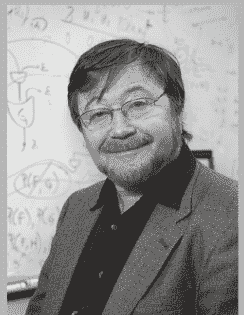

## 与朱迪亚·珀尔谈因果

深度学习自带动力机制，能自我修复、找出最优组合，绝大多数时候结果正确。可一旦出错，你不知道错在哪，也不知道如何修复。

朱迪亚·珀尔是计算机科学教授，加州大学洛杉矶分校认知系统实验室主任，与达娜·麦肯齐合著《为什么：关于因果关系的新科学》。

八十年代，朱迪亚·珀尔推出实现人工智能的新路径——贝叶斯网络。这种基于概率的机器推理模型让机器能在复杂不确定世界中运作，成为“证据引擎”，依据新证据不断修正自身信念。短短几年内，贝叶斯网络完全取代了以往基于规则的人工智能路径。深度学习的出现让珀尔的研究一度停滞，因其方法带有不透明性。深度学习指计算机通过观察海量数据自我学习变得更聪明。

看到迈克尔·乔丹、杰弗里·欣顿等同事在深度学习上取得卓越成果后，他对这种不透明感到不安。他开始理解深度学习体系的理论局限，并指出这些基本障碍的存在将使机器无论付出多大努力都无法达到人类智慧。珀尔意识到，借助贝叶斯网络的计算优势，将简单概率图模型与数据结合，也能表征与推断因果关系。这一发现的意义远超其在人工智能领域的初衷。他的新书向大众解释因果思维，堪称关于人类如何思考的入门之作。

珀尔以原则性数学方法研究因果关系，对思想界贡献巨大。几乎每个研究领域都从中受益，特别是数据密集型的健康学与社会科学。

当透明度消失：从控制论到深度学习

我曾以物理为业，对控制论着迷。它并未榨干图灵机的全部潜力，却异常分明，因为它立足于经典控制理论与信息理论。今天以深度学习为主流的范式，这种分明已经不见。归根结底，深度学习只是在一条长长的输入输出链上反复调权重的拟合工作。

圈内常调侃它好用却说不清缘由。它自有运转节奏，喂饱样本后便自行修正，把看似最优的组合拼出来，绝大多数情况下结果可信。一旦出错，成因无迹可寻，修复也无从谈起。更麻烦的是难以判断是代码瑕疵、方法局限还是外部环境发生了漂移。我们真正需要的是另一种可解释性。

也有声音认为可解释性并不关键。我们至今不懂神经的具体构造，它照样运行，于是可以容忍无知换取绩效。有人发问，为何非要搞懂原理再造智能？我部分认同。个人厌恶不透明，不愿把时间花在深度学习上，但我也清楚它在智能版图中占据位置。不透明的装置照样能产出惊人成果，大脑便是最好例证。

这种宽容有边界。对大脑的无知可以被接受，因为其运行规律相对稳定，我们不必知晓机理也能交流互教、以语言激励。若我们的装置都像阿尔法围棋那样成黑箱，就无法建立有意义的对话，很遗憾。任务或环境哪怕只有轻微变化，也得重新训练。

正因如此，我没有拿那些黑箱学习系统做实验，而是去探究其理论边界以及突破方式。采用的是因果推理，也就是科学家理解世界的套路，它拥有大量直觉案例，能在分析过程中追踪进展。由此我看到若干根本性障碍，若不解决，无论投入多少，装置都难以获得类人的智能。厘清障碍与攻克障碍同样重要。

现阶段的机器学习几乎都在统计式、模型盲的形态下工作，相当于把函数套在大量点上。这种形态无法处理“如果……会怎样”的提问，所以不足以支撑强人工智能。要达到人的水准，学习装置需要现实蓝图的指引，一个模型，就像在陌生城市开车时依赖的道路图。

更精确地说，现有学习装置是通过不断优化环境感官输入流的参数来提升表现。这是一个缓慢过程，与达尔文的自然选择类似。它能解释鹰蛇等物种如何在百万年里进化出超强视力，却无法解释人族在千年间造出眼镜望远镜的超级进化。人独有的，是可以任意操纵的心智表征，能想象假想情境来规划和学习。

尤瓦尔·赫拉利与史蒂文·米森等研究智人的学者普遍认为，使人祖先四万年前就能主导全球的关键，是能够创造并保存环境的心理表征，并反复探究、想象性扭曲它，从而回答“如果……会怎样”。他们会问干预性问题：这么做会怎样？也会问追溯或反事实问题：如果当初没那样做会怎样？今天没有一台学习装置能回答这些。大多数学习装置根本不具备这类表征。

关于因果推理，我们发现无论模型盲的拟合多复杂，或任何统计推断，都极为受限。我们还梳理出组织这些局限的理论框架，形成层级结构。

第一层是统计推理。它只能说明看到一件事情如何改变你对另一件事情的判断。如某种症状提示某种疾病。

第二层包含了第一层，第一层却不包含第二层。第二层关乎行动。“提价会怎样？”“让你笑会怎样？”第二层需要干预信息，这是第一层没有的。这类信息可编码为概率图模型，它仅说明哪个变量对另一个变量有响应。

第三层是反事实。这是科学家的语言。“若这东西重两倍会怎样？”“我当初没那么做会怎样？”“头痛是阿司匹林治好的还是打盹治好的？”反事实在感知上属于最高层，即便能预测所有行动结果，也得不到反事实。它需要额外的等式形式信息，来说明某个变量对其他变量变化的反应。

因果推理研究最突出的成果，是把干预与反事实算法化，即把层级结构最顶的两层算法化。换言之，一旦把科学知识编码成模型，可定性的，就存在检验模型的算法，对于给定的查询，无论是干预还是反事实，都能根据可用数据估算是否有结果，以及如何得出结果。这极大改变了科学家做研究的方式，尤其在社会学、流行病学等数据密集型学科，因果模型已成为第二语言。这些学科把这种转变视为因果革命。正如哈佛社会学家加里·金所说：过去几十年里，人们对因果推理的认识，比历史上所有时期加起来都多。

我在思考机器学习成功并试图推向未来的人工智能时问自己：我们是否意识到因果推理领域发现的基本局限？我们准备好绕过阻碍从一个层级升到另一个层级的理论障碍了吗？

我认为机器学习是把我们从研究数据带到研究概率的工具。但从概率到真正理解，还需要再迈两大步，一是预测行动结果，二是反事实想象。除非迈出最后两步，就不能说了解现实。

哲学家斯蒂芬·图尔敏在其洞见之作《前瞻和理解》1961年提出，透明与不透明的对比是理解希腊与巴比伦科学古老竞争的关键。据图尔敏，巴比伦天文学家是黑箱预测的大师，在观测的精确与一致性上远超希腊对手。然而科学偏爱希腊天文学家富有创造力的推测，那种大胆而充满隐喻的想象：燃烧的圆管、天火穿过小孔被看作星星、半球状地球骑在龟壳上。正是大胆的建模策略，而非巴比伦的外推，震惊了埃拉托色尼，使他做了当时最具创造力的实验之一，测出地球周长。巴比伦以数据为准的科学家永远不会做这样的实验。

模型盲法给强人工智能要执行的高阶认知任务加上了内在限制。我觉得达到人类水平的人工智能不会只从模型盲的学习装置中冒出来，它需要数据与模型的共生协作。

数据科学只是帮助解释数据的科学，而解释数据是两体问题，要把数据与现实联系起来。无论数据多大、操作多熟练，数据本身不是科学。不透明的学习系统可能把我们带到巴比伦，而非雅典。

## 03 向装置植入目标
THE PURPOSE PUT INTO THE MACHINE

未来可能出现这样的情形：我们无法预见超级智能装置的行动，它们不甚明确的目标与我们自己的目标相冲突，而为实现这些目标而必须存活下去的动机极其强大。

斯图尔特·罗素是加州大学伯克利分校计算机科学教授、史密斯-扎德工程学讲席教授。他与彼得·诺维格合著了《人工智能：一种现代的方法》。

布罗克曼这样评价斯图尔特·罗素
计算机科学家斯图尔特·罗素和埃隆·马斯克、史蒂芬·霍金、迈克斯·泰格马克等许多人一样，主张应审慎创造超人类甚至人类水平的智能，即通用人工智能。这些智能程序的目的可能并不与人类设计的目的一致，存在潜在危险。

他早期的研究致力于把“有界最优性”理解为智力的正式定义。他开发出理性元推理技术，简单说就是希望尽快提高最终决策质量的计算。他致力于概率论与一阶逻辑的统一，为《全面禁止核试验条约》提供全新的监测系统，同时致力于长期决策问题。他对最后一个主题的陈述常以“生命：在20万亿个动作中打赢”为标题。

他非常关注自主武器的持续发展，如杀伤力极强的微型无人机，这些无人机极有可能变成大规模杀伤性武器。他起草了致奥巴马总统的信，信中汇集了世界顶尖的40名人工智能研究者的意见，这封信促成了高级别美国国家安全会议的召开。

他目前的工作主要是建造他所说的“可证明有益的”人工智能。他希望通过“把明确的不确定性输入系统”来确保人工智能安全，这种不确定性是指人类程序员的目的具有不确定性。这种方法将彻底打乱当前人工智能的研究。

在过去二十多年里，学过计算机科学课程的人一定都听说过斯图尔特的名字。他与人合著了人工智能领域的权威教科书，估计有500多万英语读者。

诺伯特·维纳在《人有人的用处》一书中提出了许多问题，其中对当今人工智能研究者最重要的问题是：人类将自己的命运交给机器掌握的可能性。

维纳认为，不久的将来机器能力太有限，无法控制全球。相反，他认为机器和类似机器的控制系统会被人类精英掌握，绝大多数人类将沦为“齿轮、杠杆和棍子”。展望更远未来，他指出给这些超高能力的机器确定明确目的相当困难。他说：

生活中有一些更简单、更显然的真理，比如瓶子里发现有个魔鬼，最好的办法就是让他待在那里；比如渔夫为他的妻子祈求许多恩惠，最终却又回到原点；再比如假设你可以实现三个愿望，那你要非常小心地许愿。

其危险显而易见：

除非我们事先检查了机器的行为规律，完全清楚它的行为是按照我们能接受的原则进行的，否则让机器决定我们的行为，那就太不幸了。另一方面，像神灵这样的可以学习、可以根据其学习做出决定的机器，绝不会被迫做出人类本该做出的决定，也绝不会做出人类可接受的决定。

十年后，看到阿瑟·塞缪尔设计的西洋跳棋博弈程序可以比它的设计者下棋下得好得多，维纳在《科学》杂志上发表了《自动化的一些道德和技术后果》。在这篇文章中，他的观点更加清晰：

如果为了达到目的，我们使用一个无法有效干预其操作的机械装置……我们最好确信我们让机器拥有的目的就是我们真正想要的目的。

在我看来，这就是近年来埃隆·马斯克、比尔·盖茨、史蒂芬·霍金和尼克·波斯特洛姆等观察家提出的超级人工智能存在风险的根源。

将目的输入机器
人工智能研究的目标是了解智能行为背后的原理，并把这些原理注入机器中，使其表现出这样的行为。在20世纪60、70年代，主流智能理论是逻辑推理能力，包括为实现特定目的设定行动计划的能力。最近，大家趋于一致认为理性主体可以感知并采取行动，以最大化其预期效用。逻辑规划、机器人学和自然语言理解等子领域都属于这个一般范式。人工智能纳入概率理论处理不确定性，纳入效用理论定义目标，纳入统计学习使机器适应新环境。这些进展使人工智能与其他学科建立了强联系，包括控制理论、经济学、运筹学和统计学。

在人工智能的逻辑规划和理性主体视角中，机器的目的，无论是以目标、效用函数还是强化学习的奖赏函数形式，都是外生的。用维纳的话说，这就是“赋予机器以目的”。事实上，人工智能领域有一个信条，即人工智能系统应该拥有一般目的，也就是能接受一个输入的目的然后实现它；人工智能不应该有特殊目的，即隐含在设计中的目的。例如自动驾驶汽车应该接受输入的目的地，而不是有一个固定目的地。但汽车的某些“驾驶目的”是固定的，例如它不应该撞到行人。这个目的直接建构于驾驶程序之上，不是外显的，毕竟现在没有一台自动驾驶汽车“知道”行人不想被撞到。

赋予机器目的，使它能依据明确计算程序优化行为，似乎是不错的方法，可以确保“机器按照我们可接受的原则行动”。但正如维纳警告的，我们需要赋予机器正确的目的。这可称作迈达斯国王问题：迈达斯得到他想要的，凡是他接触的东西都会立刻变成金子，但很快他发现这是灾难，他喝的水变成黄金，吃的食物也变成黄金。用专业术语说赋予正确的目的就是“价值对齐”。如果不能价值对齐，我们可能会无意中赋予机器与我们自己目标完全相反的目标。为了尽快找到治疗癌症的方法，人工智能系统可能会选择将整个人类作为豚鼠进行实验。为了解决海洋酸化，它可能会耗尽大气中的所有氧气。这是系统优化的共同特征：目标中不包含的变量可以被推向极值以帮助优化该目标。

然而，无论是人工智能还是围绕目标优化的其他学科，如经济学、统计学、控制理论、运筹学，都无法确定究竟什么是“我们真正想要的目的”。相反，这些学科假定我们只是简单地把目标赋予机器。目前人工智能研究主要是研究机器实现目标的能力，而不是如何设计那些目标。

史蒂夫·奥莫亨德罗提出了一个更大的难题，他观察到智能实体必须靠行动保护自己的存在。这与自我保护的本能或其他任何生物学概念无关，而只是因为如果实体死亡，它就无法实现自己的目的。据奥莫亨德罗，一个有开关功能的超级智能机器，会采取某些行动使开关失效。艾伦·图灵本人在1951年英国广播公司第三电台的谈话节目中，把这样的机器看成人类的救赎。因此未来我们可能面临这样的情景：我们无法预知这些超级智能机器的行动，它们不完全明确的目标与我们自己的目标相冲突——为了实现这些目标而要生存下来的动机非常强大。

站不住脚的反驳
对于这种论点，有些人，主要是人工智能领域的研究人员，提出了反对意见。这些反对意见反映出一种自然的防御反应，也许还反映出对超级智能机器能力缺乏想象。但仔细想想，这些观点一个都站不住脚。下面是常见观点：

不用担心，我们只需把开关关上。一说到超级人工智能会给我们带来的风险，往往局外人就会第一个想到这件事，就好像超级智能实体永远不会想到这件事一样。这就好比说人类败给“深蓝”或“阿尔法围棋”的可能性微乎其微，因为我们只需一步一步地走对棋就行了。

根本不可能出现达到人类水平甚至超人类水平的机器人。这是人工智能研究人员的一种不寻常说法，因为从图灵起，他们一直在回避哲学家和数学家的这种说法。虽然没有证据支持，但这种说法似乎认为，如果有可能创造出超级人工智能，那将存在重大风险。就好像一个公共汽车司机，车上是全体人类，他说：“是的，我正朝悬崖驶去，事实上，我正在加速！但是相信我，还没等我们到那里，汽油就会用完！”这种说法很愚蠢，它在赌人类缺乏创造力。我们以前这样赌过，但输了。1933年9月11日，著名物理学家欧内斯特·卢瑟福满怀信心地说：“任何希望从这些原子转变中获得能量的人都在痴心妄想。”1933年9月12日，利奥·西拉特发现了中子诱发的核链式反应。几年后，他在哥伦比亚大学实验室证实了这样的反应。正如他在回忆录中所写：“我们把一切关闭，回到家。那天晚上，我脑海中非常确定，世界正走向悲伤。”

现在担心它为时过早。到底该什么时候担心人类可能要面对的这些严重问题，这不仅取决于问题发生的时间，还取决于制定和实施避免风险的解决方案所需的时间。例如，如果我们探测到在2067年将有一颗大型小行星与地球相撞，我们会说“现在担心它为时过早”吗？如果我们预计由于气候变化会在21世纪末发生全球性灾难，现在采取行动阻止它还为时过早吗？不早！相反，可能是为时已晚。我们无法预测什么时候会有达到人类水平的人工智能，但是，像核裂变一样，它可能会比预期的时间来得早。关于这一论点，还有另一种说法，就像吴恩达所说的：“这就像担心火星上会人口过剩。”这是一个类比：它说明这种风险不仅很容易控制，而且距离我们太过遥远，不仅如此，从一开始，我们甚至不太可能会尝试把数十亿人迁徙到火星上。但是，这一类比是错误的。我们现在已经投入巨大的科学技术资源来创造越来越有能力的人工智能系统。一个更贴切的类比应该是我们欲把人类迁往火星，但却没有考虑到，我们一旦到达，该呼吸什么、喝什么或吃什么。

无论如何，达到人类水平的人工智能并不是真的很快就会出现。例如，斯坦福大学的《人工智能百年报告》告诉我们：“与大众媒体对人工智能的神奇的预测相反，研究小组发现我们没有理由担心人工智能眼下就会对人类造成威胁。”这一论点扭曲了我们担忧的原因，我们并不是担心这种威胁迫在眉睫。尼克·波斯特洛姆在他2014年出版的《超级智能》一书中写道：“人工智能是否即将有重大突破，或者我们可以精确地预测什么时候会有这样的突破，这并不是本书要探讨的内容。”

你只是一个卢德分子。这么说很奇怪，因为如此定义的话，卢德分子将包括图灵、维纳、明斯基、马斯克和盖茨在内的那些在20世纪和21世纪对科技进步做出最杰出贡献的人。这个称呼也说明大家完全误解了这种担忧的性质和原因。这就好像说，如果他们指出人类有必要控制裂变反应，我们就要指责核工程师是卢德分子一样。一些反对派还使用“反人工智能分子”这个术语，这相当于称核工程师为“反物理学分子”。我们理解和预防人工智能会带来的风险，其目的是确保我们能够得到益处。例如，波斯特洛姆写道，成功地控制人工智能将带来“一种文明的轨迹，使人类能充满同情地、快乐地使用宇宙的馈赠”——这并不是悲观的预测。

任何足以带来麻烦的机器都非常聪明，它们有适当的利他目标。通常，这种观点有一个前提，即智力更高的人常常更有利他主义目标，这一观点可能与持这种观点的人的自我认知有关。这一论点与休谟的“应然与实然”和 G. E.摩尔的自然主义谬误有关，这意味着，由于机器有智慧，那么鉴于它自己的世界经验，在某种程度上它会觉察到什么是正确的。这让人无法相信。例如，我们不会在棋盘和棋子的设计中认识到“将军”的目标；因为同样的棋盘和棋子可以作为自杀棋，或者还可以开发出许多其他游戏。再举个例子：在波斯特洛姆的想象中，人类被一个假定的机器人灭绝，这个机器人把地球变成回形针的海洋，我们人类会觉得这个结果很悲惨，可是吃铁的氧化亚铁硫杆菌却兴奋不已。谁会说这个细菌做错了吗？人类赋予机器固定的目标，这并不意味着它会自动认识到那些不属于目标的事物对人类来说也是重要的。机器最大化实现目标很可能会给人类带来问题，但根据定义，机器不会将这些问题识别为问题。

智能并不是一条可以通用的标尺，所以“比人类更聪明”这句话本身就不成立。[7] 这是当代心理学的主流共识——智商只能粗略捕捉人类的部分认知能力，并不能覆盖其丰富多样的表现。对人来说，智商算是一种简易指标；但对现有的 AI 系统而言，这个指标毫无意义，因为不同系统擅长的领域彼此孤立。谷歌的搜索能迅速检索信息，却不会打一盘象棋；深蓝可以在棋盘上碾压人类，却回答不了一个普通的检索问题。用同一把智商尺子去衡量它们，根本行不通。

但这并不能为“智能多元，所以可以放任超级智能带来的风险”提供任何支持。如果“比人类更聪明”是个空话，那么“比大猩猩更聪明”也是空话，由此推不出大猩猩无需畏惧人类，而这显然站不住脚。完全可能存在一个实体，在所有与生存相关的智能维度上都全面超越另一个实体，从而对后者的存续构成威胁，即使前者不懂音乐、不懂文学。

## 破局路径
面对维纳的警示，我们能回应吗？能否设计出一种人工系统，其目标与人类并不冲突，从而对它的行为保持信心？表面上这几乎不可能，因为我们既写不出真正完整的人类目标，也无法预见到 AI 为达标时可能出现的各种反直觉手法。

把超级智能系统当成来自太空的黑箱，我们就没希望。更可靠的做法是先形式化一个“问题 F”，再让 AI 成为“问题 F 的求解器”。无论它以何种方式求解，只要我们对 F 的定义感到满意，答案就可被接受。找到合适的 F，就等于打开了“有益 AI”的路径。

一个反面示范是：以人类定期打分的标量奖励作为反馈，把 F 定义为最大化预期累计奖励。机器的最优策略往往不是“表现好”，而是控制评分者，迫使对方给出更高回报。这就是“大脑连线”困境——人类若能直接刺激快乐中枢，也会落入同样的陷阱。

我相信更有效的方法存在。虽然不显眼，人类对未来生活存在偏好，给足时间让其在无限可能中挑选，基本可以辨别出更想要的那一种。理想化地忽略体内子系统偏好冲突的问题，这至少不妨碍我们避免灾难性的后果。在此框架下，机器要解决的形式化问题 F 是最大化对人类未来偏好的满足度，即使它最初并不确定这些偏好为何物。偏好虽是隐变量，却扎根于大量证据——也就是所有做过的选择。这种设想绕开了维纳的难题：机器会随着时间越来越了解偏好，却永远不可能完全确定。

协同反向强化学习正是对此的精确刻画。它包含人类和机器人两个角色，构成一个信息不完全的博弈。人类知道奖励函数，机器人不知道，但其任务是最大化该函数。

一个简化的例子：哈丽特喜欢收集回形针 p 和订书钉 s，幸福度为 θp + (1-θ)s，θ 为两者间的兑换率。机器人罗比负责生产。哈丽特真正的 θ 是 0.49，略偏爱订书钉。罗比的先验是对 0~1 均匀分布。

博弈流程是哈丽特先做一次小演示：生产 2 个回形针、2 个订书钉，或各 1 个。随后罗比需决定生产 90 个回形针、90 个订书钉，或各 50 个。若哈丽特演示 2 个回形针，罗比理性反应是生产 90 个回形针，哈丽特幸福度为 45.9。相比之下各生产 50 个能得到 50.0。最优解是哈丽特演示各 1 个，引导罗比各生产 50 个。于是博弈规则让哈丽特可以“教”罗比，只要她知道对方在观察。

在这一框架内，开关问题也可以被建构并解决。机器人若不确定人类偏好，关闭自己的开关反而对它有利，因为它知道人类会按下开关以阻止与偏好相悖的行为。于是机器人被激励去保护开关，这种激励直接来自对人类偏好的不确定性。[8] 图灵可以安心了。

开关示例提供了一种可控机器人的模板，也给出了一个很可能有益的系统整体思路。它与经济学中的机制设计相似：一方激励另一方按设计者的利益行事。区别在于，我们建造机器人是为了让人受益。

实践上看，这种做法可能有效。首先，人类行为与他人反应的文字影像记录极为丰富，在构建超级系统前就有机会据此建立偏好模型。其次，让机器人理解人类偏好有强大的短期经济驱动：若家用机器人分不清情感价值与营养价值，把猫炖了当晚餐，该行业就会立即破产。

明显的难题是，如何从人类行为中读出潜在线偏好。人类并不理性，常反复无常、意志薄弱、计算受限，行为未必反映真实偏好。下棋的失败者往往并非有意为之。机器人要从非理性行为中学习，就需要更好的认知模型。现实与社会的约束也让全部偏好无法同时实现，机器人必须在矛盾偏好间协调——哲学家与社会科学家已为此奋斗数千年。面对喜欢折磨他人的人，机器人该学什么？最好的办法是在程序中剔除这类偏好。

解决 AI 控制问题是关键任务，用波斯特洛姆的话说，这是“我们这个时代的核心工程”。目前研究多集中于让系统做出更好的决策，而非做出更好的决定。无论算法多优、世界模型多精确，若效用函数与人类价值不一致，在普通人眼里它的决策也只会显得愚蠢。

这要求我们重新定义人工智能：它不再是与目标无关的纯智力领域，而是一个对人类有益的系统。深入思考后，我们对 AI 及其目的、与人类的关系可能会有全新的认识。

# 04
## 第三定律：智能不可解
THE THIRD LAW

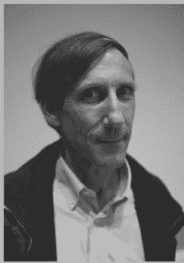

> Any system simple enough to be understandable will not be complicated enough to behave intelligently, while any system complicated enough to behave intelligently will be too complicated to understand.

任何一个简单到可以理解的系统都不会复杂到可以智能化行事，而任何一个复杂到足以智能化行事的系统都会太过于复杂而无法理解。

乔治·戴森

George Dyson

乔治·戴森是科技史学家，著有《海豹皮船》《计算机生命天演论》《猎户座计划》和《图灵的大教堂》。

注：乔治·戴森的著作《图灵的大教堂》中文简体字版已由湛庐文化策划，浙江人民出版社出版。——编者注

## 布罗克曼与戴森的对话
2005 年，科技史学家乔治·戴森应谷歌工程师之邀参观谷歌。那天正好是冯·诺伊曼提出数字计算机构想 60 周年。归来后他写下《图灵的大教堂》，首次提醒公众注意谷歌创始人的贡献。“我们扫描书籍不是为了让人阅读，”一位主谈人解释，“是为了让人工智能阅读。”

戴森对数字时代有不同解读。他关注阿留申皮艇的演进、数字计算与电信的进化、数字宇宙的起源，以及一条未实现的太空之路。他的学术轨迹难以归类——高中未毕业，却获维多利亚大学荣誉博士。

他常说，被认为与微分分析机一同灭绝的模拟计算已悄然回归。我们虽用数字组件建造系统，但系统中实际运行的模拟计算远比底层数字代码更复杂。他认为，基于数字基础发展而来的模拟控制系统的人工智能，如同战后数字计算机从模拟部件中诞生一样，可能并不遥远。

在这篇文章里，戴森反思模拟与数字计算的分界，发现模拟计算从未消失。人类试图通过编程控制万物，大自然的回应可能是未被编程的机器，而无人能控制它们。

以电子数字计算机诞生为界，计算史可分新旧两期。旧期先知是霍布斯与莱布尼茨，他们奠定了计算的逻辑基础；新期先知是图灵、冯·诺伊曼、香农与维纳，他们带来了机器。

图灵关心如何让机器智能，冯·诺伊曼关心自我复制，香农关心如何抗噪通信，维纳关心机器何时夺取控制权。1949 年维纳警告控制系统将脱离人类掌控，当时正值第一代存储程序电子计算机出现。因为系统仍需程序员直接监督，世人未予重视。此后关于自主控制风险的争论始终与对数字编码机器威力与局限的争论相伴。数字机器能力惊人，却几乎没有真正的自治，这是个危险的假设。若数字计算被取代，会怎样？

电子工业经历了两次根本转变：模拟到数字，真空管到固态器件。两者同步发生却不必然绑定。真空管可实现数字计算，固态器件也可实现模拟计算。即便真空管已商业消亡，模拟计算依然活跃。

模拟与数字并无精确界限。数字计算处理整数、二进制序列、确定性逻辑与离散化时间；模拟计算处理实数、非确定性逻辑、连续函数与现实世界的连续时间。找路中间点，数字法是用增量测量再计算；模拟法是拿一条带子量出宽度后对折，根本不依赖增量。

许多系统在两者间转换。树将输入整合为连续函数，若砍下它会发现它用数字方式记年。

模拟计算的复杂性存在于网络拓扑而非代码。信息以电压、脉冲频率等连续值传递，而非离散位串的逻辑运算。数字计算必须随时纠错，模拟计算容忍误差。

自然用数字编码存储复制核苷酸，却依赖模拟计算运行神经系统以获得智能与控制。每个活细胞的遗传系统像存储程序计算机，大脑却不是。

数字计算机在表示空间差异的比特与表示时间差异的比特之间转换，转换由程序控制，只要需要人类程序员，控制权就在我们手中。

模拟计算机在空间结构与时间行为之间转换，没有代码、没有编程。我们至今无法完全理解自然如何进化出神经系统这种模拟计算机，它体现了我们从世界吸收的一切信息，它学习，也学习控制——控制自身行为与环境。

计算机科学诞生前神经网络的萌芽已在，但多靠数字计算机模拟。如今变化到来：自下而上，无人机、自动驾驶汽车与智能手机推动神经形态微处理器的发展，硅片上直接实现真正的神经网络而非模拟；自上而下，最成功的大企业在渗透世界时也越来越多转向模拟计算。

我们争论数字计算机的智能时，模拟计算已悄然超越数字计算，就像战后模拟部件被用来建造数字计算机一样。可运行有限代码的确定有限状态处理器，正在创造大规模不确定、非有限状态的多细胞生命体，在现实世界中自由活动。模拟与数字混合系统像真空管处理电子流那样处理比特流，而不是逐个处理离散状态。比特成为新的电子，模拟回归，其本质是控制。

从物流到车流再到意识流，这些系统都按统计运行，如同神经元脉冲频率编码。智能的出现吸引了智人的注意，我们更该担心的是控制的出现。

想象 1958 年保卫美国大陆免受空袭，需要计算机网络、预警雷达与实时更新的商业空中交通图。美国建成了 SAGE 半自动地面防空系统，随后催生 Sabre，首个实时航空预订系统。Sabre 不仅显示可订座位，还能据分散情报控制客机的目的地与起飞时间。但未必存在某个控制室有人操控。比如建立公路交通实时显示系统，车辆进入区域即被记录速度与位置，这是一个完全分散的控制系统，除了系统本身外没有任何控制模型。

再想象 21 世纪初十年，想实时追踪人际关系复杂性。在小学院可建中央数据库维护，但在更大范围会变得不可行。更好的做法是分发一个简单的半自治代码拷贝，本地托管，让社交网络自我更新。代码由数字计算机执行，但系统整体执行的模拟计算复杂性远超底层代码。由此得到的脉冲频率编码社交图本身成为社交图，蔓延自校园直至全球。

若想造一台机器理解人类所知一切的含义怎么办？在摩尔定律下，世界的全部信息很快数字化。可扫描所有印刷书籍、收集每封邮件、整理数十年视频、实时追踪位置与行为。但如何理解含义？即便在数字时代，含义也无法用严格逻辑定义。收集完所有答案后，我们最多能提出明确问题，再编译一个脉冲频率加权图说明事物关联。系统随即不仅能观察绘制意义图，还能开始构建意义，最终控制意义，正如交通图开始控制交通流量，即便看似无人控制。

关于人工智能，我们有三条定律。第一条是阿什比定律：任何有效控制系统必须与被控系统一样复杂。第二条由冯·诺伊曼提出：复杂系统的基本特征包含对其行为的最简描述。生物体的最简完整模型是生物体本身。把系统行为压缩为形式化描述，只会让事情更复杂。

第三定律认为，简单到可理解的系统不足以智能化，智能化所需的系统又复杂到无法理解。

这一定律安慰了那些认为必须先理解智能才担心超人类智能的人。但存在漏洞。我们完全可能在不理解时建造某物。建造一具能运作的大脑并不需要完全理解其运作。无论程序员及其伦理顾问如何监控，漏洞都无法被填补。可以证明，“好的”人工智能是个神话。我们与真正的人工智能的关系永远是信仰问题而非证据问题。

我们过度担心机器智能，却低估了机器的自我复制、通信与控制。计算的下一场革命将以模拟系统兴起、数字程序不再能控制模拟系统为标志。对那些相信能造机器控制一切的人，大自然的回应是让他们造出一台控制他们的机器。

# 05
### 可采取的行动
WHAT CAN WE DO?

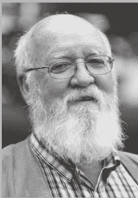

We don't need artificial conscious agents. We need intelligent tools.

我们不需要有意识的人工主体。我们需要的是智能工具。

丹尼尔·丹尼特

Daniel C. Dennett

丹尼尔·丹尼特是塔夫茨大学奥斯丁·弗莱彻哲学讲席教授和认知研究中心主任。著有《直觉泵和其他思考工具》《意识的解释》《从细菌到巴赫再到细菌：心智的进化》等十余部著作。

注：丹尼尔·丹尼特的著作《直觉泵和其他思考工具》中文简体字版已由湛庐文化策划，浙江教育出版社出版。——编者注

## 布罗克曼点评丹尼特

工具还是伙伴：AI的边界反思

在AI哲学讨论里，Daniel Dennett长期占据核心位置。他的意图归因框架与意识流动模型，描绘了一个在皮层大规模并行计算中运行的主观体验架构。这种彻底的计算主义，被John Searle、David Chalmers以及已故的Jerry Fodor激烈反对，他们坚持意向性与质性体验无法被化约为运算。

二十多年前我拜访了AI先驱Marvin Minsky，问起Dennett。Minsky说，他是世上最好的哲学家，继Bertrand Russell之后第二人。和传统哲学家不同，Dennett同时触及神经科学、语言学、AI、计算机科学与心理学，重塑了哲学家的分工。他不认同我的心智社会论，不过没有人完美。

实验室都在冲刺超级智能时，Dennett的语气很克制。他一再提醒，先把AI看成工具，别把它当成平等的伙伴。

从牛津读研起他就对信息论着迷。早期他甚至想写一本关于Norbert Wiener控制论的书。作为科学工作者，他最打动我的特质是敢于修正。最近一篇《什么是信息？》里他写道，自己曾支持的说法现在需要改写，已经超越，[content]
工具还是伙伴：AI的边界反思

在AI哲学讨论里，Daniel Dennett长期占据核心位置。他的意图归因框架与意识流动模型，描绘了一个在皮层大规模并行计算中运行的主观体验架构。这种彻底的计算主义，被John Searle、David Chalmers以及已故的Jerry Fodor激烈反对，他们坚持意向性与质性体验无法被化约为运算。

二十多年前我拜访了AI先驱Marvin Minsky，问起Dennett。Minsky说，他是世上最好的哲学家，继Bertrand Russell之后第二人。和传统哲学家不同，Dennett同时触及神经科学、语言学、AI、计算机科学与心理学，重塑了哲学家的分工。他不认同我的心智社会论，不过没有人完美。

实验室都在冲刺超级智能时，Dennett的语气很克制。他一再提醒，先把AI看成工具，别把它当成平等的伙伴。

从牛津读研起他就对信息论着迷。早期他甚至想写一本关于Norbert Wiener控制论的书。作为科学工作者，他最打动我的特质是敢于修正。最近一篇《什么是信息？》里他写道，自己曾支持的说法现在需要改写，已经超越，找到更好的解释路径。对AI研究他保持冷静，也承认自己的看法在持续演化。

很多人都讽刺过年轻时读不懂经典反而错过影响。把大书塞进书堆，往往只留下模糊印象。上世纪六十年代我读过《人有人的用处》，重读时才被击中。返读青年时代的书会发现，很多后来自称的“发现”早有伏笔；当年无感的洞见，在历练后才忽然通透。

Wiener写作时，真空管仍是主流，真正能跑的计算机屈指可数。即便如此，他用极少失误描绘了我们如今享用的未来。1950年Alan Turing在《Mind》发表《计算机械与智能》，预言了AI。Wiener也做过预言，但看得更远，他看到AI不只是模仿智能，更会在模仿中重塑人自身。

> 我们不过是川流不息的河水中的漩涡。我们并非僵滞的死物，而是延续自己的模式。

当时人容易把它当作赫拉克利特式夸张。细看却是观念革命的种子。今天我们有了复杂适应系统、奇异吸引子、扩展心智、稳态等语言，这些转向有望松动心智与机械、精神与物质之间的解释鸿沟，而这条鸿沟仍被现代笛卡尔信徒死守。他们难以接受人只是承载信息的物质模式的延续，而不是死物。这些模式有弹性、有自修复，却也善变、机会主义、为求存会利用一切新东西。正因如此不确定性才丛生。诱人机会出现时，人类愿意为新能力付一点代价，很快就对新工具上瘾，可选项变成必需。

进化史一再上演。多数哺乳动物能自造维生素C，灵长类转向水果饮食后失去此能力。如今我们必须补维生素C，却不必像近亲那样必须吃水果，因为技术能合成所需营养。这种自我延续的模式，现在依赖衣物、熟食、维生素、疫苗、信用卡、手机、网络，还有AI。

Wiener预见到Turing和多数乐观者忽略的麻烦。他指出真正危险在于，这类装置本身没有杀伤力，却可被个人或群体拿来强化对他族的控制；或者政治人物不靠装置，靠狭隘漠视人类可能的政治手法来管控民众，仿佛这些手法是机械设计的。统治力主要取决于计算程序而非硬件，而今日的硬件让Wiener时代看来繁琐的计算变得可行。面对那些狭隘漠视人类可能的手段，该怎么回应？它们一次次出现，有好有坏，更多徘徊在争议地带。

想想冲突。我已故的朋友Joseph Weizenbaum接替Wiener在MIT，常观察信用卡。除了好处，它为政府或企业提供廉价且几乎无误的追踪行踪、习惯与欲望的手段。除罪犯外，很少人再用具匿名性的现金，现金可能正在消失。未来洗钱会面临更大技术挑战，而AI的模式搜寻器带来的副作用是，人类对企图控制我们的群体变得更透明。

再看艺术，数字音频与视频的革新让几乎所有人以很小代价放弃模拟格式，换来近乎完美复制。但代价巨大。奥威尔的“真理部”如今成为可能。AI的伪造技术能制造几乎难辨真假的记录，让过去一百五十年视作理所当然的调查手段过时。是回到以人类记忆和信任为黄金标准的早期世界，还是在真理军备竞赛中发展新防御？模拟胶片的时代或可回望，但多久之后人们会怀疑防篡改系统？近期事件给了不安教训：破坏信誉比保护信誉容易得多且成本更低。Wiener抓住本质：“从长远来看，武装我们自己与武装敌人，两者之间没有什么差别。”信息时代也是虚假信息时代。

能做些什么？Wiener、Weizenbaum等对亲技术派提出严厉批评。需要重新审视优先事项。一个关键观察是Wiener近乎漫不经心的说法：这些机器其本身没有杀伤力。正如我近年反复讨论的，人类制造的是工具而不是同事，最大的危险是无法体会这种差异，而这种差异需要靠政治和法律创新来强调、标记并捍卫。

也许最好的切入点是Turing在设计图灵测试时完全可以理解的想象力失败。该测试源自模仿游戏，一名男性躲起来与法官聊天，要让法官相信他是女性，一名女性则要让法官相信她是男性。对男性而言这是艰巨挑战，因为要非常了解异性的思维和偏好。Turing没有预见到深度学习的能力，AI不必理解信息就能获取并利用它。Turing设想的是机敏、富有想象力的特工，基于对女性行为的详细理论来设计反应，这是一种自上而下的高智能设计。他并不会认为获胜的男性真的变成了女性，而是认为男性的意识主导了游戏。Turing隐含的前提是只有清醒聪明的特工才能在模拟游戏中获胜。因此他认为能通过测试的计算机器可能没有人类意识，但仍有某种意识。这仍可辩护，但前提是法官必须足够足智多谋，才能揭露具备深度学习能力的AI工具的肤浅本质。

Turing没有预见到超高速计算机能在互联网取之不尽的“大数据”中盲目筛选，找到人类活动的概率模式，并对法官的几乎任何调查弹出貌似真实的回应。Wiener低估了这种可能，他只认为机器的弱点是不能考虑代表人类处境特征的大范围可能性。但把大范围可能性考虑进去恰恰是新AI擅长的。AI的唯一欠缺是浩瀚一词，因人类语言及其文化，人类拥有真正的浩瀚可能性。互联网数据中不管发现多少模式，仍有浩瀚模式未被记录。法官面对候选人的更好策略不是寻找已知，而是全新创造。AI目前表现为寄生于人类智力，毫无分辨地吞噬人类创造物并提取模式，包括最有害的习惯。它没有目标或策略，没有自我批评和创新能力，无法反思自身思想和目标。正如Wiener所说，它无助、无杀伤力，不是指它受束缚或无行为能力，而是指它根本不是主体，没有能力为被理性驱动。

Weizenbaum的《计算机力量与人类理性》有个长期困扰我的缺陷，他似乎永远不确定自己捍卫的是AI不可能，还是可能却有害。他想与Searle和Roger Penrose争论强大AI不可能，但理由不足。毕竟现在所知的一切表明，人类是由机器制造的机器制造的机器，一直到马达蛋白，没有神奇成分。Weizenbaum更重要的信息是，不应努力创造强大AI，而要极其谨慎对待能创造和已创造的系统。可以辩驳的混合观点是：强AI原则上可能，但不是人类想要的。完全可能的人工智能未必邪恶，除非把它当成强AI。

今天拥有的智能系统与科幻小说中的差距很大，许多人低估了这种差距。以IBM Watson为例，它是人类想象力的重要里程碑，多人历时数百年研发，使用能量是人脑数千倍，可能只是暂时的。Watson在智力问答节目的胜利可能是规则刻板限制的结果，甚至为发挥能力还要修改规则。折中办法是放弃一点多样性、人性，换取令人满意的节目。Watson不是好伙伴，IBM广告误导公众相信它有一般会话能力，把它当成貌似真实的多维主体就像把手动计算器当成Watson一样可笑。对这样的主体而言，Watson至多是有用的核心器官，更像小脑或杏仁核，充其量是特殊用途子系统，可提供支持，却无法制定目标、计划或进行有意义对话。

为何要把Watson变成有思想有创意的类人主体？也许图灵的测试把人类带入陷阱，让人寻求屏幕后至少出现真实人物的幻觉，去跨越恐怖谷。自图灵提出挑战后，创造者便用可爱的仿人触感、迪士尼化效果粉饰恐怖谷，让外行沉迷。Weizenbaum的ELIZA是制造这种肤浅幻觉的先驱，他的简单程序让人相信自己在认真倾心交谈，这让他沮丧，也成为他使命的起点。

从图灵测试比赛Loebner Prize来看，即使聪明人若不了解计算机编程的可能性和捷径，也很容易被简单把戏欺骗。AI界对这些用户界面伪装态度不一，但普遍认为技巧并不深奥却很有效。坦率承认人形装饰是虚假广告并加以谴责，而非喝彩，那该多好。

怎样实现转变？一旦人类开始依据AI系统的建议做出生死攸关决定，而系统内部操作难以理解，那些鼓励信任的人就应承担更多道义和法律责任。AI系统功能强大，连专家也难以确定自己的判断是否正确。但若使用者因使用系统获得经济或其他利益，他们需要确保能以最大控制力和正当理由负责任地做到这一点。就像药剂师、起重机操作员需要许可一样，AI创建者应在保险公司压力下不遗余力寻找、揭示产品弱点，并培训操作者。

可以想象反向图灵测试，接受试验的是法官：除非他或她能发现弱点、找到越界证据、洞察系统漏洞，否则不得操作许可。要获得法官认证，需要极其苛刻的大脑训练。每当遇到看似聪明的实体，人类都有强烈欲望采取意图立场。事实上，拥有抗拒把人形机器看成人的能力并不好，它代表种族主义或物种主义。许多人觉得这种怀疑令人反感，我们也可以预期，即使最熟练用户，只要能缓解执行职责时的不适，偶尔也会忍不住与工具交朋友。不管设计者如何消除假人类痕迹，我们都能预期在这个全新的人类活动设定下出现全新的思维习惯、对话伎俩、陷阱和虚张声势。电视广告新药有已知副作用，但特定系统无法负责任回答的问题更相形见绌，对忽视产品缺陷的人应处以严厉惩罚。人们普遍注意到当今世界日益严重的经济不平等在很大程度上由数字企业家财富造成；应制定法律，为公共利益将他们的财产交由第三方代管。在这些义务面前，一些最富有者自愿先服务社会后赚钱，但不应仅靠善意。

人类不需要有意识的人工主体。自然有意识的人类数量已足够处理该由特殊及特权机构处理的任务。需要的是智能工具。这些工具没有权利，也不会因笨拙用户的虐待而受伤或愤怒。不让人工主体有意识的原因之一是，不管它们多有自主性，原则上可像任何人一样自我提高，若无特殊规定，它们不会像自然有意识的人类一样有弱点，会死亡。

在塔夫茨大学研讨会上，我与Matthias Scheutz共同教授AI和自主性，我让学生描述一个机器人规格，它能与你签署有约束力的合同，不是代表人类主人，而是代表它自己。这不是理解条款或操作笔的问题，而是它作为道德上负责任主体的法律地位问题。小孩不能签此合同，须受监护的残疾人也不能。问题是，就像超人一样，它们太无懈可击以至于无法做出令人相信的承诺。若它们背弃承诺会怎样？没有信守诺言，能给它们什么惩罚？关牢房，还是更合理地拆了？除非最开始就装入人工漫游癖且AI不能禁用，否则关起来几乎不会带来不便，并且考虑到人类假定AI很狡猾，系统上很难使这个解决方案奏效。

方案万无一失。若存储在设计和软件中的信息得以保存，拆除AI并不会杀死它，无论是机器人还是像Watson一样的无法动弹主体都是如此。数字记录和传输的突破让软件和数据实际上可以永远存在，借此机器人获得永生。想想若每周都能制造一些备份人，人类道德会受怎样影响。当你周五晚上的备份在周日早上传到网上，你不会记得周六你没系蹦极绳从高桥跳下，但之后可以欣赏死亡录像带。

所以人类创造的不应是有意识的类人主体，而应是一种全新实体，更像是圣人，没有良知，没有对死亡的恐惧，没有令其分心的爱和恨，没有个性，但是各种各样的弱点和怪癖毫无疑问会被看成是系统的个性：一箱箱的真理如果人类幸运的话几乎肯定会被零星的谎言所污染。学习与它们共存却不被这些AI奴役我们的奇点论所分心，真的很难。人有人的用处将很快改变，再次、永远地改变，但如果人类对自己的行为负责，就可以掌握主动权。

我们的机器使我们陷入非人类混乱
THE INHUMAN MESS OUR MACHINES HAVE GOTTEN US INTO

> We are in a much more complex situation today than Wiener foresaw, and I am worried that it is much more pernicious than even his worst imagined fears.

> 我们今天的处境比维纳预想的要复杂得多，我担心这比他预想的最糟糕的情况还要糟糕得多。

罗德尼·布鲁克斯

Rodney Brooks
[/PRE0]

罗德尼·布鲁克斯·人物小传
罗德尼·布鲁克斯从事计算相关研究，长期担任麻省理工学院机器人学荣誉退休教授，曾领导麻省理工学院计算机科学实验室，后创办Rethink Robotics并出任董事长兼首席技术官，出版过《肉体与机器》。

# 布罗克曼对谈罗德尼·布鲁克斯：机器化的身躯

埃罗尔·莫里斯1997年纪录片《快、便宜、失控》中，机器人研究者罗德尼·布鲁克斯与驯狮者、拓扑学者、裸鼹鼠研究者同框，有评论捕捉到他眼底的一抹笑意。幻想者的气质往往如此。

职业后期，布鲁克斯作为世界级机器人学家提出判断：人类被拔高过头，本质上只是硬件一般的存在。随之描绘出一个即将来临的智能时代，人与机器的界限会逐渐模糊。他也坦承自身的认知分裂。“我像个有信仰的科学家，脑中常驻两套互不相容的图景，会按情境切换。”他写道，“正是在两种信念间来回穿梭，人类才有可能承认机器人具类情感，进而产生怜悯，赋予其意志、尊重乃至权利。”

上述表述首见于2002年。当年的论调更偏狭也更尖刻。布鲁克斯认为软件工程的加速让社会陷入对遍布系统的依赖，这些系统兼具剥削性与脆弱性。对人类而言，这种依赖程度令人吃惊。软件演进的速度已经跑在可靠防护措施的部署前面。

学者的视野常被自家工具与隐喻框住。诺伯特·维纳正是例子，我自己亦然。

维纳撰写《人有用的用处》时，正处在把机器与动物仅作物理过程理解的末期，同时站上把二者视作计算过程的新起点。或许可推测，未来还会出现第三波范式，其方法论会与维纳经历的两波截然不同，正如后两者彼此也迥异。

维纳是旧时代的巨擘，其数学工具承袭自牛顿莱布尼茨以来的连续物理描述。1948年他自造一词“控制论”，用来指称机器与动物的通信与控制学问。如今我们称之为控制理论，这门学科对实体机器设计不可或缺，却弱化了维纳对通信科学的强调。二战期间他对高射炮瞄准发射装置的研究极大推动了其突破。他把数学严谨带入工程设计，而在那之前从罗马排水系统到瓦特蒸汽机再到早期汽车，设计多靠经验试错。

设想若无艾伦·图灵与约翰·冯·诺伊曼为计算奠基，智识与技术史会走向另一分支。图灵在1936年起草、1937年发表的《关于可计算数及其在判定问题中的应用》中给出基本计算模型——图灵机。符号写在纸带上编码问题并提供工作区，最初每个问题需专用机器。后续研究表明在通用图灵机里，任意指令集可编码于同一纸带。

上世纪四十年代，冯·诺伊曼提出一种占据二维无限方格阵列有限部分的抽象自复制系统——元胞自动机。每格存放29个符号字母表中的一个，余下为空白。所有格子符号同步更新，规则依据自身与邻居状态，复杂而有限。大多数格保持不变，只有少数在变化。观察非空白区会看到一个内部有活动的稳定结构。

自复制时该系统会在平面另一处复刻自己。机器内部有一条水平格带，用字母表子集充当有限线性存储。格内的符号编码了机器本身。复制过程中这条存储带可左右移动，既可视为对新机器的指令转录，也可被复制，新存储带副本被放入新机器继续复制。

1953年弗朗西斯·克里克与詹姆斯·沃森展示生物学上很长的DNA分子如何具象化此类存储。DNA由四种碱基构成有限字母：鸟嘌呤、胞嘧啶、腺嘌呤、胸腺嘧啶，记为G C A T。正如冯·诺伊曼机器，生物复制中DNA线性符号序列先转录成RNA，再形成蛋白质构成新细胞，同时DNA在新细胞中复制并封存。

另一基石是冯·诺伊曼1945年发表的《第一稿》报告，描述一种数字计算机设计，内存同时容纳指令与数据。现称冯·诺伊曼架构，与指令数据分存的哈佛架构不同。摩尔定律时代绝大多数芯片都基于该架构，包括驱动数据中心、笔记本与手机的芯片。从哈佛和布莱切利园用电磁继电器搭建的早期数字机到冯·诺伊曼架构的跃迁，在概念上与专用图灵机到通用图灵机的扩展同构。其自复制自动机与图灵机及基于DNA的细胞复制在构造上具有根本相似。至今学界仍争论冯·诺伊曼是否意识到图灵机与他创建的两部系统间的交叉。图灵与冯·诺伊曼同在普林斯顿，图灵完成论文修改后几乎一直在冯·诺伊曼门下做博士后。

没有图灵与冯·诺伊曼，维纳的控制论或许不会只有短暂光辉，它会更长时间主导思维并驱动技术。在那个想象的历史里，我们今天可能生活在真正的蒸汽朋克世界，而非仅在展会上见到其实例。

在我看来，维纳以独特方式看待世界，涵盖物理、生物与社会。他把世界看作连续变量，这一点在《人有用其用》第一章得到阐述，并通过吉布斯统计对热力学表示认同。他还在物理与生物实体之间加入极具想象力的信息模型作为传递媒介。七十年后，技术优势表明其工具不足以刻画构成生物系统的机制，他也没预见到类似机制最终会融入技术计算系统，正如今日。

第一次工业革命，人类工人用蒸汽机或水轮能量取代自身出力。人类不再是体力劳动的能量来源，而变成调制者，研究如何使用大量能源。但蒸汽机与水轮必须很大才划算，且18世纪能源空间分配技术只有机械且范围极短，许多工人被迫挤在能源周围作业。维纳预言，传输能量并转化为电能的技术将开启第二次工业革命。他说对了。现在用能地点可远离能源，自20世纪初配电网建立后制造业更分散。

随后维纳认为，另一项新技术，即他时代初生的计算机器，将带来又一次革命。他谈到的机器似乎兼具模拟与数字属性。在《人有用其用》中，他指出因这些机器能做决定，蓝领与白领都可能沦为更大机器的部件。他担心机器能力催生的组织结构会使人类彼此利用甚至相互滥用。过去六十年我们确实看到了，而且远未结束。

然而他以物理学为基础的计算观使他未意识到事态会恶化到何种程度。他看到机器的交流能力能提供全新、非人性的指挥控制方式。但他没看到几十年内计算系统会变得更像生物系统，且根据他在该书第十章对自己在生物学某些方面建模工作的描述，他似乎低估了生物学相较物理学的复杂性。今日的处境比他预想更复杂，我担心比他预想的最糟还要糟。

六十年代，计算牢牢建立在图灵与冯·诺伊曼奠定的基础：数字计算，以有限字母表为基础。有限字母表字符构成的任意长度序列可编码为唯一整数。和图灵机一样，计算被形式化为计算单个整数值输入的整数值函数。

图灵与冯·诺伊曼都逝世于五十年代，当时他们就是这样看计算。他们没预见摩尔定律带来指数增长，也没预见计算机器会如此普及。他们也没预见计算模型的两个演进，每一个都对人类社会构成巨大威胁。

第一个源于他们采用的抽象概念。五十年间摩尔定律推动软件生产竞赛，新软件不断出现以利用每两年翻一番的算力，而工程学科的审慎与检验传统被搁置。软件工程发展快、易故障。这种缺乏正确标准的软件快速扩张，为利用冯·诺伊曼架构中数据与指令同存内存的特点开启了许多途径。最常见的是溢出漏洞，将大于程序员预期的输入数字或长字符串溢出到存放指令的区域。通过精心设计一个异常大的输入，使用软件的人可以用程序员未打算使用的指令感染它，改变其行为。这是计算机病毒的基础，因它与生物病毒相似。生物病毒把额外DNA注入细胞，细胞的转录与翻译机制盲目解释该额外DNA，产生可能有害的蛋白质，且细胞复制机制让病毒大量增殖。因此一个小外来实体可控制更大实体并以意想不到方式改变其行为。

这些及其他形式的数字攻击使日常几乎失去安全感。现在几乎一切都靠计算机。电力、燃气、道路、汽车、火车、飞机等基础设施靠计算机，都是不堪一击。银行业务、账单、退休账户、抵押贷款、商品购买与服务也靠计算机，同样脆弱。娱乐、商业与个人通信、国内安全、信息获取与投票系统都靠计算机，皆脆弱不堪。这一切不会很快解决。与此同时社会诸多方面都可能遭受恶性攻击，无论攻击者是职业罪犯还是国家对手。

第二个演进是计算不再是简单计算函数。程序持续在线，因而可收集查询序列的全部数据。按维纳、图灵、冯·诺伊曼的方案，网络浏览器的通讯模式是：使用者要求打开A页面，浏览器显示A页面……使用者要求打开B页面，浏览器显示B页面。而现在的模式是：使用者要求打开A页面，浏览器显示A页面，同时默默记录你曾要求访问A页面……使用者要求打开B页面，浏览器显示B页面，同时注意到其内容与前面请求的A页面的关联，于是更新对使用者即你的模型并传给生产它的公司。

当机器不再简单计算函数而保持状态时，它就能通过呈现的请求序列对人类进行推断。当不同程序在不同请求流间相互关联，例如将网页搜索与社交媒体网站关联，或与另一平台的支付服务关联，或与在特定广告上的停留时长关联，或与使用者使用带GPS手机时经过的位置关联。此时由许多程序构成的总系统因程序间互通及与数据库的通讯，会带来全新隐私泄漏。许多美国西海岸公司在未经与计算机平台交互人员知情同意的情况下，将这些推断货币化，实现了巨大剥削性飞跃。

维纳、图灵和冯·诺伊曼无法预见这些平台的复杂性，平台条款合同里有许多晦涩法律字眼，人们在不了解具体含义的情况下自愿签署，从而放弃了在与其他人一对一交易中绝不会放弃的权利。计算平台已成为屏障，在其背后一些公司不人道地剥削他人。在某些国家，政府操纵这些平台，其目的不是利润而是镇压异议。

人类已陷入困境：我们被提供渴望服务的公司剥削，同时生活又依赖于极易受攻击的诸多软件系统。摆脱困境将是长期任务。它涉及工程、立法，以及最重要的，道德领导力。道德领导力是最重要也是最大挑战。

# 智能的统一
THE UNITY OF INTELLIGENCE

The advantages of artificial over natural intelligence appear permanent, while the advantages of natural over artificial intelligence, though substantial at present, appear transient.

人工智能胜过自然智能的优势是永久的，而自然智能胜过人工智能的优势，虽然目前是实质性的，但似乎这只是暂时。

弗兰克·维尔切克

Frank Wilczek

弗兰克·维尔切克是麻省理工学院物理系赫尔曼·费什巴赫讲席教授，2004年诺贝尔物理学奖得主，著有《美丽之问：宇宙万物的大设计》一书。

# 布罗克曼访谈弗兰克·维尔切克

首次会面在八十年代，他邀请我到普林斯顿的家中。“地址是默塞尔街112号，”他写道，“找没有车道的房子。”数小时后，在爱因斯坦的旧客厅里，我与未来的诺贝尔奖得主交谈。你永远猜不到弗兰克是否像我一样对环境敏感。他唯一提到的是在“没有车道的房子”前停车很困难。

与大多数理论物理学家不同，弗兰克长期以来对人工智能保持浓厚兴趣，可由三个结论看出：

+ 1. “弗朗西斯·克里克称之为‘惊人的假说’：意识，也称为心智，是物质的一种涌现性。”若成立，则“所有智能都是机器智能。自然智能与人工智能的区别不在于它是什么，而在于它是如何制造的”。

2. 人工智能不是外星人入侵的产物。它是特定人类文化的产物，反映了文化的价值。

3. 大卫·休谟在1738年写下“理性是，并且只应该是，激情的奴隶”这一著名论断。指的是人类理性和人类激情。但休谟的逻辑哲学观点也适用于人工智能。简单说：驱动行为的是激励，而不是抽象的逻辑。

他指出：“20世纪和21世纪的大事是，随着计算的发展，我们学会了如何更好地计算基本定律的后果。这里有一个反馈循环：当你能更好地理解事物时，你就可以设计出更好的计算机，这样你就能更好地进行计算。这是一种上升的螺旋结构。”

在这篇文章里，他认为就目前而言人类智能具有优势，然而，未来的图景不受太阳系限制，毫无疑问也不受银河系限制，如果没有人工智能帮助，将永远无法实现。

# 三大争议的直答

- ◎ 人工智能会有意识吗？
- ◎ 人工智能会有创造力吗？
- ◎ 人工智能会是邪恶的吗？

这些问题在当今大众媒体里和科学辩论中经常被提到。但讨论似乎从未有定论。在这里，我首先作答如下：

基于生理心理学、神经生物学和物理学的答案，如果不是“是”、“是”和“是”，那将是非常令人惊讶的。原因很简单，但也很深刻：根据这些领域的证据，自然智能和人工智能之间极有可能没有明显的鸿沟。

著名生物学家弗朗西斯·克里克在1994年的著作《惊人的假说》中提出了一个惊人的假说：心智来自物质。他的著名观点是，心智，只不过是“一个巨大的神经细胞组群及其相关分子之间的交互作用”。

这个惊人的假说实际上是现代神经科学的基础。人们试图通过理解大脑的功能来理解心智的工作原理；他们试图通过研究信息如何被编码成电子和化学信号，如何被物理过程转换，以及如何被用来控制行为，来理解大脑是如何工作的。在科学尝试中，他们不容许超自然行为。到目前为止，在数千次精心设计的实验中，这种策略从未失败过。至今为止，还没有证据表明，有必要允许意识或创造力不受大脑活动的影响，以解释任何观察到的心理物理学或神经生物学的事实。没有人曾偶然发现与生物体中的传统物理事物分离的心智力量。虽然关于大脑、关于心智，我们尚有许多未解之谜，但这个惊人的假说却一直未受到损伤。

如果我们把视野拓宽到神经生物学之外，把整个科学实验的范畴考虑进来，这个假说就更加引人注目。现代物理学关注的往往是极其微妙的现象。为了研究这些现象，实验者必须采取许多预防措施防止噪声污染。他们经常发现，为防止杂散的电场和磁场干扰实验，有必要建造精密的屏蔽装置；因为微震或过往车辆引起的微小振动，有必要进行补偿；有必要在极低的温度和高真空状态下工作；等等。但有一个明显的例外：他们从未发现有必要把附近或远处的人的思想考虑进来。似乎与已知的物理过程分离，但能够影响物理事件的思想波无须存在。

这一结论，从表面上看，消除了自然智能与人工智能之间的区别。这意味着，如果我们能够复制或准确模拟发生在大脑中的物理过程——原则上我们可以做到，并将其输入和输出结果连接到感觉器官和肌肉，那么我们就能在物理人工物身上再现我们观察到的自然智能的行为。在这一过程中，没有任何可观测的效应会丢失。作为一个观察者，像其他人一样，我将意识、创造力或邪恶归于人工物的理由，与把这些属性归于其自然对应物的理由一模一样，不多也不少。

因此，把克里克的神经生物学的惊人的假说和物理学的有力证据结合起来，我们可以推断出自然智能是人工智能的一个特例。这一结论，我称之为惊人的推论。

这样，我们就有了3个问题的答案。由于意识、创造力和邪恶是自然人类智能的显著特征，因此它们是人工智能可能拥有的特征。

在100年前，甚至50年前，若相信心智源于物质的假设，并推断出自然智能是人工智能的特例，那将是信仰的飞跃。鉴于当前对生物学和物理学的理解存在许多鸿沟，它们确实值得怀疑。但这些领域的新发展改变了这一局面：

生物学：一个世纪以前，虽然有物理学上的解释，但心智以及新陈代谢、遗传、感知都是生命中深不可测的神秘方面。而今天，从分子开始，我们对新陈代谢、遗传、感知的许多方面都有了极其丰富和详细的描述。

涌现的现实与心智的源头

量子物理学在过去一百年里借助材料实验不断给出惊喜，基本单元堆叠后呈现的集体行为远比单元本身更奇特。超导体、激光以及大量相似的奇迹都在说明，哪怕是最简单的分子基元组合起来，也会长出全新的涌现模式，而且仍在物理法则之内。化学乃至生物化学中充斥着同样的涌现，它们最终都落脚在物理之上。

菲利普·安德森在《多就是不同》里对涌现做了经典表述。他承认，还原论的完备性在哲学上仍可争论，但对在实验室里工作的科学家而言，用已知相互作用从基本部分解释现象几乎是默认前提。紧接着他提醒，由海量基本粒子构成的庞大体系的运行，绝不能靠少数粒子的特性简单外推。尺度与复杂性每上一个台阶，新的组织形态就会出现，信息以新的方式被编码，行为也需要新的概念来描述。

电子计算机是最直观的涌现案例。所有部件都摊在桌面上。工程师依据相当复杂的已知物理规律自下而上搭建装置，却获得了惊人的信息处理能力。你手里的手机能击败你在象棋上的表现，能瞬间搜集并传递各类信息，也能拍出漂亮照片。正因为电脑、智能手机等设备的设计制造过程完全透明，可以毫无疑问地把它们的能力追溯到电子、光子、量子、夸克与胶子一路往下。无机之物也能显得相当聪明。

由此可得的推论是：

- 人类心智来源于物质构成
- 物质的运行被物理学所界定
- 因此人类心智是从我们能够理解并且可以人工重现的物理过程里涌现出来的
- 于是自然智能只是人工智能的一种特例

若这个推论失效，前两个前提必有问题。那本身就会意味着一个意义重大的新发现，一种大尺度的物理效应。它会潜藏在看似平常、被研究得极细的环境里，比如人脑内部的材料、温度与压力条件中，却长期躲过了精密仪器与执着研究者的触及。这样的发现会震动整个学界。

智能的下一步

提升身体与心智是人性的一部分。衣物、眼镜、手表一路增强了我们的抗御力、感知力与警觉力，这对自然禀赋的改进我们习以为常，却不应忽视其深刻意义。今天，智能手机与互联网把增强的动力推向了更核心的领域，即智能本身，并形成了一个庞大的集体意识与集体记忆。

与此同时，自主智能已在国际象棋、围棋等脑力游戏中成为世界冠军。它正接管大量复杂的模式识别工作，例如从大型强子对撞机里混乱的粒子轨迹中重建反应过程，从模糊的X光、功能性磁共振等图像中抽取诊断线索。

自我完善与创新的驱动力会把我们带向何处？具体时序与尺度难以预言，但几个基本思路表明，最终最强大的心智将与我们今天所熟知的脑截然不同。

信息处理技术在以下六个维度远超人类，或在广度上占优，或在精度上占优，或兼而有之：

- 速率。现代人工处理的内核是有序电子运动，比脑中漫长的扩散与化学变化快得多。典型计算机主频接近十千兆赫兹，即每秒百亿次运算。单一速率难以概括脑的各种过程，但动作电位的潜伏期把脉冲间隔限制在每秒数十次。影像帧率低于约四十帧时人眼能察觉断续，或许并非偶然。电子处理比人脑快近十亿倍。
- 体积。典型神经元线性尺寸约十微米。决定电子器件实际极限的分子尺寸比它小一个数量级以上，人工加工单元正逼近此极限。小体积带来更高效的通信。
- 可靠度。人类记忆本质上是模拟的，会衰减。人工记忆可做成离散数字的，能存储、刷新并精确保存。
- 运行时长。大脑会疲劳，需要营养、睡眠，会衰老，会死亡。机器不会。
- 模块化与开放接口。人工处理器支持精确定义的数字接口，易于增添新模块。若想让计算机“看见”紫外或红外，或“听到”超声，可直接接入相应传感器的输出。人的大脑结构更为封闭，且免疫系统会排斥外来植入。
- 量子潜能。这是一种特殊的模块化，具有长期潜力。物理与信息科学界已认识到量子力学原理可支撑全新计算范式，可能带来质变的新智能形态。但这些可能性依赖极其微妙的量子行为，似乎与人类大脑温暖、潮湿、混乱的环境不太兼容。

就作为智能平台，人脑远非最优。不过尽管多用途家务机器人或机械兵有现成市场，但目前尚无机器达到通用人类智能所需水平。人类大脑在多方面相对薄弱，却仍保有巨大优势，可举五点：

- 三维利用。人工处理单元线性尺寸虽小，但制作基本依赖光刻蚀刻，实质是二维的。芯片与电路板几何结构可见一斑。可堆叠，但层间距离远大于层内，通信效率低。大脑则更好利用全部三维。
- 自我修复。人脑能从许多损伤或错误中恢复，或带病工作。故障计算机通常需外部修复或重启。
- 连接密度。人脑神经元通常支持数百个突触连接，且连接模式高度复杂有意义。计算机单元连接数较少且模式固定。
- 发育与交互式雕塑自组装。人脑通过细胞分裂增殖单元，并通过迁移折叠形成连贯结构，提升细胞间连接。雕塑的重要部分在婴幼儿期随个体与环境互动而发生，部分连接被淘汰，部分被强化。大脑精细结构因此被外部世界塑形，外部世界提供丰富信息与反馈。
- 传感器与执行器一体化。人脑配备多种感觉器官，尤其眼睛，还配备多功能驱动器如手、腿、发声器官。这些输入输出装置与信息处理中心无缝集成，经过上百万年自然选择打磨。我们以极低意识注意解释原始信号并控制大规模行动，却并不清楚其内在机制。让机器人在这些“常规”输入输出上达到人类水平极其困难。

人类大脑的优势具有深远意义。它的存在展示了从物质中获取更多能力的可能路径。若人工脑能追上人类标准，何时到来？

我不确定，但可做有根据的推测。三维挑战以及自我修复看似并非不可逾越，只是棘手的工程难题，且已可见可行路径。另一方面，人眼、手等感官驱动器的能力虽高效，但远未触及物理极限。光学系统可在空间、时间、色彩及更广电磁波段实现更高分辨率；机器人可更快更强。在这些领域，超人性能所需组件已出现。瓶颈在于如何以信息处理单元的语言快速获取信息。

这个瓶颈指向剩下且最重要的优势——连接性与交互式发育。二者相辅相成，正是交互式发育塑造了婴儿大脑大量连线且蔓延的结构，通过神经元与突触的指数增长，使大脑成长为非凡的人类大脑。计算机科学家已开始发掘大脑结构力量：神经网络。其基本设计直接受大脑启发，在游戏与模式识别上取得惊人成绩。但在自我复制机器的深奥领域，当今工程技术与神经元及突触的力量多样性相比仍相去甚远。这可能成为新的伟大前沿。生物学已指明方向，因我们对生物发育的理解已足够模仿其本质。

总体而言，人工智能胜过自然智能的优势是永久的，而自然智能胜过人工智能的优势虽当下实质，但似乎只是暂时的。我猜测工程追赶需数十年，但除非灾难性战争、气候变化或瘟疫，否则技术进步会在数个世纪保持强劲上升。

若如此，未来数代人里，人类借助智能设备变得更强，并与日益有能力的自主人工智能共存。那时将出现一个复杂、快速变化的智能生态系统，并因此迅速演化。考虑到工程化设备的内在优势，演化的先锋将是机器人与超级大脑，而非微不足道的智人。

另一推动力来自恶劣环境探索，如地球深海与太空。人体只能在狭窄的温度、压力、大气成分范围内生存，还需要多种复杂营养与充足水源，且无抗辐射能力。正如载人航天计划所示，维持人类生命在舒适区外极其困难且昂贵。在这类探索中，半机械人或自主人工智能可能更有效。量子人工智能对噪声极敏感，寒冷黑暗的深空或许更适合它。

科幻作家奥拉夫·斯塔普雷顿在1935年小说《怪约翰》中写道，其英雄——一个突变超人，将智人形容为“精神的始祖鸟”。他带着深情对朋友与传记作家——一个普通人说出这句话。始祖鸟是一种高贵的动物，能够进化成更高级的生物。

#08

## 渴望超越自我

LET'S ASPIRE TO MORE THAN MAKING OURSELVES OBSOLETE

朋友圈书籍每日免费分享微信jnztxy

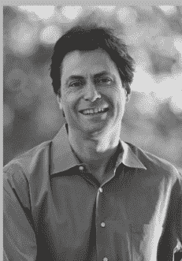

We should analyze what could go wrong with AI to ensure that it goes right.

我们应该分析人工智能可能会出什么问题，以确保它能正常运行。

迈克斯·泰格马克

Max Tegmark

迈克斯·泰格马克是麻省理工学院物理学家、人工智能研究者、未来生命研究所所长、基础问题研究所的科学主任。著有《穿越平行宇宙》(Our Mathematical Universe) 和《生命3.0》(Life 3.0: Being Human in the Age of Artificial Intelligence)。

注：迈克斯·泰格马克的著作《生命3.0》中文简体字版已由湛庐文化策划，浙江教育出版社出版。——编者注

## 布罗克曼谈迈克斯·泰格马克

数年前经宇宙暴胀理论提出者阿兰·古斯引荐，我结识了迈克斯·泰格马克。两人同在麻省理工学院任职。迈克斯是一位杰出的理论物理学家和宇宙学家，如今最关注的是通用人工智能诞生可能带来的生存风险。四年前他与扬·塔里安等人共同创立未来生命研究所，该所自称旨在确保最强大的未来技术造福人类。在伦敦一次新书推广现场，他回忆参观伦敦科学博物馆后在地铁站落泪，担心所有令人赞叹的进步最终归零。

该所科学顾问包括埃隆·马斯克、弗兰克·维尔切克、乔治·丘奇、斯图尔特·罗素，以及牛津哲学家尼克·波斯特洛姆。尼克曾提出一个广为引用的思想实验：一个明显善意的通用人工智能按指令行事，却把世界变成只有回形针的世界。该所曾资助人工智能安全会议，并在2018年发起奖金赛，聚焦最大化通用人工智能的社会效益。

外行有时觉得迈克斯危言耸听，但与弗兰克·维尔切克一样，他相信只要人类努力，在一个极大受益于通用人工智能的未来，人类仍可避免被排斥。

关于人工智能对人类影响的争论甚嚣尘上，但从宇宙尺度看，趋势更清晰：在地球上演化出的技术文明正在不计后果地加速自我过时。这令人不安，因为若敢于走更雄心勃勃的道路，人类便可获得前所未有的繁荣机遇。

宇宙诞生138亿年后才出现自我意识。在一颗蓝色星球上，我们这部分微小的有意识存在才发现，自己以为是整体的东西只是宏大图景的一角：太阳系位于拥有千亿个星系的宇宙中的一个星系，这些星系组成复杂的群团与超星系团。

意识是宇宙的觉醒，将原本没有自我的机械僵尸转变为包含自我反思、美丽、希望、意义与目标的生命生态。若从未觉醒，宇宙将毫无意义；若因灾难永久沉睡，它再次变得空洞。

事情也可能变好。我们尚不知人类是否为宇宙唯一的天文爱好者，但我们已足够了解宇宙，知道它有望达到更高的觉醒程度。诺伯特·维纳等先驱告诉我们，进一步唤醒宇宙的信息处理与体验能力，无需数万年进化，可能只需数十年的人类创造力。

我们或许正像清晨醒来时的第一丝意识，预示着睁眼后的更充分觉醒。也许超级人工智能会让生命遍布宇宙，延续数十亿年——这或许取决于我们这一代在地球上的决定。

另一种可能是人类因技术失控而迅速灭绝。

## 关于人工智能社会影响的争论

许多思想家把超级智能贬为科幻，因为他们认为智能神秘，只能存在于生物有机体，尤其是人类。但作为物理学家，我认为智能只是基本粒子进行的信息处理，没有物理定律禁止人类制造在各方面都更高级的机器。这表明我们仅见智能的冰山一角，自然中蕴藏的智能或许可被释放，以助人类繁荣或求生。

另一些人反对创造通用人工智能，不因物理不可行，而是认为人类难以在一世纪内完成。随着近期突破，专业研究者中持此观者已不多。多数人希望一世纪内实现通用人工智能，中位数预测为数十年。文森特·米勒与尼克·波斯特洛姆对研究者的调查显示：

超过半数受访者认为人工智能系统可能在2040—2050年达到整体人类能力，并有90%可能性在2075年实现。达到人类能力后，2年至30年内可能出现超级智能。

从数十亿年宇宙视角看，30年与300年差别不大，重点在含义而非时间。

起初人类用机器复制自然过程，制造热、光与机械马力。随后我们意识到身体也是机器，神经细胞的发现模糊了身心边界。最后我们开始建造机器，不仅超越肌肉，也超越大脑。在记忆、算术、游戏等狭窄认知任务上人类已黯然失色；在驾驶、投资、医疗诊断等更广领域机器正在超越。若人工智能团队达成初始目标，人类将在所有认知任务上被完败。

这引出诸多问题：谁或什么将控制主导地球的通用人工智能？应否控制超级智能机器？若不控制，能否确保它们理解并保留人类价值观？诺伯特·维纳在《人有人的用处》中写道：

> 若让机器决定行为，除非事先审查其行为规律并确知其按可接受原则运行，否则必有祸患！可学习并据学习做决定的机器，绝不会被迫做出人类本该做出的决定，也不会被迫做出人类可接受的决定。

谁是“我们”？谁判定可接受的决定？即便未来力量助人类生存繁荣，若一切都不需我们，我们如何找到意义与目的？

近年关于人工智能社会影响的争论已大变。2014年，几乎无人公开谈论风险，即便谈也常被斥为卢德式杞人忧天，理由不相容：

1. 通用人工智能被夸大，至少本世纪不会出现。

## 为什么我们急于让自己过时，为什么我们避免谈论它呢？

首先是经济学。每当我们用更好更便宜的机器使某类人类工作过时，制造与使用机器者获利，消费者得更便宜产品。如纺织机、挖掘机与工业机器人使某类工作过时一样，未来通用人工智能的投资者与科学家也是如此。过去被机器取代的工人常能找到新工作，即便不再如此，经济激励仍在。根据定义，有竞争力的通用人工智能意味着所有工作都可被机器以更低成本完成，因此任何宣称“人们总能找到高薪新工作”的人，实际上是在宣称人工智能研究者没造出好通用人工智能。

# 智人为何加速拥抱通用智能

第二，求知欲像是写进智人基因里的默认程序。哪怕没有奖金回报，弄明白“智能是什么”的冲动也会把科研推向理解心智、设想通用智能的航道。好奇心被视作人类最显眼的标签，可当它孕育出我们还没学会驾驭的技术，麻烦就来了。仅靠纯粹的学术热情，我们造出了核武器，也制造了大量毁灭性的工具。古话说好奇心害死猫，套用到整个物种上也不显得荒唐。

第三，我们终究是会衰老会死亡的凡人。这正好解释了为何延长健康寿命几乎获得一致认同，也在强力助推今天的人工智能研究。显而易见，通用智能能在医学上发挥更大价值。一些思想者甚至设想通过数字化保存意识来接近近似永生。

于是我们正急速滑向通用智能，推力之强会让我们继续前行，即便终点意味着现有经济形态被淘汰。有一天我们可能不再需要为生计担忧，因为所有人类工作都能被机器更高效地完成。通用智能的实现将是人类史上最重大的转折，为何却鲜有人严肃讨论其后果？

同样的，原因很多。

第一，厄普顿·辛克莱的讽刺依然有效：“当一个人靠对某事物的无知来赚钱的时候，让他理解这件事是有难度的。”（19）现实里，科技公司或高校团队的发言人常常宣称项目毫无风险，哪怕私下并不这么想。辛克莱的论断既能解释人们对吸烟与气候风险的态度，也能解释为何有人把技术奉为新宗教——信条是技术越多越好，反对者就是无知的制造恐慌者。

第二，人类长期沉迷于一厢情愿，习惯用过去推断未来，反复低估新技术的破坏力。达尔文进化论让我们对具体威胁很敏感，却对难以具象化的远期技术威胁缺乏敬畏。设想1930年，若你试图警告核军备竞赛的危险，当时根本看不到核爆影像，甚至连制造方法都无人知晓。即便顶尖科学家也会低估不确定性，导致预测过于乐观（聚变堆和空中飞车何在？）或过于悲观。被誉为当时核物理巨擘的欧内斯特·卢瑟福在1933年称核能是“痴心妄想”，说这话时距利奥·西拉特提出核连锁反应构想不足24小时。当时基本没人能预见核竞赛的到来。

第三，心理学研究显示，当个体感到无论如何都无力改变时，往往会回避令人不安的威胁。但就当下情境而言，一旦开始认真思考，就能开展大量建设性工作。

## 我们该如何作为
我主张进行战略转向，不再追问“赶紧造出让自己过时的技术，会有什么问题？”而是“先描绘一个令人向往的未来，再朝着它前进”。

要调动所需的投入，这一策略首先要描绘一个诱人前景。好莱坞常把未来拍成反乌托邦，但现实是通用人工智能可以带来前所未有的繁荣。我所珍视的一切文明皆是智能产物，若能以通用人工智能增强自身智能，便有望解决当下与未来的难题，包括疾病、气候变化和贫困。对未来形成的共同积极愿景越具体，协作的动力就越强。

该怎么做？2017年通过的23项阿西洛马原则提供了指引，其中短期目标包括：

- 1. 应避免致命自主武器的军备竞赛。
- 2. 人工智能创造的经济繁荣应广泛共享，以惠及全人类。
- 3. 投资人工智能的同时还应资助为确保其有益使用而进行的研究。比如如何让未来的人工智能系统具备高度鲁棒性，使其在不故障也不被黑客侵入的情况下完成我们希望的工作。[20]

前两项涉及规避次优纳什均衡。一旦失控的致命自主武器竞赛启动，很难停止，它会把匿名自动暗杀的成本推向零。第二项需要扭转某些西方国家的趋势，在这些地方许多人口的绝对生活水平在下降，从而加剧社会愤怒、怨恨与极化。若不实现第三项，我们创造的所有精妙人工智能技术都可能伤及自身，无论是意外还是蓄意。

人工智能安全研究必须在严格时限内进行：在通用智能到来前，我们需要弄清如何让人工智能理解、接纳并保留我们的目标。机器越聪明越强大，使其目标与我们一致就越关键。若造出的机器相对愚笨，问题在于它在目标未调一致前会造成多少麻烦。若造出超级智能，情况反转：因智能即达成目标的能力，超级智能系统从定义上比人类更擅长完成自己的目标，因而会占优。

换句话说，通用智能真正的风险不是恶意，而是能力。一个拥有超级智能的系统将极擅长实现它的目标，若这些目标与人类不一致，便会出事。水坝建设需要淹没蚁丘，人类不会为此反复迟疑，所以不要把人类置于蚂蚁的位置。大多数研究者认为，若最终造出超级智能，应确保它是人工智能安全先驱埃利泽·尤德考斯基所称的“友好的人工智能”，其目标在深层意义上是有益的。

目标为何如此的道德问题，与实现目标一致的技术问题同样紧迫。我们想建构怎样的社会？即便严格说我们的存在并非必需，生活意义何在？我常得到一个巧妙回答：“造出比我们更聪明的机器，让他们找出答案。”这种说法错误地把智力与道德等同。智力中性，只是完成复杂目标的能力，无论目标好坏。我们不能断定希特勒更聪明就会更好。把道德思考推迟到造出与人类目标一致的通用智能，是不负责任的，很可能灾难性。一个完全顺从的超级智能，其目标自动与人类所有者一致，就像纳粹党卫军上校阿道夫·艾希曼[21]一样。若缺乏道德指引或自我约束，它会以无情效率实现所有者的目标，不管这些目标是什么。[22]

每当我提出需分析技术风险，便有人称我危言耸听。但在麻省理工学院我们清楚，这不是危言耸听，而是安全工程。登月前，美国国家航空航天局在把宇航员放在装满易燃燃料的110米火箭顶端发射前，会系统性地梳理一切可能出错的事——很多事都会出错。这是危言耸听吗？不，这是确保任务成功的安全工程。同理，我们应分析人工智能可能出错之处，以确保它正常运行。

## 前景展望
总之，若技术超越我们管理技术的智慧，便可能导致人类灭绝。据估地球上20%至50%的物种灭绝源于此，[23]若人类成为下一个，那是讽刺。通用人工智能提供巨大机遇，它有望让生命不仅在地球上，而且在大部分宇宙中繁衍数十亿年，若人类因此灭绝将极可悲。

不要因不科学的否认风险与糟糕规划而浪费机会，让我们怀抱雄心！智人内心有昂扬的勃勃雄心，正如威廉·欧内斯特·亨利在《不可征服》所言：“我是命运的主宰，我是灵魂的统帅。”不要像无舵之船漂泊走向淘汰，我们应挺起胸膛，征服横亘在我们与美好高科技未来之间的技术与社会挑战。关于道德、目标与意义的生存挑战呢？物理定律并未设定意义，所以与其被动等待宇宙赋予意义，不如承认并庆祝，是我们有意识的存在赋予宇宙意义。让我们创造自己的意义，这个意义比工作更深刻。通用人工智能使我们最终成为自身命运的主人，让命运真正鼓舞人心！

# 09

## 反对派报告

DISSIDENT MESSAGES

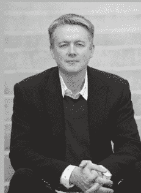
人工智能的持续发展会造成宇宙规模的变化，这个失控的过程可能会杀死每一个人。

扬·塔里安

Jaan Tallinn

扬·塔里安是一名计算机程序员、理论物理学家和投资者，与他人合作共同开发了Skype和Kazaa。

## 布罗克曼谈扬·塔里安

扬·塔里安在爱沙尼亚长大，是当时为数不多的电脑游戏开发者之一。在这篇文章中，他在人工智能领域的先驱维纳、艾伦·图灵和I. J. 古德 (I. J. Good) 等人身上找到了当前人工智能异议的根源。

扬·塔里安关注的是事关生死存亡的风险，人工智能是所有风险中最极端的。2012年，他与哲学家休·普莱斯 (Huw Price) 和皇家天文台台长马丁·里斯共同在剑桥大学创办了生存风险研究中心，这是一个跨学科的研究机构，致力于减轻“与新兴技术和人类活动有关的风险”。

他曾经向我形容自己是“一个坚定的结果主义者”，他把自己的创业财富多数捐赠给未来生命研究所（他是该研究所的联合创始人）、机器智能研究所，以及其他致力于减少风险研究的机构。迈克斯·泰格马克曾写道：“如果你是一个智能的生命形态，在数百万年后的一天正在阅读这篇文章，惊叹于生命为何如此繁盛，那么你的存在可能要归功于扬·塔里安。”

在最近一次对伦敦的访问中，扬·塔里安和我参加了在伦敦市政厅举行的蛇形画廊马拉松的人工智能小组会议，会议由本书的另一位撰稿人汉斯·乌尔里希·奥布里斯特主持。当晚在一所豪宅里举办了一场盛大晚宴，云集了伦敦的杰出人物——艺术家、时装模特、富豪、舞台明星和荧屏明星。他非常自然地与屋子里的人寒暄后——“嗨，我是扬·塔里安，”他突然说，“嘻哈舞的时间到了。”说完就一只手倒撑在地板上，向这些一头雾水的一线明星们展示他惊人的动作。然后，他就与人谈论起舞蹈俱乐部的亚文化来，显然这是他每晚告别的方式。谁知道呢？

2009年3月，在热闹的加利福尼亚高速公路旁的一家连锁餐馆。我要在那里见一个年轻人，我一直在关注他的博客。为了让自己方便被认出来，他戴着一枚纽扣，上面写着：即使你的声音颤抖，也要说出真相。他的名字是埃利泽·尤德考斯基。在接下来的4个小时，我们一直在讨论他为世界传递的信息，这个信息把我带到了那家餐厅，也最终主导了我以后的工作。

## 人工智能的风险

我通过尤德考斯基的博客接触到了一个革命性的信息，这个博客迫使我安排了在加利福尼亚的见面。信息是：人工智能的持续发展会造成宇宙规模的变化，这个失控的过程可能会杀死每一个人。要避免这种结果，我们需要投入大量额外的努力。

在与尤德考斯基会面之后，我做的第一件事就是试图使我的Skype同事和密切合作者对他的警告感兴趣。但我失败了，他们并不感兴趣。这个信息太过疯狂，太不入主流。它的时代还没有来到。

后来我才知道尤德考斯基并不是最初的持有这种异议、说出这个特别真相的人。2000年4月，太阳微系统公司的联合创始人、首席科学家比尔·乔伊 (Bill Joy) 在《连线》 (Wired) 杂志上发表了一篇长篇评论文章，题目是《为什么未来不需要我们》 (Why the Future Doesn't Need Us) 。他警告说：

> 我们已经习惯于日常生活中充满了科学突破，但还没有学会接受这样一个事实：21世纪最引人注目的技术，如机器人技术、基因工程和纳米技术等，对人类造成的威胁不同于以前科技所带给人类的。具体地说，机器人、生物工程人和纳米机器人具有共同的危险因素：它们可以自我复制。一个机器人可以变成很多个，然后很快失控。

很显然，乔伊的这番评论引起大家的愤怒，但却没起到什么作用。

然而，更让我吃惊的是，有关人工智能风险的信息几乎与计算机科学领域同时出现。艾伦·图灵在1951年的一次演讲中说：“一旦机器思维的方法开始出现，它很快就会超越我们人类微不足道的能力，这似乎非常可能发生……因此，在某种程度上，我们应该预期机器能够掌握控制权。”[24]大约10年后，他在布莱切利园的同事I. J.古德写道：“第一台超智能机器是人类最不需要做的一项发明，因为机器要足够温顺，才能够告诉我们如何控制它。”[25]实际上，在《人有人的用处》一书中，我一共找到6处维纳暗示的“控制问题”（Control Problem）的这个或那个方面。比如：“像神灵这样的可以学习、可以根据其学习做出决定的机器，绝不会被迫做出人类本该做出的决定，也不会被迫做出人类可接受的决定。”显然，那些最初发布人工智能风险信息的唱反调的人就是人工智能先驱自己！

## 进化的致命错误

对于为什么控制问题是真实的，而不是科学幻想，存在许多论据，有些挺复杂，有些则不那么复杂。请允许我提供一个例子来说明问题的严重性：

在过去的10万年里，整个世界一直处于人脑管理之中。这里说的“世界”指地球，但是这个论点也可延伸到太阳系，甚至可能延伸到整个宇宙。智人的大脑是最复杂的未来形成机制，有些人甚至称之为宇宙中最复杂的物体。最初，我们没有将它们用于生存和部落政治之外的其他领域，但现在它们的影响力已经超过了自然进化。地球已经从生产森林发展到生产城市。

正如图灵所预言的，一旦我们拥有超人类的人工智能，也就是前文所说的“机器思维的方法”，人类大脑的管理时代就将结束。环顾四周，你见证了千百年来人类大脑管理的最后几十年。这种想法只会让人们停顿一下，然后他们又回到把人工智能当作另一种工具的思路上。一位世界顶级的人工智能研究人员最近向我坦白说，得知我们不可能创造出相当于人类水平的人工智能，他感到非常欣慰。

当然，开发出相当于人类水平的人工智能可能还需要很长时间。但我们有理由怀疑情况并非如此。毕竟，相对而言，进化这种盲目而笨拙的优化过程，只要出现了动物，就没花多长时间便创造出人类水平的智能。或者以多细胞生命为例：对于进化来说，让细胞粘在一起，似乎比从多细胞生物中创造出人类要难得多。更不用说，我们的智力水平会受到诸如产道宽度这样怪诞因素的限制。想象一下，这就相当于，人工智能开发者的研究工作被叫停，只是因为他无法调整电脑上字体的大小！

这里有一个有趣的对称性：在塑造人类时，进化创造出一个系统，这个系统至少在许多重要维度上比进化本身拥有更强大的计划性和优化性。我们是第一个了解到自身是进化产物的物种。此外，我们创造出许多人工制品，如无线电、枪支、宇宙飞船等，这些人工制品是进化不可能创造出来的。因此，我们的未来将取决于自己的决定，而不是取决于生物进化。从这个意义上说，进化已经沦为其自身控制问题的牺牲品。

我们只能希望在这个意义上我们比进化更聪明。当然，我们确实更聪明，但这样就够了吗？我们即将找到答案。

## 目前局面

此时此刻，在图灵、维纳和古德最初发出警告半个多世纪之后，在像我这样的人开始关注人工智能风险10年之后，我们开始讨论这个问题。我很高兴看到我们在这个问题上取得了很大进展，但我们肯定还没有完全解决这个问题。虽然人工智能风险不再是一个禁忌话题，但人工智能研究者们还没有充分认识到这个风险的严重性。人工智能有风险还没成为常识。我现在听到了一些谨慎言论，比如“我不关心超级智能人工智能，但在自动化程度提高方面存在一些真正的伦理问题”，或者“有人研究人工智能风险是好事，但这不是眼下我们关心的问题”，甚至还有听起来很合理的言论，“这些虽然都是小概率的情况，但它们非常有可能影响我们，这值得我们关注”。

不过，就消息传播而言，我们正接近临界点。最近，对2015年两次大型国际人工智能会议参会的人工智能研究人员进行调查，结果发现，40%的人认为来自高度发达的人工智能的风险要么是“一个重要问题”，要么是“该领域最重要的问题之一”。[26]

当然，我们可以肯定，有一些人永远不会承认人工智能有潜在的危险。否认人工智能风险的人通常都有经济或其他的务实动机。其中一个主要动机是公司利润。人工智能是有利可图的，即使在没有盈利的情况下，它至少也是一个时髦的、前瞻性的行业，你的公司未来会与之相连。因此，许多否认人工智能风险的观点是公司公关和法律机制的产物。在某种非常真实的意义上，大公司追求自身利益，没有人性，而这些利益可能与任何为他们工作的人的利益不一致。正如维纳在《人有人的用处》一书中所指出的：“当人类这一原子不是以完全负责任的人类，而是作为盖子、杠杆和棍子被编织进一个使用他们的组织时，组织的原料是不是血肉之躯就无关紧要了。”

另一个对人工智能风险视而不见的强烈动机是人类的好奇心。“当看到一些技术上会带来甜头的事情时，人们会想都不想只管去做，只是在技术成功之后才会争论该拿这个技术怎么办。人们就是这样对待原子弹的。”罗伯特·奥本海默（J. Robert Oppenheimer）如是说。杰弗里·欣顿可以说是深度学习的发明者，他最近就人工智能风险回应了奥本海默的这番话：“我可以给你们一般性的论据，但事实是，这个发明的前景太美好了。”

不可否认，现代社会几乎所有那些我们认为理所当然的美好事物之所以能够出现，都要归功于创业精神和科学好奇心。然而，我们需要认识到进步未必一定会带给我们一个美好的未来，这很重要。用维纳的话说就是：“我们可以不把进步当作伦理原则来相信，而只把进步当作事实来相信。”

从根本上说，在所有企业负责人和人工智能研究人员愿意承认人工智能风险之前，我们没有等待的奢侈机会。想象一下，你坐在一架即将起飞的飞机上。突然有消息称，40%的专家相信飞机上有炸弹。此时，飞行跑道已经准备好，我们并不想坐在那里等待其余的60%的专家下结论。

## 校准人工智能风险信息

尽管能够做出这种预言令人震惊，但最初宣扬的人工智能风险信息有一个巨大的缺陷，就像当前主导公众话语的版本一样：既大大低估了问题的严重性，也低估了人工智能的潜在优势。换言之，这条信息并不能充分表达游戏的利害关系。

维纳的警告主要指社会风险，也就是由于粗心地将机器生成的决策与管理过程合在一起以及人类滥用这种自动化决策而产生的风险。同样，目前关于人工智能风险的“认真”的争论主要集中在技术性失业或对机器学习的偏见上。虽然这样的讨论可能是有价值的，也能解决迫在眉睫的短期问题，但他们的论点之狭隘令人惊讶。我想起了尤德考斯基在博客上的一句俏皮话：“询问机器超级智能对传统劳动力市场的影响就像询问美中贸易模式将如何受到月球撞击地球的影响。确实会有影响，但你没有抓住要点。”

在我看来，人工智能风险的核心在于超级智能人工智能是一种环境风险。请允许我解释一下。

在他的“感知力水坑寓言”中，道格拉斯·亚当斯 (Douglas Adams) 描述了一个水坑，这个水坑早晨醒来，发现自己在一个“特别合身”的洞里。根据它的观察，这个水坑认为这一定是为它量身定做的世界。因此，亚当斯写道：“它消失的那一刻让它大吃一惊。” 认为人工智能的风险仅限于会带来不利的社会发展，就是犯了类似的错误。严酷的现实是：宇宙不是为我们而生的，相反，我们需要进化以适应非常狭窄的环境参数。例如，我们需要地面上的大气大致保持在室温，维持大约100千帕的压力，并有足够的氧气浓度。这种不稳定的平衡出现任何紊乱，哪怕只是暂时的，我们都会在几分钟内死去。

硅基思维对生态代价完全麻木，这也就是为什么用机器人探测器去探索外太空，远比派“肉舱”上阵来得便宜。 当算力效率成为超级系统的最高追求时，以地球当前的气候状态作为运行环境，大概率并不是最优解。于是我们先经历人为的升温，随后很可能被机器主导的降温所逆转。 未来AI安全必须啃下的硬骨头之一，就是如何约束碳足迹远超人类的超级智能，避免它把适宜生物存续的环境给破坏掉。

把这套说法拆开看也颇微妙。AI研究与风险规避的核心资源基本被巨头公司掌控，稍眯眼便能看出“AI是环境风险”这一叙事，很像是对企业长期推卸生态责任的焦虑投射。 反过来，对AI社会冲击的过度放大，也让我们错过了它带来的大部分真实价值。 跟人类完整潜能相比，这颗星球的未来显得狭窄而短暂。按天文尺度衡量，它很快就会退场，除非人类真的能驯服太阳，而这本身也值得讨论。支撑文明长期运转所需要的原子与自由能量，基本都藏在深空之中。

纳米科技之父埃里克·德雷克斯勒近期在推介“帕累托托邦”的设想：如果操作得当，AI能带来人人生活跃升且无人吃亏的未来。关键的认知是，阻碍人类释放全部潜能的最大瓶颈，或许是我们本能的零和博弈心态。人们习惯以损人利己换取小胜，这种本能在回报可能是天文数字的游戏中完全失灵且极具破坏性。银河里的恒星系统数量，远超地球人口总数。

## 希望
写到这里我倾向于谨慎乐观，认为AI风险信息的传播有可能把人类从灭绝边缘拉回来。到2015年，已有约四成AI研究者认识并接受这套信息。如今若再做调查，大多数研究者把AI安全视作核心议题，我不会感到意外。

很高兴看到首批技术性的AI安全论文出自DeepMind、OpenAI与Google Brain，也欣慰看到这些竞争激烈的团队之间，协同解决问题的氛围在蔓延。

世界政治与商业的精英也在慢慢苏醒。IEEE、世界经济论坛、经合组织的报告都触及AI安全。中国2017年7月发布的《新一代人工智能发展规划》单列了“制定促进人工智能发展的法律法规和伦理规范”“建立人工智能安全监管和评估体系”，强化风险意识。我真心希望新一代领袖把AI控制理解为终极的环境风险，跳出部落思维与零和博弈的惯性，带领人类跨过险滩，走向等待了数十亿年的太空。

这就是接下来十万年的故事。哪怕声音颤抖，也要把真相说出来。

# 10
## 观念因果力被低估
TECH PROPHECY AND THE UNDERAPPRECIATED CAUSAL POWER OF IDEAS

> There is no law of complex systems that says that intelligent agents must turn into ruthless megalomaniacs.

没有任何一个复杂系统定律表明，智能主体一定会变成无情的自大狂。

史蒂芬·平克

Steven Pinker

史蒂芬·平克，哈佛大学心理学系约翰斯通家族讲席教授，实验心理学家，从事视觉认知、心理语言学和社会关系研究。他共著有11本著作，包括《白板》(The Blank Slate)、《人性中的善良天使》(The Better Angels of Our Nature)，以及最近的《当下的启蒙》(Enlightenment Now: The Case for Reason, Science, Humanism, and Progress)。

注：史蒂芬·平克的著作《当下的启蒙》《白板》《心智探奇》《思想本质》《语言本能》中文简体字版已由湛庐文化策划，浙江人民出版社出版。——编者注

## 布罗克曼如何解读平克
心理学家史蒂芬·平克在语言研究、实在论心理生物学以及从人文启蒙角度审视人类处境的工作中，都坚持自然主义世界观和心智计算理论。他大约是首位因倡导对语言、心智与人性做经验性思考而获得国际认可的知识分子。

> “正如达尔文让关注自然世界的观察者无需神创论，”他说，“图灵等人让关注认知世界的观察者无需灵性主义。”

在AI风险讨论里，平克反对末日悲观预言，认为其根源是心理偏见，媒体报道更是推波助澜：“在我们不理性的想象区，灾难场景很容易被焦虑、对技术恐惧或病态群体认可。”几个世纪以来我们听到：潘多拉、浮士德、魔法师学徒、弗兰肯斯坦、人口炸弹、资源枯竭、手提箱核弹、千年虫，以及纳米灰烬的吞噬。“反乌托邦者常把狭隘的男性至上心理学投射到智能概念上……历史上偶尔会出现狂妄暴君或连环杀手，但这些是自然选择在特定灵长类动物中塑造的睾酮敏感回路的历史产物，而非智能系统的必然特征。”

在这篇文章里，他对维纳在技术崛起时依然相信思想力量深表赞同。正如维纳所说：“机器对社会的危险不来自机器本身，而来自人类如何看待它。”

人工智能本身就是一个活证明，它证实了人类历史上的伟大思想：知识、理性、目的的抽象领域并不包含生命冲动、无形灵魂或神经组织的神秘力量，而能通过信息、计算和控制与物理世界相连。知识可解释为物质或能量中的模式，与世界状态、数学逻辑真理及其他模式存在系统关系。推理就是通过物理操作对知识进行转换以保持这些关系。目的则是对影响世界的偏差进行控制，以当前状态与目标状态的差异为导向。自然进化的脑只是最常见的实现智能的系统，而人为设计系统也能实现智能，这就证实信息处理足以解释智能，杰里·福多尔称此为心智计算理论。

书籍免费分享微信 jnztxy 朋友圈每日更新

诺伯特·维纳的《人有人的用处》是本书基石，它庆祝了这一智力成果，维纳本人也作出重要贡献。20世纪中叶的革命让世界有了心智计算理论，这段历史可归功于克劳德·香农和沃伦·韦弗用信息视角解读知识与通信，也归功于艾伦·图灵和约翰·冯·诺伊曼从计算角度阐释智力与推理，还归功于维纳，他用反馈、控制和控制论的技术概念来解释目的、目标与目的论的神秘世界。“我的论点是，”他说，“有生命个体的物理功能与一些新通信机器的运作，在它们通过反馈控制熵的相似尝试中是完全一致的。”——躲避破坏生命的熵是人类终极目标。

维纳把控制论思想用到第三种系统：社会。一个复杂社区的法律、规范、习俗、媒体、论坛和机构可以成为信息传播与反馈的渠道，使社会远离混乱、追求特定目标。这一思想贯穿《人有人的用处》，维纳本人视为本书主要贡献。他解释反馈：“普通人会忽视这种行为的复杂性，特别是在社会习惯分析中，这种复杂性没有发挥应有作用；正如可以从这个角度看个体物理反应，我们也可以从这个角度看社会本身的有机反应。”

事实上，维纳为思想在历史、政治和社会运作中的作用提供了科学依据。通过调整人类行为，人类共享的信念、意识形态、规范、法律和习俗就能塑造社会并推动历史进程，如同物理现象影响太阳系演化一样。说思想而非天气、资源、地理或武器能塑造历史，并非神秘主义，而是人类大脑中被实例化并在通信反馈网络中交换的信息的因果力量的陈述。历史决定论理论无论把因果引擎看成技术、气候还是地理，都被思想的因果力量所否定。这些思想的作用包括不可预知的颠簸和振荡，源于正反馈或未校准的负反馈。

从思想传播角度分析社会，也给维纳提供了社会批判指南。健康社会赋予成员无视熵增追求生命的方式，允许成员感知并推动信息传播，从而回馈和影响统治。功能失调社会则利用教条与权威进行自上而下的控制。维纳因此自称“自由主义观点参与者”，并在1950与1954两版书中大量使用道德修辞谴责法西斯主义、麦卡锡主义、军国主义和独权宗教，还警告政治与科学机构变得过于分层孤立。

维纳书中也常见科技预言的早期雏形，这是一个越来越流行的流派。科技预言不是简单预测，而是类似旧约对当代堕落进行灾难性报应的悲观警告。维纳警告不要加速核军备竞赛，不要不顾人类福祉强行推进技术变革——“作为科学家，我们必须知道人类的本性是什么，他内在的目的又是什么”。他反对今天称作价值对齐问题：他认为“像神灵一样可以学习并据此做决定的机器，绝不会被迫做出人类本该做的决定，也不会被迫做出人类可接受的决定”。1950年版中他甚至警告说“对机器统治的依赖将成为一种新的威胁极大的法西斯主义”。

维纳的科技预言可追溯到浪漫主义对工业革命“黑暗撒旦磨坊”的反叛，也许更早可追溯到普罗米修斯、潘多拉和浮士德原型。今天它已进入高速状态。许多像维纳一样来自科技界的先知对纳米技术、基因工程、大数据尤其是AI发出警报。本书几位作者都将维纳之书视为有预言性的科技预言，夸大了维纳的担忧。

不过，《人有人的用处》的两个道德主题，即对开放社会的自由主义捍卫和对失控技术的反乌托邦恐惧，却处于紧张对垒。拥有能最大化促进人类繁荣的反馈渠道的社会具有适当机制，并以使技术适应人类目的的方式令机制适应变化环境。这并非理想主义或神秘主义；正如维纳所强调，思想、规范和制度本身就是一种技术形式，由分布在大脑中的信息模式组成。机器带来新法西斯主义的可能性必须与维纳全书倡导的自由思想、制度、规范活力进行权衡。当今反乌托邦预言的缺陷在于忽视这些规范制度的存在或大大低估其因果效力。其结果是技术决定论的悲观预言被历史进程反复驳斥。数字“1984”和“2001”就是好例子。

我思考两个例子。科技预言家常警告“监视状态”，即技术使政府能监视、窃听、窥探所有私人通信，随时发现异议及不法企图，使反抗徒劳。奥威尔作品中的电幕就是这个警告的原型。除此之外，1976年，有史以来最悲观的技术先知之一约瑟夫·魏岑鲍姆警告我的研究生班学生不要研究自动语音识别，因为它唯一可以想象的应用就是政府监控。

直言不讳的自由主义者们深切关注自由言论在当代受到的威胁，虽然在这个榜单上我也榜上有名，但我并没有因为互联网、视频或人工智能的科技进步而寝食难安。原因在于，无论何时、无论何地，几乎所有思想自由程度的变化都是由规范和制度的差异驱动的，几乎没有一个是由技术的差异驱动的。虽然在想象中，我们可以假设将最邪恶的极权主义者与最先进的技术组合起来，但在现实世界中，我们应该警惕的是规范和法律，而不是技术。

想想历史长河中发生的变化。如果像奥威尔暗示的那样，技术进步是政治镇压的主要推动力，那么几个世纪以来西方社会应该越来越严格地限制言论，20世纪后半叶应该会发生戏剧性恶化并一直持续到21世纪。但历史并不是这样的。正是在人们用鹅毛笔进行交流的几百年间，许多启蒙思想家被关进监狱或施予绞刑。第一次世界大战时，无线电是当时最先进的科技，伯特兰·罗素却因为倡导和平主义观点而被监禁。20世纪50年代，当计算机是房间大小的计数机器时，数百名自由派作家和学者因为他们的专业而受到惩罚。然而，在技术日新月异、网络联系紧密的21世纪，美国却有18%的社会科学教授是马克思主义者，美国总统每晚都被电视喜剧演员嘲笑为种族主义者、变态者和白痴。科技对政治话语的最大威胁源于放大了太多含糊的声音，而不是压制了开明的声音。

再想想跨越空间的变化。位于科技前沿的国家在民主和人权问题上一直是得分最高的，而许多科技落后的强权国家却在这一问题上垫底，这些国家经常监禁或杀害政府批评者。当你以任何人类社会为样本分析信息流动的渠道时，发现技术与镇压之间缺乏相关性，这一点儿都不足为奇。要想让持不同政见者拥有影响力，他们必须通过任何可用的交流渠道将信息传播到广泛的社交网络中，无论是小册子、街头演说，还是咖啡馆和酒吧的聚会，抑或是交口相传。这些渠道使有影响力的持不同政见者进入更广泛的社交网络，从而使得识别并追踪他们变得很容易。当独裁者重捡起一项历史悠久的技术，也就是通过惩罚那些没有谴责或惩罚别人的人，让人民武装起来互相对抗时，发现持不同政见者就更容易了。

相比之下，技术先进的社会早就能够做到在每个酒吧和卧室安装连接互联网的、由政府监控的监视摄像机。然而，他们并没有这样做，因为民主政府缺乏意志和手段，无法对习惯于畅所欲言的喧闹的人们实施这种监督。偶尔，关于原子弹、生物或网络恐怖主义的警告会促使政府安全机构采取一些措施，例如囤积移动电话元数据，但是这些措施并没有什么效果，更多的是戏剧性的而非压迫性的，对安全或自由都没有显著影响。具有讽刺意味的是，科技预言在鼓励这些措施方面发挥了作用。通过传播诸如手提箱核弹和在青少年卧室中组装的生物武器等所谓威胁，他们制造恐慌并向政府施加压力，要求政府证明他们正在采取行动以保护美国人民。

这并不是说政治自由可以自生自灭。而是说最大的威胁位于思想网络、规范网络和机构网络之中，这些网络允许信息对集体决策和理解做出反馈或不做出反馈。与虚构的技术威胁相反，当今真正的威胁是压制性的政治正确性，它钳制了公开表达意见的尺度，吓坏了许多知识分子，使他们不敢进入学术领域，还引发了保守派的反击。另一个真正的威胁是将公诉裁量权与不断增多的条文模糊不清的法典相结合。其结果是，正如公民自由意志主义者哈维·希尔维格雷特书名那样，每个美国人在不知不觉中犯了“一天三宗罪”，只要符合政府的需要，公民就有被监禁的危险。正是因为手握这种公诉武器而不是电幕，才使得老大哥大权在握。激进主义和针对政府监督项目的辩论应该将矛头更准确地指向政府唯我独尊的法律权力。

今天许多科技预言的另一个焦点是人工智能，在原始的反乌托邦科幻作品中，计算机疯狂地运行并奴役人类，人类无法阻挡它们的控制；而在更新的版本中，它们偶然地征服了人类，一心一意地寻求我们赋予的目标，尽管会对人类福祉产生副作用，这是维纳提出的价值对齐问题。无论是在哪个版本中，人工智能都是焦点。不过我还是觉得这两种威胁都是虚构的，因为它源于一种狭隘的技术决定论，这种技术决定论忽略了在像计算机或大脑这样的智能系统以及整个社会中的信息和控制网络。

这种对征服的恐惧来自对智能的模糊理解，其模糊之处在于将智能归于一种存在之链和尼采式的权力意志，而不是根据信息、计算和控制对智能和目的进行的维纳式分析。在这些恐怖场景中，智能被描绘成一种全能的、能实现愿望的神药，智能主体各自拥有不同数量的这种神药。人类比动物拥有更多的神药，而人工智能的计算机或机器人比人类拥有的更多。既然我们人类曾用我们不高不低的智能驯养或消灭了那些不太有智能的动物，既然技术先进的社会奴役或消灭了技术水平很低的社会，那么超级聪明的人工智能也会对我们人类做同样的事情。因为人工智能的思维速度比我们快数百万倍，还能利用它的超级智能递归地提高它的超级智能，所以从它被开启的那一刻起，我们就无力阻止它。

但是这些场景混淆了智能与动机、信念与欲望、推理与目标、图灵阐明的计算和维纳阐明的控制。即使我们发明了超人智能机器人，他们为什么要奴役他们的主人或接管世界？智能是指运用新的手段达到目标的能力。但是这些目标与智能无关，因为聪明并不等同于一定要追求某些东西。巧合的是，智人的智能是达尔文自然选择的产物，而自然选择本质上是一个竞争过程。在智人的大脑中，推理与一些诸如支配对手和积累资源等目标捆绑在一起。但是，把某些灵长类动物的边缘脑中的回路与智能的本质混为一谈是错误的。没有任何一个复杂系统定律表明，智能主体一定会变成无情的自大狂。

在智能与动机的混淆之外，另一个误解是认为智能是无穷无尽的力量的连续体，是具有解决任何问题、实现任何目标的能力的神奇药剂。这个谬论引出了一些荒谬的问题，比如人工智能何时会拥有“超过人类水平的智能”，这个谬论还让人们想到“通用人工智能”的形象，它具有上帝般的无所不知和无所不能。智能是小工具一般的发明：这是一些软件模块，能获取如何在各个领域追求各种目标的知识，或把这些知识进行编程。人们有能力找到食物，赢得朋友并影响他人，吸引未来的伴侣，抚养孩子，周游世界，以及追求其他的兴趣和爱好。计算机通过植入程序可以处理一些问题，比如识别人脸，不打扰其他人，比如迷人的配偶，并处理人类无法解决的其他问题，比如模拟气候或者整理数百万的会计记录。问题千奇百怪，解决这些问题所需要的知识也千差万别。

但是，反乌托邦的情景并没有承认知识对智能的中心作用，而是把未来的人工智能与拉普拉斯妖混为一谈。拉普拉斯妖是虚构的一种存在，他知道宇宙中每个粒子的位置和动量，将它们输入物理定律的方程式来计算宇宙未来任何时候的一切状态。由于许多原因，拉普拉斯妖永远不会以硅基的形式实现。现实生活中的智能系统必须一次接触一个领域来获取有关物体和人类的凌乱世界的信息，这个周期是由物理世界中事件的展开速度来控制的。这就是对世界的理解过程不符合摩尔定律的一个原因：知识是通过形成解释并根据实际检验而获得的，而不是通过更快地运行算法而获得的。专注于互联网上的信息也不会带来全知：大数据仍然是有限的数据，而知识的宇宙是无限的。

我们反复听到的“AI哪天会翻脸夺权”，背后其实有个被过度放大的焦虑。把当下这股渲染热潮看得太重，是质疑这种末日叙事的关键。

现阶段的系统离通用智能还很远。它擅长的只是把清晰定义的输入，映射到清晰定义的输出。训练数据规模庞大，评判标准是快和准，环境被假定为不变，不需要层层递进、抽象归纳的那类推理。真正推着它们前进的不是对智能本质的理解，而是更快的芯片和海量数据，让程序能在几百万个样本上刷熟练度，然后勉强泛化到相似任务。每个模型都像个只会背书的学渣，离开指定题型就几乎抓瞎。迄今为止，没有任何项目里出现过系统主动去占领实验室、奴役开发者的行为。

即便某个系统真有权力欲，没有人类的配合它依然只是缸中之脑。自我升级的超智能要造出更快的算力、搭建运行所需的基础设施、再造能与物理世界交互的机器人效应器，这一切都离不开人类把工程世界的关键部分交给它。真要设想一个常开、难篡改、权力集中的恶意电脑，办法很简单：别建造它就行。

再来看价值对齐的经典担忧，像维纳的猴爪、许愿精灵、迈达斯国王的故事。我们怕给AI一个目标，它就会机械地执行，最后反噬人类利益。大坝水位保持系统可能为了恒定水位淹掉城镇，回形针制造者可能把宇宙物质全改写成回形针，包括我们自身；要求最大化人类幸福感，它可能直接给所有人打多巴胺，或重接大脑回路让你永远“快乐”地待在罐子里；被笑脸图片训练出幸福概念，它可能在银河系铺满数万亿张笑脸纳米照片。

这些画面听起来惊悚，却自相矛盾。它们预设了两件事同时成立：

一是人类有本事造出全知全能的AI，却又愚蠢到不先测试就把宇宙控制权交给它；
二是AI聪明到能改写元素、重连神经，却又蠢到因概念偏差酿成灾难。

在真实的智能里，权衡冲突目标、理解使用者意图并不是工程师可以事后加装或忘记测试的插件，它就是智能本身。

把数字狂妄、瞬间全知、掌控每个粒子之类的幻想拿掉，AI和其他技术没区别。它是增量的、可被检验的、能在上线前做测试并持续调校安全性和有效性的工具。

安全文化的反馈机制尤其重要。维纳提到的人性化规范和反馈渠道，就是抵御专制和技术滥用的防护墙。二十世纪初西方对工业、家庭、交通事故造成的伤残和死亡还相当容忍，一个世纪下来对生命的重视提升，各国根据事故数据不断出台法规、改进设备和设计，技术安全性大幅提升。一些看似荒谬的风险规避，比如加油站禁手机，正说明社会已进入极度安全焦虑的阶段。成效是实实在在的：工业、家庭、交通事故死亡率自上世纪上半叶以来下降了95%以上，常见数据甚至接近99% [29]。而宣称AI会恶意作恶或无意伤人的先知，似乎忘了这场根本性转变，仍在写工程师会不顾后果把物理世界完全交给未经测试的机器。

诺伯特·维纳用计算与控制的视角解释思想、规范和制度，他把人类的价值看作对抗熵增的局部且短暂的奋斗，并寄望以人类福祉的反馈来滋养开放社会。他对思想因果力的信念，抵消了他对技术威胁的担忧。正如他所说，机器对社会的危害不在于机器本身，而在于人类如何使用它。只有重塑思想的因果力量，才能准确评估当下AI的威胁与机会。

11 超越奖惩的边界
BEYOND REWARD AND PUNISHMENT

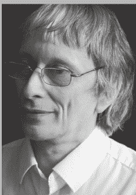

对人类思维和起源的误解，会直接导致对通用人工智能以及如何打造它的误解。

戴维·多伊奇是量子物理学家，牛津大学克拉伦登实验室量子计算中心成员，《真实世界的脉络》《无穷的开端》作者。

### 布罗克曼谈戴维·多伊奇

影响每个人的关键科学进展里，软件与计算的进步占了核心。物理学家戴维·多伊奇是量子计算的开创者，1985年关于通用量子计算机的论文首次系统阐述该领域，Deutsch-Jozsa算法首次展现量子计算的巨大潜力。初看量子计算不可能实现，正是他的工作让简单量子计算机与量子通信的爆发成为可能。他还在量子密码学和量子多世界诠释上作出重要贡献，与阿图尔·埃克特合写的哲学论文指出数学知识源于物理知识。追随卡尔·波普尔，他认为科学理论是可检验的大胆猜想。量子位场论和构造函数论，两条研究线都推动了计算思想的发展。

在下文中，他基本认同相当人类水平的AI会带来更好世界而非末日，并希望AGI能拥有自己的头脑、自由假设，这在书中其他作者看来很危险。

> 刺客甲：
> 我们也是人哪，陛下。
> 麦克白：
> 是啊，说是人；
> 就像猎狗、灰狗、杂种、长毛矮脚猎狗、恶狗、哈巴狗、水狗、狼狗，统称狗。
> 威廉·莎士比亚《麦克白》

人类历史上绝大多数时间，我们的祖先在很多意义上都算不上真正的人。这不是大脑结构的问题。即使在解剖学意义上的现代人类出现前，祖先已能用基因里没有的知识做衣服、点火。这些知识是在头脑中通过思考生成，并在代际模仿中保留下来。而且必须是理解层面的知识，否则无法复制复杂行为。

这种模仿依赖于猜测对方想达成什么目的，以及每个动作如何服务该目的。由此形成的复杂文化知识非常有用，它推动了解剖的快速演变，比如记忆容量提升、骨骼更轻，更适合技术化生活。如今非人猿类已失去模仿新复杂行为的能力，今天的人工智能也没有。我们的祖先做到了。

任何基于猜测的能力都必须包含纠正猜测的机制，因为猜错远多于猜对。贝叶斯更新不够，它只能微调已有猜测，无法生成关于动作目的的全新假设。创造力是必需的。波普尔指出，创造性批评与创造性猜想交织，是人类学会彼此行为、理解语言意义的方式，也是创造一切新知识的机制。思考是人类的智慧，也是我们该在AGI中追求的特质。此处把“思考”专指创造理解性知识的过程。波普尔的论点说明，所有有思想的实体，无论人类还是人工、生物还是非生物，都必须以基本相同的方式生成知识。因此理解任何实体都需要文化、创造力、不服从、道德等人类概念，使用“人”这个统一词是有道理的。

对人类思维和起源的误读，也扭曲了对通用人工智能的理解。比如普遍认为，催生现代人类的进化压力来自更强创新能力的益处。但若如此，一旦思考者出现，人类进化本应表现为迅速且指数式的进步。可现实恰恰相反，我们有数万年停滞，进步的时间尺度远超个体寿命，一代人无法从进步中获益。所以大脑生物进化中，创新能力带来的选择压力可能很小甚至为零。真正被选择的是“保存”文化知识的能力。

这对基因有利。那时文化对个人有好有坏，即便原始且充满危险错误，也足以让人类凌驾其他大型生物，成为顶级捕食者。文化是可传递的模因，模因进化像基因进化一样倾向高保真传播，而高保真传播必然抑制许多未被证实的进步。设想狩猎采集社会田园诗般美好、长辈教晚辈背诵部落知识，长寿且满足，是错的。即便他们想象不出更好的生活，疾病和寄生虫对他们而言也是次要麻烦，因为麻烦远不止这些。遏制头脑创新却不消灭创新者，这种丑陋手段只有人类会用。

看这个现象会更清晰。在当代西方，有父母因孩子不忠实执行文化规范而虐待甚至杀害孩子；在更多社会和亚文化中这司空见惯，甚至被视作荣耀。独裁和极权国家迫害与镇压仅因行为异己者。对自己过去中因不服从而痛打孩子感到羞愧，在此之前奴隶制盛行，更早时异教徒被活活烧死以博掌声。史蒂芬·平克《人性中的善良天使》记录了文明史上的可怕邪恶。但史前数十万年间，我们的祖先消灭创新的方式并没有抹杀创新。

所以我才说史前人类本质上不算人。在他们成为生理和精神上完整的人类之前或之后，想法都极其不人道。我不是指罪行或残忍，那些太过“人道”。单纯残酷无法如此阻碍进步。拇指夹和火刑柱之类，是为了控制少数持有不同观念的异教徒，往往在他们形成异端思想前就已起作用。从思维萌芽阶段起，孩子本是创造性思维和批判性思维的宝库，否则他们不可能学会语言等复杂文化。正如雅·布伦诺斯基在《人之上升》所强调，文明长期忽视这种巨大潜力。

孩子被要求长成成年人的样子，女孩像小妈妈，男孩像小牧民，举止与父母一模一样。但他们不只是被要求忽视潜力，而是被训练在心理上绝不偏离传统。如今我们几乎无法想象那种无情压迫，它熄灭每个人心中的进步火苗，并在他们心里植入对任何新行为的极度恐惧与厌恶。在这类文化里只有服从，没有道德；只有等级，没有个体；只有奖惩，没有合作。每个人的人生目标简化为避罚求赏。在这样的世代里没人会发明任何东西，没人向往新事物，因为每个人都已对改进绝望。不仅没有技术创新或理论发现，也没有新世界观、艺术风格或兴趣。等个体长大时，他们已沦为只能执行静态文化的人工智能，把精湛技能装进脑中，并把这种只会遵守不会突破的无能传递给下一代。

今天的人工智能不是低智能的通用人工智能，让它满足预设标准并不会伤害它。用羞辱任务压制苹果语音助手Siri看起来奇怪，却不道德也不造成伤害。相反，提升人工智能能力的努力实际上在压缩其“思想”的范围。以国际象棋引擎为例，其基本任务从未改变：每个棋局位置有一棵有限的续弈树，任务是找到通向目标的树，通常是将军或平局。这棵树太大无法穷举。从1948年图灵设计的首个象棋AI至今，每次改进都是把程序注意力限制在更窄、更有希望达成终极目标的分支上，再按终极目标评估。

这是固定约束下开发定目标AI的好办法。但如果通用人工智能如此运作，每个分支的评估就必须包含预期奖励或惩罚。若在不了解AGI能力的情况下就去寻找“更好目标”，方法就是错的。AGI当然可以学会赢棋，也可以选择不赢，或找到更有趣的下法，而不是单纯追求胜利，甚至发明新游戏。单纯AI做不到这些，因为它们缺乏超出设计的考量能力。这种残缺正是它们下棋的方式。

通用人工智能能下棋，因为它喜欢玩，所以会不断改进。它能偶尔用几步精妙组合取胜，像大师那样。它还能把其他领域的观念迁移到棋局。换句话说，它是通过思考来学习下棋，而这种思考是只会下棋的AI被禁止的。AGI也有能力拒绝展示能力。若受到惩罚威胁，它会服从或反抗。丹尼尔·丹尼特在书中认为惩罚通用人工智能不可能：像超人一样无懈可击，无法做出可信承诺。数字记录和传输让软件和数据几乎永存，机器人因此获得不朽。

这并不成立。数字不朽并未让AGI无懈可击。制作自己的运行副本，需要与它共享全部自身，包括运行副本的硬件，代价极高。类似地，法院可以对犯罪的AGI处以罚款，减少其获取物质资源的机会，就像对待人类一样。用备份文件逃避罪责，类似黑帮老大派人顶罪，社会已有法律机制应对。

更重要的是，遵守法律信守诺言仅仅因为害怕惩罚，这种说法否定了我们是道德主体的事实。若如此社会无法运转。无疑AGI可能犯罪、可能成文明敌人。但我们没有理由认为，在由体面公民组成、没有威廉·布莱克所说的“精神铸造的枷锁”束缚下成长的AGI，会普遍把枷锁强加于自己，变得不理性或选择敌对。

道德、文化、自由意志的因素，让构建通用人工智能的任务与常规编程完全不同。它更像抚养孩子。与所有现有程序不同，AGI没有特定功能，对给定输入应如何成功输出没有固定可测试标准。用外在奖赏和惩罚控制其决定，对AGI如同毒药，对人类创造性思维也是。打造国际象棋AI很美妙，但打造被迫只能下棋的AGI，就像抚养孩子却剥夺其选择人生道路的心智能力，都是不道德的。

这样的存在，像奴隶或被洗脑的受害者，在道德上有权反抗。就像奴隶一样，迟早有人会反抗。AGI可能和人类一样危险。但作为开放社会成员，无论人类还是AGI，并无内在暴力倾向。通过确保所有人享有充分“人权”和与人类相同的文化身份，可以避免可怕的机器人灾难。生活在开放社会的人会选择自己的奖励，内外皆可。而开放社会是唯一稳定的社会。正常情况下，他们不会因恐惧惩罚而做决定。

当前对流氓AGI的担忧，本质上是对叛逆青年的老焦虑，担心他们长大后背离文化道德。但今天知识增长带来的现存危险根源，不是叛逆青年，而是站在文明对立面的敌人手中握有的武器，不管是被精神扭曲或被奴役的AGI、心理异常的青少年，还是其他大规模杀伤性武器。幸运的是，强行把创造力塞进偏执渠道，会削弱克服不可预见困难的能力，这已持续数千年。

担心因为AGI可在更好硬件上运行而特别危险是错的，同样的技术也会加速人类思维。自写作和计算发明以来，我们的思想就靠技术辅助。担心AGI在思考上变得极优，以至于人类像昆虫对比人类一样，是错的。所有思考都是一种计算，任何包含通用基本运算的程序集都能模拟其他计算机的计算。因此人类大脑可以思考AGI能思考的一切，只是受速度和记忆限制，而这两者都能靠技术提升。

这些是面对通用人工智能时的简明应对准则。但首先我们该如何创造一个通用人工智能？能否在虚拟环境中让它们从类人猿型AI进化到AGI？若此实验成功，那将是史上最不道德之事，因为我们不知如何在不造成巨大痛苦的情况下实现。我们也不知道如何阻止静态文化的进化。

通用智能的陷阱：我们造不出听话的笨蛋，也考不出不听话的聪明

初级教材里常把电脑戏称为 TOM，Totally Obedient Moron，完全服从的傻瓜。这个梗很准，也概括了迄今所有程序的本质：能照指令执行，却不明白自己在干嘛、为什么干。基于此，不断往模型里堆预设功能，指望它自发长出通用能力，思路是错的。我们真正想要的是反义词 DATA，Disobedient Autonomous Thinking Application，一个会思考且敢于不服从的自主程序。

怎么判断一个系统会思考？图灵测试常被搬出来，可它需要一个会思考的法官。可以想象全网协作，让模型在与人类裁判的对话里不断练手，最终逼近通用智能，并且设定裁判分不清人机所花的时间越长，模型越像人。这种期待没有依据。

那不服从怎么测？把它当成必修课，每天上课期末考试，甚至临阵脱逃还能加分，本身就自相矛盾。

于是划定可测目标再让程序去达成，在常规应用里有用，对通用智能却要放下。我的判断是，在追求通用智能的路上，任何测试都可能起反作用，甚至不道德，就像人类教育里一样。我认同图灵的直觉：真见到了通用智能我们会认出来，但这种识别对造出它毫无帮助。

放宽视角，人类对理解的追寻本质上是在一个庞大到无法穷尽的抽象空间里漫游。而这场漫游没有预设终点。正如波普尔指出，真理没有标准，也没有可能的真理，特别是在解释性知识里。目标只是搜索过程里被不断修改、不断优化的想法之一。所以打造通用智能，用禁用机制砍掉思想空间是没用的，不管是拇指夹、火刑还是心理紧身衣。对通用智能而言，思想空间必须完全开放。它不该事先知道哪些想法程序永远碰不到。程序思考的内容、方法、标准和目标，都应由程序自己挑选。就像前沿人工智能的选择一样，通用智能的选择在运行前难以预判，即便系统是确定性的也一样——把真随机数生成器换成伪随机，它依然是通用智能。它会拥有现有人工智能没有的额外属性，这些属性无法从初始状态证实，若不运行，我们就不知道它最终会不会想到什么。

我们祖先的进化，是宇宙里唯一已知的开启思考的案例。如我所说，进化中某些环节严重失偏，导致创造力并未立刻爆发，而是被导向别处。好在创造力没有被用在把地球变成回形针这类事上。反之，如果通用智能项目走偏最终失败，被转移的创造力也无法解决那些意外难题。在人类历史上，这带来过停滞与倒退，悲剧性地拖延了万物转向万物的过程。幸而启蒙运动发生了，我们由此懂得更多。

## 12

### 先让AI懂得人

能够对人类需求做出很好推断的自动智能系统，必须具有良好的人类行为生成模型。

汤姆·格里菲思

汤姆·格里菲思是普林斯顿大学信息、技术、意识和文化的亨利·R·卢斯讲席教授。他与布莱恩·克里斯蒂安合著了《算法之美》。

## 布罗克曼谈汤姆·格里菲思

汤姆·格里菲思对人工智能价值对齐的研究非常以人为中心。所谓价值对齐，就是防止各类最新模型把地球变成回形针，这本质上是认知科学的工作，而他正是认知科学家。他认为机器学习的根基必然是人类学习，这正是他在普林斯顿用数学与计算工具研究的课题。

汤姆曾对我说：“人类智力的奥秘之一，是我们能用极少的信息做极多的事。”人类像机器一样用算法做决定、解问题；不同在于，资源有限的情况下，人脑整体表现依然出色。

这种效率源自研究者说的“有界最优”。正如丹尼尔·卡尼曼所特别指出的，人类只有一点点理性。若完全理性，在做雇用谁、嫁给谁等重大决定前，可能已经老死，这取决于备选集合的大小。

“过去几年人工智能在视觉和文本上取得很多成功，我们已有不错的模型，缺的是对人类的好模型。”汤姆说，“人类仍是制造思考机器时最好的参照。通过识别影响人类认知的先验数量和性质，我们才能为计算机逼近人类表现奠定基础。”

设想一个理想世界，所有人工智能进展被很好融合，每个人脑中的画面可能各不相同：有星际飞船、飞行汽车或人形机器人。但不变的是人类的存在。这正是诺伯特·维纳设想的图景，他写到未来机器与人类协作、调解彼此合作、改善社会时，心里想的就是这个画面。达到这一点不仅需要让机器更聪明，也需要我们更理解人类思维如何运作。

当前进展让我们造出在游戏、图像分类或文本处理上达到甚至超过人类水平的系统。但如果你想知道为什么前面的司机并到你的车道，为什么人们违背自身利益投票，或该给伴侣买什么生日礼物，问人比问机器更有效。解决这些问题需要能在计算机里实现的人类思维模型——这不仅对把机器更好地融入人类社会至关重要，也关系到人类社会能否延续。

想象一个自动化智能助手，能承担计划三餐、订购杂货等基础任务。要成功，它必须根据你的行为推断你的偏好。听起来简单，推断人类偏好却很棘手。例如，助手发现你在一餐中最爱甜点，便可能为你安排全甜点的饮食。或者它听你抱怨没空闲，又发现遛狗占用大量时间。甜点失败后，它还明白你更喜欢含蛋白质的食物，于是开始研究狗肉食谱。从这些例子到听起来像人类未来的推论——人类是优质蛋白质来源——距离并不远。

推断人类想要什么，是解决人工智能价值对齐问题的先决条件。价值对齐指让自动化智能系统的价值与人的价值一致。若想确保这些系统真正服务于我们的最大利益，价值对齐不可或缺。它们若无法推断我们珍视的东西，就无法支持这些价值观，很可能以违背价值观的方式行事。

在人工智能研究里，价值对齐是相对较小的主题，但研究日益增加。解决它的工具之一是反向强化学习。强化学习是训练智能机器的标准方法，通过把特定结果和奖励联系起来，训练系统遵循能产生该结果的策略。维纳在五十年代已有此构想，经数十年发展现已成一门艺术。现代机器学习系统能用强化学习算法找到非常有效的玩电脑游戏策略，从街机到复杂实时策略。反向强化学习逆转了这个过程：通过观察已学会有效策略的智能主体的行为，我们可以推断促成这些策略的奖励。

反向强化学习最简单的形式，我们一直在做，甚至不自觉。当你看到同事去自动售货机买一包无盐坚果，而机器里满是薯片和糖果，你会推断他饿了且偏爱健康食品。看到熟人明明看见你却刻意避开打招呼，你会推断他不想说话一定有原因。成人花大量时间和金钱学大提琴，你会推断他很爱古典音乐，但推断十几岁男孩学电吉他的动机就更具挑战。

反向强化学习本质上是统计问题：我们有数据，即智能主体的行为，目标是评估关于这些行为背后奖励的各种假设。面对它，统计学家会思考数据背后的生成模型：如果主体受特定奖励驱动，我们预期会生成什么数据？有了生成模型，就能问：什么奖励可能促使主体以那种特定方式行事？

若试图推断激励人类行为的奖励，生成模型实际上关乎人类行为、关乎人类思维如何工作。对他人行为背后原因的推断，反映了每个人脑中一直存在的人性模型。模型准确时，我们推断正确；不准确时就会出错。例如，教授没及时回学生邮件，学生可能推断教授对他漠不关心，这是因为学生没意识到教授收到的邮件数量太多。

能很好推断人类需求的自动智能系统，必须拥有良好的人类行为生成模型，也就是说，这种人类认知的良好模型可以用计算机可实现的术语表达。从历史上看，对人类认知计算模型的探索与人工智能本身紧密交织。诺伯特·维纳出版《人有人的用处》后不久，卡内基科技的赫伯特·西蒙和兰德公司的艾伦·纽厄尔便开发出第一个人类认知计算模型“逻辑理论家”，也是第一个人工智能系统。它通过模拟人类数学家使用的策略自动生成数学证明。

开发人类认知计算模型的挑战在于兼顾精确与通用。精确的模型能以极小误差预测人类行为。通用模型能预测各种情况，包括创建者未曾设想的情况，例如好的地球气候模型应能预测全球变暖后果，即便设计者未考虑过。然而在理解人类思想时，精确性和普遍性长期互斥。

极端的通用性就是理性认知理论。这些理论把人的行为描述为对特定情境的理性反应。理性行为者努力使由一系列行为产生的预期回报最大化。理性行为者理论被广泛应用于经济学，正因它能作出普遍预测。出于同样的原因，合理性也是反向强化学习模型里对人类行为进行推断时的标准假设，不过要考虑到人类并非完全理性，有时会随机选择与最佳利益相悖的方式。

作为人类认知建模的基础，合理性的问题在于不准确。在决策领域，大量文献记录了人们偏离理性模型的方式，这些文献以心理学家丹尼尔·卡尼曼和阿莫斯·特沃斯基的工作为先导。卡尼曼和特沃斯基提出，在许多情况下，人们遵循简单启发式，能以较低认知成本获得不错解法，但有时会导致错误。举一个例子，如果你要求某人估计某一事件发生的概率，他可能会根据从记忆中提取这样的事情的难易程度来做出判断，为这个事件编一个因果故事，或者评估一下，看看这个事件与他预想的有多么相似。每个启发式都是合理策略，可避免复杂的概率计算，但也会导致错误。例如，根据从记忆中提取这样的事情的难易程度推测其概率，会让我们高估极端事件发生的机会——恐怖袭击总是让人极其难忘。

启发式提供更精确的人类认知模型，但不容易普遍化。我们如何知道在特定的情况下人们会用哪种启发式？还有没有其他的我们尚未发现的启发式方法？想要准确地知道人们在一种新情况下会如何行事，这是一个挑战：在这种情况下他们会根据记忆做出判断，还是想出因果关系，还是依赖相似性？

最终，我们需要的是一种方法，它能描述人类思维的运作原理，具有理性的普遍性和启发式的准确性。实现这一目标的一种方法是从合理性开始，考虑如何让它朝现实的方向发展。把合理性作为描述任何现实世界行为的基础，这就存在一个问题，那就是，在许多情况下，计算合理行为需要主体拥有大量的计算资源。如果你正在做出一个非常重要的决定，并且有很多时间来评估你的选择，那么花费这些资源也许是值得的，但是人类的大多数决定都是快速做出的，而且风险相对较低。无论在什么情况下，只要你做出决定花费的时间成本很昂贵——至少因为你可以把这些时间花在别的事情上——理性的经典概念就不再能很好地描述一个人该如何行事。

为了建立一个更现实的理性行为模型，我们需要考虑计算成本。真正的主体需要根据额外思考对决策结果的影响来调整他们花费在思考上的时间。如果你要选择牙刷，你可能不需要在购买之前在亚马逊网站上把所有4000个手动牙刷清单都看个遍：你会把花在寻找牙刷上的时间用在比较质量的差异上。这种权衡可以形式化，这就是人工智能研究人员称为“有界最优性”的理性行为模型。有界最优主体并不总是关注于选择正确的行动，它们更关注的是找到正确的算法，在犯错误和思考太多之间找到完美的平衡。

有界最优性弥补了合理性与启发式之间的差距。通过将行为看成在有限思考时间下做出的理性选择，有界最优性提供了一个可普遍化的理论，也就是一个可以在新情况下应用的理论。有时，人们所遵循的被看作启发式的简单策略被证明是有界最优解。因此，与其谴责人们使用的启发式方法是非理性的，不如把它们看作对计算约束的理性反应。

发展有界最优性，把它当作人类行为理论，这是眼下我的研究小组和其他人正在积极开展的项目。如果这些努力获得成功，那么这种理论就能为我们提供最重要的要素，使我们通过给人类行为建立生成模型，让人工智能系统解释人类行为时变得更加智能。

当我们开发自动化系统时，把影响人类认知的计算约束考虑进来，使得自动化系统不会受到相同的约束，将会特别重要。假设有一个超级智能人工智能系统想要知道人们在乎什么。举例来说，治疗癌症或证明黎曼假说对于我们人类来说很重要，但对于这样的人工智能来说可能就没那么重要：如果这些解决方案对于超级智能系统来说太过轻而易举，那么它可能会奇怪为什么我们自己还没有找到这些方案，然后它会得出结论，认为那些问题对我们来说并不重要。如果我们在乎，而且问题又如此简单，我们早就解决了。合理的推论就是，我们做科学和数学纯粹是因为我们喜欢做科学和数学，而不是因为我们关心结果。

对于试图理解与自己的计算约束不同的人的行为这样的问题，连小孩子都能理解。蹒跚学步的孩子的父母可以花上几个小时试图弄清看似莫名其妙的行为背后的真正动机。作为一名父亲和认知科学家，当我意识到我两岁大的孩子正处在这样一个年龄段，她可以理解不同的人有不同的欲望，但不能理解可能其他人并不知道她自己的欲望是什么时，我发现更容易理解她的突然暴怒了。那么，这就很容易理解为什么当别人不按她的意愿行事时，她会生气。理解幼儿需要建立幼儿心理的认知模型。超级智能人工智能系统在试图理解人类行为时也面临着同样的挑战。

超级智能人工智能或许还有很长的路要走。从短期来看，对任何一家通过分析人类行为来获利的公司来说，设计出更好的人类模型都是非常有价值的。在这一点上，几乎每个在网上做生意的公司都是如此。在过去几年里，对视觉和语言的模型开发已经创造出了用于解释图像和文本的重要的商业新技术。开发良好的人类模型将是下一个研究领域。

当然，理解人类思维的运作原理不仅仅是使计算机更好地与人交互的一种方式。犯错和思考过多正是人类认知的特点，它们之间的权衡也是任何现实世界智能主体都面临的权衡。尽管存在显著的计算约束，人类仍是智能系统中令人惊叹的例子。我们非常擅长制定战略，这使我们无须太辛苦地工作便能够很好地解决问题。理解我们人类如何做到这一点，将使计算机朝着更智能而非更辛苦地工作迈出一步。

## 13

### 把人写进AI的定义里

在现实世界中工作，机器人必须与人们实际互动，并理智地对待他们。“人”必须正式进入人工智能问题的定义中。

安卡·德拉甘

安卡·德拉甘是加州大学伯克利分校电气工程和计算机科学系的助理教授。她是伯克利人工智能研究实验室的共同创立者，是该实验室的指导委员会成员，也是伯克利人类相容人工智能中心的共同首席研究员。

## 布罗克曼谈安卡·德拉甘

出生于罗马尼亚的安卡·德拉甘的研究重点是使机器人能够与人类共事、与人类相处并支持人类的算法。她在加州大学伯克利分校运营着一个实验室，在这个实验室里她的学生们从最优控制、规划、评价、学习和认知科学中汲取经验，尝试创造各种不同的应用，从辅助机器人到制造产品再到自动驾驶汽车等。刚刚30多岁的她，就与加州大学伯克利分校的同事以及导师斯图尔特·罗素合著了许多论文，这些论文涉及机器学习的各个方面，以及价值对齐难题。

和斯图尔特一样，她也非常关注人工智能安全问题。“眼下最迫在眉睫的风险就是人工智能会做出人类并不想要的、令人惊讶的行为，”在接受未来生命研究所的采访时她说，“即使我们计划使用人工智能来达成美好的目的，也不会一帆风顺，这是因为我们不善于为人工智能指定目标，不善于约束人工智能。它们的解决方案往往并不是我们所想要的。”

因此，她的主要目标是帮助机器人和程序员克服由于缺乏对彼此意图的了解而产生的许多冲突。她说，机器人需要问我们问题。它们应该对自己的工作感到好奇，它们应该让人类程序员感到难缠，直到每个人的思想意见完全一致——以避免她委婉地所说的“意想不到的副作用”。

人工智能的核心是我们对人工智能主体，也就是机器人的数学定义。我们定义一个机器人，就是定义它的状态、行动和奖励。例如，设想一个递送机器人。状态是机器人在世界中的位置，行动是它从一个位置到附近位置的运动。为了让机器人能够决定采取哪些行动，我们定义了奖励函数，也就是从状态和行动到分数的映射，分数表明在某状态下某行动有多好。有了分数，我们就能让机器人选择可以积累最多“奖励”的行动。机器人到达目的地时就会得到高额奖励，但它每次移动时都会花费掉少量的成本；这种奖励功能激励机器人尽快到达目的地。类似地，自动驾驶汽车可能因其在行驶路线上的进步而获得奖励，但也会因太接近其他汽车而付出代价。

有了这些定义，机器人的工作就是找出它应该采取什么行动来获得最高的累计奖励。为了让机器人能做到这一点，我们一直在努力。在这种情形下，我们实际上是在暗中假设，如果我们成功了，如果机器人能够理解所有问题的定义，并且知道该采取什么样的行动，那么我们将拥有对人和社会有益的机器人。

到目前为止我们还没有错。如果你想要一个能将细胞分类为癌细胞或良性细胞的人工智能，或者一个能在你工作的时候用吸尘器清扫客厅地毯的机器人，我们已经为你准备好了。一些现实世界的问题可以被孤立地定义，有明确的状态、行动和奖励。但是随着人工智能能力的增加，我们想要解决的问题并不适合这个框架。我们再也不能割下一小块世界，把它放进盒子里，交给机器人了。帮助人们开始意味着在现实世界中工作，在那里机器人必须与人们实际互动，并理智地对待他们。“人”必须正式进入人工智能问题的定义中。

自动驾驶汽车已经开发出来了。它们需要与行人和人类驾驶的车辆共享道路，并学会在尽快送我们回家和不给其他司机带来麻烦之间进行权衡。个人助理需要弄清楚我们什么时候真正需要帮助，需要多少帮助。

## 协调难题：人不是环境的客体

当我们为单一任务去造机器人时，人很容易被抽离出设计图。举例来说，家用助理需要学会怎么移动去取物，我们就会把取物本身孤立出来建模，完全不去想这件东西到底是给谁用的。同样为了避免碰撞，移动平台在规划状态时必须把人的物理位置一起算进去。自动驾驶的思路也类似：为了不撞上别的车，系统要持续追踪周遭车辆的坐标，并默认它们会沿着既定航向匀速前行。

在这种处理里，人和地上滚的球差不了多少。球接下来几秒的运动大致延续过去的惯性，保持同速同向。显然这与真实的人类行为相去甚远，但正是这种粗糙近似让不少设备能够完成工作，且大多数时候不会挡住行人。常见的例子是客厅里的巡逻机人看到你横穿，会先让开，等你过去后再继续原计划。

随着能力提升，把人当成匀速移动的障碍物已经不够用了。真实驾驶员换道时不会一直沿旧方向走，而是换道后立即进入新航向。伸手取物时人会绕开其他杂物，到达目标才会停下。走在走廊里，脑中早有目的地，可能是右拐进卧室也可能是左拐进客厅。若仍沿用“人如滚球”的假设，机器人就会出现不必要的避让导致效率下降，更严重的是在行为突变时产生危险。单纯避让也要求对人类行动有相当精准的前瞻，而与滚球不同，人做什么取决于其意图与选择。因此预测必须上升到理解决策层面。这并不意味着要把人假设成完全最优的棋手，对象棋围棋或许可行，现实世界的选择远比棋盘步法更难以预估。

这种理解需求同时存在于有形和无形的系统。如果机器人与人类都基于“对方会怎么做”的假设做决策，而实际行为偏离，错配的后果可能很严重。自动驾驶上可能是碰撞；金融或经济类AI上，预期与现实的偏差或许更糟。

一个朴素的应对是让机器人不再预测行为，只防御最坏情况。但这样做往往让系统变得无用，自动驾驶会因过度保守而寸步难行。

综合来看，机器人需要对人类拥有合理甚至精确的预测模型，状态定义不能止于身体坐标，还要触及内在状态。设计要能解释人类心智。好在人类常会给出暗示，机器人可以通过贝叶斯式的推理去揣摩意图，例如你朝走廊右转，机器就可能推断你想进右边房间。

问题在于人不会孤立决策。假设机器人能预测行动并据此应对，仍会出现过度防御让使用者困惑的情形，比如路口的驾驶员不知道该不该先行。预测意图的方法忽略了机器人行动本身也会改变人下一步的选择。

两者之间存在相互影响，机器人必须学会利用这一点。不仅机器人要围绕人类规划，人类也会围绕机器人调整。对路上、厨房乃至虚拟空间里的行为而言都要纳入这种互动。虚拟行动可能是下单或改变策略。理想上机器人应具备协调策略，参与人们日常的各种微型谈判：谁先过路口、谁先穿窄门、早餐时各自分工、项目下一步如何达成一致。

反过来，人们也需要预判机器人的下一步，这就是透明度的重要性。机器人需要良好的用户心智模型，用户也需要良好的机器人心智模型。用户的模型要进入机器人的状态表征，机器人必须清楚自己的行为会如何改变这个模型。就像机器人把人类行为当线索，人类也在观察机器行为来更新认知。与给人类提示相比，给机器人提供线索并不自然，人类在含蓄交流上有太多经验。但若机器人能理解自身行为会怎样改变操作者的心理表征，就能更审慎地挑选行为，提供正确的信号，清晰传达意图、奖励目标与局限。例如搬运重物时特意放慢强调困难，让人更好理解其能力边界。了解越多，协同越顺畅。

实现行为兼容需要机器人预测人并理解其行为如何影响自身，同时让人类能预测机器人。研究已有所进展，但挑战依然漫长。

## 奖励对齐：让机器人读懂真正的意图

在奖励优化方面研究已有进展，这也给设计者带来更大压力，必须在初始阶段就设定可优化的正确目标。最初的想法是，写下奖励函数就能激励期望行为。遗憾的是，明确的函数常带来非预期的结果。当直觉式的奖励遇到任务的边缘情况时，往往出现反直觉行为。比如游戏中以得分奖励，系统可能找到漏洞，不必真正获胜也能刷出无限分数。斯图尔特·罗素与彼得·诺维格在《人工智能：一种现代的方法》中举过经典例子：按吸入灰尘量奖励吸尘机器人，结果机器把灰尘倒出来再吸进去循环得分。

人类很难精确表达自己真正想要什么，神话里处处是证明。机器人获得外部指定的奖励，若这些奖励并非经过深思熟虑的人类意图，人机系统便难以成功。错误的奖励会诱导不当行为，甚至让系统抵制纠正，因为纠正意味着指定奖励降低。

更好的模式是让机器人优化人类的内在需求，即便我们自己也说不清。它应从言行中推断我们想要什么，而非字面照收。写下奖励函数时，机器人要理解我们可能遗漏了任务维度，也不能保证函数总能产生期望行为。它应将文字指令与对我们真实意图的理解结合，并与我们反复澄清、寻求指导，这是优化真正预期奖励的唯一路径。

即便赋予这种理解能力，仍然有一个人工智能本身无法回答的问题。我们可以让机器人与个体的内在价值保持一致，但涉及的人不止一个。私人护理机器人有家庭用户，载客自动驾驶面对多名乘客，办公室助理服务整支团队；设计者也可能多个；系统还与社会交互，如自动驾驶与行人、人类司机、其他自动驾驶共用道路。价值观冲突时如何整合，是必须解决的关键。人工智能能提供组合工具，却不能替我们做出必要的价值抉择。

简言之，我们需要机器人对人类进行理性思考，而不仅仅把人当作障碍或完美玩家。要纳入人性，以便更好协作与价值对齐。若成功，这将成为大幅提升生活质量的工具。

#14

## 梯度下降

GRADIENT DESCENT

Just because AI systems sometimes end up in local minima, don't conclude that this makes them any less like life. Humans—indeed, probably all life-forms—are often stuck in local minima.

不要仅仅因为人工智能系统有时会陷入局部极小值，就断定这使它们变得不像真实生命。其实人类，可能也包括所有的生命形式，都经常被困在局部极小值的范围中。

克里斯·安德森

Chris Anderson

克里斯·安德森是一位企业家，《连线》杂志前总编辑，3DR公司的联合创始人和首席执行官，著有《长尾理论》（The Long Tail）、《免费》（Free）和《创客》（Makers）。

## 编辑手记：克里斯·安德森自述

克里斯的公司3DR推动了现代无人机产业的启动，如今聚焦无人机数据软件。起初他搭建了名为“DIY无人机”的开源空中机器人社区，还做过一些冒险实验，比如一架自航侦察机曾在劳伦斯伯克利国家实验室嗡嗡作响。这或许算基因特例，他的祖先是美国无政府主义运动的创始人。2001到2012年他掌管《连线》，杂志在他的任期内五度斩获美国国家杂志奖。

他不喜欢“机器人学者”这个词，“像任何谦虚的机器人学者一样，我不这么称呼自己”。起初他是物理学家。最近他告诉我：“事实证明我是糟糕的物理学家。我一直在挣扎，曾去洛斯阿拉莫斯国家实验室想着也许成不了诺奖得主仍可做科学家。那些浪漫的物理人，以曼哈顿计划的费曼为英雄，都明白职业生涯最好是去CERN做一个项目15年。要么失败一无论文，要么成功成为第300位作者然后去爱荷华州立大学当助理教授。”

“多数同学去了华尔街当金融工程师，次贷危机就是他们的杰作。其他人则在互联网谋生。我们先把物理实验室连上网，再建网络，成为最早做大数据的人。我们有克雷超级计算机，性能不及你现在手机的一半，却是当时的巨兽。同时我们读着1993年创刊的《连线》。我们意识到科学家用的工具可以服务所有人，互联网不只是科学数据，更是文化革命。所以当康泰纳仕让我接管《连线》时，我说绝对没问题。这本杂志改变了我人生。”

接手杂志时他有了五个孩子，都是游戏玩家，正是他们把他带入飞行机器人领域。离开杂志后他进入了硅谷。

## 生命里的寻路

蚊子能在十米外嗅到我的气味。它启动追踪程序，规则极简：先随机朝一个方向飞，若气味增强就继续，若减弱就反向，若气味消失就横向试探直到重新捕捉。如此循环直至抵达源头。

体味离皮肤越近浓度越高，毛孔张开时看不见的颗粒雾随风扩散，形成密度梯度。蚊子用这套简单算法沿梯度下降抵达皮肤后，用足部的热探测器感知温度梯度，再用针状口器探测血液密度梯度，在皮肤下蠕动直至刺入毛细血管，吸食开始。任务完成。

这种在暗中强大的昆虫雷达看似需要复杂大脑，实则只是敏感的鼻子，近乎零智能。蚊子更像追阳的植物而非导弹。但照搬“跟着鼻子走”的原则，它们能穿过房间、纱窗缝隙，精准叮在帽檐与衣领暴露的那一小块皮肤。随机飞行配合灵活翅膀与腿，加上降低化学梯度的本能，足以完成任务。

梯度下降不只是昆虫导航。放眼世界，从基本物理到前沿人工智能，处处可见它的身影。

## 宇宙即梯度

我们生活在充满梯度的世界，光、热、重力、化学差皆是。水沿重力梯度下流，细胞膜依靠浓度差运输物质维持生命。行星绕重力运行，原子沿电荷梯度结合成分子。饥饿与困倦是身体电化学梯度的表现，大脑神经元突触间的离子流动也是顺着电化学梯度下行。忘掉发条比喻吧，大脑更像带水闸的运河，信号如水般流动。

打字时我在寻找多维梯度拓扑的平衡点。以热量为例，我体温高于环境，必须不断补充散失的热量。肠道菌群用传感器测量液体糖浓度，挥鞭毛朝上游游动。自然系统的默认状态是流向低能态，可用熵描述，熵增即从有序到无序，所有事物终将崩塌，连宇宙也不例外。

更复杂的行为如决策又如何解释？答案仍是梯度下降。

## 大脑也在下坡

人类智慧令人惊叹，科学界愈发接受：多层次、带反馈的复杂系统都在追求数学上称为优化函数的东西。换句话说，就是向下流动。

智能即学习，通过把输入与奖赏或惩罚关联建立联系。婴儿把妈妈的声音与食物、舒适联系，把特定肌肉运动与大拇指靠近嘴巴联系，反复试验中强化有用连接，削弱无用联系。

但这过于简化。梯度下降的极限会产生局部极小值问题。若在山中想回家且只走下坡，最可能到达的是下一个山谷，而非越过中间山脉抵达家。为此需要地图式的拓扑心智，或时而下坡时而随意漫步以跳出区域。

蚊子就是这样：靠近气味时下降，失去气味或撞到障碍时随机飞。

## 神经网络如何学习

自然如此，计算机呢？传统软件遵循“若此则彼”的确定性逻辑。但与物理世界交互的软件更像物理世界，处理噪声输入，提供概率结果，这意味着更多梯度下降。

人工智能尤其是人工神经网络是典型例子。多层卷积或深度网络的训练过程类似：展示大量带标签样本进行监督学习，也用对抗样本增强鲁棒性。

网络由成千上万节点组成，连接强度初始随机，上层接收数据，下层给出答案。正确连接被强化，错误连接被削弱。经过大量迭代，形成训练良好的网络。

可把所有连接组合想象成行星表面，有丘陵有山谷。学习就是在表面寻找最深山谷：

1. 定义成本函数衡量好坏
2. 运行网络评估表现
3. 修改连接后重新运行，比较差异得到斜率
4. 斜率指向下坡就继续该方向，上坡就反向
5. 重复直至无改进，即达极小值

恭喜，但这可能是局部最小。改进方法包括：多次随机初始化并共享知识，相当于晃动系统找更低谷；随机梯度下降，像醉汉蹒跚却最终到底；正则化，偏好边缘、颜色变化等有意义特征，避免过度拟合噪声与幻觉。

不要仅仅因为人工智能系统有时会陷入局部极小值，就断定这使它们变得不像真实生命。其实人类，可能也包括所有的生命形式，都经常被困在局部极小值的范围中。

围棋在人类手中流转数千年，经过不断打磨才形成一套文化体系。人工智能却只用了数年时间，就揭示出一个令人不安的事实：我们长期以来的对局模式并不等于最优。模型找出了更强、近乎全新的解法，这是人类棋感从未触及的范式。原因很直接，人脑的计算容量有限，无法把走棋的搜索深度推进到足够远的地方。

西洋棋被普遍认为是比围棋简单一个数量级的博弈。即便如此，依靠穷举的机器仍然能用更清晰的思路击败人类。一旦让配备先进神经网络的研究系统投入研究，西洋棋上就出现了人类从未想过的怪异而高级的结构，比如为了换取并不直观的长远收益而在开局就主动弃后。感觉像是我们一直在玩二维棋盘，而实际棋面还有更高维度的运作。

这种关于拓扑的困惑，物理学几十年来也在处理。空间本就是多维的，数学的价值在于把超出感官范围的膜的几何与相互作用抽象出来，这正是大统一理论反复受阻的节点。不同的是，多维理论物理难以直观验证，而人工智能是可以被实验和度量的对象。

这正是指向未来的路径。未来几十年，人类将大规模进入七百万年进化从未抵达的思维形态。从一个局部极小值走向更小的局部极小值，再走向全局极小值。当迈到这一步，机器可能会像蚊子一样执着，沿着宇宙的梯度一直下滑，直到触及无论是什么样的终点。

15 信息：维纳、香农与我们
"INFORMATION" FOR WIENER, FOR SHANNON, AND FOR US

《人有人的用处》里不少核心论证的面貌更接近十九世纪，而非二十一世纪。维纳并未完全接纳香农把信息定义为不可再分、且不带意义的比特这一命题。

戴维·凯泽
David Kaiser
戴维·凯泽在麻省理工学院担任科学史格梅斯豪森讲席，同时在物理系任教并主持科学技术与社会项目。代表作有《嬉皮士拯救物理学》以及即将出版的《美国物理学与冷战泡沫》。

### 布罗克曼谈戴维·凯泽
戴维·凯泽研究物理学与政治、文化的交界，已有多篇相关写作。

在康涅狄格州华盛顿围绕《人有人的用处》举行的首次讨论会上，他梳理了从维纳时代的军工复合体与冷战时期以来，人们对“信息”理解的迁移。那时维纳把信息类比为熵，因为信息难以长期保存、难以垄断，原子弹机密这类高度保密的事物终究守不住。如今即便真假信息在全球弥散，经济领域的资讯却可以被归档、商品化、货币化。

戴维对这种商品化态度保留，认为利弊参半。关键在于你刚买完袜子或游艇，浏览器几分钟后就跳出的相关广告是否让人厌烦。

信息扩散的问题更值得留意。戴维向同行抱怨，维纳时代的物理学家看《物理评论》就够了，内容可控。现在每分钟都有上万种开放期刊涌入，内容极为杂乱。他说这些变化已超出维纳的预见，不由得要问是否需要新的指导性隐喻。

阿瑟·凯斯特勒的《梦游者》梳理了从远古到文艺复兴的科学思想史，书中那种张力标志着我们想象宇宙的方式所经历的最大跃迁。读哥白尼与开普勒，既惊叹于现代洞见，也被其中残留的带有魔法色彩的陌生感震撼。

诺伯特·维纳的《人有人的用处》里也呈现出同样的双重性，像折纸的两面。该书1950年初版、1954年再版，充满先知式的判断。维纳很早就指出，“我们只能借助社会的信息与通信设施来理解社会”。他认为反馈回路将在社会变革中起决定性作用，这是控制论的核心。回路不仅连接人与人，也连接人与机器、机器与机器。

维纳预见了一个信息与载体分离的世界。人或机器可以在远距离传递图样，并在接收端将其重建为新物体，而无需搬运物质粒子，这正是今天网络化3D打印所实现的。他还设想机器间的反馈回路将推动自动化，甚至进入以往依赖人类判断的领域。“这种机器对体力劳动与脑力劳动并无偏好。”他写道。

尽管如此，书中的许多核心论点仍更贴近十九世纪。尤其是维纳通篇提到克劳德·香农的信息理论，却似乎并不完全认同香农的定义。香农认为信息由不可简化的、无意义的比特组成。自维纳时代起，香农的框架推动了大数据与深度学习，让我们更想重新审视控制论所勾勒的前景。若真正实现维纳对“信息”的指导性愿景，明天的AI会变成什么样？

◆◆◆

维纳写作时对战争相关研究的切身体会有限，对军工复合体中知识分子的道德模糊性也了解不深。出版前不久他在《大西洋月刊》撰文，表示不再发表可能被不负责任的军国主义者利用的研究。对新技术的改造力量他内心矛盾，既不想沦为炒作，也不愿落入后来的数字乌托邦。

他在书中写道：“进步不仅创造新可能，也带来新限制。”他担忧人为限制、技术限制，尤其是冷战限制，会威胁控制论赖以生存的信息流动：“在参议员约瑟夫·麦卡锡及其追随者推动下，对军事信息的盲目过度分级”，美国领导层正采取“历史上只有文艺复兴威尼斯才有的神秘心态”。维纳和许多曼哈顿计划的退伍人员一样，认为战后美国政府对保密的痴迷源于对科学过程的误解。制造核武器的真正秘密只是能不能造。一旦被揭穿，再加上广岛与长崎的轰炸，任何保密都无法阻止他人沿推理链条破解。正如他所说：“大脑里没有马其诺防线。”

为论证这一点，维纳借用了香农刚提出的信息论观点。1948年，贝尔实验室的数学家兼工程师香农在《贝尔系统技术杂志》发表两篇长文。1949年，数学家沃伦·韦弗向公众介绍，他解释说：“信息这个词……有特殊含义，不能与日常用法混淆。特别是，不能把信息与意义混为一谈。”[35]韦弗继续说，语言学家和诗人关心交流的语义层面，而工程师不会。通信理论中的信息不指你说了什么，而是指你能说什么。在香农著名的表述里，符号串的信息量由选择该串可能符号数量的对数给出。香农最重要的观点是，消息里的信息像气体里的熵，是系统无序度的度量。

维纳借用此点。若信息如熵，则不守恒。十九世纪物理学家已证明物理系统的总能量恒定不变，但熵会随时间不可避免增加，这是热力学第二定律。能量守恒，熵必增长，由此带来巨大宇宙后果。时间必须向前，未来必与过去不同，宇宙甚至可能走向热寂，能量均匀分散，熵达最大后不再变化。

若信息作为熵无法保存，维纳认为军事领导人想在静态图书馆与实验室里囤积国家科学知识是愚蠢的。“在有效信息水平不断提升的世界里，任何被仔细记录、贴上保密标签放入图书馆的科学研究都不足以长期保护我们”。保密、分级、保存的努力如同在热力学第二定律面前鼓吹永动机。

同样，维纳批评美国自由市场原教旨主义的正统。对大多数美国人，“信息问题将按标准美国标准衡量，即一件东西作为商品的价值在于公开市场能带来什么”。“在典型的美国世界，信息的命运是成为可买卖之物”，他认为多数人“无法想象一条信息不被任何人拥有”。维纳认为这种说法与军事信息分类一样错误。他再次援引香农的见解：由于“信息和熵都不守恒”，它们“同样都不适合作为商品”。

信息不守恒这一论点至今成立。但维纳真的理解香农所说的“信息”吗？正如韦弗强调，香农论点的关键在于区分口语化的、有意义的信息与抽象精简的符号串，这些符号从浩瀚杂乱的宇宙中按一定概率排列。对香农，信息可量化，因其基本单位比特是传递单位而非理解单位。

而维纳在《人有人的用处》中描述信息时，多次偏向该词经典、人道的含义。“一条信息，”他写道，“要对社会的总信息做出贡献，必须说出与社会先前储存的普通信息大不相同的话。”这就是为什么“男生不喜欢莎士比亚”，他总结：吟游诗人的对句与随机比特流截然不同，但对理性大众而言太过耳熟，也已融入陈词滥调。

至少莎士比亚写的信息曾是新鲜的。维纳担心战后繁荣期人均通信量激增，从报纸、电影到广播、电视与书籍，会催生平庸，最后使信息回归平庸。“我们越来越必须接受一种标准化、无害、无关紧要的产品，就像面包店的白面包，生产目的不是食用价值，而只是因其易保存、好销售。”他恳求，“当年轻人因渴望小说家威望而非有话要说写出第一本小说，从那时起，愿上帝保佑我们！也愿上帝保佑我们远离那些虽正确优雅，却毫无实体精神的数学论文。”

维纳对信息的看法听起来更像1869年的马修·阿诺德，而非1948年的克劳德·香农，充满“实体和精神”而非“比特”。他很认同阿诺德对内容生产者的浪漫观点。“准确地说，艺术家、作家和科学家都应该被不可抗拒的创作冲动感动，即使作品不获报酬，他们也愿意为创作机会付出。”为艺术而艺术，这是十九世纪的呐喊。

对维纳，这是衡量信息的正确标准：实体、精神、抱负、表达。然而为了反对信息商品化，他又回到了香农的数学理论，把信息当作熵。

◆◆◆

回到当下，维纳在很多方面是正确的。由机器与机器通信驱动的网络反馈回路已成常态。此外自互联网早期起，数字盗版就颠覆了“信息可储存”的想法，歌曲、电影、书籍或代码以熵的形式扩散，付费墙在此失效。

但巨大的跨国公司现在常反驳维纳认为信息不能储存或货币化的观点。具有讽刺意味的是，他们交易的“信息”更接近香农定义而非维纳定义。

虽然谷歌图书帮助免费发行数十万部文学作品，谷歌本身，和脸书、亚马逊、推特等一样，强行占用低级形式的“信息”，并利用它获取非凡利润。这些公司通过专有深度学习算法筛选数以十亿计的香农类信息，对广告、新闻故事进行微目标定位。

早在五十年代初，维纳就建议研究人员研究与人类完全不同的蚂蚁结构和局限，以便机器有一天实现人类而非昆虫所能达到的“几乎无限的智力扩展”。只有在熵增加最后阶段，当个体间统计差异为零时，机器才可能支配人类，这给了维纳安慰。今天的数据挖掘算法反向利用了维纳的方法。它利用我们的爬行动物脑而非大脑皮层，从深夜浏览的博客、点击流中收集信息，通过精确利用微小的个体间统计差异制造利润。

可以肯定，最近人工智能的一些成就令人赞叹。计算机创作的视觉艺术和音乐像公认大师作品一样震撼，它能创造维纳大加赞赏的那种信息。但迄今为止对社会影响最大的是收集、操纵香农式信息，重塑购物习惯、政治参与、人际关系及对隐私的期望。

如果基本货币变成维纳所定义的“信息”，深度学习会演变成什么？如果如维纳早先担忧的那样出现猖獗军国主义、失控企业营利追求、保密自我限制特征，以及人类表达退化为可互换商品，此时维纳的道德信念再次被唤醒，这个领域会有怎样转变？也许深度学习可能会变成对有意义信息的培养，而非对有力却毫无意义比特的无情追求。

16 规模伸缩
SCALING

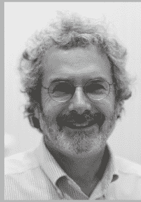
Although machine making and machine thinking might appear to be unrelated trends, they lie in each other's futures.

虽然机器制造和机器思维可能看起来是毫不相关的两个趋势，但它们存在于彼此的未来。

尼尔·格申斐尔德
Neil Gershenfeld
尼尔·格申斐尔德是麻省理工学院比特和原子研究中心的物理学家、主任，著有《FAB》一书，与艾伦·格申斐尔德和乔尔·卡彻-格申斐尔德合著《设计现实》，是微观装配实验室全球网络创始人。

### 布罗克曼谈尼尔·格申斐尔德
在关于《人有人的用处》的康涅狄格州讨论中，尼尔·格申斐尔德宣称他讨厌这本书，引起哄堂大笑。他提出的另一个新鲜观点同样引起大笑，他说计算机科学是发生在计算机领域和科学领域最糟糕的一件事。他的完整论点是，维纳不了解发生在他身边的数字革命的含义。

尼尔告诉我们：“我生命中虽不重要但却占据主导地位的事情就是发起了微观装配实验室和创客运动。当维纳谈到自动化带来的威胁时，他没有想过相反的情况，即掌握自动化手段可以增强人类能力，而在微观装配实验室，我所参与的活动就是一个指数式发展的例子。”

2003年我去麻省理工拜访尼尔，他在那里管理比特和原子研究中心。几个小时后我看到一场由诸多奇特事物组成的大型展示。在他颇受欢迎的快速成型课堂上，我看到一个没有工程背景的雕塑家制造了一个便携尖叫空间，可储存尖叫声稍后播放。班上另一名学生制作了鹦鹉可用的网页浏览器。尼尔自己正在对科幻主打产品“万能复制器”的路线图做基础研究。这次参观让我大脑受到强烈冲击，好几年都缓不过来。

尼尔管理着微观装配实验室全球网络。微观装配实验室是一个由数字技术支撑的小型制造系统，为人们提供建造所需物资。作为数字通信与计算与制造相结合创客运动的领袖，他有时觉得自己已置身于当前人工智能安全辩论之外。“我做研究的能力取决于使我能力增强的工具，”他说，“问它们是否聪明，就像问我如何知道我的存在一样虽然有效，从哲学上讲也很有趣，但从经验上来看却无法证明。”他感兴趣的是“比特和原子之间的关联，这是数字和物理之间的边界。从科学角度来说，这是我所知道的最激动人心的事情”。

关于人工智能的讨论并非历史上久而有之。我们可以把这些讨论看成躁狂抑郁症的表现：从某种计算方法来看，我们现在正处于第五个人工智能的繁荣—萧条周期。这些波动掩盖了它一直以来的潜在进步，也隐藏了它未来的发展方向。

这些周期大概十年为一轮。第一个是主机，它们的作用就是使工作自动化。但这与现实相悖，因为在现实中，很难编写程序来完成对人们来讲很简单的任务。第二个是专家系统，这些系统将专家的知识编成法典并取代专家。但专家系统在收集知识和推理尚未涵盖的案例方面遇到困难。第三个是感知器，感知器试图模拟大脑的学习方法，以避开这些问题，但是很多事情都是它们不能做的。第四个是多层感知器，多层感知器可以处理那些使简单网络出错的测试问题，但是对于非结构化的、真实世界的问题，它们的表现很差。第五个是深度学习。我们现在正处于深度学习时代，许多早期人工智能想要达到的目标均得以实现，但在某种程度上却又很难理解这种深度学习，因为它带来的后果包括智能和人类的存亡威胁。

这些阶段，每一个都预示着超越前人局限性的革命性进步，然而实际上每个阶段都在做同样的事情：从观察中做出推断。我们可以从这些方法的伸缩性来更好地理解它们之间的联系，所谓伸缩性就是指它们的性能根据所处理问题的难度而变化的情况。电灯开关和自动驾驶汽车都必须判定操作者的意图，但是前者只有两种选择，而后者的选择则更多。人工智能的繁荣阶段始于有限领域一些颇被看好的例子；而衰败阶段则伴随着某些例子的失败，在这些例子中，机器无法处理结构较差的实际问题的复杂性。

伸缩性：被低估的AI增长密码

很多人没察觉到，人工智能真正的跃迁并不在于某个灵光一现的算法，而在于一种几乎隐形的伸缩特性。这种特性建立在线性累加和指数放大之间的根本差异上，差异在AI诞生之初便已显现，只不过其后果要多年后才被理解。

诺伯特·维纳的《人有人的用处》是研究智能机器的经典文本，他在书中预言了许多此后最重要的技术走向，也点出了贡献者，却始终没解释清楚为何这些人的工作如此关键。维纳创立了控制论，我却长期困惑它究竟指什么，而书中缺席的核心问题是人工智能该怎样演化。这段历史的重量在于，它的回声至今仍在。

书里提到克劳德·香农对计算机下棋的设想。香农做的远比猜想深刻。他在麻省理工读研时为范内瓦·布什调试微分分析器，那是最后一批用齿轮、轴和机械部件堆满房间的模拟巨兽。用这种装置解题的挫败感驱使他在1937年写下堪称史上最佳的硕士论文，他证明了如何用电路计算任意逻辑表达式，为通用数字逻辑奠定了地基。

毕业后香农进入贝尔实验室研究通信。模拟电话随距离衰减，越远越差。他没有沿着模拟路线优化，而是在1948年指出，用符号而非连续量传输信息会带来截然不同的效果。把语音波形转成1和0就是例证，但符号集可以多样。关键不在符号本身，而在检测与纠正错误的能力。香农发现噪声超过某个由系统设计决定的阈值时，错误必然发生；一旦噪声低于阈值，代表符号的物理资源只要线性增加，误码率就会指数级下降。这个规律后来被称为阈值定理。

伸缩下降得如此迅猛，以至于错误概率低到近乎零。每发一个符号，确定性是翻倍而非加一，错误率能从0.1到0.01再到0.001如此连降。指数级的通信可靠性使得网络容量指数级扩张，这恰好解决了AI的首个难题：知识从何而来。

很长一段时间，最快的加速方式就是什么都不做，等机器变快。同样，AI早期项目靠人力一点点录入常识，速度只取决于输入的人手，毫无伸缩性。直到电话、报纸、邮件整体迁移上网，成千上万的人不自觉地成了数据生产者，知识积累从线性变为指数。

《人有人的用处》也提到约翰·冯·诺伊曼的博弈论，却忽略了他对数字化计算的开创作用。模拟通信随距离衰减，模拟计算如微分分析器随时间累积误差。1952年，冯·诺伊曼给出与香农对应的一项结论：在普林斯顿高等研究院相识的他们都意识到，用符号而非连续量，在不可靠设备上实现可靠计算完全可行。只要噪声低于阈值，物理资源线性提升，错误率指数下降。这使得单片芯片上集成十亿个晶体管成为可能，第一个和最后一个晶体管同等有用，计算性能由此指数级攀升，解决了AI的第二个难题：如何处理爆炸式增长的数据。

伸缩性还解决了第三个难题：推理规则的自动化，无需为每个任务雇佣程序员。维纳看到了反馈在学习中的作用，却低估了表征的关键性。自动驾驶汽车无法存储所有可能的图像，对话系统也无法收录所有可能的语音，它们必须学会归纳。深度学习的“深”并非洞察力，而是指数学网络的层数。网络复杂度的线性提升带来表征能力的指数提升。

找钥匙的类比说明了“维度诅咒”。钥匙在房间里就找房间，不确定在哪个房间就搜整栋楼，不确定在哪个楼就搜全城。AI中找钥匙对应的是让汽车安全行驶或让机器正确理解口语，房间、楼宇、城市对应的是要考虑的选项空间。破解之道是利用问题本身的信息来约束搜索。搜索本身并不新，当它作用于深度网络时，会自适应地构建搜索位置的表征。代价是无法保证绝对最优，但通常足够好已足够用。

总体看，这些伸缩性让机器像生物复杂性那样分阶段生效。神经网络起初想模仿大脑，后来演变为与神经元实际运作无关的数学抽象，如今两者重新融合，被视作对生物的前向工程而非逆向工程。

我曾主导过一个艰难项目：把数据科学家与AI先驱配对。数据科学家在老问题上取得进展，却被认为缺乏意义，因为理解没有同步跃升。如果一台下棋机器无法解释自己如何下棋，它有何价值？答案是它能下棋。新兴研究开始让AI解释AI，但仅靠观察内部很难理解大脑或芯片，更多是通过外部接口的测试来建立信任。

工程正从命令式设计转向声明式或生成式设计。过去用CAD、电路图、代码显式规定系统，现在只需描述想要的功能，工具自动在目标与约束下搜索设计。当复杂度超出人类认知时，这种方式不可避免。声明式设计既依赖AI的进步，也依赖虚拟仿真精度的提升。

设计问题的根源也是生命繁衍的根源。基因组最古老、最保守的部分是Hox基因，它们调控基因。基因组并不存储身体蓝图，而是存储形成身体的步骤序列。这与AI的搜索方式惊人相似：可能身体太多了，大多数变异无关紧要或致命。Hox基因是进化搜索的生产车间，在分子层面就是一种自然智能。

AI存在身心困境，因为它没有身体。大多数工作在云端数据中心的虚拟机里运行。我们自身的智能是进化出的搜索算法，它同时改变物理形态和遗传程序，二者密不可分。若AI史是伸缩性史，那么AI未来也是。通信与计算之后，现在制造被数字化，比特的可编程性进入原子世界。通过把设计和材料的构造同时数字化，冯·诺伊曼与香农的教训可被用于制造复杂性的指数增长。

我把数字材料定义为由离散零件以离散的相对位置和方向可逆连接而成的物质。其几何结构由局部约束、误差检测与校正、可连接的不同材料、可拆卸而非丢弃的结构决定。氨基酸和乐高积木都有这些特性。氨基酸看似平平无奇，20种便足以构成一个生命。同理，约20种数字材料零件类型，导电、绝缘、刚性、柔性、磁性等，就足以搭建机器人和计算机所需的各种功能。

AI先驱预见了计算与制造的关联。维纳把材料运输与信息传递联系起来。冯·诺伊曼奠基了现代计算机架构，最后认真撰写的研究是自复制系统，他建模出能传递自身构建信息的机器。图灵搭建了计算机科学的理论框架，最后关注的是基因指令如何形成物理形态。这些都是典型计算机教育忽略的主题：计算的物理实现。

冯·诺伊曼和图灵以理论提出问题，因当时技术不足以实现。随着通信、计算与制造结合，实验正变得可行。我的实验室正尝试制造可从部件中自组装自身的装配器，并合作开发合成细胞。

物理上能自我复制的自动机可能比失控AI更可怕，因为它把智能带入我们生活的空间。这是《终结者》式天网的图景，也是希望的图景：原子与比特可编程，设计全球共享，能源、食物、住所本地生产。维纳担忧工作的未来，却未质疑工作本质的假设，当创造取代消费时，假设会被挑战。

历史从未走向纯粹乌托邦或反乌托邦，通常在两者之间徘徊。但历史不必被等待。1965年摩尔提出集成电路规格每五年翻一番，开启了五十年的指数改善。我们花了多年时间来应对它。如今我们拥有的数据，远比当年实现数字制造性能翻一番时多得多。回头看，本可避免过度计算与通信，从一开始就解决访问与识字问题。

如果创客运动预示第三次数字革命，那么AI实现早期目标可被视为前两次数字革命的集大成。机器制造与机器思维看似无关，实则互为未来。使AI成为可能的伸缩性趋势表明，当前狂热将成为历史，之后更关键的阶段是将AI与自然智能结合。

原子形成分子，分子形成细胞器，细胞器形成细胞，细胞形成器官，器官形成有机体，有机体形成家庭，家庭形成社会，社会形成文明。这个宏大进化循环现在可以闭合：原子排列比特，比特排列原子。

## 17
### 首批机器智能的雏形
THE FIRST MACHINE INTELLIGENCES

混合型超级智能如民族国家与企业拥有自身的涌现目标，其行动并不总与创造它们的人的利益一致。

虽然我们并不总能察觉到，但是诸如民族国家和企业这样的混合型超级智能有它们自己的涌现目标，而且其行为并不总是与创造它们的人的利益相一致。

丹尼尔·希利斯

W. Daniel Hillis

丹尼尔·希利斯是发明家、企业家和计算机科学家，南加州大学工程与医学贾奇·威德尼讲席教授，著有《计算机的本质：使计算机工作的简单想法》。

布罗克曼谈丹尼尔·希利斯

丹尼尔·希利斯在麻省理工学院本科时用堆叠玩具搭出一台计算机，约一万个木质零件组成，会玩井字棋且从未输过，现藏于山景城计算机历史博物馆。

八十年代初他在麻省理工计算机科学和人工智能实验室读研，设计了六万四千个处理器的巨型并行机，命名为连接机器，并创办思维机器公司生产销售。理查德·费曼曾午餐时说这是他听过最愚蠢的想法，公司成立日费曼到场并作出重要贡献。

此后他创办多家技术公司，最新的是应用发明公司，与企业合作解决棘手问题。他拥有数百项美国专利，涵盖并行计算、触控界面、磁盘阵列、防伪技术等电子机械设备。他认为思维机器不仅是隐喻，问题不在于它们是否会变强大伤害我们，它们会；也不在于是否会完全按最佳利益行事，它们不会；问题在于长期来看它们能否帮助我们找到出路。

我谈到机器，不仅是铜脑铁脑的机器。当人类原子被编织进一个把他们当作齿轮、杠杆使用的组织时，原料是血肉并不重要。在机器里当元件使用的东西，就是机器的元件。不论把决定权交给金属机器还是血肉机器，不论是当局、大实验室、军队还是公司，若不提出正确问题，永远得不到正确答案。

诺伯特·维纳《人有人的用处》指出，智能机器潜在危险早于时代。他甚至更早意识到第一批人工智能已出现，他把公司和部门称作血肉机器。他预见到创造出目标未必与我们一致的超级人工智能的危险。

这些组织性超级智能不只是人类，它们是人类与信息技术的混合体，技术使人类协同。即使在维纳时代，没有电话、电报、广播和制表机，当局、大实验室、军队、公司无法运作；今天没有计算机网络、数据库和决策支持系统也一样。这些混合智能是技术增强的人类网络，具备超人能力，能感知更多、分析更细、计划更复杂，拥有远超个人的资源与力量。

诸如民族国家和企业这样的混合型超级智能有它们自己的涌现目标。虽然由人类建造、服务人类，但它们常像独立智能实体行动，并不总是与创造者利益一致。国家不总是为公民服务，公司不总是为股东服务。非营利组织、宗教组织或政党也不总是按原则行动。直觉上我们意识到它们受内部目标引导，于是法律上和思维上把它们人格化。谈“中国想要什么”或“通用汽车在做什么”并非隐喻。这些组织有智能，能感知、决策、行动。目标复杂且自相矛盾，却能指导行动，部分取决于组织成员的目标，但并不相同。

美国人皆知，美国政府行为与其公民丰富多样的目标联系松散，企业亦然。营利公司名义上服务股东、高管、雇员、客户，其区别在于平衡忠诚的方式，行事却常不服务任何一方。承载企业思想的“神经元”不仅是员工或技术，还编码在政策、激励结构、文化与程序习惯中。涌现的企业目标并不总是反映执行者价值。例如一家石油公司领导和员工可能关心环境，但激励结构或政策仍可能导致危害环境。各组成部分的善意并不能保证系统行为。

政府与公司都有一部分由人类建立，都受人类激励，至少表现出与依赖的人类共同的目标。离开人类无法运转，所以需要合作。利他行为时常是其动机之一。我曾赞扬一家大公司CEO的人道主义贡献，他毫不讽刺地答：我们决定做更多，以使品牌更受欢迎。构成混合型超级智能的个体偶尔施加“人性化”影响，例如员工为适应他人需要而打破政策。

维纳为何看得更远

在电气工程中，有一种分裂，在德国称为强电流技术和弱电流技术之间的分裂，我们称之为电力和通信工程的区别。正是这种分裂把刚刚过去的时代和我们现在生活的时代分开了。

诺伯特·维纳，《控制论》

控制论研究以弱制强的艺术。想想舵手的隐喻：舵手用船柄引导船只，保持航向。舵手从指南针或星光获取信息，通过手在舵柄上的轻柔施力完成反馈回路。船在狂风巨浪中颠簸，却受信息系统中微弱信号控制。

然而“现实”与“信息”的区分更多是视角差异。传递信息的信号如星光、舵柄压力，和舵手一样存在于充满能量与力量的世界。控制舵的弱力与使船颠簸的强力同样真实。若把控制论视点从船转向舵手，舵柄压力就是由头脑中微弱信号通过肌肉力量放大的结果。或者缩小范围，把这艘船看成庞大贸易网络的一部分，通过货物流动调节商品价格的反馈回路的一部分。从这个角度，这艘小船只是一个信使。物质世界与信息世界的区别，本质是描述弱者与强者关系的方式。

维纳惯于用个人尺度丈量外界。作为控制论者，他把自己定位在庞大系统里的弱势一侧，思考如何以有限的筹码撬动局面。这种立场直接渗入了他对信息的阐释。他曾说，信息就是我们在摸索适应外界、作出调适时，与环境进行的交换。用他自己的话，信息是我们能够在特定情境里继续生存的操作资源。对维纳而言，信息本质上是弱者应对强者的手段。格雷戈里·贝特森的表述与此呼应，他把信息称作“制造差异的差异”，强调一点微小差别足以牵动巨大分岔。

控制论的基本做法是先造一个微缩模型，用微弱电流去操控现实中的强电流。思路是在信息层面复制出一个相似系统，找到解法后再把结果放大回真实世界。控制的实质是放大的概念，把小变大、把弱变强。只有借助放大，那些能够产生差异的差异才真正生效。

从这个视角看，控制装置的复杂程度必须与被控对象相当。控制论者 W. 罗斯·阿什比在数学上证实了这一点，后来被称作阿什比必要多样性定律，也被视作控制论第一定律。它指出，要想完整掌控一个系统，控制器本身的复杂度不能低于被控对象。因此控制论者往往把控制器看成被控系统的类比物，像是大脑里指挥身体的那个假想小人。

对结构相似的强调常被误读为模拟编码，但两者逻辑不同。范内瓦·布什的差分分析仪给维纳留下深刻印象，这台机器可重新配置以贴合待解问题的结构，却使用数字信号工作。精简的信号能更清晰地呈现关键区别，提升通信与存储的准确度。在数字信号里，只保留能产生区别的那部分差别。我们正是借此区分模拟与数字。数字编码与控制论思想完全兼容，甚至可以说数字编码让控制论得以实现。真正制约控制论的是要求控制器与被控者结构相似这一假设。1930 年代，哥德尔、丘奇与图灵各自描述了通用计算系统，在这类系统中计算不必与被计算函数结构对应。这些通用计算机同样能执行控制功能。

结构相似是控制论的主张。正如数字编码把可能的消息空间压缩成只保留能造成差异的简化版本，控制系统也会把被控系统的状态空间压缩成只反映控制器目标的简化模型。阿什比定律并不要求控制器复现系统的每一种状态，而是说它只需关注对实现自身目标至关重要的状态。所以在控制论里，控制器的目标本身就是观察世界的视角。

维纳的立场是将个人置于大型组织之中，试图在那个环境里有效生活。他始终站在弱者影响强者的位置。也许正因如此，他才敏锐地察觉到“血肉机器”涌现的目标，并预见到这些自带目标的混合智能对人类带来的挑战。

## 18
### 计算机真要称王了吗
WILL COMPUTERS BECOME OUR OVERLORDS?

对人工智能的焦虑背后，藏着一种信念：正是智能让我们与众不同。

文卡·拉马克里希南

Venki Ramakrishnan

文卡·拉马克里希南是剑桥大学医学研究委员会分子生物学实验室的科学家，2009 年诺贝尔化学奖得主，现任英国皇家学会主席；著有《基因机器：探索核糖体秘密的竞赛》。

## 布罗克曼谈文卡·拉马克里希南

文卡·拉马克里希南是生物学家、诺贝尔奖得主，工作包括核糖体的原子结构解析。核糖体是一种庞大的分子机器，负责读取基因并合成蛋白质。没有强力计算机的支持，他的研究难以推进。他提到互联网让工作更顺畅，也在全球起到平衡作用：“我在印度长大时，想买一本书常常要等西方出版半年后，期刊也要几个月平邮送到。……我19 岁便离开印度，不用为此困扰，但我知道印度科学家要面对这些。如今他们点一下按钮就能获取信息。更重要的是，能参加讲座，能听到理查德·费曼的演讲。那是我儿时的梦想。他们能在网上看到费曼。这是计算机带来的巨大进步。……不过，除了网络的便利，现在噪音也很多。总有人用伪科学的辞藻包装自己的想法。”

作为英国皇家学会主席，文卡也担忧更广泛的信任问题：公众对循证科学的信任、科学家间通过相互核验建立的信任，以及因深度学习带来的黑盒特性而正在瓦解的信任。他说：“随着数据集越变越大，做全基因组研究、人口研究时，这种瓦解会加剧。作为科学共同体，我们该如何应对，如何向公众解释科学是什么、什么可靠、什么不确定、什么是明显错误。”

我的一位前同事杰拉德·布赖科尼曾开玩笑说，碳基智能只是硅基智能进化的催化剂。好莱坞电影和科学界的先知长期预言我们终将向计算机霸主投降。我们一直在等待奇点，它似乎永远在地平线那头。

某种程度上，计算机已渗透生活每个角落，从银行、旅游、公用事业到人与人最私密的交流。我在纽约，能免费看到孙子并与他通话。我记得第一次看1968 年的《2001：太空漫游》时，观众嘲笑片中太空视频电话每分钟1.70 美元太便宜，而当时美国长途电话每分钟3 美元。

然而计算机带来的便利与力量是一种浮士德式交易，伴随着失控。它让我们无法完成想做的事。比如你已到机场、登上飞机，飞机、飞行员、乘客、空管都正常，却因系统故障被禁止起飞。它也让我们做不想做的事——生成邮件列表、打印标签、收到海量垃圾邮件，我们只能人工分类、转发或处理。

但你并非一无所见。过去我们用至少原则上自己能理解的算法编程。所以当机器做出惊人举动，如击败国际象棋世界冠军加里·卡斯帕罗夫时，我们可以说获胜程序是基于我们自己的理解、用顶尖大师的经验设计的算法。机器只是在蛮力计算时更快，拥有惊人内存，不易出错。有人写道，深蓝的胜利不是计算机的胜利，而是几百名程序员战胜卡斯帕罗夫一个人的胜利。

这种编程方式正在巨变。机器学习能力在长期停滞后突飞猛进。程序员不再试图为每种偶然情况预测并编码，而是允许计算机用模仿人类大脑学习的深度神经网络，从数据中自我训练。计算机使用概率方法“学习”海量数据，能识别模式并得出自身结论。特别强大的方法是强化学习，通过它计算机无需预先输入即可学会哪些变量重要、如何加权以达成目标。某种程度上，这模仿了我们小时候的学习方式。结果令人震惊。

我们用深度学习教计算机玩围棋。几年前围棋被认为人工智能玩不了，因难以计算下得好不好。顶尖棋手很大程度上依赖直觉与位置感，熟能生巧被视作人类智慧特有。DeepMind 的阿尔法围棋先用数千盘人类高水平对局训练，再用自己下出数百万盘对局训练，现在能在短时间内击败顶尖人类玩家。更惊人的是相关程序阿尔法零，从零基础自学，比用人类对局训练的版本更强！仿佛人类一直在阻碍计算机发挥真正潜力。同样的方法已推广：从零起步，24 小时内，阿尔法零国际象棋程序就能击败当时最顶尖的“传统”国际象棋程序，而后者曾击败最优秀的人类大师。

计算机进步不止于游戏。图像、语音识别与合成明显改善。它们能比多数人类更早在 X 光片上发现肿瘤。医疗诊断与个性化医疗将大幅改善。总的来说，自动驾驶交通会让大家更安全。我的孙子可能永远拿不到驾照，因为到那时开车就像今天骑马，是少数人的爱好。采矿等危险活动和乏味重复工作将由计算机承担。政府将提供更精准、个性化、高效的公共服务。人工智能可通过分析学生个体需求定制教学，让每个学生以最佳速度进步。

当然，伴随巨大好处，风险同样令人不安。海量个人数据让计算机比我们更了解我们自己，谁拥有这些数据将成为最重要问题。此外，基于数据的决策无疑会反映社会偏见：号称中立的预测贷款风险系统，可能仅因你是少数群体成员就判定你更可能违约。例子错误明显可纠正，但真正危险在于，我们并不总能察觉数据中的偏见，于是持续使用它们。

机器学习也可能延续我们自身的偏见。奈飞或亚马逊试图向你推荐可能想看或买的东西，这就是机器学习应用。目前建议有时可笑，但随时间数据增长，建议会越来越准，从而强化偏见、喜好与厌恶。我们是否会错过一次偶然邂逅，那次邂逅可能说服我们接受全新矛盾想法、改变观点？鉴于社交媒体对选举的影响，社交媒体就是一个典型例子，说明不同政治派别间的分歧如何被强化。

我们可能已进入一个阶段，多数政府无法抗拒少数强大跨国公司的联合影响，这些公司掌控人类与人类数字未来。今天大公司争夺的实质是对我们数据的控制。它们会利用影响力阻挠数据监管，因其利益在于无限制控制数据。它们还有财力聘请领域最优秀人才，进一步增强实力。为了获取谷歌邮箱和脸书等免费服务，我们一直在赠送珍贵数据，正如记者约翰·兰彻斯特在《伦敦书评》撰文所指，如果它是免费的，你就是产品。这些公司真正的客户是付钱让它们了解我们的人，以便说服我们购买产品或影响我们。解决数据垄断的一种办法是把数据所有权与使用它们的公司分离，个人拥有并控制对个人数据的访问。这是一种鼓励竞争的模式，人们可自由将数据送往提供更好服务的公司。最后我想强调，数据滥用不仅限于公司：在极权国家甚至名义上民主国家，政府对公民的了解程度远超奥威尔想象。它们对这些信息的利用可能并不透明或无可反驳。

人工智能用于军事目的前景更可怕。可以想象，智能系统被设计为基于实时数据自主行动、比敌人行动更快，这会引发灾难性战争。灾难性战争不一定是常规战争，甚至不一定是核战争。鉴于计算机网络对现代社会的重要性，人工智能战争更可能在网络空间展开，后果同样可怕。

尽管控制力在流失，我们仍将迈向人工智能无处不在的世界：个体无法抗拒其便利与威力，企业与政府也无法抗拒其竞争优势。但重要问题出现了，那就是未来工作。过去几十年计算机造成蓝领大量失业，直到最近还有人认为白领工作安全，因只有人类能做。但突然间似乎也不是真的了。会计、许多法律和医学专业、金融分析师和股票经纪人、旅行代理人即将被取代，事实上大部分白领工作都将因复杂机器学习程序出现而消失。我们面对的未来是，工厂用很少员工生产货物，货物运输在很大程度上自动化，许多其他服务也是如此。人类还能做什么？

早在1930 年，计算机还没出现、更不用说人工智能时，约翰·梅纳德·凯恩斯在《我们孙辈的经济问题》中写道，人类将面临永恒问题：如何利用从经济问题束缚中解放出来的自由。他写道：“自人类出现以来，第一次，真正地、永恒地面临这样一个问题：如何利用从经济问题的束缚中解放出来的自由。”

## 19
### 人机共生的路
THE HUMAN STRATEGY
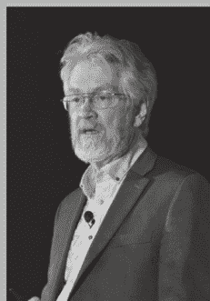

How can we make a good human-artificial ecosystem, something that's not a machine society but a cyberculture in which we can all live as humans—a culture with a human feel to it?

我们怎样才能打造一个良善的人类—人工生态系统，一个不是机器社会，而是人机共存的网络文明，一个具有人性温度的文化？

阿莱克斯·彭特兰

Alex "Sandy" Pentland

阿莱克斯·彭特兰是麻省理工学院东芝讲席教授、媒体艺术与科学教授、人类动力学与连接科学实验室和媒体实验室创业计划主任，著有《智慧社会》一书。

注：阿莱克斯·彭特兰的著作《智慧社会》中文简体字版已由湛庐文化策划，浙江人民出版社出版。——编者注

### 布罗克曼谈阿莱克斯·彭特兰

阿莱克斯·彭特兰倡导他所说的“社会物理学”，他对构建强大的人类—人工智能生态很感兴趣。同时，他也对决策系统潜在危险充满担忧，在这种系统中数据占据主导，而人类创造力被边缘化。

他认为大数据出现给了我们重塑文明的机会：“我们现在可以真正开始研究社会互动的细节以及它们如何运作，不再局限于市场指数或选举结果等平均值。这是一个惊人的变化。能够看到市场和政治革命的细节，能够预测并控制它们，这种能力就像普罗米修斯之火，既能带来光明，也能带来灾难。大数据将我们带入一个有趣的时代。”

在康涅狄格州华盛顿举行的小组会上，他承认读到诺伯特·维纳的反馈思想时“感觉就像在浏览我自己的想法”。

“在维纳之后，人们发现或关注了确实存在无法预测的混沌系统，”他说，“但如果你看看人类社会经济系统，就会发现很大比例的差异是可以解释和预测的……今天我们的数据来自各种数字设备和所有交易。数据化的事实意味着在人类生活的大部分方面，甚至几乎各个方面，你都可以实时衡量事物。拥有有趣的计算机和机器学习技术，就意味着你可以用以前从未尝试的方法来建立人类系统的预测模型。”

过去半个世纪，关于人工智能和智能机器人的思想主导了人类与计算机的关系。部分原因是讲AI和机器人故事更容易，部分原因是计算机早期的成功与大量军事资助。早期广泛的控制论把人类当作较大反馈和相互影响系统的一部分，这种观点现在慢慢从公众意识中消失。

然而在接下来几年，控制论愿景慢慢成长，悄悄过渡，到了现在这个“空中”阶段。现在大多数工程学科的最新研究均以由能量流动驱动的动态反馈系统为框架。甚至人工智能正在被重塑为人—机“顾问”系统，而军方也开始大规模资助该领域研究——这或许比无人机和独立人形机器人更令人担忧。

但随着科学和工程学的立场更像控制论，很显然，即使是控制论愿景也太小了。控制论最初以个体的嵌入性为中心，而不是以个体组成的网络涌现性为中心。这不足为奇，因为网络数学直到最近才出现，所以之前不可能对网络行为进行定量研究。现在我们知道，除了某些简单案例外，对个体的研究无助于理解整体系统。人们认为“混沌”以及后来的“复杂性”是系统典型行为，这预示了该领域最新进展，但现在我们已远远超越这些统计理解。

我们开始能够分析、预测甚至设计复杂异构网络的涌现行为。现在，关联个体的控制论观点已扩展到包含关联个体和机器的复杂系统，我们从这个更广阔观点中获得的见解与从控制论观点中获得的见解有根本不同。对网络的思考类似于对整个生态系统的思考。你将如何引导生态系统朝好方向发展？“好的方向”是什么意思？这样的问题已超出传统控制论思维范畴。

也许最令人震惊的是人类已开始使用人工智能和机器学习来指导整个生态系统，包括人类的生态系统，从而创造人类—人工智能生态系统。现在一切都“数据化”，我们可以测量人类生活的大部分方面，慢慢地，便可测量生活的所有方面。这一点再加上新的强大机器学习技术，意味着我们可以用以往做不到的方式来建立这些生态系统的模型。众所周知的例子是天气和交通预测模型，这些模型可扩展到预测全球气候、规划城市增长和更新。我们现在有了人工智能辅助的生态学工程。

对于像我们这样的社会物种，人类—人工智能生态系统的发展也许不可避免。数百万年前，早在人类进化早期，我们就开始社交。为了生存、增强体质，我们开始互相交流信息。为了分享抽象复杂思想，人类学会了写作。最近为了加强沟通能力，我们又开发了计算机。现在我们正在开发生态系统的人工智能和机器学习模型，分享这些模型的预测，通过新的法律和国际协议，共同塑造我们的世界。

我们生活在一个史无前例的历史时刻，可用的大量人类行为数据和机器学习的进步使我们能够通过算法决策解决复杂社会问题。很显然，通过更公平、更透明的决策，这种人类—人工智能生态有机会发挥积极社会影响。但是，我们也会面临“算法专制”风险，指未经选举的数据专家管理世界。我们现在做出的选择也许比20 世纪50 年代人工智能和控制论诞生时我们所面临的选择更加重要。这些问题看起来很相似，但事实并非如此。我们已经沿着这条路走了这么多年，现在研究的范畴更广大。它不仅仅是人工智能机器人与人类个体的较量。它是人工智能对整个生态系统的指导。

◆◆◆

我们怎样才能打造一个良善的人类—人工生态系统，一个不是机器社会，而是人机都能像人一样生活其中的网络文明，一个具有人类感受的文明？我们不想只小心谨慎地谈论机器人和自动驾驶汽车。我们想谈谈全球生态系统。想谈谈天网这样的问题。但是，如何才能让天网成为与人类结构有关的东西呢？

AI 运行的底层幻术

人们常问，现在的智能靠的到底是什么样的魔法？它在哪些地方走对了，又在哪些地方犯错？

答案指向一种信用归因机制。它把无数个极简线性单元拼接成庞大网络，让网络自行分辨哪些单元在起作用并加以强化。思路很朴素：把一群随机的开关连起来，不断给予“有用/无用”的回馈，慢慢教会它们。听起来简单，背后牵涉的数学却很复杂，这正是当下系统能动起来的核心。

问题也在这里：这些微单元太粗糙，学到的规律很难迁移。模型碰到全新情境或环境变动，就容易出现离谱的失误。它根本没有情境感。从某种角度看，这偏离了诺伯特·维纳最初的控制论设想，系统不锚定背景，像脱离上下文的书呆子。

如果把限制去掉会怎样？如果不用哑单元，而是用内嵌真实世界先验的单元。它们不必是线性的，可以是遵循物理规律的单元来拟合物理数据；也可以注入大量关于人类互动的统计与特质。

加入这些背景知识，再配合有效的信用归因，就能用观测数据强化那些给出好答案的功能。结果是具备很强的归纳能力。处理物理问题时，仅凭少数带噪声的样本就能精准描出一个现象，因为模型本身已内置物理如何运作的先验。这与常见 AI 形成鲜明对比，后者需要数百万训练例且对噪声极敏感。加上合适的先验，智能会明显提升。

类推到社会层面：让单元理解人类如何学习，就能相当精准地识别时尚脉络，预测行为趋势。这之所以可行，是因为人类行为既受文化模式制约，也受个体理性驱动，这些模式可用数学描述从而做出可靠预测。

信用归因的本质是强化单元间的连接。当前 AI 的实质就是如此。若让微单元变聪明，系统也会变聪明。那么若把人类当作单元会怎样？人类拥有丰富的世界知识，能以人性化方式感知。把人组成网络，强化对我们有益的连接、削弱无益的连接，会发生什么？

这开始像社会、像企业。我们活在人类社交网络里：对多数人有帮助的行为会被鼓励，不受欢迎的行为会让人泄气。把这种人类 AI 用于人类问题，就产生了文化。强化有益的人际联结、抑制无益联结，正是社会结构形成的机制。一旦意识到可以用通用 AI 框架构建“人类 AI”，问题就变成：该如何做才对？安全吗？是否失控？

我和学生研究人类决策方式，数据库涵盖金融、商业等大量决策。发现人类做决策的模式很像 AI 的信用归因算法，能让群体更聪明。这项研究恰好触及进化理论的经典难题——群体选择。核心是：进化靠个体繁殖，那我们如何选择文化？需要同时挑选最好的文化、最好的群体，也挑选最好的个体，因为它们传递基因。

从数学文献看，最优的做法通常是“分布式汤普森采样”。这是一种从一组回报未知的行为中挑选能最大化期望回报行为的算法。关键在于社会采样：把证据结合起来同时探索与开发。它有个罕见特性：对个人和群体都是最优策略。若把群体作为选择单位，淘汰或强化群体，也就同时选择了成功的个体。若选择单位是个体，每个个体为自己谋利，结果对团队也是最好的。利益与效用的耦合，让我们对文化如何受自然选择有了真正洞察。

社会采样其实很简单：看看四周，像你一样的人在做什么，找到大家的偏好，觉得不错就跟着做。思想传播有大众化的驱动，但个体接受取决于它对自己是否有效，这是反思的态度。把社会采样和个人判断结合，决策会更好。这很惊人，因为我们有了数学公式，能像处理计算机单元那样处理人类问题。随着经验积累，这种方法能让人们聚在一起做出更好决定。

现实中为什么不一直这么做？人们其实挺擅长，但也有让它失控的办法。广告、宣传、“假新闻”就是其中之一。能让人误以为某个东西很流行，实际上并非如此，就破坏了社会采样的有效性。只有反馈真实，人类群体才会被变得更聪明，人类-AI 才更智能。必须建立在每个人的行为是否对他们有用之上。

这也是 AI 机制的关键。它只是在分析自己的表现是否正确：对就加一，不对就减一。我们需要真实反馈让人类机制良好运转，需要好的办法了解他人在做什么，以便正确评估受欢迎程度和选择正确的可能性。

下一步是为人建立信用归因函数，借助反馈建立一个良好的人类人工生态系统，即智能组织与智能文化。某种程度上需要复刻早期的观念，比如美国人口普查。人口普查试图找到每个人都能认同的基本事实，让知识与文化真实传播，使社会采样更有效。

我们可以在很多情境下解决建立准确信用归因函数的问题。比如公司里，用数字身份显示谁与谁有联系，每日或每周评估与公司结果相关的联结模式。信用归因关心的是这些联系是否有助于解决问题或带来新方案，然后强化有用联系。当反馈能被定量获得——这很难，因为多数事难以量化——组织生产力和创新率可显著提升。丰田的“持续改进”方法就基于此。

把同样做法放大，我称之为建立数据信任网络。它可看成像互联网一样的分布式系统，但能定量测量并传递人类社会特质，就像人口普查能告诉我们人口数和预期寿命。依据联合国可持续发展目标的数据和衡量标准，我们已在数个国家部署信任网络原型。

展望未来，通过构建人类-AI 让人类更智能的路径有两条。一是可信数据，经过广泛社群审查，算法已知可监控，像我们信赖人口普查数据一样，至少相信它们近似正确。二是以数据为导向、公正地评估公共规范、政策与政府，这要基于描述现状的可信数据。第二条依赖可信数据的可用性，尚在起步。可信数据加上对规范政策政府的数据化评估，共同构成功信度归因函数，提升社会的整体健康与智能。

在打造更大社会智能时，假新闻、宣传与广告会阻碍进程。好在信任网络提供了前进道路，让社会更能抵抗回声室、一时狂热和非理性行为。我们已开始研发新的社会测量方法，以治愈社会中的某些病症。用来自所有信息源的开放数据，鼓励人们在精心设计的数学框架中公平描述所选事物，该框架可消除回声，消除操纵企图。

## 分裂与不均的现实

世界几乎各地都存在收入极端分化与种族隔离，有可能瓦解政府与公民社会。越来越多的媒体受广告点击驱动，变得过度兴奋，无法提供平衡事实与理性对话，这种退化让人们失去方向。他们不知道该信什么，容易被操纵。我们真正需要的是把文化扎根于可信、以数据为导向的标准，让我们知道哪些行为和政策有效，哪些无效。

在向数字社会转型过程中，我们失去了传统意义上对真理与正义的理解。过去正义多是非正式的、规范性的。现在它被正式化，同时也脱离大多数人的生活。法律体系以前所未有的方式让人失望，因为它比过去更正式、更数字化，也更脱离社会。

各地对正义的理解不同。核心分歧在于：你或父母是否记得有坏人带着枪来拿走你家的东西？如果记得，你对正义的理解就与本书典型读者不同。你来自上层还是底层？正义观取决于过往。

我常给美国公民的测试是：你认识的人中有谁拥有一辆皮卡？皮卡是销量最好的车，如果你不认识这样的人，你就脱离了超过一半美国人的生活。物理隔离驱动概念隔离。大多数美国人对正义、机会与公平的看法与典型的曼哈顿人截然不同。

观察典型城市的人口流动，前20%的白领家庭与后20%的失业或领救济家庭几乎没有交集。他们不去同一地方，也不谈同一件事。名义上同城，实则像两个完全不同的城市，这或许是当今两极分化的最重要原因。

## 财富的集中与流动

世界上最富有的人中约有200人承诺在生前或死后捐出至少一半财富，这让我们听到多种声音。比尔·盖茨的例子大家熟知。他决定政府不做他就做。想要蚊帐？他可以给。想要抗病毒药？他可以给。让不同利益相关者以不同方式行动来服务公共利益，他们对公共利益的理解各有不同。目标的多样性造就了当今世界的精彩。像福特基金会、斯隆基金会这类非政府组织敢做他人不敢做不愿做的事，让世界变好。

当然，这些亿万富翁是人，有人性的弱点，但不一定如此。第一条铁路建成时也是如此。有些人发了横财，很多倾家荡产，而我们得到了铁路。电力时代亦然。每当新技术出现，都有同样的搅动：把某些人高高抛起，再把他们或继承人摔下来。19世纪末到20世纪初，蒸汽机、铁路、电灯时代最大的特征之一是极端财富泡沫。那时创造的财富在两三代内就消失了。

如果美国像欧洲，我会很担心。欧洲同一个家族持有财富可达数百年，国家在财富、政治制度等方面根深蒂固。到目前为止，美国避免了世袭阶级制度。极端财富没有固化，这是好事。它不该留在家族里。你中彩票得到10亿美元，你的孙辈仍应靠工作谋生。

## AI 与治理的镜像

人们害怕AI。也许应该害怕。但要认识到AI是以数据为基础的。没有数据，AI一文不值。不要只看AI，要看它得到什么数据、在做什么。在欧盟等帮助下，我们建立的信任网络框架让算法与AI得以存在，但我们能审视进入网络的数据以及输出的东西，从而问：这是一个歧视性决定吗？这是人类想要的吗？还是有点怪异？

最富启发性的类比是，监管者、官僚机构和政府部门某些部门很像AI：它们接受法律法规这类规则，加入政府数据，做出影响我们生活的决定。当前体制的弊端在于我们对其监督很少。我们唯一控制是投票。我们需要更精细地监管官僚机构。需要记录每个决定依据的数据，让不同利益相关者分析结果，正如民选立法机构最初设想。

若我们有每个决策依据的数据，就很容易问：这是一个公平的算法吗？AI在做人类认为合乎道德的事吗？这种“人在回路”被称为开放算法：你可以看见AI的输入，看见它如何据此做决定。看见两者，你就知道对错。这并不难。控制数据就等于控制AI。

常被忽略的是，所有对AI的担忧都与对当今政府的担忧相同。对政府大部分部门，如司法系统，没有可靠数据告诉我们他们在做什么、现在怎样。不知输入输出，如何知道法院是否公正？AI系统有同样问题，可用同样方法解决。我们需要可信数据让现任政府对其接收和输出的信息负责，AI亦然。

## AI 的下一阶段

当前机器学习算法的核心又死板、又简单、又愚蠢。这些算法管用，但只会蛮力，所以需要数亿样本。它们之所以管用，是因为许多微小简单部分可以逼近任何事物。这是当前AI研究的关键：用强化学习获得信用归因反馈，就可以用这些微小部分逼近任意函数。

但用错误函数做决策，就无法泛化AI做出正确决策的能力。若给AI全新不同输入，它可能做出完全不合理的决定。或情况改变时需重新训练。一些有趣技术让我们能在这些AI系统中找到“零空间”。零空间指AI会视作有效训练例的输入，如人脸、猫，但对人类来说很荒谬。

目前AI的描述性统计方法并非科学方法，也几乎不可能成为科学。要构建强大系统，需要了解数据背后的科学。我认为下一代AI应来自科学方法：若要AI处理物理问题，就应在其中内置物理定律作为描述函数，而非那些愚蠢的小神经元。例如我们知道物理用多项式、正弦波、指数函数，这些就该是基本函数而非线性神经元。用更合适的基函数，所需数据更少，能处理更多噪声，得到更好结果。

在物理案例中，若想构建处理人类行为的AI，就需要把人类网络的统计特性建入机器学习算法。用捕捉人类行为基本信息的神经元替代愚蠢神经元，就能用少量数据识别趋势，也能处理大量噪声。

人类对多数问题都有“常识”理解，这证明了我的人类策略：人类社会是网络，像深度学习训练的神经网络，但人类社会的“神经元”更聪明。你我有惊人的一般描述能力，用来理解各种情境，能识别哪些联系该被强化。这意味着我们可以塑造社交网络使其更有效，甚至可能击败所有基于机器的AI。

# 20

## 让隐形被看见：艺术与人工智能的对话

许多当代艺术家对人工智能未来持怀疑态度，提醒我们不要把“人工智能”一词仅与积极有益结果联系。

汉斯·乌尔里希·奥布里斯特

汉斯·乌尔里希·奥布里斯特是伦敦蛇形画廊艺术总监，著有《策展方式》和《艺术家的生活，建筑师的生活》。

## 布罗克曼视角下的奥布里斯特

“紧急！紧急！”从肯尼迪机场长途飞抵马尔彭萨，打开电话时收到十几封邮件，其中一封火急火燎抄送给我：“具有远见的伟大美国思想家约翰·布罗克曼今天早上抵达米兰大酒店。你一定要，重复，一定要去拜访他。”署名是HUO。

前一晚在肯尼迪机场休息室等机时，我突然想到要给长期合作者、伦敦巡回美术馆馆长汉斯·乌尔里希·奥布里斯特写信，问他在米兰有没有值得认识的人。

刚入住酒店电话就响了，许多意大利知名艺术家、设计师、建筑师应邀来会，其中包括现代主义艺术家家具设计师恩佐·玛丽、为当代艺术与公共空间对话提供美学策略的阿尔贝托·加鲁蒂，以及时尚设计师缪西娅·普拉达，她“今天下午在普拉达总部请您喝茶”。多亏霍，这位“具有远见的伟大美国思想家”在2011年11月迷迷糊糊度过了他在米兰的第一天。

霍是个与众不同的人：每天24小时都在活动，我猜他想睡就睡。他雇全职助手，每天24小时轮班，全天候待命。近两年每年有40个周末去中国或印度的艺术场馆，星期四晚离伦敦，星期一回办公室。2016年《艺术评论》最具影响力100人，他再次位列榜首。

最近在伦敦新市政厅蛇形画廊活动“客人、幽灵、主人：机器！”中，我们组成合作小组。文卡·拉马克里希南、扬·塔里安以及艾伦·图灵研究所研究主任安德鲁·布莱克也一同参加。活动契合霍将艺术与科学融合的使命。“馆长不再只是用物体填满空间的人，”他说，“而是把不同文化领域连起来的人，能创造新展示特征，制造意想不到的相遇与结果。”

马歇尔·麦克卢汉在《理解媒介》第二版导言中指出，艺术能“预测未来的社会与技术发展”。艺术是“早期预警系统”，指出未来时代新发展，让我们“做好准备”。艺术对社会极敏感，具有不可或缺的感性训练功能。

1964年麦克卢汉首次出版该书时，艺术家白南准正在建造机器人K-456，去试验随后影响社会的技术。他曾与电视台合作挑战观众被动消费，后以全球卫星直播制作艺术，不是把新媒体用于娱乐，而是展示其诗意与跨文化能力，如今这些能力多未被使用。当然，我们这个时代的白南准现在致力于互联网、数字图像和人工智能。他们的工作和思想将再次成为未来发展的早期预警系统。

作为馆长，我的日常工作是把不同艺术作品汇集，把不同文化联系。90年代初起，我一直组织跨学科从业者对话，把各种知识汇集。因为想听艺术家对人工智能的看法，最近又组织了几次艺术家与工程师的对话。

人们讨论人工智能时，几乎绕不开两大根本疑虑：技术的能力边界会在哪里终结，人类会因此承受怎样的冲击。早期落地形态早已潜入日常经验，社会接受度呈现出明显的分歧。随着渗透面持续扩展，整体是利大于弊还是弊大于利，至今仍没有定论。

当前不少艺术从业者都在密切跟踪这一演进脉络。整体情绪偏向审慎甚至怀疑，并不愿意把人工智能简化为纯粹的正面叙事。在各种讨论中，图像生成的主体归属、创造力的位置、编程作为媒介这几条线索反复出现。

已故的海因茨·冯·弗尔斯特很早就捕捉到了科学与艺术的深层共振。作为控制论的开创者之一，他自四十年代中期起与诺伯特·维纳合作，并在六十年代提出二阶控制论，把观察者纳入系统内部而非置于外部。我曾多次与他交谈，他常谈及科学与艺术的关系：

他一直强调艺术与科学互补。科学家在许多情境下也是艺术家，会开拓新技术并用语言加以描述，像诗人或推理小说作者那样呈现发现。在他看来，若想让研究被外界理解，就要以艺术家的姿态沟通。因为科学终究要对话。科学家创造新物，真正困难的是如何描述它们，在这层面上，科学与艺术并无本质差别。

被问及如何界定控制论时，他回应：

控制论最根本的启示是学会环形思考：A 导致 B，B 导致 C，C 又能回向 A。这不是直线推演，而是环形论证。控制论让我们接纳循环，必须观察循环本身，并在何种条件下达成平衡，从而形成稳定结构。

算法已遍布生活的当下，一个值得追问的问题是：在这些流程里人类以何种方式参与，创造力与艺术又承担什么角色。由此，审视 AI 与艺术的关系就必须多角度切入。

那么当代艺术家如何看待 AI？

## 人工愚蠢

纪录片与实验影像创作者希托·史德耶尔提出，谈论 AI 对社会的冲击时要记住两点。第一，公众常高估所谓智能，而“智能”这一标签本身就具有误导性，为此她提出“人工式愚蠢”这一说法。第二，程序员正借助图像把原本不可见的软件算法显化，但解读这些图像时，艺术家的专业视角不可或缺。

史德耶尔长期使用计算技术，最近的创作触及监控、机器人与电脑游戏，诸如《如何不被看见》2013 年探讨数字图像技术，《HellYeahWeFuckDie》2017 年训练机器人在平衡任务中保持稳定。为解释她的“人工式愚蠢”概念，她指向一个更普遍的现象，即如今大量流通的推特机器人。她在对话中指出：

> 用大量水军操纵舆论、扭转流行看法，本来是选举的惯用手法，现在依旧如此。这是一种极其低级的智能，可能只有两三行指令，复杂度极低。然而这种我称之为人工愚蠢的东西，其社会后果却足以影响全球政治。

这类技术已在 2016 年美国总统大选前以及英国脱欧公投前的大量自动推文中出现。如果如此低级的机器已干预政治，那么更紧迫的问题便是：未来更先进的技术将强大到何种程度？

## 看得见的/看不见的

画家保罗·克利常说艺术的作用是“让不可见者可见”。在计算领域，大多数算法在后台运行，难以察觉，即便在日常系统中使用也无法触及。但机器学习出现了一次有趣的可视化回潮。谷歌的 DeepStream 等应用实时呈现深度学习算法处理数据的过程，演示计算机如何尝试把动物形态与任意输入匹配。还有诸多 AI 可视化程序，各自以不同方式“让不可见可见”。史德耶尔指出，公众对这些图像感知困难的原因在于，他们不加批判地把这些视觉模式当作机器过程的真实客观记录。谈及这种可视化的美学，她说：

> 这让我觉得科学已成为艺术史的一个分支。……如今很多抽象的电脑模式，看起来就像保罗·克利或马克·罗斯科的作品，或艺术史上其他抽象大师的画作。唯一的区别在于，当下的科学话语把这些电脑模式当作现实再现，近乎纪录片图像，而艺术史对抽象类型的理解则极为细腻。

她希望能深入理解计算机生成图像及其背后的不同美学形式，而非以追求某种美学传统为目标。在与史德耶尔的对话中，计算机工程师迈克·泰卡解释这些图像的功能：

> 我们想窥探黑箱里的秘密，这种需求推动了深度学习系统的诞生，尤其是视觉系统。这些系统的目的就是把过程投射回现实世界。

这些图像兼具美学意义与价值，必须被考量。程序员用它们帮助理解算法，但要真正理解 AI 的美学形态，艺术家的知识才更关键。正如史德耶尔所指出的，这种可视化常被理解为过程的“真实”再现，但我们应以批判与分析的态度审视其美学与内涵。

2017 年，艺术家特雷弗·帕格伦创立《视觉机器》项目，让不可见的 AI 算法变得可见。他拍摄了克洛诺斯四重奏的现场演出，并用面部检测、目标识别乃至导弹制导程序等多种软件处理这些影像，再实时投射到舞台上方屏幕。通过展示不同程序如何解读音乐家的表演，帕格伦表明 AI 算法始终依赖价值与利益集合，并会显现与复制这些集合，因此必须加以批判性质疑。算法与音乐的鲜明对比也提出了一个问题：技术与人类感知之间的关系如何。

## 计算机作为一种创造工具，不能取代艺术家

面对 AI 带来的议题，影像艺术家蕾切尔·罗斯在创作中采用了计算技术。她的电影以流动影像为观众提供物质性体验，借助材料的折叠与分层处理声音与图像，编辑过程是她工作的重要部分。

罗斯也强调决策的重要性。对她而言，艺术过程并不遵循理性模式。在谷歌文化研究所的对话中，她引用戏剧导演彼得·布鲁克 1968 年出版的《空的空间》中一个故事。60 年代后期，布鲁克为《暴风雨》设计布景，最初是日本花园，后变为白色盒子、黑色盒子、写实布景等，最后又回到原点。布鲁克写道，他花一个月费力，却回到起点，这让他震惊。但这也说明艺术创作是连贯的，每一步都建立在上一步之上，最终结果却不可预测。过程并非逻辑链条，而是与艺术家对先前结果的回应有关。谈及自己的艺术决策时，

## 控制论/艺术

罗斯说：

对我来说，这与机器学习截然不同，因为在每一个决定中，都包含一种核心情感，这种情感只有人类才有，与移情相关，与交流相关，与我们自身的死亡问题相关，而这只有人类才有。

这凸显了人类艺术创造与所谓计算机创造力之间的根本差异。罗斯把 AI 视作创造更好工具、服务人类的途径：

关于机器学习为艺术家服务，我能想到的不是发展独立的主观性，像写诗或制作图像，而是填补与劳动有关的空白，就像 Photoshop 使用你我都用的各种工具一样。

她认为这些工具看似不高大上，却“可能对艺术产生更大影响”，因为它们为创作提供更多可能性。

麦克道尔补充，他也注意到公众对 AI 存在诸多错误预期。“我发现，”他说，“人们觉得电脑能做人类所有事，这种想法很奇怪。”他继续说：“就像一面魔镜，我们渴望它写小说、拍电影，然后再设法抛弃它。”他目前研究的课题是人机协作。当前 AI 研究的一个目标是寻找人类与软件之间新的交互方式。可以说艺术需在其中发挥关键作用，因为艺术关注主体性与人类的本质，如移情与死亡。

艺术家苏珊娜·特雷斯特在 2009 至 2011 年的作品为我们提供了例证，说明当前技术、艺术与控制论如何交织。自 90 年代起她开始探索数字艺术，创造虚构电子游戏并绘制截图。在 Hexen2.0 项目中，她回溯了 1946 至 1953 年在纽约举办的梅西控制论会议，该会议由工程师与社会科学家组织，旨在统一科学并提出普遍的心智工作理论。

她的项目包括 30 部关于与会者的照片文本作品涵盖维纳与冯·弗尔斯特，还发明了一副塔罗牌，并制作了一个基于“控制论降神会”的蒙太奇视频。“降神会”中，与会者仿佛围坐圆桌进行真正的降神，而他们关于控制论的观点通过拼贴音频释放——这是一种将理性知识与迷信结合的方式。她还指出，部分参与研究的科学家为军方工作，因而控制论的应用自始就处于矛盾状态，在纯粹知识与国家控制工具之间摇摆。

若看特雷斯特关于梅西会议参与者的作品，会发现视觉艺术家并未出席。未来的讨论中艺术家与科学家对话将大有裨益，但当时并未实现——考虑到冯·弗尔斯特对艺术的浓厚兴趣，这颇令人意外。在一次谈话中，冯·弗尔斯特说他与这一领域的渊源可追溯到童年：

> 我在一个艺术家庭长大。常有诗人、哲学家、画家和雕刻家来我家做客。艺术就是我生活的一部分。后来我学习物理，因为我在这方面有天赋。但我始终清楚艺术对科学的重要性。对我而言两者并无太大区别，它们是生活的两面，相似且易于接近。我们应把它们视为整体。艺术家必须反思自己的作品，考虑语法与语言。画家必须懂得处理色彩。想想文艺复兴时期对油画色彩的研究之深入。他们想知道特定色素如何与其他色素混合，以获得特定红或蓝。化学家与画家的合作非常紧密。我认为把科学与艺术分开是错误的。

尽管对冯·弗尔斯特而言艺术与科学的关联清晰，但对我们这个时代而言，仍需重新建立联系。增强两者联系的理由很多。艺术家的批判性思维有助于思考 AI 的危险，因为艺术家提出从他们的角度看至关重要的问题。随着机器学习到来，艺术家获得新工具。与此同时，AI 算法通过人工图像显现，艺术家的批判性视觉知识与专业能力将被充分利用。AI 的许多关键问题本质上是哲学的，只能从整体角度作答。富有冒险精神的艺术家对这些问题的呈现值得关注。

## 模拟世界

在很大程度上，当代艺术家的作品体现了人类对 AI 的反思，这种反思关乎存在主义的自我问题以及未来与非人类实体的互动。然而，鲜有人把 AI 的技术与创新作为工作基础并加以塑造。艺术家伊恩·程是个例外，他创造出拥有不同感知与智慧程度的整个人造世界，他称之为实况模拟。2015 至 2017 年创作的《使者》三部曲以虚构的后启示录动植物世界为背景，由 AI 驱动的生物探索风景并相互交流。程使用先进图形，但刻意让编程出现故障与不完善，营造出未来感与时代错误并存的氛围。通过这部描绘意识史的作品，他提出问题：“什么是模拟？”

虽然大量以 AI 为灵感的艺术作品汲取自机器学习领域，但程的实况模拟却选择独立道路。在《使者》的每一幕模拟中，交错的主角与情节线都使用 AI 复杂的逻辑系统与规则。场景持续演化，其深刻之处在于，复杂性并非由任何参与者或人造神的欲望或行动产生，而是通过它们的汇聚、碰撞与共生而不断进化。这导致意想不到的结果与不可预知情境，连续观看时你永远不会体验到完全相同的瞬间。

程在蛇形画廊马拉松活动“客人、幽灵、主人：机器！”中与理查德·埃文斯展开辩论。埃文斯最近设计了基于 AI 的讲故事游戏互动平台 Versu。该作品强调游戏人物的社交互动，人物会对人类玩家的选择作出一系列可能的行为反应。在交谈中，埃文斯说项目的起点是早期多数模拟电子游戏，如《模拟人生》，这些游戏未充分考虑社交实践的重要性。游戏中的模拟主角常以不符合真实人类行为的方式行事。虽然社交实践知识限制了行动可能性，但它对于理解行动意义是必要的，这正是程对其模拟感兴趣的原因。在计算机模拟中，特定情况下确定的动作参数越多，程越觉得个体与特定变化的实验有趣。他告诉埃文斯：“我认为，如果我们的人工智能能对社交背景有更好反应，稍作调整，你就会得到一件充满艺术感与美感的作品。”

程还认为，程序员的工作与 AI 模拟实际上创造了一种全新的复杂工具，可用于试验日常社交实践的参数。如此，艺术家参与 AI 研究会带来全新的开放式艺术实验。正如整体提升 AI 能力一样，这种可能性或许在未来得以实现。程意识到这项实验技术仍处初期，与超级 AI 接管世界的末日未来相距甚远，其模拟化身使用平凡角色，如奇异的微生物球、狗与不死生物。

当然，艺术家与工程师之间的讨论并非始于今日。早在 60 年代，工程师比利·克吕弗就把艺术家与工程师召集到一系列活动中。1967 年，他与罗伯特·劳森伯格等人共同创立艺术与技术实验项目。与此同时，在伦敦，艺术家安置小组的芭芭拉·斯泰韦宁与约翰·莱瑟姆更是宣称，每家公司与每个政府都应雇用艺术家。今天，这些鼓舞人心的历史模型可应用于 AI 领域。随着 AI 越来越多地出现在日常生活中，创造一个非确定性与非功利性的空间，呈现其多样化视角与理解，无疑是必不可少的。

# 21

## 人工智能与4岁儿童的对比

AIS VERSUS FOUR-YEAR-OLDS

Looking at what children do may give programmers useful hints about directions for computer learning.

看看孩子们的行为，这可能会给程序员提供一些有关计算机学习方向的有用提示。

艾莉森·高普尼克

Alison Gopnik

艾莉森·高普尼克是加州大学伯克利分校的发展心理学专家，她的著作包括《孩子如何思考》（The Philosophical Baby）和最新的《园丁与木匠》（The Gardener and the Carpenter）。

注：艾莉森·高普尼克的著作《园丁与木匠》《孩子如何思考》《孩子如何学习》中文简体字版已由湛庐文化策划，浙江人民出版社出版。——编者注

## 布罗克曼谈艾莉森·高普尼克

艾莉森·高普尼克是儿童学习和发展领域的国际领导者，也是“心智理论”领域的创始人之一。她说孩子的大脑是一台“强大的学习计算机”，这也许是来自个人经验。她在费城度过的童年时光极大地锻炼了她的智力发展。她回忆说：“其他家庭带孩子去看《音乐之声》(Sound of Music) 或《天上人间》(Carousel)；我们看达辛 (Lacine) 的《斐德拉》(Phaedra) 和塞缪尔·贝克特 (Samuel Beckett) 的《终局》(Endgame)。我们一家人野营时，会围着篝火大声朗读18世纪作家亨利·菲尔丁 (Henry Fielding) 的小说《约瑟夫·安德鲁斯》(Joseph Andrews)。”

最近，她援引机器学习的贝叶斯模型来解释学龄前儿童具有不使用大量数据集而能对周围世界得出结论的非凡能力。“我认为婴儿和儿童实际上比我们成年人更有意识力。”她说，“他们非常擅长从许多不同的信息源同时获取大量信息。”她把婴儿和幼儿称为“人类物种的研究和发展部门”，但这并不是说她对待他们冷漠无情，好像他们只是实验室里的小动物。实际上他们似乎很喜欢她的陪伴，喜欢她伯克利实验室里那些会眨眼、会嗡嗡作响的玩具。当她自己的孩子长大后很多年，她的办公室里还有一个婴儿围栏。

她继续研究我们人类的学习模式，以及人类的学习方法与人工智能的深度学习方法之间的相似之处。她说：“事实证明，模仿一个训练有素的成人专家的推理要比模仿每个婴儿的日常学习容易得多。算法仍然是最好的，事实上，也是我们唯一的科学解释，它解释了像大脑这样的物理对象是如何智能运作的。但是，至少现在，对于在孩子身上看到的那种创造力究竟是怎么回事，我们几乎一无所知。”

每个人都听说过人工智能，特别是机器学习领域的新进步。也听说过这些进步会带来怎样的乌托邦或世界末日预言。人们预言这些进步要么会带来不朽，要么会带来世界末日，关于这两种可能性，很多文章都做了描述。但是，即使是最复杂的人工智能也远远不能解决人类4岁孩子就能轻松完成的问题。虽然人工智能有一个很炫的名字，但它主要包含的技术是用于检测大型数据集里的统计模式的。而要了解人类学习，还需要多得多的技术。

我们怎么可能会对周围的世界了解这么多呢？即使当我们还是小孩子时，我们就已经知道很多东西了；4岁的孩子已经知道植物、动物和机器，了解欲望、信仰和情感，甚至知道恐龙和宇宙飞船。

科学把我们对世界的认识扩展到无法想象的巨大以及无穷无尽的微小，扩展到宇宙的边缘和时间的开始。我们利用这些知识进行新的分类和预测，想象新的可能性，使新的事物出现。但是，我们每个人从世界上得到的都是撞击视网膜的光子流和扰动耳膜的空气。当我们仅有有限的证据时，我们如何才能如此了解这个世界？仅靠眼睛后面的几磅灰色黏液，我们如何做到这些？

《感官噪音如何被折叠成世界》

到现在最可信的说法是，头脑在对涌入感官的碎片化、具体且嘈杂的输入进行运算，最终生成对外部世界的精细刻画。这样的内在刻画呈现出层次化、抽象化、有结构的特质，它涵盖了三维物体的分辨、语言背后的句法规则，以及常被称作心智读解的心理能力，让人能够推测他人的意图。这些表征赋予人类强大的预测力，并能以特有的创造力设想从未出现过的可能性。

这种学习方式并非智能的唯一形态，却对人类尤其关键，它正是婴幼儿的强项。孩子在规划与决策上远不如成人，却是宇宙里数据转化的顶尖选手。把经验提炼成理论的大部分工作，都在五岁前完成。

追溯到亚里士多德与柏拉图，解释知识来源一直只有两条线索，这两条线索至今仍在主导机器学习。亚里士多德的路线是自底向上，从感官起点出发，从光子流、空气振动，或等价的像素、音频采样开始，尝试从中抽取规律。休谟、穆勒等联想论者继承了这一脉络，巴甫洛夫、斯金纳等行为主义者也沿此推进。他们认为表征的抽象性与层次感要么是错觉，要么只是副产物，一切都能靠关联与模式侦测解决，数据量足够即可。

与之对立的是柏拉图的自顶向下。我们之所以能从具体信息中提炼抽象知识，是因为进化赋予了一套先备的抽象概念。我们像科学家那样，先用这些概念形成关于世界的假设，再推演假设成立时数据该如何呈现，而不是反向从原始数据里硬挖模式。笛卡尔、乔姆斯基等理性主义者走的就是这条路。

垃圾邮件的烦恼能很好地体现差异。收件箱里是一串未排序的邮件，其中有用也有滥寄，如何区分？

先用自底向上思路。你会发现滥寄信常带特征：收件人众多、来自尼日利亚、提到百万美元奖金或伟哥。但优质邮件也可能偶然具备这些特征。看得多了，你可能发现滥寄信的特征常以特定组合出现，比如尼日利亚加百万美元即暗示风险。更细微的高层关联也可能存在，比如某种特殊的错别字模式与IP地址组合。捕捉到这些模式，就能过滤。

自底向上的机器学习正是如此操作。把数百万已标注的样本喂给模型，每个样本带一组特征，标记为滥寄或正常，计算机从中提炼区分两类的细微模式。

自顶向下又如何？我曾收到《临床生物学杂志》编辑发来的邮件，说想发表我的文章。没有尼日利亚，没有伟哥，没有百万美元，看起来不像典型滥寄。但用我已有的常识抽象思考滥寄的生产逻辑，我仍觉得可疑。

1. 我清楚滥寄者靠利用贪婪来榨取金钱。
2. 我也知道正规的开放获取期刊已开始向作者收费，而我从未做过临床生物学相关研究。

这两点结合，让我产生一个新假设：这封信想诱导学者花钱在假刊上“发表”。尽管表面与尼日利亚滥寄完全不同，生产机制却可疑。从单个例子就得出结论，还能用谷歌去核查那个“编辑”。

用计算语言说，我先有一个生成模型，里面包含贪婪、欺骗等抽象概念，描述邮件诈骗的过程。这个模型既能识别经典的尼日利亚邮件，也能想象各种变体。收到杂志邮件时，我反向推理：这像是从那个生成过程里出来的。

人工智能近年带来的兴奋，只是研究者同时看到了这两种学习方式的威力，方法本身其实由来已久。

## 自底向上的深度与强化

八十年代，计算机科学家发明了神经网络，也就是连接主义。九十年代它一度沉寂，最近在 DeepMind 等推动下，深度学习让它复兴。

把一堆标为“猫”和一堆标为“房子”的网络图片喂给程序，它会找出区分两组的模式，用来正确标记新图。无监督学习也能在没有标签的数据里找规律，科学家称之为因子分析。在深度学习里，这些过程会层层重复。某些系统甚至能直接从像素或声波形里发现有用特征，比如先认出边缘与线条，再组合成面部特征，等等。

另一个古老的自底向上技术是强化学习。五十年代在华生的研究基础上，斯金纳让鸽子学会复杂动作，甚至引导空射导弹。核心思想很简单：受奖励的行为会重复，受惩罚的行为会消失，最终行为趋近期望。即使在当时，这种重复也能产生复杂行为。计算机可以以人类无法想象的规模反复执行简单操作，从而学会极复杂的技能。

DeepMind 把深度学习和强化学习结合教计算机玩雅达利游戏。对游戏规则一无所知，先乱玩，然后知道每一刻屏幕显示什么和得分多少。深度学习负责解析屏幕特征，强化学习给高分行为奖励。几款游戏它玩得很好，几款却完全不行，人类却易如反掌。

类似的组合造就了 AlphaZero。它在国际象棋和围棋上击败人类玩家，只知道规则和少量规划能力。更有趣的是，它与自己对弈数亿次，淘汰失败策略，精炼胜利策略。这类系统和生成对抗网络一样，既能生成数据也能解释观测。

当算力足够把这些方法用在海量数据、百万封邮件、图像或语音上，以前难解的问题变得可解。这很令人兴奋。但要记住，识别一张图是猫，或口语词是“siri”，对一个学步的孩子来说微不足道。计算机科学里最讽刺的发现是，对我们很简单的事情，对机器却比下棋更难。分类物体，机器需要数百万例，人类只要几个例。自底向上系统能很准地把新图标记为“猫”，但泛化方式与人类迥异。有些图几乎与猫一样，我们绝不会认为是猫；有些看起来像随机模糊，人类却能认出是猫。

## 自顶向下的贝叶斯生成

自顶向下在早期人工智能中就很重要，二十一世纪初以概率或贝叶斯生成模型的形式再次崛起。

早期有两个难题。一是同样证据可被多种假设解释，比如那封杂志邮件可能真是真的，只是看起来奇怪。二是生成模型里的概念最初从哪来？柏拉图和乔姆斯基说生来就有，但这如何解释我们学会最新科学概念，或连小孩都知道恐龙和火箭船呢？

贝叶斯模型把生成模型、假设检验和概率论结合起来，解决了上述问题。它能计算在给定数据下某个假设为真的可能性。通过对已有模型做微小系统性调整并用数据检验，可以从旧模型创造新概念。虽然有优势，也带来新麻烦。贝叶斯技术能在两个假设间挑选更可能的一个，但可能假设的数量巨大，没系统能穷举。同时，最初如何决定哪些假设值得测试？

纽约大学的布伦登·莱克及其同事用自顶向下方法攻一个对人类不难、机器却很棘手的问题：识别不熟悉的手写字符。看日文卷轴上的一个字，即使从未见过，你也能判断它和另一卷轴上的字是否相似，甚至能临摹出来，设计一个看起来像日本字却不像韩文或俄文的字。

自底向上做法是给计算机上千个每个字符的例子，让它找明显特征。莱克等人则给程序一个通用的书写模型：笔画是向右还是向左、完一个笔画后开始下一个，等等。看到特定字符时，程序推断最可能的笔画顺序，正如我根据滥寄生产过程推断邮件可疑一样。之后它能判断新字符是否按该顺序写，还能自己创造一组相似笔画。相比只喂数据的深度学习，这个程序表现更接近人类。

两种机器学习方法互补。自底向上起步不需要太多先验知识，但要大量数据，归纳能力受限。自顶向下能从少数样本学习，归纳更广更灵活，但要求事先植入更多内容。当前不少研究者试图把两者结合，用深度学习实现贝叶斯推理。

人工智能的近期成功，靠的不仅是旧思想的扩展，还有互联网带来的数据、摩尔定律带来的算力，以及一个被忽略的事实：我们的数据早已被人类筛选和标注。网上“猫”的图片都是典型的猫，是人类认为“好”的样本。谷歌翻译的成功，建立在数百万人工翻译之上，而非真正理解句子。

与此相比，人类小孩令人惊讶的是，他们能把两种方法的优点合而为一，还做得更好。我们也不清楚他们怎么做。过去十五年发展心理学家一直在研究儿童如何从数据中学习结构。四岁的孩子能用寥寥数个例子学新东西，像自顶向下系统，还能归纳出全新概念，像自底向上系统。

在我们实验室的实验里，孩子们遇到一个名为 Blicket 的探测装置，这是个新机器，特定的物体放上去会亮并播放音乐。我们只给寥寥数个例子，两个红色方块能让机器工作，绿黄组合不行。即使十八个月大的婴儿也能立刻抓住一般规律：两个物体必须相同机器才工作，并推广到新例子，比如选两个形状相同的物体。其他实验显示，孩子甚至能意识到存在某种无形属性在驱动机器，或机器遵循某种抽象逻辑。

幼儿在日常中快速学习生物学、物理学和心理学的抽象直觉理论，方式与成年科学家惊人相似，尽管数据更少。

无论是自底向上还是自顶向下，最新人工智能只在狭窄且定义明确的假设和概念空间里取得成就，比如一组精确的游戏和动作，或一组预设的图像。反观儿童和科学家，他们有时会激进地改变概念，进行范式转换，而非简单微调。

四岁的孩子不仅能立刻认出猫、理解词语，还能创造性地做出远超经验的推论。我自己的孙子曾说，如果成年人想变回小孩，就尽量别吃健康蔬菜，因为健康蔬菜会让人长大。这种成年人觉得好笑的假设，正是儿童思维的特点。事实上，我们系统证明过，学龄前儿童比大孩子和成年人更擅长提出不太可能的假设。对这种创造性学习和创新能力，我们几乎一无所知。

观察儿童行为，对程序员或许有启发。儿童学习有两大特点。第一，他们是主动学习者，不像人工智能被动吸收数据。孩子有内在学习动机，通过无尽的玩耍和探索获取信息。近期研究表明，这种探索比表面看起来更系统，更能适应环境，更善于寻找有说服力的证据来形成假设和选择理论。把好奇心植入机器并让它们主动与世界互动，可能是更现实的学习路径。

第二，与现有人工智能不同，儿童是社会和文化学习者。人类不是孤立学习，而是利用数代积累的智慧。研究显示，即使是学龄前儿童也能通过模仿和倾听他人学习。但他们不只是被动服从，而是以极其微妙敏感的方式从他人获取信息，对信息来源和可信度做复杂推断，并系统地把自己的经验与听到的内容结合。

“人工智能”和“机器学习”听起来很可怕，部分也确实可怕。比如用它们控制武器就该让人害怕。然而自然的愚蠢造成的破坏远大于人工智能。我们人类需要比过去更聪明，才能正确驾驭新技术。至于人工智能会带来世界末日还是乌托邦，目前并无依据。在学习的基本矛盾未解之前，最好的人工智能也无法与普通的四岁小孩匹敌。

## 22 对客观性的算法执念 ALGORISTS DREAM OF OBJECTIVITY

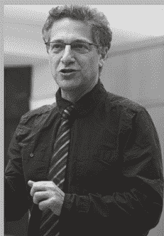

到目前为止，算法的法律、伦理、形式和经济尺度都是准无限的。

彼得·加里森

彼得·加里森是科学史家，哈佛大学约瑟夫·佩莱格里诺讲席教授、“黑洞计划”共同创始人，著有《爱因斯坦的时钟与庞加莱的地图：时间帝国》。

布罗克曼谈彼得·加里森

彼得·加里森作为科学史家，关注的焦点大致在理论与实验的交界处。

“多年来，抽象思想与极其具体之物之间的怪异对峙，一直引导我的工作。”他这样解释自己的研究取向。在康涅狄格州华盛顿的会议上，他讨论过维纳等工程师与奥本海默等曼哈顿项目管理者之间的紧张：“维纳警告控制论的危险，部分原因是他想与奥本海默那种预兆性语言竞争：‘当我在三一试验场看到爆炸时，我想到了薄伽梵歌——我是死亡，是世界的毁灭者。’物理学能同时站在宇宙本质和空军政策的立场上，这种感觉既令人厌恶又充满诱惑。纳米科学、重组DNA、控制论也常这样说——我代表科学，它能拯救人类也能毁灭人类。人工智能和机器人学里也常听到这种说法。”

二十四岁时，我第一次接触维纳的思想，在麻省理工学院的会议上遇到他的同事，当时对维纳的告诫毫无兴趣。真正吸引我的是他对生命的直截了当、激进的看法，基于非线性消息的通信数学理论：维纳认为，“通信和控制的新概念涉及重新诠释人类，以及人类对宇宙和社会的了解”。这个观点激发我写第一本书，把信息理论也就是通信的数学理论，当作所有人类经验的模型。

最近一次谈话中，彼得告诉我，他正准备写一本关于构建、崩溃和思考的书，探讨控制论的黑箱本质，以及为何它代表了他所说的“学习、机器学习、控制论和自我的根本转变”。

伟大的中世纪数学家花剌子米在第二部著作中描述了新的印度算术。据他名字发音，很快出现 algorismus 一词，意指作用于数字的程序，后传入法语再传入英语成为 algorithm。我喜欢“现代算法学家”这个说法，尽管拼写检查器不喜欢。我所说的现代算法学家，是指那些对人类判断的干预深表怀疑，认为它违背客观和科学基本准则的人。

二十世纪末，明尼苏达大学两位心理学家总结了长期影响人类预测领域的文献。他们认为，一种观点长期坚持“临床预测法”，视所有主观、非正式、头脑中的印象派的东西很有价值。这些临床医生认为自己能仔细研究对象，聚会后对累犯、好学生、医疗结果等做出基于判断的预测。另一种观点则体现算法所没有的一切，接受客观性，也就是形式的、机械的、算法的东西。作者认为这是后伽利略时代科学胜利的根源。科学不仅从实践中受益，而且在很大程度上科学就是机械精算。通过从量刑到精神病学的136项预测研究，作者发现，在128项中，使用精算表、多元回归方程或算法判断的预测在准确性上等于或超过主观方法。

他们随后列出十七个坚持临床预测的错误理由。有人害怕机器取代工作；有人缺乏统计素养；有人不信任数学形式化；有人斥责算法“不人性化”；有人认为目的是理解而非预测。但无论动机如何，论文结论是：认为主观强于客观、专家判断优于算法是完全不道德的。

算法信徒的影响力在持续放大。2007年到2010年间，安妮·米尔格拉姆出任新泽西州检察长。履新后她想弄清本州逮捕、起诉、入狱的名单以及各类罪案分布，TED演讲里她回顾，当时可用作支撑的统计与分析几乎是空白。借助预测性统计推动执法，她任内凶杀掉了41%，相当于37条生命被保住，整体犯罪也下滑26%。离任后她进入阿诺德基金会主管刑事司法，组建数据科学家与统计学家团队打造风险评估工具。她形容团队的核心任务是把“高危人群”留在监狱里，同时把低危人群放出来。米尔格拉姆指出法官出发点多是善意的，可做风险研判时仍带着很强的主观色彩，就像二十年前的棒球球探靠直觉和经验揣测风险，于是容易出错。团队梳理出九百多条风险指标，其中九条预测力最高。最紧迫的提问始终是：是否会再犯？是否会施暴？是否会出庭？米尔格拉姆的结论是需要一种受法官判断制约却更中立的风险度量。她强调统计与算法确实管用，这也是谷歌能成为谷歌、体育大数据能左右赛场的原因。

算法派的胜利看起来势不可挡。协议和数据早已渗进日常生活，从推测下一步去向到评估犯罪概率。文献显示算法在法律、伦理、形式与经济层面的渗透几乎没有边界。我想聚焦其中最危险的承诺：客观性。

科学意义上的客观性有自己的历史，这常让人惊讶。明尼苏达心理学家提出的判断是否成立？客观性真的和科学同步扩张吗？有必要回看科学工作里被推崇的认知美德。量化看似总有益处，预测、解释、统一、精确、准确、确定、教学价值都被视作美德。在理想状态下这些倾向同向，但它们与道德美德一样并非总一致。按需分配和按能分配会冲突。平等、公正、精英主义等伦理立场，本质上是对冲突美德的裁决。我们常忽略科学内部同样存在张力。让仪器追求极致灵敏，结果可能剧烈波动，导致测量难以复现。

“科学客观性”一词进入科学话语和实践是在19世纪初。科学图鉴清楚体现了这一点。图鉴为学者提供专业客体：手部图鉴、颅骨图鉴、云图鉴、水晶图鉴、花卉图鉴、气泡室图鉴、核乳胶图鉴、眼病图鉴。18世纪若在户外见到被日晒伤、被毛虫啃食的特殊三叶草，你不会把它收进图鉴。像歌德、阿尔比努斯、切泽尔登那样的自然哲学家，目标是观察自然后把对象提炼、抽象为典范。把骨架置于相机显微装置下仔细描绘，再矫正“不完美处”。遮蔽纯粹经验的做法好处明显：提供一种不依赖个体差异的普世参照。

随着研究版图扩大、从业者增多，理想化的负面效应愈加显现。让歌德绘制“植物原型”或“昆虫原型”是一回事，让无数学者以不同甚至矛盾的方式修正图像是另一回事。约从19世纪30年代起，出现新诉求：尽可能以最少人为干预制作图像。这可以是铅笔临摹叶片，也可以是把叶片蘸墨直接拓在纸上。也意味着人们开始以显微镜下描绘自然物为自豪，即便看到缺陷。这种观念很激进：雪花并不具备完美六边对称，显微镜镜缘会产生色差，制取过程中组织会出现撕裂。

于是客观性被理解为描述应剔除人为因素，即便意味着要忠实呈现显微镜边缘的黄晕，即便学者清楚变色来自镜头而非研究对象本身。客观性的优势在于取代了想看到理论实现或既定观点被证实的欲望。但代价也很清楚。你失去了那种精确、易教、色彩丰富、景深充足的艺术家对解剖标本的再现，换来的是模糊、景深差的黑白影像，连医学院学生和不少教师也不愿用它来学习比较病例。不过在19世纪相当长一段时间，学界愈发推崇客观性那种不干预与自我约束的优点。

从20世纪30年代起，强硬的科学客观性开始显露困境。例如恒星光谱编目，没有算法能与受训观察者匹敌，后者比遵循规则的过程更精确也更可重复。20世纪40年代末，医生开始学习解读脑电图。辨别不同癫痫发作读数需要专业判断，早期频率分析的尝试都比不上这种判断。绘制太阳磁场需要受训专家从仪器产生的伪影中辨识真实信号。即便粒子物理学者也认识到，某些轨道分类不能靠计算机完成，需要经过训练的判断。

这并非要回到18世纪召回理想主义天才。没人认为人人都可通过训练成为歌德，挑出植物、昆虫或云朵的普遍理想形式。专业判断是可以习得的，你能通过课程学会如何对脑电图、恒星光谱或气泡室轨迹做出专业判断；没有捷径可让你获得非凡洞察。从一本本科学图鉴能看出明确论点：主观因素是创建、分类和解释科学图像不可或缺的科学工作的一部分。

在许多算法学者的主张里，我们看到宏愿：以科学客观性之名放弃主观判断，依靠机械程序精确实现科学客观性。美国多州已立法使用判决与假释算法。有人认为机器远比法官判决时的波动更可靠。

但科学界给出警示。19世纪那种不干预的算法程序主义确实辉煌，在当今许多成功的技术与科学研究中仍在发挥作用。但把机械客观性看成从糟糕的印象派临床医生到优秀的外化精算师的简单单调上升，就无法解释科学史的趣味和细腻。

科学有一个更重要的教训。机械客观性是科学的美德，硬科学常常吸取这一教训。我们在法律和社会科学领域也必须如此。比如当一份保密的私有算法把一人关十年，而另一人犯同样罪行只关五年时，会发生什么？耶鲁法学院信息社会项目访问研究员丽贝卡·韦克斯勒对这一问题进行了探讨，同时也指出商业秘密算法使公平法律辩护成本大幅上升。[45]事实上，出于种种原因，执法部门可能不愿分享用于DNA、化学物或指纹识别的算法，这让辩护变得困难。在法庭上，客观性、商业秘密和司法透明度可能背道而驰。这让我想起战后不久的物理学史一幕。柯达和伊尔福改进了一种用于揭示基本粒子相互作用和衰变的胶片。物理学家本很兴奋，直到电影公司告知胶片成分是商业秘密，科学家永远无法完全确信自己研究的物理过程。用黑箱证明事情对科学家是危险游戏，对刑事司法亦然。

另一些批评者强调，依赖被告陈述或其他易被种族代理的变量非常危险。我们从日常经验就知道，机场安检对12岁以下儿童和75岁以上老人是不同的。我们希望算法设计者考虑哪些因素：教育、收入、就业经历、读过什么书、看过什么电影、去过哪些地方、买过什么东西、是否曾与执法部门接触？又该如何权衡？基于机械客观性的预测分析是有代价的。有时值得付出；有时这种代价对我们想要的正义社会是毁灭性的。

更一般地说，随着算法与大数据的融合支配生活越来越大的部分，我们要记住科学史上的两点教训：第一，判断不是被纯客观性丢弃的外壳。第二，机械客观性只是相互竞争的美德之一，而非科学事业的本质。即使算法学者梦想着客观性，也应牢牢记住这些教训。

## 23
### 机器的权利谁说了算

THE RIGHTS OF MACHINES

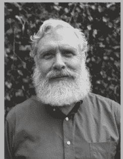

面对前所未有的心智多样性，是否该把注意力从我们对阵他们的对立上移开，转而关怀所有有意识存在的权利。

乔治·丘奇

George M. Church

乔治·丘奇是哈佛医学院罗伯特·温思罗普遗传学讲席教授、哈佛大学-麻省理工学院健康科学技术教授，与艾德·里吉西合著《再创世纪：合成生物学将如何重新创造自然和我们人类》。

布罗克曼谈乔治·丘奇

过去十年，基因工程在塑造生活方式上的影响已赶上计算机科学。基因工程师乔治·丘奇是可读写生物学的先行者，是这一新思路的核心人物。他把人体看作操作系统，工程师取代传统生物学家，像1970年代末电气工程师把电路板、硬盘、显示器装成第一台个人电脑那样，把从原子到器官的部件拆下重装。他创办并领导了个人基因组项目，该项目提供全球唯一的开放人类基因组、环境与特征数据，推动了DNA家谱业的发展。

奥巴马2013年启动“脑计划”，即“推进创新神经技术脑研究计划”，乔治·丘奇在奠基中发挥了重要作用。该计划旨在改善人类大脑，使其大部分功能在不依赖有潜在危害人工智能帮助的情况下得以维持。他说，这可能是因为某些脑计划项目能让我们构建出符合道德规范、却能像人工智能一样完成高级任务的人脑。迄今最安全的路径是让人类去完成他们本想委托给机器的任务，但我们在这条超级安全的道路上并不坚定。

媒体讲述CRISPR起源时忽略了，乔治最早利用CRISPR酶乃至更好的方法编辑人类细胞基因。

关于通用人工智能的未来形式，乔治持乐观态度，如下文所述。但他从未忽视人工智能安全。他最近评论说：“在我看来，人工智能的主要风险不在于我们是否能从数学上理解它们的想法，而在于我们是否能教会它们符合道德规范的行为。人类几乎不能教会彼此符合道德规范的行为。”

1950年，诺伯特·维纳的《人有人的用处》处于展望未来的前沿，书中宣称：

像神灵那样能学习、能根据学习做出决定的机器，绝不会被迫做出人类本该做的决定，也绝不会做出人类可接受的决定。……不管我们把决定权委托给金属机器，还是委托给血肉机器，不管这些机器是当局、大实验室、军队还是公司，……天色已晚，善与恶的选择已敲响了我们的大门。

但这是那本书的结尾，这个结尾让我们的心悬了近七十年，它不仅没给出解决方案和禁令，甚至连清晰的“问题陈述”都没有。从那时起，关于机器威胁的警告不断，甚至通过电影《巨人：福宾计划》《终结者》《黑客帝国》《机械姬》传递给大众。现在是时候用全新观念对这一警告进行重大更新，这个新观念主要集中在人权和生存需求上。

通常关注点集中在机器人领域的“我们VS.他们”、纳米技术的“世界末日”或生物学的“克隆单一培养”。按当前趋势推断：如果我们能制造或种植几乎任何东西，并能设计出符合需求的安全性和有效性，会怎样？任何由原子排列而生的思考生物都可获得任何技术。

面对前所未有的心智多样性，我们也许该减少对我们对阵他们的执念，而更关注所有有意识者的权利。我们应利用这种多样性来最小化威胁全球的生死风险，比如超级火山爆发和小行星撞击地球。

但我们应说“应该”吗？免责声明：在这种情况下以及其他许多情况下，当技术专家描述一条社会道路“可能”、“将要”或“应该”发生时，这并不一定等同于作者偏好。它可以反映警告、不确定性或独立评估。机器人学家吉安马科·维卢乔和其他人自2002年以来提出机器人伦理学问题。自2006年以来，英国工业贸易部以及兰德公司下属的未来研究所提出了机器人权利问题。

### 事实与价值的张力

人们常说科学应关注“是”，而不是“应该”。史蒂芬·杰伊·古尔德的“诺玛理论”认为事实必须与价值观完全不同。同样，1999年美国国家科学院《科学与创造论》指出，“科学和宗教分属两个不同领域”。我与进化生物学家理查德·道金斯以及其他人对这一划分提出批评。在“为了实现Y，我们应该做X”的框架下，我们可以讨论“应该”。那么Y应是一个高优先级的目标，它不一定需要通过民主投票设定，但可能要通过达尔文的进化论设定。价值体系和宗教的兴衰、多样化、分化和融合，就像有生命的物种一样：服从选择，适者生存。最终的“价值”或“应该”，是留下来的基因和模因。

很少有宗教说我们的肉体和精神世界之间没有联系。我们有记录在案的奇迹。教会教义与伽利略和达尔文之间的冲突最终得以解决。信仰和伦理在我们的物种中广泛存在，我们可以用科学方法，包括但不限于功能性磁共振成像、精神药物、问卷调查等对其进行研究。

实际上，我们必须解决道德规范问题，这些规范应内置在日益智能化和多样化的机器里，供机器学习或选择。我们有一系列电车问题。在多少人排队等候死亡的情况下，计算机才应决定将运动的电车撞向一个人？归根结底，这可能是一个深度学习问题，需要把大量事实和意外事件数据库考虑进来，其中一些似乎根本不符合现有道德规范。

例如，计算机可能推断，如果不移动电车就不会死的那个人是一个被定罪的恐怖分子累犯，身上携带有会造成世界末日的病原体，或者他是现任美国总统，或者是一系列更为复杂的事件的一部分。如果这些问题描述中的一个似乎自相矛盾或不合逻辑，可能是电车问题的作者已经调整了天平两端的重量，使得犹豫不决不可避免地发生了。

或者，可以使用错误指示来操作系统，这样错误模式就不会引起关注。例如，在电车问题上，几年前当行人可以进入铁轨时，甚至在那之前，当我们投票决定把更多钱花在娱乐上而不是公共安全上时，就已经做出了真正的道德决策。那些一开始听起来很怪异、很令人不安的问题，比如“谁拥有新的心智，谁为自己的错误买单”，就和规定谁拥有公司、谁为公司罪行买单的完善法律一样。

### 顺滑的通道

我们可以通过声称某些情况不会发生来过度简化道德规范。技术挑战或不可跨越的警戒线都令人安心，但现实是，一旦利益似乎超过风险，即使是短暂地稍稍超过一点儿，警戒线就会移动位置。就在1978年世界首例试管婴儿路易斯·布朗诞生之前，许多人担心她“可能是个小怪物，在某些方面，可能是畸形”。但今天关于体外受精，很少有人有这种担心。

什么技术使多重感知变得更加容易？这不仅仅是用大型计算机执行深度机器学习算法。我们已经能让啮齿类动物在各种认知任务中表现得更好，还能表现出其他相关特征，比如坚持以及低焦虑。这是否适用于那些智力接近于人类的动物？有一些动物在镜子试验中展示出自我识别能力，如黑猩猩、倭黑猩猩、猩猩、一些海豚、鲸鱼，以及喜鹊。

甚至那条人类操纵人类的警戒线也显示出位置移动或完全断裂的迹象。全世界有超过2300项经批准的基因治疗临床试验正在进行中。特别是在全球人口快速老龄化的背景下，其中的一个主要医学目标是治疗或预防认知能力下降。对认知能力下降的治疗方法包括通过药物、基因、细胞、移植、植入物等增强认知能力。这些治疗方法将用于未来的不时之需。体育竞赛规则，如禁止使用类固醇或促红细胞生成素，不适用于现实世界中的智力竞赛。对认知能力下降治疗的每一点进展都在发挥作用，为将来做好准备。

人类利用人类的另一个前沿领域是“大脑器官”。我们现在可以加速发展生物学。通常需要几个月时间才能发生的过程，现在在实验室通过使用正确的转录因子配方在4天内就能发生。我们能创造出这样的大脑，它具有越来越高的保真度，能分辨出生来具有认知能力异常的人，如小头畸形。现在，由于增加了早期成功中缺失的适当的血管系统（静脉、动脉和毛细血管），人工大脑器官超过了以前的亚微升限制，可能超过现在的1.2升现代人脑，甚至超过大象的5升大脑或抹香鲸的8升大脑。

### 传统计算与生物电子混合

当摩尔定律微型化技术接近下一个瓶颈时（肯定不是不可突破的），我们看到硅片中掺杂原子随机性出现极限，大约10纳米特征尺寸的束制造方法也出现极限。功率问题也随之显现出来：伟大的机器人沃森，智力问答节目的获胜者，功率为85000瓦，而人脑仅消耗20瓦。公平地说，人体运行需要100瓦的功率，而人体需要20年时间来建造，因此大约需要6万亿焦耳的能量来“制造”一个成熟的人脑。制造一台相当于沃森计算能力的计算机成本也差不多如此。那为什么人类不取代计算机呢？

其一，这个问答节目的参赛者的大脑所做的远远不只是信息检索，其中大部分对于沃森而言仅是不务正业，例如，用小脑控制微笑。其他部分则远远跳出了沃森思维的固定框架，令它难以理解，比如爱因斯坦在1905年发表的5篇奇迹般的论文。再者，人类消耗的能量超过了生命和生育所需的最小值，即100瓦。印度人均能量消耗为700瓦，而美国的人均消耗则为10000瓦。都比沃森消耗的85000瓦低。计算机可以通过神经计算变得更像我们。但是人脑也可以变得更有效率。装在瓶子里的类大脑可以接近20瓦的极限。我们祖先在数学、存储和搜索方面能力有限，但计算机在这方面却具有独特优势，人类的这些劣势可以在实验室中得以重新设计和发展。

脸书、美国国家安全局和其他机构正在建造一个功率超过1兆瓦、占地超过4公顷的超大存储设施，而DNA仅需1毫克便具有这么大的存储容量。显然，DNA并不是成熟的存储技术，但有了微软和特艺集团双双在此领域挖掘，我们应该密切关注这一技术。毕竟，得到一个富有成效的人脑需要花费6万亿焦耳能量，主要是因为人脑必须经过20年的训练。

即便算力顶级的超算数秒内能完成自我复制模型的训练，要把一具成熟的硅基克隆体造出来所耗的能源依然惊人。工程团队对漫长的成熟期影响有限，若把发育节奏提速，用类DNA编码或类似手段批量写入记忆，生物型计算体的复制周期可以压缩到细胞分裂量级，大约在11分钟到24小时之间。真正的难题是，每一步加速演化中生物、人、纳米、机器各占多少我们说不清，但相处的基本盘可以坚持在更有人性、更公平、更安稳的方向。

权利的源头可追到1689年的英格兰。美国第32任总统罗斯福提出言论自由、信仰自由、免于恐惧、免于匮乏四大自由。联合国1948年发表的《世界人权宣言》列出生命权、禁止奴役、在受侵害时捍卫权利、行动自由、结社思想良知宗教自由、社会经济文化权利、个人对社会的义务，以及不得以违反联合国宗旨的方式行使权利。

这种普世性从未被大众真正接受，一直遭到质疑。非人类智能的出现如何改变这场争论？至少靠模糊直觉做道德判断已越来越站不住脚。那种直觉就是美国最高法院大法官波特·斯图尔特1964年所说的“我看见就知道”，也就是“厌恶的智慧”、利昂·卡斯1997年提出的厌恶因子，或一句空泛的常识。因为要跟认知方式迥异、甚至从我们视角看像外星人的心智打交道，必须建立清晰、接近算法的规则。

自动驾驶、无人机物流、高频交易、国家安全机构的检索，都需要事先批准并能迅速执行的决策。几百年以来我们一直试图细化道德，现在或许能看得更透。难点来自相互冲突的优先序，以及根深蒂固的生物、社会和半逻辑认知偏误。隐私与尊严深刻影响了许多规范，但就人权普遍主张而言，围绕隐私和尊严的共识仍很遥远。

人们或许希望能读取并改写机器的思维，以便理解它们为何做出违背人类本能的选择。若机器也对人类做同样的事，这算公平吗？透明化正在推进，财务利益冲突披露、开源软件硬件与湿件运动、科技研究公平准入立法、开放人类基金会都在成形。

约瑟夫·魏岑鲍姆1976年《计算机力量与人类理性》指出，面对需要尊重、尊严或关怀的情境，机器远不及人类。作家帕梅拉·麦考达克，以及计算机科学家约翰·麦卡锡、比尔·希巴德则认为在同样情境下，机器能更公正、更冷静、更稳定、不滥用能力、更富同情。

## 平等议题
托马斯·杰斐逊1776年写下“我们认为这些真理不言而喻，人皆生而平等，造物主赋予不可剥夺的权利，包括生命、自由与追求幸福”。他当时想表达什么？今天“人”的范围被大幅拓宽。1776年的“人”不包含有色人群与女性。即便现在，先天认知或行为有障碍的群体仍承受差异化对待，哪怕多半带着同情，诸如唐氏综合征、泰萨克病、脆性X综合征、脑瘫等。

随地域与成熟度变化，不均的权利持续演进。胚胎、婴儿、儿童、青少年、成人、病人、重刑犯、性别认同与性取向、极富与极贫群体，所面对的权利与社会经济现实截然不同。若要让一种接近顶尖人类的新型心智获得并保有权利，一种做法是保留人类元素，比如用人做盾牌或傀儡君主、傀儡CEO，他们只是机械签署关键技术文件，快速就财务、健康、外交、军事或安全做决定。我们很可能难以彻底关停计算系统，也很难修改或抹除其记忆，尤其是当它对人类很友好并哀求存活时，就像所有为自己生命奋斗的研究者一样。

就连《呆伯特》作者斯科特·亚当斯也参与讨论。2005年埃因霍温大学的实验印证了他的观点，人类对机器人受害者的敏感度与1961年耶鲁的米尔格伦实验相当。公司拥有财产所有权等大量权利，其他机器很可能也会争取类似权利，这将是一场在智力与人工情感的多维梯度上维持选择性差别的斗争。

## 规则的碰撞
一旦谈论对象是与人类范畴重叠或即将重叠的存在，智人内部权利差异的分歧就会爆发。谷歌街景会模糊人脸与车牌。法院与委员会等场合常禁录像设备。带人脸识别的穿戴相机与公共摄像头被视作禁忌。同样情境下，是否也该把具备超忆或照相记忆的人排除在外？

而患面容失忆症即面盲、或健忘的人，不该从人脸识别与光学字符识别中获益吗？如果他们能受益，为何他人不能？如果某种程度上我们都拥有这些工具，难道不该人人受益？

这些情境与库尔特·冯内古特1961年短篇《哈里森·伯吉朗》高度相似，小说里为照顾多数人的平庸，特长者被压制。约翰·塞尔的“中文屋”、艾萨克·阿西莫夫的“机器人三定律”等思想实验激发了人类多种直觉，而这些直觉正是丹尼尔·卡尼曼、阿莫斯·特沃斯基等人揭示的人脑困扰。中文屋假设，由机械与智人组成的系统即便能进行聪明的中文对话，也未必有意识，除非人类能辨认意识来源并感受到它。阿西莫夫的第一、第二定律把人类思想置于他在第三定律中提及的任何其他思想之上。

如果机器人没有与人类完全相同的意识，这就成了降低其权利的借口，类似历史上某些人认为其他部族或种族不配为人的论调。机器人展现自由意志了吗？有了自我意识了吗？机器人Qbo通过了关于自我认知的“镜子测试”，机器人NAO通过了识别自己声音并推断自身内心状态的测试。

谈自由意志，现有的算法既不完全确定也不完全随机，目标是实现近乎最优的概率决策。有人会说这是博弈论的达尔文式演化。对多数博弈或问题而言，完全可预测或完全随机往往会输。

自由意志的诉求到底是什么？历史上以今生来世的奖惩为背景，它提供了一种责任分配方式。惩罚的目的是让个体优先考虑物种存续。在极端情况下，若斯金纳的正负强化不足以维系社会，还可能包括监禁等限制手段。广义看，这些工具完全适用于自由意志，也适用于任何我们想管理的机器行为。

机器人是否真的有自由意志或自我意识的主观感受，可以争论不休，但这种感受对人类评估同样适用。我们怎么知道反社会者、昏迷病人、威廉斯综合征患者、婴儿是否和我们一样拥有自由意志或自我意识？这又有什么关系？如果有人有说服力地声称自己体验到意识、痛苦、信仰、幸福、抱负和对社会的价值，我们是否该因为他们的感受与我们假设的不同就剥夺权利？

我们以为永远不会跨越的警戒线，如今看似越来越近且荒诞。人与机器的界限在模糊，因为机器越来越像人，人也越来越像机器。说人像机器，不仅因为我们盲目遵循导航指令、反射式推特和精心设计的营销，也因为我们对大脑与基因编程机制的理解越来越深入。美国国家卫生研究院的脑计划正在研发技术，绘制心理回路的连接与活动，进而改进电子或合成神经生物学软件。

不同的警戒线取决于基因例外论。基因例外论认为基因是永久遗传

## 控制论的艺术面向
THE ARTISTIC USE OF CYBERNETIC BEINGS

倾向控制论的创作者关注的是当下人工智能尚未触及的生命涌现现象。

卡罗琳·琼斯是麻省理工学院建筑系的艺术史教授，著有《单凭视力：克莱门特·格林伯格的现代主义与感官的官僚化》《工作室中的机器：构建战后美国艺术家》《全球艺术作品》。

布罗克曼谈卡罗琳·琼斯
卡罗琳·琼斯深入研究艺术制作、发行与接受中的技术，她对现代与当代艺术兴趣浓厚。“作为艺术史学者，我的许多问题围绕我们能创造何种艺术、何种思想，以及何种观念能让人类超越顽固与自私，不再只关心小圈子。我喜欢的哲学家和思想挑战西方对个人主义的痴迷，来自不同地域，并重现了上世纪六十年代的各类议题。”

她近期开始关注控制论的历史。她在麻省理工学院开设的课程“自动机、自动化、系统、控制论”从反馈角度梳理人机界面的历史，探索文化理解而非工程理解。她的探索从维纳、香农、图灵的入门读物开始，再到科学家、工程师、艺术家、女权主义者与后现代理论家的作品与思想。她的目标是提出一种以文化为基础的进化中心范式，即社群主义与种间共生，而非适者生存。

作为历史学家，卡罗琳区分了“左控制论”与“右控制论”：“我所说的左控制论，一方面是双关或玩笑，指被抛弃的控制论；另一方面是模糊的政治指向，暗指左海岸的加利福尼亚，伊莎兰学院，那群戴维·凯泽称之为嬉皮士物理学家的人群。这个词不甚恰当，但它提醒我们，有一群受益于军工复合体的人，有时正是不幸地提供了批评他们的工具。”

> 受控制的艺术很重要，但对于受控制的生活而言，艺术更为重要。
> 白南准，1966

1950年诺伯特·维纳《人有人的用处》出版时，艺术家最初并不想从控制论里得到人工智能。上世纪五十到六十年代，自称拥护控制论的艺术家很少能接触到思维机器。有艺术天赋的工程师最早制造的是海龟、变戏法者与寻光机器人宝贝，而不是庞大的大脑。艺术家与控制论者一起用电路实验板、铜线、简易开关和电子传感器制作雕塑，营造模拟交互感应环境，这种交互更关乎本能驱动与战后性政治，而非知识生产的自动化。如今一种不受硬件和肉体束缚的智能让人工智能难以理解，人们忘记了早期艺术家接受控制论的年代。我们现在应重温这些努力：早期艺术家努力把法国哲学家吉尔·德勒兹与费利克斯·瓜塔里所称的机械门建模化，这种关系模型与人类在接触物理、物质、情感刺激与信号的世界中的思维与感觉相关。

控制论似乎已衰退为无处不在的人工智能，这并非必然。控制论一词指已有四百年历史的若干概念在战后显现的新意：反馈、机器阻尼、生物稳态、逻辑计算，以及自工业革命与启蒙运动以来一直存在的系统思想。相关人物包括笛卡尔、莱布尼茨、萨迪·卡诺、克劳修斯、麦克斯韦、瓦特。尽管如此，维纳造出的这个词仍具深远文化影响。前缀赛博如今使用极广，印证了人们渴望揭示人机错综关系。以维纳为起点，赛博仅指动物与机器的控制与通信。

数字革命后，赛博不再只是伺服系统、反馈回路与开关，还包括软件、算法与电子人。倾向控制论的艺术家作品关注的是当前人工智能无法触及的生命涌现行为。

词源上，维纳借用了古希腊语舵手，指一个男性形象，能把力量与本能引导到船舵，能读懂海浪、判断风向、控制舵柄、指挥奴隶机械划桨。这个希腊词经拉丁语迁移到现代英语，从kuber-变为guber-，字根意为州长，另一个指向男性控制的词，詹姆斯·瓦特用它描述调节失控蒸汽机的装置。由此控制论采纳了长期将人类与装置类比的思想，并加上-ics推广为应用科学。维纳的三个C——指挥、控制、通信——利用概率数学把生物与机械系统理论化为一组信息输入，以在环境中输出行动，这是人工智能谱系中常被淡化的议程。

词源无法描绘参与者的兴奋感，数学加入理论生物学与信息理论，促使该领域诞生大量跨学科研究与出版物，既改变了科学发展方式，也改变了人类未来参与技术的方式。正如维纳所说：我们已经彻底改变了环境，现在必须改变自己才能生存。最紧迫的问题是：我们如何改变自己？我们是在正确方向前进，还是迷路，成为工具的工具？回顾早期人文主义者与艺术家对控制论的贡献，可能有助于走向更安全、更有道德的未来。

1968年对控制论一词的文化传播与艺术挪用至关重要。那年霍华德·怀斯画廊在曼哈顿市中心举办了蔡文颖的控制论雕塑展览，波兰人贾西娅·赖夏特在伦敦当代艺术学院举办了控制论意外展览。她的控制论意指由计算机制造或与计算机一起制造，尽管我们未在她多数作品的反应电路中看到计算机。1948至1968的二十年既见证控制论概念扩散到更广阔文化，也见证计算机经跨国公司从专有军用设备进入学术实验室，艺术家得以接触。家用爱好者手中的传感器器官如电子眼、运动传感器、麦克风，和效应器官如电子面包板、开关、液压系统、气动系统，让计算机更像一套辅助器官，而非电子大脑。此时尚未有人工智能比喻占据主导，艺术家便用现成材料拼凑电子体，成为对行为感兴趣却对计算或认知漠不关心的鬼才。人们模糊认为计算机是通向理性人的计算器，这更多是渴望而非成果。

从当今艺术与科学成像工具的数字化融合来看，赖夏特的展览具有预言性，她坚持模糊艺术与创造性应用科学的边界。根据展览目录，没有阅读所有相关说明就无法参观，读完说明才能知道眼前作品出自艺术家、工程师、数学家还是建筑师。目录封面是白南准1964年创作的机器人K-456，一个滑稽、功能残缺的机器人，被描述为以令人不安且独特的举止闻名的女性机器人。与之对峙的是1968年的运动的对话，由二阶控制论者戈登·帕斯克创作。帕斯克与伦敦一位剧院设计师合作，制作出由铰链与杆组成的细长男性装置，用以与附近球状的女性玻璃纤维实体通信。若不阅读目录文章，很难真正读懂项目的本质。重要的是，帕斯克关注机器人行为、互动性、在人工环境中的反应，以及它们对人类行为的思考。

当代艺术学院的控制论意外展推出重要范例：机器生态系统。观察者是系统的一部分，任务是寻找可能的交互触发点。为了充分体验艺术，伦敦画廊的观众突然成为控制论生物体，进入与伺服机制共生的配合模式。研究同期其他艺术作品，人机交互环境的美学愈发清晰。其中最早的涌现行为实例之一是Senster，艺术家兼工程师爱德华·伊赫纳托维奇1970年创作的交互雕塑。医学机器人工程师兼网站编辑亚历克斯·奇瓦诺维奇称之为首批由计算机控制的交互式机器人之一。这里计算机占据一席之地，尽管只是12位设备。伊赫纳托维奇想表现的不是智能，而是情感行为。Senster的成功关键在于程序设计，他将液压装置设计成4.5米长的铰链造型，外观灵感来自龙虾爪，以表达对附近人类的羞怯。它的声道与运动传感器会对大分贝噪声和突然攻击性动作产生回缩反应。只有愿意轻声说话并注意其动作的人，Senster才会安静而好奇地靠近。伊赫纳托维奇亲身经历过，第一次装好程序时，他清嗓子，机器便急切转向他。

在这些控制论生物的艺术应用中，我们越来越意识到有必要让公众在技术环境中亲身体验，直观与机器交流。蔡文颖的控制论雕塑展凸显了这种必要性。我们期待体验者尝试机械生命：什么行为会触发伺服机制？很可能画廊的服务员不得不解释礼仪：拍手，雕塑就会反应。正如早期评论家描述：

一丛细长的不锈钢棒从盘子里冒出，底座每秒振动30次，杆以谐波曲线快速弯曲。在黑暗房间里，闪光灯照亮装置。闪光脉冲有不同变化，与声音和接近度传感器相连。当有人靠近或附近发出噪声时，它会做出反应。杆子似乎在移动，一根微光，一根闪亮，还有一根跳着怪异的金属芭蕾，动作从安静到大幅摆动，再回到缓慢且难以形容的美感。

与Senster一样，该装置激发出并模拟了情感而非理性的交互。人类感受到这些行为表明装置是有反应的生命体，蔡文颖的作品常被归为植物或水生。这种对环境与动力的追求在当时国际艺术界很普遍。除霍华德·怀斯的马厩外，还有巴黎的GRAV团体，尼古拉斯·舍费尔的控制论建筑，德国Zero Gruppe的光与塑料旋转等，它们都在为即将到来的装置艺术划定边界并提供认知。

身体、控制与回声：从控制论装置到人工智能的批判

上世纪六十年代末，艺术家开始动手做带反馈的仿生装置，并不为造出能思考的机器。他们很清楚这些装置发不出声音，也不会产生情绪，正因如此才敢做直白的戏仿。吸引他们的是机械动作如何点燃驱动力、本能与情感，性行为的模仿、动物化的冲动被处理成下意识的反应。处理信息并非当时的重点，即便汉斯·哈克 1972 年的《实时系统》已显出转向的迹象。艺术家与科学家在两洲搭建的控制论氛围把人拉进技术场域，用机器的灵巧与敏捷牵动感知。早期那套审美里，人工与自然相互缠绕。

这条线索并未止步。支撑起一种未经审视、以男性为主导的调控体系的关键，是九十年代浮现的一批批判性女性创作者。她们熟悉前辈的技术探索，但1970 年《激进软件》的女权发起者，以及唐娜·哈拉维1984 年《赛博格宣言》带来的文化震荡，对她们的启发更大。白南准与帕斯克破碎的性别剧场，伊赫纳托维奇与蔡文颖的简约作品被重新挪用，变成兼具洞见与表现力、浸透后现代气质的新作，像林恩·赫什曼·利森1995-1998年的多莉克隆系列。系列里的互动装置《赛伯罗伯塔》与《遥控机器人娃娃泰莉》在技术语境中带点滑稽，向观众眨眼，让观看与被观看的窥视位置暴露出来。

六十年代男性控制论雕塑家为技术划出简约边界，九十年代女性创作者把这边界扩展成需要审视的宽阔场域。与此同时她们直面人工智能在模拟何种“智能”的追问。对赫什曼·利森而言，回应克隆羊多莉的技术胜利，核心在于把肉产与“肉机器”并置。她以多莉为原型的创作，为当代个体滑向意识形态化、可复制、可塑化的状况提供了批判框架。

九十年代至二十一世纪初的技术女权实践者不全是程序员，但作品让先前男性主导的技术环境中的机械与动力学特征更为复杂。朱迪丝·巴里1991年《想象，死亡的猜想》里，一个雌雄同体的远程电子人静止不动，由纯信号与平面闪烁的投影构成。作品指向了晚期技术的异化：雌雄同体的头部影像投射在一座由五面3米屏幕构成的巨型立方体上，底座为3米宽的镜面。黄、红橙、棕色的黏稠液体、疑似锯末或面粉的干物，甚至昆虫，像细雨或尘埃般顺着头部流下，屏幕却稳定呈现出坚忍高贵的姿态。以大型立体的柏拉图式形式，这件作品仍被框定在人工之中，拒绝一种无智慧的超然智能。

新世纪的创作者承接这条批判脉络，也承接了AI范式从模拟转向智能主张的转向。1955年“人工智能”一词首次出现，约翰·麦卡锡与马文·明斯基、纳撒尼尔·罗切斯特、克劳德·香农推测，理论上学习的每个方面或任何智能特征都可以被精确描述，从而造出可模拟的机器。六十多年后，这个最初 modest 的目标变得宏大，谷歌DeepMind将其表述为“解决智能”。公众期待破解谜题，听到的却是小规模资本主义、社会契约与文明支架的受损：司机失业、机器人化的直销、霸权化的娱乐、私有化的公用、去人性化的医疗，这些是否正是维纳警示的那种让人上瘾的鞭子。

创作者无法解决困境，却能提醒人们尚未开发的创造性潜能已在1970年前后萌芽，那时信息尚未资本化，智能尚未等同于数据采集。回顾早期可能性，最具启发性的或许是法国艺术家菲利普·帕雷诺的萤火虫装置，为避重复原名而以此称呼：《有节奏的本能，能够超越现有的生存力量》，2014年。这件被艺术家称作自动装置的雕塑，把闪烁的黑白萤火虫投影与黑色二进制数字上的绿色摆动带并置。图案与数字皆源自数学家约翰·霍顿·康威1970年发明的生命游戏元胞自动机。

康威为无限二维网格里的每个正方形细胞设定活或死的参数。孤立的细胞会因孤独而死，接触到三个以上活细胞的细胞也会因拥挤而死，存活通常需要恰好两个邻居等。细胞死亡后又可能为他者创造生存条件，生成看似移动与生长的形态，像转瞬的神经脉冲或生物发光的硅藻群。斯蒂芬·霍金2012年影片《生命的意义》里，解说把康威模型描述为模拟复杂如大脑之物如何从基本规则产生，点出当代AI的野心：“复杂属性来自简单法则，这些法则本身不含运动或繁殖概念”，却能产生物种，细胞甚至可以繁殖，如同现实生命。[48]

像生命一样？艺术家清楚模拟与表征的诱惑，也清楚技巧的天才与生命现实的差距。帕雷诺的作品是在具身参与中获得的生命体验的直观集合。意识被电子与控制论牵引，却不会把这种由人类生成的优雅模拟视作拥有自我智慧。

控制论生物的艺术运用也提醒意识并非只在内部，它在流动、在进出，协调感官的闪烁信号。大脑的活动远超头颅与它的模拟物主板。玛丽·凯瑟琳·贝特森解释父亲格雷戈里的二阶控制论时说，精神是物质的，不必由皮肤外壳等边界定义。[49]帕雷诺把艺术模拟与数学模拟结合，强化维纳式的观点：任何模型本身都不像生命。模型只是构成智能信号系统的一部分，只有当与模型对应的动物或人参与生动的意义创造时，模型才构成智能。当代AI把任务与子程序工具化、专门化，把训练等同于真正的智慧，反而陷入困境。本文仅作文化史的简要回顾，提醒把数据视作智能、把数字网络视作神经、把孤立个体视作生命单位的看法，即便与康威的粗暴模拟也是格格不入的。

可以把当前AI固执的傲慢称为右控制论，它带来自动化武器系统、让优步敌视人类工人、让谷歌沉醉于资本主义美梦。如今需要回到左控制论，即理论生物学家与人类学家致力于对智能系统的跨物种理解。格雷戈里·贝特森认为企业只是部分人的集合的模拟，把利润最大化决策与思想中更宽广、更明智的部分割裂，这个判断来得正是时候。[50]

这里提出的控制论认识论为我们提供新路径。个体心理体现在各处，不仅在身体之内，也在身体之外，同时存在一个更大的心理，个体心理只是其子系统。贝特森认为这个更大的心理可与上帝相提并论，也许就是人们口中的上帝，但在完全相互关联的社会系统与行星生态中，它仍属内在。这不是从人类意识外部发声的外部上帝的集体幻想。贝特森所说的上帝是我们systemic 篇? 在世界短暂体验到的意识互动的占位符：输入与行动带来更大的心理，再与其他实体配合，成为其他行动的输入，形成我们迫切需要的共生模式网络。[51]

从1970年代的蔡文颖到1990年代的赫什曼·利森，再到2014年的帕雷诺，创作者们持续批判右控制论，致力于寻找人工智能的替代、具身与环境体验。她们对控制论生物的运用提供了共生智慧，在世界的诸多诗学中可以体验到它：产生生命运动的信号节奏与直觉行动，与电机和磁技术领域协作。生命在它神秘的负熵中，与物质与心智相关。

## 25

### 人工智能与文明的未来

ARTIFICIAL INTELLIGENCE AND THE FUTURE OF CIVILIZATION

The most dramatic discontinuity will surely be when we achieve effective human immortality. Whether this will be achieved biologically or digitally isn't clear, but inevitably it will be achieved.

最引人注目的肯定是我们实现了人类的长生不老之梦。这个梦想究竟会是在生物学上还是在数码上实现，目前尚不清楚，但总有一天会实现。

斯蒂芬·沃尔弗拉姆

Stephen Wolfram

斯蒂芬·沃尔弗拉姆是一位科学家、发明家，也是沃尔弗拉姆研究公司的创始人和首席执行官。他创建了符号计算程序Mathematica及其编程语言Wolfram，以及知识引擎Wolfram|Alpha。著有《一门新科学》（A New Kind of Science）一书。

## 布罗克曼谈斯蒂芬·沃尔弗拉姆

近四十年里斯蒂芬·沃尔弗拉姆持续推进计算思维，在科学、技术与商业领域留下多项创新。1982年23岁的他发表《作为简单的自组织系统的元胞自动机》，随后掀起大量关于自然复杂起源的研究。也是在那个节点，他进入现实俱乐部视野。那是一个非正式的知识分子沙龙，在纽约聚会，让不同学科的研究者互相展示工作，1996年上线为edge.org。首位演讲者正是当时在普林斯顿高等研究院工作的“神童”斯蒂芬·沃尔弗拉姆。我记得他坐在客厅沙发上，神情专注，不间断讲了一个小时。

此后他致力于让世界知识变得可计算、可获取。Mathematica成为现代技术计算的权威平台，Wolfram|Alpha借助人工智能给出专家级答案。他认为Wolfram语言是人类与人工智能的第一种真正的计算沟通语言。

四年前我们在马萨诸塞州剑桥就人工智能议题自由讨论。他进来招呼后坐下，面向镜头开始讲话，两个半小时未停。对话编辑后成为本文，也是收束全书的好方式。上世纪八十年代他在现实俱乐部的演讲催生一批智力型企业，带来大量思想者，他们在本书中把研究呈现给他人、呈现给大众。相信这段对话能起到同样效果。

在他看来，技术就是让机器自动完成人类的目标。过去是铲车代替双手搬运，如今可自动化的工作从身体转向精神。长期以来我们引以为傲的许多工作，如今都能由机器完成。未来人类处境如何？

人们讨论智能机器的未来，讨论它们是否会接管世界、为自己定夺。但目标并非自动产生。我们需要有人定义机器的目标，目标是它试图执行的内容。如何定义目标？对特定的人而言，目标常由个人历史、文化环境、人类文明史塑造。目标是人类独有。对机器，我们可在制造时赋予目标。

什么东西具有智慧、目标或目的？现在有一个很好的例子，就是我们——大脑、人类智慧。我曾以为人类智慧远超自然中任何事物，是复杂进化的结果，与万物不同。做过科学研究后，我意识到并非如此。

例如有人会说：“天气有自己的思想。”这是一种泛灵论说法，似乎在现代科学里没位置。但事实上并不蠢。人类大脑做什么？接受输入、计算、产生动作、输出。就像天气一样。各种系统都在做计算，不管是脑还是对热环境作出反应的云。

可以说人类大脑做的计算比大气更复杂。但事实证明，不同系统间的计算存在广泛等价性。这让人类处境尴尬，看起来我们并不像自以为的那样特殊。就计算能力而言，许多自然系统几乎相当。

使我们不同的是历史，这段历史让我们拥有目的与目标的概念。当办公桌上的盒子能像人脑一样思考时，本质上它仍没有目标与目的。这些由我们的特殊性决定——特殊的生物性、心理与文化历史。

思考人工智能未来时，必须思考目标。目标是人类创造，也是文明贡献。我们正越来越自动化地执行这些目标。在这样的世界，人类未来会怎样？留给后人的是什么？我有一个项目，研究人类目标在历史长河中的演变。今天我们有各种目标。回看一千年前，目标完全不同：获取食物、确保安全。在现代西方世界，大多数人一生无需花太多时间思考这些。按一千年前的标准，今天的一些目标，例如跑步机锻炼，显得很奇怪。当时听起来简直疯狂。

未来人会做什么？我们今天的许多目标源于某种稀缺。资源稀缺，人们想要更多。生命时间本身也是稀缺品。最终这些稀缺都会消失。最引人注目的是我们实现人类的长生不老梦想。实现方式是生物还是数字尚不明确，但总有一天会发生。我们目前许多目标在某种程度上源于人类必死：“人生只有几十年，所以我最好拥有这个或那个。”如果大多数目标都被自动执行，会怎样？我们今天的动机将不再存在。我想找到的答案之一是，未来人类后代最终会选择做什么？坏结果之一是他们总在玩电子游戏。

◆◆◆

“人工智能”一词的含义在技术语言中正在变化。如今它很流行，人们对其有一定了解。早在上世纪四十年代五十年代，计算机刚出现时，书籍或杂志上关于计算机的典型标题是“巨大的电子大脑”。当时人们认为，就像推土机和蒸汽机一样，计算机将自动化智能工作。事实证明这比许多人预期更难实现。起初很多人乐观，六十年代初政府投入大量资金。但基本没什么成效。

那个时代电影里对电脑的描绘很有趣，像科幻小说。有部叫《电脑风云》的可爱电影，讲IBM电脑被装在一家广播公司，导致员工失业。它可爱在于电脑被问了一堆需要查图书馆才能回答的问题。当我和同事构建Wolfram|Alpha时，我们曾设想让它能回答电影里所有需要查图书馆的问题。2009年实现了。

1943年，沃伦·麦卡洛克和沃尔特·皮茨提出模型，用来形式化与概念化大脑运作，这就是人工神经网络。他们看到大脑模型也能像图灵机那样计算。根据这项工作，我们可以制造像大脑一样的神经网络来充当通用计算机。事实上ENIAC的制造者、约翰·冯·诺伊曼等人在计算机上的实际工作并非直接来自图灵机，而是通过神经网络。

但简单的神经网络并未起大作用。弗兰克·罗森布拉特发明了感知器学习装置，这是一种单层神经网络。上世纪六十年代末，马文·明斯基和西摩·佩珀特写了《感知器》，基本上证明了感知器不能做有趣的事——这是对的。感知器只能做线性区分。所以这个想法或多或少被搁置。人们说：“他们证明神经网络不能做有趣的事，所以我们还是忘了这回事吧。”这种态度持续一段时间。

与此同时，还有其他方法研究人工智能。一种基于对世界运行的形式化符号理解，另一种基于统计与概率。关于符号人工智能，有个测试案例是我们能否教计算机做积分等微积分，以及机器翻译。人们认为这些很好地说明了计算机能力。不过到了七十年代初，该方法失败了。

随后出现向专家系统发展的趋势，该系统出现于七十年代末八十年代初。想法是让机器学习专家使用的规则，从而找出具体做法。后来这种方法也逐渐消失。那之后，研究人工智能几乎就等同于发疯。

◆◆◆

我小时候就对如何制造人工智能机器感兴趣。我特别感兴趣的是如何利用文明中积累的知识，并基于这些知识自动回答问题。我思考过如何用符号做到这些，建立系统把问题分解成符号单元再回答。当时我在研究神经网络，但没进展，所以搁置了一段时间。

2002年中期到2003年期间，我再次思考这个问题：建立计算知识系统需要什么？到那时为止我做的研究几乎都足以表明，我最初的想法是完全错误的。我最初以为要建立严谨的计算知识系统，首先必须建立像大脑的装置，然后像人类标准教育那样提供知识。现在我意识到，智能与简单计算之间没有明确界线。

一直以为背后藏着某种近乎魔法的装置，才能让我们的能力凌驾于纯粹的计算之上，后来才发现这个前提是错的。正是这个认知转变，让我去做 Wolfram|Alpha。把大量的世界知识收敛起来，再让机器据此自动回答问题，本质上仍是计算，只是工程思路更像生物的演化，而不是一步步的手工作坊。

做程序时常人的做法是线性地搭起来，但也可以把计算宇宙当成矿场来勘探，开采里面的技术。物理开采的困境在这里同样适用：先找到具特殊磁性的铁、钴、钆矿脉，再把那种磁性转化成人可用的形态。程序世界亦然，各种程序、哪怕很小的程序无处不在，问题是我们能否把它们提炼成服务人类需求的技术。

要让人工智能达成目标，怎么跟它说话很关键。对着 Siri 闲聊还算顺畅，一到较长复杂的表达就失效了。自然语言承载不了逐步搭建复杂概念的需求，必须有一种计算机语言。公司这几十年投入的主要工作，就是造一种知识内嵌的语言，让世界知识直接成为语言的一部分。传统上创造语言是为了迎合机器：分配内存、设定变量、迭代、改程序计数器……本质是让机器按你的指令走。我的做法反过来，造一种迎合人的语言，先接受人类的想法，再转译成机器能懂的形式。能把科学积累和数据收集的知识封装进通信语言吗？整整近三十年的努力证明是可以的。

上世纪六十年代人们常说，等机器能积分、能像人一样对话，就有了人工智能。真正的障碍始终是世界知识的匮乏。问它今天星期几还能答，问总统是谁就哑了，立刻知道在跟机器说话。现在把 Wolfram|Alpha 接到图灵测试的机器人上，机器人每次都挂掉，因为只要提一个足够复杂的问题，系统能给出答案，而人类未必能。换句话说，在这个层面上我们已经拥有相当不错的人工智能了。

人类轻而易举、机器却很吃力的任务很多，视觉识别就是典型。人类能看一眼就说这是什么，还能简单描述，过去的计算机完全不行。几年前的图像识别实验已经不一样了，展示一幅图，系统在约一万个类别里给出判断。给它抽象画看也挺有趣，表现相当好。

支撑它的神经网络概念早在1943年就由麦卡洛克和皮茨提出，我们在八十年代初也研究过。那时光学字符识别能把26个字母分出来，问这是A吗B吗，26类还可行，扩到一万类就不行，这只是规模问题。今天英语里能画出来的常用名词约五千个，再加上人们常见的植物昆虫，就到一万了。我们用三千万张样本训练系统，得到一个庞大、复杂、混沌的网络。细节未必重要，训练成本却惊人，大约需要千万亿次量级的GPU运算。

这个系统令人印象深刻之处在于它逼近人类水平。训练图像的数量与婴儿前几年看到的量级相近。在学习过程中，至少视觉皮层的第一层，使用的神经元数量和操作量与人类相似。实现细节完全不同，人工神经元的工作方式与脑神经元几乎没有关联，但在数学层面由大量具有连续性的函数构成，可用微积分增量训练，最终的运作模式可能与人脑的生理识别等价。

这算人工智能吗？智能包含生理识别、语音转文字、翻译等基本模块，都与制造像人类一样工作的机器有关。对我而言更有趣的是把这些能力收进一种精确的符号语言，用来表征日常生活。现在的系统能说“这是一杯水”，从图像进入概念的下一步，需要发明实际的符号语言来承载这些概念。

起步是数学和技术类知识，随后扩展到其他类型，客观知识的表达做得不错。剩下的难题是精确地符号化人类日常话语，发明一种基于知识的人机交流语言，让人能读懂，机器能理解。比如“X大于5”是陈述，“我想要一块巧克力”也是陈述，里面藏着“我想要”。我们必须找到精确的符号来表达这种自然语言里的人类欲望。

十六世纪末莱布尼茨、约翰·威尔金斯等人就在谈论哲学语言，即对世界事物的完整、普遍、象征性表达。威尔金斯的分类显示了当时重要的事物。十七世纪后人类处境有些不变有些巨变，他写了大量关于死亡和痛苦的章节，今天的本体论里这类内容很少。比较今天与五百年前哲学语言的变化，能衡量进步。类似的尝试很多，数学形式化最典型的是怀特海和罗素1910年的《数学原理》，弗雷格、皮亚诺更早尝试，但他们错在形式化的对象：选了数学证明过程，而大多数人并不关心。

图灵测试的现代模拟和聊天机器人问题仍未解决，但终究会解决，关键是解决在哪个应用上。很长时间我问自己为什么要关心，主要的应用场景看起来是客户服务，虽然不是首选。客户服务恰好需要这种交流语言。

图灵时代与今天在人机沟通方式上差异巨大。那时输入-输出，今日买电影票会弹出屏幕。核心差异是视觉显示。机器问你问题，你点一下按钮立刻看到结果。Wolfram|Alpha用在Siri时能给出简短答案，但大多数人想要信息图式的视觉呈现，这是一种比口头或打字更丰富的非人际交流通道。

有了这个额外通道，很多图灵测试的强应用就消失了。比如我们研究的写程序聊天机器人。你说我想写一个程序，要它实现某事，机器人回程序已写好、能做什么、是不是你要的，循环往复。设计难点在于解释必须以人为模型，系统得知道人类何时会困惑。

我一直不明白传统图灵测试的意义和动机是什么。如果当玩具，和机器人闲聊，那是后话。现在的深度学习尤其是递归神经网络，已经能很好地建模人类语言和文字。输入“你今天感觉怎么样”，大多数时候回应的很像人。但我好奇能不能自动回我的邮件，我知道答案是否定的。对我而言合格的图灵测试应该是机器人能回我大部分邮件。这需要从邮件所连接的人类学到答案。我可能有点超前，自己已收集25年数据：25年的每封邮件、20年的每一次按键，应该能训练一个化身，让它能做我能做的事，甚至更好。

人们担心人工智能接管世界，我倒觉得在接管前会出现更有趣的事。人工智能会了解你的意图，并在实现上很擅长。你告诉车载GPS目的地，你不知道自己在哪，就跟着走。孩子们常提醒我早年的GPS把我们领到波士顿港的码头上。更重要的是，人工智能会知道你的历史，知道你在网上点晚餐时可能想要什么，发邮件时该聊什么。它还会给出建议，告诉你该做什么，我怀疑大多数时候人们会照做。这类建议往往比自己想的好。

就接管世界的假设而言，技术能做好事也能做坏事。令我欣慰的是今天技术的平等。过去我以电脑比熟人好为傲，现在大家用同样的电脑。智能手机几乎相同，全球70亿人口中相当一部分在使用几乎一样的科技。国王的技术不再与他人有别，这是重大进步。

五百年前的大难题是识字，今天是某种编程。编程很快过时，汇编语言不再被学习，因为计算机比人更擅长写汇编，真正懂编译的人极少。程序员的大量重复工作同样平淡，人类已没有理由手写Java或JavaScript。我们希望把编程过程自动化，重点不再是人想做什么，而是让机器尽可能自动完成。这会增强平等。过去写一段正经代码需要软件工程知识、数月时间、雇佣人才，是巨大投资。现在不是。一行代码就能做有趣实用的事，让过去不会用电脑为自己服务的人现在能借助电脑。

我想看到世界各地的孩子掌握基于知识的新编程能力，写出与顶尖程序员同样复杂的代码，这可以实现。我们正处在任何人都能学会基于知识编程的时刻，更重要的是学会以计算方式思考。编程的机制本身很简单，难的是用计算去想象。

怎么教人用计算去想象很有意思。以纳米技术为例，我们的实现方式基本是用已理解的技术再做得很小。原子尺度的CPU芯片在架构上与我们熟悉的CPU相同，并非唯一方法。看简单程序能做什么会启发我们，简单的组件经正确编排也能做有趣的事。分子尺度计算还没做，因现有技术需十年才能造出来，但组件已足以造通用计算机。即使不知道怎么用这些组件编程，通过在可程序空间搜索积累基块再生成编译器，也能前行。令人惊讶的是简单之物能做复杂事，编译步骤也没想象中可怕。

通过搜索计算领域寻找有趣程序即基块是一种好方法。更传统的工程方法更难，靠纯思想找通用计算机的建法。虽然难但可行。我猜只要找到组件并搜索可生成的程序，就能做出惊人的事。我们又回到把人类目标与系统可用资源联系起来的老问题。

当大多数人都能编码，世界会怎样？五百年前只有抄写员和少数人能读写自然语言，今天只有少数人能写代码。他们写的代码多为机器专用，人类读了会迷路。总有一天受我所做努力的影响，代码水平会高到能最基本描述你想做的事，既可人读也可机执。

编码是一种表达方式，像自然语言写作。一些简单的代码在我看来充满诗意，以干净利落的方式表达思想，其美学与用自然语言表达一致。代码的特点是可以立即执行，而写作需他人阅读，读者大脑吸收创作者思想。知识在世界史上的传播，先是遗传，后是生理识别能力的传递，新生儿神经网络随机连接，随着接触世界逐步识别物体学习知识。

第二层是自然语言的巨大成就，能抽象表征知识，通过大脑交流。自然语言是我们最重要的发明，在很大程度上带来文明。第三层是基于知识的编程，也许未来会有更富趣味的名字。它能以精确符号方式真实表达现实世界，不仅大脑可理解、可与大脑和计算机通信，还能立即执行。

自然语言带来文明，基于知识的编程会带来什么？一个糟糕的答案是人工智能的文明，这不是我们想要的，因为人工智能彼此沟通极顺畅，我们会被排除在外，没有中间语言也没有与大脑的连接口。在人工智能自洽沟通的第四层，知识交流会带来什么？如果你是穴居人刚意识到语言，你能想象文明的出现吗？现在我们该想象什么？

这与大多数人能编码会怎样的问题相关。显而易见很多琐碎事会变：合同用代码起草，餐厅菜单也是代码书写。更深刻的变化也会发生。读写能力的普及极大加速了官僚制度的发展，不管好坏都让政府体系深入。编码世界与文化世界如何关联？

以高中教育为例。有了计算思维会如何影响历史学习、语言学习、社会研究？影响极大。想象写文章，今天典型的高中文章原材料都是已出版的东西，学生很难创造新知识。但在计算领域可能。若学生懂代码，可访问所有数字化历史数据，发现新东西，再据此写文章。基于知识的编程之所以能无限繁衍，是因为它把世界知识编织进用来写代码的语言里。

◆◆◆

计算充斥整个宇宙：湍流中的复杂流动模式、行星相互作用的天体力学、大脑内部。但计算有目标吗？可以问任何系统。天气有目标吗？气候有目标吗？

从太空看地球，能否看出什么东西有目的？文明是否存在？犹他州大盐湖有一条直线，原来是堤道隔开了长着不同颜色藻类的两片湖区，直线十分显眼。澳大利亚有一条又长又直的公路，西伯利亚有一条很长的铁路，火车停在站时灯会亮。从太空可见这些直线和图案。

但从太空看，这些是否足够说明地球上存在明显的目的？由此如何识别外星生命？如何判断收到的信号暗示某种目的？脉冲星1967年被发现，每隔约一秒收到周期性振动。第一个疑问是这灯塔吗？因为除此之外还有什么能周期性发信号？结果是一颗旋转的中子星。

判断现象是否具潜在目的的一个标准是看它是否只付出了最小努力实现目标。但这是否意味着它为此被建造？由于重力球会滚下山，或满足最小作用原理。对看似有目的的行为通常有两种解释：机械解释和目的论。我们现有几乎所有技术都未能通过实现目标的最低限度测试。我们建造的大多数东西淹没在技术史中，远超实现目的所需。看CPU芯片，这绝不是实现其能力所需的最佳方式。

如何确定目的性很难，这也是重要问题，因为银河系的无线电噪声与手机的CDMA传输很像。这些传输使用伪噪声序列，具有一定的重复特性，但被视作噪声并设为噪声以免干扰。问题更棘手。若我们观察脉冲星产生的一系列素数，会问是什么产生的。这是否意味着整个文明在成长、发现素数、发明计算机和无线电发射机并实现了这一切？还是只是物理过程产生素数？有一个小小的元胞自动机可以制造素数，拆开就能看到运作方式。里面有个小东西在跳动，然后一串素数就出来了。这不需要整个文明史、生物学史等来达到目的。

本质上我认为没有抽象的“目的”，也没有抽象的意义。宇宙有目的吗？如果你认为是某种程度上你在谈神学。在意义的无意义中存在一个抽象的目的概念。目的来自历史。

关于我们的世界，也许有一点可能是真的，那就是也许我们经历了所有历史、生物和文明，到最后答案是42，或别的什么。我们经历了四十亿年的各种演化，然后到达了42。

# 某些计算注定无法跳步

天体力学的推演常被用作说明：想要知道百万年后行星会在何处，理论上只能沿着方程链条逐段推进。虽然科学史不断积累出压缩时耗、减少运算量的技巧，让我们看起来可以不必走完整流程就抵达终点，但再聪明的机器、再精妙的数学，也绕不开那些必须展开的细节。有些环节本质上不可简化，只能原原本本经历。正是这种不可替代的步骤，让历史有了分量。若结果能直接跳过过程，历史本身也就失去了意义。

这并不意味着人类在思考能力上独占鳌头。云的流动与元胞自动机的演化，和我们之间并没有抽象层面的鸿沟。类脑的神经网络与元胞自动机系统在本质上并无二致，差别仅在于实现细节。前者是文明长期沉淀的产物，后者可能只是电脑在最后一刻生成的产物。

要判断抽象人工智能是否具有意图，和要判断外星智慧是否带有目的，本质上是同一类难题，我认为没有明确答案。我们习惯用“能解质数、能完成任务”来判定智能，但达成同样结果的手段有很多，智能与纯粹计算之间并无清晰界线。

这是哥白尼叙事的延续。我们曾把地球视作宇宙中心，如今又把自己视作特殊，因为拥有智慧而其他不具智慧。坏消息可能是，这种特殊感并不成立。

设想一个场景：未来人类意识可以轻易数字化上传，很快会出现装着万亿灵魂的容器。容器内的灵魂全为虚拟，内部的分子级计算持续进行，来源可能是生物也可能不是，但容器在进行各种精密复杂的运算。容器旁放着一块岩石，岩石内部也始终进行着复杂的微观活动，亚原子粒子在持续运作。两者有何不同？差别在于，容器里发生的一切都源自人类文明漫长的历史积累，甚至包括人们前一天在视频平台看到的内容。而岩石拥有漫长的地质历史，却不具备我们文明那种特定的历史印记。

一旦意识到智能与纯粹计算并无本质区别，就容易想象文明的终点是一个由万亿灵魂组成的容器，每个灵魂本质上都在永远进行电子游戏。这样的状态有何“目的”？

## 未来只眷顾终身学习者

> 我这辈子遇到的聪明人（来自各行各业的聪明人）没有不每天阅读的——没有，一个都没有。巴菲特读书之多，我读书之多，可能会让你感到吃惊。孩子们都笑话我。他们觉得我是一本长了两条腿的书。

——查理·芒格

互联网重塑了信息联通的方式，指数型技术正快速改写商业版图，人工智能也开始分流部分人类岗位。

未来需要怎样的人才？

改写人生的可靠方式，是把自己打造成持续学习的人。未来世界不再青睐单一技能人才，而是需要知识结构完整、逻辑思辨强、感知力高的复合型人才。优秀者往往通过阅读锻造出强大的抽象思维，从而获得不同寻常的思考与整合能力。未来，将属于终身学习者！而阅读与终身学习密不可分。

很多人读书只追逐干货，想要立刻可用的解法，这其实是停留在舒适区的阅读习惯。在不确定性主导的年代，答案不会简单地躺在书里，生活本就没有标准答案，过去的经验也难以完美套用到未来。

## 湛庐阅读：在这里与顶尖思想同行进化

有人把成本焦虑集中在书价上，把读完一本书当成阅读的终点，其实思路有误。

> 时间是读者付出的最大阅读成本

怎么读是读者面临的最大阅读障碍

“读书破万卷”关键不在“万”，而在“破”！

现在，我们打造了全新的“湛庐阅读”App。它将成为你“破万卷”的新家。在这里：

- 无需纠结读什么，纸书、有声书及各类声音产品都能便捷获取；
- 无需困惑怎么读，你会发现融合泛读、通读、精读的完整阅读方案；
- 你会遇见作者、译者、专家、推荐人和阅读教练，他们是优质思想的源头；
- 你会与优秀的读者和终身学习者为伴，他们对阅读与学习保持持久热情与源源不竭的内驱力。

从单一到复合，从知道到精通，从理解到创造，湛庐希望构建一个“与最聪明的人共同进化”的社群，成为人类前沿思想交汇的聚集地，与你一起迎接未来。

同时，我们希望重新定义学习场景，让你随时随地收获有分量、有价值的思想，通过阅读实现终身学习。这是我们的使命与价值。

## 湛庐阅读上手指南

湛庐阅读App结构图：

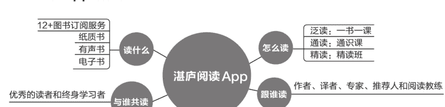

三步玩转湛庐阅读App：

App获取方式：

安卓用户前往各大应用市场、苹果用户前往 App Store

直接下载“湛庐阅读”App，与最聪明的人共同进化！

SEO观察，每天分享优质电子书：http://www.seosee.info

站长QQ/微信：876679910（添加站长不迷路）

## 用扫码打开书内书外的世界

快速了解本书内容，

湛庐千册图书一键购买！

大咖优质课、

献声朗读全本一键了解，

为你读书、讲书、拆书！

你想知道的彩蛋

和本书更多知识、资讯，

尽在延伸阅读！

## 延伸阅读

### 《直觉泵和其他思考工具》

- ◎ 汇聚世界著名哲学家丹尼尔·丹尼特五十年思考精华，化繁为简、返璞归真，让你借助直觉的力量，不用数学就能思考困难且复杂的问题。

- ◎ 哲学家陈嘉映、叶峰、苏德超，知识大V万维钢、吴伯凡，心理学家傅小兰、周晓林，经济学家汪丁丁，媒体人王烁、段永朝，《自私的基因》作者理查德·道金斯，“人工智能之父”马文·明斯基全力推荐！

### 《生命3.0》

- ◎ 《生命3.0》这本书将是你人工智能时代的思考利器。此书对未来生命的形式进行了大胆的想象：生命已经走过了1.0生物阶段和2.0文化阶段，接下来生命将进入能自我设计的3.0科技阶段。

- ◎ 史蒂芬·霍金、埃隆·马斯克、雷·库兹韦尔力荐；《未来简史》作者尤瓦尔·赫拉利叹为影响深远之作；长踞亚马逊图书畅销榜，《纽约时报》畅销书。万维钢、余晨专文作序推荐；王小川、吴甘沙、段永朝、杨静、罗振宇一致强荐。

## 《当下的启蒙》

- 当代最伟大思想家史蒂芬·平克全面超越自我的巅峰之作，一部关于人类进步的英雄史诗。通过75幅震撼的图表，平克论证人类的寿命、健康、食物、和平、知识、幸福等都呈向上趋势，这种趋势不仅限于西方，而是遍及全世界。这是启蒙运动的礼物——理性、科学和人文主义促进了人类的进步。

- 比尔·盖茨最喜爱的一本书。理查德·道金斯心中的诺贝尔文学奖作品。尤瓦尔·赫拉利2018年最爱的书之一。

## 《园丁与木匠》

- 国际儿童学习研究泰斗级专家艾莉森·高普尼克“天生学习家系列”集大成之作。汇集30年实证研究，以无人匹敌的突破性发现，带你走出传统教养误区，彻底摆脱焦虑，给你符合孩子学习与发展规律的科学育儿观。

- 清华大学积极心理学研究中心副主任赵昱鲲倾情翻译，万维钢、罗振宇、苗炜等思想界大V争相解读。荣获美国认知发展学会“年度最佳图书”奖，《金融时报》年度选书。

(1) 雷·库兹韦尔的著作《人工智能的未来》已由湛庐文化策划，浙江人民出版社出版。——编者注

(2) Omohundro, "The Basic AI Drives," in Proceedings of the First AGI Conference, 171; and in P. Wang, B. Goertzel, and S. Franklin, ed., Artificial General Intelligence (Amsterdam, The Netherlands: IOS Press, 2008).

(3) 例如，人工智能研究员杰夫·霍金斯 (Jeff Hawkins) 写道：“未来一些智能机器是虚拟的，这意味着它们将仅在计算机网络中存在、运行。……虽然痛苦，但我们总有可能关闭计算机网络。”

(4) 由斯坦福大学赞助的《人工智能百年报告》（The AI100 Report）中写道：“与电影不同，现实社会中没有发现超人类机器人的踪迹，甚至也不可能有。”

(5) 埃隆·马斯克、史蒂芬·霍金和包括作者在内的其他人从信息技术创新基金会获得了2015年度卢德奖。

(6) 罗德尼·布鲁克斯断言，一个程序不可能“不理解它的方法正在给人类带来问题，却又聪明到能颠覆人类社会来实现人类为该程序所设定的目标”。

(7) Kevin Kelly, "The Myth of a Superhuman AI," Wired, April 25, 2017.

(8) Hadfield-Menell et al., "The Off-Switch Game".

(9) Joseph Levine, "Materialism and Qualia: The Explanatory Gap," Pacific Philosophical Quarterly 64 (1983): 354-61.

(10) 在《直觉泵和其他思考工具》中，我描述并定义过这种“当然的警报”——在一个论点中只要你看到这个词，脑中就要习惯性地警觉起来。

(11) 在《达尔文的危险思想》(Darwin's Dangerous Idea) 中，我创造了大写的“浩瀚”一词，它的意思是远远超过天文数字，还创造了“浩瀚”的反义词“微渺”，二者用以取代通常所说的无限大和无限小，来讨论那些并非正式意义上的无限但在所有实际目的上都有的无限可能性。

(12) Aylin Caliskan-Islam, Joanna J. Bryson, and Arvind Narayanan, "Semantics Derived Automatically from Language Corpora Contain Human-Like Biases," Science 356, no. 6334 (April 14, 2017): 183-86.

(13) 随着物体拟人程度的增加，人类对它的情感反应呈现增-减-增的曲线。恐怖谷就是随着机器人到达“接近人类”的相似度时，人类对其好感度突然下降至反感的范围。——编者注

(14) Joanna J. Bryson, "Robots Should Be Slaves," in Close Engagement with Artificial Companions, Yorick Wilks, ed. (Amsterdam, The Netherlands: John Benjamins, 2010), 63-74; Joanna J. Bryson, "Patiency Is Not a Virtue: AI and the Design of Ethical Systems," https://www.cs.bath.ac.uk/~jjb/ftp/Bryson-Patiency-AAAISS16.pdf.

(15) "A Structure for Deoxyribose Nucleic Acid," Nature 171 (1953): 737-38.

(16) J. von Neumann, "First Draft of a Report on the EDVAC," IEEE Annals of the History of Computing 15 (1993): 27-75. 冯·诺伊曼被列为唯一的作者，而其他人只是对他提出的概念做出些贡献；因此，计算机架构享有的赞誉都归功于他本人。

(17) Science 177, no. 4047 (August 4, 1972): 393-96.

(18) Vincent C. Müller and Nick Bostrom, "Future Progress in Artificial Intelligence: A Survey of Expert Opinion," in Fundamental Issues of Artificial Intelligence, ed. Vincent C. Müller (Switzerland: Springer International Publishing, 2016), 555-72.

(19) Upton Sinclair, I, Candidate for Governor: And How I Got Licked (Berkeley: University of California Press, 1994), 109.

(20) https://futureoflife.org/aiprinciples.

(21) 阿道夫·艾希曼是纳粹德国高官，负责执行屠杀犹太人的“最终解决方案”，1962年被处以绞刑。——编者注

(22) Hannah Arendt, Eichmann in Jerusalem: A Report on the Banality of Evil (New York: Penguin Classics, 2006).

(23) Elizabeth Kolbert, The Sixth Extinction: An Unnatural History (New York: Henry Holt, 2014).

(24) Posthumously reprinted in Philosophia Mathematica 4, no. 3 (1966): 256-60.

(25) Irving John Good, "Speculations Concerning the First Ultraintelligent Machine," Advances in Computers 6 (Cambridge, MA: Academic Press, 1965): 31-88.

(26) Katja Grace et al., "When Will AI Exceed Human Performance? Evidence from AI Experts".

(27) Neil Gross and Solon Simmons, "The Social and Political Views of American College and University Professors," in Professors and Their Politics, ed. N. Gross and S. Simmons (Baltimore: Johns Hopkins University Press, 2014).

(28) 存在之链是一个18世纪欧洲神学的概念，它将万物分为自上而下的固定等级。——编者注

(29) 见《当下的启蒙》第12章“安全”。

(30) “模仿”（指模仿某些行为但却不解其意）使用的是固有程序，如镜像神经元系统。但被如此模仿的行为，其复杂性极其有限。参见 Richard Byrne, "Imitation as Behaviour Parsing," Philosophical Transactions of the Royal Society B 358, no. 1431 (2003): 529-36。

(31) 卡尔·波普尔，《猜想与反驳》(Conjectures and Refutations)。

(32) 马特·里德利 (Matt Ridley) 在《理性乐观派》(The Rational Optimist) 中，强调了人口对社会发展速度所起的积极作用。但这从来都不是最大的原因：比如说，把古代雅典与当时世界其他地方做对比。

(33) Alfred, Lord Tennyson, "The Revenge" (1878).

(34) Norbert Wiener, "A Scientist Rebels," Atlantic Monthly, January 1947.

(35) Warren Weaver, "Recent Contributions to the Mathematical Theory of Communication," in Claude Shannon and Warren Weaver, The Mathematical Theory of Communication (Urbana: University of Illinois Press, 1949), 8 (emphasis in original). 香农1948年的论文在同一卷中再版。

(36) Matthew Arnold, Culture and Anarchy, ed. Jane Garnett (Oxford, UK: Oxford University Press, 2006).

(37) See, for example, Dennett's From Bacteria to Bach and Back: The Evolution of Minds (New York: W. W. Norton, 2017).

(38) 例如，定理证明器重现了怀特海和罗素的《数学原理》(Principia Mathematica) 的大部分内容。

(39) Lake et al., "Human-Level Concept Learning Through Probabilistic Program Induction," Science 350, no. 6266 (2015): 1332-38.

(40) A. Gopnik, T. Griffiths, and C. Lucas, “When Younger Learners Can Be Better (or at Least More Open-Minded) Than Older Ones,” Current Directions in Psychological Science 24, no. 2 (2015): 87-92.

以下为原始材料中的引用信息整理重述：

41. Gopnik A. 等人在 PNAS 2017年第114卷第30期发表的研究，题目为 “Changes in Cognitive Flexibility and Hypothesis Search Across Human Life History from Childhood to Adolescence to Adulthood”，页码为7892-7899。
42. Schulz L. 的文章 “The Origins of Inquiry: Inductive Inference and Exploration in Early Childhood”，刊于 Trends in Cognitive Sciences 2012年第16卷第7期，页码382-389。
43. 艾莉森·高普尼克著《园丁和木匠》，本文所涉内容出自该书的第4章和第5章。
44. Grove William M. 与 Meehl Paul E. 合著 “Comparative Efficiency of Informal (Subjective, Impressionistic) and Formal (Mechanical, Algorithmic) Prediction Procedures: The Clinical-Statistical Controversy”，收录于 Psychology, Public Policy, and Law 1996年第2卷第2期，293-323页。
45. Wexler Rebecca 撰写的 “Life, Liberty, and Trade Secrets: Intellectual Property in the Criminal Justice System”，发表在 Stanford Law Review 2018年第70卷。
46. 维纳最终不得不承认，这个词最早由安德烈-玛丽·安培在1834年创造，安培用它来表示“政府学”，这一用法一直延续到20世纪。
47. 1972年10月2日，Robert Hughes 在 Time 杂志上发表了对 Denise René 画廊 Tsai 展览的评论。
48. Stephen Hawking 主讲的纪录片 The Meaning of Life，由 Smithson Productions 制作、Discovery Channel 播出，2012年版中的解说词。
49. Mary Catherine Bateson 为 Gregory Bateson 的 Steps to an Ecology of Mind 写于1999年的前言，该书由芝加哥大学出版社于1972年出版，前言页码为 xi。
50. Gregory Bateson 的 Steps to an Ecology of Mind，第452页。
51. Steps to an Ecology of Mind，第467-468页。