# 用智能智库驱动个人与组织跃迁

# 序

我们正站在生成式大模型的爆发节点上，认知模式与价值生产方式被迅速改写。这既是罕见的战略窗口，也暗藏明显压力——海量信息让人不安，日新月异的知识点让人跟不上，老的竞争逻辑正在瓦解。

突围的办法是思维升级与工具换代。

AI 破局俱乐部在前沿实践中与一批先行者反复验证发现，AI 智库已经成为把握这波变局、实现认知突破的核心引擎。它早已不是单纯的信息囤积，而是每个使用者都有的数字副脑和决策中枢，能够深度理解、持续赋能并与人共同成长。

它的作用体现在三点：把脑中零散的经验、洞察和外部的海量资讯整理成随时可调取的战略资源；让模型真正为个人服务，基于专属素材进行思考并输出高度定制化的方案；把理解到执行的隔阂打通，让“学会”迅速变成“会做”，让认知快速变成结果。

本书由一批在智能浪潮中率先下场并摸索出可落地路径的实战者联合完成，是一张智库实操路线图和思维进阶指南。不讲空洞理论，只聚焦能解决真实痛点、具备实操价值的方法和场景。

1）拆迷思、快上手：厘清智能智库的底层原理，手把手搭建第一套可用的个人或团队智库。
2）场景深耕：覆盖个人学习、家庭智慧生活、职场效能、企业组织进化等典型场景，给出可复制的方法论。
3）趋势与进化：展望智库与智能体的融合图景，探讨在智能时代如何保持领先，实现持续进阶。

这不只是工具书，更是一次思维迭代，是一场面向未来的认知远征。

智能时代，个体崛起，组织重塑。谁能率先搭建并善用这座智慧引擎，谁就能在竞争中占据主动，把信息变成洞察，把知识变成力量，最终把潜力兑现为卓越成果。

未来已经到来，躬身入局才能同行。让我们一起开启关于智能智库的探索与赋能之旅，迎接因智慧而更强大的未来！

易洋（AI 破局俱乐部创始人）
2025 年 5 月 28 日

# 前言

**为什么写这本书**

当下信息出现的速度和体量史无前例。不论是个人学习、职业发展，还是公司经营、行业创新，信息洪峰既带来机会也带来考验。很多人拼命学习、拼命积累，却很难转化为真实能力：

❑资讯堆积导致焦虑：收藏夹越堆越多，真正内化的少之又少；买的课程一大堆，行动上却使不上力。
❑理解与执行脱节：脑子里知道的东西不少，面对具体问题仍显低效，从学会到会用的距离很长。
❑隐性经验易流失：个人的宝贵教训、组织内部的核心know-how，多以隐性形式存在，很难系统捕捉、沉淀与复用，随着时间或人员变动而消失。

这些是多数人及机构的共同瓶颈。传统知识管理在智能冲击下已显不足，急需更智能、更高效的方式驾驭信息流，让知识真正内化为能力，成为成长与发展的核心动力。

AI 智库正是回应这一时代课题的关键。它不再是少数技术人员的专属，正迅速成为个人与机构不可或缺的“第二大脑”和“智慧引擎”。它能系统搜集、智能理解、高效关联并创造性应用知识，真正打通“学会”到“会用”的最后一公里。

本书初衷是用最通俗、最贴近实践的表达，把这一强力赋能工具介绍给渴望在智能时代提升自我、赋能组织的读者。

帮助大家揭开智库的面纱，掌握构建与应用的核心方法，让智能从遥远的概念变成点亮生活的得力伙伴。

**本书主要内容**

本书是一本系统实用的智能智库实战指南，帮助个人与企业深入理解并高效使用这一时代工具。全书共14章，覆盖从入门到进阶、从个人赋能到组织进化的完整路径，结构清晰、案例丰富。

第1～2章为基础篇，系统阐释智库的核心概念、工具挑选与搭建方法，帮助读者建立正确认知。
第3～6章为个人篇，通过大量场景案例探讨智库在个人成长、学习、家庭生活与职场效能提升中的创新用法。包括用AI写日记促进自我成长、与书籍做“主动对话”式深度阅读、搭建“家校信息管家”助力智慧育儿，以及作为优化工作流程、辅助内容创作、模拟面试的职场利器等。
第7～11章为企业篇，聚焦组织层面，全面剖析企业级智库的规划、搭建与运营。详述如何赋能团队协作、重塑客户服务、驱动营销与销售增长、加速新人入职与人才发展，并探讨与企业微信等办公平台深度融合的模式，最后简述对教育及教育工作者的赋能。
第12～14章为未来篇，先探讨智库建成后的持续维护、优化与效果评估，保持活力持续创造价值；再聚焦智能时代的核心挑战，讨论如何构建信任基石并有效对抗AI幻觉，特别是在专业场景；最后展望智库的下一阶段，探讨智能体时代的新范式与发展趋势，建议以拥抱变革、持续学习的心态迎接智能高效的新纪元。

**读者对象**

❑在校学生与终身学习者：希望系统管理学习资料、提升效率、构建个人知识体系。
❑职场人士与管理者：寻求优化工作流程、提升个人与团队效能、积累组织智慧。
❑内容创作者与知识工作者：渴望高效管理灵感与素材，提升创作质量与效率。
❑教育工作者与家长：希望借助AI工具辅助教学，为孩子打造个性化学习支持。
❑企业决策者与IT负责人：思考如何以智库提升组织智能、赋能业务发展。
❑对AI与知识管理充满好奇的探索者：渴望了解该领域前沿动态与实践方法。

**本书内容特色**

❑通俗易懂，轻松上手：以平实语言与贴近生活的案例讲清看似高深的技术概念，确保零基础读者也能快速理解与实践。
❑实战导向，即学即用：强调理论结合实践，提供大量可操作步骤、技巧与真实案例，以腾讯 ima 等主流工具为例，让读者不仅知其然，更知其所以然。
❑社群共创，智慧众筹：本书是智库理念的社群共创实践，邀请AI破局俱乐部及其他社群的AI专家、实践者与爱好者共同创作，使内容更丰满、视角更多元。
❑面向未来，启发思考：不仅关注当下应用，更着眼智库未来发展，启发读者思考AI时代个人与组织如何持续学习与进化。

**资源和勘误**

AI技术日新月异，书中工具与案例或随时间更新。作者已尽力保证信息的准确性与代表性。若有疏漏，恳请读者不吝指正。可通过微信公众号“海的女儿爱上AI”联系作者获取最新资源或提交勘误，期待交流共成长。

**致谢**

本书凝聚了师长、同道、亲友及读者的支持，在此致谢。

首先感谢AI破局俱乐部创始人易洋 Findyi。在我忐忑时，是他的坚定鼓励与资源承诺给了我勇气接下这份任务。
其次感谢畅销书《DeepSeek极简入门与应用》作者孟健老师。他的写作建议与精神鼓舞，以及欣然加盟的专业背书，让我更有信心聚集专家丰富书本深度与广度。
特别致敬16位共创伙伴。素未谋面却因对AI的热忱与知识共享的认同而走到一起。他们毫无保留的信任与无私奉献，让这种新颖共创模式得以实践，注入多元智慧与生命力。
感谢我的爱人，一年前便指明智库这一潜力方向，为写作奠定基础。
创作期间家人的支持是最温暖的港湾，感谢大姐承担家务照料饮食，也感谢公公、婆婆与孩子的理解与鼓励，是坚持不懈的动力。
最后感谢所有粉丝、AI俱乐部好友及“破局行动家”。大家的启发性提问与卓越成就鞭策我不断学习。正因智慧碰撞，本书得以面世。

写作中深感学识浅薄，是遇到的每一位给予帮助的人共同成就了此作。感恩铭记于心，将在未来回馈大家的厚爱与期待。

郑美艳
2025 年 6 月

# 入门篇

# 信息洪流中如何稳住方向

在数据爆炸的今天，每个人都想更好地掌控知识、提升效率，让信息变成洞察。智能智库这一曾显遥远的概念，正加速融入生活与工作。它不再是少数专家的工具，而是帮助个体和机构应对信息过载、实现认知升级的核心引擎。理解其本质与趋势，意味着能主动打造专属的“数字副脑”，在复杂信息中保持清醒高效。这既是提升个人竞争力的关键技能，也是拥抱智能化未来的必然选择。

本篇先揭开智能智库的面纱，帮助读者理解核心价值与运行原理，破除常见误区。再以腾讯 ima 等主流工具为例，演示从明确目标、选型、入库、智能交互到初步配置与激活的完整搭建流程，轻松迈出第一步，体验其便利与惊喜。

## CHAPTER 1

## 第一章 门槛很低 开始就很有趣

现代人往往置身信息瀑布，时间精力捉襟见肘，找资料“大海捞针”的尴尬时常发生。面对有效管理与运用知识的共同难题，智能智库无疑是应对挑战的秘密武器。本章将真正揭开其面纱，带读者轻松入门，刘旭老师对本章思路形成提供了重要启发。

本章先探“智能知识管家”的奥秘，破除大众对智能智库的几大迷思，了解AI如何“读懂”复杂资料并实现个性化服务。再探讨搭建前做需求定位的重要性，并对主流智能智库工具做初步了解。希望读者能轻松推开大门，感受它为工作生活带来的智慧与便捷。

### 1.1 破除误区：它不是高科技玩具，而是人人可用的效率利器

是否常感被信息淹没？想找去年的工作方案却在电脑里翻找不着；做分享总结时资料又散落各处。感同身受的人并不少。在信息爆炸时代，如何有效管用知识是普遍痛点。下面介绍一个应对挑战的“秘密武器”——智能智库。

**1.1.1 初识智能智库：数字管家，其实并不神秘**

提到智能智库，脑中是否立刻浮现复杂代码、冰冷机房，觉得是科技巨头或专业研究者才能驾驭的高深工具？抛开术语，其核心理念很简单：它是一个能更好地收集、整理、理解和智能运营信息的伙伴或管家。

❑能理解入库内容：无论文字、图片或网页，都能读懂含义。
❑整理与连接：发现信息间的关联，把零散点串成线、织成网。
❑交流互动：用户可用自然语言提问，让它查找、总结，甚至基于资料推演与创作。

例如，支付宝智能客服能对答自如，正是依靠AI在庞大的服务问答知识库中检索、理解并生成答案。我们每天都在不自觉中与各种形态的“智能智库”互动。它们隐藏在便捷服务背后，润物无声地改善数字生活体验。这恰说明用信息与知识提供智能服务早已是现实，而非遥远未来。

因此，自己搭建用于提升学习与工作效率的智能智库，比如后续将重点介绍的腾讯 ima这类工具，自也不再是“高科技玩具”，而是顺应时代、人人可掌握的强大效率工具。

**1.1.2 破除三大误区：安心拥抱数字副脑**

智能智库虽有用且不神秘，为何仍有人疑虑？多源于常见误解。让我们把这些浪花一一拍散。

**误区 1：太难了！非技术专家肯定用不了**

面向普通用户的现代智能智库工具操作极简友好，设计理念就是“人人可用”。无需编程或算法，只要会用电脑或手机基本就能上手。许多工具的界面直观，核心操作与常用软件相似。因此别让技术刻板印象阻碍拥抱高效工具。

**误区 2：不就是个数据库，冷冰冰没意思**

若只把智能智库当成高级网盘或数据库，就太小看它了！其魅力在于“智能”与“生命力”，在于连接与思考。它不仅存储信息，还能：
❑动态学习用户习惯与偏好。
❑智能关联信息，发现隐藏联系，激发新洞察与创意。
❑在思路卡壳时与AI交流获得启发。

所以它更像一个有智慧、有温度、能共同成长的“第二大脑”或贴心助手。

**误区 3：资料不多，用不着这么高级的工具**

这个想法可以理解，但在智能智库上并不适用。无论信息量大小，它都能提供独特价值。信息少时重在“精耕细作”：智库能把信息整理得井井有条，通过智能搜索与关联让所需信息更容易被找到与利用。信息多时重在“化繁为简”：强大的信息处理、智能检索与知识组织能力，能从汪洋中快速精准定位，避免知识的“死海效应”。它是一个人人可用、非常实用且充满智慧的效率伙伴。

### 1.2 背后魔法：AI 如何读懂万千资料

有没有办法让沉睡的资料“醒”过来，让冰冷文件变成有智慧、能互动、能服务的知识伙伴？答案就是智能智库。其核心能力在于AI能“读懂”资料，让万千信息变成真正服务的智慧大脑。

**1.2.1 AI的火眼金睛：读懂多种格式资料**

智能智库施展“魔法”的第一步是拥有像火眼金睛般的能力，能理解处理各种格式资料。无论会议记录、语音备忘、网络文章、PDF报告，还是手写笔记图片，智能智库都能尝试“阅读”与“理解”。

1）自然语言处理。大模型能快速阅读并理解文字资料如Word、笔记、网页的核心意思，识别关键词、句式结构、段落大意，抓住概念与主题。
2）光学字符识别。OCR技术能识别图片或扫描件包括部分手写体的文字并转为可编辑、可搜索文本，让随手拍的笔记、截图重点也能被AI看懂。
3）语音识别。强大的ASR技术能将会议录音、语音笔记等音频转为文字，提升处理效率。

有了这些识别与处理能力，无论何种形式的信息，智能智库基本都能“吃”进去并转为可进一步理解处理的通用语言。

**1.2.2 AI的智慧联想：让知识相互连接**

智能智库不仅读懂单个文件，还能理解内在含义并发现不同资料间的相互关系，像一个拥有超强联想能力的图书馆管理员。它会深入分析文档内容，识别共同概念、人物、时间点、核心观点，默默建立一张巨大的关系网，即知识图谱。

这张关系网的妙处在于：
❑智能关联：阅读某篇笔记时，AI可能自动推荐其他相关资料，像大脑联想到相关知识点。
❑智能筛选：面对长报告或书籍，AI能快速提炼核心观点、关键数据与重要结论，生成精简摘要，节省筛选时间。
❑智能问答：可用自然语言提问，AI基于内容理解作答，而非简单关键词匹配。

智能智库不再被动等待搜索，而是主动理解资料，构建相互连接、充满智慧的知识网络。

**1.2.3 AI的越用越懂用户：个性化与持续进化**

最惊喜的是，优秀的智能智库会像贴心私人助理，随着使用次数增加逐渐了解用户偏好与需求，提供更个性化服务。它是如何做到的？

它通过学习用户常看的资料类型与关注主题，在新资料入库时更准确地打标签或推荐相关内容。在提问时，结合个人资料、历史搜索与通用知识给出更符合用户语境的答案。

与智能智库的互动越多，提问、修改回答、反馈越多，它学习调整越快，服务越精准。因此理解工具背后的逻辑比掌握具体操作更重要，这能让大家在快速变化的技术浪潮中保持定力。

### 1.3 智慧核心：让智库越用越懂用户的个性化奥秘

如果这个智能智库不仅聪明，还能“认识”用户、了解用户，甚至随着时间推移“越用越懂”，会是怎样的光景？这正是智能智库最迷人的魔法之一，也是真正成为智慧核心的关键。

**1.3.1 告别千人一面，智库的个性化密码**

传统工具大多千人一面，很难给出贴身的服务。AI 知识库的差异就在这里，它会吸收使用者的个人资料与操作习惯，逐步拼凑出专属的数字画像与思维模型。除了归档，它还会持续记录人与资料互动的方式，用得越久越贴合。

**1.3.2 静默捕捉：从行为痕迹认识用户**
系统初次认识使用者，多靠后台静默记录留下的行动痕迹。用户在库里留下的每一道印记，都在无声透露身份与关注方向。

（1）存入了什么资料
资料的类别与主题分布，能直接勾勒核心关注区与知识结构。

（2）给资料打了哪些标记
使用者自行添加的记号，如 #重要、#待办，是理解其分类逻辑与价值判断的直观线索。

（3）资料本身的特征
系统会解析文档里的高频词、主线主题，甚至情绪倾向，进一步丰富对用户的认知。

**1.3.3 互动驱动：从使用信号进化服务**
真正做到越用越懂，关键在于学习互动信号。每一次操作与反馈，都在教它如何更好服务。

❑检索与提问映射真实诉求：搜索词、提问内容与提问方式，精准对应知识需求与思维习惯。提问越频繁，理解越深刻。
❑对回答的评价是最直接的训练：用户对结果是否精准、是否采纳、点赞或点踩，是优化回答质量的最有效依据。
❑对生成内容的修改塑造个人语感：系统会记住用户对初稿的改动偏好，比如偏好简短句还是长逻辑句、专业术语还是通俗比喻，从而让后续输出更贴合个人表达。这是持续优化的闭环，交互越多、反馈越丰富，服务越贴心。

**1.3.4 预判呈现：个性化如何显现**
当积累的信息足够丰富后，预判式效果会显性化。

（1）更精准的检索结果
检索时，系统会优先推送近期浏览、已标记的重要文档，或与当前任务最相关的资料。

（2）更智能的主动推荐
在阅读某篇内容时，系统可能主动推送库内相关的笔记或提炼，因为它推测下一步可能需要。

（3）更定制化的内容生成
生成的初稿，如总结或报告，会逐渐贴合用户在内容侧重、语言风格与结构上的偏好，大幅减少修改成本。

这种预判能力，让智能知识库能够嵌入工作与思考流程，成为赋能个人的智能伙伴。

**1.3.5 组织共识：企业级知识库的集体学习**
越用越懂的逻辑同样适用于组织，可升级为越用越懂团队。企业级智能知识库会学习团队的集体行为，比如哪些文档被高频查阅、哪些项目沉淀了核心知识、不同部门在哪些主题上存在协同需求。通过分析这些集体数据，构建出反映组织知识架构、协作模式与业务重点的集体思维模型。这有助于新员工快速上手，促进跨部门协作，并保证客服等岗位输出一致且准确的答案，从而提升整体效率与智慧。

### **1.4 需求定位：搭建前的关键蓝图**
在搭建智能知识库时，清晰的需求定位比研究工具更重要。它能指明方向，避免盲目投入，聚焦核心，提升效率，并释放智能的最大价值。

**1.4.1 初步摸底：从个人到团队的需求盘点**
定位需求不需要正式报告，只需真诚地问自己或团队几个关键问题。

1）“痛点”在哪？
❑个人层面：哪些信息查找困难？哪些整理工作让人头疼？哪些重复性信息处理耗时？学习或创作时，最希望助手承担什么？
❑企业/团队层面：信息传递效率如何？资料检索是否繁琐？新员工培训周期有多长？客户问题是否重复且回答不统一？销售支撑效率怎样？知识经验是否得到有效复用？会议决议的落地追踪如何？

找到这些痛点，正是智能知识库创造价值的入口。

2）想达成什么“目标”？
❑个人层面：学习效率提升幅度？节省多少检索时间？是否能完成某项创作？
❑企业/团队层面：协作效率提升多少？新人上手时间缩短了多久？客户满意度提升了几成？销售查资料时间减少多少？能否降低沟通成本？目标应尽量量化、具体化。

3）主要“战场”场景？
❑个人层面：个人学习、工作项目管理、日常生活管理、内容创作。
❑企业/团队层面：内部项目管理、客户服务支撑、销售赋能、内部培训、部门专业知识管理。

明确主战场，能更清晰规划核心内容与功能。

**1.4.2 落地规划：把需求变方案**
明确痛点、目标、场景后，需转化为具体规划，思考以下几个方面。

（1）梳理核心内容类型
核心是文档、图片、音视频、网页链接还是纯文本笔记，这将影响工具选择和导入方式。

（2）规划核心功能需求
知识库需要哪些关键能力？例如基础存储与检索、智能问答、自动总结、内容关联推荐、团队协作、权限管理、对外共享等。同时规划期望的互动内容和目的。

（3）进行优先级排序
需求很多，资源有限。
❑哪些功能最紧急、最重要，能最快解决最突出痛点？例如检索困难，则搜索与问答优先级最高。
❑哪些可延后到第二阶段或未来？
❑抓住核心先小步快跑，是成功应用新工具的关键。

（4）考虑使用者与权限，尤其是团队或企业
多人使用时，需提前界定主要使用者、不同角色的可见范围和编辑权限，为安全管理和知识共享奠定基础。

完成以上思考，便为智能知识库绘制了初步但至关重要的蓝图，它将指导后续工具选择、内容导入和使用方式。

**1.4.3 避坑指南：需求定位的常见误区**
热情是好的，但需保持清醒，以下坑要提前避开。

**1.需求大而全，贪多求全**
❑表现：想把所有资料都塞进去，所有酷炫功能都用上。
❑后果：摊子过大，整理导入负担沉重，最终因复杂而放弃。
❑避坑指南：先锁定1~2个核心痛点小范围试用，见效后再扩展。少即是多，先易后难。

**2.只看功能清单，忽视实际体验**
❑表现：被宣传的“功能齐全”吸引，未实际测试处理特定资料的效果或操作是否顺手。
❑后果：投入后才发现不好用或不合习惯，最终弃用。
❑避坑指南：基于核心需求，实测几款候选工具。用少量真实代表性资料测试搜索、问答、总结等核心效果。手试为真。

**3.需求停在“存”，没到“用”和“活”**
❑表现：潜意识里把知识库当成高级网盘，解决了存储，却未规划检索、理解、关联、洞察、生成等智能应用。
❑后果：知识库沦为信息坟墓，智能价值大打折扣。
❑避坑指南：规划阶段就要明确如何用智能问答、总结、关联、生成能力解决定义的痛点，而非只满足存储。

**4.在企业中脱离一线员工实际需求**
❑表现：规划由管理者拍板，或照搬他人模式，缺乏一线调研。
❑后果：与员工真实工作习惯脱节，无人使用。
❑避坑指南：让一线员工参与需求讨论，通过问卷、访谈或小范围研讨，了解真实痛点，确保设计以人为本。

**1.4.4 认知边界：系统不能替你思考**
保持理性，智能知识库再强也不是万能药。

例如，它无法替代独立思考和批判性思维。系统能帮你归纳信息、提炼观点，但最终的判断与决策仍需人来完成。

**1.4.5 蓝图到行动：为下一步铺路**
需求定位是搭建智能知识库最关键的一步。明确为什么建、为谁建、建什么，才能让工具选择和内容投入更有效。蓝图不必完美，可在实践中迭代，但没有它容易迷失方向。最终目的不仅是管理知识，更是借助精细规划的智能知识库赋能个人与组织。

### **1.5 工具盘点：主流智能知识库怎么选**

**1.5.1 产品车库：各家侧重点不同**
智能知识库工具众多，各有侧重。国内有腾讯 ima，与微信体系深度绑定；飞书知识库原名飞书问答，与飞书办公套件集成紧密。企业级方案如腾讯乐享、阿里云百炼提供更全面的能力。海外产品中 Notion 以灵活性著称，Obsidian 则以本地优先和双向链接闻名。可类比为不同车型，满足不同需求。

**1.5.2 选型指南：找到最匹配的那一款**
依据 1.4 节的蓝图匹配工具，关键指针包括：

❑核心场景与功能匹配度：工具的核心能力能否覆盖主要需求？例如重度微信用户，腾讯 ima 优势明显。
❑易用性与上手门槛：界面是否友好？学习曲线是否平缓？普通用户更看重上手快、操作直观。
❑智能能力与个性化潜力：智能的定位、处理特定资料的效果、是否支持互动优化。
❑数据隐私与安全性：资料敏感度、存储位置、加密与权限管理，企业是否支持私有化部署。
❑生态集成与扩展性：能否与微信、钉钉、飞书等常用工具打通？数据是否便于导入导出。
❑成本预算：免费版限制如何？付费版价格与功能是否匹配？企业还需考虑部署与维护成本。

结合蓝图与指南针，实际体验几款工具，导入真实资料测试。记住，没有最好，只有最适合。

选工具如同选船，知识是海洋，工具是舟。智能的加入使舟更智能，不仅载人前行，还能助人探索、捕捞，甚至构建专属鱼塘。

正如“悦读者”刘旭老师所倡导：“智能时代，让每个普通人用智能创造价值，成就超级个体。”善用智能知识库正是迈向目标的重要一步。

希望这份导购能帮你找到最合适的智慧座驾。有了蓝图，选好工具，就能启动引擎，开启高效智能的新旅程！

## **CHAPTER 2**

## **第二章 从零搭建你的第一个智能知识库**

上一章拆解了智能知识库的原理，它并非高不可攀的黑科技，而是人人可用的第二大脑。现在提到搭建，是否担心流程复杂？不必担心，当前工具操作已非常友好。

本章将手把手带你明确构建目标、选择并初步配置合适的工具，以腾讯 ima 作为演示对象，掌握内容入库技巧，并初探问答、总结、关联等核心智能功能，搭建真正好用的第一个智能知识库。

### **2.1 目标先行：你是为学习、生活还是创作**

在导入第一条笔记前，有一个常被忽略却极重要的一步——明确搭建目标。这像盖房先画图，知道是自住、出租还是开店，结构侧重点完全不同。

普通人搭建个人智能知识库，主要驱动力有：

（1）为了更好地“学习”
是否常出现看过就忘、知识点零散难成体系？希望有一个地方集中收集整理学习资料，并方便回顾检索，让系统总结要点、建立联系。若主目标是提升学习效率、构建知识体系，知识库应侧重快速导入、深度处理、智能检索与关联。

（2）为了更轻松地“生活”
是否被琐碎信息淹没，如菜谱、旅行攻略、购物清单、缴费记录、家校通知、健康数据？信息散落查找麻烦。希望有一个生活总管归拢信息并快速调用。若目标是整理生活信息、提升效率，应具备便捷收集、简单分类标签和可靠提醒能力。

（3）为了更高效地“创作”
是否需要持续输出文章、分享、课件？灵感抓不住、素材散乱、查资料耗时。若目标是提升创作效率，应具备强大的信息收集、灵活组织、素材便捷调用及智能深度互动能力。

（4）为了更敏捷地“职场协作”
知识库的价值也体现在企业内的知识管理、团队协作、客户服务、内部培训等，详述见企业篇。企业级构建更复杂，但与个人原理相通。明确目的能让构建更高效。

**2.1.2 目标清晰带来的三大好处**

场景看似都能兼顾，但明确主目标至关重要，它直接影响关键决策。

（1）选择合适的工具
不同目标对应不同侧重，明确后更快找到对味的工具。

（2）设计合理的结构
学习型按学科主题建；生活型按场景时间分；创作型需更灵活的标签链接。

（3）养成有效的使用习惯
目标清晰才知道存什么、怎么存、怎么用，避免变成信息垃圾堆。

**2.1.3 自问三秒：此刻最急需解决什么**

开始前，花几分钟自问：“现阶段最想用智能知识库解决什么问题？达成什么愿望？是让学习更系统、生活更有条理，还是创作更高效？”找到最核心、最迫切的需求作为主攻方向，再兼顾其他，起步更稳、见效更快。

### **2.2 工具上手：选对工具且从简配置**

笔记与知识管理工具众多，新手易陷入选择困难。但工具服务目标，刚开始配置记住一个原则：保持简单。

❑熟悉核心：先掌握创建笔记、导入内容、简单分类、打标签、搜索等基本功能。
❑别造摩天楼：不要起初就设计复杂的层级或标签体系，容易导致放弃。积累一定量后再优化。
❑关键：用起来！先让信息流动起来，让工具为自己服务，用中再迭代。

本书后续案例主要以腾讯 ima 为例，因其简单易用且与微信生态紧密结合，适合入门。

### **2.3 内容入驻：让数字资产顺利安家**

**2.3.1 基础手法：复制粘贴与直接编辑**

**1.怎么做**
对于不成文或需重组的文字信息，如会议草稿、灵感、聊天记录，可直接新建笔记输入或复制粘贴。多数编辑器支持 Markdown，排版体验更好。

**2.关键技巧**
❑化整为零：长内容拆分或用标题、分隔线结构化，便于查找和系统理解。
❑即时记录：把知识库当作第二大脑，随时记录想法和感悟，避免遗忘。

**2.3.2 批量搬家：本地文件上传要点**

**1.怎么做**
多数知识库支持直接上传本地文件，如 PDF、Word、图片，界面通常有“上传”或“添加附件”按钮，如图 2-1 所示。

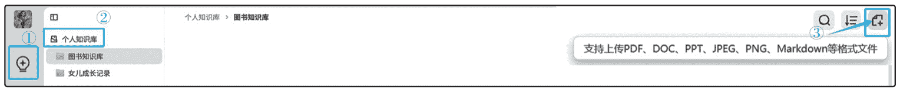

**图 2-1 腾讯 ima 知识库文件上传界面**

**2.关键技巧**
❑合理命名：上传前取清晰规范的文件名，包含关键信息，便于搜索。
❑批量处理：文件较多时可利用批量上传或拖拽文件夹功能，ima 支持批量上传。
❑OCR 功能：部分知识库具备 OCR，能识别图片或扫描 PDF 中的文字，使其可被检索利用。

**2.3.3 网页抓取：剪藏与收藏实操**

**1.网页剪藏器**
（1）怎么做
腾讯 ima 支持浏览器内使用。在 ima 首页输入网址即可打开网页，并一键存入指定知识库，如图 2-2 所示。

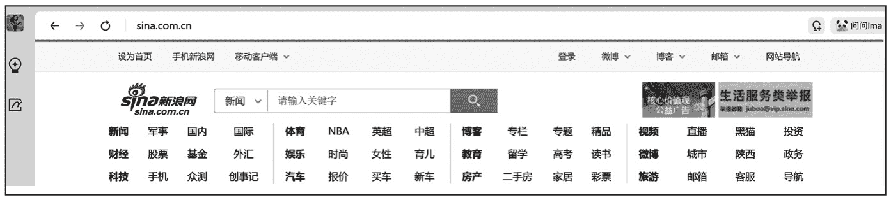

**图 2-2 浏览器一键剪藏网页内容**

（2）关键技巧
❑选择性剪藏：优先保存正文或手动筛选，避免无关信息。
❑及时归类：剪藏后立即选择保存位置或添加标签。

**2.微信公众号文章收藏**
（1）怎么做
在微信公众号文章页点右上角“...”，滑动至“在小程序工具中打开”，选择“ima 知识库”转存，如图 2-3 所示。

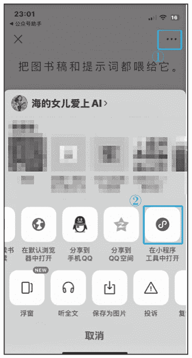

**图 2-3 微信内容发送至 ima 知识库操作**

（2）关键技巧
养成看到好文章就随手收藏的习惯。

**2.3.4 生态打通：无缝衔接是王道**

# 微信直连的知识沉淀助手

以腾讯 IMA 来看，最大的亮点是和微信体系的深度打通。微信里的文件、公众号推文、腾讯文档等资料，在预览页选择“用小程序工具打开”后即可唤起 IMA 实现归档。聊天记录这类特殊素材的入库方式会有所不同，需要额外的操作，具体可参考 2.5.3 的说明。把这条通道用好，就能把微信中零散的重要信息及时收拢，微信继续做沟通，沉淀分析的工作交给知识仓。

### **2.4 激活智能：AI 问答、提炼与关联初体验**

**2.4.1 智能问答：专属知识管家**

这是 AI 知识仓最直观的应用场景。像和人聊天一样，用自然口吻向系统提问，答案会基于库内内容给出并带来源。

**1. 交互入口**
IMA 中和 AI 对话的入口共有四处。

❑ 首页底部自带的对话栏，直接输入问题即可，如图 2-4 所示。

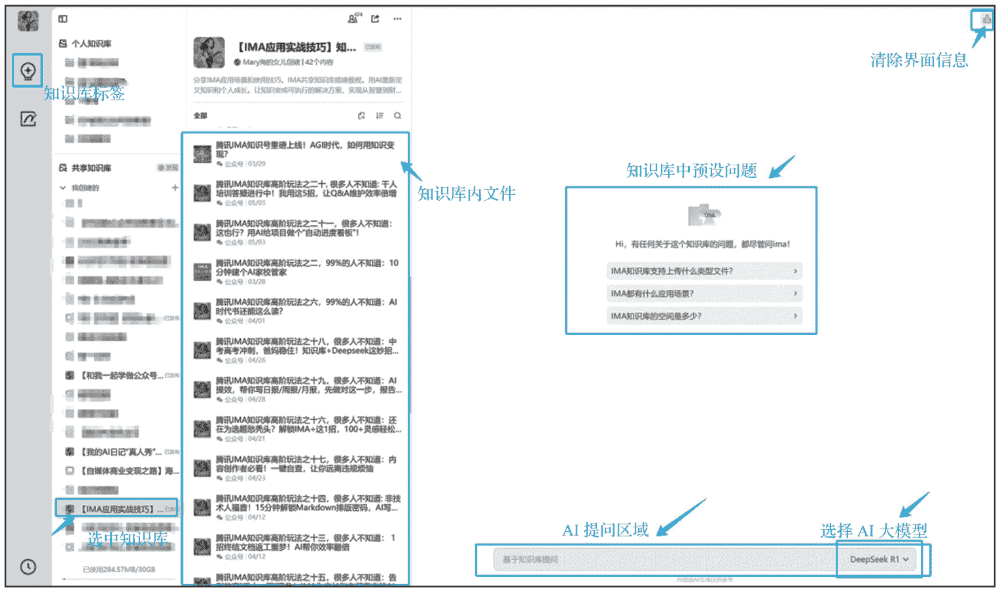

**图 2-4 IMA AI 问答入口与对话界面呈现**

❑ 任意笔记页面的右上角都有一个熊猫造型的“问问 IMA”图标。

❑ IMA 内置浏览器的右上角同样放置了熊猫“问问 IMA”图标。

❑ 在笔记编辑区输入“/”可快速调出写作辅助。

**2. 可以怎么问，关键看库里有没有料**

❑ 查找具体资料：“帮我找一下上次项目复盘会的纪要。”或“之前存的那份红烧肉菜谱在哪个笔记里？”

❑ 理解概念：“用大白话解释笔记里提到的卡片笔记法。”或“把两篇关于 A 工具和 B 工具的文章对比一下优缺点。”

❑ 获取步骤：“依据《××软件使用手册》，说明邮件自动转发怎么设置？”

**3. 提问小技巧**

❑ 问题越明确，回应越精准。

❑ 可以限定范围，让 AI 只在某个知识库、特定笔记或文件夹内检索。

❑ 回复不够清晰时可继续追问，逐步细化。

**4. 实际效果**

检索速度快且会标注来源，信息获取效率明显提升。

**2.4.2 智能提炼：长文快速抓重点**

面对长文档时，提炼功能很实用。打开目标文档或笔记后找到 AI 助手入口，例如 IMA 右上角的“问问 IMA”，选择“总结”或“生成脑图”，短时间内就能抓住核心，省去大量阅读时间。

**2.4.3 智能关联：挖掘知识的隐性链接**

AI 知识仓和传统笔记工具的区别之一在于能发现不同笔记、文档间的潜在关联，让知识串成链。具体实现因产品而异。

❑ 自动关联推荐：像腾讯 IMA，在查看某篇笔记时，会基于内容分析自动推荐库内相关资料，帮助发现隐性连接。

❑ AI 主动提示：在问答或总结时，AI 也可能主动提示相关笔记。

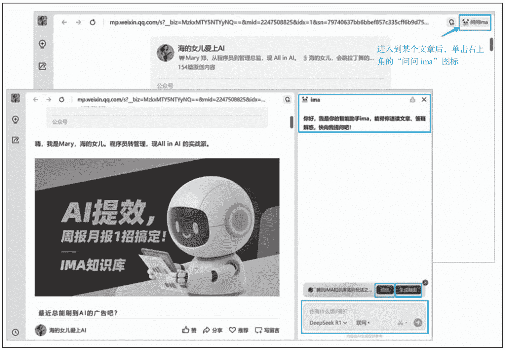

**图 2-5 IMA 的总结与生成脑图入口**

问答、提炼、关联的初步体验已能感受到 AI 知识仓的智能魅力。这只是冰山一角，表现取决于投喂的内容质量和模型本身。不要期望一开始就无所不能，把它当成成长伙伴，多互动多投喂优质信息，它会越来越懂你。

### **2.5 实战演练：搭建一个多用途个人知识中心**

纸上得来终觉浅。接下来手把手用腾讯 IMA 搭一个多用途个人知识中心。IMA 与微信衔接顺滑且自带强 AI，对新手友好。技术背景不深也不用担心，流程比想象中简单有趣，关键是迈出第一步，让信息流动起来。

**2.5.1 起步：认识并准备你的 IMA**

在建数字空间前，先熟悉工具并做好基础准备。

**1. 访问方式：多种渠道触达 IMA**
1）微信小程序：最便捷的方式之一。微信搜索“腾讯 ima 知识库”小程序即可开始。
2）Windows/Mac 客户端：官方提供 Windows 和 macOS 桌面版，可通过 IMA 官网 https://ima.qq.com 或应用商店下载安装，如图 2-6 所示。

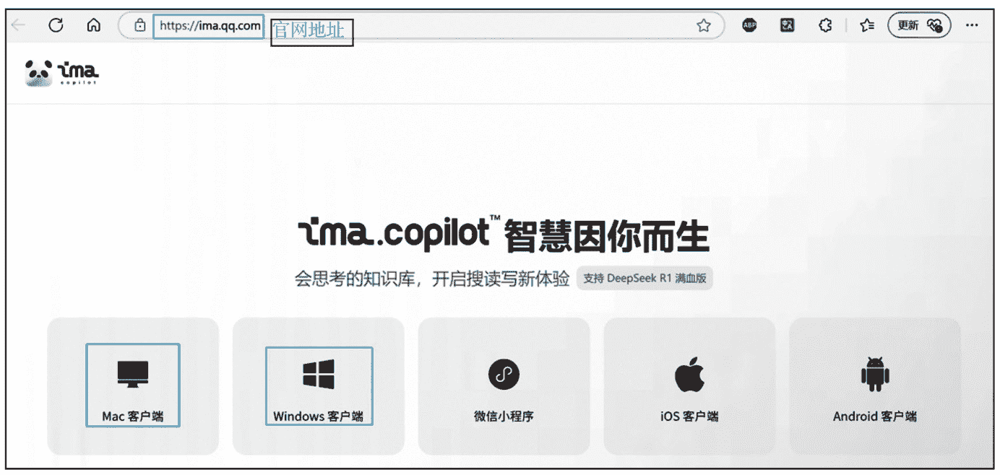

**图 2-6 腾讯 IMA 官网客户端下载页面**

3）移动 App iOS/Android：功能比小程序更全，适合手机深度使用，界面如图 2-7 所示。

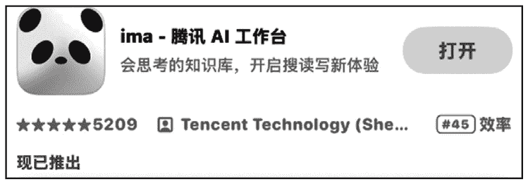

**图 2-7 腾讯 IMA 移动 App 下载安装界面**

**2. 界面概览：快速熟悉新工作室**
主界面由左侧菜单、顶部栏和主工作区构成。左侧包括设置、知识库、笔记、历史记录；顶部为首页、添加新首页；主区支持提问、输入网址、文档解读、智能写作，如图 2-8 所示。初次使用不必全记，有个大致印象即可。

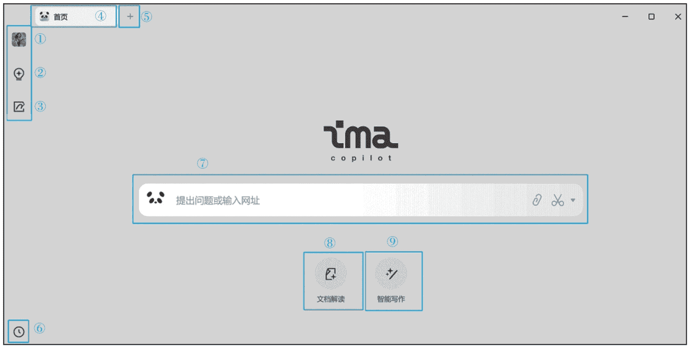

**图 2-8 腾讯 IMA 主界面的功能分区**

**3. 账号与设置：个性化体验**
通常可用微信账号登录。首次登录后进入“设置”，可配置外观主题、编辑器偏好、同步设置等，如图 2-9 所示。

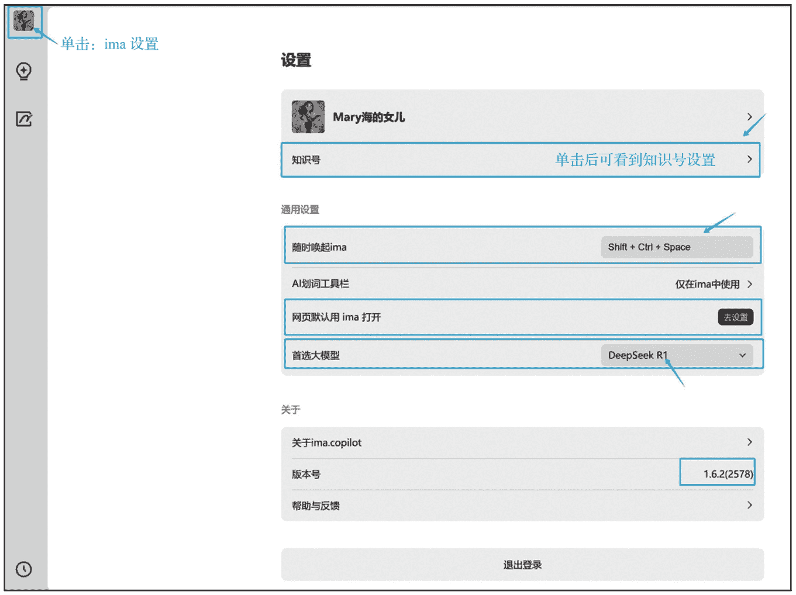

**图 2-9 腾讯 IMA 个性化设置选项**

**2.5.2 奠基：创建第一个知识库**
知识管理的第一步是给信息建一个有序的家，在 IMA 里就是知识库。提供私人库和共享库两种形态。

**1. 创建私人库：搭建数字私宅**
在主界面点灯泡造型的“知识库”入口，选择创建“个人知识库”。建议用不同目录分类，保持整洁。在个人库列表区右击新建文件夹，命名后即完成。

目录支持重命名、移动、删除等操作。

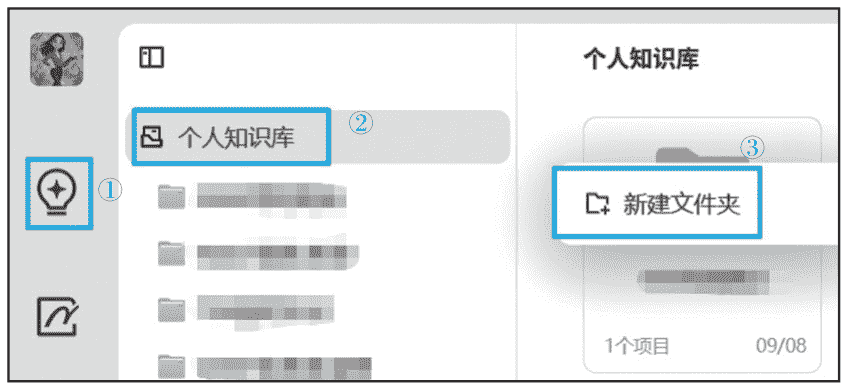

**图 2-10 腾讯 IMA 创建个人知识库界面**

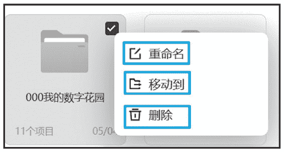

**图 2-11 腾讯 IMA 个人知识库目录操作界面**

数字私宅就此建立。

**2. 创建共享库：搭建团队共建空间**
流程与个人库类似，选择创建“共享知识库”，填写名称、描述和封面。创建后设置成员权限和推荐问题，即成协作空间。

**3. 管理知识库：让房间井井有条**
IMA 提供重命名、修改信息、更换封面、查看信息、删除等基础管理功能。

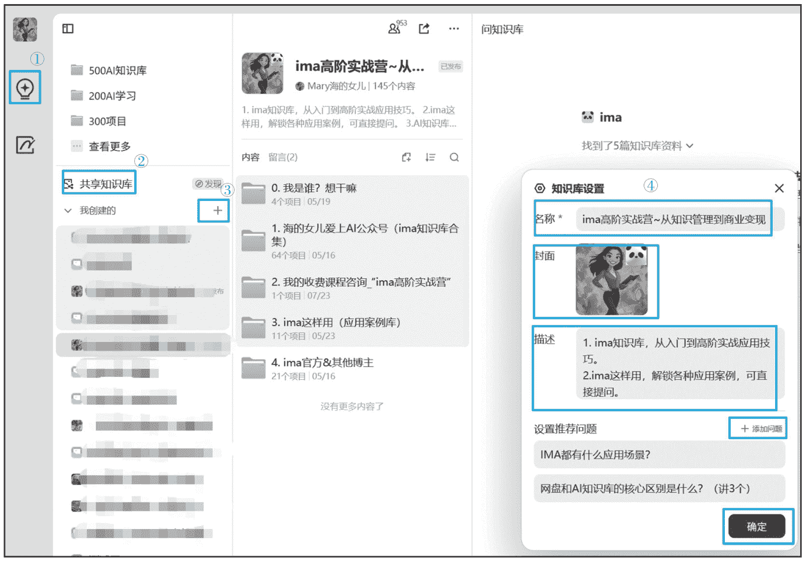

**图 2-12 腾讯 IMA 创建共享知识库流程**

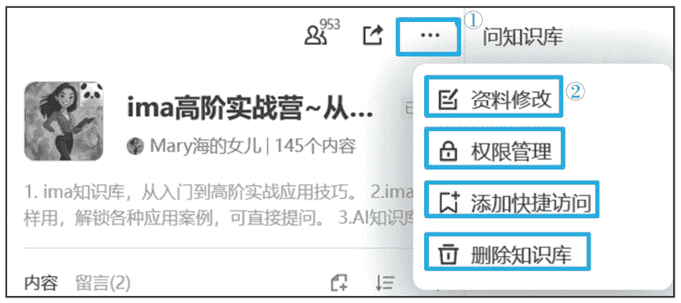

**图 2-13 腾讯 IMA 知识库的管理选项**

地基打好，接下来搬运内容。

**2.5.3 添砖加瓦：多渠道收集信息与内容入库**

**1. 笔记：思想画布与信息载体**
笔记是库里最核心单元，承载灵感、学习摘要、会议记录等。在主界面或知识库内点“笔记”图标，再点“新建笔记”即可编辑，支持 Markdown 等格式。图 2-14 为编辑器界面。

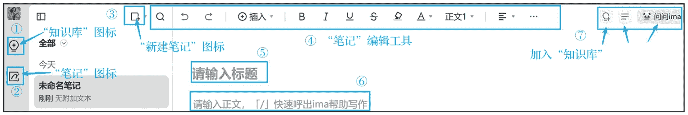

**图 2-14 腾讯 IMA 笔记编辑器界面**

写完需归档。编辑界面右上角菜单里找到“添加到知识库”标识，即带加号的小灯泡，选择目标库确认即可。养成随手归档习惯，有助于库内整洁。

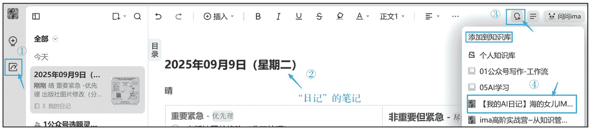

**图 2-15 IMA 笔记归档至知识库操作**

**2. 文件批量搬家：本地资料上传不可少**
电脑和手机里积累的工作文档、课件、扫描件、照片等，都可导入。IMA 支持 PDF、Word、PPT、图片等。

进入目标库后，找到“上传”按钮，选择文件确认上传。

技巧是规范与效率并重。

❑ 合理命名：上传前先清晰规范命名。
❑ 批量处理：文件多时可批量选择。

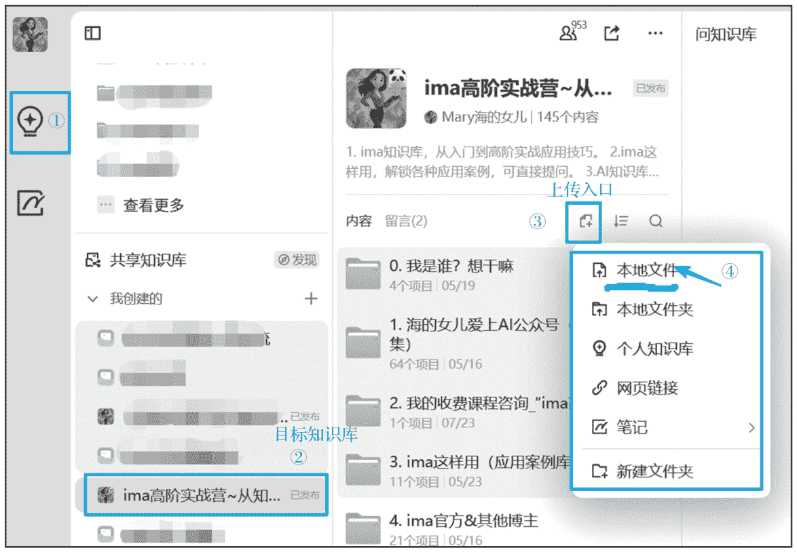

**图 2-16 IMA 从本地上传文件的界面**

**3. 微信体系顺滑衔接：信息流转的高速路**
对重度微信用户，IMA 的整合极大简化采集。

❑ 在微信中打开文件、图片、公众号文章、网页链接进行预览。
❑ 在预览界面右上角点“…”或“更多”。
❑ 在菜单里选择“用小程序工具打开”，向左滑动可见更多应用。
❑ 在应用列表里选“IMA 知识库”。
❑ 选择目标库确认，IMA 会提示存入位置。

该功能极大简化归档，强烈建议熟练掌握。IMA 收藏公众号文章操作如图 2-17 所示。

对于重要微信聊天记录，如项目讨论、客户沟通关键节点，若担心丢失可借助 IMA 保存，目前需借助其他工具或手动复制粘贴。若未来支持直接导入，将成为备份复盘的利器。

**4. 网页抓取：捕捉网络珍珠**
IMA 本身可作为 AI 浏览器，PC 端输入网址即可访问。打开网页后右上角有“加入知识库”标识，即带“+”的小灯泡，点击即可保存到目标库。图 2-18 为操作示意。

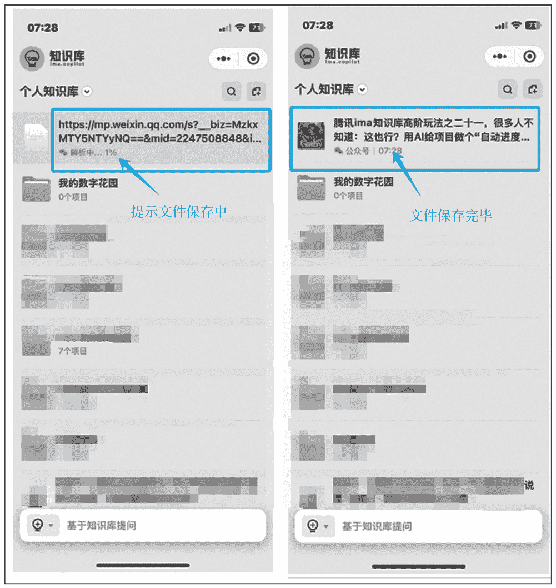

**图 2-17 IMA 收藏微信公众号文章操作**

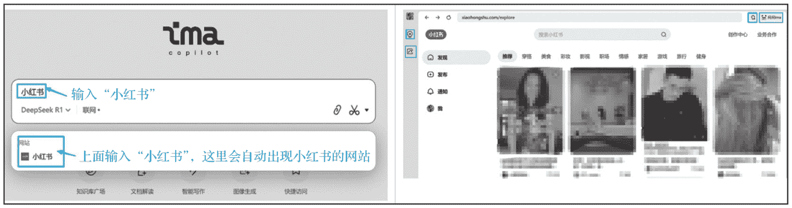

**图 2-18 IMA 内置浏览器收藏网页内容**

**2.5.4 井然有序：组织与管理知识**
信息搬入后需有序组织才能激活潜能。

**1. 建立层级：目录与子目录的妙用**
最传统直观的方式。内容涉及多个主题或项目时，用目录分类很有效。例如工作项目下设 XX 项目、YY 项目，兴趣爱好下设旅行攻略、摄影技巧等。

在库根目录或任一目录内右击“新建文件夹”，并将笔记或文件拖拽至对应目录。建议层级控制在 3~4 层以内。

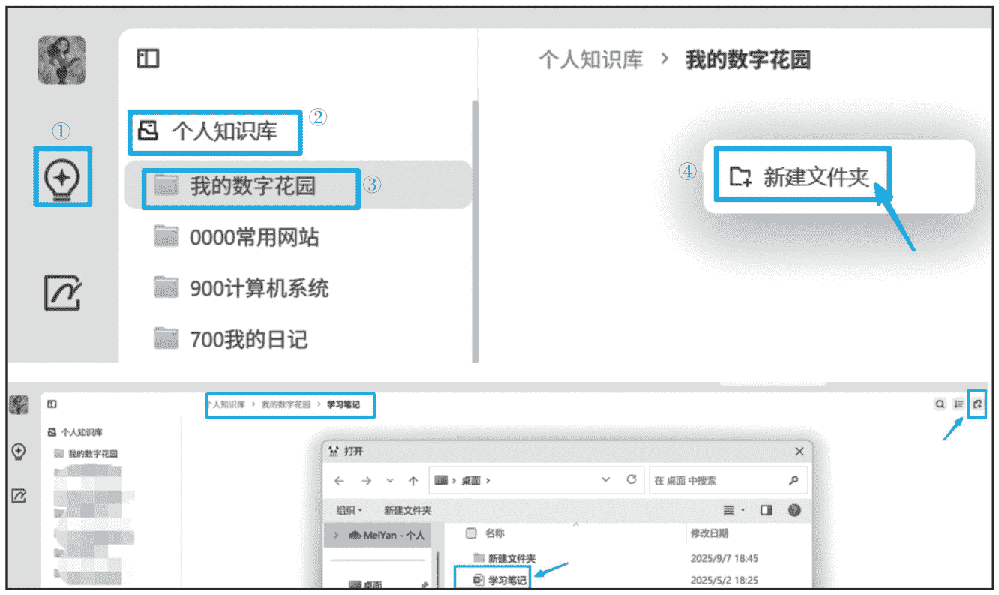

**图 2-19 IMA 知识库创建目录操作**

**2. 精准定位：打上专属标签——最核心方式**
标签是知识库的神经网络，赋予组织极大灵活性和关联性，也是 AI 理解内容的关键线索。可在属性界面添加标签，或批量添加，或在正文中输入“#标签名”自动识别。

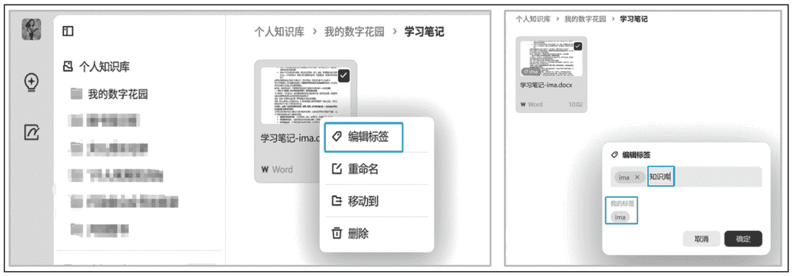

**图 2-20 IMA 为笔记或文件添加与管理标签**

**3. 构建标签体系**
❑ 一致性：同一概念尽量用统一标签，避免同义词混淆。
❑ 层级性可选：支持 #科技/AI/大模型，按需使用。
❑ 维度化：从不同维度打标签，如主题 #市场营销、内容类型 #学习笔记、状态 #待办、来源 #微信收藏、项目 #××项目。
❑ 定期回顾优化：定期审视标签列表，合并同义标签，删除无用标签。

清晰一致的标签体系能帮助 AI 提供更精准可靠的问答。

**4. 内容排序与置顶：让重要信息触手可及**
内容增多后快速找到常用信息很关键。IMA 目前支持按上传时间、大小、名称等排序，期待未来支持手工排序、置顶等更灵活方式。

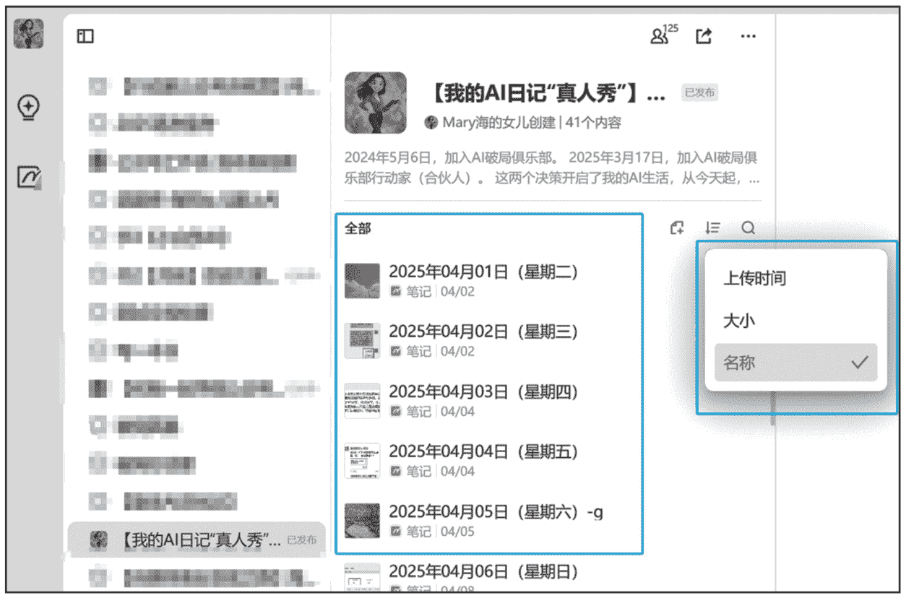

**图 2-21 IMA 笔记或文件的排序功能**

通过目录、标签和链接的合理组织，知识库将更有序且充满活力。

**2.5.5 智慧激活：与 AI 助手对话**
信息搬入并建立秩序后，AI 助手让知识库从静态存储升级为可互动的智慧中心。

**1. 基础 AI 问答：专属知识顾问随时待命**
（1）如何发起对话
库或笔记界面有明显入口：IMA 首页对话框、页面右上角图标熊猫头像+“问问 IMA”，或笔记编辑器快捷键“/”。

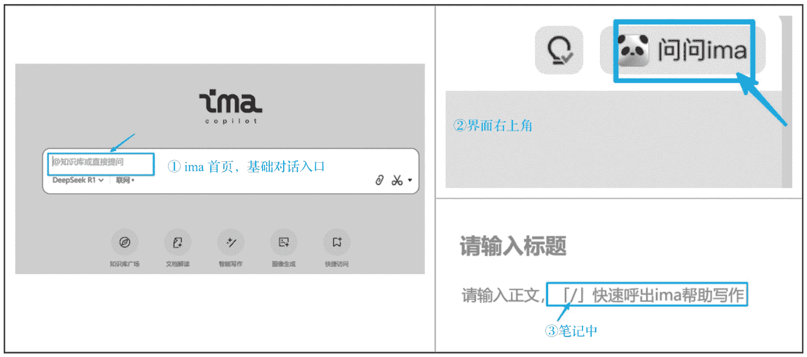

**图 2-22 腾讯 IMA AI 助手对话启动方式**

（2）可以问什么
可尝试：查找具体信息“上次项目复盘的会议纪要”、理解复杂概念“卡片笔记法是什么意思？”、获取操作步骤“××软件如何设置邮件自动转发？”

（3）如何获得更好回答
❑ 问题尽量具体。
❑ 指定信息范围：IMA 允许 AI 只在某个库、某篇笔记、某个目录或带特定标签内容内回答，提高相关性。
❑ 追问澄清：回答不清晰就继续追问，直到满意。

图 2-23 展示了针对“用 AI 写周报的提示词怎么写？”这一问题的回答，在分别指定文章和不指定文章的情况下，AI 的回答内容具有显著差异。

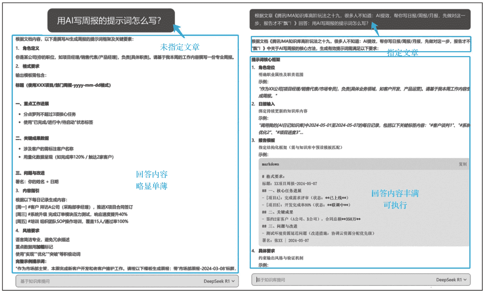

**图 2-23 IMA 基于知识库的 AI 智能问答示例**

**2. 针对性提问与处理：让 AI 聚焦特定内容**
选中文字后会出现浮动工具栏，如“AI 帮写”“配图”“翻译”“AI 解读”等，或通过顶部栏“问问 IMA”操作。常用场景为快速理解长文生成摘要、思维导图、翻译外文资料、提取关键信息、内容改写润色。

**3. AI 辅助创作：灵感伙伴与写作助手**
AI 不仅处理已有信息，还能从零开始助力创作。

在笔记中输入“/”自动调出续写、改写、润色、检查等；或点首页“智能写作”按钮，选中内容后调出“AI 帮写”。

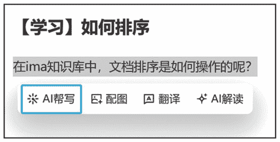

**图 2-24 IMA 在笔记编辑中的 AI 辅助应用场景**

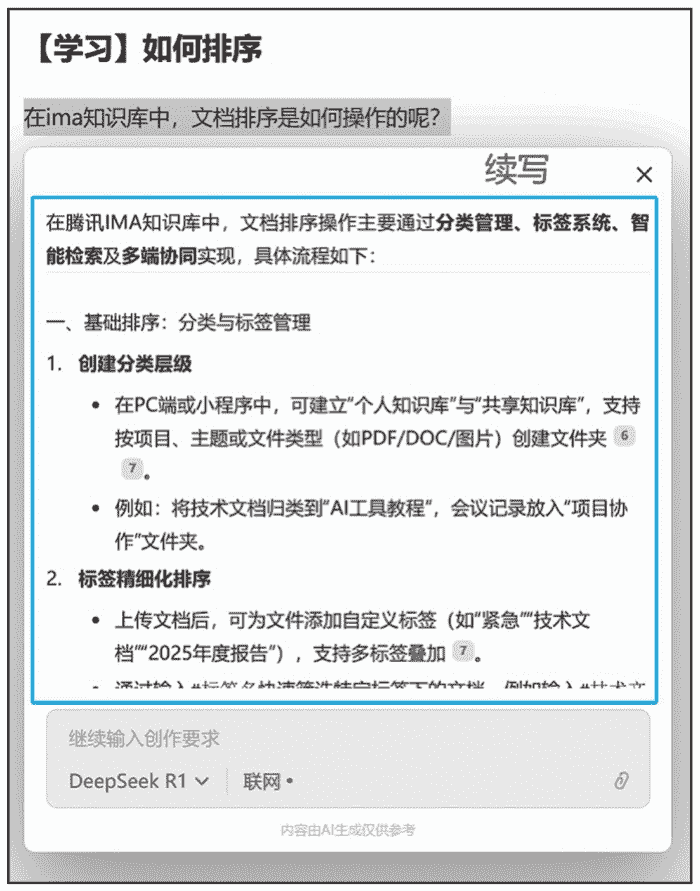

**图 2-25 IMA 在笔记编辑中调用 AI 辅助创作**

AI 能续写、扩写、润色、改写、头脑风暴、生成大纲，甚至根据文字生成配图，降低写作门槛并提升效率质量。

**4. 选择与切换 AI 模型：找到最适合的大脑**
IMA 可能集成多个大模型如腾讯混元、DeepSeek 等，或允许接入 API Key。不同模型在理解、创作风格、知识范围上略有差异，可按需选择。

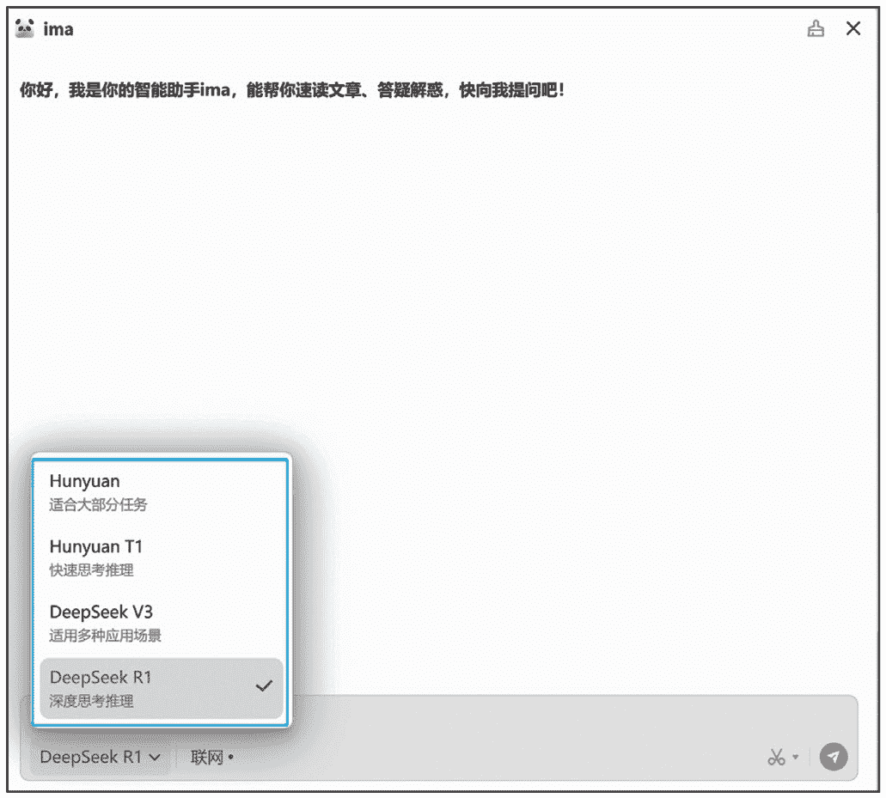

**图 2-26 IMA 中可选择的 AI 模型**

通过这些方式，AI 从被动存储工具变为强大的知识顾问、阅读助手和创作伙伴。

**2.5.6 分享与发现：连接他人与世界**
精心构建的个人知识中心既是思考学习的私密花园，也可成为连接他人、分享智慧、发现新知的桥梁。

**1. 共享知识库：开放主题展馆**

当某个主题的资料越堆越多，或者想把关键信息同步给同事、家人、朋友时，把内容集中到一个共用库是最省力的方式。

（1）访问权限配置：可视范围和编辑权限一目了然
共用知识库的核心价值在于细致的控制。ima 支持多档权限：管理员拥有最高操作权；默认方式通过链接或二维码传递，知识广场检索不到；发布到广场后可被更广泛发现且不计入个人存储；设为私密则只有自己可见。权限配置页面如图 2-27 所示。

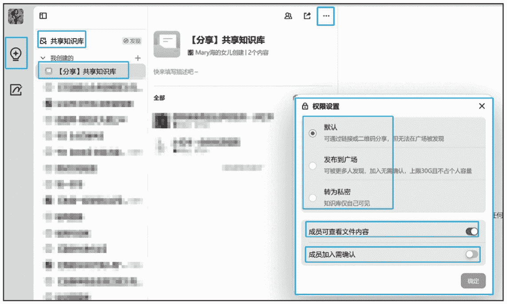

**图 2-27 ima 共享知识库权限设置界面**

可依据对象和目的组合使用。例如与项目成员共用时，可把“成员可查看文件内容”打开；若不想让访问者阅读正文，可关闭该项；文件敏感时，可把“成员加入需确认”打开。

（2）邀请协作者：把伙伴拉进共建空间
ima 支持链接邀请和微信二维码邀请两种方式，邀请时或邀请后均可为新成员分配合适权限。图 2-28 为邀请协作者的示意。

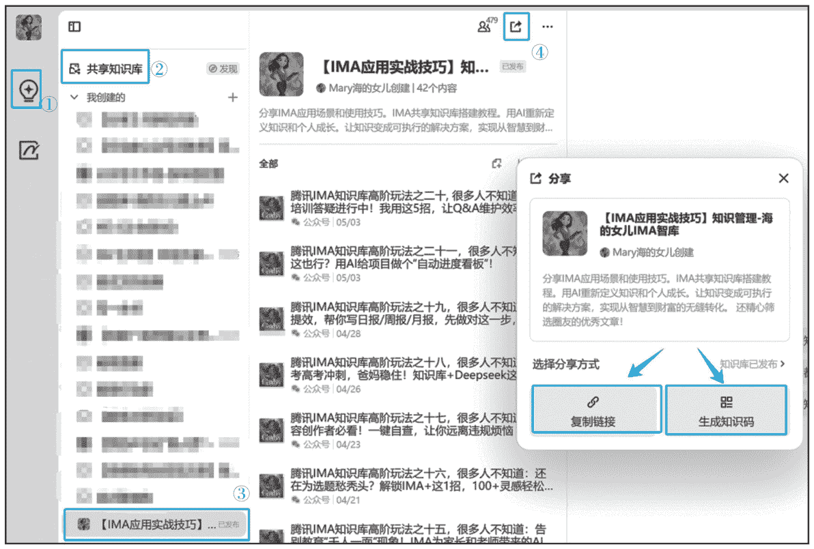

**图 2-28 ima 邀请协作者加入共享知识库**

借助共用库，团队协作、家庭信息同步、学习小组资料共用等场景会更高效、更透明。

2.分享单篇笔记/文件：精准投递知识卡片
有时仅需投递一篇笔记或一个文件。打开目标内容后在菜单里找到“分享”，生成分享链接或二维码即可。单篇分享操作灵活，很适合快速传递会议纪要、文章草稿之类内容。

3.知识广场：公开分享与学习的开放舞台
腾讯 ima 自带的“知识广场”是一个公开的知识发布与发现平台，既能让自有知识触达更广，也能从他人分享中汲取养分。

（1）发布到广场：让知识被看见
如果想把整理好的知识库，比如学习笔记、工具教程、行业报告公开分享，可以在库设置里的“权限管理”中找到“发布到广场”，补充描述、封面、推荐问题后确认发布，如图 2-29 所示。公开不仅能帮助他人，也可能带来关注、互动和志同道合的连接。

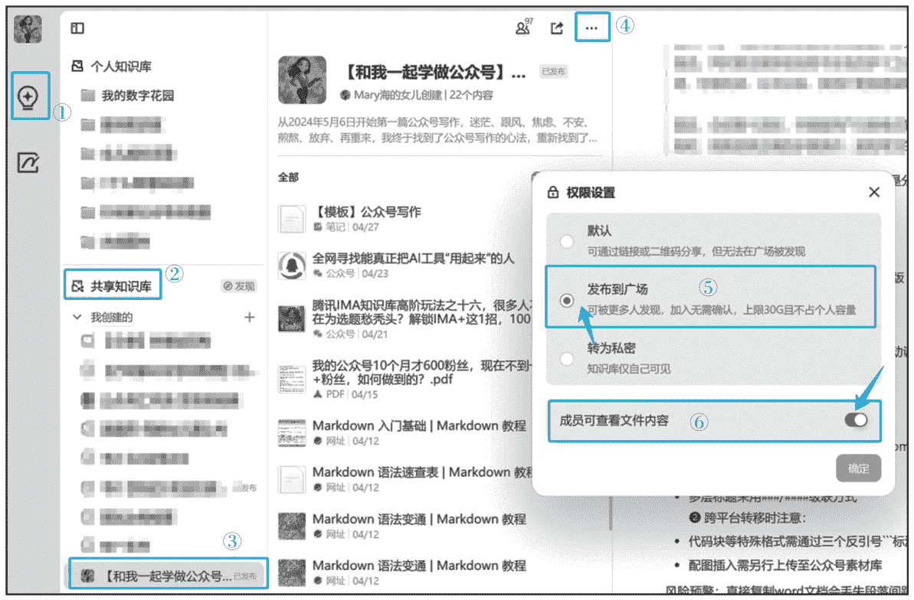

**图 2-29 ima 知识库发布到广场**

（2）探索广场：汲取他人的智慧
知识广场也是学习沃土。在 ima 主界面或“知识库”下“共享知识库”旁的“发现”入口，如图 2-30 所示。可以按分类浏览或关键词搜索他人分享，看到感兴趣的库点“加入知识库”即可查看并持续关注。

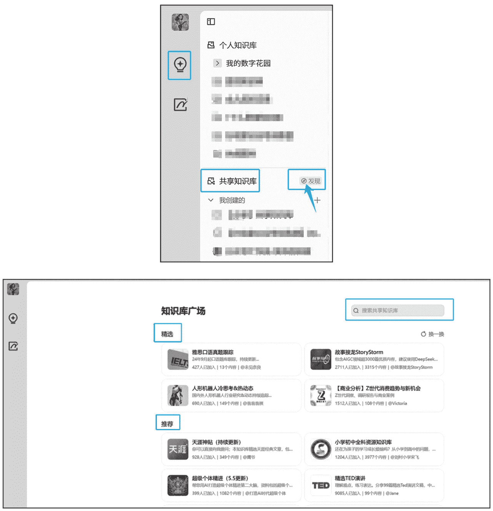

**图 2-30 ima 知识广场探索与订阅知识库**

知识广场打破了个人库的封闭，形成功建共享的社区。灵活使用分享和发现功能，个人中心就能与更广阔的知识世界连通，实现价值传递与放大。

2.5.7 维护与进阶：让知识库持续焕新
个人知识中心搭建完成并掌握核心操作后，这只是起点而非终点。数字知识库需要持续养护，才能保持活力，成为可靠的“第二大脑”。

（1）定期整理：保持库内清爽
这是基础却易被忽略。建议每周或每月快速过一遍新增笔记和文件，及时整理。优化标签体系，合并相近标签、清理无效标签；删除过期信息，释放存储并避免检索干扰。

（2）跨设备同步：信息随时可达
云同步是现代知识库的核心优势。ima 会自动完成多设备同步，无需手动设置。需留意网络连接和同步状态提示，确保数据一致。

（3）存储空间管理：为增长留出余地
多数工具提供免费额度，ima 目前仅免费版，个人空间为 30GB。发布到知识广场的库不计入个人存储。定期查看用量，优化策略，如清理大文件、必要时用外部链接替代部分文件。图 2-31 为存储空间管理示意。

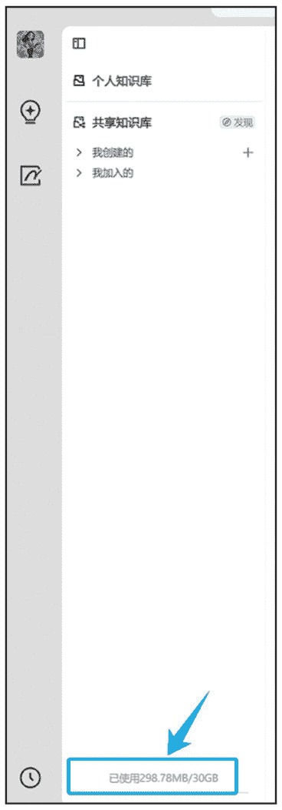

**图 2-31 ima 知识库的存储空间管理**

（4）探索进阶功能：不断解锁新技能
基础熟练后可探索 ima 的进阶能力，如模板、自动化规则、API 与集成以及更高级的智能功能，包括深度问答、创作、关联推荐等。持续学习新功能是保持高效的关键。

至此，多用途个人知识中心的搭建与入门演练告一段落。记住知识库的价值在于用它提升思考、加速学习、驱动行动。“数字花园”已播种，请享受耕耘与收获的乐趣。

# 个人篇

# 构建第二大脑，激发个人价值

在智能技术逐步渗透日常的今天，如何有效管理信息、提速学习、提高效率、激发创造力，已成为个人竞争力的重要维度。人工智能知识库作为“第二个大脑”，提供了系统化、智能化的赋能路径。它能把零散的灵感、学习成果、生活片段整合起来，让人在信息洪流中游刃有余，持续提升价值。

本篇聚焦人工智能知识库在个人学习、生活、工作创意中的智慧应用，探讨如何用它规划旅行、管理家庭菜谱、记录心路历程、整理家居物品；如何将其变为学习效能倍增器，实现高效阅读、消化与备考；以及如何成为职场与创作的强力引擎，捕捉灵感、管理素材、升级思考方法，乃至赋能自媒体运营与个人表达，全方位激发潜能。

## CHAPTER 3

## 第三章 生活智慧管家：告别杂乱，拥抱从容

完成人工智能知识库的基础搭建后，就能让它在日常生活中发挥作用。信息时代的快节奏容易让生活琐事变得凌乱：分散的旅行攻略、遗忘的菜谱步骤、散落的家庭备忘，都可能消耗时间和心情。

本章介绍如何把人工智能知识库打造成贴心的“生活智慧管家”。从高效规划旅行，到搭建家庭“智慧厨房”管理菜谱，再到智能日记辅助记录与反思，以及整合家居物品信息告别“找不到”……它能帮助人们告别混乱，享受有序、智慧的生活。

### 3.1 旅行规划助手：攻略与在地信息一库搞定

是否常有这种感受：想去某地旅行，却被海量信息淹没，攻略、邮件、截图散落各处，找个酒店电话要翻半天。智能时代，不应让信息牵着鼻子走。下面分享一些实用做法。

“悦读者”刘旭老师在旅行规划上的经验很有启发，本节内容主要提炼自其分享。用人工智能知识库做旅行规划既高效又有趣，它不仅是信息收集工具，更是专属旅行助手。

**3.1.1 核心能力：专属智能旅行大脑**
传统规划导致信息碎片化，攻略、预订邮件、地图截图、餐馆笔记各处分散，整合耗时。人工智能知识库能把碎片变成会思考、会整合的“智能旅行大脑”，核心能力包括：

❑一站式信息汇聚：把各类来源信息统一入口详见 2.3 节。

❑结构化整理与分类：按目的地、交通、住宿等建文件夹，用标签细化。

❑人工智能提取与总结：这是亮点。不必逐字阅读长攻略，只需把网页或文档交给系统，指令“请总结这篇酒店介绍的入住退房时间”或“这篇游记里推荐了哪些餐厅”，系统就能快速提炼关键信息。

❑行程辅助与建议：景点和餐厅收集好后，如何排路线更合理？距离、交通如何？把信息交给系统，它能梳理逻辑并给出优化建议。

❑随时随地的智能问答：旅途中可直接问：“从酒店到××景点打车大概多久？”“昨天收藏的餐厅周二营业吗？”它会像专属秘书一样快速找到答案。

❑多设备访问与实时同步：在电脑或手机上都能访问，信息始终在线。

❑便捷分享与协作：与家人朋友同行时，可把整个知识库或部分内容分享，信息同步更默契共享功能可参考 2.5.6 节。

**3.1.2 搭建：为下一次出行构建信息堡垒**
搭建好用的旅行库，就像为出行准备可靠的数字行囊。

（1）创建专属旅行知识库或文件夹
在腾讯 ima 等工具中为旅行计划建一个“家”。可建独立个人库，信息量大或需多人共用时建共享库更方便，如图 3-1 所示创建方法参见 2.5.2 节。命名清晰，例如“我的旅行计划格里拉之旅 2025 年国庆”。

（2）设计信息分类结构与标签体系
“家”建好后要规划内部布局。清晰的结构和标签让系统更精准。文件夹可参考图 3-2 包括通勤信息、实用信息、购物清单等。常用标签如#预订确认、#已支付、#门票信息、#开放时间、#地址、#联系方式、#当地习俗、#待筛选、#重要等。清晰结构是管理的核心。

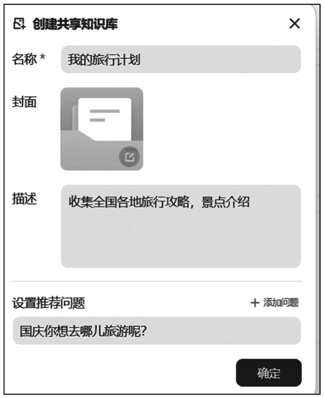

**图 3-1 ima 创建旅行计划知识库**

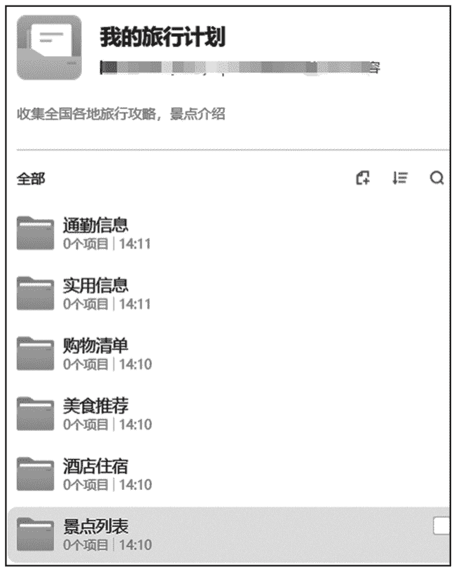

**图 3-2 ima 旅行计划文件夹**

（3）整合各类信息，打通收集入口
让信息便捷流入。例如用 ima 浏览器收藏网页攻略参见 2.3.3 节，通过微信转存保存朋友推荐或公众号文章参见 2.3.3 节。机票酒店确认邮件可复制内容或截图保存。本地 PDF 攻略、行程单可通过上传功能导入参见 2.3.2 节。

**3.1.3 应用：从碎片到完美旅程**
搭建好“智能旅行大脑”后，它能贯穿规划全过程，并在旅途中提供支持。

场景 1：海量信息初步收集与整理 初期规划阶段
在旅游网站看到游记或餐厅测评，用 ima 浏览器功能或分享功能保存至对应文件夹，如图 3-3 所示。微信群里的分享可复制或截图保存。

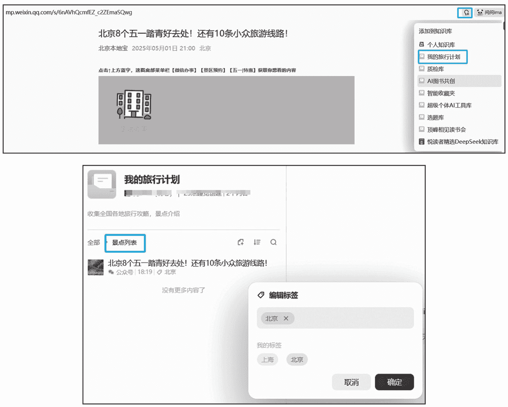

**图 3-3 ima 收藏旅行相关网页并添加标签**

记得随手给新收藏加标签，如#待筛选、#攻略、#餐厅，方便后续查找和系统理解。

场景 2：利用系统筛选提炼关键信息 信息整理阶段
收集后常有冗余，需快速提取核心。例如对比几篇酒店测评，选中后问系统“请总结这几篇关于位置和早餐的评价”。对长游记问“请提取所有餐厅名称和推荐菜”。系统瞬间找出要点。操作示例如图 3-4 所示。

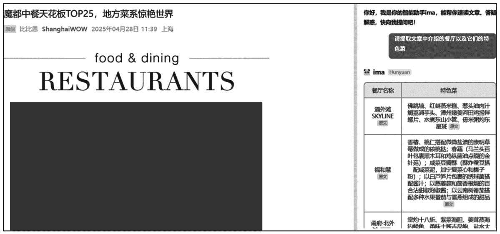

**图 3-4 AI 从游记中提取关键信息示例**

场景 3：构建并优化每日行程 行程规划阶段
提炼后开始串联。在“行程总览”文件夹新建笔记如“Day 1：××城市探索”，把景点、餐厅、活动拖拽或复制进去。担心路线不顺就问系统：“此笔记景点交通方便吗？建议游览顺序？需要多久？”系统可结合地理信息给出合理建议。图 3-5 为优化建议对话截图。

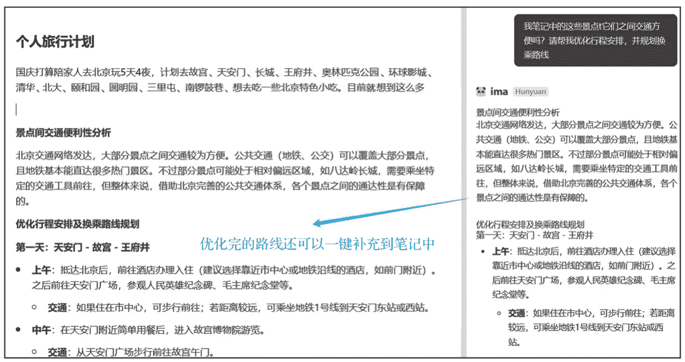

**图 3-5 AI 辅助优化旅行行程规划**

场景 4：旅途中实时查询与记录 旅行进行阶段
人工智能知识库是“贴身助理”，可即时查询酒店地址、火车票二维码、餐厅营业时间。打开手机 ima，搜索关键词即可。随手记录惊喜，如特别咖啡馆或特色小店，拍照上传并加入当日行程笔记，如图 3-6 所示，或新建笔记并加标签如#惊喜、#咖啡馆、#实用。

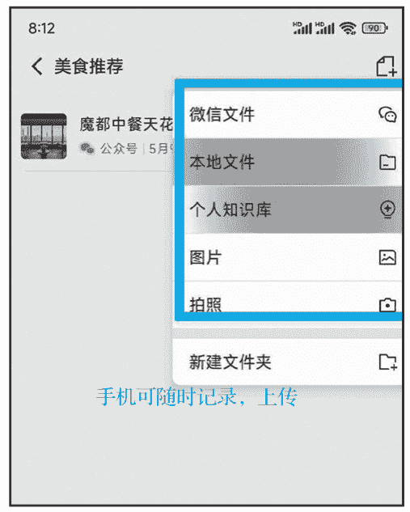

**图 3-6 ima 手机端拍照上传至旅行笔记**

可在知识库创建“备忘与当地人建议”笔记，记录临时想法、当地贴士如排队情况、优惠活动，用#紧急、#实用等标记重要信息。管理旅行预算时可用表格笔记记录开支。人工智能知识库通过预处理和智能助手作用提升效率，让人更专注感受文化、体验生活和享受陪伴。这是一种更高效的智慧出行，让旅行者成为主角而非信息仆人。

用人工智能知识库规划旅行能带来显著变化。从收集、提炼、构建优化行程到途中查阅记录，它都能成为得力助手，把零散信息组织成有序、智能、随时可用的“旅行大脑”。

下次出行前试试用人工智能知识库规划，轻松喜悦从选定目的地就开始。

### 3.2 家庭主厨的“智慧厨房”：从菜谱收集到智能配餐

美食爱好者常有烦恼：收藏夹里菜谱链接无数，用时难找；家传好菜靠记忆，难传承；看到诱人图片，操作时手忙脚乱；经典难题“今晚吃什么”。人工智能知识库能解决这些家庭主厨的困扰，打造专属不丢失的私家菜谱库，并化身智能小助手。

本节关于打造“智慧厨房”的方法和心得，主要来自共创伙伴、视频号“小鹿 AI 生活”主理人郑超老师的分享。

**3.2.1 打造“私家菜谱库”：让美味永不迷路**

（1）创建“菜谱”知识库
首先为美食灵感和拿手好菜安家。打开 ima，点击形似“小灯泡”的“知识库”图标，创建新共享库或个人库如图示，命名为“我的菜谱”。选封面和描述，设置推荐问题如“鸡肉怎么做？”。

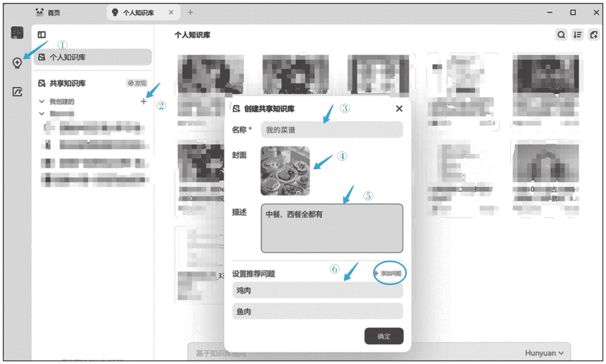

**图 3-7 ima 创建“我的菜谱”知识库**

（2）将拿手好菜录入知识库
录入方式如下：
1）手写/整理菜谱笔记：在 ima 新建笔记，命名如“宫保鸡丁”，记录食材、步骤、技巧，越详细越好。完成后点“添加到知识库”，选择“我的菜谱”归档，如图 3-8 所示。

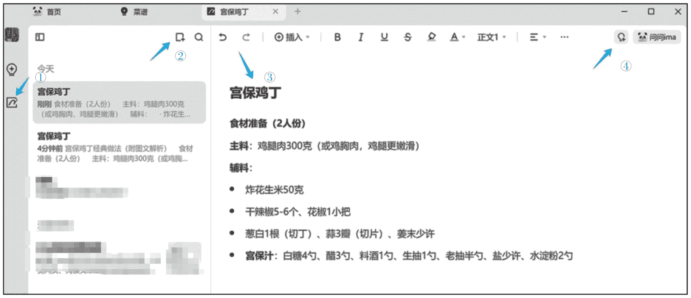

**图 3-8 在 ima 中手动录入“宫保鸡丁”菜谱笔记**

2）系统生成菜谱：新建笔记，输入“/”触发系统助手，输入要求如“帮我生成宫保鸡丁制作方法”。系统生成草稿后插入笔记，编辑完善再归档至菜谱库，如图 3-9 所示。

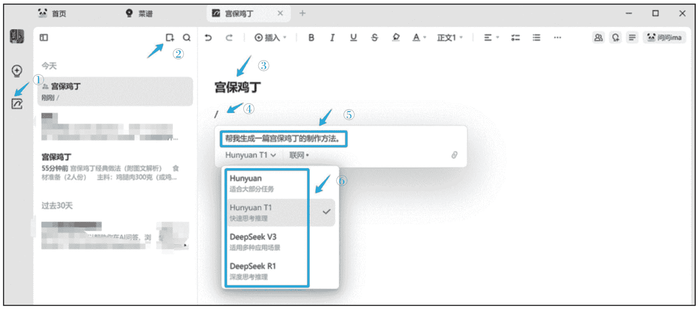

**图 3-9 在 ima 中生成“宫保鸡丁”菜谱**

**3.2.2 让菜谱活起来：图文并茂与智能问答**

文字菜谱缺少灵魂，图片不可或缺。

1.图文并茂，让菜谱更诱人
打开菜谱笔记，将光标定位到想插入图片处，点击编辑器工具栏“插入图片”按钮，从电脑或手机选择成品图插入即可，如图 3-10 所示。菜谱更具色香味俱全感。

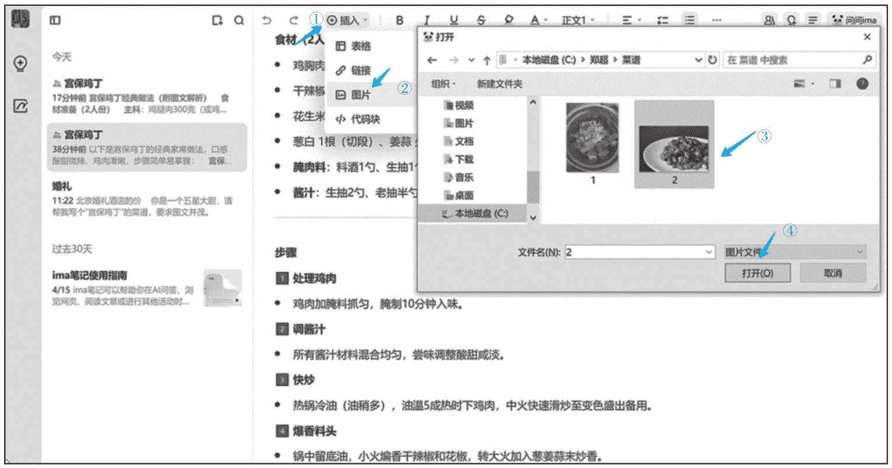

**图 3-10 ima 菜谱笔记插入成品图**

2.智能问答，厨房小助手
菜谱入库后成为“美食大脑”。搜索“鸡肉”，所有相关菜谱都会被找到。

（1）智能理解与计算
可问：“做 4 人份米饭，水和米比例多少？”系统能基于常规知识或笔记记录推算，过程如图 3-11 所示。

（2）步骤与技巧问答
忘记步骤可直接问：“宫保鸡丁炒制顺序是什么？”或“调味汁怎么配比？”系统会根据笔记快速给出答案，如图 3-12 所示。

**3.2.3 更多玩法：链接收藏与外部搜索**

1.收藏外部链接
可用 ima 浏览器功能在首页操作，如在小红书看到做菜教程，点击浏览器界面右上角“添加到知识库”图标 ，归档至“我的菜谱”库。这样菜谱库也能成为外部美食资源的快捷入口图 3-13。

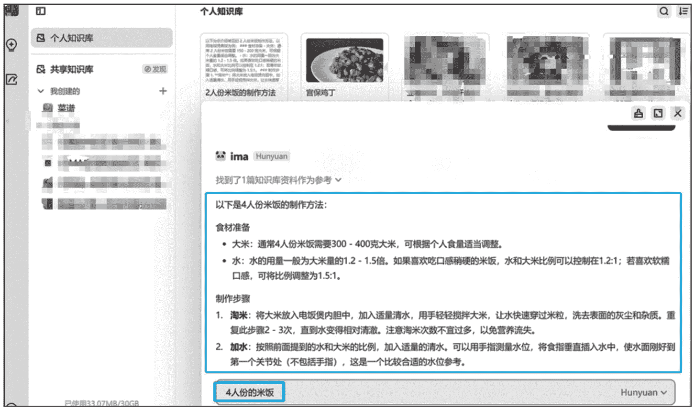

**图 3-11 在 ima 中 AI 问答辅助调整食材用量**

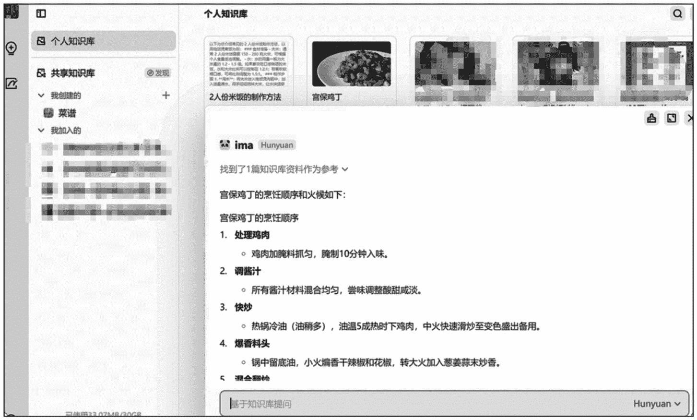

**图 3-12 AI 问答提供“宫保鸡丁”制作步骤**

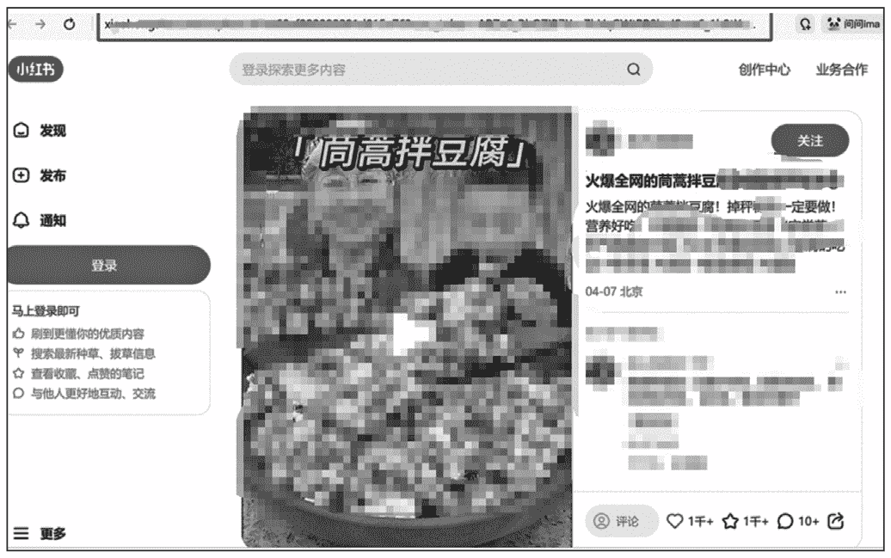

**图 3-13 在 ima 笔记中收藏外部美食教程链接**

2.利用全网搜索发现新菜谱
若库内没有想要的菜谱，可在 ima 中搜索。选择“基于全网”搜索选项，ima 会查找网络相关菜谱文章。找到合适内容后收藏到自己的库，如图 3-14 所示。

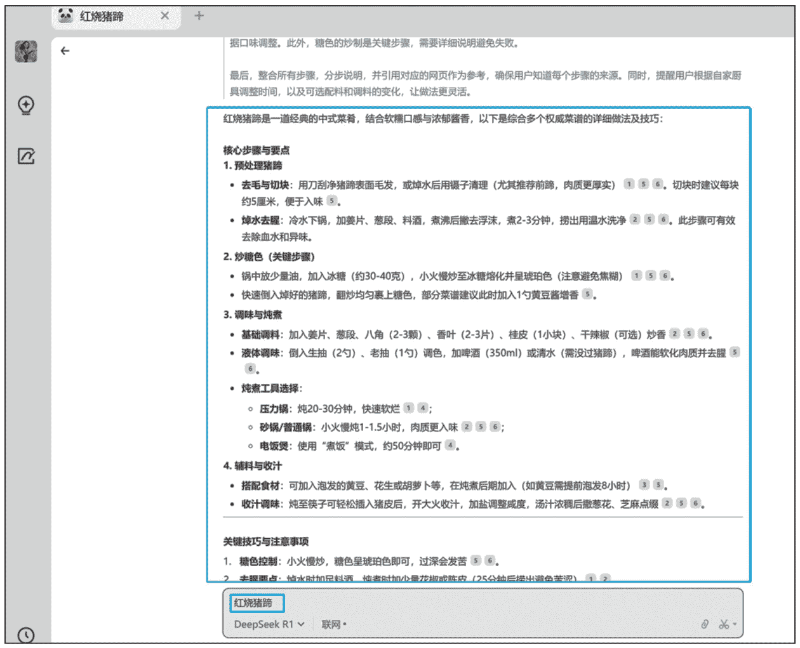

**图 3-14 在 ima 中利用 AI 进行全网菜谱搜索**

快速上手小提示：

❑ 保持定期整理，合理使用标签分类，例如#家常菜、#川菜，检索与管理都会更顺手。
❑ 多用实拍图来呈现菜谱，观感更有食欲，步骤也更直观。
❑ 养成调用智能问答的习惯，无论是核对做法还是寻找灵感都十分高效。
❑ 新菜尝试或对旧方子做了优化后，及时把成果同步回个人知识库中。

记住，把 AI 知识库当成一座“智慧厨房”，收纳菜谱更省心，做饭也更带劲。赶紧搭建属于自己的私家食谱库吧！

### **3.3 智能日记与成长陪伴：记录、复盘与心智升级**

是否曾立下坚持写日记的决心，最后却让精美的日记本躺进抽屉吃灰？纸质记录容易坚持不住、查找费劲、回顾低效。AI 时代让这件事有了新解法。借助知识库，日记不再是单向流水账，而是会记录、会提问、会陪你复盘的智能伙伴，让思考更轻松、成长更稳。

**3.3.1 功能：智能日记伙伴可以做什么**

**1. 对抗遗忘，构建专属记忆空间**
AI 知识库能条理清晰地保存海量资料，文字、图片，未来甚至音视频都能接入。检索能力强，能随时精准定位到一段记忆。

**2. 训练专属模型，让它更懂你**
这是该场景的核心价值之一。你长期积累的思维模式、用语习惯、关注点、情绪表达，都能成为训练个人模型的优质语料。让模型通过日记读懂你，未来才能给出更个性化的建议与创作支持。目标是成为增强版的自己，而不是粗糙模仿。

**3. 赋能复盘，加速心智成长**
归纳、提问、关联的能力，让日记从简单回顾升级为深度复盘。能快速梳理脉络、发现思维盲区、串联不同时期的思考，让反思更高效。

**4. 从私密记录走向价值分享**
在确保隐私的前提下，部分思考与经验可转化为有价值的内容，与志同道合的人产生连接，甚至成为创作素材或知识产品的起点。

**3.3.2 搭建：三步拥有 AI 日记“真人秀”**

搭建智能日记伙伴其实并不复杂，三步即可完成：

（1）选工具、建一个“家”
先挑一个顺手的 AI 知识库工具。日常信息多沉淀在微信生态，故这里选用腾讯 ima，它与微信无缝衔接且内置强劲 AI 能力。选定后新建一个专用于日记与反思的库，例如命名为“【我的 AI 日记‘真人秀’】海的女儿 ima 智库”，如图 3-15 所示。

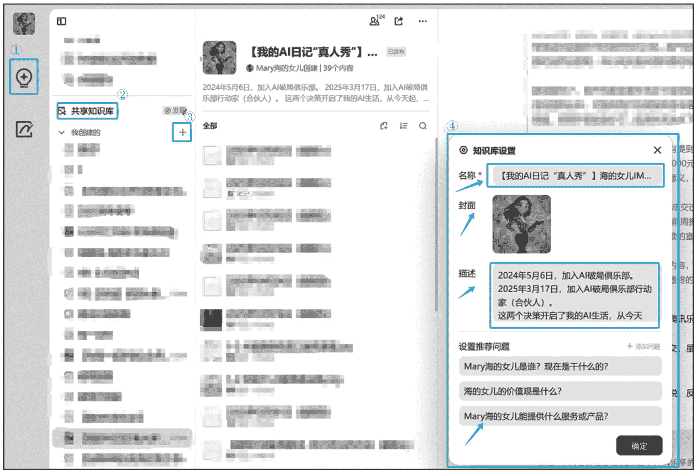
**图3-15 新建“我的 AI 日记‘真人秀’”知识库**

（2）明确初心与原则——“5个小心思”
写之前想清为什么写、想达成什么，过程才有方向。这 5 条也是使用该库的指导原则：
❑ 化整为零：把写日记当作积累写作素材、降低写书门槛的方式。
❑ 分享经验避坑：记录探索过程，为社群伙伴提供真实参考。
❑ 展示真实自我：跳出标签，建立真诚连接。
❑ 训练专属模型：用真实记录喂养，让它更懂你。
❑ 社交监督坚持：借助平台分享功能邀请外部监督，克服拖延。

目的明确，后续组织内容和使用功能会更顺。

（3）开始记录
有了家和初心，关键是填充内容。动手写，智能伙伴才开始运转。

**3.3.3 应用：玩转智能日记的核心场景与价值**

搭好框架只是开始，真正价值在应用。AI 知识库日记是动态、可交互的工具，体现了记录方式的三大转变。

**场景1：便捷记录与多维互动 变革1：从单一记录到多维互动**
1）解决痛点：传统日记形式单一、易中断、缺乏反馈。
2）如何应用：
❑ 随时随地记录想法与感悟，支持文字、图片、录音、附件。
❑ 与模型对话激发思考，卡壳时提问，或让它扮演角色头脑风暴。
❑ 让模型智能整理草稿或转成语音。
3）价值体现：大幅降低记录门槛，日记从独白变对话，维度更丰富，更能激发深层思考。图3-16展示了在 ima 笔记中边写边用“ima 问问”交互的示例。

**场景2：智能关联与知识串联 变革2：从碎片记忆到系统知识**
1）解决痛点：内容孤立，难以看出知识间的联系。
2）如何应用：
❑ 模型自动推荐关联：写新笔记时，部分库如 Obsidian、Logseq，ima 也在发展类似能力，能在侧边推荐相关的旧笔记。
❑ 主动提问关联：例如“关于‘知识复利’，我之前写过哪些相关思考或案例？”
❑ 有意识使用标签 #，主动构建知识网络，帮助模型更好理解关联。

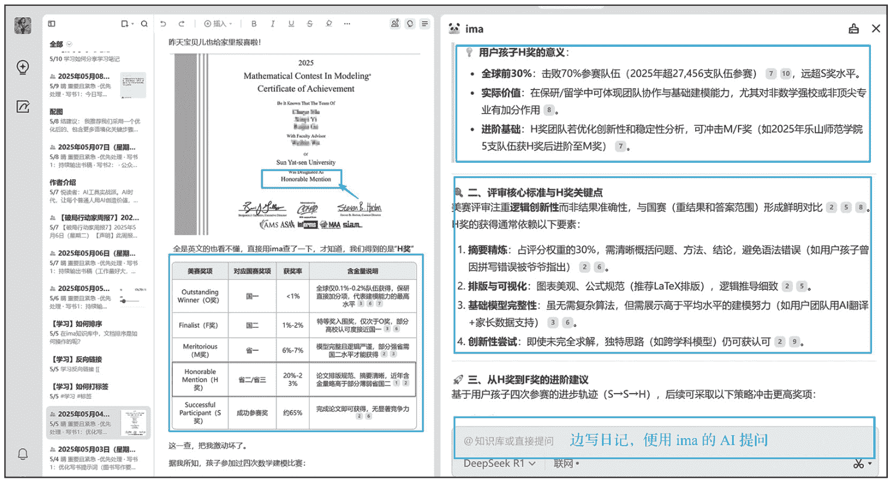
**图3-16 在 ima 笔记中借助 AI 辅助写作与思考**
3）价值体现：打破信息孤岛，让过去的思考活在当下，促进融会贯通，更容易产生新见解。图3-17展示了利用 AI 对日记进行定期归纳与引发思考的示例。

**场景3：高效复盘与深度反思**
1）解决痛点：回顾费时、反思不够深入。
2）如何应用：
❑ 智能总结：总结一段时间内日记要点、情绪变化、关键进展。
❑ 主题回顾：例如“梳理上月在‘学习人工智能’方面的记录与反思”。
❑ 引导式提问：让模型基于日记提出引导问题，例如“多篇提到时间管理困扰，根因是什么？尝试过哪些办法？效果如何？”
3）价值体现：把复盘从苦差事变成高效对话，反思效率与深度大幅提升，日记成为成长的镜子与教练。

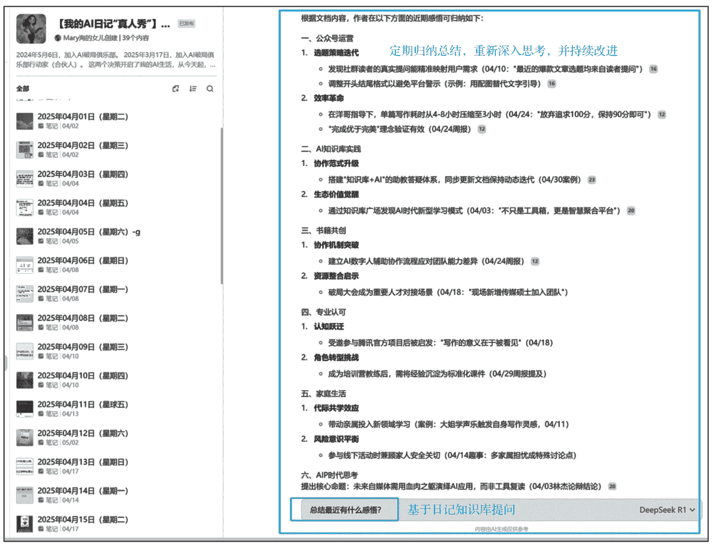
**图3-17 AI 辅助下的日记内容归纳与知识串联**

**场景4：社交督促与价值转化 变革3：从私密走向社交与分享**
1）解决痛点：缺乏外部激励，内容难以分享转化。
2）如何应用：
❑ 选择性分享：把非隐私的学习心得、避坑经验发给朋友、社群或社交媒体。
❑ 利用知识广场：把愿意公开的日记放入共享库或知识广场，接受点赞评论监督，形成正向激励。
❑ 素材沉淀与再创作：把日记作为文章、课程、书籍的素材库，利用 AI 整理提炼再创作。
3）价值体现：增加坚持的外部动力，促进交流，为二次转化和价值变现创造可能。

借助 AI 的“智慧”，记录、关联、反思、分享都更高效，日记真正成为陪伴成长的强大伙伴。

### **3.4 “AI 智慧家居”：备忘、常用信息与物品收纳整合**

家中物品越来越多，需要时却总找不到，这个老问题在用腾讯 ima 知识库搭建专属的“AI 智慧家居”后得到解决。

**3.4.1 家庭收纳的常见痛点**
（1）物品增多，查找困难
生活水平提升，家中物品堆积。闲置时占空间，用时却翻箱倒柜。
（2）传统 Excel 方案的局限
用 Excel 记录存放位置需打开电脑、分类繁琐、查询不便、位置变动难维护、家庭成员难以实时共享。

**3.4.2 AI 知识库解决方案**
**1.“AI 家庭管家”概念介绍**
用腾讯 ima 知识库打造“AI 家庭管家”，核心是利用其灵活便捷的能力管理家庭物品。相比 Excel：手机随时记录；支持文字、照片、标签等多种方式；可通过自然语言智能搜索位置；家庭成员可共享同一知识库；更新简单，更易长期坚持。

**2.家庭储物编号系统设计**
为提高效率，设计一套简单好记的编号系统。以三室两厅两卫为例：房间编号如主卧 A、次卧 B、书房 C、客厅 D 等；位置编号如衣柜 1、床下 2、书柜 3、抽屉 4 等，可再细分。编号简洁易标记，各家可按实际情况调整。

**3.三种实用记录方式**
❑ 简短描述+位置，如“皮羽绒服 主卧床下（A2）”，适合速记。
❑ 图片+标签：照片记录外观，标签说明属性和位置，如“存放位置：小阳台（I）”，适合外观明显但名称记不清的物品。
❑ 图片+文字+标签：结合前两者优点，最全面，适合重要或需详细说明的物品。

**3.4.3 实际应用案例**
**1.知识库建立过程**
按上述思路建立家居物品存放记录知识库的步骤：
1）在 ima 中创建新知识库“AI 智慧家居”。
2）设计储物编号系统。
3）采用上述三种方式之一记录物品信息、添加标签并定期维护。具体操作可参考第二章。
**2.物品查询实例**
建好后查询很简单。例如问 ima：“DeepSeek 图书放在哪里？”系统会返回：“DeepSeek 图书存放在次卧书柜（B3）的第二层。”比翻箱倒柜高效得多。
**3.提示词优化技巧**
为让模型更准确理解，可设计提示词指导其解读知识库：
❑ 文本笔记按“物品名称+内容+存放位置”格式。
❑ 图片+标签方式，图片命名为物品名，标签包含物品名、属性及存放位置。
按此规则，模型就能准确查找并反馈。

**3.4.4 扩展应用场景**
**1.日常生活中的其他应用**
❑ 重要文件管理：记录房产证、保单等存放位置。
❑ 保修信息管理：记录家电购买日期、保修期、售后电话。
❑ 家庭药品管理：记录药品存放位置、用途及有效期。
❑ 食材管理：记录冰箱内食材存放位置和保质期。
❑ 借出物品追踪。
**2.家庭理财与重要信息管理**
❑ 账单提醒：记录水电费等缴纳时间和方式并设置提醒。
❑ 家庭预算：记录收支、分析消费。
❑ 重要日期提醒：家人生日、纪念日。
❑ 家庭会员信息管理：会员卡、积分卡信息。

“AI 智慧家居”是腾讯 ima 在家庭场景的实用玩法。简单设置就能解决物品管理痛点，让生活更有序高效。AI+知识库=效率起飞，这一理念在家中同样成立。

## CHAPTER 4
## 第四章 学习效能倍增器：学得更快、记得更牢、用得更好

是否常陷入“知识囤积”困境？收藏了大量资料，购买了不少课程，能真正消化吸收并用上的却很少。信息爆炸让获取变容易，把信息内化成能力却成了难题。AI 知识库正是应对这一挑战的“超级消化酶”与“智慧学习引擎”。

本章聚焦 AI 知识库如何全方位提升学习效能，实现学得更快、记得更牢、用得更好：探索 AI 辅助下的深度阅读与笔记新方法，体验“先让模型懂自己，再让书开口说话”的个性化读书范式，学习如何高效消化在线课程与知识付费精华，并了解如何用 AI 知识库打造个性化“备考教练”，为重要考试冲刺保驾护航。

### **4.1 AI 知识库辅助阅读与深度笔记：实现知识的“吸星大法”**

有没有遇到过这种情况：面对一份非常重要但又长又枯燥的文档，比如行业报告、专业书籍章节，甚至政府工作报告，眼花缭乱无从下手。读完仍云里雾里，抓不住重点，更别说深入理解和有效利用。AI 知识库就像超级智能阅读助手，能帮你实现“吸星”式吸收知识。

本节介绍如何用 AI 知识库高效吸收内化复杂信息的思路与做法。内容主要来源于资深期货投机专家“不二随喜”的分享。他每天需处理大量复杂信息并快速决策，对如何借助工具提升深度思考与知识内化有独到实践。无论在哪个领域，AI 知识库都能成为强大的第二大脑。这里的“吸星大法”指借助 AI 高效吸收、理解、内化复杂信息并化为己用的能力。

**4.1.1 AI 知识库在阅读与深度笔记方面能做什么**
以腾讯 ima 为例，主要能完成：
（1）快速“瘦身”，秒懂长文主旨
几秒到几十秒内总结核心内容与关键要点，迅速把握文章脉络，告别读半天不知所云。
（2）深度“拷问”，精准答疑解惑
对文档中的细节、概念或逻辑有疑问，可直接用自然语言提问。它能基于原文精准回答，甚至用通俗语言解释专业术语，像随身专家。
（3）提炼“金矿”，挖掘核心概念
能自动识别并提取文档中最核心、最常出现的概念和主题，一眼看清知识骨架，为深入学习打基础。
（4）关联“织网”，激活知识网络
能发现当前文档与知识库中其他笔记、文档的潜在联系，打破知识孤岛，促进跨领域思考。
核心价值在于改变被动低效阅读方式，解放精力，让人更专注于理解、思考与应用，从而极大提升学习与工作效率与深度。

**4.1.2 两步搞定，开启“智能阅读”之旅**
1）将阅读材料放入 AI 知识库。无论是 PDF 报告、Word 文档、网页链接，甚至图片文字，都可轻松导入 ima，让模型看见并理解内容，如图 4-1 所示。

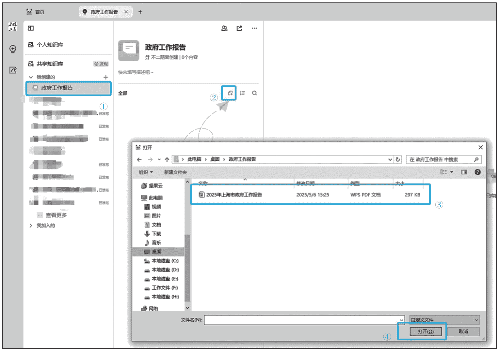
**图4-1 将阅读材料导入 ima 知识库**
2）在知识库中打开文档并唤醒智能助手。打开文档，找到代表 AI 功能的图标，如腾讯 ima 里的熊猫图标或对话分析按钮，开始与文档深度对话，如图 4-2 所示。

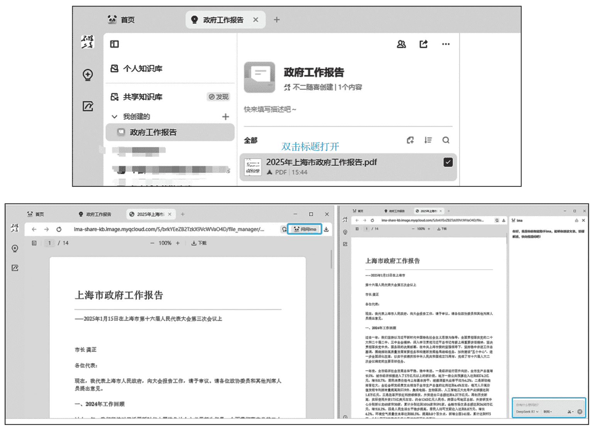
**图4-2 ima 知识库中打开文档并调用智能助手**

**4.1.3 实战演练：看 AI 如何轻松“啃”下万字报告**
以《上海市政府工作报告》为例。内容权威、信息量大、结构复杂，是检验阅读理解能力的试金石。

**1.场景痛点**
一位希望到上海发展的外地人，想快速了解上海整体情况、发展重点与未来机遇。直接阅读几万字报告容易望而却步，难以抓住重点。

**2.AI 如何应用与解决**
（1）告别通读，先得整体印象
导入后直接问 ima：“我是不了解上海的人，请基于报告核心概念和观点，用普通人能懂的方式介绍一下上海。”几秒钟就给出涵盖经济、科技、城建、民生的全面概览，效率远超自己通读数小时，如图 4-3 所示。

**图4-3 ima 对政府工作报告进行初步解读**

（2）深入挖掘，抓住“核心密码”
继续提问：“请对报告进行文本分析，找出最核心的 10 个概念并用大白话解释。”ima 迅速提炼出“五个中心”“新质生产力”等 10 个核心概念并通俗解释，抓住报告龙骨，理解发展方向，解决抓不住重点的痛点，如图 4-4 所示。
模型不仅能找出高频词和政策重点，还能结合上下文给出易懂解释并说明重要性，同时给出深入挖掘建议。用户可点建议继续问，也可直接提问。

（3）追问细节，疑难逐个击破
对“新能源汽车产业”等概念模糊，继续问：“报告里关于发展新能源汽车产业具体提到了哪些措施？”模型基于原文做详实易懂解读，如图 4-5 所示。这种交互式阅读让深度理解成为可能。

**图4-4 ima 提炼报告核心概念并解释**

**图4-5 ima 针对特定细节进行深入解读**

（4）角色扮演，让知识“活”起来
让 ima 扮演招商人员：“严格基于这份文件，如何向客商介绍上海才能留住他们？”模型迅速切换角色，从政策优势、营商环境等多角度整理出有吸引力的招商话术，把静态信息转化为可行动方案。如图 4-6 所示，它还会给出应对顾虑的建议。

**图4-6 ima 基于报告内容进行角色扮演式应用**

十几分钟内，不仅掌握核心内容和概念，解决疑问，还得到可用的话术，实现了颠覆性效率提升与认知深化，解决了读不懂、抓不住、用不上三大痛点。

**4.1.4 从“吸星大法”到“内功心法”**
AI 辅助阅读背后的高效学习原理：
快速学习=①找出核心概念+②理清逻辑结构+③应用解决问题
传统学习耗时费力，AI 知识库凭借对话式分析、信息提炼和内容生成能力，极大加速学习过程，实现效率指数级跃升。

这种用法远不止于剖析政府工作报告，研读新课、做行业研判、读专业著作、拆解工作中长篇文档时同样适用。需要明确的是，再强大的智能工具也只能作辅助，独立思考与批判判断不可外包，模型的总结与回答必须回到原文对照，并融入个人理解去甄别。

毋庸置疑，智能化提供了强增益，让知识探索更从容更深入。接纳它，阅读的负担减轻，思考反而更自由。

### **4.2 先让系统读懂你，再让书本发声**

花钱购书认真做笔记，隔段时间再回想却模糊不清。热衷囤资料的人，硬盘网盘塞满资源，真正内化的比例却很低。传统阅读多为单向输入，效率有限，也难以与现实问题有效挂钩。

在智能时代，阅读方式正经历根本改写。借助知识库，可以形成一种以解决问题为导向的颠覆式阅读范式，对实践型学习尤其有效。

**4.2.1 阅读方式的翻转逻辑**

（1）由单向接收变为双向对话
过去读者只是信息的接收端。而在知识库里，用户能直接向一本书发问，对概念、观点、案例持续追问，像与一位通读全书的智能对话体交流，互动深度完全不同。

（2）由普适内容变为定制方案
这也是最核心的价值：先让系统理解使用者的处境、困惑与待解难题，再带着这份上下文去解读书中智慧，从而给出量身建议或启发。

（3）由碎片孤立变为网络联动
系统不仅能打开单本书，还可把其与库中其他笔记、文章及既有思考自动关联，打破割裂。

（4）由低效耗时变为精准提效
系统擅长快速抓取长文精华，提炼要点，甚至生成导图。通俗说，知识库像一座桥梁，把书中普适智慧转化为解决个人难题的钥匙。

**4.2.2 启动准备：让系统同时看见人與書**

体验该方式并不复杂，关键是让系统同时掌握使用者与文本：

1）挑选具备问答与分析能力的知识库，本章以腾讯 ima 为例说明。
2）把书籍内容喂给系统，这是关键一步。
❑ 方法一：借助 ima 与微信读书等平台联动，在 ima 首页输入微信读书的书籍地址完成添加，如图 4-7 所示。
❑ 方法二：本地 PDF、Word 等文件直接上传。
❑ 方法三：网络文章或无法直接导入的书籍，可手动复制关键章节或笔记至库中。

**图 4-7 ima 导入微信读书书籍示例**

**4.2.3 实操演示：带着问题让书开口**

下面用一个真实案例演示“先懂人再读物”的流程。

一段时间里，公众号“海的女儿爱上 AI”陷入瓶颈，粉丝增长停滞，多方向尝试难有持续突破。虽在得到“小师兄”指点后有所改善，我仍反思：若无导师帮助，能否用系统与知识库模拟类似辅导？于是选用《最重要的事，只有一件》做一次试验。

（1）先让系统理解困境
我没有直接向书本索答案，而是把本书加入腾讯 ima 知识库后，先清晰描述自己的处境与问题，说明自媒体发展的瓶颈、已尝试的方向、当前状态，以及期望系统结合此书给出分析与建议，问题示例可参考图 4-8。

**图 4-8 向 ima 提问个人困境并指定参考书籍**

（2）让书经由系统发声
提交问题后，ima 背后的大模型会基于已加入库的《最重要的事，只有一件》，结合刚才提出的困境与背景进行阅读与理解，再以作者加里·凯勒的视角与逻辑给出回应。

（3）收获导师级的定制建议
结果令人惊喜，系统给出的建议与“小师兄”指导在多处高度相近。它精准指出核心在于精力分散、缺乏聚焦，并结合书中理念给出可执行建议，如识别“最重要的事”、把 80% 精力集中其上、学会拒绝次要事务、为关键事项设立专属时段等，如图 4-9 所示。这种方式很好地模拟了导师辅导。系统把书中智慧精准映射到个人独特情境，给出高度定制方案，这正是新模式的核心魅力。

**图 4-9 ima 结合书籍内容提供个性化建议**

**4.2.4 延伸思考：从解题到内化**

“先懂你再读书”的做法不仅用于找解法，还可拓展到更广的学习场景。
❑ 学新技能，先告知系统目标水平，再让其结合教程规划路径、解释难点、生成练习。
❑ 理解复杂概念，先说明疑惑与知识背景，再让系统基于权威著作讲解并类比。
❑ 提升决策质量，先陈述目标、备选方案与顾虑，再让系统结合报告或理论著作分析利弊。

该模式把阅读从单向输入变为双向互动与定制应用的动态过程。它不能完全替代真人导师，但作为强力辅助，能大幅提升解题、学习新知、深化思考的效率。在 AGI 时代，核心能力或许不再是拥有多少知识，而是与系统协作共创的能力，而个人知识库则是与智能共舞的基础。这种颠覆式阅读方式已摆在面前，值得尝试。

### **4.3 课程提炼器：把学习资料消化吸收**

本节经验来自悦读者刘旭老师的实践。

**4.3.1 作用：让学习资料活起来**

在此场景中，知识库相当于智能学习的消化系统和随身家教，核心是把用户从信息接收者转变为知识管理者，让死文件变成活知识。
❑ 全格式收纳：轻松容纳老师发的 PDF 讲义、PPT、Word、个人文字笔记、听课语音转文字、课程链接甚至截图。
❑ 智能分类与关联：系统能初步理解内容，给出课程名、讲师、主题词、难度等标签，并发现不同资料间的联系，呈现知识全貌。
❑ 消化提炼：可直接向库中课程提问，让系统解释概念、总结章节要点或提取名词解释，快速抓住重点。
❑ 记忆检索：告别文件夹翻找，用自然语言提问即可定位，例如“在××课程里提到××概念的笔记在哪里”，系统会迅速给出结果。
❑ 学习地图绘制：通过持续互动，系统能感知用户熟悉与薄弱点，帮助梳理知识结构，形成定制学习地图。

知识库把繁琐的整理工作解放出来，让精力集中在理解与思考上。

**4.3.2 搭建：为在线学习建一个智能书房**

用腾讯 ima 搭建学习提炼器很简单，如同整理书桌。
（1）创建专属学习知识库
打开 ima，新建共享知识库，取名“我的 AI 学习助手”或“××课程知识库”，如图 4-10 所示。

**图 4-10 ima 创建“我的 AI 学习助手”知识库**

（2）把资料搬进库
平台支持多种入库方式：
1）文字笔记或课程文件
❑ 其他地方的文字笔记可复制后在知识库新建笔记粘贴。
❑ 直接上传下载的 PPT、PDF 讲义、课程截图。
2）课程链接、网页文章或公号文章
❑ 微信中打开链接，点击右上角“…”选择在知识库打开并存入学习库。
❑ 网页上可用平台收藏或复制网址粘贴至笔记。
（3）用标签提升效率
入库后添加标签是激活的关键。可添加如 #AI 基础、#机器学习、#概念；#Python、#实战；#沟通、#软技能、#××老师 等标签。标签越精准检索越快。初期不必追求复杂体系，可在使用中逐步完善，每周花几分钟回顾补充。

**4.3.3 应用：让系统把知识嚼碎吸收**

有了智能书房，即可享受高效学习。
场景 1：快速回顾与定位
以往翻文件夹找细节，现在可在“我的 AI 学习助手”提问：“帮我找××课程里讲的××技术要点”或“××案例在哪节课讲的”，ima 会迅速给出相关笔记甚至直接提炼，如图 4-11 所示。

**图 4-11 ima 在学习库中定位特定知识点**

场景 2：理解复杂概念与对比
内容抽象或概念相似时，可把相关讲义导入并问：“请通俗解释库中××概念”或“概念 A 和概念 B 主要区别是什么”，系统会像助教一样梳理逻辑并清晰呈现，如图 4-12 所示。

**图 4-12 学习库中就复杂概念与系统进行多轮探讨**

场景 3：高效总结要点
学完课程或模块后，让平台生成精炼总结、要点清单甚至思维导图大纲，比手工整理更快，也便于宏观回顾。
场景 4：构建定制知识网络
持续提问与导入新内容时，平台会连接看似孤立的知识点，发现跨课程的共性与差异。作为内容创作者，我对 RAG 技术的理解与工具对比，正得益于平台中盘活的学习资料。

注意，工具只是辅助，真正的吸收靠主动思考与应用，但好工具能极大加速过程。搭建好库后可结合写作助手起草学习心得，最重要的是把知识用于实践。希望这个学习提炼器能帮助告别囤课焦虑，让每次学习都物超所值。

### **4.4 备考冲刺：用智能教练个性化提分**

本节介绍如何用知识库构建专属备考教练，系统整理资料、精准定位短板、智能规划路径。本节核心内容来自 AI 跨界公益人、资源链接践行者李颖瑜 五灵老师在备考“社会工作师”时的经验。

**4.4.1 功能：备考教练能做什么**

备考常见痛点：知识点零散难体系化、重要信息难查找、政策法规更新易遗漏、错题反复找不到症结。智能备考教练可有效解决。
（1）定制知识地图构建与导航
痛点：资料分散在教材、真题、网课、笔记各处。
赋能：整合多源知识点，按考纲模块分类关联，用标签如高频考点、易错点构建定制地图。
（2）动态信息追踪与智能对比
痛点：政策类考试内容更新频繁。
赋能：导入新旧政策或考纲后提问：“对比 2023 年和 2024 年版《社会救助暂行办法》主要修订了哪些内容”，系统能快速生成对比表并说明差异。
（3）智能化错题管理与归因分析
痛点：错题反复却不知错因。
赋能：将错题截图或文本导入并打“错题”标签，备注答案与解析。可引导系统归因，例如“关于社区治理的案例分析题做错了，是概念模糊还是方法错误”，系统会结合库中资料给出针对性建议，甚至生成薄弱点专项训练卷。
（4）高效学习辅助与记忆强化
痛点：海量知识点记忆压力大。
赋能：可让系统从某章提取近五年高频考点，或把复杂描述改写为通俗语言，互动式学习提升效率与记忆。

知识库的核心价值是把人从繁杂整理和盲目刷题中解放出来，聚焦理解与攻克难点。

**4.4.2 搭建：三步打造专属备考教练**

以腾讯 ima 为例，搭建并不复杂。
（1）创建专属知识库
打开 ima，在知识库管理界面新建共享知识库，取名如“AI 社工备考教练”或“考研冲刺营”。图 4-13 为知识库概览示例。

**图 4-13 “AI 社工备考教练”知识库概览**

（2）系统化录入核心资料
高质量结构化资料是基础。
1）创建核心文件夹体系。按科目与资料类型建层级，如图 4-14 所示，五灵老师备考社工师时新建了相应体系。

**图 4-14 “AI 社工备考教练”知识库核心文件夹示例**
2）高效录入各类资料。将电子教材、讲义、真题、模拟卷、错题集、网课重点导入对应文件夹。电脑端可直接上传拖拽。微信文件导入也很高效，例如在微信收到老师发送的 PDF 时，长按文件→用其他应用打开→腾讯 ima 知识库→存入指定文件夹。图 4-15 展示了导入示例与结构化存放。

**图 4-15 ima 备考知识库导入资料示例**

（3）构建智能标签体系
标签是知识库的神经网络。长按文件编辑标签，设计核心维度：
考试属性如 #中级社工、#综合能力、#2024 真题、#高频考点、#易错题；
科目分类如 #社会工作综合能力、#政策法规、#社会工作实务；
知识点主题如 #社区治理、#社会救助、#社会工作伦理、#个案工作技巧。
为每份资料打上相关标签后，知识库即具备多维检索与关联能力。

**4.4.3 应用：与备考教练互动实现提分**

搭建只是第一步，价值在应用。
（1）考点提取术：精准定位重点
场景痛点：教材繁多难抓核心。
系统应用：输入“从《社会工作综合能力》第七章‘社区工作’中提取近五年出现频率最高的 5 个考点”。
价值体现：系统基于教材与真题数据快速定位高频点，使复习更有针对性，如图 4-16 所示。

**图 4-16 系统从备考资料中提取高频考点**

（2）政策法规对比神器：轻松掌握新旧变化
场景痛点：政策更新快，对比费时。
系统应用：上传新旧文件后提问“对比 2023 年和 2024 年版《社会救助暂行办法》，总结主要差异并以表格列出”。
价值体现：系统自动比对生成清晰修订表，一眼看懂变化。

**图4-17 借助 AI 横向对比新旧政策并提炼差异**

（三）模拟案例训练与智能回馈：强化实操能力

❑ 现实困境：实务题型变化灵活，解题思路和得分要点常难把握。
❑ 使用思路：把一个模拟的青少年社工案例输入，并指令模型“请根据《社会工作实务》中青少年危机干预的相关内容，对案例进行解读并给出包含干预步骤的完整处置流程”。作答后，还可把自己的版本贴入，请模型对比“这是我的答案，请看看是否符合专业规范，有哪些地方可以优化”。
❑ 实际效果：模型不仅能给出规范的案例分析框架，还能对答案做初步评估并指出不足，帮助提升案例分析的实务水平，如图4-18所示。

**图4-18 AI 辅助案例模拟训练与反馈**

（四）定制学习方案与进展追踪 进阶用法

❑ 现实困境：备考时常会自拟30天冲刺表，如图4-19所示，并把每日任务、重点章节、复习进度等记录在腾讯ima笔记里。

**图4-19 ima笔记记录30天备考冲刺计划**

❑ 使用思路：ima目前尚不能全自动生成并监控复杂的学习计划，但可以通过提问来辅助制定与调整。例如：“请结合我30天的冲刺计划及《综合能力》各章节权重，为我规划第一周的具体学习内容及时长。”或“我今天学习了《社会工作理论》，请出5道相关选择题来检验掌握程度。”
❑ 实际效果：知识库凭借信息整合、精准问答和深度解析，能充当备考路上的私人教练与提分工具。它帮助学习者快速提炼重点、节省精力，更重要的是推动深入思考与针对性练习。教练成效取决于资料质量与互动技巧，用心运营，知识库可为备考带来新动能。

你是否也在为某场考试奋斗？AI 备考教练是否带来新启发？不妨思考，这个堪比第二大脑的知识库，还能在哪几个环节为你赋能？

## CHAPTER 5

## 第五章 AI 家教新助手：用知识库智慧陪伴孩子成长

AI 时代的教育形态正经历巨变。本章将探讨知识库在教育场景的应用路径，从个性化评语生成到智能答疑，从自动阅卷到资源管理，全方位提升教与学的效率和体验。

### 5.1 家校信息管家：汇总通知反馈，搭建孩子专属校园档案

做父母的都经历过微信群被“@所有人”刷屏的焦虑，老师通知、作业、活动照片、投票、健康打卡、腾讯文档……信息洪流不断，刚处理完一条新的又来。收藏一堆却检索困难。“上周三的数学练习PDF在哪？”“家长会什么时候？”诸多琐事让人感觉当家长比当年上学更累。问题不在记忆力，而在于缺少高效的信息管理体系。

下面分享如何用知识库为孩子的校园信息建一个“智慧家”，打造专属的家校信息管家。它像一个随时待命的数字档案柜，告别混乱，让一切井井有条。

**5.1.1 功能：不止于数字抽屉**

家校信息管家应具备以下核心能力：

❑ 全面收集：收录学校、老师、班级群的各类信息。
❑ 有序归类：按学科、类型、重要程度分类并打标签。
❑ 快速调用：支持自然语言搜索或提问，精准定位。
❑ 智能加持：能理解信息并做简要总结、提醒或关联。
❑ 安全共享：方便家庭成员协同育儿。

**5.1.2 搭建：三步搞定**

借助知识库工具如腾讯ima，搭建管家很便捷，分三步。

（1）创建空间，给信息一个专属家
在知识库工具里为孩子建独立库。操作：打开ima，进入知识库界面点“创建”或“+”，命名如“（孩子名字）的家校信息管家”，如图5-1所示。

**图5-1 在ima中创建家校信息管家知识库**

（2）搬运关键信息
可根据孩子实际情况调整重点：
❑ 学校班级通知：开学、放假、家长会、缴费等。
❑ 作业与学习要求：各科作业、项目要求、复习重点等。
❑ 学习资料与反馈：老师分享的资料、试卷、成绩单、评语。
❑ 活动与成长记录：活动照片、视频、奖状、作品、成长点滴。
❑ 联系方式与重要提醒：老师、学校、重要家长联系方式及特殊事项提醒如过敏信息等。
总之，所有重要、需检索或想为孩子留存的校园相关信息都应收入库。

（3）多种方式入库，让信息自动流入
❑ 复制粘贴法 文本类：微信群文字通知、作业要求等，复制后在ima家校信息管家库新建笔记粘贴，如图5-2所示。

**图5-2 在ima中为家校信息管家新建笔记**

❑ 微信一键转存法 文件类，为ima的核心优势：在微信打开文件后点右上角“...”，选“用其他应用打开”，选择ima知识库并存入家校信息管家库。
❑ 本地文件上传法：手机或电脑已保存的照片、扫描试卷、资料等，可在ima家校信息管家库界面点“+”或“上传”选择文件即可完成上传，如图5-3所示。
❑ ima内搜索添加 网页/文章：在ima首页搜索到的网页或文章可直接加入知识库。

**图5-3 在ima中向家校信息管家上传文件**

**5.1.3 应用：让信息活起来，智慧管理初体验**

入库后关键在于标签与智能检索。

**场景一：告别大海捞针，信息精准定位**
❑ 痛点：找不到上周数学练习PDF、家长会时间。
❑ 解决思路：打标签+智能搜索。
❑ 打标签习惯：为每条笔记或文件添加标签，帮助模型理解与组织。如家长会通知可标#学校通知、#重要；数学作业可标#数学、#作业。一篇内容可有多标签，标签越细后续检索越准。
❑ 智能搜索：打好标签后，可用自然语言提问，如“帮我找上周数学作业”“家校中心里关于家长会的通知”，模型会按提问和标签快速命中。
❑ 价值：大幅节省检索时间，重要信息不再丢失。

**场景二：家庭内部信息同步，协同育儿更轻松**
❑ 痛点：爸爸记这事妈妈记那事，信息不同步易遗漏。
❑ 解决思路：家庭共享。知识库可共享给家人，全家了解孩子情况，信息同步，分工协作如提醒作业、准备活动物品。
❑ 价值：减少家庭内部沟通成本，提升协同效率。

**场景三：谨慎使用，邻里互助的信息枢纽**
❑ 可能性：对公开无隐私的学校通知或通用资料，可生成分享链接，供班级其他家长互助。
❑ 重要提醒：务必注意信息安全与隐私保护！孩子个人信息、成绩、老师评语等敏感内容绝对不能外传。
❑ 价值：在确保隐私安全前提下促进资源共享，营造互助氛围，需谨慎使用。

小技巧：
❑ 定期整理标签：建议每周花10分钟检查标签，进行删除或合并。
❑ 清理过期信息：定期删除失效通知，释放存储空间。目前腾讯ima单库免费空间为30GB，合理使用很重要。

工具是死的，用法是活的。当把方法教给孩子，让他学会用AI管理信息时，也在潜移默化培养解决问题的思维与体系化能力。AI时代最好的家教，或许不是替孩子奔跑，而是教他们造自己的滑板车，从而在信息浪潮中更稳更远。

### 5.2 个性化学习导航：与孩子共创学习规划与进展追踪

哪个父母没给孩子做过学习计划？从学期目标到每晚作业时间，都曾尝试。但多是家长单向设计，孩子被动执行，计划缺乏生命力。图5-4展示了传统方式下贴满墙的学习计划。

**图5-4 传统方式下贴满墙的学习计划**

AI时代，关键在于推动从单向输出到协同共创。亲子学习更应是家长与孩子共同使用智慧工具，描绘学习旅程。

本节说明如何用知识库把计划制定与进度追踪变成可视化、可互动的共创体验，让孩子从被计划者变为主导者，从被追踪者变自我管理者。相当于为学习装上个性化导航，父母是副驾驶。本节不少实操灵感来自与“悦读者”刘旭老师的讨论。

**5.2.1 功能：不只是计划表，更是成长路线图**

传统计划静态、难更新、难关联资源、难激发内驱。知识库作为导航的价值在于：

（1）目标可视化与智能拆解：把大目标切成可执行的小步
可将“学期数学提升15分”拆成具体步骤并呈现，目标不再模糊，如图5-5所示。

**图5-5 ima辅助设计学习规划示例**

（2）资源整合与高效关联：资料不再散落
集中管理课本、讲义、视频等，与计划步骤绑定，实现计划到哪资料到哪。

（3）进度记录与可视化呈现：让努力被看见
完成后标记状态、记录心得或困难。用#未开始、#进行中、#已完成等标签或完成比例呈现进度，既激励孩子也让家长掌握情况。

（4）反思与智能调整支持：及时校准方向
结合进度与错题数据，借助模型分析如哪类题型易错，帮助调整方法或计划。

（5）亲子共创的透明空间：把孩子拉进驾驶舱
共享空间让家长与孩子共同访问、查看、编辑。当孩子参与制定、收集资源、记录进度，会产生主人翁意识，增强亲子沟通。

（6）问答与辅助：触手可及的智慧助手
遇到概念不理解或需要鼓励时可即时互动，模型能解答、推荐资料或给出个性化建议。知识库连接目标、资源、进度、反思与智能，成为中枢。

**5.2.2 搭建：三步构建亲子学习空间**

搭建前先思考：孩子核心目标是什么？学习习惯如何？希望收集哪些信息？

（1）创建专属库或文件夹
在工具中为孩子建独立共享库或主文件夹，如“[孩子名字]的学习地图”。操作：新建库或文件夹并命名，共享库需设置权限。图5-6展示“[孩子名字]的成长驾驶舱”示例。这相当于为学习建一个数字房间，可邀请孩子加入，明确共同拥有与管理。

**图5-6 在ima中创建个性化学习知识库成长驾驶舱**

（2）确定组织结构与标签体系
与孩子商量按学科、时间或项目划分文件夹并规划结构，如图5-7。建立标签如#未开始、#进行中、#已完成、#错题集等，便于检索管理。

**图5-7 ima个性化学习知识库文件夹结构示例**

（3）邀请孩子加入共享库
使用共享库且孩子有账号时，在设置成员管理或分享功能中邀请，如图5-8。这传递空间由双方共建共管的信息。

**图5-8 在ima中邀请孩子加入共享知识库**

**5.2.3 应用：协同导航学习旅程**

家长是导航员与啦啦队，关键是让孩子参与决策、感知价值。AI能省力，但有效沟通与共同行动才是核心。

**场景一：协同制定计划 绘制地图**
把规划变成地图绘制游戏。
1）操作：打开学习文件夹新建笔记，标题“[学科名称]学习计划”。
❑ 一起讨论大目标如“期中数学达到××分”，写在开头。
❑ 用层级列表或待办清单把大目标分解。如掌握分数应用题，可拆“复习分数四则、理解单位1、分析典型题型、独立练习、错题分析”。
2）AI辅助：不确定知识点可提问模型：“请列出小学五年级英语下册重点知识点，并给出每周计划建议框架。”图5-9为示例，结论需结合实际调整。

**图5-9 利用ima辅助制订学习计划**

3）建议：类似WBS工作分解，把大项层层拆解，让计划更条理，也培养做事方式。

**场景二：填充资源 备好行囊**
1）操作：把课本、练习册、电子资料、网课链接、科普文章视频等分类上传至库，在计划笔记中插入链接或引用，或给文件加标签如#关联计划-小数乘法，便于检索，如图5-10所示。

**图5-10 在ima中为学习资源添加关联标签**

2）功能：ima支持一键从微信、浏览器转存内容，让资源不再分散，并与计划串联。

**场景三：追踪进度 查看导航**
1）操作：定期如每日作业后或每周末与孩子打开计划笔记。
❑ 在待办清单勾选完成项。
❑ 记录“已完成XXX”“今天困难YYY”。
❑ 用标签标记进度。
图5-11为勾选示例，鼓励孩子自己记录，培养自我管理与反思。

**图5-11 在ima笔记中更新学习任务完成状态**

2）AI辅助：积累一段记录后可问“根据[学科]计划笔记，孩子最近在哪些知识点花费时间最多或问题最多？”模型可快速提取要点，提供客观视角。

**场景四：定期复盘与调整 校准方向**
1）操作：每周或每月回顾计划与进度。
❑ 复盘完成与未完成目标及原因。
❑ 翻阅困难记录讨论解决办法。
❑ 商量后续是否需修改难度或时间。
2）AI辅助：可问“基于本月数学进度与错题类型，下月应加强哪方面？”或“概念理解不清，能推荐更易懂的讲解资源吗？”
此过程帮助孩子认识自我、分析问题，让计划成为可优化的共同作品。

**场景五：激发兴趣与鼓励 加油站**
学习需要乐趣与成就感。知识库不仅存计划与资源，也是记录闪光点的加油站。
1）操作：
❑ 记录成就。建笔记或文件夹记录每项进步与亮点，如独立完成任务、优秀作品照片、表扬语，形成成长荣誉室，给予鼓励。

❑ 先把更生动的学习载体收进库。遇到与学习相关的活泼素材，比如实验短片、历史纪录片、编程小游戏的入口，都可以存进库里并和学习计划或知识点关联。计划执行之余翻出来看看，学习会轻松不少。图 5-12 为在 ima 知识库中记录孩子的“闪光时刻”或收集趣味学习资源的示例。

**图 5-12 在 ima 知识库中记录孩子的“闪光时刻”或收集趣味学习资源**

2）借助助手拓宽视野。比如提问：“孩子最近在接触昆虫相关内容，能否推荐几部适合小学生的昆虫纪录片或科普网站？”回复如图 5-13 所示。

**图 5-13 ima 推荐适合小学生的昆虫科普资源**

3）玩法建议：在库里布置“学习寻宝”。例如在某个知识点的资料里藏一个彩蛋，像一句段子、一则科学小常识，或布置任务“为这个概念找 3 个不同例子”，完成后给予一点小奖励或虚拟的探险家徽章。把学习游戏化，参与度会明显提升。

把智能知识库看作亲子学习的智慧搭档。借助它搭建个性化的学习导航，能把模糊的目标变得清晰可视，把分散的资料集中起来，把枯燥的追踪变成有趣的体验。更关键的是，它提供了一个空间，让家长和孩子能够真正平起平坐地协作，共同规划和管理学习。库负责整理信息、分析数据并给出建议，但方向盘始终握在家长和孩子手里。工具多高阶、计划多完美都不重要，重要的是是否借助它建立起共同面对学习、一起解决问题的亲子协作模式，并培养孩子自主规划与自我管理的习惯。

智能体充当导航，孩子是驾驶员，家长是副驾驶。最终要让孩子能自信独立地驶向自己的学习之旅。

### 5.3 好奇驱动问答：AI 版十万个为什么
“妈妈，天为什么是蓝的？”“爸爸，恐龙真的存在过吗？”孩子像会走路的十万个为什么，好奇层出不穷。父母并非无所不知，面对连环提问有时会卡壳，或觉得网络信息零散难懂，久了孩子的好奇火苗也会渐渐熄灭。智能知识库能否成为孩子专属的 AI 版《十万个为什么》，一个耐心解答并帮助拓展认知边界的智慧百科呢？

本节思路主要参考“悦读者”刘旭老师的实践。接下来聊聊如何让回答问题的过程从单纯给答案，升级为有价值的知识拓展和思维引导，让助手成为探索未知的得力搭档。

**5.3.1 从资料堆到懂你的伙伴**
传统百科全书厚重难查，网络搜索又杂乱，对孩子来说筛选和理解本身就是门槛。智能知识库把“十万个为什么”推向智能化、个性化的阶段，成为满足好奇的智慧百科，关键体现在：

（1）优先在已有资料里寻找答案
向知识库提问时，它会先在家长为孩子收集整理的库内内容，比如已导入的课本、科普读物、纪录片文字稿中检索。这样回复能与孩子现有知识体系自然衔接，有助巩固旧知、连通新知。

（2）把难懂概念讲成孩子的话
助手能把复杂的科学或抽象知识，用更简单、生动、形象的语言甚至比喻讲清楚，实现听得懂才真明白。比如解释万有引力，不会直接抛公式，而是说“地球妈妈牵着我们，所以我们不会飘走”。

（3）支持连环追问、层层深入
孩子的好奇往往不止一个问题。助手能记住对话上下文，允许围绕同一主题多轮提问，持续供给相关信息并引导深入。

（4）多模态呈现
知识传递不止文字。好的知识库能结合文字、图片，未来还能有声音、简易动画。当孩子问“恐龙长什么样”，助手可直接调出库内恐龙图或生成简笔画，让知识活起来。

（5）把对话沉淀为笔记
一次次有价值的问答本身就是学习过程。多数工具支持一键保存对话为笔记，形成孩子专属的问题解决记录或探索日志，便于回看和深化。

（6）提供更可控的探索环境
相比开放网络，在知识库中问答的信息来源更可控，主要基于库内资料或已筛选的外部知识，能减少不适龄内容和广告干扰。

因此，智能知识库早已不是简单的问答机，而是能理解孩子、关联知识、引导探索并促进积累的智慧伙伴。

**5.3.2 搭建：给智慧百科注入养料**
让助手成效的关键在料足和用对。

1. 充实库内内容，这是基础准备
回复质量取决于库内资料的质量和相关性，需要有意识地收集与孩子年龄、兴趣、学习相关的基础知识。

❑ 素材来源：科普读物、绘本、纪录片文字稿、学校资料、兴趣班笔记、优质在线科普文章或视频链接等。
❑ 导入方式：利用文件上传、笔记编辑、网页剪藏等功能把科普读物导入知识库，如图 5-14 所示。

**图 5-14 在 ima 知识库中导入科普读物示例**

2. 结构化整理信息
用文件夹和标签分类。清晰的结构和精准标签能让助手更快定位信息。

例如建一个“科普知识”主文件夹，下设“动物世界”“植物王国”等子文件夹。对内容打标签，如#恐龙、#光合作用、#引力、#小学科学。图 5-15 为知识库内“科普知识”文件夹结构；图 5-16 展示为一篇恐龙笔记加#恐龙、#史前生物、#科普标签的界面。

**图 5-15 ima“科普知识”文件夹结构**

3. 引导孩子会提问
这是发挥价值的关键。

❑ 敢问：让孩子知道助手是个耐心且从不嘲笑的老师，任何好奇都可尽情提。
❑ 说清楚：引导孩子用更清晰具体的语言提问，问题太笼统会影响回复准确度。
❑ 会追问：鼓励得到初步答案后继续深挖，从是什么、为什么、怎么做、与什么相关等角度拓展，培养批判思维和联想力，助手的多次交流正好支持这种发散。

**图 5-16 在 ima 中为科普内容添加主题标签**

**5.3.3 应用：和助手一起探索未知**
助手是工具，父母是引导者。常见用法如下。

场景一：即时解答灵光一现的问题
状况：孩子玩耍、看动画或阅读时忽然问：“妈妈，猫头鹰的头怎么能转那么多圈？”
示范：不必立刻中断去搜索，家长可与孩子一起打开亲子学习知识库，进入交流界面，在“动物世界”文件夹中直接问：“猫头鹰的头为什么能转很大角度？”
表现：助手会优先从库内相关动物知识或通用知识出发，用孩子能懂的说法解释，比如“猫头鹰脖子里的骨头特别多，像积木一样灵活，所以能转很大圈”，如图 5-17 所示。
价值：即时个性化的解答能最大程度保护那一刻迸发的好奇心。

**图 5-17 用 ima 解答“猫头鹰头部转动”的科普问题**

场景二：基于已有知识的深度追问
状况：孩子最近在库里读了不少火山资料，已知道喷发与地下岩浆有关，想了解更多。
示范：引导他进入知识库“火山”相关文件夹或标签，先问“岩浆是从哪里来的？”，助手回应后再追问“为什么有的火山会喷发，有的不会？”
表现：助手基于库内地质知识作答，并根据连续追问提供更深层次解释，像一位耐心老师一步步带孩子找根源。图 5-18 展示在特定兴趣文件夹内多次追问，回应体现上下文关联和逐步深入的界面。

**图 5-18 ima 就“火山知识”进行多轮深入问答**

引导提示：除了问“是什么”，更要鼓励问“为什么”“怎么样”“跟什么有关”。比如问完“为什么天是蓝的”，可继续问“白天和晚上的天色为什么不一样”“在月球上看到的天是什么颜色”。这种多角度提问能有效培养批判思维和联想，助手的知识关联能力正好支撑探索。

场景三：沉淀问答、构建专属档案
状况：孩子与助手就“行星为什么绕太阳转”展开深入交流，解释清晰易懂。
示范：若交流很有价值，可用“保存对话为笔记”功能把精彩问答存下来，命名为“行星为什么会绕着太阳转”，归入“浩瀚宇宙”文件夹并打上#天文学、#行星运动等标签。图 5-19 为在交流界面点击“记笔记”按钮的示意。

**图 5-19 在 ima 中将 AI 问答对话保存为笔记**

价值：日后复习时，孩子不仅能查资料，还能回看当时的完整思考过程，加深理解。这些沉淀下来就是个性化的知识体系。

智能知识库不是问答工具，而是连接好奇心与广阔知识的桥梁。它让孩子能随时提问、不怕打扰，获得贴合已有知识且易懂的答案，在引导下多次追问享受探索乐趣，并把过程沉淀为自己的财富。父母的角色不是全知者，而是好奇心火苗的守护者，引导孩子善用工具点燃探索热情。助手是耐心的老师和向导，家长是陪伴点火的人。

### 5.4 兴趣资源库：聚拢资料，点燃创造力
孩子是否对恐龙、汽车、太空、绘画或编程特别着迷？兴趣是最好的老师，相关资料常因散落而难系统化，家长想支持却力不从心。智能知识库能否成为兴趣探索的资源宝库，一个汇集资料、激发灵感的智慧宝盒？

以下方法主要借鉴“悦读者”刘旭老师的实践，探讨如何让资源活起来，点燃更深的探索欲与创造力。

**5.4.1 一站式汇集：把零散信息串成链**
无论是恐龙纪录片链接、艺术家作品图、编程教程 PDF、个人思考笔记、实验记录照片，只要与某个兴趣相关，都能统一收进智能知识库同一个位置。相当于为每个兴趣建一个专属文件柜。

**5.4.2 结构化整理：让知识成体系**
光堆放不够，还要条理化。可为每个兴趣建清晰的文件夹结构，比如按恐龙种类、绘画技法分，用标签标记属性，如#白垩纪、#食草恐龙、#水彩画、#Python 入门，并在笔记里用链接关联不同资料。结构化能让孩子在探索时看到知识间的联系，建网而非处理碎片，对个人知识体系至关重要。

**5.4.3 助手辅助发现与推荐：挖出更多宝藏**
积累一定资料后，助手可分析现有内容，推荐相关外部信息源，或帮助发现资料间的隐含联系。

**5.4.4 助手激发创意与项目想法：从知识到作品**
基于库内资料，请助手协助出点子。例如问：“我收集了不少蒸汽机资料，能建议几个有趣项目吗？比如手工模型或小发明。”助手可能提出做简易蒸汽船、写蒸汽机时代故事、设计蒸汽原理小装置等创意，让兴趣从吸收延伸到实践创造。

1. 兴趣成长记录：记录每一步足迹
知识库本身就是探索过程的记录者。上传的资料、笔记、保存的问答、完成的项目记录，都构成成长足迹，回看时能看到努力与进步，是巨大鼓励。

2. 便捷分享与展示：让热爱被看见
整理好的兴趣专题可方便分享给朋友、家人或老师，展示学习成果，增强自信。

有了这些功能，智能知识库不仅是文件柜，更是陪伴、启发、记录兴趣成长的智慧伙伴。

**5.4.5 搭建：为兴趣建一座会生长的图书馆**
搭建过程简单，可与孩子一起完成。

（1）创建专属兴趣文件夹或子知识库
在亲子学习主库下，或为特别集中的兴趣建独立共享库，为每个核心兴趣建一级文件夹。比如“[女儿名字]的动物世界”“[儿子名字]的编程基地”“家庭小科学”，如图 5-20 所示。名称有趣个性化，让孩子一眼认出自己的宝藏区。

**图 5-20 ima 为孩子创建专属兴趣文件夹**

（2）规划子分类与标签体系
进入兴趣文件夹，与孩子讨论子分类方式，如恐龙按时期或食性分，绘画按画家或题材分，据此建二级三级文件夹。同时设计标签体系，如恐龙文件夹可用#侏罗纪、#霸王龙、#植食性，使资源更细致，如图 5-21 所示。

**图 5-21 ima 兴趣文件夹内的子分类与特定标签示例**

（3）持续收集与导入
最需要坚持也最有乐趣。鼓励孩子或家长协助，把所有相关内容扔进对应文件夹。
看到宇宙黑洞好文章，一键收藏到“浩瀚宇宙”；拍下花盆植物发芽照片上传到“植物王国”并写观察笔记；找到漫画教学视频链接存入“绘画灵感库”。用标签把新资源与已有内容关联。随着持续添加并保持结构清晰，这个图书馆会像活物般不断生长。

**5.4.6 应用：让资源活起来，创意飞扬**
图书馆建好后，让助手帮助把资源用出最大价值，使其成为激发思考和创造的引爆点。

场景一：系统学习子主题，从概览到细节
状况：孩子对鸟类迁徙很感兴趣，相关纪录片、科普文章、鸟类图鉴已存入“动物世界→鸟类”文件夹。
示范：先让助手帮忙概览，问“请总结此文件夹里鸟类迁徙的主要原因和路线特点”。助手快速整合给出总结。再深入问“候鸟迁徙靠什么导航？”，可在文件夹内指定文章继续提问。
展示：助手基于提供的资料解释候鸟利用地磁场、星辰、太阳等导航，比孩子逐篇查找更高效，也更容易建立全局观。图 5-22 为在特定兴趣文件夹内与 ima 交流的场景。

**图 5-22 ima 整合文件夹内资料解答“鸟类迁徙”的问题**

场景二：激发创意项目，把知识变行动
状况：孩子收集了大量未来交通工具资料，如高速列车、飞行汽车、太空电梯。
示范：鼓励他转化为创意项目，问助手：“请根据收集的关于未来交通工具的资料，给些建议，可以设计什么模型或写什么故事？请提供具体想法。”
展示：助手分析库内资料，可能建议设计“地下真空管道列车”模型，或写“乘坐太空电梯去月球旅游”的科幻故事大纲，甚至给出插画创意点子。图 5-23 为 ima 基于兴趣资料提供创意项目建议的界面。

**图 5-23 ima 基于兴趣资料提供创意项目建议**

这让孩子明白，收集资料不只是为了知道，更是为了创造。构建知识体系并借助智能知识库激发创意，正是将知识转化为实际产出的关键一步。

场景三：记录兴趣实践过程，让努力看得见。

兴趣花园，从记录开始

❑情景：孩子在知识库里翻到一份火箭制作教程，动手拼凑出一个简易火箭模型。
❑示范：把制作全过程拍摄下来存到“科学小实验”文件夹；另起一篇笔记写清组装步骤、背后的原理、遇到的困难、模拟发射是否成功且安全，并附上参考教程的链接。
❑展示：图 5-24 呈现了手工模型照片的存档以及笔记里的过程描述与个人感悟。有了这份留痕，每一次实践都有据可查，也能直观看到动手能力与解决问题能力在逐步提升。

**图 5-24 ima 笔记记录孩子火箭模型制作过程与心得**

❑建议：在知识库里为孩子的兴趣定制探索任务。例如在“恐龙”文件夹里建一张“恐龙探秘任务卡”笔记，列出若干小目标，如“找出三个不同时代的恐龙并关联信息”“收集关于霸王龙食性的两种不同观点”，完成后可给予小奖励或虚拟徽章。把兴趣探索游戏化，参与感和积极性会明显提升。

零散的兴趣资料被统一收纳进信息库，结构化呈现后，智能助手能帮助理解得更深，也能点燃好奇心与创造力。

这个“兴趣宝盒”记录着成长轨迹，装着孩子对世界的热爱。智能助手像发现者、推荐者和创意点火者，父母则陪着一起挖宝、分享惊喜。

别让碎片化的信息浇灭兴趣的小火苗。用智能信息库和孩子一起，把兴趣变成一座座可挖掘的宝藏，让他们在探索里找到专属的小宇宙。这个过程本身就是最珍贵的礼物。加油，为孩子眼里的星光添亮！

### **5.5 阅读理解“深化器”：AI 提问与总结，提升分析能力**

常说开卷有益，也常鼓励孩子多读书。但真的读进去了吗？读完课文或故事，能否说出要点、体会作者情绪、并对观点作出判断？很多孩子能把书读完，却抓不住重点，长段文字会发怵，生词概念一卡就停。传统的课后练习或家长提问往往枯燥程式化。有没有办法让阅读时大脑跟着动起来，真正理解、分析和思考？有没有工具能成为阅读的智慧伙伴，帮助把书读薄也读厚？答案就在 AI 知识库。其强大的文档处理与对话能力，仿佛为阅读理解量身定制，能成为阅读的深化器，帮助把文本从表面读到深处，从记住信息到理解思想。本节参考“悦读者”刘旭老师的经验。

**5.5.1 功能：让阅读从“读完”到“读懂读透”**

孩子在阅读时，最常见的困难就是抓不住重点、理解不了复杂内容或者无法独立思考。AI 知识库如同阅读私教一般，提供强大功能助其克服阅读困难。

（1）上传与管理阅读材料：把书装进“数字书包”
无论是学校发的电子课本、老师分享的文章 PDF、网上找到的科普读物、扫描保存的绘本故事，还是孩子自己喜欢的电子书，都可以方便地上传并保存在 AI 知识库中。这意味着孩子的所有阅读材料都可以集中管理，随时随地多设备访问，不用再担心书本遗失或不方便携带的问题。

（2）基于文档的 AI 问答：直接向文本提问
这是一项核心且实用的功能。让 AI 直接“阅读”上传的文档，孩子遇到不理解的地方可以直接选中文字提问，或者在对话框中指定文档并向 AI 提问：“这篇文章中‘[某个生词/概念]’是什么意思？”或“故事里的主人公为什么要这么说？”AI 会根据文档内容给出解释，这比跳出当前阅读去搜索引擎查找再返回要高效得多，并且能确保答案基于当前文本。

（3）智能总结与提取要点：快速抓住核心
AI 可快速对长文进行总结，提炼核心思想、主要人物、事件脉络、论点论据等，帮助孩子在阅读后迅速回顾并把握整体结构和关键信息，从而提升阅读效率。

（4）生成理解性问题：引导主动思考
AI 不仅能回答问题，还能提出问题。它可以根据上传的文本自动生成不同难度层次的理解性问题：有事实性的、“故事发生在什么时间？主人公是谁？”，有推断性的、“主人公当时是什么心情？为什么？”，还有评价性的、“赞同作者的观点吗？为什么？”。这些问题能够引导孩子主动思考文本的细节、内涵和观点，将被动阅读转化为主动探索。

（5）概念解释与背景拓展：扫清阅读障碍
当遇到生僻词、历史典故或科学术语时，AI 可快速解释，并关联库中已有的相关信息，提供更广阔的背景知识，帮助实现文本的无障碍理解。

（6）辅助比较分析：看到更广阔的世界
若库中有多篇主题相似但观点不同的文章，AI 可辅助比较分析，帮助孩子看到问题的不同侧面，培养批判性思维。高效的信息处理能力是构建高质量认知体系的基础，而 AI 的文本分析和比较能力恰能极大地提升孩子在这方面的效率。

这些功能组合起来，让阅读不再是孤立地面对文字，而是与文本、AI 甚至与自己的知识库进行一场多维度的“智慧对话”。

**5.5.2 搭建：准备好“阅读材料库”**

要让 AI 成为阅读理解的“深化器”，首先需要将阅读材料输入知识库，并确保 AI 能够“读懂”。

（1）创建“阅读材料”文件夹
❑在亲子学习知识库中，创建一个专门存放阅读材料的文件夹，例如可以命名为“我的阅读图书馆”或“[孩子名字]的书架”。
❑在这个主文件夹下，还可以根据需要设置子文件夹，按书籍类型、学科或阅读状态进行分类。图 5-25 为知识库主文件夹及子文件夹结构的示例。

（2）上传可被 AI 识别的文档
将阅读材料上传至对应文件夹。最适合 AI 处理的格式通常是 PDF、Word、Markdown、纯文本等。图 5-26。

（3）培养边读边“存”的习惯
看到好的文章、老师发的课文电子版，或者孩子感兴趣的某个文本片段，养成随手存到知识库对应文件夹的习惯。这就像是建立一个不断扩充的个性化“数字图书馆”。

**图 5-25 ima“阅读材料”文件夹结构**

**图 5-26 ima 向“阅读材料库”上传不同格式的文档**

**5.5.3 应用：与文本进行一场“智慧对话”**

“阅读材料库”已备好，现在可以带孩子进入“智慧阅读”模式，将枯燥的阅读理解练习变成与 AI 的有趣互动。

让 AI 成为引导孩子与文本主动交互的催化剂。在这个过程中，孩子是阅读的主体，AI 则是强大的辅助工具。

以下是几个实战场景：

**场景 1：快速掌握文章主旨——抓住“骨架”。**
❑情景：孩子读完长篇科普文章或历史故事后，可能只记住零散的细节。
❑示范：打开知识库中的这篇文档。使用 AI 的总结功能提问，例如：“请总结这篇文章的核心内容，用不超过三句话概括。”或者问：“这篇文章最主要的观点是什么？”
❑展示：AI 快速分析文本，提炼主旨关键信息，帮助孩子快速回顾并确认对文章整体的理解。
可以先让孩子自己尝试口头或书面总结，然后再与 AI 的总结进行对比，看看自己抓住了多少重点，哪些内容有所遗漏。这是一个很好的自我检查和学习的过程。

**场景 2：深入理解细节与概念——不留“死角”。**
❑情景：孩子在读一篇关于古代丝绸之路的文章时，对“粟特人”这个名词不理解，或者不明白为什么丝绸之路对东西方交流如此重要。
❑示范：打开文档，可直接选中“粟特人”并提问：“‘粟特人’此文何指？”或在对话框中问：“请结合此文内容，解释丝路为何重要？”
❑展示：AI 会根据文章内容和知识库中可能存在的相关背景知识，给出清晰的解释，甚至可以追问：“除了丝绸，丝绸之路上还运输了哪些东西？”AI 会继续从文本中寻找答案。
这让孩子不再因为一两个不理解的地方而卡住，也能更深入地挖掘文本中的信息。

**场景 3：自主生成理解性问题——变被动为主动。**
❑情景：孩子读完一篇课文，老师可能没有留习题，家长也不知道该如何提问。
❑示范：打开这篇课文的文档，向 AI 提问：“请根据这篇课文的内容生成 5 个不同类型（如事实类、推断类、感受类）的理解性问题，来检测我是否读懂了。”
❑展示：AI 会生成一系列问题，让孩子尝试自己回答这些问题，然后可以请 AI 验证答案或一起讨论。
若库中有多篇同主题文章，可用 AI 进行对比分析。可以向 AI 提问：“请对比这两篇关于[某主题]的文章，它们在观点或叙述方式上有何不同？”这样能够帮助孩子学习比较阅读和批判性思考，发现事物的多面性。
这种方式让孩子从“被动回答问题”变成“主动提问自己”，极大地增强了他们的阅读积极性和自我检测能力。

阅读理解是孩子学习最重要的基础能力之一。AI 知识库通过强大的文档处理和智能问答能力，为孩子提供前所未有的深度互动平台。孩子可以像与耐心的智者交流一样，随时向文本提问、请求总结或要求解释。这不仅让阅读变得更加主动有趣，更重要的是帮助孩子真正“读懂”文字背后的信息、思想和情感，显著提升分析和理解能力。AI 是强大的阅读助手，但引导孩子主动思考、享受与文本的深度对话，仍是父母的重要使命。AI 知识库就像为每个孩子请了一位“随身家教”，可以随时针对课文进行提问和讨论。阅读理解不再是枯燥的“考试题”，而是与优秀文章进行“智慧对话”。让孩子爱上阅读、读懂阅读，是给予他们一生的宝贵财富！

### **5.6 智慧使用的艺术：引导孩子自主学习，而非依赖答案**

AI 的出现为家庭教育带来了便利，但也让家长和老师担忧：AI 太方便，会不会让孩子习惯“抄答案”，从而丧失独立思考的能力？如果仅仅把 AI 当作“搜索引擎”或“答案生成器”，它就可能成为孩子求知路上的“甜蜜陷阱”，让他们跳过学习过程中最宝贵的思考环节。然而，正如本书共创伙伴、资深媒体人吴玮（悠妈）所洞察的那样，如果用得好，AI 完全可以成为帮助孩子深度学习、爱上思考的“神队友”！这就如同练习拉丁舞，仅仅知道动作名称是不够的，必须理解发力方式、重心转移等“底层逻辑”，才能跳出其韵味。AI 辅助学习也是同样的道理，不应止步于答案本身，更要引导孩子理解“答案是如何得来的”以及“答案背后的原理”。那么，在 AI 时代，如何引导孩子进行“智慧学习”，而非简单地“获取答案”呢？答案或许就隐藏在 AI 知识库的巧妙运用之中。本节将跟随吴玮（悠妈）的思路，探索如何用 AI 知识库，引导孩子走向自主学习与深度思考的智慧之路。

**5.6.1 功能：AI 知识库如何成为引导“智慧学习”的秘密武器**

读到这里，你可能已经了解到，AI 知识库能把各种文档资料整理得井然有序，并能让 AI 基于这些特定内容进行对话。这正是它能够引导“智慧学习”的一项核心能力。它在辅助孩子学习时最“智慧”之处在于，它不再漫无边际地从互联网上抓取信息，而是在上传并筛选过的“学习宝库”范围内进行互动。这一特性带来了关键的教育价值。

（1）学习内容可控，营造“干净”的学习环境
上传了什么学习资料，AI 就会基于这些“干净”、与学习目标高度相关的材料与孩子互动，从而有效地避免孩子在开放的互联网搜索中接触不相关、不准确甚至不适宜的信息，确保学习专注度和内容适宜性。

（2）聚焦学习深度，鼓励“刨根问底”
AI 知识库会引导孩子围绕上传的特定课本、讲义或文章提问学习。孩子需先对特定资料内容有一定理解，才能更有效地向 AI 提问并理解 AI 的回答。此机制天然驱动着孩子对特定知识进行更深入的钻研，而非浅尝辄止。

（3）启发式互动，培养“探究精神”
基于限定的知识库，AI 在回答孩子问题时更倾向于结合资料内容进行解释和引导，而非直接给出标准答案。它更像一位耐心的虚拟助教，引导孩子回到原文寻找线索，或提示他们思考知识点之间的关联。这种启发式互动有助于培养孩子的探究精神和独立解决问题的能力。

因此，AI 知识库的功能不仅是“存储”和“回答”，更重要的是提供一个可控、可聚焦、可启发的智慧学习平台。它将 AI 从可能导致依赖的“答案提供者”转变为辅助孩子“在圈定知识范围内主动探索”的学习伙伴和“思考教练”。

**5.6.2 搭建：给孩子搭建一个“听话”的专属学习宝库**

既然 AI 知识库在引导智慧学习方面潜力巨大，第一步自然就是把孩子学习所需的“精神食粮”精心“装”进专属“学习宝库”。以腾讯 ima 为例，为孩子创建专属的 ima 知识库，并将相关的电子版学习资料系统地上传并组织起来。

具体步骤如下：

1）登录腾讯 ima 并进入知识库，创建专属“学习宝库”。打开腾讯 ima，进入知识库管理界面，新建知识库。命名可参考吴玮（悠妈）的建议，如“悠悠数学闯关库”，以增添亲切感，如图 5-27 所示。

**图 5-27 ima 创建孩子专属学习知识库**

2）上传精心准备的学习文件。学习文件主要包括课本教材、各科电子课本、练习册等、老师的讲义、整理的笔记、相关的科普文章或读物等。推荐使用 PDF、DOCX 等易于 AI 处理的格式。图 5-28 是进入孩子专属知识库后单击“上传文件”选项的截图；图 5-29 则是选择好学习资料上传或将文件拖拽至指定区域的截图。

**图 5-28 ima 向学习知识库上传文件**

**图 5-29 ima 选择学习资料文件进行上传**

3）等待 AI 处理完成，学习宝库“开张”。文件上传后，腾讯 ima 后台进行处理，让 AI 能够“阅读”并理解内容。整个过程可能需要几分钟，具体时间取决于文件的大小和数量。处理完成后，文件会清晰地显示在库中。此时，完全基于孩子的学习材料、内容可控的 AI“学习宝库”就搭建完成了。AI 小助手也已准备好基于这些“教材”与孩子互动。是不是很简单？关键在于用心准备并筛选学习资料，确保投喂给 AI 的是“干净”且有价值的内容。

**5.6.3 应用：将“AI 小助手”融入孩子的学习日常**

有了专属学习知识库和“AI 小助手”，便可在孩子遇到学习挑战时随时请它帮忙。吴玮（悠妈）描绘了几个贴近二年级孩子学习日常的应用场景，看 AI 小助手如何帮忙。

**场景 1：读课文遇到生字或不理解的句子**
❑痛点：在读语文课文或做阅读理解时，遇到不认识的字，或者一句话读起来不顺，不明白意思。
❑AI 小助手的用法：让孩子向 AI 提问，请 AI 根据课本内容进行解释。
提问示例：
●“AI 小助手，语文书中‘忽然’是什么意思？请用课文中的意思解释。”
●“在这篇《小马过河》的故事中，‘河水既不像老牛说的那样浅，也不像松鼠说的那样深’这句话是什么意思呢？”
❑智慧之处：AI 会基于上传的这篇课文进行解释，如图 5-30 所示，从而确保其解释更准确地对应孩子当前的学习内容和语境。这比孩子自己查字典或在网上搜索更快捷精准。孩子因此能快速扫清阅读障碍，继续流畅地阅读和理解。

**图 5-30 ima AI 基于课文内容解答疑问**

**场景 2：做数学应用题理解困难**
❑痛点：数学应用题文字较长，孩子读完后不理解题目要求计算什么，或者不知道该使用加法还是减法。
❑AI 小助手的用法：请 AI 小助手根据数学书中的内容，帮助孩子拆解题目或理解数学概念。
提问示例：
●“AI 小助手，这道题说‘小明有 5 个苹果，小红有 3 个苹果，他们一共有几个苹果？’，是让我们算加法还是减法呀？”
●“请根据数学书里关于‘周长’的内容，用简单的话说说什么是周长？”
❑智慧之处：AI 会结合上传的数学书内容进行回应，如图 5-31 所示，帮助孩子理解题目中的“关键词”及其数学含义和运算逻辑。它并非直接告知答案，而是引导孩子理解“题意”，这是培养数学思维和解决问题能力的关键第一步。

**图 5-31 ima 分析数学应用题解题思路**

**场景 3：复习简单的科学或常识知识**
❑痛点：学习动物、植物、天气或生活常识小知识后，如何巩固所学知识？
❑AI 小助手的用法：让 AI 扮演“小老师”，根据上传的资料内容进行简单问答或概括。
提问示例：
●“AI 小助手，根据那篇关于‘昆虫’的资料，可以判断出昆虫有几条腿呀？”
●“雨水最后去了哪里？资料中是怎么说的？”
❑智慧之处：此问答方式如同与朋友聊天，让复习轻松有趣。AI 回答严格来源于上传资料，确保知识的准确性和学习范围聚焦。

**场景 4：想把学习变成小游戏**
❑痛点：想让孩子主动复习，但他们觉得枯燥，怎么办？
❑AI 小助手的用法：让 AI 根据知识库内容生成简单的互动小测试。
提问示例：
●“AI 小助手，请根据这周学的语文生字表，随机生成一道选择题，考考我哪个字是正确的。”
●“根据数学书里‘认识图形’的内容，能描述一个图形，让我猜猜是什么吗？”
❑智慧之处：这是将 AI 用于学习的“外化”方式，让学习过程像玩游戏一样，有效激发学习的积极性。AI 可根据设定范围出题，灵活且确保测试的针对性。

在这些具体的学习场景下，AI 知识库里的“AI 小助手”不再是简单的“答案机器”，而是能够听懂问题，并根据“上传的书本资料”提供个性化帮助的“学习伙伴”。它能帮助孩子快速定位信息，用他们能懂的语言解释概念，简单概括内容，甚至陪他们玩知识小游戏。更重要的是，每一次互动都在无形中训练孩子“带着问题去资料里寻找答案”的思维模式，这对培养孩子的自主学习能力和信息素养非常宝贵！

对家长而言，AI 知识库可以将孩子的课本练习册及相关学习资料精心整理，并配备随时待命的“智能辅导老师”。它在一定程度上解放了家长反复“讲解知识点”的时间和精力，使其能够将更多的温暖和鼓励给予孩子，同时将学习的主动权和探索的乐趣逐渐交还到孩子手中。

### **CHAPTER 6**

## **第六章** **职场创作双引擎：用 AI 知识库放大个人价值**

当 AI 知识库在生活和学习中的用法已经熟悉，下一步就是把它推向工作和创作场景。职场节奏快，灵感稍纵即逝，素材分散难寻，思考难以串联，知识很难沉淀为持续输出，这些正是限制个人价值增长的瓶颈。

本章聚焦 AI 知识库如何成为职场效率与创意生产的双引擎。具体来看，如何用它捕捉并编织碎片灵感，如何搭建可智能调用的写作素材库，以及如何通过 AI 升级卡片笔记法实现深度思考与知识联动。

此外，还会覆盖私域运营赋能、面试汇报模拟、高效筛选 AI 工具、辅助专业技术学习如 DeepSeek，以及快速产出知乎答案等实战用法，全面提升综合竞争力。

### **6.1** **灵感急救箱：把闪念变成可用的素材**

“灵感像猫，出现得快跑得也快。”走路时、洗澡时、临睡前，脑中常会蹦出不错的点子，却因来不及记录而消失。内容创作者和需要创新的人都懂这种遗憾。传统记录要么慢、要么散，珍贵的碎片最终流失。本节方法主要参考“悦读者”刘旭老师的实践。

**6.1.1** **功能：不错过任何一次灵光乍现**

AI 知识库的核心价值是提供随时可用的灵感捕捉与管理阵地，让想法出现就能被锁住，为后续编织打底。特点如下：

❑全天候入口：随时随地一键记录。

❑智能速记：支持文字、语音转文本、图片识别。

❑多端同步：手机电脑无缝衔接。

❑标签与关联：快速打标，AI 可自动发现与库内已有内容的潜在联系。

❑线索整理：方便后续补充、编辑、串联主题笔记。

灵感捕捉从碰运气变成布好网、随时收。

**6.1.2** **搭建：给灵感建一个随身抽屉**

在腾讯 ima 中搭建灵感捕手，核心是笔记功能+知识库+标签体系。

1）用笔记做即时捕手

ima 主界面有显眼的“笔记”入口。灵感来时，哪怕只有关键词，也能最快记下，不被格式打断。图 6-1 为 ima 手机端快速创建笔记捕捉灵感的示意图。

**图 6-1** **ima 手机端快速创建笔记捕捉灵感**

2）划定专用存放区

可新建知识库如“我的灵感捕手”，更推荐在主库如“个人知识库”或“写作素材库”里用固定标签 #灵感 统一归集，便于集中筛选。

3）多渠道喂养灵感库

文字直接写下，手写补录；语音直接说让 AI 转写；图片拍摄或截图灵感画面、图表到笔记；链接收藏手机上看到的文章视频并打 #灵感。

4）快速补背景，选做但建议

记录后花几十秒补一句背景：关于什么、当时场景、打算怎么用。补上上下文，碎片才更有价值。

**6.1.3** **应用：从捕捉到编织，让灵感发芽**

捕捉只是开始，编织才产生价值。

场景 1：定期复盘唤醒沉睡点子
每周五花十分钟打开 ima，筛出 #灵感 标签笔记快速浏览。复盘本身就会触发新联想，旧点子被重新点亮。

场景 2：让 AI 帮你串线
这是高阶用法。问 AI：“我的灵感库里有没有和‘时间管理与提效’相关的内容？”AI 会扫描笔记，提取关键词与主题相似条目，把孤立点连成线。图 6-2 为在笔记中与 AI 对话的示意图。

**图 6-2** **ima** **AI 基于灵感库进行问答与内容关联**

场景 3：为大项目供创意燃料
写作、方案设计或难题解决前，先在灵感捕手库搜关键词，翻看相关记录，往往能找到关键切入点或早就记录的灵感。别再让好主意溜走。

### **6.2** **写作素材库：让资料自己会找上门**

写作像做菜，文笔是厨艺，素材是食材。没有好食材，再好的手艺也难发挥。很多人电脑里文档、链接、截图混放，纸上笔记堆积，每次写作都在“寻宝”。明明记得看过合适的资料，却找不到位置，效率大打折扣。本节介绍如何用 AI 知识库打造智能关联的写作素材库，思路参考刘旭老师实践。

**6.2.1** **功能：ima 让素材库具备思考力**

AI 驱动的素材库不是仓库，而是懂需求的写作伙伴。

❑全能收纳：文章、网页、笔记、PDF 报告、图片、表格、访谈记录统一收纳。

❑内容理解：能提炼要点、识别核心观点、分析情感立场。

❑自然语言检索：不用记文件名，用“有没有关于某主题的数据”“找某案例的详细资料”就能定位。

❑推荐与关联：在新主题写作时主动推荐相关素材和过往灵感，发现跨素材关联。

❑初稿助手：基于库内内容生成大纲、提取支撑论据、起草段落。

从苦找素材到素材主动推送。

**6.2.2** **搭建：搭一个智能写作厨房**

1）建专属写作知识库
在 ima 新建知识库，命名如“写作素材库”或“我的内容创作百宝箱”，可放在“和我一起学做公众号”知识库下。图 6-3 为 ima 创建“写作素材库”知识库示意图。

**图 6-3** **ima 中创建“写作素材库”知识库**

2）批量导入＋日常持续更新
把分散的文档、图片批量上传。更重要的是养习惯：看到好文章、报告立即跨平台收藏；读书记下精华片段并导入；讲座视频的信息整理成笔记入库；灵感若要延展，补充资料后也放入。让库持续生长。

3）建好标签体系
标签是检索索引。
❑主题领域：如 #AI 工具、#个人成长、#职场效率
❑内容类型：如 #数据引用、#案例分析、#金句
❑使用状态：如 #待整理、#可用素材、#已引用
❑来源：如 #××公众号、#××书籍 可选
前期打标签稍慢，后期回报很高。

**6.2.3** **应用：从找素材到素材找上门**

场景 1：主题探索与资料搜集
确定主题如“AI 辅助写作”，在“写作素材库”问：“有哪些关于 AI 辅助写作的文章或笔记？”“有没有相关数据或案例？”迅速掌握已有弹药，还可能激发新角度。

场景 2：搭框架、填细节
把主题或初步想法交给 ima 并关联素材库，可让它生成基于库内内容的初稿大纲、为每点提取支撑素材、在撰写观点时调取恰当案例或数据。

场景 3：保证严谨与完整
写作时直接调取库内数据确保准确。初稿完成后让 ima 对照主题检查库内是否还有未引用的重要内容，避免遗漏。

对公众号写作帮助明显：过去一篇 AI 工具文章要花数小时找资料，现在素材已在库里，一问即出，专注结构与洞察。

### **6.3** **卡片笔记法 AI 升级：打造可复利的第二大脑**

信息过载时代，许多人陷入知识囤积：读得多、存得多，却难以成体系。正如 AI 教育实践者徐海红“学而智习”所指，传统线性阅读遗忘率可达 80%，高手追求认知复利。这与 Zettelkasten 卡片笔记法契合。在 AI 时代，如何升级它以促进深度思考与知识串联？本节方法源自徐海红的研究分享。

**6.3.1** **功能：为何更能深度思考**

传统卡片笔记手写+编号，检索、多媒体、智能关联受限。AI 带来升级。

1）痛点：孤岛化与低效
❑信息孤立，难见深层联系
❑笔记多了难找
❑记录不等于理解，易忘
❑从零散到结构化输出难

2）AI 赋能的理想形态
❑原子化记录与精准提炼：每卡一观点，AI 助力从书文快速提炼成卡片
❑智能双向链接与网络构建：手动连线之外，AI 可推荐关联，自动构建可视化知识网
❑深度互动与个性化学习：基于卡片网与 AI 对话，发现新连接，获个性化路径推荐
❑持续输出与认知复利：从卡片网抽取重组，辅助生成笔记、导图、文章，降低输出门槛

**6.3.2** **搭建：为思想建智慧网络**

1）建卡片盒与初步分类
在腾讯 ima 新建主库如“我的智慧卡片盒”。可选按领域设顶层文件夹如“财富积累”“幸福哲学”，核心在链接而非严格层级。图 6-4 所示为创建“我的智慧卡片盒”知识库及初步分类文件夹。

**图 6-4** **ima 创建“我的智慧卡片盒”知识库及初步分类**

2）制作原子化卡片，AI 辅助提炼
每卡聚焦一个独立想法、概念或引用。
❑手动创建：ima 中新建笔记，按“一事一卡”记录
❑AI 提炼精华：同阅读《纳瓦尔宝典》做法
❑导入资料：将书籍或文章加入 ima。图 6-5 所示为添加学习书籍或资料至 ima 中。

**图 6-5** **将学习资料《纳瓦尔宝典》导入 ima**

❑精准提炼：点亮右上角小灯泡或用“文档解读”，让 AI 把核心观点提炼为简洁卡片。图 6-6 所示为 ima 将《纳瓦尔宝典》核心观点“如何利用杠杆积累财富”提炼成知识卡片。

**图 6-6** **ima 提炼《纳瓦尔宝典》核心观点生成知识卡片**

3）建立网状联结
❑手动链接：回顾时思考联系，在笔记中用[卡片标题]等方式连线
❑AI 推荐关联：ima 可智能提示可能相关的卡片
❑标签辅助：如 #认知偏差、#投资原则 帮助聚合

**6.3.3** **应用：激活第二大脑，实现认知复利**

场景 1：互动学习深化理解
选中卡片与 AI 对话反思，如对“把自己产品化”问具体应用场景。点击链接漫游知识网，发现跨域碰撞。新洞见由此产生。由线性输入转为网状探索。

场景 2：个性化推送
ima 根据卡片网络和阅读行为推荐内容：投资卡片多则推财经文章，心态主题多则推心理学卡片。学习更精准。

场景 3：持续输出创造新价值
围绕主题，AI 辅助基于卡片网生成结构化读书笔记、思维导图、文章大纲或初稿。输出是检验与巩固，能让认知复利滚雪球。

还可用第三方工具导出 SVG 格式的卡片图（图 6-7），让学习更有趣。

**图 6-7** **生成 SVG 格式的知识卡片**

认知复利的关键是内化与输出。卡片笔记法提供框架，AI 知识库如腾讯 ima 提供提炼、链接、互动与输出能力，打破知识囤积，实现思考升级。

### **6.4** **AI 赋能私域运营与内容营销：打造高价值“流量池”**

**私域增长与表达力，AI 知识库成为加速器**

在获客成本攀升、信息过载的当下，私域被视作商家和创作者可掌控的核心资产。难点在于如何用更精准的内容激活用户并实现留存。AI 知识库能否在这一新战场发挥作用？以下判断与操作思路源自特邀共创伙伴、深耕 AI 私域裂变发售的操盘手郁言的实践总结。

**6.4.1 功能：私域运营与内容营销的提效引擎**

在私域体系里，知识库不只是素材仓库，更像一个智能中枢和内容工厂，能从多个维度支持工作。

1. 个性化内容生产的内容源与提速器
在合规前提下汇聚互动记录、消费轨迹、用户反馈等，借助 ima 构建更细的用户画像，例如哪类内容更受欢迎、用户反复提及的痛点是什么。基于画像，ima 可参与选题头脑风暴、草稿撰写、文案打磨，甚至为不同人群输出差异化版本。把过往爆款、好评截图、产品资料、营销案例沉淀进去后，可实现快速检索复用，显著拉升生产效率。

2. 精细化运营的智能参谋
❑ 高频问题自动应答：把常见问答整理入库，ima 化身 7×24 小时在线智能客服，快速回应、提升体验，释放人工。
❑ 定制化互动关怀：结合标签与行为历史，辅助生成个性化欢迎词、节庆问候、活动提醒，让触达更有温度。
❑ 行为洞察与趋势预判：高级场景下分析私域内行为路径，预判潜在需求或流失风险，给出更精准的运营建议。

核心价值在于更懂用户、服务得更好。通过数据沉淀与智能分析深化对用户的理解，实现从获客到留存再到价值增长的闭环。

**6.4.2 搭建：打造私域运营的智慧中枢**

要让 ima 真正发挥作用，关键是构建高质量、高相关性的专属知识体系。

做法的核心是系统性地收集、整理并导入与用户、产品服务、营销内容与策略相关的信息，形成结构化、便于 AI 调用和理解的体系。具体步骤如下：

（1）明确库的定位与服务目标
该库主要用于提效内容生产、优化互动体验或辅助营销决策。目标越清晰，后续采集与组织越有针对性。

（2）规划核心信息模块
依据目标，库内至少包含：
❑ 用户画像与标签库：调研报告、分群规则、典型画像与标签体系等。
❑ 产品服务知识库：详细介绍、功能要点、使用说明、价格体系、常见问答、用户案例等。
❑ 内容素材库：往期优质文章、短视频脚本、海报稿、好评截图、KOL 合作案例、营销方案等。
❑ 营销策略与数据分析库：市场调研、竞品分析、行业动向、各期活动数据、A/B 测试结果等。
❑ 互动 SOP 与话术库：不同场景的标准流程与沟通话术。

（3）挑选合适的 AI 知识库工具并做初始化配置
创建知识库，按规划模块上传文件，便于归类与检索。例如可上传自身方法论、案例、产品介绍、专业内容、用户证言等。图 6-8 所示为腾讯 ima 私域运营与内容营销知识库的结构示例。

（4）系统化导入与结构化处理核心信息
❑ 批量导入：将已有电子资料批量入库并打标。
❑ 结构化处理：对非结构化信息如聊天反馈、零散笔记进行提炼、归纳、统一格式后入库，例如把常见问题整理成 Q&A 对话体。
❑ 持续更新：搭建不是一次性工作，需定期补充用户数据、素材、营销信息，保持活性与时效。

**图 6-8 ima 私域运营与内容营销知识库结构**

**6.4.3 应用：私域与内容营销的三大实战**

大脑就绪后，可在全链路落地。下面是三个典型场景。

场景 1：快速生成具备说服力的销售信与推广文案
❑ 指令示例：“请基于库中‘AI 智能写作助手’的产品特性，学习‘某某老师爆款文案写作公式’，结合‘高转化率用户群画像’，为宝妈群体写一封推广邮件初稿。”
❑ 应用方式：ima 调取目标人群画像与产品信息，输出针对性强、转化潜力高的文案初稿，运营人员少量润色即可发布。图 6-9 所示为 ima 基于知识库为特定产品用户群生成营销文案的效果。
❑ 价值：大幅提升产出效率，实现精准触达，提升活动 ROI。

场景 2：智能辅助社群互动与答疑
❑ 指令示例：“用户问‘这款产品的保修政策是什么？’”或“新用户进群，请发送欢迎语并介绍核心福利。”

**图 6-9 ima 基于知识库生成营销文案**

❑ 应用方式：
● 对常见问题，ima 可从产品百科或互动 SOP 话术库调取标准答案即时回复。
● 迎新时，结合预设模板与新用户标签，生成定制化欢迎信息。
❑ 价值：响应更快、体验更稳、服务更规范，减轻人工压力，让团队聚焦深度关系维护。

场景 3：朋友圈营销文案的智能规划与生成
❑ 指令示例：“请依据库中‘AI 绘画工具’的核心卖点，学习‘7 天朋友圈爆款文案框架’，生成一个为期 7 天的朋友圈推广排期思路，要求简洁明了，不使用花哨格式或表情代码。”
❑ 应用方式：ima 学习库内方法论，基于该框架输出高粘性、高转化的 7 天发售布局，节省排期时间。图 6-10 所示为 ima 辅助规划 7 天朋友圈产品发售文案。

**图 6-10 ima 辅助规划 7 天朋友圈产品发售文案**

❑ 价值：让策略更高效，持续沉淀可复用的方法论，提升营销效果。

在私域与内容营销领域，ima 知识库不仅是工具升级，更是运营思维与工作方式的革新。它把重复性工作交给 AI，让人更聚焦策略思考、创意策划与深层次用户关系经营。通过系统构建与应用，可更懂用户、更快响应、更优决策，把私域打造成持续创造价值的战略资产。

### **6.5 AI 模拟面试与汇报：把专业说出来**

资料准备充分却临场大脑空白、表达卡顿，实力打折的情况很常见。应届生面试、晋升答辩、项目汇报都常出现“会做不会说”的断层。传统准备依赖反复阅读或简单自问自答，针对性弱、压力感不足，难以应对真实场景。

AI 知识库可化身不疲倦的私人教练，为面试、答辩、汇报提供定制化模拟演练平台。尤其是应届生，那篇沉睡的毕业论文，在 AI 助力下能变成面试场上的专业弹药库。下面介绍如何把核心专业资料打造成动态的面试汇报弹药库。

**6.5.1 功能：ima 知识库如何变身面试汇报智能教练**

核心价值如下。

（1）激活静态知识，弥合知行鸿沟
ima 能深度解析毕业论文、项目报告等静态文档，把沉睡资料转化为可随时调用的问答素材，缩小“知道”与“清晰表达”之间的距离。

（2）定制化问题生成，精准模拟实战
不同于通用题库，ima 可基于上传的具体资料，结合目标岗位或汇报主题，生成高度定制且极具针对性的模拟问题，直击知识体系关键点与薄弱环节。

（3）深度交互与即时反馈，加速提升
ima 可进行多轮对话，甚至初步点评回答的逻辑性与准确性。即时反复练习，能快速提升知识熟练度与口头表达能力。

（4）打破时空限制，高效备战
智能教练 7×24 小时在线，碎片时间也能进行高效模拟，无需协调他人档期。

**6.5.2 搭建：为智能教练准备专属教材库**

前提是提供高质量、高度相关的教材，搭建专属库群是基础。具体步骤如下：

（1）创建专属空间
在 ima 知识库中新建库或一级文件夹，命名清晰，例如“××公司[岗位]面试准备库”。

（2）上传核心文档
上传最关键的专业资料，如毕业论文完整版、核心参考文献、实验图表及专业笔记，确保为最终版。

（3）补充辅助材料
加入课程设计报告、研究思考片段、问题解决方案、目标岗位 JD 或面试要求等，帮助 ima 更全面理解背景。

（4）质量与全面性原则
“ima+知识=起飞”，资料的质量与完整度决定辅助上限。投入时间整理优质资料，是后续智能应用的前提。图 6-11 为 ima 知识库中存放面试准备资料的示例。

**图 6-11 ima 知识库中存放的面试准备资料示例**

**6.5.3 应用：与 AI 智能教练一起模拟实战**

教材库准备好后，通过多轮有针对性的问答交互来检验掌握度与锻炼表达，并据反馈迭代优化。具体步骤如下：

（1）设定场景与角色
用清晰指令确定角色与任务。例如：“请扮演××专业领域的面试官，基于知识库中毕业论文《××题目》及相关资料，提出 10 个面试中最可能被问到的专业问题。”图 6-12 所示为向 ima 输入面试场景提示词的例子。

**图 6-12 ima 中向 AI 输入面试场景的提示词**

（2）获取定制化问题
ima 会据指令与资料生成一系列深入专业、直击核心的模拟题。

（3）反复模拟与反馈
❑ 逐题作答：以口头或书面形式清晰作答。
❑ 请求评价：让 ima 点评优缺点。
❑ 获取建议：ima 会指出逻辑不清、细节不符之处，并给出改进建议。
❑ 多轮迭代：据反馈调整思路与表述，反复练习直至自信。
图 6-14 所示为与 ima 模拟交互的完整流程。

**图 6-13 ima 生成模拟面试问题**

**图 6-14 与 ima 模拟交互完整流程**

（4）语音模拟，提升真实感
可将问题导出，使用支持语音交互的 AI 工具进行口语演练，更好锻炼压力下的表达与反应。若未来 ima 支持语音输入，将更便捷。

（5）应用拓展：不止于求职面试
该方法同样适用于职称晋升答辩、年终述职、项目评审路演、学术会议报告、专业资格口试等任何需要清晰自信展示专业能力的场景，只要有核心资料即可构建专属教材库，让 AI 成为场景化教练。

拥抱 AI，自信表达专业价值。ima 知识库通过激活沉淀知识，提供定制化模拟环境，搭建从深度理解到自信表达的桥梁。借助智能反馈组织思路、锤炼表达、发现盲点，在知识必须被有效表达的时代，这是一种重要的个人竞争力。

### **6.6 自媒体人的 AI 工具：找工具不必东翻西找**

“工欲善其事，必先利其器。”在自媒体创作与日常工作中，找到合适的 AI 工具是提升生产力的关键。但工具爆发式增长带来信息过载与选择困难，像走进超大超市不知挑哪把趁手兵器。本节分享一种解决方案——用 ima 知识库作为智能导航，从烦琐搜寻中解放出来。部分内容在共创伙伴、“小虎 AI 生活”公众号主理人王虎的协助下整理而成。

**6.6.1 AI 工具选择的痛点：为何总在东翻西找**

（1）工具太多，眼花缭乱
写作、绘画、视频等细分领域各有几十上百款选择，功能与卖点各异，宣传语令人迷惑。担心选错又怕错过“遗珠”，选择成本高且易无效。

（2）信息分散，真伪难辨
想了解功能要看官网，想学用法要搜教程，想看真实评价要逛社交媒体。信息碎片化导致拼凑成本高，决策困难。

**6.6.2 解决之道：从静态 AI 工具箱.xlsx 到智能 ima 知识库的进化**

曾以 Excel “AI 工具箱.xlsx” 做系统整理，为初学者提供导航。该表包含以下栏目：

❑ 分类：按写作、绘画等功能细分，便于快速定位。
❑ 名称：记录官方名称，避免误导。
❑ 标签：如“高效”“易用”“免费版强劲”等突出特点与适用人群。
❑ 链接：附官网或可信下载地址。
❑ 国内是否可访问：标注网络可达性。
❑ 免费/收费：标明成本。
❑ 星级推荐：综合性能、口碑与体验评分。

工具卡片写作要点
❑ 描述：用通俗精炼的语言概括产品的核心能力、使用场景和差异化优势。例如写作类产品可表述为“面向商业内容生产，擅长快速产出吸睛标题与营销文案，服务对象多为广告与公关团队”；绘画类产品可表述为“擅长奇幻美术表达，适用于动漫创作、游戏美术等方向”。
❑ 备注：补充使用中需注意的事项、实操技巧以及与其他产品的配合建议，以提升使用体验与效率。

图 6-15 摘录自“AI 工具箱.xlsx”。

**图 6-15** **“AI 工具箱.xlsx”内容节选**

起初我以为把这份详尽的表格整理好并对外共享，就能很大程度上帮大家解决选型难题。实际使用后才发现，局限依然明显。对使用者而言，面对数百款产品的庞大清单，即便分类清晰，手动检索筛选仍十分耗时。更关键的是，静态清单无法实现基于个人需求的智能匹配。真正的改变，是把这份“AI 工具箱.xlsx”导入腾讯 ima 知识库之后。

图 6-16 展示了基于 ima 搭建的共享知识库，名称定为“【‘Mary 海的女儿’的 AI 工具箱】”。

**图 6-16** **ima 创建“‘Mary 海的女儿’AI 工具箱”共享知识库**

将“AI 工具箱.xlsx”导入腾讯 ima 知识库后（提示：当前 ima 暂不支持直接导入 Excel，建议先转成 PDF 再导入，请持续关注官方更新），出现了明显变化：

❑ 由静态资料变为可调用智识：Excel 中的结构化信息在 ima 里被模型解析吸收，转变为可即时调取的活化知识。
❑ 由人工翻查变为自然对话：无需逐行翻阅表格，只要用自然语言向 ima 发问即可，例如：“我需要一款适合入门用户的免费绘画类 AI，国内可用，有哪些选择？”
❑ 精准匹配与个性化推荐：ima 能理解提问意图，结合表格中的分类、标签、说明、国内访问情况、收费模式等要素，快速筛选出最贴合需求的产品，并在追问时提供更细化的说明。图 6-17 为基于导入数据的问答示例。

**图 6-17** **ima 基于“AI 工具箱.xlsx”数据的问答示例**

这是一次质变。博主的专业经验借助 ima 作为智能载体，以前所未有的高效方式传递给用户。用户不再面对冰冷的静态清单，而是在与一位懂需求的“AI 工具顾问”交流。

**6.6.3** **实战演示：让 ima 充当 AI 工具私人顾问**
“AI 工具箱”知识库搭建完成即可充当专属的 AI 工具私人顾问。无论需求如何，都可以直接向腾讯 ima 提问，它会基于知识库给出精准建议。以下为典型场景。

**场景 1：寻找特定类型的 AI 工具**
用户可能会问：“哪款 AI 绘画工具比较好用？我想做插画风格的作品。”或“需要一款 AI 视频工具做短视频剪辑和加字幕，操作要简单。”或“开会时有没有 AI 工具能自动生成会议纪要？”

ima 的智能响应基于“AI 工具箱.xlsx”知识库：
针对“最好用的 AI 绘画工具”，ima 会结合绘画分类下的标签如“插画风格”“用户推荐”以及星级信息，推荐匹配度高的产品并附链接与核心功能说明。例如：“依据知识库，插画风格里新手评价较高的有[工具 C]，支持多种艺术风格且国内可流畅使用；[工具 D]在专业用户中口碑很好，功能更强但学习曲线较陡，可按需求取舍。”对于视频工具和会议纪要工具，ima 同样依据分类、标签等信息推荐。图 6-18 所示为用户询问“最好用的 AI 绘画工具是什么？”时，ima 基于知识库进行的对比回复。

**图 6-18** **ima 基于“AI 工具箱.xlsx”知识库的问答示例（一）**

**场景 2：美食自媒体新手寻找创作辅助**
用户提问：“我想做美食自媒体，需要 AI 帮助写美食文案和制作美食图片，最好新手友好、国内可用，有免费选项更好，有什么推荐？”

ima 的智能响应：
首先把握核心诉求：美食文案、美食图片、新手友好、国内可用、优先免费。
随后基于导入表格中“写作-美食文案”和“绘画-写实风格/食物摄影”等子类及相关标签，组合推荐：
文案方面可尝试[工具 A]，归类于“写作-美食文案”，标签包含“易用”“免费版够用”，且国内可访问。官网链接：[链接 A]。
图片方面[工具 B]更合适，归类于“绘画-写实风格”，用户反馈其食物呈现效果不错，提供免费试用额度，国内网络顺畅。链接：[链接 B]。
若用户追问“[工具 A]的主要特点是什么？”，ima 会依据表格中“描述”和“备注”栏目内容给出详细解答。图 6-19 展示了该需求在 ima 中的提问与推荐对话。

**图 6-19** **ima 基于“AI 工具箱.xlsx”知识库的问答示例（二）**

即使提问比较宽泛，ima 也能结合知识库中的星级、标签等信息给出相对更优的建议。
❑ 精准高效：用户无需理解复杂的分类逻辑，直接表述需求或痛点，ima 就能从海量产品中快速匹配。
❑ 信息聚合：产品名称、核心功能、适用场景、访问链接、优缺点等关键信息一次性呈现，便于决策。
❑ 个性化体验：由于知识库由博主构建，评价标准带有专业筛选，推荐更像是博主的亲口挑选。
从这些场景可见，将结构化工具信息导入腾讯 ima 知识库后，它真正成为能理解并响应多样化需求的智能顾问。

### **6.7** **摆脱信息焦虑：善用 DeepSeek 知识库提升学习效率**
在 AI 浪潮中，“信息过载”焦虑普遍存在，面对 DeepSeek 这类快速迭代的技术，海量教程让人无从下手。本节汇总自公众号“孟健 AI 编程”主理人、AI 全栈专家孟健老师的经验。
自 2025 年 1 月 DeepSeek R1 问世以来，学习热情持续高涨。传统学习模式常被铺天盖地的资料淹没，难以筛选出真正有价值的内容。知识库提供了一个优雅解法：把优质资料集中起来，系统学习、实践应用并定制学习计划，从而达到事半功倍的效果。

**6.7.1** **知识库重塑 DeepSeek 学习范式**
一个 DeepSeek 知识库可汇聚网络资料、证券分析、高校研究、企业实践、专业培训及各类书籍，构建完整学习生态。它不仅是静态资料库，更是智能化学习平台，能依据个人背景与进度提供个性化路径与资源推荐。

**1. 知识库的核心价值**
此类知识库的核心价值主要体现在：
❑ 信息聚合：系统整合分散的 DeepSeek 资料，形成结构化体系，方便一站式获取。
❑ 智能筛选：AI 算法对海量资料进行质量评估与相关性分析，确保接触最优质、最合适的內容。
❑ 个性化推荐：洞察学习进度、兴趣点与专业背景，智能推荐最匹配的学习材料路径。
❑ 实时更新：随 DeepSeek 技术快速发展，知识库同步更新最新研究成果与应用案例，让大家始终保持前沿。

**2. 知识库的目标用户**
此类知识库的目标用户广泛，几乎覆盖所有希望了解并应用 DeepSeek 的人群。
❑ 初学者：系统学习基础知识的新手，知识库提供清晰指引与丰富的入门资源。
❑ 开发者：需深入了解 DeepSeek API 开发框架的技术人员，可参考详尽文档与实践代码。
❑ 研究人员：关注 DeepSeek 最新研究进展，可通过知识库获取最新论文成果。
❑ 企业决策者：通过案例分析报告，可深入了解 DeepSeek 在商业应用中的价值。
知识库是应对信息爆炸、高效学习新技术的利器。下面介绍如何搭建属于自己的 DeepSeek 学习知识库。

**6.7.2** **亲手搭建 DeepSeek 知识库**
搭建过程并不复杂，主要分为以下步骤：
（1）创建知识库
新建知识库并命名为“DeepSeek 学习知识库”，如图 6-20 所示。
（2）搜集并上传资料
容器创建后，需要填充内容。可将本地收集的各种与 DeepSeek 相关的优质文件上传到知识库，如教程文档、研究报告、技术文章等。上传操作通常很简单，选择文件后单击“上传”按钮即可完成。
（3）开始智能学习
资料上传完毕，DeepSeek 知识库初具规模。在知识库交互界面的聊天区，选择相应 AI 模型（如 DeepSeek 提供的模型或其他兼容模型），通过提问与知识库对话，让 ima 理解学习资料（图 6-21）。
三步即可完成个性化 DeepSeek 学习知识库的搭建。下面通过实际案例展示 AI 驱动的知识管理在学习与工作中的巨大作用。

**图 6-20** **ima 创建“DeepSeek 学习知识库”**

**图 6-21** **在 ima 中与 AI 对话学习 DeepSeek**

**6.7.3** **AI 驱动的知识管理与实际应用案例**
搭建知识库不仅是资料堆砌，更重要的是通过 AI 驱动实现知识的高效管理与应用。下面介绍几个实际场景的生动案例，了解 DeepSeek 知识库如何帮助不同用户群体提升效率、加速成长。

**案例 1：高校学生的 AI 学习加速器**
小王是某大学人工智能专业的研究生。他巧妙利用自建 ima 知识库中的“入门指南”和“高校研究报告”等板块，系统梳理 AI 理论与应用知识。更关键的是，他还结合知识库中“提示词专区”的科研模板，极大提升了论文写作与项目研究的效率。
例如，小王可以这样提问：“我是一名人工智能专业的研究生，想系统学习 AI 基础理论和最新研究进展。请推荐适合入门和进阶的学习资料，并结合高校研究报告，给出学习路径建议。”
知识库在理解需求后，能够从海量资料中精准提取信息，并结构化返回学习路径建议与相关资料推荐：
根据文档内容，以下是针对人工智能专业研究生的学习路径建议和推荐资料：
一、基础理论学习阶段（入门）
推荐资料：
《人工智能引论》（吴飞、潘云鹤著）：教育部计算机领域“101 计划”核心教材，涵盖人工智能基础模型、知识表达、机器学习等十大模块。配套资源：浙江大学人工智能教育教学研究中心提供的 63 个知识点教学体系。
人工智能通识课程：浙江大学构建的“AI+X”课程体系，包括理工类《人工智能基础（A）》、社科类《人工智能基础（B）》、人文艺术类《人工智能基础（C）》。
三大主义基础：连接主义（如 McCulloch-Pitts 神经元模型）、行为主义（如强化学习）、符号主义（如达特茅斯会议原始研究问题）。
二、进阶研究阶段
核心学习资源：
Transformer 架构专题：精读《Attention Is All You Need》（Google 2017），结合清华大学课件学习位置编码、多头注意力机制。实践：复现“预测下一个 Token”的文本生成任务。
大模型技术栈：研究 DeepSeek 技术报告，包括强化学习 R1 架构和知识蒸馏技术。开源代码：https://github.com/deepseek-ai/DeepSeekR1。
行业前沿研究：关注最新论文，如多模态学习（浙大“智海-敦煌”文物修复模型）、因果推理（清华《从知其然到知其所以然》研究报告）、具身智能（北大机器人行为控制研究）。
三、研究工具与平台
必备工具链：
AI 科研平台：元知 AI 综述工具（清华开发）、中国科学院 PubScholar、51CTO 企业学堂。
开发框架：硅基流动、火山引擎 ARK、HuggingFace Transformers。
通过这种方式，小王能够快速定位学习资源，并获得个性化学习指导，学习效率自然大大提升，详见图 6-22。

**图 6-22** **研究生与 AI 互动学习**

**案例 2：企业团队的知识协同平台**
知识库在企业团队中同样价值巨大。例如，某科技公司数据分析团队将腾讯 ima 知识库作为团队知识协同核心平台，团队成员通过库中“技术解析”与“行业应用”板块，迅速获取最新技术报告和行业案例。同时结合“实用工具与教程”部分，成功在团队内部署本地知识库，不仅提升团队整体创新能力，也显著加快项目交付速度。
比如，团队成员可以向知识库提问：“我们是数据分析团队，正在研究 AI 在金融和制造行业的应用。请检索相关的行业应用案例和技术解析报告，并推荐适合团队协作学习和知识沉淀的实用工具或教程。”图 6-23 所示为知识库返回的部分内容。

**图 6-23** **ima 基于知识库提供 DeepSeek 企业应用信息**

知识库返回的详细内容如下：
根据文档内容，以下是针对金融和制造行业的 AI 应用案例、技术解析及团队协作工具的推荐：
一、AI 在金融行业的应用案例与技术解析
1. 应用案例：
❑ 智能合同质检：江苏银行部署 DeepSeek-VL2 多模态模型，合同审核效率提升 300%。
❑ 信贷审核优化：苏商银行利用 DeepSeek 多模态技术，将影像资料识别准确率提升至 97%。
❑ 风控管理：东方证券通过 DeepSeek 进行舆情判别和私募尽调。
2. 核心技术：知识图谱增强、多模态模型（DeepSeek-R1）、强化学习。
二、AI 在制造行业的应用案例与技术解析
1. 应用案例：
❑ 缺陷检测：LG CNS 使用 AutoML Vision Edge 提升 LCD 屏幕缺陷检测率。
❑ 机器人协同作业：富士康引入 DeepSeek 技术，实现机器人毫秒级调度。
❑ 供应链优化：某机械制造企业通过 DeepSeek 搭建智能管理平台，库存周转率提高 30%。
2. 核心技术：高通量实验+强化学习、预测性维护、数字孪生。
三、团队协作学习与知识沉淀工具推荐
1. 协作学习资源：《DeepSeek 入门宝典》《DeepSeekV3 搭建个人知识库教程》《15 天指导手册》及各类技术报告。
2. 工具推荐：知识库管理（AnythingLLM 结合 DeepSeek-V3）、流程自动化（影刀 RPA）、协作平台（腾讯 HAI）。
这种共享知识、协同学习的方式使团队能快速响应市场变化，保持竞争力。

**案例 3：内容创作者的灵感源泉**
内容创作者持续保持灵感和高质量素材至关重要。自媒体博主小李经常需要查找前沿科技教育领域的内容进行创作。她发现，通过库中的“提示词专区”获取内容创作模板，再结合“专家观点与发展趋势”中的行业分析报告，可以快速生成高质量选题和深度内容，极大丰富创作素材库。
例如，小李可以这样向知识库寻求帮助：“我是一名自媒体内容创作者，想了解 AI 领域的最新趋势和热门话题。请推荐适合内容创作的提示词模板和专家观点报告，并给出选题和写作的灵感建议。”
知识库可以像一位经验丰富的编辑一样，提供 AI 领域最新趋势、热门话题、内容创作提示词模板、专家观点报告及选题写作建议。图 6-24 所示为 ima 基于 DeepSeek 知识库提供内容创作灵感。

**图 6-24** **ima 基于 DeepSeek 知识库提供内容创作灵感**

知识库返回的详细内容如下：
根据文档内容，以下是 AI 领域内容创作指南：
1. 内容趋势选题建议
AI 生成式技术商业化应用（参考《清华大学 104 页报告》）：选题方向包括 AI 在数字营销、工业 4.0、智慧医疗等领域的落地案例。
❑ 短视频 AI 创作实战（参考抖音章节）：选题方向如 3 秒黄金开场的神经科学原理。
❑ 教育领域 AI 革新（参考厦大内容）：选题方向如虚拟讲师如何重塑课堂体验。
2. 专家观点整合
❑ 清华大学报告强调：77.3%的头部内容团队已建立提示词评估体系；优质提示语可使内容互动率提升 200%。
❑ 北京大学课程验证：角色扮演提示法提升输出专业度 56%；示例驱动型提示减少无效内容产出 82%。
3. 推荐模板工具
❑ 深度推演模板（清华大学策略）
❑ 争议话题模板（B2B 手册案例）
❑ 数据可视化模板（厦大应用场景）
4. 创作锦囊
❑ 热点预测：利用《公众号运营模板》结合行业日历。
❑ 爆款密码：专业内容娱乐化包装提升传播效果 380%。
❑ 风险警示：避免使用未授权的商业数据。
这些案例清晰展示了 DeepSeek 知识库在不同场景中的强大赋能作用，它不仅是学习工具，更是工作创作中的得力助手。

**6.7.4** **知识库：个人成长与知识管理的基石**
无论对个人还是团队，DeepSeek 知识库都具有不可估量的价值。其核心价值主要体现在：
❑ 极大提升学习效率：优质内容聚合与智能检索，帮助以最少时间获取最有价值的信息，告别大海捞针式学习。

❑ 将分散信息通过分类、标签和笔记功能组织成可回溯、可复用的个人网络，形成层次清晰的知识图谱。
❑ 知识库内持续补充更新，像一位不懈的引导者，推动不断吸收新知、拓宽视野，帮助个人更快适应技术与市场的快速变化。
❑ 团队可以共同维护并使用同一知识库，使核心经验得以沉淀与流转，进而提升组织的创新能力与协作效能。

确实，利用 DeepSeek 搭建学习型知识库，能让人在面对新技术挑战时更从容，降低学习焦虑。这不仅是掌握一项新能力，更是人工智能时代提升个人竞争力、抓住时代机遇的关键一步。

### **6.8** **IMA 助力知乎回答提速**

日常浏览知乎时，常会遇到想回答却不知从何着手，或写完后反响平平的情况。问题多不在投入不足，而在方法有待优化。知乎的传播规律里，内容质量重要，效率与精准同样关键。人工智能知识库正在改变这一现状。本节核心经验主要来自在人工智能领域有深度实践的共创伙伴泽安的分享。

**6.8.1** **IMA 知乎资料库的核心能力**

基于人工智能的知乎资料库主要体现为以下能力：

（1）校验机制，提升可信度
IMA 依靠结构化知识库，并结合对使用者过往观点的核查，能有效规避人工智能常见的无据臆测，确保内容可信且有深度，更符合知乎社区对专业讨论的期待。

（2）风格迁移，适配个性表达
部分工具内置风格学习能力，可解析目标大 V 的用词习惯、句式特点与行文节奏。指定模仿对象后，系统即可生成兼具个人特色且主题一致的文本。

（3）语义关联，搭建认知网络
IMA 关联引擎跳脱关键词匹配，构建多维语义图谱。输入“人工智能工具”等主题，系统除推荐直接相关产品，还会延伸相关话题，帮助创作者快速搭建框架，提升信息密度。

**6.8.2** **搭建 IMA 知乎资料库的三步流程**
整体可分为三个环节：

（1）新建知识库
在腾讯 IMA 中创建名为“知乎资料库”的知识库。

（2）遵循内容运营三原则
构建运营库时，内容筛选是关键，建议遵循：

❑ 沉淀个人优质内容：将各平台发布的高质量原创文章同步入库，复用已有成果，降低重复创作成本。
❑ 把握高价值趋势：爆款内容往往具备可复用的结构，因此要收录高赞回答、热门话题的核心框架、关键观点及高互动元素，形成可复用的“爆款基因”。
❑ 强化个人 IP 属性：入库个人写作风格、案例经历、用户反馈等，使知识库成为个人品牌资产库。

（3）资料入库与管理
可在知识库中建立文件夹进行分类，例如“高赞回答内容”“个人历史优质内容”“个人 IP 属性”等，如图 6-25 所示。

**图 6-25** **创建分类文件夹**

具体入库方式如下：

❑ 优质文章入库。以公众号优质文章为例，可通过腾讯 IMA 小程序等工具导入，具体可参考第二章。
❑ 知乎高质量回答入库。可手动积累，也可借助 RPA 自动化采集。手动积累聚焦高赞回答、神评论、行业金句等；RPA 适合批量操作，可设定目标话题与采集规则，实现定时自动抓取并分类存储。
❑ 个人 IP 属性资料入库。系统梳理个人职业履历、高光时刻、专业特质等标识性信息，建立个人 IP 档案文档并定期更新。

**6.8.3** **用资料库快速生成知乎回答**
库搭建完成后即可用于创作。例如针对问题“人工智能很火，有哪些真正能提升办公效率的软件或工具？”，可向腾讯 IMA 提问：

我是一个人工智能博主，现在需要回答知乎问题：“AI 大火，有哪些真正可以提高办公效率的 AI 软件或工具呢？”请模仿×××的写作风格，并基于知识库内容生成一个 800 字回答。

图 6-26 为提问与回答示例。

**图 6-26** **向 IMA 知识库提问和回答**

人工智能生成初稿后，只需做适当调整补充即可。

最后提醒，知识库并非替代思考，而是放大专业优势的工具。善用这一智能外脑，可在内容创作的效率与质量上实现双重突破。

# **企业篇 以智慧驱动增长与创新**
数字化浪潮下，知识已成为企业最核心的战略资源和创新驱动力。如何有效管理、激活并规模化应用这些宝贵知识，使其转化为生产力、竞争力和创新力，是困扰现代企业的关键课题。人工智能知识库为此提供了前所未有的智能解法，它正成为企业沉淀智慧、提升效能、驾驭变革的强力引擎。

本篇将深入探讨人工智能知识库如何为企业注入“智慧动能”。从企业级人工智能知识库的战略规划与构建入手，展示其在优化团队协作、升级客户服务、加速业务增长与专业深化等关键环节的应用价值与实践方法。此外，还将专门讨论人工智能知识库在教育领域的创新应用，分析其如何扮演“超级助教”角色，为管理者和实践者提供系统化实施思路，助力企业实现智能化转型与可持续发展。

## **CHAPTER 7**
## **第七章 从规划到落地构建企业级智能知识库**
企业若想在人工智能浪潮中保持领先，构建能够沉淀智慧、赋能决策的企业级智能知识库已是战略必需。但从设想到落地并非坦途。如何精准定位，避免做成“大而全”的摆设？怎样科学规划技术蓝图与内容体系，做到既好用又管用？又如何通过试点推广，让知识库真正融入组织血脉，从“盆景”成长为“森林”？

作为建设的“导航图”与“施工手册”，本章系统梳理企业级人工智能知识库从战略规划到成功落地的全流程关键要素，包括明确战略目标与核心场景、设计合理技术架构与内容策略，以及通过小步快跑的试点验证实现价值落地。核心内容主要提炼自在企业培训与人工智能项目实施方面经验丰富的共创伙伴王俊老师的系统分享。

### **7.1** **先定战略，厘清目标场景与评估标准**
在企业级人工智能知识库建设中，战略规划是首要环节。明确引入的核心目标、关键应用场景及衡量指标，是项目成功的基石。

（1）明确目标的重要性
无论决策者还是执行者，企业全员对引入人工智能知识库的目标达成共识都至关重要。因为其服务对象几乎覆盖企业运转的每个环节，从高层到一线职员，从内部团队到外部代理，再到终端客户。

（2）企业智能知识库的核心目标分类
企业通常希望达成以下一或多个目标：

❑ 赋能决策端：提升战略调整的准确性与时效性。
❑ 赋能执行端：明确目标，优化流程，提升效率。
❑ 赋能渠道端：确保政策准确理解，提升协同效率。
❑ 赋能客户端：提升服务体验，增强满意度与忠诚度。

**7.1.1** **决策端：打造战略导航中枢**
决策端是企业舵手。在商业环境快速变化下，企业决策正从经验驱动转向数据智能驱动。人工智能知识库应扮演“战略智慧中枢”，整合并每日更新行业政策与法规、市场动态、技术进展、竞品情报、客户反馈等关键信息。决策者在会议前可通过知识库快速获取分管领域的最新洞察，结合专业经验判断，从而做出更科学精准的战略调整。

企业智能知识库通过以下功能构成决策端“智慧中枢”：

❑ 多维情报雷达：实时抓取分析政策动向，生成竞品动态图谱。
❑ 决策沙盘推演：模拟战略选择的市场反应，量化风险与收益。
❑ 高管智能工作台：个性化推送深度分析报告，智能生成会议预审材料。

例如，某新能源电池企业借此提前预判原材料价格上涨；某零售集团通过模拟推演避免巨额损失。

人工智能知识库还能实现“战略-执行”实时反馈闭环。例如某家电品牌发现三四线市场增长乏力，决策端可即时调取竞品策略、渠道库存与用户反馈，快速制定应对方案。

未来，知识库在战略预警方面的潜力将进一步显现，帮助企业提前识别风险信号。

**7.1.2** **执行端：让战略落地不再靠猜**
执行端是企业高效运转的动力源。但信息传递与理解偏差导致的执行损耗，往往是管理成本最高的来源。

人工智能知识库正在重塑执行方式。人员不必仅依赖口头指令或层层文件，可直接和知识库对话获取清晰准确的目标信息，并辅助拆解目标与行动步骤。

核心场景包括：

❑ 目标智能拆解：自动将 KPI 分解为具体行动计划，并智能推荐同岗位历史优秀案例。
❑ 流程动态导航：根据任务进度自动推送下一步操作指引与规范，并预警流程风险。
❑ 跨部门协作中枢：自动识别任务依赖，智能建议或创建虚拟协作小组，并匹配内部专家。

知识库让执行过程可视化，人员可随时清楚工作如何贡献于整体目标、所处阶段及潜在风险。这种透明机制不仅解决信息衰减问题，还激发自下而上的改进动力。当优秀方法被采纳推广时，成就感的激励远超单纯奖金。

未来，执行端知识库将进化为每位人员的“数字教练”，通过持续个性化对话引导反思、学习与成长。

**7.1.3** **渠道端：破解政策理解鸿沟**
渠道端是市场拓展与销售增长的核心。然而总部政策在传递过程中易出现理解偏差，导致摩擦与纠纷。

新品上市时，渠道伙伴需准确理解产品特性、目标客户、销售政策与返佣规则。信息不及时、解读不一致常引发误解。

例如，某知名家电品牌因促销政策传达不清引发经销商抵触与压货，最终造成严重渠道冲突。这印证了信息透明比单纯让利更重要。

人工智能企业知识库带来三大变革：

❑ 政策智能解读：自动将复杂合同政策转化为可视化流程图或要点摘要，支持多语言实时翻译解读。
❑ 动态利益模拟：渠道伙伴输入预期销量后，系统基于返利政策实时生成可视化返利模拟结果，并预警执行偏差。
❑ 知识协同网络：建立总部-大区-经销商三级知识共享体系，自动抓取并分享区域最佳实践。

当渠道商可随时查看利润、学习案例、模拟经营时，其行为会更自然地和企业战略保持一致。未来，知识库将推动企业和渠道从“博弈”转向“共生”。

**7.1.4** **客户端：以服务打造忠诚**
客户端是企业生存根本。产品同质化加剧下，优质服务体验成为决定性因素。

传统客服痛点是响应慢、信息不统一、个性化不足。人工智能企业知识库通过 7×24 小时智能客服、全渠道信息同步、个性化推荐有效破解。

更关键的是，知识库能持续学习客户反馈，优化服务策略与知识内容。

例如，某家电品牌通过人工智能分析发现“安装指导”是高频投诉，主动在知识库中嵌入安装视频与智能排障指引，投诉率显著下降。最终目标是从“满意”升级为“忠诚”。

### **7.2** **蓝图搭建，选型架构与集成考量**

**7.2.1** **自建还是买现成，平台选型关键**
企业知识库平台选型首要抉择是自建还是采购。

**1. 数据保密性**
选择关键在于数据性质而非企业规模。若涉及高度保密甚至国家机密数据，自建是唯一选择。
对于大多数制造、贸易或服务型企业，数据敏感度相对较低，采购成熟的云端或本地化产品更为明智，既能快速见效，又可获得专业服务支持。

**2. 团队稳定性**
自建不仅需要初期技术投入，还需长期稳定团队负责维护迭代。若内部缺乏稳定专业团队，自建系统易因人员变动陷入“烂尾”。采购成熟产品则可将维护升级交给服务商，企业聚焦内容建设与应用。若无法长期稳定组建建设维护团队，采购通常更稳妥。

**7.2.2** **保持可替换与可扩展，避免技术锁定**
平台选型另一核心考量是可替换性与延展性。

企业需长远规划，采用开放标准架构，确保未来可更换供应商、集成新工具或自研扩展。合同谈判中应关注价格锁定、数据迁移、服务解约等条款。通过多供应商、混合云等策略，可更好地保障长期自主性。

**7.2.3** **技术架构设计，搭好知识骨架**
（1）数据层建设：知识的“原材料”管理
数据是人工智能知识库基石，需保证输入高质量且标准化。建设需专人负责，和信息技术或数据治理专家协同确定统一标准并严格执行。

（2）技术层实现：专业的事交给专业的人
系统搭建、模型选择、集成开发应由专业服务商或内部信息技术团队负责。企业负责人主要明确需求、协调资源、组织用户验收测试。

（3）应用层集成：关注“最后一公里”
架构设计需重视前线用户实际场景集成，避免“主干宽敞、小巷堵塞”。应邀请资深前线人员参与评审测试，模拟真实场景，发现问题，确保系统好用且实用。

（4）架构层开放：拥抱变化，预留未来
技术架构需具备开放兼容性，便于未来接入新工具与数据源。关键是采用开放标准接口，避免技术锁定，为未来发展预留空间。

**7.2.4** **实用为先，让知识库真正被用起来**
人工智能知识库的价值在于使用。无论技术多先进，若人员不用，一切归零。

（1）基层落实当下：解决日常痛点，提升效率
核心关注：是否简单易用，能否解决实际问题。
设计要点：界面直观、操作便捷、功能实用，切实提升信息查找与流程执行效率。

（2）中层着眼协同：打通部门壁垒，促进横向联动
核心关注：如何促进高效协同，是否支持近期业务流程优化。
设计要点：兼顾长远，预留技术升级与功能优化空间，关注数据安全、流程合规及和现有系统集成。

（3）高层展望将来：支撑战略决策，预见未来发展
核心关注：能否适应业务变化，是否具备前瞻性与扩展性。
设计要点：预留战略技术升级与前瞻功能空间，关注整体数据安全、重大风险合规及新兴技术集成。

### **7.3** **内容为王，采集清洗与标准化**
“巧妇难为无米之炊”。人工智能知识库要发挥作用，输入的“原料”必须高质量。很多企业习惯把所有资料一股脑倒进去，不仅无法发挥潜力，还可能引入错误信息造成反作用。

2023 年 6 月，某三甲医院联合人工智能医疗科技公司因未清理知识库中错误药品数据，导致系统向青霉素过敏患者推荐含氨苄西林方案，引发严重过敏性休克。科技公司受罚，医院声誉受损。

高质量知识库内容建设应严格遵循三大环节：

❑ 知识采集：确保来源可靠，覆盖全面。
❑ 知识清洗：剔除糟粕，保证准确。
❑ 知识标准化：建立规范统一的表达语言。

**7.3.1** **精准采集知识，让源头活水不断**
企业知识采集不是大水漫灌，需有策略精准引入。可从多个关键维度系统开展。

**1. 成员经验：隐性知识显性化**
前线销售、客服、技术专家和工程师积累的实践经验、解题诀窍与业务洞察，是企业最宝贵独特的隐性知识。需通过访谈、案例总结、操作录屏、内部知识竞赛等方式挖掘，并转化为结构化内容，如操作指南、最佳实践、FAQ 等输入知识库。

家电制造企业一度面临核心老师傅陆续退休、手艺传承出现断层的压力，随后推出“老师傅金库”项目。把AR眼镜配给资深技工，在实操中同步采集影像，再经数字化加工沉淀为完整标准的作业指导书和质检规范。落地后成效明显：人均小时产出由25台提升至34台，产品品质改善，售后维修率下降3.7%；新人成长提速，技工上岗培训从25周缩短到11周，操作考核一次通过率由70%提高到90%。

**2. 客户声音：投诉里藏着改进线索**
对组织来说，提出投诉和建议的客户往往是最敏锐的知识来源，他们的痛点直指南运营的真实短板。

一家茶饮品牌长期被客诉困扰后启动“雪王智脑”知识库升级。项目打通线上线下多渠道信息，借助AI模型做深度挖掘并重塑知识库。依托数据洞察开展精细化运营，例如优化门店人员交接时段、按南北口味差异微调糖分标准等。该案例入选中国连锁经营协会2023年智慧门店最佳案例，具有一定代表性。

**3. 沉默的运营数据：订单物流里埋着降本密码**
日常订单、物流、生产等运行数据表面沉默，实则蕴含降本增效的关键。

一家快递企业对历史运单数据进行清洗分析，提取关键要素并重建知识库后，利用AI算出干线配送最优路径，并固化常见异常的标准化处置方案。表 7-1 为优化配送路径示例，表 7-2 为异常处理方案示例。

**表 7-2 某快递公司 AI 异常处理方案示例**

优化后日均准点率提升，异常事件平均处置时长缩短。该项目获国家发改委示范项目认定，物流路径优化方法被纳入国家标准并推广至东南亚。

**4. 外部感知：紧跟政策与市场变化**
企业需要专人持续关注行业动态、市场行情与国家法规，按既定分类录入知识库。

提示：在吸收新政策的同时，必须同步清理过期内容。过时或错误信息若留在库中，其破坏性甚至超过信息缺失，保持知识新鲜度至关重要。

**7.3.2 知识排毒：为库内内容瘦身**
海量信息不可直接入库。未经清理就导入，无异于往干净水库投毒，混乱、冗余、错误的知识只会误导用户。

清理主要包含去重、纠错、补全三步。去重可借助数据处理与集成平台；纠错需智能文档工具初筛，专业人工复核是关键环节；补全可用知识图谱发现缺口，但具体补充仍需领域专家完成。重点盯紧已失效的政策和易混淆的专业术语。

例如一家跨境电商因未及时剔除过时汇率数据导致巨额亏损，亏损构成见表 7-3。另有一家电商平台因“买家”“客户”“用户”概念界定不清，导致促销补贴被黑产套利，损失近900万。两起案例都凸显清理与定义清晰的重要性。

**表 7-3 跨境电商汇率损失构成**

**7.3.3 知识统一：让组织说同一种语言**
收集与清理完成后，必须做标准化，才能在内部顺畅流转并被人工智能准确理解，避免歧义与误操作。

建议采取双轨策略，将刚性标准与柔性适配结合。

**1. 刚性标准：不可动摇的基石**
❑ 统一术语：对核心概念尤其是指向性名词进行全球统一定义，建立企业级术语库。
❑ 版本铁幕：对政策性、规范性文件强制版本管理，旧版本自动失效。

**2. 柔性适配：兼顾本地化与创新**
❑ 构建核心骨架：明确知识管理底线，如内容审核三条红线、数据安全四不原则。
❑ 允许有限调整：在不违背核心骨架的前提下，区域单元可按本地需求在可控范围内增添特定条件或操作规范。可参考“20-60-20 法则”：20%核心标准必须绝对统一；60%操作规范可在遵循原则前提下做可追溯的有限调整；剩余20%鼓励本地创新沉淀。

**7.4 试点先行：小步试错赢得内部认可**
2022年四季度，某港交所上市综合零售集团急于上线，未经充分试点便强制2300家门店同时使用新知识库。结果系统上线即出现运营事故：前台因查不到商品价格效率骤降，后台失控致店长无法下载最新运营手册，数据污染迅速扩散，最终导致销售额大幅受损、估值重挫。该教训证明，人工智能知识库推广必须先做科学试点，用以识别风险、验证方案、优化系统并争取用户支持。

**7.4.1 怎么选试验田：三要三忌**
2021年三季度，国内一家上市车企将新能源事业部选为知识管理系统试点。看似合理，实则该部门成立不久，员工、客户、订单数据有限，且业务高度依赖传统燃油车事业部的数据接口。知识库仅建了新能源专属节点，未打通API。后果是电池包组装不良率从0.3%飙升至7.2%，三电测试报告无法关联历史数据，客服甚至把燃油车保养方案推荐给电动车用户。直接经济损失数千万元，也打击了数字化信心。

试点不能拍脑袋，需综合业务独立性、数据完备性、变革意愿三个维度。

三要原则：
❑ 选业务相对独立的部门：流程相对闭环、少依赖外部数据，便于小范围验证和价值衡量。
❑ 选数据相对完备的部门：已有客户、订单、流程文档、案例积累，知识库能快速有料可依。
❑ 选变革意愿强、有痛点的部门：内驱力强、易形成标杆并带动推广。

三忌原则：
❑ 不要选流程依赖重、需大规模跨部门协同的枢纽部门，会大幅增加初期复杂度。
❑ 不要选数据基础薄弱、历史积累空白的新兴部门，会导致知识库空转。
❑ 不要选安于现状、无改进动力的舒适区部门，易导致系统闲置。

**7.4.2 迭代节奏：五步拆弹循环**
试点是动态发现问题与优化的过程，可采用“五步拆弹法”循环迭代。

（1）主动暴露问题：在试点环境中设置“知识陷阱”，如保留部分过时政策或放入描述相近但细节不同的流程。
（2）关键指标监测：跟踪知识调用量、用户停留时长、纠错/反馈提交数，判断知识库健康度。
（3）快速响应修复：发现问题后，服务团队与试点部门紧密配合，迅速修复。
（4）模拟压力测试：系统稳定后进行压力测试，如日均访问量骤增3倍、临时切断主数据库连接等。
（5）形成免疫记忆：把已解决的问题、预防措施沉淀为防御性知识，植入系统或培训材料，形成系统免疫。

**7.4.3 绿灯红灯：何时推进何时暂停**
需预设成功节点与风险阈值。

1）成功节点示例：
❑ 客服试点：知识库首次应答准确率达到85%以上。
❑ 研发试点：重复技术问题查询次数下降30%。

2）风险阈值示例：
❑ “僵尸用户”激增：连续两周登录但无效操作比例超过50%。
❑ 内容重复泛滥：用户重复创建或上传相似内容的比例超过15%。

达到节点可推进更大范围推广；触及阈值必须暂停复盘，排除风险后再行。

**7.5 推广进化：从盆景走向森林**
人工智能知识库推广的本质是从盆景到森林的渐进过程，可概括为“三阶跃迁”。

**7.5.1 三阶跃迁蓝图**
1）第一阶段：盆景培育
❑ 核心目标：0到1验证可行性。
❑ 资源投入：集中攻坚。
❑ 评估指标：系统稳定、核心功能满足需求、首批用户愿意使用。
❑ 典型周期：1～3个月。

2）第二阶段：苗圃扩展
❑ 核心目标：验证可复制性与适应性。
❑ 资源投入：区域资源配置与支持。
❑ 评估指标：文化适配度与用户接受度，是否融入现有工作流程。
❑ 典型周期：3～6个月。

3）第三阶段：森林共生
❑ 核心目标：实现生态化与自运行迭代。
❑ 资源投入：建立自运行机制与赋能体系。
❑ 评估指标：知识流动效率与业务价值贡献，对决策、效率、创新是否产生实质影响。
❑ 典型周期：长期循环演进。

表 7-4 为 AI 知识库推广“三阶跃迁”战略概览。

**7.5.2 化解阻力：推广中的攻心策略**
❑ 政策颁布：夯实决心基石，明确权威。
❑ 奖惩手段：软硬结合，超越金钱，如荣誉激励、责任驱动。
❑ 领导作用：榜样力量，率先垂范、分享心得。

**7.5.3 从认知到习惯的落地**
变革需经历理解、行动、习惯化。

1. 思想渗透：润物细无声
❑ 单次针对性活动：项目启动会、成果展示会，制造声势传递决心。
❑ 周期性日常活动：每月/季度的“知识之星”评选、案例分享会，让使用融入日常并形成正向反馈。

2. 流程嵌入：让使用成为必经之路
❑ 故障申报流程：改为先查知识库，未解决再申报。
❑ 新人入职流程：完成知识库指定模块学习，学习时长计入试用期考核。表 7-5 为某车企流程嵌入前后效果对比。

**表 7-5 某车企知识库嵌入业务流程前后效果对比**

当员工使用时感到别扭，说明知识库设计或内容有问题，需立即调整。

**7.5.4 效果度量：关键指标指引方向**
❑ 用户活跃度：用户每周主动登录率＞X%。
❑ 知识关联复用：知识平均被引用次数＞3次/条。
❑ 问题响应解决：平均纠错/反馈响应时间＜4小时。
❑ 管理维护：管理员操作占比＜40%，比例过高提示自动化不足或用户参与度低。
❑ 用户反馈满意度：负面评价中建设性意见占比＞30%。

指标需随阶段动态侧重，定期跟踪以指导优化。

**7.6 成功自检清单：关键要素全景表**
王俊老师基于实践提炼出“企业知识库成功实施关键要素清单”，覆盖战略定位、内容体系、技术实现、运营推广和持续优化五大维度，并给出可参考的达标标准、工具方法及说明，清单见表 7-6。

**表 7-6 企业 AI 知识库成功实施关键要素清单**

（续）

（续）

清单可作为项目启动前检查、规划参考、过程度量和持续优化路线图，企业需结合自身情况灵活使用。

**CHAPTER 8**

**第八章 协作润滑剂：打破壁垒提升协同效率**
部门墙、信息孤岛、经验难共享是组织效能的隐形壁垒。人工智能知识库像润滑剂，帮助信息通畅、协作顺滑。

本章聚焦知识库如何提升内部协同，通过新员工快速融入、项目文档中央枢纽、流程规范即时速查、专家经验数字克隆等场景，展现其在优化协作中的价值。

**8.1 新人加速通道：快速学习与融入**
新员工常陷入信息过载与求助无门，HR与老员工疲于重复解答。人工智能知识库提供即时准确支持，把被动问答转为主动自学，重塑入职体验。

**8.1.1 传统培训痛点：信息散乱效率低下**
传统培训痛点：
❑ 培训材料分散混乱：制度、员工手册、操作指南、部门介绍散落在邮箱、共享盘、纸质文件甚至老员工电脑中，查找困难，信息获取效率极低。

新人刚入职，最先涌来的都是同一类基础咨询：社保公积金怎么算、假期怎么请、考核在什么时候进行。类似的提问反复出现，HR 和带教只能一遍遍解释，宝贵时间被大量占用。

政策调整、流程优化后，相关的 PPT 和文档往往更新不及时，容易遗漏，导致新人拿到手的材料版本不一致甚至已过期。

集中培训结束后，很难判断员工是否真正理解并记住要点，后续的咨询请求依然络绎不绝。

每次有人入职，HR 都要投入大量精力在备课、现场讲解和答疑上，难以抽身去做人才发展规划、员工关怀等更具战略价值的工作。

这些痛点让 HR 团队长期被动应对，也拖慢新人的融入节奏和工作产出，成为组织运营的隐性成本。

**8.1.2 入职导航升级：AI 知识库来破局**

AI 知识库通过集中收敛信息、智能互动问答、灵活快速迭代与个性化学习路径，能够系统性化解传统入职培训的老大难问题。表 8-1 对比了传统方式与使用 ima 知识库后的差异。

最本质的转变是，HR 不再扮演重复答疑的角色，而是转向人才发展顾问。把标准化咨询交给系统，HR 可以把精力聚焦在新人关怀、融入方案设计与后续培养上，部门的专业价值与影响力随之提升。

**8.1.3 三步搭建：为新人修一条信息高速路**

建设高效的培训知识库，可按以下三步推进：

（1）内容为王——先把培训材料梳理清晰
对新员工入职所需信息做系统盘点与整合：
1）基础资料
❑公司介绍与发展历程
❑组织架构与各部门职责
❑企业文化与核心价值观
2）制度资料
❑员工手册与规章制度
❑薪酬福利政策，含社保公积金、津贴、奖金等
❑休假制度与申请流程
3）操作指引
❑办公系统使用教程，如 OA、邮箱、内部沟通工具
❑考勤打卡、门禁等行政操作说明
❑报销流程与表单填写指引
4）高频问题集
❑系统化整理新人常问的福利、办公环境、IT 支持、业务对接问题，并给出标准回复
❑持续记录近 1～3 个月提出的问题，按提问频次排序，优先沉淀 Top 20 高频问题的标准答案，遵循二八法则，快速覆盖大部分常见疑惑

（2）入库与结构优化——让信息井然有序
内容整理完后，需有序搬进 AI 知识库，企业培训场景要注意：
❑建立专属共享库，例如“××公司员工培训知识库”，统一收纳所有培训资料，并在库内按部门或主题划分子库与文件夹
❑支持多元格式上传，Word、PDF、PPT、Excel、图片以及视频教程链接均可归入对应位置
❑优化呈现方式，为条目打上精准标签如 #入职必读、#福利政策，便于检索；核心常用文档置顶；文件名规范清晰；对复杂流程采用流程图或思维导图可视化后作为附件或内嵌图片上传，辅助理解

（3）权限管控与推广引导——安全合规、快速上手
库建好后，合理授权并做好引导才能发挥最大价值
1）精细化权限
依据内容敏感度与角色，如新员工、部门主管、HR 等，设置不同的访问与操作权限，主流平台都支持灵活的共享库权限配置
2）有效推广与引导
❑入职邮件/欢迎包：在欢迎邮件及入职资料包中附上知识库访问链接或二维码
❑系统内置顶：在 OA、工作台或工作群中把知识库入口置顶
❑简易上手指南：制作一页 PDF 或短视频，演示如何访问、提问与检索
❑培训首日宣导：入职第一天用约 30 分钟专项介绍知识库用法和使用价值，倡导先查库再提问
❑营造分享氛围：设立“AI 知识库使用心得”专区或定期小型分享会，鼓励员工分享通过知识库解决问题的案例，形成良性循环

**图 8-1 腾讯 ima 共享知识库权限设置界面**

**8.1.4 实战场景：知识库赋能的三种典型用法**

搭建好的 AI 培训知识库在关键场景下能明显提升体验：

**场景 1：新员工入职培训**
❑痛点：HR 准备 PPT 集中讲 2～3 小时，信息过载易遗忘，后续问题不断
❑方案
●入职首日 HR 仅 30 分钟讲解知识库使用方法，新人按需自主学习
●养成先问 AI 的习惯，标准化问题由 AI 直接解答，HR 只处理个性化复杂问题
❑实践参考：某科技公司上线 AI 知识库后，HR 入职培训工时从月均 40 小时降至 5 小时，新人适应周期从 2 周缩短到 1 周

**场景 2：政策更新与传达**
❑痛点：政策调整后靠邮件、公告或会议传达，易衰减、理解偏差，执行失准
❑方案：HR 在知识库中更新对应政策文档，通过内部沟通工具推送更新提醒。员工随时查阅原文，也可直接提问，AI 基于更新后文档定位并解读
❑实践参考：某公司调整报销政策后，通过知识库更新加 AI 问答，人工咨询量降 90%，报销单错误率降 70%

**场景 3：跨部门协作培训**
❑痛点：各部门培训材料不统一，重复讲解效率低
❑方案
●各部门在共享库中维护各自标准流程并设权限
●新人或跨部门协作人员可查询其他部门职责、协作流程与关键接口
●AI 整合知识后回答跨部门问题，减少信息差
❑实践参考：某制造企业将生产、质检、物流三部门 SOP 整合进 AI 知识库，新人理解跨部门协作时间从平均 1 个月缩至 1 周

**8.1.5 效果衡量与持续优化：让知识库保持生命力**

AI 知识库的长期价值来自持续应用与迭代。实践中企业通常在以下维度获得提升：

（1）HR 效率提升
❑重复性问题答复时间减少约 80%
❑培训准备时间减少约 60%
❑文档更新维护时间减少约 50%

（2）新人适应加速
❑入职培训时长缩短约 50%
❑政策理解正确率提升约 40%
❑自主解决问题能力提升约 70%

（3）企业整体收益
❑HR 能把时间投入员工发展与组织文化等战略工作
❑培训内容标准化，信息一致可信
❑隐性知识沉淀为显性资产，形成企业无形积累

一位 HR 这样形容转变：“以前我是答题机器，现在我是人才教练，感觉完全不一样了。”

知识库并非一次性工程，维护才能长效：
❑定期更新与复核，建立月度或季度审查机制，确保政策、流程类内容与最新状态同步
❑收集反馈持续优化，主动征集新员工使用体验，通过高频提问与搜索关键词数据优化内容结构、标签体系与问答效果
❑深化集成与应用，把知识库入口嵌入 OA、内部通讯等常用系统，在入职、审批等关键流程中设置查阅学习环节，并定期办“知识库优化工作坊”共议改进

**8.1.6 常见疑问**

Q1：公司有保密信息，放进知识库安全吗？
A1：成熟工具提供严格权限控制。高度敏感信息可不上传或单独建受限库，数据安全始终优先

Q2：如果 AI 回答的内容有误怎么办？
A2：AI 质量取决于源文档的准确完整。需向员工说明 AI 回答仅作参考，重要业务或合规问题仍需人工核实。同时建立反馈通道，及时上报错误以便管理员修正内容与模型

Q3：HR 人手少，没时间维护怎么办？
A3：初期投入会换来长期重复工作节省。建议分阶段建设，先上线解决最高频、覆盖核心政策的“救火型”内容，快速减压，后续再逐步扩展。维护不应仅由 HR 承担，可建立跨部门共建共享机制，或阶段性借助实习生辅助

### **8.2 项目信息中枢：实现同步与版本可控**

做项目时是否遇到过：要一份文件却要在电脑、邮件、各种群里翻找，最后找到好几个版本，不知道哪个是最新？因为信息没对齐，团队各做各的，浪费时间甚至跑偏方向。这种混乱在快节奏的咨询项目里尤其致命。本节介绍如何用 AI 知识库破解难题，打造项目信息的中央枢纽，核心思路借鉴资深咨询顾问吴迪老师的实践经验

**8.2.1 咨询项目里的隐形效率杀手**

“最新版在哪？”“我以为你知道了！”“怎么又改回去了？”这些因信息不同步和版本管理混乱引发的细节，实则是项目效率的隐形杀手，会抬高沟通成本、威胁交付质量与客户满意度

**8.2.2 腾讯 ima 知识库：项目信息的定海神针**

以腾讯 ima 为代表的知识管理平台，正成为众多咨询项目文档管理的中央枢纽。核心价值是集中存储与统一共享。只要围绕它建立规范流程，就能有效解决信息不同步与版本失控

**1. 消除信息差，实现团队同频**
在咨询项目中，人人掌握最新一致信息至关重要

1）核心原则：所有项目文档入库管理，形成信息唯一出口
❑做法：项目启动即确立铁律，所有正式文档、参考资料与过程文件必须存放在指定 ima 知识库项目空间，严禁分散在个人电脑、私人网盘或邮件传递。ima 知识库成为获取信息的官方唯一入口
❑实践：利用 ima 清晰的文件夹结构为每个项目建规范目录，提升查找效率

2）主动通报结合规范：关键更新有人说、有处查
❑做法：强化人工通报机制，以 ima 中的内容为准
●规范一：上传新文档或重要修改后，必须在即时通讯群简要通报并附上 ima 路径
●规范二：会议结束后，纪要尤其是含决策与行动项的内容，第一时间入库并在群内通报
❑实践：通过群组发送指向 ima 具体文档的链接，帮助成员快速定位，关键在于执行人的行为规范与沟通纪律

**2. 终结版本混乱，让文档管理有序——基础工具也能控版本**

ima 的自动化版本控制相对基础，但配合规范同样能有效管理

1）核心原则：文件夹结构是生命线，命名规范是导航灯
❑做法
●为每个项目、关键交付物或模块建立清晰层级文件夹
●统一命名规则，例如：[文档名称]_v[版本号]_[状态/日期/修改人简拼].扩展名。示例：项目A营销方案_v1.0_初稿_20250326_XZ.pptx
●上传新版本时若触发“保留两者”，先保留后手动按团队规范重命名
❑实践：将文件夹创建与重命名规范上升为项目管理核心规范

2）人工版本说明：在文件名或独立更新日志中记录变更
❑做法
●文件名体现核心状态，如_初稿、_评审稿、_客户反馈修改、_最终版
●在文件夹内维护一份“版本更新日志”，每次发布重要新版本时记录版本号、更新日期、修改人及核心修改摘要
❑实践：将日志作为项目交付物的一部分并确保团队知晓用途

3）明确最新版与归档，避免误用旧版本
❑做法
●通过命名与文件夹“软隔离”。设立“当前最新工作版”子文件夹，仅放正在迭代的版本；设立“最终交付成果”文件夹，确认终版后复制存放，文件名加_Final_等强标识
●必要时可采用独立归档知识库实现间接只读保护
●强化版本签发流程与人工确认
❑实践：根据项目规模审慎评估多知识库方案，所有规范需文档化并培训全员

**8.2.3 落地要点：让 ima 真正赋能项目协作**
工具再好，关键在用法。建议重点做到：建立统一入库铁律、严格执行命名与通报规范、维护版本日志、及时培训与督导。只有人与工具协同，才能让项目信息真正同步、版本真正可控

❑形成统一共识：让团队在 ima 平台的使用习惯、信息架构、命名规则上达成一致并形成执行纪律。
❑立项同步规划：项目启动之初就确定知识库的服务目标、组织方式与归口管理人。
❑小步试用滚动优化：先锁定核心功能与最痛的场景推广应用，结合使用反馈持续改进设置与规范。
❑以培训驱动习惯养成：为成员提供系统化的 ima 操作辅导，并通过持续提醒与激励，让基于知识库的文档管理与信息共享成为默认方式。

**8.2.4 从文档负担到协同助力：规范激活基础工具**

当协作以单一信息源为中心展开，每份文档的版本可控、可追溯、透明清晰，整体运转效率明显提升，项目风险也随之收敛。腾讯 ima 平台若与清晰的团队规范与工作流程结合，才能真正扮演项目运转的枢纽，为无缝协作提供坚实支撑。

### **8.3 让制度随时可查：让规则真正运转**

本节思路主要借鉴资深咨询顾问吴迪老师的分析与实践经验。

**8.3.1 办公室里常见的崩溃瞬间**

是否常遇到以下让人头疼的场景：

❑报销拉锯战：发票要求繁琐、报销口径变动频繁、系统操作复杂，处理起来疲于奔命。
❑请假迷宫：年假、事假、病假等申请路径各不相同，填错一项或漏掉审批就得返工。
❑办事跑断腿：新员工电脑蓝屏，却找不到标准的 IT 报修流程与求助入口，干着急。

**8.3.2 痛点根源：制度管理的顽疾**

这些看似细小的麻烦累积起来，会拖慢效率、影响心情，还推高管理成本与合规风险。企业制度管理常见的问题是：藏得深、找不着；表述晦涩、看不懂；细节众多、记不住；问遍人也问不对，效率低下。最终员工只能如履薄冰，生怕触雷，心力交瘁。

**8.3.3 给规章配一个智能助理**

人工智能知识库为这些顽疾提供了新解。设想公司所有规章流程被一个超脑记住，这个大脑 7×24 小时在线、记忆超强、理解力佳、耐心无限，还能举一反三关联信息。这种无所不知的助手，就是人工智能加持的内部知识库。

**1.入门玩法：从盲找变秒达**
把制度规范沉淀进知识库，员工用自然语言提问取证。
❑资料投喂：将所有规章制度文件上传知识库。
❑系统消化：自动阅读、提炼要点、打标签、建索引。
❑口语化提问：直接在对话框询问，例如“北京出差住宿上限多少？”“婚假可休几天？”“打印机故障找谁？”
❑精准定位：快速理解意图，从海量资料中定位最相关条款并展示要点。图 8-2 所示为 ima 精准定位规章制度条款的回复内容。

**图 8-2 ima 精准定位规章制度条款**

**2.进阶玩法：让系统读懂真实意图**

要让答案更贴心，需要系统具备更深的理解与推理力。

（1）场景化定制解答，告别看不懂
不再单纯关键词匹配，能理解具体情境。例如问：“我入职半年想请 5 天事假，工资怎么算？”系统会综合多条规定，给出测算结果、操作指引与风险提示。

（2）傻瓜式流程导航，告别记不住
能把分散的步骤串联成行动指南。例如问：“访客来访需要办哪些手续？”系统整合多项流程，分步告知并给出系统链接与表单。图 8-3 展示了 ima 根据“访客拜访流程”提问，生成含清晰步骤和可点击链接的导航式回答。

**图 8-3 ima 提供“访客拜访流程”导航**

（3）新旧对比与相似辨析
制度会更新，相似条款易混淆。问：“最新差旅报销标准与旧版主要改了哪些？”系统自动对比并列出差异。问：“加班调休与年假使用有何区别？”系统会清晰对比要点。

**8.3.4 让知识库好用的实践心得**

知识库潜力巨大，用不好价值打折。可参考以下要点：

（1）内容为王，制度清晰是前提
引入前应系统梳理、修订制度，确保内容准确、用大白话表述、步骤与责任人明确。唯有高质量的原料，才能产出有价值的答案。

（2）保持新鲜，更新维护要及时
建立可靠的更新机制，新制度发布、旧制度废止、流程优化都要第一时间同步，并标注版本与失效状态，确保员工随时拿到最新信息。

（3）用力推广，降低使用门槛
通过多渠道宣传价值，制作简易教程，优化界面；在线上办公平台设置便捷入口；用活动或激励鼓励尝试；建立反馈通道，持续改进。

（4）人机协同，明确边界
系统基于已有规则提供检索与指引，不是法官也不是决策者。涉及复杂判断、伦理考量或重大责任时，仍需人工经验综合判断。回答中可加入提示，引导员工复核。

**8.3.5 告别制度困扰，拥抱智慧工作**

有了这枚任劳任怨的智能小秘书，流程查询与制度理解变得简单高效。僵硬的文本被转化为可对话、可指引的智慧向导，既节省时间，也降低因信息不对称带来的失误风险，提升办事顺畅度与合规性，让人更专注核心工作。主动拥抱 AI，让工作因懂规矩而更轻松愉悦。

### **8.4 专家经验：数字克隆实现隐性知识显性传承**

AI 知识库不仅赋能企业运营，也在把专家智慧普惠化方面打开新空间。本书共创伙伴、AI 创新应用架构师何俊稼老师分享了一个前瞻案例：为商业顾问刘润老师打造“数字克隆”。刘润的知识产出丰富，但个人在面对具体问题时很难快速从海量信息中提取针对性方案。

大河老师思考：能否用知识库把专家的核心思想、方法论与实践经验数字克隆，让智慧更便捷精准地服务每个人？这揭示了 AI 在隐性知识显性化与规模化传承上的突破。

**8.4.1 传统学习的局限：触达难**
买书、看公众号虽有价值，但在解决即时问题时仍受限：检索像大海捞针、内化门槛高、隐性经验难获取、个性化指导不足。

**8.4.2 破局方案：打造刘润老师的数字分身**

借助 AI，构建刘润老师的精华知识库并结合智能体，实现数字克隆。

此克隆并非文字复制，而是：
❑深度学习理解：掌握核心思想、分析框架、方法论及案例库。
❑模拟思维方式：在一定程度上复现其分析与解决商业问题的思路。
❑实现智能对话：用户可像与数字版刘润交流，直接获得结构化、可操作的建议。

目标是让隐性知识显性化并全天候在线。

**1.实战场景：数字克隆如何运作**

**场景 1：创业初期设计商业模式**
可问：“我想做线上健身课程平台，目标用户是忙碌上班族。请按刘润的商业模式理论分析价值主张、客户群、渠道、收入等，并给出他可能提及的案例。”系统会套用商业模式画布，结合刘润观点分析并引用案例，如图 8-4 所示。

**图 8-4 AI 基于刘润知识库分析“社群电商平台”商业模式**

核心价值：框架赋能、案例启发，提升设计效率与质量。

**场景 2：商务谈判策略制定**
可问：“明天和客户谈合作想争取更有利条件，刘润在沟通谈判上有何建议？如何判断底线、保持关系又坚持立场？”系统提取相关观点，给出准备清单、技巧与策略，如图 8-5 所示。

**图 8-5 AI 基于刘润知识库提供商务谈判策略建议**

核心价值：策略支持、临场不乱。

**场景 3：解读社区团购模式**
可问：“社区团购的核心竞争力是什么？面临哪些挑战？符合哪些商业规律？”系统用刘润的分析框架从效率、成本、体验、供应链等角度解读，如图 8-6 所示。

**图 8-6 AI 基于刘润知识库深度分析“社区团购”模式**

核心价值：穿透表象、洞察本质。

**场景 4：职业发展瓶颈突破**
可问：“工作遇到瓶颈，按刘润的成长理念，我应关注学习新技能还是软实力？”系统结合复利、能力圈、人生商业模式等理念给出思考方向与行动建议，如图 8-7 所示。

**图 8-7 AI 基于刘润知识库提供个人职业发展建议**

核心价值：智慧引路、加速成长。

**2.数字克隆的核心价值**
❑隐性知识显性化与规模化传承：把思维模式与底层逻辑编码，让宝贵经验更易传播。
❑信息获取效率指数级提升：直接对话即得答案，省去检索与整合。
❑顶级智慧普惠民主化：降低获取高质量咨询的门槛。
❑激发思考与创新应用：提供分析框架而非仅答案，促进实践转化。
❑全天候个性化陪伴：永不下线，成为成长伙伴。

需清醒认识，克隆的智慧来源于刘润已公开的著述、演讲与经验积累，AI 不能创造超出训练材料的原创思想，也不能替代独立思考、批判思维与亲身实践。它是强大的学习助手与加速器。

顶级专家的精华通过智能体开放，是知识共享的体现。让更多人站在巨人肩膀上看得更远、想得更深。拥抱这类工具，让数字版顾问成为口袋智囊，助力成长与解决问题。

## **CHAPTER** **9**

## **第九章 客户服务升级引擎：提升满意度与服务效率**

本章探讨 AI 知识库如何成为客户服务的升级引擎，提升响应效率与满意度。典型应用是智能客服与 FAQ 系统，实现 7×24 小时即时响应，还能在专业咨询领域扮演智能大脑，让服务更专业高效。

### **9.1 智能客服与 FAQ：7×24 小时在线答疑**

本节由 AI 创新应用架构师何俊稼老师提供，以香港中文大学深圳本科招生 AI 知识库为例，展示系统如何成为全天候智能升学顾问。

**9.1.1 传统升学信息获取的痛点**
❑信息碎片化：官方与非官方混杂，真伪难辨，像大海捞针。
❑辨别成本高：需大量精力核实。
❑耗时费力：查找特定答案耗时久。
❑渠道受限：招生办电话难打，邮件回复慢，无法即时获答。

**9.1.2 新曙光：专属升学智能大脑**
为解决痛点，大河老师为港中深搭建本科招生 AI 知识库并在 Coze 上公开。知识库整合招生章程、专业介绍、录取数据、校园生活、申请流程、FAQ 等权威信息，成为 7×24 小时在线的官方顾问，提供即时、准确、权威响应。

**1.实战演练：智能大脑如何解决升学困惑**

**场景 1：深夜对专业产生兴趣**
传统方式需等到次日查询官网。知识库支持随时提问：“港中深计算机科学与技术专业的培养特色、数学要求及就业方向是什么？”系统即时提取官方信息呈现，如图 9-1 所示。

**场景 2：家长忙于工作关心学费奖学金**
传统方式效率低易遗漏。家长可随时问：“港中深本科生学费多少？内地学生有奖学金吗？如何申请？”系统迅速调取最新标准与申请信息，回复如图 9-2 所示。

**场景 3：截止日前核对流程材料**
传统方式阅读长文件易出错。系统可答：“申请港中深本科需提交哪些材料？”“内地学生申请流程与关键时间节点有哪些？”系统结构化整理步骤与清单，如图 9-3 所示。

**图 9-1 AI 知识库解答“香港中文大学深圳计算机科学与技术专业”问题示例**

**图 9-2 AI 知识库解答“香港中文大学深圳本科生学费与奖学金”问题示例**

**图 9-3 AI 知识库解答“香港中文大学深圳本科申请流程与材料”问题示例**

**场景 4：好奇校园生活与住宿**
传统信息分散且主观。问：“港中深宿舍条件怎么样？”系统基于官方介绍给出系统说明，如图 9-4 所示。

**图 9-4  AI 知识库在“香港中文大学（深圳）宿舍条件”上的问答示例**

**2. 智能中枢的差异化价值**

招生类智能知识库的竞争优势主要体现在：

❑ 7×24 小时即时应答，无需排队等待。
❑ 信息严格来自官方信源，权威可信，避免误导。
❑ 完全免费向公众开放，实现信息普惠。
❑ 支持自然口语提问，交互顺畅体验高效。

将招生智能库公开上线，不仅多开了一条咨询通道，更折射出信息获取方式的革新，体现开放共享、技术赋能教育、以用户为中心的理念。

### 9.2 咨询顾问的智囊系统：思路更清晰，方案交付更快

本节聚焦智能知识库对咨询顾问的提效作用，核心围绕可行性研究报告撰写展开。观点整理自深耕咨询多年的专家吴迪。

#### 9.2.1 传统可研编制：资料搜集与时间的拉锯战

传统咨询在编制可研时普遍卡在信息难找、获取慢、处理低效、分析深度不足、经验难复用、撰写周期长。顾问需耗费大量精力翻政策、找数据、比案例，仍担心信息过时或失准。

过去写可研常被总结为“上知天文下晓地理”，还得跑腿、费口舌、熬夜眼。翻箱倒柜找材料、扫政府官网、对照旧报告，总怕时效性差、数据错、逻辑冲突。总体即费时费力还易出差错。

在智能时代，更高效的做法是什么？

#### 9.2.2 实操演示：知识库如何赋能可研项目

智能知识库相当于为顾问配备了外挂大脑和超级助手。它能快速学习新行业、整合资料、提供分析模型与数据参考、辅助起草初稿、激发新思路。

以新手顾问小王为某市“阳光社区邻里中心”项目撰写可研为例：

(1) 厘清为什么建——背景与必要性
❑ 使用方式：小王向库内提问“近三年国家至市级层面支持社区邻里中心建设的政策要点，重点在一站式服务与智慧社区”。数秒内系统汇总相关文件、要点解读，并结合项目特点生成必要性文字草稿。
❑ 价值体现：省时且精准，稍作润色即可使用。

(2) 看清用户需求——需求画像
❑ 使用方式：询问“阳光社区周边三公里常住人口结构，居民对社区服务的潜在需求，参考同类项目数据”。系统调取公开人口数据、调研报告及过往案例，形成清晰画像。
❑ 价值体现：数据驱动更可靠，比凭经验判断稳妥。

(3) 思考怎么建——方案规划
❑ 使用方式：提问“按需求设置日间照料、社区食堂、儿童活动区、便民服务站，请给出建设标准与面积建议并标出强制条款”。库中迅速匹配规范，列出各功能区最低面积、无障碍等强制要求。
❑ 价值体现：专业合规不遗漏。

(4) 算清投入——投资测算与资金筹措
❑ 使用方式：提问“参照本地区近两年同类规模社区中心造价，估算土建、装修、设备费用？目前有哪些政府专项资金或补贴可申请？”系统基于成本库与政策库给出区间并列出资金渠道及申请条件。
❑ 价值体现：预算有底，融资路径清晰。

(5) 评估划算度——财务与经济效益
❑ 使用方式：将投资、运营成本、少量收入导入系统，要求“套用政府投资项目财务评价模型计算核心指标并生成基础报表草稿”。系统快速计算并提示敏感参数。
❑ 价值体现：核算精准且具洞察。

(6) 预判风险——风险评估与管控
❑ 使用方式：询问“结合同类项目常见风险，分析本项目在政策、市场、管理方面的主要风险及通用应对建议”。系统基于案例库与风险库梳理风险点及对策。
❑ 价值体现：风险可视，预案充足。

(7) 汇总成文与校对
❑ 使用方式：上传整合初稿提问“草稿是否符合标准格式及库内规范？”系统辅助检查格式与合规性。
❑ 价值体现：质量把控更专业。

在智能辅助下，小王压缩了撰写周期，报告质量更稳，便能把精力放在核心思考。

#### 9.2.3 赋能而非替代：智能中枢的核心价值

在可研撰写中的作用主要体现在：

❑ 效率提升：检索、计算、起草等事务被快速完成。
❑ 质量提升：信息覆盖面广、更新快，减少遗漏与错误，保证规范。
❑ 能力成长：新手也能借助辅助快速掌握复杂报告写作，促进知识传承。

## CHAPTER 10

## 第十章 多角色增长引擎：专业深化的助推器

本章探讨智能知识库如何服务多元角色，成为业务增长与专业深化的加速器。从公益策划到咨询优化，从研发管理到售前支持，智能库正为各行业专业人士打开提效新空间。通过案例呈现其在不同领域的落地价值。

### 10.1 人工智能助力公益策划，激活智库效能

本节由跨界公益人、资源链接践行者五灵李颖瑜提供经验，分享如何借助以腾讯 ima 为代表的智能知识库搭建公益项目的智慧锦囊。

公益策划常面临政策查找耗时、案例借鉴有限、资源对接不畅、专业门槛高、经验难沉淀等问题。智能知识库通过集中管理、智能检索、辅助生成，为破解这些问题提供新路径。

#### 10.1.1 三步搭建专属公益智囊

利用腾讯 ima 搭建公益智库的简明流程：

(1) 新建库
在 ima 中创建共享知识库，例如命名为“公益项目智慧锦囊”。共享模式便于团队协同与多端访问。

(2) 构建知识架构
按需求设立文件夹体系，如政策法规库、优秀案例库、工具方法库、合作伙伴资源库、内部经验沉淀库。

示例结构：

❑ 政策法规库
❑ 优秀案例库
❑ 工具方法库
❑ 合作伙伴资源库
❑ 内部经验沉淀库

(3) 系统化录入核心资料——充实储备
通过电脑拖拽、公众号文章一键导入等便捷方式把资料导入对应文件夹，并按文件属性打标签，便于系统识别。

#### 10.1.2 智库应用：提升公益策划效率的实践

场景 1：辅助搭建逻辑框架——快速理清思路
面对复杂项目，可向 ima 公益智库提问梳理思路。例如策划“破茧之声——校园霸凌心理剧场项目”时，ima 基于库内资料提炼申报书要点并生成思维导图。可参考图 10-1，图中呈现目标、核心活动、预期成果等模块及关联，为撰写提供指引。

**图 10-1 ima 辅助生成的公益项目申报书思维导图示例**

场景 2：精准对接政策——导航政策资讯
公益项目需紧贴政策。可在 ima 知识库首页提问：“查找广东省深圳市关于困境儿童帮扶的最新政策文件”。系统快速筛选相关内容，便于一键收入政策法规库。

场景 3：系统化案例积累——汇聚行业经验
参考优秀案例是提升策划水平的关键。可提问：“近几年获中国公益慈善项目大赛 TOP10 的项目方案共性”。分析结果见图 10-2。也可将优秀范本系统入库，随时通过问答学习其思路与执行细节。

场景 4：辅助内容创作——启发撰写灵感
撰写策划案时，可让 ima 基于库内资料生成含活动目标、形式、推广策略、预期效果的初稿。示例见图 10-3。初稿需人工复核，但可作为起点激发创意。

智能知识库可系统整合公益领域信息、经验、智慧，转化为可增值资产。持续维护、用户反馈优化及组织内知识共享文化建设，将使其更好支撑公益创新。

**图 10-2 ima 对公益项目大赛获奖案例特点的分析示例**

**图 10-3 ima 辅助生成的项目方案初稿示例**

### 10.2 激活创新动能：智能库赋能研发全周期

本节由咨询界资深专家吴迪分享，对智能库赋能研发创新的洞察。

#### 10.2.1 功能跃迁：从资料盘到智慧平台

传统研发知识管理常因信息孤岛、经验难传承、知识难复用导致灵感流失、协同低效、决策依据弱。智能库借助检索、问答、推荐等功能，实现从存储盘到智慧赋能平台的跃升，全程覆盖创意萌发到经验沉淀。

#### 10.2.2 搭建方法：为研发创新构建智慧中枢

构建研发创新智能中枢，涵盖技术文档管理与外部情报收集。

1. 技术文档智慧中枢：加速迭代与复用
1）搭建标准化数字档案室。借助 ima 三层文件夹结构及统一命名规范（如项目A_API设计_V1.2_20250506.docx）系统管理文档。
2）标签体系与全文检索。利用多维度标签（如#核心算法、#数据库设计）配合全文搜索快速定位。
3）版本管理实践。
❑ 区分最新版与归档：建议设“最新版”“历史归档”两文件夹。
❑ 文件名体现版本：标注版本号，重大更新后旧版移入归档，保证最新文件夹始终有效。
❑ 利用问答理解变更：若文档特定位置记录变更摘要，可通过问答快速总结版本差异。
4）共享标准化模板。把常用技术文档模板在 ima 中共享，提升规范与效率。
5）问答加速方案理解。
❑ 快速定位关键信息：如“项目中用户认证模块实现原理？”或“接口超时重试机制如何设计？”
❑ 辅助新人学习：新人可快速理解技术架构关键设计，缩短上手。

2. 外部情报雷达站：洞察趋势辅助决策
1）构建动态情报库。
❑ 系统化收集与归档：鼓励成员把行业报告、技术博客、竞品分析、开源动态、用户调研等上传至 ima 情报区。
❑ 明确分类与来源：用文件夹标签分类，如#前沿技术追踪、#行业趋势分析，并注明来源与时间。
2）初步加工与多维度标签。对重要资料进行解读摘要，标注核心观点，增加时效、来源、重要性标签。
3）问答提升情报处理效率。通过问答快速获取报告核心摘要或特定主题要点，辅助对比。例如：“总结这份《人工智能行业发展趋势报告》中关于自然语言处理的主要观点。”

#### 10.2.3 应用一：驱动研发协同与洞察，加速创新

1. 竞品分析智能作战室：知己知彼实现差异化
1）建立系统化竞品档案库。为核心竞品建文件夹，归档产品说明、技术文档、市场报告并打精准标签。
2）推行模板化解剖与对比。在 ima 中共享“竞品功能对比矩阵”“用户体验 SWOT 分析表”等模板，团队基于模板横向比较。
3）问答提供智能参谋。直接提问如“总结竞品 A 用户体验优缺点”或“对比竞品 A 与 B 在人工智能技术应用上的差异”，快速获取初步结论。
4）沉淀成果与应对策略。将分析报告、研讨纪要、应对方案、创新点子存入 ima，为后续迭代提供历史参考。

2. 创意孵化数字碰撞空间：点燃灵感加速转化
1）构建团队共享创新火花池。利用 ima 便捷笔记功能，鼓励成员记录产品改进、技术突破等奇思妙想，用标签如#体验优化、#降本增效分类。
2）创造多视角激发与主题研讨。围绕特定挑战，借鉴“六顶思考帽”等方法，成员从用户、技术、商业等视角贡献观点与方案雏形。
3）问答成为创意拓展催化剂。针对初步点子提问深化思考，如“VR 改进用户培训体验有哪些潜在行业场景？”或“技术挑战与成本考量？”系统提供关联视角与信息。
4）系统化追踪与培育潜力创意。为有潜力创意记录评估过程、调研结果、技术分析、原型验证及行动计划，确保价值创意得到有效培育。

3. 研发协同透明驾驶舱：信息同步高效攻关
1）打造项目知识唯一可信源。核心资料在 ima 中标注最新版本，通过共享与权限管理确保成员获取最新信息。
2）确保关键节点与决策数字档案完整。技术选型、架构评审等会议纪要、讨论要点、决策结论及依据完整存入 ima，便于复盘与传承。
3）问答降低信息获取门槛。开发人员可直接提问项目文档细节，减少打扰，提升协同效率。

#### 10.2.4 应用二：实现研发经验传承与价值放大

1. 经验教训智慧沉淀池：传承最佳实践避免重复踩坑
1）推行并固化标准化项目复盘机制。将复盘报告存入 ima 的项目复盘与最佳实践库，并打项目类型、关键技术等标签。
2）打造技术攻关案例库。鼓励成员将典型技术难题解决方案整理成结构化案例或指南，描述问题背景、解决方案及效果并存入 ima。
3）创建避坑指南/FAQ 知识库。团队成员将常见问题、易错点、验证方案以问答对形式录入 ima，新人遇类似问题可直接提问。

2. 新人赋能学习加速器：激活知识流动激发人才潜能
1）规划入职导航与知识地图。为新员工在 ima 中规划了解组织、研发流程、技术规范的学习路径，链接核心资源，帮助快速熟悉环境。
2）打造内部学习与分享社区。成员将学习笔记、文章摘要、培训心得存入 ima 共享学习区，用标签分类，定期组织技术分享。
3）问答成为随时待命导师。新老员工均可提问技术概念或内部实践问题，提升自主学习效率。

#### 10.2.5 行动与展望：让智能库成为研发创新的持续动力

落地需文化引领、制度护航、工具赋能、流程优化、专人运营、全员参与并持续迭代改进。智能库能打破信息壁垒，将信息孤岛联结激活，转化为孕育创新的智慧热土，但需要企业在文化、流程及团队能力上协同进化并持续投入。

### 10.3 咨询行业知识资产库：痛点、破局与实战

谈到智能库在企业环境中的应用，咨询行业极具代表性。本节由深耕多年的资深顾问吴迪提供，分享其如何赋能知识密集型组织。

#### 10.3.1 知识管理多米诺效应：常见痛点剖析

咨询行业核心资产是知识，包括顾问经验、方法论、案例等。然而许多公司因管理不善导致这些知识金矿难以有效利用，反成发展瓶颈。管理疏漏常引发连锁反应，行业内普遍痛点如下：

痛点 1：新项目卡壳——投标响应迟缓错失机会
市场部拿到重要投标机会，却因难以迅速调取相关成功案例及专家信息，导致方案缺乏亮点，最终错失订单。

痛点 2：重复造轮子——知识复用难，效率低下

很多团队在做方案时依然习惯从零推敲，很少意识到公司内部已经沉淀了更完善的流程范本。症结在于这些经验被锁在体量庞大且分散的存储体系里，检索成本高、复用意愿低，最后只能反复造轮子。

**难题三：新人“放羊”——融入慢，培养成本攀升**
新同事进入后缺少成体系的学习指引，也没有顺手的查阅入口。系统化引导缺位，导师还要分心交付，带教时间被压缩。结果是适应节奏拖沓，成长周期被拉长，整体培养开销随之抬高。

**难题四：专家“离队”——核心know-how流失，代价巨大**
资深顾问离职时，往往把大量难以言传的隐性经验和行业洞察带走。这些未显性化的内容未能转化为组织资产，直接削弱公司核心能力，造成难以量化的损失。

**10.3.2 破局方向：智能智库推动咨询业智慧升级**
人工智能智库凭借对话式交互、内容深度解析、智能串联与主动推荐等核心能力，为咨询机构的知识运营提供了新解法。

**1.“安家”有术：为智能智库选对部署形态**
引入第一步是为它选址。常见形态如下：

（1）公有云 SaaS 方案（“豪华公寓”）
❑ 含义：采购云厂商提供的成熟产品。
❑ 优劣：上线快、费用灵活、功能迭代迅速，但数据安全感相对不足，定制空间有限。
❑ 适用：多数学中小型咨询公司或追求快速见效的企业。

（2）私有化部署方案（“私家别墅”）
❑ 含义：将系统建在企业自有服务器环境中。
❑ 优劣：数据可控、定制程度高，但投入大、建设周期长。
❑ 适用：体量大、对保密要求严苛且技术实力强的公司。

（3）混合云部署方案（“联排别墅”）
❑ 含义：公有云与私有云结合使用。
❑ 优劣：在安全、灵活与成本间取得平衡，但运维复杂度高、技术门槛提升。
❑ 适用：对数据安全有分级需求且具备一定整合能力的中大型公司。

**2. 咨询行业的选型逻辑**
企业应结合规模、预算、数据敏感度、技术实力与交付时效要求审慎决策。若采用公有云，通常需要与服务商签署严格的数据保密协议作为前提。

**10.3.3 实战检验：智能智库在咨询场景中的价值**
理论的价值终要在日常工作中验证。落地后能带来以下典型改变。

**场景一：投标提效**
销售人员用自然语言在库中检索相关案例与专家信息，数秒即可获得精准结果，包含案例要点、关键数据及负责人联系方式，显著提升标书准备效率与质量。

**场景二：项目少走弯路**
顾问启动新项目时，可迅速调取公司认可的最佳实践方法论模板，并参考优秀案例，避免重复劳动，让启动更规范高效。

**场景三：新人快速融入**
新员工可自主搜索企业文化、方法体系、项目案例等内容，系统还会据其学习进度与背景推荐后续知识与内部导师，大幅压缩成长周期。

**场景四：知识沉淀与传承**
即便核心专家离职，其参与的报告、方法提炼等成果已沉淀在库中。系统通过语义关联把隐性经验显性化，让团队成员可学习借鉴，实现组织记忆延续。

**10.3.4 从“工具”到“文化”：用好智能智库的关键准则**

**原则一：摆正心态——既不神化也不矮化**
智能系统是强有力的助手，不是万能解药，也不是简单的存储柜，核心创造仍需人来主导。

**原则二：夯实基础——源头决定质量**
重视知识入库前的规范与质量，输入端信息必须高质量且标准化，否则就成了垃圾进垃圾出。

**原则三：尊重贡献——营造共享与激励氛围**
建立开放信任的文化，配套合理激励，鼓励员工主动贡献与分享。

**原则四：长期投入——拒绝一次性工程**
将其视为战略级投资，持续在技术、内容与文化层面投入维护、更新与推广资源。

**原则五：小步迭代——从试点到推广**
先小范围试点收集反馈，再逐步推广，在使用中持续发现问题并优化。

**10.3.5 小结：拥抱智能，重塑知识竞争力**
在知识经济时代，管理与激活组织知识资产是保持竞争力的关键。人工智能智库正扮演“智慧引擎”的角色，把沉睡的知识富矿转化为增长动能。它带来的不仅是效率与质量提升，更是对核心能力与知识管理文化的深层重塑。拥抱变化，才能在竞争中保持领先。

### **10.4 售前赋能利器：加速请求建议书与方案框架生成**

在智能智库在咨询业的应用探索中，资深顾问吴迪提到一个高价值场景：售前团队如何借助智能智库提升竞争力。这一视角清晰地展示了智库如何直接转化为商业价值。

**10.4.1 功能定位：售前团队的“弹药库”和“作战指挥中心”**
市场竞争加剧，售前面临三大压力：客户需求复杂化、响应时效压缩、方案质量要求提高。传统方式难以应对，主要痛点有：
❑ 信息碎片化：资料分散，难以及时检索。
❑ 重复劳动：相似方案反复撰写，耗时耗力。
❑ 经验难传承：优秀售前的经验教训未沉淀。
❑ 协作低效：信息不对称，版本管理混乱。

智能智库可破解上述问题，核心功能包括：
❑ 集中存储与智能检索：统一管理分散资料，实现语义化搜索。
❑ 知识沉淀与复用：把个人经验转化为组织资产，实现一次建设多次收益。
❑ 智能辅助与创新激发：支持思路扩展与方案创新。
❑ 团队协作与版本管理：提供统一信息源与协同平台，避免混乱。

**10.4.2 搭建思路：打造真正好用的售前弹药库**
建设不能停留在堆文件层面，需遵循全面收集、结构化处理的原则。

**1. 全面收集核心资料**
系统性梳理以下类别：
❑ 标书模板与方案框架，覆盖不同行业与规模。
❑ 产品与技术资料，如手册、白皮书、参数表。
❑ 成功案例库，按行业、规模、痛点归类。
❑ 竞品分析资料，涵盖对手优劣势。
❑ 行业知识与趋势，包括政策、标准与发展动向。
建议先从高频高价值内容入手，再逐步扩展。

**2. 结构化处理与标签设计**
分类体系与标签直接决定检索效率。售前智库建议采用多维度标签：
❑ 内容类型标签：如#标书模板、#方案框架、#产品资料、#成功案例、#竞品分析。
❑ 行业标签：如#金融、#制造、#零售、#医疗、#教育。
❑ 客户规模标签：如#大型企业、#中型企业、#小微企业。
❑ 解决方案标签：如#数据中台、#智能客服、#供应链优化。
❑ 痛点标签：如#效率提升、#成本降低、#安全合规。
例如为中型零售企业准备数据中台方案时，可组合 #零售 #中型企业 #数据中台 快速定位。

**10.4.3 应用：售前全流程提效倍增**

**1. 快速响应RFP：从数天到数小时**
❑ 智能解析需求：上传RFP文档，由系统辅助提炼客户核心诉求。
❑ 精准调取资料：基于解析结果快速匹配产品资料、模板与案例。
❑ 自动生成初稿：系统整合素材形成初稿，人工再优化个性化表达。
响应速度与质量同步提升，有助于赢得先机。

**2. 高效构建方案框架**
❑ 模板推荐与组合：依客户行业、规模与需求推荐或拼装适配框架。
❑ 结构化思考辅助：帮助审视问题全貌，避免遗漏关键环节。
❑ 创新思路激发：通过案例与趋势分析提供新组合与启发。

**3. 精准填充方案内容**
将知识颗粒化为“知识积木”便于复用。
❑ 点菜式调取：针对框架各模块精准调取对应素材。
❑ 案例支撑：快速匹配行业痛点案例，增强说服力。
❑ 竞品分析：调取对标资料，有针对性突出自身优势。

**4. 团队协同与版本迭代**
❑ 集中存储：项目相关文档、素材、讨论记录统一存放。
❑ 版本管理：建立清晰命名与管理规则，快速识别最新版。
❑ 实时通知：内容更新时相关成员及时获知，避免使用过期信息。

**10.4.4 持续优化：让利器越磨越亮**

**1. “胜败皆复盘”机制**
❑ 中标项目：提炼可复制亮点并回填智库。
❑ 失标项目：分析失败原因，形成教训库避免重蹈覆辙。

**2. 内容时效性管理**
❑ 定期巡检：每季度或半年更新过时信息。
❑ 责任到人：明确模块负责人。
❑ 及时注入：新产品、新案例上线即入库。

**3. 全员参与的知识共享文化**
❑ 建立激励机制，对积极贡献者给予认可。
❑ 简化贡献流程，降低分享门槛。
❑ 将使用与贡献纳入日常考核，推动习惯养成。

智能智库正在成为售前团队的增长引擎，把个体智慧沉淀为组织能力，让知识价值直接转化为商业成功。

## **CHAPTER** **11**
## **第十一章 AI 助教：赋能智慧教育新篇章**
智能时代的教育正在深度演进。本章聚焦AI智库在教育领域的价值，从单独定制评语到智能答疑，从智能判卷到资源管理，全方位提升教学效率与学习体验。

### **11.1 学生单独评语“妙笔生花”：基于数据生成针对性反馈**
智能深度介入教学评价，会不会让教育更冰冷、千篇一律、磨平个性，是许多人的担忧。直到一次亲身经历改变了认知：用对地方的智能工具，不仅不冰冷，反而能让单独定制与温度得以回归。

**11.1.1 一位班主任的暖心与无奈：评价困境**
与我共舞拉丁的同伴，同时也是一位关爱学生的高中地理老师，常年带班。她曾谈起学期末写评语时的矛盾心情。

（1）心里装着每个人，落笔时却常词穷
班级几十名学生，每个人的进步她都看在眼里。写评语时却因时间紧任务重，不得不套用通用句式。她觉得这辜负了孩子的努力，也辜负了自己的观察。

（2）细节最动人，却最易遗忘
内向孩子首次课堂发言、失利后迅速振作等瞬间，最具温度，也最应被记录。可繁忙教学让这些珍珠般的细节容易流失，最后只能写出“表现尚可”“有待提高”之类的大路话。

（3）想用技术，又怕丢人情味
她也考虑过借助工具提效，却担心生成的内容机械冰冷，丢失师生间的情感连接。

**11.1.2 ima 知识库：搭建“看见”与“记住”的桥梁**
面对困惑，我建议尝试用 ima 知识库做一个智能记忆辅助系统，让系统负责信息整合，老师负责灵魂注入。

（1）沉淀经验——构建专属评语智慧库
老师可将多年验证有效的评语片段与教育感悟分类存入 ima，形成可迭代的活经验库，如图 11-1 所示。

**图 11-1 ima 中创建“学生评语素材库”示例**

（2）记录观察——打造永不遗忘的观察日记
老师可随时用手机或电脑在 ima 中记录学生的闪光点与关注细节，并打上姓名标签，成为便捷的观察随记，如图 11-2 所示。

**图 11-2 ima 笔记记录学生日常表现并添加标签**

**11.1.3 智能赋能定制：从智能初稿到灵魂注入**
经验与观察沉淀后，系统的价值才得以释放。

（1）系统搭把手——智能生成评语初稿
在 ima 中，系统可基于评语素材与观察记录，为每位学生生成带具体事例的初稿，关联标签、串联零散信息，如图 11-3 所示。

**图 11-3 ima 基于学生数据智能生成评语初稿**

（2）老师注入灵魂——实现真正的人文关怀
系统只提供骨架，温度必须由老师赋予。老师在初稿基础上润色、加入师生间才懂的细节与鼓励，形成有血有肉的评价。

老师反馈，使用后写评语效率大幅提升，且每份评语都具体、有温度，孩子能真切感受到被看见。甚至可每月进行一次及时反馈，而非等到学期末，更具激励意义。

老师完成初稿后，只需点按屏幕右下角的“新建笔记”即可进入可编辑界面，操作很顺手。评语的初稿可以直接在此基础上修改润色，最终定稿，示意如图 11-4。

**图 11-4** **老师在 ima 中修改并完善智能生成的评语草稿**

**11.1.4** **智能时代的教学启示：温暖技术助力个性化**

这个小事例折射出智能技术在教育场景里的一种积极可能，给家长和教师带来值得深思的启发。

**1. 对教师价值的致敬**
智能并非要替代教师，也不会让课堂变冷。像 ima 这样的资料库更像一位懂教学的秘书，承接大量重复性机械工作，让教师把更多时间放在观察、倾听和深度理解上，与学生建立更深的情感联结。有了这层支持，教师更能落实“看见每一个学生”的理想。

**2. 给家长的提示**
技术迭代并不等于教育走向标准化与去人性化。方法得当，智能体可以成为家长了解孩子成长细节的助手，记录点滴闪光点。这让因材施教、个性发展从口号变为可执行的路径。

**3. 工具的本质**
归根到底，智能只是手段，教育的智慧与温度来自人。把教师个人的经验、细致观察与深刻思考与智能的高效处理能力结合，就能产生协同增效。技术真正服务于人的成长，服务于更有温度、更懂个体的教育。

本节以 ima 资料库辅助撰写个性化评语为例，只是智能赋能教学的冰山一角。其背后是技术如何支撑个性化关怀这一核心命题。

### **11.2** **智能答疑库：十分钟搭建，效率倍增**

作为某次千人线上培训的助教，我亲历了学员提问刷屏的场景。很多答案手册里都有，但提问仍集中在社群，导致团队疲于应付，也影响体验。借助腾讯 ima 快速搭建并运营一个智能答疑系统后，压力明显缓解。这坚定了我的判断：在智能时代，善用资料库类工具，能显著提升教学与培训效率。以下结合实战经验分享搭建与运营方法。

**11.2.1** **作用：为何成为当下教学刚需**

在讲方法前，先弄清智能答疑库对教师、讲师及知识传递者的意义。

**1. 痛点：摆脱重复，回归教学本质**
教学中常见困扰：
❑ 同一问题被反复提出，教师需要重复作答
❑ 简单问题占用大量时间，难题反得不到展开
❑ 人工答疑覆盖不全，时间受限解释不够深入
❑ 大班或线上场景师生比失衡，响应不及时

**2. 价值：三大核心收益**
智能答疑库能破解上述问题：
❑ 全天候在线，学员随时提问即时获得回应
❑ 保证知识点解释的准确一致，同时针对具体问题给出个性化解答
❑ 教师从重复答疑中抽身，聚焦课程设计、深度研讨与个性化指导

**11.2.2** **搭建：三步用 ima 快速实现**

利用 ima 搭建答疑库大约三步。

（1）准备核心答疑素材
精准回答的基础是优质资料：
❑ 培训手册：课程大纲、课件获取方式、作业提交规范、评分标准等
❑ 高频问答文档：梳理近30天提问最多的TOP10~20问题并附标准答案，形成Q&A文档，是智能体回答的核心弹药
❑ 其他补充资料可选：如思维导图、重要通知等

图 11-5 展示一份简洁的常见问题文档片段。

（2）导入 ima 共享资料库
打开 ima，创建共享资料库，命名便于识别，如“××课程智能答疑库”。
❑ 设计基础结构：按课程内容建文件夹，如“基础概念”“操作指南”“常见问题”等
❑ 导入核心资料：将大纲、教材、PPT、操作手册、问答等上传至库中

**图 11-5** **智能答疑库的常见问题文档示例**

（3）一键分享，启动自动答疑
❑ 设置分享权限：进入资料库设置界面配置
❑ 获取链接或二维码：对学员答疑常用默认分享方式即可

至此基础版智能答疑库已就绪。

**11.2.3** **使用与运营：5个持续增效要点**

搭建只是开始，持续运营才是价值所在。

**要点1：引导优先，先问智能体**
把答疑库链接或二维码置顶在群公告并写入引导手册，明确提示“遇到问题先试试智能助手”。这是减少人工工作量的第一道防线，也培养学员自主解决问题的习惯。

**要点2：人工兜底协同，动态迭代Q&A**
实战流程：
❑ 学员提问，助教先把问题复制到 ima 中试问
❑ 若智能体能答，复制回答到社群并说明来源，鼓励体验
❑ 若答不准或无法答：助教知晓则直接回复并立即把问题与标准答案补充进Q&A文档更新库；不知晓则请教主讲确认后再更新
形成提问→智能尝试→人工校验补充→库升级的闭环，越用越聪明。

**要点3：借助智能优化Q&A格式**
培训中积累的Q&A常为Excel表格，对智能体更友好的是结构化文本。
❑ 实践记录：曾有一份Excel答疑记录阅读不便，且当时ima不支持直接上传Excel。于是用DeepSeek进行格式转换与内容优化。原始Excel记录见图11-6

**图 11-6** **原始Excel格式的答疑记录**

❑ 转换后：把Excel内容交给DeepSeek，指令转为适合阅读与理解的问答格式，每问每答独立成段。转换后截图见图11-7

**图 11-7** **DeepSeek辅助转换后的答疑库**

价值在于让Q&A更规范，提升检索与回答准确率。

**要点4：分层协作，让资料库成为团队共享大脑**
与另外3位助教约定定期汇总新问题与优质答案至共享Q&A与ima库。初级助教负责已收录问题的解答，高级助教或主讲负责未覆盖的深度问题并审核内容。避免信息孤岛，保持口径一致。

**要点5：持续沉淀为组织资产**
目标不仅是解决当下问题，更要在培训结束后把积累的问答整理成可复用的组织资产，作为下一期培训基础资料。一次性答疑转化为可持续增值知识资产，才是真正的降本增效。

### **11.3** **智能判卷加速器：辅助批改，减轻重复劳动**

批改作业与试卷是另一项耗时工作。主观题或需细致核对的客观题重复劳动易致疲劳与失误。ima这类集成强大处理能力的平台能否分担？答案是肯定的。以下分享如何用 ima 作为评分加速器。

**11.3.1** **作用：能为教师做什么**
智能判卷主要解决：
❑ 时间成本高，大班或开放题批改耗时长
❑ 评分一致性难保证，标准易漂移
❑ 反馈滞后，影响学习效果
❑ 数据分析困难

核心功能：
❑ 按预设标准对客观题及部分主观题自动打分
❑ 对开放题提供评分参考与关键点分析
❑ 生成每位学生的针对性改进建议
❑ 自动汇总班级表现，识别共性问题

**11.3.2** **准备：为智能判卷搭建教材与评分标准**
关键在于构建高质量判卷库。

（1）创建专属判卷库
在 ima 中新建存放判卷资料的库或文件夹，如“三年级数学期中判卷”。

（2）上传核心素材
❑ 空白试卷或题目文档，便于理解题结构
❑ 标准答案与评分细则文档，是比对评价的最重要依据，需清晰结构化
❑ 学生答卷图片或PDF，通过扫描拍照生成后上传
❑ 命名规范：文件名建议包含学号或姓名，便于识别
❑ 判卷指令文档：准备一份清晰指令告诉智能体如何判卷

图11-8显示在ima智能判卷库中上传核心素材。

**11.3.3** **应用：从人工批改到人机协作**
智能判卷不是完全替代，而是协作新模式。

（1）下达判卷指令
打开准备好的指令文档，复制到ima对话窗口。该指令是流程总指挥，需明确角色、目标、依据、待批对象、输出要求等。

**图 11-8** **在ima智能判卷库中上传核心判卷素材**

❑ 角色：如“你是一位经验丰富的地理教师”
❑ 任务目标：依据标准答案与细则对答卷批改
❑ 核心依据：明确标准答案文档名称
❑ 待批对象：明确需要批改的答卷文件名
❑ 输出要求：按学生按题目给出得分与简评，指出错误，最后汇总总分
❑ 文件名与判分规则需在指令中强调严格执行

图11-9为ima辅助判卷指令示例。

**图 11-9** **ima辅助智能判卷的指令示例**

（2）智能体执行并反馈
发出指令后，ima会阅读库中标准答案与答卷并批改。
❑ 初步反馈：文本形式给出每题判断、分数及错误点分析
❑ 可能瑕疵：文件名不规范、手写识别偏差或对复杂主观题理解局限可能导致偏差

图11-10显示ima对学生答卷的初步判卷结果。

（3）人工复核注入温度
❑ 核对修正疑难与边界情况
❑ 补充个性化、鼓励性评语，这是教育的温度
❑ 最终确认记录

**图 11-10** **ima对学生答卷的初步判卷结果**

成功要素包括规范命名、完整评分标准、有效指令、工整答题与教师最终把关。

（4）数据分析与教学反馈
利用判卷数据优化教学：错题分析、学情报告、教学调整。
图11-11显示AI辅助下卷面得分统计示意。实践表明批改时间可减少50%以上，评分一致性与反馈质量显著提升。

**图 11-11** **AI辅助下学生卷面得分统计示意**

### **11.4** **告别资料散落，资料库为教育工作者减负增效**

基于教育工作者南星老师的实践，探讨资料库如何帮助教师集中管理教学资源，实现智能检索与高效利用。

**11.4.1** **教学资源一站式管理平台**
教师日常挑战：
❑ 资料分散，查找困难
❑ 版本混乱，难确定最新版
❑ 共享复杂，权限管理繁琐

ima提供的方案：
❑ 集中存储，分类清晰
❑ 版本控制，自动记录更新历史
❑ 灵活共享，按需设置范围与权限

**11.4.2** **搭建教育资源库**
（1）在ima中创建专属库
按习惯命名，如“我的教学资料库”“高三语文备课库”。点击库图标，进入个人库，右键空白区选择创建文件夹，如图11-12。

**图 11-12** **在ima教育资源库中创建分类文件夹**

（2）集中迁移散落资源
文件上传：PPT课件、Word教案、PDF文献、图片素材、Markdown文件等均可轻松上传至库中。

❑ 复制与即时编辑：教学反思、范文示例、知识点摘录这类临记内容，直接在智库里新建笔记粘贴进去即可，也支持在线直接修改完善。
❑ 微信素材一键入库：群聊里的通知公告、资料文件，以及公众号里的优质长文，都能快速收进智库统一管理。
❑ 多端自动同步：无论在办公室用电脑操作，还是在通勤路上用手机平板整理收集，智能知识库都会实时同步，保证各端打开的内容都是最新版本。
操作门槛不高，引导流程清晰易懂，多用几次就能熟练掌握。

**11.4.3 共创共享 让智慧流动**

**1. 智能备课助手**
借助智能知识库辅助备课工作：
❑ 资料智能推荐：依据教学主题自动推送相关教案、课件与习题。
❑ 教案优化建议：结合过往教学经验给出改进意见。
❑ 跨学科联动：挖掘知识点间的跨学科联系，丰富教学设计。

**2. 教研共建平台**
依托共享智库与共享笔记，推动教师团队协同成长：
❑ 集体备课：多位教师可在同一库内共同编辑与完善教学资源。
❑ 经验交流：记录并分享教学心得、课堂观察与改进建议。
❑ 教研沉淀：将教研过程与成果存入智库，形成持续积累。

**3. 个人成长档案**
为教师专业发展提供支撑：
❑ 教学反思留痕：记录每节课的反思要点与改进计划。
❑ 专业学习汇编：整理书籍阅读、培训学习的心得体会。
❑ 成长轨迹分析：基于长期积累的数据，分析个人教学风格与发展路径。
❑ 社群拓展：智库「知识广场」支持关注同行、加入学习社群，发现优质资源、拓宽视野。

# 未来篇
# 精进与持续进化

人工智能正加速演进，智能知识库作为核心应用场景之一，其想象空间很大。更强的认知能力、更自然的人机交互、更深的跨域融合，意味着它将成为人类认知的延伸与增强。但技术发展是双刃剑，带来便利与机遇的同时，也伴随伦理挑战与社会风险。

本篇以发展性视野和审慎态度，探讨智能知识库的精进与持续优化路径。首先讨论如何通过维护、优化与价值评估，让已建成的库保持活力并持续产出；其次聚焦信任基石，探讨在专业场景如何抵御幻觉、提升可靠性；最后展望智能知识库与智能体等前沿技术的融合，并在智能浪潮中保持思辨、拥抱变革，实现个人与组织的可持续发展。

## CHAPTER 12
## 第十二章 养护与评估：让智库保持鲜活

智库搭建完成并在学习、工作、生活中带来便利后，新的问题出现：如何让这个“第二大脑”持续焕发活力，而不是昙花一现最终沦为沉睡资料堆？本章聚焦建成后的养护逻辑，涵盖日常维护、持续优化与科学评估，确保智慧伙伴长期赋能。

### 12.1 建成只是开端 养护决定长效
智库建成只是漫长生命周期的起点，后续养护才是关键。智库不是静止的博物馆，而是需要持续灌溉、修剪、施肥的生态花园，只有保持动态才能让知识常新。优秀智库的核心是构建“活水系统”，即持续的维护、优化与评估。水停则腐，知识亦然。

维护是保障内容准确、时效、完整的基础。相当于花园日常清理除草，及时剔除过时信息，修正错误条目，补充缺失内容。

优化是提升易用性、智能性与体验的关键。相当于对花园进行布局与品种改良，通过优化分类标签、改进检索算法、引入智能推荐，帮助用户更快更准地获取所需知识。

成效评估是衡量价值、指引优化方向的导航。通过数据分析，了解哪些知识最受青睐、哪些内容闲置、用户遇到哪些困难，为下一步改进提供依据，形成良性闭环。

### 12.2 回报衡量 如何量化真实价值
12.2.1 个人价值三面向 提效、增智、变现
对个人而言，智能知识库的价值首先体现在时间增益，其次是认知提升，甚至可能带来新创收机会。

1. 时间提效 让每一分钟产出更高
智能知识库是解决信息查找耗时、整理繁琐的提效工具。例如家长可将学校通知、作业要求统一托管在库中，需要时一问即得，节省大量信息检索时间。

2. 认知提速 加速学习与内化
智能知识库不仅是存储器，更是认知升级的催化剂。它能帮助用户系统梳理知识，构建个性化体系，加速学习进程，深化对复杂问题的理解。

3. 影响力放大 知识变现与个人品牌
当个人库积累到一定规模，便可成为对外输出价值、塑造个人品牌、实现知识变现的阵地。通过分享帮助他人，逐步建立影响力，吸引合作机会并实现知识付费。

12.2.2 企业价值多角度 效率、智慧、文化
1. 运营提速 流程优化与成本管控
企业运营中效率至关重要。智能知识库通过标准化流程、沉淀最佳实践、打破信息孤岛，显著提升工作效率并有效控制成本。

2. 创新孵化 沉淀智慧驱动业务
员工头脑中的隐性知识和集体智慧是企业宝贵资产。智能知识库能将这些无形资产显性化、结构化并传承复用，为决策支持和业务创新提供持续动力。

3. 文化营造 打造学习型组织引擎
优秀企业乐于学习、善于分享。智能知识库的推广应用有助于营造持续学习、知识共享的文化氛围，提升员工整体素质和组织应变能力。

12.2.3 评估指南 如何着手衡量价值
1. 超越主观感受 为什么需要科学评估
引入新工具初期常因新鲜感或解决痛点而感觉有效，但这种感受模糊主观，难以反映真实价值，也无法指导优化。科学评估能清晰呈现实际改善和提升空间，为投入决策提供依据。

2. 量化质化结合 搭建评估指标体系
评估需结合量化指标与质化分析，构建多维度体系。许多价值如认知提升、文化塑造难以单纯用数字衡量。

对个人
❑ 量化指标：每日/每周节省的时间；词条、笔记数量及调用频次；借助库完成的文章、项目数量；通过库获得的额外收入等。
❑ 质化指标：学习新知、掌握新技能的效率提升；解决问题能力增强；个人影响力或专业认可度提高；使用后焦虑感降低、掌控感增强等。

对企业
❑ 量化指标：特定业务流程效率提升比例；运营成本降低幅度；智库用户活跃度、贡献量、复用率；员工错误率下降；创新项目或合理化建议增长数量等。
❑ 质化指标：员工满意度与敬业度提升；客户满意度提升；跨部门协作顺畅度提高；组织应对市场变化更敏捷；知识管理成熟度提升；通过案例展现库在关键项目或决策中的作用等。

3. 持续追踪迭代 让评估驱动进化
价值评估不是一次性工作，而是持续动态过程。评估结果应反向指导优化迭代，推动价值螺旋上升。可每季度或半年评估一次，分析数据、收集反馈，找出内容、结构、功能或应用中的问题，随后针对性改进，如补充关键知识、优化标签与检索体验、开展使用培训等。通过“评估-反馈-优化”闭环，智库在实践中不断进化，更懂用户、更能满足需求。

## CHAPTER 13
## 第十三章 信任基石 在专业场景对抗幻觉
智能知识库在专业领域应用日益广泛，精准性与可靠性至关重要。但大模型偶尔出现的“幻觉”即虚构信息不容忽视，尤其在金融风控、法律咨询、医疗健康等高风险领域，错误输出可能导致严重后果。如何构建并使用可信的智能知识库，使其成为可靠的专业伙伴？

本章聚焦筑牢信任基石。首先剖析专业领域幻觉的危害，再借鉴循证医学等严谨方法，从数据源质量控制、动态更新与版本管理、知识结构优化、人机协同强化、可解释性提升等维度，系统探讨构建可信智能知识库的关键原则与实践路径，最大限度消除“一本正经的胡说八道”，确保在专业工作中安全有效发挥作用。本章主要参考医疗领域专家许霁医生的专业文档与见解。

13.1 专业场景的高要求 幻觉为何危险
专业领域对信息和决策要求远高于日常闲聊，微小偏差可能带来巨大影响。幻觉在此不容忽视，主要因为：
❑ 决策影响深远：专业决策涉及重大利益、安全责任或法律后果。
❑ 知识要求精准：专业知识体系复杂严谨且更新迅速，模糊或错误信息不可接受。
❑ 容错率极低：多数专业领域不允许试错。

在医疗领域，任何影响诊断或治疗的决策必须建立在坚实证据上。这种对证据与可靠性的极致追求，应是所有专业领域应用智能知识库的态度：必须追求高度可信。

幻觉来源主要与技术特点相关：
❑ 数据质量问题：训练数据含错误或偏见会导致输出偏差或错误。
❑ 模型能力边界：面对复杂或罕见问题时，模型可能“编造”答案。
❑ 知识更新滞后：专业知识日新月异，系统难以即时更新。

13.2 筑牢信任 从源头到应用提升可靠性
要让智能知识库在专业领域可靠运行，需从数据源到用户交互进行全方位设计。以下借鉴循证医学等严谨领域，提炼五大原则。

原则1 把控证据质量 从源头提升可信
❑ 核心思想：智库如菜肴，原料品质决定结果。
❑ 实践路径：
● 只用权威来源：官方标准、同行评议文献、验证过的最佳实践。
● 建立信息等级：明确标注不同来源可信度级别。
● 注意适用范围：避免将特定场景经验错误泛化。

原则2 动态更新与版本控制 保持知识新鲜
❑ 核心思想：过时知识可能比无知更危险。
❑ 实践路径：
● 建立定期更新机制：及时跟踪最新研究与变化。
● 完善版本控制：确保使用最新版本并可追溯历史。

原则3 结构化与逻辑化 让模型真正理解
❑ 核心思想：帮助模型从文字表面走向深层逻辑推理。
❑ 实践路径：
● 构建知识图谱：将知识转化为关联网络，明确概念逻辑关系。
● 处理信息冲突：当不同来源矛盾时，系统应辅助识别冲突并提供决策支持。

原则4 人机协同 模型辅助而非替代
❑ 核心思想：模型是助手，不是决策者。
❑ 实践路径：
● 明确模型角色：信息提供者或方案建议者，最终决策权在人。
● 设置人工审核：关键环节必须由人把关。
● 重视用户反馈：方便用户报告模型错误。

原则5 提升可解释性 避免黑箱决策
❑ 核心思想：了解模型为何给出建议，与建议本身同等重要。
❑ 实践路径：
● 引用来源：回答问题时明确信息出处。
● 简明解释：用通俗语言解释推理过程，如同医生解释诊断依据。

智能知识库正改变知识使用方式，但幻觉风险不容忽视。在专业领域，必须以更高标准构建可信库。借鉴医学等严谨方法把控信息质量、保持知识更新、优化结构、强化人机协作、提升可解释性，是让智能知识库更可信的关键。唯有建立在信任基石上，才能成为专业工作的得力助手，推动决策从凭经验走向靠证据。

## CHAPTER 14
## 第十四章 未来展望 智库的下一站
本章回顾了智能知识库从初识到精通的旅程，并探索其在个人成长与企业赋能中的多样应用。若放眼更远，智能知识库下一站将呈现怎样的景象？它如何与日新月异的人工智能技术深度融合，为工作生活带来更深变革？

14.1 新智能范式 智能知识库如何重塑工作生活
人工智能与知识库结合正在催生全新智能范式，从根本上重塑信息处理、知识获取、任务执行与决策方式。其力量体现在效率飞跃、个性化体验与创新模式涌现，核心在于智库赋予的“让信息为我所用，让智能为我赋能”能力。

工作场景中，深化应用将远超想象。未来项目管理不再是繁琐表格与手动追踪。集成项目智库的 AI 助手可实时分析数据、智能预测风险、自动生成进度报告，并依据成员专长与负荷智能分配任务，优化资源配置。对知识工作者而言，智能知识库是不可或缺的“第二大脑”，不仅高效存储信息，更能根据研究方向与写作需求主动推送论文、行业报告，甚至辅助初稿撰写与润色。

个人生活层面，赋能潜力巨大。它不再只是记录点滴的数字日记，而是全方位智能生活管家。智能知识库可掌握健康数据、饮食偏好、运动习惯，提供个性化健康建议、定制食谱，并在异常时及时预警。还能按兴趣推荐书籍、电影、课程，或规划旅行。

更深层次上，人工智能与知识库结合催生全新创新模式。过去创新受限于信息不对称、知识壁垒和协作效率低，智库通过促进知识共享、流动与碰撞，为跨界合作与集体智慧涌现创造条件。例如开放科研智库平台让全球科学家共享数据、方法与成果，并通过人工智能智能匹配加速发现。商业领域，企业可整合产业链信息资源，利用人工智能预测市场趋势与洞察用户需求，孵化更具竞争力的产品服务。以知识为核心、以人工智能为引擎的创新范式，将极大激发社会创新活力，推动各行业持续进步。

14.2 趋势前瞻 更懂用户、更自主、更融合的智能体时代
14.2.1 何为智能体 不止助手，更是伙伴
智能体可理解为拥有独立思考能力，能感知环境、自主决策并采取行动的智能实体。它不再被动等待指令，而是主动理解用户目标，像伙伴一样规划路径、调动资源、克服障碍，最终达成目标。

例如告知 Siri“明天天气如何”，它会给出预报。但对高级旅行智能体说“下个月想去温暖海岛度假，预算一万元，喜欢安静人少”，它不仅提供信息，还会主动搜索符合条件的海岛，比较机票酒店价格，参考用户评价，结合智库中过往旅行偏好推荐最优方案，并在确认后自动预订。这是从“信息提供者”到“任务执行者”和“目标达成者”的升级。

推动智能体发展的核心是近年飞速进步的大语言模型。强大的 LLM 赋予智能体自然语言理解、逻辑推理和知识整合能力，使其能理解复杂指令、多轮对话并生成合理行动计划。LLM 为智能体装上智慧大脑。

14.2.2 更懂用户 个性化智库如何培育专属智能体
真正强大的智能体必然是懂用户的智能体，而让智能体懂用户的关键在于个性化智库。正如强调的“用户的智库决定了智能体有多懂用户”。每个人的经历、偏好、知识结构、工作习惯独一无二，这些个性化信息是训练专属智能体的最佳养料。

持续将思考、笔记、项目资料、沟通记录甚至生活感悟存入个人智库并有效组织打标签，智库就如不断学习进化的“数字自我”。当智能体与之深度连接后，能逐渐学习并模仿用户的思维方式、决策逻辑与行为模式。例如智能学习助手若能访问记录学习笔记与薄弱环节的智库，就能更精准推荐资料、规划复习、模拟用户口吻生成总结。这正是“让模型懂用户，模型才能更好地帮用户”。

人们不再被动适应通用模型工具，而是通过主动构建优化个人智库，打造真正符合个人需求的独一无二智能体。这不仅提升效率与生活品质，更让人在协作中保持个性与创造力。

14.2.3 更自主 从被动查询转向主动服务
传统智库像静态图书馆，需要用户主动查找提取信息。智能体的引入彻底改变这一模式，让智库从“被动信息存储”转变为“主动知识服务引擎”。智能体可基于环境感知与用户需求理解，主动调取智库信息并提供前瞻性服务。

例如智库智能体主动监测用户关注的行业动态，一旦有重要新闻或报告发布，不仅第一时间推送，还会结合智库中相关背景，生成简明解读与潜在影响分析。在项目管理中，与项目智库连接的智能体可根据计划与实时进展主动识别风险，向相关成员预警，甚至自动调整任务优先级并推荐解决方案。

检索逻辑正在发生逆转：过去是人主动寻找资料，如今是资料主动推送过来，更进一步是智能代理直接替人去完成。这一转向揭示了智能体赋能记忆体的核心价值，它把大量被琐碎事务占据的精力空出来，让人可以把注意力集中在需要灵感、情感投入和战略判断的核心环节。

**14.2.4 融合升级：多主体协同与共享认知的未来**
技术演进正把单点智能体推向群体协作。将来不会再出现单一代理独挑大梁的局面，而是若干专长各异的主体，像配合默契的团队一起冲刺复杂目标。在这类多主体架构里，记忆体的作用会被放大，它既要支撑单个主体，也要充当主体间传递认知、化解分歧、共同进化的公共枢纽。

举个例子，组织内部可能出现负责销售的代理、负责生产的代理、负责客服的代理、负责研发的代理，各自沉淀领域知识。当要根据市场反馈迅速调整产品方案并优化生产流程这类跨部门任务出现时，多方必须借助公司级共享枢纽交换信息、对齐判断、协同行动。

这种更深层的融合，会把 AI 记忆体的应用从个体层推向组织层，再推向社会层。它指向一个更聪明、更协同的未来：信息壁垒被打破，智慧在连接与配合中实现跃升。

**14.2.5 智能体时代的机遇与挑战：如何应对**
智能代理时代的到来，为个体与组织打开了前所未有的空间。它有望掀起新一轮生产力浪潮，让定制化服务走得更远，并催生大量全新商业形态和应用场景。从个体角度看，学会与代理高效配合、借助代理提升效率与创造力，正在成为职场的基本功。对企业而言，及早拥抱代理技术、搭建智能化运营体系，就能赢得明显的竞争优势。

机遇之下挑战同样突出。代理技术的成熟程度、大规模落地的成本、数据安全以及个人隐私保护、算法的透明可解释性，以及由此带来的伦理法规和社会影响，比如就业结构的变动，都需要审慎应对。比如代理自主决策失误造成损失时责任如何划分？如何防范代理被恶意利用？如何确保决策过程不受偏见与歧视影响？

**14.3 拥抱变革：在智能浪潮中保持学习与进化的心态**

### **14.3.1 变革的两面性：压力与可能并存**
AI 加速演进，对既有知识结构、能力体系乃至思维方式提出全新考验。曾引以为豪的专业能力可能被部分替代，流程化重复性工作会被大量交付给机器，信息过载也会加剧，在海量由 AI 产出的内容中筛选有价值信息将成为关键能力。

另一面同样巨大。AI 的普及大幅拉低专业门槛，让更多人借助工具从事过去难以触及的创造性工作。比如编程经验不足的人可用自然语言与 AI 共建应用，数据分析并不精通的人也能借助工具洞察商业趋势。AI 还会催生新岗位，如 AI 训练师、代理交互设计师、AI 伦理师等。更重要的是，AI 能把人从繁琐重复劳动中解放出来，让我们有更多时间投入人文关怀、情感交流以及体现人类独有价值的工作。AI 的价值应在于解决问题、释放人力，让人们多一些温暖的时间。

### **14.3.2 面对变化的心态：从守旧到引领**
面对浪潮，最危险的并非变化本身，而是僵化的思维和拒绝学习的心态。若只是一味抱怨或盲目抵触，很容易被时代甩下。相反，以积极开放的姿态去理解、适应甚至引领变化，就能把挑战转化为机会，成为弄潮者。

这需要培养成长型思维：相信能力可以随学习持续提升，把挫折当作成长契机。同时保持好奇心与探索欲，不惧尝试新工具，不怕学习新知识。行动远比空想重要，只有亲身实践才能真正体会新技术的价值，并找到它与自身工作的结合点。

### **14.3.3 持续学习的路径：培育与人工智能协同的核心元能力**
在智能浪潮中保持竞争力，关键在于持续迭代能力体系，这不只是学 AI 本身，更是培养能够驾驭与 AI 协作的元能力。

❑ 加强与人工智能合作的能力：未来工作多为人机配合。要学会清晰准确地表达需求，理解并评估 AI 的输出，扬长避短。这需要提问的艺术、批判性思维和跨学科整合能力。

❑ 主动搭建并更新专属记忆沉淀：正如本书反复强调，个体记忆沉淀是与人工智能协同的核心。要养成持续记录、整理、反思、分享的习惯，不断丰富优化。高质量且动态更新的沉淀，既能提升专业水平，也是训练定制化智能代理、让人工智能更了解使用者的基础。

❑ 培养批判性思维和信息素养：AI 能提供海量信息和观点，但并非皆准。需要独立思考与辨别，从复杂信息中提炼真知，避免被算法偏见或虚假信息误导。

❑ 强化人类难以替代的优势：在 AI 越来越强时，更要发展 AI 难以复制的能力，如创造力、想象力、情感智能、同理心、复杂社会交往和伦理判断。这些将成为未来价值的核心。

### **14.3.4 不离桌的智慧：在长期主义里进化**
朋友们，拥抱变革、持续学习是漫长的旅程，不可能一步完成。过程中难免困惑、挫折甚至暂时落后。但慢一点无妨，停止才是大忌，保持在场才是关键。需要耐心与韧性，以长期主义看待自身成长与进化。

# **结语**
朋友们，围绕 AI 认知底座的探索到此暂作休止。从搭建第二大脑，到赋能生活、学习与工作，再到展望与智能代理的融合未来，我们共同见证了它的无限潜能。

我始终坚信“AI+记忆沉淀=起飞”。在信息时代，管理、运用、创造知识的能力至关重要，AI 认知底座正是实现这一点的强劲引擎。它能把信息串接为知识，把经验提炼为洞察，把积累转化为创新力。

未来归属于建立了专属沉淀的人，有了这样的底座才能和人工智能协同。我们应积极拥抱 AI，学会与其协作，让 AI 成为可靠助手。其前提是打造一个让 AI 读懂你的专属底座——思想、经验与独特价值的沉淀，才是驾驭 AI 的坚实基础。

理论终要落地。愿这本书能点燃行动热情，即刻开始构建或优化自己的 AI 认知底座。每一次微小实践，都在为智能高效的新纪元添砖加瓦。

请记住，自己就是宝藏，AI 认知底座是挖掘与展示宝藏的工具。我们要勇于尝试、积极探索、持续创造。在人工智能时代，让我们善用认知底座，让智慧照亮前路，马上开启每个人都拥有的智能、高效、美好的新篇章。

感谢阅读，期待再会！

