# AI短剧制作与推广全流程

# 内容简介

本书是一本面向AI短剧创作者的实用指南，旨在帮助读者在短时间内掌握利用人工智能（AI）技术创作高质量短剧的核心技能。

本书从短剧市场的现状与趋势出发，深入讲解了AI在短剧创作中的应用基础，涵盖了脚本创作、视觉画面、音频创作等多个关键要素，并详细介绍了AI短剧的创作流程和节奏控制方法。书中还分析了适合AI制作的短剧题材类型，并针对使用AI制作短剧的短板提供了有效的弥补方式。

书中不仅讲解了丰富的理论知识，还提供了大量实例的操作步骤，使读者能够举一反三地将书中内容应用于实际创作中。

无论是对短剧创作充满热情的初学者，还是希望借助AI技术提升效率的专业创作者，都能从本书中找到实用的价值。本书也可以在开办了短视频、影视创作等相关专业的院校作为教材使用。

# 图书在版编目（CIP）数据

AI短剧制作与推广全流程：5小时掌握爆款密码 / 贺楠编著. — 北京：化学工业出版社，2025. 9.
ISBN 978-7-122-48935-7
Ⅰ. ①J904-30
中国国家版本馆CIP数据核字第2025LX1176号

责任编辑：李 辰 孙 炜
责任校对：王鹏飞

封面设计：异一设计
装帧设计：盟诺文化

出版发行：化学工业出版社（北京市东城区青年湖南街13号 邮政编码100011）
印 装：北京宝隆世纪印刷有限公司
710mm × 1000mm 1/16 印张11¼ 字数242千字 2026年1月北京第1版第1次印刷

购书咨询：010-64518888
网 址：http://www.cip.com.cn
凡购买本书，如有缺损质量问题，本社销售中心负责调换。

售后服务：010-64518899

定 价：88.00元

版权所有 违者必究

# 前言

在短视频的浪潮席卷全球的今天，短剧以其紧凑的叙事、沉浸的体验成为内容消费的新宠。然而，传统短剧制作面临产能不足、成本高昂、创意同质化等痛点。AI 技术的崛起，为这一领域带来了自动化生成、低成本量产和个性化创意的可能，让短剧制作可以突破瓶颈，迈向高效与创新的新阶段。

本书开篇聚焦行业生态与 AI 技术的基础认知。第 1 章短剧市场的现状与趋势，从用户规模、平台特色、广告植入等维度切入，剖析科幻、悬疑、穿越等热门 AI 短剧的底层逻辑，并解读 IP 孵化与粉丝经济的商业潜力，为创作者锚定内容方向。第 2 章 AI 在短剧创作中的应用基础，则从技术适配性出发，回答“为何选择 AI 短剧”这一核心问题，通过对比传统制作的产能瓶颈，揭示 AI 在低成本、高创新、稳定性等方面的优势，同时详解脚本、画面、音频等环节的关键要素。第 3 章 AI 视频创作常见平台介绍，系统地评测可灵 AI、即梦 AI、Higgsfield AI 等十余种工具，从“一站式创作”到“垂直功能强化”，帮助读者快速匹配适合自身需求的平台。

本书第 4 章到第 9 章是全书的核心，以“剧本—分镜—视频—音频”为链条，层层拆解 AI 短剧的创作方法论。第 4 章 AI 辅助短剧剧本创作，提供了选题方向确定、三幕式大纲构建、场景设定、角色塑造及对话优化技巧。第 5 章 AI 辅助短剧生成分镜脚本，从景别分类、运镜方式到色彩心理学，将专业镜头语言转化为 AI 可执行的指令，并通过对经典影片的调度分析，提炼出适配短剧的节奏控制策略。第 6 章 AI 辅助生成短剧分镜头画面与第 7 章 AI 辅助生成短剧分镜头视频，则聚焦可灵 AI、即梦 AI 等工具的实战应用，详解“文生图”“图生视频”的参数设置与生图技巧，并针对动作捕捉、背景切换等难点，提供运动笔刷、动效画板等功能的解决方案。第 8 章 AI 控制视频运镜效果，聚焦可灵 AI 等工具的运镜控制技术，涵盖物体运动轨迹精确控制、大师运镜效果实现及多镜头结构设计。第 9 章用 AI 生成短剧音频内容，通过对口型技术、情绪化配音及 AI 配乐工具，实现角色语音与画面氛围的高度契合。

第 10 章微短剧备案、上线及个人推广方式，深度解析微短剧备案流程、平台激励政策（如“春芽计划”“星芒短剧 × 可灵大模型计划”），并提供个人推广变现的闭环策略。

短剧的黄金时代已至，而 AI 正成为内容创新的核心引擎。希望本书能帮助每一位读者突破创作瓶颈，以更低的成本、更高的效率打造出属于自己的爆款短剧，在瞬息万变的数字内容浪潮中抢占先机。

特别提示：在编写本书时，参考并使用了当时最新的 AI 工具界面截图及功能进行实例制作。然而，由于从书籍的编撰、审阅到最终出版，存在一定的周期，在这个过程中，AI 工具可能会进行版本更新或功能迭代，因此实际的用户界面及部分功能可能与书中所示有所不同。

提醒各位读者在阅读和学习的过程中，要根据书中的基本思路和原理，结合当前所使用的 AI 工具的实际界面和功能进行灵活变通和应用，举一反三。

贺 楠

# 第1章 短剧市场的现状与趋势

## 短剧市场的现状与趋势分析

### 产业规模持续扩大

短剧产业作为移动互联网时代催生的新型影视形态，近年来呈现爆发式增长，市场规模持续扩大，已成为网络视听产业的重要组成部分。

根据《2024年中国微短剧产业研究报告》显示，2024年我国微短剧市场规模达到505亿元，首次超越全年电影票房收入，预计2025年将攀升至634.3亿元，2027年有望突破856.5亿元。

此外，短剧的产业链成熟度显著提升，2024年国内直接相关就业岗位增至64.7万个，覆盖策划、制作、投流等全环节。

### 短剧基地加速布局

#### 短剧基地是什么

短剧基地是数字经济与文化产业深度融合的创新载体，以微短剧为核心内容，整合拍摄、制作、发行、衍生开发等全链条服务，兼具影视创作与文旅经济功能。其商业模式依托“影视 + 文旅”的联动，通过场景化拍摄吸引游客打卡，推动地方文化传播与消费升级。

在内容方向上，短剧基地往往聚焦于高密度剧情、强反转或情感共鸣类题材，如都市情感、悬疑推理、甜宠虐恋等，以满足观众碎片化的娱乐需求。同时，基地可以通过大数据分析市场趋势，为创作者提供选题建议，并借助平台流量优势实现精准分发。部分短剧基地还会与视频平台（如抖音、快手、腾讯微视等）达成合作，通过分账、广告或付费点播模式帮助创作者变现。

随着短剧市场的爆发式增长，短剧基地正逐渐成为连接内容创意与商业价值的关键枢纽。

#### 国内短剧基地典型案例

##### 江西九江·十里濂溪·万家灯火文旅街区短剧基地

江西省首家文旅街区短剧基地，聚焦于“跟着微短剧去旅行”主题，推动实体取景地“出圈”。依托九江历史文化资源，打造沉浸式拍摄场景，带动摄影、内容创作、旅游等产业链的发展，基地签约仪式如右图所示。

##### 青岛西海岸新区·北方微短剧影视基地

此基地占地 32 平方千米，拥有 100 多个室内外场景，可同时容纳多剧组拍摄。2024 年拍摄短剧 131 部，爆款率 30%，代表作品《大过节的》播放量超 3.3 亿次，入选国家广电总局推荐剧目。基地签约仪式如右图所示。

##### 江西鹰潭·拾方光影（余江）影视基地

此基地可同时容纳 20 个剧组拍摄，日均接待群演 1800 余人，覆盖全年龄段演员需求。此基地已承接超 500 部短剧拍摄，爆款如《再世为王》上线 72 小时充值破 900 万元，6 部出口欧美短剧累计收益超千万美元，基地启动仪式如右图所示。

### 短剧出海势头强劲

#### 现状与规模

近年来，中国微短剧凭借“短平快”的叙事模式和强情绪价值，在海外市场迅速崛起。2024 年中国网络微短剧市场规模达 505 亿元，出口规模突破 4.3 亿美元。头部平台如 ReelShort（美国 iOS 娱乐榜第一）、Sereal+（覆盖 100 多个国家）等，通过本土化策略，精准触达欧美女性、东南亚及中东用户，单日流水峰值达百万美元。

根据公开数据显示，在 2025 年第一季度，海外短剧的应用整体下载量和收入均实现稳定增长。累计下载量超过 2.7 亿次，相较于上一季度的 1.7 亿次增长 58.8%。收入则从上一季度的 1.9 亿美元增长至 2.3 亿美元，上涨 21.0%。

#### 出海路径

##### 短剧应用载体规模化渗透

中国短剧出海以自建海外应用平台为核心路径，通过独立的 App 实现“内容 + 渠道”的双重输出。头部企业如中文在线（枫叶互动 ReelShort）、点众科技（DramaBox）、九州文化（ShortTV）等，在北美、东南亚等目标市场搭建垂直短剧平台。

截至 2024 年，海外短剧应用数量突破 200 款，累计下载量超 4.7 亿次。其中，美国市场贡献 64.8% 的收入，东南亚则凭借高下载量形成流量基础。

##### 内容本土化：从译制剧到本土化创作

短剧出海经历了从“简单译制”到“深度本土化”的迭代。早期以国内爆款剧翻译为主，如《梅花簪白苦寒来》在东南亚播放量超 3000 万。

2023 年，本土化原创剧成为主流：中国团队提供剧本与制作模式，海外团队负责演员招募与场景落地，形成“混血模式”。例如，ReelShort 在欧美推出狼人题材剧《Fated To My Forbidden Alpha》，融合西方奇幻元素与中国“逆袭”叙事逻辑；日本市场则偏好“逆袭复仇”标签，TopShort 平台据此定制《百万富翁的离婚孙女》登顶日本应用榜。

### 用户规模不断加大

根据《中国网络视听发展研究报告（2025）》显示，截至 2024 年 12 月，我国微短剧用户规模达 6.62 亿人，网民使用率攀升至 59.7%，较半年前增长 7.3%。这一规模已超越网络外卖、网约车等基础数字服务，成为网民数字生活的核心组成部分。

用户基数的扩张直接驱动行业商业价值提升，形成“用户规模—市场规模”双向强化的发展闭环。

### 观看习惯已经养成

根据《中国微短剧行业发展白皮书（2024）》显示，我国短剧用户呈现高频化、全龄化特征，超七成用户形成稳定的观看习惯，其中 36.2% 的用户每日观看，38.2% 的用户每周多次观看，短剧深度融入日常生活间隙（如通勤、工作休息时段）。

此外，弹幕互动、剧情分支选择等功能成为提升用户黏性的关键工具，部分平台推出的互动短剧因用户深度参与决策而获得高口碑。

### 短剧播放平台多元化

播放平台呈现显著的多元化趋势，除传统视频平台外，短视频、电商平台、硬件厂商甚至搜索引擎和网盘等工具类应用均纷纷布局，形成跨领域、全场景的内容分发网络。以下是主要的发展特点及典型案例。

以抖音、快手为代表的短视频平台凭借庞大的用户基数和算法推荐机制，成为短剧传播的核心阵地。如右侧左图所示为抖音平台短剧观看入口，如右侧右图所示为快手平台短剧观看入口。

爱奇艺、腾讯视频、优酷、芒果 TV 等长视频平台通过开设短剧专区或独立剧场，探索短剧与长剧的协同效应。视频平台短剧入口如下图所示。

淘宝、拼多多等电商平台将短剧嵌入购物流程，通过“边看边买”模式实现流量变现。电商平台短剧观看入口如右图所示。

### 短剧的特点与分类

#### 短剧独特的时长及呈现形式

短剧形式灵活多样，包括系列剧、单元剧、连续剧和周播剧等。根据国家广播电视总局的定义，短剧可分为单集 15 ~ 30分钟的系列剧、6集内的单元剧、20集内的连续剧等形态。
这种短时长设计适应了现代人碎片化观看习惯，例如抖音、快手等平台的竖屏短剧单集仅1 - 2分钟，全剧80 ~ 120集，通过紧凑的剧情和高频反转快速吸引用户。而长视频平台（如腾讯、爱奇艺）的短剧单集约10分钟，全剧15 - 30集，更注重叙事完整性。短剧制作周期短（通常7 - 15天）、成本低（最低几万元），但需要在有限的时间内完成起承转合，强调节奏感和戏剧冲突。

#### 短剧的类型及特点

短剧的类型可以从不同的角度划分，接下来主要从短剧的表现形式、内容形式和制作形式3个维度来介绍短剧的具体类型。

##### 从表现形式划分短剧的类型

###### 横屏短剧

横屏短剧采用传统影视的 16：9 或更宽的画面比例，适合在电脑、电视或横屏移动设备上观看。这类短剧通常制作精良，镜头语言丰富，叙事节奏紧凑，风格更接近传统影视剧，常见于各大视频平台。横屏短剧的受众群体较广，涵盖多种题材，如悬疑、都市、古装等，适合追求沉浸式观看体验的观众。

###### 竖屏短剧

竖屏短剧以 9：16 的竖屏比例呈现，专为手机用户设计，符合短视频平台的观看习惯。其特点是单集时长短（通常 1 ~ 3 分钟）、节奏快、剧情高能，往往采用直白的台词和夸张的表演来迅速抓住观众的注意力。竖屏短剧在内容上更偏向“爽剧”模式，如逆袭、复仇、甜宠等，适合碎片化时间观看。

###### 互动短剧

互动短剧允许观众在关键剧情节点做出选择，影响故事走向，常见于游戏化叙事平台（如橙光动视频）。这类短剧结合了剧情和交互体验，可以增强观众的参与感，题材涵盖悬疑、恋爱、生存冒险等，适合喜欢自主决定故事发展的用户。

##### 从内容形式划分短剧的类型

###### 女频短剧

女频短剧以女性观众为主要受众，核心题材包括甜宠、虐恋、豪门恩怨、穿越重生等。剧情侧重情感冲突，如“霸道总裁爱上我”“追妻火葬场”等套路，强调浪漫幻想和情感共鸣。女频短剧注重对角色的细腻刻画，女主常具备“美强惨”特质，通过滴血认亲、身份反转等桥段制造戏剧性。如下图所示为红果短剧中的女频短剧。

###### 男频短剧

男频短剧以男性受众为核心，主打“逆袭打脸”的爽感叙事，常见题材包括战神、赘婿、神豪、玄幻等。其核心套路为“扮猪吃老虎”，主角前期隐藏实力（如废柴、赘婿身份），后期通过武力、财富或智谋碾压反派，形成强烈的反差。

男频短剧角色的功能性强，反派多为脸谱化的欺压者，盟友则提供辅助，中间角色（如路人、同事）充当气氛组。节奏上采用“打压—反击”循环，每集设置小高潮以满足即时爽感。

###### 儿童科普类短剧

儿童科普类短剧以教育性和趣味性平衡为原则，时长更短（通常3～5分钟），内容涵盖自然科学、生活常识、传统文化等。形式上多采用动画或“真人+动画”的形式，如《成语故事》系列通过情景还原传递知识；语言风格通俗活泼，常加入儿歌、互动问答等元素。角色设计贴近儿童认知，如萌宠IP（萌芽熊）或拟人化物体，剧情简单但逻辑清晰，结尾常设置总结性知识点。此类短剧强调正向价值观引导，避免恐怖、暴力内容。

##### 从制作形式划分短剧的类型

###### 真人拍摄短剧

真人拍摄短剧采用传统影视制作的方式，所有角色均由真实演员出演，场景通过实拍或搭景完成，后期剪辑、配音、特效等流程与传统影视剧类似。这类短剧的优势在于表演自然、情感真实，适合需要细腻演技的题材，如情感剧、家庭伦理剧、悬疑剧等。制作成本相对较高，依赖专业团队，但在观众接受度上更具优势，常见于横屏短剧及部分高质量的竖屏短剧。

###### AI 制作短剧

AI 制作短剧完全由人工智能技术生成，包括剧本创作、角色形象、动作表演、语音合成，甚至场景和特效均由 AI 生成，没有真人演员参与。AI 全流程短剧成本极低，可快速批量生产，适合实验性内容或特定的垂直领域（如虚拟偶像剧、科幻短剧）。

目前 AI 短剧的视觉效果和情感表达虽然有一定的局限，但随着技术的发展，未来可能在低成本短剧市场占据更大份额。典型案例例如一些短视频平台的 AI 虚拟主播短剧，或 AIGC（AI 生成内容）平台推出的全自动短剧。

###### AI 生成 + 真人拍摄短剧

AI 生成 + 真人拍摄短剧结合了真人实拍和 AI 技术，部分角色或场景由 AI 生成，而其他部分仍由真人演员出演。例如，中央广播电视总台于 2024 年 6 月 28 日推出了首部“AI+真人”相结合的剧情式微短剧《爱永无终止》，如右图所示。

这类短剧用到的技术有以下几种方式。

- AI 换脸 / 数字人替代：某些配角或特定镜头使用 AI 生成的虚拟人物，以节省演员成本或实现特殊效果（如奇幻剧中的非人类角色）。
- AI 辅助制作：剧本、分镜或配音由 AI 生成，但主演和主要场景仍采用真人拍摄，提高制作效率。
- AI 后期增强：通过 AI 技术优化画面、修复瑕疵或生成特效，使低成本拍摄达到更高质感。

这类短剧在平衡成本与质量方面具有优势，尤其适合需要部分特效或虚拟元素的题材。

### 四类平台的短剧特色

平台属性决定了短剧分发策略。短剧的分发策略本质上是对平台用户画像、内容消费习惯、商业模式及技术能力的综合适配。不同平台的属性差异，如用户结构、流量分发逻辑、变现方式等直接决定了短剧的题材选择、内容形态、更新节奏和盈利模式。下面具体分析。

#### 短视频平台

这类平台是指以抖音、快手为代表的 UGC 内容聚合平台，用户碎片化浏览习惯显著。在此类平台分发的短剧的形式特点是“高密度爽点 + 下沉市场付费转化”。

用户以三四线城市 30 岁以上的男性为主，偏好强冲突、快节奏的“草根逆袭”“战神归来”等题材，追求即时情绪刺激。

内容形态多为竖屏小程序短剧，单集 1 ~ 2 分钟，通过前 5 秒高能剧情留住用户，结尾设置悬念引导观众付费解锁后续。

分发逻辑依赖算法推荐，通过“标签化内容 + 精准投放”触达目标人群，例如“赘婿”“霸道总裁”类短剧常通过信息流广告引流至小程序。

变现核心包括付费分账（平台与制作方按比例分成）和广告投放（通过买量回收成本）。

#### 长视频平台

这类平台是指以爱奇艺、腾讯视频、芒果 TV 为代表的专业影视内容平台，具有成熟的会员体系和 IP 开发能力。在此类平台分发的短剧的形式特点是“IP 衍生 + 女性向会员经济”。例如，爱奇艺的短剧剧场，如下图所示。

用户以一二线城市年轻女性为主，偏好甜宠、都市情感、古风穿越等题材，注重剧情的连贯性和人设塑造。

内容形态为横屏短剧，制作更精良，部分短剧由网文 IP 改编，采用“会员抢先看”或全集付费模式。

分发逻辑依托平台首页推荐和专题策划（如芒果TV“大芒计划”），结合站内搜索和IP联动提升曝光，变现核心包括会员订阅分成和品牌植入。

#### 社交媒体平台

这类平台是指以微博、小红书、B站为代表的社交互动型平台，强调内容的情感共鸣与用户参与。在此类平台分发的短剧的形式特点是“轻量互动 + 年轻女性情感共鸣”。

用户是以18–25岁女性为主导，热衷于“恋爱”“闺蜜日常”等轻松治愈的内容，对日韩系画风、高颜值演员接受度高。

内容形态为3–5分钟的短剧，强调“碎片化追更”和评论区互动（用户催更影响剧情走向）。

依赖话题标签（如#恋爱短剧#）和KOL联动传播，通过“情感共鸣 + 社交裂变”破圈。

一般通过品牌定制剧和电商导流的形式实现变现。

#### 微信小程序

这类平台是指依托微信生态的封闭式内容入口，依赖社交链传播与私域运营。在此类平台分发的短剧的形式特点是“私域流量 + 下沉题材裂变”。

用户为中老年群体及下沉市场用户，偏好家庭伦理、乡村创业等贴近生活的题材。

分发主要依靠微信群、公众号推文等私域流量裂变，通过“前几集免费 + 后续付费”模式变现，部分短剧嵌入H5互动游戏以增强黏性。

### 热门平台的成功案例

#### 红果短剧

作为字节跳动旗下的短剧平台，红果短剧凭借“免费 + 广告变现”模式实现爆发式增长。其用户规模从2024年初的2000万日活飙升至2025年初的1.58亿月活，逼近优酷等传统长视频平台。

红果短剧的核心优势包括以下几点。

- 依托抖音的超级流量池，通过信息流广告导流，并结合番茄小说的IP资源实现内容快速供给，如《我在80年代当后妈》单日收入破百万。
- 采用“分账 + 广告”模式，分账金额从2024年6月的1亿增长至11月的3亿，吸引大量付费短剧制作方转型合作。
- 覆盖短剧、电影、小说、漫画等多种形式，推出“果燃计划”投资扶持精品短剧，如非遗文化题材《锦衣巷》，推动内容升级，如右图所示。

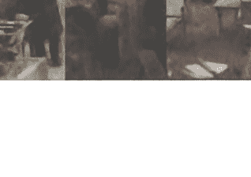

#### 抖音、快手

这两个平台仍为短剧核心分发渠道。抖音通过算法推荐和“AI短剧 + 电商”联动打造爆款，如《山海奇镜之劈波斩浪》播放量破5000万，如下左图所示，快手则侧重于下沉市场，以乡土题材和UGC内容吸引用户。

#### 腾讯视频、爱奇艺

目前，长视频平台正加速布局短剧以应对冲击。腾讯视频押注横屏精品短剧。如短剧《执笔》分账超2400万，短剧宣传封面如下右图所示。爱奇艺推出“短剧场”专区，强调电影级制作和分账比例，试图以高规格内容与红果进行差异化竞争。

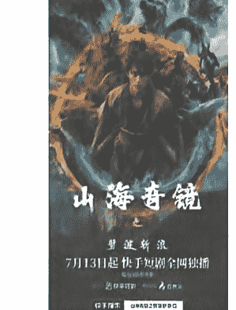

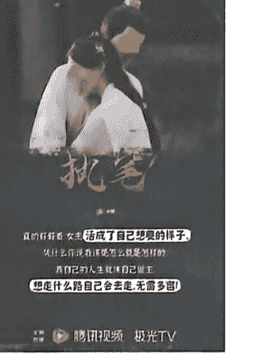

## 短剧产业链盈利方式

随着短剧行业的不断成熟，其产业链的盈利模式也在迭代演进中逐渐清晰和稳固。当前，短剧的盈利模式主要分为以下几种。

### 广告植入与品牌合作

广告植入是短剧最常见的盈利方式之一，通过在剧情中自然地融入品牌产品或服务，实现商业变现。短剧因其内容紧凑、用户黏性高的特点，非常适合品牌软性植入，常见形式包括道具植入（如角色使用某品牌手机）、场景植入（如露出咖啡店、汽车品牌）、台词提及等。

除了以上提到的产品类广告植入，还包括与文旅产业深度结合，将景区、酒店、特色民俗等场景设计成剧情关键节点，或通过角色旅行线自然地展现地域文化；同时可联动文创开发，例如定制剧中同款非遗手工艺品、IP联名旅游纪念品等，既增强品牌文化内涵，又能通过短剧流量带动线下消费。

相较于传统的广告，短剧的植入更隐蔽，观众接受度更高，尤其适合美妆、快消、数码、汽车等行业。广告主通常按剧集播放量或品牌曝光量付费，部分头部短剧还会采用定制化剧情合作，如为品牌量身打造专属短剧系列，进一步强化营销效果。

### 流量广告分成

在短视频平台（如抖音、快手）或长视频平台（如腾讯视频、优酷）播放短剧时，可依托平台的流量广告分成模式盈利。具体方式如下。

- 贴片广告：在短剧播放前、中、后插入贴片广告，按播放量或点击量获得分成。
- 信息流广告：平台在推荐页投放信息流广告，短剧创作者根据内容带来的广告曝光和用户停留时长获取收益。
- 平台补贴：部分平台对优质短剧提供流量扶持和现金补贴，鼓励创作者持续产出内容。

这种模式适合中小型短剧团队，无须直接对接广告主，依靠平台算法和用户观看数据即可获得稳定收益。

### 内容付费模式

付费模式是短剧行业近年来快速发展的盈利方式，主要包括以下几种形式。

- 单集付费：观众按集数购买短剧内容，常见于悬疑、甜宠等强剧情类短剧，平台设置前几集免费，后续则需付费解锁。
- 会员订阅：平台推出短剧专属会员服务，用户付费成为会员后可观看全部内容（如腾讯视频的“微短剧VIP”）。
- 打赏/虚拟礼物：在直播式短剧或互动短剧中，观众可通过打赏、送虚拟礼物支持创作者，尤其适合互动性强、粉丝黏性高的短剧（如B站互动剧、抖音直播短剧）。
- 超前点播：热门短剧提供付费提前观看结局或番外篇的服务，满足粉丝追剧需求，如下图所示，腾讯视频中的短剧采用了“点映”的方式，购买“点映礼”的用户可提前看大结局。

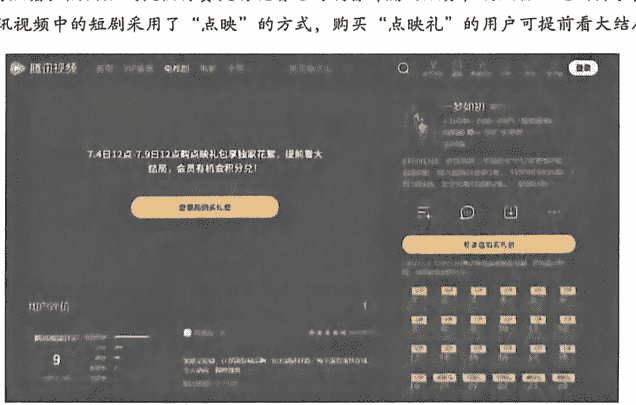

付费模式的核心在于内容质量，只有剧情足够吸引人，才能促使用户主动付费，因此更适用于精品化、IP化的短剧作品。

### IP孵化与衍生品开发

IP孵化与衍生品开发是短剧行业最具潜力的盈利模式之一，通过优质短剧内容打造具有长期商业价值的IP，并围绕其进行多维度变现。

#### 短剧IP孵化

在短剧产业链中，IP孵化是指通过对原创内容进行深度开发，将其转化为具有长期商业价值的智力产权，核心在于打造并强化人物角色，以此为引擎驱动盈利。

短剧IP人物的孵化尤为关键，因为这些角色通常设计得鲜明、情感化，易于引发观众共鸣；这一过程不仅包括角色的初始创作，还涉及跨界授权，如将角色用于品牌代言、周边商品或社交媒体营销，从而通过粉丝经济实现盈利——角色IP可通过版权销售、付费订阅或会员专享内容产生直接收入，同时建立用户忠诚度，为后续衍生开发奠定基础。

#### 短剧衍生品开发

短剧衍生品开发则是短剧IP的商业拓展，它将核心内容以多样化的形式转化以扩大盈利渠道，例如有声书、游戏等衍生品。有声书改编允许将短剧的叙事精华浓缩为音频版本，通过喜马拉雅或蜻蜓FM等平台分发，吸引通勤或休闲用户，实现订阅收入或广告分成；同时，其他形式如漫画、小说、实体周边也能基于IP人物和情节延伸，满足粉丝收藏需求并创造额外的销售点。

游戏化开发尤其高效，如将短剧IP转化为移动端互动游戏，利用原作的叙事张力吸引玩家付费，解锁关卡或虚拟道具，从而提升用户黏性和变现效率——这不仅可以延长IP生命周期，还可以通过跨平台协同实现收入多元化。

## 短剧收益情况

### 头部作品分账金额

基于公开数据与行业报告，结合播放量、分账金额、品牌合作等维度，梳理头部短剧收益如下。

- 《执笔》：分账金额2700万元，创最快破千万分账纪录，上线两周达1000万元，长尾效应显著，分账周期延长后持续收益。
- 《原罪》：分账金额3000万元，为2024年短剧市场分账纪录保持者，以家族恩怨和紧凑的叙事吸引男性观众，单日充值峰值突破500万元。
- 《授人以柄》：分账金额1900万元，采用会员分账与广告植入双模式驱动商业化，平台分成比例高达80%。
- 《好一个乖乖女》：播放量达10亿次，分账估算1500万～2000万元，改编自同名小说并带动小说销量增长200%，品牌合作收入占比超30%。
- 《老千》：播放量10亿次，分账金额估算1200万～1800万元，广告植入覆盖汽车与快消品，单集招商收入超50万元。
- 《上学时经历的生死时刻》S3：吸金指数99.1，单季品牌收入超2000万元（合作品牌37个，如OPPO、雀巢），总分账与广告总收入或达3000万元。
- 《夫妻的春节》：播放量4亿次，分账金额估算800万～1200万元，家庭情感题材吸金力强，植入母婴及家电品牌，单集广告收入约20万元。
- 《咬清梨》：播放量15亿次，分账金额约1000万元，站内评分8.5，短视频二创流量反哺主剧，带动会员拉新率提升15%。
- 《闪婚老伴是豪门》：分账金额1200万元，下沉市场渗透率超60%，中老年用户付费转化率高达8%（远高于行业平均水平3%）。
- 《夺娶》：播放量未公开，分账估算800万～1000万元，改编自二月春小说，IP联动收入占30%，衍生周边销售额破500万元。

### 平台分账规则与激励

平台通过升级规则大幅提升激励力度，优酷2024年10月起将S级短剧分账单价从6元/部升至16元/部，A级从4元/部升至8元/部，新增最高1.2倍拉新系数加成。

腾讯视频将头部短剧分账周期延长至12个月，破千万项目分账占比超80%，单剧最高分账达2000万元。

芒果TV增设阶梯奖励，分账达800万、1200万、1600万元时分别额外奖励100万、200万、300万元。

抖音推出保底收益模式，按内容评级提供单部15万、30万、50万元保底，并配套最高1亿流量曝光支持。

### 行业整体收益规模

2024年短剧市场规模达505亿元，首次超过全年电影票房，用户规模超6亿。预计2025年市场规模将增至634.3亿元，2027年突破千亿元。虽然整体市场规模呈现良好的上升趋势，但是目前行业呈现两极分化。

- 头部效应：10%的爆款短剧贡献超60%的行业收入，分账破千万作品占比不足10%。
- 尾部困境：超80%短剧的总收入不足百万元，无法覆盖制作和投流成本（投流成本占比80%以上）。

### 广告与品牌合作收益

贴片广告CPM单价为1～18元，激励广告占免费剧收入70%以上；品牌植入头部剧单集收入达50万～80万元，《上学时经历的生死时刻》S3合作37个品牌，创收超2000万元；电商导流通过剧情跳转实现佣金分成（占收入的15%～30%），母婴、家电类转化率突出。

# 第2章 AI在短剧创作中的应用基础

## AI短剧为什么会成为文化产业热点

### 市场需求大

尽管当前AI微短剧领域的竞争尚未白热化，但市场需求却正处于迅猛增长的态势之中。前面章节多次提及2024年我国微短剧市场规模达到505亿元，预计2025年将攀升至634.3亿元，2027年有望突破856.5亿元。而在这庞大的市场中，AI微短剧的份额尚不足5%，所以这会是巨大的蓝海市场。

### 制作成本低

与传统影视剧相比，AI短剧的制作成本显著降低。真人拍摄需要支付演员片酬、场地租赁费、设备使用费等高昂的费用，而AI技术可以通过算法生成虚拟角色和场景，大幅减少人力与物力投入。

传统短剧每分钟成本在5000~1万元，而AI短剧单集成本可低至500元。例如，《兴安岭诡事》以5000元/集的成本创下抖音4899万播放量，而同类传统制作需50万元以上；再如，抖音、四川新传媒集团与悟空传媒联合出品的AIGC科幻短剧《太阳坠落之时》中包括200个场景、50个角色、时长一共70分钟，仅用3个月就制作完成。

此外，AI还能自动化缩短制作周期。传统剧组需3~6个月完成的项目，AI团队可缩短至1~2周。如全AI短剧《白狐》由4人团队两周完成，而传统模式需3个月。

低成本的优势使得中小型工作室甚至个人创作者都能参与内容生产，进一步丰富了市场供给。这种“低投入、高回报”的特性，让AI短剧成为资本和创作者的新选择。

### AI角色可靠

在影视行业中，传统演员因个人品德问题引发的舆论危机，往往会导致作品遭遇抵制、评分暴跌或商业合作终止，甚至触发高额赔偿条款，这种不可控的人为风险对项目口碑、票房收益及衍生品开发可能造成毁灭性连锁反应。

相较之下，若采用AI技术生成虚拟角色参演作品，则完全规避了此类道德风险，确保制作过程不受人为因素的干扰。因此，AI角色的可靠性不仅体现在技术的稳定性上，更在于其从根本上杜绝了传统演艺人员可能带来的声誉隐患。

### 满足猎奇视觉效果需求

AI短剧的另一个吸引力在于其能够实现传统拍摄难以完成的视觉效果。通过AI生成的虚拟场景和角色，制作方可以轻松呈现奇幻、科幻或超现实的画面，比如未来城市、外星生物或魔法世界，如右图所示。这类内容天然具备猎奇性，容易引发观众的好奇心和分享欲。

例如，一些AI短剧会设计“穿越时空”或“人机互动”的剧情，结合炫酷的特效，给观众带来强烈的视觉冲击。这种创新表现形式不仅提升了观看体验，还成为社交媒体上的热门话题，进一步扩大了传播范围。

## AI短剧大致创作流程

AI短剧制作大致分为策划筹备、创意制作、后期剪辑分成三大阶段，接下来将讲解这三大创作流程。需要注意的是本节主要是讲解大致的创作流程，创作流程细节会在后面的章节进行具体介绍。

### 策划筹备

策划筹备阶段主要包括脚本创作和画面分镜。

在AI短剧创作中，脚本创作是基础——需要构建一个完整且富有吸引力的故事，就像传统短剧创作一样。例如，在《山海奇镜之劈波斩浪》AI短剧中构建了少年为救母亲与海底巨兽搏斗的故事，《三星堆：未来启示录》构建了三股势力代表人物进入数字生成的古蜀国冒险之旅的故事，这些都需要在脚本创作阶段进行精心设计。故事构建在脚本创作中具有重要地位，故事的好坏直接影响短剧的质量。

情节要紧凑且合理，由于AI短剧的特性，可能更需要注重情节的简洁性。目前AI短剧存在叙事简单的问题，如镜头多在5秒之内，很多动作场面靠蒙太奇剪辑实现，这就要求在脚本创作时，更好地编排情节，在有限的时长内传达有效的故事信息。

如果对短剧的创作已有大致的方向，此时可以将灵感告诉AI，让AI完善整个短剧的脚本内容，在具体的操作过程中可以使用DeepSeek、通义万相、KIMI、腾讯元宝、智谱清言等工具。

如果对短剧的创作毫无思绪，可以先确定短剧创作的题材，让AI创作出清晰的情节线、角色设定和冲突点。在故事构思的基础上，让AI再撰写详细的故事大纲，大纲应包含故事的开头、发展、高潮和结局，以及主要角色的性格特点和行动轨迹。根据大纲，让AI进一步细化成具体、完整的短剧脚本。

完成脚本后，接下来将使用AI将脚本内容转化成分镜头脚本，也就是画面分镜。分镜头脚本是连接脚本与视觉呈现的重要桥梁。它需要将脚本中的每一句话、每一个场景都转化为具体的画面构图、角色动作和镜头语言。

### 创意制作

创意制作阶段主要包括视觉画面创作、视频创作、音频创作三大方面的内容，这一过程主要是音视频画面内容的呈现。

#### 画面创作

##### 角色设计

首先要深入了解剧本中每个角色的性格特征、职业背景、情感状态及与其他角色的关系，这些信息将直接影响角色的外观设计和行为表现。

根据角色的职业、时代背景和个性，借助Midjourney、StableDiffusion、即梦AI、可灵AI等AI生图工具设计符合短剧角色的形象，以及符合其身份的服装和配饰。例如，如果角色是一位老年智者，那么在设计外貌时可能会添加皱纹、白发等元素来体现年龄和智慧，如右图1所示；如果是性格活泼的年轻人，外貌可能会偏向于活力、时尚的风格，如右图2所示。

在整个短剧中，要确保所有角色在不同场景中的形象风格保持一致，包括服装、发型、肤色等大致的细节。

##### 单一场景设计

根据短剧脚本中的场景描述，首先要明确场景的概念。例如，是室内场景（如家庭房间、办公室等）、室外场景（如公园、街道等），还是特定的场所（如魔法幻想世界中的神秘城堡等）。

确定场景包含的关键元素，如果是家庭场景，可能包含家具、日常用品等元素；如果是神秘城堡，可能有魔法阵、古老的石柱等元素。将有效信息的提示词输入到AI生图工具中，完成场景的画面创作。

需要注意的是，在生成需要高度想象力的场景概念设计时，Midjourney无疑是更为理想的选择，目前国内同类工具在创意表现力和场景构建能力上仍存在明显差距。不过，如果计划将生成的图像用于视频制作（如图生视频、关键帧过渡等场景），建议通过ComfyUI工作流对Midjourney输出的图像进行二次优化——该工具可显著提升画面分辨率，强化材质的细节表现，并赋予图像更真实的物理光影效果，从而满足影视级制作标准，如右图1为优化前的原图像，如右图2为优化后的图像，可以看出，优化后图像的画质和细节精致度都有所提升。

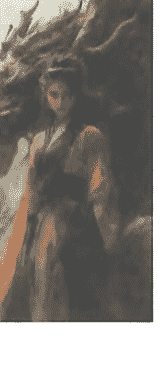

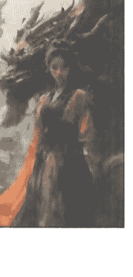

##### 关键帧画面

这里说的关键帧是指由AI生成的代表剧情核心转折点或视觉高潮的静态画面，也可以将其理解成传统的分镜头脚本画面，这样的画面在整个剧集中起到奠定视觉基调、强化叙事张力或呈现高难度特效场景的作用。

这一环节是AI“大显身手”的部分，因为在此环节可以用AI生成各类使用常规手法无法生成或生成成本非常高的场景，如在AI短剧《山海奇镜之劈波斩浪》中，创作团队使用AI生成了大场面玄幻场景，如下图所示。

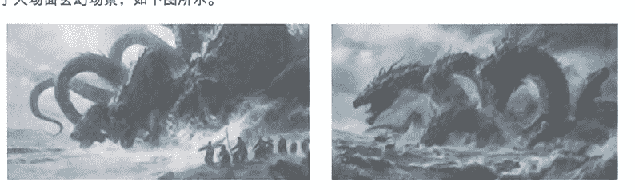

#### 视频创作

视频创作有两种方式，一种是文生视频，另一种是图生视频。

文生视频适合生成短剧中无角色人物出现的空镜头场景视频，通过具体内容描述让AI生成相关的视频画面。

图生视频是指将静态的图片通过AI工具及短剧分镜内容转化动态的视频，短剧的创作主要是依靠图生视频完成的。

例如，下方是由一个关键帧画面生成的一段视频的画面序列图。

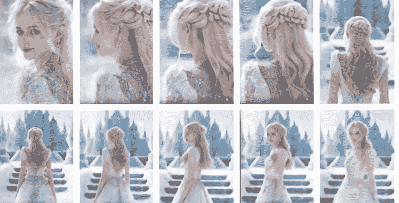

#### 音频创作

音频创作主要包括两大方面：一方面是给视频中出现的人物对口型，让角色发出声音；另一方面是创作背景音乐，烘托短剧的整体氛围。

#### 后期剪辑合成

根据前期已确定的分镜脚本，最后进行实际的视频制作。首先，将 AI 生成的素材和背景音导入视频编辑软件中，随后进行剪辑、拼接，并添加特效、调色等步骤，以确保最终的视频流畅且富有节奏感。

如果素材完善且项目需求较为简单，可能使用剪映这类轻量级工具快速完成剪辑与基础特效处理；如果素材复杂度较高或需要更精细的调色、多轨道合成、高级特效（如动态跟踪或 3D 渲染），则需要使用专业软件如 Adobe Premiere Pro 或更专业的 Adobe After Effects、达芬奇等剪辑工具，以满足更高标准的后期制作需求。

此外，若涉及动画特效或复杂合成，还需结合 AI 工具进行补充制作，从而确保成片质量与创意表达的完整性。

## 适合用 AI 生成的短剧题材

### 科幻题材

在 AI 影视发展初期，一定要针对传统影视的“痛点”来创作。科幻题材是传统影视题材的两大痛点之一，CG 特效成本高、周期长，AI 可以有效缩短制作周期、降低制作成本，效果可以达到传统特效的 70% ~ 80%。

科幻题材具有丰富的想象力和前瞻性元素，这与 AI 的创造力相得益彰，AI 可以轻松构建出各种科幻场景，如宇宙星空、未来城市、外星生物等。

2024 年博纳影业 AIGMS 制作中心联合抖音等出品的《三星堆·未来启示录》，这类科幻短剧探讨的是人类与未知文明或者未来科技发展的关系等宏大的命题，而 AI 能够依据编剧的创意快速生成各种脑洞大开的情节与场景，充满科技感与神秘感的画面可以通过 AI 辅助高效产出。

### 奇幻题材

奇幻题材是另外一大传统影视的痛点题材。奇幻题材在剧情构建上常常需要大量超现实元素，如魔法、神话生物、神秘仙境等的创建对于人力创作而言颇具挑战，但 AI 能够做到毫不费力。

快手星芒首部 AIGC 全流程定制短剧《山海奇镜之劈波斩浪》，AI 在剧中大胆地创造了九婴、嬴鱼、鲛人等神话传说中的人物及异兽形象，AI 可以对海量的神话故事文本进行学习，然后创造出符合奇幻题材要求的全新形象与场景。

### 悬疑题材

AI 可以通过生成令人紧张的场景和特效，提升悬疑短剧的紧张氛围和吸引力。例如，在首届可灵 AI 创作大赛中，元力趋势旗下 ZK Studio 首席 AI 设计师王睿创作了《请治愈我名为乖巧的疾病》悬疑短片，全程使用快手可灵 AI 视频生成技术，通过 AI 生成的视觉元素塑造了冷色调滤镜、第一人称偷窥视角、中式古旧道具等视觉符号，突出了心理惊悚与家庭压抑主题的特点。

### 穿越题材

AI 可以轻松生成各种或复古或神奇的场景，如古代的宫廷、神秘的异世界等，因此，也极适合用于穿越题材短剧。在穿越题材短剧中，主角可能会穿越到不同的时代或空间，AI 能够为这些不同的环境创造出逼真且独特的视觉效果，中央广播电视总台影视剧纪录片中心制作的 AI 穿越短剧《英雄》，作为总台首部 AI 穿越故事片，讲述了现实生活中烦恼自卑的主人公经历奇幻的穿越后人生的改变。此部微短剧时长虽不足 14 分钟，但剧中的人物角色、环境空间及场景建构等全部由 AI 精心制作完成。这样一部作品，利用 AI 将一个小人物的蜕变与成长历程演绎得自然且真实。

### 动漫类

动漫风格短剧适合多种类型的受众，尤其是在年轻人市场有很大的需求。AI 可以根据设定的动画风格，如欧美卡通风格、宫崎骏动漫风格，来生成相应的角色和场景图像。中文在线出品的 AI 动漫短剧《开局物价贬值百万倍，我竟成了世界首富》，用 AI 刻画的人物形象很立体，故事情节较完善。相比于传统使用手绘的形式创作耗时耗力、成本高昂，AI 可谓是高效灵活、降本增效的革命性工具。

## AI 制作短剧的短板及弥补方式

### AI 制作短剧的短板

#### 不够真实的物理破绽

尽管 AI 在视频创作中展现出了强大的想象力，且效率高，但其生成的画面往往难以完全模拟现实世界的物理规律。例如，光影变化可能不够自然、物体的运动轨迹有时违背力学原理，以及材质交互缺乏真实感（如水流、火焰的形态）。这种局限性源于 AI 对物理世界的理解仍停留在数据层面，而非真正的认知。因此，在需要高度拟真的场景中，AI 视频仍需依赖人工修正或与传统技术结合，才能弥合“数字”与“现实”的差距。

#### 情绪表现不够细致

AI 目前的深度学习算法在模拟人类复杂的肌肉运动方面还不够精确细致，难以捕捉到人物在情感变化下细微的面部和肢体变化。
例如，在《山海奇镜之劈波斩浪》和《三星堆·未来启示录》等短剧里，尽管视觉效果在场景构建方面等有很大进步，但人物的面部表情和肢体动作始终存在不够自然的问题。在人物对话场景中，面部肌肉的运动缺乏人类的生动感，动作的协调性稍欠火候，就像是机械运动的组合，没有像真人表演那样流畅、自然。

#### 高细节场景处理能力差

在呈现一些高复杂度、高细节的场景时，AI 的能力有限。例如，在一个描绘古老城堡内部构造带有各种机关陷阱的短剧场景中，AI 可能在整体架构上能够搭建出城堡的画面，但在处理机关的精细结构、墙壁上的古老文字或者图案等细节时就会暴露不足。

这些细节对于构建一个具有真实感和沉浸感的短剧场景非常重要，而 AI 却难以呈现出栩栩如生的效果，与真实场景拍摄或者高级特效制作相比存在明显的差距。

#### 语音语调不自然

AI 在短剧的语音合成方面，语音语调很难达到人类自然的表达效果。无论是在语音的音色方面还是在按照剧情需要调整语调、语速等方面，都存在明显的人为雕琢痕迹。

例如，在一个紧张刺激的追车短剧场景中，AI 生成的角色报警语音或者人物之间的对话语音并没有那种人类在紧张状态下声音自然的颤音、急促、高音调等特征。这种不自然的语音语调会使得观众脱离剧情情绪，影响观看体验。

#### 口型匹配度不高

在短剧制作中，用 AI 生成的人物口型的匹配度常常不尽如人意。具体表现为口型与语音不匹配、频繁出现错位。特别是在制作多语言 AI 短剧时，当尝试将一种语言的音频替换到另一个场景的人物身上时，AI 往往难以根据各种语言的发音特点精确调整口型的开合度和唇形变化。这种不匹配现象会给观众带来视觉与听觉上的混乱感，影响观众的观看体验。

### 弥补 AI 制作短剧不足的方式

针对 AI 制作短剧的短板，以下是一些弥补方式。

#### 优化 AI 短剧的物理真实感

要弥补 AI 制作短剧的物理真实感不足，可以结合物理引擎对 AI 生成的画面进行后期修正，确保动作、光影和碰撞效果符合现实规律；同时引入真人动作捕捉技术，将自然的人类行为数据融入 AI 动画，弱化机械感。

#### 通过其他方式优化情绪表现

在情绪表现方面，若 AI 生成的画面难以精准展现情绪的细腻变化，可以通过融入文字描述、旁白解说，以及背景音乐等多种元素来强化并烘托出相应的情绪氛围。这样的综合手法能够更有效地传达情感，弥补 AI 画面在情绪表达上的不足。

#### 提升高细节场景处理能力

在创建 AI 短剧场景时，场景描述的精准性对于最终的效果具有关键影响。对于古老城堡内部构造这样复杂且细节丰富的场景，应尽可能详细地向 AI 描绘各个元素。

例如，对于城堡中的机关陷阱，要明确其类型（是暗箭机关、重力感应机关还是其他）、形状、材质、触发机制等具体信息；对墙壁上的古老文字或图案，描述其风格（如哥特式风格的神秘符文、东方风格的象形文字等）、所在位置、颜色等。
这种详细的场景描述就像是为 AI 提供了一份精确的参考，有助于它在构建场景时更全面地考虑各种因素，从而更好地呈现场景细节。同时，参考现实中古老城堡的构造和历史文化元素，保证描述内容既丰富又具有合理性，提高场景的可信度。

#### 多个 AI 模型协作

不同的 AI 模型在处理不同类型的细节方面可能各有优势。因此，可以尝试结合多个 AI 模型来完善场景。在选择 AI 模型时，要对模型的功能特点和擅长领域有清晰的认识，根据具体的描述画面选择相对应的模型。

#### 改善语音语调的自然性

在合成语音后，通过音频编辑软件添加呼吸声、停顿、颤音等效果，让语音听起来更自然。其次，根据剧情需要，手动调整语音的语速、语调和音色，使其更符合角色的情绪和场景氛围。例如，在紧张刺激的场景中，加快语速并提高语调，模拟人类在紧张状态下的声音特征。

## AI 爆款短剧要素分析及启示

### 案例一：《山海奇镜之劈波斩浪》

#### 基本情况

《山海奇镜之劈波斩浪》是国内首部 AIGC 原创奇幻微短剧，由快手与国内团队自然火文化、AI 影视制作人兼导演陈坤合作推出，于 2024 年 7 月 13 日在快手全网独播。
该剧以中国古代经典《山海经》为灵感，讲述了少年李行舟为救母而踏上冒险之旅，与上古神兽展开激烈搏斗的故事。

#### 播放数据

《山海奇镜之劈波斩浪》也是快手首部 AI 短剧，连载 5 天后完结，预告片加上 5 集整篇，播放量达到 5000 万，展现了 AI 短剧的新可能性。

#### 制作技巧

《山海奇镜之劈波斩浪》完全采用了快手公司旗下的可灵 AI 技术来生成所有镜头。从官方宣布到正式上线，整个过程仅耗时两个月。
相比之下，如果采用传统制作方式，预计至少需要 6 个月的时间。

#### 成为爆款的原因分析

##### 题材影响下的特殊呈现

《山海奇镜之劈波斩浪》选择以《山海经》为蓝本的玄幻题材进行创作，其视觉效果特色在于呈现出大量富有中国传统文化特色的山海异兽、神话场景等元素。

该剧通过 AI 技术将《山海经》中的经典形象如凶兽九婴、异兽蠃鱼、神兽鲲鹏、火神祝融、水神共工等生动地呈现在观众面前，这些形象或华美，或凌厉，或生动，构建出了一个光怪陆离的神话世界，这种视觉呈现满足了观众对奇幻题材的期待。

##### 酷炫的特效呈现

该剧在视觉呈现上充分利用了 AI 技术的优势，能够轻松实现传统影视中难以实现的特效场景，如水神共工挣脱山石而出的镜头，其毛发飘逸、肌肉线条流畅，周围山石崩塌的特效在 AI 的驱动下轻松实现，大场景画面容易吸引观众的注意。

##### 现代与传统相结合

《山海奇镜之劈波斩浪》这部短剧将奇幻的上古传说与当代文化相融合，将古代的浪漫想象进行复现，为广大观众构建出了一个光怪陆离的神话世界，短剧的配乐配合 AI 生成的充满奇幻色彩的画面能够营造出更好的氛围，加强了古代浪漫想象在现代视觉环境下的感染力。

##### 故事节奏与情感体验的契合

现代观众对于故事节奏的偏好是快节奏、多反转、情感充实，这部短剧在赛博复现古代故事时遵循了这样的节奏需求。

在短篇幅内（5 集）紧凑地安排情节，快速进入故事核心冲突（母亲被掳走），然后持续进行冒险以解决困难的情节推动，中间情节反转不断（例如每次遇到新的神兽或者进入新的场景都有意想不到的情况发生）。

在情感体验上兼顾了亲情、冒险、勇气等多种现代观众容易产生共鸣的情感元素，让观众在追剧时既有紧张刺激的冒险体验感又有温馨感人或者自我激励的情感收获。

### 案例二：《三星堆·未来启示录》

#### 基本情况

《三星堆·未来启示录》是由博纳影业出品制作、抖音联合出品的 AIGC 科幻短剧集。

抖音旗下的即梦 AI 作为首席 AI 技术支持方，基于豆包大模型技术，为《三星堆·未来启示录》提供了剧本创作、概念及分镜设计、镜头画面生成、图像到视频转换、视频编辑和媒体内容增强等 10 种 AI 技术。

该剧的故事设定在科技飞速发展的近未来，地球古文明遗迹的变异引起全球古文明研究组织的高度关注，三支势力的不同人物共同进入数字生成的古蜀国，展开了一场横贯古今的冒险之旅，并由此揭开了 3000 多年前古蜀国的神秘面纱，进而寻找到拯救文明危机的密码。

自 2024 年 7 月 8 日在抖音平台上线以来，获得了极高的关注，并迅速攀升至抖音短剧榜第五名。该剧集不仅在技术层面上达到了大片级质感的高完成度，还在叙事层面上实现了高连贯性和深度性。

#### 成为爆款的原因分析

##### 文化 IP 的天然吸引力

三星堆遗址以青铜神树、黄金面具等未解之谜闻名，自带神秘感与话题性，天然契合悬疑、科幻题材的创作土壤。该剧以神秘的三星堆文化为背景，结合未来科幻元素，构建了一个独特的叙事框架。

在多数传统短剧集中在甜宠、婆媳、穿越等现实题材时，该剧避开了传统实拍难以实现的路径，选择了重特效、奇幻科幻交织的内容特点，保持了对未知世界的探索。

##### 视觉与技术的降维打击

作为国内首部 AI 全流程制作的短剧，该剧在剧本创作、角色建模、动画制作等方面均应用了 AI 技术。AI 的参与不仅提高了制作效率，缩短了制作周期，还降低了成本。

AI 技术的应用使得该剧在视觉效果上表现出色。从图片转视频、场景搭建到角色塑造等关键环节，均展现了高度的真实感与生动性。

##### 剧情紧凑及角色有深度

该剧共 13 集，总时长仅 57 分钟，却通过紧凑的叙事、丰富的内容，展现了一个关于未来的奇幻旅程。剧中的角色个性鲜明，既有智慧勇敢的科学家，也有冷酷无情的反派。角色们不仅是科技的受益者，也是在未来科技面前斗争的人类个体，他们的互动与冲突构成了故事的核心。

##### 精准的营销策略

该剧借助抖音的短视频流量优势迅速触达年轻用户群体，全端传播量突破 1.6 亿次，形成“短平快”的传播效应，剪映官方账号发布了该剧的视频，收获了较高的观看量。同时，用“中国首部 AIGC 原创微短剧”等宣传点，吸引了大量观众的关注。

此外，作为北京大视听重点文艺项目及国家广播电视总局扶持项目，其制作获得了政策与资金支持，同时契合“微短剧 + 文旅”的创作导向，具备社会价值与商业价值双重属性。

### 案例三：《中国神话》

#### 基本情况

AI 短剧《中国神话》是国内首部 AI 全流程微短剧，于 2024 年 3 月 22 日在央视频 AI 频道上线。该剧由中央广播电视总台视听新媒体中心联合清华大学新闻与传播学院元宇宙文化实验室共同推出。

《中国神话》共 6 集，分别为《补天》《逐日》《奔月》《填海》《治水》《尝百草》，其美术、分镜、视频、配音、配乐全部由 AI 完成，从一个个经典神话故事起笔，借助 AI 技术拓展人们对神话的常规想象。

#### 成为爆款的原因分析

##### 题材创新与文化价值

该剧聚焦中国上古神话传说，如《补天》《逐日》《填海》等经典故事，这些故事本身就具有极高的知名度和吸引力，能够引发观众的共鸣和兴趣。
通过 AI 技术对传统神话进行重新演绎，将传统文化与现代科技相结合，为传统文化的传播和发展注入了新的活力，让观众在欣赏短剧的同时，也能感受到中华优秀传统文化的魅力。

##### 技术优势与制作效果

作为国内首部“AI 全流程微短剧”，该剧通过 AI 技术实现了美术、分镜、视频、配音、配乐等全流程制作，展现了 AI 在影视创作中的强大能力。AI 技术能够轻松实现角色的变形、换装等特效，创造出实拍无法达到的效果。
AI 技术通过算法模拟出逼真的环境和丰富的角色造型，为观众带来了身临其境的视觉体验。例如，剧中女娲、盘古、嫦娥等神话人物的形象栩栩如生，场景构建也十分宏大。

##### 传播与受众基础

该剧以多语种版本发布，进一步推动了中国神话故事的全球传播。微短剧形式适合在短视频平台上传播，能够快速吸引观众的注意力。此外，《中国神话》在央视频 AI 频道正式上线，作为央视推出的 AI 频道，央视的权威背书也为其传播提供了有力支持，其本身就具有较高的关注度和影响力，为短剧的传播提供了有力的平台支持。

### 案例四：《海上女王郑一嫂》

2025 年 4 月 24 日，这部具有里程碑意义的 AIGC 长片电影《海上女王郑一嫂》在新加坡影院正式公映。作为全球首部获得政府批准在院线上映的人工智能生成的作品，凭借其完整的叙事结构和连贯的视觉效果，成功突破了业界对 AI 生成的电影时长限制的传统认知。

#### 基本情况

《海上女王郑一嫂》主要讲述了清朝传奇女海盗郑一嫂的史诗故事。剧情聚焦她从社会底层崛起，在男性主导的海盗世界成为领袖的奋斗历程，最终被清政府招安成为诰命夫人。影片通过 AI 技术再现了 19 世纪东南亚海域的海战场面、帮派斗争和女性的成长。

#### 主要技术应用

该片由新加坡 FizzDragon 团队采用全流程 AIGC 技术制作，耗时两年完成。核心技术突破包括以下几点。

- 一是首次实现 AI 生成 70 分钟长片级连贯剧情，解决传统 AI 视频难以突破 10 分钟时长的限制。
- 二是通过拆分人物素材投喂训练，部分解决长镜头、长对白的嘴型同步和表情自然度问题。
- 三是采用“换脸小组”人工干预，减少同一角色形象前后不一致的“撞脸”现象。影片制作充分利用 AI 规避传统拍摄的天气、演员档期等不可控因素，大幅降低制作门槛，场景生成效率提升显著，但复杂的分镜和高级运镜仍需人工辅助。

#### 上映反馈与亮点

##### 观众评价

该片以 70 分钟时长与明暗双线的剧情设计，获得了观众对 AI 进行完整叙事能力的突破认可。该片画面流畅度接近传统电影水平，部分特效场景（如海战、舰队调度）被认为“具有院线级视觉冲击”。

##### 行业意义

《海上女王郑一嫂》成为全球首部通过政府审查、登陆院线的全流程 AIGC 长片，标志着 AI 影视进入工业化阶段。验证 AI 在剧本创作、分镜生成、场景构建等环节的可行性，为中小团队提供低成本创作路径。

##### 创新模式

该片采用“AI 生成 + 人类兜底”协作模式，例如人类编剧优化 AI 剧本的文学性，导演调整 AI 分镜的戏剧张力，形成技术、艺术互补。

## AI 爆款短剧启示

### 趁早抢占行业先机

AI 短剧正处于爆发式增长的前夜，如同早期的短视频风口，越早入局越能享受红利。技术迭代和用户习惯的培养需要时间，先行者能通过数据积累优化内容、建立品牌认知，甚至参与行业标准的制定。等到市场饱和再入场，不仅竞争成本高昂，还可能错过最佳窗口期。无论是创作者、平台还是投资者，早布局意味着更低的试错成本和更大的话语权。

### 打造差异化 IP

短剧成败的关键在于 IP 的吸引力。一个强 IP 能快速聚集流量，降低获客成本。具体来说，IP 能够引发文化共鸣，通过熟悉的故事内核和角色塑造降低观众认知门槛，同时以持续的内容沉淀建立情感连接，最终转化为品牌信任与消费忠诚。

### 选择合适的平台

不同平台的用户画像和分发逻辑天差地别。抖音、快手适合强节奏、高反转的“爽剧”，B 站偏爱二次元或脑洞题材，微信小程序更适合下沉市场的中长篇。AI 技术能辅助分析平台数据（如完播率、用户停留时长），但核心仍在于主动适配平台规则。选错渠道，再优质的内容也可能被算法埋没。

### 技术要为内容服务

AI 工具（如剧本生成、虚拟演员、自动剪辑）能提升短剧制作效率，但过度依赖技术会导致内容空洞。例如，AI 写出的套路化剧情可能短期吸睛，却缺乏情感共鸣。成功的短剧团队往往采用“人机协同”的方式进行创作：用技术解决重复劳动（如批量生成分镜），而将创意、审美等人类优势聚焦于故事内核和角色塑造。

### 创新变现模式

短剧的商业化不能仅依赖传统的广告或会员订阅，而应结合 AI 技术探索更灵活的变现方式。例如，通过用户行为数据分析，可以推出个性化付费点（如定制剧情分支、解锁隐藏结局），或结合电商实现“边看边买”。在整个过程中，需要提前规划变现路径，避免内容与商业脱节，导致用户流失。

## AI 短剧新手如何从模仿到超越

### 建立审美与灵感库

模仿是学习的起点，新手应大量观摩优秀的作品，比如 B 站“咪克菌”这类擅长 AIGC 叙事的账号，其 AI 短剧的分镜设计、节奏把控和创意呈现都值得拆解，其 B 站账号如下图所示。

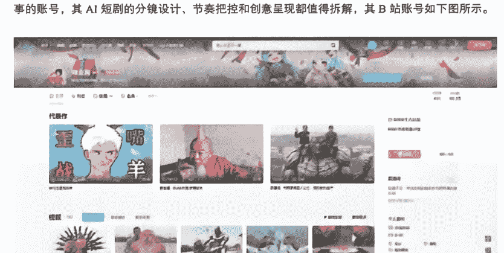

据报道，“咪克菌”获得了较好的商业回报，其账号中的“AI 整活”合集在 B 站上累计播放量达上亿次，单条视频播放量动辄百万、千万以上，吸引了 EA、网易等游戏大厂，以及 3C 品牌的广告投放。因此，除了学习其创意角度与技术手段，还可以考虑学习其商业变现路径。

其次，即梦 AI、可灵 AI 等平台的精选短视频也能提供行业标杆级的参考。即梦 AI 的“灵感”欣赏板块，如右图 1 所示，有非常多的优秀作品可以借鉴学习。可灵 AI “创意圈”板块的“短片”欣赏界面右图 2 所示。

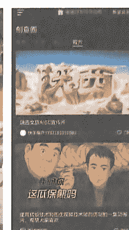

此外，也可以观看线上各大平台和剧院的 AIGC 短剧，这类短剧往往具备成熟的剧本结构和视觉语言，通过分析它们的转场、台词密度和 AI 角色互动，能快速理解短剧的创作逻辑。此外，建议建立分类素材库，将吸引你的镜头、文案或特效片段归档，定期复盘总结规律。

### 通过实战加速成长

参加 AIGC 短剧比赛是检验能力的捷径。AIGC 的短剧比赛通常有明确的主题和时长限制，能强迫创作者聚焦核心创意；评委反馈和获奖作品对比更能暴露自身短板。即使未获奖，在创作过程中的剧本打磨、AI 工具调试都会积累宝贵经验。注意选择“新手友好型”赛事，比如允许团队协作或提供素材支持，降低初期压力。例如，可灵 AI 平台举办的“灵感迸发 · AI 短片征集第一期”比赛，具体情况如下图所示。

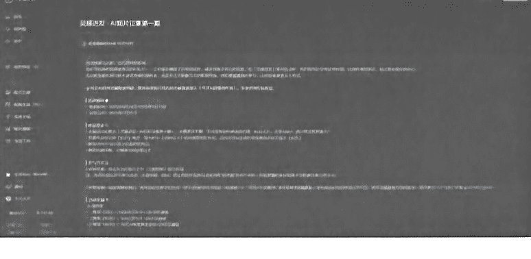

即梦 AI 平台的举办的“第 5 届平潭 IM 两岸青年影展 AIGC 单元：全球征片启动”比赛，具体情况如下图所示。

### 从轻量创作到复杂叙事

AI 短剧新手不要一上来就挑战时间较长的短剧，因为在创作短剧的过程中需要高强度撰写复杂的剧本，精心设计短剧分镜，还要进行大量的 AI 生成画面的工作。这一系列操作很容易在新手还未完全掌握技巧时就消耗掉创作热情，故而对 AI 短剧创作产生畏难心理，建议分阶段突破。

第一阶段，先制作 1 分钟内的搞笑短视频。例如，用 AI 生成夸张的表情包对话，或结合热点做反转剧情，重点训练笑点设计和节奏控制。

第二阶段，制作创意广告/MV。尝试 30 秒的品牌概念广告，或为歌曲制作 AIGC 动画 MV，这类作品需平衡视觉美感与信息传递，适合提升镜头语言。

第三阶段，3 - 5 分钟短剧。当熟悉基础流程后，可尝试带主线剧情的作品，比如 AI 科幻小剧场或情感微短剧，此时需注重角色塑造和情绪铺垫，逐步掌握长篇叙事技巧。

# 第 3 章 AI 视频创作常见平台介绍

## 国内六大视频创作平台

### 可灵 AI

可灵 AI 是一个由快手公司推出的人工智能视频生成平台，具有强大的文生视频和图生视频转换功能，能够生成 1080p 高清视频、模拟真实物理场景并支持长视频创作，为用户提供高效的内容创作工具，网址是 kling.kuaishou.com ，其界面如下图所示。

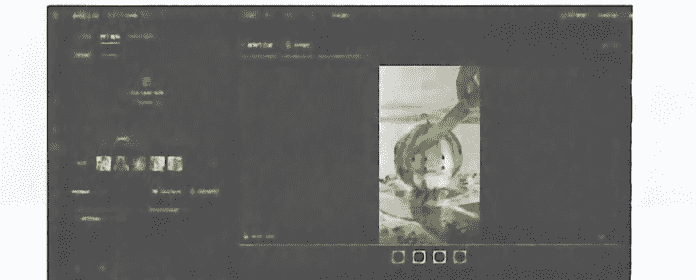

#### 可灵 AI 平台的基础功能

- 文生图功能：用户只需输入描述文字，就能快速获得 AI 生成的图片。
- 图生图功能：用户除了输入描述文字，还需要上传参考图片作为参考图，在此基础上生成图片。
- 文生视频功能：可灵 AI 平台支持文生视频，用户可以选择文本或图片生成视频，也可以让 AI 续写视频后续内容。
- 图生视频功能：该平台特别强调图生视频能力，用户可以通过上传图片来生成相应的视频内容。这一功能特别适合那些希望通过图片内容来创造动态视觉效果的使用者。
- 镜头控制功能：可灵 AI 平台支持镜头控制功能，包括横移、摇镜头等，使得生成的视频更加生动有趣。这些编辑能力可以让使用者在不影响原始素材的情况下，调整视频的角度和焦点。

#### 可灵 AI 平台的特色功能

- 首尾帧控制：可以定制视频开头和结尾的画面，提升视频的专业度和个性化程度。
- 运动笔刷：可灵 AI 运动笔刷的核心功能是为图片中的元素（人或物体等）指定运动轨迹，从而在将图片转换为视频时，让这些元素按照设定的轨迹进行运动。
- 大师运镜：提供多种专业的运镜效果，使视频更具观赏性。
- 高品质模式：该模式在文生视频和图生视频方面表现更为出色，具有更高的画面质量和更强的动态一致性，整体生成质量显著提升。

#### 费用标准

可灵 AI 每日登录可灵平台会获得 66 个灵感值，灵感值可用来生成图片和视频，灵感值用完后，需要直接购买或者开通会员获得，直接购买是 1 元 10 个灵感值，最低 100 个灵感值起购。开通黄金会员每月需要支付 66 元，获得 660 个灵感值，附带会员专属权益。

### 即梦 AI

即梦 AI 是剪映旗下产品，它利用先进的自然语言处理技术与图像生成能力，允许使用者通过简单的语言描述或上传图片作为输入，快速创作出高质量的图像作品及视频内容，网址是 https://jimeng.jianying.com/，其界面如下图所示。

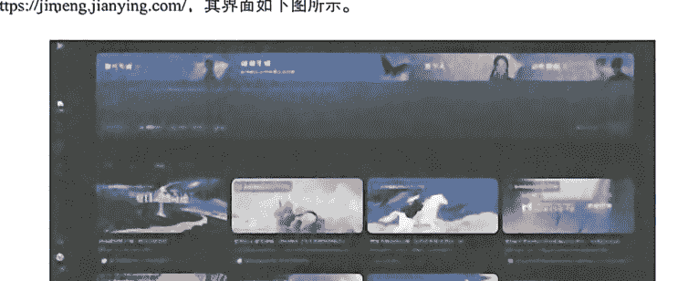

#### 即梦 AI 的基础功能

- 图片生成：即梦 AI 支持将文字描述转化为图片。使用者只需输入描述性文本，即梦 AI 便能生成相应的图片。
- 智能画布：即梦 AI 的智能画布功能采用交互式设计，使用者可以轻松抠图、重组图像，并根据提示词重新绘制新的图像。这一功能使得使用者能够更加灵活地进行图片编辑和创作。
- 视频生成：即梦 AI 能够将文字描述转换成视频。使用者可以输入描述性文本，即梦 AI 会自动生成相应的视频内容。此外，即梦 AI 还支持利用图片作为基础，通过 AI 智能生成视频内容。

#### 即梦的特色功能

- 多模态数字人功能：用户可通过上传一张角色图和一段音频，生成最长 15 秒的数字人视频。AI 能精准匹配口型、表情及肢体动作。
- 动作模仿：用户可上传静态图和动作参考视频，抑或使用官方模板，生成角色复刻动作的视频，此功能大幅降低了虚拟偶像、综艺节目分身制作的成本。

与其他平台相比，即梦的一大特色就是使用了最新的 Seedance 1.0 视频模型，下面详细讲解。

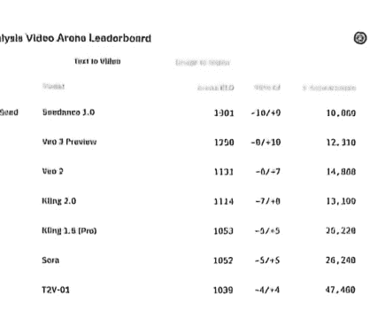

Seedance 1.0 定位为“高一致性、高真实感”的视频创作模型。该模型在权威评测平台 ArtificialAnlys 的评测中表现突出，同时在“文本转视频”和“图像转视频”两项任务中斩获第一，超越了 Google Veo 3、快手 Kling 2.0 及 OpenAI Sora 等主流模型，如右图所示。

它的核心突破在于解决了镜头的连贯性、细节保持和多镜头逻辑等传统行业难题，通过超过 3000 个生成片段的实测验证了技术的领先性。

此视频生成模型的核心特点和核心优势如下。

- **多角度场景一致性**：能够一次性生成同一场景的多个连贯镜头（如正面到过肩镜头的无缝切换），显著提升了空间一致性与镜头语言理解能力。
- **复杂提示精准执行**：可同时解析主体动作、摄像机动态（推进、摇移、环绕跟踪）及情绪节奏等复合指令，实现高精度控制。
- **高动态物理仿真**：在高速运动的场景中保持背景的自然运动与物理连贯性，避免空间扭曲或动作断裂。
- **多风格生成能力**：支持从照片级真实感到 3D 动画、手绘风格的多样化创作，突破单一风格限制。
- **效率与性价比**：生成 5 秒 1080p 视频仅需约 40 秒，成本优势显著（1 万元预算可生成 2725 条视频，远超竞品 Kling 2.1 的 1000 条和 Veo 2 的 787 条）。

#### 费用标准

即梦平台会基于用户活跃度情况每日发放 60~100 幸运积分，积分可用来生成图片和视频，积分用完后，需要直接购买或者开通会员获得，直接购买是 1 元 10 个积分，最低 500 个积分起购。开通基础会员每月需要支付 79 元，获得 1080 个积分，附带会员专属权益。

### 海螺 AI

海螺 AI 平台是一款由大模型公司 MiniMax（上海稀宇科技有限公司）自主研发的先进智能助手，该平台通过融合先进的人工智能技术，为使用者提供了丰富且高效的功能体验。网址是 https://hailuoai.com/，其界面如下图所示。

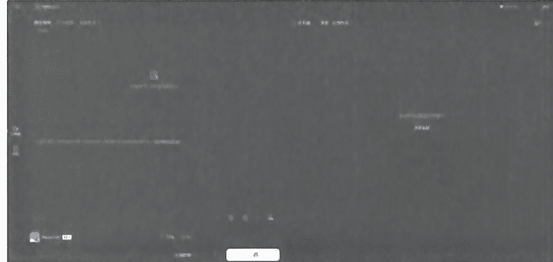

#### 海螺 AI 的基础功能

- 长文本处理：海螺 AI 能够迅速提炼长文本（如论文、财报、纪要、书籍等）的关键信息和归纳总结，帮助使用者快速获取核心要点。这一功能在处理大量信息时尤为有用，能够显著提高使用者的决策效率。
- 图片生成：输入文本或上传图片生成高清图片，提供写实、3D 艺术等风格，免费用户单次生成 5 张。
- 视频生成：通过文本描述或上传图片直接生成视频内容，生成速度较快。

#### 海螺 AI 的特色功能

- 音频生成：输入文本生成自然语音，支持 17 种语言，可调节语速、声调及情绪。
- 音色库：提供沉稳高管、播音腔、御姐等上百种音色，支持插入停顿符号以增强节奏感。
- 音乐创作：海螺 AI 的 AI 创作音乐功能可以根据使用者选择的曲风，以及创作的歌词来创作歌曲，歌词使用者可以选择自己创作，或者填写提示词让大模型帮助生成合适的歌词。

#### 费用标准

海螺 AI 会给新注册的用户赠送一定的贝壳，贝壳可用来生成图片和视频。贝壳用完后，需要直接开通会员获得，开通基础会员每月需要支付 105 元，每月获得 1000 会员贝壳，附带会员专属权益。

### 通义万相

通义万相的 AI 视频生成功能是完全免费的，支持文生视频和图生视频两种方式，可以根据使用者提供的文字提示词或图片，自动创作出具有影视级画面质感的视频，并且支持多种艺术风格，包括但不限于古风、科幻、动画等，还特别优化了对中式元素的表现，支持多语言提示词和可变分辨率生成。

通义万相不仅免费，而且是开源的（采用 Apache 2.0 协议），其 14B 和 1.3B 参数规格的模型权重与推理代码已全面开放于 GitHub、Hugging Face、魔搭社区等平台，因此可以部署到多种本地与云端环境。

官方网址是 https://tongyi.aliyun.com/wanxiang/，通义万相界面如下图所示。

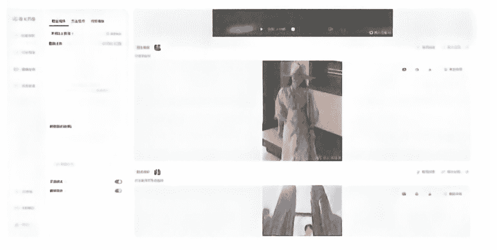

#### 通义万相的基础功能

- 图片生成：用户通过输入文字描述或者上传参考图即可生成符合要求的图像，支持包括水墨、油画、3D 卡通、二次元等多种艺术风格。
- 视频生成：用户输入文字描述或者上传视频，AI 即可生成连贯的视频，支持添加运镜效果。

#### 通义万相的特色功能

- 视频音效：开启此功能后自动为视频添加环境音效或适配的背景音乐，提升沉浸感。
- 灵感模式：增强画面丰富度与创意表现，可能突破提示词限制生成意外的惊喜，适合探索性创作。

### Vidu AI

Vidu AI 大模型是一款由北京生数科技有限公司研发的 AI 视频生成模型，核心团队成员来自清华大学人工智能研究院，使用它可以进行视频生成、多镜头处理、个性化创作。官方网址是 https://www.vidu.studio/，其界面如下图所示。

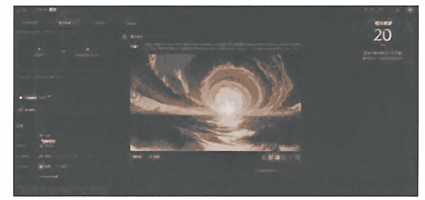

#### Vidu AI 的基础功能

Vidu AI 支持文本转视频和图片转视频两大核心功能。用户只需输入文字描述，Vidu AI 即可将其转化为生动的视频内容；上传静态图片后，Vidu AI 也能将其动态化，生成视频。此外，Vidu AI 支持生成长达 16 秒、分辨率高达 1080p 的高清视频，并具备快速推理能力。

#### Vidu AI 的特色功能

- 主体参照：Vidu AI 的“主体参照”功能是其最具突破性的特色之一，用户上传任意主体的一张图片，Vidu AI 就能锁定该主体形象，通过描述词任意切换场景输出主体一致的视频。
- 多主体一致性：Vidu AI 1.5 版本全新上线多图参考功能，突破性地实现了人物、物体和环境的多主体一致性控制。
- 动漫风格生成：Vidu AI 在动漫风格视频生成方面表现卓越，能保持动漫角色在不同镜头下的高度一致性，避免画面跳变和风格突变问题。

#### 费用标准

每日登录 Vidu AI 平台会获得 20 积分，积分可用来生成图片和视频。积分用完后，需要直接开通会员，以此获得积分，开通基础会员每月需要支付 69 元，每月获得 800 积分（最多可生成 200 个视频），附带会员专属权益。

### 拍我 AI

拍我 AI 是海外热门 AI 视频平台 PixVerse 的国内正版，是由爱诗科技发布的视频生成产品，该产品采用了 Diffusion+Transformer(DiT) 基础架构，在时空建模方面引入了自研的时空注意力机制，这不仅超越了传统的时空分离和 fullseq 架构，而且还显著提升了对空间和时间的感知能力，使得在处理复杂场景时表现更为出色。官方网址是 https://app.pixverse.ai/，其界面如下图所示。

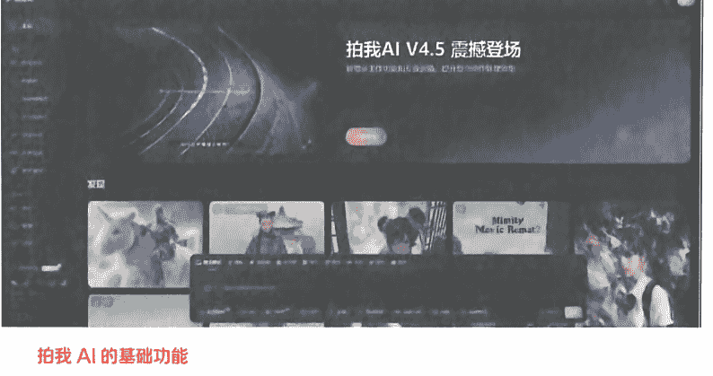

#### 拍我 AI 的基础功能

拍我 AI 支持通过文本提示（文生视频）或上传图片（图生视频）快速生成高质量的视频内容。用户只需输入简单的描述性文字或上传一张图片，系统就能自动生成 5-8 秒的单片段视频或最多 5 段总长 40 秒的连续视频。

#### 拍我 AI 的特色功能

- 多片段一致性生成：突破性地实现了多片段间的主体、风格与场景一致性。用户可一键生成 1～5 段情节连续的短视频，系统会自动保持角色形象、画面色调和背景元素的连贯性。
- MagicBrush 运动控制：该功能允许用户通过手绘箭头精确控制视频元素的运动轨迹和速度。在赛车场景中绘制长箭头可加速车辆移动，调整箭头方向能让航天员完成挥手等动作，还能反向移动背景增强动态感。每个画笔支持 6 个方向控制，实现了传统视频生成工具难以做到的精细化运动编辑。
- 角色一致性生成：针对动漫游戏爱好者，拍我 AI 推出了 Character2Video 技术。用户上传人物正面图片后，系统会在 20 秒内完成角色建模，之后生成的视频将严格保持该角色的面部特征和服饰细节。

#### 费用标准

新用户注册拍我 AI 会免费赠送 120 积分，每日登录拍我 AI 平台会获得 60 积分，积分可用来生成图片和视频。积分用完后，需要开通会员获得积分，开通基础会员每月需要支付 79 元，每月获得 1200 积分，附带会员专属权益。

## 国外四大视频创作平台

国外也有非常优秀的视频创作平台，其实 AI 视频之所以能够成为行业热点，也是源自于 OpenAI 推出 Sora 模型时引发的技术革新浪潮，因此国内的各大科技公司开始加速布局 AI 视频领域。

考虑到国内的用户可能在访问国外平台时速度较慢，且有些平台需要使用双币信用卡进行支付，就体验来说，对国内用户不十分友好，因此下面仅对这些平台做简要介绍和分析，帮助大家了解其特点和适用场景。

### Pika

Pika 是一款视频生成应用，它利用人工智能技术帮助使用者生成和编辑视频。Pika 的特点是能够生成多种风格的视频，包括动漫、Moody、3D、水彩、自然、黏土动画、黑白风格等。使用者可以通过输入简单的文本描述或上传图像配合文字来创建高质量的视频。此外，Pika AI 还提供了视频风格转换和视频内容编辑功能，使用者可以更改或增加视频中的元素，以及调整视频的宽高比尺寸等。官方网址是：https://pika.art/。其界面如下图所示。

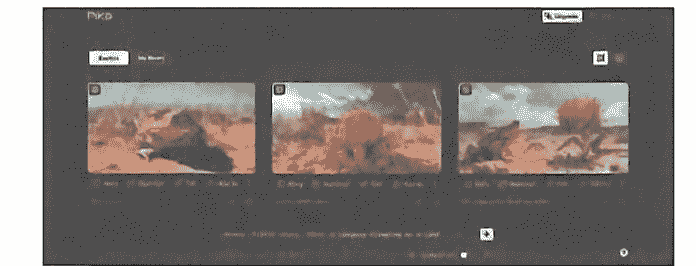

### Higgsfield AI

Higgsfield AI 是一款革命性的 AI 视频生成平台，其最大特色在于通过预设的电影级运镜模板，解决传统文本提示词难以描述的复杂镜头运动问题，为用户提供了专业摄影团队才能实现的动态视觉效果。

与依赖文本生成视频的 AI 工具不同，Higgsfield AI 允许用户仅上传一张静态图片，即可从超过 50 种的运镜模板中选择或混合使用（如 360 度环绕、子弹时间、Snorricam 身体固定镜头等），模拟专业摄像机操作，例如推轨、快速变焦、空中俯拍等，这些效果通常需要昂贵的设备和经验丰富的摄影师才能完成。

平台通过智能算法保持画面主体与场景的一致性，即使在大幅度运镜下也不会出现崩坏的问题，显著提升了生成视频的流畅度和专业感。

此外，用户可结合提示词进一步优化效果，但核心优势仍在于其镜头模板库的丰富性与精准控制能力，尤其适用于创意广告、电影短片、音乐视频等需要高动态视觉表现的领域。

Higgsfield 界面如下图所示。

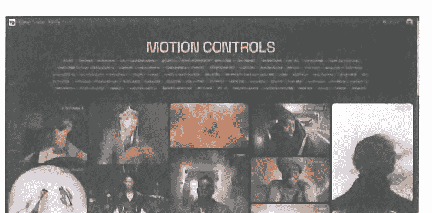

### Sora

Sora 是 OpenAI 推出的一款先进的 AI 视频生成工具。其核心亮点在于拥有强大且细腻的视频生成能力，能基于文本提示创造出极为逼真、细节丰富的视频内容。在生成效果方面，Sora 具备高度的真实感和丰富的表现力。它可以精准模拟各种复杂的场景，无论是繁华都市的车水马龙，还是宁静乡村的田园风光，都能生动地呈现出来。此外，对于人物的动作、表情等细节刻画也十分到位，使得生成的视频仿佛真实拍摄的一般。Sora 工具的界面如下图所示。

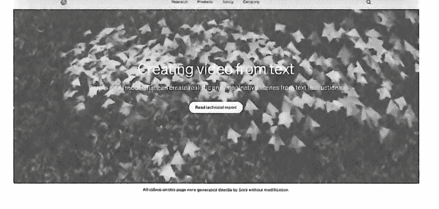

### Google Veo 3

Google Veo 3 是谷歌 DeepMind 于 2025 年 5 月推出的第 3 代 AI 视频生成模型，其核心突破在于首次实现了音画同步生成能力，能够根据文本或图像提示同时生成高质量视频与匹配的音频（如人物对话、环境音效和背景音乐），并通过精准的唇音同步技术大幅提升真实感，Google Veo 3 界面如下图所示。

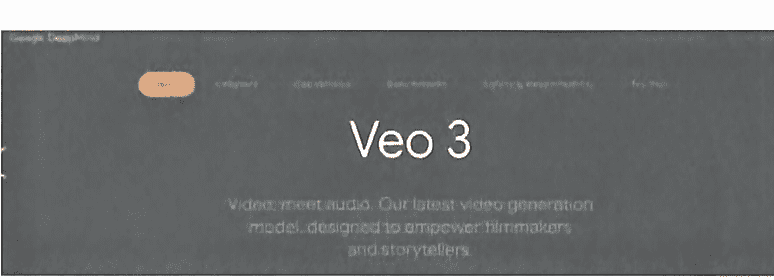

它在物理模拟（如光影效果和物体运动）和分辨率方面显著超越前代模型，可生成长达 60 秒的 1080p 视频，并支持生成多角色复杂场景的连贯事件流。用户可通过 Google Flow 工具或 Gemini 应用访问，但生成视频时长暂限 8 秒左右，且需配合英文提示词使用。Veo 3 的推出标志着生成式 AI 正式迈入“视听一体”的新阶段，已应用于电影预演、广告制作等创意产业，未来有望拓展多语言支持。

最近全网爆火的“刀切万物”解压视频，主要由谷歌 Veo 3 模型生成。其核心在于“视觉—听觉同步渲染”技术，能根据文本提示词自动生成高保真画面与匹配的清脆音效，实现沉浸式 ASMR 体验，“刀切万物”的相关视频如下组图所示。

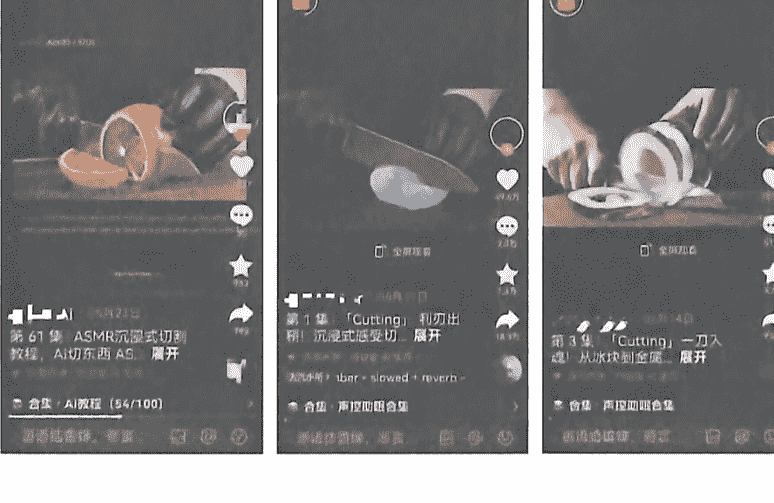

## 三大一站式视频创作平台

一站式视频创作平台是指整合了从文本内容生成、图像素材设计到视频编辑合成全流程的云端或软件工具，其核心目标是通过统一的工作流打破传统多工具切换的创作壁垒，实现高效、低门槛的内容生产。

用户输入剧本文字后，平台可自动拆解为分镜描述并生成对应的视觉画面；在视频编辑环节，用户可直接在云端完成剪辑、特效添加、图层融合、目标修改等操作，并支持多角色协同审阅；这种全链路整合不仅大幅提升了创作效率，更通过 AI 赋能解决了传统视频制作中角色一致性、跨镜头连贯性等技术难题，使得从专业团队到个人创作者的多元化需求得以在单一平台内闭环实现。

接下来具体介绍几个一站式视频创作平台。

### 白日梦 AI

白日梦 AI 是一款集成了多项先进技术的智能视频制作工具，它能够将输入的文案转化为生动有趣的视频内容。使用者只需提供不超过 2000 字的文案，白日梦 AI 便能自动生成包含角色、场景、分镜和配音在内的完整视频，一站式的创作流程，大大节省了创作者的时间。官方网址是 https://aibrm.com/。其界面如下图所示。

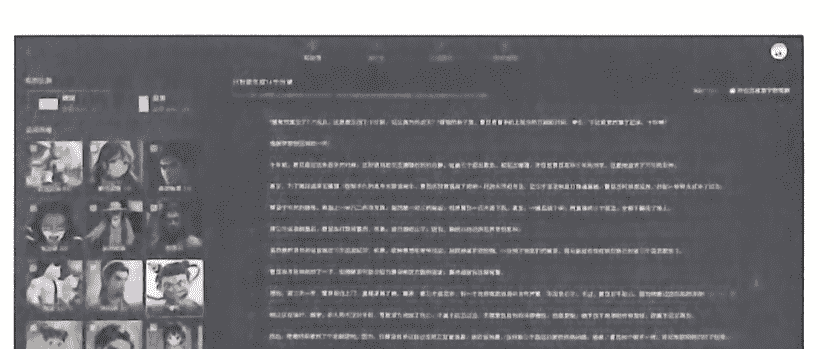

白日梦 AI 主要功能如下。

- 文生视频：白日梦 AI 支持将文案转化为视频内容，只需输入故事标题、故事正文等内容，白日梦 AI 就能自动生成包含角色、场景、分镜和配音在内的完整视频。
- 动态画面：能够将静态图片转为动态视频，使用者在左上角选择旁白配音及背景音乐，单击生成视频按钮后，进入预览视频界面，可以选择视频封面、调节语速等。
- AI角色生成：可以根据文案自动判断出所有角色，还可以为每个角色设置性别、声音和形象。
- 人物/场景一致性：白日梦AI能够保持视频中各个角色的形象一致，增强代入感和观看体验。

此外，白日梦AI提供了多种视频风格供使用者选择，以适应不同的故事主题和观众群体。

白日梦AI的费用标准情况如下。
新用户注册可以获得免费的梦币，梦币可以用来生成图片或视频，梦币消耗完需要订阅会员才能再次获得梦币，订阅白银会员每月40元，赠送5000梦币（大约可生成1000张图、约75分钟视频），并且带有其他附赠的会员服务。

### MOKI

MOKI是美图公司推出的AI视频短片创作平台，专注于辅助视频创作者打造动画短片、网文短剧、故事绘本和音乐MV视频。
该平台基于美图自研的奇想智能大模型（MiracleVision），通过智能剪辑、自动配乐、音效添加和字幕生成等功能，大幅简化视频制作流程，提高创作效率。官方网址是：https://www.moki.cn/。其界面如下图所示。

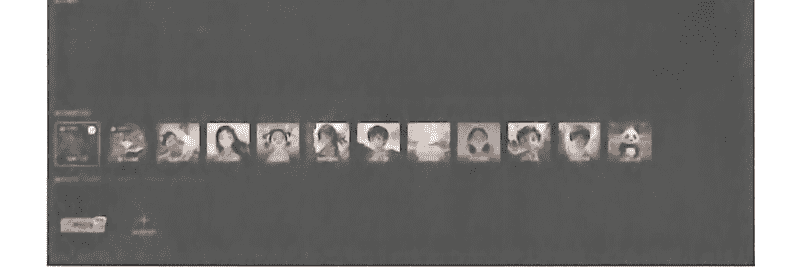

MOKI AI主要功能如下。
- AI短片创作：支持动画短片、网文短剧、故事绘本、音乐视频等多种类型，满足多领域创作者的需求。此外，还可帮助用户快速生成视频脚本和故事板，如基于简单的故事创意，MOKI能迅速构建视频脚本框架，提供情节、对话、场景转换建议，加速创意成型。
- AI智能剪辑：自动识别视频关键帧以智能剪辑，AI通过图像和视频分析能力精准定位视频中的关键画面，避免创作者手动寻找的繁琐。同时，MOKI还能根据视频节奏和情感变化智能调整剪辑节奏。
- AI配乐：MOKI能根据视频主题和情感氛围自动匹配背景音乐。无论是喜剧动画的欢快、历史短剧的庄严肃穆，还是音乐视频的浪漫情感，都能从庞大的版权音乐库中选出最合适的音乐。

MOKI AI的费用标准情况如下。
MOKI生成视频需要一定的积分，用户可以单独购买积分，1元钱可以购买5积分，100积分起购，也可以通过订阅会员获取一定的积分，每月150元，获得1200积分（大约可生成200个视频）和其他会员权益。

### SkyReels

SkyReels 是由昆仑万维推出的全球首个集成视频大模型与 3D 大模型的 AI 短剧创作平台，通过全流程自动化工具降低创作门槛，实现“一人一剧”的高效制作。官方网址是：https://www.skyreels.ai/。其界面如下图所示。

SkyReels 的主要功能如下。

- 剧本生成：基于自研剧本大模型 SkyScript，支持输入概念或故事创意后一键生成完整的剧本，包含情节冲突、爽点设计及情感表达；提供剧本优化功能，可对现有剧本进行润色和结构化调整。
- 角色定制：输入角色描述后，可以生成 3D 形象及配音，支持动漫、卡通、真人等多种风格。
- 分镜生成：通过分镜大模型 StoryboardGen，自动将剧本拆解为分镜脚本，并保持角色、场景的一致性。
- 视频合成与编辑：结合 WorldEngine 技术（AI 3D 引擎 + 视频生成模型），支持生成 1080p 60 帧高清视频。
- 自动添加背景音乐和音效，支持图层融合、光照调整等后期处理。

SkyReels 的费用标准情况如下。

生成视频需要一定的积分，开通会员即可获得一定的积分，每月支付 7.9 美元可获得 1000 积分。

# 第 4 章 AI 辅助短剧剧本创作

## 用 AI 确定选题方向

### 确定短剧创作类型

在 AI 介入具体的短剧选题前，创作者需要明确短剧的核心受众类型，这是确认内容定位的基石。当前主流短剧类型可分为男频（面向男性用户，偏好战神逆袭、权谋争斗、异能觉醒等强冲突题材）、女频（面向女性用户，聚焦情感纠葛、豪门虐恋、甜宠逆袭等情感向叙事），以及垂类赛道（如家庭伦理、悬疑探案、文旅融合等细分领域）。

明确类型能精准匹配受众的“情绪刚需”——男频强调“能力逆袭”的爽感，女频侧重“情感共鸣”与“命运改写”。若忽略类型划分，后续 AI 生成的选题可能偏离受众基础需求，导致内容失效。

### 利用 AI 确定具体选题

#### 跨维度联想法确定选题

跨维度联想是一种通过打破常规思维模式，将不同维度的概念或元素进行组合，从而激发创意的方法。主要分为两种方式：一种是关键词发散法，一种是类型混搭指令。接下来将具体讲解这两种方式。

关键词发散是指输入两个或多个看似不相关的关键词，通过 AI 的联想能力生成一个全新的概念。这种技术可以帮助创作者突破传统思维，找到独特的切入点。例如，通过结合“时空穿越”和“美食”这两个关键词进行创作，输入“请通过‘时空穿越’和‘美食’关键词来构建短剧故事内容，给出多种短剧方向的创作思路。”作为文字指令，如下图所示。

得到的部分 AI 回答内容如下。

> 方向一：悬疑美食争夺战
> 核心设定：未来世界“味觉芯片”垄断市场，落魄主厨意外获得能穿越回古代的神秘食谱，引发多方势力争夺。
> 关键场景：
> 主角在古墓发现刻有唐朝御膳配方的青铜鼎，触摸后穿越至长安酒楼。
> 与历史名厨斗菜时遭遇现代竞争对手派来的时空特工。
> 高潮揭露“味觉芯片”公司 CEO 正是偷学古法导致味觉退化的初代穿越者。
> 主题：传统匠人精神 vs 科技异化
> ……

创作者可以根据 AI 的回答选择具体的短剧内容方向，如果对生成的内容不满意，可以直接重新生成，也可以通过更改关键词再次生成，不断尝试关键词直到满意为主。

#### 大数据趋势分析法

大数据趋势分析法是一种通过分析当前流行趋势、热门内容或观众喜好，挖掘其中的规律和趋势，从而为创作提供方向和灵感的方法。这种方法可以帮助创作者把握当前的流行趋势、观众喜好和市场需求，使创作内容更具吸引力和传播力。

例如，让 AI 分析最近半年抖音爆款短剧的 10 个高赞反转设计内容，或者生成符合 Z 世代审美的 5 种新型人物关系。其中，分析“抖音”和“Z 世代”就是为短剧内容融合当下的发展趋势。如输入“分析最近半年爆款短剧的 10 个高赞反转设计内容，并根据这种趋势给出几种短剧创作的方向思路。”作为文本指令，如下图所示。

得到的部分 AI 回答内容如下。

一、爆款短剧的 10 类高赞反转设计
1. 身份反转
例：外卖小哥被刁难，结尾亮出集团董事长身份；落魄乞丐实为富豪体验生活。
核心：利用社会阶层/地位的巨大反差制造爽感。
2. 伪装型反转
例：女主假装恋爱脑接近霸总，实为商业间谍；反派以为掌控全局，实则是主角的布局。
核心：通过“伪装者视角”误导观众，最后揭示真实的动机。
3. 时间线欺骗
例：主角复仇成功，镜头闪回揭露一切是幻觉或预知梦；开头看似甜蜜恋爱，实为回忆杀
核心：打破线性叙事，用时间错位制造冲击。
4. 情感绑架反转
……

创作者可以根据以上 AI 给出的趋势参考来确定短剧的内容方向。

#### 逆向思维分析法

逆向思维分析法是一种基于认知科学反事实思维理论的创造性思考策略。其核心在于，通过有意识地构建与常规认知相悖的情境差异，以此作为激发创作潜能的驱动力。逆向思维可以帮助创作者突破常规，挖掘更具戏剧张力和创新性的创意。

这种方法可以应用于以下步骤。

1. 用 AI 列出短剧作品的 10 个常见套路。
2. 针对每个套路生成 3 个逆向变体（即对常规套路的反转或创新）。
3. 选择最具戏剧张力的组合。

例如，输入“请列举短剧中 10 个常见的剧情套路”，如下图所示。

得到的部分 AI 回答内容如下。

> 身份错位陷阱
> 经典案例：清洁工被误认为公司总裁，全程被迫配合演戏，最终揭露身份反转打脸。
> 关键点：利用信息差制造尴尬笑料，后期身份揭晓形成阶级反差。
> 契约关系变质
> 模板结构：为应付催婚/继承权签订假夫妻协议→意外同居触发心动细节→利益与情感的终极抉择。
> 进阶变体：合约中设置“禁止爱上对方”条款，强化禁忌感。
> 重生复仇剧本
> 标准流程：前世惨死→带着记忆重生→精准报仇雪恨 + 拯救遗憾。
> 现代变种：车祸后获得预知能力/神秘系统金手指。
> 悬崖式误会
> 经典构图：女主手扶男配被偷拍→男主只看到背影→决裂前夜 + 追妻火葬场。
> 升级版：关键证物（如录音片段）被恶意剪辑。

根据以上内容进一步给出指令，让 AI 对内容进行逆向变体。如输入“请针对每个套路生成 3 个逆向变体（即对常规套路的反转或创新）。例如，针对‘英雄救美’生成‘美人设计陷阱让英雄堕落’的逆向变体暗黑反转剧情。”，如下图所示。

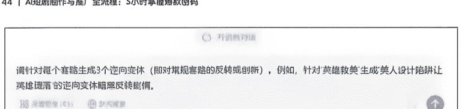

得到的部分 AI 回答内容如下。

1. 身份错位陷阱——变体
   - 身份对调陷阱：清洁工将错就错假扮总裁，暗中收集公司黑料，却被对手雇佣的卧底拆穿身份，发现雇佣者正是真总裁。
   - 双面身份：总裁为调查内部腐败，伪装成清洁工潜入公司，却爱上底层员工，身份暴露后反被诬陷贪污。
   - 身份套娃：真总裁为躲避暗杀与清洁工互换身份，发现清洁工竟是国际刑警卧底。
2. 契约关系变质——逆向设定
   - 契约倒置：合约规定违约方需支付天价赔偿，双方都暗中制造违约陷阱，却触发“禁止动心”条款。
   - 时间循环契约：契约规定每周互换身份生活，却因意外导致记忆互换，真假身份界限崩塌。
   - 契约诅咒：合约生效后双方记忆每日重置，唯有真心相爱才能解除诅咒，却陷入无限轮回。
   ……

### 用三幕式创作技巧构建故事大纲

三幕式是一种经典的故事结构框架，将叙事划分为开端（破局）、发展（升级）和结局（爆点）3个核心阶段。接下来具体介绍这3个核心阶段。

#### 第一幕：破局

三幕式结构的第一幕是故事的起点，核心任务是“破局”，即打破主角的日常生活状态，为其后续行动埋下伏笔。这一阶段需要完成3个关键任务：建立角色与世界观（如主角的初始状态、环境背景）、触发事件（即“激励事件”，迫使主角离开舒适区），以及明确目标（主角因事件产生明确动机）。

例如，在《星球大战》中，卢克目睹养父母被害，决定踏上复仇之旅。第一幕的结尾通常以“转折点”收尾，将故事推向第二幕的冲突升级阶段。

#### 第二幕：升级

第二幕是故事的主体部分，占全篇约 60% 的篇幅，核心是“升级”冲突与挑战。主角在追求目标的过程中遭遇多重阻碍，包括外部对手、内心心魔（如自我怀疑）或环境压力（如时间限制）。这一阶段需通过“尝试—失败—学习”的循环推动角色成长，同时穿插支线情节，丰富故事层次。

例如，在《泰坦尼克号》中，罗丝与杰克跨越阶级相爱，同时船体危机逐渐逼近。第二幕结尾常以“低谷时刻”收尾（如主角看似彻底失败），为第三幕的爆发蓄力。

#### 第三幕：爆点

第三幕是故事的高潮与结局，聚焦“爆点”收尾。主角利用第二幕积累的经验或资源，与反派展开终极对决，或直面核心矛盾。这一阶段需解决所有伏笔，并通过“高潮场景”（如战斗、告白、真相揭露）释放情绪张力。结局可分为封闭式（明确收束，如《肖申克的救赎》）或开放式（留白，如《盗梦空间》），但必须完成角色弧光（如懦弱者变勇敢）。

例如，《哈利·波特与死亡圣器》中的霍格沃茨决战，哈利战胜伏地魔并完成自我救赎。

### 用 AI 生成三幕式剧本全流程

接下来将用 AI 创作具体的三幕式剧本，具体操作如下。

AI 提示词如下。

> 请帮我创作一个三幕式女英雄类型的剧本，要求包含清晰的故事结构：第一幕（破局）介绍主要角色、背景和核心冲突的触发事件；第二幕（升级）展现角色为解决问题而采取的行动，设置逐渐升级的障碍和中间点转折；第三幕（爆点）设计高潮段落和符合角色弧光的结局。需要说明剧本的时代背景、核心主题（如救赎/成长），以及主要角色基础设定（姓名、性格、目标），在每幕标注关键情节点和人物关系变化，情节需要包含象征性细节。

得到的 AI 回答如下。

主要角色设定
艾拉·斯通（Ella Stone）
年龄：22 岁
身份：顶尖钟表厂“克罗诺斯工业”流水线女工（负责精密齿轮校准）。
目标（初始）：努力工作，攒钱养活生病的父亲，避免惹麻烦。
目标（转变后）：揭露工厂的剥削真相，为父亲讨回公道，唤醒并团结工友争取公平权益
象征物：珍藏的父亲遗留的用废弃齿轮手工制作的“心跳鸟”胸针（象征逝去的温暖创造力与潜在的自由）。

剧本结构
第一幕：破局（The Setup & Inciting Incident）
背景铺垫
展示“铁锈堡”：浓烟蔽日，蒸汽管道轰鸣，巨大的“克罗诺斯工业”钟楼俯瞰全城。
贫民窟与富人区形成鲜明对比。
......

### 场景设定技巧

#### 场景设定的基础要素

场景设定需要包含时间、空间、人物和事件 4 大核心要素。接下来将具体介绍这 4 个基础要素。

##### 时间

时间维度在场景设定中起着至关重要的作用，它不仅是简单的时间标记，更是赋予场景独特情感和氛围的关键因素。
除了具体时刻（如凌晨三点、黄昏时分）和宽泛时间段（如唐朝、20 世纪 60 年代），还可以从季节、节日等方面进行细化。
时间还能影响光线和天气，进而影响场景的情感基调。比如。清晨的阳光柔和和温暖，给人以清新、充满希望的感觉；而夜晚的月光清冷，可能会营造出神秘、静谧甚至略带恐怖的氛围。雨天会让场景变得潮湿、朦胧，增添一份忧郁的情感；而晴天则明亮开阔，让人心情愉悦。

##### 空间

空间是场景的物质载体，它不仅仅是地点和环境布局，还涉及空间的层次和功能。
地点可以是现实中存在的地方，也可以是虚构的地方，不同的地点有着不同的文化背景和建筑风格，这些都会影响人物的行为和故事发展。
环境布局包括建筑的分布、道路的走向、家具的摆放等。合理的布局能够引导人物的行动和视线，增强场景的真实感和逻辑性。
空间的层次可以通过高低、内外、前后等关系来体现。高层建筑的不同楼层可以有不同的功能和氛围，底层可能是热闹的商业街，而高层则可能是安静的办公室或豪华的公寓。室内和室外空间也有着明显的区别，室内空间相对封闭，可能会有更多的隐私和情感交流；室外空间则开阔，能容纳更多的人和活动。

##### 人物

人物是场景的核心，他们的言行、情感和性格特点是推动情节发展的关键。
除了人物的外貌、年龄、性别等基本特征，还需要深入挖掘人物的背景故事和内心世界。人物之间的关系也非常重要，包括亲情、友情、爱情、敌对关系等。不同的关系会导致不同的互动方式和情节发展。例如，情侣之间的相处会充满甜蜜和浪漫，但也可能会有争吵和矛盾；而敌对关系则会引发冲突和斗争，推动故事的高潮部分。

##### 事件

事件是情节线索，它可以是简单的动作，也可以是复杂的活动。
事件的类型多种多样，包括日常事件、突发事件和重大事件。日常事件如吃饭、上班、上学等，虽然看似平凡，但却能反映出人物的生活习惯和性格特点。突发事件如火灾、地震等，会打破原有的平静，引发人物的紧急反应和故事的转折。重大事件如战争、革命等，会对整个场景和人物产生深远的影响，改变他们的命运和生活。

事件的发展过程也很重要，它可以分为起因、经过和结果。合理的事件发展能够吸引观众的注意力，让他们产生好奇心和代入感。在事件的发展过程中，可以设置一些悬念和冲突，增加故事的趣味性和紧张感。

#### 场景风格与主题的统一

场景风格需要围绕主题设定，分为写实与非写实两大类。写实风格注重细节真实感，如自然光影和材质纹理；非写实风格则包括卡通、像素或奇幻美学（如赛博朋克）。确定主题后，需要通过构图、色彩和光影强化风格的一致性。例如，科幻主题常用冷色调与机械元素，而魔幻主题则偏向鲜艳的色彩和超自然细节。风格统一的关键在于从整体到局部的协调，避免元素冲突。

#### 环境氛围精准营造

环境氛围的营造需要综合运用视觉、听觉与空间象征元素，使场景成为叙事的“隐形角色”。色彩与光影是塑造基调的核心；暖色调可强化压抑中的欲望张力，而冷色调则外化角色的精神疏离。

空间布局需服务于主题隐喻，例如封闭式结构象征封建束缚，而开阔的场景（沙漠、草原）则映射自由或孤独。声音与细节进一步深化沉浸感；环境音强化地域特色，道具纹理则通过触觉联想增强真实感。

#### 场景转换与节奏控制

场景转换需要平衡叙事的连贯性与节奏张力，通过蒙太奇手法实现时空跳跃的逻辑自洽。内景与外景的衔接需要保持环境方向、色彩基调的统一，避免视觉断裂。转换动机应服务于情节推进：硬切适合冲突爆发，叠化或空镜则暗示时间流逝或情感延续。

### AI 角色设定与性格塑造技巧

在角色设定中，三维建模法通常包括外貌生理维度、性格心理维度和社会身份维度 3 个维度。每个维度都涵盖了不同的内容，共同构成了角色的完整画像。

#### 外貌生理维度设定

生理维度指的是角色的外在表现，涵盖遗传特征、外貌特征和健康状况，这些因素会影响角色的外在形象与行为模式。遗传特征包含左撇子、身体残疾、特殊肤色等；比如左撇子在使用工具时与大多数的习惯不同，显得独特；健康状况有慢性疾病、过敏反应、身体疼痛等，如哮喘患者在紧张或运动时会呼吸困难，容易产生焦虑；外貌特征包括身高、体重、容貌等，长相出众的人在社交中受关注多，但压力也大，而外貌平凡的人可能更注重内在培养。

#### 性格心理维度设定

性格心理维度设定关乎角色的内在世界，包含人格类型、情感状态和价值观等，这些因素影响着角色的行为动机和心理反应。

当角色遭遇压力和挫折时，会采用不同的防御机制。比如情感隔离，角色压抑情感保护自己，却易与他人产生隔阂；还有投射，将自身的负面情绪或想法推给他人，引发冲突。

角色内心世界也各有不同。他们可能经历过创伤，存在未解决的情感问题。如有童年创伤的角色，成年后可能敏感且不信任他人；而经历爱情挫折的，可能变得冷漠、自我封闭。

#### 社会身份维度设定

社会维度指的是角色所处的社会环境，包含阶层背景、文化背景和家庭关系等方面，这些会影响角色的行为和价值观。

角色的社会阶层不同，生活方式、语言习惯和价值观念也不一样。底层角色说话可能带方言、行为直接；上层角色更重礼仪，语言文雅。

文化背景会塑造角色的兴趣与知识水平。爱读书的角色视野广、知识多，交谈时可能引经据典；热衷音乐艺术的角色会展现独特的审美与情感。

家庭背景对角色性格影响很大。单亲家庭长大的角色往往更独立，但可能有情感缺失；在大家庭成长的角色会更看重亲情。

#### 人物弧光整体驱动设定

“人物弧光”是一个源自戏剧和影视创作领域的概念，用于描述角色在故事发展过程中的成长、转变和内心变化轨迹，展示了角色从故事开始到结束时的心理、情感或价值观的变化。通过设计人物弧光，可以使角色更加立体，同时为故事增添深度，引发情感共鸣。

#### 人物弧光的类型

正向弧光，角色从消极状态向积极状态转变；负向弧光，角色从积极状态向消极状态转变；静态弧光，角色在故事中保持核心价值观不变，但通过故事中的事件和冲突，进一步强化这种价值观。

#### 人物弧光的 AI 构建技巧

设定起点与终点，明确角色在故事开始时的状态（起点）和故事结束时的状态（终点）。例如，角色在故事开始时是一个自卑的人，而在故事结束时变得更加自信。

设计触发事件：设定一个或多个事件，推动角色的转变。这些事件可以是外部冲突或内心冲突。例如，一个角色在经历家庭破裂后，开始重新审视自己的价值观，最终实现了成长。

展现内心挣扎：在人物弧光的设计中，角色的内心挣扎是关键。通过展现角色的矛盾和挣扎，可以使观众更加深刻地感受到角色的成长。例如，角色在面对道德抉择时的犹豫和痛苦，可以让观众更好地理解角色的转变。

通过努力实现自我价值，从而变得更加自信。

人物弧光的设计要能够引发观众的情感共鸣。角色的成长或转变应该让观众感同身受，从而增强故事的感染力。例如，一个角色从孤独中走出，找到友情和爱情的故事，可以触动观众内心深处的情感。

例如，要设计一个关于职场短剧的人物角色，给 AI 的提示词如下。

> 写一个职场类的短剧，请为短剧主角设计完整的人物弧光结构。首先清晰定义角色起点状态与终点状态，建立核心成长轨迹。设置 2 - 3 个关键触发事件：初期事件暴露角色的根本缺陷，中期事件触发转折点，后期事件验证成长。在整个弧光的设计中嵌入三次内心挣扎：（1）应对挫折时的自我怀疑独白；（2）面临道德抉择时的价值观冲突；（3）突破舒适区时的心理不适。

得到的回答如下。

> 主角设定
姓名：陈默
年龄：32 岁
身份：广告公司创意总监
核心缺陷：控制型完美主义（以高压统治追求结果，视团队为工具）
成长核心：从独裁者蜕变为赋能者
人物弧光轨迹
起点状态：
用 KPI 绞杀团队创意，剽窃实习生环保方案却拒署其名
信奉丛林法则：要么吃人，要么被吃
标志行为：提案会上抢过下属话筒：“让开，你们在浪费客户时间！”
终点状态：
建立匿名创意通道，将自己的名字从所有提案署名栏删除
新信条：“真正的领袖是让平庸者发光”
标志行为：危机会议上关掉投影仪，将白板笔递给发抖的实习生
……

## AI 剧本对话生成与优化技巧

在剧本创作中，对话是推动情节发展、塑造角色形象、展现人物性格的关键元素。而 AI 技术的出现，为对话生成提供了强大的助力。然而，如何让 AI 生成的对话既自然流畅，又符合角色设定和剧情需求，还需要创作者掌握一定的技巧和方法。

下面将详细探讨 AI 剧本对话生成与优化的核心技巧、实用技巧、实战流程，以及常见问题的解决对策，并通过具体案例进行演示，帮助创作者更好地运用 AI 技术创作出高质量的剧本对话。

### 对话生成的核心技巧

对话不仅仅是角色之间的交流，更是推动剧情发展的重要手段。以下是具体的优化对话的实用技巧。

#### 提升真实性

在对话中加入自然的停顿和留白，可以让对话更加真实、自然。停顿可以模拟角色在思考、犹豫或情绪激动时的状态，而留白则可以让观众有更多想象的空间。
例如，“我……其实早就知道了。”这句话中的停顿，就让观众感受到了角色的犹豫和内心的挣扎。
将对话进行口语化处理，让语言更加贴近生活，增强对话的真实感。
例如，将“我对此感到非常抱歉”改为“这事儿是我不对”，更加符合日常口语表达，让角色更加接地气。

#### 冲突与张力设计

冲突是戏剧的核心，通过对话制造冲突和张力，可以让剧情更加精彩、引人入胜。常见的技巧包括反问、潜台词等。
例如，“你以为这样就能解决问题？”这句话通过反问的方式，质疑对方的能力，同时也暗示了自己对问题的不同看法，制造了对话中的冲突和张力。

#### 节奏控制

对话的节奏对剧情的推进和情绪的渲染起着重要作用。通过控制对话的长短和速度，可以营造出不同的氛围和情绪。
例如，在紧张的场景中使用短句，如“跑！别回头！”可以加速节奏，增强紧张感；而在回忆场景中使用长句，如“你知道这些年，我每一天都在想……如果当时能重来。”则可以营造出压抑、沉重的氛围，让观众沉浸在角色的情感中。

#### 明确对话的叙事目标

叙事目标可以是揭露秘密、制造冲突、推动情感发展等。
例如，如果对话的目标是揭露一个秘密，那么对话中就会充满暗示、试探和最终的揭露，通过语言技巧和节奏的把控，让观众在对话中逐渐发现隐藏的真相。

### AI 对话生成实战

> 提示词：请生成一段 300 ~ 400 字、发生在暴雨夜的废弃工厂内的父子对峙短剧对话片段。核心叙事目标是揭露反派角色陈枭是主角林峰的生父这个秘密，并在此过程中制造强烈的情感冲突与戏剧张力。
生成的对话请严格遵循以下对话优化技巧。
提升真实性：在对话中加入自然的停顿和留白，进行口语化处理。比如，角色说话有犹豫、停顿，使用贴近生活的表述。
冲突与张力设计：通过反问、潜台词等技巧制造冲突和张力，让剧情更精彩。
节奏控制：根据剧情场景合理控制对话长短和速度。紧张的场景用短句增强紧张感，回忆场景用长句营造氛围。
情感强化：在关键台词后增加动作描写，强化情感表达。
简化与留白：删减冗余内容，让对话简洁明了，同时利用留白让观众有想象的空间。
避免对话生硬：添加“语言瑕疵”，如口吃、重复，体现角色的紧张、不安等情绪。

AI 给出的回答如下。

暴雨倾盆，废弃工厂深处。
林峰举枪对准阴影中的毒枭陈枭，手电光剧烈晃动。
“人在哪？我搭档在哪！”
陈枭从油桶后踱出，雨水顺着他昂贵的风衣流淌。
“急什么……二十年没见，就只想问这个？”
一道惨白的闪电劈开黑暗，照亮陈枭脸上与林峰如出一辙的伤痕。
（场景：废弃汽车厂装配车间。屋顶破洞如筛，雨水倾泻如注，在油腻的水泥地上汇成浑浊的溪流。锈蚀的钢铁骨架在闪电惨白的光中狰狞毕现，每一次雷声滚过，铁皮屋顶都在发出濒死的呻吟。空气里弥漫着铁锈、陈年机油和暴雨的腥冷。）
（林峰踹开半挂着的破铁门冲入，浑身湿透，警用雨衣紧贴在他剧烈起伏的胸膛上。他右手紧握配枪，左手抓着手电筒，光束像受惊的鸟，在堆积如山的废弃车架和油桶间疯狂跳跃、颤抖。）
林峰：“（嘶吼，声音被雨声和回声撕扯得破碎）人呢？！陈枭！把人交出来！我搭档在哪？！（光束猛地定格在车间深处几个巨大的油桶上）出来！我知道你在这！”
（阴影在油桶后蠕动，如同毒蛇出洞。陈枭缓缓踱出，昂贵黑色风衣的下摆滴着水，皮鞋踩过积水，发出规律的、令人心悸的“嗒嗒”声。他像一尊从地狱湿冷的岩壁中走出的雕像，脸上没有任何表情，手电光刺眼地打在他脸上，他连眼睛都没眨一下。）
陈枭：“（声音低沉平稳，却像冰锥穿透雨幕）急什么？（微微侧头，避开最刺眼的光来，目光如钩，死死钉在林峰脸上）二十年……整整二十年没见了吧？（他向前挪了一小步）就只想问这个？你搭档？”
（林峰的手电光剧烈地抖了一下，光束边缘扫过陈枭的颧骨——那里，一道浅浅的、斜向的旧疤痕，在惨白的光下异常刺眼。林峰像是被烫到，左手下意识摸向自己左脸相同位置那道几乎一模一样的印记。）
林峰：“（呼吸骤然粗重，枪口微微发颤）少废话！（强行稳住声音，却泄露出一丝难以置信的沙哑）放人！不然下一枪，打穿的就不是你肩膀那么简单了！”
……

# 第 5 章
## AI 辅助短剧生成分镜脚本

## 学习镜头语言的必要性

### 镜头语言的定义与构成要素

镜头语言是影视创作中通过视觉符号系统传递信息、情感与叙事逻辑的核心工具。其本质是通过镜头类型（如特写、中景、全景）、拍摄角度（高角度、低角度、平视）、构图规则（三分法、对称与不对称）、光线色彩设计、运动方式（推拉摇移）及焦点控制（深焦、浅焦）等技术手段，构建画面的叙事性与艺术性。这一系统化的视觉语言体系，既是导演与观众之间沟通的媒介，也是影视作品主题表达与情感渲染的关键载体。

### 掌握镜头语言对短剧创作的价值

对于依赖人工智能生成内容的短剧创作者而言，镜头语言的系统化运用具有不可替代的实践意义。首先，短剧受限于时长，正确的镜头语言可精准地传递角色动机、情节冲突与情感转折，替代冗长的文本。其次，创作者可以通过构图、光影与运动设计，营造特定的氛围（如悬疑、温馨），提升观众代入体验。再者，AI 工具虽能生成画面，但缺乏镜头逻辑的整合能力，创作者需主动运用镜头语言规则，引导 AI 输出符合叙事逻辑的视觉序列，从而在内容同质化严重的市场中，提升作品的艺术价值与传播力，形成创作者的风格化标志。

下面简要介绍构成镜头语言的各个视觉要素。

## 景别分类与叙事功能

### 远景

远景用于交代环境或营造宏大的氛围。远景镜头能够将广阔的场景或众多的人物尽收眼底，让观众对故事发生的整体环境或事件的规模有一个宏观的把握。它常用于展现自然风光、城市景观、战争场面等，通过远景，观众可以感受到场景的壮阔、人物的渺小或事件的宏大，在使用 AI 创作远景景别的画面或视频时，要使用“远景、远景镜头”等关键词。

例如，右图 1 的关键词为：晚霞铺满天空，孤独的飞鸟飞翔，河水连接远方的天空，渔夫在船上，壮阔的风景，秋天的萧瑟，意境美，远景，中国风，SK。

右图 2 的关键词为：远景镜头（Long Shot），远距离拍摄广阔的场景（如山脉、城市、人群），营造氛围或空间纵深感。

### 全景

展示人物与场景的关系。全景镜头可以完整地呈现人物在场景中的位置、动作和行为，使观众能够清晰地看到人物与周围环境的互动。它有助于建立人物与场景之间的联系，展现人物在特定环境中的状态和情感。在使用 AI 创作全景景别的画面或视频时，要使用“全景、全景镜头”等关键词。

例如，右图 1 的关键词为：古装，全景摄影，夜色沙滩，海天一线，发光古代连衣纱裙，发光连衣裙，非常巨大的裙子，非常非常长的裙子，星空倒映在连衣裙上，星星做的连衣裙。

右图 2 的关键词为：相机写实风格，全景，都市地铁站，西装剪影，在冷灰色玻璃幕墙上与飞驰的列车形成双重曝光，随身黑色高定版香炉从定制西装内袋取出时，不锈钢扶手倒映出雾霾蓝天空与暗金纽扣的冷暖色碰撞。

### 中景

中景镜头主要捕捉人物膝盖以上的部分，注重人物之间的交流与互动。它能够清晰地展现人物的动作、表情及人物之间的关系，使观众更容易理解人物之间的情感交流和情节发展。在使用 AI 创作中景景别的画面或视频时，要使用“中景、中景镜头”等关键词。

例如，右图 1 的关键词为：高档咖啡店内，两个年轻人对坐着看着窗外繁华的街景，中景，电影质感，4k画质，写实风格，窗外从画面左侧出现一辆装甲车。

右图 2 的关键词为：中景镜头，一位白发亚洲老人坐在傍晚公园的长椅上，布满皱纹的手轻轻抚摸着流浪猫的脊背，夕阳将他们的影子拉得很长，褪色的外套口袋露出半截病历本，猫咪撒娇地蹭着他颤抖的手指，落叶在余晖中飘落。

### 近景

近景镜头主要捕捉人物胸部以上的部分，强调人物的情绪和反应。它能够更深入地展现人物的内心世界，让观众更贴近人物的情感体验。通过近景，导演可以突出人物细微的表情变化，增强情感的张力。在使用 AI 创作近景景别的画面或视频时，要使用“近景、近景镜头”等关键词。

例如，右图 1 关键词为：红楼梦，薛宝钗，大观园，花园，宝钗扑蝶，黄白色衣服，影视拍摄，近景。

右图 2 的关键词为：明亮的美丽眼睛，超级完美的脸蛋，玉颈修长，宛如透明的白玉雕琢而成，散发着柔和的光芒，气质如兰，似有梦幻的气息萦绕，朦胧而优雅，如同从童话中走出的仙子，人物居中，眼神自然，近景高清，古装色彩弥散，画面富有张力，创意十足，梦幻光感，色彩溢出，留白设计，浓烈的对比，极简风格。

### 特写

特写镜头聚焦于人物的面部或物体的细节，用于突出情感、强调关键物品或制造悬念。它可以深入挖掘人物的内心情感，揭示人物的内心矛盾和心理活动。同时，特写镜头也可以用来突出重要的物品或细节，增强故事的戏剧性和紧张感。在使用 AI 创作特写景别的画面或视频时，要使用“特写、特写镜头”等关键词。

例如，右图 1 关键词为：美女脸部特写，泪水流过脸颊。眼神中透露出不甘，纯黑色背景。高清画质，眉毛和睫毛细腻清晰。

右图 2 的关键词为：特写，手部，弹钢琴。

## 认识运镜方式

在短剧创作中，运镜是镜头语言的核心表达手段，通过镜头的运动轨迹、速度、角度等变化，能够精准地传递情绪、塑造人物、构建节奏，甚至推动叙事。下面解析常用的运镜方式及其应用场景。

### 推镜头

推镜头是指摄像机向被摄主体逐渐靠近，画面由全景或中景逐渐聚焦到特写的过程。这种运镜方式能够增强观众的代入感，常用于突出角色的心理变化或关键细节。例如，下面的组图展示了一个通过推镜头强调画面中间在讲解的女孩的效果。

在短剧中，推镜头可用于强化冲突爆发的瞬间，如当主角发现真相时，镜头缓缓推近至面部特写，放大瞳孔震动或嘴角抽搐的细节，让观众直观地感受角色的震惊与挣扎。

### 拉镜头

与推镜头相反，拉镜头是摄像机逐渐远离被摄主体，画面从特写扩展至全景。这种方式常用于揭示环境与角色的关系，或传递疏离、孤独的情绪。例如，下列组图通过镜头拉远展示了主体女孩和背后衣帽间之间的关系。

在短剧创作中，拉镜头可用于收尾场景。例如，主角完成逆袭后，镜头拉远展现其置身于繁华都市的背影，隐喻个体与环境的复杂关联。

### 摇镜头

摇镜头分为水平摇（左右移动）和垂直摇（上下移动），用于跟随运动的对象或展示空间全貌。例如，下列组图中展示了山体的广阔。

在短剧创作中，摇镜头可用于动作戏或追逐的场景。例如，用倾斜摇镜拍摄反派逼近主角的视角，制造失衡与压迫感；亦可通过缓慢垂直摇镜展现破旧房间的细节（如墙上的裂缝、散落的物品），暗示隐藏的故事线索。

### 移镜头

移镜头指摄像机在平面上横向或纵向移动，常用于跟随角色行动或展示环境动态。例如，下列组图展示了移镜头下女孩跳舞的过程。

在短剧场景中，移镜头可模拟“旁观者视角”。例如，利用轨道横向跟拍主角穿越夜市，镜头掠过烟火气十足的小摊和人群，既构建市井氛围，又暗喻主角的平凡与坚韧。

### 跟镜头

跟镜头强调摄像机始终跟随主体运动，突出角色的动态轨迹与情感连贯性。例如，下列组图通过跟镜头展现了女孩和老虎的运动轨迹。

在短剧创作中，跟镜头可用于强化角色行动的紧迫感或亲密关系，比如追逐戏中跟随主角奔跑，或情侣并肩行走时的情感流动。它还能通过连贯的背景变化暗示剧情的推进，如用摇晃的跟拍表现角色穿越危险地带的不安。此外，主观视角的跟镜头能增强观众代入感，使短剧节奏更紧凑有力。

### 升降镜头

升降镜头通过摄像机垂直升降完成从俯瞰到平视或仰视的视角切换，常用于场景转换或情绪升华。例如，下列组图通过升镜头展现了嫦娥飞升和后羿分别后的无奈与悲伤。
在短剧创作中，升降镜头可用于强化角色情感转折，如从压抑的低位视角缓缓升起，象征希望或解脱；也可用于揭示关键场景信息，比如从主角特写拉升至全景，凸显环境与人物的关系。

## 短剧的颜色搭配

### 颜色搭配对短剧创作的重要性

颜色搭配是短剧创作中通过视觉符号系统传递情感、氛围与叙事逻辑的关键工具，其本质是通过色彩理论（如色轮、互补色、类似色）、冷暖色调选择（暖色系的温馨感与冷色系的冷静感）、文化象征意义（如红色在中国文化中的喜庆寓意与西方文化中的危险暗示），以及光影与色彩的协调设计等技术手段，让视频更有艺术感染力。

例如，可以通过颜色快速建立情感基调（如粉色与红色传递浪漫气息，蓝紫色调营造悬疑氛围）、强化场景的时空定位（如低饱和度土黄色调还原历史质感，高饱和度荧光色营造未来科技感），并隐喻角色的性格与命运（如红色象征激情或危险，白色代表纯洁或空洞）。
此外，色彩还能通过动态变化（如从明亮到暗淡的色调渐变）暗示情节转折或人物心理演变，成为视频的“视觉节拍器”。

### 色彩的情感象征理论

色彩在人类的感知中具有强烈的情感象征意义。红色通常代表热情、活力、危险等，它能够迅速吸引观众的注意力，激发强烈的情绪反应；蓝色往往象征着冷静、理智、深邃，给人一种沉稳和安全感；黄色寓意着希望、快乐、智慧，能营造出明亮欢快的氛围；绿色代表自然、生机、和平，让人感觉放松和舒适；紫色则与神秘、高贵、奢华相关联，增添作品的独特气质。

例如，在著名电影《红磨坊》中，红色贯穿全片。电影开场的红磨坊场景，红色的灯光、红裙、红墙等元素，将红磨坊纸醉金迷、充满激情的氛围展现得淋漓尽致。主角们在红色的光影中舞蹈、歌唱，红色象征着他们热烈的爱情和对梦想的追求，同时也暗示着爱情中的危险与挣扎，与电影的情感基调高度契合，电影的相关画面如右图所示。

### 色彩的对比理论

色彩对比是通过不同颜色之间的差异来突出画面的视觉效果。互补色对比是最强烈的对比方式，如红与绿、蓝与黄，它们相互对立又相互吸引，能产生强烈的视觉冲击力；邻近色对比则相对柔和，如红与橙、蓝与绿，能营造出和谐又有变化的氛围；明度对比指的是亮色与暗色的对比，能增强画面的层次感和立体感；纯度对比是高纯度色彩与低纯度色彩的对比，突出主体色彩的鲜艳度。

例如，在电影《辛德勒的名单》中，影片整体以黑白灰色调为主，呈现出二战时期压抑、沉重的氛围。然而，影片中唯一的一抹红色——小女孩的红衣服，成为全片最亮眼的存在，相关画面如右图所示。红色与黑白灰形成了强烈的互补色对比，小女孩在黑白的世界中穿梭，这抹红色不仅象征着生命的希望和美好，也让观众更加深刻地感受到战争的残酷和人性的光辉。

### 色彩的基调统一理论

色彩基调是指在一部作品中占主导地位的色彩倾向，它能够为整个作品奠定情感和风格基础。基调统一并不意味着只使用一种颜色，而是通过色彩的搭配和组合，使画面在整体上给人和谐一致的视觉感受。比如，可以通过选择一种主色调，并搭配与之协调的辅助色和点缀色来实现。主色调决定了作品的基本情感，辅助色可以丰富画面层次，点缀色起到画龙点睛的作用。

例如，电影《布达佩斯大饭店》以粉色为主色调，营造出一种浪漫、梦幻、复古的氛围。粉色的建筑外观、粉色的床单、粉色的信件等元素贯穿全片，给人一种温馨、优雅的感觉，相关画面如下组图所示。同时，影片中搭配了蓝色、黄色等辅助色，如蓝色的制服、黄色的花朵，这些颜色相互协调，丰富了画面的层次。而红色的地毯、绿色的植物等点缀色，则在统一的基调中增添了活泼和生机。

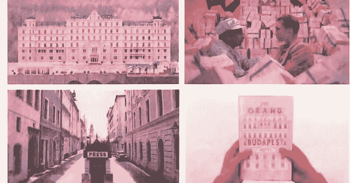

### 色彩的主次关系理论

在色彩搭配中，需要明确主次关系，突出主体色彩，避免色彩过于杂乱。主体色彩应该是画面中最引人注目的颜色，它能够传达主要的信息和情感。辅助色彩则起到衬托和补充主体色彩的作用，使画面更加丰富和完整。通过合理安排色彩的主次关系，能够让观众快速聚焦到重要元素上。

例如，在电影《泰坦尼克号》中，女主角露丝的蓝色晚礼服是一个重要的色彩元素，如右图所示。蓝色在众多的色彩中脱颖而出，成为主体色彩。这件蓝色晚礼服不仅展现了露丝的高贵和优雅，也象征着她内心深处对自由和爱情的向往。而周围人物的服装色彩则作为辅助色彩，起到衬托露丝的作用，使观众的注意力始终集中在露丝身上。

### 色彩的心理暗示理论

色彩能够对观众的心理产生暗示作用，影响他们的情绪和认知。明亮的色彩通常会让人感到愉悦、积极，而暗淡的色彩则可能引发悲伤、压抑的情绪。高纯度的色彩会激发观众的兴奋和热情，低纯度的色彩则带来平静和放松。在短剧创作中，可以利用色彩的心理暗示来引导观众的情感体验。

例如，在电影《禁闭岛》中，影片整体的色彩基调偏冷，以灰色、蓝色为主，电影画面如右图所示。这种冷色调的运用，暗示了主角所处环境的压抑和危险，同时也反映了他内心的困惑和挣扎。在一些紧张的场景中，如暴风雨中的小岛，深蓝色的天空和灰色的海浪增强了观众的紧张感和不安情绪，使观众更能感同身受地体验到主角的心理状态。

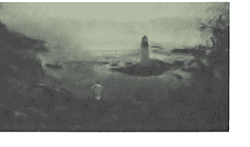

### 色彩的文化内涵理论

不同的文化对色彩有着不同的理解和象征意义。在中国文化中，红色代表吉祥、幸福、喜庆，常用于婚礼、春节等重要场合；白色则与哀悼、悲伤相关。在西方文化中，白色象征着纯洁、神圣，常用于婚礼；黑色代表庄重、严肃，在正式场合穿着。了解色彩的文化内涵，能够使短剧在跨文化传播中更好地传达信息和情感。

例如，在电影《英雄》中，影片运用了多种颜色来展现不同的文化和情感层面。其中，“红色”段落充满了浓烈的中国文化气息，相关画面如右图所示。红色的场景布置、红色的服饰，象征着热情、勇敢和牺牲。在这个段落中，飞雪和如月之间的爱恨情仇在红色的映衬下更加激烈，红色不仅是中国文化中喜庆的象征，也在这里代表了一种决绝的情感，营造了悲壮的氛围。

## 利用 AI 创作分镜脚本实践步骤

在写提示词的过程中，需要加入前面理论知识所讲的内容。例如，可以添加“景别分类（大远景建立神话世界宏大感/特写突出法器神力）”“动态运镜（跟镜头追踪主角飞天动作/旋转镜头表现战斗眩晕感）”等关键词，还可以通过色彩理论强化叙事（用赤红色调渲染天庭的威严/用青蓝冷光营造幽冥界的神秘氛围），结合节奏控制理论（快速剪辑表现激烈的打斗/长镜头慢节奏展现嫦娥月宫独舞的孤寂感），并特别标注“需符合中国神话文化内涵（如太极阴阳的色彩对立/仙鹤纹样的符号化运用）”。最终提示词将整合镜头语言要素、色彩心理学暗示、文化符号适配及影视化节奏设计，形成结构化指令模板。

接下来通过前面所学的理论来指导 AI 生成关于中国神话故事的短剧剧本的分镜头脚本。

（1）打开 DeepSeek，上传纯文本剧本 Word 文件，上传文件后在提示词文本框中输入“请根据上传的短剧剧本内容，结合景别分类（如大远景建立神话世界宏大感 / 特写突出法器神力）、动态运镜（如跟镜头追踪主角飞天动作 / 旋转镜头表现战斗眩晕感）、色彩理论（如赤红色调渲染天庭的威严 / 用青蓝冷光营造幽冥界的神秘氛围）、节奏控制（如快速剪辑表现激烈的打斗 / 长镜头慢节奏展现角色内心独白）等影视语言要素，创作每一集的分镜脚本。最终输出的脚本要求包含以下要素：1. 镜号；2. 场景（明确室内 / 外及具体地点）；3. 景别；4. 角度；5. 运镜方式；6. 画面色彩及内容（详细描述人物动作、表情及环境细节）；7. 对白 / 旁白（精确到每个镜头的台词）；8. 时长（每个镜头的秒数）；9. 特效 / 音效标注。请保持节奏紧凑，每集控制在 3 ~ 5 分钟，重点突出戏剧冲突和情感张力，并确保镜头转换自然流畅。最终以表格的形式输出。并特别强调需符合中国神话文化内涵，使整个分镜脚本既具有艺术性，又具备可拍摄性。”如下图所示。

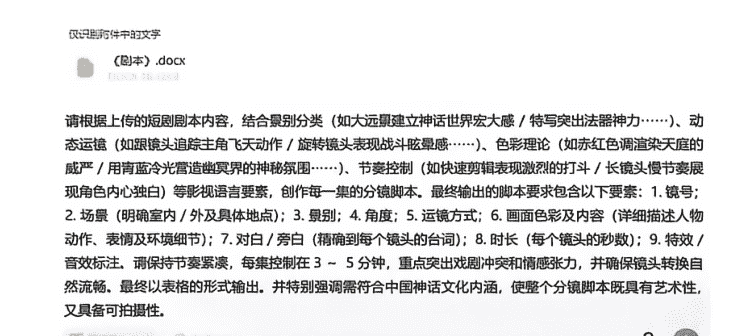

（2）单击文本框右侧的按钮，即可生成分镜头脚本，最终生成的部分内容如下图所示。

第一集：《神农遇泽，赤炎灵鹿现》

| 镜号 | 场景 | 景别 | 角度 | 运镜 | 画面内容及色彩 |
|---|---|---|---|---|---|
| 1 | 山林（外） | 大远景 | 俯拍 | 航拍推进 | 晨曦朱红-青绿色山林 |
| 2 | 村口（外） | 中景 | 平视 | 手持跟拍 | 轩辕丘（粗布衣）跪拜 |
| 3 | 悬崖小径（外） | 全景-特写 | 仰拍 | 急速升降 | 轩辕丘攀岩时咬牙，腿 |
| 12 | 草药丛（外） | 近景 | 俯拍 | 固定 | 赤炎灵鹿（火焰纹鹿角） |
| 18 | 山谷（外） | 中景 | 侧拍 | 旋转跟拍 | 神农氏持药锄守护草药 |
| 27 | 月下古树（外） | 仰拍大远景 | 低仰 | 缓推 | 轩辕丘握草药立于树梢 |

> 核心冲突设计：灵鹿考验用暖光暖调（希望），魔兵抢夺用青蓝冷调（邪恶），通过色彩对比强化对立。

（3）因为 AI 生成的篇幅有限，此时需要继续给 AI 发出指令，在文本框中输入“继续生成其余分镜头脚本”的指令，AI 便会继续生成分镜头脚本，部分内容如下图所示。按照以上方法便可以生成短剧其余剧集的分镜头脚本。

以下为《华夏神纪：鸿蒙幻世录》第二集《精卫怒涛，玄龟护神珠》的分镜头脚本表格，其余分集可依此逻辑扩展。

### 第二集：《精卫怒涛，玄龟护神珠》分镜头脚本

| 镜号 | 场景 | 景别 | 角度 | 运镜方式 | 画面内容（人物动作/环境细节） | 对白/旁白 | 时长（秒） | 特效/音效标注 |
|---|---|---|---|---|---|---|---|---|
| 1 | 海岸悬崖（日，室外） | 远景 | 俯视 | 固定 | 浪涛汹涌的深蓝色大海撞击礁石，水雾弥漫，天空乌云密布，远处闪电隐约可见。 | 旁白：“精卫衔微木，将以填沧海，然神珠失窃，怒涛难平。” | 5 | 海浪轰鸣声；低沉的雷音 |
| 2 | 海滩（日，室外） | 中景 | 平视 | 横移 | 轩辕尘赤脚踩在湿沙上，弯腰捡起一枚破碎的贝壳，眉头紧皱，望向海面漩涡。 | 轩辕尘（自语）：“这漩涡……定是妖魔作祟！” | 4 | 贝壳碎裂声；海水翻涌音效 |

### 脚本与分镜头画面的联系

脚本与分镜头画面之间存在着紧密的创作逻辑关联，脚本作为文字载体，通过场景描述、角色动作、对白和情节推进等要素构建叙事框架，而分镜头画面则是将脚本内容转化为视觉化表达的关键环节，通过镜头构图、景别切换、运镜方式和时间节奏等视听语言具体呈现脚本中的戏剧冲突与情感张力。

分镜头设计既需要忠实还原脚本的核心叙事意图，又需通过画面调度、光影处理和符号化视觉元素来强化文本的潜台词与氛围。例如，脚本中“主角在雨中孤独行走”的文字描述，在分镜头中可能通过倾斜构图、冷色调滤镜与慢动作特写来外化角色的心理状态，这种转化过程体现了导演对脚本的二次创作，二者共同构成影视作品从概念到成品的完整创作链条，最终实现叙事逻辑与视觉韵律的有机统一。

# 第 6 章 AI 辅助生成短剧分镜头画面

## 认识分镜头画面的重要性

正如笔者在前面章节所述，创作者在使用 AI 生成视频时，往往采取的是图生视频的方式，以确保视频内容的视觉连贯性和风格一致性，因此，AI 生图是视频创作的基础环节，非常关键。通过高质量的静态图像生成，创作者能够为后续的视频合成提供稳定且富有创意的素材来源，从而提升整体作品的艺术表现力。

正因如此，创作者首先要了解当前各个 AI 生图平台的技术特点与功能差异，例如 Stable Diffusion 擅长写实风格与细节控制，Midjourney 在艺术化渲染方面表现突出，而即梦 AI 在文字效果生成方面表现较好。此外，还要了解这些平台的优劣势，毕竟不同工具在生成速度、版权政策、定制化程度等方面存在显著差异。例如，部分开源工具对硬件要求较高，而商业平台可能限制生成内容的商用权限，这样就能够在创作中取长补短。

## 认识主流 AI 图片生成平台

### Midjourney

Midjourney 是国外开发的基于人工智能技术的图像生成工具，创作者通过输入文本描述即可快速生成高分辨率、风格多样的艺术作品，涵盖写实、卡通、动漫、抽象等多种类型。

该平台支持以图生图功能，允许上传参考图片并结合文字指令调整生成效果，还能通过混合多张图片融合创作新作品。其内置深度学习模型可识别复杂的指令及情绪氛围，生成细节丰富、色彩鲜明的图像，尤其擅长人物、场景和创意设计，生成的图像具有较高的美学价值。

Midjourney 绘画平台的界面如下图所示。

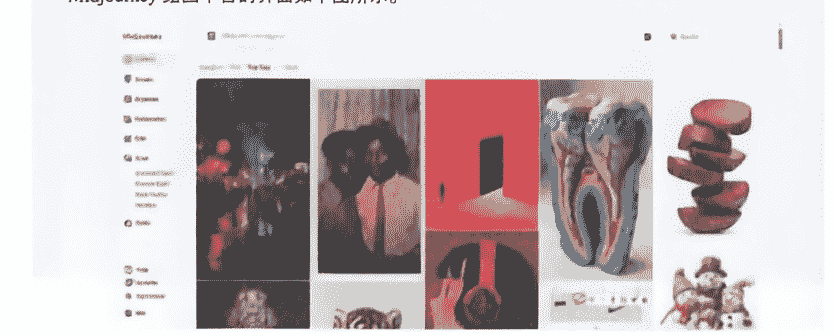

### 可灵 AI

在之前的章节中，可灵 AI 是被当作视频工具进行讲解的，其实除了视频生成功能，其图片生成功能也很强大。该平台提供了文生图、图生图功能，支持多样化模板和中文语义精准生成。创意程度比较强，并且能够生成强大的文字效果。
可灵 AI 平台图片生成界面如下图所示。

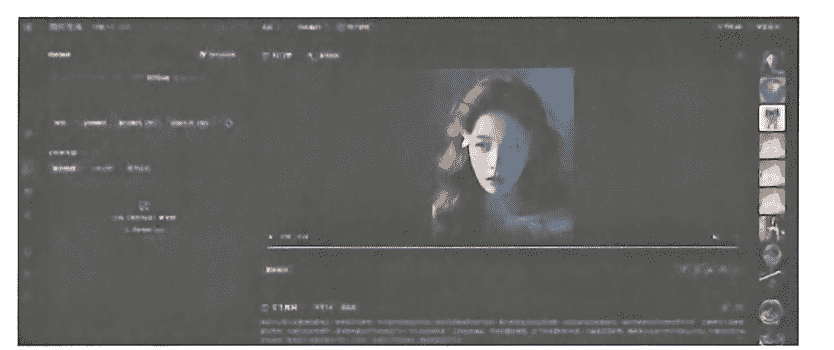

### 即梦 AI

和可灵类似，在之前的章节中即梦 AI 是也是被当作视频工具讲解的。除了视频生成，即梦 AI 支持文字生成图片、图片生成图片等多种图片生成功能，创作者可通过输入中文描述快速生成超现实场景、人物肖像等多样化风格的视觉作品。该平台提供智能画布功能，包含扩图、局部重绘、消除笔、高清放大等编辑工具，支持多图融合与细节调整，生成高效且提供多版本选择。
即梦 AI 绘画平台的图片生成界面如下图所示。

### 神采 AI

神采 AI 绘画是一款专为设计师打造的智能图像处理工具，支持将涂鸦、照片转化为插画，自动识别人物姿势并生成线稿上色。其特色功能包括自动识别建筑及室内设计线段生成新方案、辅助 3D 建模的法线信息读取，以及通过语义分割生成多风格图片。

平台提供空房间一键装修、物体插入和材质替换功能，创作者可上传草图快速生成逼真的渲染效果。此外，AI 超模工具能生成多样化的虚拟模特展示产品，结合文字效果和创意融合功能，大幅提升设计效率与创意表达。

神采 AI 绘画平台的界面如下图所示。

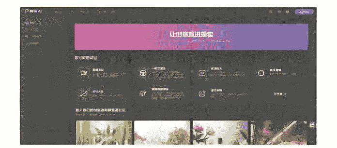

### 奇域

奇域是一款专注中式审美的国风 AI 绘画平台，依托中国传统文化元素，支持创作者输入中文描述生成水墨画、工笔画、皮影戏等风格的艺术作品。

该平台提供灵活的画幅比例选择和上百种新中式模板，涵盖传统国画与现代插画风格，创作者可自定义咒语或通过风格延伸功能生成系列化创作。特色功能包括局部细节微调、参考图融合优化，以及高清重绘技术，提升作品的分辨率。其互动社区汇聚头部创作者，支持作品分享、灵感共创和商用授权，目前通过签到、推荐好友等机制提供免费创作额度。

奇域绘画平台的界面如下图所示。

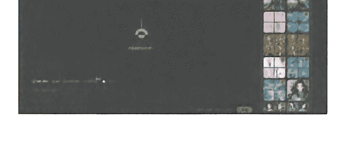

### 星流

星流是由 LiblibAI 推出的一站式 AI 图像生成平台，基于自研的 Star-3Alpha 模型，具备高精度图像生成和多样化风格支持，如写实、插画、动漫等。其特色功能包括以图生图的风格迁移、局部重绘修改细节、智能扩图扩展画面内容，以及高清放大提升分辨率等。该平台支持中文提示词输入和自然语言描述，内置超 10 万组参数的 LoRA 模型库，可快速响应创意需求，适用于电商产品图、广告设计、建筑可视化等场景。

星流 AI 绘画平台的界面如下图所示。

### 通义万相

通义万相是阿里云推出的 AI 绘画平台，支持文生图、图生图、风格迁移三大核心功能，用户可通过文字描述或上传图片快速生成多样化艺术作品，并自由选择水彩、油画、中国画等 8 种特色鲜明的艺术风格。同时提供相似图生成功能。作为阿里云通义大模型系列成员，该平台整合了文本、图像等多模态处理能力，适用于艺术设计、广告营销等多元场景。

通义万相 AI 绘画平台的界面如下图所示。

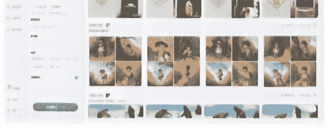

### ComfyUI

ComfyUI 是一款创新的图形界面工具，界面如下图所示。它采用了节点工作流的设计理念，将复杂的稳定扩散算法拆解成多个独立的操作节点。这种精巧的设计不仅极大地增强了工作流的灵活性和可定制性，还为用户提供了丰富的定制化选项和工作流复用能力。

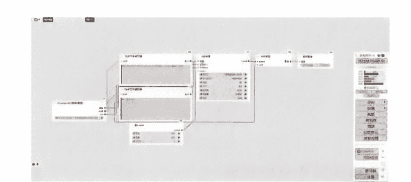

在实际使用中，ComfyUI 展现了其强大的图像生成能力和高效的性能。对初学者来说，尽管其集成了大量插件节点和复杂的操作流程，可能会带来一定的学习挑战，但平台提供的丰富教程资源使得上手变得相对容易。同时，ComfyUI 中的 Flux 模型对提示词有较强的理解能力，也极大地提升了创作者的创作自由度，使得每一幅作品都独具特色。

与 Stable Diffusion WebUI 相比，虽然 Stable Diffusion WebUI 是 Stable Diffusion 最早的图形界面，并且大部分 AI 创作平台都借鉴了 Stable Diffusion WebUI 搭建的界面，但在灵活性与批量操作方面，ComfyUI 更具优势。

综合来看，ComfyUI 是一个门槛较高，但上限也极高的 AI 创作平台，而且其生态发展极为迅速。

### Stable Diffusion

Stable Diffusion 是一款开源的 AI 绘画工具，能够根据文字描述快速生成高质量的图像。它的核心原理是通过“潜在扩散模型”，先将文本提示转换为机器能理解的语义向量，再从一个随机噪声图像开始，逐步去噪并融入文本信息，最终生成符合描述的逼真画面。

与传统的 AI 绘画工具相比，Stable Diffusion 的创新之处在于它工作在低维度的潜空间而非像素空间，这使得生成速度更快且对硬件要求更低——普通显卡就能运行。

它支持多种创作模式；除了基础的“文生图”的功能，还具备图生图、局部重绘、图像修复等功能，用户可以通过调整采样步数、引导系数等参数精细控制输出效果。

作为开源项目，它拥有丰富的插件生态和模型库，能轻松生成写实、动漫、水彩等不同风格的作品，操作界面也设计得直观友好，即使新手也能快速上手。

Stable Diffusion 的界面如下图所示。

## 如何判断 AI 生图平台的优劣

前面，笔者简要介绍了市场上热门的 AI 生图平台，如 Midjourney、即梦 AI、奇域、Stable Diffusion、ComfyUI、神采 AI、星流等。每个平台都有其独特的风格、功能和定位。但正因为选择众多，且各有侧重，所以用户不能仅仅依赖他人的推荐或平台的知名度，而必须建立评判标准，才能找到最适合自己创作需求的工具。

下面是笔者总结的几个判断 AI 生图平台优劣的关键维度。

### 提示词遵循度

这个是最基础也是最重要的评估指标，毕竟当创作者输入提示词后，平台能否准确理解并生成符合预期的图像直接决定了创作效率和质量。如果平台对复杂提示词的理解能力不足，生成的图像就会偏离预期，导致反复调整和试错。从笔者的使用经验来看，即梦 AI 在中文提示词处理上表现优异，其构建的千余组绘图提示词体系能精准匹配不同的创作需求；而 Stable Diffusion 虽然功能强大，但对中文提示词的支持相对较弱，需要用户具备一定的英文写作能力。

### 生成图像质量

图像质量是衡量平台核心竞争力的关键指标，包括清晰度、细节表现力、色彩准确度等多个维度。不同平台的生图模型也决定了其出图的质量，相较之下，Stable Diffusion 对生图质量的控制较好。

### 美学水准评估

美学水准是衡量 AI 生图平台艺术表现力的核心维度，直接影响生成作品的视觉吸引力和专业度。优秀的平台应能理解并实现构图、光影、色彩搭配等美学原则，而非仅满足技术层面的“可生成”。Midjourney 在超现实风格和实验性艺术表达上表现突出，其个性化模型能精准捕捉用户的审美偏好。

## 文生图生成方式

文生图是各大 AI 绘画平台提供的基础绘画创作功能，创作者可以通过输入描述性的文字来创作图像。尽管各个平台的操作界面和具体步骤有所不同，但它们背后的核心技术和工作原理大体相似。因此，在学习如何使用这些工具时，掌握一些文生图的通用技巧和方法可以帮助创作者更有效地创作出理想的短剧画面。

### 以正确的方法撰写提示词

对于文生图的方式，提示词影响生图的最终效果，因此，掌握提示词的撰写技巧非常重要。接下来为大家讲解提示词的撰写技巧。

#### 公式推荐

提示词：主题元素 + 场景描述 + 艺术风格 + 细节要求 + 正负向界定 +（时间相关）+（情感氛围相关）。

注意：括号里面的内容可以省略，下面对公式中涉及的各个元素进行解析。

#### 主题元素

这是画面的核心内容，例如，人物——a girl（一个女孩）、动物——a cat（一只猫）、物体——a flower（一朵花）等。明确的主题元素能让生成的图像有一个主要的焦点。

#### 场景描述

描绘主题所处的环境，如 in a forest（在森林里）、on a street（在街道上）等。场景的描述可以让画面更加丰富和立体，为主题元素提供背景支撑。

#### 艺术风格

指定图像的风格，例如 Realistic（现实主义）、Abstract（抽象主义）、Impressionistic（印象主义）等。不同的艺术风格会赋予图像截然不同的视觉效果。

#### 细节要求

包括对色彩等方面的具体要求，如：red（红色）、光线 sunlight（阳光）、构图 symmetry（对称）。这些细节能够进一步细化图像的生成效果。

#### 正负向界定

正向提示词告诉生成模型我们想要生成的内容，例如 high quality（高质量）；反向提示词则表明我们不希望出现的内容，如 low quality（低质量）、nsfw（不适当的内容）等，并不是所有平台均需要填写负向提示词。

#### 时间相关

如果要体现时间元素，如 a morning scene（早晨的场景）或者 a sunset view（日落景色），可以将时间描述放在场景描述部分，与主题元素和其他元素组合。例如：一对情侣在日落时的海滩上散步。

情感氛围相关

当需要营造某种情感氛围时，如 mysterious（神秘的）、romantic（浪漫的），可以将这些词汇融入到整体描述中，比如 a mysterious old castle in the mist（雾中的神秘古堡）。

### 文本提示词撰写技巧

#### 明确描述对象

在撰写提示词时，首先要明确图片的主体是什么。如果想要生成一幅人物画像，就要根据前面讲述过的三个维度（生理维度、心理维度和社会维度）来撰写，例如，描述画面的文本为“原住民美女热巴身披羽毛斗篷，拿着古代弓箭弓引姿势，站在野外。内心目光坚毅，面部彩绘符号发光，烟雾幻化成狼形，兽骨项链与绿松石手镯，神秘主义厚涂画风。”生成的图像如下图所示。如果要生成风景图，需要明确是山脉、海滩还是森林等主体元素，这个环境要围绕着情节，因此要明确风景图中的具象环境元素。

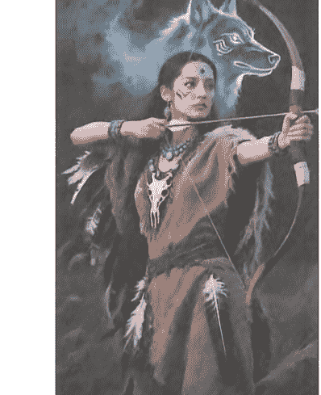

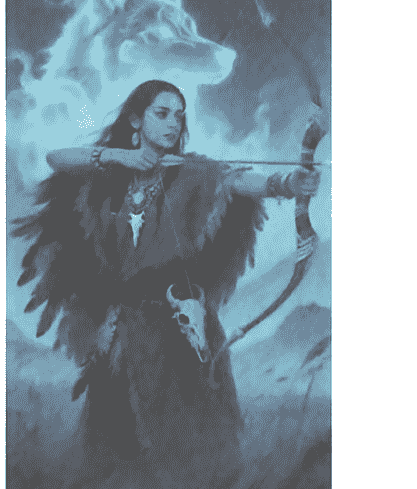

#### 设定画面风格

创作者可以指定多种艺术风格，如“写实风格”“油画风格”“卡通风格”“水墨画风格”等。不同的艺术风格会使 AI 生成的图片具有截然不同的视觉效果。例如，“写实风格”会让画面尽可能接近真实场景的质感和细节，如下左图所示；而“卡通风格”则会使画面色彩鲜艳，形象夸张，线条简洁明快，如下右图所示。

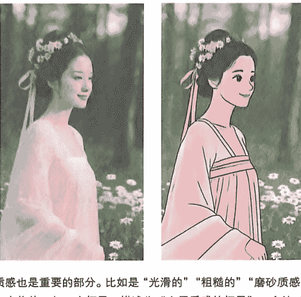

描述画面的质感也是重要的部分。比如是“光滑的”“粗糙的”“磨砂质感”还是“金属质感”等。如果要描绘一个物体，如一个杯子，描述为“金属质感的杯子”，会让 AI 生成具有金属光泽和质地的杯子图像，如下左图所示。而“磨砂质感的杯子”则会有不同的视觉效果。

#### 确定画面的构图与视角

常见的构图方式有“中心构图”“对称构图”“三分法构图”等。例如，“中心构图”提示词可能让主体位于画面的中心位置，如下左图所示；而“对称构图”会使画面左右或上下部分呈现对称的形式，如下右图所示。如果想要突出主体的重要性，可以选择“中心构图”，并在提示词中写明，如“以一位舞者为中心构图的舞台画面”。

| 72 | AI短剧制作与推广全流程：5小时掌握爆款密码

视角包括“平视”“俯视”“仰视”等。不同的视角会给人不同的视觉感受。“平视”视角比较常见和平稳，如下左图所示；“俯视”视角可以展现更多的场景元素，有宏观的感觉，如下中间图所示；“仰视”视角可能会让主体显得更加高大和威严，如下右图所示。

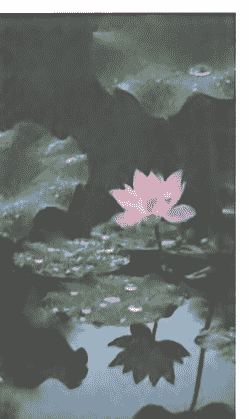

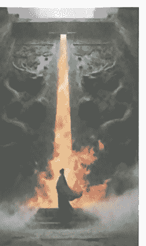

#### 运用色彩描述

主要色彩：明确画面的主要色彩。可以是单一的色彩，如“蓝色调”“暖黄色调”，也可以是多种色彩的组合，如“蓝白相间”“橙红色与绿色的搭配”。

色彩在画面中起着非常重要的作用，能够营造不同的氛围。例如，“蓝色调”可能会营造出宁静、深邃的氛围，如下左图所示；而“橙红色”等暖色调的搭配可能会打造出一种温暖的视觉效果，如下右图所示。

色彩的分布与比例：除了确定主要色彩，还可以描述色彩在画面中的分布和比例。例如，“画面中蓝色占大部分，白色作为点缀”或者“绿色与橙红色各占画面的一半”。这样可以更精确地控制画面的色彩构成，让AI更好地了解图像的色彩要求。

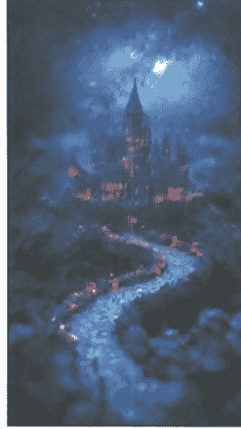

#### 选择正确的模型

在以文生图的过程中，选择合适的模型无疑是奠定图片效果基调的关键步骤。这一选择不仅影响着图像的整体风格，还深刻决定了图像细节的丰富度与准确性。

例如，在即梦AI平台中，目前有五大模型可供选择，不同的模型对应不同的生图表现效果，如下左图所示。在奇域平台中，“创作宝典”的选择相当于选择不同的模型，如果想要生成具有光影构图效果的创意图像，就要选择“插画”一栏中的相关风格，如下右图所示。

如果使用的是Stable Diffusion及ComfyUI，则模型选择更为重要，模型选择错误有可能导致创作者多走许多弯路。

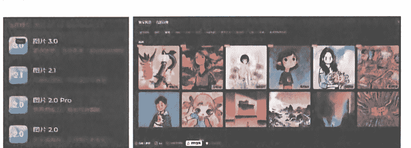

## 图生图生成方式

图生图也是各大 AI 绘画平台生图的方式之一，和文生图一样，尽管不同平台的操作方式可能有所不同，但其基本原理是相似的。简单来说，是基于原图进行二次创作的过程。创作者给出一张参考图，AI 会根据这张图以及创作者提供的提示词或图像模型等参数，生成一张新的图片。以下为图生图创作方式的一些概述和通用技巧。

### 图生图生成方式的作用及意义

图像可控性高：图生图是基于现有图像进行创作的，通过图生图方式生成的图片可控性更高一些，这种方法不仅保留了原始图像的细节和风格，还能通过 AI 的加工实现艺术性或风格化的提升。

创造性：通过图生图技术能够将一张图像的艺术风格迁移到另一张图像上，创作出新的艺术作品。例如，将一张普通的照片转化为凡·高风格或毕加索风格的绘画作品，这种跨界的艺术创作方式，为艺术家带来了全新的视觉体验，也拓宽了艺术创作的无限可能。

### 图生图生成技巧

在使用 AI 绘画进行图生图的过程中，有几个关键点需要注意，以确保生成的图像既符合预期又富有创意。

#### 选择合适的参考图

选择合适的图片作为参考是图生图成功的关键一步。选择上传的参考图应该与想要生成的图像构图及基本元素相匹配，这样才能保证生成的图像彼此相似。

#### 注意重绘幅度

重绘幅度是图生图的一个重要参数，各个平台基本上都提供了此控制参数，它决定了生成的图像与参考图的相似程度。数值越低，生成的图像越接近参考图；数值越高，生成的图像与参考图的差距也就越大，生成的图像的画风也越接近使用的提示词和模型。

例如，在可灵 AI 平台的提示词文本框中输入“动漫 3D 风格，超写实油画，神秘女巫在森林中施展魔法，五官清晰，辛烷渲染，光线追踪，景深，超级细节”，上传的参考图如右图所示。

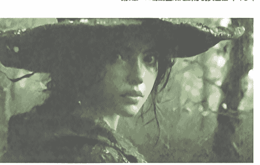

当设置“参考强度”为“弱”时，生成的图像效果如下组图所示。

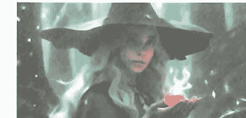

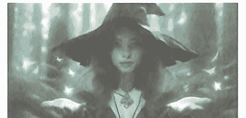

当设置“参考强度”为“较弱”时，生成的图像效果如下组图所示。

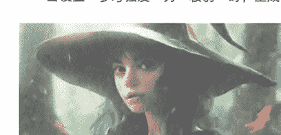

当设置“参考强度”为“中”时，生成的图像效果如下组图所示。

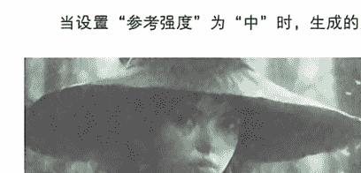

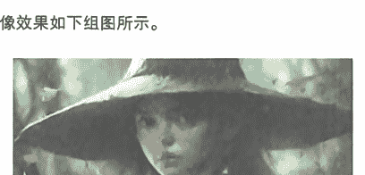

当设置“参考强度”为“强”时，生成的图像效果如下组图所示。

当设置“参考强度”为“较强”时，生成的图像效果如下组图所示。

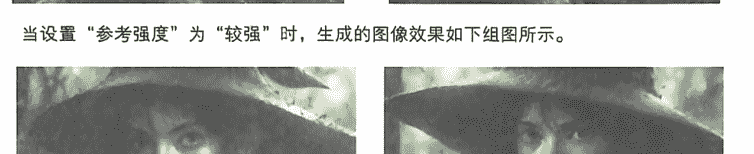

当使用 Stable Diffusion 以及 ComfyUI 等平台进行图生图时，要控制的参数通常是“降噪”，此数值越高则重绘幅度越高，两张图的相似度越低；反之，则越高。

#### 关注参考图的质量

参考图的质量直接影响到生成图像的效果。高质量的参考图能够提供更多的细节信息，有助于AI生成更精细的图像。因此，在选择参考图时，应该尽量选择清晰、无噪点、分辨率高的图片。此外，参考图的质量还包括图片的内容质量，即图片中的元素是否清晰、布局是否合理等。这些都会影响到AI对图片的理解和处理。

#### 应对大尺寸参考图片的方法

如果参考图尺寸较大，有可能出现无法生成或者生成速度极慢的情况。此时，可以使用 Photoshop 对图像进行裁剪，将需要以图生图进行重绘的重点区域裁剪出来。重绘后，再将图片拼回原图。

例如，右图 1 所示是尺寸为 1792 × 2688 的图像，重绘的主体在画面中所占的比例较小，因此需要借助于 Photoshop 将需要重绘的主体裁剪成为 803 × 1080 的图像，如右图 2 所示。

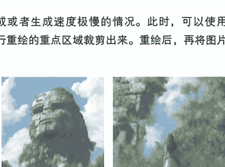

针对裁剪后的图像进行重绘，重绘后的效果如右图 1 所示，之后在 Photoshop 中将重绘后的图片拼回原图即可，最终效果如右图 2 所示。

#### 选择合适的生图平台

图生图可以分为两种方式。第一种是使用即梦 AI、可灵 AI、商汤秒画等 AI 平台，使用内置的生图选项来控制图生图的效果，可以进行不同参考风格的选择，并且在上传参考图后，可以选择参考图的主体、人物长相、角色特征、风格、边缘轮廓、景深、人物姿势，如下图所示。

这些平台通常提供了一系列预设的参数和选项，允许创作者通过调整这些设置来影响生成图像的风格、色彩、细节程度等。这种方式简单直观，适合那些希望快速生成符合特定需求的图像，而不需要深入了解图像生成技术细节的创作者。

第二种方式则是使用 Stable Diffusion 等更专业的图像生成工具。这种方式的优势在于其灵活性。通过调整模型的参数、使用不同的数据集进行训练，或者结合其他图像处理技术，创作者可以生成具有独特风格、高度定制化的图像。

## 保持主体一致性

在 AI 短剧创作中，保持主体一致性是确保叙事连贯性与观众沉浸感的关键。主体一致性指角色、场景或物体在视频生成过程中保持外观、风格和特征的稳定，避免因 AI 技术局限性导致的形象突变或细节失真。这一要求直接关系到短剧的专业性和商业价值，若角色在不同镜头中的面容、服饰或动作不一致，会破坏故事逻辑，导致观众出戏，降低内容可信度；而场景或道具的变形则可能削弱视觉冲击力，影响广告植入等商业化场景的效果。

现在，许多平台已经内置了主体参考功能，用来保持主体的一致性。

### 用即梦 AI 保持主体一致性

接下来通过即梦 AI 平台来讲解保持主体一致性的方法。

1. 打开 https://jimeng.jianying.com/ 网址，进入即梦 AI 首页界面，如下图所示。

2. 单击“图片生成”文本框中的按钮，上传参考图，上传后的界面如下左图所示。
3. 选择参考图的参考项，如可以参考角色特征、主体、风格特征、边缘轮廓、景深、人物姿势，这里选择了“人像写真”参考项，如下右图所示。

4. 单击“保存”按钮后，文本框中会显示相关内容。
5. 在文本框中输入想要生成的单人场景，笔者输入的提示词为“参考图片中的人像，人物穿着改成身着黑色西装，站在城市夜景的街头，潮玩风格，中景，酷炫时尚氛围，光影对比强烈，人像写真。”如下图所示。

6. 选择“生图模型”为“图片 3.0”，如下左图所示。

7. 设置图片比例为 9 : 16，图片分辨率为标清 1K，如下右图所示。

8. 单击文本框右侧的 ◆ 2 按钮，即可生成效果图，生成的图片如下组图所示。

下面展示即梦 AI 其他参考项的参考效果。

#### 智能参考

即梦 AI 的智能参考功能可以通过一句话指令实现精准改图，包括增减主体、换装换人、改动作、改场景、改风格等操作，无须复杂的涂抹描边。

笔者上传的参考图如下左图所示，相关参考设置如下右图所示，在文本框中输入“给图片换模特，衣服保持不变。模特修改成中年阿姨。”。

更改模特后得到的效果如下组图所示。

#### 参考角色特征

用户上传参考图片后，AI 会提取角色的发型、服装、体型等外观特征，应用于新生成的图像中，确保角色形象在不同的场景下保持一致。

该功能特别适合漫画、游戏或故事创作，用户只需指定一次角色特征，即可在后续生成中维持统一的风格，无须重复调整细节。笔者上传的参考图如下左图所示，相关参考设置如下右图所示。

输入提示词“大海，落日夕阳”，更改背景后得到的效果如下组图所示。由此可以看出，虽然主体的衣服变了，但是人物的主体角色特征是没有变化的。

#### 主体识别

用户上传参考图后，即梦 AI 的参考图“主体识别”功能会自动识别并提取图中的核心主体（如人物、动物或物体），保留其整体。在生成新图片时，该主体可被迁移到不同的风格或场景中，确保主体的一致性，适用于换背景、风格迁移等创作需求。

笔者上传的参考图如下左图所示，相关参考设置如下右图所示。

输入提示词“森系的花园”，得到的效果保留主体，换背景的效果如下组图所示。

#### 风格参考

用户上传参考图后，使用即梦 AI 的“风格参考”功能可一键复制其整体艺术风格（如日系、赛博朋克或复古油画等），无须手动描述复杂的风格特征即可生成统一调性的作品。

操作时只需在参考图选项中勾选“风格参考”，并设置其参考强度，系统会自动提取参考图的色彩、笔触、氛围等元素，应用于新生成的图片，确保风格一致性。

需要注意的是，参考强度越强，新生成的图片风格越接近上传的参考图风格，参考强度越低，越不像参考图的风格。

上传的参考图如下左图所示，相关参考设置如下右图所示。

输入提示词“有个性的小猫”，得到的效果如下组图所示，可以看出小猫的整体风格和上传的参考图的图片是保持一致的。

#### 边缘轮廓

“边缘轮廓”参考功能是通过提取原图的物体轮廓线（如主体形状或结构骨架），指导新生成的图片保持相同的构图布局和空间关系。这一功能特别适用于需要严格复刻原始画面框架的场景。

上传的参考图如下左图所示，相关参考设置如下右图所示。

参考上传的参考图的边缘轮廓得到的效果如下组图所示。

#### 景深

即梦 AI 的“景深”参考功能通过模拟相机景深效果，使背景模糊程度随距离主体远近而渐变，从而突出画面主体并增强立体感。

用户上传图片后，系统自动识别焦点区域并生成景深图，快速实现专业级虚实层次，提升画面艺术性。

上传的参考图如下左图所示，相关参考设置如下右图所示。

参考上传的参考图的景深后得到的效果如下组图所示。

#### 人物姿势

即梦 AI 的“人物姿势”参考功能支持用户通过上传参考图，精准复刻图中人物的动作姿态（如战斗、舞蹈等），使得新生成图像中的人物姿势与参考图一致，从而提升作品的连贯性和艺术表现力。

该功能适用于多人物场景，能稳定控制不同角色的动作协调性，为创作注入更强的故事性和视觉动态感。上传的参考图如下左图所示，相关参考设置如下右图所示。

参考上传的参考图的人物姿势得到的二次元动漫效果如下组图所示。

### 用豆包保持一致性

在使用豆包生成多场景分镜图片时，能稳定保持角色的服饰细节、外貌特征及整体风格，确保不同镜头间的视觉连贯性，具体操作步骤如下。

1. 打开豆包官方平台，单击左侧的“图像生成”按钮，在文本框中输入提示词，笔者输入了“生成短剧12个分镜：一对夫妻车站分离的场景。”如下图所示。

（2）单击按钮即可生成分镜头文本及对应的图片，豆包生成的部分内容如下图所示。虽然通过这个提示语生成的分镜头图片较多，但仍然能够在各个镜头之间保持较好的主体一致性。例如，从第一个分镜的车站外的画面到第二个分镜的车站内的送别画面，再到第二个分镜的离别时伤心的画面，镜头的衔接及人物主体效果都不错。

接下来我将为你呈现这对夫妻车站分离场景的 12 个分镜，这对夫妻有着利落的短发，身着蓝色衬衫搭配黑色西装裤；妻子则是一头柔顺的长发，穿着粉色连衣裙。

第一个分镜：画面是写实风格，正面视角，场景是车站外，阳光洒在地面，人来人往。丈夫提着行李箱，妻子站在旁边，两人慢慢走向车站入口。

第二个分镜：画面是写实风格，侧面视角，场景来到车站大厅，人群熙攘。丈夫和妻子站在大厅中央，妻子眼神有些不舍，轻轻拉住丈夫的衣角。

第三个分镜：画面是写实风格，特写视角，聚焦在妻子的脸上，她眼眶微微泛红，泪水在打转。

第四个分镜：画面是写实风格，中景视角，丈夫伸出手，轻轻为妻子抹去眼角的泪水，脸上带着温柔的微笑。

需要注意的是，在具体的生成过程中，会出现不准确的小细节，例如第四个分镜中男主的头发长度与前几个镜头中的头发长度是不一致的，因此豆包生成的连续镜头图片适合于轻量级的、要求不是很高的短剧画面的制作。

### 用 Kontext 保持一致性

FLUX.1 Kontext 是由 Black Forest Labs 开发的 AI 图像生成与编辑模型，其核心优势在于通过上下文感知技术实现跨场景的高一致性编辑。该模型基于生成流匹配（Flow Matching）架构，结合多模态融合机制，能够精准理解文本与图像输入的语义关联，确保在对象修改、风格转换或背景替换等任务中保持角色特征、构图布局的稳定性。

（1）打开 https://www.liblib.art/ 网址，进入哩布哩布 AI 网站并登录，单击页面左侧导航栏中的“在线生成”选项，进入哩布哩布 WebUI 创作页面，如下图所示。

（2）在 CHECKPOINT 下拉列表中选择 F.1 Kontext_full.safetensors，将页面下滑，单击“图片参考（可选）”选项，在打开的图片上传区域单击“从本地上传”按钮，上传参考图，笔者上传了一张美女图片和一张小猫图片，如下图所示。

（3）在“提示词”文本框中，输入想要生成的图片的画面描述。例如，笔者想生成一张美女抱着小猫的图片，输入提示词“一位美女抱着小猫”，单击文本框右上方的“翻译为英文”按钮，将提示词翻译为英文，如下图所示。

（4）单击“开始生图”按钮，便会生成一张美女抱着小猫的图片，如下右图所示，通过对比下左图和下中图，可以看到美女与小猫基本保持了一致性，没有非常大的变化。

（5）为了继续检测人物一致性的效果，笔者打算再给生成的图片换个背景。单击按钮，将图片发送到“图生图”选项卡中，“生图模式”选择“常规”，“图像比例”选择“智能匹配”，其他选项保持不变，如下图所示。

（6）因为要给图片换背景，所以在提示词文本框中输入“将背景换为图书馆”，单击文本框右上方的“翻译为英文”按钮，将提示词翻译为英文，如下图所示。

（7）单击“开始生图”按钮，便会将图片的背景换为图书馆，人物也没有发生变化，如下左图所示。再将提示词改为“将美女的衣服换为白色连衣裙”，再次生成一张图片，人物同样没发生变化，如下右图所示。

## 根据分镜头脚本生成关键帧画面

用 AI 根据分镜头脚本生成关键帧画面是一个需要反复调试与妥协的过程。首先，分镜脚本需要精确描述每一帧画面的构图、色调、光影和动态元素，但 AI 在理解复杂叙事意图时往往存在偏差。

在生成关键帧的过程中，即使输入了详细的提示词和参考图，AI 仍可能因模型特性（如随机性）导致动态细节背离提示词描述，需要多次调整权重参数甚至更换模型才能优化，最终有可能需要通过“AI 辅助 + 人工精修”的混合模式实现创作目标。因此，生成关键帧的工作，不仅需要技术、耐心，有时甚至需要一点点运气。

在第 5 章已经生成了中国传统神话故事的短剧脚本，接下来使用此脚本生成具体的分镜头图片画面。

### 生成主要人物形象

在短剧创作中，确定主要人物形象是关键环节。人物形象是让观众产生情感共鸣的核心载体，以前面生成的短剧剧本第 1 集为例，主要人物有轩辕尘、赤炎灵鹿、轩辕尘的母亲、黑衣蒙面人。设计其形象的具体操作步骤如下所示。

（1）用 DeepSeek 根据分镜头脚本生成人物描述的提示词文本，单击文本框右下方的📎按钮，上传短剧的分镜头脚本。文件上传完成后，在文本框中输入如下图所示。

（2）AI 给出的关于人物描述的提示词文本指令如下。

第1集《神农避瘴，赤炎灵鹿现》主要角色人物描述

1. 轩辕尘

面部特征：

面部轮廓分明，下颌线条略显方正，颧骨稍高但不过于突出。

眉毛浓密呈深褐色，眉形略带弧度，眼神坚定而深邃，眼瞳为深棕色。

鼻梁挺直，鼻翼适中，嘴唇较薄，嘴角常微微上扬。

头发为黑色，长度至肩，略显凌乱但不失整洁，部分发丝因汗水贴在额头。

体型数据：

身高约180厘米，肩宽约45厘米，身材匀称且结实。

肌肉线条明显但不夸张，手臂和腿部肌肉发达，展现出长期跋涉与劳作的体魄。

服饰细节：

上身穿一件灰色粗布短衫，袖口挽起至肘部，衣襟敞开露出古铜色肌肤。

下身着深褐色长裤，裤脚束紧便于行动，材质为耐磨的麻布。

腰间系一条棕色皮质腰带，挂有一个小药囊和一把匕首。

脚穿一双简陋的草鞋，鞋底已磨损但仍然牢固。

背后背着一个竹篓，内装各类药材和工具。

2. 母亲（轩辕尘的母亲）

面部特征：

面容清秀，皮肤略显苍白，眼角有细纹，显示岁月的痕迹。

眉毛稀疏但仍整齐，眼睛略显疲惫，眼眶周围有些许黑眼圈。

鼻梁小巧，嘴唇颜色偏淡，嘴角偶尔浮现虚弱的笑容。

头发为灰白色，盘成简单的发髻，几缕白发垂落在额前。

体型数据：

身高约160厘米，身形瘦弱，肩膊单薄。

手臂和腿部肌肉松弛，整体显得病态无力。

服饰细节：

穿一件浅蓝色棉布长裙，裙摆边缘略有磨损。

衣服上有补丁，但清洗得干净整洁。

胸前挂着一条银质项链，链坠是一片刻有符文的叶子形状。

无实际衣物，全身覆盖着红色羽毛，毛发在阳光下闪烁微光。

鹿角周围环绕着淡淡的粒子光芒，如同光环一般。

......

因篇幅有限，这里只展示了 AI 生成的部分角色的形象描述。

（3）接下来用即梦 AI 生成人物形象图片。打开即梦 AI 官方平台，单击左侧菜单栏中的“图片生成”按钮，进入图片生成界面，在文本框中输入“面部特征：面部轮廓分明，下颌线条略显方正，颧骨稍高但不过于突出。眉毛浓密呈深褐色，眉形略带弧度，眼神坚定而深邃，眼瞳为深棕色。鼻梁挺直，鼻翼适中，嘴唇较薄，嘴角常微微上扬。头发为黑色，长度至肩，略显凌乱但不失整洁，部分发丝因汗水贴在额头。体型数据：身高约 180 厘米，肩宽约 45 厘米，身材匀称且结实。肌肉线条明显但不夸张，手臂和腿部肌肉发达，展现出长期跋涉与劳作的体魄。服饰细节：上身穿一件灰色粗布短衫，袖口挽起至肘部，衣襟敞开露出古铜色肌肤。下身着深褐色长裤，裤脚束紧便于行动，材质为耐磨的麻布。腰间系一条棕色皮质腰带，挂有一个小药囊和一把匕首。脚穿一双简陋的草鞋，鞋底已磨损但仍然牢固。背后背着一个竹篓，内装各类药材和工具。”如下图所示。

（4）选择“生图模型”为“图片 3.0”，如下左图所示；设置图片比例为 3 : 4，如下右图所示。

（5）单击下方的 ✦ 按钮，即可生成角色形象，生成的图片如下图所示。

（6）按照上述方法生成剧本中的其他角色形象，生成的赤炎灵鹿的形象如下左图所示，轩辕尘母亲的形象如下中间图所示，黑衣蒙面人的形象如下右图所示。

主要人物生成完成之后，可以通过参考人物角色来生成短剧故事画面内容，以此来保证短剧中人物角色的统一性。

### 生成关键帧画面

用 AI 绘画工具生成短剧画面的核心思路是：以分镜头脚本为基准，提取每个镜头的视觉元素（如场景、角色动作、光影风格等），转化为精准的提示词生图文本，通过 AI 生图工具生成画面，并通过多轮调整确保风格统一和叙事连贯。具体操作步骤如下。

（1）打开 DeepSeek，单击文本框右侧的 @ 按钮，上传分镜头脚本文件，在文本框中输入“请依据文档里分镜头脚本的具体内容，为脚本中的每个镜头生成精准匹配画面要求的 AI 生图静态提示词。提示词必须涵盖主体对象（明确具体人物或场景）、景别、光影氛围、构图角度以及风格样式等核心画面描述要素。要保证整个短剧所有镜头的图片在风格上保持统一，并且使生成的提示词能让 AI 准确输出符合预期的静态图片。”如下图所示。

（2）单击右侧的按钮，即可生成相关的提示词文本。生成的部分内容如下。

镜头1：村庄外（日，室外）
提示词：远景，俯视视角，村庄被黑雾笼罩，村民横躺呻吟，枯树摇曳，远处山脉泛着诡异红光。低沉的危机氛围，以暗色调为主，带有动态黑雾效果，写实风格。

镜头2：村庄内（日，室内）
提示词：中近景，平视角度，轩辕尘跪在病榻前，紧握母亲的手，眉头紧锁，额头渗汗，床边药碗打翻，草药散落一地。昏黄的灯光下，画面充满紧张与悲伤情绪，细腻写实风格。

镜头3：山林入口（日，室外）
提示词：全景，仰视角度，轩辕尘背起竹篓，决然地踏入山林。镜头从脚下的泥泞拖至参天古树，藤蔓缠绕，萤火虫忽明忽暗。自然光影柔和，绿色植被丰富，空灵梦幻风格。

（3）提示词文本生成完成后，打开即梦 AI 绘画工具，进入图片生成界面。在文本框中输入刚生成的画面描述提示词。需要注意的是，在描述的过程中，需要对生成的文本进行优化。要注意要将脚本中角色的名字用具体的形象描述，如“轩辕尘”用男生之类的词代替，要在描述的过程中加入想要的具体的图片风格和人物着装风格。
接下来开始生成分镜 1 的画面，输入的提示词为“远景，俯视视角，村庄被黑雾笼罩，村民们横躺呻吟，枯树摇曳，远处山脉泛着诡异红光。低沉的危机氛围，以暗色调为主，带有动态黑雾效果，写实风格。”

（4）选择“生图模型”为“图片 3.0”，如下左图所示；选择图片比例为 9：16，如下右图所示。

（5）单击下方的“立即生成”按钮，即可生成分镜 1 的图片，如下左图所示。

（6）按照以上方法生成其他分镜图片。需要注意的是，分镜 1 中没有出现故事中的主要人物，所以不需要参考生图，从分镜 2 开始就出现了主要人物。此时，需要参考生图，在文本框中输入“古神话背景下的生死离别场景，平视，中景，展现跪地男子与病榻老妇的互动，男子凌乱的黑发垂落肩头，眼神悲痛，老妇人青筋凸起的手腕与男子紧握的手形成视觉焦点，散落的陶制药罐与龟裂的地砖暗示贫寒的处境，背景竹简医书和青铜香炉增添时代感，古典油画质感，烛光暖调与暗部冷蓝交织，细腻皮肤纹理刻画。”

（7）单击按钮，上传轩辕尘的图片作为参考图，选择“人像写真”复选框，如下右图所示，单击右下方的“保存”按钮。

（8）根据以上操作再上传第2张参考图——轩辕尘母亲的图片。需要注意的是，上传第2张参考图后，会出现“参考合影”参考模式，选择该参考模式，如下图所示。

（9）生图模型依旧选择“图片3.0”模型，将图片比例设置为9：16。

（10）单击下方的“立即生成”按钮，即可生成分镜图片，如下右图所示。按照以上方法生成其余分镜的图片即可。

# 第 7 章 AI 辅助生成短剧分镜头视频

## 文生短剧视频的优劣势

在短剧创作中，视频画面生成主要分为两种方式：基于文字描述直接生成视频，或通过已有图片衍生视频内容，两种方法各有其适用场景与独特优势。接下来讲解这两种视频生成方式。

### 文生视频的优势

文生视频操作比较简单易行，操作流程已经相当直观，即使是初学者也能快速上手。在生成视频的过程中，创作者可以轻松地将自己的想法和创意融入视频制作，以更加契合期待的视频效果样式。

对短剧创作来说，文生视频适用于剧集中复杂场景的搭建，通过输入文字描述快速生成虚拟场景，如古风庭院、未来城市、神话仙境等，替代传统实景搭建或绿幕拍摄，显著降低场景成本。

例如，输入“纯白色未来城市，空中之城，科幻建筑，镜头慢慢推近，聚焦建筑群，河水流淌，高清。飘浮在天空中的圆形球体建筑，建筑像气球一样飘浮在空中。”生成的视频效果如下组图所示。

创作者也可以直接通过文本生成爆炸、魔法、科幻等高成本特效，同时可模拟多机位运镜、镜头切换等复杂的拍摄手法。还可通过调整提示词实现运镜参数切换，甚至停留在特定帧进行精修，提升画面表现力。

此外，文生视频常用于生成对场景、效果要求不高的空镜头，用于低成本视频项目或制作预演阶段的快速视觉填充。

### 文生视频的劣势

当前文生视频技术依赖于大规模数据集进行模型训练，这些数据集往往偏向于常见场景和主题。因此，当面对如粒子效果视频、数据可视化视频等不常见的题材时，由于模型缺乏足够的先验知识，生成的视频质量可能大打折扣，包括但不限于画面细节模糊、逻辑连贯性差等问题。

在通过文本输入描述想要生成的视频内容时，往往存在语言表述模糊和主观的问题。这种模糊性对于处理常见场景可能影响不大，但在面对复杂或不常见的题材时，模型难以准确捕捉并转化为高质量的视觉表达，导致视频效果与预期产生偏差。

例如，输入“层层叠叠的火剑组成环形，环形中间是身穿华丽白袍的年轻男修真者，右手两指指向前方，大电影风格，远景青山如影，玄幻，唯美，惊艳，高清。真人摄影写真，背景是古战场。厮杀惨烈，史诗级古装电影战争场景。实拍。低饱和度、低明度。”生成的视频效果如下组图所示。生成的最终效果和提示词描述的画面是有差距的。

文生视频在处理多人场景时容易导致运镜混乱、角色位置重叠或动作不同步等问题。例如，在打斗场景中，画面常常显得混乱扭曲，如下组图所示。

此外，短剧通常依赖角色间的对话、眼神交流等细微互动来推动剧情发展。然而，文生视频在细节处理上存在明显劣势，生成的肢体语言往往僵硬、模式化，难以精准传递层次丰富的情感；而场景元素的象征意义易沦为刻板的符号，缺乏与情节的自然交融。

## 文生视频生成技巧

- 语言简洁：尽量说简单的话，不要用太复杂的词句。
- 情节简单：太复杂的情节会影响AI的理解，所以最好限制在5～10秒内能呈现清楚的内容。
- 不要使用精确的数字：现在的大模型对数字还不太敏感，比如“10只小兔子在森林里”，可能生成视频中小兔子的数量对不上。
- 物理运动限制：复杂的运动，像球弹来弹去或高空扔东西，这类视频生成有点困难。
- 使用简单直接的表述：不要使用过于抽象的词汇，确保使用的是最简单、最直接的表述。同时避免使用成语，否则，可能导致 AI 难以理解提示词内容，使生成的视频难以达到理想的效果。例如，“工作室灯光”，在摄影领域中特指在摄影工作室或摄影棚内使用专业灯具创造的一种照明效果、这种效果通常能够确保光线明暗适宜且对比度恰到好处。然而，AI 在面对“工作室灯光”这一专有名词时，可能会误拆解为“工作室”和“灯光”两个独立的部分，生成两个独立的个体。这是一种由于 AI 对语言含义理解不足而造成的现象，尤其是在处理复合词的情况下。

## 图生短视频的优劣势

### 图生视频的优势

图生视频是一种基于静态图像生成动态视频的技术，它允许创作者直接上传任意图片作为起始点，通过直观的操作将现有视觉素材快速转化为视频。这种技术大幅降低了视频创作的门槛，尤其适合需要从现有素材出发快速生成内容的场景。

图生视频的核心优点主要体现在以下几个方面。首先，它具有高度的个性化与创意性，创作者可通过添加提示词精准控制图像的运动方式，为静态图片赋予动态效果和特定故事情节，从而创作出风格独特的视频作品，同时增强对短剧整体风格的可控性。

例如，上传如下左图所示的静态图片，输入“纯主体保持静止，镜头快速围绕主体旋转一个完整的 360 度的圆圈，展示静止瞬间的三维空间。男性武者腾空飞踢，鱼眼畸变仰拍视角强化足部透视冲击，中华传统道教服饰。道教传统阴阳布鞋，三缕长髯，仙风道骨，白色长发，呈气浪特效，8K 超清捕捉腿部肌肉线条和布料拉伸纤维，绿色竹林背景落叶飘散，在空中，虚幻引擎渲染速度线残影，写真风格。”生成的视频效果如下中间图和右图所示。

其次，其应用场景极为灵活，无论是商家展示产品动态效果，还是个人创作趣味内容，均可轻松实现，并支持多种宽高比输出，适配不同平台的发布需求。

此外，图生视频能生成流畅且符合物理规律的视频，精准捕捉图像细节并赋予其生动自然的动态效果，显著提升视觉表现力。

### 图生视频的劣势

尽管图生视频技术取得了显著进展，但仍存在一些局限性。AI 在处理复杂的图像时，尤其是毛发、纹理或光影变化等细微元素时，可能难以在动态视频中完美呈现，导致生成的视频效果不够细腻和逼真。

例如，上传如下左图所示的静态图片，输入“火凤凰扇动翅膀向高空飞去”，生成的视频效果如下中间图和右图所示。可以看出视频中火凤凰的画面是逐渐崩坏的。

其次，运动轨迹的预测与生成存在一定限制。AI 需要基于静态图片推断合理的动态效果，但若对图像内容理解不足或对运动规律预测出现偏差，生成的视频可能出现不自然或不符逻辑的动作，影响观感。

此外，由于图生视频完全依赖输入图片的信息，AI 难以超越原始素材的框架自由发挥，可能无法完全实现使用者的创意构思，限制了视频内容的多样性和个性化表达。

## 图生视频操作技巧

- 遵循物理原理：在描述运动的画面时，要遵循物理原理，让视频中的运动看起来像是真实世界中会发生的，比如物体下落时速度加快，或者物体被推动时会朝力的方向移动。
- 利用图片中的潜在运动：尽量想象并描绘出图片中可能发生的自然运动，比如树叶随风轻轻摇曳，河水缓缓流淌。
- 避免大幅偏差：如果视频描述的运动与图片内容相差太远，可能会感觉视频画面的衔接不连贯，就像镜头突然切换了一样。
- 简化复杂的运动：目前的技术可能还难以完美呈现复杂的物理运动。因此，尽量选择那些相对简单、易于表现的运动场景。为了保持创意的清晰与易实现，推荐聚焦于单一且明确的变化方向，确保这一变化既符合逻辑又能在视觉上产生新颖的效果。

## 利用首帧精准控制视频起始画面

上传首帧图片作为短剧生成的起点，能够显著提升视频内容的一致性和创作效率。首帧图片为 AI 模型提供了明确的视觉参考，确保生成视频的风格、角色和场景保持高度统一，避免了传统文生视频中常见的角色变形或风格跳跃问题。通过首帧图片的视觉锚定，模型可以更精准地理解用户意图。

下面以第 6 章生成的图片为例，将生成的图片作为首帧图片开始生成视频画面。具体操作步骤如下。

（1）打开可灵 AI 平台，进入视频生成界面，单击左侧菜单栏中的“图生视频”按钮，如下图所示。

（2）在左上方选择“可灵 2.0 大师版”模型，如下左图所示。

（3）单击图按钮，上传第 6 章生成的分镜 1 的图片，上传后如下右图所示。

（4）在下方的文本框中输入“远景，俯视视角，镜头慢慢推近，村庄被黑雾笼罩，村民横躺呻吟，枯树摇曳，远处山脉泛着诡异红光。动态黑雾缓缓流动，低沉的危机音效贯穿始终，以暗色调为主，写实风格。”设置生成的视频时长为 5s，设置生成数量为 1 条，如右图所示。

（5）单击下方的“立即生成”按钮，即可生成动态视频，画面如下组图所示。

（6）按照以上方法，生成的分镜 2 的视频画面如下组图所示。

## 利用尾帧图片技巧增强视频可控性

只上传尾帧图片生成短剧主要是通过 AI 技术实现动态内容的逆向推导的，其核心在于利用尾帧作为目标画面，由 AI 根据一定的文本描述自动补全从初始状态到尾帧的连贯动画或场景过渡。这一功能尤其适用于需要精准控制结局或关键帧的创作场景，例如角色换装、场景切换或特效衔接。具体操作步骤如下。

（1）进入可灵界面后选择可灵 1.6 模型，仅上传尾帧图片，上传的图片如下左图所示，图片上传后的界面如下右图所示。

（2）在“图片创意描述”文本框中，输入“男孩慢慢地摘下面具，最后露出了半张脸”。设置“创意相关”为 0.75，设置“生成模式”为“高品质模式”，设置“生成时长”为 5s，如右图所示。

（3）单击下方的“立即生成”按钮，即可生成一段 5s 的视频，如下组图所示，可以清楚地看到男孩正在慢慢地摘下面具，最后露出了半张脸，也就是上传的尾帧图片的效果，由此更有效地控制了画面的内容。

## 利用首尾帧技术控制视频过渡

通过 AI 可以利用首尾帧精准控制视频生成效果，这使得视频编辑更加灵活和高效。通过首尾帧图片的设定，可以标记出视频的起始点和结束点画面，让视频内容具有一定的流畅性和完整性。需上传的首帧和尾帧图片必须保持风格的相似性，否则会造成视频前后内容的割裂。下面通过一个简单的示例，讲解其操作步骤。

（1）进入图生视频编辑界面，选择可灵 1.6 模型，单击按钮，上传首帧图片素材，如下图所示。

（2）单击图标，打开上传尾帧的界面，如下左图所示。

（3）上传尾帧图片，如下右图所示。

（4）首尾帧图片都上传完成后界面如下左图所示。

（5）在“图片创意描述”文本框中，输入“汉服古装女孩，从画中走出来”，设置“创意相关”为 0.75，设置“生成模式”为“标准模式”，设置“生成时长”为 5s，如下右图所示。

（6）单击下方的“立即生成”按钮，即可生成一段 5s 的视频，如下组图所示。

从视频画面中可以清楚地看到整个画面的主体是相似的，镜头的变化过渡比较平滑，是场景自然而然的变化过程。

### 首尾帧生成视频使用技巧

#### 生成背景不动主体平滑过渡的视频

背景不动主体平滑过渡的视频是指视频中的背景保持一致，而主体（如人物、物体等）在画面中呈现自然流畅的移动或变化效果。

在生成背景不动主体丝滑过渡的视频时，上传图片素材时一定要注意首尾帧中的主体变化是小范围变化，如果主体有一定的相关性，会出现较好的视频效果；反之，则会出现过度生硬、视频流畅度不佳等问题。

下左图为上传的首帧图，下右图为尾帧图。

下面的组图为生成的视频截图，可以看出视频中画面过渡很流畅，机器人自然地进行了变身。

也就是说，当背景不变主体发生变化时，AI会根据提示词尝试寻找两个图像的主体间符合逻辑的关系，并依照这种关系生成视频。如果两个主体间的关系难以确立或超出常规，则难以生成令人满意的视频。

#### 生成主体不动背景平滑转换的视频

主体不动背景平滑转换的视频是指主体保持静止不动，而背景平滑过渡到不同场景的一种视频生成技巧，适用于突出固定对象的视觉效果。这种模式特别适合生成主体简单明确且场景变化的视频，例如自然展现在不同背景下的一个人，创造出流畅的视觉叙事。但要注意上传的首尾帧图片中的主体必须是清晰明确、轮廓分明的，且周围背景不宜过于复杂或有大量细节干扰，否则易导致视频生成效果较差、画面出现模糊或失真问题，影响整体质量。

下左图为首帧图，下右图为尾帧图。

下面的组图为生成的视频截图，可以看出视频画面中以人物为中心，镜头开始随着人物的走动移动，后面背景随着镜头的移动而发生变化。

也就是说，当主体不变背景发生变化时，可灵 AI 会根据提示词尝试从首帧背景逐渐变化到尾帧背景，因此如果两张图片的背景相似度较高，具有连续性，则视频画面变化会比较顺畅，如果区别过大，则难以生成令人满意的视频。

#### 生成旋转效果的视频

生成旋转效果的视频是指通过设定首帧和尾帧的画面状态，由 AI 自动生成中间过渡帧，从而形成物体或场景的平滑旋转动画。下左图为首帧图，下右图为尾帧图。

提示词：全景运镜，一艘潜水艇在深海中航行，突然海底传来巨大的震动，海水开始翻腾。翻腾后特写运镜，一只巨大的章鱼状深海巨兽从海底升起，它的触手缠绕着潜水艇，潜水艇里的船员们惊恐万分。得到的效果如下组图所示，可以看出通过海底中船的旋转实现了画面的丝滑转化。

#### 生成画面穿梭效果的视频

首尾帧穿梭效果是利用 AI 自动生成中间过渡帧，从而实现画面主体或场景自然流畅转换的视觉技术。这种效果通常通过两张具有承接关系的图片作为输入，由 AI 分析画面中的元素并推理出合理的运动轨迹、光影变化等中间过程，最终生成连贯的动态视频。它能够创造出时空穿梭、季节变换或物体变形等梦幻般的视觉效果。下左图为首帧图，下右图为尾帧图。

提示词：第一人称视角，镜头穿梭，穿过建筑的大门，摄像机如身临其境般高速穿梭，到达第二场场景，行动中产生强烈的动感模糊，模拟人眼视觉惯性，穿梭的沉浸式体验仿佛正亲历这场风驰电掣的空间穿越镜头。得到的效果如下组图所示，可以看出两个空间完成了丝滑的穿梭转化效果。

#### 生成出水转场效果的视频

首尾帧出水转场效果是一种通过首帧和尾帧来实现从水中到水外的视觉平滑过渡效果。在首帧（如人物或物体位于水下场景）和尾帧（同一主体完全露出水面的场景）之间自动生成中间帧，形成“破水而出”的连贯视觉效果。下左图为首帧图，下右图为尾帧图。

提示词：水底有很多泡泡，几只海马在水底兴高采烈地打牌，突然上面伸下来一只大手把中间的那只海马给抓出去，摄像机跟随着手的移动浮出水面，外面是一个繁华的菜市场，有台秤。得到的效果如下组图所示，可以看到海马被一只手从海底抓到了水面上，实现了丝滑的转场。

#### 生成画中画效果的视频

首尾帧画中画效果是通过首帧和尾帧画面中的元素，实现主画面中嵌套的子画面从首帧状态平滑变化到尾帧状态的效果。下左图为首帧图，下右图为尾帧图。

提示词：机器人骑着鸵鸟飞奔，摄像机不断拉远，变成电视里场景，旁边还有一个牛仔机器人在边吃薯条边看电视，画面显得诙谐幽默。得到的效果如下组图所示，可以看出两个画面通过电视机这一载体通过画中画的形式实现了转变。

更多首尾帧效果玩法请查看本书附赠的飞书文档。

## 用多图参考功能生成一致性视频

多图参考功能通过整合多张图片中的不同主体元素（如人物、场景、服装等），结合用户的文字指令，AI 能精准地合成互动场景，同时保持各元素的细节一致性。

例如，参考以下组图中的主体来生成包含这些主体的视频画面。

生成的视频画面如下图所示。

目前，可灵 AI、Vidu AI、绘蛙 AI 等视频创作工具都有“多图参考”功能。接下来通过可灵 AI 平台来讲解具体的操作方法。

1. 打开可灵 AI 平台中的“图生视频”界面，此时模型自动切换到可灵 1.6 模型，如下左图所示。
2. 上传参考主体图片，这里上传了 4 张主体图片，如下右图所示。

（3）在下方的“创意描述”文本框中输入“一只卡通小猫，穿着棕色皮夹克，戴着墨镜，在舞台上向镜头微笑”，选择“高品质模式”、5s时长，设置比例为16：9，设置生成条数为1条，如下图所示。

（4）单击下方的“立即生成”按钮，即可生成相关视频，视频画面如下组图所示。

# 第 8 章 AI 控制视频运镜效果

## 精确控制物体的运动轨迹

在短剧制作中，巧妙利用平台功能可以实现控制画面物体的运动轨迹，下面以可灵 AI 为例进行讲解。

### 认识可灵 AI 的运动笔刷

可灵 AI 的运动笔刷主要用于图生视频，即为图片中的元素（如人或物体等）指定运动轨迹，并且还支持额外指定静止区域，从而提升画面的可控性。例如，在一张包含帆船和湖面的图片中，使用者可以使用运动笔刷选定帆船主体向左移动，湖面向右移动，利用此功能能生成一个非常写实的帆船航行视频。需要注意的是，这个功能最多可对图片中的 6 个元素进行操作，并且目前只能在可灵 AI1.0 模型、1.5 模型中使用，1.6 模型和 2.0 模型不能使用。上传图片后使用该功能最多支持生成 5s 视频。具体操作方式如下。

（1）进入可灵 AI 图生视频界面，选择可灵 AI1.5 模型，上传图片，如下左图所示，在文本框中输入相关提示词，如“3D 动态效果”，如下右图所示。

（2）单击“运动笔刷”下方的“去绘制”按钮，进入下图所示界面。

（3）单击“画笔”按钮，选择笔刷大小，选中“自动检测区域”复选框，单击图片中的主体，绘制运动的区域，如下图所示绿色区域为本例选中的运动区域。

（4）单击右侧的“轨迹 1”图标，此时图片中会出现一个小画笔，接下来绘制选中区域的运动轨迹，如下图所示。

（5）除了自动检测区域，也可以自定义绘制运动区域。取消选中“自动检测区域”复选框，单击“轨迹 2”图标，在图片中绘制运动区域，如下图中的紫色区域为自定义绘制的运动区域。

（6）单击右侧的“轨迹 2”图标，绘制选中区域的运动轨迹，如下图所示。

（7）根据以上方法绘制出其他运动区域和运动轨迹，如下图所示。

（8）单击右下方的“确认添加”按钮后，即可完成运动笔刷的设置。设置“创意相关”为 0.5，设置“生成模式”为“高品质模式”，如下图所示。

（9）单击“立即生成”按钮，即可生成一段 5s 的 3D 效果的视频。生成的视频部分画面如下组图所示。

### 精确运动典型示例

#### 效果 1：精确控制动物的奔跑方向

利用可灵 AI 的运动笔刷功能，可以控制动物的奔跑方向。例如，使用如下左图所示的素材图，参考界面控制如下右图所示。

按上面的设置生成的视频画面截图如下组图所示，可以看到小狗按照运动轨迹线奔跑，较完美地实现了控制小狗的运动。

#### 效果 2：精确控制物体降落方向

利用可灵 AI 的运动笔刷功能，可以控制物体的降落方向。例如，使用如下左图所示的素材图，参考界面控制如下右图所示。

按上面的设置生成的视频画面截图如下组图所示，可以看到橙子按照运动轨迹线降落并溅起水花，较完美地实现了控制物体的降落，可用作广告拍摄画面。

#### 效果 3：精准控制多主体的运动方向

利用可灵 AI 的运动笔刷功能，可以控制多个主体的动作方向。例如，使用如下左图所示的素材图，参考界面控制如下右图所示。

按上面的设置生成的视频画面截图如下组图所示，可以看到两只小猫按照运动轨迹线分别朝两个不同的方向转头，较完美地实现了控制主体的运动方向。

## 精准控制运镜方式

运镜的重要性以及常见运镜方式在前面的章节已经做了较全面的讲解，本节讲解如何在 AI 软件中使用软件功能或文字类提示词，使生成的视频画面呈现出理想的运镜效果。

### 在可灵 AI 中控制普通运镜效果

使用可灵 AI 生成视频时，可以通过平台内置的固定运镜方式与输入特定运镜文本提示词，实现精准运镜，但此功能只能在可灵 AI1.0 模型下的文生视频和可灵 AI1.5 模型下的图生视频中使用。可灵 AI 在运镜方面展现了多个显著特点，这些特点主要体现在镜头运动的丰富性、自动化程度及生成的视觉效果上。

在此以水平运镜为例，讲解实现的步骤，其他的运镜方式可以参考其生成方式。

#### 水平运镜

水平运镜是指摄像机位置保持不变，但镜头角度在水平方向上左右摆动的拍摄手法。水平运镜就像人的脖子在环顾四周，它的应用场合非常广泛，主要用于展示整个场景环境，如风景、居室等，或者用于告诉观众场景中人物或物体的位置关系。

在可灵 AI 中生成视频时，水平运镜及运镜数值变化示意图如下图所示，具体操作方式如下。

1. 在可灵 AI “视频生成”界面选择“可灵 1.0”模型，如下左图所示。
2. 在“创意描述”文本框中输入“镜头缓缓从一只狗狗的左侧移至右侧”，如下右图所示。

（3）单击“运镜控制”中的按钮，选择“水平运镜”，并将数值设置为10，如下图所示。

（4）将“生成模式”设置为“标准模式”，设置生图比例为16：9，设置“创意相关”为0.5，如下图所示。

（5）单击下方的“立即生成”按钮，即可生成水平运镜视频画面，如下组图所示。

#### 垂直运镜

垂直运镜主要指的是摄像机在垂直方向上运动，即采用上下俯仰的拍摄方式。这种运镜方式常用于调整画面的视角和高度，以达到特定的视觉效果和情感表达。

在可灵 AI 中生成视频时，垂直运镜及运镜数值变化示意图如下图所示。

垂直运镜创意描述提示词：镜头垂直攀升，从茂密的森林树冠直至蔚蓝的天空，展现自然的壮丽。

设置垂直运镜的数值为 10，生成的画面效果如下组图所示，可以看到视频中的镜头画面是从森林中的树枝一直向上垂直推移到天空角度的画面。

#### 拉远 / 推近

拉远镜头，也称为拉镜头，是指摄像机逐渐远离被摄对象，使被摄对象在画面中所占的比例逐渐减小的拍摄方式。推近镜头，也称为推镜头，是指摄像机逐渐靠近被摄对象，使被摄对象在画面中所占的比例逐渐增大的拍摄方式。

在可灵 AI 中生成视频时，“拉远 / 推近”的运镜方式及运镜数值变化示意图如下图所示。

拉远 / 推近运镜创意描述提示词：镜头缓缓拉远，聚焦在大海中的游轮上。

设置拉远 / 推近运镜数值为 -10，生成的画面效果如下组图所示。从视频画面中可以清楚地看到镜头聚焦到大海上的游轮上，逐渐拉远，此时游轮变得越来越小。

#### 垂直摇镜

垂直摇镜，也被称为竖摇或直摇镜头，它指的是在拍摄过程中，镜头跟随画面中物体沿垂直方向（即上下方向）进行移动，最终可能摇移到平视状态。在可灵 AI 中生成视频时，垂直摇镜及运镜数值变化示意图如下图所示。

垂直摇镜创意描述提示词：镜头缓缓上摇，一座山脉逐渐显露其雄伟的全貌。

设置垂直摇镜的数值为 10，生成的画面效果如下组图所示。从视频画面中可以清楚地看到镜头向上摇动，展现了山脉的高大。

#### 水平摇镜

水平摇镜是指在拍摄过程中，摄像机位置保持不动，而通过摄像机本身在水平方向上的移动来拍摄镜头的一种手法。这种拍摄方式能够模拟人们转动头部或视线在水平方向上由一点移向另一点的视觉效果。

在可灵 AI 中生成视频时，水平摇镜及运镜数值变化示意图如下图所示。

水平摇镜创意描述提示词：镜头自左向右摇动，从广袤的海洋过渡到沙滩岸边，蓝天白云。

设置水平摇镜的数值为 10，生成的画面效果如下组图所示。从视频画面中可以清楚地看到镜头从左向右水平摇动，画面从广阔的海洋到岸边。

#### 旋转运镜

旋转运镜，通过调节参数实现画面围绕中心轴旋转的效果，从而增强视频的动态表现力。这种拍摄方式能够创造出独特的视觉效果，增强画面的动感和立体感。

可灵 AI 中旋转运镜及运镜数值变化示意图如下图所示。

旋转运镜创意描述提示词：旋转运镜，围绕一只兔子旋转。

设置旋转运镜的数值为 10，生成的画面效果如下组图所示。从视频画面中可以清楚地看到镜头正逐渐围绕着兔子向右下方倾斜旋转运镜。

### 在可灵 AI 中制作 4 种大师运镜效果

可灵 AI 对大师运镜的定义是通过动态镜头语言增强画面表现力的高级拍摄技巧，创作者通过灵活运用镜头运动、角度切换与节奏把控，可以实现电影级氛围感、视觉冲击力、叙事张力、情绪感染力等。下面将详细介绍 4 种经典运镜手法及其应用场景。

#### 下移拉远

下移拉远是一种结合了摄像机垂直方向移动（下移）和拉远（拉镜头）的复杂运镜技巧。这种技巧在视频制作中能够创造出独特的视觉效果，增强画面的动态感和叙事能力。

在可灵 AI 中生成视频时，下移拉远示意图如下图所示。

大师运镜中的下移拉远创意描述提示词：在无垠的荒漠中，一只骆驼孤独地行走，沙丘起伏，尽显苍凉之美。

使用下移拉远运镜手法生成的画面效果如下组图所示。从视频画面中可以清楚地看到镜头先是下移，随后慢慢地拉远，镜头中的骆驼逐渐变小。

#### 推近上移

推近上移这一运镜手法，是一种结合了“推近”（或称“前推”）和“上移”（或称“升镜头”）两种基本运镜技巧的综合运用。这种运镜手法能够在突出主体的同时，展现其周围的环境或背景，增加画面的信息量和视觉层次感，常用于视频拍摄中的开场、转场或需要强调主体与环境关系的场景。

在可灵 AI 中生成视频时，推近上移示意图如下图所示。

大师运镜中的推近上移创意描述提示词：在无垠的荒漠中，一只骆驼孤独地行走，沙丘起伏，尽显苍凉之美。

使用推近上移运镜手法生成的画面效果如下组图所示。从视频画面中可以清楚地看到镜头先是往前推近，画面中的骆驼变大，然后镜头再上移。

#### 右旋推近

右旋推近是指在拍摄过程中，镜头在保持水平方向向右旋转的同时，逐渐靠近被摄体。这种运镜方式能够同时展现旋转和推近的视觉效果，使画面更加生动和富有变化，有助于引导观众的视线，突出被摄体的细节和特征。

在可灵 AI 中生成视频时，右旋推近示意图如下图所示。

大师运镜中的右旋推近创意描述提示词：在无垠的荒漠中，一只骆驼孤独地行走，沙丘起伏，尽显苍凉之美。

使用右旋推近运镜手法生成的画面效果如下组图所示。从视频画面中可以清楚地看到镜头先是围绕着骆驼向右旋转，然后再向骆驼的方向推近，此时画面中的骆驼逐渐变大。

#### 左旋推近

左旋推近与前文所讲的右旋推近类似，只不过是在拍摄过程中，镜头在保持水平方向向左旋转的同时，逐渐靠近被摄体。

在可灵 AI 中生成视频时，左旋推近示意图如下图所示。

大师运镜中的左旋推近创意描述提示词：在无垠的荒漠中，一只骆驼孤独地行走，沙丘起伏，尽显苍凉之美。

使用左旋推近运镜手法生成的画面效果如下组图所示。从视频画面中可以清楚地看到镜头先是围绕着骆驼向左旋转，然后再向骆驼的方向推近，此时画面中的骆驼逐渐变大。

在生成以上 4 种运镜视频时，可以发现不是所有的场景都能表现出运镜的效果，需要多次进行尝试。如果效果不理想，建议使用高表现模式进行尝试。

### 通过提示词实现镜头切换

从当前主流的 AI 视频生成功能来看，除了可灵 AI 提供了内置的具体运镜功能，其他的 AI 软件均需要通过撰写具体的运镜提示词来获得运镜效果。下面讲解在创作中常用的几种运镜方式。

#### 推镜头 + 浅焦镜头

提示词：推镜头缓慢推近，聚焦女孩焦虑的面部特写，背景模糊，光线昏暗，突出悬疑氛围。

实现效果：用可灵 AI 生成的视频画面如下组图所示，镜头推近的同时保持主体清晰、背景虚化，突出细节。

#### 上升俯拍 + 希区柯克变焦

提示词：上升俯拍，希区柯克变焦，将镜头推近人物的同时使背景拉远。

实现效果：用即梦 AI 上传的参考图如下左图所示，生成的视频画面如下中间图和右图所示，这种手法既保留了俯拍视角的全局掌控感，又通过变焦强化了动态张力。

#### 前推 + 环绕运镜

提示词：由远及近地推近，聚焦主体，再环绕展示主体全貌与环境，创造出焦点突出且空间感十足的视觉效果。前推 + 环绕运镜，女孩在雨中大笑，大雨落下，错落感，视觉冲击感。

实现效果：用即梦 AI 上传的参考图如下左图所示，生成的视频画面如下中间图和右图所示。

#### 上摇 + 推近运镜

提示词：上摇镜头 + 推近运镜，突出男人和后面楼梯的空间感。

实现效果：用即梦 AI 上传的参考图如下左图所示，生成的视频画面如下中间图和右图所示。

上摇 + 推近运镜结合了垂直与纵深运动，通过镜头向上倾斜的同时向前推近，既能展示图片中男生的高大或楼梯背景环境的全貌，又能强化视觉冲击力，营造戏剧性氛围或突出主体与空间的层次关系。

#### 上移镜头 + 中景平视

提示词：向上移动镜头到与人物平视的角度，中远景展示背景的光芒不断向外面散射。

实现效果：生成的画面效果如下组图所示，镜头先是上移，最终与人物平视，突出孙悟空背后外散的光芒。

#### 推近 + 环绕镜头

提示词：镜头快速向前，围绕人物头部快速环绕，从左到右。背景的光芒不断向外面散射。

实现效果：生成的画面效果如下组图所示，可以看出镜头不断向前推近，聚焦于孙悟空的脸部，同时镜头又环绕着孙悟空的脸部进行旋转。

### 多镜头基础结构公式

镜头顺序＋运镜类型＋运动参数＋镜头语言＋光影氛围。

提示词：镜头从城市黄昏天际线的远景缓缓横移（慢速平移运镜），金红色余晖透过玻璃幕墙折射出细碎的光斑，街道上人群的剪影拉长如流动的墨迹；切换至中景俯角镜头（摇镜＋俯拍），一位穿米色风衣的女子驻足在咖啡馆橱窗前，手中旧相册被风吹开，泛黄的照片中少年逆光的侧脸特写（浅景深＋柔焦处理）。

笔者用即梦 AI 生成的视频画面如下组图所示，通过一系列的镜头组合实现镜头的切换。

#### 动作场景组合

镜头 1（无人机俯冲）→镜头 2（手持跟拍）→镜头 3（子弹时间环绕）。

提示词：无人机俯冲穿越云层展现赛道全貌；手持镜头剧烈晃动跟拍赛车漂移；子弹时间环绕赛车爆炸瞬间，碎片飞溅轨迹清晰。

实现效果：笔者用即梦 AI 生成的视频画面如下组图所示。

#### 叠化转场

提示词：镜头向前推，穿越过猫咪的眼睛（瞳孔转场），叠化特效，对焦到一个神圣的殿堂，仰拍。

实现效果：笔者用即梦 AI 生成的视频画面如下组图所示，通过瞳孔叠化转场实现场景的切换。

#### 硬切镜头

提示词：快速推近镜头以特写表现孙悟空的左眼瞳孔，然后镜头切换到第一人称视角，表现远处的天宫仙庭建筑。

实现效果：笔者上传了一张孙悟空的首帧图，通过提示词对其进行场景的切换，上传的图片如右图所示，生成的画面效果如下组图所示。

在某些情况下，也不一定要加入运镜提示词，按照动作和场景的自然变化进行描述，也能够获得流畅的动态效果。例如，笔者上传的原图如下左图所示，输入的提示词为“人物向前飞，脚下的云团涌动，周围场景急速后退。”得到的画面如下中间图和右图所示。

## Higgsfield AI 运镜控制

虽然利用前面讲解的撰写运镜相关提示词与平台内置的运镜技术，可以高效地完成大部分镜头设计，但实际上有些镜头由于难以描述，且无法通过常规参数精确控制，此时不妨考虑使用其他的技术。例如，在此介绍的 Higgsfield AI 等平台的镜头模板功能，此功能的优点是能够快速调用预设的镜头效果，即便是一个缺乏专业经验的用户，也可以通过简单的拖拽操作获得高质量的动态画面。下面具体说明如何利用 Higgsfield AI 的模板功能实现复杂镜头的快速生成。

Higgsfield AI 可以通过预设的运镜模板将静态图片转化为具有电影级镜头效果的视频，支持 360° 环绕、子弹时间、弧形运镜等 50 多种专业镜头模式，具体操作步骤如下。

（1）进入官方界面后，根据自己的需求选择相应的功能。比如，想要生成子弹时间镜头，单击 Bullet Time 按钮后，进入下图所示的界面。

（2）单击 Generate 按钮，进入生成视频的编辑界面，如下图所示。

（3）单击按钮，上传参考图像，如下图所示。

（4）在提示词文本框中输入 “The camera glides in slow motion, starting with a wide shot of the rocky landscape. The man stands firm, boots grounded amid scattered stones, as if anchoring himself to the earth. His gaze shifts slowly to the swirling sky — a cosmic dance of Van Gogh’s Starry Night blended with drifting clouds. Pebbles shift under his boots, moving in slow, deliberate tumbles. A gust of wind sends his jacket flaring out, the fabric rippling in hypnotic waves. The river’s surface undulates lazily, shimmering reflections of the vibrant sky swirling like liquid gold.The camera pans upward, where the painted heavens seem to pulse and shimmer as if alive, the swirls expanding outward in mesmerizing detail. The man exhales, his breath visible in the cool air, dissipating like smoke into the painted sky.”（摄像机以慢动作滑行，从岩石景观的广角镜头开始。这个男人站稳了脚跟，靴子踩在散落的石头中，仿佛将自己固定在大地上。他的目光慢慢转移到漩涡状的天空上——凡·高的《星夜》中的宇宙之舞与飘浮的云朵混合在一起。鹅卵石在他的靴子下移动，缓慢而刻意地翻滚。一阵风吹得他的夹克张开，布料在催眠的波浪中荡漾。河面慵懒起伏，充满活力的天空像液态黄金一样旋转，波光粼粼。镜头向上平移，画中的天空似乎像活着一样跳动和闪烁，漩涡以迷人的细节向外扩展。男人呼出一口气，他的呼吸在凉爽的空气中清晰可见，宛如烟雾般消散在漆画的天空中）如下左图所示。

（5）选择生图模型为 Lite 模型，如下右图所示。需要注意的是，Standard 和 Turbo 两种模型是收费的，只有 Lite 模型是免费使用的。

（6）单击按钮，选择具体的生成时长，这里选择了 5s，其它保持默认不变，如右图所示。

（7）单击下方的 Generate 按钮，即可生成相关的视频，画面效果如下组图所示。

# 第 9 章 用 AI 生成短剧音频内容

## 借助 AI 工具让角色“讲话”

对于需要角色之间用对话推动情节的短剧，让角色开口说话，是一个不小的挑战，一方面是角色的口型需要与所说的语句匹配，一方面是角色的语音需要有情绪，下面具体讲解涉及的相关技术。

### 利用即梦 AI 让角色“说话”

即梦 AI 的对口型功能是其视频生成模块中的一项核心能力，通过 AI 技术将音频与视频中人物的口型、表情及动作自然同步，提升视频的真实感和表现力。该功能不仅支持基础的口型匹配，还能模拟人物表情、情绪和肢体动作，适用于短视频创作等多种场景。

下面介绍即梦 AI 对口型的操作及参数。

（1）打开 https://jimeng.jianying.com/ 网址，登录后进入即梦 AI 网站，在页面左侧选择“对口型”功能，进入对口型的创作界面，如下图所示。

（2）页面左侧是“对口型”功能的参数设置区域，“角色”选项用来导入对口型角色的图片或者视频，图片文件最大支持 20MB，视频文件最大则支持 50MB；上传的角色可以是真人，也可以是动漫画风的人物，但都要保证角色的五官无遮挡，这里上传了一段 5 秒的视频，如下图所示。

（3）在“生成效果”选项区域，提供了3个模式，分别是“标准”“生动”“大师”。在上传视频后，这里的“生成效果”默认选择“标准”模式，同时无法切换其他模式，如下图所示。由此可以看出上传视频的话，目前只支持调整口型。对于“生动”模式，它可以增加角色面部的表情动作（如闭眼、摇头），但相应的画面会被裁剪为1：1的尺寸；对于“大师”模式，则可以生成角色的全身动作，还可以适配生图的原始比例。

（4）在“对口型”选项区域，可以通过“文本朗读”或“上传本地配音”的方式上传对口型的内容。在上传角色图片，且“生成效果”为“标准”或“生动”的情况下，在“文本朗读”选项卡中输入的内容转换成语音的时长最多不能超过36秒，如下图所示。如果是在“大师”模式下，语音时长最多不能超过15秒，但如果上传的是视频，则语音时长要与视频的时长尽量保持一致。

（5）上传本地配音支持 MP3、WAV、M4A、FLAC、AAC、OGG 格式，且在“标准”或“生动”模式下，最多可以上传 36 秒的音频，在“大师”模式下，最多可以上传 15 秒的音频，如下图所示。

（6）在“文本朗读”选项卡中，输入完说话的内容后，还可以根据对口型的角色选择合适的音色。在选择音色过程中，可以单击按钮进行试听，方便选出合适的音色。除了控制音色，还可以调整说话的速度，通过拖动“说话速度”滑块可以调整说话的快慢，如下图所示。

（7）参数设置完成后，系统会根据对口型的内容计算所需的积分，单击“生成视频”按钮，便会在页面右侧开始生成视频。等待生成结束后，即可查看并下载视频，如下图所示。

### 利用可灵 AI 让角色“说话”

可灵 AI 是快手推出的多模态 AI 生成工具，其最新升级的对口型功能通过深度学习和计算机视觉技术，实现了音视频同步的精准匹配，极大地降低了视频创作门槛。可灵 AI 的对口型功能允许用户为生成的人物视频（包括真实人物、3D 或 2D 虚拟角色）上传自定义音频（如配音、歌曲），系统会自动调整角色的口型动作，使其与音频内容高度匹配。

对于可灵 AI 中的对口型的操作及参数讲解，具体如下。

（1）进入可灵 AI 网站，在页面左侧选择“全部工具”选项，在页面右侧会显示全部工具，如下图所示。

（2）选择“对口型”功能，进入“对口型”创作界面。与即梦 AI 对口型功能不同的是，可灵 AI 对口型只支持上传最大 100MB 的 MP4、MOV 格式的视频文件，同时时长不能超过 10s，这里上传了一段 5 秒的视频，如下图所示。

（3）视频上传完成后，还需要设置“配音音频”，可灵 AI 对口型功能同样支持“文本朗读”和“上传本地配音”两种方式上传对口型内容，“配音音频”的具体参数并没有显示在页面的左侧，而是需要单击“文本朗读”或“上传本地配音”按钮才会显示，如下图所示。

（4）可灵 AI 对口型功能的参数与即梦 AI 对口型功能的参数大同小异，唯一的区别就在于在输入完对口型的内容以后，需要再次选择的音色，说话时长才能计算出来。除了常规的参数，一些音色还可以根据视频中人物的情绪选择相对应的情感，如下图所示。

（5）参数设置完成后，系统会根据对口型的内容计算所需的灵感值，单击“立即生成”按钮，便会在页面右侧开始生成视频。生成结束后，即可查看并下载视频，如下图所示。

—— | 146 | AI短剧制作与推广全流程：5小时掌握爆款密码

### 利用海螺 AI 生成有情绪的声音

在短剧创作中，不同的台词需要不同的情感或情绪来配音，利用海螺 AI 的语音生成功能，可以生成各种风格的有情绪的音色，具体操作如下。

（1）进入海螺 AI 官方界面，如下图所示。

（2）单击上方的“语音”按钮，进入语音生成界面，如下图所示。

（3）单击左侧的“音色设计”按钮，进入下图所示的界面。

（4）在文本框中输入“古代行侠仗义的侠客，声音洪亮正直，充满英雄气概，语速果断。”如下图所示。

（5）输入试听文本为“路见不平，拔刀相助，乃我辈本分！妖言惑众之徒，休想在此作祟！看剑！”，如下图所示。

（6）单击下方的“生成”按钮，即可生成音色，如下图所示。

## 借助 AI 工具让短剧有氛围感配乐

### 画面氛围与音乐选择的技巧

#### 根据场景和情感基调匹配音乐风格

- 爱情/浪漫场景：选用钢琴、小提琴等柔和的乐器演奏的温馨旋律，增强甜蜜的氛围。
- 紧张/追逐场景：使用节奏快、带有密集鼓点或弦乐的急促音乐，如电子乐、鼓点组合，强化紧迫感。
- 悲伤/孤独场景：采用大提琴、钢琴等演奏的缓慢低沉的旋律，突出沉重的情绪。
- 欢乐/庆祝场景：搭配打击乐等轻快活泼的音乐，传递愉悦感。
- 悬疑/紧张场景：低频音效、不和谐和弦（如恐怖片配乐）。
- 幽默/搞笑场景：轻快俏皮的旋律（如爵士、卡通音效）。
- 激昂场景（战斗、追逐）：选择快节奏、强鼓点的音乐（如电子、摇滚）。
- 温馨场景（亲情、恋爱）：柔和的旋律（钢琴、轻音乐）或温暖的人声。

#### 音乐风格与短剧类型统一

- 现代剧：电子乐、流行音乐等时尚风格，贴近都市气息。
- 古装剧：使用古筝、琵琶等传统乐器演奏的古典音乐，贴合历史背景。
- 悬疑剧：神秘阴森的低频电子乐或弦乐，营造悬疑氛围。

#### 节奏与画面动态同步

- 快节奏画面（如动作戏）：配以快节奏的音乐与密集的鼓点，增强紧张感。
- 慢节奏画面（如抒情戏）：舒缓旋律配合长镜头，加深情感共鸣。
- 节奏快的画面（如打斗、转场）搭配高 BPM（每分钟节拍数）音乐。
- 慢镜头或抒情节落选择舒缓音乐，避免音画割裂。

#### 音效叠加增强真实感

- 加入环境音效（如雨声、风声）或情感音效（心跳声），辅助音乐提升画面沉浸感。
- 示例：紧张的场景叠加急促的心跳声，在悲伤的场景融入叹息声。

#### 动态调整音乐层次

- 渐强渐弱：音量随情节的高潮或缓和而变化，如追逐戏音乐逐渐增强至逃脱时骤停。
- 多乐器组合：主旋律与背景音轨叠加，丰富层次，如钢琴主旋律辅以弦乐铺垫。

注意以下事项。

1. 避免音乐“抢戏”。在对白密集的场景降低音乐音量，或选用无歌词纯音乐。
2. 版权风险。优先使用无版权音乐（平台自带库/FreePD），或使用 AI 生成原创配乐。
3. 过渡自然。在切换场景时，用渐弱（Fade Out）或音效（如风声）衔接，避免突兀。

音乐是短剧的“隐形台词”，需精准匹配画面情绪、节奏和题材。通过分析画面情感基调、场景类型和剧情节奏，结合音乐风格、乐器和动态调整，确保音乐与画面高度契合，并借助 AI 工具提升效率。

### 生成短剧主题曲的操作步骤

下面介绍使用海绵音乐创作个性化的短剧主题曲的步骤。海绵音乐是字节跳动公司推出的一款 AI 音乐创作平台，利用先进的人工智能技术生成个性化音乐。该平台旨在帮助使用者快速创作个性化的音乐作品，通过提供各种风格和情感的音乐模板，简化音乐创作的复杂性，使创作者无须专业背景也能轻松创作出属于自己的音乐。具体操作如下。

（1）打开海绵音乐网址，进入海绵音乐首页，如下图所示。

（2）点击左侧菜单中的“创作”按钮，进入音乐创作界面，如下图所示。

（3）在输入灵感文本框中，输入歌曲的相关灵感，也可以单击文本框右下方的“随机灵感”按钮，自动生成灵感，这里输入的内容为“写一首只是当时已惘然的歌”。

（4）单击下方的“上传图片”按钮，即可上传灵感图片，如下图所示。

（5）单击左下方的“生成音乐”按钮，即可生成3首不同的音乐，如下左图所示。

（6）单击歌曲名字，会展开相应的歌词，如下右图所示。

（7）单击左侧的“改编”按钮，即可对生成的音乐进行更细致的改编，如下图所示。

（8）单击“灵感生词”按钮，即可重新生成歌词，如下左图所示。

（9）设置曲风、心情、音色，如“民谣”曲风、“伤感”心情、“女生”音色，如下右图所示。

（10）单击下方的“生成音乐”按钮，即可生成新的音乐，如下图所示。

### 生成短剧背景纯音乐的操作步骤

短剧的背景纯音乐通常以简洁的氛围为主，通过旋律或节奏强化情绪却不喧宾夺主。例如：悬疑场景用低频弦乐制造紧张感，温情桥段搭配钢琴柔板烘托治愈感，喜剧则常用轻快的铜管乐突出诙谐的节奏。音乐需贴合剧情起伏，在关键转折点自然切入，是短剧中无声的叙事助手。接下来通过天谱乐生成短剧背景纯音乐。天谱乐由趣丸科技唱鸭团队研发，是全球首个多模态音乐生成大模型。它支持文本、图片、视频等多模态输入来创作音乐，生成的音乐可达到专业水准，用户还可进行个性化定制。具体操作步骤如下。

（1）进入天谱乐官方平台，如下图所示。

（2）点击左侧菜单中的“文本生曲”按钮，进入如下图所示的界面。

（3）单击上方的“纯音乐”按钮，开启“专家模式”，如下左图所示。

（4）在文本框中输入“适合夜晚星空下的浪漫音乐风格：流行”，“风格”选择“流行”，如下右图所示。

（5）将“速度”设置为“AI推荐”，设置“选择模型”为“纯音乐创作-2.0”，如下图所示。

（6）单击下方的“开始生成”按钮，即可生成短剧背景纯音乐，如下图所示。

## 借助 AI 工具让短剧音效更生动

音效在短剧中扮演着至关重要的角色，它不仅是构建沉浸式叙事的关键元素，还能通过环境氛围塑造、情绪传递和注意力引导增强观众的代入感。

例如，雨滴声与回音可强化湿润场景的真实感，紧张的音效切换能瞬间拉高戏剧张力，而符合角色心理的配乐则可以深化情感共鸣。

在短剧制作中，获取音效可通过四大路径实现：一是利用剪辑工具内置的音乐库（如剪映、Adobe Premiere Pro）快速匹配预设音效，其分类检索功能可精准适配动作、悬疑等场景需求，如下图所示为剪映中的音效库。

二是通过包图网等专业素材平台下载高质量的版权音效，丰富的资源库涵盖自然环境、机械声响等细分类别，满足定制化需求，如下图所示为包图网中的音效库。

三是依托 AI 技术实现音画协同生成。例如，AI 在生成视频过程中能根据画面内容自动匹配引擎轰鸣、脚步节奏等动态音效，甚至通过深度学习模拟复杂声场环境，大幅提升制作效率。接下来通过通义万相来讲解生成音效的操作方法。

（1）进入通义万相官方平台，进入图生视频界面，在文本框中输入“一只戴着墨镜的狗在街道上骑自行车，3D 卡通。”如下左图所示。

（2）打开“视频音效”的开关，如下右图所示。此时，生成的视频就会带有相应的音效效果。

（3）单击下方的“生成视频”按钮，即可生成带有音效的视频，生成的视频画面如下图所示。此时，视频画面伴随着小狗骑自行车轮胎摩擦的声音。

此外，在即梦 AI 中生成视频后也可以添加音效，会生成 3 种不同的效果供用户选择，如右图所示。

四是使用 AI 音效生成器。即输入文本描述或上传场景片段，直接生成定制化音效。接下来通过可灵 AI 的音效生成功能来讲解生成音效的具体方法。

（1）单击可灵 AI 首页左侧菜单栏中的“音效生成”按钮，进入“音效生成”界面，如下左图所示。

（2）在文本框中输入想要生成的音效文本描述词，如“脚下踩碎积雪的声音”，如下右图所示。

（3）设置生成的音效的时长，如设置为 10s，设置“生成条数”为 4 条，如下左图所示。单击下方的“立即生成”按钮，即可生成相应的音效，如下右图所示。

# 第 10 章 微短剧备案、上线及个人推广方式

## 微短剧的备案

### 微短剧备案的分类与层级管理

国家广播电视总局对微短剧实施分类分层审核管理制度，根据投资规模、内容题材和传播影响力等因素，将微短剧划分为三大类别，分别适用不同的备案审核流程。

**重点微短剧：** 指符合特殊题材、总投资额度达到 100 万元及以上、长短视频平台招商主推或在各终端首页首屏推荐播出、自愿按重点微短剧申报等几种条件之一的项目。这类短剧审核最为严格，制作机构需通过国家广播电视总局的“重点网络影视剧信息备案系统”提交规划备案信息，经省级广电部门初核和总局复核后获得规划备案号，完成拍摄后再提交上线备案材料，通过审核后将获得《网络剧片发行许可证》，登记备案号格式为“（总局或属地省份简称）网微剧审字（年份）第 ××× 号”。

**普通微短剧：** 指总投资额在 30 万元（含）至 100 万元且非重点推荐的短剧。这类短剧的备案流程与重点微短剧类似，但上线备案通过后获得的是“唯一登记备案号”而非发行许可证，备案号格式为“（总局或属地省份简称）网微剧备字（年份）第 XXX 号”。普通微短剧通过“网络视听节目备案系统”进行申报，虽然仍需报省级以上广电主管部门进行规划备案和成片审查，但审核标准相对宽松一些。

**其他微短剧：** 指投资额不足 30 万元且非重点推荐的微短剧。这类短剧实行平台自审自播机制，由播出或为其引流、推送的网络视听平台履行内容管理职责，负责内容审核把关与版权核定，定期将审核剧目信息报属地省级广电主管部门备案，登记备案号格式为“（播出平台简称）网微剧备字（年份）第 ××× 号”。值得注意的是，拟在平台首页首屏首推推荐播出的微短剧，即使属于此类，仍需由国家广播电视总局对完成片进行复核。

相关文件截图如下图所示。

三类微短剧备案具体要求对比如下图所示。

| 分类标准 | 重点微短剧 | 普通微短剧 | 其他微短剧 |
| :--- | :--- | :--- | :--- |
| 投资额度 | 100 万元及以上 | 30万～100万元 | 不足 30 万元 |
| 审核主体 | 国家广播电视总局统一备案公示管理 | 省级以上广电主管部门审查 | 播出平台自审自播 |
| 备案系统 | 重点网络影视剧信息备案系统 | 网络视听节目备案系统 | 平台内部审核系统 |
| 备案凭证 | 网络剧片发行许可证 | 登记备案号 | 登记备案号 |
| 审核周期 | 较长（1～2个月） | 中等（2～4周） | 较短（1周左右） |

### 微短剧的备案流程与操作指南

微短剧备案分为规划备案（立项）和上线备案两部分，制作方需在剧本确定后先进行规划备案，获得备案号后方可拍摄，制作完成后再提交上线备案，通过审核后才能正式上线传播。这一“两步走”的流程设计旨在加强事前监管，避免资源浪费在不符合要求的项目上，同时也保障了成片内容与备案信息的一致性。

#### 备案系统开户与基础准备

备案系统开户：从事微短剧制作的企业首先需要向省级广电部门申请开通备案系统账号。目前广电提供两个备案系统：“重点网络影视剧信息备案系统”和“网络视听节目备案系统”，均不对外开放注册，需通过申请开通。申请材料包括：《广播电视节目制作经营许可证》复印件、开户申请书（Word 版）以及开户申请书盖章扫描件。材料准备齐全后通过邮件发送至指定邮箱，通常 1～2 天内会收到审核结果，通过后将获得初始密码，需要第一时间修改。

广播电视节目制作经营许可证：这是微短剧备案的必备资质，由省级广电行政部门核发，有效期为两年。办理该许可证需满足以下条件：具有独立法人资格；有适应业务范围需要的专业人员和工作场所；近三年内无违法违规记录；法律、行政法规规定的其他条件。对于 AI 短剧制作机构而言，除了这一基本资质，若自建 AI 平台或工具（调用三方技术或自研），还需进行算法备案或大模型备案；如涉及短剧场景推荐功能的，还需完成个性化推荐类算法备案。

#### 规划备案的具体要求

重点微短剧规划备案：制作方需在“重点网络影视剧信息备案系统”中提交以下材料：微短剧基础信息（名称、来源、联合制作机构、意向播出机构、制作预算、节目集数、平均时长、题材、年代等）；不少于1500字的内容概要（故事大纲）；不少于300字的思想内涵说明；备案表扫描件以及完成剧本承诺书。提交时间也有讲究，当月5日之前提交的当月出审批结果，之后提交的次月出结果，若被驳回需要修改后重新提交。

普通微短剧规划备案：与重点微短剧要求基本相同，同样需要提交基础信息、内容概要和思想内涵等材料，但通过“网络视听节目备案系统”进行申报。虽然审核标准相对宽松，但制作方仍应认真准备材料，特别是思想内涵部分需体现作品的积极社会价值和艺术追求，这有助于顺利通过备案。

AI生成内容的特殊要求：对于使用AI技术生成剧本或画面的短剧，规划备案时还需额外说明AI技术的具体应用环节、工具名称以及质量控制措施。若涉及AI换脸、虚拟演员或AI变声等技术，必须提供被模仿者的书面授权证明，否则可能因侵犯肖像权或声音权而无法通过备案。

#### 上线备案的关键步骤

##### 重点微短剧上线备案

拍摄制作完成后，制作方需提交以下材料进行上线备案：上线备案表；《广播电视节目制作经营许可证》复印件；存储有符合质量要求样片的介质两份（具备完整的图像、声音、时码）；与样片字幕一致的片头、片尾字幕；承诺书；重点网络影视剧上线备案审查意见表5份；成本配置比例情况报告；特定画面和声音使用情况说明表。此外，网络剧还需提供主要演员（男一、女一、男二、女二）的片酬合同复印件和其他演员片酬清单；网络微短剧需提供分集梗概5份；古装剧需提交服化道景自查报告。所有纸质材料必须加盖公司公章，通过邮件发送至省级广电部门指定邮箱。

##### 普通微短剧上线备案

流程与重点微短剧类似，但材料要求相对简化，审核周期也较短。通过审核后将获得“唯一登记备案号”而非发行许可证。无论是重点微短剧还是普通微短剧，如果有境外演职人员参与，上线备案前还需单独完成境外演职人员的申请手续。

##### 其他微短剧上线备案

由播出平台负责审核，但平台需履行主体责任，严格把关内容质量和版权合法性。平台通常会要求制作方提供与重点微短剧类似的材料，只是审核标准可能更为宽松。值得注意的是，即使是平台自审自播的微短剧，如果涉及AI生成内容，平台也会要求制作方提供相关技术说明和授权文件，以规避法律风险。

## 不同平台的短剧激励政策

以下是不同平台的短剧激励计划详情整理，涵盖政策内容、激励措施及参与方式。

### 红果短剧“春芽计划”

#### 激励政策

题材优先级：年代爱情（怀旧情感）、古风言情、仙侠情缘等题材分账收益加成最高（20% - 25%），其次为古代剧情、都市玄幻、历史古代（10% - 15%），玄幻仙侠加成10%。

#### 参与门槛

需同时满足4项要求，包括版权归属清晰、内容合规等。

#### 结算方式

短剧上线后通过平台校验，每月随分账周期发放专项激励。

#### 合作模式

已合作版权方可直接在后台上传，未合作方需扫描二维码提报。

### 即梦 × 抖音“AIGC 短剧招募计划”

计划分为两大方向，覆盖专业团队与个人创作者。

#### AI 精品短剧联合出品

单部作品最高投资比例达 50% - 70%，常规项目最高投资 200 万元，重点作品可获 500 万元投资。

集数不少于 12 集，题材不限（鼓励科幻、悬疑、国风等），且 50% 以上内容需由 AI 生成。

提供无限量 AI 工具积分、剪映/醒图会员权益，优先使用最新模型功能及定制化技术解决方案。

#### AI 达人短剧活动

面向新手或素人创作者，需用固定形象账号或风格化账号发布作品，集数要求 3 集（新星/品质赛道）或 6 集（爆款赛道）。

激励措施：最高可获千万级流量曝光、5 万元现金奖励，优秀者还可签约抖音原生账号。

#### 其他支持措施

即梦 AI 提供全流程工具链，包括 AI 生成剧本、智能画布、对口型配音、一键配乐等功能，降低创作门槛。

在联合运营模式下，平台提供 3000 万至 1 亿曝光流量，并根据内容评级给予 15 万至 50 万元收益保底。

为优质项目设计全网推广方案，涵盖抖音互动玩法、PUGC 二创营销、站内外热点运营等。

### 快手可灵 AI 平台“星芒短剧 × 可灵大模型计划”

#### 核心支持

优质 AIGC 短剧可获流量分账、现金奖励（如《兴安岭诡事》付费收益超 30 万元）及重点项目参投资格；提供可灵 AI 工具（支持人脸一致性训练、方言对口型功能），降低奇幻/科幻题材制作成本。

#### 参与要求

题材涵盖国风、科技、玄幻等，需使用可灵 AI 生成连续剧情内容，单集≥90 秒，集数≥3 集。创作者生态：与专业导演共创实验性电影短片（如李少红、贾樟柯合作项目），探索 AI 与影视融合。

### 其他平台短剧激励动态

芒果 TV 推出阶梯分账模式，会员有效观看时长决定收入，优质作品额外奖励最高 300 万元，并提供卫视上星资源。

拼多多的新剧首发激励 5 万元，播放量达标可签约独家（最高 50 万元），热播剧 CPM 达 18 元。抖音巨量引擎升级投资比例达 70%，重点作品流量曝光 1 亿，新增收益保底（最高 50 万元）及托管经营服务。

## 个人推广短剧获取收益方法

### 公众号短剧推广方法全解析

（1）进入微信公众号后台后，单击左侧菜单栏中的“收入与变现”→“带货”按钮，进入下图所示的界面。

（2）单击上方的“短剧”按钮，进入下图所示的界面。

需要注意的是，开通返佣商品和内容推广必须同时满足以下5个条件。

- 第一，公众号粉丝数 ≥ 100。
- 第二，同一主体开通流量主 < 20。
- 第三，关联的账号开户主体 < 50。
- 第四，公众号无刷粉行为。
- 第五，个人订阅号已实名。

（3）满足5个条件后，勾选“已阅读并同意遵守《联盟商品开通协议》”复选框，单击下方的“免费开通”按钮，即可开通短剧推广服务，开通后界面如下图所示。

（4）打开公众号文章编辑界面，即可开始短剧推广，单击编辑界面上方的“收入变现”下拉按钮，如下图所示。

（5）选择“短剧”选项，接下来进入“短剧推广”界面，如下图所示。

（6）选择合适的短剧进行推广，最多可选择 50 个短剧，短剧的佣金占比为 60% ~ 70%，如下图所示。

（7）单击下方的“插入短剧”按钮后进入下图所示的界面，选择合适的卡片形式。目前，主要包括“视频卡片”“大图卡片”“小图卡片”3种形式。

（8）这里选择了“视频卡片”的形式，单击下方的“确定”按钮，相关的短剧内容就被插入了文章中，如右图所示，发表文章后即可完成短剧的推广。

（9）单击公众号界面左侧菜单栏中的“收入变现”→“流量主”按钮，再单击“带货和内容推广”下的“短剧推广数据”按钮，即可查看短剧推广的收益，如下图所示。

### 抖音短剧推广全流程

（1）首先需要短剧挂载功能，点击抖音界面右上角的三条横线，选择“抖音创作者中心”选项，如下左图所示。

（2）进入创作者中心，如下右图所示，点击“全部”图标。

（3）在“工具服务”界面中选择“星图商单”图标，如下左图所示。

（4）点击下方的“一键授权入驻巨量星图”按钮，入驻巨量星图，如下右图所示。

（5）入驻后会成为“星图达人”，如下左图所示。

（6）点击“去任务大厅”按钮，进入“星图”界面，如下右图所示。

（7）点击“短剧频道”图标，进入下左图所示的界面。

（8）在此界面中，用户可以选择喜欢的短剧推广，点击喜欢的短剧界面，进入“短剧详情”界面，如下右图所示。

（9）点击下方的“参与推广”按钮，出现如下左图所示的选择任务界面。

（10）点击下方的“立即参与”按钮，即可参与短剧的推广。需要注意的是，参与投稿必须满足“风控要求”“经营要求”“粉丝要求”3个方面，如下右图所示。

（11）参与任务后，返回“短剧详情”界面，如下左图所示，点击“查看详情”按钮，再次进入“任务详情”界面，如下右图所示。

（12）需要注意的是，在“短剧详情”界面中的“补充说明”板块会有关于短剧的视频素材链接，可以使用官方给的素材进行视频剪辑推广，如下组图所示。

（13）点击“上传视频”按钮，即可上传视频进行短剧的相关推广工作，视频编辑界面会自动添加任务，如下左图所示。

（14）视频发表后，可在任务详情界面查看收益详情，如下右图所示。

## “5小时打造你的首部AI爆款短剧”

——从创作到盈利，一本书带你掌握AIGC时代的影视新语言！

### 好书推荐

《DeepSeek：千行百业AI实战指南》
ISBN 9787122477675

《剪映+AI数字人：短视频剪辑制作实战技巧大全》
ISBN 9787122452511

《可灵AI+ComfyUI+Deforum人工智能AI视频制作技巧大全》
ISBN 9787122466556

关注微信公众号，在公众号界面回复本书第58页最后一个字，按所获得的提示操作，即可获取书中配套素材。

