# 智能微剧从创作到分发的全流程实战手册

# 内容速览

本册为投身智能微剧生产的从业者准备，目标是在较短周期内掌握以AIGC为驱动的高质量微短剧产出能力。

从产业格局切入，系统梳理智能技术在微剧落地的实现路径，涵盖剧本搭建、画面生成、声音制作等关键环节，并把智能微剧的完整制作节奏讲清楚。书中梳理了适配智能化生产的题材方向，也点出智能制作的短板并给出补强策略。

理论之外配有大量可直接复用的操作示范，便于触类旁通。无论是刚入门的爱好者，还是希望借助智能工具提效的专业团队，都能获得实用方法。本书亦可作为短视频与影视创作类课程的教学参考。

# 出版信息

AI短剧制作与推广全流程：5小时掌握爆款密码 / 贺楠编著。— 北京：化学工业出版社，2025.9。

ISBN 978-7-122-48935-7

CIP 分类号 Ⅰ.①J904-30  
中国国家版本馆CIP数据核字第2025LX1176号

责任编辑：李辰 孙炜  
责任校对：王鹏飞  
封面设计：异一设计  
装帧设计：盟诺文化

出版发行：化学工业出版社 北京市东城区青年湖南街13号 邮政编码100011  
印装：北京宝隆世纪印刷有限公司  
开本 710mm×1000mm 1/16 印张11¼ 字数242千字 2026年1月北京第1版第1次印刷

购书咨询：010-64518888  
网址：http://www.cip.com.cn  
售后服务：010-64518899  
定价：88.00元  
版权所有 违者必究

# 前言

短视频浪潮席卷全球，微短剧凭借紧凑叙事与沉浸观感成为内容消费新宠。传统工业化流程却常受产能跟不上、成本高、创意同质化制约。智能生成崛起带来自动化制作、低成本批量与更具个性化的创意可能，让微剧突破瓶颈迈向高效创新。

本书开篇先建立行业与技术认知。第1章短剧市场的现状与趋势，从用户体量、平台特性、广告投放等维度拆解科幻悬疑穿越等热门智能微剧的底层逻辑，并解读IP孵化与粉丝经济的商业空间。第2章AI在短剧创作中的应用基础，从技术适配角度解释为何做智能微剧，通过与传统流程对比凸显低成本、高创新与稳定性优势，并细化脚本、画面、音频等环节的核心要点。第3章AI视频创作常见平台介绍，对可灵平台、即梦平台、Higgsfield平台等十余款工具进行测评，从综合创作到单项强化，帮助读者快速匹配。

第4至第9章是方法论主体，按剧本—分镜—视频—音频链条层层拆解。第4章AI辅助短剧剧本创作给出选题定调、三幕结构、大纲、场景设定、人物塑造与对话打磨技巧。第5章AI辅助短剧生成分镜脚本把景别、运镜、色彩心理学转化为智能工具可执行的指令，并借经典影片调度提炼适合微剧的节奏策略。第6章AI辅助生成短剧分镜头画面与第7章AI辅助生成短剧分镜头视频聚焦可灵平台、即梦平台实战，讲解文生图、图生视频的参数与生图诀窍，并针对动作捕捉、背景切换等难点提供运动笔刷、动效画板等解法。第8章AI控制视频运镜效果聚焦可灵平台等运镜控制，涵盖物体运动轨迹精准控制、大师级运镜与多镜头结构设计。第9章用AI生成短剧音频内容，通过口型对齐、情绪化配音与智能配乐工具实现声音与画面的高度契合。

第10章微短剧备案、上线及个人推广方式，深度解析备案流程及平台激励政策如春芽计划、星芒微剧×可灵大模型计划，并给出个人推广变现的闭环思路。

微剧黄金期已至，智能正成为内容创新的核心引擎。愿本书帮助读者以更低成本、更高效率做出自己的爆款，在数字内容浪潮中抢占先机。

特别提示：编写过程中参考了当时最新的智能工具界面截图与功能做实例。但从编撰、审校到出版存在周期，工具可能更新迭代，实际界面与部分功能或与书中所示不同。阅读时请以书中思路与原理为基准，结合所用工具的现行界面灵活变通、举一反三。

贺楠

# 第1章 市场与趋势洞察

## 行业现状与趋势拆解

### 产业体量持续攀升

微短剧是移动互联催生的新型影视形态，近年呈现爆发式扩张，已构成网络视听产业的重要分支。

据《2024年中国微短剧产业研究报告》显示，2024年我国微短剧市场规模达505亿元，首次超过全年电影票房，预计2025年升至634.3亿元，2027年有望突破856.5亿元。产业链成熟度同步提升，2024年国内直接相关就业岗位增至64.7万个，覆盖策划、制作、投流等全链路。

### 短剧基地加速布局

#### 短剧基地的定义

短剧基地是数字经济与文化产业融合的创新载体，以微短剧为核心整合拍摄、制作、发行、衍生开发等全链条服务，同时兼具影视创作与文旅经济功能。商业模式依托影视+文旅联动，通过场景化拍摄吸引打卡，推动地方文化传播与消费升级。

内容上多聚焦高密度剧情、强反转或强共鸣题材，如都市情感、悬疑推理、甜宠虐恋等，匹配观众碎片化娱乐需求。基地可借助大数据提供选题建议，并依托平台流量实现精准分发，部分基地与抖音、快手、腾讯微视等达成合作，通过分账、广告或付费点播变现。随着市场爆发，短剧基地正成为连接创意与商业价值的关键枢纽。

#### 国内典型案例

##### 江西九江·十里濂溪·万家灯火文旅街区短剧基地

江西首家文旅街区类短剧基地，主打跟着微短剧去旅行主题，依托九江历史文化打造沉浸拍摄场景，带动摄影、内容创作、旅游等产业链发展。

##### 青岛西海岸新区·北方微短剧影视基地

占地32平方公里，拥有百余个室内外场景，可多剧组并行。2024年拍摄131部，爆款率30%，代表作《大过节的》播放量超3.3亿次，入选国家广电总局推荐剧目。

##### 江西鹰潭·拾方光影（余江）影视基地

可同时容纳20个剧组拍摄，日均接待群演1800余人，覆盖全年龄段演员需求。已承接超500部短剧拍摄，爆款《再世为王》上线72小时充值破900万元，6部出口欧美累计收益超千万美元。

### 出海势头强劲

#### 现状与规模

中国微短剧凭借短平快叙事与强情绪价值在海外快速崛起。2024年网络微短剧市场规模505亿元，出口规模突破4.3亿美元。头部平台如ReelShort登顶美国iOS娱乐榜，Sereal+覆盖百余国，通过本土化策略触达欧美女性、东南亚及中东用户，单日流水峰值达百万美元。

公开数据表明，2025年第一季度海外短剧应用下载与收入均稳健增长，累计下载超2.7亿次，较上一季度1.7亿次增长58.8%，收入由1.9亿美元增至2.3亿美元，上涨21.0%。

#### 出海路径

##### 应用载体规模化渗透

中国微剧出海以自建海外应用实现内容+渠道双输出为核心。中文在线旗下枫叶互动ReelShort、点众科技DramaBox、九州文化ShortTV等在北美、东南亚搭建垂直平台。

截至2024年，海外短剧应用数量突破200款，累计下载超4.7亿次。其中美国贡献64.8%收入，东南亚凭借高下载量形成流量基础。

##### 内容本土化迭代

出海经历了从简单译制到深度本土化的迭代。早期以国内爆款翻译为主，如《梅花簪白苦寒来》在东南亚播放量超3000万。

2023年起本土化原创为主流，中国团队提供剧本与制作模式，海外团队负责演员招募与场景落地，形成混血模式。例如ReelShort在欧美推出狼人题材《Fated To My Forbidden Alpha》，融合西方奇幻元素与中国逆袭叙事；日本市场偏好逆袭复仇标签，TopShort据此定制《百万富翁的离婚孙女》登顶日本应用榜。

### 用户规模持续扩大

《中国网络视听发展研究报告（2025）》显示，截至2024年12月，我国微短剧用户规模达6.62亿人，网民使用率59.7%，较半年前提升7.3%。这一体量已超越网络外卖、网约车等基础数字服务，成为网民数字生活核心组成。

### 观看习惯已然养成

《中国微短剧行业发展白皮书（2024）》显示，我国短剧用户呈现高频化、全龄化特征，超七成用户形成稳定观看习惯，其中36.2%每日观看，38.2%每周多次观看，观看时段集中在通勤、工作休息等碎片间隙。

弹幕互动、剧情分支选择等功能成为提升黏性的关键，部分平台互动微剧因用户深度参与决策而获得高口碑。

### 播放平台多元化

播放渠道呈现跨领域全场景分发，除传统视频平台外，短视频、电商、硬件厂商乃至搜索引擎、网盘等工具类应用均已布局。

抖音、快手凭借庞大用户与算法推荐成为传播核心阵地，以竖屏小程序为主，单集1-2分钟，前5秒抓人，结尾悬念引导付费解锁。

爱奇艺、腾讯视频、优酷、芒果TV等长视频平台开设短剧专区或独立剧场，探索短剧与长剧协同。

淘宝、拼多多等电商平台将微剧嵌入购物流程，实现边看边买的流量变现。

### 短剧特征与分类

#### 时长与呈现形态

微剧形态多样，涵盖系列剧、单元剧、连续剧、周播剧等。国家广播电视总局定义中，单集15-30分钟的系列剧、6集内的单元剧、20集内的连续剧等均属其列。

短时长适配碎片化观看。抖音、快手竖屏微剧单集仅1-2分钟，全剧80-120集，靠紧凑剧情与高频反转吸睛。长视频平台微剧单集约10分钟，全剧15-30集，更重叙事完整性。制作周期通常7-15天，成本低至数万元，但在有限时长内必须完成起承转合，强调节奏感与戏剧冲突。

#### 类型特征

##### 按表现形式划分

###### 横屏短剧

采用传统16:9或更宽画面比例，适配电脑、电视或横屏移动设备。制作精良，镜头语言丰富，叙事节奏紧凑，风格接近传统影视，多见于各大视频平台。受众覆盖面广，涵盖悬疑、都市、古装等题材，适合沉浸式观看。

###### 竖屏短剧

以9:16竖屏比例呈现，为手机用户设计，契合短视频平台习惯。单集时长短，节奏快，剧情高能，常用直白台词与夸张表演迅速抓住注意力。内容偏向爽剧模式，如逆袭、复仇、甜宠，适合碎片时间。

###### 互动短剧

允许观众在关键节点选择影响走向，常见于游戏化叙事平台。结合剧情与交互，提升参与感，题材涵盖悬疑、恋爱、生存冒险等，适合喜欢自主决定故事发展的用户。

##### 按内容形式划分

###### 女频短剧

以女性观众为主，核心题材为甜宠、虐恋、豪门恩怨、穿越重生等。剧情侧重情感冲突，如霸道总裁、追妻火葬场等套路，强调浪漫幻想与情感共鸣。人物刻画细腻，女主常具美强惨特质，通过滴血认亲、身份反转等桥段制造戏剧性。

###### 男频短剧

以男性受众为核心，主打逆袭打脸的爽感叙事，常见战神、赘婿、神豪、玄幻等。核心套路为扮猪吃老虎，主角前期隐藏实力，后期武力、财富或智谋碾压反派，形成强烈反差。角色功能性强，节奏采用打压-反击循环，每集设小高潮满足即时爽感。

###### 儿童科普类短剧

以教育性与趣味性平衡为原则，时长通常3-5分钟，内容涵盖自然科学、生活常识、传统文化等。形式多为动画或真人+动画，如情景还原讲成语。语言通俗活泼，常加入儿歌、互动问答。角色设计贴近儿童认知，剧情简单逻辑清晰，结尾常做知识点总结，强调正向价值观引导。

##### 按制作形式划分

###### 真人拍摄短剧

采用传统影视制作流程，角色由真实演员出演，场景实拍或搭景，后期剪辑、配音、特效与传统剧相似。优势在于表演自然、情感真实，适合需细腻演技的题材，成本相对较高，观众接受度高，主要分布于横屏及高质量竖屏短剧。

###### AI制作短剧

完全由人工智能生成剧本、角色形象、表演、语音合成乃至场景特效，无真人演员参与。全流程成本极低，可快速批量生产，适合实验性内容或垂直领域如虚拟偶像剧、科幻短剧。目前视觉与情感表达仍有局限，但随技术发展有望在低成本市场占据更大份额。

###### AI生成加真人拍摄短剧

结合实拍与智能技术，部分角色或场景由智能生成，主演与主要场景仍为真人。如中央广播电视总台2024年6月28日推出的首部AI+真人剧情式微短剧《爱永无终止》。

技术方式包括AI换脸/数字人替代、AI辅助制作剧本分镜配音、AI后期增强画面与特效。此类模式在成本与质量间取得平衡，适合需部分特效或虚拟元素的题材。

### 四类平台特色

#### 短视频平台

以抖音、快手为代表的UGC聚合平台，用户碎片化浏览明显。微剧形态为高密度爽点+下沉市场付费转化，用户以三四线城市30岁以上男性为主，偏好强冲突快节奏的草根逆袭、战神归来等题材。内容为竖屏小程序，单集1-2分钟，前5秒留人，结尾悬念引导付费。分发依赖算法推荐与标签化投放，变现核心为付费分账与广告投放。

#### 长视频平台

以爱奇艺、腾讯视频、芒果TV为代表的专业影视平台，具备成熟会员体系与IP开发能力。形态为IP衍生+女性向会员经济，用户以一二线城市年轻女性为主，偏好甜宠、都市情感、古风穿越等。内容为横屏短剧，制作更精良，部分由网文IP改编，采用会员抢先看或全集付费。分发依托首页推荐与专题策划，变现为会员订阅分成与品牌植入。

#### 社交媒体平台

以微博、小红书、B站为代表的社交互动平台，强调情感共鸣与用户参与。形态为轻量互动+年轻女性情感共鸣，用户以18-25岁女性为主，偏好恋爱、闺蜜日常等治愈内容，接受日韩系画风与高颜值演员。内容为3-5分钟短剧，强调碎片化追更与评论区互动，依赖话题标签与KOL联动传播，变现以品牌定制剧与电商导流为主。

#### 微信小程序

依托微信生态的封闭内容入口，依赖社交链传播与私域运营。形态为私域流量+下沉题材裂变，用户为中老年群体及下沉市场，偏好家庭伦理、乡村创业等贴近生活题材。

短剧的传播和商业化很大程度上依赖私域体系，比如微信群和公众号推文的裂变扩散。普遍做法是前几集免费试看、后续付费解锁，部分项目还会在剧情里嵌H5互动游戏来提升用户留存。

### 热门平台的成功案例

#### 红果短剧
作为字节系短剧产品，红果走的是免费看加广告变现的路线，体量增长非常迅猛。日活从2024年年初的2000万跃升至2025年年初的1.58亿月活，已接近优酷等传统长视频平台水平。

红果的强项主要体现在三点。

- 站在抖音的信息流流量池上做导流，同时联动番茄小说的IP储备保障内容供给，《我在80年代当后妈》曾实现单日收入过百万。
- 商业化采用分账与广告双引擎，分账总额由2024年6月的1亿元抬升到11月的3亿元，吸引了不少付费短剧团队转向合作。
- 产品形态覆盖短剧、电影、小说、漫画，推出“果燃计划”扶持精品内容，例如非遗题材《锦衣巷》，推动整体质感提升，如右图所示。

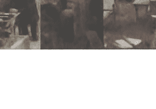

#### 抖音、快手
这两大短视频仍是短剧最重要的分发入口。抖音凭借算法推荐和AI短剧结合电商的打法制造爆款，《山海奇镜之劈波斩浪》播放量突破5000万，如下左图所示；快手则侧重下沉市场，以乡土题材和UGC内容为主。

#### 腾讯视频、爱奇艺
长视频平台正加速布局短剧。腾讯视频押注横屏精品，《执笔》分账超2400万，短剧宣传封面如下右图所示。爱奇艺开设“短剧场”专区，强调电影级制作与分成比例，用差异化对抗红果。

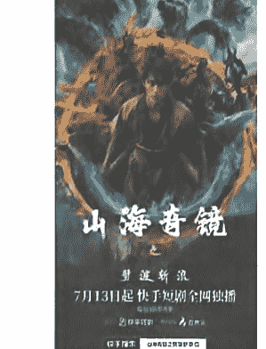

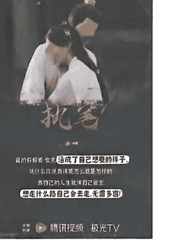

## 短剧产业链盈利方式
随着行业趋于成熟，盈利结构也逐渐清晰。主流模式包括以下几种。

### 广告植入与品牌合作
剧情内自然植入品牌是最常见的变现手段，利用短剧节奏紧凑、黏性高的特点进行软性营销，常见形式为道具露出、场景露出、台词提及。

除产品植入外，还可与文旅深度绑定，把景区、酒店、民俗等设为剧情关键节点，或通过角色旅程呈现区域文化；同时可做文创联名，推出剧中同款非遗工艺品、IP旅游纪念品，既增强文化内涵，也带动线下消费。

相较传统硬广，短剧植入更隐蔽接受度更高，尤其适合美妆、快消、数码、汽车。广告主多按播放量或品牌曝光计费，头部项目还能做定制化剧情合作，为品牌量身打造专属剧集。

### 流量广告分成
在抖音、快手等短视频平台或腾讯视频、优酷等长视频平台播出时，可依托平台流量广告分成盈利。

- 贴片广告：在播前、播中、播后插入广告，按播放或点击分成。
- 信息流广告：推荐页投放信息流，按内容带来的曝光和停留时长结算。
- 平台补贴：部分平台对优质内容提供流量扶持和现金激励。

该模式适合中小团队，无需直接对接广告主，借助平台算法即可获得稳定收益。

### 内容付费模式
付费是近年来增长最快的路径，主要形式包括：

- 单集付费：前几集免费，后续付费解锁，多见于悬疑、甜宠等强剧情类型。
- 会员订阅：推出短剧专属会员，如腾讯视频的“微短剧VIP”，会员可观看全集。
- 打赏/虚拟礼物：在直播式或互动短剧中，观众可通过打赏支持创作者，适合互动性强、粉丝黏性高的作品。
- 超前点播：热门剧提供付费提前看结局或番外服务，如下图所示，腾讯视频采用“点映礼”形式，让付费用户提前观看大结局。

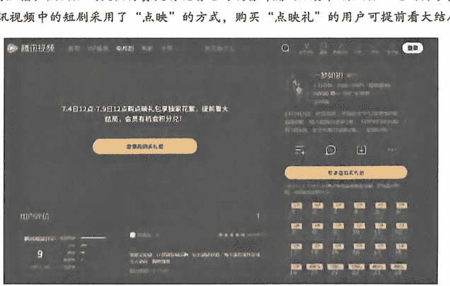

付费的核心仍是内容质量，只有剧情足够抓人才能促使用户付费，更适用于精品化、IP化的作品。

### IP孵化与衍生品开发

#### 短剧IP孵化
IP孵化是指对原创内容进行深度开发，转化为具备长期商业价值的智力资产，关键在于人物角色的塑造与强化。

短剧角色鲜明、情绪化强，易引发共鸣。孵化过程不仅包含角色初创，还涉及跨界授权，用于品牌代言、周边、社交营销等，通过粉丝经济实现变现。角色IP可通过版权销售、付费订阅或会员专属内容产生直接收入，也为后续衍生奠定基础。

#### 短剧衍生品开发
衍生开发是IP的商业延伸，将内容转化为有声书、游戏、漫画、小说、实体周边等多种形态。

有声书可将叙事精华浓缩为音频，在喜马拉雅、蜻蜓FM等平台分发获取订阅或广告收益；漫画、小说和周边满足粉丝收藏需求。游戏化转化效率高，将IP改编为移动互动游戏，利用原作张力吸引玩家付费解锁关卡或道具，既延长IP生命周期，也实现跨平台收入多元化。

## 短剧收益情况

### 头部作品分账金额
基于公开数据与行业报告，按播放量、分账、品牌合作梳理头部收益如下。

- 《执笔》：分账2700万元，创最快破千万纪录，上线两周达1000万，长尾效应明显。
- 《原罪》：分账3000万元，为2024年市场纪录保持者，以家族恩怨吸男性用户，单日充值峰值超500万元。
- 《授人以柄》：分账1900万元，采用会员分账与广告植入双驱动，平台分成比例高达80%。
- 《好一个乖乖女》：播放量10亿次，分账估算1500万～2000万元，改编自小说带动销量增长200%，品牌收入占比超30%。
- 《老千》：播放量10亿次，分账估算1200万～1800万元，植入汽车与快消品，单集招商超50万元。
- 《上学时经历的生死时刻》S3：吸金指数99.1，单季品牌收入超2000万元，合作37个品牌含OPPO、雀巢，总收入或达3000万元。
- 《夫妻的春节》：播放量4亿次，分账估算800万～1200万元，家庭情感题材吸金力强，植入母婴家电，单集广告约20万元。
- 《咬清梨》：播放量15亿次，分账约1000万元，站内评分8.5，二创反哺主剧，会员拉新提升15%。
- 《闪婚老伴是豪门》：分账1200万元，下沉渗透率超60%，中老年付费转化率8%，远高于行业平均3%。
- 《夺娶》：播放量未公开，分账估算800万～1000万元，改编自二月春小说，IP联动收入占30%，衍生周边销售额破500万元。

### 平台分账规则与激励
平台不断加大激励。优酷2024年10月起S级短剧分账单价从6元/部提至16元/部，A级从4元/部提至8元/部，新增最高1.2倍拉新系数。腾讯视频将头部短剧分账周期延长至12个月，破千万项目分账占比超80%，单剧最高可达2000万元。芒果TV设阶梯奖励，分账达800万、1200万、1600万元时分别额外奖励100万、200万、300万元。抖音推出保底收益，按评级给予单部15万、30万、50万元保底，并配套最高1亿流量曝光。

### 行业整体收益规模
2024年短剧市场规模达505亿元，首次超过全年电影票房，用户规模超6亿。预计2025年增至634.3亿元，2027年突破千亿。市场呈现两极分化：

- 头部效应：10%的爆款贡献超60%行业收入，分账破千万作品不足10%。
- 尾部困境：超80%短剧总收入不足百万元，难以覆盖制作与投流成本，投流成本占比常超80%。

### 广告与品牌合作收益
贴片广告CPM在1～18元之间，激励广告占免费剧收入70%以上。头部剧单集品牌植入收入达50万～80万元，《上学时经历的生死时刻》S3携37个品牌创收超2000万元。电商导流通过剧情跳转实现佣金分成，占比15%～30%，母婴、家电类转化率突出。

# 第2章 AI在短剧创作中的应用基础

## AI短剧为什么会成为文化产业热点

### 市场需求大
AI微短剧竞争尚未白热化，但需求正快速攀升。2024年我国微短剧市场规模达505亿元，预计2025年升至634.3亿元，2027年有望突破856.5亿元。目前AI微短剧份额不足5%，蓝海空间巨大。

### 制作成本低
与传统影视相比，AI短剧成本大幅下降。真人拍摄需支付演员、场地、设备等高额费用，AI可通过算法生成虚拟角色和场景，减少人力物力。传统短剧每分钟成本5000～1万元，AI单集成本可降至500元。例如《兴安岭诡事》以5000元/集成本在抖音取得4899万播放，传统制作需50万元以上；抖音、四川新传媒与悟空传媒联合出品的AIGC科幻剧《太阳坠落之时》包含200个场景、50个角色、70分钟时长，仅用3个月完成。

AI还能压缩周期。传统项目需3～6个月，AI团队可缩至1～2周。全AI短剧《白狐》由4人团队两周完成，传统模式需3个月。低投入高回报特性让中小工作室和个人创作者也能参与，丰富供给。

### AI角色可靠
影视中演员个人品德问题常引发舆论危机，导致抵制、评分暴跌、商业合作终止甚至高额赔偿。AI虚拟角色完全规避道德风险，制作不受人为因素干扰，技术稳定且声誉风险为零。

### 满足猎奇视觉需求
AI可实现传统拍摄难以完成的视觉效果，通过虚拟场景和角色轻松呈现奇幻、科幻、超现实画面，如未来都市、外星生物、魔法世界等，具备天然猎奇性，易引发好奇与分享。

例如部分AI短剧设计“穿越时空”或“人机互动”剧情，配合炫酷特效带来强烈视觉冲击，成为社交媒体热议话题，进一步扩大传播。

## AI短剧大致创作流程
制作大致分为策划筹备、创意制作、后期合成三阶段。

### 策划筹备
主要包括脚本创作和分镜。脚本是AI短剧的基础，需构建完整吸睛故事。如《山海奇镜之劈波斩浪》设定少年为救母亲与海底巨兽搏斗，《三星堆：未来启示录》设定三方势力进入数字生成的古蜀国冒险。情节需紧凑合理，AI短剧镜头常在5秒内，需在有限时长内传达有效信息。

若已有大致方向，可把灵感交给AI完善脚本，常用工具如DeepSeek、通义万相、KIMI、腾讯元宝、智谱清言。若无思路，可先确定题材，让AI生成情节线、角色设定、冲突点，再扩写大纲，最后细化成完整脚本。

脚本完成后，需转化为分镜头脚本，将每句对白、每个场景拆解为画面构图、角色动作和镜头语言，成为视觉呈现的桥梁。

### 创意制作
涵盖画面、视频、音频三大环节。

#### 画面创作
##### 角色设计
需先梳理剧本中角色的性格、职业、情感及关系，再借助Midjourney、StableDiffusion、即梦AI、可灵AI等生图工具设计形象与服装配饰。老年智者可加入皱纹白发体现智慧，活泼青年则偏向活力时尚风格，如右图1、右图2所示。同一角色在不同场景中需保持服装、发型、肤色等风格一致。

##### 单一场景设计
先明确场景类型：室内、室外或特定幻想空间。确定关键元素，如家庭场景的家具用品、神秘城堡的魔法阵石柱等，输入提示词生成画面。高度想象力场景Midjourney表现力更强，若需用于视频制作，可通过ComfyUI工作流二次优化，提升分辨率、材质细节和物理光影，满足影视级标准，如右图1为优化前，右图2为优化后。

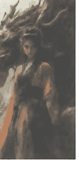

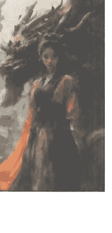

##### 关键帧画面
指AI生成的核心转折点或视觉高潮静态图，相当于传统分镜头。它奠定视觉基调、强化叙事张力，并可呈现高难度特效场景。如《山海奇镜之劈波斩浪》用AI生成大场面玄幻画面，如下图所示。

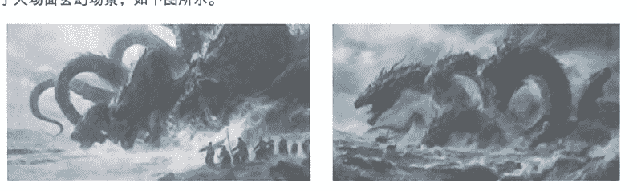

#### 视频创作
主要有文生视频和图生视频两种。文生视频适合生成无角色空镜头；图生视频是将静态图结合分镜转化为动态视频，是短剧创作的主力方式。例如下方由关键帧生成的视频画面序列。

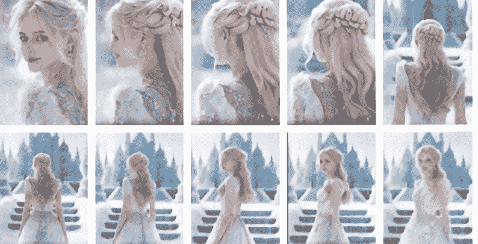

#### 音频创作
包括为角色配音实现口型同步，以及制作背景音乐烘托氛围。

#### 后期剪辑合成
将AI素材与背景音导入编辑软件，剪辑拼接、加特效、调色。若项目简单可用剪映快速完成；复杂度高则需Premiere Pro、After Effects、达芬奇等专业工具，必要时结合AI工具补充动画特效，确保成片质量。

## 适合用 AI 生成的短剧题材

### 科幻题材
科幻是传统影视的两大痛点之一，特效成本高、周期长，AI可大幅缩短周期、降低成本，效果可达传统特效70%～80%。科幻兼具想象力和前瞻性，AI能轻松构建宇宙星空、未来都市、外星生物等场景。2024年博纳影业AIGMS制作中心联合抖音出品的《三星堆·未来启示录》即探讨人类与未知文明关系，画面高效产出。

### 奇幻题材

生成式内容把影视圈长期视为高门槛的类型推向了可操作的区间，奇幻叙事正是其中最典型的例子。魔法体系、异兽传说、仙境构建等超现实设定，靠人工搭建往往耗时耗力，而模型驱动的工作流能迅速把世界观视觉化。

快手星芒打造的首部全流程定制短剧《山海奇镜之劈波斩浪》就是直观示范。剧中九婴、嬴鱼、鲛人之类的上古形象均由系统完成，模型在海量神话文本学习后，产出了契合奇幻气质的全新造型与环境。

### 悬疑题材
营造压迫感很大程度上依赖画面氛围。首届可灵创作大赛里，元力趋势旗下 ZK Studio 首席设计师王睿的作品《请治愈我名为乖巧的疾病》就是典型参照，全片基于快手可灵视频技术完成。冷调滤镜、第一人称偷窥视角、中式老旧道具被系统性组合，精准点出心理惊悚与家庭压抑的核心气质。

### 穿越题材
无论复古宫殿还是奇异异世界，生成式系统都能快速给出可信空间。穿越类短剧需要不同时空的对照，视觉差异本身就成为叙事推进的助力。中央广播电视总台影视剧纪录片中心制作的《英雄》是总台首部人工智能穿越故事片，讲述现实中烦闷自卑的主人公在奇幻穿越后发生的人生转变。全片不足14分钟，人设、空间、场景全部由系统完成，却呈现出自然的成长质感。

### 动漫类
动漫形态在年轻群体中的渗透力强，系统能按欧美卡通、宫崎骏式等设定产出角色与场景图像。中文在线出品的《开局物价贬值百万倍，我竟成了世界首富》，人物立体、情节完整。相较传统手绘的高成本与长周期，生成式工具带来了效率与成本上的显著优势。

## AIGC短剧的短板与补强思路

### 常见不足

#### 物理规律不够真实
想象力与效率惊人，但画面常与真实物理脱节。光影过渡显生硬，物体运动违背力学，材质交互如水流火焰也缺乏真实质感。因为模型对物理世界的理解仍停留在数据层面，非真正认知，在强拟真需求下必须人工修正或与传统流程结合。

#### 情绪表达不够细腻
深度学习对人体微动的捕捉有限，表情与肢体的细腻过渡常被忽略。《山海奇镜之劈波斩浪》《三星堆·未来启示录》等片在场景上进步明显，但在对话段落里，面部肌肉运动缺少生动感，动作协调性不足，整体偏向机械组合。

#### 复杂细节处理偏弱
面对高复杂度场景，系统容易在细节上失准。如古老城堡内部的机关陷阱，整体构图可成，但机关精细结构、墙面古文字与纹样往往模糊不清。这种缺失会削弱沉浸感，与实拍或高级特效仍有差距。

#### 语音语调偏生硬
合成语音在音色、语速、语调调节上多显雕琢。紧张追车场景里，生成的报警声或对白缺少人类紧张时的颤音、急促感与高音调变化，情绪断层明显，影响代入。

#### 口型同步存在偏差
生成人物口型与音频的匹配常出现错位，尤其在多语言替换时，唇形开合度难以按不同发音特点精确调整，造成视听混乱。

### 补强方式

#### 提升物理真实度
后期可引入物理引擎修正动作、光影、碰撞。结合真人动作捕捉，将自然行为数据导入动画，能有效淡化机械感。

#### 强化情绪传达
当画面无法精准传达细腻情绪时，可叠加文字描写、旁白、背景音乐等手段共同营造氛围，弥补纯视觉的不足。

#### 精准提示提升细节
提示词的精确度决定成片效果。对城堡机关需明确类型、形状、材质、触发机制；对墙面文字需说明风格、位置、色彩等。参考真实历史建筑与文化元素，让描述既丰富又合理，引导模型更全面构建。

#### 多模型协同
不同模型在细节处理上各有优势，联合使用可扬长避短。创作前需清楚各模型的功能边界，按需求匹配工具。

#### 优化语音自然度
合成后可用音频软件加入呼吸声、停顿、颤音等细节，并手动调整语速与语调贴合角色情绪。例如紧张场面加快语速、提高音调，模拟真实状态。

## 爆款要素拆解与启示

### 案例一：《山海奇镜之劈波斩浪》

#### 基本情况
国内首部 AIGC 原创奇幻微短剧，由快手与自然火文化、AI 影视导演陈坤合作，2024年7月13日在快手独播。以《山海经》为蓝本，讲述少年李行舟为救母踏上冒险，与上古神兽搏斗的故事。

#### 播放数据
作为快手首部 AI 短剧，连载5天完结，预告加5集总播放达5000万。

#### 制作流程
全片使用快手可灵生成镜头，从官宣到上线仅两个月，传统制作至少需半年。

#### 爆款原因

##### 题材带来的特殊呈现
以《山海经》为核心，系统呈现了九婴、蠃鱼、鲲鹏、祝融、共工等经典形象，视觉上兼具华美与凌厉，构建出光怪陆离的神话世界，满足奇幻期待。

##### 特效冲击力
水神共工挣脱山石、发丝飘动、肌肉线条与山石崩塌等镜头均由系统实现，大场景冲击力强。

##### 古今融合
上古传说与当代审美融合，配乐配合奇幻画面增强感染力，让古典浪漫在现代视觉中复活。

##### 节奏与情感契合
5集内节奏紧凑，快速进入母亲被掳的核心冲突，反转不断，兼顾亲情、冒险、勇气等共鸣点。

### 案例二：《三星堆·未来启示录》

#### 基本情况
博纳影业出品、抖音联合出品的 AIGC 科幻短剧，即梦 AI 作为首席技术支持，基于豆包大模型提供剧本、概念、分镜、镜头生成等10项技术。设定近未来，三支势力进入数字生成的古蜀国展开冒险。2024年7月8日上线抖音，冲上短剧榜第五。

#### 爆款原因

##### 文化 IP 的吸引力
三星堆的青铜神树、黄金面具自带谜团，契合悬疑科幻。剧集避开甜宠婆媳常见题材，选择重特效的奇幻科幻路线。

##### 技术带来的视觉降维
全流程 AI 制作，剧本到角色建模均被加速，图片转视频、场景搭建、角色塑造呈现高完成度。

##### 叙事紧凑且角色立体
13集57分钟，叙事紧凑，科学家、反派等角色鲜明，科技与人性冲突构成核心。

##### 营销精准
借助抖音流量触达年轻用户，全端传播超1.6亿次。剪映官方账号助推，以“中国首部 AIGC 原创微短剧”作为传播点，并获政策与资金支持。

### 案例三：《中国神话》

#### 基本情况
国内首部 AI 全流程微短剧，2024年3月22日在央视频 AI 频道上线，由中央广播电视总台视听新媒体中心联合清华大学新闻与传播学院元宇宙文化实验室推出。共6集《补天》《逐日》《奔月》《填海》《治水》《尝百草》，美术到配乐全由系统完成。

#### 爆款原因

##### 题材创新与文化价值
聚焦上古神话，知名度高，AI 演绎为传统文化传播注入新动能。

##### 技术优势
系统实现角色变形、换装等特效，女娲、盘古、嫦娥形象生动，场景宏大。

##### 传播基础
多语种版本利于全球传播，微短剧形态适配短视频平台，央视背书增强关注度。

### 案例四：《海上女王郑一嫂》

2025年4月24日，新加坡影院公映，成为全球首部获政府批准院线上映的 AI 生成长片，打破 AI 视频时长限制的认知。

#### 基本情况
讲述清朝传奇女海盗郑一嫂从底层崛起、成为海盗领袖并被招安的故事，再现19世纪东南亚海战与帮派斗争。

#### 技术要点
新加坡 FizzDragon 团队耗时两年，全流程 AIGC。首次实现70分钟连贯剧情；拆分人物素材训练改善长镜头口型与表情；“换脸小组”人工干预减少角色形象漂移。场景生成效率提升，但复杂分镜与运镜仍需人工辅助。

#### 反馈与意义

##### 观众评价
70分钟双线叙事展现完整叙事能力，画面流畅度接近传统电影，海战特效具院线视觉冲击。

##### 行业意义
标志 AI 影视进入工业化阶段，验证剧本、分镜、场景构建的可行性，为中小团队提供低成本路径。

##### 协作模式
“AI 生成 + 人类兜底”协作，编剧优化文学性，导演调整戏剧张力，实现技术与艺术互补。

## 爆款启示

### 抢占先机
AIGC 短剧正处爆发前夜，先行者可通过数据积累优化内容、建立品牌并参与标准制定，窗口期不容错过。

### 打造差异化 IP
强 IP 能快速聚流、降低获客成本，通过文化共鸣降低认知门槛，以持续内容沉淀情感连接。

### 选择适配平台
抖音、快手偏好强节奏爽剧，B站倾向二次元与脑洞，微信小程序适合下沉市场中长篇。AI 可辅助分析完播率等数据，但需主动适配平台规则。

### 技术服务内容
剧本生成、虚拟演员、自动剪辑提升效率，但过度依赖会导致内容空洞。人机协同下，技术解决重复劳动，创意聚焦故事内核与角色塑造。

### 创新变现
除广告与会员外，可探索个性化付费点、定制剧情分支、边看边买等模式，需提前规划商业路径。

## 新手从模仿到超越

### 建立审美与灵感库
模仿是起点。B站“咪克菌”这类 AIGC 叙事账号，分镜、节奏与创意值得拆解。

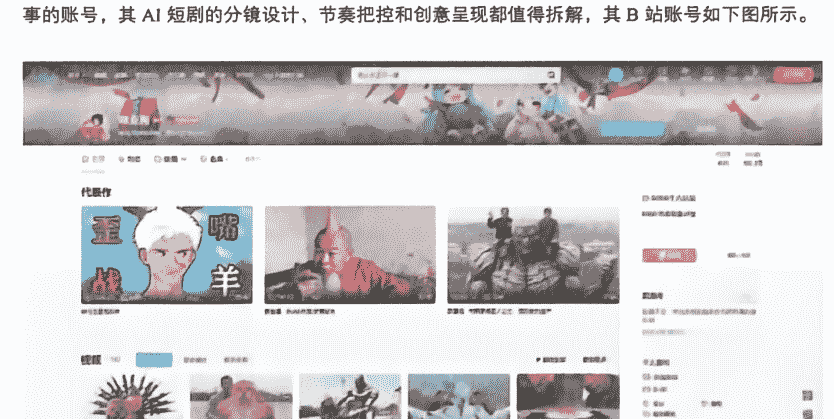
据报道，“咪克菌”获得较好商业回报，其“AI 整活”合集累计播放上亿，单条动辄百万千万以上，吸引 EA、网易等游戏大厂与 3C 品牌投放。可学习其创意角度、技术手段与变现路径。

即梦 AI、可灵 AI 等平台的精选作品也是标杆。即梦 AI 的“灵感”欣赏板块，如右图 1 所示，汇聚大量优秀案例。可灵 AI“创意圈”短片欣赏界面如右图 2 所示。

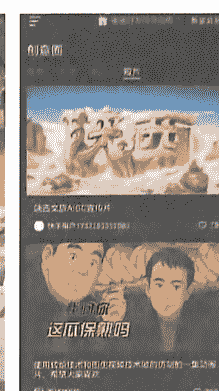

想更快入门，不妨多看看各大平台和剧场里已经上线的 AIGC 短剧。成熟的剧本、清晰的视听语法都是现成的教材，拆解它们怎么转场、台词怎么排、AI 角色如何互动，就能摸到短剧的创作脉络。建议同步搭建一个分门别类的素材库，把触动自己的镜头、文案、金句、特效片段都收进去，隔段时间回头复盘，规律会越来越清晰。

### 通过实战加速成长
参加 AIGC 短剧赛事是最直接的试金石。这类比赛通常会限定主题和时长，逼着创作者把想法收敛到核心；评委点评和获奖案例的对照，也能迅速暴露短板。即便没得奖，剧本打磨与工具调试的过程也积攒了大量经验。挑新手友好的赛项会更轻松，比如允许组队或提供素材包的项目。可灵 AI 主办的“灵感迸发 · AI 短片征集第一期”信息如下图所示。

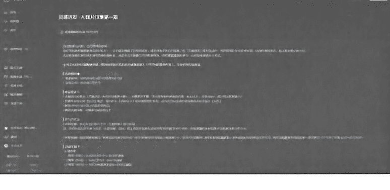

即梦 AI 主办的“第 5 届平潭 IM 两岸青年影展 AIGC 单元：全球征片启动”信息如下图所示。

### 从轻量创作到复杂叙事
新手不要一上来就拍长片。短剧制作要写复杂剧本、做分镜，还要大量生成画面，流程重容易在技巧没熟时消耗热情，产生畏难情绪，建议分阶段推进。

第一阶段，先做一分钟以内的搞笑小视频。比如让模型生成夸张表情包对话，或结合热点做反转，重点练笑点设计与节奏把控。

第二阶段，做创意广告或 MV。尝试 30 秒的品牌概念短片，或为歌曲做 AIGC 动画 MV，这类内容要在视觉表现与信息传达间找平衡，有助于锻炼镜头语言。

第三阶段，3-5 分钟短剧。基础流程熟练后可试带主线的作品，比如 AI 科幻小剧场或情感微短剧，这时要更注重人物塑造与情绪铺垫，逐步掌握长叙事技巧。

# 第 3 章 AI 视频创作常见平台介绍

## 国内六大视频创作平台

### 可灵 AI
可灵 AI 由快手推出，擅长文字到视频、图像到视频转换，能输出 1080p 高清、模拟真实物理并支持长片制作，是效率很高的创作工具。网址 kling.kuaishou.com，界面如下图所示。

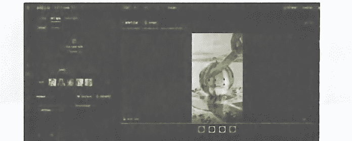

#### 可灵 AI 平台的基础功能
- 文生图：输入描述文字即可得到模型生成的图像。
- 图生图：上传参考图配合文字提示，在此基础上生成新图。
- 文生视频：可纯文本起片，也能基于图像起片，并支持 AI 自动续写后续。
- 图生视频：上传静态图生成动态内容，适合把画面活化。
- 镜头控制：提供横移、摇镜等运镜手段，让成片更生动。

#### 可灵 AI 平台的特色功能
- 首尾帧控制：可自定义开场与收尾画面，提升专业感与个性化。
- 运动笔刷：为画面中的人物或物体指定运动轨迹，实现精准动效。
- 大师运镜：内置多种专业运镜效果，增强观赏性。
- 高品质模式：文生视频与图生视频质量明显提升，画面更清晰、动态更连贯。

#### 费用标准
登录可灵平台每日可领 66 个灵感值，用于生成图像和视频。用完后可直接购买或开通会员，1 元兑换 10 个灵感值，最低 100 个起购。黄金会员每月 66 元，赠送 660 个灵感值，附带会员权益。

### 即梦 AI
即梦 AI 属于剪映旗下，依托自然语言处理与图像生成能力，让用户用文字描述或上传图片快速产出高质量图像和视频。网址 https://jimeng.jianying.com/，界面如下图所示。

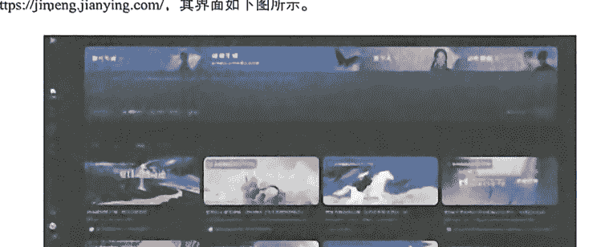

#### 即梦 AI 的基础功能
- 图片生成：把文字描述转化为图像。
- 智能画布：可抠图、重组图像并按提示词重绘，创作更灵活。
- 视频生成：文字转视频，也可基于图像生成视频内容。

#### 即梦的特色功能
- 多模态数字人：上传角色图加一段音频，可生成最长 15 秒的数字人视频，口型、表情与肢体匹配度高。
- 动作模仿：提供静态图与动作参考视频，或使用官方模板，让角色复刻动作，降低虚拟偶像制作成本。

即梦的差异化在于搭载了最新的 Seedance 1.0 视频模型，具体如下。

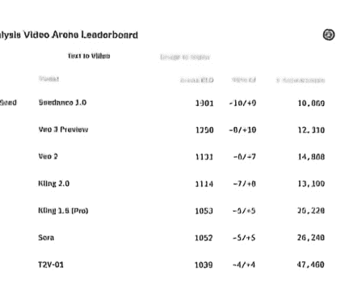
Seedance 1.0 主打“高一致性、高真实感”的视频创作。该模型在 ArtificialAnlys 权威评测中表现突出，文本转视频与图像转视频两项均居第一，超越 Google Veo 3、快手 Kling 2.0、OpenAI Sora 等主流模型，如右图所示。

核心突破在于解决了镜头连贯性、细节保持与多镜头逻辑问题，并通过三千多个生成片段验证了技术领先性。

核心特点与优势如下：
- 多角度场景一致性：可一次性生成同一场景的多连贯镜头，如正面到过肩镜头的无缝切换，提升空间一致性。
- 复杂提示精准执行：能同时解析主体动作、摄像机动态与情绪节奏，实现高精度控制。
- 高动态物理仿真：高速运动场景下背景运动自然，避免扭曲或断裂。
- 多风格生成能力：从照片级真实到 3D 动画、手绘风格均可覆盖。
- 效率与性价比：生成 5 秒 1080p 视频约需 40 秒，1 万元预算可产出 2725 条，远高于竞品。

#### 费用标准
即梦平台按活跃度每天发放 60~100 幸运积分，用于生成图像和视频。用完后可购买或开通会员，1 元兑换 10 积分，最低 500 积分起购。基础会员每月 79 元，赠送 1080 积分，附带会员权益。

### 海螺 AI
海螺 AI 由 MiniMax 即上海稀宇科技有限公司研发，是整合大模型能力的智能助手。网址 https://hailuoai.com/，界面如下图所示。

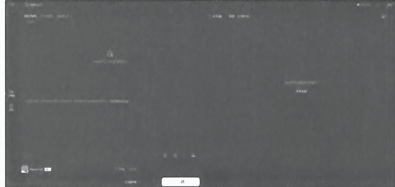

#### 海螺 AI 的基础功能
- 长文本处理：快速提炼论文、财报、纪要等长文本的核心要点，提升决策效率。
- 图像生成：输入文本或提供图片生成高清图像，支持写实、3D 艺术等风格，免费用户单次 5 张。
- 视频生成：通过文本或图像直接生成视频，速度较快。

#### 海螺 AI 的特色功能
- 音频生成：文本转自然语音，支持 17 种语言，可调节语速、声调与情绪。
- 音色库：提供上百种音色，如沉稳高管、播音腔、御姐等，支持停顿符号增强节奏。
- 音乐创作：根据选定曲风和歌词创作歌曲，歌词可自写或由大模型生成。

#### 费用标准
新注册用户赠送一定贝壳，用于生成图像和视频。用完后需开通会员，基础会员每月 105 元，每月获得 1000 会员贝壳，附带权益。

### 通义万相
通义万相的 AI 视频生成功能完全免费，支持文生视频与图生视频，可根据文字或图像生成影视级质感视频，支持古风、科幻、动画等多风格，并对中式元素优化，支持多语言提示词与可变分辨率。项目开源，采用 Apache 2.0 协议，模型权重与推理代码已在 GitHub、Hugging Face、魔搭社区开放。官方网址 https://tongyi.aliyun.com/wanxiang/，界面如下图所示。

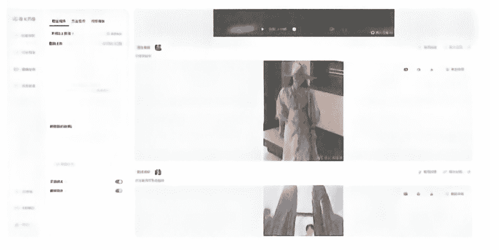

#### 通义万相的基础功能
- 图像生成：输入文字或提供参考图生成图像，支持水墨、油画、3D 卡通、二次元等风格。
- 视频生成：输入文字或提供视频生成连贯画面，支持添加运镜效果。

#### 通义万相的特色功能
- 视频音效：自动为视频添加环境音效或背景音乐，提升沉浸感。
- 灵感模式：增强画面丰富度与创意表现，可能突破提示词限制，适合探索性创作。

### Vidu AI
Vidu AI 由北京生数科技有限公司研发，核心团队来自清华大学人工智能研究院，支持视频生成、多镜头处理与个性化创作。官方网址 https://www.vidu.studio/，界面如下图所示。

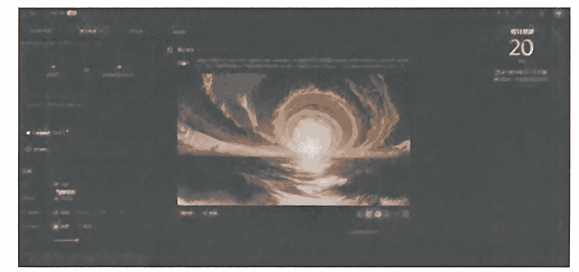

#### Vidu AI 的基础功能
Vidu AI 支持文本转视频与图像转视频，可生成长达 16 秒、分辨率 1080p 的高清视频，并具备快速推理能力。

#### Vidu AI 的特色功能
- 主体参照：提供一张主体图像即可锁定形象，通过描述词在不同场景中保持一致。
- 多主体一致性：1.5 版本上线多图参考，实现人物、物体、环境的多主体一致控制。
- 动漫风格生成：在动漫视频生成上表现突出，能保持角色在不同镜头下的高度一致，避免风格突变。

#### 费用标准
每天签到可获 20 积分，用于生成图像和视频。用完后需开通会员，基础会员每月 69 元，每月获得 800 积分，最多可生成 200 个视频。

### 拍我 AI
拍我 AI 是海外 PixVerse 的国内正版，由爱诗科技发布，采用 Diffusion+Transformer 架构，时空建模引入自研时空注意力机制，在复杂场景表现更优。官方网址 https://app.pixverse.ai/，界面如下图所示。

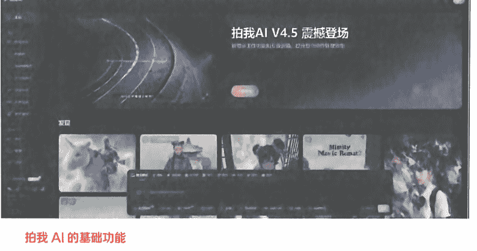

#### 拍我 AI 的基础功能
支持文本提示文生视频或提供图像图生视频，可生成 5-8 秒单片段，或最多 5 段合计 40 秒的连续视频。

#### 拍我 AI 的特色功能
- 多片段一致性生成：可一键生成 1~5 段情节连贯短视频，保持角色形象、色调与背景连贯。
- MagicBrush 运动控制：手绘箭头可精确控制元素运动轨迹与速度，实现精细化运动编辑。
- 角色一致性生成：Character2Video 技术，提供人物正面图 20 秒内完成建模，后续视频严格保持面部特征与服饰细节。

#### 费用标准
新用户注册免费赠送 120 积分，每天签到可获 60 积分。用完后需开通会员，基础会员每月 79 元，每月获得 1200 积分。

## 国外四大视频创作平台

国外平台推动了 AI 视频热潮，国内用户访问可能较慢，部分需双币信用卡支付，下面仅做简要介绍。

### Pika
Pika 是基于 AI 的视频生成与编辑应用，可生成动漫、Moody、3D、水彩、黏土动画、黑白等多种风格。支持文本或图文输入创建视频，并提供风格转换、元素增改、宽高比调整等编辑功能。官方网址 https://pika.art/，界面如下图所示。

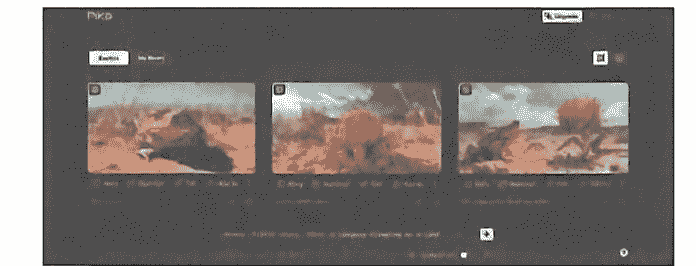

### Higgsfield AI
Higgsfield AI 的核心是预设的电影级运镜模板，解决文本难以描述的复杂镜头运动问题。用户提供一张静态图，即可选 50 多种运镜模板，如 360 度环绕、子弹时间、Snorricam 等，模拟推轨、快速变焦、空中俯拍等专业效果。平台通过智能算法保持主体与场景一致，生成视频流畅专业，适合广告、短片、MV 等高动态需求。界面如下图所示。

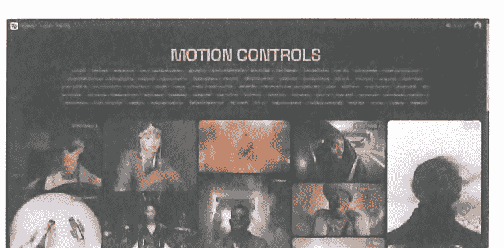

### Sora
Sora 是 OpenAI 推出的 AI 视频生成工具，擅长基于文本提示生成逼真、细节丰富的视频，可精准模拟复杂场景，人物的动作与表情刻画细腻，观感接近实拍。界面如下图所示。

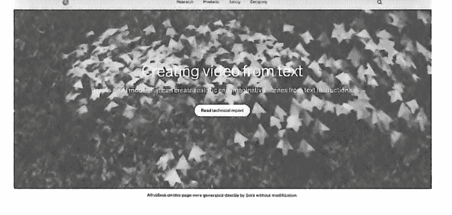

### Google Veo 3
Google Veo 3 由 DeepMind 于 2025 年 5 月发布，实现音画同步生成，可根据文本或图像同时生成视频与匹配音频，包括对话、环境音与背景音乐，并通过唇音同步提升真实感。模型在物理模拟与分辨率上明显提升，可生成长达 60 秒 1080p 视频，支持多角色复杂场景。但目前通过 Google Flow 或 Gemini 访问时生成时长约限 8 秒，需英文提示词。界面如下图所示。

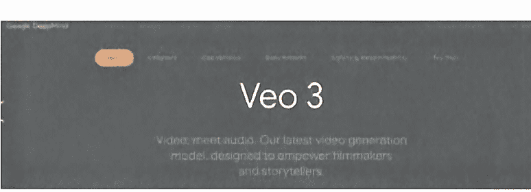

刀切万物热潮从何而来

近几个月来，短视频平台上铺天盖地的刀切万物解压片段几乎都指向同一个来源，Google 的 Veo 3。之所以能迅速占领热搜，关键在于它具备视听同步合成能力，依据文字指令同时渲染出高保真的画面与极为清脆的切割声响，观感上非常接近沉浸式的 ASMR 体验。代表性作品集中在下面这组图里。

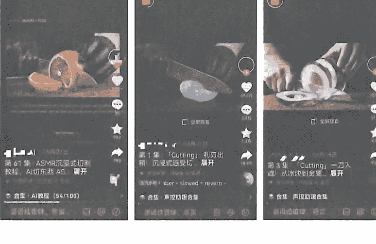

## 三大一体化视频创作平台

一体化创作平台把从文案输入到成片输出的整个流程装进同一套云端或桌面工具，用统一的工作流替代过去多软件来回切换的制作负担，门槛更低、效率更高。

用户先提交剧本文本，系统会自动拆解成分镜描述并据此生成画面；进入后期阶段后，剪辑、特效叠加、图层合成、镜头微调以及多人协同审阅都可在云端完成。这种闭环设计有效缓解了传统制作中角色面貌保持、镜头之间连贯等难题，让专业团队和个体创作者都能在单一环境里完成。

下面介绍三类典型产品。

### 白日梦 AI

白日梦 AI 集合了多项前沿技术，把不超过 2000 字的文案转化为带人物、场景、分镜和配音的完整短片，端到端压缩了制作周期。官网是 aibrm.com。界面见下图。

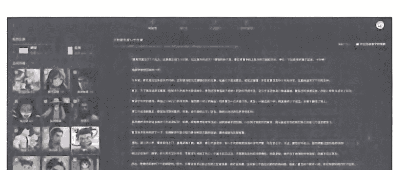

主要能力概览：

- 文字成片：输入标题与正文即可得到包含人物、场景、分镜和配音的成品。
- 静图转动态：把静态图像转为动态视频，左上角可选择旁白与背景乐，一键产出后进入预览，可更换封面并调节语速。
- 人物自动建模：依据文案识别出所有角色，可为每人设定性别、声线与外形。
- 面貌与场景保持：全片范围内人物与场景保持稳定，提升代入感与观感。
- 多风格可选：提供多种视觉风格以匹配不同主题与受众。

费用方面，新注册用户可获得免费梦币用于出图与出片。梦币耗尽后需订阅。白银档每月 40 元，赠送 5000 梦币，约可出 1000 张图或约 75 分钟视频，并附带其他会员权益。

### MOKI

MOKI 是美图推出的 AI 短片创作工具，聚焦动画短片、网络小说改编短剧、故事绘本与音乐 MV。底层是美图自研的奇想智能大模型 MiracleVision，配合智能剪辑、自动配乐、音效叠加与字幕生成，把制作流程简化并提速。官网 moki.cn。界面见下图。

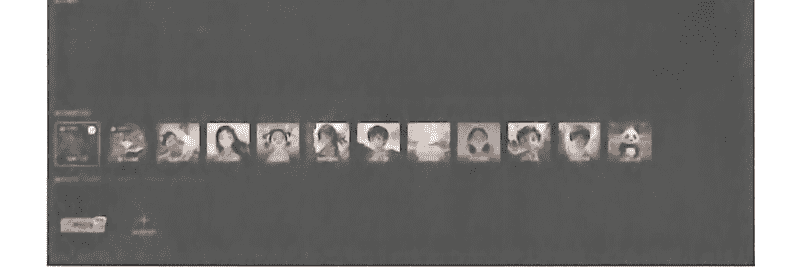

核心功能：

- 短片快速创作：覆盖动画、网文短剧、绘本、音乐视频等类型，也可迅速生成脚本与分镜板，从简单创意到框架、情节、对话与转场建议。
- 智能剪辑：自动捕捉关键帧定位精彩画面，并按节奏与情绪智能调节剪辑点。
- 主题配乐：依据主题与情绪从版权曲库匹配背景音乐，适配喜剧、史诗、浪漫等不同氛围。

计费采用积分制，可单独购买，1 元兑 5 积分，起购 100 积分。也可订阅，每月 150 元获 1200 积分，约可产出 200 条视频，并享受其他权益。

### SkyReels

SkyReels 由昆仑万维推出，是首个把视频大模型与 3D 大模型融合的短剧创作平台，通过全流程自动化实现单人独立制作。官网 skyreels.ai。界面见下图。

主要能力：

- 剧本生成：自研剧本大模型 SkyScript，输入概念即可一键产出完整剧本，包含冲突、爽点与情感表达，支持润色与结构化调整。
- 角色定制：输入描述后生成 3D 形象与配音，风格可选动漫、卡通或真人。
- 分镜生成：分镜大模型 StoryboardGen 自动把剧本拆成分镜并保持人物、场景一致。
- 合成与后期：结合 WorldEngine 技术，即 AI 3D 引擎加视频生成模型，支持输出 1080p 60 帧高清成片，并可自动添加背景音乐与音效、图层融合与光照调节。

采用积分制，订阅会员每月 7.9 美元可获 1000 积分。

# 第 4 章 AI 辅助短剧剧本创作

## 用 AI 确定选题方向

### 确定短剧创作类型

在让 AI 介入具体选题前，先明确核心受众，这是内容定位的基石。当前主流可分为男频、女频与垂类赛道。男频偏好战神逆袭、权谋争斗、异能觉醒等强冲突题材；女频聚焦情感纠葛、豪门虐恋、甜宠逆袭等情绪向叙事；垂类则有家庭伦理、悬疑探案、文旅融合等细分领域。

类型清晰才能对准情绪刚需。男频强调能力逆袭的爽感，女频侧重情感共鸣与命运改写。缺少类型锚点，AI 给出的方向容易偏离受众基础需求，导致内容失效。

### 利用 AI 确定具体选题

#### 跨维度联想法确定选题

跨维度联想是通过打破常规思维，把不同维度的概念或元素组合来激发创意。常见做法是关键词发散与类型混搭。

关键词发散是输入两个以上看似无关的词，让 AI 联想出新概念。例如用“时空穿越”和“美食”组合，指令可写成“请通过‘时空穿越’和‘美食’关键词构建短剧故事，输出多个创作方向”。示例见下图。

部分回答如：方向一悬疑美食争夺战，设定未来“味觉芯片”垄断市场，落魄主厨意外获得可穿越回古代的神秘食谱，引发多方争夺。关键场景包括古墓青铜鼎触发穿越到长安酒楼，与历史名厨斗菜时遭遇时空特工，高潮揭露味觉芯片 CEO 正是因偷学古法导致味觉退化的初代穿越者。主题为传统匠人精神对科技异化的对抗。

创作者可据此挑选方向，不满意就重生成或换词反复尝试。

#### 大数据趋势分析法

此法是通过分析当下流行、爆款与观众偏好挖掘规律，为创作提供方向。例如让 AI 梳理近半年抖音爆款短剧的十个高赞反转，或生成符合 Z 世代审美的五种新型人物关系。示例指令：“分析最近半年爆款短剧的十个高赞反转设计，并据此给出几种创作方向”。见下图。

示例输出涉及身份反转、伪装型反转、时间线欺骗、情感绑架反转等。创作者可参考趋势确定内容方向。

#### 逆向思维分析法

逆向思维是基于反事实推演，构建与常规认知相悖的情境来激发创意。

操作步骤：先让 AI 列出短剧的十个常见套路，再为每个套路生成三个反向变体，最后挑选戏剧张力最强的组合。例如指令“请列举短剧中十个常见的剧情套路”。见下图。

示例套路包括身份错位陷阱、契约关系变质、重生复仇剧本、悬崖式误会等。

再输入“请针对每个套路生成三个逆向变体，例如针对‘英雄救美’生成‘美人设陷阱让英雄堕落’的暗黑反转”。见下图。

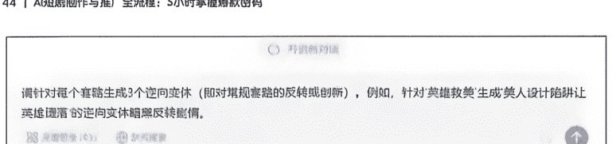

示例变体如身份错位陷阱的对调陷阱、双面身份、身份套娃；契约关系变质的契约倒置、时间循环契约、契约诅咒等。

### 用三幕式创作技巧构建故事大纲

三幕把叙事划分为开端、发展、结局。

#### 第一幕：破局

故事起点，任务是打破主角日常。需完成建立角色与世界观、触发事件即激励事件迫使主角离开舒适区、明确目标。结尾通常以转折点收束。

#### 第二幕：升级

主体约占六成，核心是冲突升级。主角为达成目标遭遇外部对手、内心怀疑或时间压力等阻碍，通过尝试—失败—学习循环成长，并穿插支线丰富层次。结尾多以低谷收束蓄力。

#### 第三幕：爆点

高潮与收尾，主角用第二幕积累的资源与反派对决或直面核心矛盾，收束伏笔，释放情绪张力。结局可闭合也可留白，但必须完成角色弧光。

### 用 AI 生成三幕式剧本全流程

示例提示词：请创作一个三幕式女英雄剧本，包含清晰结构，第一幕介绍角色、背景和冲突触发，第二幕展示行动、递进障碍和中点转折，第三幕设计高潮与符合弧光的结局。说明时代背景、核心主题、角色基础设定，每幕标注关键节点和人物关系变化，加入象征细节。

AI 可能生成的角色设定：艾拉·斯通，22 岁，顶尖钟表厂“克罗诺斯工业”流水线女工，负责精密齿轮校准。初始目标是赚钱养病父、避免麻烦，后转为揭露剥削真相、为父讨公道、团结工友争取公平。象征物是父亲遗留的用废弃齿轮手工制作的“心跳鸟”胸针，象征温暖创造力与潜在自由。

第一幕破局展示“铁锈堡”蒸汽轰鸣、钟楼俯瞰、贫民窟与富人区对比等。

### 场景设定技巧

#### 场景设定的基础要素

场景需包含时间、空间、人物、事件。

##### 时间

时间不仅是标记，更塑造情感氛围。可细到具体时刻、季节、节日。时间影响光线与天气，进而影响基调，如清晨柔和阳光带来希望，夜晚月光带来神秘或压抑，雨天增添忧郁，晴天带来开阔。

##### 空间

空间是物质载体，涉及地点与布局。地点可实有也可虚构，文化与建筑风格影响行为。布局包括建筑分布、道路走向、家具摆放，引导视线与行动。高低内外前后体现层次，室内相对封闭利于隐私交流，室外开阔容纳更多活动。

##### 人物

人物是核心，言行、情感与性格推动情节。需刻画外貌年龄性别等基础特征，更要挖掘背景与内心。人物关系如亲情友情爱情敌对决定互动方式。

##### 事件

事件是情节线索，可为日常、突发或重大。日常反映习惯与性格，突发打破平静制造转折，重大改变命运。事件包含起因经过结果，设置悬念与冲突增强趣味。

#### 场景风格与主题的统一

风格围绕主题分为写实与非写实。写实注重自然光影与材质细节，非写实包括卡通、像素、奇幻如赛博朋克。确定主题后，通过构图、色彩、光影强化一致性，如科幻常用冷色与机械元素，魔幻偏向鲜艳色彩与超自然细节。整体到局部需协调，避免元素冲突。

#### 环境氛围精准营造

氛围营造综合视觉、听觉与空间象征，让场景成为隐形叙事者。色彩与光影是基调塑造核心，暖色强化压抑中的欲望张力，冷色外化精神疏离。空间布局服务主题隐喻，封闭结构象征束缚，开阔沙漠草原映射自由或孤独。声音与细节深化沉浸感，环境音强化地域特色，道具纹理通过触觉联想增强真实感。

#### 场景转换与节奏控制

场景调度之道：连贯与张力同行

画面切换既要让故事顺下来，也要抓住情绪。蒙太奇是实现时空跳跃又不失逻辑的关键。由内到外、由外到内的接口，空间走向和整体色调最好保持一致，否则观感会断裂。转场不能为形式而形式，要配合情节推进，冲突高潮处硬切更利落，暗示时光流逝或情绪延续则更适合叠化与空镜头。

## 角色搭建：三维画像法

人物立得住靠三条线叠加：外在形体、社会身份、内在心理。

### 外在形体层

这层讲角色如何呈现。先天特征、外貌体态、健康状态都会影响行为。左撇子、肢体受限、罕见肤色等先天差异会让使用工具的方式与众不同。健康层面如慢性病、过敏、持续性疼痛会塑造情绪基调，例如哮喘在应激或运动时气短，容易伴随焦虑。身高体重五官等决定社交反馈，样貌出众者关注度高但压力也重，平凡外表的人往往更注重内在打磨。

### 内在心理层

指向内心世界。人格倾向、情绪状态、价值取向决定动机与反应。面对压力时常启动自我防御，情绪抽离会让角色压抑感受以自保，却易产生隔阂；投射则把负面情绪推给他人，容易引发争执。成长经历差异明显，童年创伤者成年后更敏感不信任他人，爱情受挫者可能转向冷淡自我封闭。

### 社会身份层

社会环境塑造行为与价值观。阶层不同，语言习惯、生活方式、价值判断也不同，底层角色口音重、表达直接，上层角色更讲究礼仪、用语文雅。文化背景影响知识储备与兴趣，爱阅读的人谈吐引经据典，偏好艺术的人审美更细腻。家庭成长轨迹同样关键，单亲环境养出独立性但可能情感缺失，大家庭熏陶的人更看重亲情维系。

### 人物弧光：成长轨迹的驱动

弧光描述角色在故事进程中的心理与价值观变化，让人物更丰满并产生共鸣。

常见形态有三种：正向弧光从消极转向积极，负向弧光由积极滑向消极，静态弧光核心信念不变却在冲突中被强化。

搭建方法先定起点与终点，明确开头与结尾的状态差异。再布置触发事件，外部冲突或内心冲突都能推动转折。弧光的核心是内心挣扎，犹豫、道德抉择的痛苦让转变更有分量。成长需通过行动体现自我价值，最终形成观众可共情的转变。例如职场短剧，可先定义主角起点与终点状态，设置初期暴露缺陷、中期促成转折、后期验证成长的三段事件，并在其中埋入自我怀疑独白、价值观冲突、突破舒适区的心理不适。

示例主角陈默，32岁广告公司创意总监，控制型完美主义把团队当工具。起点是压制创意、剽窃实习生方案却拒署名，信奉丛林法则。标志行为是提案会上抢话筒否定下属。终点建立匿名创意通道，撤掉署名，提出领袖应让平庸者发光，危机会议上关掉投影把白板笔递给实习生。

## 对话创作：让台词推动戏

对话是推进情节、塑造人物的重要载体，智能模型可辅助生成，但仍需创作者把控。

### 让对话更可信

加入自然停顿与留白，模拟思考、犹豫或情绪激动。口语化处理降低书面感，例如把“对此我深表歉意”换成“这事是我不对”，角色更接地气。

### 张力与冲突

戏剧靠冲突，台词可通过反问、潜台词制造张力。比如“你觉得这样就能解决？”既质疑能力也暗示不同看法。

### 节奏把控

长短句配合情绪。紧张场景用短句加快节奏，如“跑，别回头”。回忆类场景用长句营造压抑沉重。

### 明确叙事目的

对话要服务目的：揭密、制造冲突、推进情感。目标明确后，语言会更聚焦，观众在试探与暗示中逐渐get真相。

实战示例：暴雨夜废弃工厂父子对峙，要揭露反派陈枭是主角林峰生父。台词中加入犹豫停顿、口语表达，用反问与潜台词拉升情绪。紧张处以短句推进，关键情绪点配合动作描写增强感染力，删减赘余留白给观众想象，并加入口吃重复等语言瑕疵表现不安。

# 第 5 章

## 分镜脚本与镜头语言

### 为什么要学镜头语言

镜头语言是通过视觉符号传递信息、情感与叙事逻辑的工具。由景别、拍摄角度、构图、光线色彩、运动方式、焦点控制等组成，是导演与观众沟通的桥梁。

短剧时长有限，合理的镜头语言能精准传递动机、冲突与情绪转折，替代冗长解释。通过构图与光影营造悬疑、温馨等氛围，提升代入感。即使借助生成工具，创作者仍需用镜头逻辑引导输出，避免同质化，形成个人风格。

### 景别与叙事功能

远景交代环境与规模，营造宏大氛围，适合自然风光、城市全貌等场景。

全景展示人物与空间关系，呈现人物在环境中的位置与行为。

中景捕捉膝盖以上的人物，突出交流与互动，适合展现表情与关系。

近景收紧到胸部以上，强调情绪与反应，放大细微表情。

特写聚焦面部或物体细节，突出情感、强调关键道具或制造悬念。

### 常用运镜

推镜头逐步靠近主体，由全景中景到特写，增强代入感，适合真相揭露瞬间。

拉镜头逐渐远离，由特写拉至全景，呈现人景关系或疏离感，常用作收尾。

摇镜头水平或垂直移动，跟随运动对象或展示空间全貌，倾斜摇镜可制造压迫失衡感。

移镜头平面移动，跟随角色行动，轨道横向跟拍可营造市井氛围并暗示平凡坚韧。

跟镜头始终跟随主体，突出动态轨迹与情感连贯，摇晃跟拍表现不安，主观视角增强沉浸感。

升降镜头垂直升降切换视角，低位缓升可象征希望解脱，从特写拉升到全景可凸显环境与人物关联。

### 色彩搭配

色彩是传递情绪与定位的工具。通过冷暖选择、色轮搭配、文化象征与光影协调塑造氛围。如暖色传递亲密浪漫，蓝紫调营造悬疑。

色彩还能隐喻人物性格与命运，动态色调变化暗示情节转折或心理演变，成为视觉节拍器。

情感象征上，红色代表热情与危险，蓝色象征冷静深邃，黄色传递希望快乐，绿色代表生机和平，紫色关联神秘高贵。

对比运用可强化冲突与记忆点，整体配色需服务于叙事而非装饰。

视觉吸引力很大程度上来自色块差异所产生的张力。互补配色是冲击力最强的手段，红色配绿色、黄色配蓝色这类彼此对立又相互牵引的组合，极易形成强烈的视觉震颤。相近色搭配则偏柔和，例如红橙、蓝绿，在统一基底上保留细微变化，能营造出和谐且富于变化的氛围。明度对比有助于提升层次与立体感，纯度高低的分野则让主体更鲜活。

经典范例是《辛德勒的名单》。整部影片几乎被黑白灰笼罩，冷沉的色性精准传达出二战时期的压抑与厚重。唯一的视觉突跳，是小女孩那件醒目的红裙，她在灰白世界里穿行，成为全片最夺目的存在。红色与周围的灰阶构成强烈张力，这抹朱色既象征生命的希望与美好，也让观众对战争残酷与人性光辉的感受更为深刻。

### 色彩基调统一理论
基调指作品中占据主导地位的色彩倾向，它为整体奠定情感与风格走向。统一并不等同于单色使用，而是以一个主色为核心，搭配协调的辅助色与点缀色，使画面在整体上呈现和谐一致的观感。主色决定基本情绪，辅色丰富层次，点缀色起到提神收尾的作用。

《布达佩斯大饭店》以粉色贯穿始终，粉色建筑立面、床品与信件营造出浪漫、梦幻并带有复古气息的氛围，整体温馨优雅。影片同时引入蓝色制服、黄色花朵作为辅助，使画面层次更丰富；红色地毯、绿色植栽等作为点缀，在统一基调中增添活跃与生机。

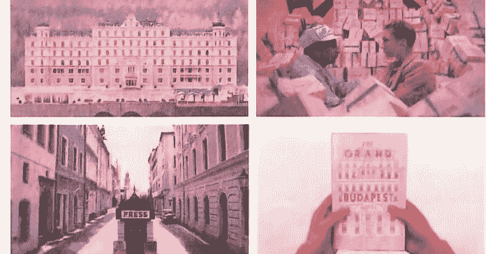

### 色彩主次关系理论
色彩布局需要明确层级，避免杂乱无章。主体色彩应当是最具吸引力的，它承载主要信息与情绪；辅助色彩则用于衬托与延伸，使画面完整统一。合理的主次安排能让视线迅速聚焦于关键元素。

在《泰坦尼克号》中，女主角露丝的蓝色晚礼服是重要的色彩符号。蓝色在繁复的宴会配色中脱颖而出，成为视觉主导。它既表现角色的高贵优雅，也暗喻内心对自由与爱情的向往。周围人物的服饰则退为陪衬，持续引导注意力保持在露丝身上。

### 色彩心理暗示理论
色彩会对观者的心理产生暗示，影响情绪与认知。明快色系易带来愉悦与积极，暗沉色系则易引发悲怆与压抑。高饱和容易激发兴奋与热情，低饱和则带来安宁与放松。在短剧创作中，可借助色彩暗示来调控情感体验。

《禁闭岛》整体偏冷，灰蓝为主的色调笼罩全片。这种冷调暗示了主角所处环境的压抑与危险，也映射出他内心的迷茫与挣扎。暴风雨场景里，深蓝的天空与灰色的海浪放大了紧张与不安，使观众更能共情主角的心理状态。

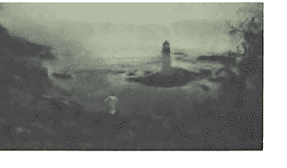

### 色彩文化内涵理论
不同文化对色彩的象征理解存在差异。中国传统里红色象征喜庆吉祥，常用于婚礼与春节；白色则与哀悼相关。西方语境中白色代表纯洁神圣，常见于婚礼；黑色则代表庄重严肃，多用于正式场合。把握文化指向有助于跨文化传播时情感传递更准确。

《英雄》通过不同色块划分情感层面。其中红色章节充满浓郁的中国文化气息，红色布景与服饰传递出热烈、勇敢与牺牲。飞雪与如月在红色映衬下爱恨更激烈，红色既是传统喜庆符号，在此也化作决绝与悲壮。

## 利用智能工具创作分镜脚本实践步骤
撰写提示词时需融入前述理论知识。可加入景别指引如大远景建立神话世界规模、特写突出法器力量，运镜指引如跟镜头追踪主角飞天、旋转镜头表现战斗眩晕；用色彩理论强化叙事，如以赤红色渲染天庭威严、以青蓝冷光营造幽冥神秘；结合节奏控制，如快剪表现激烈打斗、长镜头慢节奏展现人物内心独白，并特别标注需符合中国神话文化内涵，如太极阴阳的色彩对立、仙鹤纹样的符号化运用。最终形成镜头语言、色彩心理、文化符号与节奏设计的结构化指令。

随后以中国神话故事为例，用理论指导智能模型生成短剧分镜。

（1）打开 DeepSeek，载入纯文本剧本 Word 文档。上传后在提示框输入“请依据上传的短剧剧本，结合景别分类如大远景建立神话世界宏大感／特写突出法器神力、动态运镜如跟镜头追踪主角飞天动作／旋转镜头表现战斗眩晕感、色彩理论如赤红色调渲染天庭威严／青蓝冷光营造幽冥界神秘氛围、节奏控制如快速剪辑表现激烈打斗／长镜头慢节奏展现角色内心独白等影视语言要素，创作每一集的分镜脚本。输出需包含镜号、场景、景别、角度、运镜方式、画面色彩及内容、对白或旁白、时长、特效音效标注。保持节奏紧凑，每集控制在 3 至 5 分钟，突出戏剧冲突与情感张力，镜头转换自然流畅。以表格形式输出，并特别强调需符合中国神话文化内涵，使脚本兼具艺术性与可拍摄性。”配图展示。

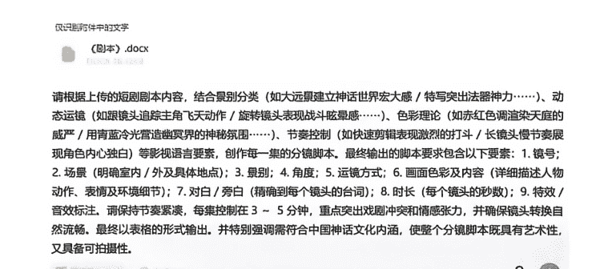

（2）点击文本框右侧按钮即可生成分镜脚本，首集《神农遇泽，赤炎灵鹿现》节选如下。核心冲突设计为灵鹿考验采用暖光暖调表现希望，魔兵抢夺采用青蓝冷调表现邪恶，通过色彩对比强化对立。

（3）因生成篇幅受限，可继续输入“继续生成剩余分镜头脚本”指令，模型会续写。以下为《华夏神纪：鸿蒙幻世录》第二集《精卫怒涛，玄龟护神珠》分镜头脚本节选，其余集数可依此逻辑扩展。

脚本与分镜头画面之间存在紧密的创作关联。脚本以文字构建叙事框架，分镜头则是视觉化落地的环节，通过构图、景别切换、运镜与时间节奏把戏剧冲突与情感外化。分镜既要忠实还原脚本核心意图，也要借助光影与符号强化潜台词。例如脚本写“主角在雨中孤独行走”，分镜可通过倾斜构图、冷调滤镜与慢动作特写来呈现心理状态，二者共同完成从概念到成品的闭环。

# 第 6 章 AI 辅助生成短剧分镜头画面

## 认识分镜头画面的重要性
在智能视频创作中，常见做法是图转视频，以保证视觉连贯与风格统一。因此生图是视频合成的基础环节。高质量的静态图像能为后续合成提供稳定且富有创意的素材，从而提升整体艺术表现力。

因此需先了解主流生图平台的技术特点与差异，例如 Stable Diffusion 擅长写实与细节控制，Midjourney 在艺术化渲染方面突出，即梦 AI 在文字效果生成上表现较好。不同工具在速度、版权政策、定制化程度等方面存在差异，例如部分开源工具对硬件要求较高，商业平台可能限制商用权限，取长补短才能发挥最大价值。

## 认识主流 AI 图片生成平台

### Midjourney
Midjourney 来自海外，基于生成式模型输入文本描述即可快速生成高分辨率、风格多样的艺术作品，涵盖写实、卡通、动漫、抽象等。该平台支持图转图，可上传参考图像并结合文字指令调整效果，也能融合多张图像创作。其模型能识别复杂指令与情绪氛围，生成细节丰富、色彩鲜明的图像，尤其适合人物、场景与创意设计。

Midjourney 绘画界面展示如下。

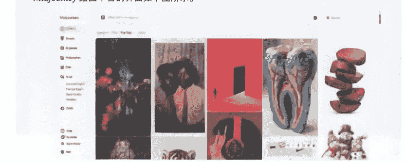

### 可灵 AI
可灵 AI 除视频外，图片能力也强，支持文字转图像、图转图，提供多样模板，中文语义理解精准，创意较强，文字效果突出。

可灵 AI 图片生成界面展示如下。

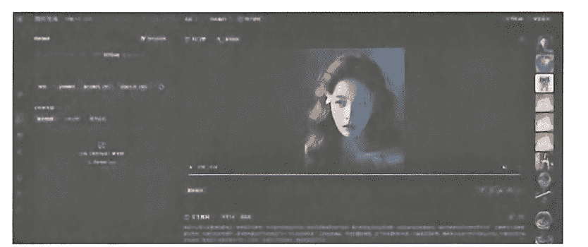

### 即梦 AI
即梦 AI 除视频生成外，还支持文字生成图片、图片生成图片等功能，可生成超现实场景、人物肖像等多样风格。平台提供智能画布，包含扩图、局部重绘、消除笔、高清放大等编辑工具，支持多图融合与细节调整，生成效率高且提供多版本选择。

即梦 AI 绘画界面展示如下。

### 神采 AI
神采 AI 面向设计师，支持涂鸦、照片转为插画，自动识别人物姿势生成线稿上色。其特色包括建筑室内线段识别生成方案、辅助 3D 建模法线信息读取，以及语义分割生成多风格图像。平台提供空房间一键装修、物体插入与材质替换，可上传草图生成逼真渲染效果。AI 超模工具能生成虚拟模特展示产品，结合文字效果与创意融合提升设计效率。

神采 AI 绘画界面展示如下。

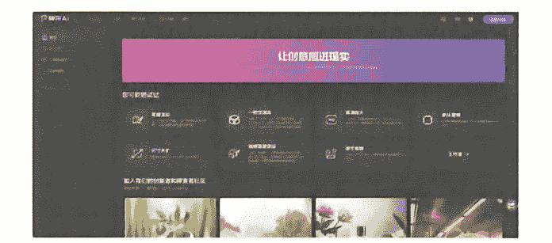

### 奇域
奇域专注中式审美，依托中国传统文化元素，支持输入中文描述生成水墨画、工笔画、皮影戏等风格。提供灵活画幅比例与大量新中式模板，涵盖传统国画与现代插画。特色功能包括局部细节微调、参考图融合优化与高清重绘。互动社区汇聚创作者，支持作品分享、灵感共创与商用授权。

奇域绘画界面展示如下。

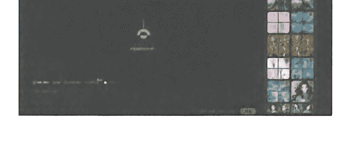

### 星流
星流由 LiblibAI 推出，是基于 Star-3Alpha 模型的一体化图像生成平台，具备高精度生成与多样风格支持，如写实、插画、动漫。特色功能包括图转图风格迁移、局部重绘、智能扩图与高清放大。支持中文提示词输入，内置超十万组 LoRA 模型库，适用于电商产品图、广告设计、建筑可视化等场景。

星流绘画界面展示如下。

### 通义万相
通义万相是阿里云推出的 AI 绘画平台，支持文字转图像、图转图、风格迁移三大功能，可自由选择水彩、油画、中国画等多种艺术风格，并提供相似图生成。作为通义大模型系列成员，整合文本与图像多模态处理能力，适用于艺术设计、广告营销等多元场景。

通义万相界面展示如下。

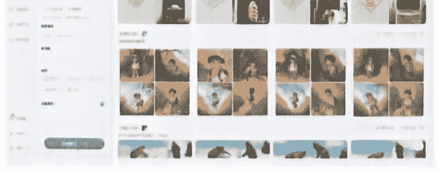

### ComfyUI
ComfyUI 采用节点工作流设计，将稳定扩散算法拆解为多个独立操作节点，增强工作流灵活性与可定制性，也提供工作流复用能力。在实践中展现出强大的生成能力与高效性能。对新手而言，插件节点众多学习曲线较陡，但教程资源丰富，Flux 模型对提示词理解强，提升创作自由度。相较 Stable Diffusion WebUI，ComfyUI 在灵活性与批量操作上更具优势，是门槛较高但上限很高的创作平台。

ComfyUI 界面展示如下。

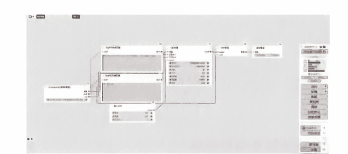

### Stable Diffusion
Stable Diffusion 是一款开源的 AI 绘画工具，可依据文字描述生成高质量图像。核心原理是通过潜在扩散模型将文本提示转为语义向量，再从随机噪声图像逐步去噪生成符合描述的画面。工作在低维潜空间而非像素空间，生成速度更快且硬件要求更低。支持文字转图像、图转图、局部重绘、图像修复，可调整采样步数、引导系数等参数精细控制输出。作为开源项目，拥有丰富插件生态与模型库，可生成写实、动漫、水彩等不同风格。

Stable Diffusion 界面展示如下。

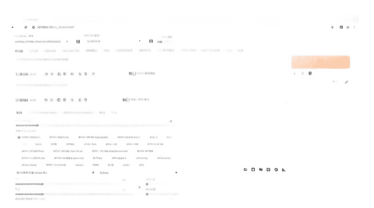

## 如何评估生图平台优劣

### 提示词遵循度
这是基础评估指标，输入后能否准确还原预期直接决定创作效率与质量。若平台对复杂指令理解不足，输出会偏离预期，导致反复调整。即梦 AI 在中文提示词处理上表现优异，Stable Diffusion 虽功能强大，但对中文提示词支持相对较弱，需要用户具备一定英文写作能力。

### 生成图像质量
图像质量是衡量平台核心竞争力的关键，包括清晰度、细节表现、色彩准确度等。不同模型决定出图水平，相较之下 Stable Diffusion 对质量可控性较好。

### 美学水准评估

AI 生图审美判断与实操指南

衡量一个图像生成工具的艺术上限，核心看它在审美层面的掌控力，这直接决定作品的吸引力与专业质感。真正可靠的产品要懂构图手法、光线运用与配色逻辑，而非仅做到可生成。Midjourney 对超现实题材与先锋艺术的驾驭尤为突出，其可定制模型能够较好地贴合创作者个人的审美偏好。

## 文生图生成方式

文生图是各大绘画平台最基础的创作入口，用户用描述性语言驱动成图。不同产品的交互流程各异，但底层原理相近。掌握一套通用的文生图思路，就能更快得到符合短剧需求的画面。

### 构建有效指令的方法

生成质量很大程度上取决于指令的写法。下面拆解一个可直接复用的思路。

#### 常用组合公式

指令：核心对象 + 背景环境 + 绘画流派 + 细节说明 + 喜好与规避 + 时间点 + 情绪基调。
括号内的部分可按需省略，下文对各个要素进行说明。

#### 核心对象

这是画面的主要内容，比如人物——一位少女、动物——一只猫咪、物品——一朵花。主体明确，画面才有焦点。

#### 背景环境

交代主体所在的空间，例如置于林间、位于街道。环境信息让画面更饱满，为主体提供支撑。

#### 绘画流派

指定视觉风格，如写实、抽象、印象派。不同流派会带来截然不同的观感。

#### 细节说明

涉及色彩、光线、构图等具体点，例如红色、阳光、对称。细节能把画面进一步细化。

#### 喜好与规避

正面词告诉模型想要的内容，例如高质量；负面词说明需要排除的内容，例如低质量、不适宜内容。并非所有平台都强制填写负面词。

#### 时间点

需要体现时间感时，可写清晨场景或日落景致，通常并入背景环境一起使用。例如：一对恋人于落日海滩漫步。

#### 情绪基调

想营造特定情绪时，可加入神秘、浪漫等词融入整体描述，比如雾中古堡的神秘氛围。

### 指令撰写技巧

#### 先锁定描绘对象

写指令先要明确画面主角。如果是人物画像，可按外形、心理、社会三个维度展开，例如“身披战甲的北欧女武神手持古剑摆出蓄力姿态，立于雪原，目光坚定，面部纹身微光，背后雪雾化作狼影，项链与手镯点缀，厚涂神秘画风”。生成的图像如下图所示。若是风景，要明确山脉、海滩、林地等具象环境，并围绕情节展开。

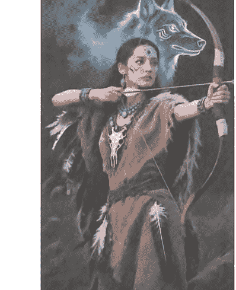

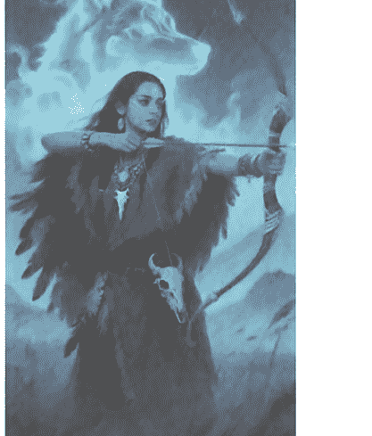

#### 设定画面风格

可指定写实、油画、卡通、水墨等多种风格。写实会让画面接近真实质感和细节，如下左图所示；卡通则色彩鲜艳、造型夸张、线条利落，如下右图所示。

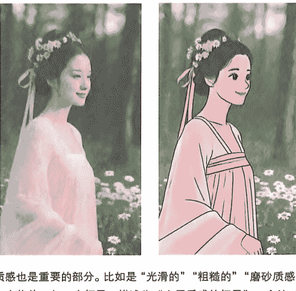

质感描述也很关键，比如光滑、粗糙、磨砂、金属质感。描述为“金属质感的杯子”，AI 会生成有金属光泽的杯子，如下左图所示；改成“磨砂质感的杯子”效果则不同。

#### 确定构图与观看视角

常见构图有中心构图、对称构图、三分法构图等。中心构图会让主体位于画面中部，如下左图所示；对称构图则上下左右呈现对称感，如下右图所示。突出主体时可用中心构图，并在词中写明，如“以一位舞者为中心构图的舞台画面”。

| 72 | AI短剧制作与推广全流程：5小时掌握爆款密码

视角包括平视、俯视、仰视。平视稳重常见，如下左图所示；俯视能展现更多场景元素，有宏观感，如下中间图所示；仰视会让主体显得高大威严，如下右图所示。

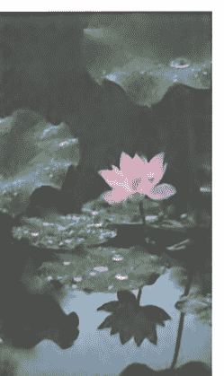

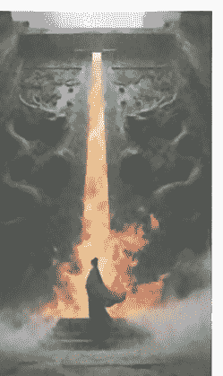

#### 用色彩来刻画

主色调：可明确画面的主要色彩。可单一如“蓝色调”“暖黄色调”，也可组合如“蓝白相间”“橙红色与绿色的搭配”。

色彩对氛围影响很大。蓝色调会营造宁静深邃感，如下左图所示；橙红色等暖色则带来温暖视觉，如下右图所示。

色彩分布与占比：可进一步描述占比，如“画面以蓝色为主，白色作点缀”或“绿色与橙红色各占一半”。这样能更精准控制配色。

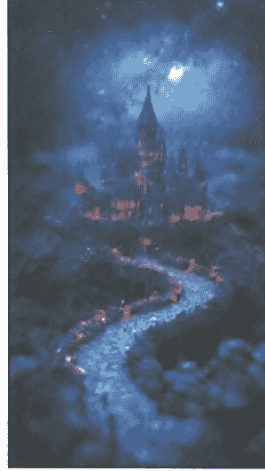

#### 选对模型

模型选择决定了文本成图的基础调性，影响风格走向和细节表现。

例如即梦目前提供多款模型，不同模型效果各异，如下左图所示。奇域平台中创作宝典的选择相当于模型切换，想做光影构图强的创意图可挑插画类风格，如下右图所示。

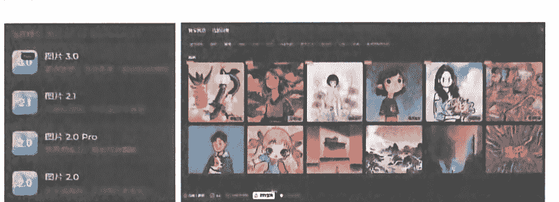

使用 Stable Diffusion 及 ComfyUI 时，模型匹配尤为关键，选错容易走弯路。

## 图生图生成方式

图生图是基于参考素材进行二次创作的方法。与文生图原理相近，但可控性更高。用户上传一张图，结合引导词和参数，AI 输出新图。

### 图生图的作用与意义

可控性更强：基于已有图像创作，能保留细节和风格，再通过 AI 提升艺术性或风格化。

创造性：可将风格迁移到另一张图，例如把普通照片转为梵高或毕加索风格，拓展创作空间。

### 图生图实操技巧

#### 挑选合适的基准素材

基准素材与目标图的构图、主体元素越匹配，生成结果越接近预期。

#### 注意重绘强度

重绘强度决定新图与原图的相似度，数值低则接近原图，高则更贴近引导词和模型。

例如在可灵 AI 中输入“动漫 3D 风格，超写实油画，神秘女巫在森林中施展魔法，五官清晰，辛烷渲染，光线追踪，景深，超级细节”，并上传参考图，如右图所示。

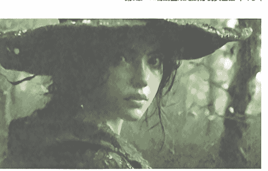

参考强度设为“弱”时效果如下：

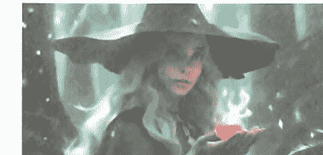

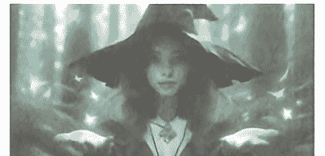

参考强度设为“较弱”时效果如下：

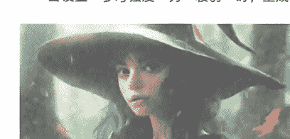

参考强度设为“中”时效果如下：

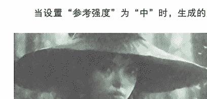

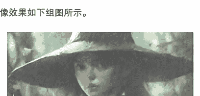

参考强度设为“强”时效果如下：

参考强度设为“较强”时效果如下：

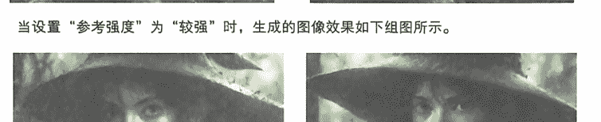

在 Stable Diffusion、ComfyUI 中常用“降噪”控制重绘，数值越高重绘越强，相似度越低。

#### 重视基准素材质量

基准素材清晰、无噪点、分辨率高，有助于生成精细结果。同时内容要清晰、布局合理，方便模型理解。

#### 处理大尺寸基准素材的方法

素材过大可能无法生成或速度很慢。可先用 Photoshop 裁剪出需要重绘的重点区域，重绘后再拼回原图。

例如右图 1 尺寸为 1792 × 2688，主体占比小，需裁剪为 803 × 1080 的区域，如右图 2 所示。

裁剪后重绘，效果如右图 1，再拼回原图，最终效果如右图 2。

#### 选合适的生图平台

图像改图大致分两类。第一类是即梦 AI、可灵 AI、商汤秒画等平台，内置图像改图选项，可选主体、人物长相、特征、风格、轮廓、景深、姿势等，如下图所示。

这类平台参数预设丰富，操作直观，适合快速出图。第二类是 Stable Diffusion 等专业工具，通过调参、训练数据、图像处理技术组合，实现高度定制化风格。

## 维持角色与场景的连贯

在 AI 短剧制作中，角色、场景、道具在多镜头中保持外观、风格、特征稳定，避免形象突变，才能保证专业度和商业价值。

目前多平台已内置主体参考功能。

### 用即梦 AI 实现角色稳定

1. 打开 https://jimeng.jianying.com/ 进入首页，如下图所示。

2. 点击“图片生成”区域上传参考图，上传后界面如下左图所示。
3. 选择参考项，如角色特征、主体、风格特征、边缘轮廓、景深、人物姿势，这里选择“人像写真”参考项，如下右图所示。

4. 点击“保存”后文本框会显示相关内容。
5. 在文本框输入想要的单人场景，例如“参考图片中的人像，人物穿着改成身着黑色西装，站在城市夜景的街头，潮玩风格，中景，酷炫时尚氛围，光影对比强烈，人像写真。”如下图所示。

6. 选择“生图模型”为“图片 3.0”，如下左图所示。
7. 设置比例为 9:16，分辨率为标清 1K，如下右图所示。

8. 点击文本框右侧的 ◆ 2 按钮生成，效果如下：

#### 一句话编辑

即梦 AI 的智能参考可通过一句话实现改图，包括增减主体、换装、改动作、改场景、改风格，无需涂抹描边。

上传参考图如下左图，设置如下右图，输入“给图片换模特，衣服保持不变。模特修改成中年阿姨。”

更改后效果如下：

#### 角色特征参考

上传参考图后，AI 会提取发型、服装、体型等特征，应用到新图，保持角色统一。

特别适合漫画、游戏、故事创作。笔者上传参考图如下左图，设置如下右图。

输入提示词“大海，落日夕阳”换背景后效果如下，可见主体特征稳定。

#### 主体识别

上传参考图后，“主体识别”会自动提取核心主体，保留其整体，可迁移到不同风格或场景。

笔者上传参考图如下左图，设置如下右图。

输入提示词“森系的花园”，保留主体换背景效果如下：

#### 风格参考

上传参考图后，可一键复制其整体艺术风格，如日系、赛博朋克、复古油画等，无需复杂描述。

勾选“风格参考”并设置强度，系统会自动提取色彩、笔触、氛围，应用到新图，保证风格统一。

调节参考强度的数值会直接决定成片与样张的视觉贴合度，数值推高时新图会更贴近参考的语言，数值降低则结果更具发散性。左侧展示上传的素材，右侧展示对应的参数面板。

投喂提示词“有个性的小猫”后，产出的小猫在造型与画风上与参考素材保持同一气质。

#### 边缘轮廓
边缘轮廓参考的核心在于提取原图的主体线条与结构骨架，用以牵引新画面复用相似的布局和空间关系，特别适合对画面框架有严格复刻需求的场景。左图为上传的样张，右图为参数面板。

参考上传图的边缘轮廓后得到的成片如下。

#### 景深
即梦 AI 的景深参考模仿真实摄影的景深规律，让远离焦点的区域逐步虚化，从而凸显主体并强化层次感。上传素材后系统会自动定位焦点并生成景深图，帮助快速获得专业的虚实对比。参考图像在左，设置在右。

参考景深后的效果如下。

#### 人物姿势
人物姿势参考可让用户上传样图，将其中的动作状态迁移到新图，如搏斗、舞蹈等，使生成的角色摆位与参考保持一致，提升连贯性与表现力。该能力在多人场景中仍能保持各角色动作的协调，增添叙事张力与动感。参考图像在左，设置在右。

基于参考姿势生成的二次元效果如下。

### 用豆包保持一致性
在豆包里做多场景分镜时，角色的外观、服饰与整体画风能够得到稳定延续，保证镜头间的视觉统一。具体操作如下。打开豆包官网，点击左侧“图像生成”，在文本框输入提示词，本次使用“生成短剧12个分镜：一对夫妻车站分离的场景。”如下图所示。

点击生成后会同时得到分镜头文本和对应图片。虽然分镜数量不少，但主体一致性依然可靠，从车站外到车站内再到离别特写，过渡自然。下面这对夫妻的设定是：丈夫短发、蓝衬衫配黑西裤；妻子长发、粉色连衣裙。第一个分镜：写实风格，正面视角，车站外阳光洒地，人来人往。丈夫拎行李箱，妻子站在一旁，两人缓步走向入口。

第二个分镜：写实风格，侧面视角，场景切换到车站大厅，人群密集。两人站在中央，妻子眼神不舍，轻轻拉住丈夫衣角。

第三个分镜：写实风格，特写视角，镜头聚焦妻子面部，眼眶微红，泪水打转。

第四个分镜：写实风格，中景视角，丈夫伸手拭去妻子眼角泪水，面带温柔笑意。

实际生成中偶尔会出现细节偏差，例如第四个分镜里男主发长与前几张不一致。因此豆包更适合轻量级、要求不高的短剧画面制作。

### 用 Kontext 保持一致性
FLUX.1 Kontext 由 Black Forest Labs 打造，依托上下文感知技术实现跨场景的高连贯编辑。模型基于 Flow Matching 架构，融合多模态理解，能精准捕捉图文语义，在修改对象、转换风格或替换背景时保持角色特征与构图稳定。打开 https://www.liblib.art/ 登录后，点击左侧“在线生成”，进入创作页。

在 CHECKPOINT 下拉选择 F.1 Kontext_full.safetensors，滑动页面后点开“图片参考（可选）”，在上传区选择“从本地上传”，本次上传美女图和小猫图。

在提示词框输入画面描述，例如“一位美女抱着小猫”，点击右上“翻译为英文”。

点击“开始生图”，得到美女抱小猫的成片。对比可发现人物与小猫基本保持一致。

为验证一致性，准备更换背景。发送到“图生图”，模式选“常规”，比例选“智能匹配”。提示词改为“将背景换为图书馆”，翻译为英文。

再次生成后背景变为图书馆，人物未变。再把提示词改成“将美女的衣服换为白色连衣裙”，人物依然稳定。

## 根据分镜头脚本生成关键帧画面
用 AI 按分镜头脚本生成关键帧本质上是反复调试与妥协。脚本需要把构图、色调、光影和动态写清，但 AI 对复杂叙事的理解常有偏差。即使给出详细提示词和参考图，也可能因随机性导致细节偏离，需要多次调参或换模型，理想状态是 AI 辅助加人工精修。第 5 章已完成中国传统神话短剧脚本，接下来用该脚本生成分镜画面。

### 生成主要人物形象
短剧创作中确定人物形象是情感共鸣的基础。以第 1 集为例，主要人物有轩辕尘、赤炎灵鹿、轩辕尘母亲、黑衣蒙面人。设计步骤如下。用 DeepSeek 根据分镜头脚本生成人物描述提示词，点击输入框下方的📎上传脚本，上传后在框内输入指令。

AI 给出的角色描述提示词包含面部特征、体型数据、服饰细节等，篇幅所限仅展示部分。接下来用即梦 AI 生成人物形象。打开即梦官网，点击左侧“图片生成”，在输入框粘贴轩辕尘的详细描述。

生图模型选“图片 3.0”；图片比例设为 3 : 4。

点击下方 ✦ 按钮生成，效果如下。

同理生成其他角色，赤炎灵鹿、轩辕尘母亲、黑衣蒙面人的形象如下。

角色定稿后，可通过参考图生成后续画面，保证全剧人物统一。

### 生成关键帧画面
核心思路是以分镜头脚本为基准，提炼场景、动作、光影等视觉要素，转化为精准提示词，并通过多轮调整保持风格统一与叙事连贯。打开 DeepSeek，点击输入框右侧 @ 上传分镜头脚本文件，输入指令让 AI 为每个镜头生成匹配的生图提示词，要求涵盖主体、景别、光影、构图、风格等。

生成部分提示词如下，镜头 1 为远景俯视...提示词生成后打开即梦绘画。注意把脚本里的人物名替换为具体形象描述，并加入期望风格和着装细节。分镜 1 输入“远景，俯视视角，村庄被黑雾笼罩...写实风格”。生图模型选“图片 3.0”；比例选 9：16。

点击“立即生成”得到分镜 1 图片。分镜 1 无主要人物，无需参考。从分镜 2 开始出现人物。输入“古神话背景下的生死离别场景...”上传轩辕尘参考图，勾选“人像写真”，保存。

随后上传轩辕尘母亲的图片，上传后会出现“参考合影”模式，选择该模式。生图模型保持“图片 3.0”，比例 9：16。点击“立即生成”得到分镜成片，按此流程批量生成剩余分镜。

# 第 7 章 AI 辅助生成短剧分镜头视频

## 文生短剧视频的优劣势
短剧画面生成主要有两种路径：纯文字描述直接出视频，或基于现有图片衍生视频，各有适用场景和特点。

### 文生视频的优势
文生视频操作门槛低，流程直观，上手快。创作者可把想法直接写进提示词，快速获得贴合预期的画面样式。对短剧而言，文生视频特别适合搭建复杂场景，通过文字快速生成古风庭院、未来都市、神话仙境等虚拟空间，省去实景搭建或绿幕成本。例如输入“纯白色未来城市，空中之城，科幻建筑，镜头慢慢推近，聚焦建筑群，河水流淌，高清。飘浮在天空中的圆形球体建筑，建筑像气球一样飘浮在空中。”生成的视频效果如下。

## 文本驱动与图像驱动的短视频实操

现在使用者能用一段自然语言直接点出爆炸、魔法、科幻等制作成本极高的特效，跳脱实拍限制。系统还能模拟多机位走位、镜头切换等复杂运镜逻辑，通过微调提示词来更换运动参数，甚至把画面定格在某一个帧位进行精修，以提升质感。文本方案也被广泛用来填充低成本项目里的空镜，或在预演阶段快速占位，针对场景与效果要求不高的片段效率很高。

### 纯文本生成视频的短板
当前模型大多基于大规模公开语料训练，分布偏向大众化主题。遇到粒子特效、数据可视化等小众题材时，先验知识不足，容易出现细节模糊、时序断裂。

语言本身也有模糊与主观性。对常规场景影响有限，面对偏门或复杂的描述，模型难以把文字准确转译成画面，最终呈现常与预期偏离。

例如让模型生成“层层叠叠的火剑组成环形，环形中间是身穿华丽白袍的年轻男修真者，右手两指指向前方，大电影风格，远景青山如影，玄幻，唯美，惊艳，高清。真人摄影写真，背景是古战场。厮杀惨烈，史诗级古装电影战争场景。实拍。低饱和度、低明度。”所得动态与描述存在明显差距。

多人场景的处理同样吃力，运镜容易混乱、人位重叠、动作不同步。打斗片段经常显得扭曲紊乱。

短剧往往依赖对话、眼神等细微互动来推进情节，文本驱动在细节上偏弱。肢体语言多显僵硬模式化，难以传递层次丰富的情绪；场景元素的象征意义容易沦为生硬符号，与情节融合不足。

## 文本生成实操建议
- 用词简洁：短句说清核心，避免拗口长句与生僻词。
- 剧情收敛：理解窗口有限，建议控制在5到10秒能讲清的范围。
- 避开精确计数：大模型对数量不敏感，“10只小兔子在森林里”常数不对。
- 运动克制：弹跳、高空抛物等复杂物理目前成功率偏低。
- 表达直白：少用成语与行业黑话。例如“工作室灯光”在摄影里指棚内专业布光，模型可能拆成“工作室”和“灯光”两个物体，理解走偏。

## 图像驱动视频的优劣

### 图像驱动的长处
图像驱动是将静态画面转化为动态片段的技术，可直接导入任意图片作为起点，直观操作就能把存量素材转为视频，大幅降低门槛，适合基于已有图快速出片。

个性化与可控性是核心优势。使用者可通过提示词设定图里元素的运动方式，为静图赋予动态与叙事走向，形成独特风格，也利于把控短剧整体调性。

例如导入左侧静图，输入“主体保持静止，镜头快速环绕360度展示三维空间。男性武者腾空飞踢，鱼眼畸变仰拍强化足部透视，中式道教服饰。道教阴阳布鞋，三缕长髯，仙风道骨，白发，气浪特效，8K超清捕捉肌肉线条与布料拉伸纤维，竹林背景落叶飘散，空中虚幻引擎速度线残影，写真风格。”所得效果见中间图与右侧图。

应用面广，从商家商品动态展示到个人趣味创作都可胜任，并支持多种宽高比适配不同平台。输出通常流畅且贴近物理规律，能保留原图细节并赋予自然动感，提升视觉质感。

### 图像驱动的局限
模型处理高复杂度画面时，毛发、纹理、光影等细微处难完美还原，动态易显粗糙。

例如导入左侧静图，输入“火凤凰扇动翅膀向高空飞去”，所得效果见中间图与右侧图。可看出画面逐渐崩坏。

运动轨迹推断也有限。模型需从静图推断合理动态，理解偏差会导致动作不自然、逻辑不通。

此外，图像驱动完全受限于输入图的信息量，难以跳出原素材框架自由发挥，会制约创意多样性与个性表达。

## 图像转视频操作要点
- 遵循真实物理：描述运动时贴合现实规律，如下落加速、受力方向位移。
- 挖掘潜在微动：想象画面中可自然发生的细微变化，如树叶轻摇、河水缓流。
- 控制描述偏离：提示与画面差距过大易产生撕裂感，像镜头突变。
- 简化运动幅度：技术尚不成熟时，优先选择单一明确、易表现的变化方向，保持逻辑清晰。

## 用起始画面锚定开场一致性
把起始画面作为短剧起点，能明显提升一致性与效率。起始画面为模型提供视觉锚点，确保风格、角色、场景稳定，避免文字驱动常见的角色变形与风格跳变。以第6章生成的图为例，具体流程如下。

（1）打开可灵AI工作台，进入视频生成界面，点选左侧菜单栏里的“图生视频”，示意图如下。

（2）在左上方选择“可灵2.0大师版”模型，如左图所示。

（3）点选图标，导入第6章生成的分镜1图片，载入后见右图。

（4）在底部文本框输入“远景，俯视视角，镜头慢慢推近，村庄被黑雾笼罩，村民横躺呻吟，枯树摇曳，远处山脉泛着诡异红光。动态黑雾缓缓流动，低沉危机音效贯穿始终，暗色调为主，写实风格。”时长设为5s，产出条数设为1，见右图。

（5）点选底部的“立即生成”，即可得到动态片段，画面如下组图。

（6）按同法，分镜2的画面如下组图。

## 用结束画面增强可控性
仅导入结束画面生成短剧，本质是让模型逆向推导，以目标画面为终点，依据文本补全起点到终点的连贯过渡。适合需精确控制结局或关键帧的创作，如换装、场景切换、特效衔接。具体步骤如下。

（1）进入可灵界面后选择可灵1.6模型，仅导入结束画面，导入的图见左，载入后界面见右。

（2）在“图片创意描述”框输入“男孩慢慢摘下面具，最后露出半张脸”。创意相关调为0.75，生成模式选高品质，时长5s，见右图。

（3）点选底部启动键，可得到一段5s片段，如下组图，可见男孩慢慢摘下面具，最后露出半张脸，即导入的结束画面效果，有效控制画面内容。

## 用起止画面掌控过渡
借助起止画面可更精准掌控生成效果，让剪辑更灵活。起止画面标记片段起止画面，使内容更连贯完整。注意两张参考图需风格相近，否则画面会割裂。示例流程如下。

（1）进入图生视频编辑界面，选择可灵1.6模型，点选按钮导入起始画面素材，如下图。

（2）点选图标打开导入结束画面的界面，如左图。

（3）导入结束画面，如右图。

（4）起止画面均导入完成后界面见左图。

（5）在“图片创意描述”框输入“汉服古装女孩，从画中走出来”，创意相关0.75，生成模式标准，时长5s，如右图。

（6）点选底部启动键，可得到一段5s片段，如下组图。

从画面可见主体保持相似，镜头变化过渡平滑，是自然的场景演进。

### 起止画面使用技巧

#### 背景固定主体平滑过渡
背景一致，主体呈现自然流畅的移动或变化。导入时起止画面主体变化应小且相关，相关性越高过渡越好，否则会生硬卡顿。

下图左为起始帧，右为结束帧。

生成片段截图如下，可见画面过渡流畅，机器人自然变身。

也就是说，背景不变主体变化时，模型会依据提示词寻找两图主体的逻辑关系并据此生成片段。若关系难以确立或超出常规，则难以得到满意结果。

#### 主体固定背景平滑转换
主体静止，背景平滑过渡到另一场景，适合突出固定对象。要求起止画面主体轮廓清晰明确，背景不宜过于复杂，否则易模糊失真。

下图左为起始帧，右为结束帧。

生成片段截图如下，可见画面以人物为中心，镜头随人物走动移动，后续背景随镜头变化。

也就是说，主体不变背景变化时，可灵AI会依据提示词从起始背景逐渐过渡到结束背景，因此如果两张图片的背景相似度较高，具有连续性，则画面变化会比较顺畅，如果区别过大，则难以生成令人满意的视频。

#### 旋转效果
设定起止画面状态，由模型自动生成中间帧，形成物体或场景的平滑旋转。下图左为起始帧，右为结束帧。

提示词：全景运镜，一艘潜水艇在深海航行，突然海底传来巨大震动，海水开始翻腾。翻腾后特写运镜，一只巨大的章鱼状深海巨兽从海底升起，触手缠绕潜水艇，船员惊恐万分。效果如下组图，可见通过海底中船的旋转实现了丝滑转化。

#### 画面穿梭效果
利用模型生成中间过渡帧，实现主体或场景自然流畅转换，通常需两张承接关系强的图片输入，可营造时空穿梭、季节变换、物体变形等梦幻视觉。下图左为起始帧，右为结束帧。

提示词：第一人称视角，镜头穿梭，穿过建筑大门，摄像机如身临其境般高速穿梭，到达第二场场景，行动中产生强烈动感模糊，模拟人眼视觉惯性，穿梭的沉浸式体验仿佛正亲历这场风驰电掣的空间穿越镜头。效果如下组图，可见两个空间完成丝滑穿梭转化。

#### 出水转场效果
起始画面为水下场景，结束画面为主体露出水面，中间自动生成“破水而出”的连贯变化。下图左为起始帧，右为结束帧。

提示词：水底有很多泡泡，几只海马在水底兴高采烈地打牌，突然上面伸下一只大手把中间那只海马抓出去，摄像机跟随手移动浮出水面，外面是一个繁华菜市场，有台秤。效果如下组图，可见海马被一只手从海底抓到水面，实现了丝滑转场。

#### 画中画效果
起止画面元素配合，实现主画面中嵌套子画面从起始状态平滑变化到结束状态。下图左为起始帧，右为结束帧。

关键词是让一只机器人骑着鸵鸟狂奔，镜头持续后撤，最后整个画面被收进电视里，电视机旁还坐着一个牛仔造型的机器人，一边吃薯条一边看电视，整体效果轻松又好笑。实际生成的结果见下方图组，可以看出前后两段内容借助电视机完成了画中画的衔接。

想了解更多首尾帧的玩法细节，可以去翻阅本书附赠的飞书文档。

## 多图参考实现角色统一的视频生成

多图参考的思路是将多张参考图里的不同要素，比如人物、场景、服饰等抽取出来，再结合文字指令进行合成，让 AI 在保持细节一致的前提下完成互动场景的制作。

比如下面这组图里的人物主体，就可以用来生成包含这些元素的视频画面。

生成的视频效果如下图所示。

目前可灵 AI、Vidu AI、绘蛙 AI 等主流视频工具都已支持多图参考。下面以可灵 AI 为例说明具体流程。

1. 进入可灵 AI 的“图生视频”页面，模型会自动切换为可灵 1.6，如左图所示。

2. 上传需要作为参考的主体图，这里示范上传了 4 张，如右图所示。

3. 在下方的“创意描述”框中输入“一个卡通小猫，穿棕色皮夹克戴墨镜，站在舞台上对镜头微笑”，选择高品质模式、时长 5 秒、比例 16：9、生成数量 1 条，如下图所示。

4. 点击下方的“立即生成”，即可得到对应视频，画面如下组图所示。

# 第 8 章 精准掌控 AI 视频运镜

## 用笔刷精确指引物体运动轨迹

在短剧制作中，巧妙借助平台功能就能实现对画面物体运动路径的控制，下面以可灵 AI 为例展开说明。

### 认识可灵 AI 的运动笔刷

可灵 AI 的运动笔刷主要用于图生视频，可以为图片中的人物或物体指定移动轨迹，同时还能划定静止区域，从而提升画面可控性。比如在一张有帆船和湖面的画面里，可以让帆船向左移动、湖面向右移动，生成拟真的航行效果。需要注意的是，该功能最多可同时操作 6 个元素，目前仅在可灵 AI 1.0、1.5 模型中可用，1.6 与 2.0 模型暂不支持，上传图片后最多生成 5 秒视频。具体操作如下。

1. 进入可灵 AI 图生视频界面，选择 1.5 模型并上传图片，如左图所示，在提示词框里输入“3D 动态效果”，如右图所示。

2. 点击“运动笔刷”下的“去绘制”按钮，进入绘制界面。

3. 点击“画笔”，调整笔刷大小并勾选“自动检测区域”，在画中点选需要运动的主体，绿色区域即为本次选中的运动范围。

4. 点击右侧“轨迹 1”，画面会出现小画笔，沿所需方向绘制该区域的运动轨迹，如图所示。

5. 除了自动检测，也可手动绘制区域。取消“自动检测区域”，点击“轨迹 2”，在画面中直接绘制运动范围，紫色区域即为自定义范围。

6. 点击右侧“轨迹 2”，为该区域绘制运动轨迹，如图所示。

7. 按同样方法补全其他区域与轨迹，如图所示。

8. 点击右下角“确认添加”完成设置，将“创意相关度”设为 0.5，生成模式选“高品质模式”，如图所示。

9. 点击“立即生成”，即可得到 5 秒的 3D 效果视频，部分帧如下组图所示。

### 精准运动的典型案例

#### 效果 1：控制动物奔跑方向
借助运动笔刷可以指定动物奔跑的走向。例如用左图素材，控制界面参考右图。

按此设置生成的视频截图如下组图，小狗严格沿着轨迹线奔跑，控制效果理想。

#### 效果 2：控制物体降落方向
运动笔刷同样能控制物体下落路径。例如用左图素材，控制界面参考右图。

生成的视频截图如下组图，橙子沿轨迹降落并溅起水花，控制精准，可用于广告拍摄。

#### 效果 3：多主体同时运动
运动笔刷还能同时操控多个主体。例如用左图素材，控制界面参考右图。

生成的视频截图如下组图，两只小猫分别沿不同轨迹转头，运动方向控制到位。

## 实现精准的运镜效果

运镜的重要性与常见手法在前文已介绍，本节说明如何通过软件功能或文字提示让 AI 生成理想的运镜画面。

### 可灵 AI 内置的常规运镜控制

在可灵 AI 中，可通过内置固定运镜与运镜类提示词实现精确运镜，不过该功能仅在可灵 1.0 文生视频与可灵 1.5 图生视频中可用。可灵在镜头运动的丰富度、自动化程度和视觉表现上都有明显特点。

下面以水平平移为例说明，其他手法可参照此流程。

#### 水平平移运镜

水平平移是指摄像机位置固定，镜头在水平方向左右移动，常用于展示场景全貌或人物位置关系。

在可灵 AI 中生成时的示意和数值变化见下图，具体步骤如下。

1. 在视频生成界面选择“可灵 1.0”模型，如左图所示。

2. 在“创意描述”中输入“镜头缓缓从狗狗左侧移至右侧”，如右图所示。

3. 打开“运镜控制”，选择“水平运镜”，数值设为 10，如图所示。

4. 将生成模式设为“标准模式”，画面比例 16：9，创意相关度 0.5，如图所示。

5. 点击“立即生成”，可得到水平运镜视频，效果见下组图。

#### 垂直升降运镜

垂直升降指摄像机在垂直方向上运动，通过上下俯仰调整视角。

示意和数值变化见下图。

提示词示例：镜头垂直上行，从茂密林冠攀升至蔚蓝天空，展现自然壮阔。

设置垂直运镜数值为 10，生成的画面如下组图，镜头从树枝一路向上推移至天空。

#### 拉远推近运镜

拉远是摄像机远离主体，主体占比减小；推近是摄像机靠近主体，主体占比增大。

示意和数值变化见下图。

提示词示例：镜头缓缓拉远，聚焦海上游轮。

将拉远推近数值设为 -10，生成的画面如下组图，可清晰看到镜头从游轮细节逐渐拉远，船体愈显渺小。

#### 上下摇镜

垂直摇镜即镜头沿上下方向移动，最终可能回到平视。

示意和数值变化见下图。

提示词示例：镜头缓缓上摇，山脉全貌逐渐显现。

设置垂直摇镜数值 10，生成的画面如下组图，镜头向上摇动展现山脉高大。

#### 左右摇镜

水平摇镜是摄像机不动，通过水平移动拍摄，模拟头部左右转动。

示意和数值变化见下图。

提示词示例：镜头自左向右摇动，从广阔海洋过渡到沙滩岸边，蓝天白云。

设置水平摇镜数值 10，生成的画面如下组图，镜头从左向右摇动，画面由海洋转向岸边。

#### 环绕旋转运镜

旋转运镜可让画面围绕中心轴旋转，增强动态感。

示意和数值变化见下图。

提示词示例：旋转运镜，围绕一只兔子旋转。

设置旋转运镜数值 10，生成的画面如下组图，镜头围绕兔子向右下方倾斜旋转。

### 可灵 AI 中的四种大师级运镜

可灵 AI 将大师运镜定义为通过镜头运动、角度切换与节奏把控增强表现力的高级技巧，可带来电影感、冲击力与情绪感染力。下面介绍四种经典手法。

#### 下移并拉远

下移拉远结合了垂直下移与拉远，营造独特视觉与叙事张力。

示意图如下。

提示词示例：在无垠荒漠中，一只骆驼孤独行走，沙丘起伏，尽显苍凉。

使用该手法生成的画面如下组图，镜头先下移随后慢慢拉远，骆驼逐渐变小。

#### 推近上移

推近上移先靠近主体再向上移动，突出主体同时展现环境。

示意图如下。

提示词示例同上。

生成的画面如下组图，镜头先向前推近骆驼变大，随后上移。

#### 右旋推近

镜头边向右旋转边靠近主体，增强画面变化。

示意图如下。

提示词示例同上。

生成的画面如下组图，镜头先围绕骆驼右旋，再推近，主体逐渐放大。

#### 左旋推近

与右旋推近类似，只是旋转方向为左。

示意图如下。

提示词示例同上。

生成的画面如下组图，镜头先围绕骆驼左旋，随后推近，主体逐渐放大。

在生成上述运镜时，并非所有场景都能明显呈现效果，建议多次尝试，效果不佳时可切换至高表现模式。

### 通过提示词实现镜头切换

除可灵 AI 提供内置运镜外，其他 AI 工具多需靠运镜提示词来驱动。下面是常用手法示例。

#### 推镜头 + 浅焦镜头

提示词：推镜头缓慢推近，聚焦女孩焦虑的面部特写，背景模糊，光线昏暗，突出悬疑氛围。

# AI 运镜实战笔记：提示词与模板的结合用法

实测感受：用可灵生成一段推进镜头时，主体始终保持清晰可辨，后景逐渐柔和虚化，细节放大更明显。

#### 升拍叠加希区柯克变焦
提示词要点：由下往上仰拍并拉升，配合希区柯克变焦，人物被推近的同时背景被拉远。
呈现情况：参考图置左由即梦提供，合成帧在中右。俯瞰视角保留了全局掌控感，变焦则强化了画面张力。

#### 推近加环绕运镜
提示词要点：由远及近推进锁定主体，随后环绕呈现人物与环境的整体。描述为推近+环绕，雨中女子大笑，大雨倾落，层次错落，冲击力强。
呈现情况：左侧为即梦提供的参考，中间与右侧为合成结果。

#### 上摇协同推近
提示词要点：上摇镜头配合推近运镜，突出人物与背后楼梯的空间关系。
呈现情况：左侧为即梦参考，中间与右侧为生成帧。上摇与推近同步，上移的同时向前推进，既能带出纵向信息，又能加强戏剧感，凸显主体与空间的层次。

#### 上移对齐平视中景
提示词要点：先向上移动镜头至与人物平视的中远景，背景光晕向外扩散。
呈现情况：图组可见镜头先上移后与人物持平，孙悟空身后光晕更显突出。

#### 推近搭配环绕
提示词要点：镜头迅速前推，围绕人物头部由左至右快速环绕，背景光芒持续外散。
呈现情况：图组显示镜头不断前推聚焦面部，同时围绕面部旋转环绕。

### 多镜头组合公式
镜头顺序 + 运镜方式 + 运动幅度 + 镜头语言 + 光影氛围。
示例描述：从城市黄昏天际线的远景开始，以慢速平移横扫，金红余晖透过玻璃幕墙折射出细碎光斑，街道人群剪影被拉长如流动墨迹；切换至中景俯角的摇镜+俯拍，一名身着米色风衣的女子驻足在咖啡馆橱窗前，手中旧相册被风掀开，泛黄照片里少年逆光侧脸特写，采用浅景深与柔焦处理。
借助即梦完成片段串联，多段镜头衔接流畅。

#### 动态场景组合
镜头1 无人机俯冲 → 镜头2 手持跟拍 → 镜头3 子弹时间环绕。
提示词要点：无人机俯冲穿越云层展现赛道全貌；手持镜头剧烈晃动跟拍赛车漂移；子弹时间环绕赛车爆炸瞬间，碎片轨迹清晰可辨。
呈现情况：即梦生成的图组可见上述效果。

#### 瞳孔叠化转场
提示词要点：镜头前推穿越猫咪瞳孔进行瞳孔转场，叠化后对焦至神圣殿堂，仰拍视角。
呈现情况：图组显示通过瞳孔叠化完成场景切换。

#### 硬切镜头
提示词要点：快速推近特写孙悟空左眼瞳孔，随后切换至第一人称视角呈现远处天宫仙庭建筑。
呈现情况：上传孙悟空首帧作为起点，按描述完成场景转换，素材置右，结果见图组。

部分情况下无需显式写运镜指令，仅靠动作与场景自然变化的描述也能获得连贯动态。例如原图置左，提示词为“人物向前飞，脚下云团翻涌，周遭景物急速后退”，中间与右侧为生成画面。

## Higgsfield AI 的模板化运镜

文字描述加平台自带运镜已能完成大部分设计，但对于难以用语言精确表达、参数不易把控的镜头，可借助第三方技术。Higgsfield 的镜头模板支持一键调用预设效果，即便是新手也能通过拖拽获得电影级动态。下面介绍操作流程。

Higgsfield 可将静态图像经预设运镜模板转为视频，支持360°环绕、子弹时间、弧形运镜等50多种专业模式，具体步骤如下。
（1）进入官网后按需求选择功能，例如制作子弹时间则点击 Bullet Time 按钮进入对应界面。

（2）点击 Generate 按钮进入视频生成编辑界面，如下图所示。

（3）点击按钮载入参考图像，如下图所示。

（4）在文本框输入 “The camera glides in slow motion, starting with a wide shot of the rocky landscape. The man stands firm, boots grounded amid scattered stones, as if anchoring himself to the earth. His gaze shifts slowly to the swirling sky — a cosmic dance of Van Gogh’s Starry Night blended with drifting clouds. Pebbles shift under his boots, moving in slow, deliberate tumbles. A gust of wind sends his jacket flaring out, the fabric rippling in hypnotic waves. The river’s surface undulates lazily, shimmering reflections of the vibrant sky swirling like liquid gold.The camera pans upward, where the painted heavens seem to pulse and shimmer as if alive, the swirls expanding outward in mesmerizing detail. The man exhales, his breath visible in the cool air, dissipating like smoke into the painted sky.”（摄像机以慢动作滑行，从岩石景观的广角镜头开始。这个男人站稳了脚跟，靴子踩在散落的石头中，仿佛将自己固定在大地上。他的目光慢慢转移到漩涡状的天空上——凡·高的《星夜》中的宇宙之舞与飘浮的云朵混合在一起。鹅卵石在他的靴子下移动，缓慢而刻意地翻滚。一阵风吹得他的夹克张开，布料在催眠的波浪中荡漾。河面慵懒起伏，充满活力的天空像液态黄金一样旋转，波光粼粼。镜头向上平移，画中的天空似乎像活着一样跳动和闪烁，漩涡以迷人的细节向外扩展。男人呼出一口气，他的呼吸在凉爽的空气中清晰可见，宛如烟雾般消散在漆画的天空中）如下左图所示。
（5）把生成模型设为 Lite，如下右图所示。Standard 和 Turbo 为收费模型，只有 Lite 可免费使用。
（6）点击按钮设定生成时长，此处选择5s，其余保持默认，如右图所示。

（7）点击下方的 Generate 按钮即可开始生成，画面效果见图组。

# 第 9 章 用 AI 生成短剧音频内容

## 让角色开口说话的技术路径

短剧若依赖对话推进，就必须解决口型同步与情绪表达两大问题，下面展开说明。

### 用即梦实现角色对口型
即梦的对口型模块是视频生成核心能力，可将音频与人物口型、表情、动作自然融合，提升真实感。功能覆盖基础口型匹配，还可模拟表情、情绪与肢体动作，适用于短视频创作等场景。
操作要点如下。
（1）打开 https://jimeng.jianying.com/ 登录后，在左侧选择“对口型”进入创作页，如下图所示。

（2）左侧为参数区，“角色”用于导入对口型素材的图像或视频，图片上限20MB，视频上限50MB；角色可以是真人也可以是动漫，只要五官不被遮挡即可，本例载入一段5秒视频，如下图所示。
（3）在“生成效果”区提供“标准”“生动”“大师”三档。载入视频后默认“标准”且不可切换，如下图所示。视频模式下仅支持口型调整。“生动”模式可增加面部表情动作如闭眼摇头，但画面会被裁为1:1；“大师”模式可生成全身动作并保留生图原始比例。

（4）在“对口型”区可通过“文本朗读”或“上传本地配音”提供内容。上传图像且效果为“标准”或“生动”时，文本朗读时长上限36秒，如下图所示。“大师”模式下语音上限15秒，若上传视频则语音时长需尽量与视频一致。

（5）本地配音支持 MP3、WAV、M4A、FLAC、AAC、OGG 格式；“标准”或“生动”模式上限36秒，“大师”模式上限15秒，如下图所示。

（6）在“文本朗读”卡中输入台词后，可为角色挑选合适音色，点击试听按钮筛选。还可通过拖动“说话速度”滑块调节语速，如下图所示。

（7）参数设定后系统会计算所需积分，点击“生成视频”即可在右侧开始制作，完成后可查看下载，如下图所示。

### 用可灵实现角色对口型
可灵是快手推出的多模态生成工具，其升级后的对口型功能基于深度学习与计算机视觉实现音视频精准同步，大幅降低创作门槛。可为生成的人物视频包括真人、3D 或 2D 虚拟角色导入自定义音频，系统自动调整口型动作以匹配音频。
操作要点如下。
（1）进入可灵官网，左侧选择“全部工具”，右侧展示全部功能，如下图所示。

（2）选择“对口型”进入创作页。可灵目前仅支持导入最大100MB 的 MP4、MOV 视频，时长不超过10s，本例载入5秒视频，如下图所示。

（3）视频导入后需设定“配音音频”，同样支持“文本朗读”和“上传本地配音”两种方式，相关参数需点击对应按钮后才显示，如下图所示。

（4）可灵的参数设置与即梦基本一致，区别在于输入台词后需先选音色才会计算时长。此外部分音色可根据视频人物情绪选择对应情感，如下图所示。

（5）设定完成后系统会计算所需灵感值，点击“立即生成”开始制作，完成后可预览下载，如下图所示。
—— | 146 | AI短剧制作与推广全流程：5小时掌握爆款密码

### 用海螺生成带情绪的声音
短剧不同台词需要不同情感配音，海螺的语音生成可制作各风格情绪音色，具体步骤如下。
（1）进入海螺官网，如下图所示。

（2）点击上方“语音”进入语音生成页，如下图所示。

（3）点击左侧“音色设计”进入下图所示界面。

（4）在文本框输入“古代行侠仗义的侠客，声音洪亮正直，充满英雄气概，语速果断。”如下图所示。

（5）试听文本设为“路见不平，拔刀相助，乃我辈本分！妖言惑众之徒，休想在此作祟！看剑！”，如下图所示。

（6）点击下方“生成”即可得到音色，如下图所示。

## 让短剧更有氛围感的配乐思路

### 画面氛围与音乐风格的匹配技巧

#### 依据场景与情感基调挑选音乐
- 爱情/浪漫场景：选用钢琴、小提琴等柔和乐器演奏的温馨旋律，增强甜蜜氛围。
- 紧张/追逐场景：使用节奏明快、鼓点密集或弦乐急促的音乐，如电子乐与鼓点组合，强化紧迫感。
- 悲伤/孤独场景：采用大提琴、钢琴等演奏的缓慢低沉旋律，突出沉重情绪。
- 欢乐/庆祝场景：搭配打击乐等轻快活泼的音乐，传递愉悦感。
- 悬疑/紧张场景：低频音效、不和谐和弦等营造不安。
- 幽默/搞笑场景：轻快俏皮旋律如爵士、卡通音效。
- 激昂场景如战斗追逐：选择快节奏强鼓点的音乐如电子、摇滚。
- 温馨场景如亲情恋爱：柔和旋律如钢琴、轻音乐或温暖人声。

#### 音乐风格与剧型保持统一
- 现代剧：电子乐、流行音乐等时尚风格，贴近都市气息。

# 声画一体，让微剧更具质感

短剧的质感好坏，关键看声音和画面是否真正同步。配乐不是可有可无的背景填充，而是承载情绪的无声旁白，必须随题材气质、节奏起伏和镜头语言一起流动。

题材与乐器的呼应
历史与古风类题材适合用古筝、琵琶等传统民族器乐铺陈，很快把受众带入那个时代语境；悬疑类题材更偏向低沉电子底噪或阴郁弦乐纹理，用神秘压抑的张力撑起氛围。

节拍与镜头运动的匹配
打斗、追逐、快速剪辑的高能段落，配上节拍明快、鼓点密集的高 BPM 曲目，能把紧张感推升；抒情段落、慢镜头或情绪收束时，用柔和舒缓的旋律配合长镜头，让情绪沉淀。快画面配快音乐、慢画面配慢音乐，才能避免听觉与视觉撕裂。

声效叠加提升沉浸
单靠配乐容易单薄，叠加环境音与心理声效能显著增强代入感。雨声、风声帮助搭建场景真实度，心跳、叹息等微细节点亮角色内心变化。紧张时刻叠加急促心跳，哀伤片段点缀一声叹息，说服力更强。

音乐层次的动态控制
音量起伏应跟随剧情呼吸做渐进或骤停的调控，例如追逐段落逐步推大，逃脱瞬间戛然而止冲击更强。主旋律叠加背景音墙也能丰富质感，比如钢琴主线之上铺设弦乐垫底，整体厚度会更饱满。

使用时的三条提醒
1. 防止配乐抢戏。对白密集的片段应适当压低音乐声量，或选用纯器乐无歌词的版本，确保台词清晰可辨。
2. 规避版权风险。建议优先使用平台内置的免版权音库或公共领域资源，或借助智能创作工具生成原创曲目。
3. 切换需流畅。场景转场时可用淡出、风声等小音效做桥梁，避免听感突兀。

音乐是短剧的隐形台词，需精准匹配画面情绪、节奏和题材。通过分析画面情感基调、场景类型和剧情节奏，结合音乐风格、乐器和动态调整，确保声画高度契合，并借助智能工具提升效率。

### 生成短剧主题曲的操作步骤

下面以字节跳动推出的海绵音乐为例，说明如何借助智能创作平台快速打造专属主题曲。该平台内置多种风格与情绪模板，即便没有专业背景也能上手制作。

（1）打开海绵音乐官网，加载首页，界面示意如下。

（2）在左栏菜单中选中“创作”，进入创作页面，示意如下。

（3）在灵感输入区填入创作关键词，也可点右下角的“随机灵感”让系统自动生成示例，这里以“写一首只是当时已惘然的歌”作为示范。

（4）点底部的“上传图片”按钮，可额外补充视觉参考，效果如下。

（5）点左下角的“生成音乐”按钮，系统会一次性产出三版不同风格的试听，如左图所示。

（6）点曲目名称即可展开对应歌词，右侧展示示意如下。

（7）左侧的“改编”功能支持对已生成的曲目进行细节微调，界面如下。

（8）点“灵感生词”可让系统重新生成歌词，如左图所示。

（9）在右侧可设定曲风、情绪及音色，如民谣风格、伤感情绪、女声演唱，示意如下。

（10）再次点底部的“生成音乐”按钮，即可获得新版本，效果如下。

### 生成短剧背景纯音乐的操作步骤

纯音乐背景的要点在于营造氛围而不抢戏。悬疑场景可用低频弦乐制造压迫感，温情桥段以钢琴柔板烘托治愈感，喜剧片段则选用轻快铜管突出诙谐感。关键转折点上自然接入，才算得上配得上无声叙事的角色。下面以趣丸科技唱鸭团队开发的天谱乐为例。

（1）登录天谱乐官方网站，首页如下。

（2）在左栏菜单中选择“文本生曲”，进入相应页面。

（3）点上方“纯音乐”切换至专家模式，如左图所示。

（4）在输入框描述风格需求，例如“适合夜晚星空下的浪漫音乐风格：流行”，并将风格选项设为流行，如右图所示。

（5）将速度参数设为“AI推荐”，模型选用“纯音乐创作-2.0”，设置如下。

（6）点底部的“开始生成”，即可得到背景纯音乐，结果如下。

## 借助智能工具让短剧音效更生动

音效是构建沉浸感的关键载体，环境塑造、情绪传导和注意力牵引都离不开它。雨声配合回声能强化潮湿场景的真实度，紧张音效的切换可瞬间拉高戏剧张力，贴合心理的细节音则能深化情感共鸣。

实践中获取音效主要有四种路径。第一种方式是借助剪映、Premiere Pro等剪辑软件自带的音效资源库，利用分类检索快速找到适配动作、悬疑等场景的素材，剪映音效库示例如下。

第二种是前往包图网等专业素材站点下载高质量版权音效，库内涵盖自然环境、机械声响等细分品类，包图网音效库如下。

第三种依托智能实现音画协同生成。以通义万相为例：
（1）进入通义万相官网的图生视频页面，在提示框输入“一只戴着墨镜的狗在街道上骑自行车，3D 卡通。”，如下左图所示。
（2）开启“视频音效”的开关，如右图所示，生成时视频会自动附带音效。

（3）点底部的“生成视频”，即可得到带有轮胎摩擦声的小狗骑行画面，如下所示。

即梦AI在视频生成后也支持追加音效，并提供三种风格供选择，如右图所示。

第四种是直接使用智能音效生成器。以可灵AI为例：
（1）在可灵AI首页左栏菜单点“音效生成”，进入对应页面，如左图所示。
（2）在输入框填写描述，例如“脚下踩碎积雪的声音”，如右图所示。

（3）将时长设为10秒，生成数量设为4条，点“立即生成”，结果如下图所示。

# 第 10 章 微短剧备案、上线及个人推广方式

## 微短剧的备案

### 微短剧备案的分类与层级管理

国家广播电视总局对微短剧采取分类分层审核机制，主要依据投入规模、题材属性和传播影响力划分为三档。

重点类微短剧指满足特殊题材、总投资达100万元及以上、被平台首屏重点推荐或主动申报为重点的项目。此类作品需在“重点网络影视剧信息备案系统”提交立项备案，经省级广电初审、总局复审后取得规划备案号；成片后完成上线备案并通过审核，将获颁《网络剧片发行许可证》，编号格式为“（总局或属地省份简称）网微剧审字（年份）第×××号”。

普通类微短剧指投资在30万元（含）至100万元之间且未被重点推荐的项目。申报渠道为“网络视听节目备案系统”，上线审核通过后获得唯一登记备案号，格式为“（总局或属地省份简称）网微剧备字（年份）第XXX号”。

其余微短剧指投资低于30万元且非重点推荐的项目，采用平台自审自播模式。播出平台承担内容审核与版权认定责任，并定期向属地省级广电报备，编号格式为“（播出平台简称）网微剧备字（年份）第×××号”。如计划在首页首屏重点推送，即便归属此类，也须报总局对成片进行复核。

相关文件截图如下图所示。

三类备案的主要差别包括：投资门槛分别为100万元及以上、30万至100万元、30万元以下；审核主体分别是总局统一管理、省级以上广电部门审查、平台自行审核；使用系统分别是重点网络影视剧信息备案系统、网络视听节目备案系统、平台内部审核系统；凭证类型分别是发行许可证、登记备案号、登记备案号；审核时长大致为1至2个月、中等2至4周、约1周左右。

### 微短剧的备案流程与操作指南

备案工作分为立项规划和上线两阶段。剧本确定后先完成规划备案取得编号再开拍，影片完成后办理上线备案，审核通过后方可公开发布，这一流程旨在事前把控风险，避免资源投入在不合格项目上。

#### 备案系统开户与基础准备

制作企业需向省级广电部门申请开通账号。目前共用两套系统：重点网络影视剧信息备案系统和网络视听节目备案系统，均不向社会开放注册，需提交《广播电视节目制作经营许可证》复印件、开户申请表Word版及盖章扫描件，通常1至2个工作日完成审核，通过后会发放初始密码，需及时修改。

《广播电视节目制作经营许可证》是必备资质，有效期两年，申请条件包括具备独立法人资格、相应专业人员与办公场所、近三年无违规记录等。对于从事智能短剧的机构，若自建平台或工具，还需进行算法或大模型备案；若涉及内容推荐功能，还需完成个性化推荐算法备案。

#### 规划备案的具体要求

重点类项目在重点系统中需提交作品基础信息、不少于1500字的故事梗概、不少于300字的思想内涵阐述、备案表扫描件及剧本完成承诺书。每月5日前提交可当月出结果，之后提交则顺延至下月。

普通类项目材料要求与重点类基本相同，同样需提供基础信息、梗概和内涵说明，但申报系统为网络视听节目备案系统，且审核标准相对宽松，不过思想内涵仍需体现积极的社会价值。

对于使用人工智能技术生成剧本或画面的短剧，规划备案时还需额外说明技术应用环节、工具名称及质量控制措施。若涉及换脸、虚拟演员或变声，必须提供被模仿者的书面授权证明，否则可能因侵犯肖像权或声音权而无法通过。

#### 上线备案的关键步骤

重点微短剧成片后需提交上线备案表、《广播电视节目制作经营许可证》复印件、带图像声音时码的样片介质两份、片头片尾字幕、承诺书、上线审查意见表5份、成本配置报告、特定画面声音说明表等。网络剧还需提供主要演员片酬合同及清单，微短剧需提供分集梗概5份，古装剧需提交服化道自查报告。所有纸质材料加盖公章后邮件报送省局。

普通微短剧流程与重点类似，材料相对简化，通过后获得登记备案号。无论重点还是普通，若有境外演职人员参与，上线前还需单独完成境外人员申请手续。

其他微短剧由播出平台负责审核，平台负主体责任把关内容与版权。即使平台自审，若含智能生成内容，平台也会要求提供技术说明和授权文件以规避法律风险。

## 不同平台的短剧激励政策

### 红果短剧“春芽计划”

题材优先级上，年代爱情、古风言情、仙侠情缘等分账收益加成最高20%至25%，古代剧情、都市玄幻、历史古代加成10%至15%，玄幻仙侠加成10%。参与需版权清晰、内容合规等四项门槛。上线后经平台校验，按月随分账周期发放专项激励。已合作版权方可后台上传，未合作方需扫码提报。

### 即梦 × 抖音“AIGC 短剧招募计划”

计划分为专业团队与个人创作者两条线。

AI精品短剧联合出品单部最高投资比例50%至70%，常规项目最高200万，重点可获500万。集数不少于12集，题材不限鼓励科幻悬疑国风，且50%以上内容需由AI生成。提供无限量AI积分、剪映/醒图会员、优先用新模型及定制技术方案。

AI达人短剧活动面向新手，需用固定形象或风格化账号发布，集数3集新星/品质赛道或6集爆款赛道。激励最高可获千万级流量曝光加5万元现金，优秀者可签约抖音原生账号。

平台还提供全流程工具链：AI剧本、智能画布、对口型配音、一键配乐。联合运营模式下提供3000万至1亿曝光，并按内容评级给予15万至50万元收益保底，还提供全网推广方案。

### 快手可灵 AI 平台“星芒短剧 × 可灵大模型计划”

优质AIGC短剧可获流量分账、现金奖励及重点项目投资，如《兴安岭诡事》付费收益超30万。提供可灵AI工具支持人脸一致性训练和方言对口型，降低奇幻科幻制作成本。参与要求题材涵盖国风科技玄幻，需用可灵AI生成连续剧情，单集≥90秒，集数≥3集。也开展与专业导演的实验性共创。

### 其他平台短剧激励动态

芒果TV采用阶梯分账，会员有效观看时长决定收入，优质作品额外奖励最高300万并提供卫视上星资源。拼多多新剧首发激励5万，播放达标可签约独家最高50万，热播剧CPM达18元。抖音巨量引擎投资比例升级至70%，重点作品曝光1亿，新增收益保底最高50万及托管经营服务。

## 个人推广短剧获取收益方法

### 公众号短剧推广方法全解析

（1）进入微信公众号后台，点左侧菜单“收入与变现”→“带货”，进入如下界面。

（2）点上方“短剧”进入对应界面。

开通返佣商品和内容推广需同时满足五项条件：
第一，公众号粉丝数≥100。

公众号与抖音双平台短剧变现实操路径

达成门槛
- 第三条：关联账号的开户主体数量须控制在 50 家以内。
- 第四条：微信公号粉丝增长须保持自然，禁止任何刷粉行为。
- 第五条：个人订阅号已完成实名认证。

（3）当 5 项前置条件全部满足后，勾选已阅读并同意遵守《联盟商品开通协议》的复选框，再按下底部的“免费开通”按钮，即可激活短剧推广权限。开通后的画面如前。

（4）打开图文编辑后台准备投放时，先展开顶部菜单栏的“收益转化”下拉项，示意见图。

（5）在下拉列表中点选“短剧”，随即跳转到短剧推广操作页面，画面如下。

（6）该页面可筛选合作短剧，单次最多纳入 50 部，单部佣金比例大致在 60%~70% 之间，参考图示。

（7）按下底部的“插入短剧”后进入卡片样式选择页，当前主流样式主要有视频卡、大图卡、小图卡三种，见图。

（8）以视频卡为例，确认后短剧内容即嵌入正文，如右侧图所示，文章发布后推广即生效。

（9）查询收益时，打开左侧菜单的“收益转化→流量主”，再进入“带货和内容推广”下的“短剧推广数据”入口，即可查看收益情况，如图。

### 抖音短剧推广全流程

（1）抖音端先开通挂载权限，点开右上角三横线菜单，选择“抖音创作者中心”，左侧图示。

（2）进入创作者中心后，点按“全部”图标，右侧图示。

（3）在“工具服务”页面里找到“星图商单”图标，左侧图示。

（4）按下底部的“一键授权入驻巨量星图”按钮完成入驻，右侧图示。

（5）入驻成功后账号身份显示为“星图达人”，左侧图示。

（6）轻触“去任务大厅”按钮进入星图工作台，右侧图示。

（7）轻点“短剧频道”图标，进入频道列表页，左侧图示。

（8）在列表中挑选感兴趣的短剧进入详情页，右侧图示。

（9）按下底部的“参与推广”按钮，会弹出任务选择界面，左侧图示。

（10）再按下“立即参与”即可接单。接单前需同时满足风控要求、经营要求、粉丝要求三项审核，右侧图示。

（11）接单后返回详情页，点按“查看详情”可再次打开任务详情，左右图示。

（12）注意在详情页的“补充说明”区块会提供官方视频素材链接，可直接用于剪辑推广，组图示意。

（13）点按“上传视频”即可发布推广作品，编辑页会自动挂载任务，左侧图示。

（14）视频发布后，收益明细可在任务详情页查看，右侧图示。

## “5小时打造你的首部AI爆款短剧”

——从创作到盈利，一本书带你掌握AIGC时代的影视新语言！

### 好书推荐

《DeepSeek：千行百业AI实战指南》

ISBN 9787122477675

《剪映+AI数字人：短视频剪辑制作实战技巧大全》

ISBN 9787122452511

《可灵AI+ComfyUI+Deforum人工智能AI视频制作技巧大全》

ISBN 9787122466556

在微信平台的本号界面回复本书第58页最后一个字，按获取的提示操作，即可领取书中配套素材。

