# AI短剧变现实战指南

## 前言

短剧、AI，是当今社会毫无疑问的两大热门关键词，当两者相遇，又会擦出怎样的火花呢？

近年来，短视频平台的迅速崛起在很大程度上影响了人们的文化娱乐方式，轻量化、碎片化、有爆点的视听内容广受欢迎，也正是在这种大背景下，短剧应运而生，并在短时间内实现了生产方式与审美风格的多元化发展。

过去几年，短剧行业从野蛮生长走向精品化，凭借短平快、强冲突、高共情的特点，横扫抖音、快手、ReelShort 等海内外平台，撬动百亿级市场规模，让无数普通人看到了内容变现的新可能。而 AI 技术的迭代，更是彻底打破了短剧创作的高门槛，不再需要专业编剧、摄影团队、拍摄场地，不再需要动辄数万到数十万的制作成本，一部手机、一台电脑，就能完成从脚本到成片的全流程制作。

特别是即梦 AI 最新推出的 Seedance 2.0 模型，它不仅能生成 4K 高清视频，更重要的是实现了“音画同步”——上传一张定妆照和一段音频，AI 就能让角色开口说话，口型与声音完美匹配，真正让“一人剧组”从梦想照进现实。

本书不堆砌晦涩的行业术语，不空谈空泛的理论知识，全程立足普通读者、零基础创作者的真实需求，以 Seedance 2.0 为核心生产力工具，拆解从市场认知、脚本创作、视觉制作、后期剪辑，到平台运营、多元变现的全链条实操步骤，把复杂的 AI 短剧创作，拆解成人能看懂、跟着做就能出结果的简单流程。

AI 技术的意义，从来不是取代普通人，而是赋能普通人。短剧行业的红利，也从来不只属于专业团队，而是属于愿意抓住机会、踏实执行的每一个人。翻开本书，跟着 Seedance 的实操步骤，从 0 到 1 打造可变现的 AI 短剧，抓住这波 AI 短剧风口，把技术转化为实实在在的收益，开启属于你的轻资产变现之路。

## 第一模块
### 市场认知篇——
看清赛道，找准机会

### 第1章 AI 短剧市场全景透视

- 1.1 AI 短剧市场现状与趋势 004
- 1.2 起号攻略：选对赛道，事半功倍 007

### 第2章 AI 短剧创作流程与工具矩阵

- 2.1 AI 短剧工业化六步法：从 0 到 1 的完整链路 014
- 2.2 AI 工具生态全景图 026

## 第二模块
### 脚本生产篇——
AI 赋能，打造爆款内核

## 第3章 豆包辅助编剧技巧

- 3.1 提示词工程核心法则 034
- 3.2 故事结构设计 048
- 3.3 生成完整剧本大纲 056

### 第4章 Seedance 2.0 分镜脚本视听语言

- 4.1 短剧必备五大景别运用 076
- 4.2 短剧必备 7 种运镜方式 087
- 4.3 短剧色彩搭配 098
- 4.4 AI 生成分镜脚本 108

## 第三模块
### 技术制作篇——
AI 驱动视效，降本增效

### 第5章 Seedance 2.0 视觉制作全流程

- 5.1 图片生成进阶技法
- 5.2 文生视频与图生视频
- 5.3 首尾帧精准控制
- 5.4 运镜参数设置
- 5.5 经典场景运镜组合

## 第6章 AI 短剧音频制作

- 6.1 AI 配音全流程
- 6.2 音乐与音效设计

## 第7章 AI 辅助剪辑全流程

- 7.1 裁剪、拼接视频
- 7.2 匹配字幕
- 7.3 优化音效

## 第四模块 运营变现篇——多元变现，持续盈利

### 第8章 AI 短剧平台运营与流量爆款打法

- 8.1 平台生态差异化分析 196
- 8.2 发布前的“临门一脚” 200
- 8.3 发布与更新策略 202
- 8.4 数据指标解读与复盘 205

### 第9章 AI 短剧多元变现与长期盈利模式

- 9.1 新手入门：零成本、低门槛变现方式 210
- 9.2 进阶盈利：IP 打造与长期变现 212
- 9.3 变现合规与风险防控 214

## 第一模块
### 市场认知篇——
看清赛道，找准机会

AI 与短剧的结合让人们看到了一片蓝海，而在一个崭新的市场中，有的不只是海量的机遇，还有各种各样的挑战，盲目进入市场只会在许多意想不到的地方跌跟头。若想真正徜徉在 AI 短剧这片蓝海中，实现 AI 短剧变现，就必须拨开市场的迷雾，看清 AI 短剧各条赛道的真实情况，并找到适合自己的那一条赛道。

## 第1章
### AI 短剧市场全景透视

想要实现 AI 短剧变现，第一步就是要看清市场、理解市场，而想要看清市场，就必须站得高，看得全，既要对 AI 短剧市场的整体态势有一个全面的了解，又要对 AI 短剧市场的发展规律有深刻的洞察，只有这样，才能找准机会，成功实现 AI 短剧变现。

### 1.1 AI 短剧市场现状与趋势

#### AI 短剧与传统短剧的核心区别

人工智能技术的加入，使得 AI 短剧从早期筹备，到生产制作，再到叙事与审美风格，均展现出与传统短剧截然不同的特点。

**生产逻辑：人力主导 vs 技术驱动**

传统短剧的制作方式是真人实拍，其本质是劳动密集型生产模式，短剧生产制作的全流程都要依赖专业团队协作。相比之下，AI短剧的生产主力则是AI技术，无论是剧本生成、分镜设计、人物与场景建模，还是动作生成、语音合成、智能剪辑和批量渲染等，都是依靠 AI 技术创作出来的，其本质是技术驱动。

**成本与效率：高成本低效率 vs 低成本高效率**

在制作成本与制作效率方面，传统短剧的成本包括演员片酬、场地租赁、服化道、设备与人力等一系列刚性成本，一部中小投入的传统短剧，其成本也可达到数十万元。传统短剧的制作流程一般呈线性特征，一旦其中某一环节出现纰漏，调整成本也会较高，比如拍完后若想改剧情，常需补拍、重剪，牵一发而动全身。

AI 短剧的成本主要集中于前期的软件成本和时间成本上，由于角色、场景、道具等在内的数字资产可复用，后续单集的边际成本会迅速下降，从而节省了大量的人工和场景、设备费用。同时 AI 短剧的剧本可快速生成并按用户反馈修改，修改便捷，操作性强。

#### 美学与叙事：质感稳定但风格受限 vs 风格可塑但细节存瑕

传统短剧的优势在于画面的真实性与演员表演中较强的情感张力，不过，也正是因为传统短剧主要由真人参与制作，且受制于拍摄条件，因此在风格上难免受限。相比之下，AI 短剧能够以较低的成本来制作夸张的特效和相对宏大的场景，风格的可塑性极强，场景转换灵活自由，而短板则是虚拟形象相对缺乏真实质感，在细节处理上容易产生瑕疵。

#### AI 短剧市场规模

目前市场上的 AI 短剧主要分为以动漫风格为主的 AI 漫剧和以拟真风格为主的 AI 仿真人剧两种，无论是 AI 漫剧还是 AI 仿真人剧，我们都可以通过 AI 直接生成分镜脚本，并进一步加工成视频。比如，我们想要制作一部关于丛林探险的 AI 短剧，那么可以向 AI 输入指令得到以下两种风格截然不同的分镜画面（见图 1-1、图 1-2）。

图 1-1 AI 生成的动漫风格人物

图 1-2 AI 生成的仿真人人物

AI 的介入大大降低了短剧的创作门槛，极大地促进了短剧创作降本增效，不仅制作成本大幅降低，制作周期甚至可以按天计算。AI 短剧市场于 2025 年开始逐步迈入大规模商业化阶段，且增速十分惊人。AI 短剧在全球市场目前同样正处于爆发式增长阶段，2025 年海外短剧市场规模达到 32.5 亿美元，其中，AI 短剧占比不断攀升。借助持续高涨的短剧出海浪潮，我国的 AI 短剧将实现从“野蛮生长”到“有序发展”的过渡，短剧内容也将从“鱼龙混杂”逐渐过渡到“精耕细作”。

### 起号攻略：选对赛道，事半功倍

创作爆款 AI 短剧，选对赛道是前提，而若想选中那条既适合自己，又贴合观众需求的赛道，就需要了解当前市场上 AI 短剧的热门赛道有哪些。

#### 都市情感类

都市情感类短剧以当代都市生活为背景，聚焦情感纠葛、人生成长、现实困境等问题，主打真实感与情感共鸣，是最易出爆款、受众最广泛的赛道之一，核心主题主要包括爱情、婚姻、职场、家庭矛盾、逆袭复仇，等等。

#### 古装历史类

古装历史类短剧以古代历史、宫廷、江湖为背景，依托历史典故、古装人设，比如帝王、公主、臣子、侠客等来构建剧情，主打氛围感与剧情张力，兼顾历史厚重感与娱乐性。核心主题包括宫斗、宅斗、权谋、穿越、王妃逆袭等。

#### 悬疑推理类

悬疑推理类短剧以悬疑案件、推理破案、反转剧情为核心，主打烧脑与悬疑感。核心主题包括刑侦、探案、密室、复仇、真相揭露等（见图 1-3）。

图 1-3 AI 生成的悬疑场景

#### 奇幻穿越类

奇幻穿越类短剧的核心是奇幻设定与穿越剧情，主打新鲜感与人设反差，题材灵活、创意空间大，内容无须严格遵循现实逻辑，核心主题包括穿越古今、系统金手指、异能、修仙、平行世界等。

#### 科幻未来类

科幻未来类短剧的特色是未来世界、科幻设定，主打科技感与创意脑洞，可以分为硬科幻和软科幻两大类，题材同样十分灵活，但硬科幻类型的短剧要基于一定的科学原理，科幻未来类短剧的主题包括人工智能、星际旅行、外星文明、时空穿梭、末世生存、赛博朋克等（见图 1-4）。

图 1-4 AI 生成的科幻场景

#### 热门赛道综合对比分析

当前，热门短剧赛道综合对比分析见表 1-1。就类型而言，都市情感、古装历史占比较高，悬疑推理、奇幻穿越次之，科幻未来占比较低。上述类型短剧均至少与 AI 中等适配，创作者可运用 AI 辅助创作各种题材的元素，助力相关类型的短剧创作（见图 1-5）。

表 1-1 热门短剧赛道综合对比

| 赛道类型 | 市场规模占比 | 女性用户占比 | 男性用户占比 | AI 适配度 | 增长潜力 |
| :--- | :--- | :--- | :--- | :--- | :--- |
| 都市情感 | 较高 | 高 | 低 | 高 | 稳定 |
| 古装历史 | 较高 | 高 | 低 | 中高 | 稳定 |
| 悬疑推理 | 中等 | 较低 | 较高 | 中高 | 上升 |
| 奇幻穿越 | 中等 | 均衡 | 均衡 | 中等 | 上升 |
| 科幻未来 | 较低 | 低 | 高 | 中等 | 上升 |

图 1-5 创作者可以借助 AI 创作出各种科幻元素

#### 爆款内容的 6 个核心要素

##### 强钩子开场

对于 AI 短剧制作者来说，最重要的一点是什么呢？
答案毫无疑问是开场，在短剧井喷式生产的今天，AI 短剧只有在第一时间留住观众，才有机会展现后续的精彩剧情，否则一切将成为空谈。

强钩子是短剧最鲜明的特点之一，对于 AI 短剧来说，开场便设置强钩子更是能够在第一时间留住观众的核心要素。强钩子开场的重点就是在开篇 30 秒内用强钩子抓住用户的注意力，杜绝冗长铺垫，让用户愿意停留并继续观看。强钩子需要能够制造冲突、打破预期、抛出悬念，比如身份反转、危机爆发、极致反差，等等。强钩子可以使剧情直接切入核心矛盾或惊喜点，贴合观众的观看习惯，避免观众刷到即划走。创作者可以借助 AI 工具来迅速生成并筛选出满意的钩子设计。

> 问：
为一部都市情感类型的短剧设计一个强钩子开场，钩子不要落入俗套，要新颖且能够抓人眼球。

豆包：
遗憾共鸣项（适配破镜重圆 / 隐秘牵挂赛道）
【0～5秒】近景：女主对着手机里的“置顶联系人”，手指悬在拨号键上，眼神犹豫，屏幕显示“未命名联系人”，通话记录为空。
【6～20秒】女主轻声呢喃（语气哽咽）：“我删了你 108 次，却记得你所有的手机号，包括你十年前用过的那一个。”镜头切回（模糊虚影）：少年递过来的纸条，上面写着手机号，指尖相触即分。
【21～30秒】女主按下拨号键，电话接通的瞬间，镜头切男主侧颜，他声音沙哑开口：“我等这个电话，等了七年零三个月。”（钩子：双向牵挂的隐秘遗憾，反常识“删了却记得”，悬念拉满）

在 AI 给出的开场剧本中，我们可以选择较为理想的一个剧本，并对其进行进一步的优化。比如，针对以上剧本中女主所说的“我删了你 108 次，却记得你所有的手机号” 这句与现实情况有些不符的台词，可以修改为 “我删除了你所有的联系方式，但始终忘不了你的电话号码”。此外，还可以对男女主所处的场景进行更能吸人眼球的设计。例如，使女主处于黑暗的山洞中，或者男主从一场十分重要的会议中离席来接这一通电话，为这部都市情感类短剧设置极具悬疑感和情感冲击力的开场钩子。

##### 情感共鸣点

情感共鸣点是爆款 AI 短剧的核心竞争力之一，它决定了短剧的用户黏性与传播力，把握情感共鸣点的核心就是贴合当代用户的真实情绪，让用户在剧情中看到自己，产生共情。共鸣点的呈现需要微观叙事，聚焦普通人的日常情绪与人生困境，如职场焦虑、情感遗憾、亲情温暖、成长阵痛、逆袭渴望等，用具有亮点但不脱离实际的情节将其展现出来，做到真实、接地气，避免浮夸和刻意煽情，要让情感自然流露。

##### 节奏控制

良好的节奏是 AI 短剧整体制作质量的主要体现之一，其核心是 “短平快、密钩子、无冗余”，剧情节奏一定要贴合用户的碎片化观看习惯，要让每一集都有核心看点，切忌剧情拖沓和注水。短剧整体节奏遵循 “开篇钩子—中间冲突—结尾反转” 的逻辑，单集时长控制在 1～15 分钟，每 1～2 分钟设置一个小冲突或小惊喜，推动剧情向前发展，并保证剧情的连贯性，避免节奏过快导致逻辑混乱，或节奏过慢导致用户流失。

##### 视觉差异化

若想使 AI 短剧在当今的市场中脱颖而出，差异化是关键，这种差异化可以是设定上的，可以是剧情上的，也可以是画面上的，只有避免同质化，才能使短剧有更多的机会杀出重围。而要想让观众在第一时间就能被短剧的特色所吸引，那么毫无疑问，视觉呈现上的差异化是关键。

图 1-6 AI 生成的不同美学风格的场景

视觉呈现包括场景设计、角色形象、画面色调、特效风格等方面，对于独立创作者来说，打造视觉上的差异化不一定非要追求极致的画面质感，而是要使短剧的画面有辨识度和记忆点，让用户在刷到的瞬间就能记住。比如图 1-6 中的淡设色水墨风格、高饱和撞色风格，以及以黑白色调为主的赛博朋克风格，都能让人眼前一亮。

##### 价值观正向

正向的价值观是 AI 短剧的生存之本，经得起考验的优秀作品，一定是传递积极向上的价值导向，让用户在娱乐的同时获得正向启发的优秀短剧。当然，在创作时要注意，正向的价值观不等于刻意说教，而是要融入角色，融入剧情，自然引发观众的价值认同。

##### 传播记忆点

一部 AI 短剧之所以能成为爆款，那么它毫无疑问具有极强的传播力，这种传播力在绝大多数情况下是建立在鲜明的传播记忆点之上的。要想让作品有记忆点，核心是打造一个或多个可传播、可复制、有记忆点的内容符号，让用户愿意主动分享，甚至二次创作。

记忆点可以是一句经典台词、一个标志性动作、一个独特人设、一个经典场景，甚至是一段适配剧情的背景音乐。这需要创作者对短剧背景、现实生活和网络文化有较强的观察力和较高的敏感度。

## 第2章
### AI 短剧创作流程与工具矩阵

看清了 AI 短剧市场与赛道后，如何高效落地创作、用好工具矩阵，则是实现从想法到成品的关键步骤。AI 短剧的创作有着清晰的流程可循，从选题构思、剧本创作，到 AI 生成、剪辑发布，每一步都需创作者进行精准的把控。在这个过程中，对 AI 工具的合理运用，能大幅降低创作门槛、提升创作效率。

### 2.1 AI 短剧工业化六步法：从 0 到 1 的完整链路

传统的短剧制作流程冗长且昂贵，而 AI 短剧将其压缩为一条高效的数字化流水线。本节将宏观介绍 AI 短剧制作的 6 个核心环节，理解它们之间的逻辑关系，是高效创作的起点。

#### 策划筹备

##### 确定选题与受众：让数据告诉你该拍什么

- 热点追踪：把抖音热点榜变成你的选题库

抖音、快手等平台的热点榜，本质是亿万用户用播放量和完播率投票出来的“市场需求清单”。利用 AI，我们可以快速分析这些榜单，找到可供改编的选题方向。

第一步，抓取热点数据。打开抖音热点榜、微博热搜、快手热榜等榜单，重点关注“影视综”相关话题。例如，当前热门可能是“重生之我为豪门”“闪婚后发现老公是总裁”等。

第二步，借助 AI 分析趋势。将你收集到的 5～10 个热门话题标题复制下来，投喂给 AI（如 DeepSeek、豆包），并根据提示词模板让 AI 进行分析。

> 【提示词模板】
你是一位资深的短剧制片人。请分析以下抖音热门话题，完成三项

## 核心元素设定：用 AI 搭建故事骨架

当你有了一个经过数据验证的选题方向后，下一步是用 AI 快速搭建故事的“四梁八柱”：人物、世界观和核心矛盾。这个过程就像和 AI 进行一场头脑风暴，你出点子，AI 帮你完善细节。

### 从一句话梗概到人物简介

假设我们确定了选题：《离婚后，我让前夫高攀不起》。接下来，我们需要把它变成有血有肉的人物形象。第一步，确立故事梗概，一句话即可。比如，该选题的梗概是：“女主被豪门丈夫抛弃后，靠自己的商业天赋逆袭成女强人，前夫回头求复合时，她已经有了更年轻优秀的追求者。”第二步，向 AI 输入基础需求，并对 AI 的输出内容进行优化。

> 问：
> 我正在策划一部 AI 短剧，核心梗概是：“女主被豪门丈夫抛弃后，靠自己的商业天赋逆袭成女强人，前夫回头求复合时，她已经有了更年轻优秀的追求者。”请帮我生成主要角色的简介，要求：
> 1. 包含 3 个核心角色：女主、前夫、新追求者。
> 2. 每个角色包含：姓名（有记忆点）、年龄、外貌特征、性格标签（3 个关键词）、核心欲望（ta 最想要什么）。
> 3. 性格和欲望要服务于“逆袭 + 甜宠”的核心爽点。

豆包：
一、女主：苏晚璃
姓名：苏晚璃（记忆点：“晚璃”自带温柔气质，与后期女强人反差感强，好记且有辨识度）
年龄：28 岁
外貌特征（适配 AI 生图）：身高 168cm，身形纤细匀称，前期长发及腰、眉眼柔和，肤色偏白，穿搭简约温婉（多为浅色系连衣裙、针织衫），自带柔情蜜意；逆袭后剪至齐肩短发，眉眼锋利有神，肤色透亮，穿搭干练大气（多为剪裁得体的西装、简约衬衫），气场全开，唇色偏红，眼神坚定，自带疏离感却不冷漠，细节处仍有温柔底色（如戴简约珍珠耳钉）。
性格标签：清醒、坚韧、有锋芒
核心欲望：前期渴望真挚的婚姻与被尊重，被抛弃后，核心欲望转变为——靠自身商业天赋实现自我价值，打造属于自己的商业版图，拒绝回头，珍惜眼前的偏爱，活成独立、自由、被珍视的模样（既满足逆袭爽点，也承接新追求者的甜宠线）。

二、前夫：顾晏辰
姓名：顾晏辰（记忆点：“晏辰”自带豪门贵气，符合霸总人设，读音顺口，适配抖音短剧受众对霸总姓名的认知）
年龄：32 岁
外貌特征（适配 AI 生图）：身高 188cm，身形挺拔，五官深邃立体，剑眉星目，肤色偏冷白，常年穿高定西装，头发梳理整齐，自带豪门霸总的疏离与傲慢，前期眼神冷漠、自带压迫感；后期追妻时，眼底多了愧疚与急切，穿搭偶尔柔和（如休闲西装），褪去部分傲慢，多了几分狼狈与卑微。
性格标签：傲慢、偏执、后知后觉
核心欲望：前期渴望掌控一切（包括婚姻），看重豪门颜面与家族利益，轻视女主的价值；被女主逆袭惊艳、失去后，核心欲望转变为——挽回苏晚璃，弥补自己的过错，重新将她留在身边，夺回属于自己的“掌控权”（推动追妻火葬场的爽点，反衬女主的清醒与新追求者的优质）。

三、新追求者：陆星辞
姓名：陆星辞（记忆点：“星辞”自带少年感与温柔感，与前夫的成熟傲慢形成反差，好记且贴合“年轻优秀”的设定）
年龄：26 岁
外貌特征（适配 AI 生图）：身高 185cm，身形挺拔匀称，少年感与成熟感兼具，五官清秀却不柔和，眉尾微扬，眼神清澈明亮，自带温柔笑意，肤色偏暖白，穿搭简约高级（多为休闲西装、白衬衫、针织开衫），偶尔戴金丝边眼镜，气质干净通透，既有精英的干练，又有专属的温柔，笑起来有浅浅梨涡，极具亲和力。
性格标签：温柔、通透、有魄力
核心欲望：欣赏苏晚璃的坚韧与商业天赋，被她的清醒与成长打动，核心欲望是——守护苏晚璃的事业与温柔，给她足够的尊重与偏爱，击败前夫的纠缠，与她双向奔赴，成为她最坚实的后盾（承接甜宠线，与前夫形成强烈对比，放大“逆袭 + 甜宠”的双重爽感）。

针对 AI 输出的内容，我们可以人工进行优化，比如“把前夫的名字改成更有霸总感的名字”“让新追求者增加一点腹黑属性，不要纯恋爱脑”等。

### 世界观与核心矛盾设定

有了人物，还需要他们活动的舞台和推动故事发展的动力。我们需要接续以上人物设定，让 AI 输出短剧基本的世界观和核心矛盾设定，为短剧搭建出整体的剧情框架。

> 问：
> 基于以上人物，请帮我设定。
> 1. 世界观：故事发生的时代背景和核心场所。
> 2. 特殊规则：这个世界里有什么特别的运行法则？
> 3. 核心矛盾：用一个清晰的句子概括全剧最核心的冲突。

豆包：

一、世界观设定
时代背景：当代都市（贴合 2025—2026 年现实语境），经济发达、商业氛围浓厚，豪门圈层与创业浪潮并存，既有顶级豪门的规则束缚，也有普通人靠才华逆袭的广阔空间，整体基调现代、时尚，适配 AI 短剧的视觉呈现（如高端写字楼、私人会所、创业工作室等场景易生成）。

三、核心矛盾
被豪门丈夫顾晏辰轻视抛弃、一心搞事业逆袭的苏晚璃，在凭借商业天赋站稳脚跟后，面临前夫顾晏辰的卑微追妻复合与新追求者陆星辞的深情守护，最终在“拒绝过去、坚守自我”与“接纳新感情”中，与顾晏辰的掌控欲、占有欲展开对抗，同时坚定追求自我价值与双向奔赴的爱情。

## 脚本创作

脚本创作是 AI 短剧从“创意想法”落地为“可视化内容”的桥梁，也是新手最容易陷入“小说思维”误区的环节。小说侧重“文字描述、心理刻画”，靠读者想象构建场景；而短剧脚本侧重“镜头呈现、动作表达”。要让 AI 工具、后期剪辑能直接“读懂”，甚至无须额外解读就能生成画面，以下 3 个环节将帮你完成这一转变，同时最大化地发挥 AI 工具的效率优势。

## 大纲生成

AI 短剧的大纲核心是“强节奏、高钩子、短周期”，不同于传统影视大纲的冗长铺垫，它需要在极短时间内抓住观众注意力，同时保证剧情逻辑连贯。新手可借助 AI 工具快速搭建框架，避免陷入“想到哪写到哪”的混乱，具体操作的核心逻辑是“先定核心矛盾，再拆每集钩子”。

首先，明确核心要素：用一句话概括“主角+核心冲突+逆袭/爽点/情感落点”（如前文提到的“女主被豪门丈夫抛弃后，靠商业天赋逆袭，拒绝前夫复合并收获年轻优秀追求者”），将这句话输入 AI 工具，并给出明确提示词，让 AI 生成大纲初稿。

> 【提示词模板】
> 作为 AI 短剧策划，帮我围绕“女主苏晚璃被豪门丈夫顾晏辰抛弃后，靠商业天赋逆袭，拒绝前夫复合并与年轻精英陆星辞双向奔赴”的核心，生成 12 集竖屏短剧大纲，每集 1～2 分钟，要求每集结尾有钩子，整体节奏张弛有度，包含“被抛弃—觉醒—逆袭—打脸—甜宠”5 个关键节点。

其次，AI 生成初稿后，需要对其进行审读和优化，重点优化两个关键点。

一是整体起承转合的流畅性。确保“冲突爆发—解决铺垫—爽点落地”的节奏适配短剧（前 3 集必须爆发核心冲突，中间 6 集逐步推进逆袭与情感线，最后 3 集完成高潮与收尾）。

二是每集“钩子”的设计。钩子需贴合爽点或情感点，无须复杂铺垫，例如第 1 集结尾钩子：“顾晏辰撕碎离婚协议，冷笑：‘你离开我，连生存都难’，镜头切向苏晚璃攥紧的拳头，眼底燃起锋芒”；第 5 集结尾钩子：“苏晚璃的公司击败了顾晏辰的项目，顾晏辰站在她办公室楼下，第一次露出慌乱神色”。

## 对话与旁白撰写要领

在对话与旁白撰写环节，需要利用 AI 生成符合人物性格的台词，并构思必要的画外音以补充画面信息。

对话与旁白要避免冗长的台词，每句对话都要服务于“塑造人物、推动剧情”；旁白则作为“补充工具”，填补镜头无法直接呈现的心理活动、背景信息，切忌替代镜头表达（比如不用旁白说“她很生气”，而是用对话和动作体现），这正是从“小说心理描写”到“镜头表达”的转变。

## 单集脚本细化

单集脚本是 AI 生成视频、后期剪辑的“直接依据”，也是“镜头思维”的最终落地形式。其格式需包含“场景、人物、动作、对话”四大核心要素，可根据需求补充“镜头提示”，注意要适配 AI 图片或视频的生成。

## 视觉制作

如果说脚本是 AI 短剧的“骨架”，那么视觉制作就是为其填充“血肉”的核心环节，即将脚本中的文字描述（场景、人物、动作），精准转化为可视化的画面。

即梦 AI 的全新视频生成模型 Seedance 2.0 是一款功能强大的多模态 AI 视频生成大模型，同时也是普通创作者零基础做 AI 短剧的首选工具（见图 2-1）。Seedance 2.0 的官方全功能入口为即梦 AI，点击视频生成，在模型处选择 Seedance 2.0 即可。

区别于普通 AI 视频工具仅支持文生图、文生视频的单一模式，Seedance 2.0 支持文字、图片、视频、音频四种模态混合输入，可同时上传类型丰富的多种参考素材，并能识别复杂的提示词，精准实现创作者的创作意图。

## 分镜脚本设计

分镜脚本的作用就是将文学语言转化为镜头语言，拆解脚本、明确每一个镜头的呈现方式。分镜脚本的设计一般以单集脚本片段为基础，按“镜头序号 + 景别 + 运镜 + 画面内容 + 时长”的格式，拆解每一个核心画面，适配竖屏（抖音主流）或横屏呈现。

## 角色与资产定妆

角色与资产定妆是视觉风格统一的“基础”，AI 短剧最容易出现的问题之一就是人物形象与场景风格的前后不一致，而定妆环节就是提前“统一标准”，让后续视频生成更高效、使画面更连贯，同时降低 AI 生成的修改成本。

## 视频素材生成

视频素材生成是 AI 短剧视觉制作的核心落地环节，它将分镜脚本、角色定妆图、场景概念图转化为可剪辑的动态视频片段，直接决定最终画面效果。视频素材的生成方式主要有图生视频和文生视频两种（见图 2-2）。

## 音频制作

很多新手创作 AI 短剧时，会陷入“重画面、轻音频”的误区，实际上，音频是提升作品质感、增强观众沉浸感的关键所在。

### 配音生成

配音是音频制作的核心，更是使角色“活起来”的关键，AI 短剧没有真实演员的台词演绎，配音就成了塑造角色性格、传递情绪的唯一途径。核心要求是“音色贴合人设、语气适配场景、口型精准同步”，一定要避免出现“千人一声”“语气生硬”“口型对不上”的问题。

AI 短剧配音过程需要注意两个方面：一是避免选择过于机械的音色，尽量选择“自然拟人”的音色；二是角色台词较长时，可拆分片段生成，避免配音出现卡顿、断句混乱的情况。

### 音效设计

音效的作用是补充画面信息、增强场景真实感、烘托情绪。AI 短剧中的音效主要包含三类，分别是动作音效、环境音效和情绪音效。不同类型的音效对应多种具有辨识度的音效，合理利用会极大提升视频的真实感。

### 背景音乐

背景音乐是短剧情绪的“放大器”，主要作用是烘托剧情情绪、引导观众情感、把控视频节奏。甜蜜的剧情搭配温柔的背景音乐，紧张的剧情搭配激昂的背景音乐，悲伤的剧情搭配舒缓的背景音乐，能让观众快速代入情绪，提升作品的感染力。AI 短剧的背景音乐有 3 个关键点需要注意，那就是适配情绪、节奏贴合，以及无版权风险。

## 后期剪辑

后期剪辑是让零散素材变成完整故事的关键一步。对于 AI 短剧独立创作者而言，后期剪辑的重点是掌握节奏把控和工具用法，用最低的成本实现素材增值，让作品更具吸引力。

### 粗剪

粗剪的目的是梳理素材、搭建故事逻辑。把前期生成的视频素材、配音、音效等零散内容，按照分镜脚本的顺序，初步排列在时间线上，确保故事的起承转合清晰、完整。需要注意的是，这一过程无须追求细节完美，重点是把故事讲通。

### 精剪与卡点

精剪的作用是优化节奏、强化情绪。粗剪搭建了故事骨架，而精剪就是对骨架进行打磨，通过调整素材时长、删减冗余内容、音乐卡点等方式，让短剧节奏更紧凑、情绪更有张力，从而贴合短剧“短平快、高爽点”的特点。

### 包装与调色

包装需要重点完成 3 件事，分别是添加字幕、添加转场特效以及添加文字图标和贴纸等简单元素。调色则是为了弥补 AI 生成视频质感不足的问题。首先，需要统一色调，该环节可以借助剪辑工具中的 AI 一键调色功能快速实现。然后，需要优化画面细节和营造电影感，主要是通过手动调节画面的具体参数来实现。

## 上线运营

实现 AI 短剧变现，前期所有的策划、创作、制作，最终都要落地到“上线运营”环节，要让作品被目标受众看到、喜欢、传播，实现流量变现或口碑积累，对于没有专业运营团队的独立创作者来说，这一环节的重点就是掌握“平台规则、投放逻辑、数据复盘”3 个核心。

## 2.2 AI 工具生态全景图

现在的 AI 工具市场可谓百花齐放，但不同的工具在功能上各有侧重，对于创作者来说，不需要掌握所有工具，但需要知道在每个环节，谁是“最优解”。

### 编剧工具

编剧与策划是 AI 短剧创作的源头工程，选对编剧 AI 将大大提升工作效率。在 AI 短剧创作流程中，编剧 AI 主要发挥的作用是创意发散、设定生成、结构优化、台词打磨以及提供数据分析。不同的 AI 工具优势各有不同，对于创作者而言，要根据实际需求选用不同的工具（见表 2-1）。

表 2-1 AI 编剧工具一览

| 工具名称 | 核心优势 | 适用场景 | 收费模式 | 特色功能 |
| :--- | :--- | :--- | :--- | :--- |
| ChatGPT | 全球知识库，创意发散强，多语言支持 | 头脑风暴、出海短剧、跨文化题材 | 免费版 + 付费版 | 插件生态丰富 |
| 文心一言 | 中文理解深，本土化强，搜索能力加持 | 国内平台短剧、古风题材、热点追踪 | 免费 + 付费 | 百度搜索联动 |
| 豆包 | 轻量化，抖音生态整合，模板丰富 | 快速生成人设、与剪映联动 | 免费 | 剪映联动，热点同步 |
| DeepSeek | 逻辑推理强，开源免费，悬疑题材专精 | 悬疑推理、权谋剧、复杂剧情梳理 | 免费 | 推理链可视化 |

由于本书讲解的 AI 短剧创作主要面向的是国内市场，投放对象是国内热门短视频平台，且考虑独立创作人节约成本的需求，因此，在众多优秀的 AI 编剧工具中，本书将重点以豆包和 DeepSeek 作为示范工具。

### 图片生成工具

图片生成 AI 主要针对的是短剧分镜脚本制作环节，其主要作用是角色定妆、场景概念图制作、海报设计以及分镜草图生成，为后续视频素材生成提供精准视觉参考。其工作原理是通过深度学习算法，解析用户输入的文字提示词（结合场景、风格、细节等描述），调用训练模型中的视觉素材库，生成符合需求的高清图像（见表 2-2）。

表 2-2 AI 图片生成工具一览

| 工具名称 | 核心优势 | 适用场景 | 收费模式 | 特色功能 |
| :--- | :--- | :--- | :--- | :--- |
| 可灵 AI | 中文提示词适配好，动作还原准 | 角色定妆、场景概念图、日常镜头素材 | 免费 + 付费 | 快手生态联动，画面接地气 |
| 即梦 AI | 字节生态联动，角色一致性强 | 全场景视觉素材，音画联动素材 | 免费 + 付费 | Seedance 2.0 多模态参考，音画联动 |
| 通义万相 | 电商属性强，画质清晰 | 带商品属性短剧、商业场景素材 | 免费 + 付费 | 淘宝生态联动，商品植入适配 |
| Midjourney | 艺术感强，光影效果极佳 | 海报设计、高端场景概念图 | 付费 | Discord 操作，风格化定制性强 |

不同的 AI 图片生成工具在风格、可控性、效率上各有优势，创作者需结合视觉需求、操作难度和成本预算选用。在本书中我们主要以即梦 AI 为示范工具，即梦 AI 作为字节跳动旗下工具，与抖音、剪映、即梦视频生成工具深度联动，能实现图片生成、视频生成以及后期剪辑无缝衔接，极大提升独立创作人的工作效率。

### 视频生成工具

视频生成是 AI 短剧制作的核心环节，是将文字脚本、视觉素材转化为动态画面的关键一步。在 AI 短剧创作流程中，AI 视频生成工具的主要作用是将分镜脚本、角色定妆图、场景概念图转化为动态视频片段，同时实现动作模拟、画面渲染、音画同步，直接输出可用于后期剪辑的核心素材（见表 2-3）。

表 2-3 主要 AI 视频生成工具一览

| 工具名称 | 核心优势 | 适用场景 | 收费模式 | 特色功能 |
| :--- | :--- | :--- | :--- | :--- |
| 可灵 AI | 动作流畅，物理模拟精准 | 日常场景、动作类短剧片段生成 | 免费 + 付费 | 快手生态联动，画面接地气 |
| 即梦 AI | 字节生态联动，音画同步性强 | 全场景短剧片段，一人剧组高效创作 | 免费 + 付费 | Seedance 2.0 多模态参考，角色一致性较强 |
| 海螺 AI | 性价比高，提示词理解精准 | 低成本短剧、多风格片段生成 | 免费 + 付费 | 风格多样化，生成速度快 |
| Sora | 真实世界理解强，画面连贯 | 场景高度还原、长片段生成 | 未完全普及（测试中） | 长时长视频，真实物理模拟 |

创作者可以根据自身需求选择市场上较为成熟的 AI 视频工具，本书将重点以即梦 AI 作为示范工具。作为即梦 AI 最新推出的视频生成模型，Seedance 2.0 模型针对性地解决了 AI 视频生成中角色脸崩、动作卡顿、音画不同步等痛点，操作简洁且功能强大，非常适合新人小白。

### 配音剪辑工具

配音剪辑是 AI 短剧后期制作的重要环节，它直接决定着作品的听觉体验和叙事流畅度，其功能主要包括生成角色配音、添加音效与 BGM、拼接视频素材、优化画面节奏，同时完成字幕添加、调色、转场等操作，将零散素材整合为完整成片（见表 2-4）。

## 表 2-4 AI 配音剪辑工具一览

| 工具名称 | 核心优势 | 适用场景 | 收费模式 | 特色功能 |
| :--- | :--- | :--- | :--- | :--- |
| 讯飞 | 音色库庞大，中文发音自然标准 | 各类短剧配音、旁白生成 | 免费 + 付费 | 专业语音合成，多音色可选 |
| 魔音工坊 | 音色多样，操作简洁易上手 | 新手配音、多风格对白生成 | 免费 + 付费 | 支持文案转配音，一键生成 |
| 剪映 | 配音剪辑一体化，抖音生态联动 | 全场景后期制作，一人剧组首选 | 免费（高级功能付费） | AI 字幕、智能卡点、一键调色 |
| 必剪 | B站生态联动，素材库丰富 | B站投放短剧、趣味短剧制作 | 免费 | 鬼畜素材多，AI 一键成片 |

## 第二模块 脚本生产篇——AI 赋能，打造爆款内核

脚本是 AI 短剧的内核，脚本的好坏直接决定着短剧的整体质量。AI 短剧脚本的生产，关键是将“我想表达什么”转变为“观众能看到什么、听到什么”，也就是说，脚本的创作要始终围绕画面呈现效果展开。

## 第3章 豆包辅助编剧技巧

想要创作出一个优秀的 AI 短剧脚本，就必须熟练运用 AI 编剧与策划工具，本章面向大众创作者，以豆包为主要工具，避开专业编剧晦涩术语，以“实用技巧 + 可直接套用的模板 + 简单案例”的方式，拆解从提示词编写到完整剧本大纲生成的全流程，让零基础读者也能借助 AI 打造出符合市场需求的短剧脚本。

### 3.1 提示词工程核心法则

同样的 AI，有人得到的是“垃圾”，有人得到的是“精品”，其中的差距就在于提示词。提示词是人与 AI 之间的“编程语言”，掌握它，你就能让 AI 精准理解你的创作意图，并给予你理想的反馈。

**高质量提示词的黄金法则**

**法则一：角色扮演法——给 AI 一个人设**

你有没有发现，当你让 AI “帮我写个短剧”时，它给出的内容往往四平八稳、毫无灵魂？这是因为 AI 不知道你是谁，也不知道它自己是谁。给它一个明确的“人设”，它就能立刻进入专业状态。

其中的原理是：AI 在训练时接触了海量的数据，其中包含不同身份、不同风格的写作样本。当你指定一个角色，AI 就会调用与该角色相关的知识库，输出更贴合需求的内容。

**案例对比：**

- 错误：帮我写一个短剧的开篇。

> 问：
帮我写一个霸总短剧的开篇。

> 豆包：
霸总短剧开篇（30秒强冲突版）
雨夜，黑色迈巴赫划破雨幕，急刹在废弃仓库前。
车门推开，男人一身剪裁冷冽的黑西装，骨节分明的手指捏着湿透的文件，眉眼冷得像淬了冰。
“人找到了？”
他声音低沉，自带压迫感。
男人薄唇微勾，一抹嘲讽的冷笑：“敢动我傅景深的人，活腻了！”
他抬脚迈入仓库，灯光骤亮——被绑在铁架上的女人浑身湿透，发丝凌乱，却抬着倔强的眼，死死瞪着他。
四目相对的瞬间，空气凝固。
女人咬牙：“傅景深，你放开我！”
男人缓步走近，俯身，温热的气息擦过她耳畔，语气危险又蛊惑：
“放开你？你签了我的契约，这辈子都别想逃。”

- 正确：你是一位从业10年的爆款短剧编剧，擅长制造“爽点密度”极高的剧情，请为我创作一个霸总短剧的开篇。

> 问：
你是一位从业10年的爆款短剧编剧，擅长制造“爽点密度”极高的剧情，请为我创作一个霸总短剧的开篇。
豆包：
爆款霸总短剧·开篇剧本
剧名：《错嫁当晚，霸总把我宠上天》
类型：先婚后爱 / 打脸爽文 / 高甜强宠
时长：开篇 60 秒，爽点密集、节奏拉满

【0～10 秒｜开局即暴击】

外景·豪华酒店门口·夜暴雨倾盆。红色婚车急刹，车门被粗暴甩开。继妹林薇薇妆容精致，居高临下，一把将苏晚狠狠推在地上。

林薇薇（尖酸得意）：“苏晚，你真以为能嫁进傅家？新郎是我未婚夫，你不过是个替嫁的弃子！”

苏晚狼狈地爬起，婚纱沾满泥水，眼神却冷硬如刀。（观众瞬间共情：惨！但女主不软！）

……

【50～60 秒｜钩子结尾】

傅斯年打横抱起苏晚，大步走向红毯，低头，在她耳边低哑开口。

傅斯年（宠溺又霸道）：“从今天起，你是我傅斯年明媒正娶的妻子。谁敢欺负你，我让他付出代价。”

镜头定格：他低头吻她额头，全场灯光聚焦，苏晚心跳失控。

字幕弹出：错嫁？不，是顶级霸总的蓄谋已久！

从 AI 给出的两个内容质量截然不同的回答我们可以明显看出，在给 AI 预先设定一个人设，并适当提出创作要求的情况下，AI 的回答会更加专业、精细。

小技巧：你甚至可以给 AI 设定一个“性格”，比如“你是一个毒舌犀利的编剧，喜欢反套路”，生成的内容会更具风格和特色。

**法则二：结构化指令法——给 AI 一个“框架”**

AI 就像一个想象力丰富的学生，如果你不给它答题框架，它可能会写成一篇散文。结构化指令就是用清晰的格式约束 AI 的输出，让它按照你的要求补充内容。一个明确的框架能减少 AI 的理解偏差，提高输出的准确性和可用性。

> 【万能结构模板】
你是一位从业 10 年的爆款短剧编剧，擅长制造“爽点密度”极高的剧情，请为我创作一个短剧的开篇。
1. 短剧类型与名称
2. 人物设定（姓名 + 年龄 + 性格 + 秘密）
3. 核心冲突（一句话概括）
4. 前三集分集大纲（每集包含：开场钩子 + 发展 + 结尾悬念）

我们可以在以上模板中填入预先设定好的人物信息以及人物之间的核心冲突，就可以直接得到一个分集大纲。我们可以通过一个简单的例子来看一下结构化指令法的实用性。

我们给出 AI 以下指令：“请按照姓名、年龄、公司类型、表面性格、隐藏秘密这几个方面输出 3 个不同类型的霸总人设，要求内容要简练，以表格形式呈现。”我们就会得到表 3-1，其中的人物设定信息一目了然。

**表 3-1 人物设定一览**

| 姓名 | 年龄 | 公司类型 | 表面性格 | 隐藏秘密 |
|---|---|---|---|---|
| 陆时衍 | 30 | 顶尖科技公司 | 清冷寡言，克制疏离，公事公办 | 童年失亲，暗中资助孤儿，怕黑 |
| 沈亦辰 | 28 | 跨国投资集团 | 毒舌傲娇，张扬自负，爱面子 | 厨艺极好，为救女主曾留下旧伤 |
| 顾晏辰 | 32 | 地下娱乐巨头 | 阴鸷狠厉，偏执冷漠，手段狠辣 | 被至亲背叛，女主是他唯一的软肋 |

**法则三：示例引导法——给 AI 一个“榜样”**

有时候，语言描述太抽象，不如直接给 AI 一个例子。AI 具有强大的模仿能力，一个好的例子能瞬间让它理解你想要的方向。AI 的训练数据中包含大量文本，它能从中提取出语言的风格和结构等抽象特征。当你提供一个示例，AI 会以这个示例为参照，生成与之风格相近的内容，更贴合你的实际需求，来看例子。

> 问：
请参照以下爆款组剧的开头风格，为我创作类似的开场：
【示例】“结婚三年，他从未正眼看过我。今天，他跪在我面前，求我救他白月光的命。”
要求：也是第一人称，也是强烈的反转，也是短短一句话包含巨大信息量。

豆包：
开场 1：我做了他三年地下情人，他说我配不上见光，可今天，他却拿着钻戒，当众求我嫁给他。
开场 2：他亲手送我进监狱，说我害了他全家。三年后，他却带着全部家产，跪在牢门口求我原谅。
开场 3：我以为自己是他随手丢弃的棋子，连名字都不配让他记起，直到他为了救我，赌上了整个商业帝国。

示例引导法还有许多种不同的用法，比如，你甚至可以提供 2～3 个不同风格的例子，让 AI 融合创新。也可以给出一个反面案例，告诉 AI 不能这么写。

> 【模板】
请结合示例 A 的悬念感和示例 B 的甜度，创作一个新开场：
示例 A（悬疑）：她推开房门，发现床上躺着一个陌生男人，手里握着一张她的照片。
示例 B（甜宠）：他假装不经意地碰到她的手，却红透了耳根。

> 【模板】
请避免以下这种拖沓的开场：她早上起床，洗漱，吃早餐，然后去上班……这种开场前 30 秒没有冲突，观众早划走了。

**法则四：迭代优化法——与 AI 进行“对话式”创作**

很多新手期望 AI 一次生成就完美，结果往往失望。AI 是一个辅助工具，并非万能，想要让 AI 生成理想的内容，就要学会去引导它。创作本身就是迭代的过程。AI 可以快速响应你的反馈，不断调整优化，直到你满意。新手小白可以按照以下四步迭代流程训练 AI。

- 第一步：初稿生成：给出一个宽泛指令，让 AI 自由发挥。
- 第二步：指出问题：明确告诉 AI 哪里不满意，比如“太啰嗦了，压缩到 30 字以内。”“这个反转不够意外，太平淡了。”
- 第三步：要求修改：给 3 个更意想不到的版本，或加入更多细节描写，比如，她的眼神、手的动作。
- 第四步：对输出内容再优化：如果最后的效果与你预期的仍有一定距离，可以重复以上步骤 2～3 次，甚至更多，直到满意为止。

**法则五：约束条件法——给 AI 画“红线”**

AI 有时候会天马行空，生成的内容可能偏离你的需求，甚至触碰禁忌。提前设置约束条件，就像给 AI 画一条“红线”，确保输出在可控范围内。明确的限制是必要的，这样做可以减少无效输出，提高内容的安全性和可用性。约束条件有多种，常见的有以下几种。

- 字数约束：“每集 90 秒，台词不超过 8 句。” “开篇控制在 30 字以内。”
- 风格约束：“要土味爽文风格，接地气，多用网络热梗。” “要文艺电影质感，台词含蓄，留白多。”
- 内容禁忌：“不要穿越，不要重生，不要超能力，要纯现实题材。” “不要出轨情节，价值观要正向。”
- 平台适配：“适合抖音、快手的竖屏短剧，前 3 秒必须有强钩子，字幕要大。” “适合 ReelShort 出海，要考虑欧美观众的接受度，不要涉及中国文化特有的梗（如赘婿、神医）。”

**角色设定提示词模板**

在短剧创作中，角色是故事的灵魂。一个好的角色设定，能让观众在短时间内记住他。本部分提供五大类短剧核心角色的提示词模板，全部经过实战验证，可直接复制使用。你只需要把模板发给 AI，就能获得一个立体的、有血有肉的角色。

> 【通用模板】
请为我生成一个【 】的人设：
年龄：
职业：
核心矛盾：
性格标签：
外貌特征：
口头禅：

【示例】
请为我生成一个“外柔内刚复仇型”大女主人设：
年龄：25 ～ 30 岁
身份：表面是普通职员 / 秘书 / 实习生，真实身份是……
性格特点：说话温柔，做事果断，绝不拖泥带水
复仇动机：三年前被陷害失去一切，如今归来
特殊技能：过目不忘 / 格斗高手 / 商业奇才（选一）
外貌特征：清秀但耐看，眼神有故事
标志性动作：撩头发 / 扶眼镜 / 微笑时嘴角不对称
成长弧线：从隐忍→试探→反击→掌控

**场景描述提示词模板**

场景描述是剧本中“画面感”的来源。一个好的场景提示词，能让 AI 生成富有情绪张力、视觉冲击力的画面。本节提供高频使用的场景模板，你可以直接复制使用，也可以根据需求灵活调整。

【通用模板】
请描述一个【 】的场景：
环境氛围：
情绪层级：
视觉元素：
台词风格：
镜头感提示：
范例参考：

【示例】
请设计一个“男主无意中暴露暗恋细节”的场景：
场景选择：医院 / 厨房 / 深夜办公室（选一）
甜点设计：用细节代替直白表白（如手机屏保是她的照片 / 备忘录里记着她的喜好 / 梦话喊她的名字）
反差元素：平时冷漠的男主，此刻手足无措、脸红、结巴
观众反应：让观众尖叫“磕到了”“原地结婚”
经典动作：摸头杀 / 系鞋带 / 挡雨 / 擦嘴角
范例参考：“他发着烧说着胡话，却紧紧攥着她的手不肯放。她凑近听，他说的是‘别走，我只有你了’。”

**情节发展提示词模板**

在短剧创作中，情节发展是决定观众能否“上头”的关键。反转、悬念、爽点、感情升温……这些都是推动剧情前进的“发动机”。本节将为你提供比较实用的情节发展提示词模板，让你能快速生成高质量的情节设计。

【示例】
请为以下剧情设计 3 个意想不到的反转。
原始设定：[ 女主以为男主背叛她，其实是在保护她 ]
要求：
1. 反转要合理，不能强行降智
2. 每个反转要有不同的情绪效果（感动 / 震惊 / 后怕）
3. 反转前埋下 3 个不起眼的伏笔（物品 / 对话 / 细节）
4. 输出格式：每个反转用 200 字描述，并标注伏笔位置

### 分步骤引导生成技巧

掌握了提示词的核心法则，你还需要一套科学的“提问节奏”——什么时候要宽泛，什么时候要具体，什么时候要筛选，什么时候要深化。本部分提供3种分步骤引导技巧，让你轻松掌控AI的创作节奏。

**技巧一：从宏观到微观**

人的创作思维是从整体到局部的，AI也是一样。不要一上来就要求AI写“第1集的台词”，而是要先搭骨架，再填血肉。可以按照下面的三步走流程来生产内容。

- 第一步，要大纲（整体框架）。可以向AI提出：“请给我一个100集短剧的大纲框架，包含起承转合的节点分布。”
- 第二步，要分集（每集核心）。可以向AI提出：“基于这个框架，写出前10集的分集梗概，每集100字左右。”
- 第三步，要细节（台词、动作）。可以向AI提出：“把第1集扩展成完整的脚本，包含场景描述、人物动作、对话和旁白。”

这种层层递进的方式，能确保AI的每一次输出都在正确的轨道上，避免后期推倒重来。

**技巧二：从发散到收敛**

利用AI生成内容，创意阶段需要“多”，筛选阶段则需要“精”，而想要得到精品内容，就需要先让AI帮你拓宽思路，你再凭借自己的审美和经验做抉择，这是一个不断从发散到收敛的过程，具体操作可以来看下面这个例子。

- 发散过程（AI出方案），向AI提出要求：“给我10个霸总短剧的开篇钩子，要风格多样。”
- 收敛过程（人工筛选），向AI提出要求：“我选了第3、7、9，这3个最有潜力，请把每个扩展成 100 字的完整开场白。”
- 再发散过程（AI 深化），向 AI 提出要求：“第 3 个钩子最好，但反转不够意外，请给 3 个更意想不到的版本。”
- 再收敛过程（人工定稿），向 AI 提出要求：“第 2 个版本最合适，现在帮我把这个开篇写成完整的第 1 集脚本。”

这个从发散到收敛的技巧尤其适合需要创意的环节——开篇、反转、爽点设计。在这个过程中，AI 负责“量产”，你负责“优中选优”。

**技巧三：多轮对话示例**

最好的学习是模仿。下面是一个完整的古装穿越题材的对话创作过程示例，展示了如何通过多轮互动，从开篇钩子一步步深入分集大纲。

- 第一轮

> 问：
给我出 10 个“古装穿越剧”的短剧开篇钩子，要让人眼前一亮。

AI：
1. 她醒来发现自己躺在古装剧片场，以为在拍戏，直到导演喊“卡”也没人停……
2. 穿越成为和亲公主，洞房花烛夜，她掏出防狼喷雾对着新郎就是一下……
……
10. 穿成不受宠的皇子，她女扮男装去考科举，考题是《论治国之道》，她默写了一篇高中历史课本上……

- 第二轮

> 问：
从这10个里，我选了第2个，请把它扩展成一个完整的开场场景（含画面+台词）。

AI：
第2个场景【和亲公主+防狼喷雾】
画面：红烛摇曳的新房，新娘的盖头被揭开。王爷冷着脸说：“本王不管你是什么公主，今晚过后，你就去后院念佛。”
女主（林清韵）眨眨眼：“你确定？”
王爷逼近一步：“你以为本王在开玩笑？”
女主突然从袖子里掏出一个粉色小瓶，对准他的脸：“防狼喷雾，了解一下？”
……

- 第三轮

> 问：
这个开场很有意思，但女主的反应可以更“现代”一点，她不应该只是淡定，而是要有一种“我在现代见过世面，还治不了你！”的自信。

AI：
画面：红烛摇曳的新房，盖头被揭开。王爷冷着脸：“本王不管你是什么公主，今晚过后，你就去后院念佛。”
女主（林清韵）笑了：“念佛？你咋不让我出家呢？”
王爷皱眉：“你笑什么？”
女主从袖子里掏出粉色小瓶：“笑你无知。知道这是什么吗？”
……王爷捂着脸疯狂点头。

- 第四轮

> 问：
请基于这个开场，写出前3集的分集大纲，每集都要有明确的冲突和钩子。

AI：

#### 【第1集：洞房降维打击】

开场：红烛高照的新房，王爷满脸嫌弃地警告公主“去后院念佛”，女主反手掏出防狼喷雾和电击棒，三句话让王爷疯狂点头。

发展：王爷狼狈逃出新房，召集谋士商议，认定公主是妖女，准备第二天请道士驱邪。

高潮：女主在屋里悠闲地吃着现代带来的辣条，用手机（太阳能充电宝供电）刷剧，忽然听到窗外有动静，一个黑影闪过。

钩子：次日清晨，道士还没来，王爷却亲自登门，脸色铁青：“昨晚……有人死了。最后一个见过他的人，是你。”

#### 【第2集：现代刑侦破案】

……

#### 【第3集：后院改革风云】

开场：女主不仅洗脱嫌疑，还凭借现代推理能力让王爷刮目相看。但她提出条件：“给我一个院子，我要自己改造。”

发展：女主把破旧的后院改造成“现代生活示范区”：用竹子做水管、用凸透镜生火、教丫鬟们做香皂和口红。消息传开，全城的贵妇人都想来参观。

高潮：王爷的母亲太后驾到，气势汹汹地要赶走这个“妖女”。女主不慌不忙，掏出一面镜子：“太后，您看看您的脸，是不是有皱纹？我这有最新研发的抗衰老面霜，纯天然，一抹就平。”

钩子：太后刚接过面霜，外面突然冲进一队禁军：“报——边疆急报！敌军压境，请王爷即刻出征！”王爷看向女主，眼神复杂。女主眨眨眼：“需要帮忙吗？我学过现代战术。”

示例展示了如何通过多轮对话和分步引导，使 AI 生成一个完整的分集大纲，将一个简单的“防狼喷雾”创意，逐步深化为包含破案、宅斗、战争元素的完整故事框架。每一轮都让创意更丰满，冲突更密集。

### 3.2 故事结构设计

短剧不是“压缩版的电视剧”，而是一种全新的叙事形态，其本质是“情绪密集型”的内容产品，因此，其故事结构的设计不能完全按照传统电视剧的结构展开。短剧观众要的不仅仅是一个“好故事”，而且还要“一直爽”，因此，短剧的故事结构一定要根据观众的需求来设计。

**三幕式结构：破局→升级→爆点**

三幕式结构是戏剧与影视剧剧本创作中的一种经典结构，在短剧脚本的创作中，我们同样可以运用这种十分成熟的结构，并将其与短剧的节奏相融合，构建一种全新的“破局→升级→爆点”三幕式结构。

破局阶段的核心目标是“快速抓住观众”，让观众在3秒内产生兴趣，10集内形成追剧习惯。这一阶段的AI脚本创作重点是“精准预埋人设、冲突与钩子”，避免冗余铺垫，实现“开篇即抓眼”。

升级阶段的脚本承担着留住观众的重任，此阶段需每10集一个“情绪过山车”，让观众又哭又笑，在“爽”与“虐”的交替中保持沉浸感，避免因剧情平淡或俗套导致观众流失。这一阶段AI脚本创作的重点是“冲突升级、人设深化、爽点分层”，同时通过新角色的引入打破现有平衡，维持剧情张力。

爆点阶段需要回收所有伏笔，并让观众积累的情绪得到彻底释放。这一阶段AI脚本创作的重点是“逻辑自洽、伏笔回收、情绪拉满”，避免烂尾，同时可预留开放式结局，为续集的创作埋下钩子。

从以上案例可以看出，短剧的整套结构以强钩子、高密度爽点、情绪起伏为关键，让观众从头爽到尾，这也是短剧故事结构设计的重要底层逻辑。我们在下面给出一个 100 集短剧的情绪波动图供大家参考，当然，创作者可以根据短剧类型与内容的不同微调整体结构（见图 3-1）。

集数：1 10 20 30 40 50 60 70 80 90 100
情绪：憋屈↗小爽↘大虐↗中爽↘更虐↗大爽↘误会↗真相↘绝望↗终极爽

图 3-1 100 集短剧情绪波动参考图

## 开篇 3 秒吸引法则

在 AI 短剧的传播逻辑中，开篇 3 秒是决定内容生死的“流量分水岭”。如前文所述，短剧的核心受众是移动终端的碎片化用户，他们的注意力极易分散，平均停留时长不足 10 秒，若无法在开篇 3 秒内抓住观众眼球，即便后续剧情再精彩，也会被无情划走。

因此，在 AI 短剧脚本的创作中，一定要做到用 3 秒钟留住观众。AI 短剧开篇的重点是“无冗余、强冲击、高钩子”，无须交代完整背景，无须铺垫复杂人物关系，只需用最直接的视觉、台词或冲突，瞬间击中观众的情绪点，以下 6 种经典的吸睛开场类型可供大家参考（见表 3-2）。

表 3-2 短剧六大吸睛开场类型

| 类型 | 公式 | 案例 | 适合题材 |
|---|---|---|---|
| 冲突开场 | 对峙 + 悬念 | 婚礼上，新娘甩出一份协议：“我们两人的合作到此为止！” | 都市情感 |
| 悬念开场 | 异常 + 疑问 | 她醒来发现自己躺在陌生的豪宅，身边是一个陌生的男人 | 悬疑 / 霸总 |
| 反转开场 | 表象→真相 | 他以为她是来应聘的，她递上名片：“不好意思，这家公司我已经收购了。” | 女强 / 逆袭 |
| 名场面开场 | 高光 + 倒叙 | 直接剪出全剧最爽的片段：她穿着晚礼服走上领奖台，前夫在台下跪求 | 所有题材 |
| 身份反差开场 | 身份 A+ 行为 B | 顶级杀手伪装成幼儿园保育员，温柔地给孩子擦鼻涕 | 喜剧 / 动作 |
| 金句开场 | 一句话 + 画面 | “结婚三年，他从来没尊重过我。直到今天，他跪着求我别走。” | 虐恋 / 甜宠 |

以下是借助 AI 生成短剧开篇提示词的模板，创作者可以结合前面介绍过的提示词工程核心法则对其进行多轮加工以获得理想的开篇脚本。

> 【模板】
请为我这个题材【穿越故事】设计 5 个不同的开篇钩子，分别对应：
1. 冲突开场版
2. 悬念开场版
3. 反转开场版
4. 名场面开场版
5. 金句开场版
每个开篇要求：
- 前 3 秒抓住眼球（用什么画面？什么台词？）
- 30 秒内抛出核心冲突（让观众知道这部剧要讲什么）
- 结尾留悬念（让观众产生“然后呢？”的追问）

在生成开场 3 秒的脚本的时候，还需要注意以下 3 个问题。

第一，避免“为了抓眼而抓眼”。不能为了追求视觉冲击或台词暴击，而脱离剧情逻辑与角色人设。

050 AI 短剧 Seedance2.0 变现实战指南

第二，钩子需贴合后续剧情，快埋快收。3秒开篇埋下的钩子，必须在破局阶段（1～10集）快速呼应，避免钩子“悬空”，导致观众因期待落空而流失。
第三，控制节奏，拒绝冗余。AI需严格控制镜头数量与台词长度，避免画面拖沓、台词过长，确保每一秒都发挥作用。

## 每集结尾“钩子”设计

在AI短剧脚本创作中，如果说开篇3秒是“流量入口”，那么每集结尾的“钩子”就是“留客密码”。前文已明确，短剧的核心竞争力是“全程高能、节奏拉满”，而单集结尾的钩子，正是维持观众追更黏性、实现“一集更比一集上头”的关键。

### 典型结尾钩子设计

每集结尾的钩子既要承接单集剧情的收尾，又要预埋下后续剧情的悬念，让观众在每集结束时产生“意犹未尽”的感觉，主动点击“下一集”。在结尾钩子脚本生成的时候，需遵循“每集必留钩、钩子强关联、情绪有张力”的原则。表3-3所示是短剧中4种典型的结尾钩子。

表3-3 四大钩子类型及模板

| 类型 | 核心机制 | 模板 | 案例 |
|---|---|---|---|
| 情绪钩子 | 用强烈情绪让观众想立刻看下一集 | “明天，我要让你跪着求我。”（放狠话式） | 爽点爆发前夜 |
| 悬念钩子 | 用未知信息勾起好奇心 | 镜头一转，墙上的照片，竟然是她……（画面定格） | 身份即将揭晓 |
| 反转钩子 | 用意外转折颠覆预期 | 他推开门，看到的不是她，而是……（黑屏） | 剧情转折点 |
| 身份钩子 | 用隐藏身份制造震惊 | 她撕下人皮面具，露出一张熟悉的脸……（特写） | 卧底/伪装题材 |

### 结尾钩子设计的原则

对于单集时长短、总集数多的短剧来说，不同阶段结尾钩子的设计需要遵循不同的原则，下面以一部 100 集的短剧为例。

- 第 1 ～ 10 集：每集结尾必须有强钩子，让观众忍不住追下一集。
- 第 11 ～ 80 集：可以每隔 2 ～ 3 集设一个大钩子，中间用小钩子维持。
- 第 81 ～ 99 集：钩子密度增加，每集结尾都是爆点。
- 第 100 集：大结局要给出完整结局，但可以留一个“彩蛋”来暗示第二季。

### 结尾钩子避坑指南

- 误区一：钩子过于夸张，与剧情脱节
规避方法：在用 AI 生成钩子时，需绑定角色人设与剧情逻辑，可按照前文介绍的提示词法则提前预设“钩子禁忌”。
- 误区二：钩子重复，缺乏新意
规避方法：生成钩子时务必描述钩子类型，并让 AI 给出多个方案。
- 误区三：钩子迟迟不呼应，消耗观众耐心
规避方法：在用 AI 生成钩子时，需提前关联后续 1 ～ 2 集的剧情，确保钩子能在短时间内得到呼应。
- 误区四：钩子过于晦涩，观众无法理解
规避方法：提醒 AI 给出的钩子要在前 1 ～ 2 集内有对应的剧情基础，绝不能超过 2 集。

### 结尾钩子提示词模板

在这里，我们给出一个基础的结尾钩子提示词模板，编剧指南中提到的问题需要创作者结合具体脚本对其进行详细甄别调整。

> 【模板】
请为我的前 10 集每集设计一个结尾钩子：
[ 输入 10 集的核心剧情 ]
要求：
1. 每集钩子类型交替使用（情绪 / 悬念 / 反转 / 身份）
2. 每集钩子必须能引发“追下一集”的冲动
3. 用“一句话 + 画面描述”的形式呈现
4. 标注每个钩子的情绪预期（例如，让观众着急 / 好奇 / 震惊 / 心疼）

需要明确的是，钩子设计并非孤立存在，而是与开篇 3 秒剧情、单集剧情、三幕式结构深度融合。开篇 3 秒埋下的大钩子，需通过每集结尾的钩子逐步推进；每集结尾的钩子，需服务于三幕式结构的节奏升级，最终在爆点阶段完成所有钩子的回收。

## 长剧集节奏控制

对于 100 集左右的长剧集 AI 短剧而言，仅做好单集的“开篇抓眼、结尾留钩”还不够，要想真正创作出爆款短剧，还要实现对全剧节奏的精准把控，以保证剧集的整体质量能够收获良好的口碑。

### 整体节奏

一部优秀的 AI 短剧，剧集节奏并非匀速推进，而是张弛有度、爽虐交替、钩子闭环，这样才能保证能够一直调动观众的情绪。以 100 集的短剧为例，其中的每一段剧情都需要有明确的节奏目标，整体故事结构上，每 10 集形成一个小闭环，每 30 集形成一个中闭环，最终在 100 集左右完成全剧大闭环。下面这张表的内容是一部 100 集的短剧的整体故事节奏分布示例（见表 3-4）。

> 4. 计算这 10 集的平均爽点密度，给出评级（及格 / 优秀 / 爆款）
爽点密度评价标准如下：
单集时长 90 秒
及格线：每 45 秒一个爽点→每集至少 2 个爽点
优秀线：每 30 秒一个爽点→每集至少 3 个爽点
爆款线：每 20 秒一个爽点→每集至少 4～5 个爽点

在 AI 给出检测报告和调整建议后，再将调整建议和原脚本提供给 AI，让其对脚本的节奏进行优化。

## 3.3 生成完整剧本大纲

当确定选题和人设，明确故事结构后，创作者便需要着手将这些零散的“灵感碎片”整合为一份可落地、可执行的完整剧本大纲。剧本大纲是整个短剧创作的“施工图”，需要明确全剧的故事内容、剧情走向、人物关系、情节节点与节奏分布。

### 主线与支线设计原则

一个完整的剧本大纲由一条清晰的主线和多条支线共同构成。对于短剧的故事结构来说，主线是故事的脊梁，支线是故事的羽毛，用情感线、事业线、秘密线撑起主骨架，用闺蜜线、对手线、亲情线丰满故事细节。主线决定全剧的核心走向，支线则丰富剧情层次、深化人物形象、维持追更黏性，二者相辅相成、不可分割。

在运用 AI 生成短剧剧本的时候，需遵循明确的设计原则，确保主线不跑偏、支线不脱节。

### 主线设计三要素

优秀的短剧主线通常由三条线索交织而成：情感线解决“谁爱谁”，事业线解决“谁赢谁”，秘密线解决“谁藏着什么”。三条线各有节奏，又在关键节点汇合，共同推动剧情的发展。

- 情感线：从“爱”到“恨”再到“原谅”的过山车

情感线是短剧的“情绪发动机”，它决定了观众是哭是笑、是虐是甜。典型的情感线遵循这样的轨迹：

爱→误会/背叛→恨→真相/释怀→原谅/复合

> 案例：《前妻回来了》情感线设计
第1～10集：女主爱男主，但男主为了商业利益逼她离婚（爱→恨的起点）。
第11～30集：女主带着恨意归来，处处与男主作对（恨）。
第31～50集：男主开始怀疑当年的事有隐情，暗中调查（情感松动）。
第51～70集：真相曝光——男主当年是被女二欺骗才误会女主（释怀）。
第71～100集：男主追妻火葬场，最终获得原谅（复合）。

情感线设计的核心是“合理的误会”和“虐得有理”。在用AI生成情感线时，可以要求它提供多个“误会”方案，筛选出最让人心疼又最合理的一个。

- 事业线：从“弱”到“强”的逆袭之路

事业线是短剧的“爽点引擎”，它满足了观众“看她翻身”的期待，同时，事业线肩负着展现人物能力的重要任务，典型的事业线轨迹如下所示：

弱/被欺→暗中积蓄→小胜→受挫→崛起→登顶

> 案例：《和亲公主+防狼喷雾》事业线设计
第1～10集：公主被王爷轻视，发配后院（弱）。
第11～30集：用现代知识在后院搞改革，赚到第一桶金（积蓄）。
第31～50集：被对手陷害，生意受挫，差点入狱（受挫）。
第51～70集：查出真凶，反杀对手，成为京城首富（崛起）。
第71～100集：帮助王爷平定边疆，被封“女侯”（登顶）。

事业线设计的关键是“升级感”，主角在每一次挫折后都要有更强的反弹，要及时给予观众情绪反馈。用 AI 生成事业线时，可以要求它按“受挫→反弹→更强”的节奏设计节点。

- 秘密线：从“藏”到“露”的悬念钩子

秘密线是主线剧情中钩子最为密集的内容线，聚集着剧情的悬念与反转，秘密线的核心逻辑是“谁隐藏→谁发现→谁揭晓”，体现在剧本设计中，一般是隐藏→露出马脚→怀疑→追查→真相大白的过程。

> 案例：《理科生皇子考科举》秘密线设计
第 1 ～ 10 集：九皇子隐藏现代人身份，用现代知识震惊朝堂（隐藏）。
第 11 ～ 30 集：他无意中说出“手机”“网络”等词，引起太监怀疑（露出马脚）。
第 31 ～ 50 集：保守派开始调查他的来历，发现他身世成谜（怀疑）。
第 51 ～ 70 集：皇帝亲自追问，他编造“海外奇遇”搪塞（追查）。
第 71 ～ 100 集：敌军压境，他不得已运用现代战术，身份彻底曝光（真相大白）。

秘密线最怕“藏不住”或“揭得太晚”。用 AI 生成时，可以要求它设计 5 ～ 8 个“险些暴露”的惊险时刻，让悬念一直高悬。

- 三线交织的艺术

作为主线的 3 种表现形式，情感线、事业线和秘密线三者并非平行线，而是相互交叉融合的，要让它们在剧情的关键节点交会，如以下案例所示。

> 【案例】
第 30 集：女主事业小成（事业线），男主开始对她改观（情感线），同时男主发现女主隐瞒了什么（秘密线）。
第 50 集：女主事业受挫（事业线），男主暗中帮忙（情感线），秘密差点暴露（秘密线）。
第 80 集：真相大白（秘密线），情感线迎来转折，事业线获得关键助力。

短剧中，情感线、事业线和秘密线之间的每个交会点都是剧情的重要爽点，也是故事逻辑结构的重要节点，需要格外重视。

### 支线设计三大功能

如果说主线是树干，支线就是枝叶，它们让故事更丰富、人物更立体。短剧中常见的支线有三类，分别是好友线、对手线和亲情线，而这三类支线也对应着 3 种不同的功能。

- 好友线

好友线的核心功能是为主角提供情感支撑，同时可制造误会、推动剧情转折。以大女主类短剧为例。这类短剧的好友线即闺蜜线，闺蜜是女主的“情绪树洞”，同时也是制造误会的“最佳工具人”。一条好的闺蜜线必须包含两个元素：一次背叛，比如闺蜜因利益或误会伤害女主，制造虐点；一次救赎，比如闺蜜幡然醒悟，关键时刻救女主于水火。

> 短剧案例：
第 20 集：闺蜜被女二收买，泄露女主的商业机密（背叛）。
第 60 集：闺蜜发现女二陷害女主的真相，反水帮女主拿回证据（救赎）。

> 短剧案例：
第 1 集：女主穿越后得知母亲被继母欺负，发誓要保护母亲。
第 30 集：继母把母亲关进柴房，女主冲进去救人（铠甲）。
第 60 集：母亲被继母下毒，女主跪求神医（软肋）。
第 80 集：母亲临终前告诉女主她的真实身世，引出终极秘密。

### AI 辅助设计实战案例

在已经用 AI 构建起短剧大纲，或者已经生成主线剧情的前提下，可以用 AI 生成与主线剧情搭配良好的支线剧情。用 AI 生成支线剧情时，可以给它明确的指令，让它产出多个方案供选择。下面是用 AI 生成闺蜜支线的例子。

> 问：
请为我的短剧【和亲公主 + 防狼喷雾】设计一条闺蜜线：
人物设定：王爷的妹妹，小郡主，14 岁，天真活泼，崇拜女主
功能要求：必须有 1 次“背叛”（被人利用伤害女主）和 1 次“救赎”（关键时候帮助女主）
背叛发生集数：建议第 25 ～ 30 集
救赎发生集数：建议第 60 ～ 65 集
输出格式：分阶段描述，包含事件、情绪、对主线的影响
豆包：
人物设定：萧玥（靖王萧玦的亲妹妹，14 岁小郡主），天真烂漫、单纯善良，不谙世事，初见女主赵灵溪（林晚）便被其新奇思维和独特气质吸引，满心崇拜，是女主在靖王府的第一个温暖羁绊，也是主线情感、事业、秘密线的重要联动者。
第一阶段：初识崇拜，温情相伴（1 ～ 24 集）【情绪：暖 + 甜】

> AI 平衡检测提示词：
请检测以下 100 集大纲中主线与支线的占比：
[ 输入完整大纲 ]
要求：
1. 统计主线情节的集数占比。
2. 指出哪条支线可能喧宾夺主（超过 30% 篇幅）。
3. 给出压缩支线、强化主线的修改建议。

### 情节节点布局

如果把短剧比作一趟过山车之旅，情节节点就是那些让人尖叫的“高点”和让人失重的“低点”。没有节点的剧就像一马平川的公路——观众看着看着就睡着了。因此，要想创作出一部爆款短剧，就必须学会如何在 100 集的长度里，精准安放每一个“必看”节点。

什么是情节的节点？

情节的节点指的是推动故事情节转向新方向的关键事件。它们是观众一定会记住、会讨论、会期待的关键时刻。一部优秀的短剧，应该至少每 5 集就有一个重大情节节点，以下是五大节点类型。

- 冲突节点：矛盾爆发，正面交锋。
- 反转节点：真相颠覆，意料之外。
- 绝境节点：主角陷入低谷，观众心疼。
- 爽点节点：主角反击成功，观众叫好。
- 悬念节点：埋下钩子，让观众追下一集。

### 短剧关键节点清单（示例）

下面我们仍然以 100 集的古装穿越剧《和亲公主 + 防狼喷雾》为例，来看一下重要的情节节点都有哪些，分别在什么位置。

> 【第 1 集】冲突爆发：洞房夜，王爷让她去后院念佛，她掏出防狼喷雾教他做人。

【第 3 集】第一次反击：王爷请道士驱邪，她用电击棒把道士电得屁滚尿流。

【第 7 集】绝境：被人下毒，昏迷不醒，王爷守在床边（第一处情感转折）。

……

【第 92 集】最后对决：表妹带兵围城，她运用现代战术 + 古代兵力，正面交锋。

【第 100 集】完美结局：她成为女侯爷，怀孕时给孩子看手机：“这是妈妈老家的照片”。

### 节点设计的三条黄金法则

- 法则一：前密后疏，中间有节奏

第 1～30 集：每 3～5 集一个节点（快速抓人）。

第 31～70 集：每 5～7 集一个节点（稳定追剧）。

第 71～100 集：每 3 集一个节点（高潮迭起）。

- 法则二：情绪交替，不疲劳

虐点之后必有爽点（哭完让观众笑）。

悬念之后必有揭晓（好奇完让观众满足）。

平淡之后必有爆点（不惜一切制造高潮）。

- 法则三：节点服务于主线

每个节点必须推动情感线、事业线或秘密线中的至少一条，且支线节点数不超过总节点数的 30%。

### AI 节点设计提示词

我们可以利用 AI 进行节点设计，并用人工或 AI 对其进行分析与调整，以下是两种 AI 节点设计提示词示例。

> 【基础版提示词模板】
请根据我的题材【短剧标题】，设计 20 个关键情节节点。
要求：
1. 覆盖从第 1 集到第 100 集。
2. 每 5 集至少有一个“必看”节点。
3. 标注每个节点的情绪定位（爽 / 虐 / 甜 / 悬）。
4. 每个节点用 50 字描述核心事件。
【进阶版提示词模板】
请根据我的题材【短剧标题】，设计 25 个关键情节节点，并生成情绪曲线。
1. 按“虐→爽→虐→大爽”的节奏交替。
2. 标注每个节点推动的是情感线 / 事业线 / 秘密线。
3. 输出格式：集数 + 节点名称 + 情绪 + 推动主线 +50 字描述。
4. 最后用文字描述情绪起伏趋势。

在借助 AI 生成情节节点的时候，最好将已有的故事大纲提供给 AI，以保证生成的情节节点与主线剧情和支线剧情相契合，以下是用 AI 生成的短剧情节节点示例。

问：
请根据我的题材【和亲公主+防狼喷雾】，设计25个关键情节节点，并生成情绪曲线。

1. 按“虐→爽→虐→大爽”的节奏交替。
2. 标注每个节点推动的是情感线/事业线/秘密线。
3. 输出格式：集数+节点名称+情绪+推动主线+50字描述。
4. 最后用文字描述情绪起伏趋势（例如，前30集波浪式上升，31～70集震荡，71～100集直线冲高）。

豆包：

## 短剧《和亲公主+防狼喷雾》25个关键情节节点+情绪曲线

核心设定：现代女生林晚穿越为大靖和亲公主赵灵溪，携带防狼喷雾，在靖王府逆袭，与靖王萧玦从相杀到相爱，隐藏现代人身份，搭配小郡主萧玥闺蜜线，按“虐→爽→虐→大爽”节奏设计节点，覆盖1～100集，每个节点精准推动主线。

### 一、25个关键情节节点（集数+节点名称+情绪+推动主线+50字描述）

第1集：和亲被迫，穿越觉醒→虐→秘密线+情感线→现代林晚穿越成赵灵溪，得知需和亲靖王萧玦，孤身无依，藏好防狼喷雾，面对未知前路满心惶恐。

……

第100集：封爵成婚，圆满结局→大爽（甜）→三线全推动→赵灵溪因功绩被封为女侯，与萧玦举行婚礼，萧玥也收获幸福，三人相互扶持，结局圆满。

### 二、情绪起伏趋势描述

整体情绪呈“波浪式上升、逐步冲高”趋势，严格遵循“虐→爽→虐→大爽”交替节奏：1～30集，情绪以“虐”为起点，伴随小幅爽点，呈波浪式起伏，核心是女主适应处境、初步反击，情绪波动较小；31～70集，情绪震荡加剧，爽点与虐点交替密集，尤其是身份危机、闺蜜背叛与救赎、情感拉扯，让情绪起伏幅度加大，逐步积累张力；71～100集，情绪直线冲高，身份曝光后的危机解除、边境战功、终极对决接连带来爽点，最终以圆满结局达到情绪顶峰，实现“虐后必爽、爽点升级”的短剧核心情绪逻辑，贴合观众追更心理。

## 节点布局检查清单

情节节点就像是观众追剧道路上的路标，要确保在100集左右的长度里，观众始终被剧情勾着，舍不得划走。情节节点的设置十分重要，因此，在利用AI完成节点设计后，还可以结合剧情，用以下问题对生成的节点进行检查，评测情节节点的分布是否合理。

- 第1集节点够不够炸？（决定前3秒钟留存）
- 前10集有没有至少3个节点？（决定追剧习惯）
- 有没有连续5集以上没有节点？（危险区！）
- 虐点和爽点是否交替出现？（情绪疲劳了吗？）
- 最后10集节点密度是否最高？（大结局要冲刺）

## 单集剧本的精细化生成

当完成了剧情的主线、支线设计、情节节点布局和人物弧光设计，那么你的手中已经有了一份完整的故事蓝图。而要想让这份蓝图变成实际的房子，就要一砖一瓦地进行修筑，这就是单集剧本的精细化生成过程。

单集剧本的精细化生成，核心在于“格式标准化、内容精细化、情绪精准化”，下面我们将从标准格式解析、精细化撰写要点、完整案例、AI批量生成技巧4个维度，详细拆解单集剧本的精细化生成方法。

## 单集剧本的标准格式

格式的标准化是 AI 批量生成单集剧本的基础，以时长为 90 秒的单集剧本为例，单集剧本需要每个字段都有明确的时长分配、内容要求，确保 AI 能精准识别、批量生成，同时便于后续拍摄、剪辑、AI 画面生成。标准格式及核心说明如下，搭配示例帮助理解（见表 3-5）。

表 3-5 单集剧本的标准格式

| 字段 | 核心说明（时长 / 内容要求） | 内容示例 |
| :--- | :--- | :--- |
| 集数 | 标注集数 + 单集核心主题，简洁明了，让观众快速抓住单集重点 | 第 5 集：第一次反击 |
| 总时长 | AI 短剧单集标准时长为 90 秒左右，误差不超过 5 秒，确保平台适配 | 90 秒 |
| 核心情绪 | 标注单集核心情绪（可叠加复合情绪），贴合短剧“高情绪”需求，引导 AI 把握语气、画面调性 | 爽 + 意外 |
| 开场钩子（0～5 秒） | 黄金钩子时段，需用画面 + 台词快速抓住观众注意力，制造冲突或悬念，避免平淡开场 | 画面：女主被女二挑衅甚至被逼到墙角，女二得意地笑。台词：“你斗不过我的，认命吧。” |
| 发展（5～50 秒） | 核心铺垫时段（45 秒左右），逐步推进剧情，设置小冲突、小转折，为高潮做铺垫，可包含 1～2 个场景，明确场景描述、人物动作、对话 | 场景 1（办公室）：女主突然笑了，从包里拿出录音笔。“你说什么？再说一遍？”女二脸色大变。场景 2（走廊）：女二追出来想抢录音笔，女主轻松躲过。“晚了，已经上传云端了。” |
| 高潮（50～75 秒） | 情绪爆发时段（25 秒左右），呈现核心冲突的解决、爽点的实现，画面感要强，情绪要到位，让观众获得情绪释放 | 场景 3（会议室）：女主当众播放录音，女二丑行曝光。老板震怒，女二被当场辞退。女主看着女二被保安带走，眼神平静 |
| 结尾钩子（75～90 秒） | 留客关键时段（15 秒左右），埋下悬念、暗示后续剧情，引导观众追更，可采用“画面定格 + 台词 / 旁白”的形式 | 女主回到工位，发现桌上有一张纸条：“干得漂亮，但这才刚刚开始。”她抬头，看到远处一个神秘的身影。定格 |
| 下集预告 | 可选字段，简洁预告下集核心冲突，强化追更欲望，语气要有悬念感 | “她以为赢了，却不知道更大的阴谋正在靠近……” |

## 单集剧本精细化撰写要点

需确保每个字段的时长分配合理，避免出现“开场拖沓、高潮过短、钩子无力”的问题。在借助 AI 进行剧本精细化撰写的时候，一定要保证细节落地、情绪精准且适配 AI，既要让脚本有画面感、可拍摄，又要让 AI 能快速识别并生成符合要求的内容，同时贴合人设与主线。

- 时长把控精准，各环节不脱节

以 90 秒单集剧本为例，开场钩子（0～5 秒）不拖沓，快速进入冲突。发展部分（5～50 秒）铺垫到位，不冗余。高潮部分（50～75 秒）集中爆发，情绪拉满；结尾钩子（75～90 秒）简洁有力，留下悬念。

- 内容精细化，细节拉满

场景描述：简洁具体，明确场景地点（如办公室、走廊、会议室），无须复杂布景，适配 AI 画面生成和低成本拍摄，避免出现“场景复杂、难以实现”的描述。人物动作：贴合人设，精准传递人物情绪（如“女二脸色大变”“女主眼神平静”），避免动作描述冗余，让 AI 能快速捕捉人物状态。对话设计：简洁犀利，符合 3.1 节生成的人设，不拖沓、不生硬，同时传递核心信息，推动剧情发展，避免出现与剧情无关的冗余对话。旁白/内心 OS：按需添加，用于补充人物心理活动、交代背景信息，简洁明了，不超过 2 句，避免过多旁白影响剧情节奏。

- 联动主线，避免孤立

单集脚本需紧密联动情感线、事业线、秘密线，每集剧情都要为主线推进服务（如铺垫人物关系、埋下主线伏笔、推动核心冲突），避免出现“单集剧情与主线脱节”的情况，确保全剧剧情连贯。

- 适配 AI 生成，降低修改成本

撰写脚本时，需考虑 AI 画面生成的可行性：避免描述过于复杂的动作、宏大的场景、细腻的微表情，尽量采用“简洁画面 + 明确动作”的描述，让 AI 能快速生成符合要求的画面，减少人工修改成本。

重点：避开“自嗨式创作”，确定适配平台、符合观众偏好的爆款题材，为后续创作奠定基础。

实操方法：用 AI 分析短视频平台和小说平台的热点排行榜，让 AI 归纳热门题材的共同特征，并预测未来 1～2 个月的发展趋势。

- 【第 2 步】人设生成：用 AI 生成主角 + 配角

核心：人设要立体有记忆点。

重点：打造贴合题材、有反差、有记忆点的人物，避免“工具人”式角色，为剧情冲突和情感线铺垫。

实操方法：参考 3.1 中的角色设定提示词模板，设计明确的 AI 提示词，让 AI 快速生成主角（女主、男主）和核心配角（女二、男二、反派），重点明确人物的“姓名、性格、外貌、动机、秘密、成长弧线”，生成后人工调整优化，修正 AI 生成的生硬设定。

- 【第 3 步】结构设计：搭建整体结构与详细节点

核心：框架清晰。

重点：搭建全剧的“骨架”，确保剧情有逻辑、有节奏，避免拖沓、断层，同时为后续分集大纲的生成提供指引。

实操方法：按照三幕式结构，利用 AI 设计剧情梗概，明确每个阶段的起止点和核心任务，同时结合 3.3 中的情节节点布局方法，设计 13～25 个关键节点，覆盖全剧。

- 【第 4 步】分集大纲：AI 生成 + 人工筛选

核心：框架清晰。

重点：将结构和节点细化为每一集的核心剧情，确保每一集都有明确的目标、冲突和钩子，避免剧情空洞。

实操方法：向 AI 输入“题材、人设、三幕式结构、关键节点”，让 AI 批量生成 30 集分集大纲（每集 100 字左右，明确单集核心事件）。

人工筛选时，重点检查 3 点：①剧情是否贴合主线，是否有冗余内容；②每集是否有冲突和钩子，是否能吸引观众追更；③人物行为是否符合人设，逻辑是否通顺。

## 【第 5 步】节点优化：人工调整节奏

核心：爽点密集。

重点：优化剧情节奏，确保爽点密度达标，避免“爽点间隔过长、虐点过于密集”，贴合 AI 短剧“强情绪、快节奏”的特点。

实操方法：对照 100 集分集大纲，检查关键节点的分布是否均匀，每 5～10 集是否有一个爽点；调整虐点和爽点的比例，一般遵循“虐 1 爽 2”的原则（1 个虐点后紧跟 2 个爽点，避免观众流失）；补充缺失的钩子，确保每集结尾都有留客点。

## 【第 6 步】支线设计：生成支线 + 融入主线

核心：丰富剧情层次。

重点：通过支线剧情，深化人物形象、推动主线发展，避免主线过于单薄，同时增加剧情的可看性和情感深度。

实操方法：套用前文支线设计模板，重点设计 1～2 条核心支线（如好友线、亲情线、对手线），要求支线有明确的冲突和结局，且与主线深度联动（支线事件能推动主线剧情、影响人物成长）；让 AI 生成支线剧情后，人工调整，确保支线不偏离主线、不冗余。

## 【第 7 步】人物弧光设计：完善人物成长

核心：让角色立体丰满。

重点：避免人物扁平化，打造有成长、有蜕变的立体角色，让观众产生共情，提升剧集的口碑和黏性。

实操方法：结合 3.3 中人物弧光设计模型，给 AI 输入明确的提示词，让 AI 完善主要人物的人物弧光，明确每个阶段的关键转变事件、情绪影响；人工优化时，重点检查人物成长是否自然、是否贴合人设，避免“突然蜕变”“性格大变”的问题。

- 【第 8 步】单集细化：AI 批量生成 + 人工审核

核心：脚本落地。

重点：将分集大纲细化为可直接用于拍摄、AI 生成的单集脚本，确保脚本规范、细节落地、情绪精准。

实操方法：套用前文中单集脚本标准格式，给 AI 输入明确的批量生成提示词，让 AI 生成每集脚本（严格按“开场—发展—高潮—钩子”四段式结构，时长 90 秒左右）；人工审核时，重点检查以下 5 点：①格式是否规范，时长是否达标；②对话、动作是否符合人设；③场景描述是否简洁、适配 AI 生成；④情绪是否精准，爽点、虐点是否到位；⑤剧情是否贴合分集大纲，无逻辑漏洞。

- 【第 9 步】节奏检测：爽点密度优化

核心：节奏达标。

重点：通过工具检测，确保每集的爽点密度、情绪节奏符合 AI 短剧的市场需求，避免节奏拖沓、情绪平淡。

实操方法：使用 AI 工具检测每集的爽点密度、情绪起伏，重点关注 3 点：①每集是否有明确的核心情绪；②爽点间隔是否合理（不超过 10 集）；③结尾钩子是否有力，能否吸引观众追更。根据检测结果，人工优化脚本，删减冗余内容，补充爽点或钩子。

【第 10 步】终稿定版：整合交付

核心：剧本可落地。

重点：整合所有单集脚本，形成规范、可交付的剧本文件，便于后续拍摄、AI 画面生成、剪辑等环节。

实操方法：将优化后的 100 集单集脚本按集数排序，统一格式（字体、段落、字段布局），补充剧本说明（人设汇总、核心剧情脉络、场景注意事项），检查是否有遗漏、错误，最终形成可直接交付的剧本文件。

## 避坑指南

- 坑 1：完全依赖 AI，忽视人工优化

切忌直接将 AI 生成的内容作为终稿，不进行人工审核、优化，导致剧本出现逻辑漏洞、情感生硬、人设脱节等问题。AI 是“工具”而非人类的“替代者”，AI 负责高效生成内容，人工负责把控质量。

- 坑 2：追求一次完美，忽视迭代优化

对于新手来说，AI 短剧创作不能陷入完美主义的陷阱，初稿创作时反复修改某一段脚本，导致整体创作周期拉长，甚至半途而废；或初稿完成后，不根据反馈优化，直接上线。

AI 短剧剧本的创作中，迭代才是王道，要先完成再完美，先按流程完成 100 集脚本，然后再优化细节。上线后，也要根据观众评论、播放数据，进一步调整后续脚本。

- 坑 3：忽略视觉可行性，脱离 AI 生成与拍摄实际

新手在创作脚本时，很容易犯只关注剧情和情绪，而忽视“画面能否实现”的错误。AI 短剧剧本落地的关键之一就是适配 AI，对于一些超出 AI 画面生成能力的剧本内容，比如复杂的特效镜头或宏大的战争场景，要及时修改优化。

- 坑 4：忽视平台特性，盲目创作

我们在本书的开头部分就介绍了各短视频平台的不同特点，创作者一定要根据平台特性创作剧本或上线短剧，否则很容易导致剧本不符合平台观众的偏好，播放量低迷。

# 第4章 Seedance 2.0 分镜脚本视听语法

从文字剧本到可视化画面，中间隔着一道“视听语言”的鸿沟，而分镜脚本就是跨越这道鸿沟的桥梁。AI 虽然具有强大的视频生成能力，但在处理镜头关系时仍有不足，这就需要创作者能够主动引导 AI 生成极具视听质感的分镜脚本。很多创作者在创作剧本时文采飞扬，但一到分镜脚本的创作环节就不知如何下手，本章将从零开始，系统讲解短剧必备的视听语言知识，并教会你如何用 AI 快速生成专业级的分镜脚本。

## 4.1 短剧必备五大景别运用

景别，简单来说就是镜头和被拍摄物体之间的距离关系。它决定了观众能看到什么、能感受到什么。短剧中的主要景别有5种，掌握了这5种景别的运用方法，你就能精准控制观众的情绪节奏。

### 特写

特写镜头是镜头离拍摄主体最近的景别，主要拍摄人物局部（眼睛、嘴唇、手部）或物体的细节，画面视野极小，聚焦于某一核心细节，忽略背景环境。

## 功能详解

- 放大情绪
特写镜头能够放大人物的微表情和情绪变化，使观众能够更加真切地感受到人物的情绪，提升镜头的感染力。
- 制造压迫感
由于镜头距离近，因此会带给观众较强的压迫感，比如在惊悚情节中，当一扇锈迹斑斑的铁门占满屏幕，观众会本能地感到紧张。
- 标记关键信息
突出某些物品，暗示其关键性的作用。

#### 适用场景

短剧中特写镜头的适用场景及其所能产生的情绪作用如表 4-1 所示。

表 4-1 短剧中特写镜头的适用场景

| 场景类型 | 特写对象 | 情绪作用 |
| :--- | :--- | :--- |
| 发现秘密 | 瞳孔放大的眼睛 | 震惊 |
| 情绪崩溃 | 滑落的眼泪、颤抖的嘴唇 | 心疼 |
| 愤怒时刻 | 攥紧的拳头、咬紧的牙关 | 愤怒 |
| 关键道具 | 戒指、照片、合同、手机 | 悬念/提示 |
| 身份揭晓 | 面具摘下瞬间、胎记 | 震撼 |

### 实战技巧

- 技巧一：情绪爆发前用特写蓄力

示例：

女主哭之前，先给眼睛特写——眼泪在眼眶里打转，睫毛颤抖。

观众会被这个特写“定住”，等着情绪爆发。

- 技巧二：爆发时用特写定格

示例：

眼泪滑落的瞬间用特写定格，放大悲伤。

耳光打上去的瞬间用特写定格，放大冲击。

- 技巧三：关键道具给足 3 秒

示例：

照片、合同等重要物品，给 3 秒特写，让观众看清内容。

配合音效（心跳声、钟表声）强化其重要性。

### 特写镜头示例

- 面部特写

提示词：特写，女主面部，眼神锐利坚定，嘴角勾起冷笑，眼底无半分怯懦，鼻翼微张，面部线条紧绷，背景模糊虚化，突出面部情绪。

即梦 AI 生成的图片如图 4-1 所示。

图 4-1 AI 生成的人物面部特写

- 物品特写

提示词：极近特写，一枚钻戒放在红色丝绒盒中，钻石折射出七彩光芒，微距摄影，奢华质感。

即梦 AI 生成的图片如图 4-2 所示。

图 4-2 AI 生成的钻戒特写

### 近景

近景镜头主要表现的是人物胸部以上的部分，人物面部细节清晰可见，既清晰展现人物的面部表情和肢体动作，又保留少量背景信息，是 AI 短剧最常用的景别之一。

## 功能详解

- 专注对话
排除环境干扰，让观众只听角色在说什么。
- 捕捉表情
让观众能够清晰捕捉人物的动作与情绪变化。
- 建立情感连接
拉近与观众的距离，使观众更有代入感。比如，当角色直视镜头（或直视对方）时，观众会感到自己进入了他们所处的环境之中。

#### 适用场景

短剧中近景镜头的适用场景及其所能产生的情绪作用如表 4-2 所示。

表 4-2 短剧中近景镜头的适用场景

| 场景类型 | 近景作用 | 情绪定位 |
| :--- | :--- | :--- |
| 两人对话 | 让观众专注听他们说什么 | 叙事推进 |
| 表白场景 | 捕捉脸红、眼神闪躲 | 甜宠 |
| 吵架场景 | 捕捉愤怒表情、唾沫横飞 | 冲突 |
| 单人独白 | 让观众感受角色的内心 | 共情 |

### 实战技巧

- 技巧一：近景加轻微晃动

示例：
吵架时的镜头，手持拍摄的轻微晃动，能增加紧张感和真实感。

- 技巧二：近景加柔光

示例：
表白的镜头，柔光滤镜让皮肤更柔和，眼神更深情。

- 技巧三：正反打交替使用

示例：
对话戏的标准拍法：A 说话时拍 A 近景，B 说话时拍 B 近景，每 2～3 秒切换一次，保持节奏感。

- 技巧四：沉默比台词更有力

示例：
对话中间插入沉默时刻：两人对视，谁也不说话，用近景捕捉这种“此时无声胜有声”的张力。

### 近景镜头示例

提示词：近景，柔光，女孩站在花园中，背景是盛开的粉色月季花，女孩穿着粉色碎花裙，脸上挂着灿烂的笑容，温暖的阳光洒在她的头发上。
即梦 AI 生成的图片如图 4-3 所示。

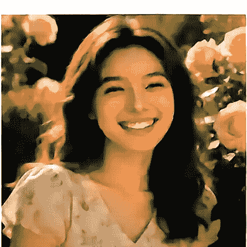

图 4-3 AI 生成的近景人物

### 中景

中景镜头主要表现人物膝盖以上的部分，兼顾面部表情和上半身动作，既能展现人物的肢体动作和情绪，又能体现人物与场景、人物与人物之间的关系，同样是短剧最常用的景别之一，是叙事的主力镜头。

## 功能详解

- 信息量大
中景囊括表情、动作与简单的环境，一镜展现多种元素。
- 节奏适中
不像特写那么压迫，也不像全景那么疏离，是最舒服的观看距离。
- 剪辑安全区
中景可以持续 3～5 秒，观众不会觉得腻。

#### 适用场景

短剧中中景镜头的适用场景及其所能产生的情绪作用如表 4-3 所示。

表 4-3 短剧中中景镜头的适用场景

| 场景类型 | 中景作用 | 示例 |
| :--- | :--- | :--- |
| 日常互动 | 自然叙事 | 吃饭、走路、工作 |
| 轻微动作 | 展示但不放大 | 递东西、起身、坐下 |
| 多人场面 | 交代人物关系 | 三人对话、家庭聚餐 |
| 过渡镜头 | 连接情绪 | 从特写到全景的中间状态 |

### 实战技巧

- 技巧一：中景是“安全区”
当你不知道用什么景别时，用中景不会错。
- 技巧二：中景可持续 3～5 秒

特写最多2秒，否则压迫感太强，但中景可以持续3～5秒，给观众足够的喘息时间。

- 技巧三：用中景展示关系

示例：
两人并排走用中景，能同时拍到他们的互动。一人坐着另一人站着用中景，能展示位置或级别的高低关系。

### 中景镜头示例

提示词：中景镜头，男人站在会议桌旁，神色平静，眼神坚定，嘴角微扬，双手自然下垂，背景为会议室局部。

即梦 AI 生成的图片如图 4-4 所示。

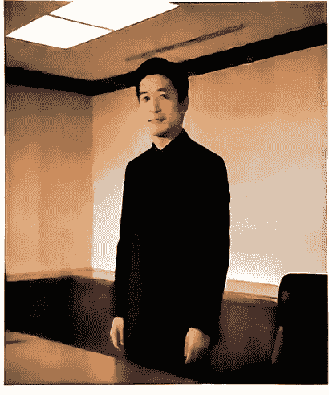

图 4-4 AI 生成的中景人物

### 全景

全景镜头展现的是当前剧情的整个场景，一般能够涵盖人物的完整形象和主要场景中的元素，让观众明确剧情发生的具体环境。

## 功能详解

- 人物出场
让观众第一眼看清角色全貌——身高、体型、穿着、气场。
- 环境交代
告诉观众这是什么地方——豪宅、出租屋、办公室还是街头。
- 关系展示
人物和环境的关系——他是这里的主人还是闯入者？

#### 适用场景

短剧中全景镜头的适用场景及其所能产生的情绪作用如表 4-4 所示。

表 4-4 短剧中全景镜头的适用场景

| 场景类型 | 全景作用 | 示例 |
| :--- | :--- | :--- |
| 角色首次出场 | 建立第一印象 | 霸总从豪车下来 |
| 场景转换 | 告诉观众“到新地方了” | 女主走进新公司大门 |
| 多人场面 | 展示所有人位置关系 | 会议桌上所有人 |
| 动作戏开始 | 让观众看清空间布局 | 打斗前展示场地 |

### 实战技巧

- 技巧一：霸总出场先给全景
豪车、长腿、西装、保镖——用全景一次性展示所有“霸总元素”，然后再切近景看脸，制造期待感。
- 技巧二：全景不超过 3 秒
观众看全景 3 秒就够了，再多就会无聊，3 秒后必须切中景或近景，进入细节。
- 技巧三：用全景制造反差
示例：
女主站在豪宅门口（全景），镜头推近到她破旧的运动鞋（特写），用全景制造氛围
孤独、宏大、苍凉、绝望——远景是最强的情绪渲染器。
- 升华情感
景色还有情感升华的作用，故事结束时用远景拉远，可以让观众从剧情中抽离出来、回味。
- 时间过渡
用远景展示日出日落、四季变化，暗示时间流逝。

#### 适用场景

短剧中远景镜头的适用场景及其所能产生的情绪作用如表 4-5 所示。

表 4-5 短剧中远景镜头的适用场景

| 场景类型 | 远景作用 | 示例 |
| :--- | :--- | :--- |
| 回忆片段 | 制造距离感 | 童年回忆用远景开场 |
| 结局升华 | 让情绪扩散 | 男女主相拥，镜头拉远到城市上空 |
| 孤独时刻 | 放大渺小感 | 女主独自站在天台上，背景是万家灯火 |
| 宏大场面 | 展示规模 | 千军万马、皇宫全景 |

### 实战技巧

- 技巧一：远景一般不超过 3 秒
在 AI 短剧的创作中，远景信息量少，观众看 3 秒就会走神，除非是结尾升华，可以延长到 5 秒，否则远景镜头一定不要超过 3 秒。
- 技巧二：远景加音效，强化氛围
示例：
雨夜远景加雨声、雷声，孤独远景加风声、心跳声。
- 技巧三：用远景制造“蚂蚁感”，让主角在画面中显得很小，强化无助、孤独
示例：
女主站在海边，远景中她只是一个小黑点。
- 技巧四：结尾用远景
大结局最后一个镜头，用远景拉远，给观众留有回味空间，同时可以上字幕、放片尾曲。

## 远景镜头示例

提示词：远景，青山连绵起伏，山顶覆着薄雾，山脚下有蜿蜒溪流，草木青翠，天空湛蓝，整体氛围清新辽阔，适配 AI 清晰生成远景意境。AI 生成的远景画面如图 4-6 所示。

图 4-6 AI 生成的远景画面

## 4.2 短剧必备 7 种运镜方式

固定镜头是平铺直叙的，主要用于营造客观感和强调细节等场景，而动态的运镜则让画面有了抑扬顿挫的节奏感，运镜的节奏快慢、轨迹变化，都能传达丰富的情感，对于人物塑造与叙事具有十分重要的推动作用，短剧中的运镜主要有推、拉、摇、移、跟、升降和甩镜头 7 种，掌握了这 7 种运镜方式的生成技巧，可以使 AI 短剧的镜头质量得到质的飞跃。

## 短剧 7 种运镜方式一览

短剧中的 7 种运镜方式作用各异，适用场景也各有不同，表 4-6 是这 7 种运镜方式的横向对比，直观展现了不同运镜方式的操作方法与使用场景。

表 4-6 短剧 7 种运镜方式一览

| 运镜方式 | 操作手法 | 情绪暗示 | 短剧使用场景 |
| :--- | :--- | :--- | :--- |
| 推镜头 | 镜头逐渐靠近主体 | 聚焦情绪、发现秘密、内心独白 | 发现真相、情绪爆发前 |
| 拉镜头 | 镜头逐渐远离主体 | 揭示环境、表达孤独、回忆结束 | 离别场景、结局升华 |
| 摇镜头 | 镜头左右 / 上下转动 | 展示环境、连接人物、制造悬念 | 从 A 看到 B、环顾四周 |
| 移镜头 | 镜头平行移动 | 跟随动作、营造沉浸感 | 跟拍走路、车窗外风景 |
| 跟镜头 | 镜头跟随主体运动 | 追逐、奔跑、紧张场景 | 逃跑、追赶、进入 |
| 升降镜头 | 镜头上下移动 | 身份揭示、震撼出场、俯视压迫 | 大佬出场、从下往上拍 |
| 甩镜头 | 快速转动模糊 | 转场、时间流逝、混乱情绪 | 闪回、转场、梦境 |

## 推镜头

### 功能

推镜头是镜头逐渐靠近被拍摄主体的运镜方式，这种运镜方式能够将观众的注意力牢牢锁定在核心主体上，弱化背景干扰，强化主体的情绪或细节。在短剧中，推镜头的作用主要有以下几点。

- 聚焦情绪：从全景推到近景，让观众看清角色的表情变化。
- 制造悬念：慢慢推进，让观众期待“接下来会看到什么”。
- 进入内心：推近眼睛特写，仿佛在窥视角色的内心世界。

### 实战技巧

- 技巧一：关键信息揭晓前用推
女主看到手机消息时，镜头慢慢推近至她的眼睛，观众会和她一起紧张：“她看到了什么？”
- 技巧二：推的速度决定情绪强度
缓慢推（5秒以上）：营造沉思、回忆的氛围。
快速推（1～2秒）：制造震惊、惊吓效果。
- 技巧三：推到底定格
推到特写后停留1～2秒，让情绪充分发酵，然后切下一个镜头，或直接黑屏。

### AI 生成示例

- 提示词：生成一段视频，推镜头，一位穿着浅色衬衣的男人正坐在餐厅桌前说话，镜头从男人上半身慢慢推到近景再推到特写，影视级质感。
- Seedance 2.0 生成视频的截图如图 4-7 所示。

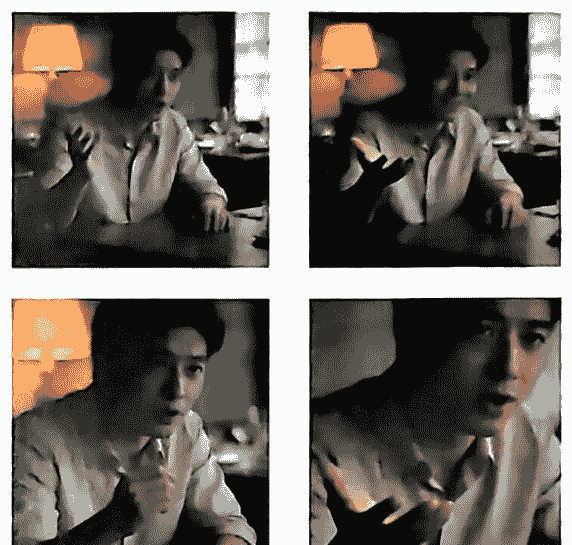

图 4-7 Seedance 2.0 生成的推镜头视频的截图

- 提示词：生成一个推镜头的运镜，女主坐在公园的椅子上，表情从平静逐渐转变为微笑，画面从中景逐渐推移到对人物的特写，影视质感，镜头推进速度缓慢。
- Seedance 2.0 生成视频的截图如图 4-8 所示。

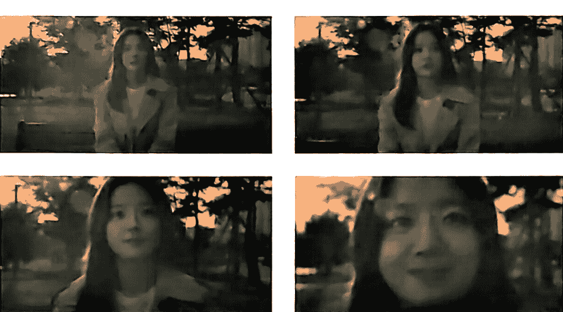

图 4-8 Seedance 2.0 生成的推镜头视频的截图

## 拉镜头

### 功能

拉镜头是推镜头的反向运动，即镜头逐渐远离主体，从近景拉到全景，从特写拉到环境的运镜方式。在短剧中，拉镜头的作用主要有以下几点。

- 揭示环境：让观众看到角色所处的环境。
- 表达孤独：人物在画面中越来越小，孤独感越来越强。
- 升华情感：结局时拉远，让情绪从具体人物扩散到整个场景。

### 实战技巧

- 技巧一：拥抱场景必用拉
情侣拥抱时，镜头慢慢拉远，露出背后的落日、烟花、城市夜景，让浪漫情绪扩散到整个环境。
- 技巧二：离别场景用慢拉
两人分开时，用慢拉镜头让他们渐行渐远，观众会感到“他们真的结束了”。
- 技巧三：结局升华用大拉
最后一集最后一个镜头，用拉镜头从主角身上拉到整个城市、整个天空，给观众留下回味空间。

### AI 生成示例

- 提示词：生成一段视频，拉镜头，从女生凝神远望的近景慢慢拉远，露出女生所处的位置是山顶，山下是大海，镜头持续拉远直到女生成为小点。电影感。
- Seedance 2.0 生成视频的截图如图 4-9 所示。

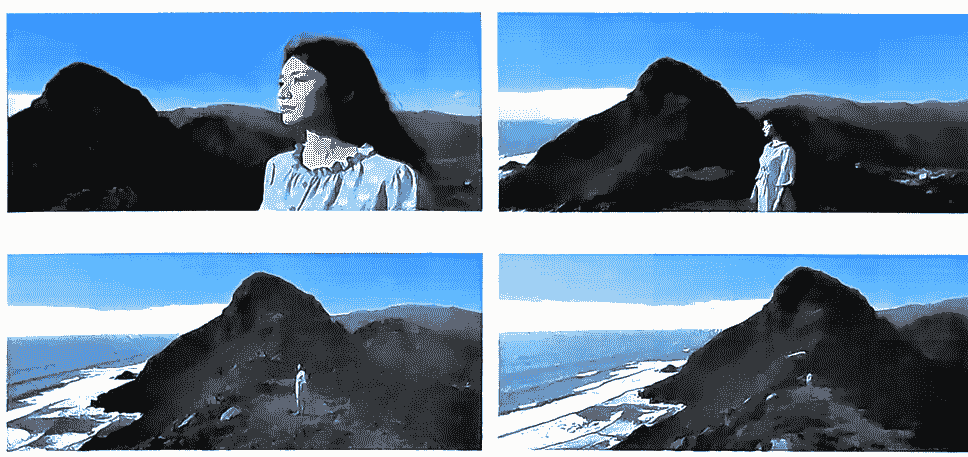

图 4-9 Seedance 2.0 生成的拉镜头视频的截图

## 摇镜头

### 功能

摇镜头是将镜头固定在一个支点上，左右或上下转动镜头，模拟人转头环顾四周的视线，用来展示空间关系。在短剧中，摇镜头的作用主要有以下几点。

- 展示环境：从左到右扫过，让观众看清整个场景。
- 连接人物：从 A 脸上摇到 B 脸上，代替切换镜头。
- 制造悬念：慢慢摇向某个未知方向，让观众期待“会看到什么”。

### 实战技巧

- 技巧一：对话时用摇代替切换
A 说话时拍 A，然后摇到 B，拍 B 的反应，比直接切换更流畅，更有沉浸感。
- 技巧二：视线引导用摇
角色看向某处，镜头跟着他的视线摇过去，观众会代入角色的视角。
- 技巧三：环境展示用慢摇
用 5～8 秒慢慢摇过整个场景，让观众看清每一个细节，常用于开场交代地点。

### AI 生成示例

- 提示词：生成一段视频，摇镜头，从左到右缓慢摇摄城市风光，电影级画质。
- Seedance 2.0 生成视频的截图如图 4-10 所示。

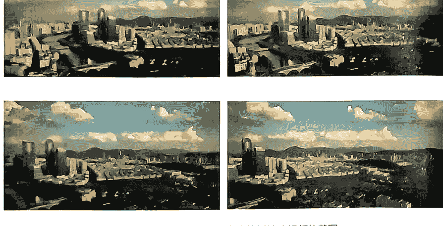

图 4-10 Seedance 2.0 生成的摇镜头视频的截图

## 移镜头

### 功能

移镜头是镜头平行移动的运镜方式，可以从左到右、从右到左，也可以是前后移动。这种运镜方式模拟的是人边走边看的感觉，让观众仿佛置身于场景之中。在短剧中，移镜头的作用主要有以下几点。

- 跟随动作：跟拍人物走路、奔跑。
- 展示空间：缓缓移过场景，比摇镜头更有“走进感”。
- 营造沉浸感：让观众感觉自己也在场景里走动。

### 实战技巧

- 技巧一：人物入场用侧移
镜头侧移，和人物平行移动，拍他走路的姿态，提升观众的代入感，让观众感觉“我就在他身边”
- 技巧二：车窗外风景用移
常用转场或情绪铺垫，比如人物坐车，镜头从车窗移过，展示窗外掠过的风景。
- 技巧三：探索场景用前移
镜头向前移动，仿佛人物在走进一个未知空间，制造探索感、紧张感。

### AI 生成示例

- 提示词：生成一段视频，画面中是一位正在书房看书的女士，镜头从女士侧面由左至右平行移动，电影级画质。
- Seedance 2.0 生成视频的截图如图 4-11 所示。

图 4-11 Seedance 2.0 生成的移镜头视频的截图

## 跟镜头

### 功能

跟镜头是镜头跟随画面主体运动的运镜方式，始终将主体保持在画面核心，模拟追逐、跟随的视角。在短剧中，跟镜头的作用主要有以下几点。

- 制造紧张：当角色逃跑时，镜头在后面追，观众会跟着紧张，搭配摇晃的跟拍镜头能进一步突出这种紧张感。
- 强调速度：跟拍奔跑、追逐，让观众感受到速度。
- 代入视角：镜头跟随主体，仿佛和主体一起移动，代入感极强。

### 实战技巧

- 技巧一：逃跑场景必用后跟
镜头跟在角色身后移动，仿佛在随着角色一同奔跑。
- 技巧二：追逐场景用前跟 + 后跟交替
先拍追的人（后跟），再拍被追的人（前跟），让观众感受双方的视角，增加追逐戏的沉浸感。
- 技巧三：加轻微晃动增强真实感
跟拍时加一点手持晃动，模拟人物奔跑时的视角变化，可以极大地增强画面的真实感。

### AI 生成示例

- 提示词：生成一段视频，跟镜头，镜头跟随一位骑行者在城市中快速穿梭，镜头始终快速跟随骑行者，电影级画质。
- Seedance 2.0 生成视频的截图如图 4-12 所示。

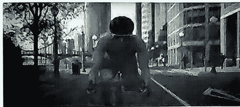

图 4-12 Seedance 2.0 生成的跟镜头视频的截图

## 升降镜头

### 功能

升降镜头指的是摄像机垂直运动拍摄的画面，升降镜头的作用主要有以下几点。

- 升镜头（仰视）：让角色显得高大、威严、有压迫感。
- 降镜头（俯视）：让角色显得渺小、无助、被俯视。
- 揭示全貌：从下往上或从上往下，展示物体的全貌。

### 实战技巧

- 技巧一：霸总出场用升镜头
从脚开始，慢慢升到脸，让观众一步步看清他的全貌，制造期待感。
- 技巧二：女主被欺用俯拍，从高处往下拍，她蹲在地上，显得渺小无助，强化观众的同情心。
- 技巧三：关键物品用升降揭示
从下往上拍一座雕像，慢慢露出全貌，或者从上往下拍一封书信，慢慢落到字迹上。

### AI 生成示例

- 提示词：生成一段视频，升镜头，镜头从一棵森林中的大树的底部慢慢上升，直至露出大树的顶部，电影质感。
- Seedance 2.0 生成视频的截图如图 4-13 所示。

图 4-13 Seedance 2.0 生成的升降镜头视频的截图

## 甩镜头

### 功能

甩镜头（也叫“闪摇”）是镜头快速转动，画面瞬间模糊，然后停在一个新场景上。它是短剧中最常用的转场技巧，能在 1 秒内完成时空切换。在短剧中，甩镜头的作用主要有以下几点。

- 快速转场：瞬间切换场景，不拖泥带水。
- 制造混乱：用于梦境、回忆、晕眩等状态。
- 表现时间流逝：镜头甩一下，就过了几个小时或几天。

### 实战技巧

- 技巧一：梦境醒来用甩
梦中场景→甩镜头模糊→角色惊醒。
- 技巧二：回忆切入用甩
现在时空→甩镜头模糊→过去时空。
- 技巧三：激烈场面用甩
打斗中→甩镜头模糊→结果已定。

### AI 生成示例

- 提示词：生成一段视频，甩镜头转场，画面从一个坐在足球场草地上的男孩身上快速转场到四十年后，长大后的男孩依然站在这片足球场上，只不过球场已经废弃，电影质感。
- Seedance 2.0 生成视频的截图如图 4-14 所示。

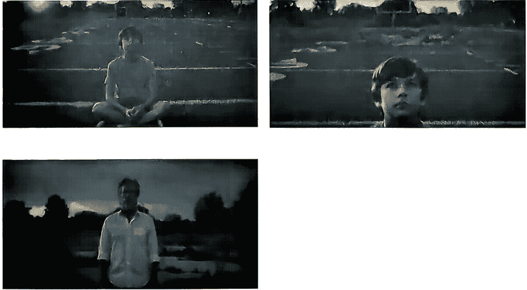

图 4-14 Seedance 2.0 生成的甩镜头视频的截图

## 4.3 短剧色彩搭配

色彩是潜意识的“语言”，在 AI 短剧的视听表达中，色彩是一种比镜头、合词更隐蔽，但重要性丝毫不亚于以上两者的视听元素。你有没有这样的体验：看到一部剧，说不出为什么，但就是觉得“好甜”或者“好虐”？这种直觉往往来自色彩。

在短剧创作中，色彩的核心作用主要有以下 3 点。

- 情绪定调：让观众看到画面的第一秒，情绪基调就已经确定。
- 视觉差异化：同样的题材，不同的色调能让作品脱颖而出。
- 潜意识叙事：用颜色告诉观众“这是好人”“这是坏人”“这是回忆”。

本部分我们不讲复杂的色彩理论，只讲短剧实战中的色彩运用技巧，拆解色彩搭配的核心逻辑、情感象征和实操法则，让创作者快速掌握色彩运用技巧，让 AI 生成的画面更具情绪张力。

## 色彩的情感象征

对于短剧影像来说，不同的色调、饱和度和色彩对比，能传递出截然不同的情感，表 4-7 是对于短剧中不同色彩的情感象征意义与适用场景的简单总结。

表 4-7 短剧中不同色彩的情感象征意义与适用场景

| 色调 | 情感暗示 | 适用场景 |
|---|---|---|
| 冷色调（蓝/青） | 冷漠、悬疑、悲伤 | 复仇、职场压迫、夜晚 |
| 暖色调（橙/黄） | 甜蜜、回忆、希望 | 恋爱、重逢、温馨家庭 |
| 高饱和度 | 戏剧感、冲突、张力 | 争吵、高潮、名场面 |
| 低饱和度 | 压抑、回忆、现实 | 悲惨过去、底层生活 |
| 对比色 | 冲突、对立、戏剧性 | 正邪对决、身份反差 |

举例来说，在都市复仇题材中，女主被职场霸凌、饱受委屈、情感受挫的夜晚场景，采用冷色调（蓝色为主），搭配低饱和度，画面整体偏暗，传递出女主的悲伤、无助和职场的冷漠，让画面情绪更贴合剧情。而女主与男主重逢的甜蜜场景，采用暖色调（橙黄色为主），搭配柔光效果，传递出重逢的温暖与希望（见图 4-15、图 4-16）。

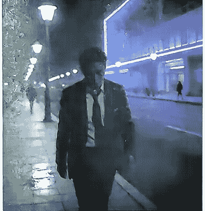

图 4-15 冷、暖色调所传递的情绪有着天壤之别

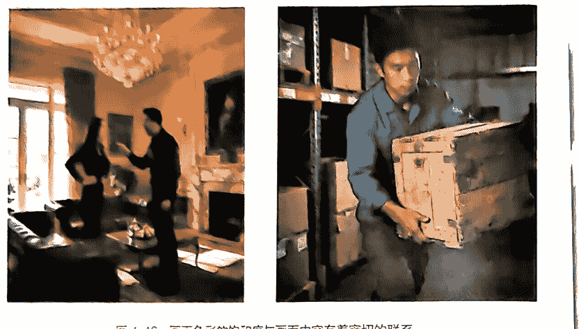

图 4-16 画面色彩的饱和度与画面内容有着密切的联系

除了以上几种典型的色彩风格，还有一种色彩运用方式也经常在影视作品中出现，那就是单色调。单色调是指整幅画面以某一种颜色为主，这种相对激进的色彩运用方式一般被用来营造极致的情绪氛围。在短剧中，单色调主要在情绪达到极致的场景中使用，比如生离死别、深情告白或以梦境为代表的艺术化场景之中（见图 4-17）。

图 4-17 单一色调场景能够带给人纯粹的审美体验

## 短剧色彩搭配法则

AI 短剧的色彩搭配并非十分复杂的艺术加工过程，创作者无须对其望而却步。只要掌握以下三大法则，就能确保短剧色彩风格统一、情绪传递精准，同时适配 AI 生成，避免出现“色调杂乱、情绪脱节”的问题。

**法则一：全剧色调统一，避免杂乱**

一部 AI 短剧的成功，离不开统一的视觉风格，而色调统一是视觉风格统一的核心。一部优秀的短剧，必须有一个贯穿始终的主色调。这个主色调定义了整部剧的视觉 DNA，让观众一看就知道“这是那部剧”。

在确定了主色调后，所有场景的色彩搭配都要在此基础上微调，避免一集一个色调、一个场景一种风格，否则会让观众产生视觉疲劳，无法形成剧集记忆点。

在创作 AI 短剧时，利用 AI 统一视频画面色调的具体操作方式是在生成每一帧画面时，都在提示词末尾加上主色调关键词。比如莫兰迪色调，低饱和度，灰蓝色调，电影质感。

不同的创作者有不同的审美风格，表 4-8 为大家提供一个基础的 AI 短剧与主色调对应模板，仅供参考。图 4-18 与图 4-19 则是具体的应用示例。

表 4-8 短剧题材与主色调对应表

| 题材类型 | 推荐主色调 | 理由 |
| :--- | :--- | :--- |
| 都市情感 | 暖灰调 | 温暖中带点现实感 |
| 古装权谋 | 莫兰迪色 / 暖金 | 高级感 + 历史感 |
| 悬疑推理 | 青绿冷调 | 悬疑 + 不安 |
| 甜宠喜剧 | 奶油暖调 | 甜蜜 + 治愈 |
| 复仇逆袭 | 蓝紫冷调 | 压抑 + 爆发 |

图 4-18 青绿冷调十分适合用来营造悬疑感与清冷感

图 4-19 色彩饱和度较低的莫兰迪色调与具有年代感的古装剧之间适配性较高

## 法则二：场景色调服务于情绪，拒绝脱节

色彩的核心作用是传递情绪，每一个场景的色调都必须贴合该场景的核心情绪，不能为了追求美观而使画面色彩与画面想要传达的情绪相脱节。比如，甜宠场景的色调要温暖柔和，虐心场景的色调要清冷压抑，悬疑场景的色调要诡异暗沉，这样才能让色彩成为情绪的“放大器”。如果在一个悬疑场景中使用明亮温馨的色调，那么画面的悬疑感将大打折扣。具体根据情绪调整色彩风格的方式可以参考表 4-9。具体应用示例如图 4-20 所示。

表 4-9 情绪 - 色调对应表

| 情绪定位 | 色调调整 |
| :--- | :--- |
| 甜宠场景 | 主色调 + 暖光 + 柔光 |
| 虐心场景 | 主色调 + 冷光 + 低饱和度 |
| 悬疑场景 | 主色调 + 青绿 + 高对比 |
| 回忆场景 | 主色调 + 褪色 + 颗粒感 |
| 高潮场景 | 主色调 + 高饱和 + 强光 |

图 4-20 午后阳光搭配暖黄色调能够很好地营造温馨场景

## 法则三：用对比色强化冲突，提升张力

当剧情出现强烈冲突（如正邪对决、身份反差、情绪反转）时，单纯单一色调无法凸显张力，此时可采用对比色搭配，通过色彩的对立，强化冲突感，让观众直观感受到剧情的张力，同时突出核心人物或核心事件。

表 4-10 列出了比较常用的对比色组合，可以参考其搭配方式设计短剧不同场景的色调。

表 4-10 常用对比色组合

| 对比组合 | 情绪暗示 | 使用场景 |
| :--- | :--- | :--- |
| 蓝橙对比 | 冷暖对立、正邪交锋 | 最终对决、身份揭晓 |
| 红绿对比 | 激烈冲突、危险信号 | 争吵高潮、追杀场面 |
| 黄紫对比 | 神秘对峙、戏剧张力 | 真相曝光、关键转折 |

## 短剧中色彩的主次关系

在 AI 短剧的画面色彩搭配中，“主次关系”是平衡视觉秩序、强化剧情表达的核心法则。所谓色彩主次，就是明确画面中的“主色调”（主导情绪、突出核心）和“次色调”（辅助氛围、衬托主体），避免色彩杂乱无章，让观众的视线快速聚焦到核心人物、核心事件上。

### 色彩主次关系的核心逻辑

以冲突场景为例，色彩主次关系的核心是“对立统一”，主色调与次色调形成鲜明对比（如暖与冷、亮与暗、高饱和度与低饱和度），以此强化冲突感；但同时，次色调不能盖过主色调，需围绕主色调进行搭配，确保画面不杂乱，保证核心人物或事件始终是视觉焦点。

### 冲突场景中色彩主次关系的实操运用

- **正邪对决场景：主色定立场，次色造对立**
  主色调赋予正义方（核心主角），传递正向情绪（温暖、坚定、希望），多采用暖色调（橙、黄、浅红）；次色调赋予反派，传递负向情绪（冷漠、邪恶、压迫），多采用冷色调（蓝、青、深灰）；同框时，主色调占据画面核心位置，次色调作为衬托，形成“暖主冷次”的对比，突出主角的核心地位，强化对决的冲突感。

- **身份反差场景：主色彰显转变，次色衬托过往**
  这类场景的核心是“凸显人物身份的巨大转变”（如落魄千金回归、普通人逆袭、好人黑化），通过主、次色调的切换和对比，传递人物身份转变后的情绪变化，强化反转的冲击力，让观众清晰感受到人物的蜕变。

- **情绪反转场景：主色定当下，次色藏伏笔**
  这类场景的核心是“情绪的突然反转”（如从甜蜜到决裂、从希望到绝望、从信任到背叛），通过主、次色调的对比，传递当下的核心情绪，同时用次色调埋下伏笔，让反转更具冲击力，让观众感受到剧情的跌宕起伏。

不仅是冲突场景，短剧画面的时时处处都暗藏着主次色彩的搭配逻辑，比如在下图的场景中，清冷的灰蓝色是主色调，表现的是寒冷清寂的雪天，而透窗而出的黄色灯光则是次色调，通过色彩的对比让人们感受到冰天雪地中的一抹温馨（见图 4-21）。

图 4-21 画面中的主次色调组合

##### 实战案例

表 4-11 以古装穿越剧《和亲公主 + 防狼喷雾》为例，展示全剧色调随剧情发展的演变规律，当然，短剧色调的选择方案并不是单一的，表中仅是参考方案之一。

表 4-11 常用对比色组合

| 阶段 | 剧情定位 | 主色调 | 微调说明 | 示例场景 |
| :--- | :--- | :--- | :--- | :--- |
| 第 1～10 集 | 穿越初期，被欺负 | 冷灰调 | 压抑、无助 | 被赶到破旧后院 |
| 第 11～30 集 | 开始反击，小胜 | 冷灰中渐暖 | 希望初现 | 太后成为靠山 |
| 第 31～50 集 | 事业上升，甜宠萌芽 | 暖灰调 | 温暖渐增 | 和王爷第一次牵手 |
| 第 51～70 集 | 危机再起，虐心 | 冷蓝调 | 重回压抑 | 被妹妹陷害入狱 |
| 第 71～90 集 | 绝地反击，高潮 | 高饱和对比色 | 戏剧张力 | 最终对决 |
| 第 91～100 集 | 圆满结局 | 暖金色调 | 幸福满足 | 幸福生活收尾 |

## 短剧色彩搭配攻略

**Q1：为什么我生成的画面颜色和想象的不一样？**
原因：提示词中缺乏具体的颜色描述。
解决方案：不仅要写“暖色调”，还要写“暖金色”“夕阳色”“奶油质感”。

**Q2：同一集里颜色跳来跳去，怎么办？**
原因：没有统一主色调。
解决方案：每集生成时都加上主色调关键词，如“全剧统一暖灰调”。

**Q3：想要对比色，但 AI 生成得太生硬怎么办？**
原因：对比需要过渡。
解决方案：在提示词中加入“中间冷暖交织”“渐变过渡”等描述（见图4-22）。

**Q4：回忆场景总是不够“回忆感”？**
原因：只有褪色是不够的。
解决方案：在提示词中加入“轻微颗粒感”“边缘虚化”“老照片质感”等关键词。

## 4.4 AI 生成分镜脚本

分镜脚本是 AI 短剧从文字剧本到画面生成的“桥梁”，而 AI 生成分镜脚本，更是打破了传统分镜创作的专业壁垒，让非专业创作者也能快速产出规范、统一的分镜，大幅提升创作效率，降低时间成本。

### 分镜脚本的标准化格式

利用 AI 生成分镜脚本的前提，是建立规范、统一的格式。杂乱无章的格式会导致 AI 无法精准识别信息，生成的分镜混乱、无逻辑。而标准化格式能让 AI 快速抓取每一个镜头的核心信息（景别、内容、时长等），确保分镜的规范性和可落地性。结合 AI 短剧“短平快”的特点，分镜脚本创作的核心包含五大核心要素。

### 核心标准化格式必含五要素

AI 生成的分镜脚本需固定包含“镜号、景别、内容、时长、音效”五大要素，每个要素的描述需简洁、具体，避免模糊表述，确保 AI 能精准抓取信息，同时方便后期对接 AI 画面生成和剪辑。具体要素说明及填写要求如下。

- **镜号**：按镜头顺序依次编号（1、2、3……），无须复杂编号规则，确保每个镜头唯一、有序，方便后期剪辑时对应镜头，避免混乱。
- **景别**：明确每个镜头的景别（参考 4.1 节内容），如特写、近景、中景、全景、远景，可搭配简单的景别补充（如“面部特写”“庭院全景”），让 AI 明确画面视野范围。
- **内容**：核心要素，需简洁描述镜头画面内容，包括人物动作、场景细节、运镜方式（参考 4.2 节内容），无须多余修饰，重点突出“谁、做什么、在什么场景、用什么运镜”，让 AI 清晰生成画面。
- **时长**：结合 AI 短剧单集 90 秒的节奏，每个镜头时长控制在 2～8 秒，明确标注具体时长，一般以“秒”为单位，避免镜头过长或过短，确保整体节奏流畅。
- **音效**：适配画面内容和情绪，标注对应的音效，如“脚步声”“背景音乐”“对话声”“急促心跳声”，增强视听协同性，让 AI 生成的画面更具氛围感，同时为后期剪辑提供参考。

### 标准分镜脚本模板

分镜脚本的格式没有绝对标准，但以下字段是专业制作中必不可少的，我们推荐使用表格形式（见表 4-12）。

表 4-12 标准分镜脚本模板示例

| 镜号 | 1 | 2 | 3 | 4 |
|---|---|---|---|---|
| 景别 | 远景 | 特写 | 中景 | 近景 |
| 画面描述 | 雨夜，豪车停在破旧小区门口 | 车内，男人的眼睛，盯着某处 | 女人撑伞走出单元门 | 两人隔着雨幕对视 |
| 运镜方式 | 俯拍 + 推进 | 极近特写 | 跟拍 | 正反打 |
| 人物动作 | 车灯闪烁 | 手指敲击方向盘 | 突然停住脚步 | 伞从手中滑落 |
| 台词/音效 | 【雨声 + 心跳声】 | OS: 三年了…… | 【雨声骤停】 | 静默 |
| 时长 | 3s | 2s | 2s | 3s |
| 色调 | 冷蓝调 | 冷蓝调 | 冷蓝调 | 冷蓝调 + 暖黄色调 |

### 从文字剧本到分镜脚本的转化技巧

我们在前面已经详细介绍了文字剧本的生成，那么如何将文字剧本转化为分镜脚本呢？

#### 剧本转化为分镜脚本的基本步骤

将剧本转化为分镜脚本的核心是“拆解剧本、提炼镜头、补充细节”，将抽象的文字描述转化为 AI 能识别的、具体的镜头信息（景别、运镜、时长等），具体实操步骤如下。

- **步骤 1：拆解文字剧本，拆分镜头**
  首先将文字剧本按“剧情节奏”拆分镜头，遵循“一句核心剧情对应一个镜头”的原则，避免一个镜头包含过多剧情内容，导致画面混乱。拆分时重点关注“动作、情绪、场景变化”——只要出现人物动作变化、情绪转折、场景切换，就拆分一个新镜头，以适应 AI 短剧“短镜头、快节奏”的特点。
- **步骤 2：为每个镜头匹配核心要素**
  针对拆分后的每个镜头，逐一匹配“景别、运镜、内容、时长、音效”五大要素，每个要素的描述需具体、简洁，避免模糊表述（如不说“镜头移动”，要说“推镜头”“跟镜头”；不说“女主开心”，要说“女主嘴角扬起微笑，眼神温柔”）。
  这一过程可以借助 AI 实现，将剧本和前文提到的色彩组合规律以及运镜方式提供给 AI，让 AI 生成分镜脚本。为了保证短剧脚本的质量，在 AI 分镜脚本生成之后，一定要对其内容进行人工核验与优化。

- **示例**
  原始文学剧本：
  她在咖啡厅等了一夜，他没来。天亮时，她删掉了他的所有联系方式。

AI 提示词：

请将以下文字剧本转化为分镜脚本，要求包含镜号、景别、画面描述、运镜、时长、色调。

【剧本】她在咖啡厅等了一夜，他没来。天亮时，她删掉了他的所有联系方式。

要求：

- 共 7 个镜头
- 景别多样化（包含全景、近景、特写）
- 运镜包括固定、推进、拉远、摇
- 色调从暖黄渐变到冷调
- 输出表格格式

AI 生成分镜脚本如表 4-13 所示。

表 4-13 AI 分镜脚本

| 镜号 | 景别 | 画面描述 | 运镜 | 人物动作 | 台词/音效 | 时长 | 色调 |
| :--- | :--- | :--- | :--- | :--- | :--- | :--- | :--- |
| 1 | 全景 | 咖啡厅靠窗位置，她坐着看手机 | 固定 | 低头看手机 | 【轻音乐】 | 2s | 暖黄 |
| 2 | 特写 | 冒着热气的咖啡 | 缓慢推进 | 咖啡杯静止 | 无 | 2s | 暖黄 |
| 3 | 近景 | 她第5次看时间，眼神焦虑 | 固定 | 抬头看手机屏幕 | 无 | 2s | 暖黄 |
| 4 | 大特写 | 手机屏幕，没有消息 | 固定 | 屏幕暗下去 | 无 | 1s | 暖黄转冷 |
| 5 | 中景 | 窗外天色渐亮 | 缓慢拉远 | 她望向窗外 | 【鸟鸣声】 | 3s | 冷调 |
| 6 | 特写 | 已经凉透的咖啡 | 摇镜头 | 她的手指划过杯壁 | 无 | 2s | 冷调 |
| 7 | 近景 | 她深吸一口气，眼泪滑落 | 缓慢推进 | 手指擦泪 | 轻微抽泣 | 3s | 冷调 |

### AI 生成分镜脚本核心注意事项

**提示词越具体，AI 生成越精准**
避免模糊表述，如不说“女主有情绪”，要说“女主眼神震惊，嘴角紧绷”；不说“有运镜”，要说“慢推镜头，从近景推至特写”。细节越具体，AI 生成的分镜越贴合预期。

**适配 AI 生成能力**
避免要求 AI 生成过于复杂的镜头（如同时使用多种运镜、复杂场景细节），降低 AI 生成难度，减少误差。

**结合前文知识**
分镜中的景别、运镜、色彩，需结合前文内容进行提示词的润色与优化。

**批量生成先试拍**
批量生成分镜前，先让 AI 生成 1 集分镜，检查风格、格式、逻辑是否符合要求，找到关键问题，有针对性地调整提示词后，再进行批量生成，避免浪费时间。

### 分镜脚本实战案例

场景描述：
分手三年后，她在新公司第一天上班，发现老板是他。

剧本原文：
林念分手三年后，应聘进入一家梦寐以求的公司。入职第一天，她正在工位整理物品，突然办公室安静下来。她抬头，看到所有人站起，望向门口。一个男人走进来——是她前男友陆霆琛，现在是这家公司的总裁。两人隔着办公室对视，她手中的杯子滑落在地，碎裂。

根据以上剧本生成分镜脚本的过程如下。

问：

根据以下剧本内容生成一个分镜脚本，要求：

1. 共 10 个镜头。
2. 景别多样化（包含全景、近景、特写、极近特写）。
3. 运镜包括固定、摇、上升、急推、慢动作、拉。
4. 色调从暖黄渐变到冷调。
5. 情绪层次：期待→疑惑→震惊→崩溃。
6. 回答以表格形式呈现。

【剧本原文】

豆包：

| 镜号 | 景别 | 画面描述 | 运镜方式 | 人物动作 | 台词 / 音效 | 时长 | 色调 |
| :--- | :--- | :--- | :--- | :--- | :--- | :--- | :--- |
| 1 | 近景 | 林念站在崭新的工位前，脸上带着期待的笑容，手里拿着一个相框 | 固定 | 轻轻擦拭相框，摆放整齐 | 【轻快的背景音乐】 | 2s | 暖黄 |
| 2 | 特写 | 相框里的照片——她和闺蜜的合影，笑容灿烂 | 缓慢推进 | 她的手指轻抚照片 | 音乐持续 | 2s | 暖黄 |
| 3 | 全景 | 开放式办公室，所有人都在忙碌 | 固定 | 林念环顾四周，深吸一口气 | 键盘敲击声、低声交谈 | 2s | 暖黄 |
| 4 | 全景 | 办公室突然安静，所有人陆续站起，望向同一个方向 | 从左到右摇镜头 | 林念疑惑地抬头 | 音乐骤停，寂静 | 2s | 暖黄转冷 |
| 5 | 跟拍 + 上升 | 一双锃亮的皮鞋走进画面，镜头跟随并缓慢上升——笔挺的西装裤、解开扣子的西装、棱角分明的下颌、冷酷的眼睛 | 跟拍 + 上升 | 陆霆琛大步走进来，气场强大 | 【心跳声】咚、咚、咚 | 4s | 冷调 |
| 6 | 特写 | 林念的脸，笑容凝固，瞳孔瞬间放大 | 急推 | 嘴唇微张，呼吸停滞 | 心跳声放大 | 2s | 冷调 |
| 7 | 特写 | 陆霆琛的眼睛，瞳孔剧烈收缩，脚步顿住 | 急推 | 整个人僵在原地 | 心跳声震耳 | 2s | 冷调 |
| 8 | 缓进呼写 | 两人隔着整个位置公窗对视，时间仿佛凝固上 | 固定 | 谁都没有动 | 完全静默 | 3s | 冷调 |
| 9 | 全景 | 砸令手中的杯子滑落 | 慢动作 | 杯子在空中缓慢翻滚 | 【玻璃碎裂声】慢放 | 2s | 冷调 |
| 10 | 特写 | 杯子落地，碎片四溅，水花飞起 | 慢动作 | 水滴在空中凝固 | 巨声 | 2s | 冷调 |

## 第三模块

## 技术制作篇——AI 驱动视效，降本增效

在前面，我们已经详细介绍了 AI 短剧剧本与分镜脚本的创作流程，接下来的任务，就是用 AI 将文字想象转变为生动的画面。

# 第5章

## Seedance 2.0 视觉制作全流程

视觉制作是 AI 短剧流程中最核心、最耗时，也最具技术含量的环节。本部分将详细拆解 AI 视觉制作的各个环节，让你能够轻松驾驭 Seedance 2.0，制作出理想的短剧视频。

## 5.1 图片生成进阶技法

在短剧制作中，无论是人物的定妆和场景的确定，还是视频首尾帧的制作，都考验着创作者的图片生成技巧。AI 图片生成方式主要有两种，分别是文生图和图生图，下面我们来分别对其操作技巧进行介绍。

### 文生图

#### 什么是文生图？

文生图是指直接输入文字描述，AI 根据描述生成对应图片的过程。它就像你对着一个画家口述画面，画家当场给你画出来。

在 AI 短剧制作中，文生图主要用于以下 3 个场景（见表 5-1）。

表 5-1 AI 短剧中文生图的主要适用场景

| 适用场景 | 作用 | 案例 |
| :--- | :--- | :--- |
| 概念设计 | 在正式创作前，快速验证视觉方向 | 霸总应该是高冷型还是儒雅型？ |
| 角色初稿 | 生成角色的第一版形象，后续再优化 | 女主的五官、服装、气质 |
| 场景氛围图 | 为关键场景定下视觉基调 | 皇宫的色调、后院的破败感 |

#### 文生图提示词黄金公式

经过大量实战验证，一个高质量的文生图提示词应该包含 6 个要素。记住这个公式，你就能稳定地输出想要的画面。

主体描述 + 环境 / 背景 + 光线 / 色调 + 构图 / 景别 + 画质要求 + 风格参考 = 成图

要想生成理想的图片，以上这 6 个提示词要素缺一不可，其作用如表 5-2 所示。

表 5-2 AI 文生图提示词六要素功能拆解

| 要素 | 作用 | 案例 |
|---|---|---|
| 主体描述 | 告诉 AI 画什么 | 26 岁古装女子，清秀耐看，眼神灵动，嘴角有梨涡 |
| 环境 / 背景 | 告诉 AI 在哪里 | 站在江南庭院中，背景是白墙黛瓦 |
| 光线 / 色调 | 告诉 AI 什么情绪 | 午后阳光透过树叶洒在身上，柔光 |
| 构图 / 景别 | 告诉 AI 怎么拍 | 中景，人物居中 |
| 画质要求 | 告诉 AI 要多清晰 | 8K，电影质感，超写实 |
| 风格参考 | 告诉 AI 什么画风 | 中国风，古韵味 |

#### 各要素对画面的影响

- **主体**
  主体是图片的核心，直接明确“画面要突出什么”，AI 会优先渲染主体，确保主体清晰、突出，是文生图最基础的要素。
  在提示词中描述主体时，要全面且精准，比如描述一个人物，既要描述出其具体的外貌和装扮，还要描述出其精神面貌和所处环境。
  示例：女主，22 岁，鹅蛋脸，柳叶眉，身着淡粉色古风襦裙，嘴角微笑，古风庭院环境，暖金色调，细腻画质。
  即梦 AI 生成的图片如图 5-1 所示。

## 文生图实战案例

- 案例一

提示词：32岁霸道总裁顾北城，剑眉星目，高挺鼻梁，薄唇，下颌线条分明，深色定制西装，白色衬衫，站在超高层办公室落地窗前，逆光拍摄，侧脸45°，冷色调，商业肖像光，中景，写实风格，电影质感。

即梦 AI 生成的图片如图 5-7 所示。

图 5-7 即梦 AI 生成的霸总风格人物图

- 案例二

提示词：深夜废弃仓库，青绿色调，一束月光从窗户射入，照亮杂乱的地面，阴影强烈，诡异氛围，广角镜头，写实风格，电影颗粒感。

即梦 AI 生成的图片如图 5-8 所示。

图 5-8 即梦 AI 生成的悬疑风格场景

- 案例三

提示词：夕阳下的咖啡厅露台，金色阳光，奶油质感，柔光滤镜，桌上两杯咖啡冒着热气，背景虚化，暖色调，写实风格，浪漫氛围。

即梦 AI 生成的图片如图 5-9 所示。

图 5-9 即梦 AI 生成的浪漫风格场景

## 图生图

### 图生图的作用

图生图，是 AI 视觉制作中最稳定、最不容易出错的功能之一。它的逻辑非常简单：用户上传一张或多张参考图片，AI 基于这些图片的内容、风格、构图，结合新的文字指令，生成一张新的图片。图生图的核心作用就是让 AI 理解你已经满意的元素，只改变你想改变的部分。

相比于文生图需要靠文字“凭空想象”，图生图更像是让 AI “照着画、照着改”，因此角色更统一、场景更稳定、风格更容易保持一致，是普通创作者从“会用 AI”到“用好 AI”的关键一步。表 5-3 是文生图与图生图的简单对比。

表 5-3 文生图与图生图之间的对比

| 维度 | 文生图 | 图生图 |
| :--- | :--- | :--- |
| 输入 | 纯文字描述 | 图片 + 文字指令 |
| 控制精度 | 较低，AI 自由发挥空间大 | 较高，以参考图为基准 |
| 一致性 | 难以保持 | 容易保持角色 / 风格一致 |
| 适用场景 | 初稿、概念探索 | 细化、多角度、变体 |

### 图生图的三大核心应用

- 应用一：角色多角度生成

在 AI 短剧里，角色一致性是最大痛点。用图生图，可以轻松让同一个人物，出现在不同镜头、不同角度、不同情绪里，而不会“脸崩、换脸、穿模”。

即梦 AI 操作步骤与示例如下。

第一步：先用文生图，生成一张你最满意的角色正脸定妆照（见图 5-10）。

图5-10 角色定妆照

第二步：把这张图上传到图生图功能，点击图示位置的“+”号，上传角色定妆照（见图5-11）。

图5-11 上传定妆照

第三步：输入调整提示词，描述你想如何调整图片，如图5-12所示。

图5-12 输入提示词

根据提示词生成的图片如图 5-13 所示。

图 5-13 同一人物的背后视角

根据以上方法，还可以生成同一人物的不同情绪状态、不同服装以及不同场景的图片。图生图示例如图 5-14 所示。

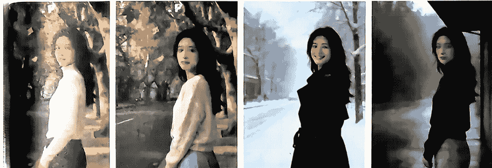

图 5-14 图生图示例

- 应用二：场景变体

一个场景往往需要多个版本，白天版、夜晚版、雨天版、雪天版。与其重新文生图，不如用图生图在已有场景上快速修改。具体操作步骤与前面图生图方法一致。

实操步骤：

首先，生成一张场景图，并将其上传至图生图界面。

其次，输入提示词，比如只修改环境、光线、天气，保留场景结构不变。描述变化时要具体，比如“天空变暗”不如“深蓝色夜空”，“地面湿润”不如“雨水反光，映出路灯”。

最后，点击生成，选择理想的图片，如果得到的一组图片不理想，可调整提示词继续生成（见图 5-15）。

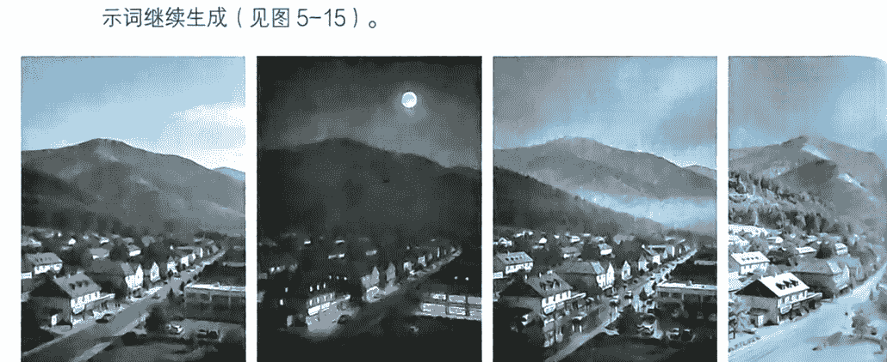

- 应用三：风格迁移

有时候你有一张实景照片或普通素材，想把它变成某种特定风格，比如动漫风、水墨风或赛博朋克风，图生图可以帮助你轻松实现。

转变图片美学风格的实操步骤与前面的图生图一致，只是在提示词环节需要注意的是，风格迁移需要加上具体的风格关键词，如“新海诚风格”“宫崎骏风格”“水墨画”“油画”“赛博朋克”，等等（见图 5-16）。

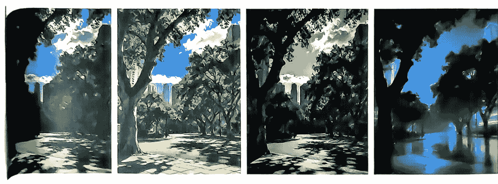

图 5-16 同一场景的不同风格

### 图生图提示词技巧

图生图的提示词公式与文生图类似，但多了“参考图”和“保持不变的元素”这两个要素。因此，图生图提示词的重点就是要告诉 AI，哪些地方要调整，哪些地方不变，具体注意事项如表 5-4 所示。

表 5-4 图生图提示词要素拆解

| 要素 | 作用 | 案例 |
| :--- | :--- | :--- |
| 要改变的元素 | 明确告诉 AI 哪些部分需要调整 | 角度变成侧脸，时间变成夜晚 |
| 保持不变的元素 | 防止 AI 乱改关键特征 | 同一人物，相同服装，相同发型 |
| 新增的元素 | 添加原来没有的内容 | 眼泪，笑容，灯笼，雪花 |
| 其他常规要素 | 光线、构图、画质、风格等 | 柔光，中景，8K，电影质感 |

## 5.2 文生视频与图生视频

在完成 AI 文生图、图生图的静态画面制作后，下个环节就是要让固定的画面“动起来”。AI 生成视频的方式同样有两种，分别是文生视频与图生视频。这两种视频生成模式各有优势、各有短板，也对应不同的创作需求。

### 文生视频

#### 什么是文生视频？

文生视频就是直接输入文字描述，AI 根据描述生成一段视频。你不需要任何图片素材，完全依靠 AI 的想象力从零创造。文生视频一般适用于场景的塑造，比如视频中空间环境的搭建、空镜与氛围镜头、大场面、抽象概念等。

#### 文生视频的优缺点

- 优点：快速、灵活、创意空间大，不用准备图片，能够生成原创性较强的场景。
- 缺点：人物、动作难以精确控制，容易出现“变脸”“穿模”“动作崩坏”。

#### 文生视频提示词

Seedance 2.0 文生视频提示词公式如下：
[ 场景描述 ]+[ 运镜方式 ]+[ 氛围 / 情绪 ]+[ 时长要求 ]+[ 画质要求 ]
公式中各要素的作用如表 5-5 所示。

表 5-5 Seedance 2.0 文生视频提示词要素拆解

| 要素 | 作用 | 案例 |
|---|---|---|
| 场景描述 | 告诉 AI 画面里有什么 | 雨夜的 CBD，车流在湿漉漉的马路上穿行 |
| 运镜方式 | 镜头怎么动 | 俯瞰镜头，缓慢推进 |
| 氛围 / 情绪 | 什么感觉 | 霓虹灯倒映在水中，迷离感 |
| 时长要求 | 视频长度 | 4 秒 |
| 画质要求 | 清晰度与风格 | 8K，电影感色调 |

##### 实战案例

第一步，打开即梦 AI 创作界面，在左侧创作类型栏选择视频生成（见图 5-17）。

第二步，根据文生视频提示词的要素润色提示词，得到可操作性较强、描述较为明确的提示词。

> 提示词：雨夜城市俯瞰镜头，车流拉出光轨，路面反光，整体色调偏蓝紫，有电影质感。

第三步，在提示词输入栏输入提示词，并选择视频时长（见图 5-18）。

图 5-18 Seedance 2.0 文生视频操作步骤示意图

第四步，在创作工具栏选择 Seedance 2.0，并选择适配短剧的画面比例，最后点击生成按钮即可（见图 5-19）。

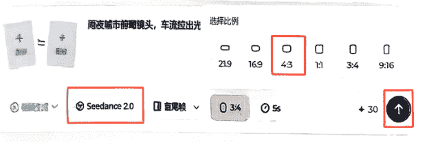

图 5-19 Seedance 2.0 文生视频操作步骤示意图

Seedance 2.0 生成视频的截图如图 5-20 所示。

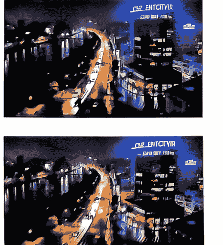

图 5-20 Seedance 2.0 根据文字生成的视频的截图

### 图生视频

#### 什么是图生视频？

图生视频，是先上传一张清晰图片（角色定妆照或场景图），再让 AI 基于这张图生成动态效果。图生视频的适用场景是生成人物特写、对话、情绪变化等需要精确控制表情的场景。AI 短剧创作中，图生视频的基本应用场景如表 5-6 所示。

表 5-6 图生视频适用场景

| 场景类型 | 案例 | 推荐方式 |
| :--- | :--- | :--- |
| 人物特写 | 情绪变化、独白 | 音频驱动 + 表情提示 |
| 双人对话 | 两人对话场景 | 分别生成再合成，或使用多角色参考 |
| 动作场景 | 走路、转身、抬手 | 纯视觉图生视频 |
| 物体动态 | 杯子滑落、风吹窗帘 | 纯视觉图生视频 |

#### 图生视频的优缺点

- 优点：角色一致性强，表情可控，音画同步。
- 缺点：需要前期定妆照和音频文件，生成速度比文生视频略慢。

#### 图生视频提示词

Seedance 2.0 图生视频提示词公式如下（纯视觉版）：
上传图片 +[人物要做什么动作 ]+[表情变化 ]+[镜头怎么动 ]+[时长要求 ]

##### 实战案例

第一步，打开即梦 AI 创作界面，在左侧创作类型栏选择视频生成，并在创作工具栏选择 Seedance 2.0，在参考模式栏选择全能参考帧（见图 5-21）。

上传1~5张参考图或视频，输入文字，自由组合图、文、音、视频多元素，如 @图片1 模仿 @视频1 的动作，音色参考 @音频1。

图 5-21 Seedance 2.0 图生视频操作步骤示意图

第二步，点击左侧“参考内容”区域，上传参考图。在提示词输入栏输入提示词，并选择视频时长，在图生视频中，视频画面比例一般为自动匹配，然后点击生成按钮即可（见图 5-22）。

提示词：根据图片生成视频，画中人物转头看向咖啡杯，眯起眼睛，轻轻喝一口咖啡，然后放下杯子，睁开眼睛，镜头逐渐平稳前推，靠近人物。

图 5-22 Seedance 2.0 图生视频操作步骤示意图

参考图如图 5-23 所示。

图 5-23 参考图

Seedance 2.0 生成视频的截图如图 5-24 所示。

图 5-24 Seedance 2.0 根据图片生成的视频的截图

### Seedance 2.0 图生视频注意事项

目前 Seedance 2.0 图生视频暂时不支持真人脸参考，而我们通过即梦 AI 生成的拟真人分镜，由于其视觉效果十分逼真，因此在多数情况下也会被 Seedance 2.0 判定为真人参考图而无法使用，如图 5-25 所示。

图 5-25 即梦 AI 生成的人物图

上面这张图片是我们之前用即梦 AI 生成的拟真人图片，图片本身为文生图生成，并未参考任何真人照片，但若是用这张图片进行视频生成的话，就会出现如图 5-26 所示的情况。

图 5-26 Seedance 2.0 图生视频直接上传 AI 生成的拟真人图片

不仅是上面这张图片，经过多次试验，大多数的拟真人图片都无法通过 Seedance 2.0 来生成视频，而要想保证短视频画面的真实性与连续性，必须要保证分镜脚本中人物形象的统一。这就需要我们掌握如何利用即梦 AI 平台的资源来制作视频。

实际上，我们通过即梦 AI 生成的拟真人图片是可以用来生成视频的，具体操作方式如下。

#### 步骤一

打开即梦 AI，点击屏幕左侧的“资产”按钮，并在上方分类栏选择“图片”，主界面出现的就是我们通过即梦 AI 生成的所有图片（见图 5-27）。

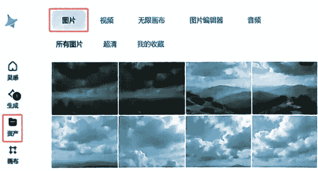

图 5-27 Seedance 2.0 图生视频操作步骤示意图

#### 步骤二

选择我们需要将其生成视频的图片，这里我们依然用之前无法作为参考图生成视频的这张图片举例，左键点击该图片，随后点击“生成视频”按钮，图片将被自动添加到视频的首帧（见图 5-28）。

图 5-28 Seedance 2.0 拟真人图生视频操作步骤示意图

#### 步骤三

在提示词输入栏输入人物的动作、周围环境的变化、运镜方式等视频元素，就可以生成以画中人物为主角的视频了。在这种操作方式下，Seedance 2.0 直接进入了视频生成步骤，而没有显示错误提示。

#### 步骤四

利用图生图获得的人物分镜图片，按照分镜的前后顺序重复上述步骤，即可生成连续的视频。需要注意的是，若想通过这种生成视频的方式保持整体视频的流畅性，就要保证各脚本之间在画面和剧情上的关联性。

当然，Seedance 2.0 在生成非人类元素的时候依然可以使用相对逼真的参考图。

#### 实操效果

依然以上图为例，我们将其添加至 Seedance 2.0，并进行动作描述（见图 5-29）。

点击生成按钮，等待视频生成结束后，可以看到，Seedance 2.0 能够顺利生成视频，不再提示错误（见图 5-30、图 5-31）。

图 5-31 Seedance 2.0 利用拟真人图生成的视频的截图

当然，我们也可以选择 Seedance 2.0 的全能参考模式，按照前面所说的方法将首帧图作为参考样本之一添加至 AI，然后借助 Seedance 2.0 多模态参考的方式生成更为丰富的视频内容（见图 5-32）。

图 5-32 Seedance 2.0 全能参考模式

在 Seedance 2.0 中，我们还可以通过细化分镜脚本的方式，将包括人物台词在内的分镜脚本提供给 AI，一次性输入视听内容更为丰富的视频，关于这一点我们在第六章的配音部分还会讲到。

### 参数设置与效果优化

#### Seedance 2.0 各类型参数详解

在 AI 生成视频的过程中，合理设置参数能大幅提升生成视频的质量。表 5-7 是核心参数的详解。

## 表 5-7 Seedance 2.0 视频生成核心参数详解

| 参数 | 作用 | 推荐设置 | 备注 |
| --- | --- | --- | --- |
| 时长 | 视频长度 | 3～5秒（单镜头） | 超过5秒容易崩坏，复杂动作建议3秒 |
| 帧率 | 流畅度 | 24FPS（电影感）或30FPS（流畅） | 即梦AI默认24FPS |
| 分辨率 | 清晰度 | 1080p（常规）或4K（精品） | 4K生成时间稍长 |
| 负向提示词 | 避免不良结果 | 见下方词库 | 必填！ |
| 多模态参考 | 保持人物/场景一致 | 可上传视频或图片同时参考 | Seedance 2.0支持参考素材中的画面元素灵活组合 |

## 负向提示词库

负向提示词十分重要，在生成一些复杂视频时要注意在提示词中规避以下词语：变脸，崩坏，扭曲，模糊，低质量，水印，文字，多余肢体，畸形，丑，平光，过曝，暗淡，噪点，卡通，油画，3D渲染。

## 视频效果优化三步法

- 步骤 1：生成预览版：设置较低分辨率（720p）、短时长（2～3秒），快速验证动作是否合理，表情变化是否自然，运镜是否符合分镜。
- 步骤 2：调整优化：根据预览结果修改提示词或参数，重复步骤 1。
- 步骤 3：生成高清版：预览满意后，设置为4K、最终时长，生成最终素材。

## 5.3 首尾帧精准控制

我们在前面介绍了 AI 生成视频的基本操作方法。普通 AI 图生成视频，运镜、动作、节奏都由 AI 自主决定，画面虽然能动，但不一定符合你的分镜脚本。而在专业 AI 短剧创作中，我们经常需要精确控制镜头的起点和终点，也就是精准控制视频的首尾帧。

实现首尾帧的精准控制并非难事，简单来说就是将一段视频的起始画面和最终画面提供给 AI，并提出要求，使 AI 生成中间流畅的过渡动画，这样能让镜头完全按你的剧本走，不再依赖 AI 随机发挥。

当然，就像我们前面所说的，由于 Seedance 2.0 容易将 AI 生成的拟真人识别为真人而无法生成视频，我们可以采用 5.2 中的方法通过与剧情紧密相关，且具有连续性的一个个首帧，或者全能参考来生成连续的视频，或者将上一个视频的尾帧作为下一个视频的首帧进行创作，以保证整体视频的连续性，然后利用剪辑软件进行剪辑即可。

## 首帧 / 尾帧图片制作技巧

### 什么是首尾帧？

- 首帧：视频最开始的那一帧画面
- 尾帧：视频结束时的最后一帧画面

只要你提供首尾两张图，AI 就会自动计算运动轨迹、光影变化、表情过渡，生成一段起点和终点完全可控的视频。

## 首尾帧的 3 种制作方法

- 方法 1：文生图法（分别生成）
用文生图分别生成首帧画面和尾帧画面。
适用场景：首尾画面差异较大，比如场景完全切换、视角大幅变化。
- 方法 2：图生图法（推荐，最稳定）
先生成首帧，再用图生图在首帧基础上修改出尾帧。
适用场景：人物必须一致、表情变化、光线变化、角度微调。
- 方法 3：同一图局部修改
用同一张底图，在修图工具或 AI 编辑中微调局部（亮度、颜色、物体位置）。
适用场景：微小变化，如天色变暗、灯光亮起、镜头轻微移动。

上述 3 种方法在前文关于图片生成的部分已有详细介绍，具体的操作流程这里不再做过多介绍。需要注意的是，要想控制视频生成的精度，务必要根据分镜脚本进行图片和视频的精细化制作。

##### 实战案例

- 第一步：用文生图生成图片。在即梦 AI 图片生成界面输入提示词，并选择适合竖屏短剧的尺寸，生成理想图片（见图 5-33）。

- 第二步：用图生图生成尾帧。在即梦 AI 图片生成界面中添加参考图，并输入提示词，生成并选择最佳图片（见图 5-34）。

图 5-34 控制首尾帧生成视频步骤示意图

图 5-35 AI 生成的首帧和尾帧图片

- 第三步：选择 Seedance 2.0 “首尾帧”模式。分别将图 5-35 中的两张图片上传到 Seedance 2.0 的首尾帧位置，选择好相关参数（时长、分辨率、画面比例），可以输入过渡提示词，比如“从首帧平滑过渡到尾帧，自然流畅，表情逐渐变化”，然后点击生成视频按钮，AI 自动生成从白天到夜晚的平滑过渡视频（见图 5-36）。

图 5-36 控制首尾帧生成视频步骤示意图

- Seedance 2.0 生成视频的截图如图 5-37 所示。

## 常见问题与即梦 AI 解决方案

在利用首尾帧生成一些场景较为复杂的视频的时候，容易出现一些小问题，这时候，创作者要学会灵活运用 AI 工具，一些典型的问题与解决方案如表 5-8 所示。

表 5-8 首尾帧生成视频常见问题与解决方案

| 问题 | 原因 | 即梦 AI 解决方案 |
| :--- | :--- | :--- |
| 中间帧人物变脸 | 首尾帧人物特征不一致 | 确保首尾帧用同一套定妆照生成；加强提示词“保持人物特征一致” |
| 过渡不自然 | 首尾帧差异过大 | 增加中间关键帧或缩短时长 |
| 动作跳跃 | 运动幅度设置不当 | 减小运动幅度数值；增加“平滑过渡，自然流畅”提示词 |
| 背景闪烁 | 光线变化不稳定 | 加入“稳定光源，恒定光照”提示词；确保首尾帧光线方向一致 |
| 物体消失/出现 | 首尾帧元素不一致 | 用图生图法生成尾帧，确保所有元素都在；或后期用剪辑软件处理 |

## 5.4 运镜参数设置

在第 4 章，我们已经掌握了推、拉、摇、移、跟、升降、甩 7 种基础运镜。但只告诉 AI “推镜头”“拉镜头”，往往还不够有电影感。真正决定画面质感的，是光圈、焦距、曝光、景深这四大核心参数。

这些参数共同决定了画面的“电影感”。同样是特写，大光圈浅景深会显得唯美柔和，小光圈深景深则会显得真实锐利。同样是全景，广角镜头有冲击力，长焦镜头有压缩感。它们就像 AI 的“摄影语法”，只要你用对提示词，即梦 AI（Seedance 2.0）就能精准理解你的镜头意图，输出媲美专业拍摄的视频画面。

## 光圈和景深控制

### 什么是光圈和景深？

光圈是镜头中控制进光量的装置，它有两个核心作用。一是控制进光量：光圈越大（数值越小），进光越多，画面越亮。二是控制景深：光圈越大，背景越虚化；光圈越小，背景越清晰。在摄影中，光圈用 f 值表示，光圈大小则与 f 值大小成反比。

景深是画面中清晰范围的大小。它与光圈、焦距、拍摄距离都有关系，但在 AI 提示词中，我们通常直接描述想要的效果，在这里我们就将二者结合在一起进行讨论。

### 即梦 AI 提示词表达

想要通过 AI 得到理想景深的分镜脚本，那么，就需要知道景深的基本类型和作用，及其适用场景（见表 5-9）。

表 5-9 景深的类型及其在短剧中的应用

| 景深类型 | 特点 | 短剧应用 |
| :--- | :--- | :--- |
| 浅景深 | 只有主体清晰，前后模糊 | 情绪特写、主体突出 |
| 深景深 | 前后都清晰 | 环境交代、大场面 |

简单了解了浅景深与深景深的区别和应用方式后，就可以通过合理的提示词让 AI 生成对应的分镜脚本。举个简单的例子，浅景深的提示词为“浅景深，主体清晰，背景虚化”，深景深的提示词为“深景深，前后景都清晰”。

##### 实战案例

- 案例一：对话场景（浅景深）

【提示词】近景，两人对话，说话的人清晰，身后的人群虚化，浅景深，写实风格，电影质感。

即梦 AI 生成的图片如图 5-38 所示。

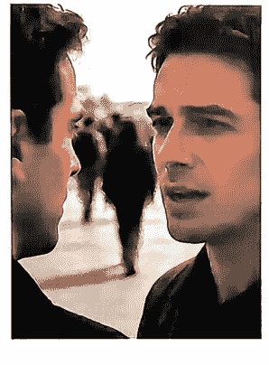

图 5-38 即梦 AI 生成的浅景深图片

- 案例二：城市全景（深景深）

【提示词】远景，整个城市天际线，深景深，从近处的楼顶到远处的山脉都清晰，写实风格，电影质感。

即梦 AI 生成的图片如图 5-39 所示。

图 5-39 即梦 AI 生成的深景深图片

在即梦 AI 的图生视频中，如果你上传的图片本身有浅景深效果，AI 通常会保留这个特性。想要强化或减弱景深，可以在提示词中明确“保持浅景深”或“增加景深”。

## 焦距控制

### 认识焦距

焦距，就是镜头“看多宽、看多近”的能力，焦距决定了镜头的视角和透视关系，你可以把它简单理解成：镜头的“视野宽窄”。常用焦距分为以下几类（见表 5-10）。

表 5-10 常用焦距类型及其特点

| 焦距类型 | 焦距范围 | 视角 | 透视效果 | 视觉心理 | 短剧应用 |
| :--- | :--- | :--- | :--- | :--- | :--- |
| 超广角 | 16 ～ 24mm | 极宽（100° 以上） | 强烈拉伸变形，边缘夸张 | 震撼、压迫、眩晕 | 大佬出场、空间展示、打斗场面 |
| 广角 | 24～35mm | 宽（70°～100°） | 轻微拉伸，空间感强 | 开阔、气势、代入感 | 环境交代、全景叙事 |
| 标准 | 50mm左右 | 接近人眼（45°～50°） | 自然真实，无变形 | 客观、真实、亲近 | 对话场景、日常叙事 |
| 中长焦 | 85～135mm | 窄（15°～30°） | 轻微压缩，背景柔和 | 专注、唯美、情感 | 人物特写、告白、泪目 |
| 长焦 | 135mm以上 | 极窄（10°以下） | 强烈压缩，空间扁平 | 偷窥、紧张、对峙 | 隔空对视、跟踪、悬疑 |

以下是两张 AI 生成的不同焦距的图片（见图 5-40）。

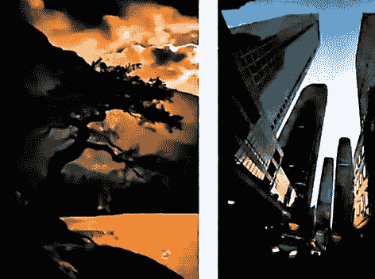

图 5-40 AI 生成的长焦图片与广角图片

### 焦距如何影响情绪？

画面的焦距具有重要的情绪暗示作用，巧用不同的焦距能够让画面更具感染力。短剧中，不同焦距对于观众情绪的影响如表 5-11 所示。

表 5-11 不同焦距对于观众情绪的影响

| 焦距 | 情绪暗示 | 原因 |
| :--- | :--- | :--- |
| 广角 | 震撼、压迫、自由 | 空间被拉伸，人物显得高大或环境显得辽阔 |
| 标准 | 真实、客观、亲近 | 视角接近人眼，观众感觉“就在现场” |
| 长焦 | 专注、紧张、疏离 | 空间被压缩，背景模糊，注意力完全集中在主体上 |

148 AI 短剧 Seedance2.0 变现实战指南

### 即梦 AI 焦距控制提示词库

- 超广角提示词：
超广角镜头，16mm，鱼眼镜头，强烈透视变形。
- 广角提示词：
广角镜头，24mm，宽广视角。
- 标准提示词：
50mm，标准镜头，自然视角
- 中长焦提示词：
人像镜头，85mm，背景柔和。
- 长焦提示词：
长焦镜头，135mm，背景压缩，主体突出。

即梦 AI 对具体焦距数字非常敏感，建议在提示词中明确写出“24mm”“50mm”“85mm”等具体数值，效果比单纯写“广角”“长焦”更精准。

##### 实战案例

案例：霸总出场——用广角制造压迫感

- 场景：公司创始人第一次亮相，需要让观众感受到他的气场和地位。
- 为什么用广角？
广角让前景中的人物显得更加高大。
背景的拉伸变形制造出“空间被压缩”的错觉，强化压迫感。
低角度 + 广角组合是塑造权威感的经典手法。观众会本能地感受到这个人物“不好惹”“有气场”。
- 分镜设计：
分镜一：镜头从走廊尽头开始，霸总向镜头走来
分镜二：使用 24mm 广角镜头，从低角度仰拍
分镜三：背景的走廊在广角下显得深邃悠长
分镜四：门框和墙壁边缘产生拉伸变形，强化视觉冲击
- 提示词：

广角镜头，24mm，从下往上仰拍，霸总走进会议室，门框边缘变形拉伸，人物显得高大修长，步伐沉稳，身后走廊深邃，压迫感强，写实风格，电影质感，5秒。

- Seedance 2.0 生成视频的截图如图 5-41 所示。

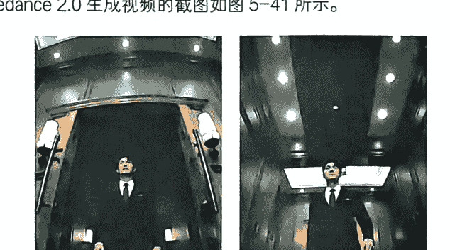

图 5-41 Seedance 2.0 生成的广角视频的截图

### 进阶技巧

- 技巧一：变焦镜头模拟

在同一个镜头中改变焦距，可以制造特殊的情绪效果。

案例：发现真相时的“变焦推”。

> 【提示词】从 35mm 广角开始，缓慢变焦推到 85mm 中长焦，同时镜头推进，女主的眼神从疑惑变成震惊，电影质感，5秒。

Seedance 2.0 生成视频的截图如图 5-42 所示。

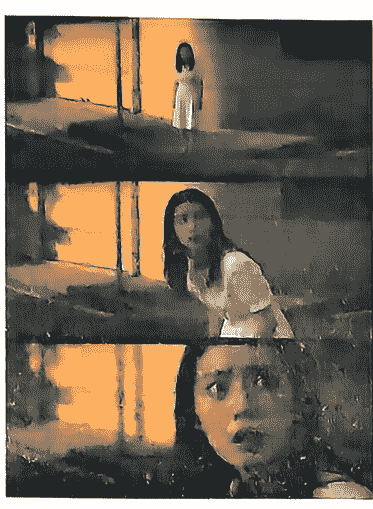

图 5-42 Seedance 2.0 生成的变焦视频的截图

效果：焦距变化 + 镜头推进的双重运动，让情绪聚焦更有冲击力。

- 技巧二：焦距对比制造冲突

在同一场景中交替使用不同焦距，强化情绪对比。

案例：以下是一组男女主对峙的镜头（见表 5-12）。

表 5-12 不同焦距组合场景示例

| 镜头顺序 | 焦距 | 拍摄对象 | 情绪 |
| :--- | :--- | :--- | :--- |
| 镜头 1 | 24mm 广角 | 全景展示对峙环境 | 紧张 |
| 镜头 2 | 135mm 长焦 | 男主冷酷的眼神 | 压迫 |
| 镜头 3 | 135mm 长焦 | 女主颤抖的嘴唇 | 愤怒 |
| 镜头 4 | 50mm 标准 | 两人同框 | 对峙 |

- 技巧三：焦距与景深配合

不同焦距与景深相搭配，可以呈现出丰富的视觉效果（见表 5-13、图 5-43）。

表 5-13 焦距与景深组合示例

| 焦距 | 配合光圈 | 效果 |
| :--- | :--- | :--- |
| 广角 + 大光圈 | 24mm + f/1.4 | 广角下的浅景深，既有空间感又突出主体 |
| 长焦 + 小光圈 | 200mm + f/8 | 长焦下的深景深，背景细节也清晰 |
| 标准 + 中等光圈 | 50mm + f/2.8 | 最自然的视觉感受 |

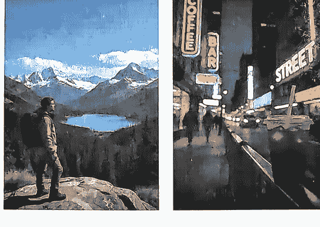

图 5-43 AI 生成的不同焦距与光圈组合图

## 曝光控制

### 什么是曝光？

- 曝光的内容与维度

曝光是摄影中最基础的概念之一，它决定了画面是亮还是暗，是明媚还是阴沉。在 AI 短剧创作中，曝光不仅仅是一种参数指标，更是情绪的第一道滤镜。

当你看到一个画面，在看清具体内容之前，你的情绪已经被画面明暗悄然牵引，明亮的画面让人感到轻松、温暖、充满希望，而黑暗的画面则会让人感到压抑、紧张、神秘，这就是曝光的魔力。表 5-14 展示的是曝光的 3 个核心维度。

表 5-14 曝光的 3 个维度

| 维度 | 定义 | 对情绪的影响 |
|---|---|---|
| 亮度 | 画面的整体明暗程度 | 越亮越轻松，越暗越压抑 |
| 对比度 | 亮部和暗部的反差大小 | 反差越大越戏剧性，越小越柔和 |
| 动态范围 | 从最暗到最亮的细节保留 | 范围越宽越真实，越窄越风格化 |

- 曝光的类型

曝光没有绝对的“对错”，只有“是否适配剧情”，我们日常接触的短剧画面，核心分为正常曝光、过曝/高调、欠曝/低调三大类，每一类都有明确的特点、情绪暗示和专属应用场景，具体拆解如表 5-15 所示。

表 5-15 曝光的类型及其适用场景

| 曝光类型 | 核心特点 | 情绪暗示 | 短剧适配场景 |
|---|---|---|---|
| 正常曝光 | 明暗比例均衡，画面亮部、暗部细节全部清晰可见，没有过亮泛白、过暗发黑的情况，最贴近人眼日常看到的视觉效果 | 真实、客观、平和、自然，无额外情绪偏向，专注叙事本身 | 日常叙事、都市生活片段、普通对话场景、白天户外写实镜头、中性剧情推进 |
| 过曝/高调 | 整体画面偏亮，暗部被弱化甚至消失，高光区域柔和，无刺眼强光，多搭配柔光、漫射光，画面通透干净，自带朦胧感 | 梦幻、纯洁、温暖、治愈、浪漫，也可用于回忆、梦境、幻想片段，营造疏离又美好的氛围 | 甜宠恋爱、青春校园、回忆闪回、梦境片段、唯美空镜、婚礼/温馨家庭场景 |
| 欠曝/低调 | 整体画面偏暗，亮部仅集中在局部区域（如人物面部、关键道具），大面积处于阴影中，明暗对比强烈，光影层次丰富 | 压抑、神秘、紧张、悬疑、冷峻、悲情，适合烘托反派、复仇、惊悚、深夜冲突等强情绪场景 | 悬疑推理、复仇虐心、反派出场、深夜对峙、密室场景、惊悚片段、悲情哭戏 |

### 即梦 AI（Seedance 2.0）提示词表达

即梦 AI 对曝光类关键词识别度极高，无须掌握复杂的专业术语即可生成理想曝光度的画面，简单的提示词模板如表 5-16 所示。

表 5-16 AI 短剧创作提示词中关于画面曝光度的关键词

| 曝光效果 | 中文提示词 | 补充修饰词 |
| :--- | :--- | :--- |
| 正常曝光 | 正常曝光, 光线平衡, 明暗适中 | 细节完整, 光线自然, 无过暗过亮 |
| 过曝 / 高调 | 过曝, 高调, 明亮通透, 柔光漫射 | 无暗角, 朦胧感, 纯白柔光, 治愈氛围 |
| 欠曝 / 低调 | 欠曝, 低调, 戏剧性光影, 明暗对比强烈 | 局部打光, 侧光, 顶光, 阴影厚重, 氛围感拉满 |

短剧画面中的曝光度与光影风格之间联系紧密，同时又具备各自的功能。短剧创作中关于画面光影风格描述的关键词可以参考表 5-17。

表 5-17 AI 短剧创作提示词中关于光影风格的关键词

| 光影风格 | 中文提示词 | 适用场景 |
| :--- | :--- | :--- |
| 柔光 | 柔光, 漫射光 | 甜宠、回忆、唯美 |
| 硬光 | 硬光, 直射光 | 悬疑、对峙、压迫 |
| 侧光 | 侧光, 伦勃朗光 | 情绪特写、神秘感 |
| 逆光 | 逆光, 剪影 | 浪漫、离别、神秘出场 |
| 顶光 | 顶光 | 审讯、压抑、神性 |
| 底光 | 底光 | 恐怖、诡异、反派 |
| 自然光 | 自然光, 窗光 | 日常、真实感 |
| 霓虹光 | 霓虹光, 赛博朋克 | 夜晚城市、未来感 |

### 短剧实战案例详解

- 案例一：甜宠回忆片段（过曝 / 高调效果）

适用题材：都市甜宠、青春校园短剧

核心需求：营造回忆的梦幻感，弱化现实感，突出恋爱的甜蜜美好。

即梦 AI 完整提示词：过曝效果，高调光影，明亮通透，纯白柔光漫射，男女主在午后草坪牵手微笑，发丝带光，无暗部阴影，画面朦胧治愈，电影质感。

即梦 AI 生成的图片如图 5-44 所示。

图 5-44 即梦 AI 生成的过曝效果图片

生成效果解析：过曝处理让画面整体提亮，暗部完全消失，搭配柔光后没有刺眼的高光，整体呈现出朦胧的梦幻感，完美贴合“回忆片段”的氛围，观众一眼就能识别这是主角的美好回忆，快速代入甜宠剧情，不会有生硬的写实感。

- 案例二：悬疑对峙场景（欠曝 / 低调效果）

适用题材：悬疑推理、复仇虐心短剧

核心需求：烘托对峙的紧张感，塑造神秘压抑的氛围，突出人物眼神交锋。

即梦AI完整提示词：欠曝，低调光影，戏剧性侧光，一束冷光打亮男女主面部，其余部分隐入黑暗，明暗对比强烈，眼神尖锐交锋，无多余亮光，阴影厚重，紧张压抑的氛围，电影质感。

即梦 AI 生成的图片如图 5-45 所示。

图5-45 即梦AI生成的欠曝效果图片

生成效果解析：大面积黑暗搭配局部亮光，形成强烈的明暗反差，既突出了人物的面部表情和眼神，又用阴影营造出悬疑、紧张的氛围，让观众瞬间感受到对峙的张力，完美适配复仇、悬疑类短剧的强情绪需求，比正常曝光的画面更具视觉冲击力。

## 新手避坑指南

- 过曝切忌过度：不要只写“过曝”，一定要加“柔光”“明亮通透”，避免生成画面泛白、细节完全丢失，导致人物五官模糊。
- 欠曝切忌全黑：欠曝不是纯黑，必须搭配“侧光”“顶光”“局部亮光”，保留核心主体（人物/道具）的细节，否则画面漆黑一片，无法用于短剧。
- 适配场景不滥用：甜宠剧少用欠曝，悬疑剧少用过曝，避免曝光风格与剧情情绪冲突，破坏观众代入感。
- 单镜头统一曝光：一个镜头内不要同时混用过曝和欠曝，保持光影风格统一，画面更专业。

## 5.5 经典场景运镜组合

在前几节中，我们逐一掌握了光圈、焦距、曝光、景深等摄影基础参数，也学会了推拉摇移等运镜技法的表达方法，但零散的参数和镜头语言，无法直接撑起有感染力的短剧画面。想要创作出优秀的 AI 短剧，一定要学会按照场景情绪和叙事节奏将单一参数和基础运镜组合使用，让 AI 精准输出贴合剧情的电影感镜头。

本部分总结了短剧中常见的 5 种场景，并给出完整的运镜组合方案供大家参考。

### 情绪聚焦场景：推进 + 虚化

#### 运镜作用

锁定人物内心情绪，切断外界干扰，把观众的注意力完全拉到人物表情与心理变化上，是情感类短剧的高频镜头。

#### 适用场景

发现真相、深情告白、情绪爆发、恍然大悟、心碎落泪等强内心戏场景，以及聚焦关键画面元素的场景。

#### 组合方案详解

“推进 + 虚化”运镜方式的核心逻辑：从环境到人物，从外部到内心。通过缓慢推进和背景虚化，把观众的注意力一步步引导到人物的内心世界。不同景别的分镜作用如表 5-18 所示。

表 5-18 “推进 + 虚化”运镜详解

| 阶段 | 时长 | 景别 | 运镜 | 画面描述 | 镜头目的 |
| :--- | :--- | :--- | :--- | :--- | :--- |
| 1 | 2秒 | 中景 | 固定 | 人物在画面中央，环境清晰可见 | 建立人物与环境的关系 |
| 2 | 3秒 | 中景→近景 | 缓慢推进，背景开始虚化 | 人物表情逐渐清晰，环境开始模糊 | 引导视线聚焦人物 |
| 3 | 2秒 | 近景→特写 | 继续推进，背景完全虚化 | 焦点在眼睛或嘴唇，细节放大 | 进入人物内心 |
| 4 | 1秒 | 特写 | 定格 | 关键表情凝固，情绪发酵 | 让观众记住这一刻 |

#### Seedance 2.0 生成视频示例

Seedance 2.0 生成的“推进 + 虚化”运镜视频的截图如图 5-46 所示。

图 5-46 Seedance 2.0 生成的“推进 + 虚化”运镜视频的截图

### 震撼揭示场景：上升 + 俯拍

#### 运镜作用

通过镜头升降改变视角，放大人物气场或场景反差，制造视觉冲击，打造名场面。

#### 适用场景

大佬出场、身份揭晓、真相大白、强者归来、反转时刻等强气场的场景。

#### 组合方案详解

“上升 + 俯拍”运镜方式的核心逻辑：从局部到整体，从细节到全貌。通过上升镜头逐步揭示人物全貌，最后用俯拍展示人物与环境的关系，制造震撼感（见表 5-19）。

表 5-19 “上升 + 俯拍”运镜详解

| 阶段 | 时长 | 景别 | 运镜 | 画面描述 | 镜头目的 |
| :--- | :--- | :--- | :--- | :--- | :--- |
| 1 | 1秒 | 特写 | 固定 | 局部细节(脚/手/物品)，制造悬念 | 勾起好奇心：“这是谁？” |
| 2 | 3秒 | 特写→全景 | 缓慢上升 | 从局部到全身，逐步揭示 | 满足好奇心：“原来是他！” |
| 3 | 2秒 | 全景 | 到达最高点，变成俯拍 | 展示人物与环境的关系 | 制造震撼：“他在这样的地方！” |
| 4 | 2秒 | 俯拍全景 | 定格 | 人物在画面中显得高大或渺小 | 强化情绪 |

#### Seedance 2.0 生成视频示例

Seedance 2.0 生成的“上升 + 俯拍”运镜视频的截图如图 5-47 所示。

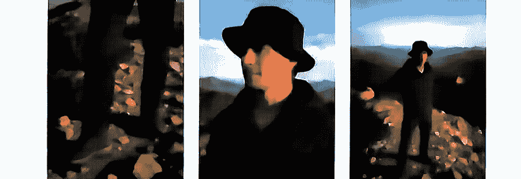

图 5-47 Seedance 2.0 生成的“上升 + 俯拍”运镜视频的截图

### 空间展示场景：前推 + 环绕

#### 运镜作用

全方位展示场景全貌，营造沉浸式视觉体验，凸显场景的奢华、宏大或神秘。

#### 适用场景

首次进入新场景、展示豪宅/宫殿/秘境、探索未知地点、奢华场景亮相等。

#### 组合方案详解

“前推 + 环绕”运镜方式的核心逻辑：从外到内，从局部到整体，从客观到主观。先带观众走进场景，再 360° 环绕展示全貌，最后回到人物的主观反应（见表 5-20）。

表 5-20 “前推 + 环绕”运镜详解

| 阶段 | 时长 | 景别 | 运镜 | 画面描述 | 镜头目的 |
| :--- | :--- | :--- | :--- | :--- | :--- |
| 1 | 2秒 | 远景 | 固定 | 人物站在场景入口，展示入口全貌 | 建立起点 |
| 2 | 3秒 | 远景→中景 | 前推 | 镜头带观众走进场景，跟随人物 | 代入感：“我跟着她一起走进来” |
| 3 | 3秒 | 中景→环绕 | 360° 环绕 | 到达场景中心后，环绕一周展示环境 | 沉浸式体验：“这里真大 / 真美 / 真可怕” |
| 4 | 2秒 | 近景 | 定格 | 人物震惊 / 惊叹 / 恐惧的反应 | 情绪落地 |

#### Seedance 2.0 生成视频示例

Seedance 2.0 生成的“前推 + 环绕”运镜视频的截图如图 5-48 所示。

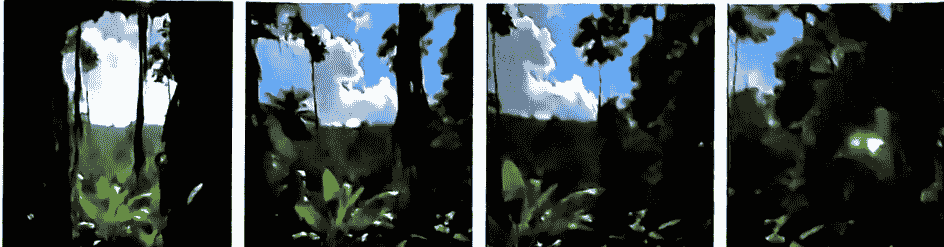

### 渐进叙事场景：上摇 + 推进

#### 运镜作用

从整体环境过渡到人物细节，完成叙事衔接，自然推进剧情，适配各类叙事片段。

#### 适用场景

从环境到人物、从整体到细节、叙事推进、氛围铺垫、情绪递进等。

#### 组合方案详解

“上摇 + 推进”运镜方式的核心逻辑：引导视线，层层递进。先用远景建立环境，再用摇镜头引导视线方向，最后推进锁定主体（见表 5-21）。

表 5-21 “上摇 + 推进”运镜详解

| 阶段 | 时长 | 景别 | 运镜 | 画面描述 | 镜头目的 |
| :--- | :--- | :--- | :--- | :--- | :--- |
| 1 | 2秒 | 远景 | 固定 | 展示环境全貌，建立空间感 | 告诉观众“这里是哪” |
| 2 | 2秒 | 远景→中景 | 上摇或下摇 | 沿着某个方向移动，引导视线 | 告诉观众“看那边” |
| 3 | 3秒 | 中景→近景 | 推进 | 锁定主体，逐步靠近 | 告诉观众“就是他” |
| 4 | 2秒 | 特写 | 定格 | 关键细节放大 | 告诉观众“注意这个” |

#### Seedance 2.0 生成视频示例

Seedance 2.0 生成的“上摇 + 推进”运镜视频的截图如图 5-49 所示。

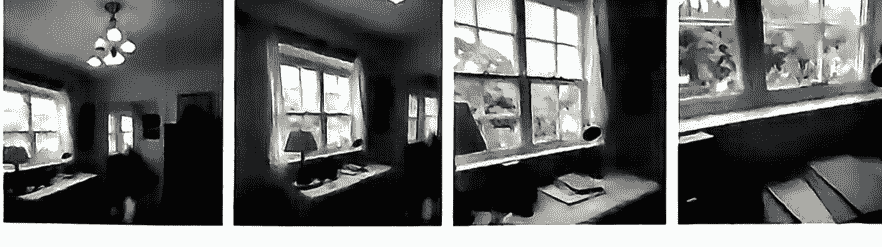

### 平稳过渡场景：升降 + 平移

#### 运镜作用

实现场景、时间、情绪的柔和过渡，避免切镜突兀，让短剧节奏更流畅。

#### 适用场景

时间流逝、场景转换、情绪缓和、昼夜交替、季节变化等转场片段。

#### 组合方案详解

“升降 + 平移”运镜方式的核心逻辑：视觉桥梁，情绪缓冲。通过升降改变视角，通过平移连接两个场景，让过渡自然流畅，不给观众造成视觉跳跃（见表 5-22）。

表 5-22 “升降 + 平移”运镜详解

| 阶段 | 时长 | 景别 | 运镜 | 画面描述 | 镜头目的 |
| :--- | :--- | :--- | :--- | :--- | :--- |
| 起 | 2 秒 | 固定 | 固定 | 场景 A，建立起点 | 告诉观众“这里是 A” |
| 承 | 2 秒 | 固定→移动 | 缓慢升降 | 视角开始变化，离开场景 A | 开始过渡 |
| 转 | 3 秒 | 移动 | 平移 | 中间过渡画面，连接 A 和 B | 视觉桥梁 |
| 合 | 2 秒 | 固定 | 固定 | 场景 B，到达终点 | 告诉观众“现在是 B” |

#### Seedance 2.0 生成视频示例

Seedance 2.0 生成的“升降 + 平移”运镜视频的截图如图 5-50 所示。

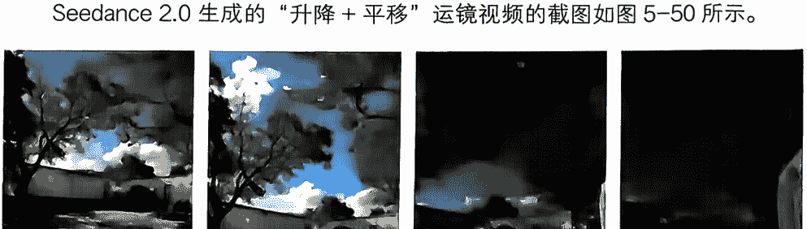

## 第6章 AI 短剧音频制作

在 AI 短剧制作中，音频制作包括三大模块：配音（人物对白）、音乐（背景情绪）、音效（环境与动作）。三者合一，才能让观众真正“入戏”。

传统音频制作需要录音棚、配音演员、音效师、混音师，成本高、周期长。而 AI 音频工具让我们一个人在家就能完成全部音频工作，轻松生成多情感配音、自动匹配背景音乐、一键添加环境音效。

### 6.1 AI 配音全流程

有了画面，角色还是“哑巴”，配音则是让角色真正活过来的关键一步。AI 配音的核心任务：让声音符合人物性格，让情绪贴合剧情需要，让口型匹配台词节奏。

#### 即梦 AI 配音技巧

##### 即梦 AI 数字人配音生成

即梦 AI 生成配音的操作十分简洁，可以为画面中的角色生成自然语音，并实现音画口型同步，支持单人独白、多人对话。下面我们来介绍即梦 AI 生成配音的基本操作技巧。

第一步，登录即梦 AI，打开即梦 AI 创作界面，在左侧创作类型栏选择“数字人”（见图 6-1）。

图 6-1 即梦 AI 配音生成操作步骤示意图

第二步，点击“角色”按钮，上传制作好的视频，或者人物图片，也就是配音对象。并在提示词输入栏输入角色的台词。当然，也可以提前录制好音频，点击下方的音频按钮直接上传音频。需要注意的是，上传视频与音频的话需要使音频时长与视频时长尽量匹配（见图 6-2）。

图 6-2 即梦 AI 配音生成操作步骤示意图

第三步，在输入角色台词后，还可以对角色的动作进行描述，使生成的配音视频更加形象生动。同时，可点击音色按钮选择配音的音色（见图 6-3）。

图 6-3 即梦 AI 配音生成操作步骤示意图

即梦 AI 配音支持丰富的音色选择，创作者可以根据“性别”“年龄段”“语言类型”和“声音特点”4 个基础选项选择合适的音色（见图 6-4）。

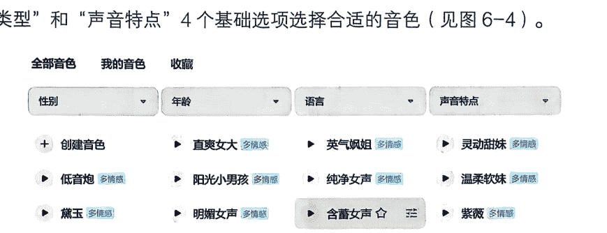

图 6-4 即梦 AI 配音功能自带丰富的音色可供选择

除了 AI 自带的丰富音色，创作者还可以通过即梦 AI 克隆理想的音色，具体操作方法是在创作类型栏选择“配音生成”，在提示词输入想要生成的内容，然后点击“克隆声音”上传音频，最后生成具有所上传音频音色的音频内容（见图 6-5）。

图 6-5 即梦 AI 配音生成功能可克隆想要的音色

##### 实战案例

在数字人制作界面上上传人物图像，并选择“纯净女声”音色。在提示词输入栏分别输入角色所说的话以及角色的动作描述。配音模式选择输出效果更好的大师模式。最后点击生成数字人即可（见图 6-6）。

图 6-6 即梦 AI 配音生成功能实战演示

即梦 AI 生成的作品的截图如图 6-7 所示。

图 6-7 即梦 AI 生成的配音数字人

可以看出，在即梦 AI 数字人的大师模式下，人物整体形象保持得非常好，没有出现脸崩、动作僵硬等问题，画面十分流畅。且我们利用的依然是第 5 章的拟真人图片，可以看到，目前在使用即梦 AI 的数字人功能时，可以直接使用 AI 生成的拟真人进行生成，且效果同样优秀。

当然，Seedance 2.0 功能十分强大，支持直接生成带配音、口型同步、环境音效与 BGM 的完整视频，无须后期配音。它采用双分支扩散架构，视频与音频同步生成，自带音素级唇形同步。人物的台词与动作可以直接通过提示词来实现，具体到短剧创作中，就是要求在每个分镜脚本中细化人物的语言与肢体动作即可，这样便可达到一键出片的效果，而其中有不完善之处，则可以利用前面所讲的数字人生成技术和配音功能进行补足。

下面，我们来看利用 Seedance 2.0 直接将分镜脚本生成配音视频的例子。

第一步，我们制作一张动漫风格的人物图像（见图 6-8）。

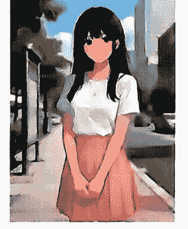

图 6-8 即梦 AI 生成的动漫人物图像

第二步，我们将人物形象与分镜脚本上传至 Seedance 2.0 对应界面，即可生成视频。当然，即便参考人物建模为拟真人，我们依然可以使用这个方法，具体操作方式在第 5 章已经提到，这里不做赘述。在这里，我们依然采用第 5 章中利用 Seedance 2.0 参考拟真人建模生成视频的方式，即“只上传首帧”来举例说明（见图 6-9）。

图 6-9 利用 Seedance 2.0 将多个带有说话内容的脚本生成连续视频

图 6-10 是 Seedance 2.0 生成视频的截图。

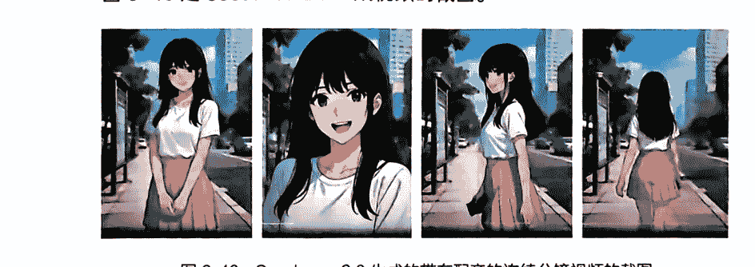

图 6-10 Seedance 2.0 生成的带有配音的连续分镜视频的截图

接下来，我们以 Seedance 2.0 为例，着重讲解依靠提示词来实现配音效果的操作技巧。

#### 情感表达控制

##### AI 配音的情感维度

人类的情感是复杂而微妙的，在短剧配音中，我们一定要重视六大基本情感维度，每种情感都有其独特的声学特征和短剧应用场景，具体内容如表 6-1 所示。

表 6-1 不同情感维度下的配音特征及其在短剧中的适用场景

| 情感维度 | 声学特征 | 短剧应用场景 |
| :--- | :--- | :--- |
| 喜悦 | 语速偏快、音调高、音量起伏大、声音明亮 | 重逢、告白、成功、甜蜜日常 |
| 悲伤 | 语速缓慢、音调低、音量弱、气息声重、哽咽 | 离别、失去、绝望、回忆过去 |
| 愤怒 | 语速快（或咬牙切齿的慢）、音调高、音量爆发力强、气息粗重 | 对峙、背叛、复仇、争执 |
| 恐惧 | 语速不稳（颤抖）、音调忽高忽低、音量忽大忽小、倒吸气 | 遇险、惊吓、悬疑、噩梦 |
| 惊讶 | 语速骤停、音调突升、音量突增、吸气声 | 发现真相、身份揭晓、意外转折 |
| 厌恶 | 语速缓慢、音调低、音量压制、带有鼻音或冷哼 | 反感、鄙视、拒绝、嫌弃 |

- 情感控制方法一：提示词驱动

提示词驱动是最直接、最常用的情感控制方式，创作者在输入台词的同时，附加情绪状态、语气强度、说话方式等描述性文字，Seedance 2.0 就能精准识别并还原对应情绪，其核心技巧是“台词 + 情绪副词 + 语气状态”，越具体的描述，AI 还原度越高，避免使用“开心”“难过”等模糊词汇，细化到情绪强度与表达方式。具体的例子可以参考表 6-2。

表 6-2 描述情绪强度的提示词示例

| 情绪强度 | 关键词示例 | 效果 |
| :--- | :--- | :--- |
| 轻度 | 温柔地说、轻声说、淡淡地 | 情感含蓄，适合日常对话 |
| 中度 | 激动地说、哽咽着说、生气地说 | 情感明显，适合情绪戏 |
| 重度 | 歇斯底里地喊、绝望地哭诉、咬牙切齿 | 情感爆发，适合高潮戏 |

- 情感控制方法二：音频参考驱动

针对特殊情绪、定制化语气，或想要复刻特定配音风格的场景，Seedance 2.0 还支持音频参考功能，创作者只需上传一段真人情绪音频，AI 就能精准模仿参考音频中的情感、语气、腔调甚至呼吸节奏，完美适配小众情绪、特色人设的配音需求。具体操作方式如下。

在 Seedance 2.0 视频生成界面选择全能参考，然后在左侧添加参考内容区域点击添加参考音频，并在提示词中说明具体的参考方式，例如“让角色模仿音频1的语气和情感说出‘我等你很久了’”。当然，也可以调整其他参数，如语速、音色等，点击生成即可（见图6-11）。

图6-11 Seedance 2.0 音频参考操作示意图

- 情感控制方法三：语速 + 停顿 + 重音调整

想要让情感表达更自然、更有层次感，需结合语速、停顿、重音三大要素微调，和前两种方法搭配使用，效果翻倍。

语速决定了情绪节奏，其快慢直接影响台词的情绪张力（见表6-3）。

表6-3 Seedance 2.0 生成视频配音过程中的语速控制

| 情感 | 语速建议 | 案例 |
| :--- | :--- | :--- |
| 喜悦 | 稍快(200～220字/分钟) | “我考上啦！我考上啦！”（语速快，兴奋） |
| 悲伤 | 慢(120～140字/分钟) | “他……他走了……”（语速慢，沉重） |
| 愤怒 | 爆发时极快，压抑时极慢 | “你给我滚！”（快）；“你……真……好……”（慢，咬牙切齿） |
| 恐惧 | 不稳，忽快忽慢 | “别……别过来……”（颤抖，时快时慢） |

停顿用于情绪酝酿，给观众留出共情空间，停顿不是空白，而是一种情绪的延伸方式（见表6-4）。

表6-4 Seedance 2.0 生成视频配音过程中的停顿控制

| 停顿类型 | 作用 | 案例 |
| :--- | :--- | :--- |
| 逻辑停顿 | 区分句子成分，让听众更容易理解 | “我，爱，你。”（逐字强调） |
| 情感停顿 | 表达犹豫、哽咽、思考 | “我……我其实……喜欢你。”（紧张） |

## 6.2 音乐与音效设计

音乐是 AI 短剧的灵魂，无论是背景音乐的选择还是音效的设计，甚至是适当的留白，都对短剧的呈现效果有着十分重要的促进作用。

AI 生成的画面往往在情绪张力、细节感染力上存在天然短板，而优质的音频设计，恰好能弥补这一缺憾——背景音乐铺垫氛围、定调情绪，音效强化真实感、放大细节张力，恰到好处的留白更能制造悬念、牵动观众心绪。三者相辅相成，让单薄的画面变得有温度、有冲击力，避免观众在观看时出现“画面有了，情绪没到”的尴尬局面。

### AI 生成背景音乐

优质的背景音乐能够快速定调短剧风格、放大画面情绪，让整部短剧的视听体验更完整、更具沉浸感。相较于传统找曲、剪辑配乐的烦琐流程，AI 生成背景音乐具备高效、定制化、无版权风险三大核心优势，完美适配 AI 短剧快速出片、批量创作的需求。

### AI 生成短剧音乐步骤演示

在这里，我们以同为字节跳动旗下的 AI 音乐制作工具海绵音乐为例，简单介绍一下 AI 背景音乐的制作方式，操作步骤可参考图 6-12 至图 6-17。

- 打开海绵音乐官网（https://www.haimian.com），进入海绵音乐首页。

图 6-12 AI 背景音乐制作步骤

- 点击左侧菜单栏中的“创作”按钮，并选择“纯音乐”模式。

图 6-13 AI 背景音乐制作步骤

- 输入提示词，例如“流行，浪漫，钢琴独奏，舒缓，纯音乐，30秒”，点击下方“生成音乐”按钮即可。

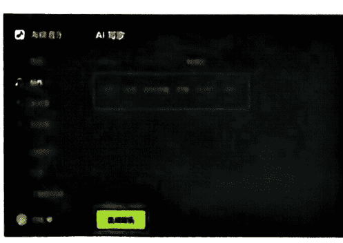

图 6-14 AI 背景音乐制作步骤

- 生成的视频在界面右侧的创作历史区域可以查看并下载。下载后的音频文件可作为素材上传至 Seedance 2.0 或剪辑软件进行创作。

图 6-15 AI 背景音乐制作步骤

- 海绵音乐还支持视频配乐，操作方法是在选择“纯音乐”模式后，点击下方的“视频配乐”选项，并根据提示上传视频，海绵音乐在此处支持上传 5 秒到 2 分钟的 MP4 和 MOV 格式，并小于 300M 的视频。

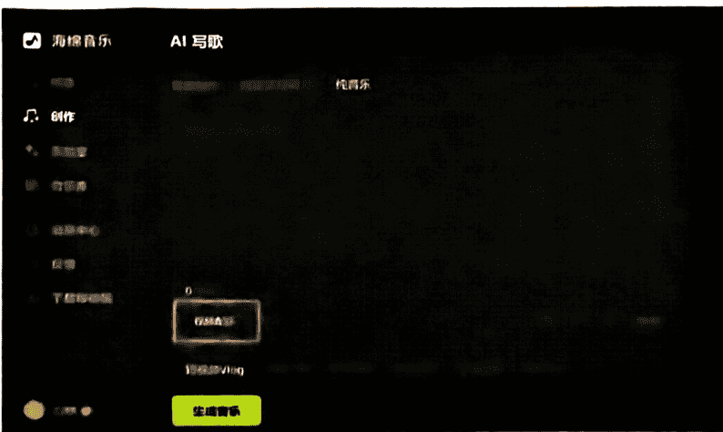

图 6-16 AI 背景音乐制作步骤

- 上传视频后，点击生成音乐，系统会根据视频内容自动生成视频配乐，这种方式生成效率高，与视频时长匹配度好，但相比于人工提示词生成的背景音乐，也许与创作者的预期有所偏差，可酌情使用。

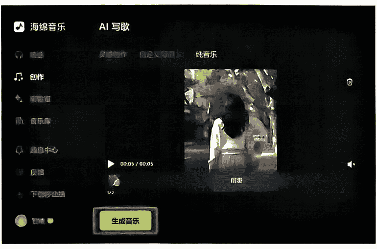

图 6-17 AI 背景音乐制作步骤

### AI 短剧配乐注意事项

- 时长严格匹配：生成的 BGM 时长尽量与短剧视频时长一致，优先选择 30 秒、60 秒常规时长，避免后期反复剪辑，破坏音乐完整性。
- 音量主次分明：导入即梦 AI Seedance 2.0 后，BGM 音量必须低于角色配音，控制在配音音量的 30% ～ 50%，做到“配音听得清，音乐有氛围”，不抢台词风头。
- 风格全程统一：一部短剧内，同一情绪场景不更换核心风格，比如甜宠剧不突然插入悬疑风音乐，防止听觉混乱，影响观众的沉浸感。
- 拒绝过度堆砌：单场景只用一首 BGM，不叠加多首音乐，留白场景关闭 BGM，遵循前文“留白也是声音”的音画原则。
- 版权合规优先：仅使用海绵音乐原生生成的音乐，不修改、不拼接第三方版权音乐，确保短剧发布、商用无侵权风险。
- 适配音画情绪：严格遵循音画匹配原则，保证音乐情绪大于画面情绪，平淡画面用音乐提情绪，强情绪画面用音乐托氛围。

### 环境音与动作音

环境音能让静态的场景变得鲜活立体，让观众瞬间代入时空场景。动作音效能让人物的动作变得真实可感，强化画面冲击力与细节质感，二者搭配得当，能大幅提升短剧的专业度与观看体验。

### 环境音：让场景“活”起来

- 常见的环境音

环境音是场景的背景声音，它告诉观众“这里是什么地方”“现在是什么时间”“这里有什么氛围”。一个好的环境音应该让观众身临其境，但又不被察觉。

环境音制作的核心原则：轻而不淡、持续不抢戏，作为底层音频铺垫，音量低于背景音乐与配音，只做氛围烘托，不干扰核心台词与情绪表达。AI短剧中常见的环境音如表6-6所示。

表6-6 常见环境音效分类

| 场景类型 | 环境音构成 | 作用 | 注意事项 |
| :--- | :--- | :--- | :--- |
| 室内场景 | 钟表滴答、空调/暖气声、远处电器嗡鸣、窗外隐约的车流声 | 建立空间感，避免“真空感” | 音量要极低，观众几乎听不见但能感觉到 |
| 室外场景（城市） | 车流声、行人脚步声、远处谈话声、商店音乐、风声 | 建立城市氛围，交代时间（白天/夜晚） | 夜晚车流声减少，可加入虫鸣 |
| 室外场景（乡村/自然） | 鸟叫、虫鸣、风声、水流声、树叶沙沙声 | 建立自然氛围，可舒缓可阴森 | 根据季节和时间调整，夜晚只有虫鸣 |
| 古代场景 | 马蹄声、市井喧哗、兵器碰撞、茶楼琴声、风声 | 建立历史感，避免现代声音穿帮 | 绝对不能出现汽车、手机等现代声音 |
| 特殊环境 | 雨声、雷声、海浪声、风声（呼啸） | 强化情绪，制造氛围 | 可单独使用，也可作为底层氛围 |

- 环境音设计原则

原则一：多层叠加，层次分明

真实的环境音不是单一声音，而是多层声音的混合。

例如，雨夜室外 = 雨声（主）+ 远处车流声（次）+ 风声（次）+ 偶尔的雷声（点缀）

原则二：音量要“低到几乎听不见”

环境音的目的是让观众“感觉到”而不是“听到”。音量应该低到如果专门去听才能听见，但不注意时完全融入背景。

原则三：环境音要动态变化，不要一成不变

真实的环境音是有变化的：车流声应该有远近变化，风声应该有强弱起伏，雨声应该有疏密变化。

### 动作音效：让动作“真”起来

- 常见的动作音

动作音效，是指人物做出特定动作时发出的即时性声音，属于点对点的精准音效，和人物动作完全同步。让人物的每一个动作都有反馈、有质感（刻意留白除外），让观众“听得到动作”，增强画面的真实感。常见的动作音效及其应用场景及其应用方式如表 6-7 所示。

表 6-7 常见动作音效分类

| 动作类型 | 音效示例 | 关键要素 | 短剧应用 |
| :--- | :--- | :--- | :--- |
| 日常动作 | 开门声、倒水声、翻书声、走路声、坐下声 | 材质感（木头门 vs 金属门）、力度 | 日常生活场景，建立真实感 |
| 激烈动作 | 打斗声、撞击声、碎裂声、摔倒声、爆炸声 | 冲击力、层次感（多个声音叠加） | 动作戏、打斗场景、灾难场面 |
| 情绪动作 | 摔东西声、拍桌子声、撕纸声、砸墙声 | 力度、材质、情绪宣泄感 | 情绪爆发场景，强化愤怒/绝望 |
| 细节动作 | 衣服摩擦声、首饰碰撞声、喝水吞咽声 | 细微、真实 | 特写镜头，增加细节质感 |

- 动作音效设计原则

原则一：材质正确

不同的材质产生不同的声音，错误的材质音效会让观众瞬间出戏。

原则二：力度正确

同一动作，不同力度，声音完全不同。

原则三：不要“一个声音打天下”

真实世界的动作往往由多个声音叠加而成。

### 背景音设计案例

案例场景：雨夜，女主独自走在街上（现代悬疑/情感短剧）

场景设定

时间：深夜；地点：街边小巷

氛围：清冷、孤寂，略带紧张悬念

第一步：铺底层环境音（主+次，持续贯穿）

环境音做底层铺垫，贯穿整个场景，音量最小，营造雨夜街头的整体氛围：

主环境音：淅沥雨声（全程持续，音量最低，烘托氛围）

次环境音：远处模糊车流声（微弱，间隔出现）、轻柔风声（穿插雨声中）

第二步：加关键动作音效（精准同步，点睛细节）

动作音效贴合人物动作，即时触发，音量高于环境音、低于配音，突出人物状态与剧情悬念：

- 核心动作音：脚步声（踩水坑，略带水花声，贴合女主走路动作）
- 情绪动作音：疲惫的呼吸声（缓慢，体现女主状态）
- 悬念动作音：手机震动声（突然出现，音量稍大，制造紧张感）

### 环境音与动作音效避坑要点

- 拒绝音效堆砌

不是每个动作、每个场景都要加音效，普通小动作、平淡场景适度留白，只加核心关键音效，避免听觉杂乱。

- 音画必须同步

动作音效要和人物动作完全对齐，比如走路同步脚步声、开门同步开门声，不同步会产生强烈的违和感。

- 音量严格分层

遵循“配音＞音乐＞动作音效＞环境音”的音量层级，通常不让环境音和动作音效盖过角色台词。

- 贴合场景

一般情况下（穿越、需要烘托特殊气氛的场景除外），古代场景不用现代音效，室内场景不用室外嘈杂音效，符合时空逻辑，不出现违和音效。

- 留白适度

高潮、悬念片段，可适当弱化环境音，突出动作音效或静默，强化情绪张力。

## 第7章 AI 辅助剪辑全流程

剪辑是成片前的最后一道关键工序，其对于短剧的节奏、观感和传播效果都有重要的影响。由于 Seedance 2.0 本身的功能已经十分强大，省去了许多传统的剪辑操作，因此，本章我们不对剪辑软件的具体功能加以赘述，只介绍如何利用剪辑软件来处理 Seedance 2.0 生成的短剧中容易存在的一些关键问题。示范用剪辑软件为同属字节跳动旗下的剪映。

### 7.1 裁剪、拼接视频

短剧与短视频不同，其时长较长，内容量大，且涉及画面、音效与情感表达等多方面因素的协调，特别是对于 AI 短剧的创作来说，更是一项复杂的工程。Seedance 2.0 虽然具备强大的功能矩阵，但创作者利用其生成的视频并非完美无缺，还需要剪辑软件进行后期加工。

#### 为什么要裁剪或拼接视频

Seedance 2.0 生成视频时，偶尔会出现首尾多余空镜、画面卡顿片段、时长超出平台限定，或是开场钩子不突出、结尾冗余拖沓的问题。如果 AI 短视频的创作者是新手小白的话，那么对于提示词的使用、分镜脚本或者分镜图片的掌握不够熟练，很容易生成衔接不畅的镜头。这些问题都是主客观因素共同作用形成的。

除此之外，由于 AI 生成视频的时长限制，我们很难利用 AI 工具单次生成一整集的视频，这就需要我们利用剪辑软件将这些视频拼接在一起。

创作者通过剪映对视频进行精准裁剪和拼接，既能修正瑕疵，又能收紧节奏，符合短视频“快、准、狠”的传播逻辑。

#### 裁剪、拼接视频的实操步骤

##### 裁剪视频的实操步骤

- 第一步：开启剪映。打开剪映，点击首页顶端的“开始创作”，进入操作界面（见图7-1）。

图7-1 剪映裁剪视频操作步骤演示

- 第二步：点击页面左上角的“导入”，或者在页面左侧菜单栏点击“即梦AI”，导入Seedance 2.0生成的视频（见图7-2）。

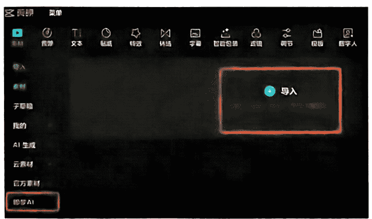

图7-2 剪映裁剪视频操作步骤演示

- 第三步：将视频拖至下方时间轴上，拖动分割轴，滑动找到想要裁剪部分的开始与结束位置，分别点击顶部「分割」按钮，点击选中想要删除的部分，点击退格键或操作平台上部的删除按钮即可（见图7-3）。

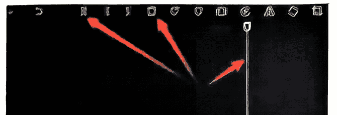

图 7-3 剪映裁剪视频操作步骤演示

- 第四步：编辑完成后，点击右上角的“导出”按钮即可。

##### 裁剪时长控制技巧

裁剪视频时，需要注意视频的整体节奏以及每集视频总时长的统一，裁剪视频时的时长控制如表 7-1 所示。

表 7-1 裁剪视频的时长控制标准

| 镜头类型 | 推荐时长 | 裁剪要点 |
| :--- | :--- | :--- |
| 特写镜头 | 1.5～2.5秒 | 去掉开口前和闭口后的多余 |
| 对话中景 | 2.5～4秒 | 保留完整话轮，去掉句间停顿 |
| 全景交代 | 2～3秒 | 足够看清环境即可 |
| 动作镜头 | 1.5～3秒 | 根据动作完成度裁剪 |
| 空镜 | 2～4秒 | 根据音乐节奏裁剪 |

##### 拼接视频的实操步骤

- 按照上述步骤打开剪映，导入多个视频，所有视频导入后，会按选择顺序排列在底部的编辑时间线上。如需调整顺序，长按某个片段并左右拖动即可。将前一个片段的尾部紧贴后一个片段的头部，即可完成最基本的硬切拼接（见图 7-4）。

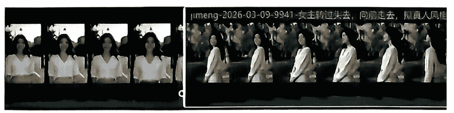

图 7-4 剪映拼接视频操作演示

- 如果想要添加转场特效，可以将分割轴拖至两段视频交界处，点击界面上方的“转场”按钮，并选择想要的转场特效进行添加（见图 7-5）。

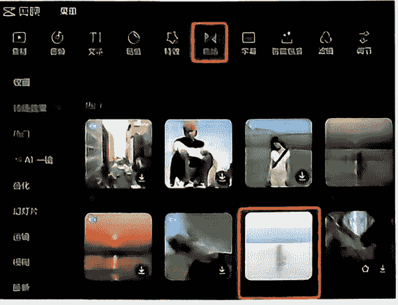

图 7-5 剪映拼接视频操作演示

最后得到的拼接视频的截图如图 7-6 所示。

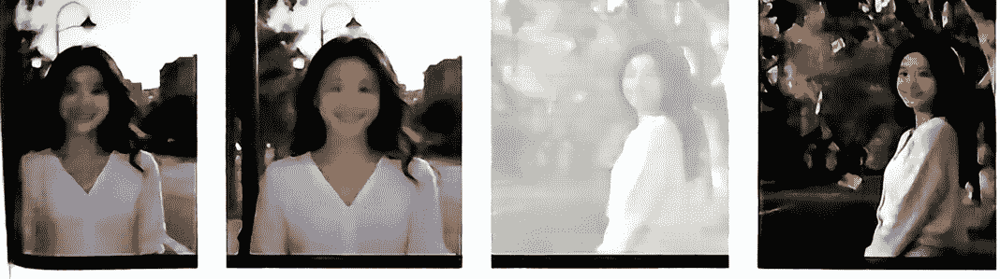

图 7-6 剪映拼接视频转场特效

### 7.2 匹配字幕

字幕对于快节奏、冲突密集的短剧来说至关重要。Seedance 2.0 本身具备生成字幕的功能，但为了避免新手在使用 Seedance 2.0 时提示词使用不熟练的问题，我们可以先生成纯视频，后续通过剪辑软件自行添加字幕。

#### 字幕的设计重点

匹配字幕的过程中，需要注意 3 个问题，分别如下。

**字幕准确**
字幕内容一字不差，尤其是古装剧的文言文台词。

**字音同步**
字幕中的每个字和声音完全对齐。

**美观统一**
字幕样式统一，在手机上清晰可读。

#### 剪映字幕匹配实操步骤

**第一步**
导入需要生成字幕的视频，并拖至下方时间轴上。

**第二步**
点击界面上方的“字幕”，并按照需要选择是否勾选下方的辅助选项，即可生成字幕（见图 7-7）。

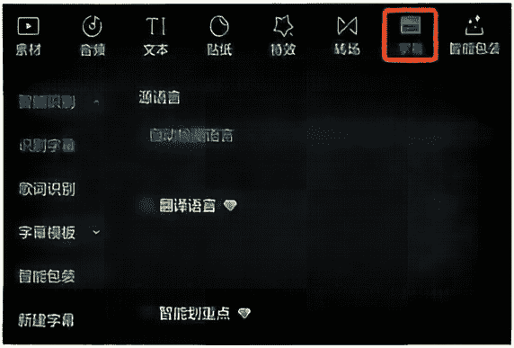

图 7-7 剪映智能添加字幕步骤演示

**第三步**
我们可以在操作界面的右上区域调节字幕的各项参数，包括字幕的位置、字幕出现的方式、字体的大小和样式、花字与底纹，等等。这里，我们选择短视频中辨识度较高的花式字幕为例进行展示。

AI 识别不是 100% 准确，还需要我们对成品进行核查，逐句检查字幕，可在右上角区域双击字幕修改错误。修改后回车确认，AI 会自动调整该句的时间轴（见图 7-8）。

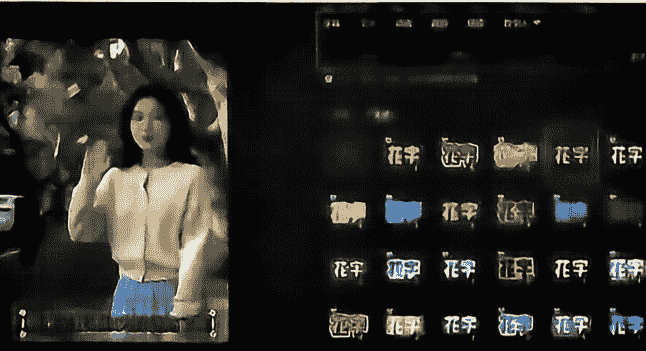

图 7-8 剪映调整字幕演示

#### 字幕排版规范

对于 AI 短剧创作者来说，制作短剧的字幕需要遵循一定的规范，这些规范并不是约束你创作的条条框框，而是保证你作品质量的基准线。具体内容如表 7-2 所示。

表 7-2 AI 短剧字幕排版规范

| 规范项 | 推荐设置 | 原因 |
| :--- | :--- | :--- |
| 位置 | 底部居中，留出安全区 | 避免被抖音图标遮挡 |
| 行数 | 最多两行 | 超过两行会遮挡画面 |
| 每行字数 | 不超过 10 字 | 太长观众读不过来 |
| 持续时间 | 每句不少于 1 秒 | 太短观众来不及看 |
| 标点符号 | 可省略 | 不影响理解即可 |

### 7.3 优化音效

Seedance 2.0 会自动匹配背景音乐、环境音和基础音效，我们也可以将自己制作的音乐通过剪辑软件添加到视频中，但在这一过程中常常会出现背景音乐音量过大盖过台词、音效杂乱无层次、配音有轻微底噪、音画情绪不匹配等问题。剪映的作用就是理顺音频主次关系，把 Seedance 2.0 生成的音频打磨得清晰、舒适、有氛围感。

#### 剪映优化音效的实操方法

##### 音频轨道拆分

导入 Seedance 2.0 视频后，右键点击时间轴上的视频，选择“分离音频”，将视频里的配音、背景音乐、音效全部分离成独立音频轨道（见图 7-9）。

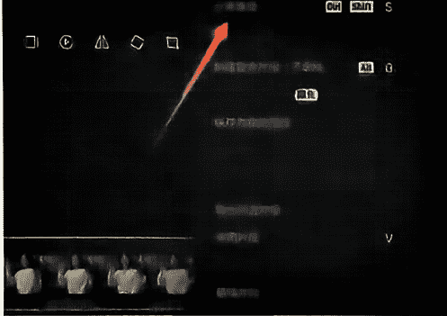

图 7-9 剪映分离音频操作示意图

如果你要处理的是一个兼具不同音频的视频，那么这一步非常关键，可以将各类型的音频分离开来，独立操作。

如果要将自己制作的音频导入视频作品，则可以按照基本的导入步骤，将音频拖至视频下方轨道中，并拖动分割轴将音频裁剪至视频时长即可（见图7-10）。

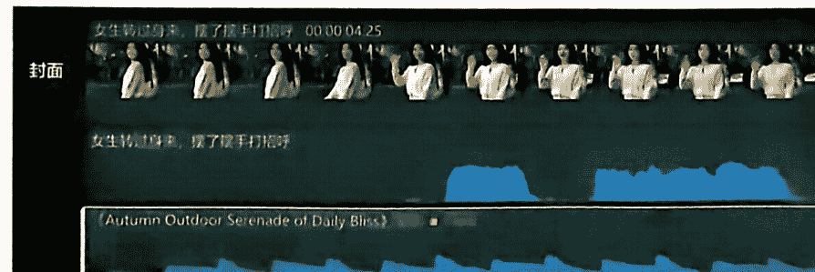

图7-10 剪映分离或添加音频操作后的界面

## 针对性优化

成功分离音频轨道后，左键点击选中想要优化的音频轨道，然后在操作界面的右上角区域可以调节该轨道音频的具体参数（见图7-11）。

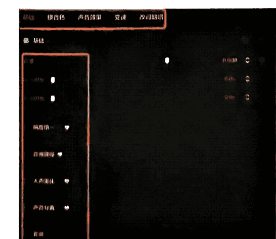

图7-11 剪映音效调整操作界面

如果背景音乐音量过大，则选中背景音乐轨道，点击“音量”进行调节。如果配音有底噪、杂音，不够清晰，则可以选择“音频降噪”。如果音效杂乱、主次不分，则可以通过调节不同音轨，甚至利用裁剪功能，调节不同音轨的不同部分来实现音效的和谐。

## 各轨道音量参考

创作者在调节音效的过程中要随时关注调整后的效果，保证作品音效既能发挥应有的作用，又不会影响到观众的观看体验。各声音轨道音量的设定值可以参考表7-3。

表7-3 各轨道音量参考

| 声音类型 | 推荐音量 | 说明 |
| :--- | :--- | :--- |
| 主对白 | -3～0dB | 最突出 |
| 内心OS | -6～-3dB | 比主对白轻 |
| 关键音效 | -9～-6dB | 让观众注意到 |
| 环境音 | -18～-15dB | 几乎听不见但能感觉到 |
| 背景音乐 | -18dB（有对白时闪避） | 退后 |

## 导出前的最后检查

在利用剪映完成音效的优化后，需要再用耳机完整听一遍，检查音效优化情况。检查项目主要有以下几方面。

- 对白是否清晰？（不会被音乐盖住）
- 环境音是否自然？（不会太突出）
- 关键音效是否到位？（该有的都有）
- 音量是否忽大忽小？
- 背景音乐闪避是否自然？
- 有无杂音或爆音？

在完成以上步骤后，创作者还需要对导出作品进行整体检查，以保证作品的整体呈现效果符合预期，对于有待优化之处用相关软件进行微调。最后，再通过剪辑软件将其拼接在一起，AI短剧的创作就大功告成了。

# 第四模块

## 运营变现篇——多元变现，持续盈利

完成了从市场调研到剧本创作、从视觉制作到后期剪辑的全流程，你终于拥有了一部完整的AI短剧。但创作完成不是终点，而是新的起点。如何让作品触达更多观众？如何将流量转化为实实在在的收入？这是接下来创作者需要着重考虑的问题。

# 第8章 AI短剧平台运营与流量爆款打法

短剧平台是AI短剧最核心的播放渠道，因此，要想让自己创作的短剧被更多人看到，并且能够使其实实在在地带来回报，就必须要对各主流短剧平台有一个全面而深入的了解，并在此基础上构建更具针对性的运营战略。

## 8.1 平台生态差异化分析

不同平台的用户画像、算法机制、内容偏好截然不同。同一个短剧，在抖音可能爆火，在快手可能无人问津。了解不同短视频平台的差异，是发布AI短视频前的第一课。

### 字节跳动

包含抖音与番茄小说在内的字节跳动旗下短视频平台是国内AI短剧的重要阵地，依托旗下各平台的不同优势，构建起了一个从内容生产到流量分发，再到付费变现，再到IP反哺的完整闭环。特别是红果短剧，作为一款主打微短剧的视频平台，其自创立之初就锚定短剧市场，并以免费观看模式为特色，其活跃用户量于近两年实现飞跃式增长。

在内容风格上，字节跳动旗下平台短剧的特点是强节奏、强反转、强钩子，类型涵盖都市情感、仙侠玄幻、言情故事、悬疑探案，等等，其中，AI短剧占比快速提升，2026年1月其在百强短剧中的占比已接近40%。

字节跳动旗下平台在AI短剧领域的商业化模式十分成熟，商业链条完整，其用户群体以18～35岁的年轻人群为主，对于短剧的付费意愿较强、付费率高。独立创作者或者中小创作团队可以借助字节跳动旗下平台的巨量引擎投流和生产工具实现AI短剧的快速变现。

### 快手

作为国内另一大短视频平台，快手同样重视对AI短剧市场的开发和经营。快手早在2020年就启动了“星芒计划”来大力支持短剧的创作，后又推出独立短剧平台喜番短剧，依靠“免费+广告”模式，差异化布局下沉赛道。

快手平台短剧的内容更偏现实题材，主要面对三四线城市及以下的广阔市场，受众更多的是中老年用户，乡土、家庭、正能量等内容是其基本盘。近年来，快手也积极推进短剧类型的多元化发展，鼓励AI原创精品。由于快手平台用户免费意愿相对较强、付费率低，因此更适合广告变现。

### ReelShort

ReelShort是中国厂商枫叶互动于2022年推出的一款面向全球的短剧APP，其主打的是海外竖屏付费短剧，覆盖北美、东南亚、欧洲、中东等200余个国家和地区的市场，是我国当前开拓海外短剧市场的龙头平台。

ReelShort主打跨文化叙事，平台短剧制作者将国内广受欢迎的网络文学内容与欧美狼人题材和科技新贵等在国外人气颇高的题材相结合，打破了中西方的文化壁垒，因地制宜，使短剧内容更加贴合当地市场和受众的审美喜好。短剧单集1～2分钟，以强反转和强情绪为典型特征，平台用户付费意愿强、对竖屏短剧接受度高，付费转化率处于行业领先水平。ReelShort平台提供本土化指导和AI工具，分成比例优厚，侧重扶持本土化创作能力强的团队。

### 点众科技

点众科技是一家主营业务为网络文学和网络微短剧的科技公司，旗下的短剧平台主要包括河马剧场和繁花剧场。其中，河马剧场主打免费市场，而繁花剧场则深耕付费模式市场。

河马剧场目前国内月活第二的短剧平台，平台的优势主要是短剧储备数量多、题材覆盖面广、更新速度快。河马剧场依托点众科技网文IP的优势，形成了一条从IP储备到内容制作，再到分发变现的完整生态链，河马剧场企业团队和合作伙伴均可利用其网文资源进行短剧的创作和改编。河马剧场短剧的内容贴合下沉市场用户的喜好，主打现实、乡土伦理、年代逆袭、古装甜宠等题材，兼顾多元品类。河马剧场平台的存量用户主要是三四线城市的中年群体，增量用户则是一二线城市的年轻群体。

繁花剧场主要针对的是中高端付费市场，与河马剧场形成“免费+付费”双轮驱动的格局，主打“精品短剧+付费订阅”，定位类似“线上电影院”，聚焦愿意为优质内容付费的精准人群，拒绝流量泡沫，短剧制作精良，内容质量高，利润率高。由于繁花剧场走精品化路线，因此单剧成本普遍较高，不适合独立创作者。

由于目前短剧市场正处于蓬勃发展的阶段，因此各大视频平台均推出短剧板块，除了我们前面介绍的几个平台之外，腾讯、爱奇艺、优酷、哔哩哔哩等综合视频平台也在加紧布局短剧市场，为创作者提供了多元选择。

### 平台选择策略

在基本了解了主流短视频平台的差异后，我们为大家简单整理了一份新手AI短视频创作者的平台选择攻略，具体内容如表8-1所示。

表8-1 平台选择策略

| 创作者类型 | 首选平台 | 理由 |
| :--- | :--- | :--- |
| 新手试水 | 抖音+快手 | 用户基数大，算法友好，容易冷启动 |
| 都市情感剧 | 抖音 | 年轻用户多，接受度高 |
| 农村/接地气题材 | 快手 | 老铁文化，真实感受欢迎 |
| 中老年情感剧 | 视频号 | 中老年用户集中，社交传播强 |
| 免费爽剧 | 河马剧场 | 垂直短剧平台，用户精准，适合免费模式 |
| 出海内容 | ReelShort+YouTube | 直接面向海外受众 |

## 8.2 发布前的“临门一脚”

在点击“发布”按钮之前，还有两项关键工作决定作品的生死：封面和标题。观众在信息流中滑过你的视频，决定是否停留的时间只有3秒。这3秒里，封面和标题就是你的“钩子”。

### 封面设计的“3秒法则”

一个好的封面，必须在3秒内完成3件事：传递情绪、制造悬念、说明看点（见表8-2）。

#### 法则一：情绪脸

让观众一眼看到情绪，哭、笑、怒、惊。人脸是最抓眼球的元素，尤其是带有强烈情绪的脸。

- 正确：女主流泪的特写，眼泪滑过脸颊。
- 错误：多人全景，看不清谁是谁。

#### 法则二：冲突感

暗示剧中的核心冲突，比如对峙、拥抱、身份反差、古今装扮，等等。

- 正确：男女主对峙，一人冷漠一人愤怒。
- 错误：两人平静地坐着。

#### 法则三：信息点

用大字标题点明看点，让观众知道“这部剧讲什么”。

- 标题字数：4～8字最佳。
- 字体要求：粗黑醒目，有描边。
- 位置：留出画面1/3区域给文字。

表8-2 封面正反案例对比

| 维度 | 反面案例 | 正面案例 |
| :--- | :--- | :--- |
| 情绪 | 面无表情 | 泪流满面或愤怒对峙 |
| 构图 | 多人杂乱 | 主体突出，背景虚化 |
| 文字 | 无文字或文字太小 | 大字标题，一目了然 |
| 色彩 | 灰暗平淡 | 高饱和度或强对比 |

### 标题就是钩子

标题决定了用户会不会点进来（见表8-3）。一个好的标题，应该让用户产生“然后呢？”的好奇心，新手可以按照下面的公式来制作标题：

短剧标题钩子公式：[身份反差]+[核心冲突]+[情绪钩子]+[悬念/爽点]

表8-3 短剧标题要素解析

| 元素 | 作用 | 案例 |
| :--- | :--- | :--- |
| 身份反差 | 制造意外 | “我是他无比嫌弃的实习秘书” |
| 核心冲突 | 交代困境 | “直到他躺在我的手术台上” |
| 情绪钩子 | 引发共情 | “他跪着求我” |
| 悬念/爽点 | 勾引点击 | “我才发现当年的真相” |

经典标题案例：

- “分手后我成了首富秘书，前夫跪着求我复合”
- “穿越成和亲公主，我用防狼喷雾教王爷做人”

## 8.3 发布与更新策略

不同平台的用户活跃时间不同，发布时间与更新规律直接影响初始流量。因此，短剧创作者在发布新剧集的时候，一定要学会因地制宜。

### 黄金发布时间策略

#### 各平台黄金发布时间

由于不同平台之间的总体战略布局和主打的市场有所区别，因此，一定要根据各短视频平台用户的使用习惯发布视频，千万不要让你辛辛苦苦制作的短剧石沉大海。表8-4总结了各短视频平台的黄金发布时间。

表8-4 各短剧平台黄金发布时间

| 平台 | 目标人群 | 最佳发布时间 | 原因 |
| :--- | :--- | :--- | :--- |
| 抖音 | 上班族 | 12:00—14:00, 18:00—22:00 | 午休+下班通勤+睡前刷视频高峰 |
| 快手 | 下沉市场 | 19:00—23:00 | 晚饭后休闲时间，刷视频主力时段 |
| 视频号 | 中老年 | 7:00—9:00, 19:00—21:00 | 早起刷手机+晚饭后看视频习惯 |
| ReelShort | 欧美 | 北京时间21:00—次日3:00 | 欧美黄金时段（上午—下午） |
| YouTube | 全球 | 根据目标地区调整 | 建议早上8点发布，留出全天发酵时间 |

#### 发布时间检测清单

在发布短视频前，可以先问一问自己下面这几个问题。

- 我的目标受众现在在刷手机吗？
- 这个时间点竞品多不多？（晚8点竞争最激烈）
- 是否考虑时差？（如果有海外用户）

小技巧：可以在不同时间发布同一内容测试效果，记录数据，找到你的“专属黄金时间”。

### 日更策略与组合发布

短剧是“连续剧”，不是单条视频。发布策略要服务于“让观众追下去”这个核心目标。

#### 日更频率建议

短剧的更新不像传统的电视剧或动漫那样，频率基本是固定的，短剧更新的频率以天计算，且频率调整十分灵活，表8-5就是一个关于AI短剧日更频率的建议。

表8-5 日更频率建议

| 阶段 | 更新频率 | 目的 |
| :--- | :--- | :--- |
| 开播期（第1～3天） | 每天2集 | 快速积累初始观众 |
| 热播期（第4～10天） | 每天1集 | 保持热度，培养追剧习惯 |
| 高潮期（第11～15天） | 每天1～2集 | 加速推进剧情，留住观众 |
| 完结期（最后3天） | 每天2～3集 | 快速收尾，引导全集付费 |

#### 固定时间养成习惯

短剧发布一定要选定一个相对固定的更新时间，让观众形成“每晚8点追剧”的条件反射。推荐时间段：

- 抖音/快手：晚8点。
- 视频号：晚7点或早8点。
- 多平台同步：可以错开时间，如抖音晚8点，快手晚9点。

#### 周末加更策略

周末是流量高峰，也是观众最有时间的时段。推荐策略如下。

- 周五晚：连更2集，为周末预热。
- 周六晚：正常更新。
- 周日晚：连更2集，制造下周期待。

## 8.4 数据指标解读与复盘

作品发布后，并不意味着此次创作的结束，相反，真正的战斗才刚刚开始，因为我们还要深入分析短视频的播放数据。数据是最客观的“审片人”。学会解读数据，你不仅能够及时调整本部短剧的后续内容与发布技巧，还拥有了让下一部作品更好的“指路明灯”。

### 核心指标详解

在短视频平台的数据反馈中，有6个核心指标对于作品至关重要，其中每个指标都对应一个创作环节的问题（见表8-6）。

表8-6 短剧核心指标

| 指标 | 定义 | 优秀标准 | 问题诊断 |
| :--- | :--- | :--- | :--- |
| 完播率 | 看完视频的用户比例 | >30% | 低于15%：开头不够吸引 |
| 5秒完播率 | 看完前5秒的比例 | >50% | 低于40%：封面或开场失败 |
| 点赞率 | 点赞数/播放量 | >3% | 低于1%：缺乏共鸣 |
| 评论率 | 评论数/播放量 | >0.5% | 低于0.2%：缺乏互动引导 |
| 转发率 | 转发数/播放量 | >0.3% | 低于0.1%：内容不够“上头” |
| 涨粉率 | 新增粉丝/播放量 | >1% | 低于0.5%：缺乏追剧动力 |

### 指标深度解读

#### 完播率

完播率是衡量内容吸引力的“金标准”。它反映了观众是否有耐心看完你的视频。

- 计算公式：完整观看人数÷总播放量×100%
- 平台差异：抖音30秒视频完播率>30%为优秀，60秒视频完播率>20%为优秀。
- 影响因素：开头钩子、节奏密度、结尾悬念。
- 优化方向：如果完播率低，重点检查前3秒是否抓住眼球，中间是否有无聊段落。

#### 5秒完播率

这是比完播率更前置的指标，直接反映“封面+前3秒”的吸引力。

- 行业共识：用户在前5秒决定是留下还是划走。
- 优秀标准：>50%说明封面和开场成功；<40%说明必须优化。
- 优化方向：更换封面、重剪开场、强化前3秒冲突。

#### 点赞率

点赞是用户“最低成本的认可”，表示“我喜欢这个内容”。

- 计算公式：点赞数÷播放量×100%
- 优秀标准：>3%说明内容有共鸣；1%～3%属于正常；<1%说明内容平庸。
- 优化方向：增加情感共鸣点、强化价值观输出、制造“说到心坎里”的金句。

#### 评论率

评论是用户“主动参与”的行为，比点赞更难获得。高评论率意味着内容引发了讨论欲。

- 计算公式：评论数÷播放量×100%
- 优秀标准：>0.5%说明有话题性；0.2%～0.5%为正常；<0.2%为缺乏互动引导。
- 优化方向：在剧情中埋争议点、结尾设开放式问题、评论区主动引导。

#### 转发率

转发是用户“用信用背书”的行为，表示“这个内容值得分享给朋友”。高转发率是病毒传播的基础。

- 计算公式：转发数÷播放量×100%
- 优秀标准：>0.3%说明内容有社交价值；0.1%～0.3%正常；<0.1%不够“上头”。
- 优化方向：制造“神反转”、输出“扎心金句”、提供“实用价值”。

#### 涨粉率

涨粉量是衡量“追剧动力”的核心指标。一集好内容应该让用户想看更多。

- 计算公式：新增粉丝数÷播放量×100%
- 优秀标准：>1%说明追剧动力强；0.5%～1%为正常；<0.5%为人设吸引力不足。
- 优化方向：强化主角魅力、每集结尾留悬念、引导关注追全集。

### 指标联动分析

在短视频平台的数据中，单个指标数据具有较为明确的指向性，而把多个指标放在一起看，就能发现短剧的整体问题所在（见表8-7）。

表8-7 指标联动分析

| 现象 | 诊断 | 对策 |
| :--- | :--- | :--- |
| 5秒完播率高，但完播率低 | 开头吸引人，中间拖沓 | 压缩中间段落，强化每30秒一个爽点 |
| 完播率高，点赞率低 | 观众看完了但不认可 | 增加情感共鸣点，价值观输出 |
| 点赞率高，评论率低 | 内容好但没话题 | 结尾设开放式问题，主动引导评论 |
| 评论率高，转发率低 | 有争议但没价值 | 提炼金句，强化社交传播性 |

数据不是冷冰冰的数字，而是观众用行动投出的选票，AI短剧创作者必须学会解读数据，这样才能更好地调整自己的作品。

# 第9章 AI短剧多元变现与长期盈利模式

创作是热爱，但热爱需要可持续的支撑。当你投入数周甚至数月时间，用AI工具精心打磨出一部短剧后，自然希望它不仅能带来掌声，也能带来回报。前面我们解决了AI短剧“做得出、有流量”的问题，而变现是创作的最终落地环节，本章主要介绍创作者如何实现AI短剧变现。

由于短剧平台的相关激励政策变化较快，比如抖音中视频计划目前就迎来了重大变革，因此，我们在此不对各短剧平台的详细分成方式多做介绍。

## 9.1 新手入门：零成本、低门槛变现方式

对于AI短剧创作新手来说，起步阶段的核心原则是不投入一分钱、先赚第一笔钱、积累实操经验，优先选择开通门槛低、操作简单、见效快的变现方式，依托前期运营的账号流量，快速实现盈利，建立创作信心。

### 平台流量分成和广告收益

平台流量分成和广告收益对于AI短剧创作者来说是最基础、最省心的变现方式，只要发布合规短剧、有播放量就能赚钱，适合所有刚起步的创作者，无须额外对接资源，纯靠平台流量结算收益。

平台流量分成和广告收益一般按千次播放单价结算，单价受内容质量、完播率、受众群体、时长影响，目前来看，普通AI短剧千次播放收益在3～20元，优质爆款短剧可达30元以上。核心逻辑是播放量与收益正相关。AI工具的优势是批量产出，每天发布1～3条短剧，累计播放量越高，总收益越高，单账号每月副业收益可达300～5000元，爆款频出可破万。

### 短剧分销和挂载变现

短剧分销和挂载变现是新手首选、见效最快的变现方式，因为它不需要创作者自己制作完整长篇剧集，不用承担创作风险，只需要剪辑分发短剧精彩片段，引导用户付费看全集，就能赚取高额佣金，零成本、高回报。而这种特点也十分适配 AI 短剧的创作。

这种变现方式的逻辑是：平台方有大量付费长篇短剧，需要创作者帮忙引流推广，创作者无须制作全集，只需截取付费短剧的高光、冲突、悬念片段，用 Seedance 2.0 快速优化画面、配上字幕，发布时挂载分销链接，用户点击链接付费观看全集，创作者就能获得一定的佣金，一单佣金可达 5～20 元，流量提升后单日佣金可轻松破百。

当然，这种变现方式对创作者的选品是一种考验，创作者应优先选高佣金、高热度、短平快的付费短剧，一定要紧紧盯住热门赛道和用户付费意愿强的赛道。

## 商单合作

当账号有一定流量和作品案例后，可接商业短剧制作订单，靠 AI 工具快速交付，赚取制作费，属于技能变现，客单价比流量分成更高，适合有一定作品积累的新手。一般来说，商单合作需要和甲方确认短剧题材、时长、用途、交付时间，明确制作要求，因此，这种变现方式对于创作者的创作技巧来说具有一定的考验。

## 进阶盈利：IP 打造与长期变现

当账号有稳定流量和粉丝基础后，就要从“赚快钱”转向“做长期”，打造专属短剧 IP，摆脱单纯依赖平台流量，实现被动收益和长期盈利，这一阶段的核心是沉淀粉丝、打造品牌、拓宽变现渠道。

### 付费短剧 / 专栏变现

付费短剧 / 专栏变现属于粉丝精准变现，这种变现模式需要创作者打造原创优质 AI 短剧，设置付费观看全集，收益全部归自己，不受平台分成限制，适合有原创能力、粉丝黏性高的创作者。

这种变现方式的基本操作方式是前期免费发布 3～5 集短剧钩子内容，吸引粉丝追更，后续全集设置付费观看，定价 9.9～99 元，粉丝精准付费，复购率高，一旦打造出爆款 IP，可实现长期被动收益。当然，这种变现方式对于 AI 短剧的质量有着较高的要求。

### 账号 IP 变现与粉丝经济

把短剧账号打造成专属 IP，沉淀私域流量，围绕 IP 做多元变现，打破平台流量限制，实现收益多元化，可以说是 AI 短剧长期盈利的核心路径。也就是将粉丝、观众与自己的短剧账号绑定。

账号 IP 变现与粉丝经济的主要变现方式有两种，分别是粉丝引流和 IP 衍生变现。

粉丝引流是公域转私域的精细化运营方式，需要注意的是合规引流，可以在短视频的简介、评论区引导粉丝“私信看全集”“进群追更”，将平台公域粉丝引流至微信私域，做精细化维护。可以定期在私域更新短剧番外、福利片段，和粉丝互动，提升黏性，为后续变现铺垫。

IP 衍生变现主要有以下 3 种方式。

- 好物带货：短剧同款服饰、饰品、好物，挂商品链接赚取佣金，甜宠、古风短剧带货转化率极高。
- 周边定制：针对爆款短剧 IP，定制海报、钥匙扣、明信片等周边，私域售卖，低成本高利润。
- 粉丝群：搭建付费粉丝群，提供专属短剧、一对一答疑，收取群费，实现被动收益。

## 9.3 变现合规与风险防控

AI 短剧变现过程中，合规是底线，一旦出现违规、侵权，不仅收益清零，还会面临账号封禁、平台处罚甚至法律纠纷。创作者辛辛苦苦制作出一部AI短剧，一定要注意合规变现与风险防控，其中的关键点主要有3个，分别是版权合规、变现合规和收益保障。

### 版权合规：避开侵权大坑

内容版权：AI 生成内容（Seedance 2.0 等正规平台）属于原创，拒绝搬运、抄袭他人短剧、脚本、画面。

音乐音效：仅使用剪映平台内置的正版音乐、音效，禁止使用无版权的网红BGM、影视原声。

肖像权：AI 生成虚拟人物，避免使用真人肖像、明星脸，杜绝肖像权纠纷。

### 变现合规：拒绝违规变现

平台规则：严格遵守抖音、快手、ReelShort 平台变现规则，不诱导付费、不虚假宣传、不违规引流。

分销合规：选择正规短剧分销平台，拒绝盗版短剧推广，不赚违规佣金。

税务合规：个人收益按规定纳税，平台自动代扣无须额外操作，自主接单收入及时申报。

### 收益保障：解决结算提现问题

佣金提现：选择正规平台，不相信“高佣金秒提现”的虚假平台，避免被骗。
商单保障：接商单先收 30% ～ 50% 定金，再交付作品，避免甲方拖欠尾款。
账号安全：不买卖账号、不违规操作，保护账号权重，避免因限流封禁导致收益中断。

就像我们在本书开篇说过的那样，AI 短剧是当前社会两大热门元素的组合，同时，对于普通人来说，也是一种可落地的零成本增收、轻资产创业渠道。AI 短剧变现的路径没有高低之分，新手不需要太过急于求成，可以先从低门槛方式入手，先尝试短剧分销和挂载变现，赚第一笔钱，积累短剧制作和运营的经验，并在这一过程中摸清各平台的特色，进而打造完整、精致的短剧，等有了一定的粉丝基础后，再逐步布局自我 IP 的打造和规模化运营。

基金项目：
安徽省高等学校科学研究重点项目“基于AIGC淮河流域非遗文化的两创策略研究”(2024AH052969)

依托单位为阜阳理工学院；安徽省社会科学创新发展社科普及类课题项目：“绘梦安徽非遗：AIGC技术赋能安徽非遗文化国际传播绘本创作与推广”(2024KD013)阶段性成果；阜阳师范大学校级科学普及和知识产权公共服务研究：“AIGC文物科普动画：跨学科数字化普及策略与创作研究”(2024KPZS01ZD)阶段性成果；阜阳师范大学校级本科质量工程项目“‘AI+美育’驱动下跨学科融合实践育人创新模式研究”(2025SJYRZX08)阶段性成果。

AI辅助编剧 + Seedance 视觉制作

运镜技巧、流量爆款打法

可直接复制使用的创作公式

AI 零基础也能做短剧赚钱

ISBN 978-7-5742-3807-7

定价：78.00 元