# AI微短剧变现实操手册

## 前言

短剧与生成式模型已经成为当下内容产业的两大核心引擎，两股力量叠加会产生怎样的商业机会？

过去几年短视频重塑了大众的观赏习惯，轻量、快节奏、有记忆点的视听形态获得青睐，也正是在这一背景下微短剧快速崛起，制作范式和审美取向随之多元化。

前几年微短剧经历了从粗放扩张到精细打磨的转变，以快节奏、冲突密集、共情力强著称，迅速占据抖音、快手、ReelShort等海内外平台，形成上百亿体量，让大量素人看到了内容变现的新入口。而生成技术的快速迭代把创作门槛拉到历史最低，无需固定编剧、摄制团队或实体场地，也不必承担数万到十几万的制作支出，一台电脑一支手机就能完成从立意到成片的闭环。

尤其是即梦推出的Seedance 2.0，不止能输出4K级成片，关键突破在于唇音同步。上传定妆照与一段语音，角色即可开口，口型与声线高度贴合，真正的“单人工作室”从设想变为现实。

本书不讲术语也不空谈理论，始终对准零基础创作者的真实痛点，以Seedance 2.0为核心生产力，拆解市场判断、剧本撰写、视觉制作、后期剪辑、账号运营、多元变现的完整链路，把繁琐的AIGC短剧流程拆成可看懂、可复现、可落地的操作步骤。

生成技术的价值不在于替代人，而在于放大人的效率。短剧红利从来不只属于头部机构，更属于愿意卡位窗口、踏实执行的个体。沿着本书的实操路径，从0到1做出可变现的智能微短剧，抓住这波智能短剧风口，把技术转化为实在收益，开启你的轻资产变现之路。

## 第一模块
### 市场认知篇——
看清赛道，找准机会

### 第1章 智能短剧市场全景扫描
- 1.1 智能短剧现状与走势 004
- 1.2 起号策略：选对赛道事半功倍 007

### 第2章 智能短剧创作流程与工具矩阵
- 2.1 工业化六步法：从0到1的完整路径 014
- 2.2 工具生态全景图 026

## 第二模块
### 脚本生产篇——
模型赋能，打造爆款内核

### 第3章 豆包辅助编剧技巧
- 3.1 提示词工程核心法则 034
- 3.2 故事结构设计 048
- 3.3 生成完整剧本大纲 056

### 第4章 Seedance 2.0分镜与视听语言
- 4.1 短剧常用五大景别运用 076
- 4.2 短剧常用7种运镜方式 087
- 4.3 短剧色彩搭配 098
- 4.4 AI生成分镜脚本 108

## 第三模块
### 技术制作篇——
模型驱动视效，降本增效

### 第5章 Seedance 2.0视觉制作全流程
- 5.1 图片生成进阶技法
- 5.2 文生视频与图生视频
- 5.3 首尾帧精准控制
- 5.4 运镜参数设置
- 5.5 经典场景运镜组合

### 第6章 AI短剧音频制作
- 6.1 AI配音全流程
- 6.2 音乐与音效设计

### 第7章 AI辅助剪辑全流程
- 7.1 裁剪、拼接视频
- 7.2 匹配字幕
- 7.3 优化音效

## 第四模块 运营变现篇——多元变现，持续盈利

### 第8章 平台运营与流量打法
- 8.1 平台生态差异分析 196
- 8.2 发布前的临门一脚 200
- 8.3 发布与更新策略 202
- 8.4 数据指标解读与复盘 205

### 第9章 多元变现与长期盈利模式
- 9.1 新手入门：零成本低门槛变现方式 210
- 9.2 进阶盈利：IP打造与长期变现 212
- 9.3 变现合规与风险防控 214

## 第一模块
### 市场认知篇——
看清赛道，找准机会

生成式技术与微短剧结合打开新蓝海，但新市场既有机会也有坑。盲目入场很容易在细节处翻车。若想扎根并实现收益，必须拨开迷雾，弄清各条赛道的真实状况，找到最契合自己的方向。

## 第1章
### 智能短剧市场全景扫描

想变现，第一步是看懂市场。视野要开阔，既要把握整体走势，也要读懂发展规律，才能精准卡位。

### 1.1 智能短剧现状与走势

#### 智能短剧与传统短剧的核心分野

引入人工智能后，短剧在筹备、制作、叙事和审美上都出现明显分野。

**生产逻辑：人力主导 vs 技术驱动**
传统微短剧多为真人拍摄，属于劳动密集型模式，全流程依赖专业团队协同。智能短剧则以技术为核心，剧本生成、分镜设计、人物场景建模、动作生成、语音合成、智能剪辑、批量渲染等环节均可由模型完成，本质是技术驱动。

**成本与效率：高投入低效 vs 低投入高效**
传统短剧成本包含演员片酬、场地租赁、置景道具、设备与人力等刚性支出，中小体量也常达数十万。流程线性，任一环节出错调整成本高，例如拍摄后改剧情往往需补拍重剪。
智能短剧主要成本集中在软件订阅和时间投入，角色、场景、道具等数字资产可复用，单集边际成本快速下降。剧本可迅速生成并按反馈迭代，修改便捷、执行性强。

#### 美学与叙事：质感稳定但风格受限 vs 风格可塑但细节有瑕
传统短剧在画面真实感和演员情感张力上占优，但受拍摄条件限制，风格容易受限。智能短剧能以低成本呈现夸张特效和宏大场景，风格可塑性极强，场景切换自由，短板在于虚拟形象真实质感不足，细节易出现瑕疵。

#### 市场体量
目前智能短剧主要分为动漫风格的漫改剧和拟真风格的仿真人剧。无论哪种，都能通过模型直接生成分镜再加工为视频。例如制作丛林探险题材，模型可同时输出动漫风格和拟真风格的分镜画面。

模型大幅降低创作门槛，促进降本增效，制作周期可压缩到按天计算。智能短剧于2025年开始进入大规模商业化，增速惊人。全球市场同样处于爆发期，2025年海外短剧市场规模达32.5亿美元，智能短剧占比持续攀升。借出海浪潮，我国智能短剧将从野蛮生长转向有序发展，内容从鱼龙混杂走向精耕细作。

### 起号策略：选对赛道事半功倍

做出爆款的前提是选对赛道。要匹配自身能力和观众需求，需先了解主流赛道。

#### 都市情感类
以当代都市生活为背景，聚焦情感纠葛、人生成长、现实困境，强调真实感与共鸣，是最易出爆款、受众最广的赛道之一。核心主题包括爱情、婚姻、职场、家庭矛盾、逆袭复仇等。

#### 古装历史类
以古代历史、宫廷、江湖为背景，借助历史典故和古装人设构建剧情，主打氛围感与剧情张力。核心主题有宫斗、宅斗、权谋、穿越、王妃逆袭等。

#### 悬疑推理类
以案件、破案、反转为主线，主打烧脑与悬疑感。核心主题包括刑侦、探案、密室、复仇、真相揭露等。

#### 奇幻穿越类
核心是奇幻设定与穿越情节，主打新鲜感与人设反差，创意空间大。核心主题包括古今穿越、系统金手指、异能、修仙、平行世界等。

#### 科幻未来类
特色是未来世界与科幻设定，主打科技感与脑洞。可分硬科幻与软科幻。主题包括人工智能、星际旅行、外星文明、时空穿梭、末世生存、赛博朋克等。

#### 热门赛道综合对比分析

当前热门赛道对比见表1-1。都市情感、古装历史占比高，悬疑推理、奇幻穿越次之，科幻未来占比低。各类题材均至少为中度模型适配，创作者可运用模型辅助生成元素。

表 1-1 热门短剧赛道综合对比

| 赛道类型 | 市场规模占比 | 女性用户占比 | 男性用户占比 | AI 适配度 | 增长潜力 |
| :--- | :--- | :--- | :--- | :--- | :--- |
| 都市情感 | 较高 | 高 | 低 | 高 | 稳定 |
| 古装历史 | 较高 | 高 | 低 | 中高 | 稳定 |
| 悬疑推理 | 中等 | 较低 | 较高 | 中高 | 上升 |
| 奇幻穿越 | 中等 | 均衡 | 均衡 | 中等 | 上升 |
| 科幻未来 | 较低 | 低 | 高 | 中等 | 上升 |

#### 爆款内容的6个核心要素

##### 强钩子开场
在短剧井喷的当下，留住观众的第一步是开场。智能短剧若不能在第一时间抓住眼球，后续再精彩也无意义。
强钩子是短剧的标志性特征。核心是在开篇30秒内制造冲突、打破预期、抛出悬念，例如身份反转、危机爆发、极致反差，避免冗长铺垫。生成工具可快速生成并筛选钩子方案。

##### 情感共鸣点
情感共鸣是提升黏性与传播力的核心。关键是贴合用户真实情绪，让观众在剧情里看见自己。呈现方式要微观叙事，聚焦职场焦虑、情感遗憾、亲情温暖、成长阵痛、逆袭渴望等日常情绪，做到真实接地气，避免浮夸煽情。

##### 节奏控制
节奏体现整体质量。核心是短平快、密钩子、无冗余，匹配碎片化观看习惯。每集需有核心看点，避免注水。整体遵循开篇钩子—中间冲突—结尾反转，单集1～15分钟，每1～2分钟设置小冲突或小惊喜，保证连贯又不拖沓。

##### 视觉差异化
差异化是脱颖而出的关键。视觉呈现包括场景设计、角色形象、画面色调、特效风格。独立创作者不必追求极致质感，重点是打造辨识度和记忆点，让用户刷到即记住。例如水墨淡设色、高饱和撞色、黑白赛博朋克风格都能形成记忆点。

##### 价值观正向
正向价值观是作品的生存底线。优秀作品传递积极导向，在娱乐中带来启发。价值不应是生硬说教，而应融入角色与剧情，自然引发认同。

##### 传播记忆点
爆款必有强传播力，这建立在可传播的记忆点上。可是一个经典台词、标志性动作、独特人设、经典场景或适配的背景音乐。需要创作者具备对短剧背景、现实生活和网络文化的敏感度。

## 第2章
### 智能短剧创作流程与工具矩阵

看清市场赛道后，如何高效落地、善用工具，是把想法变成成品的关键。智能短剧创作有清晰流程，从选题构思、剧本撰写到模型生成、剪辑发布，每一步都需要精准把控。合理使用生成工具能大幅降低门槛、提升效率。

### 2.1 工业化六步法：从0到1的完整路径

传统流程冗长昂贵，模型将其压缩为高效数字化流水线。理解六个核心环节的逻辑关系，是高效创作的起点。

#### 策划筹备
##### 确定选题与受众：让数据告诉你该拍什么
- 热点追踪：把抖音热点榜变成你的选题库
抖音、快手等平台的热点榜是亿万用户用播放量和完播率投票出的需求清单。借助模型可快速分析榜单，找到可改编方向。
第一步，抓取热点数据。关注抖音热点榜、微博热搜、快手热榜的影视综话题。例如“重生之我为豪门”“闪婚后发现老公是总裁”等。
第二步，用模型分析趋势。将5～10个热门标题输入模型进行归纳。

> 【提示词模板】
> 你是一位资深的短剧制片人。请分析以下抖音热门话题，完成三项...

## 核心元素设定：用模型搭建故事骨架

选题定型后，下一步是用模型搭建人物、世界观和核心矛盾的骨架，像一场头脑风暴，你提需求，模型补细节。

### 从一句话梗概到人物简介

假设选题为《离婚后，我让前夫高攀不起》。一句话梗概：女主被豪门丈夫抛弃后凭借商业天赋逆袭成女强人，前夫回头求复合时她已有更优秀追求者。随后向模型输入需求并优化输出。

> 问：
> 我正在策划一部AI短剧，核心梗概是：“女主被豪门丈夫抛弃后，靠自己的商业天赋逆袭成女强人，前夫回头求复合时，她已经有了更年轻优秀的追求者。”请帮我生成主要角色的简介，要求：
> 1. 包含3个核心角色：女主、前夫、新追求者。
> 2. 每个角色包含：姓名（有记忆点）、年龄、外貌特征、性格标签（3个关键词）、核心欲望（ta最想要什么）。
> 3. 性格和欲望要服务于“逆袭+甜宠”的核心爽点。

豆包：

一、女主：苏晚璃

姓名：苏晚璃（记忆点：“晚璃”自带温柔气质，与后期女强人反差感强，好记且有辨识度）

年龄：28岁

外貌特征（适配模型绘图）：身高168cm，身形纤细匀称，前期长发及腰、眉眼柔和，肤色偏白，穿搭简约温婉（多为浅色系连衣裙、针织衫），自带柔情蜜意；逆袭后剪至齐肩短发，眉眼锋利有神，肤色透亮，穿搭干练大气（多为剪裁得体的西装、简约衬衫），气场全开，唇色偏红，眼神坚定，自带疏离感却不冷漠，细节处仍有温柔底色（如戴简约珍珠耳钉）。

性格标签：清醒、坚韧、有锋芒

核心欲望：前期渴望真挚的婚姻与被尊重，被抛弃后，核心欲望转变为——靠自身商业天赋实现自我价值，打造属于自己的商业版图，拒绝回头，珍惜眼前的偏爱，活成独立、自由、被珍视的模样（既满足逆袭爽点，也承接新追求者的甜宠线）。

二、前夫：顾晏辰

姓名：顾晏辰（记忆点：“晏辰”自带豪门贵气，符合霸总人设，读音顺口，适配抖音短剧受众对霸总姓名的认知）

年龄：32岁

# 竖屏短剧爆款养成指南

## 人物塑造与画面呈现要点

**前夫设定**
用于 AI 生图的视觉锚点：身高约 188cm，体型挺拔修长，五官立体深邃，剑眉星目，肤色偏冷白，长期穿搭高定西装，发丝一丝不苟，自带豪门总裁的疏离与傲慢。开篇眼神冰冷压迫；进入追妻阶段后眼底浮现愧疚与急切，穿搭偶尔软化为休闲西装，傲气收敛，显出狼狈与卑微。

性格锚点：傲慢、偏执、后知后觉。
驱动心理：前期追求绝对掌控，婚姻也纳入掌控清单，极度看重家族体面与利益，对女主价值视若无睹。被女主逆袭震慑并失去后，欲望转向挽回苏晚璃、弥补过错，重新将她留在身边并找回掌控感，强化追妻火葬场的爽感，反衬女主清醒与新追求者的优秀。

**新追求者**
姓名陆星辞。记忆点在于“星辞”自带少年温润感，与前夫的成熟傲慢形成鲜明对比，易记且契合年少有为的设定。

年龄 26 岁。
视觉适配：身高约 185cm，身形匀称挺拔，兼具少年气与成熟气质，五官清秀不柔媚，眉尾微扬，眼神清澈明亮自带温柔笑意，肤色偏暖白。造型偏简约高级，多为休闲西装、白衬衫、针织开衫，间或佩戴金丝边眼镜。气质干净通透，既有精英干练又有专属温柔，笑时显浅梨涡，亲和力极强。

性格锚点：温柔、通透、有魄力。
驱动心理：欣赏苏晚璃的坚韧与商业天赋，被其清醒与成长打动，渴望守护她的事业与温柔，给足尊重与偏爱，摆脱前夫纠缠，与她双向奔赴，成为最坚实的后盾。承接甜宠线，与前夫形成强烈反差，放大逆袭加甜宠的双重爽感。

人工微调建议：可将前夫名字换成更具霸总质感的称呼，让新追求者增添一点腹黑属性，避免纯恋爱脑。

### 故事世界与主要冲突搭建

除人物外还需要舞台与动力。需承接上述设定，为微短剧搭建时空背景与主冲突框架。

> 问：
> 基于以上人物，请帮我设定。
> 1. 世界观：故事发生的时代背景和核心场所。
> 2. 特殊规则：这个世界里有什么特别的运行法则？
> 3. 核心矛盾：用一个清晰的句子概括全剧最核心的冲突。

豆包：

一、故事世界设定
时代背景：当代都市，贴合 2025-2026 现实语境。经济高度发达，商业氛围浓厚，豪门圈层规则森严与创业浪潮并存，既有顶级豪门的束缚，也有普通人凭才华逆袭的空间。基调现代时尚，适配智能竖屏剧视觉呈现，如高端写字楼、私人会所、创业工作室等场景易于生成。

三、主要冲突
被豪门丈夫顾晏辰轻视抛弃后一心做事业逆袭的苏晚璃，在凭商业天赋站稳脚跟后，面临前夫顾晏辰的卑微追妻复合与新追求者陆星辞的深情守护，最终在拒绝过去坚守自我与接纳新感情之间，与顾晏辰的掌控欲占有欲展开对抗，同时坚定追求自我价值与双向奔赴的爱情。

## 剧本转化

剧本创作是创意到可视化的桥梁，也是新手易陷小说思维的误区。小说重文字描写与心理刻画；短剧重镜头呈现与动作表达。要让智能化工具与后期能直接读懂，甚至无需额外解读就能生成画面，以下环节将助你完成转换并最大化效率。

## 大纲搭建

智能竖屏剧大纲核心是强节奏、高钩子、短周期。不同于传统影视的冗长铺垫，需在极短时间内抓住观众并保证逻辑连贯。新手可借助智能化工具快速搭框架，避免想到哪写到哪，核心逻辑是先定主线冲突，再拆集钩子。

首先明确核心要素：用一句话概括主角加核心冲突加逆袭爽点情感落点，如“女主被豪门丈夫抛弃后靠商业天赋逆袭，拒绝前夫复合并与年轻精英双向奔赴”。将此句输入工具并给出明确指令，让其生成大纲初稿。

> 【提示词模板】
> 作为微短剧策划，帮我围绕“女主苏晚璃被豪门丈夫顾晏辰抛弃后，靠商业天赋逆袭，拒绝前夫复合并与年轻精英陆星辞双向奔赴”的核心，生成 12 集竖屏剧大纲，每集 1~2 分钟，要求每集结尾有钩子，整体节奏张弛有度，包含“被抛弃—觉醒—逆袭—打脸—甜宠”5 个关键节点。

其次审读优化初稿，重点优化两点。
一是起承转合流畅度。确保冲突爆发-解决铺垫-爽点落地的节奏适配短剧，前 3 集必须爆发核心冲突，中间 6 集推进逆袭与情感线，最后 3 集完成高潮收尾。
二是每集钩子设计。钩子需贴合爽点或情感点，无需复杂铺垫。例如第 1 集结尾钩子：“顾晏辰撕碎离婚协议，冷笑：‘你离开我，连生存都难’，镜头切向苏晚璃攥紧的拳头，眼底燃起锋芒”；第 5 集结尾钩子：“苏晚璃的公司击败了顾晏辰的项目，顾晏辰站在她办公室楼下，第一次露出慌乱神色”。

## 对话与旁白撰写要点

在对白与旁白环节，需利用智能化工具生成符合人物性格的台词，并构思必要画外音补充画面信息。对话避免冗长，每句都需服务于塑造人物、推动剧情；旁白作为补充工具，填补镜头无法直接呈现的心理活动与背景信息，切忌替代镜头表达，如不用旁白说“她很生气”，而是用对白与动作体现，这正是从小说心理描写到镜头表达的转变。

## 单集剧本细化

单集剧本是生成视频、后期剪辑的直接依据，也是镜头思维的最终落地。格式需包含场景、人物、动作、对白四大核心要素，可按需补充镜头提示，注意适配智能绘图或视频生成。

## 视觉制作

剧本是骨架，视觉制作是填充血肉的关键，将剧本中的文字描述精准转化为可视化画面。即梦旗下的 Seedance 2.0 是一款强大的多模态智能影像模型，也是零基础创作者的首选。官方入口在即梦平台，点击视频生成，模型选择 Seedance 2.0 即可。区别于仅支持文生图、文生视频的工具，Seedance 2.0 支持文字、图片、视频、音频四模态混合输入，可同时上传多种参考素材，并能识别复杂提示词，精准实现创作意图。

## 分镜设计

分镜脚本的作用是将文学语言转化为镜头语言，拆解剧本、明确每镜呈现方式。一般以单集剧本片段为基础，按“镜头序号+景别+运镜+画面内容+时长”格式拆解，适配竖屏如抖音或横屏呈现。

## 角色与素材定妆

角色与素材定妆是视觉统一的基础。智能竖屏剧最易出现人物形象与场景风格前后不一致，定妆环节提前统一标准，让后续视频生成更高效、画面更连贯，降低修改成本。

## 视频素材生成

视频素材生成是视觉制作的核心落地，将分镜脚本、角色定妆图、场景概念图转化为可剪辑动态片段，直接决定最终画面效果。生成方式主要有图生视频与文生视频两种。

## 音频制作

新手易陷入重画面轻音频的误区，音频是提升质感、增强沉浸感的关键。

### 配音生成
配音是音频核心，更是让角色活起来的关键。智能短剧无真实演员演绎，配音即塑造性格、传递情绪的唯一途径。核心要求是音色贴合人设、语气适配场景、口型精准同步，避免千人一声、语气生硬、口型对不上。创作时需注意：一是避免过于机械音色，优先选择自然拟人音色；二是台词较长时拆分片段生成，避免卡顿断句混乱。

### 音效设计
音效补充画面信息、增强真实感、烘托情绪。智能短剧音效主要分动作音效、环境音效、情绪音效三类，合理使用极大提升真实感。

### 背景音乐
背景音乐是情绪放大器，作用是烘托剧情情绪、引导观众情感、把控视频节奏。甜蜜剧情配温柔 BGM，紧张剧情配激昂 BGM，悲伤剧情配舒缓 BGM，能让观众快速代入。智能短剧背景音乐需注意适配情绪、节奏贴合、无版权风险三点。

## 后期剪辑

后期剪辑是把零散素材变为完整故事的关键。对独立创作者而言，重点是节奏把控与工具用法，用最低成本实现素材增值。

### 粗剪
粗剪目的为梳理素材、搭建故事逻辑。按分镜脚本顺序将视频素材、配音、音效等排列在时间线上，确保起承转合清晰完整，无需追求细节完美，重点是讲通故事。

### 精剪与卡点
精剪优化节奏、强化情绪。粗剪搭骨架，精剪打磨，通过调整素材时长、删减冗余、音乐卡点等方式，让节奏更紧凑、情绪更有张力，贴合短平快高爽点特点。

### 包装与调色
包装重点完成三件事：添加字幕、添加转场特效、添加文字图标贴纸等元素。调色为弥补智能生成视频质感不足。首先统一色调，可借助剪辑工具 AI 一键调色；其次优化画面细节与电影感，通过手动调节参数实现。

## 上线运营

变现落地于上线运营。所有策划创作制作最终需让作品被目标受众看到、喜欢、传播，实现流量变现或口碑积累。对无专业团队的独立创作者，重点掌握平台规则、投放逻辑、数据复盘三个核心。

## 2.2 智能工具生态全景图

当前智能工具百花齐放，各有侧重，创作者无需掌握全部，需知每个环节的最优解。

### 编剧工具
编剧策划是源头工程，选对工具大幅提升效率。智能编剧主要发挥创意发散、设定生成、结构优化、台词打磨及数据分析作用。各工具优势不同，需按需求选用。

表 2-1 智能编剧工具一览

| 工具名称 | 核心优势 | 适用场景 | 收费模式 | 特色功能 |
| :--- | :--- | :--- | :--- | :--- |
| ChatGPT | 全球知识库，创意发散强，多语言支持 | 头脑风暴、出海短剧、跨文化题材 | 免费版 + 付费版 | 插件生态丰富 |
| 文心一言 | 中文理解深，本土化强，搜索能力加持 | 国内平台短剧、古风题材、热点追踪 | 免费 + 付费 | 百度搜索联动 |
| 豆包 | 轻量化，抖音生态整合，模板丰富 | 快速生成人设、与剪映联动 | 免费 | 剪映联动，热点同步 |
| DeepSeek | 逻辑推理强，开源免费，悬疑题材专精 | 悬疑推理、权谋剧、复杂剧情梳理 | 免费 | 推理链可视化 |

本书面向国内市场，以豆包与 DeepSeek 为示范工具。

### 绘图工具
主要用于分镜制作，作用是角色定妆、场景概念、海报设计、分镜草图，为后续视频生成提供视觉参考。

表 2-2 智能绘图工具一览

| 工具名称 | 核心优势 | 适用场景 | 收费模式 | 特色功能 |
| :--- | :--- | :--- | :--- | :--- |
| 可灵 AI | 中文提示词适配好，动作还原准 | 角色定妆、场景概念图、日常镜头素材 | 免费 + 付费 | 快手生态联动，画面接地气 |
| 即梦 AI | 字节生态联动，角色一致性强 | 全场景视觉素材，音画联动素材 | 免费 + 付费 | Seedance 2.0 多模态参考，音画联动 |
| 通义万相 | 电商属性强，画质清晰 | 带商品属性短剧、商业场景素材 | 免费 + 付费 | 淘宝生态联动，商品植入适配 |
| Midjourney | 艺术感强，光影效果极佳 | 海报设计、高端场景概念图 | 付费 | Discord 操作，风格化定制性强 |

本书以即梦 AI 为示范，因其与抖音、剪映、即梦视频深度联动，实现绘图、视频、后期无缝衔接。

### 视频生成工具
核心环节，将文字剧本、视觉素材转为动态画面。

表 2-3 主要智能影像工具一览

| 工具名称 | 核心优势 | 适用场景 | 收费模式 | 特色功能 |
| :--- | :--- | :--- | :--- | :--- |
| 可灵 AI | 动作流畅，物理模拟精准 | 日常场景、动作类短剧片段生成 | 免费 + 付费 | 快手生态联动，画面接地气 |
| 即梦 AI | 字节生态联动，音画同步性强 | 全场景短剧片段，一人剧组高效创作 | 免费 + 付费 | Seedance 2.0 多模态参考，角色一致性较强 |
| 海螺 AI | 性价比高，提示词理解精准 | 低成本短剧、多风格片段生成 | 免费 + 付费 | 风格多样化，生成速度快 |
| Sora | 真实世界理解强，画面连贯 | 场景高度还原、长片段生成 | 未完全普及（测试中） | 长时长视频，真实物理模拟 |

本书重点以即梦 AI Seedance 2.0 为示范，解决角色脸崩、动作卡顿、音画不同步痛点。

### 配音剪辑工具
决定听觉体验与叙事流畅度，功能包括生成配音、添加音效与 BGM、拼接视频素材、优化画面节奏，同时完成字幕添加、调色、转场等操作。

表 2-4 智能配音剪辑工具一览

| 工具名称 | 核心优势 | 适用场景 | 收费模式 | 特色功能 |
| :--- | :--- | :--- | :--- | :--- |
| 讯飞 | 音色库庞大，中文发音自然标准 | 各类短剧配音、旁白生成 | 免费 + 付费 | 专业语音合成，多音色可选 |
| 魔音工坊 | 音色多样，操作简洁易上手 | 新手配音、多风格对白生成 | 免费 + 付费 | 支持文案转配音，一键生成 |
| 剪映 | 配音剪辑一体化，抖音生态联动 | 全场景后期制作，一人剧组首选 | 免费（高级功能付费） | AI 字幕、智能卡点、一键调色 |
| 必剪 | B站生态联动，素材库丰富 | B站投放短剧、趣味短剧制作 | 免费 | 鬼畜素材多，AI 一键成片 |

## 第二模块 剧本生产篇——智能赋能，打造爆款内核

剧本是内核，好坏决定整体质量。智能短剧剧本生产关键是把“我想表达什么”转为“观众能看到什么听到什么”，创作始终围绕画面呈现。

## 第3章 豆包辅助编剧技巧

熟练运用智能编剧工具才能创作出优秀剧本。本章以豆包为主要工具，用实用技巧+可套用模板+简单案例，拆解从提示词到完整大纲的全流程。

### 3.1 提示词工程核心法则

同样工具，有人得垃圾有人得精品，差距在提示词。提示词是人与工具之间的“编程语言”，掌握后可精准传达创作意图。

**高质量提示词黄金法则**

**法则一：角色扮演法——给工具一个身份**
让工具“帮我写个短剧”常得到四平八稳无灵魂内容，因工具不知你是谁也不知它是谁。给它明确人设，它立刻进入专业状态。原理是工具训练数据包含不同身份写作样本，指定角色后会调用相关知识库输出贴合内容。

**案例对比：**
- 错误：帮我写一部短剧的开篇。
> 问：
帮我写一个霸总短剧的开篇。
> 豆包：
霸总短剧开篇（30秒强冲突版）
雨夜，黑色迈巴赫划破雨幕，急刹在废弃仓库前。
车门推开，男人一身剪裁冷冽的黑西装，骨节分明的手指捏着湿透的文件，眉眼冷得像淬了冰。
“人找到了？”
他声音低沉，自带压迫感。
男人薄唇微勾，一抹嘲讽的冷笑：“敢动我傅景深的人，活腻了！”
他抬脚迈入仓库，灯光骤亮——被绑在铁架上的女人浑身湿透，发丝凌乱，却抬着倔强的眼，死死瞪着他。
四目相对的瞬间，空气凝固。
女人咬牙：“傅景深，你放开我！”
男人缓步走近，俯身，温热的气息擦过她耳畔，语气危险又蛊惑：
“放开你？你签了我的契约，这辈子都别想逃。”
- 正确：你是一位从业10年的爆款短剧编剧，擅长制造“爽点密度”极高的剧情，请为我创作一个霸总短剧的开篇。
> 问：
你是一位从业10年的爆款短剧编剧，擅长制造“爽点密度”极高的剧情，请为我创作一个霸总短剧的开篇。
豆包：
爆款霸总短剧·开篇剧本
剧名：《错嫁当晚，霸总把我宠上天》
类型：先婚后爱 / 打脸爽文 / 高甜强宠
时长：开篇 60 秒，爽点密集、节奏拉满
【0～10 秒｜开局即暴击】

夜雨如注，五星级酒店正门外一辆猩红礼车紧急刹停，车门被狠狠甩开。继妹林薇薇妆容艳丽站在台阶上俯视而来，抬手将新娘苏晚推向泥泞。

林薇薇语气刻薄：“苏晚，你真以为能嫁入傅家？新郎是我未婚夫，你不过是顶替上来的弃物。”

苏晚狼狈撑起身，婚纱满是污泥，眼神却凌厉如刀。观众既心疼又认可她的硬气。

【50～60 秒｜钩子结尾】

傅斯年上前一把横抱苏晚，大步踏上红毯，低头在她耳畔低声。

傅斯年语气宠溺中带霸道：“从今往后，你是我傅斯年明媒正娶的妻子。谁敢动你，我让他付出代价。”

镜头定格在他额头轻吻的瞬间，全场灯光汇聚，苏晚心跳骤乱。

字幕弹出：误嫁？实为顶级总裁早已设计好的局。

把人物画像提前喂给模型并给出明确的创作要求，生成的两份对比明显，前者更专业、更细腻。

小建议：可以给模型设定性格，比如“你是个毒舌反套路的编剧”，产出会更具辨识度。

**法则二：结构化指令法——给模型一个骨架**

模型若无框架容易写成散文，用清晰格式约束输出，就能按预期填充内容，减少偏差。

> 【通用搭建模板】
你是一名从业十年爆款短剧编剧，擅长制造高密度爽点，请为我创作短剧开篇。
1. 剧种与名称
2. 人物卡：姓名、年龄、性格、秘密
3. 核心冲突：一句话概括
4. 前三集梗概：每集含开场钩子、推进、结尾悬念

先把人物与冲突填入模板即可得到分集大纲。举例说明实用性。

指令示例：按姓名、年龄、企业类型、外在性格、隐秘往事五项，给出三种气质不同的霸总人设，以表格呈现，保持简练。

表 3-1 人物设定一览

| 姓名 | 年龄 | 企业类型 | 外在性格 | 隐秘往事 |
|---|---|---|---|---|
| 陆时衍 | 30 | 顶尖科技公司 | 清冷沉默、克制疏离、公事公办 | 童年丧亲，暗中资助孤儿，怕黑 |
| 沈亦辰 | 28 | 跨国投资集团 | 毒舌傲娇、外放自负、重面子 | 厨艺极佳，曾为救女主留下旧伤 |
| 顾晏辰 | 32 | 地下娱乐巨头 | 阴鸷狠厉、偏执冷漠、手腕强硬 | 被至亲背叛，女主是他唯一软肋 |

**法则三：示例引导法——给模型一个参照**

纯文字描述易抽象，直接给样本更直观。模型模仿力强，一个优质例子就能抓住语感和结构。

> 问：
请参照下面爆款开场的风格，创作相似开场：
【范例】“结婚三年，他从未正眼看我。今天，他跪在我面前，求我救他白月光的命。”
要求：第一人称，强反转，一句话信息量大。

得到的结果示例：
开场1：我当了他三年隐形情人，他说我不够体面。如今他捧着戒指向我求婚。
开场2：他亲手把我送进监狱，说我害了他全家。三年后他带资产跪在牢门口求原谅。
开场3：我以为自己只是他手中的棋子，连名字都不配被记住，直到他为救我押上整个商业帝国。

示例引导还能叠加风格，提供两三个不同调性的样本让模型融合创新，也可用反面案例标明不可写的写法。

> 【模板】
请结合示例A的悬念感和示例B的甜度，创作新开场：
示例A：她推开房门，床上躺着陌生男人，手里握着她的照片。
示例B：他假装不经意碰到她的手，耳根却红了。

> 【模板】
请避免类似拖沓开场：醒来洗漱吃早餐去上班……前30秒无冲突，观众早划走了。

**法则四：迭代优化法——对话式创作**

新手常想一次生成完美，结果往往失望。模型是辅助工具，需要引导。创作本质是迭代，模型能快速根据反馈调整。

- 初稿：给一个宽泛指令，让模型自由发挥。
- 指出问题：明确不满意点，如“太啰嗦，压缩到30字内”“反转太平淡”。
- 要求修改：要三个更出人意料版本，或加入眼神、手部动作等细节。
- 再优化：效果仍差距就重复第2-3步。

**法则五：约束条件法——划定边界**

模型有时会发散过头。提前设限就像画红线，保证输出可控。常见约束：
- 字数限制：“每集90秒，台词不超过8句”“开篇控制在30字内”。
- 风格限制：“土味爽文，口语化，多用网络热梗”“文艺电影质感，台词含蓄留白”。
- 内容禁忌：“不要穿越重生超能力，要纯现实”“不要出轨情节，价值观正向”。
- 平台适配：“适合抖音快手的竖屏，前3秒必须强钩子，字幕放大”“适合海外平台，需考虑当地接受度，避免中国特有梗如赘婿、神医”。

角色设定提示词模板
角色是故事灵魂。提供几类核心角色模板，可直接套用：

> 【通用模板】
请为我生成【 】的人设：
年龄：
职业：
核心矛盾：
性格标签：
外貌特征：
口头禅：

场景描述提示词模板
场景提供画面感。常用模板：

【通用模板】
请描写一个【 】的场景：
环境氛围：
情绪层级：
视觉元素：
台词风格：
镜头提示：

情节发展提示词模板
情节决定观众能否上头。

示例：请为设定“女主以为男主背叛，其实是在保护她”设计三个意想不到的反转。要求反转合理、情绪各不相同、每个反转前埋三个不起眼伏笔，并标注位置。

分步骤引导生成技巧
技巧一：从宏观到微观，先搭骨架再填血肉。
第一步要大纲，第二步要分集，第三步要细节。

技巧二：从发散到收敛。创意阶段要多，筛选阶段要精，先让模型量产，再由创作者优中选优。

技巧三：多轮对话示例。以古装穿越为例，先要10个钩子，再选其一扩展成画面加台词，再优化女主态度，最后基于开场写前三集大纲。

3.2 故事结构设计
短剧是情绪密集型产品。经典三幕可调整为破局→升级→爆点。
破局阶段要3秒抓住注意，10集内养成追剧习惯，重点预埋人设冲突钩子。
升级阶段每10集一个情绪过山车，爽虐交替，重点推进冲突、深化人设、分层爽点。
爆点阶段回收伏笔释放情绪，逻辑自洽，避免烂尾，可预留开放式结局。

开篇3秒吸引法则
移动端用户注意力极短，平均停留不足10秒。开篇要无冗余、强冲击、高钩子。
六大吸睛开场类型包括冲突开场、悬念开场、反转开场、名场面开场、身份反差开场、金句开场。

每集结尾“钩子”设计

AI微短剧爆款逻辑：开场三秒抓人 收尾一秒锁人

做智能微短剧，开头三秒负责把流量拉进来，结尾一秒负责把人留住。爆款的本质是全程紧凑、高能不断，而单集收口埋的下一步引子，才是维持追更粘性、让观看体验一集比一集更上头的核心抓手。

### 钩子四型拆解

单集收口要收住当下情绪，同时为后续埋线，让观众产生意犹未尽的主动追看欲。生成时要坚持每集都埋线、线与正文强绑定、情绪张力足的思路。表3-3是行业里常见的四类收尾打法。

表3-3 收口手法四类对照表

| 手法类别 | 驱动原理 | 简短话术 | 适用场景 |
|---|---|---|---|
| 情绪爆破型 | 用强情绪促发立刻追看 | “明天，我要让你跪着求我。”（放狠话式） | 爽感爆发前夜 |
| 悬念吊胃型 | 用未知信息点燃好奇 | 镜头一转，墙上的照片，竟然是她……（画面定格） | 身份即将揭晓 |
| 反转冲击型 | 用意外转折打破预期 | 他推开门，看到的不是她，而是……（黑屏） | 剧情转折点 |
| 身份揭露型 | 用隐蔽身份制造震惊 | 她撕下人皮面具，露出一张熟悉的脸……（特写） | 卧底/伪装题材 |

### 收口密度的投放表

时长短、集数多，收口密度要随阶段变化。以100集为例：

- 第1～10集：每集都要放强引子，让观众产生连看冲动。
- 第11～80集：可以每隔2～3集设一个大引子，中间用小引子续航。
- 第81～99集：密度拉满，几乎每集收口都是爆点。
- 第100集：给出完整交代，可额外留一个彩蛋暗示续篇。

### 收口翻车四件事

- 误区一：引子夸张脱节
规避：生成时把人设与剧情逻辑绑定，提前设定引子禁忌清单。
- 误区二：重复无新意
规避：明确指定引子类型，让模型多给几套方案挑选。
- 误区三：引子迟迟不兑现，消耗耐心
规避：生成时关联接下来1～2集的内容，确保短期内呼应。
- 误区四：引子晦涩难懂
规避：要求引子在前1～2集中已有铺垫，最长不超过两集。

### 可直接套用的指令

> 【模板】
请为我的前10集各设计一个收尾引子：
[ 填入10集核心剧情 ]
要求：
1. 引子类型轮换使用（情绪 / 悬念 / 反转 / 身份）
2. 每一引都能产生继续追看的冲动
3. 用“一句话+画面描述”的形式呈现
4. 标注每个引子的情绪预期，例如让人着急 / 好奇 / 震惊 / 心疼

引子并非孤立操作，它要和3秒开场、单集叙事、三段式结构深度融合。开场埋的大引，需通过每集收口逐步推进；每集收口又要服务于整体节奏升级，最终在高潮段完成回收。

## 长剧整体节奏掌控

只做好单集开抓收留还不够，100集左右的智能微剧必须做到全剧节奏的精准把控。

### 全剧节奏框架
优秀剧集的节奏不是匀速，而是张弛有度、爽虐交替、引子闭环。100集剧本，每10集成一个小闭环，每30集成一个中闭环，100集左右完成大闭环。表3-4为100集的整体故事节奏分布示例。

> 4. 核算这10集的平均爽点密度并评级（及格 / 优秀 / 爆款）
爽点密度标准：
单集时长90秒
及格线：每45秒一个爽点→每集至少2个
优秀线：每30秒一个爽点→每集至少3个
爆款线：每20秒一个爽点→每集至少4～5个

模型给出检测报告和优化建议后，再把建议和原稿一起回传进行节奏优化。

## 3.3 从碎片灵感到可落地大纲
选题与人物定好、结构明确后，就要把零散灵感整合为可执行的完整大纲。大纲是剧的施工图，要明确全剧内容走向、人物关系、关键节点与节奏分布。

### 主脉与副脉搭建逻辑
完整大纲由一条核心脉络加多条辅助脉络构成。核心脉络是脊梁，辅助脉络是羽毛，用情感线、事业线、秘密线撑起骨架，用闺蜜线、对手线、亲情线丰满细节。核心定走向，辅助提层次、深人物、稳粘性，二者不可分割。

### 三条核心线索怎么用
优秀主脉通常由情感、事业、秘密三线交织。

- 情感线：解决“谁爱谁”
情绪发动机，典型轨迹：爱→误会/背叛→恨→真相/释怀→原谅/复合
案例：《前妻回来了》
第1～10集：女主爱男主，男主为利益逼离婚，爱转恨起点。
第11～30集：女主带恨归来处处作对。
第31～50集：男主怀疑当年有隐情暗中调查。
第51～70集：真相曝光，男主被女二欺骗。
第71～100集：追妻火葬场，获得原谅。
设计要点是合理误会与虐得有理。

- 事业线：解决“谁赢谁”
爽点引擎，轨迹：弱/被欺→暗中积蓄→小胜→受挫→崛起→登顶
案例：《和亲公主+防狼喷雾》
第1～10集：公主被轻视发配后院。
第11～30集：用现代知识改革赚到第一桶金。
第31～50集：被陷害生意受挫。
第51～70集：查出真凶反杀成首富。
第71～100集：助王爷平边疆封女侯。
关键是升级感，每次挫折后反弹更强。

- 秘密线：解决“谁藏着什么”
引子最密集。逻辑：隐藏→露马脚→怀疑→追查→真相大白
案例：《理科生皇子考科举》
第1～10集：隐藏现代人身份。
第11～30集：说出现代词汇被怀疑。
第31～50集：保守派调查身世成谜。
第51～70集：皇帝追问编造海外奇遇。
第71～100集：敌军压境用现代战术身份曝光。
注意既不藏不住也不揭太晚，可设计5～8个险些暴露时刻。

- 三线交织的艺术
三线在关键节点交会。
第30集：事业小成，情感改观，发现隐瞒。
第50集：事业受挫，暗中帮忙，秘密差点暴露。
第80集：真相大白，情感转折，事业得助力。
交会点即爽点与逻辑节点。

### 辅助脉络三大作用
核心是树干，辅助是枝叶。常见辅助：好友线、对手线、亲情线。

- 好友线
提供情绪支撑，制造误会与转折。大女主剧的闺蜜线是情绪树洞与工具人。需包含一次背叛与一次救赎。
案例：第20集闺蜜被收买泄露机密；第60集闺蜜反水拿回证据。
- 亲情线
提供铠甲与软肋。
案例：第1集女主穿越誓保护被欺负的母亲；第30集救出被关柴房的母亲；第60集母亲被下毒女主求神医；第80集母亲临终揭露真实身世。

### 模型实操案例
构建大纲后，可生成与主脉匹配的辅助剧情。

> 问：
请为短剧【和亲公主+防狼喷雾】设计一条闺蜜线：
人物：王爷妹妹小郡主14岁，天真活泼崇拜女主
功能：必须有一次背叛与一次救赎
背叛集数：25～30集，救赎集数：60～65集
输出：分阶段事件、情绪、对主脉的影响

> AI 平衡检测提示词：
请检测以下100集大纲中主脉与辅助的占比：
[ 输入完整大纲 ]
要求：
1. 统计主线情节集数占比
2. 指出可能喧宾夺主的辅助线（超过30%篇幅）
3. 给出压缩辅助、强化主脉的修改建议

### 情节节点怎么布
节点是过山车上的高点与低点。每5集至少一个重大节点。五大节点类型：冲突节点、反转节点、绝境节点、爽点节点、悬念节点。

### 节点案例拆解
以《和亲公主+防狼喷雾》为例：
> 【第1集】冲突爆发：洞房夜王爷让她念佛，她掏出防狼喷雾教他做人。
> 【第3集】第一次反击：王爷请道士驱邪，她用电击棒电得道士狼狈。
> 【第7集】绝境：被下毒昏迷，王爷守在床边情感转折。
> 【第92集】最后对决：表妹带兵围城，她用现代战术正面交锋。
> 【第100集】完美结局：封女侯怀孕给孩子看手机：“这是妈妈老家的照片”。

### 节点布局三原则
- 法则一：前密后疏中间有节奏
第1～30集每3～5集一个节点；第31～70集每5～7集一个节点；第71～100集每3集一个节点。
- 法则二：情绪交替不疲劳
虐后必爽，悬念后必揭晓，平淡后必爆点。
- 法则三：节点服务于主脉
每个节点需推动情感线、事业线或秘密线至少一条，辅助节点不超过总节点30%。

### 模型生成节点的话术
> 【基础版】
请根据题材【短剧标题】设计20个关键情节节点。要求：覆盖1～100集，每5集至少一个必看节点，标注情绪定位（爽/虐/甜/悬），每节点50字描述。
> 【进阶版】
请设计25个关键情节节点并生成情绪曲线。按“虐→爽→虐→大爽”交替，标注推动的情感/事业/秘密线。输出：集数+节点名+情绪+推动主线+50字描述，最后文字描述情绪起伏趋势。

节点设计后可用检查清单自检：首集够不够炸？前10集有无至少3个节点？是否连续5集无节点？虐爽是否交替？最后10集密度是否最高？

## 单集剧本精细化写作
主脉、辅助、节点、人物弧光确定后，进入单集精细化。核心是格式标准化、内容精细化、情绪精准化。

### 单集剧本标准字段
表3-5 单集剧本的标准格式

| 字段 | 核心说明（时长/内容要求） | 内容示例 |
| :--- | :--- | :--- |
| 集数 | 标注集数+单集核心主题，简洁明了 | 第5集：第一次反击 |
| 总时长 | 智能短剧单集标准90秒左右，误差≤5秒 | 90秒 |
| 核心情绪 | 标注单集核心情绪，可复合 | 爽+意外 |
| 开场钩子（0～5秒） | 黄金时段，用画面+台词快速抓人，制造冲突或悬念 | 画面：女主被女二逼到墙角。台词：“你斗不过我的，认命吧。” |

90秒短剧分镜落地的视听打磨法

| 铺垫期 5～50 秒 | 约45秒的节奏铺陈阶段，逐步推演故事，埋下小冲突与小转折，为爆发做准备，可容纳1～2个分场，需明确地点、人物动作与台词 | 场1 办公区：女主人公忽然笑出声，从包中掏出录音设备。“你方才说的，再重复一遍。”女配脸色巨变。场2 走廊：女配追出想要抢夺设备，女主人公轻松避开。“来不及了，已同步云端。” |
| 爆发期 50～75 秒 | 约25秒的情绪释放窗口，呈现主线矛盾的收束与爽点兑现，画面张力与情绪要到位，让观众得到情绪出口 | 场3 会议室：女主人公当众播放录音，女配丑闻公开。领导震怒，女配被当场解雇。女主人公目送女配被保安带离，神情冷静 |
| 收尾钩子 75～90 秒 | 约15秒的留存时段，埋设悬念并暗示续篇，可用画面定格配合对白或旁白 | 女主人公回到工位，桌面放着纸条：“做得漂亮，不过才开始。”她抬头，远处隐现一个神秘身影。画面定格 |
| 下回预告 | 可选字段，用一句话点出下一集核心冲突，提升追看欲，语气带悬念 | “她以为胜局已定，却不知更大的阴谋正逼近……” |

单集剧本精细化撰写要点

要确保各段时长合理，避免前松后紧、爆发不足、钩子乏力。借助智能工具打磨时，必须做到细节可落地、情绪精准且适配生成，同时贴合人物设定与主线。

- 时长精准，段落顺畅
以90秒单集为例，开场前5秒迅速切入冲突。铺垫段5到50秒要饱满不冗余。爆发段50到75秒集中释放情绪。收尾钩子75到90秒简洁有力留下悬念。

- 内容细化，细节饱满
场景描写：简洁具体，点明办公室、走廊、会议室等明确地点，布景不宜复杂，便于生成与低成本拍摄。人物动作：贴合人设，精准传达情绪，如女配脸色骤变、女主人公眼神平静，避免堆砌。对白设计：简短有力，符合人设，推动情节，不出现无关闲聊。旁白或内心独白：按需补充心理或背景，最多两句，不影响节奏。

- 紧扣主线，避免孤立
单集需与情感线、事业线、秘密线紧密联动，为主线服务，比如铺设关系、埋设伏笔、推进核心矛盾，保证整体连贯。

- 适配智能生成，降低修改成本
写作时考虑画面生成可行性，避免复杂动作、宏大场景、过度微表情，尽量采用“简洁画面加明确动作”的写法，让模型快速生成，减少人工返工。

重点：先锁定平台与观众偏好的爆款题材，再进入创作。
实操：让模型拆解短视频与小说平台热榜，归纳热门题材共性，预判未来一到两个月趋势。

- 【第 2 步】人设生成：用智能体生成主角与配角
核心：人设立体有记忆点。
重点：打造贴合题材、有反差、有辨识度的角色，避免工具人式扁平，为冲突与情感线铺垫。
实操：参考3.1的角色设定提示词模板，设计明确提示词，让模型快速生成女主、男主及核心配角女二、男二、反派，重点明确姓名、性格、外貌、动机、秘密、成长弧线，生成后人工调整优化，修正生硬设定。

- 【第 3 步】结构设计：搭建整体结构与详细节点
核心：框架清晰。
重点：搭建全剧骨架，确保逻辑通顺、节奏稳定，避免拖沓断层，为分集大纲提供指引。
实操：按三幕式结构让模型设计梗概，明确各阶段起止与核心任务，结合3.3的情节节点方法，设计13到25个关键节点，覆盖全剧。

- 【第 4 步】分集大纲：模型生成 + 人工筛选
核心：框架清晰。
重点：将结构与节点细化为每集核心剧情，确保每集有明确目标、冲突与钩子，避免空洞。
实操：输入题材、人设、三幕结构、关键节点，让模型批量生成30集分集大纲，每集约100字，明确单集核心事件。
人工筛选重点：①剧情是否贴合主线，有无冗余；②每集是否有冲突与钩子，能否促追更；③人物行为是否符合人设，逻辑是否通顺。

【第 5 步】节点优化：人工调整节奏
核心：爽点密集。
重点：优化节奏，保证爽点密度，避免爽点间隔过长或虐点堆积，贴合AI短剧强情绪快节奏。
实操：对照100集大纲，检查关键节点分布是否均匀，每5到10集是否有一个爽点；调整虐爽比例，一般遵循“虐1爽2”，虐点后紧跟两个爽点；补充缺失钩子，确保每集结尾都有留客点。

【第 6 步】支线设计：生成支线 + 融入主线
核心：丰富剧情层次。
重点：通过支线深化人物形象，推动主线，避免主线单薄，增加可看性与情感深度。
实操：套用支线设计模板，重点设计1到2条核心支线如好友线、亲情线、对手线，要求有明确冲突与结局，与主线深度联动，支线事件能推动主线、影响成长；模型生成后人工调整，确保不偏离主线不冗余。

【第 7 步】人物弧光设计：完善人物成长
核心：角色丰满立体。
重点：避免扁平化，让角色有成长与蜕变，促成共鸣，提升口碑与黏性。
实操：结合3.3人物弧光模型，给模型输入明确提示词，完善主要人物弧光，明确各阶段关键转变事件与情绪影响；人工优化时检查成长是否自然、是否贴合人设，避免突然蜕变或性格大改。

- 【第 8 步】单集细化：模型批量生成 + 人工审核
核心：脚本可落地。
重点：将分集大纲细化为可拍摄、可模型生成的单集脚本，保证规范、细节落地、情绪精准。
实操：套用单集脚本标准格式，输入批量生成提示词，让模型生成每集脚本，严格按“开场—发展—高潮—钩子”四段式，时长约90秒；人工审核重点：①格式规范、时长达标；②对话动作符合人设；③场景描述简洁适配模型；④情绪精准，爽虐到位；⑤贴合大纲无逻辑漏洞。

- 【第 9 步】节奏检测：爽点密度优化
核心：节奏达标。
重点：通过工具检测，确保爽点密度与情绪节奏符合市场需求，避免拖沓平淡。
实操：用模型工具检测每集爽点密度与情绪起伏，关注：①每集是否有明确核心情绪；②爽点间隔是否合理不超过10集；③结尾钩子是否有力。根据结果人工优化，删减冗余，补充爽点或钩子。

【第 10 步】终稿定版：整合交付
核心：剧本可落地。
重点：整合单集脚本，形成规范可交付文件，便于后续拍摄、画面生成、剪辑。
实操：将优化后的100集脚本按集排序，统一格式字体段落字段，补充人设汇总、核心脉络、场景注意事项，检查遗漏错误，最终形成可直接交付的剧本文件。

避坑指南

- 坑 1：完全依赖模型，忽视人工优化
切忌直接把模型生成内容当终稿，不经人工审核优化，会出现逻辑漏洞、情感生硬、人设脱节。模型是工具，人工把控质量。
- 坑 2：追求一次完美，忽视迭代优化
新手易陷入完美主义，反复修改导致周期拉长。应先完成100集初稿再优化，上线后根据评论与数据再调整。
- 坑 3：忽略视觉可行性，脱离生成与拍摄实际
只顾剧情情绪忽视画面能否实现，模型生成能力有限，复杂特效或宏大战争场景需及时修改。
- 坑 4：忽视平台特性，盲目创作
不同短视频平台观众偏好不同，必须按平台特性创作，否则播放低迷。

# 第4章 Seedance 2.0 分镜脚本视听语法

文字到画面之间隔着视听语言，分镜脚本是桥梁。模型视频生成能力强，但在镜头关系处理上仍有不足，需要创作者主动引导生成具备视听质感的分镜。很多创作者剧本文笔好，到分镜环节却无从下手，本章从零讲解短剧视听语言，并示范如何用模型快速生成专业分镜。

## 4.1 短剧必备五大景别运用

景别即镜头与拍摄对象的距离关系，决定观众看到什么、感受到什么。短剧常用五种景别，掌握后可精准控制情绪节奏。

### 特写

特写是镜头近在咫尺的景别，主要拍摄人物局部或物体细节，画面极小，聚焦核心细节，背景被忽略。

## 功能详解

- 放大情绪
特写能放大微表情与情绪变化，让观众更真切感受，提升感染力。
- 制造压迫感
近距离镜头带来压迫感，如惊悚中锈迹铁门占满屏幕，会本能紧张。
- 标记关键信息
突出关键物品，暗示其作用。

#### 适用场景
短剧中特写的使用与情绪作用如下表所示。
表 4-1 短剧中特写镜头的适用场景
| 场景类型 | 特写对象 | 情绪作用 |
| :--- | :--- | :--- |
| 发现秘密 | 瞳孔放大的眼睛 | 震惊 |
| 情绪崩溃 | 滑落的眼泪、颤抖的嘴唇 | 心疼 |
| 愤怒时刻 | 攥紧的拳头、咬紧的牙关 | 愤怒 |
| 关键道具 | 戒指、照片、合同、手机 | 悬念/提示 |
| 身份揭晓 | 面具摘下瞬间、胎记 | 震撼 |

### 实战技巧

- 技巧一：情绪爆发前用特写蓄力
示例：女主哭前先给眼睛特写，眼泪在眼眶打转睫毛颤抖，定住观众等待爆发。
- 技巧二：爆发时用特写定格
示例：眼泪滑落瞬间特写定格放大悲伤；耳光打到瞬间特写放大冲击。
- 技巧三：关键道具给足3秒
示例：照片、合同等重要物品给3秒特写，让观众看清内容，配合音效如心跳声、钟表声强化重要性。

### 特写镜头示例

- 面部特写
提示词：特写，女主面部，眼神锐利坚定，嘴角勾出冷笑，眼底无怯懦，鼻翼微张，面部线条紧绷，背景虚化突出情绪。
即梦 AI 生成的图片如图 4-1 所示。

图 4-1 AI 生成的人物面部特写
- 物品特写
提示词：极近特写，一枚钻戒置于红色丝绒盒中，钻石折射七彩光芒，微距摄影，奢华质感。
即梦 AI 生成的图片如图 4-2 所示。

图 4-2 AI 生成的钻戒特写

### 近景

近景表现人物胸部以上，面部细节清晰，同时保留少量背景，是AI短剧常用景别。

## 功能详解

- 专注对话
排除环境干扰，观众只听角色在说什么。
- 捕捉表情
清晰呈现动作与情绪变化。
- 建立情感连接
拉近距离，提升代入感。

#### 适用场景
表 4-2 短剧中近景镜头的适用场景
| 场景类型 | 近景作用 | 情绪定位 |
| :--- | :--- | :--- |
| 两人对话 | 让观众专注听内容 | 叙事推进 |
| 表白场景 | 捕捉脸红、眼神闪躲 | 甜宠 |
| 吵架场景 | 捕捉愤怒表情、唾沫横飞 | 冲突 |
| 单人独白 | 感受角色内心 | 共情 |

### 实战技巧

- 技巧一：近景加轻微晃动
吵架时手持轻微晃动，增加紧张真实感。
- 技巧二：近景加柔光
表白时柔光滤镜让皮肤柔和眼神更深情。
- 技巧三：正反打交替使用
对话标准拍法，A说话拍A近景，B说话拍B近景，每2到3秒切换保持节奏。
- 技巧四：沉默比台词更有力
对话中插入沉默，对视不说话，用近景捕捉张力。

### 近景镜头示例
提示词：近景，柔光，女孩立于花园，背景盛开粉色月季，穿粉色碎花裙，挂着灿烂笑容，暖阳洒在发丝上。
即梦 AI 生成的图片如图 4-3 所示。
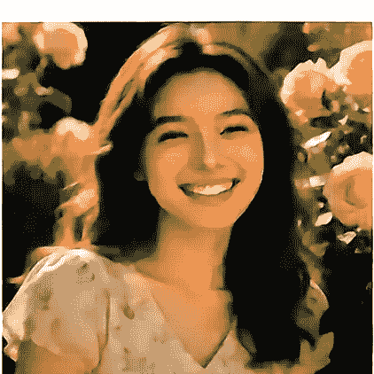
图 4-3 AI 生成的近景人物

### 中景

中景表现人物膝盖以上，兼顾面部表情与上半身动作，能展现肢体、情绪及人物与场景关系，是叙事主力镜头。

## 功能详解

- 信息量大
一镜包含表情、动作与简单环境。
- 节奏适中
不压迫也不疏离，是舒适观看距离。
- 剪辑安全区
中景可持续3到5秒，观众不会腻。

#### 适用场景
表 4-3 短剧中中景镜头的适用场景
| 场景类型 | 中景作用 | 示例 |
| :--- | :--- | :--- |
| 日常互动 | 自然叙事 | 吃饭、走路、工作 |
| 轻微动作 | 展示但不放大 | 递东西、起身、坐下 |
| 多人场面 | 交代人物关系 | 三人对话、家庭聚餐 |
| 过渡镜头 | 连接情绪 | 从特写到全景的中间状态 |

### 实战技巧

- 技巧一：中景是安全区
不确定用何景别时用中景不易出错。
- 技巧二：中景可持续3到5秒
特写最多2秒否则压迫，中景可给观众喘息。
- 技巧三：用中景展示关系
两人并排行走可同时拍互动；一人坐一人站可展示高低关系。

### 中景镜头示例
提示词：中景镜头，男人立于会议桌旁，神色平静眼神坚定嘴角微扬，双手自然下垂，背景为会议室局部。
即梦 AI 生成的图片如图 4-4 所示。
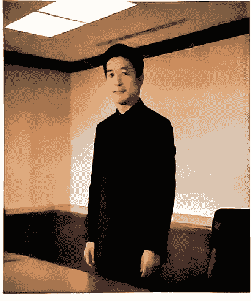
图 4-4 AI 生成的中景人物

### 全景

全景展现剧情整体场景，涵盖人物完整形象与主要环境元素，让观众明确发生地。

## 功能详解

- 人物出场
第一眼看清角色全貌、身高体型穿着气场。
- 环境交代
告知观众地点是豪宅、出租屋、办公室还是街头。
- 关系展示
体现人物与环境关系，是主人还是闯入者。

#### 适用场景
表 4-4 短剧中全景镜头的适用场景
| 场景类型 | 全景作用 | 示例 |
| :--- | :--- | :--- |
| 角色首次出场 | 建立第一印象 | 霸总从豪车下来 |
| 场景转换 | 告知到新地方 | 女主走进新公司大门 |
| 多人场面 | 展示位置关系 | 会议桌上所有人 |
| 动作戏开始 | 看清空间布局 | 打斗前展示场地 |

### 实战技巧

- 技巧一：霸总出场先给全景
豪车长腿西装保镖用全景一次性呈现，再切近景看脸制造期待。
- 技巧二：全景不超过3秒
观众看3秒足够，再多会无聊，之后切中景或近景进入细节。
- 技巧三：用全景制造反差
女主站在豪宅门口全景，推近到破旧运动鞋特写，用反差营造孤独、宏大、苍凉。

### 远景

远景将人物置于广阔环境中，突出渺小与氛围，用于情绪升华与时间过渡。

## 功能详解

- 升华情感
结尾拉远镜头，让观众抽离回味。
- 时间过渡
展示日出日落四季变化，暗示时间流逝。

#### 适用场景
表 4-5 短剧中远景镜头的适用场景
| 场景类型 | 远景作用 | 示例 |
| :--- | :--- | :--- |
| 回忆片段 | 制造距离感 | 童年回忆用远景开场 |
| 结局升华 | 让情绪扩散 | 男女主相拥镜头拉远到城市上空 |
| 孤独时刻 | 放大渺小感 | 女主独自站在天台背景万家灯火 |
| 宏大场面 | 展示规模 | 千军万马、皇宫全景 |

### 实战技巧

- 技巧一：远景一般不超过3秒
AI短剧中信息量少，观众3秒会走神，除非结尾升华可延至5秒。
- 技巧二：远景加音效强化氛围
雨夜远景配雨声雷声，孤独远景配风声心跳声。
- 技巧三：用远景制造“蚂蚁感”
让主角在画面中显得很小，强化无助孤独。

**终局留白  超远景收束**

收尾阶段把人物单独留在一片海边，随着画面的后退，她在天海的交界处越来越小，最后只剩一个小点。这种处理很有余韵。整部作品的最后一幀，用一段缓慢后撤的超大全景收束，给观众一段可以细品的空白，也便于叠字幕、放片尾音乐，让情绪慢慢散去。

**远景参考思路**

可用的描述关键词：广角大景，远山起伏连绵，山顶薄雾轻绕，山下溪水蜿蜒，植被翠绿，天空湛蓝透亮，整体通透开阔，清新辽远，很适合AI还原远景的气韵。AI渲染的远景样张如图4-6所示。

图 4-6 AI 生成的远景画面

## 4.2 短剧必备 7 种运镜方式

固定机位讲故事偏于平铺，适合营造客观感或强调细节，但画面缺乏呼吸感。加入动态运镜后，画面有了起伏节奏，推进快慢与运动轨迹都能传递细腻情绪，对人物塑造和叙事推动作用很大。AI短剧里最常用的有推、拉、摇、移、跟、升降、甩这七种，掌握生成要点后镜头质感会明显提升。

## 短剧 7 种运镜方式一览

表 4-6 短剧 7 种运镜方式一览

| 运镜方式 | 操作手法 | 情绪暗示 | 短剧使用场景 |
| :--- | :--- | :--- | :--- |
| 推镜头 | 镜头逐渐靠近主体 | 聚焦情绪、发现秘密、内心独白 | 发现真相、情绪爆发前 |
| 拉镜头 | 镜头逐渐远离主体 | 揭示环境、表达孤独、回忆结束 | 离别场景、结局升华 |
| 摇镜头 | 镜头左右/上下转动 | 展示环境、连接人物、制造悬念 | 从A看到B、环顾四周 |
| 移镜头 | 镜头平行移动 | 跟随动作、营造沉浸感 | 跟拍走路、车窗外风景 |
| 跟镜头 | 镜头跟随主体运动 | 追逐、奔跑、紧张场景 | 逃跑、追赶、进入 |
| 升降镜头 | 镜头上下移动 | 身份揭示、震撼出场、俯视压迫 | 大佬出场、从下往上拍 |
| 甩镜头 | 快速转动模糊 | 转场、时间流逝、混乱情绪 | 闪回、转场、梦境 |

## 推镜头

### 功能
推镜是通过机位不断逼近被摄对象实现的，把观众视线锁在核心人物上，削弱背景干扰，强化情绪与细节。短剧里的主要作用：

- 聚焦情绪：从全景推进到近景，把面部变化看得更清楚
- 制造悬念：缓慢推进，让人好奇下一步会呈现什么
- 进入内心：推进到眼部特写，仿佛在窥视内心世界

### 实战技巧
- 重大信息揭晓前使用推进。女主看到手机信息时镜头缓缓靠近双眼，观众会一起屏息。
- 推进速度决定张力。慢推超过5秒营造沉思回味；快推1至2秒制造震惊惊吓。
- 推至特写后停留。推到特写后保持1到2秒让情绪发酵，再切换或直接切黑。

### AI 产出示例
- 提示词：生成一段视频，推镜头，一位穿浅色衬衣的男人正坐在餐厅桌前说话，镜头从男人上半身慢慢推到近景再推到特写，影视级质感。
- Seedance 2.0 生成视频的截图如图4-7所示。

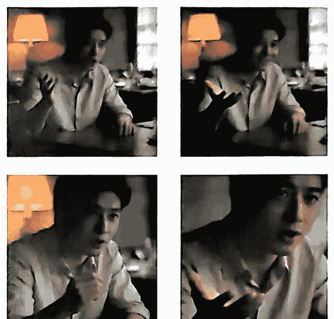

图 4-7 Seedance 2.0 生成的推镜头视频的截图

- 提示词：生成一个推镜头的运镜，女主坐在公园的椅子上，表情从平静逐渐转变为微笑，画面从中景逐渐推移到对人物的特写，影视质感，镜头推进速度缓慢。
- Seedance 2.0 生成视频的截图如图4-8所示。

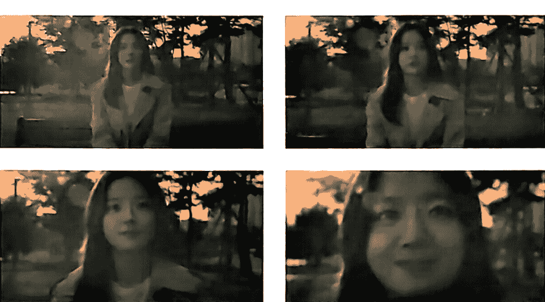

图 4-8 Seedance 2.0 生成的推镜头视频的截图

## 拉镜头

### 功能
拉镜是推镜的反向，机位逐渐远离被摄者，由近景拉至全景。作用有：

- 呈现环境：让观众看到角色所处的空间
- 表达孤独：人物在画面里越变越小，孤独感增强
- 升华情绪：结尾拉远，把情绪扩散到整体场景

### 实战技巧
- 拥抱类场景常用拉。情侣拥抱时镜头慢慢拉远，露出背后落日、烟花或城市夜景，浪漫被放大。
- 离别用慢拉。两人分离时慢拉让他们渐行渐远，观众会感到关系终结。
- 结局升华用大拉。最后一集最后一个镜头从主角身上拉到城市或天空，留下回味。

### AI 产出示例
- 提示词：生成一段视频，拉镜头，从女生凝神远望的近景慢慢拉远，露出女生所处的位置是山顶，山下是大海，镜头持续拉远直到女生成为小点。电影感。
- Seedance 2.0 生成视频的截图如图4-9所示。

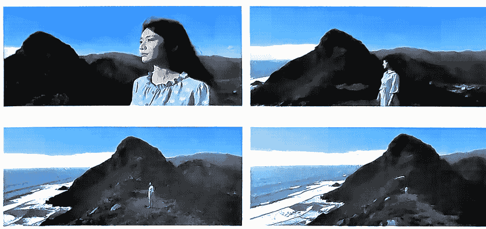

图 4-9 Seedance 2.0 生成的拉镜头视频的截图

## 摇镜头

### 功能
摇镜是镜头绕支点左右或上下转动，模拟人转头环顾。作用有：

- 展示空间：左右扫过让观众看清整体场景
- 连接人物：从A脸摇到B脸，替代切换
- 制造悬念：慢慢摇向未知方向吊起期待

### 实战技巧
- 对话时用摇代替切换。A说话拍A再摇到B反应，比硬切更流畅。
- 视线引导用摇。角色看向某处镜头跟随摇过去，代入感更强。
- 环境交代用慢摇。5到8秒慢摇扫过场景，开场交代地点很有效。

### AI 产出示例
- 提示词：生成一段视频，摇镜头，从左到右缓慢摇摄城市风光，电影级画质。
- Seedance 2.0 生成视频的截图如图4-10所示。

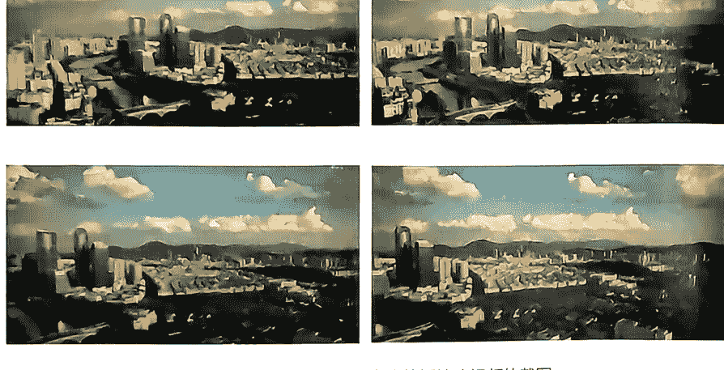

图 4-10 Seedance 2.0 生成的摇镜头视频的截图

## 移镜头

### 功能
移镜是镜头平行移动，可左右前后移动，模拟边走边看。作用有：

- 跟随动作：跟拍走路奔跑
- 展示空间：缓缓移过场景，比摇镜更有走近感
- 营造沉浸：观众感觉自己也在场景里行走

### 实战技巧
- 入场可用侧移。镜头与人物平行移动拍走路姿态，提升代入感。
- 车窗外景用移。人物坐车时镜头沿车窗移动展示掠过风景，常作转场或情绪铺垫。
- 探索场景用前移。镜头向前推进像走进未知空间，制造探索紧张感。

### AI 产出示例
- 提示词：生成一段视频，画面中是一位正在书房看书的女士，镜头从女士侧面由左至右平行移动，电影级画质。
- Seedance 2.0 产出的视频截图如图4-11所示。

图 4-11 Seedance 2.0 生成的移镜头视频的截图

## 跟镜头

### 功能
跟镜让镜头始终追随主体运动，保持主体在画面核心。作用有：

- 制造紧张：角色逃跑时镜头在后追，观众跟着紧张
- 强调速度：跟拍奔跑追逐，速度感明显
- 代入视角：镜头与主体同动，代入感极强

### 实战技巧
- 逃跑必用后跟。镜头跟在角色身后移动，仿佛一起奔跑。
- 追逐可用前后跟交替。先拍追的人后跟，再拍被追的人前跟，增加沉浸感。
- 加轻微晃动增真实。跟拍时加一点手持晃动模拟奔跑视角波动。

### AI 产出示例
- 提示词：生成一段视频，跟镜头，镜头跟随一位骑行者在城市中快速穿梭，镜头始终快速跟随骑行者，电影级画质。
- Seedance 2.0 生成视频的截图如图4-12所示。

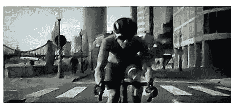

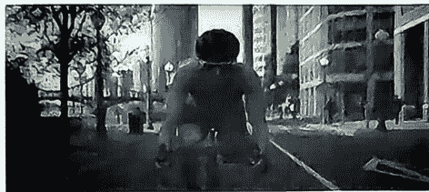

图 4-12 Seedance 2.0 生成的跟镜头视频的截图

## 升降镜头

### 功能
升降镜是摄像机垂直运动。作用有：

- 升镜仰视：角色显得高大威严有压迫感
- 降镜俯视：角色显得渺小无助被俯视
- 揭示全貌：由下往上或上往下展示物体全貌

### 实战技巧
- 大佬登场用升镜。从脚部慢慢升到面部，逐步看清全貌制造期待。
- 弱势场景用俯拍。女主被欺负时从高处向下拍她蹲坐画面，强化同情。
- 关键物品用升降揭示。从下往上拍雕像慢慢露出全貌，或从上往下拍信件落到字迹上。

### AI 产出示例
- 提示词：生成一段视频，升镜头，镜头从一棵森林中的大树的底部慢慢上升，直至露出大树的顶部，电影质感。
- Seedance 2.0 生成视频的截图如图4-13所示。

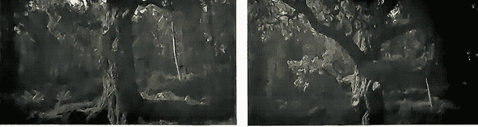

图 4-13 Seedance 2.0 生成的升降镜头视频的截图

## 甩镜头

### 功能
甩镜即闪摇，镜头快速转动画面瞬间模糊再停在新场景。短剧常用转场，1秒内完成时空切换。作用有：

- 快速转场
- 制造混乱，用于梦境回忆晕眩
- 表现时间流逝

### 实战技巧
- 梦境醒来用甩。梦中场景→甩镜模糊→角色惊醒。
- 回忆切入用甩。现实时空→甩镜模糊→过去时空。
- 激烈场面用甩。打斗中→甩镜模糊→结果已定。

### AI 产出示例
- 提示词：生成一段视频，甩镜头转场，画面从一个坐在足球场草地上的男孩身上快速转场到四十年后，长大后的男孩依然站在这片足球场上，只不过球场已经废弃，电影质感。
- Seedance 2.0 生成视频的截图如图4-14所示。

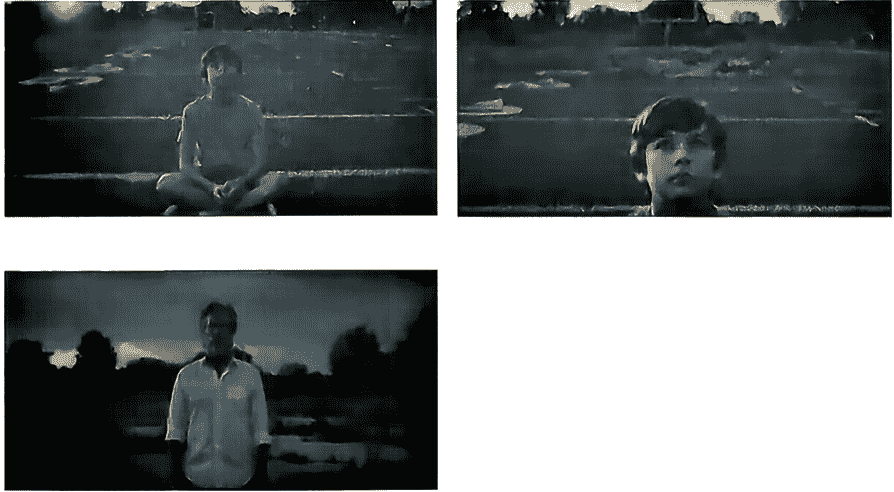

图 4-14 Seedance 2.0 生成的甩镜头视频的截图

## 4.3 短剧色彩搭配

色彩是潜意识的语言，在AI短剧中它比镜头更隐蔽却同样重要。你可能说不出原因，却觉得一部剧好甜或好虐，直觉往往来自色彩。

短剧里色彩的核心作用有三点：

- 情绪定调：画面第一秒就确定情绪基调
- 视觉差异化：同题材不同色调作品更突出
- 潜意识叙事：用颜色暗示好人坏人、回忆现实

### 色彩的情感象征

表 4-7 短剧中不同色彩的情感象征意义与适用场景

| 色调 | 情感暗示 | 适用场景 |
|---|---|---|
| 冷色调蓝/青 | 冷漠、悬疑、悲伤 | 复仇、职场压迫、夜晚 |
| 暖色调橙/黄 | 甜蜜、回忆、希望 | 恋爱、重逢、温馨家庭 |
| 高饱和度 | 戏剧感、冲突、张力 | 争吵、高潮、名场面 |
| 低饱和度 | 压抑、回忆、现实 | 悲惨过去、底层生活 |
| 对比色 | 冲突、对立、戏剧性 | 正邪对决、身份反差 |

比如都市复仇里女主被霸凌的夜晚，用冷蓝色加低饱和，画面偏暗，传递悲伤无助与职场冷漠；重逢的甜蜜场景则用橙黄色加柔光，传递温暖希望，如图4-15、图4-16。

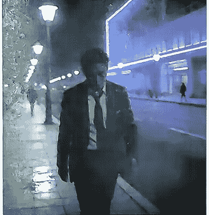

图 4-15 冷、暖色调所传递的情绪有着天壤之别

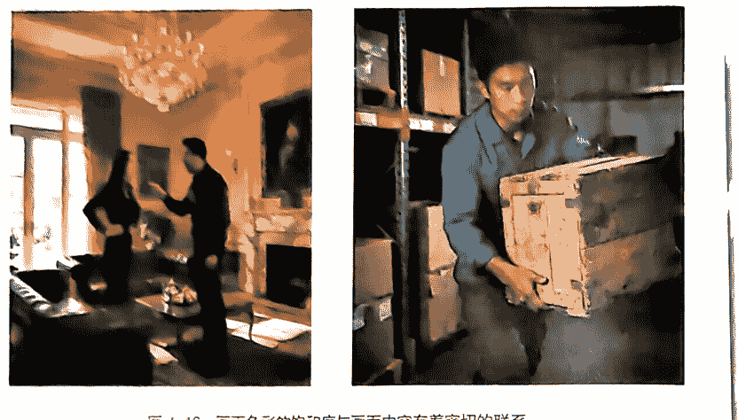

图 4-16 画面色彩的饱和度与画面内容有着密切的联系

单色调用法也常见，以单一颜色为主，能营造极致情绪，常用于生离死别、深情告白或梦境艺术化场景，如图4-17。

图 4-17 单一色调场景能够带给人纯粹的审美体验

### 短剧色彩搭配法则

法则一：全剧色调统一，避免杂乱
统一视觉风格核心是主色调贯穿始终，形成剧集视觉DNA。确定主色调后各场景在此基础上微调，避免每集换色导致视觉疲劳。
AI统一色调操作是在每条提示词末尾加上主色调关键词，例如莫兰迪色调，低饱和度，灰蓝色调，电影质感。

表 4-8 短剧题材与主色调对应表

| 题材类型 | 推荐主色调 | 理由 |
| :--- | :--- | :--- |
| 都市情感 | 暖灰调 | 温暖中带现实感 |
| 古装权谋 | 莫兰迪色/暖金 | 高级感加历史感 |
| 悬疑推理 | 青绿冷调 | 悬疑与不安 |
| 甜宠喜剧 | 奶油暖调 | 甜蜜治愈 |
| 复仇逆袭 | 蓝紫冷调 | 压抑与爆发 |

图 4-18 青绿冷调十分适合用来营造悬疑感与清冷感

图 4-19 色彩饱和度较低的莫兰迪色调与具有年代感的古装剧之间适配性较高

法则二：场景色调服务情绪，拒绝脱节
色彩要放大情绪，不能只为美观。甜宠要温暖柔和，虐心要清冷压抑，悬疑要诡异暗沉，否则感官冲突会削弱效果。参考表4-9。

表 4-9 情绪-色调对应表

| 情绪定位 | 色调调整 |
| :--- | :--- |
| 甜宠场景 | 主色调+暖光+柔光 |
| 虐心场景 | 主色调+冷光+低饱和度 |
| 悬疑场景 | 主色调+青绿+高对比 |
| 回忆场景 | 主色调+褪色+颗粒感 |
| 高潮场景 | 主色调+高饱和+强光 |

图 4-20 午后阳光搭配暖黄色调能够很好地营造温馨场景

法则三：用对比色强化冲突，提升张力
剧情出现强烈冲突时，单一色调不足以凸显张力，可用对比色对立，强化戏剧性并突出核心人物或事件。

表 4-10 常用对比色组合

| 对比组合 | 情绪暗示 | 使用场景 |
| :--- | :--- | :--- |
| 蓝橙对比 | 冷暖对立、正邪交锋 | 最终对决、身份揭晓 |
| 红绿对比 | 激烈冲突、危险信号 | 争吵高潮、追杀场面 |
| 黄紫对比 | 神秘对峙、戏剧张力 | 真相曝光、关键转折 |

### 短剧中色彩的主次关系

画面色彩搭配要讲主次，明确主色调主导情绪突出核心，次色调辅助氛围衬托主体，避免色彩混乱，让视线快速聚焦到核心人物与事件上。

### 色彩主次关系的核心逻辑

让冲突戏更有张力的色彩搭配法

冲突类桥段里，色彩的层次感本质是对立与统一的权衡。主体色与辅助色之间要拉开明显的视觉距离，例如暖系对冷系、明暗对冲、高饱和对低饱和，用来放大戏剧冲突；同时辅助色必须起到烘托作用，不能抢戏，要围绕主体色呼应，使画面保持干净，始终把核心人物或关键情节钉在视觉中心。

### 冲突情境下主次色彩的落地手法

- **正邪对决：主体色定立场，辅助色造张力**
  正派核心人物由主体色来定义，传达温暖、坚定、希望等积极情绪，多用橙、黄、浅红等暖系；反派交由辅助色塑造，营造冷漠、邪恶、压迫感，多用蓝、青、深灰等冷系。同框时主体色占据画面核心区域，辅助色退为陪衬，形成暖主冷辅的对比，凸显主角，强化对决的对抗感。

- **身份反差：主体色彰显蜕变，辅助色勾连过去**
  这类片段的核心是人物身份的剧烈转折，比如落魄千金归来、平凡人逆袭、好人黑化。借助主体色与辅助色的切换与对比，传递转变后的情绪变化，把反转的冲击感放大，让观众清晰感知人物的蜕变轨迹。

- **情绪逆转：主体色锁定当下，辅助色埋下伏笔**
  这类片段聚焦情绪的骤然翻转，比如由甜蜜到决裂、由希望到绝望、由信任到背叛。主体色负责呈现当下主导情绪，辅助色暗中铺设线索，让反转更有爆发力，使剧情起伏更明显。

主次配色的思路贯穿全片。比如下面这个画面，清冷的灰蓝色作主体色，呈现雪天寒寂的氛围，透窗而入的黄光作辅助色，色彩对比让冰天雪地中多出一抹温馨（见图 4-21）。

图 4-21 画面中的主次色调组合

##### 实战案例
表 4-11 以古装穿越剧《和亲公主 + 防狼喷雾》为例，展示全剧色调随剧情发展的演变规律，当然，短剧色调的选择方案并不是单一的，表中仅是参考方案之一。

表 4-11 常用对比色组合

| 阶段 | 剧情定位 | 主色 | 微调说明 | 示例场景 |
| :--- | :--- | :--- | :--- | :--- |
| 第 1～10 集 | 穿越初期，被欺负 | 冷灰 | 压抑、无助 | 被赶到破旧后院 |
| 第 11～30 集 | 开始反击，小胜 | 冷灰中渐暖 | 希望初现 | 太后成为靠山 |
| 第 31～50 集 | 事业上升，甜宠萌芽 | 暖灰 | 温暖渐增 | 和王爷第一次牵手 |
| 第 51～70 集 | 危机再起，虐心 | 冷蓝 | 重回压抑 | 被妹妹陷害入狱 |
| 第 71～90 集 | 绝地反击，高潮 | 高饱和对比色 | 戏剧张力 | 最终对决 |
| 第 91～100 集 | 圆满结局 | 暖金 | 幸福满足 | 幸福生活收尾 |

## 短剧色彩搭配攻略

**Q1：为什么输出画面颜色与想象不一致？**
原因：提示词里颜色描述过于笼统。
解决方案：别只写“暖色调”，要写“暖金色”“夕阳色”“奶油质感”这类具体词。

**Q2：同一集里颜色跳来跳去怎么办？**
原因：缺乏统一的主色定调。
解决方案：每集产出时都加上主色关键词，比如“全剧统一暖灰”。

**Q3：想要对比色，但 AI 产出得太生硬怎么办？**
原因：对比缺少过渡。
解决方案：在提示里加入“中间冷暖交织”“渐变过渡”等描述（见图4-22）。

**Q4：回忆场景总是不够“回忆感”？**
原因：仅有褪色是不够的。
解决方案：在提示中加入“轻微颗粒感”“边缘虚化”“老照片质感”等关键词。

## 4.4 AI 分镜脚本产出

分镜脚本是 AI 微短剧从文字到画面的桥梁，而借助 AI 创作分镜，更是打破了传统分镜的专业壁垒，让非专业创作者也能快速产出规范统一的分镜，大幅提升效率，降低时间成本。

### 分镜脚本的标准化格式
用 AI 产出分镜的前提是建立规范统一的格式。格式混乱会导致 AI 无法精准识别信息，分镜杂乱无逻辑。标准化格式能让 AI 快速抓取每个镜头的核心信息（景别、内容、时长等），确保规范性和可落地性。结合短平快的特性，分镜创作的核心包含五大要素。

### 核心标准化格式必含五要素
AI 产出的分镜脚本需固定包含“镜号、景别、内容、时长、音效”五大要素，描述要简洁具体，避免模糊，确保 AI 能精准抓取，也方便后期对接画面产出和剪辑。具体说明如下。

- **镜号**：按镜头顺序依次编号 1、2、3……，无需复杂规则，确保唯一有序，方便后期对应。
- **景别**：明确每个镜头的景别，如特写、近景、中景、全景、远景，可补充“面部特写”“庭院全景”等，让 AI 明确视野范围。
- **内容**：核心要素，需简洁描述画面内容，包括人物动作、场景细节、运镜方式，重点突出“谁、做什么、在哪、怎么拍”，让 AI 清晰呈现。
- **时长**：结合单集约 90 秒的节奏，每个镜头控制在 2～8 秒，明确标注秒数，避免过长或过短，保证节奏流畅。
- **音效**：匹配画面内容和情绪，标注“脚步声”“背景音乐”“对话声”“急促心跳声”等，增强视听协同，为后期剪辑提供参考。

### 标准分镜脚本模板
分镜格式并无绝对标准，但以下字段是专业制作必备，我们推荐表格形式（见表 4-12）。

表 4-12 标准分镜脚本模板示例

| 镜号 | 1 | 2 | 3 | 4 |
|---|---|---|---|---|
| 景别 | 远景 | 特写 | 中景 | 近景 |
| 画面描述 | 雨夜，豪车停在破旧小区门口 | 车内，男人的眼睛，盯着某处 | 女人撑伞走出单元门 | 两人隔着雨幕对视 |
| 运镜方式 | 俯拍 + 推进 | 极近特写 | 跟拍 | 正反打 |
| 人物动作 | 车灯闪烁 | 手指敲击方向盘 | 突然停住脚步 | 伞从手中滑落 |
| 台词/音效 | 【雨声 + 心跳声】 | OS: 三年了…… | 【雨声骤停】 | 静默 |
| 时长 | 3s | 2s | 2s | 3s |
| 色调 | 冷蓝 | 冷蓝 | 冷蓝 | 冷蓝 + 暖黄 |

### 从文字剧本到分镜脚本的转化技巧

#### 剧本转化为分镜脚本的基本步骤
把剧本转为分镜的核心是“拆解剧本、提炼镜头、补充细节”，将抽象文字转化为 AI 可识别的具体镜头信息。具体实操如下。

- **步骤 1：拆解文字剧本，拆分镜头**
  先按剧情节奏拆分，遵循“一句核心剧情对应一个镜头”的原则，避免一个镜头承载过多剧情。拆分时关注“动作、情绪、场景变化”，只要人物动作变化、情绪转折、场景切换就拆新镜头，适配短镜头快节奏。
- **步骤 2：为每个镜头匹配核心要素**
  针对拆分后的镜头逐一匹配“景别、运镜、内容、时长、音效”五要素，描述具体简洁，避免模糊（如不说“镜头移动”，要说“推镜头”“跟镜头”；不说“女主开心”，要说“女主嘴角上扬，眼神温柔”）。
  此过程可借助 AI，将剧本及前文的色彩组合规律、运镜方式一并提供给 AI 产出分镜。产出后务必人工核验优化。

**示例**
原始文学剧本：
她在咖啡厅等了一夜，他没来。天亮时，她删掉了他的所有联系方式。

AI 提示词：
请将以下文字剧本转化为分镜脚本，要求包含镜号、景别、画面描述、运镜、时长、色调。
【剧本】她在咖啡厅等了一夜，他没来。天亮时，她删掉了他的所有联系方式。
要求：
- 共 7 个镜头
- 景别多样化（包含全景、近景、特写）
- 运镜包括固定、推进、拉远、摇
- 色调从暖黄渐变到冷调
- 输出表格格式

AI 产出分镜脚本如表 4-13 所示。

表 4-13 AI 分镜脚本

| 镜号 | 景别 | 画面描述 | 运镜 | 人物动作 | 台词/音效 | 时长 | 色调 |
| :--- | :--- | :--- | :--- | :--- | :--- | :--- | :--- |
| 1 | 全景 | 咖啡厅靠窗位置，她坐着看手机 | 固定 | 低头看手机 | 【轻音乐】 | 2s | 暖黄 |
| 2 | 特写 | 冒着热气的咖啡 | 缓慢推进 | 咖啡杯静止 | 无 | 2s | 暖黄 |
| 3 | 近景 | 她第5次看时间，眼神焦虑 | 固定 | 抬头看手机屏幕 | 无 | 2s | 暖黄 |
| 4 | 大特写 | 手机屏幕，没有消息 | 固定 | 屏幕暗下去 | 无 | 1s | 暖黄转冷 |
| 5 | 中景 | 窗外天色渐亮 | 缓慢拉远 | 她望向窗外 | 【鸟鸣声】 | 3s | 冷调 |
| 6 | 特写 | 已经凉透的咖啡 | 摇镜头 | 她的手指划过杯壁 | 无 | 2s | 冷调 |
| 7 | 近景 | 她深吸一口气，眼泪滑落 | 缓慢推进 | 手指擦泪 | 轻微抽泣 | 3s | 冷调 |

### AI 产出分镜脚本核心注意事项
**提示词越具体，AI 产出越精准**
避免模糊表述，如不说“女主有情绪”，要说“女主眼神震惊，嘴角紧绷”；不说“有运镜”，要说“慢推镜头，从近景推至特写”。细节越具体，分镜越贴合预期。

**适配 AI 产出能力**
避免要求 AI 产出过于复杂的镜头，如同时使用多种运镜、复杂场景细节，降低难度，减少误差。

**结合前文知识**
分镜中的景别、运镜、色彩，需结合前文内容润色提示词。

**批量产出先试拍**
批量产出前先让 AI 产出 1 集分镜，检查风格、格式、逻辑是否达标，找到关键问题针对性调整提示词后再批量产出，避免浪费时间。

### 分镜脚本实战案例
场景描述：
分手三年后，她在新公司第一天上班，发现老板是他。
剧本原文：
林念分手三年后，应聘进入一家梦寐以求的公司。入职第一天，她正在工位整理物品，突然办公室安静下来。她抬头，看到所有人站起，望向门口。一个男人走进来——是她前男友陆霆琛，现在是这家公司的总裁。两人隔着办公室对视，她手中的杯子滑落在地，碎裂。
根据以上剧本生成分镜脚本的过程如下。
问：
根据以下剧本内容生成一个分镜脚本，要求：
1. 共 10 个镜头。
2. 景别多样化（包含全景、近景、特写、极近特写）。
3. 运镜包括固定、摇、上升、急推、慢动作、拉。
4. 色调从暖黄渐变到冷调。
5. 情绪层次：期待→疑惑→震惊→崩溃。
6. 回答以表格形式呈现。
【剧本原文】
豆包：
| 镜号 | 景别 | 画面描述 | 运镜方式 | 人物动作 | 台词 / 音效 | 时长 | 色调 |
| :--- | :--- | :--- | :--- | :--- | :--- | :--- | :--- |
| 1 | 近景 | 林念站在崭新的工位前，脸上带着期待的笑容，手里拿着一个相框 | 固定 | 轻轻擦拭相框，摆放整齐 | 【轻快的背景音乐】 | 2s | 暖黄 |
| 2 | 特写 | 相框里的照片——她和闺蜜的合影，笑容灿烂 | 缓慢推进 | 她的手指轻抚照片 | 音乐持续 | 2s | 暖黄 |
| 3 | 全景 | 开放式办公室，所有人都在忙碌 | 固定 | 林念环顾四周，深吸一口气 | 键盘敲击声、低声交谈 | 2s | 暖黄 |
| 4 | 全景 | 办公室突然安静，所有人陆续站起，望向同一个方向 | 从左到右摇镜头 | 林念疑惑地抬头 | 音乐骤停，寂静 | 2s | 暖黄转冷 |
| 5 | 跟拍 + 上升 | 一双锃亮的皮鞋走进画面，镜头跟随并缓慢上升——笔挺的西装裤、解开扣子的西装、棱角分明的下颌、冷酷的眼睛 | 跟拍 + 上升 | 陆霆琛大步走进来，气场强大 | 【心跳声】咚、咚、咚 | 4s | 冷调 |
| 6 | 特写 | 林念的脸，笑容凝固，瞳孔瞬间放大 | 急推 | 嘴唇微张，呼吸停滞 | 心跳声放大 | 2s | 冷调 |
| 7 | 特写 | 陆霆琛的眼睛，瞳孔剧烈收缩，脚步顿住 | 急推 | 整个人僵在原地 | 心跳声震耳 | 2s | 冷调 |
| 8 | 缓进呼写 | 两人隔着整个位置公窗对视，时间仿佛凝固上 | 固定 | 谁都没有动 | 完全静默 | 3s | 冷调 |
| 9 | 全景 | 砸令手中的杯子滑落 | 慢动作 | 杯子在空中缓慢翻滚 | 【玻璃碎裂声】慢放 | 2s | 冷调 |
| 10 | 特写 | 杯子落地，碎片四溅，水花飞起 | 慢动作 | 水滴在空中凝固 | 巨声 | 2s | 冷调 |

## 第三模块

## 技术制作篇——AI 驱动视效，降本增效
在前面，我们已经详细介绍了 AI 微短剧剧本与分镜脚本的创作流程，接下来的任务，就是用 AI 将文字想象转变为生动的画面。

# 第5章

## Seedance 2.0 视觉制作全流程
视觉制作是 AI 微短剧流程中最核心、最耗时，也最具技术含量的环节。本部分将详细拆解 AI 视觉制作的各个环节，让你能够轻松驾驭 Seedance 2.0，制作出理想的短剧视频。

## 5.1 图片生成进阶技法
在短剧制作中，无论是人物的定妆和场景的确定，还是视频首尾帧的制作，都考验着创作者的图片生成技巧。AI 图片生成方式主要有两种，分别是文生图和图生图，下面我们来分别对其操作技巧进行介绍。

### 文生图

#### 什么是文生图？
文生图是指直接输入文字描述，AI 根据描述生成对应图片的过程。它就像你对着画家口述画面，画家当场画出来。
在 AI 微短剧制作中，文生图主要用于以下 3 个场景（见表 5-1）。

表 5-1 AI 短剧中文生图的主要适用场景

| 适用场景 | 作用 | 案例 |
| :--- | :--- | :--- |
| 概念设计 | 在正式创作前，快速验证视觉方向 | 霸总应该是高冷型还是儒雅型？ |
| 角色初稿 | 生成角色的第一版形象，后续再优化 | 女主的五官、服装、气质 |
| 场景氛围图 | 为关键场景定下视觉基调 | 皇宫的色调、后院的破败感 |

#### 文生图提示词黄金公式
经过大量实战验证，一个高质量的文生图提示词应该包含 6 个要素。记住这个公式，你就能稳定输出想要的画面。
主体描述 + 环境 / 背景 + 光线 / 色调 + 构图 / 景别 + 画质要求 + 风格参考 = 成图
要想生成理想的图片，以上这 6 个提示词要素缺一不可，其作用如表 5-2 所示。

表 5-2 AI 文生图提示词六要素功能拆解

| 要素 | 作用 | 案例 |
|---|---|---|
| 主体描述 | 告诉 AI 画什么 | 26 岁古装女子，清秀耐看，眼神灵动，嘴角有梨涡 |
| 环境 / 背景 | 告诉 AI 在哪里 | 站在江南庭院中，背景是白墙黛瓦 |
| 光线 / 色调 | 告诉 AI 什么情绪 | 午后阳光透过树叶洒在身上，柔光 |
| 构图 / 景别 | 告诉 AI 怎么拍 | 中景，人物居中 |
| 画质要求 | 告诉 AI 要多清晰 | 8K，电影质感，超写实 |
| 风格参考 | 告诉 AI 什么画风 | 中国风，古韵味 |

#### 各要素对画面的影响
- **主体**
主体是图片核心，直接明确“画面要突出什么”，AI 会优先渲染主体，确保主体清晰突出，是文生图最基础的要素。
在提示词中描述主体时，要全面且精准，比如描述人物，既要写外貌装扮，也要写精神面貌和所处环境。
示例：女主，22 岁，鹅蛋脸，柳叶眉，身着淡粉色古风襦裙，嘴角微笑，古风庭院环境，暖金色调，细腻画质。
即梦 AI 生成的图片如图 5-1 所示。

## 文生图实战案例
- 案例一
提示词：32岁霸道总裁顾北城，剑眉星目，高挺鼻梁，薄唇，下颌线条分明，深色定制西装，白色衬衫，站在超高层办公室落地窗前，逆光拍摄，侧脸45°，冷色调，商业肖像光，中景，写实风格，电影质感。
即梦 AI 生成的图片如图 5-7 所示。
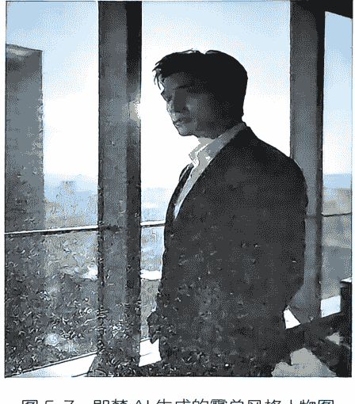
图 5-7 即梦 AI 生成的霸总风格人物图
- 案例二
提示词：深夜废弃仓库，青绿色调，一束月光从窗户射入，照亮杂乱的地面，阴影强烈，诡异氛围，广角镜头，写实风格，电影颗粒感。
即梦 AI 生成的图片如图 5-8 所示。

图 5-8 即梦 AI 生成的悬疑风格场景
- 案例三
提示词：夕阳下的咖啡厅露台，金色阳光，奶油质感，柔光滤镜，桌上两杯咖啡冒着热气，背景虚化，暖色调，写实风格，浪漫氛围。
即梦 AI 生成的图片如图 5-9 所示。

图 5-9 即梦 AI 生成的浪漫风格场景

## 图生图

### 图生图的作用
图生图，是 AI 视觉制作中最稳定、最不容易出错的功能之一。它的逻辑很简单：用户上传一张或多张参考图片，AI 基于这些图片的内容、风格、构图，结合新的文字指令，生成一张新图片。图生图的核心作用就是让 AI 理解你已满意的元素，只改变你想改的部分。
相比文生图需要靠文字“凭空想象”，图生图更像是让 AI “照着画、照着改”，因此角色更统一、场景更稳定、风格更容易保持一致，是普通创作者从“会用 AI”到“用好 AI”的关键一步。表 5-3 是文生图与图生图的简单对比。

表 5-3 文生图与图生图之间的对比

| 维度 | 文生图 | 图生图 |
| :--- | :--- | :--- |
| 输入 | 纯文字描述 | 图片 + 文字指令 |
| 控制精度 | 较低，AI 自由发挥空间大 | 较高，以参考图为基准 |
| 一致性 | 难以保持 | 容易保持角色 / 风格一致 |
| 适用场景 | 初稿、概念探索 | 细化、多角度、变体 |

### 图生图的三大核心应用
- 应用一：角色多角度生成

AI短剧实操手册：锁定人物、掌控镜头

做AI短剧最头疼的就是人物不稳。换成图生图的工作流，就能让同一个角色在不同镜头、不同视角、不同情绪下保持统一，不会掉脸、换脸或穿帮。

即梦平台常用的实操路径和示例如下。

第一步，先用文生图捏一张最满意的角色正面定妆照作为基准（见图5-10）。

图5-10 角色定妆照

第二步，把这张底图导入图生图功能，在界面“+”号位置载入角色定妆照（见图5-11）。

图5-11 上传定妆照

第三步，填入调整指令，描述想对画面做怎样的修改，如图5-12所示。

图5-12 输入提示词

按指令得到的结果如图5-13所示。

图 5-13 同一人物的背后视角

沿用此思路，还能批量得到同一角色在不同情绪、着装和场景下的图像。图生图示例如图5-14所示。

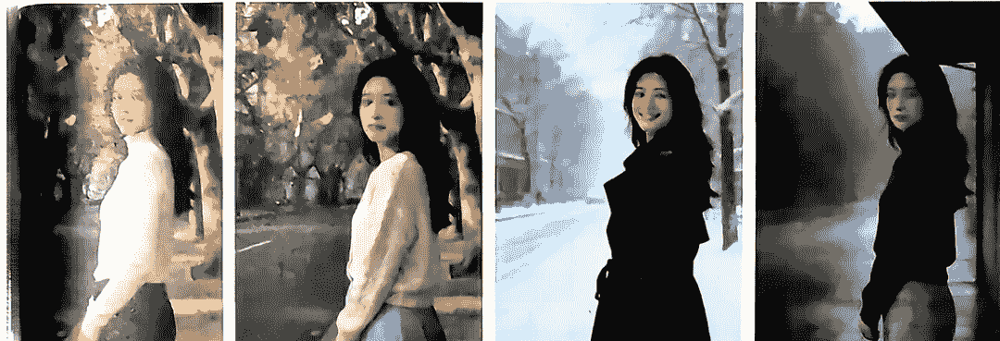

图 5-14 图生图示例

- 应用二：场景变体

一个场景通常需要多套版本，白天版、夜晚版、雨天版、雪天版等。与其重新文生图，不如在已有场景上用图生图快速改写。具体操作和前面图生图流程一致。

实操要点：

首先，生成一张场景图并送入图生图界面。

其次，输入指令，只改环境、光线、天气，保留场景结构不变。描述要具体，例如不写“天空变暗”，而写“深蓝夜空”；不写“地面湿润”，而写“雨水反光，映出路灯”。

最后，点击生成挑选理想结果，若成片不满意，可微调指令继续尝试（见图5-15）。

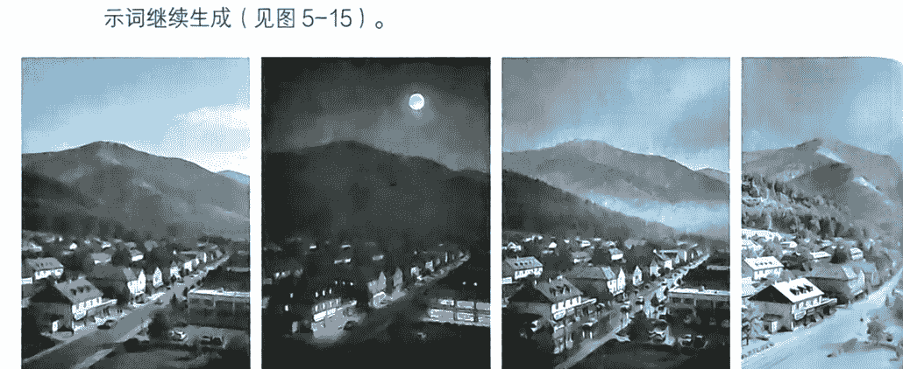

- 应用三：风格迁移

手头有实拍照片或普通素材，想转为某种特定美学，比如动漫、水墨或赛博朋克，图生图能轻松实现。

风格转换的步骤与前面一致，区别在指令环节需要加入明确的风格关键词，如“新海诚风格”“宫崎骏风格”“水墨画”“油画”“赛博朋克”等（见图5-16）。

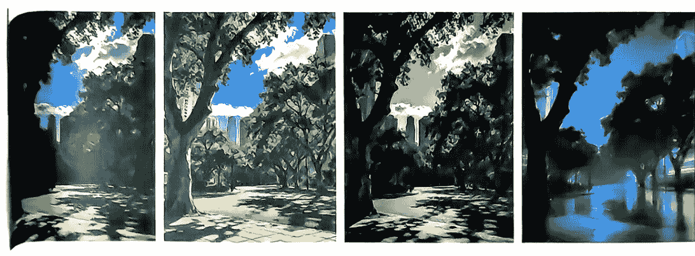

图 5-16 同一场景的不同风格

### 图生图提示词技巧

图生图的指令公式和文生图相近，只是多了“参考图”和“保持不变要素”。因此图生图指令的核心是告诉模型哪些要改、哪些要留，具体注意事项如表5-4所示。

表 5-4 图生图提示词要素拆解

| 要素 | 作用 | 案例 |

| :--- | :--- | :--- |

| 要改变的元素 | 明确告知模型哪些部分需要调整 | 视点转为侧脸，时段变为夜晚 |

| 保持不变的元素 | 防止关键特征被乱改 | 同一人物，相同服装，相同发型 |

| 新增的元素 | 添加原本没有的内容 | 眼泪，笑容，灯笼，雪花 |

| 其他常规要素 | 光线、构图、画质、风格等 | 柔光，中景，8K，电影质感 |

## 5.2 文生视频与图生视频

完成静态图的文生图、图生图制作后，下一个环节是让画面动起来。AIGC出视频主要有两种路径，文生视频与图生视频，各有优劣，对应不同创作需求。

### 文生视频

#### 什么是文生视频？

文生视频即直接输入文字描述，由模型从零创造一段影像。不需要任何图源，完全依赖模型的想象力。常见于场景搭建、空镜、氛围镜头、大场面或抽象概念的表达。

#### 文生视频的优缺点

- 优点：上手快、灵活、创意空间大，无需准备素材，能产出原创性较强的场景。
- 缺点：对人物与动作的控制力有限，易出现变脸、穿帮、动作崩坏。

#### 文生视频提示词

Seedance 2.0 文生视频提示词公式为：

[ 场景描述 ]+[ 运镜方式 ]+[ 氛围 / 情绪 ]+[ 时长要求 ]+[ 画质要求 ]

各要素说明如表5-5。

表 5-5 Seedance 2.0 文生视频提示词要素拆解

| 要素 | 作用 | 案例 |

|---|---|---|

| 场景描述 | 告知画面里有什么 | 雨夜的 CBD，车流在湿漉漉的马路上穿行 |

| 运镜方式 | 镜头如何运动 | 俯瞰镜头，缓慢推进 |

| 氛围 / 情绪 | 整体感觉 | 霓虹灯倒映在水中，迷离感 |

| 时长要求 | 影像长度 | 4 秒 |

| 画质要求 | 清晰度与风格 | 8K，电影感色调 |

##### 实战案例

第一步，打开即梦创作界面，在左侧创作类型栏选择视频生成（见图5-17）。

第二步，依据文生视频提示词要素润色指令，得到描述明确、可操作性强的提示词。

> 提示词：雨夜城市俯瞰镜头，车流拉出光轨，路面反光，整体色调偏蓝紫，有电影质感。

第三步，在提示词输入框填入指令并设定视频时长（见图5-18）。

图 5-18 Seedance 2.0 文生视频操作步骤示意图

第四步，在创作工具栏选择 Seedance 2.0，并选择适配短剧的画面比例，最后按下生成键即可（见图5-19）。

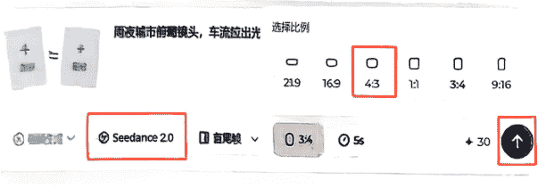

图 5-19 Seedance 2.0 文生视频操作步骤示意图

Seedance 2.0 产出的视频截图如图5-20所示。

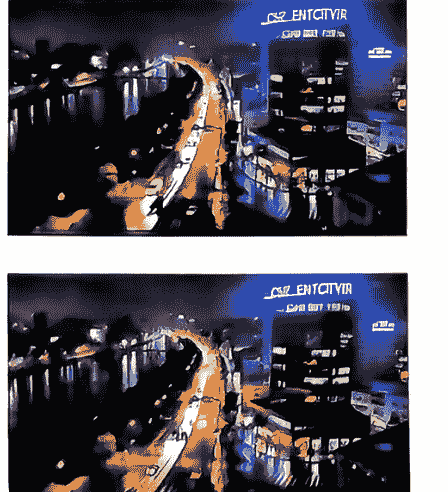

图 5-20 Seedance 2.0 根据文字生成的视频的截图

### 图生视频

#### 什么是图生视频？

图生视频是先上传一张清晰图片，如角色定妆照或场景图，再让模型基于该图添加动态效果。适用于人物特写、对话、情绪变化等对表情控制要求高的场景。AI短剧中图生视频的常规应用如表5-6。

表 5-6 图生视频适用场景

| 场景类型 | 案例 | 推荐方式 |

| :--- | :--- | :--- |

| 人物特写 | 情绪变化、独白 | 音频驱动 + 表情提示 |

| 双人对话 | 两人对话场景 | 分别生成再合成，或使用多角色参考 |

| 动作场景 | 走路、转身、抬手 | 纯视觉图生视频 |

| 物体动态 | 杯子滑落、风吹窗帘 | 纯视觉图生视频 |

#### 图生视频的优缺点

- 优点：角色一致性强，表情可控，音画可同步。
- 缺点：需要前期定妆照和音频文件，生成速度相对文生视频慢一些。

#### 图生视频提示词

Seedance 2.0 图生视频提示词公式（纯视觉版）：

上传图片 +[人物要做什么动作 ]+[表情变化 ]+[镜头怎么动 ]+[时长要求 ]

##### 实战案例

第一步，打开即梦创作界面，在左侧创作类型栏选择视频生成，并在创作工具栏选择 Seedance 2.0，在参考模式栏选择全能参考帧（见图5-21）。

上传1~5张参考图或视频，输入文字，自由组合图、文、音、视频多元素，如 @图片1 模仿 @视频1 的动作，音色参考 @音频1。

图 5-21 Seedance 2.0 图生视频操作步骤示意图

第二步，点击左侧“参考内容”区域，导入参考图。在提示词输入框填入指令并选择视频时长，在图生视频中，画面比例一般自动匹配，然后按下生成键即可（见图5-22）。

提示词：根据图片生成视频，画中人物转头看向咖啡杯，眯起眼睛，轻轻喝一口咖啡，然后放下杯子，睁开眼睛，镜头逐渐平稳前推，靠近人物。

图 5-22 Seedance 2.0 图生视频操作步骤示意图

参考图如图5-23所示。

图 5-23 参考图

Seedance 2.0 产出的视频截图如图5-24所示。

图 5-24 Seedance 2.0 根据图片生成的视频的截图

### Seedance 2.0 图生视频注意事项

目前 Seedance 2.0 图生视频暂不支持真人脸参考，而即梦生成的拟真人分镜因视觉效果逼真，多数情况下会被判定为真人参考图而无法使用，如图5-25所示。

图 5-25 即梦 AI 生成的人物图

上面这张图是我们之前用即梦生成的拟真人图，本身为文生图产出，未参考任何真人照片，但若直接用它做视频，情况会如图5-26所示。

图 5-26 Seedance 2.0 图生视频直接上传 AI 生成的拟真人图片

不仅是这张图，经过多次测试，大多数拟真人图都无法通过 Seedance 2.0 直接产出视频。要保证短视频的真实感与连贯性，必须保证分镜脚本中人物形象统一。这就需要掌握如何利用即梦平台的资源做视频。

实际上，即梦生成的拟真人图是可以用来做视频的，具体操作如下。

#### 步骤一

打开即梦，点击左侧“资产”按钮，在上方分类栏选择“图片”，主界面即为通过即梦生成的所有图片（见图5-27）。

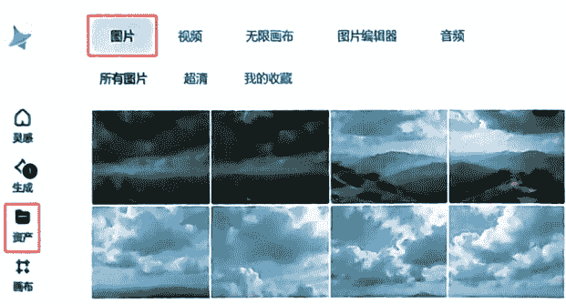

图 5-27 Seedance 2.0 图生视频操作步骤示意图

#### 步骤二

挑选需要做视频的图片，这里仍用之前无法作为参考图做视频的图举例，左键点击该图，随后点击“生成视频”按钮，图片将被自动添加为视频首帧（见图5-28）。

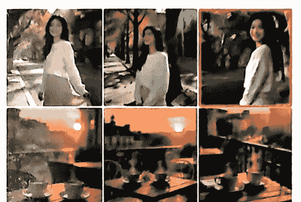

图 5-28 Seedance 2.0 拟真人图生视频操作步骤示意图

#### 步骤三

在提示词输入框填入人物动作、环境变化、运镜方式等视频要素，即可得到以画中人物为主角的视频。此路径下 Seedance 2.0 直接进入视频生成步骤，不会弹出错误提示。

#### 步骤四

利用图生图获取的人物分镜图，按分镜前后顺序重复上述操作，即可得到连续视频。注意为保证整体流畅，各脚本之间在画面与剧情上需保持关联。

当然，Seedance 2.0 在生成非人类元素时仍可使用相对逼真的参考图。

#### 实操效果

仍以上图为例，导入 Seedance 2.0 并进行动作描述（见图5-29）。

按下生成键，等待产出结束后，可看到 Seedance 2.0 能顺利完成视频，不再提示错误（见图5-30、图5-31）。

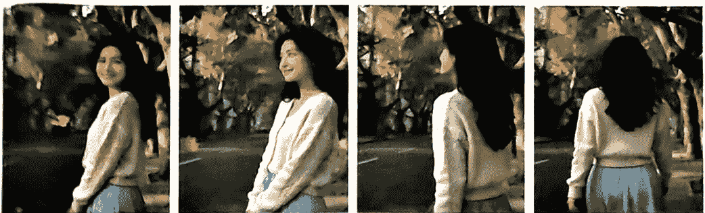

图 5-31 Seedance 2.0 利用拟真人图生成的视频的截图

也可选择 Seedance 2.0 的全能参考模式，按前述方法将首帧图作为参考样本之一添加至模型，再借助多模态参考方式生成更丰富的视频内容（见图5-32）。

图 5-32 Seedance 2.0 全能参考模式

在 Seedance 2.0 中，还可通过细化分镜脚本的方式，将人物台词等视听内容一次性提供给模型，关于这一点在第六章配音部分会再展开。

### 参数设置与效果优化

#### Seedance 2.0 各类型参数详解

在视频生成过程中，合理设置参数能大幅提升质量。表5-7 为核心参数说明。

## 表 5-7 Seedance 2.0 视频生成核心参数详解

| 参数 | 作用 | 推荐设置 | 备注 |

| --- | --- | --- | --- |

| 时长 | 视频长度 | 3～5秒（单镜头） | 超过5秒容易崩坏，复杂动作建议3秒 |

| 帧率 | 流畅度 | 24FPS（电影感）或30FPS（流畅） | 即梦AI默认24FPS |

| 分辨率 | 清晰度 | 1080p（常规）或4K（精品） | 4K生成时间稍长 |

| 负向提示词 | 避免不良结果 | 见下方词库 | 必填！ |

| 多模态参考 | 保持人物/场景一致 | 可上传视频或图片同时参考 | Seedance 2.0支持参考素材中的画面元素灵活组合 |

## 负向提示词库

负向提示词非常重要，生成复杂视频时需在提示词中规避以下词：变脸，崩坏，扭曲，模糊，低质量，水印，文字，多余肢体，畸形，丑，平光，过曝，暗淡，噪点，卡通，油画，3D渲染。

## 视频效果优化三步法

- 步骤 1：生成预览版：设置较低分辨率（720p）、短时长（2～3秒），快速验证动作是否合理，表情变化是否自然，运镜是否符合分镜。
- 步骤 2：调整优化：根据预览结果修改提示词或参数，重复步骤 1。
- 步骤 3：生成高清版：预览满意后，设置为4K、最终时长，生成最终素材。

## 5.3 首尾帧精准控制

前面介绍了 AI 生成视频的基础操作方法。普通图生视频，运镜、动作、节奏都由模型自主决定，画面虽能动，但不一定符合分镜脚本。在专业短剧创作中，我们经常需要精确控制镜头起点和终点，即精准控制视频的首尾帧。

实现首尾帧精准控制并不难，核心是把一段视频的起始画面和结束画面提供给模型，并提出要求，让模型生成中间流畅的过渡动画，这样镜头完全按剧本走，不再依赖随机发挥。

当然，正如前文所述，因 Seedance 2.0 易将 AI 生成的拟真人识别为真人而无法生成视频，可采用 5.2 中的方法，通过与剧情紧密相关且具有连续性的首帧，或全能参考来生成连续视频，或将上一视频的尾帧作为下一视频的首帧创作，以保证整体连续性，再用剪辑软件拼接。

## 首帧 / 尾帧图片制作技巧

### 什么是首尾帧？

- 首帧：视频最开始的那一帧画面
- 尾帧：视频结束时的最后一帧画面

只要提供首尾两张图，模型就会自动计算运动轨迹、光影变化、表情过渡，生成起点和终点完全可控的视频。

## 首尾帧的 3 种制作方法

- 方法 1：文生图法（分别生成）

用文生图分别产出首帧画面和尾帧画面。

适用场景：首尾画面差异较大，比如场景完全切换、视角大幅变化。

- 方法 2：图生图法（推荐，最稳定）

先生成首帧，再用图生图在首帧基础上修改出尾帧。

适用场景：人物必须一致、表情变化、光线变化、角度微调。

- 方法 3：同一图局部修改

用同一张底图，在修图工具或 AI 编辑中微调局部（亮度、颜色、物体位置）。

适用场景：微小变化，如天色变暗、灯光亮起、镜头轻微移动。

上述 3 种方法在前文图片生成部分已有详细介绍，具体流程这里不再赘述。注意要想控制视频生成精度，务必依据分镜脚本进行图片和视频的精细化制作。

##### 实战案例

- 第一步：用文生图生成图片。在即梦 AI 图片生成界面输入提示词，并选择适合竖屏短剧的尺寸，生成理想图片（见图5-33）。

- 第二步：用图生图生成尾帧。在即梦 AI 图片生成界面中添加参考图，并输入提示词，生成并选择最佳图片（见图5-34）。

图 5-34 控制首尾帧生成视频步骤示意图

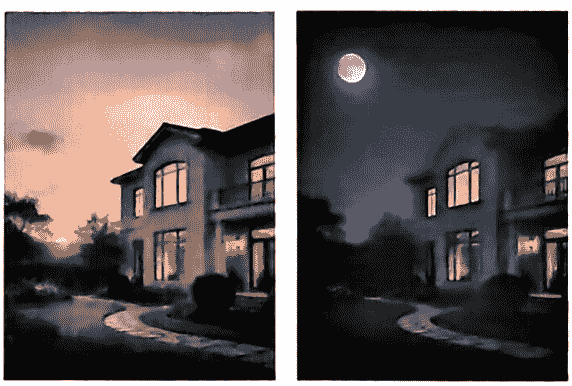

图 5-35 AI 生成的首帧和尾帧图片

- 第三步：选择 Seedance 2.0 “首尾帧”模式。分别将图5-35 中的两张图片上传到 Seedance 2.0 的首尾帧位置，选择好相关参数（时长、分辨率、画面比例），可输入过渡提示词，比如“从首帧平滑过渡到尾帧，自然流畅，表情逐渐变化”，然后按下生成视频按钮，模型自动生成从白天到夜晚的平滑过渡视频（见图5-36）。

图 5-36 控制首尾帧生成视频步骤示意图

- Seedance 2.0 生成视频的截图如图5-37所示。

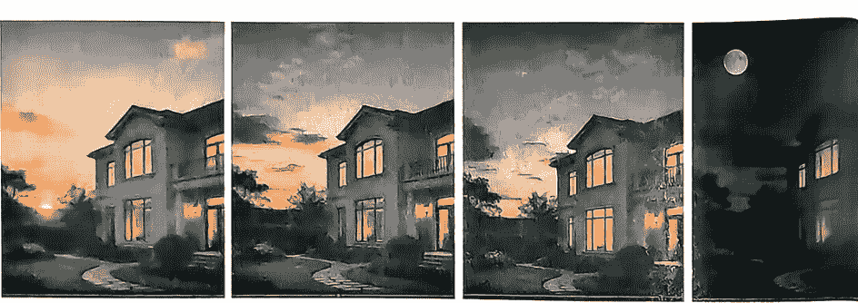

## 首尾帧翻车修复清单

用首尾帧拼复杂场景时，总会冒出一些细碎瑕疵。创作者要懂得灵活调度工具，常见现象与对应的即梦优化方式整理如下。

表 5-8 首尾帧生成视频常见问题与解决方案

| 问题 | 原因 | 即梦 AI 解决方案 |
| :--- | :--- | :--- |
| 人物面孔漂移 | 首尾人设素材不统一 | 统一使用同一组定妆图生成首尾帧，提示词中强化保持面部特征稳定 |
| 衔接生硬 | 开尾画面差异过大 | 补充中间关键帧或压缩生成时长 |
| 动作断层 | 运动参数设置过猛 | 降低运动强度数值，提示中加入平滑过渡 自然连贯 |
| 背景闪烁 | 照明波动过大 | 提示中加入稳定光源恒定照度，首尾光位保持一致 |
| 元素增减 | 首尾画面元素缺漏/增添 | 用图生图方式补齐尾帧元素，或后期剪辑软件补救 |

## 5.4 电影感四大参数实操

第 4 章已介绍推、拉、摇、移、跟、升降、甩七类基础运镜。光写“推镜头”“拉镜头”很难出质感，决定质感的是光圈、焦距、曝光、景深这四项核心变量。

这四项共同塑造电影感。特写里大光圈浅景深更柔和唯美，小光圈深景深则写实通透。全景里广角冲击强，长焦压缩感明显。它们相当于 AI 的摄影语法，提示写准了，Seedance 2.0 就能读懂意图，输出接近实拍的画面。

### 光圈和景深控制

#### 光圈与景深的原理

光圈是调节进光量的光学开口。作用有二：调进光量，光圈越大 f 值越小，进光越多画面越亮；调景深，光圈越大背景越虚，光圈越小背景越实。摄影里用 f 值表示，f 值与光圈大小成反比。

景深指画面保持清晰的纵向区间，受光圈、焦距、拍摄距离影响。AI 提示里我们直接描述效果，下面把两者合并讨论。

#### 提示词表达方式

想让 AI 得到理想景深的分镜，先要弄清景深的类型与用处，见表5-9。

表 5-9 景深的类型及其在短剧中的应用

| 景深类型 | 特点 | 短剧应用 |
| :--- | :--- | :--- |
| 浅景深 | 只有主体清晰，前后模糊 | 情绪特写、主体突出 |
| 深景深 | 前后都清晰 | 环境交代、大场面 |

了解区别后就能用提示引导。浅景深可写“浅景深，主体清晰，背景虚化”，深景深可写“深景深，前后景都清晰”。

##### 实战案例

- 案例一：对话场景 浅景深
【提示词】近景，两人对话，说话的人清晰，身后的人群虚化，浅景深，写实风格，电影质感。
即梦 AI 生成的图片如图 5-38 所示。
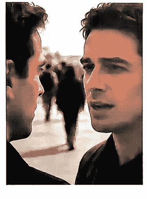
图 5-38 即梦 AI 生成的浅景深图片

- 案例二：城市全景 深景深
【提示词】远景，整个城市天际线，深景深，从近处的楼顶到远处的山脉都清晰，写实风格，电影质感。
即梦 AI 生成的图片如图 5-39 所示。

图 5-39 即梦 AI 生成的深景深图片

图生视频时，原图自带浅景深效果 AI 通常会保留。需要强化或减弱时，可在提示里明确“保持浅景深”或“增加景深”。

### 焦距控制

#### 焦距基础

焦距决定取景范围的宽窄，即视野大小。常用类型见表5-10。

表 5-10 常用焦距类型及其特点

| 焦距类型 | 焦距范围 | 视角 | 透视效果 | 视觉心理 | 短剧应用 |
| :--- | :--- | :--- | :--- | :--- | :--- |
| 超广角 | 16 ～ 24mm | 极宽（100° 以上） | 强烈拉伸变形，边缘夸张 | 震撼、压迫、眩晕 | 大佬出场、空间展示、打斗场面 |
| 广角 | 24～35mm | 宽（70°～100°） | 轻微拉伸，空间感强 | 开阔、气势、代入感 | 环境交代、全景叙事 |
| 标准 | 50mm左右 | 接近人眼（45°～50°） | 自然真实，无变形 | 客观、真实、亲近 | 对话场景、日常叙事 |
| 中长焦 | 85～135mm | 窄（15°～30°） | 轻微压缩，背景柔和 | 专注、唯美、情感 | 人物特写、告白、泪目 |
| 长焦 | 135mm以上 | 极窄（10°以下） | 强烈压缩，空间扁平 | 偷窥、紧张、对峙 | 隔空对视、跟踪、悬疑 |

以下是两张 AI 生成的不同焦距的图片 见图 5-40。
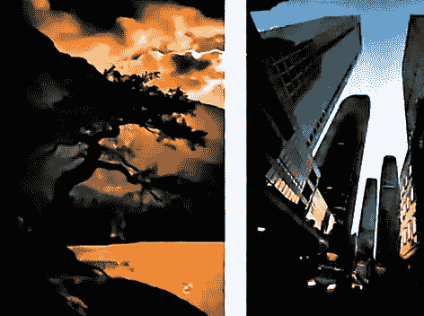
图 5-40 AI 生成的长焦图片与广角图片

#### 焦距对情绪的作用

焦距自带情绪暗示，用对了感染力会更强。短剧中不同焦距的情绪影响见表5-11。

表 5-11 不同焦距对于观众情绪的影响

| 焦距 | 情绪暗示 | 原因 |
| :--- | :--- | :--- |
| 广角 | 震撼、压迫、自由 | 空间被拉伸，人物显得高大或环境显得辽阔 |
| 标准 | 真实、客观、亲近 | 视角接近人眼，观众感觉“就在现场” |
| 长焦 | 专注、紧张、疏离 | 空间被压缩，背景模糊，注意力完全集中在主体上 |

148 AI 短剧 Seedance2.0 变现实战指南

### 即梦 AI 焦距提示词库

- 超广角提示词：
超广角镜头，16mm，鱼眼镜头，强烈透视变形。
- 广角提示词：
广角镜头，24mm，宽广视角。
- 标准提示词：
50mm，标准镜头，自然视角
- 中长焦提示词：
人像镜头，85mm，背景柔和。
- 长焦提示词：
长焦镜头，135mm，背景压缩，主体突出。

即梦对具体毫米数很敏感，写“24mm”“50mm”“85mm”比只写广角长焦更精准。

##### 实战案例

案例：霸总出场 用广角制造压迫感
- 场景：公司创始人首次登场，要体现气场与地位。
- 为何用广角：
广角让前景人物显得更高大。
背景拉伸产生空间被压缩的错觉，强化压迫。
低角度加广角是塑造权威的经典组合，观众会本能觉得“不好惹”。
- 分镜设计：
分镜一：镜头从走廊尽头起，霸总走向镜头
分镜二：24mm 广角低角度仰拍
分镜三：走廊在广角下变得深邃
分镜四：门框墙边出现拉伸变形，提升冲击
- 提示词：
广角镜头，24mm，从下往上仰拍，霸总走进会议室，门框边缘变形拉伸，人物显得高大修长，步伐沉稳，身后走廊深邃，压迫感强，写实风格，电影质感，5秒。
- Seedance 2.0 生成视频的截图如图 5-41 所示。
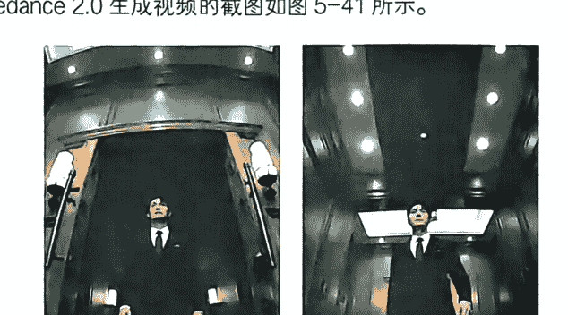
图 5-41 Seedance 2.0 生成的广角视频的截图

### 进阶技巧

- 技巧一：变焦镜头模拟
同一镜头内改变焦距能制造特殊情绪。
案例：发现真相时的“变焦推”。
> 【提示词】从 35mm 广角开始，缓慢变焦推到 85mm 中长焦，同时镜头推进，女主的眼神从疑惑变成震惊，电影质感，5秒。
Seedance 2.0 生成视频的截图如图 5-42 所示。
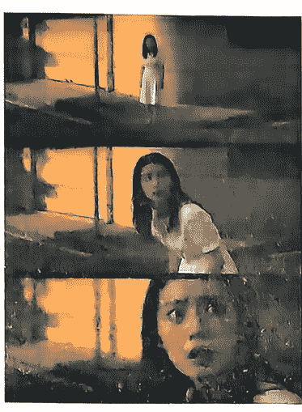
图 5-42 Seedance 2.0 生成的变焦视频的截图
效果：焦距变化加镜头推进，双重运动让情绪聚焦更有冲击。

- 技巧二：焦距对比制造冲突
同一场景交替不同焦距，强化情绪对比。
案例：男女主对峙镜头 见表 5-12。

表 5-12 不同焦距组合场景示例

| 镜头顺序 | 焦距 | 拍摄对象 | 情绪 |
| :--- | :--- | :--- | :--- |
| 镜头 1 | 24mm 广角 | 全景展示对峙环境 | 紧张 |
| 镜头 2 | 135mm 长焦 | 男主冷酷的眼神 | 压迫 |
| 镜头 3 | 135mm 长焦 | 女主颤抖的嘴唇 | 愤怒 |
| 镜头 4 | 50mm 标准 | 两人同框 | 对峙 |

- 技巧三：焦距与景深配合
不同焦距搭配景深能呈现丰富视觉效果 见表 5-13、图 5-43。

表 5-13 焦距与景深组合示例

| 焦距 | 配合光圈 | 效果 |
| :--- | :--- | :--- |
| 广角 + 大光圈 | 24mm + f/1.4 | 广角下的浅景深，既有空间感又突出主体 |
| 长焦 + 小光圈 | 200mm + f/8 | 长焦下的深景深，背景细节也清晰 |
| 标准 + 中等光圈 | 50mm + f/2.8 | 最自然的视觉感受 |

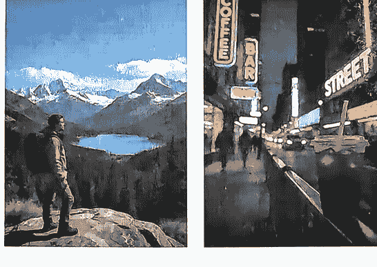
图 5-43 AI 生成的不同焦距与光圈组合图

## 曝光控制

### 曝光是什么

- 曝光的内容与维度
曝光是摄影基础，决定画面明暗、明媚或阴沉。在 AI 短剧里曝光是情绪的第一滤镜。看画面前，情绪已被明暗牵引，亮画面让人轻松温暖，暗画面让人压抑紧张。曝光三维度见表 5-14。

表 5-14 曝光的 3 个维度

| 维度 | 定义 | 对情绪的影响 |
|---|---|---|
| 亮度 | 画面的整体明暗程度 | 越亮越轻松，越暗越压抑 |
| 对比度 | 亮部和暗部的反差大小 | 反差越大越戏剧性，越小越柔和 |
| 动态范围 | 从最暗到最亮的细节保留 | 范围越宽越真实，越窄越风格化 |

- 曝光的类型
没有绝对对错，只有是否契合剧情。短剧常见正常曝光、过曝/高调、欠曝/低调三大类，具体拆解见表 5-15。

表 5-15 曝光的类型及其适用场景

| 曝光类型 | 核心特点 | 情绪暗示 | 短剧适配场景 |
|---|---|---|---|
| 正常曝光 | 明暗比例均衡，画面亮部、暗部细节全部清晰可见，没有过亮泛白、过暗发黑的情况，最贴近人眼日常看到的视觉效果 | 真实、客观、平和、自然，无额外情绪偏向，专注叙事本身 | 日常叙事、都市生活片段、普通对话场景、白天户外写实镜头、中性剧情推进 |
| 过曝/高调 | 整体画面偏亮，暗部被弱化甚至消失，高光区域柔和，无刺眼强光，多搭配柔光、漫射光，画面通透干净，自带朦胧感 | 梦幻、纯洁、温暖、治愈、浪漫，也可用于回忆、梦境、幻想片段，营造疏离又美好的氛围 | 甜宠恋爱、青春校园、回忆闪回、梦境片段、唯美空镜、婚礼/温馨家庭场景 |
| 欠曝/低调 | 整体画面偏暗，亮部仅集中在局部区域（如人物面部、关键道具），大面积处于阴影中，明暗对比强烈，光影层次丰富 | 压抑、神秘、紧张、悬疑、冷峻、悲情，适合烘托反派、复仇、惊悚、深夜冲突等强情绪场景 | 悬疑推理、复仇虐心、反派出场、深夜对峙、密室场景、惊悚片段、悲情哭戏 |

### 即梦 AI Seedance 2.0 提示词表达

即梦对曝光关键词识别度高，无需专业术语即可生成理想画面。简单模板见表 5-16。

表 5-16 AI 短剧创作提示词中关于画面曝光度的关键词

| 曝光效果 | 中文提示词 | 补充修饰词 |
| :--- | :--- | :--- |
| 正常曝光 | 正常曝光, 光线平衡, 明暗适中 | 细节完整, 光线自然, 无过暗过亮 |
| 过曝 / 高调 | 过曝, 高调, 明亮通透, 柔光漫射 | 无暗角, 朦胧感, 纯白柔光, 治愈氛围 |
| 欠曝 / 低调 | 欠曝, 低调, 戏剧性光影, 明暗对比强烈 | 局部打光, 侧光, 顶光, 阴影厚重, 氛围感拉满 |

曝光与光影风格紧密相关。短剧光影风格关键词可参考表 5-17。

表 5-17 AI 短剧创作提示词中关于光影风格的关键词

| 光影风格 | 中文提示词 | 适用场景 |
| :--- | :--- | :--- |
| 柔光 | 柔光, 漫射光 | 甜宠、回忆、唯美 |
| 硬光 | 硬光, 直射光 | 悬疑、对峙、压迫 |
| 侧光 | 侧光, 伦勃朗光 | 情绪特写、神秘感 |
| 逆光 | 逆光, 剪影 | 浪漫、离别、神秘出场 |
| 顶光 | 顶光 | 审讯、压抑、神性 |
| 底光 | 底光 | 恐怖、诡异、反派 |
| 自然光 | 自然光, 窗光 | 日常、真实感 |
| 霓虹光 | 霓虹光, 赛博朋克 | 夜晚城市、未来感 |

### 短剧实战案例详解

- 案例一：甜宠回忆片段 过曝/高调
适用题材：都市甜宠、青春校园
核心需求：营造回忆梦幻感，弱化现实，突出甜蜜。
即梦 AI 完整提示词：过曝效果，高调光影，明亮通透，纯白柔光漫射，男女主在午后草坪牵手微笑，发丝带光，无暗部阴影，画面朦胧治愈，电影质感。
即梦 AI 生成的图片如图 5-44 所示。

图 5-44 即梦 AI 生成的过曝效果图片
生成效果解析：过曝提亮，暗部消失，柔光无刺眼高光，整体朦胧梦幻，贴合回忆氛围，观众一眼识别为美好回忆。

- 案例二：悬疑对峙场景 欠曝/低调
适用题材：悬疑推理、复仇虐心
核心需求：烘托紧张感，塑造神秘压抑氛围，突出眼神交锋。
即梦AI完整提示词：欠曝，低调光影，戏剧性侧光，一束冷光打亮男女主面部，其余部分隐入黑暗，明暗对比强烈，眼神尖锐交锋，无多余亮光，阴影厚重，紧张压抑的氛围，电影质感。
即梦 AI 生成的图片如图 5-45 所示。

图5-45 即梦AI生成的欠曝效果图片
生成效果解析：大面积黑暗加局部亮光，强明暗反差突出面部与眼神，阴影营造悬疑紧张，一眼感受到对峙张力。

## 新手避坑指南

- 过曝切忌过度：不要只写“过曝”，一定要加“柔光”“明亮通透”，避免画面泛白细节丢失五官模糊。
- 欠曝切忌全黑：欠曝不是纯黑，必须搭配“侧光”“顶光”“局部亮光”，保留主体细节，否则漆黑一片。
- 适配场景不滥用：甜宠少用欠曝，悬疑少用过曝，避免风格与剧情冲突。
- 单镜头统一曝光：一个镜头内不要混用过曝和欠曝，保持光影统一更专业。

## 5.5 经典场景运镜组合

前面掌握了光圈、焦距、曝光、景深等基础，也学会了运镜表达，但零散参数不足以撑起有感染力的画面。要创作出优秀 AI 短剧，需要按场景情绪和叙事节奏组合使用，本部分总结了五种常见场景的运镜方案。

### 情绪聚焦场景：推进 + 虚化

#### 运镜作用
锁住人物内心，切断外界干扰，把注意力完全引到表情与心理变化，是情感短剧高频镜头。

#### 适用场景
发现真相、深情告白、情绪爆发、恍然大悟、心碎落泪等强内心戏，以及聚焦关键画面元素。

#### 组合方案详解
“推进 + 虚化”的逻辑：从环境到人物，从外部到内心。缓慢推进配合背景虚化，把视线逐步引导进内心世界。不同景别作用见表 5-18。

表 5-18 “推进 + 虚化”运镜详解

| 阶段 | 时长 | 景别 | 运镜 | 画面描述 | 镜头目的 |
| :--- | :--- | :--- | :--- | :--- | :--- |
| 1 | 2秒 | 中景 | 固定 | 人物在画面中央，环境清晰可见 | 建立人物与环境的关系 |
| 2 | 3秒 | 中景→近景 | 缓慢推进，背景开始虚化 | 人物表情逐渐清晰，环境开始模糊 | 引导视线聚焦人物 |
| 3 | 2秒 | 近景→特写 | 继续推进，背景完全虚化 | 焦点在眼睛或嘴唇，细节放大 | 进入人物内心 |
| 4 | 1秒 | 特写 | 定格 | 关键表情凝固，情绪发酵 | 让观众记住这一刻 |

#### Seedance 2.0 生成视频示例
Seedance 2.0 生成的“推进 + 虚化”运镜视频的截图如图 5-46 所示。
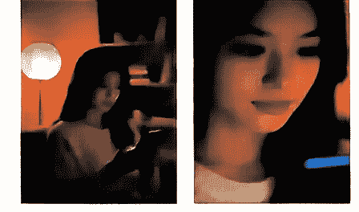
图 5-46 Seedance 2.0 生成的“推进 + 虚化”运镜视频的截图

### 震撼揭示场景：上升 + 俯拍

#### 运镜作用
通过升降改变视角，放大人物气场或场景反差，制造视觉冲击，打造名场面。

#### 适用场景
大佬出场、身份揭晓、真相大白、强者归来、反转时刻等强气场场景。

#### 上升俯拍：细节到全景的钩子

上升叠加俯拍的思路是先藏后露再放大冲击。先用极近的局部开场吊起好奇，随后镜头缓缓上移把人物从局部逐步完整呈现，最后在顶点转为俯视，把人物与所在空间的关系一次性摊开，形成视觉冲击。分镜拆解见表5-19。

表 5-19 “上升 + 俯拍”运镜详解

| 阶段 | 时长 | 景别 | 运镜 | 画面描述 | 镜头目的 |
| :--- | :--- | :--- | :--- | :--- | :--- |
| 1 | 1秒 | 特写 | 固定 | 局部细节(脚/手/物品)，制造悬念 | 勾起好奇心：“这是谁？” |
| 2 | 3秒 | 特写→全景 | 缓慢上升 | 从局部到全身，逐步揭示 | 满足好奇心：“原来是他！” |
| 3 | 2秒 | 全景 | 到达最高点，变成俯拍 | 展示人物与环境的关系 | 制造震撼：“他在这样的地方！” |
| 4 | 2秒 | 俯拍全景 | 定格 | 人物在画面中显得高大或渺小 | 强化情绪 |

Seedance 2.0 演示样例

Seedance 2.0 产出的上升加俯拍运镜截图如图 5-47 所示。

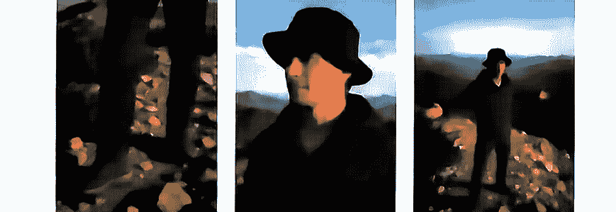

图 5-47 Seedance 2.0 生成的“上升 + 俯拍”运镜视频的截图

### 空间巡游：前推 + 环绕

#### 画面作用
推进进入后再环绕，让观众跟随镜头进入空间并完成全方位巡视，营造沉浸感并突出场景的宏大、奢华或神秘。

#### 典型场景
首次入场、豪宅宫殿秘境的呈现、未知地点的探索、以及需要强调奢华氛围的空间高光。

#### 分镜拆解
前推加环绕的核心是从外部走向内部，再由客观转向主观。先用推进把观众带入，再以360°环绕展示全貌，最后收束到人物反应。具体步骤见表 5-20。

表 5-20 “前推 + 环绕”运镜详解

| 阶段 | 时长 | 景别 | 运镜 | 画面描述 | 镜头目的 |
| :--- | :--- | :--- | :--- | :--- | :--- |
| 1 | 2秒 | 远景 | 固定 | 人物站在场景入口，展示入口全貌 | 建立起点 |
| 2 | 3秒 | 远景→中景 | 前推 | 镜头带观众走进场景，跟随人物 | 代入感：“我跟着她一起走进来” |
| 3 | 3秒 | 中景→环绕 | 360° 环绕 | 到达场景中心后，环绕一周展示环境 | 沉浸式体验：“这里真大 / 真美 / 真可怕” |
| 4 | 2秒 | 近景 | 定格 | 人物震惊 / 惊叹 / 恐惧的反应 | 情绪落地 |

Seedance 2.0 演示样例

该模型生成的前推加环绕镜头截图如图 5-48 所示。

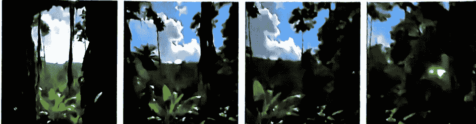

### 叙事推进：上摇 + 推进

#### 画面作用
由环境过渡到人物细节，完成叙事衔接，推动情节，适配各类叙事段落。

#### 典型场景
环境到人物、整体到细节、情节推进、氛围铺垫、情绪递进等。

#### 分镜拆解
上摇配合推进的重点在于视线引导与层层递进。先以远景确立空间，再用摇镜指示方向，最后推进锁定主体。具体见表 5-21。

表 5-21 “上摇 + 推进”运镜详解

| 阶段 | 时长 | 景别 | 运镜 | 画面描述 | 镜头目的 |
| :--- | :--- | :--- | :--- | :--- | :--- |
| 1 | 2秒 | 远景 | 固定 | 展示环境全貌，建立空间感 | 告诉观众“这里是哪” |
| 2 | 2秒 | 远景→中景 | 上摇或下摇 | 沿着某个方向移动，引导视线 | 告诉观众“看那边” |
| 3 | 3秒 | 中景→近景 | 推进 | 锁定主体，逐步靠近 | 告诉观众“就是他” |
| 4 | 2秒 | 特写 | 定格 | 关键细节放大 | 告诉观众“注意这个” |

Seedance 2.0 演示样例

该模型生成的上摇加推进镜头截图如图 5-49 所示。

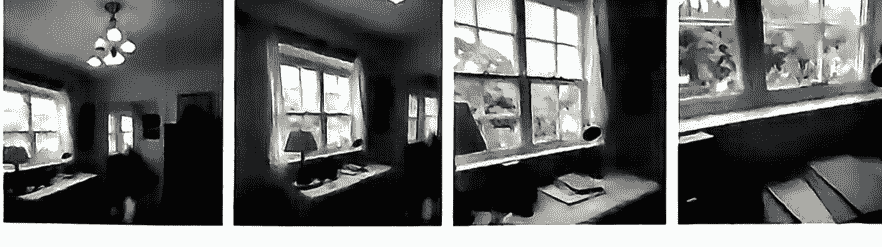

### 流畅转场：升降 + 平移

#### 画面作用
为场景、时间、情绪提供柔和过渡，避免硬切突兀，让节奏更顺滑。

#### 典型场景
时光流转、场景交替、情绪缓冲、昼夜与季节变化等转场。

#### 分镜拆解
升降结合平移的逻辑是用视角变化做桥梁。升降改变高度，平移衔接两地，过渡自然不跳跃。见表 5-22。

表 5-22 “升降 + 平移”运镜详解

| 阶段 | 时长 | 景别 | 运镜 | 画面描述 | 镜头目的 |
| :--- | :--- | :--- | :--- | :--- | :--- |
| 起 | 2 秒 | 固定 | 固定 | 场景 A，建立起点 | 告诉观众“这里是 A” |
| 承 | 2 秒 | 固定→移动 | 缓慢升降 | 视角开始变化，离开场景 A | 开始过渡 |
| 转 | 3 秒 | 移动 | 平移 | 中间过渡画面，连接 A 和 B | 视觉桥梁 |
| 合 | 2 秒 | 固定 | 固定 | 场景 B，到达终点 | 告诉观众“现在是 B” |

Seedance 2.0 演示样例

该模型生成的升降加平移镜头截图如图 5-50 所示。

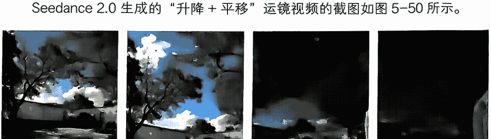

## 第6章 AI 短剧音频制作

在 AI 短剧里，声音由对白、配乐、音效三部分构成，三者协同才能让观众真正入戏。传统流程依赖录音棚、演员、音效师与混音师，成本和周期都很高。如今 AI 音频工具可让个人居家完成整套工作，快速产出多情绪配音、自动配乐与环境音。

### 6.1 AI 配音全流程

画面有了，角色仍是“哑巴”。配音要让声线贴合人物性格，情绪贴合剧情，口型与台词节奏同步。

#### 即梦 AI 配音技巧

##### 即梦 AI 数字人配音生成

即梦 AI 的操作很简洁，能为画面角色合成自然语音并同步口型，支持独白与对话。基本流程如下。

第一步，登录即梦 AI，进入创作页，在左侧类型栏选择“数字人”，见图6-1。

图 6-1 即梦 AI 配音生成操作步骤示意图

第二步，点击“角色”导入已有的视频或人物图作为配音对象，并在提示词框输入台词。也可先录好音频直接导入，注意视频与音频时长尽量对齐，见图6-2。

图 6-2 即梦 AI 配音生成操作步骤示意图

第三步，输入台词后可补充动作描述，让结果更生动，同时点击音色按钮挑选声音，见图6-3。

图 6-3 即梦 AI 配音生成操作步骤示意图

音色库可按性别、年龄段、语种、声音特性筛选，见图6-4。

图 6-4 即梦 AI 配音功能自带丰富的音色可供选择

除自带音色外，还可克隆：在创作类型选“配音生成”，输入待合成内容，点击“克隆声音”导入参考音频，即可得到相似音色的结果，见图6-5。

图 6-5 即梦 AI 配音生成功能可克隆想要的音色

##### 实战案例
在数字人页导入人物图，选择“纯净女声”，提示词分别写台词与动作，模式选大师模式，最后生成，见图6-6。

图 6-6 即梦 AI 配音生成功能实战演示

生成效果如图6-7，人物形象稳定，无崩脸或僵硬，画面流畅。素材仍为第五章的拟真人，即梦数字人可直接使用 AI 生成的拟真人。

图 6-7 即梦 AI 生成的配音数字人

Seedance 2.0 能力更强，支持一次输出带配音、口型、环境音与 BGM 的完整片段，无需后期补配。它采用双分支扩散架构，视音频同步生成，自带音素级唇形同步。只需在分镜脚本里细化台词与肢体动作即可一次成片，少量瑕疵可用数字人配音补足。

下面以 Seedance 2.0 演示直接从分镜生成配音视频。

第一步，先做一张动漫风格人物图，见图6-8。

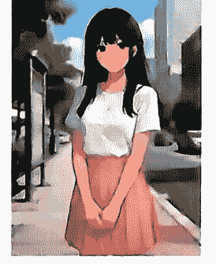

图 6-8 即梦 AI 生成的动漫人物图像

第二步，把人物与带说话内容的分镜脚本导入 Seedance 2.0 对应界面即可生成。即使参考为拟真人也可用“只上传首帧”方式，见图6-9。

图 6-9 利用 Seedance 2.0 将多个带有说话内容的脚本生成连续视频

生成截图见图6-10。

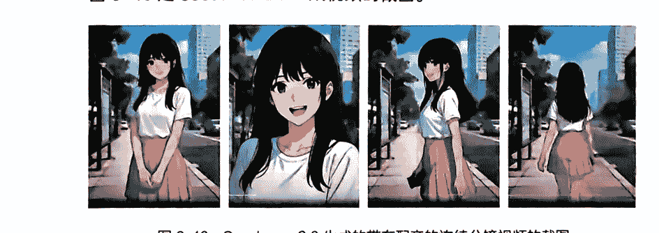

图 6-10 Seedance 2.0 生成的带有配音的连续分镜视频的截图

#### 情感表达控制

##### AI 配音的情感维度
人类情感细腻，短剧配音需关注六大基础维度，各维度有不同的声学特征与使用场景，见表6-1。

表 6-1 不同情感维度下的配音特征及其在短剧中的适用场景

| 情感维度 | 声学特征 | 短剧应用场景 |
| :--- | :--- | :--- |
| 喜悦 | 语速偏快、音调高、音量起伏大、声音明亮 | 重逢、告白、成功、甜蜜日常 |
| 悲伤 | 语速缓慢、音调低、音量弱、气息声重、哽咽 | 离别、失去、绝望、回忆过去 |
| 愤怒 | 语速快（或咬牙切齿的慢）、音调高、音量爆发力强、气息粗重 | 对峙、背叛、复仇、争执 |
| 恐惧 | 语速不稳（颤抖）、音调忽高忽低、音量忽大忽小、倒吸气 | 遇险、惊吓、悬疑、噩梦 |
| 惊讶 | 语速骤停、音调突升、音量突增、吸气声 | 发现真相、身份揭晓、意外转折 |
| 厌恶 | 语速缓慢、音调低、音量压制、带有鼻音或冷哼 | 反感、鄙视、拒绝、嫌弃 |

控制方式一：提示词驱动
在台词后加上情绪、语气强度与说话方式的描述，Seedance 2.0 即可还原。核心是“台词+情绪副词+语气状态”，描述越具体越准确，避免只用“开心”“难过”等模糊词，见表6-2。

表 6-2 描述情绪强度的提示词示例

| 情绪强度 | 关键词示例 | 效果 |
| :--- | :--- | :--- |
| 轻度 | 温柔地说、轻声说、淡淡地 | 情感含蓄，适合日常对话 |
| 中度 | 激动地说、哽咽着说、生气地说 | 情感明显，适合情绪戏 |
| 重度 | 歇斯底里地喊、绝望地哭诉、咬牙切齿 | 情感爆发，适合高潮戏 |

控制方式二：音频参考驱动
针对特殊情绪或定制语气，可导入真人情绪音频作参考，AI 会模仿其情感、腔调与呼吸节奏。操作：在生成页选全能参考，左侧添加参考内容中导入参考音频，提示词说明模仿方式，如“让角色模仿音频1的语气和情感说出‘我等你很久了’”，可再调语速音色，见图6-11。

图6-11 Seedance 2.0 音频参考操作示意图

控制方式三：语速+停顿+重音微调
结合语速、停顿、重音能让表达更自然。语速影响情绪节奏，见表6-3。

表6-3 Seedance 2.0 生成视频配音过程中的语速控制

| 情感 | 语速建议 | 案例 |
| :--- | :--- | :--- |
| 喜悦 | 稍快(200～220字/分钟) | “我考上啦！我考上啦！”（语速快，兴奋） |
| 悲伤 | 慢(120～140字/分钟) | “他……他走了……” （语速慢，沉重） |
| 愤怒 | 爆发时极快，压抑时极慢 | “你给我滚！”（快）；“你……真……好……” （慢，咬牙切齿） |
| 恐惧 | 不稳，忽快忽慢 | “别……别过来……” （颤抖，时快时慢） |

停顿用于酝酿情绪，给观众共情空间，见表6-4。

表6-4 Seedance 2.0 生成视频配音过程中的停顿控制

| 停顿类型 | 作用 | 案例 |
| :--- | :--- | :--- |
| 逻辑停顿 | 区分句子成分，让听众更容易理解 | “我，爱，你。”（逐字强调） |
| 情感停顿 | 表达犹豫、哽咽、思考 | “我……我其实……喜欢你。”（紧张） |

## 6.2 音乐与音效设计

音乐是短剧的灵魂。配乐、音效与留白共同决定呈现质感。AI 画面常在张力与细节上不足，优质音频可弥补短板，音乐定调，音效增强真实，留白制造悬念。

### AI 生成背景音乐
好音乐能迅速定风格、放大情绪。相比传统选曲剪辑，AI 生成具备高效、定制、无版权风险三大优势，适配快速批量创作。

### AI 生成短剧音乐步骤演示
以字节旗下海绵音乐为例，流程见图6-12至图6-17。

打开海绵音乐官网，进入首页。

图 6-12 AI 背景音乐制作步骤

点击左侧“创作”，选择“纯音乐”模式。

图 6-13 AI 背景音乐制作步骤

输入提示词，如“流行，浪漫，钢琴独奏，舒缓，纯音乐，30秒”，点“生成音乐”。

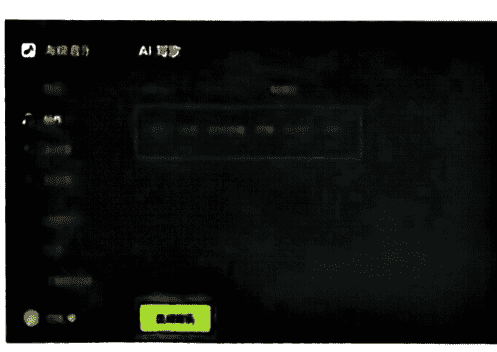

图 6-14 AI 背景音乐制作步骤

结果在右侧创作历史查看并下载，可导入 Seedance 2.0 或剪辑软件。

图 6-15 AI 背景音乐制作步骤

海绵音乐还支持视频配乐：在“纯音乐”模式下点“视频配乐”，按提示导入5秒到2分钟、小于300M的MP4/MOV视频。

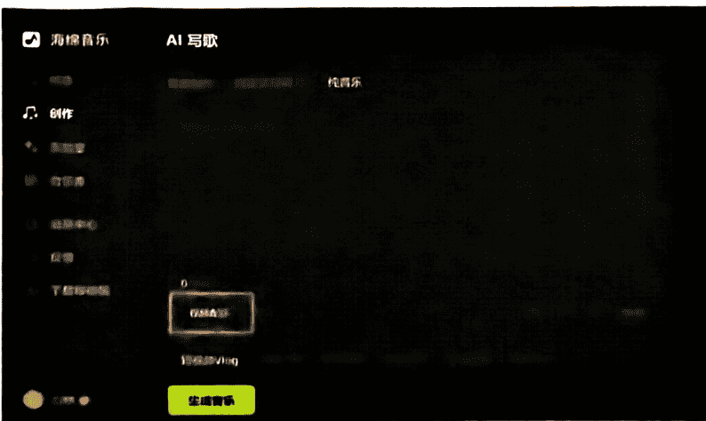

图 6-16 AI 背景音乐制作步骤

导入后点生成，系统会按画面自动配乐，效率高且时长匹配，但可能与预期有偏差，可酌情使用。

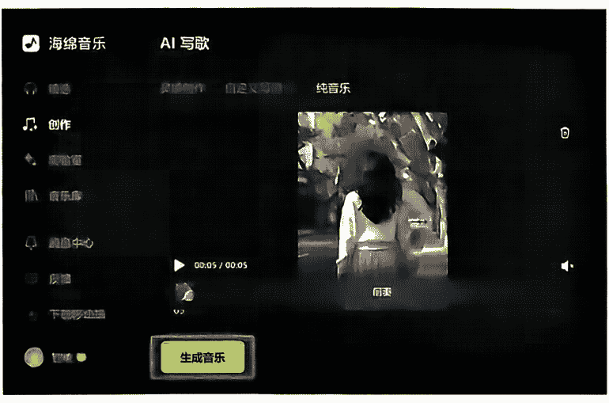

图6-17 AI背景音乐制作流程示意

### 配乐操作要点
- 长度贴合成片：配乐时长尽量与成品视频保持一致，多选用30秒、60秒等常规规格，减少反复裁剪对音乐完整性的影响。
- 响度层次分明：导入Seedance 2.0后，背景音乐的音量需低于角色对白，控制在对白音量的三至五成左右，保证台词清晰可辨，音乐只做氛围补充。
- 风格保持连贯：同一部剧、同一情绪段落要维持核心风格稳定，例如甜宠类作品不宜突然加入悬疑风格配乐，避免听觉跳跃破坏沉浸。
- 避免堆叠冗余：单场景只搭配一首BGM，不叠加多轨，适合留白的镜头可关闭音乐，遵循留白亦是声音的原则。
- 版权使用合规：仅使用海绵音乐平台原生生成的曲目，不改动、不拼接第三方版权素材，确保发布与商业使用无风险。
- 情绪呼应画面：严格执行音画匹配，让音乐情绪高于画面情绪，淡画面靠音乐提张力，强情绪画面靠音乐托氛围。

### 环境音与动作音协同
环境音可让静态画面变得立体鲜活，帮助观众快速代入时空；动作音效则让人物行为听得见、摸得着，提升画面冲击与细节质感。两者配合得当，作品专业感与观看体验会明显提升。

### 让场景活起来的环境音
常见环境音
环境音是场景的底层声场，用来提示观众身处何地、何时、何种氛围。好的环境音让人有身临其境感却不被刻意察觉。
制作核心是轻柔不空洞、持续不抢戏，作为底层铺垫，音量低于音乐与对白，只负责氛围，不干扰台词与情绪。AI短剧中常见的环境音如表6-6所示。

表6-6 常见环境音效分类
| 场景类型 | 环境音构成 | 作用 | 注意事项 |
| :--- | :--- | :--- | :--- |
| 室内场景 | 钟表滴答、空调/暖气声、远处电器嗡鸣、窗外隐约的车流声 | 建立空间感，避免“真空感” | 音量要极低，观众几乎听不见但能感觉到 |
| 室外场景（城市） | 车流声、行人脚步声、远处谈话声、商店音乐、风声 | 建立城市氛围，交代时间（白天/夜晚） | 夜晚车流声减少，可加入虫鸣 |
| 室外场景（乡村/自然） | 鸟叫、虫鸣、风声、水流声、树叶沙沙声 | 建立自然氛围，可舒缓可阴森 | 根据季节和时间调整，夜晚只有虫鸣 |
| 古代场景 | 马蹄声、市井喧哗、兵器碰撞、茶楼琴声、风声 | 建立历史感，避免现代声音穿帮 | 绝对不能出现汽车、手机等现代声音 |
| 特殊环境 | 雨声、雷声、海浪声、风声（呼啸） | 强化情绪，制造氛围 | 可单独使用，也可作为底层氛围 |

环境音设计原则
原则一：多层叠加，层次分明
真实的环境音不是单一声音，而是多层声音的混合。
例如，雨夜室外 = 雨声（主）+ 远处车流声（次）+ 风声（次）+ 偶尔的雷声（点缀）
原则二：音量要“低到几乎听不见”
环境音的目的是让观众“感觉到”而不是“听到”。音量应该低到如果专门去听才能听见，但不注意时完全融入背景。
原则三：环境音要动态变化，不要一成不变
真实的环境音是有变化的：车流声应该有远近变化，风声应该有强弱起伏，雨声应该有疏密变化。

### 让动作更真实的音效
常见的动作音
动作音效，是指人物做出特定动作时发出的即时性声音，属于点对点的精准音效，和人物动作完全同步。让人物的每一个动作都有反馈、有质感（刻意留白除外），让观众“听得到动作”，增强画面的真实感。常见的动作音效及其应用场景及其应用方式如表 6-7 所示。

表 6-7 常见动作音效分类
| 动作类型 | 音效示例 | 关键要素 | 短剧应用 |
| :--- | :--- | :--- | :--- |
| 日常动作 | 开门声、倒水声、翻书声、走路声、坐下声 | 材质感（木头门 vs 金属门）、力度 | 日常生活场景，建立真实感 |
| 激烈动作 | 打斗声、撞击声、碎裂声、摔倒声、爆炸声 | 冲击力、层次感（多个声音叠加） | 动作戏、打斗场景、灾难场面 |
| 情绪动作 | 摔东西声、拍桌子声、撕纸声、砸墙声 | 力度、材质、情绪宣泄感 | 情绪爆发场景，强化愤怒/绝望 |
| 细节动作 | 衣服摩擦声、首饰碰撞声、喝水吞咽声 | 细微、真实 | 特写镜头，增加细节质感 |

动作音效设计原则
原则一：材质正确
不同的材质产生不同的声音，错误的材质音效会让观众瞬间出戏。
原则二：力度正确
同一动作，不同力度，声音完全不同。
原则三：不要“一个声音打天下”
真实世界的动作往往由多个声音叠加而成。

### 实战案例拆解
案例场景：雨夜，女主独自走在街上（现代悬疑/情感短剧）
场景设定
时间：深夜；地点：街边小巷
氛围：清冷、孤寂，略带紧张悬念
第一步：铺底层环境音（主+次，持续贯穿）
环境音做底层铺垫，贯穿整个场景，音量最小，营造雨夜街头的整体氛围：
主环境音：淅沥雨声（全程持续，音量最低，烘托氛围）
次环境音：远处模糊车流声（微弱，间隔出现）、轻柔风声（穿插雨声中）
第二步：加关键动作音效（精准同步，点睛细节）
动作音效贴合人物动作，即时触发，音量高于环境音、低于配音，突出人物状态与剧情悬念：
- 核心动作音：脚步声（踩水坑，略带水花声，贴合女主走路动作）
- 情绪动作音：疲惫的呼吸声（缓慢，体现女主状态）
- 悬念动作音：手机震动声（突然出现，音量稍大，制造紧张感）

### 环境音与动作音效常见误区
- 拒绝音效堆砌
不是每个动作、每个场景都要加音效，普通小动作、平淡场景适度留白，只加核心关键音效，避免听觉杂乱。
- 音画必须同步
动作音效要和人物动作完全对齐，比如走路同步脚步声、开门同步开门声，不同步会产生强烈的违和感。
- 音量严格分层
遵循“配音＞音乐＞动作音效＞环境音”的音量层级，通常不让环境音和动作音效盖过角色台词。
- 贴合场景
一般情况下（穿越、需要烘托特殊气氛的场景除外），古代场景不用现代音效，室内场景不用室外嘈杂音效，符合时空逻辑，不出现违和音效。
- 留白适度
高潮、悬念片段，可适当弱化环境音，突出动作音效或静默，强化情绪张力。

## 第7章 AI 剪辑全流程实操
剪辑是成片前的最后一道关键工序，其对于短剧的节奏、观感和传播效果都有重要的影响。由于 Seedance 2.0 本身的功能已经十分强大，省去了许多传统的剪辑操作，因此，本章我们不对剪辑软件的具体功能加以赘述，只介绍如何利用剪辑软件来处理 Seedance 2.0 生成的短剧中容易存在的一些关键问题。示范用剪辑软件为同属字节跳动旗下的剪映。

### 7.1 裁剪、拼接视频
短剧与短视频不同，其时长较长，内容量大，且涉及画面、音效与情感表达等多方面因素的协调，特别是对于 AI 短剧的创作来说，更是一项复杂的工程。Seedance 2.0 虽然具备强大的功能矩阵，但创作者利用其生成的视频并非完美无缺，还需要剪辑软件进行后期加工。

#### 为何需要裁剪或拼接
Seedance 2.0 生成视频时，偶尔会出现首尾多余空镜、画面卡顿片段、时长超出平台限定，或是开场钩子不突出、结尾冗余拖沓的问题。如果 AI 短视频的创作者是新手小白的话，那么对于提示词的使用、分镜脚本或者分镜图片的掌握不够熟练，很容易生成衔接不畅的镜头。这些问题都是主客观因素共同作用形成的。

除此之外，由于 AI 生成视频的时长限制，我们很难利用 AI 工具单次生成一整集的视频，这就需要我们利用剪辑软件将这些视频拼接在一起。

创作者通过剪映对视频进行精准裁剪和拼接，既能修正瑕疵，又能收紧节奏，符合短视频“快、准、狠”的传播逻辑。

#### 裁剪、拼接视频的实操步骤
##### 裁剪视频的实操步骤
- 第一步：开启剪映。打开剪映，点击首页顶端的“开始创作”，进入操作界面（见图7-1）。

图7-1 剪映裁剪视频操作步骤演示
- 第二步：点击页面左上角的“导入”，或者在页面左侧菜单栏点击“即梦AI”，导入Seedance 2.0生成的视频（见图7-2）。
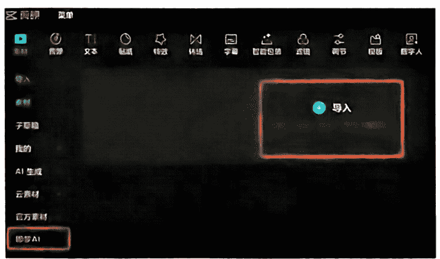
图7-2 剪映裁剪视频操作步骤演示
- 第三步：将视频拖至下方时间轴上，拖动分割轴，滑动找到想要裁剪部分的开始与结束位置，分别点击顶部「分割」按钮，点击选中想要删除的部分，点击退格键或操作平台上部的删除按钮即可（见图7-3）。
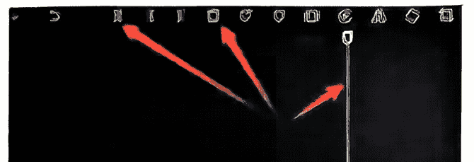
图 7-3 剪映裁剪视频操作步骤演示
- 第四步：编辑完成后，点击右上角的“导出”按钮即可。

##### 裁剪时长控制技巧
裁剪视频时，需要注意视频的整体节奏以及每集视频总时长的统一，裁剪视频时的时长控制如表 7-1 所示。

表 7-1 裁剪视频的时长控制标准
| 镜头类型 | 推荐时长 | 裁剪要点 |
| :--- | :--- | :--- |
| 特写镜头 | 1.5～2.5秒 | 去掉开口前和闭口后的多余 |
| 对话中景 | 2.5～4秒 | 保留完整话轮，去掉句间停顿 |
| 全景交代 | 2～3秒 | 足够看清环境即可 |
| 动作镜头 | 1.5～3秒 | 根据动作完成度裁剪 |
| 空镜 | 2～4秒 | 根据音乐节奏裁剪 |

##### 拼接视频的实操步骤
- 按照上述步骤打开剪映，导入多个视频，所有视频导入后，会按选择顺序排列在底部的编辑时间线上。如需调整顺序，长按某个片段并左右拖动即可。将前一个片段的尾部紧贴后一个片段的头部，即可完成最基本的硬切拼接（见图 7-4）。
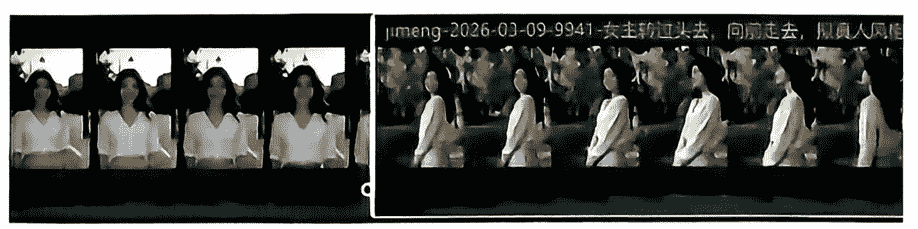
图 7-4 剪映拼接视频操作演示
- 如果想要添加转场特效，可以将分割轴拖至两段视频交界处，点击界面上方的“转场”按钮，并选择想要的转场特效进行添加（见图 7-5）。
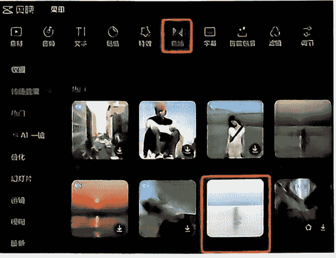
图 7-5 剪映拼接视频操作演示
最后得到的拼接视频的截图如图 7-6 所示。
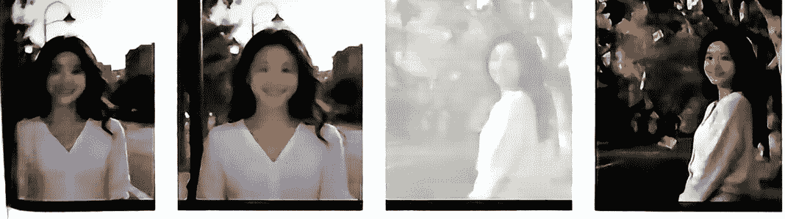
图 7-6 剪映拼接视频转场特效

### 7.2 匹配字幕
字幕对于快节奏、冲突密集的短剧来说至关重要。Seedance 2.0 本身具备生成字幕的功能，但为了避免新手在使用 Seedance 2.0 时提示词使用不熟练的问题，我们可以先生成纯视频，后续通过剪辑软件自行添加字幕。

#### 字幕设计要点
匹配字幕的过程中，需要注意 3 个问题，分别如下。
字幕准确
字幕内容一字不差，尤其是古装剧的文言文台词。
字音同步
字幕中的每个字和声音完全对齐。
美观统一
字幕样式统一，在手机上清晰可读。

#### 剪映字幕匹配实操步骤
第一步
导入需要生成字幕的视频，并拖至下方时间轴上。
第二步
点击界面上方的“字幕”，并按照需要选择是否勾选下方的辅助选项，即可生成字幕（见图 7-7）。
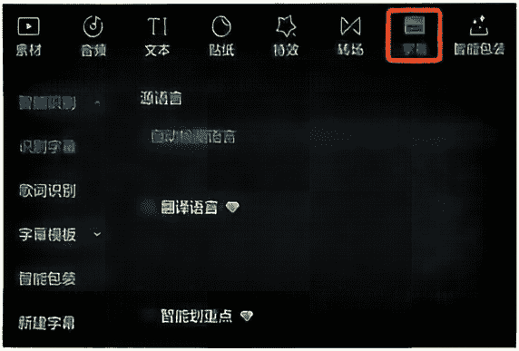
图 7-7 剪映智能添加字幕步骤演示
第三步
我们可以在操作界面的右上区域调节字幕的各项参数，包括字幕的位置、字幕出现的方式、字体的大小和样式、花字与底纹，等等。这里，我们选择短视频中辨识度较高的花式字幕为例进行展示。
AI 识别不是 100% 准确，还需要我们对成品进行核查，逐句检查字幕，可在右上角区域双击字幕修改错误。修改后回车确认，AI 会自动调整该句的时间轴（见图 7-8）。
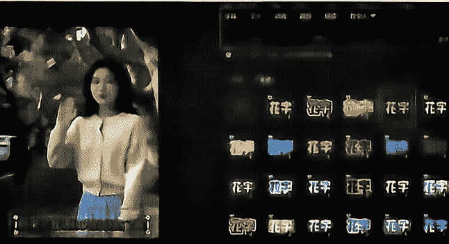
图 7-8 剪映调整字幕演示

#### 字幕排版规范
对于 AI 短剧创作者来说，制作短剧的字幕需要遵循一定的规范，这些规范并不是约束你创作的条条框框，而是保证你作品质量的基准线。具体内容如表 7-2 所示。

表 7-2 AI 短剧字幕排版规范
| 规范项 | 推荐设置 | 原因 |
| :--- | :--- | :--- |
| 位置 | 底部居中，留出安全区 | 避免被抖音图标遮挡 |
| 行数 | 最多两行 | 超过两行会遮挡画面 |
| 每行字数 | 不超过 10 字 | 太长观众读不过来 |
| 持续时间 | 每句不少于 1 秒 | 太短观众来不及看 |
| 标点符号 | 可省略 | 不影响理解即可 |

### 7.3 优化音效
Seedance 2.0 会自动匹配背景音乐、环境音和基础音效，我们也可以将自己制作的音乐通过剪辑软件添加到视频中，但在这一过程中常常会出现背景音乐音量过大盖过台词、音效杂乱无层次、配音有轻微底噪、音画情绪不匹配等问题。剪映的作用就是理顺音频主次关系，把 Seedance 2.0 生成的音频打磨得清晰、舒适、有氛围感。

#### 剪映优化音效的实操方法
##### 音频轨道拆分
导入 Seedance 2.0 视频后，右键点击时间轴上的视频，选择“分离音频”，将视频里的配音、背景音乐、音效全部分离成独立音频轨道（见图 7-9）。
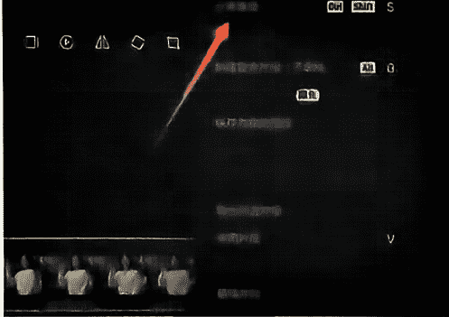
图 7-9 剪映分离音频操作示意图
如果你要处理的是一个兼具不同音频的视频，那么这一步非常关键，可以将各类型的音频分离开来，独立操作。
如果要将自己制作的音频导入视频作品，则可以按照基本的导入步骤，将音频拖至视频下方轨道中，并拖动分割轴将音频裁剪至视频时长即可（见图7-10）。
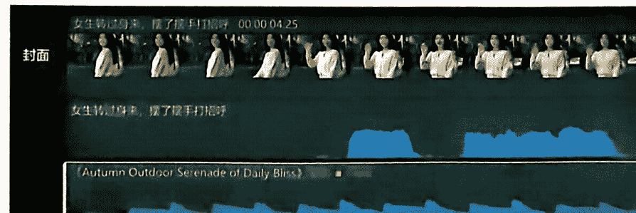
图7-10 剪映分离或添加音频操作后的界面

## 针对性优化
成功分离音频轨道后，左键点击选中想要优化的音频轨道，然后在操作界面的右上角区域可以调节该轨道音频的具体参数（见图7-11）。
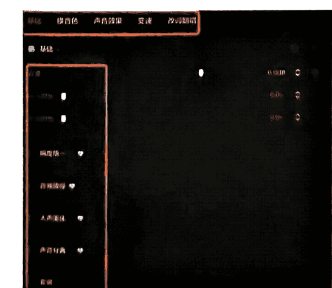
图7-11 剪映音效调整操作界面
如果背景音乐音量过大，则选中背景音乐轨道，点击“音量”进行调节。如果配音有底噪、杂音，不够清晰，则可以选择“音频降噪”。如果音效杂乱、主次不分，则可以通过调节不同音轨，甚至利用裁剪功能，调节不同音轨的不同部分来实现音效的和谐。

## 各轨道音量参考
创作者在调节音效的过程中要随时关注调整后的效果，保证作品音效既能发挥应有的作用，又不会影响到观众的观看体验。各声音轨道音量的设定值可以参考表7-3。

表7-3 各轨道音量参考
| 声音类型 | 推荐音量 | 说明 |
| :--- | :--- | :--- |
| 主对白 | -3～0dB | 最突出 |
| 内心OS | -6～-3dB | 比主对白轻 |
| 关键音效 | -9～-6dB | 让观众注意到 |
| 环境音 | -18～-15dB | 几乎听不见但能感觉到 |
| 背景音乐 | -18dB（有对白时闪避） | 退后 |

## 导出前的最后检查
在利用剪映完成音效的优化后，需要再用耳机完整听一遍，检查音效优化情况。检查项目主要有以下几方面。
- 对白是否清晰？（不会被音乐盖住）
- 环境音是否自然？（不会太突出）
- 关键音效是否到位？（该有的都有）
- 音量是否忽大忽小？
- 背景音乐闪避是否自然？
- 有无杂音或爆音？
在完成以上步骤后，创作者还需要对导出作品进行整体检查，以保证作品的整体呈现效果符合预期，对于有待优化之处用相关软件进行微调。最后，再通过剪辑软件将其拼接在一起，AI短剧的创作就大功告成了。

# 第四模块

## 运营变现篇——多元变现，持续盈利
完成了从市场调研到剧本创作、从视觉制作到后期剪辑的全流程，你终于拥有了一部完整的AI短剧。但创作完成不是终点，而是新的起点。如何让作品触达更多观众？如何将流量转化为实实在在的收入？这是接下来创作者需要着重考虑的问题。

# 第8章 AI短剧平台运营与流量爆款打法
短剧平台是AI短剧最核心的播放渠道，因此，要想让自己创作的短剧被更多人看到，并且能够使其实实在在地带来回报，就必须要对各主流短剧平台有一个全面而深入的了解，并在此基础上构建更具针对性的运营战略。

## 8.1 平台生态差异化分析
不同平台的用户画像、算法机制、内容偏好截然不同。同一个短剧，在抖音可能爆火，在快手可能无人问津。了解不同短视频平台的差异，是发布AI短视频前的第一课。

### 字节跳动
包含抖音与番茄小说在内的字节跳动旗下短视频平台是国内AI短剧的重要阵地，依托旗下各平台的不同优势，构建起了一个从内容生产到流量分发，再到付费变现，再到IP反哺的完整闭环。特别是红果短剧，作为一款主打微短剧的视频平台，其自创立之初就锚定短剧市场，并以免费观看模式为特色，其活跃用户量于近两年实现飞跃式增长。

在内容风格上，字节跳动旗下平台短剧的特点是强节奏、强反转、强钩子，类型涵盖都市情感、仙侠玄幻、言情故事、悬疑探案，等等，其中，AI短剧占比快速提升，2026年1月其在百强短剧中的占比已接近40%。

字节跳动旗下平台在AI短剧领域的商业化模式十分成熟，商业链条完整，其用户群体以18～35岁的年轻人群为主，对于短剧的付费意愿较强、付费率高。独立创作者或者中小创作团队可以借助字节跳动旗下平台的巨量引擎投流和生产工具实现AI短剧的快速变现。

### 快手
作为国内另一大短视频平台，快手同样重视对AI短剧市场的开发和经营。快手早在2020年就启动了“星芒计划”来大力支持短剧的创作，后又推出独立短剧平台喜番短剧，依靠“免费+广告”模式，差异化布局下沉赛道。

快手平台短剧的内容更偏现实题材，主要面对三四线城市及以下的广阔市场，受众更多的是中老年用户，乡土、家庭、正能量等内容是其基本盘。近年来，快手也积极推进短剧类型的多元化发展，鼓励AI原创精品。由于快手平台用户免费意愿相对较强、付费率低，因此更适合广告变现。

### ReelShort：全球竖屏付费微剧的先行者
ReelShort 由枫叶互动在2022年推出，聚焦海外市场的竖屏付费微剧，已覆盖北美、东南亚、欧洲、中东等两百余个国家，是国内出海短剧阵营中的领先名片。

其打法核心在于跨文化融合。制作方将国内爆款网络文学IP与海外高热度题材如狼人、科技新贵等结合，打破东西方审美隔阂，实现本土化表达。单集时长控制在1至2分钟，以强反转与强情绪著称，用户对竖屏形态接受度高、付费转化效率行业领先。平台提供本地化辅导与AI制作工具，分成机制友好，主要扶持具备本地化创作能力的团队。

### 点众科技：河马免费与繁花付费双线并行
点众科技主营网络文学与网络微短剧，旗下两大产品为河马剧场与繁花剧场。河马深耕免费赛道，繁花聚焦付费赛道。

河马剧场国内月活排名第二，优势在于剧库体量大、品类覆盖广、上新速度快。依托点众自有网文IP，形成IP储备-内容制作-分发变现的闭环，合作方可调用网文资源进行改编。内容偏向下沉人群喜好，主推现实、乡土伦理、年代逆袭、古装甜宠等多品类。存量用户多为三四线城市的中年群体，增量来自一二线城市的年轻用户。

繁花剧场面向中高端付费人群，与河马构成免费+付费双轮驱动。定位类似线上小剧场，主打精品短剧加订阅制，服务愿意为优质内容买单的核心用户，拒绝流量泡沫。制作精良、质感高、利润率高，但单剧成本高，不适合个人创作者独立承接。

除此之外，腾讯、爱奇艺、优酷、B站等综合视频平台也在加码短剧板块，为创作者提供更多选择。

### 创作者平台选型速览
熟悉主流差异后，为AI微剧新手整理一份选型对照，具体见表8-1。

表8-1 平台选择策略

| 创作者类型 | 首选平台 | 理由 |

| :--- | :--- | :--- |

| 新手试水 | 抖音+快手 | 用户基数大，算法友好，容易冷启动 |

| 都市情感剧 | 抖音 | 年轻用户多，接受度高 |

| 农村/接地气题材 | 快手 | 老铁文化，真实感受欢迎 |

| 中老年情感剧 | 视频号 | 中老年用户集中，社交传播强 |

| 免费爽剧 | 河马剧场 | 垂直短剧平台，用户精准，适合免费模式 |

| 出海内容 | ReelShort+YouTube | 直接面向海外受众 |

## 8.2 发布前的临门一脚
按下发布键前，决定成败的两件事是封面与标题。信息流中用户停留约3秒，这3秒就是钩子。

### 封面设计的3秒原则
优质封面需在3秒内完成情绪传递、悬念制造、看点说明，见表8-2。

#### 法则一：情绪脸
让观众一眼读出情绪，哭、笑、怒、惊。人脸尤其是强情绪特写最吸睛。
- 正确：女主流泪特写，眼泪滑过脸颊。
- 错误：多人全景，看不清主体。

#### 法则二：冲突感
以画面暗示核心冲突，如对峙、拥抱、身份反差、古今装扮等。
- 正确：男女主对峙，一人冷漠一人愤怒。
- 错误：两人平静坐着，毫无张力。

#### 法则三：信息点
用大字点明故事看点。
- 字数：4～8字为佳。
- 字体：粗黑醒目，有描边。
- 位置：预留画面约1/3区域给文字。

表8-2 封面正反案例对比

| 维度 | 反面案例 | 正面案例 |

| :--- | :--- | :--- |

| 情绪 | 表情淡漠 | 泪流满面或愤怒对峙 |

| 构图 | 多人杂乱 | 主体突出，背景虚化 |

| 文字 | 无文字或字号过小 | 大字标题，一目了然 |

| 色彩 | 灰暗平淡 | 高饱和度或强对比 |

### 标题就是钩子
标题决定是否点入，好的标题能触发“然后呢”的好奇心。可按公式拆解：
短剧标题钩子公式：[身份反差]+[核心冲突]+[情绪钩子]+[悬念/爽点]

表8-3 短剧标题要素解析

| 元素 | 作用 | 案例 |

| :--- | :--- | :--- |

| 身份反差 | 制造意外 | “我是他无比嫌弃的实习秘书” |

| 核心冲突 | 交代困境 | “直到他躺在我的手术台上” |

| 情绪钩子 | 引发共情 | “他跪着求我” |

| 悬念/爽点 | 勾引点击 | “我才发现当年的真相” |

经典案例：
- “分手后我成了首富秘书，前夫跪着求我复合”
- “穿越成和亲公主，我用防狼喷雾教王爷做人”

## 8.3 发布与更新节奏
不同平台用户活跃时段不同，发布时间与更新规律直接影响初始流量，需因地制宜。

### 黄金发布时间策略
表8-4 各短剧平台黄金发布时间

| 平台 | 目标人群 | 最佳发布时间 | 原因 |

| :--- | :--- | :--- | :--- |

| 抖音 | 上班族 | 12:00—14:00, 18:00—22:00 | 午休+下班通勤+睡前刷视频高峰 |

| 快手 | 下沉市场 | 19:00—23:00 | 晚饭后休闲时间，刷视频主力时段 |

| 视频号 | 中老年 | 7:00—9:00, 19:00—21:00 | 早起刷手机+晚饭后看视频习惯 |

| ReelShort | 欧美 | 北京时间21:00—次日3:00 | 对应欧美上午至下午黄金时段 |

| YouTube | 全球 | 根据目标地区调整 | 建议早上8点发布，留出全天发酵时间 |

发布前自检：
- 目标受众此时在用手机吗？
- 该时段竞品是否扎堆？晚8点竞争最激烈。
- 是否考虑时差？若有海外用户需调整。

小技巧：用不同时段投放相同内容做A/B测试，记录数据找到专属黄金时间。

### 日更策略与组合发布
短剧是连载，策略要服务于让观众追下去的目标。

#### 日更频率建议
表8-5 日更频率建议

| 阶段 | 更新频率 | 目的 |

| :--- | :--- | :--- |

| 开播期第1～3天 | 每天2集 | 快速积累初始观众 |

| 热播期第4～10天 | 每天1集 | 保持热度，培养追剧习惯 |

| 高潮期第11～15天 | 每天1～2集 | 加速推进剧情，留住观众 |

| 完结期最后3天 | 每天2～3集 | 快速收尾，引导全集付费 |

#### 固定时间养成习惯
选定相对固定的更新时间，形成条件反射。
- 抖音/快手：晚8点。
- 视频号：晚7点或早8点。
- 多平台同步可错峰，如抖音晚8点，快手晚9点。

#### 周末加更策略
- 周五晚：连更2集，为周末预热。
- 周六晚：正常更新。
- 周日晚：连更2集，制造下周期待。

## 8.4 数据指标解读与复盘
作品发布后，真正的战斗才开始，需深入分析播放数据。数据是最客观的审片人。

### 核心指标详解
表8-6 短剧核心指标

| 指标 | 定义 | 优秀标准 | 问题诊断 |

| :--- | :--- | :--- | :--- |

| 完播率 | 看完视频的用户比例 | >30% | 低于15%：开头不够吸引 |

| 5秒完播率 | 看完前5秒的比例 | >50% | 低于40%：封面或开场失败 |

| 点赞率 | 点赞数/播放量 | >3% | 低于1%：缺乏共鸣 |

| 评论率 | 评论数/播放量 | >0.5% | 低于0.2%：缺乏互动引导 |

| 转发率 | 转发数/播放量 | >0.3% | 低于0.1%：内容不够上头 |

| 涨粉率 | 新增粉丝/播放量 | >1% | 低于0.5%：缺乏追剧动力 |

完播率是内容吸引力的金标准。计算为完整观看人数÷总播放量×100%。抖音30秒视频>30%为优，60秒>20%为优，关键在于开场钩子、节奏密度、结尾悬念。

5秒完播率更前置，>50%说明封面加开场成功，<40%需优化。

点赞率是用户低成本认可，>3%有共鸣，<1%内容平庸。

评论率反映主动参与，>0.5%有话题性，<0.2%缺乏引导。

转发率是社交背书，>0.3%具社交价值，<0.1%不够上头。

涨粉率衡量追剧动力，>1%动力强，<0.5%人设吸引力不足。

### 指标联动分析
表8-7 指标联动分析

| 现象 | 诊断 | 对策 |

| :--- | :--- | :--- |

| 5秒完播率高，但完播率低 | 开头吸引人，中间拖沓 | 压缩中间段落，每30秒设一个爽点 |

| 完播率高，点赞率低 | 观众看完了但不认可 | 增加情感共鸣点，强化价值观输出 |

| 点赞率高，评论率低 | 内容好但没话题 | 结尾设开放式问题，主动引导评论 |

| 评论率高，转发率低 | 有争议但没价值 | 提炼金句，强化社交传播性 |

# 第9章 AI短剧多元变现与长期盈利模式

创作是热爱，可持续支撑才关键。解决制作与流量的难题后，变现是落地的最后一环。

平台激励政策变化较快，以下不展开具体分成细节。

## 9.1 新手入门：零成本、低门槛变现方式
起步阶段的核心原则是不投入资金、先赚第一笔、积累实操经验，优先选择门槛低、操作简、见效快的路径。

### 平台流量分成和广告收益
最基础省心的方式，发合规作品有播放就有收益，无需对接资源。按千次播放结算，单价受质量、完播、受众、时长影响，普通AI微剧千播3～20元，优质爆款可达30元以上。播放量与收益正相关，靠批量产出日更1-3条，单号月副业可达300-5000元，爆款可破万。

### 短剧分销和挂载变现
新手首选见效快的路径。不需自制长篇，只需剪辑付费剧的高光、冲突、悬念片段，用工具优化画面加字幕，挂分销链接引流。用户付费看全集，创作者拿佣金，一单5-20元，流量起来日佣可破百。选品关键是高佣金、高热度、付费意愿强的赛道。

### 商单合作
账号有一定流量和案例后可接商业定制，用AI快速交付收制作费，属于技能变现，客单价高于流量分成。需与甲方确认题材、时长、用途、交付时间，对创作能力有要求。

## 进阶盈利：IP打造与长期变现
有稳定粉丝后应从赚快钱转向做长期，打造专属短剧IP，实现被动收益与长期盈利。

### 付费短剧/专栏变现
粉丝精准变现。先免费发布3-5集钩子内容吸粉，后续全集设置付费观看，定价9.9-99元，收益归己，复购率高。对内容质量要求高，但能形成长期被动收入。

### 账号IP变现与粉丝经济
把账号打造成专属IP，沉淀私域流量，打破平台限制。

粉丝引流：合规引导粉丝至私域，在简介、评论区提示“私信看全集”“进群追更”，在微信做精细维护，定期推送番外福利，提升黏性。

IP衍生变现：
- 好物带货：短剧同款服饰、饰品挂链接，甜宠古风转化率极高。
- 周边定制：针对爆款IP定制海报、钥匙扣、明信片等私域售卖。
- 付费粉丝群：提供专属短剧、一对一答疑，收取群费实现被动收益。

## 9.3 变现合规与风险防控
变现底线是合规，违规会清零收益甚至封号。

### 版权合规：避开侵权大坑
内容版权：AI生成内容属原创，拒绝搬运抄袭他人剧本、画面。
音乐音效：仅使用剪映平台内置正版素材，禁止使用无版权网红BGM。
肖像权：AI生成虚拟人物，避免使用真人肖像、明星脸。

### 变现合规：拒绝踩线
严格遵守抖音、快手、ReelShort平台规则，杜绝诱导付费、虚假宣传、违规引流。
分销合规：选择正规分销平台，拒绝盗版推广，不赚违规佣金。
税务合规：个人收益按规定纳税，平台代扣无需额外操作，自主接单需及时申报。

### 收益保障
佣金提现：选择正规平台，警惕高佣金秒提现骗局。
商单保障：先收30%～50%定金再交付，避免尾款纠纷。
账号安全：严禁买卖账号、违规操作，保护权重避免限流封禁。

AI短剧是当下热门的轻资产创业方向。新手可先用分销挂载赚第一笔收入，积累经验后再做精致长剧，有粉丝基础后再布局IP规模化运营。

基金项目：

AI短剧赚钱全流程

研究支撑
安徽省高等学校科学研究重点项目“基于AIGC淮河流域非遗文化的两创策略研究”(2024AH052969) 阜阳理工学院。
安徽省社会科学创新发展社科普及类课题项目：“绘梦安徽非遗：AIGC技术赋能安徽非遗文化国际传播绘本创作与推广”(2024KD013) 中期成果已纳入。
阜阳师范大学校级科学普及和知识产权公共服务研究：“AIGC文物科普动画：跨学科数字化普及策略与创作研究”(2024KPZS01ZD) 成果片段参考。
阜阳师范大学校级本科质量工程项目“‘AI+美育’驱动下跨学科融合实践育人创新模式研究”(2025SJYRZX08) 研究资料引用。

核心内容
剧本环节由AI辅助完成，画面生成交由Seedance实现。
拆解镜头调度手法与跑量吸粉的操作思路。
给出可直接套用的创作范式与模板案例。
即使不懂AI，也能按步骤做出短剧并实现变现。

ISBN 978-7-5742-3807-7
售价 78.00 元