# 短视频AI全流程实战手册

# 前言

当数字浪潮席卷全球，短视频凭借强吸睛与高互动的特质，已成为信息分发和内容消费的主战场。不管是品牌营销、品宣投放，还是个人创作、生活记录，都绕不开短视频的承载。AI的持续突破，正让短视频的生产方式发生根本性迁移。

基于这一判断，我们推出《AI短视频制作完全攻略》，以人工智能为核心生产力，为创作者搭建一套系统化、可落地的实战方法论，帮助大家在激烈的竞争中脱颖而出，产出更有创意与传播力的作品。

短视频创作本质由文案、视觉素材与成片三块构成。AI的介入，不仅大幅提升了这三块的产出效率，也极大拓展了创意边界与个性化表达空间。全书围绕这三大核心展开，深度拆解AI在全流程中的落地路径。

全书共六章，覆盖从概念认知、工具盘点，到文案与素材图的智能生成，再到图文字转视频的实操演练，以及智能剪辑的高阶技巧与创意玩法。每一章都紧跟技术前沿，用清晰的步骤讲解加真实案例，帮助读者轻松掌握核心能力。

编写过程中我们坚持实战导向。每章都设计了多个可直接上手的操作案例，让读者通过动手体验感受AI创作的魅力。案例既涵盖制作全环节，也结合当下市场热点与流行趋势，帮助读者在实践中持续提升技能与创意。

为保证内容的专业性与可用性，我们邀请了多位深耕短视频创作与人工智能领域的资深专家共同参与编写与审校。他们的实战经验与前瞻判断，让本书既是可操作的工具手册，也是一本具备启发性的实战宝典。

在短视频全球爆发的时代，我们相信本书能帮助创作者快速上手AI生产力，激发更多创作灵感，做出令人眼前一亮的内容。让我们携手借助AI的力量，共同推动短视频行业向更高质量发展。

编者

# 第一章

# AI贯穿短视频生产链的应用与常用产品

短视频已成为互联网内容的主流形态，而人工智能的加入则带来了创作方式的革命式升级。本章先带你认识AI如何贯穿从脚本到成片的制作链路；再盘点一批实用的智能产品，帮助你提效同时保持创新；最后说明如何有效向AI提问，以及使用AI生成文案时需要注意的要点。

让我们一起深入探索AI在短视频制作中的价值，并学习这些方案如何助你做出更具吸引力与影响力的视频作品。

## 1.1 拥抱AI驱动的短视频创作

在信息高度过载的当下，短视频因其短平快、内容密度高的特点占据了传播核心位置。人工智能加持下，创意构思、拍摄剪辑、后期特效乃至精准分发，都实现了质的提升。拥抱AI驱动的短视频创作，就是顺应趋势，用科技手段提升内容生产效率与品质，迈向个性化、智能化的创作新阶段。

### 1.1.1 AI短视频创作的概念与意义

AI短视频创作是指在创作流程中引入人工智能进行辅助或自动化处理，覆盖剧本生成、素材筛选、画面合成、语音识别、音乐匹配、特效添加、字幕生成、内容审核、用户推荐等多个环节。这种模式大幅减轻了人工重复劳动，并依靠精准的数据分析和智能决策，让制作更高效、更精准、更具创新性。

其核心价值体现在：

**1 提升制作效率**
智能系统能快速处理海量素材，自动截取精彩片段，自动生成契合主题的背景音乐与字幕，显著压缩传统人工制作的时间成本。

**2 优化内容品质**
依托深度学习算法，系统可精准洞察用户偏好与市场趋势，辅助制定更具吸引力的脚本，选择更贴合调性的视觉元素，甚至实时优化视频色彩与节奏，提升观看体验。

**3 实现千人千面推送**
基于用户行为数据与内容标签，系统能够精准匹配兴趣点，实现个性化推荐，提高内容的触达率与用户留存。

**4 赋能内容创新**
AR、VR等沉浸式技术与智能技术融合，为短视频开辟了全新视觉表达可能，推动内容创新与产业升级。

### 1.1.2 智能技术在短视频中的落地场景

随着技术成熟，智能技术在短视频领域的应用已日益渗透：

**1 智能剧本生成**
基于大数据与自然语言处理，系统可自动输出大纲、对白乃至完整故事脚本，为创作者提供丰富创意灵感。

**2 自动化剪辑**
通过图像识别与动作追踪，系统能自动挑选最佳镜头、同步音画，实现动态转场与特效添加等复杂编辑。

**3 语音识别与合成**
系统能够准确识别视频语音并生成字幕，也能将文本转化为逼真配音，打破语言与听力障碍，提升内容普适性。

**4 音乐匹配与生成**
借助深度学习的音乐理解与生成能力，系统可自动为视频配乐，甚至根据视频情绪创作定制音乐，增强情感表达。

**5 智能审核与推荐**
系统通过图像识别与语义分析对内容进行合规审核，同时将用户画像与内容标签精准匹配，实现个性化分发。

总体来看，人工智能正为短视频注入持续的活力与创新动能。

### 1.1.3 持续进阶AI短视频创作的路径

AI与短视频技术迭代迅速，持续学习尤为关键。建议从以下路径入手：

**1 在线课程与教程**
通过Coursera、Udemy、B站、优优教程网、网易云课堂等平台，学习由高校或行业专家开设的系统课程。

**2 专业社群与论坛**
积极参与Stack Overflow、知乎、Vimeo等社群讨论，追踪行业动态，交流实战经验。

**3 软件与产品学习**
熟练掌握Adobe Premiere Pro、Final Cut Pro、剪映等专业软件的AI功能，以及Wibbitz、Magisto等专用智能制片方案。

**4 实践项目与竞赛**
参与短视频创作比赛或自主发起AI创作项目，将知识落地于实操。

**5 学术研究与报告**
关注前沿研究成果，阅读相关论文与行业报告，洞察技术趋势与应用场景。

**6 保持好奇心与热情**
持续探索新技术与新玩法，尝试不同方法与工具，不断提升创作水平与效率。

唯有不断学习、实践与探索，才能在AI短视频领域持续精进。

## 1.2 短视频AI相关方案

在创作现场，智能方案已成为创作者的得力伙伴，从文案构思到视觉设计再到成片生成都能提供高效支持。以下是对各类型代表方案的简要梳理。

### 1.2.1 文案类智能生成方案

这类方案基于大模型技术，可自动输出文案内容，辅助不同场景的撰写工作。

**1 DeepSeek**
由杭州深度求索研发的大语言模型，具备自然语言理解、生成、推理及多模态交互能力。可用于广告文案、社媒推文、产品介绍等。优势在于智能推荐、风格多样、生成迅速，输入关键词即可秒得多种风格供挑选，极大提升写作效率。

**2 ChatGPT**
OpenAI推出的强力语言模型，能够理解指令并输出连贯文本。在短视频中可用于标题撰写、故事脚本、旁白解说及弹幕内容创作，以拟人化对话与丰富知识库赋予视频独特性。

**3 豆包**
字节跳动自研的智能助手，基于多模态大模型，兼具高效交互与场景化服务。支持智能问答、创意内容生成、多语种翻译、信息查询等，通过轻量化设计实现低延迟响应，并依托海量数据实现个性化推荐。

**4 Kimi**
轻量化写作助手，擅长根据关键词或主题快速生成各种文案。无论是开头钩子、中间过渡还是结尾收束都能提供多版本选择，操作简便，适合新手快速上手。

**5 文心一言**
百度打造的中文AI文案工具，深谙中文表达与文化语境。能精准理解需求，输出接地气的文案，适用于剧本构思、标题提炼与内容精炼。

**6 讯飞星火**
依托科大讯飞在语音与NLP领域的积累，提供高效文案创作服务。输入关键词即可生成创意流畅的文案，内置智能纠错确保语法规范、表达准确。

**7 秘塔写作猫**
集智能写作与校对于一体的AI工具，可生成高质量剧本、旁白与标题文案。其润色与语法检查功能让文字更专业、更有说服力。

**8 通义千问**
阿里达摩院研发的大模型，主打高效精准的知识问答。支持多轮对话与上下文记忆，具备多语言能力，可用于问答、教育辅助、信息检索及文案创作、逻辑推理等场景。

**9 Notion AI**
Notion平台内置的智能写作助手，可快速撰写各类文本。创作短视频时可用于创意发散、剧本大纲与解说词生成，并与工作区无缝集成，便于素材集中管理。

不同方案各有侧重，建议根据具体需求选择。工具只能辅助，最终质量仍需创作者把控风格与受众偏好。

### 1.2.2 图像类智能生成方案

依托深度学习，这类方案可根据文本提示或原图生成新图像，广泛应用于艺术、设计与教育。

**1 可灵AI**
AI驱动的智能图像工具，支持自然语言指令生成高质量图像、修复模糊照片、智能补全及风格迁移，如古风山水、科幻角色等。操作简便，渲染效率高，支持网页与移动端。

**2 即梦**
抖音旗下生成式AI创作平台，由脸萌科技开发。定位一站式创作，提供高效故事模式、创意社区及中文友好创作。功能涵盖AI绘图、视频生成、故事创作与音乐生成，支持文字与图像输入。

**4 Flag Studio**
在线AI绘画工具，提供丰富艺术风格。输入文字描述即可生成精美图像，为短视频增添视觉表现力，零绘画基础也能轻松创作。

**5 Midjourney**
高品质AI绘画平台，以精细画质与多样风格见长。输入详细描述即可产出艺术感强、契合主题的图像，显著提升视频视觉质感。

**6 Stable Diffusion**
开源AI图像生成模型，可依据文字提示生成逼真艺术作品。风格与主题可灵活切换，为短视频提供专业视觉支撑。

各类方案特色不同，有的偏艺术创作，有的适合快速原型，可按需求挑选。

### 1.2.3 视频类智能生成方案

这类方案利用AI将文本、图像等素材自动合成视频，在营销、社交与影视制作中应用广泛。

**1 一帧秒创**
即秒创，是智能视频创作平台，内置自动剪辑、智能配乐、字幕生成等功能。上传素材即可一键成片，提升效率与质感。

**2 腾讯智影**
全能视频制作工具，融合AI剪辑、自动字幕、智能配音与特效添加等功能，覆盖从素材整理到发布的全流程，适合新手与专业用户。

**3 艺映AI**
专注AI视频领域，提供文生视频、图生视频、视频转漫等服务，支持文字、图像驱动生成与风格转换。

**4 剪映**
抖音官方出品的免费剪辑软件，海外版为CapCut。内置智能分割、自动卡点、滤镜匹配等AI功能，操作简洁，助力快速跟随流行趋势。

**5 快影、快剪辑**
面向大众的短视频编辑App，均提供AI智能剪辑、自动字幕与特效模板，几步操作即可将照片视频转化为酷炫短片。

**6 Sora**
结合AI的专业剪辑软件，提供智能剪辑、自动调色与音轨同步等高级功能，满足对成片质量的高要求用户。

**7 Runway**
创新AI视频创作平台，集实时视频生成、特效合成与3D建模于一体，支持电影级预告片、视觉艺术片等创作。

**8 D-ID**
专注AI人脸动画，可将静态照片转化为动态表情。在短视频中能让静态人物“活”起来，增加互动趣味。

**9 可灵**
快手AI团队研发的视频生成大模型，可输出1080p分辨率、最长2分钟、自由宽高比视频，2024年6月上线并逐步开放图生视频功能。

可见，文案、图像、视频三大类智能方案各具优势，能满足不同创作者在不同环节的需求，助力高效打造高质量短视频作品。

## 1.3 智能方案的选用策略

面对众多工具，创作者应综合评估以提高效率并契合创作风格与受众喜好。

**1 明确需求与目标**
先厘清使用AI的具体目的，是撰写文案、设计画面、剪辑成片还是数据分析。目标明确后才能有针对性地选择具备相应功能的产品。

**2 比较方案性能与适用范围**

先摸清不同 AI 工具的核心能力、技术长处、适用场景以及局限，再做对比才能挑到真正合适的。比如，有的 AI 写作文案在营销文案上更拿手，有的则更适合学术论文的严谨表达；在图像生成领域，有的擅长艺术插画的风格化创作，有的则更接近真实照片的质感。把这些差异梳理清楚，才能锁定最契合你当前需求的方案。

**3 上手难度与学习成本**
一款好用的 AI 工具，界面要直观、操作说明要清晰，能让用户在很短时间内进入状态。提前看看真实用户评价、教程的丰富度以及客服响应怎么样，评估自己掌握它需要投入多少时间和精力。功能再强，如果学习曲线陡峭，对时间紧或技术基础薄弱的人来说就不太友好。

**4 数据安全与隐私审查**
项目涉及敏感信息时，务必确认工具的数据处理机制和防护措施。是否遵循 GDPR、CCPA 等行业标准？有没有加密传输、匿名化处理等保障手段？只有把数据在 AI 使用全过程中的安全性落到实处，才能安心使用。

**5 费用模式与性价比权衡**
AI 工具的付费方式多样，有一次性买断、订阅制，也有按量计费。算清长期使用的总成本，结合性能表现和服务质量来判断投入产出是否合理。很多产品提供免费试用期，亲手测一遍效果，再做决策会更稳妥。

做好以上几步，就能更精准地为短视频制作选出匹配的 AI 工具，提升创作效率和成片质量。随着技术迭代，保持持续学习和灵活调整能力也很关键。

## 1.4 高效提问框架
有效提问的关键是让 AI 能准确理解意图并给出可用答案。它不仅要求问题清晰具体，还要具备逻辑性和上下文关联。总结下来就是：明确核心诉求 + 提供背景信息或限定条件 + 精准用词 + 厘清逻辑关系。

**1 锁定核心诉求**
先说清楚你想获取的信息或解决的问题是什么。比如想了解某历史事件，就直接问“请介绍 ×× 事件的来龙去脉”。

**2 补充背景并设限定**
给出必要的上下文或限定条件，缩小答案范围。例如，“请说明 ×× 事件的发生时间、地点、关键人物以及后续影响”。

**3 精准用词**
用专业、表意准确的术语，避开模糊、歧义或过于复杂的表达。语言保持简洁直接即可。如要生成图像，也要清晰描述风格、元素、配色等要素。

**4 厘清逻辑关联**
问题涉及多部分时，用“并且”“或者”“但是”等连接词表明关系。例如，“我想了解 ×× 产品的优缺点，以及它和竞品的主要差异”。

示例：
“我在做一支环保主题的短视频，需要一段配套文案。请问你的文案生成功能能否围绕‘保护地球，从我做起’这个主题，生成一段有感染力且具号召力的文案？要求字数控制在 50 字以内，突出环保的重要性与紧迫性。”

提问点明了目标、具体要求和期望效果，AI 更容易给出贴合预期的答案。

## 1.5 AI 写文案的避坑指南
用 AI 生成文案时，兼顾质量、合规和原创性很重要：

**1 原创性与版权风险**
确保输出内容具有独创性，避免与现有素材高度重复引发侵权。优先选用能产出独特个性化内容的模型，减少直接套用模板或大量搬运。发布前做原创性校验，规避版权纠纷。

**2 语义与逻辑连贯性**
AI 文案易出现语义不清、逻辑跳跃的问题。生成后要仔细审阅，检查句式、段落衔接和整体逻辑是否通顺，避免前后矛盾或难以理解的表述。

**3 语法与拼写校对**
即便模型在语言规范上已很成熟，仍可能出现错误。发布前逐句核对，必要时借助专业校对工具或人工复核，提升准确度与专业感。

**4 主题相关性**
保证输出与指定主题或关键词高度契合，能准确传递目标信息。输入明确的关键词引导方向，生成后检查是否符合宣传或营销目标。提供几个相关关键词可帮助 AI 延展联想，多轮提问对比，选择最合适的一版。

**5 遵守版权法与法规**
创作需遵循版权法等相关法规，不得侵犯他人知识产权。涉及引用时确保来源合法并注明出处。避免使用敏感、违规的词汇和表述，保证内容合规且符合道德规范。

**6 人工审查与修改**
AI 只能做初稿，人类判断仍不可替代。发布前必须人工审阅、修改，逐句优化。人工介入可发现模型忽略的文化差异、语境偏差等问题，也能把多个片段巧妙整合为连贯文本，使其更符合个人风格或项目调性。

**7 持续学习与优化**
AI 技术快速演进，持续关注新模型与应用场景，不断调整使用策略。多尝试不同工具，总结使用心得，与同行交流经验，共同推动文案生成能力提升。

# 第二章

## AI 驱动的短视频文案创作
文案是短视频的灵魂，既是点睛之笔，也是吸引观众、传递意图的核心载体。AI 的加入正在重塑创作方式。

本章聚焦如何利用 DeepSeek 这类热门 AI 工具生成适配短视频特性的文案，让内容更具情绪张力。AI 正重新定义创作者与观众的互动模式。如果你对短视频文案创作感兴趣，或想了解 AI 在此领域的落地打法，本章将带你拆解 AI 短视频文案的价值、流程、技巧与实战应用，助力提升效率与作品质感。

## 2.1 AI 短视频文案创作概述
在数字化浪潮下，AI 已深度渗透内容行业，短视频作为主流传播形态，文案环节正被 AI 赋能重塑。AI 以强大的数据处理、学习与生成能力，为文案质量、效率和个性化定制提供新可能。

### 2.1.1 文案的核心作用
短视频文案不仅承载信息，还引导情绪、激发互动、影响传播与品牌感知。高质量的文案能瞬间抓住注意力，提升完播率、分享率和转化。归纳为六个维度：

**1 抓住眼球**
平台内容海量，吸睛的文案能在信息流中快速截停用户。靠独特表述、抓人标题或制造悬念来起效。

**2 传递核心信息**
时长有限，必须在几秒内让观众明白主题与意图。文案要简洁概括要点，降低理解成本。

**3 引发情感共鸣**
用故事、场景或共情感言触动观众，建立情感连接，提升记忆点与认同感。

**4 引导行动**
文案可植入明确的行动指令，如点赞、关注、分享、购买、下载等，推动互动与商业转化。

**5 塑造品牌调性**
语言风格、用词选择直接体现品牌价值观与个性，形成差异化认知。

**6 提升搜索曝光**
关键词与标签的合理布局，有助于视频在平台搜索中获得更好排名，增加曝光机会。

### 2.1.2 短视频文案的典型特征
**1 简洁明了**
用最少的字传递最关键的信息，避免冗长与复杂句式。

**2 强吸引力**
开头即要具备钩子，能够激发好奇或兴趣，让观众愿意看下去。

**3 情绪共鸣**
善于用共情视角讲故事，拉近与观众的距离。

**4 明确指令**
行动引导直白清晰，促进互动与转化。

**5 高适应性**
需结合不同平台调性和用户群体差异，做针对性调整。

**6 创新表达**
新颖的词汇、句式与创意表达是脱颖而出的关键。

**7 视觉协同**
文字需与画面、配乐等元素统一，形成整体观感。

### 2.1.3 AI 在创作中的四类应用
**1 自动生成**
输入主题、关键词、风格偏好等线索，AI 即可快速输出完整文案，从吸睛开头到号召结尾都能覆盖。

**2 情感智能与个性化**
AI 可基于浏览、点赞、评论等行为数据判断用户偏好与情绪，为不同人群生成定制化文案，实现精准触达。

**3 热点追踪与趋势预测**
实时扫描网络热词、社会事件与流行语，帮助创作者快速借势；同时通过大数据分析预判潜在热点，提前布局内容。

**4 内容优化**
对已有文案进行语法纠错、情感色彩调整，并通过关键词与话题标签优化，提升 SEO 表现与平台曝光。

### 2.1.4 AI 生成文案的优势
**1 效率提升**
快速处理海量数据与趋势信息，显著缩短创作周期。

**2 精准匹配**
深度学习用户需求，输出更贴合受众心理预期的内容。

**3 创新潜力**
不受固有思维限制，可融合多样创意元素，产出新颖表达。

**4 个性化定制**
按不同用户画像生成专属文案，提升参与感与满意度。

**5 持续优化**
实时监测数据反馈，自动调整文案策略，保持竞争力。

**6 多语言支持**
轻松切换语言，助力出海与全球化品牌传播。

**7 成本降低**
相比人工，AI 创作成本更低，有助于提升运营效率。

温馨提示：AI 在情感细腻度、文化语境理解上仍有局限，过度依赖可能导致文案显得机械或缺乏深度共鸣。

## 2.2 AI 生成短视频文案的基本流程
**1** 明确主题与目标需求
**2** 选择合适的 AI 文案工具
**3** 执行创作
**4** 调整优化

### 2.2.1 明确主题与目标需求
**1 锁定核心主题**
先确定内容方向。主题可分为科普娱乐、种草测评、情感故事、时事热点等。以“夏日防晒霜测评”为例，需聚焦成分对比、使用场景还原和性价比分析等关键点，确保内容紧扣用户信息诉求。

**2 解析目标受众**
绘制用户画像：年龄层如 Z 世代偏好快节奏强刺激开头，中年用户更看重实用性；平台差异如抖音重“黄金 3 秒”，B 站重深度解析；还要洞察痛点，如防晒品的油腻感、假白问题等，精准对齐内容。

**3 设定转化目标**
目标决定文案策略。引流关注可埋设“关注抽奖”互动点；商品转化需突出限时折扣等购买诱因；提升互动则用提问式结尾如“你用过哪款？”激发留言讨论。

### 2.2.2 选择 AI 文案创作工具——DeepSeek

短视频脚本加速：DeepSeek 实战笔记

在短视频脚本撰写场景里，相较于 ChatGPT 与 文心一言 等通用大模型，DeepSeek 更贴合内容生产的实际流程，成为不少创作者的首选。平台内置了面向短视频的模板库，覆盖口播稿、分镜描述等常用样式，开箱即用免去手工改写，效率感明显。除了纯文本产出，还能联动多模态输出，例如在文案之外同步推荐配乐倾向，像节奏明快的电子风格，让成片更立体。本地化层面，可自动补齐抖音等平台的热门话题标签，例如 #防晒黑科技，而通用方案通常需要人工增添且易跑偏。长文本处理上，一次性交付开场、转折、收尾的完整文稿，有效规避通用模型常见的断层与反复追问。综合来看，更贴合短视频从业者的工作节奏。

核心能力概览：

**1 训练推理提速**
采用 FP8 混合精度压缩训练时长，注意力机制只聚焦高相关 Token，降低算力开销并提升泛化与鲁棒性。

**2 多模态与超长上下文**
（1）跨模态交互。能同时处理文字、代码、数学推理等多种模态，胜任复杂跨模态任务。
（2）超长窗口。上下文上限扩至 128k token 以上，可支撑长文档解析、代码生成等重负载场景。

**3 中英双语精调**
中文语法语义经深度调优，对中文意图的理解更精准；英文表现对标国际一线，权威评测成绩突出。

**4 深度推理能力**
R1 深度思考面向高强度推理任务，显著提升复杂场景的推理质量。DeepSeek-R1 采用长链推理，思维链可延伸至数万字，将复杂问题拆解为多步逻辑逐步求解，效率明显提升。推演路径模拟人类思考，拟人化过程让输出更贴近真实使用情境，在全球范围内处于领先行列。

**5 开源免费生态**
已公开 DeepSeek-R1、DeepSeek-V3 等模型，为学术与产业提供基础；同时推出 DeepSeek-LLM 推理加速框架，优化显存占用与吞吐，简化企业级部署流程，推动大模型商业落地，具有里程碑意义。

**6 性能成本比优势**
性价比对比国内外主流模型更为突出。DeepSeek-V3 的生成质量超过 Qwen2.5-72B、Llama-3.1-405B 等开源模型，与 GPT-4o、Claude-3.5-Sonnet 等顶尖闭源模型同台竞技。例如在 MMLU、MMLU-Pro、GPQA、SimpleQA 等知识类任务上，相比前代 DeepSeek-V2.5 提升明显，已接近 Claude-3.5-Sonnet-1022。算法类代码任务 Codeforces 上远超市面非 o1 类模型；工程类代码任务 SWE-Bench Verified 上则逼近 Claude-3.5-Sonnet-1022 的水平。

### 2.2.3 短视频脚本生成操作演示
上手前需先完成账号注册与登录，具体流程如下：

（1）打开入口页。浏览器搜索官方网站，进入 https://www.deepseek.com/ 即可抵达首页，如图 2-1 所示。

图 2-1 主页概览

（2）点首页的“开始对话”。新账号首次使用需注册，支持手机号、微信、邮箱等方式，验证通过后即可进入，如图 2-2 所示。

（3）注册完成后进入对话页，即可开始提问，如图 2-3 所示。

（4）在输入区带上检索词提问，例如“帮我写一段旅游 Vlog 脚本，内容涵盖夏季海滨、旅程体验、美景分享”。其中夏季海滨、旅程体验、美景分享 即为检索词。发送后点击对话框右侧的生成按钮 ，返回结果如图 2-4 所示。

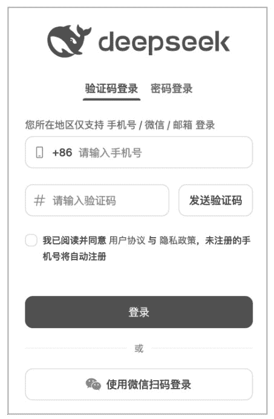

图 2-2 账号注册页

图 2-3 使用界面

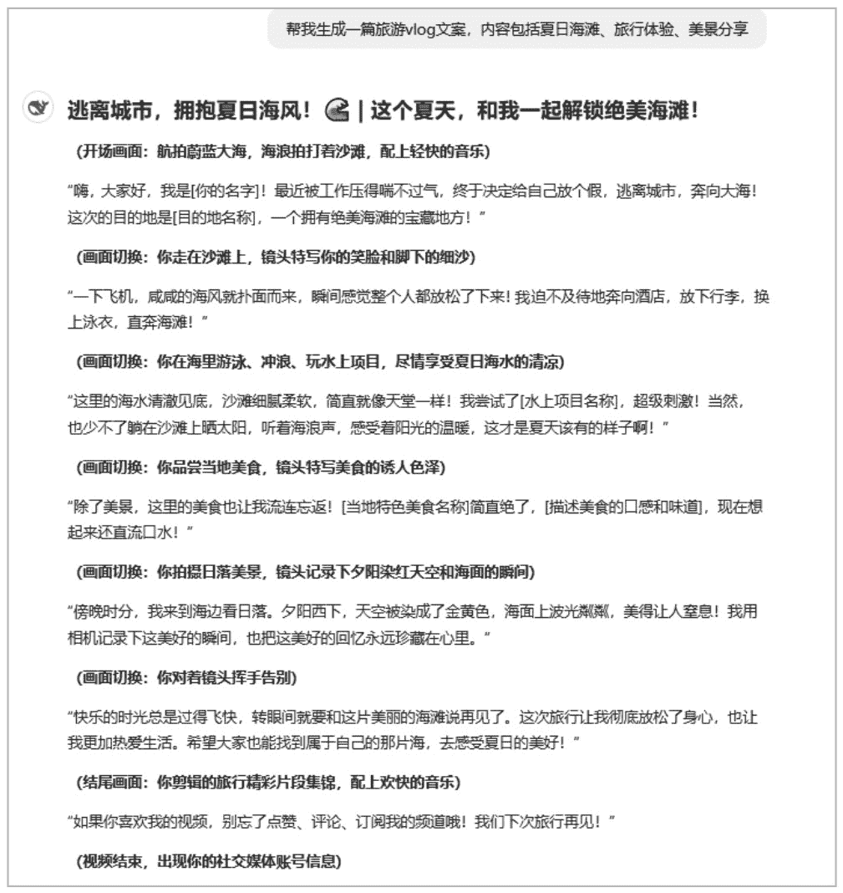

图 2-4 生成的旅行 Vlog 脚本

平台提供四种产出模式，按需挑选：

• 基础模式 V3：响应迅速，适合简单问答与基础文案，快速获取信息时使用。
• 深度模式 R1：可展示思维链，适合复杂推理与数据分析，需要深度思考时启用。图 2-5 为思考模式下的过程展示。

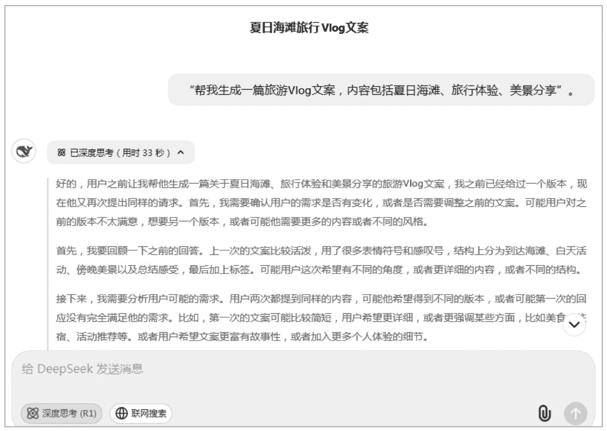

图 2-5 思考过程展示

• 联网模式：接入最新信息，支持动态事件追踪，适合查询实时资讯或行业政策等场景。
• 混合模式：可将基础、深度、联网模式组合使用，例如先用基础模式搭大纲，再用深度模式细化推理，最后用联网模式补充时效信息。

### 2.2.4 文案打磨与优化
初稿产出后建议人工复核，确保语言顺畅、逻辑清晰、信息准确且符合品牌调性或视频定位。必要时做增删改，使其更贴合传播需求。

实战 1：对旅行 Vlog 脚本做个性化润色
若初稿不满意，可继续在对话窗口下指令，通用格式为【要求】+【内容和风格】+【动作】+【目标】。

在页面输入“请帮我拟定一个抓眼球的标题、描写海滩活动和美景、分享旅程中的独特经历与感受。创作一份流畅、连贯、个性化且充满感染力的旅游 Vlog，以吸引受众并分享旅行的美好时光。”系统返回的优化稿如图 2-6 所示。

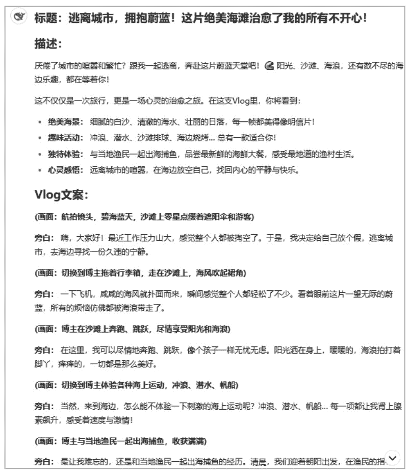

图 2-6 优化后的旅行 Vlog 文案

实战 2：结合深度思考与联网搜索提升质量
对文案有更高要求时，可启用深度思考与联网搜索。深度思考依托专业术语理解与行业知识整合，确保逻辑严谨、内容丰满；联网搜索实时抓取网络信息，弥补时效性，内容更贴近当下。两者结合提升效率与质量。

在对话框输入相同需求后，选择“深度思考 R1”与“联网搜索”，点击  按钮，如图 2-7 所示。

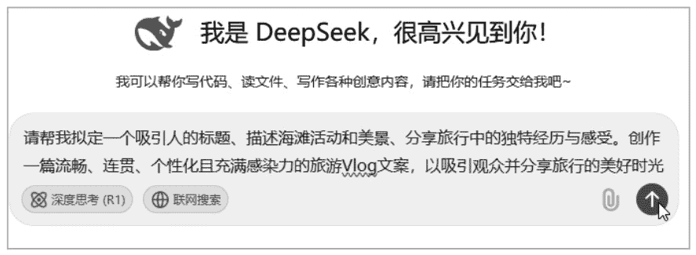

图 2-7 选择深度思考 R1 与联网搜索

系统先给出思考脉络，如图 2-8 所示。

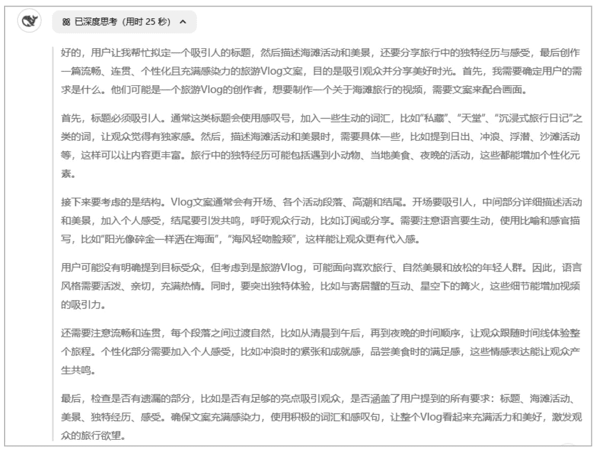

图 2-8 返回的思考思路

随后提供具体文案，如图 2-9 所示。

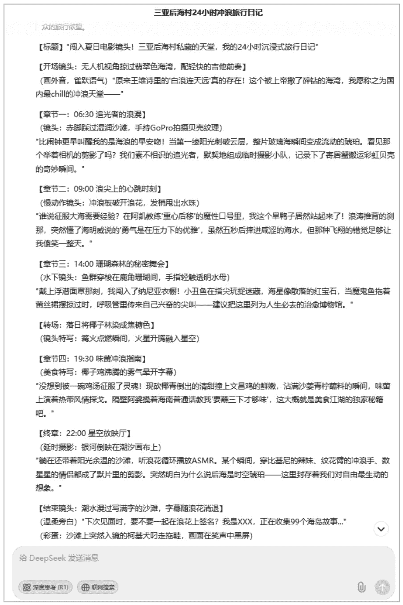

图 2-9 返回的具体文案

## 2.3 AI 文案实战演练
掌握 AI 在短片文案中的潜力后，进入具体实战。通过案例了解如何用 AI 产出更具吸引力与创意的短片文案。

### 2.3.1 AI 赋能脚本策划与创作
AI 在脚本策划与创作环节的作用日益凸显，其高效智能的特性为创作者提供强力支持，主要体现在：

**1 内容生成与创意激发**
AI 可分析大量视频样本与受众偏好，给出针对性内容建议。通过 NLP 与机器学习，可快速生成文案框架或创意点子，帮助确定主题与风格。

**2 检索词提炼与优化**
检索词对曝光至关重要。AI 能从海量数据中抽取与主题相关的词，并按搜索引擎优化逻辑调整文案，提升平台曝光与搜索排名。

**3 情感分析与受众互动**
AI 可解析评论反馈，识别受众情感倾向与关注点，帮助创作者调整策略，增强共鸣。例如捕捉某个话题的热度后，引导内容方向并促进互动。

**4 文案风格与语言优化**
AI 能模仿不同领域的语言风格，提供幽默、正式、亲切等多种表达选择，同时进行语法与拼写校验，确保准确流畅。

**5 自动化流程与效率提升**
AI 可自动生成模板、批量替换检索词等繁琐工作，简化流程并提升效率，还能对成品做初步质量评估并给出优化建议。

**6 个性化推荐与定制服务**
基于用户行为的推荐系统可为受众推送兴趣内容，为创作者打开新方向。AI 还能按品牌调性或目标受众定制文案，实现精准投放。

实战 1：用 DeepSeek 发掘短视频热点选题
热点选题能快速抓住流行话题，提升观看、分享与互动，进而提高排名与曝光，还能帮助品牌与个人建立情感连接。借助该平台挖掘选题高效且智能。

步骤 1 确定受众群体和垂类。明确内容面向的人群与领域，以便精准定位。

步骤 2 收集相关数据与信息。
• 社交媒体趋势：关注各平台热词、标签与讨论。
• 行业报告和新闻：阅读目标领域的报告与资讯把控最新动态。
• 用户反馈：收集受众评论，了解偏好与期待。

步骤 3 进行语义分析。
• 输入检索词：将从社媒、报告、反馈中整理出的检索词输入。
• 分析语义关系：模型识别词间关联，挖掘潜在选题。
• 生成建议：基于分析结果给出内容方向、创意点或延伸话题。

步骤 4 筛选和确定热点选题。结合受众需求、创新性与时效性，评估可行性后锁定。

步骤 5 创作和优化短视频内容。结合 AI 建议与自身创意制作内容，并根据数据反馈持续迭代。

【案例 1】以母婴行业为例
步骤 1 打开对话窗口，输入“请帮我推荐 10 个当前母婴领域的热门短视频话题”，点击右侧  按钮，结果如图 2-10 所示。

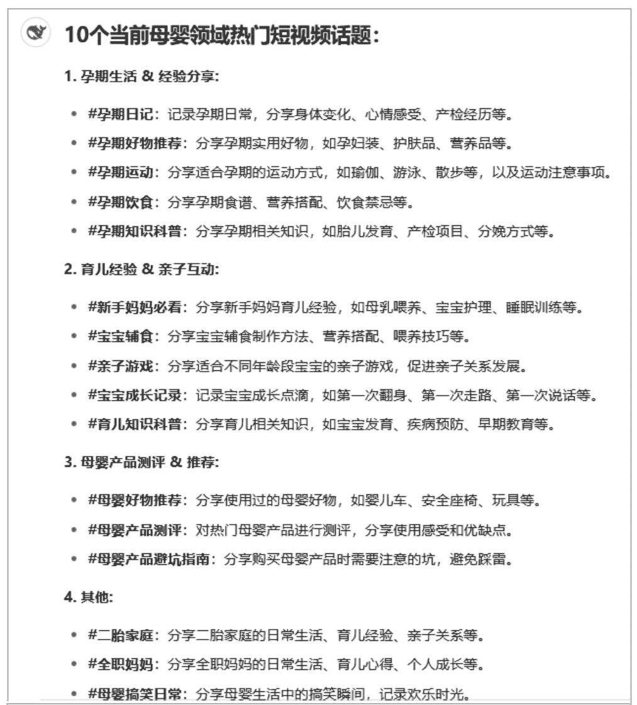

图 2-10 生成的热点选题

可以看到模型给出了 10 个话题并附带说明。

步骤 2 若需更精准，可按【要求】+【受众群体】+【目标】格式优化。在对话框输入“请帮我重新列举 10 个母婴短视频热点，要求内容新颖，与母婴生活密切相关，受众群体为 3～6 岁孩子的父母，目标是提供有价值的母婴知识和经验分享，激发受众兴趣，并鼓励受众分享自己的母婴故事。”点击右侧  按钮，返回如图 2-11 所示。

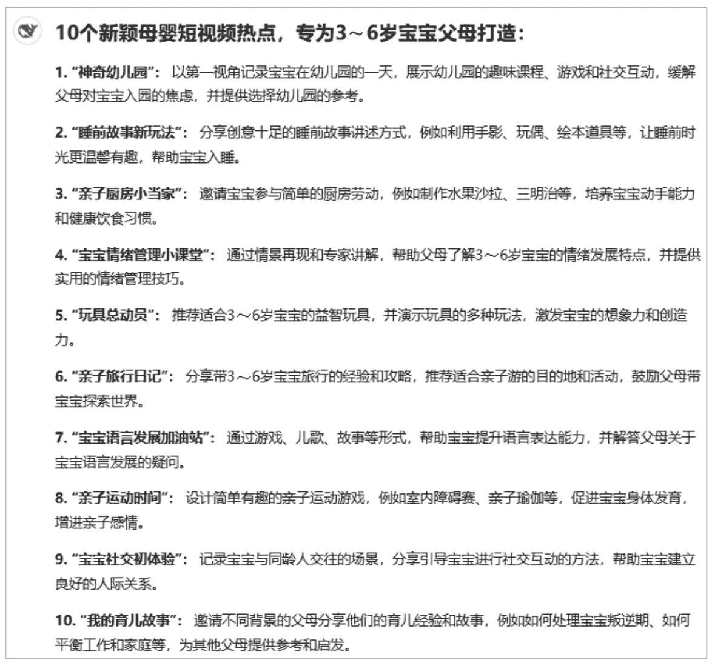

图 2-11 生成的回复

实战 2：用 DeepSeek 创作短视频标题
标题是视频信息的浓缩，能迅速抓眼球并传递核心要点，提升点击。好的标题决定传播效果，需具备简洁、吸引、精准与多样性。

以“宝宝情感启蒙”为主题生成 10 个爆款标题，输入：“关于‘宝宝情感启蒙’这个主题，请帮我创作 10 个符合主题的爆款标题。”点击右侧  按钮，结果如图 2-12 所示。

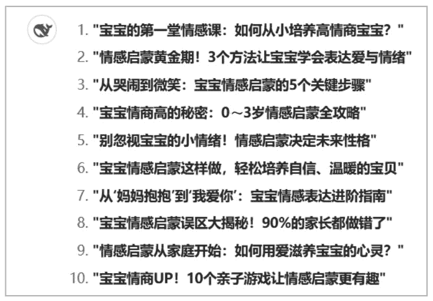

图 2-12 生成的短视频标题

也可基于已有文案生成标题：

步骤 1 准备好宝宝情感相关的短视频文案。
步骤 2 输入：“我将给你一份短视频文案，请基于我提供的文案内容，生成 10 个符合自媒体平台特点且具有吸引力的爆款标题。这些标题需要能够准确反映视频内容，同时能够吸引受众的注意力，增加点击率和观看量。请确保标题简洁明了、易于理解，并具备一定的创意和独特性。如果明白，请回复给我文案”,系统回复如图 2-13 所示。

图 2-13 生成的回复

步骤 3 将文案粘贴至对话框，点击右侧  按钮，结果如图 2-14 所示。

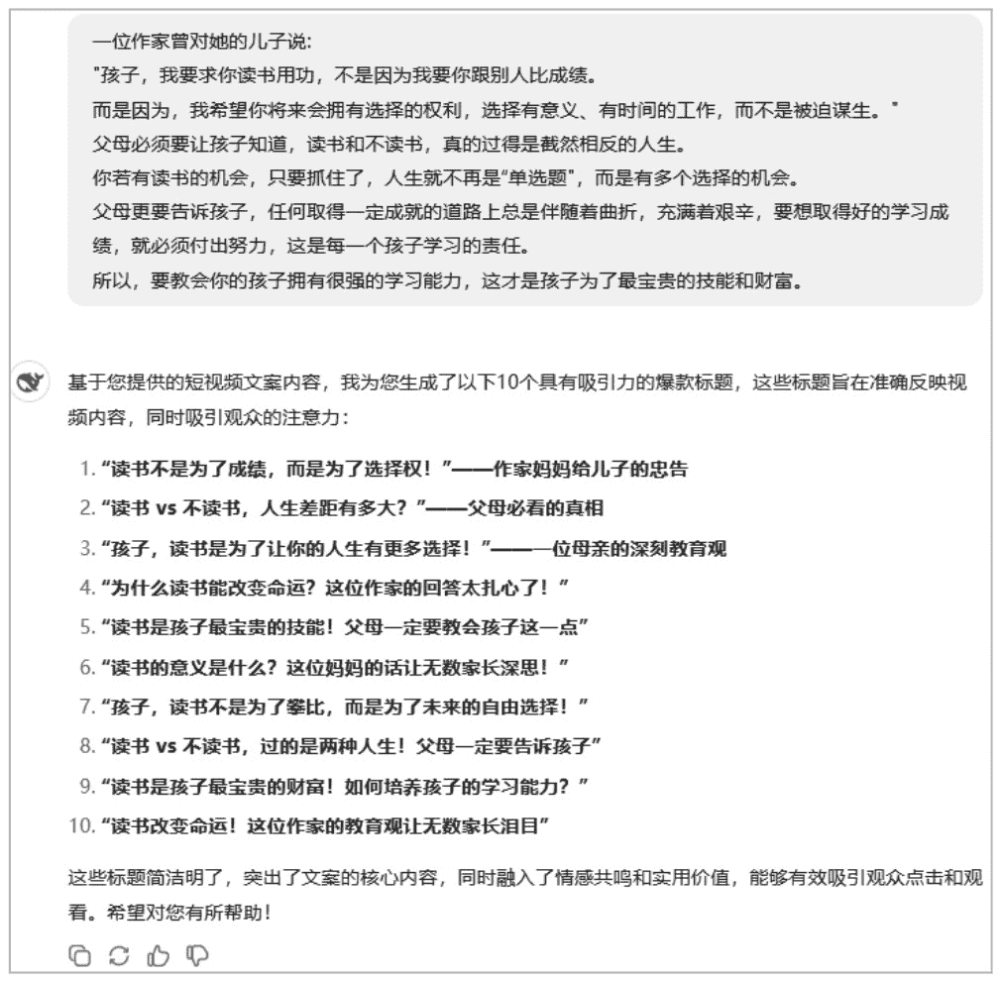

图 2-14 生成的回复

实战 3：使用 DeepSeek 创作分镜头脚本文案

分镜脚本相当于短视频开机前的执行地图。它把一支完整的片子拆解成若干个独立镜头，标明每个镜头的取景主体、画面构图、拍摄位、持续时间、音效、背景音乐、字幕呈现方式，以及镜头之间的衔接手法与节奏掌控。常规条目包括片名、场景概述、景别、运镜方式、对话台词、道具清单、节奏要点、节拍感等。有了这份脚本，摄制组能一眼看清每个镜头的视觉目标与表达意图，保证内容、节奏与画面风格在整体上保持统一协调。它在制作流程中必不可少，为摄影、剪辑、特效等环节提供明确依据，使流程更规范、效率更高、精度更准。

比如把以下任务交给 DeepSeek 的聊天窗口：『你是一名旅游博主，正在撰写厦门旅游 Vlog 的分镜，须融入当下短视频流行元素，开头 5 秒抓眼球，中间有反转，结尾给惊喜，文案偏重情绪表达。请用表格输出分镜序号、景别、画面说明、时长、对话台词含人物动作语言神态细节、背景音乐曲目名称』。返回的示例见图 2-15 所示。

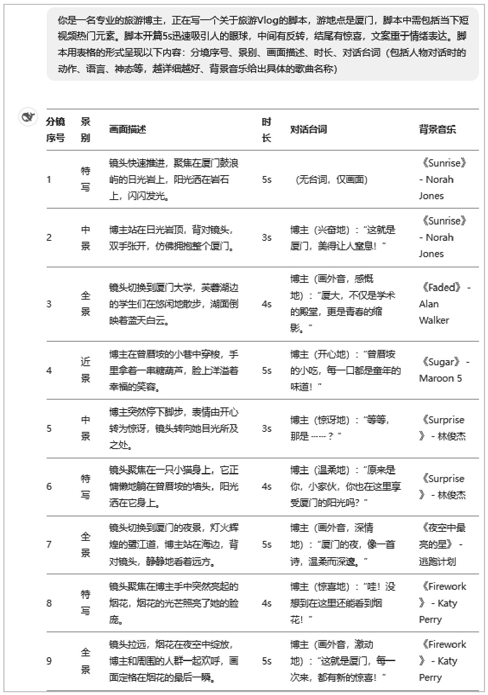

图 2-15 DeepSeek 生成的分镜头脚本文案

实战 4：使用 DeepSeek 撰写评论区文案
评论区文案要做到简短有力、针对性强、互动性高，同时保持尊重。选对表达方式，评论区就能成为用户交流和传播的放大器，提升内容的可读性和扩散力。借助 DeepSeek 起草评论区文案的流程如下：

步骤 1 细读打算评论的文章、帖子或视频，弄清其核心内容和观点。
步骤 2 明确评论目的，是表达认同或质疑、提出问题、分享经验，还是单纯抛出一个有趣的看法。
步骤 3 用关键词或短句概括想表达的核心观点，并挑选合适的语气和风格，比如幽默、严肃、专业等。

例如正在阅读一篇论述城市绿化对居民生活质量影响的文章，文中提到绿化改善空气、降低噪音、提升幸福感和健康度。此时可让 DeepSeek 为该文产出十条正向短评，每条控制在 5 到 20 字。返回内容如图 2-16 所示。

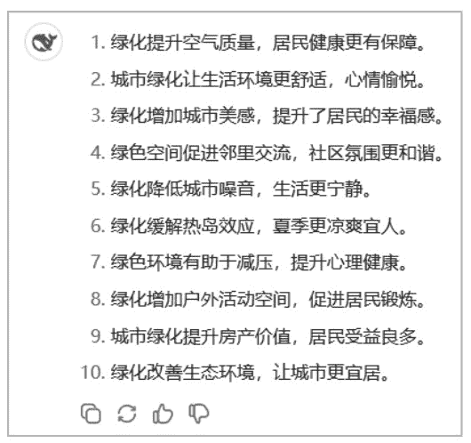

图 2-16 DeepSeek 生成的评论区文案

若想让评论更精准、更有针对性，还可以对指令做细化。比如说明评论目标是表达对文章观点的认同，并结合自己城市的绿化经历进行分享。

把类似“为《城市绿化对居民生活质量的影响》生成十条正向评论，方向可为赞同绿化对生活的影响、分享个人城市绿化经验、强调绿化实际好处，语气风格为积极分享经验，每条 5 到 50 字”的要求发给 DeepSeek。返回内容如图 2-17 所示。

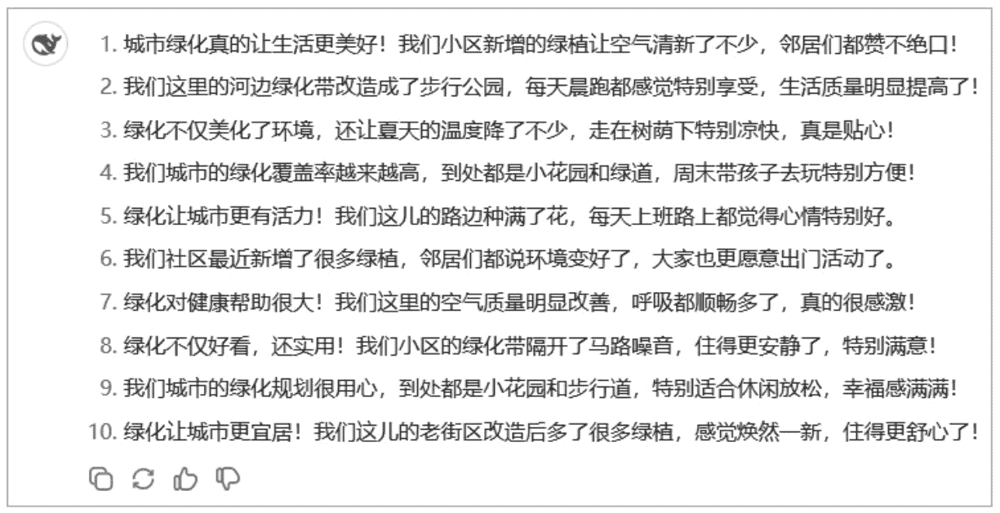

图 2-17 DeepSeek 生成的评论区文案

实战 5：使用 DeepSeek 撰写产品描述文案
想让 DeepSeek 写出精准的商品介绍，需要先提供足够的关键信息，确保文案能准确体现卖点。常见信息点包括：

• 商品全称：正式名称。
• 商品亮点：核心功能、特性与优势。
• 目标人群：消费画像、需求与偏好。
• 使用场景：最合适的情境或环境。
• 设计要素：外观、配色、材质等亮点。
• 技术参数：尺寸、重量、兼容性等关键数据。
• 品牌理念：想传达的核心价值观。
• 市场定位：高端、性价比、创新等定位。
• 竞争差异：相比竞品的优势。
• 行动号召：希望用户购买、试用或咨询。

基于以上信息点，即可让 AI 为“华为智能健康手环 9”生成文案，具体操作如下：

步骤 1 向 DeepSeek 发送“请分析华为智能手环 9 的商品参数”，点击  按钮，返回内容如图 2-18 所示。

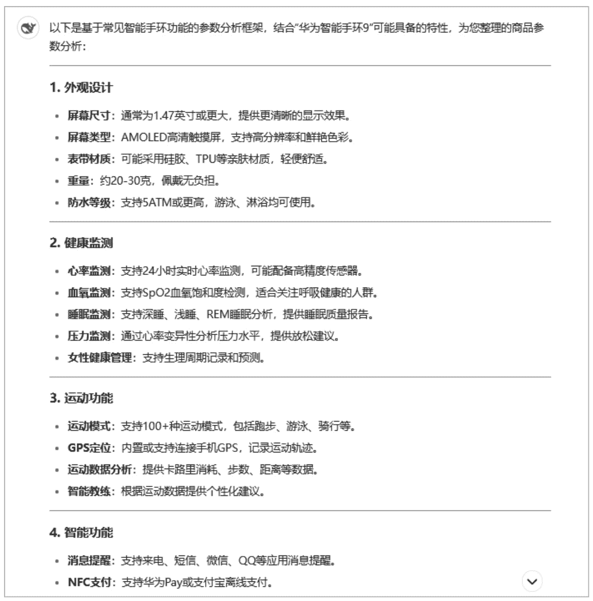

图 2-18 DeepSeek 生成的商品参数

步骤 2 获取基础资料后，基于这些数据让 DeepSeek 产出介绍文案。发送“根据上述商品信息，生成 5 篇商品介绍”，返回内容如图 2-19 所示。

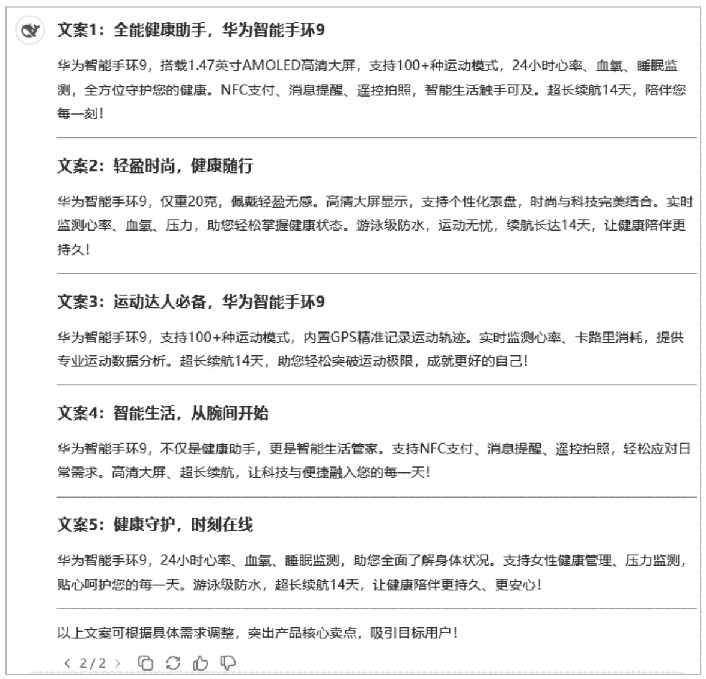

图 2-19 DeepSeek 生成的产品描述文案

实战 6：使用 DeepSeek 撰写短视频营销文案
撰写短视频营销文案时，要兼顾受众、营销目标、创意点、视频时长、视觉配合、行动号召。文案须简洁有力，快速抓住注意力，与品牌产品强相关，并在结尾用明确号召推动转化。同时要兼顾搜索优化提升曝光，后续通过数据反馈持续迭代。

借助 DeepSeek 生成营销文案，只需提供产品或服务详情、明确目标人群和核心信息、设定风格语调，再根据时长确定文案长度，调用 AI 指令功能如“@文案助手”来生成。生成后需人工审核，确保风格与品牌一致。发布后收集反馈，持续优化。

以华为智能手环 9 为例：

步骤 1 向 DeepSeek 发送“请为华为智能手环 9 撰写一个短视频营销文案。受众为关注健康和科技的年轻成年人，核心信息是先进健康监测功能和时尚设计。风格要求激励亲切，时长约 30 秒。要简洁有力，能快速吸引注意，结尾有明确行动号召。”该指令把产品信息、目标人群、卖点、风格、时长和具体要求说明清楚。返回内容如图 2-20 所示。

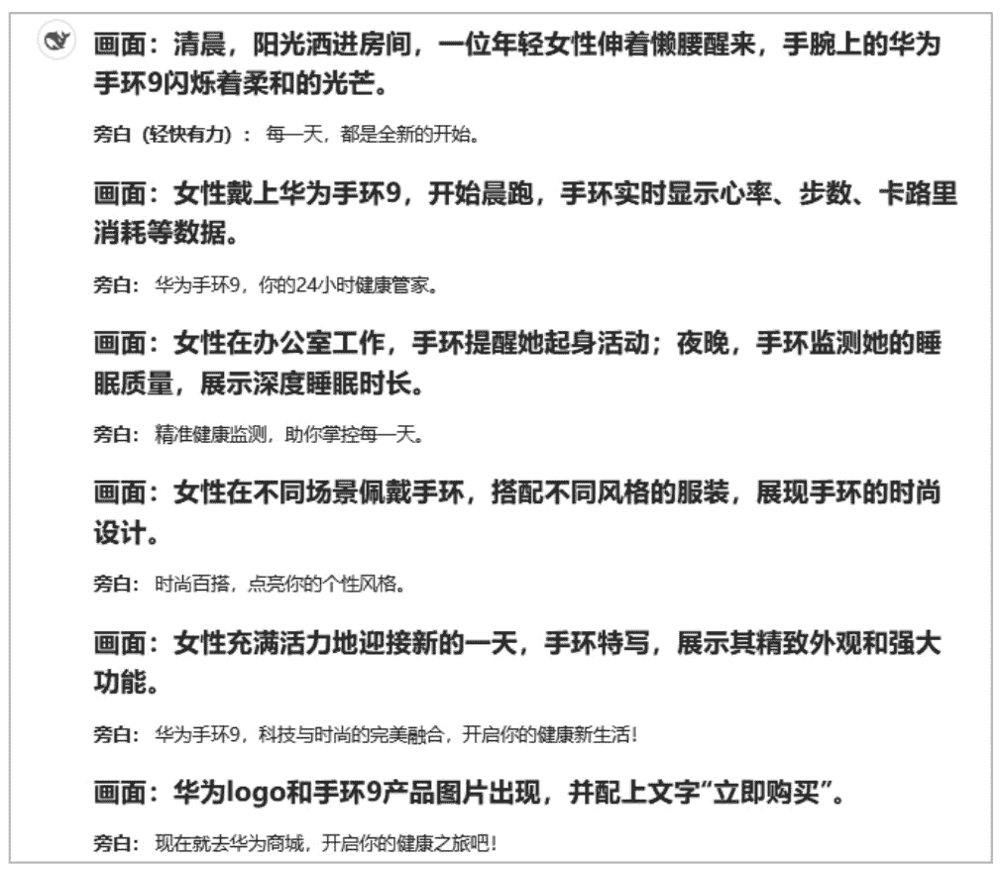

图 2-20 DeepSeek 生成的短视频营销文案

步骤 2 从生成形态看，这更像拍摄脚本文案，而非我们需要的营销文案。此时可继续要求“请把生成的文案整理成一篇营销文案，不需要分镜说明，不要带二维码，不要链接引导”。返回内容如图 2-21 所示。

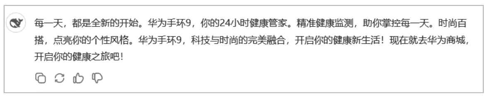

图 2-21 DeepSeek 优化后的短视频营销文案

如果结果不满意，还可通过追问调整优化，也可手动修改到理想效果。

### 2.3.2 不同类型的短视频文案生成策略
掌握了 AI 工具的基础用法，下面介绍针对不同类型短视频的文案生成思路。

实战 1：娱乐搞笑类短视频文案生成策略
娱乐搞笑类文案的首要任务是迅速抓住注意力，营造轻松愉悦的氛围，用幽默、夸张、反转等手段制造强烈娱乐感。

生成策略可围绕以下方面展开。

• 锁定受众：先明确受众是谁，了解兴趣点、笑点、年龄层和文化背景，保证文案能引发共鸣。
• 捕捉热点：紧跟社交媒体、新闻和流行文化，将当下热梗、话题巧妙融入。
• 运用幽默手法：用夸张、双关、反转、调侃等制造笑点，注意尺度，避免低俗。
• 打造独特故事：设计有悬念、有冲突、有反转的小故事，让观众笑中追看。
• 语言生动：善用比喻、拟人、排比等修辞，配合具体场景和人物刻画，增强画面感。
• 与视频节奏配合：文案要与画面、音效、配乐、剪辑节奏匹配，形成整体感。
• 测试再优化：先做小范围测试，观察互动反馈，再针对性调整。
• 保持创意多样：不断尝试不同创意和风格，避免审美疲劳。
• 真实真诚：即便搞笑，也要保持真实情感表达，与观众建立信任。
• 跨文化注意：面向全球观众时，要考虑文化差异和语言理解度。

例如直接向 DeepSeek 发送：“请生成一个娱乐搞笑短视频文案，要求包含标题、简介、标签”。返回内容如图 2-22 所示。

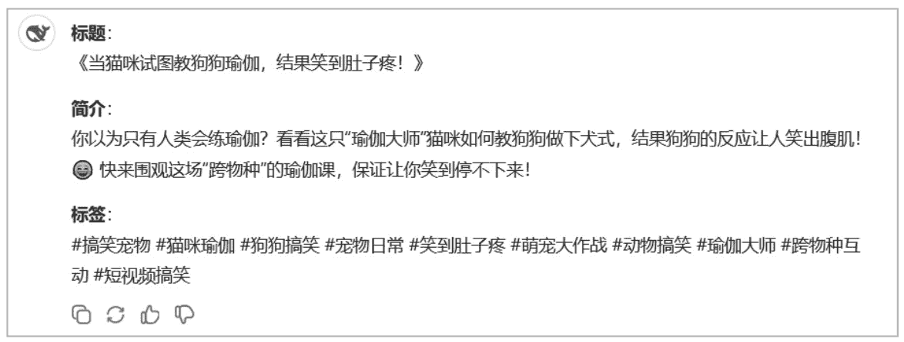

图 2-22 DeepSeek 生成的娱乐搞笑类短视频文案

生成内容相对常规，篇幅较短。为了达到预期，指令里最好包含以下关键点：明确目标受众、指定幽默风格、结合时下热点、创意故事情节、使用生动语言、视频内容节奏匹配、吸引人的标题和简介、选择流行标签、测试和优化、保持创意多样性、保持真实真诚、考虑跨文化因素。

明确需求后，可详细说明，例如“请为年轻宠物爱好者创作一个幽默吸睛的娱乐搞笑短视频文案，融入流行文化元素，设计有趣故事情节，使用生动语言，确保文案与视频内容和节奏相匹配，同时挑选流行标签提升曝光。预计时长 15 秒左右”。返回内容如图 2-23 所示。

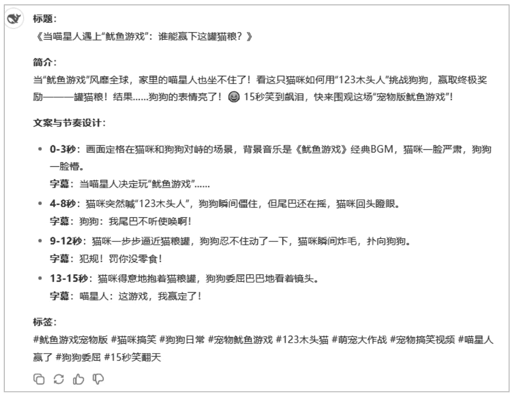

图 2-23 DeepSeek 优化后的娱乐搞笑类短视频文案

实战 2：美食制作类短视频文案生成策略
美食类短视频文案可围绕以下方面展开。

• 迅速点燃兴趣：开头用悬念、幽默或小故事抓住胃口，比如“一分钟学会××美食，秒变大厨！”
• 讲清美食背景：简要介绍菜品来源、历史或文化，增加看点和文化厚度。
• 详细拆解步骤：把制作流程拆成清晰步骤，用生动语言和形象比喻让观众能跟做。
• 突出特色与口感：用“色香味俱全”“入口即化”等表达，强化食欲感。
• 加入互动：提问观众最爱吃什么、讨论食材做法，提升参与度。
• 简洁明了：语言简短易懂，避免冗长。
• 与画面配合：文案与镜头、动作同步，增强沉浸感。

例如发送：“请生成一篇美食制作类短视频文案，需包括标题、内容步骤、标签”。返回内容如图 2-24 所示。

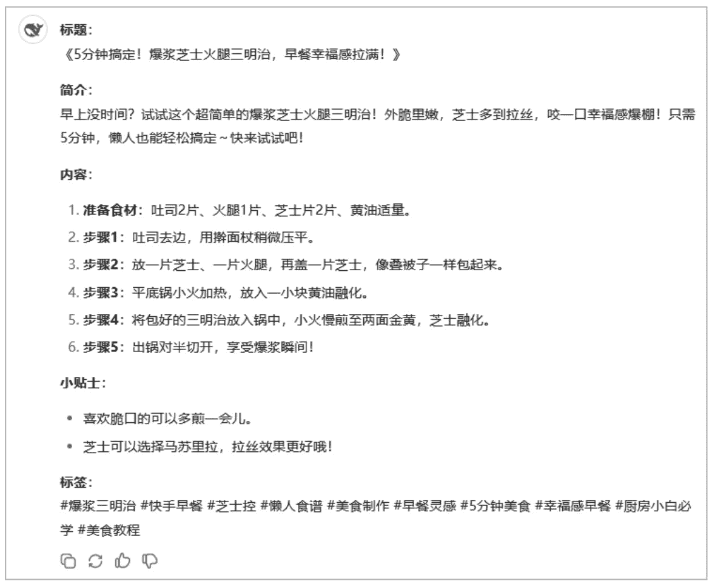

图 2-24 DeepSeek 生成的美食制作类短视频文案

实战 3：生活分享类短视频文案生成策略
生活分享类短视频靠贴近日常、真实可信走心。好文案能让观众感受到生活美好，爱上琐碎小事。

生成策略可围绕以下方面展开：

• 制造共鸣：开头用个人经历、感悟或普遍问题与观众建立情感连接。
• 呈现生活细节：描写日常用品使用、家居小技巧等细节，让生活更有趣。
• 传达正能量：强调积极态度和健康生活方式，用正向语言激励观众。
• 分享实用技巧：提供小窍门解决实际问题，提升实用价值。
• 鼓励互动：提问、征集意见、邀请观众分享故事，增加参与感。
• 保持真实：避免夸张造假，用真诚朴素的语言。
• 紧扣视频画面：描述场景和动作，让文案更具体生动。

例如发送：“请创作一篇生活分享类短视频文案，标题【生活小技巧】如何用一张纸快速找到丢失的针？内容分享简单实用小技巧，标签 #生活小妙招 #实用技巧 #生活分享”。返回内容如图 2-25 所示。

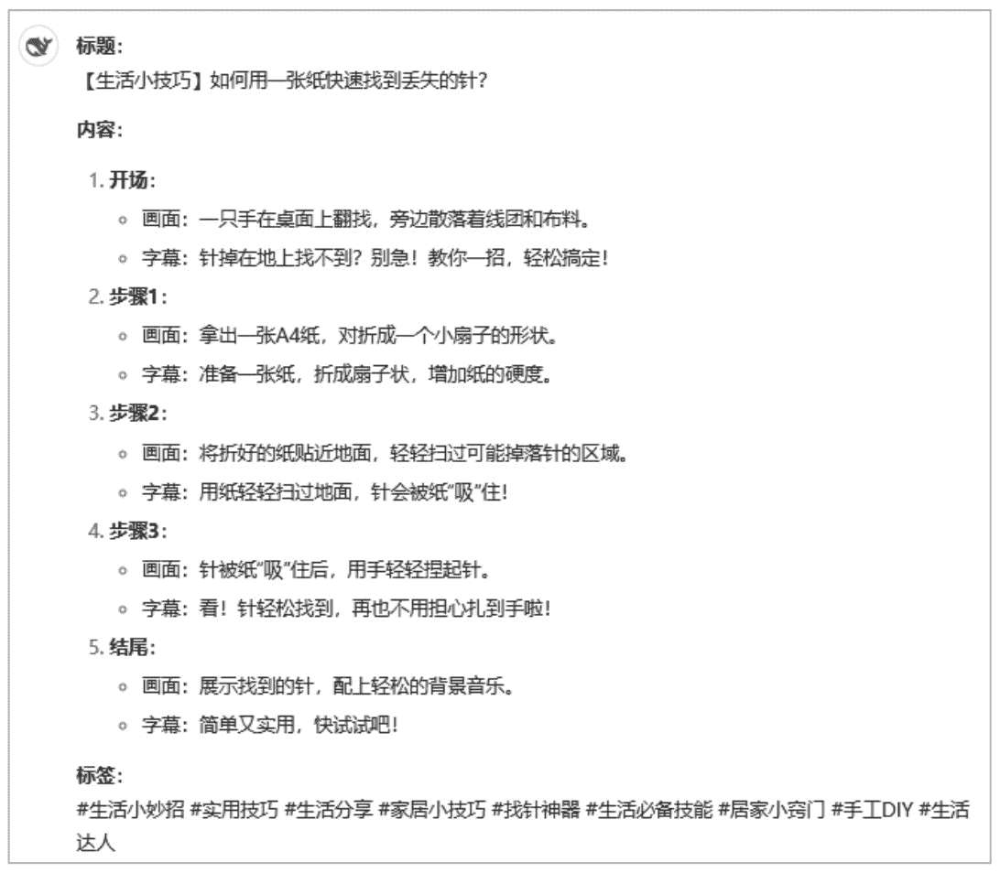

图 2-25 DeepSeek 生成的生活分享类短视频文案

实战 4：知识科普类短视频文案生成策略
在知识更新快的今天，科普短视频既是信息载体，也是激发科学兴趣的引子。好文案能把复杂概念讲明白，让人爱听爱看。

生成策略可围绕以下方面展开。

• 激发好奇心：开篇用引人入胜的问题或现象作钩子。
• 点明主题：直接说明视频要讲什么。
• 逻辑清晰：按一条清晰线索推进，从结构到机制再到应用。
• 简化概念：把抽象概念形象化，如把“光合作用”说成“植物的绿色魔法”。
• 视觉辅助：建议配合图表、动画、微观镜头等增强理解。
• 鼓励延伸学习：提供延伸入口，引导观众继续探索。
• 互动提问：用问题激发思考。
• 专业严谨：确保信息准确权威。

在 DeepSeek 对话框中输入：
“请生成一篇知识科普类短视频文案。标题【科学探秘】月球背面的秘密：我们发现了什么？内容揭开月球背面的神秘面纱，了解最新科学发现。标签 #科学探秘 #月球探索 #科普知识”。返回内容如图 2-26 所示。

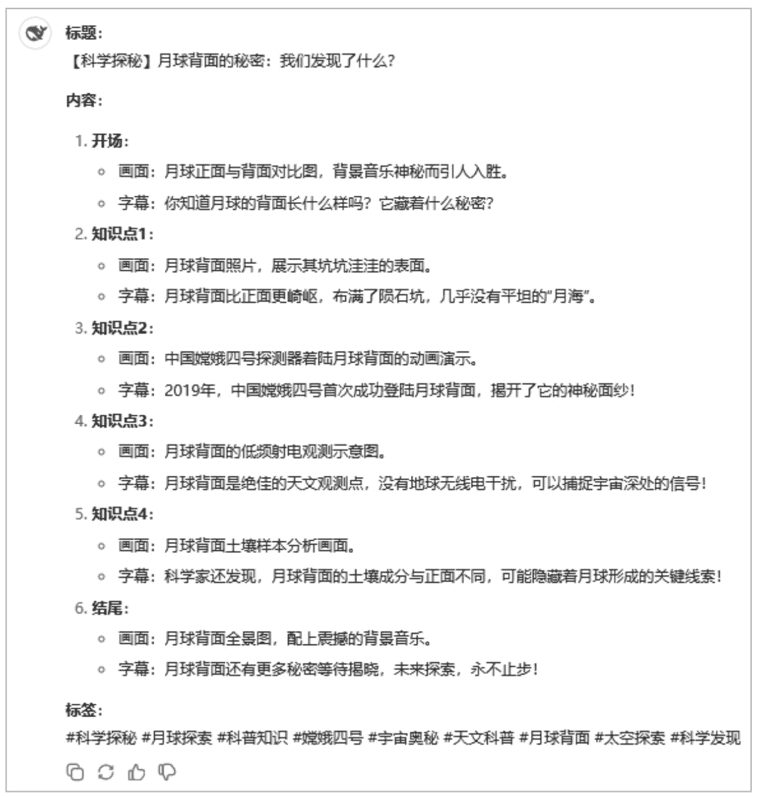

图 2-26 DeepSeek 生成的知识科普类短视频文案

实战 5：情景短剧类短视频文案生成策略
情景短剧类短视频靠紧凑剧情和鲜明人物性格，几秒内就能打动人。文案设计得好，能放大这种情感冲击。

生成情景短剧类短视频文案的策略可围绕以下几个方面展开：

• 时空锚点：文案起笔就要明确时间与地点，用细节描写与氛围营造让画面迅速具象，比如“繁华城区的街角，一家复古咖啡馆里藏着不为人知的秘密”。

• 人物刻画：靠言行与对话呈现个性和动机，使人物立体饱满，比如“咖啡馆老板外形普通却目光深邃，总能在无意间洞察人心”。

• 冲突推进：巧妙埋设转折点，维持悬念与张力，比如“一位神秘客人的到访打乱了咖啡馆的宁静，一段尘封旧事被牵引出来”。

• 情感触达：借助内心独白或对话撬动观众共情，比如“‘每个人心里都有一间咖啡馆，装着故事与梦想。’老板低声说，目光穿透岁月”。

• 画面咬合：文案与镜头、布景、造型、光影紧密呼应，强化视觉冲击，比如“镜头慢慢推近，微小细节里透露出风暴将至的征兆”。

• 互动设问：抛出问题激发观众参与与预测，比如“你认为这名神秘客人是谁？他的到来会给咖啡馆带来怎样的变化”。

• 节奏把控：语言干脆利落，避免拖沓，让故事于有限时长内高效展开，比如“随着时间推移，真相逐步揭开，每个角色的选择都牵动观众心弦”。

• 水准呈现：强调制作的专业性，比如“本短剧由资深编剧导演团队打造，每个镜头都精心设计，力求最佳叙事效果”。

运用上述手法，情景短剧类短视频能以引人入胜的方式讲故事，同时促成互动，提升娱乐性与观看体验。精心的情境搭建、鲜活的人物塑造与紧凑的情节推进，能让这类内容成为观众喜爱的娱乐形式，在短时间内带来深刻情感体验与思考。

例如：在 DeepSeek 输入框里输入以下内容：

“请帮我生成一篇情景短剧类的短视频文案。要求如下：

标题：【情果喜剧】办公室里的奇葩面试

内容：在这场充满笑料的办公室面试中，看看应聘者奇范如何让面试官哭笑不得。

标签：#情景客剧 #办公室生活 #面试趣事”

DeepSeek 产出的内容如图 2-27 所示。

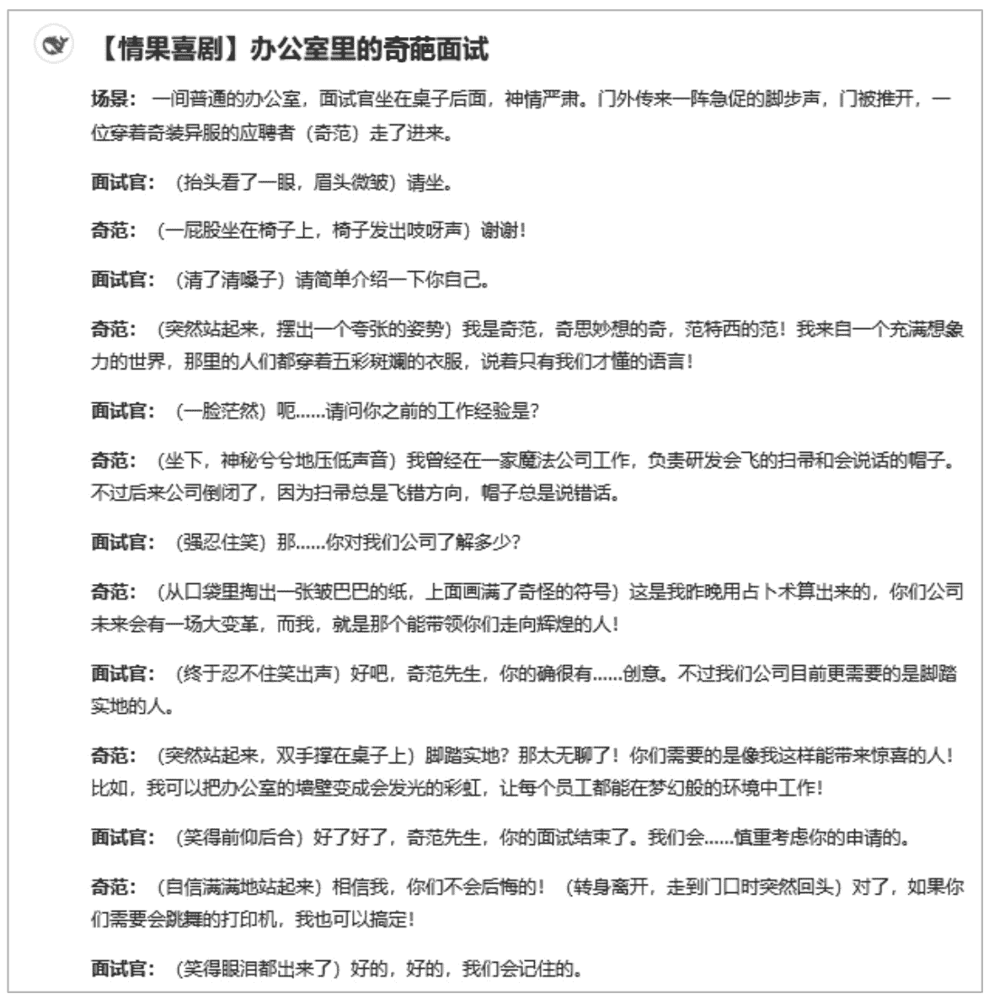

图 2-27 DeepSeek 产出的情景短剧类短视频文案

**实战 6：影视解说类短视频文案生成策略**

影视解说类短视频凭借精炼剪辑与敏锐洞察，为观众提供快速深入理解作品的新路径。精心设计的文案能增强观影体验，激发思考与讨论。

生成文案的策略可围绕以下方面展开。

• 主题提炼：开头迅速点明作品的核心主题或独特卖点，例如“《肖申克的救赎》不止是越狱，更是对自由与希望的永恒追问”。

• 背景补充：提供创作背景、社会反响、获奖情况等信息，例如“该片改编自斯蒂芬·金的短篇小说，自 1994 年上映以来长期被誉为影史经典”。

• 剧情梳理：用精炼生动的语言概括情节并巧妙设悬，例如“银行家安迪被冤枉杀害妻子与情人，他的狱中生活将如何展开”。

• 深度剖析：提供导演意图、文化哲学层面的解读，例如“诺兰借《盗梦空间》探讨梦境与现实的边界，以及人类对真实的追寻”。

• 角色解析：深入分析主角的性格、成长及其对情节的推动作用，例如“安迪的智慧与坚韧不仅改变自身命运，也激励身边人追求自由”。

• 情感共鸣：通过经典台词、情感冲突或高潮情节触动观众，例如“‘希望是好东西，也许是世间最好，而美好的事物永不消逝。’这句话成为无数人心中的灯塔”。

• 视文融合：确保文案与精彩片段、关键场景与演员表演紧密配合，例如“安迪播放莫扎特歌剧的那一刻，音乐震撼了整座监狱”。

• 节奏控制：文案节奏需与剪辑匹配，保持紧凑且富变化，例如“从紧张的法庭对峙到狱中的孤寂夜晚，每一分钟都充满戏剧张力”。

• 专业点评：呈现影评人视角，提供独到见解与评价，提升权威性，例如“影评界普遍认为，该片以深刻的人性探讨与精湛叙事成为不朽经典”。

• 文化联结：将作品与更广泛的文化现象、历史背景或社会议题相连，例如“《阿甘正传》不仅是个人成长史，也是对美国数十年社会变迁的生动回望”。

• 互动引导：鼓励观众在评论区分享观感或理解，例如“在评论区告诉我们，哪一刻让你感受到电影的力量与温暖”。

采用这些策略，影视解说类文案能以精炼深入的方式介绍并分析作品，同时促进互动，提升观赏价值与思考深度。专业的点评、情感共鸣与文化联结，使影视解说类短视频成为观众认识与欣赏影片的重要渠道，带来更丰富的观影体验。

例如：在 DeepSeek 输入框里输入以下内容：

“请帮我生成一篇影视解说类短视频创作文案。要求如下：

标题：【影视解说】《盗梦空间》：梦境与现实的边界

简介：深入解析《盗梦空间》中的复杂梦境结构，探索电影中的哲学思考。

标签：#影视解说 #盗梦空间 #电影分析”

生成的内容如图 2-28 所示。

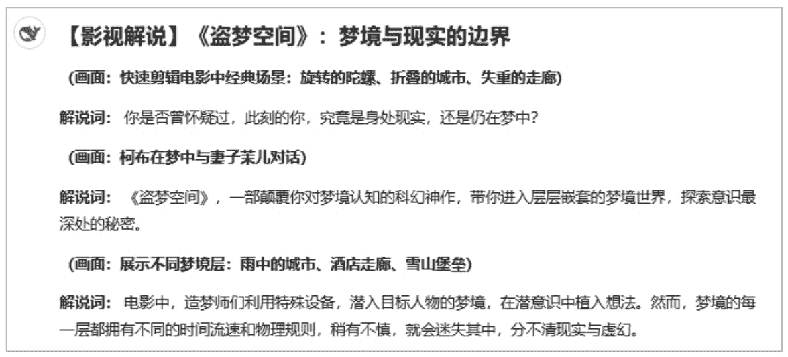

图 2-28 DeepSeek 生成的影视解说类短视频文案

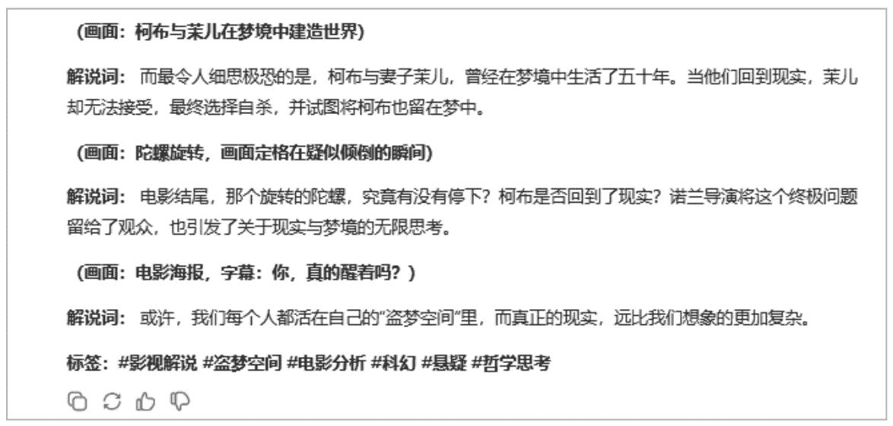

图 2-28 DeepSeek 生成的情景短剧类短视频文案（续）

总体来看，无论何种类型的短视频文案，智能辅助都能帮助创作者更高效精准地产出内容，满足不同受众需求，实现视频营销目标。融合智能分析与创作者的独特创意，短视频文案会更生动有趣，同时兼具教育意义与文化价值。

# **第三章**

# **AI 生成短视频素材图片**

短视频创作中，灵感往往如流星般转瞬即逝，而将瞬间灵感转化为视觉艺术却常有诸多阻碍。如今智能技术的加入，为这一过程带来突破性改变。

本章将介绍智能系统如何成为短视频创作的得力伙伴，不仅能捕捉稍纵即逝的创意火花，更能将其化作令人瞩目的视觉作品。这不仅是技术应用，更是创意与技术融合的深度探索。

阅读本章后，您将了解智能系统如何简化创作流程、提供个性化素材，以及如何凭借算法增强视频表现力。这是一场关于技术与艺术相辅相成的洞察。

## **3.1 AI 生成短视频素材图片概述**

随着人工智能的迅猛发展，智能系统在短视频领域的应用日益广泛，尤其在素材图片的智能创作上。由算法模型自动按需创作的图像资源，供创作者使用。该技术极大提升了制作效率，也为内容创新与多样性注入新活力。

### **3.1.1 AI 在短视频素材图片生成中的应用**

智能系统在素材图片创作中的应用主要体现在以下方面：

**1 自动化内容创作**

智能系统可学习海量图像与视频数据，按特定主题或情境产出短视频素材。例如基于文字描述或关键词，能生成契合要求的场景、角色与动作，实现自动化创作。

**2 特效与动画创作**

智能技术广泛用于特效与动画的自动生成。通过算法模拟物理现象、光影效果及复杂动态，为短视频增添丰富视觉效果。

动画工具可快速生成角色动画，提供多种表情、动作与姿态选择，节省大量人工时间。

**3 风格迁移与图像转换**

借助风格迁移技术，智能系统能将一种艺术风格赋予短视频素材，呈现独特视觉效果。例如将名画风格套用至视频帧，或把黑白视频转为彩色。

图像转换技术可将一种图像类型转为另一种，如静态图转为动态视频，或低分辨率视频提升为高分辨率。

**4 智能剪辑与合成**

智能系统可自动分析素材内容，按节奏、情感与主题进行智能剪辑，生成符合要求的短视频片段。

通过智能合成，能将多段视频、图像与音频无缝拼接，形成连贯流畅的短视频作品。

**5 智能推荐与个性化定制**

智能系统可依据用户偏好、行为与历史数据，推荐契合需求的短视频素材，帮助创作者更快找到所需资源，提升效率。

同时也能提供个性化定制服务，按用户需求与偏好生成独特的短视频内容。

**6 图像增强与修复**

智能系统可用于视频帧的图像增强，如提升分辨率、对比度、色彩饱和度等，使素材更清晰鲜艳。

对于存在缺陷或损坏的素材，也能智能修复，如去除噪点、修复破损区域，提升可用性。

**7 实时渲染与交互**

在对实时性要求高的场景中，智能系统可实现实时渲染与交互。例如在直播或虚拟现实应用中，能根据用户动作与指令实时生成对应视频素材，增强参与感与沉浸感。

这些应用让智能系统在短视频素材图片生成中作用日益重要，为创作者提供更多可能性与便利。

### **3.1.2 AI 生成素材图片的优势**

相较传统方式，智能生成素材图片具有以下优势：

**1 高效快捷**

智能系统能迅速处理海量数据，短时间内产出高质量素材图。对比手工创作或修改，效率大幅提升，降低时间成本。

**2 独特创意**

模型通过学习大量样本，能生成富创意且独特的素材图。可突破传统创作局限，为创作者提供新灵感。

**3 可定制性**

能按用户需求与偏好生成符合特定要求的素材图。无论颜色、风格、尺寸或内容，都可通过调整参数满足不同需求。

**4 一致性与可重复性**

智能生成的素材图一致性与可重复性很高。一旦生成条件与参数确定，可稳定输出同风格、同质量的图片，保证作品统一与标准化。

**5 自动化与智能化**

智能技术可实现自动化生成与智能化处理。能自动分析数据、识别特征、优化参数，并在过程中进行智能决策与调整，大幅提升生成效率与准确性。

**6 节省成本**

使用智能生成素材图可显著降低制作成本。传统手工创作或购买素材需要耗费大量人力物力财力，而智能生成则大幅减少这些开支，提升经济效益。

**7 适应多样化需求**

智能生成的素材图可满足各领域各场景需求。无论广告、媒体、设计、游戏或其他领域，都能提供符合要求的素材图，满足多样化创作需求。

这些优势使智能生成素材图在各领域获得广泛认可，为创作者与设计师提供更高效便捷优质的创作体验。

### **3.1.3 AI 生成素材图片的流程**

智能生成素材图片的流程通常包括以下步骤：

**1 选择合适的智能工具**

根据具体需求挑选合适的工具或平台，这些工具可能包括专业图像生成软件、在线平台或集成在特定软件中的智能功能。比如国内的可灵 AI，如图 3-1 所示。

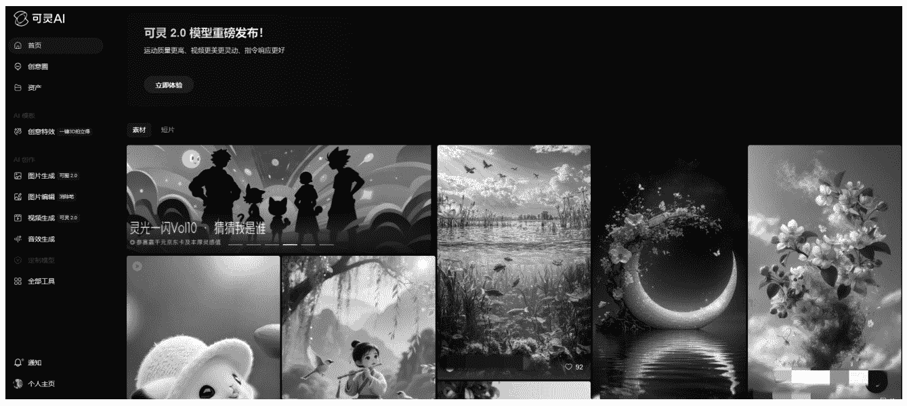

图 3-1 可灵 AI 主页面

**2 输入描述或关键词**

用户需在工具中输入对图片的描述、关键词或短语。描述可涉及主题、风格、色彩、情感等多方面。例如在可灵 AI 中，生成图片前必须输入描述或关键词，如图 3-2 所示。

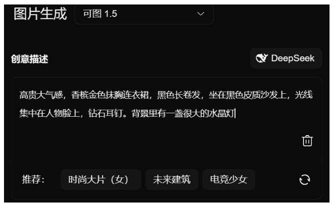

图 3-2 在可灵 AI 中输入描述或关键词

**3 上传参考图**

按需求，用户可上传不同风格或模型以生成图片。部分工具提供多种预设风格，也可训练自定义模型。图 3-3 所示为可灵 AI 生成图片时的上传参考图页面。

**4 调整参数**

在部分工具中，用户还能调整参数以优化生成效果。这些参数可能包括图片比例、生成张数等。图 3-4 所示为可灵 AI 生成图片时的选择图片比例和生成张数。

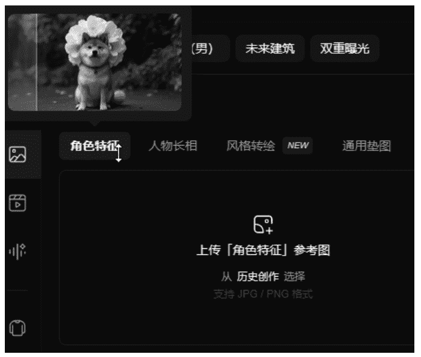

图 3-3 可灵 AI 上传参考图

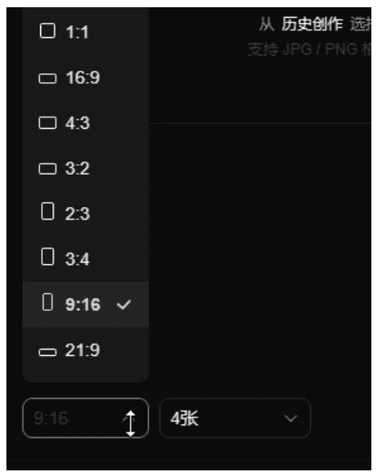

图 3-4 可灵 AI 生成图片时的参数

**5 生成图片**

工具依用户输入的描述、关键词、所选风格与参数，通过算法生成图片。该过程所需时间取决于工具性能与计算能力。图 3-5 所示为使用可灵 AI 生成的女性人像图片。

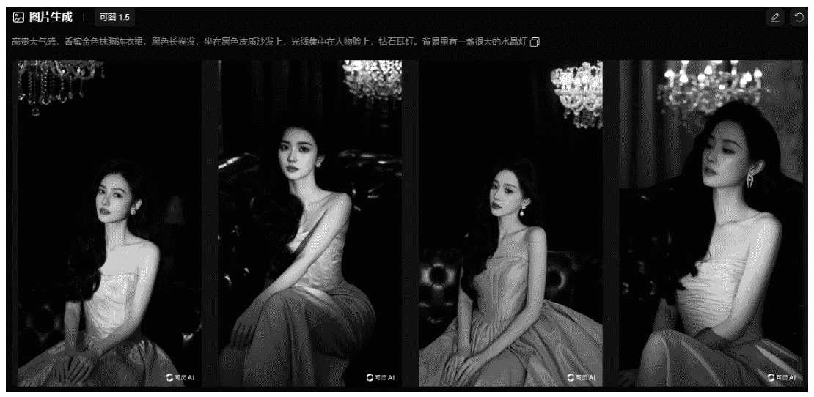

图 3-5 使用可灵 AI 生成的女性人像图片

**6 预览和修改**

生成的图片会在工具中显示供预览。用户可按需进一步修改调整，直至满足要求。图 3-6 所示为预览和修改可灵 AI 生成的现代人像图片。

**7 导出和分享**

一旦图片符合要求，用户可导出为所需文件格式，如 JPEG、PNG 等，并分享或用于项目。图 3-7 所示为下载可灵 AI 生成的现代人像图片页面。

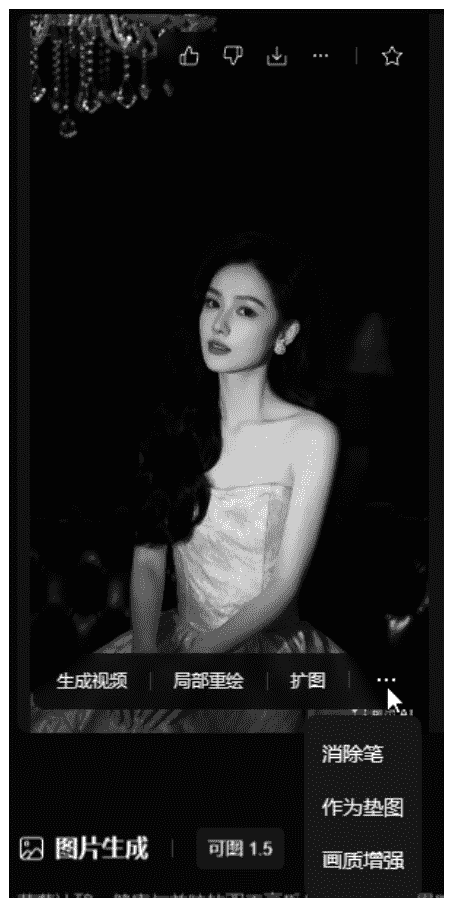

图 3-6 预览和修改可灵 AI 生成的现代人像图片

图 3-7 下载可灵 AI 生成的现代人像图片页面

**温馨提示**

不同工具与平台操作流程与界面可能有所差异，但总体上上述步骤是智能生成素材图片的基本流程。此外，随着技术不断完善，生成图片的质量与效率也在持续提升。

## **3.2 AI 生成短视频图片实战**

使用智能系统生成短视频背景图片，能高效快速地创建契合视频主题与风格的背景素材。通过输入关键词或描述，算法可生成多样的背景图片，满足不同创意需求。无论旅行记录、广告推广或影视制作，智能生成的背景图都能为视频增添独特视觉效果与氛围，使内容更丰富更具吸引力。通过精准匹配与个性化定制，智能系统在短视频背景图片生成中发挥着越来越重要的作用。由此可见，使用智能系统生成短视频背景图片，不仅提升了制作效率，还为创作者提供更多创意灵感，使短视频内容更加丰富与吸引人。

### **3.2.1 实战：根据短视频主题生成背景图片**

在按短视频主题生成背景图片时，可按以下步骤进行：

**步骤 1** 深入理解主题。首先需透彻理解短视频主题，包括核心信息、传递情感及目标受众。这些要素对生成与主题紧密相关的背景图至关重要。

**步骤 2** 分析视觉元素。接下来对主题进行视觉元素分析，考虑可能涉及的色彩、纹理、形状、光影效果等。这些元素将构成背景图的基本框架。

**步骤 3** 选择或定制模型。选择合适的图像生成模型，或按主题定制训练模型。确保所选模型能捕捉与主题相关的视觉元素，并生成高质量图像。

**步骤 4** 设定关键词和描述。根据对主题的理解与分析，设定与背景图相关的关键词与描述。它们应能准确传达背景图的主题与风格。

**步骤 5** 调整生成参数。依据主题与视觉元素调整模型的生成参数，包括分辨率、色彩饱和度、对比度、光影效果等。通过调整参数，确保生成背景图与短视频主题保持一致。

**步骤 6** 生成与评估。使用模型生成背景图，并评估其与主题的匹配度、视觉效果及是否符合目标受众审美标准。

**步骤 7** 迭代与优化。若生成背景图不符合要求，进行迭代优化。可重新设定关键词描述、调整生成参数或尝试不同模型。通过迭代优化逐步改进质量，直至满足需求。

**步骤 8** 整合与应用。最后将生成背景图与短视频整合。确保背景图与视频内容协调一致，有效传达主题与情感。如需，还可对背景图进行进一步编辑修饰，优化视觉效果。

通过以上步骤，可按短视频主题生成高质量且紧密相关的背景图。这有助于提升短视频视觉效果与吸引力，为观众带来更好观看体验。

本例将使用可灵 AI 生成短视频主题为“夏日海滨之旅”的背景图片，生成效果如图 3-8 所示。

图 3-8 使用可灵 AI 生成短视频主题为“夏日海滨之旅”的背景图片

打开可灵 AI 官网，登录平台。若无账号，需先注册快手账号或使用支持的第三方账号登录。登录后即可开始图片生成。具体步骤如下：

**步骤 1** 打开网页，登录可灵 AI，进入主页。在主页顶部点击导航栏中的“图片生成”按钮，进入图片生成创作界面，如图 3-9 所示。

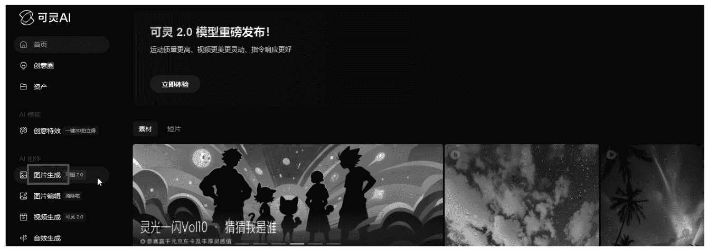

图 3-9 进入可灵 AI 的主页

**步骤 2** 进入图片生成页面，选择图片模型，这里以“可图 1.5”为例，如图 3-10 所示。

**步骤 3** 在对话框中输入图片描述词，如图 3-11 所示。

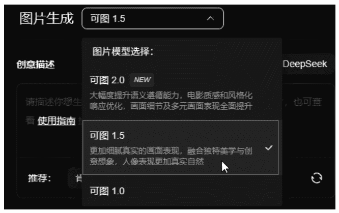

图 3-10 图片模型选择

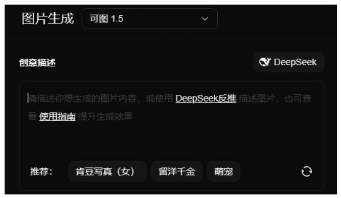

图 3-11 在对话框中输入图片描述词

输入图片描述词时，若不确定如何撰写，可借助 DeepSeek 生成，在输入框中输入：“我想要使用可灵 AI 生成一个短视频主题为‘夏日海滨之旅’的背景图片，请帮我生成一组适合可灵 AI 绘图要求的场景描述词，采用【画面主体描述+修饰词】的格式输出，字数不超过 200 字。”DeepSeek 输出的图片描述词内容如下所示。

**DeepSeek 输出的图片描述词内容：**

【画面主体描述】：碧海蓝天之下，绵延不绝的金色沙滩，细腻的沙粒在阳光下闪耀着柔和的光芒。远处，海浪轻轻拍打着岸边，卷起层层白色泡沫，与远处的海平线相接，形成一幅宁静而壮阔的景象。

夏日海滩 AI 出图完整拆解

【视觉关键词汇】
空间框架：辽阔湛蓝海面、通透澄澈天幕、柔软细腻沙岸
浪潮特点：轻盈翻动、雪白如絮、节律舒缓
光线气质：温柔倾泻、金色余晖、明暗交织
整体感觉：悠闲自在、清雅脱俗、浓郁夏日滨海风情

画面综合表述：
“以辽阔碧海与澄净蓝天互相映衬展开，金色沙岸上细沙绵延铺开。远处浪花轻盈翻滚裹挟雪白泡沫惬意拍岸，韵律绵长。夕阳金辉温柔倾泻，光影交错晕染，烘托出清雅脱俗、夏日氛围浓郁的滨海旅行背景。”

**温馨提示**
描述一般采用【主画面说明+修饰语】的组合方式。
以上词库覆盖了夏日海滨旅行的核心元素，涉及自然景致、人文互动及光影效果，目的在于让生成的海滨背景更生动逼真。可按需增删或组合。

第 4 步 把上一步得到的说明“宽广无垠的碧海与晶莹剔透的蓝天交相辉映，金色沙滩上，细腻柔软的沙粒轻轻铺展。远处，轻盈翻涌的海浪带着洁白如雪的泡沫，悠然自得地拍打着岸边，韵律悠扬。金色余晖温柔洒落，光影交错间，营造出清新脱俗、夏日风情浓郁的海滨之旅背景”粘贴至可灵系统的对话区，如图 3-12 所示。

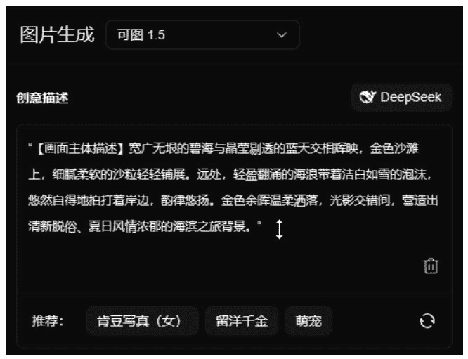
图 3-12 在可灵对话区填入画面说明

第 5 步 填入说明后，可选择挂载参照素材，无参照也可直接跳过，如图 3-13 所示。

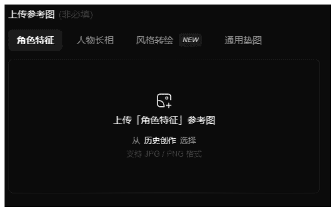
图 3-13 导入参照素材

第 6 步 依次设定画面比例与产出数量，如图 3-14 所示。

图 3-14 选择输出比例和产出数量

**温馨提示**
画面比例有竖版、方版、横版之分，方版可操作性最强，便于后续转竖或转横，因此常用方版。产出数量可在 1 至 9 张之间调节，默认 4 张，通常保持默认即可。

第 7 步 参数配置完毕后，按下页面左下角的“立即生成”按钮启动创作，如图 3-15 所示。

第 8 步 若对首次成果不满意，可修改文字指令后重新产出。

第 9 步 按下任意一张预览图即可查看高清大图，想保存至本地则按下右侧的导出按钮，如图 3-16 所示。

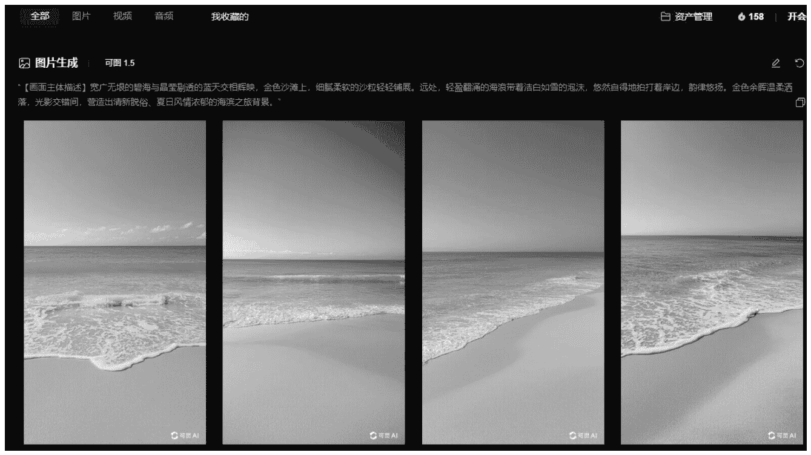
图 3-15 执行图片生成

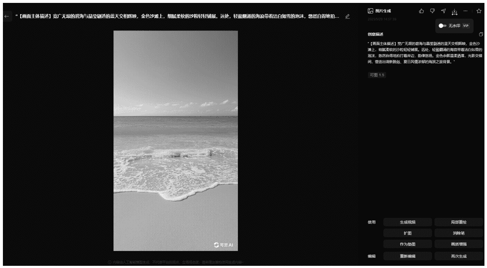
图 3-16 将图片导出至本地设备

第 10 步 如需进一步优化或编辑，可在大图预览中操作。以“扩图”为例，可对画面进行拓展，如图 3-17 所示。

图 3-17 对成果图进行优化编辑

第 11 步 进入扩图编辑页，调整图参数与相关说明后，按下“开始扩图”按钮，如图 3-18 所示。

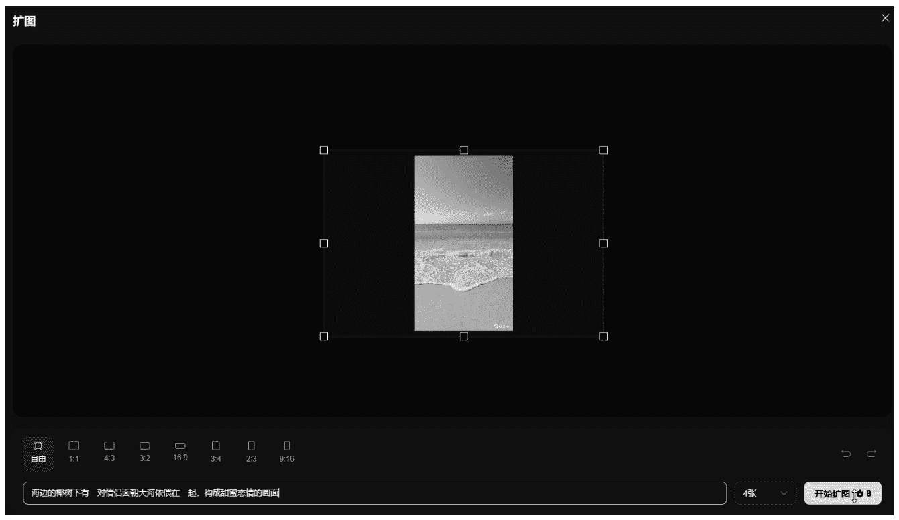
图 3-18 配置扩图参数

第 12 步 系统自动扩图，效果如图 3-19 所示。

图 3-19 扩图完成效果

第 13 步 若仍不理想，可重复上述编辑流程，直至达到预期。

### 3.2.2 实战：用角色特质生成专属头像

个性头像的设计要紧扣角色特质与视频主题，可借助专业图像编辑软件或智能绘图技术打造独一无二的形象。头像既能凸显角色个性，也能提升视频吸引力。以下以旅行博主角色为例产出专属头像，最终效果如图 3-20 所示。

使用可灵产出专属头像的操作流程如下：

第 1 步 登录可灵网站，按下右侧“立即创作”进入创作界面，如图 3-21 所示。

图 3-20 短视频旅行博主角色头像生成效果

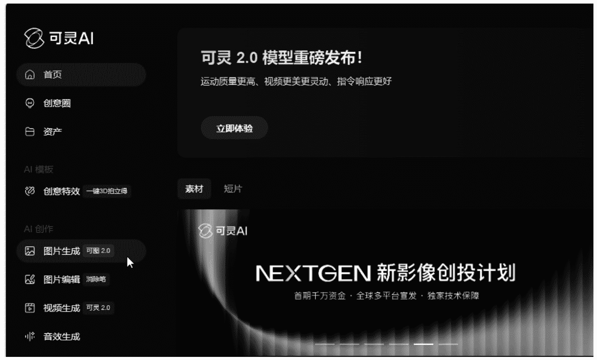
图 3-21 进入智能创作页面

第 2 步 选择“自定义”模式，在文字指令框中输入推荐词。此处借助 DeepSeek 辅助生成指令。向 DeepSeek 输入：“我正在使用可灵，需要根据短视频中的旅行博主角色生成个性化的头像。为了获得最佳创作效果，请给我一组详细的场景描述词。”DeepSeek 输出的内容如下。

**DeepSeek 输出的描述词内容：**

1． 个人风格：探险家（宽檐帽、背包）、时尚达人（潮流配饰、太阳镜）。

2． 旅行地点特色：海滩（沙滩、遮阳伞）、山区（徒步杖、野花）。

3． 与环境互动：攀岩、潜水、阅读、品茶。

4． 时间与光线：清晨（柔和阳光）、傍晚（余晖）。

5． 表情与姿态：好奇探索（目光炯炯）、专注记录（凝视取景器）。

6． 色彩与氛围：活力四射（鲜艳色彩）、宁静平和（柔和色调）。

第 3 步 将上述文字指令复制到可灵的输入框中，如图 3-22 所示。

第 4 步 若需与博主关联，可挂载博主参照图。按下“上传参考图”中的“上传角色特征参考图”，在弹框中选择本地图片，如图 3-23 所示。

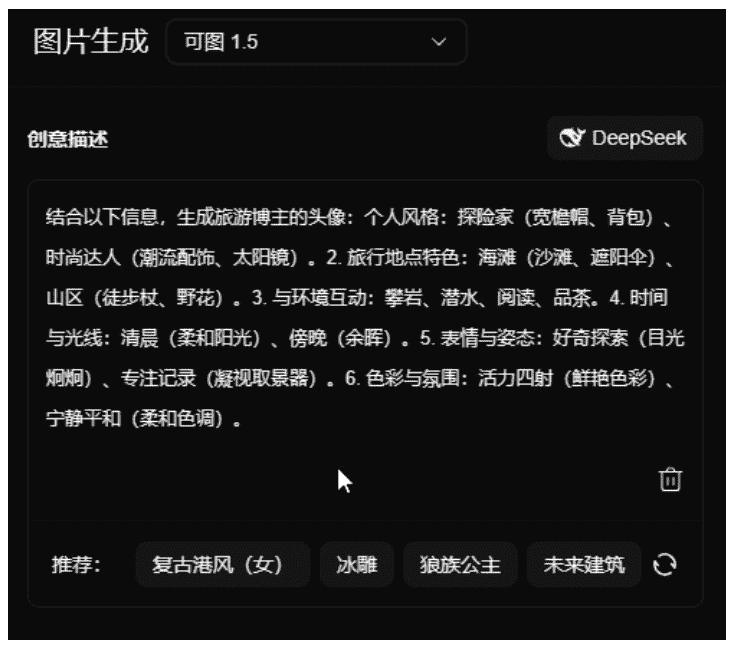
图 3-22 填入文字指令

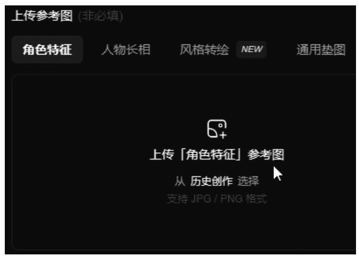
图 3-23 按下上传角色特征参考图

第 5 步 选择上传图片后按下“打开”。

第 6 步 上传成功后进行参照图配置，如角色特征、人物长相、风格转绘、通用垫图等，如图 3-25 所示。

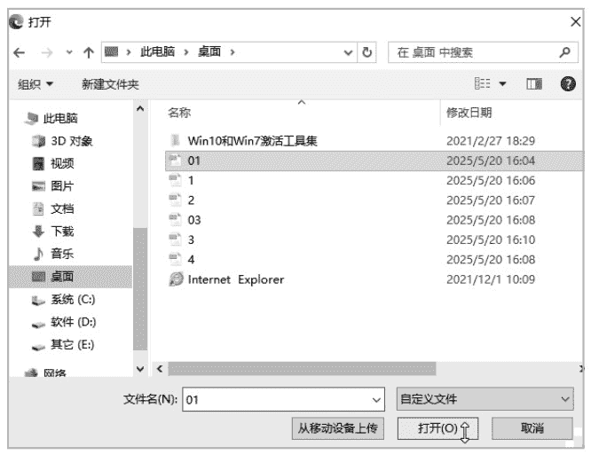
图 3-24 选择本地图片

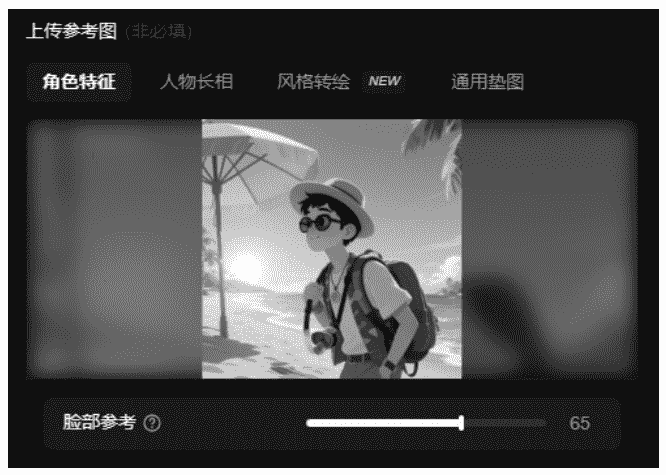
图 3-25 参照图相关配置

第 7 步 分别配置尺寸、数量等参数，如图 3-26 所示。

图 3-26 调整生成参数

第 8 步 配置完毕后按下“立即生成”，即可得到如图 3-27 所示的图像。

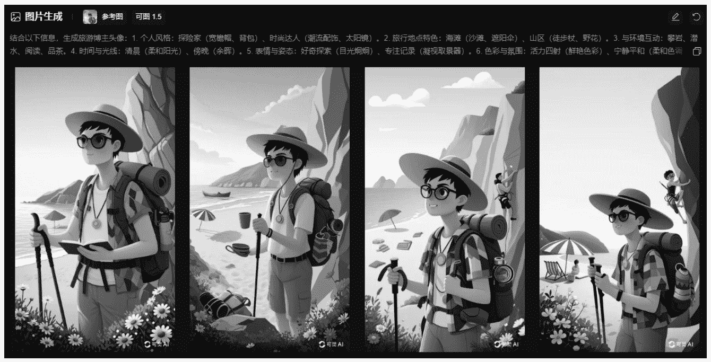
图 3-27 生成结果展示

第 9 步 如需更直观易懂，可选用代表性或象征性元素呈现。如旅行博主可选在知名景点或特色地点拍摄的实拍照片作头像。

第 10 步 如需导出某张图片，按下该图后点右侧“导出”按钮，按提示保存。

**温馨提示**
配置头像尺寸与比例时，要确保在不同设备与平台上均能正常显示。

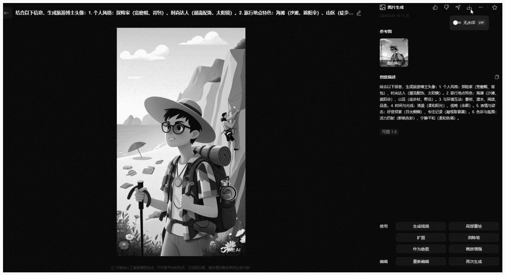
图 3-28 导出图片

第 11 步 若对图片不满意，可在左侧进行“生成视频”“局部重绘”等编辑。按下“局部重绘”即可对画面进行重绘，如图 3-29 所示。

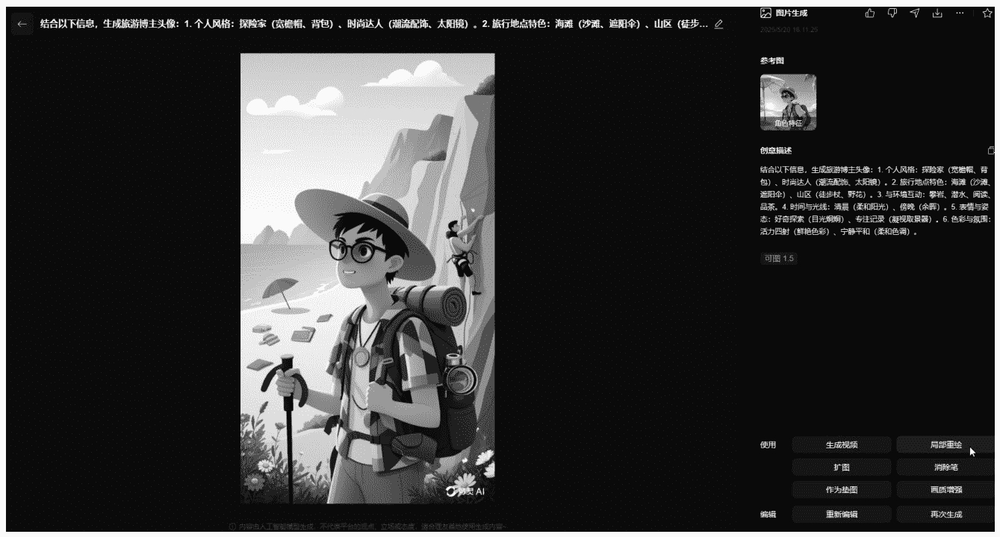
图 3-29 启动局部重绘功能

第 12 步 进入重绘页，涂抹需重绘区域，输入相关关键词，按下“开始重绘”按钮，如图 3-30 所示。

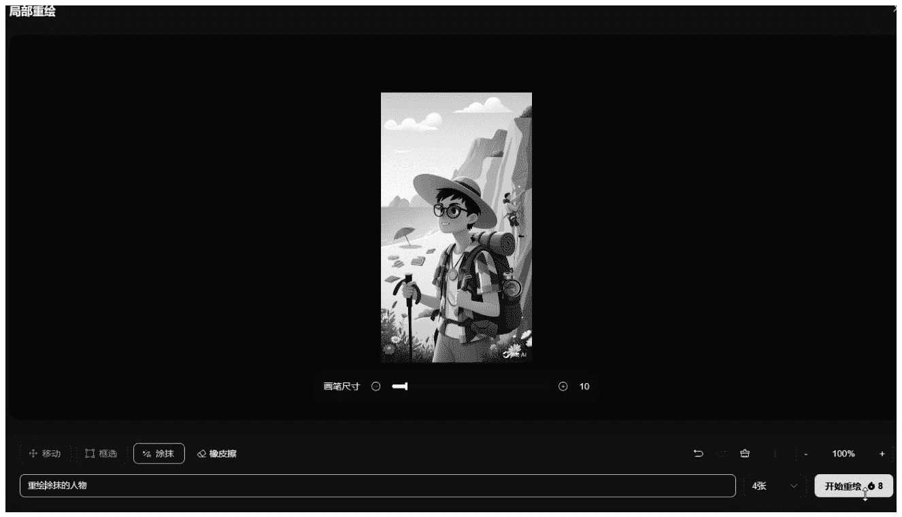
图 3-30 执行重绘操作

第 13 步 系统按需求重绘头像，如图 3-31 所示。

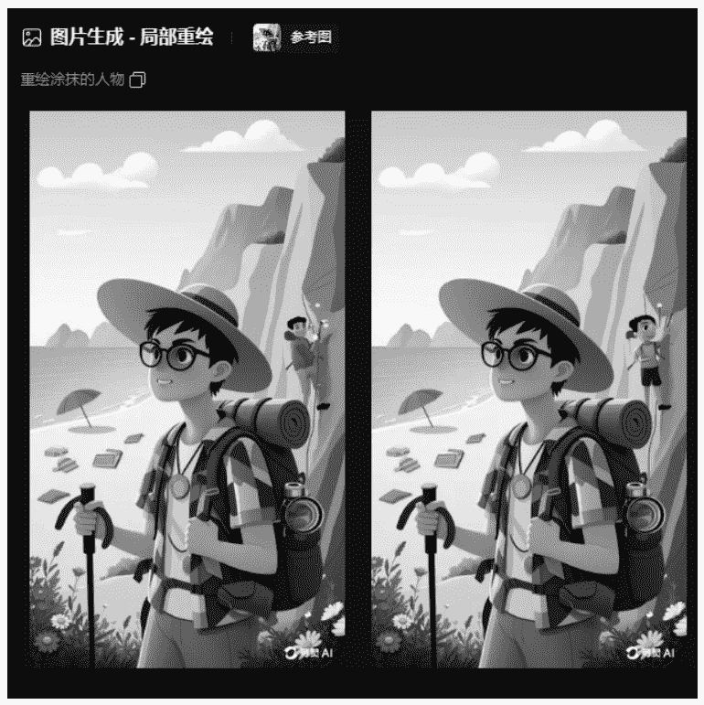
图 3-31 重绘后头像效果

### 3.2.3 实战：基于商品特征生成商品图

文心一言由百度推出，具备强大的图像生成与理解能力。用户可用自然语言描述快速产出高质量图像，并支持图像修复、风格转换、超分辨率增强等功能。同时支持图文多模态创作，适用于设计、营销、教育等领域，提供高效智能的视觉内容方案。

文心一言能在短时间内批量产出高品质图片，极大提升商品推广效率。生成的图片创意十足、个性鲜明，能迅速抓取消费者目光，为商品增添魅力。此外，该方案大幅降低制作成本，省去传统摄影与后期流程，让商家更轻松展示商品，提升品牌竞争力。总之，文心一言为商品图生成提供了高效经济的完整方案。

本例使用文心一言生成梅子酒商品图，成品效果如图 3-32 所示。

详细步骤如下：

第 1 步 前期准备。明确商品图的主题、风格与细节说明。如科技产品需确定颜色、形态、尺寸及设计元素等。

第 2 步 进入文心一言主页。登录后进入主页，按下“智慧绘图”选项，如图 3-33 所示。

图 3-32 文心一言生成的梅子酒商品图效果

图 3-33 进入文心一言主页

第 3 步 进入智慧绘图页。可看到多种文字生图入口，按下“商品图”按钮，页面会展示部分示例，如图 3-34 所示。

图 3-34 进入智慧绘图页面

第 4 步 输入说明。在左侧文本框中输入商品图的详细说明，包含名称、颜色、形状、尺寸、设计元素等，说明越具体越好，如图 3-35 所示。

第 5 步 智能绘图进行中。系统跳转至“AI 作图中”页，可观看绘图进度，如图 3-36 所示。

图 3-35 填写商品说明

图 3-36 智能绘制进度

第 6 步 产出完成。可查看相关商品图，如图 3-37 所示。

图 3-37 生成的商品图片

**温馨提示**
若效果不理想，可重新调整说明与参数后再次生成。

第 7 步 保存图片。满意后按下“导出”按钮保存到电脑，如图 3-38 所示。

图 3-38 保存图片

### 3.2.4 实战：按风格与色彩生成背景图

背景图的风格与色彩搭配直接影响视频整体视觉与氛围传达，精心选择可营造契合主题与情感的画面，为观众带来更好体验。

本例将依据风格与色彩，用豆包生成具有中国山水画特色的背景图。

豆包是字节跳动推出的智能助手，支持图像生成与编辑，用户可用文字描述快速生成多样化图像，并支持智能修图、风格转换、背景替换等功能。其优势在于与抖音生态深度融合，适合短视频创作者与电商设计等场景，提供便捷高效的智能视觉创作体验。

制作中国山水画特色背景图时，关键在于精准捕捉并再现其精髓。首先要理解构图原则，如高远、深远、平远透视，以及虚实相生、墨分五彩等用墨技巧。其次借助智能模型的深度学习，对大量经典山水画进行学习，提取笔触变化、墨色层次、山水布局等风格特征。同时需具备生成高分辨率图像的能力，以保证细节逼真。最后注重色彩与光影处理，营造符合国画意境的氛围。本例生成效果如图 3-39 所示。

图 3-39 豆包生成的中国山水画背景最终效果

操作步骤如下：

第 1 步 进入豆包主页，按下“图像生成”按钮，如图 3-40 所示。

图 3-40 按下图像生成入口

第 2 步 进入生成页，输入灵感说明，如图 3-41 所示。

图 3-41 进入图像生成页面

第 3 步 若不确定如何描述，可用 DeepSeek 辅助。请求方式示例：“我正在用豆包生成短视频背景图，主题为‘中国山水画特色’。请按【画面主体说明+修饰语】格式，给我一段不超过 200 字的说明，以便准确传达国画独特魅力与韵味。”DeepSeek 生成的说明如下。

**DeepSeek 生成的场景描述词：**

画面主体说明：群山连绵，瀑布飞泻，古木参天

修饰语：群山以水墨渲染之姿，展现出苍劲雄浑的山骨，云雾缭绕其间，添几分飘渺仙气；瀑布如白绸悬挂，水声潺潺，带着清冽与灵动；古木以浓淡不一的墨色勾勒，枝叶繁茂，透露出岁月静好之态。整幅画面融合了中国山水画的留白艺术，意境深远，既有磅礴大气之势，又不失细腻温婉之美，完美诠释了中国山水画“山水有情，画中有诗”的独特魅力与韵味。

第 4 步 将提示词填入豆包输入框，配置比例，示例选择 4∶3，如图 3-42 所示。

图 3-42 配置输出比例

第 5 步 在风格选项中选择“中国风”，如图 3-43 所示。

图 3-43 选择画面类型

第 6 步 配置完成后按下页面下端的 按钮，即可生成如图 3-44 所示的图片。

图 3-44 生成图片

第 7 步 若结果不全符合预期，可根据想添加的元素或改进细节，重新调整提示词再试。豆包会按新指示重新创作。

例如把说明改为：画面主体为连绵起伏的山脉，修饰以云雾缭绕，若隐若现，宛如仙境，山间溪流潺，清澈见底，映照着周围苍翠的竹林和古木参天。画面一角，古亭静立，檐角飞翘，尽显古朴典雅。远处，群山嶂，近处，翠竹青松相映成趣，共同勾勒出一幅静谧而深邃的中国山水画。整个画面色调和谐，色彩温润，充分展现出中国山水画的独特魅力和深厚底蕴。生成的图片如图 3-45 所示。

图 3-45 优化后生成效果

第 8 步 若满意，选择目标图片，按下右侧“导出原图”按钮即可导出，如图 3-46 所示。

图 3-46 导出图片

### 3.2.5 实战：用豆包制作道具图像

智能生成道具图片的关键在于明确需求、选择合适模型、精细调节参数及后期优化。首先明确道具类型、风格与设计细节，为模型提供准确指引。其次根据需求选择合适的生成模型，如 GANs 或 VAEs，各有擅长。接着调节学习率、迭代次数、损失函数等参数以优化质量。最后进行色彩校正、细节增强与背景融合，确保道具与使用场景匹配。本例用豆包生成宝剑道具，效果如图 3-47 所示。

图 3-47 豆包生成的道具图片最终效果

操作步骤如下：

第 1 步 进入豆包主页面，按下“图像生成”进入创作页，如图 3-48 所示。

图 3-48 按下图像生成按钮

第 2 步 输入说明。要生成宝剑，需在文本框中输入关于宝剑的详细说明。

**温馨提示**
文字指令要求：
突出独特性：强调宝剑的独特之处，如“千年精钢锻造”“蜿蜒曲折的龙纹”等，增强个性与吸引力。
运用修辞：使用比喻、拟人等手法，如“冻结时间”的寒光，“诉说传奇故事”的龙纹，使说明更生动。
注重细节描绘：对剑身、剑柄、剑鞘等各部位进行细致描写，让整体形象更清晰。
保持逻辑连贯：按整体到局部、外到内的顺序描写，使作品呈现和谐统一之美。

当对画面词缺乏把握时，可以请 DeepSeek 帮忙扩写。下面给出一条可直接复用的指令：“我正在用豆包制作一把宝剑道具，为了让结果更符合预期，需要一段包含【画面主体描述+修饰词】格式、控制在 200 字以内的详细描述。”DeepSeek 回馈的文字如下。

**DeepSeek 回馈的文字：**
【画面主体描述+修饰词】：
画面主体为一柄古朴宝剑，剑身泛着幽幽蓝光，寒气逼人。剑格镶嵌着璀璨宝石，闪烁着神秘光泽。剑穗由细长流苏编织而成，随风轻轻摇曳，增添了几分灵动之感。宝剑置于青石之上，背景是一片幽深竹林，竹叶翠绿欲滴，光影斑驳，营造出一种静谧而深邃的氛围。宝剑周围，薄雾缭绕，如梦似幻，更显其超凡脱俗，仿佛蕴含无尽力量，等待着有缘人的唤醒。

第三步 调整参数。成图尺寸依据使用场景决定，此处采用 1∶1 与 1024×1024，生成数量保持默认 4 张；画面风格选为“中国风”，修饰方向选为“写实”，如图 3-49 所示。

图 3-49 设置参数

温馨提示
聚焦古风宝剑时，参数细化要突出历史厚重感与文化底蕴。剑身可参照传统锻造工艺，通过精细打磨与雕刻，呈现古代工匠的技艺水准。剑柄与剑鞘可融入龙纹、凤鸣等传统元素，彰显尊贵与神秘。色彩与材质的选择也需讲究，以呈现古朴典雅的视觉效果。

若制作现代写实风格宝剑，细化要点更偏向实用性与当代审美。剑身可用高强度合金，经精密机械加工与热处理，既保持锋利又具备足够强度韧性。剑柄剑鞘可加入流线造型、简约线条，贴合当下审美，也可加入智能感应、可调重心等创新设计，提升实用与科技感。

若要科技感十足的宝剑，则需突出未来主义设计与高科技元素。剑身可用先进纳米技术或复合材料制作，实现超轻、超硬、超耐用。剑柄与剑鞘可采用透明或半透明材质，内置 LED 灯带或显示屏，呈现强烈未来感。

第四步 生成宝剑道具图像。参数确定后，等待豆包依据描述与设定合成宝剑画面，如图 3-50 所示。

图 3-50 生成宝剑道具图片

第五步 图像生成完成，可在预览区查看效果。若满意，点击“下载原图”即可把选中的画面保存到本地，如图 3-51 所示。

图 3-51 下载图片

### **3.2.6** **实战：使用豆包生成场景图片**

未来城市的概念本身就充满想象与创新空间。借助豆包这类工具，能迅速把脑海构想转为可视画面，为设计师、建筑师或科幻创作者提供灵感启发。

传统手绘或建模往往耗费大量时间与成本。借助豆包的 AI 绘图能力产出未来城市场景，能明显提升效率。本例将产出一张未来城市场景，最终效果如图 3-52 所示。

图 3-52 使用豆包生成的场景图片最终效果

操作流程如下：

步骤 1 进入豆包主页面，点击“图像生成”进入创作页，如图 3-53 所示。

图 3-53 单击“图像生成”按钮

步骤 2 填写描述。在文本框中输入关于未来城市的详细描述，尽量涵盖建筑风格、环境氛围、交通方式、天空与光线等信息。

同样可借助 DeepSeek 产出引导语，指令为“我正在用豆包生成一个未来城市场景图。为了获得最佳创作效果，需要一段不超过 200 字的、按【画面主体描述+修饰词】格式的详细描述。”DeepSeek 给出的文字如下。

**DeepSeek 给出的场景文字：**
画面主体是一座未来城市的天际线，高楼林立，错落有致。其中，一座超级摩天大楼尤为突出，闪耀着金属质感的银白色光辉，如同城市之光。街道上，自动驾驶的飞行器穿梭其间，留下一道道绚丽的光影轨迹。城市绿化带中，智能植物绽放着五彩斑斓的花朵，散发着清新的气息。整个城市在高科技与自然和谐共生的理念下，展现出一种未来感十足、生态环保、科技先进的壮观景象，令人叹为观止。

步骤 3 设定画面尺寸与风格。尺寸设为 1∶1 与 1024×1024，“画面风格”选择“赛博朋克”，如图 3-54 所示。

图 3-54 设置画面尺寸和风格

步骤 4 开始生成。设定完成后，豆包会按描述与选择合成未来城市场景，如图 3-55 所示。

图 3-55 生成图片

步骤 5 导出画面。生成后在预览区查看，满意即可点击“下载”保存到电脑。

温馨提示
若想更全面展现未来城市的多样性与细节，可多产出几张；只求代表性示例的话，少产出几张即可。

步骤 6 对结果不满意时，可用平台提供的编辑功能二次调整。若想让某元素更突出或增加背景空间，可用“扩展”功能。点击画面上方的“扩图”按钮，如图 3-56 所示。

图 3-56 单击“扩图”按钮

步骤 7 进入扩图页，选择扩图尺寸后点击“按新尺寸生成图片”，如图 3-57 所示。

图 3-57 单击“按新尺寸生成图片”按钮

步骤 8 系统会智能延伸画面边缘，使构图更开阔，如图 3-58 所示。

图 3-58 扩图效果

### **3.2.7** **实战：使用即梦 AI 生成现代人像图片及数字人口播视频**

用即梦生成现代人像大致分这几步：

步骤 1 文本描述：先明确人像的具体特征，包括性别、年龄、表情、姿势、服饰等。用准确的描述词并加上修饰词，增强画面表现力。

步骤 2 关键词选择：在输入时注意关键词的选取与搭配。加入“现代感”“时尚元素”等词，能帮助模型更好理解意图。

步骤 3 画面风格：若想呈现特定风格，可在描述中点明，如“油画风格”“水彩风格”或“摄影风格”。模型会按风格要求输出。

掌握基础后，还可进阶：
1. 临摹学习：参考已有作品进行临摹，有助于学会如何描述与复现相似画面。
2. 细节描述：除主特征外，可补充“精致妆容”“时尚配饰”等细节，提升丰富度与吸引力。
4. 尝试不同视角：改变人物视角与拍摄角度，能创造差异化视觉效果。
5. 迭代优化：若结果不理想，可据反馈调整描述、关键词或风格参数，逐步逼近预期。

下面以生成一张现代人像为例，最终效果如图 3-59 所示。

图 3-59 使用即梦 AI 生成的现代人像图片最终效果

具体操作如下：

步骤 1 登录账号。进入即梦官网首页，选择“AI 作图”模式，如图 3-60 所示。

图 3-60 进入“AI 作图”界面

要引导模型生成心意画面，需要精心构思描述词。也可称作“图片主题词”或“创作指令”。这些词是模型创作的灵感来源与方向指引，所以输入时应尽量具体明确。

步骤 2 填写提示词。不确定怎么写时，可用“画面主体+修饰词”的方式构思，并借助 DeepSeek 辅助。以本案例为例，可向 DeepSeek 提问：
“我想通过即梦 AI 来创作一幅现代人像作品。请为我生成一组符合即梦绘图要求的场景描述词，确保采用【画面主体描述+修饰词】的格式，字数控制在 200 字以内。描述词应突出人像的现代感，可以包括环境氛围、光线效果、人物表情等方面的细节。”

DeepSeek 给出的场景描述词如下。

**DeepSeek 给出的场景描述词：**
【画面主体描述】
一位都市青年侧身站立，身穿剪裁利落的雾霾蓝西装，内搭简约白衬衫，手持半杯冰美式，背景是模糊的霓虹街景与玻璃幕墙的反光。
【修饰词】
冷调光影交错，霓虹灯牌散射出玫红与钴蓝的光斑，人物面部轮廓被侧逆光勾勒，眼神疏离却带一丝笑意。发丝微微凌乱，镀上一层金属质感的高光；咖啡杯壁凝结水珠，增强画面呼吸感。背景采用低饱和度虚化，突出人物立体感，现代建筑的几何线条与人像形成柔硬对比。

进入即梦的“AI 作图”页，选择“图片生成”，输入上述文字，如图 3-61 所示。

步骤 3 设置参数。调整生图模型、画面比例等，完成设定后点击“立即生成”，如图 3-62 所示。

图 3-61 输入场景描述词

图 3-62 设置参数

步骤 5 生成画面。即可得到如图 3-63 的结果。

图 3-63 生成图片

即梦推出的数字人口播视频生成器，融合 AI 语音合成、自然语言处理与 3D 虚拟人技术，提供低成本高效的数字人视频制作方案。无需专业设备或真人演员，只需输入文案，即可输出表情自然、语音流畅的虚拟人口播，适用于企业宣传、电商带货、教育培训、新闻播报等场景。

核心亮点：
• 多风格数字人可选：商务、亲和、科技感等形象，支持自定义服装与背景。
• AI 智能配音：多语言及方言，情感化语调可调，播报更具感染力。
• 一键生成、快速剪辑：内置模板与素材库，分钟级产出高清视频，支持字幕特效一键添加。
• 低成本高效率：较传统拍摄节省 90% 以上时间与预算，可批量制作。

即梦以“让创作更简单”为目标，助力个人与企业高效产出优质视频。

继续沿用前面生成的现代人像，可快速生成数字人口播视频。

步骤 6 返回即梦首页，选择“AI 作图”模式进入页面，切到“数字人”模式，如图 3-64 所示。点击“导入角色图片/视频”，上传前面生成的人像图。

步骤 7 设置视频参数，如生成效果、文案、朗读音色、说话数字等，设定完成后点击“生成视频”，如图 3-65 所示。

图 3-64 进入“数字人”界面

图 3-65 单击“生成视频”按钮

步骤 8 系统自动按需求合成数字人口播视频，如图 3-66 所示。

图 3-66 数字人口播视频

### **3.2.8** **实战：使用即梦 AI 生成漫画人像**

即梦是一款智能绘画工具，能根据文字描述快速生成高质量漫画风格人像。支持日漫、美漫、写实卡通等多种艺术风格，无需绘画基础，只需输入关键词如“少女、粉色头发、学院风”，即可得到独特精美的作品，适用于社交头像、插画创作或个性化设计。

使用步骤如下：

步骤 1 登录即梦官网，进入主页，选择“AI 作图”模式，如图 3-67 所示。

图 3-67 进入 AI 作图页面

步骤 2 先输入画面描述词。若不确定如何写，可用【画面主体+修饰词】组合。此处仍借助 DeepSeek 辅助。

提问 DeepSeek：“请协助我构思一个漫画人像的场景描述，使用即梦 AI 进行绘图。描述需包含画面主体（如人物、场景等）和适当的修饰词，以体现漫画风格，并确保整体描述不超过 200 字。”DeepSeek 给出内容如下。

**DeepSeek 给出的场景描述词：**
画面中央是一位活力四射的少女，身穿宽松的街头风卫衣和破洞牛仔裤，手持喷漆罐，站在涂鸦墙前。她扎着高马尾，发梢挑染亮蓝色，眼神自信顽皮，嘴角扬起俏皮的微笑。背景是充满艺术感的城市巷弄，墙面布满夸张的漫画风格涂鸦，色彩对比鲜明。光线从侧面斜照，拉长她的影子，增添动态感。整体风格结合日漫的细腻线条和美漫的强烈对比，突出青春不羁的个性。

步骤 3 输入描述词，如图 3-68 所示。

步骤 4 调整其他参数，点击底部“立即生成”，如图 3-69 所示。

图 3-68 输入描述词

图 3-69 设置其他参数

步骤 5 设定完成后，系统会按要求开始生成画面，如图 3-70 所示。

图 3-70 生成图片

步骤 6 生成满意后，可将画面全部下载使用。

### **3.2.9** **实战：使用即梦 AI 生成证件照**

即梦做证件照优势明显：操作快、几步出图；图像质量高，处理技术保证清晰自然；样式尺寸多样，适配不同证件需求；操作直观，无需专业知识。虽然即梦主打创意生成，但配合适当编辑也能辅助制作证件照背景与人物，只需微调即可达标。本例效果如图 3-71 所示。

图 3-71 使用即梦 AI 生成证件照的最终效果

操作步骤：

步骤 1 登录即梦官网，点击进入“AI 作图”页，如图 3-72 所示。

图 3-72 单击进入“AI 作图”页面

步骤 2 输入描述词。这里用 DeepSeek 生成适配即梦绘图的证件照场景描述，字数不超过 200 字。提问 DeepSeek：
“请协助我创作一组简洁而精准的证件照场景描述词，以适用于即梦 AI 的图像生成。我希望画面主体为清晰的正面人脸，背景干净无杂物，色彩自然且光线均匀。请添加适当的修饰词以强调人像的正式感和清晰度，同时确保整体描述简洁明了，不超过 200 字。”

DeepSeek 给出如下，填入文本框，如图 3-73 所示。

**DeepSeek 给出的场景描述词：**
清晰正面人像，表情庄重自然。背景洁净无瑕，色彩和谐自然。光线柔和均匀，确保面部细节清晰可见。人像轮廓鲜明，五官立体分明，凸显正式感与清晰度。整体画面简洁明了，完美呈现证件照的标准与要求。

步骤 3 设置画面清晰度、比例、尺寸，如图 3-74 所示。

图 3-73 输入描述词

图 3-74 设置画面清晰度、比例、尺寸

步骤 4 生成画面。设定完毕后点击底部“立即生成”，即可得到如图 3-75 的画面。

图 3-75 生成图片

步骤 5 若对证件照不满意，可修改描述词重新生成。例如加入服装配饰丰富人物细节，系统会自动匹配提示词，如图 3-76 所示。

图 3-76 修改描述词并重新生成

步骤 6 系统按新提示词生成照片，如图 3-77 所示。

图 3-77 生成照片

步骤 7 若仍不满意，可继续编辑；满意则导出保存到电脑。

# **第四章 AI 文案生成短视频**

把文字做成短片：剪映实操指南

当下信息消费越来越碎片化，短视频已是主流传播形态。生成式 AI 的成熟，让把纯文本迅速加工成有观感的成片变得可行。

本篇聚焦实操路径，以剪映、一帧秒创、腾讯智影为核心工具，演示如何把文字快速转化为吸睛短视频。后续会覆盖图文自动合成、文章链接一键转换、模板复用等手法，并拆解剪映内部的 AI 绘图与配音协同逻辑，以及一帧秒创、腾讯智影在效率与画面质感上的增益。

## 4.1 剪映把文字转成短视频

通过剪映 App 将文字变现为视频，既高效又具表现力。导入文案后可调用多种字体、样式与动态效果让文字活起来，内置素材库提供音乐、配图与背景视频，让整体更生动。界面直观易上手，无需专业基础也能实现从文字到成片的跨越。

### 4.1.1 实战1 图文智能合成快速出片

该功能依托文字与图像的智能匹配机制。输入文案后系统会按内容自动推荐相关图源，并结合内置模板与算法把文字与画面融合。画面通常与文案紧密呼应，提升视觉冲击与信息传递效率，同时可自动叠加背景音乐与语音，增强表现层次。

**步骤 1** 打开剪映 App 后，在顶部找到“图文成片”并点按，示例如图 4-1。

图 4-1 进入图文成片

**步骤 2** 进入后文案准备有两条路线。

（1）已备好文案时选“自由编辑文案”。进入编辑页可直接粘贴或手动输入内容，如图 4-2。

（2）未备好文案时选“智能写文案”。下方可挑选文案类型，例如“旅行感悟”，进入后指定地点、输入话题并设定时长，如图 4-3。

图 4-2 自由编辑文案方式

图 4-3 智能写文案方式

**步骤 3** 确定时长后点下方“生成文案”按键，系统会自动撰写，生成结果如图 4-4。

**步骤 4** 生成后可对文案做微调。点“编辑”按键  进入编写页，再点右上角“应用”，弹出“请选择成片方式”选项，如图 4-5。

图 4-4 自动生成文案

图 4-5 成片方式选择

成片方式共 3 种。

（1）智能匹配素材，即按文案匹配图和视频。

（2）使用本地素材，即调用设备自带的图和视频。

（3）智能匹配表情包，即按文案匹配表情包。

**步骤 5** 选定成片方式后，以“智能匹配素材”为例，系统开始自动合成视频，如图 4-6。

图 4-6 自动合成视频

**步骤 6** 视频生成后，若图文不符，可在时间线上点选需要调整的图片，再点“替换”按键，如图 4-7。

**步骤 7** 想用本地素材，选“照片视频”选项；想用网络素材，选“图片素材”或“视频素材”选项，然后挑选需要的素材替换，如图 4-8。

**步骤 8** 点左上角“关闭”按键  返回编辑页，若要修改视频中的文字，点时间线上对应的文字，再点左下角“编辑”进入编辑页，如图 4-9。

图 4-7 替换按钮

图 4-8 素材选择

图 4-9 文字修改入口

**步骤 9** 在输入框中可对文字进行编辑，设置字体、样式、花字等。完成后点输入框右侧“确认”按键  保存修改，如图 4-10。

**步骤 10** 修改保存后，点“播放”按键  预览，确认无误后点右上角“导出”完成本操作，如图 4-11。

图 4-10 保存修改

图 4-11 导出视频

### 4.1.2 实战2 文章链接一键成片

剪映的文章链接成片功能支持输入或粘贴指定文章链接，目前主要兼容头条 App 文章，自动抽取正文并转为视频。流程大幅简化，即使没有剪辑经验也能做出合格成品。

使用时注意：

• 来源限制：目前主要支持头条 App 文章链接，其他来源可能无法识别。

• 内容质量：系统会自动匹配背景与音乐，用户仍需按需求调整时长、字幕、背景音乐等。

• 版权问题：使用链接成片需确认文章版权清晰并已获授权，避免侵权风险。

操作流程为：复制链接→打开剪映 App→进入图文成片→粘贴或自定义输入→生成视频→导出。具体如下。

**步骤 1** 复制文章链接。一般在文章右上或下方有分享图标，点击后选择“复制链接”，如图 4-12。

**步骤 2** 打开剪映 App，在首页点“图文成片”进入页面，如图 4-13。

**步骤 3** 在图文成片页，点击“自由编辑文案”按钮，如图 4-14。

图 4-12 复制链接

图 4-13 进入图文成片页

图 4-14 自由编辑文案入口

**步骤 4** 进入编辑页，点击页面中的链接图标，将之前复制的文章链接粘贴到输入框，如图 4-15。

**步骤 5** 粘贴完成后，点击“获取文案”按钮，如图 4-16。

**步骤 6** 文案获取后可进行调整，完成后点击右上角“应用”按钮，如图 4-17。

图 4-15 粘贴链接

图 4-16 获取文案

图 4-17 应用按钮

**步骤 7** 选择成片方式。选“智能匹配素材”，系统会按文案生成匹配的图视频，如图 4-18。若想用本地素材，选“使用本地素材”。

图 4-18 智能匹配素材

**步骤 8** 选择“智能匹配素材”后等待自动生成，生成的视频如图 4-19。

**步骤 9** 生成后若图文不符，可在时间线上点选需要调整的图片，再点左下角“替换”按钮，如图 4-20。

**步骤 10** 想用设备自带图片，选“最近项目”选项；想用网络素材，选“图片素材”进行搜索。调整好后点左上角“关闭”按钮  返回，如图 4-21。

图 4-19 自动生成结果

图 4-20 替换图片

图 4-21 图片替换

**步骤 11** 若要调整文案，点选对应文案，再点左下角“替换”按钮，如图 4-22。

**步骤 12** 在输入框中可设置字体、样式、花字等，设置完成后点输入框右侧“确认”按钮 ，如图 4-23。

**步骤 13** 所有操作完成后，点“播放”按钮  预览视频，确认无误后点右上角“导出”按钮保存，如图 4-24。

图 4-22 替换文案

图 4-23 字体样式设置

图 4-24 导出保存

### 4.1.3 实战3 剪同款预设模板快速生成节日贺卡视频

“剪同款”是剪映的特色功能，通过选择预设模板快速生成特定风格与主题的视频。模板涵盖生活记录、旅行、美食、节日等场景，导入素材即可产出同款效果。

**步骤 1** 打开剪映，点页面中的“剪同款”按钮，如图 4-25。

**步骤 2** 进入剪同款页，在顶部搜索框中搜索目标模板，如图 4-26。

**步骤 3** 本例以“节日贺卡”模板演示，搜索合适的模板后点击进入，如图 4-27。

图 4-25 剪同款入口

图 4-26 搜索框

图 4-27 节日贺卡模板

**步骤 4** 进入“模板预览”页，确认效果满意后点击页面中的“剪同款”按钮，如图 4-28。

**步骤 5** 跳转到“照片视频”选择页，挑选要嵌入模板的照片或视频，再点“下一步”等待自动生成，如图 4-29。

**步骤 6** 视频生成后可点“播放”按钮  预览效果，若不满意可点下方“视频”按钮  或“文本”按钮  编辑修改，如图 4-30。

图 4-28 剪同款按钮

图 4-29 照片视频选择

图 4-30 预览与编辑

**步骤 7** 修改完成后点右上角“导出”按钮，在弹出的“导出设置”窗口中设置分辨率，推荐 1080p，如图 4-31。

**步骤 8** 设置完成后点“保存”按钮  自动保存到设备；若点“无水印保存并分享”按钮，则直接跳转到抖音发布页，如图 4-32。

图 4-31 分辨率选择

图 4-32 保存或发布

### 4.1.4 实战4 AI作图与文本朗读功能制作视频

剪映凭借丰富功能和便捷操作获得广泛使用，AI 绘画与文本动态展示是其中很实用的组合，能为成片增添创意与动感。

（1）AI 绘画功能。

• 智能绘图：基于先进技术，可根据文字描述自动匹配绘画元素生成独有作品，降低创作门槛。

• 一键生成：输入简单描述即可自动生成对应绘画作品，节省时间并提供丰富可能性。

（2）文本动态展示功能。

• 文字编辑：可向视频中添加文字，选用模板或自定义样式，使文字契合视频风格。

• 动态效果：提供多种动画如“跳动”“闪烁”“缩放”，让文字在画面中产生动态变化，提升视觉效果。

• 自定义设置：可调文字字体、颜色、大小，也可调节动画时长、速度和强度，实现更自然表现。

• 节奏配合：可依据视频节奏与背景音乐设置文字动画，使文字与画面更协调。

将 AI 绘画与文本动态展示结合，可创作出更丰富的视频。例如用 AI 绘画生成背景或元素，再叠加动态文字展示主题，兼顾视觉与观看体验。

具体操作如下。

**步骤 1** 打开剪映 App，点击“AI 作图”按钮进入创作页，如图 4-33。

**步骤 2** 在输入框中输入或粘贴生成图片的文字描述，本例以唐代诗人王之涣《登鹳雀楼》为例，点击“立即生成”即可，如图 4-34。

图 4-33 AI作图入口

图 4-34 生成图片

**温馨提示**

描述尽量详细，从整体到细节。可加入质感词如“高清”“4k”。想要写实加入“真人”“立体”，想要动漫加入“二次元”“漫画”。根据生成效果调整关键词。

**步骤 3** 若对效果不满意，可点“再次生成”重新生成，也可点“重新编辑”修改描述。另可点输入框下“添加图片”按钮  从相册选用素材，如图 4-35；点“设置”按钮  调节 AI 细节参数，比例设为 1∶1，精细度 30，如图 4-36。

图 4-35 添加图片

图 4-36 AI参数设置

**步骤 4** 返回创作页，选中要导出的图片，点击下方“细节重绘”按钮进行细节优化，如图 4-37。

**步骤 5** 满意后点击右上角“导出”按钮，如图 4-38。

**步骤 6** 导出图片后，点击右上角“完成”按钮返回剪映首页，如图 4-39。

图 4-37 细节重绘

图 4-38 导出图片

图 4-39 完成按钮

**步骤 7** 在剪映首页点击“开始创作”按钮，导入刚生成的 AI 图片，如图 4-40。

**步骤 8** 进入视频编辑页，点击“文本”按钮，如图 4-41。

**步骤 9** 进入文本编辑页，点击“新建文本”按钮，依次输入文本内容，如图 4-42。

图 4-40 导入AI图片

图 4-41 文本按钮

图 4-42 输入文本

**步骤 10** 在轨道上选中需要朗读的文本，点击“文本朗读”按钮，如图 4-43。

**步骤 11** 弹出朗读设置后，先选定喜爱的音色，再把“应用到全部文本”复选框勾选上，然后点“确定”保存设置并返回，参考图 4-44。

**步骤 12** 按下播放键先试听配音，效果不理想就按前面讲过的方法回头修改，确认无误后再点左下角返回键回到主编辑页。

**步骤 13** 在主编辑页依次点开“音频”→“音乐”，进入音乐选择页。软件会自动推荐几首曲目，可先试听，觉得合适就点“使用”，如图 4-45 所示。

图 4-43 点击“文本朗读”按钮

**步骤 14** 音乐选好后回到音频剪辑页，若有多余的音乐或画面，可先用分割工具切开，再选中不需要的部分点“删除”移除，如图 4-46 所示。

图 4-44 选择合适的音色

图 4-45 添加音乐

图 4-46 删除多余的音乐

**步骤 15** 点播放键预览成片效果，确认无问题后点右上角“导出”即可完成整个制作。

## **4.2 一帧秒创：文本快速生成视频**

“一帧秒创”，简称“秒创”，是一款依托人工智能的智能视频制作工具，能把文字内容转成生动有趣的视频。个人创作者或企业营销团队都能借助它快速产出高质量成片，提升传播力与品牌影响力。下面是操作流程。

**步骤 1** 打开“一帧秒创”创作平台，在首页“智能创作工具”栏里选择“文字转视频”，如图 4-47 所示。

图 4-47 选择“文字转视频”选项

**步骤 2** 进入“图文转视频”页，填写文案标题和正文后点击“下一步”，如图 4-48 所示。

图 4-48 输入文案标题和正文

**步骤 3** 平台借助人工智能自动把文本转为视频，如图 4-49 所示。在“场景”模式下可选择播放段落，点击播放键可实时预览生成结果，并可以根据需要进行调整，例如让 AI 润色文案、替换素材、插入文字或素材、微调读音等。同时还能为视频配置数字人讲解、背景音乐、配音、Logo、字幕、背景等。

图 4-49 生成视频

**步骤 4** 各项设置完成后，点击页面上方“预览”查看最终效果，如图 4-50 所示。

图 4-50 预览最终的视频效果

**步骤 5** 对效果满意后点击“生成视频”，进入生成页确认视频标题并上传或挑选封面，完成后再次点击“生成视频”，如图 4-51 所示。

图 4-51 “生成视频”页面

**步骤 6** 系统会自动返回“创作空间”进行转码。视频完成后可在“创作空间”→“我的作品”中查看，点击“下载视频”即可保存到本地，如图 4-52 所示。

图 4-52 下载视频

**温馨提示**

除本地下载外，一帧秒创还支持多种分享方式，比如通过微信分享到朋友圈或直接发给好友。

## **4.3 腾讯智影：文章一键生成视频**

腾讯推出的“腾讯智影”是一款智能视频创作工具，只需把文字输入系统，即可自动生成创意十足、吸引眼球的视频。无论是娱乐资讯、文章提炼还是其他类型内容，都能实现一站式创作，让制作更简单高效。下面是操作步骤。

**步骤 1** 打开“腾讯智影”创作平台，在“智能小工具”模块里选择“文章转视频”，如图 4-53 所示。

图 4-53 选择“文章转视频”功能

**步骤 2** 进入“文章转视频”页，在输入框填写文章主题，然后点击“AI 创作”，如图 4-54 所示。

图 4-54 使用 AI 创作短视频文案

**步骤 3** 系统会通过 AI 自动生成一篇关于云南旅行的 Vlog 短视频文案，如图 4-55 所示。若对文案不满意，可在输入框写下修改意见，利用 AI 二次创作，直至满意为止。

图 4-55 系统通过 AI 自动生成的短视频文案

**步骤 4** 文案生成后选择成片类型，点击“确定”，如图 4-56 所示。

图 4-56 选择成片类型

**步骤 5** 返回“文章转视频”页，设置视频比例、背景音乐、数字人播报等，然后点击“生成视频”，如图 4-57 所示。

图 4-57 单击“生成视频”按钮

**步骤 6** 系统生成视频后会自动跳转到视频编辑页，点击播放键预览效果，若无误，点击页面上方“合成”，如图 4-58 所示。

图 4-58 单击“合成”按钮

**步骤 7** 进入“合成设置”页，按需调整合成参数，完成后点击“合成”，系统开始最终合成，如图 4-59 所示。

图 4-59 进行合成设置

**步骤 8** 合成好的视频可在腾讯智影“我的资源”中查看，如图 4-60 所示。

图 4-60 查看合成好的视频

**步骤 9** 点击生成的作品进入视频页，可进行剪辑、发布、分享或下载等操作，如图 4-61 所示。

图 4-61 视频页面

# **第五章 用AI把图片变成短视频**

在社交媒体和短视频当道的今天，视频已成为分享生活、传递信息的重要载体。如何高效便捷地制作精美视频是许多人的需求。剪映作为一款免费且功能强大的手机视频应用，凭借出色性能和友好的界面，成为众多创作者的首选。

本章围绕 AI 图片生成短视频展开，以剪映 App 为例，讲解如何利用其强大的 AI 功能把静态图片转化为生动有趣的短视频。无论是记录生活点滴还是创作专业水准作品，都能从中获得收获。

## **5.1 剪映 App 的 AI 基础玩法：图变视频**

剪映 App 依托 AI 基础功能，让图片生成视频变得简单高效。通过本节实操，你将学会如何利用“图文成片”“一键成片”，以及 AI 语音合成、图文匹配、AI 风格迁移等核心功能，轻松把静态图片变成生动短视频。

### **5.1.1 实战 1：图文成片做美食短片**

剪映为用户提供简单直观的编辑平台。特别是“图文成片”功能，革新了传统创作模式。用户只需输入文字，剪映就能智能匹配相关图片素材，自动加上字幕、旁白和音乐，瞬间生成初步作品。智能朗读的旁白效果接近真人朗读，大幅提升表现力。

在智能生成的基础上，创作者仍可通过人工剪辑进行精细化调节，直至达到理想效果。该功能不仅为擅长写字的创作者提供跨界可能，也大幅降低了视频制作门槛。

本实战以美食为例，利用“图文成片”生成视频，具体做法如下。

**步骤 1** 打开手机剪映 App，点击“图文成片”按钮，如图 5-1 所示；进入操作界面，如图 5-2 所示。

**步骤 2** “图文成片”有两种生成方式，一种是“自由编辑文案”，需复制粘贴文案生成视频；另一种是“智能写文案”，选择自定义输入生成视频。这里直接粘贴已准备好的文案，如图 5-3 所示。

图 5-1 点击“图文成片”按钮

图 5-2 “图文成片”操作界面

图 5-3 复制粘贴已经准备好的文案

**步骤 3** 输入美食文案后点击“应用”按钮，可看到“智能匹配素材”“使用本地素材”“智能匹配表情包”三种成片方式，如图 5-4 所示。

图 5-4 选择成片方式

**步骤 4** 这里已准备好图片素材，选择“使用本地素材”选项，挑选图片后等待自动生成视频，如图 5-5 所示。

**步骤 5** 若发现视频中图片与文本内容不匹配，可进行精确调整。首先定位并选中图片，在编辑页仔细浏览视频，找到与文本不对应的图片。选中后通常会出现“替换”或“更改”按钮，如图 5-6 所示。

图 5-5 选择图片素材

图 5-6 对图片进行精确调整

**步骤 6** 点击“替换”按钮，打开本地素材库或相册，重新选择一张更匹配当前文本的图片素材，如图 5-7 所示。

**温馨提示**

替换图片时务必确保所选图片与文本内容紧密相关，能准确传达文本信息，有助于提升视频质量和观看体验。

**步骤 7** 对文案进行编辑和调整，可改变图片顺序、大小、位置等，选择一款适合视频的字体，提升观看效果，如图 5-8 所示。

**步骤 8** 图文修改并保存后，点击播放键预览视频。预览无误后，点击右上角“导出”按钮完成制作，如图 5-9 所示。

图 5-7 重新选择图片素材

图 5-8 选择一款适合视频的字体

图 5-9 导出视频

### **5.1.2 实战 2：一键成片套模板快速做 Vlog 短视频**

剪映的“一键成片”功能带来全新创作体验，内置众多精美模板可直接使用。该功能简化了视频编辑流程，让每个人都能成为自己生活故事的导演。

本实战使用“一键成片”功能套用模板快速生成 Vlog 短视频，具体步骤如下。

**步骤 1** 打开手机剪映 App，在主页面点击“剪辑”按钮，在“剪辑”模式下点击“一键成片”按钮，如图 5-10 所示。

**步骤 2** 进入“一键成片”功能后，选择手机相册中的照片或视频素材，然后点击“下一步”，如图 5-11 所示。

图 5-10 点击“一键成片”按钮

图 5-11 选择照片或视频素材

**步骤 3** 弹出输入框，在其中描述要成片的视频类型。这里选择风景旅游素材，输入“剪个旅行 Vlog”，如图 5-12 所示。

**步骤 4** 加载完成后，系统会展示一系列可用模板，按素材内容和风格分类，方便快速挑选。若没有合适模板，可点击右下角“换一批”，直至找到合适的为止。

图 5-12 描述要成片的视频类型

图 5-13 完成视频制作

**步骤 5** 选择好模板后，点击播放键预览视频，预览无误后点击右上角“导出”按钮即可完成制作，如图 5-13 所示。

### **5.1.3 实战 3：AI 语音合成与图文匹配做产品展示视频**

剪映不仅提供全面剪辑工具，还融入前沿 AI 配音技术。内置 AI 配音功能可智能解析文字内容，生成清晰流畅、自然逼真的语音，让视频更生动。此外，剪映还提供庞大的音效库和背景音乐库，为制作提供灵感，让用户轻松创作专业级视频。

本实战使用 AI 语音合成与图文匹配功能制作产品展示视频，具体步骤如下。

**步骤 1** 打开剪映 App，启动后点击“开始创作”按钮新建项目，如图 5-14 所示。

**步骤 2** 选择需要上传的本地素材，点击“添加”按钮导入素材，如图 5-15 所示。

图 5-14 点击“开始创作”按钮

图 5-15 点击“添加”按钮导入素材

**步骤 3** 导入视频素材后进入文本编辑阶段。首先在编辑页工具栏点击“文本”按钮，如图 5-16 所示。为精准定位字幕插入位置，建议将播放头拖到视频素材中间位置，然后点击“新建文本”按钮输入文字，如图 5-17 所示。

图 5-16 点击“文本”按钮

图 5-17 输入文字

**温馨提示**

添加文案时需留意字幕位置和布局，避免文案和字幕重叠。

**步骤 4** 需要控制字幕时长，根据文案长度和视频播放速度合理设置显示时长，如图 5-18 所示。过长会导致观众无法一次性读完，过短则可能错过重要信息。

**步骤 5** 文案素材添加到视频后，可利用剪映 App 的“文本朗读”功能为文案添加语音朗读，如图 5-19 所示。

图 5-18 控制字幕的时长

图 5-19 为文案添加语音朗读

**步骤 6** 完成文案添加和文本朗读设置后，点击播放键开始预览视频，如图 5-20 所示。预览时需仔细检查：字幕是否完整、音画是否同步、转场效果是否自然流畅。

**步骤 7** 预览无误后点击右上角“导出”按钮完成导出，选择合适的分辨率和格式，如图 5-21 所示。

图 5-20 预览视频

图 5-21 导出视频

### **5.1.4 实战 4：AI 风格迁移做艺术风格视频**

剪映的 AI 特效功能赋予照片全新生命力，通过简单操作即可把普通照片转化为充满艺术气息的效果。无需复杂步骤，只需选择照片、输入创意提示词，即可一键生成惊艳特效，特效强度还可自由调节。

本实战使用 AI 风格迁移功能制作艺术风格视频，具体步骤如下。

**步骤 1** 打开手机剪映 App，点击“开始创作”按钮开始创作。

**步骤 2** 选择需要上传的本地素材，点击“添加”按钮导入素材。

**步骤 3** 导入视频后需添加特效。在编辑页面点击底部工具栏“特效”按钮，如图 5-22 所示。

**步骤 4** 在特效库中找到“AI 特效”分类并点击，进入“AI 特效”页面，这里提供多种基于人工智能的特效效果，如图 5-23 所示。

图 5-22 点击“特效”按钮

图 5-23 “AI 特效”页面

**步骤 5** 先锁定 AI 特效，再补充描述关键词。示例里特效选用了轻厚涂，风格词填了油画、梵高，还能再细化到星夜这样的具体元素。多个关键词之间用逗号隔开，参考图 5-24 的设置方式。

**步骤 6** 描述词完整后点击立即生成，等待片刻即可完成渲染。视频出来后点右上角的导出就能收工，最终呈现效果见图 5-25。

图 5-24 进行 AI 特效设置

图 5-25 AI 特效呈现的效果

## **5.2 剪映 App AI 高阶玩法：图片变视频全流程**

本小节聚焦剪映 App 的 AI 高级能力，通过实操演示如何借助 AI 智能文案与图片匹配制作吸睛旅游片，如何用 AI 风格化把家庭相册做成复古感视频，以及如何让 AI 语音解说与画面同步来输出专业级产品介绍。还将讲解素材与背景音乐的在线微调、旅行分享视频的剪辑思路，以及用数字人播报配合图片来制作新闻类数字人短片。

### **5.2.1 实战 1：AI 智能文案配图打造旅游视频**

忙碌的日常里，和亲友一起的瞬间最值得留存。回家后想把这些回忆拼成一段有温度的 Vlog，一个好用的手机剪辑工具便十分关键。剪映操作直接、功能全面，很适合在手机上完成整套剪辑。

有剪映在手，不用费脑构思拼接，也有大量现成模板，一点即可让素材焕新。

下面用 AI 智能文案与图片匹配功能做旅游视频，具体流程如下。

**步骤 1** 启动剪映 App，在首页点剪辑按钮  进入工作台，点击开始创作新建项目，如图 5-26。

**步骤 2** 进入素材选择页，选照片分类，从手机相册里导入旅游照片，如图 5-27。

图 5-26 点击“开始创作”按钮

图 5-27 导入旅游图片素材

**温馨提示**

可以根据拍摄时间或主题来排序筛选照片。

**步骤 3** 素材导入后，点击底部文字/文本入口，如图 5-28；随后依次进入智能文案→文案推荐，如图 5-29。

图 5-28 点击“文字”按钮

图 5-29 选择“文案推荐”选项

**步骤 4** 从推荐结果中挑选并润色，或自行输入更贴合的文案，如图 5-30。注意让文字与画面内容呼应，准确传达旅行的主题与情绪。

**步骤 5** 在时间线上逐张调整图片，裁剪、旋转、缩放等操作一应俱全。过渡可选用淡入淡出、滑动等效果，让衔接更顺滑。需要的话可加入背景音乐或音效提升感染力，如图 5-31。

**步骤 6** 编辑完毕后点右上角导出，生成最终视频文件，如图 5-32。

图 5-30 输入文案

图 5-31 对每张图片进行编辑和调整

图 5-32 导出视频文件

### **5.2.2 实战 2：AI 风格化制作复古家庭相册视频**

剪映内置特效丰富，其中复古风表现尤为出彩。

本实战讲解如何用 AI 风格化技术制作复古家庭相册视频，步骤如下。

**步骤 1** 打开剪映 App，首页点剪辑按钮  进入剪辑页，点击开始创作新建项目，如图 5-33。

**步骤 2** 在素材页从相册导入想做复古处理的家庭片段。导入后在轨道上选中目标片段，点底部工具栏特效，如图 5-34。

图 5-33 点击“开始创作”按钮

图 5-34 点击“特效”按钮

**步骤 3** 在特效页能看到风格化分类，如复古、扭曲、电影等，如图 5-35。

**步骤 4** 选择一款复古滤镜，按需调节强度、饱和度、色调等参数，如图 5-36。参数可依喜好与画面风格灵活调整，达到最佳观感。

图 5-35 “特效”页面

**步骤 5** 还可为视频配上背景音乐与氛围音效。回到主编辑页点音频，从剪映曲库选歌或导入本地音乐；点音效加入复古感元素，如老式电话铃声、打字机声等，如图 5-37。

**步骤 6** 全部调整完成后点播放预览，满意后点导出保存或分享，如图 5-38。

图 5-36 对特效滤镜效果进行调整

图 5-37 为视频添加音效

图 5-38 导出视频

### **5.2.3 实战 3：AI 语音解说与画面同步做产品介绍**

剪映的配音功能上手快，能把文字转为自然语音，为视频增色。

对不具备配音条件的人来说，这项功能尤其友好，无需专业设备即可让视频拥有贴合解说。

下面演示如何用 AI 语音解说与图片同步制作产品介绍视频。

**步骤 1** 打开剪映 App，首页点开始创作，新建项目，如图 5-39。

**步骤 2** 在素材选择页挑选准备好的产品图或视频，点击添加导入，如图 5-40。

图 5-39 点击“开始创作”按钮

图 5-40 选择添加素材

**温馨提示**

分段素材需调整顺序，保证播放顺序与讲解顺序一致。

**步骤 3** 加入 AI 语音解说，点底部文字按钮，选择识别字幕，如图 5-41。已识别字幕可修改字体、大小、颜色等。

**温馨提示**

字幕要与画面时间线对齐，每段字幕对应正确的图或视频段落。

**步骤 4** 启用文本朗读，剪映会自动把文字转为语音。可按需调整语速、音色、音量等，如图 5-42。

**步骤 5** 试播检查语音与画面的同步性。若存在时差，微调字幕时间线，确保解说与画面精准对应。

**步骤 6** 编辑完成后点导出，选择分辨率与帧率，保存到相册或分享到平台，如图 5-43。

图 5-41 识别字幕

图 5-42 音色选择

图 5-43 导出视频

### **5.2.4 实战 4：在线调素材与音乐制作旅行分享视频**

视频里配上合适音乐，能增强情绪与节奏感。剪映自带音乐库，挑选便捷。

下面用在线调整素材与背景音乐功能制作旅行分享视频。

**步骤 1** 打开剪映，点击开始创作，在本地文件夹里选旅行视频素材，点添加加入项目，如图 5-44。

**步骤 2** 对导入视频进行编辑，调整顺序并剪掉冗余部分，可用滤镜与转场特效提升视觉，如图 5-45。

图 5-44 选择并添加素材

图 5-45 添加“滤镜”

**步骤 3** 重新生成的视频建议去掉原声，点击关闭原声按钮清除已有声音，如图 5-46。

**步骤 4** 随后为视频配乐。依次点音频→音乐，在推荐音乐里找到合适的背景曲，点击使用即可，如图 5-47。

图 5-46 点击“关闭原声”按钮

图 5-47 添加背景音乐

**温馨提示**

也可授权使用收藏的抖音音乐。

**步骤 5** 选中音乐后点音量调节大小，匹配视频情绪。如需剪辑，拖动进度条到目标位置点分割，再删除多余段落。结尾可加淡化，使收尾更自然。

**步骤 6** 预览确认音乐与素材协调后导出视频，如图 5-49。

图 5-48 调整音量

图 5-49 导出视频

### **5.2.5 实战 5：AI 数字人播报配图做新闻类视频**

随着数字人技术普及，用剪映制作个人数字人短视频已变得简单。

本实战介绍利用剪映制作 AI 数字人短视频的流程，包括素材导入、文本编排、数字人选择、渲染匹配等，还可加入背景音乐与文字微调后导出。

**步骤 1** 打开剪映 App，点击开始创作新建项目，如图 5-50。

**步骤 2** 导入相关视频素材，如图 5-51。若主画面为数字人口播，建议背景简洁，可导入一张背景图并拉伸。

图 5-50 点击“开始创作”按钮

图 5-51 导入相关的视频素材

**步骤 3** 点工具栏文字/文本按钮，点新建文本导入一段文案，如图 5-52。可提前准备好文案并按顺序排列。

**步骤 4** 在时间线上选中文字，点工具栏数字人按钮，选择并下载一个数字人，下载完点添加数字人，如图 5-53。

**步骤 5** 添加后系统开始生成数字人音频，并在播放器面板显示对应形象，如图 5-54。

图 5-52 导入一段文本

图 5-53 点击“添加数字人”按钮

图 5-54 生成数字人音频

**步骤 6** 整体预览，文案与数字人无需更改即可导出。

## **5.3 剪映 App AI 创意功能：把图片变视频**

剪映的创意空间里，AI 不仅加速制作流程，也带来更多创作可能。本节通过 4 个实战，展示 AI 智能剪辑与合成、语音解说与图文同步、风格迁移、动态字幕与视频增强等玩法，涵盖美食视频、旅游相册语音讲解、艺术写真以及美食教程增强。

### **5.3.1 实战 1：AI 智能剪辑与合成制作美食视频**

剪映打造的多项 AI 功能大幅提升剪辑智能化程度，也简化了操作，让高质量视频更易达成。

下面用 AI 智能剪辑与图片合成功能制作美食视频。

**步骤 1** 打开剪映 App，点击开始创作新建项目，如图 5-55。

**步骤 2** 在相册里选好美食图片，点击添加导入项目，如图 5-56。

图 5-55 点击“开始创作”按钮

图 5-56 选择并添加素材

**步骤 3** 对每张图片，可拖动滑块设定在视频中的播放时长，如图 5-57。通常几秒到十几秒不等，按图片数量与总时长灵活把握。

**步骤 4** 在图片间加入淡入淡出、滑动等过渡，使画面更流畅，完成后导出视频，如图 5-58。

图 5-57 调整图片播放时长

图 5-58 添加过渡效果

**步骤 5** 再次点开始创作导入刚生成的视频，用 AI 智能剪辑功能对视频进行自动优化，如图 5-59。AI 会识别画面关键元素并据此智能剪辑。

**步骤 6** 在音频选项里挑选与美食主题契合的背景音乐和音效，加入视频。如图 5-60。全部完成后点右上角导出保存并分享。

图 5-59 用 AI 的智能剪辑功能对视频进行剪辑

图 5-60 添加背景音乐和音效

### **5.3.2 实战 2：AI 语音解说与图文同步做旅游相册讲解**

**步骤 1** 打开剪映 App，点击开始创作新建项目，如图 5-61。

**步骤 2** 导入准备好的视频素材，系统会自动排入时间线轨道，如图 5-62。

**步骤 3** 在时间线上选中需要解说的片段，点文本按钮，选择新建文本或智能文案，输入讲解文案，如图 5-63。

图 5-61 点击“开始创作”按钮

图 5-62 导入视频素材

图 5-63 输入需要讲解的文案

**步骤 4** 选择文本朗诵，挑合适的语言与声音类型，并调整语速与音调以匹配整体风格，如图 5-64。

**步骤 5** 点播放预览 AI 语音效果，如图 5-65。必要时调整字幕或素材的出入时点，确保与解说同步。

**步骤 6** 确认无误后点右上角导出。

图 5-64 调整语速和音调

图 5-65 预览并调整视频

### **5.3.3 实战 3：AI 风格迁移做艺术感个人写真视频**

用剪映的 AI 风格迁移功能制作艺术风格个人写真，能为作品增添独特视觉与个性表达。

下面介绍具体操作。

**步骤 1** 打开剪映 App，点击开始创作新建项目，如图 5-66。

**步骤 2** 导入视频素材，按需剪辑，保留精华片段。在编辑页选择滤镜，为视频套用喜欢的艺术风格，如图 5-67。

图 5-66 点击“开始创作”按钮

图 5-67 选择“滤镜”选项

**步骤 3** 在画面节奏点插入文字或小标题，帮助点明主题与情绪走向。剪映自带大量字体样式与动态效果，可根据需要叠加，使文字在画面中更抢眼。图 5-68 所示即为叠加了画面特效后的文字呈现。

**步骤 4** 调整完毕先点“播放”检查成片效果，确认无误后再点“导出”将视频存入本地设备，如图 5-69 所示。

图 5-68 添加了画面特效的文字效果

图 5-69 导出视频

### **5.3.4 实战 4：智能字幕与画面强化制作美食教学**

带动画的字幕更易抓住视线，让内容显得更灵动。字幕与画面融合后整体观感也会明显提升。

本例以美食片段为素材，展示如何借助自动字幕与画面增强能力完成制作，具体流程如下。

**步骤 1** 打开剪映移动端，点击“开始创作”新建工程，如图 5-70 所示。

**步骤 2** 从手机图库选取已准备好的美食教程素材导入工程，如图 5-71 所示。

**步骤 3** 进入编辑界面后点选“文字”入口，若素材自带声音则启用“识别字幕”，随后点“开始匹配”让系统自动生成字幕，如图 5-72 所示。

图 5-70 点击“开始创作”按钮

图 5-71 导入视频素材

图 5-72 识别字幕

**步骤 4** 识别完成后可对字幕进行微调，比如调整时轴、修改文案等，如图 5-73 所示。

**步骤 5** 点开“样式”进入选项页，选择“动画”为字幕套用一种动效，如图 5-74 所示。

**步骤 6** 在编辑界面点“滤镜”，挑选一款“美食”风格的滤镜，再进“调节”对亮度、对比度、饱和度等参数进行优化，提升质感与观感，如图 5-75 所示。

**步骤 7** 编辑全部结束点右上角“导出”完成输出，如图 5-76 所示。

图 5-73 对生成的字幕进行编辑和修改

图 5-74 选择“动画”选项

图 5-75 添加并调节滤镜

图 5-76 导出视频

## **5.4 “剪同款”实现图片转视频**

当下视频创作需求旺盛，记录生活、表达创意都离不开短片。剪映的“剪同款”提供了便捷的图片转视频路径。下面通过四个实操演示如何把静态图片变成有节奏的视频成品，覆盖美食、卡点、音乐MV和趣味玩法。

### **5.4.1 实战 1：剪同款制作美食视频**

剪映专业版的“剪同款”大幅降低了剪辑门槛，无需专业背景即可快速产出高质量成品，体验高效智能的创作流程。

**步骤 1** 打开剪映移动端，进入主界面，如图 5-77 所示。

**步骤 2** 点“剪同款”，进入“美食”分类，随后进入美食模板列表，如图 5-78 所示。

**步骤 3** 挑选合适的美食模板进入详情预览，满意后点“剪同款”，如图 5-79 所示。

**温馨提示**

需提前准备好美食相关的图或视频素材，一次性多选导入，系统会按模板规则自动排版剪辑。

图 5-77 剪映 App 主页面

图 5-78 进入“美食”模板页面

图 5-79 点击“剪同款”按钮

**步骤 4** 导入本地素材，如图 5-80 所示。

**步骤 5** 系统会按模板自动完成基础剪辑，生成效果如图 5-81 所示，通常无需额外调整。

图 5-80 导入本地素材

图 5-81 生成的视频效果

**步骤 6** 成片后点“导出”保存到手机相册即可。

### **5.4.2 实战 2：剪同款卡点模板做节奏视频**

“剪同款-卡点”模板自带预设节奏与特效，无需手动打点即可快速对齐素材，特别适合零基础用户高效产出有律感的卡点片。

**步骤 1** 打开剪映移动端，进入主页面，选择“剪同款”功能，如图 5-82 所示。

**步骤 2** 在剪同款页选择“卡点”类别，挑选心仪的卡点模板，如图 5-83 所示。

图 5-82 剪映 App 主页面

图 5-83 选择“卡点”类别

**步骤 3** 点开选中的卡点模板进入编辑页，点击“剪同款”，如图 5-84 所示。

**步骤 4** 按模板提示导入视频素材，如图 5-85 所示。

图 5-84 点击“剪同款”按钮

图 5-85 导入视频素材

**步骤 5** 导入后将素材拖到对应位置，确保与模板节奏对齐，如图 5-86 所示。

**温馨提示**

模板若自带音轨，可保留也可更换。需要换曲时可在音频库挑选合适的卡点音乐并应用。

**步骤 6** 编辑完成后点“播放”预览，满意后点“导出”输出，如图 5-87 所示。

图 5-86 将视频素材拖动到相应的位置

图 5-87 导出视频

### **5.4.3 实战 3：剪同款音乐MV模板制作MV**

剪映的“剪同款-音乐 MV”模板提供现成布局、动画与转场，省时且具备专业质感，能强化叙事与情绪表达，快速做出像样的MV。

**步骤 1** 打开剪映移动端，进入主页面，选择“剪同款”功能，如图 5-88 所示。

**步骤 2** 在剪同款页搜索框输入“音乐 MV”查找模板，如图 5-89 所示。

图 5-88 选择“剪同款”功能

图 5-89 搜索“音乐 MV”模板

**步骤 3** 选择喜欢的音乐视频模板，如图 5-90 所示。

**步骤 4** 进入模板编辑页，点击“剪同款”，如图 5-91 所示。

**步骤 5** 按要求导入两段视频素材，如图 5-92 所示。

图 5-90 选择音乐视频模板

图 5-91 点击“剪同款”按钮

图 5-92 导入视频素材

**步骤 6** 素材导入后会自动生成成片，若对当前效果不满意，可点“更多模板”更换，如图 5-93 所示。

**步骤 7** 完成后点“播放”预览，确认无误后点“导出”输出，如图 5-94 所示。

图 5-93 生成视频

图 5-94 导出视频

### **5.4.4 实战 4：剪同款AI玩法做趣味视频**

“剪同款-AI 玩法”模板提升了创作的便捷与趣味，智能化操作降低学习成本，在风格选择时提供多样创意，既高效又有趣。

**步骤 1** 打开剪映移动端，进入主页面，选择“剪同款”功能，如图 5-95 所示。

**步骤 2** 在剪同款页选择“AI 玩法”分类，浏览各类AI效果模板并挑选感兴趣的，如图 5-96 所示。

**步骤 3** 进入模板编辑页预览效果，确认符合需求后点下方的“剪同款”导入对应视频素材，如图 5-97 所示。

图 5-95 选择“剪同款”功能

图 5-96 选择“AI 玩法”

图 5-97 导入视频素材

**步骤 4** 按需添加字幕等元素，提升趣味性与吸引力，如图 5-98 所示。

**步骤 5** 制作完成后点“播放”预览，满意后点“导出”即可，如图 5-99 所示。

图 5-98 添加字幕

图 5-99 导出视频

# **第六章**

# **AI智能编辑短视频**

数字化浪潮下，AI智能剪辑正重塑视频制作方式，高效、精准且富有创意。本章以剪映电脑版为案例，讲解如何用AI优化编辑流程并提升作品水准。

本章分为“智能素材及特效处理”与“智能视频剪辑与色彩调整”两大板块。前者通过5个实操演示素材包、识别歌词、智能字幕、朗读配音、智能特效等功能；后者通过3个案例揭秘智能识别与自动剪辑、智能调色滤镜、色度抠图等进阶技巧。

学完本章即可全面掌握剪映电脑版的AI智能编辑能力，轻松驾驭制作全流程，创作出独具个性的视频作品。

## **6.1 智能素材与特效处理**

智能素材与特效处理是提升短视频质感的关键。借助剪映电脑版，本节将从实操出发，演示如何用素材包编辑视频、用识别歌词给视频加字幕、用智能字幕自动生成字幕、用朗读功能把文字转为AI配音，以及如何添加智能特效让作品更生动。这些技巧能帮助你快速做出高质量短视频。

### **6.1.1 实战 1：素材包做转场**

剪映的素材包是创作的好帮手，提供丰富的文字、音频、特效、滤镜等资源，可直接用于片头片尾或片段点缀，如开场动画、顺滑转场、流行梗图等，能显著提升观看体验。

本课演示如何用素材包制作视频转场，具体方法如下。

**步骤 1** 打开剪映PC端程序，进入主页面，如图 6-1 所示。

图 6-1 进入主页面

**步骤 2** 单击“开始创作”按钮，进入编辑页面，如图 6-2 所示。

图 6-2 进入编辑页面

**步骤 3** 单击“本地”下的“导入”按钮，导入一段本地视频，如图 6-3 所示。

图 6-3 导入一段本地视频

**步骤 4** 将导入的视频拖到时间轴主轨道上，如图 6-4 所示。

图 6-4 将素材拖到时间轴的主轨道上

**步骤 5** 把时间轴指针拖到需要加素材包的位置，单击“分割”按钮  对素材进行分割，如图 6-5 所示。

图 6-5 分割素材

**步骤 6** 单击编辑页左侧的“素材库”按钮，可看到剪映提供的热门、片头、片尾、热梗及各类情绪素材，如图 6-6 所示。

图 6-6 剪映 PC 端的素材库

**步骤 7** 在左侧素材库选择“热梗”，挑选想要的素材包，这里选一个搞笑素材作转场，如图 6-7 所示。

图 6-7 剪映 PC 端的素材库

**步骤 8** 把时间轴拉到转场位置，若显示不完整，可在预览窗口调整素材使其覆盖整个展示区，如图 6-8 所示。

**步骤 9** 把指针拉到起始位置播放查看效果，素材包添加完成。

图 6-8 调整素材包视频

**温馨提示**

素材包整体操作，常规只能整体调整或删除。若需替换或删除单个元素，需双击该素材包中的具体素材。

也可以为视频添加片头素材包，快速做出片头效果，如图 6-9 所示。

图 6-9 为视频添加片头素材包

全部完成后单击编辑页右上角“导出”即可输出视频。

### **6.1.2 实战 2：识别歌词自动上字幕**

字幕对视频理解至关重要，手打歌词耗时且易错。剪映提供识别歌词功能，自动生成字幕后可在右上角面板中灵活调整字体、字号、颜色、排列、阴影、描边、动画等，实现精细化排版。

本课演示如何用识别歌词功能添加歌词字幕，具体方法如下。

**步骤 1** 打开剪映PC端，进入主页面，如图 6-10 所示。

图 6-10 进入主页面

**步骤 2** 单击“开始创作”按钮，进入编辑页面，如图 6-11 所示。

图 6-11 进入编辑页面

**步骤 3** 单击“本地”下的“导入”按钮，导入一段本地视频并拖到主轨道中，如图 6-12 所示。

图 6-12 导入一段本地视频

**步骤 4** 选中需要加歌词的视频，在编辑页上方单击“文本”按钮，如图 6-13 所示。

图 6-13 单击“文本”按钮

**步骤 5** 按下“开始识别”，剪映立即对已导入的音频进行自动解析，尝试提取其中的歌词，识别进度会实时呈现，如图 6-14 所示。

图 6-14 识别歌词

**步骤 6** 识别耗时取决于音频时长与复杂程度，请耐心等待，完成后界面如图 6-15 所示。

图 6-15 识别完成后的状态

**步骤 7** 识别结束后歌词字幕会自动铺排到时间线上，可按需修改风格、字型、字号、色彩等属性，如图 6-16 所示。

图 6-16 根据需要调整字幕属性

**温馨提示**
若字幕出场时机或位置与原声不对应，需手动微调，保证与歌词完全同步。
**步骤 8** 编辑完成后用播放功能预览效果，满意后点“导出”保存成片，如图 6-17 所示。

图 6-17 导出视频

### **6.1.3 实战 3：智能字幕快速生成**
缺少字幕会削弱观影沉浸感，尤其在需要捕捉对话细节时更显不便。本实战演示如何用剪映的智能字幕为无字幕视频自动配字，具体流程如下。

**步骤 1** 启动剪映电脑版，进入启动界面，如图 6-18 所示。

图 6-18 进入主页面

**步骤 2** 点击“开始创作”进入编辑区，在“本地”分类下按“导入”，挑选一段未带字幕的本地视频，如图 6-19 所示。

图 6-19 导入一段没有字幕的本地视频

**步骤 3** 将素材库中的视频拖到时间线首轨，同样可直接点“+”添加，如图 6-20 所示。

图 6-20 将视频文件从素材库拖曳到主轨道

**步骤 4** 在编辑区上方菜单选择“文本”，再进入“智能字幕”功能，如图 6-21 所示。

图 6-21 选择“智能字幕”选项

**步骤 5** 在智能字幕界面点按“开始识别”，软件会解析视频语音并转为文字字幕，过程如图 6-22 所示。

图 6-22 识别字幕

**温馨提示**
素材越长解析时间越久，请耐心等待。
**步骤 6** 识别完毕后字幕会自动置于副轨道，可见图 6-23 所示。

图 6-23 字幕识别完成

**步骤 7** 此时可调整字幕位置、尺寸、字型、颜色，并核查错字或音画不同步情况进行手动修正，如图 6-24 所示。

图 6-24 调整字幕样式并对字幕进行检查

**温馨提示**
对首条字幕所做的样式设定会批量应用到后续所有字幕，除非对单条单独修改。
**步骤 8** 编辑结束点“播放”检查效果，无误后点右上角“导出”，选择格式与分辨率保存，如图 6-25 所示。

图 6-25 导出视频

### **6.1.4 实战 4：文本转 AI 语音**
刷短视频时电子语音朗读字幕能提升趣味与节奏感。剪映的 AI 配音依托深度学习可模拟多种音色，一键为视频赋予声音。本实战用朗读功能为文本生成 AI 配音，步骤如下。

**步骤 1** 打开剪映 PC 端，进入启动界面，如图 6-26 所示。

图 6-26 进入主页面

**步骤 2** 进入编辑页后点“本地”下的“导入”，载入一段视频，如图 6-27 所示。

图 6-27 导入视频

**步骤 3** 在编辑页点“文本”，选“智能字幕”对生成字幕进行编辑，如图 6-28 所示。

图 6-28 选择“智能字幕”选项

**步骤 4** 定位到需修改的字幕，点右上角“编辑”调整字号、字体颜色等，如图 6-29 所示。

图 6-29 对生成的字幕进行调整

**步骤 5** 选中文本素材后点编辑页右上方的“朗读”选项卡，如图 6-30 所示。

图 6-30 单击“朗读”按钮

**步骤 6** 在弹出的朗读配音面板中可看到多种音色，选定后点“开始朗读”，并勾选“朗读跟随文本更新”，如图 6-31 所示。

图 6-31 单击“开始朗读”按钮

**步骤 7** 朗读完成后配音会自动进入音频轨道，可按需调节音量、位置等参数，如图 6-32 所示。

图 6-32 调整配音的音量、位置等参数

**步骤 8** 配音完成后建议预览确认效果，不满意可重新挑选音色。确认后点“导出”保存视频，如图 6-33 所示。

图 6-33 导出视频

### **6.1.5 实战 5：为视频添加画面特效**
剪映功能丰富，滤镜、转场、文字、特效等都能增强画面表现力。给视频加特效可提升生动度，对个人创作者和小型团队尤其友好。下面学习用剪映添加特效。

**步骤 1** 打开剪映 PC 端，进入启动界面，如图 6-34 所示。

图 6-34 进入主页面

**步骤 2** 进入创作页后点“本地”下的“导入”，导入本地视频并拖到时间轴首轨，如图 6-35 所示。

图 6-35 导入视频并将其拖到时间轴的主轨道上

**步骤 3** 将时间轴移至需加特效的片段，点左上角“特效”，选“画面特效”，进入特效页挑选风格匹配的效果，这里以“放大镜”为例，如图 6-36 所示。

图 6-36 选择画面特效

**步骤 4** 如需特效覆盖整段视频，将其时长拉伸至与视频一致，并在右侧调整“放大镜”参数，如图 6-37 所示。

图 6-37 对“放大镜”特效进行参数调整

**步骤 5** 调整完毕点“播放”预览，确认无误后点编辑页右上角“导出”即可，如图 6-38 所示。

图 6-38 导出视频

## **6.2 智能视频剪辑与色彩调整**
本节聚焦剪映电脑版的智能剪辑与调色能力，通过三个实战展示 AI 应用：旅行视频智能剪辑、美食视频智能调色加滤镜、人像抠图换背景，帮助提升作品质感。

### **6.2.1 实战 1：旅行视频智能裁剪**
剪映操作简便，配合智能算法可根据素材和音乐自动生成精彩片段，大幅节省制作时间。下面用智能识别功能剪辑旅行视频。

**步骤 1** 打开剪映 PC 端，进入启动界面，如图 6-39 所示。

图 6-39 进入主页面

**步骤 2** 整理好素材后点“本地”下的“导入”，载入本地视频，如图 6-40 所示。

图 6-40 导入一段本地视频

**步骤 3** 把导入的素材拖到时间线首轨，如图 6-41 所示。

图 6-41 将视频素材拖到时间轴的主轨道

**步骤 4** 选中待处理视频，右侧选“画面”-“基础”，勾选“智能剪裁”，如图 6-42 所示。

图 6-42 选中“智能剪裁”复选框

**步骤 5** 勾选后下方出现“目标比例”“镜头稳定度”“镜头位移速度”等选项，本例以“目标比例”为例，按输出尺寸调试，如图 6-43 所示。

图 6-43 调试目标比例

**步骤 6** 按发布平台选定比例，确认后点“应用效果”，如图 6-44 所示。

图 6-44 单击“应用效果”按钮

**步骤 7** 全部完成后点编辑页右上角“导出”即可输出视频，如图 6-45 所示。

图 6-45 导出视频

### **6.2.2 实战 2：美食视频调色润色**
美食视频的成败很大程度上靠色彩，恰当调色能让画面更诱人。剪映的智能调色一键优化色彩，配合滤镜效果更佳。下面用智能色彩与滤镜调整美食视频。

**步骤 1** 打开剪映 PC 端，进入启动界面，如图 6-46 所示。

图 6-46 进入主页面

**步骤 2** 点“本地”下的“导入”载入一段美食视频，如图 6-47 所示。

图 6-47 导入一段本地美食视频

**步骤 3** 将素材拖到时间线首轨，如图 6-48 所示。

图 6-48 将素材拖到时间轴的主轨道

**步骤 4** 在时间线中选中待调色素材，点上方“调节”进入调色面板，如图 6-49 所示。

图 6-49 单击“调节”按钮

**步骤 5** 在调色面板勾选“智能调色”，剪映会按内容自动提亮色彩，使画面更饱满，适合美食展示，如图 6-50 所示。手动时可调节强度。

图 6-50 选中“智能调色”复选框

**步骤 6** 调色完成后可加滤镜，点编辑页左上角“滤镜”进入“滤镜库”，内有多种常用滤镜，如图 6-51 所示。

图 6-51 “滤镜库”页面

**步骤 7** 在滤镜库挑选合适风格，本例用“轻食”滤镜，下载后点“+”添加，如图 6-52 所示。

图 6-52 添加滤镜

**温馨提示**
滤镜需覆盖整段视频，记得把滤镜时长拉伸至与视频齐平。
**步骤 8** 制作完成点右上角“导出”即可输出视频，如图 6-53 所示。

图 6-53 导出视频

### **6.2.3 实战 3：色度抠图换背景**
色度抠图能快速去除视频中的纯色背景，实现个性化合成。下面详细讲解操作流程。

**步骤 1** 打开剪映 PC 端，进入启动界面，如图 6-54 所示。

图 6-54 进入主页面

**步骤 2** 导入两段视频，其中一段需进行色度抠图，最好选择纯色背景，效果更佳，如图 6-55 所示。

图 6-55 导入两段视频文案

**步骤 3** 选中待抠图视频，右侧选“画面”→“抠像”，勾选“色度抠图”，如图 6-56 所示。

图 6-56 选中“色度抠图”复选框

**步骤 4** 用取色器点选纯色背景，取色器会捕捉该颜色作为抠图的基准色，如图 6-57 所示。

图 6-57 使用“取色器”工具进行抠图

**步骤 5** 确定基准色后调节“强度”，数值越大抠除越彻底但易产生边缘噪点，需逐步调试。随后适当增加“阴影”让主体更立体，不要过度，如图 6-58 所示。

图 6-58 调整“强度”和“阴影”数值

**步骤 6** 调整完毕点“播放”预览，无问题后点编辑页右上角“导出”输出视频，如图 6-59 所示。

图 6-59 导出视频