# AI短视频实战一本通：智能脚本+图生视频+玩转剪映

# 前言

快节奏的生活让我们进入到一个碎片化的时代，人们已经很难集中精力去享受那些冗长的、慢悠悠的娱乐方式，短视频便诞生在这样的新时代需求之下。短视频以其紧凑、直观和易于消费的特性，迅速成为大众最喜爱的信息来源和娱乐方式之一，它不仅改变了人们观看视频内容的习惯，也重新定义了内容创作和分发的规则。

短视频的“短”是一种系统性的浓缩，在这种媒介中每一秒的画面都要精准传达信息和情感，以确保观众在有限的时间内获得最大的满足感。相较于传统的影像生产方式，短视频制作主打一个“快”字，低门槛、小团队、小制作、短周期，短视频制作快速、成本低廉，任何人都有可能成为内容的创造者，这种创作模式正在彻底颠覆传统影视制作行业。

人工智能（以下简称AI）技术为短视频制作带来了新的可能性，通过本书，你将学习如何利用AI技术简化和优化短视频的创作流程。从AI脚本创作到AI绘画，再到用剪映编辑，每一个环节都充分利用了AI的强大功能，使得视频创作变得高效和个性化。

本书共分为四编，前三编分别从AI脚本创作、AI绘画和剪映的使用角度讲解了短视频创作的三个阶段，最后的实战编用实际的创作案例串联起整个短视频创作流程。即便你是一个零基础的新手，通过本书的学习也能够迅速成为短视频制作领域的能手。随着技术的不断进步和创新，短视频的制作和分享将更加普及化，而你也将在这个充满可能的新时代中，找到属于自己的舞台，挣得属于自己的那一桶金。所以，让我们开始这段创造之旅，解锁AI短视频的无限潜力，用你的镜头和智慧讲述属于自己的故事。

# AI脚本编

文本生成大模型可以帮助人们进行文字的创作，关于它的原理我们只需要简单了解，更重要的地方在于如何使用AI创作出高质量的文本。

在短视频的创作中，脚本是一个非常容易被忽视的隐性创作内容。比起视频特效这种非常容易抓人眼球的部分，用户很难对脚本产生直观的感知，但是作为创作者，我们应该明白脚本的重要性。脚本作为短视频的骨架，我们在其上多花些心思是很必要的，选择正确的方向往往可以让整个创作过程事半功倍。在AI脚本编，我们会从“什么是文本生成大模型”“如何使用文本生成大模型”以及“使用文本生成大模型生成相关素材”三个方面讲解AI大模型的具体使用方法。

## 第1章 AI文本创作技巧

人们经常会对AI产生一些误解，对于AI的理解总是在高估与低估之间来回摇摆。准确地说，现在的AI离“无所不能”还很遥远，但是如果人们在使用AI时加上一些特殊的技巧，那么AI所输出的内容质量将会得到极大的提升，用它来处理文本内容还是绰绰有余的。

### 1.1 初识大模型

如果要选出2023年最耀眼的弄潮儿，文本生成大模型必然有一席之地。ChatGPT的出现将“生成式大模型”这个概念推向了舆论的浪尖，所有的科技类媒体持续不断地被这个概念刷屏，它究竟有什么魔力能够吸引这么多人的目光呢？

#### 1.1.1 什么是AI

AI并不是一个新鲜的概念，在19世纪中叶学界就已经开始了对AI的研究。历史上第一个AI聊天机器人诞生于1966年，它由麻省理工学院的约瑟夫·魏岑鲍姆（Joseph Weizenbaum）开发并被命名为“ELIZA”。

ELIZA的设计初衷是扮演一个心理治疗师，它的原理是通过简单的模式匹配和重组用户的输入来生成响应，给人一种仿佛正在与一个真人聊天的感觉。ELIZA最著名的脚本名为“DOCTOR”，用户输入一句话，比如“我感到很沮丧”，ELIZA则可能回答“你为什么感到沮丧？”它通过识别关键词和某些句式结构，将用户的输入稍作修改后反馈回去，这种方法被称为“重复重组”（图1-1），这就是早期聊天机器人的雏形。

AI的全称是“Artificial Intelligence”，也就是“人工智能”。人们设计AI的初衷，是想创造一种拥有智能的机器，能够模拟甚至超越人类在特定任务中的表现。从本质上说，AI依然是一段程序，一些代码，它与我们日常所说的程序拥有同样的构造基础。而区分AI与普通程序的，是AI更强大的学习与推理能力。从这一点上说，AI是朝着拟人化方向不断发展的。

#### 1.1.2 什么是大模型

早期的AI主要依靠硬编码和简单算法来实现智能化，比如前面所提到的ELIZA聊天机器人，这些系统通过预设的规则来处理问题。ELIZA使用模式匹配技术来模拟对话，它其实并没有真正理解语言的含义，通过设置“如果……那么……”一套应答规则，虽然能够在特定场景下有出色的表现，但缺乏泛化能力和自适应性。

AI发展到今天已经完成了方方面面的进化，以ChatGPT为代表的GPT（Generative Pre-trained Transformer）所依靠的是叫作“神经网络”的机器学习技术。从名字上就可以看出，神经网络所模拟的正是人类大脑的运作机制，通过模拟“神经突触”与“神经节”，AI已经拥有相当强大的学习和推理能力。GPT中的“T”指的是一种叫作“Transformer”的训练模型，它处理语言的方式不再是让程序死记硬背，而是将语言拆解成字词，然后让程序学习并记忆不同字词之间的关系，实现了一种更高效和动态的学习方法。

既然是学习，那么人们必然要为程序提供学习资料。为了让程序充分理解自然语言，人们所需提供的资料的数量也是巨大的。庞大的数据规模，海量的参数设置，再加上巨大的计算资源，这就是大模型叫作大模型的原因。就拿GPT-3模型来说，下面提供一组具体的数据来让大家感受一下大模型的庞大。

训练GPT-3所使用的数据集由互联网上收集的文本组成，覆盖了从书籍、网站到其他多种公开来源的信息。这个数据集是一个叫作“Common Crawl”数据集的扩展版本，其中包含超过570 GB的纯文本数据。

GPT-3拥有1 750亿个参数。与之相比，其前身GPT-2有15亿个参数，而GPT-1有1.17亿个参数。GPT-3依然使用了Transformer架构，包括数十层的Transformer构建块（Transformer Block），每层中都包含了大量的自注意力头和隐藏单元。

GPT-3每训练一次会使用大量的GPU和TPU资源，共计几千个V100 GPU，运行数周时间。这种规模的训练成本极高，据估计可能超过数百万美元。

#### 1.1.3 大模型好在哪

巨量的资源投入所带来的是AI能力全方位的提升。在语言处理方面，大模型的训练方式使AI已经可以理解语言的结构，现在我们跟AI比较随性地聊天，大模型可以非常迅速地理解并跟上我们的思路（图1-2）。

你是谁？

我是ChatGPT，一个由OpenAI开发的大型语言模型。我可以帮助解答问题、提供信息、进行对话、撰写文本等。你有什么需要帮助的吗？

你可以帮我创作视频脚本吗？

当然可以！请告诉我你的视频主题、风格和任何特定的内容要求，我可以帮你起草一个脚本。

关于短视频脚本，你都知道什么？

短视频脚本创作涉及多个方面，包括内容定位、叙事结构和观众互动等。以下是一些关键点：
（1）**内容定位**：首先，确定视频的主题和目标受众。这将帮助决定视频的语气、风格和内容。例如，教育性视频可能包含详细的解释和示例，而娱乐视频可能更侧重于幽默和视觉效果。
（2）**结构与格式**：短视频通常时间有限，因此脚本需要精简且高效。一般包括引入、主体和结论三部分。引入要吸引观众的注意力；主体部分清晰地传达主要信息或故事；结论部分则是总结并可能包含呼吁行动。
（3）**视觉和对话**：由于视频是视觉媒介，脚本需要详细描述将出现在屏幕上的视觉元素，如场景、道具和动作。同时，对话应当自然流畅，符合视频的整体风格。
（4）**互动元素**：鼓励观众参与是短视频非常重要的一环。可以在视频中加入问题或直接呼吁观众评论、点赞和分享。

图1-2 ChatGPT聊天截图

对于现在的AI来说，学会语言只是一个方面。海量的训练与算法的升级所带来的结果是非常全面的，AI已经能够根据自己的理解生成图像（图1-3）、声音和视频（图1-4）。这为我们运用AI进行创作奠定了技术基础，也是这一轮人工智能生成内容（AIGC）狂潮兴起最根本的原因。

图1-3 AI生成的图像

图1-4 AI生成的视频

AI“眼中”的世界与人类眼中的世界有着比较大的差异。以图像为例，AI所认识的图像以“像素”为最基本的单位。我们可以把像素理解为组成图像的最小的色素方块单位，在计算机中所有的图像都是由这些小色素块组成的（图1-5）。

图1-5 图片由像素组成

不同颜色的色素块都有独特的号码，这些号码和色素块所处的位置会被翻译成一串由“0”和“1”组成的数字序列。当一个图像中所有的色素块信息都被翻译之后，整个图像就被翻译为AI所能理解的数字信息，这些信息就是计算机“眼中”的图像（图1-6）。

图1-6 图片在计算机的“眼中”与在我们的眼中并不相同

### 1.2 问出我们的第一个问题

这一节让我们聚焦在文本内容的生成上。

#### 1.2.1 选择哪一种模型

时至今日，大模型“百花齐放”，有非常多的大模型可以供我们选择。从功能以及算力上看，ChatGPT依然是生成式AI这条赛道上的佼佼者（图1-7）。

AI赛道上的另一位巨头—Google也有自己的AI产品，Claude和Gemini作为对抗ChatGPT的武器，在实际的生成效果上在一步步地逼近ChatGPT（图1-8）。

图1-7 ChatGPT的初始界面

国内的大模型经过一段时间的发展，在生成能力上逐渐赶上了主流水平，尤其对中文的支持，这些大模型的表现非常优秀。文心一言是百度旗下的文本生成大模型，它的生成能力使其位列国内大模型第一梯队（图1-9）。

通义千问则是阿里旗下的文本生成大模型，它的文本生成能力同样强大，与文心一言都是能力非常突出的国内大模型（图1-10）。

更多的大模型就不再一一介绍了。本书在AI脚本创作中选择通义千问作为主力模型，在后续的内容中也会选择使用其他模型，尽量让读者能够全面地了解生成式AI的使用方法。

#### 1.2.2 如何与AI交流

现阶段生成式AI采用同样的底层技术，所以在使用方法上差别不大。在下一节内容中，我们将进一步了解向AI提问的方法，现在我们先来解决如何提问的问题。下面是通义千问的主界面，我们观察一下其中包含哪些元素（图1-11）。

1. 新建对话窗口
大模型是以“对话”的形式来管理聊天分组的。每新建一个对话就相当于新开设一个话题，我们可以在其中就一类或者一系列有联系的问题与AI交流。这样的模式不仅方便我们管理对话内容，在同一个对话内，还有利于AI保持一定的上下文记忆，确保在聊天中，AI不会突然忘记之前所聊的内容。

2. 话题列表
这里罗列的是我们创建的话题历史记录，如果有需要可以随时翻看过往的聊天记录。

3. 设置面板
设置面板用来对账号、权益等选项进行设置。

4. 输入对话框
对话框是输入信息的主要窗口，我们可以通过在对话框中输入文字与AI进行交流，输入完成后按回车键或者点击右侧的箭头发送对话。在聊天窗口中输入“/”符号可以打开通义千问的指令中心（图1-12）。

指令中心中有许多预设好的话题，其可以被理解为被定向训练过的AI助手，在这些特定的话题中AI的表现会更加专业。

5. 文件上传
大模型具有阅读部分格式文件的能力，我们可以在这里上传文本文档或者PDF文件，AI可以阅读并总结这些文件的内容。

6. 预设问答
大模型会将当前的热门问题推送到预设问答中，这些都是提问较多的问题，感兴趣的话可以看看AI会怎样回答这些问题。

现在在对话框中输入我们的第一个问题，看看AI是如何答复的。

问：你知道“Hello World”吗？

通义千问：当然知道，“Hello World”是一个非常著名的计算机程序，它在屏幕上简单地输出“Hello, World!”这句话。这个程序通常被用作编程语言入门的第一个示例，目的是向初学者展示如何编写、编译和运行一个简单的程序。

“Hello World”程序的历史可以追溯到20世纪70年代，由Brian Kernighan在他的著作 *C Programming Language* 中首次使用。自此以后，几乎所有的编程教程都会以“Hello World”作为开始。

下面是一个经典的“Hello World”程序示例，用C语言编写：

```c
#include <stdio.h>
int main() {
    printf("Hello, World!\n");
    return 0;
}
```

如果你需要其他编程语言的“Hello World”示例，请告诉我！

可以按照我们的语言习惯与AI交流，在多数情况下大模型可以理解我们的意思。读者可以多尝试问一些问题，就当作与一位新朋友聊天，只不过这位朋友的知识储备量是很大的。

### 1.3 提示词：提问的语法详解

AI说到底就是一种计算机程序，从编程语言的发展历史来看，现如今正在使用AI的我们其实在进行着某种“编程”—将命令输入计算机，计算机进行一系列运算后将输出展示给我们。AI就像次世代的编程语言，相较于C++、Python这些“老牌”编程语言，AI帮我们省略了最麻烦的那一部分，使我们用平时的语言就能让计算机给出结果。

这种便利有它的两面性，不具有专业技能的人在完成这份作业时不可能考虑得很周全，他们向AI倾诉的需求必然是残缺不全的。AI确实能为我们填补上这些缺少的信息，但是这种填补是基于一定概率的，也就是说算法会根据我们输入的内容计算出最相关的一些信息并加以补充，而概率的引入必然会导致随机性的产生。在一些简单的聊天中我们确实不需要太在意这种结果的随机性，毕竟算法会将随机性控制在可接受的范围内，但是在完成比较精细的作业时，这样的随机性会影响作业完成情况。

为了能够控制模型的生成结果，我们完全可以将之前省略掉的内容加上，让提示词更加完整。至于加什么，怎么加，这就是一个“提示工程”问题了。提示工程是一门专注于开发和优化提示词的新兴学科，这门学科是伴随着大语言模型（LLM）的崛起而成长起来的。大语言模型需要一种对应的“编程语言”来让工程师与模型进行交流，这就是提示词的功用。

在大模型的世界里，提示工程不仅仅是一个简单的查询过程，它要求开发者和用户深入理解模型的工作方式以及了解如何通过特定的指令和语境来激发模型的最佳性能。假如你想要模型以一种专业的语气来回答问题，你需要明确地指出这一点并提供足够的上下文信息。简单地说，提示词的编写原则可以总结为以下几点。

#### 1.3.1 精确化输入，避免歧义

在与AI交互时，精确的提示词可以极大地提高模型输出的相关性，向模型提供详细的背景信息、具体的问题或详尽的指令等可以引导模型更好地理解请求的上下文，从而给出精确的回答。

这些模型无法读透你的想法，因此想要什么你必须清晰明确地告诉大模型。如果输出太长，可以要求模型简短地回复；如果输出太简单，可以要求模型进行专家级写作；如果不喜欢这种格式，那么演示你希望看到的格式。模型对你想要什么的猜测越少，你得到正确回答的可能性就越大。

1. 在问题中包含详细信息以获得高度相关的答案

为了获得高度相关的回答，我们需要确保在提问时提供尽可能多的详细信息或上下文（图1-13）。

##### 糟糕的提示词

更好的提示词

如何在Excel中添加数字？

如何在Excel中将一行金额相加？我想对一整行自动执行此操作，所有总数都位于名为“总计”的列的右侧。

谁是总统？

谁是2024年美国总统，选举多久举行一次？

编写代码来翻转阿拉伯数字与罗马数字。

编写一个构造函数来翻转文本内容中的阿拉伯数字与罗马数字。对代码进行大量注释以解释每一步的作用以及为什么这样编写。

总结会议记录。

在单个段落中总结会议记录，列出每一个发言者的观点和他们的论据，最后列出建议的后续步骤或行动项目。

图1-13 什么是更好的提示词

##### 2. 要求模型使用角色扮演的方式进行回答

指定模型扮演某一方面的专家或达人来为我们解决问题，这样做可以调动大模型内部的特定数据库使其有针对性地分析问题（图1-14）。

视频剪辑方面的问题。

现在假设你是一位资深的剪辑师，请你回答下面的问题。

脚本编写方面的问题。

现在假设你是一位资深的脚本文案创作者，请你回答下面的问题。

财务方面的问题。

现在假设你是一位资深的会计师，请你回答下面的问题。

图1-14 让AI进行角色扮演

##### 3. 指定完成任务所需的步骤

对于某些存在执行顺序的任务，提示词最好明确写出步骤，以使模型更好地遵循。假设我们需要使用AI生成一篇关于如何制作短视频的指南，明确指定完成任务所需的步骤可以帮助模型生成清晰、有条理的内容。下面是为这个任务设计的提示词示例。

请详细描述制作短视频的全过程。包括以下步骤：

- （1）确定视频主题和目标观众，包括视频的类型（教育、娱乐、指导等）和预期观众群体。
- （2）编写内容大纲和剧本，详细列出视频中的主要内容和对话，确保语言适合目标观众。
- （3）准备拍摄所需的设备和场景，包括相机、麦克风、照明设备以及适合视频主题的拍摄地点。
- （4）指导如何进行视频拍摄，包括镜头的选择、角度调整、场景切换的技巧及音频的录制。
- （5）提供视频编辑的详细步骤，包括剪辑技巧、添加特效和背景音乐、调整视频色彩和光线等。
- （6）解释如何发布和推广视频，包括选择合适的平台、优化视频标题和描述、使用标签和互动回复观众评论。

请确保每一步都有具体操作步骤，使我能够按步骤执行。

##### 4. 举例说明

在写提示词的时候，“一般说明”通常比“示例演示”更有效，但在某些情况下，示例演示更容易描述我们想要的内容，比如如果我们打算让模型模仿一种难以明确描述的语言风格时就可以这么做。这种技术被称为“少镜头”（few-shot learning）提示，我们可以将其理解为一种使用少量精确示例来引导模型学习特定任务或风格的方法。

假设我们想要AI模拟一位具有个性的虚构人物“智叟”的回答风格，他回答问题所用语言古雅且带有哲理，这种风格很难通过简单的指令明确描述。在这种情况下，我们可以使用“少镜头”提示，通过具体示例指导模型模仿这种特定的风格。下面是一个具体的提示词示例。

模拟“智叟”角色的回答方式，下面是一些示例问题和“智叟”可能给出的答案样式：

示例问题1：“如何面对生活中的困难？”
智叟的答案：“年轻人，生活之树常由风雨养成，面对困难时，须如松之千磨百折不屈，以静水深流之姿，耐心应对。”

示例问题2：“我们应该如何对待过去的错误？”
智叟的答案：“历史乃是智慧之母，回首往昔，不应带有愤怒，而应从中汲取教训，让每一步错误都成为通向明智之路的砖石。”

请根据上述示例，模仿智叟的风格回答以下问题：“我们如何才能找到生活的意义？”

#### 1.3.2 将复杂的任务拆分为更简单的子任务

在软件工程中复杂系统会被分解为一组模块化组件，提交给语言模型的任务也可以这样处理。复杂任务往往比简单任务具有更高的错误率，而其通常可以被重新定义为简单任务的工作流，其中早期任务的输出可以作为后续任务的输入。

##### 1. 拆分后分步骤完成子任务

对于拥有大量中间步骤的任务来说，最好的做法是先将其拆解为数个独立的任务，再根据每个任务的具体情况单独向AI提问，最后将每个独立任务串联起来组成任务流。我们依然以短视频制作为例，将确定视频主题和目标观众的任务单列出来，组织成新的任务流来询问AI。

由于模型具有固定的上下文长度（AI所能记忆内容的极限），所以用户和AI之间的对话（整个对话都包含在上下文窗口中）不能无限期地延续下去。这个问题有多种解决方法，其中之一是在达到上限前总结对话中的前几轮内容，一旦输入的内容达到预定的阈值长度，我们就做一次汇总，并且将之前对话的摘要作为消息的一部分，也可以在整个对话过程中在后台一步总结之前的对话内容。另一种解决方案是动态地选择与当前查询最相关的对话，并将其加入后续的上下文中。

##### 3. 分段总结长文档，递归地构建完整的摘要

这一点与上一点类似，模型固定的上下文长度决定了它无法处理长度超过其上限的文本。要总结一个很长的文档，比如一本书，我们可以通过一系列查询来总结文档的每个部分，将这些章节的摘要进行串联和汇总，从而生成摘要的摘要。这个过程可以递归进行，直到汇总完整个文档。

### 1.4 隐藏功能：如何详细控制生成内容

在制作故事类的脚本时，对于不同的故事，我们需要使用不同的文字风格，比如童话故事要采用适合小朋友阅读的行文风格，悬疑类故事要采用紧凑、扣人心弦的行文风格，单纯依靠指令让AI输出令人满意的文本是很难的。上一节“智叟”的示例简单展示了如何使用示例来控制大模型的语言风格，现在我们展开聊聊这个功能。AI具有强大的语言理解能力，所以当我们给予它一段示例文本时，它能够抓住文字间的排列特点，学习文本的独特构造。我们可以利用AI的这个特性，找一些自己喜欢的文章例文，来让AI学习这种文风，并进行创作。

此外，我们还得了解一些AI创作的重要原则。

- （1）在进行创作时，最好将一个任务单独设置为一个话题，这样我们能够充分利用AI的上下文记忆能力。
- （2）对于精细类创作，可把任务拆解为一个个单独的步骤，针对每个步骤进行提问不仅能提高AI的生成质量，而且在某一步出现问题时也好纠正。
- （3）对于提问，AI很难一次性给予完美的答案，因此迭代也就成了内容创作中一个非常重要的过程。对于有瑕疵的答案，最好的做法是告诉AI哪里做得好，哪里做得不好，然后让其依据评价在原有的基础上进行再创作。

基于以上原则，我们让AI创作一篇有文艺气息的示例文章，下面是具体的生成过程。

> 问：我想创作一篇文艺气息浓厚的文章，请你帮我列出3个大纲，并给出具体的故事走向。
> 通义千问：当然可以！为了更好地帮助你创作一篇文艺气息浓厚的文章，我想先了解一下你偏好哪种风格或主题。例如，你喜欢古典浪漫、现代都市还是幻想题材？此外，请问你希望故事发生在什么时代和地点？这样我可以为你提供更具体、更符合你期望的大纲。

可以看到，我们的要求过于宽泛，AI主动帮我们明晰了主题，给出了3个选择。基于这些内容我们可以继续深挖，再多思考几种题材，这里的3个主题我们全都要。

> 问：一篇古典浪漫主题的，一篇现代都市主题的，一篇幻想主题的。
> 通义千问：好的，我将为这三个主题各提供一个详细的故事大纲：
>
> （1）古典浪漫主题：《秋日私语》
> 故事背景
> 时代背景：19世纪末的欧洲
> 地点：法国的一个乡村小镇
> 主角：一位年轻的画家和一位退休的音乐教师
> 大纲：
> 序幕：年轻画家因为寻找灵感而来到这个风景如画的小镇。在一个偶然的机会下，他遇见了退休的音乐教师，她的优雅和才华深深吸引了他。
>
> 发展：两人逐渐成为朋友，画家通过她的音乐找到了画作的灵感，而音乐教师也重新找回了年轻时的激情。他们在艺术的世界里找到了彼此的灵魂。
>
> 高潮：当地的艺术展览会为两人提供了展示才华的平台。在展览会上，他们的作品得到了极高的评价，但也引来了嫉妒和误解。
>
> 结局：在遭遇一系列的误解和挑战之后，两人最终证明了真正的艺术是可以超越时间和空间的，他们的关系也得到了镇上人们的认可和祝福。
>
> （2）现代都市主题：《灯火里的那一抹蓝》
>
> ……
>
> （3）幻想主题：《星辰之下》
>
> ……

这里省去了后两个故事大纲，我们针对第一个大纲进行接下来的创作。有了大纲之后，我们就可以对AI的文风进行训练了。找一篇语言风格比较接近的文章输入AI，具体的提示词可以参考下面这一段。

问：请你详细总结下面这篇文章的语言风格：

> “在那遥远的小镇，青山环绕，绿水长流。夏日的清晨，雾气轻抚着河面，仿佛一层轻纱覆盖在这片宁静的世界上。小镇的人们开始了新一天的生活，船夫们摆渡，渔网如同绣花，一点一点地编织着他们简单而坚实的希望。
>
> 花花站在木桥上，望着河水静静地流淌，她的心似乎也随着水波荡漾。今天，她要到对岸的集市去，帮母亲买些新鲜的蔬菜和细软的布匹。她的脚步轻盈，长发随风飘扬，桥上的行人都投来赞赏的目光。她微笑，却并不为所动，心里只想着怎样才能让母亲高兴。”

通义千问：这段文字的语言风格具有以下特点：

- （1）诗意和描绘性：文中大量使用诗意的语言和生动的描绘，如“青山环绕，绿水长流”和“雾气轻抚着河面”，将读者带入一个宁静而美丽的自然场景中。
- （2）细腻的情感表达：作者通过主角花花的内心活动和行为，细腻地展现了她的情感和性格。例如，她对母亲的关心体现在她购买蔬菜和布料的用心上，以及她回程时故意绕道欣赏小镇风景的行为。
- （3）平静的叙述节奏：语言节奏平和，没有剧烈的情绪波动，即使描述集市上的热闹也显得很从容，这种平静的叙述方式让读者感受到小镇的宁静和悠闲。
- （4）对日常生活的珍视：对小镇生活的描述，如船夫摆渡和花花的市场购物，表现了对普通生活场景的珍视，使得看似平凡的日常生活更有意义。

总的来说，这段文字展现了一种深情而细腻的文风，通过对自然和人物心理的精细描绘，传达了一种对生活的深刻感悟和赞美。

问：总结得很好，现在请你将这种语言风格记忆为“文字风格一”。之后当我告诉你使用“文字风格一”进行创作时，就使用你所总结的语言风格进行创作。如果明白请回答“已知晓”。

到这里就完成了对AI的预训练。把预训练单独列为一步还是很有必要的，相当于把语言风格打包成一个独立的部件，之后我们只需要使用约定的名称，就可以直接调用相应的语言风格进行写作。在调用时只需参考下面的提示词即可。

请结合古典浪漫主题：《秋日私语》大纲创作一篇文章，要求使用“文字风格一”作为语言风格。

## 第2章 如何创作短视频脚本

在了解文本生成AI的使用方法之后，这一章我们学以致用，使用AI来完成短视频脚本的创作。

### 2.1 从零开始创作热门视频

要想做好短视频，脚本是最基础的一环。现如今短视频这碗“热汤”每个人都想尝一口，不管是大公司还是小网红，谁不想在这场短视频的狂欢中捞得一桶金？然而，当大家兴冲冲地进入该领域时，才发现制作短视频并没有那么简单，仅仅一个脚本问题就能劝退很多人。有的人觉得，视频只有几十秒的时长，随便加点内容就行了，但实际上，如果你想让你的视频被大众喜欢，需认真对待每一个镜头和每一句台词。

随着越来越多的人涌入短视频这片红海，视频的质量门槛也在不断提高，这就更突出了脚本的重要性。好的脚本不仅让你清楚自己要干什么，还能帮你高效地分配资源，确保你能够有条不紊地完成任务，让整个制作过程顺畅无比。现在有了AI的辅助，即便没有相关经验也能很轻松地完成脚本的设计，一个人就能完成以往一个团队才能完成的工作。脚本都包含哪些内容呢？一般来说，我们可以把脚本分解成以下部分。

#### 2.1.1 主题和目标

脚本的核心部分决定了视频要传达的主要信息和目的。明确主题有助于视频内容的聚焦，使观众一眼就能明白视频的价值所在。

#### 2.1.2 故事情节

这部分涉及视频的结构安排，包括开头、发展、高潮和结尾。一个好的情节能够引导观众情绪，保持观众的兴趣和参与度。

#### 2.1.3 台词与旁白

有效的对话和旁白可以增强信息的传递，使内容生动且具有说服力。这部分需要根据视频的风格和目标观众精心设计。

#### 2.1.4 视觉和听觉元素设计

这一部分包括对画面、色彩、光影、音乐和声效的设计，这些元素对于吸引观众、增强视频表现力是极为重要的。

#### 2.1.5 分镜指导

分镜脚本用于详细规划每一个镜头的画面、角度、动作等，是视频拍摄的蓝图。良好的分镜规划可以有效提升拍摄效率和视频质量。

#### 2.1.6 后期风格

这一部分包括视频的剪辑、色彩调整、特效添加等，这些都是塑造视频最终呈现效果的重要手段。后期处理的风格应与视频的整体风格和主题保持一致。

#### 2.1.7 呼吁行动

视频的最后通常要有一个明确的呼吁行动，无论是引导观众订阅频道、分享视频，还是引起其某种行为改变，都是促进观众参与和互动的重要手段。

在接下来的内容中，我们使用AI结合这几个部分进行全方位创作解读。

### 2.2 筛选视频创作方向

视频的创作方向也可以被理解为人们常说的“选题”。确定一个短视频的选题不难，难的是持续不断地输出有意思的选题，这就需要对选题有较好的规划和储备了。如果每次创作都像第一次那样，从零开始准备，那工作效率就太低了。

所以，聪明的做法是在用AI筛选选题的时候，将各种内容建立成“选题库”。你可以在这个库里寻找灵感、话题甚至大纲草稿。这样的话，每次创作新内容时就不用再从头开始了，直接从这个选题库中挑选适合的主题，高效又轻松。

#### 2.2.1 确定整体的方向

确定整体的创作方向大致有两种思路，一种是什么流行就做什么，一种是选择自己感兴趣或者比较熟悉的领域进行创作。这两种思路各有侧重点，选择热点话题可以保障视频的基础浏览量，第二种则是可以保障视频内容的深度与广度。下面我们开始向AI提问。

问：我现在正在寻找短视频的选题，请你帮我列出热度最高的十个选题方向。
通义千问：热度最高的短视频选题方向通常会根据当前的社会趋势、流行文化以及观众的兴趣变化而变化。不过，我可以基于已有的信息和常见的热门类型，为你列出一些目前可能比较受欢迎的选题方向。请注意，这些方向可能会随时间和地域的不同而有所变化。根据当前的趋势和热点，这里是十种热度很高的短视频选题方向：

- 日常生活小技巧：分享日常生活中的小窍门，如整理技巧、清洁小技巧等，这类内容广受欢迎，因其实用性高。
- 美食制作：简短的烹饪视频，特别是快速制作的美食或健康食品，吸引那些寻求新食谱和烹饪灵感的观众。
- 故事视频：用视频讲解短小精悍的原创故事，如悬疑类或者奇情类的故事等，一个新奇的故事很容易吸引观众。
- 美妆与时尚：示范最新的化妆技巧、服装搭配或美容产品推荐，这类内容尤其受到年轻观众的喜爱。
- 旅游与探险：分享旅行小贴士，展示美丽的旅行目的地或进行城市漫游，让观众通过屏幕体验不同的文化和地点。
- 科技和新奇产品：探索最新的科技产品或应用，包括智能家居设备、新型手机和科技小玩意。
- DIY和手工艺：提供DIY项目的教程，包括手工艺品、家居装饰或节日礼物的制作。
- 幽默与搞笑视频：捕捉日常生活中的搞笑时刻或制作幽默短剧，带给观众欢笑。
- 宠物与动物：分享宠物的可爱瞬间或提供养宠物的小贴士，这类视频很容易产生情感共鸣。
- 教育内容：简短的教育视频，提供学习小贴士、历史趣事或科普知识，特别适合家长和学生。

选择这些热门方向之一，并根据你的个人兴趣和资源进行适当调整，可以帮助你的短视频内容更加吸引观众，并在短视频平台上获得更好的表现。

#### 2.2.2 细分选题

仅仅有选题方向是不够的。AI现在所给出的还只是大的方向，在这些方向下我们还需要更具体的创作选题。为什么不一步到位地让AI给出精确的创作选题呢？就像之前所说的，在使用AI完成任务的时候，将大的选题细分成子选题可以更好地完成任务，也可以更好地记录每个步骤。下一步我们将选出的选题方向进一步“裂变”，让AI帮助我们细分选题。

问：请你依据下面的选题方向，帮我构建一个选题库，要求按照三级分类的格式生成选题库表格：
故事视频：用视频讲解短小精悍的原创故事，如悬疑类或者奇情类的故事等，一个新奇的故事很容易吸引观众。

通义千问：为了有效地构建一个针对“故事视频”选题的库，我们可以将其进一步细分为几个子类别，如悬疑故事、奇情故事、恐怖故事等。这样的分类不仅有助于系统地整理和管理内容创意，还能确保涵盖多样的观众兴趣。以下是根据你的要求制作的三级分类格式的选题库表格：

| 主类别 | 子类别 | 具体选题 |
| :--- | :--- | :--- |
| 故事视频 | 悬疑故事 | 1.夜半钟声的秘密<br>2.未送达的信件<br>3.空房间的低语 |
| | 奇情故事 | 1.镜中人<br>2.时间旅行者的爱情<br>3.消失的村庄 |
| | 恐怖故事 | 1.老宅的呼吸<br>2.黑夜中的白影<br>3.深林中的呢喃 |
| | 科幻故事 | 1.遗失的星球<br>2.最后一个人类<br>3.光年之外的消息 |
| | 现代爱情故事 | 1.都市中的不期而遇<br>2.分手后的重逢<br>3.虚拟现实中的真实情感 |
| | 历史故事 | 1.被遗忘的王冠<br>2.古书中的预言<br>3.未解之谜的古战场 |

这个选题库表格为你的故事视频创作提供了一个广泛的选择范围，每个子类别下的具体选题都旨在吸引不同的观众群体，提供独特的故事和情节。你可以根据资源、目标观众的偏好以及具体的制作条件来选择适合的故事主题进行创作。

现在我们拥有了一个比较详细的子分类选题库。为了进一步完善选题库，我们可以进一步扩展选题方向，也可以丰富具体选题的数量，具体的操作参考上面这个示例就可以了。

### 2.3 短视频内容设计的技巧

#### 2.3.1 内容框架设计

在确定了某个选题之后，接下来就要设计这个选题的内容框架和进行内容填充了。对于一个故事视频，它的内容框架主要包括故事情节和人物形象。先让AI帮我们设计几个基本的故事大纲。

问：我想创作一个20秒的故事类短视频，故事类别是科幻故事，故事的题目叫作“最后一个人类”，请你帮我考虑三种故事走向，故事长短要适合20秒的视频时长，内容要有冲突有转折。只写出故事梗概即可。

通义千问：当然，这里是3种适合20秒短视频的简洁梗概。

故事走向一：末日回响

梗概：

在荒废的城市中，最后一个人类通过望远镜寻找其他生命的迹象。他看到一个远处的移动影像，怀着希望和恐惧跑去探查，最终发现那只是一面反射自己的镜子。他意识到自己确实是最后的幸存者。

故事走向二：机器的遗产

梗概：

在废弃的实验室中，最后一个人类启动了一台老旧的机器人。机器人启动后宣布人类已被机器所取代，他是作为历史见证被保存下来的。机器人伸出手，他犹豫后接受了新的机器时代。

故事走向三：时间的囚徒

梗概：

一个时间旅行者在尝试修复他的时间机器时发现，所有时间线都已断裂，只剩他一人。在紧急操作中，他成功恢复了时间线，并发现自己回到了繁华的人类社会。但他依然记得自己曾是唯一的幸存者。

在进行提问时，问题要尽可能详尽精确，具体的提问格式可以参考示例，生成的这些故事大纲同样可以存储在选题库中。

#### 2.3.2 扩展故事大纲

有了故事大纲之后，我们继续将其转化为详细的视频文案。在这一步，我们可以参考一些演讲稿与文章的创作结构，比如FIRE结构，清晰、有逻辑地表述故事。FIRE结构包含4个部分。

- （1）事实（Fact）：从一个明确的、客观的事实或数据点开始。
- （2）解读（Interpretation）：提供对该事实的解释。
- （3）反应（Reaction）：描述对这种解释的典型或预期反应。
- （4）结果（End）：以这一思路序列的结果或结论结束。

使用特定结构的好处在于可以让AI在一个语言的固定框架内进行输出，这样做有利于控制创作质量。

具体的创作方法如下。

问：现在请你根据故事走向一创作具体的视频文案，请你在进行创作时遵从FIRE结构（Fact，Interpretation，Reaction，End）。

通义千问：对于“最后一个人类”的第一种故事走向“末日回响”，我会采用FIRE结构来创作视频文案。这个结构有助于快速展示故事情节，营造深刻的视觉和情感冲击。下面是根据FIRE结构定制的文案。

事实（Fact）：镜头开启在一座荒芜的城市，昔日的高楼大厦现在已经荒废不堪。

解读（Interpretation）：镜头转向一个孤独的人类，他正在通过望远镜搜索生命迹象，脸上写满了绝望和希望交织的复杂表情。

反应（Reaction）：他突然看到望远镜中一个移动的影像，一种混合了恐惧与希望的情感迅速爬上他的眼神。他抱着一丝希望，跌跌撞撞地向那个影像跑去。

结果（End）：当他终于到达目的地，他惊愕地发现那不过是一面反射着自己形象的大镜子。他缓缓地触摸着镜面，眼中反射出的是一个无人的世界。最终镜头拉远，他的身影在空荡荡的城市中变得越来越孤小。

这种文案设计利用FIRE结构的强大视觉和情感导向，为观众在短时间内提供了一个完整的故事体验，强调了主人公的孤独感和对现实的绝望接受。

类似的创作结构还有很多，比如PREP结构（Point，Reason，Example，Point），本书把常用的创作结构放在了这一节的末尾，大家可以在提问中将其当作关键词。

#### 2.3.3 旁白与台词设计

AI已经帮我们创作了初步的分镜头脚本，现在我们为分镜头添加旁白。如果有必要，也可以让AI生成角色台词。

问：请你为每段文案配上一些旁白。

通义千问：为“末日回响”这一故事走向配上旁白，进一步加深故事情感和视觉体验。

（1）事实（Fact）：
旁白：“这是一个被遗忘的世界，曾经的城市现在只剩下风中摇曳的废墟。”

（2）解读（Interpretation）：
旁白：“在这片寂静的废墟中，有一个人类还在孤独地寻找着其他生存者的踪迹。”

（3）反应（Reaction）：
旁白：“当望远镜中出现一个模糊的影像，他的心中既有恐惧也有希望，脚步不由自主地向前冲。”

（4）结果（End）：
旁白：“但真相往往残酷，那只是一面镜子，映照出的，只有他自己孤独的身影。”

这样的旁白设计旨在加强观众的情感共鸣，使得短视频不仅仅是视觉的呈现，更是情感的体验。

这段旁白比较简单，我们可以先根据这段旁白大致切分短视频的具体场景，后期再进行内容扩充。

#### 2.3.4 创作结构汇总

1. PREP结构（Point，Reason，Example，Point）
    （1）Point：提出一个明确的主要观点。
    （2）Reason：提供支持这个观点的理由或解释。
    （3）Example：给出具体的例子或证据来支撑理由。
    （4）Point：在展示完所有的理由和例子后，再次重申你的主要观点。这样做可以加强听众的记忆，使你的论点更加深刻。

2. PEEL结构（Point，Evidence，Explain，Link）
    （1）Point：提出一个明确的主要观点。
    （2）Evidence：提供支持这个观点的证据或数据。
    （3）Explain：解释这些证据是如何支持你的观点的。
    （4）Link：将这个讨论点与主题或下一个段落的观点相连接。

3. SEE结构（Statement，Evidence，Explanation）
    （1）Statement：提出一个断言或主张。
    （2）Evidence：提供相关的证据或例证来支持这个断言。
    （3）Explanation：解释证据如何具体支持你的断言。

4. STAR结构（Situation，Task，Action，Result）
    （1）Situation：描述需要解决的具体情况或问题。
    （2）Task：说明你的任务或目标是什么。
    （3）Action：描述你采取了哪些行动来达成这个目标。
    （4）Result：总结这些行动带来的结果。

5. 三幕式结构（Three-Act Structure）
    （1）第一幕（设定）：引入主角和基本冲突，设定故事背景。
    （2）第二幕（对抗）：主角面对冲突，问题逐渐复杂化，通常包括主要的转折点。
    （3）第三幕（解决）：冲突达到高潮，随后迅速解决，故事圆满结束。

6. 圆圈法（Circle Method）
    （1）你：设定主角和其正常生活。
    （2）需要：主角需要某样东西或要克服某个问题。
    （3）去：主角离开舒适区去解决问题。
    （4）寻找：主角尝试解决问题，经历挑战。
    （5）找到：主角找到解决问题的方法。
    （6）付出代价：主角为此付出代价。
    （7）返回：主角返回正常生活。
    （8）改变：主角通过经历有所改变。

7. 弗莱塔格金字塔结构（Freytag’s Pyramid）
    （1）引子（Exposition）：介绍背景信息、人物和初始情境。
    （2）上升动作（Rising Action）：构建冲突和紧张氛围。
    （3）高潮（Climax）：故事的最高点，主要冲突的顶峰。
    （4）下降动作（Falling Action）：冲突开始解决。
    （5）结局（Denouement）：所有线索和冲突得到解决，故事收尾。

8. 八点弧线（Eight Point Arc）
    （1）引子：设定场景和情境。
    （2）触发事件：引发主要冲突的事件。
    （3）问题：主角必须解决的主要问题。
    （4）冲突：主角解决问题所作出的努力和遭遇的障碍。
    （5）高潮：故事的情感或动作高点。
    （6）后果：高潮的直接结果。
    （7）决议：解决问题，清理散点。
    （8）结束：提供清晰的故事结尾。

### 2.4 为短视频打造加分项

除了确定创作内容，我们还可以采用一些有效的创作技巧来提高短视频的质量。

#### 2.4.1 黄金三秒钟原则

在如今的数字时代，人们的耐心已经被快节奏的生活消耗殆尽，短视频成为获取信息和娱乐的主要渠道，如何用最短的时间抓住观众的注意力成为非常重要的一个议题。

大部分用户在观看视频的前3秒就已经决定了是否会看完整个视频，可以说这几秒钟是我们创作短视频时的第一个关键“战场”。如何在这几秒钟内留住观众？除了简洁明了的主旨表述外，我们还需要在脚本创作过程中进行一些处理来引起观众的好奇心。依然使用前面所生成的故事，下面让AI帮我们设计短视频的第一个场景。

问：我需要你帮我设计“末日回响”这个故事的第一个镜头场景，包括画面风格、人物设计、画面构图等，这个场景一定要足够吸引眼球。

通义千问：设计这个故事的第一个镜头场景，我们要营造一个既神秘又荒凉的氛围，强调被遗忘和孤独的主题。下面是详细的场景设计。

（1）画面风格：
① 色调：使用冷色调，主要是灰蓝和深灰色，营造一种寒冷、荒芜的视觉感受。
② 纹理：画面应包含裂纹的墙壁、断裂的石板和侵蚀的金属构件，增加废墟感。
③ 光影效果：采用逆光设计，光线从屏幕的背面穿透雾气，形成光晕，强调主人公的孤独与探寻的状态。

（2）人物设计：
① 主角外观：男性，中等身材，身着破旧的具有未来感的生存装备，如反光的太空布料夹克，配有工具带和背包。
② 表情：面容坚毅，带有些许疲惫，眼神中流露出坚定与期待。
③ 动作：手持望远镜，身体稍微前倾，表现出探索的姿态。

（3）画面构图：
① 前景：画面左侧有残破的高楼建筑，模糊地划分出画面的边界。
② 中景：主角位于画面中央，通过他的望远镜的方向引导观众的视线向远处延伸。
③ 背景：广阔的废墟景观，远处可见模糊的城市轮廓，增加深度和探索的神秘感。
④ 角度：采用略低的摄影机角度，使主角显得较为突出，强化其在荒凉世界中的孤独与求生欲。

（4）动态元素：
① 微风吹动：轻微的风吹动主角的衣物和周围的少量植被，增加场景的生动感。
② 光与影：随着云层的流动，光线强度和方向微妙变化，模拟真实世界的不确定性。

通过这样的设计，第一镜头不仅引入了故事的基本设定，还通过视觉和听觉元素强化了故事氛围和情绪的传达，为接下来的剧情发展奠定基础。

我们在进行分镜头的具体创作时可以将该场景设计作为提示词的底本。当然，不同题材的视频所需要的开场是有区别的，在后面的章节中，本书会给出各种热门题材的实际创作案例，读者熟练掌握之后，就可以举一反三，将这套方法论拓展到其他创作门类。

#### 2.4.2 重视账号标签

这一点基于视频平台的推荐算法。我们所运营的短视频账号最好聚焦于某一领域的视频内容，这样平台在推送内容时可以更加精确地将我们的作品推送给目标观众，从而吸引更多的观众群体，并增加用户黏性。

## 第3章 常见AI短视频脚本生成技巧

不同类型的短视频作品有着不一样的创作重点，这一章通过实际案例介绍热门短视频类型的脚本创作技巧。

### 3.1 悬疑类题材脚本创作

悬疑类题材是一种非常容易调动起观众紧张情绪的题材，也容易抓住观众的注意力。只要悬念与氛围营造到位，该类型的短视频非常容易成为“爆品”。

#### 3.1.1 生成故事框架

利用文本生成AI所创建的选题库确定选题后就需要构建故事框架了。悬疑类的故事最重要的是悬念的营造以及故事的转折，我们可以使用三幕剧的形式。将选题和诉求告诉AI，让它多生成几种结果，方便我们挑选。

问：我想创作一个一分钟长短的故事类短视频，故事属于悬疑类故事，故事的题目叫作“空房间的低语”，请你帮我考虑三种故事走向，故事长短要适合一分钟的视频时长，使用三幕结构，内容要有冲突有转折。只写出故事梗概即可。

通义千问：在设计一个仅一分钟长的悬疑故事时，需要迅速建立情境并迅速推进至高潮。以下是三种故事走向的梗概，每一种都围绕题目“空房间的低语”展开，确保在极短的时间内产生足够的冲突和转折。

故事走向一：低语的真相
梗概：
一位教授探访一座废弃古宅，他听到一个空房间里传来神秘的低语声。起初以为这是风声，但随着声音逐渐清晰，他开始感受到一种不安。在靠近房门时，突然低语停止，门无风自开，房间里空无一物。教授退后几步，却发现低语声现在似乎来自他自己的口中。
……

如果希望模仿某位作者的写作风格，我们可以告诉AI具体的作者姓名，AI便能够模仿作者的风格帮我们创造故事。以悬疑类题材为例，我们可以告诉AI创作一篇“爱伦坡”风格的故事，或者“克苏鲁”风格的故事。

#### 3.1.2 镜头分割与旁白设计

在选定了故事框架之后，我们需要对框架进一步扩展。由于故事本身比较短，因此我们可以直接将故事内容的填充、分镜头设计与旁白生成进行融合。如果模型的输出不理想，我们则需要把这些内容再拆分开，按照步骤分别生成。

问：请为“低语的真相”这个故事设计分镜头，并为分镜头加入旁白，标注具体的镜头时长。

通义千问：为了确保这个短片故事（假设总时长约为一分钟）在每个镜头都能有效地传达情感和推动情节，给出以下详细的分镜头设计，包括每个镜头的时长和相应的旁白。

分镜头设计及旁白
镜头一：进入古宅（时长：10秒）
画面：教授推开腐朽的大门，缓慢进入宅内。
旁白：“循着梦中的线索，劳伦斯教授踏入一座古老的宅邸，企图寻找被时间掩埋的秘密。”

镜头二：探索走廊（时长：10秒）
……

镜头七：发现真相（时长：6秒）
画面：教授退后几步，镜头聚焦于他的脸，他的嘴巴微微张开，低语声从他口中逸出。镜头转向黑暗，低语声由小变大，然后戛然而止。
旁白：“恐惧之际，他才发现那低语非来自四壁，而是自己的声音，在空房间中回响。”

每个镜头都被设计为在极短的时间内提供最大的视觉和情感冲击，同时旁白帮助强化故事的神秘感和悬疑氛围，引领观众迅速深入情节。这种紧凑的叙事方式非常适合短视频格式，确保在有限的播放时间内，故事内容完整且引人入胜。

现在我们得到了这个短视频项目完整的分镜头设计以及旁白设计。需要注意的是，此时AI所设计的内容依然可以看作草稿，在进行具体的内容生成的时候，很多内容都要修改。现在我们只是确定这个视频故事的整体思路。

#### 3.1.3 为故事加入楔子

到这里，其实我们的故事还缺少一个引子，一方面为整个视频奠定基调，另一方面用来迅速抓住观众的眼球。

问：为故事生成一个楔子作为整个故事的开篇语。要求围绕“神秘”“克苏鲁”这些元素进行创作。字数限制在100字以内。

通义千问：结合“神秘”和“克苏鲁”这两个元素，可以将故事营造出一种浓厚的哥特式恐怖氛围。以下是故事的开端：

梦是什么？有时梦会给我们带来无尽的灵感与抚慰，但有时也会将我们带向未知的深渊。

劳伦斯教授是一位研究古籍的专家。这一天，他做了一个梦，一本封面画着怪异图案的古书指引他找到了一座黄金之城。

我们已经有了一个不错的视频开场，围绕这个楔子可以创作一些拥有同样风格的视频开场，相关内容会在本书的AI绘画篇详细讲解，这里就不过多探讨了。

### 3.2 情绪价值类题材脚本创作

这一节讲解如何使用AI创造情绪价值类视频的脚本内容。这种题材的视频能够为观众提供情感慰藉和心理支持，在现代社会中有着积极作用，也是一种受众面很广的视频类型。

#### 3.2.1 确定选题方向

情绪价值类题材的短视频中最重要的是观点，我们需要从一个积极向上的主题出发，衍生出整个视频的内容。在创作的起始阶段，我们先让AI总结一些适合制作短视频的观点。

问：我正在创作情绪价值类题材短视频的脚本，请你帮我总结10个积极向上的选题观点，并附上观点的论述。

通义千问：创作情绪价值类题材的短视频时，选择积极向上的主题对于激发观众的正面情感和反思具有重要意义。下面是一些积极向上的选题观点及其论述，你可以根据这些观点构思和创作你的短视频脚本。

（1）挑战克服的力量：
观点：通过个人或集体克服困难的故事展示人类的韧性和坚持。
论述：可以讲述一个人如何面对生活中的重大挑战（如疾病、失业或个人损失）并最终克服困难的故事。这种故事可以激励观众在面对自己的困难时保持乐观和坚持不懈。

（2）人际关系的温暖：
观点：强调人际关系中的爱、支持和理解的重要性。
论述：展示家庭成员、朋友或社区在困难时刻提供支持和爱的故事，来传达人与人之间温情的力量。这样的故事不仅提升人们对周围人的感激之情，也强化了社会的凝聚力。

（3）自我成长和发现：
观点：探索自我成长的旅程，强调自我发现和个人潜力的实现。
论述：可以讲述一个人在旅行、学习新技能或克服生活障碍中发现自我价值和潜力的故事。这种故事鼓励观众追求自我提升和不断学习，展现生活中的无限可能。
……

这些选题观点不仅能够为你的短视频创作提供丰富的素材，还能帮助你制作出能够触动观众心灵、引发思考和情感共鸣的作品。

现在我们拥有了一个比较通用的选题库。我们也可以结合社会上的热点事件，让AI从中提炼出一些积极向上的情绪价值点。以此为选题点创作出短视频，往往可以获得较高的浏览量。

#### 3.2.2 制作视频文案

下面我们从AI的生成结果中挑选一个选题，让它帮我们创建视频的文案。

问：请以“人际关系的温暖”这一选题方向为蓝本，帮我创作出视频文案。要求使用PREP结构进行创作，视频时长为一分钟。

通义千问：

视频文案：人际关系的温暖

开场白（Point）：“在这个快节奏的世界里，我们常常忽视了最重要的东西：周围人的爱与支持。今天，让我们一起探索人际关系中的温暖和力量。”

核心论述（Reason）：“每个人都会遇到困难和挑战，但是在这些时刻，来自家人、朋友或社区的支持和理解可以使我们更加坚强。这种支持不仅帮助我们攻克难关，更能加深我们与他人的联系，增强我们的凝聚力。”

实例展示（Example）：“感到孤独或挫败时，朋友伸出的援手，或是一个温暖的拥抱都能让我们获得极大的鼓舞。王森由于裁员失业了，他感到迷茫和绝望，甚至想到了绝路。这个时候，他的家人与朋友并没有埋怨他，看轻他或是离他而去。相反地，他们陪伴他，安慰他，在最绝望的时刻给予了他最深沉的爱，让他重新找到了前进的动力和信心。他们的支持不仅让他感到被爱和被需要，也帮助他重拾希望，最终找到了一份新工作。试想一下，假如没有这些人世间的温暖来支撑他，那么会是怎样的一种结局。”

结尾重申（Point）：“这就是人际关系的力量。它不仅帮助我们面对生活中的挑战，还让我们的世界变得更加温暖和美好。记住，我们并不孤单，身边的每一份关爱都值得珍惜。让我们一起感恩那些在困难时刻支持我们的人。”

结尾呼吁：“希望这个小故事能提醒我们都要珍视并回馈身边人的关爱。下次当你看到身边的人需要帮助时，伸出你的手，分享你的爱。我们一起让世界更加美好。”

这样的文案结构清晰，通过PREP结构清楚地表达了视频的主旨，同时通过实际例子具体展示了主题，能有效触动观众的情感。

#### 3.2.3 镜头设计

有了视频的文本之后，我们还需要AI将其设计成具体的分镜脚本。文本生成模型具有上下文记忆的能力，在单独的话题中能记住我们之前输入的要求，以及它自己所生成内容。所以，在提问的时候我们只需要精确地提出要求，AI会自动联系上下文来回答我们的问题。

问：请按照这个视频文案帮我设计具体的分镜。

通义千问：为了制作一个感人的情绪价值类视频，分镜脚本的设计非常重要。以下是根据您的视频文案所设计的具体分镜。

（1）开场白（1～10秒）：
镜头1：城市快速变换的高空镜头，展示城市的忙碌与喧嚣。
镜头2：画面转为一位中年男性在咖啡店里忧郁地望着窗外，天气阴沉。
旁白：在这个快节奏的世界里，我们常常忽视了最重要的东西：周围人的爱与支持。
……
（5）结束语（51～60秒）：
镜头10：画面回到最初的那位中年男性，他现在和家人一起在公园里享受美好时光。
旁白：希望这个小故事能提醒我们都要珍视并回馈身边人的关爱。

这个分镜脚本结构清晰，通过具体的视觉元素和旁白配合，有效地传达了视频的情感和信息，能够深刻地触动观众的心灵。

这个分镜脚本是非常详细的，包括了每个画面的时长。如果喜欢这样的回答结构，就点一个“赞”，那么在后续的创作中AI会倾向于用这样的结构输出。如果不喜欢，就点一个“踩”，AI就知道我们不喜欢这种回答结构。脚本的制作到这里就完成了，更加细致的内容在生成视频素材的时候再考虑。

### 3.3 怀旧类题材脚本创作

通过怀旧类题材的短视频，我们可以带观众回顾某一个历史时期的影像，这对于出生于该时期的特定群体有非常大的吸引力，也会引发其他群体对历史的好奇心。创作怀旧类题材的短视频需要注意以下几点。

（1）确定具体时代或主题。为怀旧类短视频，选择一个具体的时代或主题，可以是某个特定的十年（如20世纪80年代）、一个重大事件（如世界博览会），或者围绕特定的文化符号（如老式唱片机、黑白电视），确保你的选择能激起目标观众的情感和回忆。
（2）素材和故事。视频所使用的素材，如音乐、视频、图像等，必须具有明显的时代特征，这需要使用AI工具来保障。
（3）整体上的复古美学。这一项要求我们从整体上设计短视频，对AI生成的素材进行整体的设计与规划。

#### 3.3.1 生成选题

我们先确定一个年代，然后让AI为我们生成相关年代的选题思路。

问：我想要制作一个关于20世纪90年代的怀旧短视频，请你以一个现代人的口吻帮我生成一些怀旧题材。

通义千问：当然，从现代视角回顾20世纪90年代可以为你的短视频带来独特的怀旧感。以下是一些具有现代感的怀旧题材，你可以用它们来设计你的短视频。

（1）科技初探：
探讨20世纪90年代初步的科技发展，如大型手机、初代个人电脑和游戏机。比较这些初期设备与今天的高科技产品，展示科技是如何从简单的功能性发展到今日的智能化。
（2）潮流回音：
展示20世纪90年代特有的时尚元素，如丰富多彩的风衣、格子衬衫、露脐装等，并探讨这些风格如何在今天的时尚界得到重新解读和流行。
……
（9）老游戏，新玩法：
聚焦20世纪90年代流行的视频游戏，如《超级马里奥》《索尼克》和《街头霸王》等，探讨它们如何影响了现代游戏设计。同时，可以展示一些复古游戏在现代平台的复兴。
（10）文化标志：
深入20世纪90年代的流行文化象征，如MTV、迪斯科舞厅和青少年电影（如《少狼》《终结者》系列）。通过现代视角来讨论这些文化现象对当代社会的持续影响。

通过这些主题，你的视频不仅仅是对过去的回顾，还能引发观众对于技术和文化变迁的深思，连接过去与现在，增加内容的深度和观赏性。希望这些主题能够为你的创作提供灵感！

#### 3.3.2 创作视频文案

#### 3.3.3 镜头设计

选择一个选题方向，让AI创作视频文案。

问：请以“潮流回音”这一选题方向为蓝本，帮我创作出视频文案。视频时长为一分钟。

通义千问：
当然，根据你选择的“潮流回音”主题，这里是一个为时一分钟的视频文案，将20世纪90年代的时尚与今天的潮流进行对比。

> “穿越回20世纪90年代，那个充满活力与色彩的时代。今天，我们带你一探当年的时尚如何在现代得到新生。”

> “在20世纪90年代，风衣不只是为了抵御风寒，它们大胆、鲜艳，是街头时尚的代名词。”

> “而今，这些风衣以全新的面貌回归，不再是单一的功能性单品，而是时尚的宣言。”

> “格子衬衫和露脐装，曾经的校园标志，如今被设计师重新解读，变成了潮流必备。”

> “从影视剧到音乐视频，20世纪90年代的这些元素无处不在，影响了一代人的审美。”

> “现代的时尚界如何将这些复古元素融入当代设计？看看这些名人和时尚先锋怎样演绎这一切。”

> “20世纪90年代的潮流，今天依然热烈。它们如何触动你的心弦？你最喜欢哪一款复古风？在评论区与我们分享吧！”

这份文案将带领观众在怀旧与现代之间自由穿梭，引发对过去的美好回忆和对现代时尚的欣赏。希望能够满足你的需求！

根据AI输出的文案，我们进一步将其制作成镜头脚本。

问：将视频文案扩充为视频的镜头脚本。

通义千问：基于文案，这里是详细的镜头脚本，旨在帮助你制作一分钟时长的怀旧风时尚短视频。

视频镜头脚本：潮流回音

镜头1：开场（0～5秒）
场景：快速剪辑，展示20世纪90年代街景、时尚服饰和文化标志。
视觉：街道上人们穿着风衣、格子衬衫和露脐装。
音频：背景音乐为典型的20世纪90年代流行曲。
旁白：“穿越回20世纪90年代，那个充满活力与色彩的时代。今天，我们带你一探当年的时尚如何在现代得到新生。”

镜头2：20世纪90年代风衣特写（5～15秒）
场景：展示20世纪90年代风衣的多个画面，模特在复古风格的背景中演绎。
视觉：模特身穿大胆、鲜艳的风衣，走在模拟20世纪90年代的街道上。
旁白：“在20世纪90年代，风衣不只是为了抵御风寒，它们大胆、鲜艳，是街头时尚的代名词。”

……

镜头7：结尾呼吁（55～60秒）
场景：快速回顾视频中的高光时刻。
视觉：展示互动式的评论区图标。
旁白：“20世纪90年代的潮流，今天依然热烈。它们如何触动你的心弦？你最喜欢哪一款复古风？在评论区与我们分享吧！”

这个脚本将帮助你制作出一部动感十足、视觉和内容充实的短视频，深入探讨20世纪90年代时尚元素在当代的回响。

## 第4章 用文生视频制作素材

如今，一些AI工具可以帮我们生成视频片段来作为短视频的素材，具有代表性的AI工具有Runway以及国内的可灵AI。这些工具属于生成式AI，可以根据我们输入的文本提示词来创作简短的视频素材。

### 4.1 AI视频生成工具介绍

我们以可灵AI为例，讲解一下文生视频的操作方法。访问可灵AI的官方网站，选择“AI视频”后进入操作页面，如图4-1所示。

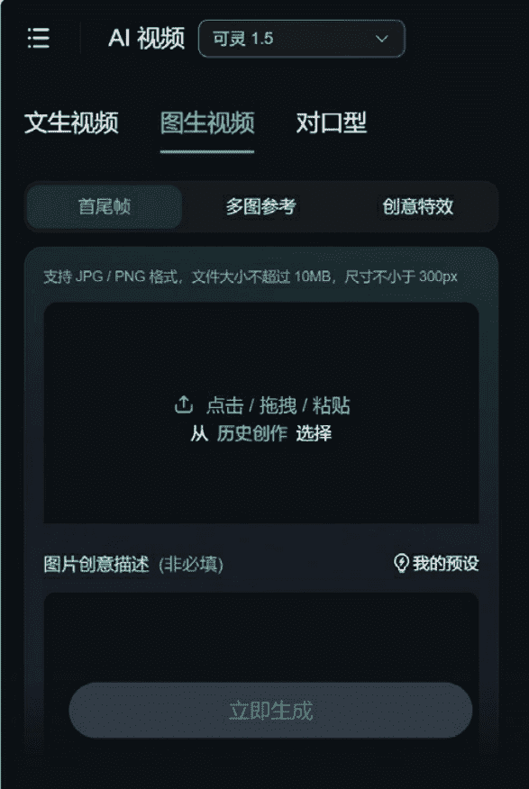

图4-1 可灵AI的主界面

可灵的视频生成主要是在操作区域进行控制，在这里可以实现对生成内容的设计。下面我们来认识一下其中各项功能的用处（图4-2）。

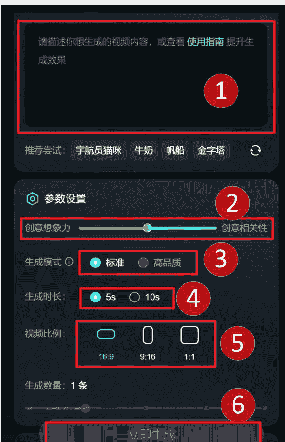

#### 4.1.1 提示词输入框

在这个文本框内输入提示词，也就是将想要生成的内容告诉AI。

#### 4.1.2 创意关联程度设置

在这里我们可以设置AI在生成内容时自由发挥的程度。越靠近右边，AI生成结果越符合提示词的要求，而越靠近左边，AI在生成结果时会添加更多自由发挥的成分。

#### 4.1.3 生成模式选择

这两个选项主要控制生成结果的质量，选择“高性能”，生成速度较快，选择“高表现”，生成结果画面质量较高，但是相应的生成速度会变慢。

#### 4.1.4 生成时长

该选项用来控制生成视频的时间，只有“5秒”与“10秒”两种选择。

#### 4.1.5 视频比例

该选项可设置生成结果的宽高比，目前只有“16：9”“9：16”和“1：1”3种选择。

#### 4.1.6 生成按钮

在完成提示词等的生成设置之后，点击生成按钮，AI就会按照我们的设置生成相应的视频。

继续下拉操作面板，我们还能看到两组设置（图4-3）。位于上方的是运镜控制，可以控制摄像机的运动，在下拉菜单中可以选择具体的运镜方式，在运镜方式下方可以通过拖动滑块来控制摄像机的运动幅度与方向，选择完成后可以在上方的预览框中看到具体的运镜效果。

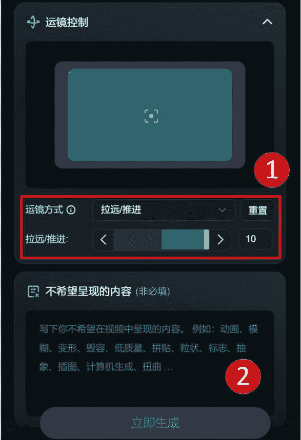

我们可以将不想出现在视频中的物体与效果输入下方的文本框中，AI会根据我们的输入规避这些内容。

### 4.2 文生视频示例

本节我们演示一个具体的生成示例。在提示词输入框中，我们输入“一只大熊猫在街头弹吉他”，创意关联程度保持默认设置，生成模式选择“高性能”，时长选择“5秒”，视频比例选择“1：1”，其余两项不进行设置，完成后点击“立即生成”（图4-4）。


图4-4 文生视频示例

系统会进入图4-4所示的等待界面，这个时候我们不需要做什么，静静等待生成结果就可以了。

内容生成结果如图4-5所示，在预览区域我们可以查看生成结果。

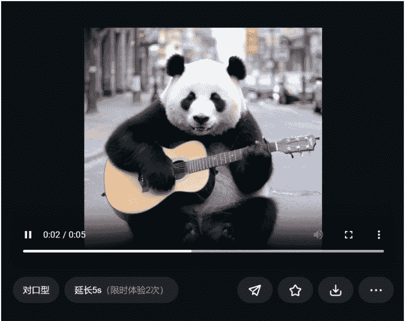

图4-5 生成结果预览

点击视频右下角的箭头，可以下载当前生成的视频，星星图案是收藏按键，收藏之后我们可以在生成结果中快速定位这一次的生成结果。

熊猫弹吉他的视频内容如图4-6所示。

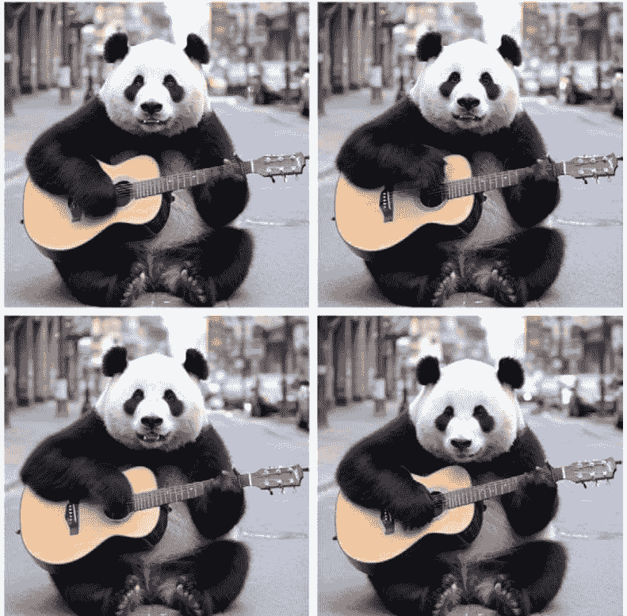

图4-6 一只大熊猫在街头弹吉他

生成内容的质量还是非常不错的，我们通过简单的剪辑就可以在短视频中使用该素材。

### 4.3 提示词及其迭代

想要得到高质量的生成内容，我们必须在提示词上多下功夫，提示词的好坏直接影响着生成结果的相关性、创造性和准确性。在创作提示词的时候，应注意两点，一是提示词的精确性，二是提示词的简练度，这两点能够极大地提高生成结果的质量与生成效率。

如何保障这两点呢？在描述生成内容的时候，不要用模糊的通用词语，尽量使用术语。比如，我想要这样一种镜头效果：从很远的地方展现一幅场景，角色在画面中很小，这个场景可以用“远景”这一个词概括，这就是术语所带来的简练与精确。不用担心AI的智商，AI对于术语的理解能力是非常强的，工程师在训练模型的时候，已将所有相关的术语输入模型的数据库中。再比如，我想展现一幅画面：近距离展示一只小蜜蜂在花朵上采蜜，要有非常丰富的细节，其对应的术语是“微距摄影”。

但是，很多人并不具备这样的专业知识，对于这些术语并不熟悉，那么应该怎么办呢？答案就是，让生成式AI帮助我们总结提示词。比如利用通义千问，我们将想法告诉它，看看它能不能帮助我们。

问：请帮我将下面的想法总结为精确简练的提示词，要多用专业术语来改写我所输入的内容：
远距离拍摄一只袋鼠在擂台上打拳击的场景，距离要足够远，但是不能太远，要展示出袋鼠的全身，在擂台上的灯光比较亮，擂台之外要比较暗。袋鼠的对手是一个人，要从擂台的斜上方进行拍摄。

通义千问：可以使用以下提示词来精确描述您的想法：
“长焦镜头捕捉全身的袋鼠在擂台上拳击，与人类对手对决。拍摄角度为擂台斜上方，确保擂台内明亮照明与周围较暗环境对比，以强调中心动作。”

经过AI的改写之后，提示词更专业了，也更容易被视频生成AI所理解。现在有了更好的提示词，我们是不是就能得到满意的素材了呢？不要着急，这里还涉及利用生成式AI进行创作的第二个原则：迭代原则。

AI在生成内容的时候有着非常大的随机性，这种随机性有时会使生成结果不符合我们的要求。面对有瑕疵的生成内容，我们可以将其当作一个内容生成框架，先从整体上确定AI应该为我们生成什么样的内容，先不管细节。

等整体框架已经符合我们的要求后，再去调整细节内容，比如衣物颜色、物体形状等。我们需要不断地调整提示词来改变AI的生成结果，这就是一个迭代的过程。比如，在首次生成的画面中出现了我们并不想要的内容元素，那么在下一次生成的时候把这些元素添加到“不希望呈现的内容”中，如图4-7所示。


图4-7 添加不喜欢的内容元素

这样就能确保在后面的生成中这些元素不会再出现在视频素材当中。我们可以把生成的过程理解为一个不断磨合的过程，经过不断地迭代，模型的生成结果会越来越靠近我们原本的想法。

# AI绘画编


在AI绘画编，我们开始探索AI绘画生成的内容。从本质上讲，AI绘画与AI文本生成有着非常相似的算法基础，尽管文字与图像在人们的眼中是如此的不同，但是在机器的世界里，它们并没有本质的区别。

## 第5章 Midjourney图像生成语法指南

我们可以借助图像生成AI快速制作高质量的绘图作品，而制作过程同样依靠提示词系统。相较于文本生成AI，图像生成AI需要控制的细节更复杂，相应的，其需要遵循一定的语法规则。

### 5.1 Midjourney简介

Midjourney（以下简称MJ）是一款比较成熟的商用绘画大模型，经过一系列优化后，其比Stable Diffusion更容易上手。这一节我们就来了解下这个AI工具。

使用MJ离不开Discord这款工具。Discord是一款聊天软件，我们可以在其中创建各种聊天室，而MJ就是基于聊天室的AI绘画工具。Discord的主界面如图5-1所示。

搜索并加入“Midjourney”服务器，加入后的界面如图5-2所示。


图5-1 Discord主界面


服务器：我们可以把服务器理解为一个大的“圈子”，它是一个虚拟的“聚会”地点，每一个服务器相当于一个独立的社交中心。

聊天频道：每一个服务器可以被进一步细分为不同的聊天频道，每一个聊天频道分别聚焦于一个大的话题下的某个主题。

聊天室界面：这就是聊天的主界面，它类似于平常的聊天室，进入某个聊天频道的人都可以在当前频道中发言。

MJ将自己的交互系统搭建在其中一个聊天服务器中，在聊天频道中标有“newbies-数字”的聊天频道是公共的生图频道，在里面我们可以看到其他人生成的图像，其他人也能够看到我们生成的图像。如果在意私密性，我们可以创建私有服务器，然后把MJ机器人邀请进自己的聊天室，具体的操作参考图5-3与图5-4。

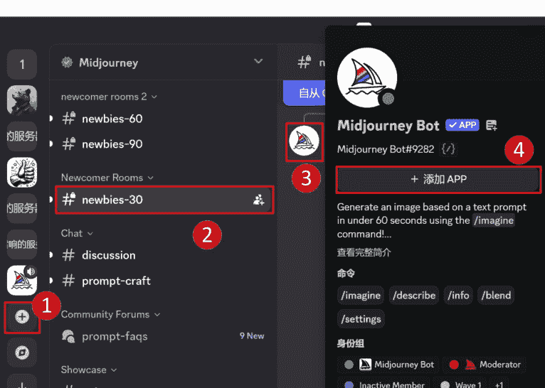

1. 点击服务器列表中的加号，跟随指引创建自己的聊天服务器。
2. 完成创建后返回MJ的服务器，点击进入任意一个绘画聊天频道。
3. 找到聊天频道中的机器人，点击它的头像。
4. 在弹出页面中点击“添加APP”。
5. 点击“添加至服务器”，跟随指引完成授权。


完成授权后，我们就可以在自己的私有服务器中调用MJ了（图5-5）。

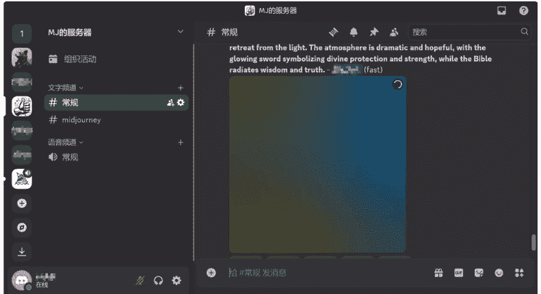

图5-5 私有服务器界面

### 5.2 基本生成方法

MJ最基本的生成指令是“imagine”命令。在聊天窗口中输入“/”，在弹出的选项列表中选择“/imagine”即可进行图片的生成（图5-6）。

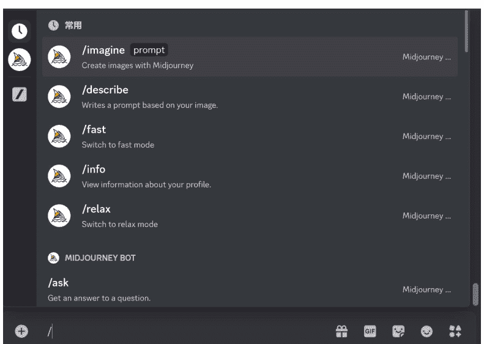

选择“/imagine”后在聊天框中会出现图5-7所示的指令，“prompt”是“提示词”的意思，它后面跟随的是用来生成绘画的提示词指令。目前MJ对中文提示词的支持是比较差的，在后续的内容中本书会告诉大家一些转译提示词的便捷方法。这里我们输入“A beautiful Chinese woman wearing armor”作为提示词，来生成我们的第一张图像。


完成输入后会出现图5-8所示的提示，这表示绘图服务器已经接收到我们的指令。

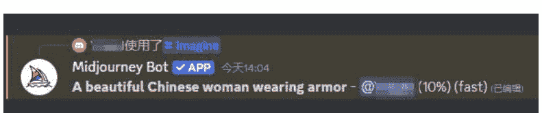

等待一段时间，AI就会生成一组图像（图5-9），具体的时长要看是否处于快速生图通道。

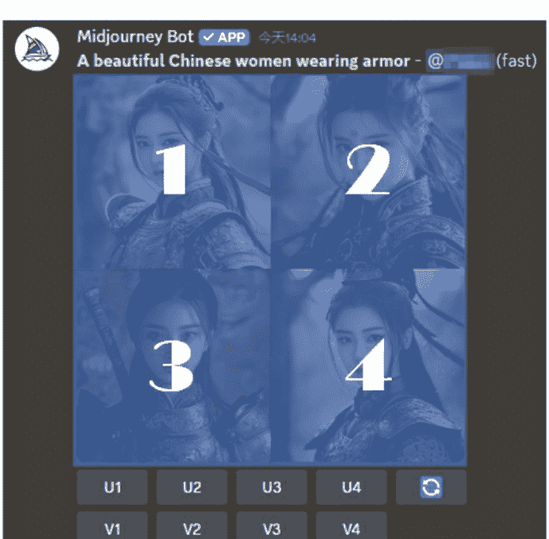

MJ每次生成的图片都是以4张为一组，而且图片下方有一组按钮，其中“U”指令的意思是放大（Upscale），将对应的图片放大和填充细节，其后的1、2、3、4分别代表左上、右上、左下、右下4个方位；“V”指令则指变化（Variation），它的功能是以某张图片为蓝本再生成一组图片，其后的数字同样表示图片的方位，点击V2后效果如图5-10所示；循环符号的功能是放弃当前的4张图片，使用相同的提示词重新生成一组图片。

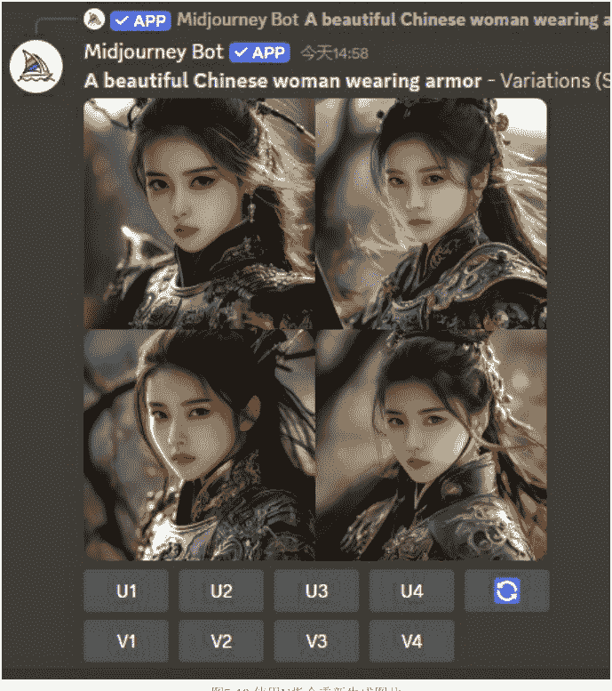

图5-10 使用V指令重新生成图片

点击U1，开始编辑图片，效果如图5-11所示。

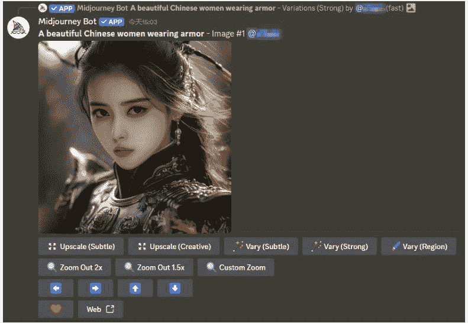

图5-11 编辑界面

我们逐个讲解图片下方这些按钮的功能。

Upscale（Subtle）、Upscale（Creative）表示继续丰富图片的细节，提高图片的分辨率，比如点击这两个按钮后图片的分辨率可由1024×1024变为2048×2048。Upscale（Creative）会在原有的基础上添加一些更有创意的画面细节。

Vary (Subtle)、Vary (Strong)表示以这张图片为底本，以强烈或者微弱的变化程度生成4张新的图片。

Zoom Out 2x、Zoom Out 1.5x、Custom Zoom表示在不改变原有内容的前提下拓宽整张画布，填充新的内容。

⬅️➡️⬆️⬇️ 为平移按钮，允许我们在选择的方向上扩展画布，且不会改变原始图片的内容。

❤️为收藏按钮，标记你最喜欢的图片，方便查找。

🌐 表示在服务器端的画廊中打开图片。

Vary（Region）表示区域调整。其可以对生成的图片进行局部调整，点击后会进入图5-12所示的界面。

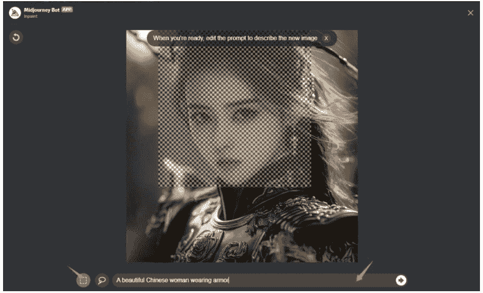

图5-12 区域调整界面

点击左下方的框选工具，在画面上进行拖拽即可选择重绘区域。之后在输入框中写入更改的内容，按下回车即可重绘，生成4张新的图片，效果如图5-13所示。

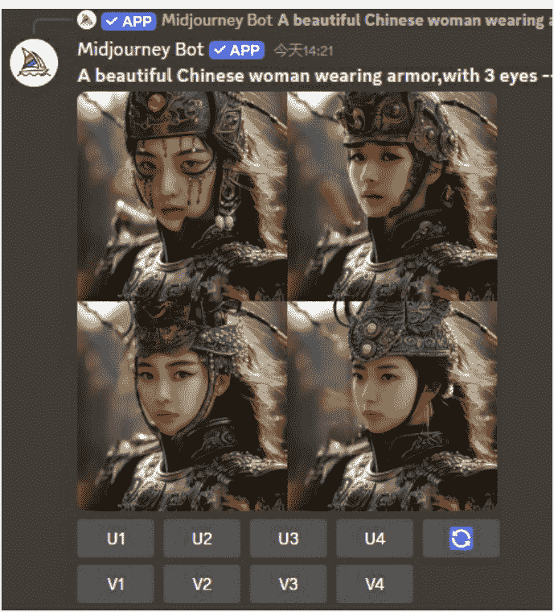

图5-13 局部重绘

在完成修改后，点击图片进入浏览模式，右键点击图片选择“保存图片”即可将图片下载至本地（图5-14）。


图5-14 保存图片的方法

### 5.3 图片提示词

在上一节中我们只用了比较简单的提示词来生成图片，如果要更加精确地控制生成结果，就需要使用比较精确的提示词了。MJ的提示词可以分为3个部分，分别是图片提示词、文字描述提示词以及参数控制（图5-15）。

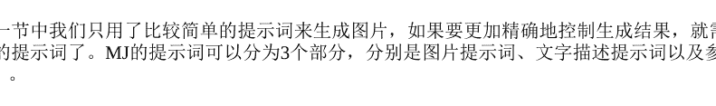

图片提示词又被称为垫图，在MJ中，我们可以将图片作为提示词的一部分来影响生成结果的构图、风格和色彩。图片提示词可以单独使用，也可以与文字描述提示词一起使用，多做一些尝试，惊喜往往就藏在过程之中。

将图片添加到提示词中需要输入存储图片的在线网址，这些地址必须以.png、.gif或.jpg等扩展名作为结尾。添加图片地址后，还需要加上文字描述提示词和参数控制。下面是使用图片提示词的注意事项。

1. 提示词必须包含多个图片提示词或一个图片提示词和一个文字描述提示词才能工作。
2. 图片地址必须使用图片的在线链接。
3. 图片地址应以.png、.gif、.webP、.jpg或.jpeg结尾。
4. 在大多数浏览器中，右键单击或长按图片并选择“复制图片地址”以获取图片在线地址。
5. “/blend”命令是为移动用户优化的简化图片提示过程。
6. 可以使用图片地址作为风格参考或角色参考。

下面我们看看图片提示词的具体使用方法。

#### 5.3.1 上传图片

首先我们把需要参考的图片上传至Discord服务器，第一种方法是直接将图片文件拖拽到聊天窗口（图5-16）。

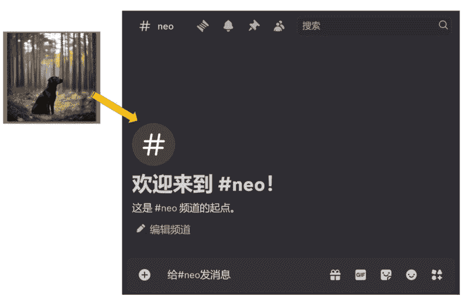

第二种方法是点击聊天框左侧的加号，在弹出列表中选择“上传文件”，即可上传图片至服务器（图5-17）。

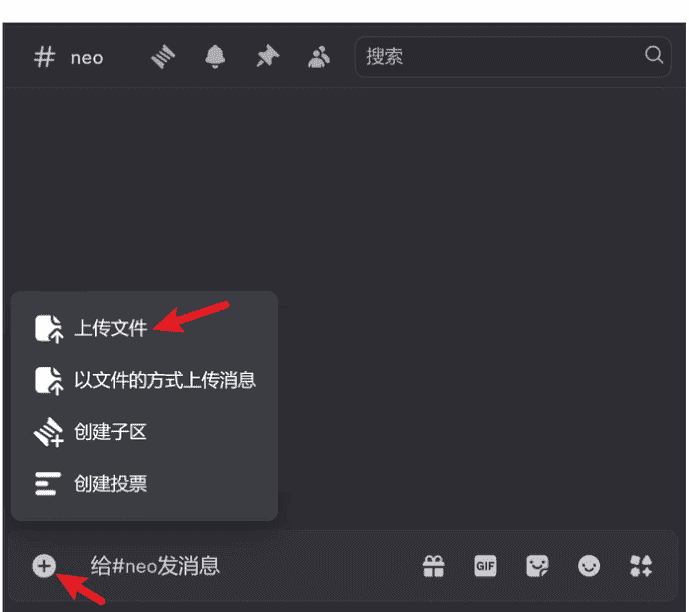

上传完成后右键点击图片，选择“复制链接”即可将图片的在线地址复制到剪贴板中（图5-18）。

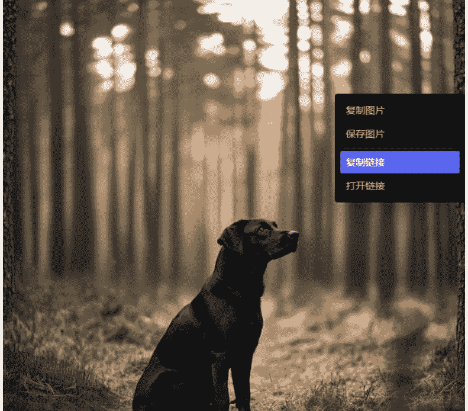

图5-18 复制图片地址

#### 5.3.2 将图片地址复制到提示词中

将图片地址添加到提示词中的方法与输入提示词是一样的，在聊天框中使用“/imagine”命令，将图片地址粘贴到提示词输入框中，后面再输入其他提示词，按下回车键就可以生成图片（图5-19）。

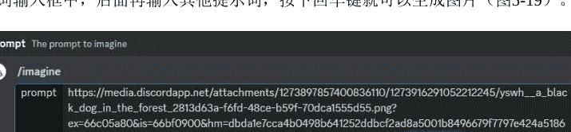

图5-19 输入提示词

图片提示词的生成效果见图5-20。文字描述提示词只有“a white tiger”，可以看到生成的图片参考了提示图片的整体风格与背景。

### 5.4 文字描述提示词

文字描述提示词即使用文本描述想要生成什么样的图片，最简单的文字描述提示词就是一个简短的句子，比如前文使用过的“A beautiful Chinese woman wearing armor”“a white tiger”。文字描述提示词主要包括主题描述、环境与细节补充内容以及风格化描述3部分，如图5-21所示的这个例子。

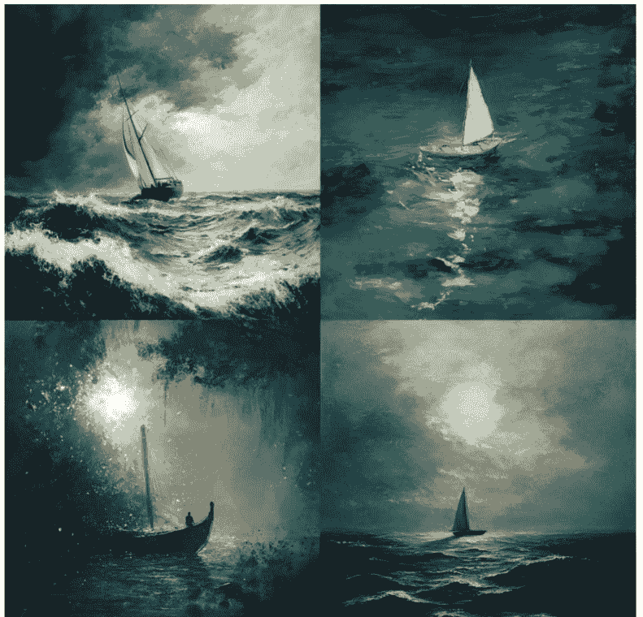

文字描述提示词：A yacht in the water，bad weather
图5-21 简单的绘图示例

#### 5.4.1 词语选择

所选择的词语越精确，所生成的图片的效果越好。例如想要表现大小，可以尝试使用“微小（tiny）”“巨大（huge）”“庞大（gigantic）”“极大（enormous）”或“无限（immense）”。

当提示词中包含两个主体时，放在前面的主体会被当作画面的焦点（图5-22～图5-23）。当然，这种提示词生成的图片不稳定，如果需要将不同的主体设置为画面焦点，最好的做法还是使用精确的提示词进行约束。

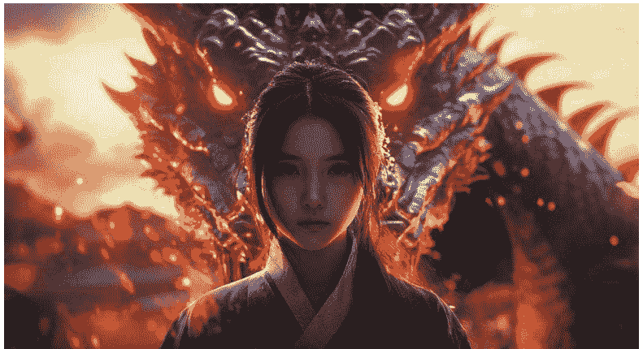

提示词：A chinese girl, a gigantic dragon.--v 6.1--ar 16 : 9
图5-22 女孩为焦点

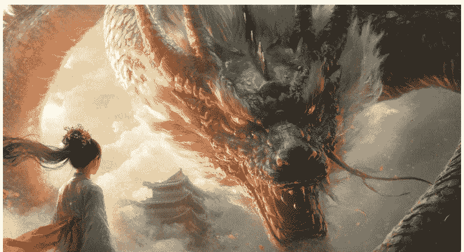

提示词：A gigantic dragon, a chinese girl.--v 6.1--ar 16 : 9
图5-23 龙为焦点

#### 5.4.2 复数词和集合名词

复数词会带来很多偶然性，所以在涉及多数量生成时最好使用具体的数字，比如“三只小熊（three little bears）”比“小熊们（bears）”更具体。同样，推荐使用集合名词，比如使用“一群鸟（a flock of birds）”而不是“鸟们（birds）”。

#### 5.4.3 专注于你想要的

在描述画面时，我们最好描述“想要的东西”，而不描述“不想要的东西”，比如绘制一张派对的图片，如果提示词写成“一场没有蛋糕的派对（a party with no cake）”，生成的图片中很有可能以蛋糕为主体（图5-24）。如果要确保最终图片中不包含某个对象，可以尝试使用“--no”参数进行控制。

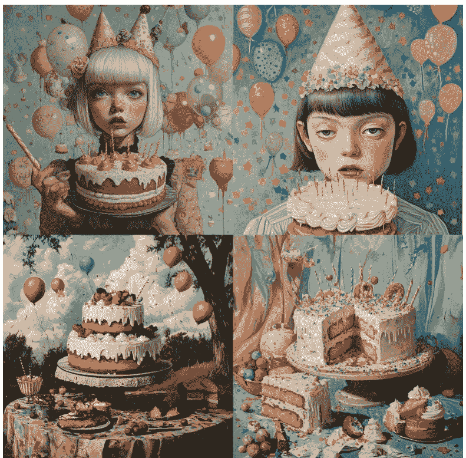

提示词：A party with no cake.
图5-24 阻止蛋糕出现反而让其成为主角

#### 5.4.4 提示的长度和细节

提示词可以很简单，一个词语或表情符号就可以让模型工作。但是，简短的提示词依赖MJ的默认风格，模型会创造性地填补任何未指定的细节。如果想要自己掌控生成结果，提示词中就必须包含最重要的元素，细节越少意味着可能的变化越多。

所以，在创作时要尽量弄清楚重要的背景或细节，在思考提示词时可以适度参考表5-1。

表5-1 创作时需要思考的元素

| 画面元素 | 元素的细节 |
| :--- | :--- |
| 主题 | 人物、动物、角色、地点、对象 |
| 媒介 | 照片、画作、插图、雕塑、涂鸦、挂毯 |
| 环境 | 室内、室外、月球上、水下、城市中 |
| 照明 | 柔和、环境、霓虹、摄影棚灯光 |
| 颜色 | 鲜艳、柔和、明亮、单色、多彩、黑白、粉彩 |
| 情绪 | 平静、冷静、充满活力 |
| 构图 | 肖像、特写、近景、鸟瞰图 |

具体的操作我们可以参考下面这个例子（图5-25）。

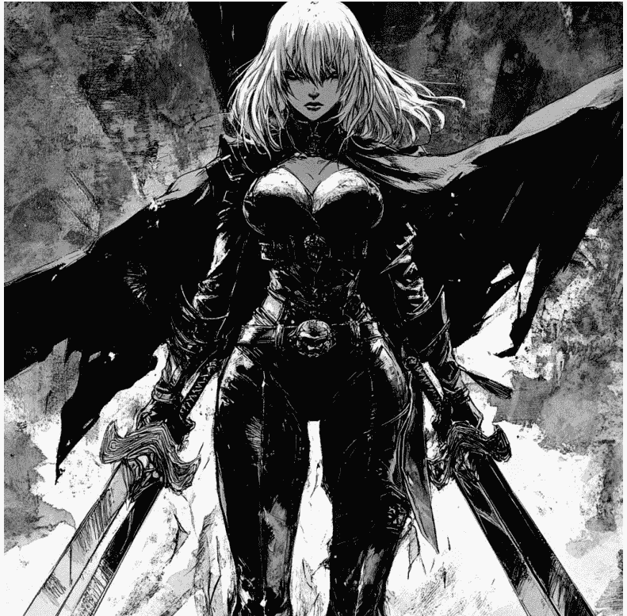

提示词：Animation character transforms into her Yoma version, dark and sinister with a dynamic full-leather, pen-made pose, ink and doodle-style illustration.

图5-25 包含丰富细节内容的提示词生成的漫画效果

### 5.5 常用控制参数

相较于图片提示词、文字描述提示词，参数控制更能为MJ提供确定的内容。我们可以在提示词末尾添加参数来控制生成的图片，比如图片的宽高比、切换不同的MJ版本、更换使用的放大器等，你可以在每段提示词中添加多个参数。

#### 5.5.1 宽高比

参数“--aspect”（简写为“--ar”）可以改变生成图片的宽高比，也就是图片的宽度与高度的比，这个比用两个数字表示，中间用冒号分隔，例如4：3或16：9，MJ生成图片默认的宽高比是1：1。第一个数字代表宽度，第二个数字代表高度，对于纵向（高）图片，第二个数字应更大，而对于横向（宽）图片，第一个数字应更大。“--ar”必须使用整数，所以正确的写法是139：100而不是1.39：1。参数在提示词中的书写示例如图5-26所示。


不同宽高比的显示效果可以参考图5-27。

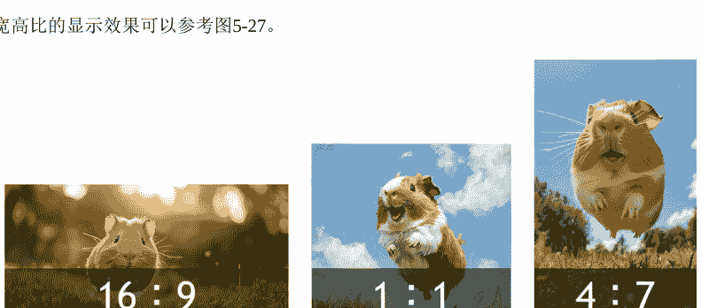

#### 5.5.2 混沌度参数

参数“--chaos <数字0-100>”（简写为“--c”）会改变生成结果的多样性，高“--chaos”值将产生不寻常的结果和构图，较低的“--chaos”值可产生可靠、重复的结果。默认的“--chaos”值是0。混沌度对生成结果的影响可以参考表5-2。

表5-2 混沌度对应的生成结果

| 混沌度 | 生成结果 |
| :--- | :--- |
| 无“--chaos”值 | 不指定混沌度将产生彼此相似的初始图像网格 |
| 低“--chaos”值 | 产生略有变化的初始图像网格 |
| 中等“--chaos”值 | 产生具有较多变化的初始图像网格 |
| 高“--chaos”值 | 产生具有更多变化和意外的初始图像网格。 |
| 非常高的“--chaos”值 | 产生具有很大变化且具有意外构图或元素的初始图像网格 |

我们来看几个不同“--chaos”值所产生的具体结果（图5-28）。

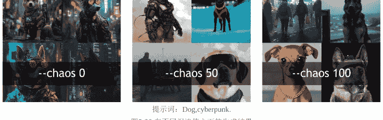

#### 5.5.3 角色参考

我们可以在提示词中使用图片作为角色参考，以创建同一角色在不同情况下的图片。这与前文提到的图片提示词的使用效果相似，所不同的是角色参考需要用参数进行控制。在提示词中添加角色参考需要使用“--cref”参数和图片的在线地址，具体的格式如图5-29所示。

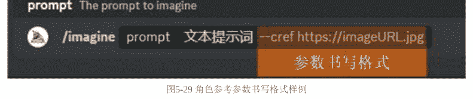

下面我们使用图5-30中的角色作为参考，将其加入图片的生成之中。

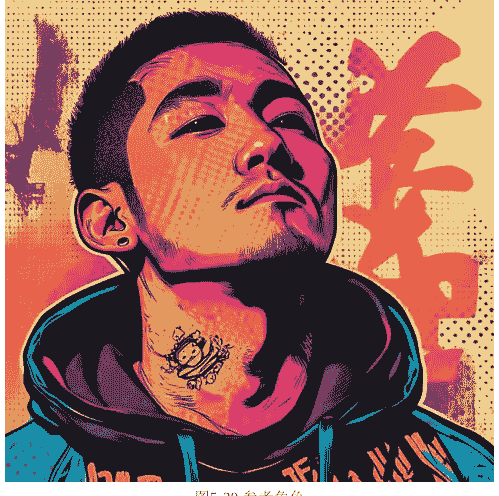

提示词与生成结果如图5-31所示。

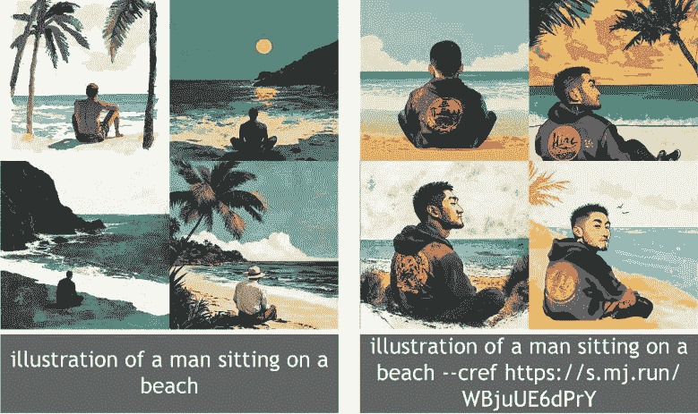

使用由MJ生成的单个角色的图片时角色参考的效果最佳，同时要注意“--cref”后不能使用真实人物的照片，否则模型会直接扭曲图片。一些精确的细节，如特定的雀斑或衣服标志很难被参考。“--cref”适用于MJ V6和Niji V6，且可以与“--sref”结合使用，常规的图片提示词必须放在“--cref”前面。

#### 5.5.4 否定提示

“--no”是否定提示参数，它可以帮助我们将不想要的元素从画面中剔除。举个例子，我们生成一张水粉风格的静物图（图5-32）。

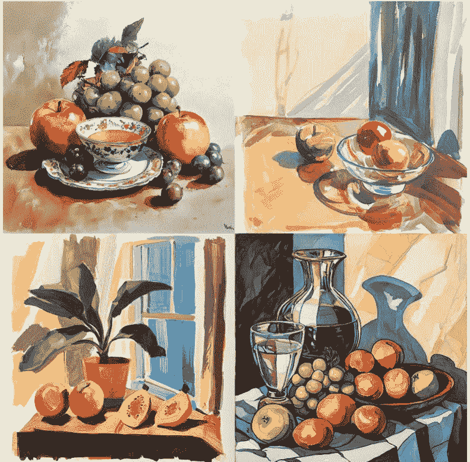

提示词：still life gouache painting
图5-32 水粉风格的静物图

可以看到在默认的绘制中，静物图普遍使用水果布景，如果不想看到水果该怎么做呢？只要在提示词中加入“--no”参数就可以了（图5-33）。


提示词：still life gouache painting--no fruit
图5-33 去除水果之后的静物图

使用“--no”参数之后，图片中就不会出现水果了。如果在绘画中想屏蔽多个物体，只需要在提示词末尾采用“--no item1, item2, item3”的书写格式就可以了。

#### 5.5.5 个性化绘画参数

当你在社区中对图像进行排名、配对并点赞时，MJ会记录你偏好的图像类型，并根据这些偏好为你生成图像。MJ可以根据你在网站上对图像的排名和点赞的数据为你创建具有个性化风格的图像，你对自己所生成图像的点赞数据除外。随着你对更多图像进行排名和点赞，你的个性化风格会越来越清晰。

个性化生成参数的使用方法是将“--p”或“--personalize”添加到提示词末尾。默认情况下，“--p”会应用最新版本的个性化风格，你也可以调整使用旧版本，或使用参数“--p code”使用另一个用户的个性化风格。“--p”适用于MJ V6和V6.1版本。

#### 5.5.6 绘画质量参数

参数“--quality”（简写为“--q”）可以控制绘图的渲染时间，进而影响最终的渲染质量。较低的“--q”值会让图像生成速度更快，GPU运算时间较少，但生成的图像细节较少，这对我们尝试一些新想法时是很有用的。相应的，使用较高的“--q”值，渲染时间较长，图像纹理和细节更丰富，但有可能降低图像的连贯性。

“--q”值可以设置为.25、.5、1和2，不同版本的模型对“--q”值的支持也是不一样的，具体可以参考表5-3。

表5-3 模型版本与质量参数的兼容性

| 模型版本 | .25 | .5 | 1 | 2 |
| :--- | :---: | :---: | :---: | :---: |
| MJ V6.1 | × | √ | √ | √ |
| MJ V6.0 | √ | √ | √ | × |
| MJ V5.2 | √ | √ | √ | × |
| Niji V5 | √ | √ | √ | × |

在不同的参数设置下，生成质量如图5-34所示。

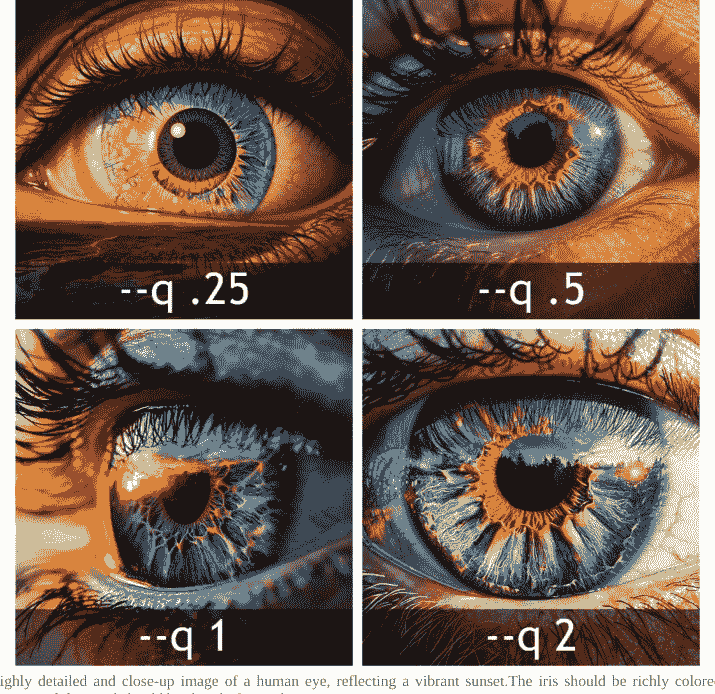

提示词: Create a highly detailed and close-up image of a human eye, reflecting a vibrant sunset.The iris should be richly colored, featuring intricate patterns of blue and green,and the pupil should be sharply focused.

图5-34 不同渲染质量的对比

“--q”参数不会影响生成图像的分辨率，只影响MJ创建图像时所消耗的GPU运算时间。默认的“--q”值是1，如果使用其他数值，数值会被四舍五入为模型版本支持的最接近的可用数值。“--q”仅影响初始图像生成，不影响变体图像或被放大的图像。

#### 5.5.7 重复生成参数

重复生成参数“--repeat”（简写为“--r”）允许多次运行一个作业，“--repeat”与“--chaos”参数结合使用可以加快我们的探索速度。“--repeat”值的取值范围与账号的充值状态有关。

- （1）对于基础订阅者，“--repeat”的取值范围是2～4；
- （2）对于标准订阅者，“--repeat”的取值范围是2～10；
- （3）对于专业和大型订阅者，“--repeat”的取值范围是2～40。
- （4）“--repeat”参数只能在快速和涡轮GPU模式下使用。

“--repeat”参数的使用方法是在提示词的末尾添加“--repeat<数值>”或“--r<数值>”。

#### 5.5.8 种子控制参数

在大模型内部，MJ使用种子编号来创建初始视觉噪声场，它的样子看起来像电视机上的雪花点，这些噪点是图像生成的起点，不同的种子对应着不同的起点，相同的起点会生成相近的结果。

种子编号对于每幅图像都是随机生成的，我们可以通过“--seed”参数指定由某一个种子生成图像。如果使用相同的种子编号和提示词，那么我们将获得相似的最终图像。下面是使用种子控制参数时需要注意的事项。

- （1）“--seed”编号范围是0～4 294 967 295；
- （2）“--seed”值只影响初始图像网格。
- （3）在MJ V1、V2、V3、Test、Testp版本中，使用相同“--seed”值将产生具有相似构图、颜色和细节的图像。
- （4）MJ V4、V5、V6版本及Niji中，使用相同--seed值将产生几乎完全相同的图像。
- （5）种子编号不是静态的，不能在会话中依赖它们。

我们看一个具体的应用示例。
不固定种子生成的图像如图5-35所示。

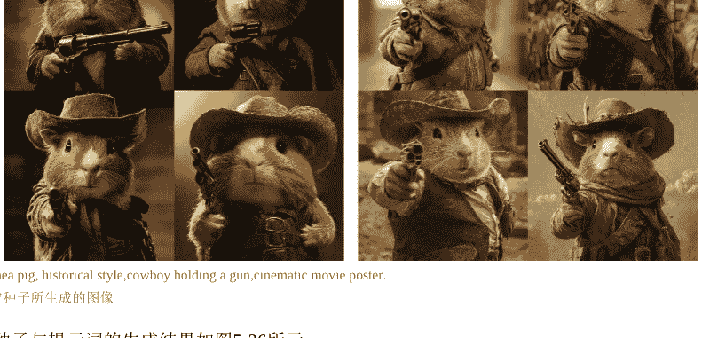

提示词：Guinea pig, historical style,cowboy holding a gun,cinematic movie poster.
图5-35 不固定种子所生成的图像

固定种子与提示词的生成结果如图5-36所示。

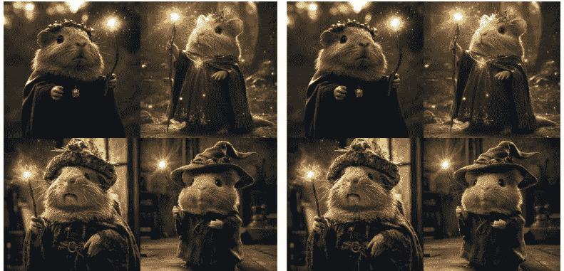

提示词：Guinea pig, fantasy style,witch holding a wand,cinematic movie poster.--seed1111
图5-36 固定种子时的生成结果

固定种子后的生成结果有非常高的相似度，在新版模型中甚至能达到一模一样的效果，如果不固定种子生成结果就会有较大的随机性。

#### 5.5.9 停止参数

“--stop<10～100的整数>”参数可在图像生成过程中直接结束作业，值越小所创建的图像越模糊、细节越少。“--stop”的默认值是100，并且在图像放大时参数不起作用。具体的示例如图5-37所示。

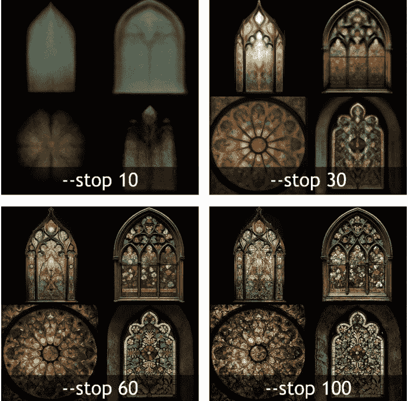

提示词：a very ornate piece of church glass--seed 123
图5-37 不同参数值下的效果对比

在生成图像时，我们使用了“--seed 123”参数来固定图像，以方便进行生成结果的对比。

#### 5.5.10 风格算法参数

参数“--style”用于更换MJ某个版本的美学风格，使用这个参数需对模型十分熟悉。

- （1）“--style <4a, 4b, 或4c>”更改为MJ V4的风格算法。
- （2）“--style <cute, expressive, original, 或scenic>”表示切换为Niji V5的风格算法。
- （3）“/tune”命令可创建样式调节器并生成自定义样式代码。
- （4）“--style <raw>”是最常用的风格算法参数。在默认设置下，MJ会自动对图像进行一些风格化处理，让画面具有观赏性。而“--style<raw>”参数会去除这种美化处理，让模型根据提示词本义生成图像，所以生成效果会与默认生成效果有所区别。我们看下面这个例子（图5-38）。

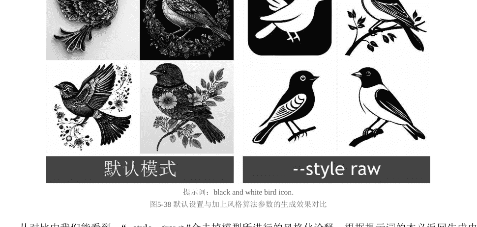

提示词：black and white bird icon.
图5-38 默认设置与加上风格算法参数的生成效果对比

从对比中我们能看到，“--style <raw>”会去掉模型所进行的风格化诠释，根据提示词的本义返回生成内容，因此当使用“--style <raw>”时，模型对提示词的要求就会非常高。我们刚刚接触MJ，难以准确控制生成结果，所以建议慎用这个参数。

默认的模型风格对于初学者来说已经足够了，即便会损失一部分提示词所蕴含的本义，但其所提供的美化功能可以让画面呈现出非常出色的质感。当然，“--style <raw>”能给我们带来非常大的惊喜，它可以大幅提升创作内容的真实感。比如对于摄影作品，模型的风格化作用会让成品有过度修饰的痕迹，从而丧失真实感，这种情景下使用“--style <raw>”参数可以使作品保持很好的质感，比如图5-39所示的这两个例子。

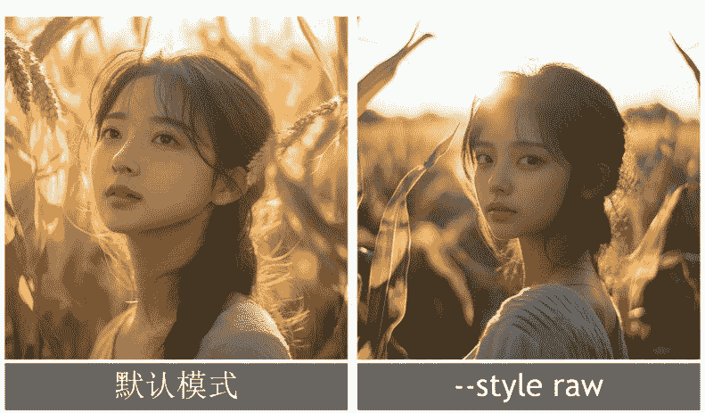

提示词：Portrait photography of a young Chinese woman in corn field, sunlight shiningthrough her hair.
图5-39 参数对摄影风格的影响

去除美化后图片呈现出更贴近现实的光影质感，这样我们就能模拟使用手机或者相机的拍摄效果。

#### 5.5.11 样式参考

“--sref <URL>”参数可以复制某种特定的风格，它可将示例图像作为背景生成图像，其书写方式如图5-40所示。


图5-40 参数书写格式

上传图片的方法前文已详细讲解，我们看一组具体示例。先将示例图片上传至服务器（图5-41）。


图5-41 示例图片

对比默认情况下与使用“--sref <URL>”参数后的生成效果，如图5-42所示。

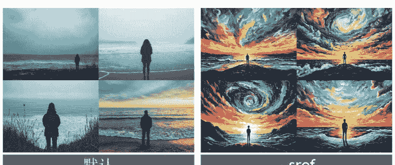

提示词：A person standing by the sea.--ar 4 : 3
图5-42 默认情况下与加入参数后的生成对比

我们还可以一次性参考多张图像，具体的书写格式为“--sref URL1 URL2 URL3”。调整每张图片的参考权重使用“::”，书写方式为--sref URL1:: 数字URL2:: 数字URL3:: 数字”，数字越高权重越大。

我们发现，“--sref<URL>”与图片提示词的作用非常相似，它们之间有什么区别吗？从功能上说，两者确实都是模仿示例图像进行绘图，不过在程度上有所不同。

图片提示词专注于模仿原图的构图、风格和色彩，而“--sref<URL>”更多地模仿原图的整体氛围。使用图片提示词所生成的图像更像原图（图5-43）。

#### 5.5.12 风格化参数

参数“--stylize <数字>”（简写为“--s <数字>”）影响MJ默认美学风格在生成中的应用程度，数字的取值范围是0～1000，默认取值为100。当参数取值低于100时，所生成的画面的细节会减少，相应的，取值高于100则可提升画面整体的表现力。下面看一个具体示例，如图5-45所示。

提示词：illustration of a man in the stranger in moscow video clip in the style of the french cómic artist Jean giraud also know as moebius, surreal ambient, Rain, Russian architecture.--ar 4 : 7

图5-45 不同的风格化参数

可以看到，随着参数值从0提升到200，画面的细腻程度不断提高。但是，风格化参数的取值不是越高越好，参数值过高会导致画面细节过度冗余，并且绘画内容与提示词的关联程度也会降低（图5-46）。

图5-46 高风格化参数的生成结果

从“--stylize 500”开始，画面中出现了很多没有必要的元素，比如过多的灯光光源，当取值达到1000时建筑发生了巨大的变化，已经与提示词没有太大关系了。所以，在一般的生图场景中，默认值100已经够用了，只有当画面上有些细节不完善时才需要调用“--stylize”参数，想要提升画面质感就调高参数的取值，如果图像中存在过多装饰元素就降低参数的取值。

#### 5.5.13 拼贴平铺参数

“--tile”是一个比较有趣的参数，通过它生成的图片可以进行无缝拼贴，我们直接来看例子（图5-47）。

提示词：a pattern of colorful watercolor fall leaves--tile

图5-47 平铺样图

选择其中一幅图片，我们可以把它像贴瓷砖一样拼贴在一起，具体的效果如图5-48所示。利用这个参数我们可以制作非常漂亮的印花图案，用在网页中或者作为桌面壁纸，也可以用作电子书的背景。“--tile”参数适用于模型的所有版本。

图5-48 平铺拼贴的效果

#### 5.5.14 版本选择参数

通过“--version <版本号>”参数（简写为“--v <版本号>”），我们可以更换生成图像所使用的模型版本。MJ会定期引入新的模型版本，更新后的模型在连贯性、效率、质量和风格表现上都会有比较大的提升，但是这并不意味着老版本的模型就没有存在的必要了，每个版本的模型都有其独特的风格表现，这也是MJ选择同时保留新老模型一个比较重要的原因。

目前MJ模型的最新版本是V6.1，发布于2024年7月，这也是现在的默认模型版本，“--v”参数的取值范围为1、2、3、4、5、5.0、5.1、5.2、6和6.1，每个数值都分别对应一个模型版本。

Niji模型是由Midjourney与Spellbrush合作研发的，它的主要功能是生成动漫和插图风格的图像。Niji模型具有丰富的动漫知识、动漫风格库和动漫美学风格，在动作镜头以及以角色为中心的构图方面有着非常强大的表现力。要使用Niji模型，需要在提示词的末尾添加“--niji 6”参数。下面使用比较简单的提示词，分别用几个版本的模型来生成图像，我们从中对比一下各版本模型不同的风格表现力（图5-49）。

提示词
生动的郁金香。--ar 4:3
(vibrant tulips. --ar 4:3)

图5-49 模型生成风格对比

V6.1版本能够生成更连贯的图像，在细节和纹理方面更细腻，并且生成图像的速度比V6.0版本快约25%。V6.0版本则提高了对长文本提示词的理解能力，改进了图像的连贯性和模型知识库，并优化了图像生成和混合能力。Niji 6模型偏向于生成漫画风格的图像。我们再来看一组高度抽象概念的绘图对比（图5-50）。

提示词
高对比度超现实拼贴。
(high contrast
surreal collage. )

图5-50 抽象绘画风格对比

#### 5.5.15 视频参数

“--video”参数会将图像的整个生成过程制作成短视频，在填写提示词时把参数放在提示词的末尾即可。下面是下载视频的具体方法（图5-51）。

在图像生成完成后，点击对话面板右侧的笑脸，在新弹出的面板中点击邮件标识，Midjourney Bot会发送给我们一封私信。接下来点击软件界面左上方的私信按钮，进入次级页面中选中“Midjourney Bot”，就可以查看它发送给我们的私信，视频的下载链接就在私信的正文当中（图5-52）。

视频的长度大概为4秒，它会将图像的生成过程详细地展示给我们，单帧效果类似于使用“--stop”参数的效果，只不过“--video”参数会把过程动态化（图5-53）。

提示词：Tilt shift Photography of Peking buildings, aerial angle.--ar 4 : 3--video

图5-53 图像生成动画

#### 5.5.16 怪异度参数

怪异度参数“--weird <数字0～3000>”（简写为“--w <数字0～3000>”）是一个能够让绘图变得怪诞的控制参数。它的取值范围是0～3000，在默认状态下值为0。

如果说“--stylize”会让图像更具有传统意义上的美感，那么“--weird”反其道而行之，经过它处理之后的图像会十分灵异、暗黑，创造一种另类的怪异美学。即便我们在提示词中并没有特别指明，在添加“--w”后，画面的构图与美学风格也会变得千奇百怪（图5-54）。

提示词：Three puppies playing.

图5-54 怪异度参数不同取值带来的变化

假如我们想创作暗黑风格的作品，在不使用参数的前提下是无法实现的，这个时候我们就需要“--weird”参数了。“--stylize”参数经常和“--weird”参数搭配使用，这样画面在偏向暗黑的同时也能保障艺术上的美感。下面我们创造几幅哥特风格的作品来验证该参数的实用性（图5-55）。

提示词：Depict the ballroom scene from Edgar Allan Poe's'The Masque of the RedDeath'with everyone wearing bizarre masks, the setting filled with shades of red.Deathstands next to a grand clock, gazing at the attendees.In the background, the lighting isdim.4k

图5-55 暗黑风格作品的绘制

最后我们制作一个表格，帮助大家区别与记忆“--s”“--c”和“--w”这三个参数（表5-4）。

表5-4 三个参数对比

| 对比项目 | --stylize | --chaos | --weird |
| :--- | :--- | :--- | :--- |
| 名称 | 风格化参数 | 混沌度参数 | 怪异度参数 |
| 缩写 | --s | --c | --w |
| 取值范围 | 0～1000 | 0～100 | 0～3000 |
| 初始默认值 | 100 | 0 | 0 |
| 功能 | 控制风格化程度与细节精细度 | 控制绘画的多样性和随机性 | 控制绘画的怪异程度 |

## 第6章
ChatGPT+Midjourney：让创作事半功倍的方法

我们已经带领读者了解了如何使用AI生成文本以及绘画作品，它们的特点都是只需要借助文字就可以生产内容，那么能否将两者结合起来，将文本生成模型输出的内容供绘画AI使用呢？这一章我们要讲的就是如何将两种AI组合使用的技巧。

### 6.1 当文生文遇到文生图

在运用MJ进行绘图时，如何将心中所想准确地翻译为英文是一个会一直伴随创作过程的问题。绘图牵涉到很多并不常见的词语与描述方式，这对于很多人来说是一道门槛。翻译软件算是一个不错的解决方式，但是翻译软件只能解决单词问题，对语法的支持还是不够的。

相较于翻译软件，文本生成大模型从4个层面完成了超越。

#### 6.1.1 易用性

与传统软件相比，文本生成大模型，如ChatGPT、通义千问等可与人们进行自然语言交流，在易用性方面有着非常大的优势。而且，文本生成大模型可以主动修复提示词中存在的错误，这种交互的便捷性是翻译软件所不具备的。

#### 6.1.2 整段文本的翻译能力

这从另一个方面体现了文本生成大模型的易用性，在翻译提示词的过程中，我们并不需要非常严谨的语言表达，只要提前固定好输出格式，大模型就可以将散乱的语言整理成合理的格式。在上下文理解方面，大模型同样能够很好地理解我们的意图，给出合适的翻译。

#### 6.1.3 个性化的翻译格式

文本生成大模型可基于文本数据进行预训练，我们可以预先输入具有一定格式的文本来完成对模型的训练，让它按照一定格式输出翻译文本。

#### 6.1.4 扩展提示词的能力

当我们输入提示词进行内容生成的时候，文本生成大模型会对提示词进行扩写，将其补充完整。这种扩写是导致生成内容不确定性的一个重要原因，我们完全可以利用这种机制，让其提前扩写提示词并展示给我们，以便我们更好地控制生成结果。

### 6.2 翻译与扩展提示词

我们先从最简单的翻译与扩展提示词开始尝试。将中文提示词输入ChatGPT，让其帮我们翻译为英文。

问：请将下面的提示词翻译为英文：
3/4侧面镜头，现代中国美女在上海购物中心，年轻女性时尚外观，浅景深，高对比度。

**ChatGPT:** The translation of your prompt into English is:
“3/4 profile shot, modern Chinese beauty in a Shanghai shopping mall, young woman with a stylish appearance, shallow depth of field, high contrast.”

翻译提示词是文本生成大模型最基本的能力，它还能帮我们处理更多的难题。如果有一些还没有成型的想法怎么办？不用担心，将这些碎片想法输入ChatGPT，让它给我们出主意。

问：我正在使用绘画AI进行创作，现在我有一些零碎的灵感，请你帮我将这些灵感进行整理并填充得更加丰满，使之能直接用于绘画AI的作品生成：
一只小狗站在巨大的废墟之中，这片废墟兼具未来感与破败感。画面中要有一些零星的光亮，要体现出小狗的孤独感，废墟中还要有巨大的机体残骸。

**ChatGPT:** 这个画面构想很具有视觉冲击力和情感深度，下面是对你的灵感进行详细整理和扩展的描述，以便更好地应用于绘画AI创作：

+   （1）场景设定：
背景描述：画面以一片庞大的废墟为背景，废墟中夹杂着高科技的残留物和刻满岁月痕迹的建筑结构。这些结构显现出先进科技的材料和设计，如光滑的金属表面、断裂的高强度玻璃以及半毁的悬浮装置等，但均已严重损坏和腐蚀，表现出一种末日后的荒凉与破败。
（2）主体构成：
小狗的描述：一只小狗站在废墟中央，其毛色为浅灰色，眼神流露出孤独和忧伤。小狗的体型较小，与废墟的宏大形成鲜明对比，增强孤独感。小狗的姿态可能是低头探索，或是坐着向远方凝视，周围是冷冽的风和飘扬的尘埃。
光源设定：画面中有零星的光亮点，可能是从高处的残破结构中漏下的阳光，或是某些仍在微弱运作的科技设备散发的人造光，为整个画面增添一丝生机与神秘感。
（3）细节丰富化：
机体残骸：废墟中散布着一些巨大的机械残骸，如断裂的机器臂、半埋的机器头颅等，这些机械部件的设计精细，表面附着锈迹和破损的电路板。机体残骸的造型和排布可以增加画面的层次感和未来科技的遗迹感。
色彩与氛围：整体色调以灰蓝和铁锈红为主，营造出一种冷清且末世的气氛。光线的处理上，可以采用光与影的对比，使得某些区域特别明亮，而其他区域更加阴暗和模糊。

这样的详细描述可以直接用于指导AI绘画创作，帮助你将灵感具象化为一幅富有感染力的艺术作品。

在AI的帮助下，原本并不完善的想法已经有了丰富的细节，但现在这些想法只是为我们提供了创作的蓝本，其中有一些内容需要修改。下一步我们修改文本中不满意的部分，并且让ChatGPT将这个创作蓝本整理成英文提示词。

问：小狗应该背对着我们，处于画面的中央，并且要显得比较渺小，其余的内容就按照你的思路进行创作。现在请你将其整理为一句简洁凝练的提示词，使用英文输出。

**ChatGPT:** Here’s a concise prompt in English that captures all the essential details for your AI painting creation:

“A small, gray dog stands alone in the center of a vast, futuristic and dilapidated ruins, back facing us, appearing tiny against the backdrop of giant mechanical debris and scattered light from broken structures and dimly glowing tech remnants.”

这样我们就得到了一个完整的提示词。虽然这个提示词已经可以用来生成图片，可是它的结构与MJ的标准提示词结构并不相符，许多有意义的描述方式并没有包含在内，使用这样的提示词无法很好地控制绘画的生成结果。有什么方法能让ChatGPT的输出更专业一些呢？在下一节的内容中就能找到这个问题的答案。

### 6.3 让ChatGPT记住Midjourney的语法

在AI脚本编我们讲过，ChatGPT这一类文本生成大模型是可以进行预训练的，也就是说它可以记住我们输入给它的文本。还记得我们之前整理出的MJ提示词的语法结构吗？现在这些结构就要派上大用场了—我们只要把这些规则输入ChatGPT，就能解决它输出的提示词不够专业的问题。

问：下面我将输入绘画大模型的提示词格式规则，请你对其进行记忆，之后在我需要你输出绘画提示词的时候，你需要严格按照规则中的结构进行输出。我所输入的规则在具体内容上并不完整，比如具体艺术流派、光线的布局等，你在输出时需要根据你的知识储备进行合理拓展：
（把我们之前总结的提示词格式与规则填充在这里，此处不再赘述）
ChatGPT：明白了！当您需要的时候，我会按照这个结构来生成AI绘画提示词。如果还有其他需要调整或添加的地方，请随时告诉我！

ChatGPT可支持的上下文长度大概有两万字，也就是说在单个话题内它能够记忆两万字左右的内容，这对于生成一幅绘画作品来说绰绰有余。在这个长度之内，ChatGPT是能够记住提示词的格式的。本书建议多关注对话的容量，一旦接近上下文上限，最好再次进行训练。对话之后ChatGPT已经牢牢记住了提示词的标准框架，我们把上一节所生成的提示词输入ChatGPT，让它对其进行改造。

问：请你将下面的提示词进行一些更改，使其符合标准的绘画提示词格式，其中所涉及的具体设置请按照你的知识储备进行选择，提示词输出为英文：
“A small, gray dog stands alone in the center of a vast, futuristic and dilapidated ruins, back facing us, appearing tiny against the backdrop of giant mechanical debris and scattered light from broken structures and dimly glowing tech remnants.”

ChatGPT：Here’s a concise and structured prompt for your AI painting model, crafted in English:“A small, gray dog, appearing tiny and alone, stands with its back to us in the center of vast, futuristic ruins.The scene blends post-modern, futurist illustration styles with scattered light from broken structures and dimly glowing backdrop of giant mechanical debris.Kodak Portra 800, 50mm f2.0, 8K.”

好了，我们使用这一段提示词看看最终的生成效果（图6-1）。

### 6.4 创作实战：生成插画作品

早期，插画主要作为书籍的配套图画，它不仅为文字内容提供了视觉上的解释和补充，也增添了书籍的艺术欣赏价值。进入20世纪，随着广告和市场营销的发展，插画艺术进一步商业化，商业插画成为推动销售和品牌建设的重要力量，艺术家开始创作目的明确、风格多样化的插画来吸引消费者的注意力并传递特定的品牌信息。

随着数字技术的发展，插画不再局限于纸质媒介，而是广泛应用于网站、社交媒体、视频游戏和其他数字平台。现在的插画已经成为一种强有力的视觉传达工具，它通过引人注目的视觉元素可以有效地传递信息和情感。

在制作短视频时，使用精美的插画作为素材可以迅速吸引观众的目光，这一节我们讲解了3种适合用在短视频中的风格类型，并附上创作关键词以及创作实例。

#### 6.4.1 木刻版画风格插画创作

木刻版画是一种非常经典的插画样式，工匠将图画刻在木板上，再通过施压将油墨印在纸张上，木刻版画会呈现一种非常特殊的纹理与质感。实现木刻版画风格需要用到关键词“woodcut print”。

我们将主题以及创作思路提供给训练好的AI，让其输出提示词。

问：根据你所记忆的提示词生成规则，请你将下面的内容整理为完整的提示词，输出为英文：
黑夜里，福尔摩斯独自走在昏暗的贝克街上，木刻版画风格（woodcut print）。

**ChatGPT:** Here’s a concise and structured prompt for your AI painting model in English:
“Sherlock Holmes walks alone on dimly lit Baker Street at night, depicted in a Victorian-era woodcut print style. The scene features atmospheric street lighting with Holmes in his iconic deerstalker and long coat. Kodak Tri-X 400, 50mm f1.4, 3:2, 4K.”

将提示词输入MJ查看生成结果（图6-2）。

虽然效果不错，但是有些地方并不能满足我们的要求，比如右下角那张图片，已经完全变成了摄影风格。这个时候就需要回过头来检查一下提示词，我们发现其中包括了一些会改变生成结果方向的提示词。将其剔除，并对参数进行调整，调整后的两次输出如图6-3所示。

Sherlock Holmes walks alone on dimly lit Baker Street at night, woodcut print, The scene features atmospheric street lighting with Holmes in his iconic deerstalker and long coat. --ar 4:7

Sherlock Holmes walks alone on dimly lit Baker Street at night, woodcut print, The scene features atmospheric street lighting with Holmes in his iconic deerstalker and long coat. --ar 4:7 --v 4

图6-3 调整提示词后的输出

调整后的图像好了很多。文本生成大模型提供的提示词有时候会存在一些小问题，一般来说不会有太大的问题，调整一下局部细节就可以正常使用了。我们所生成的这个图像非常适合用在悬疑故事类的短视频中，它所具有的细节和展现的氛围感是非常棒的。

#### 6.4.2 水墨画风格插画创作

水墨画是我国的文化瑰宝，将精美的水墨画用在短视频中可以极大地提高视频的格调。令人欣喜的是MJ对水墨画风格的支持是相当不错的，只需添加关键词“Chinese ink brush”。我们先从简单的开始（图6-4）。

提示词：Landscape painting，Chinese ink brush
图6-4 水墨山水画

对于水墨画这种传统的题材，模型处理起来得心应手，因为在它的训练数据中有大量的参考。接下来我们尝试制作一些更复杂的作品，首先把我们的想法告诉ChatGPT，让它为我们总结提示词。

问：根据你所记忆的提示词生成规则，请将“黑云压城城欲摧，甲光向日金鳞开”这两句诗词拆解为AI绘画所使用的提示词，要求使用水墨画风格（Chinese ink brush）。

**ChatGPT：** Here’s a concise and structured prompt for your AI painting model in English:
“A Chinese man stands atop an ancient Chinese-style city wall, facing outward. The sky is densely covered with dark clouds, with sparse sunlight piercing through the clouds, casting glimmers of golden light on the man’s armor. Chinese ink brush. Camera setting: traditional Chinese painting simulation, 35mm equivalent f2.8, 16 : 9, 4K. Rendered using traditional Chinese brushwork with enhanced ink dynamics.”

面对比较复杂的场景，我们需要进一步斟酌ChatGPT所给出的提示词，去除其中某些部分再进行尝试。下面是使用修改后的提示词所进行的生成尝试（图6-5）。

提示词：A Chinese man stands atop an ancient Chinese-style city wall, facing outward. The sky is densely covered with dark clouds, with sparse sunlight piercing through the clouds, casting glimmers of golden light on the man's armor. Chinese ink brush. Camera setting: traditional Chinese painting simulation, 35mm equivalent f2.8, 4K. Rendered using traditional Chinese brushwork with enhanced ink dynamics.--ar 4 : 3

图6-5 修改图片宽高比后进行生成

生成的图片虽然有水墨效果，但是风格过于现代化。经过分析，我们猜测色彩存在一定问题，所以我们去除原有提示词中关于色彩的描述以及一些冗余的内容。再次尝试生成图片，效果如图6-6所示。

提示词：A Chinese man stands atop an ancient Chinese-style city wall, facing outward. The sky is densely covered with dark clouds, depicted in traditional Chinese ink brush...ar4 : 3

图6-6 去除色彩后生成的图片

现在看起来感觉好多了。我们还可以尝试在水墨画的基础上添加一些新的元素，进行一些融合性的实验（图6-7）。

提示词：Landscape painting，Chinese ink brush. In the painting, there is a motorcycle.--ar 4 : 3
图6-7 水墨画与摩托车

经过实验我们发现，在水墨画中添加新的元素是相对容易的，但是如果我们提出的构想在水墨画中并不常见时，AI绘制起来就会很困难。

在本书最后的实战编中有一章会专门讲解制作水墨画风格短视频的全部流程，我们甚至可以用一些技术手段让水墨画动起来。

#### 6.4.3 日式动漫风格插画创作

在创作插画时，日式风格是绕不开的一种风格。我们在使用MJ时，可以在提示词中加入知名艺术家的姓名来生成偏向于他们风格的结果。我们接下来生成宫崎骏风格的插画，让ChatGPT为我们生成提示词。

问：根据你所记忆的提示词生成规则，请你将下面的内容整理为完整的提示词，输出为英文：
一个小女孩与一条白色的狗，小女孩身穿运动装，在草原上奔跑，宫崎骏风格。

**ChatGPT：** Here’s a concise and structured prompt for your AI painting model in English:
“A young girl in athletic attire runs across a grassland with a white dog, depicted in the vibrant and whimsical style of Hayao Miyazaki. The scene captures bright, natural sunlight and dynamic movement. Camera setting: Sony Alpha 7R IV, 85mm f1.8, 8K. Rendered with Miyazaki inspired animation rendering techniques.”

根据提示词，生成结果如图6-8所示。

图6-8 宫崎骏风格的插画

我们可以用同样的提示词在Niji模型中尝试一下。涉及动漫元素的内容都可以尝试用它生成一下（图6-9）。

图6-9 使用Niji模型生成图像

动漫风格在短视频中的应用场景是非常多的，尤其对年龄偏小的观众有非常大的吸引力。一个温暖的故事搭配一些清新的画面，就能创作出一个让人喜爱的短视频。

### 6.5 创作实战：生成写实摄影作品

绘画大模型的出现使生成摄影作品成为可能，我们只需选择合适的提示词与控制参数就能够生成逼真的摄影图像，这为摄影创作开辟了新的创新空间。这种极具写实风格的图像非常契合一些故事或者短剧类的短视频，下面我们就来了解如何用MJ“拍”出真实的照片。

#### 6.5.1 制作生成摄影作品的关键词

生成摄影风格的作品可以采用“Photography+提示词+Realistic+控制参数”这样的提示词结构，Photography的作用是告诉模型生成摄影风格的作品，Realistic则指定画面的风格偏向写实。我们先用这样的结构来试验一下效果（图6-10～图6-11）。

提示词：Photography of a Chinese girl running,Realistic--ar 4 : 3
图6-10 奔跑的小女孩

提示词：Photography of a Chinese girl running,realistic--ar 4：3--style raw
图6-11 添加"--style raw"参数后的图像

可以看到采用这样的提示词结构就能生成逼真的摄影风格作品。对比图6-10和图6-11，我们发现图6-10的修饰感更重，更像是经过处理的照片，而图6-11对于人物的处理更加自然。

真实感是摄影作品非常重要的特征。在制作短视频素材的时候，如果生成的图像被美化得有些失真，就可以用"--style raw"进行处理，当然使用"--stylize"也是可以的。

#### 6.5.2 人像摄影图像创作

人像摄影一般指近距离拍摄人物半身像，近距离拍摄能够很好地捕捉人物的表情、动作以及服饰细节，从而传递出人物的心理状态。

人像摄影图像的生成主要依靠“Portrait”关键词，我们看一个具体的例子（图6-12）。

提示词：Portrait of a Chinese women, realistic ,black and white.--ar 3 : 4--style raw
图6-12 黑白人像

#### 6.5.3 水下摄影图像创作

水下摄影是在自然水体中进行拍摄的摄影形式。光线在水中的传播速度与空气中不同，水的折射率会导致光线弯曲，而水本身也会吸收光线，尤其是红色光谱，这会让画面呈现出一种完全不同的摄影质感。将“Underwater photography”作为提示词的前缀即可实现水下摄影风格的作品（图6-13）。

提示词：Underwater photography of a Chinese woman in red dress, realistic.--ar 16 : 9--style raw
图6-13 水下人像摄影

利用水下摄影参数，我们可以实现一些深海题材的图像生成。将这些图像作为深海题材视频的内容，可以呈现一些视觉奇观（图6-14）。

提示词：underwater photography of a mermaid swims beside a treasure chest covered with moss. realistic--ar 16 : 9--style raw
图6-14 海中的宝箱与美人鱼

在这幅绘画中我们试图讲一个故事：一条美人鱼在海中发现了一个长满青苔的箱子。绘制这样超现实的写实摄影作品正是绘画AI的强大之处。通过相应的提示词，我们就能得到一幅在现实中很难拍摄的作品。

#### 6.5.4 动作摄影图像创作

动作摄影风格主要展现人物或者物体在某一个瞬间的动态，无论是人类快速的体育动作，还是自然界的动物行为，动作摄影能够表现出一种具有爆发力的场景（图6-15）。将“Motion Photography”作为提示词的前缀可实现动作摄影风格的作品。

提示词：Motion photography of the moment a lion pounces on a gazelle,realistic.--ar 4 : 3--style raw
图6-15 追逐猎物的狮子

MJ对细节的刻画是非常到位的，无论是狮子追逐时扬起的尘埃与泥土，还是狮子前爪投射在羚羊身上的影子都被很好地还原了。下面我们再看一幅带有幻想色彩的动作摄影作品（图6-16）。

提示词：Motion Photography of A Chinese lady flying above the city,realistic--ar4 : 3--style raw
图6-16 飞在城市上空的奇女子

具有摄影风格的奇异的内容会让超现实的题材展现出一种特殊的写实质感，这是我们创作短视频时的一个很重要的讲故事方法。让现实的故事展现出魔幻感，或者让一个魔幻的故事充满写实感都是比较高级的视频制作技巧，人们在生活中不可能见到这种场景，奇观与日常生活有重合内容才能吸引眼球。

## 第7章 图片生成视频素材

在第4章，我们介绍了文生视频AI的使用方法，利用它可以创作一些视频素材。如果我们已经有了一些图片，希望依据这些图片生成一些视频素材，这时就要用到图生视频AI了。

### 7.1 如何用图片直接生成视频

依然使用可灵AI，图生视频的操作界面与文生视频差不多，区别在于图7-1所展示的部分。

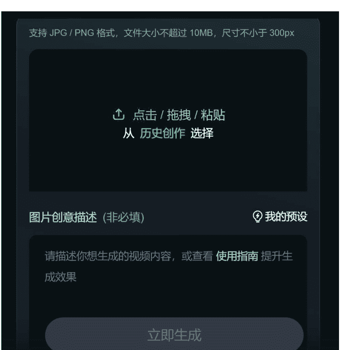

界面的上半部分用来上传图片，点击这里后可以上传作为底本的图片，而下面的空白处用来填写提示词，我们把期望生成的视频内容描述为提示词并在这里输入。

现在我们将图7-2作为图片底本进行上传，图片的内容会成为视频的第一帧，之后AI会根据我们输入的提示词将图片扩展为一个几秒钟的视频。

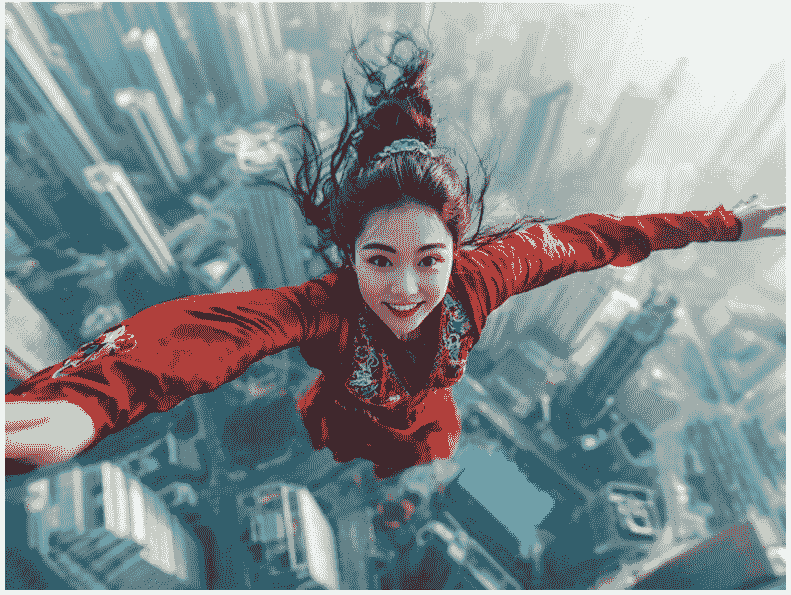

图7-2 前面章节所生成的示例图片

经过几分钟的等待，AI完成视频的生成，我们可以在预览窗口查看视频结果（图7-3）。

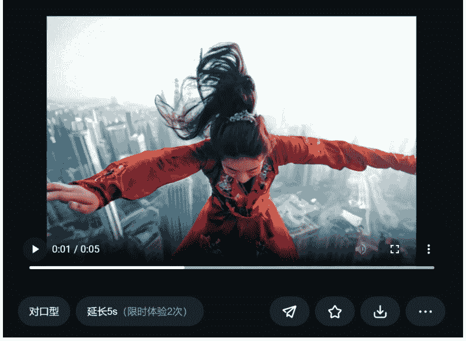

图7-3 在预览窗口查看生成结果

生成的视频效果如图7-4所示。

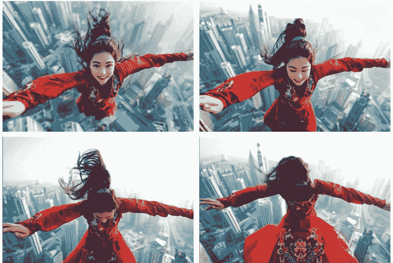

图7-4 图生视频的效果

### 7.2 首尾帧控制视频过程

大家是否注意图7-1所示界面的右上角有一个叫作“增加尾帧”的滑动开关，它有什么用呢？

前面我们所上传的图片会作为视频的第一帧，剩下的视频内容由AI随机生成。打开“增加尾帧”开关后则要求在确定首帧的前提下再增加一张图片作为尾帧，将所生成视频限制在首尾帧之内。点击打开“增加尾帧”，界面会产生变化，如图7-5所示。


可以看到界面中能够上传两张图片，分别对应着视频的首帧和尾帧。我们选择图7-6和图7-7进行上传。

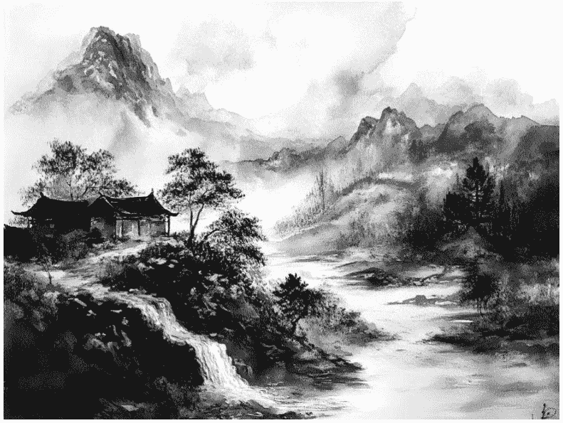

提示词：The traditional ink wash style landscape painting,--ar 4 : 3
图7-6 首帧图片

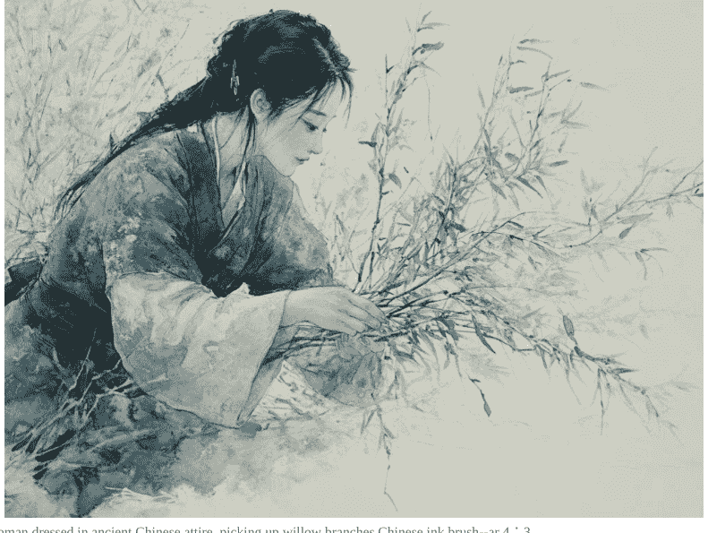

提示词：A woman dressed in ancient Chinese attire, picking up willow branches,Chinese ink brush--ar 4 : 3
图7-7 尾帧图片

这两张图片都是使用绘画AI生成的。在创作短视频的过程中，我们可以先根据视频脚本设计好某一段视频素材首尾帧的具体内容，其次让文本生成模型将内容转化为完整的提示词，再次利用绘画AI将这两帧画面画出来，最后把绘画传递给视频生成模型，生成连贯的视频素材。上传完图片后，输入视频的提示词，等待AI完成视频的创作（图7-8）。

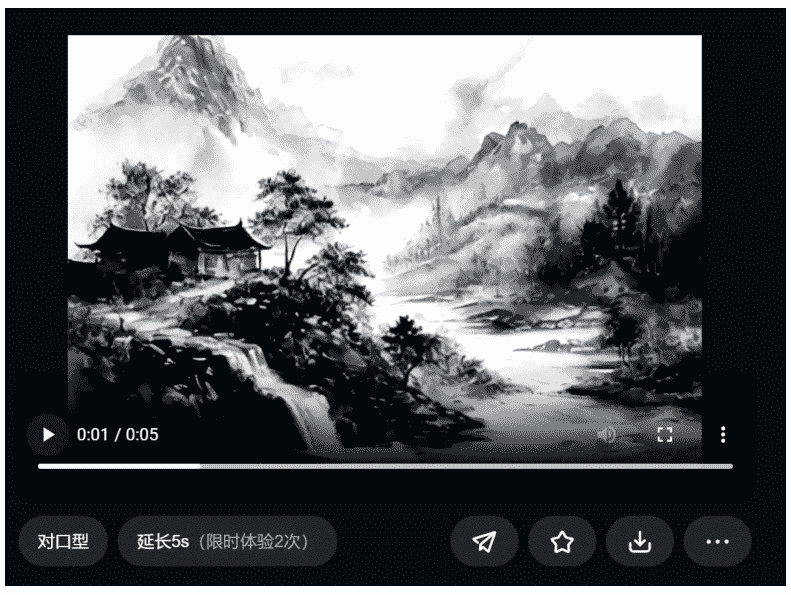

创作完成后在预览界面查看视频生成的效果，如果有需要修改的地方，就修改提示词，具体描述想要达到的效果，然后让AI根据新的提示词再次生成视频。最终的视频呈现如图7-9所示。

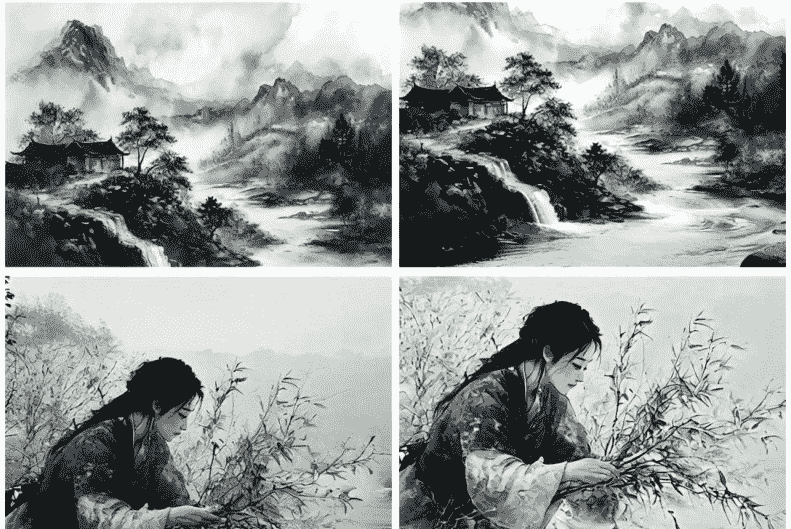

图7-9 视频生成结果

这段视频从云雾缭绕的山间开始，慢慢过渡到尾帧中的场景，一位女子正在收集柳树的枝条。

在生成的视频中，山间的云雾与流水都具有了动态效果，颇有意境，而尾帧中的女子也有了动作。通过固定首尾帧，我们利用两张图片打造了一个完整的场景。

# 剪映编

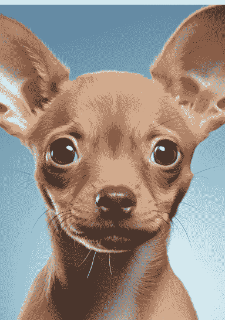

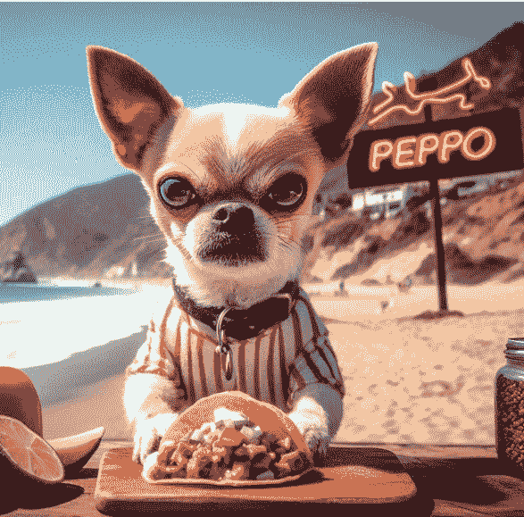

利用剪辑软件我们可以将各种各样的视频素材进行最后的加工，如果说素材是萝卜青菜，那么剪映编的内容就是告诉大家如何将这些蔬菜肉品炒制成色香味俱全的大餐。

## 第8章 初识剪映

如何处理剪辑与后期制作对于完全没有接触过此类任务的新手来说确实是一个难题，这一章我们就来详细讲解如何使用剪辑软件完成我们短视频创作最终的素材汇总与后期制作。本书所使用的剪辑软件是剪映专业版5.6.0版本，大家在网络上搜索下载即可。

### 8.1 剪映界面

剪映是抖音官方推出的一款视频编辑工具，作为一款专业向的工具，剪映比起其他同类型软件来说对于新手还是很友好的。软件的剪辑功能非常完善，而且拥有很多可以直接拿来使用的模板。

这一节我们先来系统认识一下剪映。


图8-1 剪映的初始界面

图8-1就是我们打开剪映后的第一个界面。首页之中没有太多功能性的东西，左侧导航栏中的“模板”选项可供我们浏览一下官方的预制模板，界面右下方的空白区域会将我们制作好的视频加以陈列，现在我们还没有任何的工程文件。

点击界面上方的“开始创作”进入正式的创作界面。

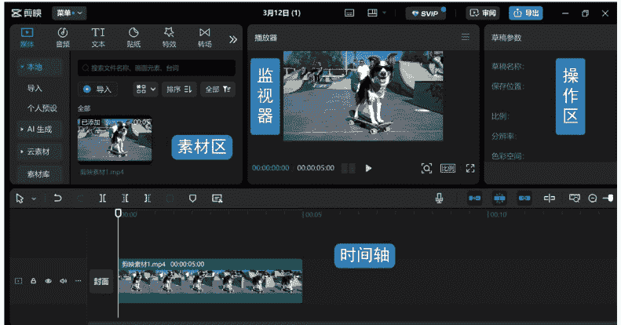

图8-2 剪映工作区域分布

剪映的创作界面可以分为4个区域（图8-2）。

- 素材区： 这个区域是我们导入素材的地方，包括视频素材、文本素材、特效素材等在内的内容都存放在这个区域。
- 监视器：在平时的剪辑过程中，我们可以实时地通过这里预览视频编辑的效果。
- 时间轴： 时间轴主要是我们控制视频剪辑整体结构的区域，所以也可以叫作编辑区。之前我们讲解过，视频就是一系列图片组成的序列帧，这个区域会展示出视频的序列帧状态，并允许我们控制序列帧、编辑序列帧。
- 操作区： 这里主要是对所选择的素材效果进行细节上调整的区域，我们在选择了编辑区的素材后就可以在这个区域内进行参数修改。

### 8.2 如何导入素材

在编辑视频之前，我们需要先将视频素材从本地导入软件。

在素材区的“媒体”选项卡（即默认的选项卡）内单击“导入”，如图8-3所示。


在弹出的选择界面中，找到我们的素材文件夹所在位置，选中素材并点击“打开”即可完成导入（图8-4）。


图8-4 素材导入界面

添加完成之后，素材会进入我们的素材库，此时我们如果想要对素材进行编辑的话，还需要把素材拖入编辑区域。

图8-5是当我们将素材拖入之后的编辑区的样子。

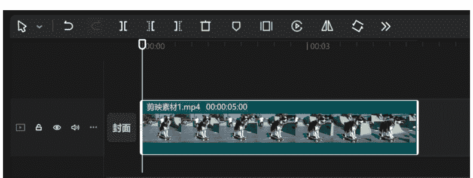

图8-5 素材编辑区域

可以看到视频会在时间轴上排列开来。视频的剪辑过程其实也就是我们在这条时间轴上进行加加减减的过程，而这条铺陈开来的轴一般也被称为“轨道”。在剪映中，轨道有很多种，每一种类型的素材都有着自己的轨道，图8-6所展示的是不同素材的轨道。

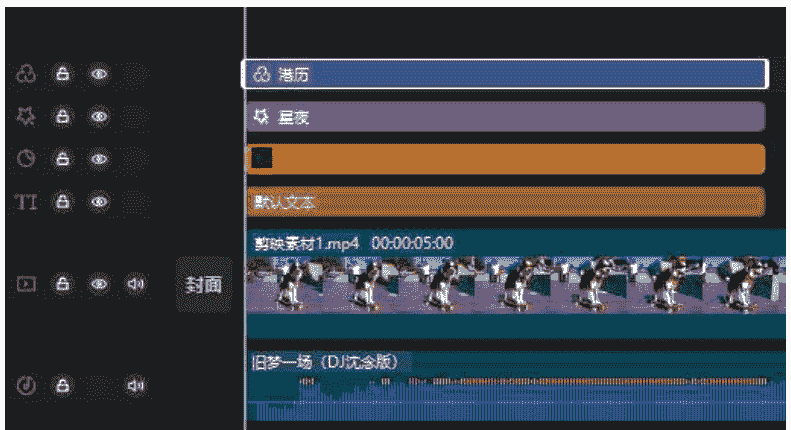

图8-6 不同的素材轨道

可以看到，图中总共有6种不同的素材轨道，每种素材轨道都由不同的颜色和标志进行标注。我们也可以根据前方的标志判断具体的素材种类。

- 滤镜素材；
- 特效素材；
- 贴纸素材；
- 文本素材；
- 视频素材；
- 声音素材。

在剪辑中，我们把这6种剪辑素材结合转场特效进行拼贴与排列组合，就能创造出多种多样的视频效果。

最简单的剪辑就是从视频中截取一部分，在编辑区拖拽进度条后点击分割键（快捷键CTRL+B）就可以进行视频的裁剪，如图8-7。


点击“分割”后，视频会从我们选择的分割点分为两段，完成后选择我们想要舍弃的片段，点击“删除”即可将片段清除掉，如图8-8。


在完成我们的编辑之后，点击软件右上角的“导出”按钮即可进行视频的导出工作（图8-9）。


图8-9 导出选项

点击之后，导出界面会弹出保存设置对话框，在这里我们需要对导出的视频信息进行设置。


图8-10 导出界面

图8-10中第一栏是更改视频标题的地方，我们只需要点击栏位处即可对标题进行输入，下面一栏则是更改视频存储位置的栏位，点击后会弹出位置选择界面，这个界面与导入素材时的界面非常相似，区别在于这一次我们在选择存档文件夹后点击“选择文件夹”即可。

下面的框体则是具体的视频存储设置，我们来逐项查看。


图8-11是分辨率选项的下拉菜单，用来设置我们视频的分辨率，这几项代表的意思如下：

- 480p表示分辨率为640像素×480像素，被称为标清视频（SD）。
- 720p表示分辨率为1280像素×720像素，被称为高清视频（HD）。
- 1080p表示分辨率为1920像素×1080像素，被称为全高清视频（FHD）。
- 2K指的是分辨率大约为2048像素×1080像素，接近1080p，但在电影行业中更常见。
- 4K被称为超高清（UHD），其分辨率为3840×2160像素，是1080p的4倍。


图8-12是码率选项的下拉菜单。码率是衡量数字媒体文件数据传输或处理速率的指标，通常以每秒位数（bps）为单位。它用来描述单位时间内传输或处理的数据量，对于视频和音频内容而言，码率直接影响文件的质量和大小。

在视频领域，码率可以分为两类：

（1）恒定码率（CBR）：在整个编码过程中，数据传输速率保持不变，这种方式简化了数据的管理，因为数据流是均匀的，但可能导致质量在复杂场景中降低或数据在简单场景中浪费。

（2）可变码率（VBR）：根据数据复杂性动态调整码率，在画面变化大、细节多的场景中提高码率，以保持质量；在静态或简单场景中降低码率，以节省空间。这种方法在保证整体质量的同时，优化了文件大小。

码率直接决定了视频数据的详细程度和清晰度，高码率通常意味着更高的视频质量和更大的文件大小，而低码率可能导致数据丢失和画质下降，所以我们要根据需求合理设置和调整码率。


图8-13是设置视频编码方式的下拉菜单。

编码是将原始视频和音频数据转换为可存储和传输的格式的过程，需要对文件进行压缩，以减少文件大小，同时尽量保持原始内容的质量。H.264、HEVC（H.265）和AV1是常见的视频编码标准，它们各自采用不同的技术和算法来实现上述目标。

H.264（也称为AVC）是一种广泛使用的视频压缩标准，它提供了从低比特率的互联网流媒体到高比特率的蓝光光盘的高质量视频压缩功能。H.264以其高压缩效率和良好的视频质量而闻名，是许多视频平台和设备的首选编码标准。

HEVC（H.265）是H.264的后继者，旨在提供与H.264相比大约2倍的压缩效率，这意味着在保持相同视频质量的前提下，HEVC的文件大小只有H.264的一半。这使得HEVC非常适合4K和更高分辨率视频的编码，尽管它的采用受到专利许可费问题的约束。

AV1是一种新的开源视频编码格式，由开放媒体联盟（AOMedia）开发。AV1旨在成为未来视频编码的免费替代品，提供比HEVC更高的压缩效率。由于是开源的，AV1避免了专利费用问题，但它的编码过程比H.264和HEVC更为复杂和耗时。

这些编码标准通过一系列复杂的算法和技术，如帧内预测、帧间预测、变换、量化和熵编码，来减少视频文件的大小，选择哪种编码标准通常取决于目标平台、所需的视频质量、文件大小限制和编解码器的兼容性。


图8-14是为视频选择输出格式的下拉菜单。

视频格式指的是包含在视频文件中的数据组织方式，包括用于存储视频、音频以及可能的其他数据（如字幕、元数据）的容器格式。容器格式定义了不同类型的数据是如何封装和同步的，如这里的视频文件格式.mov和.mp4，它们都支持各种编码类型的音频和视频流。

.mov是由苹果公司开发的一种文件格式，通常与QuickTime播放器关联。MOV格式支持复杂的视频内容，包括多种音频、视频、文本轨道以及元数据。它凭借灵活性和高质量的支持，被广泛用于专业视频编辑和处理。

.mp4格式的完整名称为MPEG-4 Part 14，是一种广泛使用的数字多媒体容器格式。MP4格式用于存储视频和音频流，还可以包含字幕和静态图像。由于具备高度的兼容性和网络友好特性，MP4成了网上视频共享和流媒体播放的首选格式。

虽然.mov和.mp4都可以包含相似类型的音频和视频数据，但它们在兼容性和功能上存在差异。MP4对不同设备和播放器的支持更宽泛，是一种更加通用的格式，而MOV格式更受苹果设备和软件的青睐，提供了一些专业级的特性，但是支持这种格式的播放器在数量上要少很多。


图8-15是视频输出帧率选项的下拉菜单。

帧率也就是视频每秒钟所播放的帧的数量。如果没有特殊要求的话，这里的帧率选项最好按照我们视频素材的帧率来选择，不然的话会使输出后的视频的播放速度出现问题。

比如说我们的素材本身是30fps，也就是每秒播放30帧，但假如我们把编辑后的视频帧率修改为60fps，就会变成每秒钟播放60帧，那么原先10秒钟播完的视频现在5秒钟就会播完，也就是视频的播放速度会提高一倍。

在所有选项调整完毕之后，就可以选择下方的“导出”来进行下一步了。稍作等待，我们的视频就会完成导出，这时候会出现图8-16的界面。


这是剪映的发布助手界面，我们可以通过发布助手直接将我们的作品发布到西瓜视频或者抖音上面，这是非常简便的功能。具体的操作是点击你想要发布的平台，之后会跳转至网页，只要你按照提示一步步进行，就能顺利地将自己的作品发布到平台上。如果暂时还不想发布，那么直接点击下方的“关闭”即可，我们也可以在日后单独将视频进行上传和发布。

### 8.3 更改视频比例

当我们需要将视频发布在不同平台时，视频的尺寸要求是不一样的，比如我们想将视频发布在抖音，那么我们的作品就必须适合竖屏来看。

具体来说，我们可以在编辑视频的过程中，通过监视器窗口对输出尺寸进行更改（图8-17）。


点击右下角的“比例”按钮，会弹出比例修改的下拉菜单（图8-18）。菜单中详细列出了各种视频比例选项，还贴心地给出了“抖音”和“西瓜视频”的默认视频比例，假如选择在抖音或西瓜视频平台发布的话，直接选择对应选项就可以了，如果想要将视频调整为其他比例，那么根据发布平台的具体要求选择相应的比例选项即可，这些信息都可以在各平台上搜索到。


这里我们选择将视频输出为抖音平台的9：16格式，具体的效果如图8-19所呈现的那样，我们的视频就会变成适合手机竖屏观看的样式。


### 8.4 添加背景的常用办法

我们在图8-19中将视频更改为了适合手机观看的尺寸，由于素材本身是宽屏素材，上下两端会留下非常难看的大黑框。为了遮盖这两个大黑框，我们可以给视频添加一些简单的背景，填充一下画面。

首先用鼠标选中我们的视频素材，然后来到右上角的操作区域依次选择“画面”→“基础”，将滚动条拉至底部之后可以看到“背景填充”这一选项，点击打开下拉菜单（图8-20）。


可以看到下拉菜单中有四个选项，分别是“无”“模糊”“颜色”和“样式”。

这里我们试用一下模糊效果。点击下拉菜单中的“模糊”选项，会弹出以下四种选择（图8-21）。


四种选择分别对应模糊程度不同的四种模式，根据自己的喜好选择即可，这里我们使用模糊程度最高的选项进行背景填充。填充后的视频效果如图8-22所示。


进行模糊填充之后，背景的模糊化处理是根据我们的视频来进行的动态遮盖，这样简单处理之后，视频的观感会充实很多。

### 8.5 如何美化角色

AI所生成的角色在有些时候会让我们感觉有所欠缺，但是我们可能会对其中的场景比较满意，重新生成的话，一来不一定比得上这个“微瑕”品，二来也比较浪费资源，这个时候我们可以对画面进行一些简单的美化处理。

首先导入我们需要美化的视频素材，并将素材拖拽至编辑区。为了体验美化与不美化之间的区别，我们把视频一分为二，前半段不进行美化，后半段加入美化特效。拖拽进度条至视频中间处，就像删除素材那一节的内容一样，拖拽后点击“分割”（图8-23）。


这样视频就被分为了两段。选中我们要加入特效的片段，之后同样来到右上角的操作区，依次选择“画面”→“美颜美体”（图8-24）。

我们可以激进一点，把磨皮选项直接拉到上限。完成后我们再加入一点特效，让视频看起来更加“梦幻”。来到左上角的素材区，在“特效”分页中依次选择“画面特效”→“基础”→“变清晰”（图8-25）。

完成下载后，将特效轨道拖拽至后半段视频处，调整特效的轨道长短，以适配我们的视频长度，如图8-26。

图8-26 添加特效

我们来对比一下加入特效前后的视频效果（图8-27）。

（a）加特效前

（b）加特效后

图8-27 特效的前后对比

### 8.6 简易的特效实现

#### 8.6.1 缩放与变速特效的实现方法

在电影的制作中，有一种非常经典的表现手法，即通过近景物体的变焦以及速度的突然变化来表现一种不安定的氛围，比较经典的场景设计如《无间道》在开场时的拜佛戏份。

而AI所生成的镜头一般是非常稳定与渐进的，所以如果想实现更多的影视拍摄技法，我们可以借助缩放的方式模拟变焦的效果，并人为地加入对速度的控制，以模仿这种技巧。

先将我们的素材分割为四段（图8-28）。

选中视频的第二段，在右侧操作区的“画面”区域内调节缩放比例，这里调节为200%，下面的“等比缩放”选项如无特殊要求就保持勾选状态，如果去除勾选，可以单独选择纵向缩放或横向缩放（图8-29）。

缩放前后的效果对比如图8-30所示。

如果缩放的中心不是我们想要的位置，可以通过在监视器界面直接拖动画面进行调整。将后续两个片段同样放大至200%之后，我们再来对第三段进行变速处理。

选中第三段视频，在右侧操作区的“变速”区域内进行速度调整，我们这里设置为了5倍速（图8-31）。

这个片段的时长从4.4秒变为了0.9秒。现在视频的节奏就发生了变化，影片一开始是一只狗狗的中景，随后镜头切到近景，游客在经过时被快速地剪辑处理，使画面焦点迅速回归到狗狗身上，且随着狗狗再次出现，画面速度被再次放缓。这段影片的处理方法会使这只斑点狗完全成为镜头的焦点，加速处理游客遮挡的片段直接减少了狗狗消失在镜头中心的时间，也就进一步增加了狗狗在视频中的权重。

AI在生成原始素材时的最大优势在于它的拟真度和清晰度，但在控制视频节奏、调整镜头流转的灵活性方面AI还没有办法很好地掌握。所以在利用素材时，最需要我们花心思的地方就是镜头的节奏以及焦点的设计。

#### 8.6.2 定格镜头与视频倒放

在视频中加入定格镜头与倒放同样是非常经典的影视制作手法，在很多表现追溯时光的影视作品中经常会出现这一组合技巧。这一节我们来讲解如何通过剪辑实现定格镜头与倒放效果。

导入素材后在编辑区选中素材，右键单击素材，如图8-32所示，在弹出的菜单中选择“复制”（快捷键CTRL+C），在编辑区的空白处再次单击右键，选择“粘贴”（快捷键CTRL+V），并把复制来的片段放在初始素材的后面。

图8-32 右键菜单

拼接后的效果如图8-33所示。

图8-33 素材的拼接

这样做是为了创设出一种“时光倒流”的效果，具体的设计思路是这样的：

假设希望让行进过程中的视频停顿在中间的某个画面，几秒钟之后时光开始倒流，那么我们就可以在原视频的停顿位置定格视频，随后将原视频再倒放一遍。

在明确设计思路后，接下来选中图8-33拼接素材中的第二段视频，点击编辑区上方的“倒放”键，将视频进行翻转（图8-34）。

点击后等待几秒钟，软件就会完成对视频的翻转处理。此时播放一遍视频，其实在拼接点两侧已经实现了时间的倒放效果，但是在拼接点设置定格镜头，效果会更好。

将定位线拖拽回拼接点处，点击编辑区上方的“定格”按钮，随后向后拖动定格持续区域设置定格时长（图8-35）。

这样我们就能实现与表现追溯时光的影视作品别无二致的时间倒流画面。

### 8.7 旋转与裁切视频

这一节我们来看看如何旋转视频，以及如何对视频素材进行画幅的裁切。

在导入视频素材并选中素材之后，点击编辑区上方的“旋转”按钮即可实现视频的旋转（图8-36）。

每次点击都会让视频画面顺时针旋转90度。我们也可以在右侧操作区的“画面”页内进行更加精细的旋转角度控制，位置就在“缩放”功能的下方（图8-37）。

在“旋转”栏中输入具体的数字可以控制视频的转动角度，滑动栏位右侧的圆圈也可以进行视频的转动。

“裁切”功能键同样在编辑区，位于“旋转”键的右侧（图8-38）。

图8-38 裁切功能键

点击之后会进入一个新的页面，可以自由选定具体的裁切比例，也可以通过页面下方的“裁切比例”下拉菜单直接选择固定的裁切比例。这个页面同样可以控制视频的旋转，位置位于页面的右侧（图8-39）。

图8-39 裁切比例菜单的位置

## 第9章 视频剪辑进阶：特效制作

剪辑并不仅是对素材进行简简单单地裁剪与拼接，很多时候我们还需要对素材的内容进行更改。就好比使用PS去修改照片时有多种功能选项，剪辑软件中同样有很多好用的工具，使用这些工具可以为素材添加非常多的特殊效果。

### 9.1 如何使用滤镜

滤镜的作用是调整和增强视频画面的视觉效果，通过对画面的色彩、亮度、对比度等属性进行修改，滤镜可以给视频添加特定的风格、情绪或氛围。滤镜的应用范围广泛，从简单的色彩调整到复杂的视觉效果变换，都能够通过不同类型的滤镜实现。

滤镜起源于摄影领域，摄影师通过在相机镜头前添加彩色透明片，改变光线的颜色和性质，以此实现特定的视觉效果。随着技术的发展，滤镜的概念被引入数字图像处理和视频剪辑中，今天我们所熟知的数字滤镜随之形成。数字滤镜通过软件算法模拟传统滤镜的效果，同时创造出许多全新的可能性。

视频滤镜按照功能可以分为多种类型，包括但不限于以下几种：

- **色彩调整滤镜：** 这类滤镜用于调整视频画面的色彩平衡、饱和度、对比度等，可以使画面更加鲜明、柔和或符合特定的色彩风格。
- **模拟滤镜：** 用于模拟传统胶片摄影的特定视觉效果，如黑白、怀旧、渐变色等。
- **特效滤镜：** 添加特定的视觉特效，如模糊、光晕、星光等，通常用于创设特殊的氛围或强调视频中的某些元素。
- **纹理滤镜：** 为视频画面添加特定的纹理效果，如油画、素描、水彩等，创造艺术化的视觉风格。
- **光效滤镜：** 通过模拟不同的光线效果，如逆光、镜头光晕、光斑等，增强画面的层次感和视觉冲击力。

滤镜的作用不仅仅局限于美化视频画面，它还能够帮助视频传达特定的情绪、强化故事的讲述或者突出视频的主题，比如，当我们在制作一个怀旧主题的视频时，使用怀旧滤镜可以让画面显得老旧，从而增强视频的年代感；当我们在创作科幻主题的视频时，使用冷色调的滤镜可以营造出未来科技的冰冷感。

滤镜还可以用于解决一些拍摄中的问题，如果原始视频因光线不足而显得暗淡无光，我们可以通过提高亮度和对比度的滤镜来改善画面的清晰度和观感。

下面我们来进行具体的实操，看一看滤镜的具体效果。

在素材区找到“滤镜”选项卡，在滤镜库中选择样式，并将其拖拽进编辑区。

我们总共添加了四种滤镜（图9-1），接下来对比一下不同的滤镜对于视频色调的调整效果如何（图9-2）。

使用滤镜可以非常便捷地改变素材的整体色调，很多时候我们的初始素材是需要通过滤镜的调整来实现“对齐”的，也就是各素材片段借助滤镜达成同样的情绪或者是美学上的观感。

### 9.2 视频头尾及转场特效

#### 9.2.1 开幕与闭幕特效

顾名思义，在视频的开始、结束，以及在对不同镜头进行切换的时候，我们需要使用一些特殊的效果来进行转换，以避免转场的生硬感，这一点在影视作品中是很常见的。

选中素材区的“特效”选项卡，在左侧的导航栏“画面特效”下拉菜单中选择“基础”，选择其中的开幕特效并拖拽进编辑区，或者直接在上方的搜索框中输入“开幕”并进行搜索（图9-3）。

在编辑区的时间轴上，开幕特效的两端即开幕效果的开始与结束时间。将开幕特效的长度调整为一秒，并且开端与视频素材的开端对齐，它的表现如图9-4。

图9-4 开幕特效表现

同样在“基础”库中，找到“闭幕”特效并拖拽进编辑区内，操作方式与开幕特效相似，将闭幕特效的时长调整为1秒，并且尾部与视频素材的尾部对齐，它的表现如图9-5。

图9-5 闭幕特效表现

#### 9.2.2 转场特效

一个视频大多是由很多个镜头拼接而成的，巧妙连接这些镜头是一个非常重要的技术活儿。转场特效就是用来连接两个不同的镜头，使视频流畅并保持观众注意力的视频效果类型。它们可以用来表达时间的流逝、场景的变化、情绪的转变或者强调某个动作或主题，在剪辑过程中恰当地使用转场特效，可以大幅提升视频的专业感和观赏性。

转场特效大致可以分为两类：无技巧转场和特效转场。无技巧转场依赖于镜头内容的自然变化，如遮挡物转场、相似物转场、动作转场和声音转场。而特效转场则是指通过软件生成的视觉效果，如淡入淡出、百叶窗、闪白、旋转、翻页、滑动、飞入和融合等，这里我们主要讲解特效转场的实现方法。

常用的转场特效有以下几种。

淡入淡出： 这是最基本也是最常用的转场方式，通过逐渐减少前一个镜头的不透明度，同时逐渐增加下一个镜头的不透明度，实现平滑的过渡。

百叶窗： 这种转场效果会将画面分成多个条带，然后逐个展开新的画面，给人一种快速切换的感觉。

闪白： 通过一道强烈的白光将画面覆盖，然后白光迅速消失，同时展现新的画面，常用于表达时间的急速跳跃或强调某个瞬间。

旋转： 画面沿中心点旋转，逐渐过渡到下一个镜头，这种转场给人一种动态的感觉。

翻页： 模仿翻书的动作，将一个画面翻到下一页，适用于故事的章节转换。

滑动： 画面向一个方向滑动，同时新的画面跟随进入，这种转场动感十足。

飞入： 新的画面从屏幕一侧飞入，推开旧的画面，常用于快节奏的视频。

融合： 两个画面交错融合，创造出梦幻般的效果，适合表达幻想或回忆。

##### 1. 飞入与变化转场特效

这一节我们来制作一段能够展现城市活力的转场。

首先我们将两段素材导入进来，并在编辑区将两段素材的首尾拼接在一起（图9-6）。

在左侧素材区的“转场”选项卡中找到“向右”特效，或者直接在搜索框中进行搜索，然后将这一特效拖拽至两段视频交接的位置。这里需要注意的是，不像其他特效，转场特效是不能独立存在于一条轨道上的，我们只有把转场特效拖动到视频轨道上，转场特效才能生效（图9-7）。

选中特效后，我们可以在右侧的操作区调整特效的参数，这里把特效的持续时间修改为0.5秒（图9-8）。

图9-7 特效的添加位置

图9-8 转场特效时间参数修改

来看一下具体的实现效果（图9-9）。

下面我们来体验一下使用粒子动画转场的效果。

将两段素材接续在一起之后，在转场特效的选项卡的“模糊”分页中找到“粒子”特效，并将其拖拽至两段素材的拼接处（图9-10）。

来看一下粒子动画的转场效果（图9-11）。

效果同样非常炫酷。

##### 2. 动画转场

除了使用素材区的转场特效之外，其实剪映在操作区也为我们准备了动画转场的功能选项。

选中第一段素材，在右侧的操作区内点击“动画”选项卡，“入场”分页中找到“向右滑动”动画，点击后即可为素材加入入场动画效果。在操作区的最下方可以设置动画的显示时长，这里我们调整为1秒（图9-12）。

同样的道理，点击进入“出场”页，这里可以选择素材播放结束前离开舞台的动画。出场动画时长的调整也在操作区的下方进行，时间轴的左侧用来调整入场动画，右侧用来调整出场动画。这里我们选择“渐隐”动画，并将其持续时长更改为1秒（图9-13）。

图9-13 添加出场特效并设置时长

之后为第二段素材同样加入入场动画与出场动画，时间轴上的显示如图9-14所示。

图9-14 动画特效在时间轴上的显示

最终的视频呈现效果如图9-15所示。

##### 开 场

##### 中间过渡

##### 终 场

图9-15 完整的入场与出场效果

### 9.3 如何增加氛围特效

#### 9.3.1 大雪特效

这一节我们来为视频加入大雪纷飞的特效。我们在位于素材区的“特效”选项卡的“自然”特效库中就可以找到大雪特效。自然特效库中有很多模仿自然界天气现象的特效，除了本节使用的大雪特效以外，大家可以多尝试一些其他效果，多熟悉才能变得更加熟练。

将特效拖动至编辑区，特效轨道的两端分别与我们的素材首尾对齐（图9-16）。

下面来对比一下加入特效前后的差异（图9-17）。

加入大雪特效为视频素材营造了一种更为寒冷的氛围。

#### 9.3.2 下一场像素流星雨

这一节我们来尝试把两种特效叠加在一起。“星雨”特效位于“氛围”特效库中，“像素画”特效位于“漫画”特效库中。找到后将这两种特效分别拖拽进编辑区（图9-18）。

图9-17 无特效（上）和有特效（下）的对比

图9-18 拖拽特效轨道

将特效的轨道和视频素材对齐，然后选中“像素画”这条轨道，我们进行一些调整。调整的位置是界面右上方的操作区（图9-19）。

这里主要是调整一下像素块的大小，默认的像素块是偏大的，会让观看者完全看不出画面细节（图9-20）。

所以我们可以把“像素大小”这一项调整到45左右，这样画面就会清晰很多。当一个视频中叠加了多个特效，而我们想要单独查看一个特效的表现时，我们可以通过特效前端的“小眼睛”按钮将暂时不需要看到的特效进行屏蔽（图9-21）。

调整完成后，让我们看一下特效叠加后的成果（图9-22）。

图9-22 像素流星雨效果

像素风格算是复古风格的一种，这种风格可以把画面变得更加具有游戏感，在年轻人群体中非常受欢迎。

#### 9.3.3 关于边框特效的使用小综合

边框特效能够为视频添加边界装饰，增强视觉效果，使视频模拟出某种现实情境，比如说这节我们要使用的摄像机边框特效，它能够模拟摄像机取景器中的效果。

边框特效的种类有很多，包括静态边框、动态边框、主题边框等。静态边框提供固定的边界装饰，如简单的几何图形边框、模拟相框的边框等。动态边框则主要指边框含有动画效果，即边框内的元素会发生变化（如颜色渐变、元素移动等）。主题边框根据视频内容提供相应的边框风格，如节日主题、季节主题等。下面我们结合定格特效、边框特效等，实现对视频中的人物进行快速连拍的效果。首先导入我们的视频素材（图9-23）。

在特效选项卡下的“边框”特效库中找到“录制边框”特效，并将其拖拽入编辑区，与素材轨道对齐（图9-24）。

呈现效果如图9-25所示。

接下来，我们加入定格特效，营造一种角色被抓拍后定格在拍摄瞬间的感觉。

点击素材，调整到需要表现抓拍的时间点，点击编辑区上方的“定格”按钮，完成后拖动定格区域，把定格时长控制在0.5秒左右。按照相同的手法插入三个定格片段，每个片段间隔0.5秒左右，这样就完成了特效的主体结构（图9-26）。

播放一下这个片段，会感到片段中有一种有节奏的顿挫感。现在我们把相机的闪光灯加进去。在特效搜索框输入“闪白”，选择特效并将其拖拽进编辑区。

将闪白的轨道左侧与定格帧左侧对齐，然后将右侧拖动至与左侧重合，这么做的原因是我们只需要它闪一次，以模仿闪光灯。重复三次，让每一个定格片段都对应一次闪白特效（图9-27）。

图9-27 加入闪白特效模拟闪光灯

这样我们就大功告成了（图9-28）。

图9-28 最终的呈现效果

### 9.4 字幕与文字特效如何制作

字幕可以有效地提升信息传递效率，在信息爆炸的时代，观众往往在短时间内浏览大量信息。字幕能够快速传递视频的主旨，即使在仅能静音观看的滑动浏览场景中，也能吸引观众的注意力。这一节我们就来讲讲剪映中字幕的相关内容。

在剪映中，添加文本的相关操作是在素材区进行的，点击文本选项卡，可以看到下方的文本内容主要分为七个部分（图9-29）。

新建文本：主要是创建默认文本，也就是不包含额外效果的文本（图9-30）。

图9-29 文本设置选项表

AI生成： 这项功能是利用抖音所训练的大模型进行一些文字方面的创作。

花字： 花字库内存放的是软件默认的一些比较新颖的花体字样式（图9-31）。

文字模板： 同样是字体模板，但文字模板大多是一些有设计感的文字排版样式，并且带有动画效果（图9-32）。

识别歌词： 这项功能会把我们拖入音轨中的人声部分识别为文字，虽然在识别歌词时用得较多，但其实其他人声也能够被识别（图9-33）。

智能字幕： 相当于“识别歌词”的升级版功能，可以直接识别音频或视频中的人声部分，并自动生成相应的字幕（图9-34）。

本地字幕： 这一项用来导入本地的字幕文件，支持SRT、LRC、ASS等常见的字幕文件格式（图9-35）。

图9-35 本地字幕导入

下面来熟悉一下基本的字幕添加。

点击“新建文本”→“默认字幕”，将其拖拽至编辑区内（图9-36）。

图9-36 在视频中加入文本

在编辑区内可以更改文本在视频中的出现时间，这与其他特效的调整逻辑是相同的，拖拽文本轨道的左右两侧就可以进行操作。

在监视器区域可以控制文本在视频中的具体位置，默认的文本位置是视频画面的正中央，想要更改位置的话，直接拖动文本进行调整即可（图9-37）。

图9-37 更改文本的位置

而功能最多的文本编辑区域是右侧的操作区，单击选中“文本”选项卡后便可在其中进行相应的编辑（图9-38）。

图9-38 文本的详细设置

下面对各设置项进行逐一更改。

在文本编辑区域，将“默认文本”更改为“大乌贼与小螃蟹”，将下面的“字体”设置项更改为“追光体”，字号设置为15，其余保持默认。

继续下拉右侧的滚动条，会看到“预设样式”这一栏（图9-39），这里是修改文本字体样式的地方，选择第三个，其余的样式各位读者可以依次尝试一下。

图9-39 文本样式

我们再给字幕加上一些动画特效。点击操作区“文本”右侧的“动画”，在下方的“入场”选项卡中选择“闪动”特效，时长设置为2秒。同样地，给文本选择出场特效，选中“水墨晕开”，时长设置为2秒（图9-40）。

字幕的最终效果如图9-41所示。

图9-41 字幕的最终效果

# 实战编

在实战编，我们将利用剪辑软件把整本书所讲述的内容全部串联起来，从头到尾地演示如何制作一个完整的短视频项目。然后将其分别发布在各个平台，从而赚取收益。

## 第10章 AI短视频制作全流程解析：《一只浣熊的奇幻漂流》

短视频的创作是一个系统化的工程，AI的协作不仅仅是让更多人的创作成为可能，更加重要的是实现创作效率上的变革。按照专业化的步骤，我们每个人都能够快速地制作出高质量的短视频作品。然后我们将这些作品分发到多个平台，赚取原创收益。

### 10.1 故事脚本生成

#### 10.1.1 生成故事框架

使用AI生成故事框架是一件很自由的事情，我们有很多的选择，可以像本书AI脚本编那样去利用选题库来生成选题，也可以将灵光一闪的点子扩展成完整的故事。本节就用一个简短的想法来让AI生成故事框架。

问：我想要创作一个1分钟左右的短视频，故事的大致想法如下：
“一只生长在森林中的浣熊机缘巧合之下被一辆卡车运到大城市中，它在城市中经历了许多这辈子没见过的光怪陆离，最后终于适应了城市的生活。”
请你按照八点弧线（eight point arc）的格式帮助我构建整个故事。

答：这个短视频的故事构想非常有趣和富有创意，使用八点弧线（eight point arc）来构建故事结构会使情节更加紧凑和引人入胜。以下是按照八点弧线格式构建的故事大纲：

- （1）引子（starter）：浣熊在森林中宁静生活着，与其他动物一起玩耍，生活单纯而安详。
- （2）触发事件（trigger）：一天，浣熊无意中爬进了一辆停在森林边缘的卡车，当它在车里睡觉时，卡车突然启动，将浣熊带到了遥远的大城市。
- （3）任务（the quest）：浣熊在城市中醒来，发现自己置身于一个完全陌生的环境。它必须找到生存的方式，并试图找到回家的路。
- （4）惊喜（surprise）：浣熊遇到各种城市特有的挑战，例如，繁忙的交通、垃圾箱的食物和其他城市动物。每一个挑战背后都是一个小惊喜，使浣熊逐渐学会在城市中生存。
- （5）关键选择（critical choice）：浣熊在城市中找到了一个能够定期获取食物的地方，但它必须决定是继续寻找回家的路，还是适应在这里的新生活。
- （6）高潮（climax）：浣熊在一次觅食中差点儿被捕捉，但它机智地逃脱，这次经历让它彻底决定要在城市中找到属于自己的一席之地。
- （7）逆转（reversal）：通过各种努力，浣熊不仅适应了城市生活，还成为城市野生动物中的一个小英雄，帮助其他动物适应城市生活。
- （8）解决（resolution）：浣熊最终在城市中找到了新家，虽然它偶尔还会怀念森林，但它已经完全接受并享受城市生活的便利和新鲜感。

这样的故事结构不仅确保了情节的连贯性，还能够有效地引导观众感受浣熊从迷茫到适应，不断成长的心路历程。

#### 10.1.2 设计镜头内容

有了故事的主体大纲之后，我们大体可以将视频分割为8个段落，然后让AI分别帮我们设计每个段落的具体内容。这里就以故事的引子为例，添加具体的镜头内容以及文字旁白。其他部分按照以下步骤按顺序生成即可。

问：我需要你帮我设计这个故事的第一幕：引子
浣熊在森林中宁静生活着，与其他动物一起玩耍，生活单纯而安详。
包括画面风格、角色设计、画面构图等，这个场景一定要足够吸引眼球。
答：对于这个视频故事的第一幕，我们需要设计一个既美观又能有效传达以浣熊为主题的森林宁静生活场景。这里是具体的设计建议：

（1）画面风格：
艺术风格：选择温暖而生动的色彩，使用水彩或柔和的数字绘画技术，营造一种温馨和自然的氛围。
光影处理：使用柔和的阳光照射效果，光线从树梢间透下来，形成漂亮的光斑，营造出早晨或傍晚的宁静感。

（2）角色设计：
浣熊：设计一个可爱且具有丰富表情的角色。大大的眼睛、毛茸茸的尾巴，以及一副好奇且乐于探索的表情，可以使角色更加吸引人。
其他动物：可以加入如小鹿、松鼠和鸟类等典型的森林动物，每个动物都有其特点，如小鹿温柔的眼神、松鼠活泼的动作。

（3）画面构图：
主视觉焦点：浣熊与其他动物在一片清晰的中心区域玩耍，如森林的一片空地或小溪边。
前景和背景：使用模糊的前景和经过细致描绘的背景来增加深度感，如前景可以有模糊的花草，背景是密集的树木和远处轻微起雾的山丘。
动线：构图中动物的活动轨迹应该引导观众的视线，形成一种自然的视觉流动，增强画面的动态感。

（4）场景细节：
环境元素：包括柔和的光线和多样的植被，如高大的乔木、种类丰富的灌木和五彩斑斓的花朵，这些都可以增加场景的丰富性和多样性。
互动：展示浣熊与其他动物之间的互动，如追逐玩耍、共同觅食等，这可以增强故事的温馨感和生动感。

通过这样的设计，第一幕不仅能够吸引观众的注意，还能有效地设置故事背景，让观众对浣熊的森林生活产生情感上的共鸣。这些设计元素结合起来，可以形成一个视觉上令人愉悦和情感上引人入胜的开场。

问：请为这个引子的场景设计旁白
答：为了增加第一幕的故事氛围和情感深度，我们可以设计一段富有诗意且引人入胜的旁白。这里是一个可能的旁白文本设计：
旁白：在一片古老的森林中，树叶轻声细语，阳光斑驳地洒落在柔软的地面上。
（画面显示浣熊在树林中跳跃和玩耍）
这里居住着一只小浣熊，名叫阿灵。
（画面渐渐聚焦在浣熊的脸上，展现它好奇而乐于探索的眼神）
但是，一个意外的旅程即将展开，带领阿灵走向一个全新的世界——光怪陆离的大城市。
（画面慢慢暗下来，预示即将到来的变化和冒险）

这段旁白不仅为观众描绘了一个充满活力和乐趣的森林生活场景，还巧妙地引入了即将发生的故事转折，激发观众的好奇心和期待感。

根据AI所给出的镜头脚本，我们一共需要生成两个场景，至于第三个场景，我们只需把浣熊的表情特写放在剪辑软件中做渐暗退场处理就可以了。

### 10.2 制作视频素材

设计好脚本之后，我们根据脚本的内容生成相应的视频素材。首先让AI依据脚本为我们生成具体场景的绘画提示词。

问：根据你所记忆的提示词生成规则，请你将下面的内容整理为完整的提示词，输出为英文：
答：Here’s a concise and structured prompt for your AI painting model in English:
“Design a serene forest scene featuring a raccoon and other forest animals like deers, squirrels and birds in warm, vivid watercolor style.The scene captures soft morning or evening light filtering through treetops,with a central focus on playful interactions in a glade.Camera setting:35mm f2.8, 16 : 9, 4K.The scene uses soft focus foreground and detailed misty background, enriched with diverse vegetation and dynamic animal movements.”

将提示词稍作整理，输入Midjourney生成相应的场景绘画，选择一幅比较合心意的作为故事的第一个场景（图10-1）。

我们也可以利用图生视频将这一场景转化为动画。这里还有一个技巧，假如不想让画面出现太大的改变，只是想要呈现一些可控的动画效果，那么我们可以在“增加尾帧”功能中，将尾帧设置为与首帧相同的图片，这样子就可以单纯地为场景增加一些动态效果（图10-2）。

图10-2 制作动态场景

生成的视频效果如图10-3所示。可以看到视频中的画面并没有太大的变动，主要是一些光效细节随着时间而改变。

图10-3 图片动态化

当然，也可以不使用增加尾帧功能，而是直接将图片转化为一个几秒钟的短视频素材（图10-4）。

图10-4 将图片转化为短视频素材

按照相同的方法，我们把第二个场景“画面渐渐聚焦在浣熊的脸上，展现浣熊好奇而乐于探索的眼神”制作为视频素材（图10-5）。

图10-5 好奇的浣熊

### 10.3 初步剪辑

在完成基本的素材收集之后，接下来就轮到剪辑软件出场了。打开剪映，将两段视频素材导入软件中（图10-6）。

将素材拖动到编辑区域内，按照顺序排列在不同轨道内。依照视频脚本的设计，我们为第二段素材加入“渐隐”的出场动画（图10-7）。

在完成主体内容的剪辑之后，还要给视频内容加入字幕和语音旁白。拖动一段默认文本，将其放置在视频轨道的上方，根据合适的长度对旁白进行分割之后，将首段旁白设置为文本的内容。调整字幕的位置，让字幕位于视频的下部，并设置合适的字体与大小（图10-8）。

设置完成后，我们还需要针对字幕内容加入朗读功能，这样才能制作出真正意义上的旁白。选择字幕，在右上角的参数面板中点击“朗读”选项卡（图10-9）。

在朗读选项卡中有非常多的声线可供选择，这里以亲切女声为例。选中亲切女声，软件会自动为我们试读选中的字幕片段，如果觉得声线合适的话，点击“开始朗读”，软件就会为我们的视频插入一段声音文件。当然，在点击“开始朗读”之前最好将“朗读跟随文本更新”选中，这样的话，假如我们更改了字幕的内容，那么朗读的内容也会进行同步更新。插入的声音文件如图10-10所示。

为了保持字幕样式的一致性，我们可以把设置好的字幕进行复制，然后只需更改字幕的内容即可。设计好字幕之后在轨道上拖拽每段字幕的长度，使字幕与其所对应的音轨保持首尾对齐。一般来说字幕、音轨的长度没有办法刚好与视频对齐，如图10-11所示。

遇到这种情况，有两种比较简单的解决办法，我们利用这两段视频素材来演示如何对齐字幕、音轨与视频。

#### 10.3.1 调整素材的播放速度

既然长度没有匹配上，那么我们就可以通过调整视频的播放速度来控制它的总时长，以此来调整视频素材在轨道上的长短（图10-12）。

选中视频素材，在右上角的参数面板中点击变速选项卡切换至变速设置面板。在这里我们可以设置视频的播放倍速，或者直接设置视频的播放时长，让软件为我们自动设置播放速率。为了精确控制素材，使之与字幕、音轨对齐，我们通过调整总时长的方式来改变播放速度。点击时长右侧的上下箭头，以0.1秒为单位调整时长，图10-13是调整完成后的效果。

#### 10.3.2 拼贴视频素材

接下来设置第二段素材。按照相同的方法，我们先把素材都整理到轨道上（图10-14）。

可以看到，这段视频素材的时长与音轨的时长差得非常多，这种情况下单单去拉长素材是不太适用的，得想想别的办法。我们可以将素材进行多次复制，以此来填补大段空缺，最后再通过变速对齐最后一段素材就可以了（图10-15）。

但是仅仅这样做是不够的，三段重复的素材在互相衔接的位置会有明显的跳帧，会比较影响观感。在这种情况下，我们可以改变中间段的播放顺序，让中间段从正序播放改为倒序播放，这样的话第一段的结尾刚好能衔接第二段的开头，而第二段的结尾又刚好能接上第三段的开始，这样就实现了流畅播放的效果（图10-16）。

选中浣熊脸部特写中间段的素材，点击上方工具栏中的“倒放”按钮，就能将这段素材设置为倒放。最后再删除浣熊脸部特写前两段素材中的出场特效，整个引子片段的制作就完成了，效果见图10-17。

### 10.4 将成片进一步优化

在完成初步的剪辑后，我们可以给素材加上一些特效和滤镜，这样成片的效果会更加优秀。先从第一段素材开始，选中视频素材，点击左上面板中的特效选项卡，将星夜特效拖动到编辑轨道上（图10-18）。

将星夜特效的首尾帧对齐第一段素材。添加特效后，视频片段会多出很多星星点点的光亮，素材中的森林多了一些梦幻的感觉（图10-19）。

图10-19 加入特效后的画面

接下来给转场加入动画效果。点击面板中的转场特效选项卡，将翻页转场拖动到两段视频素材相接的位置，这样转场特效的添加就完成了（图10-20）。

图10-20 加入翻页转场

翻页转场的效果如图10-21所示。

图10-21 翻页转场

### 10.5 上传并发布作品

按照相同的方法，我们将八个段落依次制作成视频片段，最终完成整个短视频的制作（图10-22）。

接下来制作短视频的封面。点击编辑轨道最前面的封面选项，在编辑界面选择合适的封面文字模板，将模板文字替换为我们自己的标题。字体与标题的大小也是可以设置的，设置完成后点击右下方的“完成设置”（图10-23）。

进行到这里，视频的主体内容就已经制作完成了，最后将我们的作品发布到视频平台上。点击软件右上角的“导出”按钮，在弹出的界面中设置一下视频导出的相关参数，继续点击“导出”即可将视频文件保存在本地（图10-24）。

勾选“封面添加至视频片头”，可以将我们之前设置的视频封面作为视频的开头来演出。短暂等待几秒钟，视频导出完成，这个时候界面就会变为视频发布助手，利用这个助手我们可以非常便捷地将视频发布在西瓜视频与抖音这两个平台（图10-25）。

图10-25 发布作品

发布之后就可以在对应的平台上浏览我们的作品了。如果想要把作品发布在其他平台，只需要在平台上完成相应的注册，然后把本地的视频文件进行上传即可。

## 第11章 AI短视频制作全流程解析：《滁州西涧》

这一章我们尝试将一首古诗制作成短视频。与其他视频类别不同，诗词类短视频的文本是现成的，重点在于如何将这些诗句转化为动态的视频画面。

### 11.1 将诗句转化为具体的场景

韦应物的《滁州西涧》是一首七言绝句，全诗共有四句。这些诗句是无法直接用于生成相应的画面的，所以我们先用文本生成AI将这些诗句转化成具体的场景描述。

问：请将下面的诗分解成具体的场景描述：

> 《滁州西涧》唐朝·韦应物
> 独怜幽草涧边生，上有黄鹂深树鸣。
> 春潮带雨晚来急，野渡无人舟自横。

答：这首《滁州西涧》由韦应物创作，是一首表现春天景象与作者感慨的诗。我们可以将这首诗分解为具体的场景描述，便于更好地理解和呈现诗的意境：

场景一：幽静的小溪边

描述：幽静的小溪边，生长着茂密而生机盎然的草木。诗人独自一人，特别怜爱这些在人迹罕至的地方生长的野草。
视觉元素：溪边的草木浓密，绿意盎然，有一种未被打扰的纯净感。

场景二：树林深处的黄鹂鸣叫

描述：在上述溪边草木的深处，有一只黄鹂在树上鸣叫。鸟声清脆悠长，回荡在这片宁静的空间。
视觉与听觉元素：深色的树干与浓密的叶子形成鲜明对比，黄鹂的鲜亮色彩在绿叶中间格外引人注目，鸟鸣声成为这一静谧环境中的主旋律。

场景三：春潮与晚雨

描述：春季的河水水位因为连绵的阴雨天气而上涨，春潮伴着雨势汹涌而至，雨在傍晚时分来得更加急促。
视觉元素：河水波涛滚滚，周围的景物在雨中显得模糊，潮水的颜色在天色变暗时显得更深。

场景四：无人的野渡与随波逐流的孤舟

描述：在这样一个雨中春潮的场景里，一个郊野渡口显得格外空旷，没有行人。一只空船在水流的推动下自行横过河面。
视觉元素：画面聚焦于那只无人驾驭的小舟，它随波逐流，显得孤独而又漂泊不定，背景是连绵不断的雨和泛起的潮水。

通过这样的场景划分与描述，可以更好地感受诗中所蕴含的孤独、宁静以及与自然环境的和谐共存之美。这首诗通过细腻的景象描绘，折射出诗人内心的情感和对大自然的热爱。

经过转化之后，诗句中的场景有了更为细节的描写，这样就能进一步地将每一个场景都转化为绘图时所需要的提示词。下面以全诗的第一句“独怜幽草涧边生”为例，展示提示词生成的细节。

问：根据你所记忆的提示词生成规则，请你将下面的内容整理为完整的提示词，输出为英文，绘图效果要使用水墨风格：

场景一：幽静的小溪边

描述：幽静的小溪边，生长着茂密而生机盎然的草木。诗人独自一人，特别怜爱这些在人迹罕至的地方生长的野草。

视觉元素：溪边的草木浓密，绿意盎然，有一种未被打扰的纯净感。

答：Here's a concise and structured prompt for your AI painting model in English:
“A poet alone admires the wild grasses by a tranquil creek, surrounded by dense and vibrant greenery in a realism style landscape. The scene captures natural and serene light with reflections off the water, emphasizing the untouched purity of the area. Please depict in traditional Chinese ink painting style.”

### 11.2 生成视频素材

#### 11.2.1 制作绘画底本

把提示词稍作修改并输入在Midjourney的聊天区内，先检验一下生成效果（图11-1）。
接下来使用同样的方法，制作出其余三句的图像底本（图11-2、图11-3、图11-4）。

图11-1 独怜幽草涧边生

提示词：Chinese ink style，golden oriole sings atop a tree in the depth of forest foliage by a creek，its vibrant colors stand out against dark tree trunks and dense green leaves. The scene captures natural light with a close-up view，highlighting the bird’s vivid appearance and melodious song. Render the scene with high-detail wildlife illustration techniques emphasizing visual and auditory tranquility.--ar 16:9

图11-2 上有黄鹂深树鸣

提示词：Capture a swollen river with spring tides，intensified by evening rain in an impressionistic style. The scene features tumultuous waters under dimming evening light，with surroundings blurred by rain，conveying a mood of urgency and power. Render the scene with impressionistic techniques to emphasize dynamic water movement and atmospheric mood.--ar 16:9

图11-3 春潮带雨晚来急

提示词：Depict an unmanned boat drifting aimlessly across a deserted river in a minimalistic style during a spring rain. The scene focuses on the solitude of the boat, under overcast skies and continuous rain, creating a subdued and melancholic mood. Render the scene with a minimalist approach to emphasize the emotional impact of the solitary boat against the dynamic backdrop of the rising river.--ar 16:9

图11-4 野渡无人舟自横

#### 11.2.2 图生视频素材

将这四张图片依次进行一些动画化处理，本节使用的是可灵大模型。我们先将第一张图片上传到图片提示，并加入一些简单的限定提示词（图11-5）。

##### 图片及创意描述

支持 JPG / PNG 格式文件，文件大小不超过 10MB，尺寸不小于 300px

01.png

图片创意描述 (非必填)

为场景添加一些动态效果，不要移动场景

18 / 500

图11-5 用图片生成视频素材

完成后我们会得到一个具有动态效果的水墨画风场景（图11-6）。

按照这个方法，我们把剩余的三张图片同样转化为动态的视频场景，这里不再赘述。

#### 11.2.3 剪辑素材

将视频素材导入剪映，并将诗句添加为字幕，随后为字幕匹配语音朗读文件（图11-7）。

这里的视频素材要多出音轨许多，需要的话可以剪掉多余的部分。但是这里先不需要去剪，一会儿我们还要为视频加入题头。

单击选中字幕，在参数设置区域点击进入动画选项卡，在入场动画库中选择打字机Ⅱ作为字幕入场动画。之所以要先生成朗读音轨，再来添加入场动画，是因为这样我们就能创造一种效果，即字幕上的诗句是跟随语音朗读同步出现的。在面板的下方将动画的时长设置为1.5秒，也就是音轨的总时长（图11-8）。

所能达成的效果如图11-9所示。这里为了能够更加清晰地看到字幕，我们先将它放在了正中央。

这样，一句诗的视频就做好了。接下来按照同样的模式，将整首诗都添加字幕、音频以及字幕动画。需要注意的是，我们最后要达成的效果是将整首诗都显示在屏幕上，所以字幕的轨道要从诞生开始一直延续到视频结束（图11-10）。

图11-10 字幕长度的设置

### 11.3 优化视频细节

现在我们给整个视频加入题头。在最开始我们留白的地方加入三段字幕，复制诗词字幕即可。复制后更改内容与排版，并添加音频与入场、出场动画，如图11-11所示。

视频的题头效果如图11-12所示。

图11-12 题头效果

由于素材本身就具有动态效果，过多的特效会破坏画面的中式美感，所以我们就不再给视频添加更多的效果了。接下来我们加入视频的封面，我们把图11-1作为封面上传，然后使用文本功能加入视频标题，即诗题（图11-13）。

图11-13 制作视频封面

将制作好的视频从头播放一遍检查实际效果，发现部分画面由于太黑，会有黑色字幕看不清楚的情况，如图11-14所示。

图11-14 看不清字幕

这样的话，在这个场景中，我们就需要改变字体的颜色。解决的办法是将字幕裁切成几段，在不同的场景中使用不同颜色的字体，最终的修改设置如图11-15所示。

图11-15 切割字幕，分段显示

### 11.4 上传并发布作品

最终我们的作品如图11-16所示。

接下来，我们将作品导出至本地（图11-17）。

图11-17 导出作品

这些导出选项在设置时不一定是越高越好，具体要看我们的发布平台。当然，也可以直接按照最高规格导出视频，在发布到视频平台之前再按照要求去压缩我们的视频作品。

导出完成后，我们可进行发布平台的选择（图11-18）。

图11-18 选择发布平台

# 结语

到这里本书的主要内容就结束了。不知不觉中，我们已经一起体验了智能脚本编写的奥秘、图生视频的魅力，以及剪映编辑的乐趣，相信各位读者经历过正篇的学习，现在已经有能力自己去完成一些视频制作的尝试。

AI生成是一个还在不断快速发展的领域，几乎每一天都会有新的工具和新的技术出现在大众面前。所以，当你闭上这本书的时候，这并不是结束，而是另一个全新的开始，至少我们现在拥有了搭乘AIGC这艘巨轮的船票。

保持好奇心和学习的热情，继续探索和实验，你会发现自己能够达到的高度远超你的想象。尽管著者已经尽力将自己所了解的知识写进了书里，但是不可避免地依然会有疏漏。经验从实战中来，被使用在实处的知识才能成为真正的知识，大家在实际的短视频创作中一定会遇到各种各样的难题，但是不要气馁，解决问题的过程也是我们自我成长的过程。

再次祝贺大家完成这次学习之旅，但请不要停下你的步伐，请你继续前进，创造更多的可能，享受创作带来的乐趣和成就感，用知识为自己带来财富。让我们在创意的海洋里，一起畅游吧！