# 短视频智能制作通关宝典：从脚本到剪映

# 前言

碎片化注意力成为常态，长内容难以留住用户，短视频因其信息密度高、视觉冲击强、制作门槛低迅速占领主流，重新定义了内容生产与传播的规则。

“短”代表高度压缩，每一帧都要传递情绪与信息，在有限时长内实现观看满足。与传统影视相比，短视频强调快：人少、成本低、周期短、可复制，普通人也能参与创作，这种模式对传统影像生态形成冲击。

生成式技术为全流程赋能，本书把创作链条串联起来，从智能撰稿到AI作图，再到剪映精修，每一步都被增强，效率与个性兼得。

全书分四编，前三编围绕智能脚本、智能绘图与剪映实操展开，覆盖核心工序，最后的实战编以真实案例把链路串通。零基础读者也能循序渐进上手。随技术演进，短视频创作与分发会更普及，你可以在这个想象空间里找到位置，获得回报。让我们开启这段创作旅程，用镜头与思考讲好自己的故事。

# AI脚本编

文本生成类模型是当下文字生产的主力。对其底层原理不必深究，关键在操盘方法，让系统产出可用高质量内容。

在短视频流程里，脚本常被低估。它不像特效那样抓眼，却是内容的骨架，投入心力能让整体事半功倍。本编从“生成式文字模型是什么”“怎样使用”“如何用模型生成素材”三个维度进行讲解。

## 第1章 AI文本创作技巧

公众对智能系统的认知常在高估与低估间摇摆。现实是，当前系统并不万能，但配合技巧后，文本处理能力完全够用，输出质量会显著提升。

### 1.1 初识大模型

回看2023年的热度，文字生成类模型名列前茅。ChatGPT的出现把生成式模型推上舆论焦点，科技媒体持续刷屏，其吸引力何在？

#### 1.1.1 什么是AI

人工智能并非新鲜事物，上世纪中叶学术界已开始探索。1966年，第一台智能对话程序在麻省理工诞生，由约瑟夫·魏岑鲍姆打造，取名ELIZA。

ELIZA的定位是模拟心理咨询，原理是借助简单模式匹配与输入重组生成回应，制造出与真人交流的错觉。它最知名的脚本DOCTOR，例如用户说“我很沮丧”，系统可能回“你为何沮丧？”。它识别关键词与句式后把输入改写返回，这种重复重组机制就是早期聊天程序的雏形（图1-1）。

AI全称Artificial Intelligence，即人工智能。设计初衷是制造可在特定任务中模拟甚至超越人类的系统。本质上仍是程序与代码，与日常软件结构相近。区别在于学习与推理能力更强，正朝拟人方向演进。

#### 1.1.2 什么是大模型

早期系统多依赖硬编码与简单规则，像ELIZA这类系统用预设规则应答。它靠模式匹配模拟对话，并未真正理解语言含义，靠“若…则…”规则在特定场景可用，却缺乏泛化与自适应。

发展至今，系统已全面进化。以ChatGPT为代表的GPT系列倚赖神经网络这一机器学习技术。神经网络模拟人脑运作，通过模拟突触与神经元，系统获得较强学习推理能力。GPT中的T指Transformer训练范式，它处理语言不再死记硬背，而是把语言拆成词元，让模型学习词元间关联，实现更高效动态学习。

学习需要数据支撑，让模型理解自然语言需要海量语料、庞大参数与巨量算力，这正是“大模型”之名由来。以GPT-3为例：

训练语料来自互联网文本，覆盖图书、站点等公开来源，基于Common Crawl扩展，纯文本超570GB。

参数规模达1750亿。对比GPT-2的15亿、GPT-1的1.17亿。

架构仍为Transformer，含数十层Transformer Block，每层含大量自注意力头与隐藏单元。

单次训练调用数千块V100 GPU与TPU，耗时数周，成本据估超数百万美元。

#### 1.1.3 大模型好在哪

巨量投入带来能力全线提升。在语言理解上，大模型已能把握语义结构，与之闲聊也能迅速跟上思路（图1-2）。

你是谁？
我是ChatGPT，由OpenAI打造的大型语言模型。可解答问题、提供信息、对话、撰写文本等。你有什么需要帮忙的吗？

能帮我写视频脚本吗？
当然可以！请告诉我视频主题、风格与具体要求，我可以帮你起草。

关于短视频脚本你了解什么？
涉及内容定位、叙事结构与观众互动等要点：

（1）内容定位：先明确主题与目标受众，决定语气、风格与内容方向。教育类需详细解释，娱乐类偏向幽默与视觉冲击。

（2）结构与格式：时长受限，脚本需精炼高效。一般分引入、主体、结论。引入抓注意力，主体清晰传达信息或故事，结论做总结并可发出行动号召。

（3）视觉与对话：视频是视觉媒介，脚本需详述画面元素，如场景、道具、动作。对话要自然流畅，契合整体风格。

（4）互动元素：鼓励参与是短视频核心。可在片中加入提问或直接呼吁评论、点赞、分享。

图1-2 ChatGPT聊天截图

对当前系统而言，掌握语言只是基础。海量训练与算法迭代后，它还能基于理解生成图像（图1-3）、声音与视频（图1-4）。这为智能内容生成奠定技术基础，也是AIGC浪潮兴起的根源。

模型眼中的世界与人类差异很大。以图像为例，模型以像素为基本单元。可把像素看作构成图像的最小色块，计算机中所有图像都是由这些小色块拼起的（图1-5）。

不同颜色色块都有唯一编号，编号与位置会被转成由“0”“1”组成的数字序列。整张图的所有色块信息被转译后，就成了模型可读的数字信息，这就是计算机眼中的图像（图1-6）。

图1-3 AI生成的图像
图1-4 AI生成的视频
图1-5 图片由像素组成
图1-6 计算机眼中的图像与人眼感知不同

### 1.2 问出我们的第一个问题

本节聚焦文本生成。

#### 1.2.1 选择哪一种模型

大模型百家争鸣，选项很多。从功能与算力看，ChatGPT仍是生成式智能赛道的领跑者（图1-7）。

另一巨头Google也有自家方案，Claude与Gemini作为对标ChatGPT的产品，实际生成效果正快速逼近（图1-8）。

国内模型发展迅速，在中文支持与生成能力上已接近主流水平。文心一言是百度旗下的文本大模型，综合能力位列国内第一梯队（图1-9）。

通义千问出自阿里，文本生成能力同样强劲，和文心一言并列顶尖（图1-10）。

本书脚本创作部分以通义千问为主，后续会穿插其他模型，方便读者全面了解生成式智能的使用方式。

图1-7 ChatGPT初始界面
图1-8
图1-9
图1-10

#### 1.2.2 如何与AI交流

主流生成式智能底层技术相近，使用差异不大。下一节会讲提问技巧，先看操作。下面是通义千问主界面，主要包含这些要素（图1-11）。

1. 新建对话窗口
大模型以对话管理会话。每新开一个对话就等于开启新话题，可在其中围绕同一类问题连续交流，利于管理与上下文记忆。

2. 话题列表
列出已创建的话题历史，方便随时回顾。

3. 设置面板
用于账号、权益等选项设置。

4. 输入对话框
主要输入区，输入文字后回车或点右侧箭头发送。在对话窗口输入“/”可打开指令中心（图1-12）。指令中心提供预设话题，可理解为定向训练的助手，在特定场景表现更专业。

5. 文件上传
模型可阅读部分格式文件，可上传文本文档或PDF供其阅读总结。

6. 预设问答
展示当前热门问题，点击可查看模型回答。

试着输入第一个问题：

问：你知道“Hello World”吗？

通义千问：当然知道，“Hello World”是一个非常著名的计算机程序，它在屏幕上简单地输出“Hello, World!”这句话。这个程序通常被用作编程语言入门的第一个示例，目的是向初学者展示如何编写、编译和运行一个简单的程序。

“Hello World”程序的历史可以追溯到20世纪70年代，由Brian Kernighan在他的著作 *C Programming Language* 中首次使用。自此以后，几乎所有的编程教程都会以“Hello World”作为开始。

下面是一个经典的“Hello World”程序示例，用C语言编写：

```c
#include <stdio.h>
int main() {
    printf("Hello, World!\n");
    return 0;
}
```

如果你需要其他编程语言的“Hello World”示例，请告诉我！

用日常口吻交流即可，多半情况下模型能理解。多尝试提问，就像和一位知识储备极大的新朋友聊天。

### 1.3 提示词：提问的语法详解

智能系统本质上仍是程序，我们现在做的其实是一种编程——把指令输入机器，机器运算后输出结果。智能系统像新一代编程语言，相较C++、Python等传统语言，它省掉了最繁琐的部分，用自然语言就能得到结果。

便利的另一面是不够周全。非专业用户提出的需求往往残缺，系统会基于概率去补全，补全过程存在随机性。简单聊天无伤大雅，精细任务时随机性会干扰结果。

要控制输出，就得把省略的内容补全，让提示词更完整。这就是提示工程。提示工程是伴随大语言模型兴起的新学科，用来开发和优化提示词，让工程师与模型有效沟通。

在大模型场景里，提示工程不仅是查询，更是理解模型运作并用特定指令和语境激发最佳性能。如果你想让模型用专业语气回答，就要明确说明并提供足够上下文。提示词撰写可归纳为以下原则。

#### 1.3.1 精确化输入，避免歧义

精确的提示词能大幅提升输出相关性。提供背景、具体问题或详细指令，有助于模型把握上下文，给出更准答案。

模型读不懂你的心意，想要什么必须清楚告知。输出太长就要求简短，太简单就要求专家级写作，不喜欢格式就给出范例。模型需要猜测的越少，正确率越高。

1. 在问题里加入细节以获得高度相关答案
提问时提供尽可能多的信息或上下文，才能得到高相关回答（图1-13）。

糟糕的提示词
更好的提示词

如何在Excel中添加数字？
如何在Excel中把一行金额求和？我想对整行自动计算，所有合计都放在名为“总计”的列右侧。

谁是总统？
2024年美国总统是谁，选举周期是多久？

编写代码来翻转阿拉伯数字与罗马数字。
编写一个构造函数，翻转文本中阿拉伯数字与罗马数字。代码加大量注释，解释每一步作用及编写原因。

总结会议记录。
用一个段落总结会议记录，列出每位发言人的观点与论据，最后给出建议的后续步骤或行动项。

图1-13 什么是更好的提示词

2. 要求模型角色扮演
指定模型扮演某一领域的专家或达人，能调动特定知识库进行针对性分析（图1-14）。

视频剪辑方面的问题。
现在假设你是一位资深的剪辑师，请你回答下面的问题。

脚本编写方面的问题。
现在假设你是一位资深的脚本文案创作者，请你回答下面的问题。

财务方面的问题。
现在假设你是一位资深的会计师，请你回答下面的问题。

图1-14 让模型进行角色扮演

3. 指定任务步骤
对存在执行顺序的任务，最好在提示词里明确步骤，帮助模型更规范输出。假设要让模型生成一份短视频制作指南，明确步骤能让内容更清晰条理。下面是一个示例。

请详细描述制作短视频的全过程。包括以下步骤：

- （1）确定视频主题和目标观众，包括视频的类型（教育、娱乐、指导等）和预期观众群体。
- （2）编写内容大纲和剧本，详细列出视频中的主要内容和对话，确保语言适合目标观众。
- （3）准备拍摄所需的设备和场景，包括相机、麦克风、照明设备以及适合视频主题的拍摄地点。
- （4）指导如何进行视频拍摄，包括镜头的选择、角度调整、场景切换的技巧及音频的录制。
- （5）提供视频编辑的详细步骤，包括剪辑技巧、添加特效和背景音乐、调整视频色彩和光线等。
- （6）解释如何发布和推广视频，包括选择合适的平台、优化视频标题和描述、使用标签和互动回复观众评论。

请确保每一步都有具体操作步骤，使我能够按步骤执行。

4. 举例说明
一般说明有效，但在难以描述的风格需求时，示例演示更直观。这种“少镜头”提示法用少量精准样例引导模型学习特定任务或风格。

假设想让模型模仿虚构人物“智叟”的风格，他说话古雅富有哲理，很难用指令描述。此时可用样例引导：

模拟“智叟”角色的回答方式，下面是一些示例问题和“智叟”可能给出的答案样式：

示例问题1：“如何面对生活中的困难？”
智叟的答案：“年轻人，生活之树常由风雨养成，面对困难时，须如松之千磨百折不屈，以静水深流之姿，耐心应对。”

示例问题2：“我们应该如何对待过去的错误？”
智叟的答案：“历史乃是智慧之母，回首往昔，不应带有愤怒，而应从中汲取教训，让每一步错误都成为通向明智之路的砖石。”

请根据上述示例，模仿智叟的风格回答以下问题：“我们如何才能找到生活的意义？”

#### 1.3.2 将复杂的任务拆分为更简单的子任务

在工程实践里，庞大系统都会被拆成可复用的模块分工协作。把这种思路搬到语言模型上也成立：把复杂交付拆成一系列可处理的单元。经验上，复杂度越高失误概率越大，但大多数情况都可以重新设计成由简单任务串联的工作流，上一步的产出直接作为下一步的输入。

##### 1. 子任务拆解 分步推进
当任务包含大量中间环节时，最稳妥的做法是先拆成独立的小任务，对每个小任务单独提问，最后把结果串起来。以短视频制作为例，确定主题和目标受众就可以单独拎出来，先问清楚再进入后续流程。

模型窗口是有上限的，对话历史会一直占用空间，无法无限延续。常见的化解办法有两种：一是对话临近上限时对前面几轮做压缩摘要，把摘要塞回对话里；二是后台持续维护一个摘要流。另一种思路是动态筛选，只把与当前问题最相关的历史片段带入新一轮窗口。

##### 3. 长文档分段归纳 递归汇总
原因同上，单次输入受限就无法吞下一整本书。做法是先逐段提问、逐章生成小结，再把这些小结拼接汇总得到“摘要的摘要”。如此循环往复，直到把整份长文档收敛成完整总览。

### 1.4 精准操控输出：风格与细节的隐藏开关
写故事类脚本时，不同题材需要不同的文字质感。童话要童趣易懂，悬疑要紧凑抓人，光靠指令很难稳定达标。前面智叟案例已经演示了用示例引导风格，这里展开原理。模型具备很强的语言模仿能力，给它一段样本文本，它就能捕捉句式排列与表达习惯。我们可以挑选喜欢的范文让它学习，再基于这套文风进行创作。

同时要把握创作上的几个关键习惯。
- （1）单话题聚焦。把一次创作限定在一个明确话题里，更能发挥记忆优势。
- （2）精细任务拆解。对要求高的内容，把整体拆成步骤逐项提问，既能提升质量，也便于定位问题并纠偏。
- （3）迭代是常态。模型很难一次做到完美，指出哪里好哪里需改，再让它在原稿基础上重写，是最有效的打磨方式。

按以上思路做一次文艺向的实操。
用户提出希望获得三份带有文艺气息的文章大纲及走向。模型先反问风格偏好，比如古典浪漫、现代都市还是幻想，以及时代地点，以便给出更贴合期望的大纲。
随后用户明确要一份古典浪漫、一份现代都市、一份幻想。模型给出三份详细大纲，其中古典浪漫《秋日私语》被详细展开：时代设在十九世纪末欧洲法国某乡村小镇，主角是一名年轻画家与一位退休音乐教师。序幕里画家为找灵感来到小镇，偶遇音乐教师，其优雅与才华吸引了他。发展阶段两人成为朋友，画家从她的音乐里获得灵感，教师也重新找回年轻时的激情。两人在艺术世界里找到彼此灵魂。高潮在当地艺术展，两人作品获高评价同时引来嫉妒与误解。结局是历经误解与挑战后证明真正艺术能超越时空，关系获镇民认可与祝福。后两份大纲在此省略。

有了骨架后进入文风训练。用户让模型详细总结一段文字的语言风格。那段文字描绘远处小镇青山绿水、夏晨雾气轻抚河面如轻纱，小镇船夫摆渡渔网如绣花编织希望，花花站在木桥上心随水波等意象。
模型总结出该文风具备诗意描绘、细腻情感表达、平静叙述节奏、对日常生活的珍视四个特点。
随后用户要求把该文风记忆为“文字风格一”，并约定后续调用。模型确认已知晓。
预训练完成后相当于把文风打包成可调用组件，后续只要点名即可复用。调用提示可写成：请结合古典浪漫主题《秋日私语》大纲创作一篇文章，要求使用“文字风格一”作为语言风格。

## 第2章 用AI打造爆款短视频脚本
掌握文本生成的用法后，本章把方法落地到短视频脚本创作。

### 2.1 新手如何起步做爆款
脚本是短视频的根基。如今人人都想分一杯羹，公司和个人都在冲。但真上手才发现，几十秒的片子并非随便拼凑，镜头和台词每个细节都影响成败。随着入局者增多，内容门槛不断抬高，脚本价值被放大：它能帮你厘清要表达什么，合理分配资源，让制作有条理。借助AI，即便没有经验也能一人完成过去需要团队的工作。

一个完整脚本通常包含以下几块。
#### 2.1.1 主题和目标
决定视频要传递的核心信息与目的。主题清晰，观众一眼就能get到价值。
#### 2.1.2 故事情节
负责整体结构，包括开场、推进、高潮与收束。好的情节能牵引情绪，提升留存。
#### 2.1.3 台词与旁白
对话和旁白是信息传递的载体，要结合风格与受众精心设计。
#### 2.1.4 视觉和听觉元素设计
涵盖画面、色彩、光影、音乐、音效等，决定观感与沉浸度。
#### 2.1.5 分镜指导
对每个镜头的画面、角度、动作做细化，是拍摄的蓝图，能大幅提升效率与质量。
#### 2.1.6 后期风格
剪辑、调色、特效等后期处理，要与整体调性保持一致。
#### 2.1.7 呼吁行动
结尾给出明确的行动指引，如关注、分享或行为改变，推动互动。

下面就用AI结合以上模块做全流程演示。

### 2.2 选题筛选与储备
选题即方向。找一个选题不难，难的是持续供给。每次从零开始效率太低。更聪明的做法是提前搭建“选题库”，把灵感、话题和草稿大纲都沉淀进去，后续创作直接调用。

#### 2.2.1 锁定大方向
大致有两条路径：一是追热点，保证基础流量；二是深耕自己擅长的领域，保证内容深度。可结合使用。
用户询问当前热度最高的十个短视频选题方向。模型基于社会趋势和观众兴趣给出十类：日常生活小技巧、美食制作、故事视频、美妆与时尚、旅游与探险、科技和新奇产品、DIY和手工艺、幽默搞笑视频、宠物与动物、教育内容。并提醒方向会随时间和地域变化，选择后需结合个人兴趣和资源调整。

#### 2.2.2 把方向细化为子库
大方向不够用，还需要更具体的创作点子。一步到位让模型直接出精确选题不如先裂变出子选题，便于管理和复用。接下来把选中的方向做三级拆解。
用户要求针对“故事视频”构建三级分类选题库表格。模型给出主类别、子类别、具体选题的表格，包含悬疑故事、奇情故事、恐怖故事、科幻故事、现代爱情故事、历史故事等子类，每类下给出三个具体选题示例，如夜半钟声的秘密、未送达的信件、空房间低语等。
该表格为创作提供广泛选择，可根据资源、目标受众偏好和制作条件挑选主题。后续可继续扩展方向或增加选题数量，操作方式与上例一致。

### 2.3 短视频内容设计的关键技巧
#### 2.3.1 搭建内容框架
确定选题后要先搭框架再填充。对故事视频而言，核心是情节和人物。先让AI生成几个基础大纲。
用户要求创作一个20秒科幻故事短视频，题目“最后一个人类”，给出三种走向，梗概需有冲突与转折。
模型给出三条简洁梗概：末日回响中主人公在荒城用望远镜寻找生命，最终发现移动影像是镜中自己；机器遗产中主人公启动老旧机器人，被告知人类已被机器取代，自己作为见证被保存；时间囚徒中时间旅行者发现时间线断裂，只剩一人，紧急修复后回到繁华社会但仍记得孤独记忆。
提问时需尽量具体，生成的大纲也可存入选题库复用。

#### 2.3.2 把大纲扩展为可执行文案
有了梗概后，下一步是细化成视频文案。可借助FIRE结构保证逻辑清晰。
事实 Fact：从一个明确客观的事实或数据点切入。
解读 Interpretation：对事实进行解释。
反应 Reaction：描述典型或预期反应。
结果 End：以结论收束。
在固定框架内写作有助于稳定质量。
用户要求按FIRE结构创作“末日回响”文案。模型给出：事实镜头开启于荒芜城市高楼废弃；解读镜头转向孤独人类透过望远镜搜寻生命迹象，表情交织绝望与希望；反应他看到远处移动影像，恐惧与希望并存，跌跌撞撞奔去；结果到达后发现是一面反射自己形象的大镜子，眼中映出无人世界，镜头拉远身影愈发渺小。
该文案利用FIRE结构的视觉与情感导向，为观众在短时间内提供完整故事体验。类似结构还有PREP结构 Point Reason Example Point，可直接作为关键词使用。

#### 2.3.3 设计旁白与台词
初步分镜完成后，为每个段落配上旁白能强化情绪。
用户要求为每段文案配旁白。模型给出：事实旁白“这是一个被遗忘的世界，曾经的城市只剩下风中摇曳的废墟。”解读旁白“在这片寂静废墟中，有人类还在孤独寻找其他幸存者踪迹。”反应旁白“当望远镜出现模糊影像，心中既有恐惧也有希望，脚步不由向前冲。”结果旁白“但真相往往残酷，那只是一面镜子，映照出的只有自己孤独身影。”
旁白设计加强情感共鸣，使短视频不仅是视觉呈现，更是情感体验。旁白偏简洁，可先据此划分场景，后期再扩充细节。

#### 2.3.4 常用创作结构汇总
1. PREP结构 Point Reason Example Point
（1）Point：提出一个明确的主要观点。

短视频脚本从结构到实操：AI创作全流程指南

核心论述框架

观点支撑型框架
（2）理由：给出支撑观点的解释或依据，让论点站得住脚。
（3）例证：用具体事例或数据把理由讲透，增强说服力。
（4）重申：在呈现理由与例证之后，再次点出核心观点，加深记忆并强化印象。

2. PEEL结构（Point，Evidence，Explain，Link）
（1）Point：开门见山抛出一个清晰的主论点。
（2）Evidence：拿出能佐证观点的素材或数据。
（3）Explain：说明这些证据为什么能证明观点，让逻辑闭环。
（4）Link：将此段落的讨论与整体主题或下一段内容衔接起来。

3. SEE结构（Statement，Evidence，Explanation）
（1）Statement：先做一个明确的断言或主张。
（2）Evidence：提供相关的例证或资料来呼应断言。
（3）Explanation：解析证据如何具体佐证该断言。

4. STAR结构（Situation，Task，Action，Result）
（1）Situation：交代需要解决的具体情境或问题。
（2）Task：说明要达成的目标或承担的任务。
（3）Action：描述为实现目标所采取的具体行动。
（4）Result：总结行动带来的结果与影响。

5. 三幕式结构（Three-Act Structure）
（1）第一幕设定：引入主角、初始矛盾并交代故事背景。
（2）第二幕对抗：主角直面冲突，矛盾升级并出现关键转折。
（3）第三幕解决：冲突推向顶点后迅速收束，故事完整落幕。

6. 圆圈法（Circle Method）
（1）你：刻画主角的日常状态。
（2）需要：主角面临的需求或待克服的难题。
（3）去：主角走出舒适区去应对问题。
（4）寻找：尝试解决的过程中遭遇种种挑战。
（5）找到：摸索出解决之道。
（6）付出代价：为此付出相应的成本。
（7）返回：回到熟悉的生活环境。
（8）改变：经历让主角产生内在变化。

7. 弗莱塔格金字塔结构（Freytag’s Pyramid）
（1）引子：交代背景、人物与初始情境。
（2）上升动作：冲突逐步展开，紧张感累积。
（3）高潮：矛盾达到最顶点。
（4）下降动作：冲突开始松动与瓦解。
（5）结局：所有线索收束，故事收尾。

8. 八点弧线（Eight Point Arc）
（1）引子：建立场景与基本情境。
（2）触发事件：点燃主要冲突的导火索。
（3）问题：主角必须面对的核心难题。
（4）冲突：为解题而努力时遭遇的阻碍。
（5）高潮：情感或动作上的顶点。
（6）后果：高潮留下的直接影响。
（7）决议：清理余绪、解决问题。
（8）结束：给出明确的故事收束。

2.4 为短视频打造加分项

2.4.1 黄金三秒钟原则
当前观众注意力极短，短视频必须在起步阶段就抓住人。多数用户在前三秒就判断是否继续观看，这就是第一个胜负点。除了主旨清晰，还要利用脚本制造好奇。

以“末日回响”为例，AI设计的首个镜头思路如下：
画面风格：冷灰蓝为主调，营造荒凉寒冷感；墙面裂纹、断石板和锈蚀金属增加废墟质感；逆光穿透薄雾形成光晕，凸显孤独探究氛围。
人物设计：中等身材男子，身着带反光太空布料的外套、工具带与背包；神情坚毅带疲惫，眼神坚定；手持望远镜略微前倾，体现探索姿态。
画面构图：左侧残破高楼作前景边界；主角居中，望远镜指向引导视线；远景是广阔废墟与模糊城市轮廓，增加纵深；摄影机略低机位强化孤立感。
动态元素：微风拂动衣物与零星植被，光线随云层微妙变化增强真实感。
该设计兼顾设定与情绪，为后续展开做好铺垫，也可直接作为分镜提示词的底稿，不同题材的开场规律会因类型而异。

2.4.2 重视账号标签
账号定位与平台推荐强相关。内容集中在单一领域时，算法推送更精准，能触达目标人群，提高粘性与留存。

第3章 常见AI短视频脚本生成技巧

3.1 悬疑类题材脚本创作
悬疑擅长制造紧张与好奇，氛围和反转到位时极易爆款。

3.1.1 生成故事框架
确定选题后先搭框架。悬疑靠悬念与转折，可用三幕剧快速生成多版梗概供挑选。
例如要求AI为一分钟的悬疑短片《空房间的低语》给出三种走向，皆采用三幕结构且有冲突反转。
其中一种思路是：教授应梦访废弃古宅，空房间传来低语，起初当作风声，随着声音清晰不安加剧。推门时低语骤停，门自行开启，室内空无一人。退后瞬间，发现低语竟似从自己口中发出。
也可以指定风格，如模仿爱伦坡或克苏鲁式笔调，让AI在既定调性下创作。

3.1.2 镜头分割与旁白设计
选定框架后填充细节并同步做分镜与旁白。
例如为“低语的真相”设计约一分钟的分镜，每段标注时长与旁白。
镜头一入宅10秒，画面是教授推开腐朽大门，旁白点出他追寻梦中线索进入古宅寻找真相。后续镜头的时长与旁白配合推进紧张感，结尾6秒聚焦教授面部，低语从他口中回响，旁白点明恐惧源自自身。整体紧凑，视听配合强化悬疑。

3.1.3 为故事加入楔子
故事缺少引子易流失观众。要求生成100字内的开篇语，融合神秘与克苏鲁元素。
示例：梦有时带来灵感，有时引向深渊。研究古籍的劳伦斯教授连日梦见一本怪图古书指引黄金之城。引子定调后可围绕同一风格延伸开场画面。

3.2 情绪价值类题材脚本创作
此类型以积极观点给予情感慰藉，受众面广。

3.2.1 确定选题方向
先让AI归纳适合短视频的正面观点。
如“挑战克服的力量”，用个人或集体战胜困难的故事传递韧性；“人际关系的温暖”，通过家人朋友在困境中的支持传递爱与凝聚；“自我成长和发现”，讲述旅程或技能学习中实现自我价值，鼓励持续学习。热点事件也可提炼成积极情绪点，提升流量。

3.2.2 制作视频文案
以“人际关系的温暖”为题，用PREP结构创作一分钟文案。
开场点明快节奏下常忽略爱与支持；随后解释困难时刻的陪伴如何增强坚强与联结；举例失业主王森在失业绝望时获家人朋友陪伴与关爱，重拾信心找到新工作，反问若无温暖支撑会怎样；结尾重申人际关系让世界更温暖，呼吁珍惜与回馈关爱。

3.2.3 镜头设计
已有文案后让AI生成分镜，利用上下文记忆保持一致。
示例分镜：开场城市高空快剪转咖啡馆忧郁男子，旁白点出爱与支持的重要性；随后朋友伸手、拥抱等情节对应论述；结尾回到公园与家人相聚，旁白呼吁珍惜关爱。每个画面配合时长与旁白，情绪递进清晰。

3.3 怀旧类题材脚本创作
怀旧片通过时代影像唤起特定群体记忆，也激发他人的历史好奇。创作要点：锁定具体年代或主题；素材具时代特征；整体保持复古美学。

3.3.1 生成选题
以90年代为例，让AI用现代口吻列出怀旧方向。
如科技初探，对比大哥大、初代电脑与游戏机与今日智能设备；潮流回音，回顾风衣、格子衫、露脐装在当代的再演绎；老游戏新玩法，聚焦《超级马里奥》《街头霸王》等对现代设计的启发；文化符号，探讨MTV、迪斯科与青少年电影的持续影响等。

3.3.2 创作视频文案
以“潮流回音”为题创作一分钟文案。
穿越回90年代的活力色彩，风衣从防寒单品变为街头宣言；格子衬衫与露脐装从校园标志被设计师重新演绎；影视与音乐视频里的大量出现塑造一代审美；结尾提问现代时尚如何融合复古元素，并展示名人演绎方式。

3.3.3 镜头设计
在文案基础上细化镜头与画面节奏，形成可拍摄的分镜脚本，实现从概念到执行的闭环。

**九秩回声：潮流新生**

> “20世纪90年代的潮流，今天依然热烈。它们如何触动你的心弦？你最喜欢哪一款复古风？在评论区与我们分享吧！”

这段落能让观看者在怀旧感与当下审美之间来回切换，既唤起对往昔的柔软回忆，也让当代时尚的再演绎更具看点。整体调性符合预期，也可作为投放的情绪锚点。

在获得上述文案后，可进一步拆解为可执行的画面。

问：把这段视频文案扩展成可拍的分镜。

通义千问：基于这段口播，整理出一版约一分钟的复古时尚短视频分镜备查。

视频分镜脚本：潮流回音

镜头1：开场 0～5秒
场景：快剪，呈现九十年代街景、服饰与文化符号。
视觉：街道行人着风衣、格纹衬衫、露脐装。
音频：选用辨识度高的九十年代金曲作底。
旁白：“回到充满活力与色彩的九十年代，一起看看当年时尚如何在今天重获新生。”

镜头2：九十年代风衣特写 5～15秒
场景：多组画面聚焦九十年代风衣，模特置于复古布景演绎。
视觉：模特身穿用色大胆的风衣，在模拟九十年代街头的场景中行走。
旁白：“彼时风衣不仅是御寒单品，更是张扬明亮的街头象征。”

……

镜头7：结尾号召 55～60秒
场景：快速回放影片高光片段。
视觉：露出可交互的评论区图标。
旁白：“20世纪90年代的潮流，今天依然热烈。它们如何触动你的心弦？你最喜欢哪一款复古风？在评论区与我们分享吧！”

该方案有助于制作节奏明快、画面饱满的短视频，探讨九十年代时尚元素在当代的延续。

## 第4章 用文生视频制作素材

现阶段不少AI方案能产出短视频片段作为素材，代表性产品有Runway与国内的可灵AI。这类生成式系统可依据输入的文字提示生成短片。

### 4.1 AI视频生成工具介绍

以可灵AI为例说明文生视频的操作流程。进入可灵AI官网，点击“AI视频”进入工作台，如图4-1所示。

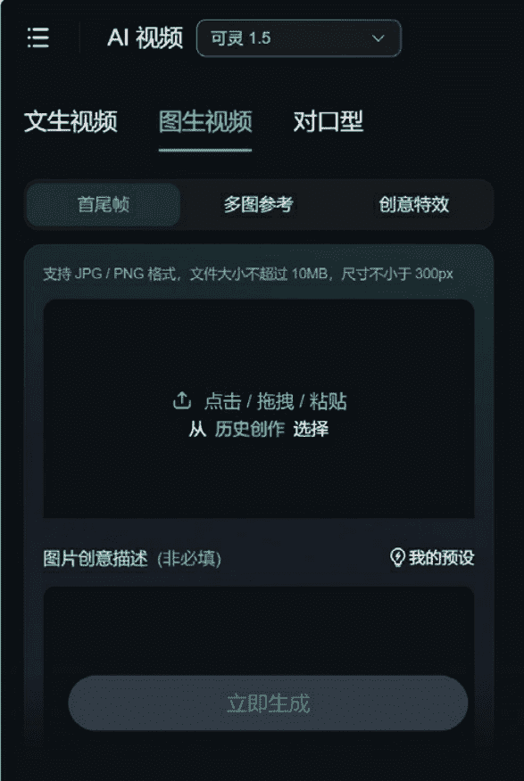

图4-1 可灵AI的主界面

可灵的视频生成主要在操作区进行调节，可在此设定生成内容。先认识各项功能的作用，如图4-2所示。

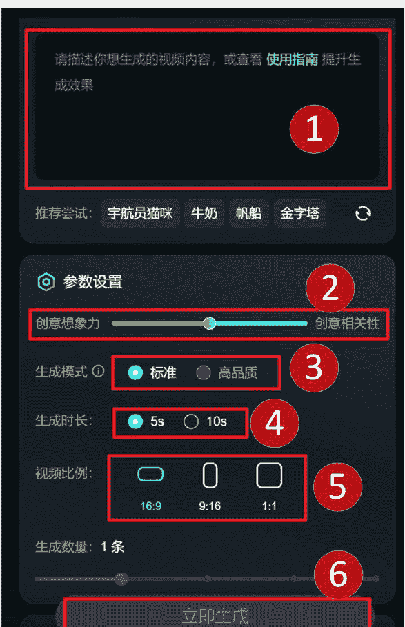

#### 4.1.1 提示词输入框

在此文本区填写提示词，即把想生成的画面描述告知模型。

#### 4.1.2 创意关联程度设置

用于调节模型发挥的空间。滑块越靠右，结果越贴合提示；越靠左，模型会加入更多自主发挥。

#### 4.1.3 生成模式选择

两个选项决定质量与速度。“高性能”更快，“高表现”画质更好，但耗时更长。

#### 4.1.4 生成时长

控制视频长度，目前可选“5秒”或“10秒”。

#### 4.1.5 视频比例

设定输出画面的宽高比，支持“16：9”“9：16”和“1：1”三种。

#### 4.1.6 生成按钮

完成提示词与参数设置后，按下生成按钮，系统会按设定开始创作。

继续向下滚动操作面板，还能看到两组设置，如图4-3所示。上方是运镜控制，可调节摄像机运动，下拉菜单可挑选具体运镜方式，下方通过滑块调节运动幅度与方向，设定后可在上方预览框查看效果。

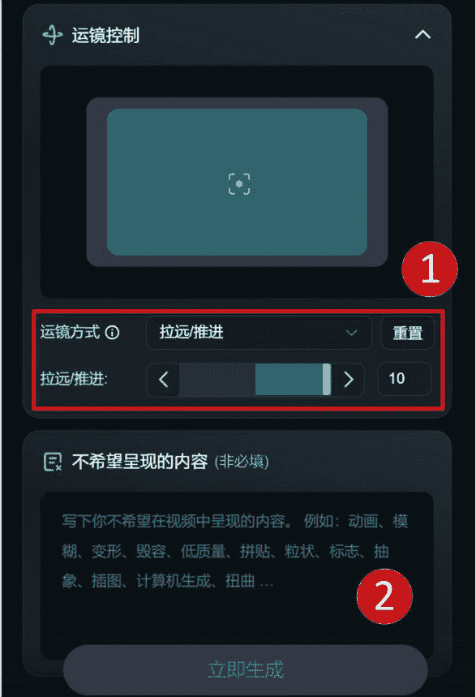

下方文本框可填写不希望出现的物体或效果，模型会据此规避。

### 4.2 文生视频示例

这里演示一个具体案例。在提示词框输入“一只大熊猫在街头弹吉他”，创意关联度保持默认，生成模式选“高性能”，时长选“5秒”，比例选“1：1”，其它项不改动，点击“立即生成”，如图4-4所示。


图4-4 文生视频示例

系统会进入图4-4所示的等待状态，静待结果即可。

生成结果如图4-5所示，预览区可查看成品。

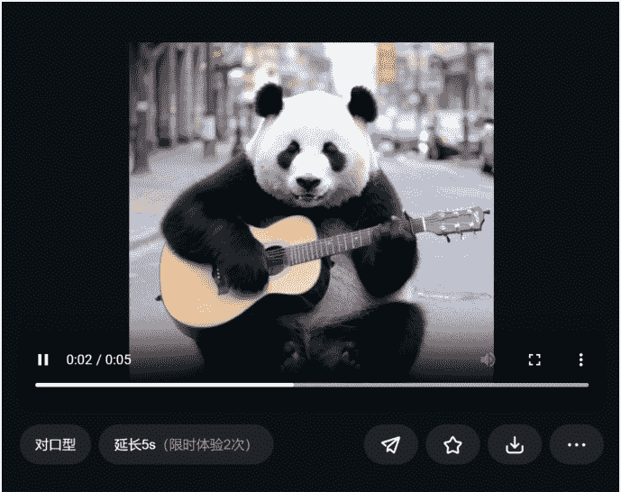

图4-5 生成结果预览

点击视频右下角的箭头可下载，星星图标用于收藏，方便以后快速找到。

熊猫弹吉他的画面如图4-6所示。

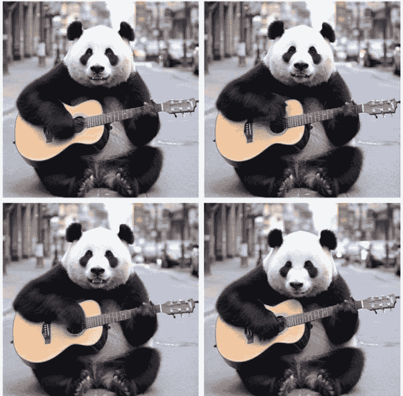

图4-6 一只大熊猫在街头弹吉他

整体质量相当不错，经过简单剪辑即可用于短视频。

### 4.3 提示词及其迭代

要获得高质量画面，提示词是关键，它直接影响相关性、创造性和准确度。写提示词要注意精确性和简洁性，两者都能提升生成效率与质量。

如何做到？描述时避免模糊泛词，多用专业术语。比如表现远景中角色很小，用“远景”即可；表现近距离拍摄蜜蜂采蜜细节，用“微距摄影”。不必担心模型理解能力，训练时已收录大量术语。

若不熟悉术语，可借助生成式AI帮忙提炼。例如用通义千问把想法改写为精确简练的提示词。

问：请帮我将下面的想法总结为精确简练的提示词，要多用专业术语来改写我所输入的内容：

远距离拍摄一只袋鼠在擂台上打拳击的场景，距离要足够远，但是不能太远，要展示出袋鼠的全身，在擂台上的灯光比较亮，擂台之外要比较暗。袋鼠的对手是一个人，要从擂台的斜上方进行拍摄。

通义千问：可用以下提示词来准确描述你的想法：

“长焦镜头捕捉全身的袋鼠在擂台上拳击，与人类对手对决。拍摄角度为擂台斜上方，确保擂台内明亮照明与周围较暗环境对比，以强调中心动作。”

改写后提示词更专业，也更容易被视频生成模型理解。但光有好提示词还不够，还涉及创作的第二个原则：迭代。

AI 生成具有随机性，初版常不完全符合预期。可以先把初版当作框架，先确认整体是否正确，再逐步优化细节，如服饰颜色、物体形态。不断调整提示词就是迭代过程。比如首次画面出现不需要的元素，可在下一次生成的“不希望呈现的内容”中加入这些元素，如图4-7所示。


图4-7 添加不喜欢的内容元素

这样后续生成就能避免这些元素。把生成过程看作磨合，迭代后结果会更接近预期。

# AI绘画篇

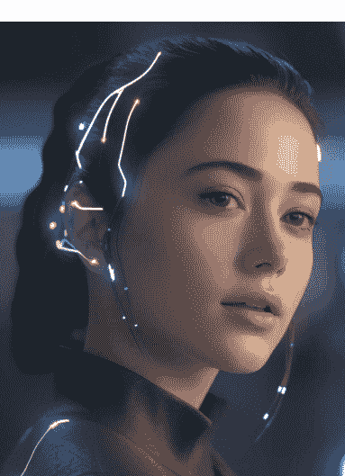


在AI绘画篇，我们开始研究绘画生成的内容。从本质上看，AI绘画与AI文本生成的算法基础非常相似，尽管文字与图像在感知上差异很大，但在机器层面并无本质区别。

## 第5章 Midjourney图像生成语法指南

借助图像生成AI可以快速产出高质量绘图，同样依赖提示词系统。相较于文本生成，图像生成需要控制的细节更多，因而遵循一定的语法规则。

### 5.1 Midjourney简介

Midjourney以下简称MJ是一款较为成熟的商用绘画大模型，经过优化后比Stable Diffusion更易上手。本节介绍该工具。

使用MJ离不开Discord。Discord是一款聊天软件，可在其中创建各种聊天室，MJ正是基于聊天室的绘画工具。Discord主界面如图5-1所示。

搜索并加入“Midjourney”服务器，加入后界面如图5-2所示。


图5-1 Discord主界面


服务器：可理解为一个大圈子，是虚拟的聚会地点，每个服务器相当于独立的社交中心。

聊天频道：服务器可细分为不同的聊天频道，每个频道聚焦于某个主题。

聊天室界面：这就是聊天主界面，进入频道的人可在当前频道发言。

MJ将交互系统搭建在某个聊天服务器中，标记为“newbies-数字”的频道是公共生图区，其他人可见你的作品，若在意隐私可创建私有服务器并邀请MJ机器人，操作参考图5-3与图5-4。

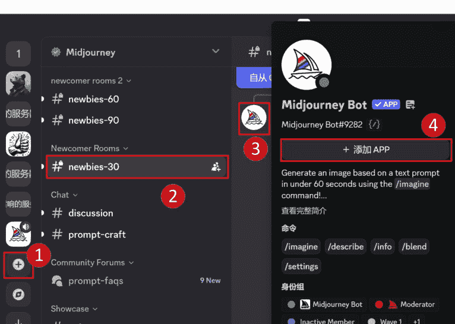

1. 在服务器列表点击加号，按指引创建自己的聊天服务器。
2. 创建完成后返回MJ服务器，进入任意绘画频道。
3. 找到频道中的机器人，点击头像。
4. 在弹出页面点击“添加APP”。
5. 点击“添加至服务器”，按指引完成授权。


授权完成后即可在私有服务器中调用MJ，如图5-5所示。

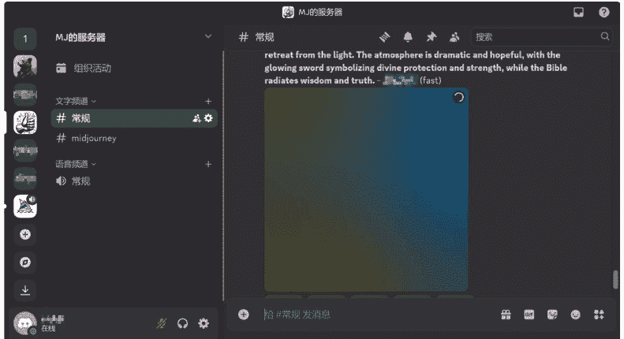

图5-5 私有服务器界面

### 5.2 基本生成方法

MJ最基本的生成指令是“imagine”。在聊天窗口输入“/”，从选项中选择“/imagine”即可开始绘图，如图5-6所示。

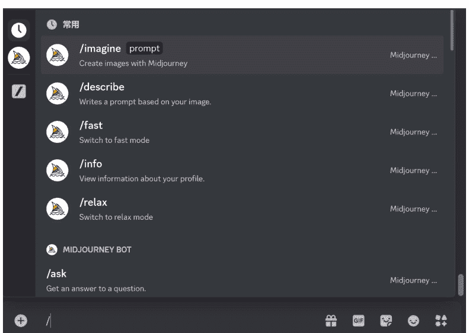

选择后聊天框会出现如图5-7所示的指令，“prompt”即提示词，后接用于绘画的描述。目前MJ对中文支持较差，后文会介绍转译方法。这里输入“A beautiful Chinese woman wearing armor”作为提示词生成第一张图。


输入完成后会出现图5-8所示提示，表示绘图服务器已接收指令。

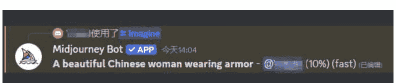

等待片刻，AI会生成一组图像，如图5-9所示，时长取决于是否在快速通道。

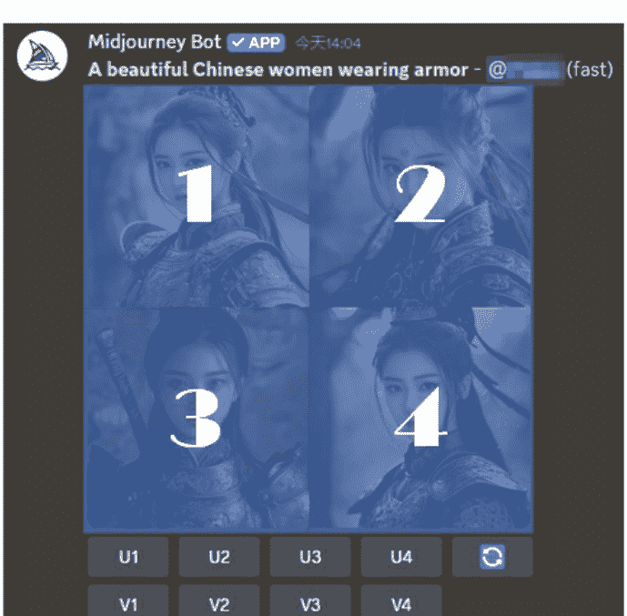

MJ每次生成4张图，图下方有一组按钮。“U”代表放大Upscale，可将对应图放大并填充细节，后面的1、2、3、4代表左上、右上、左下、右下；“V”代表变化Variation，以某张图为蓝本再生成一组图，数字同样表示方位，点击V2后效果如图5-10所示；循环符号表示放弃当前4张图，用相同提示词重新生成。

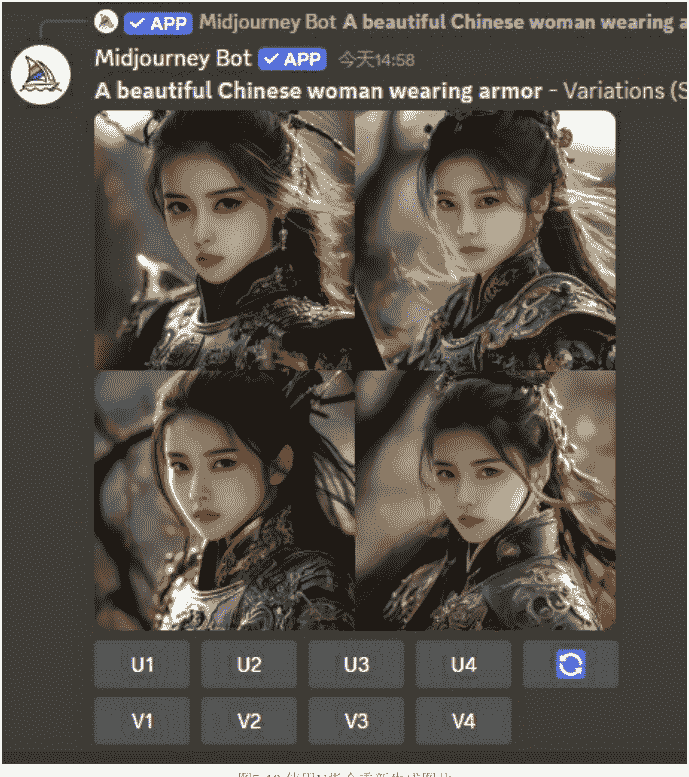

图5-10 使用V指令重新生成图片

点击U1开始编辑，效果如图5-11所示。

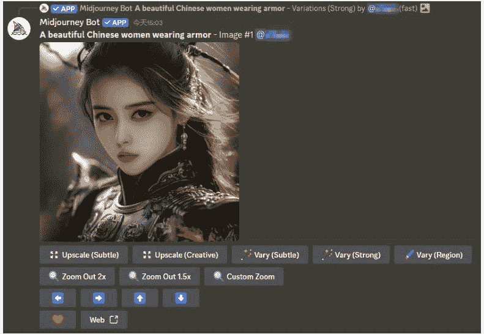

图5-11 编辑界面

逐一说明下方按钮功能。

Upscale Subtle、Upscale Creative表示继续丰富细节、提高分辨率，例如可由1024×1024变为2048×2048。Upscale Creative在原有基础上加入更有创意的细节。

Vary Subtle、Vary Strong表示以该图为底本，弱或强变化程度生成4张新图。

Zoom Out 2x、Zoom Out 1.5x、Custom Zoom表示在不改变原内容的前提下扩展画布并填充新内容。

⬅️➡️⬆️⬇️为平移按钮，可在对应方向扩展画布且不改动原始画面。

❤️为收藏按钮，标记喜欢的图片以便查找。

🌐表示在服务器画廊中打开图片。

Vary Region表示区域调整。点击后进入图5-12所示界面。

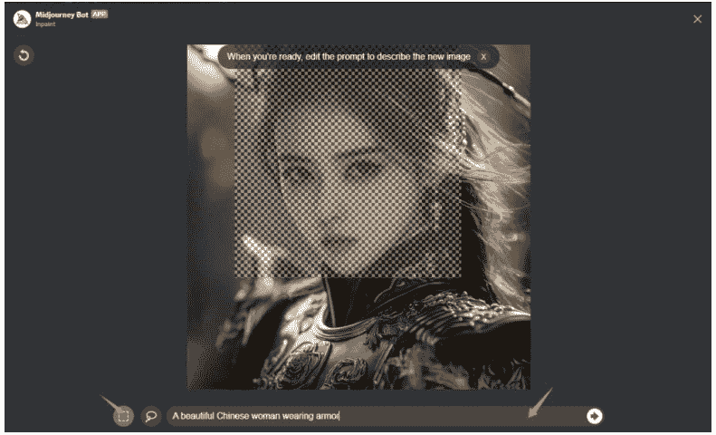

图5-12 区域调整界面

点击左下方框选工具拖拽选择重绘区域，然后在输入框写下修改内容，按回车即可重绘，生成4张新图，效果如图5-13所示。

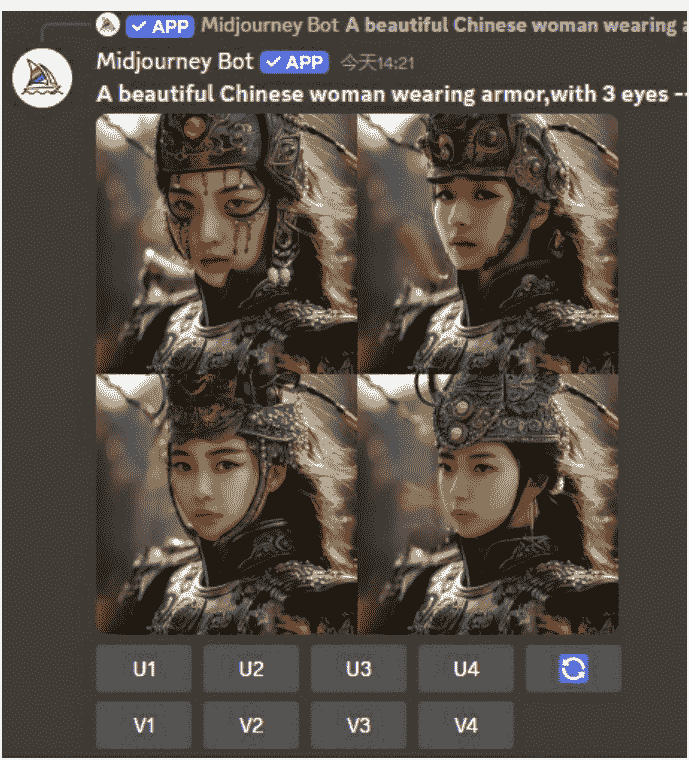

图5-13 局部重绘

修改完成后点击图片进入浏览模式，右键选择“保存图片”即可下载到本地，如图5-14所示。


图5-14 保存图片的方法

### 5.3 图片提示词

上节只用了简单提示词，若要更精确控制，需使用更精确的提示词。MJ的提示词分为三部分：图片提示词、文字描述提示词和参数控制，如图5-15所示。

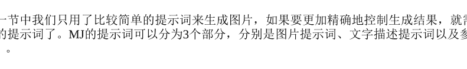

图片提示词又称垫图，在MJ中可将图片作为提示词的一部分来影响构图、风格和色彩。图片提示词可单独使用，也可与文字描述一起使用，多尝试会得到惊喜。

添加图片到提示词中需输入在线网址，地址须以.png、.gif或.jpg等结尾。添加地址后还需文字描述和参数控制。注意事项如下。

1. 提示词必须包含多张图片提示词或一张图片提示词加一段文字描述才能生效。
2. 图片地址必须为在线链接。
3. 地址应以.png、.gif、.webP、.jpg或.jpeg结尾。
4. 在多数浏览器中右键或长按图片选择“复制图片地址”即可获取。
5. “/blend”命令是为移动用户优化的简化图片提示流程。
6. 可用图片地址作为风格参考或角色参考。

#### 5.3.1 上传图片

先把参考图上传至Discord服务器。第一种方法是直接拖拽图片文件到聊天窗口，如图5-16所示。

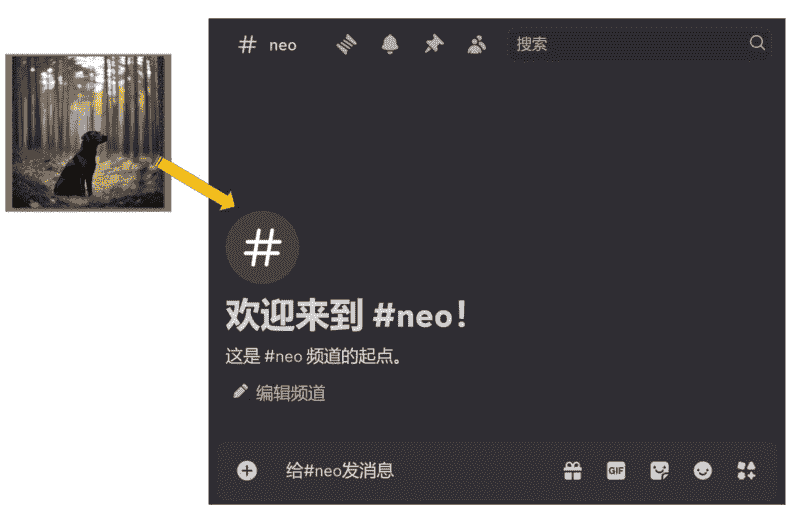

第二种方法是点击聊天框左侧加号，在弹出列表选择“上传文件”，即可把图片传到服务器，如图5-17所示。

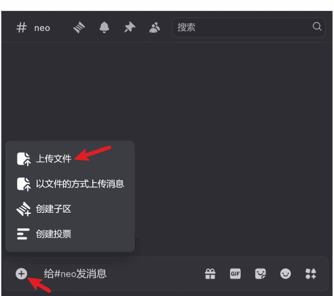

上传完成后右键点击图片选择“复制链接”，即可把在线地址复制到剪贴板，如图5-18所示。

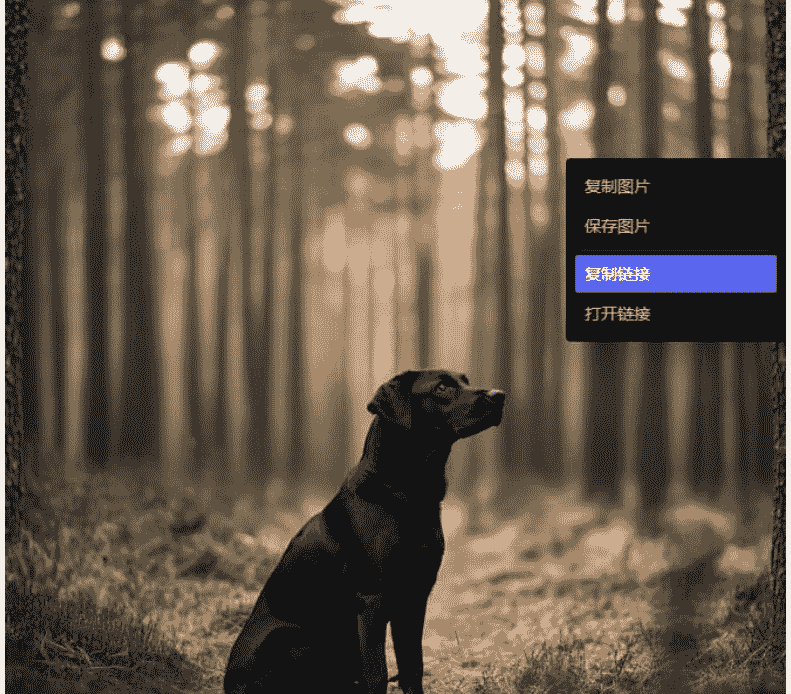

图5-18 复制图片地址

#### 5.3.2 将图片地址复制到提示词中

添加图片地址到提示词的方法与输入提示词相同，在聊天框使用“/imagine”命令，把图片地址粘贴到提示词输入框，后面再输入其它提示词，按回车即可生成，如图5-19所示。

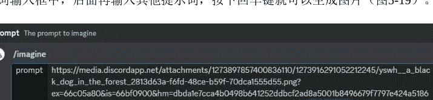

图5-19 输入提示词

图片提示词的生成效果见图5-20。文字描述只有“a white tiger”，生成的图参考了提示图的整体风格与背景。

### 5.4 文字描述提示词

文字描述提示词即用文本描述想要生成的画面，最简单的例子就是一句短句，如前文的“A beautiful Chinese woman wearing armor”“a white tiger”。文字描述主要包括主题描述、环境与细节补充以及风格化描述，如图5-21所示的例子。

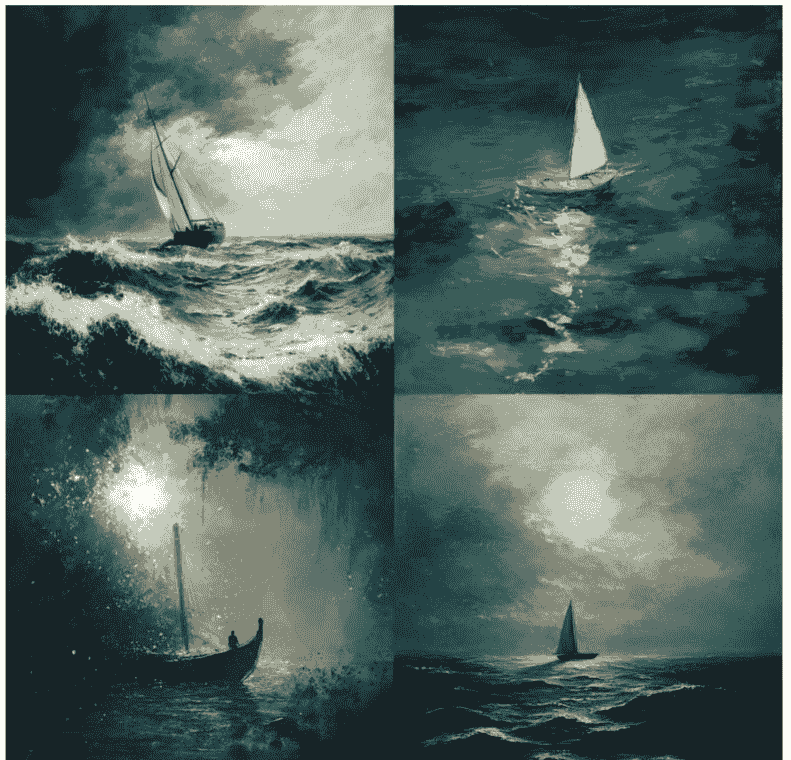

文字描述提示词：A yacht in the water，bad weather

图5-21 简单的绘图示例

#### 5.4.1 词语选择

词语越精确，生成效果越好。例如表现大小，可尝试“微小 tiny”“巨大 huge”“庞大 gigantic”“极大 enormous”或“无限 immense”。

MJ 提示词取舍与参数实战要点

一次指令里同时点名两位主角时，排在前面的往往会被模型放在视觉中心，图5-22到图5-23展示了先后顺序带来的差异。光靠顺序来定主次很不稳定，成品容易跑偏。想让焦点牢牢钉在特定对象上，还是要用更明确的限定词去锚定。

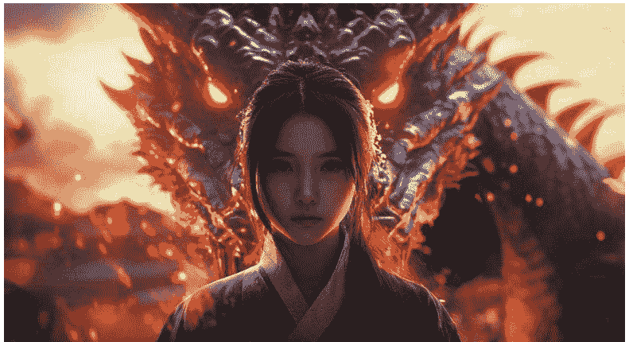
提示词：A chinese girl, a gigantic dragon.--v 6.1--ar 16 : 9

图5-22 女孩为焦点
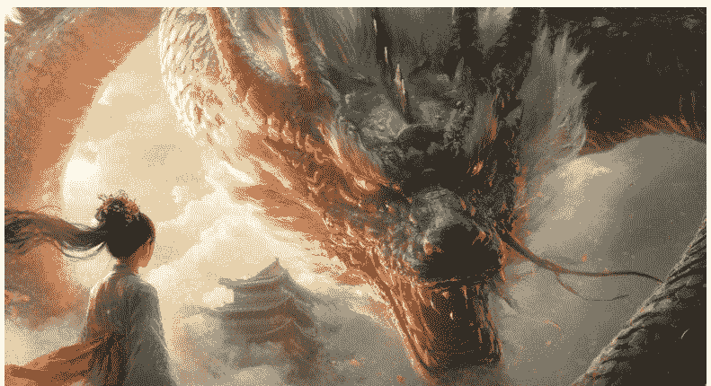
提示词：A gigantic dragon, a chinese girl.--v 6.1--ar 16 : 9

图5-23 龙为焦点

#### 5.4.2 复数词和集合名词
复数写法会放大偶然性，涉及数量时最好写死具体个数，例如写“three little bears”比泛称的“bears”可控得多。同样，用集体名词来描述群体更可靠，像“a flock of birds”比单纯的“birds”更容易得到想要的画面。

#### 5.4.3 专注于你想要的
描述画面时，把重点放在希望出现的部分，别去强调不想出现的部分。比如要做派对场景，写成“a party with no cake”反而可能让蛋糕抢镜，图5-24就是反例。若要确保最终画面里不出现某个对象，尝试用“--no”参数来控制会更有效。

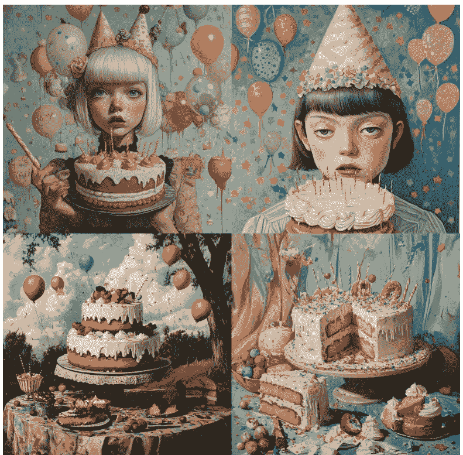
提示词：A party with no cake.

图5-24 阻止蛋糕出现反而让其成为主角

#### 5.4.4 提示的长度和细节
提示词可以很简单，一个词语或表情符号就能让模型工作。可问题是越简短越吃 MJ 的默认风格，模型会创造性地填补任何未指定的细节。若想自己掌控生成结果，提示中就必须包含最重要的元素，信息越少不确定性越大。

做图前先把画面拆解清楚会更顺，可以对照表5-1检查是否遗漏。

表5-1 创作时需要思考的元素

| 画面元素 | 元素的细节 |

| :--- | :--- |

| 主题 | 人物、动物、角色、地点、对象 |

| 媒介 | 照片、画作、插图、雕塑、涂鸦、挂毯 |

| 环境 | 室内、室外、月球上、水下、城市中 |

| 照明 | 柔和、环境、霓虹、摄影棚灯光 |

| 颜色 | 鲜艳、柔和、明亮、单色、多彩、黑白、粉彩 |

| 情绪 | 平静、冷静、充满活力 |

| 构图 | 肖像、特写、近景、鸟瞰图 |

下面这个案例展示了细节充足的指令会带来怎样的漫画质感，图5-25。

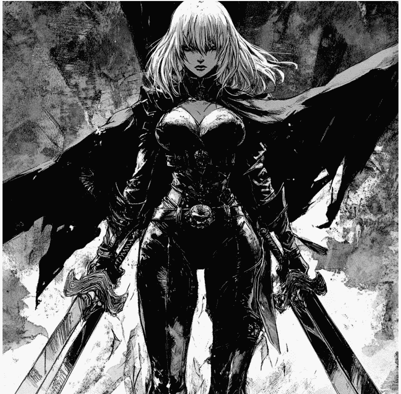
提示词：Animation character transforms into her Yoma version, dark and sinister with a dynamic full-leather, pen-made pose, ink and doodle-style illustration.

图5-25 包含丰富细节内容的提示词生成的漫画效果

### 5.5 常用控制参数
相比纯文字描述，给指令末尾加上参数能让 MJ 的行为更可预期。可以用来调比例、换模型版本、切换放大器等，一条指令里叠加多个参数也没问题。

#### 5.5.1 宽高比
参数“--aspect”也可以写作“--ar”，负责设定输出画面的宽高比例，写法是宽:高，例如4:3或16:9。出厂默认是1:1的正方形。数字大的那一侧决定画面方向，竖图高度数字要大，横图宽度数字要大。参数只接受整数，所以1.39:1要写成139:100。具体写法可参考图5-26的示范。

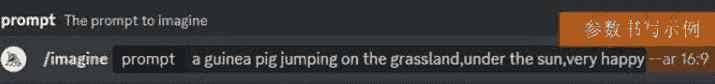
不同宽高比的显示效果可以参考图5-27。
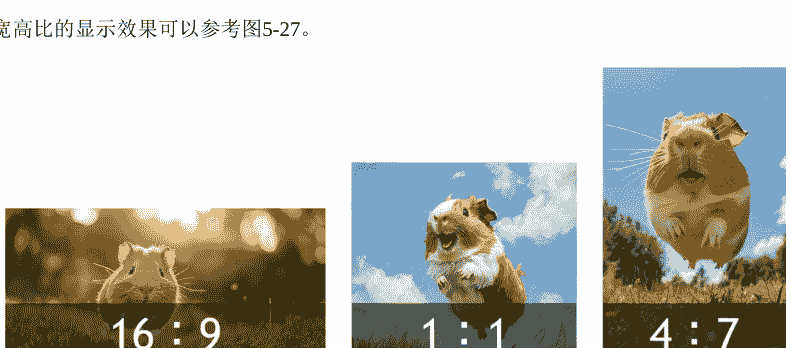

#### 5.5.2 混沌度参数
参数“--chaos <0-100>”，简写“--c”，控制结果的随机程度。数值越高构图越奇葩、变数越多；数值越低输出越稳定。默认是0。具体影响见表5-2。

表5-2 混沌度对应的生成结果

| 混沌度 | 生成结果 |

| :--- | :--- |

| 无“--chaos”值 | 不指定混沌度将产生彼此相似的初始图像网格 |

| 低“--chaos”值 | 产生略有变化的初始图像网格 |

| 中等“--chaos”值 | 产生具有较多变化的初始图像网格 |

| 高“--chaos”值 | 产生具有更多变化和意外的初始图像网格。 |

| 非常高的“--chaos”值 | 产生具有很大变化且具有意外构图或元素的初始图像网格 |

图5-28展示了不同数值的实拍差异。

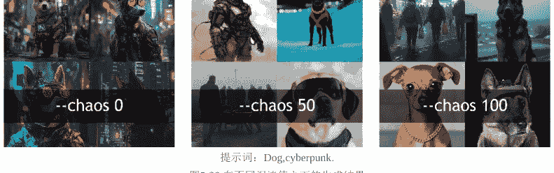

#### 5.5.3 角色参考
想让同一人物在不同场景保持一致，可以用图做角色参考，思路跟图片提示词类似，只是需要“--cref”参数配合网络图片链接，格式参考图5-29。

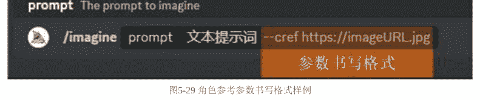
下面我们使用图5-30中的角色作为参考，将其加入图片的生成之中。
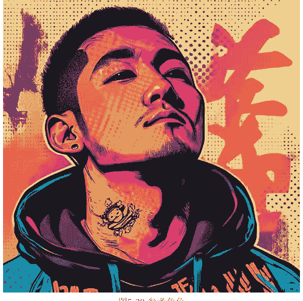
提示词与生成结果如图5-31所示。
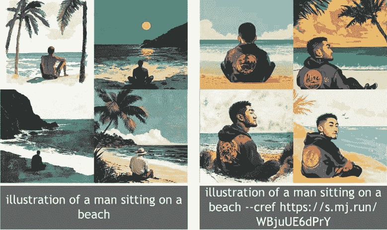
用 MJ 自己生成的单人头像做参考效果最好，注意“--cref”后别放真人照片，否则会被改形。雀斑、logo这类精细点很难被保留。该参数支持 MJ V6 及 Niji V6，能跟“--sref”混用，且普通图片提示要写在“--cref”前面。

#### 5.5.4 否定提示
“--no”是用来剔除不需要元素的开关。举个例子，先做一张水粉静物，图5-32。

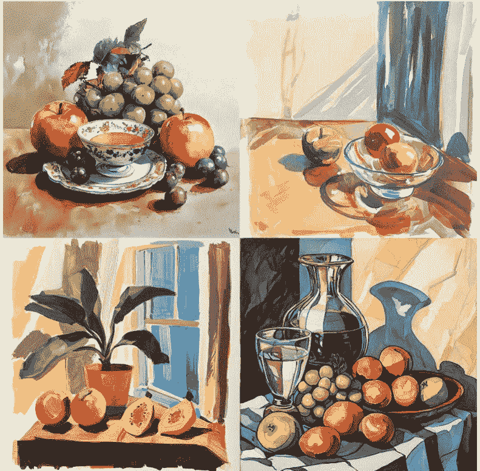
提示词：still life gouache painting
图5-32 水粉风格的静物图

默认情况下这类静物常带水果，若要去掉，直接在末尾加“--no fruit”即可，图5-33。

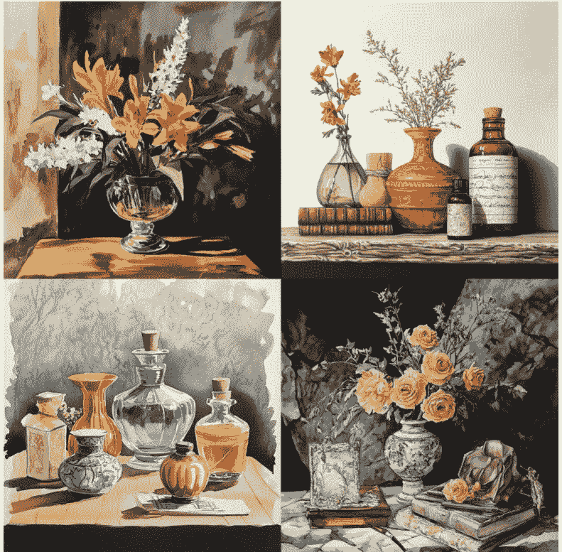
提示词：still life gouache painting--no fruit
图5-33 去除水果之后的静物图

加了否定参数后画面里就不再出现水果。需要屏蔽多个东西时，用“--no item1, item2, item3”的形式一次性写清。

#### 5.5.5 个性化绘画参数
在社区里给别人的作品投票、配对、点赞，MJ会记住你的审美倾向，后续生成时会往这个口味靠。对自己作品的点赞不计入。随着互动越多，你的个性化风格越明显。

开启方式是把“--p”或“--personalize”加到指令末尾，默认用最新版个性风格，也能指定旧版或用“--p code”借用他人的风格。该功能只在 MJ V6 与 V6.1 上可用。

#### 5.5.6 绘画质量参数
“--quality”，简写“--q”，调节渲染耗时从而影响细节。值越小生成越快但细节越贫乏，适合快速试探；值越大耗时越长、纹理越饱满，但连贯性可能受损。

可选 .25/.5/1/2，各版本支持情况见表5-3。

表5-3 模型版本与质量参数的兼容性

| 模型版本 | .25 | .5 | 1 | 2 |

| :--- | :---: | :---: | :---: | :---: |

| MJ V6.1 | × | √ | √ | √ |

| MJ V6.0 | √ | √ | √ | × |

| MJ V5.2 | √ | √ | √ | × |

| Niji V5 | √ | √ | √ | × |

图5-34对比了不同渲染设置的效果。

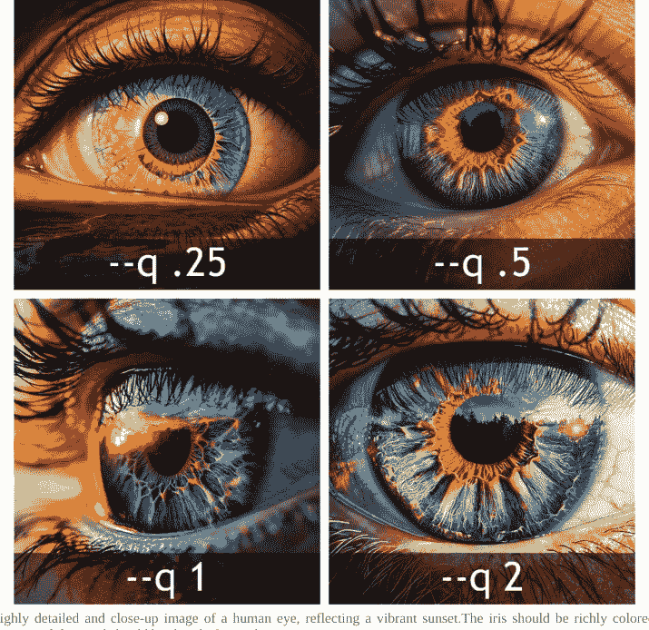
提示词: Create a highly detailed and close-up image of a human eye, reflecting a vibrant sunset.The iris should be richly colored, featuring intricate patterns of blue and green,and the pupil should be sharply focused.
图5-34 不同渲染质量的对比

“--q”只改变 GPU 计算量，不改分辨率。默认是1，非标准值会被自动取整到最近的支持值，且只作用于初始网格，不影响变体或放大。

#### 5.5.7 重复生成参数
“--repeat”，简写“--r”，可以让同一个任务跑多次，配合混沌度能更快探索。可用范围看订阅等级：

- （1）基础订阅者，“--repeat”的取值范围是2～4；
- （2）标准订阅者，“--repeat”的取值范围是2～10；
- （3）专业和大型订阅者，“--repeat”的取值范围是2～40。
- （4）“--repeat”参数只能在快速和涡轮GPU模式下使用。

写法是指令末尾加“--repeat<数字>”或“--r<数字>”。

#### 5.5.8 种子控制参数
MJ 内部靠种子号生成初始噪声，像电视雪花。不同种子对应不同起点，相同起点加相同指令会得到相近结果。种子默认随机，可用“--seed”锁定。

注意事项：

- （1）“--seed”编号范围是0～4 294 967 295；
- （2）“--seed”值只影响初始图像网格。
- （3）在MJ V1、V2、V3、Test、Testp版本中，使用相同“--seed”值将产生具有相似构图、颜色和细节的图像。
- （4）MJ V4、V5、V6版本及Niji中，使用相同--seed值将产生几乎完全相同的图像。
- （5）种子编号不是静态的，不能在会话中依赖它们。

先看不锁种子的效果，图5-35。

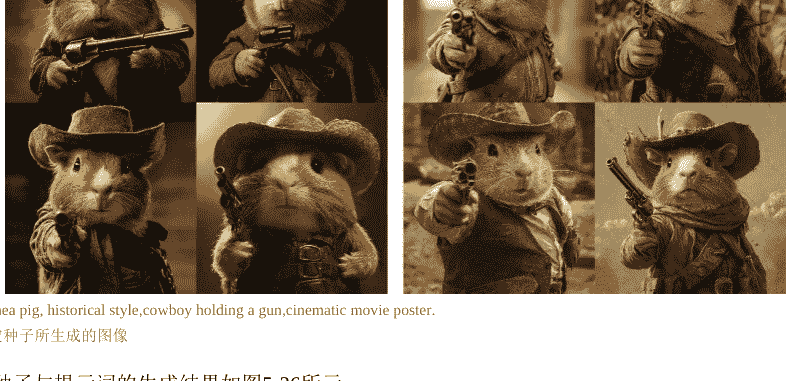
提示词：Guinea pig, historical style,cowboy holding a gun,cinematic movie poster.
图5-35 不固定种子所生成的图像

锁种子后的对比见图5-36。

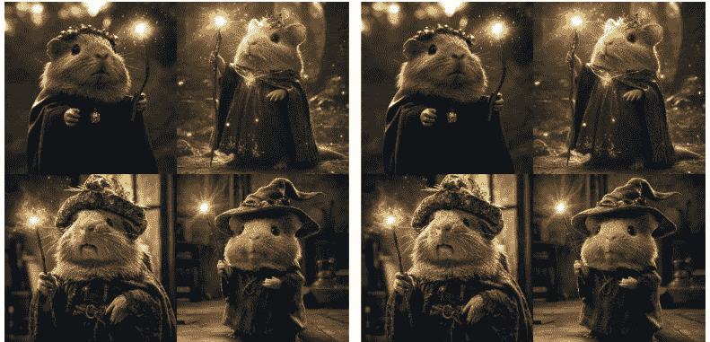
提示词：Guinea pig, fantasy style,witch holding a wand,cinematic movie poster.--seed1111
图5-36 固定种子时的生成结果

锁定后相似度非常高，新版甚至像素级一致；不锁则随机性很大。

#### 5.5.9 停止参数
“--stop<10～100的整数>”可以在生成中途提前结束，数值越小画面越模糊、细节越少。默认100，放大时无效。图5-37做了对比。

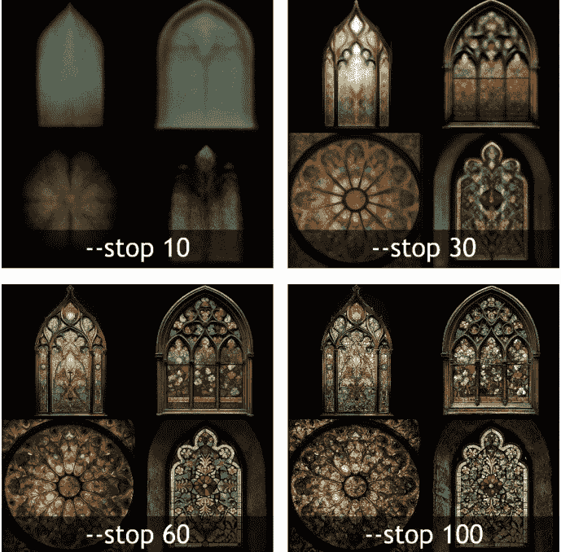
提示词：a very ornate piece of church glass--seed 123
图5-37 不同参数值下的效果对比

这里用了“--seed 123”固定画面，便于横向比较。

#### 5.5.10 风格算法参数
“--style”用来切换美学算法，需要一定的经验。

- （1）“--style <4a, 4b, 或4c>”更改为MJ V4的风格算法。
- （2）“--style <cute, expressive, original, 或scenic>”表示切换为Niji V5的风格算法。
- （3）“/tune”命令可创建样式调节器并生成自定义样式代码。
- （4）“--style <raw>”是最常用的风格算法参数。在默认设置下，MJ会自动对图像进行一些风格化处理，让画面具有观赏性。而“--style<raw>”参数会去除这种美化处理，让模型根据提示词本义生成图像，所以生成效果会与默认生成效果有所区别。我们看下面这个例子（图5-38）。

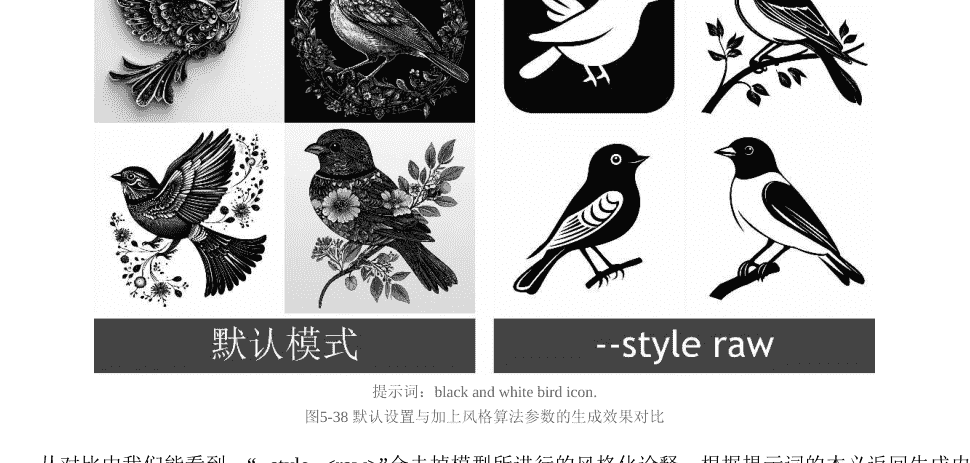
提示词：black and white bird icon.
图5-38 默认设置与加上风格算法参数的生成效果对比

可见 raw 去掉了风格化解读，对指令精确度要求更高，新手建议少用。默认风格对入门已够用，质感更好。raw 的优势是真实感，尤其是摄影题材，能避免过度修饰，图5-39。

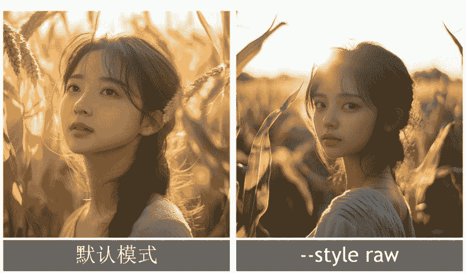
提示词：Portrait photography of a young Chinese woman in corn field, sunlight shiningthrough her hair.
图5-39 参数对摄影风格的影响

去掉美化后光影更接近现实，更像手机直出。

#### 5.5.11 样式参考
“--sref <URL>”用来借用特定风格，以示例图为参考生成，写法见图5-40。


图5-40 参数书写格式

先上传参考图，图5-41。

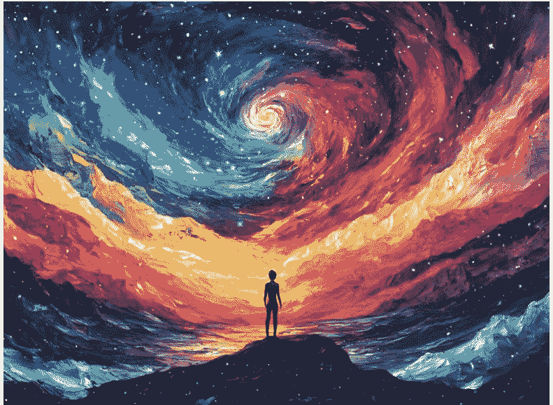
图5-41 示例图片

默认与使用 sref 后的对比见图5-42。

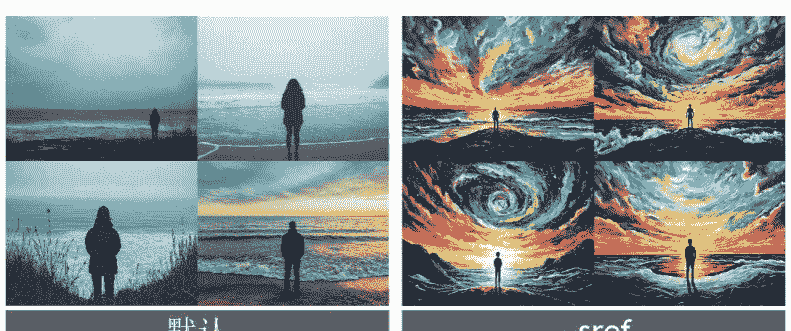
提示词：A person standing by the sea.--ar 4 : 3
图5-42 默认情况下与加入参数后的生成对比

可以一次参考多张：“--sref URL1 URL2 URL3”。权重用“::”调节：“--sref URL1::数字 URL2::数字 URL3::数字”，数字越大影响越大。

sref 和图片提示词很像但侧重点不同：图片提示更偏构图、风格、色彩的复制，结果更像原图；sref 更抓整体氛围。

#### 5.5.12 风格化参数
“--stylize”，简写“--s”，取值0~1000，默认100。低于100细节会收敛，高于100则加强默认美学的表现力。具体展示见图5-45。

提示词：illustration of a man in the stranger in moscow video clip in the style of the french cómic artist Jean giraud also know as moebius, surreal ambient, Rain, Russian architecture.--ar 4 : 7

图5-45 不同的风格化参数

从图里可以看出，--stylize 的数值由 0 提升到 200 的过程中，画面精细感是持续增强的。不过数值并非越大越好，超出合理区间后画面会出现细节冗余，同时与原始指令的契合度也会下降，图5-46 便能说明这种过度的问题。

图5-46 高风格化参数的生成结果

使用 --stylize 500 时，构图里会多出许多不必要的物件，例如过量的光源；当数值拉到 1000，建筑物形态发生剧烈改变，已经很难认出是基于最初的提示词。实务上保持 100 的默认值最为稳妥，只有在画面显得空洞时才启用该参数。需要强化质感就适当提高数值，若发现装饰元素过剩则降低数值。

#### 5.5.13 拼贴平铺参数
“--tile” 的作用相当有趣，开启后能够得到可无缝重复的图案，下面直接看实例。

提示词：a pattern of colorful watercolor fall leaves--tile

图5-47 平铺样图

挑其中一张结果像铺砖一样向四周复制，拼接处几乎看不出缝隙，图5-48 展示了这种效果。借助该参数可以制作印花、网页底纹、桌面壁纸或电子书背景，适用于 Midjourney 的全部模型版本。

图5-48 平铺拼贴的效果

#### 5.5.14 版本选择参数
通过 “--version <版本号>”，简写 “--v <版本号>” 能切换绘图模型。Midjourney 会不定期推出新版，更新后在连贯性、效率、画质以及风格表现上都会有明显进步，但旧版仍保有各自独特的气质，所以平台保留多版本并行。

目前默认是 2024 年 7 月发布的 V6.1。--v 支持的取值有 1、2、3、4、5、5.0、5.1、5.2、6 和 6.1。

Niji 是 Midjourney 与 Spellbrush 联合研发的分支，擅长生成动漫与插画，拥有大量动漫知识库与美学范式，在动态镜头和以角色为核心的构图上优势明显。启用方式是在提示词末尾加上 “--niji 6”。

用同一条简短指令做横向对比：
提示词

生动的郁金香。--ar 4:3

(vibrant tulips. --ar 4:3)

图5-49 模型生成风格对比

V6.1 在图像连贯度、纹理细腻度以及生成速度上领先，相较 V6.0 约快 25%。V6.0 强化了对长提示词的理解、知识覆盖以及图像的连贯与混合能力。Niji 6 的输出更偏向漫画质感。再看一组抽象概念的对比：

提示词

高对比度超现实拼贴。

(high contrast

surreal collage. )

图5-50 抽象绘画风格对比

#### 5.5.15 视频参数
加入 “--video” 即可把整段生成过程导出为短视频，参数写在指令末尾。取回视频的流程如下。

图5-51

成图后点对话面板右侧的笑脸图标，再点邮件图标，Midjourney Bot 会私信发送下载链接。随后点界面左上角的私信入口，进入 Midjourney Bot 的会话即可查收，详见图5-52。

时长约 4 秒，能完整呈现从噪点到成图的演变，单帧观感与使用 --stop 类似，只是被动态化了。

图5-52

提示词：Tilt shift Photography of Peking buildings, aerial angle.--ar 4 : 3--video

图5-53 图像生成动画

#### 5.5.16 怪异度参数
怪异度控制 “--weird <数字0～3000>”，简写 “--w <数字0～3000>”，默认值为 0。

如果说 --stylize 是往传统美感加分，--weird 则走向反面，会让画面趋向灵异、暗黑，形成一种另类的怪异美学。即便提示词未提及，加入 --w 后构图与风格也会变得奇诡。

图5-54

提示词：Three puppies playing.

图5-54 怪异度参数不同取值带来的变化

要创作暗黑主题，仅靠提示词往往不够，这时 --weird 就很关键。实践中常与 --stylize 搭配使用，既保留暗黑气质又不失艺术度。下面用哥特场景验证：

提示词：Depict the ballroom scene from Edgar Allan Poe's'The Masque of the RedDeath'with everyone wearing bizarre masks, the setting filled with shades of red.Deathstands next to a grand clock, gazing at the attendees.In the background, the lighting isdim.4k

图5-55 暗黑风格作品的绘制

为方便记忆，整理三个常用参数如下：

表5-4 三个参数对比

| 对比项目 | --stylize | --chaos | --weird |
| :--- | :--- | :--- | :--- |
| 名称 | 风格化参数 | 混沌度参数 | 怪异度参数 |
| 缩写 | --s | --c | --w |
| 取值范围 | 0～1000 | 0～100 | 0～3000 |
| 初始默认值 | 100 | 0 | 0 |
| 功能 | 控制风格化程度与细节精细度 | 控制绘画的多样性和随机性 | 控制绘画的怪异程度 |

## 第6章
ChatGPT 联动 Midjourney，让创作效率翻倍

文本生成与图像生成都基于文字驱动，能否把两者串联，让大模型先整理思路再交给绘图模型？本章讲的就是文生文与文生图结合的实操。

### 6.1 当文生文遇到文生图
使用 Midjourney 时最常见的卡点，就是把脑中画面转为地道的英文。翻译工具能替换词汇，却处理不了语法自然度。相比之下，大语言模型在四个层面实现超越。

#### 6.1.1 易用性
ChatGPT、通义千问等模型能与人自然对话，可用性远高于传统工具。它还能主动修正指令里的错误，这种交互是翻译软件不具备的。

#### 6.1.2 整段文本的翻译能力
这再次体现了易用性。指令不必写得严谨，只要固定输出格式，模型就能把零散描述整理成通顺英文。对上下文的理解也更到位。

#### 6.1.3 个性化的翻译格式
大模型基于海量文本预训练，可以先喂入特定格式的样例，让它以后按固定格式返回翻译结果。

#### 6.1.4 扩展提示词的能力
模型收到指令后会自行补全细节，这种扩写既是优势也是风险。我们可以先让它扩写、展示，再人工把控方向，避免失控。

### 6.2 翻译与扩展提示词
从基础翻译开始。

问：请将下面的提示词翻译为英文：
3/4侧面镜头，现代中国美女在上海购物中心，年轻女性时尚外观，浅景深，高对比度。

ChatGPT: The translation of your prompt into English is:
“3/4 profile shot, modern Chinese beauty in a Shanghai shopping mall, young woman with a stylish appearance, shallow depth of field, high contrast.”

灵感零碎时，可让模型先梳理。

问：我正在使用绘画AI进行创作，现在我有一些零碎的灵感，请你帮我将这些灵感进行整理并填充得更加丰满，使之能直接用于绘画AI的作品生成：
一只小狗站在巨大的废墟之中，这片废墟兼具未来感与破败感。画面中要有一些零星的光亮，要体现出小狗的孤独感，废墟中还要有巨大的机体残骸。

ChatGPT 给出的扩写包含场景设定、主体构成、光源设定和细节丰富化，将末日废墟与高科技残骸结合，并用光影强化孤独感。

扩写后需要微调，再让模型整理成英文。

问：小狗应该背对着我们，处于画面的中央，并且要显得比较渺小，其余的内容就按照你的思路进行创作。现在请你将其整理为一句简洁凝练的提示词，使用英文输出。

ChatGPT: Here’s a concise prompt in English that captures all the essential details for your AI painting creation:
“A small, gray dog stands alone in the center of a vast, futuristic and dilapidated ruins, back facing us, appearing tiny against the backdrop of giant mechanical debris and scattered light from broken structures and dimly glowing tech remnants.”

这条指令可用，但结构不符合 Midjourney 规范，可控信息不足。如何让模型输出更专业的写法？下一节给出解法。

### 6.3 让 ChatGPT 记住 Midjourney 的语法
文本大模型可以进行预训练，只要把 Midjourney 的指令结构规则喂进去，它就能按规范输出。我们把之前总结的语法框架输入模型，告诉它以后严格按此结构生成，允许它根据知识储备补充艺术流派、光线等细节。

ChatGPT 确认记忆后，上下文窗口约两万字，足够支撑一次完整的绘图任务。对话容量接近上限时最好重新训练。

把上一节的指令交给训练后的模型改造：

问：请你将下面的提示词进行一些更改，使其符合标准的绘画提示词格式，其中所涉及的具体设置请按照你的知识储备进行选择，提示词输出为英文：
“A small, gray dog stands alone in the center of a vast, futuristic and dilapidated ruins, back facing us, appearing tiny against the backdrop of giant mechanical debris and scattered light from broken structures and dimly glowing tech remnants.”

ChatGPT: Here’s a concise and structured prompt for your AI painting model, crafted in English:“A small, gray dog, appearing tiny and alone, stands with its back to us in the center of vast, futuristic ruins.The scene blends post-modern, futurist illustration styles with scattered light from broken structures and dimly glowing backdrop of giant mechanical debris.Kodak Portra 800, 50mm f2.0, 8K.”

用这条指令生成最终效果，见图6-1。

### 6.4 创作实战：生成插画作品
插画起初服务书籍，后随广告营销进入商业化，如今广泛应用于网站、社交媒体、游戏等数字场景，成为高效的视觉传达手段。短视频中精美的插画能瞬间抓住注意力。本节介绍三种适配短视频的风格及关键词。

#### 6.4.1 木刻版画风格插画创作
木刻版画是经典表现形式，图案刻在木板上通过压印成图，呈现独特纹理和质感。关键词可用 “woodcut print”。

把主题交给已训练的模型：

问：根据你所记忆的提示词生成规则，请你将下面的内容整理为完整的提示词，输出为英文：
黑夜里，福尔摩斯独自走在昏暗的贝克街上，木刻版画风格（woodcut print）。

ChatGPT: Here’s a concise and structured prompt for your AI painting model in English:
“Sherlock Holmes walks alone on dimly lit Baker Street at night, depicted in a Victorian-era woodcut print style. The scene features atmospheric street lighting with Holmes in his iconic deerstalker and long coat. Kodak Tri-X 400, 50mm f1.4, 3:2, 4K.”

把指令丢进 Midjourney，生成结果如图6-2。

# 提示词精修与风格演练

初版的整体表现尚可，只是画面右下部位明显滑向了摄影取向。回溯指令后发现其内部混进了会牵引生成走向的表述，剔除这些干扰项并对控制参数做小幅修正，二次生成的两张作品即图6-3。

Sherlock Holmes walks alone on dimly lit Baker Street at night, woodcut print, The scene features atmospheric street lighting with Holmes in his iconic deerstalker and long coat. --ar 4:7

Sherlock Holmes walks alone on dimly lit Baker Street at night, woodcut print, The scene features atmospheric street lighting with Holmes in his iconic deerstalker and long coat. --ar 4:7 --v 4

图6-3 调整提示词后的输出

调整后视觉更稳。文本大模型给出的指令偶尔带偏，通常影响有限，局部修正即可恢复可用性。这一组成片在细节刻画和氛围营造上都很到位，放在悬疑类短视频里十分契合。

#### 6.4.2 水墨画风格插画创作

水墨作为传统文化载体，植入短视频能明显提升格调。MJ对该类风格的支持很友好，加入关键词“Chinese ink brush”即可起步。先做基础尝试，见图6-4。

提示词：Landscape painting，Chinese ink brush

图6-4 水墨山水画

此类题材在训练语料中占比高，模型处理很顺。下一步尝试更复杂的构图，先请ChatGPT按规范把意象整理成英文指令。

问：根据你所记忆的提示词生成规则，请将“黑云压城城欲摧，甲光向日金鳞开”这两句诗词拆解为AI绘画所使用的提示词，要求使用水墨画风格（Chinese ink brush）。

**ChatGPT：** Here’s a concise and structured prompt for your AI painting model in English:

“A Chinese man stands atop an ancient Chinese-style city wall, facing outward. The sky is densely covered with dark clouds, with sparse sunlight piercing through the clouds, casting glimmers of golden light on the man’s armor. Chinese ink brush. Camera setting: traditional Chinese painting simulation, 35mm equivalent f2.8, 16 : 9, 4K. Rendered using traditional Chinese brushwork with enhanced ink dynamics.”

面对复杂场景，需要对模型给出的词条再筛选，剔除不合适部分后重跑，实验结果见图6-5。

提示词：A Chinese man stands atop an ancient Chinese-style city wall, facing outward. The sky is densely covered with dark clouds, with sparse sunlight piercing through the clouds, casting glimmers of golden light on the man's armor. Chinese ink brush. Camera setting: traditional Chinese painting simulation, 35mm equivalent f2.8, 4K. Rendered using traditional Chinese brushwork with enhanced ink dynamics.--ar 4 : 3

图6-5 修改图片宽高比后进行生成

画面虽有水墨味，但整体偏现代。怀疑是色彩描述在作怪，于是去掉原指令中关于色彩的表述以及部分冗余，再次生成，效果见图6-6。

提示词：A Chinese man stands atop an ancient Chinese-style city wall, facing outward. The sky is densely covered with dark clouds, depicted in traditional Chinese ink brush...ar4 : 3

图6-6 去除色彩后生成的图片

观感明显改善。还能在水墨基础上叠加新元素做融合实验，见图6-7。

提示词：Landscape painting，Chinese ink brush. In the painting, there is a motorcycle.--ar 4 : 3

图6-7 水墨画与摩托车

实验表明，在水墨里植入新元素相对容易，但当设想在该语境中并不常见时，生成难度会明显上升。本书后文的实战章节会专门讲解水墨风格短视频的全流程，甚至可让水墨动起来。

#### 6.4.3 日式动漫风格插画创作

插画创作绕不开日系风格。MJ里加入知名艺术家姓名就能拉近调性。这次做宫崎骏风格，先让ChatGPT整理指令。

问：根据你所记忆的提示词生成规则，请你将下面的内容整理为完整的提示词，输出为英文：

一个小女孩与一条白色的狗，小女孩身穿运动装，在草原上奔跑，宫崎骏风格。

**ChatGPT：** Here’s a concise and structured prompt for your AI painting model in English:

“A young girl in athletic attire runs across a grassland with a white dog, depicted in the vibrant and whimsical style of Hayao Miyazaki. The scene captures bright, natural sunlight and dynamic movement. Camera setting: Sony Alpha 7R IV, 85mm f1.8, 8K. Rendered with Miyazaki inspired animation rendering techniques.”

按此指令生成的结果见图6-8。

图6-8 宫崎骏风格的插画

同一指令在Niji模型里也能试，动漫相关内容在那里表现更好，见图6-9。

图6-9 使用Niji模型生成图像

动漫风格在短视频里应用广泛，对低龄观众吸引力大。温暖的故事配合清新画面，很容易做出讨喜的短片。

### 6.5 创作实战：生成写实摄影作品

绘画大模型的出现让生成摄影成为可能，选对指令与控制参数就能得到逼真的照片，为摄影创作打开新空间。这种写实感很适合故事或短剧类短视频。下面介绍如何用MJ“拍摄”真实感照片。

#### 6.5.1 制作生成摄影作品的关键词

生成摄影风格可采用“Photography+主题+Realistic+控制参数”的结构，Photography指明摄影风格，Realistic指定写实倾向。先做小测试，见图6-10～图6-11。

提示词：Photography of a Chinese girl running,Realistic--ar 4 : 3

图6-10 奔跑的小女孩

提示词：Photography of a Chinese girl running,realistic--ar 4：3--style raw

图6-11 添加"--style raw"参数后的图像

能看出该结构确实能出摄影感。对比两图，图6-10修饰感更强，像是后期处理过的照片，图6-11对人物处理更自然。真实感是摄影的关键，若画面被过度美化失真，可用"--style raw"校正，"--stylize"也可用。

#### 6.5.2 人像摄影图像创作

人像摄影多指近距离半身拍摄，能更好捕捉表情、动作和服饰细节，传递人物心理状态。生成主要靠“Portrait”关键词，看一个例子，图6-12。

提示词：Portrait of a Chinese women, realistic ,black and white.--ar 3 : 4--style raw

图6-12 黑白人像

#### 6.5.3 水下摄影图像创作

水下摄影在自然水体中进行，光线传播与空气不同，水折射会让光线弯曲，水体还会吸收光线尤其是红光，画面质感独特。用“Underwater photography”作前缀即可，见图6-13。

提示词：Underwater photography of a Chinese woman in red dress, realistic.--ar 16 : 9--style raw

图6-13 水下人像摄影

借助该参数可做深海题材，营造视觉奇观，见图6-14。

提示词：underwater photography of a mermaid swims beside a treasure chest covered with moss. realistic--ar 16 : 9--style raw

图6-14 海中的宝箱与美人鱼

这幅图想讲一个小故事：一条美人鱼在海中发现了长满青苔的箱子。用绘画AI实现这种超现实写实摄影，正是其强项，通过指令就能得到现实难以拍摄的画面。

#### 6.5.4 动作摄影图像创作

动作摄影展现人物或物体某一瞬间的动态，无论是体育快动作还是动物行为，都能带来爆发力，见图6-15。用“Motion Photography”作前缀即可。

提示词：Motion photography of the moment a lion pounces on a gazelle,realistic.--ar 4 : 3--style raw

图6-15 追逐猎物的狮子

MJ对细节刻画很到位，狮子扑咬时扬起的尘土、泥块，前爪投在羚羊身上的影子都还原得很好。再看一幅带幻想色彩的动作摄影，图6-16。

提示词：Motion Photography of A Chinese lady flying above the city,realistic--ar4 : 3--style raw

图6-16 飞在城市上空的奇女子

摄影风格的奇幻内容能让超现实题材呈现出特殊的写实质感，这对短视频讲故事很有用。让现实故事带上魔幻感，或让魔幻故事充满写实感，都是高级的制作技巧，奇观与日常的结合最能抓眼球。

## 第7章 图片生成视频素材

第4章介绍了文生视频AI的使用，能创作视频素材。若已有图片想据此生成视频，就需要图生视频AI了。

### 7.1 如何用图片直接生成视频

仍以可灵AI为例，图生视频界面与文生视频类似，差异在图7-1展示的部分。

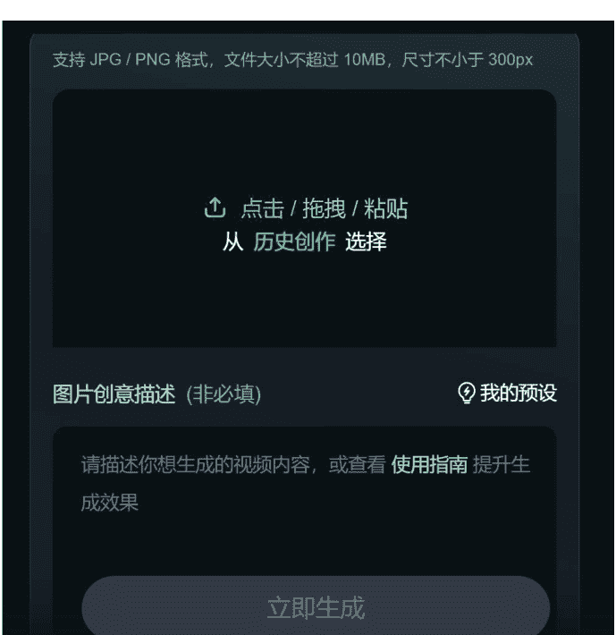

上半区用于上传底图，点击后可导入作为基底的图片，下半区填写提示词，描述期望的视频内容。

现在用图7-2作为底图上传，图片会成为视频首帧，AI再按提示词将它扩展为数秒视频。

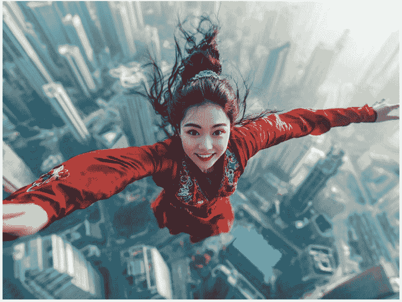

图7-2 前面章节所生成的示例图片

等待几分钟后生成完成，可在预览窗口查看结果，图7-3。

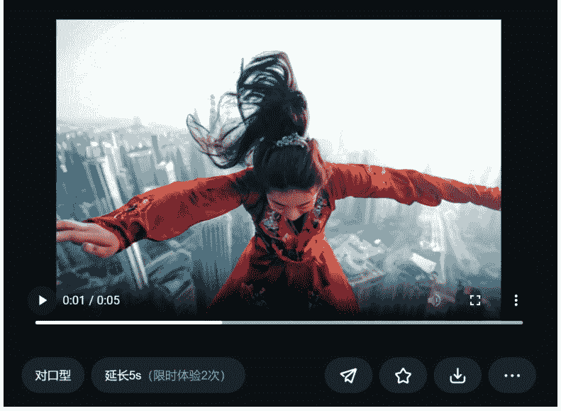

图7-3 在预览窗口查看生成结果

生成效果见图7-4。

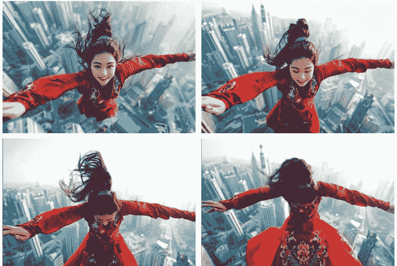

图7-4 图生视频的效果

### 7.2 首尾帧控制视频过程

注意图7-1右上角的“增加尾帧”开关有什么用。

此前上传的图片只作为首帧，后续内容由AI随机生成。打开“增加尾帧”后，需在首帧之外再加一张尾帧，生成过程会被首尾两帧所约束。打开开关后界面变化见图7-5。


界面支持同时放上两张图，分别对应首帧和尾帧。这里选用图7-6和图7-7。

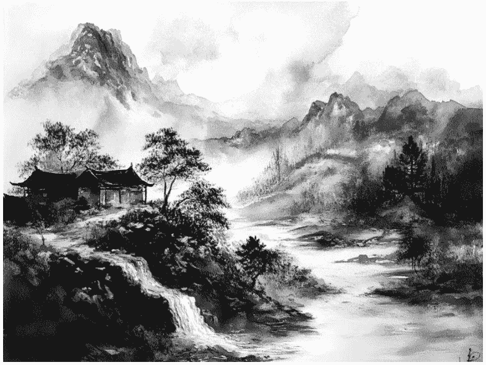

提示词：The traditional ink wash style landscape painting,--ar 4 : 3

图7-6 首帧图片

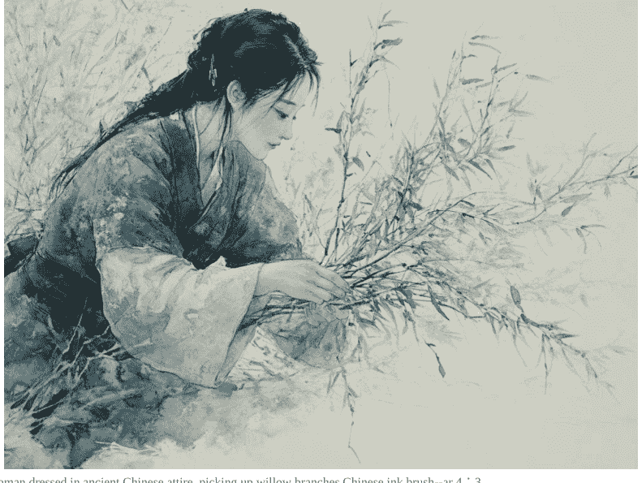

提示词：A woman dressed in ancient Chinese attire, picking up willow branches,Chinese ink brush--ar 4 : 3

图7-7 尾帧图片

两张图都是用绘画AI生成的。制作流程可归纳为：先按脚本设计片段的首尾画面，再让文本模型转为完整提示词，再用绘画AI画出两帧，最后交给视频模型生成连贯素材。上传完成后输入视频提示词，等待生成，图7-8。

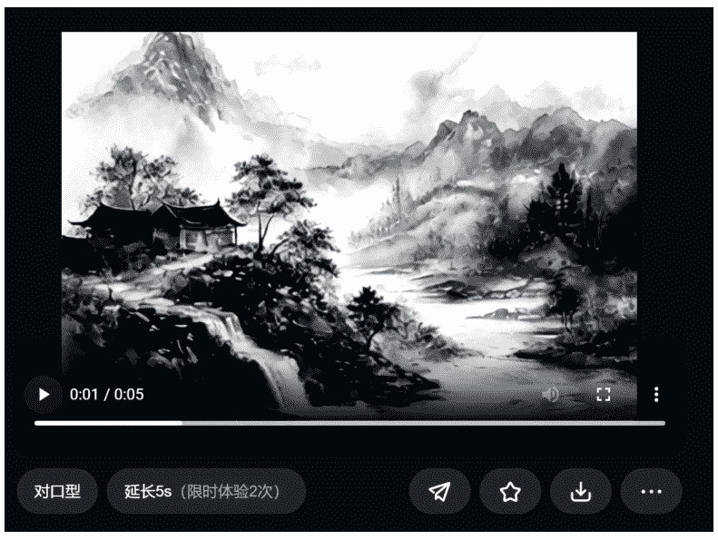

生成后在预览里检查，必要时修改提示词并重新生成。最终呈现见图7-9。

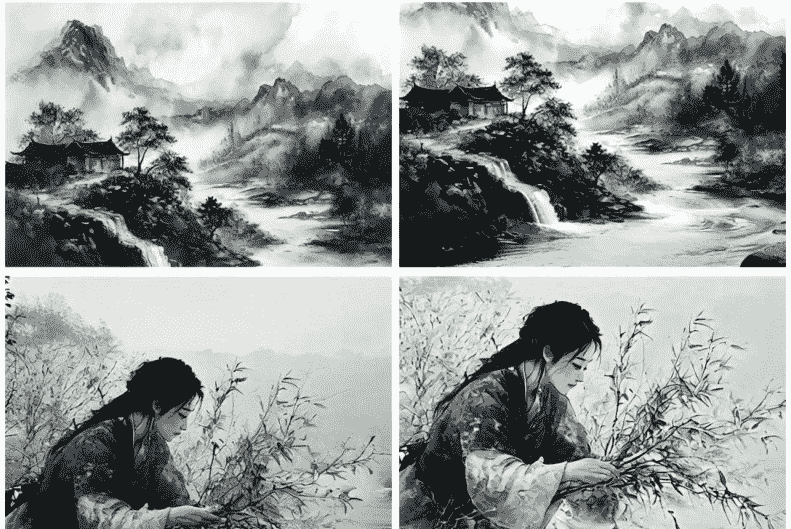

图7-9 视频生成结果

视频从云雾缭绕的山间起步，慢慢过渡到尾帧场景，一位女子正在采柳枝。云雾、流水都有了动态，意境很足，尾帧女子也有动作。固定首尾帧，用两张图就能拼出完整场景。

# 剪映篇
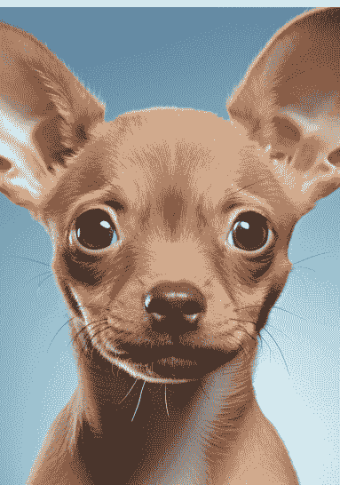


用剪辑软件对各种素材做最后加工，素材好比萝卜青菜，剪映篇就是教大家如何炒成色香味俱全的成品。

## 第8章 初识剪映

对新手来说剪辑与后期是难题，本章详细讲解如何用剪辑软件完成素材汇总与后期。本书使用剪映专业版5.6.0，可自行下载。

### 8.1 剪映界面

剪映是抖音官方的视频编辑工具，专业向但对新手友好，功能完善且有大量可用模板。下面系统认识一下。


图8-1 剪映的初始界面

图8-1是打开软件后的首屏。首页功能性内容不多，左侧导航栏的“模板”可浏览官方预制模板，右下方空白区会陈列已制作的视频，目前没有工程文件。

点击上方“开始创作”进入工作界面。


图8-2 剪映工作区域分布

创作界面可分为4个区域，图8-2。

- 素材区： 导入素材的区域，视频、文本、特效等内容都放在这里。
- 监视器：在剪辑过程中可实时预览视频编辑效果。

时间轴本质上就是编辑区，负责统筹整条视频的结构走向。视频由一帧帧画面构成，这个区域会把这些帧摊开呈现，并支持对帧进行增删、拖拽等操作。

操作区则偏向微调。选中编辑区里的素材后，在这里可以对效果参数做细节上的改动。

### 8.2 素材导入步骤
正式剪辑前要先把本地素材带进软件。

在左侧素材库打开媒体标签页，即默认页，点击导入按钮。


弹出文件选择窗口后，定位到素材所在文件夹，勾选需要的文件点打开即可完成导入。


图8-4 素材导入界面

导入成功后素材会落入素材库，若要进入编辑，还需把素材拖进编辑区。

图8-5是拖入后的编辑区画面。


图8-5 素材编辑区域

视频会在时间轴上排成一条长条，剪辑说白了就是在这条轴上做增减。这条展开的轴也叫轨道，剪映里不同种类的素材拥有不同轨道，图8-6展示了这些轨道的差异。


图8-6 不同的素材轨道

图中共有6类轨道，用颜色和图标区分，也能通过前方标识判断类型：

- 滤镜素材
- 特效素材
- 贴纸素材
- 文本素材
- 视频素材
- 声音素材

剪辑时把这6类素材配合转场进行组合，就能做出丰富效果。

最基础的剪辑就是截取片段。把进度条拖到想要的位置点分割键，快捷键是Ctrl+B，如图8-7。


点击分割后视频会从所选点断成两段，保留想要的部分，选中不要的片段点删除即可清除，如图8-8。


编辑完成后点软件右上角的导出按钮进入导出流程。


图8-9 导出选项

随后弹出保存设置对话框，需要为导出文件设置信息。


图8-10 导出界面

图8-10第一栏可修改视频标题，点击即可输入；下一栏用来指定存储位置，点开后会弹出选择窗口，和导入时的界面类似，只是在选好文件夹后点选择文件夹即可。

下方是具体的存储参数，逐项来看。


图8-11是分辨率下拉菜单，含义如下：

- 480p为640×480像素，俗称标清SD
- 720p为1280×720像素，俗称高清HD
- 1080p为1920×1080像素，俗称全高清FHD
- 2K大约为2048×1080像素，接近1080p，在影视领域更常见
- 4K即超高清UHD，分辨率3840×2160像素，是1080p的4倍


图8-12是码率下拉菜单。码率衡量单位时间内的数据处理量，单位是bps，直接影响画质和文件大小。

视频码率分两类：
（1）恒定码率CBR，全程传输速率不变，管理简单但复杂画面易失真，简单画面会浪费数据
（2）可变码率VBR，会随画面复杂度动态调整，细节多时提高码率保质量，静态时降低码率省空间。总体质量更均衡，文件也更合理。

码率越高画质越好文件越大，码率越低越容易丢细节，需要按需求权衡。


图8-13是编码方式下拉菜单。

编码是把原始数据压缩成可存储传输格式的过程。常用标准有H.264、HEVC H.265和AV1。

H.264也称AVC，压缩效率高、兼容性好，从网络流媒体到蓝光都在用。

HEVC即H.265是H.264的继任者，同等画质下文件约减半，特别适合4K以上编码，但受专利许可限制。

AV1由开放媒体联盟开发的开源编码，压缩效率高于HEVC且免专利费，缺点是编码耗时更长。

选择标准要看目标平台、画质需求、文件大小限制和设备解码支持。


图8-14是输出格式下拉菜单。

容器格式决定视频音频字幕等数据如何封装。常见有.mov和.mp4。

.mov由苹果推出，常与QuickTime关联，支持多音视频文本轨道和元数据，适合专业编辑。

.mp4即MPEG-4 Part14，兼容性极强，支持网络分发和流媒体播放，是分享的首选。

两者都能承载类似编码，但.mp4通用性更广，.mov在苹果生态下更专业。


图8-15是帧率选项下拉菜单。

帧率指每秒播放的帧数，没有特殊需求最好沿用素材本身的帧率，否则播放速度会跑偏。

例如素材是30fps，若导出设为60fps，原本10秒的内容5秒就播完，速度翻倍。

全部设置好后点下方导出开始处理，完成后会出现图8-16的界面。


这是发布助手，可一键发布到西瓜视频或抖音。点选平台后跳转网页，按提示操作即可上传；不想立即发布点关闭即可，日后也能单独上传。

### 8.3 视频比例调整
不同平台对尺寸要求不同，比如抖音需要竖屏。

在编辑过程中，可通过监视器窗口修改输出尺寸。


点右下角的比例按钮会弹出比例菜单。


菜单列出多种比例，并标注了抖音和西瓜视频的默认比例，直接选对应项即可。若要自定义，按平台规范选择即可。

这里以抖音9:16为例，效果如图8-19，画面变为适合手机竖屏观看。


### 8.4 背景填充技巧
把宽屏素材改成竖屏后，上下常会出现难看的黑边。可通过背景填充遮挡。

先选中视频素材，进入右上操作区依次点画面→基础，向下滚动到背景填充选项，点击打开下拉菜单。


下拉菜单提供无、模糊、颜色、样式四种方式。

这里试用模糊。点模糊会弹出四档模糊程度。


四档对应不同模糊强度，按喜好选择，这里用最高档填充。效果见图8-22。


模糊填充会根据视频内容做动态遮盖，简单处理后观感会更饱满。

### 8.5 角色快速美化
AI生成的角色有时细节不足，但场景满意，重生成成本高，这时可以做轻度美化。

导入视频拖入编辑区。为对比效果，把视频一分为二，前半段原样，后半段加美化。把进度条拖到中间点分割。


分割后选中要加特效的片段，进入右上操作区点画面→美颜美体。

磨皮可拉到上限，再加一点画面特效让质感更梦幻。去左上素材区特效分页，选画面特效→基础→变清晰。

下载完成后把特效轨道拖到后半段视频上，调整长度匹配视频。

对比加特效前后的画面差异明显，后半段角色更干净通透。

### 8.6 简易的特效实现
#### 8.6.1 缩放与变速特效的实现方法
电影里常用近景变焦配合速度突变营造不安感，如《无间道》开场拜佛。

AI镜头通常稳定渐进，可用缩放模拟变焦，再人为控制速度。

先把素材切成四段。选中第二段，在右侧操作区画面内把缩放比例调到200%，保持等比缩放勾选，如需非等比可取消勾选单独调纵横向。

缩放前后对比明显。若中心点不理想，可在监视器里直接拖动画面调整。

把后两段同样放大到200%后，对第三段做变速处理。

选中第三段，在右侧操作区变速里把速度设为5倍。时长从4.4秒缩到0.9秒。

整体节奏随之变化：中景开场，切近景，游客快速掠过焦点迅速回到主体，狗狗再次出现时速度放缓，形成焦点强调。AI擅长拟真，但节奏和镜头流动仍需人工把控。

#### 8.6.2 定格镜头与视频倒放
定格配合倒放是表现时光回溯的经典手法。

导入素材后右键复制，空处右键粘贴，把复制片段放在原素材后面，形成拼接。

这样能在拼接点两侧制造时间倒流。思路是让行进画面在某处定格几秒，随后倒放。

选中拼接后的第二段视频，点编辑区上方的倒放键完成翻转。翻转完成后在拼接点设置定格，选择定格按钮并拖动定格持续区域设定时长。

即可得到时光倒流的观感。

### 8.7 旋转与裁切视频
导入素材选中后，点编辑区上方的旋转按钮可旋转画面，每点一次顺时针转90度。

更精细的角度可在右侧操作区画面页找到，位于缩放下方，输入数值或拖动圆圈调节。

裁切功能键在旋转键右侧。点击后进入裁切页面，可自由选定画幅或通过下方裁切比例下拉菜单选择固定比例，页面右侧同样支持旋转。

## 第9章 视频剪辑进阶：特效制作
剪辑不只是裁剪拼接，还要对画面内容进行改造。像PS修图一样，剪辑软件里也有大量工具可为素材添加特殊效果。

### 9.1 如何使用滤镜
滤镜通过改变色彩、亮度、对比度等属性来塑造视觉风格和情绪，应用范围从基础调色到复杂视觉变换。

滤镜源于摄影，在镜头前加色片改变光线特性。进入数字时代后演变为软件算法，既能模拟传统效果，也能创造新可能。

按功能可分：
- 色彩调整滤镜：调节白平衡、饱和度、对比度等，让画面更鲜明或更柔和
- 模拟滤镜：模仿胶片黑白、怀旧、渐变等风格
- 特效滤镜：加入模糊、光晕、星光等营造氛围或强调元素
- 纹理滤镜：叠加油画、素描、水彩等纹理，呈现艺术化风格

# 滤镜与特效实战指南

光效滤镜的核心作用是借鉴自然光线规律，比如逆光、镜头光晕、散点光斑，来丰富画面层次并提升视觉冲击。

滤镜的价值远不止于修饰画面。它还能传递情绪、强化叙事、突出主题。比如做怀旧向内容时，套用复古滤镜能让画面泛黄老化，瞬间拉出年代感；做科幻向内容时，偏冷调的滤镜可营造出科技感的疏离与冰冷。遇到拍摄时光线不足导致画面发暗的问题，也可以借助提亮和提升对比度的滤镜，把清晰度和观感拉回来。

实操层面先在素材区打开“滤镜”选项卡，从滤镜库里挑中喜欢的样式直接拖进时间线。本次演示共接入了四种不同滤镜图9-1，下面把它们的效果并排对比图9-2，可以直观看到整体色调的变化路径。滤镜最便捷的用法就是统一调性，原始素材往往需要借助滤镜来“对齐”，让不同片段在情绪和美学上保持一致。

### 9.2 开头收尾与镜头衔接技巧

视频开头、结尾以及不同镜头之间的切换，都需要借助过渡效果来避免生硬断裂，这在影视制作里是基本功。

打开素材区的“特效”选项卡，在左侧导航栏的“画面特效”下拉菜单里选择“基础”，从里头找到开幕特效拖入时间线，也可以在上方搜索框直接输入“开幕”检索图9-3。

时间线上，开幕特效的左右两端就是生效起止。把特效时长压到1秒，并让开端与素材开端完全对齐，呈现效果如图9-4。

同理在“基础”库里找到“闭幕”特效拖入操作，手法和开幕一致，时长调为1秒，尾部与素材尾部对齐，效果如图9-5。

#### 9.2.1 起始与收尾特效应用

内容已在上文说明。

#### 9.2.2 镜头转场怎么选

一部成片基本由多个镜头拼接而成，如何把它们自然连贯是提升专业度的关键。转场特效的作用就是衔接不同镜头，保持观感流畅并维持观众注意力，还能表达时间流逝、场景转换、情绪转变或强调动作与主题。

转场大致分两类：不依赖特效的自然转场和软件生成的特效转场。自然转场靠镜头内容本身的遮挡、相似物体、连贯动作或声音完成衔接。特效转场则是依靠算法实现的视觉效果，常见如淡入淡出、百叶窗、闪白、旋转、翻页、滑动、飞入、融合等，本节聚焦特效转场的落地方法。

常用类型简述如下。

淡入淡出：最基础的过渡，通过降低前镜头透明度同时提升后镜头透明度实现平滑切换。
百叶窗：画面被切成多条带状，依次展开新画面，带来快速切换感。
闪白：强白光瞬间覆盖画面后消失，切出新画面，常表现时间跳跃或强调瞬间。
旋转：画面围绕中心旋转过渡，动感明显。
翻页：模拟翻书动作，适合章节式叙事。
滑动：画面向一侧滑出，新画面随之进入，节奏明快。
飞入：新画面自屏幕一侧飞入并推开旧画面，适合快节奏剪辑。
融合：两个画面交叉溶解，产生梦幻效果，适合回忆或幻想场景。

##### 1. 飞入与粒子转场示例

下面用一段展现城市活力的片段来演示。

先把两段素材导入并在时间线上首尾相接图9-6。
在左侧素材区的“转场”选项卡里找到“向右”特效，也可直接搜索，拖拽到两段视频的衔接点。注意转场特效必须落在视频轨道上才生效，不能单独悬空图9-7。
选中后在右侧参数区把持续时间改为0.5秒图9-8。
实际播放效果如图9-9。

再试一下粒子类型的转场。保持两段素材的衔接状态，进入转场特效选项卡的“模糊”分类，找到“粒子”特效拖到拼接位置图9-10。播放后能看到炫酷的粒子消散效果图9-11。

##### 2. 动画入场出场

除了素材区的转场，剪映的操作区也提供动画转场功能。

选中第一段素材，切换到右侧“动画”选项卡，在“入场”里选择“向右滑动”，点击应用。下方可设置显示时长，这里设为1秒图9-12。
进入“出场”页，选择“渐隐”动画，时长同样设为1秒。时间线左侧控制入场，右侧控制出场图9-13。
为第二段素材同样添加入场与出场动画，时间线显示如图9-14。
完整呈现为图9-15所示的开场、中间过渡和终场效果。

### 9.3 氛围特效增强技巧

#### 9.3.1 大雪氛围营造

在素材区“特效”选项卡的“自然”库里可以找到大雪特效，该库集成了多种天气类效果，可多尝试熟悉。
把特效拖到时间线，让特效轨道两端与素材首尾一致图9-16。
对比加入前后的画面图9-17，可明显感受到寒冷的氛围被强化。

#### 9.3.2 像素流星雨叠加

这一节演示两种特效叠加。“星雨”在“氛围”库，“像素画”在“漫画”库。分别拖入时间线图9-18。
先把特效轨道与视频素材对齐，选中“像素画”轨道，在右上操作区调整参数图9-19。默认像素块偏大，细节会被吞掉图9-20，建议把“像素大小”调到45左右，画面会更清晰。
在多特效叠加时想单独检查某一层，可点特效前端的“小眼睛”按钮临时隐藏图9-21。
叠加完成后效果如图9-22。像素风格属于复古系，能让画面带上游戏感，在年轻用户中很受欢迎。

#### 9.3.3 边框与定格组合实操

边框特效能为视频加上边界装饰，提升视觉质感，还能模拟现实情境，比如摄像机边框特效可模拟取景器观感。边框大致分为静态边框、动态边框和主题边框。静态提供固定装饰，动态含有颜色渐变或元素移动等动画，主题按节日季节等场景匹配风格。

下面结合定格与边框实现快速连拍效果。
先导入素材图9-23。
在特效选项卡的“边框”库找到“录制边框”特效，拖入并与素材轨道对齐图9-24，初步效果如图9-25。
接着加入定格特效营造抓拍定格感。选中素材，拖到需要抓拍的画面，点击编辑区上方的“定格”按钮，调整定格区域时长约0.5秒。按同样方式插入三个定格片段，片段间隔约0.5秒，完成主体结构图9-26。播放时会有节奏化的顿挫感。
再加入闪光模拟。在特效搜索框输入“闪白”，拖入时间线。把闪白轨道左端与定格帧左端对齐，右端拖至与左端重合，只闪一次，模拟快门。重复三次使每个定格都对应一次闪白图9-27。
最终呈现如图9-28。

### 9.4 字幕与文字特效制作

字幕能显著提升信息传递效率。在信息过载环境下，字幕可在静音浏览场景中抓住注意力，并快速传递视频主旨。

在剪映里文本相关操作集中在素材区，点击“文本”选项卡，下方分为七类功能图9-29。
新建文本：创建无额外效果的默认文字图9-30。
AI生成：借助大模型进行文本创作。
花字：内置的新颖花体字样式库图9-31。
文字模板：带设计感的排版样式，通常自带动画图9-32。
识别歌词：把音轨中的人声转为文字。
智能字幕：升级版的人声识别，可直接从音视频生成字幕图9-34。
本地字幕：导入SRT、LRC、ASS等字幕文件图9-35。

基础字幕添加流程：点击“新建文本”→“默认字幕”，拖入时间线图9-36。
在时间线上拖动左右两端可调整出现时段；监视器里可拖动文字修改画面位置，默认居中图9-37。
最丰富的编辑在右侧操作区，点选“文本”选项卡即可调整样式图9-38。

示例设置：把默认文本改为“大乌贼与小螃蟹”，字体选“追光体”，字号15，其余保持默认。下拉到“预设样式”栏图9-39，选择第三个样式，其余可自行尝试。
再添加动画。点击“文本”右侧的“动画”，在“入场”选择“闪动”，时长2秒；“出场”选择“水墨晕开”，时长2秒图9-40。最终效果如图9-41。

# 实战编

实战编将把整本书的方法串联起来，从零到一演示完整短视频项目的制作流程，并指导多平台分发获取原创收益。

## 第10章 AI短视频制作全流程解析：《一只浣熊的奇幻漂流》

短视频创作是系统工程，AI的价值不只是降低门槛，更是实现效率跃迁。按专业化步骤，每个人都能快速产出高质量作品并进行分发变现。

### 10.1 故事脚本生成

#### 10.1.1 生成故事框架

用AI搭框架非常自由，可基于选题库扩展，也可把灵感点子扩写成完整结构。下面用一个简短想法演示如何生成框架。

问：我想要创作一个1分钟左右的短视频，故事大致想法如下：
“一只生长在森林中的浣熊机缘巧合之下被一辆卡车运到大城市中，它在城市中经历了许多这辈子没见过的光怪陆离，最后终于适应了城市的生活。”
请你按照八点弧线格式帮助我构建整个故事。

答：这个构想很有趣，用八点弧线能让情节更紧凑。建议大纲如下：
- 引子：浣熊在森林里安稳生活，与其他动物玩耍。
- 触发事件：浣熊误入停在林边的卡车，卡车启动把他带到大城市。
- 任务：醒来后身处陌生环境，需要找到生存方式并试图回家。
- 惊喜：遭遇城市特有挑战，如交通、垃圾箱食物、城市动物，每次挑战都带来小惊喜并学会生存技巧。
- 关键选择：在城市找到稳定食物来源后，决定是否继续找路回家还是适应新生活。
- 高潮：觅食时险被捕捉，机智逃脱后彻底决定在城市扎根。
- 逆转：通过努力不仅适应城市，还成为城市野生动物的小英雄，帮助其他动物适应。
- 解决：最终在城市找到新家，偶尔怀念森林但已享受城市便利与新鲜。

该结构保证连贯性，并能引导观众感受从迷茫到适应的成长心路。

#### 10.1.2 设计镜头内容

确定大纲后可把视频拆成8个段落，让AI分别细化。下面以引子为例展开镜头与旁白，其余段落按同类步骤生成。

问：我需要你帮我设计这个故事的第一幕：引子
浣熊在森林中宁静生活着，与其他动物一起玩耍，生活单纯而安详。
包括画面风格、角色设计、画面构图等，这个场景一定要足够吸引眼球。

答：第一幕设计建议如下：
画面风格：选用温暖明亮的色调，水彩或柔和数字绘画营造温馨自然氛围。光影用柔和阳光透过树梢打光，形成光斑，营造早晚宁静感。
角色设计：浣熊可爱，眼睛大、尾巴毛茸、表情好奇。搭配小鹿、松鼠、鸟类等森林动物，各具特征。
画面构图：主焦点放在林间空地或溪边，浣熊与其他动物互动。前景可做轻微虚化，背景细致描绘树木与远山，增加纵深。动线引导观众视线流动。
场景细节：丰富植被、柔光、多彩花草，展现追逐玩耍、共同觅食等互动，增强温馨感。

问：请为这个引子场景设计旁白

答：旁白示例：
旁白：在一片古老的森林中，树叶轻声细语，阳光斑驳地洒落在柔软的地面上。
画面显示浣熊在树林中跳跃玩耍。
这里住着一只小浣熊，名叫阿灵。
画面聚焦浣熊面部，展现好奇与探索的眼神。
但一个意外的旅程即将展开，带领阿灵走向全新的世界——光怪陆离的大城市。
画面渐暗，预示变化与冒险到来。

按AI镜头脚本，一般需要生成两个场景，第三个场景可用浣熊特写并在剪辑软件中做渐暗退场处理。

### 10.2 制作视频素材

脚本确定后，按需生成视频素材。首先让AI依据脚本输出绘画提示词。

问：根据你所记忆的提示词生成规则，请你将下面的内容整理为完整的提示词，输出为英文：

答：Here’s a concise and structured prompt for your AI painting model in English:

“Design a serene forest scene featuring a raccoon and other forest animals like deers, squirrels and birds in warm, vivid watercolor style.The scene captures soft morning or evening light filtering through treetops,with a central focus on playful interactions in a glade.Camera setting:35mm f2.8, 16 : 9, 4K.The scene uses soft focus foreground and detailed misty background, enriched with diverse vegetation and dynamic animal movements.”

把上述英文描述做少量润色后喂给 Midjourney 作图，从多张返回结果中挑出最贴合意愿的一张作为故事开篇，暂记为图10-1。

静态画面可用图生视频赋予轻微律动。若希望改动极小、构图保持稳定，可在“增加尾帧”功能中把尾帧指定为与首帧完全相同的图像，这样主体基本不动，仅有光影、氛围等细节随时间产生变化图10-2。

按此做法得到的小样见图10-3，整体十分稳态，肉眼可见的变化集中在光感细节上。

若不使用尾帧，也可直接将一张图转为数秒的短片段，效果见图10-4。

沿用相同思路，将第二镜头的描述“画面慢慢推近至浣熊面部，呈现出好奇且渴望探索的神情”制作成动态片段，结果为图10-5。

### 10.3 初步剪辑

素材收集完毕后进入剪映的工作流。将两段视频导入项目如图10-6。

把素材拖入时间线并按顺序分层摆放。依据脚本，为第二段加入淡出入场效果如图10-7。

主体拼接完成后，还需补充字幕和旁白。新建一段默认文本置于视频轨道上方，按旁白时长拆分文字，首段内容填入后把字幕移至画面下沿并调整字体与字号如图10-8。

外观确定后要为字幕生成朗读。选中字幕，在右上角参数面板切换至“朗读”页签如图10-9。

朗读页签内音色丰富，这里以亲切女声为例。选中后软件会即时试读，确认合适点“开始朗读”即可生成音轨。为防止后续修改不同步，建议先勾选“朗读跟随文本更新”。生成的音频如图10-10所示。

为保持视觉统一，可复制已设定好的字幕，只更换文字内容。随后在轨道上拉动每段字幕时长，使其与对应音轨首尾对齐。通常字幕、音轨与视频很难完全吻合，如图10-11。

出现对齐偏差时，可用下面两种简便办法，下面以这两段素材为例演示。

#### 10.3.1 调整素材的播放速度

时长不匹配时，可通过改变播放速率来控制总长度，从而调节素材在轨道上的占据范围如图10-12。

选中目标视频，在参数面板打开“变速”页卡进入变速设置。可直接设定倍速，也可指定总时长让软件自动计算速率。为了精细对齐字幕与音轨，建议用总时长方式微调，点击时长旁的上下箭头以0.1秒为单位增减，调整后的效果如图10-13。

#### 10.3.2 拼贴视频素材

接着处理第二段素材，先把相关片段整理到轨道上如图10-14。

能看出视频片段长度与音轨差距较大，仅靠拉伸并不合适。可将素材多次复制以填补空白，再对最后一截进行变速对齐如图10-15。

单纯复制会在衔接处产生明显的跳帧，影响观感。此时可把中间一段的播放方向改为倒放，让第一段结尾自然衔接第二段开头，第二段结尾再顺滑过渡到第三段开头，实现连贯播放如图10-16。

选中浣熊特写中间段，点击上方工具栏的“倒放”按钮即可。最后删除前两段素材的入场特效，引子片段即完成，成果见图10-17。

### 10.4 将成片进一步优化

初步剪辑完成后，可为片段叠加特效与滤镜提升质感。先选中第一段素材，点击左上面板特效页签，将“星夜”特效拖入编辑轨道如图10-18。

把星夜特效的首尾帧与第一段素材对齐，添加后画面点缀出细碎星光，森林氛围更显梦幻如图10-19。

图10-19 加入特效后的画面

接下来为转场增加动画。打开面板中的转场特效页签，把“翻页”转场拖到两段视频的衔接处，转场添加完成如图10-20。

图10-20 加入翻页转场

翻页转场的实际表现如图10-21所示。

图10-21 翻页转场

### 10.5 上传并发布作品

按相同流程把八个段落逐一制作成视频片段，最终拼成完整短视频如图10-22。

随后制作封面。点击编辑轨道最前端的封面按钮，在编辑界面选择合适的封面文字模板，将模板文字替换为自有标题，并可调整字体与大小，设置完毕后点击右下角“完成设置”如图10-23。

至此视频主体已完成，最后导出并发布。点击软件右上角“导出”，在弹出界面设置导出参数，再次点击“导出”即可保存本地文件如图10-24。

勾选“封面添加至视频片头”，可让先前设定的封面作为片头播放。等待片刻导出完成，界面切换为视频发布助手，可便捷地将作品推送至西瓜视频与抖音如图10-25。

图10-25 发布作品

发布后即可在对应平台浏览。若需投放至其他平台，只需在该平台注册后上传本地视频文件即可。

## 第11章 AI短视频制作全流程解析：《滁州西涧》

本章尝试把一首古诗转化为短视频。区别于其他类型，诗歌类视频的文本已有现成，关键在于如何将诗句转化为动态画面。

### 11.1 将诗句转化为具体的场景

韦应物的《滁州西涧》为七言绝句，共四句。诗句本身无法直接用于画面生成，需先借助文本生成 AI 把它们细化成可视化场景描述。

问：请将下面的诗分解成具体的场景描述：

> 《滁州西涧》唐朝·韦应物

> 独怜幽草涧边生，上有黄鹂深树鸣。

> 春潮带雨晚来急，野渡无人舟自横。

答：此诗描绘春日景致与作者感触，可拆分为以下可视化情境：

场景一：幽静的小溪边
描述：人迹罕至的小溪旁，野草繁茂生机盎然。诗人独自驻足，偏爱这些在寂静处生长的草木。
视觉要点：溪边植被浓密，绿意盎然，呈现出未被打扰的纯净感。

场景二：树林深处的黄鹂鸣唱
描述：在溪边草木的深处，一只黄鹂立于枝头清啭。鸟声悠长，在宁静空间里回荡。
视听要点：深色树干与浓密叶片形成对比，黄鹂的亮色在绿叶间格外醒目，清脆鸣声成为环境主调。

场景三：春潮夹雨
描述：连绵阴雨使春汛上涨，潮水伴着雨势在傍晚愈发急遽。
视觉要点：河面波涛汹涌，雨中景物模糊，天色沉下来时水面颜色更深。

场景四：无人的野渡与自横孤舟
描述：在雨中春潮的背景下，郊野渡口空旷无人，一叶小舟被水流推着自行横渡。
视觉要点：画面聚焦无人驾驶的小舟，随波漂流显出孤独与漂泊感，背景是连绵雨势与上涨的河水。

通过上述划分，能更好地体会诗中孤寂、宁静与人与自然和谐共存的美感。

将诗句细化后，便可进一步生成绘图所需的提示词。下面以首句“独怜幽草涧边生”为例展示提示词的细化过程。

问：根据你所记忆的提示词生成规则，请你将下面的内容整理为完整的提示词，输出为英文，绘图效果要使用水墨风格：

场景一：幽静的小溪边

描述：幽静的小溪边，生长着茂密而生机盎然的草木。诗人独自一人，特别怜爱这些在人迹罕至的地方生长的野草。

视觉元素：溪边的草木浓密，绿意盎然，有一种未被打扰的纯净感。

答：Here's a concise and structured prompt for your AI painting model in English:

“A poet alone admires the wild grasses by a tranquil creek, surrounded by dense and vibrant greenery in a realism style landscape. The scene captures natural and serene light with reflections off the water, emphasizing the untouched purity of the area. Please depict in traditional Chinese ink painting style.”

### 11.2 生成视频素材

#### 11.2.1 制作绘画底本

对提示词做少量修改后输入 Midjourney 聊天区，先查看生成效果图11-1。

随后用同样方法制作出其余三句的图像底本图11-2、图11-3、图11-4。

图11-1 独怜幽草涧边生

提示词：Chinese ink style，golden oriole sings atop a tree in the depth of forest foliage by a creek，its vibrant colors stand out against dark tree trunks and dense green leaves. The scene captures natural light with a close-up view，highlighting the bird’s vivid appearance and melodious song. Render the scene with high-detail wildlife illustration techniques emphasizing visual and auditory tranquility.--ar 16:9

图11-2 上有黄鹂深树鸣

提示词：Capture a swollen river with spring tides，intensified by evening rain in an impressionistic style. The scene features tumultuous waters under dimming evening light，with surroundings blurred by rain，conveying a mood of urgency and power. Render the scene with impressionistic techniques to emphasize dynamic water movement and atmospheric mood.--ar 16:9

图11-3 春潮带雨晚来急

提示词：Depict an unmanned boat drifting aimlessly across a deserted river in a minimalistic style during a spring rain. The scene focuses on the solitude of the boat, under overcast skies and continuous rain, creating a subdued and melancholic mood. Render the scene with a minimalist approach to emphasize the emotional impact of the solitary boat against the dynamic backdrop of the rising river.--ar 16:9

图11-4 野渡无人舟自横

#### 11.2.2 图生视频素材

将四张图片依次进行动画化处理，本节使用可灵大模型。先上传第一张图片到图片提示，并补充少量限定描述图11-5。

##### 图片及创意描述

支持 JPG / PNG 格式文件，文件大小不超过 10MB，尺寸不小于 300px

01.png

图片创意描述 (非必填)

为场景添加一些动态效果，不要移动场景

18 / 500

图11-5 用图片生成视频素材

处理完成后可得到一幅具有微动效果的水墨场景图11-6。

按此方法把剩余三张图片也转化为动态视频场景，此处不再赘述。

#### 11.2.3 剪辑素材

把视频素材导入剪映，并把诗句添加为字幕，随后为字幕匹配语音朗读文件图11-7。

此时视频素材时长通常比音轨长，可先不剪，待题头加入后再处理。选中字幕，进入参数设置区的动画页签，在入场动画库中选择“打字机Ⅱ”。先生成朗读音轨再添加入场动画，能让字幕随语音同步出现。将动画时长设为 1.5 秒，即音轨总时长图11-8。

实现效果如图11-9所示。为便于观察，这里先把字幕置于画面中央。

一句诗的视频即告完成。接下来按相同模式为整首诗添加字幕、音频与字幕动画。注意字幕轨道需从开头持续到视频结束图11-10。

图11-10 字幕长度的设置

### 11.3 优化视频细节

现在为整条视频加入题头。在开头留白处添加三段字幕，可复制诗词字幕后修改内容与排版，并补充音频及入场、出场动画，如图11-11所示。

题头效果如图11-12所示。

图11-12 题头效果

素材本身已具备动态效果，过多特效会破坏中式美感，故不再叠加更多效果。随后加入视频封面，以图11-1为封面底图，再用文本功能添加视频标题即诗题图11-13。

图11-13 制作视频封面

从头播放检查时发现，部分画面偏暗导致黑色字幕难以辨认，如图11-14所示。

图11-14 看不清字幕

解决方法是把字幕拆分为多段，在不同场景使用不同颜色的字体，最终调整如图11-15所示。

图11-15 切割字幕，分段显示

### 11.4 上传并发布作品

最终成片如图11-16所示。

接着把作品导出到本地图11-17。

图11-17 导出作品

导出参数并非越高越好，需根据发布平台要求选择。也可按最高规格导出，后续再按需压缩。

导出完成后可选择发布平台图11-18。

图11-18 选择发布平台

# 结语

至此本书主要内容结束。我们已经共同体验了智能脚本编写的原理、图生视频的魅力以及剪映编辑的乐趣，相信读者在正篇学习后已具备自行尝试视频制作的能力。

AI 生成仍在高速演进，几乎每天都有新工具与新技术涌现。当你合上本书时，这并非终点，而是新的起点，我们已拿到搭乘 AIGC 这艘巨轮的船票。

保持好奇与持续学习的热情，不断探索与实验，你会发现自己的上限远超想象。作者已尽力收录所知知识，但难免疏漏。经验来自实战，被实际应用的知识才真正属于自己。在短视频创作中必然会遇到各类难题，请不要气馁，解决问题的过程即是成长。

再次祝贺大家完成这次学习之旅，请继续前行，创造更多可能，享受创作带来的乐趣与成就感，用知识为自己创造价值。让我们在创意的海洋里一起畅游吧！