# ChatGPT 起稿·AI成片：短视频全流程实操指南

# 作者简介

###### 雨佳

● 熟稔 AIGC 短视频全链路，涵盖文本转影像、图像转影像、影像再创作
● 电商视觉设计从业者，长期推动绘画类 AIGC 在商品设计中的落地
● 对绘画类 AIGC 与文案类工具均有系统研究与持续实操经验
● 累计沉淀千余条绘画类 Prompt 关键词、提示指令与用法
● 精通生成式绘画，已为天猫、淘宝、京东等多家店铺提供装修支持 EXr6287u6NNVz+GYLY+7SGHyKypaUgwB5y6KvQm+gKfkXS0BJRcEmCY4hDeOU9/+0azLlABZDrXvpTT8yFpUqw==

# 前言

在当下全民内容时代，短视频已成为信息流动与创意表达的主阵地。竞争加剧，创作者需不断探索新方法，生成式 AI 正把内容生产推向更高效的阶段。本书以不同主题分章展开，以 ChatGPT 起稿为起点，配合各类工具完成成片，覆盖从灵感到交付的完整链路。

内容覆盖面：全书共收录 20 个短视频创作主题，横跨护肤干货、都市夜景、商品主图、口播带货、探店打卡等多个赛道，读者可按需挑选学习。

可复制的流程：以清晰的操作步骤与 80 多个真实案例拆解从文案到成片的全过程，按图索骥即可快速掌握生成式短视频的方法。

工具组合丰富：介绍一帧秒创、Midjourney、不咕剪辑、KreadoAI、FlexClip、必剪、快影剪、PiKa、Runway 等多种 AIGC 辅助工具，依需求灵活搭配。

❏ 20 章主题式拆解

体系完整，由基础到进阶讲清 AIGC 短视频的核心原理与制作思路，帮助建立系统认知。每章末均附知识小结与课后练习，强化理解与应用。

❏ 80 多个干货案例

强实用导向，通过案例逐步吃透要点，从新手过渡为熟练使用者。

❏ 110 多分钟语音演示

所有技能案例均录制带讲解的演示视频，总时长超 110 分钟，可图文结合，也可单独观看，学习更轻松高效。

❏ 360 多张图解

以 360 余张配图对短视频制作进行全流程讲解，直观易懂，便于快速领会并加深记忆。

如需获取书中案例素材、成片与视频素材，可用微信扫码按需下载。

作 者

2024 年 5 月 EXr6287u6NNVz+GYLY+7SGHyKypaUgwB5y6KvQm+gKfkXS0BJRcEmCY4hDeOU9/+0azLlABZDrXvpTT8yFpUqw==

# 第一章
《护肤技巧分享》：一帧秒创图文转视频实操

在一帧秒创中，可先借助 ChatGPT 生成文案，再调用图文转视频功能自动合成。如对呈现效果有个性化需求，还能手动替换素材以贴合自身风格。本章以《护肤技巧分享》为例，讲解关键操作。

扫码看效果 EXr6287u6NNVz+GYLY+7SGHyKypaUgwB5y6KvQm+gKfkXS0BJRcEmCY4hDeOU9/+0azLlABZDrXvpTT8yFpUqw==

## 1.1 让 ChatGPT 产出护肤文案

撰写护肤文案时，把需求描述得具体明确，模型输出才会更贴合。操作如下。

扫码看视频

 步骤 1 启动 ChatGPT 对话页，点选底部输入区，如图 1-1 所示。

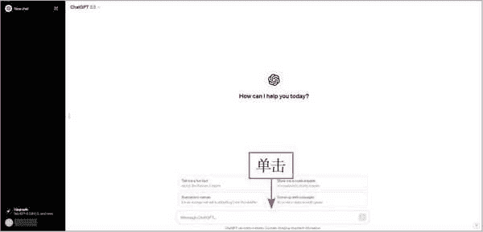

图 1-1 点选底部输入区

 步骤 2 在输入框内填写提示指令，例如“请帮我写一篇约 200 字的护肤技巧文案”，如图 1-2 所示。

图 1-2 填写提示指令

 步骤 3 点击输入框右侧发送键  或按下【Enter】，随后 ChatGPT 便会按要求生成护肤技巧文案，如图 1-3 所示。

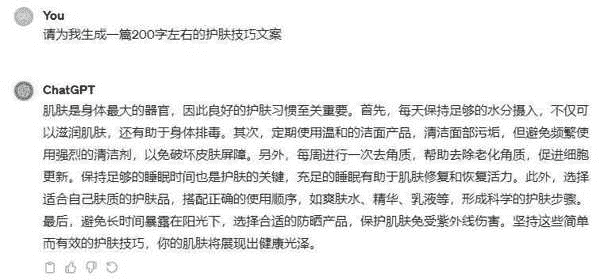

图 1-3 模型生成护肤技巧文案 EXr6287u6NNVz+GYLY+7SGHyKypaUgwB5y6KvQm+gKfkXS0BJRcEmCY4hDeOU9/+0azLlABZDrXvpTT8yFpUqw==

## 1.2 用一帧秒创图文转视频合成

拿到文案后，即可借助图文转视频功能完成合成。下面说明具体流程。

扫码看视频

 步骤 1 选中 ChatGPT 回复的文案内容，右键点击，在快捷菜单中选择“复制”，如图 1-4 所示，将文案复制到剪贴板。

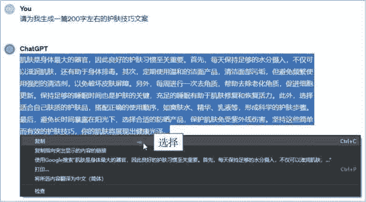

图 1-4 选择“复制”

 步骤 2 登录一帧秒创，进入首页，点击图文转视频模块中的“去创作”按钮，如图 1-5 所示。

图 1-5 点击图文转视频的“去创作”

 步骤 3 进入图文转视频页，使用【Ctrl＋V】将文案粘贴到文本框，点击“下一步”，如图 1-6 所示。

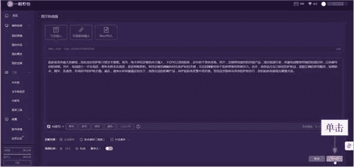

图 1-6 点击“下一步”①

 步骤 4 进入编辑文稿页，系统会自动分段，每段文案对应一段素材。若无需调整，直接点“下一步”即可开始生成，如图 1-7 所示。

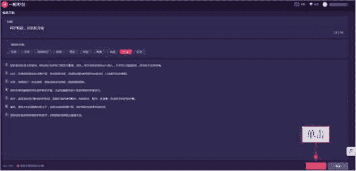

图 1-7 点击“下一步”②

专家提醒：相同文本使用图文转视频功能生成的结果也可能不同，建议根据实际画面进行选择性调整与剪辑。

 步骤 5 稍作等待即可进入创作空间，在此可预览自动生成的视频效果，如图 1-8 所示。

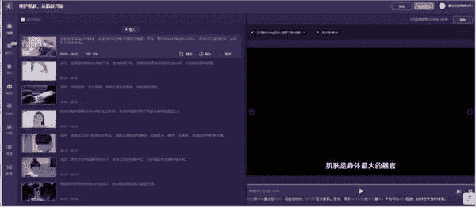

图 1-8 预览自动生成效果 EXr6287u6NNVz+GYLY+7SGHyKypaUgwB5y6KvQm+gKfkXS0BJRcEmCY4hDeOU9/+0azLlABZDrXvpTT8yFpUqw==

## 1.3 在一帧秒创中替换不合适的素材

自动生成的片段有时不够理想，可手动替换以提升质感。操作步骤如下。

扫码看视频

 步骤 1 将光标移至第一段素材上，在右下角工具栏点击“替换”按钮  ，如图 1-9 所示。

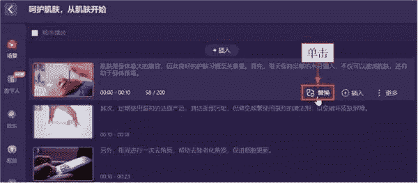

图 1-9 点击“替换” 

 步骤 2 弹出选择框，可选用在线素材、账号上传素材、AI 作画结果、AI 视频结果、表情包素材、最近使用素材或收藏素材进行替换。以下以 AI 作画为例，先切换到“AI 作画”标签，点击“生成图片”按钮，如图 1-10 所示。

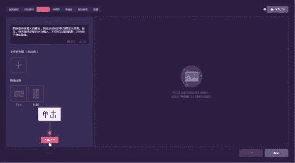

图 1-10 点击“生成图片”

 步骤 3 执行后，一帧秒创会依据文案自动生成对应 AI 图片，效果如图 1-11 所示。

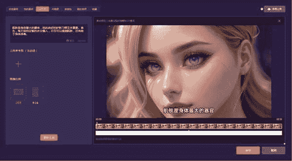

图 1-11 根据文案生成的 AI 图片

专家提醒：在 AI 作画标签下生成的图片具有随机性，即使关键词相同也会出现较大差异。若首次结果不满意，可点击“重新生成”让系统再次生成。

 步骤 4 点击 AI 图片下方“使用”按钮，即可用该图替换原素材，如图 1-12 所示。

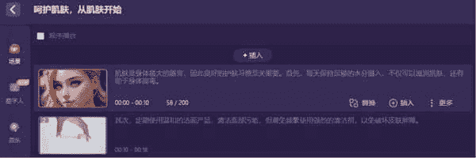

图 1-12 用 AI 图片替换原素材

 步骤 5 参照相同方式替换其他不合适的素材，效果如图 1-13 所示。

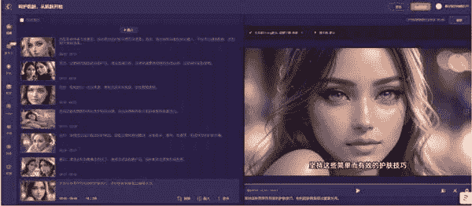

图 1-13 替换后效果

 步骤 6 点击页面顶部“生成视频”按钮，按提示操作即可导出《护肤技巧分享》成片，效果如图 1-14 所示。

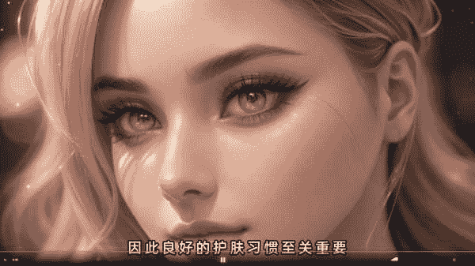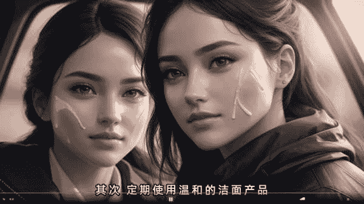

图 1-14 《护肤技巧分享》成片效果 EXr6287u6NNVz+GYLY+7SGHyKypaUgwB5y6KvQm+gKfkXS0BJRcEmCY4hDeOU9/+0azLlABZDrXvpTT8yFpUqw==

# 第二章
《城市夜景欣赏》：美图秀秀一键大片制作

美图秀秀 App 除图片编辑外，还提供视频剪辑能力。“一键大片”可满足 AIGC 视频创作需求，只需导入素材并选择模板，AI 即可自动套用生成新片。可先用 ChatGPT 撰写文案，再据此生成配图，最后导入美图秀秀完成成片，本章具体说明。

扫码看效果 EXr6287u6NNVz+GYLY+7SGHyKypaUgwB5y6KvQm+gKfkXS0BJRcEmCY4hDeOU9/+0azLlABZDrXvpTT8yFpUqw==

## 2.1 用 ChatGPT 生成城市夜景文案

制作《城市夜景欣赏》前，可先用 ChatGPT 生成相关文案，具体如下。

扫码看视频

 提问

请为我生成一篇 150 字左右的城市夜景文案。

 ChatGPT

夜幕降临，城市如一颗巨大的明珠，灯火辉煌，霓虹闪烁。高楼大厦点缀着星星般的灯光，勾勒出宛如流动诗篇的城市轮廓。霓虹灯在夜风中摇曳，繁星般闪耀的车流穿梭在城市大道，每一道车灯都是一颗流动的星辰。远处的摩天轮在夜空中绽放华彩，宛如仙境之门。城市的夜晚，是一场流光溢彩的盛宴，是璀璨的梦幻交响曲。在这霓虹绚丽的夜色中，人们仿佛漫步在未来之都，感受着城市夜晚的无尽魅力。 EXr6287u6NNVz+GYLY+7SGHyKypaUgwB5y6KvQm+gKfkXS0BJRcEmCY4hDeOU9/+0azLlABZDrXvpTT8yFpUqw==

## 2.2 用 Midjourney 生成城市夜景配图

文案确定后，结合内容在 Midjourney 中生成配图，步骤如下。

扫码看视频

 步骤 1 复制文案中部分内容（如前两句），粘贴至百度翻译并译为英文，如图 2-1 所示。

图 2-1 文案片段翻译为英文

 步骤 2 选中翻译后的英文并右键，在快捷菜单中选择“复制”，如图 2-2 所示。注意同义中文在百度翻译中可能得到细微不同的译文，可自行挑选和微调。

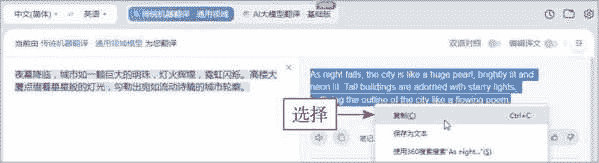

图 2-2 选择“复制”

 步骤 3 在 Midjourney 输入框内输入“/”，选择 /imagine 选项，如图 2-3 所示。

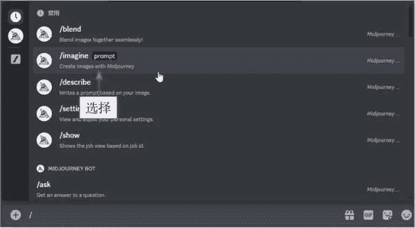

图 2-3 选择 /imagine

 步骤 4 在输入区粘贴刚刚复制的英文，如图 2-4 所示。

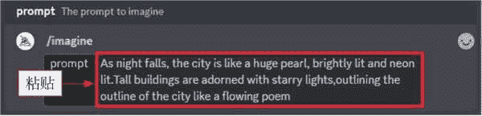

图 2-4 粘贴英文关键词

 步骤 5 追加参数词，如 4K --ar 16∶9，即 4K 高清，分辨率为 16∶9，如图 2-5 所示。

图 2-5 追加参数词

 步骤 6 按【Enter】发送，即可基于关键词生成四张图片，如图 2-6 所示。

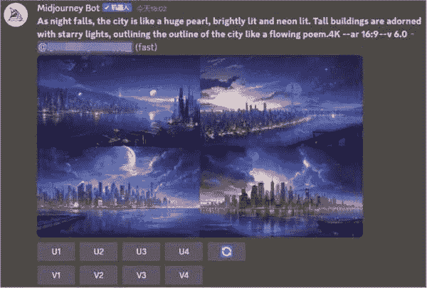

图 2-6 基于关键词生成的四张图片

 第七步 选中对应的U键，比如U4，在四张生成图里挑一个比较满意的，示意图见图2-7。
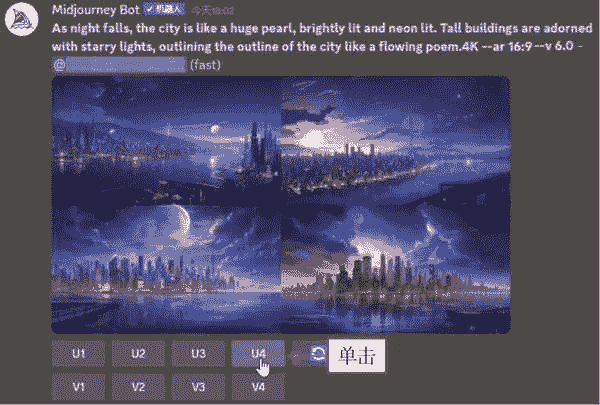

图2-7 U4按钮点击示意
 第八步 操作完成后，Midjourney会以第四张图为基础做进一步精修并放大呈现，效果参考图2-8。
 第九步 按照同样方式，继续利用文案剩余部分生成图片，留作后续剪辑素材。
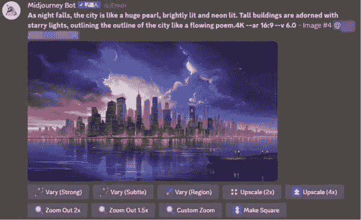

图2-8 放大后的图片效果 EXr6287u6NNVz+GYLY+7SGHyKypaUgwB5y6KvQm+gKfkXS0BJRcEmCY4hDeOU9/+0azLlABZDrXvpTT8yFpUqw==

2.3 美图秀秀一键大片快速成片
把Midjourney产出的图片导入美图秀秀App，打开“一键大片”面板选定模板，系统会自动将素材拼装成完整视频，操作如下。

扫码看视频
 第一步 安装并启动美图秀秀App，在首页点开视频剪辑入口，见图2-9。
 第二步 进入最近项目页，挑选对应素材后点击开始编辑，即可进入剪辑界面并将素材载入轨道，见图2-10。

图2-9 视频剪辑按钮位置
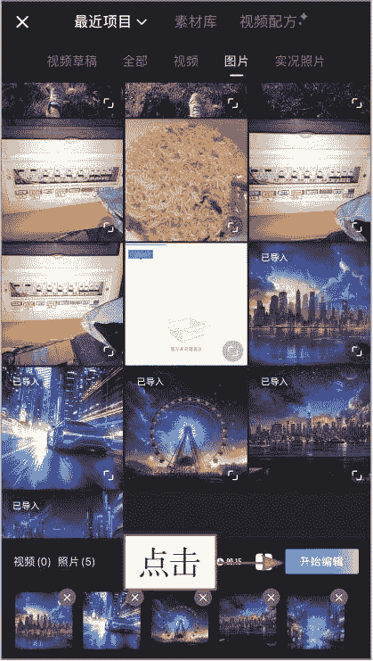

图2-10 开始编辑按钮位置
 第三步 在底部工具栏里点按“一键大片”，见图2-11。
 第四步 面板弹出后挑选喜爱的模板套用，即可生成视频，见图2-12。
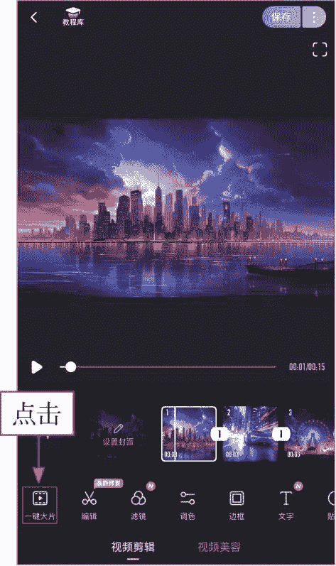

图2-11 一键大片按钮位置
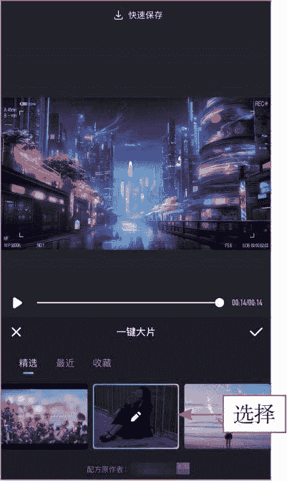

图2-12 模板选择界面
 第五步 生成完毕后点击保存导出。图2-13展示了套用模板后《城市夜景欣赏》的成品。

图2-13 套用模板生成的《城市夜景欣赏》视频效果 EXr6287u6NNVz+GYLY+7SGHyKypaUgwB5y6KvQm+gKfkXS0BJRcEmCY4hDeOU9/+0azLlABZDrXvpTT8yFpUqw==

# 第三章
商品主图视频：不咕剪辑模板一键制作
不咕剪辑的视频模板功能支持一键成片，也可进行二次微调，让成片更具个性。先由ChatGPT撰写商品主图文案，再据此生成配图，最后导入不咕剪辑套用模板，本章详细说明。

扫码看效果 EXr6287u6NNVz+GYLY+7SGHyKypaUgwB5y6KvQm+gKfkXS0BJRcEmCY4hDeOU9/+0azLlABZDrXvpTT8yFpUqw==

## 3.1 ChatGPT产出商品描述文案
制作商品主图视频时，可先请ChatGPT写一段商品描述，为后续绘图提供关键词，具体如下。

扫码看视频
 提问
请用 100 字左右对某款草莓的外观进行描述。
 ChatGPT
这款草莓外观鲜红饱满，如艺术品般光洁，点缀着微小的果粒。果形完美曲线，翠绿果蒂为其增添一抹清新。整体外观生机勃勃，仿佛镀上了一层晶莹的红色琉璃。微妙的甜香扑鼻而来，预示着口感的美好。这是一款精致诱人的草莓，每一颗都是味觉盛宴中的鲜美珍品。 EXr6287u6NNVz+GYLY+7SGHyKypaUgwB5y6KvQm+gKfkXS0BJRcEmCY4hDeOU9/+0azLlABZDrXvpTT8yFpUqw==

## 3.2 Midjourney绘制商品配图
文案完成后，可结合文案在Midjourney中生成对应商品图，作为视频素材备用，具体操作如下。

扫码看视频
 第一步 复制文案中部分内容，例如第一句，粘贴到百度翻译并译成英文，见图3-1。

图3-1 文案部分内容译成英文
 第二步 选中翻译结果右键复制，见图3-2。
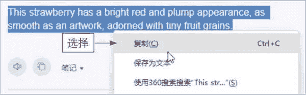

图3-2 复制选项界面
 第三步 在Midjourney输入框输入“/”，选择/imagine，将英文关键词粘贴进去并加上参数如4K --ar 16∶9，见图3-3。
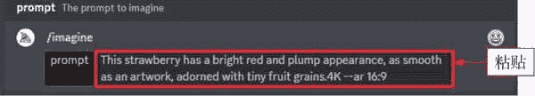

图3-3 粘贴英文关键词并添加参数
 第四步 按回车发送，系统会基于关键词生成四张图，见图3-4。
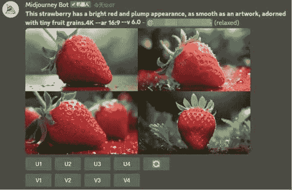

图3-4 基于关键词生成的四张图片
 第五步 点选对应U键，如U1，挑一张满意的图，见图3-5。
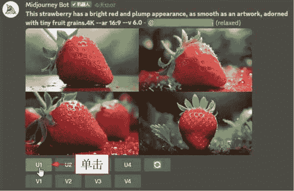

图3-5 U1按钮点击示意
 第六步 执行后，Midjourney会以第一张图为基础细化并放大，见图3-6。
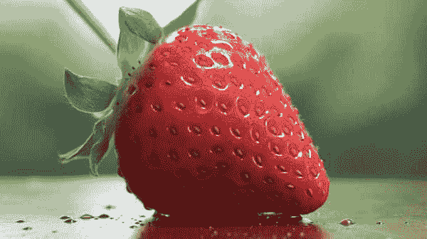

图3-6 放大后的图片效果
 第七步 按同样方法，用文案其余部分继续生成图片，备作视频素材。 EXr6287u6NNVz+GYLY+7SGHyKypaUgwB5y6KvQm+gKfkXS0BJRcEmCY4hDeOU9/+0azLlABZDrXvpTT8yFpUqw==

## 3.3 不咕剪辑模板合成视频
不咕剪辑的视频模板涵盖多种类型，基本能满足生活工作需求。选定模板后按要求添加素材数量与时长，即可得到同款视频，具体如下。

扫码看视频
 第一步 安装并打开不咕剪辑App，进入剪辑页，点击视频模板按钮，见图3-7。
 第二步 进入视频模板页，点击季节按钮，在季节分类中挑选合适模板，见图3-8。
 第三步 进入模板预览页查看效果，点击下方使用模板按钮，见图3-9。
 第四步 进入相册挑选图片素材，点击下一步即可开始生成，见图3-10。
 第五步 生成结束后进入使用模板页查看效果，点击需要修改的文本，见图3-11。
 第六步 弹出文本框后修改文字内容，点击确定即可，见图3-12。
 第七步 修改完毕后点击导出视频保存。图3-13为套用模板生成的《商品主图视频》效果。

图3-7 视频模板按钮位置
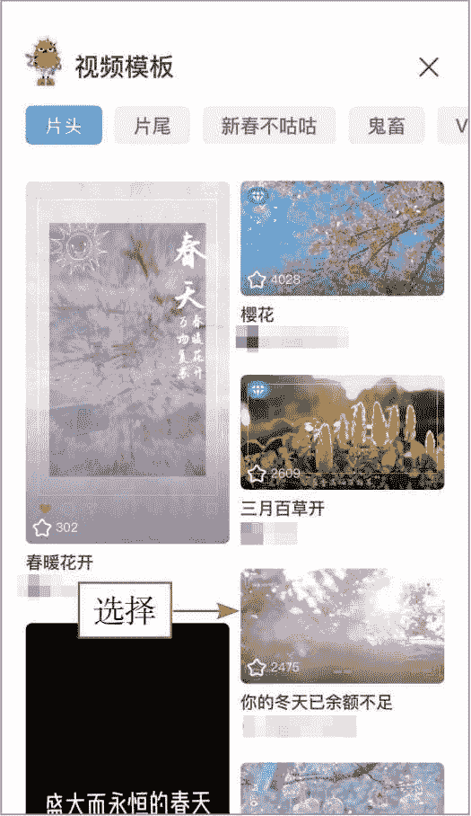

图3-8 模板选择界面
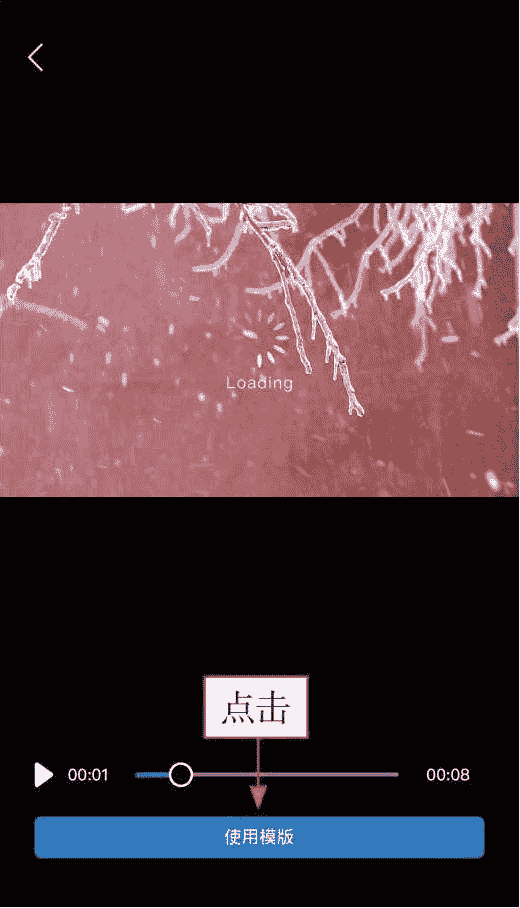

图3-9 使用模板按钮位置
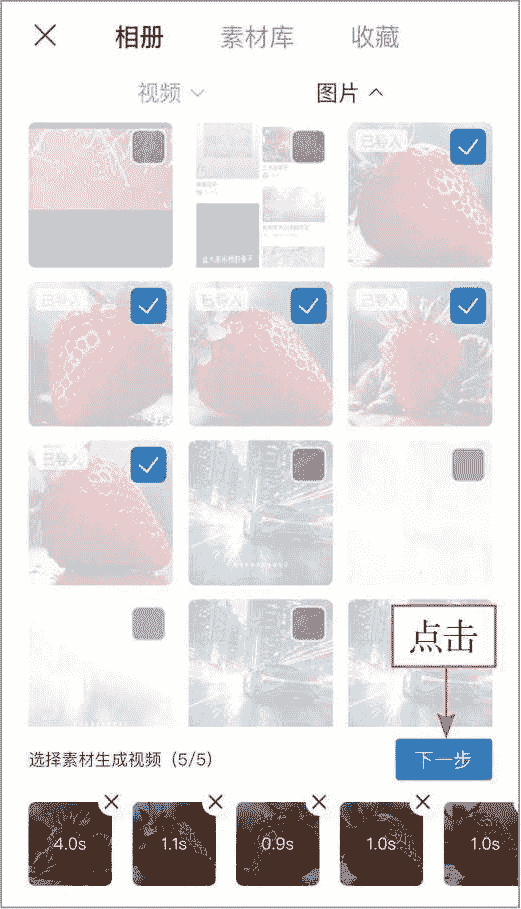

图3-10 下一步按钮位置
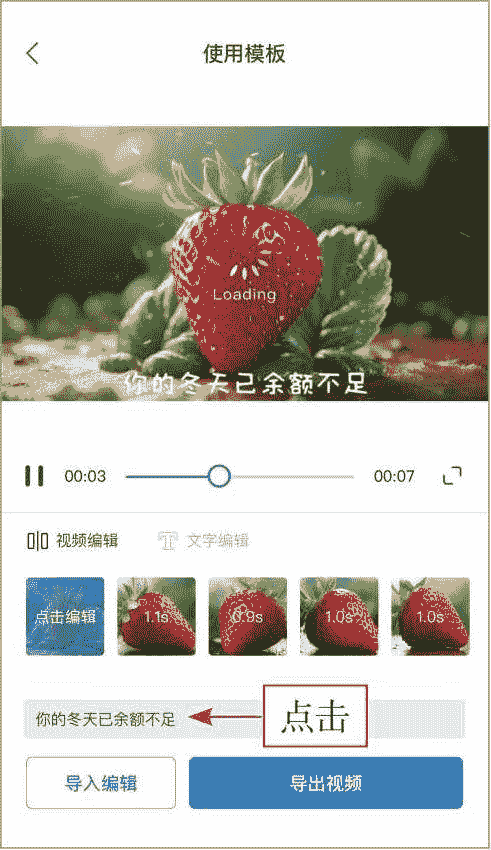

图3-11 点击文本修改位置
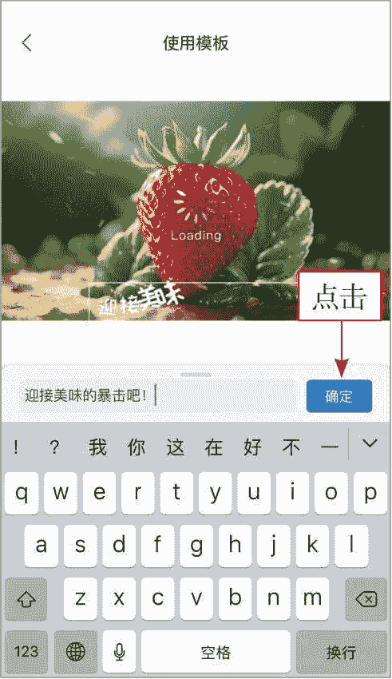

图3-12 确定按钮位置
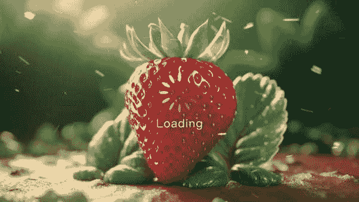

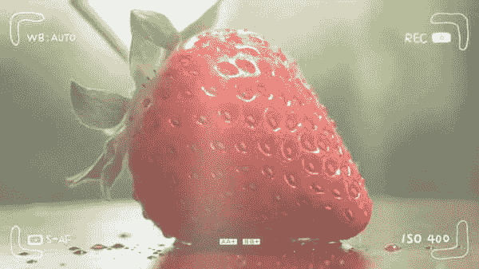
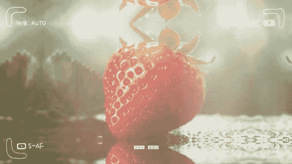
图3-13 套用模板生成的《商品主图视频》效果
专家提示：若套用模板后效果不理想，可将视频导入后期软件进一步处理。例如本章视频后半段偏淡，可通过提高对比度与饱和度、降低曝光来优化画面。 EXr6287u6NNVz+GYLY+7SGHyKypaUgwB5y6KvQm+gKfkXS0BJRcEmCY4hDeOU9/+0azLlABZDrXvpTT8yFpUqw==

# 第四章
口播带货视频：Kreado AI配音生成
Kreado AI专注于多语言AI视频创作，输入文字或关键词即可生成吸睛视频。真人或虚拟角色都能呈现得生动。先用ChatGPT撰写文案，再导入Kreado AI制作视频，本章介绍操作要点。

扫码看效果 EXr6287u6NNVz+GYLY+7SGHyKypaUgwB5y6KvQm+gKfkXS0BJRcEmCY4hDeOU9/+0azLlABZDrXvpTT8yFpUqw==

## 4.1 ChatGPT撰写带货口播文案
制作口播带货视频时，可先借助ChatGPT生成相关文案，具体如下。

扫码看视频
 提问
请生成一条关于发卡的口播带货文案，控制在 150 字左右。
 ChatGPT
嘿，亲爱的美女们！今天给你们推荐一款必备的时尚利器——“星辰魅影发卡”！独特的星光设计，点亮你的发型，让你在人群中熠熠生辉。多款风格，搭配自如，轻松打造个性造型。精选高质材料，舒适贴合头发，不仅美观时尚，更是耐用实用。现在购买，限时特惠进行中！点击链接，让“星辰魅影发卡”成为你每天发型的小亮点，让你更加迷人耀眼！[商品链接] EXr6287u6NNVz+GYLY+7SLdV5cAPg2JMkmgLwLU5b15LS/lN9qH5Jh3HVnEAOCeJfEYCIWC13bIAXG/lB/bSww==

## 4.2 Kreado AI制作带货配音
电商广告、教育培训或电子书籍，均可借助Kreado AI的AI文本配音功能快速生成高质量音频，提升内容可及性。以下介绍在Kreado AI中生成口播带货配音的具体流程。

扫码看视频
 第一步 登录Kreado AI进入首页，点击开始免费试用按钮，见图4-1。

图4-1 开始免费试用按钮位置
 第二步 进入AIGC数字营销创作平台默认页，点击真人数字人口播面板中的开始创作按钮，见图4-2。

图4-2 开始创作按钮位置
 第三步 进入数字人视频创作页，点击照片数字人按钮切换标签，见图4-3。
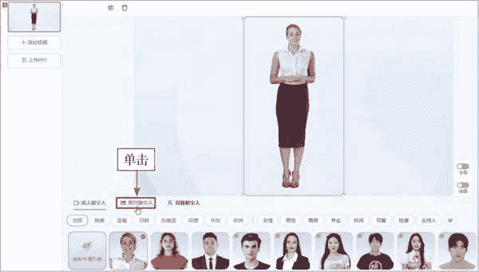

图4-3 照片数字人按钮位置
 第四步 切换到照片数字人标签后挑选合适的照片数字人，见图4-4。

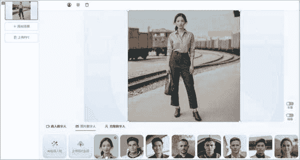

图 4-4 挑选合适人像的数字人素材

 第五步 在右侧面板的“文本驱动”标签里设定播报音色，把 ChatGPT 产出的口播带货稿子粘到输入框内，按需做些润色，参考图 4-5。

 第六步 轻触“试听”控件，见图 4-6，预览数字人朗读效果。

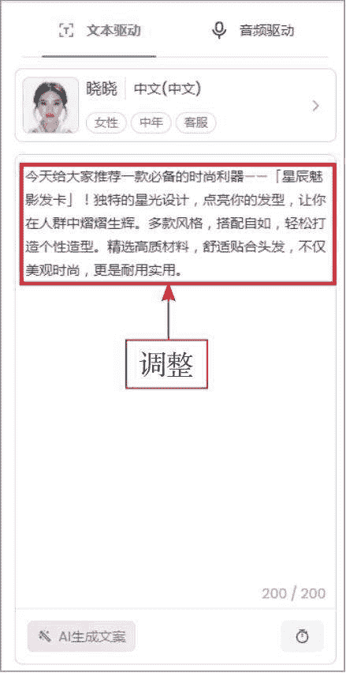

图 4-5 文案润色界面

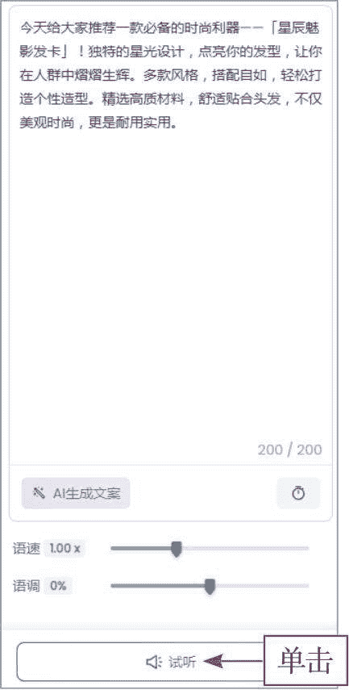

图 4-6 试听控件位置

专业提示：若听感不满意，可重新调整数字人的发声参数，再次试听，从多次试听结果里挑出最喜欢的音色。 EXr6287u6NNVz+GYLY+7SLdV5cAPg2JMkmgLwLU5b15LS/lN9qH5Jh3HVnEAOCeJfEYCIWC13bIAXG/lB/bSww==

## 4.3 Kreado AI 制作数字人口播素材

虚拟数字主播是由计算机建模的拟人形象，承担直播或录播的主持任务。这类形象拥有逼真的面部、表情与声线，还能与观众互动。以下演示在 Kreado AI 中制作口播素材的完整流程。

扫码看视频

 第一步 激活  控件，将视频标题修改为“数字人口播素材”，并开启绿幕模式，见图 4-7。

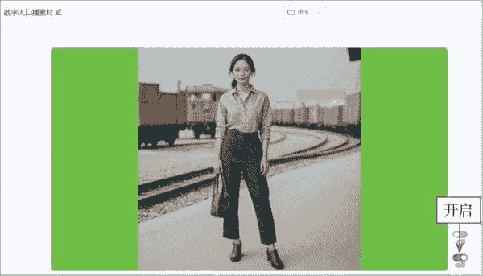

图 4-7 绿幕模式开启界面

 第二步 在页面左上方触发“生成视频”功能，见图 4-8。

图 4-8 生成视频入口

 第三步 弹出生成对话框后，按下“开始生成视频”，参考图 4-9。

 第四步 完成后点击用户名，在下拉菜单中进入“我的项目”，见图 4-10。

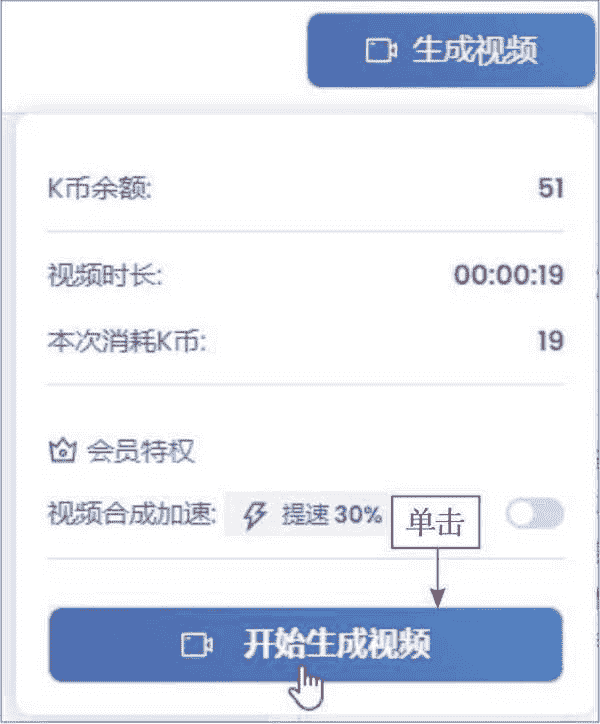

图 4-9 开始生成按钮

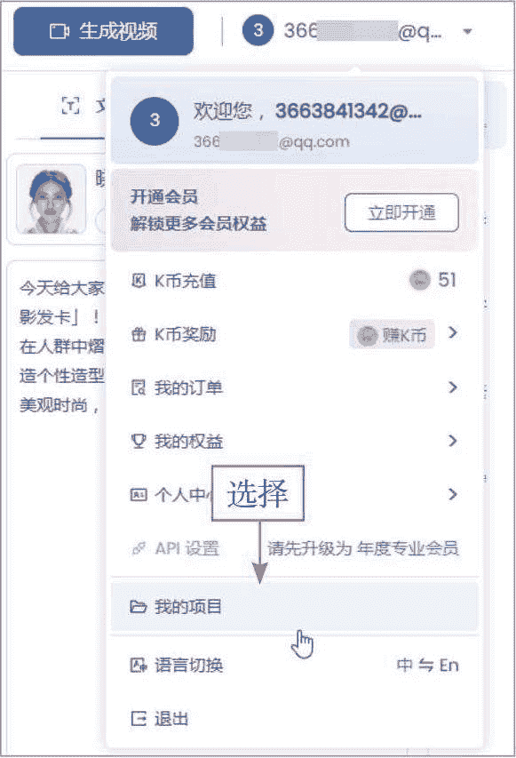

图 4-10 我的项目入口

 第五步 进入“我的项目”后，即可查阅已完成的数字人口播文件，详见图 4-11。

图 4-11 项目列表中的素材预览

 第六步 在项目页点击“下载高清视频”按钮  ，见图 4-12，把素材导出到本地保存。

图 4-12 高清下载按钮所在位置  EXr6287u6NNVz+GYLY+7SLdV5cAPg2JMkmgLwLU5b15LS/lN9qH5Jh3HVnEAOCeJfEYCIWC13bIAXG/lB/bSww==

## 4.4 剪映合成数字人口播带货视频

Kreado AI 输出的口播素材自带绿幕背景，后续可用剪映等工具进行合成，比如更换背景或赋予电商风格。下面说明在剪映电脑版中的具体操作。

扫码看视频

 第一步 在剪映导入数字人口播与背景素材，分层放置，并把背景时长拉伸至与口播素材一致，见图 4-13。

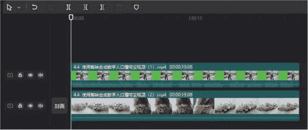

图 4-13 背景时长匹配操作

 第二步 若素材自带杂乱背景，可按需裁剪。选中口播素材后，点击“裁剪比例”控件  ，见图 4-14。

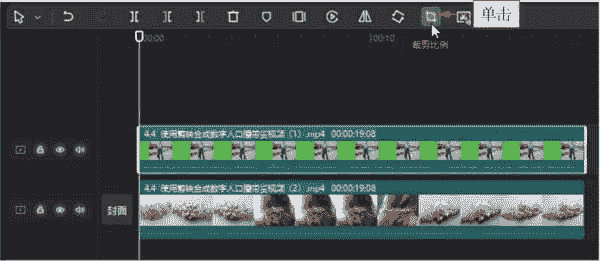

图 4-14 裁剪比例控件位置 

 第三步 在弹出的裁剪窗口中框选画面，点击“确定”完成裁剪，见图 4-15。

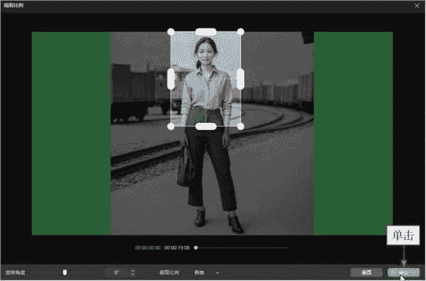

图 4-15 裁剪确认界面

 第四步 再次选中口播素材，微调位置与大小，完成基础制作。随后点击右上角“导出”按钮，见图 4-16，开始输出。

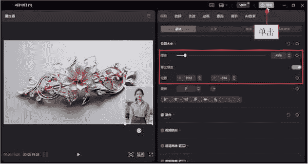

图 4-16 导出入口

 第五步 在导出设置面板里配置输出参数，点击“导出”即可保存成品。图 4-17 展示了最终的数字人口播带货视频呈现。

图 4-17 数字人口播带货视频成品 EXr6287u6NNVz+GYLY+7SLdV5cAPg2JMkmgLwLU5b15LS/lN9qH5Jh3HVnEAOCeJfEYCIWC13bIAXG/lB/bSww==

# 第五章

《探店打卡视频》：借助 FlexClip 模板生成

FlexClip 是一款浏览器视频编辑工具，支持挑选模板并替换自有素材快速成片。可先用 ChatGPT 写文案，再根据文案生成配图，最后把图片填入 FlexClip 模板完成视频。

扫码看效果 EXr6287u6NNVz+GYLY+7SLdV5cAPg2JMkmgLwLU5b15LS/lN9qH5Jh3HVnEAOCeJfEYCIWC13bIAXG/lB/bSww==

## 5.1 ChatGPT 撰写探店打卡文案

制作探店打卡视频前，可先借助 ChatGPT 产出文案，具体如下。

扫码看视频

 提问

请生成一篇关于咖啡店的探店打卡文案，要求：说清楚店内环境和代表性的产品，150 字左右。

 ChatGPT

探寻城市一隅，发现“悠馨咖啡屋”，如一处宁静的艺术殿堂。落地窗边的舒适沙发、淡雅的绿植，构成了清新自然的室内风光。店内弥漫着浓郁的咖啡香，手冲咖啡是这里的代表，深厚香醇，每一杯都是独一无二的体验。特色甜点“绵绵蜜语”更是一绝，松软细腻，令人回味无穷。独特的手作艺品角落更是吸引眼球。在这里，咖啡不仅是饮品，更是一场放慢脚步的艺术之旅。一杯香醇咖啡，一份精致甜点，让每一位探店的你，在悠馨咖啡屋找到心灵的宁静与享受。 EXr6287u6NNVz+GYLY+7SLdV5cAPg2JMkmgLwLU5b15LS/lN9qH5Jh3HVnEAOCeJfEYCIWC13bIAXG/lB/bSww==

## 5.2 Midjourney 制作探店打卡配图

文案确定后，可结合内容在 Midjourney 中生成配套图片，作为视频素材。具体流程如下。

扫码看视频

 第一步 复制文案中的一段，例如第二句，粘贴到百度翻译，并在前面加上“咖啡店”等限定词，翻译成英文，见图 5-1。

图 5-1 文案片段加词后翻译

 第二步 选中译文后右键，选择快捷菜单里的“复制”，见图 5-2。

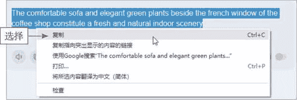

图 5-2 复制选项

 第三步 在 Midjourney 底部的输入框键入“/”，选择 /imagine 指令，将刚复制的英文粘贴进去，并追加参数 8K --ar 16∶9，代表 8K 分辨率与 16:9 比例，见图 5-3。

图 5-3 关键词与参数输入

 第四步 按回车发送，系统会生成四张预览图，点击对应的 U 键，如 U3，挑选满意的一张，见图 5-4。

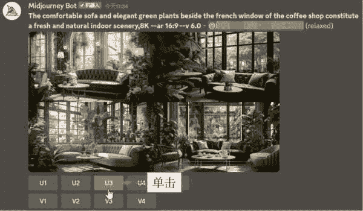

图 5-4 点击 U3 放大

 第五步 执行后，Midjourney 会基于第三张图进行细节优化并放大显示，见图 5-5。

 第六步 用同样方式，借助文案其他片段生成更多图片，留作素材库。

图 5-5 放大后的细节呈现 EXr6287u6NNVz+GYLY+7SLdV5cAPg2JMkmgLwLU5b15LS/lN9qH5Jh3HVnEAOCeJfEYCIWC13bIAXG/lB/bSww==

## 5.3 FlexClip 模板进入编辑界面

FlexClip 模板资源丰富，可按分类挑选。下面介绍使用模板制作视频的流程。

扫码看视频

 第一步 登录 FlexClip 后进入“模板”页，点击“商业服务”右侧的下拉箭头，从列表中选择“咖啡店”，见图 5-6。

图 5-6 咖啡店分类

 第二步 页面会展示所有相关模板，挑选合适模板后点击“定制”按钮，见图 5-7。

图 5-7 定制入口

 第三步 点击后打开所选模板并进入编辑界面，见图 5-8。

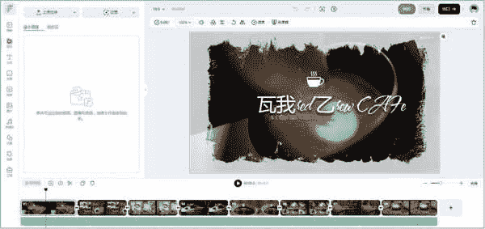

图 5-8 编辑界面预览

专业提示：FlexClip 的文字多为自动网络翻译，可能出现译文不准导致乱码。可暂时忽略，后续会根据自有素材对字幕进行调整。 EXr6287u6NNVz+GYLY+7SLdV5cAPg2JMkmgLwLU5b15LS/lN9qH5Jh3HVnEAOCeJfEYCIWC13bIAXG/lB/bSww==

## 5.4 FlexClip 删除场景并替换素材

模板通常包含多段场景，可根据素材数量删减。调整后再上传自有素材替换。下面说明操作。

扫码看视频

 第一步 在时间线面板中选中第 8 段场景，点击“删除”按钮  ，见图 5-9，即可移除。

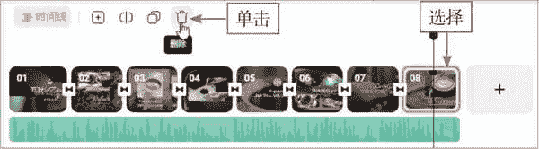

图 5-9 删除按钮位置 

 第二步 采用同样方法，删除第 2、3、4、6 段场景，因其包含多图层无法直接替换，保留三段可用场景，见图 5-10。

图 5-10 保留的三段场景

 第三步 在媒体面板点击“上传文件”按钮，见图 5-11。

图 5-11 上传文件入口

 第四步 在打开对话框中选择对应图片，点击“打开”完成上传，见图 5-12。

图 5-12 打开按钮操作示意

 第五步 用鼠标左键抓住首张素材，拖拽到第一段落的场景区域内松手，完成替换，效果详见图 5-13。

图 5-13 首张素材放入第一段场景的说明

 第六步 参照相同手法，把其余素材依次替换进对应场景，整体呈现如图 5-14。

图 5-14 其他素材替换后的画面

 第七步 将剩余素材拖曳至  按钮上方，使其作为全新场景加入时间轴，参考图 5-15。

图 5-15 素材增添为新场景的示例

 第八步 延续前述方式，把最后一张素材也纳入视频轨成为独立场景，最终效果见图 5-16。

图 5-16 末张素材添加为场景的最终形态 EXr6287u6NNVz+GYLY+7SLdV5cAPg2JMkmgLwLU5b15LS/lN9qH5Jh3HVnEAOCeJfEYCIWC13bIAXG/lB/bSww==

## 5.5 FlexClip 模板字幕编辑方法

FlexClip 模板自带字幕，多数为英文且与自有素材匹配度不高，需手动调整。下面说明修改思路。

扫码观看演示

 第一步 选中首个段落，删去多余字幕条，将保留的字幕文本改写成所需内容，示意见图 5-17。

图 5-17 字幕文本修改界面

 第二步 调整字幕轨道时长，让画面节奏更舒服，参考图 5-18。

图 5-18 字幕轨道长度调整示例

 第三步 依同样逻辑处理其余段落的字幕，整理后的效果如图 5-19。

图 5-19 其余段落字幕调整后呈现 EXr6287u6NNVz+GYLY+7SLdV5cAPg2JMkmgLwLU5b15LS/lN9qH5Jh3HVnEAOCeJfEYCIWC13bIAXG/lB/bSww==

## 5.6 FlexClip 转场添加与导出流程

场景导入后，可在相邻段落间加入转场提升连贯性。以下为具体操作。

扫码观看演示

 第一步 点选相邻两段新素材之间的“过渡”图标  ，如图 5-20 所示。

图 5-20 点选“过渡”图标 

 第二步 在弹出的转场面板中挑选合适效果，例如滑动样式，如图 5-21。

图 5-21 滑动转场样式选择

 第三步 完成设置后，  按钮会变为  按钮，表示转场已生效，如图 5-22。

图 5-22 转场生效提示

 第四步 转场确认后即可导出，点按页面右上角的“出口”图标，如图 5-23。

图 5-23 点按“出口”图标

 第五步 在弹出设置面板中设定导出参数，点按“导出带水印”选项，如图 5-24。

图 5-24 点按“导出带水印”选项

 第六步 系统开始渲染，完成后点按“下载视频”即可保存文件，如图 5-25。

图 5-25 点按“下载视频”选项

 第七步 下载完毕后打开对应文件夹即可预览成品。图 5-26 为使用模板制作的《探店打卡视频》样例。

图 5-26 模板生成的《探店打卡视频》样例 EXr6287u6NNVz+GYLY+7SLdV5cAPg2JMkmgLwLU5b15LS/lN9qH5Jh3HVnEAOCeJfEYCIWC13bIAXG/lB/bSww==

# 第六章

《花卉照片欣赏》：借助必剪实现自主创作

必剪功能齐全，基础剪辑与智能特效兼顾。先用 ChatGPT 撰写文案，再基于文案生成图像素材，最后在必剪中合成视频。

扫码查看效果 EXr6287u6NNVz+GYLY+7SLdV5cAPg2JMkmgLwLU5b15LS/lN9qH5Jh3HVnEAOCeJfEYCIWC13bIAXG/lB/bSww==

## 6.1 ChatGPT 撰写花卉描写文案

制作《花卉照片欣赏》时，可先借助 ChatGPT 生成花卉描述，具体如下。

扫码观看演示

 提问

请用 100 字左右的文案简单描述某张玫瑰花的照片。

 ChatGPT

这张玫瑰花照片，如一曲悠扬的恋歌。花瓣绽放，如羽翼轻轻展开，红艳欲滴。微风拂过，花瓣舞动，如诗如画。清晨的露珠点缀其中，晶莹剔透。花蕊深邃，散发出淡淡的芬芳。整个画面宛如一幅自然的杰作，捕捉到了花朵的柔美和生命的灿烂。

按相同思路生成其余花卉的描述，为后续出图做准备。 EXr6287u6NNVz+GYLY+7SLdV5cAPg2JMkmgLwLU5b15LS/lN9qH5Jh3HVnEAOCeJfEYCIWC13bIAXG/lB/bSww==

## 6.2 Midjourney 生成花卉图像

获得文案后，可结合内容在 Midjourney 中生成对应图像作素材，具体步骤如下。

扫码观看演示

 第一步 复制文案内容，用百度翻译润色并译成英文，如图 6-1。

图 6-1 文案润色并翻译成英文示意

 第二步 选中翻译后的英文，右击选择“复制”，如图 6-2。

 第三步 在 Midjourney 输入框键入“/”，选择 /imagine，将复制的英文粘贴进去并追加参数如 4K --ar 3∶4，如图 6-3。

图 6-2 选择“复制”选项

图 6-3 粘贴英文并添加参数示意

 第四步 按回车发送，系统生成四张预览图，点按对应的 U 按钮如 U2 选择满意结果，如图 6-4。

图 6-4 点按 U2 按钮

 第五步 执行后，Midjourney 会在所选图基础上精细化并放大，如图 6-5。

 第六步 参照上述流程生成其余花卉图，留作视频素材。

图 6-5 放大后的图像效果 EXr6287u6NNVz+GYLY+7SLdV5cAPg2JMkmgLwLU5b15LS/lN9qH5Jh3HVnEAOCeJfEYCIWC13bIAXG/lB/bSww==

## 6.3 必剪导入花卉图像素材

将 Midjourney 生成的图像导入必剪做成视频，步骤如下。

扫码观看演示

 第一步 打开必剪 App，在“创作”页点选“开始创作”，如图 6-6。

 第二步 进入“最近项目”页面，如图 6-7。

图 6-6 点选“开始创作”按钮

图 6-7 进入“最近项目”界面

 第三步 选择对应图像素材，点选前进按钮，如图 6-8。

 第四步 执行后图像即被转为视频片段，如图 6-9。

图 6-8 点选前进按钮

图 6-9 图像转为视频片段示意

提示：必剪会按素材挑选顺序生成视频，选择时务必注意先后顺序。 EXr6287u6NNVz+GYLY+7SLdV5cAPg2JMkmgLwLU5b15LS/lN9qH5Jh3HVnEAOCeJfEYCIWC13bIAXG/lB/bSww==

## 6.4 必剪优化花卉视频呈现

图像转视频后，可继续在必剪中调整呈现效果，步骤如下。

扫码观看演示

 第一步 选择视频中冗余片段，点按  按钮，如图 6-10。

 第二步 在确认删除弹窗中点按“确定”，如图 6-11，即可移除多余素材。

图 6-10 点按  按钮

图 6-11 点按“确定”按钮

 第三步 点按第一段与第二段素材之间的  按钮，如图 6-12。

 第四步 在“视频转场”面板中挑选合适效果，点按“应用全部”按钮，如图 6-13，将转场应用到剩余片段。

 第五步 点按  按钮退出转场面板，将时间轴拖至视频起点，点按工具栏中的“音频”按钮，如图 6-14。

 第六步 进入音乐库，选择合适风格如“国风”，如图 6-15。

图 6-12 首段与二段素材之间出现的  按钮

图 6-13 “应用全部”按钮示意

图 6-14 工具栏中的“音频”入口

图 6-15 “国风”风格选项

 步骤 7 进入国风专区后挑选想要的伴奏起点，随后确认“使用”，详见图 6-16。

 步骤 8 完成上述设定后，系统会自所选起点展开，并在时长上与成品视频保持一致，见图 6-17。

图 6-16 “使用”按钮位置

图 6-17 与视频时长匹配的伴奏效果

 步骤 9 按下  按钮可预览《花卉照片欣赏》的成片，图 6-18 所示；若满意则点选“导出”，设置参数后保存。

图 6-18 《花卉照片欣赏》预览画面

图 6-18 《花卉照片欣赏》预览画面续览

提示：必剪配乐时会从指定起点截取并拉伸至与视频等长，这可能导致节奏与画面错位，建议多试几个起点选出最和谐的段落。 EXr6287u6NNVz+GYLY+7SLdV5cAPg2JMkmgLwLU5b15LS/lN9qH5Jh3HVnEAOCeJfEYCIWC13bIAXG/lB/bSww==

# 第七章

《美少女变身》：必剪模板一键成片

除原创剪辑外，还能借助必剪内建模板快速成片。思路是先用 ChatGPT 写文案，再把文案转成图，最后在必剪里套用模板输出。

扫码看效果 EXr6287u6NNVz+GYLY+7SLdV5cAPg2JMkmgLwLU5b15LS/lN9qH5Jh3HVnEAOCeJfEYCIWC13bIAXG/lB/bSww==

## 7.1 使用 ChatGPT 生成美少女描述文案

制作本期《美少女变身》时，先让 ChatGPT 输出人物外貌描述，示例如下。

扫码看视频

 提问

请用 100 字左右的文案简单描述某位中国美少女的外貌。

 ChatGPT

她是一位中国美少女，清新脱俗的容颜宛如画中仙子。眸子晶莹灵动，透露出纯真与灵性。秀发如瀑，黑亮柔顺，微微飘逸。精致的五官，微笑间洋溢着甜美。肌肤白皙如玉，散发着淡淡花香。她既有东方女性的典雅，又透露着现代时尚的氛围，是一位兼具经典与时尚之美的中国美少女。 EXr6287u6NNVz+GYLY+7SLdV5cAPg2JMkmgLwLU5b15LS/lN9qH5Jh3HVnEAOCeJfEYCIWC13bIAXG/lB/bSww==

## 7.2 使用 Midjourney 生成美少女的照片

获得描述后，可依据内容在 Midjourney 中产出对应图像作为素材，具体流程如下。

扫码看视频

 步骤 1 复制文案并粘贴进百度翻译，转换为英文表述，如图 7-1 所示。

图 7-1 文案转英文示意

 步骤 2 将翻译结果选中后右键，选择拷贝操作，如图 7-2 所示。

图 7-2 拷贝选项界面

 步骤 3 在 Midjourney 输入区输入“/”，调出 /imagine，将刚拷贝的英文粘贴进去，再加上参数如 4K --ar 3∶4，表示 4K 高清且比例 3∶4，如图 7-3 所示。

图 7-3 粘贴英文并添加参数

 步骤 4 回车发送后会得到四张初稿，按需点选对应的 U 标，如 U2，保留较满意的一张，如图 7-4 所示。

图 7-4 选择 U2 进行放大

 步骤 5 执行后 Midjourney 会以第二张为基准进行精修并放大清晰度，如图 7-5 所示。

图 7-5 放大后的图像 EXr6287u6NNVz+GYLY+7SLdV5cAPg2JMkmgLwLU5b15LS/lN9qH5Jh3HVnEAOCeJfEYCIWC13bIAXG/lB/bSww==

## 7.3 使用必剪搜索模板生成变身视频

图片准备好后，可在必剪中检索模板套用，操作如下。

扫码看视频

 步骤 1 打开必剪的“创作”页，点进“模板”入口，如图 7-6 所示。

 步骤 2 进入模板中心后点开顶部搜索栏，如图 7-7 所示。

图 7-6 “模板”入口

图 7-7 顶部搜索栏

 步骤 3 在搜索栏输入关键词并检索，从结果中挑选合适的模板，如图 7-8 所示。

 步骤 4 进入预览页查看效果后，按下“剪同款”进入制作，如图 7-9 所示。

图 7-8 模板挑选界面

图 7-9 “剪同款”入口

 步骤 5 在“最近项目”页连续两次选用同一张源图，再按“下一步”，如图 7-10 所示。

 步骤 6 系统会依据所选素材与模板自动合成一段短片，如图 7-11 所示。

图 7-10 “下一步”操作

图 7-11 模板合成后的视频

 步骤 7 合成完成后进入预览，确认满意后点“导出”保存文件。图 7-12 为最终的《美少女变身》示例。

图 7-12 必剪模板生成的《美少女变身》效果 EXr6287u6NNVz+GYLY+7SLdV5cAPg2JMkmgLwLU5b15LS/lN9qH5Jh3HVnEAOCeJfEYCIWC13bIAXG/lB/bSww==

# 第八章

《热门卡点视频》：快影剪同款速成

快影作为快手旗下剪辑 App，提供“剪同款”功能，能用图片快速生成趣味卡点片并一键分享。整体思路是先用 ChatGPT 写描述，再生成图，最后在快影剪同款中套用。

扫码看效果 EXr6287u6NNVz+GYLY+7SLdV5cAPg2JMkmgLwLU5b15LS/lN9qH5Jh3HVnEAOCeJfEYCIWC13bIAXG/lB/bSww==

## 8.1 使用 ChatGPT 生成图片的描述文案

制作《热门卡点视频》时，先让 ChatGPT 输出人物描述，示例如下。

扫码看视频

 提问

请用 80 字左右的文案简单描述某位中国青年的外貌。

 ChatGPT

他是一位中国青年，清澈眸子透着青春活力。略带休闲的发型，五官端正，流露出阳光自信。身形修长，穿着得体，显现出时尚品位。微笑间洋溢着青春的朝气，是个充满活力的中国青年。 EXr6287u6NNVz+GYLY+7SLdV5cAPg2JMkmgLwLU5b15LS/lN9qH5Jh3HVnEAOCeJfEYCIWC13bIAXG/lB/bSww==

## 8.2 使用 Midjourney 生成卡点视频的图片

得到文案后，可在 Midjourney 中据此生成图像作为素材，具体如下。

扫码看视频

 步骤 1 复制文案并粘贴到百度翻译，译成英文，如图 8-1 所示。

图 8-1 文案英文翻译

 步骤 2 选中译文右键，选择复制，如图 8-2 所示。

图 8-2 复制操作

 步骤 3 在 Midjourney 输入框输入“/”，选择 /imagine，粘贴英文并追加参数如 4K --ar 3∶4，意为 4K 高清、比例 3∶4，如图 8-3 所示。

图 8-3 参数添加界面

 步骤 4 回车后生成四张草图，选择对应 U 标识，如 U2，保留满意图，如图 8-4 所示。

图 8-4 选择 U2 放大

 步骤 5 随后系统会在第二张基础上精细化并放大，如图 8-5 所示。

图 8-5 放大后效果 EXr6287u6NNVz+GYLY+7SLdV5cAPg2JMkmgLwLU5b15LS/lN9qH5Jh3HVnEAOCeJfEYCIWC13bIAXG/lB/bSww==

## 8.3 使用快影剪同款生成热门卡点视频

快影的“剪同款”内置大量模板，可直接套用制作卡点片，具体步骤如下。

扫码看视频

 步骤 1 进入快影“剪辑”页，点击“剪同款”入口，如图 8-6 所示。

 步骤 2 进入剪同款中心后点开顶部搜索框，如图 8-7 所示。

图 8-6 “剪同款”入口

图 8-7 顶部搜索框

 步骤 3 在搜索框输入关键词检索，选择心仪模板，如图 8-8 所示。

 步骤 4 进入预览页后点击“制作同款”开始制作，如图 8-9 所示。

图 8-8 模板选择

图 8-9 “制作同款”按钮

 完成前序操作后，画面会切换到“最近项目”列表，确认好想要的素材后按下“选好了”，如图 8-10 所示，系统随即开始生成视频。
 稍作等待即可进入可编辑的模板界面，能够对画面素材、背景音乐、文字说明以及封面进行微调，满意之后点右上角“做好了”即可结束编辑，如图 8-11 所示。

图 8-10 “选好了”按钮位置示意

图 8-11 “做好了”按钮位置示意

 进行到第7步会弹出“导出选项”窗口，窗口内提供“无水印导出并分享”的选项，完成保存即可。图 8-12 展示了借助快影 App 剪同款功能制作的《热门卡点视频》呈现效果。

图 8-12 快影 App 剪同款功能制作的《热门卡点视频》效果 EXr6287u6NNVz+GYLY+7SLdV5cAPg2JMkmgLwLU5b15LS/lN9qH5Jh3HVnEAOCeJfEYCIWC13bIAXG/lB/bSww==

# 第九章

快影打造 AI 婚纱短片

快影的“特效玩法”收录了多种 AI 绘画风格，很适合用来制作 AI 婚纱类短片；配合其它功能还能做出前后变身的反差感。整体思路是先让 ChatGPT 撰写文案，再基于文案生成图像素材，最后在快影中挑选合适的 AI 绘画风格把图像套入模板，即可得到《AI 婚纱视频》。

扫码看效果 EXr6287u6NNVz+GYLY+7SLdV5cAPg2JMkmgLwLU5b15LS/lN9qH5Jh3HVnEAOCeJfEYCIWC13bIAXG/lB/bSww==

## 9.1 用 ChatGPT 撰写人像描述文案

制作 AI 婚纱影片时，通常先让 ChatGPT 输出一段人像描写，示范如下。

扫码看视频

 提问

请用 80 字左右的文案简单描述某位年轻女性的外貌。

 ChatGPT

她是一位年轻女性，明亮眼眸透着清新。柔顺长发如瀑，微微飘动。精致五官，微笑间洋溢着青春的甜美。修长身材展现健康活力，时尚穿搭彰显品位。她是个兼具优雅与朝气的现代女性。 EXr6287u6NNVz+GYLY+7SLdV5cAPg2JMkmgLwLU5b15LS/lN9qH5Jh3HVnEAOCeJfEYCIWC13bIAXG/lB/bSww==

## 9.2 通过 Midjourney 生成人像图

拿到文案后，可结合内容在 Midjourney 中生成对应的人像图作为视频素材，操作流程如下。

扫码看视频

 首步 将生成的文案复制出来，粘贴到百度翻译进行英文转换，如图 9-1 所示。

图 9-1 文案翻译成英文界面

 次步 选中翻译后的英文，右键打开菜单选择“复制”，如图 9-2 所示。

图 9-2 复制选项示意

 第三步 在 Midjourney 输入区输入 “/”，选择 /imagine 指令，把刚才复制的英文粘贴进去，并补充参数如 4K --ar 3∶4，意为 4K 超清、纵横比 3∶4，如图 9-3 所示。

图 9-3 粘贴英文关键词并增加参数

 第四步 按下【Enter】发送后，系统会产出四张候选图，点击对应的 U 键，例如 U1，挑选较为满意的一张，如图 9-4 所示。

图 9-4 点击 U1 进行放大

 第五步 执行后，Midjourney 会在所选画面基础上进行精细刻画并放大效果，如图 9-5 所示。

图 9-5 放大后的画面效果 EXr6287u6NNVz+GYLY+7SLdV5cAPg2JMkmgLwLU5b15LS/lN9qH5Jh3HVnEAOCeJfEYCIWC13bIAXG/lB/bSww==

## 9.3 快影特效玩法制作 AI 婚纱视频

将 Midjourney 生成的图片导入快影，利用“特效玩法”即可完成趣味视频。具体步骤如下。

扫码看视频

 首步 打开快影，进入“创作”界面，触发“开始剪辑”按钮，如图 9-6 所示。
 次步 进入“最近项目”页面，挑选对应图片素材，点击“选好了”按钮，如图 9-7 所示。

图 9-6 “开始剪辑”按钮位置

图 9-7 “选好了”按钮位置

 第三步 把素材拖入视频轨道，选中后点按“复制”按钮，如图 9-8 所示。
 第四步 执行后，图片素材会被复制出一个副本，如图 9-9 所示。

图 9-8 “复制”按钮位置

图 9-9 复制后的图片素材

 第五步 选中多余素材，点按“删除”按钮，如图 9-10 所示。
 第六步 将时间轴拖至视频起点，点按“音频”按钮，如图 9-11 所示。

图 9-10 “删除”按钮位置

图 9-11 “音频”按钮位置

 第七步 进入“音乐库”，在“所有分类”中选择“甜蜜”类别，如图 9-12 所示。
 第八步 进入“热门分类”下的“甜蜜”标签页，挑选合适音乐并拖动时间轴确定起始点，点按“使用”按钮，如图 9-13 所示。

图 9-12 选择“甜蜜”分类

图 9-13 “使用”按钮位置

 第九步 音乐会自动加入音频轨道并按视频时长裁剪。将时间轴移动到第二段素材开头，点按工具栏的“特效”按钮，如图 9-14 所示。
 第十步 在特效工具栏中点按“特效玩法”按钮，如图 9-15 所示。

图 9-14 “特效”按钮位置

图 9-15 “特效玩法”按钮位置

 第十一歩 弹出“特效玩法”面板，在“热门”标签页中选择“AI 婚纱”玩法，点击  按钮，如图 9-16 所示。
 第十二步 执行后，第二段素材会被赋予 AI 绘画效果，如图 9-17 所示。

图 9-16 点击  按钮

图 9-17 第二段素材的 AI 绘画效果

 第十三步 点按右上角“做好了”按钮，在弹出的“导出选项”面板中点击  按钮，即可保存视频。图 9-18 展示了使用快影特效玩法生成的《AI 婚纱视频》效果。

图 9-18 快影特效玩法生成的《AI 婚纱视频》效果 EXr6287u6NNVz+GYLY+7SLdV5cAPg2JMkmgLwLU5b15LS/lN9qH5Jh3HVnEAOCeJfEYCIWC13bIAXG/lB/bSww==

# 第十章

餐厅新品推介·剪映图文成片实操

剪映电脑版的“图文成片”可根据用户提供的文案自动匹配配图与视频素材，并生成字幕、配音与背景音乐，实现从文本到视频的转换。可先用 ChatGPT 生成文案，再在剪映中生成初稿并替换不合适的素材，即可完成《餐厅新品分享》。

扫码看效果 EXr6287u6NNVz+GYLY+7SLdV5cAPg2JMkmgLwLU5b15LS/lN9qH5Jh3HVnEAOCeJfEYCIWC13bIAXG/lB/bSww==

## 10.1 用 ChatGPT 生成餐厅新品文案

制作《餐厅新品分享》时，可先借助 ChatGPT 产出餐厅新品文案，具体如下。

扫码看视频

 提问

请为我生成一个餐厅新品分享的文案，要求：重点介绍几种湘菜。

 ChatGPT

探寻湘菜的绝妙滋味，我们餐厅热情推出新品！首先有“湘水麻辣鱼”，鲜嫩的鱼肉在麻辣汤底中翻滚，香气四溢。其次是“剁椒排骨煲”，排骨入味鲜香，剁椒独特风味。再品“湘味酸辣粉”，酸爽辣香，唤醒味蕾。湖南美食独特魅力，新品尽在我们的菜单，邀您一同享受湘菜的精致与美味！ EXr6287u6NNVz+GYLY+7SLdV5cAPg2JMkmgLwLU5b15LS/lN9qH5Jh3HVnEAOCeJfEYCIWC13bIAXG/lB/bSww==

## 10.2 用 Midjourney 生成新品图片

文案生成后，可结合内容在 Midjourney 中制作对应图片作为视频素材，流程如下。

扫码看视频

 首步 复制部分文案内容，粘贴到百度翻译做简单调整并翻译成英文，如图 10-1 所示。

图 10-1 文案调整并翻译成英文

 次步 选中翻译后的英文，右键打开快捷菜单选择“复制”，如图 10-2 所示。

图 10-2 选择复制选项

 第三步 在 Midjourney 输入区输入 “/”，选择 /imagine，将复制的英文粘贴进去，并添加参数如 4K --ar 16∶9，表示 4K 超清、横纵比 16∶9，如图 10-3 所示。

图 10-3 粘贴关键词并添加参数

 第四步 按【Enter】发送后会生成四张图片，点击对应的 U 键，如 U4，挑选满意的一张，如图 10-4 所示。

图 10-4 点击 U4 放大

 第五步 执行后，Midjourney 会在第四张图基础上进行细化并放大，如图 10-5 所示。

图 10-5 放大后的图片效果 EXr6287u6NNVz+GYLY+7SLdV5cAPg2JMkmgLwLU5b15LS/lN9qH5Jh3HVnEAOCeJfEYCIWC13bIAXG/lB/bSww==

## 10.3 使用剪映图文成片生成新品视频

餐厅新品文案 快速成片指南

把 ChatGPT 产出的餐厅新品文案迅速变成本可发布的短片，借助剪映桌面版的图文合成功能几分钟就能拿到初版，具体流程如下。

扫描二维码即可观看演示

 第一步 打开剪映 PC 客户端，在主页面找到并点选「图文成片」入口，可参考图 10-6 的示意。

图 10-6 单击“图文成片”按钮

 第二步 弹出对话框后，选取「自由编辑文案」模式，见图 10-7。

图 10-7 选择“自由编辑文案”选项

 第三步 在文案编辑窗口粘贴 ChatGPT 输出的文案做轻微润色，点「生成视频」，在成片方式列表里勾选「智能匹配素材」，如图 10-8 所示。

图 10-8 选择“智能匹配素材”选项

 第四步 稍作等待，剪映会自动从素材库调取画面，按文案内容拼接出初稿雏形，效果见图 10-9。

图 10-9 生成视频的雏形 EXr6287u6NNVz+GYLY+7SLdV5cAPg2JMkmgLwLU5b15LS/lN9qH5Jh3HVnEAOCeJfEYCIWC13bIAXG/lB/bSww==

## 10.4 新品视频细节优化

自动生成的片段有时会出现不理想的情况，可以手动替换画面并加入滤镜来提升质感，具体做法如下。

扫描二维码观看演示

 第一步 将光标停留在首个素材上右键，点击快捷菜单中的「替换片段」，如图 10-10，能把图文不符的画面换掉。

图 10-10 选择“替换片段”选项

 第二步 在弹出的媒体资源选择框中挑选合适的图片，点击「打开」，见图 10-11。

 第三步 进入替换确认界面，按下「替换片段」按钮，见图 10-12。

图 10-11 单击“打开”按钮

图 10-12 单击“替换片段”按钮

 第四步 操作完成后，新图片会被填入对应片段并同步进入本地媒体库，如图 10-13 所示。

图 10-13 将图片素材替换到视频片段中

 第五步 用同样方式把其它不匹配的素材逐一更换，替换后的呈现效果如图 10-14。

图 10-14 将其他不合适的素材替换掉的效果

 第六步 点击滤镜面板，切到「美食」分类，见图 10-15。

 第七步 选择心仪的滤镜后，点击右下角的「添加到轨道」按钮  ，如图 10-16 所示。

图 10-15 切换至“美食”选项卡

图 10-16 单击“添加到轨道”按钮 

 第八步 执行后可看到滤镜作用范围的显示，如图 10-17。

图 10-17 显示对应滤镜的使用范围

 第九步 拖动范围使其覆盖整段内容，如图 10-18。

图 10-18 将滤镜应用到整个视频中

 第十步 在播放器窗口点播放按钮  预览《餐厅新品分享》成片效果，如图 10-19。若满意，可点击右上角的「导出」并设置参数保存。

图 10-19 预览视频的效果 EXr6287u6NNVz+GYLY+7SLdV5cAPg2JMkmgLwLU5b15LS/lN9qH5Jh3HVnEAOCeJfEYCIWC13bIAXG/lB/bSww==

# 第十一章
宠物日常展示：模板一键成片

剪映 App 提供了大量现成模板，可直接套用。先由 ChatGPT 写好宠物相关文案，再依据文案生成配图，最后在剪映中挑选模板套用，即可快速得到《宠物日常展示》视频。

扫码看效果 EXr6287u6NNVz+GYLY+7SLdV5cAPg2JMkmgLwLU5b15LS/lN9qH5Jh3HVnEAOCeJfEYCIWC13bIAXG/lB/bSww==

## 11.1 ChatGPT 速写宠物日常脚本

制作《宠物日常展示》前，可先让 ChatGPT 输出相关文案，为后续绘图做准备，具体如下。

扫描二维码观看演示

 提问

请为我生成一个展现宠物日常活动画面的文案。

 ChatGPT

晨光透过窗帘洒在地板上，一只小猫懒洋洋地舒展身躯，迎接新的一天。小狗在花园里追逐球，欢快的叫声回荡着。客厅里，鹦鹉聪明地学着主人的口音说话。午后，猫咪窝在窗台晒太阳，窗外的鸟儿叽叽喳喳，勾起它的好奇心。家里弥漫着欢笑声和宠物们调皮的足迹，构成了一幅温馨、活泼的宠物画卷。 EXr6287u6NNVz+GYLY+7SLdV5cAPg2JMkmgLwLU5b15LS/lN9qH5Jh3HVnEAOCeJfEYCIWC13bIAXG/lB/bSww==

## 11.2 Midjourney 生成宠物配图

得到描述后，可结合文案在 Midjourney 中制作对应画面，作为视频素材备用，流程如下。

扫描二维码观看演示

 第一步 复制文案中一段描述，例如首句，先在百度翻译中做微调并译成英文，见图 11-1。

图 11-1 将文案内容进行调整并翻译成英文词汇

 第二步 选中译文后右键复制，见图 11-2。

图 11-2 选择“复制”选项

 第三步 在 Midjourney 输入框键入「/」，选择 /imagine，粘贴英文并追加参数如 4K --ar 16∶9，见图 11-3。

图 11-3 粘贴复制的英文词汇并添加相关的参数词汇

 第四步 回车发送后会得到四张结果，点击对应 U 按钮如 U4 挑选满意作品，见图 11-4。

图 11-4 单击 U4 按钮

 第五步 执行后 Midjourney 会基于第四张图进行精细刻画并放大，见图 11-5。

图 11-5 放大图片效果

 第六步 按相同流程生成其余宠物图，留作素材备用。 EXr6287u6NNVz+GYLY+7SLdV5cAPg2JMkmgLwLU5b15LS/lN9qH5Jh3HVnEAOCeJfEYCIWC13bIAXG/lB/bSww==

## 11.3 剪映模板合成宠物展示片

剪映的「模板」功能可快速生成各类视频，且支持替换素材，轻松制作《宠物日常展示》，步骤如下。

扫描二维码观看演示

 第一步 启动剪映电脑版，在首页左侧导航点击「模板」按钮，见图 11-6。

图 11-6 单击“模板”按钮

 第二步 进入模板页后设置筛选条件，方便定位合适模板，见图 11-7。

图 11-7 设置模板的相关信息

 第三步 找到心仪模板后点击「使用模板」，见图 11-8。

图 11-8 单击“使用模板”按钮

 第四步 下载完成后进入编辑页，在时间线第一个片段点击「替换」按钮，见图 11-9。

图 11-9 单击“替换”按钮

 第五步 在媒体资源对话框中选择对应图片并打开，见图 11-10。

图 11-10 单击“打开”按钮

 第六步 操作后图片会加入视频轨道并导入本地库，见图 11-11。

图 11-11 将图片素材添加到视频轨道

 第七步 参照同样方法替换其余图片，即可完成制作，见图 11-12。

图 11-12 完成视频的制作

 第八步 完成后点右上角「导出」并设置参数。在播放器中点播放按钮  预览《宠物日常展示》效果，见图 11-13。

图 11-13 预览《宠物日常展示》视频的效果 EXr6287u6NNVz+GYLY+7SLdV5cAPg2JMkmgLwLU5b15LS/lN9qH5Jh3HVnEAOCeJfEYCIWC13bIAXG/lB/bSww==

# 第十二章
VLOG 片头制作：模板搜索快速上手

利用 AI 生成的文案和图片即可合成 AI 视频，剪映 App 提供了相应功能。本章介绍从文案生成、AI 绘图到用剪映把图片做成视频的完整流程。

扫码看效果 EXr6287u6NNVz+GYLY+7SLdV5cAPg2JMkmgLwLU5b15LS/lN9qH5Jh3HVnEAOCeJfEYCIWC13bIAXG/lB/bSww==

## 12.1 ChatGPT 生成 VLOG 开场文案

想做《VLOG片头视频》的话，建议先让ChatGPT帮忙写文案，为后续出图做铺垫，具体流程如下。

扫码看视频

 提问

帮我写一段VLOG文案，重点呈现三个日常画面。

 ChatGPT

1.朝阳晨跑：清晨迎着暖阳出发，记录跑步途中的风景与内心的安宁，传递运动的活力。
2.咖啡时光：午后走进巷子里的咖啡馆，细细品味浓郁咖啡，与好友闲聊生活，分享慵懒惬意的时光。
3.夕阳剪影：傍晚沿着海边漫步，捕捉落日西沉的美，感受海风吹拂带来的宁静浪漫。

这是记录我日常的VLOG，希望每个镜头都能描绘出生活的小确幸。点进来一起感受那些美好瞬间！#日常 VLOG# #生活美学# EXr6287u6NNVz+GYLY+7SLdV5cAPg2JMkmgLwLU5b15LS/lN9qH5Jh3HVnEAOCeJfEYCIWC13bIAXG/lB/bSww==

## 12.2 用 Midjourney 出图做 VLOG 素材
拿到ChatGPT生成的VLOG文案描述后，可以结合这些描述在Midjourney里生成对应图片，作为视频素材备用，具体操作如下。

扫码看视频

 步骤 1 复制文案内容，选取第一句话粘贴到百度翻译中稍作修改，再译成英文，如图 12-1 所示。

图 12-1 文案微调并翻译成英文

 步骤 2 把百度翻译生成的英文选中，右键点击，在弹出的菜单中选择“复制”，如图 12-2 所示。

 步骤 3 在Midjourney输入框里敲入“/”，选择/imagine，在框内粘贴刚才复制的英文，并加上参数如 4K --ar 16∶9，即4K高清、16∶9比例，如图 12-3 所示。

图 12-2 选择复制选项

图 12-3 粘贴英文并添加参数

 步骤 4 按【Enter】发送，系统会生成四张图片，点击对应的U键，比如U4，选择比较满意的一张，如图 12-4 所示。

图 12-4 点击U4按钮

 步骤 5 执行后，Midjourney会对第四张图进行精细化处理并放大，如图 12-5 所示。

图 12-5 图片放大效果

 步骤 6 按同样方法生成其余VLOG图片，留作备用素材。 EXr6287u6NNVz+GYLY+7SLdV5cAPg2JMkmgLwLU5b15LS/lN9qH5Jh3HVnEAOCeJfEYCIWC13bIAXG/lB/bSww==

## 12.3 用剪映模板合成 VLOG 片头
可以先在剪映里找相关模板，再把Midjourney生成的图片套进去，制作VLOG片头，具体步骤如下。

扫码看视频

 步骤 1 打开剪映电脑版，在首页左侧导航点“模板”，进入模板页，输入关键词如“VLOG 片头”来筛选类型，如图 12-6 所示。

图 12-6 输入“VLOG 片头”

 步骤 2 在搜索框下方设置模板的相关条件，对结果进行筛选，如图 12-7 所示。

图 12-7 设置筛选条件

 步骤 3 按【Enter】确认，就能找到合适的视频模板，选择后点击“使用模板”，如图 12-8 所示。

图 12-8 点击“使用模板”

 步骤 4 操作后模板下载完成并进入编辑页，在时间轴上点第一个视频片段的“替换”按钮，如图 12-9 所示。

图 12-9 点击“替换”按钮

 步骤 5 在弹出的“请选择媒体资源”对话框里选定对应图片素材，点击“打开”，如图 12-10 所示。

图 12-10 点击“打开”按钮

 步骤 6 完成后该图片会填入视频片段，同时导入本地媒体库，如图 12-11 所示。

图 12-11 图片填入视频片段

 步骤 7 按相同操作添加其余图片素材，如图 12-12 所示。

图 12-12 添加更多素材

 步骤 8 在“文本”面板修改文字，比如在“第1段文本”中填入“我的 VLOG”，如图 12-13 所示，并删掉第2段原文。

图 12-13 填写“我的 VLOG”

 步骤 9 在“播放器”窗口点播放按钮  ，即可预览《VLOG 片头视频》的效果，如图 12-14 所示。

图 12-14 预览 VLOG 片头效果 EXr6287u6NNVz+GYLY+7SLdV5cAPg2JMkmgLwLU5b15LS/lN9qH5Jh3HVnEAOCeJfEYCIWC13bIAXG/lB/bSww==

# 第十三章

《沿途风景记录》：借助剪映素材包制作

剪映的素材包相当于局部模板，通常包含特效、音效、文字和滤镜等。相比整套视频模板，素材包时长更短，更适合做片头片尾。思路是先用ChatGPT生成文案，再出图，然后把图片导入剪映App并套上素材包，就能做出《沿途风景记录》。

扫码看效果 EXr6287u6NNVz+GYLY+7SLdV5cAPg2JMkmgLwLU5b15LS/lN9qH5Jh3HVnEAOCeJfEYCIWC13bIAXG/lB/bSww==

## 13.1 用 ChatGPT 写沿途风景文案
想做《沿途风景记录》时，可先让ChatGPT写好文案，为后面出图做准备，具体如下。

扫码看视频

 提问

请帮我生成一段沿途风景记录文案，要求展示四个具体画面。

 ChatGPT

1.山川起伏：行驶在蜿蜒山路上，窗外是连绵起伏的山川，云雾缭绕，宛如仙境。
2.古老村落：穿过古朴的村庄，青瓦白墙、小桥流水，感受到岁月沉淀的宁静与古韵。
3.湖光山色：途经湖畔，湖水与山色交映，水波轻漾，倒映蓝天白云，美得像画。
4.花海迎风：经过一片花海，五彩花朵随风摇曳，散发浓郁芬芳。

这段旅程的每一帧都是大自然的馈赠。点击观看，一同领略这份风景之旅！#沿途风景# #旅途记录# EXr6287u6NNVz+GYLY+7SLdV5cAPg2JMkmgLwLU5b15LS/lN9qH5Jh3HVnEAOCeJfEYCIWC13bIAXG/lB/bSww==

## 13.2 用 Midjourney 生成路途配图
得到沿途风景的文案后，可结合内容在Midjourney里生成对应图片，作为视频素材备用，具体步骤如下。

扫码看视频

 步骤 1 复制ChatGPT生成的首句文案，粘到百度翻译里稍作调整并译成英文，如图 13-1 所示。

图 13-1 文案调整并译成英文

 步骤 2 选中翻译好的英文，右键点击，从快捷菜单中选择“复制”，如图 13-2 所示。

图 13-2 选择复制

 步骤 3 在Midjourney输入框输入“/”，选/imagine，粘贴复制的英文并加上参数如 4K --ar 16∶9，即4K高清、16∶9比例，如图 13-3 所示。

图 13-3 粘贴英文并加参数

 步骤 4 按【Enter】发送，系统会生成四张图，点击U键如U4，选择满意的图，如图 13-4 所示。

图 13-4 点击U4按钮

 步骤 5 执行后，Midjourney会基于第四张图进行精细绘制并放大，如图 13-5 所示。

图 13-5 放大效果 EXr6287u6NNVz+GYLY+7SLdV5cAPg2JMkmgLwLU5b15LS/lN9qH5Jh3HVnEAOCeJfEYCIWC13bIAXG/lB/bSww==

## 13.3 用剪映素材包做片头片尾
剪映提供多种素材包，可为已导入的图片添加素材包，快速做出片头片尾，具体操作如下。

扫码看视频

 步骤 1 打开剪映电脑版，在首页点击“开始创作”，如图 13-6 所示，开始制作。

图 13-6 点击“开始创作”

 步骤 2 进入处理界面，点击界面的“导入”按钮，如图 13-7 所示。

图 13-7 点击“导入”

 步骤 3 在弹出的“请选择媒体资源”对话框中，选定要导入的图片素材，点击“打开”，如图 13-8 所示。

图 13-8 点击“打开”按钮

 步骤 4 导入后，点击图片右下角的“添加到轨道”按钮  ，如图 13-9 所示。

 步骤 5 完成后，所有导入的图片会一并加入视频轨道，如图 13-10 所示。

 步骤 6 拖动时间轴到视频开头，展开“素材库”|“片头”，点击对应素材包右下角的“添加到轨道”按钮  ，如图 13-11 所示。

 步骤 7 完成后视频即加上片头，如图 13-12 所示。

图 13-9 点击“添加到轨道”按钮  （1）

图 13-10 图片全部加入轨道

片头片尾轻松接入

图 13-11 单击“添加到轨道”按钮  （2）

图 13-12 为视频添加一个片头

 第8步：先把时间轴拖到视频的尾部，打开素材库中的片尾分类，选中想要的素材包后点一下它右下角的“添加到轨道”按钮  ，片尾就会被挂到结尾处，效果可对照图 13-13。

图 13-13 为视频添加一个片尾 EXr6287u6NNVz+GYLY+7SLdV5cAPg2JMkmgLwLU5b15LS/lN9qH5Jh3HVnEAOCeJfEYCIWC13bIAXG/lB/bSww==

## 13.4 给视频配上剪映自带的音乐

很多从外部导入的素材本身没有音轨，借助剪映的音频功能补上背景音乐，能让成片更耐看，下面是具体操作流程。

扫码看视频

 第1步：把时间轴移动到想开始放音乐的位置，切换到音频区域，点击目标音频右下角的“添加到轨道”按钮  ，参考图 13-14。

图 13-14 单击“添加到轨道”按钮 

 第2步：添加完成后时间线上就会出现一条音乐轨，如图 13-15。这时音乐时长通常会比视频长，需要把多余的部分去掉。

图 13-15 为视频添加一个背景音乐

 第3步：把播放头移到音乐应结束的点，按下“分割”按钮  ，如图 13-16。

图 13-16 单击“分割”按钮 

 第4步：框选超出视频的那段音频，点击“删除”按钮  ，如图 13-17。

 第5步：操作后被选中的片段消失就说明裁剪成功，如图 13-18。清理掉多余音乐后，视频就算制作完成。

 第6步：在播放器窗口中点一下播放按钮  ，即可预览《沿途风景记录》的最终效果，如图 13-19。

图 13-17 单击“删除”按钮 

图 13-18 多余的背景音乐删除成功

图 13-19 预览《沿途风景记录》视频的效果 EXr6287u6NNVz+GYLY+7SLdV5cAPg2JMkmgLwLU5b15LS/lN9qH5Jh3HVnEAOCeJfEYCIWC13bIAXG/lB/bSww==

# 第十四章

房地产宣传片案例：用剪映数字人来制作

除了套模板或纯文字生成之外，剪映的数字人也能参与创作。可先在 ChatGPT 里写好文案，再在剪映 App 中让数字人配音并叠加画面，就能得到《房地产宣传片》。

扫码看效果 EXr6287u6NNVz+GYLY+7SLdV5cAPg2JMkmgLwLU5b15LS/lN9qH5Jh3HVnEAOCeJfEYCIWC13bIAXG/lB/bSww==

## 14.1 用 ChatGPT 写地产宣传文案

要做《房地产宣传片》视频，先让 ChatGPT 帮忙写一段宣传文案，为后续数字人生成做准备，具体如下。

扫码看视频

 提问

请为某个江景房生成一条宣传文案，控制在 150 字左右。

 ChatGPT

沐浴江光，江景豪宅如诗如画！窗外，璀璨夜景点亮城市，窗内，温暖灯光映衬室内奢华。尽览江水起伏，感受江风徐徐，生活在水的恬淡中。宽敞设计，尽显居住品质；私人露台，独享江畔静谧。居高临下，尽览城市繁华。品味生活，尽在这片江景尊荣之境。交通便捷，周边配套齐全。这不仅是一处房产，更是江畔恬静生活的缩影。奢适体验，与江相约，共创尊贵生活。 EXr6287u6NNVz+GYLY+7SLdV5cAPg2JMkmgLwLU5b15LS/lN9qH5Jh3HVnEAOCeJfEYCIWC13bIAXG/lB/bSww==

## 14.2 在剪映里生成宣传片数字人配音

剪映可以制作数字人并合成语音，不过要先插入一段文字素材才会出现入口，下面是操作步骤。

扫码看视频

 第1步：打开剪映电脑版，进入首页点“开始创作”新建草稿，进入编辑界面后切换到文本区，在新建文本页签里点击默认文本右下角的“添加到轨道”按钮  ，如图 14-1，表示已添加一段默认文字。

图 14-1 单击“添加到轨道”按钮 

 第2步：文字添加后操作区会出现“数字人”标签，点击进入该面板后选择喜欢的形象，再点“添加数字人”按钮，如图 14-2。

图 14-2 单击“添加数字人”按钮

 第3步：执行后所选形象会进入时间线并开始渲染。渲染完成后选中文字素材，点击“删除”按钮  ，如图 14-3，即可将其移除。

图 14-3 单击“删除”按钮 

专家提醒：在数字人形象面板的景别选项里，可调整人物在画面中的取景范围，包含远景、中景、近景和特写四种。

 第4步：选中时间线里的数字人素材，切换到文案操作区，把 ChatGPT 写好的文案复制到输入框并做少量调整，点击“确认”按钮，如图 14-4，完成文案确认。

图 14-4 单击“确认”按钮

 第5步：确认后系统会自动刷新数字人语音并完成轨道渲染，如图 14-5。

图 14-5 完成数字人轨道的渲染 EXr6287u6NNVz+GYLY+7SLdV5cAPg2JMkmgLwLU5b15LS/lN9qH5Jh3HVnEAOCeJfEYCIWC13bIAXG/lB/bSww==

## 14.3 调整数字人的颜值与身材

借助剪映的“美颜美体”功能可以对数字人的面部和身体细节进行修饰，提升视觉观感，具体做法如下。

扫码看视频

 第1步：选中视频轨道中的数字人素材，切换到画面操作区的“美颜美体”页签，勾选“美颜”，系统会自动框定面部，将“磨皮”设为25、“美白”设为15，如图14-6。磨皮能减少肤面粗糙感，让皮肤更细腻；美白能调节肤色，让肤色更亮。

图 14-6 设置相应的“美颜”参数

 第2步：在“美颜美体”下方勾选“美体”，把“瘦身”数值调到66，让数字人身材更纤细，如图14-7。

图 14-7 设置相应的“瘦身”参数

专家提醒：通过美颜美体功能可以轻松改善数字人形象，涵盖面部美容、身体塑形和比例调整等，为制作提供更多美化手段，让形象更具吸引力。 EXr6287u6NNVz+GYLY+7SLdV5cAPg2JMkmgLwLU5b15LS/lN9qH5Jh3HVnEAOCeJfEYCIWC13bIAXG/lB/bSww==

## 14.4 给宣传片加上背景与装饰

剪映自带多种数字人背景，也支持自定义背景，具体步骤如下。

扫码看视频

 第1步：切换到“媒体”功能区，在“本地”页签点击“导入”按钮，弹出“请选择媒体资源”对话框后挑选合适的背景图，点击“打开”按钮，如图14-8。

图 14-8 选择相应的背景图片素材

 第2步：将背景图导入媒体区后，点击其右下角的“添加到轨道”按钮  ，如图14-9。

图 14-9 单击“添加到轨道”按钮 

 第3步：把素材放到主轨道并适当调整时长，使其与数字人时长保持一致，如图14-10。

图 14-10 调整背景图片素材的时长

 第4步：用同样的方式导入一段装饰素材，并调整其时长与位置，如图14-11。

图 14-11 调整装饰素材的时长和位置 EXr6287u6NNVz+GYLY+7SLdV5cAPg2JMkmgLwLU5b15LS/lN9qH5Jh3HVnEAOCeJfEYCIWC13bIAXG/lB/bSww==

## 14.5 在画面里加入实拍视频素材

除了图片外，还可以导入视频素材与数字人结合，丰富画面，具体操作如下。

扫码看视频

 第1步：按上一节方法在媒体区导入一段房产视频，拖到画中画轨道，并将主轨道里的背景图、装饰素材和数字人素材的时长统一为与房产视频一致，如图14-12。

图 14-12 导入房地产的视频素材并调整时长

 第2步：选中装饰素材轨道，在“基础”页签中把“层级”设为3，如图14-13。

图 14-13 设置装饰素材视频轨道的层级

 第3步：同理选中数字人素材轨道，将其“层级”设为2，如图14-14。

图 14-14 设置数字人素材视频轨道的层级

 第4步：选中画中画轨道里的房产视频，切换到画面操作区的“基础”页签，在“位置大小”区域设置“缩放”为83%、X位置为-35、Y位置为125，适当调整视频在画面中的大小与位置，如图14-15。

图 14-15 调整房地产视频在画面中的大小和位置

 第五步，导入虚拟形象素材，将 X 轴数值改成 1475，Y 轴数值保持 0，随后依据整体构图手动移动人形在画布上的落点，对照图14-16。

图14-16 虚拟人像落位示例 EXr6287u6NNVz+GYLY+7SLdV5cAPg2JMkmgLwLU5b15LS/lN9qH5Jh3HVnEAOCeJfEYCIWC13bIAXG/lB/bSww==

## 14.6 剪映智能字幕快速上手

给虚拟主播口播加上实时字幕，剪映自带的智能字幕可以秒完成，下面是具体流程。

扫码看视频

 第一步，进入文本面板，点击智能字幕入口，如图14-17。

图14-17 智能字幕入口位置

 第二步，进入字幕识别界面，在识别区按下开始识别按钮，具体见图14-18。

图14-18 开始识别按钮示意

 第三步，识别结束后系统会自动把主播语音转成字幕条，可自行拖动改变字幕在画布上的位置，效果见图14-19。

图14-19 字幕位置微调

 第四步，打开文本操作区的基调选项卡，从预设样式中挑一个合适的风格，即可更换字幕外观，见图14-20。

图14-20 预设样式选择

 第五步，切换到动画面板的入场标签，选择打字机Ⅳ作为入场方式，并把动画时长拉到最大值，实现逐字弹出效果，见图14-21。

图14-21 字幕入场动画设置

 第六步，用同样方式为其余字幕条全部添加打字机Ⅳ入场，保持整体统一，参考图14-22。

图14-22 批量应用入场动画 EXr6287u6NNVz+GYLY+7SLdV5cAPg2JMkmgLwLU5b15LS/lN9qH5Jh3HVnEAOCeJfEYCIWC13bIAXG/lB/bSww==

## 14.7 给片头片尾和贴纸上效果

在虚拟视频里加上片头、片尾和互动贴纸，既能强化主题也能提升互动，下面是做法。

扫码看视频

 第一步，在文本区的文字模板里找到片头标题分类，挑选喜欢的模板点添加到轨道，图14-23。

图14-23 模板加入轨道示例 

 第二步，修改标题文案并调整坐标，例如 X 设为 -150、Y 设为 0，具体见图14-24。

图14-24 片头标题位置调整

 第三步，把时间轴拖到合适处，进入片尾谢幕分类挑选模板并加入轨道，再编辑片尾文字，图14-25。

 第四步，切换到字幕分类，选一个合适的字幕模板加入轨道，按需修改内容，图14-26。

图14-25 片尾谢幕模板修改

图14-26 字幕模板修改

 第五步，将两段文字模板的时长分别调成与主素材一致，并在播放器里微调尺寸和坐标，提升画面协调感，见图14-27。

图14-27 文字模板时长调节

 第六步，把时间轴拖到需要位置，在贴纸区搜索电话，选合适贴纸加入轨道，让贴纸尾端对齐主轨道末端，再在播放器里调整大小和位置，图14-28。

图14-28 贴纸位置大小调整1

 第七步，将时间轴拉回开头，在贴纸区搜索营销，挑选贴纸加入轨道，时长与主轨道保持一致，再在播放器里精细调节大小和落位，图14-29。

图14-29 贴纸位置大小调整2 EXr6287u6NNVz+GYLY+7SLdV5cAPg2JMkmgLwLU5b15LS/lN9qH5Jh3HVnEAOCeJfEYCIWC13bIAXG/lB/bSww==

## 14.8 给宣传片配乐

配一段合适的背景音乐能显著提升情绪，下面是操作步骤。

扫码看视频

 第一步，在时间线上点开画中画轨道前的关闭原声按钮，关闭房地产素材自带的声音，图14-30。

图14-30 关闭原声示意

 第二步，展开音频面板的音乐素材分类，在纯音乐区挑选试听，图14-31。
 第三步，点击添加到轨道按钮  ，把音乐导入音频轨道，如图14-32。

图14-31 音频素材挑选

图14-32 添加到轨道按钮 

 第四步，拉伸音频片段，让其时长与主轨道完全匹配，图14-33。

图14-33 音频时长调整

 第五步，选中音频轨道，在基础操作区把音量调到 -20.0 dB，淡入时长设1.0s，淡出时长设1.0s，降低音量并加入淡入淡出，图14-34。

图14-34 音频效果参数

 第六步，在播放器里点播放键预览整体成片，就能看到《房地产宣传片》的最终效果，图14-35。

图14-35 成片预览

专家提醒：音频制作里淡入淡出很常见，用来修饰起止。淡入是音量由无到有的过程，淡出是音量由有到无的过程。 EXr6287u6NNVz+GYLY+7SLdV5cAPg2JMkmgLwLU5b15LS/lN9qH5Jh3HVnEAOCeJfEYCIWC13bIAXG/lB/bSww==

# 第十五章

《经典电影解说》：运用剪映朗读文稿生成

做经典电影解说视频，核心是文案和配音。借助 ChatGPT 写稿，用剪映朗读功能生成音频，就能快速完成前期准备。本章重点讲文案生成和剪辑方法。

扫码看效果 EXr6287u6NNVz+GYLY+7SLdV5cAPg2JMkmgLwLU5b15LS/lN9qH5Jh3HVnEAOCeJfEYCIWC13bIAXG/lB/bSww==

## 15.1 用ChatGPT生成电影解说文案

让 ChatGPT 在写旁白时同步给出画面提示，剪辑时就能对照选材，降低难度。下面以《公民凯恩》为例。

扫码看视频

 提问

你知道经典电影《公民凯恩》吗？

 ChatGPT

是的，我知道电影《公民凯恩》。这部电影是一部由奥逊·威尔斯执导、主演和编剧的美国传记剧情片，于 1941 年上映。该片被认为是电影史上最伟大的作品之一，因其革命性的拍摄技巧、引人入胜的故事和深刻的社会评论而备受赞誉。《公民凯恩》以其非线性叙事和令人难忘的角色塑造而闻名，讲述了报纸大亨查尔斯·福斯特·凯恩的传奇人生和崛起及其与美国社会的关系。这部电影在影视史上具有重要地位，被认为是一部不可或缺的经典之作。

 提问

请从剧情分析的角度，为《公民凯恩》创作一篇影视解说类的短视频文案，要求：每一句解说都配有画面展示。

 ChatGPT

[画面：一位孤独的老人坐在庞大的房间里，背景是墙上的年轻时的画像]

解说：在这部经典之作《公民凯恩》中，我们目睹了一个传奇人物的崛起与陨落。

[画面：年轻的查尔斯·凯恩站在演讲台上，满脸自信和雄心]

解说：年轻的查尔斯·凯恩，一个野心勃勃的年轻人，他的雄心壮志将他推向了报纸业的巅峰。

[画面：报纸头条、宣传海报等展示凯恩报纸事业的辉煌时刻]

解说：他的报纸《每日询问》成了他权势的象征，他的话语改变了整个国家的舆论。

[画面：凯恩与政客交流、与媒体对峙、与竞争对手斗争的场景交替展示]

解说：然而，凯恩的权力带来了孤独和背叛，他与政治家、竞争对手和媒体展开了一场场激烈的较量。

[画面：凯恩与第二任妻子苏珊争吵、疏远，以及苏珊孤独悲伤的表情]

解说：即使在家庭中，他也无法摆脱失败和痛苦。他的婚姻关系破裂，孤独成了他唯一的伴侣。

[画面：凯恩老年时孤独而悲伤的样子，画面逐渐变得黑暗]

解说：最终，凯恩老年时孤独地度过，他的财富和权力已不再重要，他追求的是童年的幸福。

[画面：凯恩的童年场景、雪球玩具、童年时的笑容]

解说：《公民凯恩》讲述了一个关于权力、野心和孤独的故事，提醒我们财富和成功背后的真正价值。 EXr6287u6NNVz+GYLY+7SLdV5cAPg2JMkmgLwLU5b15LS/lN9qH5Jh3HVnEAOCeJfEYCIWC13bIAXG/lB/bSww==

## 15.2 剪映朗读生成电影配音

剪映电脑版的朗读功能可把文字一键转为语音，还能挑选不同音色。具体步骤如下。

扫码看视频

 第一步，打开剪映电脑版，点击首页的开始创作进入编辑，在文本区的新建文本页，点击默认文本右下角的添加到轨道，生成默认文本，选中轨道后在文本操作区输入框粘贴解说文案并调整，图15-1。

图15-1 粘贴调整解说文案

 第二步，切换到朗读面板，选择译制片男音色，点击开始朗读按钮。

图15-2 选择译制片男音色

 步骤 3 上一步完成后即可唤起 AI 配音功能，系统会即时生成对应音轨，示意见图 15-3。

图 15-3 生成对应的音频

 步骤 4 找到并点击右上角的“导出”入口，详见图 15-4。

图 15-4 单击“导出”按钮（1）

 步骤 5 导出窗口弹出后，去掉视频导出的勾选，打开音频导出的选项，再确认导出，这样就能把解说音单独保存备用，参考图 15-5。

图 15-5 单击“导出”按钮（2） EXr6287u6NNVz+GYLY+7SLdV5cAPg2JMkmgLwLU5b15LS/lN9qH5Jh3HVnEAOCeJfEYCIWC13bIAXG/lB/bSww==

## 15.3 剪映文稿匹配快速生成解说字幕

只要手上有解说稿和配音文件，就能借助文稿匹配快速出字幕。注意使用时轨道里不要混进其他杂音，否则匹配会受影响。以下用剪映桌面版演示具体流程。

扫码看视频

 步骤 1 新建项目，把电影片段和解说音都导入媒体库，随后把电影片段拖到视频轨道，见图 15-6。

图 15-6 将电影素材添加至视频轨道中

 步骤 2 选中视频片段，点击“裁剪比例”工具，目的是把原片自带的字幕区域裁掉，图 15-7。

 步骤 3 在裁剪比例弹窗里按需调整画面范围，调整好后点确定，效果如图 15-8。

图 15-7 单击“裁剪比例”按钮

图 15-8 单击“确定”按钮

 步骤 4 完成裁剪后，原片字幕区已被去除，结果见图 15-9。

图 15-9 完成电影素材字幕的裁剪

 步骤 5 把时间线拉到片头，把解说音放到音频轨道，同时在视频轨道开头点一下“关闭原声”按钮  ，见图 15-10，这样原声音会被静音，防止干扰字幕匹配。

图 15-10 单击“关闭原声”按钮 

 步骤 6 按解说音的长度修剪画面，让视频和音频时长对齐，如图 15-11，这样后续匹配更顺畅。

图 15-11 使视频轨道和音频轨道的长度一致

 步骤 7 切到文本面板，在智能字幕里找到文稿匹配，点击开始匹配，示意图 15-12。

图 15-12 单击“开始匹配”按钮（1）

 步骤 8 弹出输入文稿窗口后，把解说稿粘贴进去，再点一次开始匹配，参考图 15-13。

 步骤 9 匹配完成后，字幕会自动生成在时间轴上，见图 15-14。

图 15-13 单击“开始匹配”按钮（2）

图 15-14 生成相应的字幕 EXr6287u6NNVz+GYLY+7SLdV5cAPg2JMkmgLwLU5b15LS/lN9qH5Jh3HVnEAOCeJfEYCIWC13bIAXG/lB/bSww==

## 15.4 剪映优化解说片头片尾

完整解说需要有出彩的开头和收尾。片头负责点明影片名和主题，片尾则收束情绪加深印象。可以从原片挑两个代表镜头作为头尾，但要让它们真正起作用，还需进一步加工。下面演示在剪映桌面版里优化头尾的流程。

扫码看视频

 步骤 1 把片头素材导入并放在视频轨道最前端，再依据画面位置微调字幕和配音，参考图 15-15。

图 15-15 根据电影素材的位置调整字幕和配音音频的位置

 步骤 2 在开头时间点插入两条片头文字，见图 15-16，并自行修改文案。

图 15-16 添加两段片头文本

 步骤 3 选中第一条文字，调节字体、大小等基础属性，效果如图 15-17。

图 15-17 设置文本的相应属性

 步骤 4 进入动画面板，在入场里挑选渐显效果，为第一条文字加上淡入，示意图 15-18。

图 15-18 选择“渐显”动画

 步骤 5 切换到出场选项，选用渐隐，为文字添加淡出，见图 15-19。

图 15-19 选择“渐隐”动画

 步骤 6 同样的方式设置第二条片头文字的属性，参考图 15-20。

图 15-20 设置第二段片头的文本属性

 步骤 7 为第二条文字添加打字机Ⅱ入场和渐隐出场动画，效果如图 15-21。

图 15-21 添加“渐隐”出场动画

 步骤 8 同时选中两条文字，切到朗读区选译制片男音色，点击开始朗读，即可生成片头配音，见图 15-22。

图 15-22 单击“开始朗读”按钮

 步骤 9 把两段朗读音频位置调好，再按音频时长同步调整文字显隐时间，参考图 15-23。

图 15-23 调整文本的位置与时长

 步骤 10 给片头画面加上渐显入场，片头制作即告完成，图 15-24。

图 15-24 添加“渐显”入场动画

 步骤 11 把时间线移到片尾起点，切到特效面板，在画面特效基础里找到全剧终，点击右下角添加到轨道按钮  ，见图 15-25。

图 15-25 单击“添加到轨道”按钮 

 步骤 12 在结尾加入片尾画面，按特效时长裁剪素材，图 15-26，至此片尾完成。

图 15-26 根据特效的时长调整片尾素材的时长 EXr6287u6NNVz+GYLY+7SLdV5cAPg2JMkmgLwLU5b15LS/lN9qH5Jh3HVnEAOCeJfEYCIWC13bIAXG/lB/bSww==

## 15.5 剪映为电影解说字幕设计样式

在剪映桌面版里，调整字幕样式能让字幕更醒目好看。以下介绍为字幕美化设定的具体方法。

扫码看视频

 步骤 1 选中首条字幕，进入文本基础面板，换字体并把字号调到6，示意图 15-27。

图 15-27 设置“字号”参数为 6

 步骤 2 选用合适的预设样式，见图 15-28，样式会同步应用到全部字幕。

图 15-28 设置相应的预设样式 EXr6287u6NNVz+GYLY+7SLdV5cAPg2JMkmgLwLU5b15LS/lN9qH5Jh3HVnEAOCeJfEYCIWC13bIAXG/lB/bSww==

## 15.6 剪映给电影解说添加背景音乐

剪映桌面版支持用关键帧和音量调节做出背景音乐的起伏。下面演示如何添加并编辑配乐。

扫码看视频

 步骤 1 把时间线回到开头，在音频音乐素材里搜索忧伤钢琴曲，点击右下角添加到轨道按钮  ，见图 15-29，完成配乐添加。

图 15-29 单击“添加到轨道”按钮 

 步骤 2 拉到视频尾部，点击向右裁剪按钮  ，见图 15-30，多余部分会被自动切除。

图 15-30 单击“向右裁剪”按钮 

 步骤 3 把时间线移至片尾开始，在基础面板把音量调到-20.0dB，再点音量旁的添加关键帧按钮  ，图 15-31，生成首个关键帧。

 步骤 4 移到视频结尾，在音频面板把音量恢复到0.0dB，系统会自动生成第二个关键帧，见图 15-32，音频音量会平滑回升。

图 15-31 单击“添加关键帧”按钮 

图 15-32 自动添加第二个关键帧

 步骤 5 在基础区把淡出时长设为1.0秒，图 15-33，音频结束时会有柔和淡出。

图 15-33 设置“淡出时长”参数为 1.0 s EXr6287u6NNVz+GYLY+7SLdV5cAPg2JMkmgLwLU5b15LS/lN9qH5Jh3HVnEAOCeJfEYCIWC13bIAXG/lB/bSww==

## 15.7 剪映为解说视频设置封面

剪映桌面版可以自定义视频封面，导出时封面也会一并输出，方便在短视频平台发布时提升点击。下面介绍设置封面的方法。

扫码看视频

 步骤 1 在视频轨道开头点一下封面按钮，参考图 15-34。

图 15-34 点击封面按钮

 第二步，封面选择面板弹出后，切换到“视频帧”标签页，拖动时间轴找到合适画面，然后按下“去编辑”按钮，细节见图 15-35。

图 15-35 点按去编辑按钮

 第三步，封面设计面板会显示，点击“完成设置”按钮即可，参考图 15-36。

图 15-36 点击完成设置按钮

专家提示：封面相当于视频的门面，一般要能一眼传递主题。做电影解说封面时，建议优先选用带片头字幕的镜头，这样观众更直观。

 第四步，操作后若视频轨道前端出现封面图，就说明电影解说封面已成功设定，见图 15-37。

图 15-37 电影解说封面设置完成

 第五步，封面设定完毕，《经典电影解说》视频即制作完成。在播放器窗口点按播放按钮  即可查看效果，如图 15-38。

图 15-38 预览经典电影解说视频效果

专家提示：制作电影解说需注意版权，未经授权易产生侵权风险。为规避风险，建议选用已进入公有领域的影片。

EXr6287u6NNVz+GYLY+7SLdV5cAPg2JMkmgLwLU5b15LS/lN9qH5Jh3HVnEAOCeJfEYCIWC13bIAXG/lB/bSww==

# 第十六章

《保护大熊猫》：借助腾讯智影文章转视频打造

腾讯智影的文章转视频功能可利用 AI 自动匹配，将用户输入的文案转化为视频。比如先用 ChatGPT 生成《保护大熊猫》文案，再用 Midjourney 出图，最后在智影里基于文案生成初版视频，并把不合适的素材替换为 Midjourney 的图片，就能得到《保护大熊猫》成品。

扫码看效果 EXr6287u6NNVz+GYLY+7SLdV5cAPg2JMkmgLwLU5b15LS/lN9qH5Jh3HVnEAOCeJfEYCIWC13bIAXG/lB/bSww==

## 16.1 用 ChatGPT 撰写大熊猫文案

借助 ChatGPT 写视频文案能省时省力，也能降低创作门槛。通过多次追问引导，逐步得到想要的内容。下面以制作《保护大熊猫》文案为例说明。

扫码看视频

 提问

你了解大熊猫吗？

 ChatGPT

是的，大熊猫原产中国，属于熊科，以黑白相间的花纹著称。以下为基本介绍：

1.分布与栖息地：主要生活在中国中西部的山脉，如四川、陕西、甘肃，栖息于竹林茂密的山地森林，海拔多在 1 200 至 3 400 米之间。

2.外形特点：脸圆毛柔，黑白分明，眼圈和耳朵呈黑色，走路略显笨拙，因而深受喜欢。

3.主要食物：基本以竹子为食，约占饮食的 99%，偶尔辅以水果、小型哺乳动物和鸟蛋。

4.濒危状况：属于易危物种，威胁来自栖息地丧失、竹子减少及人类活动。中国政府与国际组织正持续推动保护与数量恢复。

5.保护举措：已设立多处自然保护区提供安全栖息地，同时科研机构开展繁殖与保护研究。

 提问

请用 50 字左右的文案，描述大熊猫的外貌。

 ChatGPT

大熊猫圆脸黑白毛，黑眼圈与黑耳相衬，软萌斑纹如画，漫步竹海间，是自然的迷人旅者。

 提问

请以“保护大熊猫”为主题，创作一篇 150 字左右的短视频文案。

 ChatGPT

守护大熊猫，就是守护自然的宝藏！在竹林深处，它们维系着生态平衡。我们有责任守护它们的家园，让森林常青。每一次关爱都是为它们延续安稳的未来。携手共筑和谐家园，为大熊猫、为地球贡献一份爱心，一起点亮希望的绿光！ EXr6287u6NNVz+GYLY+7SLdV5cAPg2JMkmgLwLU5b15LS/lN9qH5Jh3HVnEAOCeJfEYCIWC13bIAXG/lB/bSww==

## 16.2 用 Midjourney 生成熊猫图片

可将 ChatGPT 撰写的熊猫配图文案导入 Midjourney 生成对应图像，作为视频素材备选，具体流程如下。

扫码看视频

 步骤 1 复制熊猫配图文案，粘贴到百度翻译中做简要润色并译成英文，如图 16-1。

图 16-1 对文案进行润色并翻译为英文

 步骤 2 选中翻译后的英文，右键点击，在弹出的菜单里选择“复制”，如图 16-2。

图 16-2 选择复制选项

 步骤 3 在 Midjourney 输入框敲入“/”，选中 /imagine 指令，将复制的英文粘贴进去并追加参数，如 4K --ar 16∶9，表示 4K 高清、16:9 比例，如图 16-3。

图 16-3 粘贴英文并添加参数

 步骤 4 按 Enter 发送，系统会生成四张图，点击对应的 U 按钮，如 U1，选择较为满意的一张，如图 16-4。

图 16-4 点击 U1 按钮

 步骤 5 系统会在首图基础上进行精细化绘制并放大，如图 16-5。

图 16-5 图片放大效果

 步骤 6 按相同方法调整文案生成更多图片，留作视频素材。 EXr6287u6NNVz+GYLY+7SLdV5cAPg2JMkmgLwLU5b15LS/lN9qH5Jh3HVnEAOCeJfEYCIWC13bIAXG/lB/bSww==

## 16.3 借助腾讯智影制作熊猫视频

把 ChatGPT 写的文案粘贴到腾讯智影对应文本框，即可快速获得保护大熊猫的初版视频，具体操作如下。

扫码看视频

 步骤 1 在浏览器搜索并打开腾讯智影官网，点击页面的“登录”按钮，如图 16-6。

图 16-6 点击登录按钮

 步骤 2 随后弹出微信登录窗口，如图 16-7。智影支持微信、手机号、QQ、账号密码四种方式，自行选择即可。

图 16-7 弹出微信登录窗口

专家提示：以微信登录为例，需打开微信 App，点击右上角  按钮，从下拉菜单选择“扫一扫”，对准二维码扫描并按提示完成登录。

 步骤 3 登录后进入创作空间，点击“文章转视频”入口，如图 16-8。

图 16-8 点击文章转视频按钮

 步骤 4 复制 ChatGPT 文案粘贴到文本框做简单处理，设置成片类型为“解压类视频”、视频比例为“横屏”、朗读音色为“康哥”，然后点“生成视频”按钮，如图 16-9，开始制作。

图 16-9 点击生成视频按钮

 步骤 5 系统会弹出进度框显示剪辑进度，如图 16-10，等待完成后即可。

图 16-10 剪辑进度显示

 步骤 6 稍等片刻即可进入编辑页，查看生成效果，如图 16-11。

图 16-11 查看生成视频效果 EXr6287u6NNVz+GYLY+7SLdV5cAPg2JMkmgLwLU5b15LS/lN9qH5Jh3HVnEAOCeJfEYCIWC13bIAXG/lB/bSww==

## 16.4 在智影中替换不匹配素材

从 16.3 的图 16-11 可见，智影生成的视频要素齐全，但部分素材与文案不符。可使用 Midjourney 生成的图片替换，具体步骤如下。

扫码看视频

 步骤 1 智影生成的视频常把素材连成一段，先进行分割。将时间轴拖到需要切分的位置，点击“分割”按钮  ，如图 16-12。

图 16-12 点击分割按钮 

 步骤 2 执行后即可完成该段素材的分割，如图 16-13。

图 16-13 视频素材已分割

 步骤 3 依同样方法把其他部分逐一分割，如图 16-14。

图 16-14 其他部分已分割

 步骤 4 进入编辑页，点击“当前使用”标签下的“本地上传”按钮，如图 16-15。

图 16-15 点击本地上传按钮

 步骤 5 弹出“打开”对话框，选中所需素材，点击“打开”按钮，如图 16-16。

图 16-16 点击打开按钮

 步骤 6 若“当前使用”标签下显示刚选的图片，则上传成功，如图 16-17。

图 16-17 图片素材上传成功

 步骤 7 上传完成后开始替换，在视频轨道首段素材上点击“替换素材”按钮，如图 16-18。

图 16-18 点击替换素材按钮

 步骤 8 弹出替换素材面板，在“我的资源”标签中挑选目标素材，如图 16-19。

 步骤 9 预览替换效果后，点击“替换”按钮，如图 16-20，完成替换。

 步骤 10 视频轨道中若已显示所选图片，则表示替换成功，如图 16-21 所示。

 第 11 步 沿用前面介绍的方式，依序把素材替换上去，呈现效果见图 16-22。

图 16-19 挑选需要替换的素材

图 16-20 点击“替换”键

图 16-21 素材替换完成

图 16-22 按顺序完成素材替换

 第 12 步 完成素材替换后，按图 16-23 所示点按“合成”按钮，启动视频合成流程。

图 16-23 点按“合成”按钮

 第 13 步 随后会弹出“合成设置”窗口，在此填写视频名称并选择分辨率，然后如图 16-24 所示点击“合成”。

图 16-24 点击“合成”按钮

 第 14 步 操作完成后系统自动进入“我的资源”界面开始合成，合成完成后点进对应视频的封面即可，如图 16-25 所示。
专家提示：若想下载已合成的《保护大熊猫》视频，只需把鼠标悬停在视频封面上，点击  按钮，再按提示填写下载信息即可。

图 16-25 点击对应视频封面

 第 15 步 进入后即可打开预览页面，查看《保护大熊猫》视频的最终呈现效果，参考图 16-26。

图 16-26 预览《保护大熊猫》视频效果 EXr6287u6NNVz+GYLY+7SLdV5cAPg2JMkmgLwLU5b15LS/lN9qH5Jh3HVnEAOCeJfEYCIWC13bIAXG/lB/bSww==

# 第十七章

周年店庆视频：基于腾讯智影主题模板打造

腾讯智影内置大量数字人素材和热门模板，可按喜好挑选模板后调整数字人形象与视频内容，制作专属的数字人播报。例如先用 ChatGPT 写好周年店庆文案，再导入腾讯智影生成数字人并配合相关画面，就能完成《周年店庆视频》。

扫码看效果 EXr6287u6NNVz+GYLY+7SLdV5cAPg2JMkmgLwLU5b15LS/lN9qH5Jh3HVnEAOCeJfEYCIWC13bIAXG/lB/bSww==

## 17.1 用 ChatGPT 撰写周年店庆文案

要制作《周年店庆视频》，建议先借助 ChatGPT 输出文案，为后续画面制作做铺垫，具体流程如下。

扫码看视频

 提问

请帮我写一篇约 150 字的周年店庆文案，要明确写出优惠详情。

 ChatGPT

店庆一年，感谢一路相伴！为回馈大家的支持，本次推出全场 8 折，满 200 元立减 50 元购物券，前 100 位到店顾客额外赠送豪华庆典礼包。狂欢开启，别错过！感谢您的陪伴，期待未来继续同行！ EXr6287u6NNVz+GYLY+7SLdV5cAPg2JMkmgLwLU5b15LS/lN9qH5Jh3HVnEAOCeJfEYCIWC13bIAXG/lB/bSww==

## 17.2 腾讯智影主题模板制作播报

腾讯智影提供了众多主题模板，可快速选定合适模板来生成视频并编辑播报，具体步骤如下。

扫码看视频

 步骤 1 登录腾讯智影官网账号，进入“创作空间”里的“主题模板”区域，挑选适合的数字人视频模板，见图 17-1。

图 17-1 挑选合适的数字人视频模板
专家提示：主题模板会定期更新，无需执着于同一款，只要选到契合自身主题的即可。

 步骤 2 随后弹出预览面板并自动播放模板效果，按图 17-2 点击“立即使用”。
 步骤 3 进入编辑页后，选中想要移除的页面，点击“删除”按钮  ，如图 17-3 所示将其移除。其他多余页面同理操作。

图 17-2 点击“立即使用”按钮

图 17-3 点击“删除”按钮 
 步骤 4 接着点击“播报内容”文字输入框，如图 17-4 所示。

图 17-4 点击“播报内容”输入框
 步骤 5 复制前面用 ChatGPT 生成的文案粘贴到文本框并简单调整，设置播报音色，打开“字幕”开关，然后如图 17-5 所示点按“保存并生成播报”，等待片刻即可修改配音和字幕。

图 17-5 点击“保存并生成播报”按钮
专家提示：在“播报内容”标签页里可使用“插入停顿”功能调节停顿时长，只需点击“插入停顿”按钮，从下拉列表中挑选所需时间即可。 EXr6287u6NNVz+GYLY+7SLdV5cAPg2JMkmgLwLU5b15LS/lN9qH5Jh3HVnEAOCeJfEYCIWC13bIAXG/lB/bSww==

## 17.3 在腾讯智影中调整数字人形象

在模板基础上，可直接修改视频中的数字人形象，达到预期效果，操作如下。

扫码看视频

 步骤 1 在左侧“预置形象”标签中挑选合适的数字人，见图 17-6。

图 17-6 挑选合适的数字人
 步骤 2 选择后数字人形象即可更新完成，如图 17-7 所示。

图 17-7 数字人形象更改完成 EXr6287u6NNVz+GYLY+7SLdV5cAPg2JMkmgLwLU5b15LS/lN9qH5Jh3HVnEAOCeJfEYCIWC13bIAXG/lB/bSww==

## 17.4 优化视频展示效果

模板制作的视频在调整数字人后，画面信息仍可能与文案不符，需对画面内容进行修正与优化，具体步骤如下。

扫码看视频

 步骤 1 在模板播放页选中多余字幕，右键点击后在快捷菜单里选择“删除”，如图 17-8 所示移除。

图 17-8 选择“删除”
 步骤 2 选中需修改的字幕，在“文本”框中输入新内容并调整“字符”属性，即可完成字幕修改，如图 17-9 所示。

图 17-9 字幕调整完成
 步骤 3 按同样方式删除其他冗余字幕与插件，并依据文案调整字幕属性，效果见图 17-10。

图 17-10 按文案调整字幕属性效果
 步骤 4 选中需要改动动画的字幕，切换到“动画”标签，选择合适的入场动画并设定时长，如图 17-11 所示。
 步骤 5 点击左上方“合成视频”按钮，如图 17-12 所示，开始生成视频。
 步骤 6 弹出“合成设置”对话框后，填写视频名称，点击“确定”，如图 17-13 所示，继续生成。
 步骤 7 随后可能弹出“功能消耗提示”对话框，点击“确定”即可继续，如图 17-14 所示，部分情况下会直接跳过。

图 17-11 调整动画时长

图 17-12 点击“合成视频”按钮

图 17-13 点击“确定”按钮①

图 17-14 点击“确定”按钮②
 步骤 8 完成后跳转至“我的资源”页开始合成，将鼠标悬停在视频封面上，点击  按钮，如图 17-15 所示，进入剪辑。

图 17-15 点击  按钮
 步骤 9 进入剪辑页后，把时间轴拖到音频结束处，点击“分割”按钮  ，如图 17-16 所示。

图 17-16 点击“分割”按钮 
 步骤 10 选中多余的视频片段，点击“删除”按钮  ，如图 17-17 所示将其移除。

图 17-17 点击“删除”按钮 
 步骤 11 点击剪辑页右上角的“合成”按钮，如图 17-18 所示，对剪辑后的视频进行合成。

图 17-18 点击“合成”按钮
 步骤 12 合成完成后，在“我的资源”页点击对应视频封面即可进入预览页，查看《周年店庆视频》效果，如图 17-19 所示。

图 17-19 预览《周年店庆视频》效果 EXr6287u6NNVz+GYLY+7SLdV5cAPg2JMkmgLwLU5b15LS/lN9qH5Jh3HVnEAOCeJfEYCIWC13bIAXG/lB/bSww==

# 第十八章

抖音电商带货：用腾讯智影数字人模板制作

腾讯智影内置众多数字人模板，可用来制作 AI 短视频。例如先用 ChatGPT 撰写抖音带货文案，再据此制作图片素材，随后在腾讯智影中套用数字人模板并替换不合适的素材，就能生成《抖音电商带货》视频。

扫码看效果 EXr6287u6NNVz+GYLY+7SLdV5cAPg2JMkmgLwLU5b15LS/lN9qH5Jh3HVnEAOCeJfEYCIWC13bIAXG/lB/bSww==

## 18.1 用 ChatGPT 撰写抖音带货文案

要制作《抖音电商带货》视频，建议先用 ChatGPT 生成文案，为后续图片素材准备做铺垫，具体如下。

扫码看视频

 提问

请帮我创作一篇约150字的抖音电商推销文案，核心是要重点展示几件售卖商品。

 ChatGPT

抖音电商好物推荐！先看梦幻文具店的创意笔记本，每页设计都不同，极大激发灵感。再来美味糖果小铺的手工巧克力礼盒，用料讲究，甜蜜上头，送人自己吃都合适。最后是清新家居生活店的香氛蜡烛，多款香味营造放松舒适氛围，让生活更惬意。现正限时特惠，赶紧下单吧！ EXr6287u6NNVz+GYLY+7SLdV5cAPg2JMkmgLwLU5b15LS/lN9qH5Jh3HVnEAOCeJfEYCIWC13bIAXG/lB/bSww==

## 18.2 腾讯智影数字人模板挑选

腾讯智影预置了大量面向营销推广的数字人模板，可依据个人需求和商品属性挑选适配方案，具体流程如下。

扫码看视频

 步骤 1 打开腾讯智影“创作空间”，在“数字人播报”区域点按“去创作”按钮，见图 18-1。

图 18-1 “去创作”按钮示意

 步骤 2 进入后展开“模板”面板，点击“竖版”切换到竖屏分类，如图 18-2。

 步骤 3 挑选中意电商类数字人模板，点一下预览图右上角的  按钮以确认选用，如图 18-3。

图 18-2 “竖版”按钮位置

图 18-3 点按  按钮

 步骤 4 选定后即可查看模板预览效果，见图 18-4。

图 18-4 模板预览界面 EXr6287u6NNVz+GYLY+7SLdV5cAPg2JMkmgLwLU5b15LS/lN9qH5Jh3HVnEAOCeJfEYCIWC13bIAXG/lB/bSww==

## 18.3 腾讯智影数字人信息编辑

腾讯智影提供多项数字人形象编辑功能，能快速修改相关信息，具体操作如下。

扫码看视频

 步骤 1 展开“数字人”面板，切换到“预置形象”标签，选择“又琳”形象，如图 18-5。

图 18-5 选择“又琳”形象

 步骤 2 点击“画面”标签以切换选项卡，如图 18-6。

图 18-6 “画面”标签位置

 步骤 3 在“画面”选项卡中调整数字人相关参数，见图 18-7，以优化显示效果。

图 18-7 数字人信息设置界面

 步骤 4 点“返回内容编辑”，把 ChatGPT 生成的文案复制进“播报内容”输入框稍作修改，然后点“保存并生成播报”，如图 18-8，生成播报内容。

图 18-8 “保存并生成播报”按钮 EXr6287u6NNVz+GYLY+7SLdV5cAPg2JMkmgLwLU5b15LS/lN9qH5Jh3HVnEAOCeJfEYCIWC13bIAXG/lB/bSww==

## 18.4 腾讯智影视频字幕调整

使用数字人模板生成视频时，除了调整数字人，还需修改字幕。下面介绍字幕调整方法，具体如下。

 步骤 1 选中要删除的字幕，右键选择快捷菜单中的“删除”，如图 18-9，移除该字幕。依此方法清理其他多余字幕。

扫码看视频

图 18-9 “删除”选项

 步骤 2 选中需修改的字幕，在右侧“文本”框输入对应内容，并设置“字符”相关参数，如图 18-10。按同样方式完成其他字幕修改，实现内容调整。

图 18-10 “字符”信息设置

 步骤 3 在“模板”页右上角点“合成视频”，如图 18-11，开始合成。

图 18-11 “合成视频”按钮

 步骤 4 按提示设置合成参数，会消耗一定数字人时长。片刻后合成完成，点  按钮，如图 18-12，参照 18.4 操作删除冗余片段，完成制作。

图 18-12 点  按钮

 步骤 5 制作完成后点“合成”按钮重新合成。合成后在“我的资源”页点击对应视频封面，可进入预览查看《抖音电商带货》效果，如图 18-13。

图 18-13 《抖音电商带货》视频预览效果 EXr6287u6NNVz+GYLY+7SLdV5cAPg2JMkmgLwLU5b15LS/lN9qH5Jh3HVnEAOCeJfEYCIWC13bIAXG/lB/bSww==

# 第十九章

《四季流转影像》：借助 PiKa 上传图片制作

PiKa 是一款简便的 AI 短视频制作工具，输入文字或上传图片、视频即可快速生成短片。例如可先用 ChatGPT 和 Midjourney 生成图片，再上传至 PiKa 制作视频，本章讲解具体技巧。

扫码看效果 EXr6287u6NNVz+GYLY+7SLdV5cAPg2JMkmgLwLU5b15LS/lN9qH5Jh3HVnEAOCeJfEYCIWC13bIAXG/lB/bSww==

## 19.1 ChatGPT 生成四季文案

在 PiKa 生成《四季变化视频》前，可先用 ChatGPT 撰写相关文案，为后续图片生成准备关键词，具体如下。

扫码看视频

 提问

请围绕四季变化主题，写一段现实场景描述文案，要求每个季节对应一个场景。

 ChatGPT

春天，暖阳透过嫩绿枝叶洒向清晨草地，微风带来花香，小溪潺流，鸟语花开，大地复苏。

夏天，烈日下人们穿行绿荫，湖面泛起微波，荷花盛放，蝉鸣阵阵，满是热情与欢乐。

秋天，天空宽阔，树叶由绿转黄，金黄铺展，秋风带来清凉，林间落叶沙沙，令人感慨。

冬天，银装素裹，树枝挂满冰晶，湖面结冰，雪花飘落，安宁祥和，如同一幅静谧画卷，让人平心静气。四季轮回，各有魅力，共同绘成美丽画卷，见证自然鬼斧神工。 EXr6287u6NNVz+GYLY+7SLdV5cAPg2JMkmgLwLU5b15LS/lN9qH5Jh3HVnEAOCeJfEYCIWC13bIAXG/lB/bSww==

## 19.2 Midjourney 生成四季图片

文案生成后，可将其作为关键词在 Midjourney 中制作图片素材，具体步骤如下。

扫码看视频

 步骤 1 复制文案中部分内容，如春季描述，粘贴到百度翻译并译成英文，如图 19-1。

图 19-1 文案片段翻译成英文

 步骤 2 选中翻译后的英文，右键选择“复制”，如图 19-2。

图 19-2 “复制”选项

 步骤 3 在 Midjourney 输入框输入“/”，选择 /imagine，把刚复制的英文粘贴进去并加上参数如 4K --ar 16∶9，如图 19-3。

图 19-3 粘贴英文并添加参数

 步骤 4 按 Enter 发送，系统会生成四张图，点对应的 U 按钮如 U1，挑选满意作品，如图 19-4。

图 19-4 点击 U1 按钮

 步骤 5 执行后 Midjourney 会在首图基础上精修并放大效果，如图 19-5。

图 19-5 图片放大效果

 步骤 6 参照相同方法，用其他文案内容生成图片，作为视频素材备用。 EXr6287u6NNVz+GYLY+7SLdV5cAPg2JMkmgLwLU5b15LS/lN9qH5Jh3HVnEAOCeJfEYCIWC13bIAXG/lB/bSww==

## 19.3 PiKa 上传图片生成视频

图片素材完成后，可分别上传至 PiKa 将每张图转为 3 秒视频，具体步骤如下。

扫码看视频

 步骤 1 在浏览器搜索 PiKa，进入官网登录后进入 Explore 页面，如图 19-6。

图 19-6 PiKa Explore 页面

 步骤 2 页面默认英文，可借助浏览器翻译。点右上方  按钮，在下拉列表选“翻译”，如图 19-7。

图 19-7 选择“翻译”

专家提醒：Explore 页面会展示示例短视频，可点击观看效果，也可在其基础上发想制作新视频。

 步骤 3 弹出对话框后点“中文（简体）”，如图 19-8。

图 19-8 选择“中文（简体）”

 步骤 4 页面转为中文后，点击下方“图片或视频”按钮，如图 19-9。

图 19-9 “图片或视频”按钮

 步骤 5 弹出“打开”对话框，选择对应图片素材并点“打开”，如图 19-10。

图 19-10 点击“打开”

 步骤 6 上传成功后“图片或视频”上方会显示图片。点  按钮，在弹出的设置中将“每秒帧数”设为 24，如图 19-11。

图 19-11 设置“每秒帧数”为 24

专家提示：帧率也叫每秒帧数，指视频或电影每秒呈现的画面数量，决定了画面切换的流畅程度。每一帧本质上是静止画面，靠高速连播形成动态效果。电影制作里常用的基准是24fps，即一秒播放24张静态图，能呈现连贯顺滑的动画感。

 第7步 点击  按钮，弹出窗口后配置相机控制参数，例如在“飞涨”选项右侧点  按钮，把“运动强度”数值调整为2，参考图19-12。

图19-12 运动强度数值调整到2的示意

专家提示：相机控制对话框负责定义镜头运动方式与强度。普遍规律是运动强度值越大，镜头造成的动效越明显。

 第8步 点  按钮，打开设置面板填写负面提示信息，比如把负面提示词设定为“人物”，并将“与文字的一致性”数值设为12，见图19-13。

 第9步 在短视频参数都确认好后，点击  按钮，如图19-14所示，开始生成短视频。

图19-13 文字一致性数值设为12的界面

专家提示：负面提示用来排除不想出现的内容。通常“与文字的一致性”数值越高，生成结果里出现负面词相关元素的可能性就越低。

图19-14 点击  按钮的示意

专家提示：在PiKa里，除上传图片或视频素材外，也可纯靠关键词生成短视频。具体做法是到“探索”页面下方“描述你的故事”输入框中填入关键词，复制文案粘贴即可，然后点  按钮生成。

 第10步 操作完成后会自动跳转到“我的图书馆”页面，并可以看到短视频的生成进度，如图19-15所示。

专家提示：PiKa生成存在随机性，同样的素材也可能得到不同结果。另外生成文件有时会比源素材小很多，导致清晰度下降，这时可以重新生成并挑选相对更清晰的版本。

图19-15 生成进度展示界面

 第11步 短视频生成完毕若不满意，可点“重试”按钮，如图19-16所示重新制作。

图19-16 点击“重试”按钮的示意

 第12步 执行后系统会基于相同图片素材和设置自动再生成一条短视频，如图19-17所示。

专家提示：点击短视频下方的封面，可以在已生成的多个版本间切换查看。

图19-17 重新生成后的短视频

 第13步 若对当前结果满意，将鼠标移到短视频封面上，点击  按钮，如图19-18所示，即可下载。

图19-18 点击  按钮的示意

专家提示：从PiKa下载短视频不会弹出保存路径选择框，会直接保存到电脑对应文件夹。下载完成后需打开浏览器下载列表，找到文件再复制到需要的位置。

 第14步 用相同流程制作夏季、秋季、冬季的短视频，就能得到四个季节的素材，如图19-19所示。全部下载保存好备用。

专家提示：PiKa下载时不会询问保存位置，会自动放到电脑默认文件夹。下载完成后请通过浏览器下载按钮定位文件，再移动到指定目录。

图19-19 四个季节短视频的成果

专家提示：在PiKa生成3秒短视频后，可用“添加4秒”功能延长时长。但该功能需付费，开启标准、无限或专业版套餐才可用。不同套餐提供不同权限，等级越高功能越多。 EXr6287u6NNVz+GYLY+7SLdV5cAPg2JMkmgLwLU5b15LS/lN9qH5Jh3HVnEAOCeJfEYCIWC13bIAXG/lB/bSww==

19.4 剪映合成四季视频实操
通常PiKa只输出3秒短片，对多数人来说太短，所以会用剪映等工具把多条拼接成长视频。下面介绍用剪映后期功能合成《四季变化视频》的操作。

扫码看视频

 第1步 启动剪映电脑版，点击首页的“开始创作”进入编辑页，再点“导入”按钮，在“请选择媒体资源”对话框中选好短视频素材，点“打开”按钮，如图19-20所示。

 第2步 本地媒体出现对应封面即表示素材已上传。选中第一个短视频封面，点击“添加到轨道”按钮  ，把素材放入视频轨道，如图19-21所示。

 第3步 执行后可将四条短视频都放到视频轨道，完成初步合成，如图19-22所示。

图19-20 点击“打开”按钮的示意

图19-21 点击“添加到轨道”按钮  （1）

图19-22 四条短视频已加入视频轨道

 第4步 PiKa生成的视频默认无声，为提升吸引力可加背景音乐。将时间轴拖到视频开头，依次点开“音频”区的“音乐素材”按钮和“舒缓”按钮，如图19-23所示，浏览剪映提供的舒缓音乐。

图19-23 点击“舒缓”按钮的示意

 第5步 在舒缓音乐列表中选定合适的曲目，点击其右侧的“添加到轨道”按钮  ，如图19-24所示，将音乐放入音频轨道。

图19-24 点击“添加到轨道”按钮  （2）

 第6步 把时间轴拖到视频末尾，点击“向右裁剪”按钮  ，如图19-25所示，切除多余的背景音乐。

 第7步 除了音乐，还可加滤镜提升观感。把时间轴回到开头，依次点开“滤镜”区的“滤镜库”按钮和“风景”按钮，如图19-26所示，查看风景类滤镜。

图19-25 点击“向右裁剪”按钮 

图19-26 点击“风景”按钮的示意

 第8步 在风景滤镜中挑选合适的效果，点击“添加到轨道”按钮  ，如图19-27所示，将其应用到滤镜轨道。

图19-27 点击“添加到轨道”按钮  （3）

 第9步 操作完成后视频轨道上方会显示所选滤镜名称，说明添加成功，如图19-28所示。

图19-28 滤镜添加成功的界面

 第10步 按需调整滤镜作用范围，例如让滤镜覆盖整段视频，如图19-29所示。

图19-29 滤镜作用于整个视频的示意

 第11步 多段短视频拼接可能衔接生硬，可在衔接处加入转场。把时间轴拉到开头，依次点开“转场”区的“专场效果”按钮和“叠化”按钮，如图19-30所示，查看叠化类转场。

 第12步 在叠化转场中选定效果，点击“添加到轨道”按钮  ，如图19-31所示，将其放入转场轨道。

图19-30 点击“叠化”按钮的示意

图19-31 点击“添加到轨道”按钮  （4）

 第13步 添加成功后第一个和第二个片段之间会出现  按钮，如图19-32所示。

 第14步 转场添加后右上方会出现“转场”窗口，设置转场时长后点击“应用全部”按钮，如图19-33所示，将相同转场套用到其他片段衔接处。

图19-32 转场特效已添加的界面

图19-33 点击“应用全部”按钮的示意

 第15步 执行后所有片段之间都会出现  按钮，说明转场已全局应用，如图19-34所示。

图19-34 转场已应用到全部视频的界面

 第16步 转场设置完毕，《四季变化视频》就完成了。在播放器窗口点播放按钮  ，预览效果，如图19-35所示。

图19-35 预览《四季变化视频》效果

专家提示：除本章介绍的官网版PiKa外，还有一种用Discord账号登录的版本，使用逻辑与Midjourney类似，因篇幅所限这里不再展开。 EXr6287u6NNVz+GYLY+7SLdV5cAPg2JMkmgLwLU5b15LS/lN9qH5Jh3HVnEAOCeJfEYCIWC13bIAXG/lB/bSww==

# 第二十章

《花中四君子》Runway图像转视频实战
Runway是一款上手简单的AI短视频工具，注册邮箱账号后即可用文字或图片制作短视频。本章介绍使用Runway“图像转视频”功能的操作要点。

扫码看效果 EXr6287u6NNVz+GYLY+7SLdV5cAPg2JMkmgLwLU5b15LS/lN9qH5Jh3HVnEAOCeJfEYCIWC13bIAXG/lB/bSww==

## 20.1 用 ChatGPT 提前准备四君子文案

在 Runway 制作《花中的四君子》短片前，先让 ChatGPT 帮忙拟好四君子的描述文本，能直接作为后续做图的关键词。下面就是一个可复用的提问思路。

扫码看视频

 提问

花中四君子具体指哪些植物？

 ChatGPT

花中四君子是传统园林里经常出现的梅、兰、竹、菊四个意象。它们被赋予君子之名，代表高洁清雅、纯粹端正的品格与精神追求，在文人画里常被用来寄托情怀。

梅在严冬开放，枝干挺拔，花姿独立，气质素雅清高；兰花型清逸，花茎挺立，花朵似蝶，淡雅芬芳，给人纯净高尚之感；竹姿态苍翠挺拔，叶细而长，迎风摇曳，象征刚直坚韧；菊花形饱满，花色丰富，香气清幽，傲然自立，寓意清雅高洁。四者合起来，常被用来表达对美好品格的向往，在文化里极具代表性。

 提问

请围绕花中四君子创作一段描写性文案，重点是把各自的外形写出来。

 ChatGPT

在中国传统审美里，四君子各有风采。

梅在寒冬绽放，枝干挺直，花朵单瓣，素净高洁，花瓣淡白，散发出若有若无的清香。

兰姿态清雅，花茎修长，花朵形似蝴蝶，色调淡雅，香气馥郁，让人赏心悦目。

竹通体苍翠，叶片细长，绿意盎然，微风吹过枝叶摇曳，显出挺拔刚正的气质。

菊花朵丰盈，花色多样，有红白黄紫之别，花瓣层层叠出，形态各异，清香怡人。

四者风神各异，都透出高洁清雅的气韵，在园林景致里自成一景。

如果要把文案直接用于出图，建议把描述再精简一点，例如把菊花的说明简化为“一朵丰满的菊花，花瓣层层叠叠，花香扑鼻，令人陶醉”，画面会更干净。 EXr6287u6NNVz+GYLY+7SLdV5cAPg2JMkmgLwLU5b15LS/lN9qH5Jh3HVnEAOCeJfEYCIWC13bIAXG/lB/bSww==

## 20.2 Midjourney 快速生成四君子图片

拿到 ChatGPT 的文案后，就能把它转成英文关键词在 Midjourney 里出图，具体流程如下。

扫码看视频

 步骤 1 复制文案里关于某一种植物的描述，比如梅花的部分，粘到百度翻译里译成英文，如图 20-1 所示。

图 20-1 将文案的部分内容加上相关信息并翻译成英文词汇

 步骤 2 选中翻译好的英文，右键选择复制，如图 20-2 所示。

图 20-2 选择“复制”选项

 步骤 3 在 Midjourney 输入框里输入“/”，点开 /imagine，把刚才复制的英文粘贴进去，再加上参数如 4K --ar 16∶9 ，如图 20-3 所示。

图 20-3 粘贴复制的英文词汇并添加相关的参数词汇

 步骤 4 回车发送，系统会生成四张初稿，点对应的 U 按钮，比如 U4，选择满意的一张，如图 20-4 所示。

图 20-4 单击 U4 按钮

 步骤 5 系统会在第四张图的基础上做精细刻画并放大，如图 20-5 所示。

图 20-5 放大图片效果

 步骤 6 按同样方法用其余文案生成兰、竹、菊的图片，留作视频素材。 EXr6287u6NNVz+GYLY+7SLdV5cAPg2JMkmgLwLU5b15LS/lN9qH5Jh3HVnEAOCeJfEYCIWC13bIAXG/lB/bSww==

## 20.3 Runway 图像转视频的操作

Midjourney 的图做好后，就能上传到 Runway 用图像转视频功能生成动态片段。

 步骤 1 在浏览器搜索 Runway，进入官网登录后点 Try Runway for free 按钮，如图 20-6 所示。

扫码看视频

图 20-6 单击 Try Runway for Free 按钮

 步骤 2 在 Home 页面点 Try from Gen-2 按钮，如图 20-7 所示，进入视频生成入口。

图 20-7 单击 Try from Gen-2 按钮

 步骤 3 进入 Text/Image to Video 页面，点击 Upload a file 链接上传图片，如图 20-8 所示。

图 20-8 单击“上传文件”链接

 步骤 4 在打开对话框里选好图片，点打开按钮，完成上传，如图 20-9 所示。

图 20-9 单击“打开”按钮

 步骤 5 图片上传成功后，可对生成参数进行设置，先点 General settings（常规设置）按钮  ，如图 20-10 所示，设置常规信息。

图 20-10 单击 General Settings 按钮 

 步骤 6 在 General Settings 面板里可用默认设置，然后点 Camera Settings（相机设置）按钮  ，如图 20-11 所示，调整画面运动。

图 20-11 单击 Camera Settings 按钮 

专家提醒：General Settings 可调项较多，普通账号功能有限，像去水印等高级选项需要升级订阅。

 步骤 7 在 Camera Settings 面板里把 Zoom 值设为 2.0，其余保持默认，然后点 Motion Brush（运动画笔）按钮  ，如图 20-12 所示。

图 20-12 单击 Motion Brush 按钮 

 步骤 8 在 Motion Brush 面板里框选重点运动区域，把 Horizontal 值设为 -1.0，其他默认，完成设置，如图 20-13 所示。

图 20-13 单击“完毕”按钮

 步骤 9 点 Custom Presets（自定义预设）按钮  ，如图 20-14 所示，进行预设命名。

 步骤 10 在 Custom Presets 面板若无预设，可点 Create new 按钮，如图 20-15 所示，创建新预设。

图 20-14 单击 Custom Presets 按钮 

图 20-15 单击 Create new 按钮

 步骤 11 在命名对话框里把预设命名为“梅花”，点 Create 按钮，如图 20-16 所示，完成设置。

图 20-16 单击“Create”按钮

 步骤 12 预设创建成功后，点 Custom Presets 下方的 Generate 4 s 按钮生成 4 秒视频，如图 20-17 所示。

图 20-17 单击 Generate 4 s 按钮

 步骤 13 页面右侧会显示 Your video is queued…，如图 20-18 所示，等待渲染。

图 20-18 显示“您的视频已排队”

 步骤 14 右侧出现视频画面即表示生成完成，如图 20-19 所示。

图 20-19 视频生成成功

专家提醒：默认生成 4 s 片段，如需加长，可点视频上方的“延长 4 秒”按钮。

 步骤 15 预览满意后点视频区里的 Download（下载）按钮  ，如图 20-20 所示保存到本地。

图 20-20 单击 Download 按钮 

 步骤 16 用相同流程分别生成兰花、竹子、菊花的视频并下载备用。 EXr6287u6NNVz+GYLY+7SLdV5cAPg2JMkmgLwLU5b15LS/lN9qH5Jh3HVnEAOCeJfEYCIWC13bIAXG/lB/bSww==

## 20.4 腾讯智影剪辑合成成片

Runway 的四个片段生成后，可用腾讯智影的视频剪辑功能拼成完整视频。

扫码看视频

 步骤 1 在浏览器搜索“腾讯智影”，进入官网后点创作空间里的“视频剪辑”按钮，如图 20-21 所示。

图 20-21 单击“视频剪辑”按钮

 步骤 2 进入剪辑页面后，点“我的资源”面板中的“点击”按钮，如图 20-22 所示，导入素材。

图 20-22 单击“我的资源”面板中的“点击”按钮

 步骤 3 当“打开”对话框出现时，选定所需视频素材并按下“打开”，如图所示 20-23，即可把视频上传进来。

图 20-23 点击“打开”按钮

 步骤 4 在“我的资源”面板的“当前使用”标签页里若能看到刚刚选中的视频，就代表上传已完成。点按该视频素材上的“添加到轨道”按钮  ，如图所示 20-24，便可将其放进视频轨道。

图 20-24 点按“添加到轨道”按钮  （1）

 步骤 5 视频轨道里出现对应素材的显示，即说明该素材已成功加入轨道，如图 20-25 所示。

 步骤 6 按照相同流程把其余视频素材也依次导入轨道，呈现效果见图 20-26。

图 20-25 图片素材已成功加入轨道

图 20-26 把其余图片素材放进视频轨道

 步骤 7 由 Runway 生成的片段本身没有音频，需要自行配乐增强观感。可点击“在线音频”进入面板，在顶部搜索框里输入“纯音乐”，如图 20-27 所示，敲回车后即可检索相关音源。

图 20-27 在搜索框里键入“纯音乐”

 步骤 8 腾讯智影会自动返回匹配的音频结果，选中想要的曲目后点击右侧的“添加到轨道”  按钮，如图所示 20-28，就能把音频放入音频轨道。

 步骤 9 当音频轨道中出现该音频的条目时，表示音频添加成功，如图 20-29 所示。

图 20-28 点按“添加到轨道”按钮  （2）

图 20-29 音频已成功加入轨道

 步骤 10 此时音频轨道长度通常会超出视频轨道，可裁剪多余部分。先选中音频轨道，把时间轴拖到视频结束的位置，点击“分割”按钮  ，如图 20-30 所示。

图 20-30 点按“分割”按钮 

 步骤 11 选中超出部分后点击“删除”按钮  ，如图 20-31 所示，即可移除多余音频。

 步骤 12 清理完多余音频后，点击“转场库”按钮，如图 20-32 所示，为各片段添加转场，让衔接更流畅。

图 20-31 点按“删除”按钮 

图 20-32 点按“转场库”按钮

 步骤 13 打开“转场”面板后，选择合适的转场效果，点击其“添加到轨道”按钮  ，如图 20-33 所示，即可把转场加入视频轨道。

图 20-33 点按“添加到轨道”按钮  （3）

 步骤 14 当两个视频片段之间出现灰色小框，放大后可看到转场名称时，说明转场已添加成功，如图 20-34 所示。

图 20-34 转场添加成功

 步骤 15 转场添加后可在“转场”面板中调节时长，例如设为 0.6 秒，如图 20-35 所示。

图 20-35 把转场时长调至 0.6 s

 步骤 16 依同样方式为其他片段间添加转场，最终效果见图 20-36。

 专家提醒：在腾讯智影中添加转场时，系统会默认作用于时间轴附近的片段衔接处，若需精确位置，可先适当移动时间轴。

 步骤 17 除了配乐和转场，还能添加滤镜提升观感。点击“滤镜库”按钮，如图 20-37 所示，即可打开滤镜库。

 步骤 18 在“滤镜”面板挑选合适的滤镜后，点击“添加到轨道”按钮  ，如图 20-38 所示，将滤镜应用到轨道。

图 20-37 点按“滤镜库”按钮

图 20-38 点按“添加到轨道”按钮  （4）

 步骤 19 若视频轨道上方出现新轨道并显示滤镜名称，则表示滤镜添加成功，如图 20-39 所示。

图 20-39 滤镜添加成功

 步骤 20 可根据需要调整滤镜作用范围，比如让滤镜覆盖整段视频，如图 20-40 所示。

 步骤 21 滤镜添加完成后，点击操作界面右上角的“合成”按钮，如图 20-41 所示，即可开始合成制作的视频。

图 20-40 让滤镜效果覆盖整个视频

图 20-41 点按“合成”按钮

 步骤 22 弹出“合成设置”对话框后，填写好合成参数，点击“合成”按钮，如图 20-42 所示，即可执行合成。

图 20-42 设置合成参数后点击合成

 步骤 23 执行后会自动跳转到“我的资源”页面，显示合成进度，如图 20-43 所示。

图 20-43 显示视频合成进度

 步骤 24 合成完成后，点击视频封面中的  按钮，如图 20-44 所示，即可下载成品备用。

图 20-44 点按视频封面中的  按钮

 步骤 25 弹出“新建下载任务”对话框后，设置下载信息，点击“下载”按钮，如图 20-45 所示，即可将视频保存至指定位置。

专家提醒：除下载外，还可点击视频显示区中的  按钮，对合成视频进行重命名、发布或分享等操作。

图 20-45 点按“下载”按钮

 步骤 26 合成完成后，也可直接预览效果。双击“我的资源”页面中对应视频的封面，即可预览《花中的四君子》成品，如图 20-46 所示。

图 20-46 预览《花中的四君子》视频效果 EXr6287u6NNVz+GYLY+7SLdV5cAPg2JMkmgLwLU5b15LS/lN9qH5Jh3HVnEAOCeJfEYCIWC13bIAXG/lB/bSww==