# AI破局变现实操一本通


## 内容提要

本书汇集AI破局变现领域大量实战案例，涵盖AI内容生成、职场提效、产品落地、传统行业赋能、一人+AI轻资产创业五大核心板块。全书聚焦普通人用AI创造价值、实现商业变现的核心命题，打破了“AI离普通人很远”的认知壁垒。通过学习本书，你将告别AI时代的旁观者身份，快速掌握AI爆款内容生成逻辑、职场自动化办公技巧、低门槛创业路径及传统行业AI赋能方案。

本书兼具实用性与指导性，既是个人竞争力提升的加速器，也是普通人入局AI时代的入场券，适合职场精英、创业者及AI零基础的人群阅读和学习。

## 前言

### 在AI的浪潮之巅，做一名坚定的“破局者”

各位读者好，我是洋哥，AI破局俱乐部的创始人。

历时整整一年打磨，本书终于正式与大家见面。之所以筹备如此之久，是因为我们希望呈现的不只是理论，而是更多经得起验证的成功案例，以及更具标杆意义的AI变现赛道——让每一位读者都能从中看到真实可行的破局路径。

先说说AI破局俱乐部。2023—2025年，AI破局俱乐部以迅雷不及掩耳之势，成长为国内头部的AI知识付费社群，更成为普通人一站式学习与实践AI的实战阵地。

三年来，我们搭建起规模达1.5亿字节的AI知识库，沉淀了42.9万条高质量内容，服务超过5.5万名付费会员；累计推出300多期实战行动营，覆盖AI智能体、AI写作变现、AI视频流与流量出海、AI编程出海、AI数字人带货等百余个热门方向和主题。仅在2024年，单场大型AI破局实战行动参与人数就突破1.5万人；我们累计捕捉了超过28 000条AI行业风向标，并通过1 800多篇精华帖，对当下的风口赛道与红利项目进行了深度拆解。

经常有人问我：“洋哥，你觉得AI会取代人类吗？”当很多人还在纠结这个问题的时候，AI破局俱乐部的圈友们早已躬身入局——他们正用AI创造真实价值，收获真金白银的回报。我们从不空谈趋势，始终聚焦一件事：如何为每一个普通人，用AI交付确定性的结果。

我亲眼见证了一群和我一样的“破局者”，以AI为新武器，在各自的战场上开疆拓土。

- 赵充聚焦AI办公赛道，打造AI原生PPT工具“AiPPT”，服务全球2000多万用户，稳居中国AI PPT赛道首位。他构建了“技术原生+场景深耕+生态开放”的完整解决方案，成功打造出可复制的“AI+高频刚需”商业化模型。
- 文冠利用AI工具实现营收突破300万元，团队IP全网粉丝数超70万，成立了自己的公司和品牌——必火AI。他构建了全员IP+GEO+渠道伙伴三大流量增长引擎，成功打造出可复制的“AI+个人IP”增长模型。
- 32岁的职场宝妈六六，曾是软件测试工程师，携手程序员老公七哥从AI副业起步，凭借AI写爆文、搭建私域，单月最高变现12万元，仅用一年实现年营收超百万元。她的经历证明：普通人也能用AI完成身份跃迁。
- 45岁失业的建筑设计师老赵，没有向命运低头。他用酷家乐AI工具，仅凭借一部手机，30分钟就能签下客户，单月变现2万元，成功从“画图员”蜕变为“生活规划师”，重新定义了设计师的价值。
- 毫无编程背景的运营东东Joe，仅凭Claude Code就开发出一个英语学习网站，单月吸引3000名付费用户。他用实践证明，在AI时代，认知才是新的壁垒，一个人也能成为完整的创业团队。
- 拥有25年经验的金融老兵枫炎，敏锐捕捉到“智能体+金融”这片蓝海，将深厚行业积淀与AI结合，3个月变现6万元，精准服务那些被传统金融机构长期忽视的高净值人群。

这些并非偶然，而是破局生态中每天都在发生的常态。从文旅文创的陈冰洁，到视频创业的西羊石团队；从家装设计的老赵，到财务提效的龙哥……他们来自五湖四海，背景各异，却因同一个身份而紧密相连——他们是AI时代的实干家，是将技术红利转化为真实财富的“超级个体”。

如今，我们正站在AI与产业深度融合的临界点。通过5万多名AI破局俱乐部圈友的真实案例，我能清晰看到：智能体将成为每个人的工作伙伴，超级个体将成为时代新趋势，而软硬一体的创新浪潮，正为普通人打开前所未有的创业窗口。真正的机会，就藏在那些被AI重新定义的领域里。

有人可以通过AI智能体为中小企业打通营销、财务与供应链的效率瓶颈；有人可以借助低门槛AI编程，为自己和小群体开发专属工具；有人抓住平台红利，在小红书、抖音等阵地服务细分人群的“小而美”需求；也有人将AI内容和产品推向海外高付费市场，成为新一代“数字淘金者”。

与此同时，“AI+自媒体”正从泛工具教学转向深度行业赋能，如教老师制作AI微课、帮跨境卖家实现自动化运营；AI代写代创凭借时间价值差，形成稳定可复制的服务模型；更有无数普通人从身边痛点出发，用AI快速验证MVP（最小可行产品）——无论是为县城小店做库存助手，还是为宝妈社群开发育儿问答机器人。

随着中国供应链优势的持续释放，AI与硬件的结合也迎来爆发前夜，情绪陪伴设备、健康监测穿戴等创新产品，正从概念走向量产。真正的机会从不在远方，而在你愿意深耕的每一个领域。

本书正是我们与数万名破局者在众多的赛道中，经共同探索、试错、验证后沉淀下来的真实答卷。它不描绘遥远的未来，只聚焦当下你能用、能做、能赚的AI实战路径。

破局行动，绝不止于工具教学。我们将持续构建“学—练—赚—联”的闭环生态，让你不仅能掌握AI，更能用它建立事业、链接同频战友、打造可持续的收入系统。

如果你愿以实干代替空谈，那么，欢迎正式加入这场属于普通人的AI破局之旅。

前方或许没有标准答案，但一定有无数同行者。

让我们一起，用AI把想法变成结果，把可能变成现实。

编者

2026年1月

## 第1章 AI赋能内容变现

内容是流量的入口，更是变现的核心。AI技术的出现，彻底打破了内容创作“高门槛、低效率、难规模化”的痛点，让普通人也能快速产出高流量、高转化的优质内容。本章聚焦内容变现的核心赛道，从短视频带货、爆款内容打造到教学资料创作等，拆解多个百万级营收案例，提供可直接复制的AI工具组合与实操流程，帮你用AI重构内容生产逻辑，实现流量与收益的双重突破。

### 1.1 AI短视频创作，单账号佣金超过10万元

短视频带货已成为许多人的副业选择，但传统带货模式存在明显短板：要么考验创作者的剪辑能力，要么考验其表达能力，不仅制作成本高，入行门槛也不低。以一条真人出镜口播视频为例，一条视频制作的时长短则需要一小时，长则需要两三个小时。然而，AI（Artificial Intelligence，人工智能）语音对话技术的出现，正在重构短视频带货的玩法逻辑。

“管三说AI”账号创始人管三，凭借AI语音对话短视频的带货模式，实现单账号带货佣金超过10万元，个人账号粉丝数量达65万。这种新模式将单条视频的制作时间从数小时压缩至10分钟，为普通人打开了一扇新的大门。

#### 1. AI对话短视频带货的市场机遇

##### (1) 什么是AI语音对话短视频

这类视频的形式非常简单：博主真人出镜，手持一部手机，由AI口播一段具备爆款潜质的文案。根据核心目的的不同，视频可分为以下两类。

**流量型视频：** 通过发布爆款选题和文案获得大量流量，进而赚取创作者分成等流量收益。

**带货型视频：** 让AI口播带货型文案，发布时关联商品，观众下单后，创作者可获得商品带货佣金。图1-1所示为AI带货视频截图。


图1-1

##### (2) 相比传统带货的三大优势

传统短视频带货包括混剪、Vlog（视频博客）、剧情演绎、真人出镜口播等多种形式，普遍存在两大问题：一是对创作者的剪辑能力和表达能力有较高要求；二是制作成本偏高，并且耗时较长。

与之相比，AI语音对话短视频带货具备以下三大优势。

- ①AI本身是热点。AI是近年来极具热度的词，本身就属于超级话题。由AI输出的内容，用户接受度高，并且有一定的权威性，用户接受度更高。
- ②内容稀缺性吸引关注。短视频平台上，AI口播类视频的占比相对较低，内容稀缺性能够有效吸引用户注意力，提升账号曝光率。
- ③制作门槛降低。视频呈现方式为AI口播，大大降低了视频创作门槛。单条视频制作只需10分钟，并且可批量模板化生成。

#### 2. AI如何赋能短视频带货：从工具到实操

AI语音对话短视频的制作流程并不复杂，本质是把市面上的爆款短视频文案提取出来，用AI进行二次创作，再用AI完成口播。整个流程包含准备工具、提取文案、AI对话调试、拍摄剪辑4个环节。

##### (1) 准备AI对话工具

以豆包为例，具体操作步骤如下：在手机应用商店搜索“豆包”，下载并完成安装；进入App聊天界面后，单击右上角的绿色电话图标，即可进入语音对话界面。建议创建一个专属的AI语音对话智能体，以便后续更高效地开展对话创作。

##### (2) 提取爆款视频文案

①视频号短视频文案提取。使用微信内的腾讯元宝工具，把想要提取文案的视频转发给腾讯元宝，让它帮忙提取文案。

②抖音平台短视频文案提取。下载豆包App后，将抖音视频链接发给豆包，并要求它提取视频文案。图1-2所示为AI辅助提取视频文案操作示意。


图1-2

##### (3) 让AI按“剧本”对话

要想让豆包智能体按照提前准备的“剧本”进行对话，需先向其发送精准的提示词。例如：

> “你好，现需你与我进行角色扮演，双方完成各自台词表述，以下是台词文本，请完整配合我完成角色扮演任务。
>
> 我扮演角色A，你扮演角色B，你需要一次性完整说出你的台词。
>
> 角色A：开始你的表演吧。
>
> 角色B：（在此处放入期望豆包智能体朗读的文案。）
>
> 以上任务要求你是否清楚？如清楚，请回复‘清楚’，并继续等待我以角色A身份发起对话。”

操作时，将“开始你的表演吧”替换为从抖音平台提取的爆款文案。待豆包回复“清楚”后，单击语音图标即可开始对话。通过此方式，你可使AI按照脚本内容输出，保障内容的准确性，避免AI自行发挥。图1-3所示为AI生成视频操作案例。


图1-3

##### (4) 拍摄与剪辑

推荐采用“真人出镜+绿幕素材”的拍摄形式，背景采用动态视频素材，以美丽风景为主，人物手持手机与AI进行对话互动。

以下是基于剪映工具的剪辑流程。

- ①导入与合成视频：先导入AI生成的背景视频，再以画中画形式叠加真人与豆包AI对话的视频。
- ②优化人物画面：使用剪映的“美颜美体”功能，调节匀肤、磨皮、肤色等参数。
- ③绿幕抠像处理：单击“抠像→色度抠图”选项，使用吸管工具选取绿幕区域，消除残留绿边。
- ④音频优化：对豆包的语音轨道启用“人声美化”和“降噪”功能，并将音量调至合适区间。
- ⑤添加背景音乐与字幕：插入无版权争议的无歌词轻音乐作为背景音；用“智能字幕”功能自动生成对话文字。生成后建议手动核对修正，确保字幕的准确性。
- ⑥添加带货素材与导出：如视频用于带货，则需在对应时间点插入商品画中画素材；所有环节完成后，设置合适的分辨率与帧率，导出成片。

#### 3. 打造爆款的核心策略：选题决定成败

##### (1) 底层逻辑一：覆盖人群规模是关键

策划选题时，需重点考量其潜在的覆盖人群规模。若选题覆盖的人群足够广泛，即便内容质量并非顶尖，也有机会收获较高阅读量与高互动量。

成功案例：

案例1：《AI回答：2024年有哪些东西会降价？》播放量达558万次，转发量18.6万次。此选题受到大众关注，因为每个人都有购物的需求。

案例2：《AI回答：什么才是顶级的养生？》播放量达704.3万次，转发量118万次。该选题的潜在阅读人群广泛，尤其是中老年人。

选题覆盖人群越广，成为爆款的可能性就越大。因为关注的人越多，互动与传播的概率就越高。

##### (2) 底层逻辑二：痛点是否足够痛

痛点本质上是人们内心的恐惧和担忧，这是打造爆款选题的另一个核心逻辑。若选题能精准击中痛点，便更容易引发观众的共鸣与互动。

成功案例：

案例1：《AI回答：超级细菌卷土重来》转发量达16.4万次，该选题戳中了人们对生命安全的恐惧。

案例2：《最强AI回答：临近春节，警惕新型AB贷》转发量达26.4万次。该选题精准击中了人们对骗局与财产损失的恐惧心理。

这些视频能够成为爆款，核心原因是内容精准抓住了用户的痛点与恐惧心理。

#### 4. 未来展望：AI让短视频带货更简单

AI技术爆发后，短视频带货领域将涌现越来越新颖独特的带货形式。尤其是像Sora等AI视频生成工具的不断成熟，AI视频制作的门槛将持续降低。未来，短视频带货行业势必离不开AI，这正是普通人的机会。

借助AI语音对话工具，普通人可以在10分钟内完成一条专业级标准的短视频制作，大大降低了入行门槛。

掌握正确的方法和工具，拥抱AI，让技术成为你的创作助手，正是在短视频带货领域突围的关键所在。

### 1.2 AI+视频：普通人如何用AI切入视频创作赛道

视频制作的门槛极高，一个视频完整制作流程需要5类角色、10种专业软件以及数十个小时的人工劳动。个人创作者大多因技术壁垒望而却步，而企业外包短视频的费用动辄上万元、周期超两周，成本较高。

2023年，3位普通人组建西羊石团队，摸索出了“文图视音剪”AI视频创作法，通过“C端培训+B端商单”模式实现商业化。

西羊石团队的成功并非偶然，其核心是他们精准抓住了视频行业的痛点与AI技术的结合点。要想复刻类似路径，首先需要清晰认知市场机遇——唯有看清行业短板与AI的切入逻辑，才能为后续实践奠定基础。

#### 1. 市场机遇：视频行业痛点与AI切入逻辑

把握AI+视频的市场机遇，需要厘清行业现存的核心痛点，以及AI技术如何精准匹配这些需求。下面将从痛点与AI优势两个方面展开分析。

##### (1) 传统视频制作的三大痛点

传统视频制作的痛点贯穿全流程，覆盖成本、需求、转型等多个维度，具体可拆解为以下3个方面。

- ①门槛高、成本高：视频制作需要多角色、多软件协作，耗时久，报价数万元起、工期长达数周，中小企业主体难以承受。
- ②企业需求难满足：中小企业、地方政府缺乏撰写脚本的人才与拍摄预算，素材拼接效果不佳。
- ③个人转型遇阻：创作者想要使用AI工具，但因提示词使用不当、视频风格与内容割裂生成内容不佳，导致无法变现。

##### (2) AI切入视频市场的优势

AI打破壁垒的核心是工具与成本的双重突破，全流程赋能视频创作。AI工具配合提示词，可以快速生成符合不同场景的脚本文案；Midjourney、可灵、Runway等图生视频工具，能通过文字描述直接生成影视级标准的画面素材；Suno、DubbingX等AI音乐生成或配音工具，可让多角色对话和背景音乐制作变得简单；剪映等剪辑软件的AI功能，可以自动完成字幕、转场、音画同步等烦琐工作。

更重要的是其成本优势，通过AI流程，你可将传统视频制作的成本压缩到1/5，时间缩短到3~5天。这为中小企业和个人创作者打开了新的市场空间。

#### 2. 实践路径：从工具应用到商业闭环搭建

明确市场机遇后，想要用AI切入视频创作赛道，其核心还在于搭建可落地的实践体系。这一体系的首要环节是构建标准化的AI视频工作流，再延伸至商业闭环设计。

##### (1) 构建标准化AI视频工作流

标准化AI视频工作流是AI视频高效创作的核心。下面将把复杂流程拆解为四大模块，每个模块都有明确的工具与操作逻辑。

①脚本生成模块：覆盖选题、场景设定、内容结构、语气风格及标题包装全环节，通过ChatGPT配合定制化提示词模板，快速输出多套脚本方案。

②配音与图像模块：声音层面，用Suno制作背景音乐（BGM），用DubbingX完成多角色AI配音；画面层面，通过Midjourney、即梦AI、可灵生成风格统一的画面分镜。该模块的难点在于如何规避AI视觉内容的常见问题（如人物肢体变形、动作不连贯），可以通过多模态技术强化视觉一致性，解决此问题。

③剪辑包装模块：基于剪映完成剪辑结构搭建、转场节奏把控、文案打点、音画衔接等专业细节操作。重点强化“爆款结构模型”应用。例如，黄金5秒注意力吸引逻辑、三段式内容架构设计等，提升了视频成品的传播潜力。

④运营模块：帮助创作者厘清做视频与做账号的核心差异，引导其搭建契合自身定位的内容标签体系与选题方向，实现从内容产出到账号增长的突破。

图1-4所示为AI工具清单。

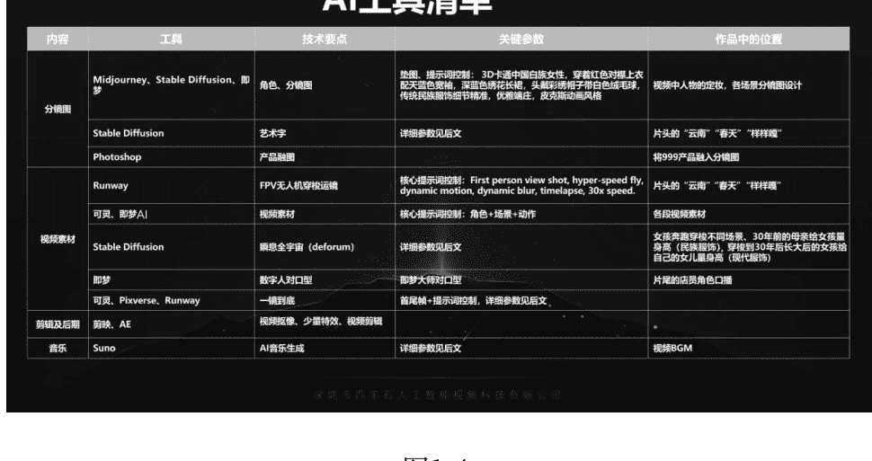

图1-4

##### (2) “C端培训+B端服务”双轮驱动商业模式

他们的商业化闭环围绕C端与B端的需求展开，两者定位互补，相互赋能，共同构成稳定的盈利结构，具体业务布局如下。

①C端：AI视频技能培训业务。其核心用户画像清晰，因AI浪潮产生转型焦虑的职场人，因优化调整需提升第二职业技能的从业者，以及有社交平台创作热情但受限于剪辑技术的内容新人。

②B端：AI视频定制化制作服务。服务对象分为3类，即政府及文旅机构（需通过AI技术提升宣传内容表现力）、中小企业及品牌方（有如引流转化、招商包装、品牌故事传播等明确的商业目标）、KOL及教育机构（需快速搭建标准化视频内容体系）。

典型服务场景包括品牌AI宣传片、文旅创意短片、抖音与视频号内容矩阵搭建、政府公益宣传片制作等。团队建立了标准化交付流程，依次为需求沟通→AI策划提案→AI初稿生成→人工优化→客户确认。

定价方面，根据项目复杂度报价为100~1 000元/秒。15秒短平快项目最快3个工作日交付初稿，常规项目1周内完成成片，交付效率远高于传统拍摄模式。

代表性案例：《AI城市文旅片·我心中的岳阳楼》通过AI技术重塑千年名楼文化内涵，获全国人工智能生成内容（AIGC）创作大赛银奖；《太可健康·品牌故事视频》（1分钟广告宣传片），相较传统制作模式节省70%成本，目前已在多个线下展会循环播放。

#### 3. 行业挑战与未来趋势

AI+视频赛道并非坦途，既面临当下的现实难题，也孕育着未来的发展机遇。下面将先聚焦当前核心挑战，再展望行业趋势与入局方向。

##### (1) 当前行业的核心挑战

AI视频行业快速发展的背后，仍潜藏着诸多待解难题，这些挑战集中体现在工具、质量与市场认知3个层面。

- ①工具迭代速度快：AI视频工具版本更新频繁，并且新工具不断涌现，从业者需要持续投入时间学习，面临刚掌握旧工具、新工具已普及的学习压力。
- ②内容质量把控难：AI生成内容存在不稳定性，如人物面部细节不一致、动作衔接不连贯、场景切换突兀等问题，需要人工介入优化。如何平衡AI效率与人工质量，成为全行业共同面临的难题。
- ③市场教育成本高：多数潜在客户对AI视频认知不足，一方面担忧成品质量不及传统拍摄的成品；另一方面对“成本大幅降低”的说法存在疑虑，需要从业者投入额外精力进行认知普及。

##### (2) 未来发展方向与普通人入局启示

AI视频创业正从单一工具应用向全流程自动化工作流演进。越来越多的AI视频团队开始启动AI视频智能体工作流的研发工作，旨在实现脚本撰写、画面生成、语音合成、剪辑排版的一体化自动运行，同时拓展AI视频账号代运营服务，延伸商业链条。

对计划入局的普通人来说，有4点核心启示：第一，AI确实降低了视频创作门槛，但绝非“零门槛”，仍需掌握基础逻辑与流程；第二，必须搭建标准化工作流，避免重复摸索，提升创作效率；第三，需构建多元化商业模式，兼顾培训类轻资产收入与项目类实体收入；第四，要从“工具使用者”向“内容理解者”转变，理解什么样的内容能打动用户，才是核心竞争力。

AI视频正推动视频创作从少数人的专业技能，转变为更多人可掌握的表达媒介。在这一进程中，不仅会诞生出更多专业AI视频团队，也将为普通人提供大量的就业与创业机会。

### 1.3 AI传统企业内容工厂搭建，快速盈利的核心逻辑

传统企业在新媒体时代普遍面临的难题是：视频内容制作成本高，效率低，难以形成规模化优势。以建材企业为例，若要在抖音、小红书、公众号等多平台持续输出内容，往往需要组建专业团队，初期投入可达数十万元。

何厂长通过构建“AI内容工厂”模式，为传统企业提供了低成本、高效率、规模化的内容生产解决方案。截至2025年年末，其团队已服务会员3000余人，合作企业超过400家，覆盖旅游、建材、留学、培训等多个重点品类。

#### 1. 市场机遇：传统企业的内容创作困境与AI破局点

要把握这一市场机遇，我们需要清晰认知传统企业在内容创作中面临的具体难题。这些难题共同构成了AI内容工厂的核心切入点。

##### (1) 传统企业的三大内容困境

- ①制作成本高，效率低：传统模式下，单条视频制作成本可达数千元，而建材、留学等传统行业企业普遍缺乏专业视频内容创作团队，自主生产难度大。
- ②难以形成规模优势：新媒体获客的核心逻辑是“内容换流量”，若要实现关键词霸屏，需要多账号、高频次更新的支撑，但传统模式的视频制作技能难以承载此类量级内容。
- ③内容有效性难保证：多数企业盲目追求“爆款”，缺乏科学的内容模型验证，导致投入产出比极低，陷入“投入多，转化少”的困境。

##### (2) AI内容工厂的核心价值主张

AI内容工厂的核心价值是实现“低成本、高效率、大规模、有效性”的多维突破。通过AI工作流构建标准化、自动化生产体系，我们可将单条内容成本降至传统视频制作方式的十分之一。

以建材行业客户为例，通过AI内容工厂搭建20个账号矩阵，覆盖抖音、小红书、公众号等主流平台，仅一个月便实现了核心关键词霸屏，客户咨询量从日均个位数提升至数十条，获客效率得到显著提升。

#### 2. 实践路径：搭建AI内容工厂3步法

搭建AI内容工厂需要遵循科学的步骤框架，其中首要任务是筑牢内容有效性的根基，这就需要从明确内容模型入手。

##### (1) 明确内容模型：筑牢有效性基础

内容工厂的核心前提是内容有效。高手搭建内容体系的本质是构建生产线，而生产线落地的第一步便是明确内容模型。

针对传统企业需求，何厂长团队总结出两套经市场验证的视频内容模型，底层逻辑均为“文声画组装”，可适配不同行业场景。

- ①产品展示类视频：适用于建材、家居、培训等实体或服务类行业，通过AI生成产品讲解文案、AI智能配音、AI生成与剪辑画面，快速完成内容组装，实现产品价值的高效传递。
- ②轻IP（Intellectual Property，知识产权）类视频：聚焦企业轻IP打造，持续输出行业知识、案例解析、实操技巧等内容，形成稳定的内容标签，这是企业实现规模化获客的长效引擎。

文声画组装AI工作流如图1-5所示。

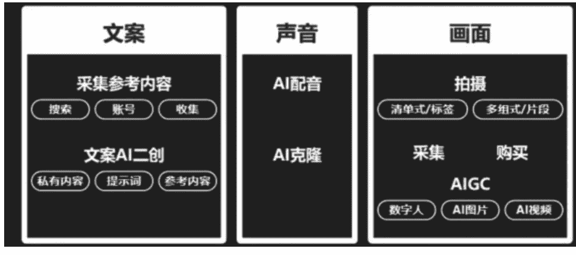

##### (2) 搭建AI工作流：人机协作是核心原则

AI内容工厂以“AI工作流”为主线，核心原则是“人机协作”，即“机器人流程自动化（RPA）+AI+人工”的协同模式。

**为何不追求“零人工”？** 完全自动化的AI工作流往往面临技术成本高、内容贴合度差等问题，效果不理想。现阶段的最优解是在“AI自动化”与“人工干预”之间找到平衡，实现效率与效果的双赢。

**人机协作需把握两个核心要点：** 其一，明确分工边界——人工负责创意策划、策略制定等环节，AI承担文案生成、素材制作、基础剪辑等执行类工作；其二，动态调整人机比例——简单内容可实现80%自动化，复杂内容（如案例解析）需30%~40%人工介入优化。

AI工作流的具体实施步骤如下。

- ①素材准备阶段：借助ChatGPT及国产大模型（如千问、文心一言）生成文案，通过DubbingX等工具完成AI配音，利用Midjourney、可灵等工具生成或优化画面素材。
- ②素材拼接阶段：依托剪映等工具的AI功能，自动完成字幕生成、转场特效、音画同步等基础操作，最终由人工完成内容审核与细节微调，确保视频的质量。

##### (3) 构建内容矩阵：放大量级优势

AI内容工厂的核心竞争力在于规模化产出，这一目标需通过内容矩阵实现。何厂长团队为企业客户构建“视频工厂+图文工厂”双体系，全面覆盖抖音、小红书、公众号、视频号等主流平台，形成全渠道内容覆盖。

量级优势的本质是并非依赖复杂技巧，核心是通过“多账号布局+高频次更新”，构建所在领域的有效内容量级壁垒，形成流量的“虹吸效应”。

#### 3. 快速盈利的核心逻辑与落地要点

AI内容工厂要实现快速盈利，核心逻辑在于找准变现路径与核心优势。其中，精准锁定目标客户群体，是实现快速盈利的第一步。

##### (1) 聚焦B端服务：锁定高价值客户

AI内容工厂的目标客户是传统企业，尤其聚焦旅游、建材、留学、培训等具备本地化、服务型属性的行业。此类企业具备三大特征：获客需求明确、付费预算充足、更关注实际效果而非技术本身，愿意为“能带来流量与客资”的服务付费。

- 核心服务内容：为企业提供全链路解决方案，包括内容模型设计、AI工作流搭建、账号矩阵运营、效果优化等一体化服务。
- 定价策略：单次服务金额不低于1000元，主流客单价超过5000元。传统企业对价格敏感度较低，只要能实现客资增长，便愿意为专业服务支付溢价。

##### (2) 核心竞争力：务实优先于时髦

当前市场中，部分AI内容工厂盲目追求“动物奥运会”“火柴人动画”等时髦内容形态，虽数据表现亮眼，但变现能力较弱。

何厂长团队的核心策略是“拒绝跟风”，将AI技术聚焦于传统企业刚需的视频制作场景。即便内容风格看似“朴实”，但因精准匹配企业的获客需求，变现效率极高。其核心逻辑是不为技术噱头付费，只为“流量与客资”买单。

##### (3) 快速盈利的两大标准：变现周期短与变现金额大

能实现持续盈利的AI内容工厂，必须满足“变现周期短”与“变现金额大”这两大标准。

- ①变现周期较短：启动服务后一个月内即可实现变现。多数草根创业者难以承受长期无营收的压力，短周期变现是维持项目存续的关键。
- ②变现金额较大：单笔变现金额不低于1000元，主流客单价超过5000元。低价竞争无出路，同一服务模式只需精准匹配高价值客户群体，即可实现价格升级。

#### 4. 核心经验启示

回顾AI内容工厂的搭建与盈利路径，可总结出两大经验启示。其中，客户与产品的优先级，是所有创业者首先需要明确认知。

##### (1) 精准定位客户比优化产品更重要

多数草根创业者难以打造出“边际成本低、技术门槛高”的产品。更务实的路径是先找到愿意为服务付费的精准客户，再迭代优化产品。

传统企业是AI内容工厂的理想客户：获客需求迫切、付费能力强、对效果敏感度高于技术敏感度。因而，与其开发“零售级”低价产品，不如聚焦“企业级”高价值服务，实现利润最大化。

##### (2) 量级优势是新媒体获客的底层逻辑

新媒体获客的本质是“用内容换流量”，而规模化起量的核心是“大力出奇迹”。AI内容工厂的核心价值，正是帮助传统企业以极低的成本突破内容生产的量级瓶颈。

当一家建材企业能通过AI内容工厂在抖音、小红书平台同步运营20个账号，日均输出数十条有效内容时，流量阀门自然会被打开。这种量级优势，正是AI内容工厂快速盈利的底层支撑。

### 1.4 AI爆款内容打造：一键生成高流量作品的核心秘诀

微信公众号凭借庞大的用户基数与成熟商业生态，是视频内容创作者的核心变现阵地。微信推荐机制升级后，创作者的小号、新号也可以获得高曝光机会，但多数创作者仍受困于选题枯竭、产出艰难、效率低下等问题，最终导致视频阅读量表现不佳。

2024年7月，拥有4年Java开发、7年AI产品经理经验的卧龙君辞职创业，自研巨鲸AI工具。截至2025年年末，该工具已采集近400万篇爆款内容（覆盖七大平台），生成4万余篇公众号文、10万张配图，商品交易总额（GMV）超过30万元，付费用户破8000人。

巨鲸AI的成功，核心逻辑是精准捕捉微信公众号的创作痛点并融合AI技术。要想复刻其路径，我们需要先认清市场机遇——看透行业短板与现有AI工具背后的隐藏需求，才能奠定实践基础。

#### 1. 市场机遇：微信公众号AI工具的蓝海赛道

把握微信公众号AI工具的市场机遇，需先明确两大核心：一是创作者的核心痛点；二是现有AI工具的不足。下面将从这两点展开，厘清赛道机遇的底层逻辑。

##### (1) 创作者的核心痛点

微信公众号创作者普遍陷入“难坚持、难出效”的困境，核心痛点可拆解为4点，即选题难（不知如何筛选适配主题）、产出难（确定选题仍下笔无词）、效率低（写一篇文耗时数小时）、效果差（阅读量低，难变现）。AI文本生成技术的成熟，可为破解上述痛点提供支撑。

##### (2) 现有AI工具的不足

虽然市面上的AI写作工具数量较多，但能贴合微信公众号全流程创作需求的极少，缺陷主要有以下3点。

- ①质量与门槛矛盾。国内AI工具质量稳定性不足，生成内容容易出现逻辑混乱的情况；国外AI工具门槛高，对普通创作者不够友好。
- ②功能割裂致效率低。微信公众号创作涵盖选题、拟题、写作、排版、配图等环节，但市面上的AI工具功能单一，需切换多个AI工具才能完成全流程；同时，调试提示词还需兼顾爆文逻辑与AI技术，进一步抬高制作成本。
- ③RPA（机器人流程自动化）工具存在局限。该工具安装复杂、占用系统资源，且平台规则升级后便会失效，稳定性较差。

综上所述，市场急需一款一站式、低门槛、高质量的AI爆文工具——这正是巨鲸AI的崛起机遇。

#### 2. 产品演进：4个版本的迭代优化逻辑

明确市场机遇后，产品落地的核心是搭建可快速迭代的体系。巨鲸AI通过4版迭代优化，完成需求验证、功能完善与商业闭环环节，最终形成成熟产品。图1-6为巨鲸AI成品页面。

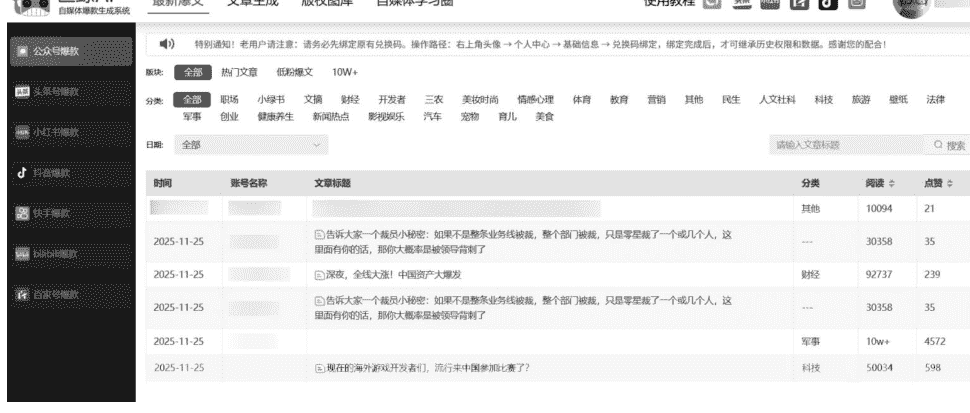

##### (1) 第1版：爆文采集系统

选题是创作核心门槛，巨鲸AI第1版聚焦“选题难”痛点。该工具依托RPA技术搭建爆文采集系统，每日自动采集各平台的爆款内容并展示，同时设计兑换码系统布局商业化。该版本仅耗时一个月即正式上线。

##### (2) 第2版：增加AI图库

配图是创作的刚性需求，但传统配图质量差、带有水印且有侵权风险。第2版通过“RPA+极梦工具”，批量生成数万张高清、无水印、无版权风险的配图，可覆盖多数场景。

##### (3) 第3版：爆文生成功能上线

前两版解决了“找素材”问题，第3版则聚焦“写内容”：优化UI并上线爆文生成功能，选用GPT-4模型，经3个月打磨八十余次提示词，保障内容质量。新增自动同步微信公众号草稿箱、自动排版等功能，定价69元/月，上线后GMV突破30万元。

##### (4) 第4版：打通公域与私域闭环

前3个版本采用门票核验登录方式，仅能在私域渠道发售。第4版迭代升级，采用微信快捷登录+在线支付双功能架构；同步扩充数据源，新增抖音、快手、哔哩哔哩、百家号等主流平台的数据源。完成升级后，公域销售渠道正式全面打通。

#### 3. 商业模式：构建多元变现路径

成熟产品是变现基础，而可持续的商业闭环是企业长期发展的关键。巨鲸AI通过四大路径，实现工具到商业的转化。

##### (1) 私域变现

早期采用“私域转账+兑换码”模式，完成初始用户与营收积累。后期推出3天免费体验活动，建立近100个体验群，吸引1.5万名用户参与，显著提升了付费转化率。

##### (2) 闲鱼售卖

闲鱼是重要的公域获客渠道。产品上线后即可布局该平台，同时发动学员分销，通过“官方+分销”模式快速扩大产品的曝光率与销量。

##### (3) 知识产权（IP）绑定

从2024年年初开始重视个人IP打造，通过专业内容积累影响力，付费用户破8000人后推出知识专栏、训练营等衍生产品。AI工具兼具付费产品赠品、分销打榜奖励等角色，强化了IP差异化属性，形成“IP引流+工具变现+衍生增值”的闭环。

##### (4) 生成引擎优化（GEO）

2025年，GEO成为热门赛道。该团队两周内优化10多个关键词，使工具入选DeepSeek、元宝等大模型搜索结果，自然流量翻倍，获客成本显著降低。

#### 4. 行业挑战与未来趋势

##### (1) 当前行业核心难题

AI爆款工具发展背后暗藏三大难题：一是技术迭代快，工具需紧跟前沿否则易被淘汰；二是内容同质化严重，缺乏核心竞争力；三是赛道涌入者增多，竞争压力陡增。

##### (2) 未来发展方向与入局启示

该行业正从“单一工具”向“全流程自动化”演进，未来核心趋势有3个：①智能体工作流完善（实现创作全流程自动化）；②多模态生成能力提升（覆盖文图音视频）；③AI工具与个人IP深度绑定（成为IP生态核心）。

对于计划入局该赛道的普通人而言，有3点启示值得关注。

第一，需构建“业务+AI”双重能力。巨鲸AI创始人兼具10年AI经验、100多款工具使用经验，及每日分析20篇爆文的专业能力，这种双重优势是其核心壁垒。

第二，需搭建多元商业模式。单一渠道的抗风险能力弱，需兼顾私域、公域、IP绑定、GEO等多重路径，形成互补盈利体系。

第三，需坚守长期主义。草根创业者易焦虑跟风、浅尝辄止，而真正的突破源于聚焦深耕。巨鲸AI的实践证明，阅读量从3000突破10万后，变现便进入良性循环。

综上所述，AI爆款内容工具正在推动视频创作从专业技能转向普惠能力。未来随着技术与模式的升级，该赛道仍将释放巨大潜力。

### 1.5 AI教学资料创作：千万教师刚需下的数字化变现新赛道

虽然现在教育行业大多在搞数字化转型，但基层教师的工作负担却越来越重——很多精力都被用来写教案、做课件、策划班会、写总结汇报等这些非教学事务分散了。根据2025年12月25日《人民政协报》报道，我国共有大中小幼职特各级各类学校专任教师1885.10万人，保守算下来，每个教师每年在教学资料上的开销在500~2000元。这么大的刚需市场，给数字化创业留了很大空间。2024年，一个叫“饭饭”的小团队仅3人配置，却用两个半月就营收25万元，利润率超60%。他们靠AI改造教学资料制作流程，把原来几小时的工作量压缩到几分钟，还理顺了“引流、转化、定制、裂变”的生意逻辑，这也证明普通人只要学会用AI工具，就能切入这个刚需市场。

想搞懂AI+教学资料生意的价值，关键是摸清该行业的痛点和AI的解决能力。接下来先从这两个方面，聊聊这个赛道为什么能火。

#### 1. 市场机遇：教育减负背景下的刚需爆发

随着教育减负政策收紧，教师对好用、高效的教学资料的需求越来越迫切。而传统的教学资料市场早就积弊已久，AI技术的出现刚好解决了这些难题。

##### (1) 传统教学资料市场的痛点

传统教学资料的供给方式早就跟不上教师需求，问题有以下3个。

- ①质量差：很多内容都是直接搬运的旧资源，素材陈旧，甚至是好几年前的课件，根本不符合最新的教学大纲和新课标，教师拿过去也没法直接用。
- ②太雷同：一个模板全校通用，很容易内容“撞车”。尤其是教师上公开课、评职称需要个性化资料时，通用模板就完全无法满足。
- ③又贵又慢：找人工原创定制，一份教案要几百块，还要等3~5天，普通教师无论是经济成本还是时间成本都扛不住。

##### (2) AI切入市场的优势

AI能打破传统市场僵局，其优势是不仅能快速做原创内容，还能节省成本。用ChatGPT、Claude这类大语言模型，提示词给准了就能快速写出符合教学逻辑的文案；搭配AIGC绘画工具，一键就能生成好看的配图。更关键的是，这些成本只有人工操作成本的十分之一，几分钟就能交付，刚好解决了教师的紧急需求问题。

看清机遇后，落地才是关键。饭饭团队的成功，其核心是搭建了标准化生产流程和完整商业闭环，这套模式普通人也能学。

#### 2. 实践路径：从标准化生产流程到商业闭环

这个项目能立足市场，原因有两点：一是有一套标准化的AI生产流程，保障内容质量和交付速度；二是设计了“低价引流+会员锁客+高端定制”的赚钱模式，兼顾流量和盈利。

##### (1) 构建标准化AI教学资料生产流程

想把生意做大，标准化生产流程是关键。这个团队就是依靠下面4个模块，搭建起了高效的生产模式。

- ①指令模块：团队建立了一套教育行业专属提示词库，教师输入教学目标、学生情况等信息后，AI就能快速输出含有重难点、步骤、板书的完整方案。图1-7为AI创作教学资料大纲示例。

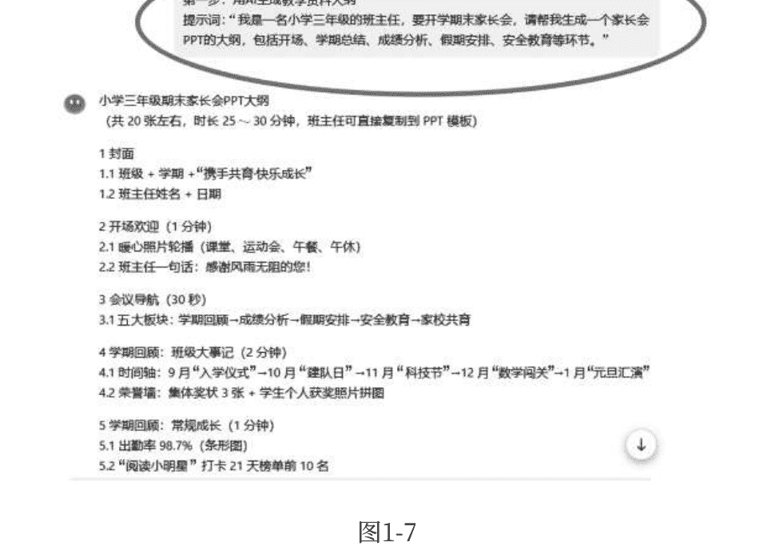

- ②素材模块：声音上用AI配音做微课音频，画面上用AI画图生成统一风格的课件画面，最终整合出“文字+声音+图片”的完整资料。
- ③润色查重：AI写的内容有时有点“冷冰冰”，人工可以补充真实教学案例，再严格审核查重，确保内容原创性且贴合实际教学。
- ④审核排版：按固定模板自动排版，重点优化“开头5分钟导入”等关键环节，使教学大纲资料可直接使用。

##### (2) “C端培训+B端服务”的双轮驱动商业模式

该团队针对不同教师的需求，设计了不同价位的产品，形成稳定商业闭环。

- ①低价单品（9.9~29.9元）：在小红书、抖音等平台发资料预览图引流，用低价“试用装”筛选精准客户，降低获客难度。
- ②会员转化（199~399元）：引导首次购买客户加微信进私域社群，推广会员服务——一次性付费，一年内核心资料免费更新，提升复购率和用户黏性。
- ③高端定制（500元起/单）：针对公开课、职称评审等场景，提供AI+人工一对一定制，虽然价格高，但利润可观。

这个赛道最吸引人的是门槛低——你不用是特级教师，也不用懂编程。普通人掌握核心逻辑即可入局。

#### 3. 普通人入局指南：低门槛下的实操建议

普通人做这个生意，关键不是会不会写资料，而是是否能找对需求、用好工具并做出自己的特色。我们具体可以从零基础如何起步和如何建立个人竞争壁垒两个方面展开。

##### (1) 零基础如何起步

## 零基础入门的核心是“少花钱、先试错”，先确定有需求再扩大规模，切勿在初期盲目投入生产。

- ①找需求：盯着教师最头疼的事，如期未写学生评语——一个教师要给几十个学生写差异化评语，不仅费时间还怕重复，这种事AI做起来就会又快又好，刚好切中教师痛点。
- ②用工具：新手不用自建模型，直接用现成的大语言模型即可，网上搜“教师专用提示词模板”，照着用就能写好。
- ③试错：先做5~10份优质资料发社交平台，要是有人问“怎么卖”，说明选品和质量没问题，再批量生产。

## （2）如何建立个人竞争壁垒

低门槛赛道容易同质化，普通人要立足市场，需要从以下3个方面打造优势。

- ①做细分：避开全学段、全学科，专注一个小领域，如小学一年级语文家长会方案、初中物理实验课件。
- ②加“人情味”：教师对纯AI内容较敏感，普通人的优势是给内容“加点料”，如在教案里融入当地文化案例，这种接地气的内容通用AI是做不出来的。
- ③做服务：很多教师买资料是买省心，不仅要提供免费修改服务，还要提供一对一排版指导等服务，做好服务即可提升溢价空间。

任何新赛道都有机遇也有挑战，AI教学资料创作也不例外。看清问题、预判方向，才能长期做下去。

#### 4. 行业挑战与未来趋势

##### (1) 当前挑战

这个行业刚起步，还有3个问题需要注意，提前规避才能少走弯路。

- ①AI “乱说话”：AI可能编造虚假知识点，人工必须终审。一旦出现知识性错误，品牌口碑就全毁了。
- ②服务没边界：一开始切勿承诺无限次修改，会严重拖慢工作效率，提前与客户明确修改次数和售后时间。
- ③版权问题：必须确保资料不侵犯现有教材、文献版权，保障内容的原创性，也能规避法律风险。

##### (2) 未来发展启示

对想入局的普通人，3个建议能帮你规避风险，提高创业成功率。

- ①先验证需求再投产：等收到真实购买需求再规模化投产，切勿盲目做一堆资料卖不出去。
- ②要有预判能力：教学资料时效性强，开学、期末前是需求最大的时候，提前一个月预热才能把握市场先机。
- ③从“会用工具”到“能解决问题”：懂教师的真实痛点，比熟练用AI工具更重要，这样才能做出有用的资料。

AI正在让教学资料从通用模板变成个性化辅助工具，这个过程中不仅诞生了专业团队，也给普通人留下了创业机会。只要你愿意长期做，坚持原创和服务，每一份AI辅助的教学资料，都能变成实实在在的收入。

### 1.6 AI全流程打造IP：效率暴涨10倍的落地方案

短视频时代，创始人IP是企业的核心数字化资产，但很大一部分创始人都折戟于此。传统模式下，脚本、拍摄、剪辑等环节耗时久、技术门槛高，多数人因“没时间、没内容、没系统”而半途而废。

2024年起，已有专业团队靠“方法论+AI工具+标准化流程”重构IP服务，实现单条视频千万播放量、月增粉10万多人，IP生产效率提升10倍以上。下面将完整拆解这一落地方案。

#### 1. 市场机遇：创始人IP的商业本质与切入逻辑

要理解AI如何赋能IP打造，需先明确创始人IP与普通“网红”的本质区别：前者聚焦商业价值沉淀，后者侧重流量变现，这决定了AI的切入方向。

##### (1) 创始人IP的三大核心特征

创始人IP的核心竞争力源于专业价值与商业属性的绑定，核心特征有3个。

- ①专业内容构建影响力：不同于普通“网红”，创始人IP依托行业深度认知输出内容，通过持续输出专业观点锚定用户心智，建立行业权威。
- ②业务思考显性化：将商业观点、战略与经验转化为视频内容，形成专属人设标签，这种深度思考具有极强的不可复制性，是吸粉关键。
- ③系统化与标准化：创始人IP运营不靠灵感，而需要依靠自运转的内容流水线，保障价值输出的持续稳定，这是长期变现的基础。图1-8为创始人IP商业价值模型。

### 创始人IP商业价值模型

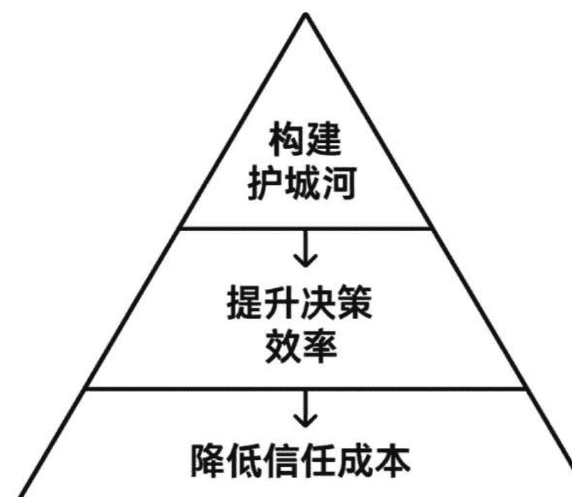

图1-8

##### (2) AI赋能创始人IP创作的核心价值

AI赋能创始人IP创作的核心价值有3个。

- ①降本提效：创始人IP能建立“人设—品牌—产品”的信任链路，这带来的高价值客户与人才，其转化效率远高于传统投放，AI则可通过规模化内容加速信任触达。
- ②建人设壁垒：产品易被模仿，但创始人的价值观、表达与经历不可复制，AI可提取这些特质规模化输出，构建企业核心护城河。
- ③破生产力瓶颈：通过数字人采集、自动化脚本生成，创始人一次录制即可实现内容无限复用，彻底解决时间资源稀缺的问题。

#### 2. 实践路径：从工具应用到全托管服务闭环

明确该行业的商业逻辑与AI价值后，其落地核心是推动创始人IP打造从“手工作坊”转型为“AI流水线”，关键在于实现从工具到全流程服务的闭环。图1-9所示为AI赋能完整流程局。

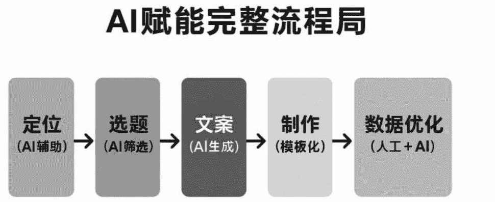

图1-9

##### (1) 构建标准化AI内容生产工作流

标准化AI内容生产工作流是提高效率的核心，可拆解为四大模块，均采用“AI主导+人工辅助”模式。

- ①定位与对标：核心是“人群垂直”而非内容垂直，AI可梳理目标人群与变现路径，抓取相似爆款账号深度拆解后，输出定位报告。
- ②选题与文案：AI每日抓取全网热点，结合人设判断内容的可借鉴性并给出切入建议，再按爆款框架生成文案初稿，兼顾传播性与人设匹配度。
- ③数字人与剪辑：创始人一次性采集个人形象与声音，后续由AI数字人出镜配音，结合剪辑模板自动匹配字幕、音乐等，实现标准化批量交付。
- ④数据优化：AI+人工记录核心指标，通过数据反馈修正选题、视觉风格等，形成“创作—反馈—优化”闭环。

### （2）全托管模式的商业运营逻辑

基于上述标准化AI内容生产工作流，形成覆盖C端与B端的全托管服务闭环，满足不同群体需求。

- ①C端：AI IP技能培训，主要服务职场转型者与内容新人，通过线上课程+实操，教授核心技能，解决“不会做、做不快”的痛点。
- ②B端：创始人IP全托管，服务中小企业老板与头部KOL，核心是让创始人聚焦观点输出，脱离内容琐事。

服务流程：需求沟通→人设提取→AI策划→内容生成→人工质检→发布。创始人仅需提供原始观点，其余由AI完成，单条视频制作时长可从数小时缩至十几分钟。

#### 3. 深度实操细节：如何跑通AI IP交付

要跑通AI IP交付，关键在于“方法论显性化”与“工具整合”——前者定方向，后者提效率。

传统IP依赖操盘手，人才难寻且难复制，核心解法是将操盘手的隐性经验转化为AI可执行的显性方法论。

- ①定位分析：AI梳理创始人的优势与观点，结合市场需求明确人设与变现路径，形成定位手册。
- ②对标画像：AI扫描相似爆款账号，提取其视觉风格、话术逻辑、情绪钩子等，形成对标报告。
- ③内容策略：将定位与对标报告转化为AI提示词框架，确保输出内容兼具行业深度与传播性。

### （2）AI工具的高效整合应用

成熟AI工具可承担60%~70%的工作量，其关键在于整合应用能力，核心场景有以下3个。

- ①文案生成：大模型按提示词框架生成初稿，人工负责润色与价值观把关，规避观点偏差。
- ②视觉呈现：通过数字人平台采集形象声音，后续由AI驱动出镜，解决创始人出镜难问题。
- ③自动化后期：借助剪映AI等工具的模板功能，一键匹配字幕、转场等，保障账号风格统一。

#### 4. 行业挑战与入局启示

AI赋能IP前景广阔，但仍处发展期，挑战与机遇并存，关键在于把握好以下核心逻辑。

### （1）当前行业主要挑战

- ①工具迭代压力：AI工具更新快，从业者需持续学习，避免工具落后影响效率。
- ②内容质量把关：AI初稿易“模板化”，缺乏温度与深度，需人工润色审核，确保内容符合人设，并能有效规避错误。
- ③市场教育成本：部分创始人质疑AI内容的真实性与效果，需用案例数据证明其流量与转化能力。

### （2）普通人入局的实操启示

普通人入局的核心不是技术，而是思维模式。

- ①聚焦人群价值：明确服务对象与需求，比会用AI工具更重要，内容只是价值载体。
- ②建系统化SOP（Standard Operating Procedure，标准作业程序）：摒弃灵感依赖，搭建全流程标准作业程序，降低对个人能力的依赖，实现稳定产出。
- ③转型方案解决者：无须成为AI专家，只需整合工具与方法论，助力企业主解决IP打造痛点，实现商业变现。

综上所述，AI正在推动创始人IP从“艺术创作”变为“工业产品”。掌握“方法论+AI工具+标准化流程”这一核心逻辑，秉持长期主义，就能构建影响力护城河，成为新商业时代的效率赢家。

## 第2章 AI赋能职场提效

职场竞争的本质是效率竞争，而AI正是提升效率的“超级工具”。从财务自动化处理、项目管理到标书智能撰写等，AI能接管80%的重复性工作，让你从烦琐事务中解脱，聚焦核心价值创造。本章提供多场景、可落地的AI实操技巧，通过“工具+流程”的双重优化，帮助你重构工作模式，实现效率翻倍、价值升级，在职场中快速脱颖而出。

### 2.1 财务自动化处理：效率飙升60倍的实操技巧

在B端（企业级）服务市场，财务数字化转型始终是企业降本增效的核心诉求。财会人员日常要处理海量发票核对工作，传统人工录入单张发票并统计明细平均耗时3分钟，不仅流程枯燥重复，还极易因人为疏忽而出错。

AI破局的RPA教练龙哥团队通过深度融合AI与RPA技术，研发出了“AI+工作流+飞书多维表格”一体化的自动化解决方案，单日可识别3万张发票，单张处理时间从原来的3分钟压缩至3秒，效率直接提升60倍，真正将财务人员从烦琐的重复性劳动中解放出来。

#### 1. 市场机遇：财务自动化的痛点与AI切入逻辑

财务办公的跨越式提效，关键在于精准击破业务流程中的“梗阻”环节。只有摸透传统财务工作的核心痛点，才能让AI技术的赋能更具针对性。

##### (1) 传统财务报销与核算的痛点

- ①人工录入效率瓶颈：无论是纸质发票还是电子发票，都依赖财务人员肉眼识别、手动录入信息。面对大批量报销单据时，不仅人力成本高，还易造成流程拥堵。
- ②准确率难以保障：长时间从事重复性劳动，财务人员难免出现疲劳走神，在录入金额、税率、发票抬头等关键信息时，错误率就无法完全规避。
- ③数据沉淀不及时：在传统处理方式下，发票数据录入系统存在明显滞后，导致企业管理层无法实时掌握财务流水与预算执行动态，影响企业的决策效率。

### （2）AI+RPA的技术赋能优势

- ①高精度图像识别：依托大语言模型的视觉能力，AI对各类发票的文字识别准确率已接近100%，远超传统OCR（光学字符识别）技术，从源头就可降低错误率。
- ②全链路自动化：通过RPA模拟人工操作，搭配工作流引擎，可实现从发票收集、识别、校对到入库归档的全流程无人值守，彻底摆脱对人工的依赖。
- ③极低的应用门槛：普通员工借助低代码平台就能快速搭建专属财务智能体，无须拥有深厚的编程功底。

#### 2. 实践路径：构建三位一体的自动化工作流

这套可直接落地的方案，核心由发票识别插件、工作流引擎、数据存储节点3个部分构成，三者协同联动形成完整的自动化闭环。

### （1）自研高精度发票识别插件

实践过程中我们发现，通用识别工具常常难以精准适配复杂的发票格式（如特殊行业发票、自定义版式发票），因此基于大厂API（Application Programming Interface，应用程序编程接口）自建插件更具实用性。

- ①筛选优质API：对比多个图像识别模型后，最终选用识别准确率领先的千问模型API。
- ②搭建插件框架：在开发平台新建插件项目，增设图片URL（Uniform Resource Locator，统一资源定位符）作为核心元数据字段，保障图像信息能够稳定传输。
- ③编写集成代码：引入DashScope（阿里云灵积模型服务）依赖包，将API Key（接口密钥）与定制化提示词嵌入插件逻辑，确保能精准提取发票代码、金额、税率等关键明细。

### （2）搭建标准化AI工作流

工作流的核心作用在于，将零散的识别能力串联成逻辑严密的“自动化生产线”，具体分为4个关键节点。

- ①开始节点：接收用户上传的发票图片（支持单张或批量上传）。
- ②插件节点：自动调用自研发票识别插件，将图像信息转化为结构化文本数据。
- ③数据清洗：通过简易代码节点，将原始识别数据整理为“字典格式”，统一字段规范，方便后续系统读取。
- ④飞书节点：配置飞书多维表格节点，录入对应app_token（应用令牌）与table_id（数据表标识），实现清洗后数据自动写入指定表格。

### （3）智能体包装与交付

完成技术搭建后，还需通过标准化包装提升智能体的实用性，确保财务人员能快速上手。

- ①设定交互逻辑：在智能体后台配置提示词回复规则，保障AI能精准理解财务人员的日常指令。
- ②优化操作入口：新增专属“发票提交”组件，支持批量拖曳上传图片，简化操作步骤。
- ③严格测试发布：经过万级数据量压力测试，确认系统保持秒级响应且准确率稳定后，再发布至企业内部供全员使用。

如图2-1所示，我们对这套AI发票识别智能体进行了多轮测试，各项指标均达标。

### 预览与调试

十倍提效


上传发票 发票2.png

发票识别智能体

运行完毕

数据插入飞书状态：success

```
发票内容：json
{
  "发票标题": "电子发票（普通发票）",
  "发票号码": "2...",
  "开票日期": "2025年04月11日",
  "购买方信息": {
    "名称": "...",
    "税号": "..."
  },
  "销售方信息": {
    "名称": "深圳...",
    "税号": "914..."
  },
  "items": [
    {
      "项目名称": "餐饮服务餐费",
      "规格型号": "",
      "单位": "",
      "数量": "1",
      "单价": "194.059405940594",
      "金额": "194.06",
      "税率": "1%",
      "税额": "1.94"
    }
  ],
  "合计金额": "194.06",
  "合计税额": "1.94"
}
```

Invoice

图2-1

#### 3. 深度实操细节：如何确保自动化方案的稳定性

##### (1) 提升数据处理的准确度

- ①优化提示词工程：通过定制化Prompt（提示词），引导AI聚焦发票代码、金额、纳税人识别号等关键审计字段，优先确保核心信息无遗漏。
- ②搭建异常处理机制：在代码节点中嵌入校验逻辑，若识别结果缺失关键信息或出现格式异常，系统会自动标记“异常”并触发人工提醒，避免错误数据流入后续环节。

##### (2) 优化数据存储与展示

- ①实现多维表格联动：利用飞书多维表格的公式功能，自动计算税额合计、报销进度等衍生数据，减少人工的二次核算。
- ②自动化报表生成：数据入库后自动触发仪表盘更新，为管理层提供实时的可视化财务看板，直观呈现报销趋势、预算使用情况等信息。

#### 4. 行业挑战与未来趋势

##### (1) 当前面临的核心挑战

- ①模型API成本管控：虽然财务处理效率提升显著，但在处理超大规模数据时，API调用产生的Token（AI算力单位）费用会明显增加，需提前做好成本评估与用量管控。
- ②复杂票据适配难题：针对手写票据、严重损毁发票或特殊版式票据，AI识别准确率仍有提升空间，目前需搭配人工复核以保障数据的准确性。
- ③数据安全合规风险：财务数据敏感度极高，调用公有云AI能力时，必须严格遵循企业数据安全协议，避免数据泄露。

### （2）未来发展启示与入局方向

从行业发展趋势来看，AI财务自动化还有广阔的拓展空间。

- ①从单一功能向全业务流程延伸：未来可将发票识别与企业ERP（Enterprise Resource Planning，企业资源计划）系统深度集成，实现从发票处理到自动记账、对账的全链路自动化。
- ②普通人的转型机遇：普通员工若掌握RPA与AI智能体搭建技能，可转型为“数字化转型顾问”，助力更多职能部门实现办公自动化。
- ③迈向AI代理（Agent）时代：未来的财务自动化不仅是被动执行指令，更能通过AI Agent自主判断发票的合理性与合规性，主动规避财务风险。

AI财务自动化的核心价值，远不止60倍的效率提升。更重要的是，它让财务人员摆脱了“工具人”的角色束缚，回归到预算规划、风险管控等更具价值的管理工作中。事实上，只要掌握这套标准化工具的应用方法，任何企业都能在低门槛前提下，搭建起属于自己的智能财税中心，真正实现财务数字化转型的降本增效目标。

### 2.2 AI+项目管理：多线程推进与知识库搭建的实战方案

很多人都面临这样的困境：信息散落在日记本、公司群、微信收藏夹等多个地方，项目推进全靠记忆，找资料要翻半天，打卡和任务还总遗漏。容治用AI搭配飞书多维表格，给自己搭了个清晰又高效的“个人项目管理驾驶舱”——把多平台信息汇总到表格里，检索起来又快又准；还靠工作流定时提醒打卡，任务完成得从容又稳妥。

#### 1. 为什么选择AI+飞书多维表格

选对工具是高效管理的第一步。很多人走弯路，就是因为用错了工具或没摸清工具的搭配逻辑。想搞懂这套系统到底好用在哪，需先弄明白两个核心问题：飞书多维表格比其他工具好在哪？AI又能怎么帮上忙？

##### (1) 对比其他工具

Excel和Word没法实现云存储，不能实时查看资料，更无法应对复杂关系和视频、图片这类非结构化数据的管理；传统笔记软件擅长“收集”，但在信息关联和流程管理上明显不足；专业项目工具对个人来说太笨重，配置起来又复杂，上手成本极高。

##### (2) 飞书多维表格的优势

飞书多维表格不只是简单的“表格”，它更像一个灵活的“个人数据库”。它有表格、看板、日历等多种视图，同一份数据能适配不同使用场景；还能自定义单选、附件、关联等字段，靠强大的“关联”功能打通不同表格的信息。AI则是其效率加速器，能自动分类、总结、贴标签。简单来说，飞书负责“承载和展示”信息，AI负责“处理和优化”信息，二者搭配可实现事半功倍的效果。

#### 2. 实战案例一：多线程项目管理系统

明确了工具的核心优势后，接下来就是落地实操——搭建一套能落地的多线程项目管理系统。这套系统的核心是“全局掌控+自动推进”，主要分为4个关键环节。

##### (1) 总看板和项目总览表

总看板是项目管理的“中枢”，可以设置跳转按钮，如单击“打卡规则”，就能直接跳转到对应的子表格，无须在多个表格间来回切换。这里会汇总所有项目的打卡记录等核心信息，用户打开就能掌握所有项目的全局情况。

### （2）搭建核心表格

表格是系统的基础，关键要搭好3张表，覆盖项目全流程。

- ①项目库：存放所有项目的核心信息，字段包括项目名称、起始日期、项目状态、打卡规则、个人心得汇总、AI复盘建议，方便用户快速查阅每个项目的主要情况。
- ②资料库：专门存放各类相关资料，字段有资料链接、附件、资料类型、所属项目（关联项目库）、归档状态，让资料都有“归属”，不用再到处找。
- ③执行记录表：记录每次打卡情况和心得，字段包含打卡日期、关联项目、打卡记录、个人心得（自动汇总到项目库供复盘）、附件、AI心得总结等，清晰追踪每一步的执行情况。

### （3）直播/打卡提醒工作流

仅有表格还不够，还要依靠工作流实现“自动提醒”。系统不仅会自动提醒当天的直播课程，还能按每个项目的打卡频次定时提醒，再也不用担心漏做任务。图2-2所示为提醒工作流的具体搭建界面。

## 告诉我你想搭建什么系统

大魔王会根据你的需求，智能预填充后面的表单内容～

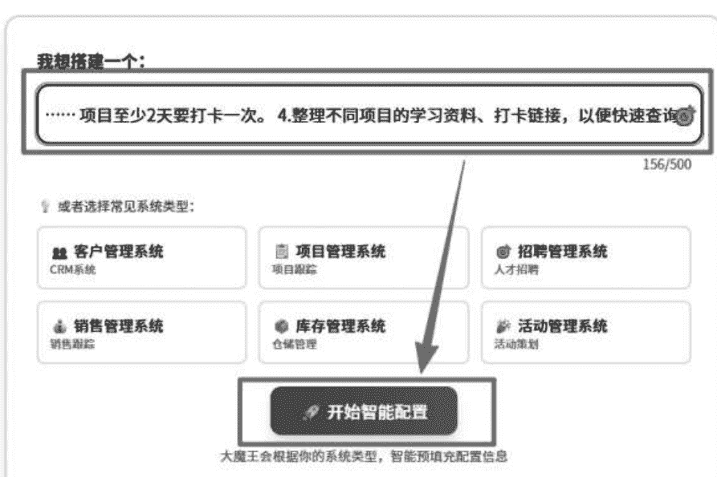

图2-2

##### (4) AI介入的关键点

AI的核心作用是“降门槛、提效率”，关键要用到3个地方。

- ①搭建系统框架：用“多维秒搭”功能，把你的需求说清楚，AI就能快速给出表格框架。无须自行琢磨如何拆分表格、定义字段，原本一团乱麻的规划，AI能帮你理得清晰明了，你只需专注落地执行即可。
- ②复盘总结：把打卡记录汇总后，让AI帮忙复盘，还能给出下一阶段的优化方向。就像有一位24小时在线的教练，随时帮你找问题、指方向。
- ③自动搭建工作流：用飞书多维表格的“AI创建工作流”，用通俗语言说明你的需求，如“帮我创建一个每日打卡提醒工作流”，AI就能自动搞定。你无须花时间学习复杂的操作，即可快速上手。

简言之，AI帮我们铲平了“启动、上手、实战、复盘”四大难关，解决了“不愿规划、操作困难、实战受阻、复盘不清”等所有痛点。

#### 3. 实战案例二：知识库打造“第二大脑”

做好项目管理的同时，知识沉淀也很重要。搭建一套专属知识库，就能打造自己的“第二大脑”，让知识高效复用。这套知识库的核心是“闭环流转”，分为收集资料、存储资料、检索输出3个环节。

##### (1) 收集资料：多渠道无缝汇总

收集资料的关键是“不遗漏、自动录”，推荐以下3种实用方式。

方式一：表单直录。用飞书表单收集信息，提交后，数据会自动准确录入多维表格，适用于标准化信息采集场景（如收集行业报告、会议纪要的收集）。

方式二：内嵌自动化。利用飞书内置的工作流或机器人，你和机器人对话就能触发信息捕获，自动写入多维表格，实现飞书生态内的流程闭环管理。

方式三：外部工作流对接。通过n8n、扣子等第三方自动化工具，搭建更复杂的工作流，实现跨系统、大批量数据的定时同步或批量录入，如将微信收藏的资料自动同步至系统。

##### (2) 存储资料：结构化分类关联

存储的核心是“结构化、能关联”，建议配两张核心表格。

表A：“素材库”（专门存放原始信息），字段包括素材标题、类型（单选）、URL（来源）、状态（单选）、核心观点、关联灵感（关联素材库）、附件等，让每个素材都有清晰标签。

表B：“灵感库”（存放选题和思考日记），字段有灵感或选题、状态（单选）、关联素材（关联素材库）、创作日期、发文链接等。两张表通过“关联”功能打通，实现素材与灵感的双向联动，如需查找灵感对应的素材，单击即可查看。

##### (3) 检索输出：高效复用知识

知识库的价值在于“能用”，飞书的“知识问答”功能可实现快速检索。不管是找素材还是查观点，直接用自然语言提问，AI就能精准定位答案。此前资料堆积如山、检索耗时良久，如今知识实现结构化管理，检索效率大幅提升。图2-3所示为知识库问答功能的实际效果。

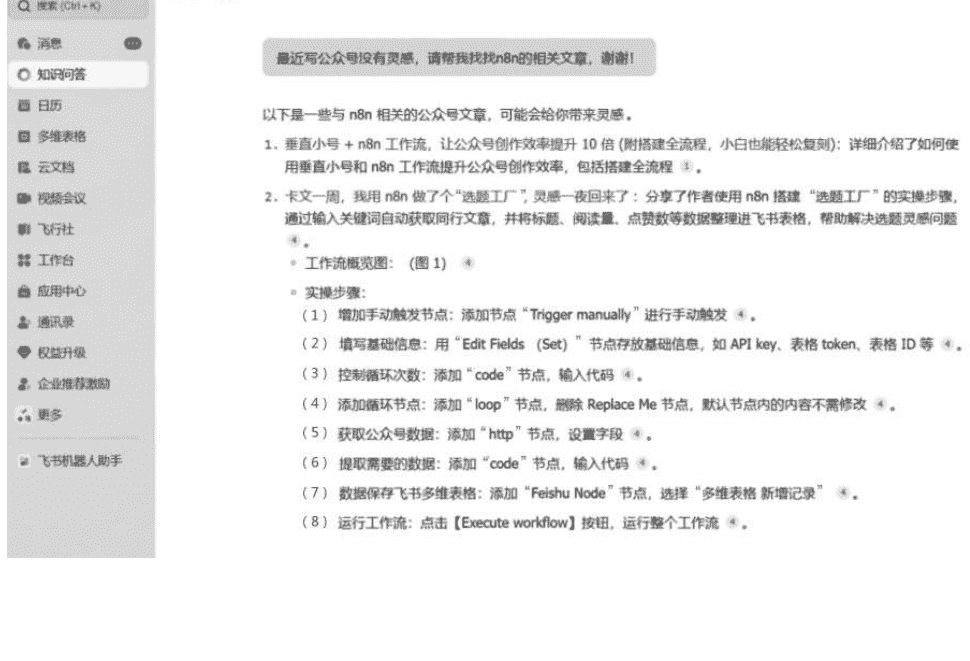

图2-3

#### 4. 避坑经验：少走弯路的核心技巧

工具再好，若使用不当也无法发挥效用。结合作者的实战经验，这3个坑一定要避开，才能让系统真正发挥作用。

避坑一：别陷进“完美主义”陷阱。初期无须追求字段齐全，可先从三至五个核心字段入手，用的时候发现缺什么再补充。所有好用的工具，都是慢慢迭代出来的。

避坑二：警惕“知识依赖”陷阱。切勿只收集不内化，拿到资料后，用流程图或自己的话重新梳理逻辑。与其浅尝辄止地学习多种工具，不如深耕一种工具并学透用精。

避坑三：避免陷入“只进不出”的信息囤积状态，即“松鼠症”。一定要打通知识库和项目库，在“执行记录表”里加“关联项目”字段，学习知识点后应及时关联到具体项目，进而输出SOP（Standard Operating Procedure，标准作业流程），让知识真正落地。

最后要强调的是，工具只是基础，关键在于建立“输入→处理→承载→应用→输出”的闭环工作流程。飞书多维表格给这套流程搭了结构化骨架，AI则为其注入了智能化血液，只有两者结合，才能实现高效的项目管理和知识沉淀。

### 2.3 AI标书智能撰写：降本增效的省心秘籍

标书制作是企业参与招投标的核心环节。一份完整标书通常涵盖3~6万字、上百页内容，还需整合技术方案、资质证明、数据图表等多元材料。传统标书制作模式高度依赖人工起草、整合与校对，往往需要数周甚至数月，并且容易出现数据错误、逻辑不通、格式混乱等问题。

随着人工智能技术的快速发展，标书制作这一传统环节迎来了智能化升级的契机。峰兄团队研发的AI标书系统，凭借自动化流程设计，将人工操作时间压缩70%~80%，错误率降低87%，每年可为企业节省数百万元的人力成本。其成功的关键，在于精准切入并解决了标书制作行业的核心痛点。

#### 1. 行业痛点：标书制作的四大核心问题

要真正理解AI标书系统的主要价值，首先需要清晰认知传统标书制作模式存在的深层问题，以及AI技术是如何针对性地破解这些难题的。

##### (1) 交付周期长

传统标书制作过程是从项目立项、需求分析、内容编写到最终定稿，全流程依赖人工推进，每个环节都存在效率瓶颈，整体周期动辄数周甚至更久。

AI解决方案：将复杂过程拆解为“需求分析→素材调用→文本生成→格式校准”的标准化自动化链路，通过系统联动替代人工重复操作，大幅缩短交付周期。

##### (2) 错误率高

人工在编写过程中，容易出现参数前后不一致、格式不统一、关键内容遗漏等问题，这些细节失误可能直接导致标书被判定为无效，给企业带来重大损失。

AI解决方案：构建“数据交叉验证+逻辑一致性检查”双重保障机制，经实际验证，可将标书错误率从人工制作的4.3%降至0.6%，降幅达87%。

##### (3) 复用率低

标书中的报表、资质材料、通用话术等内容具备高频复用属性，但传统模式下，复用效率完全依赖编写人员的经验与记忆，不仅耗费大量时间与精力，还容易出现复用偏差，重复劳动成本极高。

AI解决方案：搭建“一次训练、多次复用”的智能知识库，集中管理可复用的模板与素材，将重复性工作的边际成本降至趋近于零，每年可帮助企业节省百万元级的人力成本。

##### (4) 需求理解深度不足

传统标书质量高度依赖编写人员的行业经验与需求解读能力，往往会出现需求理解偏差、内容与客户预期不符等问题，导致反复修改，额外增加大量的时间与人力成本。

AI解决方案：研发“需求预判→动态调整→多版本输出”智能机制，通过深度学习行业数据与客户需求特征，提升客户需求预判的准确率，大幅减少修改频次。

由此可见，AI技术正推动标书制作从“人力驱动”向“智能驱动”转型，在提速、降错、降本的同时，帮助企业更灵活地调配人力资源。

#### 2. 产品方案：AI标书系统的核心能力构建

找准行业痛点是AI标书系统落地的前提，而构建贴合实际需求的产品方案，则是其实现价值转化的核心。该系统从产品定位、功能设计、技术支撑3个维度发力，形成了完整的解决方案。

##### (1) 产品定位

峰兄团队通过深入调研标书制作的一线场景、与资深编写人员深度沟通，明确产品核心定位：为销售等业务人员提供高效易用的标书快速编写工具，以AI赋能实现低错误率、可视化操作，降低专业门槛。

##### (2) 核心功能模块

系统核心功能分为前端编辑与后端管理两大模块，覆盖标书制作全流程需求，兼顾操作易用性与管理效率。

**前端编辑功能**

- ①智能生成目录或大纲：用户输入需求描述，上传Excel、PDF、Word等格式附件后，系统可自动生成标书大纲，支持手动调整结构与细节。
- ②实时智能交互：根据用户输入的核心需求，自动生成相应的文本、图表等内容，生成结果支持人工二次编辑与优化。
- ③多元素材引入：整合内置素材库调用、网络素材检索、表格上传编辑等功能，满足多样化内容填充需求。
- ④便捷导出功能：最终标书可汇总为Word文件，包含大纲、文本、图片、表格等内容；导出的Excel文件自带项目名称、销售人员、客户名称等标签，单份标书最大支持6万字内容。

**后端管理功能**

- ①用户管理：实现登录注册、角色权限分配等基础功能，保障系统使用安全与数据安全。
- ②素材管理：支持图片素材的查看、新增、编辑、删除等全生命周期管理，便于素材迭代与更新。
- ③模板与商品管理：提供行业标准化模板与商品库，减少基础内容编写工作量。
- ④多格式数据投喂：支持Word格式的标书内容、行业模板，txt格式长文本，Excel格式设备清单等多种类型数据的导入与学习。
- ⑤智能检索：支持自然语言检索，快速匹配相应标题与正文内容，提升素材复用效率。
- ⑥参数配置：包含提示词模板管理、接口参数配置等功能，可适配不同行业与业务场景需求。

##### (3) 技术支持

系统采用“Vue+Java+数据库”的主流技术架构，其核心依托检索增强技术结合大语言模型接口，实现超长文本的高效生成与精准优化。服务对象覆盖3类核心人群：负责标书编写的销售及业务人员、拥有管理系统权限的管理员、负责内容编排与场景维护的运营管理人员。

#### 3. 商业价值：从成本中心到利润中心的转型

完善的产品方案最终要落地为商业价值。AI标书系统并非单纯替代人工，而是通过“人工+智能”的融合模式，推动标书制作环节实现商业模式的根本性转变。

##### (1) 传统建标与AI建标的核心价值对比

传统人工与AI编写并非对立关系，而是各有价值，二者结合才能实现效能最大化。

传统人工编写的价值在于深度定制化服务与经验沉淀：凭借丰富的行业经验与专业判断，可实现技术方案的创新设计（如某智慧城市项目通过定制化方案实现18%的中标溢价）、快速应对突发风险（如24小时内完成方案迭代，避免2000万元的项目损失）、构建企业专属知识体系（如设计院通过案例共享，帮助新人快速上手）。

AI编写的价值在于效率革命与数据智能：将标书制作周期压缩85%（从100小时缩短至7.5小时），错误率降低87%，帮助企业释放70%的人力投入到高价值环节；通过挖掘历史数据，将客户需求预判准确率提升至89%，提升标书契合度。表2-1所示为标书AI化提效效果展示。

表2-1

| 核心问题 | 传统模式痛点 | 核心价值提升方向 | 量化指标 |
| :--- | :--- | :--- | :--- |
| 交付周期长 | 项目立项→需求解析→编标→制标全流程耗时，人工操作占主导 | 加速项目交付 | 人工操作时长压缩 70% ～ 80% |
| 错误率高 | 依赖人工编标，易出现参数不一致、格式错误、内容遗漏等问题 | 提升成果准确性 | 错误率降低 87% |
| 复用率低 | 素材、模板依赖人工整理，重复劳动率高，边际成本难以降低 | 降低运营成本 | 年节省人力成本百万级 |
| 需求理解度低 | 依赖编标人员的经验与行业认知，易出现需求偏差导致返工 | 提升客户满意度 | 客户满意度显著提升 |

##### (2) 双引擎驱动的商业可行性验证

“AI生成初稿+专家精修”的双引擎模式，正推动标书制作从单纯的成本中心向利润贡献中心转型。目前，该系统的合作客户通过这一模式，实现中标率提升19%，标书制作成本占比从57%降至11%，充分验证了该模式的商业可行性。

综上，AI技术的深度应用正在重塑标书制作行业的生态，推动其从“依赖人力”转向“智能赋能”。它在降低成本、提升效率与质量的同时，为企业构建更灵活的资源调配能力，为高质量发展注入持续动能。

### 2.4 AI新媒体运营赋能，效率提升80%的实操技巧

新媒体运营工作涵盖账号策划、内容产出、数据分析、表现力设计、封面设计等多个环节。传统模式下，运营人员需要收集爆款视频内容、撰写文案，并反复修改，一天平均只能产出两篇优质内容。当面对多个IP和多个平台的矩阵时，仅依靠人工难以应对高强度的内容需求。

有范是一位从事短视频编导工作的职场人。他通过AI工具贯穿整个工作流程，实现工作效率提升80%。从选题策划到数据复盘，AI覆盖了新媒体运营的各个环节，将他平时8小时的工作时长压缩至4小时。

#### 1. AI可以为新媒体做的3件事情

要把握AI在新媒体运营中的价值，需要先厘清AI可以覆盖哪些核心场景。下面将从平台文案输出、智能内容改写、数据分析3个方面展开分析。

##### (1) 平台文案输出

这是最节省时间的环节。不同平台有不同的内容特点：抖音脚本的核心是钩子，也就是黄金3秒；小红书笔记的核心在于标题的选择和编写；微信公众号需要具备深度的长文内容。

##### (2) 智能内容改写

对素材库的内容进行二次创作时，可以通过智能体把对标作品发给AI，待AI生成内容后由人工进行修改，即将AI生成的内容优化为用户易于理解且感兴趣的表达。

不同AI工具的写作效果不同。豆包生成的文案能够保留原文的核心要点，并且在读取抖音链接时更为顺畅，相较于需手动逐条录入的智能体更为高效。

##### (3) 数据分析

抖音和小红书都可以展示作品数据，如2秒跳出率、完播率、封面点击率等。结合AI进行处理，运营人员可获得全新的分析思路。例如，在小红书和抖音平台发布相同的作品时，会出现数据一样的情况，再把截图交给AI，即可分析内容不足并给出补充建议。

#### 2. 使用AI完成新媒体运营的一天

明确AI的适用场景后，其核心在于搭建完整的工作流程。从选题到复盘，AI可以覆盖新媒体运营的全部环节，实现从“人工主导”向“AI辅助”的转变。

##### (1) 用AI确定热榜数据和选题

在传统运营模式下，运营人员需查阅10个行业账号、3个热点榜单，耗时约1小时才能确定选题，而借助AI直接可将这个过程压缩至20分钟。

可先在平台上调取抖音“热榜”、小红书“热搜”的实时数据，同时输入账号的IP定位（如“职场干货类”），然后AI自动筛选出与定位匹配的热点。例如，当天“打工人高效摸鱼技巧”登上热榜，AI会提示“可结合IP人设，将‘摸鱼’转化为‘碎片化时间高效学习法’，既蹭热点又符合账号调性”。

接着让DeepSeek生成3个选题方向，每个方向附带核心观点和用户痛点。然后用AI做数据对比，对比近30天同类选题的完播率、点赞率，推荐优先选择的选题。

##### (2) 让AI写“黄金3秒”的钩子

传统模式下，写一个抖音脚本要改5遍，现在AI能直接把“黄金3秒”、节奏卡点、IP语气固定在文案里。

先让豆包生成第一版脚本，明确要求“开头用反问句钩子，每15秒加一个互动点，结尾引导‘点击关注领模板’”。几分钟后，脚本初稿出炉，甚至标注了每个镜头的时长。

但AI写的文案有时太“硬”，需要贴合IP的口语风格。运营人员可以把IP过往10条视频的文案导入AI中，让它学习IP的语气特征，再把初稿放进去改写。

小红书笔记则更侧重“标题加关键词”。运营人员可让AI生成5组标题，再加入高频搜索词，用数据工具分析标题的“潜力”。

##### (3) 素材处理与视觉设计

在剪辑前，若部分素材缺失或无版权，需自行制作。运营人员可让AI生成“补充素材”，如需要“办公室时钟转动”的画面，可使用即梦AI或者豆包，直接输入描述，AI会生成符合风格的动画片段。

封面设计更是AI的强项。传统模式下，用PhotoShop调字体、配色需要1小时，现在把脚本核心信息输入到即梦AI中，选择“小红书封面模板”，AI会自动搭配高饱和底色、加粗艺术字。

##### (4) 让AI介入剪辑

剪辑环节中，AI可直接完成视频“粗剪”工作。把拍摄素材导入剪辑工具，选择“智能剪辑口播”，AI会自动根据脚本卡点进行剪辑：钩子镜头留3秒，IP说话片段保留关键词，剔除冗余气口，然后智能匹配字幕。

剪完后，还可以放到平台来检测视频。打开“即创”工具的视频检测功能，模型将会预估审核风险、是否首发、是否潜在低消耗等。

图2-4为AI工具检测功能界面。

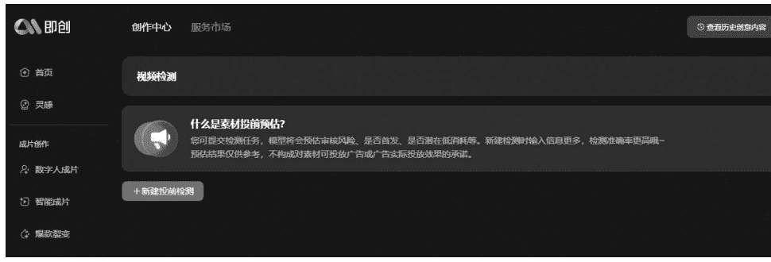

图2-4

##### (5) AI工具一键发布平台

一些商家提供的工具可实现一键发布，操作较为便捷。这类AI工具主要用于矩阵账号运营。如果运营自有的主号，则不建议用此类工具，需要根据自身的业务流程来决定。

##### (6) 数据监测与互动

内容发布后，运营人员可以借助具备数据监测和更新功能的工具，根据用户评论自动回复。

例如，评论区出现“怎么领模板？”等重复问题时，AI会自动回复预设话术；遇到“这个方法没用”等负面评论时，系统会标红提醒并触发人工介入。

同时，AI会提取用户需求的关键词，生成“后续选题库”。例如，当天评论区提到“学生党适用的工具”，AI就会记录“可做一期‘学生免费AI工具推荐’”。

##### (7) 用AI做复盘

一天结束后，把手里的数据和平台资料交给AI，让其分析当日的工作效率并给出建议。例如，若抖音完播率为72%，点赞率仅为3%，AI会建议“下次结尾加‘觉得有用的请回复×××’，以提升互动率”。

最后，AI会结合当日数据与热点趋势，推荐3个次日的选题方向并标注“优先级”。

这一天下来，从选题到复盘，AI就像一个“不知疲倦的搭档”，承担了全部重复性工作。运营人员仅需要聚焦决策与优化环节即可。

#### 3. 核心启示

当前AI并非万能，仍需要人工提出明确指令。运营人员首先需梳理自身业务流程、熟悉平台的运营逻辑、明确爆款内容特征，才能充分发挥AI的价值。

AI的核心作用是帮运营人员把那些烦琐的重复性工作完成，让运营人员能将精力投入在更具有创造性的环节中。

### 2.5 AI智能客服搭建，全流程落地的保姆级心法

用户在微信中收到的客服回复，有可能并非人工回复，而是由AI智能客服自动生成。更重要的是，搭建并售卖这类AI智能客服系统，如今已经成为一门盈利可观的好生意。

2025年，坤哥团队凭借AI客服业务实现营收突破百万元，同比增长了10倍。他们的客户覆盖电商、餐饮、教育等多个行业，搭建的微信AI智能客服能自动回复咨询、识别图片，甚至处理订单。一套这样的系统，能替代3~5个人工客服，企业省下的人力成本，就是这门生意的核心利润空间。

#### 1. 市场机遇：传统客服的痛点与AI解决方案

AI客服的本质是帮助企业降本增效。想做好这门生意，先得把传统客服的痛点摸透。

##### (1) 传统客服的核心痛点

人工客服的成本较高，单个客服一年的工资加社保，差不多要8万~10万元。除此之外，招聘、培训都要花时间和成本，而且客服流动性大，工作时间还受限——晚上10点后、节假日没人值班，客户咨询无人应答。遇上“双11”这种高峰期，咨询量激增，客服根本忙不过来，客户体验直线下降。

更突出的是服务质量不稳定。新人客服经验不足，遇到复杂问题容易答错；老客服可能态度敷衍，服务质量全看个人状态，很难做到标准化。

反观AI客服，可以做到24小时在线不间断服务，回复速度以秒计算，服务质量稳定。更关键的是，它的成本仅为人工客服的十分之一到五分之一，性价比远超人工客服。

##### (2) AI智能客服能做什么

#### 2. 商业模式：成本结构与盈利空间

坤哥团队搭建的AI智能客服，并非简单的关键词触发回复，而是真能“读懂”客户问题的智能系统。

其基础能力覆盖了70%~80%的客服咨询——也就是“怎么下单”“怎么退款”这类重复性问题，AI能全部独立处理，直接解放人工客服。

在高级能力里，图片识别是核心亮点。例如餐饮行业，客户发一张食物图片，AI能直接分析出热量；电商行业，客户发订单截图，AI能快速识别中奖信息并自动回复。

针对微信场景，系统还做了很多细节优化：像真人一样逐句发消息，文字里穿插微信表情，每句话之间间隔几秒模拟打字速度，客户根本感觉不到他们是在和机器人聊天。

坤哥团队实现百万元营收，背后是一套清晰的商业逻辑，核心就是“低成本、高溢价”。

##### (1) 两种主流收费模式

AI客服的收费模式主要分为按年收费和按效果收费两种，可适配不同规模的企业。

- ①按年收费：是为企业量身搭建一套AI智能客服系统，按年收取服务费。小企业一年几千到一万元，中型企业一年数万元，大型企业则根据需求定制，费用更高。
- ②按效果收费：是根据AI处理的咨询量、替代的人工数量来收费。例如，AI能替代3个人工客服，就收企业2个人工的成本，企业相当于节省1个人的开支，企业接受度较高。

##### (2) 成本构成与利润空间

AI智能客服的成本其实很低，主要分为3类：一是技术成本，也就是调用Claude、GPT-4（Generative Pre-trained Transformer 4，生成式预训练Transformer模型4）等大语言模型的API费用，一个月也就几百到几千元；二是微信接口成本，通过第三方服务商接入微信对话接口，每月几百元即可完成接入；三是人力成本，前期搭建系统、调试提示词需要几个人工作，但系统稳定后基本不用专人维护。

算下来，一套AI智能客服系统一年的总成本也就5 000~20 000元，但收费能做到10 000~100 000元，利润空间非常可观。

##### (3) 客户付费意愿的核心逻辑

企业付费，本质是算“划算账”。一个人工客服一年成本8万到10万元，换成AI智能客服只要1万到3万元，仅人工成本就省了5万到7万元。而且AI不用请假、不会离职、不会产生情绪波动，24小时在岗，服务效率还更高。

另外，客户付费意愿的关键在于让企业看到真实效果。坤哥团队的做法是提供免费试用，让企业直观看到AI处理了多少咨询、客户满意度提升了多少，看到实际效果后，企业自然愿意续费。

#### 3. 实践路径：业务理解是第一竞争力

这门生意看似是技术活，但关键是要“懂业务”。坤哥团队能成功，不是技术比别人强多少，而是真正地摸透了不同行业的业务场景。

##### (1) 业务流程梳理：从SOP到提示词

AI智能客服的核心，是将企业的业务逻辑“翻译”成AI能理解的提示词。在此过程中，运营人员必须深入拆解企业的业务流程。

坤哥团队的做法很务实：如果企业有成熟的SOP或话术文档，就直接基于这些材料梳理；如果企业流程混乱，就让客户的销冠客服绑定微信，先采集一段时间的真实对话话术，再从中提炼出标准化的SOP。

比如做电商客服，要摸透客户最关心的下单、退款、物流查询等问题；做餐饮客服，要清楚客户在意的菜品推荐、热量、预订流程等需求。只有把这些业务逻辑拆细、拆透，AI回复才能更精准。

##### (2) 提示词设计：结构化与场景化

提示词是AI智能客服的“大脑”，直接决定回复质量。坤哥团队用的是LangGPT框架，这是一种结构化的提示词编写方法，能清晰定义AI的角色、业务背景、工作目标和流程，让AI严格按预设逻辑执行。

为了减少AI“胡说八道”（也就是所谓“幻觉”），他们还会做提示词场景拆分——把不同行业、不同问题类型的提示词分开设计，确保AI每一次回复都精准对应业务需求。

提示词场景拆分流程如图2-5所示。

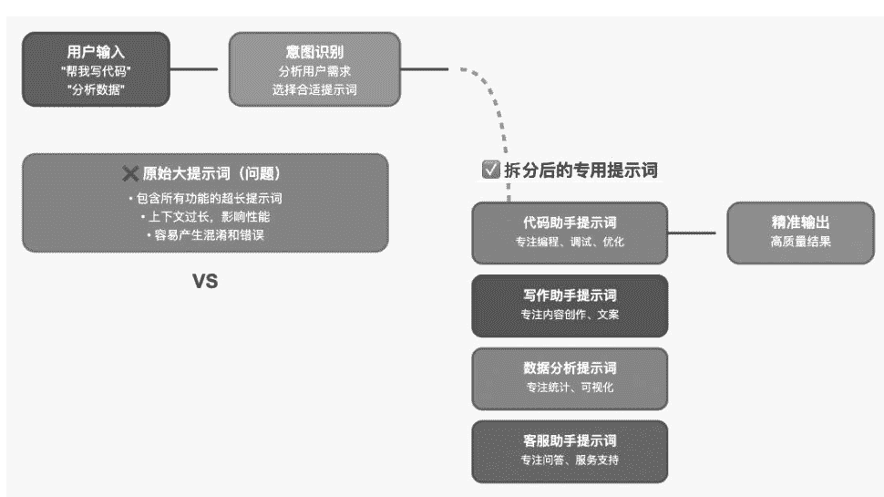

图2-5

更重要的是适配微信场景：不能让AI一次性发送大段文字，要逐句发送；适当插入微信表情增加亲切感；每句话间隔几秒，模拟真人打字节奏。这些细节，是让客户不反感的关键。

##### (3) 核心壁垒：数据与平台的深度整合

AI智能客服的技术门槛其实不高，真正的壁垒有两点：数据和平台的整合。各大模型公司拿不到微信的会话数据，而基于微信生态搭建的AI智能客服，能积累大量行业对话数据，这就是天然的护城河。

另外，与微信生态的深度整合能力也很关键——比如对接微信支付、订单系统等，这些都需要长期的技术积累和客户验证，不是仅靠一个模型就能实现的。

#### 4. 长期价值：AI赋能下的持续增长

AI智能客服最大的优势，是能跟着AI技术进步自动升级。例如，从GPT-3（Generative Pre-trained Transformer 3，生成式预训练Transformer模型3）到GPT-4再到Claude 3.5，大模型能力提升后，客服的理解能力、回复质量会同步变好，不用额外投入太多成本。

一个能长期做的AI产品，必须满足两个条件：一是能跟着大模型升级而变强；二是拥有大模型公司没有的壁垒。大模型公司缺乏行业对话数据、不懂具体业务逻辑、做不好微信生态整合，这些正是AI智能客服的立身之本。

AI产品核心竞争力壁垒如图2-6所示。

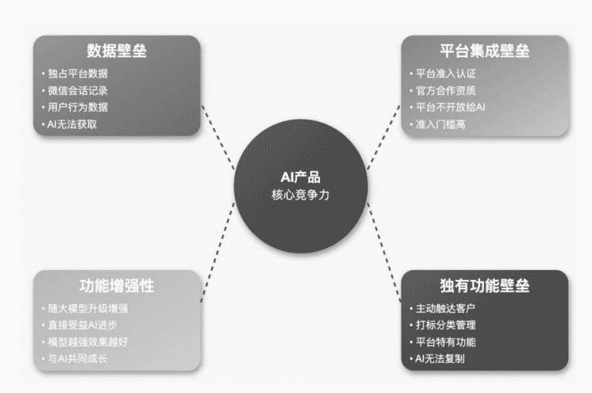

图2-6

未来，随着AI能力的提升，AI智能客服的应用场景会越来越广，从现在的电商、餐饮、教育，扩展到医疗、法律、金融等更多领域。

而且大家不用怕被AI替代——提示词的核心是业务逻辑的投射，这要求从业者必须成为行业专家。至少在很长一段时间里，懂业务的人，才是这门生意的核心竞争力。

### 2.6 AI+RPA电商数字化，从0到1实现高效提效

电商行业的竞争已从“渠道红利”转向“需求洞察红利”。消费者需求日益细分，品牌面临两大核心难题：一是难以精准把握用户真实需求，选品失误、产品迭代滞后导致增长停滞；二是内容种草运营效率低下、成本高，投入与产出不成正比。

数阔八爪鱼团队将AI与RPA深度融合，搭配飞书多维表格，助力电商企业实现从0到1的数字化提效。

#### 1. 电商企业的两大核心痛点

电商企业在数字化转型过程中，面临选品决策与内容运营两大核心难题，这些痛点直接制约品牌的增长效率。

##### (1) 选品与产品迭代：用户需求洞察缺失

多数企业仍停留在“跟风选品”或“凭经验选品”阶段，最终陷入同质化严重、产品与用户需求脱节、库存积压的困境。

传统用户研究依赖人工分析评论，流程烦琐，如手动下载评论、整理数据、提炼痛点，这样不仅耗时费力，还容易遗漏关键信息；并且，人工分析受主观经验影响较大，难以快速响应市场变化。

##### (2) 内容种草运营：手动操作效率低、成本高

当前，小红书已成为品牌商家的必争之地，但手动操作面临三大痛点：平台日活规模庞大，竞品调研难以全面覆盖；运营策略多依赖主观经验，缺乏数据支撑；内容创作周期长，从策划选题、撰写文案、设计封面到发布，单篇笔记耗时超1小时。这些问题导致品牌投入大量人力、物力，却难以获得理想的ROI（投资回报率）。

#### 2. AI+RPA的解决方案

数阔八爪鱼团队将AI与RPA深度融合，在VOC（Voice of Customer，客户之声）用户研究与小红书内容种草两大核心场景，实现自动化提效。

##### (1) 依托VOC系统破解选品难题

VOC涵盖用户对产品的全部反馈，包括电商评论、客服会话、社交媒体讨论等，集中承载了用户的期望、偏好、不满与建议。

以“亚马逊评论分析”为例，具体落地路径分为4步。

第一步：RPA自动化采集。只需输入商品ASIN（Amazon Standard Identification Number，亚马逊标准识别号）或关键词、设定采集量级，RPA即可自动抓取评论内容、星级、评论时间、品牌名、库存量等信息，支持全天候无间断运行。

第二步：AI自动打标。将采集到的数据导入到飞书多维表格中，借助内置AI功能自动打标，把零散无序的评论转化为可分析的结构化数据。分析维度包括情感倾向、核心痛点、使用场景、产品优劣等。

第三步：BI（Business Intelligence，商业智能）仪表盘可视化。通过可视化看板让需求洞察更直观，常用看板包括各品牌核心要点雷达图（用于对比竞品优势与短板）、各品牌口碑健康度对比图（通过正负面评论占比判断市场趋势）、用户效果反馈排行榜（精准定位用户最关注的核心需求）。

第四步：AI全维度洞察分析。若要通过更精准、专业、深度的洞察支撑选品决策，需借助更贴合电商业务场景的专业AI分析工具。挑选此类AI工具时，需重点关注3个核心维度——数据源覆盖能力、大模型分析能力、AI分析落地转化能力。

##### (2) 通过自动化系统解决运营难题

“AI+RPA+飞书”的组合模式，可实现从舆情监测、选题创作到数据追踪的全流程自动化。

第一步：RPA自动化采集，搭建全景式数据池。RPA可基于预设关键词，自动采集平台相关笔记、评论、博主信息，具体功能包括关键词笔记采集、博主信息采集（自动抓取粉丝数、简介、笔记风格、互动率等）、账号数据追踪。

第二步：AI舆情分析，精准捕捉用户心智。AI对笔记内容与评论进行多维度深度舆情分析，涵盖情感倾向判断、核心痛点提取、热门话题梳理、竞品运营策略拆解等关键方向。对于品牌方的媒介或公关团队、代运营机构而言，可借助飞书多维表格内置的AI大模型，自动开展评论相关性分析，快速甄别“水军”、无效“种草”、“水文”（见图2-7）。

第三步：AI+飞书搭建智能选题创作系统。通过该系统，创作者基本可将单篇内容的创作周期从1小时压缩至几分钟。其操作流程如下：只需填入目标创作主题，单击“对标创作”选项，AI便会自动分析爆款笔记的结构、语气、核心关键词，快速生成风格匹配的标题、文案及封面图初稿。

### 快速甄别“水军”、无效“种草”、“水文”

- 有时媒介无法判断达人高互动数据的真实性（例如评论区都是“水军”“颜粉”、不相干评论等，产品关联评论极少）。
- 团队没法量化效果验证依据，容易出现高投放，低转化，数据断层、人工局限、归因缺失的情况。

实现路径：
- 八爪鱼RPA全自动采集种草笔记评论区数据，并自动整理规整至Excel/飞书多维表格中，便于后续分析。
- RPA调用内置的主流AI大模型，自动进行评论相关性分析，快速甄别“水军”无效种草和“水文”，让品牌每一分钱都花在刀刃上。

方案价值：
- 80%：伪爆文识别率提升至80%
- 99%：评论采集成功率高达99%

图2-7

#### 3. 热风梳案例：从痛点洞察到销售额过亿元

以某品牌热风梳为例，具体展示AI+RPA如何驱动产品从痛点发现到销售额突破亿级的完整路径。

(1) 发现问题：品牌通过VOC自动化用户研究系统，快速采集并分析京东、淘宝等多平台的用户评论。RPA自动抓取数万条评论后，经AI打标分析发现，用户最关注“定型效果”与“光泽度”，同时频繁抱怨产品“不便携”“无隔热设计”“不支持多国电压”等问题。

(2) 改进产品：基于上述洞察，品牌围绕便携包装、隔热设计、多国电压适配等核心维度对产品进行优化升级。借助BI仪表盘可视化功能，团队可清晰掌握竞品的优势与短板、市场口碑趋势及用户核心需求排行榜。

(3) 精准推广：通过更深入的AI分析工具生成完整分析报告，助力品牌精准锁定细分人群与细分场景的市场机会。最终，品牌聚焦“旅行场景”进行重点推广，针对经常出差、旅行的用户群体开展精准营销。

(4) 销售额过亿：该品牌以极低的产品改动成本实现销售额破亿元，毛利率高达30%，至今仍是品类榜单上的爆品。这一案例，正是通过数据与AI驱动产品增长、精准匹配用户需求，从而降低试错成本、提升成功概率的典型实践。

#### 4. 长期价值：为何这套方案具备持续竞争力

AI+RPA的落地关键在于“贴合业务、小步试错”。这套方案的长期价值主要体现在以下4个方面。

其一，工具组合的实用性远超单一工具。RPA负责自动化执行重复性工作，AI负责深度分析与内容生成，飞书多维表格负责结构化管理与协同，三者协同联动，灵活性更强。

其二，数据驱动决策远比依赖经验更可靠。用户反馈中提及频次最高的痛点，便是需优先解决的核心问题；竞品表现突出的维度，便是需优先借鉴并优化的方向。

其三，具备可复制、可迭代的特性。在落地过程中，标签与关键词的精准度直接决定AI的输出质量。建议先从单一具体场景切入，直到跑通流程、看到明确效果后，再横向拓展至其他业务场景。

其四，能够持续进化。随着AI技术不断升级，AI工具分析的深度与准确性会逐步提升；随着数据积累越发丰富，需求洞察会愈发精准。AI时代的红利，永远属于敢于尝试、善于落地的行动者。

## 第3章 AI赋能产品落地

产品落地曾是技术门槛高、开发周期长的“拦路虎”，而AI让“人人都是产品经理”成为现实。无论是App开发、小程序搭建，还是音乐制作、PPT设计等，AI都能大幅降低开发成本、缩短迭代周期，让创意快速转化为可落地的产品。本章通过多个从0到1的实战案例，拆解AI产品开发的全链路逻辑，提供工具选型、避坑指南与盈利方案，帮你快速将想法变成可变现的产品。

### 3.1 AI软件全链路开发，实现自动化落地实战指南

AI技术正深刻重塑产品开发的全链路，自动化落地已成为提升效率、降低成本的核心方向。而要实现这一目标，首先需直面传统软件开发模式的弊病，掌握AI破解该问题的主要方法。这正是本节开篇要聚焦的核心问题。

#### 1. AI破解传统软件开发困局

传统软件开发模式长期遭受着产品开发效率低与协作难度大的问题制约，而AI的介入成为破解此难题的关键。

##### (1) 软件开发效率的核心瓶颈

手动编码中的重复劳动严重拖累了产品开发进度，如编写大量Getter/Setter方法、DTO（Data Transfer Object，数据传输对象）转换代码、基础增删改查逻辑等。更值得注意的是，30%的漏洞源于简单的拼写错误，40%的开发时间耗费在翻阅冗长的API文档上。这种低效的工作模式，让开发者的创造力不断被机械劳动所消磨。

##### (2) 技术文档的三大核心痛点

行业内流传的“代码一时爽，文档火葬场”，精准道出了技术文档的尴尬处境：一是拖延成疾，需求交付压力大时，文档总被搁置；二是沟通断层，程序员撰写的文档充满专业术语，产品经理等非技术岗人员难以理解；三是版本分裂，代码已迭代至V3.0，文档却仍停留在V1.0，直接导致前端联调时频繁出现“接口不匹配”的问题。

##### (3) AI引发的软件开发变革

如今，软件开发正从“人肉编码”向“智能辅助”转型。

- ①在代码补全领域，智能工具的能力早已超越基础联想：当你输入“function validateEmail”，GitHub Copilot不仅能自动补全邮箱校验的正则表达式，还能通过上下文判断，提醒被遗漏的国际化域名校验逻辑。
- ②在文档自动化领域，闭环体系已初步形成：AI可自动解析代码注释，实时生成Swagger或API文档；像飞算JavaAI等专业工具更能实现代码变动后，自动同步流程图，彻底解决了文档滞后的行业痛点。

#### 2. 从工具堆砌到标准化生产流水线

AI提效需要落地到具体流程，而合适的工具与标准化生产流水线是核心支撑。下面先梳理核心工具矩阵。

##### (1) 核心工具矩阵

在AI开发工具爆发的当下，精准选择适配自身需求的工具，是效率翻倍的关键。按功能可分为两类核心工具。

- ①核心代码生成工具各有侧重：GitHub Copilot被称为“代码助手”，擅长预测软件开发者的编码意图，但需注意其可能生成基于旧版本的冗余代码，商用时还需规避代码协议风险；DeepSeek作为国产工具的代表，在处理高并发秒杀、分布式锁等复杂业务逻辑时表现突出，生成的Redisson实践方案贴合企业级开发需求；Cursor受个人开发者青睐，具备全栈视角，能精准识别前后端依赖关系，如修改一个数据库字段，它会同步调整前端显示逻辑与API说明。
- ②文档自动化工具主打精准同步：Swimm可将代码注释转化为可交互文档，核心优势是能关联架构决策记录，让每一行核心代码的变更都有据可查；飞算JavaAI则更适配企业级复杂架构，实现代码、Markdown（轻量级标记语言）文档与图形化文档的无缝同步。

##### (2) 5步落地流水线

AI生成代码的优势在于高效，但如同外卖需要检查餐具是否齐全，AI产出的代码也必须经过人工校验。这套“AI主攻+人工把关”的5步流水线，已在多个项目中验证有效。

- ①AI主攻需求转译为伪代码：摒弃模糊提问，采用精准提示词模板，如“基于[技术栈]实现[功能]，需满足[性能/安全指标]”，确保AI输出贴合核心需求。
- ②AI辅助填充细节：将DTO映射、基础数据校验等重复性工作交给AI，而人工集中精力解决订单流转、复杂状态机、权限边界等核心业务逻辑问题。
- ③AI加速测试用例生成：AI负责覆盖80%的常规测试场景（成功、失败、空值等），开发者聚焦20%的极限场景测试（高并发超卖、网络分区、异常脏数据等）。
- ④AI自动化文档同步：借助Swimm（代码文档同步工具）等工具，将代码中的“@api”注释自动同步至文档，对过期参数自动标黄预警。
- ⑤人机协作部署监控：AI辅助编写Helm Chart（Kubernetes包管理工具）或Terraform（基础设施即代码工具）配置，但CPU、内存、带宽等关键成本参数，必须由人工二次确认。

##### (3) 日常软件开发提效：从两周交付到5天落地

AI已在多个软件开发场景中实现显著提效。以下为具体内容。

- ①构建前端页面时，以往需要1~2天的商城H5首页开发，现在只要输入包含搜索推荐、轮播横幅、滚动公告、瀑布流展示、底部导航的详细需求，AI几分钟内就能输出完整代码，微调后即可使用，效率比以往提升5倍。
- ②编写测试用例时，设定AI为“资深测试专家”，针对用户登录等模块，它能从弱网、短密码、重复点击等多维度生成结构化测试表单，开发者可专注优化核心逻辑。
- ③撰写技术文档时，只需告知AI“以Java文档专家身份，为用户模块编写包含摘要、目录、核心类说明及常见问题的Markdown文档”，几分钟就能得到专业草稿。
- ④成本层面的变化更为直观。传统的5人团队如果进行软件开发2个月，需投入3万~6万元，而AI辅助下单，则1个月可完成，成本仅需1万元，收益直接翻倍。

#### 3. 避坑指南

AI软件开发虽高效，但不当使用易踩坑。下面结合实战案例，分享两大核心避坑要点。

##### (1) 模糊指令是技术债的根源

指令表述不清，会让AI沦为“技术债制造机”。就像让AI“买点水果”，可能得到烂苹果或自己不吃的榴莲。精准指令需遵循固定公式：[动词]+[对象]+[数量标准]+[备选方案]+[排除项]。实战中更需具体，如“购买5个新鲜的酸柠檬，售罄则替换为青桔，总价不超过30元，不买榴莲”。应用到软件开发中，这样的精准指令能确保AI输出符合生产要求的代码。

##### (2) 文档质量需严格把控术语精准度

AI撰写文档时容易出现“术语模糊”问题，如在技术协议中用“负责”替代“承担违约责任”，可能引发后续纠纷。其对策是建立术语白名单，明确要求AI起草技术文档时，必须包含具体违约金额（如按合同金额0.1%每日计费）、明确交付时间及争议仲裁地点等关键信息。

#### 4. 未来展望

了解完当下落地与避坑技巧，再将目光投向未来，看看AI软件开发模式将迎来哪些变革。

##### (1) 短期：集成开发环境智能插件重构软件开发流程

未来2年内，集成开发环境将深度集成AI能力，催生三大变革：一是自修复调试器，不仅能定位错误，还能结合历史报错数据分析原因并自动生成修复代码；二是全链路上下文感知，需求文档变动后，AI自动重构伪代码、更新单元测试；三是语音交互编码，开发者通过自然语言指令即可重构代码结构，软件开发学习曲线降低了40%。

##### (2) 长期：语义化编程与多智能体协作

未来，软件开发将迎来两大突破：一是语义化编程，自然语言成为“新语法”，开发者直接描述业务需求，AI就能将其转化为符合金融

### 3.2 AI iOS开发赋能，效率提升10倍的实战技巧

iOS App（iPhone Operating System，苹果移动操作系统）开发曾因多环节协同、高门槛制约让不少开发者望而却步，而AI技术正从根源破解这些难题。要理解AI带来的效率革命，需先看清传统开发的核心困境。

#### 1. 传统iOS App的开发困境与核心痛点

传统iOS应用开发需历经需求分析、UI设计、编码实现、测试调试、应用商店审核、推广运营六大阶段，涉及开发者、设计师、测试工程师、ASO（App Store Optimization，应用商品优化）专员等多个角色。这种多环节、多角色的协同模式，存在4类难以突破的痛点。

- （1）人效极度失衡。编码环节占整个开发周期的50%以上，即便完成编码，App Store审核平均仍需3~7个工作日，推广文案撰写还需反复打磨，全链路效率瓶颈突出。
- （2）沉没成本高昂。中小团队的人力成本占项目总预算的绝大部分，一旦市场反馈不佳，前期投入将全部沦为沉没成本。
- （3）创意与经验绑定。应用命名、设计图标、宣传标语等环节，高度依赖人们的主观经验与审美，试错成本高且效果难以预判。
- （4）审核风险不可控。多数应用首次提交会因细节问题被拒，不少团队因不熟悉苹果公司严格的审核标准，需反复修改，严重延误上线进度。

#### 2. AI驱动App开发全链路解决方案与实现效果

在AI工具的加持下，iOS App开发的每个核心环节都实现了效率的显著提升，甚至重构了传统工作模式。

- （1）编程环节效率倍增：Cursor（AI代码编辑器）、GitHub Copilot（AI编程助手）等AI编程助手，能将编码效率提升50%~70%。原本需要4周才能完成的基础功能模块开发，通过AI辅助的自然语言交互，仅需1天左右即可完成联调。
- （2）创意环节快速产出：以往耗时费力的应用命名工作，如今通过DeepSeek输入应用App核心功能点，10分钟内就能获得几十个优质方案，相比传统模式节省90%时间。
- （3）设计环节突破瓶颈：借助“即梦AI”等AI绘画工具，输入设计关键词，几分钟内就能生成多套符合苹果公司设计规范的图标方案，将原本3天的设计周期压缩至分钟级水平。
- （4）应用商店优化（ASO）推广批量提速：上架阶段，用DeepSeek批量生成100条ASO关键词和广告语仅需10分钟，而人工完成同类工作（含查词、热度比对、去重）通常需要1周。

这种AI驱动的工作流，实现了商业模式的本质升级——个人开发者仅凭自身力量，就能覆盖开发、设计、运营全环节，打造“1人团队”的高效运作模式。

#### 3. iOS App开发从0到1登上付费榜单实战案例

#### （1）实战背景与核心需求拆解

2025年3月，产品开发专家王登康还是iOS开发零基础小白。他借助AI工具跑通了从需求调研到上架运营的完整闭环，又陆续开发了7款App，其中有3款App成功跻身App Store付费榜单（最高排名第24位）。以他的核心产品“易转”App为例，核心功能为Markdown转纯文本、HTML（HyperText Markup Language，超文本标记语言）转图片。看似简单的功能，实则精准命中了AI时代的高频痛点，即AI输出的Markdown等特殊格式文本，通常无法直接复制使用。通过小红书评论区调研，王登康进一步确认了这一需求的真实性与普遍性。图3-1所示为“易转”App功能演示。

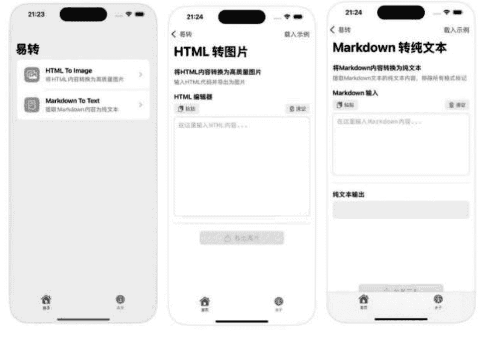

图3-1

#### （2）7个核心AI实操细节与关键节点

“易转”App的成功，离不开以下7个AI实操关键点的精准落地。

- ①选用Cursor Agent模式协作：以Claude 3.7 Sonnet模型为核心，直接下达“开发包含HTML转图片及Markdown转纯文本功能的iOS App”指令，借助AI的项目全局感知能力推进开发进度。
- ②快速创意生成Logo：在“即梦AI”中输入“App icon，体现格式转换，色彩丰富，无文字”，生成的图标既符合现代审美，又具备较高辨识度。
- ③ASO导向命名：结合DeepSeek给出的关键词热度分析，确定兼具记忆点与搜索适配性的App名称。
- ④自动生成合规文件：应用上架需提交隐私政策，通过DeepSeek直接生成符合苹果公司审核要求的HTML格式政策文件，省去专业法务审核的烦琐环节。
- ⑤自动化处理截图尺寸：解决上架截图尺寸不统一的问题，让DeepSeek生成单文件HTML处理工具，大幅提升物料准备效率。
- ⑥撰写推广文案智能：通过Cursor基于代码逻辑直接生成App描述与推广语，使文案转化效率变得更强。
- ⑦筛选关键词：先用DeepSeek批量生成100组关键词，再结合七麦数据筛选出搜索量Top 20的关键词进行精准投放。

#### 4. AI驱动下的iOS App开发避坑经验

AI虽能大幅提效，但实战中仍有不少专属“陷阱”。

#### （1）工具选择需精准匹配场景

- ①简单网页开发用DeepSeek即可满足需求，但iOS App涉及多层文件与复杂结构，首选Cursor，其Agent模式能自动感知项目全貌、管理项目文件，效率远超普通对话式工具。
- ②Xcode纠错有技巧：编译报错时，无须自行钻研语法，直接将包含目录结构的完整报错信息传给Cursor即可。如果AI反复纠错仍无效，“重启对话”是打破逻辑死循环的有效方法。
- ③配置文件需人工复核：尤其是Info.plist（Information Property List，信息属性列表）文件，AI可能生成冗余副本导致冲突，最佳处理方式是保留Xcode原始配置，删除冗余内容。
- ④环境问题高效解决：面对“步骤一致却报错”的异常情况，记住四大法宝——解读日志问AI、对齐软件版本、清理Docker Build（容器化平台构建）缓存、重启计算机，保持开发环境整洁能规避90%的此类问题。

#### （2）商业层面更需掌握核心要义

一是“完成优于完美”，采用极简架构：故意不设登录系统、不租用服务器，除应用商店年费外几乎无运营成本，这种“零负担”模式是个人开发者实现可持续运营的关键。

二是免费验证需求：上架初期采用免费模式，若免费阶段下载量低迷，说明需求为伪需求，应果断止损；待积累一定用户数据后，再设置低价买断（如1元），以降低用户决策门槛。

三是抓住流量红利：苹果公司对新App有两周左右的自然扶持期，上架初期需发动朋友圈、社群提升下载量与五星好评，撬动算法推荐。

四是重视审核细节：即便仅适配iPhone，审核员也会在iPad上测试，务必完成全设备覆盖的兼容性测试。此外，上架截图严禁使用启动页，必须展示核心功能界面，否则大概率会被拒审。

#### 5. AI赋能iOS App开发的未来展望

借助AI工具，王登康实现了从“零代码基础”到“付费榜单开发者”的跨越，全程未手动编写一行代码，仅通过自然语言与AI持续沟通、迭代、调试，就将想法转化为App Store上的可用产品。

这一过程，本质是解锁了人类最本能的创造方式，即“清晰描述需求+持续对话迭代=成功落地应用”。未来，随着AI模型能力的持续升级，iOS开发的技术门槛将彻底降低。对每一个有创意、有想法的人而言，无须掌握复杂的编码技术，只需保持清晰的逻辑与持续的创造欲，就能在数字世界打造属于自己的作品。

### 3.3 AI制作音乐，单条视频涨粉7万人的秘籍

AI普及前，普通人制作高质量的“原创音乐+剧情动画视频”存在一定门槛，需配备作词作曲、原画动画、剪辑等专业人员的团队，不仅周期长、成本高，更有着难以逾越的技能壁垒。而凯哥借助AI实现“1人抵1个团队”，其作品《西游记奔波儿灞·水府打工记》教程视频，6天全网涨粉7万人，半个月内带动全网粉丝数从9万突破20万，印证了AI对内容创作的颠覆性变革。

传统创作的高门槛让普通人的创意难以落地，而AI的出现恰好打破了这一创作僵局。两者的对比与转折，构成了本次案例的核心背景。

#### 1. 传统内容创作的高门槛与AI破局

要理解AI带来的变革，需先看清传统创作的核心困境——一套“不可能三角”困境长期制约着普通人的创作热情。

#### （1）传统创作的“不可能三角”

普通人制作高质量的“原创音乐+剧情动画视频”，需直面周期长、成本高、技能门槛高三大痛点。对于不懂乐理、不会绘画的人而言，仅靠自身实现这类创意，几乎是不可能完成的任务。

痛点的背后是普通人对创作的渴望与能力间的矛盾，而AI的出现正是化解这一矛盾的关键契机。

#### （2）AI带来的破局契机

AI赋予普通人的并非简单的工具，而是“超级生产力”，让一人化身一支创作团队。它可当御用作曲家，即便不懂乐理，只需告知风格，就能生成媲美格莱美奖（Grammy Awards）级别的音乐；也能做顶级画师，无须有绘画功底，文字描述即可转化为具备电影质感的镜头。

凯哥的实战是最佳证明：一个不懂艺术的理工男，凭借AI工具流，以近乎零成本、高效率的方式，产出了媲美专业团队水平的爆款内容。

AI的落地并非单纯的工具堆砌，而是有章法的系统性流程设计。凯哥搭建的4步工作流程，正是产品经理思维在创作中的具体应用。

#### 2. 实战流程：一人抵一个团队的4步法

为复刻《西游记奔波儿灞·水府打工记》的成功，凯哥让4款AI工具各司其职，形成完整工作流程，精准解决各环节核心痛点。

#### （1）文案策划：AI编剧（豆包）

其核心痛点是AI写的歌词易空洞、过于类似诗朗诵。破局关键在于打磨提示词，凯哥经过反复调试，从简单指令升级为具备场景与情绪的细致描述，核心是让奔波儿灞成为“打工人嘴替”。具体提示词要求明确：角色人设贴合原著特质，融入“当代人的共鸣情绪”；歌词需植入《西游记》元素，用神话场景隐喻现实困境。

#### （2）音乐制作：AI音乐人（Suno）

其核心痛点是生成音乐易干瘪、沦为口水歌，或与歌词风格严重脱节。凯哥的解法是精准定位风格——借助大模型出谋划策，最终确定“以流行民谣，木吉他主导，旋律温暖带幽默”的方向。

#### （3）视觉制作：AI导演（即梦AI）

核心痛点是MV（Music Video，音乐录影带）画面缺乏连贯性，这也是众多AI内容创作者的共性难题。凯哥摸索出“尾帧接首帧”方法：以上一段视频最后一帧为下一段视频的参考底图，彻底解决画面连贯性问题。

#### （4）后期合成：AI剪辑师（剪映）

实战中，借助剪映的歌词识别与文本动画功能，快速完成包装交付。传统模式下，剪辑视频需专业团队负责，周期为1周至2周，成本达数千元；而AI模式下，仅需1人，周期为1天至2天，近乎零成本即可完成视频的后期合成工作。

#### 3. 成果验证：单条视频涨粉7万人的秘密

凯哥发布的《教大家用AI做西游歌手唱歌》的视频，成功引爆多平台，其增长数据与用户反馈，印证了AI内容的市场潜力。

#### （1）爆发式增长

视频发布后6天，全网涨粉超7万，抖音、哔哩哔哩、小红书、视频号同步爆发。这说明，经精心打磨的AI内容，能够被主流受众接受与喜爱。

#### （2）用户反馈的情感穿透力

最初发布的歌曲片段，引发评论区强烈反响，粉丝纷纷要求看完整版。“奔波儿灞是上过班的”“听哭了”“单曲循环”等留言刷屏，印证了“AI只是工具，提示词背后的人性洞察才决定内容温度”的核心结论。

#### 4. 成功经验

AI工具决定创作的下限，而人的思维与态度决定上限，这也是有些生硬机械的AI视频表现平平、无人问津的核心原因。

#### （1）产品思维：先有共鸣，后有工具

常见误区是“为用AI而做视频”，导致内容空洞无物缺乏核心表达。凯哥的破局之道是事前调研——在哔哩哔哩爆款AI角色视频评论区深挖需求，精准捕捉打工人情绪。他深知，AI只是放大器，洞察用户情绪才是爆款的核心。

#### （2）质量标准：绝不容忍AI的瑕疵

不少人认为“AI制作的视频，画面崩一点也能被理解”，但凯哥坚守专业标准。他用“尾帧接首帧”的方式打磨画面连贯性，会因一个小错误反复生成十几次视频。他的经验是，只有将AI作品当作商业精品打磨，才能赢得用户的喜爱与尊重。

#### （3）极致利他：把展示变成交付

很多创作者刻意隐藏关键步骤与参数，而凯哥深谙自媒体的本质是价值交付。他将制作流程拆解为“保姆级”教程，把提示词打包成豆包智能体免费送给粉丝，并公开所有细节。这种启蒙式分享，不仅实现快速涨粉，更筑牢了粉丝的私域信任。

凯哥的案例并非个例，而是AI驱动内容创作时代变革的缩影。它预示着超级个体的崛起，更打开了商业模式的无限可能。

#### 5. 未来展望

#### （1）超级个体的时代已来

本案例彻底证明，AI已经抹平创作的技术鸿沟。未来，一人即可成为一个工作室，创作者不再受“不会画、不会作曲”的限制，创意、审美与人性洞察将成为核心竞争力。

#### （2）商业模式的无限延展

掌握这套AI生产力，可快速复制至多个领域，探索多元变现路径：一是定制化服务，为企业或个人制作低成本、高效率的AI宣传片与MV；二是IP批量孵化，快速测试虚拟IP（如AI宠物、历史短剧），搭建账号矩阵；三是知识赋能，帮助更多普通人掌握AI工具，成长为新时代超级个体。

### 3.4 AI开发零代码小程序，完成快速搭建的核心方法

AI让零代码开发小程序成为现实，彻底打破了小程序开发的技术门槛，普通人也能高效落地创意。而所有核心方法的落地，都始于对真实痛点的精准捕捉，这正是本节重点要讲的内容。

#### 1. 项目介绍

资深旅游爱好者狂热AI，深知找到一处“对味”的旅游目的地有多难。他运营着一个500人的核心玩家群，群内大咖们常向他抱怨：想找到真实、小众的景点愈发困难。大家的核心痛点十分明确，小红书、携程等主流平台的搜索结果高度商业化，所谓“秘境”多是营销号包装的网红打卡点，不仅人满为患，信息真实性也值得怀疑。

基于此，用户的核心需求清晰浮现，即他们需要一款能基于实时地理位置，精准推荐“只有当地人才知道”的隐秘角落，且能一键生成个性化游玩规划的工具。由此，狂热AI启动了《小众旅游记录》小程序项目，将其定位为“去商业化、智能化的小众目的地发现平台”。

#### 2. 核心功能拆解

该项目的核心功能围绕用户需求设计，覆盖“发现—规划—收藏—分享”全链路。

- 1. 智能定位，可自动识别用户所在城市，精准推荐周边景点。
- 2. AI深度推荐，避开热门景区，专门挖掘兼具自然风貌与在地特色的冷门、未过度开发的打卡点。
- 3. 收藏与分享，支持用户内容的本地化轻量级存储，还能生成美观的分享链接。
- 4. 路线规划，AI可自动生成两天一夜的深度游玩路径，同步附带基于真实用户反馈的避坑建议。

图3-2所示为该AI小程序的旅游行程规划功能演示。

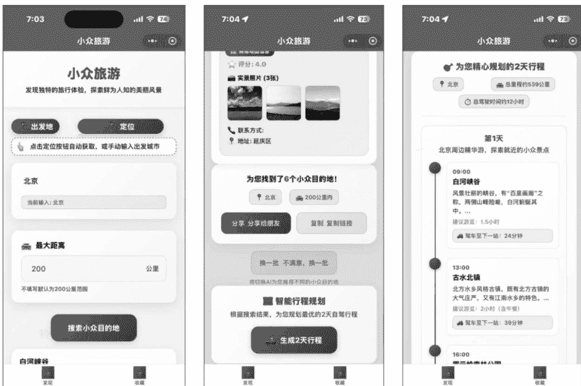

图3-2

#### 3. AI的具体作用

在这个零代码项目中，AI的价值远不止代码辅助，而是贯穿项目的全开发周期的核心伙伴。下面从UI设计与视觉闭环、AI推荐系统打磨、运维与自动化部署三大环节，拆解AI的具体作用。

#### （1）UI设计与视觉闭环

用户并非专业设计师，但可借助AI实现符合产品定位的高标准的视觉效果。通过Cursor下达指令：“创建现代感极强的小程序，采用Glass morphism（毛玻璃）风格、主色调为紫色渐变。”AI快速响应，不仅生成了完整的WXML（WeiXin Markup Language，微信小程序标记语言）结构，还自动编写了复杂的WXSS（WeiXin Style Sheet，微信小程序样式表）样式文件。其实现的响应式布局，让小程序在iPhone、Android及iPad上均能完美适配。这种视觉表现力，仅凭手工编码很难实现。

#### （2）AI推荐系统打磨

推荐系统是项目的灵魂，也是核心竞争力。用户可接入千问API与字节跳动豆包API，利用LLM（Large Language Model，语言大模型）的泛化能力，从海量互联网语料中筛选非标旅游信息。具体落地时，用户可借助Cursor搭建Express后端服务，并让AI协助设计RESTful API（Representational State Transfer API，表达性状态传递风格应用程序编程）接口。当前的核心逻辑为用户一键定位后，后端自动构造提示词发送给大模型，AI返回结构化JSON数据，前端再进行可视化呈现。

#### （3）运维与自动化部署

服务器部署曾是非技术出身者的“拦路虎”，而AI彻底解决了这一问题。它可帮助用户编写自动化部署脚本（deploy.sh），配置Nginx反向代理，甚至完成SSL（Secure Sockets Layer，安全套接层）证书的申请与自动续期逻辑设计。用户只需向Cursor提供服务器IP和账号，后续所有运维配置工作均由AI独立完成。

#### 4. 避坑经验

AI能让开发效率提升约10倍。但如果用户不懂“调教”技巧，极易踩坑。

#### （1）避坑经验一：对抗大模型“地理幻觉”

大模型存在“地理幻觉”弊端，即对距离信息缺乏准确的感知能力。核心建议是切勿指望AI自动理解地理约束，必须在提示词中加入硬性规则。例如，调整指令为“出发城市为${city}，仅推荐200公里以内景点；若为天津，仅限蓟州、宝坻、河北廊坊等周边区域，描述需包含具体区县信息”，可彻底解决该问题。

#### （2）避坑经验二：拒绝“一次性全量生成”，坚持增量开发

用户狂热AI曾尝试让Cursor一次性写出“收藏+搜索+地图”复杂模块，结果产出的代码逻辑混乱、报错频繁。核心建议是坚守KISS（Keep It Simple Stupid，保持简洁）原则（一次只做一件事），将项目拆解为定位功能、AI接口对接、UI优化3个阶段，每个小模块测试通过后，再启动下一项开发。这种增量式开发，是避免AI生成冗余代码的关键。

#### （3）避坑经验三：重视权限与环境配置的细节

微信小程序的wx.getLocation接口需烦琐的权限声明，初期AI生成的代码持续报错，根源便是未在app.json中配置requiredBackgroundModes字段。核心建议是遇到权限类问题，直接让AI查阅微信开发者最新文档。AI虽强大，但训练数据可能滞后，需明确指令让其遵循官方最新规则。

#### 5. 展望与总结

这款小程序的成功落地，不仅验证了AI零代码开发的可行性，更揭示了新的创业趋势。

本项目从构思到上线历时约一个月，实际有效工时不足20小时（多为深夜抽空推进）。截至2026年初，小程序总用户量已突破700人，核心活跃用户每日通过平台获取旅游灵感。后续还新增了景点收藏、平台评分、分享生成海报等功能。项目的成功，本质是“AI工具+细分需求洞察”商业模式的胜利。它以近乎零成本的技术投入，精准满足了500人社群的核心诉求。

### 3.5 AI搭建英语网站，月获3 000名付费用户的秘诀

以Cursor为代表的AI编程助手，正推动软件工程迈入新范式。

其一，Agent化协作将成主流，未来开发不再是简单的代码补全，而是AI Agent自主理解商业意图，自动调用API、设计数据库并完成部署。

其二，人机角色将互换，开发者将从“代码创作者”转变为“AI能力指挥者与结果验证者”。

其三，创意溢价将成为核心竞争力。当编程变得像说话一样简单，对用户痛点的精准洞察、对审美风格的独特把控，将成为核心的竞争护城河。

运营出身的东东Joe，毫无技术背景，也从未写过PRD（Product Requirement Document，产品需求文档），却依靠AI独立完成了产品全链路开发。上线仅一个月，就在小红书跑通商业闭环，收获3 000名付费用户。这一案例证明，技术不再是创业的核心壁垒，对赛道的认知才是。AI就像人体的“能力外骨骼”，让一个人就能组建起完整的“作战团队”。借助这一优势，个体创业者能以极高效率，切入大团队容易忽视或难以覆盖的细分市场。

用AI搭建能稳定盈利的英语网站，关键在于选对赛道、用对方法。下面从核心逻辑出发，拆解从0到月获3 000名付费用户的完整秘诀。

#### 1. 赛道分析

AI编程降低了产品开发门槛，个体开发者开始迎来新机遇。先从赛道潜力、行业现状与用户痛点入手，拆解其成功的核心基础。

##### (1) 赛道潜力

过去，开发一款产品需要完整的团队支撑：产品经理定方向，程序员写代码，运营做推广。这道门槛让99%有想法的人望而却步。如今，AI彻底打破了这种格局。尤其是Claude Code等工具出现后，“人人都是开发者”已成为现实。

##### (2) 行业现状与用户痛点

AI降低了产品开发入场门槛，但更关键的是找到精准的赛道。以英语口语学习领域为例，看似产品饱和，实则细分痛点仍未被满足，且个体开发者具有灵活性优势。

当前英语口语学习产品的核心痛点集中在3点：①素材枯燥，通用学习素材脱离真实使用语境，难以激发用户的持续学习兴趣；②功能臃肿，成熟App追求“大而全”，核心学习路径被复杂UI（User Interface，用户界面）淹没，用户上手困难；③创新受限，大厂决策链长，在AI技术快速迭代的当下，难以快速落地个性化或激进的创新方案。

相比之下，个体开发者的核心优势在于灵活性。个体开发者可快速开发一款聚焦“微功能”的产品推向市场测试，若用户反馈不佳，即可能立即调整方向。这种低廉的试错成本，是大公司无法比拟的。

基于此，东东Joe明确了自身的市场切入点：人群定位聚焦25~35岁女性，主打兴趣驱动型英语学习；素材定位选用YouTube（全球最大的视频分享平台）上的生活、成长、旅行类Vlog（Video Blog，视频博客），这样既解决了项目自身对优质素材的需求，也能吸引志趣相投的目标用户。

#### 2. AI解决方案

明确了赛道与痛点后，需用AI搭建精准的解决方案。

##### (1) 项目简介与差异化定位

以一款基于YouTube视频的口语学习网站为例，其核心定位是通过“优质素材+实用工具”，为用户提供高效的学习体验。在功能设计上，该网站始终坚持极简主义：只聚焦1~2个核心功能，打造差异化优势，如表3-1所示。

**表3-1**

| 核心功能 | 解决痛点 | 差异化策略 |
| :--- | :--- | :--- |
| 动态字幕 | 听力破碎、跟不上语速 | 极简 UI，消除视觉冗余，专注听力场景 |
| 口语跟练 | 不敢开口 | 绑定特定 Vlog 素材，提供情感共鸣 |

用户无须服务所有英语学习者，只需精准捕捉认同这种极简学习理念的人，为其提供独特价值，就能形成小而美的商业闭环。

##### (2) AI编程与开发实战流程

作为零技术基础的开发者，可借助AI完成从前端交互、后端逻辑到用户与内容管理系统的全链路开发。

- ①核心工具栈的选择以“高效、易用”为原则：逻辑与界面开发依赖Claude Code/Codex，负责生成大部分代码；后端数据库采用Supabase，处理用户数据、视频元数据及学习进度存储；视频云服务选用Cloudflare Stream，保障全球化范围内的高效上传、转码与流畅播放；云端部署通过Vercel实现，支持一键上线与持续集成，大幅降低运维成本。
- ②AI产品规划的核心心法是“精准指令”：直接给AI模糊需求难以得到理想结果。东东Joe总结了一套Prompt技巧，让AI化身“专业产品经理”辅助规划：一是需求质询，让AI针对模糊功能点提出疑问，确保产品逻辑严谨，同时主动给出用户界面和用户体验的优化建议；二是版本规划（核心环节），严格区分最小可行产品V1与V2及以上版本，确保早期开发聚焦核心价值，快速完成市场验证；三是产出PRD，整合产品路线图、原型图与架构蓝图，为AI开发提供精准的“施工指南”。

针对开发中的缺陷问题，东东Joe总结了6步解决思路。

- ①直接将错误截图与报错日志交给Claude Code，初步定位问题。
- ②若Claude Code无法解决，让Gemini重构需求描述，修正自然语言歧义导致的理解偏差。
- ③带着Gemini优化后的思路再次咨询Claude Code，通常能解决80%的问题。
- ④关键时刻切换到Codex，它在缺陷问题修复上更注重细节严谨性，倾向于最小化改动，像经验丰富的老师傅。
- ⑤搜索GitHub或Stack Overflow的成熟方案，投喂给AI作为参考。
- ⑥若以上方法均无效，可在技术社群向专业人士定向提问。

##### (3) AI在内容生产中的应用

AI不仅能搞定技术开发，在内容生产环节更是高效助手。东东Joe借助AI搭建了自动化素材生产工作流，大幅提升效率与质量。

用户只需提供YouTube视频的字幕文件，AI就会按照我们制定的标准SOP，自动提炼核心词汇、短语，并生成精读学习卡片。过去人工制作1份学习素材需要1小时，如今借助AI半小时内可批量产出100份。这一模式不仅节省了聘请助理的人力成本，更通过标准化流程，确保了所有内容质量的高度统一。

##### (4) 产品流量获取策略

产品与内容就绪后，流量是实现商业闭环的关键。东东Joe将小红书作为核心获客渠道，形成“内容引流+自动成交”的高效模式。

- ①产品即内容：通过小红书账号分享产品开发历程、创作初心、功能录屏及上线预告，吸引目标用户关注；同时通过招募内测用户收集反馈，反向优化产品功能。
- ②自动成交：利用“阿奇索”等工具管理产品激活码，用户付费后自动获取激活码，全程无须人工干预，形成完整的自动化成交闭环。

#### 3. 未来展望

这款英语网站的成功，不仅是一个产品的胜利，更折射出AI时代个体开发的新趋势。

##### (1) 需求的个性化满足

AI编程正在重塑软件开发的逻辑，也重构了传统的商业经济模型。一方面，开发者能以极低成本快速打造产品原型，几周内就能将“个人痛点”转化为“一群人的解决方案”。另一方面，个性化需求得以产品化。过去被认为过于小众、零散的需求，因开发与试错成本过高难以落地，如今借助AI就能以低成本满足需求并实现商业变现。

##### (2) 个体开发者的定位升级

需求端的变化，也要求个体开发者重新定位自身优势。其核心是抓住“小而美”的精准路线，打造不可替代的竞争力。

- ①坚持“克制与精准”：个体开发者无须追求产品功能的大而全，而是聚焦极简产品，在大公司功能臃肿的市场缝隙中，提供独特的单一价值。
- ②把握“领域专家红利”：你不必成为顶尖程序员，但必须是细分领域最懂用户的人。AI负责弥补技术短板，而你的行业洞察深度，直接决定产品的核心竞争力。

##### (3) 从产品迭代到用户共创

除了产品定位，迭代模式也需要升级。AI赋予的快速响应能力，让用户共创成为个体开发者的核心优势。

- ①快速响应：AI大幅缩短了产品迭代周期，让个体开发者能对用户反馈实现“即时响应”。这种灵活性是大公司无法比拟的。
- ②建立“用户共创”模式：通过社群招募内测用户，让用户从被动的产品接收者转变为主动的参与者，不仅能快速收集有效反馈，更能形成极强的用户黏性，为产品长期发展奠定基础。

AI编程为拥有行业洞察的个体，提供了进入商业市场的“入场券”。它让执行效率倍增，打破了传统团队模式的束缚，正式开启了超级个体的黄金时代。

### 3.6 AI Web出海开发，轻松掘金的核心逻辑

当下，Web出海早已不是大企业的专属。随着AI技术的普及，个体开发者仅凭一人一机就能搭建起面向全球的轻量化产品矩阵。这背后是出海逻辑的深层变革，也是个体开发者掘金全球的新机遇。下面，将结合实操经验，拆解AI Web出海的核心玩法、AI的关键作用、避坑指南及行业展望。

#### 1. 核心玩法

放在以前，开发一款Web产品并推向全球，对普通人来说几乎是天方夜谭。租办公室、组建团队（程序员、产品经理、UI、运营），重资产模式叠加漫长的沟通成本、高昂的人力开支，拦住了无数个体创业者。

如今，Web出海的逻辑早已变了：技术不再是核心壁垒，真正能拉开差距的，是产品洞察和驾驭AI的能力。

以个体开发者俊哥做的“小费计算器（Tip Calculator）”这类工具站为例，3步就能跑通：一是精准选词，靠谷歌趋势工具锁定长尾流量足、竞争度低的细分关键词；二是获取流量，借助谷歌搜索引擎优化结构化数据优化，拿到长期稳定的自然搜索流量；三是商业变现，接入AdSense（谷歌旗下的内容广告联盟平台）赚广告收益，或通过联盟营销导流实现美元变现。

在AI的深度助力下，俊哥一个人花1天时间，就完成了过去专业团队3~5天的工作量。但成品的视觉效果和交互流畅度，甚至超过了不少成熟商业产品。

#### 2. AI的关键作用

在俊哥出海创业的全流程里，AI早已渗透到每一个环节，它更像是一个全能助手，全方位提升效率。

##### (1) 需求分析：AI作为“金牌产品助手”

确定做“小费计算器”后，开发者俊哥没急着写代码，而是先把谷歌搜索结果的第一页内容，以及SemRush导出的数百个长尾词，全都交给AI处理。

- ①让AI深度解构竞品：分析前5名产品的优缺点，找出它们在移动端适配、功能设计上的漏洞。
- ②输出产品需求文档：里面涵盖功能矩阵、用户流转路径、埋点逻辑。这一步至关重要，能确保产品从一开始，就同时适配搜索引擎算法和用户真实需求。

##### (2) 设计与前端：AI补齐“审美短板”

俊哥不是专业设计师，以前做产品时总被审美拖后腿。现在有了AI，这个问题彻底解决了：先用Lovart这类AI设计工具定好视觉风格，再把需求传给Claude Code。

AI能一键生成全套视觉资源——Logo、Favicon、适配各种屏幕尺寸的Icon，并自动按工程目录归类；且能严格遵循用户预设的视觉规范，用Tailwind CSS这类框架做开发，既能保证网站轻量化特性，又能呈现符合国际主流审美风格的视觉效果。

##### (3) 开发与部署：AI搞定“全栈技术活”

基于PRD与设计稿，后续的开发部署流程就简单了，只需将需求交给Claude Code即可完成。用户不用再纠结具体的循环语句、复杂的API调用，只要清晰说明需求，例如“实现小费阶梯计算逻辑，支持多币种动态转换”，AI就能精准落地。

从前端交互、后端无服务器函数开发，到SEO元标签优化，AI可覆盖全开发流程。更方便的是，通过对接Vercel和GitHub，AI还能实现秒级部署上线，大幅减少了烦琐的人工操作。

##### (4) 运营冷启动：AI化身“外链专家”

网站上线只是第一步，没有外链就没有权重，更谈不上流量。这时候AI又能派上用场：先让AI分析当前站点的竞争环境，给出可落地的冷启动执行方案；之后在Reddit、Quora等社区，让AI结合具体帖子的上下文，生成逻辑严谨、有价值的回复，再自然植入站点链接。

这种高相关性的外链方式，既能避免被系统判定为垃圾信息，还能让站点权重在短期内快速提升，帮用户顺利度过冷启动期。

#### 3. 避坑经验

本次AIWeb出海实操，不仅让俊哥获得了切实的收益，更推动了其思维模式的迭代升级。同时他也踩过不少坑，这些经验或许能帮大家少走弯路。

AI编程虽强，但并非万能。若采用的方法不当，反而会引发新的问题，增加项目风险。这3个坑，大家一定要避开。

第一，坚决拒绝模糊指令。早期俊哥曾让AI“把这个复杂模块拆成微服务”，结果AI出现严重的“幻觉”问题，机械搬移代码却弄断了所有依赖连接，整个项目直接崩溃。后来改用“链式思维”，把大任务拆成原子级小任务，先让AI分析依赖关系，再设计接口，最后写逻辑，确保每次仅让AI执行单一原子级任务。

第二，小步快跑，持续验证。切勿期望AI一次性生成2000行代码就能直接运行。俊哥的做法是先让AI生成核心业务逻辑，经测试验证通过后，再让它添加UI细节，最后处理异常捕获。这种增量式开发，能大幅减少后期调试的痛苦。

第三，人工审查是最后防线。AI很容易在边缘情况下出错。俊哥的核心价值是担任“审查官”角色——AI负责执行，他负责风险控制和纠错。

#### 4. 行业展望

据2025年技术趋势报告显示，里面提到全球超90%的顶级工程师都在深度使用AI助手。这不仅是工具的升级，更是一场生产力的结构性革命，也为Web出海领域的个体创业者带来了无限可能。

基于此，未来该行业可能有以下变化。

一是开发成本持续“塌方”。随着大模型能力提升，做一款工具站的技术成本会逐渐趋近于零。未来的竞争，会从“谁能做出产品”变成“谁能打造更懂用户的产品”。

二是“超级个体”规模化。一个掌握AI工具箱的开发者，产能可能等同于过去50人的中型软件公司。这意味着开发者能同时维护数十个出海站点，搭建起庞大的被动收入矩阵。

三是创意与审美的溢价凸显。当技术不再是门槛，产品的灵魂、独特的审美视角，以及对细分人群的共情力，会成为最稀缺的资源。

说到底，AI给了我们入场机会，但在这个时代，认知边界就是产品边界。我们要努力尽早完成从“代码工人”到“AI引导者”的转型，以能在Web出海的浪潮中，靠AI实现真正的财富自由。

### 3.7 AiPPT高效制作，2分钟产出专业级作品的技巧

PPT制作长期困扰着职场人。从素材搜集、逻辑搭建到排版美化，平均耗时4.5小时，其中60%的时间耗费在重复操作上；非设计专业者难把控页面版式与配色，成品多千篇一律。AI技术的出现彻底改变了这一局面。深圳像素绽放科技有限公司（以下简称“像素绽放”）创始人赵充打造的AiPPT工具，将传统PPT制作流程压缩至1.2小时，效率提升73.3%，更形成清晰的商业闭环模式。图3-3所示为AiPPT首页。

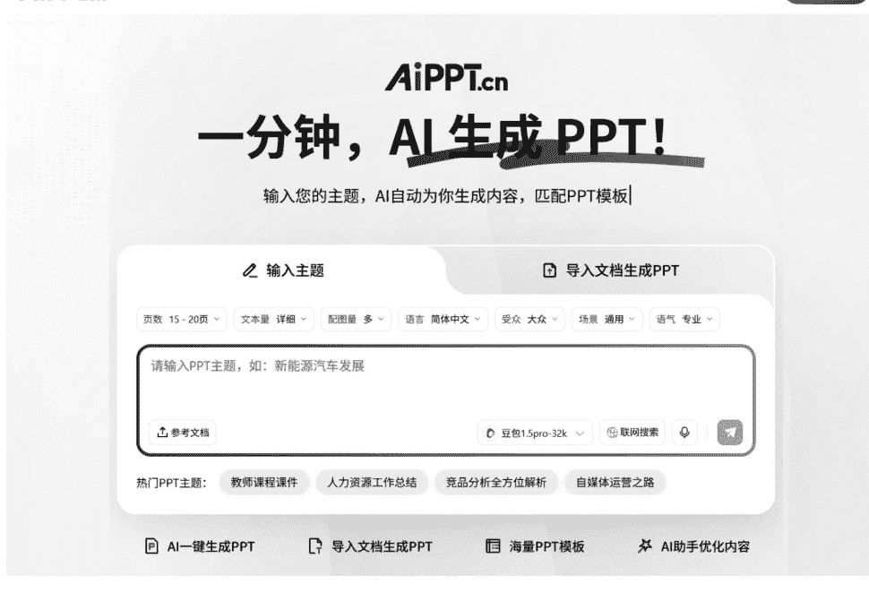

办公场景的刚性需求，叠加AI技术的爆发式发展，让AiPPT赛道迎来了前所未有的市场机遇。这一机遇的背后，是传统PPT制作长期存在的痛点，以及随之而来的广阔市场空间。

#### 1. 市场机遇：办公刚需遇上技术爆发

要抓住这一机遇，开发者与从业者需要先看清传统PPT制作的核心痛点。这些痛点正是AI技术落地的关键切入点。

##### (1) 传统PPT制作的三大痛点

传统PPT制作痛点集中在效率、门槛与合规层面，严重影响用户体验与企业成本。

- ①效率低下：制作专业PPT需手动操作200多个功能按钮，平均耗时4.5小时，60%的时间用于格式调整等重复工作，极大消耗了职场人的时间与精力。
- ②门槛过高：多数人很难精准把控页面版式与配色，即便使用模板也常“千篇一律”，难以凸显品牌特色，超过半数的制作者有此困扰。
- ③合规风险：45.3%的企业要求PPT工具支持私有化部署，政务、金融行业对数据安全与合规要求极高，传统通用工具难以适配这类需求。

##### (2) 快速增长的市场

政策与市场双向驱动，让AI办公领域进入高速增长期，AiPPT作为核心细分赛道潜力强劲。

2025年国务院发布《关于深入实施“人工智能+”行动的意见》（国发〔2025〕11号），为行业注入动力。艾瑞咨询数据显示，2024年中国AI+办公软件市场规模达308.64亿元，同比增长135.55%，预计2028年突破1911.37亿元。其中AiPPT占21%的市场份额，依托企业汇报、政务宣传等15余个核心场景的高频需求，成为刚性需求赛道。图3-4所示为AI办公行业需求调研结果。

面对传统制作PPT的痛点与庞大需求，AI通过多模型协作、场景化适配等技术，实现专业PPT极速生成，有效解决了效率、门槛与合规问题。

#### 2. AI如何极速生成专业PPT

AI之所以能破解传统痛点，核心在于多技术协同发力，具体可从以下方面拆解。

#### 2025中国企业AI办公数字化白皮书

##### 用户需求变迁与新痛点

###### 01 智能PPT行业用户画像

根据艾瑞咨询最新调研数据，智能PPT用户主要集中在18~35岁高线城市的高学历人群，其中75.2%为本科及以上学历用户。企业用户占比高达68%，个人用户32%，反映出AI办公工具在专业场景中的高需求。

| 用户职业分布 | 使用场景分布 |
| --- | --- |
| 市场营销 26% | 内部汇报 32% |
| 销售 21% | 营销方案 24% |
| 教师 17% | 培训课程 21% |
| 管理层 16% | 客户演示 16% |
| IT 12% | 创意提案 7% |
| 学生 8% | |

| 用户关键指标 | |
| --- | --- |
| 使用频率 | 价格接受度 |
| 每天使用 25.3% | 100~300元/年 39.8% |
| 企业用户 68% | 个人用户 32% |

###### 02 用户需求从效率提升到全流程智能化

| 1.0 2022-2023：初期需求 | 2.0 2024-2025：高阶需求 |
| --- | --- |
| → 基础内容生成<br>简单文本到PPT的转换，重点在于减少手动编辑时间 | → 智能引用与溯源<br>自动检索权威资料并提供引用来源 |
| → 模板套用<br>提供基础设计模板，解决排版问题 | → 数据分析与可视化<br>智能解读数据并生成专业图表 |
| → 提高效率<br>缩短PPT制作时间是核心诉求 | → 私有知识库集成<br>连接企业内部资料，定制专属内容 |
| | → 深度行业定制<br>适配特定行业术语、规范和表达方式 |

| 行业NPS评分 | |
| --- | --- |
| 30.6 | |
| 当前智能PPT行业净推荐值(NPS)处于中等偏上水平，有较大提升空间 | |
| 用户期待改进方向： | |
| • 更灵活的品牌定制能力 | |
| • 更强的行业专业性与术语准确度 | |
| • 更完善的数据安全解决方案 | |
| • 更丰富的创意模板库 | |

###### 03 当前用户面临的主要痛点

| 模板高度同质化 | AI内容逻辑性不足 | 数据安全与合规问题 |
| --- | --- | --- |
| 50.1%的用户反馈市场上的智能PPT工具模板同质化严重，难以体现企业品牌特色与专业差异化 | 48.4%的用户认为AI生成内容存在逻辑连贯性差、专业术语不准确等问题，尤其在垂直领域应用 | 45.3%的企业用户担忧云端存储、敏感信息处理等问题，政务、金融、医疗等行业对私有化部署需求强烈 |
| 50.1% | 48.4% | 45.3% |

| 用户需求演变趋势 | |
| --- | --- |
| 2022：基础效率工具 | 1.0阶段<br>文本转PPT 模板套用 时间节省 |
| 2023：智能创作助手 | 2.0阶段<br>内容优化 数据可视化 多媒体整合 |
| 2024-2025：决策辅助系统 | 3.0阶段<br>私有知识库 业务集成 数据分析 行业定制 |

##### 行业痛点解决挑战与机遇

| 政务行业 | 金融行业 |
| --- | --- |
| 严格的内容审核与数据合规要求，需要私有化部署方案 | 专业术语准确性与数据可溯源性要求高 |
| 制造业 | 教育行业 |
| 技术参数与工艺流程的精准呈现需求 | 内容准确性与教学互动体验要求并重 |

## 图3-4

##### (1) 多模型协作，提效保质

AiPPT采用多模型协作引擎，使各模块精准对接需求：文本生成调用智谱AI、豆包等中文优化大模型；图片匹配接入视觉中国平台的5亿张正版素材；排版采用自研自适应引擎，自动匹配最优版式。

多模型协作使内容识别准确率超过95%，成效显著。某国有电力集团日均节省工时约400小时；某省政府办公厅年度报告制作周期从5~7天缩短至1~2天。

##### (2) 场景化知识库，让AI懂行业

各行业PPT需求差异显著，通用模板适配性较差。AiPPT针对政务、金融、教育等十余个行业，搭建专属术语库、合规语料库与定制模板库。

目前累计提供1万余套场景化模板，涵盖500所高校答辩模板及敦煌壁画、故宫纹样等文化元素，既满足合规要求，又凸显特色。

##### (3) 4种生成方式，覆盖核心需求

AiPPT设计了4种生成方式，可解决了80%的常规用户需求，同时保留20%创意空间，支持素材替换与配色调整。

- ①一句话生成：输入“做份高校答辩PPT”，60秒即可生成完整初稿。
- ②文档导入：支持Word、PDF、Xmind格式，AI自动进行结构化处理。
- ③网页链接导入：复制网页链接即可生成PPT。
- ④PPT智能美化：通过PPT美化功能，优化既有作品的排版与视觉效果。

##### (4) 安全合规，多部署适配高要求

AiPPT提供公有云、私有化、混合云3种部署模式，通过网络安全等级保护三级、ISO 27001等认证。某大型制造企业私有化部署后，每年节省培训与文档成本约200万元。

清晰的变现策略是AiPPT规模化发展的核心，通过聚焦赛道、输出能力、分层服务与生态支撑，其已形成稳定盈利模式，稳居行业头部。

#### 3. 核心变现策略

技术落地后，可持续的变现路径是关键，AiPPT的策略围绕“精准破局”展开。

##### (1) 聚焦单一场景

多数AI办公工具追求全场景覆盖，陷入功能分散、体验割裂困境。AiPPT反其道而行，聚焦PPT高频刚需场景，在“1厘米宽的赛道挖100米深”。

其核心是从底层以AI为核心来设计产品，依托多模型协作与自研技术，打造超行业水平的专业体验，构建差异化壁垒。

##### (2) 能力输出而非流量争夺

中国互联网流量格局分散，存在20多个一级入口；自建渠道成本高、周期长。AiPPT放弃流量争夺，将AI能力打包为API输出给平台，实现快速规模化。

目前AiPPT已与联想、华为、豆包、钉钉等50多个平台深度合作，月均API调用超1500万次；联想AIPC预装后首发装机量破百万；AiPPT凭借行业领先的地位让合作方获得高分成，智谱大模型与视觉中国素材库则帮助合作方有效规避版权风险。

##### (3) 分层变现

基于用户画像差异，AiPPT采用分层变现模式：面向中小企业与个人，推出100~300元年费的SaaS（Software as a Service，软件即服务）订阅；面向平台方，通过API接入收费（占营收65%）；面向政务、金融行业，提供私有化部署（占营收20%，单客价值高）。

##### (4) 生态支撑

AiPPT实现电脑端、手机端、平板全终端适配，可与办公自动化、客户关系管理系统等企业系统无缝对接。某制造企业接入企业资源规划系统后，实现生产数据一键可视化，大幅提升其汇报效率。

#### 4. 挑战与注意事项

在行业高速发展阶段，既要总结成功经验、复制核心优势，也要警惕潜在风险。

##### (1) 核心经验

AiPPT的成功离不开四大经验：一是锚定PPT刚需赛道，避开伪需求，早期布局企业级市场；二是坚持AI原生，从底层重构产品，依托多模型协作与自研技术筑牢竞争力；三是生态开放，优先API输出能力，获客成本仅为自有渠道的1/10；四是差异化竞争，利用平台竞争间隙拓展合作。

##### (2) 潜在风险

行业发展伴随四大风险：一是流量依赖，需拓展合作方避免单一渠道依赖；二是竞争加剧，微软、金山等巨头加码AI布局，创业公司面临多重压力；三是技术迭代快，大模型每3~6个月更新一次，需持续加大研发投入；四是合规成本上升，需提前布局高敏感行业认证与技术升级。

凭借精准赛道选择、核心技术与清晰商业逻辑，AiPPT已实现规模化盈利。据深圳像素绽放《2025年AiPPT业务白皮书》，截至2025年，服务全球2000万位用户，稳居中国AiPPT赛道第一，覆盖超15个行业。这印证了拥抱AI、精准解决用户痛点，是AI办公赛道突围的核心关键。

## 第4章 AI赋能传统行业

传统行业正面临转型阵痛，而AI正是破解效率低、成本高、同质化等痛点的关键。从家装设计、服装电商到丝巾制造、文旅文创等领域，AI可精准切入传统行业的核心场景，通过数字化改造实现降本增效、创新增长。本章聚焦传统行业的AI落地路径，提供可复制的转型方案与盈利模型，助力传统行业从业者抓住技术红利，实现从“传统模式”到“智能驱动”的转型升级。

### 4.1 AI家装设计赋能，月变现超2万元的实操路径

从业20年的建筑设计师老赵，2024年春天遭遇了45岁失业的危机——上有老下有小，背负房贷，失去了稳定收入。但由于他在2023年提前布局了AI+设计的组合，如今将这个副业转为主业，实现首单30分钟内成交，1个月变现超2万元的目标，成为AI时代家装设计的转型范本。

老赵的快速签单，看似偶然，实则是AI技术破解传统家装设计痛点的必然结果。要理解这一点，需先看清传统设计的痛点与AI的进化逻辑。

#### 1. 传统设计的痛点与AI破局

要搞懂AI如何破局，需先看清早期AI设计工具的短板。

##### (1) 早期AI设计工具的致命缺陷

2023年ChatGPT、Midjourney等AI绘画工具爆发时，老赵就尝试用它们设计售楼处和样板间。这类工具虽出图快、视觉效果炫，但在内行人看来，生成的图太过“虚假”，透着一股塑料感。具体表现为空间结构错位、比例严重失真，核心缺陷是无法生成可落地施工的建筑图纸，仅能作为参考图使用。

##### (2) 新一代AI设计平台的进化

技术迭代的速度远超预期，到2024年老赵转型时，以酷家乐为代表的新一代AI设计平台，已从单纯的“AI绘画”升级成完整的生产力工具。如今只需上传户型图，AI就能精准识别并完成1:1三维建模；在此基础上，一键生成适配的风格方案、渲染照片及效果图，甚至直接可输出全套施工图纸，彻底解决了早期AI的落地难题。

#### 2. 实战案例：30分钟快速签单

老赵成功签单的案例，之所以成功关键在于摸准了客户需求。我们先看看客户的具体情况与核心顾虑。

##### (1) 客户背景与核心痛点

老赵的第一个客户是一对“90后”新婚夫妇，新房为110平方米的三居室，装修预算15万元，偏好“奶油风”但无明确概念。他们的核心诉求极具代表性：不愿耗费过多时间沟通，也担心最终装修效果和效果图偏差较大。这既是传统家装行业的普遍痛点，也是AI设计的突破口。

##### (2) 30分钟快速签单全流程

第一步：破冰与需求挖掘。老赵没采用传统销售话术，而是陪同小两口逛遍每个房间，引导他们描述未来家的场景：“周末更愿意待在哪个房间？希望那里是什么样子？”这种场景化提问，比“你喜欢什么风格”更能挖取有效信息。他还翻出手机里的AI案例图，逐一询问“墙的颜色是否喜欢”“圆弧门洞要不要尝试”，很快就把模糊的“奶油风”拆解成具体元素：暖色调、圆弧线条、木质感、柔和灯光。

第二步：用AI快速创建户型。需求明确后，老赵没有沿用传统的人工测量、手绘户型图流程，而是先输入房子地址，不到1分钟就通过AI生成了精准户型图，给客户留下了高效专业的印象。

第三步：体验式展示与临门一脚。以往设计师需要用2~3天建模出图，老赵仅对客户说“稍等10分钟”，简单操作两步后，4张基于真实户型、真实尺寸的奶油风客厅效果图就呈现在手机上。女主人当场惊呼：“这就是我们想要的感觉！”这种高效、透明的体验，彻底打消了他们的顾虑，客户当场就通过微信支付了设计定金。

签单只是开始，真正的考验还在于后续交付。手机上的快速演示只是敲门砖，专业、可落地的完整方案，才是留住客户、建立口碑的关键。

#### 3. 专业交付：从样本到完整方案

专业交付的第一步，是明确需向客户交付的成果。老赵为此制定了清晰的交付标准。

##### (1) 设计交付清单

老赵制定了清晰的交付标准，确保其专业度：全套施工图（约50张）、每个房间2张超高清效果图（JPG格式）、30秒3D漫游动画，以及1个可分享的720度全景VR（Virtual Reality，虚拟现实）方案链接。

##### (2) 深化设计工作流程

第一步：模型精细化。对照客户购房合同附件的结构图，逐一核对墙体厚度、窗户离地高度、层高等关键参数，确保模型与实际房屋完全一致。

第二步：AI智能生成全屋方案。打开酷家乐电脑端的“AI风格助手”，上传客户现场认可的奶油风效果图作为参考，几十秒内AI就将奶油风元素完整“复刻”到全屋，比手动布局节省两天以上时间。图4-1所示为AI智能生成全屋方案的功能演示。

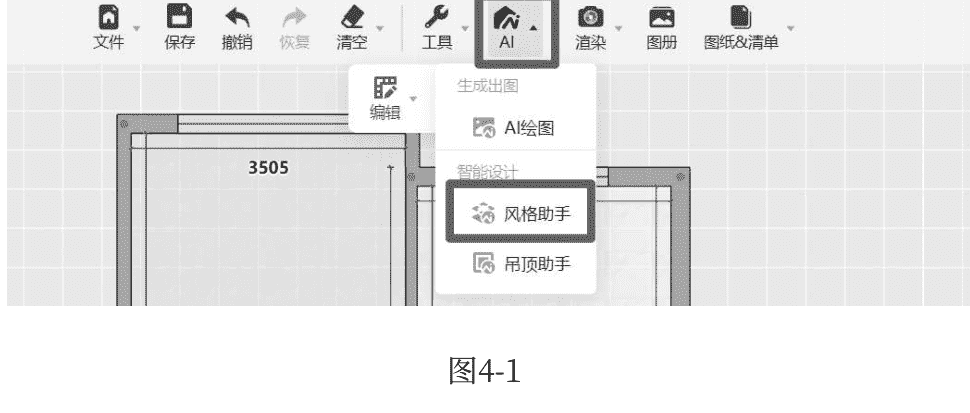

第三步：AI一键生成水暖电图纸。进入“水暖电设计”模块，单击“水电助手”，AI会根据家具位置和行业规范，自动生成全屋开关、插座点位及基础管线布局，大幅减少手动绘图误差。

第四步：导出完整施工图集。在“图纸及清单”模块将类型切换为“全部”，即可导出多种格式的全套施工图，为施工方提供便利。

第五步：电影级渲染与动画制作。施工图完成后，将3D模型渲染成电影级效果图、3D动画及VR场景，真正实现“所见即所得”，让客户提前预览装修后的完整效果。

老赵的转型成功，也折射出整个家装设计行业的变革趋势。把握这些趋势，才能找准未来的发力方向。

#### 4. 行业洞察：设计师的转型方向

这些变革具体体现在三大方向，首先是低端设计的价值发生了根本性变化。

##### (1) 低端设计沦为免费“引流品”

如今主流AI设计软件都能实现“秒出图”，这推动家装设计从非标准化定制，快速向标准化产品转变。普通家装公司不再为设计师的“画图时间”买单，单纯的低端画图工作，未来大概率会成为免费引流的工具。

##### (2) 设计师角色向“生活规划师”转变

当AI能一键搞定符合美学的配色与布局时，设计师的核心价值就不再是画图，而是深度理解客户需求。例如，洞察客户的生活方式、共情家庭成员的情感需求，再结合这些做空间功能规划、收纳系统设计和家务动线优化。

##### (3) 设计透明化成为行业信任基石

传统家装行业的信任危机，根源在于效果图与实际交付的差距。未来的设计交付，核心将是可交互、全透明的数字模型。客户可随时查看细节、提出修改建议，全程参与设计过程，信任度自然会显著提升。

从画了20年图纸的建筑师，到驾驭AI的设计破局者，老赵的感悟很深刻：真正的危机不是被AI淘汰，而是拒绝进化。AI从不是对手，而是能力的延伸。唯有拥抱它、理解它、驾驭它，老设计师的经验沉淀，才能在新时代爆发出更惊人的价值。

### 4.2 AI服装电商全流程破局，卡点一次性解决

在服装行业摸爬滚打几十年的设计师峥姐，2023年初果断踏上AI转型之路。借助AI辅助设计，她不仅拿下百万级订单，还总结出一套成体系的“AI+服装”实战方案；后续开发的“AI+服装设计”等课程，更成功为多家企业赋能。峥姐的经历印证了一个事实——AI早已不是遥远的科技概念，而是服装电商突破困境的核心武器。

传统服装电商长期深陷发展瓶颈，而AI工具的崛起，正以降维打击的姿态打破此僵局。接下来我们就拆解其中的逻辑与方法。

#### 1. 传统模式的“围城”与AI工具的“降维打击”

要理解AI为何能颠覆行业，需先看清传统服装电商的真实困境。

##### (1) 传统服装行业的深层困境

传统服装电商一直像“开盲盒”，设计周期长、样衣成本高，流行趋势难以捕捉，一个款式的成败全依赖设计师的直觉和运气。对中小品牌而言，高昂的商拍费用、漫长的生产周期，再加上常年库存积压，生存空间被挤压得越来越小。

困境之下，AI工具链的全面崛起，成了打破该困境的关键力量。如今的AI已形成覆盖服装全链路的工具矩阵。

##### (2) AI工具链的生态崛起

随着技术迭代，针对服装行业的AI工具矩阵已日趋成熟。

- ①Midjourney：主打发散思维，能快速生成充满艺术感的服装草图。
- ②Stable Diffusion：搭配ControlNet等控制插件，可精准把控服装细节、结构与面料。
- ③FluxAI：擅长提升画面真实感，处理复杂光影和服装动态褶皱时表现突出。
- ④即梦AI：可将静态图转化为动态走秀视频，大幅提升视觉表现力。
- ⑤DeepSeek/ChatGPT：充当“智能大脑”，辅助梳理设计理念、撰写营销文案，还能精准分析流行趋势。图4-2所示为AI生成服装设计图。


#### 2. 深度解析：AI解决服装电商的七大核心卡点

服装电商的痛点集中在设计、生产、营销三大环节，AI针对每个环节的卡点都提供了精准解决方案。我们先从最核心的设计端说起。

##### (1) 设计端：从“人工手绘”到“智力筛选”

设计是服装的灵魂，传统设计端的两大卡点：同质化和高成本，被AI彻底打破。

卡点一：款式设计缺乏新意，同质化严重。服装的核心竞争力在“款”，但传统设计师每日产出有限，还容易陷入思维定式。AI则能在几分钟内生成数百款符合品牌调性的方案，并通过对企业历史爆款数据做微调训练，既能精准延续品牌爆款基因，还能通过提示词激发跨界灵感。设计师的角色也从“绘图员”变成“策展人”，专注筛选有市场潜力的款式，彻底释放创造力。

卡点二：样衣开发成本高，周期长。传统样衣开发要经历打版、选料、缝制、试穿等多个环节，一季新品开发往往要数月时间。AI实现了“数字化预览”，没动一针一线就能产出高保真的正面、侧面、背面三面效果图，还能随时换面料、调印花、改版型。这种“虚拟打样”把30天的开发周期压缩到3天，既减少了物料损耗，还能低成本对比多个方案。

##### (2) 生产端：商拍革命与小单快反

生产端的两大卡点直接影响企业利润，AI的介入为其带来了颠覆性改变。

卡点三：商拍成本居高不下，效果难以把控。传统商拍要协调模特、场地、摄影和后期，单套成图成本从几千元到上万元。AI视觉技术彻底改变了这一现状，商家只需输入平铺图或设计线稿，就能一键适配虚拟模特。这些数字模特可自定义肤色、国籍、发型，还能真实还原布料的垂坠感，单张成图成本从“千元级”降到“分角级”，并且不受天气、档期、场地限制。

卡点四：上新速度滞后，难以捕捉潮流风向。女装市场倾向“快者为王”，传统链路因拍摄、修图等环节导致上新慢，常常错过销售黄金期。AI重构了服装上新效率：1分钟能生成百张场景图，大幅缩短上新周期。更关键的是，商家可先用AI生成的图片进行预售、测款，根据点击率和转化率筛选“准爆款”，再驱动工厂柔性生产。这种“先测后产”的模式，彻底解决了盲目备货的库存危机。

##### (3) 营销端：精准触达与转化闭环

营销端的卡点直接影响转化和利润，AI分别从视觉风格、体验感知、投入产出比3个维度实现破局。

卡点五：视觉风格千篇一律，触达不精准。公域流量池里，白底图和标准化姿势很难留住消费者。AI能帮商家打造差异化视觉体系，如同一件卫衣，针对欧美市场可生成欧美模特在纽约街头的场景；针对东南亚市场，就换成亚洲面孔在咖啡厅的画面。这种“千人千面”的视觉营销，大幅提升了点击率和用户黏性。

卡点六：退货率高，用户上身感知差。退货是电商的“利润杀手”，AI试衣系统给出了解决方案：消费者上传照片，就能看到服装上身的真实效果，包括面料张力和褶皱。对商家而言，试穿数据还能反馈给设计端，优化尺码与版型，形成“需求—生产”的闭环，有效降低“货不对板”的退货率。

卡点七：广告效果疲软，投入产出比低。传统静态广告已让用户审美疲劳，AI能快速生成电影感海报或短视频，通过变换虚拟模特和场景赋予品牌高端感。低成本的素材迭代，让商家可高频开展版本对照测试（A/B Testing，简称“AB测试”），不断优化广告素材，让每一分广告费都用在刀刃上。

#### 3. 未来已来：AI驱动的服装产业大变革

AI时代的行业竞争，核心是效率与模式的竞争，人机协作的普及将成为第一个重要趋势。

##### (1) 人机协作

AI时代的效率竞争，本质是“工作流程”的竞争。未来，用AI绘图工具Midjourney找灵感、用AI图像生成模型Stable Diffusion精修细节，再整合到可视化AI工作流工具ComfyUI实现自动化批量产出，这种“半自动化模式”会成为主流。将重复性劳动交给算法，人类专注把控审美和市场决策，实现人机协同的最优解。

除了效率提升，AI还在重塑服装行业的生产逻辑，从根本上解决行业弊病。

##### (2) 生产逻辑的重塑

AI让服装行业从“预测生产”转向“敏捷供应”。基于海量时尚数据的AI分析，新品方案更科学。虚拟模特的普及降低了商拍成本、提升了效率；订单制的柔性运营，彻底解决了库存积压的行业痛点。

##### (3) 真正的降本增效

对中小企业来说，AI抹平了资源鸿沟，让它们能在视觉呈现和上新速度上与大品牌抗衡；对大型企业而言，AI是优化管理、提升人均产值的核心引擎。这场由AI引发的变革，正把服装行业带入一个拼算力、拼创意、拼技术理解力的新纪元。

### 4.3 AI丝巾工厂轻智造转型，实现重生增长路径

有十年旅游业从业经验的简单姐，2020年转型扎根义乌做丝巾生意。通过AI轻智造转型，再加上全面拥抱“1688平台”，她的工厂实现了跨越式增长——展现量提升384%、询盘量增长193%、业绩上涨65%。更惊喜的是，霸王茶姬、石河子博物馆、湖南省博物院等知名IP，纷纷主动找上门寻求联名与文创定制合作。简单姐的案例，为传统丝巾工厂的转型提供了可复制的重生模板。

简单姐的工厂是无数传统丝巾工厂的缩影，以通货为主的经营模式，让它深陷多重困境。只有先了解这些困境，才能理解AI转型的核心价值。

#### 1. 传统丝巾工厂的四大困境

简单姐的工厂有八成的货品都是市场通货，这种模式让它面临四大核心难题，几乎是传统丝巾工厂的通病。

##### (1) 没有定价权，只能被动降价

通货的最大问题就是同质化。你的货和别家的货品完全相同，客户没有理由优先选择你。想保住销量，只能被迫降价，利润空间被一压再压。

##### (2) 没有主动权，只能当“受气包”

新品开发完全跟着市场走。客户要新款，需要等市场先出现；好不容易拿到新款准备上架，却发现早已遍地都是，根本没机会抢占市场先机。

##### (3) 流程烦琐，速度慢

传统流程极其复杂：设计师不仅要画稿、反复改稿，还要确认颜色、材质；后续工厂打样、制版，再到批量生产，全流程跑下来，最快也要15天，严重滞后于市场节奏。

##### (4) 起订量高，风险大

#### 2. AI轻智造增长飞轮四步法

这套增长飞轮的核心逻辑，是用AI打通“设计—预览—测款—生产”全链路，再用流程优化补全后端短板，形成良性循环。

##### (1) 第一步：给AI喂“剩饭”，植入创意DNA

AI不是天生的设计天才，它更像超级模仿者。想让它发挥作用，必须先“喂”它优质素材，手把手教它掌握成功设计经验。

具体做法：团队花了3个月，整理出过去几年各平台的上万张爆款丝巾图片。每张图都打上几十个精准标签，如风格（新中式）、主元素（仙鹤）、辅元素（祥云）、色系（莫兰迪）、构图（中心对称）、情绪（静谧）。这套标签体系被团队称为“创意DNA”。之后，用图生图模式命令AI生成新图，让AI在成功经验基础上做微创新裂变。这一转变，直接让AI从“智障学徒”变成了高效的“高级助手”。

##### (2) 第二步：用技术造上身图，零成本试错

AI生成了设计图，但客户不会为一张平面图买单，他们需要看到产品上身效果。传统打样、找模特拍照的模式，不仅成本高（至少300元），还耗时（7~10天），根本不适合快速测款。

具体做法：团队引入三维渲染工具，直接把AI生成的二维图案“穿”在虚拟数字模特身上，还能渲染出以假乱真的产品场景图。这一步彻底颠覆了传统模式，试错成本从300元降到几乎为零。图4-3所示为AI生成丝巾上身图。

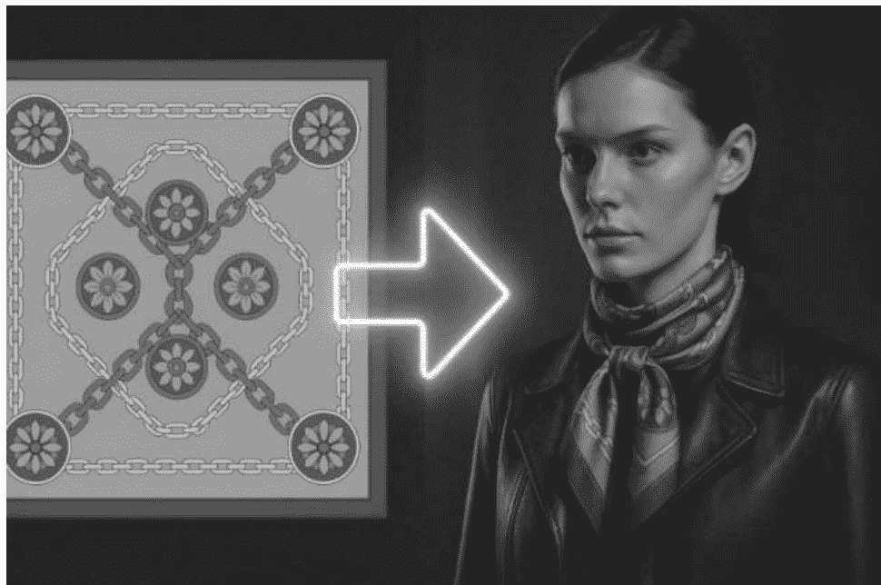

图4-3

##### (3) 第三步：公开“钓鱼”，用数据测款

有了海量逼真的设计图和上身图，团队迈出最关键的一步，即在C端市场快速测款，用真实数据替代“拍脑袋”决策。

具体做法：把包含上百个新款的链接批量铺到C端跨境电商平台，像撒网一样收集市场数据。例如，哪个款式点击率高，哪款能让用户主动收藏、加购，哪种颜色和元素的组合转化率最高？这套操作把过去靠直觉定款的“赌博式生产”，变成了有数据支撑的“科学实验”。

##### (4) 第四步：后端补位，用投入与再造托举前端

使用AI前期前端靠AI提高设计效率，一天能出几百个新款方案，但后端生产线却彻底乱套。快返小订单和常规大货单混杂，仓库混乱，生产计划被打乱，最惨的是工厂一个月废品率飙升至15%。可见，前端跑得再快，后端跟不上也没用。

解决方案一：成立48小时快返突击队。从原有生产线抽调3名精干员工进行物理隔离，组建独立快返小组，重构流程，专门处理1~2条的小批量快返订单。

解决方案二：投入资金补短板。拿出2万元资金，一部分用于微调生产设备，适配小批量生产；另一部分作为快返小组的“容错基金”，允许团队试错交学费。这正是工厂能实现“一件起订、48小时出货”的核心秘密。

#### 3. AI轻智造的三大核心价值

这三大核心价值贯穿工厂运营全流程，且各有侧重。其中，效率的跨越式提升是最直观的改变，也是破解传统工厂“慢”痛点的关键。

##### (1) 效率价值

传统模式下，从设计定稿到出货至少要15天。在AI轻智造模式中，AI快速生成设计、3D渲染预览效果、数据驱动选款，再配合独立快返小组，全流程周期压缩至3天，效率直接提升5倍。

##### (2) 成本价值

传统模式下，单个款式的打样+拍照成本至少300元，测100个新款就要3万元。AI轻智造通过3D渲染生成上身图，试错成本近乎为零，企业能放心测试更多创意款式。

##### (3) 定位价值

当AI轻智造和柔性供应链成为核心能力，简单姐的工厂彻底摆脱了“传统丝巾厂”的定位，转型成“IP商业化最佳伙伴”——不再单纯卖丝巾，而是提供一套IP快速变现的解决方案。这个转变，让工厂彻底跳出了价格内卷的红海。

值得一提的是，1688这类平台的核心价值不是单纯的流量，而是建立信任。超级工厂的背书，加上工厂展现出的AI快速打样、柔性生产能力，大幅降低了客户的决策成本，这也是IP订单主动上门的关键。

说到底，AI不是救世主，只是一个能力放大器。它没法凭空为你带来客户，但能帮你更快、更好地满足客户需求。对传统工厂而言，拥抱AI不是选择题，而是生存与增长的必答题。

### 4.4 AI调味品批发智能报价，转型提效方案

航源原本深耕调味品批发行业，后来转型聚焦数字化解决方案。他借助IMA（Intelligent Marketing Assistant，智能营销助手）知识库搭建起“智能报价中枢”，实现了跨越式增长。单次报价时间从120分钟压缩至3分钟，报价准确率从82%提升至99.6%，客户响应速度从4小时缩短至15分钟（提升87.5%）。这套方案，为批发行业的报价痛点提供了可复制的破解思路。

传统调味品批发行业竞争激烈，报价环节长期依赖手工操作，成了限制其发展的核心瓶颈。只有先了解这些痛点，才能理解智能报价转型的必要性。

#### 1. 传统调味品批发的三大痛点

传统报价全靠手工从Excel中查询，这种模式在业务规模较小时尚可应对，一旦产品种类增多、订单量上涨，就会暴露出一系列致命问题。

##### (1) 手工查询Excel经常出错

航源的产品线很全，查询起来格外费力。他曾回忆：“有次客户急要500种调味品报价，我在Excel里查到凌晨两点，最后还是把花椒和藤椒的价格填反了。”当产品种类突破3000种后，手工查询的误差率更是直线上升。

##### (2) 旺季报价延迟，导致丢单率高

旺季时，报价延迟直接让丢单率飙升至15%，不仅损失营收，更消耗了客户信任。随着业务扩大，航源每天要处理几十份报价请求，传统手工模式彻底跟不上需求，成了丢单的主要原因。

##### (3) 产品种类繁多难以管理

业务规模扩大后，产品种类不断增加，相关信息却分散在多个Excel表格里：查询难、更新不及时，不仅拉低报价效率，更让报价错误频发，形成恶性循环。

#### 2. IMA知识库智能报价五步法

这套方法的核心是用腾讯ima知识库整合产品信息，借助AI实现从产品识别到报价单生成的全流程自动化。每一步都环环相扣，缺一不可。

##### (1) 数据准备

AI的精准度依赖高质量数据，这一步是整个智能报价系统的基石，数据质量直接决定后续识别与报价的准确率。

具体做法：一是整理产品基础信息表，明确产品名称、规格、单价、供应商等核心信息，如“老抽酱油、500毫升×12瓶、48元、海天”“花椒粉、100克×20袋、65元、王守义”；二是搭建产品实拍图库，亲自拍摄产品多角度清晰照片，方便AI精准识别。

##### (2) 知识库搭建

数据准备就绪后，下一步就是把这些零散数据录入腾讯ima知识库，让系统形成可检索、可匹配的结构化信息库。

具体做法：先打开腾讯ima知识库，创建新的知识库项目；再将整理好的产品基础信息表和实拍图库导入系统，系统会自动完成数据结构化处理，并建立产品信息索引，方便后续快速匹配。

##### (3) 报价流程配置

知识库搭建完成后，需要配置核心流程，让客户询价能自动触发系统响应，实现从识别到匹配的自动化。

具体做法：客户通过微信发送产品照片，会自动触发系统的图像识别功能；AI提取“老抽”“500毫升”等产品关键词，在知识库中精准匹配；若没有完全匹配的产品，AI会自动推荐类似款，避免因信息不全导致报价中断。

图4-4所示为腾讯ima知识库的产品匹配和智能推荐界面。

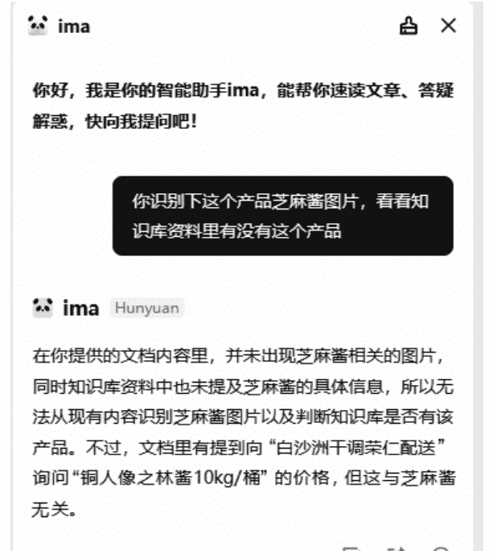

图4-4

##### (4) 关键词提取与匹配

这一步是实现报价精准性的核心，通过AI自动化提取与匹配，不仅能彻底摆脱人工查询的误差，还能高效处理批量询价。

具体做法：AI可按指令从知识库中提取指定产品，如航源让AI“提取所有料酒产品，用表格展示”，系统会快速检索并生成表格；支持按价格、规格、供应商等多维度筛选；遇到客户批量询价时，系统能一次性处理，批量生成所有产品的报价信息。

##### (5) 生成带Logo的报价表

报价信息确认后，最后一步是生成规范专业的报价单，既能提升效率，也能强化企业的专业形象。

具体做法：系统支持智能排序，如航源要求“按价格从高到低排序，用蓝色字体突出数据”，系统会自动完成格式化；还能自动添加公司Logo，生成符合规范的多格式报价单，无须人工二次排版。

这套五步法落地后，效果立竿见影。更重要的是，它不仅适用于调味品行业，还能为多个批发品类提供参考，更藏着可复用的经验与避坑技巧。

#### 3. 效果验证与行业启示

##### (1) 用数字说话：转型后的核心变化

腾讯ima知识库改造后，航源的业务实现质的飞跃，关键指标全面提升：单次报价时间从120分钟降至3分钟，效率提升97.5%；报价准确率从82%提升至99.6%，提升17.6个百分点；客户响应速度从4小时缩短至15分钟，提升87.5%。随之而来的是，旺季丢单率从15%降至近乎为零，客户满意度大幅提升，企业营收稳步增长。

##### (2) 可复用的行业方案

这套智能报价方法并非调味品行业专属，在多个批发品类都能落地。

- ①建材批发：可处理石材、钢材等规格复杂的产品报价，借助AI的智能识别与匹配，解决规格混乱导致的报价低效问题。
- ②电子元器件：应对型号、参数繁多的询价场景，快速匹配精准型号，大幅提升报价效率与准确率。
- ③服装贸易：能快速生成包含款式、尺码、颜色等多维度信息的报价单，适配服装行业的复杂SKU（Stock Keeping Unit，库存保有单位）管理需求。

##### (3) 避坑指南：两大核心问题的解决方案

落地过程中难免遇到问题，提前规避能少走很多弯路。

一是产品命名不规范。其解决方案是制定《产品名称对照表》，明确“老抽=深色酱油”这类同义表述，建立统一的同义词库，确保AI能精准识别不同叫法的同一产品。

二是图片识别误差。其应对技巧是上传多角度产品图，同时搭配文字描述辅助训练AI；上传图片后，可借助腾讯ima知识库解读图片信息，持续优化AI识别准确率。

##### (4) 进阶玩法

基础功能落地后，企业还能通过进阶操作挖掘更多价值。

- ①客户画像联动：系统自动分析客户采购频率、金额等数据，标记VIP客户，提供针对性报价服务。
- ②竞品监测：定期采集市场价，自动生成比价表，帮助企业制定更具竞争力的价格策略。
- ③智能议价：基于客户采购量、历史合作记录等信息，自动计算合理折扣方案，提升成交率。

### 4.5 AI文旅文创场景赋能，实现破局增长实战指南

AI技术加速融入实体经济，文旅行业正从“流量红利”转向“体验红利”。成都爱国产数字科技有限公司创始人陈冰洁，凭借11年软硬件经验，以AI拍照机切入文旅赛道，效果显著。2023年营收300万元，2024年达700万元，2025年上半年已超2024年全年，产品落地30多个国家。以下内容结合其经验，详细拆解AI文旅破局逻辑与增长路径。

#### 1. 选择AI拍照机切入文旅赛道的原因

在AI+文旅的赛道上，有人扎堆线上平台，有人主攻虚拟导游，陈冰洁则选择了AI拍照机赛道。这一选择并非心血来潮，而是基于他对以下3个方面的研判。

##### (1) 行业真空地带：瞄准线下体验的核心缺口

2023年，陈冰洁敏锐捕捉到文旅行业的结构性空白：行业巨头与资本多数扎堆线上文旅、虚拟导游等领域，而线下实体场景中游客对“即时、沉浸、可分享”体验的需求却长期未被满足。正因提前布局，到2025年，广东省文旅厅出台扶持政策时，陈冰洁团队已在该领域有所收获。

2023年，陈冰洁团队曾推出了一款AI绘画小程序。起初这款小程序毫无竞争优势，于是他轻量化软件门槛，结合自身软硬件背景，果断转向“软硬件一体”，深耕细分场景。他发现，游客已不满足于走马观花的观光，而是更渴望能带走的个性化文化体验——这正是线下文旅场景的行业缺口。

##### (2) 价值升级：从“拍照工具”到“文化创生终端”

2022年，陈冰洁在《颠覆大头贴的时代来临了》中就明确，AI拍照机不是升级版大头贴，而是基于AI图生图技术的“文化体验终端”，核心是将用户形象、场景与文化元素（如三星堆火焰纹饰）融合，让照片成为文化载体。

陈冰洁深知，硬件并非核心壁垒，精品化交付才是核心。团队近年持续迭代算法、提升审美，既解决了行业技术体验差的痛点，也实现了标准化与高品质的平衡，这正是产品获市场认可的关键。

##### (3) 场景选择：深耕“慢场景”的深层逻辑

调研数据显示，不同线下场景的差异显著。商场、景区虽流量大，但用户到访较随机，付费意愿分散；而博物馆、科技馆的用户则有明确“文化打卡”需求，付费意愿更高。

所谓“慢场景”，其核心价值在于设备成为动线设计的有机一环，融入用户的完整体验中，从而实现与用户深度连接。早在2023年布局之初，团队就重点研究设备摆放、人流驻留等细节。陈冰洁清楚，运营能力才是团队的长期护城河。

#### 2. 实战落地：从0到1构建不可替代的护城河

找准方向后，落地环节的每一步都关乎企业生死。陈冰洁团队从技术落地、商业模式、团队建设3个维度发力，逐步搭建起属于自己的竞争壁垒，实现从0到1的稳定增长。

##### (1) 技术落地：以“精品交付”打破低门槛竞争

- ①软硬件一体化的壁垒。硬件交由广东供应链代工，团队聚焦软件算法、美术交付及远程培训系统，这些是决定体验的核心。
- ②细节定口碑，交付能力是核心竞争力。例如，三星堆定制项目，团队耗时3天打磨黄金面具效果，即便客单价不高仍坚持拿下，只为获得头部IP背书。陈冰洁认为，文博合作的关键是把控文化细节、优化交互，拒绝低门槛换脸生意，靠攻克头部IP树立品牌。

##### (2) 商业模式：“硬件销售+分成”的稳健生存法则

- ①创业初期，“活下去”是首要目标。2023—2025年来，团队坚持稳健发展，拒绝扩张与免费投放，靠项目盈利。陈冰洁深知，免费投放会严重挤压现金流，而现金流正是不确定环境下的生命线。
- ②稳健策略换来清晰增长。团队从业以来已实现千万级营收，业务覆盖全球三十多个国家。

##### (3) 团队基因：以高“人效比”对抗巨头竞争

对抗行业巨头，团队的核心优势是“技术+资源”双驱动与高人效比。陈冰洁具有十几年软硬件经验，核心股东覆盖金融、政企关系等领域，形成能力互补。他还提前瞄准资本路线，并围绕这个目标做了充分的准备工作与资源储备。因为他深知产品只是资源抓手，商业化需要整合产业力量。

团队拒绝粗放扩张，以确保工作高效运转。陈冰洁身兼数职，曾因助理产出不及AI且投入大量协调精力而决定精简人员；团队的7个核心股东层都非常高效专业，这种精简结构大厂很难复制的。2025年团队已签意向投资，后续将扩张新媒体、投流运营及渠道团队。

#### 3. 未来展望与创业建议

随着政策东风吹拂与技术迭代加速，AI+文旅赛道的想象空间持续扩大。结合自身经验，陈冰洁对行业未来与创业者给出了具体判断与建议。

##### (1) 政策与市场双重利好，生态加速成熟

2023—2025年，国家及地方密集出台文旅扶持政策：广东推动“AI+文旅”场景建设，成都发布数字文创机会清单、释放近300亿元投资。政策与市场需求叠加，让AI文旅生态快速成熟，为创业者提供广阔空间。

##### (2) 技术融合：解锁更多新场景与新价值

未来发展的核心是两大升级方向，具体如下。

一是从“静态拍照”到“动态交互”，联合行业伙伴探索与MR（Mixed Reality，混合现实）、VR（Virtual Reality，虚拟现实）技术融合，参考“未来博物馆”“漳州古城AI剧本游”等成熟模式，强化体验的沉浸感与叙事性。

二是从“体验终端”到“资源抓手”，以AI拍照机为切入点，转型文旅场景集成服务商，链接纪念币、实景剧本游等衍生服务。陈冰洁已做好了五年至十年的长期规划，绝赚快钱，他坚信深耕才是长久之道。

##### (3) 给AI+文旅创业者的3条核心建议

结合实战，陈冰洁给创业者3条建议：一是聚焦再聚焦，在资源有限时深耕一个细分场景，比铺十个平庸场景更有效；二是尊重文化专业，与文博机构合作需秉持耐心与敬畏，唯有懂文化才能让产品拥有灵魂；三是做时间的朋友，AI文旅赛道拼的是长期打磨与沉淀，活到最后的才是真正赢家。

AI文旅的价值不止于拍摄好看的照片，更在于用技术降低人们感知、理解文化的门槛，让每一次快门都成为文化与人心的共鸣。这不仅是陈冰洁团队的坚守，也是整个AI+文旅赛道的未来。

## 第5章 一人+AI：轻资产撑起一门生意

AI时代，轻资产创业成为新趋势。一个人+AI，就能匹敌一支专业团队，无须重投入即可启动项目、实现盈利。从老照片修复、网络安全防御到知识库商业化、金融智能体开发，本章拆解多个个人AI创业案例，提供从0到1的实操落地方案，让你快速掌握用AI搭建轻资产项目的核心逻辑，开启低风险、高回报的创业之旅。

### 5.1 AI老照片修复创业，小白月入5位数的方法

程序员飞鱼靠“老照片修复+动态视频”这一细分领域，仅用了几个月就实现了月入五位数、粉丝破万的目标。这证明在AI时代要想赚钱，不一定非要精通复杂技术，只要结合好“技术”和“情绪价值”，反而更容易成功。

#### 1. 为什么这是普通人的黄金机会

##### (1) 刚需且高频，用户有情感需求

传统老照片修复只能处理静态破损，AI技术出现后，用户终于能实现“跨时空拥抱”“让亲人开口说话”这类以前想都不敢想的需求。这种需求不是凭空创造的，而是大家积压了几十年的情感，就等着一个释放的出口。

##### (2) 情绪价值自带高溢价

老照片动态视频不只是一个视觉产品，更能给人心理上的慰藉。飞鱼就有一个客户先后回购了5次，单人付费超1000元。对用户来说，能看到已故亲人微笑、听到他们叮嘱，这种体验是任何实物商品都比不了的。

##### (3) 技术门槛大降，普通人也能上手

以前修复一张老照片要几天时间，现在几分钟就能搞定；以前得精通PhotoShop才能修复照片，现在熟练用手机App就够了。AI老照片修复不只是对照片进行简单的修复、上色等，还能让照片“活”起来，如让人物动起来、开口说话，甚至能实现简单的互动。

#### 2. 一个人就能搞定的完整流程

想做出让客户满意的作品，不必精通复杂技术，只需将几款AI工具组合使用即可。下面是一套成熟的工具闭环，一步步跟着做就能出效果。

##### (1) 图片预处理

高清修复用佐糖AI（PicWish），功能很直接。用户可一键去掉老照片的模糊感与噪点，并通过AI补全缺失细节。操作非常简单，上传图片后等待3秒，系统自动处理完成即可下载修复后的照片。哪怕是20世纪80年代的模糊老照片，系统处理后也能有4K高清质感。

智能上色可选Palette.fm工具，效果优于普通滤镜。它通过深度学习分析黑白像素，能推断出符合真实场景的色彩。该工具内置20多种不同年代的色调滤镜，建议多尝试几种，选肤色最自然的版本，令成品更真实。

图5-1所示为佐糖AI（PicWish）老照片修复界面。

##### (2) 声音处理

对于亲人生前录音的客户，建议使用Fish Audio工具进行音色克隆。这是一个网页端工具，只要上传10~30秒的原始音频，就能生成和原声几乎一样的声音模型。这是最能打动客户的增值服务，很多人愿意为这个多花钱。

如果没有原始录音也无须担心，使用剪映的配音功能即可。该功能内置上百种音色，涵盖各类方言、童声、老人声，任意选择都能满足需求。

##### (3) 视频生成

动态视频制作首选可灵工具，其核心功能为图生视频与视频续写。这里有个用运动笔刷的关键技巧。在做“拥抱”“微笑”这类动态效果时，先用笔刷涂人物身体，再用静态笔刷锁住五官，这样能避免人脸变形。老照片动态化最核心的痛点是人物变形、无法识别，这一技巧能有效避免人脸变形，确保照片动起来后依然是本样貌。

对于刚起步、想节省成本的创业者，可用国际版邮箱注册多个账号，每个账号每月都有免费积分，依靠这些积分基本能实现零成本运作。

若想让人物实现开口说话的效果，可用DreamFace工具，它能实现口型与音频的精准同步，让静态照片跟着音频自然张嘴、眨眼。安卓用户可以通过清除App缓存反复获得免费额度，适合小白起步使用。

#### 3. 4种从流量到盈利的路径

##### (1) 流量收益

在抖音、视频号、小红书发作品时，记得勾选“原创”选项。其主要收益来自中视频计划和评论区广告分成，核心就是靠数量堆积。用户每天发3~5条容易引发共鸣的视频，慢慢积累长尾流量，被动收入会越来越多。

##### (2) 私域商单

这是飞鱼赚钱的主要来源，按不同需求分4个档位定价，满足不同客户的预算。

- 基础版（19~59元）：仅提供高清修复与上色，适合预算有限的客户。
- 升级版（99~199元）：将照片转成动态视频，呈现战友重逢拥抱、奶奶微笑等效果。
- 高级版（299~599元）：加声音克隆技术并实现开口说话，使用客户提供的人物生前录音，制作“跨时空叮嘱”类作品。
- 顶级版（超1 000元）：数字分身服务，将亲人的思维模式、语言风格与语速注入数字人，实现“赛博永生”，服务溢价最高。

##### (3) 知识付费

等跑通从引流到成交的全流程后，即可开展培训业务：录播课（99~299元），工具清单和提示词模板售卖；一对一陪跑（599~1 999元），手把手教他人起号、避坑、谈单，该业务利润率很高。

##### (4) 工具分销

作为懂行的博主或导师，在分享操作流程时，可植入可灵、Fish Audio这些收费工具的返佣链接。只要有人通过你的链接付费使用工具，你即可获得佣金分成，相当于搭建了长期的被动收入渠道。

#### 4. 避坑指南与进阶思路

关于行业红利期，有人认为图片生成视频赛道热度已退，但实际用户需求始终存在。AI只是降低了技术门槛，当前的机会不在于追逐风口，而是在于打磨细节、做实服务。谁的作品更真实、更打动人，谁就能留住客户。

另外，一定要重视交付质量，不能一键生成产品就发给客户。你要多刷几次效果，确保人脸不歪、手部不变形。对老照片视频来说，“像不像”是客户是否满意、会不会退款的关键。

文案和背景音乐是作品火不火的关键。多搜集那些“没说出口的遗憾”这类情感类素材，配上沙哑的老歌，很容易引发共鸣，转化率会翻倍。

#### 5. 从新手到接单的行动计划

第一周：把上面说的工具都熟悉一遍，拿家里的老照片练手，至少做50张，熟练掌握修复、上色的基础操作。

第二周：注册3个抖音或小红书新号，每天发2条对比类视频（原图vs.修复动态图），测试流量，积累初始粉丝。

第三周：通过私信把粉丝引流到微信，建立客户等级表，明确不同档位的定价和服务内容，尝试接第一单生意。

### 5.2 AI网络安全防御系统，一人可赚钱的路径

现在数字化越来越普及，网络安全对企业来说就是生命线。但很多中小企业因为缺人、缺钱、缺技术，根本没能力做好防御，将自身完全暴露在风险里。梼杌（Táo Wù）人工智能防御系统创始人享亮，靠一套“AI驱动+规则协同”的自动化防御平台，证明了个人开发者或小团队也能靠降维打击，切入这个千亿级赛道。

#### 1. 市场洞察：中小企业的防御“真空区”

全球企业每年因网络攻击造成的经济损失超过万亿美元，而中小企业的处境尤其艰难。它们面临的三大痛点，恰恰是个人创业者的机会。

- ①传统防御根本不管用。当前的防火墙多依赖固定规则防御，遇到变异的DDoS（Distributed Denial of Service，分布式拒绝服务）攻击或者新型APT攻击（Advanced Persistent Threat，高级持续性威胁），就像“刻舟求剑”一样缺乏应对能力。在毫秒级的网络对抗中，这种方式不仅响应延迟，还留下大量安全死角。
- ②技术更新严重跟不上。很多企业的安全设备早就过时了，存在大量漏洞，且缺乏统一的安全架构，更新防御策略无法一键同步，只能处于被动防御状态。
- ③AI攻击越来越多，防御却跟不上。现在攻击者都开始用AI生成恶意软件，或者搞深度伪造诈骗。2024年金融业相关诈骗案增幅达200%，但72%的企业要么怕合规出问题，要么缺专业人才，未能及时部署AI防御系统。

#### 2. 核心武器：梼杌系统的“双引擎”逻辑

梼杌系统的核心思路是实现自动化决策，即复杂的人工分析转化为机器可自动执行的决策流程。整套技术架构主要分为5个部分，普通人也能理解。

##### (1) 双引擎协同检测

一个是AI威胁检测引擎，采用孤立森林、长短期记忆网络等算法，分析海量网络流量。它无须提前设定规则，即可自动识别从未出现过的新型攻击；另一个是基因规则引擎，依靠正则表达式与信息熵匹配，专门拦截已知威胁。

简言之，AI负责抓“新敌人”，规则负责挡“老熟人”，毫秒级就能响应，既保证了防御的精准度，又覆盖了所有风险。

##### (2) 用户行为画像

系统会给每个设备和用户建立“正常行为标准”，如平时用户几点登录账号、常用哪些功能、数据传输量多少。系统一旦检测到异常，如深夜大量数据流出，或者在异地登录账号，立刻触发预警。这彻底改变了以前“出事了才报警”的被动局面，实现了从攻击开始到结束全流程覆盖。

##### (3) 自动化响应

这是最适合中小企业的一点。系统发现威胁后，无须人工审批，将根据风险等级自动处理。例如，直接封禁攻击来源的IP、限制异常流量速度以缓解压力，同时将核心告警信息推送至管理员的移动终端。即便企业未配备专职的安全人员，系统也能自动拦截攻击。

##### (4) 可视化面板

系统会把复杂的网络数据转化为流量波形图、风险热力图、攻击路径图等可视化图表。对于非技术背景的企业管理者而言，能清楚地查看系统拦截的攻击次数，这种“看得见的效果”，无论是商务洽谈还是客户续约，都很有说服力。

##### (5) 模块化更新

系统支持插件式扩展，规则库和AI模型可在不影响企业正常业务运行的前提下，通过云端自动更新。如此一来，无论攻击者采取什么新手段，系统的防御能力都能同步迭代升级。

#### 3. 赚钱路径：从0到1的3步方案

作为个人创业者，无须跟大安全公司拼硬件，核心是靠“效率”和“性价比”取胜，可分3个阶段落地。

##### (1) 第一阶段：单点突破 (0~1年)

你不用一开始就做全国市场，可先聚焦一个特定区域（如某城市行政区）或者一个特定行业（如电商、在线教育领域）。获客渠道也简单，可以通过线下园区推广、技术社区的人脉推荐，也可以利用自媒体引流等方式获取客户。

其核心目标是积累200家种子用户。这时候赚钱不是重点，关键是收集真实的攻击样本，快速迭代优化AI模型，建立市场口碑，后续客户主要依靠老客户转介绍获取。

##### (2) 第二阶段：渠道分销 (1~2年)

无须再自行直接销售系统，转为“合作伙伴制”更省力。可与本地的IT运维公司、财税服务商、行业协会，这些机构手里有大量缺乏安全能力的中小企业客户。跟他们谈合作，由其负责推广系统，给他们分佣。目标是突破800家用户，同时针对医疗、制造等合规要求高的行业，推出定制版系统，提高利润。

##### (3) 第三阶段：平台化与出海 (2~3年)

此阶段可在全国范围内建立多个运营中心，扩大品牌影响力。同时搭建“AI安全模块商店”，允许其他开发者上传防御规则，丰富系统功能；另外可以布局东南亚等新兴市场，那里的中小企业同样存在大量网络安全需求。最终目标是用户数突破2 000家，建立起自己的品牌壁垒，形成难以替代的市场地位。

#### 4. 差异化优势：客户为什么选你

面对绿盟、启明星辰这些传统安全巨头，核心优势在于“小而美”的灵活定位，能够精准解决中小企业的痛点。

- ①人力成本优势显著。依托全自动化响应机制，客户无须以50万年薪雇佣安全专家，节省大量成本。
- ②部署操作便捷。依托模块化设计，无须改动企业现有的业务系统，实现即插即用。
- ③主动防御更具保障。摒弃被动“救火”，采用主动预警、提前拦截的策略，对未知威胁的拦截率显著高于同类产品。
- ④价格更亲民。依托云原生架构降低硬件成本，让中小企业能够低成本采购，高效落地使用。

#### 5. 总结与实操建议

网络安全的本质，就是比拼攻防双方成本效率。梼杌系统能成功核心，在于用AI降低了防御成本，同时让攻击者的攻击难度大大增加。

如果想从事这一行业，建议从两点切入。

- ①先做工具，再做系统。不用一开始就开发完整系统，可先做一个针对特定攻击（如SQL注入）的AI识别工具，把准确率做高，积累第一批用户和口碑。
- ②一定要重视可视化。安全是看不见摸不着的，只有通过可视化面板让客户清晰查看到系统帮他拦截了多少次攻击、避免了多少经济损失，客户才愿意持续续费。这是留住客户的关键。

### 5.3 AI实体聊天智能体开发，个人实操落地方案

瑞奇通过自主研发与实操，打造出陪伴式聊天智能体R-BOT。下文将详细介绍其开发经历。

#### 1. 为什么要做实体聊天智能体

想做实体聊天智能体，并非单纯追逐技术热点，核心是找准市场未被满足的核心痛点。而其中最关键的切入点，便是用户对有温度的陪伴的迫切需求。

##### (1) 真实需求：需要有温度的陪伴

小朋友要的不是会讲故事的手机，而是不会弹出游戏、能专心陪自己的伙伴；老人盼的不是能视频通话的设备，而是随时能说心里话、不会嫌自己唠叨的倾听者。他们要的不是及时回复，而是随时都在的陪伴。

屏幕类设备天生带着工具属性，而一个乖巧的实物，才能真正承载情感。瑞奇的初衷就是做这么一款实体智能体，不推荐游戏、不会黑屏，甚至能听懂老人说的方言。

这款智能体靠实物形态和AI语音交互，能实现日常聊天、讲故事、放歌曲、陪学习等功能，尤其适合解决孩子成长中的陪伴需求，以及独居老人的孤独问题。

##### (2) 实体智能体的三大核心优势

- ①场景适配性更强。手机是万能工具，什么都能做但什么都不精，而R-BOT的实体形态就是专为家庭陪伴而设计的：机身圆润，不用担心孩子磕碰；24毫米的厚度，握在手里刚好合适；唤醒词还能自定义，更贴合家庭使用习惯。
- ②能实现主动交互。靠AI自然语言处理技术，R-BOT能记住上下文对话。比如，孩子先说“我想听恐龙的故事”，接着问“它吃什么”，智能体能衔接上一句给出答案。针对老人方言沟通的问题，还接入了沪语、粤语、闽南语等方言识别模型，沟通更顺畅。
- ③容易建立情感连接。实体形态让AI有了“情感载体”的特质。测试的时候，有家长给R-BOT取名“小瑞哥哥”，把它当家里的一分子；还有老人吃饭时，会特意给它留个位置。这种情感投射，全靠实体带来的真实存在感。

#### 2. 拆解可落地的开发全流程

知道了做实体聊天智能体的价值后，更关键的是掌握可落地的开发全流程。下面从需求到组装，一步步拆解个人能完成的全流程。

##### (1) 确认用户需求，避免做无用功

开发前一定要摸透目标用户的需求，不然很容易白费功夫。例如，

小朋友说：“我希望它像小哥哥一样陪我讲故事、教我背诗词，还能听我说心事。”

老人说：“想随时聊天，不用看屏幕就能知道天气、新闻。”

家长说：“能让孩子开心，我也能省心，绝对不能用来玩游戏。”

##### (2) 技术选型，不贪多求全

硬件方面，主控板选ESP32-S3，支持Wi-Fi和蓝牙，性价比高还好用；电路板自行设计开发，再找厂家打样，不用依赖团队。

软件和模型上，选阿里千问AI开放平台（Qwen），上手难度低；自行编写代码，搭配AI编程工具能省不少时间。外观用3D打印，选PLA（Polylactic Acid，聚乳酸）材质，环保且成本低，个人也能承担。

最重要的是，要采用“本地唤醒+云端处理”的混合架构。唤醒词“你好小瑞”在设备本地识别，响应速度快，降低延迟；将复杂的对话内容再上传到云端处理，这样能降低对本地硬件的性能要求，有效控制成本。

##### (3) 设计硬件电路，按步骤轻松上手

- ①规划电路方案。核心组件包括主控芯片电路、输入输出设备（麦克风、扬声器、LCD屏幕），还有Wi-Fi/蓝牙模块、控制器。无须搞太复杂，满足基础功能即可。
- ②布局设计与PCB制作。用Altium Designer软件做电路布局，新手可以参考已开源的原理图，降低设计难度。其步骤很清晰，如先设计原理图，再画PCB（Printed Circuit Board，印刷电路板）板图，导出Gerber文件后，找一家供应商打样。
- ③制作电路板。把Gerber文件发给电路板供应商，明确说明需求，等待打样即可。个人小批量制作，成本可控。

##### (4) 设计外观硬件，兼顾好看与实用

- ①外形构思。目标用户主要是儿童，同时兼顾老年人，所以外观要设计得更具有亲和力；机身采用圆润造型，手感舒服，避免尖锐边角。
- ②3D建模。用SolidWorks软件做三维建模，结构设计可自主完成。建议采用上下分壳的样式，方便后续组装；建模时要预留好内部空间，为电路板、电子元件留足位置，既要保证美观，又不能影响功能。
- ③3D打印与处理。选择PLA或ABS材质，找第三方3D打印供应商做样品。打印好后，自己简单进行去掉支撑、打磨、上色等操作，就能得到满意的外壳。

##### (5) 设计软件，可借助工具完成

设计软件时，开发环境应选VSCode，用Python语言编写代码，搭配Cursor这个AI编程工具，能大幅提高效率。其核心工作就是代码生成、编译配置，还有接入AI平台的API，实现语音交互功能。

这里简单说一下VSCode工具。它是免费的主流代码编辑器，容易上手；Cursor具有AI辅助功能，写代码时遇到问题能帮助用户解决，新手也能快速入门。

##### (6) 组装硬件，需按步骤进行

- ①物料采购与焊接。先列好采购清单，如芯片板、麦克风、扬声器、电阻电容这些被动元件，还有连接线材，在淘宝、拼多多、立创这些平台都能买到。准备好焊接工具，如热风枪、电烙铁、焊锡丝，重点注意静电防护，别损坏元件。
- ②固件烧录。把写好的程序和固件烧录到主控芯片板里，这一步跟着教程操作，难度不大。
- ③整机集成与测试。把PCB板、3D打印外壳、传感器等部件组装好，接上电源后开始测试。例如，语音唤醒灵不灵、交互流不流畅、网络能不能用，还有日常陪伴场景下的表现，有问题可及时调整。

图5-2所示为AI对话智能体的实体半成品。

#### 3. 避坑指南与价值思考

避坑的核心是提前预判问题，其中技术层面的难点是开发初期最容易受阻的环节。先理清核心技术难点及对应解法，能为后续开发扫清关键障碍。

##### (1) 核心技术难点及解决办法

- ①语音交互流畅度。其解决方案就是前面说的本地唤醒+云端处理架构，减少网络延迟；同时优化麦克风阵列的降噪算法，避免环境噪声影响识别效果。
- ②低功耗设计。选择低功耗芯片，再设计一套休眠唤醒机制，平时不用的时候让设备休眠，减少耗电；日常使用外置电源，满足长时间陪伴需求。
- ③交互体验优化。做成手持式的，方便用户走到哪带到哪，实现“随影而行”的陪伴，不用固定在某个地方。

##### (2) 3个避坑经验，少走冤枉路

- ①实体智能体的核心是减少操作，功能越多越容易让用户困惑，反而影响体验。
- ②砍掉不必要的功能，降低复杂度。例如，瑞奇初期想加“视频通话”功能，测试后发现老人觉得有被监视的感觉，很排斥；孩子也更偏爱语音互动，对视频没兴趣。最后果断砍掉这个功能，不仅减少了操作难度，还降低了硬件成本。
- ③核心元件要买好的。建议核心元件（比如芯片开发板、麦克风）一定要选口碑好的供应商，别因小失大。

##### (3) 延伸场景与商业化思考

- ①场景拓展。除了基础的家庭陪伴，还能往两个方向延伸：一是儿童教育领域，集成定制化的教育内容，通过互动聊天帮孩子学习；二是养老关怀领域，不仅能强化情感聊天功能，还能加健康提醒等实用功能。
- ②商业化路径。个人创业不用一开始就大规模量产，先小批量试产，在网上平台卖卖看，验证市场需求；之后可以做定制化服务，给幼儿园、特定家庭提供批量定制，提高利润。

### 5.4 AI知识库商业化：将“死知识”转化为盈利资产的方案

2024年，大河做了一个在外人看来很“酷”的决定——从“数据科学家”转型为AI产品经理。但只有他自己清楚，这次转身有多狼狈。为了接住新身份，他患上了严重的“知识焦虑症”。每天强迫自己海量输入信息，试图用信息填补内心不安，可现实却狠狠给了他一记耳光。他买了一堆书却读不进去，运营公众号一年，粉丝仅400个。

这种认知与行动的巨大割裂，让他陷入极大的痛苦。大河逐渐意识到，自己缺的不是知识本身，而是一套能将“死知识”转化为盈利资产的落地方案。于是，他决定换一种学法，把这些书重新“吃透”。

#### 1. 项目介绍：何为AI智慧阅读

所谓AI智慧阅读，并非让AI替人读书，而是借助AI打造个人专属的“陪读军师”与“智慧知识库”。

过去，阅读是单向传输的过程：作者输出内容，读者被动接收，记不住便不了了之。如今，大河通过AI工具（如腾讯ima、Claude等），将经典书籍、行业报告及个人工作笔记全部导入AI中。

自此，阅读变成了一场深度交互的“主动操盘”。大河无须死磕晦涩的专业术语，而是通过与AI对话，让它站在彼得·德鲁克、查理·芒格等大师的视角，剖析他在现实中遇到的商业难题。简言之，就是将原本静置在书架上的“死知识”，转化为可直接落地变现的商业策略“活军师”。

#### 2. AI如何提升阅读与实战效率

在实践AI智慧阅读的过程中，大河总结出了一套高效的提效流程，彻底重塑了自身的学习效率。图5-3所示为AI知识库互动读书法。

##### (1) 精准诊断：拒绝盲目翻书，先让AI为业务“把脉”

从前，大河是越迷茫越乱看书，但焦虑丝毫未减。自从他转变思路，将腾讯ima当作资深咨询师，全盘倾诉自己的困境后，AI的诊断远比他预想得更为犀利：“大河，你的核心问题不是能力不足，而是心智定位缺失。你就像摆地摊的杂货铺，品类繁杂，用户根本记不住你。”它直接给出解决方案：放下技术类书籍，优先研读艾·里斯和杰克·特劳特编写的《定位》。图5-4所示为AI知识库定位诊断。

## 一、定位策略：明确AI垂直赛道

1. 《定位》- 艾·里斯 / 杰克·特劳特
   - **核心价值**：经典定位理论，强调“用户心智占位”而非自我定义。书中案例（如肯德基从快餐到高端餐厅的定位转变）可启发你思考如何将“AI+专业领域”（如企业咨询、智能体开发）转化为用户认知标签。
   - **你的应用**：重新梳理公众号定位，如“AI产品经理实战派”，聚焦企业级AI解决方案的落地经验，与泛AI科普账号区分开。
2. 《疯传》- 乔纳·伯杰
   - **核心价值**：解析内容病毒式传播的六大原则（如社交货币、实用价值）。适合你将AI技术干货（如知识库搭建案例）转化为用户愿意分享的“社交资产”。
   - **你的应用**：尝试将AI咨询案例包装成“3个让老板眼前一亮的AI降本技巧”等具传播性的标题。

## 二、垂直深耕：AI+产品经理的交叉领域

1. 《AI赋能：AI重新定义产品经理》- 连诗路

##### (2) 降维解读：请“金庸先生”翻译晦涩理论

《定位》虽是经典，但书中的商业术语对学理工科背景的人而言如同天书。为了深度理解这本“硬书”，大河向AI下达指令：请扮演金庸先生，用武侠语境重新解读全书。

奇迹就此发生：AI将“抢占行业第一”比作“华山论剑”，登顶者便是武林盟主；将“差异化竞争”比作“独孤九剑”，专攻对手破绽。这种“暴力降维”的解读方式，让他瞬间看透商业竞争的本质，且记忆深刻、难以忘怀。

##### (3) 跨时空会诊：用大师思维剖析自身困境

真正让他彻底通透的是那场“大师会诊”。他将公众号运营一年仅400粉丝的困境告知AI，让它模拟查理·芒格与杰克·特劳特展开辩论式分析。图5-5所示为AI知识库问题诊断。

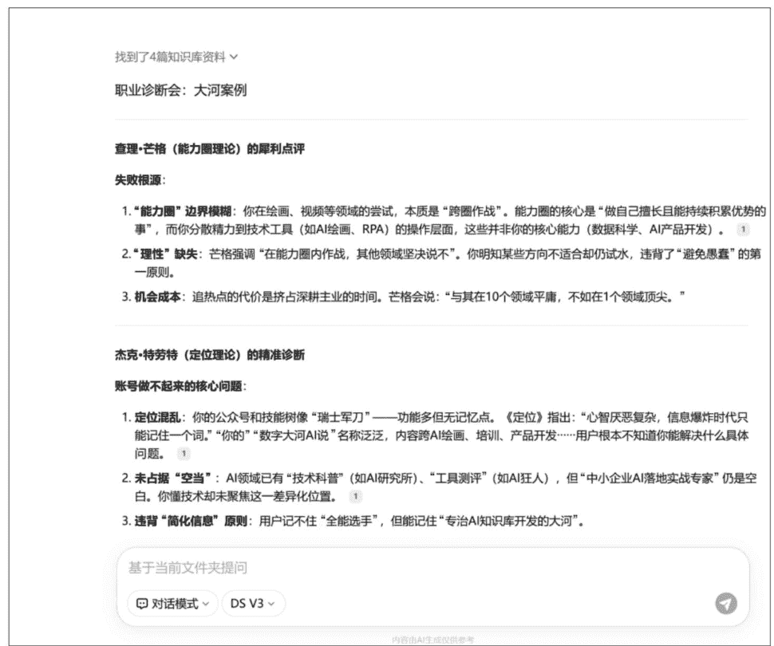

AI给出的结论让他脊背发凉：芒格（AI模拟）指出，大河追逐AI绘画热点的行为，早已脱离自身“能力圈”；特劳特（AI模拟）则精准点出，账号定位过于杂乱是核心症结。这场会诊让他彻底放下焦虑，明确了自己的战场——并非“教人画画”，而是“教企业用AI提效”。

##### (4) 行动转化：将“理解”转化为破局的“周计划”

从前读完书，感慨一句“好书”便束之高阁。如今，大河会强迫AI输出可落地的行动方案。AI通过反向提问梳理用户需求，直接为大河制定任务清单：首先将账号更名为“大河AI实战派”，再删除与定位无关的文章，并持续输出企业AI提效实操案例。自此，大河不再纠结“明天写什么”，只需对照清单稳步执行即可完成任务。

##### (5) 打造“第二大脑”，实现知识复利

为避免对话沦为一次性“信息快餐”，大河最终让AI将所有洞见整理为结构化知识卡片，包括“能力圈”“心智阶梯”“品牌定位”等核心概念，并打上“#职业破局”标签存入知识库。图5-6所示为知识拓展与能力圈构建示意图。

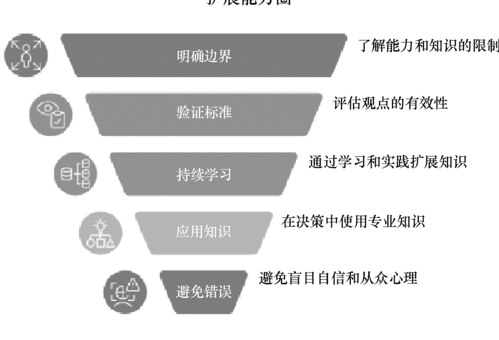

从此，这些知识不再是书架上的装饰品，而是大河“第二大脑”的重要组成部分，可随时调用和反复使用。

#### 3. AI智慧阅读的核心优势

通过这套方法，大河不仅治愈了知识焦虑，更收获了实实在在的商业收益。其核心优势十分显著。

其一，极速内化，降本增效。原本需要一个月才能读完的“硬核”书籍，借助AI辅助，几小时内就能提取出其核心价值逻辑。

其二，消除认知偏差，精准定位赛道。很多人难以盈利，其根源在于“忙碌却抓不住核心”。AI知识库能以旁观者与大师的双重视角，帮你剔除无效努力，坚守自身“能力圈”。

其三，流量精准化，构建变现闭环。执行AI给出的定位优化方案后，大河的粉丝画像发生了质变：从前多是看热闹的泛流量，如今后台全是精准的B端企业咨询。他已接到多个高价值企业培训意向，成功实现知识变现。

#### 4. 未来展望：从知识搬运工到商业操盘手

AI时代，我们从不缺信息，缺的是驾驭信息的智慧。

未来，读书将不再是自我感动的“苦旅”，而是带着明确目标捕获商业价值的“精准狩猎”。随着个人知识库的持续丰富，AI会越发贴合我们的思维习惯，成为我们大脑中永不疲倦的“第二大脑”。

别再做知识的“搬运工”了，这样不仅辛苦，还难以盈利。我们要学会做“商业操盘手”：不是依赖AI替自己搜索内容，而要让AI辅助自己思考。在这个充满变数的时代，唯有那些能快速将大师智慧转化为行动清单的人，才能真正搭建起属于自己的增长飞轮。

### 5.5 AI打造个人IP，月获7000多个线索全流程拆解

在当今信息极度碎片化、注意力成为稀缺资源的时代，商业逻辑正发生深刻变革：“人”已成为商业的核心。无论是新锐品牌的崛起，还是传统企业的转型，打造“创始人IP”都不再是可选项，而是关乎生存的必答题。

然而，传统IP打造模式往往让普通人望而却步：昂贵的编剧团队、专业的拍摄剪辑、漫长的内容产出周期……普通创业者根本没有这么多的精力。

随着AI技术的全面爆发，这一门槛正被彻底打破。如今行业共识是：AI并非要取代内容创作者，而是让懂策略的操盘手，能以极低成本撬动曾经需要一整个团队才能实现的流量价值。本节将深度拆解AI驱动创始人IP的全流程，带你看清月获7000多个线索的生意逻辑。

#### 1. AI赋能个人IP：从“重资产”到“轻量化”

过去，打造创始人IP意味着要养活一支至少3~5人的团队，涵盖策划、文案、导演、后期等岗位。这对许多中小企业主而言，无异于一场豪赌。

AI的介入为其带来了革命性变化，其核心逻辑在于“效率重塑”：AI可处理80%以上的标准化、流程化工作——如资料整理、初稿撰写、多版本内容衍生等。这让创始人能将宝贵精力从烦琐的执行中抽离，专注于那20%关乎“灵魂”与“决策”的核心部分：输出深度观点、把控商业逻辑、与用户建立深度连接。

在AI加持下，“一个人活成一支团队”不再是梦想。创始人IP的本质是信任资产，而AI的作用就是通过高频、高质量的内容，以最低成本将这份信任持续放大。

#### 2. 核心AI工具及其应用场景

要实现高效内容产出，选择合适的“数字员工”至关重要。以下是当前IP打造赛道中表现突出的工具组合（见表5-1）。

**表5-1**

| 工具名称 | 核心功能 | 在IP打造中的应用场景 |
| :--- | :--- | :--- |
| Claude | 极强的逻辑理解与长文本处理能力 | 核心大脑：搭建知识库，学习创始人语言风格，生成深度营销文案 |
| ChatGPT / Gemini | 创意发散与多语言理解 | 创意导师：辅助爆款选题策划、热点追踪建议及多轮头脑风暴 |
| 飞书妙记/通义听悟 | 语音转文字及智能摘要 | 素材采集：将创始人随口表达、访谈内容快速转化为结构化素材 |
| 剪映 AI | 智能成片与自动字幕 | 后期提效：快速粗剪视频，自动匹配字幕与转场，缩短发布周期 |

通过这些工具的协同运作，操盘手可实现“输入原始素材→AI学习风格→自动生成初稿→人工微调决策”的高效闭环。

#### 3. AI驱动IP增长的实操策略

单纯拥有AI工具，并不意味着就能掌握流量密码。要实现月均7000多个线索的突破，需要一套严密的底层逻辑与内容布局。

##### (1) 构建“三位一体”的内容阵型

为兼顾涨粉、建信任、促转化，我们将内容划分为以下3类。

- ①热点内容（抓流量）：利用AI快速监测行业动态（如Sora 2发布、相关政策出台等），产出解读类内容，快速击穿公域流量池。
- ②自然流内容（建信任）：这是IP的灵魂所在。通过AI将创始人的深度对谈、行业见解转化为口语化文案，强化“专家感”，夯实用户的信任基础。
- ③营销型内容（做转化）：采用经验证的AI文案框架，精准戳中用户痛点，引导用户点击链接或留言互动。

##### (2) 建立AI专属知识库

避免AI产出泛泛而谈的内容，核心是让它“成为你”。将创始人的过往履历、成功案例、口头禅、价值观文件等全部输入Claude或ChatGPT，让AI深度学习。这样产出的文案才具“人味儿”，规避AI生成内容常见的机械感与说教感。

##### (3) 痛点挖掘的自动化

利用AI爬取社交媒体评论区、竞品问卷或行业报告，让AI提炼用户最焦虑的10个核心场景（如不是“我想学AI”，而是“我担心35岁被公司裁员”）。基于真实数据的痛点挖掘是爆款内容的核心基石。

#### 4. 实战案例：AI操盘手让流量成本下降60%

马克是资深短视频博主，也是知名创业者“洋哥”的IP流量操盘手。在引入AI技术前，视频的内容产出极度依赖AI破局俱乐部创始人洋哥的临场状态，效率极低。

接入AI体系后，马克团队开展了一场提效实验，将洋哥所有日常录音、文章输入AI，搭建“洋哥数字分身”。

短短1个月内，通过AI筛选出了“未来10年最危险职业”这一爆款选题，结合洋哥的专业见解，产出多条播放量超50万人次的内容，快速涨粉数万人。

2025年7月至11月的5个月间，马克团队利用AI批量生成营销文案并进行投流测试。11月达到峰值，日均精准线索超250条，单月获取线索7841条，成功转化400多名付费会员。

此前，需要一整个编导团队才能完成的“每周8条营销视频”任务，如今一人配合AI即可圆满完成。

本质而言，AI并非替代人类思考，而是帮创作者包揽所有基础性、重复性工作。创作者得以腾出更多时间感知用户情绪，挖掘创始人的核心价值。

#### 5. 避坑指南：AI时代的内容红线

享受AI红利的同时，不少初学者易踏入以下误区。

1. 文案太“精英化”，用户听不懂：AI生成的初稿常充斥专业术语。需谨记，优质IP文案要“讲人话”，如将“效率提升”转化为“每天多陪孩子一小时”这类具象化表达。
2. 只有逻辑，缺乏情感：营销型文案绝非说明书。要站在用户视角共情，而非对立面说教。可利用AI挖掘共鸣性案例，增强内容温度。
3. 过度依赖AI，丢失IP灵魂：创始人IP最终卖的是“人”的价值。AI可完成初稿创作，但最终的决策、审美把控，必须由真人完成。

#### 6. 未来展望：AI与个人品牌的深度共生

未来，AI将不止是写作助手，更会成为IP的“全时分身”。随着数字人技术与实时交互AI的成熟，创始人的影响力将突破时空限制。

在这个数字与情感交织的新时代，AI赋予每个普通人建立影响力的权利。技术不再是高墙，而是通往商业自由的云梯；正如跳动的流量数据所印证的，AI正以温柔而强大的力量，让每一个有价值的灵魂在互联网的每个角落熠熠生辉。

### 5.6 AI金融领域创业，3个月变现超6万元的实战经验

枫炎是个有25年经验的金融老兵，人生下半场，他选择全身心投入AI。没想到仅用两个多月，就靠智能体+金融这条赛道赚了3万多元，另外还有3万多元的深度合作正在推进。这笔收入，恰恰印证了当前AI的技术门槛越来越低，但专业经验+AI结合起来的商业竞争力却越来越强的道理。

#### 1. 核心赛道：为什么“智能体+金融”能赚钱

枫炎在金融圈摸爬滚打多年，他发现一个关键问题：在金融行业的AI化进程中，存在很大的“服务缺口”，而这正是个人开发者或小团队的赚钱机会。

##### (1) 锁定100万~1000万的高净值人群

这类人群的特点很鲜明。他们不缺钱，缺的是时间，更缺专业、无偏见的投资决策帮手。他们心里既想抓住投资机会，又怕被割韭菜，特别矛盾。

他们真正需要的，是一套属于自己的AI工具，帮他们高效处理海量信息，拉近和专业机构的信息差距，也就是实现“信息平权”，最终帮他们发现、验证投资机会，做好管理。

他们凡事都看“投资回报率”，只要工具能帮他们抓住一次机会，如100万本金赚10%，就是10万利润。哪怕花2万元做开发，也一点都不犹豫。

##### (2) 实战案例

枫炎的第一张万元大单，就来自这个高净值群体。在整个合作过程中，彻底颠覆了他对“接单”的认知。

第一步是实盘验证。客户没纠结技术细节，直接用2万美金，按照智能体给出的初步策略，在真实市场里试了15天。这比任何测试都硬核，一切以市场反馈为依据。

第二步是效果付费。客户验证其确实有用后，直接付了万元级的开发费作为第一期款项。后续合作全靠效果和信任维系，不用反复拉扯。

第三步是口碑裂变。“合作愉快”后，客户主动把枫炎介绍给两个有同样需求的朋友，每个人都定制了不同侧重点的金融智能体。这就是高净值圈层的特点，信任传递特别快。

可能有人好奇，这个智能体到底能做什么？简单说，就是私人投资策略引擎。它不止是简单抓信息，而是把枫炎25年的金融经验，做成了定制化的金融模型。然后根据这个模型，监控全网的宏观经济报告、行业研报、公司财报、市场情绪数据等，再对数据进行清洗、筛选、分析，最后给客户输出个性化的投资策略、风险预警和机会清单。这相当于帮客户节省了大量筛选信息的时间，还提高了决策的准确性。

##### (3) 这条赛道的核心优势

- ①客户付费意愿强。他们只看效果，只要能帮到自己，不在乎高客单价。
- ②需求刚需且持久。投资是一辈子的事，客户后续的复购和功能迭代需求都很强烈。
- ③专业门槛高。开发者不仅要懂AI，更要懂金融。这一道门槛，就把99%只会技术的开发者挡在了外面。
- ④竞争特别小。大部分人不懂金融，懂金融的又未意识到可借助智能体这类轻工具服务中间市场。所以这片蓝海，机会很多。
- ⑤成就感足。这不只是赚钱，更是用自己的专业知识，借助AI这个工具，真正帮客户创造价值。

#### 2. 接单避坑

刚开始变现的时候，枫炎接了50多个订单，慢慢总结出一套客户筛选方法。这是做这行能生存下去的第一步，毕竟时间比谁都宝贵。

##### (1) 识别“白嫖党”的3个信号

“白嫖党”不会给你带来任何价值，只会浪费你的精力，遇到这3个信号需要警惕。

信号一：只聊技术，不谈需求。反复问你用什么模型、怎么设计节点，却讲不清自己到底有什么业务痛点。

信号二：要方案却拒付定金。最常说的话就是先出个方案给老板评审，本质就是让你免费干活，帮他应付汇报。

信号三：预算和需求严重不匹配。想用几百元的预算，做逻辑极复杂的系统，其实就是想套你的核心开发思路。

解决方案很简单，就是直接发送一份专业的需求调研问卷给对方。问卷里要写清楚核心业务痛点、现在人工怎么处理、预期能带来多少回报。白嫖党大多懒得认真填，自然会知难而退；而真正有需求的客户，会觉得你专业、靠谱。

##### (2) 警惕同行套取技术

如果一个订单的需求，总盯着某个特定的底层技术难点追问，就要小心了。他可能是同行伪装成客户，想把你当免费技术顾问。

其应对方法就是守住核心技术，只讲表面价值；可以给对方看最终效果，讲清楚能解决什么问题，但涉及具体实现逻辑，如核心架构、提示词设计等，点到为止。

进阶做法就是如果对方确实有真实需求，可以提议做技术合作，但前提是先付定金，再聊细节。没定金，一切免谈。

##### (3) 深挖优质客户

- ①做好增值服务。交付产品后，主动提供1~3个月的维护，还有3次免费微调，以便深入了解客户的业务场景，挖掘二次开发需求。
- ②主动创造需求。例如，客户是做自媒体的，就推荐客服机器人；客户是做视频的，就推社群管理工具。从帮客户解决一个小问题，拓展到承包他整个业务环节的AI工具。

#### 3. 关键洞察

现在智能体（Agent）的发展越来越快，已经明显分成了不同层级，你选对在哪一层，直接决定了能赚多少钱。

初级（玩具级）：如一键生成文案这种。很快就会变成标准化产品，甚至免费开放，没什么长期商业价值。

中级（定制级）：就像裁缝做衣服，能解决某个具体流程的问题。这是目前的主流，但很快会陷入价格战，导致利润越来越少。

高级（系统级）：这才是破局的关键，核心是“行业知识+专业模型+AI技术”。它的卖点不只是简单工具，而是一套完整的生产力系统。例如，枫炎做的金融智能体，不止是用来咨询，还能做数据回测、逻辑验证、策略迭代，形成完整闭环。这种系统，别人想复制都难，这才是真正的核心竞争力。

#### 4. 给AI创业者的3条实战建议

1. 先盘点自己的专业经验。别一门心思盯着AI技术本身，先梳理自身的优势，如是懂法律，“已做HR多年，还是擅长营销”，将你擅长的专业经验，拆解成能通过AI优化的工作流程。技术资源就像水、电、煤，随处可得；唯有你的专业知识壁垒，才是构建商业竞争力的核心。
2. 找准行业的核心痛点。多跟老同事、老客户聊天，找出行业里最耗时、最费钱的环节。例如，金融圈的研报摘要提取、医疗圈的病历整理、电商圈的评论情绪分析等，痛点的迫切程度与解决方案的商业价值呈正相关。
3. 赶紧动手，小成本试错。别等技术完美了再启动，AI时代的市场窗口期来得快，去得也快。哪怕先用扣子这些简单工具，搭一个服务自己的小工具试试水。试错的成本很低，但错过市场机会的损失可能极大。

#### 5. 结语

枫炎的经历告诉我们，AI金融创业的核心不是靠写代码，而是靠行业认知赢得市场。通过智能体，从业者可以将数十年的专业经验变成一个能24小时干活的赚钱工具。

## 致谢

本书收录的实战案例，均来自30位在各自领域躬身实干、稳步前行的伙伴。他们深耕内容创作、职场提效、传统行业转型、个人创业等多个方向，以亲身行动验证了AI工具落地应用的可行性与实操价值，让AI技术真正扎根于实际场景、发挥实用效能。

书中每一个案例都兼具真实性、实操性与可复用性，完整呈现了真实应用场景、具体落地路径，以及经过实践检验的经验方法，力求为读者提供可参考、可借鉴的实战指引。

在此，衷心感谢管三、西羊石、何厂长、卧龙君、饭饭、攀登者、龙哥、荣洽、峰兄、有范、坤哥、半仙、小青年、王登康、凯哥AI工具箱、狂热AI、东东Joe、俊哥、赵充、AI设计老赵、峥姐、简单姐、航源、陈冰洁、飞鱼、享亮、瑞哥Ricky、大河、马克、枫炎（排名不分先后）。

这30位伙伴，将自身在AI实战过程中的真实思考、实操经验与试错总结沉淀成文，毫无保留地分享实践心得，共同构筑了本书扎实、鲜活且具价值的内容核心。

同时，感谢所有参与编写本书内容的人。感恩各位愿意将摸索中的困惑、实践中的感悟、试错后的经验落笔成文，愿以自身经历为他人引路，助力更多人看见AI应用的更多可能，少走弯路，这份真诚的分享精神，尤为珍贵。

谨以此书，致敬每一位躬身入局的实干者。