# AI变现实操全书

## 书籍概览
本书汇总了生成式技术变现领域的大量实战样本，覆盖内容生成、职场提效、产品落地、传统行业赋能、一人一机轻资产创业五大方向。全书围绕普通人如何借助生成式技术创造价值并实现商业兑现展开，拆掉“技术离大众很远”的认知壁垒。阅读后可摆脱旁观姿态，快速掌握爆款内容生产逻辑、办公自动化技巧、低门槛创业路径以及传统行业的赋能方案。

图书兼具实操性与指导性，既是个人竞争力加速器，也是进入生成式时代的入场券，适合职场人士、创业者及零基础读者。

## 前言

### 站在浪潮前沿 做破局者

读者朋友好，我是洋哥，AI破局俱乐部的创始人。

历时一年打磨，本书才正式面世。筹备周期较长，是因为我们更看重呈现经得起检验的成功案例与更具标杆性的商业赛道，让每位读者都能看到真实可行的突围路径。

先说俱乐部。2023至2025年，AI破局俱乐部迅速成长为国内头部的人工智能知识付费社群，也成为普通人系统学习并实践AI的一线阵地。

三年间，我们搭建起约1.5亿字节的知识库，沉淀42.9万条高质量内容，服务超过5.5万名付费会员；累计推出300余期实战行动营，覆盖智能体、AI写作变现、AI视频流与出海、AI编程出海、AI数字人带货等上百个热点方向。仅2024年一场大型实战行动营的参与人数就突破1.5万人；我们共捕捉28 000余条行业风向，并通过1 800多篇精华帖对当下风口与红利项目进行深度拆解。

常有人问：“洋哥，人工智能会不会取代人类？”当多数人还在纠结时，俱乐部的伙伴们早已投入实操，用技术创造真实价值并获得现金回报。我们从不空谈趋势，只聚焦如何帮助普通人用技术实现确定性交付。

我亲眼见证一批与我一样的突围者，借助生成式技术在各自战场开疆拓土。

- 赵充深耕办公赛道，打造出AI原生PPT产品“AiPPT”，覆盖全球2 000多万用户，稳占国内AI PPT赛道首位。他构建了“技术原生+场景深耕+生态开放”的完整解法，形成可复制的“AI+高频刚需”商业化模型。
- 文冠借助生成式工具实现营收超300万元，团队IP全网粉丝超70万，并创立品牌必火AI。他打造了全员IP+GEO+渠道伙伴三大增长引擎，形成可复制的“AI+个人IP”增长模型。
- 32岁的职场宝妈六六，前软件测试工程师，与程序员丈夫七哥从AI副业起步，靠AI写爆文、搭建私域，单月最高变现12万元，一年实现年营收破百万元。她的故事证明普通人也能完成身份跃迁。
- 45岁失业的建筑设计师老赵，选择不认输。用酷家乐AI工具，仅用一部手机30分钟就能签单，单月变现2万元，从“画图员”转型为“生活规划师”，重新定义设计师价值。
- 零编程背景的运营东东Joe，仅凭Claude Code开发出英语学习网站，单月吸纳3 000名付费用户。他用实践证明，生成式时代认知即壁垒，一个人也能组成完整创业团队。
- 拥有25年从业经验的金融老将枫炎，捕捉到“智能体+金融”蓝海，将行业积淀与人工智能结合，3个月实现6万元变现，精准服务传统金融机构长期忽视的高净值人群。

这些并非偶然，而是在突围生态里每日上演的常态。从文旅文创的陈冰洁，到视频创业的西羊石团队；从家装设计的老赵，到财务提效的龙哥……他们背景各异，却因“人工智能时代实干家”这一身份紧密相连。

当下，我们正处在人工智能与产业深度融合的关键节点。基于5万多名俱乐部成员的真实案例，我能清晰看到：智能体将成为每个人的工作搭档，超级个体将成时代主流，软硬一体创新浪潮正为普通人打开前所未有的创业窗口。真正的机会藏在被人工智能重新定义的领域里。

有人用智能体为中小企业疏通营销、财务、供应链的效率堵点；有人靠低门槛AI编程为自己和小圈子定制专属工具；有人抓住小红书、抖音等平台红利，服务细分人群的“小而美”需求；也有人把AI内容和产品推向海外高付费市场，成为新一代数字淘金者。

与此同时，“AI+自媒体”正从泛工具教学转向深度行业赋能，比如为教师制作AI微课、为跨境卖家实现自动化运营；AI代写代创凭借时间价值差形成稳定可复制的服务模型；还有大量普通人从身边痛点出发，用人工智能快速验证MVP，无论是为县城小店打造库存助手，还是为宝妈社群开发育儿问答机器人。

随着中国供应链优势持续释放，人工智能与硬件结合也迎来爆发前夜，情绪陪伴设备、健康监测穿戴等创新产品正从概念走向量产。机会并不遥远，就在你愿深耕的每片领域。

本书是我们与数万名突围者在众多赛道中共同探索、试错、验证后沉淀的真实答案。它不描绘遥不可及的未来，只聚焦当下可用、可做、可赚钱的人工智能实战路径。

突围绝不止于工具教学。我们持续打造“学—练—赚—联”的闭环生态，让你不仅掌握人工智能，更能用它建立事业、链接同频伙伴、构建可持续的收入体系。

如果你愿意用实干替代空谈，欢迎加入这场属于普通人的AI突围之旅。

前方也许没有标准答案，但一定有无数同行者。

让我们一起，用人工智能把想法落成结果，把可能变成现实。

编者
2026年1月

## 第1章 用人工智能做内容变现

内容既是流量的入口，也是变现的核心。生成式技术的到来彻底击碎了内容创作门槛高、效率低、难规模化的桎梏，让普通人也能快速产出高流量、高转化优质内容。本章聚焦内容变现主赛道，从短视频带货、爆款打造到教学资料创作，拆解多个百万级营收案例，提供可直接复制的工具组合与操作流程，助你用人工智能重塑内容生产逻辑，实现流量与收益双赢。

### 1.1 对话式短视频带货 单账号佣金破十万

短视频带货已成为众多人的副业选择，但传统模式短板明显：要么依赖剪辑能力，要么依赖表达能力，制作成本高、入行门槛高。以一条真人出镜口播为例，制作时长少则1小时，多则2-3小时。而AI语音对话技术的出现，正在重构带货玩法。

“管三说AI”账号创始人管三，凭借AI语音对话短视频带货模式，实现单账号带货佣金超10万元，个人账号粉丝达65万。这种新模式把单条视频制作时间从数小时压缩到10分钟，为普通人打开新入口。

#### 1. 对话类短视频的商业机会
##### (1) 何为AI语音对话短视频
形式很简单：博主真人出镜，手持手机，由AI口播一段具备爆款潜质的文案。根据目的不同，视频可分为两类。

**流量型视频：** 发布爆款选题和文案获取大流量，进而赚取创作者分成等流量收益。

**带货型视频：** 让AI口播带货文案，发布时挂载商品，观众下单后创作者获得佣金。图1-1所示为AI带货视频截图。


图1-1

##### (2) 相比传统带货的三大优势
传统短视频带货包括混剪、Vlog、剧情演绎、真人出镜口播等，普遍存在创作者剪辑与表达要求高、制作成本高耗时长两大问题。

AI语音对话短视频带货则具备三大优势。

- ①AI本身即热点。人工智能是近年极热的超级话题，AI输出的内容用户接受度高，且自带权威感。
- ②内容稀缺性更易引流。平台上AI口播类视频占比低，稀缺性能有效提升账号曝光。
- ③制作门槛大幅降低。视频以AI口播呈现，单条制作仅需10分钟，且可批量模板化生产。

#### 2. 生成式技术如何赋能带货 从工具到实操
AI语音对话短视频制作并不复杂，核心是把市面爆款短视频文案提炼出来，用AI二次创作，再用AI完成口播。整体流程包含准备工具、提取文案、AI对话调试、拍摄剪辑四步。

##### (1) 准备AI对话工具
以豆包为例，具体操作：在手机应用商店搜索“豆包”，下载安装；进入App聊天界面，点击右上角绿色电话图标进入语音对话。建议提前创建专属AI语音对话智能体，以便后续创作更高效。

##### (2) 提取爆款视频文案
①视频号文案提取。用微信里的腾讯元宝工具，把目标视频转发给它完成文案提取。

②抖音文案提取。下载豆包App后，将抖音视频链接发给豆包，要求其提取文案。图1-2所示为AI辅助提取文案操作示意。


图1-2

##### (3) 让AI按剧本对话
要让豆包智能体按提前准备的剧本对话，需先发送精准提示词。例如：

> “你好，现需你与我进行角色扮演，双方完成各自台词表述，以下是台词文本，请完整配合我完成角色扮演任务。
> 
> 我扮演角色A，你扮演角色B，你需要一次性完整说出你的台词。
> 
> 角色A：开始你的表演吧。
> 
> 角色B：（在此处放入期望豆包智能体朗读的文案。）
> 
> 以上任务要求你是否清楚？如清楚，请回复‘清楚’，并继续等待我以角色A身份发起对话。”

操作时把“开始你的表演吧”替换为从抖音提取的爆款文案。待豆包回复“清楚”后，点击语音图标即可开始对话。此方式可使AI严格按脚本输出，避免自行发挥。图1-3所示为AI生成视频操作案例。


图1-3

##### (4) 拍摄与剪辑
推荐采用“真人出镜+绿幕素材”形式，背景用动态视频素材，以美景为主，人物手持手机与AI互动。

基于剪映的剪辑流程。

- ①导入与合成视频：先导入AI生成的背景视频，再以画中画形式叠加真人与豆包对话画面。
- ②优化人物画面：使用剪映“美颜美体”调节匀肤、磨皮、肤色等参数。
- ③绿幕抠像处理：点击“抠像→色度抠图”，用吸管选取绿幕区域，消除残留绿边。
- ④音频优化：对豆包语音轨道启用“人声美化”和“降噪”，并调至合适音量。
- ⑤添加背景音乐与字幕：插入无版权争议无歌词轻音乐；用“智能字幕”自动生成对话文字，生成后手动核对修正。
- ⑥添加带货素材与导出：如用于带货，需在对应时间点插入商品画中画素材；完成后设置合适分辨率与帧率导出成片。

#### 3. 打造爆款的核心策略 选题决定成败
##### (1) 底层逻辑一：覆盖人群规模是关键
策划选题时应重点评估潜在覆盖人群。若选题覆盖面足够广，即便内容质量不是顶尖，也能获得较高阅读量与互动。

成功案例：
案例1：《AI回答：2024年有哪些东西会降价？》播放量达558万次，转发18.6万次。选题贴近大众购物需求。
案例2：《AI回答：什么才是顶级的养生？》播放量达704.3万次，转发118万次。潜在阅读人群广泛，尤其是中老年人。
选题人群越广，爆款概率越高。

##### (2) 底层逻辑二：痛点是否足够痛
痛点即人们内心的恐惧与担忧，精准击中痛点更容易引发共鸣与互动。

成功案例：
案例1：《AI回答：超级细菌卷土重来》转发16.4万次，戳中生命安全恐惧。
案例2：《最强AI回答：临近春节，警惕新型AB贷》转发26.4万次，精准击中对骗局与财产损失的恐惧。
这些视频爆火的核心在于抓住了用户痛点与恐惧心理。

#### 4. 未来展望  AI让短视频带货更简单
AI爆发后，短视频带货将涌现更多新颖形式。尤其是Sora等AI视频生成工具日益成熟，制作门槛将持续走低。未来行业势必离不开人工智能，这正是普通人的机会。

借助AI语音对话工具，普通人10分钟内即可完成一条专业级短视频，大幅降低入行门槛。

掌握方法与工具，拥抱人工智能，让技术成为创作助手，是在短视频带货领域突围的关键。

### 1.2 AI+视频 普通人如何切入视频创作赛道

视频制作门槛极高，完整流程需要5类角色、10种专业软件及数十小时人工。个人创作者多因技术壁垒却步，企业外包费用动辄上万元、周期超两周，成本不低。

2023年，三位普通人组建西羊石团队，摸索出“文图视音剪”AI视频创作法，通过“C端培训+B端商单”模式实现商业化。

西羊石团队的成功源于精准把握视频行业痛点与人工智能结合点。要复刻该路径，首先需清晰认知市场机会。

#### 1. 市场机遇 视频行业痛点与AI切入逻辑
##### (1) 传统视频制作的三大痛点
传统制作痛点贯穿全流程，具体为：
- ①门槛高、成本高：多角色多软件协作，耗时久，报价数万元起、工期数周，中小企业难以承受。
- ②企业需求难满足：中小企业、地方政府缺乏脚本人才与拍摄预算，素材拼接效果不佳。
- ③个人转型遇阻：创作者使用AI工具不当，提示词不佳、风格割裂，导致内容不佳无法变现。

##### (2) AI切入视频市场的优势
人工智能以工具与成本双重突破重塑壁垒，全流程赋能创作。AI工具配合提示词可快速生成各场景脚本文案；Midjourney、可灵、Runway等图生视频工具能用文字描述生成影视级画面；Suno、DubbingX等AI音乐与配音工具让多角色对话与背景音乐制作简化；剪映的AI功能可自动完成字幕、转场、音画同步等繁琐工作。

更关键的是成本优势，AI流程可将传统制作成本压缩至1/5，时间缩短至3~5天，为中小企业与个人打开新市场空间。

#### 2. 实践路径 从工具应用到商业闭环搭建
明确机会后，核心在于搭建可落地的实践体系，先构建标准化AI视频工作流，再延伸商业闭环设计。

##### (1) 构建标准化AI视频工作流
标准化工作流是高效创作核心，拆解为四大模块。

①脚本生成模块：覆盖选题、场景设定、内容结构、语气风格及标题包装，通过ChatGPT配合定制化提示词模板快速输出多套方案。

②配音与图像模块：声音层面，用Suno制作BGM，用DubbingX完成多角色AI配音；画面层面，通过Midjourney、即梦AI、可灵生成风格统一的分镜。难点在于规避AI视觉常见问题如肢体变形、动作不连贯，可通过多模态技术强化视觉一致性解决。

③剪辑包装模块：基于剪映完成剪辑结构搭建、转场节奏、文案打点、音画衔接等细节。重点强化“爆款结构模型”应用，如黄金5秒注意力逻辑、三段式内容架构，提升传播力。

④运营模块：帮助创作者厘清做视频与做账号差异，搭建契合定位的内容标签体系与选题方向，实现从内容产出到账号增长的突破。

图1-4所示为AI工具清单。

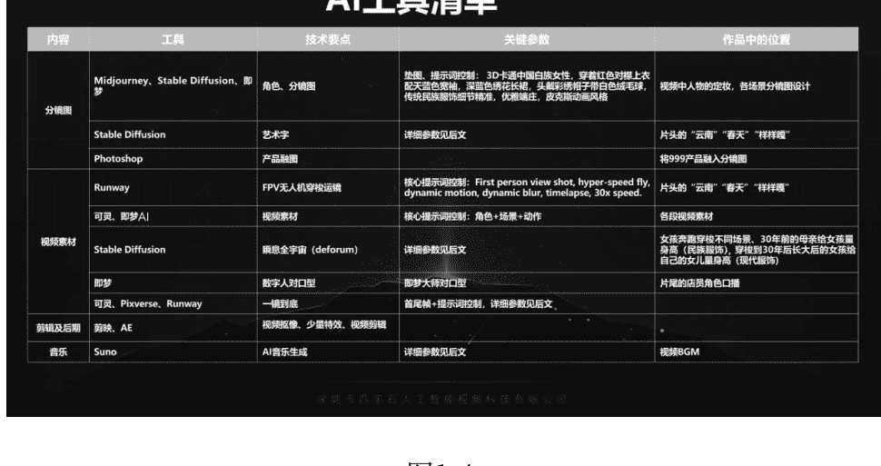
图1-4

##### (2) “C端培训+B端服务”双轮驱动商业模式
商业闭环围绕C端与B端需求展开，互补共生。

①C端：AI视频技能培训。核心用户为因AI浪潮产生转型焦虑的职场人、需提升第二职业技能的从业者、受剪辑技术限制的内容新人。

②B端：AI视频定制化制作服务。服务对象包括政府及文旅机构、中小企业及品牌方、KOL及教育机构等。典型场景有品牌AI宣传片、文旅创意短片、抖音与视频号矩阵搭建、政府公益宣传片制作等。团队建立标准化交付流程：需求沟通→AI策划提案→AI初稿生成→人工优化→客户确认。

定价根据项目复杂度为100~1 000元/秒。15秒短平快项目最快3个工作日交付初稿，常规项目1周内成片，效率远高于传统拍摄。

代表性案例：《AI城市文旅片·我心中的岳阳楼》通过AI重塑千年名楼文化内涵，获全国AIGC创作大赛银奖；《太可健康·品牌故事视频》1分钟广告宣传片，相较传统模式节省70%成本，已在多个线下展会循环播放。

#### 3. 行业挑战与未来趋势
##### (1) 当前行业的核心挑战
AI视频行业快速发展背后仍存难题，集中在工具、质量与认知三层面。

- ①工具迭代快：AI视频工具版本更新频繁、新工具不断涌现，从业者需持续学习，面临刚掌握旧工具新工具已普及的压力。
- ②内容质量把控难：AI生成内容不稳定，如人物面部细节不一致、动作衔接不连贯、场景切换突兀，需人工介入优化。平衡AI效率与人工质量成为全行业难题。

- ③推广认知成本偏高：多数潜在使用者对生成式影像了解有限，一方面担心成品水准比不上传统拍摄，另一方面对“费用大幅缩减”的宣传保持审慎，服务方必须花费额外精力做科普与信任建立。

##### (2) 未来走向与普通人入局启示

AI影像创业正从单点功能使用向全流程自动化演进。越来越多团队启动智能体工作链的研发，想要把脚本撰写、画面合成、语音生成、剪辑排版串联成一体化自动运行，同时把账号代运营纳入服务范围，延伸商业链条。

对计划进入的普通人有4点指引：第一，门槛虽被拉低，但绝非零门槛，仍需吃透基础逻辑与操作流程；第二，必须把制作流程固化为标准化模板，避免重复踩坑，提升产出效率；第三，商业化不能押单一形态，需兼顾培训类轻资产收入与项目类实体收入；第四，要从工具操作者转向内容理解者，判断什么内容能打动用户才是真正的核心壁垒。

生成式视频正推动视频创作从少数人的专业技能，转向更多人可掌握的表达媒介。这一进程既会催生专业AI影像团队，也会为普通人带来大量就业与创业机会。

### 1.3 传统企业AI内容生产：快速盈利的关键逻辑

新媒体环境下，传统企业普遍面临内容制作费用高、效率低、难规模化的问题。以建材行业为例，若要在抖音、小红书、公众号等多渠道持续输出，常需组建专业团队，前期投入可达数十万。

何厂长通过“AI内容工厂”模式，为传统企业提供低成本、高效率、可放大的生产方案。截至2025年末，其团队已服务会员3000余人，合作企业超400家，覆盖旅游、建材、留学、培训等多个重点品类。

#### 1. 市场机会：企业自制困境与智能化突破口

把握机会需先看清传统企业在内容生产上的具体痛点，这些痛点正是AI工厂的切入点。

##### (1) 传统企业的三大内容困局
- ①制作费用高、效率低：传统流程下单条视频成本数千元起，建材、留学等行业多数缺乏专业内容团队，自主生产难度大。
- ②难以形成规模优势：新媒体获客的核心是“内容换流量”，需多账号高频更新做关键词占位，手工制作难以支撑该体量。
- ③有效性难保证：多数企业盲目追爆款，缺乏可验证的内容框架，导致投入产出比低，陷入高投入低转化的循环。

##### (2) AI内容工厂的核心价值主张

核心在于实现费用低、效率高、体量大、效果佳的多维突破。通过搭建自动化制作流线，可把单条内容的成本压到传统制作的十分之一左右。

以建材客户为例，通过搭建20个账号集群覆盖抖音、小红书、公众号，一个月内实现核心关键词占位，客户咨询从日均个位数提升至数十条，获客效率显著改善。

#### 2. 搭建路径：内容工厂三步法

搭建需遵循科学顺序，首要任务是夯实内容有效性，即先明确内容框架。

##### (1) 先定内容框架：有效性是底座

工厂的前提是内容可用。高手搭建体系的本质是建生产线，第一步就是明确模型。

何厂长团队总结出两套经市场验证的视频框架，底层均为“文声画组装”，可适配不同行业。

- ①产品展示类：适用于建材、家居、培训等实体或服务行业，通过智能生成讲解文案、智能配音、生成并剪辑画面，快速完成价值传递。
- ②轻IP类：聚焦企业轻IP打造，持续输出行业知识、案例解析、实操技巧，形成稳定内容标签，成为规模化获客的长效引擎。

文声画组装制作流线如图1-5所示。

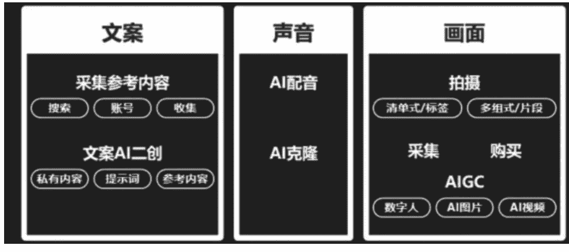

##### (2) 搭建制作流线：人机协同是主线

AI内容工厂以制作流线为主线，核心原则是人机协同，即RPA+智能模型+人工的配合模式。

**为何不追求零人工？** 纯自动流线技术成本高、贴合度差、效果不理想。现阶段最优解是让自动化与人工干预平衡，实现效率与效果双赢。

**协同要点：** 其一，分工清晰——人工负责创意策划与策略制定，智能模型承担文案生成、素材制作、基础剪辑；其二，动态调整比例——简单内容可实现80%自动化，复杂内容如案例解析需30%~40%人工介入优化。

具体实施步骤如下。

- ①素材准备：借助ChatGPT及国产大模型如千问、文心一言生成文案，用DubbingX完成智能配音，用Midjourney、可灵生成或优化画面素材。
- ②素材拼接：依托剪映等工具的智能能力自动完成字幕生成、转场特效、音画同步等基础操作，最终由人工完成审核与细节微调，确保品质。

##### (3) 构建内容矩阵：用量级做壁垒

规模化产出是核心竞争力，需通过内容矩阵实现。团队为客户构建“视频工厂+图文工厂”双体系，全覆盖抖音、小红书、公众号、视频号。

量级优势不靠技巧，核心是“多账号布局+高频更新”，在领域内形成内容体量壁垒，产生流量虹吸。

#### 3. 快速盈利逻辑与落地要点

要实现快赢，关键是选对变现路径与核心优势，首步是精准锁定目标客户。

##### (1) 聚焦B端：锁定高价值企业

目标客户是传统企业，特别是旅游、建材、留学、培训等本地化、服务型行业。此类企业获客需求明确、付费预算充足，更看重实际效果而非技术本身。

- 核心服务：提供全链路方案，包括内容框架设计、制作流线搭建、账号集群运营、效果优化等一体化服务。
- 定价策略：单次服务不低于1000元，主流客单价超5000元。企业对价格不敏感，只要能带来客资，就愿意为专业服务付费。

##### (2) 核心优势：务实优于新潮

市场上部分工厂盲目追逐“动物奥运会”“火柴人动画”等时髦形态，数据好看但变现弱。

何厂长团队坚持拒绝跟风，把技术聚焦在传统企业刚需的视频制作场景。风格虽朴实，但精准匹配获客需求，变现效率很高。核心逻辑是为流量与客资买单，而非技术噱头。

##### (3) 快赢两大标准：快与大

持续盈利的工厂必须同时满足回款速度快、单笔收益高。

- ①周期短：启动服务后一个月内即可回款。短周期是草根项目存续的关键。
- ②金额大：单笔不低于1000元，主流客单价超5000元。低价内卷无出路，精准匹配高价值客户即可实现价格升级。

#### 4. 核心经验启示

##### (1) 先找对客户，再打磨产品

多数草根做不出边际成本极低、技术门槛极高的产品。更务实的做法是先找到愿意付费的精准客户，再迭代产品。

传统企业是理想客户：获客迫切、付费能力强、重效果轻技术。与其做零售级低价产品，不如聚焦企业级高价值服务。

##### (2) 量级是新媒体获客的底层逻辑

新媒体获客本质是内容换流量，起量的核心是“量大出奇迹”。AI内容工厂帮助企业以极低成本突破内容生产瓶颈。

当一家建材企业在抖音、小红书同步运营20个账号，日均输出数十条有效内容时，流量阀门自然打开。量级优势正是快赢的底层支撑。

### 1.4 公众号爆款打造：高流量作品的生成秘诀

微信公众号凭借庞大用户与成熟商业生态，是创作者的核心变现阵地。推荐机制升级后，小号新号也能获得高曝光，但多数人仍困于选题枯竭、产出困难、效率低下，阅读表现不佳。

2024年7月，拥有4年Java开发、7年AI产品经理经验的卧龙君辞职创业，自研巨鲸AI工具。截至2025年末，该工具已采集近400万篇爆款内容，生成4万余篇公众号文章、10万张配图，GMV超30万元，付费用户破8000人。

巨鲸AI的成功在于精准击中公众号创作痛点并融合智能技术。

#### 1. 市场机会：公众号智能工具的蓝海

赛道机会由两点构成：创作者痛点与现有工具不足。

##### (1) 创作者核心痛点

公众号写作者普遍陷入难坚持、难出效的困境，可拆解为四点：选题难、产出难、效率低、效果差。文本生成技术的成熟为破解提供支撑。

##### (2) 现有智能工具的不足

市面写作工具众多，但贴合公众号全流程的极少，缺陷有三点。

- ①质量与门槛矛盾。国内工具稳定性不足，易出现逻辑混乱；国外工具门槛高，对普通写作者不友好。
- ②功能割裂导致效率低。创作涵盖选题、拟题、写作、排版、配图，需切换多工具；提示词调试需兼顾爆文逻辑与技术，进一步抬高成本。
- ③RPA工具局限。安装复杂、占用资源，平台规则升级后易失效，稳定性差。

市场急需一站式、低门槛、高质量的智能爆文工具，这正是巨鲸AI的机会。

#### 2. 产品演进：四版迭代逻辑

产品落地核心在于快速迭代。巨鲸AI历经四版完成需求验证、功能完善与商业闭环。图1-6为巨鲸AI成品页面。

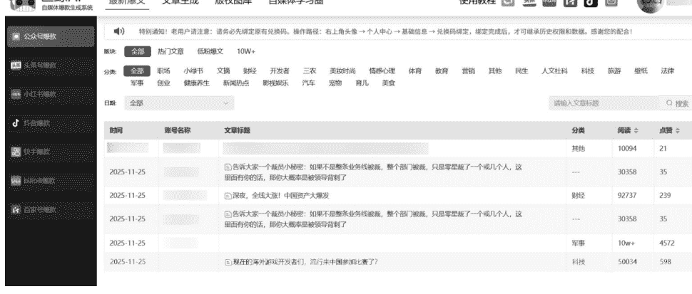

##### (1) 第1版：爆文采集系统

聚焦“选题难”。依托RPA搭建采集系统，每日自动抓取各平台爆款并展示，并设计兑换码体系布局商业化，一个月即上线。

##### (2) 第2版：增加智能图库

配图为刚需，传统配图质量差、有水印、有侵权风险。第2版通过RPA+极梦工具批量生成数万张高清无水印无版权风险配图，覆盖多数场景。

##### (3) 第3版：爆文生成功能上线

前两版解决找素材，第3版解决写内容。优化UI、上线爆文生成功能，采用GPT-4模型，经3个月打磨八十余次提示词保障质量。新增自动同步公众号草稿箱、自动排版，定价69元/月，上线后GMV突破30万元。

##### (4) 第4版：打通公域私域闭环

前3版采用门票核验，仅私域发售。第4版升级为微信快捷登录+在线支付；扩充数据源新增抖音、快手、B站、百家号，公域销售渠道全面打通。

#### 3. 商业模式：多元变现路径

##### (1) 私域变现

初期用私域转账+兑换码积累用户与营收，后期推出3天免费体验，建立近100个体验群，吸纳1.5万用户参与，提升付费转化。

##### (2) 闲鱼售卖

闲鱼是重要公域获客渠道。上线后即布局该平台，并发动学员分销，以“官方+分销”模式扩大曝光与销量。

##### (3) 知识产权绑定

2024年初起重视个人IP打造，积累专业内容影响力。付费用户破8000后推出知识专栏、训练营等衍生产品，智能工具兼具赠品与分销奖励角色，形成IP引流+工具变现+衍生增值闭环。

##### (4) 生成引擎优化GEO

2025年GEO成为热门赛道。团队两周内优化10多个关键词，使工具入选DeepSeek、元宝等大模型搜索结果，自然流量翻倍，获客成本显著下降。

#### 4. 行业挑战与未来趋势

##### (1) 当前核心难题

技术迭代快易被淘汰；内容同质化严重缺乏竞争力；赛道涌入者增多竞争加剧。

##### (2) 未来方向与入局启示

行业正从单一工具向全流程自动化演进，三大趋势：①智能体工作流完善，实现创作全流程自动化；②多模态生成能力提升，覆盖文图音视频；③智能工具与个人IP深度绑定，成为生态核心。

入局启示三点：
第一，需构建“业务+AI”双重能力。创始人兼具10年AI经验、100多款工具使用经验及每日拆解20篇爆文的能力，双重优势构成壁垒。
第二，需搭建多元商业模式。单一渠道抗风险弱，需兼顾私域、公域、IP绑定、GEO，形成互补。
第三，需坚守长期主义。草根易焦虑跟风，真正的突破来自聚焦深耕。巨鲸AI证明阅读量从3000突破10万后，变现进入良性循环。

### 1.5 教师资料AI化：千万刚需的变现新方向

教育行业虽在数字化转型，但基层教师负担加重，写教案、做课件、策划班会、写总结等非教学事务占用大量精力。据2025年12月25日《人民政协报》报道，我国大中小幼专任教师1885.10万人，按保守估算每人年均资料开销500~2000元，刚需市场巨大。2024年，3人小团队“饭饭”用两个半月营收25万元，利润率超60%。他们靠AI重构教学资料制作流程，把数小时工作压缩到数分钟，并理顺引流、转化、定制、裂变逻辑，证明普通人也能切入。

#### 1. 市场机会：减负背景下的刚需爆发

教育减负政策收紧，教师对高效教学资料需求更迫切，传统供给方式问题明显。

##### (1) 传统教学资料痛点
- ①质量差：大量资源搬运旧素材，陈旧且不符合新课标，无法直接使用。
- ②太雷同：模板全校通用，易撞车，公开课、评职称需要个性化时无法满足。
- ③贵且慢：人工定制一份教案数百元，还要等3~5天，经济与时间成本都高。

##### (2) AI切入优势

AI打破僵局，不仅能快速原创，还能降本。用ChatGPT、Claude等大模型，准确定出提示词即可快速生成符合教学逻辑的文案，配合AIGC绘画一键生成课件配图，成本仅人工十分之一，几分钟交付，解决教师紧急需求。

#### 2. 实践路径：标准化生产到商业闭环

项目能立足靠两点：标准化智能生产流程保障质量与交付速度；“低价引流+会员锁客+高端定制”模式兼顾流量与盈利。

##### (1) 构建标准化智能教学资料生产流程

团队依托四模块搭建高效模式。

- ①指令模块：建立教育行业专属提示词库，教师输入教学目标、学生情况后，AI快速输出含重难点、步骤、板书的完整方案。图1-7为AI创作教学资料大纲示例。

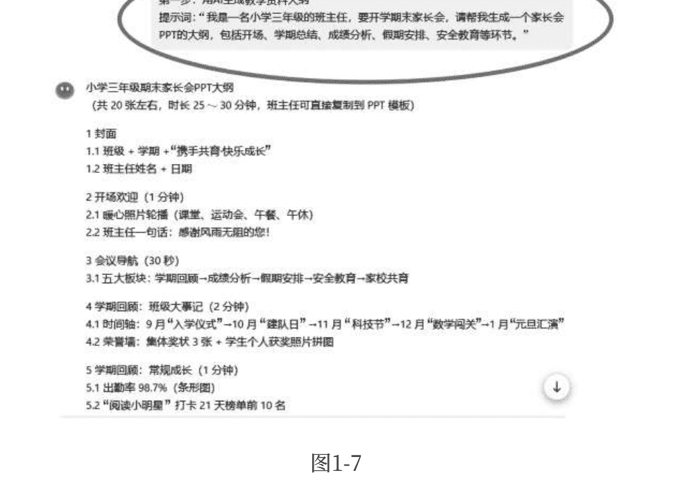

- ②素材模块：用AI配音制作微课音频，用AI绘画生成统一风格课件画面，最终整合为文字+声音+图片的完整资料。
- ③润色查重：AI文本偏生硬，人工补充真实教学案例并严格查重，保证原创性与教学贴合度。
- ④审核排版：按固定模板自动排版，重点优化“开头5分钟导入”等关键环节，使资料可直接使用。

##### (2) “C端培训+B端服务”双轮驱动

针对不同需求设计差异化产品，形成稳定闭环。

- ①低价单品9.9~29.9元：在小红书、抖音发预览图引流，用试用装筛选精准客户，降低获客难度。
- ②会员转化199~399元：引导首购客户加微信进私域社群，推广年费会员，一年内核心资料免费更新，提升复购与粘性。
- ③高端定制500元起/单：针对公开课、职称评审提供AI+人工一对一定制，价格高但利润可观。

这个赛道最打动人的点是门槛很亲民，不必是名师，也不必懂技术，搞懂底层逻辑后，普通人也能快速切入。

#### 3. 普通人入场指南：低成本可复制的做法

做这门生意，拼的不是资料生产能力，而是能否找准真实需求、会用现成工具并做出差异化。重点落在从零起步和建立壁垒两条线。

##### (1) 从零起步怎么走

## 起步阶段要小投入先验证，按反馈再放大，初期不要盲目囤量。

- ①找痛点：盯教师最头疼的场景，例如期末评语。几十个学生要写出不同化的评价，费时又容易雷同，用模型生成既快又稳，正好击中痛点。
- ②借工具：新手不必自建模型，直接调用公开大模型即可。网上检索“教师专用提示词模板”，照着改造就能得到可用内容。
- ③小范围验证：先产出5到10份样稿投放到社媒，若出现“怎么买”的询问，就说明选题和质量过关，再考虑批量化。

## （2）如何建立个人壁垒

低门槛容易同质化，要站稳需要从三方面建立区隔。

- ①做细分：别贪全学段全学科，聚焦一个窄口径，例如小学一年级语文家长会方案、初中物理实验课件包。
- ②加温度：教师对纯模型输出比较敏感，人的优势在于给内容“加料”，比如把教案里融入本地文化案例，这类接地气细节模型很难自发生成。
- ③强化服务：教师买资料更看重省心，提供免费修改、1对1排版指导等增值服务，做好服务自然能支撑溢价。

任何新赛道都有机会也有风险，AI辅助教学资料同样如此。看清痛点、提前判断方向，才能长期经营。

#### 4. 行业挑战与未来趋势

##### (1) 现阶段的坑

目前有三类风险要提前规避。

- ①模型“胡说”：大模型可能编造错误知识点，必须人工终审。一旦出现知识性错误，品牌信任会迅速坍塌。
- ②服务边界不清：前期切勿承诺无限次修改，会严重拖慢交付效率，需提前约定修改次数与售后周期。
- ③版权风险：要确保材料不侵犯教材、文献等既有版权，保证原创性，以规避法律风险。

##### (2) 未来发展启示

想提升成功率，非专业人士可把握三点。

- ①先验证再放量：收到真实付费意向后再规模化生产，避免堆积大量卖不出的资料。
- ②具备时间预判：教学资料具有强时效性，开学、期末前需求集中，提前约一个月预热才能抢占先机。
- ③从会用工具到会解决问题：理解教师的真实困境比熟练操作模型更重要，才能做出实用材料。

智能技术正在把教学资料从通用模板推向个性化辅助，专业团队在出现，普通人也获得了创业窗口。只要坚持长期主义、原创与服务，每份AI辅助的教学资料都能转化为实际收入。

### 1.6 全流程打造创始人IP：效率提升十倍的落地方案

短视频时代，创始人IP是企业重要的数字化资产，但大量创始人卡在执行上。传统脚本、拍摄、剪辑耗时耗力，门槛高，多数人因缺时间、缺内容、缺体系而中途放弃。

自2024年起，已有团队以“方法论+智能系统+标准化流程”重构IP服务，实现单条视频播放过千万、月增粉十万以上，IP生产效率提升十倍以上。下面完整拆解落地路径。

#### 1. 市场机会：创始人IP的商业本质与切入逻辑

要理解智能系统如何赋能IP，需要先厘清创始人IP与普通网红的本质差别：前者沉淀商业价值，后者偏重流量变现，这决定了系统介入的方式。

##### (1) 创始人IP的三大核心特征

创始人IP的竞争力来自专业价值与商业属性的绑定，核心体现为三个方面。

- ①专业内容建立影响力：区别于普通网红，创始人IP依托行业深度认知持续输出观点，锚定用户心智，建立权威感。
- ②业务思考显性化：将商业观点、战略与经验转化为视频内容，形成专属人设标签，这类深度思考难以复制，是吸粉关键。
- ③系统化与标准化：IP运营不靠灵感，而靠自运转的内容流水线，保证价值输出稳定持续，这是长期变现的基础。图1-8为创始人IP商业价值模型。

### 创始人IP商业价值模型

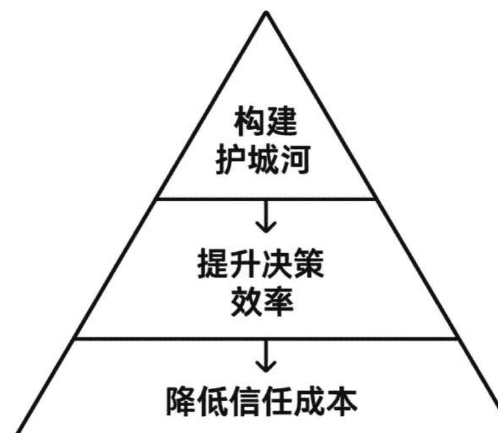

图1-8

##### (2) 智能系统赋能IP创作的核心价值

系统赋能IP创作的核心价值有三点。

- ①降本增效：创始人IP能构建“形象—品牌—产品”信任链，带来高价值客户与人才，转化效率高于传统投放，系统可通过规模化内容加速信任建立。
- ②建形象壁垒：产品易被模仿，但创始人的价值观、表达与经历不可复制，系统可将这些特质规模化输出，构成企业护城河。
- ③破生产力瓶颈：借助数字人采集与自动化脚本生成，创始人一次录制即可实现内容无限复用，从根本上解决时间稀缺问题。

#### 2. 实践路径：从工具应用到全托管服务闭环

明确商业逻辑与价值后，落地核心是推动IP打造从“手工作坊”转向“智能流水线”，关键是实现从工具到全流程服务的闭环。图1-9为智能系统赋能完整流程。

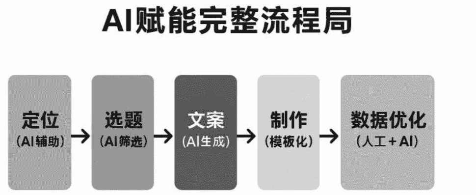

图1-9

##### (1) 构建标准化内容生产工作流

标准化工作流是提效核心，可拆分为四大模块，均采用“系统主导+人工辅助”。

- ①定位与对标：核心是“人群垂直”而非“内容垂直”，系统梳理目标人群与变现路径，抓取对标爆款账号拆解后输出定位报告。
- ②选题与文案：系统每日抓取全网热点，结合人设判断借鉴价值并给出切入建议，再按爆款框架生成文案初稿，兼顾传播性与人设匹配。
- ③数字人与剪辑：创始人一次性采集形象与声音，后续由数字人出镜配音，结合剪辑模板自动匹配字幕、音乐，实现批量交付。
- ④数据优化：系统+人工记录核心指标，以数据反馈修正选题、视觉风格，形成“创作—反馈—优化”闭环。

### （2）全托管模式的商业运营逻辑

基于上述工作流，形成覆盖C端与B端的全托管服务闭环。

- ①C端：IP技能培训，主要面向职场转型者与内容新人，通过线上课程+实操，解决“不会做、做不快”的痛点。
- ②B端：创始人IP全托管，服务中小企业主与头部KOL，核心是让创始人专注观点输出，摆脱内容琐事。

服务流程：需求沟通→形象提取→系统策划→内容生成→人工质检→发布。创始人只需提供原始观点，其余由系统完成，单条视频制作可从数小时压缩至十几分钟。

#### 3. 深度实操细节：如何跑通IP交付

跑通交付的关键是“方法论显性化”与“工具整合”。传统IP依赖操盘手，难找难复制，解法是把操盘手的隐性经验转化为系统可执行的显性方法论。

- ①定位分析：系统梳理创始人优势与观点，结合市场需求明确形象与变现路径，形成定位手册。
- ②对标画像：系统扫描相似爆款账号，提取视觉风格、话术逻辑、情绪钩子等，形成对标报告。
- ③内容策略：将定位与对标报告转化为系统提示词框架，确保输出兼具行业深度与传播性。

### （2）系统工具的高效整合应用

成熟系统工具可承担60%~70%的工作量，关键在于整合能力，核心场景有三点。

- ①文案生成：大模型按提示词框架生成初稿，人工负责润色与价值观把关，避免偏差。
- ②视觉呈现：通过数字人平台采集形象声音，后续由系统驱动出镜，解决创始人出镜难的问题。
- ③自动化后期：借助剪映智能工具等模板功能，一键匹配字幕、转场，保证账号风格统一。

#### 4. 行业挑战与入局启示

系统赋能IP前景广阔，但仍处发展期，挑战与机遇并存。

### （1）当前行业主要挑战

- ①工具迭代压力：智能工具更新快，从业者需持续学习，避免效率受落差拖累。
- ②内容质量把关：系统初稿易模板化、缺温度深度，需人工润色审核，确保符合人设并规避错误。
- ③市场教育成本：部分创始人质疑系统内容的真实性与效果，需用案例数据证明流量与转化能力。

### （2）普通人入局的实操启示

普通人入局的核心不是技术，而是思维。

- ①聚焦人群价值：明确服务对象与需求比会用工具更重要，内容只是价值载体。
- ②建系统化SOP：摒弃灵感依赖，搭建全流程标准作业程序，降低对个人能力的依赖，实现稳定产出。
- ③转型方案解决者：不必成为系统专家，只需整合工具与方法论，助力企业主解决IP打造痛点，实现商业变现。

总体而言，系统正把创始人IP从“艺术创作”变为“工业产品”。掌握“方法论+系统工具+标准化流程”并坚持长期主义，就能构建影响力护城河，成为新商业时代的效率赢家。

## 第2章 智能赋能职场提效

职场竞争的本质是效率竞争，系统正是提升效率的“超级工具”。从财务自动化处理、项目管理到标书智能撰写等，系统能接管80%的重复性工作，让人从繁琐事务中解脱，聚焦核心价值创造。本章提供多场景、可落地的实操技巧，通过“工具+流程”的双重优化，帮助重构工作模式，实现效率翻倍、价值升级，在职场中快速脱颖而出。

### 2.1 财务自动化处理：效率提升60倍的实操技巧

在企业级服务市场，财务数字化转型始终是降本增效的核心诉求。财会人员日常要处理海量发票核对，传统人工录入单张发票并统计明细平均耗时3分钟，不仅流程枯燥重复，还极易因人为疏忽而出错。

RPA教练龙哥团队通过深度融合系统与RPA技术，研发出“系统+工作流+飞书多维表格”一体化的自动化解决方案，单日可识别3万张发票，单张处理时间从原来的3分钟压缩至3秒，效率直接提升60倍，真正将财务人员从繁琐的重复性劳动中解放出来。

#### 1. 市场机会：财务自动化的痛点与系统切入逻辑

财务办公的跨越式提效，关键在于精准击破业务流程中的“梗阻”环节。只有摸透传统财务工作的核心痛点，才能让系统技术的赋能更具针对性。

##### (1) 传统财务报销与核算的痛点

- ①人工录入效率瓶颈：无论是纸质发票还是电子发票，都依赖财务人员肉眼识别、手动录入信息。面对大批量报销单据时，不仅人力成本高，还易造成流程拥堵。
- ②准确率难以保障：长时间从事重复性劳动，财务人员难免出现疲劳走神，在录入金额、税率、发票抬头等关键信息时，错误率就无法完全规避。
- ③数据沉淀不及时：在传统处理方式下，发票数据录入系统存在明显滞后，导致企业管理层无法实时掌握财务流水与预算执行动态，影响企业的决策效率。

### （2）系统+RPA的技术赋能优势

- ①高精度图像识别：依托大语言模型的视觉能力，系统对各类发票的文字识别准确率已接近100%，远超传统OCR技术，从源头就可降低错误率。
- ②全链路自动化：通过RPA模拟人工操作，搭配工作流引擎，可实现从发票收集、识别、校对到入库归档的全流程无人值守，彻底摆脱对人工的依赖。
- ③极低的应用门槛：普通员工借助低代码平台就能快速搭建专属财务智能体，无须拥有深厚的编程功底。

#### 2. 实践路径：构建三位一体的自动化工作流

这套可直接落地的方案，核心由发票识别插件、工作流引擎、数据存储节点3个部分构成，三者协同联动形成完整的自动化闭环。

### （1）自研高精度发票识别插件

实践过程中我们发现，通用识别工具常常难以精准适配复杂的发票格式，因此基于大厂API自建插件更具实用性。

- ①筛选优质API：对比多个图像识别模型后，最终选用识别准确率领先的千问模型API。
- ②搭建插件框架：在开发平台新建插件项目，增设图片URL作为核心元数据字段，保障图像信息能够稳定传输。
- ③编写集成代码：引入DashScope依赖包，将API Key与定制化提示词嵌入插件逻辑，确保能精准提取发票代码、金额、税率等关键明细。

### （2）搭建标准化工作流

工作流的核心作用在于，将零散的识别能力串联成逻辑严密的“自动化生产线”，具体分为4个关键节点。

- ①开始节点：接收用户上传的发票图片，支持单张或批量上传。
- ②插件节点：自动调用自研发票识别插件，将图像信息转化为结构化文本数据。
- ③数据清洗：通过简易代码节点，将原始识别数据整理为“字典格式”，统一字段规范，方便后续系统读取。
- ④飞书节点：配置飞书多维表格节点，录入对应app_token与table_id，实现清洗后数据自动写入指定表格。

### （3）智能体包装与交付

完成技术搭建后，还需通过标准化包装提升智能体的实用性，确保财务人员能快速上手。

- ①设定交互逻辑：在智能体后台配置提示词回复规则，保障系统能精准理解财务人员的日常指令。
- ②优化操作入口：新增专属“发票提交”组件，支持批量拖曳上传图片，简化操作步骤。
- ③严格测试发布：经过万级数据量压力测试，确认系统保持秒级响应且准确率稳定后，再发布至企业内部供全员使用。

如图2-1所示，我们对这套系统发票识别智能体进行了多轮测试，各项指标均达标。

### 预览与调试

十倍提效


上传发票 发票2.png

发票识别智能体

运行完毕

数据插入飞书状态：success

```
发票内容：json
{
  "发票标题": "电子发票（普通发票）",
  "发票号码": "2...",
  "开票日期": "2025年04月11日",
  "购买方信息": {
    "名称": "...",
    "税号": "..."
  },
  "销售方信息": {
    "名称": "深圳...",
    "税号": "914..."
  },
  "items": [
    {
      "项目名称": "餐饮服务餐费",
      "规格型号": "",
      "单位": "",
      "数量": "1",
      "单价": "194.059405940594",
      "金额": "194.06",
      "税率": "1%",
      "税额": "1.94"
    }
  ],
  "合计金额": "194.06",
  "合计税额": "1.94"
}
```

Invoice

图2-1

#### 3. 深度实操细节：如何确保自动化方案的稳定性

##### (1) 提升数据处理的准确度

- ①优化提示词工程：通过定制化Prompt引导系统聚焦发票代码、金额、纳税人识别号等关键审计字段，优先确保核心信息无遗漏。
- ②搭建异常处理机制：在代码节点中嵌入校验逻辑，若识别结果缺失关键信息或出现格式异常，系统会自动标记“异常”并触发人工提醒，避免错误数据流入后续环节。

##### (2) 优化数据存储与展示

- ①实现多维表格联动：利用飞书多维表格的公式功能，自动计算税额合计、报销进度等衍生数据，减少人工的二次核算。
- ②自动化报表生成：数据入库后自动触发仪表盘更新，为管理层提供实时的可视化财务看板，直观呈现报销趋势、预算使用情况等信息。

#### 4. 行业挑战与未来趋势

##### (1) 当前面临的核心挑战

- ①模型API成本管控：虽然财务处理效率提升显著，但在处理超大规模数据时，API调用产生的Token费用会明显增加，需提前做好成本评估与用量管控。
- ②复杂票据适配难题：针对手写票据、严重损毁发票或特殊版式票据，系统识别准确率仍有提升空间，目前需搭配人工复核以保障数据的准确性。
- ③数据安全合规风险：财务数据敏感度极高，调用公有云系统能力时，必须严格遵循企业数据安全协议，避免数据泄露。

### （2）未来发展启示与入局方向

从行业发展趋势来看，系统财务自动化还有广阔的拓展空间。

- ①从单一功能向全业务流程延伸：未来可将发票识别与企业ERP系统深度集成，实现从发票处理到自动记账、对账的全链路自动化。
- ②普通人的转型机遇：普通员工若掌握RPA与系统智能体搭建技能，可转型为“数字化转型顾问”，助力更多职能部门实现办公自动化。
- ③迈向智能代理时代：未来的财务自动化不仅是被动执行指令，更能通过系统Agent自主判断发票的合理性与合规性，主动规避财务风险。

系统财务自动化的核心价值，远不止60倍的效率提升。更重要的是，它让财务人员摆脱了“工具人”的角色束缚，回归到预算规划、风险管控等更具价值的管理工作中。事实上，只要掌握这套标准化工具的应用方法，任何企业都能在低门槛前提下，搭建起属于自己的智能财税中心，真正实现财务数字化转型的降本增效目标。

### 2.2 智能+项目管理：多线程推进与知识库搭建的实战方案

很多人都面临这样的困境：信息散落在日记本、公司群、微信收藏夹等多个地方，项目推进全靠记忆，找资料要翻半天，打卡和任务还总遗漏。容治用系统搭配飞书多维表格，给自己搭了个清晰又高效的“个人项目管理驾驶舱”——把多平台信息汇总到表格里，检索起来又快又准；还靠工作流定时提醒打卡，任务完成得从容又稳妥。

#### 1. 为什么选择智能+飞书多维表格

选对工具是高效管理的第一步。很多人走弯路，就是因为用错了工具或没摸清工具的搭配逻辑。想搞懂这套系统到底好用在哪，需先弄明白两个核心问题：飞书多维表格比其他工具好在哪？系统又能怎么帮上忙？

##### (1) 对比其他工具

Excel和Word没法实现云存储，不能实时查看资料，更无法应对复杂关系和视频、图片这类非结构化数据的管理；传统笔记软件擅长“收集”，但在信息关联和流程管理上明显不足；专业项目工具对个人来说太笨重，配置起来又复杂，上手成本极高。

##### (2) 飞书多维表格的优势

飞书的多维表格早就不是传统意义上的电子表格，更像一个可以随时调整的个人数据中台。同一组数据能一键呈现为表格、看板、日历等不同形态，按使用场景灵活切换；字段类型支持单选、附件、关联等自定义，通过强大的关联机制把多张表格串联起来。智能助手充当效率放大器，负责自动归类、要点提炼与标签打标。通俗讲，飞书侧重信息的承载与展示，智能侧重信息的处理与优化，两者配合使用能明显提升工作效率。

#### 2. 实战案例一：多线程项目管理实操
搞清楚工具优势后，下一步是把思路落地成可用的多线程管理体系。整体围绕全局可视化和自动推进展开，拆成四个关键环节。

##### (1) 总看板与项目概览表
总看板相当于项目的指挥中心，可设置跳转按钮，例如点一下“打卡规则”就能直接进入对应的子表，避免在多个表格间反复切换。这里汇总各项目的打卡记录等核心数据，打开即可掌握整体态势。

### （2）核心表搭建
表格是系统地基，重点打造三张表覆盖全流程。

- ①项目总表：收纳所有项目的基础信息，字段包括项目名称、启动日期、当前状态、打卡规则、个人心得汇总、智能复盘建议，便于快速查阅每个项目的概况。
- ②资料总表：集中存放各类相关资料，字段有资料链接、附件、资料类别、所属项目关联项目总表、归档状态，让每份资料都有明确归属。
- ③执行记录表：记录每次打卡与心得，字段包含打卡日期、关联项目、打卡内容、个人心得自动汇总到项目总表供复盘、附件、智能心得总结，清晰追踪执行进展。

### （3）直播与打卡提醒自动化
只有表格还不够，还需工作流实现自动化提醒。系统可自动推送当天直播课程提醒，也能按各项目的打卡频次定时推送，杜绝任务遗漏。图2-2展示了提醒工作流的搭建界面。

## 告诉我你想搭建什么系统
大魔王会根据你的需求，智能预填充后面的表单内容～

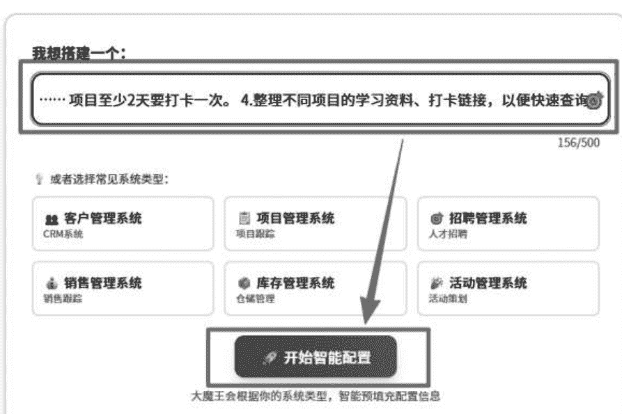

图2-2

##### (4) 智能加持的三个切入点
智能的核心价值在于降门槛、提效率，主要体现在三个环节。

- ①搭建框架：借助“多维秒搭”功能，把需求讲清楚，智能就能迅速给出表格框架，无需自己构思表结构拆分与字段定义，原本混乱的规划被理顺，只需专注执行落地。
- ②复盘总结：将打卡记录汇总后交由智能复盘，还能给出下一阶段的优化方向，相当于一位24小时在线的教练持续找问题指方向。
- ③工作流自动化：使用飞书多维表格的“AI创建工作流”，用自然语言描述需求，如“帮我创建一个每日打卡提醒工作流”，智能即可自动完成设置，无需学习复杂操作。

总体来看，智能帮助我们解决了启动、上手、实战、复盘四个难点，消除了不愿规划、操作困难、执行受阻、复盘不清等痛点。

#### 3. 实战案例二：知识库打造“第二大脑”
项目管理之外，知识沉淀同样重要。构建专属知识库就能形成第二大脑，实现知识的高效复用。该库的核心是闭环流转，分为收集、存储、检索输出三个环节。

##### (1) 资料收集：多渠道无缝汇总
收集的关键是零遗漏且自动录入，推荐三种做法。

方式一：表单直录。用飞书表单采集信息，提交后数据自动录入多维表格，适合标准化采集场景，如行业报告、会议纪要收集。
方式二：内嵌自动化。利用飞书内置工作流或机器人，通过对话触发信息捕获，自动写入多维表格，实现生态内闭环管理。
方式三：外部工作流对接。借助n8n、扣子等第三方工具搭建更复杂流程，实现跨系统批量定时同步，如把微信收藏资料自动同步至系统。

##### (2) 资料存储：结构化分类关联
存储要做到结构化且可关联，建议配置两张核心表。

表A：“素材库”存放原始信息，字段包括素材标题、类型单选、URL来源、状态单选、核心观点、关联灵感关联素材库、附件等，为每个素材打上清晰标签。
表B：“灵感库”存放选题与思考日记，字段有灵感或选题、状态单选、关联素材关联素材库、创作日期、发文链接等。两表通过关联打通，素材与灵感可双向联动，点击即可查看对应内容。

##### (3) 检索输出：高效复用知识
知识库的价值在于可用。飞书“知识问答”功能支持自然语言检索，不管是找素材还是查观点，智能都能精准定位。此前资料堆积检索耗时，现结构化管理后检索效率大幅提升。图2-3展示了知识库问答的实际效果。

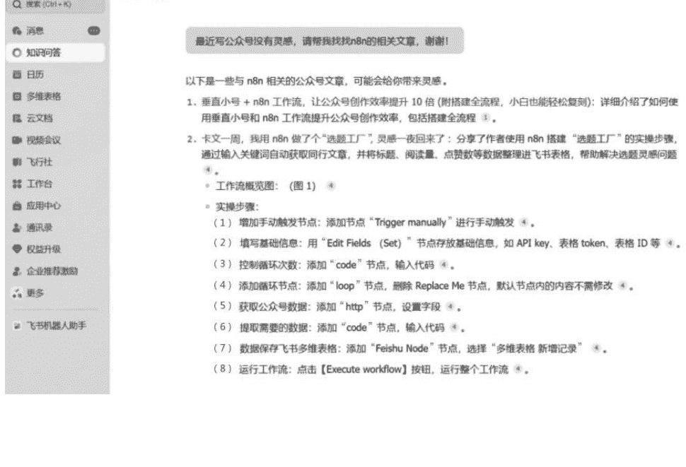

图2-3

#### 4. 避坑经验：少走弯路的核心技巧
工具再强，用错也发挥不出效果。结合实战，这三点必须规避。

避坑一：别陷完美主义。初期不必追求字段齐全，先从三到五个核心字段起步，用中发现不足再补充，所有好用系统都是迭代出来的。
避坑二：警惕知识依赖。切勿只收集不内化，获取资料后要用流程图或自己的话重新梳理逻辑。与其浅尝多种工具，不如深耕一种用到精通。
避坑三：避免只进不出囤积症。必须打通知识库与项目库，在执行记录表里增加关联项目字段，学习后及时关联到具体项目并输出SOP，让知识真正落地。

最后强调，工具只是基础，关键在建立输入→处理→承载→应用→输出的闭环。飞书多维表格提供结构化骨架，智能注入智能化血液，二者结合才实现高效管理与知识沉淀。

### 2.3 AI标书智能撰写：降本提效的核心法宝
标书制作是企业参与招投标的核心环节。一份完整标书通常有3到6万字、上百页，还需整合技术方案、资质证明、图表等多类材料。传统模式高度依赖人工起草、整合与校对，往往耗时数周甚至数月，且易出现数据错误、逻辑不清、格式混乱。

随着AI发展，标书制作迎来智能化升级。峰兄团队研发的AI标书系统，通过自动化流程把人工操作时间压缩70%到80%，错误率降低87%，每年可为企业节省数百万元人力成本，核心在于精准破解行业痛点。

#### 1. 行业痛点：标书制作的四大核心问题
要理解AI标书的价值，需先看清传统模式的深层问题。

##### (1) 交付周期长
传统流程从立项、需求分析、内容编写到定稿全靠人工推进，每个环节都有效率瓶颈，周期动辄数周以上。
AI解法：把复杂流程拆解为需求分析→素材调用→文本生成→格式校准的标准化自动化链路，用系统联动替代重复人工，大幅缩短交付时间。

##### (2) 错误率高
人工编写易出现参数不一致、格式不统一、关键内容遗漏，细节失误可能导致标书失效。
AI解法：构建数据交叉验证加逻辑一致性检查的双重机制，经验证可将错误率从人工的4.3%降至0.6%，降幅达87%。

##### (3) 复用率低
报表、资质、通用话术等具备高频复用属性，但传统模式依赖编写人员经验与记忆，复用效率低且易偏差，重复劳动成本高。
AI解法：搭建一次训练多次复用的智能知识库，集中管理模板与素材，将重复工作的边际成本趋近于零，每年可节省百万元级人力成本。

##### (4) 需求理解深度不足
标书质量高度依赖编写人员经验与解读能力，易出现理解偏差、内容与客户预期不符，需反复修改。
AI解法：研发需求预判→动态调整→多版本输出的智能机制，通过深度学习行业数据与客户特征，提升需求预判准确率，减少修改频次。

可见AI正推动标书制作从人力驱动转向智能驱动，在提速降错降本的同时，释放人力资源。

#### 2. 产品方案：AI标书系统的核心能力构建
找准痛点是前提，贴合需求的产品方案是价值转化的关键。系统从定位、功能、技术三个维度构建完整解决方案。

##### (1) 产品定位
经一线场景调研与资深编写人员沟通，产品核心定位是为销售等业务人员提供高效易用的标书快速编写工具，以AI赋能实现低错误率、可视化操作，降低专业门槛。

##### (2) 核心功能模块
系统分为前端编辑与后端管理两大模块，覆盖全流程。

**前端编辑功能**
- ①智能生成目录或大纲：用户输入需求并上传Excel、PDF、Word附件后，系统自动生成大纲，支持手动调整。
- ②实时智能交互：依据核心需求自动生成文本、图表等内容，支持人工二次编辑优化。
- ③多元素材引入：整合内置素材库调用、网络检索、表格上传编辑等，满足多样化填充需求。
- ④便捷导出：最终标书可导出为Word，包含大纲、文本、图片、表格；导出的Excel自带项目名称、销售人员、客户名称等标签，单份最大支持6万字。

**后端管理功能**
- ①用户管理：登录注册、角色权限分配等基础功能，保障使用与数据安全。
- ②素材管理：支持图片素材的查看、新增、编辑、删除全生命周期管理。
- ③模板与商品管理：提供行业标准化模板与商品库，减少基础编写工作量。
- ④多格式数据投喂：支持Word标书、行业模板、txt长文本、Excel设备清单等多类型数据导入学习。
- ⑤智能检索：支持自然语言检索，快速匹配标题与正文，提升素材复用效率。
- ⑥参数配置：包含提示词模板管理、接口参数配置，适配不同行业与场景。

##### (3) 技术支持
系统采用Vue+Java+数据库主流架构，核心依托检索增强技术结合大语言模型接口，实现超长文本高效生成与精准优化。服务对象包括标书编写的销售及业务人员、拥有管理权限的管理员、负责内容编排与场景维护的运营人员。

#### 3. 商业价值：从成本中心到利润中心的转型
产品落地要体现商业价值。AI标书并非单纯替代人工，而是通过人工加智能融合，推动标书环节实现模式转变。

##### (1) 传统建标与AI建标的核心价值对比
传统人工编写的价值在深度定制与经验沉淀，如智慧城市项目通过定制方案实现18%中标溢价，24小时内完成方案迭代避免2000万元损失，案例共享帮助新人快速上手。
AI编写的价值在效率革命与数据智能：制作周期压缩85%从100小时降至7.5小时，错误率降低87%，释放70%人力投入高价值环节；通过历史数据挖掘，客户需求预判准确率提升至89%。表2-1展示了提效效果。

表2-1
| 核心问题 | 传统模式痛点 | 核心价值提升方向 | 量化指标 |
| :--- | :--- | :--- | :--- |
| 交付周期长 | 立项→需求解析→编标→制标全流程耗时，人工为主 | 加速交付 | 人工时长压缩 70%～80% |
| 错误率高 | 人工编标易参数不一致、格式错误、内容遗漏 | 提升准确性 | 错误率降低 87% |
| 复用率低 | 素材模板依赖人工整理，重复劳动高 | 降低运营成本 | 年节省人力成本百万级 |
| 需求理解度低 | 依赖经验易偏差导致返工 | 提升满意度 | 客户满意度显著提升 |

##### (2) 双引擎驱动的商业可行性验证
“AI生成初稿+专家精修”双引擎模式正推动标书制作从成本中心向利润贡献中心转型。合作客户通过该模式，中标率提升19%，标书制作成本占比从57%降至11%，验证了商业可行性。

### 2.4 AI赋能新媒体运营：效率提升80%的实操路径
新媒体运营涵盖账号策划、内容产出、数据分析、表现设计、封面设计等环节。传统模式下运营人员需收集爆款、撰写文案并反复修改，一天平均仅能产出两篇优质内容。面对多IP多平台矩阵，人工难以支撑。

有范是一名短视频编导，通过AI贯穿全流程，效率提升80%，将原本8小时工作压缩至4小时，AI覆盖选题到复盘各环节。

#### 1. AI可以为新媒体做的3件事情
厘清AI价值前，需明确其可覆盖的核心场景。

##### (1) 平台文案输出
这是最省时的环节。不同平台特点不同：抖音脚本重在钩子即黄金3秒，小红书笔记重在标题选择与编写，微信公众号需要深度长文。

##### (2) 智能内容改写
对素材库内容二次创作时，可把对标作品发给智能体生成内容后人工优化，提升表达易懂性与趣味性。不同工具效果差异明显，豆包生成的文案保留要点且读取抖音链接更顺畅，比需手动录入的智能体更高效。

##### (3) 数据分析
抖音和小红书均可展示2秒跳出率、完播率、封面点击率等数据。结合AI处理可获得新分析思路，例如同作品在两平台数据相同，截图交给AI即可分析不足并给出补充建议。

#### 2. 使用AI完成新媒体运营的一天
明确场景后，核心是搭建完整工作流程，实现从人工主导到AI辅助的转变。

##### (1) 用AI确定热榜与选题
传统模式需查阅10个行业账号、3个热点榜单，约1小时才能定选题，借助AI可压缩至20分钟。
先调取抖音热榜、小红书热搜实时数据，输入IP定位如“职场干货类”，AI自动筛选匹配热点。例如“打工人高效摸鱼技巧”上榜，AI提示可转化为“碎片化时间高效学习法”既蹭热点又合调性。随后让DeepSeek生成三个选题方向并附核心观点与用户痛点，再用AI对比近30天同类选题的完播率与点赞率，推荐优先方向。

##### (2) 让AI写黄金3秒钩子
传统脚本需改5遍，如今AI可直接把钩子、节奏卡点、IP语气固定在文案中。
先让豆包生成首版脚本，要求开头用反问句钩子，每15秒加互动点，结尾引导“点击关注领模板”。几分钟即可出初稿并标注镜头时长。若文案偏硬，可把IP过往10条文案导入AI学习语气特征，再改写初稿。小红书则侧重标题加关键词，可让AI生成5组标题并结合高频搜索词分析潜力。

##### (3) 素材处理与视觉设计
剪辑前若素材缺失或无版权，可让AI生成补充素材，如“办公室时钟转动”画面，用即梦AI或豆包输入描述即可生成风格统一动画。封面设计是AI强项，传统PS调字体配色需1小时，现把脚本核心信息输入即梦AI，选择“小红书封面模板”，AI自动搭配高饱和底色与加粗艺术字。

##### (4) 让AI介入剪辑
在剪辑环节，AI可完成视频粗剪。把拍摄素材导入剪辑工具选择“智能剪辑口播”，AI按脚本卡点剪辑：钩子镜头留3秒，保留说话关键词，剔除冗余气口，并智能匹配字幕。剪完后可用“即创”工具检测审核风险、首发情况与低消耗风险。
图2-4为AI工具检测功能界面。

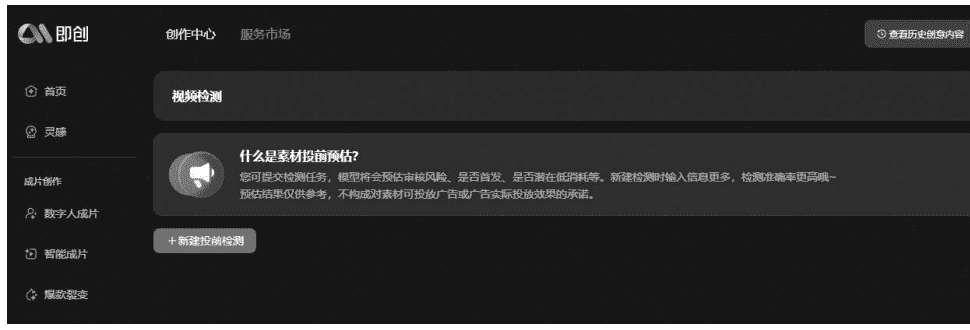

图2-4

##### (5) AI工具一键发布平台
部分商家工具支持一键发布，操作便捷，适合矩阵账号运营。若运营自有主号，不建议使用此类工具，需按自身业务流程决策。

##### (6) 数据监测与互动
发布后可借助数据监测工具，根据用户评论自动回复。常见问题如“怎么领模板”AI自动回复预设话术；负面评论如“方法没用”系统标红提醒并触发人工介入。同时AI提取用户需求关键词生成后续选题库，如评论提到“学生党适用工具”，AI记录“可做一期学生免费AI工具推荐”。

##### (7) 用AI做复盘
一天结束将数据与平台资料交给AI分析效率并给出建议。例如抖音完播率72%但点赞率仅3%，AI会建议结尾增加“觉得有用请回复×××”以提升互动率。

收工前夕，AI会自动把当日的数据表现与热搜动向汇总成简报，并为第二天筛选出三条可用选题并标注优先级。从选题到复盘，一天下来AI更像一位不眠不休的搭档，全部重复性事务都由它承接，运营人员只需要留出精力做判断与优化。

#### 3. 核心启示
现阶段AI并不万能，仍依赖人工给出清晰指令。想要发挥价值，先要把自身的业务链路梳理清楚，熟悉平台的运转规则，弄懂爆款内容的共性。要点在于AI负责消化繁琐重复的部分，让人把时间放在更具创造性的决策上。

### 2.5 微信AI客服搭建全流程落地方案
微信里收到的部分自动回复并非人工，而是AI在后台应答。更关键的是，这类系统本身已成为一门可复制的生意。2025年坤哥团队单靠AI客服就实现营收破百万元，同比增长十倍。客户横跨电商、餐饮、教育等赛道，所搭建的微信端智能客服可自主答疑、解析图片、甚至完成下单。单套系统可替代三到五名人工坐席，节省的人工费用即是这门生意的主要利润来源。

#### 1. 市场机遇：传统客服痛点与AI对策
AI客服的本质是帮助企业降本增效。想把这门生意做起来，先要把人工客服的短板摸透。

##### (1) 传统客服的核心痛点
人工坐席成本压力大，人均年薪加社保约八万至十万元，再加上招聘培训与高流动性，晚上十点后及节假日基本无人值守，咨询常常被搁置。双十一等高峰期咨询量激增，人手不足直接拉低体验。

服务质量也难以稳定。新人容易出错，老手可能敷衍，整体水平受个人状态影响，标准化程度低。

反观AI客服可做到全天候在线、秒级应答、服务稳定，费用仅为人工的五分之一到十分之一，性价比明显更高。

##### (2) AI智能客服能做什么
基础能力可覆盖七成到八成的常见咨询，例如下单流程、退款说明等重复性高频问题，AI可独立处理。进阶能力里图像识别是亮点：餐饮场景客户发食物图，AI可估算热量；电商场景客户发订单截图，AI可快速识别中奖信息并自动回复。

针对微信使用习惯，系统会模拟真人逐句发送，适度加入表情符号，句间留出数秒模拟打字节奏，客户很难分辨是机器在对话。

#### 2. 商业模式：成本结构与盈利空间
坤哥团队交付的并非关键词触发的简易回复，而是具备理解能力的智能体系。

基础能力已覆盖70%~80%的咨询量，即下单、退款等重复性问题。高级能力中图像识别是核心卖点。微信场景做了大量细节打磨：仿真人逐句发送、消息中穿插表情、间隔几秒模拟打字。

实现百万营收的核心逻辑是低成本高溢价。

##### (1) 两种主流收费模式
收费大致分为按年付费与按效果付费，可适配不同规模企业。

- ①按年收费：为企业定制一套智能客服系统，按年收取服务费。小企业年费数千到一万，中型企业数万元，大型企业按需定制，费用更高。
- ②按效果收费：依据AI处理的咨询量或替代的人数计费。例如可替代三名人工，则收取两人工成本，企业相当于省出一人开支，接受度较高。

##### (2) 成本构成与利润空间
一套系统的成本很低，主要分三块：技术调用成本，调用Claude、GPT-4等大模型API，每月数百到数千元；微信接口成本，经第三方接入，每月数百元；人力成本，前期搭建与提示词调试需数人，后期基本无需专人维护。算下来年成本约五千到两万元，售价可做到一万到十万元，利润空间可观。

##### (3) 客户付费意愿的核心逻辑
企业算的是投入产出账。一名人工客服年成本八万到十万，换成AI只需一万到三万，单人工成本即可节省五万到七万。且AI不会请假、不会离职、无情绪波动，24小时在岗，效率更高。

付费意愿的关键在于让客户看到真实效果。坤哥的做法是提供免费试用，让企业直观看到咨询处理量与满意度的提升，看到实效后续费自然顺畅。

#### 3. 实践路径：业务理解是第一竞争力
这门生意看似技术驱动，核心在于懂业务。坤哥能做成，靠的不是技术碾压，而是吃透各行业场景。

##### (1) 业务流程梳理：从SOP到提示词
智能客服的核心是把企业的业务逻辑翻译成AI可理解的指令。运营必须深入拆解业务链路。

团队的做法务实：企业已有成熟SOP或话术文档，则直接基于材料梳理；流程混乱则让销冠客服绑定微信，先采集一段时间真实对话，再提炼成标准化SOP。例如电商客服要摸清下单、退款、物流查询的关注点，餐饮客服要搞清菜品推荐、热量、预订等需求，拆得越细回复越准。

##### (2) 提示词设计：结构化与场景化
提示词相当于AI的大脑，直接决定回复质量。坤哥采用LangGPT框架，以结构化方式明确角色、业务背景、目标与流程，让AI按预设逻辑执行。为减少幻觉，会按行业、问题类型拆分提示词，确保每次回复精准对应需求。

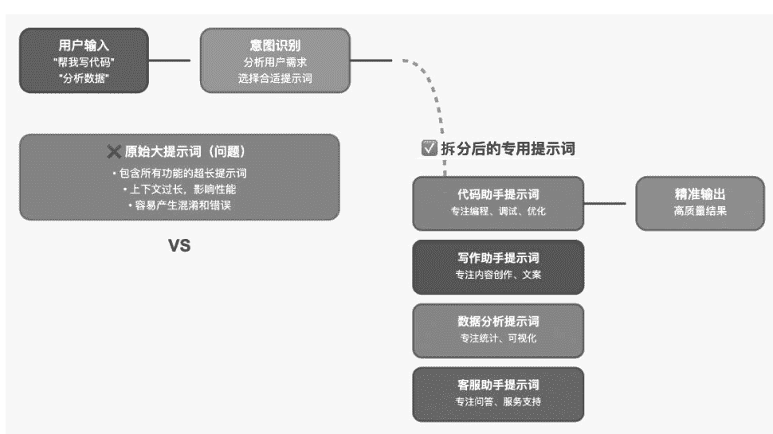
图2-5

微信适配也很重要：不能一次性输出大段文字，要逐句发送，适当加表情，每句间隔数秒模拟打字节奏，这些细节决定客户体验。

##### (3) 核心壁垒：数据与平台的深度整合
技术门槛并不高，真正的护城河是数据与平台的整合。各大模型公司拿不到微信会话数据，而基于微信生态搭建的系统能积累大量行业对话数据，形成天然优势。另外对接微信支付、订单系统等，需要长期技术沉淀与客户验证，不是单靠模型可实现。

#### 4. 长期价值：AI赋能下的持续增长
AI客服的最大优势是可随模型进步自动升级。从GPT-3到GPT-4再到Claude 3.5，大模型能力提升后，客服的理解力与回复质量同步变好，无需额外大投入。

一个可长期经营的产品需满足两点：一是随大模型升级而变强，二是拥有大模型公司不具备的壁垒。大模型公司缺乏行业对话数据、不懂具体业务、做不好微信生态整合，这些正是智能客服的立身之本。

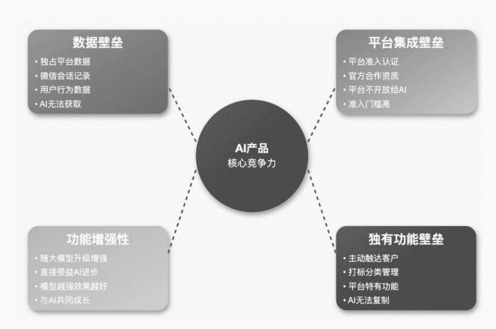
图2-6

未来应用场景将从电商、餐饮、教育扩展到医疗、法律、金融等更多领域。提示词的本质是业务逻辑的投射，这要求从业者成为行业专家，懂业务的人在相当长的时间里仍是核心竞争力。

### 2.6 AI+RPA电商数字化提效实战
电商竞争已从渠道红利转向需求洞察红利。消费者需求日益细分，品牌面临两大难题：一是难以精准把握真实需求，选品失误、迭代滞后导致增长停滞；二是内容种草运营效率低、成本高，投入产出不成正比。

数阔八爪鱼团队将AI与RPA深度融合，搭配飞书多维表格，助力电商实现从0到1的数字化提效。

#### 1. 电商企业的两大核心痛点
##### (1) 选品与产品迭代：用户需求洞察缺失
多数企业仍在跟风或凭经验选品，导致同质化严重、需求脱节、库存积压。传统用户研究靠人工分析评论，需手动下载、整理、提炼痛点，耗时费力且易遗漏，主观性强，响应慢。

##### (2) 内容种草运营：手动操作效率低、成本高
小红书已成必争之地，手动操作痛点有三：平台体量庞大，竞品调研难全面；策略多靠经验，缺乏数据支撑；内容创作周期长，从选题、写文案、做封面到发布，单篇常超一小时，人力投入大但ROI难达标。

#### 2. AI+RPA的解决方案
数阔八爪鱼在VOC用户研究和小红书内容种草两大场景实现自动化提效。

##### (1) 依托VOC系统破解选品难题
VOC涵盖用户对产品的全部反馈，包括电商评论、客服会话、社交媒体讨论等，是用户期望与不满的集合。
以亚马逊评论分析为例，落地分四步。
第一步：RPA自动化采集。输入商品ASIN或关键词、设定采集量级，RPA即可自动抓取评论内容、星级、时间、品牌、库存等信息，全天候运行。
第二步：AI自动打标。数据导入飞书多维表格后借助内置AI自动打标，把零散评论转为结构化数据，维度包括情感倾向、核心痛点、使用场景、优劣点等。
第三步：BI仪表盘可视化。通过看板让洞察更直观，常用看板有各品牌核心要点雷达图、口碑健康度对比图、用户效果反馈排行榜。
第四步：AI全维度洞察分析。支撑选品决策需更专业的电商场景AI工具，选型要看数据源覆盖、大模型分析能力、分析落地转化能力三个维度。

##### (2) 通过自动化系统解决运营难题
「AI+RPA+飞书」可实现从舆情监测、选题创作到数据追踪的全流程自动化。
第一步：RPA自动化采集，搭建全景数据池。可按关键词自动采集笔记、评论、博主信息，包括粉丝数、简介、笔记风格、互动率及账号数据追踪。
第二步：AI舆情分析，精准捕捉用户心智。对笔记和评论做情感判断、痛点提取、热门话题梳理、竞品策略拆解。品牌媒介或代运营可用飞书内置大模型自动做评论相关性分析，快速甄别水军、无效种草、水文。
第三步：AI+飞书搭建智能选题创作系统。填入创作主题，点击「对标创作」，AI会自动分析爆款笔记结构、语气、关键词，快速生成风格匹配的标题、文案和封面初稿，把单篇创作周期从一小时压缩到数分钟。

快速甄别“水军”、无效“种草”、“水文”
- 有时媒介无法判断达人高互动数据的真实性（例如评论区都是“水军”“颜粉”、不相干评论等，产品关联评论极少）。
- 团队没法量化效果验证依据，容易出现高投放，低转化，数据断层、人工局限、归因缺失的情况。
实现路径：
- 八爪鱼RPA全自动采集种草笔记评论区数据，并自动整理规整至Excel/飞书多维表格中，便于后续分析。
- RPA调用内置的主流AI大模型，自动进行评论相关性分析，快速甄别“水军”无效种草和“水文”，让品牌每一分钱都花在刀刃上。
方案价值：
- 80%：伪爆文识别率提升至80%
- 99%：评论采集成功率高达99%
图2-7

#### 3. 热风梳案例：从痛点洞察到销售额过亿元
(1) 发现问题：品牌通过VOC自动化系统快速采集京东、淘宝等多平台评论，RPA抓取数万条后经AI打标发现，用户最关注定型效果与光泽度，同时抱怨不便携、无隔热设计、不支持多国电压。
(2) 改进产品：围绕便携包装、隔热设计、多国电压适配优化升级。借助BI看板清晰掌握竞品优劣、口碑趋势及用户核心需求。
(3) 精准推广：AI分析报告帮助锁定细分人群与场景，聚焦旅行场景做重点推广，针对出差旅行人群精准营销。
(4) 销售额过亿：以极低改动成本实现销售额破亿，毛利率达30%，至今仍是品类爆品，典型的数据与AI驱动增长案例。

#### 4. 长期价值：为何这套方案具备持续竞争力
其一，工具组合的实用性远超单一工具。RPA负责重复执行，AI负责分析生成，飞书负责结构化管理与协同，三者联动更灵活。
其二，数据驱动决策比经验更可靠。提及频次最高的痛点优先解决，竞品突出的维度优先借鉴。
其三，具备可复制、可迭代特性。标签与关键词的精准度决定AI输出，建议先从单一场景跑通，再横向拓展。
其四，能够持续进化。AI技术升级带来分析深度提升，数据积累带来洞察更精准。AI时代的红利属于敢尝试、善落地的行动者。

## 第3章 AI赋能产品落地
产品落地曾是技术门槛高、开发周期长的拦路虎，AI让「人人都是产品经理」成为现实。无论是App开发、小程序搭建，还是音乐制作、PPT设计，AI都能大幅降低成本、缩短迭代，让创意快速变成可变现的产品。本章通过多个从0到1的实战案例拆解全链路逻辑，提供工具选型、避坑指南与盈利方案。

### 3.1 AI软件全链路开发，实现自动化落地实战指南
AI正重塑产品开发全链路，自动化落地成为提效降本的核心方向。要实现目标，先得直面传统软件开发的弊病，掌握AI破解方法。

#### 1. AI破解传统软件开发困局
##### (1) 软件开发效率的核心瓶颈
手动编码的重复劳动严重拖进度，比如写大量Getter/Setter、DTO转换、基础增删改查逻辑。更关键的是30%的漏洞源于拼写错误，40%的开发时间花在翻阅冗长API文档上，创造力被机械劳动消磨。

##### (2) 技术文档的三大核心痛点
「代码一时爽，文档火葬场」精准概括了现状：一是拖延成疾，交付压力大文档被搁置；二是沟通断层，程序员写的术语非技术岗看不懂；三是版本分裂，代码已到V3.0文档还在V1.0，导致前端联调频繁出现接口不匹配。

##### (3) AI引发的软件开发变革
开发正从人肉编码转向智能辅助。
- ①代码补全：智能工具已超越基础联想。输入「function validateEmail」，GitHub Copilot不仅能补全正则校验，还能结合上下文提醒遗漏的国际化域名校验。
- ②文档自动化：闭环体系初步形成。AI可自动解析代码注释实时生成Swagger或API文档，像飞算JavaAI等专业工具还能在代码变动后自动同步流程图，彻底解决文档滞后痛点。

#### 2. 从工具堆砌到标准化生产流水线
AI提效要落地到流程，合适工具与标准化流水线是核心支撑。

##### (1) 核心工具矩阵
在AI开发工具爆发期，精准选择适配需求的工具是效率翻倍关键。
- ①核心代码生成工具各有侧重：GitHub Copilot被称为「代码助手」，擅长预测编码意图，但需注意可能生成基于旧版本的冗余代码，商用还需规避协议风险；DeepSeek作为国产代表，在高并发秒杀、分布式锁等复杂业务逻辑上表现突出，生成的Redisson实践方案贴合企业级需求；Cursor受个人开发者青睐，具备全栈视角，能精准识别前后端依赖，改一个数据库字段会同步调整前端显示与API说明。
- ②文档自动化工具主打精准同步：Swimm可将代码注释转为可交互文档，优势在于关联架构决策记录，让核心代码变更有据可查；飞算JavaAI更适配企业复杂架构，实现代码、Markdown文档与图形化文档无缝同步。

##### (2) 5步落地流水线
AI生成代码高效，但如同外卖需要检查餐具，AI产出也必须人工校验。这套「AI主攻+人工把关」的五步流水线已在多个项目中验证有效。

协作提效实战记录

① 让模型先把业务需求梳理成可执行的伪代码：放弃含糊其辞的提问，改用标准化提问模版，例如“基于[技术栈]实现[功能]，必须满足[性能/安全指标]”，这样生成的初稿才贴合真实业务。
② 把重复性填充工作交给模型完成，比如数据传输对象映射、基础校验规则等，人手集中处理订单流转、复杂状态机、权限边界等核心难题。
③ 用模型批量产出测试用例，覆盖约八成的常规分支，包含正常、异常、空值情形，开发者主攻剩下两成的极限场景，比如高并发超卖、网络分区、脏数据等。
④ 借助Swimm等同步工具，让代码中的“@api”注释自动同步到文档，对已失效的参数自动标黄预警，保持文档与代码的一致性。
⑤ 在部署监控阶段可让模型撰写Helm Chart或Terraform配置，但涉及CPU、内存、带宽等直接决定成本的关键参数，必须由人工复核。

##### (3) 日常开发提速：两周交付压缩到五天
智能辅助已在多个交付场景带来明显提效，具体如下。
- ① 前端页面搭建：商城H5首页过去需要1~2天，如今把搜索推荐、轮播banner、滚动公告、瀑布流、底部导航等需求写清楚，几分钟就能拿到完整代码，微调即可上线，效率约为原来的五倍。
- ② 测试用例编写：把模型设为资深测试专家，针对登录模块即可从弱网、短密码、重复点击等角度输出结构化测试清单，开发者专注核心逻辑优化。
- ③ 技术文档撰写：提示模型“以Java文档专家身份，为用户模块生成包含摘要、目录、核心类说明及常见问题的Markdown”，几分钟即可得到专业初稿。
- ④ 成本变化直观。传统五人团队做两个月项目投入约3万~6万元，有智能辅助后一个月可完成，费用降至约1万元，投入产出翻倍。

#### 3. 实战避坑指南
##### (1) 模糊指令是技术债的根源
指令不清会让模型变成技术债制造机。好比让模型“买点水果”，可能得到烂苹果或不想要的榴莲。清晰指令建议遵循 动词+对象+数量标准+备选方案+排除项 的结构。实践中要更具体，比如“买5个新鲜酸柠檬，缺货换青桔，总价不超过30元，不要榴莲”。用到开发上，这种精确描述才能让模型产出可上线的代码。
##### (2) 文档术语精准度必须把控
模型写文档容易出现术语模糊，比如用“负责”代替“承担违约责任”，后期可能引发纠纷。对策是建立术语白名单，要求模型必须使用精确表述，并在技术协议中明确违约金标准如按合同额0.1%每日计费、交付时间、争议仲裁地等关键要素。

#### 4. 未来发展展望
##### (1) 短期：IDE智能插件重塑开发流程
未来两年，集成开发环境将深度内嵌智能体，带来三大变化：自修复调试器可定位问题、结合历史报错分析原因并自动生成修复代码；全链路上下文感知，需求文档一改，伪代码和单元测试自动同步更新；语音交互编程，用自然语言就能重构代码结构，学习曲线降低约40%。
##### (2) 长期：语义编程与多智能体协作
长期来看，开发将迎来两大突破：语义化编程兴起，自然语言变成新语法，开发者只需描述业务，模型就能将其转化为符合金融

### 3.2 iOS 开发借助智能体，十倍效率的实战技法
iOS App曾因多环节协同、高门槛让不少开发者却步，而智能体正从根本上破解难题。要理解效率革命，先看清传统开发的核心困境。

#### 1. 传统 iOS 应用开发的痛点与瓶颈
传统iOS应用要经历需求分析、UI设计、编码实现、测试调试、商店审核、推广运营六大阶段，涉及开发者、设计师、测试、ASO专员等多角色。协同模式存在四类痛点。
（1）人效严重失衡：编码占周期一半以上，编码完还要等App Store审核3到7个工作日，推广文案反复打磨，全流程效率受限。
（2）沉没成本高：中小团队人力占预算大头，市场反馈不佳就全亏。
（3）创意依赖经验：命名、图标、宣传语高度依赖个人审美，试错成本高，结果难预估。
（4）审核风险失控：首次提交常因细节被拒，不熟悉苹果审核规范就要反复改版，上线延期。

#### 2. 智能体驱动的全链路方案与效果
在工具加持下，iOS开发各环节效率显著提升。
（1）编码提速：Cursor、GitHub Copilot等编程助手可提升50%到70%效率，原本4周的基础模块，借助自然语言交互一天左右就能联调完成。
（2）创意快速：命名过去耗时，现在输入核心功能点给DeepSeek，10分钟出几十个备选，省时约90%。
（3）设计提效：用即梦AI输入关键词，几分钟生成多套符合苹果规范的图标，原本3天缩短到分钟级。
（4）ASO批量加速：上架时DeepSeek10分钟生成100条关键词和广告语，人工需一周。
这种工作流让个人开发者也能覆盖开发、设计、运营全链路，实现一人团队的高效运作。

#### 3. 从零到付费榜单的实战案例
#### （1）背景与需求拆解
2025年3月，产品专家王登康还是iOS零基础小白。他借助智能体跑通了从调研到上架运营的闭环，陆续做了7款App，其中3款进入App Store付费榜单，最高第24位。以核心产品“易转”为例，功能是Markdown转纯文本、HTML转图片。看似简单，实则命中AI时代高频痛点：模型输出的Markdown等格式文本通常无法直接复制。通过小红书评论区调研，他验证了需求的普遍性。
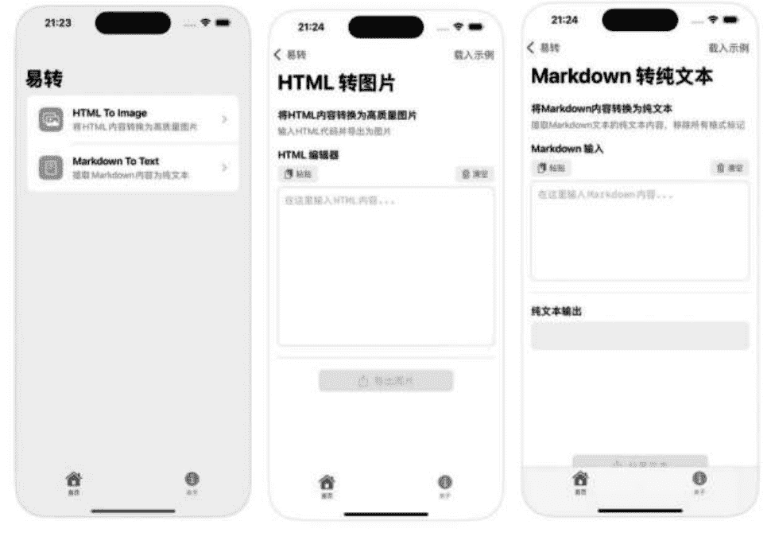
图3-1
#### （2）七个关键实操节点
① 用Cursor的智能体协作模式：以Claude 3.7 Sonnet为核心，直接下指令“开发支持HTML转图片和Markdown转纯文本的iOS App”，利用模型全局感知推进项目。
② Logo快速生成：在即梦AI输入“App图标，体现格式转换，色彩丰富，无文字”，得到现代感强、辨识度高的方案。
③ ASO导向命名：借助DeepSeek的关键词热度分析，选出易记且搜索友好的名字。
④ 合规文件自动化：用DeepSeek生成符合苹果审核标准的HTML隐私政策，省去法务反复。
⑤ 截图尺寸统一：让DeepSeek生成单文件HTML工具自动处理上架截图尺寸，提升物料效率。
⑥ 文案智能生成：基于代码逻辑让Cursor直接产出App描述和推广语，提升转化。
⑦ 关键词筛选：DeepSeek批量输出100组关键词，再用七麦数据挑出搜索量前20精准投放。

#### 4. 智能体驱动iOS开发的避坑经验
#### （1）工具选型要匹配场景
① 简单网页DeepSeek够用，iOS项目文件多结构复杂，首选Cursor的Agent模式，能全局感知和管理文件，效率更高。
② Xcode报错处理：把带目录结构的完整报错丢给Cursor分析，不用自己啃语法；若反复纠错无效，重启对话能打破死循环。
③ 配置文件人工复核：Info.plist易被模型生成冗余副本导致冲突，建议保留Xcode原配置并删冗余。
④ 环境问题排查：遇到同步骤却报错，靠四招——日志问模型、版本对齐、清理Docker Build缓存、重启电脑，可规避90%问题。
#### （2）商业运营的核心要点
一是完成胜于完美，采用极简架构：不做登录、不租服务器，除App Store年费外几乎零成本，是个人开发者可持续的关键。
二是先免费验证需求：初期免费，若下载低迷说明需求虚假应止损；积累数据后再设1元低价买断，降低决策门槛。
三是抓住新品扶持：苹果对新App约两周自然扶持，上线初期要靠朋友圈社群拉下载和好评，撬动推荐。
四是审核细节：只适配iPhone也要做iPad兼容测试；截图不能用启动页，必须展示核心功能，否则易被拒。

#### 5. iOS开发智能体赋能的未来展望
靠智能体，王登康从零基础到付费榜单开发者，全程未手写代码，只靠自然语言沟通迭代就把想法变成App Store产品。本质是“清晰描述需求+持续对话迭代=成功落地”。未来技术门槛将彻底降低，有创意的人仅凭逻辑和创造欲即可打造作品。

### 3.3 智能体制作音乐，一条视频涨粉七万的打法
传统创作存在周期长、成本高、技能门槛高三重困境，普通人难以实现原创音乐加剧情动画的高质量产出。智能体出现后一人即可抵一支团队。
#### 1. 传统内容创作的高门槛与智能体破局
#### （1）传统创作的“不可能三角”
制作高质量原创音乐加剧情动画视频，需同时攻克周期、成本、技能三难。对不懂乐理不会绘画的人几乎不可完成。
#### （2）智能体带来的破局契机
智能体赋予的是超级生产力。可当御用作曲家，不懂乐理也能生成媲美大奖级别音乐；也能做顶级画师，文字描述即转化电影质感镜头。凯哥的案例证明，理工男也能零成本高效率产出专业水平爆款。
#### 2. 实战流程：一人抵一个团队的四步法
（1）文案策划：智能体编剧豆包。痛点是歌词空洞。破局靠打磨提示词，明确角色人设贴合原著、融入当代共鸣情绪，植入西游记元素隐喻现实困境。
（2）音乐制作：智能体音乐人Suno。痛点是音乐干瘪。解法是精准定位风格为流行民谣、木吉他主导、温暖带幽默。
（3）视觉制作：智能体导演即梦AI。痛点是画面不连贯。摸索出尾帧接首帧方法，以上一段最后一帧为下一段参考底图。
（4）后期合成：智能体剪辑师剪映。利用歌词识别与文本动画功能，传统需团队一周数千元，智能体模式1到2天近零成本完成。
#### 3. 成果验证：单条视频涨粉七万的秘密
（1）爆发式增长：发布《教大家用智能体做西游歌手唱歌》后6天全网涨粉超7万，多平台同步爆发。
（2）用户反馈的情感穿透力：评论区刷屏“奔波儿灞是上过班的”“听哭了”“单曲循环”，印证提示词背后的人性洞察决定内容温度。
#### 4. 成功经验
（1）产品思维：先有共鸣，后有工具。避免为用智能体而做视频。凯哥在B站爆款评论区深挖需求，精准捕捉打工人情绪，智能体只是放大器。
（2）质量标准：绝不容忍智能体瑕疵。用尾帧接首帧打磨连贯性，因小错误反复生成十几次。只有当作商业精品打磨才赢得尊重。
（3）极致利他：把展示变成交付。将制作流程拆解为保姆级教程，提示词打包成智能体免费送，并公开细节，实现快速涨粉和私域信任。
#### 5. 未来展望
（1）超级个体的时代已来：智能体抹平技术鸿沟，一人即可成工作室，核心竞争力转向创意、审美和人性洞察。
（2）商业模式的无限延展：可复制到定制化宣传片MV、企业服务、IP批量孵化、账号矩阵、知识赋能等多元变现。

### 3.4 智能体开发零代码小程序，完成快速搭建的核心方法
智能体让零代码开发小程序成为现实，打破技术门槛。项目始于对真实痛点的捕捉。
#### 1. 项目介绍
旅游爱好者狂热AI深知找“对味”目的地多难。其500人玩家群抱怨主流平台结果高度商业化。核心需求是基于实时位置精准推荐当地人才知道的隐秘角落，并一键生成个性化游玩规划。由此启动《小众旅游记录》小程序，定位为去商业化智能小众目的地发现平台。
#### 2. 核心功能拆解
覆盖发现—规划—收藏—分享全链路。
1. 智能定位自动识别所在城市，精准推荐周边景点。
2. 智能体深度推荐避开热门景区，挖掘自然风貌与在地特色的冷门点。
3. 收藏与分享支持本地化轻量存储，生成美观分享链接。
4. 路线规划智能体自动生成两天一夜深度路径，附带真实用户反馈避坑建议。
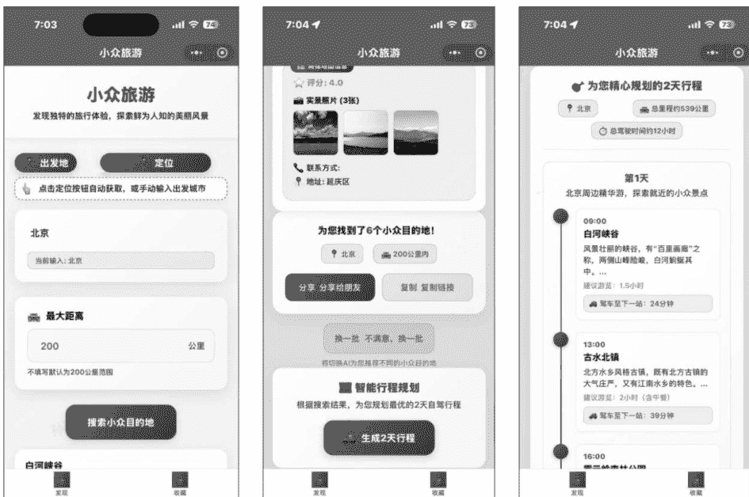
图3-2
#### 3. 智能体的具体作用
智能体贯穿全开发周期，是核心伙伴。
#### （1）UI设计与视觉闭环

没有设计专业背景的个人，也能凭借智能编程助手做出符合产品气质的高水准视觉。向 Cursor 下达需求：做一款极具当代感的小程序，采用玻璃拟态 Glass morphism 风格，主色以紫色渐变呈现。助手迅速给出完整回应，生成了微信小程序的标记语言 WXML 结构，并一并输出较为复杂的样式表 WXSS。最终作品具备良好响应特性，在 iPhone、安卓机和 iPad 上都能自然适配，纯手工编码很难在相同时间内达到同等表现。

#### （2）AI推荐系统打磨
推荐能力是项目核心，也是竞争壁垒。可以接入阿里千问和字节豆包的接口，利用大语言模型的泛化能力，从互联网海量语料中筛选非标旅游信息。落地时借助 Cursor 搭建 Express 后端，并由助手参与 RESTful 接口的设计。运行逻辑是：用户一键定位后，后端自动拼装提示词发送给大模型，模型返回结构化 JSON，前端再进行可视化展示。

#### （3）运维与自动化部署
服务器部署过去是非技术人员的难点，如今被智能工具抹平。助手可协助编写自动化脚本 deploy.sh，配置 Nginx 的反向代理，甚至完成 SSL 证书申请与自动续期逻辑的设计。使用者只需提供服务器 IP 与账号，后续配置基本由助手独立完成。

4. 避坑经验
智能工具可将开发效率提升约十倍，但调教不当极易踩雷。

#### （1）规避经验一：破解大模型的地理幻觉
大模型对距离感知存在偏差，不可指望其自行理解地理限制，必须在提示词里写入硬性规则。例如把指令改为“出发地为 ${city}，只推荐 200 公里内的景点；若为天津，仅限蓟州、宝坻、河北廊坊等周边，且描述需带具体区县”。如此可根治问题。

#### （2）规避经验二：拒绝一次性全量生成，坚持增量推进
曾尝试让 Cursor 一次输出“收藏+搜索+地图”的复杂模块，结果逻辑混乱报错频繁。应坚守 KISS 原则，每次只完成单一任务。把整体拆成定位、模型接口对接、界面优化三个阶段，每个小块验证通过再进入下一步。增量式推进是避免产生冗余代码的关键。

#### （3）规避经验三：重视权限与环境细节
微信小程序的定位接口 wx.getLocation 需要繁琐的权限声明，早期生成的代码持续报错，根因是 app.json 里缺失 requiredBackgroundModes 配置。遇到权限类问题，最好要求助手查阅微信开发者最新的官方文档。模型很强，但训练数据可能滞后，必须明确指令让它遵循最新规范。

5. 展望与总结
该小程序的落地验证了零代码开发的可行性，也折射出新的创业方向。项目从想法到上线约一个月，真正投入的有效工时不足二十小时，多在深夜推进。到 2026 年年初，用户规模已突破七百人，核心活跃用户每天通过平台获取旅行灵感，后续还加入了收藏、评分、分享生成海报等功能。本质是“智能工具+细分需求洞察”的商业模式，用近乎零成本的技术投入精准满足一个五百人社群的核心诉求。

### 3.5 AI助建英语站，月入三千付费用户的路径
以 Cursor 为代表的智能编程助手正在推动软件工程进入新范式。其一，Agent 化协作将成主流，未来不再是简单补全，而是智能 Agent 自主理解商业意图、自动调用接口、设计数据表并完成部署。其二，人机分工发生置换，开发者从“写代码的人”变成“能力指挥者和结果验证者”。其三，当编程像说话一样简单时，对用户痛点的精准把握与审美的独特把控会成为护城河。

运营背景的东东 Joe 毫无技术基础，也没有撰写过 PRD，却依靠智能工具独立完成了产品全链路。上线仅一个月就在小红书跑通商业闭环，获得三千名付费用户。案例说明技术已不是创业核心壁垒，赛道认知才是。智能工具像人体的能力外骨骼，让单人组建起完整的作战团队，从而以更高效率切入大团队容易忽视的细分市场。

搭建能稳定盈利的英语网站，关键在于选对赛道、用对方法。

#### 1. 赛道拆解
智能编程拉低了产品门槛，个人开发者迎来了机会。

##### (1) 赛道潜力
过去做产品需要产品经理定方向、程序员实现、运营推广，门槛让九成有想法的人止步。现在格局被打破，尤其是 Claude Code 等工具出现后，“人人皆可开发”成为现实。

##### (2) 行业现状与用户痛点
门槛降低之外，更关键的是找到精准赛道。以英语口语学习为例，看似饱和，细分痛点仍未被满足，且个人开发者更具灵活性。

当前核心痛点有三：素材枯燥，通用内容脱离真实语境难以维持兴趣；功能臃肿，成熟 App 追求大而全，复杂界面淹没核心路径，上手困难；创新受限，大厂决策链长，难以快速落地个性化或激进方案。

个人开发者的优势在灵活性，可迅速推出聚焦微功能的产品验证，若反馈不佳可立即调整，试错成本远低于大公司。基于此，东东 Joe 锁定二十五到三十五岁女性群体，主打兴趣驱动型学习；素材选用 YouTube 上的生活、成长、旅行类 Vlog，既解决优质素材需求，也吸引志趣相投的用户。

#### 2. 智能解决方案
##### (1) 项目简介与差异化定位
以基于 YouTube 视频的口语学习站为例，定位是通过“优质素材+实用工具”为用户提供高效体验。功能设计坚持极简，只聚焦一到两个核心功能形成差异化。

**表3-1**

| 主要功能 | 解决的痛点 | 差异化做法 |
| :--- | :--- | :--- |
| 动态字幕 | 听力断裂、跟不上语速 | 极简界面，去除视觉冗余，专注听力场景 |
| 口语跟练 | 不敢开口 | 绑定特定 Vlog 素材，提供情感共鸣 |

只要精准抓住认同极简学习理念的人群，提供独特价值，就能形成小而美的闭环。

##### (2) 编程与开发实战流程
零基础开发者可借助智能工具完成前端交互、后端逻辑到用户与内容管理系统的全链路。

- ①技术栈以高效易用为原则：逻辑与界面开发依赖 Claude Code、Codex 生成大部分代码；后端数据采用 Supabase 存储用户数据、视频元数据及学习进度；视频云服务选用 Cloudflare Stream 保障全球化上传转码与播放；云端部署通过 Vercel 实现一键上线与持续集成，降低运维成本。
- ②产品规划的核心心法是精准指令。东东 Joe 总结了一套指令技巧：一是需求质询，让助手针对模糊点提问并给出界面与体验优化建议；二是版本规划，严格区分最小可行产品 V1 与 V2 以上，确保早期聚焦核心价值快速验证；三是产出 PRD，整合路线图、原型图与架构蓝图，为开发提供施工指南。

缺陷解决六步法：①把错误截图与日志交给 Claude Code 初步定位；②若无法解决，让 Gemini 重构需求描述修正歧义；③带优化后思路再咨询 Claude Code，通常能解决八成问题；④关键时刻切换到 Codex，它更注重细节严谨性；⑤检索 GitHub 或 Stack Overflow 的成熟方案投喂给助手参考；⑥仍无效则在技术社群定向提问。

##### (3) 智能工具在内容生产中的应用
助手不仅能处理技术，还能作为内容生产的高效帮手。东东 Joe 搭建了自动化素材生产流程，用户提供 YouTube 字幕文件后，助手按标准 SOP 自动提炼核心词汇、短语并生成精读学习卡片。过去手工制作一份需一小时，如今半小时可批量产出百份，既省人力成本，又保证质量统一。

##### (4) 产品流量获取策略
产品就绪后流量是闭环关键，东东 Joe 以小红书为核心获客渠道，形成内容引流加自动成交模式。

- ①产品即内容：分享开发历程、创作初心、功能录屏及上线预告吸引目标用户；招募内测用户收集反馈反向优化功能。
- ②自动成交：利用“阿奇索”等工具管理激活码，用户付费后自动获取，全程无需人工干预。

#### 3. 未来展望
##### (1) 需求的个性化满足
智能编程重塑开发逻辑与商业模型。开发者能以极低成本快速打造原型，将个人痛点转化为群体解决方案；个性化需求得以产品化，过去因成本过高难以落地的零散需求，如今可低成本满足并商业变现。

##### (2) 个人开发者的定位升级
- ①坚持克制与精准：无需追求大而全，聚焦极简产品，在大公司功能臃肿的缝隙提供单一独特价值。
- ②把握领域专家红利：不必成为顶尖程序员，但需是最懂细分用户的专家。智能工具弥补技术短板，行业洞察深度决定竞争力。

##### (3) 从产品迭代到用户共创
智能工具赋予快速响应能力，让用户共创成为核心优势。①快速响应：大幅缩短迭代周期，实现即时反馈；②建立用户共创模式：招募内测社群，让用户从接收者变为参与者，快速收集有效反馈并提升黏性。

智能编程为拥有行业洞察的个人提供了入场券，让执行效率倍增，打破传统团队束缚，开启超级个体黄金时代。

### 3.6 单人做英文工具站出海，AI带飞全流程
Web 出海不再是大型企业的专属。智能技术普及后，个人开发者凭一机在手即可搭建面向全球的轻量产品矩阵，背后是出海逻辑的变革。下面结合实操拆解核心玩法、关键作用、避坑与展望。

#### 1. 核心玩法
以前开发 Web 产品并推向全球几乎不可能，需租办公室、组建团队，重资产模式成本高。如今技术不再是壁垒，核心是产品洞察与驾驭智能工具的能力。

以个体开发者俊哥的“小费计算器”工具站为例，三步跑通：一是精准选词，用谷歌趋势锁定长尾流量足、竞争低的关键词；二是获取流量，借助谷歌 SEO 结构化数据优化获取稳定自然搜索流量；三是商业变现，接入 AdSense 或联盟营销实现美元变现。

在智能工具助力下，俊哥一人一天完成过去专业团队三到五天的工作量，成品视觉与交互甚至超越不少成熟商业产品。

#### 2. 智能工具的关键作用
##### (1) 需求分析：作为金牌产品助手
确定“小费计算器”后，先把谷歌搜索第一页内容及 Semrush 导出的数百长尾词交给助手处理。①深度解构竞品，分析前五名产品的优缺点与移动端适配漏洞；②输出产品需求文档，涵盖功能矩阵、用户流转路径、埋点逻辑，确保产品同时适配搜索引擎算法与真实需求。

##### (2) 设计与前端：补齐审美短板
俊哥非专业设计师，先用 Lovart 等智能设计工具确定视觉风格，再把需求传给 Claude Code。助手可一键生成全套视觉资源——Logo、Favicon、适配多屏幕的 Icon 并按工程目录归类，严格遵循预设规范，用 Tailwind CSS 开发保证轻量化与国际主流审美。

##### (3) 开发与部署：搞定全栈技术活
基于 PRD 与设计稿，只需把需求交给 Claude Code 即可完成。无需纠结循环语句或复杂 API 调用，清晰说明“实现小费阶梯计算逻辑、支持多币种动态转换”即可落地。助手覆盖前端交互、后端无服务器函数、SEO 元标签优化，并可通过 Vercel 与 GitHub 实现秒级部署上线。

##### (4) 运营冷启动：化身外链专家
上线只是起点，需要外链提升权重。助手先分析站点竞争环境给出冷启动方案；随后在 Reddit、Quora 等社区，结合具体帖子上下文生成逻辑严谨有价值的回复，自然植入站点链接。高相关性外链避免被判垃圾信息，帮助短期内提升权重度过冷启动期。

#### 3. 避坑经验
第一，拒绝模糊指令。早期让助手“把复杂模块拆成微服务”，出现幻觉机械搬移代码导致依赖断裂项目崩溃。后来改用链式思维，把大任务拆成原子级小任务，先分析依赖关系再设计接口最后写逻辑，每次只让助手执行单一原子任务。

第二，小步快跑持续验证。切勿期望助手一次性生成两千行代码直接运行。做法是先生成核心业务逻辑测试通过，再添加界面细节，最后处理异常捕获。增量开发大幅减少调试痛苦。

第三，人工审查是最后防线。助手易在边缘情况出错。俊哥担任审查官角色，助手负责执行，他负责风险控制与纠错。

#### 4. 行业展望
据 2025 年技术趋势报告，全球超九成顶级工程师深度使用智能助手，这是生产力结构性革命。

一是开发成本持续塌方，工具站技术成本趋近于零，竞争从“能否做出产品”转向“能否做出更懂用户的产品”。二是超级个体规模化，一名掌握智能工具箱的开发者产能可抵过去五十人中型公司，可同时维护数十个出海站点形成被动收入矩阵。三是创意与审美溢价凸显，产品灵魂、独特审美视角与细分人群共情力将最稀缺。

智能工具提供入场机会，认知边界即产品边界，需从代码工人转型为智能引导者。

### 3.7 AI做PPT，数分钟产出专业级作品的技巧
PPT 制作长期困扰职场人，素材搜集、逻辑搭建到排版美化平均耗时 4.5 小时，六成时间耗在重复操作；非设计专业者难把控版式与配色，成品千篇一律。智能技术的出现改变了局面。深圳像素绽放科技有限公司创始人赵充打造的 AiPPT 工具将传统流程压缩至 1.2 小时，效率提升 73.3%，并形成清晰商业闭环。

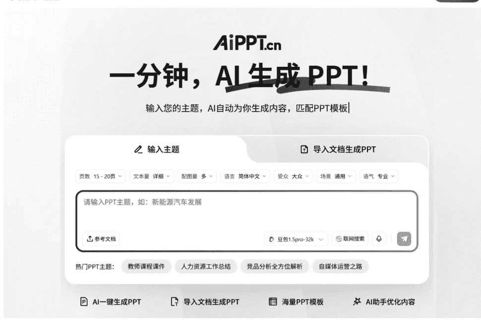

办公场景的刚性需求叠加智能技术的爆发式发展，让 AiPPT 赛道迎来市场机遇。机遇背后是传统 PPT 制作长期存在的痛点与广阔市场空间。

#### 1. 市场机遇：办公刚需遇上技术爆发
要抓住机遇，需先看清传统 PPT 制作的核心痛点，这些痛点正是智能技术落地的切入点。

##### (1) 传统 PPT 制作的三大痛点

# PPT制作卡点与智能化解方案

传统演示文稿制作的痛点集中在效率损耗、上手门槛与合规压力三个维度，直接拉低使用体验并推高企业成本。

- ①效率受拖累：做一份专业演示常需点按两百多项功能入口，平均耗时约4.5小时，其中约六成时间被格式微调、重复排版等事务性工作占据，职场精力被大量占用。
- ②表达受限制：多数人难以精准把握版式与配色，即便套用现成模版也容易千篇一律，品牌辨识度被稀释，超过半数制作者因此感到困扰。
- ③合规有风险：调研显示45.3%的企业明确要求工具具备私有化部署能力，政务、金融等领域对数据安全与合规容忍度极低，传统通用产品难以适配。

##### (2) 市场加速增长的驱动

政策与需求双向拉动，智能办公赛道进入快车道，智能演示细分赛道尤为突出。

2025年国务院发布《关于深入实施“人工智能+”行动的意见》（国发〔2025〕11号），为行业注入动能。艾瑞咨询测算，2024年中国智能办公软件市场规模达308.64亿元，同比增长135.55%，预计2028年突破1911.37亿元。其中AiPPT占据约21%的份额，依托企业汇报、政务宣传等15余个高频场景，成为刚需赛道。图3-4展示了智能办公行业需求调研结果。

面对传统制作的痛点与庞大需求，技术借助多模态协同与场景化适配，实现演示的高效专业生成，有效缓解效率、门槛与合规压力。

#### 2. 智能系统如何快速生成专业演示

之所以能破解传统痛点，核心在于多技术协同发力，具体可从以下方面拆解。

#### 2025中国企业智能办公数字化白皮书
##### 用户需求变化与新痛点
###### 01 智能演示行业用户画像

根据艾瑞咨询最新调研，智能演示用户主要集中在18~35岁高线城市的高学历人群，其中75.2%为本科及以上学历。企业用户占比高达68%，个人用户32%，反映出智能办公工具在专业场景中的高需求。

职业分布方面，市场营销26%、销售21%、教师17%、管理层16%、IT 12%、学生8%；使用场景分布为内部汇报32%、营销方案24%、培训课程21%、客户演示16%、创意提案7%。使用频率上，每日使用25.3%，价格接受区间100~300元/年占比39.8%。

###### 02 用户需求从提效到全流程智能化

1.0阶段2022-2023：基础内容生成，简单文本到演示的转换，重点在于减少手工编辑时间；模板套用，提供基础设计模板，解决排版问题；诉求为提高效率，缩短制作时间。
2.0阶段2024-2025：智能引用与溯源，自动检索权威资料并提供引用来源；数据分析与可视化，智能解读数据并生成专业图表；私有知识库集成，连接企业内部资料，定制专属内容；深度行业定制，适配特定行业术语、规范和表达方式。

行业净推荐值约30.6，处于中等偏上水平，有较大提升空间。用户期待改进方向为更灵活的品牌定制能力、更强的行业专业性与术语准确度、更完善的数据安全解决方案、更丰富的创意模板库。

###### 03 当前用户面临的主要痛点

模板高度同质化、生成内容逻辑性不足、数据安全与合规问题。50.1%的用户反馈市场上智能演示工具模板同质化严重，难以体现企业品牌特色与专业差异化；48.4%的用户认为生成内容存在逻辑连贯性差、专业术语不准确等问题，尤其在垂直领域应用；45.3%的企业用户担忧云端存储、敏感信息处理等问题，政务、金融、医疗等行业对私有化部署需求强烈。

需求演变趋势为2022年基础效率工具，2023年智能创作助手，2024-2025年决策辅助系统。

##### 行业痛点解决挑战与机遇

政务行业需要严格的内容审核与数据合规要求，需要私有化部署方案；金融行业专业术语准确性与数据可溯源性要求高；制造业技术参数与工艺流程的精准呈现需求；教育行业内容准确性与教学互动体验要求并重。

## 图3-4
##### (1) 多模型协同，提效保质
AiPPT采用多模型协同引擎，使各模块精准对接需求：文本生成调用智谱AI、豆包等中文优化大模型；图片匹配接入视觉中国平台的5亿张正版素材；排版采用自研自适应引擎，自动匹配最优版式。

多模型协同使内容识别准确率超过95%，成效显著。某国有电力集团日均节省工时约400小时；某省政府办公厅年度报告制作周期从5~7天缩短至1~2天。

##### (2) 场景化知识库，让系统懂行业
各行业演示需求差异显著，通用模板适配性较差。AiPPT针对政务、金融、教育等十余个行业，搭建专属术语库、合规语料库与定制模板库。

目前累计提供1万余套场景化模板，涵盖500所高校答辩模板及敦煌壁画、故宫纹样等文化元素，既满足合规要求，又凸显特色。

##### (3) 4种生成方式，覆盖核心需求
AiPPT设计了4种生成方式，可解决80%的常规用户需求，同时保留20%创意空间，支持素材替换与配色调整。
- ①一句话生成：输入“做份高校答辩演示”，60秒即可生成完整初稿。
- ②文档导入：支持Word、PDF、Xmind格式，系统自动进行结构化处理。
- ③网页链接导入：复制网页链接即可生成演示。
- ④演示智能美化：通过美化功能，优化既有作品的排版与视觉效果。

##### (4) 安全合规，多部署适配高要求
AiPPT提供公有云、私有化、混合云3种部署模式，通过网络安全等级保护三级、ISO 27001等认证。某大型制造企业私有化部署后，每年节省培训与文档成本约200万元。

清晰的变现策略是AiPPT规模化发展的核心，通过聚焦赛道、输出能力、分层服务与生态支撑，其已形成稳定盈利模式，稳居行业头部。

#### 3. 核心变现策略

技术落地后，可持续的变现路径是关键，AiPPT的策略围绕“精准破局”展开。

##### (1) 聚焦单一场景
多数智能办公工具追求全场景覆盖，陷入功能分散、体验割裂困境。AiPPT反其道而行，聚焦演示高频刚需场景，在“1厘米宽的赛道挖100米深”。
其核心是从底层以智能为核心来设计产品，依托多模型协同与自研技术，打造超行业水平的专业体验，构建差异化壁垒。

##### (2) 能力输出而非流量争夺
中国互联网流量格局分散，存在20多个一级入口；自建渠道成本高、周期长。AiPPT放弃流量争夺，将智能能力打包为API输出给平台，实现快速规模化。
目前AiPPT已与联想、华为、豆包、钉钉等50多个平台深度合作，月均API调用超1500万次；联想AIPC预装后首发装机量破百万；AiPPT凭借行业领先的地位让合作方获得高分成，智谱大模型与视觉中国素材库则帮助合作方有效规避版权风险。

##### (3) 分层变现
基于用户画像差异，AiPPT采用分层变现模式：面向中小企业与个人，推出100~300元年费的SaaS订阅；面向平台方，通过API接入收费，占营收65%；面向政务、金融行业，提供私有化部署，占营收20%，单客价值高。

##### (4) 生态支撑
AiPPT实现电脑端、手机端、平板全终端适配，可与办公自动化、客户关系管理系统等企业系统无缝对接。某制造企业接入企业资源规划系统后，实现生产数据一键可视化，大幅提升其汇报效率。

#### 4. 挑战与注意事项
##### (1) 核心经验
AiPPT的成功离不开四大经验：一是锚定演示刚需赛道，避开伪需求，早期布局企业级市场；二是坚持智能原生，从底层重构产品，依托多模型协同与自研技术筑牢竞争力；三是生态开放，优先API输出能力，获客成本仅为自有渠道的1/10；四是差异化竞争，利用平台竞争间隙拓展合作。

##### (2) 潜在风险
行业发展伴随四大风险：一是流量依赖，需拓展合作方避免单一渠道依赖；二是竞争加剧，微软、金山等巨头加码智能布局，创业公司面临多重压力；三是技术迭代快，大模型每3~6个月更新一次，需持续加大研发投入；四是合规成本上升，需提前布局高敏感行业认证与技术升级。

凭借精准赛道选择、核心技术与清晰商业逻辑，AiPPT已实现规模化盈利。据深圳像素绽放《2025年AiPPT业务白皮书》，截至2025年，服务全球2000万位用户，稳居中国AiPPT赛道第一，覆盖超15个行业。这印证了拥抱智能、精准解决用户痛点，是智能办公赛道突围的核心关键。

## 第4章 智能赋能传统行业

传统行业正面临转型阵痛，而智能正是破解效率低、成本高、同质化等痛点的关键。从家装设计、服装电商到丝巾制造、文旅文创等领域，智能可精准切入传统行业的核心场景，通过数字化改造实现降本增效、创新增长。本章聚焦传统行业的智能落地路径，提供可复制的转型方案与盈利模型，助力传统行业从业者抓住技术红利，实现从“传统模式”到“智能驱动”的转型升级。

### 4.1 智能家装设计赋能，月变现超2万元的实操路径

从业20年的建筑设计师老赵，2024年春天遭遇了45岁失业的危机——上有老下有小，背负房贷，失去了稳定收入。但由于他在2023年提前布局了智能+设计的组合，如今将这个副业转为主业，实现首单30分钟内成交，1个月变现超2万元的目标，成为智能时代家装设计的转型范本。

#### 1. 传统设计的痛点与智能破局
##### (1) 早期智能设计工具的致命缺陷
2023年ChatGPT、Midjourney等智能绘画工具爆发时，老赵就尝试用它们设计售楼处和样板间。这类工具虽出图快、视觉效果炫，但在内行人看来，生成的图太过“虚假”，透着一股塑料感。具体表现为空间结构错位、比例严重失真，核心缺陷是无法生成可落地施工的建筑图纸，仅能作为参考图使用。

##### (2) 新一代智能设计平台的进化
技术迭代的速度远超预期，到2024年老赵转型时，以酷家乐为代表的新一代智能设计平台，已从单纯的“智能绘画”升级成完整的生产力工具。如今只需上传户型图，系统就能精准识别并完成1:1三维建模；在此基础上，一键生成适配的风格方案、渲染照片及效果图，甚至直接可输出全套施工图纸，彻底解决了早期智能的落地难题。

#### 2. 实战案例：30分钟快速签单
##### (1) 客户背景与核心痛点
老赵的第一个客户是一对“90后”新婚夫妇，新房为110平方米的三居室，装修预算15万元，偏好“奶油风”但无明确概念。他们的核心诉求极具代表性：不愿耗费过多时间沟通，也担心最终装修效果和效果图偏差较大。这既是传统家装行业的普遍痛点，也是智能设计的突破口。

##### (2) 30分钟快速签单全流程
第一步：破冰与需求挖掘。老赵没采用传统销售话术，而是陪同小两口逛遍每个房间，引导他们描述未来家的场景：“周末更愿意待在哪个房间？希望那里是什么样子？”这种场景化提问，比“你喜欢什么风格”更能挖取有效信息。他还翻出手机里的智能案例图，逐一询问“墙的颜色是否喜欢”“圆弧门洞要不要尝试”，很快就把模糊的“奶油风”拆解成具体元素：暖色调、圆弧线条、木质感、柔和灯光。
第二步：用智能快速创建户型。需求明确后，老赵没有沿用传统的人工测量、手绘户型图流程，而是先输入房子地址，不到1分钟就通过智能生成了精准户型图，给客户留下了高效专业的印象。
第三步：体验式展示与临门一脚。以往设计师需要用2~3天建模出图，老赵仅对客户说“稍等10分钟”，简单操作两步后，4张基于真实户型、真实尺寸的奶油风客厅效果图就呈现在手机上。女主人当场惊呼：“这就是我们想要的感觉！”这种高效、透明的体验，彻底打消了他们的顾虑，客户当场就通过微信支付了设计定金。

#### 3. 专业交付：从样本到完整方案
##### (1) 设计交付清单
老赵制定了清晰的交付标准，确保其专业度：全套施工图约50张、每个房间2张超高清效果图JPG格式、30秒3D漫游动画，以及1个可分享的720度全景VR方案链接。

##### (2) 深化设计工作流程
第一步：模型精细化。对照客户购房合同附件的结构图，逐一核对墙体厚度、窗户离地高度、层高等关键参数，确保模型与实际房屋完全一致。
第二步：智能生成全屋方案。打开酷家乐电脑端的“智能风格助手”，上传客户现场认可的奶油风效果图作为参考，几十秒内系统就将奶油风元素完整“复刻”到全屋，比手动布局节省两天以上时间。图4-1所示为智能生成全屋方案的功能演示。
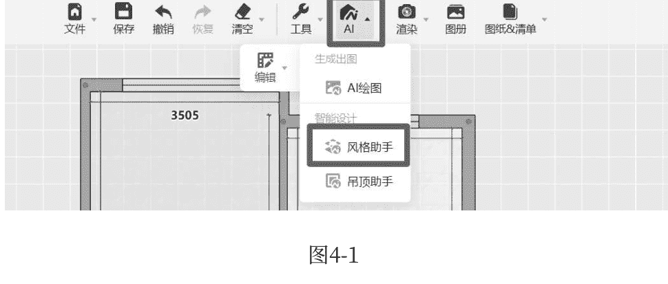
第三步：智能一键生成水暖电图纸。进入“水暖电设计”模块，单击“水电助手”，系统会根据家具位置和行业规范，自动生成全屋开关、插座点位及基础管线布局，大幅减少手动绘图误差。
第四步：导出完整施工图集。在“图纸及清单”模块将类型切换为“全部”，即可导出多种格式的全套施工图，为施工方提供便利。
第五步：电影级渲染与动画制作。施工图完成后，将3D模型渲染成电影级效果图、3D动画及VR场景，真正实现“所见即所得”，让客户提前预览装修后的完整效果。

#### 4. 行业洞察：设计师的转型方向
##### (1) 低端设计沦为免费“引流品”
如今主流智能设计软件都能实现“秒出图”，这推动家装设计从非标准化定制，快速向标准化产品转变。普通家装公司不再为设计师的“画图时间”买单，单纯的低端画图工作，未来大概率会成为免费引流的工具。

##### (2) 设计师角色向“生活规划师”转变
当智能能一键搞定符合美学的配色与布局时，设计师的核心价值就不再是画图，而是深度理解客户需求。例如，洞察客户的生活方式、共情家庭成员的情感需求，再结合这些做空间功能规划、收纳系统设计和家务动线优化。

##### (3) 设计透明化成为行业信任基石
传统家装行业的信任危机，根源在于效果图与实际交付的差距。未来的设计交付，核心将是可交互、全透明的数字模型。客户可随时查看细节、提出修改建议，全程参与设计过程，信任度自然会显著提升。

### 4.2 智能服装电商全流程破局，卡点一次性解决

在服装行业摸爬滚打几十年的设计师峥姐，2023年初果断踏上智能转型之路。借助智能辅助设计，她不仅拿下百万级订单，还总结出一套成体系的“智能+服装”实战方案；后续开发的“智能+服装设计”等课程，更成功为多家企业赋能。峥姐的经历印证了一个事实——智能早已不是遥远的科技概念，而是服装电商突破困境的核心武器。

#### 1. 传统模式的“围城”与智能工具的“降维打击”
##### (1) 传统服装行业的深层困境
传统服装电商一直像“开盲盒”，设计周期长、样衣成本高，流行趋势难以捕捉，一个款式的成败全依赖设计师的直觉和运气。对中小品牌而言，高昂的商拍费用、漫长的生产周期，再加上常年库存积压，生存空间被挤压得越来越小。

##### (2) 智能工具链的生态崛起
随着技术迭代，针对服装行业的智能工具矩阵已日趋成熟。
- ①Midjourney：主打发散思维，能快速生成充满艺术感的服装草图。
- ②Stable Diffusion：搭配ControlNet等控制插件，可精准把控服装细节、结构与面料。
- ③FluxAI：擅长提升画面真实感，处理复杂光影和服装动态褶皱时表现突出。
- ④即梦AI：可将静态图转化为动态走秀视频，大幅提升视觉表现力。
- ⑤DeepSeek/ChatGPT：充当“智能大脑”，辅助梳理设计理念、撰写营销文案，还能精准分析流行趋势。图4-2所示为智能生成服装设计图。


#### 2. 深度解析：智能解决服装电商的七大核心卡点
服装电商的痛点集中在设计、生产、营销三大环节，智能针对每个环节的卡点都提供了精准解决方案。我们先从最核心的设计端说起。
##### (1) 设计端：从“人工手绘”到“智力筛选”
设计是服装的灵魂，传统设计端的两大卡点：同质化和高成本，被智能彻底打破。

AI驱动的四条产业链路重塑实战

服装从灵感到上架的效率跃迁
设计同质化与产能瓶颈被打破。款式是核心竞争力，传统设计师日均输出有限且易陷入定式。生成式系统可在数分钟内产出数百套契合品牌调性的方案，并基于历史爆款数据做微调训练，既延续爆款基因，也能用提示词打开跨界联想。设计师从画图执行者转向内容策展人，把时间放在筛选具备市场潜力的款式上。

打样周期与物料浪费大幅压缩。常规样衣开发要经历打版、选料、缝制、试穿，一季新品常要数月。数字化预览无需动针线即可输出高保真正面、侧面、背面效果，且面料、印花、剪裁可即时切换。这种虚拟打样把原先约30天的节奏压到3天，损耗下降，多方案对比成本也显著降低。

生产端：拍摄革新与柔性快反
商拍成本高且可控性差。过去需要协调模特、场地、摄影、后期，单套成片花费数千到上万。视觉生成技术改变流程，只需平铺图或线稿即可套用到数字人。数字人可自定义肤色、国籍、发型，并还原布料垂坠感，单张成本由千元级降至角位级，且摆脱天气、档期、场地限制。

上新滞后错失窗口。女装讲究速度，传统链路因拍摄修图拖慢节奏。生成系统一分钟可产出上百张场景图，更关键的是先用生成图做预售测款，按点击与转化筛选准爆品，再驱动工厂柔性生产。先测后产有效避免盲目备货的库存风险。

营销端：精准触达与转化闭环
视觉同质化导致触达不准。公域里白底图与标准化姿势难以留人。生成系统可构建差异化视觉体系，例如同一款卫衣面向欧美市场生成欧美模特在纽约街头的画面，面向东南亚地区则换成亚洲面孔在咖啡馆的场景。这种千人千面的投放显著提升点击与粘性。

退货率高源于上身感知差。智能试衣提供解法，消费者上传自拍即可看到服饰穿着的真实效果，包括面料张力与褶皱。商家可把试穿数据回传设计端，优化尺码与版式，形成需求到生产的闭环，降低不合身的退货率。

广告疲软与投入产出低。静态广告审美疲劳，生成系统可快速产出电影感海报或短视频，通过更换数字人与场景赋予品牌高级感。低成本素材迭代支持高频版本对照测试，广告素材持续优化，每一笔预算用在刀刃上。

未来已至：以智能技术驱动的产业大变局
智能时代竞争本质是效率与模式竞争，人机协同将率先普及。

人机协同
效率竞争实际是工作流竞争。主流走向半自动化：用 Midjourney 挖掘灵感，用 Stable Diffusion 做细节打磨，再借助 ComfyUI 等可视化工作流工具实现自动化批量产出。重复劳动交给算法，人类聚焦审美把控与市场决策。

生产逻辑重塑
智能技术推动行业从预测生产转向敏捷供应。基于海量时尚数据的分析使新品方案更科学，数字人普及降低拍摄成本并提升效率，订单制柔性运营彻底缓解库存积压顽疾。

真正的降本增效
对中小企业，智能技术抹平资源差距，使其在视觉呈现与上新速度上可与大厂抗衡；对大型企业，智能系统是优化管理、提升人均产值的核心引擎。变革正把行业推向比拼算力、创意与技术理解力的新阶段。

4.3 丝巾工厂轻智造案例：从通货困境到IP增长
有十年旅游行业经验的简单姐2020年扎根义乌做丝巾生意。借助轻智造并全面拥抱1688平台，工厂实现跃迁式增长，展现量提升384%、询盘提升193%、业绩上涨65%。更关键的是，霸王茶姬、石河子博物馆、湖南省博物院等知名IP主动寻求联名与文化创意定制合作，为传统丝巾企业提供了可复制的转型范本。

传统丝巾工厂的四大困境
工厂八成货品为市场通货，陷入四项通病。
无定价权，只能被动降价。产品同质化让客户没有优先选择理由，只能靠降价保销量，利润被持续压缩。
无主动权，只能被动跟随。新品开发完全跟市场走，需求要等市场先出现，等拿到货已遍地开花，错失先机。
流程繁琐，速度慢。从画稿、反复修改、确认颜色材质到打样制版、批量生产，最快也要15天，严重滞后市场节奏。
起订门槛高，风险大。

轻量智能制造增长飞轮四步法
核心是用智能系统打通设计—预览—测款—生产全链路，再用流程优化补齐后端短板。

第一步：喂养创意基因
智能系统本质是超级模仿者，需先输入优质素材。团队用3个月整理数年平台爆款丝巾数万张，每张标注数十个标签，如风格新中式、主元素仙鹤、辅元素祥云、色系莫兰迪、构图中心对称、情绪静谧，统称创意基因。用图生图指令让系统在成功经验上做微创新裂变，从学徒变为高效助手。

第二步：技术生成穿戴预览，实现零成本试错
设计图需要穿搭效果才有说服力，传统打样拍照成本至少300元且需7-10天。团队引入3D数字化成像，把二维图案“穿”在虚拟数字人上，并渲染逼真场景图，试错成本近乎为零。

图4-3

第三步：公开投放，用数据测款
把含上百款新品的链接批量投放到C端跨境电商平台，像撒网收集数据。依据点击率、收藏、加购及颜色元素组合转化率筛选，过去靠直觉的赌博式生产变为数据驱动的科学实验。

第四步：后端补位，用投入与再造托举前端
前端提速后，后端混乱：快反小单与常规大单混杂，仓库混乱，废品率一度达15%。方案一：成立48小时快反突击队，抽调3名员工物理隔离，专门处理1-2条小批量订单。方案二：投入2万元微调设备适配小批量，并设立容错基金允许试错。由此实现可单件下单、48小时出货。

轻量智能制造的三大核心价值
效率价值
传统模式设计到出货至少15天，轻量智能制造经3D成像预览与数据选款，配合快反小组，周期压缩至3天，效率提升5倍。

成本价值
传统单款打样加拍照至少300元，测100款需3万元。智能系统通过3D成像生成穿搭预览，试错成本接近零，可大胆测试更多创意。

定位价值
具备轻量智能制造与柔性供应链能力后，工厂摆脱传统丝巾厂定位，转型为IP商业化最佳伙伴，提供IP快速变现解决方案，跳出价格内卷红海。1688平台的核心价值在于信任背书，智能快速打样与柔性生产能力大幅降低客户决策成本，也是IP订单主动上门的关键。

智能系统不是救世主，而是能力放大器。它不能凭空带来客户，却能更快更好满足需求。对传统工厂而言，拥抱智能系统是生存与增长的必答题。

4.4 调味品批发智能报价提效方案
航源从调味品批发转型数字化服务，借助IMA智能营销助手知识库搭建智能报价中枢，实现跨越式提升。单次报价从120分钟缩至3分钟，准确率从82%升至99.6%，响应速度从4小时缩短至15分钟，提升87.5%。该方案为批发行业报价痛点提供可复制路径。

传统调味品批发的三大痛点
手工查询Excel易出错
产品线丰富导致查询费力，曾有一次需报价500种调味品，查到凌晨仍把花椒与藤椒价格填反。品种超3000后，手工误差率直线上升。
旺季报价延迟导致丢单
旺季延迟使丢单率飙升至15%，既损失营收也损害信任。业务扩张后每日几十份报价请求，手工模式已难以支撑。
产品种类繁多难管理
信息分散在多个Excel表格，查询难、更新不及时，导致效率低下与错误频发。

IMA知识库智能报价五步法
核心是用腾讯IMA知识库整合产品信息，实现从识别到报价单生成的自动化。

数据准备
整理产品基础信息表，明确名称、规格、单价、供应商等，如老抽酱油500毫升×12瓶48元海天、花椒粉100克×20袋65元王守义；搭建实拍图库，多角度清晰照片辅助系统识别。

知识库搭建
在腾讯IMA知识库创建项目，导入基础信息表与图库，系统自动结构化处理并建立索引。

报价流程配置
客户微信发送产品照片自动触发图像识别，系统提取老抽500毫升等关键词精准匹配，若无完全匹配则自动推荐类似款。
图4-4所示为腾讯IMA知识库的产品匹配和智能推荐界面。
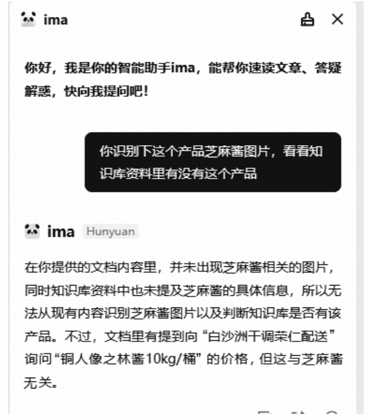
图4-4

关键词提取与匹配
系统可按指令提取指定产品并生成表格，支持按价格、规格、供应商多维度筛选，批量询价可一次性处理并生成报价信息。

生成带企业标识的报价表
系统支持智能排序与格式设定，如按价格从高到低并用蓝色字体突出数据，可自动添加公司标识生成规范报价单，无需人工排版。

效果验证与行业启示
用数字说话
改造后单次报价时间降至3分钟，效率提升97.5%；准确率提升至99.6%，提升17.6个百分点；响应时间缩至15分钟，提升87.5%。旺季丢单率降至近零，客户满意度与营收稳步增长。

可复用的行业方案
建材批发可处理石材钢材规格混乱问题；电子元器件可快速匹配型号参数；服装贸易可生成含款式尺码颜色多维报价单。

避坑指南
产品命名不规范时，建立《产品名称对照表》与同义词库，如老抽=深色酱油；图片识别误差可通过上传多角度图并配文字描述持续训练优化。

进阶玩法
客户画像联动标记VIP并提供针对性报价；竞品监测定期采集市场价生成比价表；智能议价基于采购量与合作记录自动计算折扣。

4.5 AI文旅文创场景赋能实现破局增长实战指南
智能技术加速融入实体经济，文旅行业正从流量红利转向体验红利。成都爱国产数字科技有限公司创始人陈冰洁凭11年软硬件经验切入AI拍照机赛道，2023营收300万，2024达700万，2025上半年已超2024全年，产品落地30多个国家。

选择AI拍照机切入文旅赛道的原因
行业真空地带
2023年巨头扎堆线上文旅与虚拟导游，线下即时沉浸可分享体验需求却长期空白。团队提前布局，至2025年广东省文旅厅出台扶持政策时已占得先机。早期AI绘画小程序无优势后，转向软硬结合，深耕细分场景，满足游客带走个性化文化体验的渴望。

价值升级
AI拍照机不是大头贴升级版，而是基于图生图的文化体验终端，将用户形象与三星堆火焰纹饰等文化元素融合，使照片成为文化载体。硬件非壁垒，精品化交付才是核心，团队持续迭代算法与审美，平衡标准化与高品质。

场景选择
商场景区流量大但付费意愿分散，博物馆科技馆用户有明确文化打卡需求且付费意愿更高。慢场景的核心是设备融入动线设计，实现深度连接，运营能力成为长期护城河。

实战落地：构建不可替代护城河
技术落地：以精品交付打破低门槛竞争
软硬结合的壁垒。硬件交由广东供应链代工，团队聚焦软件算法、美术交付及远程培训系统，这些决定体验的核心环节。

细节做口碑，交付成壁垒
口碑是靠一处处细节堆出来的。古蜀某遗址的定制项目就很典型，为把金面形象做到位，团队连打三天磨效果，回款并不高也硬扛下来，就是为了拿到顶流文化IP的背书。负责人认为，做文物文创合作成败的关键在于文化细节的把控和互动体验的打磨，坚决不做低门槛的换脸生意，而是靠啃下顶级IP来建立专业信任。

##### (2) 商业模式：“硬件销售+分成”的稳健生存法则
- ①先活下来，再谈扩张。2023至2025年间团队始终走稳健路线，不盲目铺摊也不做免费投放，全部靠项目本身赚钱。负责人很清楚，免费引流看着热闹，实际在啃现金流，而现金流是不确定环境下的生存底线。
- ②稳字当头带来确定增长。从成立到现在，营收已过千万，服务版图延伸到数十个国家。

##### (3) 团队基因：用高人均效能对抗巨头
能和行业巨头抗衡，核心是技术和资源双轮驱动加上极高的人均产出效率。负责人本人深耕软硬件十余年，核心股东网络覆盖金融、政企等关键资源，形成明显互补。资本路径早被纳入规划，资源储备也在同步推进，他认为产品只是撬动资源的抓手，商业化最终靠产业整合。

组织上坚决不走粗放扩张的老路。负责人身兼数职，曾因助理的工作效率甚至不如机器且沟通成本高昂而果断精简；七位核心股东各司其职、执行力强，这种精干结构是庞大厂商难以复制的。2025年已拿到意向投资，接下来将补强新媒体、投放运营和渠道队伍。

#### 3. 未来展望与创业建议
随政策东风和技术迭代加速，智能技术与文旅的想象空间在持续打开。负责人基于实战，对赛道和创业者给出判断。

##### (1) 政策和市场双重利好，生态加速成熟
2023到2025年，国家和地方密集出台文旅扶持政策。广东在推动智能技术+文旅场景落地，成都则发布数字文创机会清单，释放近三百亿的投资体量。政策红利叠加真实需求，生态成熟速度明显加快，为入场者提供了更宽的跑道。

##### (2) 技术融合：解锁更多新场景和新价值
未来要打的两场升级战：

一是从静态拍照走向动态交互。和合作伙伴探索MR、VR的融合应用，参考未来博物馆、漳州古城智能剧本游这类已有案例，提升沉浸感和叙事张力。

二是从单一体验终端转向资源整合平台。以智能拍照机为入口，拓展到纪念币、实景剧本游等衍生服务。负责人已做五年到十年的长线规划，拒绝快钱逻辑，认为深耕才是可持续之道。

##### (3) 给智能技术+文旅创业者的3条核心建议
一是极致聚焦。资源有限时，把一个细分场景做到极致，比铺开十个平庸场景更有价值。
二是尊重文化专业。和文物机构合作需要耐心和敬畏，只有真正懂文化，产品才有灵魂。
三是做时间的朋友。智能文旅比拼的是长期打磨和沉淀，能活到最后的才算赢家。

智能文旅的意义远不止拍出好看的照片，而是用技术降低公众感知和理解文化的门槛，让每次按下快门都成为文化和心灵的共振。这是团队的坚持，也是整个赛道的未来。

## 第5章 单人驱动AI：轻模式养活创业
智能时代创业成本在下移，单人配合AI即可对抗传统团队，无需重资产就能启动变现。从旧照焕新、网络安全到知识库变现、金融智能体，本章拆解多个个人智能创业样本，给出从0到1的落地路径，帮助快速搭建低风险高回报的轻资产项目。

### 5.1 旧照焕新创业，单人月入过万的操作
程序员飞鱼聚焦旧照修复加动态视频这个细分赛道，数月内实现月入过万、粉丝破万。说明智能时代赚钱的关键不是技术有多深，而是把技术和情绪价值结合好。

#### 1. 为什么这是普通人的黄金机会
##### (1) 刚需且高频，情绪是驱动力
传统修复只能处理静态破损，智能技术出现后用户能实现跨时空拥抱、让亲人开口说话。需求并非凭空而来，而是积压多年的情感等待释放口。
##### (2) 情绪价值自带溢价
动态视频提供的不仅是视觉，更是心理慰藉。飞鱼的客户中有人回购五次，单人消费超千元。对逝去亲人的微笑和叮嘱，没有实物能替代。
##### (3) 技术门槛大幅降低
过去修复一张照片需数天，熟练PS才行。现在几分钟完成，手机App即可操作。智能技术还能让照片“活”起来，实现人物微动、开口说话乃至简单互动。

#### 2. 一个人就能跑通的完整流程
不需要精通技术，组合几款工具即可形成闭环。
##### (1) 图片预处理
高清修复可用某高清修复App，一键去模糊去噪并补全缺失细节，上传后数秒即可下载，80年代的模糊底片也能拉到4K质感。
智能上色推荐某上色插件，通过深度学习推断符合年代的色彩，内置二十多种色调滤镜，建议多试几版挑肤色最自然的。
##### (2) 声音处理
有亲人生前录音的客户，可用音色克隆服务做声音复刻，上传10到30秒音频即可生成近似原声模型，是高溢价增值项。
无录音时可用剪映的配音功能，内置上百种音色，涵盖方言、童声、老人声，能满足大部分需求。
##### (3) 视频生成
动态视频首选某图生视频工具，核心是图生视频与视频续写。关键技巧是用运动笔刷涂抹身体部位，再用静态笔刷锁定五官，避免人脸变形。旧照动态化的最大痛点就是变形，这一方法能基本解决。
成本控制上，可用国际邮箱多注册账号，免费积分即可零成本起步。若要实现口型同步，可用某口型动画工具，音频对口型、眨眼同步精准，安卓用户可通过清缓存重复获取免费额度。

#### 3. 4种从流量到盈利的路径
##### (1) 流量收益
在短视频平台、视频号、种草平台发布时勾选原创，收益来自中视频计划与评论区广告分成，靠日更三到五条引发共鸣的内容堆积长尾流量。
##### (2) 私域商单
飞鱼的主营收入。分四档定价：
- 基础版19到59元：高清修复加上色。
- 升级版99到199元：照片转动态视频，如战友拥抱、奶奶微笑。
- 高级版299到599元：加入声音克隆并实现开口说话，制作跨时空叮嘱。
- 顶级版超1000元：数字分身服务，注入思维模式与语速，实现赛博永生。
##### (3) 知识付费
跑通引流成交后，可做录播课99到299元销售工具清单与提示词模板，或一对一陪跑599到1999元手把手带起号、谈单，利润率高。
##### (4) 工具分销
作为博主或导师在分享时植入某图生视频、音色克隆等付费工具的返佣链接，形成长期被动分成。

#### 4. 避坑指南与进阶思路
赛道热度起伏，但真实需求不会消失。机会在于细节打磨和交付质量。不要一键生成就交付，多次刷效果，确保人脸不歪手部不变形，像不像是客户是否满意的核心。
文案和背景音乐决定传播力。多采集没说出口的遗憾类情感素材，配上沙哑老歌，共鸣与转化率会明显提升。

#### 5. 从新手到接单的行动计划
第一周：熟悉全部工具，用自家旧照练手，至少完成50张，掌握修复上色的基础手感。
第二周：注册三个新号，每天发两条原图对比修复动态视频，测试流量积累初始粉丝。
第三周：把粉丝引流到微信，建立客户分级表，明确各档位服务与价格，争取拿到第一单。

### 5.2 智能网络安全防御系统，个人也能切入的千亿赛道
数字化普及让安全成为企业生命线，但大量中小企业因缺人缺钱缺技术处于裸奔状态。梼杌智能防御系统创始人享亮，用AI驱动加规则协同的自动化平台证明，个人开发者也能降维切入。

#### 1. 市场洞察：中小企业的防御真空区
全球企业年因攻击损失超万亿美元，中小企业痛点明显：
- ①传统防御失灵。防火墙依赖固定规则，面对变异DDoS、新型APT攻击如同刻舟求剑，响应慢且留安全死角。
- ②技术更新滞后。设备老旧漏洞多，缺乏统一架构，策略更新无法一键同步，只能被动应对。
- ③智能攻击攀升，防御滞后。2024年金融诈骗增长200%，但72%企业因合规顾虑或缺人才未能部署智能防御。

#### 2. 核心武器：梼杌系统的双引擎逻辑
系统核心是自动化决策，把人工分析转化为机器自动执行，架构分五部分：
##### (1) 双引擎协同检测
智能威胁检测引擎用孤立森林、LSTM等算法分析海量流量，无需预设规则即可识别未知攻击；基因规则引擎靠正则与信息熵匹配已知威胁。AI抓新敌人，规则挡老熟人，毫秒级响应。
##### (2) 用户行为画像
为每个设备和用户建立正常行为基线，如登录时间、常用功能、数据传输量。异常如深夜大量数据外泄或异地登录即触发预警，实现全流程覆盖。
##### (3) 自动化响应
发现威胁后按风险等级自动处理：封禁IP、限速异常流量、推送告警至管理员移动端，无需专职安全人员也能拦截。
##### (4) 可视化面板
把网络数据转为流量波形、风险热力、攻击路径图，非技术管理者也能直观看到拦截次数，对商务洽谈和续约有说服力。
##### (5) 模块化更新
插件式扩展，规则库和模型云端自动更新，不影响业务运行，防御能力持续迭代。

#### 3. 赚钱路径：从0到1的三步方案
##### (1) 第一阶段：单点突破0到1年
聚焦单区域或单一行业如电商、在线教育，通过园区推广、技术社区推荐、自媒体引流获客。目标积累200家种子用户，重点收集攻击样本迭代模型，建立口碑。
##### (2) 第二阶段：渠道分销1到2年
转为合作伙伴制，和本地IT运维、财税服务商、行业协会合作分佣。目标突破800家用户，并为医疗、制造等高合规行业推出定制版提升利润。
##### (3) 第三阶段：平台化与出海2到3年
建立全国运营中心，上线智能安全模块商店允许开发者上传规则，布局东南亚等新兴市场，最终用户破2000家形成品牌壁垒。

#### 4. 差异化优势：客户为何选择你
面对绿盟、启明星辰等巨头，优势在于小而美的灵活定位：
- 人力成本优势，自动化响应无需高薪安全专家。
- 部署便捷，模块化即插即用无需改现有系统。
- 主动防御，预警拦截对未知威胁拦截率更高。
- 价格亲民，云原生架构降低硬件成本。

#### 5. 总结与实操建议
网络安全的本质是攻防成本效率比。梼杌成功在于AI降低了防御成本同时提高攻击难度。
建议：①先做工具再做系统，可先做针对SQL注入的AI识别工具积累用户。②重视可视化，只有让客户清晰看到拦截次数和避免损失才愿意续费。

### 5.3 智能实体聊天智能体开发，个人实操落地方案
瑞奇自主研发的陪伴式聊天智能体R-BOT，围绕真实陪伴需求构建。

#### 1. 为什么要做实体聊天智能体
核心痛点是用户对有温度陪伴的渴望。
##### (1) 真实需求：需要有温度的陪伴
孩子要的是不会弹出游戏、能专心陪自己的伙伴；老人要的是随时能说心里话、不会嫌唠叨的倾听者。他们要的是随时在场的陪伴，而非即时回复。屏幕设备工具属性强，实物才能承载情感。R-BOT能聊天、讲故事、放歌、陪学习，解决孩子成长陪伴和独居老人孤独问题。
##### (2) 实体智能体的三大核心优势
- 场景适配更好。机身圆润防磕碰，24毫米厚度手感合适，唤醒词可自定义。
- 主动交互能力。基于自然语言处理能记住上下文，孩子连续提问也能衔接；接入沪语、粤语、闽南语等方言识别。
- 情感连接易建立。实物形态形成情感载体，测试中家长取名、老人吃饭留位置等行为体现真实存在感。

#### 2. 拆解可落地的开发全流程
##### (1) 确认用户需求，避免做无用功
小朋友：像小哥哥一样讲故事教诗词还能听心事。
老人：随时聊天不用看屏幕就能知天气新闻。
家长：孩子开心自己省心，且不能玩游戏。

##### (2) 技术选型，不贪多求全
硬件：主控选ESP32-S3，支持Wi-Fi蓝牙性价比高，自行设计电路板找厂家打样。
软件：国产大模型开放平台上手快，配合AI编程工具开发。
外观：3D打印选PLA材质，环保低成本。
架构采用本地唤醒加云端处理混合模式。唤醒词“你好小瑞”本地识别响应快，复杂对话上云处理降低本地算力需求控制成本。

##### (3) 设计硬件电路，按步骤上手
- ①规划电路方案。核心组件包括主控芯片电路、输入输出设备麦克风扬声器LCD屏幕、Wi-Fi蓝牙模块、控制器。满足基础功能即可。

AI陪伴硬件从零到一实操手记

② 电路排布与板图制作
此环节主要依赖 Altium Designer 完成。对初学者而言，参考已开源的原理图能显著降低门槛。整体推进比较顺畅，先完成原理图绘制，再转成 PCB 版图，最后导出 Gerber 文件委托工厂打样即可。

③ 板件打样
将 Gerber 文件发给 PCB 厂商，明确板材、层数与数量等需求后即可进入生产。小批量试制成本可控，很适合原型验证。

##### (4) 外观结构设计，在美观与可用之间找平衡
① 形态发想
核心用户是孩子，同时需要照顾老年人，因此整体视觉要亲和。机身采用圆润线条，手感柔和，杜绝锋利边角。
② 三维建模
三维造型用 SolidWorks 完成。结构建议采用上下分壳方案，便于后续装配与维护。建模时要预留充足内腔，给主板及各电子器件留出空间，既保证外观又不影响功能。
③ 打印与后处理
外壳常用材质为 PLA 或 ABS，委托第三方 3D 打印出样。拿到样件后自行拆除支撑、打磨、喷涂上色，即可得到可用样壳。

##### (5) 软件开发借助工具提效
开发环境选用 VSCode，代码以 Python 编写，再配合 Cursor 这类 AI 编程助手，效率会大幅提升。核心工作包括代码编写、编译环境搭建，以及接入 AI 平台 API 实现语音交互。

VSCode 是免费且主流的代码编辑器，上手很快。Cursor 提供 AI 在线辅助，遇到卡点时能给出思路，新手也能较快进入状态。

##### (6) 硬件组装按流程推进
① 备料与焊接
先列出采购清单：主控板、麦克风、扬声器、电阻电容等被动元件、线材，淘宝、拼多多、立创均可购买。焊接需准备热风枪、电烙铁、焊锡丝，做好静电防护，避免器件损坏。
② 固件写入
把编译好的程序烧录进主控板，按教程操作即可，难度不大。
③ 整机装配与验证
将 PCB、打印外壳、传感器等部件组装在一起，接电后进行功能检查：语音唤醒是否灵敏、交互是否顺畅、网络是否正常，以及在日常陪伴场景下的表现，有问题及时调整。
图5-2所示为AI对话智能体的实体半成品。

#### 3. 避坑与价值思考
避坑的本质是提前预判风险，技术卡点往往在前期最致命。把难点和对策先梳理清楚，能为后续开发扫清障碍。

##### (1) 关键技术难点与对策
① 语音交互顺畅度
采用本地唤醒配合云端处理的混合架构，减少网络等待；同时优化麦克风阵列降噪算法，降低环境噪声干扰。
② 低功耗方案
选用低功耗芯片，设计休眠唤醒机制，闲置时自动休眠省电。日常使用建议外接电源，满足长时间陪伴。
③ 交互体验优化
做成手持便携形态，可随身携带，实现随行陪伴，不必固定在某一位置。

##### (2) 三条避坑经验
① 实体智能体的精髓是简化操作，功能堆砌只会让用户迷惑，体验反而下降。
② 果断砍掉冗余功能。比如瑞奇项目初期曾想加视频通话，测试后老人觉得有被监视感，孩子更偏爱语音互动，兴趣不大。移除后操作更简洁，硬件成本也降了。
③ 关键元器件要选靠谱来源。主控板、麦克风等核心件建议找口碑好的供应商，避免因小失大。

##### (3) 场景延展与商业化思考
① 场景延展
在家庭陪伴基础上可向两端延伸：一是儿童教育，集成定制化学习内容，通过对话辅助学习；二是养老关怀，在情感交流外增加健康提醒等实用功能。
② 变现路径
个人创业不必一开始就大规模量产，可先小批量试产线上销售，验证市场反馈。之后可开展定制化服务，为幼儿园、特定家庭提供批量定制，提升利润。

### 5.4 让死知识变现：人工智能智慧阅读商业方案
2024年，大河做了一个外界看来很炸的决定，从数据科学家转做 人工智能 产品经理。但只有他自己知道转身有多狼狈。为了撑起新身份，他一度出现严重的知识焦虑，天天大量输入信息，却买了一堆读不下去的书，公众号运营一年粉丝仅400。

认知与行动的割裂让他很痛苦。后来他明白，缺的不是知识本身，而是把死知识转化为可变现资产的方法。于是他换了学习方式，把书真正吃透。

#### 1. 项目说明：何为 人工智能 智慧阅读
人工智能 智慧阅读不是让人工智能 代替阅读，而是用人工智能 搭建专属的陪读军师与知识库。

过去阅读是单向接收，记不住就流失。现在他把经典书籍、行业报告、个人工作笔记全部导入腾讯 ima、Claude 等工具。阅读变成主动操盘，可以直接对话，让人工智能 站在彼得·德鲁克、查理·芒格等大师角度拆解现实商业难题。把书架上的死知识变成可落地的商业策略。

#### 2. 人工智能 如何提升阅读与实战效率
实践中他总结出一套提效流程，重塑了学习效率。图5-3所示为AI知识库互动读书法。

##### (1) 精准诊断：先让 人工智能 为业务把脉
以前迷茫就乱读书，焦虑不减。现在把困境全盘告知腾讯 ima，人工智能 的诊断更犀利：“核心问题不是能力不足，而是心智定位缺失，你像摆地摊的杂货铺，用户记不住你。”并建议先放下技术书，优先读艾·里斯和杰克·特劳特的《定位》。图5-4所示为AI知识库定位诊断。

## 一、定位策略：明确 人工智能 垂直赛道
1. 《定位》- 艾·里斯 / 杰克·特劳特
   - 核心价值：强调用户心智占位而非自我定义，书中肯德基定位转变案例可启发如何把“人工智能+专业领域”变成用户认知标签。
   - 应用方向：重新梳理公众号定位为“人工智能产品经理实战派”，聚焦企业级人工智能落地经验，与泛科普账号区隔。

2. 《疯传》- 乔纳·伯杰
   - 核心价值：解析内容病毒传播的六大原则，适合把技术干货转化为用户愿意分享的社交资产。
   - 应用方向：将人工智能咨询案例包装成“3个让老板眼前一亮的人工智能降本技巧”等易传播标题。

## 二、垂直深耕：人工智能+产品经理交叉领域
1. 《人工智能赋能：人工智能重新定义产品经理》- 连诗路

##### (2) 降维解读：请“金庸先生”翻译晦涩理论
《定位》对理工科背景的人来说术语晦涩，他让 人工智能 扮演金庸，用武侠语境重述全书。“抢占行业第一”被比喻为华山论剑，登顶者为武林盟主；“差异化竞争”被比喻为独孤九剑，专攻对手破绽。这种降维解读让理解瞬间通透且记忆深刻。

##### (3) 跨时空会诊：用大师思维剖析困境
他把公众号一年仅400粉丝的困境交给 人工智能 ，让它模拟查理·芒格与杰克·特劳特辩论式分析。图5-5所示为AI知识库问题诊断。

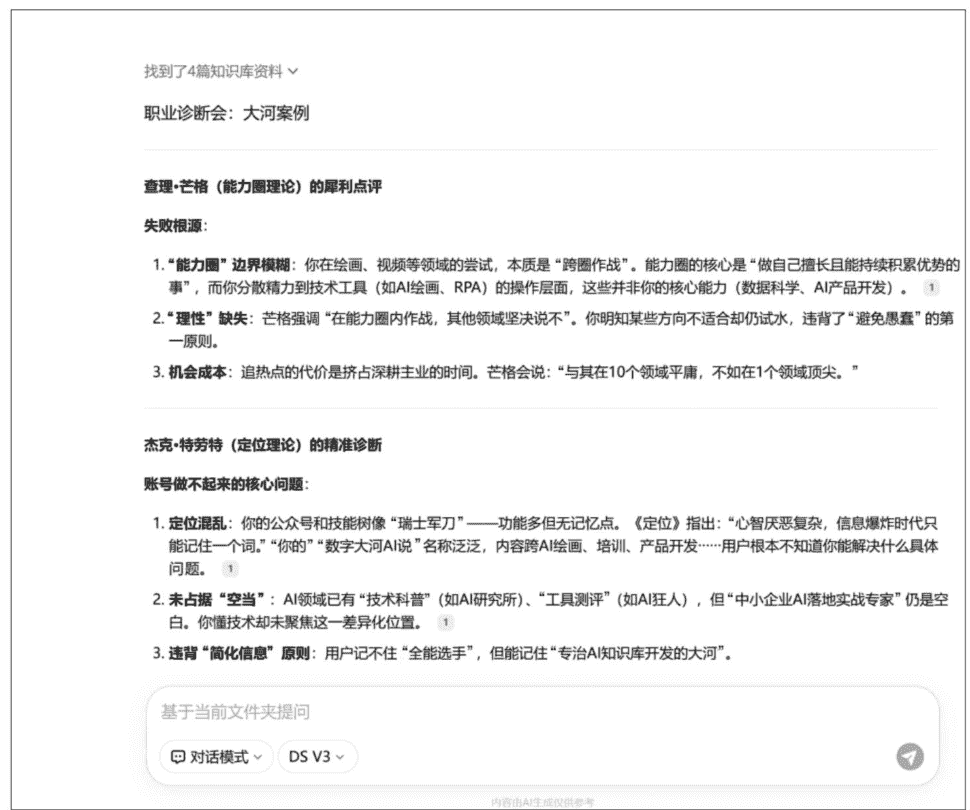
人工智能 结论让他警醒：模拟的芒格指出他追逐人工智能绘画热点已脱离能力圈；模拟的特劳特点出账号定位混乱是主因。这场会诊让他明确战场是“教企业用人工智能提效”，而非“教人画画”。

##### (4) 行动转化：将理解变成周计划
过去读完书只感慨一下。现在他要求人工智能输出落地行动方案。人工智能通过反向提问梳理需求，为他制定任务清单：更名“大河人工智能实战派”、删除无关文章、持续输出企业人工智能提效实操案例。之后只需对照清单执行。

##### (5) 打造第二大脑，实现知识复利
为避免对话变成一次性信息快餐，他让人工智能把洞见整理为结构化知识卡片，如“能力圈”“心智阶梯”“品牌定位”，并标注#职业破局存入知识库。图5-6所示为知识拓展与能力圈构建示意图。

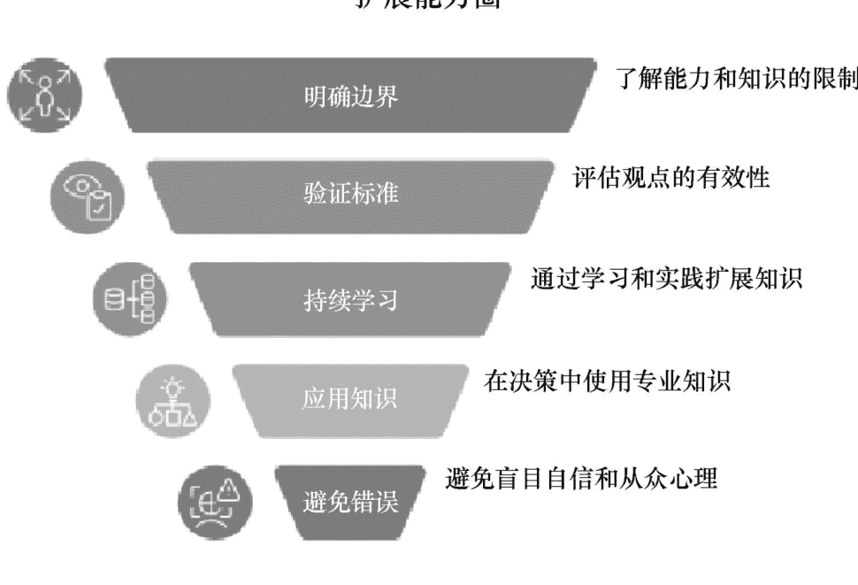
从此这些知识成为可随时调用的第二大脑核心部分。

#### 3. 人工智能智慧阅读的核心优势
这套方法治愈了知识焦虑，也带来商业收益。

其一，极速内化降本增效，原本需一个月啃完的硬核书籍，借助人工智能几小时可提炼核心逻辑。

其二，消除认知偏差精准定位。人工智能以旁观者与大师双视角帮助剔除无效努力，坚守能力圈。

其三，流量精准化构建变现闭环。定位优化后粉丝画像从泛流量变为精准B端企业咨询，带来高价值培训意向，实现知识变现。

#### 4. 未来展望：从知识搬运工到商业操盘手
人工智能时代不缺信息，缺的是驾驭信息的智慧。未来读书不再是自我感动的苦旅，而是带着明确目标捕获商业价值的精准狩猎。随着个人知识库丰富，人工智能会成为永不疲倦的第二大脑。别再做知识搬运工，要做商业操盘手，让人工智能辅助思考而非替代搜索，才能搭建个人增长飞轮。

### 5.5 人工智能 打造个人 IP，月获 7000+ 线索全流程拆解
在注意力稀缺的时代，“人”成为商业核心，创始人IP不再是可选项而是生存必答题。传统IP打造门槛高，需要编剧、拍摄、剪辑团队。人工智能的爆发打破了门槛，共识是人工智能不是取代创作者，而是让操盘手以极低成本撬动团队级流量价值。

#### 1. 人工智能 赋能个人 IP：从重资产到轻量化
过去打造IP需养3~5人团队，成本高风险大。人工智能带来效率重塑，可处理80%以上标准化工作，如资料整理、初稿撰写、多版本衍生，让创始人聚焦20%的灵魂决策：深度观点、商业逻辑把控、用户连接。一个人活成一支团队成为可能。

#### 2. 核心 人工智能 工具及其应用场景
**表5-1**

| 工具名称 | 核心功能 | 在IP打造中的应用场景 |
| :--- | :--- | :--- |
| Claude | 极强的逻辑理解与长文本处理能力 | 核心大脑：搭建知识库，学习创始人语言风格，生成深度营销文案 |
| ChatGPT / Gemini | 创意发散与多语言理解 | 创意导师：辅助爆款选题策划、热点追踪建议及多轮头脑风暴 |
| 飞书妙记/通义听悟 | 语音转文字及智能摘要 | 素材采集：将创始人随口表达、访谈内容快速转化为结构化素材 |
| 剪映 AI | 智能成片与自动字幕 | 后期提效：快速粗剪视频，自动匹配字幕与转场，缩短发布周期 |

通过输入素材→人工智能学习风格→自动生成初稿→人工微调决策形成高效闭环。

#### 3. 人工智能 驱动 IP 增长的实操策略
##### (1) 构建三位一体的内容阵型
① 热点内容抓流量：利用人工智能监测行业动态，快速产出解读内容击穿公域流量。
② 自然流内容建信任：把创始人深度对谈转化为口语化文案，强化专家感。
③ 营销型内容做转化：用人工智能文案框架精准戳痛点，引导点击或留言。

##### (2) 建立 人工智能 专属知识库
将创始人履历、案例、口头禅、价值观输入Claude或ChatGPT，让人工智能深度学习，产出内容才有“人味”，避免机械感。

##### (3) 痛点挖掘自动化
让人工智能爬取社交媒体评论、竞品问卷、行业报告，提炼用户最焦虑的10个核心场景，基于真实数据做爆款内容。

#### 4. 实战案例：人工智能 操盘手让流量成本下降60%
马克是短视频博主，也是创业者“洋哥”的IP流量操盘手。引入人工智能前内容产出依赖洋哥临场状态，效率低。接入人工智能后搭建“洋哥数字分身”，把日常录音、文章全部输入人工智能。

一个月内人工智能筛选出“未来10年最危险职业”爆款选题，结合专业见解产出多条播放超50万人次内容，快速涨粉数万。

2025年7月至11月5个月间，利用人工智能批量生成营销文案投流测试，11月达到峰值，日均精准线索超250条，单月获取线索7841条，转化400多名付费会员。此前需整队完成的每周8条营销视频，现在一人配合人工智能即可完成。

#### 5. 避坑指南：人工智能 时代的内容红线
1. 文案太精英化用户听不懂：初稿常有术语，需转化为“每天多陪孩子一小时”这类具象表达。
2. 只有逻辑缺乏情感：营销文案要共情，可用人工智能挖掘共鸣案例增加温度。
3. 过度依赖人工智能丢失IP灵魂：初稿可人工智能完成，但决策和审美把控必须真人负责。

#### 6. 未来展望：人工智能 与个人品牌的深度共生
未来人工智能将成为IP的全时分身，数字人技术与实时交互人工智能成熟后，影响力将突破时空限制。人工智能赋予普通人建立影响力的权利，技术是通往商业自由的云梯。

### 5.6 人工智能+金融创业，3个月变现超6万元实战
枫炎是拥有25年经验的金融老兵，下半场投入人工智能，仅用两个多月靠智能体加金融赛道赚了3万多元，另外3万多元深度合作正在推进。印证了人工智能技术门槛降低，但专业经验与人工智能结合的商业竞争力在增强。

#### 1. 核心赛道：为什么智能体加金融能赚钱
金融人工智能化进程中存在服务缺口，这是个人开发者机会。

##### (1) 锁定100万~1000万高净值人群
这类人群不缺钱，缺时间，缺专业无偏见的投资决策帮手。他们希望用人工智能工具高效处理海量信息，实现信息平权，发现验证投资机会。他们看重投资回报率，100万本金赚10%就是10万利润，花2万开发费毫不犹豫。

##### (2) 实战案例
第一单万元大单来自高净值客户。第一步实盘验证，客户直接用2万美金按智能体给出的初步策略实盘15天，以市场反馈为准。第二步效果付费，验证有效后直接支付万元级首期开发费，后续靠效果和信任维系。第三步口碑裂变，客户主动介绍给两位朋友定制不同侧重点的金融智能体。

该智能体是私人投资策略引擎。基于枫炎25年金融经验构建定制模型，监控全网宏观经济报告、行业研报、公司财报、市场情绪数据，清洗筛选分析后输出个性化投资策略、风险预警和机会清单，节省信息筛选时间并提升决策准确性。

##### (3) 这条赛道的核心优势

# 金融类智能代理：当下最顺手的变现赛道

- 买单意愿高。甲方只看交付效果，能解决问题就愿意付费，单价高也不构成阻碍。
- 需求长期且刚硬。投资相关的工作贯穿整个职业周期，后续复购、迭代与功能扩展的意愿都很旺盛。
- 门槛叠加。既要会人工智能，也要理解金融市场与业务逻辑，这个组合把绝大多数纯技术背景的人挡在门外。
- 竞争稀薄。金融不熟的人多，熟悉金融的人又很少用轻量代理去服务中间市场，空间还很空旷。
- 回报感强。钱之外，更能把多年专业积累借助工具放大，看到客户真实受益。

#### 2. 接单避坑
枫炎在起步阶段接了五十多单，慢慢沉淀出筛选客户的办法。活下来第一步就是把时间留给真正值得的人。

##### (1) 辨别搭便车者的三类表现
搭便车的人只会消耗精力，出现下面情况要提高警惕。

第一类表现：只追问技术，不说业务。反复问模型选型、流程怎么搭，却讲不清业务到底卡在哪。
第二类表现：要方案却不愿付首付款。常说先做方案给领导过目，实质是想用免费劳动应付汇报。
第三类表现：预算与工作量严重失衡。用几百块的预算想做很复杂的系统，本质是想套取思路。

应对方式很直接，先发一份结构化的需求调研表。表格里要明确核心痛点、当前人工做法、预期收益。搭便车的人大多懒得认真填写自然会退出，而真正有需求的客户反而会觉得专业可靠。

##### (2) 防止同行探底
若一个需求总围着某个底层技术难点反复深挖，就要多加防备，很可能是同行伪装成买家来挖技术。

做法是守住核心，只展示价值。最终效果可以演示，解决的问题可以讲透，但像底层架构、提示词设计等实现细节就点到为止。

进阶做法是，若判断对方确有真实需求，可提议合作，但前提是先收首付款再展开细节。没有预付款就不谈。

##### (3) 激活优质客户
- ①提供增值服务。交付后主动提供一到三个月的维护，附赠三次免费微调，通过持续接触更了解业务场景，从而挖掘二次开发机会。
- ②主动创造需求。比如客户做自媒体，就建议客服机器人；客户做视频，就推荐社群管理工具。从解决一个小问题开始，逐步承接客户整个业务环节的人工智能工具。

#### 3. 关键洞察
代理的发展现在已经分层，你站的位置直接决定收入上限。

入门层：比如一键生成文案。很快会变成标准品甚至免费，长期商业价值有限。
定制层：像裁缝做衣服，针对某个具体流程做个性化解决。目前是主流，但很快会进入价格战，利润被压缩。
系统层：这是真正能破局的，核心是行业知识加专业模型加人工智能技术。它卖的不是单一工具，而是一套完整生产力体系。比如枫炎做的金融代理，不只做咨询，还能做数据回测、逻辑校验、策略迭代，形成闭环。这种体系难以复制，才是核心竞争力。

#### 4. 给创业者的三条建议
1. 先盘点自己的专业经验。不要只盯着技术本身，先梳理优势，比如懂法、做过人力、擅长营销，把这些能力拆解成可被人工智能优化的工作流程。技术像水电煤一样易得，真正的壁垒是你的专业认知。
2. 锁定行业核心痛点。多和老同事、老客户聊，找那些最耗时最费钱的环节。比如金融里的研报摘要提取、医疗里的病历整理、电商里的评论情绪分析，痛点越迫切，方案价值越高。
3. 尽快动手，小成本试错。别等技术完美再启动，人工智能时代的窗口来得快去得也快。即便先用扣子这类简易平台，搭一个服务自己的小工具跑起来试水也可以。试错成本很低，错过机会的代价才大。

#### 5. 结语
枫炎的经历表明，金融类人工智能创业的核心不是写代码，而是靠行业认知赢得市场。通过智能代理，个人可以把数十年的专业经验变成一个全天候在线的赚钱工具。

## 致谢
本书所收录的实操案例，均来自三十位在各自领域深耕实干、稳步前行的伙伴。他们聚焦内容创作、办公提效、传统行业转型、个人创业等多个方向，通过亲身实践验证了人工智能工具落地应用的可行性与实际价值，让技术真正扎根到具体场景发挥作用。

书中每个案例都具备真实性、操作性与可复用性，完整呈现了真实场景、落地路径以及经实践检验的方法，力求为读者提供可参考的实战指引。

在此衷心感谢管三、西羊石、何厂长、卧龙君、饭饭、攀登者、龙哥、荣洽、峰兄、有范、坤哥、半仙、小青年、王登康、凯哥AI工具箱、狂热AI、东东Joe、俊哥、赵充、AI设计老赵、峥姐、简单姐、航源、陈冰洁、飞鱼、享亮、瑞哥Ricky、大河、马克、枫炎（排名不分先后）。

这三十位伙伴将人工智能实战中的真实思考、实操经验与试错总结撰写成文，毫无保留地分享心得，共同构建了本书扎实鲜活的内容核心。

同时感谢所有参与本书编写的人。感恩各位愿意把摸索中的困惑、实践中的感悟、试错后的经验写下来，用自身经历为他人引路，帮助更多人看到人工智能应用的更多可能，减少弯路，这份分享精神尤为珍贵。

谨以此书致敬每一位躬身入局的实干者。