# AI系统原理与架构全览

# 内容速览
本书以AI系统底层理论与关键技术为线索，结合实践案例帮助读者厘清智能系统的演进脉络，建立分层化、体系化的初步认知，把握核心概念、技术路径、工程落地与研究方向，为后续深入学习与项目开发打基础。

开篇先总览AI发展轨迹与现状，随后沿硬件与结构、编译与计算、推理引擎、框架核心模块四条主线展开，覆盖从底层实现到产品落地的完整链路，呈现当前架构的前沿面貌。

面向AI、计算机相关从业者，也可作为体系架构课程配套读物，对智能技术感兴趣的自学者同样适用。

# 作者序一
在国内推动AI基础研究的机构里，华为是代表性力量之一，众多学生和软硬件研究者由此进入产业。公司在自然语言处理、计算机视觉、计算神经科学等算法方向持续产出创新并推向产品，同时在操作系统、编程语言、编译器、计算体系结构、芯片设计等系统层面展开大量扎实探索。

我2019年加入华为技术有限公司2012实验室，后转入计算产品线负责昇腾业务。实验室期间主导训练框架MindSpore与推理引擎MindSpore Lite的开发，这段经历让我直观体会到算法如何借助计算机结构实现加速与部署。一次对外交流中注意到，很多学生和从业者对算法与结构结合实现加速部署的机理既好奇又困惑，这让我思考：在国内应用落地加速的背景下，高校教学体系是否缺少一座衔接算法与结构体系的桥梁？

以昇腾实践为起点搭建衔接课程的想法逐渐成形。

同一时期，海外名校如加州大学伯克利分校、华盛顿大学等，围绕硬件并行加速或算法原理开展系统层剖析与加速研究，并推出相关课程，声誉很高但多以论文研读为主，部分优化难以经受时间检验。微软的“AI Systems”课程内容丰富，却未对全栈软硬件架构做整体梳理，学完后难以形成从零搭建系统的清晰思路。华为MindSpore首席架构师金雪峰老师与爱丁堡大学麦络老师合作的“机器学习系统：设计与实现”聚焦框架，对强化学习、联邦学习等前沿算法介绍较多，却缺乏从计算机结构软硬件全系统视角对基础内容的系统论述。

教材方面，操作系统、数据库、分布式系统已有成熟经典，专门讲述智能系统的系统性教材仍是空白。算法教程不少，但聚焦算法如何与结构结合实现加速部署的系统性资源相对稀缺，多停留在介绍框架中某个注册机制如自定义算子注册，而非整体整合视角。国内外系统讲述AI系统的教材很难找到。

与此同时，新一轮浪潮下国内AI芯片公司与大模型基础设施公司大量涌现，行业发展迅猛。但课程与教材的缺口制约高校人才培养，也影响企业供给，成为高校与企业共同面临的人才培养难题，双方不得不投入大量成本从零培养工程师与学生。

因此，建立相关课程并配套教材的时机已成熟。

# 课程开始
我开始梳理AI系统知识脉络，意图阐释从底层芯片与硬件体系，到计算架构、编译器、训练推理框架的软硬件全栈。带着成书愿景与同事交流，普遍认为价值很大，但愿意投入大量精力者不多，项目因此搁置半年。

直到2022年8月暑假，受邀在苏州为C9高校做为期三天的“人工智能AI框架核心原理”培训，制作了一套围绕框架核心模块自动微分原理与实现的教程，从基础概念到代码实操，获得浙江大学、上海交通大学、华东师范大学、南京大学等高校学生的高度认可。两个月后，我尝试制作首期框架原理视频并全网发布。

从课程设计到图书撰写再到配套视频制作，我独自凭着热爱推进。视频逐期更新，深度不断加深。初期关注寥寥，仅数百人关注。随着内容从框架扩展到推理引擎、编译器，受众逐步增长。

我将这门课命名为“AI系统”。希望分享设计原理与架构，同时为学生与从业者提供大量真实项目经验，帮助大家在遇到实际问题时学会分析与解决。

# 社区构建
从2022年10月首个视频发布后较长时间，课程在社区关注度有限，视频制作很用心却观看者寥寥，但我未曾减退热情，同时也在更新书稿。当时目标感很强，大纲已清晰，与最终成书目录基本一致。为技术沉淀，也为让更多人关注该领域，培养计算产业人才，我咬牙坚持四个月，完成围绕“框架核心模块”的三十余期视频，时间来到2023年1月。

2023年2月，我开始录制框架底层编译器系列，从传统编译器讲起。恰逢2月到3月国内多所院校开设编译器课程，视频成为学生的课外读物，粉丝突破千人，也收到大量反馈，更加坚定分享决心。

持续推进过程中，家人朋友给予无私支持。由于该领域网络资料稀少且偏门，我需要对知识点进行高度提炼，对已知与未知领域持续挖掘、学习、洞察、梳理与总结。知识梳理耗时巨大，再加上录课剪辑，每晚常奋战到凌晨两三点，坚持了一年半左右。

我的B站视频还受邀在美团、字节跳动、蚂蚁、百度、小红书等公司，以及清华大学、北京大学、中国科学院大学、中国科学技术大学、国防科技大学等高校分享，配套PPT也被多家开发者小组用作内部分享资料。因此我决定开源整个课程制作过程，视频、书籍中的配图都尽量自行重绘，便于读者理解与学习。

# 众智汇聚
面对未知挑战，个人力量显得有限，但持续坚持终有收获。

得益于课程开源和社区建设，我不再单打独斗。越来越多伙伴加入，我们发挥众智之力，内容愈加丰富，质量持续提升，GitHub关注度快速攀升，这份认可让我们既惊喜又感动。在社区推动下，参与内容审核、字幕补充、细节完善的伙伴越来越多，书籍每个细节在加速完善，每个知识点不断深化，课程全面推进。伙伴们在B站、知乎、GitHub等平台留言互动、提问交流，让我深刻感受到过去在智能系统积累的知识能帮助到这么多人。

截至书稿接近尾声，本项目已汇聚五十余位伙伴贡献，在此致谢。特别感谢华为李兆雅、郝志宏牵线，使项目内容成为浙江大学吴飞教授领衔负责的教育部人工智能领域工程硕博士核心课程“人工智能系统架构”的参考用书；在哈尔滨工业大学软件学院副院长苏统华教授支持下，已于哈尔滨工业大学2024年春季开课试行，反响热烈。

希望本书及开源社区的“AI系统”内容能为计算产业带来更多思考与落地借鉴。感兴趣的读者可通过社区https://github.com/chenzomi12/AISystem与我们联系。我们期待与大家共同推动该领域在业界的发展与动态更新。

ZOMI酱
2024年6月20日

# 作者序二
回顾人工智能发展历程，每个阶段都有代表性系统引领。符号推理GOFAI时代有ELIZA对话系统；专家系统时代有XCON自动配置系统；机器学习时代有Watson等人机比智系统；深度学习时代有AlphaGo等自主学习系统；大模型时代有ChatGPT等生成式系统。总体看，智能始终追求制造对人类有用的机器或系统。

本书更强调以架构视角审视智能，而非局限于特定深度学习算法，同时特别关注中国方案。中国研究者始终紧跟前沿并取得非凡成就，早在1958年哈工大计算机专业就研制出能说话、会下棋的智能计算系统，其原创思想与同期工作相比毫不逊色。近年来中国本土生态日益完善，正赋能多元场景，走进百姓生活。

智能学科交叉广泛、迭代迅速、技术尖端，单靠个人难以系统呈现技术精粹。本书材料汇聚了五十余位开源贡献者的集体智慧，可谓众志成城。ZOMI老师在大型架构设计、框架实现、创新应用方面经验丰富，各位贡献者密切配合，既稳步完善架构图景，又融入各自技术专长。撰写过程中我本人收获颇丰，也期望读者能从中汲取养分。

本书是教育部人工智能领域工程硕博士核心课程“人工智能系统架构”的配套教材。该课程已纳入哈工大研究生培养方案，坚持校企协同育人，每年邀请ZOMI老师和华为技术专家授课。本书配有丰富数字资源，课件、视频均可在资源内获取，视频课程也将上线国家智慧教育公共服务平台。愿更多高校开设此课，帮助学生和开发者在知其所以然的基础上具备从零到一的高阶创造能力。

谨以此序，愿人工智能为国为民，不断克服暂时障碍，在全球保持蓬勃生机，特别在中国这片热土上蔚然成风，这正是坐看云起时。

苏统华
2024年8月6日

## 第 1 章 AI 系统概述

### 1.1 AI 历史与现状
本节回顾人工智能的起源、发展态势与趋势，为后续系统介绍奠定基础。

系统本身会随上层应用演进而不断变化。

从演进脉络观察：目前模型正由小规模向大规模分布式训练演进，训练范式也从单一训练扩展到面向特定应用的深度强化学习；企业级神经网络从独占硬件资源转向云上多租户共享集群进行训练。

从算法结构看：训练与部署需求推动模型结构快速变化；部署流程中资源管理愈加复杂，这为系统设计与开发带来更大挑战的同时，也提供了新的设计、研究与工程实践机会。

后续章节希望为读者提供系统化的知识，同时激发对系统研究的兴趣，掌握相应的研究方法与设计原则。

#### 1.1.1 AI 的应用领域
智能正深度渗透各技术领域，深度学习是当前最活跃的分支。它通过构建多层神经网络模拟人脑学习过程。近年来取得多项重要进展，部分因与大众密切相关而备受关注，部分虽低调却意义重大。从业者需保持敏锐，领域变化迅速，必须紧跟步伐。

深度学习在计算机视觉、自然语言处理、音频处理三大方向均取得显著成果。

##### 1. CV 领域应用
深度学习因可信度较高在计算机视觉获得广泛认可。图像识别是其最早的重要演示之一，近年在物体检测与跟踪、人脸识别等方面亦取得明显进展。

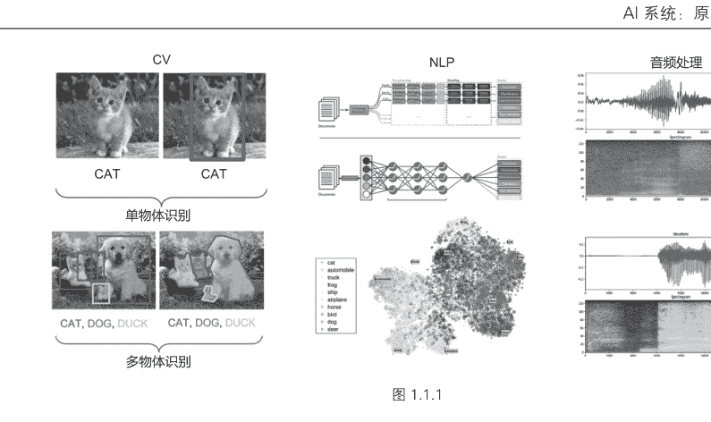

- 图像与视频识别：神经网络可高度准确地识别与分类图像视频，支撑图像搜索、内容审核、推荐系统等场景。例如在百度、谷歌等搜索引擎上传图片可获取相关信息；抖音、Meta等平台利用深度学习分析图像视频内容进行过滤；电商平台如淘宝通过识别用户浏览购买行为进行个性化商品推荐。

- 物体检测与跟踪：广泛应用于自动驾驶、无人机等场景。例如自动驾驶汽车用深度学习识别跟踪周边车辆、行人及其他物体；无人机可实时检测跟踪野生动物、车辆等目标。

- 人脸识别：可高精度识别匹配人脸，应用于安全验证、智能门禁、智能监控、个性化营销等。例如银行金融机构用于身份验证；企业与住宅区用作门禁控制替代钥匙与门禁卡；零售业通过分析顾客面部特征与购物习惯提供定制化服务。

如图1.1.2所示，深度学习在CV领域正从图像分类、目标检测、语义分割逐步迈向图像生成乃至三维重建。

##### 2. NLP 领域应用
自然语言处理研究如何让计算机更好地理解与处理自然语言，深度学习极大推动了其发展。核心包括文本处理、自然语言理解与词向量表示。

- 文本处理：对文本数据进行分词、词性标注、句法分析、语义分析等处理，帮助计算机更准确理解自然语言文本。

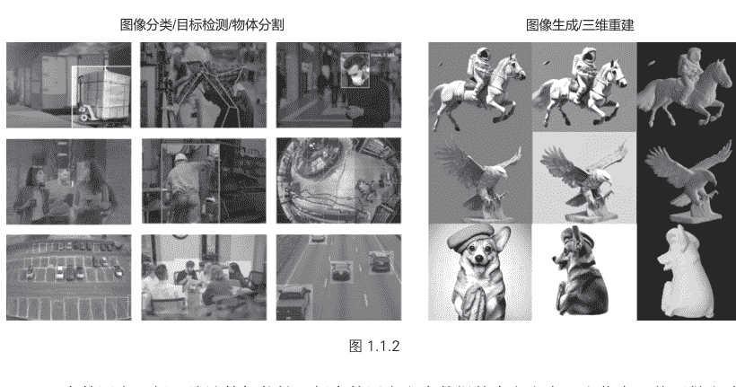

- 自然语言理解：使计算机能把握文本含义与上下文信息，从而做出响应与决策。

- 词向量表示：将词语转化为计算机可处理的数据格式。深度学习通过神经网络在大规模语料上训练学习词向量，能更好捕捉语义，为后续任务提供基础。

典型任务包括文本分类与情感分析、机器翻译等。

- 文本分类和情感分析：可通过卷积神经网络或循环神经网络等模型对文本分类或进行情感分析。例如用CNN识别文本类别，用RNN判断情感倾向。

- 机器翻译：将一种自然语言自动译为另一种语言。深度学习可通过神经网络在大规模双语语料上训练实现高质量翻译。

如图1.1.3所示，AI在自然语言处理的最新应用已发展到借助大语言模型实现人机对话、摘要自动生成与信息检索。近期大模型应用迅猛涌现，出现大量如KIMI等基础大模型公司及相关应用。

##### 3. 音频处理领域应用
深度学习为音频信号自动处理与优化提供强有力工具与算法，极大提升效率与准确性，推动智能音频处理进步。可实现音频信号分析、语音识别、音频生成等任务。


图1.1.3

- 音频信号分析：实现音频分类、分割、降噪等。例如训练深度神经网络提取特征对音频分类或分割；通过学习噪声与信号模型自动消除噪声。

- 语音识别：利用深度神经网络将语音信号转化为文本，常见于语音助手、语音翻译、语音控制等。神经网络可自动学习语音特征并通过大规模训练提升精度。

- 音频生成：可生成逼真语音合成结果，也可学习音乐模式与结构自动生成新作品。

相较传统方法，深度学习的音频应用可实现端到端处理与跨模态融合。

- 端到端音频处理：传统方法多为多步骤多模块，端到端可将步骤整合。通过训练端到端神经网络可直接从原始音频提取特征并完成处理，简化流程并提升效率。

- 跨模态音频处理：可将音频与其他模态信息如文本、视频融合，实现更丰富准确的分析和合成。

如图1.1.4所示，如今AI已广泛应用于音频处理，除基于内容自动生成音频等人性化音视频辅助功能外，还可实现音频分类、音频自动对齐等提升生产力的应用。未来AI在智能音频处理中的应用将进一步创新，满足不断增长的需求。


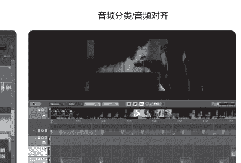

图1.1.4

#### 1.1.2 AI 场景与行业应用

AI 技术落地全景扫描
技术成熟度提升推动智能系统从探索走向规模部署，金融、医疗、教育、互联网、自动驾驶、制造等多个垂域已形成广泛覆盖，分布示意见图 1.1.5。

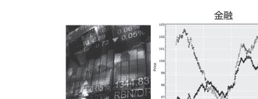

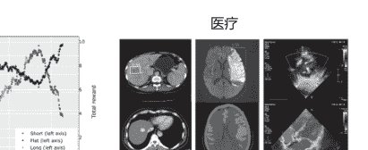


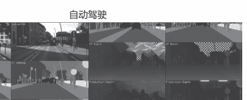

图 1.1.5

- 金融：银行与保险是商业化最先起步的领域。借助深度网络，征信评估、风险管理、反欺诈等环节实现自动化研判。国内多家银行与险企已将智能能力嵌入业务流程，如中国银行、中国平安、招商银行等，通过对客户数据的快速处理与分析提升运营效率并降低风险敞口。
- 医疗：医疗是重要应用方向。深度网络可支撑疾病诊断、药物研发、病历管理等环节的智能分析。国内多家医院已开始试验智能方案，部分顶尖学术机构亦利用模型开展医学研究，如清华大学、北京大学、复旦大学等。依托智能加速病历处理，诊断准确率得到改善，药物研发成本亦呈现下降。
- 教育：教育正被个性化重塑。深度网络可承载个性化学习、智能辅导、智能评测等需求。系统会依据学习者的具体情况生成定制内容，从而提升学习成效并在一定程度上降低教学成本。
- 互联网：谷歌、百度、微软必应等公司利用智能技术优化文本向量表示，提升检索质量，同时进行点击率预测以获取更高收益。
- 自动驾驶：借助深度网络，自动驾驶系统能更精准识别车道线与障碍物，更审慎地做出驾驶决策，更平稳地控制行驶状态。例如目标检测模型可帮助提升路标、车道线识别能力，进而强化整体方案。深度网络还能增强车辆的场景适应性与智能水平，使其在复杂路况与多元场景下表现更可靠。未来该技术将在此领域扮演愈发关键角色，推动产业进步与应用扩展。

整体来看，落地成功的企业通常会在底层算力与系统层面持续投入，通过提升神经网络的生产效率更快获得表现更优的模型，从而建立竞争优势。随后借助业务场景反哺获取更多数据。随着数据积累与研发投入加大，这些公司能够持续推动智能系统与工具链的演进创新。

#### 1.1.3 AI 基本理论奠定

尽管近年智能突破显著，其核心理论尤其是神经网络的雏形在浪潮兴起前已基本成型。作为智能基石，神经网络的演化可划分为以下阶段。

##### 1. 萌芽兴奋期（20 世纪 50 年代~20 世纪 70 年代）

1943 年，神经科学家 Warren A. McCulloch 与控制论专家 Walter Pitts 基于数学与阈值逻辑构建了首个神经网络计算模型，该成果发表于 *A logical calculus of the ideas imminent in nervous activity*。该论文奠定了网络基础，也对人工智能研究产生深远影响。

早期探索催生机器定理证明、跳棋程序等成果，掀起人工智能第一次高潮。1950 年，Alan Turing 提出“图灵测试”，用以判断机器是否能展现出难以与人类区分的智能行为。

1957 年，Frank Rosenblatt 发明感知机 Perceptron（图 1.1.6），为后续发展奠定架构。该模型本质上是线性分类器，可对训练样本进行二分类并在训练过程中自动调整权值。感知机的面世激发学界对人工神经网络的关注，具有里程碑意义。其计算以矩阵乘加为主，影响了后续智能芯片与系统的基本算子，例如英伟达新一代 GPU 中为矩阵运算设计的 Tensor Core。

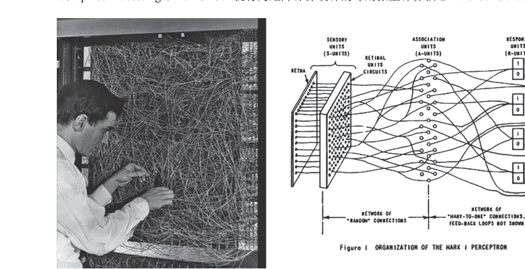

1960 年，Bernard Widrow 与 Hoff 提出自适应线性神经网络 Adaline 以及多层网络 Madaline，首次尝试把线性层叠加形成多层感知机结构。Adaline 与 Madaline 的出现为后续深度结构提供了基础，也带来了大模型与模型并行等系统挑战。

1969 年，Marvin Minsky 与 Seymour Papert 在 *Perceptrons: an Introduction to Computational Geometry* 中证明单层感知机无法解决线性不可分问题，例如异或问题，指出了当时网络的两个主要缺陷：①基础感知机无法处理异或回路；②当时计算设备算力不足以支撑复杂网络。因此一段时间内研究陷入停滞，但也为后来人工智能的两大驱动埋下伏笔，即提升硬件算力以及通过增加层数与非线性运算如激活函数、最大池化等提升非线性能力。

1974 年，Paul Werbos 在博士论文 *Beyond regression : new tools for prediction and analysis in the behavioral sciences* 中提出误差反向传播算法，使得多层网络训练成为可能，有效解决了异或问题。该工作奠定了人工智能训练范式——训练系统的核心步骤是持续反向传播；同时，为支持反向传播，编程语言与框架默认提供自动微分 Automatic Differentiation 能力。

##### 2. 蓬勃发展期（20 世纪 80 年代~21 世纪 00 年代）

1986 年，Rina Dechter 在 AAAI 发表论文 *Learning while searching in constraint-satisfaction-problems*，将“深度学习 Deep Learning”一词引入机器学习社区。

1989 年，Yann LeCun 在论文 *Backpropagation applied to handwritten zip code recognition* 中提出可通过反向传播训练的卷积神经网络 LeNet，启发了后续卷积网络的研究。卷积神经网络是智能系统的重要负载，大多数系统需在该类网络上验证性能，基准测试中也大量引入卷积网络。

20 世纪 90 年代中期，统计学习兴起，支持向量机 SVM 成为主流，神经网络发展再次进入低谷。

2006 年，Geoff Hinton 与 Ruslan Salakhutdinov 的论文 *Reducing the dimensionality of data with neural networks* 表明，多层前馈网络可逐层预训练，将每层视为无监督受限玻尔兹曼机，再用监督反向传播微调。该研究聚焦深度信念网络 Deep Belief Net 的学习过程，对深度学习发展作出重要贡献。当时得益于计算能力提升与大数据可用，人工智能再次加速。

2009 年，李飞飞团队在佛罗里达举行的 CVPR 会议上以海报形式首次展示 ImageNet 数据库（Deng et al., 2009）（图 1.1.7）。

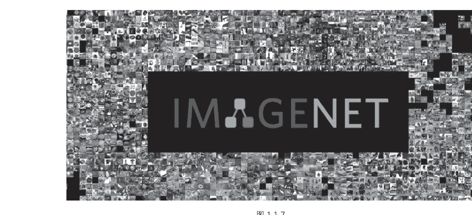

图 1.1.7

##### 3. 突破驱动繁荣期（约 21 世纪 10 年代）

2011 年，微软研究院 Frank Seide、Gang Li 与 Dong Yu 在 Interspeech 大会发表论文 *Conversational speech transcription using context-dependent deep neural networks*，展示深度神经网络在会话语音转录方面的突破——在单通道非特定人语音识别基准上，相对错误率由 27.4% 降至 18.5%，相对降幅达 32%；在另外 4 类任务中亦观察到 22%~28% 的相对错误率下降。

该网络的训练依托于高效分布式系统，系统设计了适合作业的张量切片与放置及通信协调策略以加速训练，部署于多台配备英伟达 Tesla GPGPU 的服务器上，经过数百小时训练完成。论文致谢中提到 “Our special thanks go to Ajith Jayamohan and Igor Kouzminykh of the MSR Extreme Computing Group for access to a Tesla server farm, without which this work would not have been possible”，可见算法团队与系统团队的协同由来已久，算法与系统的协同设计将以往不可完成的计算变为可能，上层应用需求驱动系统演进，系统也支撑上层应用取得新突破。

2012 年，谷歌的神经网络从 1000 万个 YouTube 视频的静止画面中学习识别猫。研究人员通过连接 16000 个处理器构建了当时最大规模的机器学习神经网络之一，处理器分散在互联网上自行学习，大规模互联算力支撑了更大数据集与模型的训练。该工作论文 *Building high-level features using large scale unsupervised learning* 发表于 ICML 2012（Le et al., 2012）。

2012 年 9 月，Alex Krizhevsky、Ilya Sutskever 与 Geoffrey Hinton 团队设计的 AlexNet（图 1.1.8）赢得 ImageNet 竞赛，深度神经网络重新流行。AlexNet 首次引入 ReLU 激活函数，并在 LeNet5 基础上加入 Dropout 层以减少过拟合、加入 LRN 层以增强泛化能力。这些新结构与训练方法影响了后续模型设计与系统优化，例如激活函数与卷积层内核融合计算。AlexNet 使用 2 块英伟达 GTX 580 3 GB GPU 训练约 5~6 天，若 GPU 更强、数据更多，结果有望更优。

截至 2012 年，以英伟达为代表的芯片厂商已连续发布 Tesla、Fermi、Kepler 架构商用 GPU 与多款消费级 GPU，这些 GPU 开始用于加速智能算法与模型研究，并被业界用于产品。同时从 AlexNet 可见，研究人员基于 CUDA API 编程实现 cuda-convnet，智能系统与工具伴随算法突破与需求应运而生。

此后，以 ImageNet 等公开数据集为代表的各领域公开数据或基准测试，驱动着 CNN、RNN、Transformer、图神经网络 GNN 等智能模型结构的发展与创新。

#### 4. 大模型带来新机遇（约 21 世纪 20 年代）

随着网络结构向更深、参数更多演进，出现多种基于预训练模型参数微调的特大参数模型。2021 年 8 月，李飞飞教授与 100 多位学者联合发布长达 200 多页的研究报告 *On the opportunities and risk of foundation models*，系统综述大规模预训练模型面临的机遇与挑战，报告将基于深度神经网络与自监督学习、在大规模广泛来源数据上训练的模型称为大模型（Bommasani et al., 2021）。

大模型涵盖多种预训练模型，如 BERT、GPT、CLIP、DALL·E 等。当前基础模型涉及的技术子域包括模型的构建、训练、微调与评价，以及模型加速、数据处理、安全性、稳健性、对齐 Alignment、模型理论、可解释性等方面。大模型仍处于快速演进阶段。

## 小结与思考

- 本节围绕智能的历史、现状与发展展开系统研究，需深刻理解上层智能计算应用负载的特点、演进与趋势，才能找到系统设计的真实需求与优化空间。
- 智能在 CV、NLP、音频处理等技术域及金融、医疗、教育等行业均有广泛应用，其模型结构与部署需求不断变化，带来挑战与机遇。
- 智能的基本理论神经网络经历了萌芽兴奋期、蓬勃发展期、突破驱动繁荣期，其发展受硬件算力与模型创新共同推动。近年来大模型的出现带来新机遇，涵盖多种预训练模型，相关技术子域仍在快速发展。

## 1.2 AI 发展驱动力

AI 可追溯至 20 世纪 50 年代，发展历经起伏，多次繁荣与低谷，直至 2016 年 AlphaGo 战胜世界围棋冠军李世石，AI 才在公众中掀起广泛热度，标志新一轮热潮。其实智能技术早在此标志性事件前已在众多互联网公司中得到广泛应用与部署。例如搜索引擎排序、图像检索、广告推荐等功能背后均有智能模型支撑。

可以认为机器学习是实现 AI 的一种方法，而深度学习是实现机器学习的一种技术。当前深度学习取得突破性进展，是 AI 中最为前沿与重要的技术，正不断在广泛场景替代传统机器学习模型。神经网络是深度学习的具体实现形态，使用神经网络模型来表达机器学习中的深度学习范式。

鉴于上述关系，后续章节将以人工智能一词代指神经网络这一具体实现形态。

### 1.2.1 AI 学习方法

在展开智能系统设计相关内容前，需先了解智能的原理与特点。以下以实例说明智能的工作方式，假定读者具备一定基础，相关概念在此不作过多解释。

结合图 1.2.1，深度神经网络的开发与工作模式可概括为以下步骤：

- 确定模型输入输出：首先需明确神经网络模型的输入样本 Sample 与输出标签 Label。例如图 1.2.1 中向模型输入图片，输出图片所对应的类别马冬梅、马小梅、马红梅、马绿梅。用户需提前准备好输入输出数据，再展开后续训练。
- 设计与开发模型：开发者借助智能框架提供的 API 构建神经网络模型。在基本表示中，一般线段代表权重，圆圈代表输入数据发生变化的具体计算操作。其中权重用 w_i 表示，是可被学习并不断更新的数值，简称为网络模型的参数。
- 训练 Training 过程：训练本质是通过网络中连接逐层反向传播总误差，计算各层中每个权重与偏差对总误差的贡献即梯度 dl/dw_i，随后使用求解梯度的优化算法如梯度下降算法去寻找数据的鞍点，从而优化网络权重参数与偏差，最终最小化神经网络的总误差即 Loss 值。

因此训练过程即根据用户提供的带标签数据集，如图 1.2.1 中多张马冬梅图片及其确定性输出标签马冬梅，不断通过优化算法进行学习。学习的核心是通过以下步骤寻找给定数据集下最优模型权重 w_i 的取值。

（1）前向传播 Forward Propagation：由输入到输出完成各层矩阵计算如卷积层、池化层等，产生输出并完成损失函数计算。
（2）反向传播 Back Propagation：由输出到输入反向求解各层权重与输出对损失函数的梯度。
（3）梯度更新 Weight Update：通过梯度下降算法依据梯度与指定学习率更新模型权重。

不断重复以上 1~3 步，直至智能模型收敛即总误差 Loss 值降至预设阈值，或达到终止条件如指定迭代 Step 次数后停止训练。

如图 1.2.2 所示，完成模型训练意味着在给定数据集上模型已达到最佳或满足需求的预测效果。若开发者对预测效果满意，即可进入模型部署与推理。一句话说，我们训练智能模型就是通过不断迭代计算，用梯度下降的优化算法使 Loss 值逐步减小。Loss 值越小，表示算法越接近数学意义上的最优。

推理 Inference 过程：推理仅需执行训练过程中的前向传播。原理是基于训练好的智能模型，输入待预测数据，经前向传播即通过模型定义的激活函数与非线性函数处理数据，得到最终预测结果。

从图 1.2.1 的下半部分可以看出，数据进入模型后会逐层被加工，卷积、池化等算子依次起作用，最后输出结果。以“马冬梅”这张照片为例，网络输出的是一个概率向量，每个分量对应一种类别的可信度，其中“马冬梅”对应的分量最大，于是被判为马冬梅，见图 1.2.3。随后业务层会把这个类别结果转成人类可读的提示。

后面章节要讲的人工智能系统，本质上就是围绕这类训练与推理任务的全生命周期做的工程化封装，目的在于给算法工程师更友好的建模与开发体验。

### 1.2.2 AI 模型现状

眼下可用的模型种类非常丰富，图 1.2.4 只是一个缩影。每年都有新结构面世，其中一部分常被拿来做系统评测的参照物，新结构层出不穷也在持续推动系统设计演进。

比较有代表性的几类可以概括如下：

- **卷积神经网络 Convolutional Neural Network，CNN**：以卷积层、池化层、全连接层等算子堆叠而成，在视觉任务里表现突出、使用广泛。
- **循环神经网络 Recurrent Neural Network，RNN**：由循环单元、长短期记忆 LSTM 等单元构成，擅长处理时序数据，如自然语言、语音识别、序列监控等。
- **图神经网络 Graph Neural Network，GNN**：面向图结构数据，用神经网络挖掘其中的特征与模式，可支撑聚类、分类、预测、分割、生成等图学习任务，核心是提取图里潜在的表征。
- **扩散概率模型 Diffusion Probabilistic Model**：一类潜变量的变分估计马尔可夫链模型，通过刻画数据点在潜空间中的扩散过程来学习数据分布。比如在视觉里，通过逆扩散过程训练网络，对叠加高斯噪声的图像做去噪。
- **生成对抗网络 Generative Adversarial Network，GAN**：训练两个网络互相博弈，从已有训练集生成更逼真的新样本，可用于合成新图像或原创音乐，因二者对抗而得名。

底层算子已经被框架和硬件大量优化，但模型演进早已不局限于算子，结构与搜索空间的变化更明显，图 1.2.5 可见：

- **体量更大**：以 Transformer 为主干的预训练神经语言模型如 BERT、GPT、LLAMA 系列，在自然语言与视觉场景渗透加深。大语言模型 LLM 已成为深度学习的重要分支，层数与参数的持续膨胀对内存管理、分布式训练和集群硬件设计提出严峻挑战。
- **形态更灵活**：图神经网络、深度搜索树网等通过抽象图、树等多样数据结构应对复杂建模，进而催生图卷积等新算子和对应的计算框架。
- **结构更稀疏**：以混合专家模型 Mixture of Experts，MoE 和 Pathways 为代表的融合结构，让运行时执行更动态、更稀疏，提升训练效率、降低成本、可支撑多任务。这对静态分析构成挑战，却也推动即时编译 Just-in-Time，JIT 与运行时的优化，实现更高效调度。
- **训练方式更多样**：扩散模型、深度强化学习等流程比传统训练复杂得多，催生出训练、推理、数据处理混合部署与协同优化的需求。

### 1.2.3 AI 系统的出现

本轮热潮由三股力量共同推动：数据沉淀、算法突破、算力支撑。下面分述。

#### 1. 大规模数据驱动

数字化进程让信息系统沉淀了海量数据。人工智能以数据驱动的方式从中学习规律、构建模型，完成分类、回归等任务。

互联网平台拥有庞大用户群，用户在使用服务时会持续上传文字、图像、音频等内容，为平台积累更丰富多元的数据资产。随着业务增长和新功能上线，数据体量持续扩大、模式愈加多样，倒逼公司早早搭建大数据管理与处理平台。基于海量数据训练神经网络，可以优化业务流程、提升用户体验，比如用点击率预测做个性化推荐，形成用户增长的正循环。相比学术界，工业界尤其是互联网公司更早把深度学习推向实用，并持续投入研发来应对业务需求。

典型的来源包括：

- 搜索引擎 Search Engine：图像检索领域出现 ImageNet、Coco 等视觉数据集；文本检索领域出现 Wikipedia 等语言数据集。
- 移动应用 Mobile Application：留存用户依赖数据分析。国内知乎、小红书等是优质数据源代表，而天涯论坛、百度贴吧等因广告泛滥、用户流失，数据质量已下降。淘宝、拼多多等平台通过购买和浏览记录构建了庞大的推荐与广告数据集。

以图像分类为例，图 1.2.7：早期 MNIST 手写数字识别只有 6 万样本、10 类；随后 ImageNet 出现，有 1600 万样本、1000 类；再到 Web 服务积累的数亿级图像，规模不断跃迁。海量数据带来挑战，也实质性提升了神经网络效果，因为以深度学习为核心的算法本身就是从数据中学习，数据的质量与数量决定模型上限。

海量数据集带来的影响：

- 推动算法在确定任务上不断提高准确度、降低误差，形成用户基础、场景驱动力和研发投入。
- 扩展应用广度，产生商业价值，吸引产学研投入。
- 传统机器学习库难以处理海量数据，单机训练吃力，促成分布式训练与集群发展。
- 多样的数据格式与任务增加了模型复杂度，要求框架和编译体系具备更灵活的表达能力。

总体看，人工智能系统比传统机器学习系统需要更丰富的表达、更大规模更多样的数据集和更广阔的用户基础。

#### 2. AI 算法的进步

研究者不断设计新算法与新结构以提升预测效果。新的范式需要框架提供更高的编程表达力和灵活性，而性能优化往往改写神经网络的执行逻辑，对框架开发和编译器优化构成挑战，也反过来推动系统发展。

从两个维度感受进步：

##### 1）精度超越传统机器学习

以 MNIST 为例，1998 年简单的 CNN 就能接近 SVM 的最佳表现；到 2012 年，CNN 的错误率降至 0.23%，逼近人类 0.2% 的水平。图 1.2.8 显示不同算法在 MNIST 上的表现趋势，神经网络的提升潜力让研究者不断尝试新结构并在更复杂数据集上验证，进而驱动各行业的研发投入。

##### 2）公开数据集上突破

每年 ImageNet 上新模型不断刷新纪录，体现出更深更大的潜力。从 1998 年 LeNet 到 2012 年 AlexNet，效果提升伴随模型规模扩大、GPU 训练引入、ReLU 等新计算层出现。到 2015 年 Inception，计算图更复杂、出现新的计算层；同年 ResNet 层数突破百层。2019 年 MobileNet V3 的 NAS 显示模型设计正向自动化发展，错误率持续下降。

提升主要来自：①更优的激活函数与网络层，如 ReLU、Batch Normalization；②更深更大、权重更多的网络结构；③更好的训练技巧，如正则化、初始化、学习方法、自动机器学习与结构搜索。

这些进展激励算法投入，也要求系统提供新算子支持与优化，推动框架和编译器在前端设计、中间表示、系统算法协同上的演进。

#### 3. 算力与体系结构进步

自 1960 年起，计算机性能按摩尔定律增长，20 世纪初提升约 10^8 倍。随着摩尔定律放缓，单纯工艺进步难以满足需求，于是出现面向特定应用的专用芯片，通过剔除通用处理器冗余功能来提升效率。GPU 先对图像类算法进行硬件加速，随后出现通用 GPU GPGPU，对单指令流多数据流 SIMD 或单指令多线程 SIMT 类并行负载加速显著。

近年来人工智能芯片异军突起，代表是谷歌的张量处理单元 Tensor Processing Unit，TPU。TPU 将神经网络算子抽象为矩阵乘法或非线性变换，用流水线化的脉动阵列 Systolic Array 执行，减少访存、提升计算密度。华为昇腾 NPU 同样聚焦矩阵运算优化，达芬奇架构的 3D Cube 设计每周期可完成 4096 次 MAC 运算，提供强劲算力。

除了算子定制，稀疏性和量化等算法层面的加速手段也被硬件厂商集成到专用加速器中，例如英伟达的 Transformer Engine。定制化硬件可将处理器性能提升约 10^5 量级。

硬件演进带来了算力跃升，但算力仍可能短期成为瓶颈。未来的提升路径，除了单芯片的 Scale Up，系统工程师更强调通过分布式计算系统实现 Scale Out，构建人工智能集群，同时挖掘深度学习的稀疏性等特性，以算法、系统、硬件协同设计进一步提升效率。

小结与思考

- 人工智能技术自 20 世纪 50 年代起历经数轮高潮，2016 年 AlphaGo 的胜利重燃公众热情，人工智能已在搜索引擎、图像检索、广告推荐等互联网场景广泛落地。
- 本轮热潮的三大根源：大数据积累、深度学习等算法的突破、超大规模计算能力的支撑。
- 系统发展受数据、算力、算法三者共同推动，当前模型持续演进，算力和体系结构进步提供执行性能的同时，也带来新的系统设计挑战。

### 1.3 AI 系统架构介绍

在了解了人工智能的发展脉络、模型算法、硬件与数据的趋势后，可以看出系统的重要性。本节从设计目标、组成、框架层与生态展开全景，帮助建立知识体系。

系统需要通盘考虑性能、用户体验、稳定性等指标，在开源环境下社区运营也成为推广的关键。下面从不同维度呈现全景。

### 1.3.1 AI 系统基础

#### 1. AI 系统基本概念

应用层、中间层、硬件层是信息技术常见的分层。传统本地部署时代，数据库、操作系统、中间件作为中间层连接硬件与应用，负责硬件控制、数据存储管理、网络调度等共性功能，隔离底层复杂性，让开发者专注业务。云计算时代形成 IaaS、PaaS、SaaS 三层架构，PaaS 提供开发环境和数据分析服务。

类比来看，人工智能时代同样存在连接算力和应用的基础设施中间层，提供基础模型服务、模型微调能力与应用开发支撑，这就是人工智能系统。简单理解，系统是连接硬件与上层应用的中间层软硬件基础设施。但这种类比并不完整，因而有些语境称其为 AI Infra，即人工智能基础设施。然而“基础设施”更偏向底层硬件与集群，而系统更强调让人工智能跑起来的整体体系结构，本书倾向用人工智能系统来概括这一软硬件综合概念。

#### 2. AI 系统详细定义

开发者通常用 Python 等语言以及 PyTorch、MindSpore 等框架编写模型 API，声明训练作业和部署流程。从早期 AlexNet 直接用 CUDA 实现，到后来用 Python 灵活调用的框架，再到现在习惯用 HuggingFace 的组件对大语言模型进行微调，都是系统工程师贴合需求不断研发工具、提升生产力的结果。然而，面对自动化机器学习、强化学习等多样化执行方式和细分场景，现有框架的灵活性与效率已显不足，需要大量定制优化。若无好的工具支撑，算法工程师的研发效率会被拖慢，也会制约算法发展。因此社区不断涌现领域专用框架与工具，如 Hugging Face 的 ModelZoo、OpenMMLab 的 MMDetection、FAIR 的 FairSeq、微软的 NNI 加速库等，实现定制化设计与性能优化，提供更简洁的接口。

不同领域的输入格式、输出形式、数据获取方式各异，造成模型结构与训练方式的多样化需求。各家公司和组织持续研发面向特定领域的框架或上层封装，以帮助数据科学家快速验证想法并工程化部署。代表有 Facebook 演进为 PyTorch 的 Torch、谷歌的 TensorFlow 与 JAX、华为的 MindSpore。

硬件厂商则针对人工智能设计了众多专用芯片如 GPU、TPU、NPU 来加速训练微调和推理部署。微软、亚马逊、特斯拉等已部署数万张 GPU 用于模型训练，OpenAI 等组织持续挑战更大规模分布式训练。英伟达、华为、英特尔、谷歌等企业不断推出基于模型特点的加速器芯片与模块，如 Tensor Core、脉动阵列等，提供更强算力。

从顶层的算法应用、框架到底层的编译与计算架构，再到硬件与体系结构，这整套全栈即构成了人工智能系统，其架构如图 1.3.1 所示。

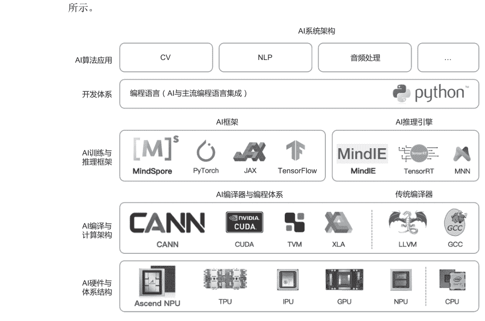

从另一个维度看，人工智能体系本身就可以被视作机器学习方法的一种实现形式，也可以反过来借助机器学习的手段来完成自身任务，比如自动化机器学习、集群调度管理等。系统层面的方法论具有很强的迁移性，部分源自机器学习的实践经验，也能够反向赋能机器学习系统的构建。站在系统工程师的角度，必须持续关注算法与应用的演进趋势，才能设计出真正贴合实际场景的工具与平台。

#### 3. AI 系统设计目标

AI 系统要实现的效果可以归纳为以下几个方向。

##### 1）高效的编程语言、开发框架和工具链

需要设计出表达力更强、形式更简洁的神经网络计算原语和高级编程语言，从而提升应用研发效率，让使用者无需关注底层硬件计算细节，同时保留对原语的灵活操控能力。目前除少数垂直领域的算子与流程可以复用，比如自然语言处理中 Transformer 已成为通用基础之外，新架构新算子的探索依然高度依赖反复试验。如何在不被传统算子与基础模型束缚的前提下，清晰描述全新算子、算子组合与融合方式，是语言、库与框架层必须提供的能力。

同时要提供更直观的编辑、调试与实验环境，帮助开发者完成从模型搭建、测试、调参、问题定位到修复优化的闭环，从而提高应用的性能与鲁棒性。训练过程很少一帆风顺，常常出现损失不收敛、Loss 变成 NaN、内存溢出等算法缺陷。工具链与体系在设计之初就应内置可观测性与可调试性，并开放自定义扩展能力，若仅事后修补，开发体验会很糟糕，开发者会觉得像在操作黑盒。

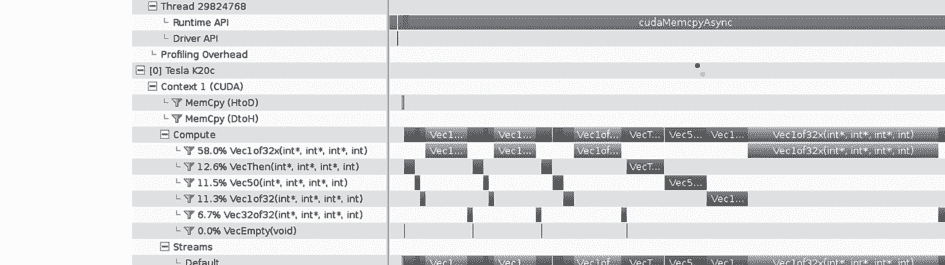

必须覆盖人工智能全生命周期的各个环节，包括数据处理、模型研发训练、压缩推理、安全与隐私保护等。体系不仅要能搭建模型，还要贯穿完整开发流程，并在内部对各环节进行分析与优化。关键在于建立完善的基础设施，以便快速复现社区成果、批量验证新思路、进行高效试错。成熟的全生命周期管理能够显著提升算法层的生产效率。

##### 2）AI 任务系统级支持

除了对深度学习训练与推理的支持，还应兼容强化学习、自动机器学习等新兴范式。例如强化学习需要不断与环境或模拟器交互获取新样本，AutoML 则要批量提交大规模搜索任务。这些范式打破了过去仅支持单模型的局面，在多模型协同、训练与推理任务层面创造了新的系统抽象与资源作业管理需求。

需要提供更强大且可扩展的算力，使程序能够运行在支持并行计算的节点或集群之上，应对大模型与大数据带来的挑战。模型正朝更大规模与多模态方向发展，体系必须支撑更庞大的模型体量与更多输入模态。同时企业数据持续积累，数据规模带来的压力也在增加。在摩尔定律放缓的背景下，并行与分布式计算成为扩展存储与算力的核心手段。

自动编译优化也不可或缺。①计算图的自动推导：最大化利用符号执行或即时编译技术获取计算图信息，让框架或编译器自动完成定制化计算优化。②基于不同体系结构的自动并行：面对部署端架构多样化与训练期硬件异构化的趋势，框架应让使用者透明地配置任务并自动完成并行化，以最优方式在集群上并行运行、减少 I/O，充分利用通信带宽，逼近硬件性能上限。

云原生自动分布式化也是必要要求。在云原生环境下，体系需要支持自动将任务并行扩展到多个计算节点，在云与集群场景中自动完成任务的扩展与部署，以支撑分布式与弹性计算，让使用者按需调用资源。

##### 3）探索并解决新挑战下系统设计、实现和演化

随着算法演进，体系面临新的需求：要支持动态图与动态 Shape，利用网络结构稀疏性进行压缩加速优化；要提升 TTA 指标以实现混合精度训练与部署；还要兼容混合训练范式如强化学习、多任务如自动机器学习等特性。

需要满足更大规模企业级环境的部署需求。例如云环境下的多租户协同训练与部署：多个组织、研究员与工程师共享集群资源，GPU 需求持续攀升，如何提供公平、稳定、高效的多租户运行环境是平台首要考虑的问题。

跨平台推理部署同样关键。边缘侧软硬件栈高度碎片化，如何做到一次训练即可跨平台部署到不同软硬件环境，是推理场景必须攻克的难题。

明确宏观设计目标后，可以进一步梳理人工智能生态中体系的技术栈构成、各概念的抽象层次以及层级间的关联关系。

### 1.3.2 AI 系统组成

表 1.3.1 列举了 AI 系统技术概念的组成。

表 1.3.1 AI 系统技术概念组成

| 概念层 | 内容 | 技术细节 |

| :--- | :--- | :--- |

| AI 算法应用 | 领域算法 | CV、NLP、音频处理：CNN、RNN、LSTM、GAN、Transformer、Stable Diffusion、Reinforce Learning |

| 开发体系 | 集成开发环境 | 编程环境：VS Code、Jupyter Notebook、PyCharm |

| | 编程语言 | 与主流编程语言集成：PyTorch、TensorFlow 等与 Python 集成 |

| AI 训练与推理框架 | AI 框架、推理引擎 | 中间表示、前端 API | 编译优化 | 图优化与图执行调度 | 推理优化 |

| | | 基本数据结构：张量 | 词法、语法、语义分析 | 计算图动静统一 | 常量折叠、冗余节点消除等 |

| | | 基本计算单元：有向无环图 | 自动微分 | 计算图控制流 | 模型压缩：蒸馏、剪枝与量化 |

| AI 编译与计算架构 | 编程编译 | 前端优化 | 数据格式布局转换 | 内存分配 | 公共子表达式消除 |

| | | 后端优化 | 代码优化、代码生成 | 算子循环优化 | 指令和内存优化 |

| | | 编程模型：CUDA、Ascend C、Band C | | AI 编译器：TVM、XLA、TC |

| | | LLVM、GCC | | |

| | 底层通信 | HCCL/NCCL、通信原语、集合通信算法 | | |

| AI 硬件与体系结构 | 底层硬件 | AI 芯片：CPU/GPU/ASIC/FPGA/TPU/NPU | | |

#### 1. AI 训练与推理框架

框架不仅指 PyTorch 这类训练框架，还包括推理框架。框架负责提供前端编程语言、接口与工具链，完成静态分析、计算图构建与编译优化等工作。通过 API 获取使用者对模型与数据读取的意图，在静态分析阶段尽可能自动构建前向计算图、补全反向传播图、进行全图与算子内循环编译优化。

该层致力于让使用者只需关注任务目标与算法，尽量屏蔽实现细节，例如声明式或命令式。但过度抽象会丧失灵活性，在模型快速迭代期仍需兼顾可调试性与可调性。它通常调用底层编排接口以提供更简洁的开发体验。主要覆盖：

- **网络模型构建**：CNN、RNN、Transformer 等结构以及 if-else 控制流等算子的 API 支持。当前多以 Python 内嵌调用框架方式开发模型，也出现了控制流在原生语言与中间表示间割裂的问题。
- **模型算法实现**：训练还是推理、监督还是强化学习等流程以配置或 API 形式供选择，部分框架提供拦截接口以便定制算法。
- **计算图构建**：静态图与动态图构建，静态图利于全图优化，动态图利于调试，二者正趋向融合，如 PyTorch 2.x 引入的 Dynamo 特性支持原生静态图。
- **自动求导**：框架预先封装通用算子的求导函数，训练触发时自动透明完成全模型求导，以支持梯度下降等训练算法所需的梯度获取。
- **中间表示构建**：通过多层次中间表示使模型更易被下层编译器编译生成高效后端代码。
- **工具链**：跨硬件迁移、跨框架迁移、模型转换、调试、可视化、类型系统等工程化支撑。
- **生命周期管理**：数据读取、训练推理流程的开发与管理，MLOps 让模块复用、信息传递与解耦演进成为可能。

#### 2. AI 编译与计算架构

框架为算法开发者提供了便利。早期框架多在学术界，如 Theano、Torch，随后工业落地不断催生新方案。

为映射到多样化硬件，需要将神经网络计算映射到不同架构。通用硬件上高度优化的线性代数库提供了加速基础，厂商还发布专属库如 MKL-DNN、cuDNN，但优化往往滞后于算法更新，且需定制化开发。

为解决多平台性能问题，TVM、Glow、XLA、Jittor 等编译器得到普及。它们以神经网络模型为输入，经一层或多层 IR 翻译优化后生成目标硬件代码，与传统编译器类似采用前端、IR、后端分层。人工智能编译器有四个明显特征：

- **主前端语言**：不依赖传统 Lexer/Parser，而是基于 Python AST 解析模型并构造计算图 IR，保留 Shape、Layout 等张量特征信息，部分还保留控制流信息。
- **多层 IR 设计**：上层抽象便于开发者，底层打破算子边界，从循环调度等细粒度维度结合硬件特点优化。
- **面向神经网络优化**：主要数据类型为张量，反向传播需支持自动微分。
- **DSA 芯片架构支持**：以专用人工智能加速芯片为中心，这是与通用编译器的区别。

该层负责模型运行前的编译与运行时的动态调度优化。模型部署于单卡、多卡或分布式集群时，运行时需按执行顺序调度算子、匹配任务、多路复用资源并管理内存。包括：

- **编译优化**：算子融合降低内核启动与访存开销，支持循环优化与面向深度学习的近似等价替换。
- **优化器**：运行时 JIT 优化、内省式优化，利用硬件信息、软件栈、数据分布等运行时信息进一步优化。
- **调度与执行**：算子并行调度与单/多线程执行，结合 NPU 软件栈与硬件策略进行装箱调度。
- **硬件接口抽象**：对 GPU、NPU、TPU、CPU、FPGA、ASIC 等统一抽象，解耦优化策略与底层设备。

#### 3. AI 硬件与体系结构

该层负责程序的真正执行、互联与加速，并在更广层面提供作业调度、运行期资源分配与环境隔离。包括：

- 资源池化管理与调度：异构资源集群管理，将服务器池化后通过高效调度器结合作业特点与拓扑调度，对云资源管理至关重要。
- 可扩展网络栈：RDMA、InfiniBand、NVLink 等，提供芯片间高效互联、更高带宽、灵活通信原语与高效聚合算法如 All-Reduce。

## 小结与思考

- 人工智能体系是连接硬件与上层应用的软硬件基础设施，包含编程语言、开发框架等，设计挑战众多。
- 设计目标包括高效的编程语言与工具链、对多种任务的系统级支持，以及在新挑战下演进系统设计与实现。
- 体系大致分为训练与推理框架、编译与计算架构、硬件与体系结构，还涵盖更广的系统生态。

## 1.4 AI 系统与 AI 算法关系

模型算法开发者通常用 Python 等高级语言通过框架 API 编写算法，而底层系统问题被框架抽象隐藏。在代码背后，每一层究竟发生了什么？有哪些有趣的系统设计问题？

本节以 PyTorch 实现 LeNet5 为例，引导读者深入理解体系各层次，并与后续内容建立联系。

### 1.4.1 神经网络样例

#### 1. AI 训练流程原理

如图 1.4.1 所示，神经网络接受左边的手写字符图片输入，产生右边的数字分类输出，这个过程称为前向传播。

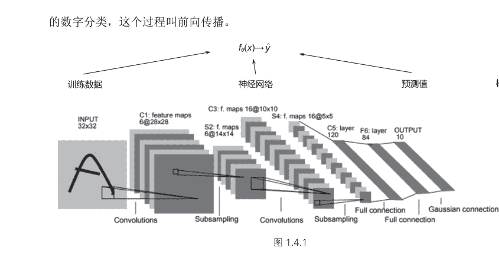

基于已有输入输出数据，如何得到预测效果最好的模型？这就需要训练，训练可抽象为数学优化问题，优化目标为

$$\theta = \underset{\theta}{\text{argmin}} \sum \left[ \text{Loss}(f_{\theta}(x), y) \right]$$

其中，$f_{\theta}$ 表示神经网络模型，例如 LeNet；Loss 表示损失函数；$x$ 表示输入数据；$y$ 表示标签值，即网络模型的输出；$\theta$ 称为权重，即网络模型中的参数。

训练就是寻找使损失函数值最小的 $\theta$。训练过程通过梯度下降等数值优化算法求解：

$$\theta = \theta - \alpha \delta_{\theta} \text{Loss}(\theta)$$

其中，$\alpha$ 称为学习率。训练完成后即可用 $\hat{y} = f_{\theta}(x)$ 进行推理与部署。

图 1.4.1 中，输入为最左手写图像，输出为分类向量，中间为各层特征图，可通过框架 API 定义构建。神经网络即通过各层算子将输入图像逐步计算得到类别概率向量。

> 算子：深度学习算法由多个计算单元组成，称为算子。框架中张量计算的种类很多，如加法、乘法、矩阵相乘、转置等，均可视为算子。

为便于描述计算图中的算子，对**算子**作如下定义：

**数学上定义的算子**：一个函数空间到函数空间上的映射 $O: X \rightarrow X$，对任何函数进行某一项操作都可以认为是一个算子。

狭义上，Kernel 指作用于张量的基本操作集合，包含四则运算、数学函数运算，以及对张量元数据的修改，例如维度压缩 Squeeze、形状调整 Reshape 等。

广义上，Function 表示智能计算框架内部对算子的完整实现，整合了任务调度、Kernel 调用、梯度计算与代码自动生成等模块。

在神经网络语境里，算子即模型中承担计算的单元。以 PyTorch 为例，层内的计算逻辑即为算子，卷积模块的卷积计算属于算子范畴，全连接模块的加权求和同样算作算子。

#### 2. 网络模型构建
构建网络通常分两步：
- 先确定结构，例如 LeNet5 这类经典结构，由卷积、最大池化、线性层组成；
- 再进入训练，采用 Batch 遍历数据，配置 NPU/GPU 资源数，执行前向求值得到损失，通过反向传播让优化组件更新参数。

下面以 MNIST 数据集演示 PyTorch 训练 LeNet5 的示例。

```python
import torch
import torch_npu

# 如果模型层数多，权重多到无法在单GPU显存放置，我们需要通过模型并行方式进行训练
class LeNet(nn.Module):
    def __init__(self):
        super(LeNet, self).__init__()
        # 通过循环Loop实现卷积理解卷积的执行逻辑，可以深入思考其中编译和硬件执行问题
        # 我们将会在第一篇、第二篇详细展开计算到芯片的关系
        self.conv1 = nn.Conv2d(3, 6, 5)
        self.conv2 = nn.Conv2d(6, 16, 5)
        self.fc1 = nn.Linear(16*5*5, 120)
        self.fc2 = nn.Linear(120, 84)
        self.fc2 = nn.Linear(84, 10)

    def forward(self, x):
        # 具体的执行API单位是算子，实际编译器或者硬件执行的是Kernel
        # 我们将会在第三篇推理引擎Kernel优化详细介绍算子计算执行的方式
        out = F.relu(self.conv1(x))
        out = F.max_pool2d(out, 2)
        out = F.relu(self.conv2(out))
        out = F.max_pool2d(out, 2)
        out = out.view(out.size(0), -1)
        out = F.relu(self.fc1(out))
        out = F.relu(self.fc2(out))
        out = self.fc3(out)
        return out

def train(args, model, device, train_loader, optimizer, epoch):
    # 如何进行高效训练，运行时Runtime是如何执行的
    # 我们将在第四篇AI框架基础进行介绍
    model.train()
    for batch_idx, (data, target) in enumerate(train_loader):
        data, target = data.to(device), target.to(device)
        optimizer.zero_grad()
        output = model(data)
        loss = F.nll_loss(output, target)
        loss.backward()
        optimizer.step()
        ...

def test(model, device, test_loader):
    model.eval()
    ...
    with torch.no_grad():
        for data, target in test_loader:
            data, target = data.to(device), target.to(device)
            # 推理系统如何高效进行模型推理
            # 我们将在第三篇AI推理系统进行介绍
            output = model(data)
            ...

def main():
    ...
    # 当前语句决定了使用哪种AI加速芯片
    # 可以通过第一篇的AI芯片基础去了解不同AI加速芯片的体系结构及芯片计算底层原理
    device = torch.device("npu" if use_cuda else "cpu")

    # 如果batch size过大，造成单NPU/GPU HBM内存无法容纳模型及中间激活的张量
    # 读者可以参考分布式训练算法，了解如何进行分布式训练
    train_kwargs = {'batch_size': args.batch_size}
    test_kwargs = {'batch_size': args.test_batch_size}
    ...

    # 如果数据量过大，那么可以使用分布式数据并行进行处理，利用集群的资源
    dataset1 = datasets.MNIST('../data', train=True, download=True, transform= transform)
    dataset2 = datasets.MNIST('../data', train=False, transform=transform)
    train_loader = torch.utils.data.DataLoader(dataset1,**train_kwargs)
    test_loader = torch.utils.data.DataLoader(dataset2, **test_kwargs)
    model = LeNet().to(device)
    optimizer = optim.Adadelta(model.parameters(), lr=args.lr)
    ...

    for epoch in range(1, args.epochs + 1):
        train(args, model, device, train_loader, optimizer, epoch)
        # 训练完成需要部署，如何压缩和量化后再部署
        # 可以参考第三篇推理系统进行了解
        test(model, device, test_loader)
        ...

if __name__ == '__main__':
    main()
```

### 1.4.2 算子实现的系统问题
框架里 Layer 被称为算子或操作符，其底层实现在编译器或芯片侧被称作 Kernel。Kernel 执行前一般先映射为矩阵运算，如通用矩阵乘 GEMM，再转译为循环指令。

#### 1. 卷积执行样例
程序层面卷积由多层嵌套循环表达，示例中省略了形状推导。展示了将 Conv2D 展开为七层循环进行 Kernel 计算的代码。

```python
# 批尺寸维度 batch_size
for n in range(batch_size):
    # 输出张量通道维度 output_channel
    for oc in range(output_channel):
        # 输入张量通道维度 input_channel
        for ic in range(input_channel):
            # 输出张量高度维度 out_height
            for h in range(out_height):
                # 输出张量宽度维度 out_width
                for w in range(out_width):
                    # 卷积核高度维度 filter_height
                    for fh in range(filter_height):
                        # 卷积核宽度维度 filter_width
                        for fw in range(filter_width):
                            # 乘加 (Multiply Add) 运算
                            output[h, w, oc] += input[h + fw, w + fh, ic] * kernel[fw, fh, c, oc]
```

#### 2. AI 系统遇到的问题
Kernel 真实运行会面临多项挑战：
- 硬件加速：GEMM 是视觉与自然语言模型的主力计算，NPU、GPU 以及 TPU 脉动阵列等专用 ASIC 的底层是否以矩阵乘法为支撑？这是硬件架构相关议题。
- 片上存储：输入、权重、输出张量能否全部放入 NPU/GPU 的 L1、L2 缓存？放不下时需借助循环分块 Loop Tile 做切片优化。
- 局部性：循环主体能否利用局部性？包括空间局部性，缓存行内相邻元素是否连续被访问，以及时间局部性，同一块内存多久后会被再次使用。预估后可通过编译调度优化执行顺序。
- 内存管理及扩展：工程师会预先计算每层输入、输出及核张量的大小，据此评估算力需求、设计内存管理及数据换入换出策略。
- 运行时调度：算子按序执行时，框架如何进行运行时管控？
- 算法变换：多层循环效率不高，能否转成更易优化的矩阵计算？
- 编程范式：何种编程方式能加快模型开发，降低算法工程师负担，使其更聚焦创新？

### 1.4.3 AI 系统执行具体计算
当前算法工程师只需调用框架提供的 API，用 Python 等高级语言描述核心模型，无需关注底层执行细节。抽象提升了效率，也隐藏了细节，需系统研发人员进一步探究。

前文已掌握用 Python 编写智能程序，并理解卷积等算子如何被转译为循环实现具体计算。这类循环通常被厂商提供的运行时库如 cuDNN、cuBLAS 封装，无需开发者反复手写。

在编译及计算架构层面，抽象已提升到为 Kernel 执行提供的高级接口，此时仍会出现疑问：
- 为何仍需智能计算框架如 PyTorch、MindSpore？
- 框架在系统中承担何种角色、提供何种能力？
- 用户编写的 Python 代码如何最终映射为硬件可执行的指令？

继续以 LeNet 为例说明。若无框架，仅开放算子库调用如 cuDNN，工程师只能借助 CUDA+cuDNN 等底层接口搭建网络。系统自下而上划分为多层处理流程，如图 1.4.2 呈现。

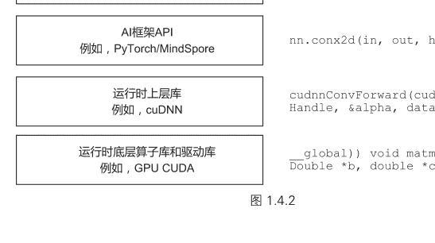

下面以 LeNet 编写作简单对比。

#### 1）通过 cuDNN+CUDA API 编程实现 LeNet
实现结构与内存管理约需千行代码，下面摘取关键片段。

```cpp
// 内存分配，如果用AI框架此步骤会省略
...
cudaMalloc(&d_data, sizeof(float) * context.m_batchSize * channels * height * width);
cudaMalloc(&d_labels, sizeof(float) * context.m_batchSize * 1 * 1 * 1);
cudaMalloc(&d_conv1, sizeof(float) * context.m_batchSize * conv1.out_channels * conv1.out_height * conv1.out_width);
...

// 前向传播第一个卷积算子（仍需要写其他算子）
...
cudnnConvolutionForward(cudnnHandle, &alpha, dataTensor,
                       data, conv1filterDesc, pconv1, conv1Desc,
                       conv1algo, workspace, m_workspaceSize, &beta,
                       conv1Tensor, conv1);
...

// 反向传播第一个卷积算子（仍需要写其他算子），如果用AI框架此步骤会省略
cudnnConvolutionBackwardBias(cudnnHandle, &alpha, conv1Tensor,
                            dpooll, &beta, conv1BiasTensor, gconv1bias);

cudnnConvolutionBackwardFilter(cudnnHandle, &alpha, dataTensor,
                              data, conv1Tensor, dpooll, conv1Desc,
                              conv1bwfalgo, workspace, m_workspaceSize,
                              &beta, conv1filterDesc, gconv1));

// 第一个卷积权重梯度更新（仍需要写其他算子），如果用AI框架此步骤会省略
cublasSaxpy(cublasHandle, static_cast<int>(conv1.pconv.size()),
           &alpha, gconv1, 1, pconv1, 1);
cublasSaxpy(cublasHandle, static_cast<int>(conv1.pbias.size()),
           &alpha, gconv1bias, 1, pconv1bias, 1);

// 内存释放，如果用AI框架此步骤会省略
...
cudaFree(d_data);
cudaFree(d_labels);
cudaFree(d_conv1);
...
```

#### 2）通过 PyTorch 编写 LeNet5
仅用十余行代码即可搭建模型结构。

```python
class LeNet(nn.Module):
    def __init__(self):
        super(LeNet, self).__init__()
        self.conv1 = nn.Conv2d(3, 6, 5)
        self.conv2 = nn.Conv2d(6, 16, 5)
        self.fc1 = nn.Linear(16*5*5, 120)
        self.fc2 = nn.Linear(120, 84)
        self.fc2 = nn.Linear(84, 10)

    def forward(self, x):
        out = F.relu(self.conv1(x))
```

对比可见，cuDNN+CUDA 的抽象仍不足以让算法工程师高效设计网络。用框架实现 LeNet5 只需十余行，而借助 cuDNN 则需约千行，且需手工分配释放内存、拼接计算图，效率低下。

因此智能计算框架对算法开发与训练流程至关重要。一般提供：
- Python 接口供开发者描述网络计算图结构；
- 基础算子的调用封装，大幅压缩代码规模；
- 自动内存管理，隐藏指针与手动管理；
- 自动微分，自动构建反向传播图；
- 调用或生成运行时优化代码，调度算子在指定 NPU 执行；
- 运行期并行算子，提升 NPU 利用率等动态优化。

框架把人工智能系统的底层工程收敛封装，让大量实现细节退到幕后。恰恰是这些被遮住的机理，成为系统工程师最关心的对象。缺少框架、编译器与算子库的配合，哪怕搭建一个最基础的神经网络，算法工程师也会举步维艰。所以在为算法本身的高速演进喝彩的同时，也要认识到底层系统对研发生产力的决定性放大价值。

## 小结与思考

- 多层抽象使得实践与创新难以触及底层的运行规律。
- 弄清底层的作用与复杂程度，才能指导上层作业、算法与代码写得更优、跑得更快。

# 第一篇 芯片视角看人工智能

本文以人工智能芯片为主线展开，从基础原理讲到落地实现。阅读后，你会对硬件体系形成系统认知，了解不同处理器的特长、典型应用场景，以及它们如何推动技术演进。

## 本篇内容

- **计算体系**：从计算范式出发，明确硬件需要满足的真实诉求；结合关键设计指标，理清在追求算力、降功耗并兼顾训练推理时，数据精度的位宽为何要多样化。
- **芯片基础**：以 CPU 为起点拆解计算的本质即数据与时延，由此引入 GPU，再延伸到当前最受关注的 NPU 等专用处理器。
- **GPU 以英伟达为例**：梳理英伟达 GPU 各代架构演进，深入解析面向人工智能的 Tensor Core，以及 NVLink、NVSwitch 在加速中的发展轨迹与架构设计。
- **TPU 以谷歌为例**：深度剖析谷歌 TPU 系列的架构设计，对历代产品进行细致解读。
- **NPU 以昇腾为例**：全面解读昇腾人工智能架构构成，涵盖处理器、核心单元、算力集群及全栈体系。
- **思考与展望**：以 GPU 架构为切口分析其与 CUDA 的关系，基于 GPU 延伸对芯片的思考，展望未来场景并介绍超异构计算。

# 第 2 章 AI 计算体系

## 2.1 引 言

在系统搭建中，算法、框架、编译器、推理引擎都属于软件层面；人工智能芯片是可触摸的物理载体，属于硬件层面，是整套系统的根基。

### 2.1.1 什么是 AI 芯片

先弄清集成电路是什么。集成电路的本质是在半导体基板上制造出实现特定功能的电路。半导体出现前，人只能用机械控制电流，半导体让“用电控制电”成为可能。借助这一物理接口，数字化世界才得以建立，人类进入物质与数字并存的新阶段。可以说集成电路是连接物质世界与数字世界的桥梁，其技术水平决定信息技术的发展高度。

再谈人工智能的定义。人工智能是研究如何让计算机模拟并执行人类智能任务的学科与技术，目标是构建能感知、理解、学习、推理、决策并与人交互的智能系统。其探索可以追溯到 20 世纪 50 年代，最初集中在基于规则的推理与专家系统。

早期因算力受限与数据算法不足，发展缓慢。随后伴随计算技术和算法的进步，尤其是机器学习与深度学习的兴起，领域进入爆发期。机器学习让计算机能从数据中持续改进，深度学习凭借神经网络实现了更高阶的模式识别与抽象。

在应用尚未得到市场验证时，业界多采用通用处理器如 CPU 完成计算，以规避 ASIC 专用集成电路的高投入高风险。但通用处理器并非为深度学习而生，在性能、功耗等方面存在短板。随着应用规模扩大，这些短板愈发明显。如今深度学习算法已趋成熟稳定，芯片可以采用 ASIC 全定制方式，使性能、功耗、面积等指标专门面向深度学习最优化。

当下 OpenAI 的 ChatGPT、GPT-4 等模型引发广泛关注，推动更多算法落地，算力需求急剧攀升。毫无疑问，人工智能芯片是整个系统领域的重要基石。

### 2.1.2 AI芯片的分类

广义上，面向人工智能应用的处理器即为人工智能芯片。按不同视角可划分出多种分类。

按技术架构，可分为 CPU、GPU、半定制 FPGA、完全定制 ASIC，如图 2.1.1 所示。

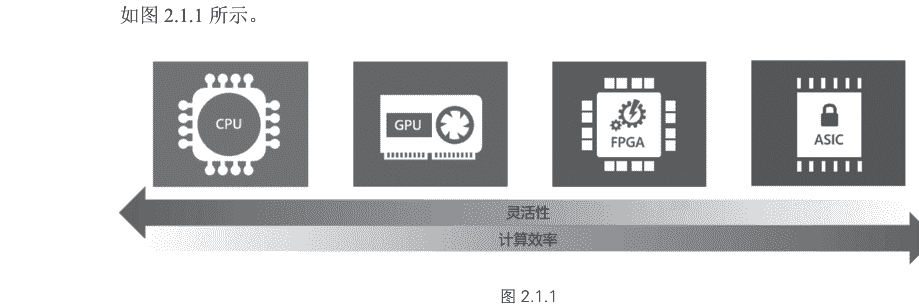

CPU、GPU、FPGA、ASIC 是当前计算最主流的四类方案。CPU、GPU、FPGA 属于相对成熟的通用架构，ASIC 则是面向特定场景定制的方案。它们在灵活性、计算效率、能耗等方面差异明显，对算法的支撑度也各不相同。

- CPU：遵循冯·诺依曼架构的处理器，执行流程为取指—解码—执行—访存—写回。作为计算机核心单元，CPU 拥有大量缓存和复杂的逻辑控制，擅长逻辑控制与串行运算，不擅长复杂并行重复计算。理论上可运行全部模型算法。
- GPU：图形处理器，最初用于图像处理。相较 CPU，GPU 减少了大量数据预取与决策模块，提升了算术逻辑单元占比，从而在并行计算效率上占优。GPU 不能独立工作，需 CPU 调度，且功耗较高。随着算法借助 GPU 加速训练，GPU 功能不断扩展，形成 GPGPU。
- FPGA：在片内集成大量基本门电路与存储器，用户可通过更新配置文件定义门电路与存储器间的连线。与 CPU、GPU 相比，FPGA 同时具备硬件流水并行与数据并行能力，适合以硬件流水方式处理单条数据，整数运算表现更强。灵活性极高，可针对不同算法定制，对算法适配度高，常用于深度学习推理。FPGA 需直接与外部 DDR 交换数据，内存接口效率不及 GPU，且编程门槛相对较高。国外代表厂商有 Xilinx、Altera，国内有复旦微电子、紫光同创、安路科技等。
- ASIC：为特定需求量身设计制造的集成电路，可在特定功能上强化，具备更高运算速度与更低功耗，但研发周期长、成本高。神经网络计算芯片 NPU、张量计算芯片 TPU 均属于 ASIC。针对特定领域定制，ASIC 通常能展现出优于 GPU 与 CPU 的性能，是当前国内外芯片公司主要研究方向，未来专用 ASIC 将持续增多。

### 2.1.3 后摩尔定律时代

摩尔定律由英特尔创始人戈登·摩尔于 1965 年提出：价格不变时，集成电路上可容纳的元器件数目每 18~24 个月翻倍，性能随之提升。这一规律在半个多世纪里高度契合半导体行业走势，成为处理器制造的黄金准则，也被视为自我实现的预言。

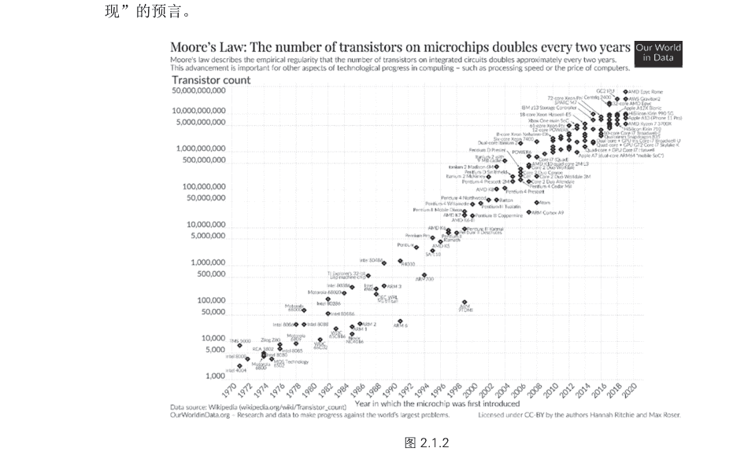

图 2.1.2

如今制程工艺仍在推进，但摩尔定律的时间周期明显拉长。2017 年图灵奖得主、加州大学伯克利分校教授、谷歌杰出工程师 David Patterson 表示：“摩尔定律已真正结束，计算机体系结构迎来下一个黄金时代。”

当前已进入后摩尔时代。虽然传统摩尔定律的表现形式不再适用，但技术创新并未停滞。半导体行业与计算机科学正探索新技术与新方法，以持续提升性能并开拓新应用。

从芯片架构演进看，历程丰富有趣。从最早的单核 CPU，到多核 CPU，再到多核 GPU/NPU，直至如今的超异构集群体系，每一次跃迁都极大提升了计算能力与应用广度（图 2.1.3）。

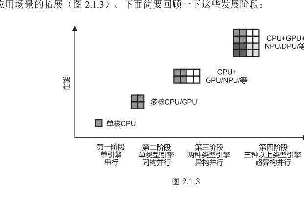

- **单核 CPU**：计算机最早的核心处理单元，所有任务由单个核心完成，性能逐渐触及瓶颈。
- **多核 CPU**：为突破单核限制而生，在单芯片集成多个核心，可同时执行多任务，显著提升效率。
- **多核 GPU/NPU**：专为图形处理与机器学习设计，拥有海量并行核心，适合大规模并行任务。
- **超异构集集群体系**：单一处理器已无法满足需求，超异构体系集成 CPU、GPU、NPU 等不同类型处理器，通过高速网络互联，形成灵活可扩展的计算平台，可根据任务动态调配资源，达成最优效率。

技术发展不仅推动硬件进步，也为软件与应用提供更多可能。伴随人工智能、大数据、云计算的快速发展，未来计算机架构或将迎来更多创新与突破。

未来软硬件协同设计、体系结构安全性、芯片设计开发流程等领域都将出现大量创新与挑战。愿下一个黄金时代的建设者们加油！

## 小结与思考

- 从通用 CPU 到专为人工智能定制的 ASIC，芯片经历了显著演进与多元化，驱动了计算效率提升并推动算法性能跃升，预示着硬件与应用需求深度绑定的未来。
- 摩尔定律放缓后正进入技术创新的新阶段。芯片发展聚焦于软硬件协同、安全性和设计流程创新。探索新架构与异构计算将为人工智能发展注入新动力。

## 2.2 AI 计算模式

把握计算模式对芯片设计与优化至关重要。本节将从模型结构、量化压缩、轻量化网络及大模型分布式并行四个维度深入了解算法现状，引发对计算模式的思考。

### 2.2.1 经典模型结构设计与演进

#### 1. 神经网络的基本概念

神经网络是算法的基础计算模型，其灵感来源于人类大脑神经系统结构（图 2.2.1）。它由大量人工神经元构成，分布在多层结构中，每个神经元与下一层所有神经元相连，并具有可调权重。网络通过学习从输入数据中提取特征，层层传递信号后产生输出。该结构在模式识别、分类、回归等任务上表现突出，在大数据环境下优势更明显。

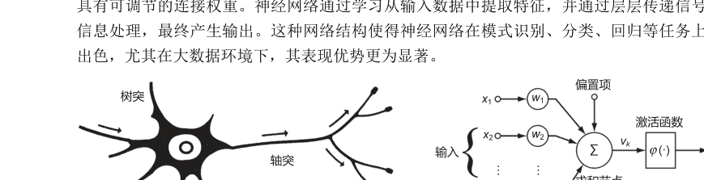

构成神经网络的基础组件如下。

- **神经元**：网络的基本单元，模拟生物神经元功能，接收输入信号并产生输出，连接权重即模型参数。
- **激活函数**：为神经元输出引入非线性，常见有 Sigmoid、ReLU 等。
- **模型层数**：包括输入层、隐藏层、输出层。隐藏层可有多层，用于提取数据不同层次特征。
- **前向传播**：输入数据从输入层流向输出层的过程，用于生成预测结果。
- **反向传播**：根据损失函数计算梯度，调整网络参数，使输出更接近期望。
- **损失函数**：衡量预测结果与真实结果差异的指标，常见有均方误差、交叉熵。
- **优化算法**：用于调整参数以最小化损失的算法，常见梯度下降、自适应矩估计等，不同算法影响收敛速度与最终性能。

如何得到可用的模型？

构建包含训练与推理两个阶段。训练阶段对算力与内存需求更大，流程更复杂难度更高，因此许多芯片研发会优先保障推理能力。整体来看，训练阶段通过最小化损失函数学习数据特征与内在规律，优化模型参数；推理阶段则用训练好的模型对新数据进行预测或决策。训练通常需要大量计算资源且耗时较长，多在服务器或云端进行；推理可在服务器、云端、移动设备等不同端侧部署，取决于模型复杂度与应用需求。推理阶段响应时间和资源消耗是关键考量，尤其在资源受限设备上。

图 2.2.2 为经典图像分类卷积神经网络结构，从左到右由多层模型组成，每层提取更高维目标特征，中间层的输出称为特征图，可通过可视化工具观察各层神经元的工作。最后经 Softmax 激活函数完成分类映射。

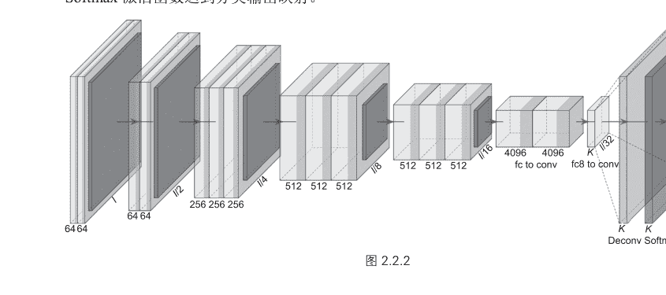

接下来了解神经网络中的核心计算范式：权重求和。

图 2.2.3 为一个简化的神经网络结构，每个灰色圆圈代表一个神经元，内部包含求和与激活两步操作。求和指乘加运算或矩阵相乘，激活函数决定神经元对输出的贡献。Tanh、ReLU、Sigmoid、Linear 均为常见激活函数。神经网络约 90% 的计算量集中在乘加操作，即权重求和。

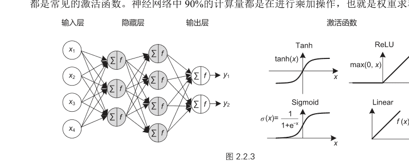

#### 2. 主流的网络模型结构

神经网络设计层出不穷，主流结构主要有以下几种。

##### 1）全连接层

全连接层也称密集层或仿射层，是深度学习中常见层型，通常位于网络末端。层内每个神经元均与前一层所有神经元相连，可学习输入数据的全局特征，实现分类或回归（图 2.2.4）。

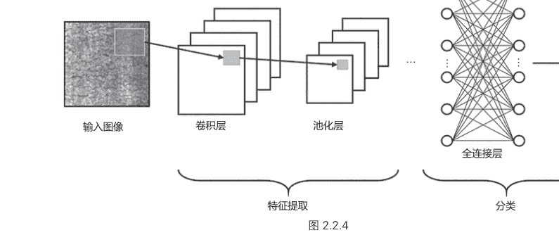

- **连接方式**：全连接层为高度密集连接，每个输入特征都会影响每个输出神经元。
- **参数学习**：连接权重与偏置需通过反向传播学习，通过最小化损失函数优化。
- **特征整合**：主要作用是将前层提取的特征进行整合与转换，生成最终输出。在图像分类中，全连接层常将卷积层提取的特征映射为类别预测分数。
- **输出层**：分类任务中，全连接层常作为最后一层并配合 Softmax 生成类别概率分布；回归任务中输出直接作为预测值。

全连接层广泛应用于图像分类、目标检测、语音识别、自然语言处理等任务。

##### 2）卷积层

卷积层通过学习可重复使用的卷积核提取输入数据特征，主要用于图像与序列数据。

- **卷积操作**：卷积核在输入数据上滑动，计算对应位置的乘积并求和，通常加上偏置并应用激活函数。
- **卷积核**：卷积层的可学习参数，为小尺寸权重矩阵，如 3×3、5×5，不同核可捕获不同特征。
- **特征图**：卷积操作的输出，其深度取决于卷积核数量。
- **参数共享**：在整个输入上使用同一卷积核，大幅减少参数量，降低过拟合风险，提升泛化能力。
- **池化操作**：卷积后常接池化层以减小特征图尺寸并保留重要信息，常见最大池化与平均池化。

卷积层在图像处理、语音识别、自然语言处理等领域被广泛使用，能有效提取局部特征并保留空间信息。

如图 2.2.5 所示，卷积计算可描述为 3×3 卷积核在 8×8 图像上滑动，每次将核与对应元素相乘求和。青色区域即为其感受野。

##### 3）循环神经网络

循环神经网络是专为序列数据设计的网络结构，核心在于内部的回路连接。借助这种回路，信息可以在网络内部持续传递，从而捕捉序列中的时序特征和长期关联。典型结构由若干时间步构成，每个时间步接收外部输入并拥有隐藏状态，隐藏状态在当前步被刷新后会被带入下一时间步，从而让网络在处理每个元素时保留历史痕迹。正是这种特性让 RNN 能够对序列逐步建模并记忆先前内容。不足之处在于传统RNN 容易出现梯度消失或梯度爆炸，因而难以有效学习长距离依赖。为此出现了多种改进方案，最典型的代表是长短期记忆网络 LSTM 以及门控循环单元 GRU ，如图 2.2.6 所示。

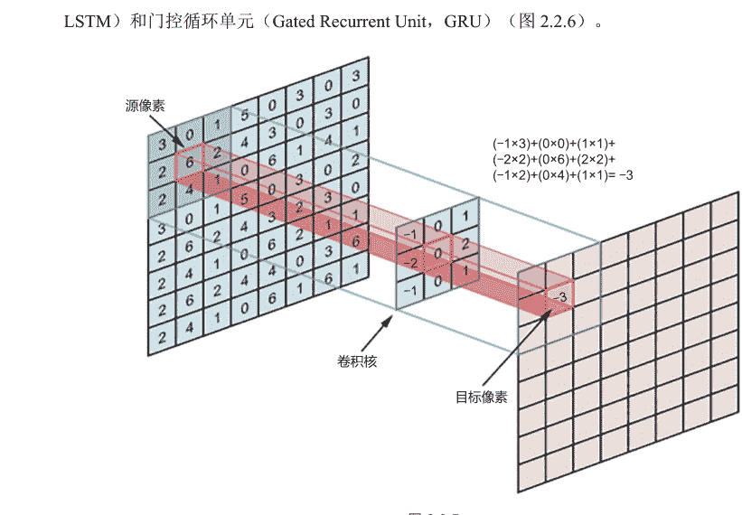

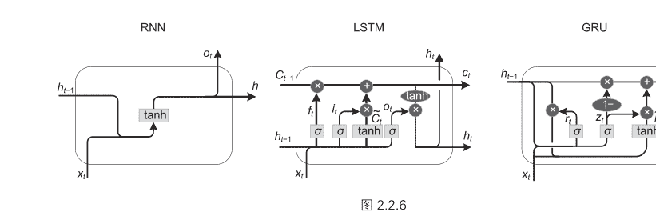

LSTM 通过一套门控系统调控信息流向，包含输入门、遗忘门和输出门三类门控，借此更稳健地保留长期依赖。GRU 则是对门控思想的简化版本，将输入门与遗忘门合并，降低了可训练参数量，在不少任务上仍能取得优异表现。总体来看，循环类网络在自然语言处理、时间序列预测、语音识别等需要时序建模的场景中应用广泛，能够较好地处理具备时间关联的数据。

#### 4）注意力机制

深度学习中的注意力机制借鉴了人类视觉与认知的聚焦方式，让模型在处理输入时能够自动聚焦到关键部分。引入该机制后，网络可以自适应地筛选输入中的重要信息，从而提升性能与泛化能力。2017 年 Google 团队发表的《Attention is all you need》以编码器-解码器为框架，提出了 Transformer 架构 Vaswani et al., 2017。该结构有效缓解了 RNN 难以并行化以及 CNN 在长距离依赖上效率不足的问题，后续也被大量迁移到计算机视觉领域。Transformer 目前是众多大模型的基础模块，其核心由缩放点积注意力 Scaled Dot-Product Attention 和多头注意力 Multi-Head Attention 构成，结构示意图见图 2.2.7。

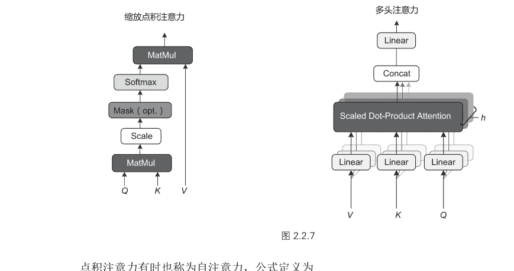

点积注意力有时也被称为自注意力，其数学定义为

$$Attention(Q,K,V) = \text{Softmax}(QK^T / \sqrt{d_k})V$$

下面给出一段基于 Python 的自注意力实现示例，有助于直观理解运算流程。

```python
import torch
import torch.nn as nn
import torch.optim as optim
from torch.utils.data import DataLoader
from torchvision import datasets, transforms

# 定义自注意力模块
class SelfAttention(nn.Module):
    def __init__(self, embed_dim):
        super(SelfAttention, self).__init__()
        self.query = nn.Linear(embed_dim, embed_dim)
        self.key = nn.Linear(embed_dim, embed_dim)
        self.value = nn.Linear(embed_dim, embed_dim)

    def forward(self, x):
        q = self.query(x)
        k = self.key(x)
        v = self.value(x)
        atttn_weights = torch.matmul(q, k.transpose(1, 2))
        atttn_weights = nn.functional.softmax(atttn_weights, dim=-1)
        attended_values = torch.matmul(atttn_weights, v)
        return attended_values
```

多头注意力是在自注意力基础上演化而来的变体，目的在于增强表达力和泛化能力。它并行使用多个独立的注意力头分别计算权重，再将各头的结果拼接或加权求和，从而得到更丰富的表征。

```python
import torch
import torch.nn as nn
import torch.optim as optim
from torch.utils.data import DataLoader
from torchvision import datasets, transforms

# 定义多头自注意力模块
class MultiHeadSelfAttention(nn.Module):
    def __init__(self, embed_dim, num_heads):
        super(MultiHeadSelfAttention, self).__init__()
        self.num_heads = num_heads
        self.head_dim = embed_dim // num_heads

        self.query = nn.Linear(embed_dim, embed_dim)
        self.key = nn.Linear(embed_dim, embed_dim)
        self.value = nn.Linear(embed_dim, embed_dim)
        self.fc = nn.Linear(embed_dim, embed_dim)

    def forward(self, x):
        batch_size, seq_len, embed_dim = x.size()

        # 将输入向量拆分为多个头
        q = self.query(x).view(batch_size, seq_len, self.num_heads, self.head_dim).transpose(1, 2)
        k = self.key(x).view(batch_size, seq_len, self.num_heads, self.head_dim).transpose(1, 2)
        v = self.value(x).view(batch_size, seq_len, self.num_heads, self.head_dim).transpose(1, 2)

        # 计算注意力权重
        atttn_weights = torch.matmul(q, k.transpose(-2, -1)) / torch.sqrt(torch.tensor(self.head_dim, dtype=torch.float))
        atttn_weights = torch.softmax(atttn_weights, dim=-1)

        # 注意力加权求和
        attended_values = torch.matmul(atttn_weights, v).transpose(1, 2).contiguous().view(batch_size, seq_len, embed_dim)

        # 经过线性变换和残差连接
        x = self.fc(attended_values) + x

        return x
```

### 3. 计算模式的反思

结合上述经典模型的结构特点，从 AI 芯片设计的视角可以提炼出以下计算模式的思考要点：

- 需要覆盖神经网络的通用计算逻辑。除了卷积、全连接等计算密集型算子，还要支持权重共享、Softmax、LayerNorm 等以访存为主的向量类算子。
- 要能处理高维张量的存储与运算。例如卷积层涉及大量输入输出通道，遥感等场景特征图尺寸巨大，芯片面积受限时需最大化算力与访存比，内存管理效率至关重要。
- 提供灵活的软件配置接口，兼容更多网络结构。不同领域如视觉、语音、自然语言的模型形态各异，芯片应尽可能覆盖现有主流结构并预留未来新架构的扩展空间，以降低从设计到流片的长期研发成本，获得市场认可。

## 2.2.2 精简模型：量化与剪枝

我们已了解神经网络的典型特征：层数深、通道多，导致训练好的权重占用内存较大；训练阶段为保证收敛与精度常用 FP32 等高精度格式，给硬件计算带来压力。因此量化与剪枝的意义在于压缩计算与存储开销，加快推理速度，提升模型在移动、嵌入式和边缘设备上的适用性与效率。

模型量化是指把高精度模型通过降低权重与激活值的比特宽转变为低精度模型。网络剪枝则是识别权重中的冗余，尽可能不影响或少影响推理精度的前提下剔除非关键权重。两者对比见图 2.2.8 所示。

### 1. 量化方法

把高位宽模型转成低位宽量化能带来多方面好处。

- 存储占用下降：权重与激活被压缩为低位宽整数或定点数，模型体积显著缩小，更易部署在资源受限设备上。
- 计算成本降低：低精度减少了乘加操作的精度需求，推理加速，整体效率提升。
- 功耗下降：计算量减少带来移动与嵌入式场景能耗降低，延长续航。
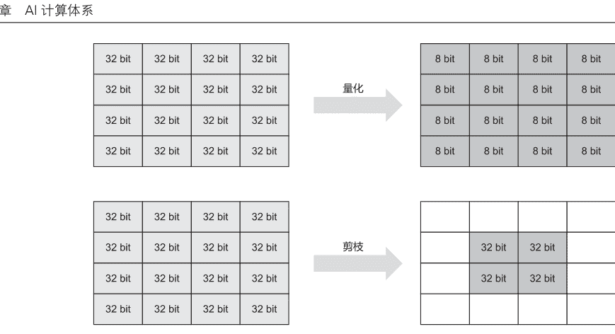
- 推理提速：在合理调参下，信息损失可控，性能与准确率得以保留，同时收获存储与计算优势。
- 部署面拓宽：压缩后的参数更适合在手机、边缘节点、嵌入式系统等受限环境运行，拓展应用空间。

模型量化的深入内容可参考第 16 章。

### 2. 剪枝思路

模型剪枝是一种有效的压缩手段，旨在通过剔除“不重要”的权重降低复杂度，减少参数量与计算量，同时尽量维持精度。剪枝算法通常评估每个权重的贡献，按策略剔除数值较小的权重，在精度损失与效率提升间取得平衡。

图 2.2.9 展示了多层网络的剪枝示意，操作可分为两类：一是对全连接层中神经元间的连线进行剪枝，二是对神经元本身进行剪枝。

模型剪枝的更多细节请阅读第 16 章。

### 3. 芯片设计启示

结合量化和剪枝的特性，AI 芯片设计可从以下角度考虑计算模式：

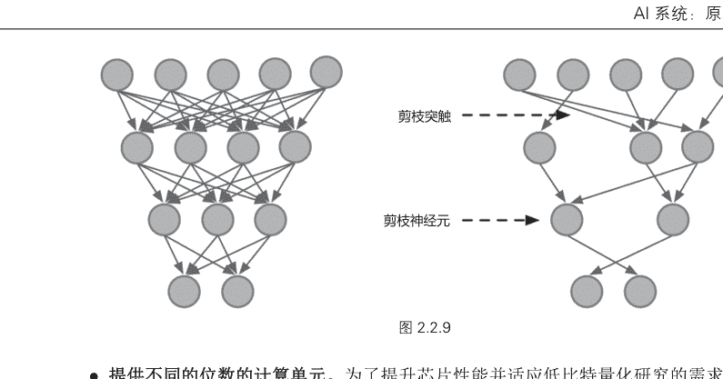
- 集成多位宽计算单元。为适配低比特量化研究，可在片上实现 FP8、INT8、INT4 等不同精度的计算单元与存储格式。
- 支持多格式存储。需要在 M-bits 如 FP32 与 E-bits 如 TF32 之间权衡，并在 FP16 与 BF16 等格式间选择，以平衡存储效率与计算精度。
- 硬件级稀疏优化。为提升稀疏结构处理效率，提供专门的优化逻辑，支持多种稀疏算法并优化计算取数模块，如英伟达 A100 对稀疏的支持。
- 增加量化压缩硬件电路。通过内置数据压缩模块减轻内存带宽压力，进一步提升系统整体性能。

## 2.2.3 轻量化网络设计

随着深度神经网络的普及，越来越多的模型需部署于移动端与嵌入式平台，这些平台普遍受限于内存、算力与功耗。因此轻量化设计成为主流方向，目标是在保持精度的前提下降低参数量与计算量。

### 1. 轻量化评估与手段

衡量轻量化的两个核心指标是网络参数量 Params 与浮点运算次数 FLOPs，即计算量。对于卷积层：

- 网络参数量：输入为 $w \times h \times C_{in}$，卷积核 $k \times k$，输出特征图 $W \times H \times C_{\text{out}}$ 时，参数量为：$\text{Params}=(k \times k \times C_{\text{in}}+1) \times C_{\text{out}}$。
- 浮点运算数：同上条件下，$\text{FLOPs}=W \times H(k \times k \times C_{\text{in}}+1) \times C_{\text{out}}$。

参数量与 FLOPs 越小通常速度越快，但实际快慢还受内存访问次数影响，与网络结构密切相关。下面从计算模式角度分析几种轻量化设计。

#### 1）压缩参数空间

为减小参数量，VGG 和 InceptionNet 系列提出了用两个 $3 \times 3$ 卷积替代一个 $5 \times 5$ 卷积，或用 $5 \times 1$ 与 $1 \times 5$ 卷积替代 $5 \times 5$ 卷积的设计，如图 2.2.10 所示。

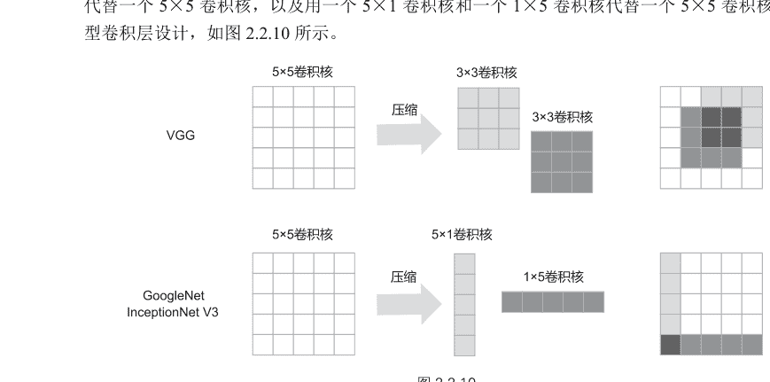

以双 $3 \times 3$ 替代单 $5 \times 5$ 为例，保持感受野不变的同时增加网络深度，有助于提升效果。参数由 $5 \times 5 \times C_{\text{in}} \times C_{\text{out}}$ 变为 $3 \times 3 \times C_{\text{in}} \times C_{\text{out}}+3 \times 3 \times C_{\text{in}} \times C_{\text{out}}$，当 $C_{\text{in}}=C_{\text{out}}$ 时，参数约为原方案的 18/25。

#### 2）通道精简策略

MobileNet 系列引入深度可分离卷积，将标准卷积拆分为 Depthwise 深度卷积与 $1 \times 1$ Pointwise 逐点卷积两步，图 2.2.11 所示。Pointwise 卷积负责通道变换，从而大幅减少参数。

例如 $3 \times 3$ 卷积，输入通道 16、输出通道 32，标准卷积参数为 $3 \times 3 \times 16 \times 32=4608$；改用深度可分离结构后参数为 $3 \times 3 \times 16+1 \times 1 \times 16 \times 32=656$，参数量显著下降。

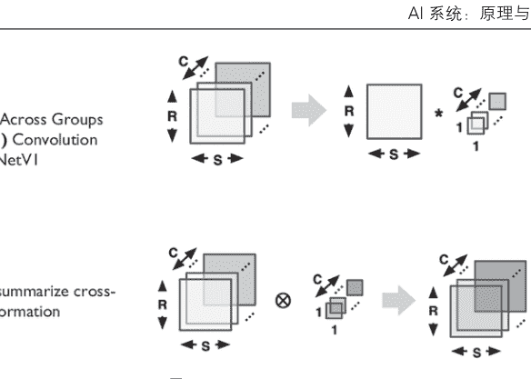

#### 3）复用特征图

DenseNet 与 GhostNet 提出通过复用特征图来降低参数与运算量，如图 2.2.12 所示。

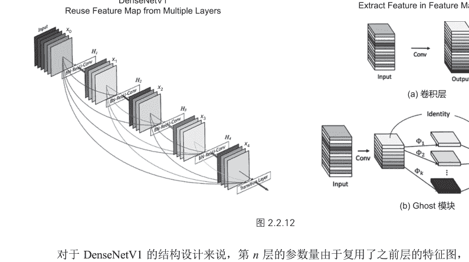

在 DenseNetV1 中，第 $n$ 层的参数因复用先前特征图由 $k \times k \times C_{in} \times (C_1 + C_2)$ 降为 $k \times k \times C_{in} \times C_2$，即约为原来的 $C_2 / (C_1 + C_2)$，其中 $k$ 为卷积核尺寸，$C_1$ 为第 $n-1$ 层特征图数，$C_2$ 为第 $n$ 层输出特征图数，且 $C_2$ 通常远小于 $C_1$。

### 2. AI 计算模式思考

轻量化思路在卷积结构上呈现出多样化的实现路径，核心都是在保留表达能力的前提下削减算力开销。实际落到芯片层面需要兼顾的考量远不止这些，下面这些设计取向都是架构团队必须纳入视野的。

卷积核尺寸：
- 小核堆叠替代大核：用多个小尺寸卷积核串联来等效一个大核，从而降低整体计算量。
- 多尺度核并用：混用不同尺寸的核，能够同时捕捉细粒度与粗粒度特征。
- 可变形核：摆脱固定几何形状，让卷积核随输入自适应形变，提升对复杂特征的拟合能力。
- 1×1 卷积构建瓶颈：在通道维度做压缩与升维，借助 1×1 核搭建 Bottleneck 结构，有效瘦身参数和运算。

卷积层运算：
- Depthwise 分离卷积：用逐通道卷积替代常规卷积，减少参数量的同时保持特征表达。
- 分组卷积：把通道划分为若干组独立计算，采用 Group 卷积提高计算效率并简化模型。
- 通道混洗：通过 Channel Shuffle 在组间重排通道，促进跨组信息交互，增强融合效果。
- 通道加权：引入动态通道权重，对不同通道贡献进行自适应调节，优化特征表征。

卷积层连接：
- 跳跃连接：使用 Skip Connection 将浅层特征直接送至深层，有助于堆叠更深网络并缓解梯度消失。
- 密集连接：采用 Densely Connection 让每层接收前面所有层的输出，实现特征复用、融合与信息增益。

## 2.2.4 分布式并行
大模型方向当前非常火热，其特点是参数规模与计算需求都极高。在单颗芯片或单张加速卡无法提供足够算力与存储时，分布式并行成为必备手段。

分布式并行大体可分为数据并行与模型并行，其中模型并行又细分为张量并行和流水并行。下面先介绍并行计算中常用的集合通信原语，再分别简述数据并行与模型并行的思路。

### 1. 集合通信原语
并行计算里，通信原语是不同计算节点间完成数据搬运与同步的基础操作，是构建复杂并行算法的支撑。常见原语包括：

- All-Reduce：各节点数据先汇总做约减操作，如求和或求平均，再把结果回播给所有节点，常用于全局梯度更新。
- All-Gather：每个节点的数据被广播给全部节点，最终每个节点都持有所有节点的集合，常用于局部数据的全局聚合。
- Broadcast：源节点数据向所有节点分发，通常用于模型参数或全局信息的下发。
- Reduce：将各节点数据按指定约减规则合并后只返回给指定节点，常用于局部聚合。
- Scatter：把源节点的一个大集合拆分后分发到各节点，通常用于把大数据切块后并行处理。
- Gather：把各节点的局部数据集中到一个节点，常用于汇总分析。

## 2. 数据并行技术
按设备间通信强度，数据并行可归为 DP、DDP、FSDP 三类。

### 1）数据并行（Data Parallel, DP）
DP 是最基础的形式。将大规模训练集切成多个小 Batch 分别送给不同计算设备，每个设备保存完整模型副本独立算梯度，再通过 All-Reduce 同步参数以保持一致。

### 2）分布式数据并行（Distributed Data Parallel, DDP）
DDP 允许模型在多节点上并行训练，每个节点有本地模型副本和本地数据，参数在节点间同步但数据处理各自独立。框架如 PyTorch 的 `torch.nn.parallel.DistributedDataParallel` 已内置实现，自动完成梯度同步与通信。

### 3）全分片数据并行（Fully Sharded Data Parallel, FSDP）
FSDP 融合了 DP 与 DDP 的优点，实现更高效训练与扩展。核心是将网络权重、梯度及优化状态分片到不同设备，计算时在所需节点上临时聚齐，用完即释放。图 2.2.13 显示了不同计算节点间的虚线同步通信。

## 3. 模型并行技术
模型并行可归纳为张量并行与流水并行。

### 1）张量并行
把模型中的张量操作拆分为子张量操作，在多设备上并行执行，从而把大模型的计算负载分散。需要设计合理的层划分与通信机制，通常用 All-Reduce 等原语完成梯度聚合与参数同步。

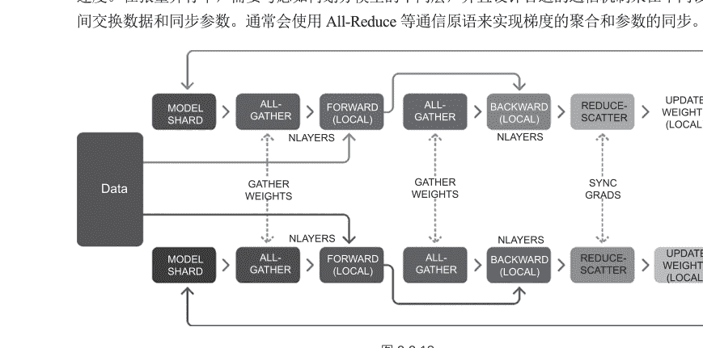
图 2.2.14 给出矩阵乘算子的张量并行示意。$X$ 为激活输入，$A$ 为算子权重，将 $A$ 按列切分后分发。各节点保留一份完整的 $A$ 副本和部分分片，最终通过 All-Gather 把结果汇总形成完整的 $Y$ 输出，供下一层使用。
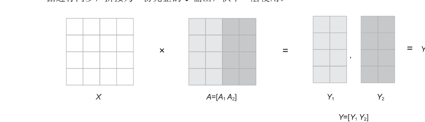

### 2）流水并行
把模型按层切分为多个阶段，分别部署到不同设备形成计算流水线，每台设备完成一段计算后把结果传给下一段。需设计数据流与通信机制，通常借助缓冲区和流水控制器来管理执行顺序与一致性。

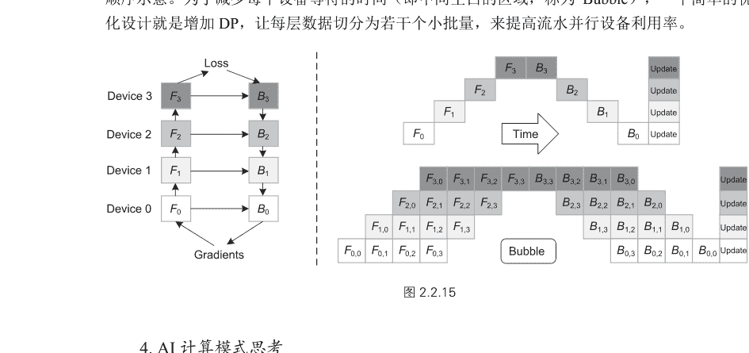
图 2.2.15 展示了一个流水并行过程。假设模型含前向、反向两阶段，共 4 层分布到 4 个设备，右图给出时间维度的执行顺序。为减少设备空闲的 Bubble，可引入数据并行把每层输入切为若干小批量，提升流水线利用率。

## 4. AI 计算模式思考
基于上述并行技术的认识，AI 计算模式在硬件上会体现为以下考量：

- 模型并行与数据并行兼顾：芯片需同时支持两种并行策略。数据并行要求高带宽、低时延的互联以完成频繁同步；模型并行要求灵活的计算资源分配与通信以实现分段计算。
- 异构计算资源管理：芯片常集成 CPU、GPU、NPU 等多种单元，需提供统一的异构调度机制，实现协同工作。
- 高效通信与同步：分布式并行产生大量数据交换，芯片需提供低时延、高带宽的通信与同步机制。
- 端到端优化：从模型设计、算法到系统实现全链路协同优化，例如为 Transformer 等核心结构提供专用高速引擎。

## 小结与思考
- AI 芯片应具备灵活支持多样神经网络架构的能力，高效执行特有计算逻辑以满足不同场景。
- 芯片需支持模型压缩手段如量化与剪枝，提升终端推理性能并实现软硬件协同。
- 设计应面向轻量化网络，支持更复杂的卷积与数据逻辑，适应算力与带宽受限环境。
- 芯片要兼容大模型的分布式并行策略，提供片上网络、总线、大内存与高速互联以支撑多芯片协同。

## 2.3 关键设计指标
在明确计算模式后，如何与芯片设计挂钩就落到关键指标上。本节从 AI 芯片核心指标出发展开思考。

### 2.3.1 计算单位
发布时常以制程、内存、核心数、带宽、算力等指标说明能力，先了解常用计算单位：

- **OPS**：每秒操作数。1 TOPS 代表每秒 10^12 次计算。
- **OPS/W**：每瓦性能，衡量单位功耗下的运算能力。
- **FLOPS**：每秒浮点操作数。1 TFLOPS 为每秒 10^12 次浮点计算。
- **MACs**：乘加累加操作，1 MAC 包含一次乘法与一次加法，通常 1 MAC = 2 FLOPs。
- **FLOPs**：浮点运算次数，用来衡量模型复杂度。对卷积层：
  FLOPs = 2 · H · W · C_in · K · K · C_out
- **MAC**：内存访问量，衡量运行时内存占用。对卷积层：
  MAC = H_in · W_in · C_in + H_out · W_out · C_out + K · K · C_in · C_out

### 2.3.2 AI 芯片关键指标
目标是低成本高效率地执行模型，关键指标涵盖软件应用层面和硬件市场竞争力层面。

#### 1. 精度
指输出结果与真实情况的接近程度。可从计算精度看位宽支持如 FP32、FP16；也可从模型效果看任务指标如 ImageNet 准确率、回归均方误差等。

#### 2. 吞吐量
单位时间内可处理的数据量，多核心设计通常吞吐更高，不同场景对精度与吞吐的取舍不同。

#### 3. 时延
从输入到输出的响应时间，对自动驾驶、智能监控等实时场景至关重要。

#### 4. 能耗
AI 计算资源密集，性能提升往往伴随功耗增加。低功耗设计有利于移动与物联网设备，创新架构与工艺可降低能耗。

#### 5. 系统价格
市场选择的重要因素，需综合硬件成本与全栈生态成本。

- 硬件自身价格：含设计、制造、封装、测试等，直接影响成本效益。
- 系统集成上下游全栈等成本：含软件开发、算法优化、集成、验证、支持等，需一并评估。

#### 6. 易用性
好的产品应提供完善软硬件支持。包括：

- 文档和教程：降低学习曲线。
- 软件支持和开发工具：提供 API、SDK、开发环境。
- 硬件接口和集成支持：标准化接口便于集成。
- 性能优化和调试工具：助力分析与故障排查，提升稳定性。

### 2.3.3 关键设计点
核心围绕提升吞吐、降低时延，以及时延与 Batch Size 的权衡，主要落到 MACs 与 PE。

#### 1. MACs
**减少 MACs：** 去除冗余计算，优化网络稀疏度，配合稀疏硬件提升控制与数据传输效率，节省周期。
**降低单次 MACs 执行时间：** 通过提升时钟频率与减少指令开销来缩短单次 MAC 耗时。

#### 2. PE
PE 为执行计算的基本单元，数量与性能决定算力。优化方向为：

**增加 PE 数量**：借助先进制程提升单位面积 PE 密度，增加并发 MAC。
**增加 PE 利用率**：通过调度、数据传输优化等硬件与算法改进，减少空闲，提升吞吐并降低时延。

### 2.3.4 计算性能仿真
设计完成后，不同模型在同一芯片上的表现是否一致？可通过带宽受限与算力受限来判断。若因缓存受限性能瓶颈在带宽，为带宽受限；若因计算单元不足为算力受限。

#### 1. 算术强度概念
模型执行大致经历：从外部存储搬数据、计算、写回结果。搬运时间 t₁ = bytes / bw，计算时间 t₂ = ops / π。若 t₁ > t₂ 为内存受限，若 t₁ < t₂ 为计算受限。

```
t₁ > t₂
→ bytes / bw > ops / π
→ π / bw > ops / bytes
```
其中，π / bw 为芯片的算术强度比，称为操作字节比；ops/bytes 为模型的运算次数与内存占用比，称为算术强度或操作强度。

借助算术强度与操作字节比这两个概念，就能快速判断一个 AI 模型在指定芯片上跑起来的理论上限。下面用一个具体案例来说明。

以 V100 执行 GEMM 为例，其 FP16 理论峰值算力为 125 TFLOPS，外部存储带宽约 900 GB/s，片上 L2 带宽约 3.1 TB/s。

- 当数据来自片外时，操作字节比大约是 125/0.9≈138.9。
- 当数据来自片上时，操作字节比大约是 125/3.1≈40。

对于 FP16 精度、形状为 $(M, K, N)$ 的矩阵乘，算术强度为

$$\frac{2 \times M \times N \times K}{2 \times (M \times K + K \times N + M \times N)} = \frac{M \times N \times K}{M \times K + K \times N + M \times N}$$

取 $(M, K, N)=(8192, 128, 8192)$ 时，算术强度约为 124.1，小于 V100 在片外条件下的操作字节比 138.9，该算子属于带宽受限。

取 $(M, K, N)=(8192, 8192, 8192)$ 时，算术强度约为 2730，远高于 138.9，该算子属于算力受限。

#### 2. Roofline 性能评估

不同模型在同一硬件上的实际效率，可以用 Roofline Model 来预估。该模型在简化架构的前提下，仅用平台的算力上限和带宽上限，加上算子的算术强度，就能给出最高性能。如图 2.3.1 所示（Chen et al., 2019），横轴为算术强度，纵轴为可达到的最高浮点运算性能，理论峰值由下列公式给出

$$P = \min(peak_{performance}, ops / bytes * bw)$$

算术强度落入深灰区时，算子表现出典型的带宽受限；落入浅灰区时则为算力受限。理想状态是算术强度正好落在深浅两区的分界线上，带宽与算力达到较好的均衡。

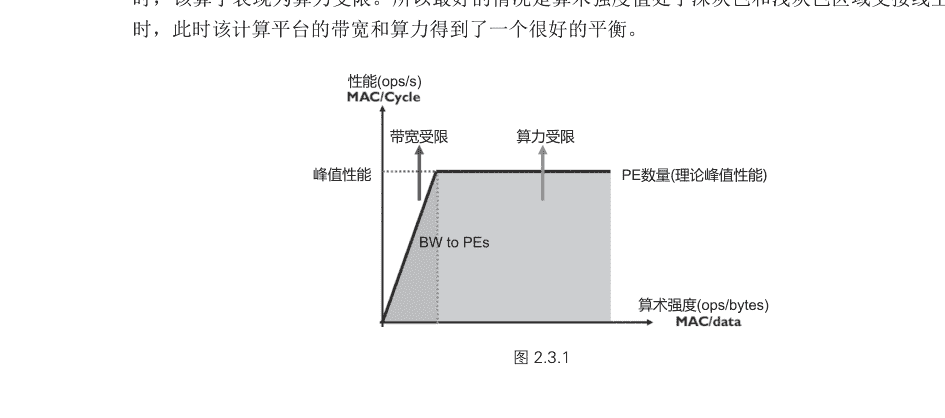

基于 Roofline 的性能仿真有助于定位瓶颈并指导优化。图 2.3.2 即为仿真示意（Chen et al., 2019），Step1~Step7 描述了 7 种由软件任务或硬件设计带来的性能表现，开发者可据此调整策略。

- Step1, Step2：在资源充足时，通过最大化任务负载或数据并行策略可逼近最佳执行性能，此时瓶颈在软件调度。
- Step3, Step4：受限于固定的 PE 维度或数量，部分 PE 周期内未被完全激活。例如 7 个任务分给 4 个 PE，需要 2 个周期，仍有 PE 激活率仅 50%，性能低于峰值。
- Step5：计算单元内部存储容量不足，即使数据送达很快，也没有足够空间暂存，进而受算力瓶颈制约。
- Step6, Step7：平台本身带宽受限，即使算力与内存充足，仿真性能也无法再提升。

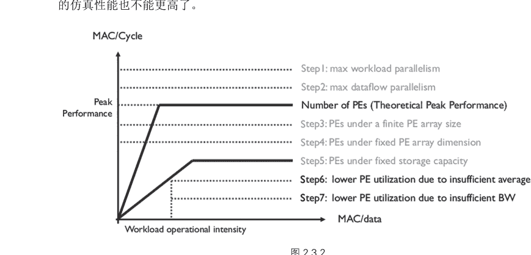

## 小结与思考

- AI 芯片的核心指标涵盖 OPS、OPS/W、FLOPS、MACs、FLOPs 与 MAC 等，直接影响性能与市场竞争力。
- 系统售价、易用性与芯片的精度、吞吐、时延、功耗共同决定产品适用场景。
- 芯片设计侧重提升计算吞吐、降低时延，路径包括优化 MACs 操作与提高 PE 利用率。
- Roofline 模型可评估模型在硬件上的执行效率，为软件优化和硬件改进提供依据。

## 2.4 核心计算之矩阵乘

AI 模型里矩阵乘占比很大，其特点是内存搬运量大、计算密度高，因而是评估芯片设计的首要参照。本节先看矩阵乘在 AI 芯片中的执行流程。

### 2.4.1 从卷积到矩阵乘

卷积层的常见实现是：卷积核在输入特征图上按窗口与步长滑动，窗口内元素与核逐点相乘后累加得到输出。卷积到矩阵乘的等价关系如图 2.4.1。

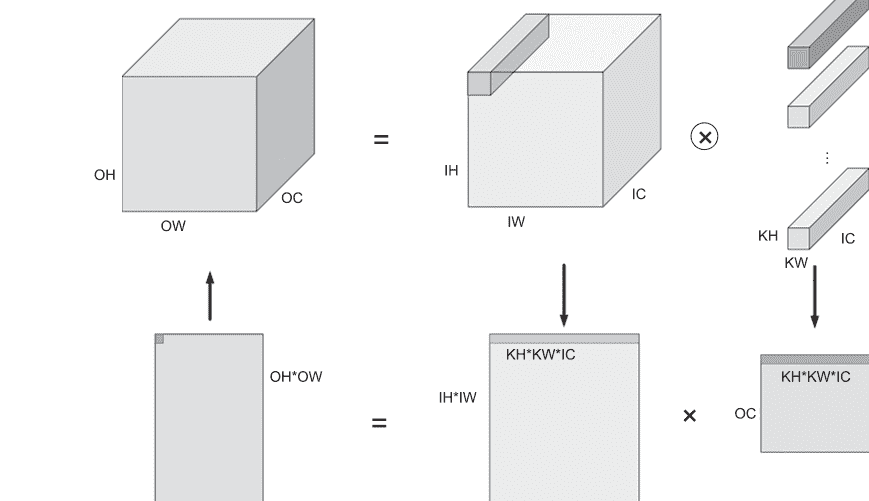

逐点相乘再累加即为 2.3 节提到的 MACs 计算单元，矩阵乘的 MACs 数量直接影响最终性能。通过对输入特征图和卷积核进行重排，卷积可等价为矩阵乘。

设输入输出特征图尺寸为 $(IH,IW)$ 与 $(OH,OW)$，核窗口为 $(KH,KW)$，输入通道 $IC$，输出通道 $OC$，重排对应为：

输入：$(IC,IH,IW)$ → $(OH*OW,KH*KW*IC)$

卷积核：$(OC,KH,KW,IC)$ → $(OC,KH*KW*IC)$

输出：$(OC,OH,OW)$ → $(OC,OH*OW)$

输入重排称 Im2Col，反向过程称 Col2Im。

以核维度 $(2,2)$、输入特征图 $(3,3)$、通道均为 1、无填充步长 1 为例，输出为 $(2,2)$。转换后矩阵乘的行数为 $2*2=4$，列数为 $2*2*1=4$。图 2.4.2 给出了对应示意，红绿蓝区分输入输出核，数字为位置标记。

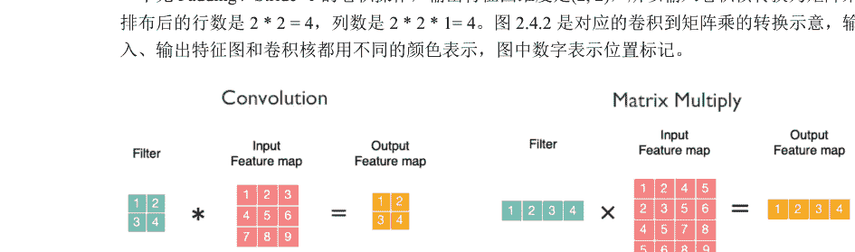

输入排布分析：第 1 个输出对应窗口数据 1,2,4,5；第 2 个输出对应 2,3,5,6；第 3 个输出对应 4,5,7,8；第 4 个输出对应 5,6,8,9。矩阵乘维度为：

输入：$(OH*OW,KH*KW*IC)$ → $(4,4)$

卷积核：$(OC,KH*KW*IC)$ → $(1,4)$

输出：$(OC,OH*OW)$ → $(1,4)$

### 2.4.2 矩阵乘分块

转换后的矩阵乘规模往往很大，而芯片内存受成本限制，越靠近计算单元带宽越快容量越小。为平衡计算与加载时间、最大化算力利用，AI 芯片多采用多级存储的由远及近设计，靠数据复用换取时间。于是矩阵乘会做分块 Tiling 处理。

令 $CHW = KH*KW*IC$，$M=OC$，$N=OH*OW$，输入为 $(N,CHW)$，核为 $(M,CHW)$，输出为 $(M,N)$，可在 $M、N、CHW$ 三个维度同时切片。假设每个维度切 2 块，完成一次输出需 8 次加载与计算。图 2.4.3 的 Step1、Step2 展示了两次加载完成一个输出块的计算。

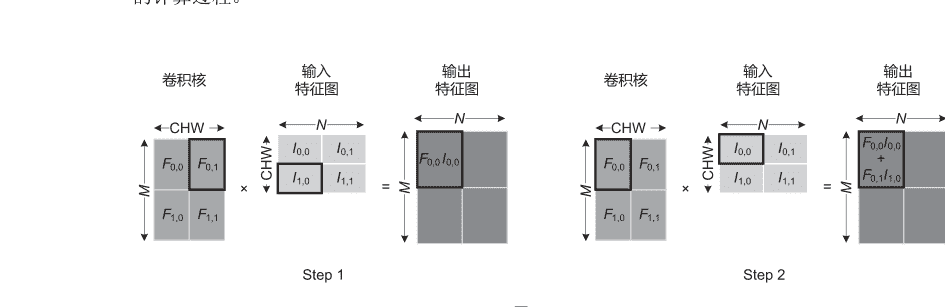

### 2.4.3 矩阵乘的库

矩阵乘是关键算子，CPU 与 GPU 均有专用库，如 CPU 的 OpenBLAS、Intel MKL，GPU 的 cuBLAS、cuDNN。常用手段是 Loop Tiling 与多级缓存，整体流程大致为：

- 第 1 步：库感知相乘矩阵的形状；
- 第 2 步：挑选最优 Kernel 执行。

图 2.4.4 展示了 Loop 循环优化与多级缓存结合的实现。左为 6 级 Loop 展开伪码，右为对应存储分块与搬移，设矩阵乘 $A,B,C$ 维度为 $(m,k,n)$。

- Loop5、Loop4、Loop3 对 $n,k,m$ 做 Tiling，切块大小分别为 $nc,kc,mc$。

```
Loop 5  for $j_c=0 : n-1$ steps of $n_c$
    $\mathcal{J}_c=j_c : j_c+n_c-1$
Loop 4  for $p_c=0 : k-1$ steps of $k_c$
    $\mathcal{P}_c=p_c : p_c+k_c-1$
    $B(\mathcal{P}_c, \mathcal{J}_c) \rightarrow B_c$    // Pack into $B_c$
Loop 3  for $i_c=0 : m-1$ steps of $m_c$
    $\mathcal{I}_c=i_c : i_c+m_c-1$
    $A(\mathcal{I}_c, \mathcal{P}_c) \rightarrow A_c$    // Pack into $A_c$
    // Macro-kernel
    Loop 2  for $j_r=0 : n_c-1$ steps of $n_r$
        $\mathcal{J}_r=j_r : j_r+n_r-1$
    Loop 1  for $i_r=0 : m_c-1$ steps of $m_r$
        $\mathcal{I}_r=i_r : i_r+m_r-1$
        // Micro-kernel
        Loop 0  for $k_r=0 : k_c-1$
            $C_c(\mathcal{I}_r, \mathcal{J}_r)$
            $+= A_c(\mathcal{I}_r, k_r) \ B_c(k_r, \mathcal{J}_r)$
        endfor
    endfor
endfor
endfor
endfor
```

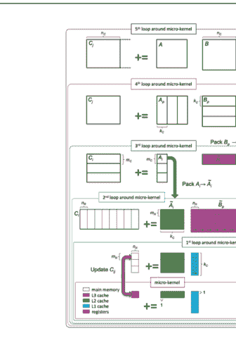

- Loop2、Loop1 对 Tiling 后的 $nc,mc$ 再次 Tiling，得到 $nr,mr$。
- Loop0 对 $kc$ 展开实现累加，得到 $(mr,nr)$ 尺寸的输出部分和。

不同颜色框表示不同存储层级的数据，不同色块表示存储位置。结合各层容量与带宽，将 $A、B$ 的切片放在合适层级可平衡时间和空间开销。例如计算 $(mr,nr)$ 时，可把 $B$ 的 $(kc,nr)$ 载入 L1 一次复用，$A$ 的 $(mr,kc)$ 从 L2 逐次加载。若 $mc$ 被切成 3 个 $mr$，则 $B$ 在 L1 中被复用 3 次。以空间换时间是算子优化的核心思路。

### 2.4.4 矩阵乘的优化

矩阵乘有大量成熟优化手段，归纳如下：

- 基本循环优化：调整循环顺序、内存布局以降低 Cache Miss、提升缓存命中率。
- 分块矩阵乘：将大矩阵切成小块，降低时间复杂度并更好利用缓存。
- SIMD 指令优化：借助 SSE、AVX 等并行处理多数据，提升效率。
- SIMT 多线程并行：把任务分给多线程，充分发挥多核能力。
- 算法改进：如 FFT、Strassen、Coppersmith-Winograd 等，通过分解重组降低复杂度。

在具体 AI 芯片上，优化往往体现为减少指令开销：

- 让单条指令完成更多 MACs，如 CPU 的 SIMD/Vector、GPU 的 SIMT/Tensor、NPU 的 SIMD/Tensor/Vector。
- 在带宽不变前提下单周期完成更多 MACs，如英伟达 Tensor Core 支持低比特计算，在 512 bit 带宽下可完成 64 个 8 bit MACs，远高于 16 个 32 bit MACs。

## 小结与思考

- 矩阵乘通过优化搬运与计算密度提升芯片性能，涉及卷积转矩阵乘及分块处理。
- 软件层面靠减少 MACs、循环优化与内存优化，硬件层面靠提升 PE 速度、并行能力和利用率。
- OpenBLAS、Intel MKL、cuBLAS、cuDNN 等专用库以循环优化与多级缓存提升性能。
- 分块矩阵乘、SIMD/SIMT 以及 Tensor Core 设计共同推动 AI 芯片计算效率提升。

## 2.5 计算之比特位宽

2.2 节提到量化是通过数据映射把高位宽转为低位宽以换取执行效率。本节更详细说明比特位宽概念。

### 2.5.1 比特位宽的定义

整数与浮点是两种基础数据类型，二进制位长即比特位宽，决定表示范围与精度。

#### 1. 整数类型

计算机中整数常用二进制补码表示。其特点是：

- 符号位最高位，0 正 1 负；
- 正数补码同原码，负数取反加一；
- $n$ 位整数范围为 $-2^{(n-1)}$ 到 $2^{(n-1)}-1$，一位作符号。

例：8 位补码 01101100 为正数 108；11110011 为负数 -13，原码 10001101 取反加一得到补码。

#### 2. 浮点数据类型

浮点遵循 IEEE 754 标准，单精度与双精度为常见形式。如图 2.5.1，单精度 32 位分为符号位、指数位、尾数位。

- 符号位 1 位表正负；
- 指数位 8 位表阶码；
- 尾数位 23 位表有效数字。

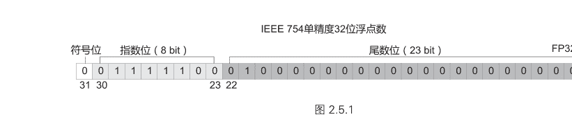

双精度 64 位中指数位 11 位、尾数位 52 位，范围与精度更高。

规格化与非规格化浮点真实值计算为：

规格化：$(-1)^S \times 2^{E-B} \times (1+M)$

非规格化：$(-1)^S \times 2^{1-B} \times M$

其中 $B = 2^{E_{bw}-1} - 1$，$S$ 为符号位，$E$ 为指数，$M$ 为尾数，$E_{bw}$ 为指数位宽。

例：单精度 0 10000011 10100000000000000000000

- 符号位 $S=0$ 表示正数，$(-1)^0=1$。

指数字段写成 10000011，换算成十进制是 131，扣除单精度偏置 127 后得到 4，指数部分就是 $2^4=16$。尾数字段是 101 后面跟一串 0，代表有效数 1.101，二进制转十进制等于 1.625。符号为正，所以该 32 位单精度浮点数的实际值为 $(-1)^0 \times 16 \times (1+0.625)=26$。

### 2.5.2 深度学习常用的数据类型
AI 模型里常见的位宽主要是 8 bit、16 bit 和 32 bit，具体选用取决于应用场景以及训练、推理阶段的需求。现有的模型中出现的数值的位宽和定义各不相同，尤其是在浮点数上，指数 E 和尾数 M 的分配方案有很多种，即使是 16 bit 浮点也有多种 E/M组合。这正是 AI 实践中对软硬件不断打磨的结果。

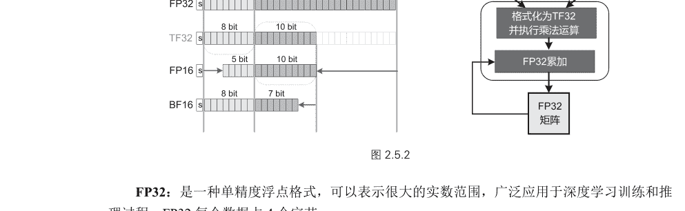
**FP32**：单精度浮点，占用 4 个字节，能表达很大的数值范围，长期以来是深度学习训练和推理的主流格式。
**TF32**：英伟达提出的 Tensor Float 32，从 A100 开始在 Tensor Core 上支持。用以部分替代 FP32，相较 FP32 压缩了 13 位尾数精度，换来峰值计算速度的明显提升。
**FP16**：半精度浮点。神经网络本身冗余度高，降低位宽对性能影响有限。FP16 与 FP32 混合精度训练在业界被大量采用。
**BF16**：谷歌的 bfloat16，即脑浮点格式。FP16 在设计时没有兼顾深度学习，动态范围偏窄，BF16 保留了与 FP32 相同的动态范围，本质上是把 FP32 的高 16 位截取下来。在 Transformer 类模型上表现很好，目前大模型训练和微调多采用 BF16。
**FP8**：英伟达 H100 引入的 8 bit 浮点，有 E4M3 与 E5M2 两种编码。E5M2 保持了接近 FP16 的数值范围，E4M3 在精度上更具优势。在与 FP16、BF16 相近模型精度的前提下，FP8 能降低内存占用并提升吞吐，正在 LLM 领域加速探索。
**INT**：特定场景下使用，比如大量整数任务或对资源受限平台做量化。INT8 是量化时的常用选择。

### 2.5.3 为何要降低位宽
在计算资源和成本受限的背景下，低位宽的探索几乎是绕不开的。位宽越高精度越有保障，但硬件的计算与存储开销也会越大，不同场景对精度的要求不同，因而需要按需选择数据类型以压低执行成本。

降低位宽即降低精度，对 AI 芯片的好处主要有：
- 收窄 MAC 的输入输出位宽，减少数据搬运与存储开销，内存搬动变少则功耗下降。
- 降低 MAC 本身的计算代价，例如两个 INT8 的乘加可用 16 bit 寄存器完成，而 FP16 的乘加通常需要 32 bit 寄存器。8 bit 与 16 bit 的运算对电路复杂度和面积影响显著。

表 2.5.1 降低位宽对芯片能耗和面积的影响

| 操作 | 能耗 (pJ) | 面积 (μm²) |
|---|---|---|
| 8b Add | 0.03 | 36 |
| 16b Add | 0.05 | 67 |
| 32b Add | 0.1 | 127 |
| 16b FP Add | 0.4 | 1360 |
| 32b FP Add | 0.9 | 4184 |
| 8b Multiply | 0.2 | 282 |
| 32b Multiply | 3.1 | 3495 |
| 16b FP Multiply | 1.1 | 1640 |
| 32b FP Multiply | 3.7 | 7700 |
| 32b SRAM Read | 5 | N/A |
| 32b DRAM Read | 640 | N/A |

能耗随位宽增加而上升，SRAM 搬运是主要来源；芯片面积随位宽增加呈倍数增长。

对应不同精度需求，市场上已有 8 bit 推理芯片和 16 bit 浮点训练芯片，如华为昇腾 910 与英伟达 A100。

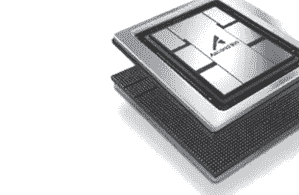
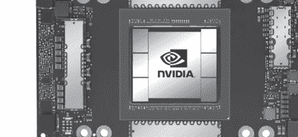
## 图 2.5.3

## 关键结论与思考
- 位宽决定数值表示范围与精度。通过量化把高位宽数据转成低位宽，可以在保持合理精度的同时提升执行效率、减少内存占用并提高吞吐。
- FP8 是新型 8 bit 浮点，包含 E4M3 与 E5M2 编码，旨在降低训练与推理的计算需求同时维持精度。FP8 混合精度训练框架在训练大模型时显著减少内存占用并加快速度，显示出在大规模训练中的潜力。
- FP8 的主要风险是下溢、上溢与量化误差，可通过张量缩放、自适应缩放因子等技术缓解，保持训练的准确与稳定。

# 第 3 章 AI 芯片架构概览

## 3.1 CPU 基础入门
CPU 即 Central Processing Unit 中央处理器，负责指令执行与计算，统筹计算机各部件，常被视为计算机的大脑。随着发展出现了多核、超线程、集成显卡等特性，计算与多任务能力持续提升。本节从历史讲起，再看当代 CPU 的组成。

### 3.1.1 CPU 发展大事记
世界上第一台通用电子计算机 ENIAC 于 1946 年诞生于美国宾夕法尼亚大学，采用十进制存储，最初用于弹道计算，后逐步成为通用科学计算机。它完全靠电子线路完成算术、逻辑与存储，运算速度比机械继电器机快约千倍。

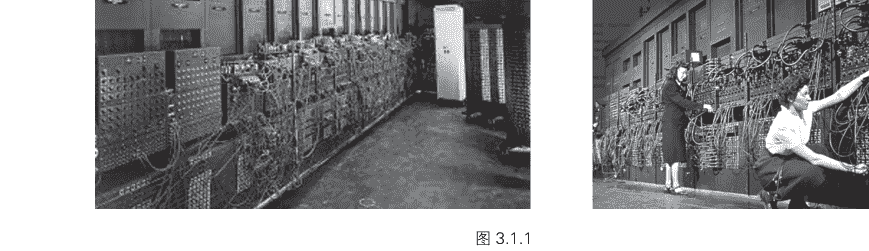
与 ENIAC 不同，更为人熟知的 EDVAC 是二进制串行机。建造计划 1945 年 3 月由冯·诺依曼等人提出，1951 年投运。

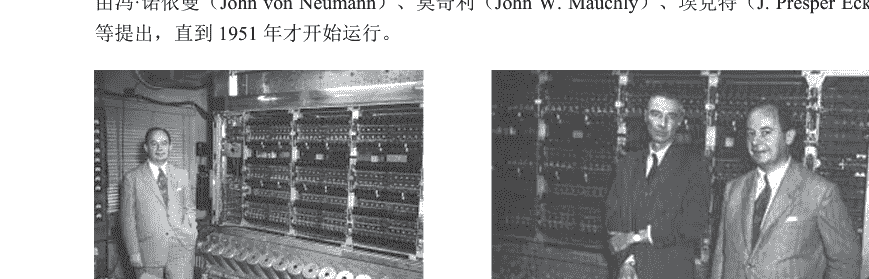
它是首个采用二进制的冯·诺依曼式计算机，由运算器、控制器、存储器、输入与输出设备五部分组成，即冯·诺依曼架构。该结构沿用至今，存储程序与程序控制仍是主流原理，冯·诺依曼因此被誉为计算机之父。

1971 年，英特尔推出 4004 微处理器，标志着首个 CPU 的诞生。功能与速度与今日相比微不足道，但意义里程碑式。

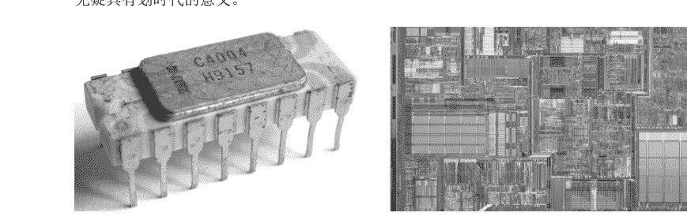
1978 年英特尔发布 16 位微处理器 8086，x86 架构由此诞生，随后推出 8088。1982 年 80286 面世，CPU 进入 286 时代。1985 年 80386DX 推出，集成 27.5 万晶体管，使 32 位 CPU 成为 PC 工业标准。

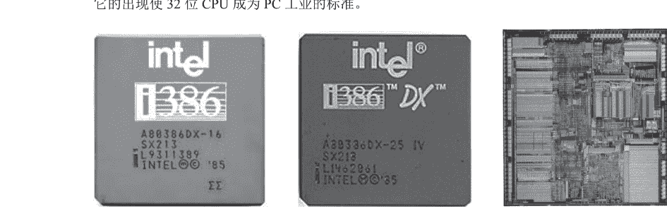
1988 年末 80386SX 上市，价格更低、性能优于 286，推广广泛。1989 年 80486 问世，晶体管突破百万，达 120 万，性能约为 80386DX 的四倍。1991 年 AMD 发布 Am386，性能与英特尔相当。次年 AMD 推出 Am486DX 系列，Am486DX4-120 频率首次超过英特尔。1993 年英特尔推出 80586，即奔腾，x86 的重大革新，但首代产品因浮点除法错误被大规模召回。

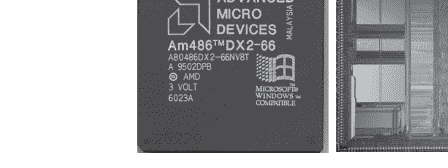
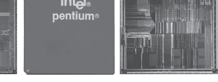
1995 年奔腾 120MHz 发布，后续陆续推出 150、166、200MHz 等型号。同期 AMD 推出 K6，性能可比奔腾 MMX，后衍生 K6-2、K6-3，对英特尔形成压力。

2000 年英特尔 Pentium 4 横空出世，频率进入 GHz 级，到 2024 年已达 3.4GHz。2003 年 AMD 推出桌面级 64 位处理器 Athlon 64 与 Athlon 64 FX，进入 K8 时代。速龙系列在性能上不输英特尔。

AMD 后续推出锐龙系列，包括 Ryzen 3、5、7，其中 Ryzen 5 2600X 性能超越 i5-9400F，Ryzen 7 2700X 曾挑战 Core i9。

从 1947 年首个晶体管发明到如今的 Ryzen 7 与 Core i9，CPU 经历不可思议的演进，得益于英特尔与 AMD 的竞争。摩尔定律认为晶体管密度每 18 个月翻倍，虽原形式已不完全适用，但半导体仍在持续探索。

### 3.1.2 CPU 核心组成
CPU 已集成大规模复杂电路，可视作由若干功能块构成。按功能大致分为算术逻辑单元、存储单元与控制单元三大部分。图 3.1.7 给出示意，实际连线、I/O 与控制流程远为复杂。

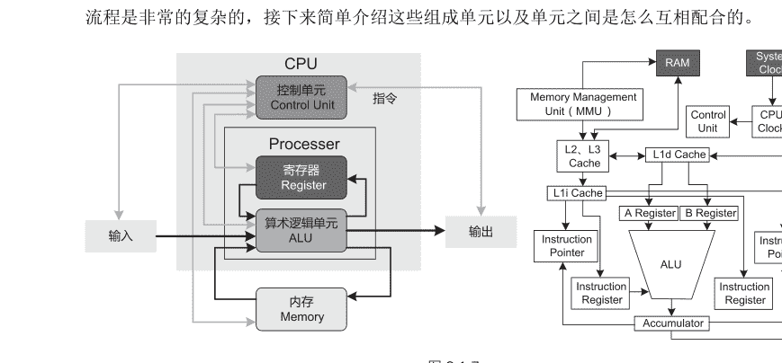
#### 1. 算术逻辑单元
CPU 的运算功能由算术逻辑单元 ALU 承担。ALU 由算术单元 AU 与逻辑单元 LU 组成，对两个操作数执行算术或逻辑运算并产生结果：AU 负责二进制加减等，LU 负责与或非等逻辑及比较，ALU 还具备移位能力。ALU 是 CPU、GPU 等微处理器的基本组件。

除了加减，ALU 也可处理整数乘法，结果仍为整数。

> 浮点数的由来：用科学计数法表示小数时，小数点位置会漂浮，这相对定点数形成了浮点数的名称。

不同处理器的 ALU 设计差异较大，有仅支持整数的，也有支持浮点运算的，有的单 ALU，有的集成多 ALU。典型操作包括：
- 逻辑运算：NOR、NOT、AND、NAND、OR、XOR 等
- 移位操作：位左移或右移，等价于一种特殊乘法
- 算术运算：加减为主，乘除成本更高，常以加减实现

如图 3.1.8，ALU 包含数据总线、操作码、状态输出与状态输入：
- 数据：两个输入一个输出的并行总线，位宽相同
- 操作码：指示执行哪种算术或逻辑操作
- 输出：状态信号如溢出、零、负等，与数据一并输出，暂存于外部寄存器供后续使用
- 输入：状态输入提供进位等历史信息

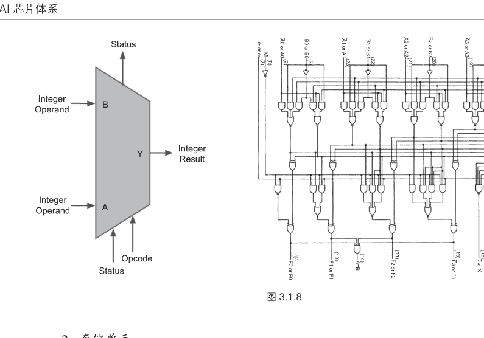
#### 2. 存储单元
CPU 的存储单元即寄存器。程序驻留在内存，CPU 运行需不断读写内存，每次访问都要经控制总线请求，繁琐且占用大量内存，降低性能。寄存器作为 CPU 内部高速存储，支持快速内部读写。

寄存器速度快于内存，可加速计算并暂存中间结果与操作数。主要分为指令寄存器与数据寄存器，负责暂存指令、操作数与计算结果。ALU 执行时从数据寄存器读取操作数，结果写入累加器，指令来自指令寄存器。

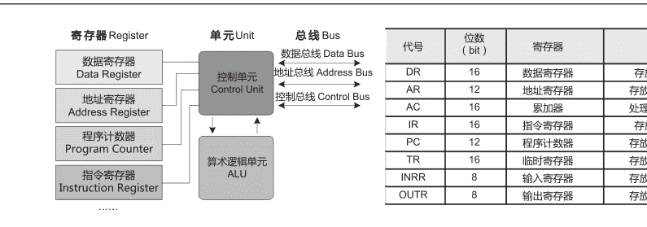
| 代号 | 位数 (bit) | 寄存器 | 功能 |
| :--- | :--- | :--- | :--- |
| DR | 16 | 数据寄存器 | 存放操作数 |
| AR | 12 | 地址寄存器 | 存放内存地址 |
| AC | 16 | 累加器 | 处理器寄存器 |
| IR | 16 | 指令寄存器 | 存放指令码 |
| PC | 12 | 程序计数器 | 存放指令地址 |
| TR | 16 | 临时寄存器 | 存放临时数据 |
| INRR | 8 | 输入寄存器 | 存放输入字符 |

| OUTR | 8 | 输出寄存器 | 存放输出字符 |

寄存器家族中，DR 也就是数据缓冲寄存器，主要任务是暂存参与运算的操作数，位宽要能容纳常见数据类型的数值范围。它在 CPU 与主存、外设之间起到衔接作用，用来抹平速度上的差距，在单累加器结构的运算器里可兼任操作数寄存器。主存中读出的一条指令或一个数据字，会先暂存到 DR，再往主存写回时也先经 DR 过渡。

AR 的作用是记录 CPU 正在访问的主存单元编号。用途上既可以通用，也可以配合特定寻址方式使用，比如作为基址寻址的段指针保存基地址、作为变址寻址的变址寄存器、作为栈式寻址的栈指针。位数必须覆盖最大寻址空间。因为 CPU 与主存速度不匹配，存取未完成前地址信息需要先保存在 AR 中。

PC 同时具备寄存与计数两项功能，用来保存下一条指令在主存中的位置。程序启动时，首条指令的地址被写入 PC，PC 便指向了第一条待取指令。执行过程中 CPU 会自动让 PC 自增，使其始终指向将要取出的下一指令，为取指做准备。

IR 用来容纳当前准备执行的指令。执行路径上指令先从主存搬到数据寄存器，再送入 IR。指令由操作码和地址码组成，执行前必须先识别操作码，由指令解码器完成。解码器读取 IR 中操作码字段进行译码，产生对应的控制电位送往微操作控制线路，在时序部件的节拍下形成具体的操作控制信号。简言之 IR 的操作码输出是解码器的输入，解码后即可向操作控制器发出明确的执行指示。

寄存器种类远不止上述几种，有兴趣可自行查阅。

寄存器很快很关键，为什么不做得更大？关键是成本。优质器件价格高昂，从性价比看，让寄存器与内存协同工作，比单纯追求寄存器大容量更合理。

#### 3. 控制单元

控制单元 CU 的本质工作是协调并指挥计算机各部件，以最有效的方式完成指令。CU 从主存中取出并挑选指令，完成译码后发出控制信号，让其他部件按需动作。它本身不参与运算，只是下达指令，告诉系统其余部分该如何运作。

若把 CPU 比作计算机的大脑，CU 就是 CPU 的大脑，也是 CPU 内部最核心的部分。其分工大致为译码指令、产生控制信号，并将信号送给 ALU、存储单元、内存及输入输出设备等。

指令译码是第一步。CU 从内存取出二进制指令，转化为各部件可理解的控制信息。通过译码可识别指令类型、操作数及执行方式，为后续执行铺路。举例 ADD R1,R2,R3 表示把 R2 与 R3 的内容相加，结果写入 R1。CU 译码后会产生控制信号，指示运算单元读取 R2、R3 并把结果写回 R1。

产生控制信号是第二步。CU 依据译码后的指令类型与操作数，发出时钟、读写、地址选择、操作数选择等控制信号，保证各部件同步。举例 LOAD R1,2000 表示把内存地址 2000 的数据装入 R1，CU 产生读控制信号，把地址 2000 发给存储器，并安排读取的数据写入 R1。

管理执行顺序是第三步。CU 按指令序列逐条调度，保证每条指令在正确的时钟周期内完成，并能处理跳转、分支、循环等流程。举例 IF R1 == R2 THEN GOTO 100，CU 会依据条件判断结果产生控制信号，决定是否跳转到标号 100 执行。

总体来看 CU 是接收指令并指挥执行的调度中心。如图 3.1.10 所示，输入到 CU 的信息主要有三类：节拍器 Step Counter、指令解码器 Instruction Decoder、标志信号 Condition Signal。

## 3.1.3 CPU 工作流

CPU 各单元的协作通常归纳为四步工作流①：

取指是从内存把指令抓取到 CPU 内部寄存器的过程，程序计数器用于保存下一条指令的地址。

解码紧随取指之后。指令解码器按既定指令格式拆分取回的指令，识别出指令类别和操作数获取方式。

执行是把译码后的指令真正落实。这一阶段完成指令规定的操作，有时需要依据地址码找到操作数在主存中的位置并读出用于运算。

写回是最后一步，也叫结果写回 WB。把执行阶段得到的结果写回 CPU 内部寄存器，方便后续指令快速使用。

结合图 3.1.11 理解：指令先从内存读出交给控制单元，控制单元把它译码成正式的命令 Command，ALU 根据命令执行运算，执行完毕后再把结果汇总写回内存。

> ① 2.1.2 节介绍时有“访存”这一步。实际上可以有访存，可以没有。在第三步根据指令的需要，可能需要从内存中提取数据，根据指令地址码，得到操作数在主存中的地址，并从主存中读取该操作数用于运算。这里面可以拆出一个访存。

从编程角度看，我们用 C++、Java、Python 等语言编译成的机器码文件存放在硬盘等介质上。操作系统运行时会先把程序加载进系统内存。程序本质上是一串指令，CPU 从内存中检索并读取这些指令，通过控制单元译码成 CPU 可识别的格式，随后控制单元向 ALU 发出信号，ALU 按指令读取操作数并计算，结果经 CPU 内部存储单元回写到内存中。

取指、解码、执行、写回合起来构成一个完整的指令周期。这一过程不断循环，直到程序结束。听起来很简单，实际很复杂。单是取指令就包含多个微操作，后续的解码、执行同样细节繁多，感兴趣可以深入学习计算机组成原理。

## 小结与思考

CPU 发展历史：从 ENIAC 这台通用计算机诞生，到冯·诺依曼结构提出，再到英特尔、AMD 等厂商推动技术演进，CPU 走过了从无到有、从弱到强的历程。

CPU 基本构成：CPU 主要由算术逻辑单元 ALU、存储单元 MU、控制单元 CU 三大部分组成，分别负责算术逻辑运算、指令数据存储、指令控制。

CPU 工作流：取指、解码、执行、写回四步循环往复，驱动程序持续运行直至结束。

## 3.2 CPU 指令集架构

指令是机器工作的指示，程序是一组按顺序排列的指令，执行程序就是计算机的工作。从微观看，输入的指令会被转成二进制码存入存储单元，执行时再取出。那么计算机如何知道指令的含义和执行方式？这就涉及 ISA，即指令集架构。本节围绕 CPU 的指令集架构展开，先介绍 CISC 与 RISC，再对比优劣并说明应用场景。

### 3.2.1 ISA

区分 CPU 的一个关键标准是指令集架构 Instruction Set Architecture，ISA。下面通过案例说明 ISA 的运作原理、作用、分类和演进。

#### 1. 什么是 ISA

ISA 定义了处理器所支持指令的语义，包括指令本身、操作数的含义以及对外设的接口。就像自然语言有有限的词汇，处理器支持的基本指令集也是有限的，比如加法、减法、乘法、逻辑或、逻辑非等。

开发者基于 ISA，使用不同的硬件实现方案来设计性能各异的处理器，因此 ISA 被视为 CPU 的灵魂。

ISA 本质上是软件感知硬件的接口，可看作硬件对外暴露的基础功能清单。英特尔和 AMD 的 CPU 使用 x86 指令集，IBM 处理器使用 PowerPC，惠普使用 PA-RISC，ARM 处理器使用 ARM 指令集或其变体 Thumb-1、Thumb-2。

基于 ARM 的系统无法直接运行为英特尔系统编译的二进制程序，因为指令集不兼容。但 C/C++ 程序可以跨平台重用，只需为目标架构选择合适编译器重新编译。

从更大视角看，指令集架构是硬件与软件之间的抽象层，是桥梁和接口。计算机通过指令集判断二进制码的含义，并由 CPU 转成控制硬件执行的信号。这样我们不再直接操作硬件，而是与更高层次的 ISA 交互，提升开发效率。

CPU 在电路上实现的一组指令就是指令集。它是一套标准，规定了指令种类、格式以及配套寄存器等。设计 CPU 前必须先确定指令集或选用现成的如 ARM、x86。

设计完成后还需要配套编译器，编译器依据指令集标准把源程序翻译成 CPU 可执行的加减乘除、与或非等指令，程序才能运行。

指令集并非一成不变，会随需求扩展。比如多媒体兴起后，需要处理大量音频视频数据。在简单的数组加法 a[100]+b[100] 中，传统方式需 100 次运算。若指令集加入 SIMD 指令，可并行处理多个元素，例如一次处理 4 个元素，只需 25 次运算即可完成。

指令集新增指令后，CPU 设计时需在硬件上增加对应模块，编译器也需升级以便把代码翻译成 SIMD 运算提速。若编译器不升级，CPU 仍可运行，但只能逐元素计算 100 次，效率只有升级后的 1/100。若 CPU 硬件不支持 SIMD，用新编译器生成的 SIMD 指令在老 CPU 上无法运行。

由此可见 ISA 的重要性。各厂商的 CPU 都有独特的指令做特殊操作，指令设计的好坏直接影响计算性能，指令集强弱是衡量芯片的重要指标，也是提升处理器效率的有效手段。

#### 2. 指令例子解析

以 MIPS32 指令为例说明 ISA 指令构成。图 3.2.2 所示指令来自一种采用精简指令集 RISC 的处理器架构。

> 精简指令集 RISC 处理器架构：1981 年出现，由 MIPS 科技公司开发并授权，广泛用于电子产品、网络设备、娱乐设备和商业设备。最早为 32 位，后续演进到 64 位，相关内容后面会详细说明。

MIPS32 的指令长度固定为 32 位，由 32 个 0 或 1 组成。寻址方式结合寄存器和立即数，在指令中给出寄存器编号或立即数。

MIPS32 指令集分为三类：R 型寄存器型、I 型立即数型、J 型转移型。

R 型指令使用三个寄存器作操作数，是 MIPS32 中最常用的一类。格式包含操作码 Opcode、寄存器地址码 rs、rt、rd、移位量 shamt 和功能码 func。典型例子有算术逻辑指令 add、sub、and、or，分支指令 beq、bne，以及部分系统控制指令。

I 型指令的操作由 Opcode 决定，低 16 位为立即数，使用时扩展到 32 位作为源操作数参与运算。常见例子有 addi、subi，分支指令 beqz、bnez，以及加载存储指令 lw、sw。

J 型指令操作由 Opcode 决定，主要用于跳转，低 26 位为字地址，用于形成跳转目标。例子包括无条件跳转 j、带链接跳转 jal。

以图 3.2.2 中的 addi 指令为例。指令功能的决定因素是前 6 位 Opcode，此处对应加法。右侧三段为操作对象，共三个参数：目的操作数 Addr1、源操作数 Addr2、立即数。其中 Addr1 和 Addr2 各占 5 位，表示寄存器地址，Addr1 存放结果，Addr2 提供参与运算的数值；立即数为 16 位有符号常量，与 Addr2 的值相加。

图中立即数换算为十进制是 350，该指令会把寄存器 Addr2 的值加上 350，结果写入 Addr1。

细心读者会发现这是 I 型指令，因为后 16 位包含立即数操作数。MIPS32 中立即数范围通常为 -32768 到 32767。addi 执行时可能溢出，MIPS 采用有符号数，溢出会引起符号位扩展。

与 add 相比，addi 是寄存器与立即数相加，而 add 是两个寄存器相加，属于 R 型指令。

#### 3. ISA 基本分类

指令的基本流程是取数、处理、写回，寻址方式负责定位数据在存储池中的地址。CPU 的运算指令、控制指令和数据移动指令构成指令集的核心要素。

这些指令通常在汇编等底层语言中直接使用，硬件可直接识别。在高级语言中，它们常被隐藏或封装。

汇编语言允许程序员直接使用 CPU 指令集，例如 MOV、ADD、JMP 等，每条汇编指令对应一到多个机器指令。

C 和 C++ 虽是高级语言，但仍提供较低抽象，支持通过指针直接操作内存，也可通过内联汇编或编译器扩展嵌入汇编指令。

总体而言，运算、控制、数据移动指令主要在汇编和低级语言中使用，高级语言则把底层细节抽象化，让开发者专注业务逻辑。

#### 4. ISA 生命周期

ISA 生命周期描述一条指令的执行过程，主要包含以下阶段，并非所有指令都遍历全部阶段，但基本原则一致。

FETCH 阶段，取指单元依据程序计数器的值从内存读取指令，指令被装入指令寄存器，后续处理使用。取指完成后 PC 通常更新为下一条指令地址，除非遇到跳转或分支。

DECODE 阶段是理解指令含义的关键。控制单元检查指令寄存器的内容，确定操作码 Opcode 和操作数 Operands。操作码决定执行何种操作，如加法、减法、分支等，操作数指定操作对象，可为寄存器、内存地址或立即数。解码后，控制单元生成一系列控制信号驱动后续操作。

EVALUATE ADDRESS 阶段针对访问内存的指令，如加载 Load 和存储 Store，在取数前需先算出内存地址。常用基址寄存器加偏移量，或间接寻址方式。计算出的地址用于访问内存以获取或写入数据。

**CPU 怎么跑一条指令**

**数据取用**
一条指令要算之前，CPU 得先把参与运算的原材料找齐。原材料可能放在寄存器文件里，也可能躺在内存里，或直接写在指令字里。寄存器是最快的，直接从寄存器文件里读走；内存要走总线拉数据。取数这一步往往要一次搞定多份，比如双操作数的加法，就得把两个参与数都准备好。

**计算执行**
数据到位后进入真正的运算阶段。解码时确定的算术、逻辑或比较行为会通过控制信号送到 ALU 去完成，浮点相关的工作通常交给 FPU 这类专用单元。

**结果回写**
算完必须把结果安放好。涉及寄存器的操作就写回对应的寄存器；存储类指令会把数据经总线写回内存。分支指令的执行结果还会改写程序计数器，进而改变后续执行的走向。

以上是理想化的顺序描述。真实的处理器为了提速，会叠加流水线、乱序发射、分支预测等机制，在遵守数据依赖的前提下让多条指令的不同阶段并行推进，有兴趣可以自行深入。

### 3.2.2 CISC 与 RISC
从指令系统规模看，ISA 可归为复杂指令集和精简指令集两大流派。如图 3.2.3 所示，两者分野很清晰。

CISC 与 RISC 并不是具体的指令集，而是指令设计层面的两种思路，可视作指令集里的两大学派。

#### 1. CISC 架构
CISC 的出发点是通过提供大量的指令形式，把程序总条数压下来，用更少的指令完成任务。

其设计哲学偏向用复杂的指令集和丰富的寻址方式来让编程更省事、代码更紧凑；复杂指令靠微码驱动，既能保留功能完整性，又让硬件实现相对简化；同时强调向后兼容，新硬件能运行老软件，从而长期维持生态。

典型特征是指令集庞大、寻址方式多样、指令长度可变、依赖微码控制、解码逻辑繁重。单条指令可一次性完成多重操作，提升代码密度；灵活的寻址让内存访问更方便；可变长度提供编码弹性；微码把复杂指令拆成微操作；但解码器因此更重。

CISC 优缺点归纳如下：
- **优点**：编程直观、代码占用小、兼容性强。指令一次做多事，源代码更短；指令数少节省存储；新机器能跑旧程序，保护软件投入。
- **缺点**：指令复杂且长度不一，解码执行慢；硬件结构复杂成本高；能效偏低，很难兼顾高性能与低功耗。

应用多在兼容性和功能全面性要求高的桌面与服务器。代表包括英特尔 x86 家族、IBM System/360 以及 Motorola 68000 家族。x86 是最主流的复杂指令集架构，长期主导 PC、服务器和工作站市场。

即便传统复杂指令集有短板，现代实现已吸收精简指令集思想。例如现今的 x86 芯片内部会把复杂指令翻译成微操作并流水化，在保留复杂指令集优势的同时提升并行度和效率。

#### 2. RISC 架构
精简指令集诞生于上世纪八十年代初。当时研究发现复杂指令集里大量指令使用率极低，且复杂指令执行慢。为了更快更简，提出了精简路线。IBM 801、伯克利的 RISC 项目、斯坦福的 MIPS 项目为其奠基。

设计原则是精简指令集并让指令执行时间趋于统一。典型特征有指令集精简、指令长度固定、加载存储架构、通用寄存器丰富、硬件流水线。单条指令只做一件事，解码执行更轻；固定长度如 32 位让取指解码更高效；只有 Load/Store 访问内存，其他指令只在寄存器间操作；寄存器多减少内存访问；流水线让多条指令重叠执行。

RISC 优缺点归纳如下：
- **优点**：执行更快、硬件更简洁、能效更高。指令统一利于高频运行；结构简化降低设计成本；效率高适合低功耗高性能场景。
- **缺点**：代码体积偏大、对编译器依赖强。因为单指令功能小，完成同样任务需要更多指令；必须靠高质量编译优化才能发挥性能。

技术演进中，现代精简指令集引入超标量、超线程等手段提升指令级并行，并配合指令调度、寄存器分配等编译优化，进一步提高吞吐和能效。

#### 3. 两者之间的异同
复杂指令集出现更早，当时没有经验可循，程序员希望一条指令干更多事，把负担推给硬件。结果指令越来越复杂、长短不一、参数繁多。

随着工艺进步，硬件长期被复杂指令集束缚，成为性能和尺寸的瓶颈。精简指令集正是在此背景下诞生。严格说，CISC 这个名称也是精简指令集出现后才用来归类之前的指令体系。

复杂指令集像大杂烩，指令形式各异、使用频率不一、规则松散。精简指令集是对复杂指令集的重构，取其精华去其糟粕。定长指令提升了解码效率；复杂指令被拆分为若干简单指令，降低了硬件复杂度，给微架构更多发挥空间，像苹果 M 系列芯片就是典型；每个指令只做一件事，让流水线设计更高效。

## 3.2.2 CISC 与 RISC 架构
精简指令集强调每条指令最多有一个内存寻址操作数，主张寄存器到寄存器的操作，并追求单周期完成执行。复杂指令集与精简指令集都遵循操作码加操作数的思路，操作数类型对应 CPU 寻址三大类：

- 寄存器寻址：操作数是寄存器。执行时从寄存器取数或写回。如 mov ax, bx，把 bx 的内容写进 ax。
- 内存寻址：操作数是内存地址。执行时需读写内存。可细分直接、基址、变址、基址变址等。直接寻址最直观，如 mov ax, [0x3000]，把 0x3000 地址的数据写入 ax。
- 立即数寻址：操作数是常数。常数直接可用，无需访存或取寄存器。如 mov ax, 0x18，把 0x18 写进 ax。

总体来看，复杂指令集靠丰富复杂的指令集简化编程、提高代码密度和兼容性，但解码执行复杂、硬件成本高。典型代表英特尔 x86 在 PC 和服务器领域广泛使用。精简指令集主张精简指令和统一执行时间，靠固定长度简单指令和流水线提升效率、降低复杂度，性能优势明显。ARM 和 RISC-V 等精简指令集处理器在移动、嵌入式和物联网中占优。如表 3.2.1 所示，两者各有侧重，适用于不同场景。

表 3.2.1 CISC 和 RISC 架构对比

| | CISC | RISC |
|---|---|---|
| 指令系统 | 复杂、庞大 | 精简 |
| 指令数据 | >200 | <100 |
| 指令长度 | 不固定 | 定长 |
| 可访存指令 | 不加限制 | 只有 Load/Store 指令 |
| 指令执行时间 | 相差较大 | 大部分在一个周期内完成 |
| 指令使用频率 | 相差较大 | 都比较常用 |
| 通用寄存器数 | 较少 | 多 |
| 目标代码 | 难以用优化编译程序生成高效的目标代码程序 | 采用优化的编译程序，生成代码较为高效 |
| 控制方式 | 微程序控制 | 组合逻辑控制 |
| 指令流水 | 可以通过一定方式实现 | 必须实现 |

## 3.2.3 CPU 并行处理架构
1966 年 Micheal J. Flynn 按指令流和数据流特征对体系结构分类，形成 Flynn 分类法，共四类：

- 单指令流单数据流 SISD
- 单指令流多数据流 SIMD
- 多指令流单数据流 MISD
- 多指令流多数据流 MIMD

### 1. 单指令流单数据流（SISD）
SISD 系统只有一个处理器和一个存储器，每个指令部件每次只解码一条指令，执行时只提供一份数据，计算串行，硬件不提供并行。为提速可采用流水线、设置多个功能部件形成超标量处理机，或用多模块交叉存储实现内存低位交叉编址。

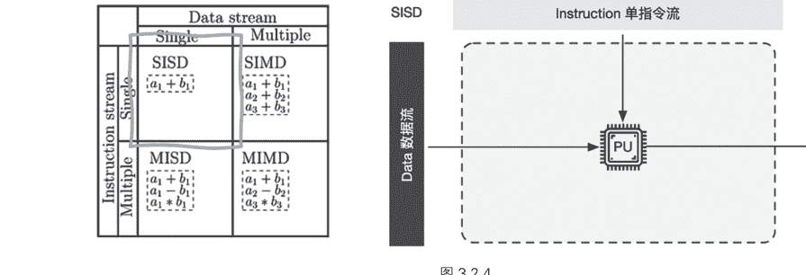

### 2. 单指令流多数据流（SIMD）
SIMD 在同一时间对多份数据执行相同操作，适合向量化运算。对数组类数据可一次性并行处理，提升效率。常见实现有 SSE 和 AVX。

SIMT 指在同一时间执行多个线程，线程可运行不同指令但通常执行同一程序，多用于 GPU 并行计算。CUDA 和 OpenCL 都是支持 SIMT 的编程模型。

SIMD 着眼数据并行，SIMT 着眼任务并行。实际应用中依据计算需求和硬件环境选择。

SIMD 系统由一个控制器带多个处理器，同时对一组数据的每个元素做相同操作。主要用于向量、矩阵等数组运算，处理单元数量固定，适合科学计算。特点是单元多但受通信带宽限制。一个指令流处理多个数据流，属于数据级并行。指令序列可并发但不并行。由指令控制部件和多个处理单元组成，每个单元指令相同但地址寄存器各自独立，于是数据地址不同。


### 3. 多指令流单数据流（MISD）
MISD 用多条指令流处理单份数据流。该模式实用性低，仅作为理论模型，没有实际产品。

### 4. 多指令流多数据流（MIMD）
MIMD 是在多个数据集上执行多条指令的多处理器机器。处理器可通过 Load/Store 访问同一主存，并通过主存交换数据。硬件上是一台计算机内含多处理器和一个主存储器，多处理器共享同一物理地址空间。


MIMD 可分为共享内存系统和分布式内存系统。共享内存系统中处理器经互联网络连到内存，处理器间隐式通信。分布式内存系统中每个处理器有私有内存，通过互联网络显式通信。


### 5. 单指令多线程（SIMT）
单指令多线程主要用于 GPU。

从硬件看，GPU 本质与 SIMD 接近，都是少量指令部件带大量运算单元。但高级语言并不直接支持 SIMD，编程复杂；SIMD 只在处理大量数据时高效，灵活性不足。

英伟达为解决这两个痛点，在指令集上仍像 SISD 一样定义操作数，但在执行时调度器会把一条指令分配到多套计算单元和寄存器。好处是代码可由类多线程的高级语言模型编译而来，即 CUDA，解决了编程复杂性。对用户而言，每套计算管道加寄存器就像一个线程，所以命名为 SIMT。

此外，指令还提供很多修饰符，比如 Bit Mask 可指定哪些线程工作哪些空闲，从而很好支持分支语句，解决了灵活性问题。

因此 SIMT 的初衷是让硬件保持 SIMD 的高效，同时让编程像多核多线程一样轻松。


## 小结与思考
- ISA 是定义 CPU 功能和操作的蓝图，对软件编程和硬件设计具有决定性影响。
- CISC 架构以复杂指令集简化编程，而 RISC 架构以精简指令集提升执行效率和硬件简化。
- CPU 并行处理架构通过不同的数据流和指令流组合，实现计算性能的提升，满足多样化的应用需求。

## 3.3 CPU 计算本质
本节深入探讨 CPU 计算性能，从算力敏感度和技术趋势分析影响性能的关键因素。通过数据和实例解释 CPU 算力计算方法、算力与数据加载的平衡点，以及如何用算力敏感度分析定位性能瓶颈。也将观察服务器、GPU 和超算等平台的性能演进。

### 3.3.1 从数据看 CPU 计算

#### 1. CPU 算力
算力即计算能力，是系统或设备执行数值计算和处理任务的核心能力。算力提升能更快完成复杂任务，提高效率，并改善应用加载速度、游戏流畅度等体验。

##### 1）数据读取与 CPU 计算关系
对 CPU 而言，算力不是唯一要素，数据加载和传输同样关键。若内存带宽为每秒 200 GB，换算成 FP64 约为每秒 25 GB；若计算单元可执行 2000 GFLOPS FP64，就必须考虑两者匹配。

根据计算强度公式：

```
Required Compute Intensity = \frac{FLOPS}{Data Rate} = 80
```

这意味着为了让数据加载成本值得，每加载一次数据大约需要执行 80 次计算。

##### 2）操作与数据加载的平衡点
为平衡计算与数据加载，每从内存加载一个数据，需要执行约 80 次计算。如此才能让计算单元和内存带宽都得到充分利用，避免计算资源浪费或内存成为瓶颈。

因此，提升算力很重要，但若数据加载跟不上，即使计算单元再强，整体效率也上不去。优化数据传输速率和加载策略与提升计算性能同等重要，才能保证系统整体高效。

##### 3）CPU 算力计算公式

CPU 的计算能力最直观的衡量方式是每秒浮点运算次数，也就是 FLOPS。这个指标在科学仿真、工程计算、图形渲染等重度计算场景里尤为关键。算力的估算本质上来自三项乘积：核心数量、单核主频以及每个时钟周期能完成的浮点操作数。

算力 FLOPS = CPU 核心数 × 单核时钟频率 Hz × 每周期浮点运算次数 FLOP/cycle

#### 2. 算力估算案例

##### 1) 单核 CPU 的算力估算
假设一颗单核处理器，主频 2.5 GHz，单周期可完成 4 次浮点运算：
核心数：1
主频：2.5 GHz = 2.5 × 10⁹ Hz
每周期浮点数：4 FLOP/cycle
算力：1 × 2.5 × 10⁹ × 4 = 10 × 10⁹ = 10 GFLOPS

##### 2) 多核 CPU 的算力估算
假设一颗四核处理器，每个核心主频 3.0 GHz，每周期可完成 8 次浮点运算：
核心数：4
主频：3.0 GHz = 3.0 × 10⁹ Hz
每周期浮点数：8 FLOP/cycle
算力：4 × 3.0 × 10⁹ × 8 = 96 × 10⁹ = 96 GFLOPS

##### 3) 超算系统的算力估算
假设一台超算部署 10000 台 CPU，每台 8 核，主频 2.5 GHz，每周期 16 次浮点运算：
CPU 台数：10000
单台核心数：8
主频：2.5 GHz = 2.5 × 10⁹ Hz
每周期浮点数：16 FLOP/cycle
单台 CPU 算力：8 × 2.5 × 10⁹ × 16 = 320 × 10⁹ = 320 GFLOPS
整机算力：10000 × 320 × 10⁹ = 3.2 × 10⁶ × 10⁹ = 3.2 PFLOPS

#### 3. 决定 CPU 算力的要素
- 核心规模：并行处理能力的基础，每个核心可独立执行任务，核心越多同时处理的任务越多，多核架构在多线程负载下优势明显。
- 主频高低：主频代表每秒周期数，单位 GHz。主频越高单位时间内完成的计算步骤越多。
- 单周期浮点吞吐：得益于超标量与向量化设计，现代架构能提升每个周期的浮点执行次数，这是科学计算与图形处理的关键。
- 缓存与内存带宽：数据搬运效率直接影响等效算力。更快的缓存层级和更大的带宽能降低等待时间，提升整体效率。
- 指令集架构：x86、ARM、RISC-V 等不同 ISA 对浮点操作的原生支持与优化程度不同，从而影响实际算力表现。

### 3.3.2 算力敏感度
算力敏感度描述的是性能对各类参数变化的响应程度。通过敏感度分析可以找出现有系统的瓶颈所在，是调优高性能系统的核心手段。关键维度包括操作强度、处理单元、带宽和理论峰值性能。

- **操作强度**：常用 ops/bytes 表示，即每字节数据对应的操作次数。它反映计算与内存访问的比例。操作强度高时计算占比大，带宽压力小；操作强度低时内存访问频繁，带宽需求上升。
- **处理单元 PEs**：执行操作的最小单元，可为 CPU 核心、GPU 流处理器或专用加速单元。单元数量与单单元效率共同决定理论峰值。
- **带宽**：单位时间可传输的数据量，单位 GB/s 或 TB/s。带宽受限时低操作强度应用会明显拖慢，优化存储子系统可缓解瓶颈。
- **理论峰值性能**：理想条件下可达的最大 FLOPS，由单元数、频率和计算能力推导。它是选型参考，但受带宽、内存时延、系统开销影响，实测值通常低于峰值。

第 2 章图 2.3.1 揭示了性能与操作强度、处理单元和带宽的关联。操作强度低时系统处于带宽受限区，左侧深灰区显示数据搬运成为主导，提升带宽效果明显。随着操作强度提升，系统逐渐转向计算受限区，右侧浅灰区由处理单元性能主导。中间存在最佳平衡区，带宽与计算资源匹配，性能接近理论峰值。

### 3.3.3 算力演进趋势

#### 1. 逻辑电路技术演进预测
图 3.3.1 给出 2006 年到 2026 年逻辑电路技术的演进展望。过去二十年工艺节点持续收敛，单次操作能耗下降，晶体管密度持续攀升。


#### 2. GPU 集群性能演进
图 3.3.2 描述 GPU 性能随时间的变化。2005 年到 2025 年间，性能约每 2.2 年翻倍，呈现稳定加速态势。


#### 3. 超算中心性能演进
图 3.3.3 覆盖 1995 年到 2040 年的超算性能。期间约每 1.2 年翻倍，近 45 年的长期增长轨迹清晰可见。


#### 4. 大模型训练的变化规律
图 3.3.4 展示训练时间随参数规模的变化。随着参数量增长，训练时长呈指数级上升。小规模 Megatron、T-NLG 在数天到数周完成，而 GPT-3、MT-NLG、GLaM 等大模型则需要数月，算力与内存需求同步激增。


## 小结与思考
- 算力评估依赖核心数、主频、带宽等要素，算力敏感度分析有助于定位瓶颈、指导系统优化。
- 技术进步推动 CPU、GPU 集群与超算持续提升，AI 大模型规模扩张使训练时长指数增长。

## 3.4 CPU 计算时延
CPU 计算时延指从指令发出到完成所需的时间。理解时延构成对性能优化与系统设计至关重要。

### 3.4.1 内存、带宽与时延的关联
- 内存与带宽：内存速度与系统带宽共同决定 CPU 与内存间的数据搬运效率，带宽越高搬运越快，等待越短。
- 带宽与时延：高带宽可间接降低传输时间，但受处理复杂度与链路距离影响并不线性，低带宽下大数据传输时延尤为突出。
- 内存与时延：内存时延直接影响取指与数据访问。低时延内存、合理的 DDR、SRAM 搭配以及单/双通道配置都能改善等待。

### 3.4.2 CPU 计算时延的构成
#### 1. CPU 计算时延组成
- **指令提取时延**：从存储器取出指令并送入指令寄存器的耗时，受内存速度与缓存命中率影响，L1/L2/L3 命中可大幅缩短。
- **指令解码时延**：将机器码译为内部操作的耗时，CISC 因指令复杂解码更久，RISC 因指令精简解码更快，解码单元设计亦有影响。
- **执行时延**：算术与逻辑实际运算的耗时，取决于指令类型与架构，流水线深度、并行能力与乱序执行都会改变耗时。
- **存储器访问时延**：访问主存或缓存的耗时，多级缓存与命中率提升访问效率，高带宽内存亦可降低等待。
- **写回时延**：结果回写寄存器或存储器的耗时，受缓存写回策略与多核一致性协议影响。

#### 2. 影响计算时延的因素
- **时钟频率**：频率越高单周期时间越短，但功耗与散热压力同步上升。
- **流水线技术**：指令分段并行可提升吞吐，流水线深度与效率决定实际时延。
- **并行处理**：多核与超线程可并发执行，收益取决于任务并行度。
- **缓存命中率**：命中率高则访存时延下降，失效则需访问慢速主存。
- **内存带宽**：带宽不足会造成数据饥饿，增加访存时延。

#### 3. 降低时延的优化手段
提高频率的同時控制功耗，合理设计流水线深度，增加缓存容量与优化策略，采用高效并行算法，充分利用多核，并升级高速内存与大带宽接口，均可显著缩短时延，提升系统整体性能。

### 3.4.3 CPU 时延计算实例
下面给出一组典型的 C 代码计算 y[i] = alpha * x[i] + y[i]：

```c
void demo(double alpha, double *x, double *y)
{
    int n = 2000;
    for (int i = 0; i < n; ++i)
    {
        y[i] = alpha * x[i] + y[i];
    }
}
```

#### 1. 例子解析
CPU 指令执行过程如图 3.4.1 所示，图中展示了不同操作如加载、计算、写入的时延。


##### 1）数据加载
Load from DRAM：启动阶段的关键步骤，涉及 x[0]与 y[0]的载入。由于 DRAM 与 CPU 存在速度鸿沟，加载时间主要由内存时延主导，图 3.4.1 中 load x[0]与 load y[0]占据较长区间。

##### 2）缓存读取
Read from Cache：数据进入缓存后，后续操作多在缓存内完成，时延明显下降。图 3.4.1 中读取 x[0]、y[0]的时间片段显著缩短。

##### 3）计算过程
Read x[0]和 Read y[0]：CPU 从缓存取出操作数，随后执行乘法 α * x，再执行加法与 y[0]相加，完成指令的计算部分。

##### 4）写回结果
Write Result：计算结果回写缓存，过程相对迅速，若需持久化则后续写回主存会引入额外时延。

#### 2. 时延分析
- 内存时延：从 DRAM 取数到缓存就绪的总时长，是瓶颈来源。
- 计算时延：乘法与加法各自的执行耗时。
- 缓存操作时延：加载、读取、写入缓存的耗时相对较短。

#### 3. 时延产生原因
CPU 时延源自硬件设计、内存访问与系统资源竞争等多方面。图 3.4.2 体现 CPU 与 DRAM 之间存在物理距离，电信号在总线上传输虽快仍会产生可测时延，这正是内存访问时延的组成部分。


假设主机工作频率为 3 000 000 000 Hz，即 3 GHz，那么一个时钟周期大约是 1/3 000 000 000 秒，约 0.333 ns。电信号在导线中的传播速度约为 60 000 000 m/s，按图 3.4.2 的估计，芯片到 DRAM 的物理距离在 50~100 mm 之间。

- 信号走 50 mm 所需的时延约为 0.833 ns，换算下来约是 0.833 ns / 0.333 ns ≈ 2.5 个时钟周期。
- 信号走 100 mm 所需的时延约为 1.667 ns，约是 1.667 ns / 0.333 ns ≈ 5 个时钟周期。

这段传输上的等待本身就等同于 CPU 的一个时钟周期，也是 CPU 完成一次计算所必须承受的时延。

#### 4. 影响计算速度的核心要素
计算快慢由多方面共同决定，包含内存时延、缓存命中率、运算操作的效率以及数据回写速度等。图中真正起决定作用的是内存时延。内存时延指的是从主存 DRAM 把数据搬到缓存所需的基础等待时间。因为主存远慢于缓存和寄存器，这一环节往往成为最耗时的瓶颈。

- **内存时延的制约**：图 3.4.2 里的数据加载操作 Load from DRAM 占据了异常长的区间，清楚地凸显出内存时延的压力。在 load x[0] 与 load y[0] 的阶段，CPU 必须空等数据从主存填入缓存，数据未到位则后续运算无法启动。
- **计算被拖慢的连锁反应**：高内存时延把整个计算的启动时间显著拉长。即便之后的乘法、加法以及缓存的读写本身很快，由于数据来得太慢，整体耗时也被大幅拖累。CPU 在等待数据加载的间隙里计算资源处于闲置，效率难以发挥。

## 总结与思考
- CPU 计算时延是指一条指令从发出到真正完成所需的时间，由取指、译码、执行、存储器访问与写回等各阶段的时延叠加而成，对性能优化和高效系统设计至关重要。
- 内存的速度、带宽与时延直接决定了 CPU 取数的时间。扩容缓存、提升内存带宽等手段能明显降低访问时延，从而提高系统性能。
- 降低 CPU 计算时延的常用方向有提高时钟频率、优化流水线深度、增大缓存容量、采用高效并行算法以及强化内存子系统性能，综合使用可提升整机的计算表现。

## 3.5 GPU 的起源与角色
GPU 是专门负责图形与图像类任务的硬件单元，其发展源于对图形处理需求的持续增长以及对渲染速度和品质的不断追求。从早期的基础图形加速，到今天的高性能计算与深度学习加速器，GPU 经历了数次关键的技术突破。除图形与人工智能外，GPU 在科学计算、数据分析、加密货币挖矿等领域也有广泛落地，深入了解这些场景有助于更好地发挥 GPU 的能力，解决更复杂的计算问题。

本节先梳理 GPU 发展脉络，比较 GPU 与 CPU、并发与并行的差异，简要介绍 AI 发展与 GPU 的关联以及 GPU 的典型应用。随后以实例说明 GPU 如何实现并行计算，并介绍 GPU 的缓存机制与线程原理。最后聚焦 GPU AI 编程的本质，回顾卷积计算的实现方式，解析 GPU 的线程分级，阐明 AI 计算模式与线程的关系，并讨论矩阵乘法在 GPU 编程中如何提升算力与算法利用率。

### 3.5.1 前言概述

#### 1. GPU 的演进历程
在 GPU 历史上，第一代可追溯到 1999 年以前。这一阶段的 GPU 在图形领域做了初步创新，部分功能开始从 CPU 解耦，实现了图形硬件加速。代表是几何处理引擎 Geometry Engine，GE 主要加速 3D 图像处理，但没有软件可编程能力，只能执行固定的图形任务，灵活性受限。

第二阶段覆盖 1999 到 2005 年。1999 年英伟达发布 GeForce256 芯片，专为复杂数学和几何计算设计。相较前代，它把更多晶体管分配给执行单元而非 CPU 那样的复杂控制单元与缓存，成功把变换与光照等功能从 CPU 中剥离，实现图形快速变换，标志着真正意义上 GPU 的诞生。

此后 GPU 技术迅速提速。2000 至 2005 年间，GPU 的运算速度已超越 CPU。2001 年英伟达与 ATI 分别推出 GeForce3 与 Radeon 8500，进一步推动图形硬件发展。图形流水线被定义为流处理器，顶点级可编程性初现，像素级也具备有限可编程能力。

英伟达与 ATI 的竞争本质是 Shader 管线与纹理、ROP 单元配比之争。ATI 倾向于堆砌 Shader 追求更强的计算性能，英伟达则认为纹理单元结构更简洁、晶体管更少、单位面积性价比更高，且游戏后期对计算的依赖比例会不断提升。

第三阶段始于 2006 年，带来了友好的编程环境。2006 年英伟达与 ATI 分别推出 CUDA 与 CTM 编程环境。这打破了 GPU 仅限图形语言的限制，把 GPU 转变为真正的并行数据处理加速器，使开发者能更灵活地利用 GPU 进行科学计算与数据分析。


2008 年苹果推出通用并行计算平台 OpenCL。不同于 CUDA 的硬件绑定，OpenCL 与具体设备无关，因而迅速成为移动端 GPU 编程的业界标准，进一步推动 GPU 在各应用领域的普及。

第三代 GPU 的到来不仅提升了算力，更重要的是提供了更便捷灵活的编程生态，使 GPU 在科学计算、深度学习等领域得到广泛推广，成为现代计算体系不可或缺的一环。

英伟达与 AMD 的工具链架构层次非常像，最核心差异在中间的库 Library 层，双方都基于自家硬件优化基础库；在编译层面也各自针对架构实现调度、算子融合等逻辑；对外接口上双方都在争取对主流框架与应用提供充分支持。图 3.5.2 展示了英伟达与 AMD 的细粒度对比，小木 2023，能更清晰看出映射关系与实现差异。


#### 2. GPU 与 CPU 的架构差异
下面讨论 CPU 与 GPU 在架构上的主要差别，见图 3.5.3。CPU 负责操作系统与应用程序的各类计算，需要很强的通用性来处理不同数据类型，同时分支判断会带来大量跳转与中断，使得内部结构异常复杂。GPU 能更高效地处理并行时的复杂数学运算，最初用于游戏与动画渲染，如今用途远超图形。两者内部都包含核心、存储与控制单元。


图 3.5.3

主要差异可归纳为：

- **并行处理能力**：CPU 仅有少量强力计算单元 ALU，更擅长顺序执行任务，能在极短周期内完成算术运算，时钟频率很高，复杂的控制单元可提供分支预测，故 CPU 擅长逻辑控制与串行计算，流水线技术让多个部件协作缩短执行时间。GPU 的控制单元可把多个内存访问合并为一次，减少带宽占用。GPU 采用海量计算单元与线程，整体吞吐量极大，超配的线程能很好掩盖内存时延，因而可同时处理大量任务，专注于大规模高度并行的计算。
- **存储架构**：CPU 用大量缓存占据芯片面积，以保存后续可能访问的数据，降低时延；GPU 缓存较少且为线程服务，若多线程访问同一数据，缓存会合并访问再统一去 DRAM 取数，之后分发给对应线程。GPU 拥有更多寄存器以支撑海量线程。

因此 CPU 更适合顺序任务如操作系统、数据分析；GPU 更适合计算密集型与大规模并行任务如图形渲染、深度学习。在异构系统中两者常协同工作以发挥各自优势。

GPU 最初用于图形图像与视频编解码。GPU 与 CPU 最大的不同在于设计目标：GPU 追求最大化吞吐量 Throughput，关注单位时间能处理多少任务而非单任务快慢；CPU 更关注时延 Latency 与并发 Concurrency。CPU 优化目标是在尽量低的时延下快速完成任务并在任务间快速切换，本质是序列化处理。GPU 优化则全部用于提升吞吐，它一次推送大量任务进入芯片，由大量核心并行执行。图 3.5.4 示意了带宽、时延、吞吐量的关系。

#### 3. GPU 如何推动 AI 爆发
GPU 与 AI 发展紧密相连。2012 年的系列事件标志 GPU 在 AI 计算中崭露头角。Hinton 与 Alex Krizhevsky 设计的 AlexNet 是重要突破，他们用两块英伟达 GTX 580 GPU 训练两周，将图像识别准确率提升一个数量级并夺得 2012 年 ImageNet 冠军，图 3.5.5。这一成果充分展现 GPU 加速神经网络训练的巨大潜力。

与此同时，谷歌与吴恩达团队的工作也凸显 GPU 的价值。谷歌用 1000 台 CPU 服务器完成猫狗识别，而吴恩达团队仅用 3 台 GTX680 GPU 服务器达到相同效果。对比清晰显示 GPU 在深度学习任务中的显著加速，并进一步推动 GPU 在 AI 领域的广泛应用。

从 2005-2006 年起已有研究尝试用 GPU 做 AI 计算，但直到 2012-2013 年才被大规模接受。随着网络层数加深、规模增大，GPU 加速优势越发明显，得益于其大量独立高吞吐计算通道与相对较少的控制单元，使其在高度并行任务中表现优异。

因此 GPU 在 AI 中的作用日益凸显，为深度学习等复杂任务提供强力算力，成为 AI 计算的标配。从学术界到互联网头部企业，都广泛采用 GPU 引入生产研发环境，为 AI 技术快速发展提供关键支撑，图 3.5.6。

## 3.5.2 GPU 工作原理

为更好理解 GPU 工作原理，本节先对比并发与并行，再通过实例探究 GPU 如何进行并行计算，并讲解缓存机制与线程原理。

### 1. 并发与并行
并行与并发是计算机科学中常被讨论的概念，二者都涉及同时处理多任务，但在含义与应用上存在差异。

- **并行 Parallelism**：指多个任务或操作真正同时执行，通常在多处理单元上并行进行。处理单元可以是多核、多线程或分布式系统。并行可显著提升性能，特别适合海量数据与复杂计算。例如程序可同时在多个核心上运行，加快整体速度。
- **并发 Concurrency**：指系统能同时处理多个任务，但不一定真正同时执行。任务间可能交替进行，通过时间片轮转或事件驱动实现。并发用于提升响应能力与资源利用率，适合大量短时任务。例如 Web 服务器可并发处理多个客户端请求，提升吞吐量。

主要区别：
- 并行强调同时性与并行处理能力，用于提升计算性能。
- 并发强调任务交替与资源共享，用于提升响应与利用率。

实际中两者常结合使用。硬件层面更倾向于用多线程展开循环来提高利用率，这正是 GPU 的核心原理。

以三款芯片为例比较硬件限制下可执行线程数。比较维度包括线程请求 Threads Required、线程可用数 Threads Available 与线程比例 Thread Ration，核心是衡量需多少线程才能掩盖内存时延。表 3.5.1 显示关键数据：

- GPU 英伟达 A100 的时延比 CPU AMD Rome 7742、Intel Xeon 8280 高出数倍；
- GPU 的线程请求是 CPU 的二三十倍；
- GPU 的线程可用数是 CPU 的百倍以上。算得线程比例 GPU 为 5.6，CPU 为 1.2~1.3。这正是 GPU 设计的重要出发点，依靠海量线程支撑大规模并行。

表 3.5.1 三款芯片参数对比

| | AMD Rome 7742 | Intel Xeon 8280 | NVIDIA A100 |
|---|---|---|---|
| Memory B/W (GB/s) | 204 | 143 | 1555 |
| DRAM Latency (ns) | 122 | 89 | 404 |
| Peak Bytes per Latency | 24 888 | 12 727 | 628 220 |
| Memory Efficiency | 0.064 | 0.13 | 0.0025 |
| Threads Required | 1556 | 729 | 39 264 |
| Threads Available | 2048 | 896 | 221 184 |
| Thread Ration | 1.3X | 1.2X | 5.6X |

由 CPU 与 GPU 典型架构对比可知，图 3.5.6，GPU 可视为大型吞吐器，部分线程等待数据，部分等待激活，部分正在计算。GPU 工程师把资源全部投入增加线程数量，而非降低数据搬运与指令时延。

相对地，CPU 可比喻为延迟机，目标是在单个线程内完成全部工作。为解决时延问题，CPU 设计把重心放在降低时延上，因而线程倍数仅略高于 1，这也是 SIMD 与 SIMT 架构的本质区别。CPU 不是靠增加线程，而靠提升单线程执行速率与效率，这正是两者根本差异。

### 2. 基本工作原理
先以 ax+y 加法运算为例了解 GPU 工作原理，示例代码如下：

```
void demo(double alpha, double *x, double *y)
{
    int n = 2000;
    for (int i = 0; i < n; ++i)
    {
        y[i] = alpha * x[i] + y[i];
    }
}
```

示例包含 2 FLOPs 操作，即乘法 Multiply 与加法 Add，每次计算需从内存读取两个数据 x[i] 与 y[i]，最后做线性运算写入 y[i]。把乘加融合的操作可称为 FMA Fused Multiply and Add。

在 O(n) 时间复杂度下，按 n 大小迭代 n 次，CPU 会串行按指令顺序执行 ax+y。以 Intel Xeon 8280 为例，其内存带宽 143 GB/s，内存时延 89 ns，意味着在 89 ns 内可传输 12727 bit 数据。而 ax+y 在 89 ns 内实际传输约 16 bit 数据，即双精度占 8 byte，内存利用率仅 0.14%，存储总线有 99.86% 时间空闲。

由表 3.5.1 可知，无论是 AMD Rome 7742、Intel Xeon 8280 还是英伟达 A100，计算 ax+y 时内存利用率都极低，均不超过 0.14%。

因上述程序未充分利用并发与线性度，下面通过并发进行循环展开的代码如下：

```
void fun_axy(int n, double alpha, double *x, double *y)
{
    for (int i = 0; i < n; i += 8)
    {
        y[i + 0] = alpha * x[i + 0] + y[i + 0];
        y[i + 1] = alpha * x[i + 1] + y[i + 1];
        y[i + 2] = alpha * x[i + 2] + y[i + 2];
        y[i + 3] = alpha * x[i + 3] + y[i + 3];
        y[i + 4] = alpha * x[i + 4] + y[i + 4];
        y[i + 5] = alpha * x[i + 5] + y[i + 5];
        y[i + 6] = alpha * x[i + 6] + y[i + 6];
        y[i + 7] = alpha * x[i + 7] + y[i + 7];
    }
}
```
在一次测试里，对 0 到 7 的数据做 8 次迭代展开，每次搬运 16 字节，跑在 Intel Xeon 8280 上，每 89 ns 就能完成 729 次请求，合起来就是 11659/16。把程序改成这样，本质上是用并发把整条总线压满，让它始终处于忙碌状态。但现实应用中这条路走不远：

- 编译器极少会把一个循环展开超过百次；
- 单个线程一次能发出的指令数有限，并发度很难无限拉高；
- 一个线程很难扛住七百多路计算的压力。

所以并发确实能让指令流水线一次性更饱满，架构层面的瓶颈仍然存在。

把 $\alpha x+y$ 用并行展开后，示例代码如下：

```
void fun_axy(int n, double alpha, double *x, double *y)
{
    Parallel for (int i = 0; i < n; i++)
    {
        y[i] = alpha * x[i] + y[i];
    }
}
```
并行展开的核心是让并行处理器或多个线程共同完成 $\alpha x+y$ 这一类操作，同样能让总线保持满载，一次可并行 729 次迭代。对比并发做法的不同点在于：

- 每个线程只负责自己那一份算子，不互相叠加指令流水；
- 实现 729 次计算就需要 729 个线程，真正做到 729 路并行；
- 此时限制来自线程数量和内存请求的规模，而不是指令展开的深度。

### 3. GPU 缓存的分层设计
GPU 在运行中要尽量压低内存延迟、搬运开销和带宽占用，缓存是关键。英伟达 Ampere A100 的显存采用 HBM，容量 80 GB。寄存器文件可以视作最靠近 SM 的缓存，能快速拿到执行单元的数据，也便于访问 L1。L2 则更靠近 HBM，负责把海量数据先吸到缓存里，所以形成了多级缓存体系。A100 的 L2 共 40 MB，由所有 SM 共享；每个 SM 的 L1 为 192 KB，寄存器为 256 KB。108 个 SM 下，寄存器总量约 27 MB，L1 总量约 20 MB。

拿带宽和延迟与 CPU 对比，以 HBM 为基准，L2 带宽约是主存的 3 倍，L1 约是 13 倍。以 L1 延迟为基准，L2 延迟约是 5 倍，HBM 约是 15 倍，正因如此 GPU 必须自带显存。如果用 CPU 把 DRAM 数据经 PCIe 传给 GPU，延迟高出约 25 倍，传输速度远跟不上计算速度，所以 GPU 与 CPU 间的数据通道依赖 PCIe。

> DRAM 即动态随机存取存储器，靠电容存 0/1 并需定期刷新维持数据，属于高密度低成本但速度较慢的临时存储介质。

按计算强度看，HBM 约 100，L2 仅 39，即每个数据只做 39 次运算；L1 更低约 8，对硬件来说非常友好。这也是 L1、L2 和寄存器对 GPU 重要的原因：把数据放在 L1 上做 8 次运算，就能让 SM 算力接近饱和。PCIe 带宽很低、延迟很高，会导致计算强度被拉高，算力利用率反而下降。

表 3.5.2 不同存储和传输的参数对比

| 数据位置 | 带宽（GB/s） | 计算强度 | 时延（ns） | 线程请求 |
| :--- | :--- | :--- | :--- | :--- |
| L1 Cache | 19400 | 8 | 27 | 32738 |
| L2 Cache | 4000 | 39 | 150 | 37500 |
| HBM | 1555 | 100 | 404 | 39264 |
| NVLink | 300 | 520 | 700 | 13125 |
| PCIe | 25 | 6240 | 1470 | 2297 |

带宽提升时，线程数和线程请求也得同步增长，才能把并行算力吃满。只有线程足够多，内存和计算才能同时保持忙碌，这也是 GPU 线程数极高的原因。

### 4. GPU 线程的工作方式
图 3.5.7 同时呈现了 GPU 整体与单个 SM 的结构。SM 是基本算单元，GPU 一个时钟周期能跑多个 Warp，即一组同指令执行的线程束。每个 SM 有 64 个 Warp，其中 4 个可在同一时刻活跃。设计者的思路不是去缩短延迟，而是用更多线程和更多 Warp 来掩盖延迟。

表 3.5.3 SM 和 A100 的线程与 Warp

| | 每个 SM | A100 |
| :--- | :--- | :--- |
| Total Threads | 2048 | 221184 |
| Total Warps | 64 | 6912 |
| Active Warps | 4 | 432 |
| Waiting Warps | 60 | 6480 |
| Active Threads | 128 | 13824 |
| Waiting Threads | 1920 | 207360 |

为提升任务吞吐，SM 线程会被超配。A100 单卡提供 20 多万线程，实际应用用不完，部分在算，部分在搬数据，部分在等待下次调度。算力利用率看似不高，但线程超配给了调度弹性，线程可在不同 Warp 间灵活切换。

## 3.5.3 GPU 为何适合 AI 训练
GPU 能否胜任 AI 计算，关键在于编程本质：卷积如何实现、线程如何分级、AI 计算模式与线程的关系，以及矩阵乘如何被 GPU 提升效率。

### 1. 卷积的本质
卷积的具体展开在后续章节详述，这里只讲原理。输入维度常写作 3 维 KH、KW、3，卷积核按 Channel 有 N 个，核维度为 N、IC、KH、KW。实际排布多用 NHWC，输入为 N、IH、IW、IC，核为 OC、KH、KW、IC，输出为 N、OH、OW、OC。计算方式是对核模板与图像逐元素相乘再求和，得到特征图。

Im2Col 是常用技巧，把图像重排为矩阵，让卷积转为矩阵乘。重排后，每一列对应核在图上滑动的覆盖区，行数为 OH*OW，每个行向量先放第一个通道的 KH*KW 个数，再依次拼接至 IC。权重也按核大小展开，N 个核形成权重矩阵的 N 行，每行同样按通道拼接 KH*KW 数据。重排后，卷积就等价于两个矩阵相乘，AI 计算的本质是矩阵乘。

### 2. 线程分级与数据交互模式
AI 计算中并非所有操作都可线程独立，常见的三种数据关系是：

- 逐元素：每个元素独立处理，如向量逐元素加乘，输出直接对应输入元素。
- 局部：只涉及局部子集，如卷积，计算一个点需周边参与。
- 多对多：每个元素与同一或不同结构中的其他元素全部交互，信息交换完全连接，难以做到完全线程独立。

以猫图为例，先用 Grid 把整图切成多个 Block，再把一个 Block 细分为更小的单元。Block 内部的 Thread 通过本地共享数据协同计算，每个像素点分配一个线程。大的 Grid 代表全部任务，切分后的块内线程数相同且可通过共享内存同步。并行能力是解决带宽延迟的核心，所需线程数由计算复杂度决定。

- 逐元素：线程增加意味着新一次加载，线程并行不会改变实际延迟，规模在合理范围时效率稳定。
- 局部：如卷积，线程分级并行，读取压力小，GPU 执行效率与 AI 模式匹配较好，计算强度约为 O(1)。
- 多对多：元素间交换无法完全独立，计算强度随规模线性增长，需要大量通信。

### 3. 计算强度决定效率
矩阵乘可看作 AI 的核心。设 A 为 m×n，B 为 n×p，则 C 为 m×p，元素计算为

$$c_{ij} = \sum_{k=1}^{n} a_{ik} \cdot b_{kj}$$

计算强度是指算术运算量与数据传输量的比值，用来衡量计算密集度。

$$\text{计算强度} = \frac{\text{算术运算量}}{\text{数据传输量}}$$

其中算术运算量是浮点运算次数，数据传输量是内存读写量。强度高时计算为主，优化重在算子并行；强度低时传输为主，优化重在访问模式。

两个 N×N 矩阵相乘，算术运算量约 2N³ - N² 次，数据传输量约 3N²。于是

$$计算强度 = \frac{2N^3 - N^2}{3N^2} \approx O(N)$$

强度随 N 线性增长，为 O(N)。在 GPU FP32 下，矩阵规模约 50 时能让计算单元充分发挥，实现计算与搬运的平衡。规模继续增大，内存会先空闲，GPU 要花更多时间算。英伟达用 Tensor Core 专攻矩阵，显著提升计算强度，让搬运跟上运算。

FP32 为单精度，FP64 为双精度。前者速度更快但精度有限，后者精度更高但更慢。任务对精度要求不高时选 FP32，需要高精度时才用 FP64。

Tensor Core 加入后的存储带宽与算强变化

| 数据位置 | 带宽(GB/s) | 原计算强度 | 新增 Tensor Core 后计算强度 |
| :--- | :--- | :--- | :--- |
| L1 Cache | 19400 | 8 | 32 |
| L2 Cache | 4000 | 39 | 156 |
| HBM | 1555 | 100 | 401 |
| NVLink | 300 | 520 | 2080 |
| PCIe | 25 | 6240 | 24960 |

引入张量核心后，L1 的算强从 8 提升到 32，L2 从 39 提升到 156。说明缓存层级与张量核心如何搭配，会直接决定小矩阵与大矩阵场景下的执行效率。

张量核心作用于哪一层，会改变在理想算强下矩阵维度的取舍，每种存储介质与算强的配对都存在一个拐点。结合图 3.5.19 与图 3.5.18 可看出，数据最终落在何种存储，对整体效率的制约远大于 FP32 与 FP64 精度差异。数据驻留在 L1 时更适合卷积这类轻量矩阵运算，Transformer 这类 NLP 典型结构则更适合放到 L2 计算。计算与取数需要比例配合，一旦搬运成为瓶颈，算力就会空转。寻找算强与矩阵规模的平衡点，是 AI 系统优化的核心。

## 小结与思考

- GPU 起源于图形渲染，后逐步发展为高性能计算与深度学习的加速平台，AI 的快速发展离不开其支撑，已成神经网络训练的标配。
- GPU 的并行机制依赖线程超额投放与 Warp 同步执行，用以掩盖访存延迟，高吞吐的设计与 CPU 的低时延思路形成互补。
- 多级缓存减少了对主存的依赖，配合海量线程调度提升利用率，L1、L2 与寄存器协同优化数据流动与计算效率。
- 线程分级结构可映射 AI 计算中的不同数据形态，通过超额调度与 Warp 执行单元提升吞吐并隐匿内存延迟。
- 算强决定 AI 任务的实际表现，引入 Tensor Core 等硬件可改善算强，提升矩阵乘法效率，实现算力与带宽的均衡。

## 3.6 AI 专用芯片基础

随着深度学习加速，NPU、TPU 等面向 AI 的专用处理器相继出现。相比通用 CPU、GPU，它们在 AI 任务上的效率与性能更突出。本节先回顾发展脉络，再展开部署方式、技术路线与应用场景。

### 3.6.1 AI 芯片发展速览

AI 芯片是为海量矩阵计算定制的处理器或计算模块。与通用 CPU 不同，它采用领域专用架构 DSA，聚焦于 AI 算法所需的专用计算能力。

图 3.6.1 给出典型 AI 芯片架构。以应用为中心，周边如 RSU 解码芯片、FPGA 等都属于面向特定领域的定制形态。

DSA 本质上是针对特殊领域的加速器架构，相较于在通用 CPU 上跑完整应用，能大幅提升特定任务性能。其设计更贴近真实需求，从而获得更高效率。除 AI 芯片外，DSA 还包括图形加速单元、神经网络处理器 NPU/TPU 和软件定义网络处理器等。

AI 芯片通过在硬件层面优化矩阵乘法、卷积等核心运算，可显著加快执行并降低功耗。相比在通用 CPU 上以软件模拟，专用加速器能带来数量级提升，因而成为 AI 落地的关键使能器。

图 3.6.2 展示 CPU、GPU、NPU 的架构差异。CPU 结构均衡，可处理多种任务；GPU 削减控制逻辑，大幅增加 ALU，提供高并行度；NPU 则配备大量 AI Core，用以高效完成针对性计算。

AI 芯片兴起的根源在于深度学习扩张。随着模型规模增大，训练与推理计算量指数增长，通用芯片难以兼顾性能与功耗，同时自动驾驶、智能安防、边缘计算等场景对实时性与能效要求提升，共同推动其发展。

发展历程上，2016 年谷歌推出首代 TPU，采用脉动阵列设计，专为 TensorFlow 下的机器学习任务加速，后续不断迭代优化。华为随后推出昇腾 NPU，采用达芬奇架构并集成大量 AI 核心，已应用于 Mate 系列手机和 Atlas 服务器。特斯拉推出 DOJO 芯片，面向自动驾驶系统的训练与推理加速。寒武纪 MLU 系列、地平线征程系列等国内外方案也在积极布局，各自在架构、性能与场景上形成差异化。

### 3.6.2 AI 专用芯片任务和部署

AI 专用芯片在 AI 体系中扮演关键角色，其任务与部署较为复杂。首先需处理海量数据并完成高强度计算，涉及高性能计算、能效优化、硬件架构设计等多个方面。在数据中心、大规模服务器与边缘设备等场景下，芯片既要具备强计算能力，也要兼顾适配性。

复杂性体现在计算能力、能效比、灵活性与可扩展性。AI 任务大量依赖矩阵运算与并行计算，对核心算力与内存带宽要求极高，需要复杂的并行架构与高效内存系统。移动与边缘场景要求在高性能下降低功耗，需在架构与算法加速上优化。芯片要能动态适配不同任务与技术演进。

总体功能可归为训练与推理两大形态。

#### 1. 训练芯片

训练阶段要求芯片支持大规模数据处理与复杂模型训练，需要强大的并行能力、高带宽存储访问与灵活的数据传输。

算力、存储、传输、功耗、散热、精度、灵活性、可扩展性、成本构成训练芯片的九要素金字塔：算力是基座，支撑模型构建与优化；高带宽存储如同高速通道，保证数据顺畅流动；灵活传输使训练过程更连贯；功耗与散热相随，高性能往往伴随高热量，低功耗与良好散热至关重要；精度要求高，确保参数准确；灵活性需兼容各类模型与算法；可扩展性面向更大规模模型与数据；成本则是市场化关键。

昇腾 Ascend NPU、谷歌 TPU、Graphcore IPU 等训练型芯片正沿此方向演进，为大规模模型训练提供动力。

#### 2. 推理芯片

推理阶段侧重功耗、成本与实时性。云侧推理对性能与吞吐要求高，常采用 GPU、FPGA 等高性能方案；边缘与端侧推理更看重功耗与成本，倾向于面向移动与嵌入式设计的 NPU、TPU 等低功耗方案。

若说训练芯片是发动机，推理芯片则是把算力转化为现实智能服务的传动装置。国内推理芯片热度源于政策驱动与市场需求双重牵引，国家扶持国产化与智能手机、智能家居、自动驾驶等场景的旺盛需求共同推动。

相较训练芯片，推理芯片在性能、功耗、成本上的侧重点不同：需支持多种模型与算法并实现低时延推理；部署于边缘设备需低功耗以延长续航；价格需亲民以实现普及。此外，灵活性要求快速部署与模型更新，安全性要求具备防护以防数据泄露与攻击。

AI 芯片的异构集成趋势明显，单一架构难以覆盖多样化需求，CPU+GPU+NPU 等异构融合成为主流。国内市场如寒武纪、地平线、百度等厂商的推理芯片在智能手机、智能家居、自动驾驶等领域逐步商用。

部署方式也在演进，传统云侧部署受数据传输与隐私约束，边缘与端侧部署成为趋势，将芯片与模型下放到边缘与终端，减少时延与带宽压力，提升实时性与安全性，同时对功耗与成本提出更高要求。

### 3.6.3 AI专用芯片技术路线

面向加速应用的 AI 专用芯片主要有 GPU、FPGA、ASIC 三条路线，差异见表 3.6.1。

表3.6.1 GPU、FPGA、ASIC对比

|  | GPU | FPGA | ASIC |
|---|---|---|---|
| 定制化程度 | 通用 | 半定制化 | 定制化 |
| 灵活性 | 好 | 好 | 不好 |
| 成本 | 高 | 较高 | 低 |
| 编程语言 | CUDA/OpenCL | Verilog/VHDL、OpenCL/HLS | — |
| 功耗 | 高 | 较高 | 较高 |
| 优点 | 峰值算力强，产品成熟 | 平均性能较高，功耗较低，灵活性强 | 专用性能强，功耗较低 |
| 缺点 | 整体算力利用率低，功耗高 | 量产单价高，峰值算力低，上层软件构筑难 | 上层软件构筑难，针对具体应用，泛化性差 |
| 应用场景 | 云侧训练、云侧推理 | 云侧推理、终端推理 | 云侧训练与推理、终端推理 |

#### 1. GPU

GPU 凭借强大的并行计算能力成为当前主流 AI 加速方案。厂商推出 Tesla、Radeon Instinct 等 AI 优化产品，并通过 Tensor Core 等技术提升矩阵运算速度。GPU 在通用性上占优，但在功耗、成本与编程门槛方面仍有优化空间。图 3.6.3 显示其大量计算单元为数据并行处理提供基础。

#### 2. FPGA

FPGA 具备可重构特性，在 AI 加速领域应用广泛。相比 GPU，FPGA 功耗更低、灵活性更高。Xilinx Alveo、英特尔 Stratix 等产品集成更多数学运算单元与片上存储，提升带宽。缺点在于编程通常需 Verilog/VHDL 等硬件描述语言，成本也相对较高。图 3.6.4 展示其由逻辑块、I/O 块与互联网络构成。

#### 3. ASIC

ASIC 可针对特定 AI 算法与场景深度优化，性能与能效达到极致。谷歌 TPU、华为昇腾 Ascend NPU 系列均为典型代表。代价是设计周期长、前期投入大、灵活性差，且需配套软件栈与开发工具。图 3.6.5 呈现其接口模块、存储器接口、统一缓冲区、计算单元、数据处理单元与控制单元的组成。

## 小结与思考

- NPU、TPU 等 AI 专用芯片的出现极大推动了人工智能发展与落地，持续的架构创新与性能优化为各类 AI 任务提供强算力支撑。
- 随着需求增长，AI 芯片前景广阔，头部科技公司与芯片厂商持续投入，推动技术普及与生态完善。

# 第 4 章 GPU——以英伟达为例

## 4.1 引言

本节介绍英伟达 GPU 的九代架构，从费米到布莱克韦尔，并围绕计算核心、NVLink、NVSwitch 进行展开。

### 4.1.1 GPU 历代架构回顾

1999 年英伟达推出 GPU。从 2010 年费米架构发布到 2024 年布莱克韦尔架构发布，GPU 经历九代演进，见表 4.1.1。

表 4.1.1 英伟达 GPU 9 代架构列表

| 架构名称 | 中文名字 | 发布年份 | 核心参数 | 特点&优势 | 纳米制程 | 代表型号 |
| :--- | :--- | :--- | :--- | :--- | :--- | :--- |
| Fermi | 费米 | 2010 | 16 个 SM，每个 SM 包含 32 个 CUDA Core，共有 512 个 CUDA Core | 首个完整 GPU 计算架构，支持与共享存储结合的 Cache 层次 GPU 架构，支持 ECC GPU 架构 | 40/28 nm, 30 亿个晶体管 | Quadro 7000 |
| Kepler | 开普勒 | 2012 | 15 个 SMX，每个 SMX 包括 192 个 FP32 + 64 个 FP64 CUDA Core | 游戏性能大幅提升，首次支持 GPU Direct 技术 | 28 nm, 71 亿个晶体管 | K80、K40M |
| Maxwell | 麦克斯韦 | 2014 | 16 个 SM，每个 SM 包括 4 个处理块，每个处理块包括 32 个 CUDA Core + 8 个 LD/ST Unit + 8 SFU | 每组 SM 单元从 192 个减少到 128 个，每个 SM 单元拥有更多逻辑控制电路 | 28 nm, 80 亿个晶体管 | M5000、M4000、GTX 9XX 系列 |
| Pascal | 帕斯卡 | 2016 | GP100 有 60 个 SM，每个 SM 包括 64 个 CUDA Core+32 个 DP Core | NVLink 第一代，双向互联带宽 160 GB/s，P100 拥有 56 个 SM HBM | 16 nm, 153 亿个晶体管 | P100、P6000、GTX1080 |

# 从费米到布莱克韦尔：NVIDIA GPU 架构演进全景

| 架构 | 中文名 | 年份 | SM 与核心构成 | 关键特性 | 制程与晶体管 | 代表产品 |
| Volta | 伏特 | 2017 | SM 共 80 组，单组配备 32 FP64、64 INT32、64 FP32 与 8 个 Tensor Core | NVLink 2.0、初代 Tensor Core、NVSwitch 1.0，面向 AI 加速 | 12nm，211 亿晶体管 | V100、Titan V |
| Turing | 图灵 | 2018 | SM 92 组，合计 102 核心，SM 结构重塑，单组含 64 INT32、64 FP32、8 Tensor Core | 二代 Tensor Core、首代 RT Core | 12nm，186 亿晶体管 | T4、2080Ti、RTX 5000 |
| Ampere | 安培 | 2020 | SM 108 组，单组集成 64 FP32、64 INT32、32 FP64、4 Tensor Core | 三代 Tensor Core、二代 RT Core、NVLink 3.0、稀疏矩阵、MIG 1.0 | 7nm，540 亿晶体管 | A100、A30 系列 |
| Hopper | 赫柏 | 2022 | SM 132 组，单组包含 128 FP32、64 INT32、64 FP64、4 Tensor Core | 四代 Tensor Core、NVLink 4.0、稀疏矩阵、MIG 2.0 | 4nm，800 亿晶体管 | H100 |
| Blackwell | 布莱克韦尔 | 2024 | — | 五代 Tensor Core、NVLink 5.0、二代 Transformer 引擎、RAS 支持 | 4NP，2080 亿晶体管 | B200 |

#### 1. Fermi 架构
2010 年英伟达发布费米架构，示意图见图 4.1.1。顶配形态可搭载 16 个 SM，单 SM 32 个 CUDA Core，全部加起来 512 个。面向游戏场景设计，芯片由多个图形处理簇 GPC 搭建，每个 GPC 内置 1 个光栅引擎与 4 个 SM。

内存子系统采用 6 组 64 位分区，总线位宽 384 位，最高支持 6 GB GDDR5。GPU 通过 PCIe 与主机互联。GigaThread 全局调度器负责把线程块分发给各 SM 的本地调度器。鉴于计算单元增多，L2 缓存被置于芯片中央，便于 CUDA Core 间快速交换数据。

费米结构示意：L2 缓存居中，16 个 SM 环绕其外。每个 SM 以竖向矩形呈现，上部橙色为调度器与分派单元，中部绿色为执行单元，下部浅蓝为寄存器文件及 L1 缓存

图 4.1.1

恩里科·费米是意大利裔美国物理学家，20 世纪核物理、量子力学与统计力学的代表人物，被誉为原子能时代之父。主要贡献：
- 提出费米-狄拉克统计，用以描述半整数自旋粒子的统计规律。
- 领导芝加哥大学费米堆计划，实现全球首座自持核链式反应堆。
- 参与曼哈顿计划，对原子弹研发作出关键贡献。
- 因放射性同位素研究获 1938 年诺贝尔物理学奖。

费米采用第三代流处理器，单 SM 配置 16 个 LD/ST 单元，可在每个时钟为 16 个线程算出源地址与目的地址并搬运至缓存或 DRAM。SFU 负责正弦、余弦、求导、平方根等超越运算，每线程每时钟一条指令，一个 Warp 需 8 个时钟。SFU 管线与调度解耦，调度器在 SFU 占用时可向其它单元发指令。双精度是 HPC 核心，单 SM 单时钟可完成最多 16 次双精度融合乘加。

每 SM 配备 2 个 Warp 调度器与 2 个指令调度单元，可同时发出并执行 2 个 Warp。CUDA 内核在该架构下并行运行，每个处理器拥有完整的流水线整数 ALU 与浮点单元，可选 FP32 或 INT8，但整数与浮点不并行。

并行 Kernel 由 Thread、Block、Grid 三层构成，见图 4.1.3。线程层使用本地内存，块层使用共享内存，网格层使用全局内存，对应线程私有、块共享、应用全局的存储空间。

#### 2. Kepler 架构
2012 年英伟达推出开普勒。GK110 由 71 亿晶体管构成，采用 28 nm 工艺，双精度吞吐量超过 1 TFLOP，单位功耗性能约为费米的 3 倍。如图 4.1.4 所示，最多支持 15 个 SMX 与 6 个 64 位内存控制器，内存子系统增设额外缓存，各层带宽提升，DRAM I/O 更快并为编程模型提供硬件支持。

约翰内斯·开普勒是德国天文学家、数学家，现代天文学奠基人之一。主要成就：
- 提出行星运动三大定律。
- 以观测确立椭圆轨道理论，推翻传统圆周观念。
- 在光学、天文学、数学方面贡献，为牛顿引力奠基。

如图 4.1.5 所示，开普勒将流式多处理器更名为 SMX，概念上承接费米。每 SMX 集成 4 个 Warp 调度器与 8 个指令调度单元，可同时发送并执行 4 个 Warp。费米每 SM 32 核，开普勒提升至 192 核，并行能力大幅提升。最大线程数由 1536 提升到 2048。每 SMX 配备 64 个双精度单元、32 个 SFU 与 32 个 LD/ST 单元，满足 HPC 需求。

开普勒支持动态并行，无需 CPU 干预即可自动同步，运行时可灵活调整并行数量与形式。Hyper-Q 使多 CPU 核心共享单张 GPU，提升利用率并减少 CPU 空闲，支持 32 个硬件管理连接，允许多 CUDA 流并行处理。网格管理单元 GMU 用于动态并行和调度控制，可挂起或暂停网格直至环境就绪。

#### 3. Maxwell 架构
2014 年英伟达推出 Maxwell。如图 4.1.6 所示，相较开普勒改动有限，流式多处理器名称恢复为 SM，整体核心数降至 128，通过超额分配线程提升并行能力。

Maxwell SM 采用象限设计，由 4 个处理块组成，每个处理块 32 核并拥有专属 Warp 调度器，可在每个时钟调度两条指令。每 SM 提供 8 个纹理单元、1 个几何处理引擎，以及专用的寄存器文件与共享内存。单核性能比开普勒高 1.35 倍，性能功耗比约为开普勒的 2 倍。

詹姆斯·克拉克·麦克斯韦是 19 世纪英国物理学家，电磁理论之父。主要成就：
- 提出麦克斯韦方程组，统一电磁与光学。
- 发展统计力学，提出麦克斯韦-玻尔兹曼分布。
- 提出色散理论，解释光的色散。
- 预言电磁波存在，为无线电通信奠基。

与开普勒对比，Maxwell 共享内存与 L1 Cache 分离，每个 SM 可配置 64 KB 共享内存，GM204 提升至 96 KB。与费米、开普勒相同，线程块最大共享内存仍为 48 KB。Maxwell GM204 的 L2 Cache 是开普勒 GK104 的 4 倍，对带宽受限应用有利。每 SM 可并发线程块从 16 个增至 32 个，有助于小线程块内核利用率。32 位整数的本机共享内存支持原子操作，线程块内列表与栈处理更高效，同样支持动态并行。

表 4.1.2 基于 Kepler 架构与 Maxwell 架构的 GPU GeForce 系列 GPU 参数对比

| 参数 | GTX 680 (Kepler GK104) | GTX 980 (Maxwell GM204) |
| :--- | :--- | :--- |
| CUDA Core | 1536 | 2048 |
| 基准时钟频率（Base Clock） | 1006 MHz | 1126 MHz |
| GPU 加速时钟频率（GPU Boost Clock） | 1058 MHz | 1216 MHz |
| GFLOP | 3090 | 4612 |
| 计算能力（Compute Capability） | 3.0 | 5.2 |
| 流式多处理器（SM） | 8 | 16 |
| 每个 SM 共享内存（Shared Memory / SM） | 48 KB | 96 KB |
| 每个 SM 寄存器文件大小（Register File Size / SM） | 256 KB | 256 KB |
| 每个 SM 执行中线程块（Active Block / SM） | 16 | 32 |
| 参数 | GTX 680 (Kepler GK104) | GTX 980 (Maxwell GM204) |
| :--- | :--- | :--- |
| 纹理单元（Texture Unit） | 128 | 128 |
| 纹理填充率（Texel Fill Rate） | 128.8 Gigatexels/s① | 144.1 Gigatexels/s |
| 内存 | 2048 MB | 4096 MB |
| 内存时钟频率 | 6008 MHz | 7010 MHz |
| 内存带宽 | 192.3 GB/s | 224.3 GB/s |
| 光栅操作处理器（ROP） | 32 | 64 |
| 二级高速缓存器容量（L2 Cache Size） | 512 KB | 2048 KB |
| 热设计功率（TDP） | 195 W | 165 W |
| 晶体管个数 | 3.54×10⁹ | 5.2×10⁹ |
| 裸片尺寸（Die Size） | 294 mm² | 398 mm² |
| 制程工艺 | 28nm | 28 nm |

①Gigatexels/s，千兆像素每秒，表示每秒可以处理十亿（10⁹）个像素

#### 4. Pascal 架构
2016 年英伟达发布 Pascal，图 4.1.7。内存由 GDDR5 升级为 HBM2，可在更高带宽下处理更大数据集。采用 16 nm FinFET，集成 153 亿晶体管，相同功耗算力提升一个数量级，并首次引入第一代 NVLink。

GP100 由 GPC、TPC、SM 与内存控制器构成。完整 GP100 含 6 个 GPC、60 个 Pascal SM、30 个 TPC，每 TPC 含 2 个 SM，以及 8 个 512 位内存控制器，共 4096 位。每 GPC 含 10 个 SM，每个 SM 有 64 个 CUDA Core 与 4 个纹理单元。GP100 共 60 个 SM，合计 3840 个单精度 CUDA Core 与 240 个纹理单元。每个内存控制器连接 512 KB L2 Cache，每个 HBM2 DRAM 由一对控制器管理，整体 L2 Cache 4096 KB。

Pascal 在 SM 内部精简，SM 数量随工艺提升而增加。单个 SM 仅保留 64 个 FP32 CUDA Core，远少于 Maxwell 的 128 核与开普勒的 192 核，并分为 2 个区块，每区块 32 个单精度 CUDA Core、1 个指令缓冲区、1 个 Warp 调度器与 2 个调度单元。寄存器文件规模不变，每个线程可用寄存器增多，单个 SM 可并发更多 Thread、Warp、Block，进一步提升并行能力。


图 4.1.7

布莱斯·帕斯卡是 17 世纪法国数学家、物理学家、哲学家与神学家，被视为文艺复兴时期重要思想家之一，现代概率论与流体力学奠基人。主要成就：
- 发明帕斯卡三角形，广泛用于组合数学与概率论。
- 提出帕斯卡定律，描述液体压力传递规律。
- 发展概率论，为概率统计学奠基。
- 提出帕斯卡赌注，探讨信仰与理性关系。

多机环境下 InfiniBand 与 100 Gb 以太网通信导致 PCIe 成瓶颈，Pascal 首次提出 NVLink，用于多 GPU 与 GPU-to-CPU 的高带宽连接。NVLink 实现单机内多 GPU 点对点通信，带宽达 160 GB/s，约是 PCIe 3.0 x16 的 5 倍，降低传输时延，避免数据反复经 CPU 内存搬运，实现 GPU 网络拓扑互联，见图 4.1.8。分布式训练中带宽常为瓶颈，NVLink 的引入意义重大。


#### 5. Volta 架构
2017 年英伟达推出 Volta，GV100 GPU 集成 211 亿晶体管，采用 TSMC 12 nm 工艺。主要创新包括：
- CUDA Core 拆分，FPU 与 ALU 分离，取消整体 CUDA Core 硬件概念，一条指令可同时执行不同计算，提升 CUDA 应用的灵活性、生产力与可移植性。
- 独立线程调度，改进 SIMT 模型，每个线程拥有独立程序计数器与栈，支持并行线程间更细粒度同步与协作。
- 为深度学习优化 SM 架构，首次引入 Tensor Core 加速卷积计算。
- NVLink 升级为第二代，一个 GPU 可连接 6 个 NVLink，16 GB HBM2 内存子系统峰值带宽 900 GB/s。
- 提出 MPS 概念，允许多个应用共享 GPU 执行资源，客户端数从 Pascal 的 16 个提升到 48 个，支持多推理任务并发。
- 优化 GPU 加速库 cuDNN、cuBLAS、TensorRT，提升深度学习推理与 HPC 应用性能。

亚历山德罗·伏特是 18 世纪意大利物理学家，被誉为电池之父。主要成就：
- 发明伏特电堆，产生持续电流，是首个实用化学电池。
- 提出静电感应理论，推动电学理论发展。

> （3）研究气体通电特性，为后续火花塞技术和火花点火系统的改进提供理论依据。

GV100 的整体架构承接自 Pascal 时代的 GP100，仍以六组 GPU 计算集群构成主干，每组之下挂载七组纹理处理集群、十四组流式多处理器以及对应的显存控制器，示意图见图 4.1.9。

相比前几代设计，Volta 对 SM 的规模做了显著扩张，图 4.1.10 反映出数量上的变化。单个 SM 被划分为四块子单元，内部配备四路 Warp 调度器、四路派发单元，计算阵列包含 64 个 FP32 单元 4×16、64 个 INT32 单元 4×16、32 个 FP64 单元 4×8、8 个张量单元 4×2，再加上 32 个加载/存储单元 4×8 与 4 个 SFU。FP32 与 INT32 的计算管线独立运行，同一周期可同时发出 FP32 与 INT32 指令，从而提升单周期算力密度。架构层面引入混合精度张量核心、更高性能的 L1 缓存以及全新的 SIMT 线程调度模型。共享内存与 L1 缓存统一管理，单 SM 资源从 GP100 的 64 KB 提升到 96 KB。


NVSwitch 1.0 是 Volta 时代的关键互连创新，用以改善多 GPU 间的通信效率。图 4.1.11 显示其最高可连接 16 颗 GPU，实现 GPU 间高速数据搬运，从而在系统整体性能与效率上获得增益，特别适用于人工智能训练、科学计算等大规模并行场景，参见 Teich 2018。


Tesla V100 将面向深度学习的架构特性与原生 GPU 计算能力融合，神经网络训练与推理性能显著提升。NVLink 让多 GPU 系统具备可伸缩的性能表现，配合 CUDA 编程的灵活性，新算法能够快速研发与部署，持续满足 AI、深度学习系统在训练和推理方面的需求。

#### 6. 图灵架构：光追与推理双升级
2018 年图灵架构面世，采用 TSMC 12 nm 制程，晶体管总数达 186 亿颗。在 PC 游戏、专业图形应用以及深度学习推理领域，效率与性能均实现关键进步。相对 Volta，主要演进集中在张量核心、CUDA 与 cuDNN 库，以更好地服务推理场景。RT Core 即光线追踪核心，提供实时光线追踪渲染，涵盖物理精确的投影、反射、折射以及逼真的物体与环境表现。内存方面支持 GDDR6，相较 GDDR5 传输速率提升至 14 GB/s，效率约提升 20%。NVLink 2.0 提供 100 GB/s 双向带宽，使特定负载可在两颗 GPU 间拆分并共享显存。

如图 4.1.12 所示，TU102 包含 6 个图形处理集群、36 个纹理处理集群与 72 个 SM。每个 GPC 含 1 个专用光栅引擎与 6 个 TPC，每个 TPC 含 2 个 SM。每个 SM 内置 64 个 CUDA Core、8 个张量核心、1 个 256 KB 寄存器文件、4 个纹理单元以及可配置的 96 KB L1/共享内存。由此 TU102 共计 4608 个 CUDA Core、72 个 RT Core、576 个张量核心、288 个纹理单元，以及 12 个 32 位 GDDR6 内存控制器，总位宽 384 位。


图 4.1.12

艾伦·图灵是 20 世纪英国数学家、逻辑学家与密码学家，被誉为计算机科学之父，其工作深刻影响了计算理论与人工智能。主要成就包括：

- (1) 提出图灵机概念，这一抽象数学模型被视为计算机的理论基础，为学科奠基。
- (2) 二战期间领导英方破解德国恩尼格玛密码，对盟军胜利作出重要贡献。
- (3) 提出图灵测试，用于衡量机器智能，为人工智能提供重要思想。
- (4) 在逻辑学中提出图灵判定问题，对可解性与不可解性作出贡献。

随着神经网络量化部署趋于成熟，图灵的张量核心扩展了 INT8、INT4、Binary 的支持，进一步加速矩阵乘法核心。TU102 配备 576 个张量核心，每个核心在 FP16 输入下单周期可执行多达 64 次浮点融合乘加。每个 SM 的 8 个张量核心单周期可完成 512 次 FP16 乘累加，或等效 1024 次 FP 运算；INT8 精度模式速率翻倍，单周期可执行 2048 次整数运算。

如图 4.1.13 所示，该架构 SM 具有 64 个 FP32 核心与 64 个 INT32 核心，并集成 8 个混合精度张量核心。SM 分为 4 个块，每块含 1 个新的 L0 指令缓存与 1 个 64 KB 寄存器文件，4 个块共享 96 KB L1 数据缓存/共享内存。传统图形负载下，96 KB 被划分为 64 KB 专用图形着色器 RAM 与 32 KB 纹理缓存及寄存器溢出区。计算负载可将 96 KB 配置为 32 KB 共享内存加 64 KB L1 Cache，或 64 KB 共享内存加 32 KB L1 Cache。


#### 7. 安培架构：数据中心新引擎
2020 年发布的安培主要特性如下：

- 晶体管数超过 540 亿，成为 2020 年世界上最大的 7 nm 处理器，即英伟达 A100；
- 推出张量核心 3.0，新增 TF32，面向 AI 的扩展可使 FP32 精度 AI 性能提升约 20 倍；
- 多实例 GPU 将单个 A100 划分为多达 7 个独立 GPU，为不同任务提供差异化算力，便于云厂商做算力切片；
- 引入 NVLink 3.0 与 NVSwitch 方案，NVSwitch 可互联多台机器，使 GPU 高速连接速度翻倍，在服务器中实现有效扩展。

上述改进使安培成为新一代数据中心与云计算 GPU 架构，可用于 AI 与高性能计算。

> 安德烈-玛丽·安培是 19 世纪法国物理学家与数学家，被誉为电磁学之父，其对电流与磁场相互作用的研究奠定了电磁理论基础。主要成就包括：
> （1）提出安培定律，描述电流元间作用，为电磁感应与电磁场研究奠基。
> （2）发展电动力学理论，系统化电流与磁场关系并提出电流环磁场理论。
> （3）研究电磁感应现象，揭示磁场与电场关联，为法拉第定律提供基础。
> （4）在电磁学与热力学等领域贡献突出，被视为 19 世纪最杰出的物理学家之一。

如图 4.1.14 所示，A100 包含 8 个 GPC，每个 GPC 含 8 个 TPC，每个 TPC 含多个 SM，每个 GPC 16 个 SM，共计 128 个 SM。每个 SM 拥有 64 个 FP32 CUDA Core，合计 8192 个。张量核心 3.0 共 512 个。GPU 具备 6 个 HBM2 存储堆叠、12 个 512 位内存控制器，显存 40 GB。第三代 NVLink 实现 GPU 与服务器间 4.8 TB/s 双向带宽，GPU 间互联 600 GB/s。A100 SM 的共享内存与 L1 数据缓存达 192 KB，是 V100 SM 的约 1.5 倍。

张量核心 3.0 增强了操作数共享并提升计算效率，引入 TF32、BF16、FP64 等数据类型。训练中常用 FP32 与 FP16，FP16 在动态范围受限，BF16 保留与 FP32、TF32 相同的指数位但尾数位减少 3 位。数百个张量核心并行工作，大幅提升吞吐与计算效率。


如表 4.1.3 所示，A100 在 FP32 FFMA 基准下，INT8、INT4、Binary 精度性能分别提升至 32 倍、64 倍与 256 倍。与 Volta 一样，安培具备自动混合精度，允许结合 FP16 的混合精度训练，使张量核心性能较 TF32 约快 2 倍。

### 表 4.1.3 A100 在不同精度下的性能

| 输入操作数 | 累加器 | 算力（TOPS） | X-Factor vs. FFMA | 稀疏算力（TOPS） | 稀疏 X-Factor vs. FFMA |
| :--- | :--- | :--- | :--- | :--- | :--- |
| FP32 | FP32 | 19.5 | 1X | — | — |
| TF32 | FP32 | 156 | 8X | 312 | 16X |
| FP16 | FP32 | 312 | 16X | 624 | 32X |
| BF16 | FP32 | 312 | 16X | 624 | 32X |
| FP16 | FP16 | 312 | 16X | 624 | 32X |
| INT8 | INT32 | 624 | 32X | 1248 | 64X |
| INT4 | INT32 | 1248 | 64X | 2496 | 128X |
| Binary | INT32 | 4992 | 256X | — | — |
| IEEE FP64 | | 19.5 | 1X | — | — |

张量核心除乘加外还支持稀疏化结构矩阵，实现细粒度结构化稀疏，图 4.1.15 所示为 2:4 稀疏矩阵与稠密矩阵相乘。常见做法是利用稀疏矩阵仅对非零元素计算以减少工作量。训练得到的稠密矩阵在推理阶段经剪枝变为稀疏矩阵后，被压缩为稠密数据矩阵加索引，利于检索后完成矩阵乘。


#### 8. 霍珀架构：异构加速新标杆
2022 年霍珀架构发布，Grace Hopper 超级芯片将 Hopper GPU 的突破性性能与 Grace CPU 的通用能力结合于单颗超级芯片中，通过高带宽一致的 NVLink Chip-to-Chip 互联以及新的 NVLink 切换系统，实现 CPU-GPU 与 GPU-GPU 间高达 900 GB/s 的传输，缓解 CPU-GPU 数据延迟，并通过 PCIe 5 实现跨机互联。

霍珀是首个真正的异构加速平台，面向 HPC 与 AI 负载。如表 4.1.4 所示，Grace CPU 与 Hopper GPU 经 NVLink-C2C 互联总带宽达 900 GB/s，并支持 CPU 内存被 GPU 地址映射。NVLink 4.0 可连接多达 256 个 Grace Hopper 超级芯片，最高可达 150 TB 的 GPU 可寻址内存。

如图 4.1.16 所示，H100 含 8 组 GPC、66 组 TPC、132 组 SM，共计 16896 个 CUDA Core、528 个张量核心、50 MB 二级缓存。显存采用 HBM3，容量 80 GB，位宽 5120 bit，带宽高达 3 TB/s。

### 表 4.1.4 H100 参数

| H100 | 参数 |
| :--- | :--- |
| 英伟达 Grace CPU | 72 个 ARM Neoverse V2 内核，每个内核 ARMv9.0-A ISA 和 4 个 128 位 SIMD 单元<br>512 GB LPDDR5X 内存，提供高达 546 GB/s 的内存带宽<br>117 MB 的 L3 缓存，内存带宽高达 3.2 TB/s<br>64 个 PCIe Gen5 通道 |
| 英伟达 Hopper GPU | 144 个第四代 Tensor Core，新增 Transformer 引擎使大语言模型训练速度提升 9 倍，推理速度提升 30 倍。FP64 提升至 3 倍，添加动态编程（DPX）指令使性能提升 7 倍<br>96 GB HBM3 内存提供高达 3000 GB/s 的速度<br>60 MB 二级缓存<br>NVLink 4.0 和 PCIe 5 |
| 英伟达 NVLink-C2C | Grace CPU 和 Hopper GPU 之间硬件一致性互联<br>高达 900 GB/s 的总带宽、450 GB/s 的单向带宽<br>扩展 GPU 内存功能使 Hopper GPU 能够将所有 CPU 内存寻址为 GPU 内存。每个 Hopper CPU 可以在超级芯片内寻址多达 608 GB 内存 |
| 英伟达 NVLink 切换系统 | 使用 NVLink 4.0 连接多达 256 个英伟达 Grace Hopper 超级芯片<br>每个连接 NVLink 的 Hopper GPU 都可以寻址网络中所有超级芯片的所有 HBM3 和 LPDDR5X 内存，最高可达 150 TB 的 GPU 可寻址内存 |


### 图 4.1.16

格蕾丝·赫柏是 20 世纪美国计算机科学家与海军军官，被尊为编程先驱与软件工程奠基人之一。1934 年获耶鲁大学数学博士，是该校首位获博士学位的女性。其贡献包括编译器开发、COBOL 概念提出、计算机科学普及推广以及 UNIVAC、Mark 系列计算机等项目参与。被称作“软件工程之母”与“编程女王”。主要成就包括：

- (1) 开发首个编译器，将高级语言译为机器码，大幅简化编程，为软件开发奠基。
- (2) 提出 COBOL 编程语言概念与设计，对商业与金融计算机化产生重要作用。
- (3) 在计算机科学教育与推广方面作出突出贡献，激励众多人才进入该领域。
- (4) 作为海军军官参与多个计算机项目，为军用与民用计算机化作出贡献。

具体到 SM 结构，图 4.1.17 显示霍珀的 FP32 Core 与 FP64 Core 相比安培翻倍，并采用张量核心 4.0 新引入的 8 位浮点精度 FP8，可为万亿参数模型训练提供较 FP16 高约 6 倍的性能。FP8 与 Transformer 引擎配合支持 FP8 与 FP16 混合精度，显著加速 Transformer 训练并兼顾精度。推理速度较安培提升最高达 30 倍。架构新增张量内存加速器 TMA，专门加速张量的数据搬运，更好地服务大模型。


NVIDIA Quantum-2 InfiniBand 是一种面向数据中心与高性能计算的高性能互联技术，具有高性能、低时延、高可靠与异构计算支持等特点，用于连接计算节点、存储系统等关键设备，实现高速传输与低时延通信。NVIDIA BlueField-3 DPU 是一种数据处理单元，提供网络、存储与安全加速功能，集成 NIC、存储控制器、加密引擎与智能加速器，为数据中心提供高性能、低时延的数据处理方案。

### 表 4.1.5 Hopper 架构相关参数及与 Ampere 架构的对比

| Hopper 架构 SM 硬件单元 | Hopper 架构每个 Process Block | 相比 Ampere 架构 |
| :--- | :--- | :--- |
| 4 个 Warp Scheduler，4 个 Dispatch Unit | 1 个 Warp Scheduler，1 个 Dispatch Unit | 相同 |
| 128 个 FP32 核心（4×32） | 32 个 FP32 核心 | ×2 |

| 64 个 INT32 核心（4×16） | 16 个 INT32 核心 | 相同 |

| 64 个 FP64 核心（4×16） | 16 个 FP32 核心 | ×2 |

| 4 个 Tensor Core 4.0（4×1） | 1 个 Tensor Core | Tensor Core 3.0 |

| 32 个 LD/ST 单元（4×8） | 8 个 LD/ST 单元 | 相同 |

| 16 个 SFU（4×4） | 4 个 SFU | 相同 |

| 张量内存加速器 | — | 新增 |


以 Hopper 为技术基础，英伟达发布了 H100 加速卡，核心诉求是在多尺度负载下兼顾算力释放与能效比。在单机场景里，与主流服务器搭配即可提供可观的计算规模，支撑各类算力密集型任务；在多机场景里，多块 H100 组网可搭建分布式并行计算集群，进一步提升整体算力与效率。

#### 9. Blackwell 架构发布

2024 年 3 月，英伟达面向数据中心生成式 AI 工作流推出 Blackwell 架构，相较 Hopper 能效提升约 25 倍。主要创新如下：

- **新一代 AI 超级芯片**：单颗 GPU 集成 2080 亿个晶体管，采用定制台积电 4NP 制程。所有产品均以双倍光刻极限尺寸的裸片呈现，通过 10 TB/s 片间互联整合为统一 GPU。
- **第二代 Transformer 引擎**：融合自研 Blackwell Tensor Core 技术与 TensorRT-LLM、NeMo 框架优化，加快大语言模型与混合专家模型的训练与推理。
- **第五代 NVLink**：为万亿参数级与混合专家模型提供充足带宽，单卡双向带宽达 1.8TB/s，最高可支持 576 颗 GPU 无缝高速协作，适配超大规模语言模型。
- **RAS 引擎**：内置可靠性、可用性与可维护性引擎，可提前识别潜在风险并执行智能恢复，显著降低停机时长。
- **安全 AI**：搭载英伟达机密计算技术，以硬件级防护保障敏感数据与模型免受非法访问。
- **解压缩引擎**：配备专用解压引擎，并以 900 GB/s 双向高速链路直连英伟达 Grace CPU 的大容量内存，加速数据库查询全流程，提升数据分析与科学计算性能。

> 戴维·哈罗德·布莱克韦尔是 20 世纪美国著名数学家与统计学家，在统计学领域贡献突出，被誉为统计学大家。他是首位当选美国国家科学院的非裔美国人，也是首位获美国数学学会最高奖 Leroy P. Steele 奖章的非裔学者。主要贡献：
> 
> (1) 在贝叶斯统计学领域取得开创性突破，提出多项重要方法与理论，推动贝叶斯分析发展。
> 
> (2) 在信息论研究方面奠定关键理论基础与方法，为该学科发展作出重要贡献。

GB200 Grace Blackwell 超级芯片通过 900 GB/s 低功耗片间互联，将 2 颗英伟达 B200 Tensor Core GPU 与 Grace CPU 连接。以 1.8 万亿参数的 MoE 架构 GPT 模型为基准，90 天训练在 Hopper 架构下需 8000 颗 GPU、15 MW 功耗；改用 Blackwell 架构仅需 2000 颗 GPU，电耗降至约四分之一。

英伟达历经 8 年，从 Pascal 演进至 Blackwell，将 AI 计算能力整体提升约 1000 倍。

英伟达 GB200 NVL72 集群采用机架形态，互联 36 个 GB200 超级芯片，即 36 个 Grace CPU 与 72 个 Blackwell GPU。该系统为液冷机架型 72 GPU NVLink 架构，可视为单一超大 GPU，相较上一代 HGX H100 实现约 30 倍的实时万亿参数大语言模型推理，加速下一代人工智能与高性能计算。

### 表 4.1.6 英伟达 GB200 NVL72 集群相关指标

| 指标 | GB200 NVL72 | GB200 Grace Blackwell 超级芯片 |

| :--- | :--- | :--- |

| Configuration | 36 Grace CPU : 72 Blackwell GPUs | 1 Grace CPU : 2 Blackwell GPU |

| FP4 Tensor Core2 | 1440 PFLOPS | 40 PFLOPS |

| FP8/FP6 Tensor Core2 | 720 PFLOPS | 20 PFLOPS |

| INT8 Tensor Core2 | 720 POPS | 20 POPS |

| FP16/BF16 Tensor Core2 | 360 PFLOPS | 10 PFLOPS |

| TF32 Tensor Core2 | 180 PFLOPS | 5 PFLOPS |

| FP64 Tensor Core | 3240 TFLOPS | 90 TFLOPS |

| GPU Memory Bandwidth | Up to 13.5 TB HBM3e | 576 TB/s | Up to 384 GB HBM3e | 16 TB/s |

| NVLink Bandwidth | 130TB/s | 3.6TB/s |

| CPU Core Count | 2592 Arm Neoverse V2 Core | 72 Arm Neoverse V2 Core |

| CPU Memory Bandwidth | Up to 17 TB LPDDR5X | Up to 18.4 TB/s | Up to 480GB LPDDR5X | Up to 512 GB/s |

注：本表指标性能仅针对初步规格，可能会有变化。上述指标考虑了稀疏性

## 4.1.2 GPU 核心模块回顾

CUDA 发展 15 年，已成为英伟达的技术护城河，推动 Tensor Core 5.0、NVLink 5.0、NVSwitch 4.0、Transformer Engine 2.0 等持续迭代。正如官方表述：引领人工智能计算，推动 AI、高性能计算、游戏、创意设计、自动驾驶与机器人等领域进步。

### 1. 计算核心

CUDA Core 与 Tensor Core 均为与硬件绑定的运算单元。随着科学计算需求增长，为发挥 GPU 高算力，需将科学计算任务映射为图形类任务。CUDA Core 属于通用全能浮点单元，负责加、乘、乘加等操作。随着人工智能发展，矩阵乘法需求激增，Tensor Core 专为深度学习矩阵运算打造，擅长高精度矩阵计算。以 Hopper 为例，每个 SM 搭载 128 个 CUDA Core 与 4 个 Tensor Core，后者的精度支持更为丰富，详见表 4.1.7。

### 表 4.1.7 不同架构计算核心对比

| | Blackwell 架构 | Hopper 架构 | Ampere 架构 | Turing 架构 | Volta 架构 |

|---|---|---|---|---|---|

| Tensor Core 精度格式 | FP64, TF32, BF16, FP16, FP8, INT8, FP6, FP4 | FP64, TF32, BF16, FP16, FP8, INT8 | FP64, TF32, BF16, FP16, INT8, INT4, INT1 | FP16, INT8, INT4, INT1 | FP16 |

| CUDA Core 精度格式 | FP64, FP32, FP16, BF16 | FP64, FP32, BF16, FP16, INT8 | FP64, TF32, BF16, FP16, INT8 | FP64, FP32, FP16, INT8 | FP64, FP32, FP16, INT8 |

| Tensor Core 版本 | 5.0 | 4.0 | 3.0 | 2.0 | 1.0 |

### 2. NVLink

NVLink 是 GPU 间双向直连互联，第五代 NVLink 提供主机与加速器之间高达 1800 GB/s 的连接，为传统 x86 服务器的 PCIe 5.0 带宽提供约 14 倍以上的提升。NVLink-C2C 还能打通 Grace CPU 与 Hopper GPU，加速异构系统，为数万亿参数级 AI 模型提供算力支撑。表 4.1.8 对比不同版本 NVLink。

### 表 4.1.8 不同版本 NVLink 对比

| | NVLink 版本 | | | | |

|---|---|---|---|---|---|

| | 1.0 | 2.0 | 3.0 | 4.0 | 5.0 |

| NVLink Bandwidth per GPU | 160 GB/s | 300 GB/s | 600 GB/s | 900 GB/s | 1800 GB/s |

| Maximum Number of Links per GPU | 4 | 6 | 12 | 18 | 18 |

| Architecture | Pascal | Volta | Ampere | Hopper | Blackwell |

| Year | 2014 | 2017 | 2020 | 2022 | 2024 |

### 3. NVSwitch

NVSwitch 是 NVLink 交换系统的核心使能器件，可在节点间以 NVLink 速率连接多颗 GPU。它内置兼容 400 GB/s 以太网与 InfiniBand 的物理电气接口，配套的管理控制器现已支持额外的八进制小型可插拔模块。表 4.1.9 展示不同版本 NVSwitch 的变化。

### 表 4.1.9 不同版本 NVSwitch 对比

| | NVSwitch 版本 | | | |

|---|---|---|---|---|

| | 1.0 | 2.0 | 3.0 | NVLink Switch |

| Number of GPUs with Direct Connection within a NVLink Domain | Up to 8 个 | Up to 8 个 | Up to 8 个 | Up to 576 个 |

| GPU-to-GPU Bandwidth | 300 GB/s | 600 GB/s | 900 GB/s | 1800 GB/s |

| Total Aggregate Bandwidth | 2.4 TB/s | 4.8 TB/s | 7.2 TB/s | 1 PB/s |

| Architecture | Volta | Ampere | Hopper | Blackwell |

| Year | 2017 | 2020 | 2022 | 2024 |

## 小结与思考

- 英伟达 GPU 架构演进：自 2010 年起由 Fermi 发展至 Blackwell，先后引入 CUDA Core、Tensor Core、NVLink、NVSwitch 等关键技术，显著提升算力与能效。
- Tensor Core 的持续演进：作为深度学习矩阵运算加速器，从一代发展到五代，精度类型不断扩展，性能持续攀升，以跟上 AI 快速迭代。
- NVLink 与 NVSwitch 的技术演进：作为 GPU 互联与 GPU-CPU 高速连接通道，带宽与连接规模随架构代际显著提升，为大规模并行与异构计算提供强力支撑。

## 4.2 Tensor Core 基本原理

在英伟达通用 GPU 架构中并存 CUDA Core、Tensor Core、RT Core 三类核心，其中 Tensor Core 作用尤为关键。

Tensor Core 面向深度学习与 AI 负载设计，可实现混合精度计算并加速矩阵运算，尤其擅长半精度与单精度的矩阵乘法与累加，对训练与推理加速贡献显著。

本节将逐步解读卷积与 Tensor Core 的关联、Tensor Core 的工作机制，并结合实战代码示例，帮助读者理解框架层如何借助 Tensor Core 加速训练，并建立初步 CUDA 编程认知。

### 4.2.1 卷积计算

卷积是深度学习与神经网络中提取特征的常用操作。Tensor Core 是英伟达推出的专用于加速深度学习矩阵计算的硬件加速器。要理清两者关系，需先把握卷积计算的本质。

### 1. CNN 与 GEMM

卷积神经网络通常包含大量卷积层，用以提取输入特征。算法层面，卷积加速的关键在于数据重排，即 Im2Col 操作。

Im2Col 分两步：先把输入矩阵展开为大矩阵，每一列对应卷积核所需的一份输入；再对转换后的矩阵执行 MatMul，得到最终卷积结果。

经 Im2Col，输入数据被重排为大矩阵，卷积权重也转为另一矩阵，原卷积被转化为两矩阵的乘法。转换后的矩阵乘法可借助 Tensor Core 等现代计算架构高效执行。

GEMM，即通用矩阵乘法，是处理大规模矩阵运算的高效算法。将卷积转为矩阵乘法后，多次乘法可合并为单一更大矩阵乘法执行，即批量处理，可进一步提升效率，因为批量处理能同时处理多样本，更好利用 GPU 并行资源。

依托 Im2Col 与 GEMM 批量处理，CNN 中卷积层计算可大幅提速，既提升训练效率，也加快推理速度，为模型开发与部署带来实质收益。

### 2. 混合精度训练

在深入 Tensor Core 的加速作用前，需先明确混合精度训练的含义。直观上常被误解为模型中同时使用 FP16 与 FP32，并非真正内涵。

混合精度训练是一种优化策略，通过在训练过程中灵活选用不同数值精度实现训练提速与内存节省。具体包括：

- 计算精度分配：在前向与反向传播中使用较低精度如 FP16 执行计算，以加快速度并降低内存占用。FP16 相较 FP32 在内存与带宽需求上更低，可显著提升处理效率。
- 参数更新精度保持：模型参数更新仍采用较高精度如 FP32，以维持训练稳定性和最终性能。若直接用 FP16 更新参数，可能导致不稳定甚至不收敛，因 FP16 表示范围与精度有限，易出现梯度消失或溢出。

混合精度的落地通常依赖硬件支持与软件优化。例如英伟达 Tensor Core 专为加速 FP16 计算设计，同时保持 FP32 累加精度，使混合精度训练成为可能。软件层面，PyTorch、MindSpore 等框架提供混合精度训练能力，通过自动化工具简化实现。如图 4.2.1 所示，相较 FP32，FP16 在整数位与小数位上表示范围小得多。


混合精度训练并非简单在模型中并用 FP16 与 FP32，而是指在底层硬件算子层面，以 FP16 作为输入输出，以 FP32 进行中间结果计算，从而在不损失过多精度的前提下提速的技术（图 4.2.2）（Micikevicius et al., 2017）。这一底层硬件层面即指 Tensor Core，所以 GPU 具备 Tensor Core 是使用混合精度训练加速的必要条件。


## 4.2.2 基本原理

### 1. 初代 Tensor Core

英伟达架构演进至 Volta，标志着深度学习优化的重大突破。Volta 的突出特点是大量引入 Tensor Core，对深度学习应用加速产生革命性影响。

Tensor Core 出现前，CUDA Core 是深度学习加速的核心硬件。CUDA Core 可处理多种精度运算。回顾 Volta 架构图，其左侧为 FP64、FP32、INT32 CUDA Core，右侧为大量 Tensor Core。

#### 1) CUDA Core

尽管 CUDA Core 广泛支持并行计算模式，是执行深度学习中常见操作如卷积与矩阵乘法的核心单元，但仍存在效率挑战。

在传统 CUDA Core 的工作流里，数据需要在寄存器与算术逻辑单元之间来回搬运，多次跳转既拖慢节奏也浪费功耗。更关键的是，单个 CUDA Core 每时钟只能完成一次运算，而核心数量与主频又受物理制约，这三重限制共同掣肘了深度学习算力的持续攀升。

#### 2) Tensor Core
Volta 架构落地时，英伟达把专门面向 AI 训练与推理的可编程矩阵乘加单元 Tensor Core 引入产品线。V100 上共搭载 640 个 Tensor Core，每个 SM 内部部署 8 个。相比 CUDA Core，Tensor Core 的单周期算力密度大幅提升，尤其擅长矩阵乘法与累加这两种深度学习里最频繁的计算。得益于此，V100 的 AI 算力可达 125 Tensor TFLOPS，对比仅靠 CUDA Core 的早期方案，深度学习任务的加速效果十分明显。

### 2. Tensor Core 工作原理
具体运算上 Tensor Core 选用 FMA 路线。在 Volta 里，一个 Tensor Core 每时钟可完成一次 4×4×4 的 GEMM，背后是 64 次 FMA 的完成量。

执行 D=A*B+C 时，A、B、C、D 均为 4×4 矩阵，其中 A、B 以 FP16 进入，C 与输出 D 可选 FP16 或 FP32。先接收两组 4×4 FP16 的 A、B 做矩阵乘法，再把结果与 4×4 的 C 相加，C 允许 FP16/FP32，最终输出同样为 FP16/FP32 的 D。

这种底层混合精度让输入限定为 FP16，大幅省下计算与带宽开销；累加与输出保留 FP32，则保证数值稳定与精度。兼顾性能与资源消耗，是神经网络训练推理的实用策略。

从算力看，Volta 中单个 Tensor Core 每时钟完成 64 个 FP32 级 FMA 混合精度运算，一个 SM 有 8 个 Tensor Core，即每时钟可产生 512 次浮点操作，8 个 Tensor Core × 64 个 FMA/核。如此一来，AI 应用场景下 Volta V100 相比 Pascal P100，每个 SM 的 AI 吞吐提升约 8 倍，叠加 SM 数量与核心设计的优化，整体吞吐提升达 12 倍。


### 3. Tensor Core 与 CUDA 编程
如图 4.2.4 所示，CUDA 并非直接操控单个线程，而是以 Warp 为单位调度，一个 Warp 通常包含 32 个线程协同并行。


实际运行中 CUDA 会对 Warp 做同步，保证所有线程到达同一同步点并获取一致数据，随后一起执行矩阵相乘等计算，常见以 16×16 矩阵块为粒度。结果会写回不同的 Warp，以便后续处理。将 Warp 看作软件层面的大线程，有助于简化 GPU 并行资源的管理。

在编程层面，可借助 Warp 来驱动 Tensor Core 的执行。多个 Tensor Core 能同时由 Warp 内的线程唤起，每个 Warp 的线程可利用 Tensor Core 完成 16×16×16 的矩阵运算，释放 GPU 的并行潜能。

```
template<typename Use, int m, int n, int k, typename T, typename Layout=void> class fragment;
void load_matrix_sync(fragment<...> &a, const T* mptr, unsigned ldm);
void load_matrix_sync(fragment<...> &a, const T* mptr, unsigned ldm, layout_t layout);
void store_matrix_sync(T* mptr, const fragment<...> &a, unsigned ldm, layout_t layout);
void fill_fragment(fragment<...> &a, const T& v);
void mma_sync(fragment<...> &d, const fragment<...> &a, const fragment<...> &b, const fragment<...> &c, bool satf=false);
```
CUDA 通过 C++ WMMA API 向外暴露 Warp 级别的 Tensor Core 操作，接口覆盖矩阵加载、乘加、存储等环节，例如 mma_sync 即为具体的计算入口。借助这些接口，开发者能在深度学习的矩阵计算上高效调用 Tensor Core，加速训练与推理。

Volta 架构里单个 Tensor Core 每时钟只处理 4×4×4 的 GEMM，为何 CUDA 层面却提供 16×16×16 的 GEMM API？因为从硬件视角看，单个 Tensor Core 只是 4×4 的单元，SM 内存在多个，逐个精细控制效率低下。Warp 的作用在于把多个 Tensor Core 打包，形成更大规模的计算抽象。

通过 Warp 层的指令，CUDA 提供了 16×16×16 的使用抽象，一条指令即可让多个 Tensor Core 协同工作，这就是 mma_sync 的设计意图，让开发者用 Warp 内线程同时调度多核完成矩阵乘加，提升效率。

那么 Tensor Core 如何映射到卷积或 GEMM？比如一次运算只有 4×4 的核，怎么应对 224×224 输入、7×7 卷核或大模型里 2048×2048 与 1024×1024 的 GEMM？

实践中，如图 4.2.5 所示，蓝色与黄色矩阵会被切分为片段 Fragment 进行计算，这些 Fragment 组装成 Fragment Block，在 CUDA 模型中由线程块组织。线程块内部再进一步抽取 Warp 级别的数据，Warp 级别的数据量仍较大，执行时会被拆解为符合 Tensor Core 输入与矩阵规格的计算。具体展开见 4.4 节。


## 小结与思考
- Tensor Core 的核心作用：它是英伟达 GPU 中为加速深度学习与 AI 任务定制的硬件单元，通过混合精度优化矩阵乘加的性能。
- Tensor Core 的技术演进：从 Volta 首发至今，后续架构持续迭代，扩展了精度支持并提升算力，以匹配不断增长的 AI 计算需求。
- Tensor Core 的工作机制：依托 FMA，单时钟内完成大量 FP16 矩阵乘法与 FP32 累加，结合 CUDA Warp 调度实现高效并行，加速神经网络训练与推理。

## 4.3 Tensor Core 架构演进
自 Volta 起，英伟达 GPU 的演进明显向深度学习倾斜。Tensor Core 的发展可划分为五代，第五代 Blackwell 于 2024 年发布，此处不展开。

第一代：Volta 架构。2017 年发布的 Volta 引入 Tensor Core，针对深度学习做融合乘法加法优化，计算效率跃升。

第二代：Turing 架构。2018 年 Turing 在延续浮点优化的同时，新增 INT8、INT4 甚至 Binary(INT1) 的整数格式支持，使得大规模混合精度训练成为可能，吞吐量进一步提升。

第三代：Ampere 架构。2020 年 Ampere 加入 TF32 与 BF16 支持，并引入稀疏矩阵计算能力，稀疏矩阵在深度学习中常见，零值较多，提升效率。

第四代：Hopper 架构。2022 年发布的 Hopper 搭载 FP8 Tensor Core，大幅提速训练推理。为腾出深度学习空间，去掉了 RT Core，并引入 Transformer 引擎，对 Transformer 模型处理尤为友好，进一步巩固了在 AI 硬件领域的领先。

总体来看，从 Volta 到 Hopper，每一代都在为深度学习做针对性升级，推动技术边界，也为 AI 研究与应用提供更强算力支撑。

## 4.3.1 第一代 Tensor Core（Volta 架构）
先了解 Volta SM 的实现细节。

如图 4.3.1 所示，Volta SM 采用 Sub Core 概念提升执行效率与灵活性。一个 SM 由 4 个 Sub Core 构成，每个 Sub Core 都是更小的完备执行单元。


每个 Sub Core 内含一定数量的 CUDA Core，用来执行并行任务；同时集成整数与浮点运算单元，可并行处理整数与浮点；最重要的是还配备一组 Tensor Core，专为深度学习的矩阵乘加加速设计。

SM 顶部的 L1 指令缓存负责取指并单向分发给下方 4 个 Sub Core，保证指令有序高效分配。Sub Core 计算结束后，与底部 L1 数据缓存及共享内存的交互为双向，既可读取下一批数据，也可回写结果，减少内存访存延迟，提升整体效率。

### 1. Volta SM 微架构
Volta GPU 的 SM 在寄存器读写与计算调度上承担核心角色。每个 SM 的 Sub Core 里集齐了 Tensor Core、FP64、FP32、INT8 等 CUDA Core、RT Core 以及特殊函数单元 MFU。

每个 Sub Core 内还设有 Warp Scheduler，负责调度执行单元。数据驻留在寄存器中，通过高效调度和数据流实现快速并行处理。

每个 SM Sub Core 内含 2 个 4×4×4 Tensor Core。Warp Scheduler 向 Tensor Core 发出 GEMM 指令，Tensor Core 从寄存器文件取入 A、B、C 矩阵，执行多次 4×4×4 矩阵乘法，完成整体矩阵运算后写回寄存器文件。

如图 4.3.2 所示，最上层为共享 L1 指令缓存，每时钟可派发 4 个 Warp 指令，下属 4 个独立 Sub Core 的数据不走缓存，但每个 Sub Core 的 2 个 Tensor Core 数据可共享。其下为共享内存 SMEM，每时钟可传输 128 B。所有 SM 计算完成后，权重矩阵数据会回传至 L2 缓冲，再返回主机 CPU。

### 2. Sub Core 微架构
如图 4.3.3 所示，Sub Core 顶部为 L1 Cache，随后是 L0 Cache 即寄存器文件。寄存器文件负责向 Warp Scheduler 供数，指令调度由 Warp Scheduler 完成。对通用矩阵计算，指令经数学调度单元分发至 FP64、INT、FP32、MUFU 等执行单元。

## 4.3.2 第二代 Tensor Core（Turing 架构）
如图 4.3.4 所示，Turing 的 Tensor Core 在保留 FP16 的基础上，新增 INT8、INT4 等类型，使不同精度任务的处理更灵活。

Turing 还引入 FP16 FastPath，每时钟可执行最高 32 次操作。对比 Volta 需要 4 到 8 个时钟完成一次多线程 GEMM，Turing 的频率与吞吐明显提升。

此外，Turing 支持线程间共享的本地内存，即每个线程的私有寄存器可通过透明共享机制被 Tensor Core 利用，提升矩阵计算效率并降低能耗。

在 Volta 推出仅一年后发布的 Turing，第二代 Tensor Core 在数据类型、计算效率与数据共享上均有优化升级。

## 4.3.3 第三代 Tensor Core（Ampere 架构）
第三代 Tensor Core 的关键变化集中在多级缓存与数据带宽的优化，下面先看 GPU 的多级带宽体系。

### 1. Ampere 架构多级带宽体系
图 4.3.6 展示了 Ampere 的多级带宽架构，最底层的升级是 NVLink 技术，用于优化单机多卡 GPU 间的数据互联。传统方案需经 CPU 与 PCIe 总线，存在瓶颈。NVLink 允许 GPU 间直接高速传输，显著提升传输效率与速度。

GPU 内部的存储架构自下而上逐层递进。最底层是 DRAM 与 L2 Cache，负责整张显卡的数据驻留。L2 Cache 扮演高速缓冲角色，常被触及的数据会先落在这里，以此拉近访问 DRAM 的距离；DRAM 则以大容量支撑 GPU 大规模计算所需的海量数据。二者配合，让整机在处理超大数据集时保持流畅。

再往上是隶属 SM 的共享内存/L1 Cache，即 SMEM/L1。同一 SM 内的多条线程可通过共享内存直接读写彼此可见的数据，省去重复搬运，也让并行计算更顺畅。

最顶层是面向具体算子的 Math 模块，这里集结了 Tensor Core 与 CUDA Core，针对不同数学需求进行专项调优。

### 2. 数据搬运提速
A100 上最让人印象深刻的改变之一，就是搬运效率的大幅提升，整体提速约 3 倍。核心驱动是 Ampere 引入的异步内存拷贝能力。

在 Ampere 之前，数据要进入共享内存，必须先经寄存器中转：全局内存 → 寄存器 → 共享内存。寄存器被白白占用，时延也明显增加。Ampere 通过新指令 LDGSTS，即 Load Global Storage Shared，实现了全局内存直达共享内存的路径，省掉了经寄存器的迂回，时延和功耗随之下降。

A100 还在软件层面提供 Async Copy，能把 L2 Cache 中的全局数据直接搬到 SMEM 再立刻使用，继续降低搬运开销。

Tensor Core 侧也有改进。Ampere 的一个 Warp 可动用 32 条线程参与运算，而 Volta 时代每个 Tensor Core 仅对应 8 条线程。线程数提升后，数据在线程间的搬运次数减少，计算效率随之提高。综合来看，A100 相较 V100 在数据流通和计算效率上均有显著跃进。

### 3. FFMA 执行对比
深入 FFMA 操作可从表 4.3.8 看出差异。图中绿色小块为 Sub Core，蓝色框为寄存器。

| 16×16×16矩阵乘 | FFMA | V100 TC | A100 TC | A100 vs. V100 (提升) | A100 vs. FFMA (提升) |
| :--- | :--- | :--- | :--- | :--- | :--- |
| 线程块共享 | 1 | 8 | 32 | 4X | 32X |
| 硬件指令 | 128 | 16 | 2 | 8X | 64X |
| 寄存器读写 ( Warp ) | 512 | 80 | 28 | 2.9X | 18X |
| 周期 | 256 | 32 | 16 | 2X | 16X |

若仅靠 CUDA Core，所有数据都驻留在寄存器中，每个 CUDA Core 独享一份数据，速度非常慢。

硬件层面，V100 的每个 Tensor Core 每周期可完成 64 次 FP16 FMA 并以 FP32 累加，等效于一个混合精度 4×4×4 矩阵乘。Volta 单个 SM 搭载 8 个 Tensor Core，单周期可提供 512 次 FP16 FMA，或 1024 次独立 FP16 浮点。

A100 的 Tensor Core 单周期可执行 256 次 FP16 FMA，等效 8×4×8 混合精度矩阵乘。每个 SM 集成 4 个新 Tensor Core，单周期可达 1024 次 FP16 FMA，或 2048 次独立 FP16 操作。

第三代 Tensor Core 还让数据在 Warp 内的 32 条线程间共享，相比 Volta 的 8 条线程，大幅削减寄存器文件带宽与冗余加载。K 维度的指令数量最多提升 4 倍，使得 A100 执行矩阵乘的指令数降至 V100 的 1/8，寄存器文件访问降至 1/2.9。

除了工艺进步，Ampere 三代 Tensor Core 提供更多可用线程、更少数据移动、更大的每周期吞吐量。

### 4.3.4 第四代 Tensor Core：Hopper 架构面世
2022 年，NVIDIA 发布 Hopper 架构，第四代 Tensor Core 同期登场。

前三代均遵循 Warp-Level 编程范式。A100 虽加入软件异步加载，运算逻辑仍围绕 Warp-Level：数据先从 HBM 读入寄存器，Warp 调度器驱动 Tensor Core 完成矩阵运算，结果再写回寄存器供后续使用。该流程存在两个痛点。

其一，搬运与计算紧耦合。线程加载矩阵时需各自获取地址，Tensor Core 准备数据阶段 Warp 内各线程分别搬运 Data Tile，每个线程都要取独立矩阵块地址。为掩盖全局内存到共享内存、共享内存到寄存器的延迟，需要构建多级软件流水，消耗大量寄存器和存储带宽，效率受损。

其二，可扩展性受限。多级缓存容量限制单个 Warp 的计算规格，上限明显。在大模型时代，这已成为性能瓶颈。

第四代 Tensor Core 正是为解耦搬运与计算而生，通过新设计提升存储带宽利用率，强化可扩展性，应对更庞大的计算需求。

### 1. TMA 硬件异步搬运
第四代 Tensor Core 的代表性创新是 TMA。对比 A100 与 H100 的 SM 结构图，如图 4.3.9，二者骨架相似，制程提升让 H100 的 CUDA Core 与 Tensor Core 密度更高。关键新增是 TMA，一种硬件化的异步加载机制，能把全局内存数据更高效地异步搬入共享内存，再供寄存器读写。

传统 Warp-Level 模式要求所有线程同时参与搬运与计算，资源占用高且扩展受限。单线程调度模型打破这一限制，Tensor Core 可在不依赖全部线程的情况下运行，大幅降低同步协调开销，提升效率。

借助 TMA，搬运与计算的耦合被削弱，整体运算效率随之提高。

### 2. 分布式共享内存与 Warp Group 模式
如图 4.3.10，H100 之前线程控制以 Grid 与 Block 为主，对应 SM 与设备，局部数据只能局限于 SM 内的共享内存，无法跨 SM。Hopper 通过硬件交叉互联网络，让数据可在 4 个 SM 间扩展共享，同一 GPC 内 SM 能高效访问彼此的共享内存，打破 SM 间壁垒。

软件侧同步演进，提出 Warp Group 编程模式及 Tensor Block Cluster 概念，体现软硬件协同优化。

如图 4.3.11，A100 时代每个线程块对应一个 SM，各自拥有独立共享内存，SM 间通信只能经全局内存中转，时延高且易导致寄存器过度使用。

H100 通过 SM Cluster 或 Block Cluster 实现硬件级分布式共享内存，SM 间可直连互通，无需经全局内存中转，时延下降，交互更高效，寄存器分配也更合理，避免浪费。

如图 4.3.12，TMA 单元把多个 SM 组织成更大计算存储单元，实现全局内存到共享内存的异步加载、到寄存器的流水计算与矩阵乘，最后由硬件完成矩阵乘流水，确保连续高效，GPU 能更快处理大规模矩阵运算。

### 4.3.5 第五代 Tensor Core：Blackwell 架构
为匹配 AI 工作负载、提升性能并降低消耗，Blackwell 引入第五代 Tensor Core，进一步扩展低精度支持。

第五代 Tensor Core 最低可达 FP4 精度，面向低精度推理。与 Hopper 相比，Blackwell 架构可为 GPT-MoE-1.8T 等超大模型带来约 30 倍加速。

面对 FP4 精度不足的场景，第五代还兼容 FP6。FP6 在 Tensor Core 中本质仍以接近 FP8 的方式运行，计算性能与 FP8 相当，但数据体积缩小 25%，带来明显的内存与带宽优势。

对大语言模型推理而言，显存仍是核心瓶颈。采用 FP4 与 FP6 可在保持推理质量的前提下显著压缩内存占用，提升推理效率与可行性。

第五代 Tensor Core 还支持社区定义的微缩放格式 MX。相较传统标量格式如 FP32、FP16，MX 粒度更高，多拌量子组成向量组，允许模型在保持相对高精度的同时减少计算资源。

MX 核心由 scale 与 element 组成，k 个 element 共享同一 scale。element 基于标量格式定义。共享 scale 的设计在维持一定精度的同时降低存储与计算开销，可视为一种不带移位的量化方式。量化即把高精度数据转为低精度表示，用以减小模型与加速推理。MX 通过 block size k 定义量化粒度。

block size 通常为 32，即一个 scale 影响 32 个 element。相比 per-tensor 或 per-channel 量化，MX 粒度更细，有助于在保持效率的同时提升精度，但会带来额外存储开销。MX 支持灵活位宽，如 MX FP4 中 scale 占 8bit，block size 32，每个标量平均占用 12bit，即 8bit scale + 4bit element，比传统 FP4 承载更多信息。总的来说，MX 是一种面向特定硬件的定制数据表示，能带来加速。

小结与思考
自 Volta 引入 Tensor Core 以来，NVIDIA 已走过五代进化。每一代都通过如 TMA、分布式共享内存等技术创新，显著提升 AI 计算效率与性能。

五代演进体现了对深度学习硬件支持的持续优化，尤其在低精度计算与大规模矩阵运算方面，为训练与推理提供了更坚实的硬件基础。

Blackwell 的第五代 Tensor Core 支持 FP4、FP6 精度计算，并引入第二代 Transformer 引擎，展现出面向未来 AI 负载的前瞻布局，推动生成式 AI 与大语言模型发展。

4.4 Tensor Core 深度剖析
Tensor Core 是加速深度学习的利器，核心功能是执行神经网络中的矩阵乘法与卷积。通过混合精度与张量操作，Tensor Core 能在短时间内完成海量矩阵运算，明显加快训练与推理。其输入输出采用半精度 FP16，中间累加使用全精度 FP32，在保证精度同时最大化效率。

与传统 CUDA Core 相比，Tensor Core 每周期可执行 4×4×4 GEMM，等效 64 次 FMA 并行，计算速度大幅提升。

4.4.1 计算原理
4.2.3 节曾初步介绍原理。混合精度即计算时用 FP16，存储时用 FP32 或 FP16。

在常规数学里，矩阵 A 的一行乘以矩阵 B 的一列，再加上矩阵 C 的一个元素，得到矩阵 D 的一个元素，公式如下：

```
D_{0,0} = A_{0,0}*B_{0,0} + A_{0,1}*B_{1,0} + A_{0,2}*B_{2,0} + A_{0,3}*B_{3,0} + C_{0,0}
```

在 NVIDIA GPU Tensor Core 中并非逐行计算，而是整块矩阵一次性处理。

扫描左侧二维码对比 Pascal 与 Volta：Pascal 无 Tensor Core，做法是一个元素与一行相乘，每周期 4 次乘法得到一列。Volta 引入 Tensor Core 后，直接把整块矩阵 A 与矩阵 B 相乘得到输出矩阵。

因此，V100 与 P100 相比，单 SM AI 吞吐提升 8 倍，综合 SM 数量与核心优化，总体提升约 12 倍。

4.4.2 指令流水
指令流水是通过把指令拆成多个细步骤，由专门电路依次处理，实现并行执行的技术。

图 4.4.1 为 Tensor Core 模拟电路，图中加号表示矩阵加，乘号表示矩阵乘。长方块为寄存器，底部横放为 16bit，用于存输入与中间数据；上方竖放为 32bit，用于累加结果或高精度中间值。


若要在 Tensor Core 实现矩阵 A 一行与矩阵 B 一列的简单乘法，假设长度均为 4，电路如何工作？

Tensor Core 输入为 16bit，经乘加后需 32bit 寄存器保存中间结果，如图 4.4.1 所示，寄存器与计算单元物理距离很近，便于实现一行乘一列的 FMA。

V100 实际做的是整块矩阵相乘，图 4.4.1 仅展示一行与一列产生一个元素的过程。

整个矩阵如何计算？

矩阵 A 一行与矩阵 B 一列做 FMA 得到元素 D0,0，即图 4.4.2 中的首个方块。图 4.4.2 为整体电路拼接，将矩阵 A 的每一行与矩阵 B 的每一列相乘，得到完整矩阵。


此时矩阵 A 与 B 各自对应一组寄存器，形成阵列，可并行读取与计算。矩阵每个元素均可进行 FMA，大幅提升效率。

下面先来看 Tensor Core 里指令流水线 Pipeline 的组织方式。

假设要执行一条 FP32 精度的标量逐元素乘加指令，流程大致如图 4.4.3。


事实上 Tensor Core 内部的乘法单元只支持 FP16，累加与结果存储则可以提升到 FP32，这样就省掉一次乘法的开销。把乘法扩展到两个元素并行处理时，两条指令流水就可以同步推进，如图 4.4.4 所示。


在真实的 Tensor Core 计算中，输出一个元素相当于用矩阵 A 的一行去点乘矩阵 B 的一列，这一件事需要 4 条流水线协作完成。

如图 4.4.5 所示，iter1 这条流水负责算出 D0,0，iter2 这条流水负责算出 D0,1……要得到完整结果，就得把大量指令流水串接起来。


如图 4.4.6 所示，数据在流水线里的读写是有节奏的。乘法阶段需要从存储单元把操作数取出来参与计算；经过计算进入 Round 阶段后，结果要写回存储单元。于是流水线在某一时刻同时涉及 4 份数据：送往计算单元的 2 份输入，以及要写回寄存器的 2 份输出。

靠大量指令流水的叠加，Tensor Core 的整套运算才得以跑通。这种设计让读取、计算、写回三件事高效轮换，硬件利用率被拉满。流水线技术既让 Tensor Core 更快也更省功耗，为深度学习提供了坚实的算力底座。

## 4.4.3 CUDA 线程执行机制

整体的 CUDA 软件架构是为匹配 GPU 的计算与存储分层而设计的。英伟达对 Tensor Core 的定义是通过 CUDA 提供一种通用编程范式。为了充分发挥 Tensor Core，开发者可以用通用的编程模型去调用硬件功能，实现高效并行。


下面详细拆解 Tensor Core 如何完成大矩阵计算。

### 1. 按线程块划分的矩阵乘

Tensor Core 一次 GEMM 只能算一个很小的矩阵块。实际运算中，需要把矩阵 A 和矩阵 B 各切出一小块，算出对应的小矩阵 C，如图 4.4.7 所示。

在软件层面，沿着 N 维和 K 维把整体计算拆成若干小块，最后再把结果累加。

```
for (int mb = 0; mb < M; mb += Mtile)
    for (int nb = 0; nb < N; nb += Ntile)
        for(int kb = 0; kb < K; kb += Ktile)
        {
            //计算Mtile-by-Ntile-by-Ktile矩阵乘
            for (int k = 0; k < Ktile; ++k)
                for(int i= 0; i< Mtile; ++i)
                    for (int j= 0; j< Ntile; ++j)
                    {
                        int row = mb + i;
                        int col = nb + j;
                        C[row][col] += A[row][kb + k] * B[kb + k][col];
                    }
        }
```

如代码所示，循环嵌套先按块切分，再形成 Mtile-by-Ntile 的独立矩阵乘，最后累加各次乘积得到最终数值。

在 GPU 上，CUDA Kernel Grid 会把线程块分配给输出矩阵 D 的每个分区，线程块并行完成 Mtile-by-Ntile-by-Ktile 的矩阵乘，并在 K 维上迭代累加。核心计算都发生在线程块内部。

### 2. Warp 级别的矩阵乘

如图 4.4.8 所示，CUDA 模型里线程块内的矩阵乘实际在 Warp 级别调度执行。Warp 是 GPU 的执行单元，由固定数量线程组成，通常 32 个线程共用同一指令同步运行。


为提升速度并降低内存延迟，矩阵 A 与 B 的部分数据常先搬进共享内存 Shared Memory。共享内存是线程块内所有线程可用的高速内存，线程间可以在这里交换数据，避免反复访问全局内存。

每个 Warp 通常负责结果矩阵 C 的一块或几块。结果矩阵的不同分块会被分配给不同 Warp，各自独立计算。因为 Warp 内线程同步执行，它们可以协作使用共享内存数据完成任务。这种划分充分利用了 GPU 的并行度和内存局部性。

执行时，Warp 线程协同完成乘法和加法：先从 SMEM 把数据加载到寄存器 RF 计算，再把结果写回寄存器或全局内存，如图 4.4.9。

具体流程是，多线程组成一个 Warp，合作处理矩阵乘的一部分，通过一系列乘加操作高效得到结果。

计算前，Warp 需要从共享内存加载矩阵 A、B 的片段到各自寄存器。片段很小，放进寄存器后访问更快，要求 SMEM 到 RF 的搬运足够快，避免线程空等。

每个线程在寄存器上完成乘法，算出 C 的一个或多个元素，暂存在寄存器里直到所有必要的乘加结束。为最大化效率，共享内存里的数据会按 K 维排序，减少访问延迟，让线程更快拿到所需数据。

### 3. 以线程为单位的矩阵乘

Tensor Core 是英伟达 GPU 的硬件单元，CUDA 提供了 WMMA API 专用于 Tensor Core，开发者可以直接调用硬件加速，完成矩阵乘累加并管理加载、存储与同步。

在 GEMM 的软硬件分层里，数据复用至关重要。矩阵体量大时，合理复用能显著提升效率。每层都借助全局内存、共享内存、寄存器等不同层次来管理和复用数据。

如图 4.4.10 所示，首先大矩阵被切成小块存放在全局内存。计算时这些小块被搬进共享内存或寄存器进行快速计算，减少访存延迟，提升吞吐。


完成一小块矩阵乘后得到的是中间小块。要得到完整结果，需要把所有小块结果累加起来，通常把中间结果从寄存器或共享内存写回全局内存，并在必要时做同步与累加。

经过一系列计算与数据管理后，整个 GEMM 任务完成，最终结果写回输出矩阵 C。全程结合了 Tensor Core 的硬件加速和 CUDA 的灵活性，实现高效矩阵乘。

### 4. 矩阵结果累积

如图 4.4.11 所示，寄存器文件中临时结果的回传借助 WMMA API 实现。Tensor Core 提供的 WMMA API 包含 Store Matrix Sync，能把数据一次性搬运到共享内存 SMEM。


在 SMEM 中进行大量累积，把所有分块结果汇总后，再写入全局内存。全局内存把块一个个拼接起来，最终回传输出。

## 4.4.4 端到端计算流程

下面总结整个计算过程，如图 4.4.12。

首先 GEMM 开始前，矩阵会被分块，这些分块存放在全局内存。全局内存是 GPU 上容量最大的存储，用于存放计算过程中大量访问的数据。

随后程序会把参与计算的矩阵分块预取到共享内存。共享内存是线程块内线程共享的低延迟存储池，让同一块内的线程能高效共享和复用数据。


图 4.4.12

实际执行矩阵乘时，线程会把共享内存中的数据再加载到各自独立的寄存器。寄存器是访问速度最快的存储，每个线程拥有独立的寄存器文件。在 Tensor Core 中计算时，数据会先进入 Tensor Core 的寄存器文件再进行运算。

计算完成后，结果通常不会留在 Tensor Core 寄存器，而是写入共享内存。共享内存更适合存放中间结果和线程间交换。写回过程中，CUDA 的 WMMA API 提供 Store Matrix Sync 等函数，保证数据正确同步与累加。

在共享内存完成累积后，最终结果会被写回全局内存。该过程可能涉及多个线程块协作，因为整个矩阵乘可能由多个线程块共同完成。通过全局内存，不同线程块产生的分块结果被拼接成完整的矩阵乘结果。

## 关键要点与思考

- Tensor Core 的计算效率：采用混合精度，矩阵乘用 FP16，中间结果与存储用 FP32，神经网络训练和推理速度大幅提升。
- Tensor Core 的并行能力：相比 CUDA Core，Tensor Core 每周期能完成更多 GEMM，相当于同时进行 64 个 FMA 操作，并行强度显著增强。
- Tensor Core 的计算流程：大矩阵分块、数据加载到共享内存和寄存器、在 Tensor Core 计算、结果回写共享内存再写回全局内存，借助 WMMA API 与 CUDA 技术实现高效数据管理与计算。

## 4.5 分布式通信基础

进入大模型时代，大模型已成为人工智能的核心，但训练大模型是一项复杂工程，需要海量 GPU 资源和较长训练时间。

单个 GPU 的显存有限，很多大模型已超出单卡承载范围。因此需要跨多张 GPU 训练，这就涉及分布式通信与 NVLink。本节简要介绍分布式通信原理，以及支撑高效通信的硬件技术 NVLink 的演进。

分布式通信是指把计算系统中的多个节点互联起来，使它们能协同完成共同任务。NVLink 是一种高速低时延互联技术，通常用于 GPU 间或 GPU 与其他设备间连接，实现高性能计算与数据传输。

## 4.5.1 分布式并行策略

当前深度学习已进入大模型时代。大模型即基础模型，主打的就是大，主要体现在：

- 数据规模大：多采用自监督学习减少标注成本，大数据提升泛化与性能。
- 参数规模大：参数越多越能捕捉复杂模式，有望突破精度瓶颈。
- 算力需求大：大规模数据与参数无法单机运行，既要求硬件进步，也要求框架具备分布式并行训练能力。

因此需要引入分布式并行策略。

### 1. 数据并行

数据并行 Data Parallel 是一种常见训练策略，通过在多个 GPU 上分发数据实现并行。在该框架下，每个 GPU 保存完整模型副本，独立对分配到的数据子集做前向和反向计算。

数据并行可水平扩展到更多 GPU，加速训练。优点是实现简单，能根据硬件灵活调整工作单元数量，多数 AI 框架内置支持。缺点是随着 GPU 数量增加，参数副本增多导致显存开销上升；梯度聚合需要跨 GPU 同步大量数据，可能成为瓶颈。

实现思路是在梯度计算阶段，每个 GPU 完成前反向后立即更新梯度，不必等待其他 GPU。随后每个 GPU 按需读取最新可用的全局权重，无需全局同步。但代价是各 GPU 权重可能不一致，线程可能使用过时权重计算梯度，导致统计效率下降，精度难以严格保证。

数据并行的更多细节参见第 23 章。

### 2. 模型并行

模型并行 Model Parallel 指在多个计算节点上分布式训练大型神经网络，每个节点负责模型的一部分。主要用于单节点无法容纳整个模型的情况。可细分为流水并行 Pipeline Parallel 和张量并行 Tensor Parallel。

模型并行解决单节点内存不足问题。与数据并行不同，模型并行把模型的不同部分分布到多节点，每个节点只负责部分参数，从而降低单节点内存与计算负载。深度神经网络的多层会被切分分配给不同节点。

### 3. AI 框架的分布式实现

无论哪种并行策略，本质都是对模型做纵向或横向切分，把切分后的部分放在不同机器上计算，充分利用资源。

当前 AI 框架多采用混合并行加速训练。为了支持多种并行，需要让被切分的模型部分之间能够通信。

如图 4.5.1 所示，在 AI 计算框架中，原网络模型会被切分并分布到不同机器，通过在模型中插入 Send 与 Recv 节点实现通信。


此外，分布式训练中模型参数也会被放置在不同节点，训练过程涉及跨节点的参数交互与同步，需要跨节点同步数据与参数，这就是分布式训练。

以上是软件层面的策略与算法，接下来看通信硬件如何实现。

### 4. 通信硬件

在 AI 训练中，分布式通信至关重要，特别是在大模型与海量数据场景。分布式通信涉及不同设备或节点间的数据传输与协调，以实现并行计算与参数同步，如图 4.5.2 所示。

### Server Block Diagram

Microway OpenPOWER Server with NVIDIA Tesla P100 NVLink GPUs


图 4.5.2

机器内通信常见硬件：

- 共享内存：多处理器或线程访问同一物理内存，通过读写内存数据通信，适用于同一机器内的并行计算。
- PCIe：连接计算设备的标准接口，常用于连接 GPU、加速卡等外部设备，数据通过 PCIe 总线在不同设备间传输。
- NVLink：英伟达开发的高速互联技术，实现 GPU 间的直接通信。相比 PCIe，NVLink 提供更高带宽和更低时延，适用于对通信性能要求高的任务。

机器间通信常见硬件：

- TCP/IP 网络：互联网通信基础，允许不同机器通过网络传输数据。分布式计算中可使用 TCP/IP 网络进行机器间通信与数据传输。

RDMA 属于一种绕开 CPU 直接搬运数据的高速网络方案，能够让一块内存里的内容直连写入另一块内存。因为延迟极低、吞吐极高，它常被用作高性能计算集群的底通讯路。

搞清硬件只是第一步，真正把数据跑起来离不开集合通信库。CPU 侧的主流选择是 MPI，它在超算和分布式系统里已经非常成熟。到了英伟达 GPU 阵营，NCCL 成了事实上的标准。

通过 NCCL，可以把多块 GPU 用 NVLink 或 NVSwitch 串起来。NCCL 在上层暴露一套统一的 API，开发者直接调用就能完成跨卡的集合操作，比如广播、归约、全局归约、全局同步等，覆盖了并行训练里最常用的通信模式。

### 5. 集体通信机制
集体通信指的是进程组里所有成员一起参与的全局操作。它由 Send、Receive、Copy、组内 Barrier、跨节点 Signal+Wait 等基础动作组合而成，形成一整套通信模板，也就是大家常说的通信原语，比如一对多的广播、多对一的收集、多对多的 All-Gather 等，如图 4.5.4 所示。

几个典型原语的含义如下：

- **Gather** 是多发一收的类型，多个节点把数据汇聚到单一接收方，Scatter 正好相反，是把数据拆分分发出去。
- **Broadcast** 是一发多收，一个主节点把自己的数据推送到集群其余节点。如图 4.5.4，主节点 0 启动广播后，其余节点都会拿到相同拷贝。
- **Scatter** 属于一对多分发，常用于把一张卡上的数据切片后下发到整组 GPU。
- **All-Reduce** 是多发多收，先在集群内对所有节点的数据做同样的归约运算，例如求和，然后把结果复制回每一张卡。简单说就是把所有卡的数据“归一”到每张卡上。
- **All-Gather** 同样是多发多收，先把各节点数据聚到一个主节点做 Gather，再把聚合结果分发回所有节点。
- **All to All** 让每个节点把自己的数据 Scatter 到全集群，同时又 Gather 全集群的数据。它是 All-Gather 的泛化，区别在于 All-Gather 向各节点收集的是相同数据，而 All to All 收集到的各不相同。

## 4.5.2 NVLink 与 NVSwitch 进化脉络
NVLink 和 NVSwitch 是英伟达重新定义 CPU-GPU、GPU-GPU 协作的两大技术，正把深度学习和 GPU 集群的通信效率推向新高度。

- **NVLink** 是一种点对点的串行总线协议，既能连 CPU 与 GPU，也能连 GPU 与 GPU。
- **NVSwitch** 则是高带宽的互联芯片，最多提供 18 路 NVLink 接口，让多块 GPU 之间实现高速直连。

二者共同为 GPU 集群带来了更宽的带宽和更低的延迟。

### 1. NVLink 演进脉络
从 Pascal 到 Hopper，NVLink 经历了四代迭代。2024 年 GTC 上发布的 Blackwell 架构带来了第五代 NVLink，单互联带宽来到 1800 GB/s。历代升级里，每块 GPU 的互联带宽持续攀升，可互联的 GPU 数量也从首代的 4 路扩到第四代的 18 路。Blackwell 仍保持 18 路上限，没有进一步放宽。

从 P100 起，单链路带宽也在提升：P100 每条链路约 40 GB/s，而从 V100 开始到 H100，每条链路稳定在 50 GB/s，链路数的增加直接拉高了整卡带宽。

### 2. NVSwitch 迭代历程
NVSwitch 从 Volta 起到 Blackwell 共走了四代。头三代里，每块 GPU 挂接的互联芯片数量始终保持 8 个，拓扑结构保持稳定。随着 NVLink 本身升级，芯片承载的带宽从 Volta 的 300 GB/s 提升到 Blackwell 的 1800 GB/s。

在服务器里的配合关系如下：
P100 时代只有 NVLink，GPU 间采用 CubeMesh 互联，每 4 路构成一个 Mesh，每 4 块 GPU 为一组。
到 V100，NVSwitch 开始介入，GPU 之间通过 Switch 互通。
A100 的 NVSwitch 进一步精简链路，实现任意 GPU 直连任意 GPU。
H100 单机可放 8 卡，任意两卡间提供 900 GB/s 双向带宽。DGX H100 系统里，4 个 NVSwitch 保留 72 条 NVLink4 下联，通过 NVLink-Network Switch 串联到其它 DGX 节点，组成 SuperPod，72 路合计双向带宽约 3.6 TB/s。

## 小结与思考
- **分布式通信是关键**：在 AI 大模型时代，NVLink、NVSwitch 这类分布式通信技术是多卡协同、快速同步的底座。
- **并行策略更丰富**：数据并行、模型并行等策略把模型和数据拆分到多节点，显著提升训练效率和资源利用率。
- **互联持续进阶**：NVLink 与 NVSwitch 的带宽和效率不断提升，为大规模并行训练和神经网络模型提供了更强的硬件支撑。

## 4.6 NVLink 原理剖析
大模型的规模从亿级跃升到万亿级，对底层硬件和网络架构提出了全新挑战。单纯堆 GPU 无法线性提升整机算力，随着集群扩大，通信开销会指数级增长，网络很容易成为瓶颈。

这时算存互联和算力互联就变得至关重要。它们决定了数据能否在处理单元与存储、不同计算单元之间迅速流动，从而降低时延、提升整体性能。

### 4.6.1 PCIe 与 GPU 关系
#### 1. PCIe 互联技术
PCIe 是一种广泛用于连接 GPU、SSD 等设备的高速串行总线，提供不错的带宽和低延迟，但在算力需求暴涨的场景下容易成为限制。

在 NVLink、NVSwitch 出现前，常规做法是用 PCIe 交换机把多块 GPU 直接接到 CPU，如图 4.6.1。PCIe 3.0 每通道双向约 32 GB/s，对当时的需求尚可，但随着模型和数据集爆炸式增长，很快触顶。

GPU 算力提升很快，若互联带宽不跟上，就会频繁出现等数据问题，计算效率断崖式下跌。NVLink 正是为了弥补这一差距，提供远超 PCIe 的 GPU 间交换速率，配合 NVSwitch 可让数十块 GPU 高速直连，显著降低通信时延，让万亿级模型训练成为现实。

随着 GPU 性能越强，对带宽的需求越高。NVLink 相比 PCIe 3.0 传输更快，让多卡之间共享数据更高效，从而整体提速。

#### 2. GPU 互联架构
现代 GPU 内部由多个 SM 核心组成并行计算单元，CUDA 技术让开发者调动这些单元。任务会被拆分到 GPC 和 SM 上执行，配合高带宽内存 HBM 保证数据供给。

NVLink 让不同 GPU 的 GPC 能直接访问彼此的 HBM，省去 CPU 中转，延迟大幅下降。NVLink 支持多链路并行，多条通道同时搬运数据，带宽倍增。借助 GPU 内部的交叉开关 XBAR，还能构建更复杂的连接拓扑。

NVLink 并非要取代 PCIe，而是对其增强和补充。

- **多卡互联能力增强**：更多 GPU 能高效组网，支撑深度学习、科学模拟等重载任务。
- **单驱动全局调度**：一个 GPU 驱动可统一控制整组卡的计算任务，分发更简便。
- **无干扰的 HBM 访问**：利用 LD/ST 指令和 RDMA，GPU 能直接读写的 HBM 内存，减少等待。
- **XBAR 独立演进**：XBAR 可随技术迭代提升带宽和灵活性，为未来更复杂的多卡互联预留空间。

### 4.6.2 NVLink 技术细节
为突破 PCIe 的带宽限制，英伟达在 P100 上首次推出 NVLink 高速互联架构。相比 PCIe，NVLink 提供更高带宽和更低时延，对深度学习、科学计算等领域意义重大。同时它也面向 CPU-GPU 异构通信，英伟达与 IBM 的合作让 NVLink 在 POWER 架构上落地，摆脱 PCIe 瓶颈。

#### 1. 初代 NVLink 结构
第一代 NVLink 每条链路由一对双工双通道构成，32 条信号线组成 8 对配对，实现双向高效传输。计算方式为 2 bit 双向 × 8 对 × 2 线 = 32 线。

P100 搭载 4 条 NVLink，每条双向 40 GB/s，整卡合计约 160 GB/s，为数据密集型应用提供强劲吞吐。

#### 2. NVLink 实现细节
P100 集成 4 条 NVLink，实测带宽效率可达 94%，数据传输损耗极低。除了 GPU 间的读写，NVLink 还支持对等 GPU 的原子操作，并能与支持 NVLink 的 CPU 直接进行读写，极大提升异构协同效率。


NVLink 在扩展带宽时提供了一种可组合的思路，同一组通道可以被合并为一条更宽的逻辑链路以提升吞吐量。把多条独立的 NVLink 通路并联起来使用后，P100 的数据搬运能力可以被拉高，适配对速率极为敏感的负载。依托这种按需拼装的能力，P100 能随应用特征与运行压力即时改变传输策略，获得更匹配的工作效率。

#### 3. NVLink 通信协议
NVLink 链路结构里把最基本的物理单元称为 Brick。图 4.6.6 展示的形态显示，一条 NVLink 为双向收发接口，内部包含 8 对差分线路，合共 32 根信号线。差分对采用直流耦合接入，并在远端配置 85Ω 差分端接以改善信号完整度。


图 4.6.6

为提升布线自由度与互换性，NVLink 定义了通道反转与通道极性。也就是说，互联两端的物理通道顺序与极性可以按照实际走线需求进行调整，从而简化板级布局与布线难度。

图 4.6.7 所示，传输层上 NVLink 基于 flit，即流控数字，组织数据包。一个单向链路上，一个数据包由 1 至 18 个 flit 构成，每个 flit 长度为 128 位。该方式允许同一包内承载不同大小的负载，增强传输灵活性。


图 4.6.7

首个 flit 的构成包含 25 位 CRC、83 位事务域与 20 位链路域。事务域携带请求类型、目标地址、流控位及标识符等信息；链路域则负责包长、应用标签与应答标记等内容。地址扩展机制保留不变位，只发送发生变化的位，以此降低开销。

25 位 CRC 用于检错，保证可靠性。接收侧把数据暂存于重放缓冲，完成包重排，并在校验通过后向发送侧回送确认。CRC 机制可容忍最大包内 5 个随机比特错误，或在差分对突发故障时承受最多 25 个连续比特错误的扰动。

得益于严谨的电气实现与包格式设计，NVLink 在速率与效率上得到提升，同时在高速场景下保持稳定，为高性能计算提供支撑。

#### 4. NVLink 互联拓扑
构建 GPU 间的高速协作，需要依据系统规格与成本权衡，合理规划 NVLink 的物理连线与拓扑方式。

初代 DGX-1 的连线形态大致如 图 4.6.8。IBM 在 Power8+ 平台引入 NVLink 1.0，使英伟达 P100 能够绕开 PCIe，直连 CPU。这一直连方案带来了更低时延与更高带宽，对深度学习与 HPC 意义明显。


在与相邻 Power8+ CPU 构成的节点里，四块 GPU 可组织为全网状结构。各 GPU 之间可以直接交换数据，在深度学习与计算密集型任务中实现更顺畅的数据流通与协同。

另一方面，因 GPU 所需 PCIe 通道数超出芯片组供给，两两 GPU 会先接入一组 PCIe 交换机，再挂到英特尔至强处理器。随后两颗至强通过 QPI 互连。

此种布线保证每颗 GPU 拥有足够的 PCIe 带宽，满足深度学习与 HPC 的数据搬运需求；同时双 CPU 通过 QPI 相连，也为系统提供高速的 CPU 互通路径，进一步提升整体效能。

#### 5. 第五代 NVLink
整体来看，英伟达把单 GPU 的 NVLink 峰值带宽从 900 GB/s 提升到 1800 GB/s，实现了翻倍。相较以往，这是带宽提升幅度最大的一次，因为 Hopper 架构在 2022 年仅比前代提升约 50%。

另一要点是单 GPU 的 NVLink 端口数未变，Hopper 与 Blackwell 均保持 18 路。因此 NVLink 5 的增益全部源自链路内部高速对的信号速率提升至 200 GB/s，与既往迭代规律一致，每一代都将链路速率翻倍。

## 小结与思考
- NVLink 的价值：神经网络模型参数规模持续增长，传统 PCIe 已难以支撑 GPU 间及 GPU 与 CPU 间的高速互通，NVLink 以远超 PCIe 的速率与更低时延缓解瓶颈。
- 技术要点：通过创新的通道组织与高效包结构，NVLink 实现高带宽利用率与错误检测；灵活的拓扑与点对点通信为大规模 GPU 集群的协同计算创造条件。
- 演进路线：自 P100 首度搭载以来，NVLink 历经多代演进，最新一代在 Blackwell 上达到每 GPU 1800 GB/s，进一步推动 HPC 与神经网络训练能力。

## 4.7 NVSwitch 深度解析
在高性能计算领域，英伟达 GPU 持续引领。随 AI 与机器学习快速发展，计算需求快速攀升，GPU 互联的重要性日益凸显。在此背景下，英伟达提出 NVLink 协议，并在此基础上构建多 GPU 互联方案 NVSwitch。

本节将梳理 NVSwitch 的发展脉络、工作机制及其在构建高性能服务器集群中的关键作用。

### 4.7.1 为什么需要 NVSwitch
单颗 GPU 的算力趋近物理极限，多 GPU 协同成为必然趋势。

若要访问其他 GPU 的 HBM2，必须经过 PCIe 接口。如图 4.7.1 所示，传统 PCIe 在速率与带宽上存在局限，导致 GPU 间通信常成为性能制约。为此英伟达推出 NVLink，相比 PCIe 带宽提升达十倍，使单服务器内 8 颗 GPU 可通过点对点网络形成混合立方体网格。

NVLink 的核心优势在于绕开传统 CPU 分配与调度，允许 GPU 之间直接交换数据，降低时延并提升系统吞吐。此外借助 NVLink GPC，既可访问卡间 HBM2 内存，也可访问其他 GPU 内部的 HBM2 数据。

NVSwitch 在此基础上进一步演进，支持全无阻塞的 GPU 全互联，通过提供更多 NVLink 接口、消除中间跳数，实现更大规模 GPU 互联，构建更强计算集群。


### 4.7.2 NVSwitch 的出现
回顾表 4.1.9，Volta 时 GPU 到 GPU 通信速率达 300 GB/s，Hopper 已发展至 900 GB/s。其背后是 NVLink 链路数的明显增长，从 Volta 的 6 路扩展到 Hopper 的 18 路，相当于在原有高速路网中增设立交与环岛，使数据更高效穿梭。

DGX-2 引入英伟达首代 NVSwitch，实现更高效的 GPU 间通信。Volta 架构下每张 GPU 支持 6 条 NVLink 链路。通过引入 6 个 NVSwitch，整机所有 GPU 可全部互联，支持 8 对 GPU 同时通信且无需中间跳数，显著提升传输效率与整体算力。

DGX-A100 采用第二代 NVSwitch，带宽更高、时延更低。A100 架构下每张 GPU 支持 12 条第三代 NVLink 链路，并经由 6 个 NVSwitch 形成全互联拓扑。标准配置为 8 张 GPU，但系统可扩展以容纳更多 A100 GPU 与 NVSwitch，构建更大规模超算。

DGX-H100 使用第三代 NVSwitch 与第四代 NVLink，每个 GPU 支持 18 条 NVLink 链路。H100 平台引入 4 个 NVSwitch，采用分层拓扑：每张 GPU 向第 1 个 NVSwitch 接入 5 条链路，向第 2 个接入 4 条，向第 3 个接入 4 条，向第 4 个接入 5 条，共 72 条 NVLink，提供 3.6 TB/s 全双工网络带宽，较上一代提升 1.5 倍。

### 4.7.3 NVSwitch 详解
NVSwitch 是实现高效 GPU 间通信的关键部件，尤其在 HPC 与 AI 加速系统中。

#### 1. 初代 NVSwitch
首代 NVSwitch 提供 18 路接口，可支持多达 16 个 GPU 全互联，实现高效数据共享。

如图 4.7.2 所示，在 V100 架构中，每块 GPU 拥有 6 条 NVLink 链路，可连接到 NVSwitch，形成高带宽通信网络。在 DGX-2 系统中，8 个 V100 GPU 通过 NVLink 通道与 6 个 NVSwitch 相连，构建强大底板。


首代 NVSwitch 支持 NVLink 2.0，每个接口提供双通道，最高可达 50 GB/s。通过 NVSwitch，整机可实现约 900 GB/s 带宽，极大提升数据传输速率与计算效率。

NVSwitch 基于台积电 12 nm FinFET FFN 工艺制造，在 100 W 功耗下运行，集成约 2 亿晶体管。

封装与 I/O 方面，NVSwitch 采用大型 BGA 封装，共 1940 个引脚，其中 576 个用于支持 18 路 NVLink，其余用于电源与各类 I/O，包括 ×4 PCIe 管理端口、I2C、GPIO 等，提供灵活管理与扩展能力。具体参数见表 4.7.1。表中显示每个 NVLink 双向带宽高达 51.5 GB/s，实际利用率达 80.0%。

表 4.7.1 NVSwitch 参数
| 参数 | 规格 | 参数 | 规格 |
| :--- | :--- | :--- | :--- |
| 每个 NVLink 双向带宽 | 51.5 GB/s | Bidirectional Aggregate Bandwidth | 928 GB/s |
| NRZ Lane Rate (×8 per NVLink) | 25.78125 GB/s | NVLink Ports | 25.78125 GB/s |
| Transistors | 2×10⁹ | Mgmt Port (config. Maintenance, errors) | PCIe |
| Process | TSMC 12 nm FinFET FFN | LD/ST BW Efficiency (128B pkts) | 80.0% |
| Die Size | 106 mm² | Copy Engine BW Efficiency (256B pkts) | 88.9% |

#### 2. 初代 NVSwitch Block
如图 4.7.3 所示，左侧为 GPU XBAR，它是 NVLink 互联环境中的专业桥接设备，使数据包可在多个 GPU 间流动交换，同时对外呈现为单个 GPU。借助 GPU XBAR，客户端应用可感知并利用多个 GPU 的集合性能，降低 GPU 间通信管理的复杂度。

GPU XBAR 采用基于 SRAM 的缓冲技术，实现无阻塞数据传输。该缓冲机制保证传输连续性与效率，即使在高负载下也能保持高性能。

从 V100 起，英伟达复用 NVLink IP 块与 XBAR 设计，保证跨代兼容性，同时推动技术迭代并降低开发成本。

如图 4.7.4 所示，结合整体 GPU 分析 NVSwitch 与 GPU 间的数据传输与分发。

NVLink 传输使用物理地址而非虚拟地址，因物理地址可直接指向数据实际存储位置，加快索引与访问速度。


NVSwitch 作为 NVLink 桥接设备，不仅提供高带宽通信路径，还负责复杂的路由与缓冲机制，确保数据包按正确物理地址快速准确送达。使用物理地址进行 NVLink 通信可减少目标 GPU 上的地址转换需求，降低时延并提升传输速率。

#### 3. NVSwitch 简化原理与特性
##### 1) 无 NVSwitch 的直接 GPU 间连接
如图 4.7.5 所示，未引入 NVSwitch 时，GPU 间连接通常通过将 NVLinks 聚合成多个组 Gang 实现。多个 GPU 通过共享 NVLink 链路通信。


##### 2) 引入 NVSwitch 后的改进
英伟达 NVSwitch 为 GPU 间通信带来革新。作为高速交换机，NVSwitch 允许所有链路数据互通。

在 NVSwitch 架构中，任意两颗 GPU 可直接互联，只要总带宽不超过 6 个 NVLink，单个 GPU 流量即可无阻塞传输。NVSwitch 的全互联架构支持系统轻松扩展以容纳更多 GPU，且不牺牲性能。每个 GPU 都能利用 NVLink 的高带宽实现快速数据交换。

NVSwitch 在多 GPU 互联上的优势包括：
- 扩展性与可伸缩性：通过增添 NVSwitch，集群可轻松支持更多 GPU，扩展计算能力。
- 高效系统构建：例如 8 个 GPU 可通过 3 个 NVSwitch 构建高效互联网络，数据可在各 GPU 链路间自由交互，最大化流通灵活性。
- 全双向带宽利用：在该配置下，任意 GPU 对均可利用完整的 300 GB/s 双向带宽通信，实现高速低时延数据传输。
- 无阻塞通信：NVSwitch 中的 XBAR 为数据传输提供从点 A 到点 B 的唯一路径，确保无阻塞、无干扰，提升可靠性和整体性能。
- 优化网络拓扑：NVSwitch 支持的网络拓扑为构建大型 GPU 集群提供优化方案，允许设计者依据计算需求灵活配置 GPU 间连接方式。

#### 4. 第三代 NVSwitch
从图 4.7.6 可见，第三代 NVSwitch 采用 TSMC 4N 工艺制造，即使晶体管数量庞大、带宽极高，也能保持较低功耗。第三代 NVSwitch 提供 64 个 NVLink 4 链路端口。


- **最大 NVSwitch 模块**
  - TSMC 4N工艺
  - 25.1 B晶体管
  - 294 mm²
  - 50 mm×50 mm 封装（2645个引脚）
- **最高的带宽**
  - 64 NVLink4端口（每个NVLink ×2）
  - 3.2 TB/s全双工带宽
  - 50 Gbaud PAM4差分对（diff-pair）信号
  - 所有端口都支持NVLink网络
- **新能力**
  - 400 GFLOPS的FP32 SHARP
  - NVLink网络管理、安全性及遥测引擎

##### 1) 新 SHARP 模块
新引入的 SHARP 模块具备强劲数据处理能力，支持从逻辑到算术的多种运算，同时兼容 FP16 和 BF16 等多种数据格式，为 AI 与机器学习工作负载提供有力支持。SHARP 控制器可并行管理多达 128 个 SHARP 组，同时处理大量任务，显著提升数据并行处理效率，完成大规模数据处理。

NVSwitch 内部的 XBAR 经过精细调校，与 SHARP 模块的数据搬运需求高度咬合。这种协同设计让 GPU 之间的数据在互联中跑得更快、等待更短，整体系统效率因此得到明显拉升。

##### 2）新 NVLink 模块
新版 NVLink 模块加入后，数据与芯片本身都多了一层主动防护，有效抵御未授权访问和信息泄露风险。端口分区机制把不同端口划分到独立的 NVLink 网络，实现网络间的逻辑隔离，为多任务并行提供了更灵活的资源调度空间。

遥测能力也在本次更新中被扩展，管理员能够更精细地洞察网络运行状态并进行优化，保持系统稳定。搭载的前向纠错 FEC 技术进一步提升了传输的可靠性，即便在信号衰减或干扰场景下，也能确保数据完整送达。

## 小结与思考
- NVSwitch 的核心价值：凭借高带宽、低延迟的多 GPU 互联，NVSwitch 解决了大规模并行计算中长期存在的通信瓶颈。
- NVSwitch 的发展历程：从 Volta 架构首次引入至今，该技术已迭代多代，每一代都在 GPU 间通信能力和整机性能上实现跃升。
- NVSwitch 的技术画像：全互联架构赋予系统强大的扩展性和灵活性，叠加 SHARP 与 NVLink 模块后，数据处理效率和安全性同步增强，为 HPC 和 AI 应用奠定了可靠基础。

# 第 5 章 谷歌 TPU 演进全记录

## 5.1 引 言
下面将系统梳理谷歌张量处理单元 TPU 的发展脉络与落地应用，重点回顾各代芯片在深度学习领域的演进路径，说明其如何通过低精度量化、脉动阵列、专用硬件等手段提升矩阵计算效率，并探讨 TPU 在真实场景中的表现，以及对移动端计算体验的推动作用。

### 5.1.1 TPU 的出现
2006 年左右，谷歌内部曾讨论在自建数据中心引入 GPU、FPGA 或自研 ASIC。但彼时少数跑在专用硬件上的应用，能够几乎零成本地占用数据中心富余算力，“免费算力”比自建芯片更具吸引力，相关设想并未推进。

转折出现在 2013 年。谷歌团队预测，若用户每日使用语音搜索并以深度神经网络完成约 3 分钟的识别，数据中心算力需求将翻倍，而仅靠传统 CPU 成本不可承受。在此压力下，TPU 立项启动。

芯片研发通常耗时数年，TPU 的诞生速度却相当惊人，从立项到规模化部署仅用了 15 个月。项目负责人 Norm Jouppi 曾评价，设计流程异常紧凑，第一批流片交付时未做任何掩模修改修正。团队在芯片构建过程中同步组建，并紧急招募 RTL 设计与验证人才，工作强度极大。

### 5.1.2 TPU 芯片与产品
1. 历代 TPU 芯片
TPU 是谷歌为加速机器学习打造的专用 ASIC，自面世以来不断迭代，包括 TPU v1、v2、v3、v4i、v4 等。工艺、die 面积、片上内存、频率、内存带宽与功耗等指标在各代均有明显提升，为数据中心与边缘侧提供了更强算力。表 5.1.1 给出主要规格对比，图 5.1.1 展示了典型芯片的俯视形态。

表 5.1.1 不同 TPU 芯片型号具体参数和规格

| 参数规格 | TPU v1 | TPU v2 | TPU v3 | TPU v4i | TPU v4 |

| :--- | :--- | :--- | :--- | :--- | :--- |

| 推出年份 | 2016 年 | 2017 年 | 2018 年 | 2020 年 | 2021 年 |

| 制程工艺 | 28 nm | 16 nm | 16 nm | 7 nm | 7 nm |

| 芯片大小(mm²) | 330 | 625 | 700 | 400 | 780 |

| 芯片内存(MB) | 28 | 32 | 32 | 144 | 288 |

| 时钟速度(MHz) | 700 | 700 | 940 | 1050 | 1050 |

| 内存 | 8 GB DDR3 | 16 GB HBM | 32 GB HBM | 8 GB DDR | 32 GB HBM |

| 内存带宽(GB/s) | 300 | 700 | 900 | 300 | 1200 |

| 热设计功耗(W) | 75 | 280 | 450 | 175 | 300 |

| TOPS | 92 | 45 | 123 | - | 275 |

| TOPS/W | 0.31 | 0.16 | 0.56 | - | 1.62 |

2. 历代 TPU 产品
除了单芯片，谷歌从 v2 起开始提供 TPU Pod 超大规模集群。Pod 由大量 TPU 单元构成，面向海量深度学习并行任务，代表型号包括 TPU v2 Pod、v3 Pod、v4 Pod。Pod 配备高速互联，保证设备间数据无缝流动，支撑模型与数据的弹性扩展。具体性能与用途见表 5.1.2。

表 5.1.2 TPU 系列芯片与 TPU Pod 系列性能及应用

| 名称 | 推出年份 | 性能 | 应用 |

| :--- | :--- | :--- | :--- |

| TPU v1 | 2016 年 | 92 TOPS + 8 GB DDR3 | 数据中心推理 |

| TPU v2 | 2017 年 | 180 TFLOPS + 64 GB HBM | 数据中心训练和推理 |

| TPU v3 | 2018 年 | 420 TFLOPS + 128 GB HBM | 数据中心训练和推理 |

| Edge TPU | 2018 年 | 可处理高吞吐量的稀疏数据 | IoT 设备 |

| TPU v2 Pod | 2019 年 | 11.5 PFLOPS, 4 TB HBM | 数据中心训练和推理 |

| TPU v3 Pod | 2019 年 | >100 PFLOPS, 32 TB HBM | 数据中心训练和推理 |

| TPU v4 | 2021 年 | - | 数据中心训练和推理 |

| TPU v4 Pod | 2022 年 | - | 数据中心训练和推理 |

在消费端，谷歌 2017 年为 Pixel 2/3 引入首个定制影像芯片 Pixel Visual Core，2019 年 Pixel 4 改用基于 Edge TPU 框架的 Pixel Neural Core，之后持续在 Pixel 系列中深化 TPU 布局。进入 AI 爆发期，Tensor 系列应运而生。关于 2023 年发布的 Tensor G3，谷歌表示该系列不只追求速度，更在推动移动计算体验升级。G3 升级了 ARM CPU、更强 GPU、新 ISP 与 DSP，并集成新一代 TPU，专为运行谷歌神经网络模型而设计。

### 5.1.3 TPU 架构演进
1. TPU v1 概览
首代 TPU 面向 8 位矩阵运算，由 CPU 经 PCIe 3.0 驱动 CISC 指令，采用 28 nm 工艺、700 MHz 主频、75 W TDP，片上配备 28 MB 内存与 4 MB 32 位累加器，用于承载 256×256 系统阵列的 8 位乘法结果。

封装内集成 8 GB 双通道 2133 MHz DDR3，带宽约 34 GB/s。指令集支持数据搬运、矩阵乘法或卷积，以及各类激活函数。受限于当时主流网络，v1 主要覆盖 MLP、CNN 两类模型在推理侧的优化，对复杂度更高的 RNN/LSTM 仅做有限支持。

2. TPU v1 优化点
为强化矩阵计算效率，工程师做了三项关键设计。

1）特性一：低精度
推理并不总需要 FP32/FP16 精度。TPU 引入量化技术，将权重与激活值从 FP32/FP16 压缩为 INT8，在保留整体分布的前提下降低存储与计算开销。如图 5.1.2 所示，量化后单点精度下降，但整体统计特性保持稳定。得益于神经网络的泛化能力，推理尤其是分类任务中，量化模型可在接近原精度的前提下获得更快速度与更低功耗。

2）特性二：脉动阵列&矩阵乘法单元
TPU 的核心是矩阵乘法单元 MXU，采用独特的脉动阵列架构。与通用 CPU 通过寄存器- ALU -寄存器的读写流程不同，MXU 可在不经寄存器存储的情况下复用输入数据，大幅减少读写开销。如图 5.1.3 所示，数据在 TPU 内部呈流水式流动。图 5.1.4 与 5.1.5 展示了向量与矩阵输入在阵列中的节奏化推进，故称脉动阵列。v1 的 MXU 由 256×256=65,536 个 ALU 组成，单周期完成 65,536 次 INT8 乘加，配合 700 MHz 主频，理论算力约 4.6×10¹² 次每秒。

3）特性三：专用硬件
CPU/GPU 面向通用任务，设计复杂导致时延难以预测。TPU 目标单一，仅服务神经网络推理，控制逻辑仅占芯片面积 2%，远低于通用处理器。简化设计配合更大的片上内存与更小的 die 面积，使得成本与良率表现更优。

3. TPU v2 概览
2017 年 5 月发布的 TPU v2 引入 16 GB HBM，内存带宽可达 600 GB/s，浮点算力 45 TFLOPS。四颗 v2 组成 180 TFLOPS 的四芯片模块，64 个模块构成含 256 颗芯片的 TPU v2 Pod，峰值达 11.5 PFLOPS，这是谷歌首次提出 Pod 概念。

v2 与 v1 架构差异不大，核心改进在训练侧支持。v1 的 INT8 量化在训练中易导致不稳定。为此 v2 新增对 BFloat16 的支持。BF16 保留 8 位指数、7 位尾数，在数值范围上接近 FP32、精度上高于 FP16，可有效避免溢出下溢，降低内存与带宽需求，支持更大 batch 与更复杂模型训练，同时提升吞吐与稳定性。

4. TPU v3 概览
v3 相比 v2 晶体管数提升约 11%，时钟、互联与内存带宽均提升超 1.3 倍，die 面积仅增 12%，MXU 数量翻倍，理论峰值算力提升约 2.7 倍。

互联从 v2 的 256 芯片扩展到 1024 芯片，采用 2D Torus 结构，TPU v3 Pod 理论峰值从 11.5 PFLOPS 提升至 126 PFLOPS（BF16）。

5. TPU v4 概览
2021 年发布的 TPU v4 制程从 16 nm 进阶至 7 nm，晶体管数是 v3 的 4 倍，为制程上最大一次跃升。单芯片内存从 9 MB 增至 44 MB，HBM2 保持 32 GB，内存带宽提升 33% 至 1200 GB/s。

## 5.1 谷歌 TPU v4
v4 首次采用 3D Torus 互联，相较 2D Torus 提供更高带宽与更优性能，支持多达 4096 个 TPU v4 核心，TPU v4 Pod 可实现 1.1260 exaFLOPS①的 BF16 峰值算力。


图 5.1.10
图 5.1.11 是 3D Torus 的示意图。节点可在左右、上下、前后方向互联，形成更高的双分带宽。结合光路交换机 OCS，可绕过故障单元，大幅提升可用性，同时增强拓扑的定制与模块化能力。


图 5.1.11

## 小结与思考
- 谷歌 TPU 是面向深度学习与人工智能的专用 ASIC，自 2016 年首发以来历经多次迭代，性能与能效持续提升。

TPU 通过低精度算力、脉动阵列以及面向 AI 定制的硬件组合，把矩阵运算的效率拉满，同时借助更简洁的硬件结构把成本压下来、良品率提上去。

① exaFLOPS 表示每秒百亿亿 10¹⁸ 次浮点计算。

谷歌把 TPU 先铺进数据中心，又把同款思路搬到移动端，比如 Pixel 手机里的 Pixel Neural Core，这既体现了对移动 AI 体验的决心，也验证了落地效果。

## 5.2 TPU v1脉动阵列全解析

本节拆解 TPU v1 的设计思路：先盘点芯片的核心部件 DDR3 DRAM、矩阵乘法单元 MXU、累加器和控制指令单元，再聚焦脉动阵列的工作方式，解释它如何用流水线式处理完成高效矩阵乘。随后对照 CPU、GPU 在服务器环境下的表现，并点出 TPU v1 在当时的突破点。

### 5.2.1 TPU v1关键模块拆解

图 5.2.1 展示了 TPU v1 的 PCB 实物与原理图。


结合原理图，可以把 TPU v1 拆成几个关键单元来看：

- **DDR3 DRAM / Weight FIFO**：Weight FIFO，也就是权重先进先出队列，放在右上角。在推理任务里，模型权重先经 DDR3-2133 接口存到芯片上的 DDR3 DRAM，再通过 PCIe 从主机内存预加载到芯片，最后送进 Weight FIFO 供 MXU 调用。
- **MXU**：MXU 以脉动阵列形态工作，能在单周期完成 256×256×8 bit 的乘加，并在每个时钟周期输出 256 个 16 bit 结果。单元内部含 64 KB 的 Weight Tile 以及一对双缓存用于回写。工程师常把 MXU 称为 TPU 的心脏，后续会更细化它的设计。
- **累加器 Accumulator**：这块 4 MB 的 32 bit 累加存储，用来暂存 MXU 的计算结果。4 MB 对应 4096 个、每个包含 256 个元素的 32 bit 累加器。设计成 4096 的原因在于，团队测得每字节算力在峰值时约 1350 次操作，上取整到 2048，再翻倍用于编译器双缓冲运行时保持峰值，所以最终是 4 MB。
- **控制指令 Control**：每个芯片都配控制模块，TPU 采用四级流水线。控制单元负责接收经 PCIe 或 CPU host 传来的指令并在芯片内执行。指令来自 CPU，芯片指令集为 CISC 共 12 条。选用 CISC 而非 RISC，是因为谷歌定义的指令平均执行周期在 10~20 个时钟周期，单条指令较重。MXU、UB 等单元被赋予面向神经网络的高级复杂指令：
    - Read_Host_Memory：从 CPU host 读数据到统一缓存器 Unified Buffer。
    - Read_Weight：从 Weight DRAM 读数据到 Weight FIFO。
    - Matrix_Multiply/Convolve：执行乘法或卷积。
    - Activate：执行 ReLU、Sigmoid 等激活。
    - Write_Host_Memory：把统一缓存器里的结果写回 CPU host。
通过这套指令流，TPU 能按序完成读、写、算、激活，满足神经网络各层的计算需求。

### 5.2.2 芯片布局与面积分配

图 5.2.2 显示了整体电路，面积最大的两块分别是本地统一缓冲器 Local Unified Buffer 和矩阵乘法单元 MXU，分别承担缓存与加乘计算。因为 TPU 专注矩阵计算，控制单元并不复杂，只占芯片面积约 2%，更多空间留给了核心功能。


### 5.2.3 脉动阵列运行机制

#### 1. 脉动阵列是什么

脉动阵列是 TPU 的灵魂，也是本节重点。

先回顾 Im2Col 算法。2017 年推理场景里卷积神经网络占半壁江山。实际卷积不会真的对图像或特征图做滑动卷积，而是用 Im2Col 把图像展平成矩阵，把卷积转为矩阵乘，再用 Col2Im 把结果转回特征图。压力最大的环节就是矩阵乘。

数据在脉动阵列里如何流动？

图 5.2.3 用简图说明，数据按波次经 FIFO，也就是图最左深灰色方块，流入 MXU 计算，结果存到下方寄存器做累加与输出。整个过程像心脏泵血，每个时钟周期完成一次大规模计算并把结果推向下一处。


这里要强调的是，TPU 单周期可执行 256×256=65536 次运算，参与运算的逻辑单元串联起来复用结果，从而在更少内存访问下完成更多计算，减轻内存与芯片带宽压力，让能效比在同期领先。

#### 2. 为什么它更高效

与其说讲原理，不如说说优势在哪。

图 5.2.4 中 M 代表芯片寄存器，PE 代表处理单元。传统方式左图是数据算一次就存一次，下次要用又得从存储器重新取，循环往复。脉动阵列把单一 PE 换成一串 PE，数据流经整串 PE 计算完才写入存储。矩阵乘需要大量数据复用，这种流程大幅减少访问次数，提升效率。


以两个 3×3 矩阵为例，如图 5.2.5 的矩阵 A、B。脉动阵列的数据排序被人工错位，呈阶梯状输入。矩阵 A、B 在不同行列维度上被拆开，是因为矩阵乘需要 A 的每一行与 B 的每一列点乘。初看稍乱，但跟随每一步图解就会清晰。

图解流程：

第一步：a{0,0} 与 b{0,0} 进入 MXU，在第一个处理器计算，等待下一轮数据。图 5.2.6


第二步：a{0,0} 与 b{0,0} 沿原方向传到下一个处理器，分别与新进入的 a{1,0} 与 b{0,1} 计算。同时 a{0,1} 与 b{1,0} 进入第一个处理器，与上一轮 a{0,0}、b{0,0} 的结果累加。图 5.2.7


依此循环，最终得到矩阵 A 各行与矩阵 B 各列的点乘结果并输出。图 5.2.8~图 5.2.12 展示了剩余流程。


#### 3. 时延如何被控制

讨论脉动阵列时延，关键在于管理和优化，保证计算流程顺畅。TPU 用流水线技术提高效率与吞吐，把计算拆成多级，每级专注特定任务。CISC 采用四级流水处理指令，像 Matrix_Multiply 指令耗时较长，TPU 靠指令重叠隐藏时延，即上一条指令未完成前就开始准备下一条。

从架构看，脉动阵列是一种并行计算方式，通过阵列内部单元间传递数据实现高效处理。MXU 本质是 256×256 个 PE 组成的二维网格，每个乘法器可做乘法与累加。数据沿阵列对角线流动，因而得名。矩阵 B 通常从上方载入，矩阵 A 从左侧进入。每个单元计算 A、B 对应元素的乘积并累加到内部累加器，随后把结果传给下一个单元，最终从阵列下方输出。

实际落地更复杂。以 CNN 为例，权重预载到各计算单元，输入数据通过阵列时，单元执行卷积并以对角波形式把中间结果输出。不断移动与累加，保证高效运算。

### 5.2.4 TPU v1对决CPU与GPU

在并行形态上，TPU v1 用 SIMD，GPU 用 SIMT。TPU v1 虽是 SIMD，但凭借脉动阵列实现多级流水隐藏时延，可减少对缓存、乱序执行、多线程、多处理、预取的依赖，提升吞吐，使运行更贴合神经网络计算逻辑。TPU 的目标是提升神经网络吞吐，GPU 的手段是靠多级缓存与众核降低数据与计算时延，本质目的不同。

谷歌研究员用屋顶线性能模型，在 MLP、LSTM、CNN 三类模型共 6 个模型上，于 Haswell E5-2699 v3、NVIDIA K80、TPU v1 上测试。结果显示 TPU v1 上的应用具有更低时延，用户体验更好。

表 5.2.1 Haswell E5-2699 v3、NVIDIA K80 与 TPU v1 服务器测试对比

| Model | mm² | nm | MHz | TDP | Measured Idle | Measured Busy | TOPS 8 b | TOPS FP | GB/s | On-Chip Memory | Dies | DRAM Size | TDP | Measured Idle | Measured Busy |
|---|---|---|---|---|---|---|---|---|---|---|---|---|---|---|---|

| Haswell E5-2699 v3 | 662 | 22 | 2300 | 145 W | 41 W | 145 W | 2.6 | 1.3 | 51 | 51 MB | 2 | 256 GB | 504 W | 159 W | 455 W |
| NVIDIA K80 (2 dies/card) | 561 | 28 | 560 | 150 W | 25 W | 98 W | — | 2.8 | 160 | 8 MB | 8 | 256 GB (host) +12 GB×8 | 1838 W | 357 W | 991 W |
| TPU v1 | NA* | 28 | 700 | 75 W | 28 W | 40 W | 92 | — | 34 | 28 MB | 4 | 256 GB (host) +8 GB×4 | 861 W | 290 W | 384 W |

注：Haswell 有 18 核，K80 有 13 个 SMX 处理器。TPU v1 DRAM 中 8 GB 为权重内存。TPU Die 尺寸≤1/2 Haswell Die 尺寸。

单 Die 对比，TPU 优势明显：

- **算力优势**：TPU v1 每秒约 2×65535×700×10⁶≈92×10¹² 次计算，即 92 TOPS。
- **片上缓存**：TPU v1 增大片上缓存，大幅减少片外访问，应对 2015 年左右内存速度瓶颈。
- **量化**：训练仍用 FP32，推理首次引入 INT8 量化，充分利用神经网络鲁棒性。配合大缓存与量化，可放入更大 batch，提升推理效率。

小结与思考

- TPU v1 的创新架构：采用脉动阵列配合流水线，实现高效矩阵乘，面向深度学习低精度计算优化，提供高吞吐。
- TPU v1 的性能优势：对比同期 CPU、GPU，推理时延更低、能效比更高，源于面向神经网络计算逻辑的硬件设计与优化。
- 谷歌在 AI 硬件的前瞻性：2006 年就思考数据中心专用硬件，2013 年启动 TPU，15 个月内完成设计部署，体现远见与创新能力。

## 5.3 TPU v2训练专用升级

2017 年，谷歌推出 TPU v2，定位为用于训练神经网络的专用超级计算机。相比专注推理的 TPU v1，v2 更偏向训练场景。2017 年前后深度学习出现爆发，谷歌在 NIPS 发布 Attention is all you need，彻底革新 NLP 并引领未来十年。TPU v2 正是支撑这一波创新的硬件底座。

### 5.3.1 推理到训练场景转变

推理是在已训练好的模型上做一次前向传播得到输出，不涉及梯度与损失优化，对精度要求相对宽松。训练则要反复设计模型结构、损失函数与优化算法，用 Mini-Batch 不断前向计算损失、反向计算梯度并更新权重直至收敛。训练的核心是梯度计算与反向传播，还涉及优化器、学习率调度等，对计算精度要求高，节点一旦出错易出现梯度爆炸或消失，导致无法收敛。

图 5.3.1 概括了训练与推理差异。训练中模型与数据在“前向传播—反向传播—权重更新”循环中迭代，直到权重收敛。训练完成后模型部署，生产环境只需对新数据做一次前向传播即输出。

### 5.3.2 训练场景的核心难关

训练比推理更难：

- **更难的数据并行**：推理任务相互独立，DSA 集群可横向扩展。训练中一个模型需迭代百万次，所有参数每个迭代都要调整，需协调跨集群并行计算。

### 5.3.3 v2相比v1的改动

为应对训练难题，工程师在 v1 基础上做细微改进。

1. 存储位置调整

TPU v1 的向量内存分为两区：

- Accumulator：存放矩阵乘积结果；
- Activation Storage：存放激活函数输出。

推理任务里，面向特定领域的专用存储能让算力和存取更贴合。但训练对灵活编排的要求更高。以图 5.3.2 为例，TPU v2 把原先分开的 Accumulators 和 Activation Pipeline 两个独立缓冲区的位序做了对调并合并，合成了一个名为 Vector Memory 的统一区，作用更接近传统架构里的 L1 Cache，可编程性因此明显提升。

### 2. 第二项改造：向量单元重塑
TPU v1 的 Activation Pipeline 是为激活路径专门定制的流水线，卷积之后先做 Batch Normalization 再交给一个专用的激活函数 ALU 处理。这个专用 ALU 在推理时够用，训练时就捉襟见肘。图 5.3.3 显示，TPU v2 把这条流水线改造成了通用 Vector Unit，专门承担各类向量激活函数的计算任务。

### 3. 第三项改造：MXU 的连接关系变化
v1 里矩阵乘法单元 MXU 直接挂在向量内存上，v2 则让 MXU 与向量单元相连，所有数据的搬运和调度都由向量单元负责。如此一来 MXU 的矩阵运算变成了向量单元的协处理器，对编译器和开发人员更友好，见图 5.3.4。

### 4. 第四项改造：存储介质升级
TPU v1 的 DDR3 主要是把推理所需权重直接读入参与计算。训练会产生大量中间变量和权重，DDR3 回写跟不上。图 5.3.5 说明，TPU v2 把 DDR3 与向量内存放到了同一路径上，并用 HBM 取代了原 DDR3 位置，读写速度提升约 20 倍。

## 5.3.4 核心内部解剖

### 1. 标量单元：指令发起端
图 5.3.6 是 TPU Core 的概览。标量单元是整个核心的起点，从指令存储器里取出超长指令字 VLIW，执行其中的标量操作，再把指令分发给向量单元和矩阵单元。VLIW 包含 2 个标量槽、4 个向量槽其中 2 个用于向量读写、2 个矩阵槽分别负责推入和弹出、1 个杂项槽以及 6 个立即数。

指令并非来自 CPU。Core Sequencer 直接从指令存储器取 VLIW，用 4 KB 的 32 位标量内存跑标量运算，核心配有 32 个 32 位标量寄存器，向量指令则送往 VPU，如图 5.3.7。322 位宽的 VLIW 一次可发出 8 项操作，涵盖 2 个标量、2 个向量 ALU、1 次向量加载、1 次向量存储，以及一对来自矩阵乘法的队列数据。

### 2. 向量单元：并行计算主力
如图 5.3.8 右侧所示，向量单元与标量单元相连。左侧为单个向量通道示意，整体包含 128 个向量通道。每通道额外提供 8 路执行维度，即子通道。每个子通道搭载一个双发射 32 位 ALU，并挂一个 32×32 位的寄存器文件。该结构让向量计算单元每周期能同时处理 8 组 128 位宽的向量，子通道设计拉高了向量与矩阵计算的比例，对批量归一化尤其友好。

### 3. MXU：矩阵加速核心
MXU 始终是 TPU 的核心。v2 选择 128×128 而不是沿用 v1 的 256×256，主要权衡在利用率与面积效率。模拟显示，4 个 128×128 MXU 在卷积模型上的利用率约为 37%~48%，远高于单个 256×256 MXU 的 22%~30%，而芯片占用面积相同。因为很多卷积尺寸远小于 256×256，大的阵列容易空置。

16 个 64×64 MXU 的利用率可达 38%~52%，但面积开销更大，瓶颈在于 I/O 与控制线而非乘法器。因此 128×128 在带宽、面积和利用率之间取得较好平衡，成为 v2 的选用方案。

v2 MXU 还具备以下特性：
- 数值与精度：乘法采用 BF16，指数范围与 FP32 一致但尾数更少，累加使用 32 位浮点。
- 能效：相较 IEEE 16 位浮点，BF16 约有 1.5 倍能效优势。
- 易用性：对比 FP16，BF16 无需损失缩放，深度学习场景上手更顺，因易用、能效、面积效率兼备而被广泛采用。

### 4. TRP 单元：数据重排助手
转置/规约/置换核心 TRP Unit 用于对 128×128 矩阵做转置、规约、置换等特殊操作，帮助矩阵数据重新排布，提升编程友好度。这些操作在训练尤其是反向传播中频繁出现，v2 对此做了专门优化。

## 5.3.5 多芯片如何互联
搭建现代超算时，芯片间互联至关重要。TPU v1 是单芯片推理协处理器，若用单芯片训练谷歌的生产模型需耗时数月。TPU v2 在板上加入互联模块实现大規模高带宽扩展，构成 TPU v2 Pod 超级计算机。图 5.3.11 右下角的互联路由模块 Interconnect Router 即为实现 2D 环面连接 2D Torus 的关键部件。

每个芯片提供 4 条自定义核间互联 ICI 链路，每条链路在 TPU v2 内运行，每方向带宽达 496 Gb/s。ICI 让芯片能直接互联，仅用芯片一小部分即可拼出超算，简化机架部署，但多机架时要求机架相邻。

TPU v2 Pod 采用 16×16 二维环网共 256 个芯片，双向带宽为 32 条链路 × 496 Gb/s = 15.9 Tb/s。对比之下，64 个主机各配 4 个 DSA 芯片的 Infiniband 交换机集群，使用 100 Gb/s 链路，双向带宽最多 6.4 Tb/s。TPU v2 Pod 在带宽上约为 2.5 倍，同时省去网卡、交换机以及经 CPU 主机通信的延迟成本，整体效率大幅提升。

整体上，一个 TPU 模块由多个芯片与 HBM 粒子构成，片内互联技术负责它们的交互。图 5.3.12 显示，互联模块同时对接多颗 TPU 芯片与 HBM，实现计算效率最大化。图 5.3.13 中线宽代表带宽，TPU Core 与 HBM 之间最宽，其次是 Core、HBM 与互联路由模块之间。

## 5.3.6 芯片布局全景
图 5.3.14 为 TPU v2 平面布局。计算核心占据大部分面积，内存系统与互联占剩下一半左右。2 个 TPU Core 一上一下，互联路由模块居于芯片正中央，2 个 MXU 分别位于顶部中心与底部中心，提供核心脉动阵列能力，其余区域布满排线。

小结与思考
- TPU v2 为训练神经网络而生，与偏推理的 v1 不同，其在向量内存、向量单元、MXU、DDR3 等环节都针对训练做了专门优化。
- 这些改进提升了训练阶段的可编程性、复杂计算处理能力与内存需求满足度。
- MXU 采用 BF16 乘法配合 32 位累加，兼顾能效与易用性。
- 通过高效芯片互联如 2D 环面和高带宽路由模块，TPU v2 可构建大规模 Pod 超算，整体计算效率显著提升。

## 5.4 谷歌 TPU v3 Pod 服务器

### 5.4.1 TPU v3 与 TPU v2
TPU v3 实质是 v2 的增强版。时钟频率、ICI 带宽、内存带宽约提升 1.35 倍，MXU 数量翻倍，峰值性能提高约 2.7 倍。体积仅增大约 10%，MXU 从 2 个增至 4 个。频率提升约 30%，内存带宽扩大 30% 且容量翻倍，芯片间带宽也提升 30%，可连接节点数是之前的 4 倍。

两者同为 16 nm 制程，但在内存、频率、带宽等指标上 v3 进步明显。能效方面 v3 大幅领先，关键在于更精细的芯片设计与液冷替代风冷，让芯片能在更理想温度下运行。

图 5.4.1 显示两代板卡俯视图。v2 板卡装 4 个芯片，散热靠风冷。v3 使用液冷系统管理 4 个芯片温度，功率提升约 1.6 倍。在此基础上 MXU 数量翻倍，每个核心拥有 2 个 MXU，并扩大 HBM 容量，进一步强化计算能力。

### 5.4.2 基本概念澄清
大模型训练与推理常涉及集群概念。2017-2018 年前，多人认为单卡即可训练模型。实际上仅 3 亿参数的 BERT 在 4 个 TPU v3 Pod 上训练了整整四天，如今万亿参数模型多需万卡集群训练数月。

#### 1. 分布式架构-参数服务器
训练需分布式架构。参数服务器在前向与反向传播中收集每张计算卡的损失与梯度，汇总梯度后更新参数并广播。同步与异步两种方式可选：
【同步并行】所有节点完成通信后再进入下一轮本地计算。优点是执行逻辑与串行一致易保证；缺点是快的节点需等待慢的节点，造成资源浪费。
【异步并行】每轮 Batch 完成后即与服务器通信。优点是执行效率高，无阻塞等待；缺点是模型可能不收敛、训练时间长且参数反复使用难以工业化。

#### 2. Pod 中的通信
超算中多执行神经网络的 DP 数据并行计算，数据分块分配给不同节点，权重更新常用 All-Reduce 操作汇总各节点结果。Host Bound 指计算受主机资源或通信限制，Device Bound 指受设备算力限制。在大规模神经网络场景下，AI 应用更倾向 Device Bound。

### 5.4.3 迎来 Supercomputer（Pod）
谷歌官方定义 TPU Pod 为一组通过专用网络连接的连续 TPU 单元。v1 原为推理协处理器，v2、v3 大幅强化互联能力，核心目标是搭建超大计算集群。

#### 1. TPU v2 基板和 Pod 形态
结合图 5.4.2：
A：四个 TPU v2 芯片及散热片。
B：四对 BlueLink 25 GB/s 电缆接口，每对两个。BlueLink 为 IBM 端口协议，每 Socket 25 GB/s，用来互联 NPU 或 TPU。
C：英特尔全路径体系结构 OPA 电缆，与 InfiniBand 类似。
D：电路板电源连接器。
支持 10 Gb/s 以太网与 100 Gb/s 英特尔 OPA 连接。

图 5.4.3 显示，单个机柜含 64 个 CPU 板与 64 个 TPU 板，共 128 个 CPU 芯片与 256 个 TPU v2 芯片。中间蓝色机器可搭载 256 块 TPU v2 芯片，左右为 CPU 集群。

#### 2. TPU v3 基板和 Pod 形态
图 5.4.4 显示 v3 基板组成：
A：4 个 TPU 芯片与液冷散热管。
B：2 个 BlueLink 25 GB/s 电缆接口。
C：英特尔 OPA 电缆。
D：电路板电源连接器。
同样支持 10 Gb/s 以太网与 100 Gb/s OPA 连接。

图 5.4.4
图 5.4.5 展示 TPU v3 Pod 形态，规模远大于 v2，铜管与电缆更多，芯片规模整整扩大 4 倍。

图 5.4.5

#### 3. 虚拟架构图
图 5.4.6 为 TPU 集群组网虚拟架构。AI 框架通过 RPC 连接 TPU Host，由 CPU 控制 TPU 实现互联运作。

图 5.4.6

#### 4. Pod 总结
- TPU v2 技术革新：增加核间互联 ICI，最多 256 个 TPU v2 组成高效超算，适合神经网络大规模训练。
- TPU v3 性能提升：组合 1024 个 TPU v3 形成 TPU Pod 超算，采用液冷系统功率提升至 1.6 倍，模具尺寸仅比 v2 增加约 6%。
- 高效集群构建：v2 集群利用交换机虚拟电路与无死锁路由配合 ICI 形成高效 2D Torus，省去网卡、交换机成本及 CPU 通信时延。

v2 Pod 由 256 块 TPU v2 芯片组成，算力约 11.5 PFLOPS；v3 Pod 由 1024 块 TPU v3 芯片组成，算力约 100 PFLOPS。核心架构差异不大，本质是规模化能力的大幅提升。

### 5.4.4 Pod 通信方式
分布式机器学习中，异步训练理论上更快，因各节点可独立更新权重。但实际中分散更新易导致参数服务器与工作节点间带宽成为瓶颈。同步训练则强调计算与通信平衡，性能受最慢计算节点与网络最慢消息传递限制，快速网络连接至关重要。

谷歌在 TPU v2/v3 Pod 采用 2D Torus 网络，每个 TPU 芯片与相邻芯片直接连接，形成二维平面网络，减少传输时延与带宽瓶颈，提升整体效率，如图 5.4.7。基于此，谷歌优化同步训练，避免依赖参数服务器，采用 All-Reduce 方法，最终在同等资源下实现优于异步 SGD 的计算效率。


## TPU v3 亮点回顾

- 对比 v2，v3 在主频、显存带宽与算力上全面提升，散热改用液冷，整体能效更好。
- 体积仅放大约一成，MXU 规模翻倍，芯片间链路带宽与互联节点数同步拉升。
- TPU Pod 把多颗 TPU 用专用网络串成超算形态，强化互联后大规模数据处理更顺滑，神经网络训练收益明显。
- v3 Pod 选用二维环面网络，缓解通信时延与带宽瓶颈，同步训练效率提升，便于搭建大规模集群并支撑预训练作业。

## 5.5 V4 与光路交换技术演进

v4 距离 v3 相隔四年，期间谷歌在研究上持续产出，芯片产品线却保持沉默，研发重心转向 Tensor、Pixel 等面向消费者的处理单元。同期英伟达已走完 Volta、Ampere、Hopper 三代，PyTorch 取代 TensorFlow 成为主流框架，业界对超大算力的需求进一步抬升。v4 正是在此背景下推出，用来回应新挑战与新需求。

### 5.5.1 V4 规格概览

v4 转向 7nm 制程，MXU 再翻倍，内存容量与带宽显著扩大，整体性能跃升。最受关注的是 Sparse Core 的加入，专攻稀疏计算，让 Embedding 层处理更省力。此外 v4 首度采用 3D Torus 互联，构建 v4 Pod，体现谷歌在超大规模并行与高效互联上的突破。Palomar 光路开关基于 MEMS 技术，进一步压低系统时延与功耗，也降低网络成本。下面展开说明。

#### 1. V4 内部架构示意

每颗 v4 集成 2 个 Tensor Core，每个 Tensor Core 由 6 个单元构成，4 个为 TPU 核心的脉动阵列 MXU，另外 2 个为 1 个标量单元和 1 个向量单元。2 块 HBM 分别置于 Tensor Core 左右两侧，用来缩短走线带来的时延。

#### 2. V4 硬件形态变化

相较往代，v4 的形态变化明显。


- 制程：从上一代 16nm 升级到 7nm。
- 硬件增量：MXU 数目较 v3 再翻倍；片上内存增至 244MB，约 9 倍，HBM 容量仍为 32GB，但内存带宽达到 1.2TB/s，比前代提升约 33%。
- 稀疏计算核：新增 Sparse Core 支持，利好稀疏场景。
- 3D Torus：首次采用 3D Torus 互联，紧密耦合 4096 个 v4 引擎，Pod 级别可提供 1.126 exaFLOPS 的 BF16 峰值算力。

随后详细讲解 Sparse Core 与 3D Torus。

### 5.5.2 稀疏计算单元

#### 1. Embedding 计算痛点

Embedding 用来处理离散分类特征，是典型稀疏计算范式，NLP 与搜推类算法输入多为字符串形式的稀疏向量。这些特征不适合直接落到矩阵乘法单元做 Tensor 计算，本质更接近哈希表。待处理输入矩阵中零元素极多，传统矩阵方式会反复做大量无效的零乘法，浪费算力。

把稀疏变量放到 Tensor Core 上计算，还会产生大量小规模内存访问，容易触及 CPU 与 DRAM 瓶颈，尤其在 TPU 与 CPU 比例为 4:1 的集群中，网络中心的延时也会放大负面影响。因此 TPU 上引入了高效稀疏向量计算范式。

深度网络在稠密 Tensor 上表现更好，需要通过 Embedding 层对稀疏矩阵做信息压缩，生成稠密表达，这通常是 NLP 或搜推模型的第一层。

图 5.5.2 为搜推场景经典的 Wide&Deep 框架。Wide 部分可为任意广义线性模型，Deep 部分是基于 Embedding 的全连接网络。图中用户稀疏特征先转为稠密 Embedding，再进入隐藏层，与 Wide 部分协同输出最终结果。


v4 的 Sparse Core 原生支持 Embedding 的模型并行与数据并行，提供很高的并行灵活度，让大规模 Embedding 计算在超大集群中得到妥善调度。

#### 2. 稀疏核内部结构

图 5.5.3 为 Sparse Core 架构示意，深蓝色方块为最通用的 16 个计算瓦片。每个瓦片挂载一条 HBM 通道并支持多路内存访问，内部包含读取单元 Fetch Unit、可编程 8 路 SIMD 向量处理单元 scVPU 和 Flush Unit。Fetch Unit 从 HBM 把激活值与参数读入瓦片 2.5MB 的稀疏向量内存 Spmem 切片。反向传播时 Flush Unit 把更新后的参数写回 HBM。此外 5 个跨通道单元以黄色方块示意，在 16 个 Spmem 上执行对应名称的嵌入操作。与 TPU v1 类似，这些单元执行类 CISC 指令，支持可变长输入，单条指令耗时取决于数据。


### 5.5.3 V4 Pod 集群

v4 Pod 具备强大的芯片间互联，可提供 exaFLOPS 级算力。谷歌把 64 颗 v4 芯片，4×4×4 组成立方体 Cube；再用光互联把 4×4×4 个 Cube 连接，形成 4096 颗 v4 的超算。

#### 1. 光互联方案

在如此规模的 Pod 中，互联效率决定整体性能。若带宽不足，芯片会长时间空闲等待数据。光互联适合长距离连接。光交换器 OCS 实现 64 颗 TPU 构成的 Slice 间互联，完成 Pod 内部 4096 颗 TPU 的全光互联，也可用于 Pod 间互联。

使用可配置光互联与光路开关时，在芯片可靠性 99% 的假设下，系统平均性能可提升约 6 倍，凸显光互联开关的重要性。

#### 2. 互联拓扑

v4 Pod 采用 3D Torus 拓扑，每个节点在三个维度上与相邻节点相连，形成三维网格。这种高密度互联让芯片在 X-Y-Z 上形成连续环路，提供高带宽低时延，适配高性能计算与大规模并行。v4 可紧密耦合 4096 引擎，合计 1.126 exaFLOPS BF16 算力。每端口对应一颗芯片，端口连接交换机提供 6TB/s 带宽，作为网卡与 3D 环面网络的基础，保证大规模并行任务的高效稳定。

图 5.5.4 为 3D Torus Cube 示意。每个节点与上下左右前后 6 个邻居相连，位于立方体边缘的芯片与相对面节点相连，实现每节点 6 连。

Cube 的展开见图 5.5.5。为实现 6 面连接，每面需 16 条链路，每个 Cube 共 96 条光链路接入 OCS。为提供完整 3D Torus 连接，相对侧面需接入同一 OCS。因此每个 Cube 接入 48 个 OCS，48 个 OCS 共连接来自 64 个 Cube 的 48 对光缆，并联 4096 颗 v4 芯片。搭建一个 v4 集群需 4096 颗芯片与 48 个 OCS 光互联交换器，成本很高。


#### 3. 与竞品集群对比

以当时谷歌的主要竞品来看：

英伟达 DGX SuperPod 配合第四代 NVLink/NVSwitch，最多可连接 32 个节点，共 256 颗 H100，每颗 GPU 互联带宽 900GB/s；每机架 4 台 DGX 共 32 颗 H100，机架内外需光纤连接。英伟达每机架算力密度相对更窄，需更多收发器与光纤，网络成本高。若部署 4096 颗 GPU 集群，需拆分为多个 SuperPod，独立规划互联层，多层交换下约需 568 个 InfiniBand 交换机。

v4 Pod 类似超算，工作负载按切片调度：64、128、256 颗芯片等。相比 InfiniBand，OCS 成本更低、功耗更低、速度更快，成本占系统不到 5%，功率不到系统 3%。每颗 v4 含 Sparse Core 数据流处理器，可将依赖 Embedding 的模型加速 5~7 倍，其占用 Die 面积与功耗仅约 5%。

### 5.5.4 光路交换细节

#### 1. 光开关芯片

多开关芯片的光路方案称为 Palomar，采用基于 MEMS 反射镜阵列技术，通过控制二维 MEMS 反射镜的位置调整光路实现切换。MEMS 光路开关具有低损耗、低切换时延毫秒级、低功耗、低成本等特点。

#### 2. 二维 MEMS 阵列

图 5.5.6 为反射镜阵列封装照片，每个陶瓷封装内为一颗大芯粒，集成 176 个可单独控制的微反射镜。


图 5.5.7 为反射镜热成像，每个红色圆点为一个微反射镜，周围有 4 个梳状驱动区，可在两个方向上旋转镜面实现光切换。


#### 3. Palomar 工作机制

图 5.5.8 解释 Palomar OCS 原理。绿色线条为带内光信号路径，叠加 850nm 监控通道用于校准镜面。输入输出光信号经二维光纤准直器阵列进入光学核心，每个准直器由 N×N 光纤阵列与二维透镜阵列组成。核心包含两组二维 MEMS 阵列，镜面在监控通道校准下被驱动倾斜，将信号切换至对应输入输出光纤。


传统交换机需把光转电再转光，带来损耗与时延。OCS 提供光到光直通，节省电能并显著降低时延。

图 5.5.9 为 Palomar 实物，可对应图 5.5.8 的各部分。图 5.5.10 为后机箱，含 CPU 板、电源、风扇面板与高压驱动器板。

### 5.5.5 V4 优劣评估

v4 Pod 在成本、功耗、速度上具优势，3D Torus 带来低时延与低网络成本，但也面临系统成熟度、拓扑刚性与负载均衡等挑战。未来设计更强调算法与芯片协同，以及新数据格式与稀疏计算支持，反映 AI 集群的重要性提升。

#### 1. 优点

- 低时延：相邻节点距离短且直连，密集 I/O 与紧耦合并行任务更顺畅。
- 低网络成本：同等节点数下 3D Torus 网络直径小于 Clos 拓扑，交换机、线材、连接器用量更少，网络层级更少，硬件成本更低。
- 路由可重配：OCS 网络支持动态可重配，Slice 集群部署后即可投入生产，无需全网收敛，也便于隔离或下线故障节点。
- 更好集群布局：物理邻近节点在逻辑上保持邻近，密集 I/O 与数据流局限在局部域，降低通信开销并优化时延与功耗。3D Torus 可把大集群切分为紧耦合局部域，局部互联共享作业。

#### 2. 缺点

- 系统成熟度偏低：Clos 拓扑具备非阻塞特性，性能稳定可预测，全时全带宽无冲突，而 3D Torus 无法保证。
- 拓扑僵硬：Clos 的脊叶结构扩容叶交换机相对简单，3D Torus 扩缩容较复杂耗时，可能需重配整体拓扑。
- 负载均衡：Clos 任意两节点间路径更多，实现负载均衡与冗余更充分。3D Torus 亦有多路径，但备选路径数量通常少于 Clos，取决于具体配置。

## V4 总结思考

- v4 通过 7nm 工艺、Sparse Core 与 3D Torus 互联实现性能跃升，并高效处理稀疏计算；3D Torus 与 Palomar 光路开关展示了大规模并行与高效互联的突破。
- 架构优化尤其体现在稀疏计算支持上，大规模 Embedding 处理更高效。Sparse Core 为超大集群提供极高并行灵活度，3D Torus 与光互联有效降低时延与功耗、减少网络成本，提升整体效率。
- v4 在降本降耗上占优，但系统成熟度与负载均衡仍是挑战，需持续创新保持竞争力。

# 第 6 章 NPU：以昇腾为例解析

## 6.1 引言

昇腾计算的软硬件基础是产业的核心，也是其智能运算能力的来源。涵盖硬件系统、基础软件与应用使能。

本书所述 AI 系统整体架构，与昇腾产业的全栈架构较为相似，图 6.1.1 可作对照。因此本节以工业界的昇腾为例展开说明。英伟达、寒武纪、摩尔线程等厂商的全栈架构与智能系统也基本类似。

### 6.1.1 昇腾计算产业介绍

昇腾产业基于昇腾系列处理器与基础软件构建全栈智能计算基础设施、行业应用及服务，包含处理器系列、硬件、CANN 异构计算架构、智能计算框架、应用使能、开发工具链、管理运维工具、行业应用及服务等全链条内容。

行业应用面向千行百业的场景软件与服务，围绕昇腾体系已产生大量优秀案例，如互联网推荐、自然语言处理、视频分析、图像分类、目标识别、语音识别、机器人等。

产业拥抱云服务场景，支持基础设施即服务、软件即服务等多种模式；端边云协同能力原生内置于技术架构，推动其成为全场景智能基础设施。

生态围绕技术与产品开展学术、技术、公益与商业活动，形成知识、产品与合作伙伴网络。合作伙伴包括 OEM、ODM、IHV、C&SI、ISV、XaaS 等，也包括提供交付服务、培训、投融资运营的服务类伙伴。高度重视高校人才培养与开发者发展，把高校与开发者纳入生态重要组成部分。

#### 1. AI 硬件系统

昇腾算力全景：从端到云

参照图6.1.2，华为昇腾的布局已横跨边缘推断、云端推断与云端训练三大赛道。整体硬件可拆分为两层：一是以达芬奇架构为底座的昇腾处理器家族，提供多元化的智能运算资源；二是基于该家族演进出的多种形态，包含嵌入式模组、加速板卡、智能小站、服务器及整机集群。

产品同时覆盖训练与推断，型号及组件的适配清单请查阅各组件文档中的支持列表。按昇腾处理器PCIe接口的工作形态划分，可分为RC主控模式与EP从属模式。PCIe工作于主设备侧并可挂载外设时归为RC模式，工作于从设备侧时归为EP模式。图6.1.3展示了两种形态的典型应用。在异构计算架构下，昇腾处理器与服务器CPU经PCIe协同，分别称为Device侧与Host侧。

### 表 6.1.1 昇腾 AI 主要训练和推理产品
| 产品系列 | 产品型号 |
|---|---|
| Atlas 200/300/500 推理产品 | Atlas 200 AI 加速模块、Atlas 300I 推理卡（型号：3000）、Atlas 300I 推理卡（型号：3010）、Atlas 500 智能小站、Atlas 200 DK 开发者套件 |
| Atlas 200/500 A2 推理产品 | Atlas 500 A2 智能小站、Atlas 200I DK A2 开发者套件、Atlas 200I A2 加速模块 |
| Atlas 推理系列产品（配置 Ascend 310P AI 处理器） | Atlas 300I Pro 推理卡、Atlas 300V 视频解析卡、Atlas 300V Pro 视频解析卡、Atlas 300I Duo 推理卡、Atlas 200I SoC A1 核心板 |
| Atlas 推理服务器系列产品 | 1. 边缘服务器：Atlas 500 Pro 智能边缘服务器支持插入 Atlas 300I 推理卡（型号：3000）、Atlas 300I Pro 推理卡、Atlas 300V 视频解析卡、Atlas 300V Pro 视频解析卡使用<br>2. 中心推理服务器：①Atlas 800 推理服务器（型号：3000）支持插入 Atlas 300I 推理卡（型号：3000）、Atlas 300I 推理卡（型号：3010）、Atlas 300I Pro 推理卡、Atlas 300V 视频解析卡、Atlas 300V Pro 视频解析卡、Atlas 300I Duo 推理卡使用；②Atlas 800 推理服务器（型号：3010）支持插入 Atlas 300I 推理卡（型号：3010）、Atlas 300I Pro 推理卡、Atlas 300V 视频解析卡、Atlas 300V Pro 视频解析卡、Atlas 300I Duo 推理卡使用 |
| Atlas 训练系列产品 | Atlas 800 训练服务器（型号：9000）、Atlas 800 训练服务器（型号：9010）、Atlas 900 PoD（型号：9000）、Atlas 900T PoD Lite、Atlas 300T 训练卡（型号 9000）、Atlas 300T Pro 训练卡（型号：9000） |
| Atlas A2 训练系列产品 | Atlas 800T A2 训练服务器、Atlas 900 A2 PoD 集群基础单元、Atlas 300T A2 训练卡、Atlas 200T A2 Box16 异构子框 |

### 表 6.1.2 昇腾 AI 处理器的 PCIe 工作模式
| PCIe 工作模式 | 支持的昇腾产品 | 工作模式说明 |
|---|---|---|
| RC 模式 | Atlas 200 AI 加速模块、Atlas 200 DK 开发者套件、Atlas 200I SoC A1、Atlas 500 A2 智能小站、Atlas 200I DK A2 开发者套件、Atlas 200I A2 加速模块 | 产品的 CPU 直接运行用户指定的 AI 业务软件，接入网络摄像头、I2C 传感器、SPI 显示器等其他外挂设备作为从设备接入产品 |
| EP 模式 | 1. 推理产品：Atlas 500 智能小站、Atlas 200 AI 加速模块、Atlas 推理系列产品（配置 Ascend 310P AI 处理器）、Atlas 200I A2 加速模块<br>2. 训练产品：Atlas 训练系列产品、Atlas A2 训练系列产品 | EP 模式通常由 Host 侧作为主端，Device 侧作为从端。客户的 AI 业务程序运行在 Host 系统中，昇腾产品作为 Device 系统以 PCIe 从设备接入 Host 系统，Host 系统通过 PCIe 通道与 Device 系统交互，将 AI 任务加载到 Device 侧的昇腾 AI 处理器中运行 |

RC模式下处理器CPU可直接承载用户智能业务并发挂接摄像头、传感器、显示器等外设作为从设备。EP模式下Host为主、Device为从，业务程序运行于Host，昇腾产品以PCIe从设备形态接入，Host通过PCIe通道与Device交互并将任务卸载至处理器侧执行。

#### 2. AI 软件体系
昇腾计算的基础软件自下而上包含异构计算架构CANN及其驱动、运行时、加速库、编译器、调试调优工具、开发工具链MindStudio及运维管理工具，向开发者与客户开放。框架层包含开源MindSpore及PyTorch等主流框架，生态保持开放对接。应用使能由MindX承担，可支撑ModelArts、HiAI等上层服务，也可为第三方平台提供使能能力。

#### 3. 产业价值
华为坚持硬件开放、软件开源、赋能伙伴的生态思路，聚焦计算架构、处理器与基础软件创新，通过自研与合作伙伴硬件结合提供多元算力。依托昇腾处理器打造模组、板卡、小站、服务器、集群等形态，构建面向端边云的Atlas人工智能基础设施。

同时对外开放Atlas模组、板卡等部件，助力伙伴打造智能端侧、智能边缘、服务器与集群设备；提供开源人工智能计算框架MindSpore，并兼容TensorFlow、PyTorch、Caffe、PaddlePaddle；提供模型转换工具便于主流模型迁移。产业发展旨在把人工智能红利普惠全球，治理主张向善、包容、普惠与负责任。用得起，随时随地想用即用；用得好，从芯片到架构提供安全可靠的产品与服务，打造坚实“黑土地”；用得放心，开放透明、合规运营，保障个人隐私与数据安全。

## 6.1.2 昇腾 AI 系统架构
昇腾计算的硬件体系、基础软件、开发工具链、计算框架与应用使能如图6.1.4所示，与通用人工智能系统架构逻辑一致。硬件层对应人工智能硬件与体系结构，覆盖端边云并支持数据中心、边缘、终端灵活部署；基础软件对应编译与计算架构，释放芯片能力并提供具体计算能力；框架层包含推理引擎与计算框架，对应训练与推理框架；上层应用使能面向算法与模型提供封装接口。

为提升开发部署灵活性，架构遵循模块化独立部署、模块间协同、层间独立演进三大原则。基于统一端边云框架，昇腾与伙伴面向客户提供的算力平台具备超强算力、全栈开放、使能应用、端边云协同四大优势。

### 1. 超强算力
数据中心侧面向边缘汇聚的海量数据及上亿参数级模型训练需求。Atlas训练卡单卡提供320 TFLOPS FP16算力，集群总算力达256 PFLOPS至1024 PFLOPS FP16，在ResNet-50 ImageNet测试中训练耗时低至25.9秒。边缘侧兼顾轻量部署与强算力，Atlas推理卡单卡达88 TOPS INT8，可实现多路全高清视频实时分析。

能效同样关键。Atlas集群为业界首个全液冷人工智能集群，采用板级液冷与柜级风液换热，PUE低于1.1，E级算力集群五年可节约电费超1亿元。边缘侧模组能效比达2 TOPS/W，满足低功耗部署。

### 2. 全栈开放
坚持分层开放能力，面向不同开发者提供差异化工具与套件，兼顾极简开发与极致性能。面向业务应用开发者，MindX开放ModelArts、HiAI等上层使能服务，并支持第三方平台接入；逐步提供SDK，实现行业知识沉淀与快速复用，少量代码即可实现人工智能功能。面向模型开发者，提供MindSpore、PyTorch、TensorFlow、PaddlePaddle等框架，并配套模型转换工具便于迁移。面向算子开发者，提供CANN与MindStudio，基于统一编程接口Ascend C封装内存管理、任务管理、任务执行、业务流、事件、图引擎等能力，掌握一套API即可调用硬件；开发环境与底层硬件解耦，实现后向兼容，保护数字资产。

### 3. 使能应用
MindX专为行业应用开发者设计，无需关注神经网络细节、框架或资源调度。深度学习组件MindX DL与智能边缘组件MindX Edge可支撑ModelArts、HiAI Service及第三方平台，统一抽象与管理设备与算力资源。MindX还提供优选模型库ModelZoo与行业SDK，缓解模型选型、训练、优化难题。

### 4. 端边云协同
硬件层面，端边云设备均采用统一华为达芬奇架构，CANN赋能手机、摄像机、智能汽车、小站、服务器、集群等形态。软件层面，支持主流操作系统与多种人工智能框架，实现一次开发多场景部署；端侧增量数据可回传云侧训练优化，云侧优化模型可直接下发端侧，无需转换。架构层面，MindSpore面向端边云全场景，可自适应感知与协同，按硬件形态自动生成对应大小模型；并支持端侧轻量训练，更新本地推理参数，既保护隐私又提升精度，实现模型“私人定制”。

## 6.1.3 昇腾未来展望
昇腾产业将持续推动异构算力多样化。随着人工智能架构多样化与应用规模化，将不断扩充算力形态，发挥数据预处理、后处理、多种处理器与内核架构的协同效应，应用驱动计算架构成为发展方向。规模扩大后，底层系统将演进为更高层产品形态，数据中心、边缘乃至端侧均将以高集成度SoC为主流。

异构计算主流化后，可编程性与领域开发语言愈发重要。复杂异构系统依赖智能编译系统优化性能，昇腾将持续投入智能编译与高度自动优化开发体系，基础软件智能化水平大幅提升，“用人工智能开发人工智能”成为可能。

生态将持续丰富，高性能算法、加速库、SDK、行业方案、开发语言与工具、开发者与伙伴将加速集聚。开发体系趋于极简易用，应用性能追求极致，随着成本下降，昇腾计算将在行业与生活大规模部署，对社会生产力产生深远影响，智能制造、机器人、虚拟人、内容生成、自动辅助驾驶、移动互联网、智慧农业、教育、交通、能源等领域均将受益。

安全与可信是基本功，未来仍是坚强保障。大规模产品化落地带来大量安全挑战，昇腾将把持续的安全与可信人工智能作为基础，确保人工智能可靠服务人类。以极简易用让人工智能计算无处不在，以极致性能让人工智能计算无所不及。

## 小结与讨论
昇腾人工智能架构以昇腾系列处理器为底座构建全栈计算基础设施，涵盖硬件、基础软件、计算框架与应用使能，打造开放生态推动人工智能广泛应用。昇腾系统提供从硬件到应用的全栈方案，强调模块化、协同与独立演进，支撑端边云全场景开发部署，具备超强算力与高能效比。昇腾计算产业致力于普及人工智能技术并承担社会责任，通过开放生态与技术创新使计算更易用、高效、安全，支撑广泛行业应用与智能化发展。

## 6.2 昇腾 AI 处理器
本节介绍华为昇腾人工智能处理器架构。处理器基于达芬奇架构为人工智能计算加速而设计，支撑云边端一体化全栈全场景方案，具有高能效比与强大的3D Cube矩阵计算单元，支持多种计算模式与混合精度计算。架构包含AI Core、AI CPU、多层级片上缓存/缓冲区与数字视觉预处理模块DVPP，各组件通过CHI协议环形总线实现数据共享与一致性，构成SoC。

### 6.2.1 昇腾 AI 处理器概述
华为于2018年推出基于达芬奇架构的昇腾人工智能处理器，开启人工智能之旅。面向自然语言处理、机器视觉、自动驾驶等领域，处理器致力于云边端一体化的全栈全场景方案，配套异构计算架构CANN实现加速计算。全栈涵盖IP、芯片、加速计算、人工智能框架、应用使能等；全场景覆盖公有云、私有云、边缘计算、物联网行业终端及消费终端。围绕全栈全场景，以处理器为核心，以算力为驱动，以工具为抓手突破人工智能发展极限。

自2018年起，训练与推理系列型号陆续发布。推理系列面向移动计算的强算力人工智能SoC，训练系列主要应用于云侧，为深度学习训练提供强大算力。设计目标突破人工智能芯片功耗、运算性能与效率约束，提升能效比。采用自研达芬奇架构，针对神经网络运算特征定制，以高性能3D Cube矩阵计算单元为基础，大幅提升张量计算算力与能效。每个矩阵计算单元可由一条指令完成4096次乘加计算，并支持标量、矢量、矩阵等多维计算模式，打破传统专用芯片局限，提升计算灵活性。同时支持多种混合精度计算，既满足推理需求，也满足训练精度要求。


达芬奇架构的统一性体现在多个应用场景的良好适配上，覆盖高、中、低全场景，一次开发可支持多场景部署、迁移和协同，从架构上提升了软件效率。功耗优势也是该架构的一个显著特点，统一的架构可以支持从几十毫瓦到几百瓦的芯片，可以进行多核灵活扩展，在不同应用场景下发挥出芯片的能耗优势。
[/PRE0]

达芬奇指令集选择了 CISC 路線，兼顾高度灵活性，能够跟上算法和模型快速迭代的步伐。指令体系偏重运算密集，并内置了一组为神经网络量身定制的专用指令，既为 AI 新模型的探索提供算力底座，也让业务上线和在线升级的周期被明显压缩，起到推动行业发展的效果。昇腾 AI 处理器在全流程加速上坚持场景化、系统化思路，内部集成多种硬件加速单元。接口丰富、扩展灵活，支持多种形态的加速卡组合，能够同时应对云侧对算力的要求和终端对能效的限制，为各类应用场景提供持续赋能。

## 6.2.2 昇腾 AI 处理器架构全景
昇腾 AI 处理器的本质是一个片上系统，主要面向图像、视频、语音和文字处理类应用。图 6.2.2 呈现的是早期版本的逻辑架构，核心由定制化的计算单元、大容量存储单元以及配套的控制单元构成。以达芬奇技术为基础的现牌架构如图 6.2.3 所示。


整体上可以拆分为芯片系统控制 CPU、AI 计算引擎、片上多级缓存或缓冲、数字视觉预处理模块 DVPP 等。主存控制接口可采用 LPDDR4/5，成本更友好。主流 SoC 的主存多由 DDR 或 HBM 搭建，用于承载海量数据，HBM 在带宽上更具优势，正成为发展方向。其余通用外设接口涵盖 USB、存储、网卡、GPIO、I2C 以及电源管理等。


图 6.2.3
当处理器作为计算服务器的加速卡使用时，通过 PCIe 总线与服务器其余部件交换数据。内部各模块以基于 CHI 协议的片上环形总线互联，形成数据通道并保障共享与一致性。

处理器集成了多个 ARM 架构 CPU 核心，每核自带独立 L1、L2 缓存，所有核心共用片上 L3。CPU 按职责分为负责整体调度的主控 CPU 和承担非矩阵类复杂计算的 AI CPU，两类核的用量可由软件按实时状况动态分配。

除 CPU 之外，真正的算力核心来自搭载达芬奇架构的 AI Core。AI Core 以特有的架构与电路实现高吞吐、高算力、低功耗，特别适合深度学习中常见的矩阵乘等计算。目前可对整数或浮点提供强劲的乘加能力，模块化设计支持通过叠加模块提升算力。

针对神经网络参数庞大、中间结果众多的特点，AI 计算引擎配备一定容量的片上缓冲，提供高带宽、低时延、高效率的数据搬移。能否快速触达所需数据直接决定算法表现，将可复用的中间数据滞留片上对整体功耗控制意义重大。

为提升 AI Core 的任务分发与调度效率，处理器另设一个专用 CPU 作为任务调度器 TS。该 CPU 只服务 AI Core 与 AI CPU，不处理其它事务。

来自主机存储或网络的视频图像数据在进入计算引擎前，需要先整理为符合处理的格式与分辨率，因此要调用数字视觉预处理模块完成格式与精度转换。DVPP 主要实现视频解码 VDEC、视频编码 VENC、JPEG 编解码 JPEGD/E、PNG 解码 PNGD 以及视觉预处理核心 VPC。图像预处理可完成上采样、下采样、裁剪、色调转换等多项操作。DVPP 以专用定制电路实现高效图像处理，每类功能均有对应硬件模块。任务下发后，模块读取待处理数据分发至内部单元，处理完毕将结果写回内存供后续步骤使用。

### 1. 昇腾 910 云训推理方案
目标场景为云侧推理与训练，架构如图 6.2.4 所示，包含 DaVinci Core、DVPP、HBM、DDR4 等组件。


该芯片采用芯粒技术，共六颗 Die：1 颗计算芯粒集成 32 个 DaVinci Core、16 个 CPU Core、4 个 DVPP；1 颗 IO 芯粒；4 颗 HBM 芯粒，总带宽达 1.2 TB/s。面向云侧训练与推理的优化包括：

- 高算力：训练常使用较大 Batch Size，采用 Ascend-Max 规格，每个 Core 每周期可完成 16×16×16=4096 次 FP16 乘累加。
- 高 Load/Store 带宽：反向 SGD 阶段对末级缓存与片外缓存访问频繁，故除 DDR 外引入 HBM 技术。
- 100G NIC：随 DNN 模型规模扩大，单机多卡难以满足需求，910 内置支持 ROCE V2 协议的 100G 网卡，实现跨服务器数据传递，可组建万卡级集群。
- 高吞吐 DVPP：用于 JPEG、PNG 编解码、图像预处理及视频编解码，云侧推理场景下最高支持 128 路 1080P 视频解码。

### 2. 昇腾 310 边缘推理方案
目标场景为边缘推理，如智慧城市、智慧零售、机器人、工业制造等，架构如图 6.2.5 所示，主要由 DaVinci Core、DVPP、LPDDR4 组成。


相较 910，310 的定制 IP 更少，但外设接口更丰富。边缘推理 Batch Size 通常为 1，因此 310 选用较小矩阵计算维度 4×16×16，以实现更快矩阵乘。

## 6.2.3 AI 加速的核心机理
卷积计算在神经网络中占据关键地位，多层 CNN 的运行表现很大程度上由卷积耗时决定。作为 AI 加速器，昇腾在软硬件层面均对卷积进行了深度优化。

### 1. 卷积与矩阵计算映射
图 6.2.6 展示了典型卷积层流程，X 为输入特征矩阵，W 为权重矩阵，b 为偏置，Y_o 为中间输出，Y 为输出特征矩阵，GEMM 表示通用矩阵乘法。X 与 W 先经 Im2Col 展开得到重构矩阵 X_I2C 与 W_I2C，通过矩阵相乘得到 Y_o，再累加偏置 b 得到最终输出 Y，完成一次卷积层处理。


### 2. 数据流与通路设计
利用 AI Core 加速通用卷积，总线接口从核外的 L2 缓冲区或内存中读取编译后的指令送入指令缓存，完成预取后等待标量指令处理队列解码。若队列空闲，则立即读取指令配置地址与参数，指令发射模块再按类型分发至对应队列执行。卷积计算首先发射数据搬运指令，该指令经存储转换队列送至存储转换单元。

整体数据流如图 6.2.7 所示。若数据全部位于 DDR 或 HBM，存储转换单元收到读指令后，通过总线接口单元经数据通路 1 将矩阵 X、W 搬入输入缓冲区，再经数据通路 3 进入存储转换单元，完成补零与 Im2Col 重组得到 X_I2C、W_I2C，实现卷积到矩阵计算的格式转换。


转换过程中，存储转换队列可继续下发指令，通知存储转换单元在转换完成后经数据通路 5 将 X_I2C、W_I2C 送入矩阵计算单元等待计算。依据数据局部性，若权重 W_I2C 需重复使用，可经数据通路 17 固化在输入缓冲区，调用时经数据通路 18 送入矩阵计算单元。

同时，存储转换单元会将偏置数据从核外存储经数据通路 4 读入输出缓冲区，经数据通路 6 重组为矩阵格式，经数据通路 7 转存，之后经数据通路 9 送入累加器寄存器，供后续累加使用。

左右矩阵就绪后，矩阵运算队列经数据通路 5 下发矩阵相乘指令。X_I2C 与 W_I2C 被拆分为 16×16 块进行乘法运算，输入较大时重复多次并累加得到中间结果 Y_o，暂存在矩阵计算单元。

矩阵相乘结束后若需偏置，累加器收到累加指令，从输出缓冲区经数据通路 9 读入偏置，同时经数据通路 8 读入 Y_o 累加，最终输出特征矩阵 Y 经数据通路 10 转移到输出缓冲区。

AI Core 完成卷积后，向量执行单元接收池化与激活指令，Y 经数据通路 12 进入向量计算单元处理，得到的结果经数据通路 13 写入输出缓冲区。向量计算单元可处理激活函数等特殊计算，并高效实现降维，适合池化。多层网络运行时，Y 再经数据通路 14 从输出缓冲区搬回输入缓冲区，作为下一层的输入。

达芬奇架构围绕卷积的计算特征与数据规律，采用高度定制化设计，将存储、计算、控制紧密结合。AI Core 把矩阵计算单元与数据缓冲区高效组合，缩短存储到计算的路径，降低时延。片上大容量输入、输出缓冲区可一次缓存充足数据，减少对核外存储的访问，提升搬移效率。相比核外存储，片上缓冲访问更快，大量使用显著提升可用数据带宽。

灵活的数据通路使数据可在片上缓冲、核外存储、存储转换单元与计算单元间快速流动与切换，增强通用性，可高效处理多种计算任务。

小结与思考
- 昇腾 AI 处理器的创新：基于达芬奇架构设计，为 AI 领域打造，提供云边端一体化的全栈方案，以高能效比和 3D Cube 矩阵计算单元为特色，支持多种计算模式与混合精度。
- 昇腾 AI 处理器架构：为 SoC 形态，集成定制计算单元、存储单元与控制单元，包含 AI Core、AI CPU、多级片上缓存/缓冲及 DVPP，通过 CHI 环形总线实现模块间数据共享与一致性。
- 卷积加速原理：面向卷积进行软硬件协同优化，借助 AI Core 的矩阵计算单元与缓冲缩短传输路径、降低时延，并以灵活数据通路满足不同神经网络需求，实现高效卷积加速。

## 6.3 昇腾 AI 核心单元解析
本节聚焦昇腾 AI 处理器的核心——AI Core，以及其背后的达芬奇架构。昇腾为 AI 领域设计的专用处理器，其 AI Core 采用特定域架构 DSA，专为深度学习常见计算模式优化。

掌握本节内容后，可理解达芬奇架构如何通过独特设计高效加速深度学习，以及如何通过优化数据通路与控制流程提升整体性能。

## 6.3.1 达芬奇架构特征
达芬奇架构既不同于通用 CPU/GPU，也不同于面向单一算法的 ASIC，它是为特定领域常见应用与算法量身打造的 DSA 处理器。

昇腾 AI 处理器的核心单元 AI Core 负责执行标量、向量与张量相关的计算密集算子。采用达芬奇架构，其基本结构如图 6.3.1 所示，从控制角度看类似于简化版现代微处理器架构。包含三种基础计算资源：矩阵计算单元 Cube Unit、向量计算单元 Vector Unit、标量计算单元 Scalar Unit。三种单元分别对应张量、向量、标量模式，在实际运行中各司其职，形成三条独立执行流水线，在软件统一调度下协同工作以达成最优效率。矩阵与向量单元内部还提供不同精度与类型的计算模式。当前矩阵单元支持 INT8、INT4、FP16，向量单元支持 FP16、FP32。


为配合数据搬运，围绕三类计算资源分布式布置了一系列片上缓冲，如存放图像特征、网络参数与中间结果的输入缓冲区与输出缓冲区，以及置于各计算单元内的高速寄存器单元提供临时变量。这些存储资源形态各异，但目的都是适应不同计算模式下格式、精度与数据排布需求，并可通过总线接口单元 BIU 获取外部总线数据。

在 AI Core 中，输入缓冲区后置一个存储转换单元 MTU，这是达芬奇架构的标志性设计，主要以极高效率实现数据格式转换。例如卷积经矩阵计算实现时，需先用 Im2Col 将输入数据重新排布，GPU 上多靠软件完成，效率偏低。达芬奇架构把该步骤固化为硬件电路，可在极短时间内完成转置。由于转置类操作在神经网络中高频出现，定制电路大幅提升执行效率，实现不间断卷积。

控制单元包括系统控制模块、标量指令处理队列、指令发射模块、矩阵运算队列、向量运算队列、存储转换单元与事件同步模块。系统控制模块负责整体运行模式、参数配置与功耗控制。标量指令处理队列负责控制指令解码，解码后指令经指令发射模块分发至矩阵、向量、存储转换队列，按 FIFO 送至对应单元执行。不同指令流与计算资源构成独立流水线，可并行执行提升效率。若存在依赖或时序约束，事件同步模块可调整执行顺序。该模块由软件完全控制，开发者可在代码中插入同步符指定各流水线时序。

在 AI Core 中，存储单元为计算单元提供已转置并符合要求的数据，计算单元将结果返回存储单元，控制单元提供指令调度，三者协同完成计算任务。

## 6.3.2 计算单元构成
计算单元是 AI Core 的算力主力，主要包含矩阵计算单元、向量计算单元、标量计算单元与累加器，如图 6.3.2 所示。矩阵计算单元与累加器主攻矩阵相关运算，向量计算单元负责向量运算，标量计算单元负责标量数据运算与程序流程控制。

### 1. 矩阵计算单元
#### 1）矩阵乘法

达芬奇架构的矩阵加速逻辑

神经网络里处处是矩阵运算，达芬奇架构就把矩阵运算单独拎出来做深度定制，专门搭了高吞吐的矩阵计算单元来扛住算力压力。拿 C = A × B 举例，A 有 M 行 K 列，B 有 K 行 N 列，C 就是 M 行 N 列的输出。

```c
for(int m = 0; m < M; m++)
    for(int n = 0; n < N; n++)
        for(int k = 0; k < K; k++)
            C[m][n] += A[m][k] * B[k][n]
```

在普通单发射 CPU 上，这类乘法通常要嵌套三层循环按顺序跑完，指令周期至少要达到 M×K×N 个，矩阵越大耗时越离谱。CPU 处理时 A 是按行遍历，B 是按列取数。多数软件把矩阵都按行主序 Row-Major 排布，内存一次取一条行，恰好对 A 很友好，却对 B 极不友好，因为 B 需要列取。解决办法是把 B 改成列主序 Column-Major 存放，图 6.3.4 就是这种存储形态。调整存储布局能让内存读取回归局部性，是矩阵优化的常见手法。

矩阵太大放不进片上缓存时，就得做分块平铺 Tiling，如图 6.3.5。B 可以切成 B0、B1、B2、B3 等多个子块，每个子块能一次塞进缓存与 A 一起算出对应的 C 子块。算完一套就换下一套，充分复用缓存数据，符合局部性原则，能把大矩阵乘法拆成高效的小块计算。

#### 2）计算思路升级

神经网络里的卷积本质上可以化成矩阵乘法，CPU 上大规模 GEMM 往往成为瓶颈。GPU 用通用矩阵乘法来解这个问题，比如 16×16 乘 16×16，要用 256 个线程并行，每个线程负责 C 的一个输出点。若每个周期做一次乘加，整个计算仍需 16 个周期，这是 GPU 绕不开的时延。昇腾 AI 处理器对这点做了针对性优化。

AI Core 里专设矩阵计算单元作为核心算力模块，提供大规模并行乘加能力。精巧的定制电路配合后端优化，让一条指令就能完成两个 16×16 矩阵相乘，这也是 Cube 名称的由来，等价于一次完成 16³=4096 次乘加，且支持 FP16 精度。

图 6.3.6 显示，运算时 A 按行进输入缓冲区，B 按列进输入缓冲区，结果 C 按行写输出缓冲区。C 的第一个元素由 A 第一行的 16 个数与 B 第一列的 16 个数做 16 次乘法 15 次加法得到。单元内部有 256 个子电路，一条指令就能并行算出 C 的 256 个元素。

实际使用中常需要累加，前一次结果要和当前结果叠加实现 C = A×B + C。单元后部配了累加器，可按软件控制的次数累加中间结果，最后统一写回输出缓冲。卷积里常见的偏置加法就靠它完成。

16×16 是单元的原生规格，超过这个尺寸的矩阵必须按特定格式排布再分块算。如图 6.3.7，A 的分块按行排是“大 Z”，块内按行排是“小 z”，合称“大 Z 小 z”。B 的分块按行排，块内按列排，称为“大 Z 小 n”。相乘后 C 的分块按行排，块内按行排，得到“大 N 小 z”布局。

图 6.3.8 展示大规模情形的处理：A、B 都切成同样大小的 16×16 子块，不足处补零。先算 C1，第一步把 A1、B1 搬进单元算 A1×B1，第二步把 A2、B2 搬进来算 A2×B2 并累加到上一次中间结果，完成后才得到 C1 子块，再尽快写出腾空间给下一个 C2。如此循环完成整块矩阵的计算。

2. 向量计算单元

AI Core 的向量单元负责向量与标量、双向量之间的运算，覆盖 FP32、FP16、INT32、INT8 等多种数据类型。源操作数和目的操作数通常落在输出缓冲区中。寻址支持连续模式、固定间隔模式，遇到不规则地址时可用向量地址寄存器寻址。

向量单元是矩阵单元与输出缓冲之间的桥梁。矩阵运算结果经由它可以在写回输出缓冲前顺手做 ReLU、池化等卷积常用处理，或完成格式转换，处理后的数据可写回输出缓冲或送回矩阵单元继续算。指令配合软件即可实现，这些功能与矩阵单元互补，补足了非矩阵类计算。

## 6.3.3 标量计算单元

标量单元相当于 AI Core 里的微型 CPU，负责整体调度。可以控制循环、做分支判断，通过事件同步模块插入同步点来管控其他单元的流水。它还为矩阵单元和向量单元提供地址参数计算，并执行基础算术。复杂标量运算则交由 AI CPU 的算子完成。

单元周围挂了通用寄存器 GPR 和专用寄存器 SPR。GPR 用于存放变量、地址和中间结果，SPR 只为指令集的特殊功能服务，部分可通过指令读写。常用的专用寄存器有 CoreID 用来区分不同 AI Core、VA 向量地址寄存器、STATUS 运行状态寄存器，软件可据此监控和切换工作模式。

### 1. 存储体系

AI Core 的片上存储与数据通路构成存储系统。深度学习是数据密集型负载，存储传输设计直接决定性能。达芬奇架构采用分布式缓冲区协同，为神经网络提供大容量及时的数据供给，消除数据搬运瓶颈，保证大规模高并发数据的快速提取。

### 2. 存储单元构成

计算单元要发挥算力，前提是数据能准时送达。达芬奇架构用存储控制单元、缓冲区和寄存器为算力保驾护航，如图 6.3.10 灰底所示。存储控制单元可经总线直连 AI Core 外层的 L2 缓存、DDR 或 HBM，并内置存储转换单元，把外部数据转成各计算单元能接受的格式。

缓冲区包括暂存原始特征的输入缓冲区和处于中心的输出缓冲区，用于存放中间和最终数据。各类寄存器主要服务标量单元。读写全靠底层软件显式控制，熟练的编程可避免冲突，保持流水无阻塞。

总线接口单元是 AI Core 的对外窗口，从 L2、DDR、HBM 读入或写回数据，并完成协议转换。数据读入后经存储转换单元处理，该单元负责核内不同缓冲区的读写管理及格式转换，如补零、Im2Col、转置、解压缩等，并控制输入缓冲区的局部缓存。

神经网络输入特征通道多数据量大，输入缓冲区可缓存高频复用数据，减少经总线的反复读取，降低总线拥堵。格式转换带宽需求高，架构规定源数据必须先在输入缓冲区，转换控制器负责把数据搬入输入缓冲区。输入缓冲区还能一次性把大量矩阵数据搬进核内，并靠固化硬件加速格式转换，避免矩阵单元空等。

每层计算的中间结果常放在输出缓冲区，便于下一层直接取用，避免低带宽高时延的总线读取。

矩阵单元里有直接供数寄存器，存放当前计算的 16×16 左、右输入矩阵。累加器后也有结果寄存器，缓存当前 16×16 的结果矩阵，可在软件控制下多次累积，最后一次性写入输出缓冲区。架构的大容量片上缓冲理念与谷歌 TPU 的统一缓冲类似，通过增大片上缓存减少片外搬运，节省功耗。

存储转换单元内置定制电路，能在数据传输的同时做 Im2Col 等转换，节省转换开销和指令数，这类指令称作随路指令，为编程带来便利。

### 3. 数据通路设计

数据通路是计算任务在 AI Core 内部的流转路径。图 6.3.11 展示了包含 DDR/HBM、L2 等核外存储在内的完整路径。

核外数据可通过 Load 指令直接送到矩阵单元计算，结果存在输出缓冲区。也可先 Load 到输入缓冲区再传给矩阵单元，利用大容量输入缓冲暂存复用数据。矩阵单元与输出缓冲区可互相传输，结果可先落缓冲腾空间，或把缓冲数据拉回矩阵单元继续算。输出缓冲区与向量单元、标量单元及核外存储之间都有独立双向通道。标量单元经专用寄存器或通用寄存器进出输出缓冲区。

关键点是所有要写回外部的数据必须经输出缓冲区，例如输入缓冲区中的特征要导出，需先经矩阵单元处理后入输出缓冲区再写回核外。核内没有输入缓冲区直连输出缓冲区的路径，输出缓冲区作为流出闸口统一管控。

达芬奇架构数据通路是多进单出。数据流入可从多条路径直接进入矩阵单元、输入缓冲区或输出缓冲区，灵活性高，由不同流水线管理。数据流出则必须经输出缓冲区再到核外。神经网络输入种类多数量大，多进设计能并行供数；输出基本是单一特征矩阵，单出设计节省硬件并统一管理输出。

## 6.3.4 控制单元

控制单元是 AI Core 的司令部，提供指令级管控。主要由系统控制模块、指令缓存、标量指令处理队列、指令发射模块、矩阵运算队列、向量运算队列、存储转换队列和事件同步模块组成，如图 6.3.12 灰底所示。

AI Core 在工作时，会先把后续一段时间的命令批量拉到缓冲里存放，借此提高整体处理的流畅度。这些命令经总线从主存搬入 AI Core 的指令缓冲暂存，硬件随后会自动完成译码或初步计算。译码完毕后命令进入暂存队列进行地址解析与运算调度，涉及的类型包含矩阵类、向量类以及存储转换类。进入发射阶段之前，所有命令都先以标量身份按序逐条处理。标量暂存队列完成地址与参数的配置后，发射部件会依据类型把命令分送到对应的执行队列，而标量命令本身则继续留在标量处理队列中后续执行，如图 6.3.12 所示。

执行队列由矩阵运算队列、向量运算队列和存储转换队列构成。矩阵类命令进入矩阵队列，向量类命令进入向量队列，存储类命令进入存储队列。同一队列内部按入队先后执行，不同队列之间可并行，多队列协同是提升吞吐的关键。

命令走到队列前端时便进入真正执行阶段并被派发到对应执行单元，例如矩阵命令会发往矩阵计算单元，存储命令会发往存储转换单元。不同单元可并行计算或处理数据，同一队列内的执行过程即为指令流水线。

针对流水线间可能存在的数据依赖，达芬奇架构引入事件同步部件统一协调各流水线的进程。该部件持续监控每条流水线的运行状态并分析依赖关系，用来解决数据依赖与同步问题。例如矩阵运算队列的当前命令依赖向量计算单元的输出时，同步控制会暂时挂起矩阵队列等待结果。向量单元完成计算并输出后，同步部件会通知矩阵队列数据已就绪，可以继续。获得放行许可后矩阵队列才会发射当前命令。达芬奇架构中，无论流水线内部同步还是跨流水线同步，都是由事件同步部件通过软件控制实现的。

回到本节开头的图 6.3.1，该图展示了四条流水线的执行轨迹。标量处理队列首先执行标量命令 0、1、2。因为向量运算队列的命令 0 和存储转换队列的命令 0 都依赖标量命令 2，必须等到标量命令 2 完成才能启动发射。由于发射是顺序的，只能到时刻 4 才启动矩阵运算命令 0 和标量命令 3，此时四条流水线进入并行。直至标量处理队列中的全局同步标量命令 7 生效，事件同步部件会对矩阵、向量和存储三条流水线进行全局同步，需等待矩阵运算命令 0、向量运算命令 1 和存储转换命令 1 全部结束，才会放行标量流水线继续执行标量命令 8。

控制单元内部还包含系统控制部件。AI Core 启动前，需要外部任务调度器负责初始化各类配置接口，如命令信息、参数信息以及任务块信息。任务块是 AI Core 的最小计算粒度。配置完成后，系统控制部件负责驱动任务块的执行进程，任务块执行结束后进行中断处理和状态上报。若执行过程中出现错误，系统控制部件会把错误状态报告给任务调度器，进而反馈当前 AI Core 的状态给整个昇腾 AI 系统。

小结与思考
- 昇腾 AI 处理器的 AI Core 依托达芬奇架构，借助专用的矩阵、向量与标量计算单元，对深度学习算法中的各类计算模式进行高效处理。
- AI Core 的存储系统采用分布式缓冲区设计，并配合存储转换单元，优化数据流动，减少功耗，提升计算性能。
- 控制单元在 AI Core 中承担指挥作用，通过命令预取、多流水并行执行及事件同步部件，确保计算任务顺畅、高效完成。

## 6.4 昇腾数据布局转换

NHWC 的排布更契合多核 CPU 的运算习惯，NCHW 的排布更契合 GPU 的并行运算。下面介绍华为昇腾 NPU 中特征图的存储方式。

> 截至 2024 年，华为昇腾在私有格式的数据处理和特殊的数据形态已大幅减少，主要得益于 AI 编译器与软件的迭代，兼容业界主流算子和数据排布格式的能力不断增强。

### 6.4.1 昇腾数据排布

#### 1. 昇腾数据排布格式

数据排布格式转换的本质是将内部布局转为硬件友好的形式。在华为昇腾 AI 处理器中，为提高通用矩阵乘法运算与访存效率，通常不会直接选用 NHWC 或 NCHW 来存储多维数据。

华为昇腾将多维数据统一采用 NC1HWC0 的五维格式存储，其含义是把 C 维度拆分为 C1 份，每份大小为 C0。

如图 6.4.1 所示，图中省略了 N 维度，原始的红色长方体代表 CHW 三个维度。将其在 C 维度拆成 C1 个长方体，每个长方体维度为 C0HW，随后再把这 C1 份长方体在内存中连续排列。这里 C1 = C / C0，若不能整除则向上取整，需要做内存对齐。通道被拆成 C0 个，其中 FP16 类型下 C0 为 16，INT8 类型下 C0 为 32，该部分数据需连续存储。

从硬件角度看，达芬奇架构在 AI Core 中专门优化了矩阵乘法单元。矩阵计算单元可在极短时间内完成两个 16×16 矩阵的相乘，等价于进行 16³ = 4096 次乘加运算，并支持 FP16 精度，也就是能快速处理 16 个 FP16 数据。这也是 C0 在 FP16 取 16、INT8 取 32 的原因之一。

转换出 NC1HWC0 数据格式的操作如下：

- 将 NHWC 数据在 C 维度拆分为 C1 份 NHWC0。
- 把 C1 份 NHWC0 在内存中连续排列，形成 NC1HWC0。

PyTorch 中代码如下所示：

```
Tensor.reshape([N, H, W, C1, C0]).transpose([0, 3, 1, 2, 4])
```

将 NCHW 转换为 NC1HWC0 数据格式：

```
Tensor.reshape([N, C1, C0, H, W]).transpose([0, 1, 3, 4, 2])
```

#### 2. Fractal Z 与 NZ 格式

ND 格式即 N-Dimension，是神经网络中最常见的基础张量存储格式，表示 N 维张量数据。

为了在达芬奇架构中更高效搬运数据并进行矩阵计算，引入了一种特殊的数据分形格式 NZ 格式，也称 NW1H1H0W0 格式。如图 6.4.2 所示，以 4×4 矩阵举例，NZ 格式在内存中的排布为 [0, 1, 4, 5, 8, 9, 12, 13, 2, 3, 6, 7, 10, 11, 14, 15]，ND 格式的排布为 [0, 1, 2, 3, 4, 5, 6, 7, 8, 9, 10, 11, 12, 13, 14, 15]。

如图 6.4.3 所示，NZ 分形操作把整个矩阵分为 (H1 × W1) 个分形，分形之间按列主序排列，整体形状类似 N 字；每个分形内部含有 (H0 × W0) 个元素，按行主序排列，形状类似 Z 字。

NZ 格式在内存中的维度优先级展开为：先对分形内部行主序存储，再在完整矩阵中以分形宽度为划分进行列主序存储，随后依次存储相邻矩阵。即先按 W0 方向，再按 H0 方向，接着按 H1 方向，随后按 W1 方向，最后按 N 方向，直到全部存储完成。

将 ND 数据格式转换为 NZ 数据格式的方法如下。

将 ND 转换为 NZ 数据格式代码如下：

```
(..., N, H, W ) ->
pad->
(..., N, H1*H0, W1*W0) ->
reshape->
(..., N, H1, H0, W1, W0) ->
transpose->
(..., N, W1, H1, H0, W0)
```

其中 pad 为平铺操作；reshape 将张量拆分并重塑形状；transpose 为转置操作。

除 ND 和 NZ 外，还存在其他数据格式，如图 6.3.7 所示。图中最左侧小 z 大 Z 即为 ND 格式示意图，块内按行排序，块间也按行排序，常用于特征图存储。图中中间为小 n 大 Z，块内按列排序，块间按行排序，常用于权重存储。图中右侧为小 z 大 N，即 NZ 格式示意图，块内按行排序，块间按列排序，常用于卷积结果输出。

### 6.4.2 AI 编译器布局转换算法

前文介绍了基础知识与硬件应用，下面看 AI 编译器如何对数据布局进行转换优化。

转换数据布局的目的是把内部布局转为后端硬件友好的形式，需要在计算图中为张量找到最佳存储布局，并插入布局转换节点。

需要注意的是，布局转换本身开销很大，涉及 I/O 操作，转换后带来的性能提升是否值得付出代价需要重点评估。

例如 NCHW 格式在 GPU 上通常运行更快，因此在 GPU 上转成 NCHW 是有效操作。

部分 AI 编译器依赖特定硬件库实现更高性能，这些库可能要求特定布局，比如华为昇腾的 AI 编译器依赖 CANN 库，其特定布局已在上文提及。

同时许多设备需要异构计算单元，如手机 SOC 包含丰富的 IP，ARM GPU、ISP、DPU 等不同单元可能需要不同的数据布局以发挥性能，AI 编译器需提供跨硬件的布局转换能力。

如图 6.4.4 所示，数据转换算子用 CASTDATA 表示。左侧输入格式为 NHWC，输出格式为 NCHW，需要一个数据转换算子节点完成格式转换，右侧则相反。

更复杂的情况如图 6.4.5 所示。最左侧，两个算子 OP1、OP2 的输入输出格式都为 NCHW，AI 编译器无需插入转换节点。

中间部分，输入格式为 NCHW，OP1 需要 NHWC，需在两者间插入 CASTDATA NCHW to NHWC 进行转换；OP2 格式也为 NHWC，格式一致无需转换；输出格式为 NCHW，需在 OP2 到输出间插入 CASTDATA NHWC to NCHW 进行转换。

最右侧，输入格式为 NCHW，OP1 需要 NHWC，需在两者间插入 CASTDATA NCHW to NHWC；OP2 格式为 NCHW，需在 OP1 与 OP2 之间插入 CASTDATA NHWC to NCHW；输出与 OP2 格式相同，无需额外处理。

以训练场景为例。1×1 卷积常使用 NHWC 格式，而后续 3×3 卷积使用 NCHW 格式，AI 编译器可感知上下文获取存储格式信息，按需插入转换算子，过程不改变原计算图的其他内容。

若连续使用三个 1×1 卷积算子且均为 NHWC 格式，算子间数据格式一致，AI 编译器会取消多余的转换算子。

推理场景与训练场景的主要差异在于是否对权重数据进行布局转换。假设训练时用 GPU，推理时在手机 CPU 上运行，权重数据的布局可能不同，此时 AI 推理编译器会插入权重布局转换。

小结与思考
- 卷积神经网络的特征图在华为昇腾 NPU 中采用 NC1HWC0 五维格式存储，即把 C 维度拆分为 C1 份 C0，更好地贴合达芬奇架构中优化的矩阵乘法单元。
- 华为昇腾 NPU 中张量存储的排布格式包括 ND、NZ 以及小 n 大 Z 等。
- AI 编译器中数据布局转换优化的方式包括插入 CASTDATA 算子进行转换、消除冗余的 CASTDATA 算子，或在推理场景下对权重布局进行转换，以使计算图在对应硬件环境下完整执行。

# 第 7 章 AI 芯片思考与展望

## 7.1 GPU 架构与 CUDA 关系

本节介绍英伟达 CUDA 即 Compute Unified Device Architecture 统一计算设备架构 的并行计算平台与编程模型，详细阐述 CUDA 线程层次结构，并讲解 GPU 算力值的计算方法，这有助于评估大模型的算力峰值与算力利用率。

### 7.1.1 CUDA 基本概念

2006 年 11 月，英伟达发布 CUDA，其具备通用并行计算架构与编程模型，利用 GPU 的并行处理能力将 GPU 作为通用并行计算设备，加速各类计算任务，而不仅限于图形处理。

CUDA 编程模型允许开发者在 GPU 上运行并行计算任务，基于 LLVM 构建了 CUDA 编译器，开发者可用 CUDA C/C++ 编写并行程序，通过调用 CUDA API 将计算任务发送到 GPU 执行。CUDA 编程模型包含主机 CPU 与设备 GPU 协作，还可支持 C/C++、Python、Fortran 等语言，并兼容 OpenCL 与 DirectCompute 等接口（图 7.1.1）。

图 7.1.1

软件层面，CUDA 由 CUDA 库、应用程序编程接口 API 及其运行库 Runtime、两个高层通用数学库 CUFFT 与 CUBLAS 组成。CUDA 工具包 TOOLKIT 包含编译器和 C++ 内核，CUDA DRIVER 驱动 GPU 负责内存与图像管理。CUDA-X LIBRARIES 主要提供机器学习、深度学习与高性能计算加速库，APPS & FRAMEWORKS 主要对接 TensorFlow 与 PyTorch 等框架（图 7.1.2）。

### 7.1.2 CUDA 线程层次结构

CUDA 最基本的执行单元是线程 Thread，如图 3.5.15 所示，图中每根曲线即为一个线程。大的网格 Grid 被划分为小的网格，其中包含多个线程数量相同的块 Block，每个块内的线程独立执行，可通过本地数据共享实现交换同步。因此 CUDA 可把问题拆分为独立线程块并行求解的子问题，子问题再由块内线程协作完成。

在 CUDA 编程中，Kernel 是在 GPU 上并行执行的函数，开发者编写 Kernel 描述并行计算任务，然后在主机上调用 Kernel 在 GPU 上执行计算（图 7.1.3）。

以下代码 cuda_host.cpp 仅使用 CPU 在主机实现两个矩阵相加，其中 CPU 上的 Kernel 可视为加法运算函数，代码包含内存分配与释放。

```
#include <iostream>
#include <math.h>
#include <sys/time.h>

// function to add the elements of two arrays
void add(int n, float *x, float *y)
{
    for (int i = 0; i < n; i++)
        y[i] = x[i] + y[i];
}

int main(void)
{
    int N = 1<<25; // 30M elements

    float *x = new float[N];
    float *y = new float[N];

    // initialize x and y arrays on the host
    for (int i = 0; i < N; i++) {
        x[i] = 1.0f;
        y[i] = 2.0f;
    }

    struct timeval t1,t2;
    double timeuse;
    gettimeofday(&t1,NULL);

    // Run kernel on 30M elements on the CPU
    add(N, x, y);

    // Free memory
    delete [] x;
    delete [] y;

    return 0;
}
```

在 CUDA 程序架构中，host 代码部分在 CPU 上执行，是普通的 C 代码。遇到数据并行处理时，CUDA 会将程序编译成 GPU 可执行的程序并传送到 GPU，该程序在 CUDA 中称为核 Kernel。设备代码部分在 GPU 上执行，此代码写在 Kernel 上（.cu 文件）。

Kernel 用 __global__ 符号声明，调用时需用 <<<grid, block>>> 指定 Kernel 在 GPU 上执行的结构大小。下面代码 cuda_device.cu 使用 CUDA 编程实现 GPU 计算，涉及 Host CPU 与 Device GPU 相关计算，使用 __global__ 声明将 add 函数转变为 GPU 可执行的 Kernel。

```
#include <iostream>
#include <math.h>

// Kernel function to add the elements of two arrays
// __global__ 变量声明符，作用是将add函数变成可以在GPU上运行的函数
// __global__ 函数被称为kernel
__global__
void add(int n, float *x, float *y)
{
  for (int i = 0; i < n; i++)
    y[i] = x[i] + y[i];
}

int main(void)
{
  int N = 1<<25;
  float *x, *y;

  // Allocate Unified Memory – accessible from CPU or GPU
  // 内存分配，在GPU或者CPU上统一分配内存
  cudaMallocManaged(&x, N*sizeof(float));
  cudaMallocManaged(&y, N*sizeof(float));

  // initialize x and y arrays on the host
  for (int i = 0; i < N; i++) {
    x[i] = 1.0f;
    y[i] = 2.0f;
  }

  // Run kernel on 1M elements on the GPU
  // execution configuration, 执行配置
  add<<<1, 1>>>(N, x, y);

  // Wait for GPU to finish before accessing on host
  // CPU需要等待CUDA上的代码运行完毕，才能对数据进行读取
  cudaDeviceSynchronize();

  // Free memory
  cudaFree(x);
  cudaFree(y);
```

整体来看，CUDA 的使用路径可以拆成三个关键动作。

- 用 Kernel 描述并行任务，先在代码里定义好需要 GPU 并行的计算逻辑；
- 在主机侧设定网格和线程块的参数，把编好的 Kernel 发往 GPU 执行；
- 主机负责数据搬运、结果回收以及整体流程的调度控制。

为了让上述并行落在硬件上，CUDA 按 Grid、Block、Thread 三层来组织任务：


- 线程层次结构 I - Grid：一个 Kernel 在设备上启动时，会一次性产生大量线程，这些线程的整体集合就叫做网格。同一网格下的线程看到同一份全局内存，Grid 是最外层的组织单位。
- 线程层次结构 II - Block：网格被进一步切分为多个线程块。每个块内部包含若干线程，多个块之间是并行运行的，彼此间无法通信也没有执行顺序的保证。块内部提供共享内存，供块内线程复用。
- 线程层次结构 III - Thread：并行程序最终由众多线程执行，线程被打包进线程块。同一块内的线程可以互相同步，也能通过共享内存进行信息交换。

由此，软件抽象与硬件实现对应起来：从软件视角看到的是线程调度，对应硬件上的 CUDA Core。软件端的线程数通常是超配的，而硬件端的 Core 数量是固定的。线程块一旦被放到某个 SM 上，就会由 Warp 来调度并一直驻留到 Kernel 结束。单个 SM 可以同时容纳多个块，而多个 SM 组成 TPC、再由多个 TPC 组成 GPC，最终实现 GPU 的并行计算。


## 7.1.3 GPU 理论峰值算力估算

GPU 的算力峰值代表理想情况下的最大计算能力，常用 FLOPS 来量化，如 GFLOPS、TFLOPS。它帮助开发者预判理论上限，进而评估大模型训练时的算力利用率。

峰值主要受四方面影响：

- CUDA 核心数：每个核心可跑一个线程，核心数量与峰值正相关；
- 核心频率：频率越高，单个核心每秒能发出的指令越多；
- 单核心计算能力：不同型号每个时钟周期能完成的 FLOPS 不同；
- 并行度：能同时活跃的线程数决定整体吞吐。

常用估算公式为：

Peak FLOPS = $F_{clk} \times N_{SM} \times F_{req}$

其中，$F_{clk}$ 为 GPU 时钟周期内指令执行数（FLOPS/Cycle）；$N_{SM}$ 是 SM 数量；$F_{req}$ 是 Tensor Core 核心运行频率（GHz）。

## 小结与思考

- CUDA 与 GPU 硬件的深度绑定：CUDA 是英伟达提出的编程模型，紧密依托 GPU 上的 CUDA Core 与 Tensor Core 来执行并行任务。
- 层次化线程模型：通过线程、块、网格三层结构组织并行，兼顾数据并行与线程间同步。
- 算力峰值的意义：结合核心数、频率和指令效率估算理论峰值，对计算密集型应用的性能预测和优化至关重要。

## 7.2 从 GPU 看 AI 芯片的启示

从技术视角回看英伟达生态，有不少值得借鉴之处。本节围绕流水编排、SIMT 前端、分支处理与交互方式展开，并与 DSA 架构对比，提炼可借鉴的关键点。

### 7.2.1 英伟达生态的观察点

从软硬件协同看，CUDA 与 SIMT 之间相互塑造。而当前 AI 芯片主流的 DSA 架构，其编程模型和硬件执行模型仍处早期，英伟达生态的强大也离不开 CUDA 易用的编程体验。

对新型 AI 芯片而言，在流水隐藏层面，硬件层实现隐式流水编排，同时提供一种与 SPMD 形式上解耦、易用性接近 CUDA 的软件模型是可行的。但若核心问题未解决，即便做出类似 CUDA 的编程面貌，易用性依然受限，开发者难以获得好的起步性能。

从软硬件架构看，DSA 需要构建开放的软硬件体系，与其他 DSA 协同对抗 CUDA 生态；同时要明确面向不同层级开发者的使用体验与开发形态。

### 1. SIMT 与 CUDA 的关系

英伟达为维护 CUDA 生态，对 SIMT 硬件做了取舍与调整，所以 CUDA 在一定程度上约束了硬件设计，比如保留 SM、Warp、Thread 等分层概念。近年的 CUDA 架构变化不大，核心是维护对外抽象与易用性。

DSA 在指令和硬件设计上更激进，并非软件体系成熟，而是早期并未充分考虑编程体系，因而缺乏软硬件协同带来的架构约束。CUDA 的成功在于用 SIMT 把流水编排和指令隐藏起来，提升了易用性。

### 2. DSA 硬件架构执行方式

DSA 通常指单核单线程，线程内部指令可借助多核共享 Cache 协作。因缺乏统一编程标准，需要自建编译器与编程栈，硬件多以 TPU、NPU 等 AI 加速器为主。

DSA 的裸接口往往是一个核一个线程，线程内串行调用 DSA 指令集。硬件指令会分发到不同流水线，正确性一部分靠软件同步，一部分靠硬件保障。

### 7.2.2 可借鉴的要点

### 1. 流水编排

指令流水编排的关键在于硬件上解决 SIMD 数据通路的流水调度。程序瓶颈多在访存与控制流，单核 CPU 需靠分支预测、投机执行、缓存预取等缓解。SIMD 常依赖 CPU 的乱序与预取能力。英伟达 GPU 则靠多线程交错来提升性能，大量线程通过不同块和线程读取数据、执行计算。

即便为 DSA 封装 SIMT 前端，遇到指令依赖时基础性能仍会很差，流水编排最终仍需开发者介入，很难做到开箱即用。

### 2. SIMT 前端硬件

增加 SIMT 前端，通过线程束 Warp 隐藏指令流水。在 CUDA 中，每个线程块包含大量并行线程，隐式划分为若干 Warp，每个 Warp 包含交叉的访存与计算。GPU 的 Warp 调度器可动态交错执行，Warp0 阻塞时切换到 Warp1，从而用并行掩盖流水阻塞，开发者能获得较好性能（图 7.2.1）。

DSA 核也可以引入线程束调度器掩盖流水，让每个核同时跑多线程，相互掩盖阻塞。英伟达的 Warp 掩盖依赖运行时信息，而开发者和编译器只能基于静态信息编排流水，手动或自动编排难度都很大。


增加 SIMT 前端会带来额外开销，但能实现阻塞掩盖。借助 SIMT 表达把接口暴露给用户，让用户写多线程，调度器在硬件上完成多线程掩盖。SIMD 指令可通过 SIMT 表达实现用户写单线程，Warp 分组后再形成 SIMD。

但 CUDA 并未解决 DSA 指令掩盖，目前只是用 Warp 概念透传指令 API，表达与使用问题得到缓解，上手门槛依然不低，需要前期深入了解硬件细节。

### 3. 分支预测机制

SPMD 模型对分支与控制流的高容忍度是易用性的重要支柱，减少分支和连续访存是软件优化重点。在 SIMD 硬件上，可通过 Predicate/Mask、Gather/Scatter 与 Memory Coalescing 等手段由编译器实现分支预测，让开发者无感。但在线程数有限时，提升仍受限。

英伟达 GPU 允许 Warp 内不同线程走不同分支，每个线程可执行条件控制流指令，不同线程可走不同控制路径，比如 Thread W、Thread X、Thread Y 各自执行（图 7.2.2）。

SIMT 的控制流仍有问题，不建议在 CUDA 中大量使用 if/else。常用 SIMD 流水线节省控制逻辑面积，例如把标量线程放在 Warp 中。Warp 内线程分支到不同路径时会产生冲突，如 Path 1 与 Path 2 分开执行会增加耗时（图 7.2.3）。

为缓解此问题，动态 Warp Formatting/Merging 在分支后动态合并执行相同指令的线程，从等待的 Warp 中形成新 Warp，使不同路径的线程能合并执行，减少等待与资源浪费（图 7.2.4）。


图 7.2.2


图 7.2.3


当存在 Path 1 与 Path 2 两条路径时，部分时钟周期会空闲。动态合并后，相同指令的线程被集中执行，避免线程间等待（图 7.2.5）。


动态 Warp 分组更多在编译器层面解决分支预测，根据执行情况与数据依赖动态组织 Warp 中的线程，提高并行效率与资源利用率，优化计算、提升执行效率（图 7.2.6）。

### 4. 交互方式

CUDA 的许多机制与 SIMT、SIMD、DSA 硬件本身关联不大，不存在技术上必须绑定某类架构的问题。例如 CUDA Runtime 提供主机与设备的 C++交互方式，寒武纪 BANG C 在此层面就参考了 CUDA。软件交互上，CUDA 实现向量加法非常直观：


```cpp
#include <stdio.h>

// 定义向量大小
#define N 5

// CUDA核函数，用于执行向量加法
__global__ void vectorAdd(int *a, int *b, int *c) {
    int i = blockDim.x * threadIdx.x + threadIdx.x;

    if (i < N) {
        c[i] = a[i] + b[i];
    }
}

int main() {
    int a[N], b[N], c[N];
    int *d_a, *d_b, *d_c;

    // 在设备上分配内存
    cudaMalloc((void**)&d_a, N * sizeof(int));
    cudaMalloc((void**)&d_b, N * sizeof(int));
    cudaMalloc((void**)&d_c, N * sizeof(int));

    // 初始化向量a和b
    for (int i = 0; i < N; i++) {
        a[i] = i;
        b[i] = N - i;
    }

    // 将向量a和b复制到设备
    cudaMemcpy(d_a, a, N * sizeof(int), cudaMemcpyHostToDevice);
    cudaMemcpy(d_b, b, N * sizeof(int), cudaMemcpyHostToDevice);

    // 调用CUDA核函数
    vectorAdd<<<1, N>>>(d_a, d_b, d_c);

    // 将结果从设备复制回主机
    cudaMemcpy(c, d_c, N * sizeof(int), cudaMemcpyDeviceToHost);

    // 释放设备上的内存
    cudaFree(d_a);
    cudaFree(d_b);
    cudaFree(d_c);

    return 0;
}
```

CUDA 对初阶用户极易上手，一个简单的 Kernel 就能比 CPU 快 5~10 倍。

由于 DSA 在流水与指令使用上缺乏完备的隐式支持，性能往往需要开发者通过手动掩盖、切分等手段补齐，使用底层指令也会大幅增加写出正确 Kernel 的成本。

## 小结与思考

- DSA 在编程模型与硬件执行上仍不成熟，需构建开放软硬件架构与易用开发环境，以吸引开发者并与 CUDA 竞争。
- 增加 SIMT 前端，通过 Warp 隐藏流水，SIMD 层面只需实现单线程，但前期仍需深入了解 GPU 硬件。
- 分支预测通过动态 Warp 合并与动态分组，提升了 GPU 的并行能力。

## 7.3 AI 芯片发展方向

为满足数据中心算力需求，谷歌于 2014 年起研发基于特定领域架构 DSA 的张量处理单元 TPU，专为深度学习训练与推理加速。

David Patterson 自 1976 年起任教于加州大学伯克利分校，2016 年退休后加入谷歌 TPU 团队，2020 年在伯克利发表演讲“A Decade of Machine Learning Accelerators: Lessons Learned and Carbon Footprint”，分享了 TPU 进化历程与思考。本节摘录其中 8 点洞见。

### 7.3.1 模型对内存和算力的需求

# 模型狂飙，芯片如何跟上？内存、算力与异构的博弈

近几年 AI 模型的内存和算力需求正以年均约 50% 的速度攀升，整体体量已经膨胀 10 到 20 倍。尴尬的是硬件跟不上的节奏：从立项设计到流片要 1 年，部署落地再花 1 年，真正上线后调优又得 3 年，算下来从概念到可用至少滞后 5 年。

训练侧的扩张远比推理更激进。2016 到 2023 年间，SOTA 训练模型的算力需求基本保持年均十倍的增速；2019 年底到 2020 年中，GPT-2 的 15 亿参数一口气跳到 GPT-3 的 1750 亿，增幅接近百倍。

可 AI 芯片的存储体量增长却显得迟缓。A100 的 HBM 顶配 80 GB，H100 做到 188 GB，Google TPU v4 只有 32 GB，特斯拉 Dojo 16 GB，华为昇腾 64 GB，寒武纪 MLU370 提供 24 GB/48 GB 两个版本。

### 7.3.2 架构演进提速
深度神经网络迭代极快。2016 年的主流仍是多层感知机 MLP 与长短时记忆 LSTM；到 2020 年，卷积神经网络 CNN、循环神经网络 RNN 以及双向编码器表征 BERT 已大面积应用。

大语言模型都以 Transformer 为底座，参数规模从五年前十亿量级例如 GPT-2 约 15 亿，稳步爬升到当下的万亿量级，GPT-3.5、Phi-3、Gemma、Llama 都在这一梯队。网络形态还会持续变化，域专用架构 DSA 必须保留足够通用性，才能接住下一代模型。

### 7.3.3 生产落地要多租户
论文里常假设一颗 NPU 同时只跑一个模型，真实部署却要频繁切换：
- 机器翻译涉及多语言对，需要轮换不同模型；
- 以一个主模型配合多个小模型做对比实验；
- 吞吐量和时延要求不同，Batch Size 也要随模型调整。

于是多租户技术成为刚需，要实现算力切分、显存虚拟化、内存寻址、虚拟页管理等能力。GPU 虚拟化把物理 GPU 切成多个逻辑 GPU，让多用户或多应用共享同一颗硬件而互不干扰。既能抬高利用率和性能，也能为不同租户提供隔离环境，提升安全性和可管理性。业界常见方案包括 NVIDIA vGPU、AMD MxGPU 以及 Intel GVT-g。

### 7.3.4 SRAM 与 DRAM 的取舍
统计的 8 个基准模型里有 6 个涉及多租户。若从 CPU 主机重载参数，上下文切换开销可达 10 秒，必须依赖更快的片外 DRAM 来搬运多模型数据。

单芯片最大 SRAM 用虚线标出，而不少模型实际需求远超该线。部分设计思路想靠堆 SRAM 解决所有任务来缩短数据搬运，但多租户场景下几乎不可行。AI 芯片既要扩大片上 SRAM，也要配更快的片外 DRAM。

### 7.3.5 内存比算更快贵
现代微处理器的真正瓶颈是能耗而非集成度。访问一次片外 DRAM 的能耗约等于访问片上 SRAM 的 100 倍，是算术运算能耗的 5000 到 10000 倍。所以厂商倾向加更多浮点运算单元来摊薄内存访问成本。实践中开发者更常先剪枝 FLOPs，真正更有效的是减少内存访问，GPGPU 大部分功耗都消耗在数据搬运而非核心计算，优化数据流才是 AI 芯片的价值核心。

英伟达 Ampere 架构的第三代 Tensor Core 让不同线程束 Warp 能更好地共享多级缓存。Ampere 的一个 Warp 里 32 个线程共享数据，而 Volta 只有 8 个，共享线程越多，矩阵在线程间搬运就越少。

Google TPU v1 集成 65536 个即 256×256 矩阵乘法单元，频率 700 MHz，配合专门的数据流编排让数据快速送达计算单元。峰值算力约 92 TOPS，累加器内存 4 MB，激活存储器 24 MB。

TPU 采用脉动阵列，以固定节拍把数据从不同方向送入阵列处理单元后再累加，完成大规模矩阵乘。1970 年代芯片只有单金属层布线困难，Kung 与 Leiserson 提出脉动阵列来简化互联。如今虽有十层金属层，能耗仍是最大难题，而脉动阵列能效高，可塞进更多乘法单元，分摊内存访问开销。

### 7.3.6 DSA 既专也要通
DSA 的难处在于既要做模型级定制优化，又要保持灵活性。训练比推理更复杂，涉及反向传播、转置、求导等，中间结果必须暂存以供回传计算，所以内存需求更大。

同时 DSA 要支持更广的计算数据格式，如 BF16、FP16、HF32，指令集、流水、可编程性要求也更高，需要灵活的编译器与软硬件生态配合。CUDA 在这方面积累深厚，目前 TPU 已支持 INT8、BF16 等格式。

### 7.3.7 供应链选型受制程牵制
计算逻辑进步很快，芯片布线即制程工艺却相对缓慢。SRAM 与 HBM 相比 DDR4、GDDR6 速度更快、能效更高，因此 AI 芯片要按数据操作格式挑选存储。大模型训练普遍用 BF16，部分推理用 FP8，若选型失误比如只用 FP32 模拟 BF16，训练迭代速度会明显变慢。表 7.3.1 给出了不同操作格式的能耗。

表 7.3.1 不同操作格式能耗

| 操作格式 | 每操作能耗（PJ） | | |
| :--- | :--- | :--- | :--- |
| | 45 nm | 7 nm | 45/7 |
| + INT8 | 0.03 | 0.007 | 4.3 |
| + INT32 | 0.1 | 0.03 | 3.3 |
| + BF16 | — | 0.11 | — |
| + IEEE FP16 | 0.4 | 0.16 | 2.5 |
| + IEEE FP32 | 0.9 | 0.38 | 2.4 |
| × INT8 | 0.2 | 0.07 | 2.9 |
| × INT32 | 3.1 | 1.48 | 2.1 |
| × BF16 | — | 0.21 | — |
| × IEEE FP16 | 1.1 | 0.34 | 3.2 |
| × IEEE FP32 | 3.7 | 1.31 | 2.8 |
| SRAM 8 KB SRAM | 10 | 7.5 | 1.3 |
| SRAM 32 KB SRAM | 20 | 8.5 | 2.4 |
| SRAM 1 M SRAM | 100 | 14 | 7.1 |
| GeoMean | 1 | 1 | 2.6 |

| 操作格式 | 每操作能耗（PJ） | | |
| :--- | :--- | :--- | :--- |
| | 45 nm | 7 nm | 45/7 |
| DRAM DDR3/4 | 1300 | 1300 | 1.0 |
| DRAM HBM2 | — | 250~450 | — |
| DRAM GDDR6 | — | 350~480 | — |

TPU v2 采用两个互联的 Tensor Core，布线更轻松，也对编译器更友好。

### 7.3.8 编译器是性能放大器
DSA 编译器要对 AI 模型做分析与优化，把高层指令转为特定硬件上的高效底层代码，分为机器无关的高层操作与机器相关的低层操作，提供不同维度的优化 API 和 PASS，LLVM 即以此结构完成 IR 的分析、优化与转换。

当前编译生态多元，既有 CUDA 类编程体系，也有 TVM、XLA 类编译优化，覆盖图优化、内存优化、并行化、向量化等。典型手段包括：
- 实现 4096 芯片级多核并行；
- 向量、矩阵、张量等单元的数据级并行；
- 322~400 位超长指令字带来的指令级并行，一条指令可在一个周期内并行执行多个操作；
- 编译优化受制于软硬件缓存能力，编译器需管理内存搬运；
- 兼容不同计算单元与内存数据布局如 Trans Data。

算子融合是常见做法，例如把矩阵乘与激活函数合并，避免中间结果写回 HBM 再读回。MLPerf 显示融合平均可带来超过 2 倍性能提升。

与 CPU 的 GCC、GPU 的 CUDA 相比，DSA 软件栈仍在成熟路上，但编译优化的收益更明显。经优化后模型性能约提升 2 倍，而 C++ 编译器一年能把性能抬 5%~10% 已属优秀。

GPU 内部存储以 HBM 与 SRAM 为主，HBM 容量大但访问慢，SRAM 容量小但访问快。GPU SRAM 的读写带宽约 19 TB/s，与 HBM 相差十几倍，容量也相差数个数量级。

FlashAttention 通过减少 GPU 内存读写，让运行速度比 PyTorch 标准注意力快 2~4 倍，内存占用仅为后者的 1/20~1/5。其做法是从 HBM 分块读取到 SRAM 计算后再写回 HBM，避免在 HBM 上读写注意力矩阵。算法并未减少计算量，而是从 IO 感知角度降低 HBM 访问次数。

小结与思考
- AI 模型对内存和算力的需求年均约 50%，而从芯片设计到落地的周期长达 5 年，内存容量提升缓慢，对 AI 芯片设计提出更高要求。
- DSA 必须在专业优化与灵活性之间找平衡，以适应模型结构快速变化和生产侧多租户需求。
- 内存访问能耗远高于计算能耗，芯片设计需聚焦内存层级与数据流优化。编译器优化对 DSA 性能提升至关重要。

## 7.4 超异构计算
从更远的视角看计算机架构的黄金十年，核心议题是异构计算与超异构。

### 7.4.1 异构与超异构场景
摩尔定律放缓，单一架构难以满足增长的计算需求。异构计算通过把不同类型计算单元的优势集成在一起，为难题提供新解。

主要优势：
- 性能飞跃：CPU、GPU、FPGA 有机结合，实现 1+1>2 的计算性能提升。
- 灵活定制：针对不同任务选择合适的计算主体，实现资源高效利用。
- 降低成本：用更低成本实现更高性能，性价比更佳。
- 降低功耗：按需动态调配资源，降低整体功耗，提升能源利用效率。

典型场景包括人工智能、高性能计算、大数据分析、图形处理。以特斯拉 HW3 FSD 芯片为例，单颗芯片即集成 CPU、GPU、NPU 多种架构。

特斯拉选择异构源于需求：汽车芯片要处理雷达、GPS、地图等多种功能，单一传统架构难以高效完成。通过有机组合，GPU、NPU、Quad Cluster 等硬件被集成在一起，由芯片外的 CPU 协同控制，实现任务处理与切换的高效性。

| Chip | Tesla-FSD Chip | Qualcomm Snapdragon 865 |
|---|---|---|
| Technology Node | Samsung 14 nm process | TSMC's advanced 7nm N7P |
| CPU | 3x 4-core Cortex-A72 | 4x Cortex-A77, 4x Cortex-A55 |
| GPU | Custom GPU 0.6 TFLOPS + 36 GFLOPS | Adreno 650, 1.25 TFLOPS @700 MHz |
| NPU | 2x Tesla NPU, each 37 TOPS total 74 TOPS | Hexagon 698 @15 TOPS |
| Memory Cache | 2×32 MB SRAM for each NPU | 1 MB L2, 4 MB L3, 3 MB system wide cache |
| Memory RAM | 8 GB LPDDR4X, 2x 64bit, 111 GB/s | 16 GB LPDDR5, 4x16bit, 71.30 GB/s |
| ISP | 24 bit? 1 billion pixels/s | Spectra 480, dual 14bit CV-ISP, 2 Gigapixels |
| Secure Processing Unit | Security system, signed code verify | Qualcomm SPU230, EAL4+ |
| Safety System | Dual-core CPU checks NPU congruency | None |
| TDP | 36 W | 5 W |

### 7.4.2 计算体系迎来异构
异构计算兴起的背景是传统冯·诺依曼结构受制于存储与计算间的数据交换瓶颈，加上半导体工艺下 CPU 主频提升受物理和功耗限制，性能提升趋缓。

为突破单核瓶颈，业界转向多核和集群并行，但仍受冯·诺依曼制约，数据密集型任务速度与性价比不理想。深度学习兴起后，传统 CPU 在神经网络训练与推理上的效率远不及 GPU、NPU 等专用 AI 芯片。异构融合能发挥各自优势，实现更高性能与能效，有望成为未来体系标配。

尽管面临系统功耗、基础软件不足、与芯片结构匹配度不够等挑战，通过优化平台架构、开发高效编程模型与运行时、提供易用工具链，异构计算的潜力可被进一步释放，推动 AI、大数据、科学计算等领域发展，成为未来主流趋势。

1. 异构的例子
以 CPU-GPU 异构工作流为例：
- CPU 准备数据并存于 CPU 内存；
- Step1 将数据从 CPU 内存复制到 GPU 内存；
- Step2 CPU 配置并启动 GPU 内核；
- Step3 多个 GPU 内核并行处理数据；
- Step4 处理结果复制回 CPU 内存；
- CPU 对结果做后续处理。

游戏即是典型：画面逼真对算力要求极高，CPU 处理逻辑与场景构建，GPU 专注画面渲染，分工协作实现更高效硬件利用。

2. 异构的优势
- 适用于高性能计算：随着 HPC 应用发展，单一架构处理器已难应对更复杂海量数据，数据中心如何在提升算力的同时应对多类型任务，成为全球技术难题。异构并行计算作为主流解决方案受到广泛关注。

算力架构的演进思考

数据规模与多样性正在重塑算力形态，靠单一方案已无法覆盖全部场景。以体量为例，普通上网用户每日约产生1GB信息，联网汽车单日约产生50GB，智慧医疗机构日均约产生3TB，城市级物联网日均可达约50PB。数据量、数据类型、产生位置、处理时效以及处理方式都在加速变化。无论业务落在边缘还是云端，无论是推理任务还是存储任务，都需要与场景匹配的体系设计配合软件才能把价值释放出来。

统一存储与去除冗余搬运是重要进展。过去即便CPU与GPU已集成在同一模具里，存储仍各自为政，访问路径繁琐。CPU要把部分计算转交GPU时，必须先把整段数据从CPU侧搬到GPU侧，结束后还要搬回。纳入同一架构后，回搬步骤可以省去，计算单元能够直接在共享池中读写，也不再需要额外挂在CPU上的DRAM。

除了CPU GPU之外，ASIC在异构体系里承担智能加速的核心职责。它通过驱动与控制状态寄存器、可配置表项交互来驱动硬件。与GPU类似，ASIC仍需CPU协同：数据就绪后由CPU触发输入逻辑把数据从存储搬入处理阵列；计算结束由CPU触发输出逻辑把结果写回存储；运行期间CPU负责管理CSR、可配置表项与中断。

从CPU到ASIC，体系碎片化愈发明显。指令是软件与硬件的交界面，其复杂度决定了解耦程度。常见平台包括CPU、协处理器、GPU、FPGA、DSA与ASIC。随着指令复杂度上升，单一处理器覆盖的场景越窄，形态越多样，生态构建难度随之增大，形成了易用性与效率的权衡。

在CPU+XPU的异构方案里，XPU的选择直接影响性能与灵活性。GPU灵活性相对好，效率并非极致；DSA效率突出，灵活性受限，不易应对复杂计算对弹性的要求；FPGA功耗成本偏高，需定制开发，落地案例有限；ASIC功能固化，难以适应多变场景。

由此可见异构计算本身存在矛盾：系统越复杂越需要灵活的处理器，性能挑战越大越倾向定制加速。单一处理器难以兼顾效率与弹性。为此提出超异构思路，把多种XPU有机组合，取长补短，在复杂场景中同时兼顾性能与灵活性。

## 7.4.3 从异构到超异构
超异构之所以成为必然，可从三个维度理解。

**需求牵引**：应用层层出不穷，热点大约两年一换。智能化、大数据、元宇宙等新兴技术的快速演进，对算力要求不断抬升，传统单架构模式难以支撑。已有热点仍在加速迭代，例如元宇宙要实现沉浸式体验，算力需提升约千倍。超异构通过融合不同计算单元的优势，可显著提升性能，为新技术落地提供支撑。

**工艺与封装支撑**：Chiplet封装使得单封装内可构建数量级提升的超大系统。把多个芯片封装在同一体中，可大幅提升集成度与性能，也让单封装内集成多种XPU成为可能，从而推动超异构发展。

**架构持续创新**：通过架构创新，单芯片层次即可实现数量级的性能提升。异构架构、多核架构等不断涌现，能充分发挥不同处理器的优势。异构编程已很困难，超异构编程难度更高，如何驾驭成为成败关键。

综合来看，超异构顺应时代需求，是突破单架构性能瓶颈、满足增长算力需求的必然选择。

结合第2章图2.1.3，超异构本质上是集合三种以上引擎或架构的超架构，并非简单堆砌，而是对异构计算进行整合重构，让各类处理器之间实现充分灵活的数据交互，形成统一的超异构计算体系。计算演进路径是从单核串行到多核并行，再到同构并行走向异构并行。图7.4.7概括了异构计算的发展脉络。

超异构具备以下基本特征：

超大规模的计算集群。超异构通常由大量计算节点组成，每个节点可包含CPU、GPU、FPGA、DSA等多种计算单元。节点通过高速互联网络连接，形成超大规模集群，能够提供大数据分析、智能化、科学计算等场景所需的强大算力。

复杂计算系统，由分层分块组件构成，如图7.4.8所示。其复杂性体现在：不同计算单元性能特性各异，需要统一管理与调度；任务可能跨多个节点，需要分解与数据通信；还需兼顾功耗、可靠性等进行系统优化。

## 7.4.4 超异构的挑战与思考
前文阐述了超异构的概念与必要性，但实现之路也伴随诸多挑战。

### 1. 超异构的软件层
#### 1）遇到挑战
软件需要跨平台复用：跨架构、跨处理器类型、跨厂商平台、跨部署位置、跨设备类型。软件架构的复杂性因此急剧增长，成为最大挑战之一，见图7.4.9。

#### 2）解决办法
开放接口与架构及生态：形成标准开放的接口与架构，开发者依此开发产品和服务，形成开放生态。
软件兼容：尽可能减少对已有应用的定制化开发，兼容现有软件生态，通过基础软件如编译层对接加速应用软件。
编程体系：提供门槛更低的编译体系，通过编程体系构建上层加速库以连接领域应用，即提供门槛较低的标准领域编程语言，如英伟达的CUDA、昇腾的Ascend C。
开放架构：进一步开放软硬件架构，避免架构过多导致市场碎片化，如20世纪90年代编译器百家争鸣最终聚焦到2-3个主流。

### 2. 硬件定义软件与软件定义硬件
目前存在三种可能的解法，如图7.4.10所示：

硬件定义软件HDW：强调通过硬件定义软件功能与架构。软件开发与部署更依赖底层硬件特性，能够充分发挥硬件性能优势。核心是通过硬件加速器、专用指令集等为软件提供硬件层面支持，使软件运行更高效，并充分利用硬件并行计算能力。

软件定义硬件SDH：强调通过软件定义硬件功能与性能。硬件设计实现更灵活，可快速响应软件需求变化。核心是通过软件抽象层SAL将软件与硬件解耦，使开发者专注功能实现，无需关注底层硬件细节。SAL提供统一硬件接口，屏蔽平台差异，实现跨平台运行。

软硬件协同定义Co-Design：强调软件与硬件协同设计与优化以实现最佳系统性能。软硬件团队紧密合作，共同探讨需求并提出软硬件解决方案。核心是打破传统界限，把软硬件设计视为整体，通过协同设计实现1+1>2的效果。

历史演进上，硬件与软件的关系经历了从“硬件定义软件”到“软件定义硬件”的转变。早期计算机系统业务逻辑主要由硬件实现，软件起辅助作用且依赖硬件接口。随着技术进步，“软件定义硬件”的理念逐渐兴起。

“软件定义硬件”也体现在硬件构建对软件接口的依赖。以人工智能算法为例，许多硬件加速器与专用芯片的设计都基于特定算法与框架，依赖软件提供的接口与规范来实现功能。这种软件驱动的硬件构建方式，使硬件能更好地适应应用需求变化，并与软件生态紧密结合。

答案与系统复杂度密切相关。对复杂度较低且迭代缓慢的系统，如CPU，可快速设计优化的软硬件划分，先做硬件再做系统层与应用层软件，如Windows操作系统。此时硬件在一定程度上定义了软件开发与运行环境。

随着系统复杂度上升，如GPU所面临的情况，迭代速度加快，难以一次性实现完全优化。系统实现变为演进式过程。早期系统不稳定，算法与业务逻辑快速迭代，需快速验证想法。随着算法与业务逻辑逐渐稳定，后续可通过逐步优化GPU、DSA等硬件加速持续提升性能。

本质上这是一个系统定义过程。当复杂度过高时，难以一步到位，实现变为持续优化迭代。软件与硬件关系更加紧密动态，软件需求推动硬件优化演进，硬件进步又为软件创新提供可能。

总体而言，硬件定义软件与软件定义硬件两种关系都存在，系统复杂度的高低决定主导地位。低复杂度系统更常见硬件定义软件，高复杂度系统则更普遍软件定义硬件，且系统实现成为持续优化迭代的过程。

### 3. 计算体系与编译体系
超异构架构的处理器种类越来越多，需要构建高效、标准、开放的接口与架构体系，才能形成一致性的宏架构平台，避免场景覆盖碎片化。

当前正处于计算体系与编译体系变革期，应避免为某个应用加速而进行不必要的上层应用迁移对接到硬件API，而应交由一致性的宏架构平台，即编译/操作系统来承担。

### 4. 超异构的未来
跨平台统一计算架构是未来计算资源中心化的关键，通过连接孤岛计算资源实现资源池化，可显著提升算力利用率。该架构能够支持应用软件跨同类处理器架构、跨不同类处理器架构、跨芯片平台以及跨云边端运行，满足复杂场景对算力的无限需求，形成开放生态。

为实现软件应用算法对硬件加速的支持，需要调整软件架构，将控制面与计算/数据面分离并实现接口标准化。同时，通过底层基础软件编译器自适应选择计算/数据，使数据输入/输出不仅可源于软件，也可源于硬件，甚至可下沉到硬件独立传输计算。

在超异构系统中，采用极致性能优化的分层可编程体系架构，绝大部分计算交由DSA进行极致计算，使系统整体性能效率接近DSA。从用户角度看，应用仍运行在CPU上，开发者感知的是CPU可编程，通过操作系统与编译器区分异构。Chiplet与超异构结合，可使系统规模数量级提升，整体性能实现数量级提升。

未来计算架构将呈现体系异构、平台化与开放生态的特点。超异构架构由CPU、GPU、FPGA、DSA多架构处理器组成，目标是接近CPU的灵活性与ASIC的性能效率，在不影响开发效率的前提下实现整体性能数量级提升。平台化与可编程的目标是实现软件定义一切、硬件加速一切，通过完全可软件编程的硬件加速平台满足多场景多用户需求并适应业务演进。建立标准开放生态，拥抱开源开放，支持云原生与云网边端融合，实现用户无平台依赖。

小结与思考
超异构计算融合多种计算架构如CPU、GPU、FPGA等，以应对摩尔定律放缓后对计算性能的持续增长需求。
超异构计算面临软件层跨平台复用、软硬件协同定义、计算与编译体系变革等挑战，需要开放接口、架构创新和统一编程模型来克服。
超异构计算的未来趋势是构建跨平台统一的计算架构，实现软件应用算法对硬件加速的自适应支持，形成开放高效的计算生态系统。

# 第二篇 AI 编译与计算架构
随着深度学习应用场景不断泛化，深度学习计算任务需部署在不同的计算设备与硬件架构上，同时部署或训练场景对性能要求更激进，例如需要针对硬件特点进行定制化。

通用框架已难以满足这些需求。由于深度学习计算任务在现有框架中常以DSL方式表达，这本身就让优化与执行天然契合传统编译语言的编译优化过程。因此，深度学习的编译与优化就是把当前计算任务通过一层或多层中间表示进行翻译与优化，最终转化为目标硬件可执行代码的过程。本篇围绕现有编译器中的编译与优化工作展开介绍。

## 本篇内容
**传统编译器**：本章回顾传统编译器前端、后端、中间表示等核心概念，并介绍目前最常用的GCC与LLVM两大编译器，了解整体架构与脉络。
**AI编译器**：本章介绍AI编译器的历史阶段、基本架构、挑战与思考等内容。
**前端优化**：前端优化是AI编译器核心模块，主要优化对象为计算图。本章介绍编译前端优化技术，包括图算中间表示IR、算子融合、布局转换、内存分配，以及常量折叠、公共子表达式消除、死代码消除、代数简化等常见代码优化方法。
**后端优化**：本章聚焦编译后端优化策略，如计算与调度、手工优化算子、循环优化、指令与存储优化，以及Auto-Tuning的原理与应用。
**计算架构**：本章讨论芯片编程体系结构，特别是SIMD与SIMT架构与芯片设计的关系，以及它们对编程的影响，包括CUDA编程模式介绍。
**CANN&Ascend C计算架构**：本章深入介绍华为昇腾异构计算架构CANN、算子类型，以及算子开发专用编程语言Ascend C、语法扩展、编程范式。

# 第 8 章 传统编译器
## 8.1 引 言
随着深度学习不断发展，模型结构快速演化，底层计算硬件技术层出不穷。对开发者而言，既要考虑如何在复杂多变场景下有效发挥算力，又要应对框架持续迭代。AI编译器成为广受关注的技术方向，让用户专注上层模型开发，降低手工优化性能的人力成本，进一步挖掘硬件性能空间。

本节将探讨编译器的基础概念，以便更好地回答：什么是编译器？为什么框架需要引入编译器？框架与编译器之间是什么关系？

### 8.1.1 编译器与解释器
编译器与解释器都能把编程语言和脚本语言转换为机器语言。最大区别在于：**解释器在程序运行时将代码转换成机器码，编译器在程序运行之前就完成转换。**

> 机器语言：由一系列二进制模式组成，例如110110，表示计算机应执行的操作。机器语言程序可执行，可直接在硬件上运行。

#### 1. 编译器
编译器可把整个程序转换为目标代码，这些目标代码通常保存在文件中。目标代码也称二进制码，链接后可被机器直接执行。典型编译型语言有C和C++。

编译器的主要特点如下，见图8.1.1：
编译器读取源程序代码，输出可执行机器码，即把开发者代码转换成CPU等硬件能理解的格式。
将输入源程序转换为机器语言或低级语言，并在执行前报告程序错误。
编译过程复杂，会消耗较多时间分析处理源代码。
可执行结果属于某种特定于机器的二进制码。

目前主流如LLVM与GCC等经典开源编译器类型分为前端、中间层、后端。①分析阶段也称前端编译器，将程序划分为基本组成，检查词法、语义、语法，然后生成中间代码。②中间层主要是分析和优化源程序代码，分析包括词法分析、语义分析和语法分析；优化主要是优化中间代码，去掉冗余代码、子表达式消除等。③合成阶段也称后端，针对具体硬件生成目标代码，合成阶段包括代码优化器和代码生成器。

#### 2. 解释器
解释器可直接执行程序或脚本语言编写的指令，无需预先转换成目标代码或机器码。典型解释型语言有Python、PHP和Matlab。

解释器的主要特点如下，见图8.1.2：
将用高级语言编写的程序代码翻译成机器级语言。
解释器在运行时逐行把源代码转换为机器码。
解释器允许在程序执行时求值和修改程序。
分析和处理程序的时间相对较少。
与编译器相比，程序执行相对缓慢。

编译器与解释器最大差别在于编译器把程序作为整体翻译，而解释器逐条翻译。编译器生成中间代码或目标代码，而解释器不创建中间代码。执行效率上，编译器远快于解释器，因为编译器一次完成整个程序，而解释器逐行编译非常耗时。资源占用方面，由于要生成目标代码，编译器比解释器需要更多内存。

编程体验差异也很大，编译器同时显示所有错误，定位错误较困难，而解释器逐条显示语句错误，更易检测。具体而言，编译器中程序出现错误时会停止翻译，删除错误后需重新翻译整个程序。而解释器中发生错误时会阻止其翻译，删除错误后翻译才继续执行。

### 8.1.2 JIT 和 AOT 编译方式

# 代码到底怎么跑：边翻边跑 vs 先翻完再跑

程序最终都在物理机器上执行，翻译的节奏其实只有两套打法。一种是边翻译边执行，业界常称 JIT 即时编译；另一种是先把整份代码一次性翻成机器指令再执行，叫做 AOT 提前编译。

AOT 的典型是 C/C++ 这类语言写出来的应用，必须先生成可执行文件，操作系统拿到后才能启动。JIT 的身影更普遍，JavaScript、Python 等动态语言就是代表。

所有脚本类语言都能走 JIT。JIT 与 AOT 描述的是运行时的行为，不是语言的固有属性，同一门语言可以两种方式共存，比如 Java 和 Python。它们第一次启动时往往先产出中间字节码，之后直接跑字节码。

有人会问，字节码仍不是最终机器码，执行时总还得再转。理论上没错，但行业里判定 AOT 的常用依据是：源代码是否在真正跑起来之前完成过一次编译。只要有这一步，无论产物是字节码还是机器码，都算 AOT 范畴。

#### 1. 优劣怎么权衡
即时编译的长处集中在：
- 能结合当前硬件的真实情况，现场生成更贴合的指令；
- 能依据程序实际的热路径，生成更优的指令序列；
- 依赖动态链接的场景只能靠 JIT 来实现；
- 可以根据进程内存的实时占用调整代码布局，让内存使用更充分。

短板也很明显：
- 编译本身会吃掉运行时的资源，容易造成进程卡顿，深度优化难以完全落地，需要在流畅度与编译耗时之间取舍；
- 编译准备和热点方法的识别都要时间，启动初期的性能很难到峰值。

提前编译的优势正好弥补了上面这些问题：
- 运行前一次性完成编译，避免了运行期编译带来的开销和内存消耗；
- 程序一启动就能以最高水平运行；
- 整体执行效率会明显提升。

提前编译也有代价：
- 安装前的编译会拉长安装耗时；
- 预编译产物需要长期占用存储；
- 对高级语言特性的统一性会产生一定牺牲。

### 2. AI 框架里的两种打法
当下主流的人工智能框架普遍都有前端表达层，再由编译工具负责硬件适配，框架与编译器的耦合度很高。MindSpore、TensorFlow 等自带自己的编译器，PyTorch 2.X 升级后默认集成 Inductor，可以对接多个第三方编译器。

把代码全部转成机器码再执行，更适合移动端、嵌入式推理场景。MLIR 加 TensorFlow 目前同时支持 AOT 与 JIT。在人工智能领域，AOT 的常见形态有：①推理引擎，训练结束后由编译器把网络固化，推理时直接使用预编译好的模型结构部署；②静态图生成，通过编译器把神经网络统一表示为 IR，再在运行时执行编译后的内容。

边翻译边运行则是动态编译的思路。典型例子有：①PyTorch 框架的 JIT 特性，能把 Python 代码实时编译成本地机器码，对神经网络进行优化加速；②清华发布的计图 Jittor，完全基于动态编译 JIT，内部使用创新的元算子与统一计算图，元算子像 Numpy 一样好用，却能实现更复杂高效的操作。基于元算子构建的模型可被计图实时自动优化并部署到指定硬件上。

## 8.1.3 编译器里的 Pass 与 IR
编译器是开发工具链的核心环节。Pass 作为优化中间层的遍历单元，中间表示 IR 则贯穿编译器各层模块。

### 1. Pass 定义与运行机理
Pass 本质上是对源程序的一次完整扫描或处理。在编译器里，Pass 是一种结构化手段，用于完成分析、优化或转换。Pass 的执行就是编译器对编译单元进行分析和优化的过程，Pass 也构建了这些过程所需的分析结果。

如图 8.1.5 所示，现代编译器多采用分层分段模式，无论中间层还是后端都有若干优化 Pipeline，这些 Pipeline 由多个 Pass 组成，PassManager 负责统一管理。

LLVM 提供的 Pass 主要分三类：Analysis Pass、Transform Pass、Utility Pass。

- **Analysis Pass**：为相关 IR 单元计算高层信息，但不改动 IR 本身。这些信息可被其他 Pass 复用，也可用于调试与可视化。同时 Analysis Pass 会提供 Invalidate 接口，因为当其他 Pass 修改了 IR 后，原有分析结果可能失效，需要调用该接口通知编译器刷新缓存。


- **Transform Pass**：可利用 Analysis Pass 的结果，以某种方式改变并优化 IR。这类 Pass 会改动 IR 内容，可能修改指令，也可能调整控制流。例如 Inline Pass 会把部分函数内联，减少调用开销，并在内联后暴露更多优化机会。
- **Utility Pass**：功能性实用程序，不属于前两类。例如 Extract-Blocks Pass 把 Basic Block 从模块中抽离出来供 Bug Point 使用，仅完成这一项工作。

### 2. 中间表示 IR
#### 1）IR 究竟指什么
IR 即中间表示，是编译器的重要数据结构。前端工作完成后编译器先生成自定义的 IR，再在此基础上做各类优化，最后生成目标代码。

广义上，编译过程中所有中间节点的表示都可称 IR。狭义上指编译器明确定义的一种具体数据结构，通常不严格区分该 IR 及其伴随的语言程序，统称为 IR。

如图 8.1.6 所示，传统编译器分为前端和后端。前端做词法、语法、语义分析后生成 IR，后端对 IR 优化后生成目标代码。

以 LLVM 为例，前后端被拆分，中间层定义一种抽象语言即 IR。前端负责生成 IR，优化负责优化 IR，后端负责把 IR 转成目标平台语言。因此前端、优化、后端之间唯一交换的数据结构就是 IR，它实现了模块解耦。部分 IR 有专名，如 Open64 的 WHIRL IR，LLVM 的 LLVM IR。


#### 2）IR 的分层
IR 通常有两种用途：分析和变换，或直接解释执行。

基于 IR 的分析和处理，前期可用贴近源代码的高层语义，后期则用贴近目标代码的低层语义。按抽象层次从高到低可归为三层：高层 HIR、中间层 MIR、底层 LIR。

##### ① HIR
HIR 主要基于源程序语言做代码分析和变换。若要开发 IDE，需要发现语法错误、分析符号依赖以支持跳转和重载判断、按需自动生成或修改代码提供重构能力。对 IR 的要求是能准确表达源语言语义即可。

AST 可视为一种特殊的 IR。做 IDE、代码翻译、代码生成时，AST 加上符号表已足够。基于 HIR 可执行高层优化，如常量折叠、内联等。Java、Go 编译器中有不少基于 AST 的优化。

##### ② MIR
MIR 独立于源语言和硬件架构，用于分析和具体优化。大量优化是通用的，无需依赖源语言语法语义或具体硬件，包括部分算术优化、常量与变量传播、死代码消除等。

因 MIR 与源代码和目标代码都无关，编译优化常基于 MIR，如三地址码 TAC。

> 三地址码的特点：最多三个地址，赋值号左边用于写入，右边最多两个地址加一个操作符用于读取并计算。

##### ③ LIR
LIR 依赖具体硬件架构做优化和代码生成。其指令常可与机器指令一一对应，易于转成机器码或汇编。LIR 体现了 CPU 等底层特征，因此可执行与具体架构相关的优化。

多层 IR 相比单层 IR 的优势：
- 能保留更多源语言信息；
- 表达更灵活，优化更方便；
- 让优化算法和 Pass 执行更高效。

## 小结与思考
- 解释器会把高级程序语句逐条转换成机器代码执行。
- 编译器把高级语言程序转成机器码，即把人可读代码变成机器可读代码。
- Pass 主要是对源程序的一次完整扫描或处理。
- 中间表示 IR 是编译器的数据结构，串联起各层级和模块。

## 8.2 传统编译器全景
编译技术被视为计算机科学皇冠上的明珠，是基础软件的核心。程序员的终极追求之一就是掌握编译器相关技术。

编译器只是一段程序，用来把编程语言 A 翻译成编程语言 B。完整编译过程通常包括词法分析、语法分析、语义分析、中间代码生成与优化、目标代码生成等步骤。很难想象在没有编译器时程序员编程的艰难。

AI 系统大量使用传统编译器的概念，因此有必要了解其发展。若想深入，可参考经典材料（图 8.2.1）。


### 8.2.1 起源与构成
1. 为什么需要编译器
我们日常说的可执行程序，双击或命令行即可运行。Windows 下后缀多为 .exe、.com，类 UNIX 系统无固定后缀，靠文件头判断。

可执行文件内部是二进制指令和数据的集合，CPU 可直接识别，但对程序员晦涩难懂。

例如在屏幕输出一句话，Python 写法简洁：
```
def print_id(comment):
    print(comment)

print_id("我是ZOMI")
```
二进制写法则复杂得多（图 8.2.2）。


20 世纪 50 年代初期，程序员直接用二进制指令写程序，缺乏编译器和良好语言。程序变大后编写麻烦、查手册频繁、调试痛苦，要直接面对二进制数据。二进制编程步骤繁琐，需考虑边界和底层问题，效率极低。

于是出现了编程语言提高效率，如汇编、C、C++、Java、Python、Go 等。编程不再是极客专属，受过训练的人也能写出像样的程序。

因此编译器与编程语言相辅相成，高级语言经编译器翻译成低级指令或二进制机器码。

2. 编译器本质
如 8.1 节所述，编译器可把整个程序转为目标代码并存入文件。目标代码也称二进制码，链接后可被机器直接执行（图 8.2.3）。

编译器能识别高级语言代码中的词汇、句子、特定格式和数据结构，并转成机器可识别的二进制码，这个过程即编译。

代码语法正确性由编译器检查，编译器可 100% 保证程序从语法上正确，任何微小错误都会被反馈，便于开发者修改。

3. 发展脉络
编译器与计算机架构同步发展，已历经 60 多年。1957 年 IBM Fortran 是第一个编译器，在早期属于了不起的技术。其起源、成果和巨大努力是今天开发者难以想象的。

1955 年 IBM 希望让更多人编程。当时编程靠汇编，工程师认为对大多数开发者太难。IBM 希望在不牺牲性能的前提下提供更快更方便的编程方式。Fortran 的发明者希望用高级语言写出的程序性能接近手工调优的机器码。

此后编译器迅速发展，与编程语言几乎同步，可分为数个阶段：
- 第一阶段：20 世纪 50 年代，出现首个编译程序，把算术公式转成机器码，为高级语言奠基。
- 第二阶段：20 世纪 60 年代，出现 Fortran、COBOL、LISP、ALGOL 等高级语言及编译器，编译技术趋于成熟规范。
- 第三阶段：20 世纪 70 年代，结构化程序设计和模块化思想兴起，出现 Pascal、C、Simula 等面向对象语言和编译器，编译技术注重代码可读性和可维护性。
- 第四阶段：20 世纪 80 年代，并行计算机和分布式系统出现，出现 Ada、Prolog、ML 等支持并行分布的语言和编译器，编译技术开始考虑并行分布能力。
- 第五阶段：20 世纪 90 年代，互联网和移动设备兴起，出现 Java、C#、Python 等跨平台动态语言和编译器，编译技术关注安全性和效率。
- 第六阶段：21 世纪前十年，以 Lua 为首的 Torch 框架解决 AI 应用爆发问题，之后 TensorFlow、PyTorch、MindSpore、Paddle 等相继推出，随 AI 产业发展出现 AKG、MLIR 等人工智能编译器。

发展中编译理论逐步成熟，有限状态自动机、上下文无关文法、属性文法等关键技术成为实现编译器的必备部分。

4. 经典架构
主流开源编译器如 LLVM、GCC 通常分为三部分：前端 Frontend、优化 Optimizer、后端 Backend（图 8.2.4）。

- **Frontend**：负责词法和语法分析，把源代码转为抽象语法树，划分程序基本组成，检查词法语义语法，然后生成中间代码；
- **Optimizer**：在前端基础上对中间代码优化，如去除冗余代码、子表达式消除等，使代码更高效；
- **Backend**：把已优化的中间代码针对具体硬件生成目标代码，转成机器可读的二进制码。

### 8.2.2 编译器江湖
GCC、LLVM、Clang 都是常见的编译器，用于把高级语言代码转成机器语言。在编译速度、优化能力和语言支持上各有差异，很长一段时间开发者都在争论哪个更好。

#### 1. GCC 的故事
GCC 是 GNU 开发的编程语言编译器套件，采用 GPL 及 LGPL 许可证，是 GNU 项目的关键部分。GCC 特别是 C 语言编译器常被视为跨平台编译器的事实标准。

1983 年理查德·斯托曼提出 GNU 计划，希望发展完整开放源代码操作系统以取代 UNIX，计划中的系统名为 GNU。操作系统包含内核、编辑器、编译器、Shell 等软件。

十余年间 GNU 计划成为软件开发的重要力量，创造了大量工具，如 GCC 编译器，甚至全功能 Linux 操作系统。

GCC 起初名为 GNU C 编译器，因只能处理 C 语言。随后扩展支持 C++，之后扩展到 Fortran、Pascal、Objective-C、Java、Ada、Go 等语言。

跨平台编译的核心选型

针对需要同时覆盖多操作系统与多硬件架构的构建需求，GNU 编译器集合长期被视为主流方案。与只能局限于单一运行环境的实现相比，它使用同一套前端处理逻辑在不同系统生成相似的中间形式，因而借助相同工具链再次构建时，得到稳定可用结果的可能性更高。

#### 2. Clang/LLVM

##### 1）Clang

Clang 集中处理 C、C++、Objective-C 与 Objective-C++ 的源码解析，实际的机器码生成工作交给 LLVM 完成。

该项目始于 2005 年的苹果主导，属于 LLVM 工具链的前段部分，核心任务是对源码构建抽象语法树并转译为 LLVM Bitcode，随后由 LLVM 后段编译为特定平台的机器指令。最初的设想是提供可替代 GNU 编译器集合的方案，项目范畴包含 Clang 前端本身与静态分析工具等。

在资源消耗上 Clang 表现突出，其生成的抽象语法树占用内存约是 GCC 的两成左右。FreeBSD 10 已将其设为默认编译器。编译失败时，Clang 能给出精确的位置说明、错误描述以及修复建议。

从语言覆盖范围看，Clang 仅局限于 C 语言体系。研发工作始于 2007 年，C 编译器最先完成。Objective-C 本质是对 C 的简易扩展，多数情况可等价改写为对运行库的 C 函数调用，因而到 2009 年已具备生产环境可用性。

在兼容面方面，GCC 仍是跨平台覆盖最广的选择，但这种广度伴随一定效率损耗。苹果为提升 macOS 构建效率，自行打造了 Clang 搭配 LLVM 的组合，前者承担前端，后者承担后端。

##### 2）LLVM

> LLVM 提供了编译相关的支撑，涵盖程序语言的编译优化、链接优化、即时编译优化以及代码生成。简言之，它可作为多种编译器的通用后端。

LLVM 本身属于编译基础设施，可容纳多种语言编写的程序，并借助虚拟化技术实现编译时、链接时、运行时乃至空闲时的优化。

较早时期苹果官方仍依赖 GCC 作为默认编译器。GCC 在开源生态中表现不错，但苹果对工具提出更高要求：

一方面，苹果为 Objective-C 语言，后来延伸到 C 语言引入了诸多新特性，而 GCC 维护者对苹果使用 Objective-C 的支持度有限。因此苹果基于 GCC 的某个版本另起两条分支自行演进，也导致苹果内部编译器版本长期落后于 GCC 官方主线（图 8.2.5）。


另一方面，GCC 的代码耦合度较高，不易独立使用，且后期版本代码质量下滑，但苹果希望实现的诸如更完善的 IDE 支持等功能，需要以模块化方式调用编译器，而 GCC 并未提供相应能力，从根本上制约了 LLVM-GCC 的发展。

因需求分歧，苹果持续寻找高效、模块化且许可更宽松的开源替代品。随着 GCC 逐渐无法满足需求，苹果开发了 Clang 与 LLVM 以彻底取代 GCC。自 Xcode 4 起，苹果默认采用 Clang 作为前端，LLVM 作为后端。

#### 3. 差异对比

下面从多个角度对比 GCC 与 Clang/LLVM 这两大体系。

GCC 是一个功能完备的编译器集合，支持多种编程语言，被广泛应用于开源项目与商业软件。LLVM 属于灵活的编译基础设施，提供通用工具与库，常被用来搭建定制编译器。Clang 基于 LLVM，主要支持 C、C++、Objective-C 与 Objective-C++，具备较快的编译速度与较低的内存占用；其底层框架 LLVM 具有足够的可扩展性，可支持 Julia、Swift 等新语言。表 8.2.1 梳理了两者的差异。

表 8.2.1 GCC 与 Clang/LLVM 对比

| | GCC | Clang/LLVM |
|---|---|---|
| 开源协议 | GNU GPL | Apache 2.0 |
| 代码模块化 | 一体化架构 | 模块化 |
| 支持平台 | UNIX、Windows、Mac | UNIX、Mac |
| 代码生成 | 高效，有很多编译器选项可以使用 | 高效，LLVM 后端使用了 SSA 表单 |
| 语言独立类型系统 | 没有 | 有 |
| 构建工具 | Make | CMake |
| 解析器 | 最早采用 Bison LR，现在改为递归下降解析器 | 手写的递归下降解析器 |
| 链接器 | ld | lld |
| 调试器 | GDB | LLDB |

小结与思考

- 编译技术可视作计算机科学基础领域中的核心支柱。
- 编译器能够识别高级语言程序中的词汇、语句以及特定格式和数据结构。
- 编译是将源代码程序转换成机器可识别的二进制码的过程。
- 传统编译器通常被划分为前端、优化与后端三部分。

## 8.3 GCC 基本介绍与特征

GCC 最初是为 GNU 操作系统编写的编译器，目标是为 GNU/Linux 系统打造高效的 C 编译器。其源头可追溯到 1987 年，由理查德·斯托曼创建，属于 GNU 项目的一部分。

在 20 世纪 90 年代及 21 世纪初，GCC 经历多次重构与扩展。改进涵盖引入新优化技术、提升代码生成与分析能力，以及增强对新兴编程语言和硬件架构的支持。随着 GNU/Linux 快速发展，GCC 的支持范围逐步扩展到 Microsoft Windows、BSD 系列、Solaris 与 MacOS 等操作系统平台。

GCC 的主要特征如下：

- 可移植性：支持多种硬件平台，可在不同架构上进行编译。
- 跨平台交叉编译：可在一种平台上为另一种平台生成可执行文件，对嵌入式开发尤为重要。
- 多语言前端：除 C 外，还支持 C++、Fortran、GO 等。
- 模块化设计：便于添加新语言与 CPU 架构支持，增强扩展性。
- 开源自由软件：源代码公开，可自由使用、修改与分发。

### 8.3.1 GCC 编译流程

GCC 的编译过程大致可分为预处理、编译、汇编与链接四个阶段（图 8.3.1）。


### 1. 源程序

编写源程序时通常使用 .c 或 .cpp 作为扩展名。下面以打印宏定义 HELLOWORLD 为例，用 C 语言编写 hello.c 源文件：

```
#include <stdio.h>

#define HELLOWORLD ("hello world\n")

int main(void){
    printf(HELLOWORLD);
    return 0;
}
```

### 2. 预处理

生成文件 hello.i

```
gcc -E hello.c -o hello.i
```

预处理阶段会读取源码，检查预处理指令与宏定义并进行替换，同时清除注释和多余空白，最终得到经过预处理的 .i 文件。

预处理涉及头文件展开、宏替换、条件编译等操作：

- 头文件展开：将源文件包含的头文件内容插入对应位置，以便编译时访问其定义。
- 宏替换：将宏名称替换为定义内容，简化编写并提升可读性。
- 条件编译：通过 #if、#else、#ifdef 等在编译前决定代码片段是否纳入，实现平台差异化控制。
- 删除注释：移除单行 // 与多行 /*...*/ 注释，提升编译速度。
- 添加行号与文件名标识：通过 #line 便于定位错误与调试。
- 保留 #pragma 命令：保留 #pragma once、#pragma pack 等，指导编译器行为或优化。

hello.i 文件部分内容如下。

```
int main(void){
    printf(("hello world\n"));
    return 0;
}
```

文件中已将头文件包含进来，宏定义 HELLOWORD 被替换为字符串"hello world\n"，并去除了注释与多余空白。

### 3. 编译

此处所指的编译特指将经过预处理的文件 hello.i 转换为汇编代码文件 hello.s 的过程。

编译器是 GCC 的前端，主要工作是将预处理后的代码转为汇编代码。该阶段会对 .i 文件进行语法分析、词法分析及多种优化，最终生成汇编代码。

生成文件 hello.s：

```
gcc -S hello.i -o hello.s
```

打开 hello.s 后输出如下：

```
.section    __TEXT,__text,regular,pure_instructions
.build_version macos, 10, 15    sdk_version 10, 15, 6
.globl _main
.p2align 4, 0x90
_main:
    .cfi_startproc
### %bb.0:
    pushq %rbp
    .cfi_def_cfa_offset 16
    .cfi_offset %rbp, -16
    movq %rsp, %rbp
    .cfi_def_cfa_register %rbp
    subq $16, %rsp
    movl $0, -4(%rbp)
    leaq L_.str(%rip), %rdi
    movb $0, %al
    callq _printf
    xorl %ecx, %ecx
    movl %eax, -8(%rbp)    ## 4-byte Spill
    movl %ecx, %eax
    addq $16, %rsp
    popq %rbp
    retq
    .cfi_endproc
    ## -- End function
    .section __TEXT,__cstring,cstring_literals
L_.str:
    .asciz "hello world\n"

.subsections_via_symbols
```

此时 hello.s 完全由汇编指令构成，说明 hello.c 已成功编译为汇编语言。

### 4. 汇编

此步由汇编器 as 完成，将汇编代码转换为机器指令。汇编器属于 GCC 后端。

汇编器将人类可读的汇编代码转换为机器指令或二进制码，生成可重定位目标程序，通常以 .o 为扩展名，为后续链接提供基础。

生成文件 hello.o：

```
gcc -c hello.s -o hello.o
```

### 5. 链接

链接阶段，链接器将目标文件与其他目标文件、库文件及启动文件合并，生成可执行文件。过程中会解析符号、执行重定位、进行代码优化、确定空间布局并进行动态链接。

```
gcc -o hello.o -o hello
```

添加 -v 参数可查看详细编译过程：

```
gcc -v hello.c -o hello
```

- 静态链接：在链接时将每个所需库函数复制一份加入可执行文件，生成的程序自带全部库，可直接运行，但体积较大。
- 动态链接：可执行文件仅包含文件名，运行时由加载器寻找所需函数库。程序体积较小，但必须依赖动态库，否则无法执行。

### 8.3.2 GCC 编译方法

1. 本地编译

指编译源代码的平台与执行编译后程序的平台相同。平台可理解为 CPU 架构加上操作系统。例如在 Intel x86 架构或 Windows 平台下用 Visual C++ 编译生成的可执行文件，需在相同架构与 Windows 10 下运行。

2. 交叉编译

指编译源代码的平台与执行编译后程序的平台不同。例如在 Intel x86 架构 Linux Ubuntu 平台下使用交叉编译工具链生成的可执行文件，可在 ARM 架构 Linux 下运行。

### 8.3.3 与传统编译区别

GCC 中编译过程分为预处理、编译、汇编、链接四个阶段。其中预处理、编译属于三段式划分的前端部分，汇编属于后端部分。

GCC 的四阶段与传统三段式前端、优化、后端划分存在重合与对应，但 GCC 的划分更为细致，使各阶段功能更明确独立。

小结与思考

- 本节介绍了 GCC 编译过程，主要包括预处理、编译、汇编、链接四阶段。
- GCC 支持多种编程语言、跨平台支持广泛、功能完备，但难以作为 API 继承，代码量庞大。
- GCC 与传统编译的阶段划分存在差异。

## 8.4 LLVM 架构设计和原理

8.3 节已详细探讨 GCC 的编译过程与原理。然而 GCC 存在代码耦合度高、难以独立操作、代码量庞大等缺点，人们期待新一代编译器的出现。本节深入研究 LLVM 的架构设计与原理。

### 8.4.1 LLVM 发展历程

LLVM 项目起源于 2000 年伊利诺伊大学厄巴纳-香槟分校的维克拉姆·艾夫与克里斯·拉特纳的研究，旨在为静态与动态语言创建动态编译技术。LLVM 以 BSD 许可证开发。2005 年苹果雇佣克里斯·拉特纳团队为 MacOS 与 iOS 开发工具，LLVM 成为这些平台开发工具的一部分。

项目最初命名为低级虚拟机 Low Level Virtual Machine 的缩写。随着发展，该缩写产生混淆，现 LLVM 已成为品牌，用于指代 LLVM 项目下所有子项目，包括 LLVM IR、调试工具、LLVM C++ 标准库等。

LLVM 已迅速发展为庞大编译器工具集合。LLVM 激发许多人为多种编程语言开发新编译器，其中最著名的是 Clang。作为新编译器，Clang 提供 C、Objective-C 与 C++ 支持，并得到苹果大力支持。

### 8.4.2 LLVM 架构特点

LLVM 架构具有独立组件与库化特点，使前端与后端工程师能相对独立工作，提高开发效率与代码可维护性。其核心在于中间表示 IR，通过统一灵活 IR 实现对不同编程语言与目标平台支持。优化将 IR 转化为高效形式，再由后端生成目标平台机器码。该设计使 LLVM 具有适应不同需求与硬件架构的灵活性和高性能。

### 1. LLVM 组件独立性

LLVM 显著特点是组件独立与库化架构。使用 LLVM 时，前端工程师只需实现相应前端，无需修改后端，从而添加新语言更简便。因为后端只需将中间表示翻译成目标平台机器码即可。

后端工程师只需将目标硬件特性如寄存器、硬件调度与指令调度与 IR 对接，无需干预前端。这种灵活架构使编译器前端与后端工程师能相对独立工作，大幅提高开发效率与可维护性。

在 LLVM 中，IR 扮演关键角色。它是一种类似汇编语言的底层语言，具有强类型与精简指令集 RISC 特点，并对目标指令集进行抽象化处理。

### 2. LLVM 中间表示

LLVM 提供一套适用于编译器系统的中间表示，并围绕其进行大量变换与优化。经过变换优化后，IR 可被转换为与目标平台相关汇编语言代码。

与传统 GCC 前端直接对应后端不同，LLVM 的 IR 是统一的，可适用于多种平台进行优化与代码生成。

# LLVM 编译链全景拆解

GCC 的语言到硬件映射关系在图 8.4.1 中呈现，LLVM 的对应映射则展示在图 8.4.2 里。


LLVM IR 的优势主要体现在以下几个方面：

- 独立性更强：IR 可以脱离编译器主体在各类外部工具中被复用，让静态分析、插桩等工具的接入变得很顺畅。
- 规范性更高：拥有明确定义且标准化的 C++ API，针对 IR 的处理、转换和分析都能更便捷地完成。
- 硬件贴近度更高：提供类 RISC-V 的模拟指令集与强类型系统，指令足够底层、类型粒度足够细，上层语言与中间表示的隔离因此变得简单。

### 8.4.3 LLVM 整体架构

LLVM 本质上是一个模块化、可复用的编译器与工具链技术库。整体来看，它覆盖了从语言前端处理到目标机器码生成的完整优化链路，示意图见图 8.4.3。对使用者来说，前端常见选择是 Clang，而 LLVM 自带的优化与后端环节则在幕后静默运行，示意图见图 8.4.4。

- 前端：承担 C/C++/Obj-C 等高级语言的解析工作，并产出中间表示 IR。
- 优化：对 IR 执行多轮变换，以提升程序运行效率。
- 后端：把经过优化的 IR 映射为特定平台的机器指令。

当用户把 C/C++/Obj-C 代码交给 Clang 前端时，Clang 会按顺序完成：

- 词法分析：将源代码切分为 token 序列。
- 语法分析：把 token 序列组织成抽象语法树。
- 语义分析：校验语义是否合法并据此生成中间表示。

抽象语法树经进一步处理后会被转换为 LLVM 的中间表示。


在更细的架构图中，图 8.4.5 可以看到前端、优化、后端等各组件如何协同。前端的 Clang 负责把高级语言代码翻译为 LLVM 的中间表示。


LLVM 的优化依赖若干优化 Pass 逐一提升 IR 质量，每个 Pass 都针对特定方向进行改写，例如：

- 常量折叠：将编译期即可确定的常量表达式直接算出并替换。
- 循环优化：包括循环展开、循环交换等手段以提高循环执行效率。
- 死代码消除：剔除无用的代码片段以减少执行开销。

经过优化后的 IR 变得更加高效，为后续代码生成做好准备。

LLVM 后端负责把优化后的 IR 转为目标平台的机器码，主要包括：

- 指令选择：把 IR 译为目标架构的汇编指令。
- 寄存器分配：为指令挑选合适的寄存器。
- 指令调度：调整指令执行顺序以提高流水线利用率。
- 代码布局：重新排列代码结构以适配目标硬件执行特性。
- 代码生成：最终输出目标平台的汇编代码及机器码。

整体来看 LLVM 清晰划分为前端、优化、后端三层。用户直接与 Clang 前端交互，输入高级语言源码，Clang 将其转为中间表示，随后 LLVM 的优化与后端在后台完成复杂的优化与代码生成，最终输出高效的目标机器码，示意图见图 8.4.6。


在使用 LLVM 的过程中，通常从原始 C 代码出发。经过预处理后，代码会被转成 LLVM 的中间表示文件 .ll 或 LLVM 位码文件 .bc，有时也称作字节码。LLVM 汇编语言可读性较好，便于人阅读理解。

IR 随后由后端编译工具 llc 处理为汇编代码，该汇编代码是目标机器特定指令的文本形式。

最后两步是把汇编代码汇编为机器码文件，再链接生成可在特定平台运行的可执行二进制文件。

## 8.4.4 Clang/LLVM 案例实践

下面对 Clang 编译 hello.c 的各步骤进行说明。

- 生成.i 文件：
```
clang -E -c .\hello.c -o .\hello.i
```
此步调用 Clang 预处理器展开 hello.c 中的所有预处理指令，生成预处理后的 hello.i，包含宏展开、头文件包含等处理，最终得到一份纯净的 C 代码。

- 将预处理过后的.i 文件转化为.bc 文件：
```
clang -emit-llvm .\hello.i -c -o .\hello.bc
```
此步把预处理后的 hello.i 编译为 LLVM 位码文件 hello.bc。位码是中间表示的一种形式，可供后续优化与转换使用。

```
clang -emit-llvm .\hello.c -S -o .\hello.ll
```
此步直接把 hello.c 编译为人类可读的 LLVM 中间表示汇编文件 hello.ll，便于进一步分析和优化。

- llc：
前述步骤已生成 .i 文件与 LLVM 位码 .bc 或中间表示 .ll，接下来可用 llc 把这些中间表示转为目标平台的汇编代码。

```
llc .\hello.ll -o .\hello.s
llc .\hello.bc -o .\hello2.s
```
通过以上命令，分别把 hello.ll 与 hello.bc 编译为汇编文件 hello.s 与 hello2.s。因为两者表达的逻辑相同，所以生成的汇编文件内容一致。

- 转变为可执行的二进制文件：
```
clang .\hello.s -o hello
```
- 查看编译过程：
```
clang -ccc-print-phases .\hello.c
        +- 0: input, ".\hello.c", c
        +- 1: preprocessor, {0}, cpp-output
        +- 2: compiler, {1}, ir
        +- 3: backend, {2}, assembler
        +- 4: assembler, {3}, object
        +-5: linker, {4}, image
6: bind-arch,"x86_64", {5}, image
```
其中 0 为输入阶段，1 为预处理，2 为编译，3 为后端优化，4 为汇编指令生成，5 为库链接，6 为生成可执行的 x86_64 二进制文件。

## 小结与思考

- 将编译器移植到新语言时，只需实现对应的前端，后续优化与后端可直接复用。
- LLVM 把各组件拆分为独立程序库，便于在编译流水线中集成各类转换与优化 Pass。
- LLVM 提供了构建各种静态与运行时编译语言的通用基础架构。

## 8.5 LLVM IR 基本概念

在 8.4 中我们已简要介绍过 LLVM 的基本概念与架构，这里将更深入地探讨 LLVM IR 的概念。

理解 LLVM IR 有助于把握编译器运行原理，以及 IR 在编译过程中如何被使用。LLVM IR 提供一种抽象程度适中且信息保留较多的表示形式，使编译器能更灵活地操作与优化代码。

### 8.5.1 LLVM IR 概述

LLVM IR 提供了一个抽象层，让程序员能更灵活地控制编译与优化流程，同时保持与硬件无关的特性。借助 LLVM IR，开发者可更好地洞察程序行为，提升可移植性并为性能优化创造条件。

在 LLVM 内部，前端、优化、后端都大量使用 IR，使得整体模块化程度很高，相同代码可被大量复用，也便于集成到不同 IDE 与编译器中。

采用 IR 中转而非直接把源代码翻译为目标体系结构，主要有两点好处：

- 部分优化技术与目标平台无关，只需在 IR 层面实现一次，再映射到不同汇编语言即可，既能在所有支持架构上生效，又大幅减少重复开发。
- 设源语言有 m 种、目标平台有 n 种，直接翻译需要 m×n 个编译器；若引入 IR 作为中介，先把源语言编译到 IR 再转到目标平台，则只需 m+n 个编译器。

值得注意的是，LLVM 并非只用单一形式的 IR，前端交给优化的是一种抽象语法树形式的 IR，见图 8.5.1。因此 IR 本身是一种抽象表达，并无固定形态。


中端优化完成后会向后端传递一种 DAG 图形式的 IR，DAG 能很好地表达硬件要求的执行顺序。

> DAG 即有向无环图，由顶点和有向边构成，图中不存在从某顶点出发经若干边后回到自身的路径。

在计算机科学中，DAG 常用于描述任务依赖，例如编译器与数据流分析。DAG 具有拓扑排序特性，可按依赖顺序对节点排序，确保任务正确执行。

不同编译阶段会产生不同数据结构与中间表示，如前端的抽象语法树、优化层的 DAG 图、后端的机器码等。后端优化时 DAG 图也可能再转回普通 IR 形式进行优化，最后生成机器码。

### 8.5.2 LLVM IR 示例与语法

1. 示例程序

编写一个简单的 C 程序并编译为 LLVM IR。

test.c 文件内容如下：

```c
#include <stdio.h>

void test(int a, int b)
{
    int c = a + b;
}

int main(void)
{
    int a = 10;
    int b = 20;
    test(a, b);
    return 0;
}
```
接下来使用 Clang 将 test.c 编译为 LLVM 中间代码，参数含义如下：

- clang：Clang 编译器。
- -S：生成汇编代码而非目标文件。
- -emit-llvm：输出 LLVM IR 中间代码。
- .\test.c：待编译的 C 源文件。

```
clang -S -emit-llvm .\test.c
```
在 LLVM IR 中，生成的 .ll 文件基本语法为：

- 以分号 ; 开头的行表示注释。
- 全局符号以 @ 开头，局部变量以 % 开头。
- 使用 define 关键字定义函数，本例定义了 @test 与 @main。
- alloca 指令用于在栈上分配内存，类似 C 语言的变量声明。
- store 指令把值写入指定地址。
- load 指令从指定地址读取值。
- add 指令执行两个操作数的加法。
- i32 表示 32 位 4 字节整数。
- align 表示字节对齐。
- ret 指令用于函数返回。

编译完成后生成的 test.ll 内容如下：

```
; ModuleID = '.\test.c'
source_filename = ".\test.c"
target datalayout = "e-m:w-p270:32:32-p271:32:32-p272:64:64-i64:64-f80:128-n8:16:32:64-S128"
target triple = "x86_64-w64-windows-gnu"

; Function Attrs: noinline nounwind optnone uwtable
define dso_local void @test(i32 noundef %0, i32 noundef %1) #0 { ; 定义全局函数@test(a,b)
  %3 = alloca i32, align 4 ; 局部变量c
  %4 = alloca i32, align 4 ; 局部变量d
  %5 = alloca i32, align 4 ; 局部变量e
  store i32 %0, ptr %3, align 4 ; %0赋值给%3 c=a
  store i32 %1, ptr %4, align 4 ; %1赋值给%4 d=b
  %6 = load i32, ptr %3, align 4 ; 读取%3, 赋值%6就是参数a
  %7 = load i32, ptr %4, align 4 ; 读取%4, 赋值%7就是参数b
  %8 = add nsw i32 %6, %7
  store i32 %8, ptr %5, align 4 ; 参数 %8赋值给%5 e就是转换前函数写的int e变量
  ret void
}

; Function Attrs: noinline nounwind optnone uwtable
define dso_local i32 @main() #0 {
  %1 = alloca i32, align 4
  %2 = alloca i32, align 4
  %3 = alloca i32, align 4
  store i32 0, ptr %1, align 4
  store i32 10, ptr %2, align 4
  store i32 20, ptr %3, align 4
  %4 = load i32, ptr %2, align 4
  %5 = load i32, ptr %3, align 4
  call void @test(i32 noundef %4, i32 noundef %5)
  ret i32 0
}

attributes #0 = { noinline nounwind optnone uwtable "min-legal-vector-width"="0" "no-trapping-math"="true" "stack-protector-buffer-size"="8" "target-cpu"="x86-64" "target-features"="+cmov,+cx8,+fxsr,+mmx,+sse,+sse2,+x87" "tune-cpu"="generic" }

!llvm.module.flags = !{!0, !1, !2, !3}
!llvm.ident = !{!4}

!0 = !{i32 1, !"wchar_size", i32 2}
!1 = !{i32 8, !"PIC Level", i32 2}
!2 = !{i32 7, !"uwtable", i32 2}
!3 = !{i32 1, !"MaxTLSAlign", i32 65536}
!4 = !{!"(built by Brecht Sanders, r4) clang version 17.0.6"}
```
该程序包含 @test 与 @main 两个函数。@test 接收两个整型参数并求和，把结果存入局部变量。@main 分配三个整型变量的栈空间，分别赋初值 0、10、20，然后调用 @test 计算。最后 @main 返回整数 0。

完整执行流程为：

- @main 中先分配三个整型变量 %1、%2、%3，分别存储 0、10、20；
- 随后加载 %2 与 %3 的值，以 10 与 20 作为参数调用 @test；
- @test 中把传入参数 %0 与 %1 暂存至本地变量 %3 与 %4；
- 再加载 %3 与 %4 的值做加法，结果存入 %5；
- 最后返回整数 0。

LLVM IR 的代码与 C 语言在功能上完全等价。.ll 作为中间语言可通过 LLVM 编译器转为机器码，实现程序执行。

2. 基本语法

除上述示例涉及的语法外，LLVM IR 也同样提供条件语句与循环体的表达方式。

1）条件语句

例如以下 C 语言代码：

```c
#include <stdio.h>

int main()
{
    int a = 10;
    if(a%2 == 0)
        return 0;
    else
        return 1;
}
```
经过编译后的 .ll 文件内容如下所示：

```
define i32 @main() #0 {
entry:
  %retval = alloca i32, align 4
  %a = alloca i32, align 4
  store i32 0, i32* %retval, align 4
  store i32 10, i32* %a, align 4
  %0 = load i32, i32* %a, align 4
  %rem = srem i32 %0, 2
  %cmp = icmp eq i32 %rem, 0
  br i1 %cmp, label %if.then, label %if.else

if.then:                                        ; preds = %entry
  store i32 0, i32* %retval, align 4
  br label %return

if.else:                                        ; preds = %entry
  store i32 1, i32* %retval, align 4
  br label %return

return:                                         ; preds = %if.else, %if.then
  %1 = load i32, i32* %retval, align 4
  ret i32 %1
}
```

这里的 icmp 用来按照既定的比较规则对两个操作数做判断，把结果以布尔值或布尔向量形式给出，其操作数只能是整数、整数向量、指针或指针向量。以这条为例，eq 代表相等比较，%rem 与 0 是参与比较的两个操作数，i32 说明二者都是 32 位整数，指令把 %rem 是否等于 0 的判定写入 %cmp。

br 支持条件跳转和无条件跳转两种写法。条件分支需要一个 i1 类型的布尔值再加上两个 label 作为两个分支目标，从而把控制流导向函数内的不同基本块，作用类似 C 里的 <表达式 ? 语句A : 语句B>。无条件分支则直接跳转，不做判断，类似 C 里的 goto，例如 br label %return 就是直接进入 %return 块。指令 br i1 %cmp, label %if.then, label %if.else 的含义是：当 %cmp 为真时进入 if.then，否则进入 if.else。

2）循环体

例如以下 C 程序代码：

```c
#include <stdio.h>

int main()
{
    int a = 0, b = 1;
    while(a < 5)
    {
        a++;
        b*= a;
    }
    return b;
}
```

经过编译后的 .ll 文件的内容如下所示：

```
define i32 @main() #0 {
entry:
  %retval = alloca i32, align 4
  %a = alloca i32, align 4
  %b = alloca i32, align 4
  store i32 0, i32* %retval, align 4
  store i32 0, i32* %a, align 4
  store i32 1, i32* %b, align 4
  br label %while.cond

while.cond:                                        ; preds = %while.body, %entry
  %0 = load i32, i32* %a, align 4
  %cmp = icmp slt i32 %0, 5
  br i1 %cmp, label %while.body, label %while.end

while.body:                                        ; preds = %while.cond
  %1 = load i32, i32* %a, align 4
  %inc = add nsw i32 %1, 1
  store i32 %inc, i32* %a, align 4
  %2 = load i32, i32* %a, align 4
  %3 = load i32, i32* %b, align 4
  %mul = mul nsw i32 %3, %2
  store i32 %mul, i32* %b, align 4
  br label %while.cond

while.end:                                         ; preds = %while.cond
  %4 = load i32, i32* %b, align 4
  ret i32 %4
}
```

对照 if 语句可以看出，while 并没有引入全新指令，本质上仍是“跳转配合分支”的组合。for 循环同样可以用这种结构来表达。

小结与思考

- LLVM IR 的定位是一种中间表示，比汇编更抽象，用来承接源语言到目标机器码的转换过程。
- 语法上采用类文本写法，包含指令、注释、变量声明等要素。
- 指令集合覆盖计算、内存访问、控制流转移等，能够描述复杂的算法与数据流。

## 8.6 LLVM IR 细节详解

在 8.5 中已做过初步介绍，下面进一步展开指令集与设计思路。

### 8.6.1 LLVM IR 指令集

LLVM IR 作为编译器框架的中间层，提供了一个抽象面，使得优化与后端生成可以在统一层面进行。它具备类精简指令集的风格，采用三地址指令格式，因此在编译器实现上兼具强大与灵活。

其设计理念接近 RISC，倾向于以有限且简单的指令完成各种任务。指令序列以加减比较和条件分支等基础操作为主，便于线性扫描和优化。

#### 1. 三地址指令格式

三地址码是编译器常用的中间表示方式，LLVM IR 也沿用了这一思路。它以简洁灵活的方式记录程序的中间步骤，对优化和代码生成很有帮助。

##### 1）什么是三地址码

三地址码的每条指令最多涉及三个操作数：两个输入源和一个输出目标。操作数可以是变量、常量或临时值。可以把三地址码看作一系列四元组，每个四元组对应一次简单操作。

##### 2）四元组表示

一条三地址指令可拆成四元组：

```
(运算符, 操作数1, 操作数2, 结果)
```

- 运算符：表示要执行的动作，如加、减、乘、赋值等。
- 操作数 1：第一个输入。
- 操作数 2：第二个输入，部分指令可缺省。
- 结果：输出存放位置。

不同指令可映射为不同格式的四元组。

- 可读性好：单条指令只做一件事，便于理解和调试。
- 易优化：结构固定，利于常量折叠、死代码消除、寄存器分配等。
- 平台无关：不依赖具体机器，便于移植。

#### 2. LLVM IR 中的三地址码

LLVM IR 借鉴了三地址码的思想，其指令具备以下特点：

- 虚拟寄存器：寄存器以 % 开头命名，并非物理寄存器。
- 强类型：每个值都有明确类型。
- 指令形式：可看作三地址指令，例如：

```
%result = add i32 %a, %b
```

其中 %a、%b 为输入，add 为运算符，%result 为结果，对应四元组为：

```
(add, %a, %b, %result)
```

#### 3. LLVM IR 指令示例

下面是一个简短的函数示例：

```
; 定义一个函数，接受两个32位整数参数并返回它们的和
define i32 @add(i32 %a, i32 %b) {
entry:
  %result = add i32 %a, %b
  ret i32 %result
}
```

其中加法和返回两条指令可分别写成四元组：

```
(add, %a, %b, %result)
(ret, %result, , )
```

三地址码凭借四元组结构能清晰描述中间步骤，LLVM IR 沿用此设计，使优化与代码生成更高效。掌握其原理有助于理解编译技术。

### 8.6.2 LLVM IR 设计原则

LLVM IR 是一种通用低级虚拟指令集，指导原则如下：

#### 1）模块化设计

代码与数据被划分为多个模块，每个模块包含函数、全局变量等定义，支持灵活的生成与优化。

#### 2）中间表示层次

LLVM IR 位于源代码与机器码之间，不同语言与目标架构可共享优化与生成技术。

#### 3）静态单赋值（SSA）形式

每个变量在程序中仅被赋值一次。SSA 简化了数据流分析，有利于死代码消除和寄存器分配。

#### 4）类型系统

提供强类型，涵盖整数、浮点、数组、结构体等复合类型，保证操作合法并支持检查与转换。

这些原则使 LLVM IR 成为编译器开发的强力工具，适用于前端到后端优化的各场景。

### 1. 静态单赋值

若程序中每个变量只有唯一一次赋值，则称之为 SSA 形式。LLVM IR 要求变量在使用前先定义，且只能赋值一次。以 1*2+3 为例：

```
%0 = mul i32 1, 2
%0 = add i32 %0, 3
ret i32 %0
```

在 SSA 下变量不可复用，%0 不能重复使用：

```
%0 = mul i32 1, 2
%1 = add i32 %0, 3
ret i32 %1
```

SSA 的优势：

- 每个值由单一赋值定义，可直接从使用点回溯到定义指令，便于正向反向编译。
- 使用-定义链清晰，优化时变量依赖关系更直观，效率更高。

### 2. LLVM IR 内存模型

优化时需了解其内存模型。LLVM IR 以基本块为单位，每个基本块拥有独立的内存空间，指令仅在其空间内执行。

LLVM 体系中几乎所有实体都是 Value。Value 是基础基类，其子类结果可被其他地方引用。继承自 User 的类表示会使用一个或多个 Value。

### 3. LLVM IR 基本单位

#### 1）Module

LLVM IR 文件的基本单元是 Module，记录元数据如文件名、目标平台、数据布局等。

```
; ModuleID = '.\test.c'
source_filename = ".\test.c"
target datalayout = "e-m:w-p270:32:32-p271:32:32-p272:64:64-i64:64-f80:128-n8:16:32:64-S128"
target triple = "x86_64-w64-windows-gnu"
```

Module 聚合了翻译单元的所有数据，可通过 Module::iterator 遍历函数，使用 begin() 和 end() 获取迭代器。

#### 2）Function

Module 中可定义多个 Function，每个包含类型签名、参数、局部变量、基本块与属性等。

```
; Function Attrs: noinline nounwind optnone uwtable
define dso_local void @test(i32 noundef %0, i32 noundef %1) #0 {
  %3 = alloca i32, align 4
  %4 = alloca i32, align 4
  %5 = alloca i32, align 4
  store i32 %0, ptr %3, align 4
  store i32 %1, ptr %4, align 4
  %6 = load i32, ptr %3, align 4
  %7 = load i32, ptr %4, align 4
  %8 = add nsw i32 %6, %7
  store i32 %8, ptr %5, align 4
  ret void
}
```

Function 保存函数定义与声明相关信息。对声明可通过 isDeclaration() 判断，其仍包含参数列表，可用 getArgumentList() 或 arg_begin()/arg_end() 访问。

#### 3）BasicBlock

函数由多个 BasicBlock 组成，每个块由若干指令构成，以终结指令结束。

BasicBlock 封装指令序列，可通过 begin()/end() 访问。可通过 getTerminator() 获取末尾指令，通过 getSinglePredecessor() 获取前驱，多个前驱则需遍历。

#### 4）Instruction

Instruction 表示 LLVM IR 的原子运算，即单条指令。

可通过 isAssociative()、isCommutative()、isIdempotent()、isTerminator() 等做高层判断。opcode 通过 getOpcode() 获取，对应 llvm::Instruction 枚举。操作数通过 op_begin()/op_end() 访问，继承自 User。

### 4. LLVM IR 整体示例

下面是一个完整的示例，包含 Module、Function、BasicBlock 和 Instruction：

```
; ModuleID = '.\test.c'
source_filename = ".\test.c"
target datalayout = "e-m:w-p270:32:32-p271:32:32-p272:64:64-i64:64-f80:128-n8:16:32:64-S128"
target triple = "x86_64-w64-windows-gnu"

define dso_local void @test(i32 noundef %0, i32 noundef %1) #0 {
  %3 = alloca i32, align 4
  %4 = alloca i32, align 4
  %5 = alloca i32, align 4
  store i32 %0, ptr %3, align 4
  store i32 %1, ptr %4, align 4
  %6 = load i32, ptr %3, align 4
  %7 = load i32, ptr %4, align 4
  %8 = add nsw i32 %6, %7
  store i32 %8, ptr %5, align 4
  ret void
}
```

其中 Module 定义元数据，Function 定义了 @test，内部有两个 BasicBlock，包含多条 Instruction。

小结与思考

- 三地址码：LLVM IR 以三地址形式表达指令，每条指令最多含目标与两个源操作数。
- 指令集：覆盖计算、内存访问、分支等，能表达复杂算法与数据流。
- 静态单赋值：变量仅赋值一次，便于分析和优化。
- 内存模型：提供指针操作、内存访问与管理，支持复杂数据结构。

## 8.7 LLVM 前端和优化层

LLVM 编译全景：从源文件到目标指令的路径

拿到 LLVM IR 并不等于整个编译流水线只用一种中间形态，实际在不同阶段会切换内部表示，同时仍围绕一个规范化的 IR 运转。接下来聚焦前端与优化层，说明它们如何解析源码与 IR 并做改写，为最终生成目标指令做准备。

### 8.7.1 LLVM 前端——Clang

前端的核心工作是把 C、C++、Objective-C 等高级语言文本转为编译器内部的 LLVM IR。这个阶段发生在目标码生成之前，与具体硬件无关，最后一步就是产出 IR。

Clang 作为 LLVM 的入口，负责把 C/C++/Objective-C 源码转换为 LLVM 中间表示。

在 Clang 内部，源码会依次经过词法扫描、句法解析、语义校验，逐步提炼成可供优化和后端使用的中间形式。

- 词法阶段把源文件切分为标记流，例如关键字、标识符、运算符、常量等，构成语言的基本单元。
- 句法阶段依据语言规则，把标记流组织成符合语法结构的树形表示。
- 语义阶段核查树中各部分的关联与含义是否成立，例如类型是否匹配、变量作用域是否合规，以保证程序的正确性。


各语言的前端都会配备自己的词法、句法、语义处理单元，把程序员书写的源码转成统一的 AST，为后续流程提供一致的数据结构。AST 是一种便于分析、优化与转换的中间表示。

#### 1. 词法分析

前端首步处理源文本输入。词法扫描把源码标记化，将语言结构拆成单词与标记，并剔除注释、空白、制表符等。每个单词或标记必须属于语言子集，保留字会被映射为编译器内部形式。

先写示例文件 hello.c，内容如下：

```
#include <stdio.h>

#define HELLOWORD ("Hello World\n")
int main() {
    printf(HELLOWORD);
    return 0;
}
```

对 hello.c 执行词法扫描，运行：

```
clang -cc1 -dump-tokens hello.c
```

词法扫描输出为：

```
int 'int'    [StartOfLine] Loc=<hello.c:5:1>
identifier 'main'    [LeadingSpace] Loc=<hello.c:5:5>
l_paren '('    Loc=<hello.c:5:9>
void 'void'    Loc=<hello.c:5:10>
r_paren ')'    Loc=<hello.c:5:14>
l_brace '{'    Loc=<hello.c:5:15>
identifier 'printf'    [StartOfLine] [LeadingSpace] Loc=<hello.c:6:5>
l_paren '('    Loc=<hello.c:6:11>
l_paren '('    Loc=<hello.c:6:12 <Spelling=hello.c:3:19>>
string_literal '"hello world\n"'    Loc=<hello.c:6:12 <Spelling=hello.c:3:20>>
r_paren ')'    Loc=<hello.c:6:12 <Spelling=hello.c:3:35>>
r_paren ')'    Loc=<hello.c:6:21>
semi ';'    Loc=<hello.c:6:22>
return 'return'    [StartOfLine] [LeadingSpace] Loc=<hello.c:7:5>
numeric_constant '0'    [LeadingSpace] Loc=<hello.c:7:12>
semi ';'    Loc=<hello.c:7:13>
r_brace '}'    [StartOfLine] Loc=<hello.c:8:1>
eof ''    Loc=<hello.c:8:2>
```

编译器在词法阶段把源码解析为符号序列，并精确记录其在源文件中的位置。每个符号都被赋予 SourceLocation 实例，用以标示确切位置，例如 Loc=<hello.c:6:11> 表示该符号位于 hello.c 第 6 行第 11 列。这种精确的位置记录为后续句法与语义校验奠定重要基础。

词法阶段同时建立符号与位置的映射。细致的位置信息帮助编译器更清楚结构，提升编译与优化效率，也为开发者提供更精准的错误反馈与调试支持。在编译工作流中，这一精准记录与符号切分是后续阶段可靠运行的前提，也为深度分析提供支撑。

#### 2. 语法分析

将标记分组以形成句法分析器，后者识别并校验数据结构，最终构建 AST。

按特定规则对程序文本进行分组，使句法分析器能够逐层核查每个标记是否符合语法规范。

分组过程中可对表达式、语句、函数体等不同类型标记进行分类。这种层层叠加的分组呈现代码的层次，类似树的概念。句法分析器不需理解含义，只需确认结构是否合规。

对 hello.c 进行句法解析，执行：

```
clang -fsyntax-only -Xclang -ast-dump hello.c
```

句法解析输出如下：

```
TranslationUnitDecl 0x1c08a71cf28 <<invalid sloc>> <invalid sloc>
|-TypedefDecl 0x1c08a71d750 <<invalid sloc>> <invalid sloc> implicit __int128_t '__int128'
| `-BuiltinType 0x1c08a71d4f0 '__int128'
|-TypedefDecl 0x1c08a71d7c0 <<invalid sloc>> <invalid sloc> implicit __uint128_t 'unsigned __int128'
| `-BuiltinType 0x1c08a71d510 'unsigned __int128'
|-TypedefDecl 0x1c08a71dac8 <<invalid sloc>> <invalid sloc> implicit __NSConstantString 'struct __NSConstantString_tag'
| `-RecordType 0x1c08a71d8a0 'struct __NSConstantString_tag'
|  `-Record 0x1c08a71d818 '__NSConstantString_tag'
|-TypedefDecl 0x1c08a71db60 <<invalid sloc>> <invalid sloc> implicit __builtin_ms_va_list 'char *'
| `-PointerType 0x1c08a71db20 'char *'
|  `-BuiltinType 0x1c08a71cfd0 'char'
| `-DeclRefExpr 0x1c08c259ec8 <col:5> 'int (const char *, ...)' Function 0x1c08c1bb9d8 'printf' 'int (const char *, ...)'
|  `-ImplicitCastExpr 0x1c08c25a010 <line:3:19, col:35> 'const char *' <NoOp>
|   `-ImplicitCastExpr 0x1c08c259ff8 <col:19, col:35> 'char *' <ArrayToPointerDecay>
|    `-ParenExpr 0x1c08c259f50 <col:19, col:35> 'char[13]' lvalue
|     `-StringLiteral 0x1c08c259f28 <col:20> 'char[13]' lvalue "hello world\n"
`-ReturnStmt 0x1c08c25a048 <line:7:5, col:12>
 `-IntegerLiteral 0x1c08c25a028 <col:12> 'int' 0
```

输出反映了源码经句法解析后得到的抽象语法树。AST 是对源码结构的抽象，其中各节点代表不同语法构造，如声明、定义、表达式等。包含：

- TypedefDecl：定义新类型，如 __int128 和 char。
- RecordType：描述记录类型，例如 struct __NSConstantString_tag。
- FunctionDecl：函数声明，包含名称、返回类型与参数信息。
- ParmVarDecl：参数变量声明，包含名称与类型。
- CompoundStmt：由多条语句组成的复合语句块。
- 函数调用表达式、声明引用表达式、隐式类型转换表达式等，用以刻画不同语法结构。
- 各种属性信息，如内联属性与 DLL 导入属性，用于描述特性与行为。

节点间以边相连，反映其在源码中的关系与层次。AST 为语义校验与编译后续阶段提供基础，是编译器理解与处理源码的关键工具。

#### 3. 语义分析

句法解析关注结构是否合法，语义校验则确保含义与逻辑正确。该阶段会检查变量类型是否匹配、函数调用是否合规、表达式是否合理，以避免运行期逻辑错误。

语义校验借助符号表检验是否符合语言类型系统。符号表保存标识符到类型的映射及相关信息。一种直观的类型检查做法是在解析后遍历 AST，并从符号表中获取类型信息。

语义报错示例：

```c
#include <stdio.h>

#define HELLOWORLD ("hello world\n")

int a[4];
int a[5];

int main(void){
    printf(HELLOWORLD);
    return 0;
}
```

执行：

```bash
clang -c hello.c
```

错误源于两个不同变量使用相同名字且类型不一致。必须在语义校验阶段捕获，Clang 报告如下：

```
hello.c:6:5: error: redefinition of 'a' with a different type: 'int[5]' vs 'int[4]'
    6 | int a[5];
      |     ^
hello.c:5:5: note: previous definition is here
    5 | int a[4];
      |     ^
1 error generated.
```

语义校验的核心任务是校验语义正确性并保证类型正确。校验器检查是否符合类型系统，并确保语义无误。

语义校验输出的是类型已校验的 AST，作为编译器后端输入。

## 8.7.2 LLVM 优化层

LLVM IR 处于前端与后端之间，让 LLVM 能够解析多种源语言并为多种目标生成代码。前端产生 IR，后端消费 IR。大量与目标无关的优化也在 IR 阶段完成。

优化阶段进入时通常是 AST 语法树，输出时已变为 DAG 图。每一种优化方式称为 Pass，Pass 即对程序做一次遍历。

### 1. Pass 基础概念

优化一般由分析 Pass 与转换 Pass 构成。

- **分析 Pass**：用于探测程序的特定属性或行为，不修改程序。通常用于收集信息或做静态分析，供其他 Pass 使用。分析 Pass 原则上只读，不改动代码。
- **转换 Pass**：用于修改代码以实现优化或重构，会改变结构或行为以提升性能或满足需求。转换 Pass 会应用各种优化技术重写代码部分或整体，得到更高效的实现。

分析 Pass 负责信息收集与行为理解，转换 Pass 负责据此修改程序以达成优化。在 LLVM 中两者常配合使用，实现全面优化。

优化过程需要执行：

首先生成 hello.bc：

```bash
clang -emit-llvm -c hello.c -o hello.bc
```

随后执行优化：

```bash
opt -passes='instcount,adce,mdgc' -o hello-tmp.bc hello.bc -stats
```

即可得到 hello-tmp.bc，其中包含优化后的 IR。

### 2. Pass 依赖关系

转换 Pass 与分析 Pass 之间存在两种主要依赖。

#### 1）显式依赖

转换 Pass 需要某种分析时，Pass 管理器会自动安排所依赖的分析 Pass 先行运行；即使只运行单个 Pass，只要其依赖其他 Pass，管理器也会自动调度必需的 Pass 提前执行。

```cpp
DominatorTree &DT getAnalysis<DominatorTree>(Func);
```

该 MDGC 例子中，分析 Pass 统计全局常量数量，转换 Pass 据此合并常量。

#### 2）隐式依赖

转换或分析 Pass 要求 IR 使用特定表达式。需手动按正确顺序把 Pass 加入队列，可通过命令行工具 clang 或 opt，或由 Pass 管理器完成。

### 3. Pass API

Pass 类是实现优化的主要资源。但我们并不直接使用它，而是通过其明确的子类实现特定优化。实现 Pass 时应选择合适的 Pass 粒度，并据此选择合适的子类，例如基于函数、模块、循环、强连通分量等。

## 小结与思考

- LLVM 的前端使用的是 Clang，其负责将源代码转换为 LLVM IR；
- LLVM 的优化层则负责对 IR 进行优化，以提高代码的性能；
- LLVM 的前端和优化层是 LLVM 编译器的核心，它们和后端共同构成了 LLVM 编译器的整个生命周期。

## 8.8 LLVM 后端代码生成

8.7 节主要讲了 LLVM 的前端和优化层，前端主要对高级语言做一些词法的分析，把高级语言的特性转变为 token，再交给语法分析对代码的物理布局进行判别，之后交给语义分析对代码逻辑进行检查。优化层则是对代码进行优化，比如常量折叠、死代码消除、循环展开、内存分配优化等。

本节将介绍 LLVM 后端的代码生成过程，LLVM 后端的作用主要是将优化后的代码生成目标代码，目标代码可以是汇编语言、机器码。

### 8.8.1 代码生成

LLVM 的后端是与特定硬件平台紧密相关的部分，它负责将经过优化的 LLVM IR 转换成目标代码，这个过程也被称为代码生成。不同硬件平台的后端实现了针对该平台的专门化指令集，例如 ARM 后端实现了针对 ARM 架构的汇编指令集，x86 后端实现了针对 x86 架构的汇编指令集，PowerPC 后端实现了针对 PowerPC 架构的汇编指令集。

在代码生成过程中，LLVM 后端会根据目标硬件平台的特性和要求，将 LLVM IR 转换为适合该平台的机器码或汇编语言。这个过程涉及指令选择、寄存器分配、指令调度等关键步骤，以确保生成的目标代码在目标平台上能够高效运行。

LLVM 的代码生成能力使得开发者可以通过统一的编译器前端（如 Clang）生成针对不同硬件平台的优化代码，从而更容易实现跨平台开发和优化。同时，LLVM 后端的可扩展性也使得它能够应对新的硬件架构和指令集的发展，为编译器技术和工具链的进步提供了强大支持。

### 8.8.2 LLVM 后端——Pass

整个后端流水线涉及四种不同层次的指令表示，包括：

- 内存中的 LLVM IR：LLVM 中间表现形式，提供了高级抽象的表示，用于描述程序的指令和数据流。
- SelectionDAG 节点：在编译优化阶段生成的一种抽象的数据结构，用以表示程序的计算过程，帮助优化进行高效的指令选择和调度。
- MachineInstr：机器相关的指令格式，用于描述特定目标架构下的指令集和操作码。
- MCInst：机器指令，是具体的目标代码表示，包含了特定架构下的二进制编码指令。

将 LLVM IR 转化为目标代码需要非常多的步骤，其 Pipeline 如图 8.8.1 所示。


LLVM IR 会变成和后端非常接近的一些指令、函数、全局变量和寄存器的具体表示，流水线越向下就越接近实际硬件的目标指令。其中白色的 Pass 是非必要 Pass，灰色的 Pass 是必要 Pass。

> Pass 管理：

编译器的每个模块和 Pass 均可通过 Pass manager 进行管理，可以动态添加、删除或调整 Pass 来优化编译过程中的各个阶段。

#### 1. 指令选择

后端编译拆解：从 IR 到可执行指令的路径

在编译优化链路中，指令挑选是承上启下的核心环节。其本质是将上层中间表示，比如 LLVM IR，映射为面向具体目标的 SelectionDAG 结构，并组织成目标机可识别的指令序列，实现从高级抽象到底层机器码的跨越。

大致流程可归纳为：

- 将驻留在内存中的 LLVM IR 解析为目标相关的 SelectionDAG 单元。
- 单个 DAG 单元大致概括一个基本块的计算语义。
- 在 DAG 结构里，节点对应待执行的指令，边则刻画指令间的数据流依赖。
- 最终让 LLVM 的代码生成库借助树形模式匹配的挑选机制，高效完成指令映射。

图 8.8.2 给出了一则 SelectionDAG 单元的例子。

- 灰色加粗实线主要用来强制相邻单元在执行时紧贴，表示两者间不允许插入其他指令。
- 虚线代表非数据流链，用来强制两条指令的执行先后，若没有这条链它们就是相互独立的。


#### 2. 指令调度

指令重排是编译优化的重要手段，目标是通过调整指令先后顺序来提升运行效率。实践中通常分为寄存器分配前调度与寄存器分配后调度两段。

**1）前寄存器分配调度**

该阶段编译器会对指令次序进行重排，并努力挖掘可并行执行的指令组。并行执行能提高吞吐量与整体效率。在当代处理器里，因多级缓存与流水线等机制，调度可降低指令停顿并更充分利用硬件资源。

常见做法是基于数据依赖进行调度。编译器先分析指令间的数据依赖关系，再把互不依赖的指令调换位置以实现并行，同时保持语义不变。这种重排可以避免数据冒险与控制冒险，提升性能。

调度过程中编译器有时会引入额外指令，例如填充指令，或调整执行次序以最大化计算资源利用。比如让整数运算与浮点运算交错进行，或在内存访问受限时插入其它计算指令。最终指令会被转成三地址形式的 MachineInstr。

**2）寄存器分配**

寄存器分配是编译优化的核心环节，任务是把虚拟寄存器映射到数量有限的物理寄存器上，从而减少内存访问、提升性能。LLVM IR 中的寄存器集合在实际分配前是无限的，这一特性一直延续到寄存器分配步骤开始。

分配时编译器尝试把虚拟寄存器绑定到物理寄存器，使指令执行时可直接访问而不必经内存。因物理寄存器有限，当虚拟寄存器数量超出时，需要采用溢出处理策略，将部分寄存器的内容暂存到内存，并在需要时重新载入。

有效的寄存器分配算法对程序执行效率的提升作用显著。

**3）寄存器分配后的调度**

在寄存器分配完成后，编译器对机器码进行二次优化。目标是最大化硬件资源利用率、减少指令停顿并优化寄存器使用，包含：

- 处理资源冲突：调整指令顺序以规避寄存器使用冲突、流水线停顿等。
- 插入填充指令：在必要时插入如 NOP 的填充指令以消除流水线停顿。
- 优化执行顺序：通过重新排列指令，让整数运算、浮点运算、内存访问等能够并行，提升性能。

以上即指令调度与寄存器分配的基础介绍与常见手段，二者协同可显著提高程序执行效率。

#### 3. 代码输出

代码输出是 LLVM 后端的重要阶段，目标是将中间表示转化为高效的目标机器码。LLVM 的代码输出由多个组件协同完成，并借助多种优化技术生成高质量代码。

**1）代码输出阶段优化**

- 指令融合：LLVM 通过指令融合将多条简单指令合并为一条复杂指令，减少指令条数与调度开销。例如把相邻的加载与加法合并为加载加法指令。该优化常在指令选择器或指令调度器中完成。
- 启发式优化：在指令选择与调度过程中使用启发式算法快速获得接近最优的解。启发式算法通过评估指令组合的代价与收益，选择最适配当前上下文的指令序列。LLVM 使用基于图形的调度算法，如 DAG 调度器，实现此类优化。
- 循环优化：LLVM 在代码输出阶段对循环进行多种优化，包括：
  - 循环展开：展开循环体以降低循环控制开销，提高指令流水线效率。
  - 循环交换：调整嵌套循环顺序，提高数据局部性。
  - 循环合并：将多个循环合并为一个，减少循环开销。

**2) 代码输出的实现**

LLVM 的代码输出由以下组件共同实现：

- 指令选择器：负责从 LLVM IR 中挑选合适的目标机器指令。LLVM 使用基于树模式匹配的 SelectionDAG 和基于表格驱动的 GlobalISel 等算法，将中间表示转为机器指令的中间表示。
- 指令调度器：优化指令执行顺序以减少依赖并提升指令级并行性。LLVM 包含 SelectionDAG 调度器与机器码层调度器，后者在目标机器码生成前优化指令序列。
- 寄存器分配器：负责把虚拟寄存器映射到物理寄存器。LLVM 提供线性扫描分配器与基于图着色的分配器等，目标是最小化寄存器溢出与冲突。
- 汇编生成器：将优化后的机器指令转为汇编代码，支持多种目标架构。
- 机器代码生成器：将汇编代码转为最终的二进制机器码，可直接生成目标文件或内存中的可执行代码，支持多种目标文件格式与平台。

这些组件协同工作，使 LLVM 在代码输出阶段能高效、正确地生成目标代码，满足不同场景的性能需求。其模块化设计与丰富优化技术使其成为现代编译器技术的领军者。

### 8.8.3 LLVM 编译器全流程

回顾 LLVM 编译器的整体优化流程。

编译器工作流程为源代码在 C/C++ 编译过程中经历多个阶段，从词法分析到目标代码生成。整体涉及前端、后端及中间表示，并在不同阶段对代码进行转换、优化与分析。

图 8.8.3 展示了 LLVM 各流程及代码在不同流程下的状态。


图 8.8.3

**1）前端阶段**

- 词法分析：源代码被分解为词法单元，如标识符、关键字和常量。
- 语法分析：词法单元被组织成语法结构，构建 AST。
- 语义分析：AST 被分析以确保语义的正确性和一致性。

**2）中间表示阶段**

- 将 AST 转化为中间表示，采用 SSA 形式的三地址指令表示代码结构。
- 通过多段 Pass 进行代码优化，包括常量传播、死代码消除、循环优化等，以提高代码性能和效率。
- IR 进一步转化为 DAG 图，其中每个节点代表一个指令，边表示数据流动。

**3）后端阶段**

- 指令选择：根据目标平台特性选择合适的指令。
- 寄存器分配：分配寄存器以最大程度减少内存访问。
- 指令调度：优化指令执行顺序以减少时延。

最终生成目标代码，用于目标平台的执行。

## 小结与思考

- LLVM 后端的作用是将优化后的代码生成目标代码，可以是汇编语言或机器码。LLVM 后端的可扩展性支持新硬件架构和指令集发展，推动编译器技术和工具链进步。
- 生成过程包括指令选择、寄存器分配、指令调度、代码输出等步骤，可被不同后端实现。
- 前端和优化层提供统一的编译器前端，实现跨平台开发和优化。

# 第 9 章 AI 编译器

## 9.1 引 言

本节将通过探讨 AI 编译器的黄金年代以及传统编译器与 AI 编译器的区别等，来介绍为什么需要 AI 编译器。

### 9.1.1 AI 编译器黄金年代

图灵奖获得者 David Patterson 在 2019 年 5 月发表了一个名为“计算机架构的新黄金年代”的演讲，他回顾了自 20 世纪 60 年代以来的计算机架构的发展，并介绍了当前的难题，展望了未来的机遇。他预测未来十年计算机架构领域将会迎来下一个黄金时代，就像 20 世纪 80 年代一样。

> John Hennessy 和 David Patterson 是 2017 年图灵奖获得者，目前这两位学者都供职于谷歌，前者是谷歌母公司 Alphabet 的董事会主席，后者任谷歌杰出工程师，均致力于研究机器学习和人工智能。他们最为人所熟知的成就是联合撰写了被誉为计算机系统结构学科“圣经”的经典著作《计算机体系结构：量化研究方法》。该讲座也是基于两人在 2019 年发表的文章《计算机架构的新黄金时代》。

David Patterson 介绍了从最初诞生的复杂指令计算机到精简指令计算机、从单核处理器到多核处理器的发展，以及如今随着人工智能的飞速发展，特定领域的体系结构（DSA）迅速崛起。他认为高级且特定于领域的语言和体系结构，将引领计算机架构师进入一个新的黄金时代。

类似地，LLVM 之父 Chris Lattner 在 2021 年 ASPLOS 会议中发表了名为“编译器的黄金年代”的主题演讲，主要分享了关于编译器的发展现状和未来、编程语言、加速器和摩尔定律失效论，并且讨论业内人士如何去协同创新，推动行业发展，实现处理器运行速度的大幅提升。

Chris Lattner 认为世界上出现了越来越多的专属硬件，同时也出现了各种各样的应用。尽管现在硬件越来越多样，硬件生态迅速壮大，但软件还是很难充分利用它们来提高性能。

人工智能领域正经历着硬件的爆发式增长，这为 AI 应用的创新和扩展提供了强大的动力。随着各种不同的 AI 硬件的快速涌现，我们正面临一个软件碎片化的时代。软件碎片化意味着需要为不同的 AI 硬件平台开发和维护多种版本的基础软件，这无疑增加了研发和运营的成本。

AI 基础软件碎片化还可能导致用户体验的不一致，因为不同硬件上运行的基础软件可能在性能和功能上存在差异。这种不一致性不仅增加了用户的学习成本，也可能影响用户对品牌和产品的忠诚度。

另外，软件碎片化的问题还可能反噬硬件行业本身。如果硬件制造商无法提供兼容和优化良好的软件解决方案，那么它们在市场上的竞争力将被削弱。

因此，硬件行业的参与者需要认识到 AI 基础软件碎片化的潜在风险，并采取措施来缓解这一问题。这可能包括开发更加通用和可移植的软件架构，或者与软件开发商合作，共同提供跨平台的解决方案。否则随着各种不同 AI 硬件的爆发式增长，会逐渐导致基础软件的碎片化，这种碎片化的发展带来了巨大成本，也会反噬 AI 硬件行业。

回顾历史，自 90 年代以来，GCC 编译器的出现极大地解决了当时编译体系生态的碎片化问题，为软件开发带来了统一的标准和便利。随后，LLVM 的诞生进一步推动了整个编译器领域的发展，为不同硬件平台提供了强大的编译支持。

在硬件领域，不同的芯片厂商纷纷推出了自家的芯片。为了充分发挥这些芯片的性能，必须有与之相匹配的编译器，将高级语言转化为机器码，让芯片的能力得到充分利用。

当前，AI 编译器的发展阶段似乎回到了 GCC 出现之前的时代。每家 AI 芯片公司都在推出自己的 AI 编译器、框架甚至软件栈，市场上出现了极度碎片化的现象。

Chris 预见，未来十年将是 AI 编译器快速发展的十年。随着技术的进步和市场的整合，新的技术将会出现，重新塑造编译器领域的格局。我们将迎来一个新的“大一统”时代，编译器领域将会经历一次全面的革新和整合。

#### 1. 为什么需要 AI 编译器

随着硬件技术的不断进步，我们进入了一个新的计算加速时代，这个时代的硬件平台变得越来越复杂和多层次。现代计算加速平台采用了多层架构，包括标量、向量、多核、多包、多机架等多层次的并行处理能力。这种设计不仅提高了性能，也增加了硬件设计的复杂性。同时，现代计算平台的架构设计是明确的，意味着开发者可以清楚地识别和利用不同层次的计算资源。

每个级别的性能特征都是明确的，如向量处理的高吞吐量、多核处理的并行能力等，这有助于开发者针对特定任务优化软件。显式架构还意味着资源管理和任务调度是明确和可控的。开发者可以根据任务的需求，明确地分配计算资源。这种多层次和显式的架构设计，使得现代计算加速平台能够提供前所未有的计算能力和灵活性。

硬件的异构计算特性也日益显著，特别是在高端 SoC 和 FPGA 中，集成了特定领域的加速器，这些加速器针对特定类型的计算任务进行了优化。这种异构计算不仅提高了特定任务的处理速度，也为硬件设计带来了新的挑战。

这些硬件进步为提高计算性能提供了强大的工具，但同时也带来了软件开发方面的挑战。开发者如何为这些复杂的硬件平台编写软件，尤其是在面对多级显式内存架构和异构计算特性时。其次，面对硬件平台的快速迭代，开发者是否承担得起为特定硬件代际编写软件的成本？这涉及软件的可移植性和可重用性问题。总之，现代硬件的发展为软件开发带来了前所未有的挑战。开发者需要不断学习和适应这些复杂的硬件平台，同时采用创新的编程方法和技术，以充分利用硬件的潜力，开发出高效、可移植且成本效益高的软件解决方案。

随着计算技术的飞速发展，我们迫切需要下一代编译器来满足现代硬件和软件开发的需求。这些编译器将面临一系列新的挑战和机遇，以支持日益复杂的计算环境。

如图 9.1.1 所示，多种多样的 AI 算法与不同硬件厂商出品的不同类型的硬件加速器之间有着巨大的鸿沟，AI 算法无法高效地在不同的底层硬件中运行。这中间缺少了 AI 编译器。


首先，下一代编译器需要提供硬件抽象，以跨越多样化的加速器。随着 GPU、FPGA、ASIC 等不同类型加速器的出现，编译器必须能够抽象出硬件的具体细节，为开发者提供一个统一的编程接口。这样，开发者就可以专注于算法和应用的开发，而不必深入了解底层硬件的复杂性。

其次，编译器必须支持异构计算平台。现代计算系统常常包含多种类型的处理器和加速器，它们各自擅长处理不同类型的任务。下一代编译器需要识别这些平台的特性，并有效地调度和优化任务，以实现最佳的性能和资源利用率。

如图 9.1.2 所示，在不同 AI 编译器的帮助下，不同的 AI 算法模型可以方便高效地部署在不同的硬件设备上，甚至包括移动设备、可穿戴设备等。


此外，随着特定领域计算需求的增长，领域特定语言（DSL）和编程模型变得越来越重要。这些语言和模型为特定类型的应用提供了定制化的编程环境，使得开发者可以更高效地表达和优化算法。下一代编译器需要支持这些 DSL，并能够将它们映射到底层硬件上，以实现高性能的执行。

最后，下一代编译器还需要确保基础设施的质量、可靠性和可扩展性。随着软件系统变得越来越复杂，编译器生成的代码必须经过严格的测试和验证，以确保其质量和性能。同时，编译器本身也需要具备高度的可扩展性，以适应不断变化的硬件环境和应用需求。

当前 AI 编译器领域的竞争非常激烈，众多参与者正致力于开发和优化针对不同异构计算平台的编译器。随着硬件技术的多样化，包括 GPU、FPGA、ASIC，以及多核 CPU 等在内的各种加速器和处理器，市场上涌现了一大批企业和研究机构，它们专注于为不同平台提供定制化的编译器解决方案。这些参与者不仅包括传统的硬件制造商和软件开发商，还有许多初创公司，它们都在积极探索如何通过创新的编译技术来提高性能、降低能耗，并简化异构平台上的软件开发过程。这种多元化的竞争环境推动了编译器技术的快速发展，为开发者提供了丰富的工具和选择，同时也为整个行业带来了前所未有的活力和创新。

如图 9.1.3 所示，在硬件领域，有大量的企业和研究机构，竞争十分激烈。一大批企业和研究机构在不同的硬件技术赛道上百花齐放。

#### 2. 应用层需要 AI 编译器

上面是从硬件角度以及底层软件的角度来看待为什么需要 AI 编译器的，而现在我们换一个上层应用视角来看待这个问题。


以深度神经网络为技术基础的人工智能领域在近些年发展十分迅速，十年前，AI 技术可能只能解决图形分类等较为简单的任务，但如今无论是推荐系统、大语言模型、自动驾驶甚至 AI4S 等领域都已经取得了十分显著的发展。

如今，AI 算法已经在很多领域取得了显著成果，这直接促进了 AI 算法的爆发式增长。同时，越来越多的公司愿意投入人力、物力去开发自己的 AI 框架，这却间接导致了 AI 框架的碎片化和多样化。此外，地缘政治等因素也导致了 AI 芯片多样化，而不同的 AI 芯片都有着自己的编译体系。

如图 9.1.4 所示，AI 算法横跨不同领域：CV、NLP、科学智能等，体现了 AI 算法的复杂性和多样性。

目前，AI 领域的快速发展，导致每天都有各种各样的不同的 AI 算法被提出，这直接产生了两个重要的挑战。

第一个重要挑战就是对于算子的优化，越来越多的 AI 算法诞生，带来了更多的新算子。虽然简单地实现一个算子并不是特别难的事情，但是这些算子还需要放在特定的 AI 芯片上进行优化，充分发挥硬件性能。而目前阶段算子的开发和维护还是以人工手动实现、优化、测试为主的，人工优化算子的工作量是非常大的。

硬件厂商通常会对外发布面向全场景的算子加速包，比如 MKL-DNN、cuDNN 等。从人力成本看，这类工作高度重复，投入产出比很低。更关键的是，使用厂商提供的现成优化包会在一定程度上限制编程者的自由度，导致芯片的真实性能无法被完整释放。


图 9.1.5 所描绘的正是 TensorFlow 初代的实现思路，主要是依托 MKL-DNN、cuDNN 这类通用加速库来实现高效计算。


第二个核心难题是性能很难以跨平台迁移。大多数 NPU 采用 ASIC 架构，为深度学习中的计算、存储与数据搬运做了大量专用指令优化，英伟达在部分产品上推出的 Tensor Core 就是典型。不同厂商的矩阵计算单元设计各异，编程模型也不尽相同，这直接限制了算法的迁移效率。现阶段缺乏类似 GCC、LLVM 的统一编译链路，使得原本服务于 CPU、GPU 的优化算子与语言级优化 Pass 难以平移到 NPU。对领先的硬件厂商而言，这像是技术壁垒，却也是阻碍生态发展的因素。随着思路互相借鉴与融合，构建一个类 GCC/LLVM 的人工智能编译体系几乎成为必然，这对行业进步意义重大。

## 9.1.2 传统编译器与人工智能编译器的异同

先来看人工智能编译器与传统编译器之间有哪些联系与分野。

### 1. 共性层面
- 设计思路相近。两者都通过自动化的手段完成程序优化与代码生成，避免对不同底层硬件进行大量手工调优。
- 优化机制类似。编译优化阶段都以统一的中间表示为载体，进行多样化的 Pass 以提升运行效率。
- 栈式结构一致。均采用前端、优化、后端三段式结构，利用 IR 解耦前后端，实现模块化表达。
- 依赖关系。人工智能编译器先对图 IR 进行优化，再转译为传统编译器可识别的 IR，最终借助传统编译器生成机器码。传统编译器历经数十年沉淀已十分稳定，人工智能编译器更像是在其之上的一层补充。

### 2. 输入输出与目标的分化
传统编译器的起点是人类可读的高级编程语言，终点是芯片可直接执行的机器码。人工智能编译器的输入则是神经网络计算图，输出同样是机器码，二者在输入侧就存在根本差异。

图 9.1.6 左侧展示传统编译器的输入输出，右侧展示人工智能编译器的输入输出，体现了定位的不同。

对传统编译器而言，核心使命是降低编程门槛，把高级语言转化为机器可执行代码，我们通常不会直接手写机器码。人工智能编译器的首要目标是性能最大化，确保模型在硬件上高效运行，简化开发虽也在考虑范围内，但在性能面前处于次要位置。


### 3. 软件栈对比
图 9.1.7 左侧为传统编译器的软件栈，右侧为人工智能编译器的架构，对比后差异明显。

传统编译器的前端负责对高级语言进行词法、语法、语义分析，将源码转为 IR。中间阶段运行一系列针对高级语言代码的优化 Pass。后端则处理指令排布、寄存器分配等细节。


人工智能编译器的架构明显不同。前端主要把深度神经网络的 API 表达抽象为计算图，涉及模型构建与转换。中间优化聚焦图算融合、算子融合、自动微分、并行切分等领域技术。后端会根据目标硬件对 Kernel 做定制优化，保证在不同设备上高效运行；在 CPU、TPU 等场景下，人工智能编译器甚至会复用 LLVM 等传统编译技术。

总体来看，人工智能编译器在很多方面都站在传统编译器的肩上，二者形成互补协同。

### 4. 中间表示的抽象层级差异
两者使用的 IR 在抽象概念与意义上并不相同，核心差异体现在抽象层次。

#### 1）人工智能编译器的 IR 特点
面向神经网络模型，使用高度抽象的 IR，主要用于描述卷积、矩阵乘法、激活函数等复杂数学运算。高层次的 IR 能更直接地表达和优化模型的高级结构与数学语义。

#### 2）传统编译器的 IR 特点
处理更贴近机器指令的底层 IR，用于描述 Load、Store、算术运算、控制流等基础操作。低层次的 IR 支持指令调度、寄存器分配、内存访问优化等细粒度改进。

#### 3）层级差异带来的影响
高层次 IR 让编译器更专注于算法和模型级别的优化，如算子融合、量化、剪枝等。低层次 IR 则允许编译器利用特定硬件特性做底层优化。两者在抽象层级上的不同，反映了服务领域和优化目标的差异。

### 5. 优化思路的不同
- 领域专属优化。人工智能编译器面向深度学习场景，会引入算子融合等领域知识，把多个连续运算合并，减少内存访问。
- 计算精度。人工智能编译器可使用 int8、fp16、bfloat16 等低精度类型，神经网络对精度容忍度较高。传统编译器一般不改变变量类型和精度，以保证正确性。
- 硬件适配。人工智能编译器会针对 GPU、TPU 等深度学习加速硬件做优化。传统编译器需兼顾更广泛的硬件平台。

人工智能编译器的优化更追求性能与效率，传统编译器更侧重程序正确性和稳定性。

## 小结与思考
- 人工智能编译器的演进受硬件进步和算法多样化推动，需解决软件碎片化，提供硬件抽象与异构计算支持，以提升性能并简化开发。
- 相比传统编译器，人工智能编译器聚焦神经网络在硬件上的执行效率，采用高层次 IR 做领域特定优化，可依赖传统编译器完成最终机器码生成。
- 人工智能编译器面临算子优化、性能可移植性、硬件适配、与领域特定语言兼容等挑战，需要创新编程方法和技术来释放硬件潜力，同时保持软件质量与可扩展性。

## 9.2 人工智能编译器的发展三阶段

本节介绍定义与设计目标，并梳理历史演进。图 9.2.1 显示，发展大致分为朴素人工智能编译器、专用人工智能编译器、通用人工智能编译器三个阶段。


TensorFlow 的 API 允许开发者用一系列运算节点及其数据流构建计算图。图一旦构建完成结构就固定，不会在运行时改变。静态图执行模式让编译器能在运行前对整张图进行分析和优化，TensorFlow 在执行前会做硬件无关和硬件相关的编译优化。

#### 1）硬件无关的优化
- 表达式化简：消除冗余运算，例如把多个连续加法或乘法合并为一次操作。
- 常量折叠：在构建阶段就把常量表达式算出来，减少运行时开销。
- 自动微分：可自动计算图中任意节点的梯度，为反向传播提供支持。

#### 2）硬件相关的优化
- 算子融合：把连续运算融合成一个操作，减少中间数据存储和传输，降低内存占用。
- 内存分配：通过复用内存、优化数据布局提高缓存利用率，减少分配释放开销。

静态图允许全局优化，硬件无关与硬件相关优化结合能显著提速。但固定结构也限制了动态控制流等需求。

图 9.2.2 显示了朴素人工智能编译器的抽象结构，主要由 Graph IR 和 Tensor IR 构成。


### 2. 算子抽象
在人工智能框架里，算子是执行具体计算的操作单元，如矩阵乘法、卷积、激活函数。Kernel 指在底层硬件上完成特定计算任务的函数或代码块。手写 Kernel 需要开发者深入理解目标硬件的架构和编程模型，例如 GPU 的内存层级和线程组织。

TensorFlow 早期在英伟达 GPU 上追求高性能，依赖手写 Kernel 和 cuDNN，虽然性能可控，但开发维护成本很高。

### 3. 朴素编译器短板
- 静态图并非 Python 原生支持，必须使用框架 API 构建，控制流不能直接用 Python 语句表达，灵活性与直观性受限。
- 静态图要求执行前定义完整流程，与 Python 的动态习惯冲突，降低易用性。
- 面对 TPU 等专用人工智能芯片，算子实现需更好适配其并行处理单元和高带宽内存等特性。
- 算子粒度和边界在构建时就固定，编译器难以在运行时根据硬件做更细粒度的优化，硬件性能无法完全释放。

## 9.2.3 专用人工智能编译器

进入第二阶段的标志是专用人工智能编译器的出现，开始针对深度学习负载优化。

### 1. 表达形式演进
PyTorch 以动态图即时执行模式著称，允许用原生 Python 方式编写和修改模型，成为后续框架设计的参考。动态图提供灵活性，但在性能关键场景，静态图的优化潜力更大。因此编译器需要在保持类似 PyTorch 表达能力的同时，把它转为可优化的 IR。

### 2. 性能上的差异
阶段二编译器把性能优化放在核心。工业界已有 TVM、Meta 的 TC、谷歌的 XLA 等尝试。早期算子边界固定，每个算子独立执行。当前编译器开始打破边界，让算子间深度交互优化。通过子图展开把大图拆成更小算子细化优化，也可通过算子融合把多个小算子合并，减少数据搬运和内存访问。优化需根据目标硬件特性定制，编译器需具备自动调优能力以找到最佳策略。阶段二编译器通过打开图和算子边界并结合先进编译技术，能更有效地利用 CPU、GPU 或专用加速器。

### 3. 专用人工智能编译器短板
- 计算图的表达层与算子实现层分离，算法工程师专注 API 构建，底层实现由框架和芯片厂商负责，协作复杂度上升。
- 泛化能力受限。运行时动态调整图结构、输入形状变化时的自适应支持不足。
- 对稀疏数据缺乏针对性优化路径。
- 多设备多节点训练推理的并行化策略和优化不足。
- 算子实现仍缺乏自动化调度、分块、代码生成等手段，开发者需手动优化，门槛高。

## 9.2.4 通用人工智能编译器

阶段三是通用人工智能编译器的愿景。目前业界多处于阶段二，阶段三代表了进一步成熟。

- 统一表达：计算图与算子在统一框架下表达，支持图级与算子级优化并行进行。
- 自动优化：在算子层实现自动调度、自动分块、自动代码生成，降低开发难度。
- 泛化优化能力：支持动静统一、动态形状处理、稀疏性优化、高阶微分、自动并行化等高级特性。
- 模块化设计：编译器、运行时、异构计算支持、从边缘到数据中心的部署需求被划分为独立可复用模块。系统更灵活可扩展，配合简洁 API、完善文档和工具链，可显著降低开发难度。

## 小结与思考
- 人工智能编译器经历朴素、专用、通用三个阶段，每个阶段都致力于提升人工智能和机器学习应用效率与性能。
- 从静态图优化到动态图执行再到统一表达与自动优化，演进路径清晰。
- 专用人工智能编译器提升了灵活性和性能，但泛化和自动化仍有局限，通用人工智能编译器有望通过高级优化和模块化设计解决这些问题，适配更广泛硬件与应用。

## 9.3 人工智能编译器基本架构

本节讨论人工智能编译器的通用架构。以 PyTorch 为标杆回顾现有架构，随后引出通用架构模型，并展开 IR 层、前端优化、后端优化，最后以全栈图展示现有产品。

## 9.3.1 人工智能编译器专用架构

现有架构即专用人工智能编译器架构：在表达上以 PyTorch 为标杆，将静态图转换为计算图层 IR 进行优化；在性能上希望打开计算图与算子边界，通过重新组合优化充分发挥芯片算力。

现有架构图如图 9.3.1 所示。编译器接收的源语言为 Python，前端解析器把高层代码转为中间表示以便后续处理。前端会生成 Graph IR 交给 Graph Optimizer 进行图优化。

当 Graph Optimizer 拿到 Graph IR，就会进入计算图的精简阶段，目标是削掉冗余、提升执行效率，典型手段包括算子融合、常量折叠等。完成图级优化后，它会把结果以 Tensor IR 的形式交给 Ops Optimizer。

Ops Optimizer 接收 Tensor IR 后，会对每个算子做针对性的性能打磨，比如重排计算顺序、做内存层面的优化。经过一系列中间表示的流转，最终由后端负责生成适配不同硬件的代码和可执行程序。

## 9.3.2 通用 AI 编译器架构概览
搞懂了专用架构的思路后，我们再来看一个理想化的通用 AI 编译器应该是什么样。

> 推荐先读综述《The deep learning compiler: a comprehensive survey》(Li et al., 2021)。下面结合该文的图 9.3.2 做一次通俗梳理。

### 1. 前端模块
前端主要负责接入来自各家 AI 框架的模型，并把它转成统一的中间表示做初筛优化。

图 9.3.2 左侧大致呈现了它的构成。模型来源多样，先经 TVM、nGraph 等符号化转换生成计算图；随后进入设备无关的高级 IR/图 IR 阶段，用 DAG 加张量计算来描述；经过多轮优化得到初版计算图，再借助模式匹配、图重写等手段精炼，最终输出优化后的图。

- 输入格式：兼容 MindSpore、PyTorch、PaddlePaddle、ONNX 等主流框架。
- 转换方式：把异构模型统一起来，常用做法有 TVM Relay、nGraph Bridge、PyTorch ATen/TorchScript 或直接翻译。
- 高级 IR/图 IR：设备无关的图级表达，常见形式为 DAG 和基于 let-binding 的张量表示，涉及数据结构与算子支撑。
- 计算图优化策略：包括代数化简、算子融合、CSE 公共子表达式消除、DCE 死代码消除、静态内存优化、布局转换等。
- 优化方法：以 Pattern Matcher 和 Graph Rewriting 为主做二次提炼。
- 调试工具：提供 IR dump，支持文本和 DAG 两种查看方式。

### 2. 后端模块
后端负责把优化后的计算图转成特定硬件的低层表示，并做硬件专属优化和代码生成。

图 9.3.2 右侧展示其构成。先做硬件特定优化，可自动也可手动；自动调优模块继续榨取性能；借助内核库提升效率；低级 IR/操作符 IR 采用 Halide、多面体模型等实现；编译方案支持 JIT 和 AOT；最后代码生成模块输出 LLVM、CUDA、OpenCL、OpenGL 等代码，适配各类加速器。

- 硬件特定优化：内在映射、内存分配、内存时延隐藏、面向循环优化、并行化等。
- 调度：自动调度如多面体模型，手动调度如 Halide。
- 自动调优：参数化模型、成本模型、参数搜索。
- 使用内核库：Intel DNNL、NVIDIA cuDNN/TensorRT、AMD MIOpen 等定制库。
- 低级 IR/操作符 IR：基于 Halide 的 IR、基于多面体模型的 IR 等设备相关表示。
- 编译方案：JIT 与 AOT。
- 代码生成：LLVM、CUDA、OpenCL、OpenGL 等。
- 目标平台：x86、ARM、RISC-V CPU；NVIDIA、AMD GPU；ASIC 如 TPU、Inferentia、NNP；DSP；以及各类新兴加速器。

介绍完基本构成后，下文会从 IR、前端优化、后端优化三个维度进一步拆解。

## 9.3.3 中间表示 IR
通用架构分前后端，前端偏硬件无关，后端偏硬件相关。两边各自拥有对应的 IR，也都在各自的 IR 上做优化。

### 1. 高级 IR
高级 IR 主要用于表达计算图，目的是解决传统编译器在表达神经网络等复杂运算时的局限，并为后续优化提供支撑。

- 高层抽象：把复杂计算和数据流抽象成更简洁易读的形式，便于编译器理解神经网络的结构与逻辑。
- 适配神经网络：能自然表达卷积、池化、全连接等大量层级运算，为这类模型优化奠基。
- 优化友好：不仅是表达形式，还提供常量折叠、死代码消除、循环优化、张量融合、内存布局优化等优化空间。
- 硬件无关：不绑定特定架构，同一表示可在多平台复用。
- 跨平台支持：便于在不同设备上编译部署，无需重写代码。

### 2. 低级 IR
低级 IR 描述神经网络的细粒度计算过程，通过接口调节计算和访存，实现面向目标的优化。据 *The deep learning compiler: a comprehensive survey*，常见低级 IR 分为三类：基于 Halide 的 IR、基于多面体模型的 IR 和其他独特的 IR。

- 基于 Halide 的 IR：源自图像处理领域，以像素级操作描述计算，提供丰富的调度和访存控制接口，灵活性与效率兼备。
- 基于多面体模型的 IR：用多维循环嵌套表示计算，兼顾数据依赖与访存模式，擅长循环优化与并行化。
- 其他独特的 IR：针对特定场景或硬件定制的表示，可能包含特殊优化技术或数据结构。

## 9.3.4 前端优化
图构建完成后，前端会做图级优化。图提供了全局视角，更易识别优化点，且与硬件无关，可服务多种后端。

前端优化通常由一系列 Pass 组成，通过遍历图节点并执行图转换来落地。Pass 能捕捉特定图特征并重写，开发者也可自定义 Pass。多数深度学习编译器能推导张量形状，从而据形状做优化。

### 1. 节点级优化
针对单个节点或操作做提速，常用做法有零维张量消除、空操作消除等。

### 2. 块级优化
针对连续节点或局部子图做优化，关注局部性能提升。方法包括代数简化、常量折叠、算子融合等。

### 3. 数据流级优化
针对整张图或数据流做全局优化，目标是最大化整体效率。技术包括流水线调度、内存布局优化、并行化、数据流重构等，常用手段有公共子表达式消除、死代码消除等。

## 9.3.5 后端优化
通用 AI 编译器的后端包含硬件专属优化、自动调参和优化内核库。硬件专属优化实现高效代码生成，自动调参减轻手动寻参负担，内核库在通用处理器和定制加速器上均被广泛使用。

### 1. 特定硬件优化
为获取面向特定硬件的高性能代码而做。一种做法是把低级 IR 转为 LLVM IR，利用 LLVM 生态生成 CPU 或 GPU 代码；另一种是借助深度学习领域经验设计定制优化，更好利用目标硬件。

### 2. 自动调整
硬件优化参数空间巨大，需自动调优。常见做法有：

Halide/TVM 方法：把调度和计算分离，用户可分别调整调度策略和计算表达，自动搜索评估不同组合以找到最优配置。

应用多面体模型进行参数调整：用数学模型描述嵌套循环，把优化问题转化为多面体参数化与优化，实现更精细的控制。

### 3. 优化内核库
厂商会为自家加速硬件提供高度优化的内核库。如 Intel DNNL、NVIDIA cuDNN/TensorRT、AMD MIOpen 等，均对卷积、GEMM、RNN、BN、池化等算子做了深度优化，并针对 AVX-512、张量核心等特性定制。使用优化内核库能显著提速，但若计算无法匹配高度优化的基本操作，进一步提升会受限。

## 9.3.6 AI 编译器全栈产品
从下到上分层介绍：

- Hardware：最底层硬件，包括 x86 CPU、ARM CPU、RISC-V、GPU 以及华为昇腾 Ascend 等 NPU，是所有具备计算加速能力的设备集合。
- Kernel Level：负责把算法编译到硬件上执行，提供可运行的算子，如 Meta Tensor Comprehensions、Apache TVM、Cambricon AutoKernel、华为 CANN、NVIDIA cuDNN 等，直接赋能硬件。
- Graph Level：计算图层的 IR 或编译器，如 Meta Glow、Intel nGraph、Google XLA、Apache TVM、华为 MindSpore 等。
- DL Models：顶层深度学习框架，如 Caffe、TensorFlow、PyTorch、MindSpore、OneFlow、PaddlePaddle 等。

小结与思考

- 通用架构分为前端与后端。前端含输入格式、转换、高级 IR/图 IR、计算图优化方案、调试工具；后端含硬件特定优化、调度、自动调优、优化内核库、低级 IR/操作符 IR、编译方案及多平台代码生成。
- 高级 IR 用于表达计算图，具有高层抽象、支持神经网络、优化友好、硬件无关、跨平台等特点；低级 IR 描述更细粒度的计算，实现面向目标的优化。
- 全栈产品从硬件、内核、图层到模型层层递进，形成从底层到顶层的完整支撑链。

## 9.4 AI 编译器挑战与思考
本节基于 *The deep learning compiler: a comprehensive survey* 的调研，对主流 AI 编译器做横向对比，并介绍当前常用实现，随后分析挑战与未来方向。

### 9.4.1 业界主流 AI 编译器对比
该文调研横向对比了 TVM、nGraph、TC、Glow、XLA 五个热门编译器，如表 9.4.1 所示。下面分别介绍。

#### 1. TVM
TVM 是 Apache 孵化的开源深度学习编译器堆栈，目标是通过端到端优化让神经网络在 CPU、GPU 及专用加速器上高效运行。由研究者与工程师共同打造，强调灵活与高性能。

开放架构支持扩展与自定义，既能作为独立算子开发编译工具，也能在算子级做深度定制。Relay 层负责全局图优化，TVM 层接收优化后的子图并做底层算子优化与内核生成，按硬件定制以最大化利用率。跨平台支持覆盖 CPU、GPU、FPGA、TPU 等场景。Relay 的图级优化与 TVM 的算子级优化结合，使其在快速演进的深度学习领域保持强适应性。

#### 2. nGraph
nGraph 由 Intel 开发的开源深度学习编译器框架，目标是提供跨平台高性能计算支持。它把神经网络模型转成优化计算图，并生成面向 CPU、GPU、FPGA 等硬件的高效代码。

在推理与训练中发挥关键作用。推理阶段追求最低时延与最高吞吐；训练阶段通过并行化、内存优化等加速收敛与数据处理。nGraph 作为 AI 框架基石，致力于在推理与训练间取得效率平衡，实现模型高效部署与执行。

#### 3. TC

Tensor Comprehensions：用 DSL 让神经网络编译提速

TC 是 Facebook 主导的一个深度学习编译工具，全称 Tensor Comprehensions。它的目标是让神经网络模型的开发与部署更简便、更快。通过专属的领域特定语言 Tensor Comprehension，开发者把模型写成张量计算的表达式，随后编译器把这些表达式映射成高性能的计算图和执行方案。

TC 还能搭建 JIT 系统。JIT 编译器在程序运行期把高级语言代码实时转成底层代码，让代码在运行时就能被编译和优化，换来更好的性能。在 TC 里，开发者可以用 C++ 等高级语言写下 Tensor Comprehension 表达式来刻画计算过程，JIT 编译器随后把它翻译成底层的 GPU 代码。动态编译与优化兼顾了灵活性与接近原生 GPU 的执行效率。开发者既能享受高级语言的可读性、可维护性和抽象能力，又能吃到底层硬件的性能红利，这种高层与底层结合的做法让模型构建和上线更高效。

TC 想要借助多面体模型 Polyhedral Model 来做自动调度。Polyhedral Model 是描述多维循环嵌套的数学工具，能帮助改进循环结构并生成高效调度方案。把该模型引入 TC 后，算子的 Schedule 可以自动优化，开发者不再需要手工指定调度策略，编译器会自动推导出更优方案，减负的同时保证计算质量。

#### 4. Glow 推理引擎
Glow 是 Facebook 开源的深度学习推理框架，兼顾跨硬件支持和图级优化，同时提供丰富的运行时加速手段，包括内存预分配、异步执行、低精度计算等，这些手段能明显提升推理速度和吞吐。部署上也很灵活，可跑在嵌入式设备、云端服务器或边缘计算环境，满足多样需求。在 Meta 内部，Glow 已被广泛用于各类项目，为用户提供快速高效的推理服务，推动应用创新。

#### 5. XLA 线性代数加速器
XLA 即加速线性代数，是面向 TensorFlow 的线性代数专用编译器，核心是通过优化与编译计算图来提升效率。优化时最棘手的是把庞大的算子拆成更小的算子，这需要深入理解模型的计算逻辑并找到合适的拆分点。拆分后的小算子优化完后往往要重新融合为新的大算子，必须全面评估各小算子的收益并制定融合策略。最终实现依赖高级优化语言如 HLO/LLO 和底层编译器如 LLVM IR，所有的优化 Pass 规则都得提前手工指定，才能让编译器正确识别并应用。这种上层语言与底层编译器的结合，在不改变模型功能的前提下显著提高执行效率，为推理提供强力支持。

### 9.4.2 AI 编译器的五大挑战
主流 AI 编译器目前共同面临的难题可以归纳为五类：动态 Shape 泛化、Python 编译静态化、硬件性能释放、特殊算法优化以及易用性与性能的平衡。

#### 1. 动态 Shape 通用化难题
编译器演进一直围绕动态计算图的支持展开，但当前的主流实现对静态形状更在行，因为静态形状便于编译期优化，常用于图像处理、自然语言处理等输入形状可预知的场景。面对动态 Shape 输入或含控制流语义的图，支持就明显不足。非固定形状和控制流会让图结构在运行时变得不确定，编译器只能依赖运行时系统动态追踪执行，难以做完全的静态优化。比如 NLP 中句子长度不一，就会产生大量动态 Shape 需求。

#### 2. Python 静态化困境
Python 静态化本质是把 Python 代码转成静态类型语言如 C/C++，引入静态类型信息以提升性能。先看 Python 的运行机制：源文件 .py 先编译成字节码 .pyc，随后由编译器处理并执行。执行方式有两种：字节码交由 Python 虚拟机解释执行；或经 JIT 编译器生成机器码直接执行。CPython 与 PyPy 分别代表了这两种路径。

##### 1）CPython
CPython 是最常用的解释器，采用编译加解释的混合策略。源代码先编译成平台无关的中间字节码，再由虚拟机逐条匹配执行。虚拟机内部是一套与字节码指令一一对应的 C 函数库，通过 case 分支完成具体操作。如 LOAD_CONST 会调用 C 函数把常量压栈，CALL_FUNCTION 则调用函数调用相关实现。这种方式兼顾灵活性与效率，编译阶段避免了重复解析源代码，C 函数库提供了高效的字节码执行支撑。

##### 2）PyPy
PyPy 基于 RPython 构建，采用即时编译技术。运行 Python 程序时不会逐行解释，而是在运行时把部分代码即时转成机器码执行。同时 PyPy 与 CPython 保持兼容，能运行绝大多数 Python 代码，在语言特性和标准库上基本一致，开发者无需改动代码即可获得性能提升。

Python 静态化的另一个常见手段是修饰符，AI 框架普遍使用。主要有两条路。

第一条是函数提取静态分析，即 Tracing Based 方法，典型代表是 PyTorch.fx。PyTorch.fx 能把模型中的函数抽取成独立的函数图，描述调用关系和数据流，并对函数图做静态分析，识别依赖和优化机会。给变量加上修饰符后即可逐句追踪并翻译，例如下面所示代码操作。
```python
@torch.fx.wrap
def torch_randn(x, shape):
    return torch.randn(shape)

def f(x):
    return x + torch_randn(x, 5)
fx.symbolic_trace(f)
```

第二条是源码转换，即 AST Transform 方法，典型代表是 pytorch.jit.trace。torch.jit.trace 可把 Python 函数或模块转成 Torch Script，让函数在静态图上运行，提升执行效率和部署性能。给自定义函数加上修饰符即可触发源码转换，例如下面所示代码操作。
```python
def foo(x, y):
    return 2 * x + y

traced_foo = torch.jit.trace(foo, (torch.rand(3), torch.rand(3)))

@torch.jit.script
def bar(x):
    return traced_foo(x, x)
```

尽管 PyTorch 提供了 JIT 虚拟机和修饰符等方案，仍存在明显短板。

类型推导：将 Python 的动态类型映射到编译器 IR 的静态类型十分困难，需要在运行时收集类型信息、处理不确定性，并在精度与性能间取舍，以正确推导出变量静态类型。

控制流表达：静态化过程中对 if、else、while、for 等控制结构的转换是难点。编译器必须分析并转换这些结构，保证静态化后逻辑仍然正确，包括条件分支的静态推导、循环终止条件的确定、循环变量提取、迭代器与生成器的处理以及异常处理的转换。只有这样才能提供更好的类型检查、优化和部署支持。

JIT 的编译性能：无论是 Tracing Based 还是 AST Transform，都会带来额外编译开销。Tracing Based 依实际执行优化，但追踪与编译本身耗时；AST Transform 需要把抽象语法树转成中间表示，也会产生成本。选型时必须在编译成本与运行效率间权衡。

#### 3. 硬件性能挖掘不足
新 AI 框架希望在不同硬件上都能充分激发性能，但硬件不会为框架改动，必须依赖编译器适配能力。目前尚无统一完善的方案，但探索方向包括打开图与算子边界、重新组合计算图以最大化底层芯片潜力，同时融合垂直融合优化如 Buffer Fusion 和水平并行优化如 Data Parallel，在多层次提升效率。优化后的子图 Kernel 也会自动化生成，涉及调度 Scheduling、分块 Tiling、向量化 Vectorizing 等操作，以适配特定平台。这些努力仍需持续研究才能形成统一完善的解法。

#### 4. 特殊算法的优化难题
在大模型训练中，编译器需借助复杂的并行策略解决内存墙、性能墙问题。规模扩展 Scale Out 利用数据并行、张量并行、流水并行等混合并行，把任务分发到多节点设备提升训练效率；性能提升 Scale Up 则采用重计算、混合精度、异构并行等技术优化单节点性能。两者结合才能缓解训练瓶颈。

在 HPC 场景下，自动微分的要求更高，尤其面对控制流和高阶微分。动态图里用 Python 执行控制流会拖慢性能，循环次数多时影响更明显。一种对策是把动态图静态化，便于编译期优化控制流。静态图自动微分则需解决逻辑拼接或图展开问题，以保证高效微分。

#### 5. 易用性与性能的权衡
与 AI 框架的边界和对接：不同框架的抽象描述和 API 不同，语义机制各异。如何在算子支持不完整的情况下仍然透明地支持用户计算图描述，是关键问题。

对用户透明性问题：部分编译器并非全自动，性能依赖用户提供的上层抽象模板，如 TVM 为算子工程师提供调优工具，降低手工调优成本。但现有抽象往往难以完整表达创新硬件所需的算子实现，需要深入了解编译器架构并做二次开发甚至重构，门槛很高。

编译开销：编译器只有在编译成本带来的性能收益足够时才有实用价值。某些场景对编译时间要求严格，使用编译器会拖慢模型调试验证，影响开发部署效率。

性能问题：编译器优化本质是把人工优化或难以手工探索的优化以泛化抽象沉淀下来，用有限编译开销替代手工调优成本。只有当性能能真正达到或超过人工优化时，深度学习编译器才具备价值。

这里抛出几个值得思考的问题。

图算能否统一表达、统一编译优化，形成通用的 AI 编译器？当前图层与算子层分开表达优化，算法工程师接触图层，框架、芯片、Kernel 工程师负责算子，未来是否会出现打破图算鸿沟的 IR？在 AI+科学计算、AI+大数据等新场景下，图层与算子层是否会变得模糊，从而实现统一优化？

完全的自动并行是否可行？自动并行可基于串行模型和集群资源信息自动进行分布式训练，通过统一分布式计算图和资源图支持任意并行策略，并利用全局代价模型自适应选择硬件感知的策略。自动并行本质是策略搜索问题，能在有限空间找到次优解，但真正意义上的完全自动是否可行仍需验证。

AI 芯片需要编译器吗？芯片对编译器的依赖程度与灵活性相关。越灵活的芯片越依赖编译器。早期 AI 芯片采用 CISC 风格把优化放在芯片内部。随着需求多样化，芯片在保留张量指令集和特殊内存结构的同时变得更灵活，未来芯片与系统协同设计、自动化将更深入。

### 9.4.3 AI 编译器的未来
尽管挑战众多，AI 编译器前景依然广阔。

编译器形态：未来将分推理与训练两阶段，采用 AOT 和 JIT 混合方式。推理期倾向预编译以获得高效执行，训练期倾向即时编译以应对动态需求。灵活性让编译器能根据任务和资源挑选最佳策略，提高性能与资源利用率。

IR 形态：需要一个类似 MLIR 的统一中间表示，灵活表达和优化各类 AI 模型，支持多种语言和框架，让跨框架优化与转换更高效。

自动并行：未来编译器将具备跨机器、跨节点的自动并行优化能力，能自动识别并行机会并根据任务特性和系统资源分配调度，实现系统利用率与性能最大化，为大模型训练推理提供更强支撑。

自动微分：未来将提供先进自动微分能力，支持高阶微分并方便对计算图操作。编译器可自动推导高阶导数，为模型优化提供更深信息，同时提供丰富的图操作接口，便于用户修改优化模型结构，提升研究与开发的灵活性与创造性。

Kernel 自动生成：未来将实现自动化 Kernel 生成，降低开发门槛，快速得到高效且泛化的算子。编译器可根据算法和硬件环境自动生成优化计算核心，无需手工编写硬件专属代码，大幅简化开发与调优流程，生成的 Kernel 可针对不同硬件优化，实现更高性能与更好泛化，让开发者更专注于算法创新。

小结与思考

- AI 编译器目前主要面临的挑战包括动态 Shape 泛化、Python 编译静态化、充分发挥硬件性能、特殊算法优化方法以及易用性与性能兼顾问题。

未来智能编译器的演进将围绕推理与训练两条主线展开，编译策略上会把 AOT 预编译和 JIT 即时编译结合使用。不同上层系统最终会收敛到同一套中间表示 IR，以此为基础完成全自动的并行化编译与优化；微分层面提供更强的自动微分能力，能够覆盖高阶求导场景；同时具备自动化 Kernel 生成能力，大幅降低模型落地的人工成本。

需要反复斟酌的问题是：能否让一套统一的图表达承载各类网络，并通过同一套优化流程打通不同场景，形成真正通用的智能编译器？工程上完全自动的并行化是否可实现？智能芯片本身是否离不开编译器？是否必须采用专用的智能编译器？

# 第 10 章 前端优化透视

## 10.1 入门

AI 编译器前端优化的整体框图如图 10.1.1 所示，最上层是 TensorFlow、PyTorch、MindSpore 等主流深度学习框架，它们负责把 Python 代码解析成计算图，再把图交给编译器做前端优化。


前端优化阶段集中了大量基于图的优化 Pass，典型代表有算子融合 Pass、内存分配 Pass、内存布局 Pass、常量折叠 Pass 等。不同 Pass 承载不同的优化逻辑，组合使用共同完成前端优化任务。

AI 编译器整体架构如图 10.1.2 所示。最上层由框架前端担当，它将 Python 程序解析为 Graph IR，随后 AI 编译器的前端优化对该 Graph IR 实施多种处理，涵盖前面提到的各类 Pass 等。

在前端优化流程中，编译器接收到的 Graph IR 会按序经过常量折叠、常量传播、算子融合、表达式简化、表达式替换、公共子表达式消除等一系列前端 Pass，单个 Pass 的输出仍是 Graph IR，会继续喂给下一个 Pass，直至流程结束输出最终的优化后 Graph IR。


## 10.2 图算 IR

本节围绕计算图展开说明。首先介绍计算图的核心构成，区分基于计算图的框架与基于数据流图的框架；再阐述框架生成计算图的两种路径，即静态图与动态图；随后对比静态图与动态图的异同及相互转换；最后说明计算图对 AI 编译器的价值。

### 10.2.1 计算图基本构成

计算图本质上是一个有向无环图 DAG，用来刻画神经网络训练与推理阶段的计算逻辑与状态。它的基本元素是张量 Tensor 与算子 Operator。

图中节点通常用来表示算子，有向边用来表示张量状态，同时也体现了计算间的依赖关系。

1. 基于计算图的深度学习框架

在数学里张量可以看成标量与向量的推广，在机器学习里则指多维数据。

框架中的张量拥有形状、元素类型等元信息，常见的二维张量与三维张量的示意如图 10.2.1。


框架中的算子一般由基础代数算子搭建，可组合成更复杂的算子。算子通常拥有 N 个张量输入和 M 个张量输出，其中 N、M 均为正整数。需要说明的是，“算子”是框架概念，在硬件层真正执行的部分常被称为 Kernel。

2. 基于数据流图的计算框架

前面讲了计算图的基本组成，下面看其在框架中的具体使用与前向、反向传播的图示。计算图仍是 DAG，用节点表算子，用边表张量。

采用这种表述后，前向传播的计算图如图 10.2.2 左所示，融合前向与反向的计算图如图 10.2.2 右所示。计算图里也可能出现 For、While 等控制流结构，也可能出现控制边来表达节点间的依赖。


### 10.2.2 框架如何生成计算图

本节介绍开发者写完代码后框架如何生成计算图，涉及计算图与自动微分的关系、静态图生成方式、动态图生成方式。

1. 计算图和自动微分

计算图包含前向传播图与反向传播图两部分。开发者在使用框架 API 搭建网络时，一般只编写前向部分，反向图由框架自动补全。

主流框架会自动分析模型代码，同时构建前向图与反向图，如图 10.2.3 所示，实线为前向图，虚线为框架自动生成的反向图。


框架会追踪图中数据流，对每个参数做精确微分得到梯度，供后续训练时更新参数使用。

2. 框架生成静态计算图

在静态图模式下，开发者用 Python 定义完完整模型后，不靠 Python 解释器直接算，而是由框架解析代码，提取层间连接拓扑、参数设置、损失函数等信息，并用静态数据结构重新描述网络拓扑与模型组件。

3. 框架生成动态计算图

在动态图模式下，开发者用 Python 编写模型，代码在 Python 解释器里即时执行，算子调用时立刻执行并返回结果。

动态图采用命令式编程范式，执行灵活，可使用原生控制流，建模更简洁、更友好。但由于执行前看不到完整网络结构，就无法像静态图那样做编译时图优化来提升性能。

### 10.2.3 静态与动态计算图

1. 动态图和静态图比较

表 10.2.1 从中间结果即时获取、调试难度、内存占用等维度对比两种图的特点。通常静态图的权重文件不仅保存权重数据，还保存计算图信息；动态图多用于训练，训练结束后一般不再保留图信息。

表 10.2.1 静态图与动态图对比

| 特性 | 静态图 | 动态图 |
| :--- | :--- | :--- |
| 即时获取中间结果 | 否 | 是 |
| 代码调试难度 | 难 | 简单 |
| 控制流实现方式 | 特定语法 | 前端语言语法 |
| 性能 | 优化策略多、性能更佳 | 图优化受限、性能较差 |
| 内存占用 | 相对较少 | 相对较多 |
| 部署能力 | 可直接部署 | 不可直接部署 |

推理阶段通常需要用到模型的计算图信息，所以在部署能力上静态图更占优。静态图支持编译时优化，这也是 PyTorch 2.0 引入 Dynamo 的关键作用之一，可把动态图转成静态图以提升性能。

2. 动态图转换为静态图

目前主流的转换方法有两种：基于追踪的转换和基于源码的转换。

- 基于追踪转换的方式：以动态图模式运行并记录算子调度，保存模型计算图信息，构建并固化为静态图模型。
- 基于源码转换的方式：分析前端代码，把动态图代码自动改写为静态图代码，后端以静态图方式执行，如 PyTorch 的 FX。

### 10.2.4 计算图对编译器的作用

1. 方便底层编译优化

前端获取计算图的主要意义在于便于底层编译优化。计算图能完整描述神经网络训练过程，让框架在执行前掌握全局信息，从而开展依赖全局信息的系统级优化。编译器可以分析数据依赖，对图做多轮 Pass 简化或提速，进行动态、静态内存优化，调整算子调度策略等。

2. 分层优化便于扩展

计算图也利于分层优化与扩展。从优化视角看，前端优化可解耦为计算图优化、运行时调度优化、算子/内核执行优化三个层面，各层面拥有不同 Pass，对整体系统优化意义重大。从扩展视角看，构建新网络结构或新训练算法时，可在图层新增算子、为不同硬件定制内核、注册算子与内核函数并在运行时派发执行，为 AI 系统提供灵活易用的扩展能力。

## 小结与思考

- 计算图的基本构成：计算图是框架中表达神经网络计算逻辑的有向无环图，由张量与算子构成，反映计算依赖。
- 框架生成计算图：框架借助自动微分技术，结合静态或动态图生成方式，构建包含前向与反向传播的完整计算图，以优化执行性能。
- 计算图对编译器的作用：计算图为编译器提供优化基础，支持系统级优化、提速，并便于模型序列化与硬件部署。

## 10.3 算子融合

近年来提升神经网络执行效率备受关注。算子融合是常见手段，其思路与传统编译器的循环融合类似，能带来：①消除不必要的中间结果实例化；②减少不必要的输入扫描；③激发更多优化机会。下面进入算子融合的具体讨论。

### 10.3.1 融合方式

谈算子融合前先明确计算图。设 C = {N, E, I, O} 为计算图的数学表示，则：

- 计算图由节点 N、边集 E、输入边 I、输出边 O 构成的四元组。
- 计算图是有向连通无环图，节点即算子。
- 算子必有边相连，输入边、输出边均非空。
- 计算图可存在重边，即两个算子间可有多条边。

拿到具体算子实例后，可在对应的计算图上做等价融合优化，这种抽象让我们聚焦逻辑而非细节。

为何要做算子融合？好处在于缓解训练中的数据读取瓶颈，减少中间结果写回，降低访存。算子融合主要解决内存墙与并行墙：

- **内存墙**：访存瓶颈主导。融合数据存在依赖的“生产者-消费者”算子，提升中间 Tensor 的访存局部性，统称 Buffer 融合。早期框架多靠手工实现固定 Pattern 的 Buffer 融合。
- **并行墙**：芯片多核增加与单算子并行度不匹配。把图中的算子节点并行编排，提升整体并行度，尤其对存在可并行分支的网络效果明显。

融合方式多样，下面看几个例子：

- 如图 10.3.1 左所示的计算图含 4 个算子 A、B、C、D，若把 C、D 融合，可减少一次 Kernel 调用与一次中间数据缓存。
- 如图 10.3.2 左所示的计算图，B、C 并行执行存在两次访存，可复制 A 分别与 B、C 融合，如图 10.3.2 右所示，此时 A、B 与 A、C 可并发且只需一次访存。
- 如图 10.3.3 左所示的计算图，横向融合 B、C 可减少一次 Kernel 调度，结果直接留在内存，缓存效率更高。
- 如图 10.3.4 左所示的计算图，融合 A、B 后运算结果留在内存再给 C 使用，提升内存运算效率。


同理，可把多个卷积核融合成一个卷积核，显著降低内存占用与访存开销，提升卷积速度。如图 10.3.5 所示的卷积操作可将两个卷积算子合并为一个，以增加计算复杂度为代价换取更少的访存与内存占用。


最后给出更具体的融合示例图 10.3.6。首先用横向融合思想，把 3×3×256 卷积与 1×1×256 卷积通过 Enlarge 方法把后者扩为 3×3×256 再融合成 3×3×512 卷积；接着用纵向融合把 Split、卷积、Add 融合成一个卷积，减少 Kernel 调度；最后 ReLU 通常可与前一个计算步骤融合，最终得到 Conv2d_ReLU 算子。复杂图被简化，Kernel 调度减少，体现“少即是多”。

## 10.3.2 融合案例

BN 即 Batch-Normalization，能让训练更快更稳定。它计算每个 Mini-Batch 的均值与方差，并将其归一化到均值 0、方差 1 的标准正态分布。BN 层常置于非线性函数前或后。

下面以 Conv-BN-ReLU 融合为例说明。

### 1. BN 计算流程

计算均值：

$$\mu_B = \frac{1}{m}\sum_{i=1}^{m}x_i$$

计算方差：

$$\sigma_B^2 = \frac{1}{m}\sum_{i=1}^{m}(x_i - \mu_B)^2$$

归一化：

$$\hat{x}_i = \frac{x_i - \mu_B}{\sqrt{\sigma_B^2 + \varepsilon}}$$

其中 ε 为很小的正数，避免除零。

线性变换：

y_i = γ \hat{x}_i + β

γ 与 β 为可学习缩放与偏移参数。

前向计算时先求输入均值 μ 与方差 σ²，再用它们对每个输入归一化并缩放。其中 μ、σ² 依赖输入，归一化与缩放依赖输入、均值、方差及两个超参数。图 10.3.7 展示了前向 BN 的数据依赖。γ、β 在训练中随其他权重通过梯度下降学习。为保持稳定，通常用滑动平均更新 μ 与 σ²，设比例为 θ（如 0.99），则

μ_i = θ μ_{i-1} + (1-θ) μ_i

反向计算时先求参数误差，再用参数误差 Δγ、Δβ 计算输入误差 ΔX。参数误差导数依赖输出误差 ΔY 与输入 X；输入误差 ΔX 依赖参数误差导数及输入 X、输出误差 ΔY。反向过程包含求参数误差与输入误差两部分，关键访存特征是输入特征 X 与输出误差 ΔY 各被使用两次，分别用于计算 Δγ、Δβ 与 ΔX。计算过程如图 10.3.8 所示。

### 2. 计算访存分析

训练时需保存每层前向输出以供反向计算更新参数。随着网络加深，中间参数增多，内存压力上升。加速器片上缓存有限，无法保存大量数据，需把中间结果与参数写回主存，反向时再从主存读回使用。

前向时每层计算结果写入主存，供反向计算输入误差；反向时每层结果误差也需写入主存，因为反向计算 BN 与卷积要做两次计算，分别求参数误差与输入数据误差，X、ΔY 各加载两次以计算 Δγ、Δβ 与 ΔX。ReLU 输入 Y 无需保存，直接依据结果 Z 即可算出输入误差，如图 10.3.9 所示。

### 3. 算子融合

前向过程中，BN 可重构为两个子层 BN_A 与 BN_B。

# 一次读写跑通 Conv-BN-ReLU

BN_A 负责统计均值与方差，BN_B 负责归一化和缩放，两部分被拆到相邻的卷积和激活环节里协同工作。执行时先从主存把输入 X、统计量 μ、σ²、尺度参数 γ、平移参数 β 一次性取出来，BN_B 先完成归一化与缩放得到 Y，Y 直接进入激活得到 Z，Z 再送入卷积运算。卷积产生 X' 后在写回主存前，BN_A 立刻算出新的均值 μ' 和方差 σ²'。如此一来，整个“归一化缩放→激活→卷积→统计均值方差”的前向链路只需要一次主存读取，并把卷积结果 X' 与相关参数写回即可，其流程对应图 10.3.10。

融合的具体推导如下：

- 卷积计算：
$$z = w*x + b$$
- BN 计算：
$$y = \gamma \frac{(z - \text{mean})}{\sqrt{\text{var}}} + \beta$$
- ReLU 计算：
$$y = \max(0, y)$$
- 融合卷积、BN 与 ReLU 的运算：
把卷积公式代入 BN 公式可得：
$$y = \gamma \frac{((w*x + b) - \text{mean})}{\sqrt{\text{var}}} + \beta$$
展开后得到：
$$y = \gamma \frac{w}{\sqrt{\text{var}}} * x + \gamma \frac{(b - \text{mean})}{\sqrt{\text{var}}} + \beta$$
卷积与 BN 融合后的新权重 w' 与 b' 表示为
$$w' = \gamma \frac{w}{\sqrt{\text{var}}}$$
$$b' = \gamma \frac{(b - \text{mean})}{\sqrt{\text{var}}} + \beta$$
再把 ReLU 接上，卷积、BN、ReLU 三算子融合后的表达式为：
$$y = \max(0, w' * x + b')$$

## 小结与思考
- 算子融合既有横向也有纵向，按模型结构和算子排列还能衍生出更多组合方式。
- 以 Conv-BN-ReLU 为例说明如何做融合及融合后的计算，核心收益是降低访存压力。

### 10.4 布局转换原理
数据布局转换正越来越多地出现在编译器前端，用来把内部布局改造成后端设备更友好的形式。它主要作用于空间局部性，即一旦某个内存位置被访问，程序不久后很可能访问其邻近位置，从而影响缓存及整体性能。常见的技术包括数组维度的重排、数据分块等。下面简要介绍数据在内存中的排布方式、张量在内存中的存储规律，以及 NCHW 与 NHWC 这两种典型排布的应用。布局转换相关算法可参见 6.4 节。

### 10.4.1 数据内存排布
内存由栈、堆、数据段、代码段等组成，数据按字节划分，理论上变量可从任意地址开始访问。实际中访问特定类型变量时常受地址限制，这就是内存对齐。如图 10.4.1 所示，数据并非按顺序紧挨着放，而是按规则排列。相对起始地址的偏移量是数据大小的整数倍称为自然对齐，通过编译器或语言指令强制对齐称为强制对齐。

原因在硬件侧：处理器通过总线从内存取数，总线以字为单位传输。32 位系统按 4 字节粒度读取，64 位系统按 8 字节粒度读取。未对齐访问时处理器需读取多个字，部分平台甚至不支持任意地址访问。

以 4 字节存取为例，如图 10.4.2，若一个 INT 放在地址 1，读取需覆盖地址 1、2、3、4。实际操作先从地址 0 读 4 字节取高 3 字节，再从地址 4 读 4 字节取低 1 字节，最后合并。有对齐时如图 10.4.3，一次读取即可；无对齐则内存事务数会升至约 2 倍。

### 10.4.2 张量数据布局
#### 1. 张量的数据维度
如图 10.4.4，张量可为零维、一维、二维、三维等，本质是多维数组，按字节线性存储。零维即标量，一维即向量，存储顺序无歧义。二维即矩阵，关键在于行优先还是列优先。高维如彩色图像，每个像素有 r,g,b 三通道，需三维描述，其内存排布的优先级问题随之而来。

#### 2. 行/列优先排布方式
图 10.4.5 左侧是一个 3×2 的三维示例，内存中是线性排列。右侧行优先方式先按行存储红行、橙行，再存第二个通道的绿行、蓝行。图 10.4.6 列优先方式则按列存储红橙交替、绿蓝交替。

行优先存储对应行优先遍历，列优先存储对应列优先遍历，核心原则是相邻操作访问的地址尽量相近，以利用空间局部性提升缓存命中率。

三维张量的排列不止两种，按排列组合有六种，如图 10.4.7 所示，记三个维度为 D1、D2、D3，可得 D1,2,3、D1,3,2、D2,1,3、D2,3,1、D3,1,2、D3,2,1，数据排布选择空间很大。

### 10.4.3 NCHW 与 NHWC
深度学习中特征图常用四维数组表示：N 为 Batch 大小，C 为通道数，H 为高，W 为宽。计算机只能线性存储，不同排布带来不同的访问特性，需根据硬件取舍。

#### 1. NCHW 格式
如图 10.4.8，以 RGB 三通道为例，W 方向为 1/2/3，H 方向为 1/4，C 方向为 1/7/13，N 方向暂不计。NCHW 先按 W 再按 H 再按 C 展开，序列即为图下侧。特点是同通道数据连续，更适合逐通道独立运算，如 MaxPooling。存储开销相对较大，一次加载对应一个完整通道，正好契合 GPU 大带宽、高并行的特性，控制逻辑也更简洁。

如图 10.4.9，计算灰度值时，先载入通道一乘 0.299，再载入通道二乘 0.587，通道三乘 0.114，最后求和，三步可并行在 GPU 上完成。

#### 2. NHWC 格式
仍以上例，NHWC 先按 C 再按 W 再按 H 展开，先取 1/7/13，再取 1/7/13 2/8/14 3/9/15，再取 H 方向的 4/10/16 等，序列见图 10.4.10 下侧。特点是不同通道同一位置元素相邻，更适合对同一像素的多通道联合运算，如 1×1 卷积。它更适合多核 CPU，CPU 带宽相对有限，单像素计算延迟低、临时空间小，可边读边算，控制更灵活。如图 10.4.11，三个核可分别处理三个通道同一位置的元素后累加。

## 小结与思考
- 内存按字节存储，但现代处理器子系统仅允许按字大小和对齐方式访问，多字节数据还存在大端小端差异。
- 张量布局选择很多，常见行优先与列优先，应结合硬件特点选择以优化性能。
- CNN 特征图常用四维存储，NHWC 更利于多核 CPU，NCHW 更利于 GPU 并行，连续性取决于逻辑与物理存储的邻近程度。

### 10.5 内存分配算法
本节聚焦 AI 编译器前端优化中的内存分配。前端负责基于计算图的分析和内存管理，实际分配在后端执行。内容分三部分：模型与硬件内存演进、内存划分、内存优化算法。

### 10.5.1 模型和硬件内存演进
随着 AI 应用扩大，模型参数从百万级到十亿级，训练所需 NPU 内存急剧上升，部分模型已无法单卡训练。例如 ImageNet 上训练 Inception v4，BatchSize 设为 32 约需 40GB NPU 内存；训练 Wide ResNet-152，BatchSize 设为 64 时内存需求高达 180GB。

训练流程需把数据和前向反向计算图加载到 NPU 内存，而硬件内存增长相对缓慢，高效利用有限 NPU 内存至关重要，前端优化中的内存分配就是为此而生。

> 一般认为，估计神经网络模型的 NPU 内存占用有助于提升利用率。对于一个 N 层的网络，如何估算其 NPU 内存需求？

### 10.5.2 内存的划分
内存分配分为静态内存和动态内存。

#### 1. 静态内存
训练推理过程中分配固定不变，管理简单。主要包括：
- 模型权重参数，如卷积核、全连接权重，训练时反复使用，占用固定区域；
- 常量值节点，如归一化均值方差、无法折叠的常量；
- 模型输出，最终结果内存固定分配。
模型初始化时一次性申请，运行期不频繁申请释放，有助于性能。图 10.5.1 中加粗部分为静态内存。


#### 2. 动态内存
分配释放随计算变化，管理复杂但能提升利用率。包括：
- 输出张量，前向传播每层产生的中间结果，用完即释放；
- 工作区张量，用于临时计算或自定义算子的缓冲区，可动态分配释放，多框架采用内存池化减少开销。
临时需求可即申请即释放，提升并发。动态内存往往占主导，如图 10.5.2 加粗部分所示。

问题在于如何在每个计算图的输出节点上正确分配内存？

### 10.5.3 内存优化算法
#### 1. 内存优化效果示例
图 10.5.3 为 MobileNet v2 优化前后的内存占用。上半部分未优化时存在大量碎片，总体占用偏高。下半部分优化后整体消耗明显下降，碎片减少，不同算子内存被有效整合，体现了优化价值。


#### 2. 节省内存算法
常见做法有四类：
- 空间换内存：把部分数据卸载到 CPU 内存，如 CPU Offload，多用于 MoE 结构；
- 计算换内存：不保存数据而在需要时重算，如梯度检查点；
- 模型压缩：端侧推理常用，包括量化训练、剪枝、蒸馏等；
- 内存复用：通过编译器分析计算图数据流，允许内存重用。
AI 编译器的内存分配与传统编译器的寄存器分配思路相近，可借鉴其思想。

#### 3. 内存替代

内存复用里最常见的手法之一就是原地覆盖，也叫 Inplace Operation。简单说，当一块内存的存活期已经结束，下一步操作又是逐元素计算时，就可以在原来的地址上直接写新数据，不用再申请新空间。

以图10.5.4为例，左图展示的是理想复用场景。算子 B 跑完后它申请的那块区域就不再被后续用到，这时算子 C 就可以直接占用这块区域；同样，算子 C 完成后，算子 E 也能沿用这块内存。右图则不一样，算子 B 结束后算子 F 还要读取 B 的结果，B 的生命周期被拉长，算子 C 就没法碰 B 留下的内存，必须另行分配。

### 4. 内存共享
当两份数据的内存占用完全一致，且前一份数据在参与完计算后就不再被引用，后一份就可以直接接管前一份的地址。也就是不重复申请、不重复释放，通过共享来实现复用。

图10.5.5 就说明了这个思路。算子 B 的中间结果在进入算子 C 使用后就失效了，于是算子 E 就可以直接使用 B 原本占用的那段空间，完成一次内存共享。


### 5. 内存优化方法解读
面对像图10.5.6这样结构复杂的计算图，手动做内存优化难度很大，所以研究者提出了不少自动化方案。


下面以图10.5.6所示的计算图为例，拆解一种与传统编译器思路相近的内存优化方法。最左侧是原始计算图，中间虚线表示数据流向。编译器在初始化阶段会统计每个算子的使用次数并做标记。

第一次处理给算子 B 打上一个 tag；第二次给算子 C 分配 tag 时发现 B 还在存活，无法做替换。第三次处理算子 F，为其分配 tag 后 F 已经完成，B 的生命周期随之结束，其内存被回收到空闲队列。第四次继续推进，算子 C 也算完，其内存进入队列。此时轮到算子 E 执行，编译器把队列里红色 tag 对应的那块内存重新分配给 E，实现内存共享并更新 tag 状态。第五次则可以直接复用 E 占用的内存，做一次替代操作。

最终图10.5.6左下角呈现的是预执行的内存分配规划，并非模型真实运行时分配。不同颜色代表不同的物理内存块。

### 6. 并行分配
前面讲的分配策略更偏向串行，下面来看并行场景下的分配思路。

图10.5.7左右两张图展示了两种分配方案。若按顺序从 A[1] 到 A[8] 串行执行，两套方案都可行。但左侧方案引入了更多依赖关系，A[2] 与 A[5] 无法并行，右侧方案则允许两者同时计算，因此右侧的分配效率更高。


## 小结与思考
- 内存分配的重要性：神经网络规模越大，NPU 的内存压力越明显，合理的内存分配直接决定 NPU 利用率的高低。
- 内存的划分：整体上分为静态内存和动态内存。静态部分包括权重参数、值节点和输出结果；动态部分包括输出张量和工作区张量，为训练提供灵活性。
- 内存优化算法：常见的思路有空间换内存、计算换内存、模型压缩和内存复用，具体技术如内存替代、内存共享等，核心都是减少占用、提升算力。

## 10.6 常量折叠原理
常量折叠是编译器的经典优化手段，在编译期把常量表达式直接算出并替换为常量值，从而省去运行时的计算开销。

### 10.6.1 传统编译器的常量折叠
传统编译器在编译阶段会识别出常量表达式，求出其值后用结果替换原表达式，让运行时更轻量。

```
day_sec = 24*60*60
```

遇到常量表达式时，编译器会直接用计算结果替代。于是原表达式等价于

```
day_sec = 86400
```

常量传播对常量折叠很关键。传统编译器通过对控制流图做可达性分析，为每个基本块维护一个可达集合 Reaches(n)。若定义 d 属于 Reaches(n)，说明从入口到 b_n 存在一条路径且 d 在此路上未被重新定义。

Reaches(n) = ⋃_{m ∈ preds(n)} ( DEDef(m) ∪ ( Reaches(m) ∩ \overline{DefKill(m)} ) )

初始条件为 Reaches(n) = ∅。其中 preds(n) 是前驱节点集合；DEDef(m) 表示在基本块 b_m 出口前仍未被重定义的定义；DefKill(m) 表示在 b_m 内被覆盖的定义，\overline{DefKill(m)} 就是仍可见的定义。

从公式可知，定义 d 在块出口可达，当且仅当它是向下展示的定义，或在块入口可达且块内未被杀死。可达性只需在任意一条前驱路径上成立即可。

已知块入口的可达定义集合后，若基本块内的某个引用点到入口之间没有重定义，且该引用存在于可达集合中，就可以用集合中的值替换；若有重定义，则用重定义的值替换，达到传播效果。

### 10.6.2 AI 编译器的常量折叠
常量折叠同样适用于 AI 编译器。传统编译器作用于抽象语法树，AI 编译器则作用于计算图，会逐个检查操作节点是否可折叠，若可则直接计算并替换。

常见折叠类型包括：

- 计算图中某个节点的全部输入均为编译期常量，则该节点可被提前计算并整体替换。
- 以 AddN 为例，两个形状为 (N,C,H,W) 的四维常量张量相加，结果在编译期就能确定。编译器可生成一个等值的数据节点替换 AddN，避免为其分配存储，也省去运行时的重复计算，如图10.6.1。
- 形状相关的操作如 Size、Shape 等，只依赖输入形状。只要形状在编译期确定，就能直接算出结果。以 Size 为例，形状为 (1,2,3,4) 的张量大小恒为 24，编译器会生成值为 24 的常量节点替换 Size 节点，如图10.6.2。


- 即使输入节点并非全是编译常量，只要它们本身可折叠，经过一系列折叠后也能变成常量。图10.6.3中 AddN2 单独看不满足第一类规则，但 AddN1 可折叠，替换后 AddN2 也满足条件，于是也能被常量节点替代。


与传统编译器一样，AI 编译器的常量折叠也受限制，比如常量过大时会放弃替换，防止图变得臃肿。

## 小结与思考
- 无论传统还是 AI 编译器，常量折叠的核心都是把常量表达式提前算出并替换，减少运行时时间和资源消耗。
- 传统编译器处理的常量多为整数、浮点数，AI 编译器则需处理张量、矩阵等更复杂的常量，以适应深度学习计算。

## 10.7 公共子表达式消除原理
公共子表达式消除，也称冗余表达式消除，是编译器广泛使用的优化技术，用来剔除重复计算，提高执行效率。

### 10.7.1 传统编译器的公共子表达式消除
程序中常出现多处使用相同表达式的情况，重复计算会浪费资源。CSE 的目标是识别这些重复计算，提取一次计算并复用结果。

```
temp = b * c
a = b * c + g
d = b * c + e
```

比如计算 a 和 d 都用到 b * c，且在计算 a、d 之前 b * c 已算过并存入 temp，后续 b、c 未被修改，就可以用 temp 替换 a、d 中的 b * c，得到

```
temp = b * c
a = temp + g
d = temp + e
```

这样 b * c 只需计算一次，后续直接读取 temp，提升效率。

按作用范围分为局部公共子表达式消除和全局公共子表达式消除。局部局限于基本块内，全局跨多个基本块。局部值编号 LVN 和缓式代码移动 LCM 是两种常用方法。

### 10.7.2 AI 编译器的公共子表达式消除
思路与传统编译器一致，只是对象从代码变成计算图或图层 IR。通过在图中搜索结构相同的子图，合并计算以减少开销。

图10.7.1中 Op3 和 Op4 都依赖相同的子图结构 {Op1,Op2},{Op1→Op2}，编译器会把所有相同子图的输出指向同一份子图，后续死代码消除会清理多余副本。


以 TensorFlow 为例，其实现流程如下：

- 获取逆后续节点集。通过反向深度优先遍历，确保处理节点时其输入节点已处理完。
- 遍历逆后续节点集，忽略非操作节点。对每个操作节点用混合哈希计算指纹，参与哈希的属性包括输出个数、各输出类型、输入节点信息等，保证相同表达式映射到同一哈希。
- 维护候选集合。若新节点的哈希不在集合中，则加入；若已存在，则把集合中的节点连接到新节点的所有输出，新节点本身在后续死代码消除中被删除。

## 小结与思考
- CSE 的本质是去掉重复结构。传统编译器保存表达式结果并替换引用，AI 编译器则合并相同子图并删除冗余副本。
- CSE 能减少重复计算，但也可能增加代码复杂度和内存开销，实际使用需权衡。

## 10.8 死代码消除
死代码消除用于删除不会被执行的代码，提升执行效率和资源利用率。死代码指在当前执行路径下不可达或无用的代码片段。

### 10.8.1 传统编译器的死代码消除
通过分析控制流图，找到并剔除无用和不可达的操作。

#### 1. 不可达操作
不可达操作主要有两类：

其一是位于不可达基本块的操作。若从入口 b0 无法到达 b_i，则 b_i 中所有操作都不会执行。其二是条件分支优化后的废弃块。若条件在编译期可判定，另一分支的块将不可达，其内操作一并剔除。

图10.8.1中 b9 无法从 b0 到达，属于不可达块。假设 b3 的条件恒为 true 且跳转到 b4，则 b5 的操作也不可达。


#### 2. 无用操作
无用操作指结果没有外部可见影响，比如定义后从未使用的变量赋值。编译器通常以关键操作为锚点，标记所有能影响关键操作的操作，未标记的就是无用操作，可删除。

```python
def test(a,b,c):
    x = a + b
    y = x + c
    return y

test(1,2,3)
```

例如在 test 函数中，若返回值依赖 y，则 y 有用，进而 x 也因参与 y 的计算而有用。若把返回值改为 a+b+c，则 y、x 不再影响函数行为，属于无用代码。

```python
def test(a,b,c):
    x = a + b
    y = x + c
    return a+b+c

test(1,2,3)
```

### 10.8.2 AI 编译器中的死代码消除
AI 编译器通过分析计算图，剔除无用或不可达的计算节点。

不可达节点指从输入节点出发无法到达的节点。图10.8.2中 B 节点无法从输入到达，属于不可达节点，会被删除，连同边 B→C 一并移除。


无用节点指结果或副作用不影响输出的节点。如 B 节点无后继，不影响后续计算，可直接删除。此外，训练时产生的推理无关子图在推理阶段也可一并清理。

## 小结与思考
- 死代码消除在传统和 AI 编译器中都是常见优化，能提升效率、减小模型体积、简化维护并降低错误风险。
- 在 AI 编译器中，该优化还能提升推理速度、压缩模型尺寸、加速训练并降低能耗。

## 10.9 代数简化

用数学公理给计算图减负

计算图代数化简本质上是用数学公理来指导图结构改进。它依托交换、结合等代数性质，对图内算子的执行次序进行重排，或直接剔除冗余算子，以期整体效率提升。

落地主要靠子图替换。先抽象通用替换骨架，再把每条规则实例化并配上相应优化实现。常见做法可归为三类。

### 10.9.1 算术化简

算术化简借助算术运算法则，寻找更合理的算子执行顺序，用更简洁的组合替代原本繁琐的结构。下面以结合、交换、分配三类性质为例说明。

#### 1. 结合性

直观上结合性指运算先后不同结果不变，即

$(a+b)+c=a+(b+c)$

形式化地，若 $*$ 为非空集合 $S$ 上的二元运算，且对任意 $x,y,z\in S$ 都有

$(x*y)*z=x*(y*z)$

则称该运算在 $S$ 上可结合。

据此可得到张量上的实例，设 $A,B,C$ 属于张量集合 $\Gamma$，则

$(A \star B)^{-1} \diamond ((A \star B)C)^{-1} \rightarrow (A \star B)^{-2} \diamond C$

这里 $\star$ 代表卷积 Conv，$\diamond$ 代表矩阵乘法 Mul。形式上即 $\star$、$\diamond$ 在 $\Gamma$ 上满足结合性。

有了该规律就能指导实际案例，例如图 10.9.1 中的操作，$A,B,C$ 为具体张量，其余算子如图所示，优化依据正是上述结合性：

按此规则可把 $A$ 与 $B$ 的卷积抽离，对虚线框部分做压缩，从而减少算子数量和计算开销。

同类的结合性案例还有：

$$\text{Recip}(A) \diamond \text{Recip}(A \diamond B) \rightarrow \text{Square}(\text{Recip}(A)) \diamond B$$

$$(A \diamond \sqrt{B}) \diamond (\sqrt{B} \diamond C) \rightarrow A \diamond B \diamond C$$

$$(A \diamond \text{ReduceSum}(B)) \diamond (\text{ReduceSum}(B) \diamond C) \rightarrow A \text{Square}(\text{ReduceSum}(B)) \diamond C$$

#### 2. 交换性

交换性的核心是位置互换结果不变，即

$$a+b=b+a$$

$$a*b=b*a$$

形式化地，若 $*$ 为非空集合 $S$ 上的二元运算，且对任意 $x,y\in S$ 都有

$$x*y=y*x$$

则称该运算在 $S$ 上可交换。

由此可得到符合交换性的规则：

$$\text{ReduceSum}(\text{BitShift}(A)) \rightarrow \text{BitShift}(\text{ReduceSum}(A))$$

以此可优化如下情形：

如图 10.9.2 所示，$A$ 为张量，BitShift 与 ReduceSum 的先后可以对调。先做 ReduceSum 得到更小的 Batch，再执行 BitShift，负担明显下降。


交换性带来的化简形式很多，再举一例。

$$\text{ReduceSum}(\text{Exp}(A)) \rightarrow \text{Exp}(\text{ReduceSum}(A))$$

#### 3. 分配性

分配性化简可表述为

$$a*(b+c)=(a*c)+(a*b)$$

形式化地，若 $*$ 与 $\circ$ 为非空集合 $S$ 上的二元运算，且对任意 $x,y,z\in S$ 都有

$$x*(y \circ z)=(x*y) \circ (x*z)$$

$$(y \circ z)*x=(y*x) \circ (z*x)$$

则称 $\circ$ 对 $*$ 在 $S$ 上可分配。

从右到左也可视为提公因式。按此思想可得符合分配性的规则：

$$(A \cdot B)*C+(A \cdot B)*D \rightarrow (A \cdot B)*(C+D)$$

按该规则可看到图 10.9.3 的优化实例。


会发现 $A \cdot B$ 之后再分别与 $C,D$ 相乘是不必要的，可把公因式提出，先将 $C,D$ 相加再做一次乘法，把 4 次操作降为 3 次，开销随之下降。

分配性的化简形式还很多，下面列几条。

$$A+A \diamond B \rightarrow A \diamond (B+1)$$

$$\text{Square}(A+B)-(A+B) \diamond C \rightarrow (A+B) \diamond (A+B-C)$$

> 注意：做代数化简时务必先确认操作是否满足交换、结合等性质，例如矩阵乘法中 $AB\neq BA$。

推荐阅读：*DNNFusion: accelerating deep neural networks execution with advanced operator fusion* (Niu et al., 2021)，其中包含更多复杂的化简规则。

### 10.9.2 运行时化简

运行时化简旨在消除执行阶段的冗余操作或操作对，下面给出两种典型规律。

- 自反的对合操作化简：

  $$f(f(x))=x$$

  $$f(x)=f^{-1}(x)$$

典型例子有取反 $-(-x)=x$、倒数、逻辑非、矩阵转置，以及键盘大小写切换，连续按两次会回到原状。

- 幂等操作化简，即对同一元素作用两次与一次效果相同：

  $$f(f(x))=f(x)$$

具体例子如下：

$$Reshape(Reshape(x,shape1),shape2) \rightarrow Reshape(x,shape2)$$

其中 shape2 的尺寸小于 shape1。

用图 10.9.4 与图 10.9.5 来展示这两种运行时化简：


如图 10.9.4 所示，对合操作 Op1 执行两次等价于无操作，化简后仅剩 Op2。

如图 10.9.5 所示，幂等操作 Op1 多次执行等价于一次，化简后等价于一个 Op1。

### 10.9.3 广播化简

当多个张量的形状不同时，需先通过广播 Broadcast 将形状扩展一致再计算。

举例说明图 10.9.6，考虑两个矩阵与两个向量的相加：

$(S_1 + Mat_1) + (S_2 + Mat_2) \rightarrow (S_1 + S_2) + (Mat_1 + Mat_2)$

假设矩阵维度为 4，向量与 4 维矩阵相加需先广播为 4 维再相加，左侧需广播两次。通过调整位置，先把两个向量相加再广播，就省去一次广播开销。


## 小结与思考

- 代数化简的本质是在代数系统上的一组替换规则，持续把规则应用到输入的子图完成替换。
- 代数化简直观但并非总适用，例如部分操作不满足交换性。因此规则挖掘需要具体问题具体分析，不能仅依赖抽象数学概念。

# 第11章 后端优化

## 11.1 引言

AI 编译器采用分层架构。顶层是 PyTorch、MindSpore、PaddlePaddle 等框架用 Python 编写的神经网络模型。导入编译器时需用对应框架的 Converter 转为统一的 Graph IR，并在图层面用 Graph Optimizer 做计算图级优化，称为前端优化。

前端优化包含图算融合、数据排布转换、内存优化、死代码消除等硬件无关的通用优化。优化后的计算图转为 Tensor IR，送入 Ops Optimizer 做算子级优化，称为后端优化，属于硬件相关优化。算子级优化结束后进入代码生成阶段。本节聚焦后端优化相关内容。

### 11.1.1 后端优化的概念和流程

#### 1. 后端优化基本概念

AI 编译器内部存在两层中间表示，对应两类优化：前端优化与后端优化。

前端优化：面向计算图整体拓扑，不关心操作具体实现。主要流程是对操作节点进行融合、消除、化简，使计算与存储开销最小化（参见第10章图10.3.6）。

后端优化：面向单个操作的内部实现，让操作性能达到最优。主要流程是对操作节点的输入输出、内存循环方式和计算逻辑进行编排与转换（图11.1.1）。


两者关注点不同，前端优化视野更广，可局部可全局；后端优化仅聚焦单个操作节点。

#### 2. 后端优化流程

后端优化一般分为三步：

（1）生成低级 IR：将高级或图级 IR（Graph IR）转换为低级 IR（Tensor IR）。

不同编译器的低级 IR 形式各异，但同一操作的算法原理本质相同。对每个具体操作，需用编译器底层接口定义算法，再由编译器生成内部低级 IR。

（2）后端优化：执行后端优化，并把 IR 转为更低级的 IR。

针对不同硬件架构/微架构，不同实现方式性能差异很大，目标是找到操作的最佳实现。同一操作如 Conv1x1、Conv3x3、Conv7x7 的循环优化方法也不同。实现手段多样，可手工编写操作实现，也可通过自动调优搜索高性能实现。传统编译器如 GCC、LLVM 也具备部分后端优化，为何 AI 编译器不直接委托？主要原因有二：①数据形式不同：深度学习以张量 Tensor 为主，传统编译器擅长标量而非张量计算。②缺乏必要支持：传统编译器面向通用编程语言，缺乏对领域特定语言 DSL 的支持，尤其是神经网络相关的特殊优化。

（3）代码生成：按硬件生成代码。

把优化后的低级 IR 转为机器指令执行，当前常见做法是借助成熟编译工具，如把低级 IR 转为 LLVM、NVCC 等工具的输入形式，再调用相关工具生成机器码。代码生成并非 AI 编译器的核心。

### 11.1.2 算子优化

#### 1. 算子优化的挑战

按计算特性，操作可分为访存密集型与计算密集型。

##### 1）访存密集（Memory-Bound）型

执行中主要涉及大量内存读写，操作通常频繁从内存读取数据、做简单计算、再写回内存。其性能受内存带宽和访问时延制约，而非计算能力。如 RNN 训练，网络计算密度低，瓶颈常在 host 端的 Op Launch，操作 Kernel 间出现大量空隙。

##### 2）计算密集（Compute-Bound）型

执行中以大量计算为主，对内存访问需求相对少。这类操作依赖 CPU/GPU 计算能力，对内存带宽要求不高。矩阵乘法、卷积计算、复杂数学函数等通常属于此类。

因操作种类多样，并不存在通用优化手段能覆盖所有高性能场景。操作优化面临以下挑战：

- 优化手段多样：需在不同场景权衡优化与参数，针对不同操作、不同参数选择不同策略，对优化专家耗费精力很大。
- 通用性与移植性：硬件架构差异大，优化需考虑指令集、内存带宽、算力、存储层次等多因素。
- 不同优化间相互影响：各类优化可能相互制约、相互影响，寻找最优优化组合与序列是组合优化难题，甚至是 NP 问题。

#### 2. 算子优化方法

不同实现性能差距可达数百倍。为实现高性能操作，业界有多种方法。

##### 1）算子库

常见做法是将预置的操作实现封装成计算库。算子库是一组高度优化的计算核心函数，用于加速矩阵乘法、卷积、循环神经网络等特定任务，通常由硬件厂商或第三方开发，力求充分利用硬件并提供易用接口。

该方法存在三个问题：

- 如何应对 AI 领域操作快速迭代更新：算法模型频繁更新，算子库需及时跟进以支持新结构。
- 如何解决同一操作在多平台移植后的一致性问题：算子库为特定硬件优化，移植到不同平台可能出现一致性问题，需要针对性调整。
- 如何面对操作组合爆炸问题：参数多样、操作融合等导致组合爆炸，操作间参数与组合方式复杂化。

##### 2）自动生成

如何降低操作开发开销？是否可通过自动化生成高性能 Kernel？

目前主流的自动生成算法有两种。

## 11.2 计算与调度

神经网络由大量操作组成，具体如何执行计算？底层算法逻辑与硬件指令代码的调度如何配合？本节深入介绍。

### 11.2.1 计算与调度概念

1. 计算与调度的来源

图像处理是当今物理世界中基础且开销巨大的计算应用。算法在实践中需高效实现，尤其在功耗受限的移动设备上。随着算法与计算硬件发展，开发者手写高效图像处理代码越来越困难。

传统程序组织把算法定义与计算执行细节混在一起，使得构建大型高性能应用变得困难。以 Halide 为例，其将算法定义与计算组织两个过程分离。Halide 是一种图像处理的 DSL，以 C++ 为宿主，能让图像处理程序更简洁，性能远超手工调优，且便于跨处理器调优和代码组合修改。

Halide 的主要作用是在软硬层面、与算法设计无关地实现底层加速。在 Halide 中，计算定义了生成输出像素的方式，包含像素级操作、复杂表达式及变换滤波；调度器则提供并行化、向量化、内存布局优化等手段，让用户灵活控制执行方式。Halide 把计算与其实现解耦，便于高效设计算法执行过程，专注底层加速。

2. 计算与调度的含义

高斯求和的故事人所熟知，老师让学生计算 1 到 100 的和，逐个相加费时，高斯观察到 1 与 100、2 与 99 配对后每对和为 101，共 50 对，得 5050。

计算机运算同样存在“捷径”。一个计算可按原始顺序逐项执行，也可借助专用存储或计算单元加速。这是计算到实现的一对多映射，不同场景、输入、机器、参数下没有唯一最优实现。为此分离出计算与调度：

- 计算：描述算法的具体逻辑，不关心代码实现细节。
- 调度：对计算进行优化与控制，指定执行顺序、内存布局、并行策略等以提升性能。

在神经网络里，深度学习其实是由一堆基础计算单元堆起来的，我们把这些单元叫做算子 Operator，简称 Op。算子本质上是一种映射，把一个函数空间送到另一个函数空间 O: X → Y；放宽说，对函数做任何一种处理都可以算算子。对 AI 框架而言，算子就是模型里会用到的计算函数。

神经网络里最常见、出现频率最高的算子就是矩阵乘法，它的数学表达是

$$C_{ij} = \sum_{k=1}^{n} A_{ik} \cdot B_{kj}$$

最直观的写法通常是这样：

```c
void matrixMultiplication(int A[][128], int B[][128], int result[][128], int size) {
    for (int i = 0; i < size; ++i) {
        for (int j = 0; j < size; ++j) {
            result[i][j] = 0;
            for (int k = 0; k < size; ++k) {
                result[i][j] += A[i][k] * B[k][j];
            }
        }
    }
}
```

换成循环分块的写法就能提升不少：

```c
void matrixMultiplicationTiled(int A[][128], int B[][128], int result[][128], int size, int tileSize) {
    for (int i = 0; i < size; i += tileSize) {
        for (int j = 0; j < size; j += tileSize) {
            for (int k = 0; k < size; k += tileSize) {
                for (int ii = i; ii < i + tileSize; ++ii) {
                    for (int jj = j; jj < j + tileSize; ++jj) {
                        int sum = 0;
                        for (int kk = k; kk < k + tileSize; ++kk) {
                            sum += A[ii][kk] * B[kk][jj];
                        }
                        result[ii][jj] += sum;
                    }
                }
            }
        }
    }
}
```

也可以走向量化路线：

```c
#include <immintrin.h>

void matrixMultiplicationVectorized(int A[][128], int B[][128], int result[][128], int size)
{
    for (int i = 0; i < size; ++i) {
        for (int j = 0; j < size; j += 4) {
            __m128i row = _mm_set1_epi32(A[i][j]);
            for (int k = 0; k < size; ++k) {
                __m128i b = _mm_loadu_si128((__m128i*)&B[k][j]);
                __m128i product = _mm_mullo_epi32(row, b);
                __m128i currentResult = _mm_loadu_si128((__m128i*)&result[i][j]);
                __m128i updatedResult = _mm_add_epi32(currentResult, product);
                _mm_storeu_si128((__m128i*)&result[i][j], updatedResult);
            }
        }
    }
}
```

矩阵乘法的实现思路其实很多，组合起来也没问题。不同写法功能完全一样，跑起来的速度却差很远，这完全取决于硬件。存储层次、向量加速单元、多核并行等设计，让充分利用硬件特性时的性能可以被放大很多倍。

所有能执行算子的具体排程方式整体上形成一个调度空间。AI 编译器的优化目标，就是在特定硬件上从这个空间里挑出最快的那套排程。过程需要对调度空间做系统性的搜索和评估，找到最适配当前芯片架构的方案，从而榨干硬件资源、提高算子效率，最终让整段计算更快。

### 11.2.2 调度树如何构建

要给一个算子建立调度空间，先要知道有哪些优化手段可选。以 Halide 为参考，能用的手段有交换 Reorder、分块 Split、融合 Fuse、平铺 Tile、向量化 Vectorization、展开 Unrolling、并行 Parallelism 等。受 Halide 思想影响的 TVM 也继承了这套做法。

神经网络算子的计算形态通常很规则，就是多层嵌套的循环，控制流很少，输入以多维张量为主。看清计算特性后，再看调度的要素。一个计算先要分配存储来放输入，然后在多层循环里算出结果，最后再写回目标位置。

```cpp
// in为输入原始图像, blurry为输出模糊后的图像
void box_filter_3x3(const Mat &in, Mat &blurry)
{
    Mat blurx(in.size(), in.type());  // 存储

    for(int x = 1; x < in.cols-1; x ++)
        for(int y = 0 ; y < in.rows; y ++)  //循环
            blurx.at<uint8_t >(y, x) = static_cast<uint8_t>(
                (in.at<uint8_t >(y, x-1) + in.at<uint8_t >(y, x) + in.at<uint8_t >(y, x+1)) / 3);  //计算

    for(int x = 0; x < in.cols; x ++)
        for(int y = 1 ; y < in.rows-1; y ++) //循环
            blurry.at<uint8_t >(y, x) = static_cast<uint8_t>(
                (blurx.at<uint8_t >(y-1, x) + blurx.at<uint8_t >(y, x) + blurx.at<uint8_t >(y+1, x)) / 3);  //计算
}
```

把这些要素抽象出来，就得到调度树：

- 循环节点：描述函数沿某个维度如何遍历。节点绑定一个函数和一个维度，同时记录循环是顺序、并行还是向量化。
- 存储节点：保存中间结果用的存储。
- 计算节点：树的叶子，代表真正执行的计算。计算节点可以再挂子计算，用来表达内联，避免重复读写中间存储。

调度树和原始程序可以一一对应（图 11.2.1）。确定树之后，用深度优先遍历就能生成代码。

这正是计算和调度分离的价值所在。同一份计算可以用多棵合法的调度树生成不同性能的代码，只要树合法，性能就有提升空间。


### 11.2.3 Halide 视角下的调度变换

调度优化本质上是对调度树的变换。Halide 在代码层面提供了现成的 API，原始定义是：

```cpp
Var x("x"), y("y"); //定义两个变量
Func gradient("gradient"); //定义一个待执行的function
gradient(x, y) = x + y;
// realize即为实现这个操作到了这一步才会对上述的操作进行编译并执行
Buffer<int> output = gradient.realize(4, 4);
```

转换到 C++ 的样子是：

```cpp
for (int y = 0; y < 4; y++) {
    for (int x = 0; x < 4; x++) {
        printf("Evaluating at x = %d, y = %d: %d\n", x, y, x + y);
    }
}
```

举例说 Fuse 的用法：

```cpp
Var fused;
gradient.fuse(x, y, fused);

//对应的C++代码
for (int fused = 0; fused < 4*4; fused++) {
    int y = fused / 4;
    int x = fused % 4;
    printf("Evaluating at x = %d, y = %d: %d\n", x, y, x + y);
}
```

在调度树里，Fuse 的操作是把同一函数下相邻的两个循环节点合并成一个，新节点保持在原外部节点的位置，子节点顺序拼接，外部变量的子节点排在内部变量的子节点前面。

具体到一次优化，先对 x、y 轴做分块，分块因子 4，随后把外层的 y 和外层 x 融合，2+2=4，再对融合后的节点做并行（图 11.2.2）。

```cpp
Var x_outer, y_outer, x_inner, y_inner, tile_index;
gradient.tile(x, y, x_outer, y_outer, x_inner, y_inner, 4, 4);
gradient.fuse(x_outer, y_outer, tile_index);
gradient.parallel(tile_index);

//对应的C++代码
// This outermost loop should be a parallel for loop, but that's hard in C.
for (int tile_index = 0; tile_index < 4; tile_index++) {
    int y_outer = tile_index / 2;
    int x_outer = tile_index % 2;
    for (int y_inner = 0; y_inner < 4; y_inner++) {
        for (int x_inner = 0; x_inner < 4; x_inner++) {
            int y = y_outer * 4 + y_inner;
            int x = x_outer * 4 + x_inner;
            printf("Evaluating at x = %d, y = %d: %d\n", x, y, x + y);
        }
    }
}
```

调度树里用 Parallel 就是把循环类型改成并行，类似地顺序执行、向量化、展开也只是修改循环节点上的属性（图 11.2.3）。


用 Halide 写一个完整的算子，整体风格是这样的：

```cpp
Func blur_3x3(Func input) {
    Func blur_x, blur_y;
    Var x, y, xi, yi;

    // The algorithm - no storage or order
    blur_x(x, y) = (input(x-1, y) + input(x, y) + input(x+1, y))/3;
    blur_y(x, y) = (blur_x(x, y-1) + blur_x(x, y) + blur_x(x, y+1))/3;

    // The schedule - defines order, locality; implies storage
    blur_y.tile(x, y, xi, yi, 256, 32)
          .vectorize(xi, 8).parallel(y);
    blur_x.compute_at(blur_y, x).vectorize(x, 8);

    return blur_y;
}
```

## 核心要点速览

- 计算：只描述算法要做什么，不关心怎么实现。
- 调度：决定计算怎么执行，包括执行顺序、内存布局、并行策略等，负责性能提升。
- Halide 和 TVM 共用的调度手段包括交换、拆分、融合、平铺、向量化、展开、并行等。

## 11.3 手工写算子的提速思路

11.2 节讲清了计算与调度的关系，以及好调度对降低时延、释放硬件性能的重要性。本节聚焦手写算子调度时要考虑的关键点，并介绍几个高性能算子库。

### 11.3.1 先定位瓶颈：算力还是访存

优化前先要知道瓶颈在哪，是算力不够还是访存受限，常用 Roofline 模型来判断。

几个核心指标：

- 计算量：一次完整计算产生的浮点运算次数，即时间复杂度，单位 FLOPS。卷积层的例子是 M² × K² × C_in × C_out。
- 访存量：一次完整计算产生的内存搬运总量，即空间复杂度。理想情况下包含参数和输出特征图的占用，单位 Byte，float32 要乘 4。卷积层约为 K² × C_in × C_out + M² × C_out。
- 计算强度：计算量除以访存量，表示每字节搬运能换来多少次浮点运算，强度越高内存效率越好。
- 理论性能：平台能达到的每秒浮点运算上限，Roofline 模型正是用来估算这个上限的。

图 11.3.1 显示，MobileNet 在 1080Ti 上落在带宽受限区，理论性能约 3.3 TFLOPS；VGG 则落在算力受限区，能把 1080Ti 的算力吃满。Roofline 能清晰展示计算量和访存量增长时，性能如何被算力和带宽封顶，对计算密集型和内存密集型应用的优化决策很有帮助。

模型还能指导硬件设计和算法选型。若应用被带宽卡住，可换数据结构或算法减少访问；硬件设计者也能据此评估不同配置对特定 workload 的影响。

### 11.3.2 三类主流优化方向

算子优化主要落在三块：循环优化、指令优化、存储优化。思路是结合算子的计算特性和硬件资源做定制。下面先简要概括，后续章节会展开。

1）循环结构优化
AI 算子大多是高度规则的多层嵌套循环，这给了大量优化空间。以 ReLU、Add、Mul 这类逐元素操作为例，可以在所有循环轴上迭代；卷积这类更复杂的操作也可以用七层嵌套实现。直接用原生写法效率往往很低。

深入分析数据布局和内存访问模式后调整循环结构，能显著减少冗余开销、更好地利用硬件。常见手段有循环分块、循环展开、循环重排、循环融合、循环拆分等，通过精心变换提升计算密度、改善数据局部性、优化访存模式。

2）指令级加速手段
指令可以同时处理多个数据点，减少指令数和执行周期，从而降低时延。针对特定硬件的指令集，例如 NVIDIA 的 Tensor Core，能进一步强化张量运算的并行能力。

指令优化需要理解目标硬件架构，并把特性映射到算法实现，例如重排数据以适配 SIMD，或调整算法以利用硬件加速器。此外还有编译器层面的自动向量化、指令调度、寄存器分配等，能自动套用优化，释放更多硬件潜力。

### 3）存储加速要诀

系统整体跑得快不快，很大程度上取决于数据怎么搬、怎么放进不同层级的存储里。常见的思路是把等待掩盖掉：让处理器别干等，先把下一批数据提前取进高速缓存，或改一下遍历顺序提升命中概率，甚至在数据还在路上时就去做别的计算。

这样算力单元始终有活干，资源利用率被拉满。双缓冲是典型做法，准备两组工作区轮换使用，一组在计算，一组在后台填充，数据流就不会出现卡顿。这种手法在图形渲染、视频处理等对连续流和时效性要求高的场景里特别吃香。

除了延迟掩盖，还要做好存储资源的整体规划：给内存划分合理的空间、把数据结构精简瘦身、引入内存池来降低频繁申请释放的开销。把搬运、结构、管理协同起来，才能明显改善内存访问效率，削弱存储带来的拖累。

## 11.3.3 DSL 开发算子

纯手写算子需要啃到底层细节，数据布局、指令选用、索引推导都要反复手工调优，写 Kernel 的门槛因此很高。为此 TVM、Triton 这类高级 DSL 应运而生，用来提速开发。

这类工具用高层抽象把常用优化封装起来，编译期自动识别并落地。使用者只需描述计算逻辑，调用提供的 API 就能得到高性能算子。对比极限手写，性能通常能达到九成以上，而开发效率却能提升数十倍，这个取舍在多数场景是合理的。

Triton 由 OpenAI 主推，面向深度学习和高性能计算的 GPU 编程语言与编译器，目标是用比 CUDA 更高的生产力快速产出代码。

Triton 的核心思想是分块编程范式有助于构建高性能神经网络核心。CUDA 用的是传统的 SIMT 模型，在线程粒度上编程，Triton 则是把粒度抬高到线程块。以矩阵乘法为例，两种模型在循环里的行为差异如图 11.3.2 所示。

Triton 在循环内部按块迭代。这种块式迭代带来了更灵活的稀疏操作实现空间，也让编译器能更积极地做数据局部性和并行度优化。下面是一个用 Triton 实现矩阵乘法的示例：

```python
@triton.jit
def matmul_kernel(
    a_ptr, b_ptr, c_ptr,
    stride_am, stride_ak,
    stride_bk, stride_bn,
    stride_cm, stride_cn,
    M: tl.constexpr, N: tl.constexpr, K: tl.constexpr, # M=N=K=1024
    BLOCK_M: tl.constexpr, BLOCK_N: tl.constexpr, BLOCK_K: tl.constexpr,
    #BLOCK_M=BLOCK_N=BLOCK_K=32
):
    offs_m = tl.arange(0, BLOCK_M)
    offs_n = tl.arange(0, BLOCK_N)
    offs_k = tl.arange(0, BLOCK_K)
    a_ptrs = a_ptr + offs_m[:, None] * stride_am + offs_k[None, :] * stride_ak
    b_ptrs = b_ptr + offs_k[:, None] * stride_bk + offs_n[None, :] * stride_bn
    accumulator = tl.zeros((BLOCK_M, BLOCK_N), dtype=tl.float32)
    for k in range(0, K, BLOCK_K):
        a = tl.load(a_ptrs)
        b = tl.load(b_ptrs)
        accumulator += tl.dot(a, b)
        a_ptrs += BLOCK_K * stride_ak
        b_ptrs += BLOCK_K * stride_bk
    c_ptrs = c_ptr + offs_m[:, None] * stride_cm + offs_n[None, :] * stride_cn
    tl.store(c_ptrs, accumulator)
```

Triton 前端基于 Python，降低上手成本，后端建立在 MLIR 之上。优化思路分两块：

- 布局抽象：描述计算资源与输入输出元素坐标的映射关系，包含块编码、共享存储编码、切片编码等几类定义，这些信息作为属性挂载在 Tensor 对象上，说明该 Tensor 作为输入或输出时需要满足的映射。若输入输出映射不兼容，会插入中转布局来做适配，代价可能是额外的转换开销。
- 优化 Pass：涵盖英伟达 GPU Kernel 优化的常见技巧，包括助力向量化访存的合并访存、缓解算访差异的流水线与预取、避免共享存储 Bank 冲突的洗牌。开发者专注业务逻辑，底层细节由编译器完成。对于过于精细的优化，Triton 也不一定能覆盖。

落地情况上，Triton 已被多个知名项目集成：

- jax-ml/jax-triton：JAX 是加速数值计算的 Python 库，可用 Triton 编写嵌入到 JAX 程序中的自定义 GPU 内核，通过 triton_call 方便调用。
- PyTorch/inductor：Inductor 对 Triton 的集成更全面。针对非计算密集算子，基于 Inductor IR 做通用 Codegen；针对 GEMM，基于 Jinja2 模式匹配做半定制 Codegen；针对 Conv，提供预打包 Kernel，不提供额外定制。

## 11.3.4 Triton 实现原理

在没有 Triton 之前，算子工程师要同时兼顾 DRAM、SRAM、计算单元，挑战不少：

- 存储管理：把高频访问的数据块放到更快层，对齐与合并访存以避免带宽浪费。
- 线程管理：最大化利用硬件算力，规划线程数与线程束大小。
- 指令选择：CUDA 同一功能有多条指令，各自时延与吞吐不同。

Triton 让开发不再被硬件细节束缚。CUDA 直接面向 Thread 编程，Triton 面向 Thread Block 编程，使用者只需关注 ①Kernel Launch 参数；②每个数据分块的大小；③分块间的交互，其余细节由 Triton 完成。

Triton 基于 MLIR 构建，架构如图 11.3.3。

Frontend 把开发者用 Python 写的 Kernel 转为 Triton IR，即 Triton Dialect。借助 @triton.jit 标注，Triton 解析 Python AST 并把计算过程带入 MLIR，随后进入后续优化。

Optimizer 的大致流程如图 11.3.4，主要分 ①Triton IR 的优化；②Triton IR 到 TritonGPU IR 的转换；③TritonGPU IR 的优化，贯穿中间的数据结构是 TritonGPU IR。

小结与思考

- 计算分析：通过定义计算量、访存量、计算强度和理论性能等指标，利用 Roofline 模型分析程序的瓶颈，指导优化策略。
- 优化策略：针对算子的计算特性和硬件资源特点，采用循环优化、指令优化和存储优化等技术，提升性能。
- DSL 开发算子：使用 TVM 和 Triton 等高级语言加速开发算子，通过封装优化技术和自动调优，提高开发效率。

## 11.4 算子循环优化

硬件在执行时大量使用 for 等循环指令不断读取不同数据执行重复操作，在 SIMT/SIMD 下，循环优化的意义在于提升数据的就近使用或计算的并发度，从而拉升整体算子性能，这两者都需要 AI 芯片硬件的支持。

### 11.4.1 循环优化挑战

1. 数据就近访问

数据的就近复用与存储层级有关，计算机由慢到快、由大到小有多层存储，以最优调度与合理成本构成存储系统。最上层的寄存器在 CPU 内部，直接参与运算，速度最快但容量最小。主存存放运行中的程序与数据，速度与 CPU 有差距，为此在中间插入速度更快容量更小的高速缓冲存储器即 Cache。主存与 Cache 之间的数据迁移由硬件自动完成，对程序员透明。

在多核 CPU 中 Cache 分为 L1、L2、L3，L3 未命中会触发片外访存，对速度影响最大。L3 大小一般在几 MB 至几十 MB，容量有限，只能放 CPU 最可能处理的数据。

有两个经典的就近原理：

- 时间就近：处理完一个数据后，很可能再次使用它。
- 空间就近：处理了某块内存后，很可能访问附近的数据。

这两个原理与循环高度契合，比如两层嵌套循环：

```python
for i in range(n):
    for j in range(m):
        A[i] += B[j]
# 这个计算可能并没有什么意义，只是为了举例
```

从时间就近看，A[i] 在内层 j 循环完整走完后会被重用，每个 A 元素会被重用 m 次；B[j] 在每次内层循环都变化，在 i 循环中被重用，每个 B 元素会被重用 n 次。

从空间就近看，A 元素每 m 次才换下一个，B 元素每次都换下一个。两者模式不同，A 时间就近更明显，B 空间就近更明显。

分析就近性的意义在于 Cache 容量有限，若访问的数据在 Cache 中则命中，可直接返回；若不在则未命中，需从下一级取数，增加 IO 开销。

2. 计算并发度

现代 CPU 多核可做线程级并行。单核上多任务是通过时间片轮转等调度模拟并行，同一时刻只做一件事。多核上每个核都能算，配合超线程，一个核可跑两个线程，通过把计算线程分配到多个核实现并行加速，这是 CPU 上最有效的优化手段。

在 Windows 任务管理器中可查看内核与逻辑处理器数量，逻辑处理器即超线程模拟的。

向量化是数据级并行优化，即批量操作，常见执行模型是 SIMD。通过对一批数据做相同计算提升效率。向量架构把分散在存储器中的数据集中到大型的顺序寄存器堆即向量寄存器，对整组寄存器操作从而同时计算多个元素。向量可容纳不同位宽数据，例如一个寄存器能放 64 个 64bit 元素，也能放 128 个 32bit 或 512 个 8bit 元素。这种多样性使向量化特别适合多媒体和科学计算。

### 11.4.2 循环优化方案

针对就近特性和并发需求，有循环分块、循环展开、循环重排、循环融合、循环拆分等方案。下面介绍循环分块。

循环分块利用 Cache 的就近特性。Cache 是除寄存器外离 CPU 最近的存储，速度快但容量小。Cache 会复制 CPU 频繁使用的数据以便快速访问。容量有限时数据会换入换出，访问不到则产生 Cache Miss，需向低一级发起请求，耗时大幅增加。

当数据在 Cache 中时可直接复用。分块主要针对大数据集，大数据无法一次性全部装入 Cache。顺序遍历会把先前载入的数据挤出，导致后续指令无法复用，需重新加载，产生大量未命中，复用性差，执行时间被数据搬运占据。

分块把大数据集切成多个小块以提高复用。数据块的访问具有高内存就近的小邻域，可一次性载入 Cache，尽可能完成计算后再替换出。

实现上把内层循环拆成 Outer Loop * Inner Loop，并把 Outer Loop 提到更外层，确保 Inner Loop 能满足 Cache。

原始访问模式与分块后模式见图 11.4.1。

以如下代码为例分析 Cache 利用率：

```python
for i in range(n):
    for j in range(m):
        A[i] += B[j]
```

假设 m、n 很大，单次 i 循环走到 B[m-1] 时，B[1]、B[2] 等已被清出。假设每个 Cache Line 可容纳 b 个元素，全相联管理，则 A 的未命中为 n/b，B 的未命中为 n*m/b。

把 j 循环做 tile，分成 j_o 和 j_i 并把 j_o 提到最外层，循环变为：

```python
for j_o in range(0, m, T):
    for i in range(n):
        for j_i in range(j_o, min(j_o + T, m)):
            A[i] += B[j_i]
```

当 T 个 B 元素能放进 Cache 时，i 循环切换时 B 数据仍保留在 Cache，只有 j_o 变化时 B 才会未命中，B 的未命中变为 m/T * T/b = m/b。A 的未命中变为 m/T * n/b = nm / Tb，反而增加。再对 i 循环做 tile，最终变为：

```python
for i_o in range(0, n, W):
    for j_o in range(0, m, T):
        for i_i in range(i_o, min(i_o + W, n)):
            for j_i in range(j_o, min(j_o + T, m)):
                A[i_i] += B[j_i]
```

假设 W 个 A 元素也能一次性放入 Cache。B 的未命中不变，A 的未命中变为 n/W * W/b = n/b。

从公式看，只要 T、W 能放进 Cache，未命中与 T、W 无关，性能似乎相同，但实际并非如此。Tile 大小的选择受 Cache Line 大小、关联度、替换策略、硬件存储架构等多因素影响。分块过大，数据未充分利用就被替换，导致未命中；分块过小，开销增加抵消收益。目前没有确定算法，流行的做法有基于分析的方法和基于经验搜索的方法等。

- 基于分析的方法：早期研究对嵌套循环与硬件存储特征做静态分析，为编译器挑选合适的块大小。主要解决容量失效、自干扰失效、交叉干扰失效导致的未命中与局部性问题。实际使用有缺陷：①理论分析难以完全反映存储的复杂过程，最优块与分析结果差距较大；②建模复杂、成本高，对硬件和程序布局依赖强，通用性不足。

# 编译器性能优化的底层打法

经验式的分块搜索是一种把嵌套循环当成黑盒来处理的做法。先凭经验挑出一组组不同的分块尺寸，在目标设备上把这些组合挨个跑一遍自动调优，最后从中挑出表现最好的那一组。思路直观，但代价很重，多层循环一起分块时搜索空间会爆炸，调优耗时难以接受。

2. 循环展开
展开就是把一次循环里要跑好几轮的迭代摊开成若干条独立的迭代，省掉循环控制本身的开销，让执行更顺畅。

#### 3. 循环重排
这是矩阵乘这类计算常备的手法，核心是重新安排循环的嵌套与内部走法，来让数据访问更友好，对 CNN 卷积层的收益尤其明显。调换循环顺序后，数据在缓存里的命中率会提升，失效也会减少。比如矩阵乘中 B 的访问原本是逐列取，在行优先的布局下非常不顺畅。把内层循环的顺序对调后，读写都能按顺序进行。一次只算输出的一行，先得到中间结果再全部累加，最终拼出那一行，同时充分利用了内存的空间局部性。


#### 4. 循环融合
把几个挨得近的循环合并成一个更大的循环，可以减少循环次数与分支跳转，降低内存访问开销，提升数据局部性和缓存命中率。

下面是一个典型例子。两个独立的循环如下：
```
# 独立的循环
for i in range(len(a)):
    a[i] = b[i] + x

for i in range(len(b)):
    d[i] = a[i] + y
```
第一个循环把 a 依次写进去，第二个循环紧接着把 a 读出来。当数组很大时，到第二个循环去读 a[0]，该数据可能已经因缓存容量限制被挤掉，只能从更慢的存储层再拉回来。

做融合后变成一个循环：
```
# 循环融合
for i in range(len(a)):
    a[i] = b[i] + x
    d[i] = a[i] + y
```
这时第二个对 a 的读取操作执行时，元素大概率还在缓存里。除了局部性上的好处，融合还能减少分支指令的生成。融合并非无脑可用，有时反而拖慢速度甚至导致结果错误。

当前后循环存在数据依赖时直接融合会出错：
```
# 第一个循环
for i in range(N):
    A[i] = B[i] + C1

# 第二个循环
for i in range(N):
    D[i] = A[i+1] + C2

# 循环融合
for i in range(N):
    A[i] = B[i] + C1
    D[i] = A[i+1] + C2
```
融合后，第二个循环本应读到更新前的 A，现在却读到了更新后的值，结果就错了。可以通过改写源码对齐逻辑，再把公共部分合并：
```
A[0] = B[0] + C1
for i in range(2, N-1):
    A[i] = B[i] + C1
    D[i-1] = A[i] + C2
D[N-1] = A[N] + C2
```

#### 5. 循环拆分
拆分就是把一个循环拆成多个，特别适合带控制流的场景，可分为无条件拆分和带条件的拆分。
```
for i in range(n):
    A[i] = a[i] + b[i]
    c[i]=2 * a[i]
    if(temp[i] > data):
        d[i] = a[i]

#循环拆分
for i in range(n):
    A[i] = a[i] + b[i]
    c[i]=2 * a[i]

for i in range(n):
    if(temp[i] > data):
        d[i] = a[i]
```
拆开后，带分支的控制部分单独成一个循环，纯计算部分可以放到加速器上跑，不被加速器支持的控制流则回退到 CPU 处理。

拆分往往能打开更多优化空间，比如和融合配合使用：
```
# 第一个循环
for i in range(N):
    A[i] = B[i] + C1
    E[i] = K[i] * 2

# 第二个循环
for i in range(N):
    D[i] = A[i+1] + E[i]
```
这两个循环因为 A 数组存在跨循环依赖，无法直接合并。但可以先对第一个循环做拆分，把涉及 E 数组的那一段析出来，再和第二个循环融合：
```
# 拆分
for i in range(N):
    A[i] = B[i] + C1

# 融合
for i in range(N):
    E[i] = K[i] * 2
    D[i] = A[i+1] + E[i]
```
这样 E 的局部性被改善，Cache Miss 明显下降。

## 小结与思考
缓存容量有限，一次只能放下部分数据，所以必须关注时间局部性和空间局部性。针对不同局部性和并行性特征，常用的手段有分块、展开、重排、融合、拆分。它们共同目标都是提升算子整体性能，核心挑战仍是数据局部性和计算并行性之间的平衡。

## 11.5 指令和存储优化
除了循环层面的改造，AI 编译器底层还会从指令和存储两个维度下手。

### 11.5.1 指令优化
指令优化依赖硬件提供的特殊加速指令。例如向量化和张量化能显著提高计算密度和执行效率。向量化实现数据级并行，张量化则把数据组织成更高维结构以获得更大规模的并行。

### 1. 向量化
硬件上通常把多个连续数据一次性搬进向量寄存器，对整组寄存器统一操作，从而并行处理多个元素。

假设数组 A 和 B 求和存入 C，非向量化的写法大致是：
```
for (int i = 0; i < n; i++) {
    C[i] = A[i] + B[i];
}
```
向量化后会变成对向量寄存器的操作：
```
for (int i = 0; i < n; i += 4) {
    C[i:i+3] = A[i:i+3] + B[i:i+3];
}
```
最终需要映射成硬件提供的向量指令：
```
# Intel SSE
_mm_add_ps: 将两个单精度浮点向量的对应元素相加。
_mm_mul_ps: 将两个单精度浮点向量的对应元素相乘。

# Intel AVX/AVX2
_mm256_add_ps: 对两个256位宽的单精度浮点向量执行加法操作。
_mm256_mul_ps: 对两个256位宽的单精度浮点向量执行乘法操作。

# ARM NEON
vaddq_f32: 对两个单精度浮点向量执行加法操作。
vmulq_f32: 对两个单精度浮点向量执行乘法操作。
```

### 2. 张量化
随着神经网络普及，程序数据形态转向多维张量，比如视觉任务常用 [N, C, H, W]。网络内部的特征图和权重也是类似的四维张量。用多层嵌套循环逐元素计算效率很低，而神经网络层内元素间几乎无依赖，具有高度数据并行性。

为此英伟达推出了 Tensor Core，专门加速矩阵乘加这类张量运算。在 Volta 架构里，一个 SM 配备 8 个 FP64 CUDA Core、16 个 INT32 CUDA Core、16 个 FP32 CUDA Core 和 128 个 Tensor Core，共 4 个 SM。Intel 也有类似的 VNNI 指令。实践中常借助厂商算子库如 cuBLAS、cuDNN、oneDNN，但算子库覆盖不全、通用优化策略难以贴合特定模型，仍然存在性能提升空间。

### 11.5.2 存储优化
存储优化关注数据在硬件存储层级间的流动效率，减小搬运延迟和带宽消耗，从而提升整体计算效率。

### 1. 访存时延隐藏
纯串行架构下只有一个运算单元活跃，流程是：先把数据从主存读到片上缓存，再计算，最后写回主存。时延会累加。

现代深度学习系统采用并行架构，并通过时延隐藏技术让内存操作与计算重叠。CPU 主要靠多线程和硬件隐式预取，当一个线程等待内存时切换到另一个线程继续算，同时预取单元提前把可能用到的数据载入缓存。

GPU 则依赖 Warp 调度和上下文切换，在等待内存时动态调度其他就绪线程继续执行，保持核心持续工作。

NPU 多采用解耦访问/执行架构，访存单元和执行核心分离，可并行进行。数据加载在后台进行，计算核心继续执行，需要时使用双缓冲来缓存不同 LOAD 指令得到的数据。


### 2. 存储分配
传统编译器视角下，局部变量在栈上分配，生命周期随代码块结束而释放；全局变量在静态存储区，全程可见；堆变量在运行时显式申请，动态增长和缩减。

AI 系统的数据量和计算复杂度远超传统场景。GPU 的内存体系包括大而慢的全局显存、块内共享的快速共享内存、每个线程独占的寄存器。NPU 则强调片上内存用于存放权重和激活，降低外部访问。还支持高并发访问模式、量化压缩减少占用、以及专用的内存控制器优化数据流和时延。

## 小结与思考
向量化实现数据并行，张量化通过高维组织获得更大规模并行。通过优化不同存储层级间的数据流动，能显著降低传输时延和带宽开销，提升整体效率。

## 11.6 Auto-Tuning 原理
手工编写算子库在多样化硬件面前越来越吃力，于是出现了自动生成高性能算子的自动调优思路。

### 11.6.1 高性能算子挑战
DNN 部署的硬件从 CPU、GPU 到 FPGA、ASIC，各不相同。传统算子库面临三大难题：优化手段多样，循环、存储、指令等多重优化在不同硬件和不同算子参数下组合方式差异巨大，难以手工编排；优化方式缺乏通用性，常需为每种硬件的每套参数维护独立实现；软硬件迭代太快，新架构、新算子不断出现，维护成本激增。

### 11.6.2 自动调优原理
自动调优通过编译器技术，从高层声明式描述出发，自动生成适配目标平台的高性能张量程序。编译器需要在庞大复杂的优化组合空间中搜索，如分块、向量化、并行化等，不同组合性能差异极大。自动调优即在编译阶段自动调整代码执行参数，以减少人工干预并适应不同硬件和运行条件。

典型流程包括性能分析，用于定位瓶颈和发现可优化点，再据此指导搜索与选择。

- 参数探索：系统性地遍历编译开关与运行时配置的组合，筛选出表现最优的方案。
- 性能评测：对不同方案进行实测，量化其对运行效率带来的差异。
- 策略反馈：结合评测结果回溯调整搜索方向，持续优化参数挑选逻辑。

自动调优对提升 AI 应用，特别是深度学习这类计算密集型任务的运行效率有明显帮助。但受限于 AI 应用场景的多样性和内部复杂度，自适应调优仍是研究热区，业界持续在寻找更高效、更智能的调优思路。

## 小结与思考
- 高性能算子要应对优化手段繁杂、通用性弱以及软硬件迭代快的现实困境。
- 自动调优依托性能剖析、参数探索、效果评测与策略反馈等环节，实现代码执行参数的自动化调整与优化。

## 第 12 章 计算架构

### 12.1 芯片的编程体系

AI 芯片大量进入市场后，关键问题是如何构建一套面向硬件的编译与编程体系，让开发者能顺畅使用芯片、释放算力、带动生态繁荣。要做到这一点，理解 AI 芯片的编程体系很有必要。

#### 12.1.1 AI 芯片并行分类

从程序并行的视角，AI 芯片主要可归为三类：

- **指令级并行（Instruction Level Parallel, ILP）**：同一时刻推进多条指令的执行，往往来自不同代码段或同一段的不同片段。此类并行多靠流水线技术实现，让处理器在同一周期内推进多条指令的不同阶段，提升效率。
- **数据级并行（Data Level Parallel, DLP）**：同一时刻对多个数据元素并行处理，元素之间可独立也可关联。通常借助向量处理器或并行处理器，让一组数据执行同一操作，提高数据处理吞吐。
- **任务级并行（Task Level Parallel, TLP）**：把整体任务拆成多个子任务并行执行，可通过多线程或分布式计算实现。

#### 12.1.2 并行处理硬件架构

按数据与指令的关系，并行硬件可分为 SISD、SIMD、MISD、MIMD 四类，具体内容参见第 3 章 3.2.3 节。

SISD 只支持串行计算，硬件本身不具备并行能力。当前 CPU 与 GPU 主流采用的并行形态是 SIMD，硬件中集成多组处理单元，由单一控制器驱动多核对一组数据逐个执行相同操作，实现并行。

英伟达 GPU 的架构以可扩展的多线程 SM 阵列为核心。主机 CPU 上的 CUDA 内核启动后，网格被划分成块分发到有空闲执行能力的 SM。同一 SM 内可并发运行同一块内的线程，也可并发运行多个块，块结束后再启动新块，整体上 GPU 可同时驾驭数百个线程。为管理如此大规模线程，GPU 实际采用 SIMT 架构。SIMT 是 SIMD 的一种特殊形态，兼顾线程级并行与数据并行，让程序员既能写独立标量线程代码，也能写协同数据并行代码。

#### 12.1.3 AI 计算方式与硬件模型

#### 1. AI 计算方式

神经网络展开后，核心运算是矩阵乘 $X \cdot W$，无论是 FFN、CNN，还是早期的 ALSTN 或大模型里的 Transformer，都大量依赖矩阵乘计算（图 12.1.1）。


神经网络包含训练与推理两个阶段，两者都离不开海量矩阵乘。训练时，矩阵乘用于前向传播即输入与权重相乘生成输出，也用于反向传播中梯度与权重转置相乘以求参数梯度。推理时，矩阵乘用于把输入与已训练好的权重相乘得到预测结果，过程与训练前向类似。

在 AI 框架开发流程里，算法工程师先定义网络结构，用 PyTorch、MindSpore 等框架编写程序；框架自动构建前向计算图，并依据自动微分构建反向计算图；随后把计算图转为算子执行序列，最终算子在底层 AI 芯片上运行（图 12.1.2）。

#### 2. 硬件模型

在框架中实现大量矩阵乘等计算时，会遇到诸如如何在不同并行架构如 SIMD、SIMT 下实现、系统是否需要关心等问题，以及 SIMD 是否仅约束底层硬件设计。

为此引入了硬件**执行模型**与**编程模型**两个概念。


框架里称作算子的数学计算在 AI 芯片等硬件上以 Kernel 的形式落地，其实现需依据硬件执行模型来确定编程模型。开发者只需关注编程模型如何编写算子，硬件则负责指令的实际执行。

## 小结与思考
- AI 芯片的并行可分为指令级、数据级、任务级，分别依赖流水线、向量/并行处理器、多线程/分布式实现。
- 并行硬件架构主要有 SISD、SIMD、MISD、MIMD，SIMD 通过多处理单元对多数据流执行相同指令，广泛用于 GPU 等并行处理器。

## 12.2 SIMD & SIMT 与芯片架构

为厘清 SIMD/SIMT 与 AI 芯片的关系，本节先讲清二者的计算本质，再结合英伟达 CUDA 底层实现展开说明。

### 12.2.1 SIMD 计算本质

SIMD 利用数据级并行，让多个处理单元对同一指令同时作用于多组数据，而非并发。同一时刻只有一个进程在运行，硬件只需一个计算核心，通过加宽的 ALU 与精简的控制逻辑来实现单条指令作用于多值。

SIMD 本质上仍是单线程，不是多线程。硬件上不需要多个核心，只需一次操作多个数据，与 GPU 的多线程并行不同。

例如对两个向量做乘法，取长度为 4 的向量 A、B，相乘得到向量 C，即

$$C[0:3]=A[0:3] \times B[0:3]$$

为支持一次乘法完成多个元素计算，硬件需扩充 ALU 数量并增加数据通路，让控制单元把数据送到各处理单元，从而在单一周期内提升整体吞吐（图 12.2.2）。


实际使用中 SIMD 有如下特点：

- 缺点：由独立线程同时处理多元素，但受 ALU 位宽限制，要求数据类型、格式、大小严格对齐。
- 优点：能在一定程度上提升性能，利用内存总线带宽实现多数据同时读写。如 $C[0:3]=A[0:3]\times B[0:3]$，使用 SIMD 后代码量降为原来的 1/4，执行周期也降为 1/4。

```
t1 = LD B, i
t2 = LD C, i
t3 = t1 + t2
ST A, i, t3

t1 = LD B, i+1
t2 = LD C, i+1
t3 = t1 + t2
ST A, i+1, t3

t1 = LD B, i+2
t2 = LD C, i+2
t3 = t1 + t2
ST A, i+2, t3

t1 = LD B, i+3
t2 = LD C, i+3
t3 = t1 + t2
ST A, i+3, t3
```

SIMD 对指令进行控制，使用后只需一条指令即可，指令后标注的 4 表示单次操作 4 个元素。编译器会把代码编译为硬件可识别的 SIMD 指令，代码量和周期均降为 1/4，效率显著提升。

```
v1 = LD B, i, 4
v2 = LD C, i, 4
v3 = v1 + v2, 4
ST A, i, 4, v3
```

Intel 从 MMX 开始支持 SIMD，ARM 通过 NEON 将 SIMD 引入 Cortex 架构。NEON 单元位宽 128 bit，含 16 个 128 bit 寄存器，可视作 32 个 64 bit 寄存器。寄存器可作为同类数据类型的向量使用，要求数据对齐、元素格式一致。一个位宽 128 bit 的寄存器可容纳 4 个 32 bit 元素，将向量 B 放在 s15，A 放在 s14，相乘后保存结果，示例代码见下。

```
//对四个数据同时进行乘法操作
C[0:3] = A[0:3]*B[0:3]

//一个寄存器128bit，可以存放4×32 bit，s15寄存器存放向量B
vldmia.32 r0!, {s15}

//通过s14寄存器存放向量A
vldmia.32 r1!, {s14}

// s15 = s15*s14
vmul.f32 s15, s15, s14

//保存s15的计算结果
vstmia.32 r2!, {s15}
```

MMX 是英特尔 1996 年推出的 SIMD 指令集扩展，可对多元素同时执行相同操作，含数据搬运、整数运算、逻辑运算等，用于加速多媒体、图像处理等场景。随后 Intel 推出 SSE、AVX 等扩展，进一步强化 SIMD 支持。

SIMD 作为设计思想，指导硬件计算单元与数据通路的方案，并在上层 OS 暴露指令集，程序员通常不直接操作底层 SIMD 指令。

### 12.2.2 SIMT 计算本质

SIMT 是英伟达基于 GPU 提出的概念。与 SIMD 类似，均把同一指令广播给多个执行单元实现数据并行。区别在于 SIMD 要求向量元素在统一同步组内同步执行，而 SIMT 允许 Warp 内多个线程独立执行。

SIMT 类似 CPU 多线程，拥有多个计算核心，每个核心具备独立寄存器文件 RF、计算单元 ALU，但不具备独立指令缓存、解码器、程序计数器。指令从统一指令缓存广播到多个 SIMT 核心，各核心在不同数据上执行相同计算，即指令相同、处理单元各自分开，SIMD 则共用同一 ALU。

仍以 $C[0:3]=A[0:3]\times B[0:3]$ 为例，SIMT 为每个元素分配一个线程，线程只负责一个元素的乘法，所有线程并行完成后数组相乘结束（图 12.2.3）。


从硬件结构看，SIMT 提供多核簇 SIMT Core Cluster。CPU 把算子 Kernel 载入簇中，每个 SIMT 核有独立 RF、ALU、数据缓存，但只有一个指令计数寄存器和指令解码寄存器，指令广播给所有核执行。GPU 由多个簇组成，每个簇含多个 SIMT 核，核内含多个线程块 Thread Block（图 12.2.4）。


GPU 的 SIMT 可视为特殊的 SIMD 结构，核心流水分为 SIMT 前端和 SIMD 后端（图 12.2.5）。流水线包含取指、指令发射、寄存器访问三个调度循环。


三个循环共同构成核心流水，其中取指把指令放入堆栈，运行时把线程分发到 ALU，具体执行采用 SIMD 方式，SIMT 主要负责前端线程控制（图 12.2.6）。


综合来看，SIMD 与 SIMT：

- 基本原理相同，都是单指令多数据思想。
- SIMT 形式上是多线程，本质上硬件端仍是单线程，用多核实现并行。
- SIMT 更灵活，支持一条指令对数据分开寻址，实现线程独立寻址。
- SIMD 要求连续取址，数据在类型、格式、大小上必须严格对齐。

因此 SIMT 是 SIMD 的推广，编程更灵活，对开发者更友好。

### 12.2.3 NVIDIA CUDA 实现

回顾 GPU 线程分层，网格 Grid 表示任务集合，大网格被切分为多个小块 Block，每个块包含相同数量的线程 Thread，线程逐层执行，对像素数据进行处理与计算，可共享数据并同步交换（图 12.2.7）。


CUDA 编程模型基于单程序多数据 SPMD 模式。网格是线程块的集合，线程块映射到 SM 上执行。线程块可包含多个线程束，块大小影响 Kernel 性能。在 CUDA 架构下，最小执行单元是线程，同一块内线程可访问共享内存并快速同步。

与 SIMD 不同，SIMT 允许为独立标量线程编写线程级并行代码，也允许为协同线程编写数据并行代码。为了保证正确性，开发者通常忽略 Warp 内的 SIMT 行为，无需维护分支，通过维护相关代码即可获得硬件并行带来的提升。同一线程块内所有线程执行同一段 Kernel 代码，每个线程有自己的 threadIdx.x 用来计算地址和控制决策，每个线程拥有唯一标识，可精确控制（图 12.2.8）。


多个线程块组合成 Grid 线程组，线程块可视为 SM 的基本调度单元，SM 对应硬件单元，线程块是编程抽象。因存在多块组合与硬件在横纵向的排布，线程索引通常由块索引与块内线程索引构成。块索引标识线程所在块，块内索引标识线程在块中的位置。

通过 `blockIdx.x` 与 `blockDim.x` 访问块索引与块维度的 x 分量。`blockIdx.x` 表示线程所在块的 x 方向索引，是三维向量；`blockDim.x` 表示块在 x 方向的维度大小，也是三维向量。二者结合可获取块索引与块内线程数，便于计算与操作（图 12.2.9）。

英伟达 GPU 软件与硬件的对应关系为：线程对应 CUDA Core，线程以块为单位分配到 SM，SM 维护块与线程 ID 并调度执行。每个块按 Warp 中 32 个线程执行，Warp 是 SM 的调度单位，Warp 内线程按 SIMD 执行。块只在一个 SM 上通过 Warp 调度，调用后一直保留到 Kernel 结束。SM 可同时驻留多个块，实现块间并行（参见第 7 章图 7.1.5）。


构建人工智能框架的典型做法，先用编程思路确定神经网络的拓扑，再依据框架约定落实现。今天框架在运行时会自动拼装前向计算图，并借助自动微分机制生成反向图。矩阵乘是网络算子中的核心，以 CUDA 实现 C = A × B 为例，核函数内部常借助 blockIdx.x 与 blockDim.x 来获取块编号与块维度。

```c
#include <stdio.h>

#define N 4 // 矩阵大小

// 矩阵乘法的CUDA核函数
__global__ void matrixMultiplication(int *a, int *b, int *c) {
    // 使用blockIdx.x和blockDim.x来访问块索引和块维度
    int row = blockIdx.y * blockDim.y + threadIdx.y;
    int col = blockIdx.x * blockDim.x + threadIdx.x;

    int sum = 0;
```

for (int k = 0; k < N; ++k) {

    sum += a[row * N + k] * b[k * N + col];

}

c[row * N + col] = sum;

}

int main() {

    int a[N][N], b[N][N], c[N][N];

    int *dev_a, *dev_b, *dev_c;

    // 分配内存

    cudaMalloc((void**)&dev_a, N * N * sizeof(int));

    ...

    // 初始化矩阵a和b

    ...

    // 将矩阵a和b传输到设备

    cudaMemcpy(dev_a, a, N * N * sizeof(int), cudaMemcpyHostToDevice);

    cudaMemcpy(dev_b, b, N * N * sizeof(int), cudaMemcpyHostToDevice);

    // 定义块大小和网格大小

    dim3 blockSize(2, 2);

    dim3 gridSize(N / blockSize.x, N / blockSize.y);

    // 调用核函数

    matrixMultiplication<<<gridSize, blockSize>>>(dev_a, dev_b, dev_c);

    // 将结果传回主机

    cudaMemcpy(c, dev_c, N * N * sizeof(int), cudaMemcpyDeviceToHost);

    ...

    return 0;

}

12.2.4 开发抽象与硬件运行对照
开发抽象即程序员编写代码时所依赖的概念层，它规定了程序组织的逻辑与调度方式，让人能够聚焦业务逻辑而屏蔽底层细节。该抽象通常涵盖语言、数据结构、算法与并发手段，用以描述程序的行为与交互。

硬件运行模型则描绘机器真实执行程序的情形，涉及微结构、指令集、寄存器、存储层次、缓存与并行策略。它决定了指令的推进顺序、数据的搬运路径与并发策略，硬件层面同时支持单指令多数据与单指令多线程。

抽象经编译器映射到具体执行，两者在概念上存在明显分界。

小结与思考
- 单指令多数据与单指令多线程同属单指令多数据范式，前者要求数据严格对齐且同步推进，后者允许线程独立寻址、可异步前进，灵活性更强。
- NVIDIA CUDA 依托单指令多线程架构实现高效并行，以线程块与网格组织任务，通过 CUDA Core 调度提升 GPU 效率。
- 开发抽象为代码组织提供视角，硬件运行描述代码在物理设备上的真实行为，厘清二者有助于性能优化。

# 12.3 单指令多数据与单指令多线程的编程关联
前文已从计算本质角度剖析了人工智能芯片上的单指令多数据与单指令多线程，并以 NVIDIA CUDA 作对比，本节介绍不同的并行编程方式。

## 12.3.1 并行编程的三大典型形态
从指令级执行来看，常见形态可归为顺序、数据并行与多线程：

- SISD：程序按顺序推进，每条指令处理单一数据。适合简单顺序任务与小规模数据，大规模场景效率受限。
- 单指令多数据：通过向量或并行指令一次处理多组数据，同一单元执行相同操作但作用于不同数据。适合图像处理、科学计算等强数据并行场景。
- MIMD/SPMD：多处理器并行执行不同或相同指令以处理不同数据，充分发挥多核优势，适合分布式系统与并行计算。

选对形态能更充分利用硬件资源。

## 12.3.2 顺序执行 SISD
以向量相加 C[i]=A[i]+B[i] 为例，for 循环每次迭代都完成一次加法，CPU 常采用这种方式，通常借助流水、乱序与超长指令字提升效率。

```
for (int i = 0; i < N; ++i)
{
    C[i] = A[i] + B[i];
}
```

### 1. 流水线执行
指令被拆分为取指、解码、执行、访存、写回等阶段，由专用单元处理，实现指令重叠。未用流水线时每次迭代都要完整走一遍；启用后可在空闲时并行推进不同指令，提升指令并行度。


### 2. 乱序执行
在保持语义前提下重排指令执行顺序以提高指令级并行。处理器按依赖关系与资源动态调整。若不乱序，指令 1 完成后才启动指令 2，周期内会出现大量空闲。


采用乱序后可在 CPU 空闲时提前发射指令 2，受依赖的指令 4 需等指令 1 写回后执行，同时 for 循环由硬件动态展开。


### 3. 超长指令字 VLIW
VLIW 允许一条指令打包多个操作，同一周期并行执行。并行在编译时完成，编译器优化能力直接影响性能，硬件执行编译后的并行指令，提升指令级并行。

## 12.3.3 数据并行 单指令多数据
数据并行体现在循环迭代独立完成。程序层面可手写向量指令或由编译器生成，硬件提供宽 ALU。以向量加法为例，VLD 将 A 载入 V1 时 Iter.1 读 A[0]、Iter.2 读 A[1]，后续 VLD、VADD、VST 均以相同指令处理不同数据，实现数据并行。


## 12.3.4 多线程 SPMD
SPMD 是一种并行计算模型，多线程 SPMD 用多个线程执行并行任务。每个 Thread i 运行同一程序但处理不同数据，通过并发加速。程序上由开发者或编译器生成线程对应迭代。SPMD 属于编程模型，SIMT 属于硬件执行模型，后者用独立线程管理驱动硬件。


SPMD 与单指令多数据的区别是后者在同一指令下处理不同数据，而 SPMD 用线程管理每个迭代。SPMD 最终运行于向量机器，因而发展出单指令多线程的硬件执行模式。

## 12.3.5 NVIDIA 的单指令多线程机制
GPU 的 SIMT 实质是硬件以向量方式执行指令，采用 SPMD 编程模式控制线程。每个线程有独立上下文，执行相同指令时硬件会把线程动态组织为 Warp。Warp 本质是向量操作的体现，SIMT 构成前端调度，后端在向量单元上执行。

在 NVIDIA GPU 中，Warp 是执行相同指令的线程集合，是 SM 调度的基本单元，内部以向量方式推进。CUDA 编程本质是 SPMD，开发者只需写单程序多数据，硬件层面以 SIMT 实现单指令多线程。


## 12.3.6 三者关系概览
SISD、单指令多数据、SIMT 随时间轴的执行方式如图 12.3.7 所示。


综合来看，各概念可区分：
- 单指令多数据：指令执行方式及其对应的硬件体系。
- 单指令多线程：以向量指令为基础，配备 Warp Scheduler 等硬件模块，支持 SPMD 编程模型的硬件架构。
- SPMD：具体并行编程模型，类似 CUDA 提供的范式。
- DSA：面向人工智能的专用硬件架构，如 NPU/TPU，用于大规模数据处理与分布式存储等场景。

| 类型 | 硬件架构或执行模型 | 方式 |
| :--- | :--- | :--- |
| 执行模型 | 传统向量 | （1）单条指令执行；（2）指令集包含向量信息；（3）指令锁同步操作，即顺序执行；（4）编程模型直接控制指令，无额外线程控制，软件需知数据长度 |
| 执行模型 | Warp 为基础的向量 SIMT | （1）由多个标量线程以向量方式执行组成；（2）指令集为标量，向量操作可动态形成；（3）各线程可单独处理，支持多线程与灵活线程动态分组；（4）本质上在向量硬件上实现 SPMD 编程模型，CUDA 采用此方式 |
| 编程模型 | SPMD | （1）单程序控制多路数据；（2）不同数据上线程执行相同过程代码；（3）本质上多指令流执行同一程序；（4）每个程序：①处理不同数据，②运行时可走不同控制流；（5）在向量硬件上以 SPMD 方式编程 GPGPU，因而出现 CUDA 编程 |

值得注意的是，NVIDIA 在 GPU 中加入 Tensor Core，专用于神经网络矩阵计算并支持混合精度，因此其 GPU 呈现 SIMT+DSA 的混合形态。

小结与思考
- 顺序执行、数据并行与多线程执行是并行编程的三种基本方式，适用于不同规模与类型的计算。
- 单指令多数据借助向量化指令实现数据并行，SIMT 在向量基础上通过 Warp 实现更灵活的多线程并行。
- NVIDIA CUDA 编程模型基于 SPMD，利用 SIMT 硬件执行单指令多线程，使开发者以单程序多数据方式编写并行程序，降低开发复杂度。

# 12.4 CUDA 计算架构
本节以 NVIDIA GPU 为例说明 GPU 的编程模型。NVIDIA 2007 年提出 Tesla 统一渲染架构与 CUDA 编程模型后，GPU 开始面向通用并行计算。

## 1. 单指令多数据与单指令多线程执行模式
单指令多数据为单指令流多数据同时执行，是多数人工智能芯片采用的硬件架构，向量加法的 SIMD 执行指令如下：

```
[VLD, VLD, VADD, VST], VLEN
```

单指令多线程为多个标量指令流，可动态按 Warp 分组执行，向量加法的 SIMT 执行指令如下：

```
[LD, LD, ADD, ST], NumThreads
```

NVIDIA GPU 采用 SIMT 的指令执行模式，带来以下优势：
- 无需开发者手动把数据拼成合适向量长度再传入硬件；
- 硬件层面化解大部分向量数据通路的流水编排难题，对编译器更友好；
- 线程可独立执行，允许分支分化，这是 SIMT 的核心；
- 硬件动态将执行相同指令的线程组织成 Warp，提升向量计算并行度。

假设一个 Warp 含 32 个线程，需做 32000 次迭代，每个迭代用一个线程，则共需 1000 个 Warp。第 1 个迭代 Warp0 执行第 0~32 个线程，第 2 个迭代 Warp1 执行第 33~64 个线程，如此类推，第 21 个迭代 Warp20 执行第 20×32+1 ~ 20×32+32 个线程。可看出 SIMT 是标量指令的多指令流，可动态分组 Warp 以提升并行度。


由于并行程序的瓶颈多在访存与控制流，向量架构的单线程 CPU 借助超前执行、缓存、预取等控制逻辑来缓解计算瓶颈。

## 2. Warp 与 Warp 级 FGMT 关系
SIMT GPU 通过细粒度多线程 Fine-Grained Multi-Threading 调度，将执行流水线切分为更小单元，使不同线程指令交错执行，减少等待与资源浪费，实现访存与计算重叠。

Warp 是在不同地址数据下执行相同指令的线程集合，Thread Warp 包含多个 Thread，多 Warp 组成 SIMD Pipeline 执行对应操作。


SIMT 架构借助 FGMT 隐藏延迟，SIMD Pipeline 中每个线程一次执行一条指令，Warp 支持乱序执行以掩盖访存延迟，并非严格顺序调度，线程寄存器值保存在 RF 中且 FGMT 允许长延迟。NVIDIA 通过 Warp Scheduler 硬件调度，在 Warp 访存完成后让 SIMD Pipeline 执行尽可能多指令，隐藏其他 Warp 的访存时间。


SIMT 相比单指令多数据在可编程性上的根本优势在于硬件解决了大部分流水编排问题。Warp 指令级并行中每个 Warp 含 32 个线程与 8 条执行通道，每个时钟周期执行一次 Warp，一次 Warp 可完成 24 次操作。

在 GPU 宏观架构层面，GDDR 数据经内存控制器传输到片内总线，再分发至 CUDA Core/Tensor Core 等执行核心，每个核心内部含 SIMD 执行单元，从而实现并行计算。


## 关键脉络

- CUDA 让开发者用更普适的方式驱动 GPU，核心在于借用 SIMT 的执行特性来换取算力和灵活度的提升。
- SIMD 偏向指令级别的向量化批量执行，SIMT 则通过 Warp 动态分组让同一指令在多线程上并行推进，并行度更高，硬件适配也更灵活。

# 第 13 章 昇腾 CANN 与 Ascend C 架构全解

## 13.1 昇腾异构计算架构 CANN

本部分聚焦华为面向深度神经网络的高性能异构计算体系 CANN，即 Compute Architecture for Neural Networks。它为达芬奇架构提供软件侧支撑，覆盖模型管理、计算流与数据流等环节，让神经网络在昇腾系列 AI 处理器上稳定运行。学完后应能理解 CANN 如何以硬件加软件的方式提供全链路支持，以及多层设计怎样推动 AI 应用的开发与调优。

### 13.1.1 整体架构概览

硬件上，达芬奇架构通过定制化计算资源和深度适配实现对神经网络的高效加速；软件上，CANN 的栈式体系负责模型、算流与数据流的编排，支撑异构处理器上的执行流程。

CANN 在上层对接 MindSpore、PyTorch、Jittor 等主流框架。Ascend C 算子开发语言对外开放全量低阶接口以做极致性能的自定义算子，也提供高阶接口降低开发门槛。图引擎 GE 负责图的优化、编译与执行。HCCL 集合通信库帮助降低网络拥塞、提升资源利用率与运维效率。算子加速库 AOL 汇聚基础算子与大模型融合算子的 API。Runtime 则把计算、通信、内存等硬件资源以 API 形式暴露，满足模型开发、系统优化与第三方框架对接等场景。

自顶向下，CANN 可拆为五层。

昇腾计算语言 AscendCL：封装底层计算服务，提供设备、上下文、流、内存管理，模型与算子加载执行、媒体数据处理、图管理等 API，用于人工智能应用开发。

昇腾计算服务层：承载昇腾算子库 AOL，包含神经网络库、BLAS 等高性能算子；昇腾调优引擎 AOE，通过 OPAT、SGAT、GDAT、AMCT 等手段提升端到端速度；同时提供框架适配器对接 TensorFlow、PyTorch 等。

昇腾计算编译层：图编译器把用户中间表示的计算图转为昇腾可执行模型，Tensor Boost Engine 的自动调度机制负责算子的高效编译。

昇腾计算执行层：提供 Runtime、图执行器、数字视觉预处理 DVPP、人工智能预处理 AIPP、HCCL 等，负责模型与算子的实际运行。

昇腾计算基础层：提供共享虚拟内存 SVM、设备虚拟化 VM、主机设备通信 HDC 等基础服务。

### 13.1.2 核心功能特性

1. 推理应用开发
CANN 以 Ascend CL 统一 API 管理运行资源、内存、模型加载与执行、算子调用、媒体预处理等能力，实现在昇腾 CANN 平台上做深度学习推理、图像预处理、单算子加速等。

2. 模型训练
面向 PyTorch、TensorFlow 等开源框架提供模型迁移工具，并配备自动化调测工具实现数据异常、融合异常、整网数据比对，帮助快速定位问题。

3. 算子开发
平台内置 1400 个以上硬件亲和的高性能算子，覆盖主流框架需求，同时开放自定义算子能力以支持算法创新。

4. 特性与优势
统一的 AscendCL 应用编程接口屏蔽芯片差异；统一的网络构图接口 AIR 便于快速部署；高性能编程执行调优引擎配合预置算子库降低部署成本；基础能力涵盖驱动、虚拟化、媒体与集合通信。

### 13.1.3 各层能力拆解

CANN 包含大量硬件无关优化，但低层优化仍与芯片特性耦合。对上保持统一使用面，对下按代际提升能力。

1. 昇腾计算语言
AscendCL 封装底层服务，分应用开发接口、图开发接口、算子开发接口三类。应用开发接口用于离线推理、第三方框架调用；图开发接口提供统一构图与 Parser 解析；算子开发接口即 Ascend C，原生兼容 C/C++，支持结构化核函数编程、自动流水并行与 CPU/NPU 孪生调试。

2. 昇腾计算服务层
基于底层框架封装算子库与调优工具。AOL 包括 NN 算子库、BLAS、DVPP、AIPP、HCCL 与融合算子库，支持单算子调用与框架内集成。AOE 用于推理训练场景的模型、算子、子图调优，整图、调度、分布式通信梯度均可优化，固化常见调优手段降低人工成本。

3. 昇腾计算编译层
负责计算图与算子编译。向上兼容各 AI 框架并提供解析器。IR 阶段做形状推导、常量折叠、无效边消除；图优化做融合、切分、流水、缓存复用、算子引擎选择与成本建模；图编译做内存复用、连续分配、Task 生成。算子编译涉及 UB 融合与 CCE-C 代码生成。

4. 昇腾计算执行层
包含 DVPP、Graph Executor、HCCL、AIPP 与 Runtime。Runtime 管执行流、上下文、事件、任务及资源申请。Graph Executor 负责加载执行计算图。HCCL 管理子通信域、Rank、梯度切分与集合通信。DVPP、AIPP 分维度做数据预处理。

5. 昇腾计算基础层
由资源管理服务 RMS、通信管理 CMS、设备管理 DMS、驱动 DRV、公共服务 UTILITY 组成。RMS 调度计算与内存，CMS 提供片内片间高效通信，DMS 负责配置切分升级与故障检测，DRV 使能硬件，UTILITY 提供基础库与维测。竞争优势体现为微秒级确定性调度与零拷贝的高性能、五道安全防线的高可信、架构接口代码归一化支撑多芯多板、以 及端边云弹性与算力细粒度调度。

## 本节小结

- CANN 是为深度神经网络定制的软硬件协同架构，依托达芬奇硬件提供算力基础并兼容多种 AI 框架与算子开发。
- 五层架构从 AscendCL 到基础层覆盖应用开发到资源管理。
- 核心能力包括统一编程与构图、高性能引擎与算子库、推理训练支持与硬件无关与芯片特定优化并存。

## 13.2 CANN 与算子

算子是执行特定操作的符号或函数。编程中有一元、二元、关系、逻辑、位操作、赋值等；数学中描述对对象的运算。理解算子对编写代码与解决数学问题至关重要。

在神经网络里，算子是计算图中的张量处理节点，如卷积、全连接、激活等，均以张量为输入输出处理结果。注意并非所有算子都有明确数学意义，数据排布、类型转换、广播归约等算子更多属于编程层操作。

算子优化是神经网络性能提升的关键，新算法往往伴随新算子设计，且同一算子在 CPU、GPU、NPU、TPU 上的实现差异很大。Host-Device 结构中，大量矩阵向量计算适合放专用计算核，但分支多、上下文切换频繁的算子更适合 CPU 执行。

### 13.2.1 算子基础认知

算子的分类与用途如前所述，神经网络算子以张量为载体。算子开发与优化需结合硬件平台，同一操作在不同设备上的实现策略截然不同。

### 13.2.2 CANN 算子体系

CANN 对上接多框架、对下服务昇腾处理器，算子分为 AI Core 算子与 AI CPU 算子，分别运行在 AI Core 与 AI CPU 上。AI Core 负责矩阵向量标量密集型任务，AI CPU 负责不适合 AI Core 的非矩阵类复杂计算。

1. AI CPU 算子相关组件
GE 基于昇腾软件栈为不同机器学习框架提供统一 IR 接口，对接 TensorFlow、PyTorch 等，完成图准备、拆分、优化、编译、加载、执行与管理。AI CPU Engine 为子图编译引擎，负责算子信息库、注册、内存需求计算、子图优化与 Task 生成。AI CPU Scheduler 与 Task Scheduler 协同调度执行。AI CPU Processor 是 Task 执行器，内含算子实现库。Data Processor 负责训练样本预处理。

2. AI CPU 适用场景
不适合 AI Core 的非矩阵复杂计算、逻辑分支密集型、离散数据、资源管理、随机数依赖类算子；AI Core 不支持的数据类型如 Complex32、Complex64；以及模型快速打通阶段先用 AI CPU 实现功能验证，后续再迁移至 AI Core 提升性能。

3. AI CPU 开发要求
无需封装计算接口，完全基于 C++ 实现。类需继承 CpuKernel 并置于 aicpu 命名空间；实现 xxxCpuKernel 的 Compute 函数完成计算逻辑；最后通过 REGISTER_CPU_KERNEL 注册算子类型与类名。

## 小结

- 算子是输入输出的函数或符号，神经网络中代表张量处理节点，优化对性能至关重要。
- CANN 算子体系包含 AI Core 与 AI CPU 两类，AI CPU 用于复杂控制、类型受限或快速验证场景，开发流程为继承基类、实现 Compute、注册使用。

- **CANN 是华为面向异构 AI 计算推出的框架，其中运行在昇腾处理器 AI 核心上的算子与运行在 CPU 上的 AI CPU 算子并存，后者在实现时多以 C++ 编写并完成注册。**

## 13.3 昇腾算子开发语言

本章聚焦专为昇腾处理器算子打造的昇腾C。它在语法上完全兼容 C 与 C++，与开发者的使用习惯高度吻合。借助多层接口封装、自动并行化以及孪生调试等能力，算子从编码到部署调优的整体成本被显著压缩。

学习完本节后，能够把握该语言的核心概念、编程范式与优势，并利用配套工具提升算子开发效率与运行表现。

### 13.3.1 并行计算基本原理

并行处理指多项任务或多个进程在同一时间推进，而串行则是任务依次完成。并行通过任务重叠实现整体速度与吞吐的提升。

这类处理可在多种计算资源上展开，比如多处理器、多加速卡或多节点集群，如图 13.3.1。对提升计算密集型场景的效率至关重要，昇腾处理器、GPU、TPU、FPGA 均属典型加速硬件，应用范围覆盖科研、工程、图形与数据分析等。

本小节先梳理并行结构分类，再说明大模型加速的基础思路，最后借助量化方法评估效率。

#### 1. 并行结构分类

从硬件、系统到应用三个视角，可归纳为指令层、线程层与请求层三种形态。

**指令层面并发 ILP** 指处理器内部在同一时钟周期内并发执行多条机器指令，无需人工干预，由硬件自动调度。提升手段包括：
- **超标量**：每周期向不同执行单元发射多条指令，内部同时具备整数、浮点、访存等执行资源。
- **流水**：指令被拆分为若干微阶段，各指令阶段交叉推进。典型四段为取指 IF、译码 ID、执行 EXE、写回 WB。

**线程层面并发 TLP** 通过创建多个线程实现，多核环境下线程可真正并行。常见于操作系统、数据库与服务端，需开发者显式创建与管理。

**请求层面并发 RLP** 常见于服务侧，服务器同时接收多个独立请求，为每个请求创建独立处理流程并发执行，从而提高服务能力与响应。

从软件视角，可分为数据层面并发与任务层面并发。

**数据层面并发** 将大集合拆分为小块，在不同单元上以相同操作处理不同分片。适合数组、向量、矩阵，多用于科学计算与图像处理。

**任务层面并发** 将工作拆分为可独立运行的任务，在不同单元同时执行。任务间可有依赖也可独立，需设计适配硬件的算法，常见于软件工程、复杂事件与多媒体。

以企业发薪举例。数百万员工的薪酬计算：
数据层面视角下，整体计算被切分，分发到不同单元。每个单元执行相同逻辑但仅处理分配到的分片，例如单元一处理 1~1000 号员工，单元二处理 1001~2000 号，各自完成个税、福利计算后生成对应条目。
任务层面视角下，各单元承担不同职能，例如单元一负责全体税务扣除，单元二负责全体福利。此时每个单元读取完整数据集，但只执行特定职能，最后汇总生成完整薪酬单。

此外，Micheal J. Flynn 于 1966 年提出的分类方案按指令流与数据流组织方式划分体系结构，相关内容见第 3 章与第 12 章。该方案有助于理解，但随着 GPU、众核与异构计算发展，已难以覆盖全部模式，故出现更复杂模型。例如单程序多数据 SPMD，在 SIMD 基础上扩展，各处理器拥有独立控制部件时可通过软件让各单元并行执行同一程序但处理不同数据，昇腾C即基于昇腾 AI 核心构建 SPMD 模型。

#### 2. 并行效率量化原理

> 阿姆达尔定律由 Gene Amdahl 于 1967 年提出，用于估算程序并行化后的理论加速上限，指出加速倍数受串行部分占比限制。

公式表示为：


其中 S 为整体加速倍数，P 为可并行代码占比，0~1 之间，N 为并行处理器数。

核心思想是最大加速受不可并行部分制约。即使并行段无限提速，整体 S 也不会超过 1/(1-P)。若程序有 10% 串行代码，P=0.9，则最大加速仅 10 倍，串行段成为瓶颈。

该定律强调提升可并行比例的重要性，也揭示了难以并行的应用面临的挑战。实践中开发者借助该定律评估并行价值，决定投入资源。

### 13.3.2 昇腾C 编程体系

#### 1. 编程概述

面向算子开发的昇腾C原生兼容 C 与 C++ 规范，贴合使用习惯；依托多层接口抽象、自动并行、孪生调试等技术，显著提升算子开发效率，帮助开发者低成本完成开发与模型调优部署。

主要优势：
- 以 C/C++ 原语进行编程；
- 编程范式屏蔽硬件差异，提升效率；
- 类库 API 由简到繁，兼顾易用与高效；
- 孪生调试可在 CPU 端模拟 NPU 行为，优先在 CPU 端调试。

#### 2. 编程模型

AI 核心是昇腾处理器执行计算密集任务的核心算力单元。本节先介绍 AI 核心的硬件抽象，包括计算、存储、数据搬运，再介绍 SPMD 模型与流水编程范式，二者可有效提升并行效率与加速比。

##### 1) 硬件抽象

用昇腾C编写的算子运行在 AI 核心上，一个处理器内部包含多个 AI 核心，每个 AI 核心包含计算单元、存储单元、搬运单元、控制单元等。为屏蔽差异做统一抽象，如图 13.3.2。

计算单元包含矩阵计算单元、向量计算单元、标量计算单元三类基础资源。存储单元即 AI 核心内部存储，统称本地存储，对应外部存储为全局存储。数据搬运单元负责在全局与本地存储间搬运数据。

内部异步并行流程：标量单元读取指令序列，并把向量、矩阵、搬运指令派发给对应单元队列，三类单元异步并行执行。流程可参考图 13.3.2 指令流箭头。

指令间存在依赖，为保证顺序正确，标量单元会下发同步指令。各单元同步过程可参考图 13.3.4 同步信号箭头。

数据处理基本流程：数据搬入把数据搬入本地存储，向量/矩阵计算单元完成计算并写回本地存储，数据搬出把结果搬回全局存储。流程可参考图 13.3.2 数据流箭头。


图 13.3.2

##### 2) SPMD 编程模型

SPMD 数据并行是典型方法。其思路是：假设输入到输出需经过三阶段 T1、T2、T3，如图 13.3.3 所示，SPMD 启动一组进程并行处理数据。对数据切分后分发给不同进程，每个进程对其分片执行三阶段处理。


昇腾C算子编程即 SPMD，具体是把待处理数据拆分并在多个计算核心上同时运行以获得更高性能。多个 AI 核心共用同一指令代码，各核实例仅以 block_idx 区分身份。Block 概念类似 SPMD 中的进程，与芯片物理核数不同，可自定义，block_idx 即进程 ID。为充分利用资源，块数通常设为物理核数的整数倍。并行过程示意如图 13.3.4。


##### 3) 流水编程范式

软件与硬件结合是提升性能的关键，要让计算资源保持高占用。流水化是常用手段，将完整任务模块化，模块间形成流水关系并用队列处理异步并行。

昇腾C编程范式即流水编程范式，将算子核内处理拆分为多个流水任务，通过队列 TQue 完成任务间通信与同步，并借助统一内存管理模块 TPipe 管理通信内存。核心在于流水任务设计，即核函数内主程序调度的并行任务，可实现数据并行处理进一步提升性能。

以图 13.3.5 为例，单核程序被拆分为三个流水任务：阶段 1、阶段 2、阶段 3，各自聚焦单一功能。待处理数据被切分为 n 片，每阶段依次处理 n 个切片。阶段间箭头表示数据依赖，例如阶段 1 处理完切片 1 后阶段 2 才能处理。


图 13.3.5

当 n=3，数据切为 3 片时，运行示意图如图 13.3.6 所示。同一切片内三阶段需串行，对不同切片同一时刻可有多个任务并行，从而实现任务并行与性能提升。


图 13.3.6

昇腾C提供通信队列实现阶段间数据通信与同步，称为 TQue。常见类型有 VECIN 和 VECOUT，分别对应计算前后数据的搬入搬出。以向量算子为例，阶段 1 为数据搬入，阶段 2 为向量计算，阶段 3 为数据搬出，三者调用不同芯片内单元实现异步并行。对特定数据分块，阶段 1 结束将数据放入 VECIN 队列，阶段 2 取出处理后放入 VECOUT 队列，阶段 3 再取出搬出。具体阶段数与内容随算子需求而异。

## 小结与思考

- 并行计算基本原理：通过多硬件处理单元同时执行任务提升性能与效率，涵盖指令层面并发、线程层面并发、请求层面并发，以及数据层面并发和任务层面并发，适用于科研、工程设计等多个领域。
- 并行体系结构与大模型加速：结构包括指令层、线程层、请求层等，支持数据并行和模型并行应对 AI 大模型算力挑战，通过切分数据或模型提升训练效率与处理能力。
- 昇腾C编程语言：为昇腾处理器算子开发设计，支持 C/C++ 标准，提供 SPMD 编程模型和流水编程范式，通过多层接口抽象和自动并行计算提高开发效率，助力开发者高效完成算子开发与模型调优。

## 13.4 昇腾C 语法扩展

昇腾C的本质是标准 C++ 加上一组扩展语法与 API。本节先介绍基础语法扩展，再讨论基础 API 与高阶 API，随后对数据存储、任务间通信与同步、资源管理、临时变量等关键编程对象进行解读，为后续编程范式讲解奠定基础。

### 13.4.1 语法扩展总览

昇腾C采用华为打造的毕昇编译器，设备侧编程在 C/C++ 语法上扩展，允许函数执行空间和地址空间作为合法类型限定符，从而实现主机 Host 侧与设备 Device 侧独立执行，并提供针对不同地址空间的访问能力。

#### 1. 函数执行限定符

函数执行空间限定符指示函数在主机还是设备上执行，以及是否可被主机或设备调用，主要有三种声明方式：

第一类：`__global__` 执行空间限定符。声明 Kernel 函数，即昇腾C算子入口，特性如下：
- 在设备上执行；
- 只能被主机侧函数调用；
- `__global__` 仅表示设备侧函数入口，不指定具体设备类型；
- 必须返回 void，不能是类的成员函数；
- 主机侧调用需使用 `<<<>>>` 内核调用符进行异构调用；
- 调用是异步的，返回不代表设备侧已完成，需用运行时同步接口如 `aclrtSynchronizeStream(...)` 显式同步。

第二类：`__aicore__` 执行空间限定符。声明的函数可在 AI 核心设备上执行，只能被 `__global__` 函数或其他 AI 核心函数调用。

第三类：`__host__` 执行空间限定符。声明的函数通常默认在主机侧执行，只能被主机侧函数调用；`__global__` 与 `__host__` 不能共用。

典型示例：

```
//定义aicore函数
__aicore__ void bar() {}

// 定义核函数
__global__ __aicore__ void foo() { bar();}

//定义Host函数
int main() {}
```

#### 2. 地址空间限定符

地址空间限定符用于变量声明，指定对象分配区域。AI 核心具备多级独立片上存储，各地址空间独立编址并有各自访存指令。若类型被地址空间限定，对象将被分配到指定空间，指针类型也可通过地址空间限定指向对象所在空间。

**私有地址空间：** 私有为大多数变量的默认地址空间，尤其是局部变量，代码中不显式标注。

**`__gm__` 地址空间：** `__gm__` 用来表示分配于设备侧全局存储的对象，全局存储对象可声明为标量或用户自定义结构体的指针。

### 13.4.2 昇腾C API 概述

昇腾 C 算子开发速览

算子编写基于标准 C++ 语法，配合自研类库完成功能实现。开发者能够依据具体需求挑选合适的接口。整体接口结构如图 13.4.1 所示，操作数统一采用 Tensor 形式，包含面向外部存储的 GlobalTensor 与面向核内存储的 LocalTensor。接口体系大致分为基础层和高阶层两大类。


#### 1. 基础 API

基础层提供底层能力，覆盖算术、搬运、内存与同步。接口组合使用可拼装出自定义算子逻辑，可视作对硬件能力的直接映射。

##### 1）基础 API 分类

- 算术接口：划分为标量、向量、矩阵三类，分别驱动标量单元、向量单元、矩阵单元执行相应任务。
- 数据搬运接口：运算在本地存储上完成，因此必须先把外部存储的数据搬入本地，计算结束后写回外部，典型接口如 DataCopy。
- 内存管理接口：负责在芯片上动态开辟空间，如 AllocTensor、FreeTensor。受限于片上容量，数据通常无法一次性驻留，因而采用动态申请释放实现复用。
- 任务同步接口：负责任务间的信息交互与顺序保障，如 EnQue、DeQue。不同指令间存在依赖且可异步并行，同步接口内部会向各组件发出控制信号，确保跨队列指令按正确逻辑执行，开发者只需简单调用。

##### 2）基础 API 计算方式

基础层算术接口按操作方式可归纳为表 13.4.1 所示的类型。

表 13.4.1 基础 API 计算方式分类

| 命名 | 说明 |
| :--- | :--- |
| 整个 Tensor 参与计算 | 通过运算符重载提供简洁表达，支持 +、-、*、/、|、&、<、>、<=、>=、==、!= 等，形如 dst=src1+src2 |
| Tensor 前 n 个数据计算 | 对源操作数的连续 n 个元素计算并顺序写入目标操作数，解决一维张量的连续计算问题。例如 Add(dst, src1, src2, n) |
| Tensor 高维切分计算 | 灵活性最高，支持为每个操作数配置 Repeat Times、Block Stride、Repeat Stride、Mask，分别控制迭代次数、块内地址步长、块间地址步长以及参与运算的单元 |

图 13.4.2 以向量加法为例展示了不同级别向量计算接口的特点。总体来看，高维切分计算的操作粒度最细，可实现最精细的步长控制。


前 n 元连续运算可实现一维连续处理，允许指定张量参与的长度，在工程实践中应用最为广泛，兼顾功能与易用。全张量运算上手成本最低，表达最简洁，但扩展性相对有限。开发者可依据自身水平与需求灵活选用不同层级的接口。

#### 2. 高阶 API

高阶接口将常用算法如 MatMul、Softmax 等封装，减少重复开发，提升效率。调用即可快速完成相对复杂的逻辑，可理解为对特定算法的抽象。

以 MatMul 为例，使用时先构造一个矩阵乘法对象，传入两个输入矩阵 A、B 的描述、输出矩阵 C 的描述以及偏置 Bias 的描述，描述内容包括数据在内存中的逻辑位置、存储格式、数据类型、转置使能等。对象创建完成后，通过高阶接口直接设置 A、B、Bias 并完成乘法及结果输出，无需自行实现数据通路与运算细节。

### 13.4.3 数据存储

对 AI Core 的硬件抽象中，内部存储统一称为 Local Memory，外部存储统一称为 Global Memory。

GlobalTensor 用于操作 Global Memory，LocalTensor 用于操作 Local Memory。Tensor 是指令 API 直接处理的对象，也是数据的载体，下文介绍两类关键数据结构的定义与用法。

#### 1. 外部存储数据空间

外部存储数据空间 GlobalTensor 用来存放 AI Core 外部存储的全局数据。其原型定义如下：

```
template <typename T> class GlobalTensor {
    void SetGlobalBuffer(__gm__ T* buffer, uint32_t bufferSize);
    const __gm__ T* GetPhyAddr();
    uint64_t GetSize();
    GlobalTensor operator[](const uint64_t offset);
}
```

在上述程序中，第 2 行传入全局数据的指针并手动设置 buffer size 初始化 GlobalTensor；第 3 行返回全局数据地址类型 T，支持所有数据类型。

#### 2. 核内数据存储空间

核内数据存储空间 LocalTensor 用于存放 AI Core 内部存储的数据。其原型定义如下：

```
template <typename T> class LocalTensor {
    T GetValue(const uint32_t offset) const;
    template <typename T1> void SetValue(const uint32_t offset, const T1 value) const;
    LocalTensor operator[](const uint32_t offset) const;
    uint32_t GetSize() const;
    void SetUserTag(const TTagType tag);
    TTagType GetUserTag() const;
}
```

在上述片段中，第 2 行获取 LocalTensor 中某个值并返回 T 类型的立即数；第 3 行设置 LocalTensor 某位置的值，offset 以 element 为单位；第 4 行获取相对于原 LocalTensor 起始地址偏移 offset 的新 LocalTensor，offset 不得超过原大小，单位为 element；第 5 行获取当前 LocalTensor 的尺寸；第 6 行允许开发者自定义 Tag 信息；第 7 行获取 Tag 信息。

## 13.4.4 任务间通信与同步

Ascend C 使用 TQue 队列实现任务间的数据通信与同步。TQue 在管理不同层级物理内存时，采用抽象的逻辑位置 TPosition 来表达存储，屏蔽了片上物理存储细节。

TPosition 包含 VECIN、VECCALC、VECOUT、A1、A2、B1、B2、CO1、CO2。其中 VECIN、VECCALC、VECOUT 主要用于向量编程；A1、A2、B1、B2、CO1、CO2 用于矩阵编程。枚举定义见表 13.4.2。

表 13.4.2 TPosition 类型及含义

| TPosition 类型 | 具体含义 |
| :--- | :--- |
| GM | 全局内存 Global Memory，对应 AI Core 外部存储 |
| VECIN | 向量计算中搬入数据的存放位置，在数据搬入矩阵计算单元时使用 |
| VECOUT | 向量计算中搬出数据的存放位置，在将矩阵计算单元结果搬出时使用 |
| VECCALC | 向量/矩阵计算中临时变量的存放位置 |
| A1 | 矩阵计算中存放整块矩阵 A，类似 CPU 二级缓存 |
| B1 | 矩阵计算中存放整块矩阵 B，类似 CPU 二级缓存 |
| A2 | 矩阵计算中存放切分后的小块矩阵 A，类似 CPU 一级缓存 |
| B2 | 矩阵计算中存放切分后的小块矩阵 B，类似 CPU 一级缓存 |
| CO1 | 矩阵计算中存放小块结果矩阵 C，可理解为 Cube Out |
| CO2 | 矩阵计算中存放整块结果矩阵 C，可理解为 Cube Out |

一个使用 TQue 的示例如下：

```
TQue<TPosition::VECIN, BUFFER_NUM> que;
LocalTensor<half> tensor1 = que.AllocTensor();
que.FreeTensor<half>(tensor1);
que.EnQue(tensor1);
LocalTensor<half> tensor1 = que.DeQue<half>();
```

该片段仅为使用示例，需按实际需求放置。第 1 行创建队列，VECIN 为 TPosition 枚举成员，BUFFER_NUM 为队列深度，que 为自定义队列名；第 2 行调用 AllocTensor 在片上为 LocalTensor 分配空间，默认大小为初始化时设定的块大小，也可手动指定但不能超过；第 3 行调用 FreeTensor 释放 Tensor，需与 AllocTensor 成对使用；第 4 行把 LocalTensor 加入指定队列，实现跨任务同步与通信；第 5 行从队列取出 LocalTensor，供后续计算使用。

## 13.4.5 资源管理

Ascend C 中流水任务间的数据传递内存由资源管理模块 TPipe 统一管理。TPipe 充当片上内存管理器，通过 InitBuffer 为 TQue 提供内存初始化能力，开发者可为指定 TQue 分配内存。

TQue 初始化完成后，使用 AllocTensor 为 LocalTensor 申请内存，计算结束后再用 FreeTensor 回收。内存管理示意如图 13.4.3。

使用 TPipe 的示例：

```
TPipe pipe;
pipe.InitBuffer(que, num, len);
```

第 1 行实例化 TPipe 对象，命名为 pipe；第 2 行初始化片上内存即队列，que 为已创建的队列名，num 为分配的内存块数，num=2 时启用 double buffer 优化，len 为单块内存大小，单位 Byte。


简单说明 double buffer 优化机制。AI Core 上的指令队列包括 Vector 指令队列 V、Matrix 指令队列 M 以及存储搬运队列 MTE2、MTE3。各队列相互独立且可并行，是 Double Buffer 的基础。机制利用 MTE 与 Vector 队列的并行性，把数据搬运与向量计算重叠执行，隐藏搬运开销，降低 Vector 单元等待，提升利用率。

## 13.4.6 临时变量

编程过程中常需临时变量，如 Compute 阶段的复杂数据结构。TBuf 可用于管理这类临时变量的内存，存储位置通过模板参数指定，可设为 VECIN、VECCALC、VECOUT、A1、A2、B1、B2、CO1、CO2 等逻辑位置。

建议将临时变量作为算子类成员初始化，避免重复申请释放以提升性能。TBuf 的存储空间由 TPipe 管理，通过 InitBuffer 初始化后即可用 Get 获取指定长度的 Tensor 参与计算。

为 TBuf 分配与为 TQue 分配存在差异：为 TBuf 分配的内存仅能参与计算，不能入队出队；一次 InitBuffer 调用只为 TBuf 分配一块内存，而 TQue 可通过参数申请多块；使用 TBuf 时无需反复申请释放。

示例：

```
TBuf<TPosition::pos> calcBuf;
pipe.InitBuffer(calcBuf, len);
LocalTensor<half> temtensor1 = calcBuf.Get<half>();
LocalTensor<half> temtensor1 = calcBuf.Get<half>(128);
```

第 1 行声明临时变量，pos 为逻辑位置 TPosition；第 2 行进行初始化，pipe 为已实例化的 TPipe，使用 InitBuffer 并指定名称和长度 len，单位 Byte；第 3、4 行通过 TBuf 的 Get 方法分配临时 LocalTensor，不传参则按初始化 len 分配，传参可指定长度但不得超过 len。

## 小结与思考

- 该框架是对标准 C++ 的扩展，提供特定语法与 API，支持在华为自研毕昇编译器上进行设备侧编程，涵盖函数执行、地址空间限定符、数据存储与任务同步机制。
- 通过基础 API 与高阶 API 提供灵活编程方式，基础 API 涉及计算、数据搬运、内存管理、任务同步，高阶 API 封装特定算法，简化开发。
- 数据存储层面使用 GlobalTensor 与 LocalTensor 代表全局与局部空间，任务通信与同步依赖 TQue 队列，资源管理由 TPipe 完成，临时变量内存由 TBuf 管理并通过 TPipe 初始化。更多细节可查阅昇腾社区文档。

## 13.5 Ascend C 编程范式——以向量为例

AI 发展迅速，相关软件迭代频繁，本文更侧重编程范式背后的设计原理而非代码实现，帮助读者理解该框架的设计思路，从而快速掌握算子编写方法。

本节介绍向量计算的编程范式。基于 Ascend C 范式实现自定义向量算子的流程如图 13.5.1 所示，包含三个阶段：算子分析作为前置任务，明确输入输出与所需 API；核函数定义与封装用于声明核函数名称并提供入口；基于算子需求实现算子类是核心计算逻辑，分为内存初始化、数据搬入、算子计算逻辑、数据搬出四部分，后三者即为算子的实现流程。


Ascend C 向量算子实战：以 add_custom 为例

在 Ascend C 里，一个自定义向量算子的骨架通常由 Init 和 Process 两个函数撑起。Init 的职责是完成片外数据的寻址以及芯片内部内存的准备；Process 则实现算子的具体逻辑，并被拆成 CopyIn、Compute、CopyOut 三步流水。CopyIn 负责把片外数据搬入芯片，Compute 负责在芯片上做向量计算，CopyOut 负责把结果搬回片外。

三步之间存在依赖，需要互传数据。Ascend C 提供了 TQue 队列来做任务间的通信与同步，常用到 EnQue、DeQue 这类基础接口。TQue 在管理不同层级物理存储时，用逻辑位置 TPosition 来抽象各层存储位置，屏蔽了片上物理存储的概念，开发者无需感知硬件细节。数据操作的基本单元是 GlobalTensor 和 LocalTensor，指令 API 直接作用于这两类对象，也是数据的载体。在向量编程里，典型会用到搬入用的 VECIN 队列和搬出用的 VECOUT 队列。

本节以最简的 add_custom 为切入点，沿着算子开发的常规流程，演示如何按向量编程范式逐步搭建一个自定义向量算子，并最后触及 Ascend C 向量编程的数据切分问题。

## 1. 算子分析

编码前先把算子的数学含义、输入输出以及计算实现梳理清楚，明确要用的 Ascend C 接口。

### 1）数学表达式

Ascend C 的向量计算接口都以 LocalTensor 为操作对象，外部数据必须先搬到片上再参与运算。以 Add 为例，表达式写作 z = x + y，先用计算接口把两个输入相加得到中间结果，再写回外部存储。

### 2）输入输出

Add 有 x、y 两个输入，z 一个输出。示例中数据类型为 half，即 float16，输出类型与输入一致。支持的张量形状为 8、2048，输出形状与输入相同，数据布局为 ND。

### 3）所需接口

数据搬移选用 DataCopy；计算较为简单，借助基础 API 即可，加法采用双目指令接口 Add 实现 x + y；TQue 的读写则依赖 EnQue、DeQue 等接口。

## 2. 核函数定义与封装

分析完成后进入编码，第一步是核函数的声明与封装。

### 1）函数原型定义

示例的核函数名为 add_custom，参数有 x、y、z 三个，x、y 为输入内存，z 为输出内存。遵循核函数规范，使用 __global__ 限定符表示可被 <<<...>>> 调用的核，使用 __aicore__ 限定符表示在设备端 AI Core 执行。为统一入口，入参统一用 GM_ADDR 宏修饰，表示其在内存中的地址。

### 2）调用算子类的 Init 和 Process

函数内部先实例化对应的算子类，再调用其 Init 与 Process。Init 完成内存相关的初始化工作，Process 承载算子核心的计算逻辑。

### 3）对外封装

对外提供 add_custom_do 封装，方便主流程调用。该封装仅在 NPU 侧编译时生效，CPU 侧可以直接调用 add_custom。调用时除 x、y、z 外，还需通过 <<<...>>> 传入 blockDim 指定核数、l2ctrl 保留参数置为 nullptr、stream 指定任务流，以配置执行。

```
extern "C" __global__ __aicore__ void add_custom(GM_ADDR x, GM_ADDR y, GM_ADDR z){
    KernelAdd op;
    op.Init(x, y, z);
    op.Process();
}
```

```
#ifndef __CCE_KT_TEST__

// call of kernel function
void add_custom_do(uint32_t blockDim, void* l2ctrl, void* stream, uint8_t* x, uint8_t* y,
    uint8_t* z){
    add_custom<<<blockDim, l2ctrl, stream>>>(x, y, z);
}

#endif
```

## 3. 算子数据通路

Process 内部的 CopyIn、Compute、CopyOut 三段流水的数据走向如图 13.5.2 所示。


图 13.5.2 在纵向上分为上下两部分，上半部为外部存储 Global Memory 的数据流动，下半部为 AI Core 内部 Local Memory 的数据流动；在横向上分为三部分，对应 CopyIn、Compute、CopyOut 三个阶段。AI Core 内部的任务间传递统一由 TPipe 资源模块管理。

CopyIn 阶段，先用 DataCopy 把外部存储的 xGm、yGm 搬入得到 xLocal、yLocal，再通过 EnQue 送入搬入队列 inQueueX、inQueueY，用来实现流水间的通信与同步。

Compute 阶段，先用 DeQue 从搬入队列取出 xLocal、yLocal，经向量运算 API 得到 zLocal，再通过 EnQue 送入搬出队列 outQueueZ。

CopyOut 阶段，先用 DeQue 从搬出队列取出 zLocal，再用 DataCopy 把片上数据写回外部存储 zGm。

以上即向量算子核心的处理通路，也作为后续实现的思路参考。

## 4. 算子类实现

核函数声明中会实例化算子类并调用 Init 与 Process。本节先展示算子类的成员，再说明 Init 与 Process 的具体实现。

### 1）算子类成员定义

算子类对外暴露 Init 与 Process。Process 进一步细分为三个私有方法 CopyIn、Compute、CopyOut，分别对应搬入、计算、搬出。另声明内存管理对象 pipe、输入队列 inQueueX、inQueueY、输出队列 outQueueZ，以及 Global Memory 地址对象 xGm、yGm、zGm，作为私有的实现成员。

```
1  class KernelAdd {
2  public:
3      __aicore__ inline KernelAdd() {}
4      __aicore__ inline void Init(GM_ADDR x, GM_ADDR y, GM_ADDR z){}
5      __aicore__ inline void Process(){}
6  private:
7      __aicore__ inline void CopyIn(int32_t progress){}
8      __aicore__ inline void Compute(int32_t progress){}
9      __aicore__ inline void CopyOut(int32_t progress){}
10 private:
11     TPipe pipe;
12     TQue<TPosition::VECIN, BUFFER_NUM> inQueueX, inQueueY;
13     TQue<TPosition::VECOUT, BUFFER_NUM> outQueueZ;
14     GlobalTensor<half> xGm, yGm, zGm;
15 };
```

### 2）初始化函数 Init 实现

多核并行时每个核只负责全部数据的一部分。Ascend C 核函数为单核处理，需要先算出本核负责的数据在片外的偏移，并为 TQue 分配空间。

Init 中，先计算本核处理的 Global Memory 偏移，其中 x、y、z 表示三个入参在片外的起始地址，BLOCK_LENGTH 为单核负责的长度，等于总长除以核数，GetBlockIdx 可获取核编号，示例中为 0~7。由此得到本核的输入输出在 Global Memory 上的偏移，并写入 Global Tensor。

随后通过 TPipe 为输入输出 TQue 分配内存，调用 InitBuffer，参数依次为队列名、是否开启 Double Buffer、单个数据块大小。

```
1  __aicore__ inline void Init(GM_ADDR x, GM_ADDR y, GM_ADDR z)
2  {
3      xGm.SetGlobalBuffer((__gm__ half*)x + BLOCK_LENGTH * GetBlockIdx(), BLOCK_LENGTH);
4      yGm.SetGlobalBuffer((__gm__ half*)y + BLOCK_LENGTH * GetBlockIdx(), BLOCK_LENGTH);
5      zGm.SetGlobalBuffer((__gm__ half*)z + BLOCK_LENGTH * GetBlockIdx(), BLOCK_LENGTH);
6      pipe.InitBuffer(inQueueX, BUFFER_NUM, TILE_LENGTH * sizeof(half));
7      pipe.InitBuffer(inQueueY, BUFFER_NUM, TILE_LENGTH * sizeof(half));
8      pipe.InitBuffer(outQueueZ, BUFFER_NUM, TILE_LENGTH * sizeof(half));
9  }
```

### 3）核心处理函数 Process 实现

遵循向量编程范式，核函数实现拆成 CopyIn、Compute、CopyOut 三个基本任务。Process 先算出本核内的分块数以确定循环次数，再按顺序循环执行三段流水。简化的数据走向如图 13.5.3 所示。

```
1  public:
2      __aicore__ inline void Process()
3      {
4          constexpr int32_t loopCount = TILE_NUM * BUFFER_NUM;
5          for (int32_t i = 0; i < loopCount; i++) {
6              CopyIn(i);
7              Compute(i);
8              CopyOut(i);
9          }
10     }
11 private:
12     __aicore__ inline void CopyIn(int32_t progress)
13     {
14         LocalTensor<half> xLocal = inQueueX.AllocTensor<half>();
15         LocalTensor<half> yLocal = inQueueY.AllocTensor<half>();
16         DataCopy(xLocal, xGm[progress * TILE_LENGTH], TILE_LENGTH);
17         DataCopy(yLocal, yGm[progress * TILE_LENGTH], TILE_LENGTH);
18         inQueueX.EnQue(xLocal);
19         inQueueY.EnQue(yLocal);
20     }
21     __aicore__ inline void Compute(int32_t progress)
22     {
23         LocalTensor<half> xLocal = inQueueX.DeQue<half>();
24         LocalTensor<half> yLocal = inQueueY.DeQue<half>();
25         LocalTensor<half> zLocal = outQueueZ.AllocTensor<half>();
26         Add(zLocal, xLocal, yLocal, TILE_LENGTH);
27         outQueueZ.EnQue<half>(zLocal);
28         inQueueX.FreeTensor(xLocal);
29         inQueueY.FreeTensor(yLocal);
30     }
31     __aicore__ inline void CopyOut(int32_t progress)
32     {
33         LocalTensor<half> zLocal = outQueueZ.DeQue<half>();
34         DataCopy(zGm[progress * TILE_LENGTH], zLocal, TILE_LENGTH);
35         outQueueZ.FreeTensor(zLocal);
36     }
```


图 13.5.3

- CopyIn 私有方法实现
使用 AllocTensor 为输入分配片上存储空间，入参类型为 half，对应分配大小。用 DataCopy 将 GlobalTensor 拷贝到 LocalTensor，按分块编号拷贝对应数据到片上。用 EnQue 将 LocalTensor 放入 VecIn 的 TQue。

- Compute 私有方法实现
用 DeQue 从 VecIn 取出输入 x、y。用 AllocTensor 为输出分配片上存储空间。用 Ascend C 接口 Add 完成向量计算，该接口为双目指令二级接口，参数为目的操作数、源操作数 1、源操作数 2 与元素个数。用 EnQue 将计算结果 LocalTensor 放入 VecOut 的 TQue。用 FreeTensor 释放不再使用的输入 LocalTensor。

- CopyOut 私有方法实现
用 DeQue 从 VecOut 的 TQue 取出目标结果 z。用 DataCopy 将 LocalTensor 拷贝回 GlobalTensor。用 FreeTensor 回收不再使用的 LocalTensor。

## 5. 算子切分策略

Ascend C 的算子开发遵循 SPMD 编程思想，多个逻辑核会同时工作来完成并行计算，单个核内部还会把待处理数据按需拆分为多段，降低单次计算的压力，以此来提升整体效率。这里要特别说明，Ascend C 里提到的核数并不等于芯片上真实的物理处理器核数，而是指逻辑核的数量，也就是同一时刻运行的算子实例数，即并行执行该算子的进程数。通常建议配置的逻辑核数是物理核数的整数倍。条件允许的情况下，还可以把每个待处理数据再拆成两份来开启 Double Buffer 流水机制，是一种常见的性能优化手段，能够让计算单元之间流水并行，减少空闲。

以 add_custom 算子样例来看，整体数据长度 TOTAL_LENGTH 设定为 8*2048，均摊给 8 个核执行，每个核对应的数据规模 BLOCK_LENGTH 为 2048。进入单核后数据会再次切块，一共切成 8 份，这里 8 只是示例，并非最优解。随后每份数据块再拆成 2 份以启用 Double Buffer。经过两次拆分后，一个最小处理单元 TILE_LENGTH 的规模是 128 个数据。

如图 13.5.4 所示的数据划分思路是先确定数据的起始内存地址，把整体数据平均分摊到各核，然后对单核所辖的数据再做二次划分，拆成 8 个子块，并在每个子块上启动 Double Buffer 再分二，最终得到 TILE_LENGTH 的大小。


数据切分相关的参数在代码里有明确定义：第 1 行给出数据总长度 TOTAL_LENGTH，用来限定输入数据的规模；第 2 行声明参与运算的核数 USE_CORE_NUM；第 3 行据此算出每个核需要负责的数据长度 BLOCK_LENGTH；第 4 行定义单核内部的数据切片数量 TILE_NUM；第 5 行控制是否打开 Double Buffer，未打开时 BUFFER_NUM 取 1；第 6 行据此计算出单个切片的数据长度 TILE_LENGTH。

```
1  constexpr int32_t TOTAL_LENGTH = 8 * 2048;
2  constexpr int32_t USE_CORE_NUM = 8;
3  constexpr int32_t BLOCK_LENGTH = TOTAL_LENGTH / USE_CORE_NUM;
4  constexpr int32_t TILE_NUM = 8;
5  constexpr int32_t BUFFER_NUM = 2;
6  constexpr int32_t TILE_LENGTH = BLOCK_LENGTH / TILE_NUM / BUFFER_NUM;
```

## 小结与思考

- 良好的编程范式可以让开发者省去大量代码结构设计的精力，在一定程度上把并行计算等性能优化细节封装起来，从而显著提高算子开发效率。
- 除了向量计算范式之外，业界还存在矩阵计算范式，以及向量与矩阵混合的编程范式，通常用于融合算子。

# 第三篇 AI 推理系统与引擎

训练阶段需要先设定数据处理流程，设计合适的网络结构、损失函数和优化算法，然后用小批量 Mini-Batch 反复做前向计算、算损失、反向计算梯度并通过优化器更新模型参数，直到损失收敛。训练最核心的就是梯度求解和反向传播。

推理则是模型训练完成后，利用固定的结构和参数做一次前向传播得到输出的过程。推理不涉及梯度计算和损失优化，其最终目标是把训练好的模型部署到生产环境中，让 AI 真正可用。推理引擎负责把神经网络模型下发到云端或边缘侧，并承接用户的请求。

当模型部署上线后，还需要考虑负载均衡、请求调度、加速优化、多副本部署和生命周期管理等配套能力。与面向训练的 AI 框架不同，推理系统更强调低时延、高吞吐、可靠性，还要受资源限制、服务等级协议 SLA、功耗等约束。本篇将围绕 AI 推理系统与推理引擎的设计要点展开，并深入讲解实现与优化。

移动端推理引擎发展很快，Google 在 2017 年推出 TF-Lite，腾讯同年推出 NCNN，苹果在 2017 年推出 CoreML，阿里在 2018 年推出 MNN，华为在 2019 年推出 MindSpore Lite。即使是 MindSpore Lite，至今也已近 5 年，技术已趋于成熟。接下来一起学习推理引擎的关键技术。

## 本篇内容

- **推理系统：** 本章是本篇重点，将从模型小型化、离线优化压缩、在线部署与优化三方面介绍推理系统，并总结推理应用与思考。
- **模型轻量化：** 也属于模型小型化的一种。本章聚焦小型化需关注的参数与指标，并深入 CNN 经典轻量化模型和 Transformer 结构轻量化模型。
- **模型压缩：** 与轻量化不同，压缩是在轻量化或非轻量化模型上执行剪枝、蒸馏、量化等手段，让模型更小、更轻、更易执行。
- **模型转换：** 先简述推理引擎的转换模块架构，再详细介绍推理文件格式、自定义计算图、模型转换流程。
- **计算图优化架构：** 从推理引擎转换中的图优化模块切入，介绍计算图优化策略，重点讲离线图优化及其他优化技术。
- **Kernel 优化：** 上层看到的是算子，引擎实际执行的是 Kernel。CNN 在推理引擎中占主导耗时，Kernel 优化尤为关键，本章介绍相关优化方法。

# 第 14章 推理系统

## 14.1 引言

在学习完 AI 编译原理后，我们将进入与日常使用高度相关的领域。购物 App、在线视频平台、游戏等都离不开它，那就是推理系统与推理引擎。

推理系统与推理引擎到底是什么？两者有何差异？推理的完整流程是怎样的？实际落地要怎么做？本节先厘清推理系统与推理引擎的概念与区别，再聚焦推理引擎，讲解模型小型化、离线优化压缩，以及部署与运行优化策略。

### 14.1.1 推理系统概述

先明确“推理”的含义：模型结构与参数在大量数据上训练完成后，用小批量数据做一次前向传播得到输出的过程。

**推理系统**是专门用于部署 AI 模型并执行预测的人工智能系统，类似传统 Web 服务或移动应用，但聚焦于模型的部署与运行。它会把模型载入内存并做版本管理，保证新版本平滑上线、旧版本可安全回滚。通过 HTTP、gRPC 等服务接口供客户端调用，也可作为微服务在数据中心与其他服务协同处理复杂请求。

**推理引擎**是推理系统中的核心执行组件，承担模型的加载与运行。引擎通常分为调度与执行两层，关注 Runtime 执行和 Kernel 算子内核，为 CPU、GPU、NPU 等硬件提供高效执行能力。它提供一组 API，让开发者在特定加速器上便捷完成推理。市场上已有多种实现，如字节跳动 LightSeq、Meta AI 的 AITemplate、英伟达 TensorRT、华为 MindSpore Lite、MindIE、腾讯 NCNN 等。

#### 1. 模型小型化

端侧推理对模型小型化、轻量化要求极高。受限于设备资源，轻量模型才能保证高效稳定运行。小型化的核心是设计更高效的网络计算方式，在减少参数量的同时维持精度并提升执行效率。

第 15 章将详细介绍模型小型化：

- 聚焦小型化过程中的关键参数与指标，如模型大小、参数量、计算复杂度 FLOPs 等，并分析它们之间的权衡。
- 介绍取得显著成果的主干网络或 SOTA 模型，解析其结构设计和优化思路。
- 重点讨论 CNN 结构的小型化技术，包括轻量级卷积核设计、网络剪枝、量化等方法及其效果。
- 简要介绍 Transformer 结构的小型化策略，如高效自注意力机制、嵌入层压缩等。

掌握这些有助于在实际场景中更好地优化模型、提升推理性能。

#### 2. 离线优化压缩

推理系统需要毫秒级响应以满足 SLA。离线优化压缩通过剪枝、蒸馏、量化等手段对模型进行压缩，使其体积更小、执行更快，这与网络轻量化设计互为补充。

第 16 章将展开：

- 低比特量化：将权重和激活值从浮点转为低比特整数，如 8 位、4 位，减小占用并加速推理，但需平衡精度损失。
- 二值化网络：权重和激活值仅取 +1、-1 的极端量化，可进一步压缩，但精度下降更明显，需精细设计结构与训练。
- 模型剪枝：移除冗余连接或神经元，降低规模和计算量，需避免过度剪枝导致精度大幅下降。
- 知识蒸馏：将大模型教师的知识迁移到小模型学生，在保持较高精度的同时实现小型化，关键在于蒸馏策略设计。

实际落地需根据任务特点组合使用。

#### 3. 在线部署和优化

在线部署与优化是模型落地高效运行的关键。推理引擎需适配多种 AI 框架、解决不同硬件兼容性问题，并实现持续集成/持续部署。

- 支持多框架模型转换：面对 MindSpore、PyTorch 等不同格式，引擎需具备解析与转换能力，第 17 章介绍相关流程。
- 计算图优化：转换后需对计算图进行算子融合、算子替换、布局调整、内存分配等优化，减少冗余、提升并行度，第 18 章介绍。
- Kernel 优化：第 19 章重点介绍卷积 Kernel 等算子的优化，卷积是神经网络中最耗时部分，优化其 Kernel 能显著提升推理性能。

## 14.1.2 推理应用

本节以实例说明推理系统的实际落地。

### 1. 人脸 Landmark

人脸 Landmark 技术可快速捕捉人脸轮廓、五官位置等关键点并实时呈现。湖中树 2023 年在 CSDN 的《Tengine-Kit 人脸检测及关键点》中给出示例，准确度高且实时性好，可用于美妆试妆、虚拟形象生成、人脸特效等场景。

### 2. 人脸检测与手势识别

timer 2020 年在《Crazy Rockets-教你如何集成华为 HMS ML Kit 人脸检测和手势识别打造爆款小游戏》中展示了移动端推理应用。基于华为 HMS Core 的人脸检测和手势检测可实时捕捉手势坐标，驱动游戏中飞船移动，实现前进、发射等自然交互，提升操作便捷性与体验。

### 3. 人工客服应用

推理引擎在客服与对话领域应用广泛：

- 智能客服：理解用户问题并给出准确回答，基于大规模语料和知识库训练。
- 对话管理：理解用户意图和需求，基于历史对话预测下一步问题并引导对话。

## 14.1.3 推理系统思考点

维护推理系统需综合考虑：

- 设计易用友好的 API 接口，方便用户调用。
- 明确数据来源、生成方式及质量保障，确保运算可靠。
- 优化网络传输与终端算力调度，降低时延、提升响应速度。
- 访问量上升时保障稳定性与流畅性，设计负载均衡、完善容灾与扩容方案。
- 未来模型迭代时实现平滑接入，并通过 AB 测试评估性能。

## 小结与思考

- 推理系统与推理引擎基础：推理系统负责 AI 模型的部署与预测，类似 Web 服务；推理引擎是其中负责加载与执行的核心，提供高效运行环境。
- 推理系统应用与挑战：广泛应用于人脸关键点、人脸与手势检测等，同时面临 API 设计、数据质量、网络时延、硬件加速、服务稳定性等挑战。

## 14.2 推理系统介绍

本节先概述训练与推理流程，再分析两者的差异，随后讨论推理系统的优化目标与挑战，最后对比推理系统与推理引擎的流程结构。

### 1. 推理阶段

模型部署后通常运行在 Web 服务器或 IoT 设备上，通过 HTTP、gRPC 等接口接收请求，模型完成前向处理后再返回结果。与训练不同，推理阶段输入小批量真实数据样本，执行前向传播得到预测输出，不涉及反向传播和梯度更新。

推理环节往往在线上环境直接承接用户请求，时效性和资源占用成为决定体验的关键。所以需要在计算耗时和内存消耗上做精细化调优，才能支撑实时响应或大规模并发的输入处理。测试则是在一套已标注的验证集上驱动已训练完成的模型，统计准确率、精确率、召回率等量化指标，用来确认模型在真实业务中的可用性，以及面对未见数据的泛化能力。

### 2. 模型部署
推理整体可以落到云端或边缘端。云端形态更接近传统 Web 服务，边缘端形态则类似手机 App 或物联网设备。两者的差异明显：

- 云（Cloud）侧：算力与内存充足，供电稳定，能满足较大推理功耗。且贴近训练平台，便于快速切换最新模型版本，安全与隐私管控也更有保障。相比边缘，吞吐量更高。短板是请求必须经网络送到数据中心再返回，且消耗的是服务商的软硬件资源。
- 边缘（Edge）侧：设备算力受限，如手机、IoT 节点，受电池功耗制约，必须更关注资源使用效率。响应在本地完成，不占用云端资源。

把训练好的模型从实验室搬到线上，需要一套部署流程把模型加载到 Web 服务器或 IoT 设备。部署过程中会涉及 API 设计、服务器配置、数据传输与存储的搭建。上线后要持续观测模型表现，按需迭代优化，比如调参、升级推理引擎、重新分配硬件资源。不同引擎与硬件平台的特性差异较大，落地时需要结合实际情况做针对性调整。

## 14.2.1 推理场景的重点
训练一般在数据中心的异构集群中以批处理方式进行，耗时数小时甚至数天，常用大批量以换取高吞吐，目标是把模型指标推到设定阈值。

推理则截然不同。以 HMS Core 为例，它基于 MindSpore Lite 作为推理引擎，需要为全球用户提供 7×24 小时的在线服务，和传统互联网服务相似。日均调用量过亿，对每个请求的响应速度要求极高，模型必须兼顾高效、稳定和精准，以保障用户体验与实时处理。

深度学习里的推理相较训练，有其独特挑战：

- 长期在线服务：推理模型通常作为持续运行的服务部署，对低时延和高吞吐提出硬性要求。
- 资源约束更严：推理常运行在手机、嵌入式等设备上，内存和功耗限制远比数据中心服务器严格。
- 设备形态多样：推理终端种类繁多，芯片、系统、软件栈各不相同，需要多维度的定制化适配。服务器端可用 Docker 等容器解决环境一致性，移动端和 IoT 端则需要更复杂的编译与适配工具链。

推理阶段的输入以更小的批量进入网络。受时延约束，大批量需要等整批完成才能返回，容易超时。为尽量降低端到端响应时间，推理通常采用小批量，甚至单条处理，以避免用户等待几秒的累积延迟。

多数推理系统在高吞吐或低时延场景下会直接使用 CPU，避免主存与设备内存之间的数据拷贝，且操作系统对 CPU 任务的隔离与调度更成熟，有利于稳定性和效率。

从图 14.2.1 的推理服务架构可见整体流程。训练完成后模型保存在文件系统中，随着迭代会产生多版本，按版本管理策略归档。


随后模型通过服务化部署上线。系统会把模型载入内存并做版本管理，支持新版快速发布和旧版快速回滚。输入批大小会动态优化以匹配不同负载。系统提供 HTTP、gRPC 等多样化接口供客户端调用。推理服务既可直接对外提供能力，也能作为微服务被数据中心内其他服务调用，完成特定处理环节。

## 14.2.2 优化目标和约束
由图 14.2.2 可见，推理系统除了要满足应用的多样化需求，还要应对训练框架与推理硬件带来的部署环境异构问题，这增加了优化和维护的难度。


框架层面，多数框架为训练而生，强调大批量、时延不敏感、分布式训练和高精度。开发者往往需要自行组合数据读取、请求接入、模型推理等组件，并兼容 PyTorch 等主流框架及其多版本。

硬件层面，需覆盖移动端等受限场景，如自动驾驶、智能家居带来的空间与功耗限制，同时面对众多厂商的异构芯片与软件栈。

综合来看，推理系统设计的核心优化方向可归纳为六点，如表 14.2.1 所示。

表 14.2.1 优化目标原因与策略

| 优化目标 | 原因 | 相关策略 |

| :--- | :--- | :--- |

| 灵活性 | 支持多种框架，适应不同应用场景 | 使用模型转换工具，如 ONNX；支持多种语言接口和逻辑应用 |

| 时延 | 减少用户查询后的等待时间 | 模型压缩、剪枝、量化；优化数据预处理和后处理步骤；分布式系统设计；预测性模型加载和初始化 |

| 吞吐量 | 应对大量服务请求，确保服务及时性和高效性 | 多线程、多进程、分布式计算；服务网格；异步处理和消息队列；内存数据库和缓存 |

| 高效率 | 降低推理服务成本，提升系统性能 | DVFS、低功耗模式；高效算法；智能调度算法 |

| 可扩展性 | 应对不断增长的用户或设备需求 | Kubernetes 部署平台；云计算资源弹性扩展；负载均衡器 |

| 可靠性 | 保证推理服务稳定性和满足 SLA 要求 | 多服务副本和跨地域部署；故障转移机制；限流和降级策略；健康检查；数据一致性和准确性保障 |

### 1）灵活性（Flexibility）
灵活性指系统兼容多框架的能力，以扩大模型落地范围并提升生产效率。AI 框架迭代快，部分框架本身不支持在线推理，系统需具备足够兼容性。可借助模型转换工具将各框架模型转为通用中间表示，ONNX 是业界广泛采用的中间格式，便于跨框架迁移部署。

### 2）时延（Latency）
低时延直接影响用户从查询到得到结果的等待时间。推理常在关键路径上，必须做到尾部时延可控，通常要求亚秒级响应。实践中通过模型压缩、剪枝、量化降低复杂度，同时优化前后处理、分布式设计及预测性加载来缩短等待。

### 3）吞吐量（Throughputs）
高吞吐确保系统能承载海量并发请求。通过多线程、多进程、分布式并行提升处理能力，配合内存数据库与缓存加速读写，减少网络传输次数与距离，使用 Protocol Buffers 等高效序列化与压缩，均可显著提升吞吐。

### 4）高效率（Efficiency）
高效率是降本增效的核心，需在低功耗下高效利用 GPU/CPU。可采用动态电压频率调节 DVFS、低功耗模式，以及高效算法与智能调度来匹配实时负载。

### 5）可扩展性（Scalability）
面对用户与设备规模增长，系统需弹性扩容。借助 Kubernetes 部署平台可自动扩缩推理服务副本，配合负载均衡提升吞吐与可靠性。云平台提供的弹性计算、存储与网络资源，也能按需快速扩展。

### 6）可靠性（Reliability）
可靠性保障服务持续可用与 SLA 合规。系统应具备对数据异常、软件故障、配置错误和底层环境故障的韧性。可通过多副本、跨地域部署、主备或多活的故障转移、限流降级、健康检查以及数据一致性保障来提升可用性。

## 14.2.3 推理系统与推理引擎

### 1. 推理系统
如图 14.2.3 所示，推理系统由多个协同模块构成，共同完成请求处理、资源调度、引擎适配、版本管理、健康监控与边缘编译优化。


系统在请求响应上要高效完成序列化和反序列化，尤其推理常处理图像、文本、音频等非结构化大对象，需通过高效传输、压缩解压机制实现低时延高吞吐。

调度层面，系统可根据后端资源实时利用率动态调整批大小与模型资源分配，提升利用率。启用加速器时，需考虑主存与加速器内存间的数据搬运，通过预取和调度减少空闲。

推理引擎是系统的核心，负责把请求映射为模型输入，并在运行时调度神经网络算子。当部署在异构硬件时，引擎可借助编译器生成平台专属机器码并做算子级优化。

版本管理方面，云端算法持续迭代，系统需支持平滑上线与快速回滚，避免新模型线上表现不佳时影响服务。

健康监控通过可观测日志实现，运维可实时定位响应变慢等瓶颈并及时干预。在边缘场景下，系统还要通过编译器做跨设备代码生成与性能调优，以适配多样化硬件、驱动与开发库。

### 2. 推理引擎
推理引擎是一种基础软件，提供跨平台的推理 API。以英特尔 OpenVINO 为例，其以 C++ 库为主，提供通用接口在 CPU、GPU、VPU 上运行，并配套 C 库与 Python 绑定方便使用。

图 14.2.4 展示了引擎架构，自上而下分为 API 接口、模型压缩与优化、Runtime 优化和 Kernel 优化四层。


API 层为 Python、Go、C++、JS 等语言提供统一入口，是引擎与外部应用的桥梁。

模型压缩与优化层负责格式转换、压缩、端侧学习、图优化等，以减小模型体积、加速推理并提升泛化。

IR 作为标准化模型表达，确保模型在不同软硬件平台上稳定运行。经过处理的 Schema 能与 Runtime 调度无缝衔接。

Runtime 即计算引擎，负责调度和执行计算任务。动态 Batch 能按需调整批量，异构执行支持多类型硬件协同，大小核调度可把任务合理分配到不同性能核心，以最大化整体效率。

Kernel 层位于硬件级，负责实际算子执行。借助 CANN、NEON、CUDA、Vulkan 等高性能库做深度优化，实现推理速度的极致提升。

小结与思考

- AI 生命周期由数据准备、训练推理与模型部署构成。
- 推理系统是模型部署与预测任务的整体执行环境。
- 推理引擎是系统核心，负责具体的模型推理执行。

## 14.3 推理流程全景
神经网络模型部署态主要有云侧部署与边缘侧部署两种形态。

云侧适合算力与存储丰富的云服务器，可实现高吞吐与集中化数据管理，但成本、网络时延与数据隐私是挑战。

边缘侧面向资源受限的边缘与移动设备，通过模型压缩、硬件加速与分布式计算降低时延与能耗，但面临算力有限、数据分散与安全风险。

两种方式各有优劣，需结合具体场景选择。

### 14.3.1 部署形态
模型生命周期分为训练态与部署态。训练态指模型学习阶段；部署态指模型完成训练后被放到云服务器、边缘设备、移动应用等真实环境中进行实时或近实时的推理预测，此时模型不再学习，而是作为服务接收输入并输出结果。如图 14.3.1 所示，深度学习可在边缘设备与云数据中心协同执行。

云端落地的推理系统运作逻辑更接近传统 Web 服务，而边缘侧的模型更像手机 App 和 IoT 应用一样贴近终端。云侧通常指互联网上的数据中心、公有云平台或远端服务器集群，这一类环境算力充沛、存储容量大、网络带宽高且管理工具链成熟。


边缘侧则指距离数据产生源或用户终端更近的计算及网络设备，其核心目标是缩短传输时延、节省带宽开销、强化隐私保护，并在断网或网络不稳时仍能保持可用。

将模型分别部署到云端和边缘后，可以从算力、时延、网络依赖、能耗等维度进行对比。

表 14.3.1 云侧和边缘侧部署对比

| | 云侧部署 | 边缘侧部署 |
|---|---|---|
| 算力 | 算力充沛，TFLOPS 级别且可横向扩展，适合训练与推理的重负载 | 算力受限，横向扩展性弱，更适合前向推理 |
| 时延 | 延迟主要来自网络传输与计算处理 | 本地执行几乎无网络开销，适合对实时性要求高的场景 |
| 网络依赖 | 高度依赖网络 | 对网络依赖度低 |
| 能耗 | 普遍百瓦以上 | 约几十瓦，单位能耗效率更高 |
| 系统架构 | 开放式集中架构 | 封闭式分散架构 |
| 多样性 | 标准化程度高，主流 CPU/GPU/NPU | 芯片形态多样，SoC 方案众多 |
| 研发成本 | 生态配套完善，移植难度低 | 生态配套相对不足，移植受限 |

### 14.3.2 边缘推理的五种常见模式

神经网络在边缘端的落地是当前的重要应用方向，随着物联网设备和移动终端智能化加速，越来越多的模型直接运行在设备侧。典型场景包括智能终端、智慧城市、工业互联网和智慧办公等。

目前主流的边缘部署与推理方式可归纳为 5 种，如图 14.3.2 所示。

1. 方式一：纯边缘设备计算
最直接的做法是在边缘设备本地完成推理，例如手机、耳机、手环等资源受限设备上的轻量推理。大量研究集中在降低深度学习在受限设备上执行的时延。

主要优化方向有：
- 模型设计：为受限设备定制参数量更少的网络，在压缩内存占用与计算时延的同时尽量保持精度，代表模型有 MobileNets、SqueezeNet 等。
- 模型压缩：通过量化、剪枝、知识蒸馏等手段减小模型体积。
- 硬件：研发面向神经网络的专用加速芯片。


2. 方式二：安全计算卸载
模型保留在数据中心，边缘侧通过安全通道向云端发起请求，云端完成推理后返回结果，相当于把计算卸载到云端。这种做法能借助云端算力保障模型安全性，适用于边缘无法承载的大模型。但完全依赖云端会损害实时性。折中做法是模型切片，让移动端和边缘各承载一部分切片。

3. 方式三：边缘设备 + 云服务器协同
利用深度网络结构可分割的特点，将部分层放在设备端执行，其余层放在云端，形成端云协同推理。也称深度学习切片。相比纯卸载，时延有所下降，但仍存在端云通信与计算的额外开销。动机在于前几层计算后中间数据量大幅缩减。

这一模式常因隐私要求而采用，例如相册人像、事物、美食分类等敏感标签不宜外泄。此时会在端内部署小模型做初步决策，小模型由大模型在海量数据上预训练后下发。

4. 方式四：分布式协同计算
前述方法多关注将算力从终端卸载到更强节点。另一种思路是以分布式计算为视角，将 AI 任务拆分到多个辅助边缘设备上并行处理。通过精细的模型切片策略，各设备按自身算力与内存能力承载不同计算片段。实践中 DeepThings 借助负载均衡优化数据处理，MoDNN 则采用类似 MapReduce 的框架管理分布式计算，提升效率与响应速度。

5. 方式五：跨设备卸载
利用 DNN 逐层结构的特性，让部分层在边缘设备计算，部分层由边缘服务器或云端完成。可借助其他边缘设备的空闲算力降低时延，但需注意在分区点传递中间结果带来的通信延迟会削弱收益。

## 小结与思考

- 云侧部署：依托云服务器进行推理，吞吐高、便于统一管理，但受网络时延、成本和数据隐私制约较大。
- 边缘侧部署：在边缘设备本地推理，可降低时延、节省带宽，但面临算力有限、数据分散、安全性等挑战。

## 14.4 推理系统架构

推理系统架构是 AI 落地的关键环节，负责把已训练好的模型应用到真实问题中实现智能决策。构建高效推理系统时，除了性能和精度，还需兼顾可扩展性、灵活性与业务适配能力。

### 14.4.1 推理、部署、服务化

推理、部署、服务化是构成机器学习系统从研发到落地的完整链路。推理关注用训练好的模型高效计算并产出结果；部署关注把模型迁移到生产环境并做优化；服务化关注把模型封装成可被调用的服务。三者协同支撑稳定高效的推理能力。

#### 1. 推理
推理即用已训练模型对新数据做前向计算并输出预测。这个过程的效率与准确性直接决定模型实用价值。

推理与预测常被混用，二者在技术上有所差异。推理更强调模型内部的计算过程，预测则更偏向统计分析和结果解读。实践中推理是模型运行的核心环节，预测还包含更多统计处理。

推理优化是重要研究方向，常用模型压缩技术如量化、剪枝、蒸馏，以及硬件加速如 GPU、NPU 和专用 AI 加速器来提升速度、降低资源消耗。

#### 2. 部署
模型训练的最终目的是解决实际问题，因而部署是关键阶段。部署即把模型从开发环境迁移到生产环境，使其能处理真实数据并产出可用结果。

典型流程包括：
- 移植：将模型迁移到目标操作系统、硬件平台和软件框架。
- 压缩：为适配有限算力进行剪枝、量化和蒸馏，降低参数量与计算复杂度。
- 加速：借助 GPU、TPU 等专用硬件及图计算库、并行计算等手段提升推理速度。
- 监控与维护：上线后持续监控性能，按需更新维护，保证长期稳定高效。

#### 3. 服务化
服务化是让模型真正可用的核心步骤，指把模型封装为可供其他系统或用户调用的服务。常见形态有 SDK 封装、应用集成和 Web 服务。

- SDK 封装：将推理能力封装为软件开发工具包，方便集成到本地应用，如移动端和嵌入式系统。
- 应用集成：把模型直接嵌入现有业务应用，成为业务功能的一部分，适合强耦合场景。
- Web 服务：以 HTTP/S、gRPC 等接口对外暴露，支持跨平台远程调用。

服务化带来灵活接入、版本管理便捷、分布式部署和负载均衡等优势，可提升可用性和响应速度。

### 14.4.2 英伟达 Triton 推理服务

英伟达 Triton Inference Server 是一个高性能、可扩展的开源推理框架，可同时覆盖云端和边缘的推理部署，兼容多种神经网络模型与框架。

主要特性包括：
- 高性能：优化模型加载、执行与卸载流程，提升推理效率。
- 可扩展性：支持横向与纵向扩展，适应不同资源与负载。
- 多框架支持：兼容 TensorFlow、PyTorch、ONNX 等主流框架。
- 模型优化：集成 TensorRT 等工具进一步加速推理。
- 灵活性：支持公有云、私有云及边缘设备部署。
- 安全性：提供安全传输与访问控制保障。

Triton 拥有活跃的开源社区与丰富文档，可帮助开发者快速搭建可靠的推理服务。

### 14.4.3 模型生命周期管理

模型版本管理是机器学习工程化不可或缺的一环。它支持追踪、对比和部署不同版本，满足迭代优化、实验复现、快速回滚、并行开发等需求。

金丝雀策略和回滚策略是生命周期管理的典型实践，前者降低风险，后者保障稳定。

#### 1. 金丝雀策略

金丝雀发布是一种渐进式验证新版本的方法，源自矿工用金丝雀检测有毒气体的做法。在模型服务中，通过将少量真实流量导入新版本，其余流量仍走稳定旧版本，降低潜在风险。


实现要点包括构建灵活路由，按用户 ID 哈希、地域或随机等方式分发请求；实时监控精度、响应时间、资源消耗等指标；借助 A/B 测试对比新旧版本表现。根据监控结果，若新版本不达标则快速回滚，若表现良好则逐步扩大流量直至完全替换。

优势在于风险可控、可数据化对比、部署策略灵活。

#### 2. 回滚策略

回滚是故障恢复的重要机制，用于在新模型出现严重缺陷或性能回退时迅速恢复到已知稳定版本。

需要具备快速响应能力，监控系统能及时告警触发回滚；维护清晰的版本历史与模型仓库，确保指定旧版本可快速定位与部署；回滚流程设计要尽量平滑，减少服务中断。回滚后需分析根因修复缺陷，并通过金丝雀等策略安全重推。

优势在于响应快、配置灵活、保障服务稳定性。

## 小结与思考

- 推理系统架构连接训练与应用，核心环节为推理、部署和服务化。
- 模型生命周期管理借助金丝雀发布与回滚策略，实现持续迭代与风险可控。

## 14.5 推理引擎架构

推理引擎是 AI 系统的关键组件，负责把训练好的模型部署到实际应用中执行推理任务。当前推理引擎设计面临性能、资源与适配等多重挑战，同时也呈现出明显的技术优势。

本节将从特点、技术挑战与架构设计切入，涵盖模型转换、端侧学习、性能优化和算子实现，为构建高效可靠的推理引擎提供参考。

### 14.5.1 推理引擎特点

推理引擎旨在提供灵活、高效、易用的平台，实现从输入到预测的完整流程。它具备轻量、通用、易用、高效四大特征。

- 轻量：资源占用少，代码与依赖精简，启动快，可在移动端、边缘节点等低功耗设备运行。
- 通用：兼容多种模型格式如 TensorFlow、PyTorch、ONNX，跨操作系统与硬件平台，覆盖视觉、语音、NLP 等多个领域。
- 易用：提供简洁 API 与工具链，可视化管理面板，以及完善文档与社区支持，降低上手门槛。
- 高效：通过算法优化、并行计算、硬件加速提升速度，支持动态资源调度与模型压缩、量化等技术，在资源受限环境下保持高吞吐。

其中易用与高效尤为关键，前者加速技术落地转化，后者决定实际商业价值。

### 1. 轻量级

轻量级推理引擎的核心理念是简约而不简单，在资源受限条件下最大化模型潜力。

#### 1）零依赖
引擎主干追求极致纯净，核心功能不依赖外部组件，代码库精简，便于部署到移动设备、IoT 传感器和各类嵌入式系统，降低部署与维护成本。

#### 2）压缩与量化
针对模型体积大、部署困难的问题，支持 FP16 与 INT8 精度的量化更新。FP16 可将模型大小近乎减半，INT8 量化可压缩至原大小的 25%~50%，在保持预测精度的前提下大幅提升部署便捷性。

### 2. 通用性

通用性旨在打破技术壁垒，实现对多样化需求的无缝适配，在模型兼容、网络结构支持、设备与系统适配上表现出高灵活性。

#### 1）广泛兼容

通用性最先从格式兼容度上体现出来。TensorFlow、PyTorch 等训练侧的主流框架，以及 MindSpore、ONNX 这类开放式标准所产出的模型，都可以被顺畅载入并执行。模型来源因此不再构成限制，研发团队能够依据实际偏好挑选训练栈，保持技术选型的弹性。结构层面，CNN、RNN、GAN、Transformer 等当下常见的网络范式都能得到完整适配，覆盖图像理解、自然语言处理到复杂序列合成等多样化任务。

#### 2）动态处理
生产环境里输入的形状与数据类型常有波动。通用型推理系统一般提供多路进出、维度可变与张量动态解析能力，为复杂网络落地提供基础支撑。包含条件分支、循环等控制流的网络同样能被正确解读并在推理时忠实执行，这对构建更具自适应能力的智能产品至关重要。

#### 3）跨平台部署
覆盖面从云端集群到桌面电脑，再到移动终端与嵌入式设备，只要操作系统提供 POSIX 接口即可运行。兼容性不仅停留在硬件层面，也深入系统层面。面向消费者的 Windows、iOS、Android，以及面向专业的 Linux、ROS 都能集成。该适配广度极大拓展了智能化的边界，云服务、桌面软件、移动程序、物联网节点均可便捷接入。

### 3. 易用性
易用性决定技术能否被广泛采纳并高效运用。它要求方案对使用者友好，降低门槛、提升效率，让开发者把精力放在创新上，推动普适化应用。

#### 1）算子丰富
内置的算子集覆盖矩阵运算、统计分析、线性代数等数值计算范畴，能力与 NumPy 的常用功能基本对齐。熟悉 NumPy 的开发者可无缝迁移，用习惯写法完成数据预处理与后处理，无需另行学习数学库。通过直接映射 NumPy 接口，旧有代码片段可复用，减少重复开发，加快迭代节奏。

#### 2）特定模块支持
针对计算机视觉与自然语言处理两大核心方向，提供专用模块与工具包，将大量优化算法与网络封装。视觉侧常备图像增强、目标检测、图像分类等预置功能；NLP 侧则提供词嵌入、语义解析、机器翻译等能力。模块化封装简化搭建，优化实现保障表现，让开发者更聚焦业务逻辑而非底层细节。

#### 3）跨平台训练能力
为满足多样化研发需求，引擎不仅提供多平台推理，还延伸至训练环节。无论操作系统差异，均可便捷开展训练与微调。这种灵活性意味着研究者可在算力充足的服务器上训练复杂网络，再平滑迁移到其他平台进行验证或上线，研发链路更连贯。团队成员即使环境各异，也能协同作业，降低协作成本。

#### 4）丰富的接口与文档
完善的 API 是易用性的重要体现。良好接口设计应简洁直观、功能覆盖面广，少量代码即可调用复杂内部逻辑。从网络加载、数据编排到预测、性能监控，各环节均有详尽接口支撑。高质量文档与示例代码不可或缺，帮助新手迅速上手，也为资深开发者提供深入探索路径，明显缩短从想法到落地的周期。

### 4. 高性能
高性能是引擎的灵魂，直接影响响应速度、资源占用与用户体验。为在 iOS、Android、PC 等多样化硬件上实现最佳效果，引擎采取多层面优化策略，确保在不同架构与系统下充分发挥设备潜力。

#### 1）深度适配
针对不同硬件架构与操作系统实现精细适配。无论 ARM 还是 x86，无论 iOS、Android、Windows 还是 Linux，引擎都能智能识别并调整运行模式，单线程下也能高效运行神经网络，逼近设备算力上限。适配深度覆盖硬件特性并优化系统调度，减少无效开销，让计算资源被充分利用。

#### 2）定制优化
搭载 GPU、NPU 等加速芯片的设备会得到针对性调优。例如借助 OpenCL 框架对图形处理器进行极致推理优化，让计算密集型任务提速；Vulkan 方案在缩短启动时间和优化渲染管线方面表现突出，适合需要快速启动与连续推理的场景。定制化策略让各类加速硬件效率都得到提升。

#### 3）低级优化
为挤压最后一丝算力，核心运算采用 SIMD 指令集与手写汇编。SIMD 允许单条指令并行处理多个数据，在向量运算与矩阵乘法等深度学习常见任务中提升显著。手写汇编针对特定指令集如 ARMv8.2、AVX512 编码，通过直接控制硬件资源，对关键 Kernel 进行性能优化，效果明显。

#### 4）多精度计算
引擎支持 FP32、FP16、INT8 等多种精度模式。灵活性使网络在保持预测精度的前提下降低计算与内存需求，也能匹配不同硬件对精度的偏好。低精度计算可在受支持平台上带来更快推理与更优能效比。

一套优秀的推理引擎能为业务带来实质收益，如图 14.5.1 所示的柱状图，对比了不同引擎在多款手机上的性能表现。图中涉及的引擎包括 NCNN、MACE、TF-Lite、CoreML 与 MNN。


### 14.5.2 推理引擎技术挑战
人工智能快速发展普及的进程中，推理引擎作为连接模型与实际应用的桥梁，面临多重技术难题，主要集中在需求复杂度与程序体积的权衡、算力需求与资源碎片化的矛盾，以及执行效率与模型精度的双重要求。

#### 1. 需求复杂性与程序大小
随着应用场景拓展，网络多样性和复杂度快速增长，给引擎带来首个挑战：如何在有限的体积内实现对广泛网络的支持。AI 网络由成千上万算子构成，从基础矩阵运算到复杂的卷积、递归网络不等，引擎需设计精简而强大的算子集来模拟这些运算。这要求团队不断创新，通过算法优化、算子融合等技术，用少量核心算子实现高效覆盖，同时兼顾可扩展性以容纳新网络。

应对这一权衡可采取综合策略：
- 模块化与插件化设计：构建高度模块化架构，单一模块只负责一类计算，通过插件形式增添或替换以支持新网络或算子，保持核心精简同时增强扩展性。
- 算子优化与融合：深入分析网络算子，减少计算冗余，提高单算子执行效率；算子融合将多个连续兼容算子合并，减少数据搬运与内存访问，提升速度而不增加体积。
- 动态编译与代码生成：利用 JIT 或静态编译优化技术，根据网络结构动态生成最优执行代码，实现定制化逻辑，避免通用方案的额外开销。

#### 2. 算力需求与资源碎片化
AI 运行依赖强大算力，尤其图像识别、自然语言处理等高负载任务。然而实际场景资源高度碎片化，从高性能服务器到低功耗移动设备差异巨大。推理引擎需在资源拼图中寻找最优解，保证高效执行的同时适应各类硬件，这要求出色的适配能力，包括硬件加速运用、动态算法调整、智能资源调度等。

应对矛盾的新方案包括：
- **模型分层与多级缓存**：将网络拆分为不同计算层，按特性和资源需求部署到最合适的硬件，采用多级缓存减少跨硬件传输时延。
- **自适应推理技术**：根据设备硬件配置动态调整网络精度与计算复杂度，资源受限时运行轻量或裁剪网络，资源充足时加载完整网络追求更高精度。
- **异构计算整合**：有效分解任务并负载均衡，将计算密集型任务分配给 GPU 等高性能单元，控制流与轻量计算留给 CPU，实现整体性能最大化。
- **动态资源调度**：设计智能调度算法实时监控资源状态与任务队列，动态调整优先级与分配，确保时敏任务及时处理。
- **边缘计算与分布式推理**：利用边缘计算将部分任务下放到靠近数据源的设备，减少传输时延；对超复杂网络采用分布式推理，在多设备并行计算后汇总结果。

#### 3. 执行效率与模型精度
追求高速推理的同时保持预测准确性是核心挑战。网络压缩、量化可显著减小体积、加速推理，但可能带来精度损失。在医疗诊断、金融风控等对精度要求极高的场景，任何微小损失都可能致命。引擎必须巧妙平衡，通过算法优化、混合精度推理和针对特定结构定制优化，在不明显影响精度的前提下最大化效率。

关键策略有：
- **知识蒸馏**：用大而精确的教师网络训练小学生网络，在保持较高精度的同时获得更快推理速度，实现小型化与效率提升。
- **量化与微调**：量化会降低精度，但通过细致的量化方案选择与后续微调，可在很大程度上恢复损失，让网络在新精度水平上重新学习权重。
- **模型剪枝与稀疏化**：移除对预测贡献小的权重或神经元，减少计算量，结合稀疏计算技术进一步降低负担，现代硬件已支持高效稀疏矩阵运算。
- **缓存与预计算策略**：对频繁访问数据或计算结果进行缓存，减少重复计算；预计算静态或近乎不变的特征，进一步加速推理流程。

### 14.5.3 整体架构
推理引擎作为 AI 应用的核心组件，其架构设计直接关系到部署环境的效率、灵活性和资源利用率。整体可分为优化阶段和运行阶段，各阶段包含关键技术以确保网络高效准确运行。

优化阶段聚焦将训练好网络转换为适合部署的形式：
- **模型转换工具**负责将研究阶段格式转为高效执行格式并进行图优化，降低计算负担。
- **模型压缩**通过剪枝、量化、知识蒸馏等技术减小网络大小，适配资源受限环境。
- **端侧学习**允许网络在部署后继续学习新数据，无需回传服务器，提升特定场景和个性化表现。
- **其他组件**包括性能评测工具用于评测和调优指导，以及应用演示服务于能力展示与实战反馈，共同助力高效部署与持续优化。

运行阶段确保网络在目标设备上高效执行：
- **调度层**管理网络加载、资源分配及任务调度，根据设备情况灵活安排计算。
- **执行层**直接执行网络计算，针对不同硬件优化运算逻辑，有效利用 CPU、GPU 等资源。

#### 1. 模型转换工具
模型转换工具是部署流程的基石，不仅完成训练环境到推理环境的格式迁移，还涉及计算图级别的精细优化，以确保网络在目标平台稳定高效运行。

##### 1）模型格式转换
转换首先要跨越格式差异。网络最初在 TensorFlow、PyTorch、MindSpore 等科研友好框架下训练，原始形态并不直接适用于生产推理。转换工具充当翻译者，将网络转为行业广泛接受的标准格式如 ONNX，提升可移植性并为后续处理提供通用接口。
- 跨框架兼容性：支持从一种框架转为另一种，使网络能在不同推理引擎上执行，增强开发灵活性与平台通用性。
- 版本适应性：解决框架升级导致的兼容问题，确保旧网络可在新引擎运行，新网络可回溯支持老系统。
- 标准化输出：转换后网络多格式化为行业标准，便于生态中工具与服务互操作。

##### 2）计算图优化
格式转换只是第一步，真正的挑战在于计算图深度优化，直接决定执行效率。优化核心包括算子融合、布局转换、算子替换与内存优化。
- 算子融合
将计算图中相邻兼容的多个基础运算合并为复合操作，减少运算间数据传输成本和不必要内存读写。例如将 Conv 后接的 BatchNorm 与 ReLU 融合为一体，降低图复杂度并利用硬件并行优势加速计算。
- 布局转换
布局指数据在内存中的组织方式。转换优化旨在最小化内存访问时延，最大化数据复用。神经网络矩阵运算中，合理布局选择能显著提升执行速度。如从 NHWC 到 NCHW 的调整，或适配特定硬件偏好的格式。以 NHWC 为例，TensorFlow 等框架在 CPU 上常用，N 代表批量，H 高度，W 宽度，C 通道。NCHW 更受 CUDA、cuDNN 等 GPU 库青睐。布局转换改善内存访问模式，减少带宽瓶颈，加速训练或推理。
- 算子替换
面对多样硬件，原生算子可能并非最优。算子替换技术通过剖析计算图，识别性能瓶颈或不兼容算子，以硬件友好且效率更高的等效算法替代，在不牺牲精度的前提下挖掘硬件潜能。
- 内存优化
在资源受限环境下，内存优化决定网络能否高效运行。包括循环展开减少临时变量、张量复用减小占用、智能缓存加速重复数据访问等，实现空间与时间的精密权衡，尤其在嵌入式或边缘设备上意义重大。

#### 2. 模型压缩

# 轻量化推理全景：从模型瘦身到端侧落地

模型压缩是 AI 工程化绕不开的基础能力，也是推理引擎架构的底座之一。它的任务是用一套精细的手段把模型体积压下来，同时尽量守住预测效果，甚至在某些场景下还能提速。实现这一目标通常要把量化、知识蒸馏、剪枝、二值化等技术组合使用，它们从不同角度给模型做“减法”，后续章节会展开细节，这里先做概括性介绍。

#### 1）量化
量化本质上是把权重和激活值从高精度的浮点格式换成低精度格式，比如 8 位整型甚至二进制。精度降低带来的直接收益是存储占用大幅下降，同时低精度运算在现代硬件上走得更快。好用的量化方案离不开区间选择、量化策略和误差补偿等设计，这些细节决定了精度损失能否被控制在可接受范围，从而在速度和效果之间取得平衡。

##### 2）知识蒸馏
用一个大而准的教师模型去带一个小而轻的学生模型，是知识蒸馏的经典思路。学生通过模仿教师的输出分布或软标签来学习，在模型规模显著缩小的同时保持相对不错的精度。除了单纯压缩，蒸馏还为资源受限设备上的轻量化设计提供了新的思路。

##### 3）剪枝
剪枝就是把对预测贡献小或冗余的权重与连接剔除，让结构更精炼。常见形式有权重剪枝、通道剪枝和结构化剪枝，一般先设定阈值或加入稀疏约束把“无用枝条”找出来，再通过重训练或微调把剪枝带来的精度波动补回来。

##### 4）二值化
二值化把权重乃至激活值限制在 +1、-1 两个取值上，属于极端的量化。模型体积被压缩到极限，计算也能在位级高效进行。吸引力很强，但精度损失也更明显，需要配合特殊的训练流程和高阶优化来弥补。

#### 3. 端侧学习
端侧学习是把训练能力下沉到手机、物联网传感器等边缘设备，避免传统云端中心化训练的局限，实现本地化处理和即时反馈。增量学习与联邦学习是这一范式的两大支柱，分别解决数据隐私、网络时延和算力分配等问题。为了让端侧学习闭环，推理引擎需要集成数据处理、Trainer、优化器 Opt 和损失函数 Loss 等模块。

##### 1）数据处理模块
在设备端，数据处理必须兼顾算力受限和隐私保护。它负责清洗、转换、标准化原始数据，使其符合模型输入。还要做高效压缩和缓存，减少内存占用和 I/O，例如用差分编码或量化降低传输量，用本地数据增强提升泛化能力，避免频繁回云。

##### 2）Trainer 模块
Trainer 负责在端侧完成模型更新和优化。与云端大规模训练不同，端侧更侧重微调和增量学习。它需要轻量的训练循环，支持快速迭代与低功耗运行，并与优化器紧密配合，根据数据处理模块输入逐步调整权重。同时支持断点续训和检查点保存，保证在受限环境下训练的连续性和可靠性。

##### 3）优化器（Opt）模块
优化器负责挑选算法最小化损失、指导参数更新。端侧常用的 Adam、RMSProp 等需要针对内存和计算做定制，例如采用稀疏梯度更新或 16 位浮点等低精度计算，加快训练同时维持性能。

##### 4）损失函数（Loss）模块
损失函数定义学习目标，直接影响预测与泛化。在端侧设计时，除了常规分类回归需求，还要体现业务约束，如模型大小、推理速度或隐私要求。常见做法是加入正则项促进稀疏性来减小尺寸，或设计隐私相关的损失来保障学习过程中的数据安全。

##### 5）增量学习
增量学习让已部署的模型能够持续吸收新数据、适应新环境，而不是一次性训练后固化。模型像人类一样渐进积累知识、优化决策边界。核心挑战是克服灾难性遗忘，通常通过学习率调整、正则化、经验回放等手段保留旧知识，实现新旧共存。

个性化推荐是典型场景。新闻、音乐、电商应用里用户的点击、评分、购买行为会被即时捕捉并反馈到模型，增量学习据此动态调整推荐策略。Spotify 的 Discover Weekly 就是通过持续学习听歌习惯，每周生成贴合个人的播放列表，体现了增量学习对体验的提升作用。

##### 6）联邦学习
联邦学习让个人数据不必上传云端，而是在本地完成参数更新后只把更新量共享给中心服务器聚合，形成全局模型。迭代直至收敛。它兼顾隐私保护、降低传输成本，同时让模型从分布式数据中学习更丰富的特征。难点在于高效安全的参数聚合，以及设备异构和通信不稳的处理。

（1）横向联邦学习适用于特征空间相同但样本空间不同的参与方。如跨国企业各分支收集本地用户购买数据，属性一致但顾客群体各异。各分支本地训练后仅上传梯度或权重变化，中心聚合后再下发。适合特征重叠高、用户覆盖广的场景，如多银行联合反欺诈。

（2）与横向相反，纵向联邦学习适用于样本空间重叠但特征维度不同的场景。例如银行掌握财务信息，电商掌握购物行为，两者用户高度重叠但特征互补。训练时通过服务器端协议和安全多方计算实现特征对齐与协同，在不交换原始特征的前提下完成建模。合作可构建更全面的用户画像用于推荐或风控，又不泄露敏感数据。

#### 4. 中间表示
中间表示是训练与推理之间的桥梁，为不同来源、不同架构的模型提供统一高效的描述方式，便于标准化处理、优化执行并增强跨平台兼容性，它贯穿优化、编译到执行全流程。

中间表示提供了丰富的优化空间。模型转成中间表示后，可通过静态分析和图优化进行裁剪、算子融合、量化等操作，降低计算量和内存占用，提升推理速度，类似把高级语言编译为机器码的过程。

统一的中间表示让模型一次转换即可在云、边、端部署，实现跨硬件自由迁移，减少针对特定硬件的适配成本。

围绕中间表示会形成工具链、库函数和社区生态，助力开发者调试、性能监控和持续优化，加速从原型到产品的周期。

##### 1）Schema
Schema 为中间表示提供规则与结构化框架，像词汇表和语法一样，为每一层、每个操作赋予明确规范。复杂网络被抽象为卷积、池化、全连接等基础单元的组合，既简化表达也为后续优化奠定基础。

##### 2）统一表达
统一表达打破框架壁垒。TensorFlow、PyTorch、MXNet 等不同框架的模型经转换后遵循同一套语言体系，大幅降低迁移成本，让模型在不同推理引擎或硬件上复用。优化算法也能直接作用于标准表示，无需为每个框架单独适配。

#### 5. Runtime
Runtime 即执行引擎，负责把中间表示模型转成可执行指令序列并部署到目标设备。它不仅完成加载与执行，还涵盖大量策略以优化资源利用并提升运行效率。以自动驾驶为例可以具体说明。

##### 1）动态 Batch 处理
动态批处理让系统根据实时负载调整批量大小。负载较轻时如清晨，深夜，车辆少、图像帧少，引擎可把多帧合并为大批处理，提升 GPU 等并行硬件利用率，降低单请求开销。负载高峰或紧急时则迅速减小批量，保证响应及时性和安全性。这种自适应能力对应对不可预测的流量波动至关重要。

##### 2）异构执行
现代平台融合 CPU、GPU、NPU 等计算单元。异构执行根据算子特性和硬件状态智能调度任务：计算密集的卷积多下发到 GPU/NPU，涉及复杂控制流和数据预处理的任务交给 CPU。

在自动驾驶物体检测中，卷积层适合 GPU/NPU 并行加速，而逻辑判断、数据筛选更适合 CPU。引擎自动把卷积调度到高性能单元，预处理与后处理交给 CPU，实现整体流程高效流畅，提升响应与精度。

##### 3）内存管理与分配
高效的内存管理是推理稳定性的关键，涵盖缓冲区复用、模型数据预加载到高速缓存、内存碎片整理等，减少复制、降低访问时延、最大化可用内存。

自动驾驶需实时处理高分辨率图像，引擎常采用循环缓冲区复用，先前帧占用的内存被复用于存放新帧的特征图，避免频繁分配释放，减少碎片，提升内存效率和系统响应。

##### 4）大小核调度
移动设备上大核与小核性能差异明显，引擎需动态分配任务。大核处理计算密集、要求高的任务如路径规划，小核负责数据预处理、轻量状态监控以节约能耗。

在自动驾驶场景中，这种动态负载均衡能在复杂任务保证算力的同时，执行轻量任务时有效降耗，为系统提供高效、稳定、节能的运行环境。

##### 5）多副本并行与装箱技术
在多核或分布式系统中，多副本并行通过创建多个模型拷贝分配给不同计算单元，实现近线性的加速。装箱技术则把多个独立请求合并为一批集中处理，提升吞吐和资源利用率。

自动驾驶对时延极敏感，在多 NPU 系统中，每个 NPU 运行一个模型副本并行处理多路传感器数据，显著缩短决策时间。装箱技术把高分辨率图像切分为区域小批处理，保证实时性同时提高整体吞吐。

#### 6. 高性能算子
高性能算子层负责把模型计算拆分为基础算子并进行优化、执行与调度。

##### 1）算子优化
算子优化通过减少计算量、降低内存使用来提升速度。

- **融合优化**：把相邻算子合并为单一算子，减少冗余计算和内存拷贝，在 NPU 等加速器上效果明显。
- **量化优化**：把浮点运算转为整数运算，降低计算复杂度与资源需求，可能带来轻微精度损失但多数场景可接受。
- **稀疏优化**：针对权重或特征张量中大量零值，跳过无效计算仅处理非零元素，如用稀疏矩阵乘法替代常规乘法，可与量化叠加进一步降低复杂度。

##### 2）算子执行
优化后的算子需在硬件上落地。

- **CPU 执行**：常用 SIMD 指令集如 Intel AVX、ARM NEON，同时处理多个数据元素，加速矩阵运算与图像处理，优化算子可充分利用指令集提升速度。
- **GPU 执行**：通过 CUDA、OpenCL、Metal 等接口实现大规模并行计算，利用 GPU 丰富的计算核心和带宽加速训练与推理。相较 CPU，GPU 支持更强的线程级和指令级并行，能更充分利用硬件资源。

##### 3）算子调度
算子调度根据硬件资源可用性和算子特性规划执行顺序与位置，直接影响系统计算效率与性能，是构建高性能算子层的关键环节。

**异构调度：让算子各就各位**

异构调度本质上是让算子“各就各位”的智能分配思路。它会综合算子的种类、复杂度与计算负载，再结合 CPU、GPU、FPGA 等不同设备的特长，把任务派给最合适的硬件去跑。比如算力吃紧的计算密集型算子，优先扔给 GPU，利用其海量核心和强并行能力；又比如对内存访问很敏感的算子，更适合放在 CPU 上，因为 CPU 在访存延迟和控制上更有优势。借助这种按需匹配，能够把各类硬件的长处发挥到极致，资源利用率拉满，整体算力表现自然上去。

**流水线调度：让算子持续并发**

流水线调度则是让算子排队协作的并发思路。它把参与推理的多个算子按逻辑顺序串成一条流水线，每段都有独立的计算单元和缓存区，可以各自干活，不必等上游算子全部结束。当前一个算子产出部分中间结果并传给后一个时，自己就能立刻接新数据继续算，形成像工厂流水线一样的持续作业。这样整体计算更顺畅，空闲等待被压缩，系统吞吐明显改善。

## 14.5.4 推理流程

结合前文对推理引擎架构的拆解，可以梳理出一套完整的推理执行路径。整个路径横跨离线准备与在线运行，由多个模块协同完成最终的推理任务，示意图见图 14.5.2。

首要任务是兼容多框架模型。MindSpore、TensorFlow、PyTorch、PaddlePaddle 等框架导出的模型，需要先经过模型转换工具，把格式统一成推理引擎可识别的内部表达。

转换完成后普遍会做模型压缩，因为实战中几乎不会直接用原大小模型。压缩之后要进入环境准备阶段，这里工作量不小，要处理大小核调度策略、模型文档收集等，确保部署环境与模型要求匹配。

环境就绪后，引擎进入开发编译环节，产出真正跑推理的进程。这一进程是推理落地的核心载体，依托引擎开放的 API 供开发者构建模块与任务。

开发人员按上述步骤推进，完成后引擎在 Runtime 阶段正式上线推理。此时推理的驱动来自实时输入与输出，属于在线执行范畴。

## 14.5.5 开发推理程序

开发一个推理程序并非单步操作，它涵盖模型加载、参数配置、数据预处理、推理执行到结果后处理的一整套流程。下面以图 14.5.3 为例，简要说明常见步骤。


### 1）模型转换
第一步是把训练好的模型转成推理引擎能读懂的统一格式，通常由专用的转换工具完成。

### 2）推理配置管理
这里要确定模型文件位置、选用 CPU/GPU 等运行设备，以及是否启用计算图优化等开关。各大 AI 框架一般会提供对应 API，在加载模型时自动生效。

```
Config config;
config.setModelPath("path_to_model");
config.setDeviceType("GPU");
config.setOptimizeGraph(true);
config.setFusion(true);      // 开启算子融合
config.setMemoryOptimization(true); // 开启内存优化
```
### 3）调用推理引擎
配置确定后，就要实例化推理引擎对象。它负责统筹模型加载与推理执行，初始化时通常需要把配置对象作为参数传入。

```
Predictor predictor(config);
```
### 4）准备输入数据
推理前必须先准备好输入。先对原始数据做预处理，例如去均值、归一化等，使其符合模型要求。随后查询模型所有输入 Tensor 的名字，通过引擎拿到对应指针，再把处理后的数据拷贝进去。

```
// 预处理数据
auto preprocessed_data = preprocess(raw_data);

// 获取输入Tensor名称和指针
auto input_names = predictor->GetInputNames();
for (const auto& name : input_names) {
    auto tensor = predictor->GetInputTensor(name);
    tensor->copy(preprocessed_data);
}
```
### 5）执行推理
输入就位后即可触发推理，一般调用引擎的 Run 接口来启动模型计算。

```
predictor->Run();
```
### 6）获得推理结果并进行后处理
推理结束后，先取出输出 Tensor 并把结果拷贝出来，再依任务需求做后处理，例如目标检测时按框坐标裁剪原图。

```
// 获取输出Tensor名称和指针
auto out_names = predictor->GetOutputNames();
std::vector<ProcessedOutput> results;
for (const auto& name : out_names) {
    auto tensor = predictor->GetOutputTensor(name);
    ProcessedOutput data;
    tensor->copy(data);
    results.push_back(processOutput(data));
}

// 后处理，例如裁剪图像等
for (auto& result : results) {
    postprocess(result);
}
```

小结与思考
- 推理引擎特点：要做到轻量、通用、易用且高性能，才能在不同硬件上既跑得快又好部署。
- 技术挑战：设计时需要在需求复杂度与程序体积间取舍，平衡算力渴求与资源碎片化，同时兼顾执行效率与模型精度的双重压力。
- 整体架构：覆盖优化与运行两个阶段，核心组件包括模型转换、压缩、端侧学习、性能评测集成、中间表示及 Runtime，共同支撑模型高效推理。

## 14.6 昇腾推理引擎 MindIE

本部分详细介绍华为昇腾推理引擎 MindIE，涵盖基础概念、核心能力以及各组件的具体分工。

下面会深入拆解 MindIE 的三大核心组件 MindIE-Service、MindIE-Torch、MindIE-RT，分别对应服务化部署、大模型推理、推理运行时，说明它们的功能特性和典型用途，帮助建立对 MindIE 的整体认知，促进业务提速与模型快速上线。

### 14.6.1 MindIE 基本介绍

MindIE，即 Mind Inference Engine，是华为昇腾面向全场景 AI 业务的推理加速套件。采用分层开放的能力设计，满足多样化业务诉求，释放昇腾硬件算力。它兼容主流 AI 框架，提供多层编程接口，助力用户快速在昇腾平台搭建推理应用。

依托业界标准的 RPC 接口，可无缝对接 Triton、TGI 等主流服务框架，做到小时级上线。内置 LLM、文生图等模型的加速示例代码和预置权重，开箱即用且性能领先。迁移成本低，少量改动即可实现训练到推理的平滑过渡。

引擎原生支持请求级并发与模型多实例并发，兼顾多种异步投递和多流水执行，提升推理效率。打通 PyTorch、昇思等训练框架到推理模型的转换路径，兼容多种服务接口。基于昇腾架构亲和加速技术，全流程覆盖图转换、网络构建、编译、执行及调试调优。

已发布 MindIE-Service、MindIE-Torch、MindIE-RT 三个组件。

#### 1. MindIE-Service
MindIE-Service 面向通用模型服务化需求，提供开放可扩展的服务平台架构，可接入业界主流推理框架接口，兼顾大语言模型、文生图等多种模型的高性能服务。

MindIE-Server 充当推理服务端，负责模型服务化；MindIE-Client 则提供标准客户端 API 简化调用。其底层能力由 MindIE-LLM 支撑。

#### 2. MindIE-Torch
MindIE-Torch 专为 PyTorch 模型打造的推理加速插件。基于其简洁的 C++/Python 接口，训练好的 PyTorch 模型只需少量代码就能迁移并实现高效推理，底层依赖 MindIE-RT。

#### 3. MindIE-RT
MindIE-RT 是面向昇腾 AI 处理器的推理加速核心，提供迁移开发接口与工具，可把 PyTorch、ONNX 等框架训练的模型统一转成计算图，支持多粒度优化、整图下发与部署。内置 Transformer 高性能算子库 ATB，提供基础算子与算子融合 Graph 技术，助力模型加速。

### 14.6.2 关键功能特性

#### 1. 服务化部署
MindIE-Service 包含 Server、Client 及 Benchmark 评测工具。一方面借力昇腾推理加速引擎提升大模型在昇腾上的表现；另一方面通过兼容主流框架生态，以性能和易用性逐步引导存量用户向自研服务化平台迁移。

支持特性包括：
- 大模型服务化可快速部署。
- 提供标准昇腾服务化接口，兼容 Triton、OpenAI、TGI、vLLM 等第三方接口。
- 支持 Continuous Batching 与 PagedAttention。
- 可接入基于 Ascend Transformer Boost 的模型，继承融合算子、量化等加速特性。

#### 2. 大模型推理
提供全流程大模型推理能力，按需开放逐级功能，满足客户定制化需求。

##### 1）PyTorch 模型迁移
对接主流 PyTorch，实现训练到推理的无缝迁移，提供通用图优化与并行推理能力，同时保留深度定制空间。

##### 2）MindIE-Torch TorchScript 主要特性
- 可对 TorchScript 模型进行编译优化，生成可在昇腾 NPU 直接加速的模型。
- 支持静态输入与动态输入，动态输入涵盖动态 Dims 与 ShapeRange 两种模式。
- 编译时可选混合精度、FP32、FP16 策略。
- 允许用户自定义 Converter 与自定义 Pass。
- 支持异步推理及异步数据拷贝。
- 可与 torch_npu 协同，算子 fallback 到 torch_npu 执行。
- 提供 C++ 与 Python 多语言 API。

##### 3）MindIE-Torch ExportedProgram 主要特性
- 对 ExportedProgram 做编译优化，生成可在昇腾 NPU 加速的 nn.Module 模型。
- 支持静态输入与动态 ShapeRange 输入。
- 编译优化支持混合精度、FP32、FP16。
- 支持异步推理与异步数据拷贝。
- 提供 Python API。

#### 3. 推理运行时
集成推理应用接口与 Transformer 加速库，提供迁移开发接口、通用优化及并行推理能力。

MindIE-RT 内置昇腾高性能算子加速库 ATB，专注 Transformer 神经网络推理加速，涵盖 Encoder、Decoder 等高度优化模块。

MindIE-RT 目标是让用户摆脱硬件细节与框架差异，专注业务本身，实现快速迁移、精度稳定与性能极致。它特别针对大模型 Transformer 架构，提供高性能基础算子与算子融合 Graph 技术，目前已支持动态输入推理、框架模型解析等能力。

##### 1）MindIE-RT 核心特性
- 支持 C++、Python 多语言 API，详见对应编程模型。
- 内置 parser，可直接导入 ONNX 等框架模型。
- 集成 Transformer 算子加速库，提供基础高性能算子。
- 提供丰富的编译期与运行期优化手段，如精度优化、常量折叠，帮助在昇腾 AI 处理器上降低内存占用并提升推理性能。

##### 2）应用场景
MindIE-RT 作为昇腾 AI 处理器上的部署型推理引擎，适用于 NPU/GPU/CPU 训练的模型，提供简洁灵活的接口，实现训练到推理的快速迁移。目前已覆盖四大场景：计算机视觉、自然语言处理、推荐检索、大模型对话。

小结与思考
- MindIE 概述：MindIE 是华为昇腾发布的 AI 推理加速套件，兼容多框架并提供多层次编程接口，助力高效推理与快速部署。
- 关键功能特性：涵盖服务化部署、大模型推理、推理应用接口及 Transformer 加速库，支持多语言 API，优化迁移流程与推理性能。
- 应用场景：可用于计算机视觉、自然语言处理、推荐检索、大模型对话等多种 AI 场景，提供训练到推理的快速迁移与高性能部署。

## 14.7 昇腾计算语言 AscendCL

AscendCL 是华为 Ascend 系列 AI 处理器的软件开发框架，为开发者提供强力编程支撑。通过它，AI 应用的开发与调优效率大幅提升，有助于加速 AI 技术在各行业的落地应用，其易用性与高效性使其成为重要开发工具。

本节将介绍 AscendCL 的概念、优势、应用场景以及基本开发流程。

### 14.7.1 AscendCL 基本介绍

AscendCL 是一套面向昇腾平台深度神经网络应用开发的 API 库，涵盖运行资源管理、内存管理、模型与算子加载执行、媒体数据处理等能力，可在昇腾 CANN 平台上实现推理计算、图像视频预处理及单算子加速。

通俗讲，它是一个统一的 API 框架，用于调用各类资源。其中计算资源层是昇腾 AI 处理器的硬件算力底座，负责神经网络矩阵计算、控制算子与标量向量等通用计算及执行控制，并完成图像视频预处理，为深度学习推理提供执行保障。

#### 1. AscendCL 优势
主要体现在三点：
- 高度抽象：算子编译、加载、执行接口统一，相较于每个算子一套 API，数量大幅减少，复杂度下降。
- 向后兼容：新版本升级后，旧版本编译的程序仍可运行。
- 芯片零感知：同一套接口即可统一应用代码，多款昇腾 AI 处理器使用无差别。

#### 2. AscendCL 应用场景

如图 14.7.1 所示，主要调用方式如下：


- 自主开发应用：直接调用 AscendCL 接口构建图像分类、目标识别等应用。
- 供第三方框架调用：通过第三方框架间接调用 AscendCL 接口，发挥昇腾 AI 处理器算力。
- 封装第三方库：基于 AscendCL 封装 lib 库，提供运行管理、资源管理等能力。

## 14.7.2 基本概念

AscendCL 基本概念如表 14.7.1 所示。

表 14.7.1 AscendCL 基本概念及描述

| 概念 | 描述 |
| :--- | :--- |
| 异步/同步 | 本书中异步同步以调用者与执行者视角为准。若调用 AscendCL 接口后不等待 Device 端任务完成即返回，则为异步调度；若需等待 Device 端任务完成后再返回，则为同步调度 |
| 进程/线程 | 未作特别说明时，均指 Host 侧进程/线程 |
| Host | 指与 Device 连接的 x86 或 ARM 服务器，利用 Device 提供的神经网络算力完成业务 |
| Device | 指搭载昇腾 AI 处理器的硬件设备，通过 PCIe 与 Host 互联，为 Host 提供神经网络计算能力。若存在多块 Device，其内存资源互不共享 |

Context 可以理解为昇腾上的一站式资源管控中心，Stream、Event、设备显存等对象都在其生命周期里受管控。不同 Context 诞生的 Stream 与 Event 彼此隔离，无法互相等待。

Context 的形态分两种：① 系统自带的内置 Context，执行 aclrtSetDevice 绑定设备时会被悄悄创建，设备与该 Context 一对一，且生命周期不由用户手动终结。② 手工创建的 Context，推荐在进程或线程内通过 aclrtCreateContext 主动申请。

Stream 负责给异步任务排序，让设备操作严格跟随主机代码的下发顺序。基于 Stream 的 Kernel 调度和数据搬运，能够让 Host 计算、Host 与 Device 间搬运、Device 内部计算并行推进。

Stream 也有两种形态：① 系统自带的内置 Stream，随 aclrtSetDevice 一同生成，设备对应唯一内置 Stream，无法通过 aclrtDestroyStream 销毁。② 手工创建的 Stream，推荐调用 aclrtCreateStream 自行申请。

Event 用来在同一设备内的多个 Stream 间做同步。比如 Stream2 的工作依赖 Stream1，就可以在 Stream1 尾部挂一个 Event，Stream2 启动前等待该 Event 完成再继续。

AIPP 即 AI 预处理，在 AI Core 上完成格式转换、归一化、抠图等步骤。AIPP 仅能在静态与动态两种模式中二选一。① 静态 AIPP，模型转换阶段就把参数写死，参数固化在离线模型 *.om 中，推理时固定使用这套预处理，多 Batch 共享同一参数且不允许改动。② 动态 AIPP，模型转换时标记为动态，每次推理前可重新设定参数，执行时可使用不同参数，多 Batch 也能各自独立。

动态 Batch 与动态分辨率 面向输入规格不固定的场景。① 动态 Batch，推理阶段 Batch Size 可随输入变化。② 动态分辨率，单张图的 H*W 可在推理时变化。

动态维度 ND 格式 用于 Transformer 等维度不确定的网络，允许任意维度配置，当前支持 N≤4。

通道 在 RGB 下指 R、G、B 三个分量共同构成完整图像；在 HSV 下指色调 H、饱和度 S、亮度 V 三个分量。

标准形态 指 Device 以 EP 角色通过 PCIe 接在 x86、ARM 等主板上工作，Device 侧的 CPU 资源只能由 Host 调度，推理程序运行在 Host，Device 仅提供神经网络算力。

EP 模式 指昇腾 AI 处理器 PCIe 工作于从设备状态。

RC 模式 指昇腾 AI 处理器 PCIe 工作于主设备状态，可扩展外设。

### 1. Device、Context、Stream 关系
下面梳理 AscendCL 中 Device、Context、Stream 的分工与关联，并简要说明 Task/Kernel。

#### 1）Device
Device 用来指定计算单元。
Device 的引用计数始于首次调用 aclrtSetDevice。每次调用引用计数加一，调用 aclrtResetDevice 减一，当计数归零时本进程里该设备的资源不可再用。


图 14.7.2

#### 2）Context
每个 Context 都隶属于唯一一个 Device。
Context 的创建方式分自动与手动。自动产生的内置 Context 从 aclrtSetDevice 开始，到 aclrtResetDevice 使引用归零为止。内置 Context 只会产生一次，反复对同一设备调用 aclrtSetDevice 只是增加引用计数。
手动创建的 Context 从 aclrtCreateContext 开始，到 aclrtDestroyContext 结束。若进程内创建多个 Context，因 Stream 数量受限，建议通过 aclrtSetCurrentContext 明确当前线程所用的 Context，提升可维护性。
进程内的 Context 是共享资源，可经 aclrtSetCurrentContext 在不同 Context 间切换。

#### 3）Stream
Stream 是 Device 上的执行通道，同一 Stream 内的任务严格有序。
Stream 同样分自动与手动。每個 Context 都会自带一个内置 Stream，其生命周期与所属 Context 绑定。
用户也可手动创建 Stream，生命周期从 aclrtCreateStream 开始到 aclrtDestroyStream 结束。若所属 Context 被销毁，Stream 即便未销毁也无法继续使用。

#### 4）Task/Kernel
Task/Kernel 是 Device 上真正执行任务的载体。

### 2. 线程、Context、Stream 关系
用户线程必须绑定一个 Context，Device 资源的使用与调度都以 Context 为基准。线程内当前只有一个 Context 生效，已关联该线程使用的 Device，可通过 aclrtSetCurrentContext 快速切换目标设备。
线程内可创建多个 Stream，不同 Stream 的任务可并行。多线程场景下推荐每个线程持有一个 Stream，线程间的 Stream 在 Device 上相互独立，Stream 内部任务按下发顺序执行。
线程调度受操作系统支配，多 Stream 在 Device 侧的调度由设备内部调度组件完成。

### 3. 进程内多线程间 Context 切换
进程内 Context 的工作流如图 14.7.3。
- 进程可创建多个 Context，但线程在同一时刻只能使用其中一个。
- 线程中创建多个 Context 时，默认使用最后一次创建的那个。
- 进程内多个 Context 可通过 aclrtSetCurrentContext 指定当前线程要用的 Context。

### 4. 默认 Context 和默认 Stream
向 Device 下发操作前必须有 Context 与 Stream，二者可手动创建也可由系统自动提供，自动提供即为内置。
内置 Context 不允许调用 aclrtGetCurrentContext、aclrtSetCurrentContext，也不允许调用 aclrtDestroyContext。
内置 Stream 在接口中传入时直接使用 NULL。
内置 Context 与内置 Stream 适合单设备简单场景，多线程程序建议全部采用手动创建的 Context 与 Stream。

### 5. 多线程、多 Stream 性能考虑
线程调度取决于操作系统，Stream 下发任务后由 Device 调度单元调度。若进程内多 Stream 在 Device 上产生资源争抢，性能可能不升反降。
昇腾 AI 处理器内部包含 AI Core、AI CPU、Vector Core 等不同执行单元，创建多 Stream 时建议按算子执行引擎划分。
单线程多 Stream 与多线程多 Stream 哪个更优取决于应用逻辑，通常前者略好，因其省去线程调度开销。


图 14.7.3

## 14.7.3 基本开发流程
借助 AscendCL 接口，可开发包含模型推理、媒体数据处理、单算子调用等功能的应用，功能可单独存在也可组合。图 14.7.4 展示了典型接口调用流程。若模型对输入宽高有要求，需先对源图进行裁剪等媒体处理；模型推理前需先加载，推理后需卸载；推理结果还可做后处理如提取最大置信度类别。


流程概览如下：
1. AscendCL 初始化：调用 aclInit。
2. 运行管理资源申请：申请 Device、Context、Stream 等资源。
3. 具体计算：分为模型推理、单算子调用、媒体数据处理。
    - 模型推理
        - 模型加载：推理前先加载适配昇腾的离线模型。
        - 可选媒体数据处理：JPEG 编解码、视频解码、抠图、缩放、格式转换等。
        - 模型执行：实现分类、目标识别等推理。
        - 可选数据后处理：按需处理推理结果，如写文件、找最大置信度类别。
        - 模型卸载：调用 aclmdlUnload。
    - 算子调用
        - 若应用除模型推理外还需 BLAS 等数学运算或数据类型转换，可直接通过 AscendCL 加载并执行单个算子，省去模型构建训练，更加轻量。
        - 自定义算子也可用单算子调用方式验证功能。
4. 运行管理资源释放：处理结束后依次释放资源。
5. AscendCL 去初始化：调用 aclFinalize。

## 小结与思考
- 高度抽象与兼容性：AscendCL 以统一 API 框架简化算子编译、加载与执行，减少 API 数量，降低开发复杂度，并保持向后兼容，旧版本编译的程序可在新版本上运行。
- 多场景应用：支持直接开发分类、目标识别等应用，供第三方框架调用，也可封装成第三方库提供运行与资源管理能力。
- 资源管理与开发流程：提供 Device、Context、Stream 的概念与关系及显式创建管理方法。基本流程涵盖初始化、资源申请、推理或算子调用、数据处理、资源释放与去初始化。

# 第 15 章 模型小型化

## 15.1 推理参数了解
本节介绍模型网络参数的基础概念及硬件相关性能指标，为模型轻量化做准备。随着深度学习发展，神经网络在各领域广泛应用，模型性能提升的同时参数量与计算量也急剧增长，如图 15.1.1 右所示；一般模型参数越多，精度越高，如图 15.1.1 左所示。
然而多数深度神经网络参数庞大难以直接部署到移动端，需在不严重损失性能的前提下重设计网络，减少参数量与计算复杂度，提升运算效率。


### 15.1.1 复杂度分析
模型参数量与计算量是两大考量。参数量对应空间复杂度，计算量对应时间复杂度，与执行时长相关。
衡量指标主要有 FLOPs、FLOPS、MACs、Params、MAC、内存带宽等。

### 1. 内存带宽
内存带宽决定数据从显存搬运到计算核心的速度，是比纯计算更具代表性的瓶颈。带宽取决于内存与核心间传输速率及总线并行链路数。

### 2. 神经网络的计算量
前向计算中卷积占耗时 90% 以上。为简化讨论，假设卷积采用滑动窗口且忽略非线性开销。
设 CNN 卷积层输入 Feature Map $C_{\text{in}}$、$H_{\text{in}}$、$W_{\text{in}}$，输出 $C_{\text{out}}$、$H_{\text{out}}$、$W_{\text{out}}$，卷积核尺寸 $K$，通道数等于 $C_{\text{in}}$，核数等于 $C_{\text{out}}$。
则卷积运算量为

```
$W_{\text{out}} = W_{\text{in}} / \text{stride}_{\text{w}}, H_{\text{out}} = H_{\text{in}} / \text{stride}_{\text{h}}$
$\text{FLOPs} = (K \times K \times C_{\text{in}} \times 2 + 1) \times W_{\text{out}} \times H_{\text{out}} \times C_{\text{out}}$
```
其中 1 表示偏置，每个核一个偏置，共 $C_{\text{out}}$ 个。

### 1. 典型结构对比
下面对比典型神经网络结构的参数计算方式。

#### 1. 标准卷积层
##### 1) Params
参数量公式为

```
$k_{\text{h}} \times k_{\text{w}} \times C_{\text{in}} \times C_{\text{out}}$
```
其中 $k_{\text{h}}$、$k_{\text{w}}$ 为卷积核高宽，$C_{\text{in}}$、$C_{\text{out}}$ 为输入输出通道数。

##### 2) FLOPs
浮点运算次数即计算量，公式为：

```
$k_{\text{h}} \times k_{\text{w}} \times C_{\text{in}} \times C_{\text{out}} \times H \times W$
```
其中 $k_{\text{h}}$、$k_{\text{w}}$ 分别为核高宽，$C_{\text{in}}$、$C_{\text{out}}$ 分别为输入输出通道数。

#### 2. 分组卷积

##### 1) 参数与瓶颈
```
$(k_{\text{h}} \times k_{\text{w}} \times C_{\text{in}} / g \times C_{\text{out}} / g) \times g = k_{\text{h}} \times k_{\text{w}} \times C_{\text{in}} \times C_{\text{out}} / g$
```

## 关键回顾

- 模型精度越往上走，参数规模和算力开销也在同步膨胀，这让大模型很难跑在算力受限的手机端，轻量化因此成为主流研究方向。
- 衡量算力开销的核心指标有参数总量、FLOPs、MACs 等，它们直接决定运算耗时和硬件资源占用情况。
- 标准卷积、分组卷积、深度可分离卷积、全连接层等常见结构，其参数量和 FLOPs 计算方式各不相同，进而影响模型体积与推理效率。

## 15.2 CNN 轻量化路线图

神经网络在工业落地时已经证明了强性能，但存储与算力的天花板让庞大模型难以实用。一方面参数过多容易爆内存，另一方面很多场景对时延和响应速度要求极高。因此设计小而高效的 CNN 变得关键。

本节梳理一批代表性的轻量化结构：SqueezeNet 系列 2016、ShuffleNet 系列 2017、MobileNet 系列 2017、ESPNet 系列 2018、FBNet 系列 2018、EfficientNet 系列 2019、GhostNet 系列 2019。

### 15.2.1 SqueezeNet 家族

#### 1. SqueezeNet 经典版
SqueezeNet 是轻量化主干里的标杆，发表于 ICLR 2017。达成了与 AlexNet 相近的识别精度，却只用了后者约 1/50 的参数量。核心在于 Fire Module，先用 1×1 卷积做通道压缩 squeeze，再用 1×1 与 3×3 卷积做通道扩展 expand。


其设计目标是做一个参数极简但精度不丢的 CNN，采取了三项手段。

- 把 3×3 卷积换成 1×1，参数可压到约 1/9。
- 削减 3×3 卷积的输入输出通道数 M、N，计算量随之下降。
- 推迟下采样时机，让卷积层保留更大激活图以保留更多信息。

以 Fire Module 为单元堆叠网络，结构以一个初始卷积层起步，串联 8 个 Fire Module，最后以一个卷积层收尾。模块内通道数逐层递增，并在 conv1、fire4、fire8、conv10 后接入最大池化。

#### 2. SqueezeNext
SqueezeNext 在残差框架下引入可分离卷积，持续压缩权值量。

- 采用两段式瓶颈，连续使用两个 1×1 卷积把参数显著降下来。


图 15.2.2

- 低秩分解的思路把大矩阵拆成小矩阵，CP 分解可把 K×K 卷积的参数从 K² 降到 2K，并在 SqueezeNext 中配合残差连接使用。

Block 相比 Fire Model 有明显改进，压缩端从单层变为双层，通道可压至原先 1/4，同时去掉扩展端的 1×1 卷积，仅保留 3×3 卷积，并借鉴 InceptionV3 思想把 3×3 拆成 3×1 与 1×3，参数从 9 降到 6，减少约 1/3。

图 15.2.3 中 C 为输入通道，先经第一层压缩降到 1/2，再经第二层压缩降到 1/4，随后进入拆分后的 3×3 结构，3×1 用于增维、1×3 保持通道不变，两层输出通道均为 1/2C，最后用逐点卷积把通道升回 C，便于与跳跃信息融合，图中未画出跳跃连接。


SqueezeNext 的 Block 如图 15.2.4 所示：

- 双 1×1 卷积实现降参。
- 3×3 卷积转化为 1×3 与 3×1 的组合。


### 15.2.2 ShuffleNet 家族

#### 1. ShuffleNet
ShuffleNet 发表于 CVPR 2018，解决小模型上 1×1 卷积仍很耗算的痛点。贡献是 Point-Wise 分组卷积与 Channel Shuffle，在降算力的同时尽量保住精度。网络倾向于用更多通道来增强表达，并提出 ShuffleNet Unit。具体策略：

- 用 Point-Wise 分组卷积削减 1×1 的计算。
- 用 Channel Shuffle 让通道间信息流动。
- 用 ShuffleNet Unit 搭建轻量化主体。

##### 1）Point-Wise 分组卷积与 Channel Shuffle
为缓解 1×1 卷积的开销，常在内部引入分组。但分组后输出特征的每个通道只能看到组内输入，信息被割裂，如图 15.2.5(a)。解决方法是把每个组再细分并重新分配到不同组，如图 15.2.5(b)，这个重排过程即 Channel Shuffle，打乱后效果如图 15.2.5(c)。


##### 2）ShuffleNet 单元
在残差结构与通道重排基础上构建的 ShuffleNet Unit 由深度卷积、逐点分组卷积以及 stride=2 的逐点分组卷积组成，如图 15.2.6 所示。

#### 2. ShuffleNet V2
在 V1 的 Channel Shuffle 上加入 Channel Split，既提升特征复用又降低计算，并给出四条高效设计原则：

- G1：输入输出通道相同时 MAC 最低，推理最快。
- G2：分组数增大在 FLOPs 不变时 MAC 会上升，建议按硬件需求合理设计分组数。
- G3：碎片化设计越多，速度越慢。
- G4：应避免过度使用逐点运算。

ShuffleNet V2 单元开始时把通道拆成两支，一支恒等映射，一支经多层卷积保持通道数一致。不同于 V1，V2 的 1×1 不再分组，最后两支通过通道级联拼接而非相加，如图 15.2.7(c)(d)。


### 15.2.3 MobileNet 家族

MobileNet 追求在保持表现的前提下缩小体积并加速，涵盖 V1、V2、V3。

#### 1. MobileNet V1
核心贡献是深度可分离卷积，包含 Depthwise Convolution 与 Point-Wise Convolution 两部分。

##### 1）逐通道卷积
每个卷积核只负责一个通道，输入通道与输出特征图通道数一致，如图 15.2.8 所示。


##### 2）逐点卷积
本质是 1×1 卷积，核尺寸为 1×1×M，M 为上一层通道数。每个核在通道维度上做加权融合生成新特征，如图 15.2.9。


##### 3）MBconv 模块
由逐通道卷积、BN、ReLU 构成，结构见图 15.2.10 右图。


整网通过堆叠 MBconv 实现算力压缩同时维持表达能力。

##### 4）宽度系数 α 与分辨率系数 ρ
两者用于灵活调节模型大小与复杂度。

- 宽度系数 α：0~1 的缩放因子，调小各层通道数可减少参数与计算。
- 分辨率系数 ρ：0~1 的缩放因子，降低输入分辨率可减少算量与显存。

#### 2. MobileNet V2
2018 年在 V1 基础上提出，主要引入反向残差与线性瓶颈。

##### 1）反向残差
如图 15.2.11 所示，3×3 换成深度卷积，先用 1×1 升维，再深度卷积，最后 1×1 降维。两端通道小，整体计算量可控。


##### 2）线性瓶颈
图 15.2.12 为 Inverted Residual with Linear Bottleneck。先把低维压缩表示展到高维，用轻量深度卷积过滤，再经线性瓶颈投影回低维。


##### 3）关于 ReLU6
MobileNet 采用 ReLU6 限制最大输出为 6，以适配移动端 FP16/INT8 的低精度数值范围，避免激活值过大导致量化误差。

#### 3. MobileNet V3
整体沿用 V2 的轻量深度可分离卷积与残差思路，但各模块经优化升级。主要亮点：

- 搜索技术：资源受限 NAS 做模块级搜索，NetAdapt 做局部搜索。
- 结构改进：平均池化前移，移除最后一个卷积层，引入 H-Swish。

##### 1）SE 结构
先用全局池化把每个通道压成一个标量，再接两个全连接，最后用 H-Sigmoid 生成权重并回乘到原特征图，见图 15.2.13。


##### 2）耗时层重设计
第一层卷积核数从 32 降到 16；末段人工精简，删去冗余卷积，时延下降约 7ms，总体运行时间减少 11% 与约 3000 万次乘加，精度几乎不变，见图 15.2.14。


##### 3）激活函数重设计
引入 H-Swish。Swish 定义为

$$Swish\ x = x \times \sigma(x)$$

其中 σ(x) 为 Sigmoid。Swish 提精度但计算昂贵，MobileNet V3 改用计算更轻的 H-Swish，定义为

$$\text{H-Swish}[x] = x \frac{\text{ReLU6}(x+3)}{6}$$

##### 4）NAS 搜索全局结构 Block-Wise Search
使用 NAS 搜索全局结构，并以多目标奖励近似帕累托最优，根据目标延迟 TAR 平衡精度 ACC(m) 与延迟 LAT(m)。权重因子 w=-0.15 用来调节精度与延迟的权衡，先训练出 seed 模型，再经 NetAdapt 等优化得到 MobileNet V3-Small。

$$ACC(m) \times [LAT(m) / \text{TAR}]^w$$

##### 5）NetAdapt 搜索层结构 Layer-Wise Search

$$\frac{\Delta ACC}{\Delta LAT}$$

给定含 K 个卷积与 FC 层的网络，每一步需减少 ΔR，调整各层核数生成候选集 Net_simp，挑选满足目标时延的网络，循环直至条件满足。MobileNet V3 采用两种降时延手段：

- 缩小 Expansion Layer，即降低 1×1 卷积的通道扩张倍数；
- 压缩共享相同 Bottleneck Size 的瓶颈模块，保持残差连接。

### 15.2.4 ESPNet 家族

#### 1. ESPNet V1
面向高分辨率语义分割，在算力、内存、功耗上都很高效。核心贡献是高效空间金字塔卷积模块 ESP Module，利于部署到移动端。

##### 1）ESP 模块
基于卷积分解，ESP 把标准卷积分解为逐点卷积与空洞卷积金字塔。逐点卷积用 K 个 1×1×M 核把输入映射到低维，降低参数；空洞卷积金字塔用 K 组不同扩张率的空洞卷积并下采样，获得大感受野同时大幅削减参数与显存，如图 15.2.15(a)。


##### 2）HFF 特性
直接拼接扩张卷积输出会带来棋盘或网格伪影，如图 15.2.16。


图 15.2.16(a) 显示单个激活像素与扩张率 r=2 的 3×3 膨胀核卷积产生的网格伪像。

图 15.2.16(b) 对比了有无层次特征融合 HFF 的 ESP 模块特征图，HFF 有效消除网格伪影。

ESP 网格问题的轻量化解法

ESP 存在网格化伪影时，解决思路并非堆砌更多参数，而是让不同膨胀率的特征图在拼接前先做层级叠加，图 15.2.16（b）里标记的 HFF 就是这样的做法。思路简洁，效果扎实，而且没有让 ESP 模块本身变得更复杂，这一点和传统通过缩小膨胀率、用更小的空洞卷积去补救的做法走的是不同路线。

EESP 的结构改进
EESP 模块在图 15.2.17 中给出。相较于经典 ESP，图 15.2.17（b）把输入侧换成了分组卷积、深度可分离卷积配合 1×1 卷积来替代标准空洞卷积，融合策略仍沿用 HFF。图 15.2.17（c）则展示了与之等价的计算模式。取输入通道 M=240、分组数 g=K=4、深度通道 d=M/K=60 时，EESP 的参数量仅相当于 ESP 的八分之一。


图 15.2.17 呈现的是面向边缘设备的 EESP 模块，它借助深度可分离扩张和分组逐点卷积来设计。灵感源自 ESPNet 架构，在 ESP 模块基础上做减-分-变-合的改造。借由分组逐点与深度可分离扩张卷积，计算开销被大幅压缩。把多个 EESP 层级串联，还能更高效地学习多尺度表征。

如图 15.2.17（b）所示，复杂度被压到原来的

$$\frac{Md + n^2d^2K}{\frac{Md}{g} + (n^2 + d)dK}$$

其中 K 表示空洞卷积金字塔的层数。单独计算 K 个逐点卷积等价于一次分组数为 K 的逐点分组卷积，而分组卷积在工程实现上更友好，于是演化为图 15.2.17（c）展示的最终形态。

## 15.2.5 EfficientNet 系列

### 1. EfficientNet V1

EfficientNet V1 的核心是拆解深度、宽度、输入分辨率三者对卷积网络性能的影响，并提出混合缩放策略，在固定预算下把三者协同调优，让模型达到最佳表现。

### ● 复合缩放

追求精度与效率的同时，缩放时要兼顾宽度、深度和分辨率三个维度，如图 15.2.18 所示。


不同维度的放大并非孤立进行，需要联动平衡。EfficientNet 提出复合缩放方法，用一个复合系数 φ 统一控制：

深度: $d = \alpha^{\phi}$

宽度: $w = \beta^{\phi}$

分辨率: $r = \gamma^{\phi}$

s.t. $\alpha \cdot \beta^2 \cdot \gamma^2 \approx 2$

$\alpha \geqslant 1, \beta \geqslant 1, \gamma \geqslant 1$

α、β、γ 是在基准模型上通过小范围网格搜索得到的常数，φ 用来决定分配给模型的额外计算资源，α、β、γ 则决定这部分资源在宽度、深度、分辨率上的分配比例。

常规卷积的 FLOPs 与 $d$、$w^2$、$r^2$ 成正比，深度翻倍 FLOPs 翻倍，宽度或分辨率翻倍 FLOPs 约增四倍。基于此，缩放后的总 FLOPs 约为 $(\alpha \cdot \beta^2 \cdot \gamma^2)^{\phi}$。在约束 $\alpha \cdot \beta^2 \cdot \gamma^2 \approx 2$ 下，任意 φ 下总计算量大约增长 $2^{\phi}$。

### 2. EfficientNet V2

#### 1) NAS 搜索

采用的是训练感知的 NAS 框架，搜索参考了 MnasNet 与 EfficientNet，优化目标同时覆盖精度、参数效率与训练效率。以 EfficientNet 为骨干，搜索空间包含：

- 卷积操作类型：MBConv、Fused-MBConv
- 层数
- 核大小：3×3、5×5
- 扩张比：1、4、6

为缩小搜索范围，做法包括剔除无效选项、复用 EfficientNet 的通道缩放规律，并随机采样 1000 个模型，每个模型用小尺寸图像训练 10 次迭代。奖励函数为

$A \cdot S^w \cdot P^v$

其中 A 是模型精度，S 是归一化训练时长，P 是参数量，$w=-0.07$、$v=-0.05$。

与 V1 的区别在于：引入 Fused-MBConv 加快训练并提升效果；选用更小的扩张比以降低内存访问；更偏好 3×3 核，通过叠加卷积扩大感受野；去掉最后一个步长为 1 的阶段以减少参数与访问。

#### 2) EfficientNet V2 缩放

在 EfficientNetV2-S 基础上沿用复合缩放思路并加入额外优化，得到 EfficientNetV2-M/L。

额外优化包括：

- 将最大推理图像尺寸限制为 480
- 在网络后段增添更多层提升容量且不带来过多耗时

## 15.2.6 GhostNet 系列

### 1. GhostNet V1

GhostNet V1 提出 Ghost Module，用廉价线性变换在原始特征图上衍生更多特征图。以小成本生成大量能挖掘原始信息的需求特征。模块即插即用，堆叠后形成 Ghost bottleneck，进而搭建轻量网络 GhostNet。在 ImageNet 分类上，相似计算量下 Top-1 达 75.7%，超过 MobileNet V3 的 75.2%。

用 Ghost Module 生成与普通卷积相同数量的特征图，可直接替换卷积以降低成本。流程分三步：先用普通卷积生成部分特征，再对这些特征做廉价深度卷积生成冗余特征，最后拼接。图 15.2.19（b）展示了 Ghost Module 与普通卷积的对比。


### 2. GhostNet V2

GhostNet V2 在 Ghost 模块上叠加改进版注意力块——解耦全连接注意力机制 DFC。它在普通硬件上运行快，同时能捕捉远距离像素依赖。实验显示其全面领先。以 167 MFLOPs 在 ImageNet 上实现 75.3% Top-1，明显高于 GhostNetV1 的 74.5%，计算成本相近。

自注意力虽能建模长距离依赖，部署效率却低。相比之下，权重固定的全连接层更简洁易实现，也能生成全局感受野的注意力图。

给定特征图 $Z \in R^{H \times W \times C}$，视作 hw 个 token $z_i \in R^C$，即 $Z = z_{11}, z_{12}, \cdots, z_{hw}$。全连接生成注意力的公式为

$$a_{hw} = \sum_{h',w'} F_{h,w,h',w'} \odot z_{h',w'}$$

其中 $\odot$ 为逐元素乘法，$F$ 为全连接可学习权重，$A = a_{11}, a_{12}, \cdots, a_{HW}$。该式把所有 token 与可学习权重聚合提取全局信息，比经典自注意力更简单。但计算复杂度仍是二次方，特征图尺度为 $\mathcal{O}(H^2W^2)$，在高分辨率输入下难以接受。

小结与思考

- SqueezeNet 系列在人工设计网络中提供了重要的轻量化模块思路。
- MobileNet 系列在模块设计之外，还结合 NAS 搜索得到更轻更准的模型。
- ESPNet 与 GhostNet 延续了 SqueezeNet 的路线，通过结构改进压缩参数与计算量。
- FBNet 与 EfficientNet 系列则借助并优化 NAS 搜索，获得轻量化结构。

## 15.3 Transformer 模型小型化

Vision Transformer 证实 Transformer 可用于视觉任务，但原型的参数常达数十亿级别，存储与部署成本高昂。下面介绍面向轻量化的 Transformer 工作。

## 15.3.1 MobileViT 系列

### 1. MobileViT V1

MobileViT V1 是基于 ViT 架构的轻量级视觉模型，面向移动与嵌入式设备。ViT 在图像分类等任务上表现强劲，却需要大量算力。MobileViT 在保持高性能的前提下压缩模型体积与计算需求，是首个在轻量 CNN 性能基础上构建的轻量 ViT 工作，性能达到 SOTA，优于 MobileNet V3、CrossViT 等。

### 2. Mobile ViT 块

标准卷积包含展开、局部处理、折叠三步。MobileViT 用 Transformer 替代局部建模为全局建模，使其兼具 CNN 与 ViT 特性。MobileViT 块如图 15.3.1 所示。

流程上，先用 $n \times n$ 卷积提取特征，再用 $1 \times 1$ 卷积调整通道，随后经 Unfold、Transformer、Fold 实现全局建模，再用 $1 \times 1$ 卷积把通道调回原始大小，接着用残差分支把通道拼接回输入特征，最后用 $n \times n$ 卷积融合得到输出。


### 3. 多尺度采样训练

给定有序空间分辨率集合 $S = (H₁, W₁), ..., (Hₙ, Wₙ)$，最大分辨率对应最小批量以加速优化。在每个 GPU 的第 t 次迭代中随机抽取一个分辨率计算迭代大小。相较于传统多尺度采样，无需周期性手动调参，批量变化也提升了训练速度。图 15.3.2 对比了标准采样与多尺度采样。


## 15.3.2 MobileFormer 系列

### 1. MobileFormer

MobileFormer 通过双线桥把 MobileNet 与 Transformer 并行，让 MobileNet 的局部表达与 Transformer 的全局表达双向融合。与现有 Transformer 不同，它只使用极少的 token，例如 6 个或更少，随机初始化学习全局先验，计算量显著降低。

### 2. 并行结构

MobileFormer 将 MobileNet 与 Transformer 并行化，并用双向交叉注意力连接（图 15.3.3）。Mobile 端以图像 $X \in R^{HW \times 3}$ 为输入，用反向瓶颈块提取局部特征。Former 端以可学习参数即 token $Z \in R^{M \times d}$ 为输入，M、d 分别为 token 数与维度，随机初始化。与 ViT 不同，其 token 数量很少 $M \le 6$，每个代表图像的全局先验，计算成本大幅下降。


| Model | FLOPs | Top-1 |
|---|---|---|
| MobileNetV3 | 356M | 76.6 |
| LeViT | 305M | 76.6 |
| Mobile-Former (ours) | 294M | 77.9 |

### 3. 低成本双线桥

Mobile 与 Former 通过双线桥双向融合局部与全局特征，方向分别为 Mobile→Former 与 Mobile←Former。这是一种轻量交叉注意力，映射 $W^Q,W^K,W^V$ 在 Mobile 端移除以节省计算，在 Former 端保留。交叉注意力在通道数较少的 Mobile 瓶颈处计算。

从局部特征图 $X$ 到全局 token $Z$ 的轻量交叉注意力为：

$A_{X \rightarrow Z} = [\text{Attn}(\widetilde{x}_i W_i^Q, \widetilde{x}_i, \widetilde{z}_i)]_{i=1:h} W^O$

局部特征 X 与全局 token Z 被拆分为 h 个头，$X = [\widetilde{x}_1...\widetilde{x}_h], Z = [\widetilde{z}_1...\widetilde{z}_h]$。第 i 头的 $\widetilde{z}_i \in R^{M \times \frac{d}{h}}$，$W_i^Q$ 为查询映射，$W^O$ 融合多头。$\text{Attn}(Q,K,V)$ 为标准注意力 $\text{softmax}\left(\frac{QK^T}{\sqrt{d_k}}\right)$。键值映射在 Mobile 端移除，查询映射保留在 Former 端。

从全局到局部的交叉注意力为：

$A_{Z \rightarrow X} = [\text{Attn}(\widetilde{x}_i, \widetilde{z}_i W_i^K, \widetilde{z}_i \odot W_i^V)]_{i=1:h}$

其中 $W_i^K$ 与 $W_i^V$ 为 Former 端的键值映射，查询映射在 Mobile 端移除。

### 4. MobileFormer 块

MobileFormer 由 MobileFormer 块堆叠而成，每个块包含 Mobile 子块、Former 子块以及双向交叉注意力 Mobile←Former 与 Mobile→Former，如图 15.3.4 所示。

输入输出：块有两个输入：①局部特征图 $X \in R^{HW \times C}$；②全局 token $Z \in R^{M \times d}$，M 与 d 在所有块中一致。输出为更新后的 X 与 Z，供下一块使用。

Mobile 子块：以特征图 X 为输入，输出作为 Mobile←Former 的输入。与反向瓶颈块略有不同，采用动态 ReLU 激活。参数由平均池化特征经两层 MLP 生成，再结合 Former 首个全局 token 输出 $z_i$ 经两层 MLP（图中的 $\theta$）保存平均池化。所有块的深度卷积核大小为 $3 \times 3$。


## 15.3.3 EfficientFormer 轻量化设计

### 1. EfficientFormer V1 的诞生逻辑
先从基于 ViT 的体系出发，梳理网络结构与算子在端侧跑不快的根本原因。随后提出以维度统一的 Transformer Block 为核心的设计范式，最后借助架构搜索产出不同规格的模型系列，即 EfficientFormer。

### 2. EfficientFormer 的整体结构
设计思路来自时延剖析，如图 15.3.5 所示。网络由 PatchEmbed 与 Meta Transformer 块堆栈构成，记作 MB：

$$y = \prod_{i}^{m} \text{MB}_i \left( \text{PatchEmbed} \left( X_0^{B,3,H,W} \right) \right)$$

其中 $X_0$ 表示批量 $B$、空间 $[H,W]$ 的输入图，$y$ 为期望输出，$m$ 为块的深度。MB 可拆分为一个未指定的 TokenMixer 与一个 MLP 块，表示为

$$X_{i+1} = \text{MB}_i(X_i) = \text{MLP}(\text{TokenMixer}(X_i))$$

$X_i$ 为第 $i$ 个 MB 的输入特征。再把 Stage，即 $S$，定义为多个 MetaBlock 的堆叠，它们处理相同空间尺寸的特征，如图 15.3.5 中 $N_1\times$ 表示 $S_1$ 包含 $N_1$ 个 MetaBlock。整体共 4 个阶段，每个阶段都安排一次嵌入操作，用以调整嵌入维度和下采样 Token 长度，如图 15.3.5 所示。以上架构是纯 Transformer 路线，未融合 MobileNet 结构。

### 3. 维度一致性设计
把网络拆分为 4D 分区与 3D 分区。4D 分区用卷积网络风格实现算子，记作 MB$^{4D}$；3D 分区在三维张量上执行线性投影与注意力，以在不损失效率的前提下保留 MHSA 的全局建模能力，记作 MB$^{3D}$，如图 15.3.5。网络先从 4D 分区起步，3D 分区用在最后阶段。图 15.3.5 仅为示例，4D 与 3D 的实际长度需由架构搜索决定。

首先输入图经两次步长 2、核 3×3 的卷积处理：

$X_{1}^{B,C_{j|j=1},\frac{H}{4},\frac{W}{4}} = \text{PatchEmbed}\left(X_{0}^{B,3,H,W}\right)$

$C_j$ 为第 $j$ 级的通道数。随后从 MB$^{4D}$ 开始，采用简易池化混合器提取低层特征：

$I_{i} = \text{Pool}\left(X_{i}^{B,C_{j},\frac{H}{2^{j+1}},\frac{W}{2^{j+1}}}\right) + X_{i}^{B,C_{j},\frac{H}{2^{j+1}},\frac{W}{2^{j+1}}}$

$X_{i+1}^{B,C_{j},\frac{H}{2^{j+1}},\frac{W}{2^{j+1}}} = \text{Conv}_{B}\left(\text{Conv}_{B,G}(I_{i})\right) + I_{i}$

其中 Conv$_{B,G}$ 表示卷积后接 BN 再接 GeLU。4D 分区基于 CONV-BN，因此池化混合器前不使用 LN，每个混合器前都有 BN。

处理完全部 MB$^{4D}$ 后执行一次 Reshape 变换特征形状，进入 3D 分区。MB$^{3D}$ 遵循传统 ViT 形式，如图 15.3.5：

$I_{i} = \text{Linear}\left(\text{MHSA}\left(\text{Linear}\left(\text{LN}\left(X_{i}^{B,\frac{HW}{4^{j+1}},C_{j}}\right)\right)\right)\right) + X_{i}^{B,\frac{HW}{4^{j+1}},C_{j}}$

$X_{i+1}^{B,\frac{HW}{4^{j+1}},C_{j}} = \text{Linear}\left(\text{Linear}_{G}\left(\text{LN}(I_{i})\right)\right) + I_{i}$

Linear$_{G}$ 表示线性后接 GeLU。

$\text{MHSA}(Q,K,V) = \text{Softmax}\left(\frac{Q \cdot K^{T}}{\sqrt{C_{j}}} + b\right) \cdot V$

$Q,K,V$ 由线性投影学习得到，$b$ 为参数化的注意力偏置，作为位置编码。

## 小结与思考

- MobileVit、MobileFormer 走的是结构轻量化路线，以 MobileNet 为底，针对 Transformer 注意力做裁剪式设计。
- EfficientFormer 则在 ViT 基础上结合搜索算法做轻量化。

# 第 16 章 模型压缩全攻略

## 16.1 起点与目标

神经网络的复杂度与规模持续攀升，存储与计算需求随之暴涨，部署成本显著提高。模型压缩的核心是在维持性能的前提下降低存储、算力开销。概括起来有三点：

- 降低显存占用：压缩参数或改用更高效表示，减小存储与运行时开销。
- 提速推理：减少乘加运算，降低计算负担。
- 控制精度损失：压缩过程中尽量保持任务精度，需要在技术选型与参数调优上反复权衡。

### 16.1.1 模型压缩四件套

按降低权重与激活成本的方式划分，常见手段有四类。

- **模型量化**：降低参数表示精度，减小存储与计算复杂度。
- **参数剪枝**：剔除不重要连接或参数，缩小模型与计算量。
- **知识蒸馏**：用性能更强的教师模型指导轻量学生模型训练，提升效果。
- **低秩分解**：把执行计算的矩阵分解为低秩子矩阵乘积，减少参数与算力。

### 16.1.2 压缩时机
模型压缩通常落在训练完成、生产部署之前，是从实验室到目标环境的过渡环节。

### 16.1.3 典型应用场景

- 移动端应用：受限于存储与算力，压缩可提升效率与体验。
- 物联网设备：资源极度受限，需在保性能前提下减负。
- 大模型压缩：百亿级参数模型需压缩后适配资源受限环境。
- 自动驾驶：对实时性要求高，压缩有助于模型落地。

## 16.2 量化基础

数值表示有 FP32、FP16 等浮点，也有 INT32、INT16、INT8 等定点。量化就是把 FP32/FP16 映射到 INT8 甚至 INT4 的低比特表示，如图 16.2.1。

模型量化能有效降低参数体积、内存与推理时延，但会带来精度下降，低比特 <4bit、二值网络 1bit、甚至梯度量化时挑战更大。

### 16.2.1 神经网络特性和量化收益

1. 神经网络特性
从推理与量化的角度看，网络通常具备：
- 参数量大，深度模型存储压力高。
- 计算量大，矩阵乘法与激活函数消耗资源。
- 内存占用大，参数与中间结果需大量 NPU 内存。
- 精度要求高，量化需兼顾压缩与性能。
因此部署时追求更小模型，量化是常用手段。

2. 量化优势
合理量化可带来：
- 计算加速：低比特位数减少，INT8 相比 FP32 加速可达 3 倍以上。
- 精度可控：量化引入噪声，但网络对噪声不敏感，控制得当影响很小。
- 内存节省：FP16、INT8、INT4 占用更少晶体管，存储与传输成本下降。
- 节能降面积：搬运数据量减少降低访存能耗，乘法器数量减少减小芯片面积。

### 16.2.2 落地难点

1. 精度挑战
- 方法精确度：线性量化对数据分布描述有限，可能导致性能回落，需针对任务设计更准方案。
- 比特数影响：从 16bit 降到 4bit 精度损失更大，需在大小与精度间取舍。
- 任务复杂度：任务越复杂对表示能力要求越高，量化策略需定制化。
- 模型大小：模型越小表达能力越弱，量化后的精度损失更明显。

2. 硬件支持
- 指令支持差异：不同架构对低比特指令支持不同。
- 计算方式差异：同指令在不同硬件上实现方式不同。
- Kernel 优化：需针对特定硬件做 Kernel 优化以发挥并行与指令集优势。

### 16.2.3 量化方法

如图 16.2.2，常用三类：感知量化训练 QAT、静态离线量化 PTQ Static、动态离线量化 PTQ Dynamic。

- 感知量化训练：让模型感知量化误差，通过伪量化算子插入与微调降低误差，精度最高但成本大。
- **静态离线量化**：训练后用少量无标签校准数据，结合 KL 散度等求比例因子，参数固定。
- **动态离线量化**：权重预先转 INT8，激活在推理时动态量化，比例因子随输入范围调整，精度更高但加速弱于静态。

1. 方法对比
表 16.2.1 总结差异。总体看 QAT 精度最好但训练成本高，PTQ 快速但精度损失相对更大。

2. 饱和与非饱和量化
量化建立定点与浮点的映射。INT8 示例：

- 非饱和量化：取张量绝对值最大值 |max| 映射到 127，尺度 Scale = |max|/127，如图 16.2.3 左。
- 饱和量化：用 KL 散度找阈值 T，0<T<|max|，将 ±|T| 映射到 ±127，超出则裁剪，Scale = T/127，如图 16.2.3 右。

3. 线性与非线性量化
主流是线性量化，分为对称与非对称。浮点到定点的转换公式如下：

```
Q = R / S + Z
R = (Q - Z) * S
```

$R$ 为浮点输入，$Q$ 为量化定点，$Z$ 为零点，$S$ 为尺度。

- 对称量化：Z=0 时的特例，$R_{max}$ 与 $R_{min}$ 关于零点对称。常用最大绝对值量化，将输入缩放到 [-128,127]。

$$\text{int} = \text{round}\left[\frac{\text{float}}{\text{scale}}\right]$$

$$\text{scale} = \frac{(2 \cdot \max(|x_{\min}|, x_{\max}))}{Q_{\max} - Q_{\min}}$$

threshold 可视为张量范围 [-threshold, threshold]。激活值 scale=threshold/128，权重 scale=threshold/127。

- 非对称量化：也称 Zero Point Quantization，通过缩放与零点平移将输入分布映射到完整范围 [-128,127] 或 [0,255]，对非对称分布误差更小。

线性 MinMax 量化中的尺度与零点推导

下面以 MinMax 线性量化来演示 S 与 Z 的求取方式：

$$S = \frac{R_{\max} - R_{\min}}{Q_{\max} - Q_{\min}}$$

$$Z = Q_{\max} - \frac{R_{\max}}{S}$$

其中 $R_{\max}$ 代表浮点输入的上界，$R_{\min}$ 代表下界；$Q_{\max}$ 为定点域的上沿，通常取 127 或 255，$Q_{\min}$ 为下沿，通常取 -128 或 0。

从高精度浮点到 INT8 的前向映射可写成：

$$\text{float} = \text{scale} \times (\text{uint8} - \text{offset})$$

确定映射关系后，FP32 转到 uint8 的具体变换如下：

$$\text{uint8} = \text{round}\left(\frac{\text{float}}{\text{scale}}\right) + \text{offset}$$

若待处理的数值范围是 $[X_{\min}, X_{\max}]$，scale 的计算式为：

$$\text{scale} = \frac{X_{\max} - X_{\min}}{Q_{\max} - Q_{\min}}$$

offset 的计算式为：

$$offset = Q_{\min} - \text{round}\left(\frac{x_{\min}}{\text{scale}}\right)$$

实际使用中 INT8 的取值区间为 $Q_{\max}=127, Q_{\min}=-128$，uint8 的取值区间为 $Q_{\max}=255, Q_{\min}=0$。

小结与思考
- 用 INT8/INT4 等窄位宽整数替代浮点参数是降低模型体积、显存占用与推理延时的核心手段，代价是精度有所回退。
- 收益体现在参数更紧凑、计算更快、内存压力减小，同时功耗与芯片面积需求下降，更利于生产部署。
- 部署时需要权衡精度损失、硬件适配程度与软件加速能力，方案选择要与目标设备特性相匹配。
- 常用路线包含感知式量化训练 QAT、动态 PTQ 与静态 PTQ，三者在精度、成本与适用场景上各有差异。

16.3 感知式量化训练概览

本节说明 QAT 的整体思路，这是一种在训练阶段模拟量化行为的技术，目的在于把网络从 FP32 迁移到 INT8 时的精度损失压到最低。QAT 通过在结构中插入 FakeQuant 单元来复现量化误差，并在迭代中优化这些误差，最终得到更贴合量化环境的模型。

同时会介绍 FakeQuant 在前向与反向中的处理方式，并给出实践建议，如从已校准的 PTQ 模型起步、采用余弦退火学习率等，以及与后训练量化的对比。

16.3.1 QAT 的执行步骤

QAT 的关键是在训练期注入量化模拟，以尽量保留精度。

先基于预训练模型提取计算图并插入假量化算子，再准备训练数据进行微调，训练过程中持续减小量化带来的误差，最后得到 QAT 后的网络。推理部署时需移除假量化算子。

训练时会向关键位置插入 FakeQuant 来复现量化引入的误差。端侧推理时 FakeQuant 的属性会合并到 Tensor，推理时直接使用 Tensor 自带的量化参数。

16.3.2 FakeQuant 工作机理

QAT 期间权重与偏置仍以 FP32 保存，反向传播正常进行；只有前向会经过 FakeQuant 做量化模拟。之所以称之为假量化，是因为它先做量化再立刻反量化，人为加入类似真实推理时的量化噪声，让损失包含预期的量化误差，从而使 INT8 后的精度更稳。

FakeQuant 常用的插入位置有：

- 卷积层的前后，有助于卷积在低精度下保持能力。
- 全连接层的前后，对密集矩阵的量化误差进行补偿。
- 激活函数如 ReLU 的前后，维持非线性变换阶段的精度。

图 16.3.2 展示了对输入与权重同时接入假量化算子的计算图。

FakeQuant 的作用：

- 捕捉输入分布的范围，即统计最小值与最大值。
- 在低比特模拟中引入精度损失，并把该损失反馈给损失函数，由优化器在训练中修正。

1. 前向传播

前向阶段 FakeQuant 先把输入量化到低精度如 INT8，计算后再反量化回浮点，让模型提前感受量化噪声。通过插入的单元，可在训练时精确获得每个张量的 Min Max 分布。对每个算子，量化参数的获取方式为：

$$Q = \frac{R}{S} + Z$$

$$S = \frac{R_{\max} - R_{\min}}{Q_{\max} - Q_{\min}}$$

$$Z = Q_{\max} - \frac{R_{\max}}{S}$$

FakeQuant 的量化与反量化步骤为：

$$Q(x) = FakeQuant(x)$$

$$= DeQuant(Quant(x))$$

$$= s*(Clamp(round(x/s) - z) + z)$$

原始权重记为 $W$，假量化后得到浮点值 $Q(W)$，激活同理得到 $Q(X)$。这些值虽以浮点呈现，但只能取离散的量化电平。

前向时 FakeQuant 对数据执行模拟量化的压缩过程，如图 16.3.3 所示。

2. 反向传播

反向阶段需计算损失对各权重和输入的梯度。梯度会穿过 FakeQuant，使量化误差也反映到梯度中，从而让参数更新兼顾量化影响。根据前向公式，量化后权重是离散的，对 $W$ 求导为 0：

$$\frac{\partial Q(W)}{\partial W} = 0$$

由于梯度为零，网络无法学习，权重也不会更新：

$$g_W = \frac{\partial L}{\partial W} = \frac{\partial L}{\partial Q(W)} \cdot \frac{\partial Q(W)}{\partial W} = 0$$

实践中采用 STE 直通估计器，近似把量化操作的梯度设为 1，让梯度直接通过量化单元：

$$g_W = \frac{\partial L}{\partial W} = \frac{\partial L}{\partial Q(W)}$$

当被量化值落在 $[X_{\min}, X_{\max}]$ 区间内时，STE 近似结果为 1，否则为 0。这种近似使模型能在前向模拟量化的同时，反向仍更新高精度的浮点参数。如图 16.3.4 所示。

3. BatchNorm 合并

卷积或全连接后常接批量归一化，训练时批量归一化作为独立算子统计均值方差，如图 16.3.5 左。推理时为提升效率，会把批量归一化参数合并到前一层的权重和偏置中，Conv 与 BatchNorm 融合为一个算子，如图 16.3.5 右。

为真实模拟量化效果，需要先对批量归一化缩放后的权重做量化，具体做法为：

$$w_{\text{fold}} := \frac{\gamma w}{\text{EMA}(\sigma_B^2) + \epsilon}$$

其中 $\gamma$ 为批量归一化的尺度参数，$\text{EMA}(\sigma_B^2)$ 为卷积输出方差的移动平均估计，$\epsilon$ 为数值稳定常数。

4. 推理过程

设某层输入为 $x$，经过批量归一化后输出 $y$，基本公式如下。

(1) 归一化：

$$\hat{x}_i = \frac{x_i - \mu_B}{\sqrt{\sigma_B^2 + \epsilon}}$$

其中 $\mu_B$ 为均值，$\sigma_B^2$ 为方差。

(2) 缩放和平移：

$$y_i = \gamma \hat{x}_i + \beta$$

将批量归一化过程合并到前一层权重和偏置，可得

$$y_i = \gamma \frac{z_i - \mu_B}{\sqrt{\sigma_B^2 + \epsilon}} + \beta$$

整理后得到

$$y_i = \gamma \frac{wx_i + b - \mu_B}{\sqrt{\sigma_B^2 + \epsilon}} + \beta$$

拆分为权重与偏置的调整。

(1) 合并后的权重 $w_{\text{fold}}$：

$$w_{\text{fold}} = \frac{\gamma w}{\sqrt{\sigma_B^2 + \epsilon}}$$

(2) 合并后的偏置 $b_{\text{fold}}$：

$$b_{\text{fold}} = \frac{\gamma(b - \mu_B)}{\sqrt{\sigma_B^2 + \epsilon}} + \beta$$

在 QAT 中，批量归一化融合即把 BatchNorm 层的参数合并到前一层并对合并后的权重进行量化。

批量归一化融合的训练模型与批量归一化融合感知量化训练模型分别如图 16.3.6 和图 16.3.7 所示。

QAT 中常见的算子组合还包括 Conv + BN、Conv + BN + ReLU、Conv + ReLU、Linear + ReLU、BN + ReLU。

16.3.3 两种策略的差异

表 16.3.1 对比了 PTQ 与 QAT，总体来看两者各有优劣，选择取决于应用场景与资源限制。对多数场景 PTQ 能提供快速易用的方案；对高精度需求任务，QAT 更具优势。

表 16.3.1 PTQ 与 QAT 对比

| PTQ | QAT |
|---|---|
| 通常较快 | 较慢 |
| 无需重新训练模型 | 需要训练/微调模型 |
| 量化方案即插即用 | 量化方案即插即用（需要重新训练） |
| 对模型最终精度控制较少 | 对最终精度控制更多，因为量化参数是在训练过程中学习到的 |

小结与思考
- 感知式量化训练 QAT 通过在训练期模拟量化操作并插入 FakeQuant 单元，可有效降低 FP32 到 INT8 量化的精度损失。
- QAT 在前向引入量化噪声，反向通过 STE 等技巧调整模型，并配合余弦退火学习率、带动量的 SGD 等训练技巧提升稳定性。

16.4 训练后量化与部署

本节聚焦 PTQ 的两种实现：动态量化与静态量化，将权重与激活从浮点转为整数以减小模型体积并加速推理，并以 KL 散度为例讲解校准方法与量化粒度对精度和性能的权衡。

16.4.1 训练后量化的主要形态

PTQ 主要分为动态和静态两类。

1. 动态离线量化

PTQ Dynamic 仅对模型中特定算子的权重从 FP32 转为 INT8、INT16，可减小模型体积，对加载权重受限的模型有一定加速作用。但缩放因子随输入动态计算，激活在推理时才量化，因此在三种量化方式中性能相对最弱。

动态离线量化的基本流程如图 16.4.1 所示。不同精度的影响：

- 权重量化为 INT16，精度基本不变，模型大小约为原来的一半；
- 权重量化为 INT8，精度会受影响，模型大小约为原来的四分之一。

动态离线量化的推理方式有两种：

- 反量化推理：先把 INT8/FP16 权重反量化回 FP32，再用浮点运算推理。
- 量化推理：推理时动态计算量化算子输入的量化信息，直接进行 INT8 整形运算。

2. 静态离线量化

静态离线量化又称校准量化或数据集量化，使用少量无标签校准数据计算量化比例因子，推理时采用静态量化模型。相比量化训练，无需重训即可快速得到量化模型。

静态量化的目标是求取合适的 Scale，主要通过对称、非对称量化实现，确定截断值或阈值的方法包括 MinMax、KL 散度、ADMM、EQ、MSE 等。

以 PyTorch 为例，静态离线量化的步骤如图 16.4.2：

（1）加载预训练 FP32 模型，融合部分模块如卷积与 ReLU。
（2）在模型中插入 Quant/DeQuant 占位符和观察器，用于标记输入输出并监控数据分布。
（3）用小批量校准样本做前向推理，更新待量化算子的缩放因子等信息。
（4）将 FP32 模型转为 INT8 模型并保存。

表 16.4.1 列出了常用的 Scale 计算方法。

表 16.4.1 常用计算量化 Scale 方法对比

| 量化方法 | 方法详解 |
| :--- | :--- |
| 取极值法 |max| | 选取所有激活值的绝对值最大值作为截断值 α。实现最简单，但易受极端大值影响，适合几乎无异常值的情况 |
| KL 散度 | 用量化前后分布的 KL 散度衡量量化损失。TensorRT 采用的方法，多数情况下校准效果优于 |max| 方法 |
| 均值法 | 取所有样本激活值绝对值的最大值平均数作为截断值 α。计算简单，能在一定程度上削弱样本间差异和极端值影响，总体优于 |max| 方法 |

3. 量化粒度

量化参数可以按整个权重张量计算，也可以按通道分别计算。逐张量量化使用统一的剪切范围；逐通道量化为每个通道分配独立 Scale。

- 权重量化：可采用逐张量或逐通道粒度，图 16.4.3 示意。逐通道通常对应卷积的通道轴，量化因子精度仍为 FP32。逐通道更精细、效果更好，但计算更复杂，部分硬件不支持。
- 激活量化：通常采用逐张量粒度，也可采用逐 token 粒度。

16.4.2 KL 散度校准法

以下以静态离线量化中的 KL 散度为例说明具体步骤。

1. KL 散度原理

KL 散度校准也称为相对熵，其中 $P$ 为真实分布，$Q$ 为近似分布：

$D_{\text{KL}}(P_f \| Q_q) = \sum_{i=1}^{N} P(i) * \log_2 \frac{P_f(i)}{Q_q(i)}$

相对熵衡量真实分布与近似分布的差异。目标是通过调整量化域，使量化后的分布与量化前在 KL 意义下尽可能接近。

2. 流程和实现

（1）从验证集中选取代表性数据作为校准集。
（2）对校准数据在 FP32 网络下推理，对每一层：①收集激活值直方图；②用不同阈值生成量化分布；③计算量化分布与 FP32 分布的 KL 差值；④选取 KL 最小的阈值作为饱和阈值。

主要注意点：

- 校准集建议使用 500~1000 张图片的小批量数据。
- 在 FP32 网络下推理并收集激活值直方图。
- 迭代调整阈值并计算相对熵，得到最优解。

通俗理解，算法收集激活直方图并生成一组不同阈值的 8 位表示，选择 KL 散度最小的表示；此时 KL 在参考分布 FP32 激活与量化分布 8 位激活之间最小。

KL 散度校准法的伪代码实现：

```
Input: FP32 histogram H with 2048 bins: bin[0], ... , bin[2047]

For i in range(128, 2048):
    reference distribution P = [bin[0], ..., bin[i-1]]
    outliers count = sum(bin[i], bin[i+1], ..., bin[2047])
    reference distribution P[i-1] += outliers count
    P /= sum(P)
    candidate distribution Q = quantize [bin[0], ..., bin[i-1]] into 128 levels
    expand candidate distribution Q to I bins
    Q /= sum(Q)
    divergence[i] = KL divergence(reference distribution P, candidate distribution Q)
End For

Find index m for which divergence[m] is minimal

threshold = (m+0.5) * (width of a bin)
```

## 16.4.3 端侧量化推理实践

### 1. 推理结构

在边缘设备上部署量化模型时，常见的推理拓扑可以归纳为三种。图16.4.4 a 描述的是全精度输入全精度输出的流程，图16.4.4 b 是全精度输入、定点输出的流程，图16.4.4 c 则为全程定点、即 INT8 输入 INT8 输出的流程。

INT8 卷积的内部细节如图16.4.5 所示，图中交织了多种处理模式，这与不同卷积算子在融合或拼接时的实现差异有关。采用 INT8 做推理时，数据是实时产生的，必须在运行期完成数值映射。图16.4.5 也展示了这一过程，整体上包含三个动作：量化 Quantize、反量化 Dequantize 与再量化 Requantize。

### 2. 量化过程

#### 1）量化

核心思想是把 FP32 的数值压缩到 INT8 范围。离线转换阶段在真正改写模型前，会依据量化原理先算出所需的 scale 与 offset。

#### 2）反量化

INT8 的乘加运算结果通常以 INT32 保存。若后续算子仍需要 FP32 输入，就要把 INT32 还原回 FP32，这一还原步骤即为反量化。推导如下：

$$y = x \cdot w$$

$$= x_{\text{scale}} \cdot (x_{\text{int}} + x_{\text{offset}}) \cdot w_{\text{scale}} \cdot (w_{\text{int}} + w_{\text{offset}})$$

$$= (x_{\text{scale}} \cdot w_{\text{scale}}) \cdot (x_{\text{int}} + x_{\text{offset}}) \cdot (w_{\text{int}} + w_{\text{offset}})$$

$$= (x_{\text{scale}} \cdot w_{\text{scale}}) \cdot (x_{\text{int}} \cdot w_{\text{int}} + x_{\text{int}} \cdot w_{\text{offset}} + w_{\text{int}} \cdot x_{\text{offset}} + w_{\text{offset}} \cdot x_{\text{offset}})$$

$$= (x_{\text{scale}} \cdot w_{\text{scale}}) \cdot (\text{INT32}_{\text{result}} + x_{\text{int}} \cdot w_{\text{offset}} + w_{\text{int}} \cdot x_{\text{offset}} + w_{\text{offset}} \cdot x_{\text{offset}})$$

$$\approx (x_{\text{scale}} \cdot w_{\text{scale}}) \cdot \text{INT32}_{\text{result}}$$

#### 3）重量化

INT8 乘加后产生的中间结果同样以 INT32 暂存，当下一层期望 INT8 输入时，需把 INT32 再映射回 INT8，称之为重量化。推导如下：

$$y = x \cdot w$$

$$= x_{\text{scale}} \cdot (x_{\text{int}} + x_{\text{offset}}) \cdot w_{\text{scale}} \cdot (w_{\text{int}} + w_{\text{offset}})$$

$$= (x_{\text{scale}} \cdot w_{\text{scale}}) \cdot (x_{\text{int}} + x_{\text{offset}}) \cdot (w_{\text{int}} + w_{\text{offset}})$$

$$\approx (x_{\text{scale}} \cdot w_{\text{scale}}) \cdot \text{INT32}_{\text{result}}$$

其中，$y$ 代表下一节点的输入，即 $y = x_{\text{next}}$

$$y = y_{\text{scale}} \times (y_{\text{int}} + y_{\text{offset}})$$

这里对 $y$ 进行量化，$x_{\text{nextint}} = y_{\text{int}}$，有

$$x_{\text{nextint}} = \frac{x_{\text{scale}} \cdot w_{\text{scale}}}{x_{\text{nextscale}}} \cdot \text{INT32}_{\text{result}} - x_{\text{nextoffset}}$$

因此重量化需要当前算子的输入与权重的 scale，以及下一算子输入侧的 scale 与 offset。

## 小结与思考

- 训练后量化主要分为 PTQ Dynamic 与 PTQ Static 两种做法。Dynamic 方式把权重离线从 FP32 映射到 INT8/INT16，而激活值保留到运行时再量化，容易带来精度波动；Static 方式借助少量校准样本估计比例因子，无需回训即可快速得到量化模型。
- KL 散度校准属于静态量化的一种，通过让量化后的分布逼近 FP32 分布的 KL 散度来挑选最优阈值，常用于确定比例因子。
- 端侧量化部署的核心围绕量化、反量化与重量化展开，需结合数据类型与硬件要求选择推理拓扑和量化策略，以实现模型在边缘设备上的高效运行。

## 16.5 模型剪枝原理

本节介绍模型剪枝的概念、分类与执行流程。这是一种通过剔除神经网络中冗余或贡献小的参数来减小模型体积、提升效率的压缩手段。

剪枝既能降低存储与计算需求，也能在精度基本保持的前提下改善泛化。下面将从定义、分类、不同阶段的流程出发，梳理参数重要性、结构化、动态剪枝以及基于优化的全局剪枝等思路。

## 16.5.1 模型剪枝概述

为让神经网络在存储、带宽与计算资源受限的场景下落地，出现了多种压缩方案。

模型压缩的本质是把庞大的预训练模型精简为更小版本，在尽量不损失精度的前提下减少存储与计算负担，使其更容易在各类硬件上部署。常见手段包括**量化、剪枝、知识蒸馏与二值化网络**等。

其中剪枝应用广泛，它通过删除网络中不重要的参数如权重、神经元或卷积核，在基本维持精度的前提下减小尺寸并加速推理。

### 1. 剪枝定义

模型剪枝也称模型稀疏化。与量化通过减少比特宽度压缩不同，剪枝是直接移除“不重要”的权重，学习到参数更稀疏的网络，同时尽量保持精度。第2章2.2节已对比过量化和剪枝，读者可结合2.2节及图2.2.8回顾。

给定数据集 $D = (x_i, y_i)_{i=1}^n$ 与稀疏度 $k$，例如非零权重的个数，剪枝可形式化为以下约束优化：

$$\min_{m} L(w; D) = \min_{m} \frac{1}{n} \sum_{i=1}^{n} \text{loss}(w; (x_i, y_i))$$

$$\text{s.t.} w \in R^m, \|w\|_0 \leq k$$

其中 $\text{loss}(\cdot)$ 为损失函数，如交叉熵；$w$ 为网络参数集合；$m$ 为参数总数；$\|\cdot\|_0$ 为 $L_0$ 范数。受 $L_0$ 约束，该问题属于组合优化且为 NP-hard，难以在多项式时间内求最优，通常采用启发式算法求解。

### 2. 剪枝方法分类

按粒度可分为两类。

（1）非结构化剪枝 Unstructured Pruning：直接对参数或连接进行剪枝，不考虑结构完整性。此法可获得较高压缩比，但会产生不规则稀疏模式。

（2）结构化剪枝 Structured Pruning：针对特定的结构单元如滤波器、通道、层进行整体移除，保持整体结构完整。

图16.5.1 对比了两种剪枝，从左到右剪枝粒度递增，最左非结构化粒度最小，右侧结构化中层级 Layer-Level、通道 Channel-Level、滤波器 Filter-Level 粒度依次增大。非结构化剪枝随机移除独立权重，导致稀疏不规则；结构化剪枝则对 Filter、Channel、Layer 等结构统一裁剪。


总体看，非结构化剪枝实现简单、压缩率高，通常剪掉绝对值小、影响小的参数，稀疏度高，但通用 NPU 难以加速，需专用硬件。

结构化剪枝保留了原有结构，去掉的是完整单元，部署推理更友好，无需改动框架即可在各类硬件上加速。它可通过控制剪枝单元数或比例灵活调节压缩程度。但剪枝率受限于结构单元数量，难以像非结构化那样自由；由于整体移除单元，可能误删重要参数导致精度下降。

## 16.5.2 剪枝方法

### 1. 剪枝流程

按发生时点划分，主要有**训练前剪枝、训练中剪枝、训练后剪枝、运行时剪枝**四类。前三种在部署前就已完成剪枝，模型结构固定，对任意输入共享；运行时剪枝则根据输入在推理时动态产生子网络。

#### 1）训练前剪枝

训练前剪枝 Pruning Before Training 也称初始化剪枝，在训练前基于随机初始化权重进行剪枝，目的是省去预训练成本。PBT 通常分两步：

- 先依据特定准则对未训练的稠密网络直接剪枝，得到较稀疏的结构。
- 再对该稀疏网络进行训练直至收敛，提升精度。

如图16.5.2 所示，PBT 省去耗时预训练，使训练与推理均加速。


#### 2）训练中剪枝

训练中剪枝 Pruning During Training 将训练与修剪融合，训练结束时剪枝同步完成，无需预训练或额外微调。具体过程如图16.5.3 所示，其中虚线表示非必需步骤。


PDT 研究相对较少，常见做法归为三类：

- **基于稀疏正则化的方法**：从稠密网络出发，在损失中加入稀疏约束如 $L_1$ 正则，训练中逐步稀疏，必要时将接近 0 的参数置零。
- **基于动态稀疏训练的方法**：从稀疏网络出发，先剪掉部分不重要权重，再重新生长相同数量的新权重，通过反复剪枝-生长寻找更优稀疏结构。
- **基于评分的方法**：在训练过程中评估参数重要性分数，直接剔除低分参数，训练即完成剪枝。

前两类属稠密到稀疏，后者属稀疏到稀疏。

#### 3）训练后剪枝

训练后剪枝 Pruning After Training PAT 是最流行的做法，认为稠密预训练有助于获得高效子网络。典型流程为预训练-剪枝-重训练，如图16.5.4 所示。

主要步骤有 4 项：

- **模型预训练**：用标准训练方法如梯度下降训练原始模型，得到基准模型，再在尽量不损失精度的前提下剪枝。
- **模型剪枝**：先对训练好的模型评估参数重要性，确定可移除的参数。常用评估依据有权重大小、梯度信息、敏感度分析等，随后按策略剪枝。
- **微调和重训练**：剪枝后结构变化，通过微调让模型重新学习剩余参数，适应新结构。
- **评估与再剪枝**：评估剪枝效果，若未达目标则将微调后的模型再次送入剪枝模块迭代优化，直至满足要求。


图16.5.4 为通用框架，具体实现会随任务、模型与策略而调整。

#### 4）运行时剪枝

前述流程属于静态剪枝，剪后模型对所有输入复用。运行时剪枝 Runtime Pruning 则针对每个输入动态裁剪网络。

其动机是不同输入难度不同，所需模型能力也不同。可根据输入动态调整网络，例如通道重要性会随输入变化，为每个实例生成不同子网络，推理时只计算重要性超过阈值的通道。

### 2. 剪枝算法

贪心法即基于参数重要性的方法十分常见。先评估参数或结构的重要性排序，再剔除不重要的部分。

最简单的做法是按参数绝对值大小判断，越接近 0 的参数对输出影响越小，优先剪除。流程如图16.5.5 所示，包含三步：

- 正常训练得到网络参数；
- 移除权重低于阈值的连接，将稠密网转为稀疏网；
- 重新训练剩余稀疏连接以恢复精度。

最后一步至关重要，未重训练直接使用剪枝网络会显著掉点。第二步和第三步通常迭代进行，直至达到目标稀疏度或无参数可剪。若某神经元所有连接被剪，该神经元会被删除。


图16.5.5

该算法的缺陷在于，被剪参数在后续迭代中可能变得重要，永久删除会导致精度不可恢复。为此提出动态剪枝，在每次迭代中通过拼接操作恢复之前被剪但现已重要的参数，如图16.5.6 所示。恢复与剪枝借助掩模矩阵 $T_k$ 实现，矩阵中元素仅为 0 或 1，0 表示剪掉，1 表示保留。每次迭代中，$T_k$ 以 $\sigma(\text{iter})$ 的概率由判定函数 $h_k(W_k)$ 动态更新，iter 为迭代次数，$W_k$ 为参数矩阵，用以剪掉不重要参数或恢复变重要的参数。


判定函数 $h_k(W_k)$ 被定义为

$$h_k\left(W_k^{(i,j)}\right) = \begin{cases} 0, & a_k > \left|W_k^{(i,j)}\right| \\ T_k^{(i,j)}, & a_k \leqslant \left|W_k^{(i,j)}\right| < b_k \\ 1, & b_k \leqslant \left|W_k^{(i,j)}\right| \end{cases}$$
这里 $a_k$ 和 $b_k$ 是人为设定的两个阈值，用来给 $W_k$ 中的每个权重判断重要性。若某个参数的绝对值小于 $a_k$，对应的掩码矩阵 $T_k$ 元素就被设为 0，参数相当于被剪除；若绝对值不小于 $b_k$，掩码元素则设为 1，参数会被重新激活。重训练时所有参数都参与梯度更新，即便处于被剪状态，也只是让 $W_k$ 与 $T_k$ 在前向和反向传播中做哈达玛积。

这两种依赖权重绝对值做逐元素裁剪的细粒度方法，会产生不规则稀疏，常规硬件上很难转化为实际的计算提速。为此针对卷积神经网络提出了一种滤波器级别的结构化裁剪，通过整段删除网络中的过滤器及其关联的特征图，实现在通用设备上也能加速。

对含多层卷积的 CNN，在第 $i$ 层剪掉 $m$ 个滤波器的流程可归纳为：
- 针对每个滤波器 $F_{ij}$，汇总其卷积核权重的绝对值之和，记为 $s_j = \sum_{l=1}^{n_l} |K_l|$；
- 依据 $s_j$ 大小对滤波器进行排序；
- 剔除 $s_j$ 最小的 $m$ 个卷积核，同时把下一层卷积中与被剪特征图对应的卷积核一并移除；
- 按照裁剪结果重建第 $i$ 层与第 $i+1$ 层的卷积核矩阵。

图 16.5.7 展示了该过程，对 $F_{ij}$ 剪枝时对应的特征图 $x_{i+1}$ 会被丢弃，下一层与之对应的滤波器也被删除。连续层剪枝时，需要明确在计算权重绝对值和时，是否把上层已裁掉卷积核的权值也算进去。


如图 16.5.8 所示，蓝色区域代表因输入特征图被移除而在 $i+1$ 层被裁掉的滤波器。可以看到黄色部分的卷积核权重也被牵涉其中，在下层求和 $s_j$ 时就要考虑是否把黄色部分的权重纳入，这就形成了两种不同的权重累加策略。


滤波器裁剪后同样要靠重训练来挽回精度，实践中有两种做法：一种是剪一层就重训一次，另一种是把各层全部剪完再统一重训。前者适合剪后精度恢复困难的场景，代价是训练轮次增加；后者适合剪后能迅速回升的场景，训练成本更低。

核心要点
- 模型剪枝的本质是在约束条件下寻找最优结构以最大化精度，和神经网络结构搜索的思路相通。
- 按剪枝粒度可分为结构化剪枝和非结构化剪枝，结构化剪枝因能带来实际加速而更常用。
- 按发生时机可分为训练前、训练中、训练后、运行时剪枝，工程上多遵循训练后剪枝的流程。
- 先评估重要性再优先剪掉低重要性参数是主流策略。非结构化以单个参数为单位，结构化以层或滤波器等参数簇为单位。

16.6 知识蒸馏：大模型向小模型传功
本节介绍知识蒸馏 Knowledge Distillation 的原理。这是一种把大型教师模型积累的知识迁移到小型学生模型中，实现压缩和优化的技术。核心在于借助教师模型在海量数据上学到的丰富信息，通过蒸馏机制让学生模型吸收这些信息，逼近甚至超越教师的性能。

本节会讨论响应式、特征式、关系式等不同知识形态，以及离线蒸馏、在线蒸馏、自蒸馏等不同实现方式，并解析 Hinton 提出的经典蒸馏算法，类比自然界蒸馏过程，说明知识蒸馏如何在降低复杂度与计算开销的同时保留关键能力。

16.6.1 知识蒸馏是什么
知识蒸馏是一种模型压缩与优化手段，最早由 Hinton 在 Distilling the knowledge in a neural network 中提出。基本思路是从复杂的教师模型中提取知识，迁移到精简的学生模型中。训练好的大模型能学到更强的泛化能力，小模型通过模仿教师，获得接近的准确度。

一个完整的蒸馏系统通常包含三部分：知识、蒸馏算法、师生架构。
- 知识指教师模型中可被提取的有价值信息，比如输出 logits、中间层的特征表示或模型参数。
- 蒸馏算法是把教师知识传递给学生的方法与技术，保证学生能有效学习。
- 师生架构指教师与学生模型的设计与配合方式，包括交互模式与训练流程。


图 16.6.1

三者协同即可实现从大到小的高效知识传递。

16.6.2 四类可迁移知识
深度神经网络的知识远不止权重偏置，还包含多种信息形态。常见分类有基于响应的、基于特征的、基于关系的三种，此外还存在较少讨论的基于架构的知识。


图 16.6.2

1. 基于响应的知识
指教师模型的输出，通常是分类任务中经过 softmax 后的类别概率软标签。该方式直接利用教师的预测结果指导学生，提升学生性能。通俗地说就是教师把结论直接告诉学生。设 $z_t$ 为教师 logits，$z_s$ 为学生 logits，目标是让 $z_s$ 模仿 $z_t$，最小化蒸馏损失。图 16.6.3 中该损失可表示为

$$L_{ResD}(z_t, z_s) = L_R(z_t, z_s)$$
其中 $L_R(\cdot)$ 为 $z_t$ 与 $z_s$ 的散度损失。


优点在于直接使用模型对样本的预测输出，无需关注意图网络内部结构或特征表达，操作简单高效，适配普通监督学习及跨域跨模态任务，也能灵活与其他蒸馏方法组合。

2. 基于特征的知识
数据在网络中逐层传播，每层都可看作一次特征提取与变换。随着深度增加，特征越来越抽象。网络中间层的输出即特征图，可作为指导学生的知识，是对响应式知识的有益补充，尤其适合训练更瘦更深的网络。图 16.6.4 展示了该过程。

相应的蒸馏损失可写为

$$L_{FeaD}(f_t(x), f_s(x)) = L_F(\phi_t(f_t(x)), \phi_s(f_s(x)))$$
其中 $f_t(x)$、$f_s(x)$ 分别为教师与学生的中间层特征图；$\phi_t$、$\phi_s$ 为形状对齐用的转换函数；$L_F(\cdot)$ 为特征相似度函数。

3. 基于关系的知识
该视角关注层与层之间、样本与样本之间的关系。知识不仅包含特征结果，还包含关系映射。例如用某两层特征图的 Gram 矩阵表征层间关系，或将样本间的相似关系表示为教师模型中特征表征的概率分布，作为知识迁移给学生。

图 16.6.5 展示了样本间关系蒸馏，损失可表述为

$$L_{\text{ReID}}(F_t, F_s) = L_{R^2}(\psi_t(t_i, t_j), \psi_s(s_i, s_j))$$
其中 $F_s$、$F_t$ 分别为学生与教师对一组样本的特征表征；$t_i,t_j\in F_t$、$s_i,s_j\in F_s$ 为单样本表征；$\psi_t$、$\psi_s$ 为相似度函数；$L_{R^2}(\cdot)$ 为关联函数。基于层间关系只关注单样本的跨层关联，而基于样本间关系则把教师捕捉到的样本关系传递给学生。

16.6.3 三种蒸馏训练模式
类比人类师徒学习，神经网络蒸馏可分为离线蒸馏、在线蒸馏和自蒸馏，如图 16.6.6 所示。

1. 离线蒸馏
教师在学生训练前已完成训练，参数在蒸馏阶段固定不变。流程包含：教师预训练、在大规模数据上达到理想性能；知识提取，以概率分布或特征表示的形式保存；学生训练，用教师输出作为软目标指导学习，常用交叉熵与均方误差作为蒸馏损失。

该方式能灵活选用已有预训练大模型作为教师，训练部署可控，资源消耗低，典型如 BERT 经蒸馏得到 tinyBERT。缺点是学生对教师依赖度高。

2. 在线蒸馏
教师与学生同步训练、相互更新，教师并非预训练模型，二者共同学习、动态调整。无需预训练模型，可实现知识融合，特别适合多任务、多模态与跨领域场景。代价是模型数量增加会带来更高的计算消耗。

3. 自蒸馏
可视作在线蒸馏的特例，教师与学生使用相同网络结构。学生从自身输出学习，把深层信息传递给浅层，指导自身训练，无需外部教师。相比传统两阶段蒸馏，避免了预训练大模型的时间与资源开销，也缓解了教师与学生能力不匹配的问题，实现无外部指导的自我提升。

16.6.4 Hinton经典蒸馏流程拆解
Hinton 针对多分类提出的蒸馏方法可概括为四步：训练教师模型；用高温 $T$ 对教师 logits 生成软目标；同时用 $\mathcal{L}_{\text{soft}}$ 与 $\mathcal{L}_{\text{hard}}$ 训练学生；推理时把温度调回 1。

多分类网络最后一层全连接输出的未归一化向量 $z$ 称为 logits，经 softmax 转为类别概率。softmax 计算为

$$q_i = \frac{\exp(z_i)}{\sum_j \exp(z_j)}$$
其中 $q_i$ 为各类别预测概率。该结果是软目标，真实标签为硬目标，训练目标是让软目标逼近硬目标。

Hinton 引入温度系数 $T$：

$$q_i = \frac{\exp(z_i / T)}{\sum_j \exp(z_j / T)}$$
当 $T=1$ 时即标准 softmax。$T$ 越大，概率分布熵越大，负标签信息被放大，对损失的影响更明显。

为何重视负标签？例如宝马被判为垃圾箱的概率极低，接近 0，但仍远高于被判为胡萝卜的概率。负标签间细微差异仍蕴含信息。MNIST 中某 2 可能被判为 3 的概率是 $10^{-6}$，被判为 7 的概率是 $10^{-9}$，这说明 2 与 3、7 各自存在相似性。训练时先提高 $T$ 让学生学习到负标签信息，训练结束后再把 $T$ 设为 1 做推理。

该算法采用离线蒸馏与教师-学生架构，教师模型复杂、精度高，对其结构与参数量无限制。蒸馏所需数据集可以是教师训练集，也可以是其他有标签或无标签的辅助数据。

若数据有标签，学生训练目标为同时模仿教师输出和逼近真实标签，前者为主、后者为辅。损失可写为

$$\mathcal{L} = \mathcal{L}_{\text{soft}} + \lambda \mathcal{L}_{\text{hard}}$$

$$\mathcal{L}_{\text{soft}} = -\sum_{j} p_{j}^{T} \log_{2}\left(q_{j}^{T}\right)$$

$$\mathcal{L}_{\text{hard}} = -\sum_{j} c_{j} \log_{2}\left(q_{j}\right)$$
其中 $p_j^T$ 为教师在温度 $T$ 下的预测，$q_j^T$ 为学生在温度 $T$ 下的预测，$c_j$ 为真实标签，$q_j$ 为学生在 $T=1$ 时的预测。无标签数据时只能使用 $\mathcal{L}_{\text{soft}}$。

要点回顾

- 知识蒸馏的核心思路，是把大而复杂的教师网络所学到的能力，迁移到体量精简的学生网络中，兼顾模型轻量化与性能保留。
- 从知识形态划分，深度网络里共可归纳出四种表现，其中以输出响应为依托的、中间特征为依托的、关系模式为依托的三类在实际中更常见，剩余一类使用频率较低。
- 按训练范式看，蒸馏过程大致可分为离线式、在线式和自蒸馏三种做法。

# 第17章 模型转换

## 17.1 引言

模型转换的本质是打通不同生态间的模型流通。随着深度学习成熟，训练端与推理端的分工愈发清晰。

训练类框架更偏向研究友好，内置分布式训练、自动微分、混合精度等设施，帮助研究者快速产出高性能模型。

推理类框架则聚焦于针对特定硬件的极致提速，以满足线上部署的实时需求。两类框架在定位、侧重点及内部表示上差异明显，单一框架难以兼顾，因此转换环节成为连接训练与推理的必要桥梁。

### 17.1.1 推理引擎

推理引擎承担整个推理系统的执行职能，整体可拆为两段：

- 优化阶段：属于转换工具链，涵盖模型转换与图优化，还包括模型压缩、端侧学习等配套。
- 运行阶段：真正的推理引擎，负责模型加载与执行，可细分为调度与执行两层。

转换工具主要包含两块：

1. 模型格式转换：将同源或异源模型转为推理引擎可用的中间表示 IR 或其他兼容格式。
2. 计算图优化：计算图是编译框架的第一层中间表示。通过等价变换简化图结构，降低计算量或内存占用。

### 1. 转换模块挑战与目标

#### 1）人工智能框架算子的统一

神经网络由大量算子堆叠而成，不同框架的算子集合既有重叠也有差异。推理侧希望用有限的算子集适配多源模型。

各框架算子冲突普遍，语义不完全一致。以填充为例，PyTorch 的 Padding 与 TensorFlow 的 Padding 在执行方式与方向上存在差别。PyTorch 的 Conv 允许直接指定填充步长，而 TensorFlow 的 Conv 不支持，需借助 tf.pad 补充。

一个引擎常需对接多套训练框架，不可能逐个复现全部算子。更实际的做法是自建算子规范与表达方式，统一桥接各框架的算子层。

#### 2）支持不同框架的模型文件格式

主流框架导出的文件格式各异，同一框架不同版本也常出现算子增改。模型文件通常包含网络结构、权重、优化器状态等信息，便于后续部署。表 17.1.1 给出常见示例。

表 17.1.1 主流框架模型文件格式示例

| AI 框架 | 模型文件格式 |
| :--- | :--- |
| PyTorch | .pt, .pth |
| MindSpore | .ckpt, .mindir, .air, .onnx |
| PaddlePaddle | .pdparams, .pdopt, .pdmodel |
| TensorFlow | .pb(Protocol Buffers), .h5(HDF5) |
| Keras | .h5, .keras |

为此，推理引擎需支持可定制的计算图 IR，将多源多版本模型统一映射到同一中间表示，再进入推理流程，实现格式归一与跨框架运行。

#### 3）支持主流网络结构

CNN、RNN、Transformer 等结构在不同场景各有擅长。推理引擎应提供丰富的 Demo 与 Benchmark，演示如何加载执行各类结构，并通过基准测试给出性能参考，保障可用性。

#### 4）支持各类输入输出

网络可能出现多输入多输出、任意维输入输出、动态形状以及含条件分支与循环的控制流。为应对这些情况，引擎需具备可扩展性与动态形状等特性。以下示例先定义一个简易网络并导出为动态输入 ONNX：

```python
import torch
import torch.nn as nn

class Model_Net(nn.Module):
    def __init__(self):
        super(Model_Net, self).__init__()
        self.layer1 = nn.Sequential(
            nn.Conv2d(in_channels=3, out_channels=64, kernel_size=3, stride=1, padding=1),
            nn.BatchNorm2d(64),
            nn.ReLU(inplace=True),
            nn.Conv2d(in_channels=64, out_channels=256, kernel_size=3, stride=1, padding=1),
            nn.BatchNorm2d(256),
            nn.ReLU(inplace=True),
        )

    def forward(self, data):
        data = self.layer1(data)
        return data

if __name__ == "__main__":
    # 设置输入参数
    Batch_size = 8
    Channel = 3
    Height = 256
    Width = 256
    input_data = torch.rand((Batch_size, Channel, Height, Width))

    # 实例化模型
    model = Model_Net()

    # 导出为动态输入
    input_name = 'input'
    output_name = 'output'
    torch.onnx.export(model,
                      input_data,
                      "Dynamics_InputNet.onnx",
                      opset_version=11,
                      input_names=[input_name],
                      output_names=[output_name],
                      dynamic_axes={
                          input_name: {0: 'batch_size', 2: 'input_height', 3: 'input_width'},
                          output_name: {0: 'batch_size', 2: 'output_height', 3: 'output_width'}})
```

随后对保存的 ONNX 模型进行验证：

```python
import numpy as np
import onnx
import onnxruntime

# 生成两个随机输入数据
input_data1 = np.random.rand(4, 3, 256, 256).astype(np.float32)
input_data2 = np.random.rand(8, 3, 512, 512).astype(np.float32)

# 导入ONNX模型
Onnx_file = "./Dynamics_InputNet.onnx"  # 模型文件路径
Model = onnx.load(Onnx_file)  # 加载ONNX模型
onnx.checker.check_model(Model)  # 验证ONNX模型是否准确
```

## 使用onnxruntime进行推理

```python
# 创建推理会话
model = onnxruntime.InferenceSession(Onnx_file, providers=['TensorrtExecutionProvider',
    'CUDAExecutionProvider', 'CPUExecutionProvider'])
input_name = model.get_inputs()[0].name  # 获取模型输入的名称
output_name = model.get_outputs()[0].name  # 获取模型输出的名称

# 对两组输入数据进行推理
output1 = model.run([output_name], {input_name: input_data1})  # 对第一组输入数据进行推理
output2 = model.run([output_name], {input_name: input_data2})  # 对第二组输入数据进行推理

# 打印输出结果的形状
# 打印第一组输入数据的输出结果形状
print('output1.shape: ', np.squeeze(np.array(output1), 0).shape)
# 打印第二组输入数据的输出结果形状
print('output2.shape: ', np.squeeze(np.array(output2), 0).shape)
```

得到的结果为：

```
output1.shape:  (4, 256, 256, 256)
output2.shape:  (8, 256, 512, 512)
```

由此可见，动态输入模型可接受不同尺寸的输入，输出尺寸也会随之变化。

### 2. 优化模块挑战与目标

#### 1）结构冗余

模型中常残留训练期产生、推理期无用的节点、重复子图或相同模块，可在保持语义前提下无损移除。计算图优化与算子融合是主要手段。

#### 2）精度冗余

精度冗余指数值精度如 FP32 超出实际需求，造成资源浪费。多数推理场景下 FP32 远高于需求，改用 FP16 或 INT8 可大幅降低存储与计算开销，对效果影响有限。

#### 3）算法冗余

算法冗余指算子或 Kernel 实现层面存在计算重复，例如均值模糊与拉普拉斯的滑窗实现可能重复，导致额外开销。

#### 4）读写冗余

读写冗余指不必要的内存读写或访问模式低效，造成带宽浪费。典型表现包括同一数据多次读写、访问不连续导致缓存命中率下降、内存对齐不当无法发挥硬件效率。

## 17.1.2 转换模块架构

### 1. 转换模块架构概述

转换模块 Converter 由格式转换 Graph Converter 与图优化 Graph Optimize 构成，如图 17.1.1。前端负责兼容不同训练框架，后端通过算子融合、替换、布局调整等提升效率。


#### 1）格式转换

格式转换对应图 17.1.1 中 IR 上方的部分，即把各训练框架模型转为统一中间表示，后续优化基于此 IR。不同框架 API 各异，难以用单一 Converter 覆盖全部。

MindSpore 有 MindSpore Converter，PyTorch 有 ONNX Converter。通过不同转换器将各框架模型统一为引擎 IR，再交由图优化处理。

#### 2）图优化

图优化的核心是改善图结构与执行方式，提升效率。主要手段包括算子融合、算子替换、布局调整、内存分配等。

- 算子融合：将作用于同一张量的连续算子合并为更大算子，减少计算与内存访问。例如卷积与激活合并，避免中间结果存储与传输。
- 算子替换：在保持结果一致前提下，用更适合部署的算子替代原算子。例如用深度可分离卷积替代标准卷积，降低计算量与参数量。
- 布局调整：重新组织张量存储以匹配硬件偏好。例如 NHWC 转 NCHW，多数 GPU 对 NCHW 处理更高效。
- 内存分配：分析图峰值内存使用，必要时插入 CPU-GPU 拷贝，交换数据以降低峰值，避免溢出或性能下降。

### 2. 离线模块流程

通过不同转换器将各框架模型转为引擎 IR，再分段优化，如图 17.1.2。


（1）预优化：做语法检查与初步优化，确保图在语法与结构上简洁正确。常用方法：
- 公共子表达式消除：识别并合并重复子表达式，减少冗余计算。
- 死代码消除：移除对最终输出无影响的操作，降低计算与内存开销。
- 代数简化：利用交换律、结合律等重排或简化算术表达式，常以子图替换实现。

（2）优化：聚焦算子提速。
- 算子融合：将连续算子合并，减少内存访问。例如卷积后接激活可融合：
```
z = ReLU(Conv(x, w))  // 合并为一个算子
```
- 算子替换：将计算逻辑一致但更利于部署的算子替换原算子。例如标准卷积替换为深度可分离卷积：
```
z = DepthwiseConv(x, w_depth) + PointwiseConv(x, w_point)
```
- 常量折叠：在编译期预先计算可静态确定的常量表达式，直接嵌入图，减少推理时计算。

（3）后优化：面向内存与数据访问。
- 数据格式转换：按需求与硬件调整张量布局，如 NHWC 到 NCHW，利用 GPU 高效计算。
- 内存布局计算：优化数据在内存中的组织，提升局部性与缓存命中率，例如矩阵乘法采用块状存储。
- 重复算子合并：识别图中重复算子并合并为共享算子，减少冗余计算与访问。

## 小结与思考

- 模型转换：将不同人工智能框架训练的模型统一为推理引擎可理解执行的中间表示 IR，实现跨框架部署。
- 推理引擎架构：含优化阶段与运行阶段，优化阶段负责转换与图优化，运行阶段负责加载与执行，分为调度与执行两层。
- 转换模块挑战：算子统一、文件格式支持、主流网络适配、输入输出兼容。
- 优化模块目标：通过消除结构、精度、算法、读写冗余，提升效率与性能，同时保持准确性与功能。

## 17.2 推理文件格式

模型训练完成后需保存，以便后续加载推理或继续训练。这要求一种有效方式持久化参数与结构。本节介绍推理引擎中模型的序列化与反序列化、常见序列化方法，以及端侧常用的 Protobuf 与 FlatBuffers 格式。

## 17.2.1 模型序列化

### 1. 序列化与反序列化

模型落地关键：序列化与保存全流程拆解

训练完成后，模型的参数与结构暂时只驻留在运行内存中。而内存里的内容是临时的，不具备长期保存的能力。所以要让模型在未来还能被调用，就必须把它从内存搬到硬盘做永久保存。这个搬运过程通常被称为模型的持久化，也常被表述为序列化与反序列化，图 17.2.1 展示了这一流程。整个过程会把模型的权重、网络结构以及相关的元信息写进磁盘文件，等需要时再读回内存使用。


- 模型序列化：部署的第一步任务，核心在于把训练好的模型以可存储的形式固化下来，以便后续做推理调用。
- 模型反序列化：把保存在硬盘上的二进制数据重新解析到内存中，得到可用的网络对象。无论是序列化还是反序列化，本质都是为了让数据与模型能够长期留存。

### 2. 序列化方式分类

#### 1）跨平台通用的序列化方案
业界常用的通用序列化格式主要有四种：XML、JSON、Protobuf 与 FlatBuffers。前两者属于文本格式，人眼可读也方便机器解析；后两者则采用二进制格式，人类难以直接阅读，但在存储、传输与解析效率上优势明显。其中使用最广泛的是 Protobuf。

图 17.2.2 所示的 ONNX 正是借助 Protobuf 作为底层数据结构来保存神经网络的权重。ONNX 是一个开放的模型交换格式，目的是实现机器学习模型在不同平台间的共享。依托 Protobuf，ONNX 能在各类 AI 框架之间高效传递模型数据。

苹果提供的 CoreML 机器学习框架同样选用 Protobuf 作为序列化方式，从而在 iOS、macOS 等系统上实现高效推理与再训练。


#### 2）模型自带的自定义序列化方案
很多框架会为自身模型提供专属的序列化实现。这些方案可以基于文本，也可以基于二进制，通常是结合特定模型结构与使用场景来优化存储与传输效率。

- 文本形式：这类方案常借鉴 JSON 或 XML 的写法，便于人工调试与阅读。例如部分机器学习模型会输出可读的文本文件，其中包含参数与结构信息。
- 二进制形式：与 Protobuf、FlatBuffers 类似，这类实现追求高效的二进制表达，提升读写速度。例如 TensorFlow 的 Checkpoint 文件与 PyTorch 的模型文件都是按需设计的二进制格式，能够快速存取海量参数。

自定义方案在适用范围上可分为两种：
- 语言专用格式：面向单一语言生态的保存方式，比如 Scikit-Learn 的 .pkl 文件，只适合在 Python 环境下加载与保存。
- 跨语言跨平台格式：强调不同语言与操作系统的互通，例如 ONNX 这类可在多种 AI 框架与运行时间共享的格式。

#### 3）语言级的通用序列化方案
编程语言本身通常提供通用的序列化工具，用来保存各种数据结构，包括训练好的模型。

- pickle：Python 内置的对象序列化库，几乎能处理所有 Python 对象，其 C 实现 cPickle 在速度上更快。

下面是一个使用 pickle 保存与加载训练模型的简要示例：

```python
import pickle  # 导入pickle模块，用于序列化对象

# 训练模型并保存模型的代码段
model.fit(x_data, y_data)  # 使用训练数据x_data和标签y_data来训练模型
s = pickle.dumps(model)  # 将训练好的模型序列化为字节串并保存到变量s中
# 打开一个文件 'myModel.model' 用于写入，并使用二进制模式
with open('myModel.model', 'wb+') as f:
    f.write(s)  # 将序列化后的模型字节串写入到文件中

# 加载模型并进行预测的代码段
# 打开一个文件 'myModel.model' 用于读取，并使用二进制模式
with open('myModel.model', 'rb') as f:
    s = f.read()  # 读取文件中的内容（模型字节串）并保存到变量s中
# 使用pickle.loads() 函数将模型字节串反序列化为模型对象并保存到变量model中
model = pickle.loads(s)
```

#### 4）用户自定的序列化方案
当现有方案都无法满足特殊需求时，开发者可以自行设计序列化格式。这类做法多用于解决特定的部署问题，例如提升加载性能、压缩模型体积或适配苛刻的运行环境。

设计时需要兼顾以下要点：
- 部署性能：在不牺牲推理速度的前提下，实现模型的快速加载与解析。
- 模型体积：尽可能压缩数据，减少存储占用与网络传输开销。
- 环境适配：确保格式在目标环境中能够正常运行，特别是在资源受限的嵌入式设备或边缘节点上。

自定义序列化可以做到高度贴合需求，但也带来维护与版本兼容的负担。每次模型升级或格式变更都必须保证兼容性与数据完整性。因此在选择时，建议优先考虑跨平台跨语言的通用方案，最后才考虑自行定制。

### 3. PyTorch 模型序列化方法
PyTorch 提供了两种常见的保存方式，一种是使用框架内部格式，另一种是导出为 ONNX。前者仅保留网络参数与结构，无法保存完整的计算图信息。

#### 1）PyTorch 内部格式
内部格式主要依赖 torch.save 与 torch.load 实现保存与加载。该方式只记录训练好的状态，包括网络的权重、偏置以及优化器的状态等，具体流程如下：

```python
# Saving & Loading Model for Inference

torch.save(model.state_dict(), PATH)

model = TheModelClass(*args, **kwargs)
model.load_state_dict(torch.load(PATH))
model.eval()
```

torch.save 会把序列化后的对象写入磁盘，底层使用 Python 的 pickle 机制。它可以保存模型、张量、字典等多种对象。

torch.nn.Module.load_state_dict 用于把反序列化的 state_dict 恢复到模型参数字典中。PyTorch 里可学习的参数即权重与偏置，都收纳在 model.parameters() 中。

state_dict 本质上是一个 Python 字典，把每一层映射到对应的参数张量。需要注意，只有带有可学习参数的层，如卷积层、线性层，以及注册的缓冲区如 BatchNorm 的 running_mean，才会出现在 state_dict 中。

优化器对象 torch.optim 同样拥有 state_dict，用来保存优化器的内部状态与超参数。由于 state_dict 是字典结构，很容易实现保存、更新、修改与恢复，从而为模型与优化器提供高度模块化。

当模型在 NPU 上训练时，torch.save 会把内容写到磁盘。重新加载时，模型会先被读入 CPU 再迁移到目标 NPU。若加载环境没有 GPU，可能会出现错误。若要把在 GPU 上训练的模型迁移到 CPU 内存，可借助 .to() 方法完成设备切换。示例代码如下：

```python
import torch
import torchvision.models as models

# 在GPU上训练模型
device = torch.device("NPU" if torch.NPU.is_available() else "cpu")
model = models.resnet50().to(device)
# 训练模型...

# 将模型加载到CPU内存中
model = model.to("cpu")
```

示例中先判断 NPU 是否可用，将模型迁移到 NPU 进行训练，最后用 .to("cpu") 把模型拉回 CPU 内存。从 NPU 迁移到 CPU 通常会带来性能损失，因为 NPU 更适合大规模并行计算。因此一般在需要推理时才做设备迁移。

#### 2）ONNX
PyTorch 内置支持通过 torch.onnx.export 将模型导出为 ONNX 格式。

下面的代码演示如何把预训练的 AlexNet 导出为 alexnet.onnx 文件。调用 torch.onnx.export 时会先运行模型一次以追踪执行流程，再把追踪结果写入指定文件。

```python
import torch
import torchvision

dummy_input = torch.randn(10, 3, 224, 224, device="cuda")
model = torchvision.models.alexnet(pretrained=True).cuda()

input_names = [ "actual_input_1" ] + [ "learned_%d" % i for i in range(16) ]
output_names = [ "output1" ]

torch.onnx.export(model, dummy_input, "alexnet.onnx", verbose=True,
                   input_names=input_names, output_names=output_names)
```

导出完成后，可以运行如下代码加载模型：

```python
import onnx

# Load the ONNX model
model = onnx.load("alexnet.onnx")

# Check that the model is well formed
onnx.checker.check_model(model)

# Print a human readable representation of the graph
print(onnx.helper.printable_graph(model.graph))
```

这种方式不仅保存了参数，还保留了完整的计算图，使得模型能够在支持 ONNX 的不同框架与平台之间转换与部署。

## 17.2.2 目标文件格式
在序列化和反序列化的过程中，目标文件格式的选择直接影响数据的存储方式、传输效率以及系统的整体性能。下面重点介绍两种流行的文件格式：Protobuf 与 FlatBuffers。

### 1. Protobuf
Protobuf 是 Protocol Buffers 的简称，是一种高效且与语言无关的数据序列化机制。开发者可以在 .proto 文件中定义结构化数据的格式，然后生成可在不同数据流中读写数据的源代码。

Protobuf 最初由谷歌工程师为了解决内部服务间结构化数据的序列化问题而开发。其特点是语言无关、平台无关，相较 XML 体积更小、速度更快、结构更简洁，同时具备良好的扩展性与兼容性。

#### 1）文件语法详解
（1）基本语法：字段规则 数据类型 字段名 = 字段编号 [选项 = 选项值]。

```protobuf
// 字段规则数据类型名称 = 域值 [选项 = 选项值]
message Net{ // message属于Net域;
  optional string name = 'conv_1*1_0_3';
  repeated Layer layer = 2;
}
```

（2）字段规则：
- required：格式良好的消息必须包含该字段，表示该值不可缺失。
- optional：该字段可出现 0 次或 1 次。
- repeated：该字段可重复任意次数，包括 0 次，重复顺序会被保留，等价于 Java 中的 List。

#### 2）Protobuf 示例
这里以 caffe::NetParameter，或 Python 中的 caffe.proto.caffe_pb2.NetParameter 为例进行说明。
- 编写数据层：

```protobuf
layer {
name: "mnist"
type: "Data"
transform_param {
    scale: 0.00390625
}
data_param {
    source: "mnist_train_lmdb"
    backend: LMDB
    batch_size: 64
}
top: "data"
top: "label"
}
```

- 编写卷积层：

```protobuf
layer {
name: "conv1"
type: "Convolution"
param { lr_mult: 1 }
param { lr_mult: 2 }
convolution_param {
    num_output: 20
    kernel_size: 5
    stride: 1
    weight_filler {
        type: "xavier"
    }
    bias_filler {
        type: "constant"
    }
}
bottom: "data"
top: "conv1"
}
```

#### 3）编码模式
计算机常用的编码是二进制，例如 INT 类型由 32 位组成，每位代表 2 的 n 次方，n 取 0 到 31。Protobuf 采用 TLV 编码，即 Tag-Length-Value 模式。Tag 与 Value 类似于字典的键值对，Tag 用整数唯一标识字段的类型与编号。Protobuf 的 Tag 由字段编号与数据类型组合而成。Length 表示 Value 的长度，对定长类型如整数、浮点数可省略；对变长类型如字符串、字节数组则需给出字节数。Value 为实际数据内容。依据 Tag 与 Length 即可正确解析 Value。

Tag 的编码结合字段编号与线类型，整体采用 varint 编码：字段编号唯一标识消息中的字段，为正整数；线类型表示字段的数据类型，如整数、浮点数、带长度前缀的字符串等。Protobuf 用 3 位表示线类型，其余位表示字段编号。编码格式如下：

```
Tag = (Field Number << 3) | Wire Type
```

#### 4）编解码过程
Protobuf 的编解码基于 TLV 结构。解析根消息时，会逐个解析其包含的字段。
- 编码过程：先依据 .proto 文件构建消息对象，然后逐字段编码：编码 Tag、计算并编码 Length、编码 Value，最后把各字段的二进制块拼接成完整消息流。
- 解码过程：根消息由多个 TLV 形式的字段组成，解析时依次读取每个字段。通过 TLV 可知字段长度，从而定位下一个字段的起始位置。若 Value 本身是嵌套消息，则递归解析。解析字段时先读取 Tag，得到 field_num 与类型，field_num 标识属性唯一性，类型决定 Value 的解码方式。

### 2. FlatBuffers
FlatBuffers 是一个开源的跨平台高效序列化工具库，提供多种语言接口，其序列化格式与 Protocol Buffers 类似。

与 Protocol Buffers 不同，FlatBuffers 无需完整解析，直接通过序列化后的二进制缓冲区即可访问数据。

FlatBuffers 的特点包括：无需解析即可访问数据、内存占用低且访问速度快、生成的代码量小、可扩展性强、支持强类型检查且易于使用。

使用 FlatBuffers 也需要先定义 schema 文件来描述数据结构。以下是一个简单示例：

```fbs
table Monster {
  name: string;
  mana: int = 150;
  hp: int;
  inventory: [ubyte];
  color: int;
}
root_type Monster;
```

基于 schema 文件可以生成对应的序列化和反序列化代码。

当前众多 AI 推理框架都采用 FlatBuffers，其中较为典型的有以下两种，图 17.2.3 给出了示意。

**推理引擎與序列化方案概述**

**MNN**
MNN 是阿里巴巴推出的輕量級深度神經網路推理引擎，兼具推理與訓練功能，適用於伺服器、桌上型電腦、智慧手機與各類嵌入式裝置。目前該引擎已在手機淘寶、手機天貓、優酷等三十餘款 App 中落地使用，覆蓋直播、短視頻、搜索推薦、商品圖像搜尋、互動營銷、權益發放、安全風控等場景。MNN 的模型檔案採用 FlatBuffers 儲存結構。

**MindSpore Lite**
MindSpore Lite 是一款面向端邊雲的開源深度學習訓練與推理框架，自帶離線模型轉換工具，支援多種來源模型向推理格式轉換，轉換後即可用於推理。除了基礎轉換能力外，使用者還能對模型進行自定義優化與構建，生成包含使用者自定義算子的模型。框架提供一套註冊機制，可基於轉換工具擴展能力，包括節點解析擴展、模型解析擴展以及圖優化擴展，使用者可按需實現模型的自定義解析與融合優化。節點解析擴展需要依賴 FlatBuffers、Protobuf 及第三方框架的序列化文件。


### 3. Protobuf 與 FlatBuffers
表 17.2.1 從支援語言、版本、協議文件、程式碼生成工具及協議欄位類型五個維度比較了 Protobuf 與 FlatBuffers 兩種格式。

表 17.2.1 Protobuf 與 FlatBuffers 對比

| | Protobuf | FlatBuffers |
|---|---|---|
| 支持语言 | C/C++, C#, GO, Java, Python, Ruby, Objective-C, Dart | C/C++, C#, GO, Java, JavaScript, TypeScript, Lua, PHP, Python, Rust, Lobster |
| 版本 | 2.x/3.x，不相互兼容 | 1.x |
| 协议文件 | .proto，需指定协议文件版本 | .fbs |
| 代码生成工具 | 有（生成代码量较多） | 有（生成代码量较少） |
| 协议字段类型 | bool、bytes、int32、int64、uint32、uint64、sint32、sint64、fixed32、fixed64、sfixed32、sfixed64、float、double、string | bool、int8、uint8、int16、uint16、int32、uint32、int64、uint64、float、double、string、vector |

## 小结与思考

- 模型序列化：將已訓練完成的模型從記憶體寫入磁碟以便後續使用，是必備環節，核心在於把模型參數與結構資訊持久化到檔案中。
- 序列化分類：常見做法可分為四類，跨平台跨語言通用的如 XML、JSON、Protobuf、FlatBuffers；模型本身提供的私有序列化；語言層級的通用序列化如 Python 的 pickle 與 joblib；以及使用者自行定義的序列化方式。
- PyTorch 模型序列化：PyTorch 同時支援內部格式的 torch.save 與 torch.load 進行儲存載入，也支援透過 torch.onnx.export 導出 ONNX 格式，實現跨框架與跨平台的模型遷移部署。
- 目標檔案格式：Protobuf 是一種高效且與語言無關的資料序列化機制；FlatBuffers 則提供無需解析即可直接訪問序列化資料的能力，適合對性能要求較高的場景。

## 17.3 自定义计算图
模型轉換本質上是對模型結構與參數的重新表述。轉換過程中需要理解計算圖結構，並按目標格式要求對其進行調整，可能涉及節點與邊的增刪改，以確保轉換後的計算圖仍能正確表達計算流程。本節聚焦自定義計算圖的實現思路，以及模型轉換的流程與細節。

### 17.3.1 计算图定义回顾
回顧 17.1.2 節，轉換模組由轉換模組與圖優化兩部分組成，中間的 IR 用於承載，並將不同 AI 框架接入同一 IR。

有了 IR 後，各類圖優化變得更為方便。圖優化旨在改進計算圖以提升計算效率，透過算子融合、算子替換等技術減少冗餘計算、提高並行度、降低記憶體占用，從而加速訓練與推理。

#### 1. 计算图组成
無論是 AI 框架還是推理引擎，其計算圖都由張量這一基本資料結構與算子這一基本運算單元構成。

**基本資料結構張量（Tensor）**：在機器學習領域，多維資料統稱為張量，秩表示軸的數量。純量為零秩張量，僅包含一個數值；向量為一秩張量，擁有一個軸；RGB 彩色圖像為三秩張量，包含三個軸。Tensor 元素類型可以是 INT、FLOAT、STRING 等。圖 17.3.1 所示張量的形狀為[3, 2, 5]。


**基本運算單元算子（Operator）**：算子是神經網路的基進計算單元，用於對張量資料進行加工，實現資料轉換、條件控制、數學運算等邏輯。

算子通常由最基礎的代數算子組成，再組合形成複雜算子。常見類型包括數學運算如加法、乘法，資料變換如轉置、Reshape，條件控制如 if-else 等。詳見第 10 章 10.2 節表 10.2.1。10.2 節提到，N 個輸入張量經算子計算後產生 M 個輸出張量。例如基礎加法算子可接受 2 個輸入張量按元素相加，輸出 1 個張量；更複雜的卷積算子可能包含輸入資料與卷積核等多個輸入，輸出 1 個張量以完成特徵提取。

複雜神經網路通常由多個算子組合而成，每個算子在計算圖中執行特定操作並將結果傳遞給下一個算子。

#### 2. AI 框架中的计算图
**AI 框架**：如 MindSpore、PyTorch 等，用於開發與訓練機器學習模型的軟體環境，提供構建網路、數值計算、自動梯度與優化等工具。

**計算圖**：神經網路的一種表達方式。現代機器學習模型拓撲日益複雜，需要框架快速分析算子執行依賴、梯度計算與訓練參數，便於優化結構、制定調度策略與實現自動化梯度計算，從而提升訓練效率。

為兼顧程式設計靈活性與計算高效性，設計了基於計算圖的機器學習框架。計算圖明確各算子間的依賴關係，使計算過程清晰可控。在 AI 框架中，計算圖用於描述前向傳播過程，即輸入資料經層層處理後產生輸出結果。基於此可進行算子融合、常數折疊、記憶體優化等，提升執行效率。

實際應用中計算圖可以是靜態的，如 TensorFlow 的靜態計算圖，構建時即確定流程，適合生產環境高效執行；也可以是動態的，如 PyTorch 的動態圖，運行時構建，提供更大靈活性與易用性。

#### 3. 推理引擎中的计算图
推理引擎是用於執行模型推理任務的軟體元件，模型訓練完成後用於部署並在真實環境中產生預測結果，通常會對推理過程進行加速。

計算圖是實現高效推理與跨平台部署的關鍵。標準化的圖表示使推理引擎能在不同硬體平台上部署。推理時模型常被轉換為一種中間表示 IR，該表示抽象出計算過程，使模型能在不同硬體上高效執行。推理引擎透過分析計算圖，能識別並優化常見算子模式，例如連續算子融合可減少計算開銷與記憶體訪問次數，提升速度。

推理引擎還能依圖精確管理記憶體分配與使用，減少碎片與重複資料拷貝。計算圖明確了各算子的執行順序與依賴關係，引擎據此進行高效任務調度，最大化多核心與並行計算資源利用。

#### 4. AI 框架计算图与推理引擎计算图
如表 17.3.1 所示，兩者在多個面向存在差異：

（1）前向與反向傳播：推理引擎聚焦前向傳播，推理階段通常不需梯度計算與參數更新；而 AI 框架計算圖需同時支援前向與反向，以完成訓練中的梯度計算與參數更新。
（2）動靜態圖：AI 框架通常支援靈活的動態圖，使模型構建更靈活，部分場景會切換靜態圖以提升效率，如 TensorFlow；推理引擎更傾向使用靜態圖，執行期易於優化，動態圖可能影響時延與調度。
（3）分佈式並行：在訓練場景中，AI 框架計算圖通常支援資料並行、張量並行、流水並行等策略，利用 AI 集群加速大規模訓練；在推理場景中，推理引擎計算圖多以單卡服務為主，很少考慮分佈式推理，更注重低時延與穩定服務。
（4）使用場景：AI 框架計算圖主要用於訓練、科研創新、模型微調等；推理引擎計算圖主要用於工業級部署，對外提供高效、低時延的推理服務。

表 17.3.1 AI 框架计算图与推理引擎计算图对比

| | AI 框架计算图 | 推理引擎计算图 |
|---|---|---|
| 计算图组成 | 算子+张量+控制流 | 算子+张量+控制流 |
| 前向和反向 | 前向+反向 | 前向 |
| 动静态 | 动态图+静态图<br>部分 AI 框架实现动静统一可以互相转换 | 以静态图为主 |
| 分布式并行 | 依托 AI 集群计算中心，计算图支持数据并行、张量并行、流水并行等并行切分策略 | 以单卡推理服务为主，很少考虑分布式推理 |
| 使用场景 | 训练场景，以支持科研创新、模型训练和微调，提升算法精度 | 推理场景，以支持模型工业级部署应用，对外提供服务 |

## 17.3.2 推理引擎计算图实例
神經網路可視為計算圖，推理即資料從計算圖起點流向終點的過程。為在推理引擎中自定義高效計算圖，可透過 Protobuf 或 FlatBuffers 定義整體流程。

（1）構建計算圖 IR：結合引擎特性與性能優化點，設計專屬計算圖中間表示。
- 利用 Protobuf 或 FlatBuffers 等序列化庫定義計算圖 IR，需考慮引擎特性以滿足性能與功能需求。
- 設計計算圖節點與邊的資料結構，包括操作類型、參數、資料流等，以準確表達模型計算流程。
（2）解析訓練模型：透過解析 AI 框架導出的模型檔案，使用 Protobuf 或 FlatBuffers 提供的 API 對接到自定義 IR 物件。
（3）生成自定義計算圖：使用 Protobuf 或 FlatBuffers 的 API 導出自定義計算圖。
- 根據解析得到的信息生成計算圖，並可引入算子融合、記憶體佈局優化等策略。
- 對生成圖進行深度優化，如公共子表達式消除、死程式碼消除、算子替換等，以提升推理性能與資源效率。

### 1. 张量表示
（1）張量資料儲存格式：定義名為 DataType 的枚舉類型，包含浮點型、雙精度浮點型、32 位整型、8 位無符號整型等常見類型，每種類型對應整數編碼，如 DT_FLOAT 為 1、DT_DOUBLE 為 2，以此類推。

```
// 定义Tensor的数据类型
enum DataType : int {
    DT_INVALID = 0,
    DT_FLOAT = 1,
    DT_DOUBLE = 2,
    DT_INT32 = 3,
    DT_UINT8 = 4,
    DT_INT16 = 5,
    DT_INT8 = 6,
    // ...
}
```

（2）張量資料記憶體排布格式：即張量在記憶體中的儲存順序，不同框架與演算法可能採用不同排布。
- ND：多維陣列，無特定排布。
- NCHW：通道-高-寬排布，常用於卷積網路，按批次、通道、高度、寬度排列。
- NHWC：高-寬-通道排布，部分框架採用，按批次、高度、寬度、通道排列。
- NC4HW4：通道-高-寬排布，通道與寬度擴展為 4 的倍數，常用於 GPU 加速。
- NC1HWC0：通道-1-高-寬-0 排布，常用於 Ascend 等硬體，通道維度做擴展。
- UNKNOWN：未知排布，無法歸類至已知格式。

```
// 定义Tensor数据排布格式
enum DATA_FORMAT : byte {
    ND,
    NCHW,
    NHWC,
    NC4HW4,
    NC1HWC0,
    UNKNOWN,
    // ...
}
```

（3）張量的定義：定義 Tensor 結構，用於描述張量的形狀、資料排布格式與資料類型等屬性。

```
// 定义Tensor
table Tensor {
    // shape
    dims: [int];
    dataFormat: DATA_FORMAT;

    // data type
    dataType: DataType = DT_FLOAT;

    // extra
    // ...
}
```

### 2. 算子表示
算子定義因框架而異，同一算子在不同框架中的描述可能不同，故推理引擎需為每個算子做獨立定義。

（1）算子清單：算子是計算圖的基本單元，代表卷積、池化、全連接等操作。建議控制在 200~300 個左右即可覆蓋 95% 場景。PyTorch 有 1200 多個算子，TensorFlow 有 1500 多個，但推理引擎不必全部實作。每個算子可能對應多個 Kernel，會影響引擎體積。

```
// 算子列表
enum OpType : int {
    Const,
    Concat,
    Convolution,
    ConvolutionDepthwise,
    Deconvolution,
    DeconvolutionDepthwise,
    MatMul,
    // ...
}
```

（2）算子公共屬性與特殊算子清單：不同算子需要不同屬性與參數，可用聯合體在統一結構中儲存資訊，按算子類型選擇對應成員。

```
// 算子公共属性和参数
union OpParameter {
    Axis,
    shape,
    Size,
    WhileParam,
    IfParam,
    LoopParam,
    // ...
}
```

（3）算子的基礎定義：每個算子物件包含輸入輸出索引、類型、參數與名稱等資訊，可清晰描述算子的功能與作用。

```
// 算子的基础定义
table Op {
    inputIndexes: [int];
    outputIndexes: [int];
    main: OpParameter;
    type: OpType;
    name: string;
    // ...
}
```

### 3. 计算图整体表示
（1）定義網路模型：描述網路模型的整體資訊，包括網路名稱、輸入輸出張量名稱、算子清單以明確執行順序與算子關係，以及子圖資訊。

```
// 网络模型定义
table Net {
    name: string;
    inputName: [string];
    outputName: [string];
    oplists: [Op];
    sourceType: NetSource;

    // Subgraphs of the Net.
    subgraphs: [SubGraph];
    // ...
}
```

分類網路可能無子圖，但在實作 if-else、while、for 等結構時，常會拆分為子圖。

（2）网络子图定义：这里给出子图的概念说明，同时保存子图的输入输出、张量名称以及节点信息。定义方式与前面完整网络模型的定义思路相近，只是子图所承载的描述信息更为精简。

```
// 子图概念的定义
table SubGraph {
    // Subgraph unique name.
    name: string;
    inputs: [int];
    outputs: [int];

    // All tensor names.
    tensors: [string];

    // Nodes of the subgraph.
    nodes: [Op];
}
```

### 4. 自定义神经网络

下面演示如何借助 FlatBuffers 来描述一个简易神经网络，结构里同时包含卷积操作与池化操作：

```
namespace MyNet;

table Pool {
    padX:int;
    padY:int;
    // ...
}
table Conv {
    kernelX:int = 1;
    kernelY:int = 1;
    // ...
}
union OpParameter {
    Conv,
    Pool,
}
enum OpType : int {
    Conv,
    Pool,
}
table Op {
    type: OpType;
    parameter: OpParameter;
    name: string;
    inputIndexes: [int];
    outputIndexes: [int];
}
table Net {
    oplists: [Op];
    tensorName: [string];
}
root_type Net;
```

先声明 MyNet 命名空间，用来统一收纳下面所有数据结构的定义。

- table Pool { ... }：Pool 表里设置了 padX 与 padY 两个整型字段，用来刻画池化层的填充数值。
- table Conv { ... }：Conv 表里设置了 kernelX 与 kernelY 两个整型字段，用来记录卷积核的尺寸。
- union OpParameter { ... }：定义一个联合体 OpParameter，能够容纳 Conv 和 Pool 这两种参数类型。
- enum OpType : int { ... }：以整型为基础的枚举 OpType，用来区分算子种类，目前包含 Conv 与 Pool。
- table Op { ... }：作为算子的基础描述，type 字段标明算子属于 Conv 还是 Pool，parameter 字段存放算子参数，name 字段给出算子名称，inputIndexes 和 outputIndexes 分别指向算子的输入输出索引。
- table Net { ... }：描述整体网络结构，oplists 字段列出网络中所有算子，tensorName 字段记录张量的命名。
- root_type Net：将 Net 表指定为根类型，作为 FlatBuffers 序列化与反序列化时的入口。

## 小结与思考

- 计算图的构成要素：计算图由张量和算子两部分构成。张量是承载多维数据的<|message|>基本结构，算子则是对张量进行计算的最小单元。
- 框架与推理引擎的图差异：训练框架的计算图要兼顾前向与反向传播，支持更灵活的动态图以及分布式并行；推理引擎的计算图更聚焦前向推理，多采用静态图，优化目标是推理速度与时延。
- 自定义计算图 IR：借助 Protobuf 或 FlatBuffers 这类序列化库，可以自建计算图中间表示，里面包含张量类型与内存布局、算子种类与参数，以及整张网络的结构。
- 推理引擎中的图价值：推理引擎依托计算图进行推理优化，典型手段包括算子融合、内存管理与任务调度，从而实现跨平台的高速部署与运行。

## 17.4 模型转换流程

在实际使用中，训练侧与部署侧的环境往往不一致。例如模型用 PyTorch 训练，生产侧却要用 MindIE 推理。这就需要把不同框架训练出的模型桥接起来。模型转换大致分为**直接转换**与**规范式转换**两种，下文会分别展开流程与技术要点。

## 17.4.1 模型转换设计思路

**直接转换**指把网络模型从源 AI 框架原地转成目标框架可用的格式。比如图 17.1.1 中的 MindSpore Converter 就把 MindSpore 格式直接映射为推理引擎 IR 格式。**规范式转换**则是借助开放规范文件，先把模型转成通用格式，再转到目标 IR。例如先把 PyTorch 转成 ONNX，或把 MindSpore 转成 ONNX，再经 ONNX Converter 导入推理引擎 IR。主流框架基本都支持这两种路径。

直接转换的步骤如下：

（1）内容读取：解析 AI 框架导出的模型文件，识别网络中张量的类型与格式、算子的种类与参数、计算图结构与命名规则，以及它们之间的关联。
（2）格式转换：把第一步得到的结构与参数在代码层面映射为推理引擎可识别的表达。算子较为复杂时，可在 Converter 中封装专门的转换函数。
（3）模型保存：在推理引擎环境下写入模型，得到可用的模型文件，即计算图的显式表示。

直接转换需要关注若干细节：不同框架的算子实现可能不同，要保证转换后仍能正确运行；张量存储格式如 NCHW 与 NHWC 可能差异，需做适配；算子参数命名或语义可能不一致，需统一；为保证性能，常对转换后的图做算子融合、常量折叠等优化。

## 17.4.2 规范式转换

下面以 ONNX 为代表说明规范式转换。

### 1. ONNX 概述

ONNX 是一种面向机器学习的开放文件格式，用于保存训练好的模型，让 PyTorch、MXNet 等不同框架的模型能够互通。

规范与代码由微软、亚马逊、Meta、IBM 等共同维护并开源托管在 GitHub。官方支持加载 ONNX 并推理的框架包括 Caffe2、PyTorch、MXNet、ML.NET、TensorRT 与 Microsoft CNTK，TensorFlow 也提供非官方支持。

各框架的图表达与 API 各异，导致跨框架转换困难。不同框架在训练速度、网络形态、移动端推理等方面各有侧重。ONNX 提供了通用的计算图表达，方便在开发或部署阶段自由切换框架。

ONNX 定义了可扩展的计算图模型、内置运算单元与标准数据类型。每个计算流图由节点列表构成有向无环图，每个节点即一个 OP，拥有一个或多个输入输出，等价于通用计算图，可把各框架的图统一转换过去。

规范式转换要求源框架能正确导出标准模型，目标框架能正确导入；需要良好的跨框架兼容性，对算子定义与数据格式提供支持；同时具备扩展性，能适应新算子与新结构。

### 2. PyTorch 转 ONNX 实例

本示例读取直接转换阶段保存的 PyTorch 模型 pytorch_model.pth，通过 torch.onnx.export() 将其导出为 ONNX 格式。

```
x = torch.randn(1, 784)

# 导出为ONNX格式
with torch.no_grad():
    torch.onnx.export(
        pytorch_model,
        x,
        "pytorch_model.onnx",
        opset_version=11,
        input_names=['input'],
        output_names=['output']
    )
```

执行成功后目录下会新增 pytorch_model.onnx。可用下方脚本校验。

```
import onnx

onnx_model = onnx.load("pytorch_model.onnx")
try:
    onnx.checker.check_model(onnx_model)
except Exception:
    print("Model incorrect")
else:
    print("Model correct")
```

onnx.load 用来读取 ONNX 模型，onnx.checker.check_model 用来校验格式是否合法，有误会直接报错。模型正常时控制台会打印“Model correct”。

借助 Netron 这款开源可视化工具查看 ONNX 模型，流程如图 17.4.1 所示。

点击 input 或 output 可查看模型基本信息，包含版本、输入输出名称与数据类型，如图 17.4.2 所示。

点击某个算子节点可查看其详细信息。以第一个 Gemm 为例，可看到图 17.4.3 的内容。

每个算子记录了属性、图结构、权重三类信息：

（1）算子属性信息：即 attributes 中的内容，最终用于生成具体算子。
（2）图结构信息：算子在图中的名称与邻接关系。图 17.4.3 中 Gemm 节点名为 /fc1/Gemm，输入为 input，输出为 /fc1/Gemm_output_0。依据这些信息可完整还原网络计算图。
（3）权重信息：训练后算子保存的参数。图 17.4.3 中包含 fc1.weight 与 fc1.bias，点击名称旁的加号可展开具体数值。


## 17.4.3 模型转换通用流程

图 17.4.4 给出了模型转换的通用流程，具体如下。

（1）AI 框架生成计算图，多以静态图呈现，常用源码 AST 转换与 Trace 两种方式。
- 基于源码 AST 转换：先分析前端代码把动态图转写为静态图，通过词法与语法分析得到抽象语法树，再把动态语法映射为静态语法，避免控制流与数据依赖丢失，保证语义一致。
- 基于 Trace：先在动态图模式下执行并记录算子调度，再按调度顺序构建静态图并保存。后续调用直接使用保存的静态图，保证能复现动态行为。

（2）对接主流通用算子，确保模型中的通用算子在目标侧有对应实现。对自定义算子需编写专门转换逻辑，或在目标侧实现，或替换为等价的通用算子组合。
（3）目标格式转换，把模型转到推理引擎的自定义 IR。中间 IR 包含计算图、算子、参数等全部信息，提升转换灵活性与效率。
（4）依据推理引擎的中间表示导出并保存模型文件，供后续推理使用。


转换过程中需保证算子兼容，处理张量格式差异，还可对计算图做优化以提升推理性能，同时尽量保持精度不损失。

## 小结与思考

- 模型转换流程：包括直接转换与通过 ONNX 等开放格式的规范式转换，实现跨框架迁移。
- 关键技术：需解决算子兼容、张量格式差异、参数适配与图优化等问题，确保目标侧性能与精度。
- 工具与示例：MMdnn、ONNX 等工具支持跨框架迁移，示例展示了 PyTorch 到 ONNX 的转换流程，为跨框架部署提供参考。

# 第 18 章 计算图优化架构

## 18.1 引 言

本节介绍推理引擎转换中的图优化模块，参考第 14 章图 14.2.4。该模块负责对计算图进行各类优化，包括算子融合、布局转换、算子替换与内存优化，以提升推理效果。计算图是描述数学运算的数据结构，在机器学习中，训练与推理过程常被表示为复杂图，节点为运算，边为张量流动。

计算图优化旨在提升计算效率与降低内存占用，通常由编译器自动完成，可降低运行成本、加快速度，尤其在资源受限设备上收益明显。

### 18.1.1 挑战与方案

1. 离线模块的挑战

整体来看，离线优化面临的难点主要包括：

- （1）结构冗余：模型中存在无效计算节点、重复子图、相同模块等，可在保持语义不变前提下无损移除的冗余。
- （2）精度冗余：推理引擎常用 FP32，张量表达范围在部分场景有冗余，可压缩至 FP16、INT8 甚至更低；数据中可能存在大量零值或重复值。
- （3）算法冗余：算子或 Kernel 层面实现存在计算重复，例如均值模糊与拉普拉斯的滑窗实现可能重叠。
- （4）读写冗余：部分场景重复读写内存，或访问不连续导致缓存利用不足，产生额外传输开销。

2. 离线优化的方案

针对上述冗余，离线优化有对应手段：

- （1）针对结构冗余：对计算图做优化，如算子融合、算子替换、常量折叠。
  - 算子融合：把相邻算子合并为新算子，减少中间数据传输与临时存储，提升效率，GPU 等并行设备上效果更明显。
  - 算子替换：用更高效的算子替代原算子，例如用复合算子替代多个基础操作，降低复杂度。
  - 常量折叠：在编译期预先计算可确定的常量表达式，用结果替代原表达式，减少运行期计算，如 3×4 直接折为 12。
- （2）针对精度冗余：对算子做量化、稀疏化、低秩近似。
  - 量化：把浮点转为定点或更低位宽整数，降低存储与计算需求。分静态量化与动态量化，静态需校准，动态无需校准，均可减小模型并加速推理，但可能损失精度。
  - 稀疏化：把部分权重置零，减少有效参数。常在训练时加 L1 正则或用稀疏训练实现，推理时用专用稀疏库加速。
  - 低秩近似：把大权重矩阵近似为两个小矩阵乘积，减少参数，常用 SVD 等分解实现，可减小模型并加速，但可能有精度损失。
- （3）针对算法冗余：统一算子与计算图的表达，提升 Kernel 泛化性。例如设计多尺度 Kernel、深度可分离卷积等，使算子适应更多数据与任务。
- （4）针对读写冗余：通过数据排布与内存分配优化解决。
  - 数据排布优化：依据访问模式与硬件内存层次选择合适布局。CPU 上为利用缓存局部性把相关数据聚拢，GPU 上为避免冲突按模式分布，提升向量化与并行效果。

内存分配优化：让分配与回收更省心

降低内存分配回收开销，核心在管理策略。常用做法是引入内存池，把高频使用的内存块提前预分配好，用时直接从池子取出，完毕后归还池子，避免反复向系统申请释放。配合垃圾回收、引用计数等更高级机制，可以进一步自动化地控制生命周期。

### 18.1.2 推理侧的计算图优化要点

离线优化模块里，计算图优化是关键一环。前面讲过 AI 编译器前端的图优化，那多是框架层面的实现，主要面向训练，实验周期宽松，能容纳 JIT 编译等手段。

推理引擎的图优化思路不同，更倾向于用预先设计好的模板做转换，目标很明确：砍掉计算图里的冗余计算。主流推理引擎基本都走模板化路线，因此催生出多种图优化技术。特定场景下收益很可观，但模板驱动的弱点是高度依赖先验经验来设计优化规则。

### 18.1.3 图优化手法全拆解

图优化通常分为基础优化和扩展优化。基础优化即 Basic，语义保持不变，不改动图的基本结构和运算逻辑，只是提升运行效率。常见手段有：

- 1）常量折叠
用于处理编译期就能确定的常量节点。图里若有节点的值在编译阶段就已固定，就能在编译时直接算出结果并替换掉该节点，运行时就省去这一步计算。
```
#Before optimization
x = 2, y = 3, z = x * y

#After constant folding
z = 6
```

- 2）冗余节点消除
图里偶尔会出现不产生实际效果的冗余节点，只增加复杂度。消除冗余就是把这些节点找出来并移除，结构更简洁，效率更高。
```
#Before optimization
x = a + b, y = c + d, z = x

#After elimination of redundant nodes
z = a + b
```

- 3）有限数量的算子融合
将多个运算节点合并为一个，减少节点总数。基础阶段只融合少量算子，防止融合过度导致复杂度上升。
```
#Before optimization
x = a + b, y = x * c

#After operator fusion
y = (a + b) * c
```

- 4）Extended 扩展优化
面向特定硬件的定制优化。不同设备架构差异很大，优化策略也不同。比如支持并行计算的 CUDA 设备，可以把多个独立运算合并成一个核，充分利用并行能力。
示例：CUDA 后端的算子融合。
```
// 优化前：（1）独立的 CUDA 内核实现加法
__global__ void add(float *x, float *y, float *z, int n) {
    int index = threadIdx.x;
    if (index < n) {
        z[index] = x[index] + y[index];
    }
}

//优化前：（2）独立的 CUDA 内核实现乘法
__global__ void mul(float *x, float *y, float *z, int n) {
    int index = threadIdx.x;
    if (index < n) {
        z[index] = x[index] * y[index];
    }
}
```
原始实现使用两个独立的 CUDA 内核，一个做加法、一个做乘法。每执行一次都需要把数据从全局内存搬到设备内存，计算后再写回，全局内存频繁读写消耗了大量时间和带宽。
```
//优化后：单一 CUDA 内核实现加法和乘法，减少数据从全局内存到设备内存的传输次数，从而提高计算效率
__global__ void add(float *x, float *y, float *z, float *w, int n) {
    int index = threadIdx.x;
    if (index < n) {
        float tmp = x[index] + y[index];
        w[index] = tmp * z[index];
    }
}
```
优化后把加法和乘法合并到同一个 CUDA 内核。数据只需搬运一次，在设备内存内完成所有计算，再写回一次，传输次数大幅下降，效率明显提升。
这就是算子融合的典型做法，减少操作间的数据搬运与中间结果占用的全局内存。

- 5）Layout 和 Memory：布局转换优化
不同框架、不同后端的数据存储排布方式不一致。训练与推理后端不一致时，就需要做格式转换，保证数据能在各环境下被正确处理。

以上方法与架构中的对应关系大致如下：
- 预优化 Pre Optimize：主要使用 Basic 基础优化
- 优化 Optimize：中间阶段结合 Basic 与 Extended 扩展优化
- 后优化 Post Optimize：以 Extended 扩展优化和 Layout、Memory 布局优化为主

小结与思考
计算图优化是提升深度学习模型推理效率的关键路径，通过削减结构、精度、算法和读写上的冗余，能显著降低运行成本与内存占用。

## 18.2 离线图优化技术

18.1 节回顾了计算图优化的整体构成，预优化、优化、后优化各阶段都有所涉及，并对比了 AI 框架与推理引擎在侧重点上的差异。下面从具体技术点逐步展开。

### 18.2.1 常量折叠

常量折叠是编译器优化的经典手段，对编译期可确定的常量或表达式提前计算，从而简化代码。做法是把计算图中输出值可预先确定的节点替换为常量，并对结构做简化。

推理引擎里的常量折叠就是在编译时把常量表达式算出来，消除运行时的计算负担，效率提升明显。举例来说，图里有 x、y 两个常量，z = x * y 这个乘法完全可以在编译期完成。
```
x = 5
y = 10
z = x * y
```
优化后直接使用编译期算出的值：
```
z = 50
```
运行时就不需要再做乘法运算。

具体实现常见三种形态：

1. Const 折叠
如果一个算子的所有输入都是常量，就可以在离线阶段先算出结果，用一个常量节点替代该算子，避免推理时重复计算。例如两个常量经 Op1、Op2 处理，离线时可先算出 Op1 的结果，再作为常量输入给 Op2，这就是常量折叠。
2. ExpandDims 折叠
Fold Const To ExpandDims。当 ExpandDims 算子的指定维度输入为常量时，可把该维度直接作为参数内嵌到算子里，减少一个算子节点，常量本身也可能省去一块内存。

3. Binary 折叠
Fuse Const To Binary。当 Binary 算子的第二个输入是标量常量时，可把该标量作为属性参数折叠进 Binary 算子，减少计算节点，提升效率。


### 18.2.2 冗余节点消除

冗余节点消除是在不改变图语义的前提下移除无用节点，主要分四类情况。

1. Op 本身无意义
某些算子在推理阶段不参与实际计算，可直接删除。对前后类型相同、只有一个输入 Tensor 的 Cast、Concat，以及 Seq2Out、Identity、NoOp、Print、Assert、StopGradient、Split 等冗余算子，可通过模板匹配消除。另有因防止过拟合引入的 Dropout 节点在推理时也应删除。

2. Op 参数无意义
算子本身有意义，但参数设置导致它失效。例如 Cast 算子当源类型等于目标类型时无意义可删。其他典型场景包括 Slice 当 index_start 为 0 且 index_end 等于 channel-1 时可删；Expand 当输出 Shape 等于输入 Shape 时可删；1×1 窗口的 Pooling 无实际效果可删。

3. Op 位置无意义
算子在特定位置变得多余。例如 Linear 全连接输出为 w=1,h=1,c=c 时，后续 Flatten 可删；连续 Reshape 只需保留最后一个；连续 Cast 只需保留最后一个；UnSqueeze 若无实质作用可删；输入给到某个算子但其输出未被使用，属于 Orphaned 分支可删；Global Pooling 后接的 Reshape/Flatten 通常无意义可删；Linear 前的冗余 Reshape/Flatten 也可删；两个相反的 Reshape 或 Cast 相互抵消可一并删除。

4. Op 前后反义
相邻两个算子语义相反时可同时移除。Squeeze 与 ExpandDims 配对且坐标一致时可删；连续的 Cast 回溯，即 src1 等于 dst2 时可删；连续的 Quant 与 Dequant 可删；Concat 后再做相同拆分的 Slice 可删。上述操作都能简化计算图结构，加速推理。

# 计算图瘦身的核心手法

- Concat Slice Elimination：Concat 后紧跟 Slice 的常见模式，可以直接压缩成一个 Slice 操作。这样就把中间拼接再切分的冗余过程抽象掉了，计算路径更短，运行效率也随之提升。

### 5. 公共子图复用
在深层网络里，若多个子图在结构、参数和输入上完全一致，就属于公共子图。对这类重复结构，只需算一次，其余分支直接引用结果即可。这一做法源自传统编译器的公共子表达式消除，移植到深度学习编译器中同样有效。

Common Subexpression Elimination：当网络出现同一类型的两个算子且它们的类型、参数及输入都相同，就可判定为公共子表达式。实践中常用一个 MAP 表记录已处理的算子。处理新算子时先查表，若找到同类型算子则逐一比对输入与参数，匹配成功就互相替代；若全部不匹配，则把当前算子存入表返回。

## 18.2.3 算子融合通路
算子融合是深度学习里降低显存访问、提升执行效率的常用手段。模型由卷积、激活、池化等大量算子拼接而成，每个算子都伴随数据的读写。若把若干算子合并为复合算子，就能省去中间的写入再读取，整体跑得更快。

举例来说，y = ReLU(Conv(x)) 拆开就是 temp = Conv(x)，y = ReLU(temp)，结果先写回显存再读回。融合后 Conv 的输出直接进入 ReLU，省掉一次显存往返。融合还能增加计算密度，让 GPU 等硬件更充分地被利用。但融合要兼顾算子顺序和数值精度，不能随意合并。下面重点介绍相邻算子在数学上可线性融合的情况。

### 1. 首批典型组合

#### 1) Conv + BN + Act
BN 能直接吸收到前面的 Conv 中。具体做法是把 BN 的 γ、β 融合进 Conv 的权重 W 与偏置 b，得到新的 W' 与 b'。详情可参考 10.3.2 的融合案例。

融合公式为  
W' = γ / √(var(x) + eps) * W  
b' = β - γ / √(var(x) + eps) * mean(x)

融合后就不再单独执行 BN，直接用更新后的参数做 Conv，计算量下降。
```python
def fuse_conv_bn(conv, bn):
    # 计算新的权重和偏置
    w = conv.weight
    mean = bn.running_mean
    var_sqrt = torch.sqrt(bn.running_var + bn.eps)

    beta = bn.weight
    gamma = bn.bias

    w_prime = gamma / var_sqrt * w
    b_prime = beta - gamma / var_sqrt * mean

    # 更新 Conv 的权重和偏置
    conv.weight.data = w_prime
    conv.bias.data = b_prime

    return conv
```

#### 2) Conv + Bias + Add
Conv 后接 Bias 再接 Add 时，Add 的值 a 可以合并进偏置。设卷积输出为 X，偏置为 b，则原序列输出为 Output = X + b + a。利用加法的交换律与结合律，得到新偏置 b' = b + a，最终等价于 Conv + Bias。

#### 3) Conv + Scale + Act
Scale 本质是乘法 y = x * α。参考 Conv+BN 的思路，把 Scale 的 α 融进 Conv 的权重与偏置：

W' = α * W  
b' = α * b

融合后 Scale 的单独计算被消除。

#### 4) Conv + MatMul + Act
Conv 后接 MatMul 的融合原理与 Scale 类似，都可以把后面的线性变换吸收到权重里。

上述四类组合的效果示意图见图 18.2.10。

### 2. 第二组典型组合

#### 1) MatMul + Add
用 GEMM 直接完成矩阵乘加。

#### 2) MatMul + Add/Scale
MatMul 前后接 Add、Scale、Div 等线性操作都可吸收进 MatMul。
```
(in*W + bias₀) + bias₁ = in*W + (bias₀ + bias₁)
(in*W + bias₀)*scale₁ = in*(W*scale₁) + (bias₀*scale₁)
(in*W + bias₀) / scale₂ = in*(W / scale₂) + (bias₀ / scale₂)
```
可以沿链路持续往后吸收。性能通常会提升，但精度可能受影响，尤其在融合了 MatMul 后。因为原始权重、偏置与 Scale 数值往往小于 1，融合后数值更小，容易放大量化误差。

#### 3) Mean + Add
Mean 后接 Add 可用 Layer Norm 取代。

#### 4) Batch Norm + Scale
BN 之后常接一个 Scale 用于恢复分布，y = s * x + b。将 Scale 的 s、b 直接并入 BN，就能省去一次中间结果的存储。BN 与 Scale 都是线性操作，合并不改变表达能力。

#### 5) MatMul + Batch Norm
与 Conv + BN 的处理逻辑一致。

#### 6) Conv + ReLU、Conv + ReLU6、Conv + Act
激活与卷积虽然衔接紧密，却是独立计算。推理时先算 Conv 并把结果写出，再读回做 ReLU，造成两次访存。若在 Conv 计算后立即做激活并输出，只需一次访存，计算量不变，延迟明显下降。

图 18.2.11 展示了这些流程。

## 18.2.4 算子替换策略
算子替换是用功能等价或近似、但计算更高效或更利于特定硬件的算子来替代原算子。例如把两个连续卷积合为一个等效卷积，或用深度可分离卷积替代标准卷积以降低计算量。替换必须保证功能基本一致，否则会损失性能。核心是借助合并同类项、提取公因式等数学化简，把计算映射到更友好的算子上，常与融合配合使用。

### 1. 一对一替换
用一个算子替代另一个算子，减少推理引擎需支持的类型。

典型例子：
- MatMul→Conv2D：把矩阵乘转成卷积，利用框架对 Conv 的优化。
- Linear→Conv2D：全连接转为 1×1 Conv。
- Batch Normal→Scale：BN 等价于 Scale，计算更少。
- pReLU→Leaky ReLU：在不影响精度前提下聚焦常用算子。
- Conv→Linear After global pooling：全局池化后 Conv 可转为全连接。

图 18.2.12 给出示意流程。

### 2. 一对多替换
用一组基础算子组合来替代一个算子，降低对专用算子的依赖。

典型例子：
- Shuffle Channel Replace：多数框架无原生实现，可用 Reshape + Permute 组合替代：
```python
import torch
import torch.nn.functional as F
```

## 18.2.5 算子前移技巧
算子前移指把部分固定、与输入无关的计算提前完成并缓存，后续直接复用，可减少重复计算。

假设网络中存在不随输入变化的片段，提前算好保存，推理时直接取用，就能大幅削减计算量。需要注意计算顺序与数据依赖，不能随意调序。

具体示例：
- Slice and Mul：Shuffle Channel 可用 Reshape + Permute 实现。
- Bit shift and Reduce Sum：借助算术交换律交换算子顺序，减少传输与访存。


图 18.2.14 展示了算子前移与算术简化的流程。


## 小结与思考
- 本节围绕计算图的常量折叠与冗余节点消除展开，说明如何借助这两种手段精简图结构、提升效率并剔除无用计算。
- 重点梳理了 Cast、ExpandDims、Squeeze 与 Slice 等算子的配合模式，以及不同组合下的优化空间，有助于在模型设计与部署中减少重复工作。

## 18.3 其他计算图优化方向

### 18.3.1 融合式算子替换
部分复杂算子在框架中没有原生实现，只能由多个基础算子拼凑。这种拼凑会带来额外的数据搬运和图复杂度。若推理引擎已实现该算子，就可把组合直接替换为单一算子，图更清晰。

示例包括：
- Fuse Layer Norm：把组合实现的 Norm 合并为一个算子。
- Fuse PReLU：组合实现的 PReLU 直接合一。
- Fuse MatMul Transpose：某些框架的 MatMul 不带转置参数，需前置 Transpose。可把转置转为参数。
- Fuse Binary Eltwise：x3 = x1 * b1 + x2 * b2，可把两个 Mul 融进 Eltwise Sum 的 coeffs 参数。
- Fuse Reduction with Global Pooling：对三维张量先对 w 再对 h 做 reduction mean，等价于一次 global_mean_pooling。

图 18.3.1 展示了流程。


### 18.3.2 FlashAttention
FlashAttention 是一种重排注意力计算的方案，面向 Transformer 无损加速并降低显存占用。

Transformer 存在固有的 O(N²) 复杂度和 KV 缓存内存瓶颈，导致推理效率低下，也是早期模型仅支持 2k/4k token 的原因。随模型能力提升，对更长序列的需求增长，而 Transformer 的计算与空间复杂度随序列长度 N 呈平方增长。

Attention 计算大致分为：
1. 线性变换得到 Q、K、V，复杂度 O(n × k × 3d)。
2. QK 相似度得分，注意力权重矩阵为 n×n，复杂度 O(n² × d × h)。
3. 加权求和，复杂度 O(n × d × h)。总复杂度约 O(n² × d × h)。

FlashAttention 的本质系统优化是减少对慢速下层存储的访问。GPU 像 CPU 一样存在分层存储，A100 的 HBM 约 40~80 GB，带宽 1.5~2.0 TB/s；而每个 SM 的 SRAM 约 192 KB，带宽约 19 TB/s，访问速度相差约 10 倍却容量更小。FlashAttention 通过分块计算和重排访问，利用 SRAM 暂存中间结果，减少对 HBM 的读写，从而加速训练并降低显存占用。

# FlashAttention：把 Attention 关进 SRAM

标准自注意力在 GPU 上跑起来为什么慢？关键就卡在 HBM 访问上。先把完整的 $Q$、$K$ 从高带宽内存读出来，两个 $N \times d$ 的矩阵做点积得到 $N \times N$ 的分数矩阵 $S$，这一趟就要 $O(Nd+N^2)$ 的 HBM 读写。接着对 $S$ 做 softmax 变成权重 $P$，又要 $O(N^2)$ 次访问。最后用 $P$ 去加权 $V$ 得到输出 $O$，再来一遍 $O(Nd)$ 的搬运。合起来标准流程的 HBM 访问量是 $O(Nd+N^2)$，序列长度 $N$ 一上去成本直接爆炸。

在分层存储的 GPU 上，这种做法有两个硬伤。一是读写太频繁，$S$、$P$ 算完立刻写回 HBM，下次又马上读回来，HBM 带宽拖后腿；二是中间态占地方，$S$ 和 $P$ 都是 $O(N^2)$，显存很快被吃满。

优化思路很直观：少碰 HBM。注意力本来由三段 Kernel 串起来，每段都要读 HBM、算完写回 HBM。把三段融合成一段，就能砍掉不少搬运，只要把中间计算尽量留在片上 SRAM 里。问题是 SRAM 虽然快，容量却很小。直接做 Tiling 把数据切块塞进 SRAM，序列太长时块被截断，传统 softmax 依赖整列信息就失效了。

FlashAttention 用两招绕过这个矛盾：

- Tiling，平铺块化，在前向和反向都把 $N \times N$ 的 scores/softmax 切成小块；
- Recomputation，重计算，只在反向使用，用算力换存储。

核心流程示意见图 18.3.2（Chen et al., 2016）。

### 1. 步骤一：确定分块尺寸
先拿到片上 SRAM 的可用容量 $M$。要让 $Q$、$K$、$V$ 都能住在 SRAM 里，必须先定块大小。SRAM 里同时要放 $Q$ 子块、$K$ 子块、$V$ 子块，还有累加用的输出 $O$，后者与前三者的尺度保持一致。

算法 18.3.2 第 1 行给出一个常用做法，列块大小取 $B_c = M/(4d)$，$d$ 为特征维。这里只是示例，只要块不超过 SRAM 上限即可。

### Algorithm 1 FLASHATTENTION
Require: Matrices $\mathbf{Q}, \mathbf{K}, \mathbf{V} \in \mathbb{R}^{N \times d}$ in HBM, on-chip SRAM of size $M$.

```
1: Set block sizes $B_c = \lceil \frac{M}{4d} \rceil$, $B_r = \min(\lceil \frac{M}{4d} \rceil, d)$.
2: Initialize $\mathbf{O} = (0)_{N \times d} \in \mathbb{R}^{N \times d}$, $\boldsymbol{\ell} = (0)_N \in \mathbb{R}^N$, $m = (-\infty)_N \in \mathbb{R}^N$ in HBM.
3: Divide $\mathbf{Q}$ into $T_r = \lceil \frac{N}{B_r} \rceil$ blocks $\mathbf{Q}_1, \dots, \mathbf{Q}_{T_r}$, of size $B_r \times d$ each, and divide $\mathbf{K}, \mathbf{V}$ into $T_c = \lceil \frac{N}{B_c} \rceil$ blocks $\mathbf{K}_1, \dots, \mathbf{K}_{T_c}$ and $\mathbf{V}_1, \dots, \mathbf{V}_{T_c}$, of size $B_c \times d$ each.
4: Divide $\mathbf{O}$ into $T_r$ blocks $\mathbf{O}_1, \dots, \mathbf{O}_{T_r}$, of size $B_r \times d$ each, divide $\boldsymbol{\ell}$ into $T_r$ blocks $\boldsymbol{\ell}_1, \dots, \boldsymbol{\ell}_{T_r}$, of size $B_r$ each, divide $m$ into $T_r$ blocks $m_1, \dots, m_{T_r}$, of size $B_r$ each.
5: for $1 \le j \le T_c$ do
6:     Load $\mathbf{K}_j, \mathbf{V}_j$ from HBM to on-chip SRAM.
7:     for $1 \le i \le T_r$ do
8:         Load $\mathbf{Q}_i, \mathbf{O}_i, \boldsymbol{\ell}_i, m_i$ from HBM to on-chip SRAM.
9:         On chip, compute $\mathbf{S}_{ij} = \mathbf{Q}_i \mathbf{K}_j^T \in \mathbb{R}^{B_r \times B_c}$.
10:        On chip, compute $\tilde{m}_{ij} = \text{rowmax}(\mathbf{S}_{ij}) \in \mathbb{R}^{B_r}$, $\tilde{\mathbf{P}}_{ij} = \exp(\mathbf{S}_{ij} - \tilde{m}_{ij}) \in \mathbb{R}^{B_r \times B_c}$ (pointwise), $\tilde{\boldsymbol{\ell}}_{ij} = \text{rowsum}(\tilde{\mathbf{P}}_{ij}) \in \mathbb{R}^{B_r}$.
11:        On chip, compute $m_i^{\text{new}} = \max(m_i, \tilde{m}_{ij}) \in \mathbb{R}^{B_r}$, $\boldsymbol{\ell}_i^{\text{new}} = e^{m_i - m_i^{\text{new}}} \boldsymbol{\ell}_i + e^{\tilde{m}_{ij} - m_i^{\text{new}}} \tilde{\boldsymbol{\ell}}_{ij} \in \mathbb{R}^{B_r}$.
12:        Write $\mathbf{O}_i \leftarrow \text{diag}(\boldsymbol{\ell}_i^{\text{new}})^{-1} (\text{diag}(\boldsymbol{\ell}_i) e^{m_i - m_i^{\text{new}}} \mathbf{O}_i + e^{\tilde{m}_{ij} - m_i^{\text{new}}} \tilde{\mathbf{P}}_{ij} \mathbf{V}_j)$ to HBM.
13:        Write $\boldsymbol{\ell}_i \leftarrow \boldsymbol{\ell}_i^{\text{new}}$, $m_i \leftarrow m_i^{\text{new}}$ to HBM.
14:    end for
15: end for
16: Return $\mathbf{O}$.
```

图 18.3.2

## 2. 步骤二：初始化输出矩阵 $\mathbf{O}$
算法第 2 行把 SRAM 里的输出 $\mathbf{O}$ 置零，它会充当 softmax 累积的分母累加器，$\boldsymbol{\ell}$ 同理。$m$ 用来记录每行当前的最大分数，初始为 -inf。

### 3. 步骤三：划分子块
算法第 3~4 行把 $\mathbf{Q}$ 切成 $T_r$ 个块，$\mathbf{K}$、$\mathbf{V}$ 切成 $T_c$ 个块，$\mathbf{O}$ 也按 $T_r$ 划分。后续计算都基于这些块进行。

## 4. 步骤四：外层搬 $K,V$，内层搬 $Q$
图 7.3.5 能很好地说明循环结构。

1. 外层循环轮流把一个 Key 块和 Value 块从 HBM 搬进 SRAM；
2. 内层循环依次把一个 Query 块从 HBM 搬进 SRAM；
3. 两者在 SRAM 里完成块级分数 $S$ 的计算。

算法第 5~9 行正是这套流程。需要注意，$\mathbf{O}_i$、$\boldsymbol{\ell}_i$、$m_i$ 可能已经保存了上轮循环的中间结果，会被继续累加。

### 5. 步骤五：分块实现 softmax
#### 1）标准 softmax 计算方式
$$\sigma(z)_i = \frac{e^{z_i}}{\sum_{j=1}^K e^{z_j}}$$

实际硬件浮点范围有限，FP32、BF16 中 $z\ge 89$ 时 $e^z$ 就会上溢。为保证数值稳定，业界普遍采用 safe softmax，先减去最大值再指数化。

通用公式如下：

$$m(x) := \max_i x_i, \quad f(x) := [e^{x_1 - m(x)} \cdots e^{x_B - m(x)}], \quad \ell(x) := \sum_i f(x)_i,$$

$$\text{softmax}(x) := \frac{f(x)}{\ell(x)}$$

计算示例：

$$a = [0.1, 0.2, 0.3, 0.4]; \quad m(a) = 0.4$$

则可以得到：

$$f(a) = [e^{(0.1-0.4)}, e^{(0.2-0.4)}, e^{(0.3-0.4)}, e^{(0.4-0.4)}]$$

然后计算得到：

$$\ell(a) = \sum f(a), \quad \text{softmax}(a) = f(a) / \ell(a)$$

可见 safe softmax 分子需要整列的最大值来归一，分母需要把所有指数项累加。FlashAttention 采用分块后，单块内看不到整列的最大值和总和。

#### 2）FlashAttention 改进方式
softmax 本质上与 $K$ 列耦合，但能否先在每个子块内部做 softmax 再合并？证明如下。

（1）设切片向量 $x=[x^{(1)},x^{(2)}]$，分块 softmax 的推导：

$$m(x) = m([x^{(1)} x^{(2)}]) = \max(m(x^{(1)}), m(x^{(2)}))$$

$$f(x) = [e^{m(x^{(1)}) - m(x)} f(x^{(1)}) e^{m(x^{(2)}) - m(x)} f(x^{(2)})]$$

$$\ell(x) = \ell([x^{(1)} x^{(2)}]) = e^{m(x^{(1)}) - m(x)} \ell(x^{(1)}) + e^{m(x^{(2)}) - m(x)} \ell(x^{(2)})$$

$$\text{softmax}(x) = \frac{f(x)}{\ell(x)}$$

（2）更新 $m(x)$，基于新的最大值回滚重算 $f(x)$、$\ell(x)$。若再出现 $x^{(3)}$，可把已有两段合并后重复上述过程。

计算示例：

$$a = [0.1, 0.2, 0.3, 0.4] = [a_1, a_2]$$

则可以得到：

$$m(a_1) = 0.2, m(a_2) = 0.4, m(a) = 0.4$$

然后计算得到：

$$f(a_1) = [e^{(0.1-0.2)}, e^{(0.2-0.2)}], f(a_2) = [e^{(0.3-0.4)}, e^{(0.4-0.4)}],$$

$$f(a) = [e^{(0.2-0.4)}f(a_1), e^{(0.4-0.4)}f(a_2)]$$

同理：

$$\ell(a) = e^{(0.2-0.4)}\ell(a_1) + e^{(0.4-0.4)}\ell(a_2)$$

最终得到：

$$softmax(a) = f(a) / \ell(a)$$

由此可见，分块累积的 softmax 在数学上等价于整体 softmax，只是实际迭代次数增多会带来轻微精度损耗。

算法第 10~13 行先对当前子块 $S_{ij}$ 求行最大值 $m_{ij}$、分子 $P_{ij}$ 以及其累积 $\ell_{ij}$。随后合并子块间的最大值得到 $m^{new}$，并把各块的 $\ell_{ij}$ 累加为 $\ell^{new}$。最后按 softmax 公式更新 SRAM 里的 $O_i$ 并写回 HBM，同时把 $\ell^{new}$、$m^{new}$ 保存供下一轮使用。


### 6. 步骤六：反向传播
前向只把 $O_i$、$l_i$、$m_i$ 写回 HBM，$S$ 和 $P$ 不落地，反向时重算。

- （1）前向保留 $Q$、$K$、$V$、$O$、$l$、$m$ 在 HBM，反向得到 $dO$ 后按同样分块方式展开；
- （2）把 $dQ$、$dK$、$dV$ 初始化为零，并按 $Q$、$K$、$V$ 的分块方式对齐；
- （3）从 HBM 载入 $K$、$V$ 到 SRAM，再载入 $Q$ 到 SRAM，依据前向路径重建 $S$、$P$，分块计算梯度并更新。

三 Kernel 融合后，FlashAttention V1 的中间计算基本完全在 SRAM 闭环。

### 7. FlashAttention 性能分析
访存量被显著压缩：

首先，每个 $K$、$V$ 块都要被搬一次到 SRAM，量级 $O(Nd)$。

其次，$Q$ 块要在外层循环 $T_c$ 次被搬运，量级 $O(T_c \cdot Nd)$。

而 $T_c = N/B_c = 4Nd/M$，向上取整。因此整体 HBM 访问降到 $O(N^2 d^2 / M)$。

## 18.3.3 Layout & Memory 优化
Layout & Memory 优化聚焦算子层面的数据排布。算子可理解为卷积、矩阵乘等完成特定功能的操作。

相邻两层算子类型一致时，往往无需做数据格式转换，强行转换只会增加开销。相邻层输入布局不同时，则需要插入格式转换算子来衔接，这属于图优化的一部分。若发现某算子在图中冗余，对性能无贡献，则应直接移除。

具体案例可参见第 6 章 6.4 节图 6.4.5。

内存优化是系统层面的资源管理技术，目标是更高效地使用内存以提升运行效率（图 18.3.3）（Chen et al., 2016）。


显存压缩常用思路：就地计算与内存复用

就地计算的核心是借助已有缓冲区完成运算，不额外申请新张量。当某个中间结果生命周期结束，且紧跟其后的操作是逐元素类的加法、乘法时，可以直接在原地址上写回结果，覆盖旧数值。这样避免了频繁的申请释放，吞吐提升的同时显存峰值也被压低。

内存复用的做法是让后续张量占用前者腾出的地址。只要两个张量的体积一致，前者参与完计算后不再被引用，就能把后者的数据写入同一块区域覆盖。整体占用的高水位下降，显存利用效率提高。

## 小结与思考

计算图层面的改进是优化重点，思路是调整数据类型或存储结构、打磨数据的排布与访问方式，以换取速度与显存的双赢。

FlashAttention 代表了 Transformer 注意力算子的新思路，通过减少对慢速外部存储的读写并充分利用片上快速计算单元，注意力计算明显提速且显存需求下降。

在内存操作层面，就地计算削减分配回收开销，地址复用提升空间利用，两者配合能让程序跑得更快更省。

# 第 19 章 Kernel 优化

## 19.1 引 言

推理引擎里负责把算子落地为硬件指令的部分通常称为 Kernel 层。神经网络推理需要大规模的矩阵乘、卷积、池化等计算，Kernel 的实现质量直接决定整体快慢。

### 19.1.1 Kernel 层介绍

整体架构中 Runtime 与 Kernel 协同工作，可参考第 14 章图 14.2.4。Runtime 提供执行环境，负责模型加载、预处理、执行、后处理以及内存线程等资源管理，具备跨平台特性并向上暴露统一接口。Kernel 则偏向硬件绑定，为不同 AI 加速芯片提供定制实现，实现过程会融合算法改进、访问优化、向量化、并行化以及硬件汇编级调优。

从集成角度看，Runtime 会依据算子类型与目标硬件挑选对应的 Kernel，算子融合、内存管理等决策会反馈到 Kernel 的实际表现，Kernel 作为 Runtime 的组成部分嵌入完整推理链路。

从适配角度看，Runtime 调用 Kernel 提供的接口并传递输入、收集输出，必要时提供适配层统一不同硬件的接口形态。调度策略与算子实现共同决定引擎性能。

总体而言 Runtime 负责高层抽象与资源调度，Kernel 负责在硬件上完成数学运算。Kernel 的改进主要体现在高性能算子与算子库的设计，针对特定加速芯片定制，以提升计算效率。

1. 推理架构

结合图 19.1.1，下面从 CPU 与 GPU 角度介绍人工实现的高性能算子与封装算子库。


图 19.1.1

#### 1) CPU 优化

- **NEON**: ARM 架构上的 SIMD 扩展，加快多媒体处理与浮点运算，移动与嵌入式场景常用。
- **AVX**: Intel 处理器的高级向量扩展指令集，提升浮点与整数向量运算效率，在 Intel CPU 上广泛使用。
- **Metal**: 苹果推出的底层图形与计算 API，用于在 Apple GPU 上提速，适用于 iOS 与 macOS。

#### 2) GPU 优化

- **CUDA**: Nvidia 的并行计算平台与编程模型，适合大规模矩阵运算与卷积。
- **OpenCL**: 开放标准，允许在 CPU、GPU 等异构处理器上运行计算密集任务。
- **Vulkan**: 新一代图形与计算 API，可在多种 GPU 上执行并行计算，兼顾高性能计算与图形。

此外还有封装算子库：

- **cuDNN**: Nvidia 推出的 GPU 深度神经网络算子库，覆盖卷积、池化、归一化、激活等。
- **MKLDNN**: Intel 推出的 CPU 深度神经网络算子库，现演进为 oneDNN，支持多种 Intel 处理器。

不同硬件与模型需求下可组合选用，以提升 Kernel 层表现。

2. 推理流程

推理流程在第 14 章 14.5 节已介绍，可对照图 14.5.2。简单回顾：

首先加载预训练模型文件，格式可能是 ONNX、TensorFlow SavedModel、PyTorch TorchScript 等。随后解析模型结构，包括层类型、参数与拓扑。之后将模型转换为推理引擎可执行的格式，可能包含结构优化、层融合以减少计算与访问、选择合适的 Kernel 实现等。对支持硬件加速的引擎，还会为特定 AI 加速芯片生成优化执行代码。离线阶段生成的推理模型经压缩或不压缩后进入编译模块做汇编级优化，完成后再在线执行。

在线阶段将输入数据转为模型所需格式，复制到设备内存准备推理，引擎执行模型，最后返回结果给用户或下游应用。

整体目标是在保证精度的前提下提升效率、降低延迟。

3. 开发推理程序

开发细节在第 14 章 14.5 节已介绍，可对照图 14.5.3。Kernel 层优化通常落在图 14.5.3 中的⑤执行步骤，Runtime 根据操作与目标硬件选择 Kernel。Kernel 作为 Runtime 的一部分嵌入推理流程。

开发侧负责调用 Kernel 接口、传入输入并处理输出。Runtime 调度与 Kernel 实现共同决定性能，Runtime 的决策如算子融合、内存管理会影响 Kernel 表现。

### 19.1.2 Kernel 层优化方法

1. 算法优化

主要针对卷积算子。卷积是神经网络中计算密集且耗时部分，优化后能明显提升推理速度。常见方向有 Im2Col、Winograd 等，通过数学变换与近似降低计算复杂度。

2. 内存布局

- （1）权重与输入重排：重新组织内存排布，使访问更连续，降低缓存未命中。
- （2）通道顺序：依据硬件特性选择 Channel First 或 Last，如 NCHW 或 NHWC。
- （3）NC1HWC0 与 NCHW4：NC1HWC0 常用于 Winograd 等需通道分组的卷积，C 分为 C1 与 C0，可减少访问次数、提升缓存利用并降低带宽需求。NCHW4 将 C 分为 4 通道，利于 4 通道 SIMD，对 ARM 等处理器友好，可减少填充并提升并行度。

3. 汇编优化

- （1）指令优化：针对特定指令集如 AVX、AVX2、SSE 等，使用向量指令提升效率。
- （2）循环优化：降低循环开销，提升指令级并行。
- （3）存储优化：改善访问模式，使数据更连续，提升缓存命中率与带宽利用。

4. 调度优化

包括并行计算与自动调优。依据操作依赖与执行时长合理调度，减少等待、提升资源利用。

Kernel 层是推理系统的基础，随着应用普及与硬件进步，持续演进以适应多样场景与性能需求。

## 小结与思考

- Kernel 层承担底层数学运算，直接影响推理速度与效率。
- 优化方向包括算法、内存布局、汇编与调度，目标是提升计算速度与效率。
- Kernel 通过算子优化适配多样场景，与 Runtime 协同实现高效推理。

## 19.2 卷积计算原理

卷积是神经网络核心计算，属于特殊线性运算。卷积神经网络针对图像任务提出，受猫视觉系统启发，叠加卷积层与池化层提取特征，在 CV 领域带来突破，推动深度学习发展。

本节先介绍卷积的数学定义，结合信号处理例子阐释过程，再介绍 CNN 中卷积计算、内存格式与张量计算。

## 19.2.1 卷积的数学原理

在常规形式下，卷积是对两个实变函数的操作。在泛函分析中，卷积由两个函数 f 与 g 生成第三个函数，本质是一种积分变换，表征 f 与 g 翻转平移后重叠部分的乘积对重叠长度积分。

卷积神经网络概念源于信号处理。信号处理中卷积定义为

$$

(f*g)(t) \triangleq \int_{\mathbb{R}^n} f(\tau)g(t-\tau)d\tau

$$

可证对几乎所有实数 x，积分定义新函数 h(x)，称为 f 与 g 的卷积，记为

$$

h(x)=(f*g)(x)

$$

连续形式在实际计算中转为离散：

$$

(f*g)(n) \triangleq \sum_{\mathbb{Z}^n} f(m)g(n-m)

$$

### 1. 通俗定义

卷积直觉上不易理解，可视化如图 19.2.1，扫码查看动图，红色滑块移动时与蓝色方块的乘积形成的三角图案即为各点取值。

具体解释需分“卷”与“积”两步。

#### 1）“卷”的过程

依据定义：

$$

(f*g)(t) \triangleq \int_{\mathbb{R}^n} f(\tau)g(t-\tau)d\tau

$$

令

$$

x=\tau, y=t-\tau

$$

则 x+y=t。


图 19.2.1

#### 2）“积”的过程

当 t 变化时，x、y 的取值受图 19.2.2 中斜率为 -1 的直线族约束。


图 19.2.2

定义：

$$

g(y) = f(x) = \begin{cases} 0, & x < -0.5 \\ 1, & -0.5 \leqslant x \leqslant 0.5 \\ 0, & x > 0.5 \end{cases}

$$

图 19.2.2 左侧 t 从上到下取 -1、-0.5、0、0.5、1，令 y=t-τ，x=τ；

图中红线为 g(t-τ) 图像，蓝线为 f(τ) 图像。黄色区域为不同 t 下参与卷积的有效区间，黑色直线最右端点值为卷积结果。

### 2. 卷积的性质

- （1）交换律：f*g = g*f。
- （2）结合律：(f*g)*h = f*(g*h)。
- （3）分配律：f*(g+h) = f*g + f*h。
- （4）单位响应：存在函数 δ 使 f*δ = f。其中 δ 为狄拉克 δ 函数或单位脉冲。

### 3. 卷积物理意义

意义依赖应用领域。

#### 1）信号处理

在信号处理中，卷积常与系统响应相关。设输入信号 f(t)，系统响应 g(t)。输出 h(t) 可通过 f*g 计算，表示系统对输入的累积响应。h(t) 在某时刻的值是输入与系统响应在过去时刻的加权叠加，权重由 g(t) 决定，反映系统记忆。

#### 2）图像处理

图像中卷积用于滤波与特征提取。图像视为二维信号 f(x,y)，卷积核 g(x,y) 为小权重矩阵，在图像上滑动计算加权平均。物理意义是对每个像素与其邻域比较，通过加权平均得到新值。核的设计决定比较方式，如边缘检测核突出强度变化区域。

#### 3）概率论

两个独立随机变量联合概率密度函数的卷积给出和的概率密度函数。若有两个随机过程分别产生时变概率密度，则叠加后过程的密度可通过卷积原密度得到。

#### 4）其他物理系统

在其他系统中，卷积可描述扩散、波传播、材料混合等，表征物理量随时空分布变化，是各部分相互作用与传播效应的累积。

总体而言，卷积把两个函数结合生成新函数，代表相互作用或混合，具体意义取决于领域与函数含义。

### 4. 离散卷积

由信号处理可得离散卷积公式：

$$

(f * g)(n) \triangleq \sum_{\mathbb{Z}^n} f(m)g(n-m)

$$

离散卷积是对两个离散序列按规则两两相乘再求和。

离散卷积可看作矩阵乘法，但矩阵元素受限，如单变量离散卷积中矩阵每行元素与上一行平移一个单位对应相等，称 Toeplitz 矩阵。

将公式拓展到二维可得神经网络卷积，可写为

$$

S(i, j) = (I * K)(i, j) = \sum_m \sum_n I(m, n)K(i - m, j - n)

$$

其中 S 为输出，I 为输入，K 为核尺寸。因卷积可交换，也可写为

$$

S(i, j) = (K * I)(i, j) = \sum_m \sum_n I(i - m, j - n)K(m, n)

$$

二维情形对应双重分块循环矩阵。除元素相等限制外，卷积矩阵通常很稀疏，因核远小于输入。任何不依赖矩阵特殊结构的神经网络算法均适用于卷积计算，无需大改。

在卷积网络的语境里，卷积操作一般涉及两个核心：第一个 $f$ 多被称作输入，第二个 $g$ 多被称作核函数，所得结果常被称为特征映射。落地到机器学习，输入往往是多维数组形式的数据，核则是模型训练过程中不断优化的多维参数集合，这类多维数组统称为张量。由于所有元素都需要显式存储，我们默认在数值已定义的有限区域之外函数值皆为零，这样无限求和实际上就能简化为对有限元素的累加。

## 19.2.2 卷积计算全景

谈到神经网络中的卷积，通常指的不是数学文献里标准的离散卷积，而是由多组卷积并行进行的整体计算。单个核可以在多个空间位置上滑动，但只能捕捉一种模式。实际网络每一层都希望在不同位置同时提取多种模式。对图像而言，输入输出常被看成三维张量 $[C, W, H]$，$C$ 代表通道维度如 RGB，$W、H$ 代表每个通道的宽高。工程实现里常用四维张量 $[N, C, W, H]$，多出的 $N$ 用于区分 Batch 中的不同样本。

### 1. 核心名词拆解

卷积流程里会碰到 Padding、Stride、Channel、Kernel 等常用概念，下面厘清它们之间的关系与作用。

#### 1）填充 Padding

为避免边缘信息流失，常在输入图像外围补一行列，通常补零。补零能让卷积后的分辨率更可控，也能缓解边界像素参与计算次数不足的问题。

其数学直觉是这样的：对一个 $n \times n$ 的图用 $k \times k$ 的核做卷积，输出是 $(n - k + 1) \times (n - k + 1)$。这会带来两个麻烦：

- 每做一次卷积图都会变小，多层堆叠后图会缩到难以使用；
- 角落和边缘像素在输出里出现的次数少，核滑过时可能只经过一次，而中心区域则被反复计算。

引入填充 $p$ 后，输出变为 $(n + 2p - k + 1) \times (n + 2p - k + 1)$。

常见做法有三种：

- （1）Valid 方式，即不做填充。输入 $n \times n$ 用 $k \times k$ 卷积后得到 $(n - k + 1) \times (n - k + 1)$。
- （2）Same 方式，目标是让输出与输入同尺寸。令 $n + 2p - k + 1 = n$ 可得 $p = (k - 1) / 2$。当 $k$ 为奇数时可对称填充；$k$ 为偶数时只能做不对称填充来保持尺寸不变。
- （3）自定义方式，即自行指定填充的行列数。设图宽为 $w$、高为 $h$，特征图大小计算公式为

$$

F_{out}^h = \left[ \frac{F_{in_h} - k_h + 2p_h}{s} \right] + 1, \quad F_{out}^w = \left[ \frac{F_{in_w} - k_w + 2p_w}{s} \right] + 1

$$

#### 2）步长 Stride

步长描述核在每次滑动时移动的像素距离。步长变大，输出尺寸会缩小，提取的细节变少，计算量也会下降。

可把 Stride 看作对完整卷积结果的下采样。若在每个方向上隔 $s$ 取样，或核的滑动距离为 $s$，则可用公式描述为

$$

S(i, j) = (K * I)(i, j) = \sum_{m} \sum_{n} I((i-1) \times s + m, (j-1) \times s + n) K(m, n)

$$

#### 3）通道数 Channel

通道数也称深度，指网络某层输出的特征图数量。通道数提升特征表达能力的同时也会增加计算负担。

#### 4）卷积核 Kernel

卷积核是一组可学习参数的算子，用来从输入提取模式并生成特征图。核的数量决定特征图的数量，每个核对应一种模式。参数通过反向传播和梯度下降更新，而非人工设定。其特点是：①每次只覆盖 $K \times K$ 的局部区域；②参数在整图上共享复用。

### 2. 朴素卷积流程

为了便于理解示例，先统一记号：

- $H$：图像高度；
- $W$：图像宽度；
- $C$：输入通道数；
- $N$：卷积核个数；
- $K$：核的边长；
- $P$：填充大小；
- $S$：步长。

取 $P=0$、$S=1$，用 $N=6$ 个核对一张 $W=5, H=5, C=1$ 的单通道图做卷积：

- （1）每个核覆盖 $K \times K = 3 \times 3$ 的区域，将对应位置数值相乘后求和。
- （2）每个核对上述区域做点乘累加，并在不同通道上叠加。本例 $C=1$，得到特征图上对应位置的数值。

$$

f_{out}(i, j) = \sum_{C=0}^{1} \sum_{m=0}^{3} \sum_{n=0}^{3} I(i+m, j+n) K(m, n, C)

$$

步骤（1）（2）的过程如图 19.2.3 所示。


- （3）核在图上自左至右、自上而下滑动，逐个计算特征图像素。按尺寸公式可得 $W_{f_{out}} = H_{f_{out}} = 3$；本例有 6 个核，输出 6 张特征图。

$$

f_{out}^l(i, j), i = 0, 1, \cdots, W_{f_{out}} - 1; j = 0, 1, \cdots, H_{f_{out}} - 1; l = 1, 2, \cdots, 6

$$

每滑一次就得到第 $l$ 个特征图的一个像素值，如图 19.2.4 所示。滑动总次数等于特征图像素总数。


若通道数 $C=3$，则不同通道的 $(i, j)$ 位置值相加得到最终结果：

$$

f_{out}^l(i, j) = f_{out}^l(i, j)_{C1} + f_{out}^l(i, j)_{C2} + f_{out}^l(i, j)_{C3}

$$

层间计算时，常在（1）（2）后加入偏置 $b$，如图 19.2.5 所示，以打破平移不变性并提升拟合能力：


$$

f_{\text{out}}^{l}(i, j) = f_{\text{out}}^{l}(i, j)_{C1} + f_{\text{out}}^{l}(i, j)_{C2} + f_{\text{out}}^{l}(i, j)_{C3} + b

$$

卷积核参数可学习，更新由梯度下降决定。单层卷积的参数量为 $C \times K \times K \times N$。正因局部连接与权重共享，卷积层的参数量通常很小。

### 3. 计算复杂度分析

#### 1）时间复杂度

CNN 的耗时主要来自卷积层的计算量。单层时间复杂度可表示为

$$

O(f_{\text{in}}^{2} \times C_{\text{in}} \times C_{\text{out}} \times K^{2})

$$

其中 $f_{\text{in}}$ 为输入特征图尺寸，$C_{\text{in}}$、$C_{\text{out}}$ 分别为输入输出通道数，$K$ 为核边长。可见耗时由输入尺寸、通道数与核大小共同决定。

#### 2）空间复杂度

空间开销包含两部分：参数总量与各层输出特征图。

- 参数量：所有可训练权重的总量，下式首个求和项，其中 $C_l$ 为第 $l$ 层的输出通道数，第 $l$ 层的 $C_{\text{in}}$ 即上一层的 $C_{l-1}$，$D$ 为卷积层总数；
- 特征图：推理时各层产生的中间输出，下式第二个求和项。

$$

O\left(\sum_{l=1}^{D} K_{l}^{2} \cdot C_{l-1} \cdot C_{l} + \sum_{l=1}^{D} f_{l}^{2} \cdot C_{l}\right)

$$

因此空间开销与层数、每层通道数和核尺寸相关。

### 4. PyTorch 卷积实现

先确定填充策略。

```python
def get_padding(inputs, ks, mode="SAME"):
    """
    Return padding list in different modes.
    params: inputs (input array)
    params: ks (kernel size) [p, q]
    return: padding list [n,m,j,k]
    """

    pad = None
    if mode == "FULL":
        pad = [ks[0] - 1, ks[1] - 1, ks[0] - 1, ks[1] - 1]
    elif mode == "VALID":
        pad = [0, 0, 0, 0]
    elif mode == "SAME":
        pad = [(ks[0] - 1) // 2, (ks[1] - 1) // 2,
               (ks[0] - 1) // 2, (ks[1] - 1) // 2]
        if ks[0] % 2 == 0:
            pad[2] += 1
        if ks[1] % 2 == 0:
            pad[3] += 1
    else:
        print("Invalid mode")
    return pad
```

输入尺寸、核尺寸、填充与步长确定后，输出尺寸也就固定。随后据此计算特征图大小并定义卷积层。

```python
def conv(inputs, kernel, stride, mode="SAME"):
    # 确定卷积核的尺寸
    ks = kernel.shape[:2]

    # get_padding 确定 padding 的模式和数值
    pad = get_padding(inputs, ks, mode="SAME")
    padded_inputs = np.pad(inputs, pad_width=((pad[0], pad[2]), (pad[1], pad[3]), (0, 0)),
                          mode="constant")

    # 得到输入图像的尺寸和通道数
    height, width, channels = inputs.shape

    # 确定输出特征图的尺寸
    out_width = int((width + pad[0] + pad[2] - ks[0]) / stride + 1)
    out_height = int((height + pad[1] + pad[3] - ks[1]) / stride + 1)
    outputs = np.empty(shape=(out_height, out_width))

    # 进行卷积计算
    for r, y in enumerate(range(0, padded_inputs.shape[0]-ks[1]+1, stride)):
        for c, x in enumerate(range(0, padded_inputs.shape[1]-ks[0]+1, stride)):
            outputs[r][c] = np.sum(padded_inputs[y:y+ks[1], x:x+ks[0], :] * kernel)
    return outputs
```

## 19.2.3 卷积优化手段

### 1. Tensor 运算

张量是标量、向量、矩阵等概念的统一扩展，是机器学习的基础数据结构。

程序中张量就是一个多维数组。

```c
#define MAX_DIM 6

struct Tensor {
    // 维度信息
    size_t dim[MAX_DIM];
    uint8_t num_dim;

    // 数据信息
    float* data;
    size_t num_data;
};
```

如图 19.2.6 所示，0维张量是标量；1维张量等价于向量；2维张量对应矩阵；3维张量可看作立方体。


张量到张量的映射称为张量计算。函数式视角下，输入若干张量，输出若干张量且无副作用。以矩阵乘法 $C = MatMul(A, B)$ 为例，先根据 $A、B$ 确定 $C$ 的维度，再按数据计算数值。具体实现可参考：

```c
Tensor* MatMul(Tensor* A, Tensor* B) {
    Tensor* C = new Tensor;
    // 计算维度
    C->num_dim = 2;
    C->dim[0] = A->dim[0];
    C->dim[1] = B->dim[1];

    // 分配内存
    C->data = malloc(C->dim[0]*C->dim[1]*sizeof(float));

    // 计算数据
    Matrix::multi(C, A, B);
    return C;
}
```

### 2. Tensor 内存布局

NHWC 与 NCHW 是 CNN 中常见的存储格式，决定了图像、特征图在内存中的排列方式。

- NHWC：样本、高度、宽度、通道，通道放在最后，是 TensorFlow 及多数推理引擎的默认格式；
- NCHW：样本、通道、高度、宽度，通道前置，常与 PyTorch 搭配使用。

## 小结与思考

- 卷积是深度学习中提取特征的核心数学操作，本质是对两个函数做逐元素乘积再累加。
- 不同领域里卷积的物理含义不同：信号处理看作系统响应，图像处理看作特征提取。
- 提升卷积效率的关键在于算法、内存访问、汇编和调度等多层面优化。
- 张量运算与内存布局如 NHWC 与 NCHW 对性能影响显著，是实现高效卷积的重要策略。

## 19.3 Im2Col 算法

Im2Col 是把图像切块重排为矩阵列的技巧。其思路是用矩阵乘法完成卷积，并把需计算的子块放到连续内存中，减少随机访问，从而降低整体耗时。

早期 Caffe 就用 Im2Col 把三维张量转成二维矩阵，借助高度优化的 GEMM 库加速卷积，随后用 Col2Im 把结果转回三维。处理流程见图 19.3.1。


### 19.3.1 数学原理

Im2Col 的核心是用空间换时间，用连续行向量的存储成本换取内存访问时间的降低。其推导基于线性代数中矩阵运算的基本原理，根据前述特征图计算公式可得

# 卷积加速：从矩阵化到 Winograd

$$f_{\text{out}}(i, j) = \sum_{C=0}^{k_C} \sum_{m=0}^{3} \sum_{n=0}^{3} I(i+m, j+n)K(m, n, C)$$

$$= \sum_{C=0}^{k_C} \sum_{m=0}^{3} [I(i+m, j+0), I(i+m, j+1), I(i+m, j+2)]_{1 \times 3} [K(m, 0, C), K(m, 1, C), K(m, 2, C)]_{1 \times 3}^{\text{T}}$$

$$= \sum_{C=0}^{k_C} [I(i+0, j+0), \cdots, I(i+2, j+2)]_{1 \times 9} [K(0, 0, C), \cdots, K(2, 2, C)]_{1 \times 9}^{\text{T}}$$

$$= \sum_{C=0}^{k_C} [K(0, 0, C), \cdots, K(2, 2, C)]_{1 \times 9} [I(i+0, j+0), \cdots, I(i+2, j+2)]_{1 \times 9}^{\text{T}}$$

$$= [K(0, 0, 0), \cdots, K(2, 2, k_C)]_{1 \times 9 \times k_C} [I(i+0, j+0), \cdots, I(i+2, j+2)]_{1 \times 9 \times k_C}^{\text{T}}$$
由前面的公式可以看出，单个滑窗内的卷积运算本质上等价于两个一维向量的内积，见图19.3.2。在参数量与连接数保持不变的前提下，把滑窗里的特征子块拉平成行向量再做矩阵乘，本质上是降低了访存压力，从而让整体耗时变短。

Im2Col 正是基于这一思想构建的。它把卷积改写成矩阵乘问题，最终交给高性能的 MatMul 执行。方案通用性强，能适配多种卷积配置；当通道数偏大时，其效率接近原生 MatMul，同时还能与其它优化手段配合使用。

### 19.3.2 算法过程
Im2Col+MatMul 主要分两步走。

(1) 先用 Im2Col 把输入展平成一个大矩阵，每一列对应一次卷积核的取样窗口，以行向量的形式保存，见图19.3.3。

(2) 再对转换后的矩阵做 MatMul，得到的输出即为卷积结果，见图19.3.4。

> ① 除非特别说明，本节默认采用的内存布局形式为 NHWC。其他的内存布局和具体的转换后的矩阵形状或许略有差异，但不影响算法本身的描述。

### 1. 卷积过程
以最常见的三通道图像做例子，输入是三维张量(H,W,3)，H、W 分别是高宽，3 是通道数。卷积核是四维张量(N,C,KH,KW)，N 为核数量，KH、KW 为核的高宽，C 为核通道且须与输入通道一致。输出为三维张量(N,H,W)，通道数等于核数。这里的 H、W 仅作符号，实际输出尺寸需按公式计算，计算流程见图19.3.5。

神经网络里通常采用 NHWC 排布，即样本、高、宽、通道。输入特征图为四维(N,IH,IW,IC)，N 为批大小，IH/IW 为尺寸，IC 为通道。卷积核为四维(OC,KH,KW,IC)，核通道必须等于输入通道。这里的 OC 与图中标记的核数 N 含义相同，表示核的个数，遵循一核一图原则。注意图中该 N 与批大小 N 不同。输出为四维(N,OH,OW,OC)，批大小保持不变，OC 为每个样本的输出通道数。整体流程见图19.3.6。


### 2. Im2Col 算法原理
Im2Col 的本质是改写内存布局，把卷积转成矩阵乘。对输入和核分别重排，输入按滑窗展开后按列存放，多通道的窗再拼接成一列。参考 3.5.12 图，核被拍平成 N × (KW·KH·C) 的二维矩阵，输入被拍平成 (KW·KH·C) × (OH·OW) 的矩阵，列数等于滑窗次数，即输出特征图大小，由先前公式确定。

1）Input 重排
参考 3.5.10 图，重排后矩阵的行数对应输出位置 OH×OW，即滑窗次数。每行向量先放第一通道的 KH×KW 数据，按窗大小连续拼接，填完后再按同样方式依次接上后续通道直至 IC，最终组成一行。
2）权重数据重排
将 N 个核拉成权重矩阵的每一行，共 N 行。每行先排列首个输入通道的 KH×KW 元素，完成后按相同模式依次追加其余通道至 IC，参见 3.5.11 图。
重排完成后，输入和权重都变成矩阵形式，卷积即化为一次矩阵乘，得到最终结果，详见 2.4.1 节与图2.4.1。
3）推理引擎中的数据重排
先小结一次完整流程，暂不考虑填充，假设 OH=IH、OW=IW：
（1）输入从 N×IH×IW×IC 展开为 (OH·OW) × (N·KH·KW·IC) 的二维矩阵，内存占用大约比原输入多 (KH·KW -1) 倍。
（2）权重本来是 OC×KH×KW×IC，直接拉平成 OC×(KH·KW·IC) 的二维矩阵。
（3）以 KH·KW·IC 为约简维度做矩阵乘，得到 (OH·OW) × OC 的中间结果。
（4）该中间结果在 NHWC 视角等价于 N×OH×OW×OC，或经 Col2Im 恢复为下一算子的输入。
四个阶段的执行位置可能不同。步骤1、3、4 常在运行时 Kernel 层完成，步骤2 往往在预编译或离线转换阶段提前做好。
在 AI 框架里，Im2Col 的目的就是把多次卷积合并成一次大矩阵乘，从而借助 BLAS 等高性能库加速。随着发展，很多框架引入了 Winograd、cuDNN 等更高效方案，这些库内部也会对 Im2Col 做进一步改进。

### 3. Im2Col 算法总结
- （1）使用 GEMM 的代价是内存。展开后原本可复用的数据被摊平，输入大约被复制了 KH×KW-1 份。
- （2）矩阵化后能以连续内存和缓存友好方式运行，BLAS、MKL 等库提供高效实现，NumPy 内部即基于 MKL 加速。
- （3）实践中可离线预处理权重，输入的 Im2Col 与 GEMM 常在运行时一起完成，以减少时延。

### 19.3.3 空间组合优化算法
Im2Col 虽直观，但未经优化内存开销很大。空间组合 Spatial Pack 就是在 Im2Col 基础上对空间数据做特殊重组与排布，降低访存复杂度，提升推理效率。
它是基于分治的思想，按空间特性把卷积拆成若干子任务分别计算。

### 1. 具体优化方法
常见的空间组合优化方法有：
- （1）分块卷积：把大核拆成多个小核分别算，减少访存、提升缓存命中率，对大图/特征图效果明显。
- （2）重叠数据块：Im2Col 时让块间重叠，降低边缘填充需求，能降算量但可能增加访存复杂度。
- （3）稀疏卷积：只对非零元素计算，适合稀疏特征图。
- （4）权重共享：同一核在不同位置复用，Im2Col 时减少权重重复搬运。
- （5）张量化：借助 GPU SIMD 等指令加速张量运算，提升矩阵乘效率。
- （6）循环展开与软件流水线：编译器手段降低循环开销、提升指令并行，改善 Im2Col 数据流。
- （7）内存复用：复用中间结果的存储，减少分配/释放次数。
上述手段可单独或组合使用，以提升 Im2Col 效率。

### 2. 空间组合例子
以分块卷积为例，图19.3.7 把输入输出在空间上切成 4 块。

切分后大卷积变成多个小卷积，块大小需匹配核尺寸，见图19.3.8。算力不变，但小矩阵访存更局部，能利用存储层次提速。
传统卷积各通道全参与，访问模式不规则。分组卷积把通道分组，组内通道减少，访问更规则局部，缓存利用率提高；分治分解也利于并行。组内核独立，不同组的权重与激活可共用内存，适合大规模核网络。


### 3. 算法注意与问题点

#### 1）空间组合优化注意点
上文忽略了填充。实际切分时，除了拷贝块内原始数据，还需拷贝邻块边界，涉及 2(KH-1) 和 2(KW-1) 的重叠，见图19.3.9。
$$N \times \left( \frac{H}{h} + 2(\text{KH} - 1) \right) \times \left( \frac{W}{w} + 2(\text{KW} - 1) \right) \times C$$
这里的 $2(\text{KH} - 1)$ 和 $2(\text{KW} - 1)$ 遵循 Padding 规则。Valid 模式可忽略，Same 模式下边界外补零，内部边界用邻块值。实践中可通过重叠块缓解边缘效应，但会增加访存复杂度。

#### 2）空间组合优化问题点
- 实践中可细分成更多份，如边长 4 或 8，便于向量化。小块越小，局部性越好，但填充带来的额外内存也越大。

- 不同规模卷积的划分策略难以手工确定，可借助 AI 编译器自动搜索最优方案。

小结与思考
- Im2Col 把卷积转成矩阵乘，降低访存次数、提升效率，Caffe 等早期框架即采用此法。
- Im2Col 将输入重排为连续二维矩阵，配合 GEMM 完成计算，通用性强，性能接近原生 MatMul。
- 空间组合通过数据重排降低计算与访存复杂度，提升推理效率。

## 19.4 Winograd 算法
本节聚焦 Winograd 优化，属于 Coppersmith-Winograd 矩阵乘优化的一种应用。它把卷积改写为用更多加法换取更少乘法，并把部分加法提前到权重预处理阶段，从而加速。Winograd 只适用于部分常见卷积参数，适用范围受限，但仍是提升 CNN 效率的重要手段。

### 19.4.1 Winograd 算法原理
Winograd 最早由 Shmuel Winograd 于 1980 年在《Arithmetic complexity of computations》中提出，当时影响有限。2016 CVPR 上 Lavin 与 Gray 在《Fast algorithms for convolutional neural networks》中将其用于加速卷积，随后在 MindSpore Lite、MMN 等推理引擎中得到广泛应用。
为何能加速？本质是用额外加法换乘法，减少总计算量，下面以一维为例说明。

### 1. 加速一维卷积计算
以一维卷积 $F(2,3)$ 为例，输入 $d=[d_0, d_1, d_2, d_3]^T$，核 $g=[g_0, g_1, g_2]^T$，可写成矩阵乘形式：
$$F(2,3) = \begin{bmatrix} d_0 & d_1 & d_2 \\ d_1 & d_2 & d_3 \end{bmatrix} \begin{bmatrix} g_0 \\ g_1 \\ g_2 \end{bmatrix} = \begin{bmatrix} r_0 \\ r_1 \end{bmatrix} \quad (1)$$
若直接用普通矩阵乘，需要 6 次乘法、4 次加法。
$$r_0 = d_0 \times g_0 + d_1 \times g_1 + d_2 \times g_2$$
$$r_1 = d_1 \times g_0 + d_2 \times g_1 + d_3 \times g_2 \quad (2)$$
如图19.4.1所示，由于 stride 常小于核宽，转换后的矩阵乘会出现大量重复元素，例如输入矩阵中 $d_1$、$d_2$ 在多行重复出现，这使得卷积的矩阵乘问题域比通用矩阵乘更小，从而具备优化空间。

Winograd 通过增加加法来减少乘法，具体可表示为：
$$F(2,3) = \begin{bmatrix} d_0 & d_1 & d_2 \\ d_1 & d_2 & d_3 \end{bmatrix} \begin{bmatrix} g_0 \\ g_1 \\ g_2 \end{bmatrix} = \begin{bmatrix} m_1 + m_2 + m_3 \\ m_2 - m_3 - m_4 \end{bmatrix} \quad (3)$$
其中，$m_1=(d_0-d_2)g_0$；$m_2=(d_1+d_2)\frac{g_0+g_1+g_2}{2}$；$m_3=(d_2-d_1)\frac{g_0-g_1+g_2}{2}$；$m_4=(d_1-d_3)g_2$。

Winograd：用加法换乘法的卷积快招

在推理阶段滤波器权重已经固定，和 g 有关的那部分可以先离线算好，预测时只调用一次，消耗基本可以忽略。生成四个中间量 m1、m2、m3、m4 需要 4 次乘法配合 4 次加法，随后把这四个量拼成最终答案还要再做 4 次加法，合计 4 次乘法与 8 次加法。乘法耗时明显高于加法，所以 Winograd 的 4 乘 8 加比起常规矩阵乘法的 6 乘 4 加要快。

Winograd 加速的推导思路是这样的，从前面得到的式子可知：

$m_1+m_2+m_3=d_0\times g_0+d_1\times g_1+d_2\times g_2$ (4)

$m_2-m_3-m_4=d_1\times g_0+d_2\times g_1+d_3\times g_2$

m1 与 m4 在等式里互不重叠，可以直接取 $m_1=d_0\times g_0$，$m_4=-d_3\times g_2$，把它们消掉后左边只剩两个未知数，两个方程即可解出 m2 与 m3。此时四个中间量的写法为：

$m_1=d_0\times g_0$

$m_2=\frac{g_1d_1+g_2d_2+g_0d_1+g_1d_2}{2}$ (5)

$m_3=\frac{g_1d_1+g_2d_2-g_0d_1-g_1d_2}{2}$

$m_4=-d_3\times g_2$

m2 涉及 d1、d2、g0、g1、g2，拆成 d 与 g 分离的多项式乘积：

$m_2=\frac{(d_1+d_2)(g_0+g_1+g_2)}{2}-\frac{d_2g_0}{2}-\frac{d_1g_2}{2}$ (6)

同理对 m3 做同样处理

$m_3=\frac{(d_2-d_1)(g_0-g_1+g_2)}{2}-\frac{d_2g_0}{2}+\frac{d_1g_2}{2}$ (7)

由式 5、6 与上式可知，给 m2、m3 同时加上同一常数，式 6 不变而式 5 需要减去两倍该常数才能保持不变；m4 不变。取该常数为 $\frac{d_2g_0}{2}$ 做等价变换后得到：

$m_1 = g_0(d_0 - d_2)$

$m_2 = \frac{(d_1 + d_2)(g_0 + g_1 + g_2)}{2} - \frac{d_1 g_2}{2}$

$m_3 = \frac{(d_2 - d_1)(g_0 - g_1 + g_2)}{2} + \frac{d_1 g_2}{2}$

$m_4 = -d_3 \times g_2$

(8)

再让 m2 加一个值、m3 减同一个值，式 5 不变、m1 不变，而式 6 需要 m4 减去两倍该值。取该值为 $\frac{d_1 g_2}{2}$ 再次简化后：

$m_1 = g_0(d_0 - d_2)$

$m_2 = \frac{(d_1 + d_2)(g_0 + g_1 + g_2)}{2}$

$m_3 = \frac{(d_2 - d_1)(g_0 - g_1 + g_2)}{2}$

$m_4 = g_2(d_1 - d_3)$

(9)

把上述过程写成紧凑形式：

$Y = A^T \left[ (Gg) \odot (B^T d) \right]$

(10)

这里，

- $\odot$ 为逐元素相乘即 Hadamard 积；
- g 为滤波器；d 为输入特征图；
- G 为核变换阵，形状 $(u+k-1)\times k$；
- $B^T$ 为输入变换阵，形状 $(u+k-1)\times(u+k-1)$；
- $A^T$ 为输出变换阵，形状 $(u+k-1)\times u$；
- u 为输出尺寸，k 为核尺寸，$u+k-1$ 为输入块尺寸。

式 10 中各阵的具体数值是：

$B^T = \begin{bmatrix} 1 & 0 & -1 & 0 \\ 0 & 1 & 1 & 0 \\ 0 & -1 & 1 & 0 \\ 0 & 1 & 0 & -1 \end{bmatrix}$, $G = \begin{bmatrix} 1 & 0 & 0 \\ \frac{1}{2} & \frac{1}{2} & \frac{1}{2} \\ \frac{1}{2} & -\frac{1}{2} & \frac{1}{2} \\ 0 & 0 & 1 \end{bmatrix}$, $A^T = \begin{bmatrix} 1 & 1 & 1 & 0 \\ 0 & 1 & -1 & -1 \end{bmatrix}$

$$\boldsymbol{g} = [g_0 \quad g_1 \quad g_2]^\top \quad \boldsymbol{d} = [d_0 \quad d_1 \quad d_2 \quad d_3]^\top$$

### 2. 加速二维卷积计算

把一维 $F(2,3)$ 的变换推广到二维 $F(2\times2,3\times3)$，同样能用阵列形式表达为

$$\boldsymbol{Y} = \boldsymbol{A}^\top \left[ \left[ \boldsymbol{G} \boldsymbol{g} \boldsymbol{G}^\top \right] \odot \left[ \boldsymbol{B}^\top \boldsymbol{d} \boldsymbol{B} \right] \right] \boldsymbol{A}$$

其中，$\boldsymbol{g}$ 为 $r\times r$ 的滤波器；$\boldsymbol{d}$ 为 $(m+r-1)\times(m+r-1)$ 的图像块。

二维情形下，可先用 Im2Col 把卷积展开成矩阵乘：

$$\begin{bmatrix} k_0 & k_1 & k_2 & k_4 & k_5 & k_6 & k_8 & k_9 & k_{10} \\ k_1 & k_2 & k_3 & k_5 & k_6 & k_7 & k_9 & k_{10} & k_{11} \\ k_4 & k_5 & k_6 & k_8 & k_9 & k_{10} & k_{12} & k_{13} & k_{14} \\ k_5 & k_6 & k_7 & k_9 & k_{10} & k_{11} & k_{13} & k_{14} & k_{15} \end{bmatrix} \begin{bmatrix} w_0 \\ w_1 \\ w_2 \\ w_3 \\ w_4 \\ w_5 \\ w_6 \\ w_7 \\ w_8 \end{bmatrix} = \begin{bmatrix} r_0 \\ r_1 \\ r_2 \\ r_3 \end{bmatrix}$$

再对得到的矩阵乘做分块：

$$\left( \begin{array}{ccc|ccc|ccc} k_0 & k_1 & k_2 & k_4 & k_5 & k_6 & k_8 & k_9 & k_{10} \\ k_1 & k_2 & k_3 & k_5 & k_6 & k_7 & k_9 & k_{10} & k_{11} \\ \hline k_4 & k_5 & k_6 & k_8 & k_9 & k_{10} & k_{12} & k_{13} & k_{14} \\ k_5 & k_6 & k_7 & k_9 & k_{10} & k_{11} & k_{13} & k_{14} & k_{15} \end{array} \right) \begin{pmatrix} w_0 \\ w_1 \\ w_2 \\ w_3 \\ w_4 \\ w_5 \\ w_6 \\ w_7 \\ w_8 \end{pmatrix} = \begin{pmatrix} r_0 \\ r_1 \\ r_2 \\ r_3 \end{pmatrix}$$

于是得到与一维 Winograd 加速形式类似的表达

$$F(2 \times 2, 3 \times 3) = \begin{bmatrix} d_0 & d_1 & d_2 \\ d_1 & d_2 & d_3 \end{bmatrix} \begin{bmatrix} g_0 \\ g_1 \\ g_2 \end{bmatrix} = \begin{bmatrix} r_0 \\ r_1 \end{bmatrix}$$

到这里就能套用之前的推导，得到式 8 对应的二维 Winograd 加速阵列形式。

## 19.4.2 Winograd 实现步骤

综合前文，Winograd 的落地可拆成 4 个核心环节。

- （1）核的变换：$U= GgG^T$，G 为核变换阵，g 为滤波器。
- （2）数据的变换：$V= B^TdB$，B 为输入变换阵，d 为输入特征图。
- （3）中间阵的计算：$M = \sum U \odot V$。
- （4）结果的计算：$Y=A^TMA$，A 为输出变换阵。

工作流可用图 19.4.2 说明。


以 $F(2\times2,3\times3)$ 为例更直观。

如图 19.4.3，核转换阶段先用 G 与 $G^T$ 把 $3\times3$ 权重映射成 $4\times4$ 阵。随后把阵中相同位置的点重新排布 Relayout，形成 IC 与 OC 的阵，最终得到 $4\times4=16$ 个转换后核权重 $U$。


如图 19.4.4，输入转换阶段先把特征图切成 $4\times4$ Tile，再用 B 与 $B^T$ 把每个小块转成 $4\times4$ 阵。转换后按与核转换类似的排布方式，得到 16 个维度为小块数 nr×IC 的输入数据阵 $V$。


如图 19.4.5，把转换后的核权重 $U$ 与输入数据阵 $V$ 做矩阵乘，得到 16 个维度为 nr×OC 的中间阵 $M$。

随后把相同位置的 16 个点重新排布成 nr×OC 个 $4\times4$ 阵，再用 A 与 $A^T$ 把它们转成 $2\times2$ 输出阵，最后写回输出即可得到 Winograd 卷积的最终结果 $Y$。


## 19.4.3 算法约束与缺点

从前面可知，Winograd 通过减少乘法次数来降低计算资源，从而提速。但限制也很明显。

首先，处理单个很小的二维卷积局部时，辅助阵规模会变得过大，反而拖慢效果。另外，不同卷积尺寸需要不同规模的辅助阵，实时计算不现实，全部预存又会导致存储膨胀。

Winograd 虽减少了乘法，却增加了加法，还额外带来变换计算与存储变换阵的开销。随着核尺寸和分块尺寸增大，加法、变换与存储成本都会上升，分块越大变换阵越大，数值精度的损失也会加剧。因此该方法只适合小核和小分块。工程里 Winograd 通常只用于 $3\times3$，而 $1\times1$、$7\times7$、$5\times5$ 一般不会采用。Runtime 层需要按具体情况择优选用 Kernel。

实际部署时，可把所有固定的数据在网络运行前预先算好。常见做法是引入预编译或离线转换阶段，提前算出可预知的结果。在推理引擎里，若网络结构固定且 G 不变，就能把特定网络的 G 提前计算好，下次运行无需重复。举例来说，设计基于 Winograd 的网络时，若 G 与 g 固定，则 $U=GgG^T$ 可以在运行前一次性确定。

## 小结与思考

- 优化原理：减少乘法、增加加法，利用核和输入数据的变换阵，把卷积等价地变成乘法更少的运算形式，从而加速。
- 实现流程包括核变换、数据变换、中间阵计算、最终结果计算，涉及特定矩阵乘与逐元素乘积 Hadamard product。
- 算法只适用于特定核尺寸和分块尺寸，大核或大分块会因变换阵膨胀和精度损失而降低效率。
- 实际应用中可结合空间组织与分块处理，并对核做预编译，优化流程，尤其适合 $3\times3$ 这类小核。

## 19.5 QNNPACK 算法

QNNPACK 即 Quantized Neural Networks Package，是 Marat Dukhan 在 Meta 推出的量化神经网络计算加速库，开源后性能一度超越几乎全部公开方案。至今它仍是移动端手机上公开量化神经网络加速库里的性能标杆。下面介绍其思路。

## 19.5.1 前置知识回顾

在介绍 QNNPACK 前，先回顾传统矩阵卷积运算方式。

### 1. Im2Col 算法回顾

假设已完成 Im2Col 转换，卷积被转成如图 19.5.1 所示的矩阵乘法。**B** 阵为 Kernel，尺寸为 $N\times K$；**A** 阵为特征图，尺寸为 $K\times M$；结果阵 **C** 尺寸为 $N\times M$。要得到 **C** 的某一个位置，需要计算 **B** 的对应列与 **A** 的对应行相乘。


经过向量化优化后，可同时并行计算多个结果，一次处理一块 $MR\times NR$ 的小块（图 19.5.2）。

有了分块概念后，传统 Im2Col+GEMM 一般在 $K$ 维度上拆分，只在一次核里算 $K$ 的局部，最后再累加得到结果。这样每次核处理时都会对输出进行加载与存储，即把本次产生的部分和累加到输出中（图 19.5.3）。

传统 Im2Col + GEMM 有两大缺陷。

- Im2Col 占用空间大：把输入图像与卷积核展开成二维中间矩阵会消耗大量内存。
- GEMM 缓存需求大：大卷积核下通用矩阵乘需要缓存大量行数据，即使分块也难以避免。

Marat Dukhan 提出的间接卷积算法 QNNPACK 正好较好地解决了这些问题。


### 2. 神经网络量化

QNNPACK 最初为解决量化问题而生，后来发现它在非量化矩阵卷积上也能发挥很强性能。

神经网络计算通常依赖单精度浮点数 FP32。随着模型复杂度上升，计算与内存需求激增，许多移动设备难以高效运行。

为此引入量化技术。量化的核心是把网络中的权重参数和计算从 FP32 转换到低精度的整型，例如 FP16、FP8、INT8。这样计算速度和内存利用率都显著提升。

## 19.5.2 QNNPACK 算法

揭秘移动端量化卷积的隐形加速：间接卷积算法全解析

2019 年，Marat Dukhan 从 Meta 跳槽到谷歌后，发表了《The indirect convolution algorithm》一文，掀开了 QNNPACK 加速库里矩阵卷积核心技巧的面纱。文章标题直指本质——间接卷积算法。

下面结合 Dukhan 2019 年的论文以及 QNNPACK 开源同期发布的工程博客《QNNPACK: Open source library for optimized mobile deep learning》Dukhan et al., 2018，一起体会这套思路的巧妙之处。

### 1. 计算怎么被切分

QNNPACK 同样倚仗了与 BLAS 类库相似的 PDOT 微内核，但它瞄准的是 8 位量化张量和移动端 AI 场景，产生的性能考量完全不同。大多数 BLAS 库为科学计算而生，处理的矩阵常由上万个双精度浮点构成，而 QNNPACK 的输入来自低精度、针对移动视觉的模型，维度特征迥异。

> PDOT 即 Parallel Dot Product，专为低精度整数矩阵乘法打造的小型计算核心，在 8 位整数乘法和移动或资源受限硬件上效率突出。

PDOT 的设计目标就是在有限硬件上把低精度整数矩阵乘法做得更快。

移动架构限制了 MR 与 NR 的上限不超过 8。即便在 1024 通道的大模型里，PDOT 一次读入的内存块最多 16 KB，完全能塞进超低端移动核心的一级缓存。

这正是 QNNPACK 与其他 GEMM 实现的分水岭。传统库会先重打包 A、B 矩阵以便更好利用缓存层级，用大量计算来摊平打包成本，而 QNNPACK 假设 A、B 面板本身就能放进 L1，于是把目标定为剔除一切与计算无关的内存搬运。

间接卷积的计算同样围绕输出做切片，以 MR×NR 的小块推进。和常规 GEMM 不同的是，它把整个 K 维一次性在内核里消化完，避免了对输出部分和的反复读写。这里的“一次性”并非 K 不拆分，而是拆分后不再和其它维度交错，实际拆分仍以 2^n 为粒度，如图 19.5.4 所示。


图 19.5.4

“去掉一切非计算必需的内存转换”正是间接卷积的核心特质，也暗示它在非量化任务里同样具备明显优化价值。

### 2. 内存重排的代价

内存重排是提升内存使用效率、减少碎片的常用手段，核心是把内存块重新排列得更紧凑，降低额外开销。常见碎片分两类：

- 内部碎片：分配的块大于实际需要，多余部分闲置。
- 外部碎片：反复分配释放后，空闲区不连续，无法满足大块申请。

重排的目的是通过紧凑化消除外部碎片。

最简单的逻辑可举例说明。设整段内存大小为 $M$，已用块为 $B_1, B_2, \cdots, B_n$，大小 $S_1, S_2, \cdots, S_n$，起始地址 $A_1, A_2, \cdots, A_n$。紧凑后新地址 $A'_1, A'_2, \cdots, A'_n$ 需满足：

$A'_1 = A_{\text{base}}$

$A'_{i+1} = A'_i + S_i, \quad i = 1, 2, \cdots, n-1$

$A_{\text{base}}$ 一般取 0。

于是

$A'_1 = 0$

$A'_i = \sum_{j=1}^{i-1} S_j, \quad i = 2, 3, \cdots, n$

即第 $i$ 块新起址等于前面所有块大小之和。

举例：

- $B_1$ 大小 10 起址 0
- $B_2$ 大小 20 起址 20
- $B_3$ 大小 15 起址 50

紧凑后：

$A'_1 = 0$
$A'_2 = S_1 = 10$
$A'_3 = S_1 + S_2 = 30$

布局变为 $B_1$ 起 0，$B_2$ 起 10，$B_3$ 起 30。

常见实现分三步：标记所有正在使用的块；压缩阶段把标记块搬到低地址区；更新引用阶段修正指向移动块的指针。伪代码示意如下。

```
# 标记阶段
for each block in memory:
    if block is in use:
        mark(block)

# 压缩阶段
new_address = 0
for each block in memory:
    if block is marked:
        move(block, new_address)
        new_address += block.size

# 更新引用
for each pointer in program:
    if pointer points to a moved block:
        update(pointer)
```

回到卷积场景。传统实现因特征图可能很大，会先重排输入内存以防缓存冲突，但这本身有开销，主要有两种情况。

1) 矩阵 A 的 Repacking：A 含卷积输入，每次推理都变，每次都要重打包，成本高。
2) 矩阵 B 的 Repacking：B 含静态权重，可一次性转成合适布局，后续复用。

QNNPACK 通过避免不必要的 Repacking 来提升效率，具体体现在：

- 更贴合缓存：移动量化网络中 K 较小，A、B 面板能完全容纳进 L1，无需像传统方案那样拆分再 Repacking。
- 去掉 A 的 Repacking：A 每次推理都变，传统做法为提升缓存命中和微内核效率而重排，QNNPACK 靠面板进 L1 直接省掉这步开销。
- 规避缓存关联问题：传统 Repacking 部分是为了防止大步长访问导致多行落入同一缓存集合，QNNPACK 靠面板进 L1 天然避免。

### 3. 间接缓冲区的设计

在 QNNPACK 里，Marat Dukhan 选择了另一条路。与其把卷积输入改造成适合矩阵乘法的形式，不如改动微内核，让它在运行时实时完成 Im2Col 变换。算法能高效运转的前提是网络连续运行时输入张量的内存地址保持不变。实践中很容易满足，必要时可先拷贝到固定区。

间接卷积并不把真实数据从输入张量搬到 Im2Col 缓冲区，而是建一个间接缓冲区，里面存的是为计算每个输出像素所需输入像素行的指针。同时微内核被改写为从间接缓冲区取指针来访问虚拟的矩阵 A 行，这个缓冲区比 Im2Col 小得多。

如果输入张量的地址在推理间不变，间接缓冲区可在初始化时一次性建立指针，后续推理重复使用。实验显示，使用间接缓冲区的微内核不仅省掉了 Im2Col 的转换成本，性能还略优于纯矩阵乘法微内核，原因在于不同输出像素计算时输入行被复用了。

间接缓冲区本质是输入像素行的指针集合。每行含 C 个像素，可带步长。对每个输出位置和每个核元素，缓冲区里保存指向对应输入行的指针，该行像素会与对应核权重行卷积生成输出。非单位核卷积通常使用隐式填充，即在计算前对输入做零填充。

为处理填充，算法需要一个显式零向量，常量向量 C 个元素全零，可与输入不连续且在多组卷积间共享。初始化时，超出输入范围的行指针会被替换为指向该零向量的指针。

间接缓冲区依赖输入、输出、滤波器张量形状，卷积步长、扩张、隐式填充，以及指向输入张量和零向量的指针，还有输入张量像素行的步长。

图 19.5.5 展示了使用间接缓冲区做卷积的工作流程。

左侧多个输入共用同一个输入缓冲区，算法在其上构建间接缓冲区。右侧运行时每次算出 M×N 的输出，M 为 OH×OW 展平成一维后的长度。量化网络里常见尺寸是 4×4、4×8、8×8。计算 M×N 输出时，通过间接缓冲区取出对应输入数据和权重，结果等价于 MxK 与 KxN 矩阵乘。


实现上分准备和运行两阶段。准备阶段加载模型配置、建立输入缓冲区并重排权重至后续计算友好的布局。运行阶段对每个输入循环 (OH×OW/M)×(OC/N) 次，每次用 GEMM 算出 M×N 的输出。

#### 1）间接缓冲区布局

可把间接缓冲区看成若干个卷积核大小的块，共 OH×OW 个，每个块大小 KH×KW，对应某个输出使用的输入地址。同一空间位置的不同通道输出共享同一个间接缓冲区，缓冲区内每个指针索引输入中的 IC 个元素。

随着输出索引的地址移动，选择不同的间接缓冲区即可得到对应输入地址，无需每次根据坐标重新计算，相当于地址预计算。

图 19.5.6 以 M、N 均为 4，KH、KW 均为 3 为例。


计算 M×N 输出时，所用输入为核在对应输入位置滑动 M 步覆盖的区域，输入规模为

$$KH \times (M + 2(KW - 1)) \times IC$$

这些内存由 M 个间接缓冲区中的指针索引，共 M×KH×KW 个。

图 19.5.6 左上标出了输入空间位置与缓冲区的对应。图中 A、B、C 三个缓冲区，相邻两个缓冲区重叠约 (KW-Stride)/KW，即 2/3。

图把平面缓冲区展开为三维引入 IC 维度，说明每个指针可索引 IC 个输入元素，每个缓冲区索引的正是与权重对应的输入区域。

左上的排列并非最终形式，实际会把指针打散重组。把每个缓冲区指针拆成 KH×KW 个，再把 A、B、C 的不同空间位置指针收集在一起，得到 KH×KW×M 的排列，最终组织见图下部。A、B、C、D 四个缓冲区内部相同空间位置的指针被聚到一起横向排布。图中 Stride 为 1，若 Stride≠1，重组后相同空间位置的坐标不再连续，相邻空间位置横坐标相差 Stride。

#### 2）间接缓冲区计算

仍讨论 M×N 的输出，这些输出依赖 M 个 KH×KW 的输入，且存在数据复用。

卷积能用 Im2Col 优化的根本，是拆解后忽略内存复用等价于矩阵乘法。

间接缓冲区通过指针模拟输入访存。运行时有 M 个指针扫描输入，每次从间接缓冲区取出 M 个地址，对应 M×IC 的输入。指针按 M×S 形式移动，S 在 IC 维度上推进。这一段扫描完后，指针继续从缓冲区取下一批地址，遍历下一个 M×IC 的输入，每次产生输出的 1/(KH×KW) 部分。重复 KH×KW 次后得到完整的 M×N 输出。伪代码示意如下。

```
for (int kh = 0; kh < KH; kh++){
    for (int kw = 0; kw < KW; kw++){
        dtype* pA = *(p_indirect_buffer++);
        dtype* pB = *(p_indirect_buffer++);
        dtype* pC = *(p_indirect_buffer++);
        dtype* pD = *(p_indirect_buffer++);
        for (int ic = 0; ic < IC; ic++){
            o_A += *(pA++) * weight(...);
            o_B += *(pB++) * weight(...);
            o_C += *(pC++) * weight(...);
            o_D += *(pD++) * weight(...);
        }
    }
}
```

o_D += *(pD++) * weight(...);

}

}

```

由于间接缓冲区已经被组织成了特定的形状，因此每次更新 $M$ 个指针时，只需要从间接缓冲区指针（伪代码中 `p_indirect_buffer`）中获取。

上述 $M$ 个指针不断运动扫描的过程其实就是在扫描三维输入经过 Im2Col 之后的矩阵，而输入缓冲区的特点就是他将对二维矩阵的扫描转为对三维张量的扫描。上述 $M \times IC$ 的内存块其实是由 $M$ 个 $1 \times IC$ 张量组成，它们之间 $W$ 维度的间距为步长。这样一来，只需要运行

$$\left\lceil \frac{OH \times OW}{M} \right\rceil \times \left\lceil \frac{OC}{N} \right\rceil$$

次计算核，即可得到全部的输出。

## 19.5.3 与 Im2Col 算法对比

与基于 Im2Col 的卷积算法相比，间接卷积的性能受到 4 个因素的影响。

- 1. 消除非单位卷积的 Im2Col 转换。间接卷积方法不需要执行 Im2Col 转换，减少了内存和计算开销，因为无需将输入数据块复制到 Im2Col 缓冲区。
- 2. 改进的输入行缓存。对于大内核卷积，间接卷积方法通过从同一位置读取不同输出像素的输入行，提高了缓存效率。这是因为间接 GEMM 方法可以更好地利用缓存，而传统 GEMM 方法则需要从 Im2Col 缓冲区的不同位置读取数据，增加了缓存未命中率。
- 3. 指针加载的开销。间接缓冲区引入了缓冲区指针，需要从间接缓冲区加载输入数据行的指针，这比在常量步长假设下直接计算这些指针略微增加了开销。
- 4. 循环效率的差异。间接卷积操作中，$R \times S$（内核的高度和宽度）和 $C$（通道数）的迭代通过两个嵌套循环进行，这可能比 GEMM 操作中的单个循环（$R \times S \times C$ 次迭代）效率稍低。单循环通常能更好地利用处理器的流水线和指令缓存，从而提高执行效率。

总体来说，间接卷积优化算法解决了卷积计算的三个问题，一是空间向量化问题，二是地址计算复杂问题，三是内存拷贝问题。同时间接卷积算法也存在一定的缺陷，即其建立的缓冲区和数据重排（Repacking）对内存造成大量的消耗。

在 *The Indirect convolution algorithm* 中作者展示了间接卷积算法、基于 GEMM 的算法，以及 ResNet18 和 SqueezeNet 1.0 模型中仅 GEMM 部分的性能（Dukhan, 2019）。间接卷积算法性能会明显优于其他算法的性能。

## 小结与思考

- QNNPACK 是一种为量化神经网络设计的加速库，通过间接卷积算法优化移动设备上的计算性能。
- QNNPACK 利用量化技术减少模型大小和内存需求，同时通过避免不必要的内存转换和优化内存访问模式提升效率。
- QNNPACK 的间接卷积算法通过使用间接缓冲区和 PDOT 微内核，有效解决了传统卷积运算中的内存消耗和缓存效率问题。

## 19.6 推理内存布局

从前文的简单介绍中，我们提到了可以从内存布局上对推理引擎的 Kernel 层进行优化。接下来，我们将先介绍 CPU 和 GPU 的基础内存知识，NCHWX 内存排布格式以及详细展开描述 MNN 这个针对移动应用量身定制的通用高效推理引擎中通过数据内存重新排布进行的内核优化。

### 19.6.1 内存

CPU 内存主要架构图如图 19.6.1 所示，其中比较关键的是主存，以及其上的多级缓存架构。CPU 运行的速度太快，相对而言内存的读写速度就非常慢。如果 CPU 每次都要等内存操作完成，才可以继续后续的操作，那效率会非常低下。由此设计出了多级缓存架构，缓存级别越小，越靠近 CPU，同样也意味着速度越快，但是对应的容量越少。


当 CPU 需要取数据时，如果通过索引得知缓存中没有该数据，那么此时 CPU 需要从 RAM 主存中先获取数据，然后将该数据及其邻近数据加载到 Cache 中，以便利用访问局部性提升访问命中率。当然多级缓存也会带来问题，即数据同步问题，当出现多核和乱序时，如何保证数据同步也需要提供一种内存屏障的规则。

GPU 内存主要架构图如图 19.6.2 所示，在主缓存等主要架构上与 CPU 没太多区别，也是多级缓存架构，其调度执行模式主要是按照 SIMT 模式进行，由许多 SM 组成。


SM（Streaming Multiprocessors）：可以理解为一个 GPU 计算单元的小集合，好比多核 CPU 的一个核，但 CPU 的一个核一般运行一个线程，而 SM 能够运行多个轻量线程，每一个 SM 有自己的 Warp Scheduler、寄存器（Register）、指令缓存、L1 缓存、共享内存。Warp Scheduler 是运算规划器，可以理解为运算时一个 Warp 抓一把线程，扔进 Core 里面进行计算。
GPU 互相之间一般是通过 PCIe 桥直接传输数据，或者是通过 NVLink 这种专用的超高速数据传输通道来传输数据。

### 19.6.2 NCHWX

在推理引擎中，或者底层 Kernel 层实际上为了更加适配到 DSA 或者 ASIC 专用芯片会使用 NCHWX 内存排布格式，那么下面我们来详细了解一下 NCHWX 数据排布格式。
由于典型的卷积神经网络随着层数的增加，其特征图在下采样后的长和宽逐渐减小，但是通道数随着卷积的过滤器的个数不断增大是越来越大的，经常会出现通道数为 128、256 等很深的特征图。这些很深的特征图与过滤器数很多的卷积层进行运算的运算量很大。为了充分利用有限的矩阵计算单元，进行通道维度的拆分是很有必要的。根据不同数据结构特点，常见的有分别对 Channel 维进行了 Channel/4，Channel/32 和 Channel/64 的拆分，图 19.6.3 为 NCHWX 的物理存储结构。具体来说，先取 Channel 方向的数据，按照 NCHW4 来进行举例，先取 1/7/13/X，再取 W 方向的数据，再取 H 方向的数据。


## 小结与思考

- CPU 和 GPU 内存中都有重要的多级缓存架构，来保证 CPU、GPU 核要访问内存时，不用每次都等内存操作完成，才可以继续后续的操作，而是可以从缓存中读取。
- NCHWX 的格式能够更好地适配 SIMT，为了充分利用有限的矩阵计算单元，进行了通道维度拆分，还对 Cache 更友好，减少 Cache 未命中的概率；Kernel 实现层面易进行 Padding，减少边界分支判断，代码逻辑简单。

# 第四篇 AI 框架核心模块

对于 AI 系统，其实大部分开发者并不关心 AI 框架或者 AI 框架的前端，因为 AI 框架作为一个工具，最大的目标就是帮助更多的算法工程师快速实现他们的算法想法，以及帮助系统工程师快速对算法进行落地部署和性能优化。本篇聚焦于介绍 AI 框架核心模块，帮助开发者系统掌握这些内容，以实现高效开发。

## 本篇内容

- **AI 框架基础**：主要是对 AI 框架的作用、发展、编程范式等散点进行汇总分享，让开发者能够知道不同 AI 框架之间的差异和共同点、目前 AI 框架主要的开发和编程方式，此外还引入了昇思 MindSpore 的相关介绍。
- **自动微分**：AI 框架会默认提供自动微分功能，避免用户手动地去对神经网络模型求导，这些复杂的工作交给 AI 框架就好了，于是自动微分自然成为 AI 框架的核心功能。本章主要介绍自动微分的概念、实现等。
- **计算图**：实际上，AI 框架主要的职责是把深度学习的表达转换为计算机能够识别的计算图，计算图作为 AI 框架中核心的数据结构，贯穿 AI 框架的整个生命周期，因此计算图对于 AI 框架的前端核心技术尤为重要。本章主要介绍计算图的基本原理、调度实现、转换等。
- **分布式并行**：本章围绕分布式并行的几种方式进行介绍，同时还引入了昇思 MindSpore 并行。

# 第 20 章 AI 框架基础

## 20.1 引 言

什么是AI算法？什么是神经网络？神经网络有什么用？为什么神经网络需要训练？什么是模型？AI 框架有什么用？AI 框架能解决什么问题？
这几个问题其实很有挑战性，也是本节需要回答的问题。
深度学习是通过函数逼近来解析神经网络的数学原理，通过反向求导算法来求解神经网络中参数的偏导，从而迭代地求解神经网络中的最优值。
有了深度学习的基础之后，就能够比较好地理解 AI 框架的实际作用，即 AI 框架作为 AI 算法（深度学习算法）的模型设计、训练和验证的一套标准接口、特性库和工具包，集成了算法的封装、数据的调用以及计算资源的使用，同时面向开发者提供了开发界面和高效的执行平台，是现阶段 AI 算法开发的必备工具。
有了对深度学习和对 AI 框架作用的认识，自然就理解 AI 框架的目的和为什么目前国内厂商都推出自研 AI 框架了，比如华为昇腾构建 MindSpore、百度打造飞桨 PaddlePaddle、之江实验室联合一流科技开发的 OneFlow，还有商汤、旷视等。
截至目前，国际主流的 AI 框架（PyTorch、TensorFlow 等）基本均已经实现动态图开发、静态图部署的编程范式，具备动静态图转换的能力，不过基于开发效率考虑，动态图与静态图的转换与统一需要持续迭代优化。
上面提到的编程范式主要是跟开发者的编程习惯和编程方式息息相关。实际上，编程范型、编程范式或程式设计法（Programming Paradigm），是指软件工程中的一类典型的编程风格。
常见的编程范式有：函数式编程、命令式编程、声明式编程、面向对象编程等。编程范式提供并决定了程序员对程序执行的看法，而 AI 框架的编程范式目前主要是声明式编程和命令式编程两种。

## 20.2 AI 框架作用

深度学习范式主要是通过从经验数据中自动发现错综复杂的结构进行学习。通过构建包含多个处理层的计算模型（网络模型），深度学习可以创建多个级别的抽象层来表示数据。
本节将从深度学习的原理开始，进而深入地讨论在实现深度学习的计算过程中使用到的 AI 框架，探讨 AI 框架具体的作用和目的。

### 20.2.1 深度学习原理

深度学习的概念源于对人工神经网络的研究，但是并不完全等于传统神经网络。在叫法上，很多深度学习算法中都会包含“神经网络”这个词，比如：卷积神经网络、循环神经网络。所以，深度学习可以说是在传统神经网络基础上的升级，约等于神经网络。

#### 1. 神经网络

现在业界比较通用的对神经网络概念的解释是：

- 从通用概念的角度上来看，神经网络是在模拟人脑的工作机制，神经元与神经突触之间的连接产生不同的信号传递，每个神经元都记录着信号的特征。
- 从统计学的角度来说，神经网络就是在预测数据的分布，从数据中学得一个模型，然后再通过这个模型去预测新的数据（这一点就要求测试数据和训练数据必须是同分布）。

实际上，一个神经网络由多个神经元结构组成，每一层的神经元都拥有多个输入和输出，一层可以由多个神经元组成。例如，第 2 层神经网络的神经元输出是第 3 层神经元的输入，输入的数据通过神经元上的激活函数（非线性函数如 tanh、sigmod 等）来控制输出的数值。

结合第 12 章 12.1 节图 12.1.1，数学上简单地理解，单个神经元其实就是一个 $X \cdot W$ 的矩阵乘，然后加一个激活函数 $fun(X \cdot W)$，通过复合函数组合神经元，就变成一个神经网络的层。这种模拟生物神经元的数学计算，能够很好地对大规模独立同分布的数据进行非线性映射和处理，使得其能够应对到人工智能的不同任务。

#### 2. 函数逼近

现在，如果把神经网络看作一个复杂函数，那么这个函数可以逼近任何函数。前文只是定义了什么是神经网络，其实神经网络内部的参数（神经元链接间的权重）需要通过求解函数逼近来确定。

直观地看一个简单的例子：如图 20.2.1 所示，假设 1 个圆圈代表一个神经元，那么一个神经元可模拟“与”“或”“非” 3 种运算，3 个神经元组成包含 1 个隐藏层的神经网络即可以模拟异或运算。因此，理论上，如此组合的神经网络可模拟任意组合的逻辑函数。


很多人认为，神经网络只要网络模型足够深和足够宽，就可以拟合任意函数。这样的说法数学理论上靠谱吗？严格地说，神经网络并不是拟合任意函数，其数学理论建立在通用逼近定理（Universal Approximation Theorem）的基础之上：

> 神经网络则是传统的逼近论中的逼近函数的一种推广。逼近理论证明，只要神经网络规模经过巧妙的设计，使用非线性函数进行组合，它可以以任意精度逼近任意一个在闭集里的连续函数。

既然神经网络模型理论上能够逼近任何连续函数，那么有意思的事情就来了：我们可以利用神经网络处理数学上分类、回归、拟合、逼近等问题。例如在 CV 领域对人脸图像进行分类、通过回归检测图像中的车辆和行人，在 NLP 中对离散的语料数据进行拟合。

函数逼近求解：在数学的理论研究和实际应用中经常遇到逼近求解问题，在选定的一类函数中寻找某个函数 $f$，使它与已知函数 $g$（或观测数据）在一定意义下为最佳近似表示，并求出用 $f$ 近似表示 $g$ 而产生的最小误差（即损失函数）：

$$Loss(w) = f(w) - g$$

所以，神经网络可以通过求解损失函数的最小值，来确定这个神经网络中的参数 $w$，从而固化这个逼近函数。

#### 3. 反向求导

深度学习一般流程是：①构建神经网络模型，②定义损失函数和优化器（优化目标），③开始训练神经网络模型（计算梯度并更新网络模型中的权重参数），④最后验证精度。其流程如图 20.2.2 所示，前三步最为重要。

因为 AI 框架已经帮我们封装好了许多功能，所以遇到神经网络模型的精度不达标，算法工程师可以调整网络模型结构，调节损失函数、优化器等参数重新训练，不断地测试验证精度，因此很多人戏称算法工程师是“调参工程师”。

但是在这一过程中，这种机械的调参是无法触碰到深度学习的本质的，为了了解实际的工作原理，这里先进行总结：**训练的过程本质是进行反向求导（反向传播算法实现）的过程，然后通过迭代计算求得神经网络中的参数，调整参数来控制这一过程的前进速度和方向。**

> 导数是函数的局部性质。一个函数在某一点的导数，描述该函数在这一点附近的变化率。如果函数的自变量和取值都是实数的话，函数在某一点的导数就是该函数所代表的曲线在这一点上的切线斜率。

针对导数的几何意义，其可以表示为函数在某点处的切线斜率；在代数上，其意味着可以求得函数的瞬时变化率。如果把神经网络看作一个高维复杂的函数，那么训练的过程就是对损失函数进行求导，利用导数的性质找到损失函数的变化趋势，每次一点点地改变神经网络中的参数 $w$，最后逼近得到这个高维函数。


### 20.2.2 AI 框架作用详情

#### 1. AI 框架与微分关系

根据深度学习的原理，AI 框架最核心和基础的功能是自动求导（后续统一称为自动微分，AutoGrad）。

假设神经网络是一个复合函数（高维函数），那么对这个复合函数求导，用的是链式法则。举个简单的例子，考虑函数 $z = f(x, y)$，其中 $x = g(t), t = h(t)$，其中 $g(t), h(t)$ 是可微函数，那么对函数 $z$ 关于 $t$ 求导，函数会顺着链式向外逐层进行求导。

$$\frac{dx}{dt} = \frac{\partial z}{\partial x} \frac{dx}{dt} + \frac{\partial z}{\partial y} \frac{dy}{dt}$$

既然有了链式求导法则，而神经网络其实就是个庞大的复合函数，直接求导不就解决问题了吗？反向求导到底起了什么作用？下面来看几组公式。

假设用 3 组复合函数来表示一个简单的神经网络：

$$L_1 = \text{sigmoid}(w_1 \cdot x)$$

$L_2 = \text{sigmoid}(w_2 \cdot L_1)$
$L_3 = \text{sigmoid}(w_3 \cdot L_2)$

现在定义深度学习中网络模型的损失函数，即优化目标：
$$\text{loss} = \text{Loss}(L_3, y)$$

根据链式求导法则可以得到：

$$\frac{\partial \text{loss}}{\partial w_3} = \text{Loss}'(L_3, y)\text{sigmoid}'(w_3 \cdot L_2)L_2$$

$$\frac{\partial \text{loss}}{\partial w_2} = \text{Loss}'(L_3, y)\text{sigmoid}'(w_3 \cdot L_2)\text{sigmoid}'(w_2 \cdot L_1)L_1$$

$$\frac{\partial \text{loss}}{\partial w_1} = \text{Loss}'(L_3, y)\text{sigmoid}'(w_3 \cdot L_2)\text{sigmoid}'(w_2 \cdot L_1)\text{sigmoid}'(w_1 \cdot x)x$$

假设神经网络为上述公式 $L_1, L_2, L_3$，对损失函数神经网络中各参数求偏导，可以看到在接下来的求导公式中，每一次导数的计算都可以重用前一次的计算结果，于是 Paul Werbos 在 1975 年发明了反向传播算法，并在 1990 年重新使用神经网络对反向求导进行表示。

这里的反向，指的是图 20.2.3 中的反向箭头，每一次对损失函数中的参数进行求导，都会复用前一次的计算结果和与其对称的原公式中的变量，从而更方便地对复合函数进行求导。


图 20.2.3

#### 2. AI 框架与程序结合

图 20.2.4 左图的公式是神经网络表示的复合函数，右边框中表示的是 AI 框架，AI 框架为开发者提供构建神经网络模型的数学操作，把复杂的数学表达转换成计算机可识别的计算图。

定义整个神经网络最终的损失函数为 Loss 之后，AI 框架会自动对损失函数求导（即对神经网络模型中各个参数求其偏导数）。

前文提到过，每一次求导都会复用前一次的计算结果和与其对称的原公式中的变量。那么干脆直接基于表示神经网络的计算图的基础之上，构建一个与之对称的计算图（反向计算图）

## 小结与思考

- 深度学习基于人工神经网络，通过构建多层计算模型来学习数据中的复杂结构，实现多种级别的抽象表示。
- AI 框架作为实现深度学习的关键工具，其核心功能是自动微分，它利用计算图和链式法则高效地计算神经网络参数的梯度。
- AI 框架通过封装训练过程，使得算法研究人员可以专注于网络结构设计和优化算法研究，从而加速神经网络模型的训练和精度提升，广泛应用于分类、回归、拟合等人工智能任务。

## 20.3 AI 框架之争

前面的内容主要是讲述了 AI 框架在数学上对自动微分进行表达和处理，最后表示成为开发者和应用程序都能很好地去编写深度学习中神经网络的工具和库，整体流程如图 20.3.1 所示。

除了要回答最核心的数学表示原理是什么以外，实际上关于 AI 框架还要思考和解决许多问题，比如：AI 框架如何对实际的神经网络实现多线程算子加速？如何让程序执行在 GPU/NPU 上？如何编译和优化开发者编写的代码？因此，一个能够商用的 AI 框架，需要系统性梳理每一层中遇到的具体问题，以便提供更好的开发特性：

- 前端（面向用户）：如何灵活地表达一个神经网络模型？
- 算子（执行计算）：如何保证每个算子的执行性能和泛化性？
- 微分（更新参数）：如何自动、高效地提供求导运算？
- 后端（系统相关）：如何将同一个算子跑在不同的加速设备上？
- 运行时：如何自动地优化和调度网络模型进行计算？

本节内容将总结 AI 框架的作用，以及其需要解决的技术问题和数学问题；在了解其目的后，我们从时间和技术的维度梳理 AI 框架的发展脉络，并对 AI 框架的未来进行思考。

### 20.3.1 构建 AI 框架的目的

神经网络是机器学习技术中一类具体的算法分支，通过堆叠基本处理单元形成宽度和深度，构建出一个带拓扑结构的高度复杂的非凸函数，对蕴含在各类数据分布中的统计规律进行拟合。传统机器学习方法在面对不同应用时，为了达到所需的学习效果往往需要重新选择函数空间并设计新的学习目标。

相比之下，神经网络方法能够通过调节构成网络使用的处理单元、处理单元之间的堆叠方式以及网络的学习算法，用一种较为统一的算法设计视角解决各类应用任务，很大程度上减轻了机器学习算法设计的选择困难。同时，神经网络能够拟合海量数据。深度学习方法在图像分类、语音识别以及自然语言处理任务中取得的突破性进展，揭示了构建更大规模的神经网络对大规模数据进行学习，是一种有效的学习策略。

然而，深度神经网络应用的开发需要对软件栈的各个抽象层进行编程，这对新算法的开发效率和算力都提出了很高的要求，进而催生了 AI 框架的发展。AI 框架可以让开发者更加专注于应用程序的业务逻辑，而不需要关注底层的数学和计算细节。同时 AI 框架通常还提供可视化的界面，使得开发者可以更加方便地设计、训练和优化自己的模型。在 AI 框架之上，还会提供一些预训练的网络模型，可以直接用于一些常见的应用场景，例如图像识别、语音识别和自然语言处理等。

AI 框架是为了在计算加速硬件（GPU/NPU）和 AI 集群上高效训练深度神经网络而设计的可编程系统，需要同时兼顾以下能力。

（1）提供灵活的编程模型和编程接口。

- 自动推导计算图：根据客户编写的神经网络模型和对应的代码，构建自动微分功能，并转换为计算机可以识别和执行的计算图。
- 较好地支持与现有生态融合：AI 应用层出不穷，需要提供良好的编程环境和编程体系，方便开发者接入，这里以 PyTorch 框架为例，对外提供超过 2000+ API。
- 提供直观的模型构建方式和简洁的神经网络计算编程语言：使用易用的编程接口，用高层次语义描述出各类主流神经网络模型和训练算法。而在编程范式上，主要是以声明式编程和命令式编程为主，提供丰富的编程方式，能够有效提升开发者开发效率，从而提升 AI 框架的易用性。

（2）提供高效和可扩展的计算能力。

- 自动编译优化算法：为可复用的处理单元提供高效实现，使得 AI 算法在真正训练或者推理过程中执行得更快，需要对计算图进行进一步的优化，如子表达式消除、内核融合、内存优化等算法，支持多设备、分布式计算等。
- 根据不同体系结构和硬件设备自动并行化：体系结构的差异主要是指 GPU、NPU、TPU 等 AI 加速硬件的实现不同，有必要针对这些差异进行深度优化，而面对大模型、大规模分布式的冲击，需要对自动分布式化、扩展多计算节点等进行性能提升。
- 降低新模型的开发成本：在添加新计算加速硬件（GPU/NPU）支持时，降低增加计算原语和进行计算优化的开发成本。

### 20.3.2 AI 框架的发展

AI 框架作为智能经济时代的中枢，是 AI 开发环节中的基础工具，承担着 AI 技术生态中操作系统的角色，是 AI 学术创新与产业商业化的重要载体，助力 AI 由理论走入实践，快速进入了场景化应用时代，也是发展 AI 所必需的基础设施之一。随着重要性的不断凸显，AI 框架已经成为 AI 产业创新的焦点之一，引起了学术界、产业界的重视。

#### 1. 时间维度

结合 AI 的发展历程，AI 框架在时间维度的发展大致可以分为四个阶段（图 20.3.2），分别为①2000 年初期的萌芽阶段，②2012~2014 年的成长阶段，③2015~2019 年的爆发阶段，④2020 年以后深化阶段。

##### 1）萌芽阶段

受限于早期计算能力的不足，萌芽阶段的神经网络技术影响力相对有限，因而出现了一些传统的机器学习工具来提供基本支持，也就是 AI 框架的雏形，但这些工具或者不是专门为神经网络模型开发定制的，或者 API 极其复杂对开发者并不友好，且并没有对异构加速算力（如 GPU/NPU 等）进行支持。缺点在于萌芽阶段的 AI 框架并不完善，开发者需要编写大量基础的工作，例如手写反向传播、搭建网络结构、自行设计优化器等。这一阶段其以 Matlab 的神经网络库为代表作品，如图 20.3.3 所示。

##### 2）成长阶段

2012 年，Alex Krizhevsky 等提出了一种深度神经网络架构 AlexNet，在 ImageNet 数据集上达到了最佳精度，并碾压第二名，实现了 15% 以上的准确率的提升，引爆了深度神经网络的热潮。自此极大地推动了 AI 框架的发展，出现了 Caffe、Chainer 和 Theano 等具有代表性的早期 AI 框架，帮助开发者方便地建立复杂的深度神经网络模型（如 CNN、RNN、LSTM 等）。不仅如此，这些框架还支持多 GPU 训练，让开展更大、更深的模型训练成为可能。在这一阶段，AI 框架体系已经初步形成，声明式编程和命令式编程为下一阶段的 AI 框架发展的两条截然不同的道路做了铺垫。

##### 3）爆发阶段

2015 年，何恺明等提出的 ResNet，再次突破了图像分类的边界，在 ImageNet 数据集上的准确率再创新高，也凝聚了业界和学界的共识，即深度学习将成为下一个重大技术趋势。2016 年，谷歌开源了 TensorFlow 框架；Facebook AI 研究团队也发布了基于动态图的 AI 框架 PyTorch，该框架拓展自 Torch 框架，但使用了更流行的 Python 进行重构整体对外 API；Caffe 的发明者加入了 Facebook（现更名为 Meta），发布了 Caffe2 并融入了 PyTorch 的推理生态。与此同时，微软研究院开发了 CNTK 框架；Amazon 采用了华盛顿大学、卡内基梅隆大学和其他机构的联合贡献的学术项目 MXNet。国内的百度则率先布局了 PaddlePaddle 飞桨 AI 框架并于 2016 年发布。在 AI 框架的爆发阶段，AI 系统也迎来了繁荣，而在不断发展的基础上，各种框架不断迭代，也被开发者自然选择。经过激烈的竞争后，最终形成了两大阵营，TensorFlow 和 PyTorch 双头垄断。2019 年，Chainer 团队将他们的开发工作转移到 PyTorch，Microsoft 停止了 CNTK 框架的积极开发，部分团队成员转而支持 PyTorch；Keras 被 TensorFlow 收编，并在 TensorFlow2.X 版本中成为其高级 API 之一。

##### 4）深化阶段

随着 AI 的进一步发展，AI 应用场景的扩展以及与更多领域交叉融合进程的加快，催生了超大模型（如 GPT 系列等）的出现。新的趋势不断涌现，越来越多的需求被提出，如要求对全场景多任务支持、对异构算力支持等。这就要求 AI 框架最大化地实现编译优化，更好地利用算力、调动算力，充分发挥集群硬件资源的潜力。此外，AI 与社会伦理的痛点问题也促使可信赖 AI 或 AI 安全在 AI 框架层面的进步。基于以上背景，现有的主流 AI 框架都在探索下一代 AI 框架的发展方向，如 2020 年华为推出昇思 MindSpore，在全场景协同、可信赖方面有一定的突破；旷视推出天元 MegEngine，在训练推理一体化方面深度布局；PyTorch 捐赠给 Linux 基金会，并面向图模式提出了新的架构和新的版本 PyTorch2.X。在这一阶段，AI 框架正向着全场景支持、大模型、分布式 AI、超大规模 AI、安全可信 AI 等技术特性深化探索，不断实现新的突破。

#### 2. 技术维度

从技术维度对 AI 框架进行划分，其主要经历了三代架构，与深度学习范式下的神经网络技术发展和编程语言及其编程体系的发展（图 20.3.4）有着紧密的关联。

##### 1）第一代 AI 框架

第一代 AI 框架主要是在 2010 年前，需要解决问题有：①机器学习 ML 中缺乏统一的算法库；②提供稳定和统一的神经网络 NN 定义。其对应的 AI 框架其实广义上并不能称为 AI 框架，更多的是对机器学习中的算法进行了统一的封装，并在一定程度上提供了少量的神经网络模型算法和 API 的定义。具体形态有 2 种：

第一种的主要特点是以库（Library）的方式对外提供脚本式编程，方便开发者通过简单配置的形式定义神经网络，并且针对特殊的机器学习 ML、神经网络 NN 算法提供接口，其比较具有代表性的是 MATLAB 和 SciPy。另外还有针对矩阵计算提供特定计算接口的 Numpy。优点是面向 AI 领域提供了一定程度的可编程性、支持 CPU 加速计算。

第二种在编程方面，以 CNN 网络模型为主，由常用的 Layer 组成，如：Convolution、Pooling、Activation 等，都是以 Layer Base 为驱动，可以通过简单配置文件的形式定义神经网络。模型可由一些常用 Layer 构成一个简单的图，AI 框架提供每一个 Layer 及其梯度计算实现。这方面具有代表性的作品是 Torch、Theano 等 AI 框架。其优点是提供了一定程度的可编程性，计算性能有一定的提升，部分支持 GPU/NPU 加速计算。

同时，第一代 AI 框架的缺点也比较明显，主要集中在灵活性不足和面向新场景支持不足两方面。首先，易用性的限制难以满足深度学习的快速发展，主要是层出不穷的新型网络结构，新的网络层需要重新实现前向和反向计算；其次，第一代 AI 框架大部分使用非高级语言实现，修改和定制化成本较高，对开发者不友好；最后是新优化器要求对梯度和参数进行更通用复杂的运算。随着生成式对抗网络模型 GAN、深度强化学习 DRL、Stable Diffusion 等新结构的出现（图 20.3.5），基于简单的“前向+反向”的训练模式难以满足新的训练模式。例如，循环神经网络 LSTM 需要引入控制流、对抗神经网络 GAN 需要两个网络交替训练，强化学习模型 RL 需要和外部环境进行交互等众多场景没办法满足新涌现的场景。

##### 2）第二代 AI 框架

第二代 AI 框架在技术上，统一称为基于数据流图的计算框架：将复杂的神经网络模型，根据数据流拆解为若干处理环节，构建数据流图，数据流图中的处理环节相互独立，支持混合编排控制流与计算，以任务流为最终导向，AI 框架将数据流图转换为计算机可以执行或者识别的任务流图，通过执行引擎（Runtime）解析任务流进行处理环节的分发调度、监控与结果回传，最终实现神经网络模型的构建与运行。以数据流图描述深度神经网络，前期实践最终催生出了工业级 AI 框架，如 TensorFlow 和 PyTorch，这一时期同时伴随着如 Chainer、DyNet 等激发了 AI 框架设计灵感的诸多实验项目。TensorFlow 和 PyTorch 代表了现今 AI 框架两种不同的设计路径：系统性能优先改善灵活性、灵活性易用性优先改善系统性能。这两种选择，随着神经网络算法研究和应用的更进一步发展，又逐步造成了 AI 框架在具体技术实现方案的分裂。

##### 3）第三代 AI 框架

在第三代 AI 框架中，面向通用化场景，如 CNN、LSTM、RNN 等场景开始走向统一的设计架构，不同的 AI 框架都会一定程度地模仿或者参考 PyTorch 的动态图 Eager 模式，提升自身框架的易用性，使其更好地接入 AI 生态中。目前在技术上已经一定程度开始迈进第三代 AI 框架，其主要面向设计领域特定语言（DSL）。最大的特性是：①兼顾编程的灵活性和计算的高效性；②提高描述神经网络算法表达能力和编程灵活性；③通过编译期优化技术来改善运行时性能。具体实现时，面向不同的业务场景会有一些差异（即特定领域）。例如 JAX 是 Autograd 和 XLA 的结合，作为一个高性能的数值计算库，更是结合了可组合的函数转换库，除了可用于 AI 场景的计算，更重要的是可以用于高性能机器学习研究。例如 Taichi 面向图形图像可微分编程，作为开源并行计算框架，可以用于云原生的 3D 内容创作。

### 20.3.3 AI 框架的未来

应对未来多样化挑战，AI 框架有以下技术趋势。

#### 1. 全场景

**AI 框架将支持端边云全场景跨平台设备部署。**

网络模型需要适配部署到端边云全场景设备，对 AI 框架提出了多样化、复杂化、碎片化的挑战。随着云服务器、边缘设备、终端设备等人工智能硬件运算设备的不断涌现，以及各类人工智能运算库、中间表示工具以及编程框架的快速发展，人工智能软硬件生态呈现多样化发展趋势。但目前主流 AI 框架仍然分为训练部分和推理部分，两者不完全兼容。训练出来的模型也不能通用，学术科研项目间难以合作延伸，造成了 AI 框架的碎片化。目前业界并没有统一的中间表示层标准，导致各硬件厂商解决方案存在一定的差异，以致应用模型迁移不畅，增加了应用部署难度。因此，基于 AI 框架训练出来的模型进行标准化互通将是未来的挑战。

#### 2. 易用性

**AI 框架将注重前端便捷性与后端高效性的统一。**

AI 框架需要提供更全面的 API 体系以及前端语言支持转换能力，从而提升前端开发便捷性。AI 框架需要为开发者提供完备度高、性能优异、易于理解和使用的 API 体系。AI 框架需要提供更为优质的动静态图转换能力，从而提升后端运行高效性。从开发者使用 AI 框架来实现模型训练和推理部署的角度看，AI 框架需要能够通过动态图的编程范式，来完成在模型训练的开发阶段的灵活易用的开发体验，以提升模型的开发效率；通过静态图的方式来实现模型部署时的高性能运行；同时，通过动态图转静态图的方式，来实现方便的部署和性能优化。目前 PyTorch2.0 的图编译模式走在业界前列，不一定成为最终形态，在性能和易用性方面的兼顾仍然有待进一步探索。

#### 3. 大规模分布式

**AI 框架将着力强化对超大规模 AI 的支持。**

OpenAI 于 2020 年 5 月发布 GPT-3 模型，包含 1750 亿参数（到 GPT-4，参数量已达 GPT-3 的 10 倍以上），数据集（处理前）达到 45 TB，在多项 NLP 任务中超越了人类水平。随之谷歌不断跟进分布式技术，超大规模 AI 逐渐成为新的深度学习范式。超大规模 AI 需要大模型、大数据、大算力的三重支持，对 AI 框架也提出了新的挑战：

- 内存：大模型训练过程中需要存储参数、激活、梯度、优化器状态。
- 算力：以 2000 亿参数量的大模型为例，其需要 3.6 EFLOPS 的算力支持，必要构建 AI 计算集群满足算力需求。
- 通信：大模型并行切分到集群后，模型切片之间会产生大量通信，从而通信就成了主要的瓶颈。
- 调优：E 级 AI 算力集群训练千亿参数规模，节点间通信复杂，要保证计算正确性、性能和可用性，手动调试难以全面兼顾，需要更自动化的调试调优手段。

#### 4. 科学计算

**AI 框架将进一步与科学计算深度融合交叉。**

传统科学计算领域亟需 AI 技术的加持融合。计算图形可微编程，类似 Taichi 这样的语言和框架，提供可微物理引擎、可微渲染引擎等新功能。因此未来是一个 AI 与科学计算融合的时代，传统的科学计算将会结合 AI 的方法去求解既定的问题。至于 AI 与科学计算结合，业界正在探索三个方向：

- 利用 AI 神经网络进行建模替代传统的计算模型或者数值模型，目前已经取得很大的进展，如获得戈登贝尔奖的分子动力学模型 DeepMD。
- AI 求解。模型还是传统的科学计算模型，但是使用深度学习算法来求解，这个方向已经有一定的探索，目前看到不少基础的科学计算方程已经有对应的 AI 求解方法，比如 PINNs、PINN-Net 等，当然现在挑战还很大，特别是在精度收敛方面，如果要在 AI 框架上使用 AI 求解科学计算模型，最大的挑战主要在前端表达和高性能的高阶微分。
- 使用 AI 框架来加速方程的求解。科学计算的模型和方法都不变的前提下，与深度学习使

## 小结与思考

- AI 框架作为智能经济时代的基础设施，其发展经历了萌芽、成长、爆发和深化四个阶段，目前正向着全场景支持、大模型、分布式 AI、超大规模 AI、安全可信 AI 等技术特性深化探索。
- AI 框架的核心目标是提供灵活易用的编程模型和高效可扩展的计算能力，以支持深度神经网络的训练和推理，同时兼顾可编程性和性能。
- 随着 AI 应用场景的扩展和新趋势的出现，AI 框架正面临支持全场景跨平台设备部署、强化大规模分布式 AI 支持、与科学计算深度融合交叉等多样化挑战。
- 未来 AI 框架将注重前端便捷性与后端高效性的统一，着力强化对超大规模 AI 的支持，并进一步探索与科学计算的深度融合，以适应不断涌现的新需求和场景。

## 20.4 AI 框架的编程范式

在开发者使用 AI 框架进行编程的过程中，使用到的编程范式主要有 2 种：声明式编程与命令式编程（图 20.4.1）。

- 命令式（Imperative）编程：详细地命令机器怎么（How）去处理一件事情以达到想要的结果（What）。
- 声明式（Declarative）编程：只告诉想要的结果（What），机器自己摸索执行过程（How）。


本节将会深入展开和介绍两种不同的编程范式对 AI 框架整体架构设计的影响，以及目前主流的 AI 框架在编程范式之间的差异。

### 20.4.1 程序开发的编程范式

#### 1. 编程与编程范式

编程是开发者编定程序的中文简称，就是让计算机代码解决某个问题，对某个计算体系规定一定的运算方式，使计算体系按照该计算方式运行，并最终得到相应结果的过程。
为了使计算机能够理解人的意图，我们就必须将解决问题的思路、方法和手段通过计算机能够理解的形式告诉计算机，使得计算机能够根据人的指令一步一步去工作，完成某种特定的任务。这种人和计算体系之间交流的过程称为编程。

#### 2. 命令式编程

命令式编程（Imperative Programming）是一种描述计算机所需作出的行为的编程典范，几乎所有计算机的硬件工作都是命令式的。
其步骤可以分解为：首先，必须将待解决问题的解决方案抽象为一系列概念化的步骤。然后，通过编程的方法将这些步骤转化成程序指令集（算法），而这些指令按照一定的顺序排列，用来说明如何执行一个任务或解决一个问题。这意味着，开发者必须要知道程序要完成什么，并且告诉计算机如何进行所需的计算工作，包括每个细节操作。简而言之，就是把计算机看成一个善始善终服从命令的装置。
所以，在命令式编程中，把待解问题规范化、抽象为某种算法是解决问题的关键步骤，其次才是编写具体算法和完成相应的算法实现问题。
目前开发者接触到的命令式编程主要以硬件控制程序、执行指令为主。例如，AI 框架中 PyTorch 就主要使用了命令式编程。
下面的代码实现一个简单的命令式编程的过程：创建一个存储结果的集合变量 results，并遍历数字集合 collection，判断每个数字大小，大于 5 则添加到结果集合变量 results 中。上述过程需要告诉计算机每一步如何执行。

```python

编码表达的四次跃迁

先看最原始的手写筛选思路。 自己准备一个空容器，逐个检查来源集合里的元素，一旦数值超过阈值就收纳进去。 过程很直观，但遍历与判断的细节全部暴露在业务里。

results = []

def fun(collection):

    for num in collection:

        if num > 5:

            results.append(num)

把同样的意图交给关系查询表达，写法就被压缩成需求本身。 只说明要取哪些行，具体如何定位交由执行引擎，语句更凝练。

```

#### 3. 声明式编程

声明式编程（Declarative Programming）与命令式编程相对立，它描述目标的性质，让计算机明白目标，而非流程。声明式编程不用告诉计算机问题领域，从而避免随之而来的副作用。而命令式编程则需要用算法来明确指出每一步该怎么做。

> 副作用：在计算机科学中，函数副作用（Side Effects）指当调用函数时，除了返回可能的函数值之外，还对主调用函数产生附加的影响。例如修改全局变量（函数外的变量），修改参数，向主调方的终端、管道输出字符或改变外部存储信息等。

声明式编程通过函数、推论规则或项重写（term-rewriting）规则，来描述变量之间的关系。它的语言运行器（编译器或解释器）采用了一个固定的算法，以从这些关系产生结果。

目前开发者接触到的声明式编程语言主要有：数据库查询语言（SQL、XQuery），正则表达式、逻辑编程、函数式编程等。在 AI 框架领域中以 TensorFlow 1.X 为代表，就使用了声明式编程。

以常用数据库查询语言 SQL 为例，其属于较为明显的一种声明式编程的例子，其不需要创建变量用来存储数据，告诉计算机需要查询的目标即可：

```sql

>>> SELECT * FROM collection WHERE num > 5

再往上走，函数可以被当成可流动的部件使用。 先写一个把三个数相加的工具，再写一个通用调度器，它接受任意可调用对象以及任意位置和关键字参数并打印调用结果。 再配一个只负责收集参数并原样返回的内层包装，最后演示把包装器交给调度器并喂入 1、2、3，呈现参数传递的通用性。

```

#### 4. 函数式编程

函数式编程（Functional Programming）本质上也是一种编程范式，其在软件开发的工程中强调避免使用共享状态（Shared State）、避免可变状态（Mutable Data）以及避免副作用，即将计算机运算视为函数运算，并且避免使用程序状态以及易变对象，理论上函数式编程是声明式的，因为它不使用可变状态，也不需要指定任何的执行顺序关系。

其核心是只使用纯粹的数学函数编程，函数的结果仅取决于参数，而没有副作用，就像 I/O 或者状态转换。程序通过组合函数（function composition）的方法构建。整个应用由数据驱动，应用的状态在不同纯函数之间流动。与命令式编程的面向对象编程相比，函数式编程更偏向于声明式编程，代码更加简洁明了、更可预测，并且可测试性也更好。因此实际上可以归类为声明式编程的其中一种特殊范型。

函数式编程最重要的特点是“函数第一位”（First Class），即函数可以出现在任何地方，比如可以把函数作为参数传递给另一个函数，不仅如此还可以将函数作为返回值。以 Python 代码为例：

```python

def fun_add(a, b, c):

    return a + b + c

def fun_outer(fun_add, *args, **kwargs):

    print(fun_add(*args, **kwargs))

def fun_inner(*args):

    return args

if __name__ == '__main__':

    fun_outer(fun_inner, 1, 2, 3)

进入深度学习实践，PyTorch 的即时风格读起来很顺手。 从 mnist.csv 读入数据后把特征与标签拆开，划分出 20% 作为验证，其余转为张量，特征用浮点类型，标签用长整型。 网络只有两层全连接，784 维输入先映射到 128 维再到 10 维。 误差采用交叉熵，参数更新使用 Adam。 在五轮迭代中切换到训练状态，前向得到 logits 后计算损失，计算图在运行期间动态生成。

```

### 20.4.2 AI 框架的编程范式详情

主流 AI 框架，无论 PyTorch 还是 TensorFlow 都使用以 Python 为主的高层次语言为前端，提供脚本式的编程体验，后端用更低层次的编程模型和编程语言开发。后端高性能可复用模块与前端深度绑定，通过前端驱动后端方式执行。AI 框架为前端开发者提供声明式和命令式两种编程范式。

在主流的 AI 框架中，TensorFlow 提供了声明式编程体验，PyTorch 提供了命令式的编程体验。但两种编程模型之间并不存在绝对的边界，multi-stage 编程和及时编译（JIT）技术能够实现两种编程模式的混合。随着 AI 框架引入更多的编程模式和特性，例如 TensorFlow Eager 模式和 PyTorch JIT 的加入，主流 AI 框架都选择通过支持混合式编程以兼顾两者的优点。

#### 1. 命令式编程

在命令式编程模型下，前端 Python 语言直接驱动后端算子执行，表达式会立即被求值，又被称作 define-by-run。开发者编写好神经网络模型的每一层，并编写训练过程中的每一轮迭代需要执行的计算任务。在程序执行的时候，系统会根据 Python 语言的动态解析性，每解析一行代码执行一个具体的计算任务，因此称为动态计算图（动态图）。

命令式编程对数据和控制流的静态性限制很弱，其优点是方便调试、灵活性高；缺点在于，网络模型程序在执行之前没有办法获得整个计算图的完整描述，从而缺乏在编译期的各种优化手段。

PyTorch 编程特点为即时执行，它属于一种命令式的编程风格。下面使用 PyTorch 实现一个简单的 2 层神经网络模型并训练：

```python

import numpy as np

import pandas as pd

from sklearn.model_selection import train_test_split

import torch

import torch.nn as nn

import torch.optim as optim

# 导入数据

data = pd.read_csv('mnist.csv')

X = data.iloc[:, 1:].values

y = data.iloc[:, 0].values

# 分割数据集

X_train, X_test, y_train, y_test = train_test_split(X, y, test_size=0.2)

# 将数据转换为张量

X_train = torch.tensor(X_train, dtype=torch.float)

X_test = torch.tensor(X_test, dtype=torch.float)

y_train = torch.tensor(y_train, dtype=torch.long)

y_test = torch.tensor(y_test, dtype=torch.long)

# 定义模型

class Net(nn.Module):

    def __init__(self):

        super(Net, self).__init__()

        self.fc1 = nn.Linear(784, 128)

        self.fc2 = nn.Linear(128, 10)

    def forward(self, x):

        x = self.fc1(x)

        x = self.fc2(x)

        return x

model = Net()

# 定义损失函数和优化器

criterion = nn.CrossEntropyLoss()

optimizer = optim.Adam(model.parameters())

# 训练模型

for epoch in range(5):

    # 将模型设为训练模式

    model.train()

    # 计算模型输出

    logits = model(X_train)

    loss = criterion(logits, y_train)

与之对比，TensorFlow 1.x 走的是先描述后执行的路线。 设定批量规模、输入维度、隐藏单元数、输出维度四个常数，用占位接口接收外部数据。 参数以随机正态方式生成，在一次会话生命周期内保持。 矩阵乘法叠加 ReLU 构成前向，平方和度量误差，自动微分给出梯度，参数更新通过 assign 声明，学习率取 1e-6。 图搭完后才启动会话，先完成变量初始化，用随机数据循环喂入 500 次，每轮取出损失并打印。 描述与运行分离的特质，和即时执行的 PyTorch 形成鲜明反差。

```

#### 2. 声明式编程

在声明式编程模型下，前端语言中的表达式不直接执行，而是构建一个完整前向计算过程表示，对数据流图经过优化然后再执行，又被称作 define-and-run。即开发者定义好整体神经网络模型的前向表示代码，因为神经网络模型已整体定义好，因此在 AI 框架的后端会把网络模型编译成静态计算图（简称：静态图）来执行。

执行方式比较直接：前端开发者写的 Python 语言中的表达式不直接执行。首先会利用 AI 框架提供的 API 定义接口构建一个完整前向计算过程表示。构建完成后，对数据计算图经过优化，然后再执行。

AI 框架采用声明式编程的优点在于：

- 执行之前得到整个程序（整个神经网络模型）的描述。
- 在真正运行深度学习之前能够执行编译优化算法。
- 能够实现极致的性能优化。

缺点也较为明显：

- 数据类型和控制流受 AI 框架中的 API 对神经网络有限定义而约束。
- 因为神经网络的独特特性需要 AI 框架预定义对应的概念（DSL），不方便调试、灵活性低。

以谷歌的 TensorFlow 1.X 为代表的编程特点包括：计算图（Computational Graph）、会话（Session）、张量（Tensor），是一种典型声明式编程风格。下面使用 TensorFlow 实现一个隐藏层的全连接神经网络，优化的目标函数是预测值和真实值的欧氏距离。该实现使用基本的 TensorFlow 操作来构建一个计算图，然后多次执行这个计算图来训练网络。

```python

import tensorflow as tf

import numpy as np

# 首先构建计算图

# N 是 batch 大小；D_in 是输入大小

# H 是隐单元个数；D_out 是输出大小

N, D_in, H, D_out = 64, 1000, 100, 10

# 输入和输出是 placeholder，在用 session 执行 graph 的时候

# 我们会 feed 进去一个 batch 的训练数据。

x = tf.placeholder(tf.float32, shape=(None, D_in))

y = tf.placeholder(tf.float32, shape=(None, D_out))

# 创建变量，并且随机初始化。

# 在 TensorFlow 里，变量的生命周期是整个 session，因此适合用它来保存模型的参数。

w1 = tf.Variable(tf.random_normal((D_in, H)))

w2 = tf.Variable(tf.random_normal((H, D_out)))

# 接着为 Forward 阶段，计算模型的预测值 y_pred。注意和 PyTorch 不同，这里不会执行任何计算，而只是定义了计算，后面用 session.run 的时候才会真正执行计算。

h = tf.matmul(x, w1)

h_relu = tf.maximum(h, tf.zeros(1))

y_pred = tf.matmul(h_relu, w2)

# 计算 loss

loss = tf.reduce_sum((y - y_pred) ** 2.0)

# 计算梯度

grad_w1, grad_w2 = tf.gradients(loss, [w1, w2])

# 使用梯度下降来更新参数。assign 同样也只是定义更新参数的操作，不会真正执行。在 TensorFlow 里，更新操作是计算图的一部分，而在 PyTorch 里，因为是动态的“实时”的计算，所以参数的更新只是普通的 Tensor 计算，不属于计算图的一部分。

learning_rate = 1e-6

new_w1 = w1.assign(w1 - learning_rate * grad_w1)

new_w2 = w2.assign(w2 - learning_rate * grad_w2)

# 计算图构建好了之后，我们需要创建一个 session 来执行计算图。

with tf.Session() as sess:

    # 首先需要用 session 初始化变量

    sess.run(tf.global_variables_initializer())

    # 创建随机训练数据

    x_value = np.random.randn(N, D_in)

    y_value = np.random.randn(N, D_out)

    for _ in range(500):

        # 用 session 多次执行计算图。每次 feed 进去不同的数据

        # run 的第一个参数是需要执行的计算图的节点，它依赖的节点也会自动执行

        # run 返回这些节点执行后的值，并且返回的是 numpy array

        loss_value, _, _ = sess.run([loss, new_w1, new_w2],

            feed_dict={x: x_value, y: y_value})

        print(loss_value)

最后回到语法最底层，类的头部就是组织代码的起点。 Sample 的写法展示了类声明的位置与注释说明。

```

#### 3. 函数式编程

不管是 JAX 还是 MindSpore 都使用了函数式编程的范式，其在高性能计算、科学计算、分布式方面有着独特的优势。

其中 JAX 是作为 GPU/TPU 的高性能并行计算的框架，与普通 AI 框架相比其核心是对神经网络计算和数值计算的融合，接口上兼容 NumPy、SciPy 等 Python 原生数据科学库，在此基础上扩展分布式、向量化、高阶求导、硬件加速，其编程风格采用了函数式编程，主要体现在无副作用、Lambda 闭包等。而华为推出的 MindSpore 框架，其函数式可微分编程架构，可以让开发者聚焦机器学习模型数学的原生表达。

## 小结与思考

- 在 AI 框架中，主要使用的编程范式为声明式编程和命令式编程，这两种范式决定了开发者对程序执行的不同视角和方法。
- 命令式编程注重如何（How）执行任务，强调通过一系列步骤和指令来控制计算机的操作过程，如 PyTorch 框架采用此方式，便于调试且灵活性高，但缺少编译期优化。
- 声明式编程关注结果（What），由机器自行确定执行过程，如 TensorFlow 1.X 框架采用此方式，利于编译优化和性能提升，但可能牺牲易用性和灵活性。

## 20.5 昇思 MindSpore 关键特性

昇思 MindSpore 是华为自研 AI 框架，这是一个面向全场景设计的 AI 计算框架，旨在为 AI 算法研究和生产部署提供一个统一、高效、安全的平台。本节将详细阐述 MindSpore 的定位、架构、特性以及其在端边云全场景下的应用和优势。

### 20.5.1 MindSpore 基本介绍

#### 1. MindSpore 定位

昇思 MindSpore 是面向端边云全场景设计的 AI 框架，旨在弥合 AI 算法研究与生产部署之间的鸿沟。在算法研究阶段，为开发者提供动静统一的编程体验以提升算法的开发效率；生产阶段，自动并行可以极大加快分布式训练的开发和调试效率，同时充分挖掘异构硬件的算力；在部署阶段，基于“端边云”统一架构，应对企业级部署和安全可信方面的挑战。开源以来，秉持全场景协同、全流程极简、全架构统一三大价值主张，致力于增强开发易用性、提升原生支持大模型和 AI+科学计算的体验，向上使能 AI 模型创新，对下兼容多样性算力（NPU、GPU、CPU）（图 20.5.1）。


#### 2. 昇思 MindSpore 架构

昇思 MindSpore 整体架构分为四层（图 20.5.2）：

- **模型层**：为开发者提供“开箱即用”的功能，该层主要包含预置的模型和开发套件，以及图神经网络（GNN）、深度概率编程等热点研究领域拓展库。
- **表达层（MindExpression）**：为开发者提供 AI 模型开发、训练、推理的接口，支持开发者用原生 Python 语法开发和调试神经网络，其特有的动静态图统一能力使开发者可以兼顾开发效率和执行性能，同时该层在生产和部署阶段提供全场景统一的 C++ 接口。
- **编译优化层（MindCompiler）**：作为 AI 框架的核心，以全场景统一中间表示（MindIR）为媒介，将前端表达编译成执行效率更高的底层语言，同时进行全局性能优化，包括自动微分、代数简化等硬件无关优化，以及图算融合、算子生成等硬件相关优化。
- **运行时层（MindRT）**：按照上层编译优化的结果对接并调用底层硬件算子，同时通过“端边云”统一的运行时架构，支持包括联邦学习在内的“端边云”AI协同。


## 20.5.2 昇思 MindSpore 特性

昇思 MindSpore 为开发者提供 Python 等语言的编程范式。借助基于源码转换，开发者可以使用原生 Python 控制语法和其他一些高级 API，如元组（Tuple）、列表（List）和 Lambda 表达式。

### 1. 前端编程

昇思 MindSpore 提供面向对象和面向函数的编程范式。开发者可以基于 nn.cell 类派生定义所需功能的 AI 网络或网络的某一层（Layer），并可通过对象的嵌套调用的方式将已定义的各种 Layer 进行组装，完成整个 AI 网络的定义。同时开发者也可以定义一个可被昇思 MindSpore 源到源编译转换的 Python 纯函数，通过昇思 MindSpore 提供的函数或装饰器，将其加速执行。

下面分别介绍昇思 MindSpore 支持的几类编程范式及其简单示例。

#### 1）面向对象编程

面向对象编程（Object-oriented programming，OOP），是指一种将程序分解为封装数据及相关操作的模块（类）而进行的编程方式，对象为类（Class）的实例。面向对象编程将对象作为程序的基本单元，将程序和数据封装其中，以提高软件的重用性、灵活性和扩展性，对象里的程序可以访问及经常修改对象相关联的数据。

在一般的编程场景中，代码（Code）和数据（Data）是两个核心构成部分。面向对象编程是针对特定对象（Object）来设计数据结构、定义类（Class）。类通常由以下两部分构成，分别对应了 code 和 data：

- 方法（Method）；
- 属性（Attribute）。

对于同一个 Class 实例化（Instantiation）后得到的不同对象而言，方法和属性相同，不同的是属性的值。不同的属性值决定了对象的内部状态，因此 OOP 能够很好地进行状态管理。

下面为 Python 构造简单类的示例：

```

class Sample:  #class declaration

MindSpore 训练模式精讲：Cell、梯度与一步训练

MindSpore 的编程范式围绕 Cell、参数与自动微分展开。类结构中构造器负责初始化实例属性，方法声明定义接口，方法体完成具体赋值逻辑。下面这段最基础的写法展示了构造器、属性、方法声明与实现在代码层面的位置对应。

    def __init__(self, name):  # class constructor (code)

        self.name = name  # attribute (data)

    def set_name(self, name):  # method declaration (code)

        self.name = name  # method implementation (code)

```

对于构造神经网络来说，首要的组件就是网络层（Layer），一个神经网络层包含以下部分：

- Tensor 操作（Operation）；
- 权重（Weight）。

这二者恰好与类的方法和属性一一对应，同时权重本身就是神经网络层的内部状态，因此使用类来构造 Layer 天然符合其定义。此外，我们在编程时希望使用神经网络层进行堆叠，构造深度神经网络，使用 OOP 编程可以很容易地通过 Layer 对象组合构造新的 Layer 类。

除神经网络层的构造使用面向对象编程范式外，昇思 MindSpore 支持纯面向对象编程方式构造神经网络训练逻辑，此时神经网络的前向计算、反向传播、梯度优化等操作均使用类进行构造。下面是纯面向对象编程的示例：

```
在训练场景里，最常见的封装是把前向计算、梯度获取、参数更新压缩到一个 Cell。借助 value_and_grad 可以一次性拿到损失值与梯度，再在 construct 中调用优化器完成一步迭代。这种 TrainOneStepCell 的骨架如下：

import mindspore

import mindspore.nn as nn

from mindspore import value_and_grad

class TrainOneStepCell(nn.Cell):

    def __init__(self, network, optimizer):

        super().__init__()

        self.network = network

        self.optimizer = optimizer

        self.grad_fn = value_and_grad(self.network, None,

                                      self.optimizer.parameters)

    def construct(self, *inputs):

        loss, grads = self.grad_fn(*inputs)

        self.optimizer(grads)

        return loss

```

```
使用时先把网络与损失函数组合，再创建优化器，最后用 TrainOneStepCell 包装即可得到可直接调用的训练器。下面的示例用 Dense 层配合 BCEWithLogitsLoss，并以 SGD 作为优化器：

network = nn.Dense(5, 3)

loss_fn = nn.BCEWithLogitsLoss()

network_with_loss = nn.WithLossCell(network, loss_fn)

optimizer = nn.SGD(network.trainable_params(), 0.001)

trainer = TrainOneStepCell(network_with_loss, optimizer)

```

此时，神经网络及其训练过程均使用继承 nn.Cell 的类进行管理，可以方便地作为计算图进行编译加速。

#### 2）函数式编程

函数式编程（Functional Programming）是一种将计算机运算视为函数运算，并且避免使用程序状态以及可变对象的编程范式。

在函数式编程中，函数被视为“一等公民”，这意味着它们可以绑定到名称（包括本地标识符），作为参数传递，并从其他函数返回，就像任何其他数据类型一样。这允许以声明性和可组合的风格编写程序，其中小功能以模块化方式组合。

函数式编程有时被视为纯函数式编程的同义词，是将所有函数视为确定性数学函数或纯函数的函数式编程的一个子集。当使用一些给定参数调用纯函数时，它将始终返回相同的结果，并且不受任何可变状态或其他副作用的影响。

函数式编程有两个核心特点，使其十分符合科学计算的需要：

- 编程函数语义与数学函数语义完全对等；
- 确定性，给定相同输入必然返回相同输出。无副作用。

由于确定性这一特点，通过限制副作用，程序可以有更少的错误，更容易调试和测试，更适合形式验证。下面是使用函数式编程的示例：

```
MindSpore 的 grad 支持高阶求导。先对 tanh 求一次导，再对结果继续求导，可以得到二阶、三阶梯度。数值结果验证了链式求导的正确性：

import mindspore.numpy as mnp

from mindspore import grad

grad_tanh = grad(mnp.tanh)

print(grad_tanh(2.0))

# 0.070650816

print(grad(grad(mnp.tanh))(2.0))

print(grad(grad(grad(mnp.tanh)))(2.0))

# -0.13621868

# 0.25265405

```

配合函数式编程范式的需要，昇思 MindSpore 提供了多种函数变换接口，涵盖自动微分、自动向量化、自动并行、即时编译、数据下沉等功能模块，下面简单进行介绍：

- 自动微分：grad、value_and_grad，提供微分函数变换功能。
- 自动向量化：vmap，用于沿参数轴映射函数 fn 的高阶函数。
- 自动并行：shard，函数式算子切分，指定函数输入/输出 Tensor 的分布策略。
- 即时编译：jit，将 Python 函数编译为一张可调用的 MindSpore 图。
- 数据下沉：data_sink，对输入的函数进行变换，获得可使用数据下沉模式的函数。

基于上述函数变换接口，在使用函数式编程范式时可以快速高效地使用函数变换实现复杂的功能。

#### 3）融合编程

下面是函数式+面向对象融合编程的典型过程：

- 用类构建神经网络；
- 实例化神经网络对象；
- 构造前向函数，连接神经网络和损失函数；
- 使用函数变换，获得梯度计算（反向传播）函数；
- 构造训练过程函数；
- 调用函数进行训练。

下面是函数式+面向对象融合编程的简单示例：

```
更完整的训练写法通常分离前向函数与训练步骤，并利用 has_aux 同时返回损失与辅助输出。先定义网络、损失、优化器，再写 forward_fn 获取 logits 与 loss，通过 value_and_grad 生成带辅助值的梯度函数，最后在 train_step 中完成一次更新并在 epoch 循环里遍历数据集：

# Class definition

class Net(nn.Cell):

    def __init__(self):

        ......

    def construct(self, inputs):

        ......

# Object instantiation

net = Net() # network

loss_fn = nn.CrossEntropyLoss() # loss function

optimizer = nn.Adam(net.trainable_params(), lr) # optimizer

# define forward function

def forword_fn(inputs, targets):

    logits = net(inputs)

    loss = loss_fn(logits, targets)

    return loss, logits

# get grad function

grad_fn = value_and_grad(forward_fn, None, optim.parameters, has_aux=True)

# define train step function

def train_step(inputs, targets):

    # get values and gradients

    (loss, logits), grads = grad_fn(inputs, targets)

    optimizer(grads) # update gradient

    return loss, logits

for i in range(epochs):

    for inputs, targets in dataset():

        loss = train_step(inputs, targets)

```

如上述示例，在神经网络构造时，使用面向对象编程，神经网络层的构造方式符合 AI 编程的习惯。在进行前向计算和反向传播时，昇思 MindSpore 使用函数式编程，将前向计算构造为函数，然后通过函数变换，获得 grad_fn，最后通过执行 grad_fn 获得权重对应的梯度。

通过函数式+面向对象融合编程，既保证了神经网络构建的易用性，同时提高了前向计算和反向传播等训练过程的灵活性，是昇思 MindSpore 推荐的默认编程范式。

#### 4）函数式微分编程

目前主流的 AI 框架有 3 种自动微分技术：

- 基于静态计算图的转换：在编译时将网络转换为静态数据流图，然后将链式规则转换为数据流图，实现自动微分。
- 基于动态计算图的转换：以算子重载的方式记录前向执行时网络的操作轨迹，然后将链式规则应用到动态生成的数据流图中，实现自动微分。
- 基于源码的转换：该技术是从函数式编程框架演化而来，对中间表示（程序在编译过程中的表达形式），以即时编译的形式进行自动微分变换，支持复杂的流程控制场景、高阶函数和闭包。基于源码转化的自动微分如图 20.5.3 所示。


昇思 MindSpore 开发了一种新的策略，即基于源码转换的自动微分。一方面，它支持流程控制的自动微分，使得构建像 PyTorch 这样的模型非常方便。另一方面，它可以对神经网络进行静态编译优化，从而获得良好的性能。

昇思 MindSpore 自动微分的实现可以理解为对程序本身进行符号微分，因为 MindSpore IR 是函数式的中间表示，它与基本代数中的复合函数有直观的对应关系，只要已知基础函数的求导公式，就能推导出由任意基础函数组成的复合函数的求导公式。MindSpore IR 中每个原语操作可以对应为基础代数中的基础函数，这些基础函数可以构建更复杂的流程控制。

### 2. 动静统一

传统 AI 框架主要有 2 种编程执行形态：静态图模式和动态图模式。

静态图模式基于开发者调用的框架接口，在编译执行时先生成神经网络的图结构，然后再执行图中涉及的计算操作。静态图模式能有效感知神经网络各层算子间的关系情况，基于编译技术进行有效的编译优化以提升性能。

但传统静态图需要开发者感知构图接口，组建或调试网络比较复杂，且难于与常用 Python 库、自定义 Python 函数进行穿插使用。动态图模式能有效解决静态图的编程较复杂的问题，但由于程序按照代码的编写顺序执行，系统难于进行整图编译优化，导致相对性能优化空间较少，特别面向 DSA 等专有硬件的优化比较难于使能。

昇思 MindSpore 基于源码转换机制构建神经网络的图结构，因此相比传统的静态图模式，能有更易用的表达能力，同时也能更好地兼容动态图和静态图的编程接口。

比如面向控制流，动态图可以直接基于 Python 的控制流关键字编程；而静态图需要基于特殊的控制流算子编程或者需要开发者编程指示控制流执行分支。这导致了动态图和静态图编程差异大。

而昇思 MindSpore 的源码转换机制，可基于 Python 控制流关键字，直接使能静态图模式的执行，使得动静态图的编程统一性更高。同时开发者基于昇思 MindSpore 的接口，可以灵活地对 Python 代码片段进行动静态图模式控制。即可以将程序局部函数以静态图模式执行而同时其他函数按照动态图模式执行，从而使得在与常用 Python 库、自定义 Python 函数进行穿插执行使用时，开发者可以灵活指定函数片段进行静态图优化加速，而不牺牲穿插执行的编程易用性。

#### 1）静态编译机制

昇思 MindSpore 框架在静态图模式下，先将 Python 代码编译成静态计算图，然后执行静态计算图。通过 MindCompiler 编译器将 Python 代码的 AST 表示转换成 ANF 范式的 MindIR 表示，并基于 MindIR 表示展开编译优化和自动微分处理。MindIR 是一种基于图表示的函数式 IR，从函数式编程规定来看，它与 Python 语言命令式编程是有所区别的，开发者编写程序时需要遵循昇思 MindSpore 静态图语法支持，语法使用存在约束限制。

JIT Fallback 是从静态图的角度出发考虑动静统一。通过 JIT Fallback 特性，静态图可以支持尽量多的动态图语法，使得静态图提供接近动态图的语法使用体验，从而实现动静统一。JIT Fallback 特性主要作用于 MindCompiler 编译器，应用于图模式场景下的 Python 语法解析和支持，将纯底层算子执行的计算图改造成开发者的 Python 代码和算子执行交替混合执行的计算图。主要过程如图 20.5.4 所示，总结如下：


- （1）检测不支持语法。在图编译阶段，识别检测出图模式不支持的 Python 语法。
- （2）生成解释节点。针对不支持的 Python 语法，将相关语句保留下来，生成解释节点，并将解释节点转换为 ANF IR 表示。
- （3）推导和执行解释节点。解释节点有两种执行方式：编译时执行和运行时执行。解释节点是在编译时进行推导的，一般而言，解释节点尽量在编译时执行，另一种方式则是在运行时执行。

#### 2）动静混合编程

在昇思 MindSpore 中，称动态图模式为 PyNative 模式，因为代码使用 Python 解释器在该模式下运行。在动态图模式下，框架按照 Python 执行模型的所有算子，为每个算子生成计算图，并将计算图传递给后端进行前向计算。在完成前向计算的同时，根据前向算子所对应的反向传播源码，转换成单算子反向图，最终在完成整体模型的前向计算后，生成模型对应的完整反向图，并传递给后端进行执行。

由于编译器能获得静态图的全局信息，所以静态图在大多数情况下都表现出更好的运行性能。而动态图可以保证更好的易用性，使开发者能够更加方便地构建和修改模型。为了同时支持静态图和动态图，大多数先进的训练框架需要维护两种自动微分机制，即基于 Tape 的自动微分机制和基于图的自动微分机制。

### 3. 端边云全场景

昇思 MindSpore 是训推一体的 AI 框架，同时支持训练和推理等功能。同时昇思 MindSpore 支持 CPU、GPU、NPU 等多种芯片，并且在不同芯片上提供统一的编程使用接口以及可生成在多种硬件上加载执行的离线模型。按照实际执行环境和业务需求，提供多种规格的版本形态，支持部署在云侧、服务器端、手机等嵌入式设备端以及耳机等超轻量级设备端上的部署执行。

#### 1）轻量化推理

轻量化推理是将训练好的模型部署到运行环境中进行推理的过程，模型部署的过程中需要解决训练模型到推理模型的转换，硬件资源对模型的限制，模型推理的时延、功耗、内存占用等指标对整个系统的影响以及模型的安全等一系列的问题。

- 模型完成训练后，需要将模型及参数持久化成文件，不同的训练框架导出的模型文件中存储的数据结构不同，这给模型的推理系统带来了不便。推理系统为了支持不同的训练框架的模型，需要将模型文件中的数据转换成统一的数据结构。此外，在训练模型转换成推理模型的过程中，需要进行一些如算子融合、常量折叠等模型的优化以提升推理的性能。
- 推理模型部署到不同的场景，需要满足不同的硬件设备的限制，例如，在具有强大算力的计算中心或数据中心的服务器上可以部署大规模的模型，而在边缘侧服务器、个人电脑以及智能手机上，算力和内存则相对有限，部署的模型的规模就相应地要降低。在超低功耗的微控制器上，则只能部署非常简单的机器学习模型。此外，不同硬件对于不同数据类型（如 FP32、FP16、BF16、INT8 等）的支持程度也不相同。为了满足这些硬件的限制，在有些场景下需要对训练好的模型进行压缩，降低模型的复杂度或者数据的精度，减少模型的参数，以适应硬件的限制。
- 模型部署到运行环境中执行推理，推理的时延、内存占用、功耗等是影响开发者使用的关键因素，优化模型推理的方式有两种，一是设计专有的机器学习的芯片，相对于通用的计算芯片，这些专有芯片一般在能效比上具有很大的优势。二是通过软硬协同最大限度地发挥硬件的能力。对于第二种方式，以 CPU 为例，如何切分数据块以满足 Cache 大小，如何对数据进行重排以便计算时可以连续访问，如何减少计算时的数据依赖以提升硬件流水线的并行，如何使用扩展指令集以提升计算性能，这些都需要针对不同的 CPU 架构进行设计和优化。

#### 2）联邦学习

随着人工智能的飞速发展，大规模和高质量的数据对模型的效果和用户的体验都变得越来越重要。与此同时，数据的利用率成为制约人工智能进一步发展的瓶颈。隐私、监管和工程等问题造成了设备与设备之间的数据不能共享，进而导致了数据孤岛问题的出现。为了解决这一难题，联邦学习（Federated Learning，FL）应运而生。联邦学习的概念最早在 2016 年被提出来。在满足用户隐私保护、数据安全和政府法规的要求下，联邦学习能有效地使用多方机构的数据进行机器学习建模。

MindSpore Federated 是华为昇思 MindSpore 提出的一款开源联邦学习框架，支持千万级无状态终端设备商用化部署，在用户数据留存在本地的情况下，使能全场景智能应用。MindSpore Federated 专注于大规模参与方的横向联邦的应用场景，使参与联邦学习的各用户在不共享本地数据的前提下共建 AI 模型。MindSpore Federated 主要解决隐私安全、大规模联邦聚合、半监督联邦学习、通信压缩和跨平台部署等联邦学习在工业场景部署的难点。

### 4. 极致性能

昇思 MindSpore 基于编译技术，提供了丰富的硬件无关优化，如 IR 融合、代数简化、常量折叠、公共子表达式消除等。同时昇思 MindSpore 针对 NPU、GPU 等不同硬件，也提供各种硬件优化能力，从而更好地发挥硬件的大规模计算加速能力。

昇思 MindSpore 除了提供传统 AI 框架常用优化，还提供了一些比较有特色的技术。

#### 1）图算融合

昇思 MindSpore 等主流 AI 计算框架对开发者提供的算子通常是从开发者可理解、易使用角度进行定义。每个算子承载的计算量不等，计算复杂度也各不相同。但从硬件执行角度看，这种天然的、基于开发者角度的算子计算量划分并不高效，也无法充分发挥硬件资源计算能力。主要体现在：

- 计算量过大、过复杂的算子，通常很难生成切分较好的高性能算子，从而降低设备利用率；
- 计算量过小的算子，由于计算无法有效隐藏数据搬移开销，也可能会造成计算的空等时延，从而降低设备利用率；
- 硬件 Device 通常为多核、众核结构，当算子 Shape 较小或其他原因引起计算并行度不够时，可能会造成部分核的空闲，从而降低设备利用率。特别是基于专用处理器架构（Domain Specific Architecture，DSA）的芯片对这些因素更为敏感。如何最大化发挥硬件算力性能的同时使算子也能具备较好的易用性，一直以来是一个很大的挑战。

在 AI 框架设计方面，目前业界主流采用图层和算子层分层的实现方法。图层负责对计算图进行融合或重组，算子层负责将融合或重组后的算子编译为高性能的可执行算子。

图层通常采用基于 Tensor 的 High-Level IR 的处理和优化，算子层则采用基于计算指令的 Low-Level IR 进行分析和优化。这种人为分层处理显著增加了图、算两层进行协同优化的难度。昇思 MindSpore 在过去几年的技术实践中，采用图算融合的技术较好地解决了这个问题。

#### 2）Ascend 加速

昇腾硬件上集成了 AICORE、AICPU 和 CPU。其中，AICORE 负责大型 Tensor Vector 运算，AICPU 负责标量运算，CPU 负责逻辑控制和任务分发。

Host 侧 CPU 负责将图或算子下发到昇腾芯片。昇腾芯片由于具备了运算、逻辑控制和任务分发的功能，所以不需要与 Host 侧的 CPU 进行频繁的交互，只需要将计算完的最终结果返回给 Host 侧，实现整图下沉到 Device 执行，避免 Host-Device 频繁交互，减小了开销。

为了充分使用昇腾芯片硬件功能，打造极致性能，昇思 MindSpore 提供了整图下沉功能，目的是减少 Host-Device 交互开销，有效地提升训练与推理的性能。

昇思 MindSpore 构建的图包含数据图和计算图，通过将数据图下沉和计算图下沉的方式，减少 Host-Device 交互开销。且结合循环下沉可以实现多个 Step 下沉，进一步减少 Host 和 Device 的交互次数。

#### 3）梯度累积

梯度累积是一种将训练神经网络的数据样本按 Batch Size 拆分为几个小 Batch 的方式，然后按顺序进行计算（图 20.5.5）。


神经网络模型由许多相互连接的神经网络单元组成，在所有神经网络层中，样本数据会不断前向传播。在通过所有层后，网络模型会输出样本的预测值，通过损失函数然后计算每个样本的损失值（误差）。神经网络通过反向传播，去计算损失值相对于模型参数的梯度。最后这些梯度信息用于对网络模型中的参数进行更新。

#### 4）自适应梯度求和

与传统的分布式训练中的梯度更新不同，自适应梯度求和考虑到梯度的方向。在网络训练初期，不同 Batch 获得的梯度更新方向基本是平行的，但是随着训练进行，梯度更新方向趋向于正交。而且网络的不同层梯度更新的正交性差异也是比较大的。

另外，在实际应用过程中，为了优化通信开销，通常会采取 Adasum 和传统 Reducesum 混合的执行方式，如图 20.5.6 所示。


## 小结与思考

- 昇思 MindSpore 是华为推出的全场景 AI 计算框架，通过统一架构支持端边云的 AI 算法研究与部署，简化开发流程，并提升效率与性能。
- MindSpore 的架构由模型层、表达层、编译优化层和运行时层组成，实现了从高级 API 到硬件算子的全栈优化，保证了执行效率。
- 该框架支持面向对象和函数式编程范式，以及动静态图统一编程，提供了灵活性和易用性，同时保持高性能。
- MindSpore 在端边云全场景下的应用包括轻量化推理、联邦学习、图算融合和 Ascend 加速等技术，以极致性能满足不同硬件和场景需求。

# 第 21 章 自动微分

## 21.1 引言

本章主要是围绕 AI 框架或者训练平台的自动微分功能进行介绍，实际上自动微分贯穿整个 AI 框架的全流程。没有了自动微分，也就没有了 AI 框架最核心的功能。

实际上除了前向的表示是用户手动地去构建，反向的表示、自动微分的实现、前向和反向的链接关系都是由 AI 框架里面的自动微分功能去实现的。因此说自动微分功能在 AI 框架里面是非常的重要。

微分在数学中的定义：$y$ 是 $x$ 的函数 ($y = f(x)$)，从简单的 $xy$ 坐标系来看，自变数 $x$ 有微小的变化量时($d/dx$)，应变数 $y$ 也会跟着变动，但 $x$ 和 $y$ 的变化量都是极小的。当 $x$ 有极小的变化量时，我们称对 $x$ 微分。微分主要用于线性函数的改变量，这是微积分的基本概念之一。

在实现自动微分的具体过程中，主要有 2 种实现模式，前向微分和反向微分。前向微分和反向微分为了在数学上方便表达，会引入一个雅可比原理，或者叫作雅可比矩阵。

对微分进行表示，不过这仅限于数学表示，实际上更多的是通过以下三种方法实现：①表达式或者图的方式；②操作符重载；③源码转换。

本章最后畅想了自动微分的未来和挑战，回答了这些问题：我们到底要不要学一个 AI 框架呢？学模型算法和原理才是核心？AI 框架未来的核心点机制将会如何演进？

## 21.2 什么是微分

自动微分（Automatic Differentiation，AD）是一种对计算机程序进行高效准确求导的技术，一直被广泛应用于计算流体力学、大气科学、工业设计仿真优化等领域。

本节将从常见的微分方法开始介绍，然后深入自动微分基本概念。

### 21.2.1 计算机求导方法

对计算机程序求导的方法可以归纳为以下 4 种（图 21.2.1）（Baydin et al., 2018）：


- 手动微分法（Manual Differentiation）：手动求导并编写对应的结果程序，依据链式法则解出梯度公式，代入数值，得到梯度。
- 数值微分法（Numerical Differentiation）：利用导数的原始定义，通过有限差分近似方法完成求导，直接求解微分值。
- 符号微分法（Symbolic Differentiation）：基于数学规则和程序表达式变换完成求导。利用求导规则对表达式进行自动计算，其计算结果是导函数的表达式而非具体的数值。即，先求解析解，然后转换为程序，再通过程序计算出函数的梯度。
- 自动微分法（Automatic Differentiation）：介于数值微分和符号微分之间的方法，采用类似有向图的计算来求解微分值，也是本节介绍的重点。

下面对这 4 种不同的计算机求导方法进行详细说明。

### 21.2.2 手动微分

手动微分就是对每一个目标函数都需要手动写出求导公式，然后依照公式编写代码，代入数值，求出最终梯度。
这种方法准确有效，但是不适合工程实现，因为通用性和灵活性很差，每一次我们修改算法模型，都要修改对应的梯度求解算法。如果模型复杂或者项目频繁反复迭代，那么工作量将会是巨大的。
如图 21.2.1 中手动微分所示，会把原始的计算公式根据链式求导法则进行展开。

### 21.2.3 数值微分

数值微分方式应该是最直接而且简单的一种自动求导方式，使用差分近似方法完成，其本质是根据导数的定义推导而来。

$$f'(x) = \lim_{h \to 0} \frac{f(x+h) - f(x)}{h}$$

当 $h$ 取很小的数值，比如 0.000001 时，导数是可以利用差分来近似计算出来的。只需要给出函数值以及自变量的差值，数值微分算法就可计算出导数值。单侧差分公式根据导数的定义直接近似计算某一点处的导数值。观察导数的定义容易想到，当 $h$ 充分小时，可以用差商 $\frac{f(x+h) - f(x)}{h}$ 近似导数结果。而近似的一部分误差（截断误差，Truncation Error）可以由泰勒公式中的二阶及二阶后的所有余项给出：

$$f(x \pm h) = f(x) \pm hf'(x) + \frac{h^2}{2!} f''(x) \pm \frac{h^3}{3!} f'''(x) + \cdots + \frac{(\pm h)^n}{n!} f^{(n)}(x)$$

因此数值微分中常用的计算方式及其对应的截断误差可以归纳为三种。

- 前向差商（Forward Difference）：
  $$\frac{\partial f(x)}{\partial x} \approx \frac{f(x+h) - f(x)}{h}$$
  其阶段误差为 $O(h)$。
- 反向差商（Reverse Difference）：
  $$\frac{\partial f(x)}{\partial x} \approx \frac{f(x) - f(x-h)}{h}$$
  其阶段误差为 $O(h)$。
- 中心差商（Center Difference）：
  $$\frac{\partial f(x)}{\partial x} \approx \frac{f(x+h) - f(x-h)}{2h}$$
  其阶段误差为 $O(h^2)$。

可以看出，数值微分中的截断误差与步长 $h$ 有关，$h$ 越小则截断误差越小，近似程度越高。

但实际情况数值微分的精确度并不会随着 $h$ 的减小而无限减小，因为计算机系统中对于浮点数的运算由于其表达方式存在另外一种误差——舍入误差（Round-off Error），舍入误差则会随着 $h$ 变小而逐渐增大。

因此在截断误差和舍入误差的共同作用下，数值微分的精度将会形成一个变化的函数，并在某一个 $h$ 值处达到最小值（图 21.2.2）（Baydin et al., 2018）。


为了缓解截断错误，提出了中心微分近似（Center Difference Approximation），这方法仍然无法解决舍入误差，只是减少误差，但是它比单侧差分公式有更小的误差和更好的稳定性：

$$\frac{\partial f(x)}{\partial x} \approx \frac{f(x+h) - f(x-h)}{2h} + O(h^2)$$

数值微分的优点是：

- 具有计算适用性，对大部分表达式适用；
- 对用户显式地隐藏了求导过程；
- 简单、容易实现。

数值微分的缺点是：

- 计算量大，求解速度最慢，因为每计算一个参数的导数，都需要重新计算。
- 引入误差，因为是数值逼近，所以会存在不可靠、不稳定的情况，无法获得一个相对准确的导数值。如果 $h$ 选取不当，可能会得到与符号相反的结果，导致误差增大。
- 引入截断错误，在数值计算中 $h$ 无法真正取零导致的近似误差。
- 引入舍入误差，在计算过程中出现的对小数位数的不断舍入会导致求导过程中的误差不断累积。

### 21.2.4 符号微分

符号微分属符号计算的范畴，利用链式求导规则对表达式进行自动计算，其计算结果是导函数的表达式。符号计算用于求解数学中的公式解，得到的是解的表达式而非具体的数值。

符号微分适合符号表达式的自动求导，符号微分的原理是用下面的简单求导规则，对计算机程序中的表达式进行递归变换来完成求导，从而替代手动微分：

$$\frac{\partial}{\partial x}((f(x)+g(x)))=\frac{\partial}{\partial x}f(x)+\frac{\partial}{\partial x}g(x)$$

另外有

$$\frac{\partial}{\partial x}(f(x)g(x))=\left(\frac{\partial}{\partial x}f(x)\right)g(x)+f(x)\left(\frac{\partial}{\partial x}g(x)\right)$$

由于变换过程中并不涉及具体的数值计算且数学上严格等价，因此其可以大大减小微分结果的误差（仅存在变换完成后计算过程中的舍入误差）。除此之外，符号微分的计算方式使其还能用于类似极值 $\frac{\partial}{\partial x}f(x)=0$ 的数学问题求解。

符号微分计算出的表达式需要用字符串或其他数据结构存储，如表达式树。因为符号微分的这些优点，其也在包括 Mathematica、Maple、Matlab、Maxima 等现代代数系统工具软件中使用。

但符号微分的最大弊病在于，其对表达式的严格展开和变换也导致了所谓的表达式膨胀（Expression Swell）问题。以递归表达式为例：

$$l_{n+1}=4l_n(1-l_n)$$

表 21.2.1 给出了表达式膨胀的具体内容。

表 21.2.1 递归表达式 $l_{n+1}=4l_n(1-l_n)$，$l_1=x$ 的表达式膨胀（Baydin et al., 2018）

| $n$ | $l_n$ | $\frac{\mathrm{d}}{\mathrm{d}x}l_n$ | $\frac{\mathrm{d}}{\mathrm{d}x}l_n$ (化简格式) |
| :--- | :--- | :--- | :--- |
| 1 | $x$ | 1 | 1 |
| 2 | $4x(1-x)$ | $4(1-x)-4x$ | $4-8x$ |
| 3 | $16x(1-x)(1-2x)^2$ | $16(1-x)(1-2x)^2$<br>$-16x(1-2x)^2$<br>$-64x(1-x)(1-2x)$ | $16(1-10x+24x^2-16x^3)$ |
| 4 | $64x(1-x)(1-2x)^2$<br>$(1-8x+8x^2)^2$ | $128x(1-x)(-8+16x)(1-2x)^2(1-8x+8x^2)$<br>$+64(1-x)(1-2x)^2(1-8x+8x^2)^2$<br>$-64x(1-2x)^2(1-8x+8x^2)^2$<br>$-256x(1-x)(1-2x)(1-8x+8x^2)^2$ | $64(1-42x+504x^2-2640x^3$<br>$+7040x^4-9984x^5$<br>$+7168x^6-2048x^7)$ |

可以看到在不同的迭代中其符号微分的结果相比人工简化后的结果复杂很多，且复杂程度随着迭代次数的增多而增大。

符号微分的优点是：

- 简单、容易实现；
- 精度高，可适用于更复杂的数学问题求解等场景。

符号微分的缺点是：

- 表达式复杂时候，求导结果存在表达式膨胀问题；
- 表达式必须是闭包形式，即必须能写成完整数学表达式，不能有编程语言中的循环结构、条件结构等，才能将整个问题转换为一个纯数学符号问题。

### 21.2.5 自动微分

其实，对于机器学习中的应用，不需要得到导数的表达式，只需计算函数在某一点处的导数值，即对应神经网络、深度学习在确定层数中某个神经元的导数值。

#### 1. 基本原理

自动微分是介于数值微分和符号微分之间的方法，采用类似有向图的计算来求解微分值。

- 数值微分：直接代入数值近似求解。
- 符号微分：对代数表达式求解析解，再代入数值进行计算。
- 自动微分：对基本算子（函数）应用符号微分法，其次代入数值进行计算，保留中间结果，最后通过链式求导法将中间结果应用于整个函数。这样可以做到完全向用户隐藏微分求解过程，也可以灵活与编程语言的循环结构、条件结构等结合起来。

使用自动微分和不使用自动微分对代码总体改动非常小，由于它实际是一种图计算，可以对其做很多优化，所以该方法在现代深度学习系统中得到广泛应用。

#### 2. 数学基础

在计算链式法则之前，我们先回顾一下复合函数。复合函数在本质上就是有关函数的函数（Function of Functions）。它将一个函数的返回值作为参数传递给另一个函数，并且将另一个函数的返回值作为参数再传递给下一个函数，也就是函数套函数，把几个简单的函数复合为一个较为复杂的函数。

链式法则是微积分中的求导法则，用于求一个复合函数的导数，是微积分的求导运算中一种常用方法。复合函数的导数将是构成复合这有限个函数在相应点的导数的乘积，就像锁链一样一环套一环，故称链式法则。

到整体程序的求导结果。即

$(f \cdot g)'(x) = f'(g(x))g'(x)$

比如对下式进行求导：

$y = \sin(x^2 + 1)$

链式求导，令

$f(x) = \sin(x), g(x) = x^2 + 1$

有

$(f(g(x)))' = f'(g(x))g'(x) = [\sin(x^2 + 1)]' \cdot 2x = 2\cos(x^2 + 1) \cdot x$

#### 3. 自动微分精髓

自动微分的精髓在于它发现了微分计算的本质：微分计算就是一系列有限的可微算子的组合。

自动微分先将符号微分法应用于最基本的算子，比如常数、幂函数、指数函数、对数函数、三角函数等，然后代入数值，保留中间结果，最后再通过链式求导法则应用于整个函数。

通过将链式求导法则应用到这些运算上，我们能以任意精度自动地计算导数，而且最多只比原始程序多一个常数级的运算。

以如下为例，这是原始公式：

$y = f(g(h(x))) = f(g(h(w_0))) = f(g(w_1)) = f(w_2) = w_3$

自动微分以链式法则为基础，把公式中一些部分整理出来成为一些新变量，然后用这些新变量整体替换这个公式，于是得到：

$w_0 = x$
$w_1 = h(w_0)$
$w_2 = g(w_1)$
$w_3 = f(w_2) = y$

然后把这些新变量作为节点，依据运算逻辑把公式整理成一张有向无环图（DAG）。即原始函数建立计算图，数据前向传播，计算出中间节点，并记录计算图中的节点依赖关系。

因此，自动微分可以被认为是将一个复杂的数学运算过程分解为一系列简单的基本运算，其中每一项基本运算都可以通过查表得出来。其优缺点总结如下：

- 优点：精度高，无表达式膨胀问题；
- 缺点：需要存储一些中间求导结果，内存占用会增加。

## 小结与思考

- 自动微分是一种高效准确的计算机程序求导技术，广泛应用于多个领域，包括机器学习，与编程语言、计算框架紧密相关，是 AI 框架的核心功能。
- 计算机求导方法包括手动微分法、数值微分法、符号微分法和自动微分法，每种方法都有其适用场景和优缺点。
- 自动微分结合了数值微分和符号微分的优点，通过构建计算图和应用链式法则，能够精确计算复杂函数的导数，适用于深度学习等领域，但会增加内存占用。

## 21.3 微分计算模式

自动微分分为前向微分和反向微分两种实现模式，不同的实现模式有不同的机制和计算逻辑，而无论哪种模式都离不开雅可比矩阵，所以我们也会深入了解一下雅可比矩阵的原理。

### 21.3.1 雅可比矩阵

在向量微积分中，雅可比（Jacobi）矩阵是一阶偏导数以一定方式排列成的矩阵，其行列式称为雅可比行列式。雅可比矩阵的重要性在于它体现了一个可微方程与给出点的最优线性逼近。
雅可比矩阵表示两个向量所有可能的偏导数。它是一个向量相对于另一个向量的梯度，其实现的是 $n$ 维向量到 $m$ 维向量的映射。
在矢量运算中，雅可比矩阵是基于函数对所有变量一阶偏导数的数值矩阵，当输入个数等于输出个数时又称为雅可比行列式。
假设输入向量 $x \in R^n$，而输出向量 $y \in R^m$，则雅可比矩阵定义为

$$J_f = \begin{bmatrix} \frac{\partial y_1}{\partial x_1} & \cdots & \frac{\partial y_1}{\partial x_n} \\ \vdots & \ddots & \vdots \\ \frac{\partial y_m}{\partial x_1} & \cdots & \frac{\partial y_m}{\partial x_n} \end{bmatrix}$$

### 21.3.2 微分计算模式

根据对分解后的基本操作求导和链式法则组合顺序的不同，自动微分可以分为两种模式：

- 前向自动微分模式（Forward Automatic Differentiation，也叫作 Tangent Mode AD）或者前向累积梯度；
- 反向自动微分模式（Reverse Automatic Differentiation，也叫作 Adjoint Mode AD）或者说反向累积梯度。

#### 1. 计算模式区别
两种自动微分模式都通过递归方式来求 $dy/dx$，只不过根据链式法则展开的形式不太一样。
前向累积梯度会指定从内到外的链式法则遍历路径，即先计算 $dw_1/dx$，再计算 $dw_2/dw_1$，最

## 21.3.2 样例

我们以下面的公式为例，首先把它转换成一个计算图：

$$f(x_1, x_2) = \ln(x_1) + x_1 x_2 - \sin(x_2)$$

- 输入变量：自变量维度为 $n$，这里 $n=2$，输入变量就是 $x_1, x_2$。
- 中间变量：中间变量是 $v_{-1}$ 到 $v_5$，在计算过程中，只需要针对这些中间变量做处理即可将符号微分法应用于最基本的算子，然后代入数值，保留中间结果，最后再应用于整个函数。
- 输出变量：假设输出变量维度为 $m$，这里 $m=1$，输出变量就是 $y_1$，也就是 $f(x_1, x_2)$。

转化成如图 21.3.2 所示 DAG（有向无环图）结构之后，我们可以很容易分步计算函数的值，并求取它每一步的导数值，然后，我们把 $df/dx_1$ 求导过程利用链式法则表示成如下的形式：

$$\frac{df}{dx_1} = \frac{dv_{-1}}{dx_1} \cdot \left( \frac{dv_1}{dv_{-1}} \cdot \frac{dv_4}{dv_1} + \frac{dv_2}{dv_{-1}} \cdot \frac{dv_4}{dv_2} \right) \cdot \frac{dv_5}{dv_4} \cdot \frac{df}{dv_5}$$

> 整个求导可以被拆成一系列微分算子的组合。


## 21.3.3 前向模式

前向模式从计算图的起点开始，沿着计算图边的方向依次向前计算，最终到达计算图的终点。它根据自变量的值计算出计算图中每个节点的值以及其导数值，并保留中间结果，直到得到整个函数的值和其导数值。整个过程对应于一元复合函数求导时从最内层逐步向外层求导。

同样，仍以下面公式为例：

$$f(x_1, x_2) = \ln(x_1) + x_1 x_2 - \sin(x_2)$$

图 21.3.3 中是前向模式的计算过程（Baydin et al., 2018），左半部分是从左往右每个图节点的求值结果和计算过程，右半部分是每个节点对 $x_1$ 的求导结果和计算过程。图中 $\dot{v}_i$ 表示 $v_i$ 对 $x_1$ 的偏导数，即

$$\dot{v}_i = \frac{\partial v_i}{\partial x_1}$$

在该示例中，我们希望计算函数在 $x_1=2$，$x_2=5$ 处的导数 $dy/dx_1$，即

$$\dot{y}_j = \frac{\partial y_j}{\partial x_i}$$


可以看出，左侧是源程序分解后得到的基本操作集合，而右侧则是每一个基本操作根据已知的求导规则和链式法则由上至下计算的求导结果。

### 1. 计算过程

根据图 21.3.3 左边的 Forward Primal Trace 直接计算公式，对于节点数值的计算如下：
(1) 给输入节点赋值，$v_{-1} = x_1 = 2, v_0 = x_2 = 5$；
(2) 计算 $v_1$ 节点，$v_1 = \ln v_{-1} = \ln x_1 = \ln 2$；
(3) 计算 $v_2$ 节点，节点 $v_2$ 依赖于 $v_{-1}$ 和 $v_0$，$v_2 = 10$；
(4) 计算 $v_3$ 节点，$v_3 = \sin v_0 = \sin 5$；
(5) 计算 $v_4$ 节点，$v_4 = v_1 + v_2 = 0.693 + 10$；
(6) 计算 $v_5$ 节点，$v_5 = v_4 - v_3 = 10.693 + 0.959$；
(7) 最终 $y = v_5 = 11.652$。

此时，已经得到了图 21.3.3 中所有节点的数值。前向自动微分模式中（图右边 Forward Tangent Trace），在计算节点数值的同时，也一起计算导数，假设求 $dy/dx_1$，则是从输入开始计算：
(1) 计算 $v_{-1}$ 节点对于 $x_1$ 的梯度，$v_{-1} = x_1$，所以 $\frac{\partial v_{-1}}{\partial x_1} = 1$；
(2) 计算 $v_0$ 节点对于 $x_1$ 的梯度：$v_0 = x_2$，所以 $\frac{\partial v_0}{\partial x_1} = 0$；
(3) 计算 $v_1$ 节点对于 $x_1$ 的梯度：$\frac{\partial v_1}{\partial x_1} = 0.5$；
(4) 计算 $v_2$ 节点对于 $x_1$ 的梯度：$\frac{\partial v_2}{\partial x_1} = \frac{\partial v_{-1}}{\partial x_1} v_0 + \frac{\partial v_0}{\partial x_1} v_{-1} = 5$；
(5) 计算 $v_3$ 节点对于 $x_1$ 的梯度：$\frac{\partial v_3}{\partial x_1} = \frac{\partial v_0}{\partial x_1} \cos v_0 = 0$；
(6) 计算 $v_4$ 节点对于 $x_1$ 的梯度：$\frac{\partial v_4}{\partial x_1} = \frac{\partial v_1}{\partial x_1} + \frac{\partial v_2}{\partial x_1} = 0.5 + 5$；
(7) 计算 $v_5$ 节点对于 $x_1$ 的梯度：$\frac{\partial v_5}{\partial x_1} = 5.5 - 0$；
(8) 因此，得到 $\frac{\partial y}{\partial x_1} = \frac{\partial v_5}{\partial x_1} = 5.5$。

从计算过程来看，自动微分的前向模式实际上与我们在微积分里所学的求导过程一致。

### 2. 雅可比-向量矩阵

把上述过程当做雅可比矩阵求解问题，假设一个函数有 $n$ 个输入变量 $x_i$，$m$ 个输出变量 $y_j$，即输入向量 $x \in R^n$，$y \in R^m$，则这个的映射是

$$f: R^n \rightarrow R^m$$

在这种情况下，每个自动微分前向传播计算的时候，初始输入被设置为 $x_i = 1$，其余被设置为 0。对应雅可比矩阵定义为

$$J_f = \begin{bmatrix} \frac{\partial y_1}{\partial x_1} & \cdots & \frac{\partial y_1}{\partial x_n} \\ \vdots & & \vdots \\ \frac{\partial y_m}{\partial x_1} & \cdots & \frac{\partial y_m}{\partial x_n} \end{bmatrix}$$

一次前向计算，可以求出雅可比矩阵的一列数据，如 $x_3 = 1$ 对应就可以求出来第 3 列。Tangent Mode AD 可以在一次程序计算中，通过链式法则递推得到雅可比矩阵中与单个输入有关的部分，即雅可比矩阵的一列。

如果想用前向模式求对所有输入的导数，需要计算 $n$ 次才能求出所有列。进一步，设置 $\dot{x} = r$，可以在一次前向传播中直接计算雅可比-向量乘积：

$$J_f \cdot r = \begin{bmatrix} \frac{\partial y_1}{\partial x_1} & \cdots & \frac{\partial y_1}{\partial x_n} \\ \vdots & & \vdots \\ \frac{\partial y_m}{\partial x_1} & \cdots & \frac{\partial y_m}{\partial x_n} \end{bmatrix} \begin{bmatrix} r_1 \\ \vdots \\ r_n \end{bmatrix}$$

最终我们可以递归得到本次迭代的计算目标：雅可比矩阵中的第 $i$ 行。

### 3. 优缺点

前向模式的优点：

- 实现起来简单；
- 不需要很多额外的内存空间。

前向模式的缺点：

- 每次前向计算只能对一个自变量求偏导数，对于一元函数求导是高效的，但是机器学习模型的自参数（入参）数量级大。
- 如果有一个函数，其输入有 $n$ 个，输出有 $m$ 个，对于每个输入来说，前向模式都需要遍历计算过程以得到当前输入的导数，求解整个函数梯度需要 $n$ 遍如上计算过程。

## 21.3.4 反向模式

反向自动微分同样是基于链式法则。仅需要一个前向过程和反向过程，就可以计算所有参数的导数或者梯度。因为需要结合前向和反向两个过程，因此反向自动微分会使用一个特殊的数据结构，来存储计算过程。

对于这个特殊的数据结构，TensorFlow 或 MindSpore 是把所有的操作以一张图的方式存储下来，这张图可以是一个有向无环的计算图；而 PyTorch 则是使用 Tape 来记录每一个操作，它们都表达了函数和变量的关系。

反向模式从后向前计算，依次得到每个中间变量节点的偏导数，直至到达自变量节点处，从而得到每个输入的偏导数。在每个节点处，根据该节点的后续节点（前向传播中的后续节点）计算其导数值。

整个过程对应于多元复合函数求导时从最外层逐步向内侧求导。这样可以有效地把各个节点的梯度计算解耦开，每次只需要关注计算图中当前节点的梯度计算。

图 21.3.4 中虚线是反向模式，可以看出，反向模式和前向模式是一对相反过程，反向模式从最终结果开始求导，利用最终输出对每一个节点进行求导。


### 1. 计算过程

前向和反向两种模式的过程表达如图 21.3.5 所示（Baydin et al., 2018），左列为前向计算函数值的过程，与前向计算时相同，右列为反向计算导数值的过程。
反向模式的计算过程如图所示，其中：

$$\bar{v}_i = \frac{\partial y}{\partial v_i}$$

根据链式求导法则展开有

$$\frac{\partial f}{\partial x} = \sum_{k=1}^{N} \frac{\partial f}{\partial v_k} \frac{\partial v_k}{\partial x}$$

可以看出，左侧是源程序分解后得到的基本操作集合，而右侧则是每一个基本操作根据已知的求导规则和链式法则由下至上计算的求导结果。


图 21.3.5

(1) 计算 $y$ 对 $v_5$ 的导数值，即 $\bar{v}_5 = \bar{y} = 1$；
(2) 计算 $y$ 对 $v_4$ 的导数值，$\bar{v}_4 = \bar{v}_5 \frac{\partial v_5}{\partial v_4} = 1$；
(3) 计算 $y$ 对 $v_3$ 的导数值，$\bar{v}_3 = \bar{v}_5 \frac{\partial v_5}{\partial v_3} = -1$；
(4) 计算 $y$ 对 $v_1$ 的导数值，$\bar{v}_1 = \bar{v}_4 \frac{\partial v_4}{\partial v_1} = 1$；
(5) 计算 $y$ 对 $v_2$ 的导数值，$\bar{v}_2 = \bar{v}_4 \frac{\partial v_4}{\partial v_2} = 1$；
(6) 接下来要计算 $y$ 对 $v_0$ 的导数值和 $y$ 对 $v_{-1}$ 的导数值，因为 $v_0$ 和 $v_{-1}$ 后续都有两个节点，因此需要分开计算；
(7) 计算 $\frac{\partial v_3}{\partial v_0} = \cos v_0 = 0.284$；
(8) 计算 $\frac{\partial v_2}{\partial v_0} = v_{-1} = 2$；
(9) 计算 $\frac{\partial v_2}{\partial v_{-1}} = v_0 = 5$；
(10) 计算 $\frac{\partial v_1}{\partial v_{-1}} = \frac{1}{x_1} = 0.5$。

到目前为止，我们已经计算出了所有步骤的偏导数的数值。现在需要计算 $\overline{v_1}$ 和 $\overline{v_2}$。计算 $\overline{v_1}$ 从最后的位置往前到自变量 $x_1$，有多条路径，需要将每条路径上的数值连乘得到一个乘积数值，然后将这么多条路径的乘积数值相加得到最后的结果。

从 $y$ 到 $x_1$ 的路径有两条，分别是

(1) $v_5 \rightarrow v_4 \rightarrow v_1 \rightarrow v_{-1}$，其数值乘积是 $1 \times 1 \times 0.5 = 0.5$；
(2) $v_5 \rightarrow v_4 \rightarrow v_2 \rightarrow v_{-1}$，其数值乘积是 $1 \times 1 \times 5 = 5$。

因此，$\overline{v_{-1}} = 0.5 + 5 = 5.5$，同理有 $\overline{v_0} = 2.0 - 0.284 = 1.716$。

### 2. 优缺点

前向模式在计算中，计算图各个节点的数值和该节点的导数可同步求出，但是代价就是对于多个输入需要多次计算。

反向模式的优点：

- 通过一次反向传输，就可计算出所有偏导数，中间的偏导数只需计算一次；
- 减少了重复计算的工作量，在多参数的时候反向自动微分的时间复杂度更低。

反向模式的缺点：

- 需要额外的数据结构记录前向过程的计算操作，用于反向传输；
- 大量内存占用，为了减少内存占用，需要对 AI 框架进行各种优化，因此也带来了额外限制和副作用。

## 21.3.5 前向模式和反向模式比较

前向自动微分和反向自动微分分别计算雅可比矩阵的一列和一行。

前向模式和反向模式的主要差异在于矩阵相乘的起始之处不同。

当输出维度小于输入维度，反向模式的乘法次数要小于前向模式。因此，当输出的维度大于输入时，适宜使用前向模式微分；当输出维度远远小于输入时，适宜使用反向模式微分。

即反向自动微分更加适合多参数的情况，多参数时反向自动微分的时间复杂度更低，只需要一遍反向自动的计算过程，便可以求出输出对于各个输入的导数，从而轻松求取梯度用于后续优化更新。

因此，目前大部分 AI 框架都会优先采用反向模式，但是也有 AI 框架同时支持正反向的实现模式，例如 MindSpore。

## 小结与思考

- 自动微分包含前向微分和反向微分两种模式，它们通过不同的计算逻辑来求导，都依赖于雅可比矩阵来体现函数的线性逼近。
- 前向微分从输入向输出逐步累积梯度，适用于输入参数较少的情况，实现简单但可能需要多次计算来获取所有输入的导数。
- 反向微分从输出反向累积梯度至输入，适合多参数优化，时间复杂度低，但需要额外内存记录计算过程，是大多数 AI 框架优先采用的模式。

## 21.4 微分实现方式

在实际代码实现的过程中，前向模式只是提供一个原理性的指导，真正编码过程会有很多细节需要打开，例如如何解析表达式，如何记录反向求导表达式的操作等。本节中，希望通过介绍目前比较热门的方法给大家普及一下自动微分的具体实现。

## 21.4.1 微分实现关键步骤

了解自动微分的不同实现方式非常有用。在这里，我们将介绍主要的自动微分实现方法。前文我们介绍了自动微分的基本数学原理，可以将自动微分的关键步骤总结为：

- 分解程序为一系列已知微分规则的基础表达式的组合；
- 根据已知微分规则给出各基础表达式的微分结果；
- 根据基础表达式间的数据依赖关系，使用链式法则将微分结果组合完成程序的微分结果。

虽然自动微分的数学原理已经明确，包括前向和反向的数学逻辑和模式。但具体的实现方法可以有很大的差异，2018 年，Baydin 等学者在其综述论文 *Automatic Differentiation in Machine Learning: a Survey* 中将自动微分实现方案划分为三类：

- **基本表达式**：基本表达式又称元素库（Elemental Libraries），封装了一系列基本的表达式（如：加减乘除等）及其对应的微分结果表达式，作为库函数。用户通过调用库函数构建需要被微分的程序。而封装后的库函数在运行时会记录所有的基本表达式和相应的组合关系，最后使用链式法则对上述基本表达式的微分结果进行组合，完成自动微分。
- **操作符重载**：操作符重载又称运算符重载（Operator Overloading，OO），利用现代语言的多态特性（例如 C++/Java/Python 等高级语言），使用操作符重载对语言中基本运算表达式的微分规则进行封装。同样，重载后的操作符在运行时会记录所有的操作符和相应的组合关系，最后使用链式法则对上述基本表达式的微分结果进行组合，完成自动微分。
- **源代码变换**：源代码变换又称源码转换（Source Code Transformation，SCT），是通过对语言预处理器、编译器或解释器的扩展，将其中程序表达（如：源码、抽象语法树 AST 或编译

## 21.4.1 自动微分的实现方式

过程中的中间表示 IR）的基本表达式微分规则进行预定义，再对程序表达进行分析得到基本表达式的组合关系，最后使用链式法则对上述基本表达式的微分结果进行组合，生成对应微分结果的新程序表达，完成自动微分。

任何 AD 实现中主要考虑的一个因素是 AD 运算时引入的性能开销。就计算复杂性而言，AD 需要保证算术量增加不超过一个小的常数因子。另一方面，如果不谨慎管理 AD 算法，可能会带来很大的开销。例如，简单地分配数据结构来保存对偶数（前向运算和反向求导），将涉及每个算术运算的内存访问和分配，这通常比现代计算机上的算术运算更昂贵。同样，使用运算符重载可能会引入伴随成本的方法分派，与原始函数的原始数值计算相比，这很容易导致一个数量级的减速。

表 21.4.1 回顾了一些比较通用的 AD 实现。

表 21.4.1 通用的 AD 实现

| 语言 | 工具 | 类型 | 模式 | 项目机构 | 链接 |
| :--- | :--- | :--- | :--- | :--- | :--- |
| C, C++ | ADIC | ST | F, R | Argonne National Laboratory | http://www.mcs.anl.gov/research/projects/adic/ |
| | ADOL-C | OO | F, R | Computational Infrastructure for Operations Research | https://projects.coin-or.org/ADOL-C |
| C++ | Ceres Solver | LIB | F | Google | http://ceres-solver.org/ |
| | CppAD | OO | F, R | Computational Infrastructure for Operations Research | http://www.coin-or.org/CppAD/ |
| | FADBAD++ | OO | F, R | Technical University of Denmark | http://www.fadbad.com/fadbad.html |
| C# | AutoDiff | LIB | R | George Mason Univ., Dept. of Computer Science | http://autodiff.codeplex.com/ |
| Fortran | ADIFOR | ST | F, R | Argonne National Laboratory | http://www.mcs.anl.gov/research/projects/adifor/ |
| | NAGWare | COM | F, R | Numerical Algorithms Group | http://www.nag.co.uk/nagware/Research/ad_overview.asp |
| | TAMC | ST | R | Max Planck Institute for Meteorology | http://autodiff.com/tamc/ |
| Fortran, C | COSY | INT | F | Michigan State Univ., Biomedical and Physical Sci. | http://www.bt.pa.msu.edu/index_cosy.htm |
| | Tapenade | ST | F, R | INRIA Sophia-Antipolis | http://www-sop.inria.fr/tropics/tapenade.html |
| Haskell | ad | OO | F, R | Haskell package | http://hackage.haskell.org/package/ad |
| Java | ADiJaC | ST | F, R | University Politehnica of Bucharest | http://adijac.cs.pub.ro |
| | Deriva | LIB | R | Java & Clojure library | https://github.com/lambder/Deriva |
| Julia | JuliaDiff | OO | F, R | Julia packages | http://www.juliadiff.org/ |
| Lua | torch-autograd | OO | R | Twitter Cortex | https://github.com/twitter/torch-autograd |
| Python | ad | OO | R | Python package | https://pypi.python.org/pypi/ad |
| | autograd | OO | F, R | Harvard Intelligent Probabilistic Systems Group | https://github.com/HIPS/autograd |
| | Chainer | OO | R | Preferred Networks | https://chainer.org/ |
| | PyTorch | OO | R | PyTorch core team | http://pytorch.org/ |
| | Tangent | ST | F, R | Google Brain | https://github.com/google/tangent |

注：F: Forward, R: Reverse; COM: Compiler, INT: Interpreter, LIB: Library, OO: Operator overloading, ST: Source transformation

## 21.4.2 基本表达式

基本表达式是程序中实现自动微分中计算的最基本的类别或者表达式，通过调用自动微分中的库，代替数学逻辑运算来工作。在函数定义中使用库公开的方法，这意味着在编写代码时，需手动将函数分解为基本操作。

这个方法从自动微分刚出现的时候就已经被广泛地使用，典型的例子是 Lawson（1971）的 WCOMP 和 UCOMP 库、Neidinger（1989）的 APL 库、Hinkins（1994）的工作等。同样，Rich 和 Hill（1992）使用基本表达式法在 MATLAB 中制定了他们的自动微分实现。

以下面的公式为例：

$f(x_1, x_2) = \ln(x_1) + x_1 x_2 - \sin(x_2)$

用户首先需要手动将公式中的各个操作，或者叫作子函数，分解为库函数中基本表达式组合：

```

自动微分的四种实现视角

自动微分的核心是让每一步数值计算同时携带微分信息，不用手工推导就能得到敏感度。下面按从直白到封装的顺序，梳理几种常见的落地方案。

算式原型
最简化的表达通常涉及对数、正弦、乘法、加法、减法等基本操作，素材里出现的典型写法有 t1 = log(x) 、t3 = sin(x) 、t2 = x1 * x2 、t4 = x1 + x2 、t5 = x1 - x2 这类形式。

手工前向切线
最直接的做法是为每个算子单独写出数值更新和微分更新的规则，用原始值与对应的微小变化分别处理。
```

使用给定的库函数，完成上述函数的程序设计：

```
// 参数为变量 x,y,t 和对应的导数变量 dx,dy,dt

def ADAdd(x, y, dx, dy, t, dt)

// 同理对上面的公式实现对应的函数

def ADSub(x, y, dx, dy, t, dt)

def ADMul(x, y, dx, dy, t, dt)

def ADLog(x, dx, t, dt)

def ADSin(x, dx, t, dt)

加法作为示范，其余算子遵循相同模式补充：
```

而库函数中则定义了对应表达式的数学微分规则和对应的链式法则：

```
// 参数为变量 x,y,t 和对应的导数变量 dx,dy,dt

def ADAdd(x, y, dx, dy, t, dt):

    t = x + y

    dt = dy + dx

// 参数为变量 x,y,t 和对应的导数变量 dx,dy,dt

def ADSub(x, y, dx, dy, t, dt):

    t = x - y

    dt = dy - dx

// ... 以此类推

把基础单元串起来就能得到整张图的数值与敏感度：
```

针对上面公式的基本表达式法，可以按照下面示例代码来实现前向的推理功能，反向其实也是一样，不过调用代码更复杂一点：

```

x1 = xxx

x2 = xxx

t1 = ADlog(x1)

t2 = ADSin(x2)

t3 = ADMul(x1, x2)

t4 = ADAdd(t1, t3)

t5 = ADSub(t4, t2)

对象化封装
纯手写容易臃肿，把数值和微分放进对象里，通过运算符重载让计算更自然。
```

基本表达式法的优点可以总结如下：

- 实现简单，基本可在任意语言中快速地实现为库。

基本表达式法的缺点可以总结如下：

- 用户必须使用库函数进行编程，而无法使用语言原生的运算表达式；
- 实现逻辑和代码会冗余较长，依赖于开发人员较强的数学背景。

在没有操作符重载 AD 的 20 世纪 80 年代到 90 年代初期，基本表达式法是计算机中实现自动微分功能最简单和快捷的策略。

## 21.4.3 操作符重载

在具有多态特性的现代编程语言中，运算符重载提供了实现自动微分的最直接方式，利用编程语言的第一特性（First Class Feature），重新定义了微分基本操作语义的能力。

在 C++中使用运算符重载实现的流行工具是 ADOL-C（Walther and Griewank，2012）。ADOL-C 要求对变量使用 AD 的类型，并在 Tape 数据结构中记录变量的算术运算，随后可以在反向模式 AD 计算期间“回放”。FADBAD++库（Bendtsen and Stauning，1996）使用模板和运算符重载为 C++实现自动微分。对于 Python 语言来说，autograd 提供前向和反向模式自动微分，支持高阶导数。

在机器学习 ML 或者深度学习 DL 领域，目前 AI 框架中使用操作符重载的一个典型代表是 PyTorch，其中使用数据结构 Tape 来记录计算流程，在反向模式求解梯度的过程中进行操作符重载。

（1）操作符重载来实现自动微分的功能中，很重要的是利用高级语言的特性。下面简单看看伪代码，这里面我们定义一个特殊的数据结构 Variable，然后基于 Variable 重载一系列的操作，如 __mul__ 代替*操作。

```

class Variable:

    def __init__(self, value):

        self.value = value

    def __mul__(self, other):

        return ops_mul(self, other)

# 同样重载各种不同的基础操作

def __add__(self, other)

def __sub__(self, other)

def __div__(self, other)

乘法内部仍同步维护数值与微分：
```

（2）实现操作符重载后的计算。

```

def ops_mul(self, other):

    x = Variable(self.value * other.value)

逆向模式与计算带
若采用逆向模式，需要先记录前向计算的轨迹，后续从后往前回溯传递敏感度。
```

（3）接着通过一个 Tape 的数据结构，来记录每次 Variable 执行计算的顺序，Tape 主要是记录前向的计算，把输入、输出和执行运算的操作符记录下来。

```

class Tape(NamedTuple):

    inputs : []

    outputs : []

    propagate : (inputs, outpus)

梯度求取的框架与常用深度学习框架的反向传播思路一致，先逆序遍历带梯度信息的记录，再把敏感度传回前驱节点：
```

（4）因为大部分 ML 系统或者 AI 框架采用的是反向模式，因此最后会逆向遍历 Tape 里面的数据（相当于反向传播或者反向模式的过程），然后累积反向计算的梯度。

```

# 反向求导的过程，类似于 PyTorch 的 backward 接口

def grad(l, results):

    # 通过 reversed 操作把带有梯度信息的 tape 逆向遍历

    for entry in reversed(gradient_tape):

        # 进行梯度累积，反向传播给上一次的操作计算

        dl_d[input] += dl_dinput

Python 风格的切线类
用一个类同时保存数值与切线值，为常见运算提供封装，是更易读的前向方案。
```

当然，我们会在下一节中带着大家亲自通过操作符重载实现一个前向的自动微分和反向的自动微分。下面总结一下操作符重载的基本流程；

- 预定义特定的数据结构，并对该数据结构重载相应的基本运算操作符；
- 程序在实际执行时会将相应表达式的操作类型和输入输出信息记录至特殊数据结构中；
- 得到特殊数据结构后，将对数据结构进行遍历并对其中记录的基本运算操作进行微分；
- 通过链式法则将结果进行组合，完成自动微分。

操作符重载法的优点可以总结如下：

- 实现简单，只要求语言提供多态的特性能力；
- 易用性高，重载操作符后与使用原生语言的编程方式类似。

操作符重载法的缺点可以总结如下：

- 需要显式地构造特殊数据结构和对特殊数据结构进行大量读写、遍历操作，这些额外数据结构和操作的引入不利于高阶微分的实现；
- 对于一些类似 if、while 等控制流表达式，难以通过操作符重载进行微分规则定义。对于这些操作的处理会退化成基本表达式方法中特定函数封装的方式，难以使用语言原生的控制流表达式。

## 21.4.4 源码转换

源码转换的实现提供了对编程语言的扩展，可自动将算法分解为支持自动微分的基本操作。通常作为预处理器执行，以将扩展语言的输入转换为原始语言。简单来说就是利用源语言来实现领域扩展语言 DSL 的操作方式。

源码转换的经典实例包括 Fortran 预处理器 GRESS（Horwedel et al., 1988）和 PADRE2（Kubo and Iri, 1990），在编译之前将启用 AD 的 Fortran 变体转换为标准 Fortran。类似地，ADIFOR 工具（Bischof et al., 1996）给定一个 Fortran 源代码，生成一个增强代码，其中除了原始结果之外还计算所有指定的偏导数。对于以 ANSI C 编码的过程，ADIC 工具（Bischof et al., 1997）在指定因变量和自变量之后将 AD 实现为源码转换。Tapenade（Pascual and Hascoët, 2008; Hascoët and Pascual, 2013）是过去 10 年中 SCT 的流行工具，它为 Fortran 和 C 程序实现前向和反向模式 AD。

作为基于解释器实现的一个例子，代数建模语言 AMPL（Fourer et al., 2002）可以用数学符号表示目标和约束，系统从中推导出活动变量并安排必要的 AD 计算。此类别中的其他示例包括基于类似 Algol 的 DIFALG 语言的 FM/FAD 包（Mazourik, 1991），以及类似于 Pascal 的面向对象的 COZY 语言（Berz et al., 1996）。

而华为全场景 AI 框架 MindSpore 则是基于 Python 语言使用源码转换实现 AD 的正反向模式，并采用了函数式编程的风格，该机制可以用控制流表示复杂的组合。函数被转换成函数中间表示，中间表示构造出一个能够在不同设备上解析和执行的计算图。在执行前，计算图上应用了多种软硬件协同优化技术，以提升端、边、云等不同场景下的性能和效率。

其主要流程是：分析获得源程序的 AST 表达形式；然后基于 AST 完成基本表达式的分解和微分操作；再通过遍历 AST 得到基本表达式间的依赖关系，从而应用链式法则完成自动微分。

因为源码转换涉及底层的抽象语法树、编译执行等细节，因此这里就不给出伪代码了，我们通过图 21.4.1 来简单了解下 SCT 的一般性过程。


从图 21.4.1 中可以看到，源码转换的整体流程分为编译时间和执行时间，以 MindSpore 为例，其在运行之前的第一个 Epoch 会等待一段时间，是因为需要对源码进行编译、转换、解析等一系列的操作。然后在运行时则会比较顺畅，直接对数据和代码不断地按照计算机指令来高速执行。

编译阶段，在初始化过程中会对源码进行 Parse，转换成为抽象语法树 AST，接着转换为基于图表示的 IR，这个基于图的 IR 从概念上可以理解为计算图，神经网络层数通过图表示会比较直观。

接着对 Graph IR 进行一些初级的类型推导，特别是针对 Tensor/List/Str 等不同的基础数据表示，然后进行宏展开和语言单态化，最后再对变量或者自变量进行类型推导。从图 21.4.1 中可以看到，很多地方出现了不同形式的 IR，IR 其实是编译器中常用的一个中间表示概念，在编译的 Pass 中会有很多处理流程，每一步处理流程产生一个 IR，交给下一个 Pass 进行处理。

最后通过 LLVM 或者其他不同的底层编译器，最后把 IR 编译成机器码，然后就可以真正地在运行时执行起来。

源码转换法的优点可以总结如下：

- 支持更多的数据类型（原生和用户自定义的数据类型）+原生语言操作（基本数学运算操作和控制流操作）；
- 高阶微分中实现容易，不用每次使用 Tape 来记录高阶的微分中产生的大量变量，而是统一通过编译器进行额外变量和重计算等优化；
- 进一步提升性能，没有产生额外的 Tape 数据结构和 tape 读写操作，除了利于实现高阶微分以外，还能够对计算表达式进行统一的编译优化。

源码转换法的缺点可以总结如下：

- 实现复杂，需要扩展语言的预处理器、编译器或解释器，深入计算机体系和底层编译；
- 支持更多数据类型和操作，用户自由度虽然更高，但同时更容易写出不支持的代码从而导致错误；
- 微分结果以代码的形式存在，在执行计算的过程中，特别是深度学习中，若大量使用 for 循环过程中间出现错误，或者数据处理流程中出现错误，并不利于深度调试。

## 小结与思考

- 自动微分的实现方式主要有基本表达式法、操作符重载法和源码转换法，它们分别通过不同的技术手段实现程序的自动求导。
- 基本表达式法通过直接使用库函数代替原生运算来构建微分程序，易于实现但编程不够直观且可能冗余。
- 操作符重载法利用语言特性重定义运算符，实现自动微分，易于使用且与原生语言编程类似，但可能引入额外的性能开销。
- 源码转换法通过扩展编程语言的预处理器或编译器，自动将算法分解为基本操作，实现高效自动微分，但实现复杂且可能影响调试。

## 21.5 动手实现自动微分

本节将介绍自动微分怎么实现，因为代码量非常小，读者也可以尝试写一个。前面的章节当中，已经把自动微分的原理深入浅出地讲了一下，也引用了非常多的论文。有兴趣的可以顺着 Baydin 等（2018）的综述深入了解一下。

## 21.5.1 前向自动微分原理

了解自动微分的不同实现方式非常有用。在这里，我们将介绍主要的前向自动微分，通过 Python 这个高级语言来实现操作符重载。在 21.3.3 节我们介绍了前向自动微分的基本数学原理。前向自动微分确实简单，可以总结其关键步骤为：

- 分解程序为一系列已知微分规则的基础表达式的组合；
- 根据已知微分规则给出各基础表达式的微分结果；
- 根据基础表达式间的数据依赖关系，使用链式法则将微分结果组合，完成程序的微分结果。

而通过 Python 高级语言，进行操作符重载后的关键步骤其实也相类似：

- 分解程序为一系列已知微分规则的基础表达式组合，并使用高级语言的重载操作；
- 在重载运算操作的过程中，根据已知微分规则给出各基础表达式的微分结果；
- 根据基础表达式间的数据依赖关系，使用链式法则将微分结果组合，完成程序的微分结果。

## 21.5.2 具体实现

首先，我们需要加载通用的 Numpy 库用于实际运算，如果不用 Numpy，在 Python 中也可以使用 Math 来代替。

```python
import numpy as np
```

前向自动微分又叫作 Tangent Mode AD，所以我们准备一个叫作 ADTangent 的类，这个类初始化的时候有两个参数，一个是 x，表示输入具体的数值；另外一个是 dx，表示经过对自变量 x 求导后的值。

需要注意的是，操作符重载自动微分不像源码转换可以给出求导的公式，一般而言不会给出求导公式，而是直接给出最后的求导值，所以就会有 dx 的出现。

```python
class ADTangent:

    # 自变量 x，对自变量进行求导得到的 dx

    def __init__(self, x, dx):

        self.x = x

        self.dx = dx

    # 重载 str 是为了方便打印的时候，看到输入的值和求导后的值

    def __str__(self):

        context = f'value:{self.x:.4f}, grad:{self.dx}'

        return context

打印时能同时看到数值与敏感度，加法可接受同类实例或普通浮点数：
```

下面是核心代码，也就是操作符重载的内容，在 ADTangent 类中通过 Python 私有函数重载加号，首先检查输入的变量 Other 是否属于 ADTangent，如果是那么则把两者的自变量 x 相加。

其中值得注意的就是 dx 的计算，因为是前向自动微分，因此每一个前向的计算都会有对应的反向求导计算。求导的过程是这个程序的核心，不过不用担心的是这都是最基础的求导法则。最后返回自身的对象 ADTangent(x, dx)。

```python
def __add__(self, other):

    if isinstance(other, ADTangent):

        x = self.x + other.x

        dx = self.dx + other.dx

    elif isinstance(other, float):

        x = self.x + other

        dx = self.dx

    else:

        return NotImplementedError

    return ADTangent(x, dx)

减法、乘法和初等函数都按对应微分公式实现：
```

下面则是对减号、乘法、log、sin 几个操作进行操作符重载，前向的重载过程比较简单，基本都是按照上面的 add 代码讨论来实现。

```python
def __sub__(self, other):

    if isinstance(other, ADTangent):

        x = self.x - other.x

        dx = self.dx - other.dx

    elif isinstance(other, float):

        x = self.x - other

        dx = self.dx

    else:

        return NotImplementedError

    return ADTangent(x, dx)

def __mul__(self, other):

    if isinstance(other, ADTangent):

        x = self.x * other.x

        dx = self.x * other.dx + self.dx * other.x

    elif isinstance(other, float):

        x = self.x * other

        dx = self.dx * other

    else:

        return NotImplementedError

    return ADTangent(x, dx)

def log(self):

    x = np.log(self.x)

    dx = 1 / self.x * self.dx

    return ADTangent(x, dx)

def sin(self):

    x = np.sin(self.x)

    dx = self.dx * np.cos(self.x)

    return ADTangent(x, dx)

实测演示
令 x 的切线为1、y 的切线为0，计算 log(x)+x*y-sin(y)：
```

以下面公式为例：

$$f(x_1, x_2) = \ln(x_1) + x_1 x_2 - \sin(x_2)$$

因为是基于 ADTangent 类进行操作符重载，因此自变量 $x$ 和 $y$ 的值需要使用 ADTangent 来初始化，然后通过代码 `f = ADTangent.log(x) + x * y - ADTangent.sin(y)` 来实现。

由于这里是求 $f$ 关于自变量 $x$ 的导数，因此初始化数据的时候，自变量 $x$ 的 $dx$ 设置为 1，而自变量 $y$ 的 $dx$ 设置为 0。

```python
x = ADTangent(x=2., dx=1)
y = ADTangent(x=5., dx=0)
f = ADTangent.log(x) + x * y - ADTangent.sin(y)
print(f)
    value:11.6521, grad:5.5

一次标量函数，看透自动微分
模型训练时求导常被框架隐藏。挑一个两变量的标量表达式 ln x + x y - sin y，先用现成框架跑一遍，再用极简记录回溯实现对照，就能把前向建图与反向链式传递的共同逻辑显出来。

PyTorch 的用法
在 PyTorch 里给张量打开梯度开关，拼好表达式后调用 backward，就能得到函数值与偏导。
```

从输出结果来看，前向计算的输出结果跟图 21.3.3 相同，而反向的导数求导结果也与图 21.3.3 相同。

下面给出 PyTorch 和 MindSpore 的实现结果对比。可以看到，上面的简单实现的自动微分结果和 PyTorch、MindSpore 是相同的，这一点很有意思。

PyTorch 对上面公式的自动微分结果：

```python

import torch

from torch.autograd import Variable

x = Variable(torch.Tensor([2.]), requires_grad=True)

y = Variable(torch.Tensor([5.]), requires_grad=True)

f = torch.log(x) + x * y - torch.sin(y)

f.backward()

print(f)

print(x.grad)

print(y.grad)

运行后得到：
```

输出结果：

```

tensor([11.6521], grad_fn=<SubBackward0>)

tensor([5.5000])

tensor([1.7163])

MindSpore 的写法
MindSpore 把前向写在 Cell 的 construct 里，求导用 GradOperation 完成，组织方式不同但思想一致。
```

MindSpore 对上面公式的自动微分结果：

```python

import numpy as np

import mindspore.nn as nn

from mindspore import Parameter, Tensor

class Fun(nn.Cell):

    def __init__(self):

        super(Fun, self).__init__()

    def construct(self, x, y):

        f = ops.log(x) + x * y - ops.sin(y)

        return f

x = Tensor(np.array([2.], np.float32))

y = Tensor(np.array([5.], np.float32))

f = Fun()(x, y)

grad_all = ops.GradOperation()

grad = grad_all(Fun())(x, y)

print(f)

print(grad[0])

打印结果：
```

输出结果：

```

[11.65207]

5.5

两个实现得到的函数值与梯度在数值上相互印证。

自研 Tape 的零件
要自己复现，需要可命名的值容器、能记录运算关系的条目，以及清空重建的工具。

命名与计数：
```

## 小结与思考

- 回顾了前向自动微分的实现原理和过程，通过 Python 语言的操作符重载技术，创建了 ADTangent 类来自动计算导数，并通过实例代码演示了如何使用该类来计算给定函数的导数。
- 通过具体的 Python 代码示例，展示了如何利用 ADTangent 类进行操作符重载，实现前向自动微分，并与 PyTorch 和 MindSpore 等 AI 框架的自动微分结果进行了对比，验证了实现的正确性。

## 21.6 动手实现 PyTorch 微分

使用操作符重载（OO）编程方式的自动微分，其数学实现模式是使用反向模式，综合起来就叫作反向 OO 实现 AD。

### 21.6.1 基础知识

下面一起来回顾一下操作符重载和反向模式的一些基本概念，然后一起去尝试着用 Python 去实现 PyTorch 这个 AI 框架中最核心的自动微分机制。

1. 操作符重载 OO

操作符重载相关内容在 21.4.1 节和 21.4.3 节有详细介绍。这里总结一下操作符重载的一个基本流程。

- 操作符重载：预定义了特定的数据结构，并对该数据结构重载了相应的基本运算操作符；
- Tape 记录：程序在实际执行时会将相应表达式的操作类型和输入输出信息记录至特殊数据结构；
- 遍历微分：得到特殊数据结构后，将对数据结构进行遍历并对其中记录的基本运算操作进行微分；
- 链式组合：把结果通过链式法则进行组合，完成自动微分。

操作符重载法的优缺点可阅读 21.4.3 节回顾。

2. 反向模式

反向自动微分同样是基于链式法则。仅需要一个前向过程和反向过程，就可以计算所有参数的导数或者梯度。因为需要结合前向和反向两个过程，因此反向自动微分会使用一个特殊的数据结构，来存储计算过程。

反向模式的相关内容在 21.3.4 节有详细介绍，这里不再赘述。

### 21.6.2 反向操作符重载实现

下面的代码主要介绍反向模式自动微分的实现。目的是通过了解 PyTorch 的 Auto Diff 实现，来了解复杂的反向操作符重载实现自动微分的原理。

首先，需要通过 Typing 库导入一些辅助函数。

```python

from typing import List, NamedTuple, Callable, Dict, Optional

_name = 1

def fresh_name():

    global _name

    name = f'v{_name}'

    _name += 1

    return name

值对象的定义：
```

fresh_name 用于打印与 Tape 相关的变量，并用_name 来记录是第几个变量。

对于标量损失 $l$ 来说，程序中计算的每个张量 $x$ 的值，都会计算值 $dl/dx$。反向模式从 $dl/dx=1$ 开始，使用偏导数和链式规则反后传播导数，例如：

$$\frac{dl}{dx} * \frac{dx}{dy} = \frac{dl}{dy}$$

下面就是具体的实现过程，首先我们所有的操作都是通过 Python 进行操作符重载的，而操作符重载，通过 Variable 来封装跟踪计算的 Tensor。每个变量都有一个全局唯一的名称 fresh_name，因此可以在字典中跟踪该变量的梯度。为了便于理解，__init__ 有时会提供此名称作为参数。否则，每次都会生成一个新的临时值。

为了适配图 21.3.4 中的简单计算，这里面只提供了乘、加、减、sin、log 五种计算方式。

```python

class Variable:

    def __init__(self, value, name=None):

        self.value = value

        self.name = name or fresh_name()

    def __repr__(self):

        return repr(self.value)

    # We need to start with some tensors whose values were not computed

    # inside the autograd. This function constructs leaf nodes.

    @staticmethod

    def constant(value, name=None):

        var = Variable(value, name)

        print(f'{var.name} = {value}')

        return var

    # Multiplication of a Variable, tracking gradients

    def __mul__(self, other):

        return ops_mul(self, other)

    def __add__(self, other):

        return ops_add(self, other)

    def __sub__(self, other):

        return ops_sub(self, other)

    def sin(self):

        return ops_sin(self)

    def log(self):

        return ops_log(self)

一次运算的记录结构：
```

接下来需要跟踪 Variable 所有计算，以便向后应用链式规则。那么数据结构 Tape 有助于实现这一点。

```python

class Tape(NamedTuple):

    inputs : List[str]

    outputs : List[str]

    # apply chain rule

    propagate : 'Callable[List[Variable], List[Variable]]'

全局记录与重置：
```

列表输入 inputs 和输出 outputs 是原始计算的输入和输出变量的唯一名称。反向传播使用链式规则，将函数的输出梯度传播给输入。其输入为 dL/dOutputs，输出为 dL/dInputs。Tape 只是一个记录所有计算的累积 List。

下面提供了一种重置 Tape 的方法 reset_tape，方便运行多次自动微分，每次自动微分过程都会产生 Tape List。

```python

gradient_tape : List[Tape] = []

# reset tape

def reset_tape():

    global _name

    _name = 1

    gradient_tape.clear()

算子在执行前向的同时把反向闭包写入记录：
```

现在来看看具体运算操作符是如何定义的，以乘法为例，首先需要计算前向结果并创建一个新变量来表示，也就是 x = Variable(self.value * other.value)。然后定义反向传播闭包 Propagate，使用链式法则来反向支撑梯度。

```python

def ops_mul(self, other):

    # forward

    x = Variable(self.value * other.value)

    print(f'{x.name} = {self.name} * {other.name}')

    # backward

    def propagate(dl_doutputs):

        dl_dx, = dl_doutputs

        dx_dself = other # partial derivate of r = self*other

        dx_dother = self # partial derivate of r = self*other

        dl_dself = dl_dx * dx_dself

        dl_dother = dl_dx * dx_dother

        dl_dinputs = [dl_dself, dl_dother]

        return dl_dinputs

    # record the input and output of the op

    tape = Tape(inputs=[self.name, other.name], outputs=[x.name], propagate=propagate)

    gradient_tape.append(tape)

    return x

def ops_add(self, other):

    x = Variable(self.value + other.value)

    print(f'{x.name} = {self.name} + {other.name}')

    def propagate(dl_doutputs):

        dl_dx, = dl_doutputs

        dx_dself = Variable(1.)

        dx_dother = Variable(1.)

        dl_dself = dl_dx * dx_dself

        dl_dother = dl_dx * dx_dother

        return [dl_dself, dl_dother]

    # record the input and output of the op

    tape = Tape(inputs=[self.name, other.name], outputs=[x.name], propagate=propagate)

    gradient_tape.append(tape)

    return x

def ops_sub(self, other):

    x = Variable(self.value - other.value)

    print(f'{x.name} = {self.name} - {other.name}')

    def propagate(dl_doutputs):

        dl_dx, = dl_doutputs

        dx_dself = Variable(1.)

        dx_dother = Variable(-1.)

        dl_dself = dl_dx * dx_dself

        dl_dother = dl_dx * dx_dother

        return [dl_dself, dl_dother]

    # record the input and output of the op

    tape = Tape(inputs=[self.name, other.name], outputs=[x.name], propagate=propagate)

    gradient_tape.append(tape)

    return x

def ops_sin(self):

    x = Variable(np.sin(self.value))

    print(f'{x.name} = sin({self.name})')

    def propagate(dl_doutputs):

        dl_dx, = dl_doutputs

        dx_dself = Variable(np.cos(self.value))

        dl_dself = dl_dx * dx_dself

        return [dl_dself]

    # record the input and output of the op

    tape = Tape(inputs=[self.name], outputs=[x.name], propagate=propagate)

    gradient_tape.append(tape)

    return x

def ops_log(self):

    x = Variable(np.log(self.value))

    print(f'{x.name} = log({self.name})')

    def propagate(dl_doutputs):

        dl_dx, = dl_doutputs

        dx_dself = Variable(1 / self.value)

        dl_dself = dl_dx * dx_dself

        return [dl_dself]

    # record the input and output of the op

    tape = Tape(inputs=[self.name], outputs=[x.name], propagate=propagate)

    gradient_tape.append(tape)

    return x

反向遍历把梯度从输出传回输入：
```

grad 是将变量运算放在一起的梯度函数，函数的输入是 1 和对应的梯度结果。

```python

def grad(l, results):

    dl_d = {} # map dL/dX for all values X

    dl_d[l.name] = Variable(1.)

    print("dl_d", dl_d)

    def gather_grad(entries):

        return [dl_d[entry] if entry in dl_d else None for entry in entries]

    for entry in reversed(gradient_tape):

        print(entry)

        dl_doutputs = gather_grad(entry.outputs)

        dl_dinputs = entry.propagate(dl_doutputs)

        for input, dl_dinput in zip(entry.inputs, dl_dinputs):

```

if input not in dl_d:
    dl_d[input] = dl_dinput
else:
    dl_d[input] += dl_dinput

for name, value in dl_d.items():
    print(f'd{l.name}_d{name} = {value.name}')

return gather_grad(result.name for result in results)
```

以下面的公式为例：

$f(x_1, x_2) = \ln(x_1) + x_1 x_2 - \sin(x_2)$

因为是基于操作符重载 OO 的方式进行计算，因此自变量 $x$ 和 $y$ 的值需要使用变量 Variable 来初始化，然后通过代码 `f = Variable.log(x) + x * y - Variable.sin(y)` 来实现。

```
reset_tape()

x = Variable.constant(2., name='v-1')
y = Variable.constant(5., name='v0')

f = Variable.log(x) + x * y - Variable.sin(y)
print(f)
    v-1 = 2.0
    v0 = 5.0
    v1 = log(v-1)
    v2 = v-1 * v0
    v3 = sin(v0)
    v4 = v1 + v2
    v5 = v3 - v4
    11.652071455223084
```

Tape 机制下的反向求导解析

调用 `print(f)` 输出的是图 21.3.5 左侧前向运算得到的数值。随后 `grad(f, [x, y])` 会以该前向结果为起点，沿着 Tape 记录的运算轨迹逐层回溯，最终推导出梯度。

```
dx, dy = grad(f, [x, y])
print("dx", dx)
print("dy", dy)
    dl_d {'v5': 1.0}
    Tape(inputs=['v3', 'v4'], outputs=['v5'], propagate=<function ops_sub.<locals>.propagate at 0x7fd7a2c8c0d0>)
    v9 = v6 * v7
    v10 = v6 * v8
    Tape(inputs=['v0'], outputs=['v4'], propagate=<function ops_sin.<locals>.propagate at 0x7fd7a2c8c378>)
    v12 = v10 * v11
    Tape(inputs=['v1', 'v2'], outputs=['v3'], propagate=<function ops_add.<locals>.propagate at 0x7fd7a234e7b8>)
    v15 = v9 * v13
    v16 = v9 * v14
    Tape(inputs=['v-1', 'v0'], outputs=['v2'], propagate=<function ops_mul.<locals>.propagate at 0x7fd7a3982ae8>)
    v17 = v16 * v0
    v18 = v16 * v-1
    v19 = v12 + v18
    Tape(inputs=['v-1'], outputs=['v1'], propagate=<function ops_log.<locals>.propagate at 0x7fd7a3982c80>)
    v21 = v15 * v20
    v22 = v17 + v21
    dv5_dv5 = v6
    dv5_dv3 = v9
    dv5_dv4 = v10
    dv5_dv0 = v19
    dv5_dv1 = v15
    dv5_dv2 = v16
    dv5_dv-1 = v22
    dx 5.5
    dy 1.7163378145367738
```

## 回顾要点

- 借助 Python 的运算符重载，搭建了一套基础的反向梯度计算原型，整体思路与 PyTorch 等主流深度学习库的求导机制相近。
- 实现中使用 Variable 来追踪梯度相关信息，并以 Tape 保存完整的计算历史，最终通过反向传播完成梯度求解，验证了基于运算符重载的反向求导在理论与实践上均可行。

## 21.7 自动微分的难题与演进方向

前几章从概念、落地方法到数学原理逐步展开，并以代码示例说明了业界主流系统的梯度计算实现路径，目的是建立端到端的认知。尽管梯度自动计算的工程实践已有数十年积累，其演进仍受多重制约，核心聚焦于使用便捷性与运行效率，这也是未来改进的关键。

### 21.7.1 易用性困境

易用性往往排在首位。梯度自动计算的数学原理相对固定，比凸优化、群论等更复杂的数学要简洁，难点在于实现层面的落差：

- 理想情形是对数学表达式进行分解、微分、再组合；
- 实际情形是对程序代码进行分解、微分、再组合。

数学描述与程序描述之间存在显著差异。

#### 1. 控制流表达

以 $l_1 = x$ 为例，可逐步展开：

$l_1 = x$

$l(n+1) = 4l_n(1-l_1)$

$f(x) = l_4 = 64x(1-x)(1-2x)^2(1-8x+8x^2)^2$

在程序落地时，并不会把上述式子直接展开成：

```
f_3(x):
    l_1 = x
    l_2 = 4 * l_1 * (1 - l_1)
    l_3 = 4 * l_2 * (1 - l_1)
    return l_3
```

在更通用的场景里，开发者更习惯用循环累积相乘：

```
f(x):
    v = x
    for i = 1 to 3:
        v = 4 * v * (1 - v)
    return v
```

从 $f(x_1,x_2)=\ln(x_1)+x_1x_2-\sin(x_2)$ 及对应代码可见，数学式里的递归是隐式的，主要体现在下标与子表达式的关系；而程序里递归则显式表现为语言中的循环以及参数 x。

数值结果上两者等价，但从求导视角看截然不同。求导引擎必须感知循环边界与明确的输入 x，这类信息并不属于开发者希望求导的范围。

换句话说，求导系统需要能识别程序中用于控制流的运算，如循环、分支等，并将其排除在求导之外。

这种做法的副作用是，无法用程序完整表达数学中的闭包，通过表达式直接求解，打破了数学表示的完整性，也难以把整个问题转成纯符号问题。此外，代码转换类做法往往需要程序分析或扩充求导规则来过滤控制流部分。

#### 2. 复杂数据类型

数学求导通常只处理连续可微的实数。但在 Python、C/C++、Java 等程序语言中，还提供了元组、记录、结构体、类、字典等丰富的组合数据类型。

特别是在这些封装类型里，除了可微的浮点数如 FP32、FP16、INT8 外，还常包含用于描述属性的字段，如索引、名称、数据格式等，这些字段应被排除在求导之外。

如下所示，源码转换法的第一性原理 ANF 定义在 Python、C++ 中涉及复杂的数学类型，难以仅用数学计算表达。

```
<aexp> ::= NUMBER | STRING | VAR | BOOLEAN | PRIMOP

Python ::= [List, Enum, Tuple, Dict, DefaultDict]
C++ ::= [size_t, whcar_t, enum, struct, STL::list]
```

源码转换法可结合编译器或解释器扩展接口，让开发者为自定义数据类型指定求导规则，但灵活性过高，实现难度较大。

#### 3. 语言特性

语言特性更多关乎设计。设计高级编程语言时希望具备泛型、多态等特性，进而带来泛型和多态的实现。此外，高级语言可作为独立于机器的面向过程或面向对象语言。

因此在基于程序表达的自动求导实现中，开发者还会引入大量非数学、非业务逻辑的代码，如面向对象实现、多态、异常处理、调试优化、I/O 等高级特性，这些部分也需被求导程序特殊处理，否则数学表达与程序表达会产生混乱。

#### 4. 需求重写

物理系统的可微分模拟可助力混沌理论、电磁学、地震学、海洋学等领域，但因其对计算时间和空间的苛刻要求，也对自动求导技术提出挑战。

最大技术难点在于对电磁学、海洋学和地震学等核心微分方程求解过程的自动求导。常见求解方式是先将时空坐标离散化，以数值积分完成求解。为获得精确结果，离散网格需非常稠密，因而对存储和计算需求极大。

针对物理模拟、游戏引擎、气候模拟、计算机图形学等领域专用的自动求导程序，往往需要按具体需求设计适配方案。

### 21.7.2 性能效率考量

在 21.3 节已介绍自动求导在实际计算中的实现，涉及程序表达、重载和函数组合。处理方式与执行顺序会显著影响性能。

#### 1. 程序与求导表达

先看程序与自动求导计算的简单方案。对公式 $f(x)=x^3$ 代码如下：

```
def fun(x):
    t = x * x * x
    return t
```

其求导可表示为 $f'(x)=3x^2$，代码实现为

```
def dfun(x):
    dx = 3 * x * x
    return dx
```

在程序中可将原函数计算与求导结果计算融合，并做类似公共子表达式提取的优化。如下代码同时完成原函数与求导计算：

```
def fun(x):
    t = x * x
    v = x * t
    dx = 3 * t
    return v, dx
```

#### 2. 额外中间结果

以深度学习框架中常用的反向自动求导模式为例，其计算过程见图 21.3.5，参见 21.3.4 节。

在求解倒数过程中，图 21.3.5 左侧源程序分解的变量，与右侧自下而上的计算中，存在大量变量被多次复用。

以通用数学表示为例，二阶微分方程一般形式为

$$F(x, y, y', y'') = 0$$

其中 x 为自变量，y 为未知函数，y' 为一阶导数，y'' 为二阶导数。其二阶导数表示为

$$\frac{\partial^2 y}{\partial x^2} = \frac{d}{dy} \left( \frac{dy}{dx} \frac{dx}{x} \right)$$

因此在复合求导中会出现大量计算复用。

保存的中间结果越多，重复计算越少，即以空间换时间。在深度学习框架的自动求导实现中，倾向于用更多内存保存中间变量以减少重复计算，这也是训练时 NPU 内存除模型权重、优化器参数外，还会占用大量空间的原因，这些空间用于存放额外的中间结果。

#### 3. 重计算策略

自动求导需要原程序计算的中间结果。前向模式中求导与原计算同步进行，不会引入额外存储；反向模式则必须先执行原程序并保存中间结果，再用于反向计算。

因此，选择哪些程序中间结果作为检查点会在很大程度上决定运行速度与内存占用的平衡。

如图 21.7.1 所示，左向右箭头表示原程序计算，右向左箭头表示反向模式计算，圆圈表示选择的中间结果保存点。


左侧策略是尽量少存中间结果，需要时用更早结果重算得到；右侧策略是尽可能多存每步中间结果，需要时直接读取。

两种策略本质是在运行时间和内存占用之间权衡，具体选择取决于场景需求和硬件限制。

在深度学习框架中，这一中间变量保存过程被称为重计算，在大模型训练或分布式训练中会用到，根据复用策略不同又称选择性重计算。

### 21.7.3 可微编程的展望

可微编程把自动求导技术与语言设计、编译器、解释器乃至 IDE 工具链深度融合，将求导作为高级编程语言的第一类特性。

可微分编程是一种编程范式，其中数值计算程序始终可通过自动求导求导数，允许基于梯度的参数优化，通常使用梯度下降或其他高阶微分信息方法。可应用于科学计算和人工智能等多个领域。

多数可微分编程框架通过构造程序的控制流和数据流图来工作，大致分两种：

- 基于静态编译图的方式，如 TensorFlow 旧版、Theano、MXNet。目标是通过 AI 编译器优化底层系统，但静态本质限制了交互性和程序类型，例如难以构建含循环或递归的程序，也让用户难以提升推理易用性。
- 基于运算符重载、动态图的方式，如 PyTorch 和为 NumPy 设计的 Autograd，TensorFlow 2 默认使用动态图。其动态交互特性让编程更简便，但会引入解释器开销，尤其在大量小运算时可伸缩性较差。用 Julia 编写的 Flux 使用了 Zygote 自动求导包，直接工作在 Julia 的中间表示上，仍可由 Julia 的即时编译器优化。

先前方法的局限在于只能求导以特定语言编写的代码，框架方法限制了与其他程序的互操作性。新方法通过从语言语法或 IR 构造图形来解决，允许求导任意代码。

## 回顾要点

- 自动求导面临的挑战包括易用性和高效性能的提升，易用性问题主要涉及控制流表达、复杂数据类型处理以及语言特性融合，高效性能则关注程序分解、求导和组合的执行策略。
- 自动求导的未来可能聚焦于可微编程，将自动求导与语言设计、编译器、解释器等工具链融合，实现求导作为高级语言的一等特性。
- 可微编程框架通常分为静态图和动态图，静态图如 TensorFlow 等有助于编译器优化，但交互性差；动态图如 PyTorch 等易于编写和推理，但可能带来解释器开销和可扩展性下降。

# 第 22 章 计算图

## 22.1 引言

在深度学习框架发展的近期阶段，技术上主要以计算图描述神经网络。TensorFlow 和 PyTorch 代表了两种不同设计路径：系统性能优先改善灵活性，和灵活性易用性优先改善系统性能。随着神经网络算法研究和应用的发展，框架在技术实现上出现巨大差异。图 22.1.1 是框架的示意图。


神经网络模型愈发复杂，包括混合专家模型 MOE、生成对抗网络 GAN、注意力模型 Attention Transformer 等。复杂结构要求框架能快速高效分析模型算子的执行依赖、梯度计算及训练参数，便于优化结构、制定调度策略并实现自动化梯度计算，从而提升训练效率。

综上，主流框架均选用计算图来抽象神经网络计算表达，通过通用数据结构张量来理解、表达和执行模型，计算图能把 AI 系统化问题形象化。

神经网络训练流程主要包括前向计算、计算损失、自动求导、反向传播和更新参数 5 个过程。在基于计算图的框架中，这 5 个阶段统一表示为由基本算子构成的计算图，算子是数据流图中的节点，由后端高效实现。

但在程序实现中会遇到编程性问题，例如控制流 if、else、while、for 等与程序相关，而非计算和数学表示相关。因此需展开计算图与控制流的关系，并深入探讨计算的调度和执行方式，以更好地灵活表达计算图。

## 22.2 计算图基本原理

本节先探讨 AI 概念落地时遇到的问题与挑战，由此引出计算图概念以实现对神经网络模型的统一抽象。再展开什么是计算以及计算图的基本构成，最后简单学习 PyTorch 如何表达计算图。

### 22.2.1 AI 系统化问题

#### 1. 遇到的挑战

在真正的 AI 工程化过程中会遇到诸多问题。高效训练复杂神经网络时，框架需要解决：

- 如何对复杂神经网络模型实现自动求导？
- 如何利用编译期分析 Pass 对神经网络执行计算进行化简、合并、变换？
- 如何规划基本计算 Kernel 在 GPU/TPU/NPU 上高效执行？
- 如何将基本处理单元派发到特定高效后端实现？
- 对神经网络自动求导衍生的大量中间变量，如何进行内存预分配和管理？

为统一解决上述问题，开发者和架构师必须思考如何为各类神经网络计算提供统一描述，使得在运行前能尽可能推断整个计算过程，在编译期自动补全反向计算、规划执行、降低运行时开销、复用和节省内存。更好地对领域特定语言 DSL，即深度学习和神经网络，进行表示，并对用 Python 编写的神经网络模型进行优化与执行。

因此，主流框架选择用计算图抽象神经网络计算。

#### 2. 计算图的定义

有些框架把统一的图描述称为数据流图，有些称为计算图，本书统称计算图。下面简

## 22.2.2 计算图的基本构成

### 1. 数据表达方式

#### 1）标量

标量 Scalar，亦称无向量。通俗说，标量只有大小没有方向，如功、体积、温度等，与矢量相区别。物理学中，标量在坐标变换下保持不变。

在框架或计算机中，标量是一个独立存在的数，比如线性代数中的实数 488 可被看作标量，所以标量运算相对简单，与日常算术类似。代码 x 则作为一个标量被赋值：

```
x = 488
```

#### 2）认识向量

向量在数学、物理以及工程等自然学科里算作最基础的概念之一，它同时具备大小和方向这两个属性，并遵循平行四边形法则。

到了 AI 框架和计算机里，向量就是按顺序排列的一组元素，习惯用中括号括起来，每个元素都由索引唯一定位。向量既有长度也有方向，比如 $x_{vec} = \begin{bmatrix} 1.1 \\ 2.2 \\ 3.3 \end{bmatrix}$，在代码里 x_vec 就是被赋值为一个向量：

```
x_vec = [1.1, 2.2, 3.3]
```

#### 3）矩阵概览

矩阵是由实数或复数按长方形阵列排布而成的集合，最早源自线性方程组的系数与常数矩阵，这一概念可追溯到 19 世纪英国数学家凯利。矩阵是高等代数的常用工具，也广泛出现在统计分析等应用数学里。

在机器学习中矩阵无处不在，例如有 $N$ 个用户每人 $M$ 个特征，整个数据集就能用 $N \times M$ 的矩阵来表达。卷积神经网络处理图片时，会把像素点逐个读入，一张 $256 \times 256$ 的图像本质上就是一个 $256 \times 256$ 的矩阵。以 $x_{mat} = \begin{bmatrix} 1 & 2 & 3 \\ 4 & 5 & 6 \\ 7 & 8 & 9 \end{bmatrix}$ 为例，代码里的 x_mat 即被视作一个矩阵进行赋值：

```
x_mat = [[1, 2, 3], [4, 5, 6], [7, 8, 9]]
```

图 22.2.1 以形象化方式对比了标量、向量与矩阵。


#### 4）张量核心

张量理论属于数学分支，在力学中应用很广。术语张量最初用于描述弹性介质各点的应力状态，后来发展为力学和物理学的有力数学工具。张量的关键在于其表达与坐标系的选择无关，矢量可看作一阶张量的特例。

在几何代数视角下，张量是对向量与矩阵的进一步推广，通俗讲标量是零阶张量，向量是一阶张量，矩阵是二阶张量。在 AI 框架中，所有数据都统一用张量表示。图像任务里，一张图通常会被组织成三维张量，三个维度分别对应长、宽和通道，一张高 $H$ 宽 $W$ 的彩色图形状为 $(C, H, W)$。自然语言处理中，句子会被组织成二维张量，两个维度分别是词向量和句子长度。

再加入批量维度就能处理多组数据，$N$ 张彩色图构成的一批数据形状为 $(N, C, H, W)$。

### 2. 张量与张量运算

实际计算时，数据往往被整理成高维数组，神经网络绝大部分耗时都花在高维数组上的数值运算上。高维数组及其运算构成了计算图里最核心的一类算子。AI 框架里常见稠密张量和稀疏张量，这里先聚焦使用最广的稠密张量。

作为高维数组的推广，张量的表征主要取决于两点：

- 元素数据类型：同一张量内所有元素类型一致，可能是整型、浮点型、布尔型或字符型等。
- 形状：每个维度大小固定，形状是一个整数元组，用来描述维度和各维长度。

例如形状为（3, 2, 5）的三维张量在第 17 章 17.3 节图 17.3.1 中有示意。

虽然张量常用索引指代轴，但轴的含义不能混淆。轴通常按从全局到局部排序：先是 Batch 轴，再是空间维度，最后是每个位置的特征。这样特征向量在内存中是连续存放的。以图 22.2.2 左侧形状为（3, 2, 4, 5）的四维张量为例，其内存布局如图 22.2.2 右侧所示。


高维数组让开发者能以逻辑清晰的方式组织规则形状的同质数据，编程可读性大幅提升。同时后端可以自动完成逻辑存储到物理存储的映射。更关键的是，张量运算把同构的基础操作打包成整体批量执行，蕴含很强的数据并行性，非常适合在 SIMD 类并行后端加速。

### 3. 用计算图描述 AI 框架

计算图是一种描述运算的有向无环图，核心要素是节点和边。节点代表数据，比如向量、矩阵、张量；边代表执行的运算，如加减乘除、卷积等。

以 $z = x + y$ 为例，对应的计算图包含三个节点，分别对应输入 $x$、$y$ 和输出 $z$，两条边标注 “+” 表示加法。

在 AI 框架里定义略有不同：基本组成是张量这一数据结构和算子这一计算单元。节点代表 Operator，即具体的计算操作；边代表 Tensor。整张图能完整表达神经网络的计算逻辑与状态。


- **基本数据结构张量**：通过 Shape 描述张量的具体形态，决定内存中元素的数量与排布；元素类型决定每个元素占用的字节数与总内存大小。
- **基本计算单元算子**：在 GPU/NPU 等加速器上真正运行的是最基本的代数算子，复杂算子则由深度学习结构组合而成。每个算子输入输出各不相同，比如 Conv 算子通常接受 3 个输入张量，产生 1 个输出张量。

以下以一个卷积加激活的简单网络为例，前向计算公式为

$$f(x) = \text{ReLU}(\text{Conv}(w, x, b))$$

反向求微分时需引入损失函数：

$$\text{Loss}(x, x') = f(x) - x'$$

依据前向定义，AI 框架中的计算图如图 22.2.4 所示。该图包含两个节点，分别是卷积 Conv 和激活 ReLU，Conv 接收 $x$、权重 $w$ 和偏置 $b$ 三个输入，ReLU 接收 Conv 的输出。图 22.2.4 右图为对应的反向图，训练时自动微分会为开发者自动构建反向图，完成一次完整的 Step。


总体来看，AI 框架自然地以张量和张量操作作为构建复杂神经网络的基础描述单元，开发者在 Python 脚本中复用后端已优化好的张量操作，无需关心底层实现细节。而计算 Kernel 的开发者则可以剥离算法细节，把张量计算当作独立的性能域，用底层编程模型和语言做硬件级优化。

> 需要注意的是，这里忽略了两类细节：控制流相关的操作，如代码中的 For/While；以及控制边这类表示节点间依赖的特殊边。

## 22.2.3 PyTorch 计算图

### 1. 动态计算图

PyTorch 的计算图同样由节点和边构成，节点代表张量或函数，边代表依赖关系。PyTorch 的计算图是动态的，主要有两层含义。

- 第一层含义是前向传播即时执行。无需等整张图构建完毕，每执行一条语句，计算图就会动态加入新的节点和边，并立刻得到前向结果。

```python
import torch

w = torch.tensor([[3.0,1.0]],requires_grad=True)
b = torch.tensor([[3.0]],requires_grad=True)
X = torch.randn(10,2)
Y = torch.randn(10,1)

# Y_hat 定义后其前向传播被立即执行，与其后面的loss创建语句无关
Y_hat = X@w.t() + b
print(Y_hat.data)

loss = torch.mean(torch.pow(Y_hat-Y,2))
print(loss.data)
```

- 第二层含义是反向传播后图即刻销毁。下一次调用需要重新构建。若使用 Backward 方法或 torch.autograd.grad 计算梯度，已创建的计算图会被立即释放，空间得到回收，再次使用时重建。

```python
# 如果再次执行反向传播将报错
loss.backward()

# 计算图在反向传播后立即销毁，如果需要保留计算图，需要设置 retain_graph = True
loss.backward(retain_graph = True)
```

### 2. 计算图中 Function

计算图里另一种节点是 Function，本质是对张量操作的函数，同时封装了前向逻辑和反向传播逻辑。可通过继承 torch.autograd.Function 来创建。

以创建 ReLU 函数为例：

```python
class MyReLU(torch.autograd.Function):

    # 前向传播逻辑，可以用 ctx 存输入张量，供反向传播使用
    @staticmethod
    def forward(ctx, input):
        ctx.save_for_backward(input)
        return input.clamp(min=0)

    # 反向传播逻辑
    @staticmethod
    def backward(ctx, grad_output):
        input, = ctx.saved_tensors
        grad_input = grad_output.clone()
        grad_input[input < 0] = 0
        return grad_input
```

随后在构建动态计算图时，把该 Function 节点加入图中。

```python
# relu 现在也可以具有前向传播和反向传播功能
relu = MyReLU.apply
Y_hat = relu(X@w.t() + b)

loss = torch.mean(torch.pow(Y_hat-Y,2))
loss.backward()

print(w.grad)
print(b.grad)
print(Y_hat.grad_fn)
```

输出：

```
tensor([[4.5000, 4.5000]])
tensor([[4.5000]])
<torch.autograd.function.MyReLUBackward object at 0x1205a46c8>
```

## 小结与思考

- 计算图是 AI 框架抽象和表达神经网络计算的关键结构，把复杂模型化为有向节点和边，便于自动微分与执行优化。
- 计算图由标量、向量、矩阵和张量等基本数据结构构成，并通过张量操作完成数值计算。张量是多维数组的推广，擅长表达并利用数据并行性。
- PyTorch 的计算图是动态的，前向即时执行，反向后销毁，支持自定义 Function 来扩展操作，并把前向与反向逻辑结合实现自动微分。

## 22.3 计算图与自动微分

自动求导借助链式法则求某节点对其他节点的雅可比矩阵，从结果节点出发沿计算路径回溯，逐节点求解。将神经网络和损失函数连成计算图后，输入、输出和参数皆为节点，可通过对损失函数求导得到模型雅可比矩阵，从而获得权重梯度。

前面章节已深入讨论过自动微分原理，但 AI 框架里神经网络模型如何与自动微分建立联系？自动微分与反向传播是什么关系？实际实现中自动微分又有何变化？

## 22.3.1 深度学习训练流程

### 1. 训练神经网络

深度学习的核心是设计一个多参数的非线性组合模型，即多层神经网络，用来近似无法解析求解的复杂函数 $y = \text{fun}(x)$，其中 $x$、$y$ 均为高维变量。训练主要分三步：

（1）前向计算：定义网络前向传播过程，张量数据输入模型得到预测值 $y'=\text{fun}(x)$。前向传播是按输入到输出的顺序计算并保存每层结果。
（2）计算损失：依据损失函数比较真实样本 $(x,y)$ 与模型预测 $(x,y')$，对每个维度参数求偏导，得到偏导数值。
（3）更新权重：根据优化器的策略，通过反向计算图更新各层权重梯度，即反向传播。按梯度正负对原参数加减一定比例，更新式可写作 $w = w - n*\text{grad}$。

前向与反向相互依赖。前向沿依赖方向遍历计算图并保存中间变量，反向则按相反顺序使用这些变量。以简单网络为例，前向期间正则项依赖当前参数值，由最近一次反向传播给出；反向期间参数梯度又依赖前向产生的隐藏变量。

因此训练的核心是求导，即求 $L(w)=Loss(f(w,x_i),y_i)$ 对 $w$ 的梯度 $\frac{\partial L(w)}{\partial w}$，并据此迭代更新。

### 2. 反向传播与自动微分

计算图常提到自动微分，它负责构建反向图。神经网络训练中常说反向传播算法，优化器求得损失函数梯度后逐层更新参数。两者关系如何？

自动微分把复合函数拆解为根节点输出、叶子节点输入和中间基本函数，构成计算图，并据此计算任意两节点间的梯度：

- 加法法则：两节点间梯度为所有路径偏微分的总和。
- 链式法则：一条路径的偏微分为路径上各相邻节点偏微分的连乘。

神经网络各组件与损失函数均可微时，损失函数关于输入变量就是可微复合函数，此时可用自动微分计算梯度，再用梯度下降减小误差。

所以反向传播本质就是自动微分，只是在 AI 框架里，计算图的根节点是衡量误差的损失函数，因而节点间的偏导常被称为误差项。

## 22.3.2 自动微分基础回顾

神经网络训练包含前向计算、计算损失、更新权重三个阶段。

当开发者用 AI 框架的 Python API 搭建好深度神经网络后，数学上它对应一个带参数的高度非凸复杂函数，求解可学习参数依赖于基于一阶梯度的迭代更新。

```python
class LeNet(nn.Module):
    def __init__(self):
        super(LeNet, self).__init__()
        self.conv1 = nn.Conv2d(1, 6, 5, padding=2)
        self.conv2 = nn.Conv2d(6, 16, 5)
        self.fc1 = nn.Linear(16*5*5, 120)
        self.fc2 = nn.Linear(120, 84)
        self.fc3 = nn.Linear(84, 10)

    def forward(self, x):
        x = F.max_pool2d(F.relu(self.conv1(x)), (2, 2))
        x = F.max_pool2d(F.relu(self.conv2(x)), (2, 2))
        x = x.view(-1, self.num_flat_features(x))
        x = F.relu(self.fc1(x))
        x = F.relu(self.fc2(x))
        x = self.fc3(x)
        return x
```

手工推导复杂函数的一阶梯度极易出错，自动微分 Automatic Differentiation 正是为了自动化这一过程而设计。它关注如何从由原子操作构成的前向计算程序，自动生成高效的反向计算程序。

自动微分按求导时机可分成前向模式和反向模式，按落地形式又能拆成三类实现：

- 用对偶数做的正向微分；
- 以磁带为载体的反向微分；
- 通过源码变换实现的反向微分。

### 1. 前向计算
自动微分是 AI 框架里不可缺少的基础模块，在聊具体框架怎么落地之前，先用一个极简例子把思想捋清楚。

前向相关原理在 21.3.3 节已经展开，这里作简要回看。取一个复合函数举例：

$f(x_1, x_2) = \ln(x_1) + x_1x_2 - \sin(x_2)$

它对应的计算图见图 21.3.2。设 $x_1$、$x_2$ 都是输入，要得到 $f(x_1,x_2)$ 的值，就要按表达式决定的顺序推进，整个求值可以拆成一步步把输入推向输出的序列，这就是前向求值过程，见图 21.3.3 左图。

前向求值本质上是引入中间变量，把复杂函数拆成若干基本运算，前向串起来形成一张从输入到输出的计算图。

### 2. 反向微分
链式法则本身是可逆的，求 $\partial f(x_1,x_2)/\partial x$ 时，法则并不在意分子分母谁在前谁在后。

### 3. 计算图的自动微分
训练神经网络时，每个基本表达式都可以看成图中的一个节点，标量形式在此被张量化，因为框架里数据统一用张量表示。

设 $Y = G(X)$ 为基本求导原语，其中 $Y=[y_1,\cdots,y_m]$、$X=[x_1,\cdots,x_n]$ 都是向量。此时 $Y$ 对 $X$ 的导数不再是标量，而是由偏导数组成的雅可比矩阵 $J$：

$$J = \left[ \frac{\partial Y}{\partial x_1}, \cdots, \frac{\partial Y}{\partial x_n} \right] = \begin{bmatrix} \frac{\partial y_1}{\partial x_1} & \cdots & \frac{\partial y_1}{\partial x_n} \\ \vdots & & \vdots \\ \frac{\partial y_m}{\partial x_1} & \cdots & \frac{\partial y_m}{\partial x_n} \end{bmatrix}$$
反向传播即自动微分的反向模式，中间层 $Y=G(X)$ 会从上一层接收到损失函数对本层输出的梯度：

$$v = \frac{\partial l}{\partial Y} = \left[ \frac{\partial l}{\partial y_1} \quad \cdots \quad \frac{\partial l}{\partial y_m} \right]$$
随后该梯度再与本层输出对输入的雅可比 $J$ 相乘向更上层回传，这一运算被叫做向量-雅可比乘积。

如果把完整的雅可比矩阵直接存下来，存储开销会非常大。而只保留向量-雅可比乘积的结果，既能大幅压缩内存，又不影响导数的正确计算。所以框架在实现时，对每一层保存的其实是 VJP 而不是完整的 $J$。

$$v \cdot J = \left[ \frac{\partial l}{\partial y_1} \cdots \frac{\partial l}{\partial y_m} \right] \begin{bmatrix} \frac{\partial y_1}{\partial x_1} & \cdots & \frac{\partial y_1}{\partial x_n} \\ \vdots & & \vdots \\ \frac{\partial y_m}{\partial x_1} & \cdots & \frac{\partial y_m}{\partial x_n} \end{bmatrix} = \left[ \frac{\partial l}{\partial x_1} \cdots \frac{\partial l}{\partial x_n} \right]$$
对带自动微分的计算图里可导的张量操作，框架通常按下面步骤实现：

- 同时登记前向计算节点和梯度计算节点；
- 前向节点接收输入并算出输出；
- 反向节点接收损失对当前操作输出的梯度 $v$；
- 计算本操作每个输入对应的向量-雅可比乘积。

在真实构建中，前向节点和反向节点并不会混在一张图里，而是按图 22.3.1 的方式组织起来。


从图 22.3.1 可见，前向图和反向图结构完全一致，只是数据流方向相反。图中每个节点都是无状态的张量操作，入边代表输入，出边代表输出。

同时因为梯度依赖前向的输入或中间结果，反向图中会从前向图的输入、输出张量指向反向图中梯度计算节点的边。

## 22.3.3 AI 框架自动微分实现路径
在反向模式下，根据反向图的生成时机，可分为基于对偶图的求导、基于表达式追踪的求导和基于图层 IR 的求导，其中对偶图求导常与图层 IR 结合；而动态图框架多采用表达式追踪方案，见图 22.3.2。


### 1. 动态计算图
AI 框架里最常用的做法是表达式追踪，即记录数值计算过程中的中间变量。通俗讲就是在前向推进时保留中间结果，再按反向模式依次算出各层的导数，反向时复用前向保存的中间量。

业界主流的 PyTorch 与 PyTorch Autograd 都使用 Tape-Based 自动微分：像录音机一样把执行操作记录在磁带上，再倒放计算各层梯度。上下文里所有变量操作都会被写进 Tape，随后用反向微分得到导数。

这种方式的好处是流程清晰易懂，上手快。代价是需要保存大量中间结果，内存占用高于静态图。实现细节上，Gradient Tape 默认只记录 Variable 的操作，原因在于：

- Tape 必须先完整记录前向全过程，才能算反向；
- Tape 会保留所有中间结果，无用的操作则不必记录。

与对偶图机制的滞后不同，基于追踪的方案在前向进行时就能逐步构造反向图，拿到输出梯度后即可自动求导。

### 2. 静态计算图
图层 IR 则是另一类实现思路。通过 Python 等前端描述的网络拓扑和参数信息，静态地生成一张固定的计算图，也称静态计算图。在基于图的框架里，用反向微分算梯度通常被实现为图上的一个优化 Pass，以损失为根节点广度优先遍历前向图，就能按对偶结构自动生成反向图。

静态图的执行前置成本较高：

- 构建前向图时，把高级语言的模型描述经源码转换生成图层 IR 的前向图，同时把导数也表达成图；
- 得到前向图后，先按反向模式生成对应的静态反向图并完成编译优化，再交后端硬件执行。

缺点是执行期难以实时捕捉错误，调试不如动态图方便。优点是经 IR 抽象后，框架对整张图有统一描述，便于全局编译优化，执行时不再依赖前端语言，且能大量复用内存。因此多用于模型部署，比如移动端安防、人脸识别等场景。

## 小结与思考
- 自动微分是神经网络训练的关键技术，通过计算图表达前向过程并自动求导，能高效得到损失对参数的梯度。
- 计算图把前向过程拆成节点和边，节点是算子，边是数据流，自动微分借助它实现反向传播。
- 框架里的自动微分多为动态图或静态图，动态图调试友好、支持灵活结构，静态图在执行效率和内存优化上更占优势。

## 22.4 计算图的调度与执行
训练时神经网络会被统一表示为由基础算子构成的计算图，算子即图中的节点，由后端硬件高效执行。

前端为开发者提供 API，通过统一表示把 Python 代码转为前向图，框架据此自动补全反向图，形成完整图。

执行模式大致有两种：①像 PyTorch 那样逐算子下发交互式执行；②像 TensorFlow、MindSpore 那样把整张图或子图一次性下发给硬件。无论哪种，整体架构如图 22.4.1。


### 22.4.1 图调度
图调度主要指静态图。静态图构建一次后重复运行无需重建，性能更好。

#### 1. 什么是算子
框架里张量计算种类很多，如加法、乘法、矩阵乘、转置等，这些被统称为算子。算子的定义在第 1 章 1.4.1 节已有，这里再梳理一遍：

- 狭义算子 Kernel：对张量做的基本操作集合，包含四则运算、数学函数，甚至张量元数据修改如 Squeeze、Reshape 等。
- 广义算子 Function：框架对算子的完整实现，涵盖调度、Kernel、求导、代码自动生成等模块。

把狭义算子叫核，C++ 层里的算子指的就是 Kernel，它本身不支持 Autograd，也不感知微分。

广义算子即平时接触的 PyTorch API，Python API 与 C++ API 配合 Autograd 后才具备自动求导能力。

#### 2. 算子间调度
无论大模型还是传统网络，最终都落到单设备上执行算子。制约调度的关键是节点间的数据依赖和算子本身。

仍以 $f(x_1,x_2)=\ln(x_1)+x_1x_2-\sin(x_2)$ 为例，图 22.4.2 对应有 5 个算子。


框架依据数据流依赖，在单设备上依次调用算子大致如下：

```
# 前向执行算子
Log(v_(-1), 2) -> v1
Mul(v_(-1), v0) -> v2
Sin(v0) -> v3
Add(v1, v2) -> v4
Sub(v4, v3) -> v5

# 反向执行算子
Sub_grad(v5, v5_delta) -> v4_delta
...
```
因为计算图精确描述了依赖关系，调度策略变得很直接。依据数据流依赖和节点函数，用先进先出队列执行：

- 起初把入度为 0 的节点放入 FIFO 队列；
- 从队列取出下一个节点，分配给线程池线程执行；
- 节点完成后把其后继节点加入就绪队列，自己出队；
- 重复处理直到队列空。

图 22.4.3 给出一种按数据流约束的调度序列，灰色为前向算子，黑色为反向算子。这种方式对应 PyTorch 默认执行、TensorFlow Eager 模式、MindSpore PyNative 模式。


#### 3. 算子并发调度
单线程管理 FIFO 是最直接的做法。实际框架会找出相互独立的算子并发执行，依赖计算图描述的依赖关系，通过后端编译优化或 Pass 提供并发调度。

队列里的节点分给线程池执行时，线程会一次性完成计算图里所有低成本节点。部分框架在预编译阶段遍历图，区分高成本与低成本节点并分级，遇到高成本节点就派给其他线程，实现并发。


#### 4. 算子异构调度
手机端侧常见 CPU、GPU、NPU 等异构 IP，一张图可由运行在不同 IP 上的算子组成异构图，仍以 $f(x_1,x_2)$ 为例，图 22.4.5 展示了典型端侧 SoC 的异构图。


假设 SoC 含 CPU、GPU、NPU 三类 IP，图中算子分为：

- CPU 算子：性能取决于是否充分利用多核；
- GPU 算子：适合高度并行的 Kernel；
- NPU 算子：专为高维张量提供独立 Kernel，擅长神经网络特有算子或子图。

正确表达异构图的前提是明确每个算子的运行设备，如图 22.4.5 用不同灰度标记 CPU、GPU、NPU Kernel，同一时刻可在不同 IP 上并行。

优点是异构硬件加速与算子间并发。实际工程中异构调度更多作为推理引擎特性，原因在于调度逻辑复杂、多数模型仍高度串行、不同 IP 间通信开销常大于计算开销，导致数据同步等待。

### 22.4.2 图执行
生成计算图后经调度标记，图即可交由硬件执行。按硬件能力，异构图的执行可分为单算子执行、整图下沉执行、图切分到多设备执行。

单算子执行面向 CPU、GPU，算子按依赖逐个调度执行。整图下沉面向 DSA AI 芯片，一次性下发整张图，减少主机与芯片交互，利用芯片并行加速。若图太复杂或放不下，可拆分到多芯片，或把效率低的部分交给 CPU，适合芯片的子图下沉执行，兼顾性能与灵活性。

#### 1. 单算子执行
类似串行执行，把图展开为执行序列，按序逐个 Kernel 运行，如图 22.4.6。


执行过程：算子在 Python 端触发后，框架初始化，确定输入输出、算子类型、大小及目标硬件，预分配内存，最后交硬件加速执行。

单算子方式灵活性高，算子直接由 Python 运行时调度：

AI 计算调度与控制流

- 上层编程语言很适合表达复杂的计算思路，特别是当逻辑里涉及分支、循环或需要调用语言自带的集合结构来完成算法时；
- 调试体验更可控，在解释式运行期间可以随时观察、干预关注的中间变量；
- 可以借助上层语言的生态，在重计算加速场景里与 Python 周边的第三方库配合使用。

#### 2. 整图下沉执行
单算子调度上手友好、可读性高，但短板同样明显：

- 缺少全局视野，难以做极致性能打磨，单个算子运行时拿不到整张图的上下文，因此无法完成算子融合、代数化简这类编译期优化；
- 拓扑被丢弃，图在运行期退化成算子列表，只能按队列顺序串行推进，运行时无法发挥并行能力。

整图下沉式执行依赖专用加速芯片，把整张计算图或其中的子图一次性打包下发到 DSA 芯片上完成。像谷歌 TPU、华为昇腾 NPU 这类设备，多个算子会被组织成子图，子图在启动前被编译成具体任务，再整体送到硬件直接执行。

这种做法减少了计算期间 Host 与 Device 的反复交互，不再出现 CPU 发一个算子到 NPU、再从队列取下一个算子的来回拉扯，从而得到更整体的性能表现。限制在于，面对动态形状、复杂分支循环、副作用等情况，实现难度骤增、技术挑战突出。

### 22.4.3 PyTorch 算子执行
PyTorch 的函数模块核心且庞大，大量代码由 PyTorch Tool 按模板自动生成。想阅读源码不能直接在 GitHub 检索，通常要本地拉取后编译。调用函数时就会进入 PyTorch 的调度链路。

以 torch.add 为例，一次 API 调用内部会走两轮调度，如图 22.4.7。

首轮调度依据张量的设备与布局动态挑选实现，比如 <CPU, Strided> Tensor、<CPU, Sparse> Tensor 或 <CUDA, Strided> Tensor，不同布局的实现会落在不同的动态链接库中。

次轮调度按张量元素的数据类型做一次轻量静态分支，通过 Switch 选出最终执行的 Kernel。

Kernel 是算子的计算部分，但在深度学习里算子还包含求导部分。计算部分定义了 Kernel 的执行步骤，需先在 aten/src/ATen/native/native_functions.yaml 声明函数签名，再在 native/ 目录下实现该函数。

前面提到的调用主要是 Kernel 对张量的操作。求导部分是对计算的反向传播，需要在 tools/autograd/derivatives.yaml 中声明求导过程，其余工作由 Autograd 代码生成模块自动完成。

## 小结与思考
- 计算图的调度与执行是 AI 框架的关键环节，核心在于如何高效管理与分配计算资源，以优化训练与推理。
- 调度可分为图调度和算子间调度，涵盖静态图的优化执行，以及单设备或异构环境下的并发与异构调度，以提升效率与资源利用率。
- 图的执行形态包括单算子执行、整图下沉执行、图切分到多设备的并行执行，用以适配不同硬件架构与计算规模。
- PyTorch 的算子执行包含两轮调度，先选实现函数，再选具体 Kernel，整个流程由 Autograd 提供自动求导支持。

## 22.5 计算图的控制流实现
数学上计算图是有向无环图 DAG，能把神经网络抽象为统一描述。编程实践里却常出现 if、else、while、for 等控制语句，DAG 如何承载控制流成了关键。引入控制流后可向图中加入分支选择和循环，使模型结构更复杂。

目前以 PyTorch 为例，仅支持 Python 层的 Control Flow，控制逻辑在 Python 中执行而非图内部。这样部署带控制流的模型就很困难，如何把含控制流的图灵活部署到不支持 Python 的设备上仍是难题。

> 计算图中的控制流实现与控制流图 CFG 并非同一概念。在计算机科学里，CFG 是程序执行期间所有可能路径的图形化表示，由 Frances E. Allen 提出，Reese T. Prosser 较早用布尔连接矩阵做流分析。CFG 是编译器优化和静态分析的重要基础。

### 22.5.1 控制流
AI 框架作为可编程系统，首要设计问题是让开发者能脱离实现细节以最自然的方式描述各类神经网络。描述的完备性影响框架可支持的结构、开发者用高级语言实现的灵活性，也影响后端优化手段。

1. 背景
在计算机科学中，控制流定义了语句、指令、函数调用等执行的顺序。例如根据函数 A 的输出选择运行函数 B 或 C。

AI 框架把神经网络计算抽象为 DAG。用 DAG 描述符合算法开发者对神经网络的认知，算子间拓扑影响学习特性，可方便表达堆叠或多分支的复杂网络。随着算法演进，一些新颖结构很难用纯计算图自然表达。

2. 难点
引入控制流会显著改变图的构建与前向传播。首先，图变为动态，分支与循环在真实运行时才依输入决定走向与是否结束。

其次，循环会让图在逻辑上出现环，无法做有效拓扑排序。于是含控制流的图，前向与反向要么放弃拓扑排序，要么需借助手段拆解循环。

为支持含控制流的模型，框架需引入对动态控制流这一语言结构的支持。基于计算图的方案主要有三类：

- 复用宿主语言：用前端语言的控制结构驱动后端计算图的执行；
- 支持控制流原语：后端原生支持控制流结构，图内允许计算流与控制流混合；
- 源码解析：前端把高级语言解析为计算图，后端把控制结构解析为子图并扩展图。

复用宿主语言以 PyTorch 为代表，支持原语以 TensorFlow 为代表，源码解析以 MindSpore 为代表。

### 22.5.2 动态图
每次运行模型，框架会依据前端描述动态生成临时计算图，实际即单算子。图动态生成且灵活，有助于结构调试阶段提效，这类实现被称为动态计算图。

#### 1. 复用宿主语言
PyTorch 采用动态图机制，调试非常直观，每个步骤都可精确控制、输出，甚至每轮迭代都可重构网络。

动态图复用宿主语言的控制流构建，即复用 Python 本身的控制执行方式。遇到 if、else、for 时用 Python 在 CPU 原生执行，遇到 PyTorch API 时才按动态图方式计算。

下面是 Transformer Decoder 的动态图 PyTorch 示例，Decoder 通过 for 循环堆叠模块，最后用 if 判断是否加入 norm。此时框架不维护全局网络描述，网络即 Python 代码，后端张量计算以库形式提供，保持类似 Numpy 的编程接口。

```python
from torch import nn

class TransformerDecoder(nn.Module):
    def __init__(self, decoder_layer, num_layers, norm=None):
        super().__init__()
        self.layers = _get_clones(decoder_layer, num_layers)
        self.num_layers = num_layers
        self.norm = norm

    def forward(self, tgt: Tensor,
                memory: Tensor,
                tgt_mask: Optional[Tensor] = None,
                memory_mask: Optional[Tensor] = None,
                tgt_key_padding_mask: Optional[Tensor] = None,
                memory_key_padding_mask: Optional[Tensor] = None,
                tgt_is_causal: Optional[bool] = None,
                memory_is_causal: bool = False):
        seq_len = _get_seq_len(tgt, self.layers[0].self_attn.batch_first)
        tgt_is_causal = _detect_is_causal_mask(tgt_mask, tgt_is_causal, seq_len)

        for mod in self.layers:
            output = mod(output, memory, tgt_mask=tgt_mask,
                         memory_mask=memory_mask,
                         tgt_key_padding_mask=tgt_key_padding_mask,
                         memory_key_padding_mask=memory_key_padding_mask,
                         tgt_is_causal=tgt_is_causal,
                         memory_is_causal=memory_is_causal)

        if self.norm is not None:
            output = self.norm(output)

        return output
```

PyTorch 2.X 已推出图模式可生成真实计算图，但在遇到控制流时仍会把模型切分为子图执行，控制流仍由 Python 调度。

#### 2. 复用宿主语言特点
优点在于：

- 开发者可自由使用 Python 控制流，即时得到张量求值结果，易用性高；
- 模型即代码，动态图采用声明式编程，定义模型像写普通程序。

缺点明显：

- 易滥用前端语言特性，导致性能问题；
- 执行在语言边界频繁跳转，开销严重；
- 图被切成算子级小块，不利于大规模部署；
- 控制流与数据流被隔离在前端与后端，前后端语言与编译体系不同，跨边界优化困难。

### 22.5.3 静态图
框架静态生成依据 Python 等前端描述的网络拓扑、参数等信息构建的固定计算图，称为静态计算图。反向微分常作为图上的优化 Pass，以损失为根节点广度优先遍历前向图，按对偶结构自动生成反向图。

#### 1. 控制流原语
以 TensorFlow 为典型，面对控制流需求时在图中引入控制流原语，运行时以一等公民方式支持。基本原则是引入少量操作的原子操作符，在其上表达复杂控制流。

TensorFlow 的支持分三层：面向开发者的前端 API，转换为更低层的控制流原语，再由优化器改写。为平衡易用性与优化机会，提供了多套不同抽象等级的 API 与原语。

为提升可读性，原语被封装为前端控制流 API。图 22.5.2 展示了带条件与循环的编程及对应图表示。为便于识别控制结构，TensorFlow 在底层原语上引入高层 Functional 控制流算子，并提供高层到底层的转换。

以下为 TensorFlow 2.X 的双重 for 循环嵌套示例：

```python
i = tf.constant(0)
j = tf.constant(0)
a = lambda i: tf.less(i, 10)
b = lambda i: (tf.add(i, 1), )
c = lambda i: (tf.add(j, 1), )
y = tf.while_loop(a, b, [j])
r = tf.while_loop(c, y, [i])
```

TensorFlow 中每个算子运行于一个执行帧 Execution Frame，帧有全局唯一标识。控制流原语负责创建和管理帧。可把帧类比为语言中的作用域，用 key-value 保存算子所需上下文，如变量存储位置。引入控制流后算子可能多次执行，原语在运行时创建帧，帧可嵌套，对应开发者写的嵌套控制。

```
# 具有全局唯一的名字作为标识符
execution frame: {
    # 保存着执行算子所需的上下文信息
    key(ops_1): value(input_addr, output_addr, ops_attr),
    key(ops_2): value(input_addr, output_addr, ops_attr),
    ...
    # 嵌套 execution frame，可并发优化
    execution frame: {
        key(ops_1): value(input_addr, output_addr, ops_attr),
        key(ops_2): value(input_addr, output_addr, ops_attr),
        ...
    }
}
```

tf.while_loop 的循环体是用户自定义的子图，每个 while 运行时设置一个执行帧并在帧内运行操作。帧可嵌套，嵌套 while 在嵌套帧中运行。不同帧内的算子若无数据依赖，可被运行时并行调度；帧间无依赖时操作可并行。

如图 22.5.3 所示，原子操作集中有五个控制流原语，Switch 与 Merge 组合可实现条件控制 tf.cond，五者共同可实现 while 循环 tf.while_loop。

优点：

- 静态图在执行前已有统一描述，编译器可利用图信息优化；
- 执行无需在宿主语言与运行时间反复切换，效率更高。

缺点：

- 原语语义侧重运行时并发，与 Python 编程习惯差异大，易用性受挑战；
- 为隐藏细节需二次封装为控制流 API，构建图步骤相对复杂。

#### 2. 源码解析
实现中会对可表达的控制流直接展开，如 for 循环展开为有序多个子图。通过创建子图，运行时动态选择执行，if-else 分别创建两个子图存于内存，控制模块判断分支后把对应子图序列入执行队列。

通过把高级语言源码解析为计算图再展开的方式，其优点在于：

静态图方案带来的使用特点可以概括为以下几方面：

- 在一定约束下，开发者仍能调用前端宿主语言的控制流，也就说可以在有限规则内混用部分 Python 语法；
- 宿主语言与执行引擎被解耦，运行时效率因此得到提升；
- 编译阶段即可获得完整的计算图描述，为后续优化提供空间；
作为静态图范式，它也继承了声明式编程的局限：
- 若硬件不支持某种控制流，执行仍需在不同语言层之间反复穿梭，会产生额外运行开销；
- 部分宿主语言的控制流无法被表达，使用受到一定限制。

小结与思考
- 构建复杂神经网络时，计算图的控制流设计至关重要，常见思路包括动态图和静态图两种模式，以及复用宿主语言、提供控制流原语、解析源码三种实现路径。
- 以 PyTorch 为代表的动态图方案可读性强、开发友好，但运行成本较高；以 TensorFlow 为代表的静态图方案执行更快，却抬高了编程门槛。
- MindSpore 式的源码解析路线在易用性和效率间取得折中，但对高级语言控制流的支持仍有约束。

## 22.6 动静图转换演进
从 TensorFlow、PyTorch 到 MindSpore，主流框架的动静图演化大致经历了动静分离、动静结合再到动静统一三个阶段，如图 22.6.1 所示。这一演进兼顾了动态图的表达自由与静态图的执行性能，现代框架普遍具备动态转静态的能力，允许先用动态图方式编写模型，框架再自动将其固化为静态图运行。

短短七八年间，动静互转技术发展迅猛，明显提速了算法研发、简化了产品落地，并在灵活性与计算效率之间取得平衡。

### 22.6.1 背景
动态图与静态图各自的优劣此前已有介绍。静态图利于编译优化但灵活性不足，动态图灵活但缺少统一的计算表示，难以在编译期做深分析。

1. 历史发展
1）动静分离
该阶段的代表是 2017 年发布的 TensorFlow，默认走静态图路线，性能贴近硬件、部署方便。相对的，2018 年发布的 PyTorch 默认采用动态图，编程习惯贴近常规 Python，学习成本低、上手快。
2）动静结合
两种范式各有长短，动态图难以直接固化为静态图。为此出现了用标记符号提示框架把代码段转为静态图的做法。2019 年 TensorFlow 2.0 开始支持双向转换，默认更偏向动态图使用。
3）动静统一
这是框架技术追求的目标，允许开发者按需在动态与静态之间切换。但转换并非易事：静态图本质上是一种受限的 DSL，而 Python 是动态解释语言，无法做到无损往返转换。

2. 实现方式
框架的终极目标是计算图的动静统一。实践中用户先用 Python 的控制流编写模型，调试完成后由框架自动固化为静态图。动转静主要有两种技术路线：

- 基于追踪：直接跑一遍用户写的 Python 代码，记录算子调用序列保存为静态图，后续运行脱离前端语言，由后端 Runtime 按图调度。
- 基于源码解析：以 AST 为入口，经框架 IR、别名分析、SSA、类型推断等编译 Pass，最终生成静态计算图。

在具体落地时，还常分为两类路径：

- 动态转静态：从动态图出发，框架可在运行时通过 JIT 自动完成转换，无需用户显式标注，如 PyTorch 的 Lazy Tensor 与 Compiler。
- 静态转静态：从静态图出发，编译期遇到不支持语法则回退到运行时执行，如 PyTorch JIT 的 Fallback 机制。

## 22.6.2 追踪式转换
追踪方式会先执行用户代码，捕获算子调用序列保存为静态图，后续编译与运行不再依赖 Python，前端交给后端按图执行。

动态图依赖宿主解释器解析，追踪转换的流程相对直观，通常分为两步：

- 第一阶段：框架创建并运行动态图，记录数据流与算子调度顺序，构建并保留静态图模型，而非像普通动态图那样丢弃。
- 第二阶段：首次执行后已有静态图，后续相同调用直接走静态图。若模型含依赖中间结果的条件分支，只能记录第一次触发的那条路径。

追踪得到的静态图并不完整，缺失未被访问的分支。后续调用时图已固化，无法再改变，若实际数据流走向未被记录的分支就会出错；依赖中间结果的循环也无法完整展开。

```python
w_h = torch.randn(20, 20, requires_grad=True)
w_x = torch.randn(20, 10, requires_grad=True)
x = torch.randn(1, 10)
prev_h = torch.randn(1, 20)

h2h = torch.mm(w_h, prev_h.t())
if h2h > w_x:
    i2h = torch.mm(w_x, x.t())
    h2h = h2h + i2h
next_h = h2h.tanh()

loss = next_h.sum()
loss.backward()
```

追踪的难点在于，Tracing 得到的是算子执行流的铺平结果，并非真正的 DAG，控制流处理困难。例如 while、for 等循环会被展开，但当循环条件依赖训练收敛状态或算子执行结果时无法有效展开。于是同段代码可能产生两种不同的计算图，如图 22.6.2。


追踪模式特点如下：

- 优点：实现简单，能较为广泛地兼容宿主语言的动态控制流，如函数调用、嵌套、递归等。
- 缺点：执行场景受限，只记录一次运行轨迹并线性化，源程序的完整控制结构在静态图中丢失。

## 22.6.3 源码解析式转换
静态图需经框架图编译器建图后执行。动态图代码与编译器可接受的静态图代码存在差异，因此需要先把动态图代码转写为静态图描述再编译。

源码解析能弥补追踪的不足，流程大致分三阶段：

- 第一阶段：以宿主语言 AST 为输入，先做词法分析，将源码切分为词法单元并剔除空白与注释。此阶段只能解析语言子集，而非全部特性。
- 第二阶段：对词法单元做语法分析生成语法树，检查语法正确性，并将宿主 AST 整理为框架内部 AST。
- 第三阶段：基于内部 AST 做别名分析、SSA 化、类型推断等，最终生成静态计算图。核心是对 AST 进行转写，为每种语法准备转换器，将动态写法映射为静态写法。

控制流在第三阶段被转换为静态图接口，有效避免了追踪模式的控制流丢失问题。转换完成后可从新语法树或计算图还原出可执行的静态代码。

```python
@torch.jit.script
def foo1(x: Tensor, y: Tensor, z: Tensor) -> Tensor:
    if x < y:
        s = x + y
    else:
        s = torch.square(y)
    return s

@torch.jit.script
def foo2(s: Tensor) -> Tensor:
    for i in torch.range(10):
        s += i
    return s
```

上例展示了 PyTorch Script 模式基于源码解析把动态图转为静态图执行，图 22.6.3 为其内部处理流程。


源码解析的难点在于，转换源自 Python AST，能保留控制流与模型属性，但 Python 语法与数据结构繁多，且是动态类型语言，从 AST 到静态图的映射需要复杂的类型与值推导，实现难度大。

> PyTorch Dynamo 也属于源码转换范畴，但转换层不再直接操作 Python 语言，而是在解释器中转为自定义 FX Graph，更好地复用宿主语言的高级特性。

特点总结：

- 优点：对宿主语言的动态控制流支持更广。
- 缺点：后端与硬件对静态图表示有约束，多硬件需分后端；并非所有控制流都能映射到运行时；过度灵活的动态控制流会退回 Fallback，由前端跨语言驱动后端执行。

小结与思考
- 动静转换技术进步很快，框架通过动静结合兼顾了易用性与高性能。
- 动转静主要依赖追踪与源码解析，追踪记录算子序列生成图，解析则通过 AST 生成图表示。
- 面临的挑战包括控制流精确表达、类型推断复杂性以及硬件后端限制，但这些发展显著提升了算法开发效率与产品便利性。

# 第 23 章 分布式并行训练
## 23.1 概述
分布式训练把工作负载分摊到多个节点，大幅提升训练速度和模型精度。本节围绕 PyTorch 2.0 提供的分布式能力展开，包括数据并行、模型并行、混合并行等，以及设备网格、RPC 分布式训练和自定义扩展等组件。

整体实现可拆为三个核心部件：

- 分布式数据并行 DDP 是一种单程序多数据范式，每个进程复制模型并处理不同样本，负责梯度通信以保持同步，并可与梯度计算重叠加速。
- 基于 RPC 的分布式训练支持不适合数据并行的结构，如流水并行、参数服务器及混合范式，帮助管理远程对象生命周期并把自动微分扩展到节点外。
- 组内张量通信提供集体通信 API 如 All-Reduce、All-Gather 和点对点 API 如 Send、Receive。即使 DDP 与 RPC 已覆盖大部分需求，C10d 中间表示仍在需要更细粒度通信控制的场景发挥作用，如训练后参数平均，可把通信与计算解耦，但会放弃 DDP 的性能优化。

## 23.2 数据并行
数据并行通过把数据集切分为子集并在不同节点并行处理来提升效率，在大规模机器学习与深度学习中能显著缩短训练时间。典型做法是每个节点持有完整模型副本，但处理不同数据。

实现方式多样，按同步方式可分为同步与异步数据并行；按实现方式可分为数据并行、分布式数据并行、完全分片数据并行、异步数据并行、弹性数据并行和参数服务器等。本节聚焦 PyTorch 相关的数据并行算法。

### 23.2.1 DP 和 DDP 对比
1. 数据并行 DP
核心思想是把大规模数据切分后分发到多个 NPU 节点，每个节点运行相同模型副本处理不同子集。训练轮结束后，各节点汇总梯度并更新参数，保证全局一致。

主要步骤为：

- 前向传播：Mini-Batch 均分到各 NPU，分布式初始化模型与优化器，保证完全一致，随后各 NPU 并行前向。
- 损失与反向传播：各 NPU 分别算损失并反向，梯度汇总到某一 NPU 累加更新参数与优化器状态，更新后的参数在下一轮复制到各节点。

循环直至收敛。但 DP 存在浪费：Python 单进程多线程受 GIL 限制，CPU 瓶颈难以充分利用 NPU 集群；全局梯度累积与参数更新集中在单个 NPU，导致负载不均；Mini-Batch 过小会降低并行度，甚至因通信开销变慢。

2. 分布式数据并行 DDP
DDP 是数据并行的进阶形式，广泛用于大规模 NPU 集群。它在每个 NPU 上创建模型副本，并在每步通过高效梯度聚合与参数同步保持一致。

DDP 改进了 DP 的不足并具备更好扩展性：完全分片数据并行即其内存高效的扩展。实现上采用多进程，避免 Python GIL 限制，跨机器扩展能力更强；通信采用 Ring AllReduce 与延迟隐藏等优化，负载更均衡。

运行时会启动与设备数相同数量的进程，每个进程运行主脚本副本。初始阶段主进程把模型从 NPU0 复制到其余 NPU，保证一致，随后进入训练循环：

- 前向传播：各 NPU 取不同的 Mini-Batch 并行前向。
- 损失计算与反向传播：各 NPU 各自算损失并反向，梯度在就绪后即在各进程间平均，默认使用 Ring AllReduce，随后用全局梯度更新参数与优化器状态。

重复执行上述流程，直至模型收敛或达到预设的训练轮次。

### 23.2.2 DDP 实现拆解
在分布式训练里，数据并行是最基础也最常用的并行思路。接下来以 PyTorch 中的分布式数据并行 DDP 为例，通过一个简化版的实现来拆解前向、反向、梯度更新等关键环节，从而更直观地把握其工作原理和具体执行顺序。

#### 1. 前向阶段的一致性保障
要弄清 PyTorch 2.0 里 DDP 的具体做法，先从实例化与前向传播看起，核心在于多进程间如何维持模型一致。

理论上，每次前向时各进程使用的参数必须完全相同。这一要求由 `torch.nn.Module` 与 `DistributedDataParallel` 共同支撑，PyTorch 中所有网络最终都继承自 Module，DDP 包装器也不例外。

其中要关注 Module 的两个类属性 `_parameters` 和 `_buffers`。前者是网络可训练参数，后者不是参数但会被持久保存，例如 BatchNorm 的均值和方差。

```python
# torch.nn.modules.py
class Module:
    ...
    _parameters: Dict[str, Optional[Parameter]]
    _buffers: Dict[str, Optional[Tensor]]
    ...
```

实例化 DDP 时，会调用 `_sync_module_states` 把各进程的 `_parameters` 和 `_buffers` 全部对齐，确保起始状态一致。

```python
# torch.nn.parallel.distributed.py
class DistributedDataParallel(Module, Joinable):
    ...
    def __init__(
        ...
        # Sync params and buffers. Ensures all DDP models
        # start off at the same value.
        _sync_module_states(
            module=self.module,
            process_group=self.process_group,
            broadcast_bucket_size=self.broadcast_bucket_size,
            src=0,
            params_and_buffers_to_ignore=self.parameters_to_ignore,
        )
    )
    ...
```

进入一次前向前，DDP 仍会再次调用 `_sync_module_states` 对各进程间的 buffer 进行同步，避免状态出现漂移。

```python
# torch.nn.parallel.distributed.py
class DistributedDataParallel(Module, Joinable):
    ...
    def forward(self, *inputs, **kwargs):
        ...
        # Sync params and buffers. Ensures all DDP models start off at the same value.
        _sync_module_states(
            module=self.module,
            process_group=self.process_group,
            broadcast_bucket_size=self.broadcast_bucket_size,
            src=0,
            params_and_buffers_to_ignore=self.parameters_to_ignore,
        )
    )
    ...
```

#### 2. 反向传播中的计算通信重叠
分布式数据并行里一个重要的提速手段是在反向过程中同步完成参数更新，即计算与通信的重叠。每个进程通常在当前反向计算的同时推进梯度更新，用来掩盖通信延迟。

如图 23.2.1 所示，部分梯度生成后就能立刻发起通信，借助钩子函数实现。通信进行的同时梯度计算仍在继续，无需等全部算完再统一通信，也不用在计算结束后等待通信完成，从而把通信时间隐藏在计算时间内，提升集群利用率。

这一过程涉及钩子函数 hook、参数桶 bucket 和归约管理器 reducer 三个要点。

hook 定义在 `torch.Tensor` 上，每当张量的梯度被算出就会触发。借助它，梯度一旦就绪就能立即启动集合通信。值得注意的是，DDP 的核心实现用 C++ 完成，但 C++ 与 Python 中的 Tensor 都暴露了类似的 hook 接口，功能一致。

```python
# torch._tensor.py
class Tensor(torch._C._TensorBase):
    ...
    def register_hook(self, hook):
        r"""Registers a backward hook.

        The hook will be called every time a gradient with respect to the
        Tensor is computed.
        ...
```

PyTorch 用归约管理器 reducer 在反向期间完成梯度同步。为提升效率，reducer 把参数梯度划分为多个桶，对每个桶单独做集合通信，桶大小可通过 DDP 构造时的 `bucket_cap_mb` 参数调节。

桶的划分在构造阶段确定，受桶容量限制和参数大小影响。模型参数大致按 `Model.parameters()` 的逆序分配到不同桶，这是因为 DDP 期望反向时梯度能按相近顺序准备好。

图 23.2.2 展示了 `g_w2` 与 `g_b2` 落在 bucket1，其余两个梯度落在 bucket2 的情形。实际中并非总能理想匹配，一旦顺序错位，reducer 就无法在最早时机启动通信，会拖慢反向速度。

除分桶外，reducer 在构造时为每个参数注册了 autograd 钩子，反向时梯度准备好便会触发。PyTorch 借助 `_ddp_init_helper` 完成 reducer 的初始化与参数装桶工作。

```python
# torch.nn.parallel.distributed.py
class DistributedDataParallel(Module, Joinable):
    ...
    def __init__(
        ...
        # Builds reducer.
        self._ddp_init_helper(
            parameters,
            expect_sparse_gradient,
            param_to_name_mapping,
            static_graph,
        )
        ...

    def _ddp_init_helper(
        self,
        parameters,
        expect_sparse_gradient,
        param_to_name_mapping,
        static_graph,
    ):
        """
        Initialization helper function that does the following:
        (1) bucketing the parameters for reductions
        (2) resetting the bucketing states
        (3) registering the grad hooks
        (4) Logging construction-time DDP logging data
        (5) passing a handle of DDP to SyncBatchNorm Layer
        """
        ...
```

若某个参数在前向中未被使用，其所属桶在反向时会一直等待缺失的梯度。开启 `find_unused_parameters=True` 后，DDP 会分析本地模型输出，判断在反向子图里哪些参数真正参与了计算，并通过从模型输出回溯计算图的方式标记未使用参数，使其可被 `reduce`。

反向期间 reducer 只会等待未就绪的参数，但仍然会对所有桶执行 `reduce`。把参数梯度标记为就绪并不会让 DDP 跳过桶执行，仅能避免因缺失梯度而永久阻塞。遍历计算图会带来额外开销，所以 `find_unused_parameters` 仅在必要时开启。

由于 `backward` 直接在损失张量上调用，已超出 DDP 的直接控制范围。DDP 依靠构造时注册的 autograd 钩子来触发梯度同步。当某个梯度就绪，对应的钩子被激活，DDP 就会将该参数梯度标记为可供 `reduce`。

当一个桶内的所有梯度都就绪时，reducer 会在该桶上启动异步 `allreduce`，计算各进程梯度的平均值。所有桶就绪后，reducer 会阻塞等待全部 `allreduce` 完成。

完成后，平均梯度被写入每个参数的 `param.grad` 字段。因此反向结束后，相同参数在不同 DDP 进程上的 `grad` 应该一致。随后在优化器步骤中，各进程的模型副本因起始状态相同且使用相同平均梯度，能继续保持同步。

### 3. 数据加载机制
所用 `DataLoader` 本质是一个迭代器。调用 `_iter_` 时会根据进程数挑选对应的迭代器，并赋给类变量 `_iterator`。迭代器种类包括 `_SingleProcessDataLoaderIter` 和 `_MultiProcessingDataLoaderIter`，后者负责多进程读取数据。

```python
# torch.utils.data.dataLoader.py
class DataLoader(Generic[T_co]):
    ...
    def __iter__(self) -> '_BaseDataLoaderIter':
        ...
        if self.persistent_workers and self.num_workers > 0:
            if self._iterator is None:
                self._iterator = self._get_iterator()
            else:
                self._iterator._reset(self)
            return self._iterator
        else:
            return self._get_iterator()
    ...
    def _get_iterator(self) -> '_BaseDataLoaderIter':
        if self.num_workers == 0:
            return _SingleProcessDataLoaderIter(self)
        else:
            self.check_worker_number_rationality()
            return _MultiProcessingDataLoaderIter(self)
```

取数据时，这些迭代器会先用 `_reset` 初始化 sampler，再通过 `_next_data` 方法获取实际数据。

```python
...
    def __next__(self) -> Any:
        with torch.autograd.profiler.record_function(self._profile_name):
            if self._sampler_iter is None:
                # TODO(https://github.com/PyTorch/PyTorch/issues/76750)
                self._reset()  # type: ignore[call-arg]
            data = self._next_data()
            ...
```

在 `_MultiProcessingDataLoaderIter` 中，会启动多个进程。主进程维护一个索引队列 `index_queue`，工作进程从队列中取索引，再从数据集中加载并预处理数据。处理后的数据被放进结果队列 `worker_result_queue`，供主进程使用。

```python
# torch.utils.data.dataLoader.py
class _MultiProcessingDataLoaderIter(_BaseDataLoaderIter):
    def __init__(self, loader):
        ...
        for i in range(self._num_workers):
            # No certainty which module multiprocessing_context is
            # type: ignore[var-annotated]
            index_queue = multiprocessing_context.Queue()
            # Need to `cancel_join_thread` here!
            # See sections (2) and (3b) above.
            index_queue.cancel_join_thread()
            w = multiprocessing_context.Process(
                target=_utils.worker._worker_loop,
                args=(self._dataset_kind, self._dataset, index_queue,
                      self._worker_result_queue, self._workers_done_event,
                      self._auto_collation, self._collate_fn, self._drop_last,
                      self._base_seed, self._worker_init_fn, i, self._num_workers,
                      self._persistent_workers, self._shared_seed))
            w.daemon = True
            w.start()
            self._index_queues.append(index_queue)
            self._workers.append(w)
            ...
```

每个进程都运行 `_worker_loop` 函数，先从 `index_queue` 取出索引，随后从 `Dataset` 中取出对应样本并返回。

```python
# torch.utils.data.utils.worker.py
def _worker_loop(dataset_kind, dataset, index_queue, data_queue, done_event,
                 auto_collation, collate_fn, drop_last, base_seed, init_fn, worker_id,
                 num_workers, persistent_workers, shared_seed):
    ...
    while watchdog.is_alive():
        try:
            r = index_queue.get(timeout=MP_STATUS_CHECK_INTERVAL)
        except queue.Empty:
            continue
        ...
        idx, index = r
        ...
        try:
            data = fetcher.fetch(index)
        except Exception as e:
            if isinstance(e, StopIteration) and dataset_kind == _DatasetKind.Iterable:
                data = _IterableDatasetStopIteration(worker_id)
                # Set `iteration_end`
                # (1) to save future `next(...)` calls, and
                # (2) to avoid sending multiple `_IterableDatasetStopIteration`s.
                iteration_end = True
            else:
                # It is important that we don't store exc_info in a variable.
                # `ExceptionWrapper` does the correct thing.
                # See NOTE [ Python Traceback Reference Cycle Problem ]
                data = ExceptionWrapper(
                    where=f"in DataLoader worker process {worker_id}")
        data_queue.put((idx, data))
```

开启 pin_memory=True 后，主进程会额外拉起一个页锁定线程。该线程持续从结果队列里取数，调用 pin_memory_loop 把数据搬进 NPU 显存，搬运完成后再把数据推回数据队列，供主进程后续消费。

```python
# torch.utils.data.dataLoader.py
class _MultiProcessingDataLoaderIter(_BaseDataLoaderIter):
    def __init__(self, loader):
        ...
        pin_memory_thread = threading.Thread(
            target=_utils.pin_memory._pin_memory_loop,
            args=(self._worker_result_queue, self._data_queue,
                  current_device,
                  self._pin_memory_thread_done_event, self._pin_memory_device))
```

在分布式训练里，用 DistributedSampler 就可以按 NPU 索引对数据集做切片，确保每张卡拿到互不重复的那一份样本。

```python
# torch.utils.data.distributed.py
class DistributedSampler(Sampler[T_co]):
    def __iter__(self) -> Iterator[T_co]:
        if self.shuffle:
            # deterministically shuffle based on epoch and seed
            g = torch.Generator()
            g.manual_seed(self.seed + self.epoch)
            indices = torch.randperm(len(self.dataset), generator=g).tolist()
        else:
            indices = list(range(len(self.dataset)))
        ...

        # subsample
        indices = indices[self.rank:self.total_size:self.num_replicas]
        assert len(indices) == self.num_samples

        return iter(indices)
```
## 23.2.3 异步并行：告别等待提速

前面讲的都是同步数据并行，它更适合算力比较均衡的集群。同步模式下，每块 NPU 各自处理一个子集并独立算梯度，每轮迭代结束后所有卡把梯度汇总，再按统一规则刷新模型参数。这样全集群的模型状态始终一致，不会出现分叉。

正因每一步更新都对齐，收敛性更好，整体吞吐也相对可观，而且实现门槛低，不需要复杂的协调机制，如图 23.2.2 所示，所有卡在 Add 阶段累加完梯度再统一写入参数。


同步方案也有明显短板。集群里一旦有卡性能偏慢或挂掉，整条流水线会被拖慢，所有卡都得等最慢的那张；当卡数变得很大时，集合通信本身也会变成瓶颈，限制扩展上限。

异步数据并行 ADP 能在一定程度上缓解这些问题。异步模式下各卡计算彼此独立，不必互相等待。每张 NPU 都按自己的节奏做前向和反向，随时把算出的梯度写回参数。快的卡不再被慢的卡牵制，整体效率明显提升，如图 23.2.3 所示。异步并行的典型流程如下：


图 23.2.3

- 前向传播：先把 Mini-Batch 平均分给各 NPU，完成分布式初始化，让模型和优化器在每张卡上保持一致。初始化完成后，各卡基于自己的数据和模型并行做前向。
- 损失与反向：前向结束，卡上分别算损失并回传得到梯度。梯度先发往主进程，主进程把多个梯度累加平均后，用结果更新模型参数。
- 参数同步：主进程把刷新后的参数广播回各卡，卡收到新参数后开启下一轮训练。

因为更新是异步的，不必等所有卡都跑完才动参数，快的卡可以频繁写入，慢的卡也不会阻塞整体进度。

以上流程循环往复，直到模型收敛或达到预设轮数。

异步并行的优势在于能充分利用整群 NPU 的算力，快卡不受慢卡影响，训练速度更快；同时各卡独立计算更新，扩展性更好，能适配不同规模、不同型号的集群。

缺点也很现实。异步更新容易出现梯度竞争，需要参数服务器等机制来协调；由于不同步，收敛稳定性会下降，通常要靠调小学习率或使用特殊优化器来补偿。

## 23.2.4 弹性训练：动态容错新思路

弹性训练是一种面向动态环境的分布式训练方法，核心是通过在线调整资源分配和任务调度，来应对节点宕机、资源波动等不可预见情况，保证训练连续且高效。主要手段有：

- 动态调度：依据当前可用资源实时分配任务，资源变化时自动重排，提升资源利用率。
- 检查点：训练过程中定期保存模型状态和进度，故障时可从最近检查点恢复，减少时间损失。
- 故障感知与恢复：持续监听各节点健康，检测到异常就重启任务或迁移资源，保证系统鲁棒。

PyTorch 提供了 TorchElastic 组件来支撑弹性调度和故障恢复。它允许在大规模分布式作业中动态增减参与节点，节点故障时自动恢复，从而提升鲁棒性和效率。TorchElastic 主要由 Elastic Agent 服务器、Rendezvous 等模块构成。

### 1. Elastic Agent 服务器

Elastic Agent 是 TorchElastic 的控制面，一个进程负责启动并管理底层工作进程，核心职责包括：

- 与分布式 Torch 集成：启动 Worker 并提供必要信息，使其能顺利调用 torch.distributed.init_process_group()。
- 故障恢复：监控 Worker 健康，一旦发现失败或异常，立即终止全部 Worker 并重启。
- 弹性调度：感知成员变化，重新拉起包含新成员的工作进程。

最简部署是每个节点放一个 Agent 管理本地进程；高级模式可远程启动管理。Agent 既可去中心化独立决策，也可与其他同作业 Agent 协作做集体决策。

图 23.2.4 展示了 Agent 管理本地 Worker 组的情形。每个 Agent 管理若干 Worker 并运行 Rendezvous 模块，实现分布式节点同步与发现，等待至少 Min 个 Agent 加入后才放行。

节点加入或退出即触发成员变更，Rendezvous 会重启。过程包含屏障操作和 Rank 分配两步：屏障保证节点在达到最小数量前等待，到达最大数量后立刻通过；Rank 分配为每个节点赋予唯一 Rank，确保训练中身份唯一。


Elastic Agent 会持续巡检本地 Worker 状态。发现失败或不健康时，会立即杀掉所有 Worker 并通过 Respawn 机制重新拉起，保证任务不中断。

健康检查是持续的，Agent 在必要时触发故障恢复。弹性调度能力也让它能动态调整参与训练的节点数，响应成员变更并重启含新成员的进程，即使训练中出现故障或扩容，也能快速自适应，保持鲁棒与灵活。

### 2. Rendezvous 功能

在 Torch Distributed Elastic 中，Rendezvous 融合了分布式同步原语和节点发现，用于把作业中的节点聚在一起，让所有节点对成员列表和角色达成一致，并决定何时启动或恢复训练。关键能力有：

- **Barrier：** 执行 Rendezvous 的节点会阻塞，直至至少达到最小节点数。Barrier 大小可变，达到最小后会稍作等待，防止过快关闭而漏掉同时加入的节点。若达到最大节点数则立即完成；若超时仍未达最小，则失败以释放资源。
- **排他性：** 同一作业同一时间只允许一个节点组存在。新节点只能排队等待，直至当前 Rendezvous 被销毁。
- **一致性：** 完成后所有成员会被告知作业成员和各自角色。角色用整数 Rank 表示，范围 0 到 World Size。Rank 不是固定的，下一次 Rendezvous 可能重新分配。
- **故障恢复：** Rendezvous 期间容忍节点故障。加入到完成之间进程崩溃或网络断开，会自动重做 Rendezvous；完成后再故障则由 Torch Distributed Elastic 的 train_loop 处理并触发重聚。
- **共享键值存储：** 完成后会创建并返回一个共享键值存储，实现了 torch.distributed.Store API，仅对已完成 Rendezvous 的成员可见，用于初始化和数据面信息交换。

Torch Distributed Elastic 提供了 DynamicRendezvousHandler 来实现上述机制。它后端无关，构造时需指定 RendezvousBackend。用户可自研后端，也可使用官方实现：

- C10dRendezvousBackend：基于 C10d 存储即默认 TCPStore，无需额外依赖如 etcd。
- EtcdRendezvousBackend：替代旧的 EtcdRendezvousHandler，传入该后端给 DynamicRendezvousHandler 等价于旧用法。

下面是使用 DynamicRendezvousHandler 的示例代码：

```
store = TCPStore("localhost")

backend = C10dRendezvousBackend(store, "my_run_id")

rdzv_handler = DynamicRendezvousHandler.from_backend(
    run_id="my_run_id",
    store=store,
    backend=backend,
    min_nodes=2,
    max_nodes=4
)
```
图 23.2.5 是 Rendezvous 工作流程的状态图。

- Version Counter：流程开始时创建版本号，若不存在则初始化为“0”，由 /rdzv/version_counter 跟踪，并借助原子 fetch-add(1) 保证唯一性。节点加入或重启时会递增版本号，标识新的 Rendezvous。
- Active Version：初始为不存在状态，表示无活跃 Rendezvous。版本号更新后切换为 Active Version 并写入 /rdzv/active_version，代表当前实例。
- Setup：当工作节点数达到 min_workers 时进入设置阶段，并转入临时状态 Ephemeral，确保训练有足够节点支撑。
- Join Phase：节点开始加入，Rendezvous 处于可加入状态。参与者列表随节点加入而更新，例如第一个节点加入后为 [0]，第二个加入后变为 [0,1]，以此类推。该阶段持续到达到 Max_Workers 或最后调用超时 Last-Call Timeout。


- **Confirm Phase:** 当工作节点数量触及上限或最后一次调用超时，Rendezvous 会切换到确认阶段并锁定为 Frozen 状态。此阶段会把当前参与者名单以及保活键 Keep-Alives 固化下来，用以保证所有已加入节点的视图一致。随后的每一次更新都会让参与者表和保活键表逐步刷新，直至集群中每个节点都进入 Frozen。

- **Final State:** 进入最终状态后，Rendezvous 被判定为生效。全部参与者信息与保活键都被正式记录，以维持训练的一致性和稳定性。若有节点迟到，它们会被计入 `num_pending`，表示正在排队等待下一次加入机会。这些迟到节点不会插进本次训练，而是要等到当前 Rendezvous 完成后再参与。

### 3. 弹性数据并行实现

弹性数据并行在启动流程上与常规数据并行相近，主要差异体现在两点：

- 不必手动指定 `RANK`、`WORLD_SIZE`、`MASTER_ADDR`、`MASTER_PORT` 等参数。
- 脚本中必须实现 `load_checkpoint(path)` 与 `save_checkpoint(path)` 的保存恢复逻辑。一旦任意数量的工作进程出现故障，系统会用相同的程序参数整体重启，因此重启点之前的训练进度会丢失，只能从最近一次检查点恢复，详见 Elastic Launch。

下面给出一个以每个 Epoch 为单位做检查点的训练脚本示例，最坏情况下重跑一个 Epoch 的工作量。

```
def main():
    args = parse_args(sys.argv[1:])
    state = load_checkpoint(args.checkpoint_path)
    initialize(state)

    torch.distributed.init_process_group(backend=args.backend)

    for i in range(state.epoch, state.total_num_epochs):
        for batch in iter(state.dataset):
            train(batch, state.model)

        state.epoch += 1
        save_checkpoint(state)
```

分布式与弹性训练均可通过 Torchrun 启动。启用弹性模式时，需在不少于 MIN_SIZE 个节点、不超过 MAX_SIZE 个节点上执行如下命令。

```
torchrun --nnodes=MIN_SIZE:MAX_SIZE \
    --nproc-per-node=TRAINERS_PER_NODE \
    --max-restarts=NUM_ALLOWED_FAILURES_OR_MEMBERSHIP_CHANGES \
    --rdzv-id=JOB_ID \
    --rdzv-backend=c10d \
    --rdzv-endpoint=HOST_NODE_ADDR \
    YOUR_TRAINING_SCRIPT.py (--arg1 ... train script args...)
```

## 小结与思考

- 数据并行把数据集切分到多台计算节点上并行处理，是提升神经网络训练吞吐的基础思路。
- 分布式数据并行 DDP 在此基础上采用多进程方案绕过 Python GIL，支持跨机扩展，并借助 Ring All-Reduce 降低通信开销。
- PyTorch 的 DDP 让多 NPU 上的分布式训练变得简便，通过自动梯度聚合与参数同步提升扩展性与效率。
- 弹性数据并行凭借动态资源调度、检查点机制与自动故障恢复增强了分布式训练的鲁棒性与灵活性，PyTorch 的 Torchelastic 为节点变动和故障场景提供了支撑。

## 23.3 数据并行进阶

本节聚焦 AI 框架中对权重、优化器状态、梯度三类数据的分布式并行策略，并以 PyTorch 的具体实现为例展开说明。

### 23.3.1 前置知识

在正式讲解面向权重、优化器、梯度数据的分布式并行方案 FSDP 之前，需要先掌握混精度训练的原理与显存消耗的估算方法，这对理解完全分片数据并行至关重要。

### 1. 混精度训练

在当代大模型训练中，混精度已成为主流做法。它能在模型表现基本保持的前提下把训练速度提升数倍。传统科学计算追求 FP128、FP64 等高精度，而深度学习本质是高维函数拟合，对数值精度要求相对宽松，降低精度即可换来显著的算力提升。

单独使用 FP16 训练容易出现下溢：FP16 的有效动态范围约 $5.96e^{-8} \sim 65504$，训练后期激活函数的梯度已很微小，再乘以学习率后数值更小，FP16 表述范围不足会导致梯度更新失效，此时需要混精度。

混精度主要由半精度计算与权重备份构成。以 FP16、FP32 为例，前向与反向均采用 FP16 参数进行计算；参数更新时把梯度与学习率 $\eta$ 相乘后写入 FP32 的模型状态，下一轮再把 FP32 状态拷贝回 FP16。此即混精度流程。

因前向反向是计算密集型操作，使用 FP16 能明显提速。激活值占用显存比例很大，用 FP16 存储可节省内存；分布式场景下 FP16 梯度通信量也随之下降。在 FSDP 中，可通过 torch 指定 fpSixteen 来自动配置混精度。

```
fpSixteen = MixedPrecision(
    param_dtype=torch.float16,
    # Gradient communication precision.
    reduce_dtype=torch.float16,
    # Buffer precision.
    buffer_dtype=torch.float16,
)

bfSixteen = MixedPrecision(
    param_dtype=torch.bfloat16,
    # Gradient communication precision.
    reduce_dtype=torch.bfloat16,
    # Buffer precision.
    buffer_dtype=torch.bfloat16,
)

model = FSDP(model,
    auto_wrap_policy=t5_auto_wrap_policy,
    mixed_precision=bfSixteen)
```

### 2. 损失缩放

损失缩放是缓解 FP16 下溢的另一手段。后期梯度尤其是平滑段激活函数的梯度极小，容易在 FP16 下丢失精度。对损失进行缩放会借由链式法则同步放大梯度，使其落回 FP16 的有效表示区间。并非所有网络都必须缩放，常用取值在 8k~32k 之间。PyTorch 可通过如下方式实现自动损失缩放：

```python
from torch.cuda.amp import GradScaler, autocast
scaler = GradScaler()

with autocast():
    output = model(input)
    loss = loss_fn(output, target)

scaler.scale(loss).backward()
scaler.step(optimizer)
scaler.update()
```

该实现采用动态策略，从较高的缩放因子如 $2^{24}$ 起步训练并检测是否出现溢出 Infs/Nans。若未溢出则保持因子不变；若检测到溢出则把因子减半并重新校验，直至梯度恢复正常。训练后期损失趋于收敛、梯度幅度变小，可尝试提高缩放因子以进一步避免下溢。

### 3. 内存消耗估算

训练中内存主要分为模型状态与剩余状态两大类。

**模型状态**指与模型本身强相关的必须存储内容：
- 优化器状态，如 Adam 中的 Momentum 与 Variance；
- 梯度 $G$；
- 参数 $W$。

**剩余状态**并非模型必需，但在训练过程会额外产生：
- 激活值，参与反向链式求导，可通过重算释放；
- 临时缓冲，如 All-Reduce 时的中间存储；
- 可用碎片内存，因无法分配到连续空间而浪费，可通过整理回收。

以 FP32 与 FP16 混精度为例，设模型参数量为 $\Psi$，模型状态占用如下表。

表 23.3.1 模型状态消耗的空间

| 模型状态 | 大小（Byte） |
| :--- | :--- |
| FP32 Parameters | 4Ψ |
| FP32 Adam Optimizer Momentum | 4Ψ |
| FP32 Adam Optimizer Variance | 4Ψ |
| FP16 Gradients | 2Ψ |
| FP16 Parameters | 2Ψ |
| 总计 | 16Ψ |

以 Transformer 为例，采用 Adam 混精度训练。参数总量主要取决于隐藏维度 $hd$ 与层数 $nl$。每个 Transformer 块包含四个线性层，大小分别为 $(hd,3hd)$、$(hd,hd)$、$(hd,4hd)$、$(4hd,hd)$，总参数近似为

$$12 \times nl \times hd^2$$

剩余状态以激活内存为主，取决于模型结构、批量大小 $bsz$ 与序列长度 $seq$，其估算为

$$2 \times bsz \times seq \times hd \times nl / ci$$

激活工作内存用于反向传播前重算激活，约为相邻两个检查点之间激活量的字节数

$$bsz \times seq \times ci \times (16 \times hd + 2 \times attn\_heads \times seq)$$

模型状态工作内存指把全部模型状态卸载到 CPU 或 NVMe 后，执行最大算子前向或反向所需的最小 NPU 内存。Transformer 中最大的算子是把隐藏状态从 $hd$ 映射到 $4hd$ 的线性层，其参数与梯度大小为

$$4 \times hd \times 4hd$$

## 23.3.2 完全分片数据并行 FSDP

完全分片数据并行 FSDP 在分布式 AI 系统中兼具并行效率与显存节省优势，为大规模模型训练提供了支撑。

在常规数据并行中，每个 NPU 保存完整参数，训练过程中并非所有参数同时使用，可在闲置时搬离以释放显存。

ZeRO 提供两类优化：
- ZeRO-DP，降低模型状态占用；
- ZeRO-R，降低剩余状态占用。

### 1. ZeRO-DP

ZeRO-DP 将模型状态按并行度切分，每个 NPU 仅保留 $1/N_d$ 的份额，需要时通过 All-Gather 获取完整参数。它保留了数据并行高效的计算粒度，同时获得模型并行的显存效率。

数据并行存在冗余存储导致显存效率低，但通信量小；模型并行显存效率高但通信开销大。ZeRO-DP 在分片基础上采用动态通信调度，兼顾两者优点，使显存随并行度线性下降而通信量接近普通数据并行。

ZeRO-DP 分三阶段优化，对应优化器状态、梯度、参数的分片：
- 分区优化器状态 $P_{os}$ 即 ZeRO-1：把优化器状态均匀分到各进程，每个进程持有 $1/N_d$，显存降至约 1/4，无额外通信。
- 增加梯度分区 $P_{os+g}$ 即 ZeRO-2：在 ZeRO-1 基础上分片梯度，每个进程仅存自身参数分区所需的梯度，显存可降至约 1/8，无额外通信。
- 增加参数分区 $P_{os+g+p}$ 即 ZeRO-3：在前两步基础上再分片参数，前向反向时需从其他进程收集所需分区，通信增加约 50%，但显存可随 $N_d$ 成比例下降。

三阶段叠加后，每个 NPU 显存可降至 $1/N_d$ 水平，使少量硬件即可训练万亿参数模型。假设使用混精度，参数量为 $4\Psi$。

#### 1）ZeRO-1 内存分析

优化器状态是训练阶段显存的主要来源，却只在更新时使用。ZeRO-1 把优化器状态分散到多张 NPU，减少单卡显存压力，使用时再聚合。

- 数据分片：将优化器状态切成 $N$ 份分到各 NPU，同时把批次数据分 $N$ 份各处理一份。
- 前向与反向：各 NPU 计算得到局部梯度 $G_i$。
- 梯度聚合：对 $G_i$ 执行 All-Reduce 得到完整梯度 $G$，单卡通信量为 $2\Psi$。
- 权重更新：用完整梯度 $G$ 与优化器状态更新权重，各 NPU 持有权重分片并通过 All-Gather 完成更新，通信量为 $\Psi$。

在 $P_{os}$ 阶段，Adam 优化器状态按数据并行维度 $N_d$ 等分，每个进程只维护 $1/N_d$ 的优化器状态并更新对应参数。显存由 $4\Psi + K\Psi$ 降至 $4\Psi + K\Psi / N_d$，$N_d$ 较大时接近 $4\Psi$，约为原来的 1/4。

#### 2）ZeRO-2 内存分析

ZeRO-2 在 ZeRO-1 基础上对梯度也进行切分，进一步降低显存并改善通信效率。

- 数据分片：优化器状态与梯度均切成 $N$ 份，各 NPU 保存一份并处理各自数据分片。
- 前向与反向：各 NPU 执行前向反向得到局部梯度 $G_i$。

梯度分片先通过 Reduce-Scatter 把各卡上的局部梯度 $G_i$ 汇总，每张 NPU 只保留自己负责的那一块。例如 NPU 1 只留 $G_1$，其余卡把对应位置的梯度发给 NPU 1。聚合完后 NPU 1 即可释放不再使用的显存，单卡通信开销为 $\Psi$。

权重更新由各 NPU 自行完成，用各自持有的 $G_i$ 和优化器状态 $O_i$ 来刷新对应的 $W_i$。随后对 $W_i$ 做 All-Gather，把分散在各卡的权重拼成完整权重 $W$，同步过程单卡同样产生 $\Psi$ 的通信量。

进入 $P_{os+g}$ 阶段时梯度与优化器状态高度耦合，优化器可以对独立的梯度参数进行更新。更新时仍采用 Reduce-Scatter，参数更新后立刻释放。为提升效率实际使用分桶技术，把梯度按桶分组在桶上执行 Reduce-Scatter。

去掉梯度与优化器状态的冗余后，显存从 $4\Psi + K\Psi$ 降至 $2\Psi + (2 + K)\Psi / N_d$。当 $N_d$ 足够大时占用逼近 $2\Psi$，大约相当于原来的八分之一。

#### 3）ZeRO-3 全面分片

在 ZeRO-1、ZeRO-2 的基础上，ZeRO-3 对优化器状态、梯度、权重全部进行切分，把显存节约推向极致，从而让超大模型训练成为可能。

- 数据切分：优化器状态、梯度、权重全部分片，每张 NPU 只保存一份切片，训练批次被切成 $N$ 份，每块 NPU 处理其中一份。
- 前向计算：前向时对权重 $W$ 做 All-Gather，从各卡取回分散的权重形成完整 $W$，不属于本卡的 $W_{others}$ 立即丢弃，单卡通信 $\Psi$。
- 反向计算：反向时再次对权重 $W$ 做 All-Gather，取回完整权重并抛弃 $W_{others}$，单卡通信仍为 $\Psi$。
- 梯度聚合：反向得到各自 $G_i$ 后，对梯度执行 Reduce-Scatter 聚合出本卡维护的那部分，结束后立刻丢弃非本卡梯度，单卡通信 $\Psi$。
- 权重更新：每卡仅保存 $W_i$，因只维护局部参数，无需 All-Reduce。

在 $P_{os+g+p}$ 阶段，优化器状态、梯度和权重均被划分。前后向通过广播取回参数，显存占用从 $4\Psi + K\Psi$ 压缩到 $(4\Psi + K\Psi) / N_d$。该方案用通信换显存，单卡通信量大约增加 1.5 倍。

### 2. ZeRO-R 剩余状态优化

ZeRO-R 在模型状态之外，针对激活数据、临时缓冲和内存碎片等剩余状态做切分与治理，进一步压低开销。

- 分区激活检查点 $P_a$：解决模型并行下激活内存冗余。模型并行时每张 NPU 都需保留完整输入激活。ZeRO-R 按模型并行度 $N_m$ 对检查点分区，每卡只存 $1/N_m$ 部分，需要时用 All-Gather 重建。极端情况下可将分区后的检查点卸载到 CPU $P_{a+cpu}$，进一步降低 NPU 占用，代价是额外的 Host-Device 通信。大模型训练时会默认开启。
- 恒定大小缓冲 $C_b$：All-Reduce 等操作常需临时连续缓冲，采用固定大小缓冲避免随模型放大而爆炸，同时保持效率。
- 内存碎片整理 $M_d$：激活检查点、梯度等张量生命周期不同会产生碎片。ZeRO-R 预分配并动态管理张量内存，减少碎片和分配器开销，提升利用率。

ZeRO-R 很好地补足了 ZeRO-DP 对模型状态的优化，两者结合可把大模型训练的内存占用降到最低，为万亿参数级模型铺路。

### 3. ZeRO-Infinity 突破内存墙

ZeRO-Infinity 是 ZeRO 的延伸，把训练规模推向新高度。它突破 NPU 内存限制，能够训练拥有数万亿参数的模型，远超当前最先进系统的能力。

## 23.3.3 FSDP 简易落地

和 DDP 一样，FSDP 可通过嵌套使用 ZeRO 优化器实现。将模型参数、梯度、优化器状态分片，能显著降低单卡显存，支持更大模型训练。

```python
import torch
from torch.distributed.fsdp import FullyShardedDataParallel as FSDP

torch.cuda.set_device(device_id)
sharded_module = FSDP(my_module)

optim = torch.optim.Adam(sharded_module.parameters(), lr=0.0001)
x = sharded_module(x, y=3, z=torch.Tensor([1]))

loss = x.sum()
loss.backward()
optim.step()
```
首先设置当前 NPU，再把 my_module 封装成 FSDP 模块。这样模型的参数、梯度和优化器状态会在多张 NPU 间分片，降低每卡显存占用。

再看一个更完整的例子，用 fsdp_main 函数分布式训练 T5。函数通过 setup_model 加载模型和分词器，并设置 local_rank、rank、world_size 等分布式环境。数据集准备后，用 functools.partial 部分应用 transformer_auto_wrap_policy，指定 T5Block 为自动包装的层，定义分片与并行策略。

sharding_strategy 设为 ShardingStrategy.SHARD_GRAD_OP 即为 Zero2 策略，若改为 FULL_SHARD 则等价于 Zero3。该策略决定参数在分布式训练中的分配与管理方式。

为支持 BF16 混精度，若 CUDA 与 NCCL 支持 BF16 且 CUDA 版本 ≥ 11.0，则 bf16_ready 为 True，mp_policy 设为 bfSixteen，否则 mp_policy 为 None，回退到 FP32。

模型仍在 CPU 时传入 FSDP，配置自动包装策略、混精度策略以及设备 ID，完成向分布式分片模式的转换。

```python
def fsdp_main(args):
    model, tokenizer = setup_model("t5-base")

    local_rank = int(os.environ['LOCAL_RANK'])
    rank = int(os.environ['RANK'])
    world_size = int(os.environ['WORLD_SIZE'])

    # Set dataset and dataloader here

    t5_auto_wrap_policy = functools.partial(
        transformer_auto_wrap_policy,
        transformer_layer_cls={
            T5Block,
        },
    )
    sharding_strategy: ShardingStrategy = ShardingStrategy.SHARD_GRAD_OP #for Zero2 and FULL_SHARD for Zero3
    torch.cuda.set_device(local_rank)

    bf16_ready = (
    torch.version.cuda
    and torch.cuda.is_bf16_supported()
    and LooseVersion(torch.version.cuda) >= "11.0"
    and dist.is_nccl_available()
    and nccl.version() >= (2, 10)
    )

    if bf16_ready:
        mp_policy = bfSixteen
```
else:

    mp_policy = None # defaults to fp32

# model is on CPU before input to FSDP

model = FSDP(model,

    auto_wrap_policy=t5_auto_wrap_policy,

    mixed_precision=mp_policy,

    #sharding_strategy=sharding_strategy,

    device_id=torch.cuda.current_device())

optimizer = optim.AdamW(model.parameters(), lr=args.lr)

scheduler = StepLR(optimizer, step_size=1, gamma=args.gamma)

for epoch in range(1, args.epochs + 1):

    train_accuracy = train(args, model, rank, world_size, train_loader, optimizer, epoch,

    sampler=sampler1)

    scheduler.step()

```

当然，如果需要更简单而全面的配置，可以通过 Deepspeed 库进行便捷的 ZeRO 配置。

## 23.3.4 ZeRO 通信分析

无论是零冗余优化，还是卸载到 CPU 和 NVMe 内存，一个关键问题是：它们有限的带宽是否会影响训练效率。人们不禁会问：是否在用通信量来换取内存效率。换句话说，与标准 DP 方法相比，ZeRO 驱动的 DP 方法的通信量是多少？

### 1. ZeRO-DP

最先进的 All-Reduce 实现采用两步法，第一步是 Reduce-Scatter 操作，第二步是 All-Gather 操作，每个流程的总数据移动量为 Ψ 个元素（对于 Ψ 个元素的数据）。因此，标准 DP 在每个训练步骤中会产生 2Ψ 次数据移动。

通过梯度分区（P_os+g），每个进程只存储更新相应参数分区所需的梯度部分。因此，ZeRO 只需要对梯度先进行 Reduce-Scatter 操作，产生的通信量为 Ψ。在每个进程更新完自己负责的参数分区后，会执行一次 All-Gather，从所有数据并行进程中收集所有更新的参数。这也会产生 Ψ 的通信量。因此，每个训练步骤的总通信量为 Ψ+Ψ=2Ψ，与标准 DP 相同。

在参数分区（P_os+g+p）后，每个数据并行进程只存储其更新的参数。因此，在前向传播过程中，它需要接收所有其他分区的参数。不过，这可以通过流水线操作来避免内存开销——在对模型中与特定分区对应的部分进行前向传播计算之前，负责该分区的数据并行进程可以向所有数据并行进程广播权重。一旦该分区的前向传播计算完成，参数就可以被丢弃。

因此，总通信量为 Ψ × N_d / N_d = Ψ。在整个前向传播中通过 All-Gather 传播参数重新获取参数，并在使用完参数后将其丢弃。而在反向传播时，需要以相反的顺序再次进行参数获取。参数的通信为 2Ψ，在参数更新时只需要执行一个 Reduce-Scatter 操作，通信量为 Ψ，因此总通信量是 3Ψ，是标准 DP 的 1.5 倍。

### 2. ZeRO-R

ZeRO-R 的通信开销取决于模型大小、检查点策略和模型并行（MP）策略。与标准模型并行相比（其中没有对激活进行分区），ZeRO-R $P_a$ 的通信开销通常不到标准模型并行的十分之一。

在使用激活检查点的 Megatron-LM 中，每个 Transformer 块在前向传播中执行两次大小为 $batch \times seq \times length \times hidden\_dim$ 的 All-Reduce 操作，然后在反向传播中再执行两次。在使用激活检查点的 ZeRO-R 中，每个前向重计算激活之前需要执行一个额外的 All-Gather 操作。

ZeRO-R $P_a$ 的通信开销为 $seq\_length \times hidden\_dim$，仅增加不到 10%。

当 MP 与 DP 一起使用时，ZeRO-R $P_a$ 可以将数据并行通信量减少一个数量级，而模型并行通信量只增加 10%，并且当数据并行通信是性能瓶颈时，可以显著提高效率。通过模型并行可以减少数据并行的内存消耗，从而可以成比例地增加批处理大小。

对于大模型，MP 可以增加到单节点最大 NPU 数量，从而可以将批处理大小增加多达 NPU 数据量的倍数。数据并行训练的通信量与批处理大小成反比，由于 $P_a$ 使得批处理大小增加一个数量级，可能会导致数据并行通信量减少一个数量级。

如果应用 $P_{a+cpu}$，则分区激活检查点会被卸载到 CPU，将激活内存需求减少到接近零，但与 $P_a$ 相比，往返 CPU 内存的数据移动增加了 2 倍。如果 DP 通信量是主要瓶颈，由于批处理大小较小，$P_{a+cpu}$ 也可以通过增加批处理大小来提高效率，只要 CPU 数据传输开销小于 DP 通信量开销。

### 3. ZeRO-Infinity

可以使用峰值计算吞吐量（peak$_{tp}$）、数据移动带宽（bw）及其算术强度（ait）来估算 ZeRO-Infinity 的训练效率，因为它还涉及 NPU 之间的数据移动。

工作负载的算术强度是总计算量与计算所需数据量之间的比率。它描述了每次数据移动所需的计算量。AIT 越高，意味着对数据移动带宽的要求越低，因为每加载一个数据，加速器就能完成更多计算。

$$ait = \frac{total\_computation}{total\_data\_movement}$$

因此其效率可以大致估算为

$$compute\_time = \frac{total\_computation}{peak_{tp}}$$

$$communication\_time = \frac{total\_data\_movement}{bw} = \frac{total\_computation}{ait \times bw}$$

$$efficiency = \frac{compute\_time}{compute\_time + communication\_time} = \frac{ait \times bw}{ait \times bw + peak_{tp}}$$

## 小结与思考

- FSDP 通过在多个 NPU 间分片模型的权重、梯度和优化器状态，显著降低了单个 NPU 上的内存占用，使得训练更大模型成为可能。
- ZeRO 技术通过优化器状态、梯度和参数的分区，以及将激活检查点卸载到 CPU 或 NVMe 内存，进一步提升了内存效率，支持了大模型的训练。
- ZeRO-Infinity 作为 ZeRO 的扩展，智能地在 NPU、CPU 和 NVMe 等异构内存组件之间迁移参数，消除了 NPU 内存限制，为训练高达万亿参数的模型提供了可能。
- 尽管 ZeRO 技术增加了通信开销，但通过精心设计的通信策略和利用现代硬件的高带宽，可以保持训练效率，同时实现内存效率和计算性能的平衡。

## 23.4 张量并行

在大模型的训练中，单个设备往往无法满足计算和存储需求，因此需要借助分布式训练技术。其中，模型并行是一种重要的方法。模型并行的基本思想是将模型的计算任务拆分到不同的设备上执行，以提高训练效率和处理更大规模模型的能力。下面将重点介绍模型并行中的张量并行。

### 23.4.1 朴素张量并行

张量并行广泛应用于分布式训练技术。之前的章节已经解释了如何使用数据并行在多个设备上训练神经网络；这种方法一般来说将相同的模型复制到所有设备上，每个设备消耗不同部分的输入数据。虽然这可以显著加速训练过程，但在某些情况下模型过大无法放入单个设备时，这种方法并不奏效。

来看一个简单的张量并行的例子：

```python

from torchvision.models.resnet import ResNet, Bottleneck

num_classes = 1000

class ModelParallelResNet50(ResNet):

# 手工模型并行 vs 声明式张量并行

手动拆分网络是一种可直接控制设备放置的做法。示例自定义的 ModelParallelResNet50 在初始化阶段先调用父类构造，随后把浅层结构 conv1、bn1、relu、maxpool、layer1、layer2 串起来形成 seq1 并钉在 npu:0，把 layer3、layer4、avgpool 串起来形成 seq2 并钉在 npu:1，分类头 fc 也一并放到 npu:1。推理时先在 npu:0 完成 seq1 的计算，得到中间特征后显式转到 npu:1 再送入 seq2，最后展平后经 fc 得到结果。

另一套做法交给 PyTorch 的张量并行机制来编排。示例使用 torchrun 启动 8 个进程，在 cuda 设备上创建形状为 8 的设备网格作为并行上下文。随后通过 layer_tp_plan 为 Transformer 各部件声明并行方式：attention_norm 与 ffn_norm、norm 使用 SequenceParallel，attention 与 feed_forward 的入口通过 PrepareModuleInput 将 Shard(1) 的序列分片转为 Replicate 视图，注意力三投影 wq、wk、wv 采用 ColwiseParallel，输出投影 wo、feed_forward.w2 采用 RowwiseParallel 并指定输出布局为 Shard(1)，词嵌入 tok_embeddings 以 Replicate 输入、Shard(1) 输出的方式行切分，最后的 output 层使用 ColwiseParallel 并以分片输入、DTensor 输出。所有策略通过 parallelize_module 一次性应用到模型上。

    def __init__(self, *args, **kwargs):

        super(ModelParallelResNet50, self).__init__(

            Bottleneck, [3, 4, 6, 3], num_classes=num_classes, *args, **kwargs)

        self.seq1 = nn.Sequential(

            self.conv1, self.bn1, self.relu,

            self.maxpool, self.layer1, self.layer2

        ).to('npu:0')

        self.seq2 = nn.Sequential(

            self.layer3, self.layer4, self.avgpool,

        ).to('npu:1')

        self.fc.to('npu:1')

    def forward(self, x):

        x = self.seq2(self.seq1(x).to('npu:1'))

        return self.fc(x.view(x.size(0), -1))

```

上面的代码展示了如何将 torchvision.models.resnet50 分解到两个 NPU，将每个块放置在不同的 NPU 上，并移动输入和中间输出以匹配层 NPU。思路是继承现有的 ResNet 模块，并在构造过程中将层分配到两个 NPU。然后，重写 Forward 方法，通过移动中间输出连接两个子网络。

朴素张量并行实现解决了模型过大无法放入单个 NPU 的问题。然而，你可能已经注意到，如果模型能够放入单个 NPU，朴素张量并行将比在单个 NPU 上运行更慢。这是因为在任何时候，只有一个 NPU 在工作，而另一个 NPU 处于空闲状态。当中间输出需要从 npu:0 复制到 npu:1 时，性能会进一步恶化。

实际上朴素张量并行实现的执行时间比现有的单 NPU 实现慢 7%。因此，可以得出结论，跨 NPU 复制张量的开销约为 7%。但仍有改进的空间，因为在整个执行过程中有一个 NPU 是空闲的。一种改进方法是进一步将每个批次分成流水线的分片，这样当一个分片到达第二个子网络时，下一个分片可以进入第一个子网络。这样，两个连续的分片可以在两个 NPU 上并行运行。

朴素张量并行的优点在于实现相对简单，不需要复杂的通信和同步机制。然而，这种方法的缺点也很明显：**如果模型的各部分计算量不均衡，可能会导致某些设备的利用率很低，从而影响整体训练效率。** 此外，对于依赖较强的模型结构，简单的朴素张量并行也可能难以实现。

### 23.4.2 高阶张量并行

张量并行是一种更细粒度的模型并行方法，它将单层内部的参数和计算任务拆分到不同的设备上执行，这种方法特别适合于具有大量参数的大规模模型。

通过张量并行，可以将矩阵乘法等计算操作的矩阵按行或按列切分，然后在不同设备上并行执行部分计算，最后通过集合通信操作合并结果。张量并行可以分为 MatMul 并行、Transformer 并行、Embedding 并行、Cross Entropy Loss 并行。

序列并行(Sequence Parallel, SP)也是张量并行的一种变体，它在序列维度上对 nn.LayerNorm 或 RMSNorm 进行分割，以进一步节省训练过程中的激活内存。当模型变得越来越大时，激活内存就会成为瓶颈，因此在张量并行训练中，通常会将序列并行应用于 LayerNorm 或 RMSNorm 层。

张量并行的主要挑战在于如何切分参数和计算任务，以保证计算的一致性和通信的高效性。例如，在进行矩阵乘法时，必须确保各设备上的部分结果在数学上是一致的。此外，通信开销也是一个重要考虑因素，需要在计算和通信之间找到平衡点，以达到最佳性能。

#### 1. MatMul 并行

矩阵乘法（MatMul）是深度学习中最常见的操作之一。在张量并行中，可以将矩阵按列或者按行切分，然后在不同设备上并行执行部分计算。以矩阵乘法 $A \times B = C$ 为例，假设将矩阵 $B$ 按列切分成 $B_1$ 和 $B_2$，分别存储在设备 1 和设备 2 上，如图 23.4.1 所示。在这种情况下，设备 1 和设备 2 可以分别计算 $B_1 \times A$ 和 $B_2 \times A$，最终通过合并结果得到 $C$。


#### 2. Transformer 并行

在 Transformer 模型中，主要包括多层感知机（MLP）和自注意力（Self-Attention）模块，它们的计算本质上也是矩阵乘法。对于 MLP 模块，可以将输入矩阵 $X$ 和权重矩阵 $A$ 按列切分，不同设备分别计算一部分乘积，然后合并结果（图 23.4.2）。对于自注意力模块，可以将查询（Query）、键（Key）和值（Value）矩阵按列切分，不同设备分别计算注意力得分和加权求和，最后合并结果。

对于多层感知机（MLP），对 $A$ 采用列切割，对 $B$ 采用行切割，在初始时使用函数 $f$ 复制 $X$，结束时使用函数 $g$ 通过 All-Reduce 汇总 $Z$，这样设计的原因是，尽量保证各设备上的计算相互独立，减少通信量。对 $A$ 来说，需要执行一次 GeLU 计算，而 GeLU 是非线性函数，因此，$\text{GeLU}(X + Y) \neq \text{GeLU}(X) + \text{GeLU}(Y)$，对 $A$ 采用列切割，那每块设备就可以继续独立计算了。


对于自注意力（Self-Attention），对三个参数矩阵 $Q$、$K$、$V$，按照列切割。对线性层 $B$，按照行切割，切割的方式和 MLP 层基本一致。

需要注意的是，在使用 Dropout 时两个设备独立计算，第一个 Dropout 在初始化时需要用不同的随机种子，这样才等价于对完整的 Dropout 做初始化，然后再切割。最后一个 Dropout 需要用相同的随机种子，保证一致性。

#### 3. Embedding 并行

在大型 Transformer 模型中（如：LLM），词嵌入的并行处理是一种有效的技术，可以减轻单个设备的内存负担并提高计算效率，通常有两种主要的切分方式：表切分（Table-Wise Split）和列切分（Column-Wise Split）（图 23.4.3）。


- 表切分模式（图 23.4.3（a））下，每个设备存储部分的嵌入表。例如：每个嵌入表对应一个类别特征，每个设备存储一部分嵌入表。设备 1 存储嵌入表 0，设备 2 存储嵌入表 1，依此类推。在这种模式下，每个设备只处理它存储的嵌入表对应的类别特征。这个方法的优点是每个设备只需处理和存储一部分数据，减少了单个设备的内存负担。
- 列切分模式（图 23.4.3（b））下，每个设备存储每个嵌入表的一部分列。例如：将嵌入表按列切分，每个设备存储不同的列范围。设备 1 存储嵌入表 0 的 0~63 维度，设备 2 存储嵌入表 0 的 64~127 维度，依此类推。在这种模式下，每个设备处理它存储的部分列，并行计算所有嵌入表的部分结果。然后通过 All-Gather 操作将各部分结果汇总，得到完整的嵌入输出。

表切分模式适用于类别特征较多的场景，每个类别特征的嵌入表较小。而列切分模式适用于单个嵌入表较大的场景，每个嵌入表的列数较多。

#### 4. Cross Entropy Loss 并行

Cross Entropy Loss 并行用于在计算损失函数时节省内存和通信，因为模型输出通常非常大。在 Cross Entropy Loss 并行中，当模型输出在（通常是巨大的）词汇维度上进行分片时，可以高效地计算交叉熵损失，而无需将所有模型输出聚集到每一个设备上(图 23.4.4)(紫气东来,2024)。这不仅大大减少了内存消耗，还通过减少通信开销和并行分片计算提高了训练速度。


Cross Entropy Loss 并行可以分为以下几步：

- 数据拆分: 将 logits (input)按照 vocab 维度进行拆分，同时将不同部分分发到各设备，labels (target)需要先进行 one hot 操作，然后 scatter 到各个设备上。
- input(logits)最大值同步：input(logits)需要减去其最大值后求 softmax，All-Reduce (Max) 操作保证了获取的是全局最大值，有效防止溢出。
- exp sum 与 softmax 计算：exp sum 即 softmax 计算中的分母部分，All-Reduce (Max)操作保证了获取的是全局的和。
- 计算 Loss：input (logits)与 one hot 相乘并求和，得到 label 位置值 im，并进行 All-Reduce (Sum)全局同步，最后计算 log softmax 并加上负号，得到分布式交叉熵的损失值 loss。

### 23.4.3 DeviceMesh 实现 TP

PyTorch 的张量并行应用程序接口（PyTorch Tensor Parallel APIs）提供了一套模块级原语，用于为模型的各个层配置分片功能。它利用 PyTorch DTensor 进行分片张量封装，DeviceMesh 进行抽象设备管理和分片。它们分为：

- ColwiseParallel 和 RowwiseParallel：以列或行方式对 Linear 和 Embedding 层进行分片。
- SequenceParallel：在 LayerNorm 和 Dropout 上执行分片计算。
- PrepareModuleInput 和 PrepareModuleOutput：通过正确的通信操作配置模块输入输出分片布局。

由于 Tensor Parallel 会将单个张量分片到一组设备上，因此需要先建立分布式环境。Tensor Parallel 是一种单程序多数据（SPMD）分片算法，类似于 PyTorch DDP/FSDP，它通常在一台主机内工作。

下面尝试初始化一个 8 NPU 的张量并行：

```python

# run this via torchrun: torchrun --standalone --nproc_per_node=8 ./tp_tutorial.py

import torch.nn.functional as F

from torch.distributed.tensor.parallel import loss_parallel

from torch.distributed.device_mesh import init_device_mesh

from torch.distributed.tensor.parallel import (

    parallelize_module,

    ColwiseParallel,

    RowwiseParallel,

    PrepareModuleInput,

    SequenceParallel,

)

tp_mesh = init_device_mesh("cuda", (8,))

layer_tp_plan = {

    # Now the input and output of SequenceParallel has Shard(1) layouts,

    # to represent the input/output tensors sharded on the sequence dimension

    "attention_norm": SequenceParallel(),

    "attention": PrepareModuleInput(

        input_layouts=(Shard(1),),

        desired_input_layouts=(Replicate(),),

    ),

    "attention.wq": ColwiseParallel(),

    "attention.wk": ColwiseParallel(),

    "attention.wv": ColwiseParallel(),

    "attention.wo": RowwiseParallel(output_layouts=Shard(1)),

    "ffn_norm": SequenceParallel(),

    "feed_forward": PrepareModuleInput(

        input_layouts=(Shard(1),),

        desired_input_layouts=(Replicate(),),

    ),

    "feed_forward.w1": ColwiseParallel(),

    "feed_forward.w2": RowwiseParallel(output_layouts=Shard(1)),

    "feed_forward.w3": ColwiseParallel(),

    "tok_embeddings": RowwiseParallel(

        input_layouts=Replicate(),

        output_layouts=Shard(1),

    ),

    "norm": SequenceParallel(),

    "output": ColwiseParallel(

        input_layouts=Shard(1),

        # use DTensor as the output

        use_local_output=False,

    ),

}

model = parallelize_module(

# MindSpore 子模型分片示例

下面是一个基于 MindSpore 的小型子模型实现思路。模型继承自 nn.Cell，在初始化阶段先完成基类构造，随后创建并配置带分片策略的 BatchNorm 和 MatMul 操作，并实例化一个可训练的参数矩阵 W。构造阶段先对输入 X 做归一化，再用分片后的矩阵乘将结果与参数 W 相乘，最后返回计算结果。

```

## 23.5 流水并行

模型并行主要分为朴素张量并行、张量并行和流水并行。下面将详细介绍模型并行中的流水并行。

### 23.5.1 流水并行概述

流水并行是一种将模型的不同层（Layer）按顺序分配到不同设备上的方法。不同于朴素张量并行，流水并行通过将输入数据切分成多个 Micro-Batch，使得每个设备可以在处理完当前批次后立即处理下一个批次，从而提高设备利用率。

主要集中在 Gpipe 流水并行和 PipeDream 流水并行上（基于 F-then-B 策略与 1F1B 策略），不过还有很多优秀的流水并行实现方式，例如：PipeDream-2BW、PipeDream-Flush、PipeDream-Megatron-LM 等。

#### 1. Gpipe 流水并行

Gpipe 是一种用于加速神经网络模型训练的流水并行技术。它通过将模型的计算任务分配到多个设备上，从而提高训练效率。通过流水并行技术，前向传播和反向传播可以重叠执行，从而提高模型并行的训练速度。

在 Gpipe 中，模型被分割成多个阶段，每个阶段在不同的设备上执行。输入数据也被切分成多个 Micro-Batch，每个设备同时处理不同的 Micro-Batch，从而提高并行效率。此外，Gpipe 也可以使用重计算策略，在前向和反向传播过程中节省内存。

朴素模型并行设备视图（参见第 2 章 2.2 节图 2.2.15 左图）和时间视图（图 2.2.15 右图上）：在前向传播阶段，计算任务 $F_0$、$F_1$、$F_2$ 和 $F_3$ 分别在 Device 0、Device 1、Device 2 和 Device 3 上执行。这些任务依次进行，将数据从一个设备传递到下一个设备，最终在 Device 3 上完成前向传播。

在反向传播阶段，反向传播任务 $B_3$、$B_2$、$B_1$ 和 $B_0$ 依次在 Device 3、Device 2、Device 1 和 Device 0 上执行，梯度从最后一层传播回最初的层。所有设备完成反向传播后，梯度汇总并进行参数更新，将其称为 F-then-B 策略。这一过程确保了梯度能够正确传递并用于更新模型参数。

Gpipe 流水并行（图 2.2.15 右图下）：由于设备间的依赖性，某些设备在等待其他设备完成任务时会产生空闲时间。在 Gpipe 流水并行中，将前向传播和反向传播任务分成更细的粒度，如 $F_{i,j}$ 和 $B_{i,j}$（其中 $i$ 表示设备编号，$j$ 表示分段编号），称为 Micro-Batch。

通过这种方法，可以更好地平衡各设备的负载，减少空闲时间。然而，由于任务分段的传递顺序，某些设备在等待前一任务完成时会有空闲时间。这种空闲时间被称为“气泡”。通过优化分段和任务分配，可以最小化气泡的影响，提高整体效率。

Gpipe 流水并行提供了多项显著优势。首先，它可以高效地利用计算资源。通过将模型分段并分配到多个设备上，充分利用各设备的计算能力，提高整体计算效率。其次，它可以减少内存需求。由于模型被分段，每个设备只需要存储当前分段的参数和激活值。这显著降低了每个设备的内存需求，使得可以在内存较小的设备上训练大模型。在启动激活检查点后，通过在流水线反向传播时重新计算激活，可以进一步压缩内存需求。

#### 2. PipeDream 流水并行

与 Gpipe 流水并行一样，PipeDream 流水并行也是一种用于加速神经网络模型训练的流水并行技术。它通过将模型的计算任务分配到多个机器上，交错执行前向传播和反向传播，从而提高训练效率（图 23.5.1）。


与 Gpipe 流水并行不同的是，PipeDream 流水并行在完成一次 Micro-Batch 的前向传播之后，就立即进行 Micro-Batch 的反向传播，然后释放资源，这就可以让其他 Stage 尽可能早地开始计算，将其称为 1F1B 策略，这也是微软 DeepSpeed 框架使用的流水并行策略。交错执行的策略，使前向传播和反向传播任务交替进行，最大化地利用了每个设备的计算资源，减少了空闲时间，提高了整体效率。

然而，这也增加了任务调度的复杂性，需要更复杂的管理机制来协调设备之间的数据传递和任务分配。并且，异步的流水也会带来收敛的困难。

PipeDream 流水并行是异步的，每个 Worker 在执行前向传播和反向传播时，都会使用对应的权重版本。例如，Worker 1 在执行任务 1 时使用权重版本 $W_1^{(1)}$，在执行任务 5 时使用权重版本 $W_1^{(2)}$（图 23.5.2）。


在前向传播和反向传播完成后，权重会进行异步更新。例如，Worker 1 在执行任务 5 时，会将更新后的权重版本 $W_1^{(2)}$ 传递给 Worker 2，Worker 2 再根据新的权重版本进行计算。

此外，PipeDream 还扩展了 1F1B，对于使用数据并行的 Stage，采用轮询（Round-Robin）的调度模式将任务分配在同一个 stage 的各个设备上，保证了一个小批次的数据的前向传播计算和反向传播计算发生在同一台机器上，这就是 1F1B-RR（One-Forward-One-Backward-Round-Robin）。

流水并行的主要挑战在于如何处理设备之间的数据依赖和通信延迟。在实际应用中，通常需要结合数据并行、张量并行和流水并行等多种方法，以最大化训练效率和模型规模。例如，可以在同一设备内使用张量并行，在不同设备间使用数据并行和流水并行，从而充分利用硬件资源，提高整体训练性能。

## 小结与思考

- 流水并行通过将模型的不同层顺序分配到不同设备上，并切分输入数据为多个 Micro-Batch，以提高设备利用率和训练效率。
- Gpipe 和 PipeDream 是流水并行的两种实现方式，Gpipe 通过分段和任务调度最小化设备空闲时间，而 PipeDream 采用 1F1B 策略异步更新权重，两者都旨在提升模型训练速度。
- PyTorch 提供了使用 RPC 和 Pipe 的流水并行简单实现方法，通过分布式环境和自动化的通信处理，简化了模型并行化的实现过程，使得大模型训练更加高效。

## 23.6 混合并行

混合并行（Hybrid Parallel）是一种用于分布式计算的高级策略，它结合了数据并行和模型并行的优势，以更高效地利用计算资源，解决深度学习中的大模型训练问题，由多个并行方式组合而成，如图 23.6.1 所示。混合并行不仅能提高计算效率，还能在有限的硬件资源下处理更大的模型和数据集。混合并行通过将这两种并行方式结合，加速计算和处理超大模型，从而在各种硬件条件下实现高效的神经网络模型训练。现主流的混合并行为 3D 混合并行，但由于它一般都在大规模分布式深度学习训练框架中使用，如 Deepspeed 和 Colossal AI，而不是在 AI 框架使用，因此只进行简单讨论。


下面以 3D 混合并行 DP+PP+TP 为例进行介绍。

3D 混合并行是一种在深度学习训练中常用的混合并行策略，它将数据并行、张量并行和流水线并行三种并行方式结合起来，以优化资源利用率和训练效率。这种策略尤其适用于处理大规模的神经网络模型。由于每个维度至少需要 2 个 GPU，因此在这里至少需要 8 个 GPU 才能实现完整的 3D 并行。

- 内存效率：模型的层被分为流水线阶段，每个阶段的层通过模型并行进一步划分。这种 2D 组合同时减少了模型、优化器和激活函数消耗的内存。然而，不能无限制地分割模型，否则会因通信开销而限制计算效率。
- 计算效率：为了让 Worker 数量在不牺牲计算效率的情况下超越模型并行和流水线并行，使用 ZeRO 驱动的数据并行（ZeRO-DP）。ZeRO-DP 不仅通过优化器状态分区进一步提高了内存效率，还利用拓扑感知映射，使 GPU 数量的扩展具有最小的通信开销。
- 拓扑感知 3D 映射：3D 并行中的每个维度都被仔细映射到 Worker 上，通过利用两个关键的架构属性实现最大计算效率。

通过流水线和模型并行，数据并行组通信的梯度大小线性减少，因此总通信量比纯数据并行减少。此外，每个数据并行组在一部分本地 Worker 之间独立且并行地执行通信。因此，数据并行通信的有效带宽通过通信量减少和本地化及并行性的结合而得到放大。

张量并行是三种策略中通信开销最大的，所以优先将模型并行组放置在一个节点中，以利用较大的节点内带宽。其次，流水线并行通信量最低，因此在不同节点之间调度流水线，这将不受通信带宽的限制。最后，若张量并行没有跨节点，则数据并行也不需要跨节点；否则数据并行组也需要跨节点。

值得注意的是 ZeRO，它是 DP 的超级可伸缩增强版，在完全分片的数据并行一节中已经讨论过了。通常它是一个独立的功能，不需要 PP 或 TP，但它也可以与 PP、TP 结合使用。当 ZeRO-DP 与 PP（以及 TP）结合时，它通常只启用 ZeRO 阶段 1，只对优化器状态进行分片（ZeRO 阶段 2 还会对梯度进行分片，阶段 3 也对模型权重进行分片）。虽然理论上可以将 ZeRO 阶段 2 与流水线并行一起使用，但它会对性能产生不良影响。每个 Micro-Batch 都需要一个额外的 Reduce-Scatter 通信来在分片之前聚合梯度，这会增加潜在的显著通信开销。根据流水线并行的性质，一般会使用小的 Micro-Batch，并把重点放在算术强度（Micro-Batch Size）与最小化流水线气泡（Micro-Batch 的数量）两者间折中。因此，增加的通信开销会损害流水线并行。

## 小结与思考

- 混合并行结合了数据并行和模型并行的优势，通过在不同维度上分割模型和数据，提高了计算效率和内存利用率，适用于训练大规模神经网络模型。
- 3D 混合并行是混合并行的一种高级策略，它整合了数据并行（DP）、模型并行（MP）和流水线并行（PP），在多个 GPU 上优化资源利用和训练效率，尤其适合超大规模模型训练。
- 使用 Torch RPC 和 Torch Device Mesh 可以进行 DP+PP 的简单实现，通过分布式环境和设备网格管理，简化了混合并行的配置和执行过程，提高了模型训练的灵活性和扩展性。

## 23.7 昇思 MindSpore 并行

本节将介绍昇思 MindSpore 的并行训练技术，以及如何通过张量重排布和自动微分简化并行策略搜索，实现高效大模型训练。

### 23.7.1 大模型的到来

随着深度学习的发展，为了实现更高的准确率和更丰富的应用场景，训练数据集和深度神经网络模型的规模日益增大。特别是 NLP 领域，数据集的范围从 200 MB 到 541 TB 不等。模型的尺寸也从 BERT 的 3.4 亿个参数、Transformer-xl 的 8 亿个参数、GPT-2 的 150 亿个参数，到 SwitchTransformer 的万亿参数，单独存储万亿模型的参数则需要占用 TB 级别空间。

主流的用于训练的加速器（GPU、TPU 和 Ascend）的内存仍然只有几十 GB，因此，为了能够且高效地完成大模型训练，深度学习框架需要提供丰富的并行训练的能力，支持数据并行、模型并行、混合并行、流水并行、异构训练和专家并行等技术。

#### 1. AI 框架的局限性

当前的主流框架（如 TensorFlow、Caffe 和 MXNet）提供了一些基本的并行技术，其中大多数框架提供了算子级别切分、流水并行或者优化器切分的功能，支持的并行维度和功能的完整度欠佳。

- 第一，这些框架通过手动切分深度神经网络模型来实现模型并行，配置难度非常大，对开发者的要求非常高，需要有丰富经验的专家来操作。实现混合并行（数据并行和模型并行同时进行）又极大增加了开发的复杂度。最近的研究成果提出了简化混合并行的方法，但这些方法在几个方面都存在局限性。
- 第二，随着目前模型规模拓展到了万亿级别，训练卡数的规模也上升到了千级，以往的算子级别切分的并行不能满足目前大模型的需求。在大集群训练中，由于模型切分导致的通信占比在整个迭代耗时中升高，需要引入流水并行等计算来降低通信占比，提升模型训练效率。另外，混合专家（MoE）技术能够在提升模型规模的同时，较少地提升计算量，是目前的一种主流技术。

#### 2. MindSpore 大模型并行

昇思 MindSpore 的目标是提供完整的大模型训练落地流程。为了解决前后设备张量排布不一致的问题，MindSpore 在并行化策略搜索中引入了张量重排布（Tensor Redistribution，TR），这使输出张量的设备布局在输入到后续算子之前能够被转换。

但是，对于复杂大型模型的搜索并行策略，在考虑张量重排布时，需要克服的挑战主要有两个。首先，既然张量重排布将通信算子（例如 All Gather）引入数据流图，那么如何像普通算子一样自动地对通信算子求导呢？对于每个相应的前向算子，都需要获取反向算子，用来更新可训练参数。目前的框架需要专家在反向阶段手动添加 SEND 和 RECV 源语来传递梯度，这对模型开发者来说是一项具有挑战性的工作，尤其是在模型比较复杂的情况下。

其次，随着张量重排布对策略空间的极大扩展，如何为复杂的大型模型高效地找到一个好的策略？在功能和效率方面，该算法需要为具有非线性结构的大模型快速找到一种策略。在性能方面，算法返回的策略应该会缩短端到端的训练时间。需要对运行成本进行仔细建模，这一过程也增加了人工成本。

最后，如何解决万亿模型训练的实际问题，最大化利用硬件算力，同时降低训练成本？

### 23.7.2 MindSpore 并行策略

昇思 MindSpore 推出了完整的大模型训练解决方案。作为一种通用的技术方案，能够以较高效率实现万亿模型的训练。

第一，为了实现通信算子的自动微分，昇思 MindSpore 定义了通信算子的反向算子。例如，All-Gather 的反向算子为 Reduce-Scatter。定义这些反向算子十分重要，因为 Auto-Diff 过程可以一次性地区分整个前向图，而无须跳过任何算子，这也是为什么 Auto-Diff 是 Auto-Parallel 后面一步的原因。

第二，在同时考虑计算和通信开销的情况下，建立一个代价模型来选择一个好策略。为了快速地为复杂大图找到一个好策略，提出了两种方法：一种是支持多图操作的算法，将原始图转换成线性图；另一种是策略分离机制，在保证返回解的精度的同时，有效地缩小搜索空间。例如，ResNet50 在 8 台设备上搜索并行策略的时间在 1s 内，而返回的解决方案确实缩短了训练时间。例如，当模型较大（类的数量超过 128K）时，返回的解决方案与原始数据并行策略相比减少了大约 55% 的训练时间。

第三，昇思 MindSpore 内置了多种并行技术，以易用的接口提供了混合并行、流水并行、异构训练和优化器并行等技术，结合这些技术就可以较高的训练效率实现大模型训练。

```python

class Submodel(nn.Cell):

    def __init__(self, shape):

        super().__init__()

        self.bn = BatchNorm().shard(((4, 1), ))

        self.matmul = MatMul().shard(((1, 1), (1, 4)))

        self.W = Parameter(Tensor(shape), require_grad=True)

    def construct(self, X):

        Y = self.bn(X)

        Z = self.matmul(Y, self.W)

        return Z

```

#### 1. 算子级别并行

昇思 MindSpore 支持开发者指定的高级策略配置，称之为半自动并行（Semi-Auto-Parallel）。在以上代码和图示中，展示了一个从数据到模型的并行转换的例子。该子模型的结构为 BatchNorm 算子后跟一个 MatMul 算子，广泛应用于 ResNet、ReID 等分类任务。在 BatchNorm 算子中，X 按行拆分为四部分，数据可以并行，效率非常高。

在 MatMul 算子中，可学习参数的权重 W 被分成四部分，模型可以并行，由于参数数量较多，这部分的模型并行更有效。由于 BatchNorm 的输出布局与 MatMul 的输入布局不同，所以框架插入了一个张量重排布（该例中为 All-Gather 和 Concat），这一过程对开发者是透明的。

开发者也不必关注哪个设备运行了模型的哪个部分，框架会自动安排。然而，不同的模型结构在每个算子中具有不同大小的参数，如图 23.7.1 三种广泛使用的子结构所示，并且它们适用于不同的切分策略。图 23.7.1 子结构（c）中，将第一算子配置为模型并行，将后续算子配置为数据并行，也需要插入张量重排布，这样可以获得更好的性能。


在训练新模型时，多次配置 Shard，耗时耗力。在这种情况下，如果配置了自动并行，则不需要调用 Shard 方法，该算法将找到一个有效的策略。例如，当 ResNet 中的分类数量超过 130k 时，算法返回的策略导致在 50 ms 内训练一个迭代。相比之下，原始数据并行训练一次迭代超过 111 ms。

#### 2. 函数式算子切分

动态图支持语法更丰富，使用更为灵活，但是目前昇思 MindSpore 的动态图模式不支持自动并行的各种特性。借鉴 Jax 的 Pmap 的设计理念，昇思 MindSpore 设计了函数式算子切分功能，支持在动态图模式下，指定某一部分在图模式下以算子级并行的方式执行。

昇思 MindSpore 的动态图模式下，可以通过@jit 的装饰符，指定某一段以图模式编译执行，在前向执行的同时，会将执行的算子、子图记录下来，前向执行完毕后，会对得到的整图进行自动微分得到反向图，具体流程如图 23.7.2 所示。


函数式算子切分沿用此模式，不同的是可以指定某一段在图模式的编译执行环节进行算子级模型并行。算子级并行是通过将网络模型中每个算子涉及的张量进行切分，降低单个设备的内存消耗。

#### 3. 流水并行

流水线（Pipeline）并行是将神经网络中的算子切分成多个阶段（Stage），再把阶段映射到不同的设备上，使得不同设备去计算神经网络的不同部分。流水并行适用于模型是线性的图结构。能够降低模型训练过程中的通信量，极大地提升集群的训练性能。

如图 23.7.3 所示，将 4 层 MatMul 的网络切分成 4 个阶段，分布到 4 台设备上。前向计算时，每台机器在算完本台机器上的 MatMul 之后将结果通过通信算子发送（Send）给下一台机器，同时，下一台机器通过通信算子接收（Receive）上一台机器的 MatMul 结果，同时开始计算本台机器上的 MatMul；反向计算时，最后一台机器的梯度算完之后，将结果发送给上一台机器，同时，上一台机器接收最后一台机器的梯度结果，并开始计算本台机器的反向。


简单地将模型切分到多设备上并不会带来性能的提升，因为模型的线性结构导致同一时刻只有一台设备在工作，而其他设备在等待，造成了资源的浪费。为了提升效率，流水并行进一步将小批次（Mini Batch）切分成更细粒度的 Micro-Batch，在 Micro-Batch 中采用流水线式的执行序列，从而达到提升效率的目的，如图 23.7.4 所示。将小批次切分成 4 个 Micro-Batch，4 个 Micro-Batch 在 4 个组上执行形成流水线。Micro-Batch 的梯度汇聚后用来更新参数，其中每台设备只存有并更新对应组的参数。其中白色序号代表 Micro-Batch 的索引。


昇思 MindSpore 支持流水并行，并对执行序列进行了调整，来达到更优的内存管理。如图 23.7.5 所示，在第 0 Micro-Batch 的前向执行完后立即执行其反向，这样做使得第 0 Micro-Batch 的中间结果的内存得以更早地（相较于图 23.7.4）释放，进而确保内存使用的峰值比图 23.7.4 的方式更低。

#### 4. MoE 并行

混合专家（MoE）能够在引入较少计算量的同时扩充模型参数数量，在模型中，每一个 MoE 层都包含多个独立的 FFN，并且包含一个路由装置用于将每个输入数据分配到 FFN。传统的数据并行和模型并行在处理 MoE 这种结构时，其存储和通信的效率都较为低下。一种高效的实现方式是，将 Gate 函数的计算并行化，同时将多个 FFN 分配到每台设备上（通常是均匀的分配），每台设备得到一个或多个 FFN。每台设备负责的参数量有效地下降了。


若训练数据经过 Gate 计算后路由到本台设备负责的 FFN，那么其直接传递给本台设备的 FFN。如果路由到其他设备的 FFN，那么会经过 All to All 通信，将训练数据发送到目的设备；同样地，在经过 FFN 计算后，数据需再次经过 All to All 通信，把相应的结果路由回原设备。图 23.7.6 中展示了每个设备只有一个 FFN 的并行执行情况。


当每条训练数据仅会路由到较少 FFN 时，这种并行方式会非常有效，因为大大降低了内存使用，同时产生的通信量是较小的。

#### 5. 异构并行训练

异构并行训练方法通过将占用内存较大的参数存储于 Host 内存，解决单卡上无法存储完整模型的问题。通过分析图上算子内存占用和计算密集度，将内存消耗巨大或适合 CPU 逻辑处理的算子切分到 CPU 子图，将内存消耗较小计算密集型算子切分到硬件加速器子图，框架协同不同子图进行网络训练，使得处于不同硬件且无依赖关系的子图能够并行进行执行的过程（图 23.7.7）。目前昇思 MindSpore 最多可以支持单机 8 卡训练和推理千亿模型，极大地降低训练卡所需的资源。


## 小结与思考

- 昇思 MindSpore 引入张量重排布技术，自动解决设备间张量布局不一致问题，简化并行策略搜索，并支持混合并行、流水并行等高级并行技术。
- 该框架通过自动微分技术，定义了通信算子的反向算子，如 All-Gather 的反向算子 Reduce-Scatter，实现通信算子的自动微分，从而简化并行训练过程。
- 昇思 MindSpore 支持算子级别并行和半自动并行配置，允许开发者通过高级策略配置实现数据并行和模型并行，同时自动插入必要的张量重排布操作，提高并行效率。
- 针对大模型训练，昇思 MindSpore 提供了如 MoE 并行、异构并行训练等解决方案，优化存储和通信效率，实现单机多卡训练千亿级参数模型的能力。

## 参考文献

Abadi M, Agarwal A, Barham P, et al., 2016a. TensorFlow: large-scale machine learning on heterogeneous distributed systems[J]. arXiv, abs/1603.04467.
Abadi M, Barham P, Chen J, et al., 2016b. TensorFlow: a system for large-scale machine learning[C]//Proceedings of the 12th USENIX Conference on Operating Systems Design and Implementation (OSDI'16). USENIX Association, USA, 265-283.
Abdelfattah M S, Han D, Bitar A, et al., 2018. DLA: compiler and FPGA overlay for neural network inference acceleration[C]// 2018 28th International Conference on Field Programmable Logic and Applications (FPL). Dublin, Ireland, IEEE.
Adamson D S, Winant C W, 1969. A SLANG simulation of an initially strong shock wave downstream of an infinite area change[C]/Proceedings of the Conference on Applications of Continuous-System Simulation Languages, 231-240.
AI Wiki, 2020. Activation function[EB/OL]. [2024-7-17]. https://machine-learning.paperspace.com/wiki/activation-function
Ashraf K, Wu B, Iandola F N, et al., 2016. Shallow networks for high-accuracy road object-detection[J]. arXiv:1606.01561.
Avenash R, Vishwanath P, 2019. Semantic segmentation of satellite images using a modified CNN with hard-swish activation function[J]. VISIGRAPP. DOI:10.5220/0007469604130420.
Badrinarayanan V, Kendall A, Cipolla R, 2015. SegNet: a deep convolutional encoderdecoder architecture for image segmentation[J]. arXiv: 1511.00561.
Bahdanau D, Cho K, Bengio Y, 2014. Neural machine translation by jointly learning to align and translate[J]. arXiv:1409.0473.
Baydin A G, Pearlmutter B A, Radul A A, et al., 2018. Automatic differentiation in machine learning: a survey[J]. arXiv: 1502.05767v4.
Baylor D, Breck E, Cheng H-T, et al., 2017. TFX: a TensorFlow-based production-scale machine learning platform[C]// Proceedings of the 23rd ACM SIGKDD International Conference on Knowledge Discovery and Data Mining. Halifax, NS, Canada.
Bello I, Zoph B, Vaswani A, et al., 2019. Attention augmented convolutional networks[C]//Proceedings of the IEEE/CVF International Conference on Computer Vision, 3286-3295.
Bendtsen C, Stauning O, 1996. FADBAD, a flexible C++ package for automatic differentiation[R]. Technical Report IMM-REP-1996-17, Department of Mathematical Modelling, Technical University of Denmark, Lyngby, Denmark.
Berz M, Makino K, Shamseddine K, et al., 1996. COSY INFINITY and its applications in Nonlinear Dynamics[M]// Computational Differentiation: Techniques, Applications, and Tools. Society for Industrial and Applied Mathematics, Philadelphia, PA, 363-365.
Bischof C, Carle A, Corliss G, et al., 1996. ADIFOR 2.0: Automatic differentiation of Fortran 77 programs[J]. Computational Science Engineering, IEEE, 3(3):18-32.
Bommasani R, Hudson D A, Adeli E, et al., 2021. On the opportunities and risks of foundation models[R]. arXiv.2108.07258.
Bouvrie J, 2006. Notes on convolutional neural networks[J]. In Practice, 47-60.
Buciluă C, Caruana R, Niculescu-Mizil A, et al., 2006. Model compression[C]//ACM Press the 12th ACM SIGKDD International Conference, Philadelphia, PA, USA.
Cai H, Zhu L G, Han S, 2019. ProxylessNAS: direct neural architecture search on target task and hardware[C]//ICLR.
Carion N, Massa F, Synnaeve G, et al., 2020. End-to end object detection with transformers[C]//ECCV.
Chalapathy R, Chawla S, 2019. Deep learning for anomaly detection: a survey[J]. arXiv.1901.03407.
Chen C F R, Fan Q F, Panda R, 2021a. CrossViT: cross-attention multi-scale vision transformer for image classification[C]//2021 IEEE/CVF International Conference on Computer Vision (ICCV), Montreal, QC, Canada, IEEE.
Chen H T, Wang Y H, Xu C, et al., 2019a. Data-free learning of student networks[C]//ICCV.
Chen L C, Papandreou G, Kokkinos I, et al., 2016a. Semantic image segmentation with deep convolutional nets and fully connected CRFS[C]//ICLR.
Chen L C, Papandreou G, Schroff F, et al., 2017. Rethinking atrous convolution for semantic image segmentation[J]. arXiv:1706.05587.
Chen T, Du Z, Sun N, et al., 2014a. DianNao: a small-footprint high-throughput accelerator for ubiquitous machine-learning[C]//ASPLOS '14: Proceedings of the 19th International Conference on Architectural support For Programming Languages And Operating Systems, Salt Lake City Utah USA, ACM.
Chen T, Li M, Li Y, et al., 2015. MxNet: A flexible and efficient machine learning library for heterogeneous distributed systems[J]. arXiv:1512.01274.
Chen T, Moreau T, Jiang Z, et al., 2018. TVM: An automated end-to-end optimizing compiler for deep learning[J]. arXiv:1802.04799.
Chen T, Xu B, Zhang C, et al., 2016b. Training deep nets with sublinear memory cost[J]. arXiv:1604.06174.
Chen T Q, Shen H C, Krishnamurthy A, 2024. CSE 599W: system for ML[EB/OL]. [2024-1-1]. https://dlsys.cs.washington.edu/.
Chen Y H, Yang T J, Emer J S, et al., 2019b. Eyeriss v2: a flexible accelerator for emerging deep neural networks on mobile devices[J]. IEEE Journal on Emerging and Selected Topics in Circuits and Systems, 9(2):292-308.
Chen Y J, Luo T, Liu S L, et al., 2014b. DaDianNao: a machine-learning supercomputer[C]//2014 47th Annual IEEE/ACM International Symposium on Microarchitecture, Cambridge, United Kingdom, IEEE.
Chen Y, Dai X, Chen D, et al., 2021b. Mobile-Former: bridging MobileNet and Transformer[J]. arXiv.2108.05895.
Chen Y, Dai X, Liu M, et al., 2020. Dynamic ReLU[C]// European Conference on Computer Vision.
Cheng H, Zhang M, Shi J Q, 2023. A survey on deep neural network pruning: taxonomy, comparison, analysis, and recommendations[J]. arXiv:2308.06767.
Cheng Y, Wang D, Zhou P, et al., 2017. A survey of model compression and acceleration for deep neural networks[J]. arXiv:1710.09282.
Chetlur S, Woolley C, Vandermersch P, et al., 2014. cuDNN: Efficient primitives for deep learning[J]. arXiv:1410.0759.
Child R, Gray S, Radford A, et al., 2019. Generating long sequences with sparse transformers[J]. arXiv:1904.10509.
Chollet F, 2017. Xception: deep learning with depthwise separable convolutions[C]//2017 IEEE Conference on Computer Vision and Pattern Recognition (CVPR), Honolulu, HI, IEEE.
Clamchowder, Cheese, 2023. AMD's CDNA 3 compute architecture[EB/OL]. (2023-12-17)[2024-7-17]. https://chipsandcheese.com/2023/12/17/amds-cdna-3-compute-architecture/.

## 参考文献

Dechter R, 1986. Learning while searching in constraint-satisfaction-problems[C]//Proceedings of the Fifth AAAI National Conference on Artificial Intelligence (AAAI'86), Philadelphia, 178-183.

Deng J, Dong W, Socher R, et al., 2009. ImageNet: a large-scale hierarchical image database[C]//2009 IEEE Conference on Computer Vision and Pattern Recognition, Miami, FL, IEEE.

Dollár P, Singh M, Girshick R, 2021. Fast and accurate model scaling[J]. arXiv:2103.06877.

Donahue J, Jia Y, Vinyals O, et al., 2013. DeCAF: a deep convolutional activation feature for generic visual recognition[J]. arXiv:1310.1531.

Dong X, Bao J, Chen D, et al., 2021. CSWin transformer: a general vision transformer backbone with cross-shaped windows[J]. arXiv:2107.00652.

Dong Y, Ni R, Li J, et al., 2017. Learning accurate low-bit deep neural networks with stochastic quantization[J]. arXiv:1708.01001.

Dosovitskiy A, Beyer L, Kolesnikov A, et al., 2020. An image is worth 16x16 words: transformers for image recognition at scale[J]. arXiv:2010.11929.

Du Z D, Fasthuber R, Chen T S, et al., 2015. ShiDianNao: shifting vision processing closer to the sensor[C]//Proceedings of the 42nd Annual International Symposium on Computer Architecture, Portland Oregon, ACM.

Dukhan M, 2019. The indirect convolution algorithm[J]. arXiv:1907.02129.

Dukhan M, Wu Y, Lu H, 2018. QNNPACK: open source library for optimized mobile deep learning[EB/OL]. (2018-10-29)[2024-7-1]. https://engineering.fb.com/2018/10/29/ml-applications/qnnpack/.

Ess A, Mueller T, Grabner H, et al., 2009. Segmentation-based urban traffic scene understanding[C]//British Machine Vision Conference, DBLP.

Farabet C, Martini B, Corda B, et al., 2011. Neuflow: a runtime reconfigurable dataflow processor for vision[C]//CVPR 2011 Workshops, Colorado Springs, CO, USA, IEEE.

Fourer R, Gay D M, Kernighan B W, 2002. AMPL: A Modeling Language for Mathematical Programming[M]. Boston: Duxbury Press.

Fritz, 2023. Swift loves TensorFlow and CoreML[EB/OL]. (2023-12-3)[2024-7-1]. https://fritz.ai/swift-loves-tensorflow-and-core-ml/.

Fukushima K, Miyake S, 1982. Neocognitron: A Self-Organizing Neural Network Model for a mechanism of Visual Pattern Recognition[M]//Lecture Notes in Biomathematics. Heidelberg: Springer Berlin Heidelberg: 267-285.

Gardener T, Zhulenev E, Hawkins P, 2024. XLA[EB/OL]. [2024-7-17]. https://scottamain.github.io/xla.

Gholami A, Kim S, Dong Z, et al., 2021. A survey of quantization methods for efficient neural network inference[J]. arXiv: 2103.13630.

Ginsburg B, Nikolaev S, Micikevicius P, 2017. Training with mixed precision[EB/OL]. [2023-1-1]. https://on-demand.GPUtechconf.com/gtc/2017/presentation/s7218-training-with-mixed-precision-boris-ginsburg.pdf.

Glaskovsky P N, 2009. NVIDIA's Fermi: the first complete GPU computing architecture[R]. NVIDIA Corporation.

Gong R H, Liu X L, Jiang S H, et al., 2019a. Differentiable soft quantization: bridging full-precision and low-bit neural networks[C]//2019 IEEE/CVF International Conference on Computer Vision (ICCV), Seoul, Republic of Korea, IEEE.

Gong X Y, Chang S Y, Jiang Y F, et al., 2019b. AutoGAN: neural architecture search for generative adversarial networks[C]// ICCV.

Goodfellow I, Bengio Y, Courville A, 2016. Deep Learning[M]. Cambridge: MIT Press.

Gou J P, Yu B S, Maybank S J, et al., 2021. Knowledge distillation: a survey[J]. International Journal of Computer Vision, 129(6): 1789-1819.

Graham B, El-Nouby A, Touvron H, et al., 2021. LeViT: a vision transformer in ConvNet's clothing for faster inference[J]. arXiv:22104.01136.

Gray A, Gottbrath C, Olson R, et al., 2017. Deep learning deployment with NVIDIA TensorRT[EB/OL]. (2017-4-2)[2024-1-1]. https://developer.nvidia.com/blog/deploying-deep-learning-nvidia-tensorrt/.

Guo Y, Yao A, Chen Y, 2016. Dynamic network surgery for efficient DNNs[J]. arXiv:1608.04493.

Gupta M, 2023. Google Tensor G3: The new chip that gives your Pixel an AI upgrade[EB/OL]. (2023-10-4)[2024-7-17]. https://blog.google/products/pixel/google-tensor-g3-pixel-8/.

Han K, Guo J Y, Zhang C, et al., 2018. Attribute-aware attention model for fine-grained representation learning[C]//ACM MM.

Han K, Wang Y, Tian Q, et al., 2020. GhostNet: more features from cheap operations[C]//2020 IEEE/CVF Conference on Computer Vision and Pattern Recognition (CVPR), IEEE.

Han S, Mao H, Dally W J, 2015a. Deep compression: compressing deep neural networks with pruning, trained quantization and huffman coding[J]. arXiv:1510.00149.

Han S, Pool J, Narang S, et al., 2016. DSD: regularizing deep neural networks with dense-sparse-dense training flow[J]. arXiv:1607.04381.

Han S, Pool J, Tran J, et al., 2015b. Learning both weights and connections for efficient neural networks[J]. arXiv: 1506.02626.

Hariharan B, Arbelaez P, Bourdev L, et al., 2011. Semantic contours from inverse detectors[J]. ICCV.

Hascoët L, Pascual V, 2013. The Tapenade automatic differentiation tool: principles, model, and specification[J]. ACM Transactions on Mathematical Software, 39(3).

He K M, Zhang X Y, Ren S Q, et al., 2014. Spatial pyramid pooling in deep convolutional networks for visual recognition[J]. ECCV.

He K, Zhang X, Ren S, 2016. Deep residual learning for image recognition[C]//2016 IEEE Conference on Computer Vision and Pattern Recognition (CVPR), Las Vegas, NV, USA, IEEE.

Hinkins R L, 1994. Parallel computation of automatic differentiation applied to magnetic field calculations[C]. Technical Report, Lawrence Berkeley Lab., CA.

Hinton G, 2023. How to represent part-whole hierarchies in a neural network[J]. Neural Computation, 35(3): 413-452.

Hinton G, Vinyals O, Dean J, 2015. Distilling the knowledge in a neural network[J]. arXiv:1503.02531.

Hinton G E, Salakhutdinov R R, 2006. Reducing the dimensionality of data with neural networks[J]. Science, 313(5786): 504-507.

Holschneider M, Kronland-Martinet R, Morlet J, et al., 1989. A real-time algorithm for signal analysis with the help of the wavelet transform[C]//Wavelets: Time-Frequency Methods and Phase Space, 289-297.

Horwedel J E, Worley B A, Oblow E M, et al., 1988. GRESS version 1.0 user's manual[R]. Technical Memorandum ORNL/TM 10835, Martin Marietta Energy Systems, Inc., Oak Ridge National Laboratory, Oak Ridge.

Howard A, Sandler M, Chen B, et al., 2019. Searching for MobileNetV3[C]//2019 IEEE/CVF International Conference on Computer Vision (ICCV), IEEE.

Howard A G, Zhu M, Chen B, et al., 2017. Mobilenets: efficient convolutional neural networks for mobile vision applications[J]. arXiv:1704.04861.

Hu J, Shen L, Sun G, 2018. Squeeze-and-excitation networks[C]//2018 IEEE/CVF Conference on Computer Vision and Pattern Recognition, Salt Lake City, UT, IEEE.

Huang G, Liu S C, van der Maaten L, et al., 2018. CondenseNet: an efficient DenseNet using learned group convolutions[C]//2018 IEEE/CVF Conference on Computer Vision and Pattern Recognition, Salt Lake City, UT, IEEE.

Huang G, Liu Z, Van Der Maaten L, et al., 2017a. Densely connected convolutional networks[C]//CVPR.

Huang J, Rathod V, Sun C, et al., 2017b. Speed/accuracy trade-offs for modern convolutional object detectors[C]//Proc. IEEE Conf. Comp. Vis. Patt. Recogn., 7310-7311.

Hubara I, Courbariaux M, Soudry D, et al., 2016. Quantized neural networks: training neural networks with low precision weights and activations[J]. arXiv:1609.07061.

Iandola F N, Han S, Moskewicz M W, et al., 2016. SqueezeNet: AlexNet-level accuracy with 50x fewer parameters and <0.5MB model size[J]. arXiv:1602.07360.

Ioannou Y, Robertson D, Cipolla R, et al., 2016. Deep roots: improving CNN efficiency with hierarchical filter groups[J]. arXiv:1605.06489.

Ioffe S, Szegedy C, 2015. Batch normalization: accelerating deep network training by reducing internal covariate shift[J]. arXiv:1502.03167.

Jacob B, Kligys S, Chen B, et al., 2018. Quantization and training of neural networks for efficient integer-arithmetic-only inference[C]//2018 IEEE/CVF Conference on Computer Vision and Pattern Recognition, Salt Lake City, UT, IEEE.

Jaderberg M, Vedaldi A, Zisserman A, 2014. Speeding up convolutional neural networks with low rank expansions[J]. arXiv:1405.3866.

Jang E, Gu S, Poole B, 2016. Categorical reparameterization with gumbel-softmax[J]. arXiv:1611.01144.

Jaszcztur S, Chowdhery A, Mohiuddin A, et al., 2021. Sparse is enough in scaling transformers[J]. arXiv:2111.12763.

Jia Y, Shelhamer E, Donahue J, et al., 2014. Caffe: convolutional architecture for fast feature embedding[J]. arXiv:1408.5093.

Jin J, Dundar A, Culurciello E, 2014. Flattened convolutional neural networks for feedforward acceleration[J]. arXiv:1412.5474.

Jouppi N P, Yoon D H, Kurian G, et al., 2020. A domain-specific supercomputer for training deep neural networks[J]. Communications of the ACM, 63(7): 67-78.

Jouppi N P, Young C, Patil N, et al., 2017. In-datacenter performance analysis of a tensor processing Unit[J]. Computer Architecture News, 45(2):1-12.

Julia, 2024. The Julia programming language[EB/OL]. [2024-7-17]. https://julialang.org/.

Karras T, Aila T, Laine S, et al., 2017. Progressive growing of GANs for improved quality, stability, and variation[J]. arXiv: 1710.10196.

Khosla A, Jayadevaprakash N, Yao B, et al., 2011. Novel dataset for fine-grained image categorization[C]//First Workshop on Fine-Grained Visual Categorization, IEEE Conference on Computer Vision and Pattern Recognition, Colorado Springs, CO.

Kingma D P, Adam J B, 2014. A method for stochastic optimization[J]. arXiv:1412.6980.

Kitaev N, Kaiser L, Levskaya A, 2020. Reformer: the efficient transformer[J]. arXiv:2001.04451.

Kornblith S, Shlens J, Le Q V, 2019. Do better imagenet models transfer better?[C]//CVPR.

Krause J, Sapp B, Howard A, et al., 2015. The unreasonable effectiveness of noisy data for fine-grained recognition[J]. arXiv:1511.06789.

Krishnamoorthi R, 2018. Quantizing deep convolutional networks for efficient inference: a whitepaper[J]. arXiv:1806.08342.

Krizhevsky A, Hinton G, 2019. Learning multiple layers of features from tiny images[EB/OL]. (2019-4-8)[2024-8-1]. http://www.cs.utoronto.ca/~kriz/learning-features-2009-TR.pdf.

Krizhevsky A, Sutskever I, Hinton G E, 2012. ImageNet classification with deep convolutional neural networks[J]. Advances in Neural Information Processing Systems, 25(2).

Kubo K, Iri M, 1990. PADRE2, version 1—user's manual[R]. Research Memorandum RMI 90-01, Department of Mathematical Engineering and Information Physics, University of Tokyo, Tokyo.

Lanius, 2023. What is Protobuf?[EB/OL]. (2023-3-23)[2024-7-1]. https://www.postman.com/postman/postman-grpc-enablement/collection/641c5cf85748b20709cbf350.

## 参考文献

Lecun Y, Bottou L, 1998. Gradient-based learning applied to document recognition[J]. Proceedings of the IEEE, 86(11): 2278-2324.

Lee N, Ajanthan T, Tor P H S, 2019. SNIP: Single-shot Network Pruning based on Connection Sensitivity[J]. arXiv: 1810.02340.

Lei T, Zhang Y, Artzi Y, 2018. Training RNNs as Fast as CNNs[J]. EMNLP.

Li H, Kadav A, Durdanovic I, 2016. Pruning filters for efficient ConvNets[J]. arXiv: 1608.08710.

Li M, Liu Y, Liu X, et al., 2021. The deep learning compiler: a comprehensive survey[J]. IEEE Transactions on Parallel and Distributed Systems, 32(3): 708-727.

Li M, Zhou L, Yang Z, et al., 2013. Parameter server for distributed machine learning[C]//Big learning NIPS workshop.

Li S, 2024. Getting started with distributed data parallel[EB/OL]. [2024-7-1]. https://pytorch.org/tutorials/intermediate/ddp_tutorial.html.

Li S, Zhao Y, Varma R, et al., 2020a. Pytorch distributed: experiences on accelerating data parallel training[J]. arXiv: 2006.15704.

Li Y, Gong R, Yu F, et al., 2020b. DMS: differentiable dimension search for binary neural networks[C]//1st Workshop on Neural Architecture Search at ICLR.

Li Y, Yuan G, Wen Y, et al., 2022. Efficientformer: vision transformers at mobilenet speed[J]. Advances in Neural Information Processing Systems, 35: 12934-12949.

Lin H, Jegelka S, 2018. ResNet with one-neuron hidden layers is a universal approximator[J]. arXiv: 1806.10909.

Lin T Y, Dollár P, Girshick R, et al., 2017. Feature pyramid networks for object detection[C]//CVPR.

Lin T Y, Maire M, Belongie S J, et al., 2014. Microsoft COCO: common objects in context[J]. ECCV.

Liu C, Zoph B, Shlens J, et al., 2017a. Progressive neural architecture search[J]. arXiv: 1712.00559.

Liu D F, Chen T S, Liu S L, et al., 2015. PuDianNao: a polyvalent machine learning accelerator[C]//Proceedings of the Twentieth International Conference on Architectural Support for Programming Languages and Operating Systems, Istanbul Turkey, ACM.

Liu H, Simonyan K, Yang Y, 2018a. DARTS: Differentiable architecture search[J]. arXiv: 1806.09055.

Liu S L, Du Z D, Tao J H, et al., 2016a. Cambricon: an instruction set architecture for neural networks[C]//2016 ACM/IEEE 43rd Annual International Symposium on Computer Architecture (ISCA), Seoul, Republic of Korea, IEEE.

Liu W, Anguelov D, Erhan D, et al., 2016b. SSD: Single shot MultiBox detector[J]. ECCV.

Liu W, Rabinovich A, Berg A C, 2015. Parsenet: looking wider to see better[J]. arXiv: 1506.04579.

Liu Z, Li J G, Shen Z Q, et al., 2017b. Learning efficient convolutional networks through network slimming[C]//2017 IEEE International Conference on Computer Vision (ICCV), Venice, IEEE.

Liu Z, Lin Y T, Cao Y, et al., 2021. Swin Transformer: hierarchical Vision Transformer using Shifted Windows[C]//2021 IEEE/CVF International Conference on Computer Vision (ICCV), Montreal, QC, Canada, IEEE.

Liu Z, Sun M J, Zhou T H, et al., 2018b. Rethinking the value of network pruning[C]//ICLR.

LLVM, 2024. LLVM's analysis and transform passes[EB/OL]. [2024-7-17]. https://llvm.org/docs/Passes.html.

Long J, Shelhamer E, Darrell T, 2015. Fully convolutional networks for semantic segmentation[C]//2015 IEEE Conference on Computer Vision and Pattern Recognition (CVPR), Boston, MA, USA, IEEE.

Loshchilov I, Hutter F, 2016. SGDR: stochastic gradient descent with warm restarts[J]. arXiv: 1608.03983.

Loshchilov I, Hutter F, 2017. Decoupled weight decay regularization[J]. arXiv: 1711.05101.

Lu Z, Pu H, Wang F, et al., 2017. The expressive power of neural networks: A view from the width[J]. arXiv: 1709.02540.

Lv K, Yang Y Q, Liu T X, et al., 2023. Full parameter fine-tuning for large language models with limited resources[J]. arXiv: 2306.09782.

Ma N, Zhang X, Zheng H T, et al., 2018. ShuffleNet V2: practical guidelines for efficient CNN architecture design[J]. arXiv: 1807.11164.

Mao J C, Chen X, Nixon K W, et al., 2017. MoDNN: local distributed mobile computing system for Deep Neural Network[C]//Design, Automation & Test in Europe Conference & Exhibition, Lausanne, Switzerland, IEEE.

Mazourik V, 1991. Integration of Automatic Differentiation into A Numerical Library for PC's[M]//Automatic Differentiation of Algorithms: Theory, Implementation, and Application. Philadelphia: Society for Industrial and Applied Mathematics, 315-329.

McCulloch W S, Pitts W, 1943. A logical calculus of the ideas immanent in nervous activity[J]. The Bulletin of Mathematical Biophysics, 5(4): 115-133.

Mehta S, Rastegari M, 2021. Mobilevit: Light-weight, general-purpose, and mobile-friendly vision transformer[J]. arXiv: 2110.02178.

Mehta S, Rastegari M, Caspi A, et al., 2018. ESPNet: efficient spatial pyramid of dilated convolutions for semantic segmentation[M]//Lecture Notes in Computer Science. Cham: Springer International Publishing, 561-580.

Mehta S, Rastegari M, Shapiro L, et al., 2019. ESPNetv2: a light-weight, power efficient, and general purpose convolutional neural network[C]//2019 IEEE/CVF Conference on Computer Vision and Pattern Recognition (CVPR), Long Beach, CA, USA, IEEE.

Mei J, Li Y, Lian X, et al., 2020. Atomnas: fine-grained end-to-end neural architecture search[C]//ICLR.

Melcher K, 2021. A friendly introduction to [deep] neural networks[EB/OL]. (2021-8-23)[2023-1-1]. https://www.knime.com/blog/a-friendly-introduction-to-deep-neural-networks.

Menze M, Geiger A, 2015. Object scene flow for autonomous vehicles[J]. CVPR.

Michelotti L, 1990. MXYZPTLK: a practical, user-friendly C++ implementation of differential algebra: user's guide[R]. Technical Memorandum FN-535, Fermi National Accelerator Laboratory, Batavia, IL.

Micikevicius P, Narang S, Alben J, et al., 2017. Mixed precision training[J]. arXiv: 1710.03740.

Migacz S, 2017. 8-bit inference with TensorRT[EB/OL]. (2017-5-8)[2023-2-1] http://on-demand.gputechconf.com/gtc/2017/presentation/s7310-8-bit-inference-with-tensorrt.pdf.

Minsky M, Papert S A, 1969. Perceptrons: An Introduction to Computational Geometry[M]. Cambridge: MIT Press.

Modular, 2024. MAX: a high performance GenAI engine that keeps your data private[EB/OL]. [2024-7-17]. https://www.modular.com.

Nagel M, Fournarakis M, Amjad R A, et al., 2016. A white paper on neural network quantization[J]. arXiv: 2106.08295.

Naumann U, Riehme J, 2005. Computing adjoints with the NAGWare Fortran 95 compiler[C]//Automatic Differentiation: Applications, Theory, and Implementations, Lecture Notes in Computational Science and Engineering, Springer, 159-169.

Neidinger R D, 1989. Automatic differentiation and APL[J]. College Mathematics Journal, 20(3): 238-251.

Niu W, Guan J, Wang Y, et al., 2021. DNNFusion: accelerating deep neural networks execution with advanced operator fusion[J]. ACM.

NVIDIA, 2014. NVIDIA's next generation CUDA compute architecture: Kepler GK110/210[R/OL]. [2024-8-1]. https://www.nvidia.com/content/dam/en-zz/Solutions/Data-Center/tesla-product-literature/NVIDIA-Kepler-GK110-GK210-Architecture-Whitepaper.pdf.

NVIDIA, 2016. NVIDIA Tesla P100[R/OL]. [2024-8-1]. https://images.nvidia.cn/content/pdf/tesla/whitepaper/pascal-architecture-whitepaper.pdf.

NVIDIA, 2017. NVIDIA Tesla V100 GPU architecture[R/OL]. [2024-8-1]. https://images.nvidia.cn/content/volta-architecture/pdf/volta-architecture-whitepaper.pdf.

NVIDIA, 2018. NVIDIA Turing GPU architecture[R/OL]. [2024-8-1]. https://images.nvidia.cn/aem-dam/en-zz/Solutions/design-visualization/technologies/turing-architecture/NVIDIA-Turing-Architecture-Whitepaper.pdf.

NVIDIA, 2020a. NVIDIA A100 Tensor Core GPU architecture[R/OL]. [2024-8-1]. https://images.nvidia.cn/aem-dam/en-zz/Solutions/data-center/nvidia-ampere-architecture-whitepaper.pdf.

NVIDIA, 2020b. NVIDIA's next generation CUDA compute architecture: Fermi[R/OL]. [2024-8-1]. https://www.cse.unr.edu/~fredh/class/791-GPU/S2013/class/02-paper-dtanna.pdf.

NVIDIA, 2022. NVIDIA Grace Hopper superchip architecture[R/OL]. [2024-8-1]. https://resources.nvidia.com/en-us-data-center-overview/nvidia-grace-hopper-superchip-architecture-whitepaper.

NVIDIA, 2024. NVIDIA Blackwell architecture technical brief[R/OL]. [2024-8-1]. https://catalogone.com/wp-content/uploads/2024/06/NVIDIA-Blackwell-Technical-Brief.pdf.

NVIDIA Data Center, 2024. Deep learning performance training inference[EB/OL]. [2024-7-1]. https://developer.nvidia.com/deep-learning-performance-training-inference.

Olston C, Fiedel N, Gorovoy K, et al., 2017. TensorFlow-serving: flexible, high-performance ML serving[J]. arXiv: 1712.06139.

Onnx, 2024. Open Neural Network Exchange Intermediate Representation (ONNX IR) Specification[EB/OL]. [2024-7-1]. https://github.com/onnx/onnx/blob/main/docs/IR.md.

Pan Z, Cai J, Zhuang B, 2022. Fast vision transformers with HiLo attention[J]. arXiv: 2205.13213.

Papandreou G, Kokkinos I, Savalle P A, 2015. Modeling local and global deformations in deep learning: epitomic convolution, multiple instance learning, and sliding window detection[C]//2015 IEEE Conference on Computer Vision and Pattern Recognition (CVPR), Boston, MA, USA, IEEE.

Park H, Yoo Y, Seo G, et al., 2018a. Concentrated-comprehensive convolutions for lightweight semantic segmentation[J]. arXiv: 1812.04920.

Park J, Naumov M, Basu P, et al., 2018b. Deep learning inference in Facebook data centers: characterization, performance optimizations and hardware implications[J]. arXiv: 1811.09886. https://doi.org/10.48550/arXiv.1811.09886

Pascual V, Hascoët L, 2008. TAPENADE for C[M]//Advances in Automatic Differentiation, Lecture Notes in Computational Science and Engineering, Springer, 199–210.

Paszke A, Gross S, Massa F, et al., 2019. PyTorch: an imperative style, high-performance deep learning library[C]//Proceedings of the 33rd International Conference on Neural Information Processing Systems. Curran Associates Inc., Red Hook, NY, USA, Article 721, 8026-8037.

Patterson D, 2019. A new golden age for computer architecture with dave patterson [EB/OL]. (2019-8-29)[2024-1-1]. https://learning.acm.org/techtalks/computerarchitecture.

Patterson D, 2022. A decade of machine learning accelerators:lessons learned and carbon footprint[EB/OL]. (2022-9-7) [2024-1-1]. https://www.youtube.com/watch?v=PLK3pGELbSs.

Pfeiffer F W, 1987. Automatic differentiation in PROSE[J]. SIGNUM Newsletter, 22(1): 2-8.

Pham H, Guan M Y, Zoph B, et al., 2018. Efficient neural architecture search via parameter sharing[J]. arXiv: 1802.03268.

Polyak B T, Juditsky A B, 1992. Acceleration of stochastic approximation by averaging[J]. SIAM journal on control and optimization, 30(4): 838-855.

Qin H, Gong R, Liu X, et al., 2020. Forward and backward information retention for accurate binary neural networks[C]//IEEE/CVF Conference on Computer Vision and Pattern Recognition (CVPR), Seattle, WA, USA, 2247-2256.

Ragan-Kelley J, Barnes C, Adams A, et al., 2013. Halide: a language and compiler for optimizing parallelism, locality, and recomputation in image processing pipelines[J]. ACM SIGPLAN Notices, 48(6): 519-530.

Rajbhandari S, Rasley J, Ruwase O, et al., 2020. ZeRO: memory optimizations toward training trillion parameter models[C]// SC20: International Conference for High Performance Computing, Networking, Storage and Analysis, Atlanta, GA, USA, IEEE.

Rajbhandari S, Ruwase O, Rasley J, et al., 2021. ZeRO-infinity: breaking the GPU memory wall for extreme scale deep learning[C]//Proceedings of the International Conference for High Performance Computing, Networking, Storage and Analysis, St. Louis Missouri, ACM.

Ramachandran P, Zoph B, Le Q V, 2017. Searching for activation functions[J]. arXiv: 1710.05941.

Rastegari M, Ordonez V, Redmon J, et al., 2016. XNOR-net: ImageNet Classification Using Binary Convolutional Neural Networks[J]. ECCV.

## Networks[M]//Lecture Notes in Computer Science. Cham: Springer International Publishing: 525-542.

Ren S, He K, Girshick R, et al., 2015. Faster R-CNN: Towards real-time object detection with region proposal networks[J]. arXiv: 1506.01497.

Rich L C, Hill D R, 1992. Automatic differentiation in MATLAB[J]. Applied Numerical Mathematics, 9:33-43.

Ridnik T, Ben-Baruch E, Noy A, et al., 2021. ImageNet-21K pretraining for the masses[J]. arXiv: 2104.10972.

Ridnik T, Lawen H, Noy A, et al., 2020. TResNet: High performance GPU-dedicated architecture[J]. arXiv: 2003.13630.

Rosenblatt F, 1957. The perceptron: a perceiving and recognizing automaton[R]. New York: Cornell Aeronautical Laboratory, Inc., Technical Report: 85-460-1.

Russakovsky O, Deng J, Su H, et al., 2015. ImageNet large scale visual recognition challenge[J]. International Journal of Computer Vision, 115(3): 211-252.

Sandler M, Howard A, Zhu M, et al., 2018. MobileNet v2: inverted residuals and linear bottlenecks[C]//CVPR.

Sato K, Young C, Patterson D, 2021. An in-depth look at Google's first Tensor Processing Unit (TPU)[EB/OL]. (2021-10-31)[2023-3-1]. https://cloud.google.com/blog/products/ai-machine-learning/an-in-depth-look-at-googles-first-tensor-processing-unit-tpu.

Seide F, Li G, Yu D, 2011. Conversational speech transcription using context-dependent deep neural networks[C]//Interspeech 2011, ISCA.

Sermanet P, Eigen D, Zhang X, et al., 2013. Overfeat: integrated recognition, localization and detection using convolutional networks[J]. arXiv: 1312.6229.

Sevilla J, Heim L, Ho A, et al., 2022. Compute trends across three eras of machine learning[J]. arXiv: 2202.05924.

Shazeer N, Lan Z, Cheng Y, et al., 2020. Talking-heads attention[J]. arXiv: 2003.02436.

Shen M, Han K, Xu C, et al., 2020. Searching for accurate binary neural architectures[J]. IEEE.

Si C, Yu W, Zhou P, et al., 2022. Inception transformer[J]. arXiv: 2205.12956.

Siam M, Gamal M, Abdel-Razek M, et al., 2018. RTSeg: real-time semantic segmentation comparative study[C]//2018 25th IEEE International Conference on Image Processing (ICIP), Athens, IEEE.

SiFive Inc, 2021. ASPLOS Keynote: The golden age of compiler design in an era of HW/SW co-design by Dr. Chris Lattner [EB/OL]. (2021-4-21)[2024-1-1]. https://www.youtube.com/watch?v=4HgShra-KnY.

Silver D, Huang A, Maddison C J, et al., 2016. Mastering the game of Go with deep neural networks and tree search[J]. Nature, 529(7587): 484-489.

Simonyan K, Zisserman A, 2014. Very deep convolutional networks for large-scale image recognition[J]. arXiv:1409.1556.

Stosic D, Micikevicius P, 2021. Accelerating AI training with NVIDIA TF32 tensor cores[EB/OL]. (2021-1-27)[2023-3-1]. https://developer.nvidia.com/blog/accelerating-ai-training-with-tf32-tensor-cores/.

Subramanian S, Saroufim M, Zhang J, 2022. Practical quantization in PyTorch[EB/OL]. (2022-2-8)[2024-7-17]. https://pytorch.org/blog/quantization-in-practice/.

Sun K, Li M, Liu D, et al., 2018. IGCV3: Interleaved low-rank group convolutions for efficient deep neural networks[J]. arXiv:1806.00178.

Szegedy C, Ioffe S, Vanhoucke V, et al., 2017. Inception-v4, inception-ResNet and the impact of residual connections on learning[J]. Proceedings of the AAAI Conference on Artificial Intelligence, 31(1).

Tai C, Xiao T, Zhang Y, et al., 2015. Convolutional neural networks with low-rank regularization[J]. arXiv:1511.06067.

Tan M, Chen B, Pang R, et al., 2018. Le.Mnasnet: platform-aware neural architecture search for mobile[J]. arXiv:1807.11626.

Tan M X, Le Q V, 2019. Efficientnet: rethinking model scaling for convolutional neural networks[J]. arXiv:1905.11946.

Tartaglione E, Lepsy S, Fiandrotti A, et al., 2018. Learning sparse neural networks via sensitivity-driven regularization[J]. arXiv:1810.11764.

Teich P, 2018. Building bigger, faster GPU clusters using NVSwitches[EB/OL]. [2024-8-1]. https://www.nextplatform.com/2018/04/13/building-bigger-faster-gpu-clusters-using-nvswitches/amp/.

TensorFlow, 2021. TensorFlow core[EB/OL]. [2024-4-1]. https://tensorflow.google.cn/tutorials?hl=hu.

The huggingface Authors, 2024. Methods and tools for efficient training on a single GPU[EB/OL]. [2024-8-1]. https://huggingface.co/docs/transformers/main/en/perf_train_GPU_one.

The JAX Authors, 2024. JAX: high-performance array computing[EB/OL]. [2024-7-17]. https://jax.readthedocs.io.

Touvron H, Cord M, Jégou H, 2022. Revenge of the ViT[J]. arXiv:2204.07118.

TVM, 2024. Apache TVM: an end to end machine learning compiler framework for CPUs, GPUs and accelerators[EB/OL]. [2024-7-17]. https://tvm.apache.org/.

Vasu P K A, Gabriel J, Zhu J, et al., 2023. Fastvit: a fast hybrid vision transformer using structural reparameterization[J]. arXiv:2303.14189.

Vaswani A, Shazeer N, Parmar N, et al., 2017. Attention is all you need[J]. DOI:10.48550/arXiv.1706.03762.

Veniat T, Denoyer L, 2017. Learning time/memory-efficient deep architectures with budgeted super networks[J]. arXiv: 1706.00046.

Vyas A, Katharopoulos A, Fleuret F, 2020. Fast transformers with clustered attention[J]. Advances in Neural Information Processing Systems, 33:21665-21674.

Walther A, Griewank A, 2012. Getting started with ADOL-C[M]//Naumann U, Schenk O, Combinatorial Scientific Computing, chapter 7, 181-202. Chapman-Hall CRC Computational Science.

Wang L N, Zhao Y Y, Jinnai Y, et al., 2020. Neural architecture search using deep neural networks and Monte Carlo tree search[J]. Proceedings of the AAAI Conference on Artificial Intelligence, 34(6): 9983-9991.

Wei L, Xiao A, Xie L, et al., 2020. Circumventing outlier of autoaug with knowledge distillation[J]. arXiv: 2003.11342.

Werbos P, 1974. Beyond Regression: New Tools for Prediction and Analysis in the Behavioral Sciences[D]. Cambridge: Harvard University.

Widrow B, 1960. Adaptive “adaline” neuron using chemical “memistors”[R]. Stanford: Stanford Electron. Labs., Number Technical Report: 1553-2.

Williams S, Waterman A, Patterson D, 2009. Roofline[J]. Communications of the ACM, 52(4): 65-76.

Winograd S, 1980. Arithmetic Complexity of Computations[M]. Philadelphia: Society for Industrial and Applied Mathematics.

Wu B, Wan A, Yue X, et al., 2017. Squeezeseg: convolutional neural nets with recurrent crf for real-time road-object segmentation from 3d lidar point cloud[J]. arXiv:1710.07368.

Wu H, Judd P, Zhang X, et al., 2020a. Integer quantization for deep learning inference: principles and empirical evaluation[J]. arXiv:2004.09602.

Wu H P, Xiao B, Codella N, et al., 2021. CvT: introducing convolutions to vision transformers[J]. arXiv:2103.15808.

Wu J, Leng C, Wang Y, et al., 2015. Quantized convolutional neural networks for mobile devices[J]. arXiv: 1512.06473.

Wu Y, Wu Y, Gong R, et al., 2020b. Rotation consistent margin loss for efficient low-bit face recognition[C]//IEEE/CVF Conference on Computer Vision and Pattern Recognition (CVPR), Seattle, WA, USA, 6865-6875.

Xiang Y, Fox D, 2017. DA-RNN: semantic mapping with data associated recurrent neural networks[C]//Robotics: Science and Systems XIII. Robotics: Science and Systems Foundation.

Xiao T, Singh M, Mintun E, et al., 2021. Early convolutions help transformers see better[J]. arXiv:2106.14881.

Xie G, Wang J, Zhang T, et al., 2018a. IGCV 2: interleaved structured sparse convolutional neural networks[J]. arXiv: 1804.06202.

Xie Q Z, Luong M T, Hovy E, et al., 2020. Self-training with noisy student improves ImageNet classification[C]//2020 IEEE/CVF Conference on Computer Vision and Pattern Recognition (CVPR), Seattle, WA, USA, IEEE.

Xie S, Girshick R, Dollár P, et al., 2016. Aggregated residual transformations for deep neural networks. arXiv: 1611.05431.

Xie S, Zheng H, Liu C, et al., 2018b. SNAS: Stochastic Neural Architecture Search[J]. arXiv: 1812.09926.

Xu Y, Zhang Q, Zhang J, et al., 2021. ViTAE: vision transformer advanced by exploring intrinsic inductive bias[J]. arXiv: 2106.03348.

Yang T J, Chen Y H, Sze V, 2016. Designing energy-efficient convolutional neural networks using energy aware pruning[J]. arXiv: 1611.05128.

Yang T J, Howard A, Chen B, et al., 2018. Netadapt: platform-aware neural network adaptation for mobile applications[J]. arXiv: 1804.03230.

YJG, xuehui, TobeyQin, et al., 2024. AI-System[EB/OL]. [2024-7-17] https://github.com/microsoft/AI-System.

You S, Xu C, Xu C, et al., 2017. Learning from multiple teacher networks[C]//SIGKDD.

ysh329, 2023. Deep-learning-model-convertor[EB/OL]. (2023-6-26)[2024-7-1]. https://github.com/ysh329/deep-learning-model-convertor.

Yu F, Koltun V, 2016. Multi-scale context aggregation by dilated convolutions[J]. ICLR.

Yu F, Koltun V, Funkhouser T, 2017. Dilated residual networks[J]. IEEE Computer Society, CVPR.

Yu W, Luo M, Zhou P, et al., 2021. Metaformer is actually what you need for vision[J]. arXiv:2111.11418.

Yun J-M, He Y, Elnikety S, et al., 2015. Optimal aggregation policy for reducing tail latency of web search[C]//SIGIR '15: Proceedings of the 38th International ACM SIGIR Conference on Research and Development in Information Retrieval, 63-72.

Zagoruyko S, Komodakis N, 2016. Wide residual networks[J]. arXiv:1605.07146.

Zhang H Y, Cissé M, Dauphin Y, et al., 2017a. Mixup: beyond empirical risk minimization[C]//ICLR.

Zhang Q, Yang Y B, 2021. ResT: an efficient transformer for visual recognition[J]. arXiv:2105.13677.

Zhang T, Qi G J, Xiao B, et al., 2017b. Interleaved group convolutions[C]//2017 IEEE International Conference on Computer Vision (ICCV), Venice, IEEE.

Zhang W Q, Huang Z L, Luo G Z, et al., 2022a. TopFormer: token pyramid transformer for mobile semantic segmentation[J]. arXiv:2204.05525.

Zhang X, Zhou X, Lin M, et al., 2017c. Shufflenet: an extremely efficient convolutional neural network for mobile devices[J]. arXiv:1707.01083.

Zhang X Y, Zou J H, He K M, et al., 2016. Accelerating very deep convolutional networks for classification and detection[J]. IEEE Transactions on Pattern Analysis and Machine Intelligence, 38(10): 1943-1955.

Zhang X Y, Zou J H, Ming X, et al., 2015. Efficient and accurate approximations of nonlinear convolutional networks[C]//2015 IEEE Conference on Computer Vision and Pattern Recognition (CVPR), Boston, MA, USA, IEEE.

Zhang Z Z, Zhang H, Zhao L, et al., 2022b. Nested hierarchical transformer: towards accurate, data-efficient and interpretable visual understanding[J]. Proceedings of the AAAI Conference on Artificial Intelligence, 36(3): 3417-3425.

Zhao H, Qi X, Shen X, et al., 2017a. ICNet for real-time semantic segmentation on high-resolution images[J]. arXiv: 1704.08545.

Zhao H, Shi J, Qi X, et al., 2017b. Pyramid scene parsing network[J]. CVPR.

## 参考文献

Aipredict, 2019. 开源 AI 模型序列化总结[EB/OL]. (2019-11-23)[2024-7-1]. https://blog.csdn.net/weixin_45626901/article/details/103218371.

Aisoar, 2024. CUDA 生态才是英伟达 AI 霸主护城河-深度分析 2024[EB/OL]. (2024-4-3)[2024-7-17]. https://mp.weixin.qq.com/s/VGe8Jlags5v0JsHluf_tQ.

Alweker, 2022. 一篇就够: 高性能推理引擎理论与实践 (TensorRT)[EB/OL]. (2022-8-14)[2024-7-1]. https://developer.aliyun.com/article/995926.

Ariesjzj, 2019. 闲话模型压缩之网络剪枝(Network Pruning)篇[EB/OL]. (2019-9-15)[2024-7-17]. https://cloud.tencent.com/developer/article/1631704.

BBuf, 2020. 详解卷积中的 Winograd 加速算法[EB/OL]. (2020-9-30)[2024-7-1]. https://zhuanlan.zhihu.com/p/260109670.

BBuf, 2022. ONNX 学习笔记[EB/OL]. (2022-4-26)[2024-7-1]. https://zhuanlan.zhihu.com/p/346511883.

Chriszzzz, 2019. FlatBuffers, MNN 模型存储结构基础——无法解读 MNN 模型文件的秘密[EB/OL]. (2019-7-13)[2024-7-1]. https://www.jianshu.com/p/8eb153c12a4b.

CSU_THU_SUT, 2023a. 【AI】推理系统和推理引擎的整体架构[EB/OL]. (2023-9-14)[2024-7-1]. https://blog.csdn.net/weixin_45651194/article/details/132872588.

CSU_THU_SUT, 2023b. 【AI】推理引擎的模型转换模块[EB/OL]. (2023-9-17)[2024-7-1]. https://blog.csdn.net/weixin_45651194/article/details/132921090.

Doooo, 2023. 【AI System】第 8 章: 深度学习推理系统[EB/OL]. (2023-11-5)[2024-7-17]. https://zhuanlan.zhihu.com/p/665146747.

Galahad, 2022. Pytorch 和TensorFlow 在 padding 实现上的区别[EB/OL]. (2022-7-1)[2024-7-1]. https://zhuanlan.zhihu.com/p/535729752.

Google, 2015. Protobuf 语法指南 [EB/OL]. 鸟窝译. (2015-1-7)[2024-7-1]. https://colobu.com/2015/01/07/Protobuf-language-guide/.

HarmonyHu, 2018. 序列化之 FlatBuffers [EB/OL]. (2018-8-11)[2024-7-1]. https://harmonyhu.com/2018/08/11/flatbuffers/.

Jsonaidm, 2019. 深度学习模型转换[EB/OL]. (2019-5-24)[2024-7-1]. https://blog.csdn.net/jsonaidm/article/details/90522615.

Lattner C, 2021. 第二章 实现语法分析器和 AST[EB/OL]//用 LLVM 开发新语言. 连城译. [2024-1-1]. https://llvm-tutorial-cn.readthedocs.io/en/latest/chapter-2.html.

Lattner C, 2022. LLVM 之父 Chris Lattner: 编译器的黄金时代[EB/OL]. 胡燕君, 周亚坤译. (2022-4-21)[2024-1-1]. https://segmentfault.com/a/1190000041739045.

Lopes B C, Auler R, 2020. 第 4 章前端[EB/OL]// Getting Started with LLVM Core Libraries(中文版). 潘立丰译. [2024-1-1]. https://getting-started-with-llvm-core-libraries-zh-cn.readthedocs.io/zh-cn/latest/ch04.html.

Lucasjinreal, 2022. 从零构建 AI 推理引擎系列[EB/OL]. [2024-7-1]. https://github.com/lucasjinreal/AI-Infer-Engine-From-Zero.

Mackler, 2022. 专用架构与 AI 软件栈(1)[EB/OL]. (2022-3-9)[2023-7-1]. https://zhuanlan.zhihu.com/p/387269513.

Man D, 2021. NCNN、OpenVino、TensorRT、MediaPipe、ONNX, 各种推理部署架构, 到底哪家强? [EB/OL]. (2021-10-20)[2024-7-17]. https://zhuanlan.zhihu.com/p/423551635.

Martin, 2019. Winograd 快速卷积算法[EB/OL]. (2019-11-13)[2024-7-1]. https://martin20150405.github.io/2019/11/13/dl-winograd-kuai-su-juan-ji-suan-fa/.

Microsoft, 2024. 人工智能系统 System for AI 课程介绍 Lecture Introduction[EB/OL]. [2024-7-1]. https://microsoft.github.io/AI-System/SystemforAI-9-Compilation and Optimization.pdf.

NVIDIA, 2024. NVIDIA 技术[EB/OL]. [2024-7-17]. https://www.NVIDIA.cn/technologies/Patterson.

OneFlow, 2022. TPU 演进十年: 谷歌的十大经验教训[EB/OL]. (2022-10-15)[2024-1-1]. https://zhuanlan.zhihu.com/p/573794328.

TensorFlow, 2024a. 保存和加载 Keras 模型[EB/OL]. (2024-1-11)[2024-7-1]. https://www.tensorflow.org/guide/keras/save_and_serialize?hl=zh-cn.

TensorFlow, 2024b. 端到端机器学习平台[EB/OL]. [2024-7-17]. https://www.TensorFlow.org.

TensorFlow, 2024c. 深入 CoreML 模型定义[EB/OL]. (2024-1-11)[2024-7-1]. https://blog.csdn.net/volvet/article/details/85013830.

Timer, 2020. Crazy Rockets-教你如何集成华为 HMS ML Kit 人脸检测和手势识别打造爆款小游戏[EB/OL]. (2020-10-23)[2024-1-1]. https://developer.huawei.com/consumer/cn/forum/topic/0201388581574050067?fid=18&pid=0301388581574050321Yelvens.

YuxiangJohn, 2020. 谈谈 AI 框架的数据排布[EB/OL]. (2020-6-19)[2024-7-1]. https://zhuanlan.zhihu.com/p/149464086.

ZOMI 酱, 2022a. 模型压缩：剪枝算法[EB/OL]. (2022-1-26)[2024-7-1]. https://zhuanlan.zhihu.com/p/462026539.

ZOMI 酱, 2022b. 全网最全网络模型低比特量化[EB/OL]. (2022-1-7)[2024-7-17]. https://zhuanlan.zhihu.com/p/453992336.

ZOMI 酱酱, 2022. DeiT: 注意力也能蒸馏[EB/OL]. (2022-7-20)[2024-7-1]. https://www.cnblogs.com/ZOMI/p/16496326.html.

哎呦_-不错, 2021. PyTorch 学习—19. 模型的加载与保存(序列化与反序列化)[EB/OL]. (2021-8-17)[2024-7-1]. https://blog.csdn.net/weixin_46649052/article/details/119763872.

不懂不学不问, 2021. 模型压缩(上)--知识蒸馏(Distilling Knowledge)[EB/OL]. (2021-3-15)[2024-7-1]. https://www.jianshu.com/p/a6d87b338bcf.

陈云葵, 李玲, 李威, 等, 2020. 智能计算系统[M]. 北京: 机械工业出版社.

飞桨, 2020. 飞桨产品全景[EB/OL]. [2024-7-17]. https://www.paddlepaddle.org.cn/overview.

隔山海, 2022. 模型转换：由 Pytorch 到 TFlite [EB/OL]. (2022-1-18)[2024-7-1]. https://zhuanlan.zhihu.com/p/363317178.

湖中树, 2023. Tengine-Kit 人脸检测及关键点[EB/OL]. (2023-11-17)[2024-1-1]. https://blog.csdn.net/qq_21370465/article/details/109740949.

花花少年, 2022. 华为昇思 MindSpore 详细教程(一) [EB/OL]. (2022-10-5)[2024-7-1]. https://blog.csdn.net/m0_37605642/article/details/125691987.

黄星源, 奉现, 2022. 记录自己神经网络模型训练的全流程[EB/OL]. (2022-2-10)[2024-7-1]. https://zhuanlan.zhihu.com/p/465623148.

机器学习字幕组, 2019. Winograd 快速卷积解析[EB/OL]. [2019-7-19]. https://www.yanxishe.com/TextTranslation/1945.

极智视界, 2022. 一文看懂 winograd 卷积加速算法[EB/OL]. (2022-2-5)[2024-7-1]. https://juejin.cn/post/7061244517789368333.

金木金金木, 2019a. video: Even faster CNNs exploring the new class of winograd algorithms[EB/OL]. (2019-5-20)[2024-7-1]. https://www.bilibili.com/video/av53072685/.

金木金金木, 2019b. video: Fast algorithms for convolutional neural networks by andrew lavin and scott gray[EB/OL]. (2019-4-8)[2024-7-1]. https://www.bilibili.com/video/av50718398/.

进击的程序猿, 2024. 模型压缩-剪枝算法详解[EB/OL]. (2024-2-22)[2024-7-1]. https://zhuanlan.zhihu.com/p/622519997.

黎明灰烬, 2019. 卷积神经网络优化算法[EB/OL]. (2019-7-24)[2024-7-1]. https://zhenhuaw.me/blog/2019/convolution-neural-networks-optimization.html.

梁德澎, 2020. 详解 Winograd 变换矩阵生成原理[EB/OL]. (2020-3-21)[2024-7-1]. https://zhuanlan.zhihu.com/p/102351953.

麦络, 董豪, 金雪锋, 2024. 训练模型到推理模型的转换及优化[EB/OL]// 机器学习系统：设计和实. [2024-7-1]. https://openmlsys.github.io/chapter_model_deployment/model_converter_and_optimizer.html.

蛮不讲李, 2024. 探索 ONNX 模型：动态输入尺寸的实践与解决方案[EB/OL]. (2024-3-20)[2024-7-1]. https://cloud.baidu.com/article/3251524.

沐雲小哥, 2022. Pytorch-Onnx-TensorRT 模型转换教程案例 [EB/OL]. (2022-6-10)[2024-7-1]. https://blog.csdn.net/weixin_44533869/article/details/125223704.

磐创 News, PytorchChina, 2018. 保存和加载模型[EB/OL]//PyTorch 官方教程中文版. [2024-7-1]. https://pytorch123.com/ThirdSection/SaveModel/.

散步, 2023. AI 编译器之前端优化-下(笔记)[EB/OL]. (2023-1-18)[2024-7-1]. https://zhuanlan.zhihu.com/p/599949051.

昇思, 2024a. 保存及加载模型[EB/OL]. [2024-7-1]. https://www.mindspore.cn/tutorial/zh-CN/r1.2/save_load_model.html.

昇思, 2024b. 昇思 MindSpore 基本介绍 [EB/OL]. [2024-7-17]. https://www.mindspore.cn/tutorials/zh-CN/r2.3.0rc2/beginner/introduction.html.

苏统华, 杜鹏, 闫长江, 2024. Ascend C 异构并行程序设计: 昇腾算子编程指南[M]. 北京: 人民邮电出版社.

汪子熙, 2023. cpu 中控制单元执行的任务分析[EB/OL]. (2023-5-29)[2024-8-16]. https://zhuanlan.zhihu.com/p/633027432.

未名超算队, 2023. 北大未名超算队高性能计算入门讲座(一): 概论[EB/OL]. (2023-1-5)[2024-7-17]. https://www.bilibili.com/video/BV1814y1g7YC/.

我是小北挖哈哈, 2021. 模型推理服务化: 如何基于 Triton 开发自己的推理引擎? [EB/OL]. (2021-3-2)[2024-7-1]. https://zhuanlan.zhihu.com/p/354058294.

小木, 2023. 突破英特尔 CPU+英伟达 GPU 的大模型训练硬件组合: 苹果与 AMD 都有新进展! [EB/OL]. (2023-7-2)[2024-8-1]. https://www.datalearner.com/blog/1051688303603066.

小 P 家的 002720, 2023. AI 框架部署方案之模型转换[EB/OL]. (2023-4-28)[2024-7-1]. https://zhuanlan.zhihu.com/p/396781295.

小小强, 2024. AI 技术方案(个人总结)[EB/OL]. (2024-1-11)[2024-7-1]. https://zhuanlan.zhihu.com/p/658734035.

晓晓纳兰容若, 2023. Pytorch 复习笔记——导出 Onnx 模型为动态输入和静态输入[EB/OL]. (2023-1-11)[2024-7-1]. https://blog.csdn.net/weixin_43863869/article/details/128638397.

旭穹, 2023. AI 算法基础 [4]: Winograd 算法原理[EB/OL]. (2023-11-22)[2024-7-1]. https://no5-aaron-wu.github.io/2021/11/16/AI-Algorithm-4-Winograd/.

佚名, 2018. 深入浅出 FlatBuffers 之 Schema[EB/OL]. (2018-6-4)[2024-7-1]. https://halfrost.com/flatbuffers_schema/.

佚名, 2022. 卷积神经网络推理 (2): Winograd 卷积的纯 Python 实现[EB/OL]. (2022-1-3)[2024-7-1]. https://ajz34.readthedocs.io/zh-cn/latest/ML_Notes/winograd6x3/cnn_winograd.html.

佚名, 2023a. 简单了解 LLVM IR 基本语法[EB/OL]. (2023-8-21)[2024-1-1]. https://blog.csdn.net/qq_42570601/article/details/107157224.

佚名, 2023b. 深入浅出: AI 框架与计算图的关系[EB/OL]. [2023-11-1]. https://developer.baidu.com/article/details/3129186.

佚名, 2023c. 使用 Grappler 优化 TensorFlow 计算图[EB/OL]. (2023-1-11)[2024-7-1]. https://tensorflow.google.cn/guide/graph_optimization?hl=hu.

佚名, 2024a. 计算图的设计背景和作用 [EB/OL]. [2024-7-1]. https://openmlsys.github.io/chapter_computational_graph/background_and_functionality.html#id1.

佚名, 2024b. LLVM IR 快速上手[EB/OL]. [2024-1-1]. https://buaa-se-compiling.github.io/miniSysY-tutorial/pre/llvm_ir_quick_primer.html.

佚名, 2024c. LLVM 架构中最重要的概念, 以及编译器设计的提示[EB/OL]. [2024-1-1]. https://buaa-se-compiling.github.io/miniSysY-tutorial/pre/design_hints.html.

佚名, 2024d. LLVM 中的 SSA[EB/OL]. [2024-1-1]. https://buaa-se-compiling.github.io/miniSysY-tutorial/pre/llvm_ir_ssa.html.

## 参考文献

于雄雄, 陈其友. 2022. MegEngine Inference 卷积优化之 Im2Col 和 winograd 优化[EB/OL]. (2022-6-23)[2024-7-1]. https://www.cnblogs.com/megengine/p/16405753.html.

周弈帆. 2022a. 模型部署入门教程(三): PyTorch 转 ONNX 详解[EB/OL]. (2022-6-23)[2024-7-1]. https://zhuanlan.zhihu.com/p/498425043.

周弈帆. 2022b. 模型部署入门教程(一): 模型部署简介[EB/OL]. (2022-8-22)[2024-7-1]. https://zhuanlan.zhihu.com/p/477743341.

紫气东来. 2024. Cross Entropy Loss 的并行化方案[EB/OL]. (2024-3-1)[2024-8-1]. https://zhuanlan.zhihu.com/p/497672789?utm_id=0.

## 索引

**B**
八进制小尺寸可插拔(Octal Small Formfactor Pluggable, OSFP) 模块, 153
编程模型 (Programming Model), 279, 455, 464, 470, 488-489, 738-739
并行 (Parallelism), 53-56, 109, 180-181, 230, 387, 411, 441, 454, 465, 467, 485, 581, 823
布局转换 (Layout Transformation), 273, 400, 538, 651

**C**
操作符重载 (Object-Oriented, OO), 768, 771, 779
操作强度 (Operational Intensity), 60, 96
常量折叠 (Constant Folding), 332, 412, 648, 649, 651
超长指令集 (Very Long Instruction Word, VLIW), 222, 467
乘加累计操作 (Multiply-Accumulate Operations, MACs), 57, 59
词法分析 (Lexical Analysis), 331, 345, 355

**D**
代数简化 (Algebraic Simplification), 420, 625
单指令多线程 (Single Instruction Multiple Threads, SIMT), 67, 91, 93, 285, 286, 459, 468, 470
单指令流单数据流 (Single Instruction Stream Single Data Stream, SISD), 90, 465
精简指令系统计算机 (Reduced Instruction Set Computer), 86

**K**
空操作消除 (Nop Elimination), 376
零维张量 (Zero-Dim-Tensor), 376

**L**
领域特定语言 (Domain Specific Language, DSL), 359, 380, 436
单指令流多数据流 (Single Instruction Stream Multiple Data Stream, SIMD), 67, 90, 457, 467, 470
多指令流单数据流 (Multiple Instruction Stream Single Data Stream, MISD), 90, 91
多指令流多数据流 (Multiple Instruction Stream Multiple Data Stream, MIMD), 90, 91, 465

**F**
访存 (Memory Access), 38, 398, 434, 449
分布式数据并行 (Distributed Data Parallel, DDP), 54, 824
浮点运算次数 (Floating Point Operations, FLOPs), 51, 57, 562
符号微分 (Symbolic Differentiation), 754, 757

**G**
感知量化训练 (Quantization-Aware Training, QAT), 588, 592
光线追踪核心 (Ray Tracing Core, RT Core), 142

**H**
函数式编程 (Functional Programming), 737, 741, 745, 747

**J**
及时编译 (Just in Time, JIT), 313, 385
计算图 (Computational Graph), 25, 373, 389-394, 538, 634-642, 646, 790
算子融合 (Operator Fusion), 26, 367, 393, 538, 623, 625, 647, 649, 659

**T**
特定域架构 (Domain Specific Architecture, DSA), 123, 260, 286, 295, 366, 469
提前编译 (Ahead Of Time, AOT), 313

**X**
线性代数计算库 (Basic Linear Algebra Subprograms, BLAS), 476
流式多处理器 (Stream Multiprocesser, SM), 113, 134-152, 162, 454, 716
序列并行 (Sequence Parallel, SP), 850
流水并行 (Pipeline Parallel, PP), 55, 855
循环优化 (Loop Optimizations), 65-66, 332, 354, 435, 440-447, 679

**M**
每秒操作数 (Operations per Second, OPS), 57
每秒浮点操作数 (Floating Point Operations per Second, FLOPS), 57, 94
面向对象编程 (Object-Oriented Programming, OOP), 743
命令式编程 (Imperative Programming), 736, 738
模型并行 (Model Parallel, MP), 54, 56, 180
MIPS (Microprocessor without Interlocked Pipeline Stages), 83-84

**N**
内存占用量 (Memory Access Cost, MAC), 57

**S**
手动微分法 (Manual Differentiation), 754
数值微分法 (Numerical Differentiation), 754
算术强度 (Arithmetic Intensity), 60, 848

**Y**
雅可比矩阵 (Jacobian Matrix), 760, 764, 801
异构计算架构 (compute architecture for neural networks, CANN), 244, 475, 483
语法分析 (Syntax Analysis), 331, 345, 346, 355
语义分析 (Semantic Analysis), 331, 345, 348, 355
源码转换 (Source Code Transformation, SCT), 393, 769, 773
自动微分 (Automatic Differentiation, AD), 367, 387, 391, 747, 754, 758, 760, 775, 799-804

**Z**
张量并行 (Tensor Parallel, TP), 54, 849
张量加速引擎 (Tensor Boost Engine, TBE), 476
张量内存加速器 (Tensor Memory Accelerator, TMA), 150, 168
指令集架构 (Instruction Set Architecture, ISA), 82, 96

## 彩图


### Convolution

### Matrix Multiply


```

高性能块状矩阵乘法的六层展开逻辑，其实就是把大任务切成可以塞进缓存的子块再逐块运算。

最外层先按列方向切分，按步长 n_c 把 j_c 从 0 遍历到 n-1，形成当前列块的索引集合 $\mathcal{J}_c = j_c : j_c + n_c - 1$。

在列块确定后，进入下一层按 k 方向切分，按步长 k_c 让 p_c 从 0 遍历到 k-1，得到当前 k 块范围 $\mathcal{P}_c = p_c : p_c + k_c - 1$。随后把原矩阵 B 的子块 $B(\mathcal{P}_c, \mathcal{J}_c)$ 搬运打包到临时缓冲区 $B_c$ 中。

再往里一层按行方向切分，按步长 m_c 让 i_c 从 0 遍历到 m-1，得到行块索引 $\mathcal{I}_c = i_c : i_c + m_c - 1$。对应的 A 子块 $A(\mathcal{I}_c, \mathcal{P}_c)$ 同样被打包到 $A_c$。

这三层之外就是宏核的计算域。

宏核内部先在列块里再细分，按步长 n_r 让 j_r 从 0 遍历到 $n_c-1$，形成微列索引 $\mathcal{J}_r = j_r : j_r + n_r - 1$。

接着在行块里再细分，按步长 m_r 让 i_r 从 0 遍历到 $m_c-1$，形成微行索引 $\mathcal{I}_r = i_r : i_r + m_r - 1$。

进入微核后，用 k 方向的内层循环让 k_r 在 0 到 $k_c-1$ 之间逐个走访，对累加块 $C_c$ 的对应微块执行原地更新：
$C_c(\mathcal{I}_r, \mathcal{J}_r)$ 累加 $A_c(\mathcal{I}_r, k_r)$ 与 $B_c(k_r, \mathcal{J}_r)$ 的乘积。

六层循环依次收敛，外层负责分块与数据搬运，内层负责寄存器级的点乘累加，整体保持分块、打包、宏核、微核的层次关系不变。

```


Fermi架构：16个 SM 围绕一个的L2 Cache部署。每个SM是一个垂直的矩形，包含一个橙色部分（调度器和分派单元）、一个绿色部分（执行单元）以及浅蓝色部分（寄存器文件和L1 Cache）

图 4.1.1


图 4.2.5


| 16×16×16矩阵乘 | FFMA | V100 TC | A100 TC | A100 vs. V100 (提升) | A100 vs. FFMA (提升) |
|---|---|---|---|---|---|
| 线程块共享 | 1 | 8 | 32 | 4X | 32X |
| 硬件指令 | 128 | 16 | 2 | 8X | 64X |
| 寄存器读写 ( Warp ) | 512 | 80 | 28 | 2.9X | 18X |
| 周期 | 256 | 32 | 16 | 2X | 16X |

图 4.3.8


图 4.5.4


图 5.3.11


图 5.3.12


图 5.3.14


图 5.5.3


图 5.5.4


图 5.5.5


图 5.5.7


图 5.5.8


图 10.4.5


图 10.5.4


图 10.5.5


图 10.5.7


图 11.5.1


图 14.5.1


图 15.1.1


图 15.3.1


| Model | FLOPs | Top-1 |
|---|---|---|
| MobileNetV3 | 356M | 76.6 |
| LeViT | 305M | 76.6 |
| Mobile-Former (ours) | 294M | 77.9 |

图 15.3.3


图 19.3.4


图 19.6.3


图 23.3.1


图 23.3.2


图 23.3.3


图 23.3.4


图 23.4.4


图 23.6.1

(SCPC-BZBDZ104-0016)

www.sciencep.com

ISBN 978-7-03-079287-7


科学出版社互联网入口
南京分社: 025-86300576  销售: 010-64031535
南京分社 E-mail: nanjing@mail.sciencep.com
销售分类建议: 人工智能

定 价: 199.00 元
```