## AI 绘画

艺术创作新形态

### 1.1 了解 AI 绘画

要全面了解 AI 绘画，首先需要了解 AI（人工智能）与 AI 绘画之间的关系。AI 作为现代科技的核心驱动力，为 AI 绘画的发展提供了强大的技术支持。AI 绘画则是在 AI 的基础上，将艺术与技术完美结合的产物。

#### 1.1.1 什么是 AI 绘画

在探讨什么是 AI 绘画之前，我们不妨先想象这样一个场景：一位艺术家坐在电脑前，轻敲键盘输入几个关键词，屏幕上瞬间就呈现了一幅充满创意和想象力的画作。这并非科幻电影中的情节，而是 AI 绘画在现实生活中的真实体现。那么，AI 绘画到底是什么，它与传统绘画又有哪些不同之处呢？

AI 绘画，简单来说，就是利用 AI 技术生成视觉图像的创作方式。它与传统绘画有着本质区别。传统绘画依赖于艺术家的手工技艺，通过画笔、颜料等工具在画布或其他介质上创作出作品。AI 绘画则是通过计算机程序和算法，利用人工智能模型来生成图像。这些模型经过大量的数据训练，能够理解用户的指令，并将其转化为视觉图像。

AI 绘画的出现，为艺术创作带来了前所未有的可能。它能够快速生成各种风格和主题的图像，从写实到抽象，从古典到现代，无所不能。这种创作方式不仅能够节省时间和精力，还能够激发艺术家的灵感，帮助他们突破传统思维的局限。同时，AI 绘画为普通人提供了参与艺术创作的机会，即使没有绘画基础，也可以通过输入简单的提示词生成令人惊叹的图像。

#### 1.1.2 AI 绘画的工作原理

了解了什么是 AI 绘画后，相信有人不禁要问，它是如何实现从输入指令到生成图像的神奇过程的呢？这就涉及 AI 绘画的工作原理了。AI 绘画的核心在于深度学习算法和大量的图像数据。通过分析这些数据，AI 模型能够学习不同绘画风格和技巧的特征，并将其应用到新的图像生成中。下面，拙著将详细介绍 AI 绘画的工作原理。

AI 绘画的工作原理主要基于深度学习中的生成对抗网络（GAN）和卷积神经网络（CNN）等技术。生成对抗网络由生成器和判别器两个核心部分组成。生成器负责根据用户输入的提示词生成图像，判别器则用于判断生成的图像是否真实。在训练过程中，生成器和判别器相互博弈，不断提高生成图像的质量和真实性。卷积神经网络用于提取图像的特征，帮助 AI 模型更好地理解和处理图像数据。

具体来说，当用户输入提示词时，AI 模型会将其转化为图像的特征向量，然后根据这些特征向量生成图像。这个过程涉及复杂的算法和大量的计算，但最终呈现给用户的是一个直观的图像。AI 绘画的工作原理虽然复杂，但它让艺术创作变得更加高效和多样化。

### 1.2 AI 绘画的关键：提示词

在 AI 绘画的世界里，提示词就像一把神奇的钥匙，能够开启不同的艺术之门，引导 AI 创作出各种各样令人惊叹的作品。一个好的提示词能够让 AI 准确地理解用户的意图、生成符合用户期望的图像；一个不恰当的提示词则可能让 AI “一头雾水”，生成与用户预期相差甚远的图像。那么，提示词在 AI 绘画中究竟有着怎样的魔法呢？让我们一起揭开它神秘的面纱。

#### 1.2.1 初识提示词

提示词是 AI 绘画的关键元素之一。它可以是简单的文字描述，也可以是复杂的指令。提示词的作用是告诉 AI 模型用户想要生成什么样的图像。

提示词的撰写需要一定的技巧。它需要在简洁明了的同时，又包含足够的信息，让 AI 模型能够理解用户的意图。例如，如果想要生成一幅“日落下的海边风景”图像，提示词可以写成 “sunset over the ocean, calm waves, golden light”，生成图如图 1-1 所示。这样的提示词既描述了场景，又强调了氛围，能够帮助 AI 模型生成出符合用户期望的图像。

在实际使用中，提示词可以包含多种元素，如场景、物体、风格、色彩等。用户可以根据自己的需求灵活地撰写提示词，从而生成各种风格和主题的图像。提示词就像 AI 绘画的魔法咒语，它能够打开通往艺术世界的大门。

图 1-1 AI 绘画生成图·日落下的海边风景

#### 1.2.2 从提示词到图像

当输入提示词后，AI 模型会将其转化为图像的特征向量。这个过程涉及自然语言处理技术和图像生成技术。具体来说，AI 模型首先会解析提示词，提取其中的关键信息，然后将其转化为图像的特征向量。这些特征向量包含图像的结构、纹理、色彩等信息，是生成图像的基础。

接下来，AI 模型会根据这些特征向量生成图像。这个过程涉及大量的计算和优化，AI 模型会不断调整生成的图像，直到其符合用户的提示词。生成的图像可以是静态的，也可以是动态的，具体取决于用户的提示词和 AI 模型的能力。

在生成图像的过程中，用户可以通过调整提示词来优化生成的图像。例如，如果用户发现生成的图像过于模糊，可以添加 “high resolution”（高分辨率）这样的提示词来提高图像的清晰度；如果用户想要改变图像的风格，可以添加 “oil painting”（油画）或 “watercolor”（水彩）等提示词来指定风格（图 1-2、图 1-3）。通过不断地调整提示词，可以生成越来越符合用户期望的图像。

AI 绘画的提示词不仅是一种指令，还是一种与 AI 模型沟通的方式。通过精心撰写提示词，用户可以引导 AI 模型生成令人惊叹的图像，将想象中的画面变为现实。

图 1-2 AI 绘画生成图 · 油画风格

图 1-3 AI绘画生成图·水彩风格

如图 1-2 与图 1-3 所示，AI绘画能够根据用户的提示词生成逼真且富有艺术感的图像。通过更换不同的提示词，AI绘画可以生成各种风格和主题的图像，为艺术创作带来无限的可能性。

AI绘画作为一种新兴的艺术创作形式，正在逐渐改变人们对艺术的认知。通过了解AI绘画的工作原理和提示词的运用，我们可以更好地利用这一强大的工具创造出属于自己的艺术作品。

### 1.3 AI 绘画与艺术创作的融合

AI 绘画作为一种新兴的艺术创作形式，正在迅速融入当代艺术的各个领域，为艺术家、设计师、创意工作者以及绘画爱好者带来了前所未有的创作体验和灵感来源。以下展示 AI 绘画在平面设计、游戏开发和商业广告三个领域的运用。

#### 平面设计

在平面设计领域，AI 绘画为设计师提供了强大的创意支持。传统的平面设计需要设计师花费大量时间进行草图绘制、色彩搭配和元素组合，而 AI 绘画能够快速生成多种设计方案，帮助设计师在短时间内探索更多的创意可能性。

例如，在设计海报时，设计师输入提示词 “Retro style music poster with jazz as the theme, warm tones, including saxophone and piano elements”（中文翻译：复古风格的音乐海报，以爵士乐为主题，暖色调，包含萨克斯和钢琴元素）后，AI 模型能够迅速生成多个符合要求的设计草图，图 1-4 为其中之一。这些草图不仅能激发设计师的灵感，还能帮助设计师快速确定设计方向，从而节省大量时间和精力。

图 1-4 AI 绘画生成图 · 复古风格音乐海报设计草图

#### 游戏开发

游戏开发是 AI 绘画应用的另一个重要领域。游戏开发者需要大量的美术资源来构建游戏世界，包括角色设计、场景设计、道具设计等。AI 绘画能够快速生成高质量的美术资源，帮助游戏开发者在短时间内完成美术设计部分的工作。

例如，在开发一款角色扮演游戏时，游戏开发者输入提示词 “Medieval style knight character, armored, wielding a long sword, high-resolution”（中世纪风格的骑士角色，盔甲，手持长剑，高分辨率）后，AI 模型能够生成多个符合要求的角色设计图，图 1-5 为其中之一。这些设计图可以直接用于游戏的角色建模和贴图制作，大大提高游戏开发效率。

图 1-5 AI 绘画生成图·中世纪风格骑士角色设计草图

#### 商业广告

在商业广告领域，AI 绘画被广泛应用于广告创意和视觉设计。广告公司需要快速生成吸引人的广告图像，以吸引消费者的注意。AI 绘画能够快速生成多种风格的广告图像，帮助广告公司更好地满足客户需求。

例如，在制作一条化妆品广告时，广告公司输入提示词 “young women, beautiful skin, effects before and after using cosmetics, high-resolution”（年轻女性，美丽肌肤，使用化妆品前后的效果，高分辨率）后，AI 模型能够生成多个符合要求的广告图像，图 1-6 为其中之一。这些图像可以直接用于广告设计中，从而节省了大量的时间和成本。

图 1-6 AI绘画生成图·广告图像设计草图

## AI 视觉革命

从文字到图像的进化

### 2.1 AI 绘画的常用程序

随着 AI 绘画的不断发展，国内外出现了多款 AI 绘画程序，如国内的 LibLib AI（哩布哩布 AI）、即梦 AI、文心一格等，国外的 Stable Diffusion（悬定扩散），Midjourney（奇幻旅程）、DALL-E 3 [其名称融合了艺术家 Salvador Dali（达利）和动画角色 WALL-E（瓦力）的元素] 等。

#### 2.1.1 国内生图 AI（即梦 AI）

国内的生图 AI 领域发展迅速，涌现了多个具有代表性的模型和应用，如百度的文心大模型系列、阿里巴巴的通义万相、腾讯的混元大模型等。

即梦 AI 为字节跳动旗下剪映团队研发的 AI 创作平台。它于 2024 年 5 月推出，2024 年 12 月率先推出中文文本生成能力。即梦 AI 同时兼具 AI 作图（文生图、图生图）、AI 视频（文生视频、图生视频）、数字人等功能，属于多功能性 AI 生成程序。其底层模型涵盖图片生成模型——豆包·文生图模型、视频生成模型——海藻（Seaweed）和豆包（PixelDance）、音乐大模型——豆包音乐生成模型等。

作为国内的 AI 生图程序，即梦 AI 使用云计算方式，可以在其官方网址上直接使用，也可以通过手机下载 App 使用，无硬性硬件要求。但其生图模式仅为官方发布的模型，不支持用户自己进行训练和定制，存在较大的局限性。图 2-1 为即梦 AI 现有的生图模型。

图 2-1 即梦 AI 现有的生图模型

即梦 AI 的生成效率有明显优势，排队和生成时间较短。即梦 AI 还具备智能画布功能，可将 Midjourney、Stable Diffusion、Photoshop 的工作流一站式集中，支持多图层的 AI 可控能力，如边缘保持，支持超清、重绘、抠图、扩图等丰富的后编辑能力。

即梦 AI 的用户数增长迅速，2025 年 5 月 14 日，即梦 AI 登顶了苹果中国区免费 App 榜。此外，即梦 AI 还接入了 DeepSeek-R1（深度求索 -R1），可辅助用户在文生图和文生视频时撰写提示词。

在即梦 AI 的积分体系中，免费用户每日有 60 ～ 100 积分。其商业模板库包含众多行业的解决方案，适合制作产品宣传片、品牌广告等需要高精度特效的视频。

#### 2.1.2 Stable Diffusion

##### Stable Diffusion 简介

Stable Diffusion 作为目前主流的国外 AI 绘图软件，其最大的优势在于一个完全开源的程序（模型、代码、训练数据、论文、生态等全部开源）。它可以在用户电脑上离线部署，免费为用户提供 AI 绘制服务，这使得其能快速构建非常强大的学习库，供 AI 和用户进行学习与创作，并且通过大量的学习可以生成极高质量的作品。同时，出于开源的原因，允许用户自行定制大模型，使得其自由度非常高，图 2-2 为其提供的多种大模型展示。

图 2-2 多种选择的 Stable Diffusion 大模型

但其缺点也较为明显，Stable Diffusion 的学习资源均来源于互联网，若离线部署后无互联网支持，产出图片的质量会相对很低，并且 Stable Diffusion 在生图时需要强大的算力和性能支持，对电脑硬件的要求较高，尤其是对显卡性能要求高，显卡显存推荐在 6GB 及以上。显卡的性能越强，支持生成的分辨率越高，生成的图像质量就越高。Stable Diffusion 对 CPU 的性能要求不高，用户可以视自己的实际需求而定。

另外在生成多张图片时，Stable Diffusion 对电脑内存的要求较高，这里推荐加装 16G 以上内存条，防止在生成图片时因爆内存（即程序写入内存的数据超过了内存条的最大承载量）出现电脑蓝屏或重启的情况。由于 Stable Diffusion 及附属模型占据较大的硬盘空间，内存存储方面建议预留 200G 以上硬盘空间，防止出现因存储空间不足导致无法正常生图的情况。

目前常见的 Stable Diffusion 部署方法有两种：一种是通过 Github，它拥有 Stable Diffusion 的开源代码，动手能力强的用户可按需自行下载部署；另一种则是使用秋叶的 Stable Diffusion WebUI 整合包。该博主已经对 Stable Diffusion WebUI 进行封装处理，内含绘世启动器，支持一键启动。模型管理等功能如图 2-3 所示，其生图功能与 Stable Diffusion 无异。下载完压缩包后解压即用，非常适合新手。获取方式大家自行从网络查询，这里不再赘述。

图 2-3 秋叶的绘世启动器

除上述在本地部署的方式外，也有平台做了 Stable Diffusion 国内生态，如 Liblib 是国内最大的 Stable Diffusion 模型社区，提供多种模型下载，支持在线生成与模型训练。

## 主要功能介绍

文生图，该功能可以支持用户通过输入文字提示词来生成图片，如图 2-4 所示。

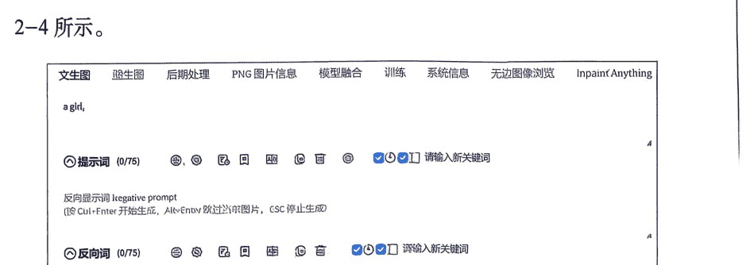

图生图，该功能支持用户上传参照图片并结合文字提示词生成新的图片，并可以对文生图和图生图的图片进行涂鸦、局部重绘、涂鸦重绘等处理，如图 2-5 所示。

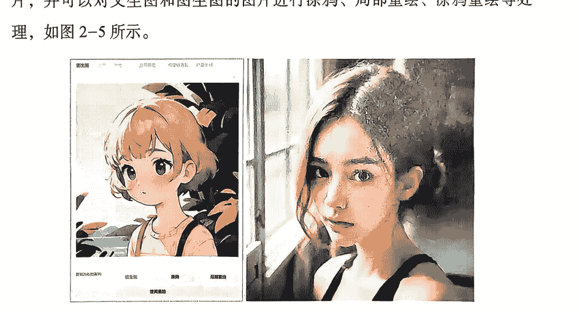

模型融合，顾名思义该功能支持将两种或三种模型融合后输出一种新的模型，并可以通过调整融合比例和算法控制每种模型在新模型中的权重。融合需要较强的硬件性能的支持，并且需要较长的时间，用户可根据实际情况灵活应用，如图 2-6 所示。

图 2-6 模型融合

训练，该功能与模型融合相同的是，能够生成新的模型；不同的是，训练是通过用户上传的多张反映特定风格概念的图片，来训练 AI 生成一个该风格的模型，训练出的模型可以生成类似风格的图片，如图 2-7 所示。

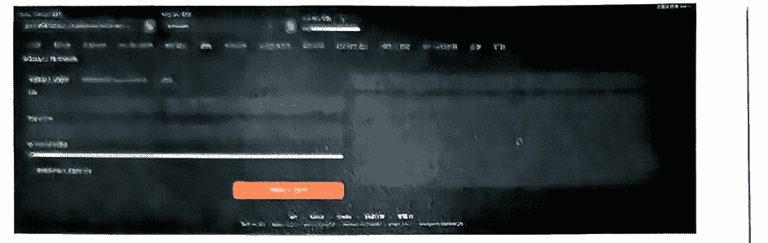

## 生图参数设置

Stable Diffusion 模型是生图的基本依据，选择不同的模型可以生成不同风格的图片。模型在生图风格上大致可分为写实类和非写实类两类，本书生成的写实类图片使用的模型为质感写实 v11_1.0.safetensors，生成的非写实类图片所使用的模型为 anything-v5.safetensors。外挂 VAE 相当于给生成图片加了一层滤镜，使得生成图片的质量更高；CLIP 终止层数可以控制提示词与生成图片的关联程度，数值越大，图片与提示词的关联越小，数值越小，图片与提示词的关联越大，一般默认值为 2。图 2-8 为模型选择区域和 CLIP 终止层数设置。

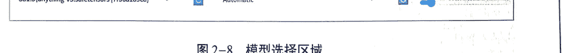

Stable Diffusion 的提示词输入区域分为正向提示词和反向提示词，这是文生图和图生图中很重要的部分，如图 2-9 所示。

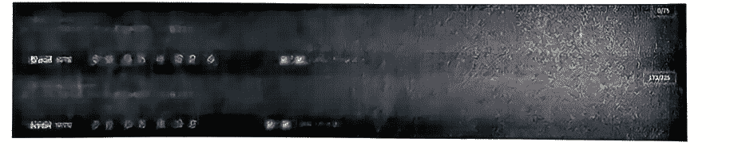

提示词输入区域下面是可以调整提示词参数的地方，通过调整参数来生成更符合要求的图片。

Stable Diffusion 有很多种采样方法，如经典的 ODESolvers（常微分方程求解器）、祖先采样器、DDIM（去噪扩散隐式模型）、DPM（扩散概率模型求解器）和 DPM++（DPM 改进版）系列、UniPC 采样器（统一预测器 - 校正器）、Karras（卡拉斯调度法）、K-diffusion（K- 扩散实现）等。每种采样方法都有自己的优缺点，用户可以根据需要选择。调度类型和采样方法类似，通常是和采样方法一起用的，可以控制生成图片过程中计算的程度。一般默认选择 Automatic（自动选择），采样方法和调度类型选择如图 2–10 所示。

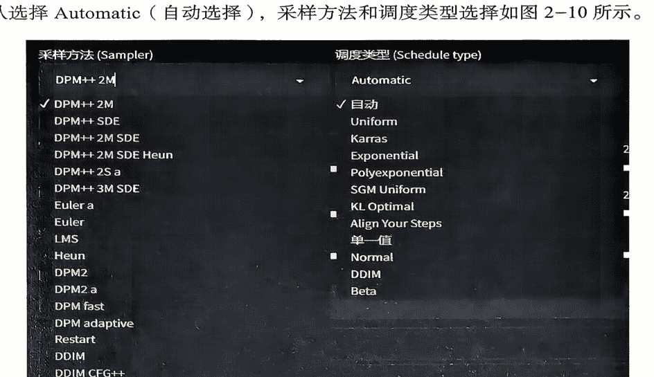

图 2–10 采样方法和调度类型

迭代步数，即在生成图片时 AI 对提示词计算的次数，范围为 1 ～ 150，如图 2–11 所示。根据官方给出的说明，通常设置为 20 ～ 40。步数低于 20 时，生成的图片与提示词的偏差较大；步数高于 40 时，对最终生成的图片影响不大，反而会增加计算时长，浪费机器性能。

图 2-11 迭代步数

高分辨率修复是通过特定的算法和流程，对生成的图像进行放大和重绘，增加图像的分辨率和细节。这个过程包括两个步骤：先放大图像，再对放大后的图像进行重绘以添加更多细节。放大算法有很多种，如 Latent 算法、ESRGAN_4x/SwinR 4x、R-ESRGAN 系列等。Latent 算法简单快速，但低重绘时效果不太好；ESRGAN_4x/SwinR 4x 适合重绘幅度低于 0.5 的场景，细节保留较好；R-ESRGAN 系列，如 R-ESRGAN 4x+ Anime6B 适用于二次元风格，通用场景可以选择 R-ESRGAN 4x。

高分迭代步数和基础迭代步数类似，数值越大，细节越精细，计算时间也会越长。重绘幅度是在放大图片时，根据提示词和原有图像对放大后的图片进行二次绘制，增强画面的细节和清晰度，数值范围是 0～1，数值越大，对画面的重绘幅度越大。放大倍数是控制图片放大的比例，范围是 1～4，放大倍数越大，对硬件的性能要求越高，放大的图片尺寸也越大。最后两项是对宽度和高度的调整，可以自定义放大后图片的尺寸，但可能会改变画面的整体结构。因此通常情况下不会用到，如图 2-12 所示。

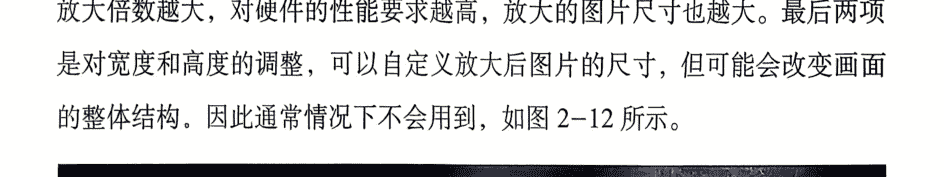

图 2-12 高分辨率修复

在初次进行图片生成时，默认的图片分辨率为 512×512，支持用户在宽度和高度部分自由更改。生成图片的分辨率越大，对硬件性能的要求越高，因此需要用户根据电脑的性能自行斟酌。

分辨率右边的总批次数为点击生成后一次生成的图片批次，单批数量指每批生成图片的数量，如图 2-13 所示。比如，总批次为 3，单批数量为 5，那么单次生成图片就是 15 张。在生成多张图片时，建议大家单独更改总批次数或单批数量，如果想要生成多批次且每批次生成多张图片时，同样需要较大的显存和内存支持。

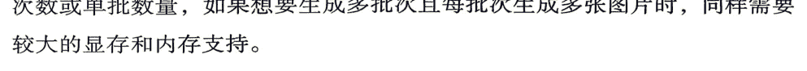

图 2-13 分辨率、总批次数和单批数量

提示词引导系数为生成图片贴切提示词的程度，范围为 0 ～ 30。数值越大，越贴切提示词；数值越小，AI 的自由发挥度就越大。高数值的引导系数也需要具备较强性能的硬件支持。

随机种子可以理解为每张生成图片的“身份证”。当点击骰子按钮，种子会显示为“-1”，这时程序会根据提示词生成多种不同的图片，如图 2-14 所示。

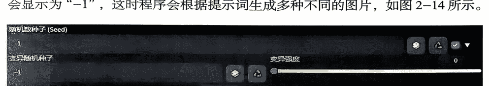

图 2-14 随机种子与变异随机种子

另外，图 2-14 中的“从宽度中调整种子”和“从高度中调整种子”则表示在原始种子图上添加的额外种子图的宽和高，当两个数值不为 0 时，无论变异强度是否为 0，绘制出的最终图像都受到变异随机种子的影响。

如果生成了一张相对不错的图片，又要在这张图片上添加其他元素，就可以点击骰子旁边的循环按钮，这时就会出现当前已生成图片的种子，之后再添加的元素都在该图片种子的基础上生成。相同提示词、相同种子生成的图片是一样的，如图 2-15 所示。

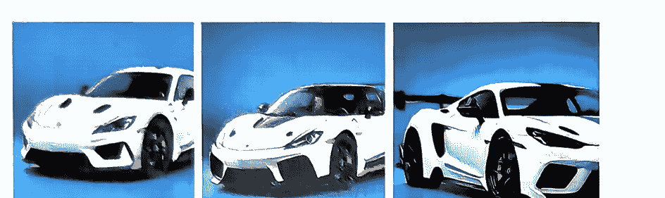

三张图片的种子依次为 1660017049、1966940513、3697650184

图 2-15 不同种子生成的图片

随机种子旁的倒三角是变异随机种子。变异随机种子可以和随机种子共同作用生成图片。变异强度的范围是 0～1，变动幅度是 0.01。当变异强度为 0 时，图片按照随机种子的种子数值进行绘制；反之，变异强度为 1 时，图片按照变异随机种子的种子数值进行绘制。

例如，使用随机种子 1966940513 与变异随机种子 3697650184，保持随机种子和变异随机种子不变，在不同变异强度情况下进行生成，结果如图 2-16、图 2-17。

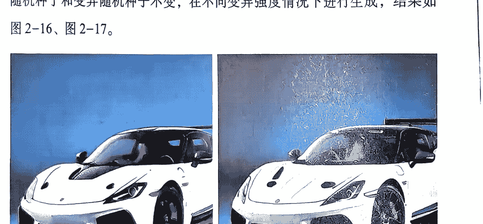

变异强度为 0 变异强度为 0.33

图 2-16 不同变异强度绘制的图片（1）

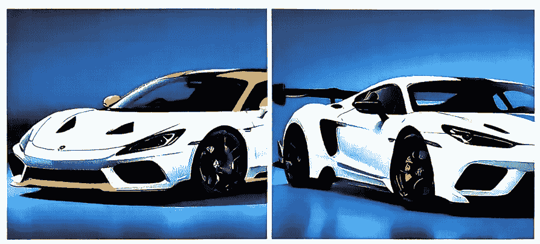

变异强度为 0.66

变异强度为 1

图 2-17 不同变异强度绘制的图片（2）

### 2.2 AI 绘画提示词语言体系与风格语言

#### 2.2.1 提示词语言体系

AI 绘画通常需要通过输入提示词来实现。提示词，就是在使用 AI 进行绘画时提供给 AI 进行创作的词语，起到传达用户意图、指导生成图像的重要作用。

图 2-18 框起来的部分就是 Stable Diffusion 的提示词输入区，上半部分为正向提示词输入区，下半部分为反向提示词输入区。由于 Stable Diffusion 提示词的原生输入格式为英文，所以通常提示词由多个英文单词、短语或短句组成。中国开发者“秋叶”制作并发布的“秋叶封装版”Stable Diffusion 中添加了辅助插件 Prompt-all-in-one，输入中文提示词后支持一键翻译为英文，如图 2-19 所示。

图 2-18 Stable Diffusion 提示词输入区

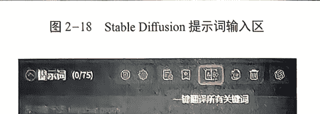

图 2-19 秋叶封装 Stable Diffusion 中的中译英按钮

在进行艺术设计时，通常需要描述出对想要创作画面的大致方向，其中便涉及画面的构图、风格、色彩甚至一些物品的材质等，这些元素是任何艺术设计的重要基础，包括 AI 绘画。但与传统艺术不同的是，AI 绘画是通过算法模型对图像元素、图像风格、美学规律等视觉组成进行解构的，通过对人类艺术作品的不断学习，理解什么是美，理解人是怎样表达设计的形式风格等，从而形成独特的逻辑性数据化的语言。

以写作为例，在进行叙事类写作时，通常需要讲述时间、地点、人物及事情的起因、经过和结果六个要素。在进行 AI 绘画时，这六个要素就是提示词的内容。

通俗地说，要想生成我们想要的图像，我们通常会描述在一个怎样的背景下，谁或者什么东西，在什么情况下做了什么或呈现了怎样的状态。这里的“背景”“谁”“什么东西”“什么情况”“怎样的状态”便是我们需要向 AI 传达的提示词。这些提示词的准确度和详细程度不同，生成的图像也会存在较大差异。

下面通过几个例子更直观地向大家展示。通过输入提示词“一个女孩在街道上”，初步得到了一个小女孩在街道上看向镜头的画面，如图 2-20 所示。

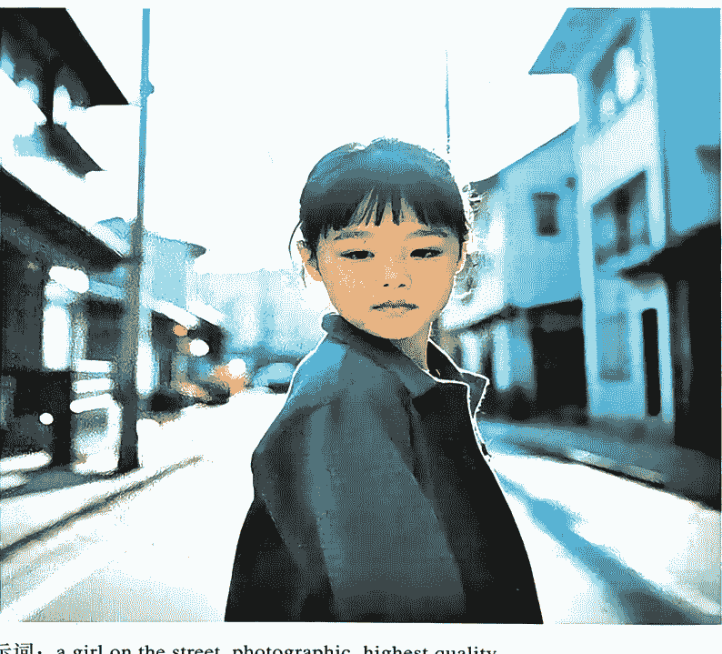

提示词：a girl on the street, photographic, highest quality
中文翻译：一个女孩在街道上，摄影感，最高质量

**图 2-20 基础提示词生成的画面**

在保证“摄影感”“最高质量”两个提示词不变的前提下，添加提示词“在破碎的城市街道上”“望向四周”，此时画面中的街道不再像先前一样干净整洁，而是充满建筑废墟，并且整个画面变得较为昏暗，如图 2-21 所示。

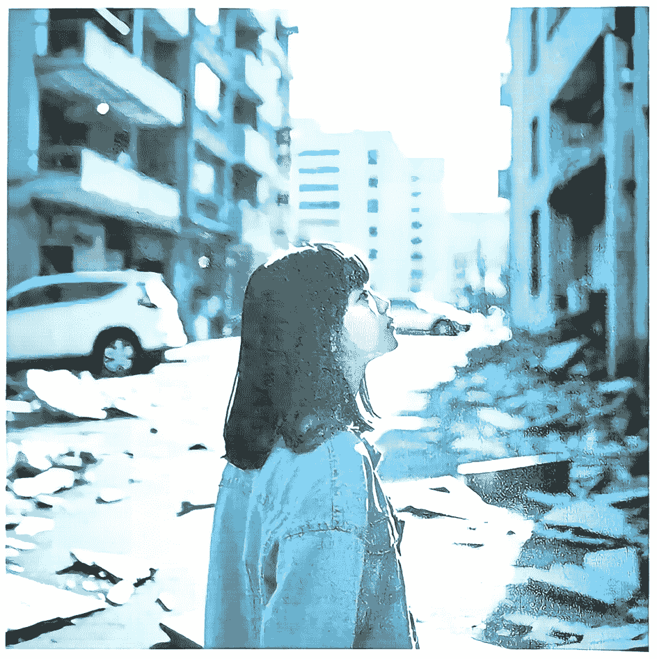

提示词：a girl looking around on a broken city street, photographic, highest quality
中文翻译：一个女孩在破碎的城市街道上望向四周，摄影感，最高质量

图 2-21 添加更多内容后生成的画面

同样在保证“摄影感”“最高质量”两个提示词不变的前提下，添加“阴雨天”“衣衫褴褛的白人女孩”“手持棒球棍”“忧心忡忡”提示词后，画面主角便从表情宁静、穿着整洁的小女孩变成一脸担忧、衣衫褴褛、手持棒球棍的白人女孩，如图 2-22 所示。

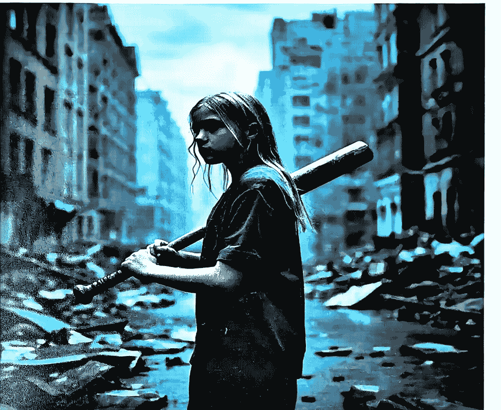

提示词：rainy day, a ragged white girl holding a baseball bat on a broken city street looks around worriedly, photographic, highest quality
中文翻译：阴雨天，一个衣衫褴褛的白人女孩手持棒球棍在破碎的城市街道上忧心忡忡地望向四周，摄影感，最高质量

图 2-22 完善提示词后生成的画面

以上是通过增加提示词生成不同的画面。接下来，我们通过改变提示词中的某个元素来生成不同的画面，如图 2-23、图 2-24 所示。以下对照图由 Stable Diffusion WebUI 秋叶整合包生成。

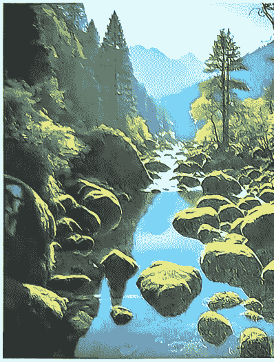

提示词：a small river, nature, highest quality, photography, fixed camera
中文翻译：一条小河，自然，最高画质，摄影，固定机位

图 2-23 自然中的小河

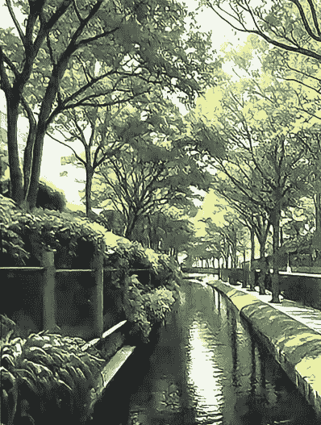

提示词：a small river, park, highest quality, photography, fixed camera
中文翻译：一条小河，公园，最高画质，摄影，固定机位

图 2-24 公园中的小河

#### 2.2.2 提示词风格语言

在图像的风格方面，AI 通过学习和提取其他用户生成的作品，将韵味和美感并存的中国传统文化风格改为以几何形状和色块为主的包豪斯风格，如图 2-25，或色彩鲜艳对比夸张的波普风格，如图 2-26 所示。接下来详细介绍风格类提示词。

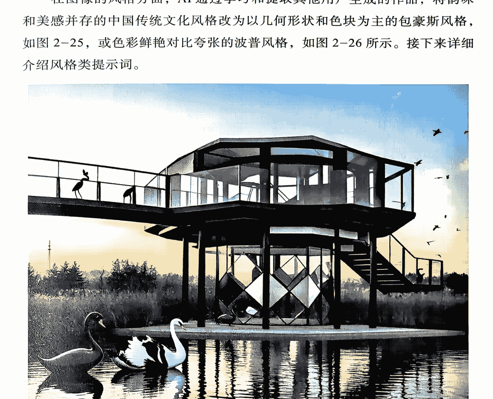

图 2-25 包豪斯风格

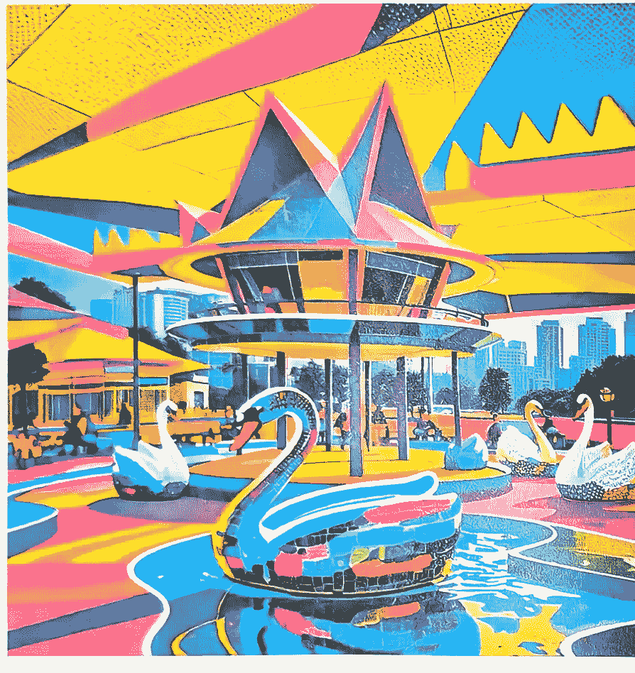

图 2-26 波普风格

不同于传统艺术画面的单一或固有风格，AI 绘画的风格是基于海量图像参数训练得到的。用户可以通过提示词触发特定视觉词汇的组合，来实现特定的风格，甚至把毫无关联的多种元素进行超现实融合，从而生成难以直观想象的混搭视觉图像。

中国传统的水墨画风格，以黑白色为主，线条鲜明。水墨融入宣纸产生渗透的特殊效果，如图 2-27 所示。

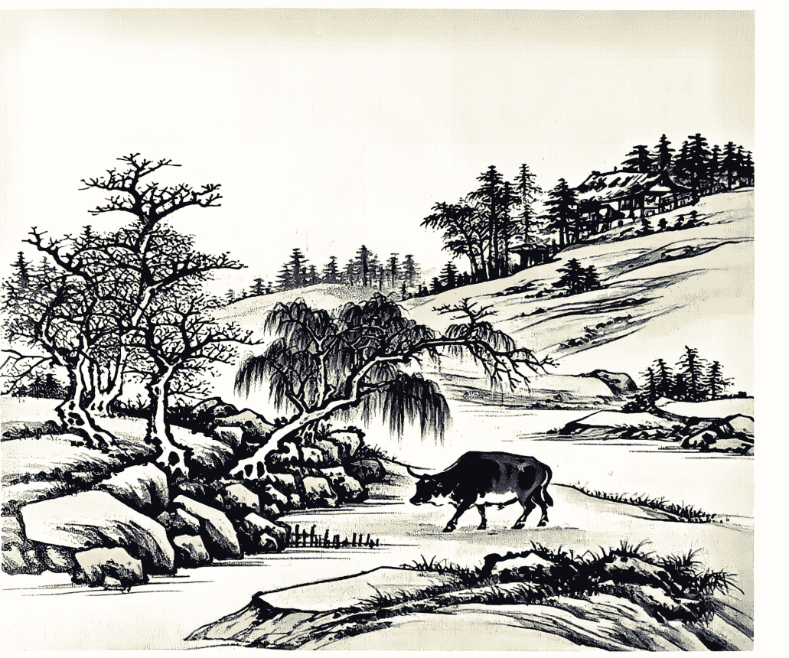

提示词：landscape, ink, lines, cows grazing, vista, UHD
中文翻译：乡村风景画，水墨，线条，牛吃草，远景，超高清

图 2-27 水墨画风格

当提示词涵盖“国风、国潮、祥云、岩彩绘画、金箔色彩、螺钿镶嵌艺术”等时，使国风与金箔岩彩、螺钿镶嵌艺术等艺术风格相融合，就会生成令人惊叹不已的国风作品，如图 2-28 所示。

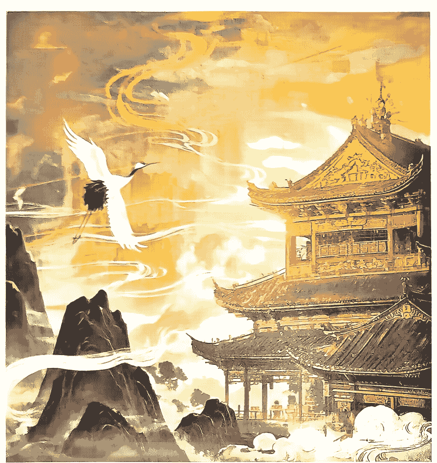

提示词：national style aesthetics, ancient architecture, cranes, gold foil colors, rock paintings, golden ambient light, mystery, texture, majestic momentum
中文翻译：国风美学，古建筑，仙鹤，金箔色彩，岩彩画，金色氛围光，神秘感，肌理感，气势磅礴

图 2-28 国风、金箔岩彩风格

当提示词中包含“科幻”“赛博”“未来的”“机械腿义肢的”等充满科技感与未来感的词语时，就会得到如图 2-29 所示的科幻风格的图像。

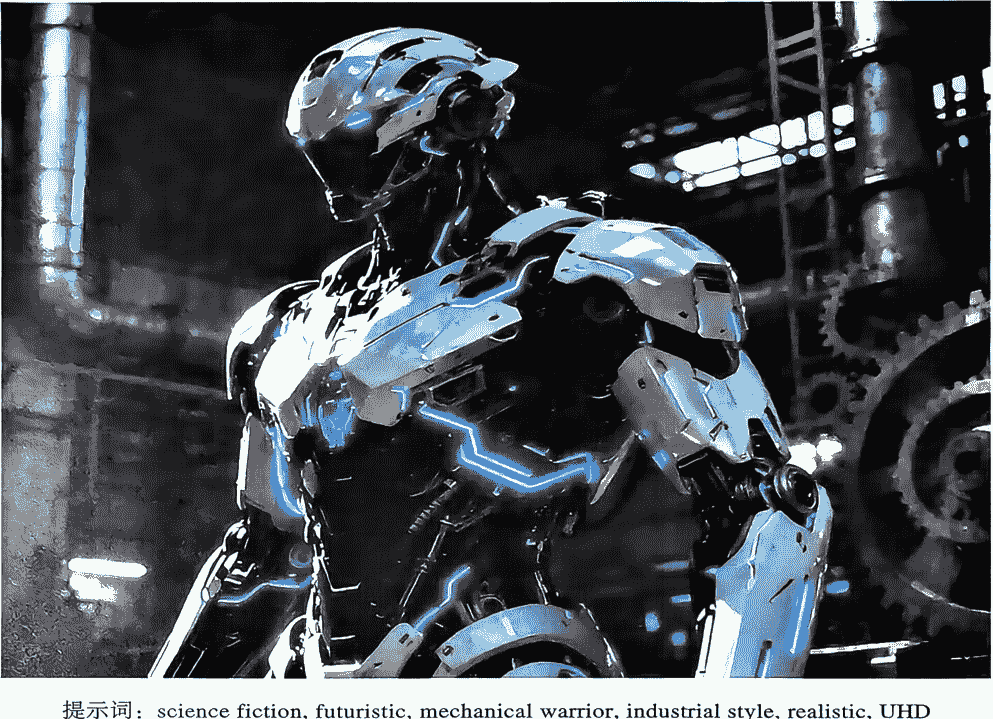

提示词：science fiction, futuristic, mechanical warrior, industrial style, realistic, UHD
中文翻译：科幻、未来、机械战士、工业风格、写实、超高清

图 2-29 科幻风格

Q 版孙悟空与现代波普风格的结合，既有 Q 版经典人物的可爱，又有现代的科技感、波普风元素，如图 2-30 所示。

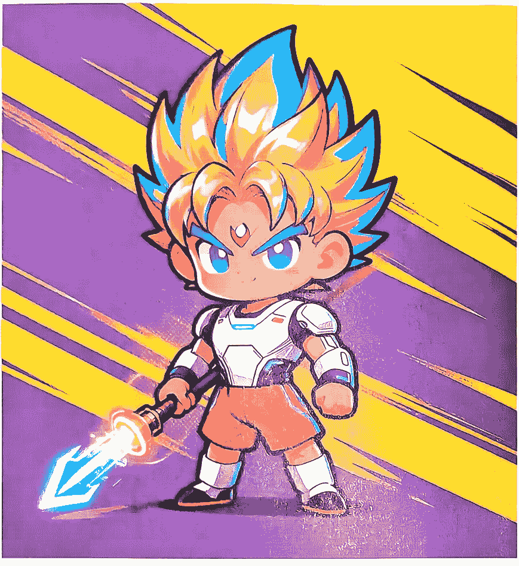

提示词：Q version, monkey king, modern, pop style, cartoon, UHD
中文翻译：Q版，孙悟空，现代，波普风格，卡通，超高清

图 2-30 迪士尼卡通风格

色彩也是一种表达画面的方式，通过添加与颜色相关的提示词，可以对生成的画面进行氛围、情感等方面的调节。不同的颜色搭配，可以达到控制画面视觉体验的效果。

同样是春天一家三口出游，冷色调的温馨程度就远不如暖色调，如图 2-31、图 2-32 所示。

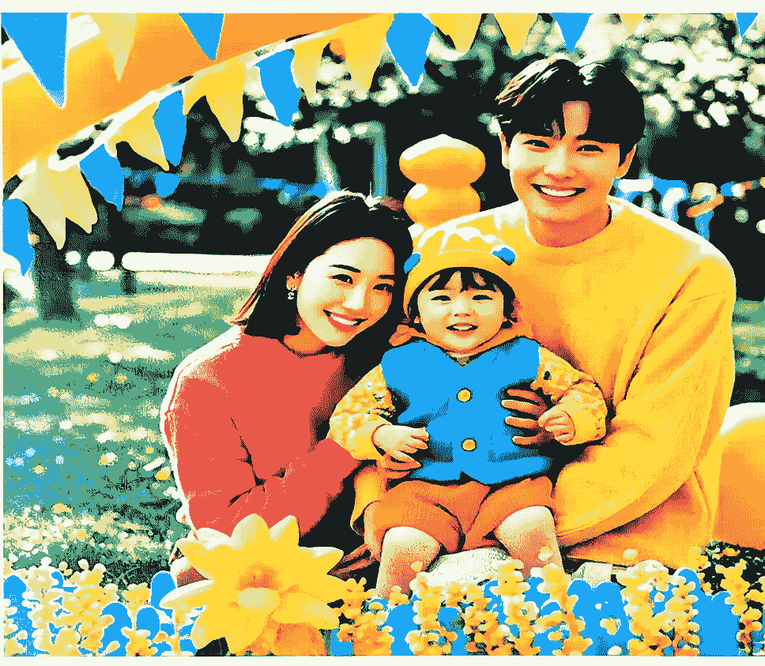

提示词：a family of three traveling out, warm tones, yellow, blue, spring, UHD
中文翻译：一家三口出游，暖色调，黄色，蓝色，春天，超高清

图 2-31 一家三口出游（暖色调）

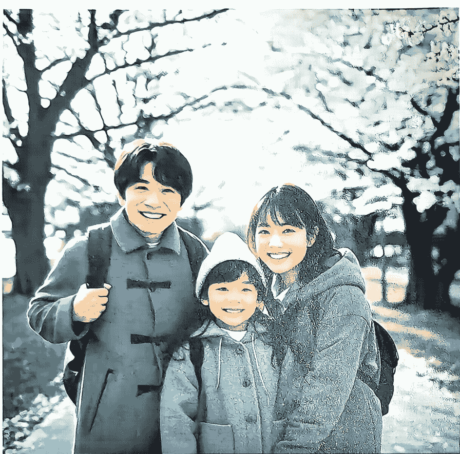

提示词：a family of three traveling out, cool tones, gray, spring, UHD
中文翻译：一家三口出游，冷色调，灰色，春天，超高清

图 2-32 一家三口出游（冷色调）

对比游戏《赛博朋克 2077》中的夜之城，通过对色彩的约束减弱了高饱和、高对比度的冲击力，让画面充满神秘色彩，如图 2-33 所示。

## 2 AI 视觉革命：从文字到图像的进化

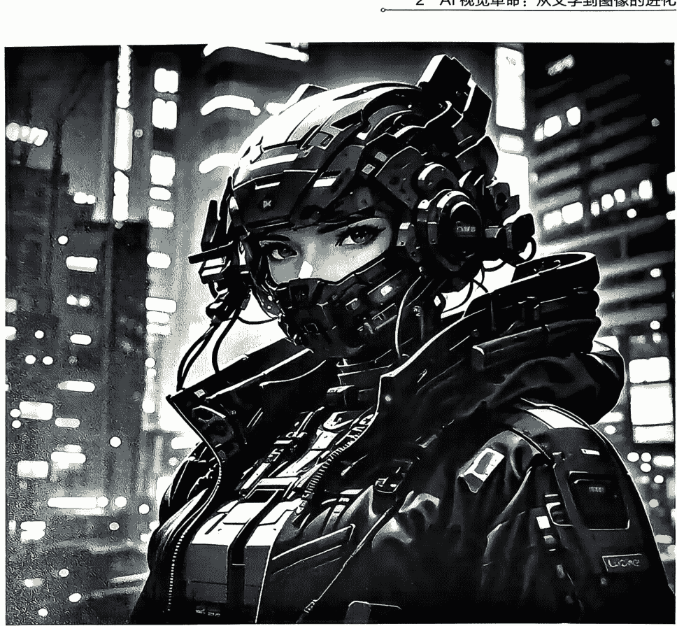

提示词：cyberpunk, Night City, future, science fiction, technology, black and white, low saturation, low contrast, UHD
中文翻译：赛博朋克，夜之城，未来，科幻，科技，黑白，低饱和度，低对比度，超高清

图 2-33 低饱和低对比

需要注意的是，由于 AI 输出的图像存在随机性，往往会出现非理性的画面，如扭曲的肢体、多指、多腿等。这就需要用户对提示词语言体系不断进行完善，让 AI 增强对图像视觉画面的可控性。

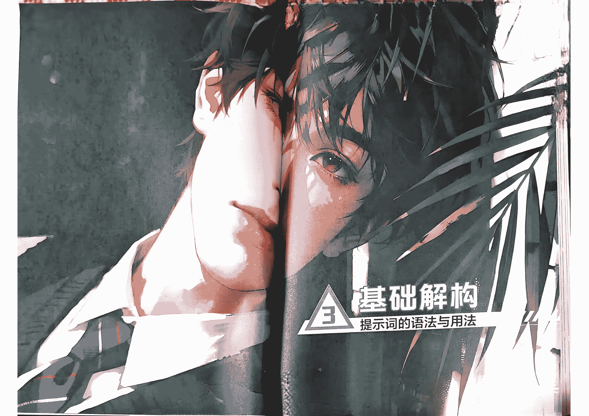

## 3 基础解构

### 提示词的语法与用法

### 3.1 提示词的组成

前文已提到过，提示词通常分为正向提示词和反向提示词，正向提示词就是用户希望出现在画面中的东西、反向提示词则是用户不希望出现在画面中的东西。

和叙事一样，一条完整的提示词也是由几个主要部分组成。

主体：要生成的画面中的主角，可以是人、动物、植物、山川河流等。

背景：有了明确的主角后，就要交代主角所处的背景，既可以是在某影院播放厅几排几座这样详细的地点，也可以是公园、河边这种宽泛的地方，还可以是时空隧道这类抽象无实体的场景。

当提示词包括这两部分时，一个较为简单的画面就可以生成了。要想使画面进一步准确，就需要加入一些其他方面的提示词进行完善。

画质：常用的正向画质提示词有 masterpiece（杰作）、highres（高分辨率）、best quality（最佳品质）、wallpaper（壁纸）、RAW photo（原始照片）、incredibly absurdres（超高分辨率）、8K、UltraHD（超高清）、extremely detailed wallpaper（超高清壁纸）等。常见的反向画质提示词有 lowres（低分辨率）、worst quality（最差质量）、low quality（低质量）、normal quality（普通质量）、jpeg artifacts（JPEG 图像伪影）、blurry（模糊不清的）、sketch（草图）等。

另外，我们还可以为图片添加画面风格：illustration（插画）、abstract art（抽象艺术）、pixel（像素）、sketch（素描）、某位画家的名字 [如 Vincent van Gogh（凡·高）、Picasso（毕加索）] 或某部作品名 [如 Mona Lisa（蒙娜丽莎）、Starry Night（星月夜）]，以及光照条件 [如 soft morning light（柔和晨光）、sunset afterglow（夕阳余晖）、indoor lighting（室内灯光）、stage lighting（舞台灯光）]，色调 [如 ice blue tone（冰蓝色调）、moonlight silver tone（月光银调）、flame red tone（火焰红调）、sunshine yellow tone（阳光黄调）、retro orange tone（复古橙调）]，镜头视图 [如 wide-angle lens（广角镜头）、telephoto lens（长焦镜头）、macro lens（微距镜头）]，细节描述（如树叶纹理、花瓣细节、砖石纹理、玻璃反光、面部表情、服装纹理）等提示词，使整幅图像的完整度更高。

一般情况下，往往会以图片质量作为首要输入的提示词，其次是对画面的描述和其他要补充的细节。

一条完整的提示词除需要文字部分外，还需要使用逗号隔开，否则会出现提示词内容融合的情况。英语提示词中的逗号须为半角逗号，词组、短语和短句的每个单词间则用空格隔开。如果不对提示词进行分割处理，AI 则可能无法理解提示词的完整含义，从而导致生成的图像与提示词有较大的偏差。

### 3.2 提示词的顺序与权重

#### 3.2.1 提示词的顺序

输入提示词时，除要用逗号和空格隔开外，提示词输入的顺序也有一定的规则。这里便涉及“权重”一词，即该提示词在整条提示词中的占比。提示词所占权重越大，在图像中的存在感就越强；反之，在图像中的存在感就越弱。在一般情况下，提示词权重的范围为 0.5 ～ 2，低于或超过该范围都可能出现图片崩坏的情况，每项提示词的权重默认为 1。

AI 读取提示词按照从左往右的顺序，因此越靠左的提示词所占权重就越大，越靠右的提示词所占权重就越小。在 Stable Diffusion 中，提示词的数量在 75 字左右，超过该字数后的提示词可能会被 AI 忽略。而在 Stable Diffusion WebUI 中，由于程序会对提示词进行分组提交思考，所以提示词的数量被允许超过 75 个。

通过改变 “a girl” “forest” 两个提示词的顺序，可以看出它们在图像中所占的权重发生了改变。当 “a girl” 排在第一位时，画面整体以女孩为主；当 “forest” 排在第一位时，画面则以森林为主要部分，女孩所占部分明显变小，如图 3-1 所示。

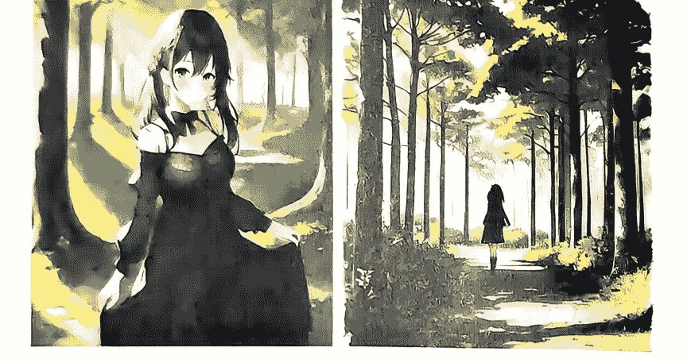

提示词：a girl, forest 和 forest, a girl
中文翻译：一个女孩，森林；森林，一个女孩

图 3-1 提示词顺序先后对生成画面的影响

#### 3.2.2 提示词权重的变化方法

当需要输入的提示词数量较多时，单纯地通过调整提示词的顺序无法做到对所有提示词的权重进行调整，这时就可以通过特定的符号加强或削减某个提示词所占的权重。

圆括号 “( )” 为最常见的提示词语法符号，当其单独框中提示词时，被其框中的提示词的权重提升 1.1 倍，且可以通过多个圆括号成倍提升权重。

当有多层圆括号时，该提示词的权重就为 1.1 的 $N$ 次方，$N$ 为圆括号的层数。例如，a boy 变为 (((a boy))) 后，该提示词的权重为原来 1.1 的 3 次方，即 $1 \times 1.1 \times 1.1 \times 1.1 = 1.331$ 倍（1 为该提示词的默认权重），如图 3-2 所示。

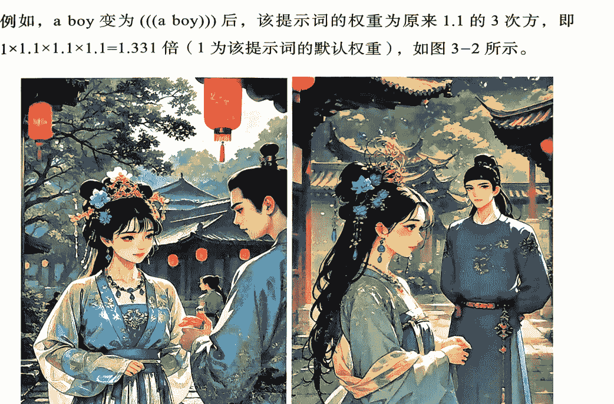

左侧提示词：a girl, a boy, ancient costume style, chinese style illustration
右侧提示词：a girl, ((( a boy))), ancient costume style, chinese style illustration
中文翻译：一个女孩，一个男孩，古装造型，国风插画风格

图 3-2 圆括号提升提示词权重效果

男孩最开始在画面中充当背景陪衬，通过为提示词 “a boy” 添加上三层圆括号后，男孩与女孩在画面中的占比几乎持平。

当圆括号内提示词后跟 “：数字” 时，该提示词的权重就被调整为括号内数字的倍数。例如，（curls:1.5）的意思就是提示词 curls 的权重为原来的 1.5 倍，（curls:0.6）的意思就是提示词 curls 的权重为原来的 0.6 倍，如图 3-3 所示。

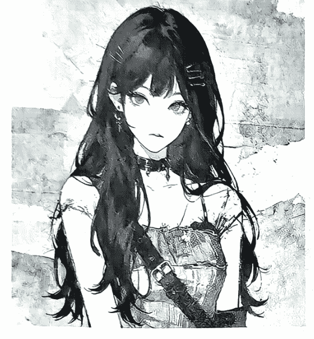

提示词：a girl, (curls:0.6), fashionably designed clothing, matte texture reminiscent of rice paper, hand-drawn style, gray color palette
中文翻译：一个女孩，（卷发 0.6），时尚设计服饰，宣纸磨砂质感，手绘风格，灰色系

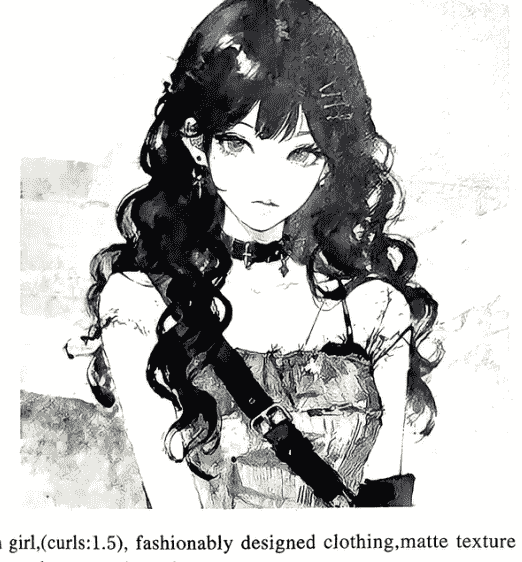

提示词：a girl, (curls:1.5), fashionably designed clothing, matte texture reminiscent of rice paper, hand-drawn style, gray color palette
中文翻译：一个女孩，（卷发 1.5），时尚设计服饰，宣纸磨砂质感，手绘风格，灰色系

图 3-3 圆括号内数字调整提示词权重

花括号“{ }”可以为被其框中的提示词提升 1.05 倍权重。同样可以通过多个花括号增加权重的倍数，计算方式依然为 1.05 的 N 次方，N 为花括号的层数。例如，blue eyes 变为 {{blue eyes}} 后，该提示词的权重变为原来的 1×1.05×1.05=1.1025 倍。相较于圆括号来讲，花括号提升的权重倍数较小，所以通常直接使用圆括号增加权重。

方括号“[ ]”与以上符号不同，方括号会将被其框中的提示词的权重降低至原来的 0.9 倍。与圆括号和花括号相同的是，可以通过多层方括号降低该提示词的权重。例如，red flowers 变为 [[[red flowers]]]，该提示词的权重变为原来的 1×0.9×0.9×0.9=0.729 倍，如图 3-4 所示。

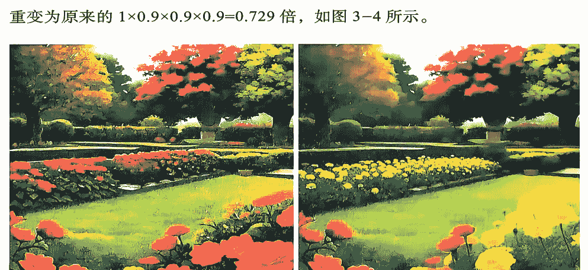

左侧提示词：garden, red flowers, yellow flowers
右侧提示词：garden, [[[red flowers]]], yellow flowers
中文翻译：花园，红色花，黄色花

图 3-4 方括号降低提示词权重效果

冒号“:”可以自定义提示词的权重，排在整条提示词的后面，通常情况下与圆括号一起使用。例如，by the lake 变为 (by the lake:1.5)，该提示词的权重变为原来的 1.5 倍。

以上为提示词在绘画中增减权重的常用方法。

#### 3.2.3 提示词语法

在使用 Stable Diffusion 生图时，我们可以用“[ ]”和“:”来控制提示词在迭代步数中的绘制顺序，让生成的图像更符合我们的想法。假设我们设置了迭代步数为 30。

[fish:10]：表示从第 10 步开始，图像生成过程中会加入“fish”这个提示词，直到第 30 步结束。

[red::10]：表示从第 1 步开始，图像生成过程中会加入“red”这个提示词，直到第 10 步停止。之后，“red”这个提示词不再影响图像生成，但其他提示词会继续生效，直到第 30 步结束。

[red:5:10]：表示从第 5 步开始，图像生成过程中会加入“red”这个提示词，直到第 10 步停止。之后，“red”这个提示词不再影响图像生成，但其他提示词会继续生效，直到第 30 步结束。

如果想控制两个提示词的绘制顺序，可以用方括号框起来，用冒号隔开。比如 [red:yellow:0.6]，意思是前 18 步（30 步的 60%）按照“red”绘制，后 12 步按照“yellow”绘制。

这样，我们就能更灵活地控制图像生成过程，让每个提示词在合适的时间发挥作用，最终生成更符合我们预期的图像，如图 3-5 所示。

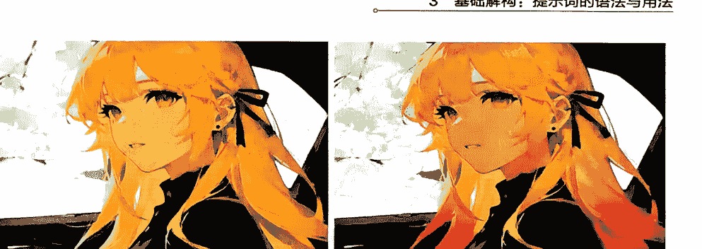

左侧提示词：a girl, yellow hair
右侧提示词：a girl, [red hair:10], yellow hair
中文翻译：一个女孩，红头发，黄头发

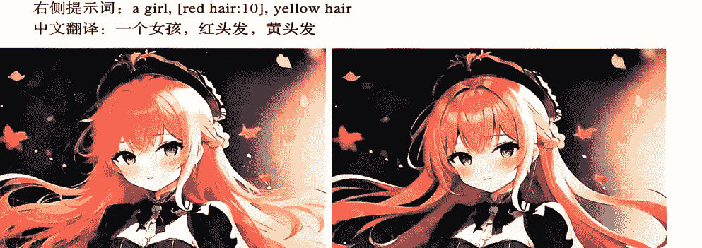

左侧提示词：a girl, red hair, yellow hair
右侧提示词：a girl, [red hair::8], yellow hair
中文翻译：一个女孩，红头发，黄头发

图 3-5 提示词分步绘制语法

结合图 3-6 中的提示词我们可以看到，女孩的头发最初开始绘制时为蓝色头发和黄头发，绘制到第 8 步时停止对蓝发的绘制，但黄发不受影响。男孩图片的眼睛颜色前 8 步绘制为蓝色，之后绘制为黄色。

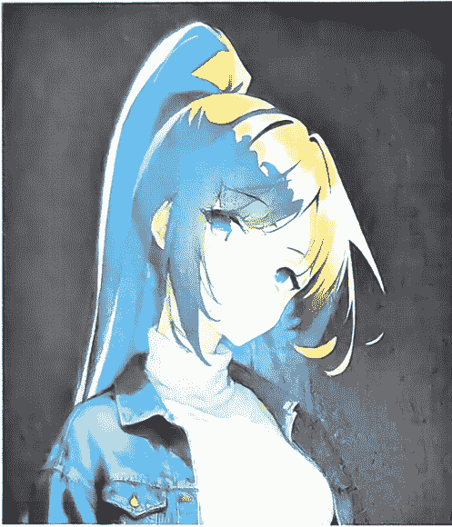

提示词: a girl, [blue:yellow:8] hair
中文翻译: 一个女孩, [蓝色:黄色:8]头发

提示词: a boy, [blue:yellow:8] eyes
中文翻译: 一个男孩, [蓝色:黄色:8]眼睛

图 3-6 分步绘制两种颜色

除此之外，还可以通过添加“|”让 AI 对提示词进行交替绘制。例如，[blue|red|yellow] 表示第一步根据提示词“blue”进行绘制，第二步根据提示词“red”进行绘制，第三步根据提示词“yellow”进行绘制，第四步根据提示词“blue”进行绘制，第五步根据提示词“red”进行绘制，第六步根据提示词“yellow”进行绘制，以此类推直到绘制完最后一步，如图 3-7 所示。

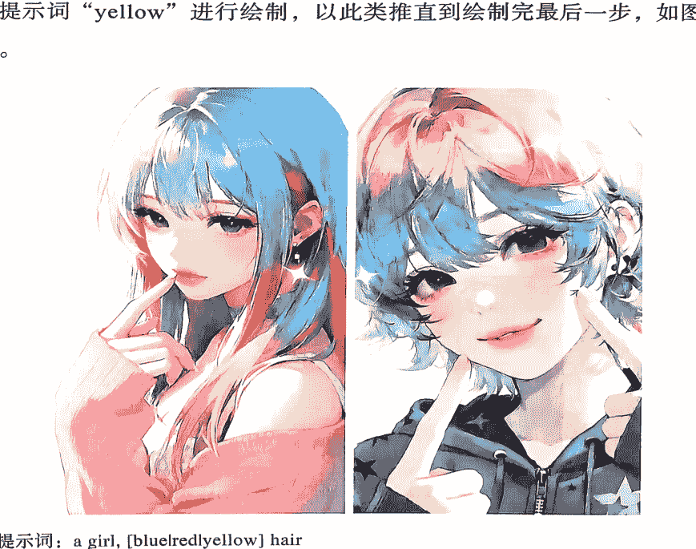

提示词：a girl, [blue|red|yellow] hair
中文翻译：一个女孩，[蓝色|红色|黄色]头发

图 3-7 提示词交替绘制语法

以上案例的迭代步数均设置为 30 步。

当我们希望两个或两个以上提示词进行组合绘制时，就可以使用“AND”或“|”，即“（提示词 | 提示词 | 提示词）”的方式，如图 3-8 所示。相反，如果当多个提示词互相影响时，我们需要用“BREAK”对提示词进行分割处理。注意，此处的“AND”和“BREAK”均为大写，如果小写，程序会直接结合前后提示词读取其含义，无法起到融合或分割处理的作用。

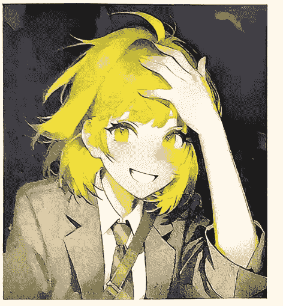

提示词：a girl, yellow hair AND green hair
中文翻译：一个女孩，黄头发和绿头发

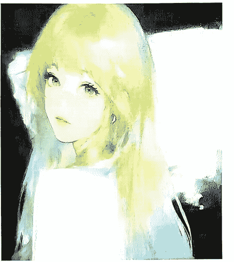

提示词：a girl, (yellow|green|blue) hair
中文翻译：一个女孩，（黄|绿|蓝）头发

图 3-8 提示词 AND 融合绘制效果

此外，Stable Diffusion 的提示词对 emoji 和欧美颜文字（:D, XD, ;p 等）也有较强的识别能力，如图 3-9 所示。由于 emoji 和颜文字的表达含义单一，其权重要高于自然语言。

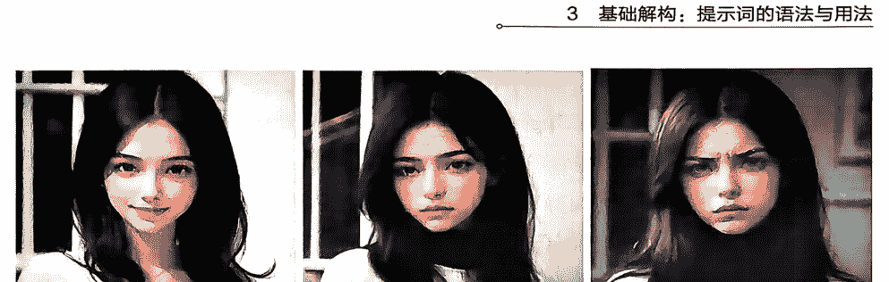

图 3-9 使用 emoji 表情作为一项提示词生成的图片

### 3.3 反向提示词的应用法则

AI 绘画是基于神经网络和深度思考进行绘制的，但受限于技术的成熟程度，对画面中的一些细节仍然无法处理，这就需要用户通过反向提示词对其进行约束修正，从根源上限制画面中不必要以及不能出现的部分。下面将为大家解释绘画过程中 AI 处理不到的一些细节，以及会用到哪些反面提示词。

首先，为大家列举一些常见的反向提示词，其中画质管控方面包括 lowres（低分辨率）、worst quality（最差质量）、blurry（模糊）、pixelated（像素化）、noisy（噪点）、distorted（变形）、overexposed（过曝）、underexposed（欠曝）；通用反向提示词包括 NSFW（Not Safe/Suitable For Work，不适宜在工作场合查看的）、watermark（水印）、text（文字）、error（错误）、signature（签名）、username（用户名）、cropped（裁剪）、out of frame（画框外）。

反向提示词的输入顺序与正向提示词的输入顺序大致是一样的，首先输入上述画质管控方面的反向提示词，接着补充针对人物肢体畸形的反向提示词，包括 bad hands（手部畸形）、missing fingers（手指缺失）、extra fingers（多余手指）、fused fingers（手指粘连）、twisted fingers（手指扭曲）、malformed limbs（肢体畸形）、dislocated joints（关节错位）、abnormal body proportion（身体比例异常），最后再输入上边列举出的通用反向提示词。需要注意的是，当要生成的画面中有人物时，如果未添加上述针对肢体畸形的反向提示词，就极有可能出现肢体畸形的情况。

下面主要说明在输入人物主角提示词时容易出现的问题。当只输入正向提示词不输入反向提示词时，生成的人物往往伴随着缺少手指、多只手、多条胳膊、多腿、面目全非、无面、肢体扭曲等情况，如图 3-10 所示。这里就需要通过反向提示词对画面中人物的整体形象进行约束，使其尽可能地趋向于正常人。

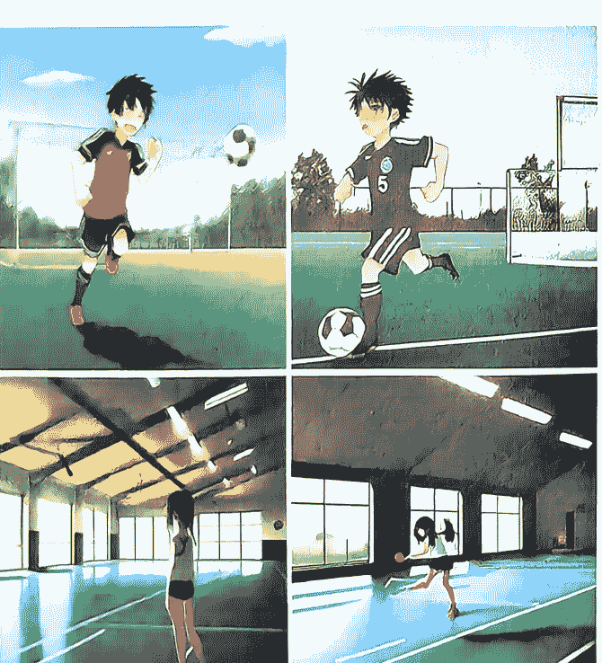

图 3-10 未添加反向提示词生成的畸形人物

常见的人物反向提示词如下：ugly（丑陋）、skin spots（皮肤斑点）、skin blemishes（皮肤瑕疵）、age spot（老年斑）、disabled（残疾）、distorted（扭曲）、bad anatomy（解剖不良）、morbid（病态）、malformation（畸形）、amputation（截肢）、bad proportions（比例不良）、twins（双胞胎）、missing body（缺失的身体）、fused body（融合的身体）、extra head（多余的头）、poorly drawn face（画得不好的脸）、bad eyes（糟糕的眼睛）、deformed eye（变形的眼睛）、unclear eyes（不清晰的眼睛）、cross-eyed（斗鸡眼）、long neck（长颈）、malformed limbs（畸形的四肢）、extra limbs（多余的四肢）、extra arms（多余的手臂）、missing arms（缺失的手臂）、bad tongue（糟糕的舌头）、strange fingers（奇怪的手指）、mutated hands（变异的手）、missing hands（缺失的手）、poorly drawn hands（画得很差的手）、extra hands（多余的手）、fused hands（融合的手臂）、connected hand（连接的手）、bad hands（坏手）、wrong fingers（错误的手指）、missing fingers（缺失的手指）、extra fingers（多余的手指）、deformed hands（畸形的手）、extra legs（额外的腿）、bad legs（糟糕的腿）、many legs（多条腿）、more than two legs（两条腿以上）、bad feet（糟糕的脚）、wrong feet（错误的脚）、extra feet（多余的脚）。用户可以根据实时生成的图像自行添加其他反向提示词。

其次，在图像色彩方面，会出现小部分色彩单一或饱和度、对比度混乱搭配的情况。常见的反向提示词如下：monochrome（单色）、greyscale（灰度）、chromatic aberration（色差）、low saturation（低饱和度）、high saturation（高饱和度）、low contrast（低对比度）、high contrast（高对比度）。同样，用户可以根据实时生成图像的需要自行添加或删减。

其他方面的反向提示词，用户可以根据生成图像的需要自行添加，如在生成写实风格的图像时可以添加 cartoon（漫画）、abstract style（抽象风格）等反向提示词。

总的来说，反向提示词是与正向提示词相辅相成的，根据正向提示词以及不断迭代生成的图像对反向提示词进行完善，最终可以得到更为准确的图片。

## 3.4 提示词搭配的使用技巧

在输入提示词时，用户通常最先想到的是画面的大致框架，如一个男孩或女孩在森林里，但这样过于宽泛的提示词往往无法生成令人满意的图片，这就需要用户对提示词进行搭配选择，一步步地完善出完整的提示词。

首先，按照顺序读取提示词所占权重大小的规则。通常情况下，在生成图片时都会用到画面质量提示词，如 masterpiece、best quality 等正向提示词和 lowres、worst quality 等反向提示词对生成图片整体的画面质量进行调控，为生成清晰、高质的画面奠定基础。因为绘图程序从前往后的读取顺序，所以这些不会影响画面内容的画质提示词通常被放置在最后边，当画面内容确定后，或使用种子进行生成时可以适当前置画面提示词来增强画面效果。

其次，对图像主体进行描述。图像的主体为画面的核心内容，通常会放置于一条提示词的最前面。以人物为例，在描述时通常会涉及人物的体态、面部特征、表情动作、服装穿着等。下面，我们用 Stable Diffusion 生成一组图片进行对照说明。先简单生成一幅一个男孩在森林里的图片，如图 3-11 所示。

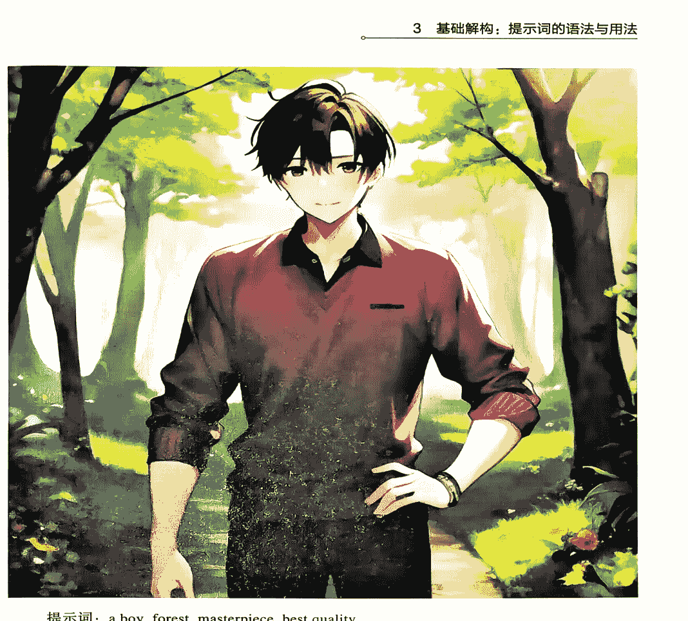

提示词：a boy, forest, masterpiece, best quality，
中文翻译：一个男孩，森林，杰作，最佳品质

图 3-11 提示词描述·图像主体

通过对人物的细致描述，画面更加完善，更加富有故事性。除了可以对人物主体进行描述，还可以对人物的衣着、手持物品进行描述，并对其中各个元素进行精细化。如图 3-12、图 3-13 所示。

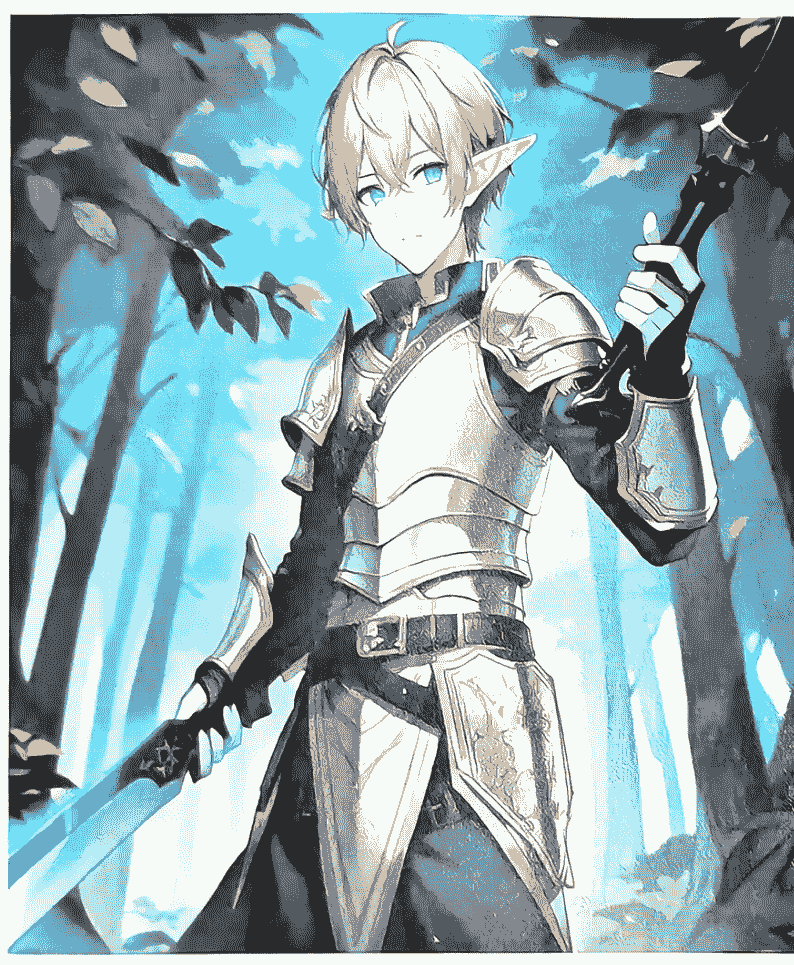

提示词: (a boy | elf | blue eyes | 20year-old | wearing armor), careful, holding a long sword in hand, forest, masterpiece, best quality

中文翻译: 一个男孩, 精灵, 蓝色眼睛, 20岁, 身穿盔甲, 谨慎的, 手持长剑, 森林, 杰作, 最佳品质

图 3-12 提示词描述 · 图像细节 1

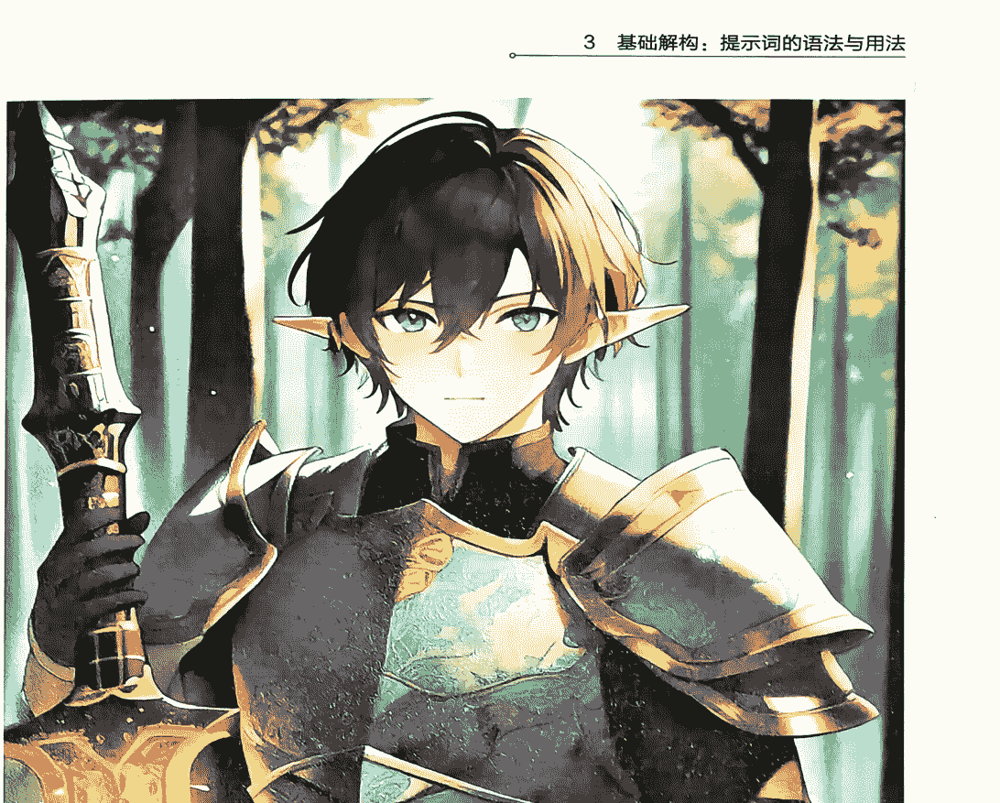

提示词：(a boy | elf | blue eyes | 20year-old | wearing armor:intricate dragon patterns on breastplate), careful, holding a long sword in hand, emitting a blazing light from its blade, forest, masterpiece, best quality

中文翻译：一个 20 岁身穿印有错综复杂龙文案盔甲、蓝色眼睛的精灵族男孩，谨慎的，手持长剑，剑身散发着炽热的光芒，森林，杰作，最佳品质

图 3-13 提示词描述·图像细节 2

对人物的描述大致完成后，便可以对人物所处的背景进行完善，这里的背景可以是人物所处的地点、时间、年代、图片内发生的事件等，如图 3-14 所示。

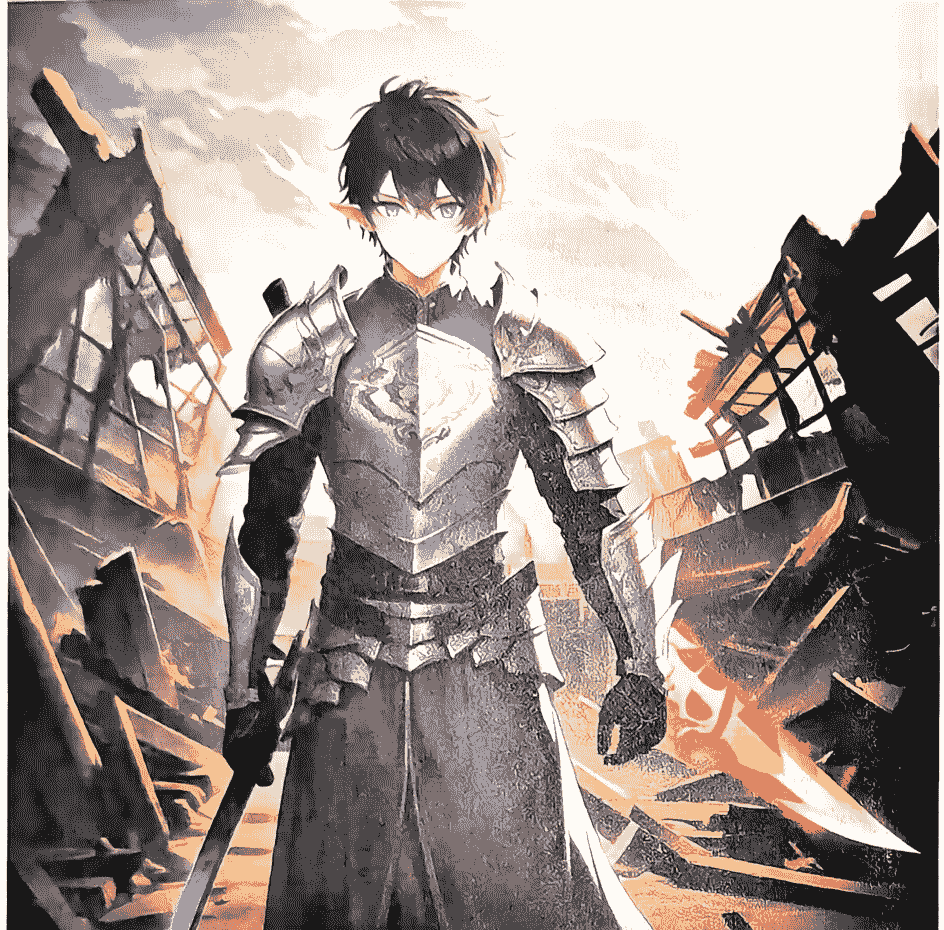

提示词: masterpiece, best quality, (a boy|elf|blue eyes|20year-old|wearing armor:intricate dragon patterns on breastplate), careful, holding a long sword in hand, emitting a blazing light from its blade, the ruins of collapsed tribal houses in the forest
中文翻译: 杰作, 最佳品质, 一个20岁身穿印有错综复杂龙文案盔甲、蓝色眼睛的精灵族男孩, 谨慎的, 手持长剑, 剑身散发着炽热的光芒, 森林中坍塌的部族房屋的废墟

图 3-14 提示词描述 · 图像细节 3

这样, 一幅有着较为完整故事梗概的图片就绘制好了。在此基础上我们还可以通过添加镜头效果和光影环境以及一些细节提示词, 使图片的质量得到进一步提升, 如图 3-15 所示。

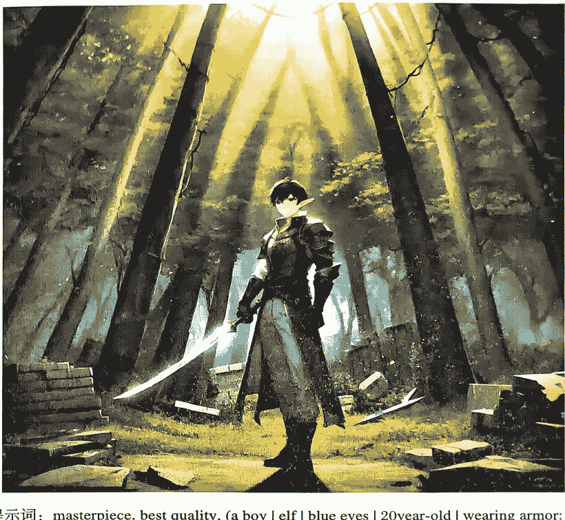

提示词：masterpiece, best quality, (a boy | elf | blue eyes | 20year-old | wearing armor: intricate dragon patterns on breastplate), careful, holding a obsidian long sword in hand, emitting a blazing light from its blade, the ruins of collapsed tribal houses in the forest, sunlight shines through the broken tree trunk, creating side lights. The ruins are covered in vines and shattered totems, and mist permeates, full body, wide shot

中文翻译：杰作，最佳品质，一个 20 岁身穿印有错综复杂龙文案盔甲、蓝色眼睛的精灵族男孩，谨慎的，手持黑曜石长剑，剑身散发着炽热的光芒，森林中坍塌的部族房屋的废墟，日光透过破碎的树干照进来，创造出侧光。废墟上布满了藤蔓和破碎的图腾，薄雾弥漫，全身，广角

图 3-15 提示词描述 · 图像细节 4

总的来说，我们可以大致将正向提示词的构成总结为“图片质量 + 主体 + 背景 + 镜头效果 + 光影环境 + 细节 + 风格”。具体的提示词构成可根据具体需要进行元素位置调换、添加或删减。反向提示词的构成可以总结为“较低或较差的图片质量 + 通用反向提示词 + 图像中不宜出现的元素 + 不希望出现在图像中的元素”，具体则需要根据想要生成的图片进行判断。

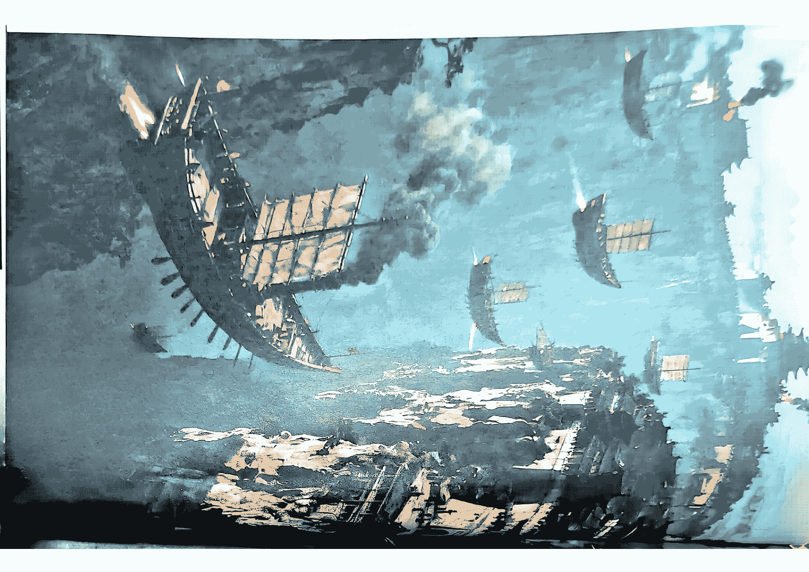

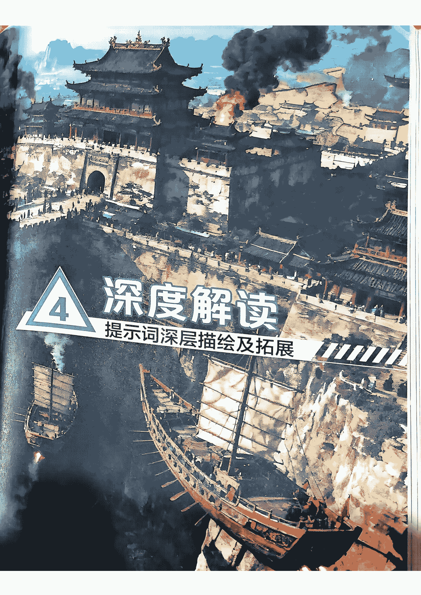

## 4 深度解读：提示词深层描绘及拓展

### 4.1 影视术语与镜头术语的运用

在我们的生活中，影视与镜头术语频繁出现在短视频和新闻中。这些术语不仅能丰富我们的知识储备，还能在使用 Stable Diffusion 生图时作为提示词，巧妙地提升画面的专业感与电影质感。本节将深入探讨如何将镜头类型、拍摄视角以及影视术语融入 Stable Diffusion 生图的提示词中，以实现更高质量的图像创作。

#### 4.1.1 镜头类型

在摄影器材中，镜头的类型有很多种，每种镜头都具有不同的特点和用处，拍摄出的图片效果也不尽相同。在生成图片时就可以使用这些镜头提示词，以使图片带有相应的特点。

变焦镜头是常见的镜头类型，其可以在不改变拍摄距离的情况下，在一定范围内变换焦距。正因为这种特性，其同时兼具定焦镜头高画质还原和长焦镜头突出主体、虚化背景的特点。变焦镜头适用于大部分场景和场合的图片。在生成图片时添加提示词 zoom lens（变焦镜头），可以增强画面的动态感和摄影的质感。当生成图片的主体为人物时，添加提示词 virtual background（虚化背景）还可以达到强化主体的效果。例如，我们要生成一张出游图片，完整提示词如下：masterpiece, highres, 8K, a 6-year-old girl, black long hair, light blue T-shirt, spring outing in the garden, peonies in full bloom, 20 ~ 70mm zoom lens, virtual background（中文翻译：杰作，高分辨率,8K，一个6岁女孩，黑色长发，浅蓝色连衣裙，花园春游，芍药花盛开，20 ~ 70mm变焦镜头，虚化背景），生成图片如图 4-1 所示。

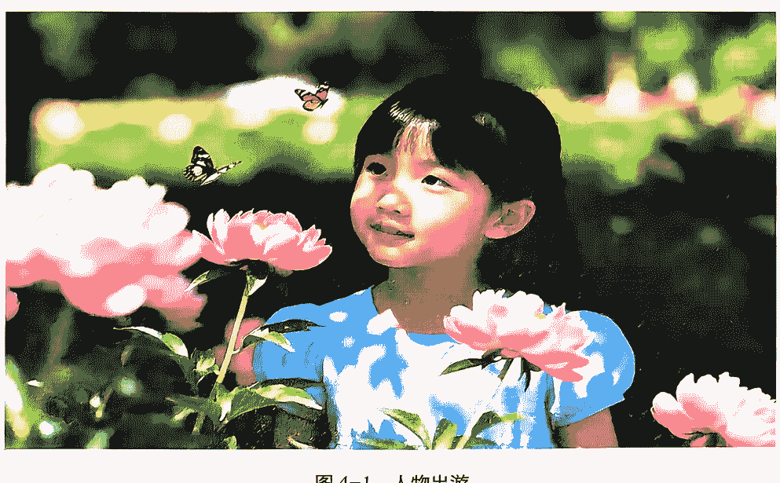

图 4-1 人物出游

当我们想要生成较大场景的图片时，可以在正向提示词中添加 wide-angle lens（广角镜头）。这种镜头具有透视、拉伸的效果，可以有效地呈现大场面的开阔氛围或建筑物的壮丽气势。例如，我们想要生成城市天际线的广阔场景时，可以添加提示词 wide-angle lens，以便在图片中展示城市建筑的宏伟景象，如图 4-2 所示。

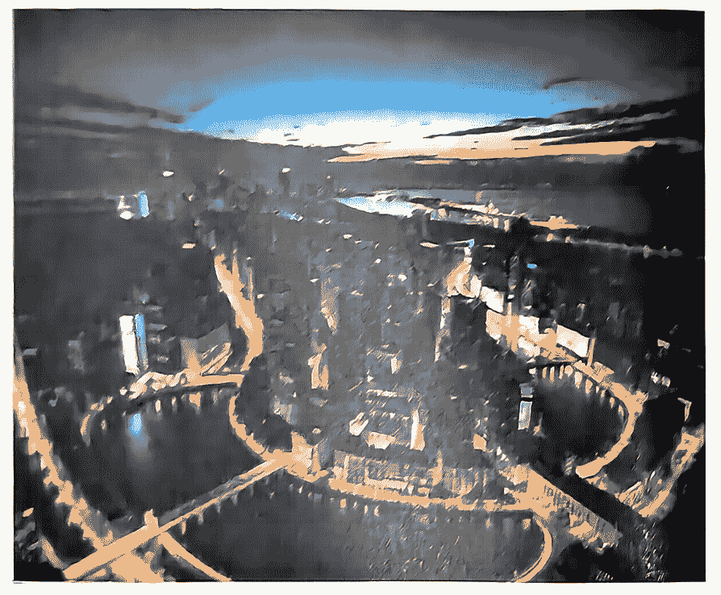

图 4-2 添加广角镜头提示词生成的城市天际线

鱼眼镜头因其镜片直径很短且呈前凸状，与鱼的眼睛颇为相似而得名。它是一种极端的广角镜头，拍摄视角一般能达到 220°～230°，在拍摄时可以产生强大的视觉冲击力。当我们希望生成的图片带有非常强烈的透视效果、超强的视觉冲击力和感染力时，可以在正向提示词中添加提示词 fisheye lens（鱼眼镜头）。图 4-3 为添加鱼眼镜头前后同一图片的对比。

图 4-3 添加鱼眼镜头提示词前后同一图片对比

当我们想要生成微观或者稍小物体的特写图片时，macro lens（微距镜头）可以作为一个合适的提示词使用。微距镜头是一种用作微距摄影的特殊镜头，经常用于拍摄昆虫、花卉等较小主体的特写。添加微距镜头提示词后，可以帮助生图程序更易理解我们想要的图片效果，从而使生成的图片具有更多极致的细节。图 4-4 为添加微距镜头提示词后生成的昆虫图片。

图 4-4 添加微距镜头提示词生成的昆虫

#### 4.1.2 拍摄视角提示词及作用

拍摄视角，即生成图片时元素向我们呈现的角度。将拍摄视觉术语应用到提示词中，不仅能决定场景的呈现方式，还能显著影响画面张力和情感表达。以下为几种常见的拍摄视角提示词。

常见的拍摄视角有平视、俯视和仰视，相关的提示词为 look straight ahead（平视）、look up（仰视）或 low angle（低角度）、overlooking（俯视）或 high angle（高角度）。平视时的画面显得端庄，也是最接近人眼视觉习惯的视角，不会使画面产生过多的透视变形效果，给人一种平和、均衡、稳定的感觉，如图 4-5 所示。俯视，也称为高角度，是从高于主体的位置看向主体的视角，可以增强主体的立体感，增加场景的空间深度，产生较好的空间感，如图 4-6 所示。仰视，也称为低角度，是从低于主体的位置看向主体的视角，与俯视视角相反。在通常情况下，仰视视角图片中地平线的位置比较低，可以起到增强主体气势和视觉冲击力以及压迫感和崇高感的效果，如图 4-7 所示。

图 4-5 使用平视视角生成的图片

图 4-6 使用俯视视角生成的图片

图 4-7 使用仰视视角生成的图片

鸟瞰，即像在天空中飞翔的鸟一样由上至下的视角，是一种极端的俯视视角，也称为“上帝视角”。在生成城市或野外风景的俯瞰图时，可以在提示词中添加 aerial view（鸟瞰视角）来实现，如图 4-8 所示。

图 4-8 使用鸟瞰视角提示词生成的城市图

倾斜视角，即摄像机镜头沿地平线倾斜一定角度的拍摄方式，也被称为荷兰角或荷兰式倾斜。这种视角打破了常规的视觉平衡，营造出一种不稳定、不和谐的视觉感受。在生成人物场景的图片，尤其是战斗场景时，倾斜视角可以营造紧张的氛围，同时增强画面的动感和张力；在生成恐怖、悬疑氛围的场景图时，倾斜视角也非常适用。如果我们想生成一幅充满恐怖悬疑氛围的图片，如图 4-9 所示，深邃、昏暗的走廊，搭配倾斜视角，会为画面增添不少紧张的氛围。

图 4-9 倾斜视角效果展示

#### 4.1.3 影视术语提示词及作用

合理运用影视术语提示词可以精准地控制画面的视觉风格和氛围。
前文提到过，生成图片时的画质提示词可以帮助我们在生图时控制所生成图片的质量，提高生图的成功率。除先前提到的提示词外，影视术语也可以作为画质提示词辅助提升画面的质量，如 cinematic（电影感）可以作为通用提示词。所谓电影感，并无具体的含义，但具有电影感的画面往往可以给观看者留下较深的印象。如图 4-10 所示，添加提示词 cinematic 后，画面中有了更多细腻的光影变化和空间层次感，同时增强了画面的叙事性。

图 4-10 添加提示词 cinematic 前后生成图片的变化

在数字电影出现前，电影的载体为胶片。虽然胶片电影在清晰度上远不及数字电影，但其特有的质感尤其是每一帧都充满的细腻颗粒感是数字电影所不能比拟的。当我们希望生成的图片带有些许复古效果和质感或带有颗粒感效果时，就可以添加提示词 film grain（胶片颗粒）来模拟胶片相机的颗粒感。图 4-11 右图为添加 film grain 提示词后的图片，带有明显的、类似于胶片颗粒的噪点。

图 4-11 添加提示词 film grain 前后生成图片的变化

景深是指拍摄有限距离的景物时，像面上构成清晰影像的景物的深度。景深大，清晰范围就大；景深小，则只有焦点区域清晰，背景会被虚化。简单来讲，我们在对主体物进行拍摄时会先进行对焦，并将焦点落于主体物上，在焦点前后仍有一段距离的元素可以清晰地显示出来，这个清晰的范围就叫景深。景深的提示词为 depth of field，也可简写为 DOF。当我们在生成图片时，如果想要单独突出主体元素而削弱其他元素，常用的手段就是对其他元素进行模糊处理，这时就可以将 shallow DOF（浅景深）输入提示词中，这种方法适用于生成人物主体特写图片，如图 4-12 所示。相反，当我们想让图片中的所有元素都比较清晰时，可以将 deep DOF（深景深）输入提示词中，这种方法适用于生成人物或风景、建筑类图片，如图 4-13 所示。

图 4-12 添加提示词 shallow DOF 后生成的图片

图 4-13 添加提示词 deep DOF 后生成的图片

光圈值，是镜头的焦距 / 镜头通光直径得出的相对值。与光圈值相关的提示词可以结合景深相关的提示词，来调整主体与背景的层次感。光圈值在提示词中的表现形式与其型号一致，型号不同起到的作用与适用的场景也不相同。f/1.4 为大光圈，作为光圈值提示词时，背景虚化效果强烈，适用于人物主体特写，如突出人物面部特征；f/1.8 同为大光圈，但背景的虚化效果相对较弱，能保留部分细节，同样适用于人物主体特写，如图 4-14 所示。

f/2.8、f/4.0 为中光圈，在主体清晰的基础上对背景及其他元素进行略微虚化，适用于平衡人物和环境之间的关系，保留画面场景的故事性，如图 4-15 所示。需要注意的是，虽然同为中光圈，但与 f/2.8 相比，f/4.0 的背景更加清晰。

图 4-14 添加大光圈提示词后生成的人物特写图

图 4-15 添加中光圈提示词后生成的人物场景图

f/8.0、f/16 为小光圈，作为提示词使用时，可以使画面中所有的元素变清晰，几乎没有虚化，适用于风景、建筑类图片的生成，也可以使生成的图片展示出多层次的细节，如图 4-16 所示。

图 4-16 添加小光圈提示词后生成的风景场景图

#### 4.1.4 实用提示词组合案例

接下来，结合以上三个小节的提示词内容，用三种不同的镜头氛围提示词，生成同一场景的三张图片。这样大家就能清楚地看到，不同的影视镜头术语提示词组合，能让同一场景呈现出截然不同的视觉效果。

以女孩站在空无一人的街道为例，我们先营造一种复古氛围。上文提到过影视镜头提示词中最能体现复古氛围的为 film grain，胶片成像的特点还有 orange yellow warm tone（橙黄暖色调）和 slight dark angle（轻微暗角），再结合 20 世纪 90 年代复古电影的特点，添加提示词 Kodak 5207 film grain（柯达 5207 胶片颗粒），完整提示词如下：a girl standing on empty street, 50mm fixed focus lens, Kodak 5207 film grain, orange yellow warm tone, slightdark angle, handheld lens dynamic blur, 90 s movie retro feeling（中文翻译：一个女孩站在空旷的街道上，50mm 定焦镜头，柯达 5207 胶片颗粒，橙黄暖色调，轻微暗角，手持镜头动态模糊，90 年代电影复古感），生成图片如图 4-17 所示。

图 4-17 复古胶片氛围

在生成以人物为主体的图片时，镜头提示词的合理运用可以显著提升画面控制能力，如想要营造女孩的可爱感时，可以使用俯视的拍摄角度，同时搭配景深提示词和大光圈虚化背景突出人物主体。综合这些要求，我们试着生成一张可爱女孩特写的图片，完整的提示词如下；a cute girl, close-up, top view, shallow depth of field, f/1.4, macro lens（中文翻译：一个可爱的女孩，特写，俯视，浅景深，f/1.4，微距镜头），生成图片如图 4-18 所示。这里需要特别注意，微距镜头在提示词中的位置不要靠前，否则会生成局部器官特写的图片。如图 4-19 所示。

图 4-18 人物特写和近距离特写

图 4-19 局部特写

## 4 深度解读：提示词深层描绘及拓展

### 4.2 文学修辞手法的套用

修辞手法是使用语言时用来提高言语表达效果的方法的统称。在生图的过程中，为提示词添加恰当的修辞手法可以显著提升画面的表现力和艺术张力。但由于 Stable Diffusion 提示词的底层逻辑为英文，直接在提示词中输入修辞手法的话，程序可能无法识别和理解其中的含义。本节内容将就几种修辞手法提示词进行简述。

#### 4.2.1 比喻

比喻是一种常见的修辞手法，指用一个物体来描述另一个物体，通过类比赋予画面具象化联想，具有增强视觉冲击力和将抽象概念可视化的作用。通常情况下，比喻可分为明喻和暗喻。明喻指通过比喻词将喻体和本体相结合，即“A 像 B”。在中文写作中，比喻词有“像、如、似、仿佛、比作”等。将这些比喻词输入提示词中时，可以使用like, as if, compared等词。比如，“机械龙的鳞片像熔化的金甲”，这里机械龙的鳞片为本体，熔化的金甲为喻体，像为比喻词，转换为提示词如下：the scales of the mechanical dragon are like melted gold armor（中文翻译：机械龙的鳞片就像熔化的金甲），生成图片如图 4-20 所示。

暗喻与明喻不同，在暗喻中，只有本体和喻体出现，比喻词不出现，变成用“是”“成了”“变成”等词语连接，即“A 是 B”。例如，“他的眼睛是闪耀的星辰”，他的眼睛为本体，闪耀的星辰为喻体，转换为提示词如下：his eyes are shining stars（中文翻译：他的眼睛是闪耀的星辰），生成图片如图 4-21 所示。

图 4-20 明喻修辞生成图

图 4-21 暗喻修辞生成图

比喻在生图中可以起到与文学写作相近的作用。通过该修辞手法可以将抽象的概念、情感或其他元素转换为具体的、可视化的视觉元素，引导生图程序生成更具想象力、更生动的图片，同时更加贴近我们的表达需求。

#### 4.2.2 夸张

夸张，即故意夸大或缩小客观事物，通过极端化描述突出主体的特征，营造震撼的视觉效果或超现实氛围。在中文写作中，夸张的关键词有“巨大（小）、无限、微米级、扭曲”等。

通常情况下，夸张可分为间接夸张和直接夸张、放大夸张和缩小夸张。间接夸张是通过运用比喻、拟人等其他修辞方式来对物体进行描述；直接夸张则是直接通过语句的表达来扩大或缩小事物元素的特征，来达到夸张的目的。放大夸张和缩小夸张是对物体本身具有的“大、多、深、高”或“小、少、浅、低”等特点进行相应程度的描述。通常情况下，我们可以根据需要进行夸张修饰的元素具有的某种特点，对该特点添加具有修饰性的词语来进行“放大”或“缩小”，以此达到增强画面冲击力和叙事性的目的。例如，“钻石般坚硬的铠甲”，将其转换为提示词为 diamond-hard armor，生成图片如图 4-22 所示。

图 4-22 “钻石般坚硬的铠甲”生成图

在生成超现实主义、科幻和奇幻风格的图片时，对其中非现实元素提示词进行夸张处理可以帮助生图程序更易理解其中的奇特元素，极大程度地增强画面的视觉冲击力，向观看者传达强烈的画面氛围。例如，我们想要生成一幅文明消失后，自然的力量占据城市，巨蟒般的树根缠绕住建筑的图片，完整的提示词如下：a city, with tree roots like pythons entwining around buildings, concrete structures cracking and twisting wooden textures（中文翻译：一座城市，树根像蟒蛇一样缠绕在建筑物周围，混凝土结构开裂，木质结构扭曲），生成图片如图 4-23 所示。需要注意的是，在对画面中的元素进行夸张处理时，添加的提示词需要符合英语语法，否则生图程序无法识别和理解。同时，创作者要避免对画面中多个元素同时进行夸张处理，以防出现画面杂乱、无视觉焦点的问题。

图 4-23 超现实风格

#### 4.2.3 通感

通感，又称“移觉”，是指不同感觉之间的相互转换或转移。在文学中，通感是一种修辞手法，指用一种人体感官的感觉来描写另一种人体感官的感觉。

在使用通感修辞手法时，我们可以在提示词中添加“听见、触摸、味道、温度等 + 视觉元素”，让不同感官间构建联系，如听觉与视觉通感。如果我们想生成一张在摇滚演唱会上，把摇滚节奏化作热烈的红色巨浪席卷整个舞台的图片，完整的提示词如下：at the rock concert, the rock rhythm turned into a hot red wave that swept the stage（中文翻译：在摇滚音乐会上，摇滚节奏变成了席卷舞台的炽热红波），生成图片如图 4-24 所示。

图 4-24 听觉与视觉通感

除不同感官的感觉可以相通外，我们还可以将感情、情绪、时间等抽象元素与感官感觉相通，使其具象化。例如，我们想要生成一张表现深夜忧郁的图片，仅靠焦虑的心情无法表达画面中人物的负面情绪，这时就可以利用通感，将焦虑比作无形扭曲缠绕在身上的黑色触手，通过视觉向观看者传递画面中人物的低落心情，赋予画面深层的象征意义。完整的提示词如下：late at night, a girl sat on the dark living room sofa, turning off the lights, anxiety wrapped around her like black tentacles of smoke, sorrowful（中文翻译：深夜，一个女孩坐在黑暗的客厅沙发上，关掉了灯，焦虑像烟雾的黑色触手一样缠绕着她、悲伤的），生成图片如图 4-25 所示。

图 4-25 运用通感将情绪视觉化

#### 4.2.4 排比

排比是由 3 个或 3 个以上结构相同或相似、内容相关、语气一致的短语或句子排列在一起。在中文写作中，排比是用来加强语势、强调内容、加重感情的修辞方式。恰当地运用排比可以增强语言的气势，使语意更周全、详尽，说理更严谨、周密。

在生成图片时，用排比的修辞手法对人物描述或场景描述的提示词进行排列，可以帮助生图程序更准确地理解提示词。需要注意的是，英文中的排比与中文中的排比略有不同，英文中的排比强调形式一致及句子的平行结构，避免语法错误。这里建议大家先写好中文排比句式，再将其翻译成英文作为提示词使用，避免出现程序识别错误或画面元素丢失的情况。

以工厂场景描述为例，对工厂内构成元素进行简要罗列，如机器运转的工厂、蒸汽升腾的管道、工人忙碌的剪影，然后将其翻译为英文，完整的提示词如下：a factory with machines running, steam rising pipe, silhouette of workers busy, clearly visible lines（中文翻译：一个机器运转的工厂，蒸汽上升管，工人忙碌的剪影，线条清晰可见），生成图片如图 4-26 所示。

图 4-26 工厂场景

由于 Stable Diffusion 对英文提示词的兼容性更强，在对提示词使用修辞手法，尤其是复杂的修辞（排比除外）时，我们可以先用英文进行大体结构的构思，再结合中文微调。从大体内容到叠加修饰词分层递进式地完善提示词的主要内容，逐步细化画面内容，且抽象概念的元素应尽量搭配具体的视觉元素，如时间与沙漏、悲伤与阴霾等，避免出现歧义。

### 4.3 提示词使用技巧拓展

Stable Diffusion 中除文生图功能使用大量的提示词外，图生图、局部重绘等功能也需要使用提示词。

前文提到过，图生图就是参考用户上传的图片与输入的提示词生成新图片的功能，不输入提示词时，程序会根据重绘幅度（图 4-27）自由发挥生成新的图片。图生图的提示词输入法则与文生图的提示词输入法则是一样的，不同的是，图生图提示词描述的内容是绘画程序在参考图大体结构的基础上对图片进行二次加工重绘的，并且会受到重绘幅度的影响。当重绘幅度为 0 时，提示词将不会起到任何作用，绘图程序将会输出与参考图一模一样的图片；当重绘幅度为 1 时，绘图程序则会完全按照提示词的描述进行图片的生成。

图 4-27 图生图的重绘幅度

局部重绘指在生成的图片中，对局部进行重新绘制或通过添加新的提示词细化细节。其重绘机制与图生图的重绘机制相差无几，需要新的提示词对图片进行局部重绘时，可以只输入在当前区域内我们希望重绘的元素或内容提示词，无须再对整体画面进行描述。

我们还可以通过其他工具生成或调整提示词，秋叶的 Stable Diffusion WebUI 整合包自带提示词辅助工具，其功能界面如图 4-28 所示。当鼠标移至提示词上时便会出现辅助插件，如图 4-29 所示。该辅助插件支持提示词的一键升降权重，复制、收藏提示词以及将某提示词添加至黑名单等功能，还可以查看提示词的历史记录。

图 4-28 秋叶整合包中的提示词辅助工具

图 4-29 提示词辅助插件

使用 AI 生图是一个循序渐进的过程。由于 AI 程序的不可控性，从最开始通过基础提示词确定大体的图片内容，到根据生成结果调整提示词，逐步达到目标效果，需要不断地进行试错和调整，灵活地组合正向、反向提示词，才能一步步精准引导 AI 生成符合我们预期的图片。另外，在使用 AI 生图时同样需要遵守我国的法律法规和公序良俗，不能为任何违法犯罪行为提供便利，也不能违背社会主义核心价值观。

## 模块解析

### 视觉元素技巧

## 5.1 视觉构图模块

视觉构图指创作者在一定空间范围内，对自己想要在画面中表现的各个元素进行组织安排，形成形象的部分与整体之间、形象空间之间的特定结构、形式。简单来说，构图是造型艺术的形式结构，包含全部造型因素与手段的总和。构图一词来源于西方美术，西方美术中就有一门课程叫作构图学。在我国国画画论中，构图被称为布局或经营位置。在摄影中，构图被称为取景。

常见的构图方式有黄金分割线构图、对称式构图、引导线构图、框架式构图、对角线构图、三角形构图、中心构图。

本节将针对这几种构图方式结合 AI 绘画简述它们是通过怎样的提示词生成的，以及其适用于生成的图片类型。

### 5.1.1 黄金分割线构图及相关提示词表述

黄金分割线构图，也叫黄金比例。黄金分割线构图指将整体一分为二，其中占比较大部分与整体的比值等于占比较小部分与占比较大部分的比值，其比值约为 0.618。这个比例被公认为是最能引起美感的比例，能让画面感觉更自然，更舒适，更能给人一种赏心悦目的视觉感受。

当要生成一张以人物为主的图片时，为了突出人物在图片中的主体地位，使观众在浏览时快速抓住要点，就需要突出人物在图片中的比例，让整幅画面层次清晰错落有致。这时就可以使用黄金分割线构图，常见的黄金分割线构图提示词有 rule of thirds（三分法，即黄金分割的简化版）、golden ratio layout（黄金分割布局）等。结合画质提示词和主体人物提示词，完整的提示词如下：masterpiece, highres, 8k, photography, a girl, golden ratio layout, rule of thirds（中文翻译：杰作，高分辨率，8k，摄影感，一个女孩，黄金分割布局，三分法），生成图片如图 5-1 所示。

除此之外，还有 golden ratio composition（黄金分割构图）、golden spiral（黄金螺旋）、nine-grid composition（九宫格构图）、dynamic balance（动态平衡）等可以作为构图提示词出现在正向提示词中。

对于风景类图片，为了突出图片的主体，同样适用黄金分割线构图，此时风景成为主体提示词。如我们想要生成一张以山为主体的图片，提示词则由主体 a girl（一个女孩）替换为 mountain（山），后跟黄金分割线构图提示词。除上述提示词外，还可以将 golden spiral、subject placed at golden section point（主体位于黄金分割点）作为构图提示词，如图 5-2 所示。

提示词：A huge waterfall, wildflowers, and a majestic snow capped mountain range gradually disappear into the clouds, golden section method
中文翻译：巨大的瀑布，野花和雄伟的雪山山脉逐渐消失在云层中，黄金分割法

提示词：A serene landscape featuring a historic stone pavilion situated at the intersection of a tranquil lake and rolling green hills, golden section method
中文翻译：宁静的景观，以位于宁静湖泊和绵延青山交汇处的历史石亭为特色，黄金分割线法

图 5-2 运用黄金分割线构图生成的以风景为主体的图片

### 5.1.2 对称式构图及相关提示词表述

对称式构图，是一种较为常见的构图方式。通过对称的排列和布局来创造画面的和谐感，让画面充满绝对的平衡感，观赏更具舒适性。常见的对称方式有 center symmetry（中心对称）、left-right symmetry（左右对称）、up-down symmetry（上下对称）、diagonal symmetry（对角对称）。当想要生成建筑类图片，并突出建筑布局的规范性又不失画面整体的整洁度和观赏的舒适性时，就可以输入提示词 symmetrical composition（对称构图），生成图片如图 5-3 所示。

左侧图片提示词：a building, left-right symmetry, 8K resolution, sharp focus, cinematic lighting, natural color palette, balanced symmetry
中文翻译：一幢建筑物，左右对称，8K 分辨率，强聚焦，电影灯光，自然色调，平衡对称
右侧图片提示词：a building, center symmetry, 8K resolution, sharp focus, cinematic lighting, natural color palette, balanced symmetry
中文翻译：一幢建筑物，中心对称，8K 分辨率，强聚焦，电影灯光，自然色调，平衡对称

图 5-3 运用对称式构图生成的以建筑为主体的图片

除此之外，镜面反射也可以作为对称式构图的一种，如我们想要生成山川湖面时，可以通过湖面的镜面反射效果增加画面的饱满度。其中镜面反射的提示词为 mirror reflection，那么完整的提示词如下：masterpiece, highres, 8K, photography, outdoor scenery, lakes, mirror reflection（中文翻译：杰作，高分辨率，8k、摄影感，户外风景，湖泊，镜面反射），如图 5-4 所示。

图 5-4 运用镜面反射对称式构图生成的山川湖面图片

### 5.1.3 引导线构图及相关提示词表述

引导线构图是一种通过图片中特定的线条引导观看者视线，使其汇聚在画面焦点上的构图方式。当我们想要生成建筑类或风景类图片时，为了使画面更具有观赏的流线型，可以使用如 leading lines to street（街道引导线）、converging perspective（引领主体方向）这样的提示词。这里的 street 可以替换为任何图中作为引导线的元素。

引导线不一定是具体的，线条、道路、河流、建筑群、楼梯等有着方向性的元素都可以作为引导视线的线条，如图 5-5 是以街道和建筑为引导线，图 5-6 则以河流为引导线。此外，由于 Stable Diffusion 对词汇的读取程度不同，我们还可以通过 subject at the end of lines（主体位于线条末端）、dynamic perspective（动态视角）、motion blur（动态模糊）、depth of field（景深）等提示词来表现引导线构图。

图 5-5 运用引导线构图生成的建筑图片

图 5-6 运用引导线构图生成的风景图片

### 5.1.4 框架式构图及相关提示词表述

框架式构图，即将画面中的主体通过门、窗等前景元素框起来，从而将观看者的视线引向框架中，以此来增加画面的层次感，突出画面中的主体。

在生成风景类图片时，使用框架式构图选取一个“画框”将主体包围起来，能够营造一种神秘气氛，就好像一个人从藏匿处偷偷窥视某个地方，有助于将主体影像与风景融为一体，赋予图片更大的视觉冲击，为图片增加故事性。将提示词 framed by garden（框中花园，这里“by”后边的单词为生成图片中的主体，大家可以根据需要自行更换）、window view composition（窗口视图）输入 Stable Diffusion，就生成了一幅如图 5-7 所示的图片。

除常见的门、窗可以作为框架外，doorway（门洞）、trees（树丛）、shadows（阴影）、hands（手）、fences（栅栏）、buildings（建筑物）等之间的缝隙也可以作为画面中的框架。

框架式构图同样适用于人物图片的生成，当我们想要生成一幅关于压抑的、沉闷的人物图片时，可以通过该种构图方式结合单人场景向观看者传递孤独的画面语言，如图 5-8 所示。

AI绘画全解 从提示词到视觉语言

图 5-7 运用框架式构图生成的风景图片

图 5-8 运用框架式构图生成的人物图片

### 5.1.5 对角线构图及相关提示词表述

对角线构图，指将画面中的主体沿对角线进行排列。一般来说，对角线构图可以分为完全对角线构图和近对角线构图两种。完全对角线构图就是图片中的元素按照图片的两条对角线进行排列，这条线没有直线和曲线之分。近对角线构图中虽然也有斜线，但元素的排列并不完全沿着对角线，而是稍偏离一点。这种构图方式看起来更自然、更舒服，不会那么死板，能让画面更有活力和动感。

当我们想要生成一场战斗或游戏场景时，对角线构图就非常适用，这种构图可以使画面充满动感和张力，有着较强的引导性，可以用到的提示词有 dynamic diagonal lines（动态对角线）和 tilted angle（倾斜角度）。加上画质、主体和场景描述的提示词，完整的提示词如下：masterpiece, highres, 8k, elf wield swords to confront demon, fierce fighting, dynamic diagonal lines, tilted angle（中文翻译：杰作，高分辨率，8k，精灵挥剑对抗恶魔，激烈战斗，动态对角线，倾斜角度），如图 5-9 所示。

此外，风景类图片也可以使用对角线构图让画面更具张力，可以用 subject placed along diagonal（主体沿对角线分布）、diagonal pathway（对角线路径）、leading lines from top-left to bottom-right（从左上到右下的引导线）等提示词进行表述。如图 5-10 所示。

## 5 模块解析：视觉元素技巧

图 5-9 运用对角线构图生成的战斗图片

图 5-10 运用对角线构图生成的风景图片

### 5.1.6 三角形构图及相关提示词表述

三角形构图是以三个主体或三个视觉焦点元素形成三角形布局的构图方式，能够使画面具有稳定性，增强层次感或动态张力。当我们想要生成一组静物图片或者画面中的主体元素较多时，就可以使用三角形构图，提示词可以包括 triangular arrangement（三角形排列）、three-point composition（三点式构图）。如图 5-11 所示，即使画面中元素较多，但通过三角形排列，画面不会显得那么嘈杂无序。

图 5-11 运用三角形构图生成的静物图片

在生成多人物站位的图片时，也可以使用三角形构图，以使画面看起来更加富有层次感，如图 5-12 所示。

图 5-12 运用三角形构图生成的人物站位图

提示词: triangle composition, three female warriors wearing armor and holding swords stand on a cliff. the background is a dramatic misty mountain range and a cloudy sky
中文翻译: 三角形构图，三位身披盔甲、手持宝剑的女战士站在悬崖上。背景是戏剧性的雾蒙蒙的山脉和多云的天空

### 5.1.7 中心构图及相关提示词表述

中心构图就是将画面的主体放置于画面的正中央。这种构图方式的最大优点就在于主体突出、明确，而且容易取得画面平衡的效果，是较为简单实用的构图方法。该构图法适用于人物类、物品类以及风景类图片的生成。通过添加 centered composition（中心构图）、centered subject（主体居中）等中心构图类提示词，便可以生成一幅主体突出鲜明、画面平衡的图片，如图 5-13、图 5-14 所示。

图 5-13 运用中心构图提示词生成的景物图片

图 5-14 运用中心构图提示词生成的人物图片

在本节中，我们主要讲解了构图提示词的使用方法。在生成图片时，构图提示词通常排在画质提示词后面，位于第二位。不过，大家在生成图片时可以根据自己的需求灵活调整提示词的顺序。如果需要更精细地控制提示词的作用，还可以参考第三章第二节的内容，为提示词增加或减少权重。这样可以更好地实现你想要的构图效果。

### 5.2 个性化风格模块

AI 绘画可以通过对不同风格提示词的读取生成不同风格的图片，不同风格有其独特的提示词，常见的风格有赛博朋克、奇幻魔法、科幻未来、蒸汽朋克、现实写真等。

风格提示词对画面美学、氛围、技术特征等起到至关重要的作用。简单来讲，一幅画最初的表达可以理解为“画什么”，当画什么的目的完成后就需要考虑“怎么画”“如何画”才能更好地表现画面内容。

如图 5-15 所示，提示词为“a castle on a hill”，因此画面主体为一座山上的城堡，且无明显的风格偏向。当我们希望画面具有一定的风格倾向，使画面更具故事性时，便可以通过在主体提示词后添加风格提示词来实现。如添加 gothic（哥特）、dark academia style（黑暗的学术风格）、ink wash painting（水墨画）、dramatic lighting（戏剧性灯光）这些风格提示词后，原来的城堡就变为了带有明显暗黑色调风格的哥特式城堡，整个画面增添了很浓的神秘色彩，且画面更加饱满，如图 5-16 所示。

图 5-15 一座山上的城堡（1）

图 5-16 一座山上的城堡（2）

在构建风格提示词时，可以从以下几个维度进行考虑：

- 从艺术流派的角度，可以选择具有鲜明特征的风格类型，例如赛博朋克（cyberpunk）、印象派（impressionism）、浮世绘（ukiyo-e）、哥特式（gothic）、极简主义（minimalism）等。
- 从渲染技术的角度，可以通过指定技术手段来影响画面质感，如虚幻引擎 5（Unreal Engine 5）、3D 渲染（3D render）、光线追踪（ray tracing）等渲染方式。
- 从文化符号的角度，可以借助特定时代、神话体系或艺术家的标志性风格，比如日本江户时代（Japanese Edo period）、维京神话（Viking mythology）、克劳德·莫奈（Claude Monet）等。

#### 5.2.1 艺术流派风格提示词

赛博朋克风格作为近些年较为流行的艺术流派广泛出现在游戏、绘画等领域。“赛博朋克”一词最早兴起于 20 世纪的科幻小说浪潮，后经过电影、游戏等的传播，逐渐成为一种文化风格。赛博朋克的故事情节经常围绕黑客、人工智能、企业矛盾展开，赛博朋克的经典人物往往有着边缘且疏远的性格。这些人生活在社会群体的边缘、城市的底层，与高大、奢靡的科技大厦形成对比。赛博朋克的图片具有反乌托邦、受到急剧改变的科技影响、普及的计算机化信息笼罩全球、侵入性的大面积肉体改造、机械义肢、仿生人、人造光（霓虹灯、全息广告等）、雨夜等特点，根据这些特点我们可以得出最基础的风格提示词：cyberpunk style（赛博朋克风格）、neon black movie style（霓虹黑色电影风）、futuristic dystopia（未来反乌托邦）、high-tech low-life（高科技与底层生活结合），其中则会产生较为核心的元素：neon-lit cityscape（霓虹灯城市景观）、flying vehicles（飞行载具）、cyborgs（赛博格）、holograms（全息投影）、futuristic attire（未来主义服饰）。当我们需要生成科幻类型的图片时可以选择该种风格，从上述基础提示词中挑选 cyberpunk style、neon-lit cityscape、flying vehicles、holograms 作为正向风格提示词，将其置于画质提示词和主体提示词之后生成如图 5-17 所示的图片。

除此之外，在赛博朋克充满人造灯光的特点下，视觉特效与细节还可以添加有关光照的颜色、色彩的对比和饱和度的提示词，如 neon lights（霓虹灯）、blue and magenta dominant palette（蓝紫色调主导）、glowing effects（发光特效）、high contrast lighting（高对比度光线），以及高科技机械中常见的问题提示词，如 glitch effects（故障效果）、digital distortion（数字失真）、circuit patterns（电路板纹理）、cybernetic implants（机械植入体）等进一步加强风格属性，如在图 5-17 的基础上添加提示词 circuit patterns（电路板纹理）、glitch effects（故障效果）后生成图 5-18。

图 5-17 赛博朋克风格

图 5-18 添加更多提示词后生成的赛博朋克风格的图片

以上为赛博朋克风格的一些正向提示词。还有一些反向提示词，如 natural lighting（自然光）、pastel colors（柔和色彩）、rustic elements（乡村元素）等。

哥特式艺术风格起源于中世纪的欧洲，最早可以追溯到 3 ～ 5 世纪，当时被广泛地应用到建筑、雕塑、绘画、服装等领域中。作为一种艺术风格，哥特式风格主要的特征为高耸、阴森、诡异、神秘、恐怖等，现代衍生为融合黑暗美学、宗教神秘主义与浪漫主义的艺术风格。根据哥特式风格的这些特点，我们可以得到基础的风格提示词：gothic style（哥特式风格）、mysterious（神秘）、eerie（诡异）、terrifying（恐怖）、dark aesthetics（黑暗美学）。结合这些特点，我们还可以使用 black（黑色）、silver（银色）、dark red（暗红）、dark purple（暗紫）、gold（金色）等作为颜色风格提示词。

在人物的描述上，哥特式风格具有 pale skin tone（苍白肤色）、smoky makeup（烟熏妆）、Victorian attire（维多利亚服饰）。下面，我们挑选其中的 pale skin tone、smoky makeup 和基础风格提示词便可以生成如图 5-19 所示的具有哥特式风格的人物图片。

图 5-19 具有哥特式风格的人物图片

在生成建筑场景或背景时，根据中世纪欧洲建筑的特点添加风格提示词，如 castle（城堡）、pointed church（尖刺教堂）、flying buttresses（飞扶壁）、rose windows（玫瑰窗）、iron decorations（铁质装饰）等。在通常情况下，提及哥特式风格还会与吸血鬼等元素联系起来，如 moonlight（月光）、flying bats（飞行的蝙蝠）、graveyard（墓地）等提示词能够为画面风格增添更多的神秘感和恐怖氛围。结合通用画质提示词，可以生成如图5-20所示的哥特式风格场景图。

根据上述哥特式风格的正向提示词，还可以总结常见的反向提示词，如bright colors（明亮的色彩）、modern clothing（现代服装）、cartoonish（卡通）、low contrast（低对比度）等来减少不必要元素对画面的干扰。

#### 5.2.2 渲染风格提示词

随着电脑显卡和其他硬件变得越来越强大，用软件做出的立体风格图片越来越受欢迎，特别是在人物、游戏和电商这些领域。这种立体风格图片能让大家看到更加逼真的画面，如主体的光影变化、丰富的色彩和细腻的纹理等。

常见的一种做法是先用 3D MAX 或 C4D 这样的软件对主体进行建模，然后渲染并添加材质等元素。这种方法适用于电影、广告、动态图形和动画等很多领域。

还有一种是虚幻引擎渲染，虚幻引擎是 Epic Games 开发的一个实时 3D 创作工具，主要用在游戏开发上。它的渲染系统有很多子系统，如光照阴影、材质纹理、视觉特效和后期处理等。这些子系统一起工作，能让渲染效果非常逼真，几乎和真实的一样。不管是用哪种渲染工具，最大的好处都是能让主体的立体感表现得淋漓尽致。

当我们想要生成高色彩饱和度、材质清晰或电商产品场景图时，便可以通过输入 C4D 渲染风格提示词来达到想要的效果。直接关联 C4D 渲染风格的提示词有 C4D 渲染（C4D rendering）、OC 渲染（OC rendering），关于主体材质的提示词包括 clay material(黏土材质)、plastic texture(塑料质感)、smooth surface（表面光滑）等，还有其他一些细节提示词如超精细造型（hyperfine modeling）。根据以上提示词，我们来生成一个粉色咖啡杯的电商场景图，完整的提示词如下：masterpiece, best quality, 8K, C4D rendering, OC rendering, pink coffee cup, clay material, smooth surface, warm color tone, hyperfine modeling（中文翻译：杰作，最佳品质，8K, C4D 渲染，OC 渲染，粉红色咖啡杯，黏土材质，表面光滑，暖色调，超精细造型），结果如图 5-21 所示。为了突出 C4D 风格，可以将风格提示词 C4D rendering 和 OC rendering 放置于画质提示词之后，使其权重高于除画质提示词外的其他提示词，当然大家在生图时也可根据需要自行调整提示词的顺序。

图 5-21 C4D 黏土材质咖啡杯电商场景图

与 C4D 不同的是，3D MAX 多用于建筑可视化、室内设计、工业设计的 3D 渲染，注重真实感材质与物理光照。当我们想要生成有关室内场景装修或建筑类图片时，可以选用 3D MAX 风格的提示词。直接关联 3D MAX 风格的提示词有 3D MAX rendering（3D MAX 渲染）、V-Ray rendering（V-Ray 渲染）、hyper realistic rendering（超写实渲染）。在使用 3D MAX 进行渲染时，常用到的材质提示词有 real PBR material（真实PBR材质贴图），墙体或地面的建筑材质，包括 marble texture（大理石纹理）、frosted glass（磨砂玻璃）等。其他一些细节提示词包括 physical camera（物理摄影机）、high precision mapping（高精度贴图）、wear details（磨损细节）等。结合上述提示词，我们来生成一张客厅的场景图，完整的提示词如下：masterpiece, best quality, 8K, 3D MAX rendering, V-Ray rendering, superrealistic living room scene, leather sofa, wear detail, marble coffee table（中文翻译：杰作，最佳品质，8K, 3D MAX 渲染，V-Ray 渲染，超写实客厅场景，皮沙发，磨损细节，大理石茶几）。

质，8K，3D MAX 渲染，V-Ray 渲染，超现实客厅场景，真皮沙发，服装细节，大理石咖啡桌），结果如图 5-22 所示。

图 5-22 3D MAX 超写实客厅场景图

当我们想生成超写实场景或者各种游戏场景时，可以试试虚幻引擎风格。虚幻引擎是一种图像渲染能力很强的游戏用的引擎。它能做出高保真材质渲染，如金属反射、磨损纹理等细节。而且，它有独特的 Lumen（拉丁语中意为“光”）全局动态光照系统，在光照、阴影、粒子效果和后期处理中也表现优异。最新的虚幻引擎 5 在实时 3D 渲染上进步很大，效果更逼真。

如何在画面中表现虚幻引擎渲染风格，这就涉及提示词了。直接关联虚幻引擎技术的提示词有 unreal engine 5 style（虚幻引擎 5 风格）、UE5 cinematic（虚幻 5 电影级）、Lumen global illumination（Lumen 全局光照）等。在使用虚幻引擎进行渲染时，常用到的材质提示词有 4K PBR materials（4K 级别 PBR 材质）、subsurface scattering（表面散射）、metallic reflections（金属光泽）、metallic reflections（风华纹理）等。除此之外，再结合一些风格细节提示词进行后期处理，如 photorealistic skin pores（逼真的皮肤毛孔）、HDR lighting（高动态光照渲染）。

结合上述提示词，我们尝试生成一张末世超写实场景图，完整的提示词如下：masterpiece, UE5 rendering, post-apocalyptic city ruins, overgrown vegetation, destroyed concrete buildings, Lumen global illumination, sunset lighting, rusted vehicles, 4K PBR materials, subsurface scattering, HDR lighting（中文翻译：杰作,UE5 渲染，后启示录城市废墟，杂草丛生的植被，被毁的混凝土建筑,Lumen 全局照明，日落照明，生锈的车辆,4K PBR 材料，地下散射，HDR 照明），结果如图 5-23 所示。

图 5-23 虚幻引擎渲染风格超写实末世场景

#### 5.2.3 文化符号风格提示词

除特定的风格提示词外，一个具备风格特点的时代名词或某一作家也可以作为生成图片时的提示词。此时，某一时代的着装特点、某一作家的作品特征等便成为这一风格提示词的核心元素。

日本江户时代是日本历史上封建时代的最后一个时期，这个时代美术创作方面最值得一提的是浮世绘。浮世绘就是描绘歌舞伎、相扑、花街柳巷等世俗生活的绘画，主要以木版画的形式存在。当时流行的人生观认为，人生短暂无常，应该将自己投入沉浮的尘世中及时行乐，尽情欢唱，尽兴饮酒，随波漂浮。浮世绘强调用流畅的线条勾勒人物动态与自然景观，兼备静态造型美与动态张力感。采用高饱和度的红、黄、蓝等色调，无透视阴影的平涂画法，大胆的构图是其最大的特点。除此之外，浮世绘由于其平民化的特点，又有着人物、风景、花鸟、时事等众多题材。

当我们想要生成高饱和度且线条明显或平面化的人物、风景图片时，就可以使用浮世绘风格。直接关联浮世绘风格的提示词有 Japanese Edo period（日本江户时代）、ukiyo-e（浮世绘），有关浮世绘强烈的线条感的提示词有 bold outlines（大胆的轮廓）、high saturation（高饱和度的色调），浮世绘特有的主题元素提示词有 cherry blossoms（樱花）、geisha（艺伎）、samurai（武士）、kabuki actor（歌舞伎）。

结合上述提示词，我们尝试生成一张海浪里渔船的浮世绘风格图片，完整的提示词如下：towering wave with foam, fishing boats struggling, dynamic diagonal lines, ukiyo-e, Japanese Edo period, bold outlines, high saturation（中文翻译：高耸的海浪，挣扎的渔船，动态对角线，浮世绘，日本江户时代，大胆的轮廓，高饱和度），结果如图 5-24 所示。

图 5-24 浮世绘风格场景图

具备一定特点的画家的画作同样可以作为一种风格用于生成图片的提示词。这里我们以法国著名画家克劳德·莫奈（Claude Monet）为例。作为印象派的代表人物，他的作品以对光线和色彩的极致探索著称。莫奈追求捕捉瞬间的光影变化，弱化物体轮廓，用色块堆叠表现动态的光线效果，所以他的作品通常具有明显短促、柔和松散的笔触，高饱和度色彩与柔和色调相结合。要想生成观赏性较强的场景图，莫奈风格最合适不过。

结合莫奈画作的风格特点，直接关联的风格提示词为 impressionism style（印象派风格）、Monet painting（莫奈画作）、soft brushstrokes（柔和的笔触）、vibrant colors（鲜艳的色彩）。细节提示词为 oil painting（油画）、visible canvas texture（可见的画布纹理）、blurred details（模糊的细节）等。

结合上述提示词，我们尝试生成一张宁静的睡莲池和夕阳图片，完整的提示词如下：impressionism style, Monet painting, lakeside, sunset, colorful sky, dynamic brushstrokes, water lilies, calm water, tree-lined shores, misty mountains（中文翻译：印象派风格，莫奈绘画，湖畔，日落，多彩的天空，动感的笔触，睡莲，平静的水，绿树成荫的海岸，薄雾笼罩的山脉），结果如图 5-25 所示。

图 5-25 莫奈油画风格场景图

#### 5.2.4 电影与导演风格提示词

电影作为日常娱乐和文化传播的媒介已经有 100 多年的发展史，近年来电影行业更是迎来了蓬勃发展期，衍生出了多种各具特点的电影流派和风格，不仅如此，不同的导演也形成了自己的风格特点。这些电影流派和导演技法也可以作为风格提示词使用。

宫崎骏是日本动画界的标志性人物，他通过巧妙的角色设计、夸张的想象和奇幻元素的融合，创造出许多极具特点的影片作品。他的动画电影风格具有极高的辨识度，画面清新，有着水彩和水粉以及油画相结合的细腻质感、色调偏向自然柔和，皆用低饱和度的暖色，光影过度细腻。还通常带有浓厚的奇幻色彩。

在生成自然带奇幻场景以及日常情感、叙事类图片时，可以使用宫崎骏动画风格。宫崎骏动画风格较为核心的提示词为 studio Ghibli style（吉卜力工作室风格）、Hayao Miyazaki animation（宫崎骏动画）、hand-drawn animation（手绘动画）、traditional 2D animation（传统 2D 动画）等。

结合上述提示词，我们尝试生成一张少女在乡间骑自行车的图片，完整的提示词如下：young girl riding a bicycle through sunny countryside, Studio Ghibli style, Hayao Miyazaki animation, soft watercolor textures, vibrant green fields（中文翻译：骑着自行车穿过阳光明媚的乡村的年轻女孩，吉卜力工作室风格、宫崎骏动画，柔和的水彩纹理，充满活力的绿色田野），结果如图 5-26 所示。

图 5-26 宫崎骏风格图片

科幻电影采用科幻元素作为题材，以建立在科学上的幻想性情景为背景展开叙事。这种类型的电影往往充斥着强烈的未来科技元素，需要运用高对比的光影营造视觉上的未来感。在生成科幻类图片时，我们可以将科幻电影的特点作为提示词使用，较为核心的风格提示词有 science fiction（科幻电影）、futuristic machinery（未来机械）、hard sci-fi（硬科幻）等，再根据生成图片中的元素增加特定的科技元素提示词。此外，还可以将有名的科幻电影名称当作提示词使用，如将《银翼杀手》作为提示词使用，结果如图 5-27 所示。

图 5-27 《银翼杀手》风格科幻图片

### 5.3 光影模块

在 AI 绘画中，光影作为基础元素之一，其艺术性和表现力的重要程度丝毫不弱于构图和风格，好的光影效果可以为图片增添更多的美感。光影就是光线与影子在物体上的相互作用形成的视觉效果，如明暗、色调、纹理等。好的光影效果可以使画面拥有更强的层次感，光源色彩还可以表达情感和氛围，并能在一定程度上起到突出主体的作用。

常见的光线提示词有 top light（顶光）、back light（逆光）、hard light（硬光）、soft light（柔光）、sun light（太阳光）、moonlight（月光）、cold light（冷光）、warm light（暖光）、natural light（自然光）、bright（明亮光）、color light（有色光）、side light（侧光）、Rembrandt light（伦勃朗光）、butterfly lighting（蝴蝶光）、rim light（轮廓光）、edge light（边缘光）、mapping light（映射光）等，阴影则会根据光线条件进行变换，常见的提示词有 blurred shadows（模糊的阴影）、clear shadows（清晰的阴影）等。下面将通过具体案例表现光影。

#### 5.3.1 顶光及相关提示词表述

顶光为从人物或物体顶部照射下来的光，在主体对象的下方产生阴影，可以使主体的轮廓更鲜明，增加层次感。当我们想要生成一张人物肖像图片时，可以使用顶光来增强主体人物的视觉效果，此时我们便可以添加提示词 top light，生成图片效果如图 5-28 所示。

图 5-28 顶光效果图

#### 5.3.2 逆光及相关提示词表述

逆光，又称背光，指从人物或物体的背面照射出来的光。逆光照射时可以忽略主体的部分结构细节，突出轮廓线，较好地表现纵深感，形成独特的光线结构，产生剪影的特殊艺术效果。当我们想要营造一种神秘感或唯美氛围时，就可以为主体人物添加逆光的提示词 back light，生成图片效果如图 5-29 所示。

图 5-29 逆光效果图

#### 5.3.3 侧光及相关提示词表述

侧光指从侧面照向主体的光线，一般分为左侧光（left light）和右侧光（right light），侧光在主体上形成明显的受光面、阴影面和投影。在生成图片时，使用侧光提示词可以使画面的明暗配置和明暗反差鲜明清晰，增加画面的层次感，使画面更具空间感和立体感。同时，侧光比较符合人们日常的视觉习惯，是常用的一种光线角度，生成图片效果如图 5-30 所示。

图 5-30 侧光效果图

除左侧光、右侧光外，还有后侧光（rear side light）、正侧光（positive side light）等多角度的侧光，如图 5-31 所示。具体的侧光位置需要我们针对需要生成的图片自行选择。

图 5-31 正侧光和后侧光效果对比图

#### 5.3.4 柔光、硬光及相关提示词表述

柔光通常指没有方向性的漫射光或散射光，光线没有直接照射在主体上，如阴天的自然光、经过遮挡漫射或散射的人造光、手机光等。硬光通常指没有经过任何处理直接照射在主体上的光线，如晴天正午的太阳光、手电筒或补光灯的直射光、汽车的远光等。在提示词中，柔光一般为 soft light，硬光一般为 hard light。柔光多用于主体为人物的图片中，可以使主体到阴影有着自然的过渡，降低对比度，使画面更加柔和平滑，如图 5-32 所示。硬光多用于生成物品或场景图片，使主体拥有清晰的投影，同时由于光线直接照射在主体上可以更加清晰地表现主体的质感，如图 5-33 所示。

图 5-32 柔光效果图

图 5-33 硬光效果图

#### 5.3.5 蝴蝶光、伦勃朗光及相关提示词表述

蝴蝶光，也称派拉蒙光，是好莱坞早期为女影星拍摄剧照的惯用布光法。蝴蝶光的主光源在镜头上方，也就是在人物脸部的前上方，由上向下45°方向照射到人物的脸部，从而形成类似蝴蝶形状的高光区域。当我们想要为人物脸部带来一定的层次感，或表现脸部的骨骼分明时就可以通过添加提示词 butterfly lighting（蝴蝶光）来实现，结果如图 5-34 所示。

图 5-34 蝴蝶光效果图

伦勃朗光，俗称三角光，同样常被用于人物图片中。光线形成的面部阴影一侧朝向镜头，受光面占面部的 3/4，由于使用这种光线生成的人像图片酷似伦勃朗的人物肖像画而得名。当我们想要使用这种布光法时，可以通过添加提示词 Rembrandt light（伦勃朗光）来实现，结果如图 5-35 所示。

图 5-35 伦勃朗光效果图

#### 5.3.6 冷暖光及相关提示词表述

光影不仅是画面中重要的视觉元素，还可以起到表达画面情感的作用，如图 5-36 中的人物虽然面无表情，但蓝色的冷色光为画面增添了忧郁、神秘的氛围 [ 通过使用冷色调相关的提示词，如 blue color light（蓝色光）、cold color palette（冷色板）来实现 ]。与之相反，暖色光可以传递温暖、浪漫的情绪 [ 通过使用暖色调相关的提示词，如 warm color palette（暖色板）来实现 ]，如图 5-37 所示。

图 5-36 冷色光效果图

图 5-37 暖色光效果图

#### 5.3.7 光影提示词的组合应用

了解了基础的光影提示词后，可以进一步了解光影在提示词中的具体表现形式。首先，一个完整的画面需要交代光线的来源、位置和类型。以公园游玩为例，多云的下午，阳光照射在孩子身上。光线的来源便是太阳光，由于是多云的下午，光质选择柔光，角度可以是任一角度的侧光。当有光存在时就会出现影子，这里影子的提示词可以直接跟在光线提示词之后，侧光将人的影子拉得长长的，完整的提示词如下：masterpiece, highres, best quality, 8k, child, playing in the park, cloudy afternoon, soft sunlight, top and side lights, soft light, long shadows stretching out on the grass（中文翻译：杰作，高分辨率，最佳品质，8k，儿童，在公园里玩耍，多云的下午，柔和的阳光，顶部和侧面的灯光，柔和的光线，长长的影子在草地上延伸），结果如图 5-38 所示。

图 5-38 孩子在公园玩耍

此外，针对不同元素的材质，可以通过描述其在光影下的表现反映其质感，以增强图片的细节，这里就可以添加光影下的细节提示词，如金属反射出耀眼的光。如图 5-39 所示，博物馆的吊顶直射灯属于硬光，照射在金属材质的盔甲和长剑上会反射出较强烈的光，再结合灯的位置，完整的提示词如下：masterpiece, highres, best quality, 8k, modern museum, black steel armor on exhibition stands, strong light shines directly on the silver sword, and the sword has a bright reflection on its body, top light, hard light（中文翻译：杰作，高分辨率，高品质，8k，现代博物馆，展台上的黑色钢甲，强光直射在银剑上，剑身有明亮的反光，顶光，强光），效果如图 5-39 所示。

## 5 模块解析：视觉元素技巧

图 5-39 博物馆展览

## 6 进阶拓展

图像构成部分解析

### 6.1 人物设计的描述法

对图片主体的描述在提示词中占着非常大的比重，当我们要生成的图像主体为人物时，就需要对人物进行详细的描述，包括外貌、服饰、动作等能表现人物特征的元素。

#### 6.1.1 基础人物提示词

在通常情况下，在生成人物图片时使用最多的提示词为 a girl（一个女孩）或 a boy（一个男孩）。除这些提示词外，常用的基础人物提示词还有 a baby（一个婴儿）、a mature male（一个成熟男性）、a mature female（一个成熟女性）等。

当我们实际生成人物的时候会发现，在一些特殊或特定场景中只依靠上述提示词很难生成相应年龄的人物，这时候就需要细化人物提示词，按年龄大致可分为婴幼儿、儿童、少年、青年、中年、老年。

我们先为 a girl 和 a boy 两个常用人物提示词加上特定的年龄，分别为 1 years old（1 岁），10 years old（10 岁），20 years old（20 岁），30 years old（30 岁），40 years old（40 岁），50 years old（50 岁），60 years old（60 岁），70 years old（70 岁），80 years old（80 岁）。结果如图 6-1、图 6-2、图 6-3 所示。

图 6-1 添加年龄提示词后的 a girl 人物图片

图 6-2 添加年龄提示词后的 a boy 人物图片（1）

图 6-3 添加年龄提示词后的 a boy 人物图片（2）

我们可以看到人物有了明显的年龄特征，但没有明显变化，这就需要使用英文对不同年龄段的特定提示词进行生成。

婴幼儿阶段可以使用提示词 toddler（婴儿），同时搭配性别和年龄，如 a male toddler, 2 years old（中文翻译：一个男婴,2 岁），生成图片如图 6-4 所示。少年及青年阶段的面部特征变化并不大，所以 a boy 和 a girl 适用于这两个年龄段。中年的人物提示词可以使用 middle age（中年）搭配性别和年龄使用，如 a middle age female, 40 years old（中文翻译：一个中年女性，40 岁），生成图片如图 6-5 所示。老年阶段的人物可以在性别前添加 elderly（老年的），如 an elderly male, 80 years old（中文翻译：一个男性老人，80 岁），生成图片如图 6-6 所示。

图 6-4 2岁男婴幼儿

图 6-5 40岁中年女性

图 6-6 80 岁老年男性

除性别、年龄外，种族或身份也是基础人物提示词中的一大核心要素，如精灵（elf）、恶魔（demon）、人鱼（merman）等，大家可根据自身需要进行选择。

此外，在生成人物时，还需要注意图片中人物为 half body（半身）还是 full body（全身），当生成的为单人图片时，还可以添加提示词 solo（单人或单独角色）。大家可根据自身需要进行选择。

#### 6.1.2 外观特征及职业提示词

有了基础人物提示词后，就可以对需要生成人物的外观特征进行细致刻画，这里将外观大致分为外貌特征、体型、服饰三部分。

人物的外貌特征可大致分为发型、五官、肤色等。发型可细分为长度、发色、形状等，如一个棕色短卷发女孩，完整的提示词如下：a girl, brown short curly hair（中文翻译：一个女孩，棕色短卷发），生成图片如图 6-7 所示。体型大致可分为身高、胖瘦等，在输入身高提示词时，我们可以使用具体的高度如 1.76 米，也可以使用 tall（高的）、short（矮的）、giant（高大的）、dwarf（矮小的）等形容词。服饰为生成人物的衣着打扮，在输入时可以为详细的衣物提示词，如 T-shirt（T 恤衫）、coat（大衣）、jeans（牛仔裤），也可以为衣着的统称，如 regular clothes(常服)、sleepwear(睡衣)、armor（盔甲）、robe（法袍）等。

图 6-7 棕色短卷发女孩

人物的身份定位或职业也可以作为人物设计中的重要元素，从身份定位可以获取人物的服饰和其他外貌特征。例如，唐代仕女多身着色彩艳丽的交领襦裙，外搭飘逸披帛，发髻上簪有金玉发簪或鲜花，面部绘有精致花钿，手持团扇或执壶，呈现丰满温婉的体态与东亚面孔，其中就可以提炼出 Tang dynasty noble lady（唐代仕女）、cross-collar ruqun（交领襦裙）、flowing pibo（飘逸披帛）、jade hairpin（玉簪）、flower hair accessory（簪花）、huadian face decoration（花钿）、round fan（团扇）等提示词，通过这些提示词就能精准生成如图 6–8 所示的符合唐代仕女风格的图片。

图 6-8 仕女

当我们想要生成一个欧洲中世纪骑士形象时，就可以结合欧洲人、中世纪、骑士等关键词来输入提示词。欧洲中世纪骑士一般为白人身穿骑士盔甲的形象，再结合白人普遍的金发、蓝眼特征，就可以得到如下提示词：masterpiece, highres, 8k, a boy, gold hair, blue eyes, medieval knight, wearing armor（中文翻译：杰作，高分辨率，8k，一个男孩，金发，蓝眼睛，中世纪骑士，身穿盔甲），生成图片如图 6–9 所示。

图 6-9 欧洲中世纪骑士

#### 6.1.3 人物细节及质感提示词

当有了基本的人物造型后，就可以为人物添加细节方面的提示词，以使人物更加饱满，增强人物的真实性。这些细节包括人物身上的特点，如 tattoo（文身）、scar（疤痕）、the texture of the skin（皮肤的质感），如果人物为其他种族如蜥蜴人还可以表现其身上的鳞片等特征。衣着也可以作为人物特点进行细致刻画，如服饰的材质以及材质对光影的反馈效果等。结合上述提示词，我们生成一张身穿盔甲的蜥蜴人形象，其身上粗糙的鳞片与反射太阳光的金属盔甲均为细节提示词，完整的提示词如下：lizardman, roughness green scale, steel armor, reflecting the dazzling sunlight（中文翻译：蜥蜴人、粗糙的绿色鳞片、钢铁盔甲，反射耀眼的阳光），生成图片如图 6-10 所示。

图 6-10 身穿钢制盔甲的蜥蜴人

#### 6.1.4 动态与表情提示词

明确人物的主体形象后，如果我们想要为画面增添更强的故事性，可以在基础人物提示词后添加动态与表情提示词，来明确人物的动作、体态和表情。常见的动作提示词有站着（standing）、坐着（sitting）、躺着（lying）、半蹲（half squat）等。除此之外，还可以通过肢体动作表现体态，如双臂张开（spread arms）、手放在脸上（hand on own face）、手臂在脑后（arms behind head）等。一些动态表现，如 dynamic pose（动态姿势）、floating hair（飘动的头发），可以增强画面的张力，如图 6-11 所示。

图 6-11 肢体动作表现体态

在生成人物特写时，表情提示词可以让画面显得不那么呆板，使人物更加饱满，常见的表情提示词有 calmly（平静）、happy（开心）、sad（悲伤）、furioso（愤怒），也可结合微表情，如 cocked eyebrow（挑眉）、frown（皱眉）等，如图 6-12 所示。前文提到过的颜文字和 emoji（表情符号）也可以作为表情提示词出现在正向提示词和反向提示词中。

图 6-12 表情特写

#### 6.1.5 完整描述演示及拓展

图 6-13 为通过 Stable Diffusion 生成的一个古代剑客人物，下面为大家简述生成这张图片的提示词是如何构成的。首先，明确图片中人物为中国古代男性剑客，这时需要的提示词为 ancient Chinese swordsman（中国古代剑客）或 male swordsman（男性剑客）。然后为主体人物的面貌特征，束起的黑色长发（tied-up black hair）、锐利的黑色眼眸（sharp black eyes）、下颌带些许胡茬（light stubble on jaw）。描述完大概的面貌特征后便是人物的衣着打扮，剑客身穿深色劲装（dark tight-fitting warrior outfit），若对画面精细度有更高要求，可补充衣着细节与配饰，图 6-13 用到的提示词为 dark blue warrior robe with black waist sash（深蓝色武士袍配黑色腰带）、wearing black boots with leather straps（脚踝皮革绑带黑靴）、carrying a long sword on back（背上挎长剑）。最后就是人物的动态和表情，图 6-13 用到的提示词为 standing with one hand on sword hilt（一手按在剑柄上站立）、focused gaze（眼神专注）。完整的提示词如下：masterpiece, intricate details, an ancient Chinese swordsman with tied-up black hair, sharp black eyes, light stubble on jaw, dark blue warrior robe with black waist sash, wearing black boots with leather straps, carrying a long sword on back, soft martial arts movie lighting, standing with one hand on sword hilt, focused gaze，中文翻译：杰作、错综复杂的细节，束起黑发的中国古代剑客，锐利的黑眼眸，下颌些许胡茬，深蓝色武士袍配黑色腰带，脚踝皮革绑带黑靴，背上挎长剑，柔和的武侠电影打光，一手按在剑柄上站立，眼神专注。

图 6-13 古代剑客人物

除上述提示词外，还可以通过引用知名艺术家的名字或作品来增强角色的独特性，如伊利亚·库夫希诺夫（Ilya Kuvshinov）。这位俄罗斯插画师和角色设计师在知名 IP《攻壳机动队》中负责角色绘制。很多时候他会尝试将欧美的人物特点融入日系人物中，以形成独特的人物效果。在输入人物描述提示词后，添加伊利亚·库夫希诺夫风格（by Ilya Kuvshinov）和攻壳机动队（Ghost in the shell）提示词后，可以使生成的人物图片带有这位插画师的风格倾向，如图 6-14 所示。

图 6-14 带有伊利亚·库夫希诺夫（Ilya Kuvshinov）插画师风格倾向的人物

结合以上内容，可以总结出大致的人物设计提示词模板：角色基础提示词 + 外貌特征（发型、五官、服饰） + 面部和服饰细节 + 动态表情 + 参考示例。大家在生成人物时可以根据实际需求调整提示词的顺序，以达到最佳的效果。

#### 6.1.6 人物三视图

在设计人物时，常用到人物的三视图。因此，我们要了解三视图是什么。人物三视图就是从正面、侧面和背面展示人物的图像画面，主要包括主视图、侧视图和后视图。

在使用 Stable Diffusion 生成人物三视图时，核心提示词为 three views（三视图）、full body（全身）、front view（正视图）、side view（侧视图）、back view（后视图）、multiple views（多视图），其中侧视图可以根据需要换成左视图或右视图。为了防止生图程序自由发挥，我们还可以添加 white background（白色背景）或 simple background（简单背景）提示词，避免背景对人物视图的干扰。这些核心提示词中权重最大的为 three views（三视图）。

除上述人物三视图的核心提示词外，其他提示词为对人物体貌特征、衣着打扮等的描述和画质提示词。举个简单的例子，一个身穿校服的黑发女孩的三视图，结合核心提示词，完整的提示词如下：(three views of character:1.2), full body, front view, left view, back view, multiple views, a girl, black hair, school uniform, simple background, masterpiece, best quality [中文翻译：(人物三视图：1.2)，全身，前视图，左视图，后视图，多视图，一个女孩，黑发，校服，简单的背景，杰作，最佳的品质]。生成图片如图6-15所示。

图6-15 黑发校服女孩三视图

从图 6-15 中可以看出，生成的人物三视图中，左视图的眼睛颜色与正视图的眼睛颜色不相同，这时就需要我们通过添加提示词来不断调整。如果多次添加正向提示词生成的三视图还是存在差异，就需要添加反向提示词控制画面中某一元素不再出现。图 6-16 为图 6-15 调整后的图片。

图 6-16 调整后的人物三视图

### 6.2 场景构建的元素堆叠

前节内容详细讲述了人物设计的描述提示词，本节讲述画面中另一重要组成部分——场景构建。在生图时通过分层堆叠环境元素，能够构建具有逻辑、氛围和叙事性的视觉空间场景。合理的元素堆叠能让生图程序更精准地理解画面内容，避免生成元素冲突或空洞的场景。

#### 6.2.1 分层递进式排布

在构建场景时，场景提示词与其他提示词同样有着顺序的排布，一是为了让生图程序对提示词有一定的读取顺序；二是为了确保场景构建的完整性。

如何对场景中的元素进行分层递进式排布？首先，从整体角度来看，我们需要明确场景的核心主题，并使其与主题人或物有较好的搭配性，是未来科技工厂还是森林魔法小屋，这是场景提示词的基础。其次，一张图片的场景最基础的构成元素为时间、环境、地点和风格。环境和地点提示词作为场景中的主体部分紧跟在时间提示词之后，结合最开始明确的场景核心主题，对画面中的元素进行大体的构思。最后，风格提示词可保证画面场景风格的统一性，如此一来，一个大致的场景就构建完成了。

了解完整体大框架后，我们再逐步进行细致的场景元素搭配，细化其中的各项组成。不同的时间会给场景带来不同的氛围和背景效果，这里的时间可以为中世纪、蒸汽时代、石器时代等宏观时间段，也可以为某天、上午、下午、晚上等微观时间点，如图 6-17 所示。

早上

晚上

上午

下午

图 6-17 不同时间段（点）提示词生成的场景

环境包括天气或季节，如晴天、雨天、雾天等。天气状况会极大地影响场景的氛围和色彩。季节作为非必要元素，可根据生成画面的需要自行添加和删减，不同季节的植被和色彩有着较大的区别，呈现出的场景效果也不相同，如图 6-18 所示。

春季

夏季

秋季

冬季

图 6-18 不同季节提示词生成的场景

地点作为场景中的主要部分，在场景提示词中权重占比较大。当地点为室内时，我们可以将室内的布局、装饰物以及装修风格作为地点部分的场景提示词；当地点为室外时，则可以将地形、地貌、周边植被、人为建筑等作为地点部分的场景提示词。

将上述各部分元素的场景提示词进行串联，如果要生成一张表现初夏午后花园的图片，完整的提示词如下：early summer afternoon in the garden,green moss grows on the towering stone walls, thick grass, flowers of all colors in full bloom, mountain (中文翻译：初夏下午的花园，高耸的石墙上长满了青苔、草丛茂密、五颜六色的花朵盛开，山峦起伏)，生成图片如图 6-19 所示。

图 6-19 初夏花园场景

在串联这些提示词时，我们可以根据自身需要调整各元素提示词的顺序，但整体场景提示词始终优先于细节场景提示词。

#### 6.2.2 空间关系的描述

当画面的整体场景拼凑出来后，为了避免场景中各元素的杂乱堆叠或是希望这些元素按照我们的意愿进行排布，尤其是小场景的多元素排布时，就需要对各部分的元素进行空间上的排布，细化各部分的方位提示词，明确它们在画面中的位置，引导程序在生成画面时合理安排元素之间的层次和空间关系。

常见的方位提示词为上下、左右、前后、中间、边缘、角落等，如左侧窗边摆放着白色烤漆实木书桌，咖啡店前种着各式各样的花等。还可以从画面的空间层次入手，这时可以使用前景、中景、背景来确定各部分的层次关系。例如，前景是一位坐在木椅上的画家，中景左侧画架上有未完成的画布，背景墙上挂着 3 幅抽象画，完整的提示词为 the foreground is a painter sitting on a chair, with unfinished canvases on the easel to the left of the middle scene, three abstract paintings hanging on the background wall（中文翻译：前景是一位画家坐在椅子上，中景左侧的画架上放着未完成的画布，背景墙上挂着三幅抽象画），生成图片如图 6-20 所示。

图 6-20 场景的空间层次排布

除上述方法外，还可以利用场景中各元素之间的位置关系，如环绕、交错、遮挡等，让元素之间成为互相的参照物，再结合其他方位提示词共同维护场景元素秩序。

### 6.3 跨风格的融合

Stable Diffusion 具有极高的自由度，因此在生图时，我们不必局限于单一风格的元素组合，可以通过巧妙融合跨领域、超现实、抽象概念或文化混搭等多种风格元素的提示词，创造出极具创意和独特风格的画面。

在进行跨风格融合时，首先要明确画面的核心元素，即主体，防止因风格冲突出现覆盖主体、生图程序未能准确读取的情况。明确核心元素后，我们可以根据自身需要考虑风格之间的融合方式，前文提到过提示词之间可以按照步数比例分步绘制，风格关键词同样可以按照比例进行融合，例如，将工笔画与油画风格按照 2:1 的比例进行融合，提示词可以写作 gongbi style::oil painting style::2 ；或当迭代步数为 20 时使用提示词 [gongbi style:oil painting style:20]。若采用正常融合进行层级叠加，提示词则为 gongbi style AND oil painting style（中文翻译：工笔画风格和油画风格），生成图片如图 6-21 所示。又如，将波西米亚风与极繁主义按照特定比例融合，提示词可以写作 bohemian style::maximalism style:: 比例数值，或使用步数控制的方式 [bohemian style:maximalism style: 步数]，层级叠加时则使用 bohemian style AND maximalism style（中文翻译：波西米亚风格和极繁主义风格），生成图片如图 6-22 所示。

图 6-21 工笔画风格和油画风格

图 6-22 波西米亚风格与极繁主义风格

在进行风格融合时，为了让生成的图片更加符合预期，还可以添加一些每种风格的特点提示词，如色彩、光影、氛围、建筑等。当风格按层级等比叠加时，需要注意这些描述特点的提示词的权重分配，避免某一风格过于突出而掩盖了其他风格。并不是所有的风格都适合进行融合，如超现实和古典写生风格在融合时，就需要考虑其特点元素是否存在冲突。

图 6-23 是中式风格与赛博风格融合后生成的具备未来科幻赛博元素的中式庭院。该图的完整提示词如下：an ancient chinese courtyard, pavilions and towers are arranged in a staggered and orderly manner, surrounded by blue electronic fines and suspended technological devices, antique AND cyberpunk style, warm yellow lights illuminate the courtyard（中文翻译：一座中国古代庭院、亭台楼阁错落有致，周围环绕着蓝色的电子线路和悬挂的技术装置，古色古香、赛博朋克风格、温暖的黄色灯光照亮了庭院）。本次融合是按照两种风格进行的层级叠加融合，所以提示词中的风格提示词使用 AND 进行连接。

图 6-23 中式赛博庭院

除画面整体可以进行风格融合外，画面中的单个元素也可以进行风格融合。与画面整体风格融合相同，单个元素进行风格融合时，也需要把握各个风格间融合的比例。同时为了能生成较为准确的内容，需要对各部位进行较为详细的描述，确保不同风格之间不会产生过于强烈的冲突。比如，超现实风格与高度写实风格的融合，需要巧妙平衡两者的表现程度，避免画面显得突兀。以生物为例，提示词需要对生物主体部分的基础特征进行简明且准确的说明，并用修饰性提示词来增强生物在画面中的真实度，增添符合风格的背景以使画面更加饱满。图 6-24 为科技与奇幻两种风格融合的狮子，一半机械一半生物，身上附着着黑棕色的机械装甲，装甲缝隙涌动着蓝色能量，背景为强冲击力的金色能量涌动，科技与奇幻融合，完整的提示词如下：a lion, mechanical AND biological, with golden holographic mane, covered in a layer of black brown mechanical armor, with blue energy surging in the gaps of the armor, technology AND fantasy（中文翻译：一只狮子，机械和生物，金色全息鬃毛，覆盖着一层黑棕色的机械盔甲，蓝色能量在盔甲的缝隙中涌动，科技与奇幻融合）。

图 6-24 科技与奇幻两种风格融合的狮子

在进行风格融合式生图时，往往需要通过不断对提示词进行优化，从多次试错中找到最合适的图片。

## 理论实践

生图实战案例

### 7.1 影视与游戏中的应用

#### 7.1.1 影视行业应用

使用 AI 可以快速生成电影海报和概念图，尤其是科幻类影视的海报设计。通过 Stable Diffusion 生成电影海报和概念图，不仅耗时短，而且成本远低于传统设计方法。例如，图 7-1 为一张使用模型 sd1.5\质感写实 v11_1.0 生成的电影海报。生成这张海报使用的提示词为 movie poster, a spaceship landing on a desert planet, astronaut facing away from the camera, galaxy, backlighting, dramatic lighting, hot topics on ArtStation, science fiction movie, Interstellar, wide-angle lens, 8k resolution, masterpiece（中文翻译：电影海报，一艘宇宙飞船降落在沙漠星球上，宇航员背对镜头，银河，背光，戏剧性的灯光，ArtStation 上的热门话题，科幻电影，《星际穿越》，广角镜头，8k 分辨率，杰作）。重点提示词如下。

- 画面主体
  - a spaceship landing on a desert planet：一艘宇宙飞船降落在沙漠星球上
  - astronaut facing away from the camera：宇航员背对镜头
- 背景元素
  - galaxy：银河
- 光影效果
  - backlighting：背光
  - dramatic lighting：戏剧性的灯光
- 风格与氛围
  - hot topics on ArtStation：ArtStation 上的热门话题
  - science fiction movie：科幻电影
  - Interstellar：《星际穿越》
- 技术参数
  - wide-angle lens：广角镜头
  - 8k resolution：8k 分辨率
  - masterpiece：杰作

影视、动漫等在进行拍摄和绘制前，往往需要导演或编剧绘制非常多的分镜头脚本，用来解说一个场景如何构成，场景内元素以多大的比例收入镜头成为构图等。一部电影或动漫需要花费大量的时间和精力来绘制分镜头脚本，而使用 Stable Diffusion 的文生图功能可以快速生成多版分镜草图，导演和编剧可从中选择最符合预期的方案，这样可以降低绘制分镜头脚本的门槛，减少传统手绘或 3D 建模的时间成本。而且，实际拍摄中的镜头角度难以用纯文本的方式表述，图片则可以更直观简明地传达拍摄需求。

不同类型和风格的影视作品都可以使用 Stable Diffusion 的文生图功能进行生成，如图 7-2 为科幻类电影的分镜头，飞船准备降落于黄昏时分的城市上空，利用广角镜头提示词可展现镜头下宏伟的城市和庞大的飞船。像此类分镜头脚本如果通过 3D 建模来完成，可能要耗费几天甚至几周的时间，而使用生图程序最快只需要十几秒。

图 7-2 Stable Diffusion 生成的影视分镜头

动漫分镜头亦如此，图 7-3 为使用 Stable Diffusion 生成的漫画式分镜头。在生成此类镜头时，可以先根据不同情境的需要生成全彩、黑白或线稿，而后由美术部门对具体的细节进行处理，从而大大提高制作效率。

为不同风格的影视作品生成相应的人物形象，如未来科幻类动漫人物设计，首先确定图片风格为 anime（动画）或 cartoon（卡通），然后以未来科幻机械为基础设计一个机器人的形象，可添加提示词 mecha（机械）、android（人形机器），再添加科幻机械特征的提示词，如 circuitry（电路）、holographic interface（全息界面）等，生成图片如图 7-4 所示。

图 7-3 Stable Diffusion 生成的动漫分镜头

图 7-4 未来科幻人物

#### 7.1.2 游戏行业应用

随着人们对娱乐生活需求的增加，游戏成为人们日常生活中一种重要的娱乐方式。但是一款游戏的开发制作周期短则一两年，长则五六年，而一款3A类大作的正常游戏时长仅为几十个小时。如图7-5所示的由虚幻引擎打造的写实类和奇幻类游戏场景从设计、建模到材质着色渲染更是需要较长的工期。对于如今需求量较大的游戏市场，游戏的开发速度就显得尤为重要。如果在前期的准备工作以及游戏内分镜头画面演示时使用Stable Diffusion生成所需的素材图片，就可以节约相当一部分时间。

图7-5 Stable Diffusion 生成的游戏场景

日本游戏公司 LEVEL-5 在游戏《闪电十一人》的开发过程中，就采用过 Stable Diffusion 的文生图功能，如游戏中足球场的大规模人群和建筑物，如图 7-6 所示。生成该图的完整提示词如下：soccer stadium with cheering crowd, low-poly 3D style, vibrant colors, sunny day, dynamic camera angle, depth of field, game art, cutscene（中文翻译：有欢呼人群的足球场，低多边形 3D 风格，鲜艳的色彩，阳光明媚的日子，动态的相机角度，景深，游戏艺术，过场）（生成大致的画面后经过美术部门的调整，再结合人物插画，可进一步打造过场动画）。

图 7-6 Stable Diffusion 生成的游戏过场动画

游戏内的图标也可以通过 Stable Diffusion 生成，如武器装备类、技能类、道具类的图标。在生成图标时，可以通过添加提示词 icon（图标）来告诉生图程序图片类型。生成武器装备类时，我们需要明确武器的类型（如剑、匕首等）、武器的附加特效以及其他装饰性效果。为了防止程序自由发挥为背景生成其他无关元素，可以添加提示词 clean background（干净的背景），所以完整的提示词我们可以这样写：a dagger, rune magic, purple light effect, sharp edges, flat shadows, clean background, game weapon icon, 2D game icon（中文翻译：一把匕首、符文魔法、紫光效果、锋利边缘、平坦阴影、干净的背景、游戏武器图标、2D 游戏图标），生成如图 7-7 所示。

生成技能类图标时，我们需要明确技能的类型和属性，然后添加对应的颜色提示词和特效装饰，必要时还可以根据技能名称添加对应的描述性提示词，如冰爆魔法可以添加提示词 icy burst（冰爆），模拟冰雹生成的冰晶爆炸砸落的效果，完整的提示词如下：ice magic, icy burst, frozen crystal shards, blue and white gradients, glowing aura, symmetrical design, ultra-detailed, 8k resolution, game skill icon（中文翻译：冰魔法，冰爆，冰冻水晶碎片，蓝白渐变，发光光环，对称设计，超精细，8k 分辨率，游戏技能图标），生成图片如图 7-8 所示。

以道具类的药水为例，不同效果的药水可以用不同颜色的提示词来描述。比如，生命恢复药水可以用 therapeutic medicine water bottle（治疗药物水瓶）、red liquid（红色液体）这样的提示词；毒药瓶则可以用 green bottle（绿色药水瓶）、poison（毒药）这样的提示词；而神秘魔法药水可以用 blue liquid（蓝色液体）、mysterious magic potion（神秘魔法药水）这样的提示词。此外，还可以加上一些光效或装饰性的提示词，让药水看起来更有魔幻感。生成图片如图 7-9 所示。

图 7-9 Stable Diffusion 生成的游戏道具类图标

### 7.2 电商设计中的应用

#### 7.2.1 电商用图应用

随着网络的普及，网络购物已成为日常生活中一种不可或缺的购物方式，电商行业也因此呈现出快速发展的态势，在挂售商品时往往需要为顾客展示商品的实景图，而实体拍摄或通过建模实现会耗费较大的时间和精力，而使用 Stable Diffusion 生成不仅可以节约大量的人力、物力，还可以根据自身需求进行调整。

比如家具产品，把家具放在真实的家居场景里展示，比放在纯色背景里更有说服力，更能打动顾客。所以，生成这类图片时，我们要用一些像 photorealistic（照片级真实感）、UHD（超高清）这样的提示词，来强调画面质量。同时，还得把室内场景里的各个元素都描述清楚。

就拿沙发场景来说，要说明沙发所在客厅的装修风格、客厅里还有哪些家具装饰，然后把沙发放在画面中央，重点描述沙发的款式、颜色等。完整的提示词可以这样写：photorealistic, UHD, Nordic style living room, minimalist gray lazy sofa placed in the center, large windows with sunlight, wooden floor, geometric carpet, side potted Montessori plants, strong light, 3D lighting, 8k（中文翻译：逼真，超高清，北欧风格的客厅，中央放置的极简主义灰色懒人沙发，带阳光的大窗户，木地板，几何地毯，侧面盆栽蒙台梭利植物、强光，3D照明，8k），生成如图 7-10 所示。

图 7-10 Stable Diffusion 生成的家具类场景化展示

除场景主图展示外，还可以为商品生成带有节日氛围的主图背景，在更好地吸引顾客选购的基础上，还可以避免图片侵权的问题。如图 7-11 所示圣诞氛围主图背景，在输入提示词时可以为节日氛围提示词添加适当的权重，但需要根据电商用图的色彩特点以及平台使用规范等对提示词进行调整。在生成此类图片时，可以在提示词中添加适当的渲染风格提示词，如 C4D rendering（C4D 渲染）、OC rendering（OC 渲染）等，商品实拍类图片可按照需要添加镜头类或拍摄角度类提示词，使生成的图片更符合电商用图风格。

图 7-11 Stable Diffusion 生成的节日氛围海报

电商设计领域重点提示词参考如下。

- 商品类型：clothing（服装）、electronics（电子产品）、home decor（家居装饰）、accessories（配饰）。
- 场景与背景：white background（白色背景）、lifestyle setting（生活场景）、minimalist background（极简背景）。
- 光影效果：soft lighting（柔和的灯光）、highlighted features（凸显功能）。
- 画面质量：clean lines（清晰的线条）。
- 应用场景：product showcase（商品展示）、e-commerce banner（电商横幅）、social media post（社交媒体帖子）。

#### 7.2.2 产品定制应用

随着生活品质的提升，消费者对商品的个性化定制越来越感兴趣，在沟通定制细节时，根据消费者对商品定制内容的描述，可以通过添加画质提示词和镜头提示词生成商品的场景图，从而更加直观地为消费者呈现实际的样品图，进而大大提高效率和成交率，还能在一定程度上避免因实际产品与消费者期望不符产生的材料和时间浪费问题。

以定制背包为例，我们可以这样设计提示词。

- 画质提示词：照片级真实感、超高清细节、自然光照。
- 镜头提示词：正面视角、纯色背景、中心构图。
- 定制化提示词：尼龙材质、哑光皮质、双肩背包、多个口袋、可调节肩带、品牌标志在右下角等。

完整的提示词可以是 photo level realism, ultra high definition details, front view, white background, outdoor functional style backpack, backpack with multiple pockets, adjustable shoulder straps, beige vertical striped canvas and dark green leather splicing, branches and leaves and mountain peak patterns（中文翻译：照片级真实感，超高清细节，正面视角，白色背景，户外机能风双肩背包，多口袋背包，可调节肩带，米色竖条纹帆布与深绿色皮革拼接，树枝、树叶和山峰图案）。

肩背包，背包有多个口袋，可调节肩带，米白竖条纹帆布与深绿皮革拼接，枝叶与山峰图案），生成图如图 7-12 所示。

图 7-12 Stable Diffusion 生成的个性化定制商品

### 7.3 创意与艺术中的应用

#### 7.3.1 创意图片生成

在短视频软件上，我们经常可以看到图片转换特效，这种特效可以将照片转换为其他任何想要的风格，这些特效的转换几乎都依靠 AI 生图程序完成。使用图生图功能上传我们自己的图片，添加相应的风格提示词就可以达到转换风格的目的，如图 7–13 所示。除此之外，还可以结合名人形象与艺术风格生成个性化作品，如图 7–14 所示。需要注意的是，生成他人形象作品时，不得侵犯他人的肖像权及名誉权，更不得在未经他人允许的情况下将图片用于商业活动。

图 7–13 图生图功能生成的风格转换图

图 7-14 通过名人或虚构角色生成特定风格的肖像

#### 7.3.2 艺术方面应用

在去户外拍摄写真前，我们可以通过 Stable Diffusion 生成想要的效果图，再与摄影师沟通，从而拍摄出符合心意的图片。在生成写真类图片时，可以添加 DOF、f/2.8 等提示词，如图 7-15 所示。

图 7-15 Stable Diffusion 生成的写真效果图

如果有人对艺术有追求但自身并不具备绘画等技能，也可以通过 Stable Diffusion 的生图功能实现对内心的艺术表达，如图 7-16 所示。

图 7-16 表达内心的艺术作品

### 7.4 其他创新应用

#### 7.4.1 设计行业应用

除上述领域外，生图程序还在其他领域有应用。在平面设计领域，设计标志、字体、包装等，可以按照甲方需求和草图编写提示词，从而为设计师提供灵感并在很大程度上提高工作效率，缩短设计所需时间，如图 7-17 所示。需要注意的是，平面类设计要尽量避免使用立体 3D 类提示词。

可参考以下平面类设计重点提示词进行创作。

- 设计类型：logo design（标志设计）、typography（字体设计）、packaging design（包装设计）。
- 风格与主题：minimalist style（极简风格）、retro style（复古风格）、modern style（现代风格）、artistic style（艺术风格）。
- 元素与细节：geometric shapes（几何形状）、abstract patterns（抽象图案）、natural elements（自然元素）。
- 技术参数：high resolution（高分辨率）、vector graphics（矢量图形）。

图 7-17 Stable Diffusion 生成的 logo（标志）

#### 7.4.2 建筑装修应用

建筑街景可以通过 Stable Diffusion 生成效果图，如图 7-18 所示。生成图片后再与工程方沟通，可大大提高沟通效率。室内装修设计也可以提前通过 Stable Diffusion 生成多种样式的效果图，然后根据生成的样图选择喜欢的装修风格和家具，减少装修前期的准备工作，提高效率，如图 7-19 所示。生成此类图片时，可添加镜头效果、摄影效果等提示词，以达到更好的写实效果。

建筑设计的重点提示词如下。

- 建筑风格：modern architecture（现代建筑风格）、traditional architecture（传统建筑风格）、futuristic architecture（未来主义建筑风格）。
- 场景细节：detailed textures（增加建筑细节）、realistic shadows（增强光影效果）。
- 镜头与视觉效果：wide-angle lens（广角镜头）、over-the-shoulder shot（过肩镜头）。
- 光影效果：backlighting（背光效果）、dramatic lighting（戏剧性的灯光）。

室内装修设计的重点提示词如下。

- 室内风格：modern interior（现代室内风格）、traditional interior（传统室内风格）、minimalist interior（极简主义风格）。
- 家具与装饰：sofa（沙发）、coffee table（咖啡桌）、bookshelf（书架）、decorative plants（装饰植物）、artwork（艺术品）。
- 色彩与氛围：warm lighting（温暖的灯光）、cool lighting（冷色调灯光）。
- 场景类型：living room（客厅场景）、bedroom（卧房场景）。

图 7-18 Stable Diffusion 生成的建筑街景效果图

图 7-19 Stable Diffusion 生成的装修设计效果图

生图时提示词尽可能详细具体，避免模糊概念导致程序自由发挥对画面造成不良影响。画面中主体元素的提示词权重应最大，在生图时可以根据自身需求加减权重或调整提示词的位置。创作者需要根据生成的图片效果不断对提示词进行更新调整，一步步完善图片的内容，从而达到生成图片的最佳效果。

目前，AI 生图技术还有不少局限性和缺点，但未来它会在多模型整合、大环境学习以及新应用场景探索等方面不断进步。可以预见，未来，AI 生图将在更多领域大显身手，如个人艺术创作、商业设计、教育工具、医疗协助和媒体内容制作等。

要想生成理想的图片往往需要多次尝试，提示词的优化是一个不断迭代升级的过程。只有灵活调整提示词，合理组合各种类型的提示词，并经过多轮优化，才能让生成的图片更接近我们的期望。最满意的创作总是在下一次尝试中诞生的。

最后，感谢所有在 AI 生图领域不断探索的朋友们。在这一领域，一个人的知识总是有限的，只有通过不断学习和掌握技巧，将语言与算法相结合，才能不断做出令人惊叹的画面。①

① 本书是 2024 年广东省教育科学规划课题（高等教育专项）“教育数字化转型赋能高职院校课程思政的实施路径与评价研究”（2024GXJK1006），广东省外语艺术职业学院 2025 年度校级教育教学改革研究与实践项目“产教融合视域下 AIGC 赋能高职虚拟现实专业教学模式构建研究”（2025JG13）的研究成果。

## 后记

## 作者简介

周婕，华南师范大学硕士，现任广东省外语艺术职业学院讲师、虚拟现实技术应用专业带头人。专注 AI 与虚拟现实融合教学，主持及参与各类科研项目 17 项，获省级教学竞赛奖 4 项，拥有多项专利及软件著作权。

## · 掌握语法 ·

解锁从光影、质感到构图风格的精准描述

## · 构建思维 ·

将模糊灵感转化为可执行的视觉蓝图

## · 创造故事 ·

让 AI 成为你的画笔，忠实呈现你独一无二的想象力