## AI绘画的爆发
艺术创作新范式

### 1.1 初识AI绘画
#### 1.1.1 AI绘画是什么
要理解AI绘画，先要厘清人工智能与AI绘画的关联。人工智能是当代科技的引擎，为绘画生成提供了底座。AI绘画则是在此基础上完成的艺术与技术的融合体。

不妨设想一个场景：创作者坐在电脑前，敲下几个关键词，屏幕立刻呈现出充满想象的画面。这不是科幻桥段，而是AI绘画的现实表现。那么它究竟是什么，与传统绘画有何差异？

简言之，AI绘画是借助人工智能技术产出视觉图像的创作方式。它和手工绘画本质不同。传统绘画依赖画家手艺，靠笔墨在实体载体上落笔。AI绘画则依赖程序与算法，通过训练好的模型把指令转化为图像。

AI绘画的出现拓宽了创作边界。它能在极短时间内产出写实、抽象、古典、现代等多种风格的图像，节省人力同时激发灵感，打破固有思维定式。更重要的是，它让没有绘画基础的普通人也能通过简单提示生成惊艳画面，参与艺术创造。

#### 1.1.2 生成的底层逻辑
搞清楚AI绘画是什么后，很多人会好奇指令如何变成画面。这涉及它的工作机制。核心是深度学习模型配合海量图像数据，模型学习不同风格与技法的特征，然后迁移到新图生成。

实践中常基于生成对抗网络GAN与卷积神经网络CNN等技术。GAN由生成器与判别器构成，生成器按提示词造图，判别器判断真伪，二者在训练中相互博弈，提升画质与真实感。CNN则负责提取图像特征，帮助模型更好理解图像信息。

具体流程是，用户输入提示词后模型先转化为图像特征向量，再依据该向量合成画面。过程计算复杂，但最终呈现的是可直接观看的图像。原理虽复杂，却让创作更高效多元。

### 1.2 创作的关键是提示词
在AI绘画里，提示词像一把钥匙，能打开不同艺术门径。写得好，模型就能精准捕捉意图产出预期画面；写得差，模型就会“误解”并生成偏离的作品。提示词的魔力到底在哪？

#### 1.2.1 认识提示词
提示词是AI绘画的要素之一，可以是简短描述也可以是复杂指令。它的作用是告诉模型用户想要什么画面。

撰写提示词需要技巧，既要简洁又要信息充足。例如想做“日落下的海边风景”，可写成 “sunset over the ocean, calm waves, golden light”，生成图如图 1-1 所示。这样既交代场景也点明氛围，有助于模型命中预期。

实际使用中提示词可涵盖场景、主体、风格、色彩等元素。用户按需组合，就能得到不同题材与风格的图像。提示词相当于通往艺术世界的咒语。

图 1-1 AI 绘画生成图·日落下的海边风景

#### 1.2.2 文本到图像的转化
输入提示词后，模型会借助自然语言处理与图像生成技术将其解析为特征向量。向量里包含结构、纹理、色彩等生成基础，随后模型据此合成图像，过程伴随大量计算与优化，直至与提示吻合。结果可以是静态也可以是动态，取决于提示与模型能力。

生成时可通过调整提示词来优化效果。比如画面模糊可加入 “high resolution”提升清晰度；想换风格可加入 “oil painting”或 “watercolor”指定表现形式图 1-2、图 1-3。通过反复微调，能让结果更贴近心意。

提示词不仅是指令，更是与模型对话的方式。精细的表达能把脑海画面具象化。

图 1-2 AI 绘画生成图 · 油画风格

图 1-3 AI绘画生成图·水彩风格

如图 1-2 与图 1-3 所示，换个提示词即可得到逼真且富有艺术感的不同风格作品。AI绘画为创作提供了近乎无限的可能性，正在改变人们对艺术的认知。了解其原理与提示词用法，就能更好驾驭这一工具完成个性化作品。

### 1.3 AI绘画与艺术创作的结合
AI绘画正快速渗入当代艺术各领域，为艺术家、设计师、创意人以及爱好者带来全新体验。下面展示其在平面设计、游戏开发、商业广告三方面的应用。

#### 平面设计
设计师过去需花费大量时间打草图、配色、拼元素。AI绘画可迅速产出多套方案，帮助在短时间内探索更多创意。

例如设计海报时，输入提示词 “Retro style music poster with jazz as the theme, warm tones, including saxophone and piano elements”中文即复古风格爵士乐海报、暖色调、含萨克斯钢琴元素，模型可立刻生成多张草图，图 1-4 为其中一张。草图既能激发灵感也能快速确定方向，省时省力。

图 1-4 AI 绘画生成图 · 复古风格音乐海报设计草图

#### 游戏开发
游戏需要大量美术资源，包括角色、场景、道具。AI绘画能快速生成高质量素材，缩短美术环节。

例如研发角色扮演游戏时，输入 “Medieval style knight character, armored, wielding a long sword, high-resolution”中世纪盔甲骑士、手持长剑、高分辨率，模型可产出多张角色设计图，图 1-5 为其一。可直接用于建模与贴图，大幅提升效率。

图 1-5 AI 绘画生成图·中世纪风格骑士角色设计草图

#### 商业广告
广告需要快速产出吸睛视觉。AI绘画可批量生成多种风格广告图，帮助广告公司满足客户需求。

例如制作化妆品广告，输入 “young women, beautiful skin, effects before and after using cosmetics, high-resolution”年轻女性、美肌、化妆品前后对比、高分辨率，模型可生成多张可用图像，图 1-6 为其一。可直接用于设计，节省成本。

图 1-6 AI绘画生成图·广告图像设计草图

## AI视觉革命
从文字到图像的进化

### 2.1 主流AI绘画工具
随着技术成熟，国内外涌现众多绘图程序。国内有哩布哩布AI、即梦AI、文心一格等，国外有Stable Diffusion、Midjourney、DALL-E 3其名源自艺术家Salvador Dali与动画角色WALL-E等。

#### 2.1.1 国内生图代表 即梦AI
国内生图赛道发展迅速，出现文心大模型、通义万相、混元大模型等。字节跳动剪映团队推出的即梦AI于2024年5月上线，2024年12月率先支持中文文本生成。平台兼顾AI作图文生图图生图、AI视频文生视频图生视频、数字人等功能，属多模态生成工具。底层模型包括图片生成豆包·文生图、视频生成海藻Seaweed与豆包PixelDance、音乐生成模型等。

即梦AI采用云端方式，可在官网或App使用，无需本地硬件。其生图模式为官方发布模型，不支持用户自主训练与定制。生成效率突出，排队与生成时间短，并提供智能画布功能，整合Midjourney、Stable Diffusion、Photoshop工作流，支持多图层可控编辑，如边缘保持、超清、重绘、抠图、扩图等。

用户增长迅速，2025年5月14日登顶苹果中国区免费App榜，并接入DeepSeek-R1辅助撰写提示词。免费用户每日积分约60～100分，商业模板库覆盖多行业，适合制作宣传片、品牌广告等高精度特效内容。

#### 2.1.2 Stable Diffusion
##### Stable Diffusion 简介
Stable Diffusion是当前主流开源绘图软件，最大优势是完全开源，模型代码训练数据论文生态全部开放。可在本地离线部署，免费使用，帮助快速构建学习库并产出高质量作品。开源也允许用户自行定制大模型，自由度高，图 2-2 为其多种模型展示。

缺点也很明显：学习资源来自互联网，离线无网时质量下降明显；生图对算力要求高，尤其是显卡显存建议6GB以上，显存越强分辨率越高；生成多图时内存需求大，建议16G以上防止爆内存蓝屏；模型与附属文件占用大，建议预留200G以上硬盘。

常见部署方式有两类：GitHub源码自行部署，适合动手能力强者；秋叶Stable Diffusion WebUI整合包，一键启动、模型管理方便，新手友好如图 2-3所示。国内也有生态如Liblib，提供模型下载与在线生成训练。

图 2-2 多种选择的 Stable Diffusion 大模型

图 2-3 秋叶的绘世启动器

## 主要功能介绍
文生图，该功能可通过文字提示生成图像，如图 2-4 所示。

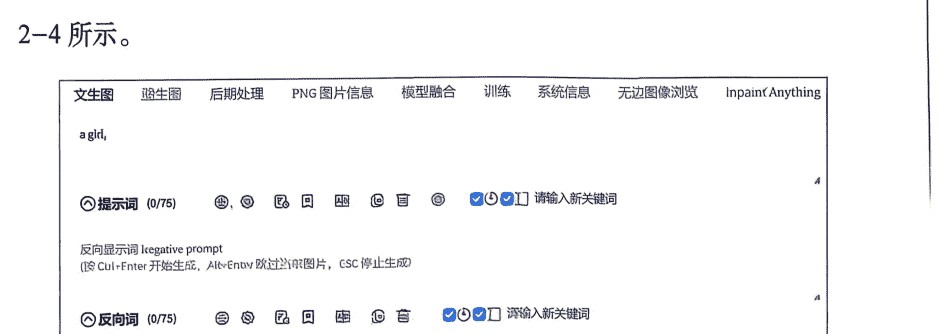

图生图，该功能支持上传参考图结合文字提示生成新图，并可对文生图与图生图结果进行涂鸦、局部重绘、涂鸦重绘等处理，如图 2-5 所示。

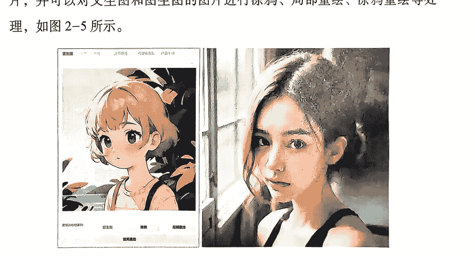

模型融合，该功能可将两种或三种模型融合输出新模型，并通过调整融合比例与算法控制各自权重。融合对硬件与时间要求较高，可按需使用，如图 2-6 所示。

图 2-6 模型融合

训练，该功能通过上传多张体现特定风格的图片训练出对应风格模型，训练后可生成同类风格图像，如图 2-7 所示。

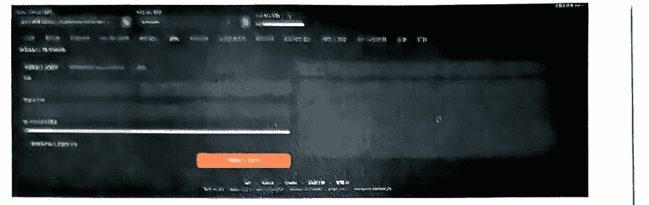

## 生图参数设置
Stable Diffusion模型是出图基础，不同模型风格不同。大致分为写实与非写实两类，示例中使用写实模型为质感写实 v11_1.0.safetensors，非写实模型为 anything-v5.safetensors。外挂VAE相当于给图像加滤镜，提升质量。CLIP终止层数控制提示词与图像关联度，数值越大关联越小，越小关联越大，默认2。图 2-8 为模型选择区与CLIP终止层数设置。

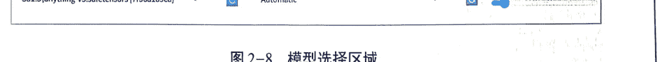

提示词输入区分为正向提示词与反向提示词，是文生图与图生图的关键，如图 2-9 所示。

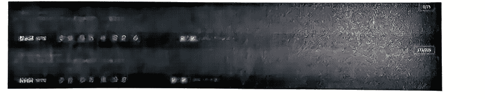

参数区可微调提示词效果。

采样方法众多，如ODESolvers、祖先采样器、DDIM、DPM与DPM++系列、UniPC采样器、Karras调度、K-diffusion等，各有优劣，用户可按需选择。调度类型常与采样方法配合控制计算程度，一般默认Automatic自动选择，设置如图 2–10 所示。

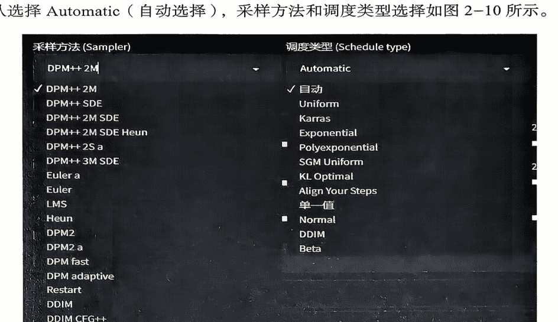

图 2–10 采样方法和调度类型

迭代步数指AI对提示词的计算次数，范围1～150，通常建议20～40。低于20偏差大，高于40提升有限却增加耗时，如图 2–11 所示。

图 2-11 迭代步数

高分辨率修复通过放大与重绘提升细节。放大算法包括Latent、ESRGAN_4x/SwinR 4x、R-ESRGAN系列等。Latent简单快速，ESRGAN_4x/SwinR 4x适合低重绘场景，R-ESRGAN 4x+ Anime6B适合二次元，R-ESRGAN 4x通用。高分迭代步数越大细节越精，耗时越长。重绘幅度0～1，数值越大改动越大。放大倍数1～4，倍数越高对硬件要求越高。最后两项可自定义宽高，但可能改变画面结构，通常不启用，如图 2-12 所示。

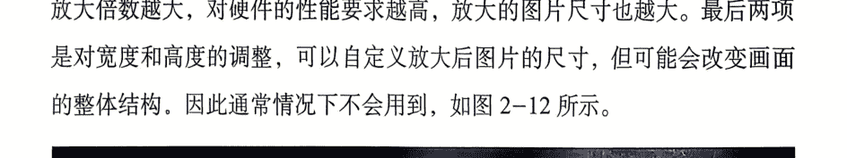

图 2-12 高分辨率修复

Stable Diffusion 参数与提示词上手要点

第一次调用生成时，系统给出的默认画幅是 512×512，宽和高都可以手动改动。画幅越大，所需算力与显存就越高，需要结合电脑配置自行取舍。

分辨率旁边的是批次设置，决定一次点击会产生多少组结果。总批次数指完整的生成轮次，单批数量指每一轮产出的张数，例如总批数设为 3、单批设为 5，一次操作可得到 15 张。若想扩大样本量，可单独提升总批数或单批数；当两者都提高时，对显存和内存的消耗会显著增加。

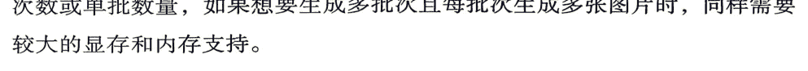
图 2-13 分辨率、总批次数和单批数量

引导系数用来衡量画面与提示词的契合程度，取值范围在 0～30 之间。数值越高，生成结果越忠实于输入；数值越低，模型自由发挥的空间越大。高引导系数运行时对硬件的要求也会随之上升。

随机种子可以理解为每张图的身份证。按下骰子按钮后种子会显示为“-1”，此时程序会基于提示词随机产出多个变体，如图 2-14 所示。

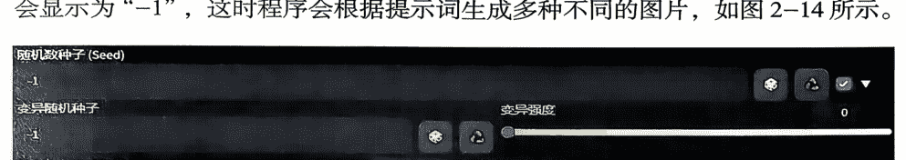
图 2-14 随机种子与变异随机种子

图 2-14 中出现的“从宽度中调整种子”和“从高度中调整种子”，本质是在原种子之上叠加的副种子画布的宽和高。当这两个数值任一不为 0 时，最终成图都会受到变异随机种子的影响，即便变异强度被设为 0 也不例外。

如果已有比较满意的初稿，想在该图上叠加新元素，可点按骰子旁的循环键，这时会锁定当前图像的种子，后续生成都以该种子为基准。相同的描述配合相同的种子，输出结果会完全一致，如图 2-15 所示。

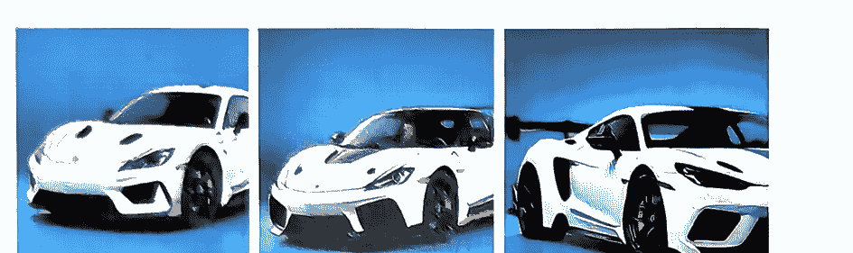
三张图片的种子依次为 1660017049、1966940513、3697650184

图 2-15 不同种子生成的图片

随机种子下拉旁的是变异随机种子，可与主种子共同作用。变异强度的区间是 0～1，调整精度为 0.01。强度为 0 时绘制完全服从主种子；强度为 1 时则完全服从变异种子。

例如固定主种子为 1966940513、变异种子为 3697650184，保持两者不变，仅改变变异强度，成图差异十分明显，结果见图 2-16、图 2-17。

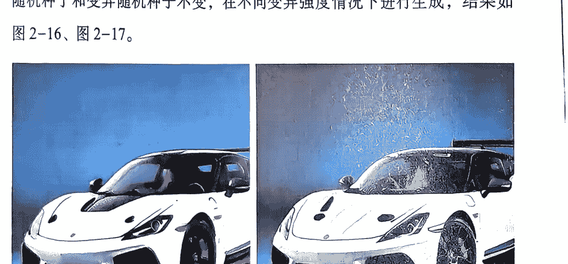
变异强度为 0 变异强度为 0.33

图 2-16 不同变异强度绘制的图片（1）

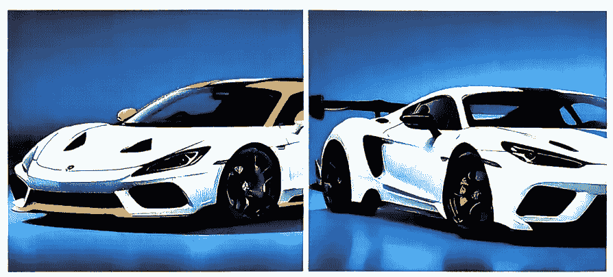
变异强度为 0.66

变异强度为 1

图 2-17 不同变异强度绘制的图片（2）

### 2.2 AI 绘画提示词语言体系与风格语言

#### 2.2.1 提示词语言体系

AI 作画的核心驱动是提示词，它负责传递创作意图并指引图像生成。

图 2-18 中标注的区域为 Stable Diffusion 的输入区，上方为正向描述区，下方为反向描述区。由于原生格式为英文，常用英文单词、短语或短句组合。秋叶封装版内置了 Prompt-all-in-one 插件，可将中文描述一键转为英文，如图 2-19 所示。

图 2-18 Stable Diffusion 提示词输入区

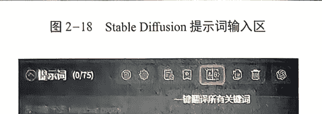
图 2-19 秋叶封装 Stable Diffusion 中的中译英按钮

艺术设计需要明确构图、风格、色彩、材质等要素，AI 绘画同理，只是模型通过海量图像的解构学习，把视觉规律转化为可量化的语言。

类比写作的六要素，AI 绘画的描述本质上也是在交代：什么背景下，谁或什么事物，在何种情境下呈现何种状态。描述的精确度与丰富度直接影响生成差异。

举例说明。输入“一个女孩在街道上”，得到的是小女孩面向镜头站在街头的画面，如图 2-20。

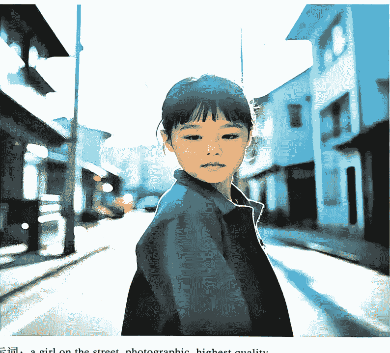
提示词：a girl on the street, photographic, highest quality

中文翻译：一个女孩在街道上，摄影感，最高质量

**图 2-20 基础提示词生成的画面**

在保留“摄影感”“最高质量”的前提下，加入“在破碎的城市街道上”“望向四周”，街景从整洁变为废墟，整体氛围也更暗，如图 2-21。

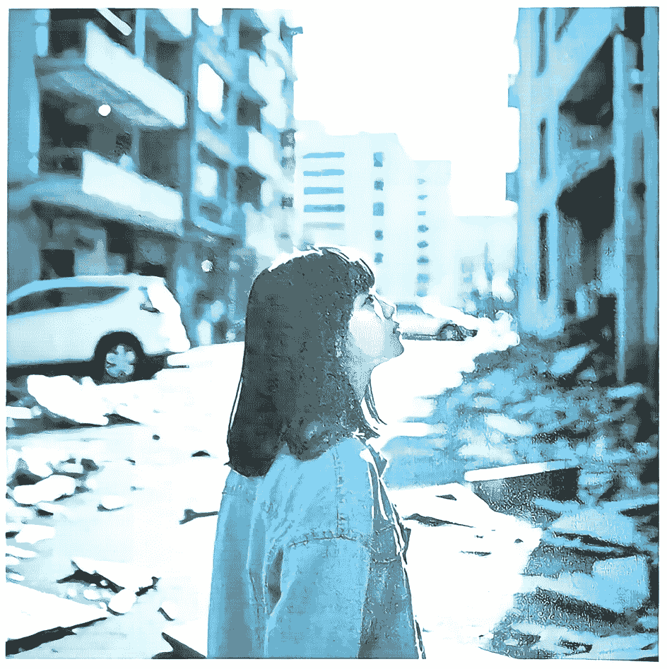
提示词：a girl looking around on a broken city street, photographic, highest quality

中文翻译：一个女孩在破碎的城市街道上望向四周，摄影感，最高质量

图 2-21 添加更多内容后生成的画面

再加入“阴雨天”“衣衫褴褛的白人女孩”“手持棒球棍”“忧心忡忡”，画面主角就从安静整洁的小女孩变成忧虑、衣衫褴褛、手握棒球棍的白人女孩，如图 2-22。

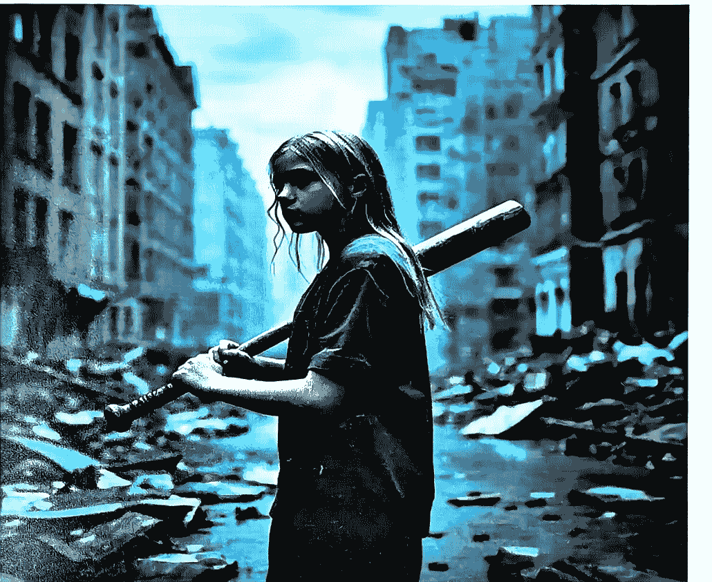
提示词：rainy day, a ragged white girl holding a baseball bat on a broken city street looks around worriedly, photographic, highest quality

中文翻译：阴雨天，一个衣衫褴褛的白人女孩手持棒球棍在破碎的城市街道上忧心忡忡地望向四周，摄影感，最高质量

图 2-22 完善提示词后生成的画面

改动提示词中的某个元素也会带来不同结果，如图 2-23、图 2-24。以下对比由 Stable Diffusion WebUI 秋叶整合包生成。

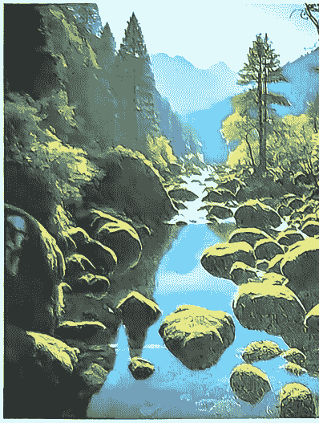
提示词：a small river, nature, highest quality, photography, fixed camera

中文翻译：一条小河，自然，最高画质，摄影，固定机位

图 2-23 自然中的小河

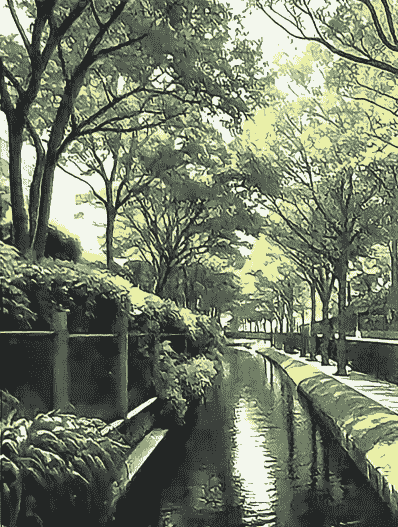
提示词：a small river, park, highest quality, photography, fixed camera

中文翻译：一条小河，公园，最高画质，摄影，固定机位

图 2-24 公园中的小河

#### 2.2.2 提示词风格语言

AI 通过学习大量作品，把中国传统文化的韵味转化为以几何与色块为主的包豪斯风格，如图 2-25，或转为色彩对比强烈的波普风格，如图 2-26。下面具体介绍风格类提示词。

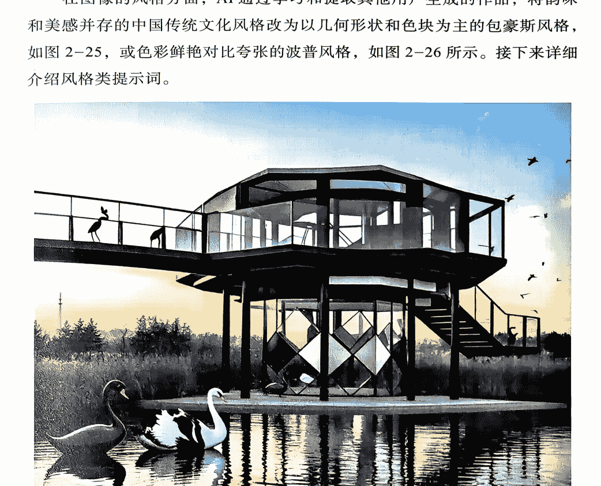
图 2-25 包豪斯风格

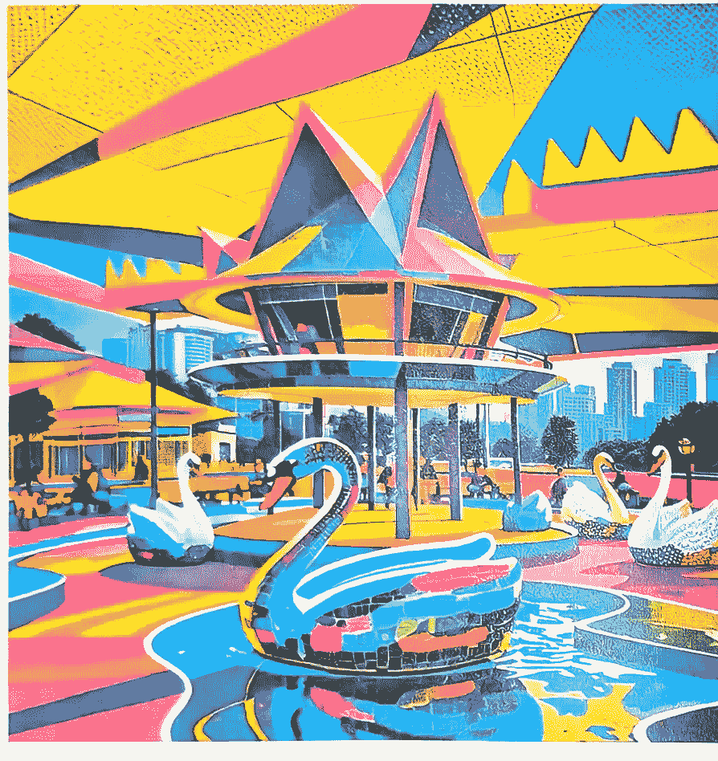
图 2-26 波普风格

与传统艺术的单一风格不同，AI 的风格是基于海量参数训练形成的。用户可通过提示词触发特定的视觉词汇组合，甚至把不相关的元素超现实融合，生成难以想象的混搭画面。

中国水墨以黑白为主、线条分明，墨在宣纸上渗透的效果明显，如图 2-27。

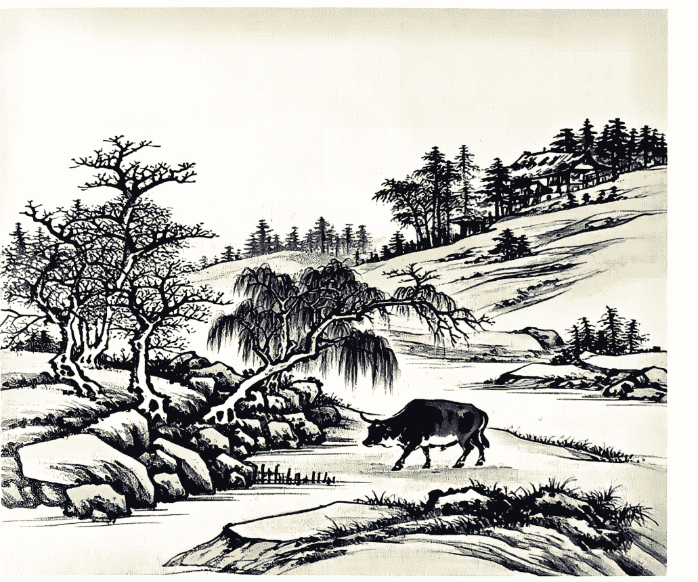
提示词：landscape, ink, lines, cows grazing, vista, UHD

中文翻译：乡村风景画，水墨，线条，牛吃草，远景，超高清

图 2-27 水墨画风格

当提示词包含“国风、国潮、祥云、岩彩绘画、金箔色彩、螺钿镶嵌艺术”等时，会得到国风与金箔岩彩、螺钿镶嵌融合的效果，如图 2-28。

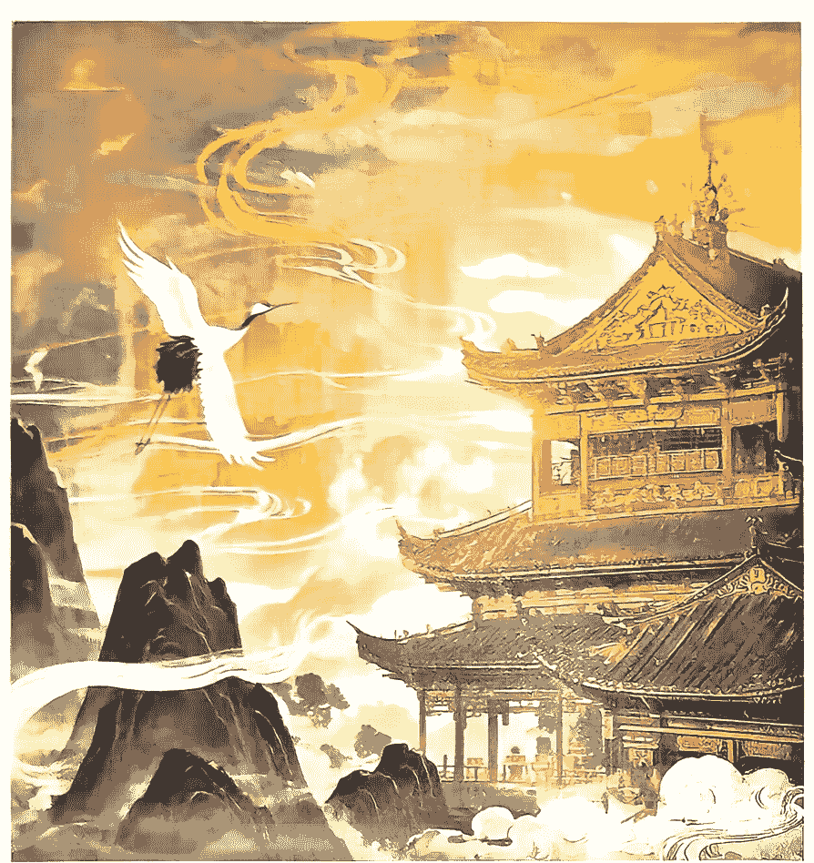
提示词：national style aesthetics, ancient architecture, cranes, gold foil colors, rock paintings, golden ambient light, mystery, texture, majestic momentum

中文翻译：国风美学，古建筑，仙鹤，金箔色彩，岩彩画，金色氛围光，神秘感，肌理感，气势磅礴

图 2-28 国风、金箔岩彩风格

提示词里出现“科幻”“赛博”“未来”“机械腿义肢”等科技感词汇时，可得到科幻风格图像，如图 2-29。

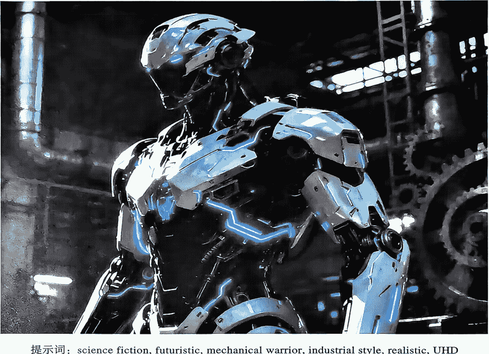
提示词：science fiction, futuristic, mechanical warrior, industrial style, realistic, UHD

中文翻译：科幻、未来、机械战士、工业风格、写实、超高清

图 2-29 科幻风格

Q 版孙悟空与现代波普风格结合，既保留了可爱的人物形象，又加入了现代科技感和波普元素，如图 2-30。

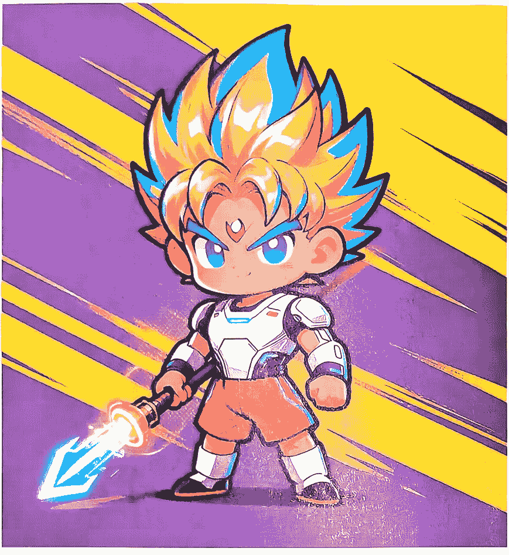
提示词：Q version, monkey king, modern, pop style, cartoon, UHD

中文翻译：Q版，孙悟空，现代，波普风格，卡通，超高清

图 2-30 迪士尼卡通风格

色彩也是营造氛围的重要手段，加入颜色相关的提示词可以调节情绪。同样是一家三口出游，暖色调的温馨感远高于冷色调，如图 2-31、图 2-32。

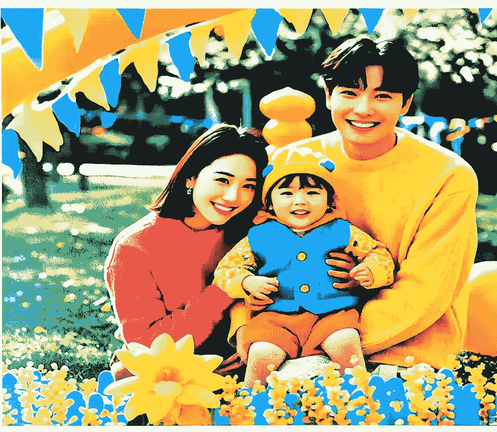
提示词：a family of three traveling out, warm tones, yellow, blue, spring, UHD

中文翻译：一家三口出游，暖色调，黄色，蓝色，春天，超高清

图 2-31 一家三口出游（暖色调）

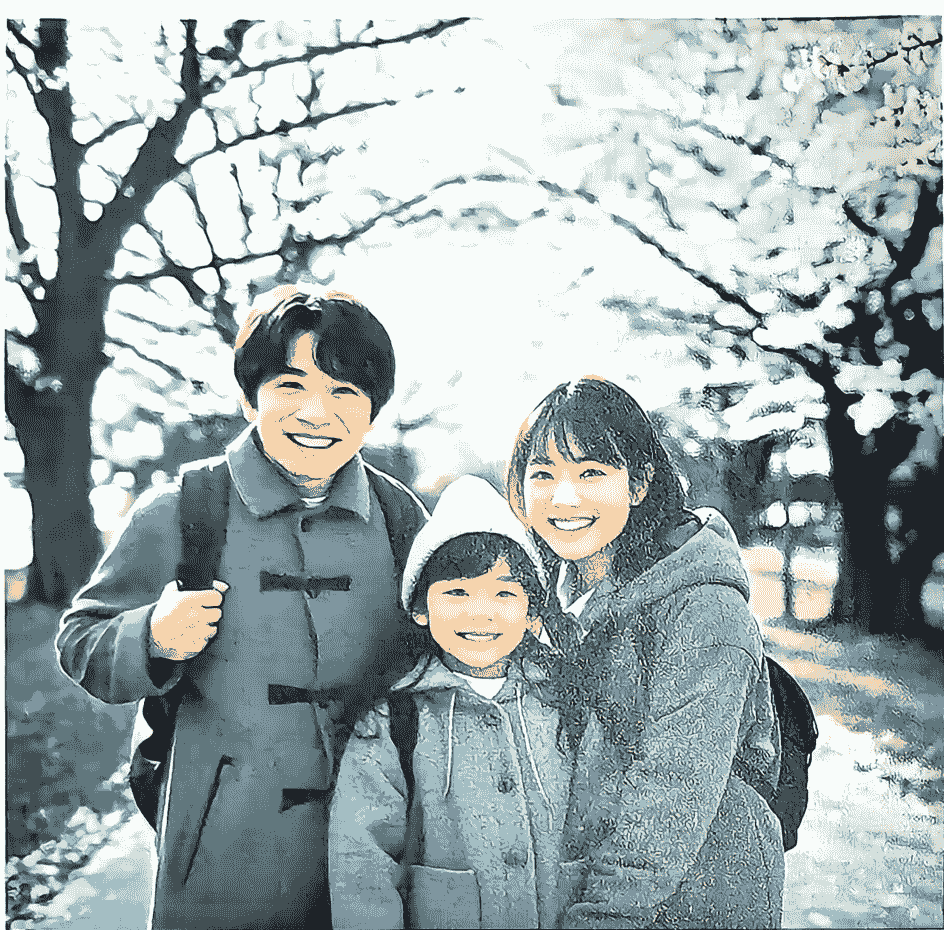
提示词：a family of three traveling out, cool tones, gray, spring, UHD

中文翻译：一家三口出游，冷色调，灰色，春天，超高清

图 2-32 一家三口出游（冷色调）

以游戏《赛博朋克 2077》的夜之城为例，压低饱和度和对比度后，高冲击感减弱，画面更显神秘，如图 2-33。

## 2 AI 视觉革命：从文字到图像的进化

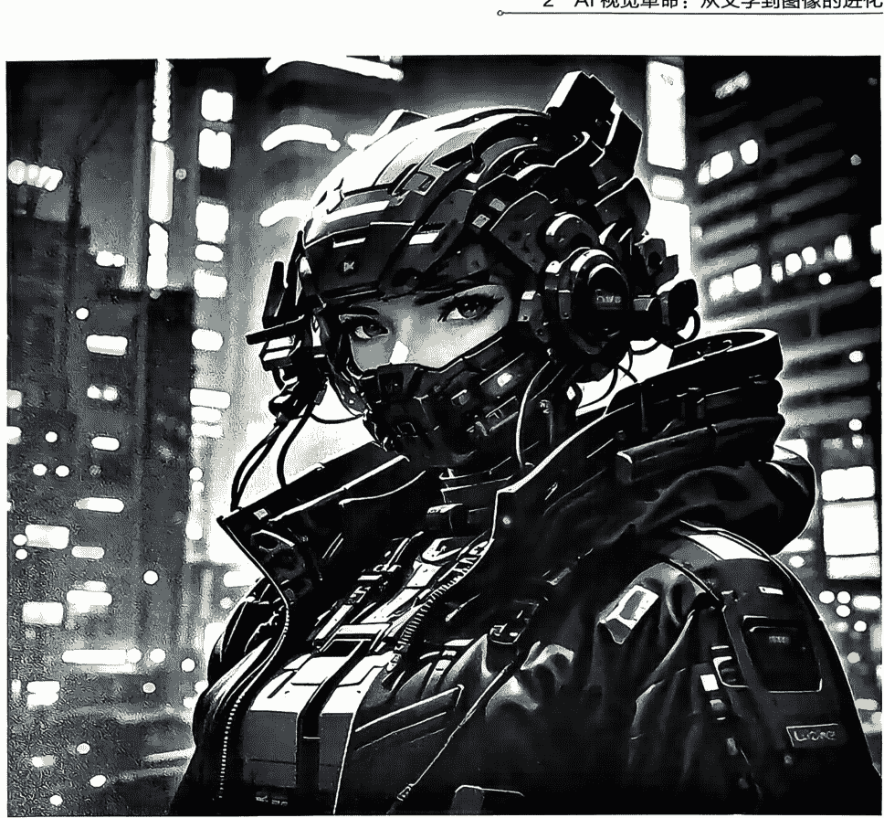
提示词：cyberpunk, Night City, future, science fiction, technology, black and white, low saturation, low contrast, UHD

中文翻译：赛博朋克，夜之城，未来，科幻，科技，黑白，低饱和度，低对比度，超高清

图 2-33 低饱和低对比

需要提醒的是，AI 生成具有随机性，偶尔会出现肢体扭曲、多指等不合理现象，需要不断优化提示词来提升可控性。

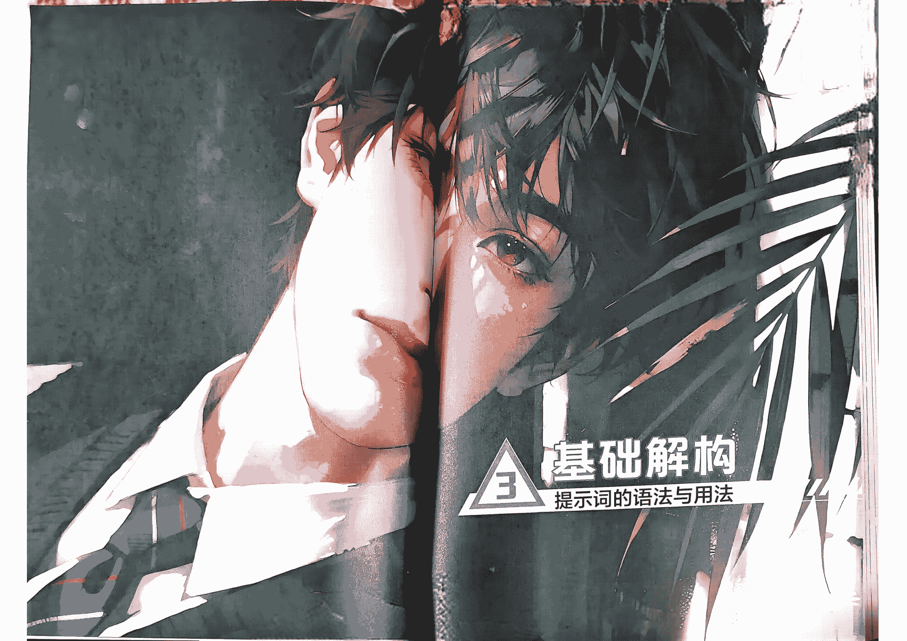

## 3 基础解构

### 提示词的语法与用法

### 3.1 提示词的组成

前文已提到过，提示词通常分为正向提示词和反向提示词，正向提示词就是用户希望出现在画面中的东西、反向提示词则是用户不希望出现在画面中的东西。

和叙事一样，一条完整的提示词也是由几个主要部分组成。

主体：要生成的画面中的主角，可以是人、动物、植物、山川河流等。

背景：有了明确的主角后，就要交代主角所处的背景，既可以是在某影院播放厅几排几座这样详细的地点，也可以是公园、河边这种宽泛的地方，还可以是时空隧道这类抽象无实体的场景。

当提示词包括这两部分时，一个较为简单的画面就可以生成了。要想使画面进一步准确，就需要加入一些其他方面的提示词进行完善。

画质：常用的正向画质提示词有 masterpiece、highres、best quality、wallpaper、RAW photo、incredibly absurdres、8K、UltraHD、extremely detailed wallpaper 等。常见的反向画质提示词有 lowres、worst quality、low quality、normal quality、jpeg artifacts、blurry、sketch 等。

另外，我们还可以为图片添加画面风格：illustration、abstract art、pixel、sketch、某位画家的名字 [如 Vincent van Gogh、Picasso] 或某部作品名 [如 Mona Lisa、Starry Night]，以及光照条件 [如 soft morning light、sunset afterglow、indoor lighting、stage lighting]，色调 [如 ice blue tone、moonlight silver tone、flame red tone、sunshine yellow tone、retro orange tone]，镜头视图 [如 wide-angle lens、telephoto lens、macro lens]，细节描述 [如树叶纹理、花瓣细节、砖石纹理、玻璃反光、面部表情、服装纹理] 等提示词，使整幅图像的完整度更高。

一般情况下，往往会以图片质量作为首要输入的提示词，其次是对画面的描述和其他要补充的细节。

一条完整的提示词除需要文字部分外，还需要使用逗号隔开，否则会出现提示词内容融合的情况。英语提示词中的逗号须为半角逗号，词组、短语和短句的每个单词间则用空格隔开。如果不对提示词进行分割处理，AI 则可能无法理解提示词的完整含义，从而导致生成的图像与提示词有较大的偏差。

### 3.2 提示词的顺序与权重

#### 3.2.1 提示词的顺序

输入提示词时，除要用逗号和空格隔开外，提示词输入的顺序也有一定的规则。这里便涉及“权重”一词，即该提示词在整条提示词中的占比。提示词所占权重越大，在图像中的存在感就越强；反之，在图像中的存在感就越弱。在一般情况下，提示词权重的范围为 0.5～2，低于或超过该范围都可能出现图片崩坏的情况，每项提示词的权重默认为 1。

AI 读取提示词按照从左往右的顺序，因此越靠左的提示词所占权重就越大，越靠右的提示词所占权重就越小。在 Stable Diffusion 中，提示词的数量在 75 字左右，超过该字数后的提示词可能会被 AI 忽略。而在 Stable Diffusion WebUI 中，由于程序会对提示词进行分组提交思考，所以提示词的数量被允许超过 75 个。

通过改变 “a girl” “forest” 两个提示词的顺序，可以看出它们在图像中所占的权重发生了改变。当 “a girl” 排在第一位时，画面整体以女孩为主；当 “forest” 排在第一位时，画面则以森林为主要部分，女孩所占部分明显变小，如图 3-1 所示。

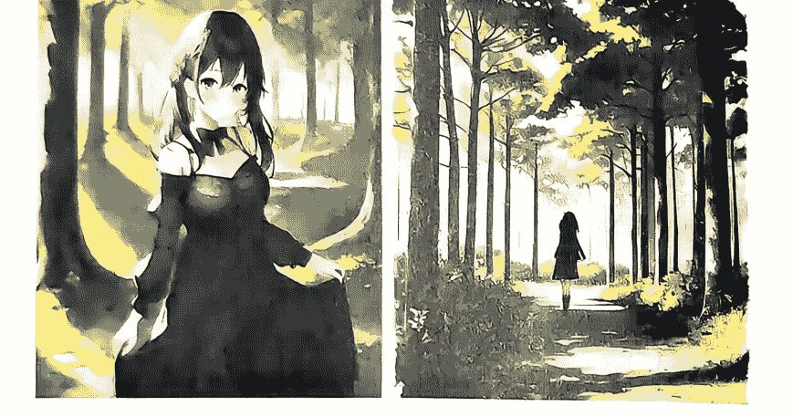
提示词：a girl, forest 和 forest, a girl

中文翻译：一个女孩，森林；森林，一个女孩

图 3-1 提示词顺序先后对生成画面的影响

#### 3.2.2 提示词权重的变化方法

当需要输入的提示词数量较多时，单纯地通过调整提示词的顺序无法做到对所有提示词的权重进行调整，这时就可以通过特定的符号加强或削减某个提示词所占的权重。

Stable Diffusion 提示词权重与进阶语法实战

圆括号 “( )” 是日常使用里最常见的加权符号。只要把某个词单独用圆括号框住，它的参考力度就会自动上调约 1.1 倍，而且可以多层套用，效果会越叠越大。

当出现多层嵌套时，整体权重遵循 1.1 的 N 次方规律，N 代表括号层数。比如把 a boy 改写为 (((a boy)))，权重就变成了 1 × 1.1 × 1.1 × 1.1 ≈ 1.331 倍，如图 3-2 所示。

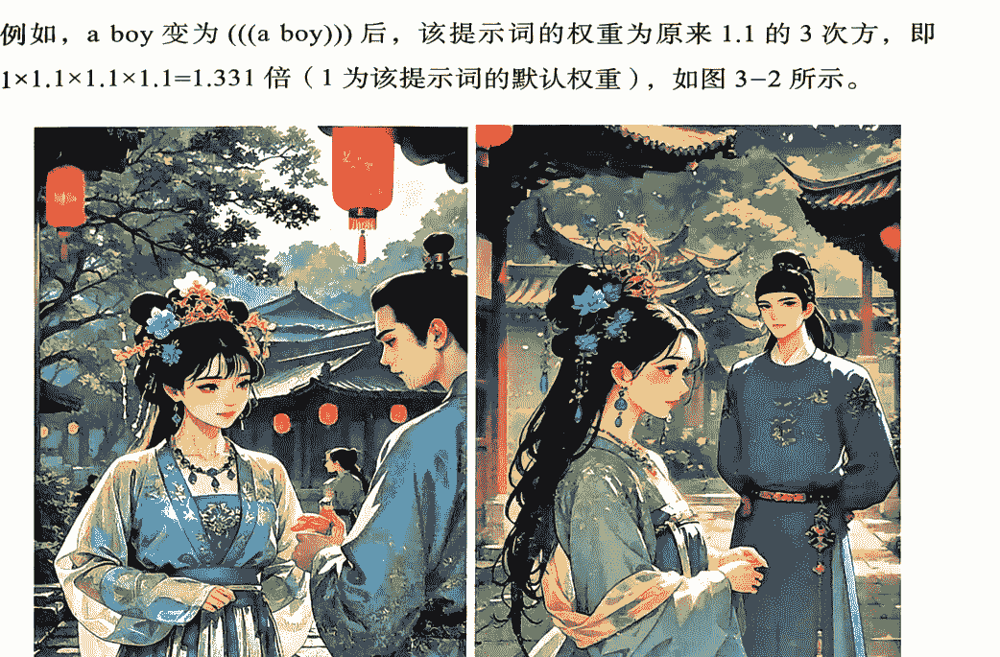

左侧提示词：a girl, a boy, ancient costume style, chinese style illustration

右侧提示词：a girl, ((( a boy))), ancient costume style, chinese style illustration

中文翻译：一个女孩，一个男孩，古装造型，国风插画风格

图 3-2 圆括号提升提示词权重效果

最开始男孩只是画面里的背景陪衬，给 “a boy” 加上三层圆括号后，男孩与女孩在画面中的占比几乎拉平。

如果在圆括号内部加上 “：数字”，就能直接指定倍数。例如 (curls:1.5) 表示卷发的参考强度是默认的 1.5 倍，(curls:0.6) 则把强度压到 0.6 倍，如图 3-3 所示。

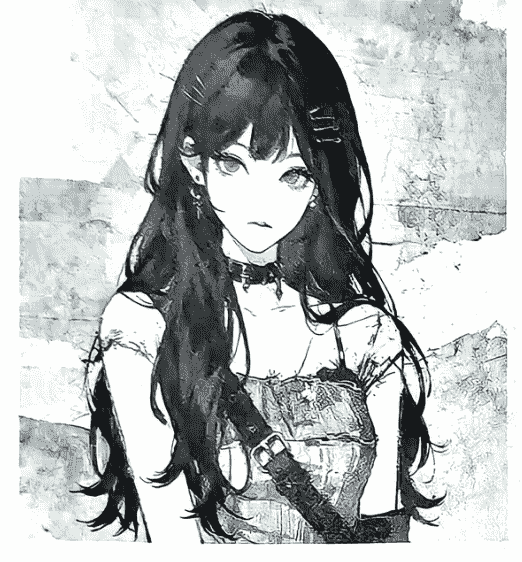

提示词：a girl, (curls:0.6), fashionably designed clothing, matte texture reminiscent of rice paper, hand-drawn style, gray color palette

中文翻译：一个女孩，（卷发 0.6），时尚设计服饰，宣纸磨砂质感，手绘风格，灰色系

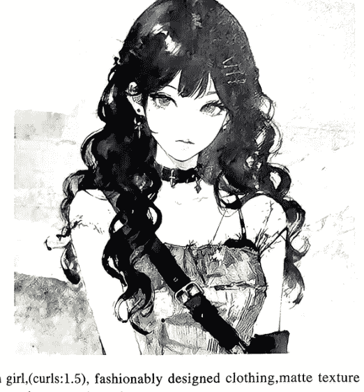

提示词：a girl, (curls:1.5), fashionably designed clothing, matte texture reminiscent of rice paper, hand-drawn style, gray color palette

中文翻译：一个女孩，（卷发 1.5），时尚设计服饰，宣纸磨砂质感，手绘风格，灰色系

图 3-3 圆括号内数字调整提示词权重

花括号 “{ }” 也能抬权，单层提升约 1.05 倍，多层同样按 1.05 的 N 次方累计。比如 blue eyes 变为 {{blue eyes}} 后，权重约为 1 × 1.05 × 1.05 = 1.1025 倍。提升幅度比圆括号小，日常更倾向直接用圆括号。

方括号 “[ ]” 的作用相反，会把被框住的词压低到 0.9 倍，层数越多压得越狠。例如 red flowers 变为 [[[red flowers]]]，权重就变成 1 × 0.9 × 0.9 × 0.9 = 0.729 倍，如图 3-4 所示。

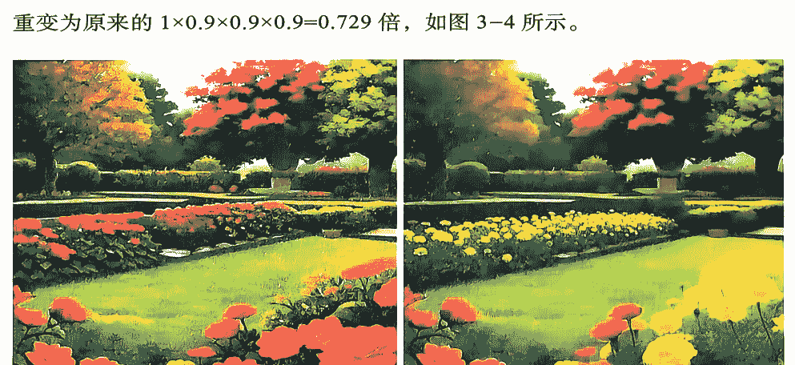

左侧提示词：garden, red flowers, yellow flowers

右侧提示词：garden, [[[red flowers]]], yellow flowers

中文翻译：花园，红色花，黄色花

图 3-4 方括号降低提示词权重效果

冒号 “：” 单独使用也可以自定义权重，通常放在整条提示词末尾并与圆括号配合。例如 by the lake 改为 (by the lake:1.5)，该词的参考强度就提升到 1.5 倍。

以上就是在绘画中增减词重的常用手段。

#### 3.2.3 提示词语法

在 Stable Diffusion 生成时，可以借助 “[ ]” 与 “：” 来安排提示词在迭代步数里的出现时机，从而让画面更贴合预期。假设总步数设为 30。

[fish:10]：从第 10 步起加入 fish，一直作用到第 30 步结束。

[red::10]：从第 1 步就开始加入 red，到第 10 步停止，后续步骤 red 不再起作用，其他词继续进行。

[red:5:10]：从第 5 步开始加入 red，到第 10 步结束。

如果要控制两个词的先后，可以写成 [red:yellow:0.6]，意思是前 30 × 60% = 18 步按 red 绘制，后 12 步切换到 yellow。

借此可以更精细地掌控生成节奏，让每个词在合适的时间发挥作用，如图 3-5 所示。

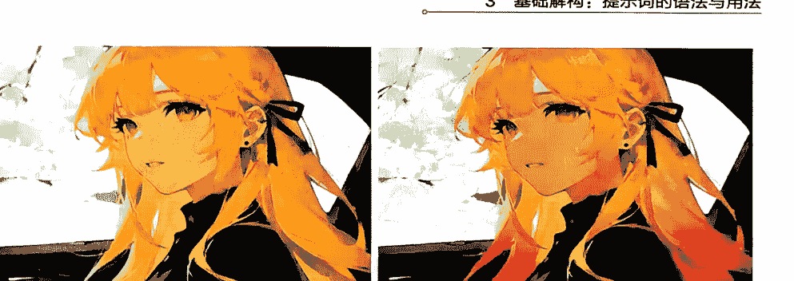

左侧提示词：a girl, yellow hair

右侧提示词：a girl, [red hair:10], yellow hair

中文翻译：一个女孩，红头发，黄头发

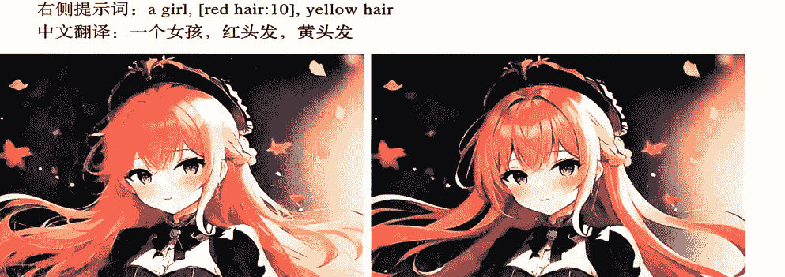

左侧提示词：a girl, red hair, yellow hair

右侧提示词：a girl, [red hair::8], yellow hair

中文翻译：一个女孩，红头发，黄头发

图 3-5 提示词分步绘制语法

结合图 3-6 可见，女孩头发初期同时受蓝色和黄色影响，到第 8 步停止蓝色绘制，黄色保持。男孩眼睛前 8 步为蓝色，之后转为黄色。

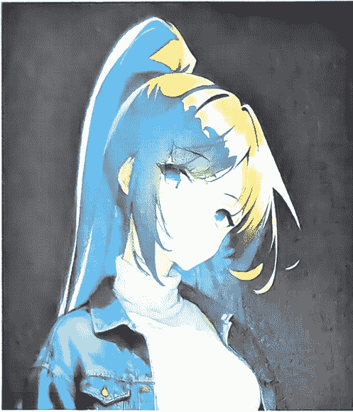

提示词: a girl, [blue:yellow:8] hair

中文翻译: 一个女孩, [蓝色:黄色:8]头发

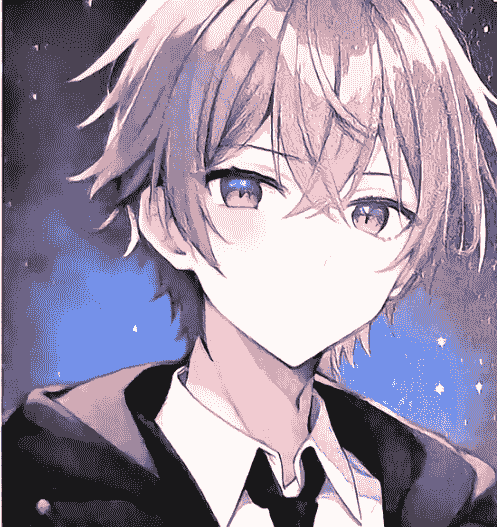

提示词: a boy, [blue:yellow:8] eyes

中文翻译: 一个男孩, [蓝色:黄色:8]眼睛

图 3-6 分步绘制两种颜色

除此之外，还能用 “|” 让词条轮流上场。例如 [blue|red|yellow] 会按 blue、red、yellow 循环，每步换一个，直到步数耗尽，如图 3-7 所示。

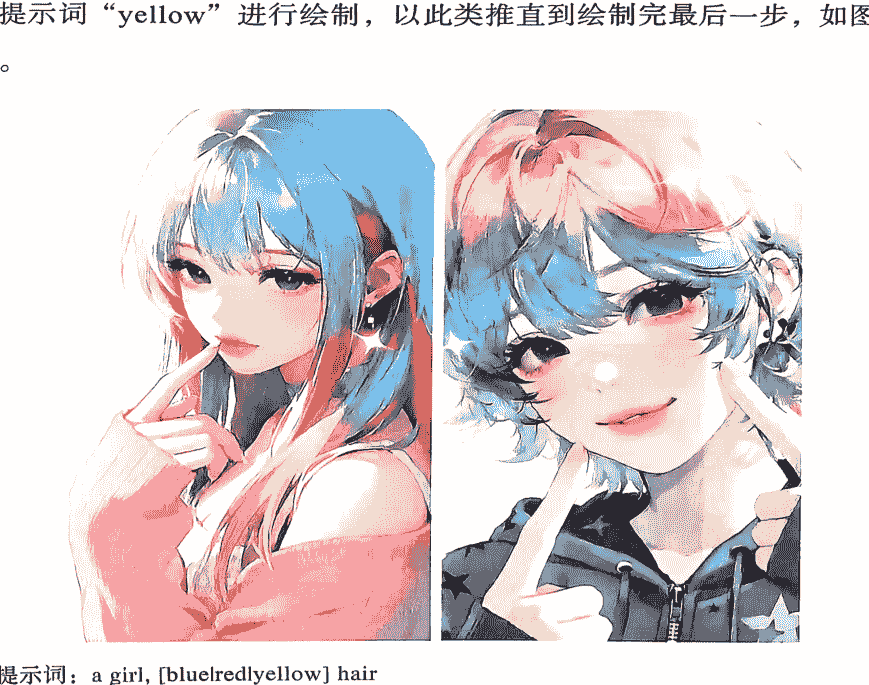

提示词：a girl, [blue|red|yellow] hair

中文翻译：一个女孩，[蓝色|红色|黄色]头发

图 3-7 提示词交替绘制语法

以上案例迭代步数均为 30 步。

当想让多个词一起融合绘制时，可用 “AND” 或 “|”，写法为（词 | 词 | 词）。若需切断互相干扰，则用大写的 “BREAK” 做分割，注意大小写必须正确，否则会被当成普通文字解析，如图 3-8 所示。

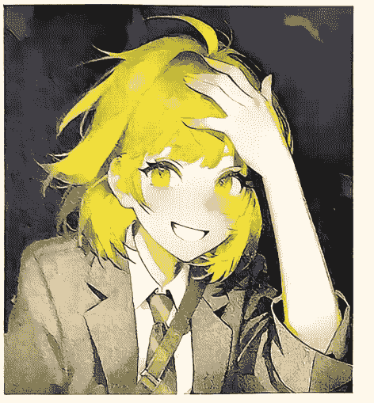

提示词：a girl, yellow hair AND green hair

中文翻译：一个女孩，黄头发和绿头发

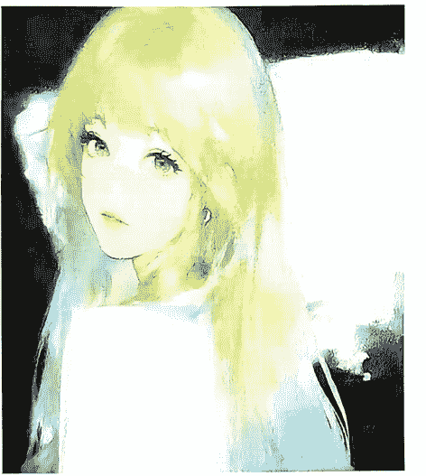

提示词：a girl, (yellow|green|blue) hair

中文翻译：一个女孩，（黄|绿|蓝）头发

图 3-8 提示词 AND 融合绘制效果

另外，Stable Diffusion 对 emoji 和欧美颜文字如 :D、XD、;p 的识别力很强，表达含义单一时权重往往更高，如图 3-9 所示。

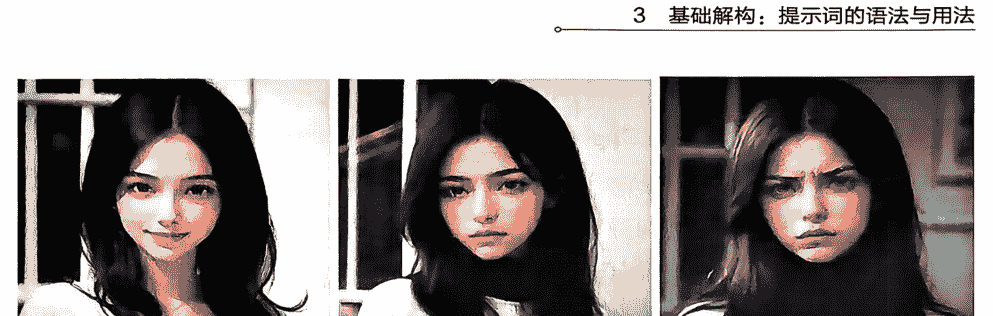

图 3-9 使用 emoji 表情作为一项提示词生成的图片

### 3.3 反向提示词的应用法则

AI 绘画依赖神经网络绘制，对细节把控有限，这时就需要反向提示词来做约束，从源头剔除不想要的元素。

常见反向词可分为几类：画质管控类 lowres、worst quality、blurry、pixelated、noisy、distorted、overexposed、underexposed；通用类 NSFW、watermark、text、error、signature、username、cropped、out of frame。

输入顺序建议先放画质类，再补人物肢体畸形类，最后加通用类。人物肢体相关包括 bad hands、missing fingers、extra fingers、fused fingers、twisted fingers、malformed limbs、dislocated joints、abnormal body proportion。若生成有人物却未加入这些词，很容易出现畸形。

仅用正向词时，人物常出现缺指、多手、多臂、多腿、面部崩坏、无脸、扭曲等情况，如图 3-10 所示，需用反向词约束。

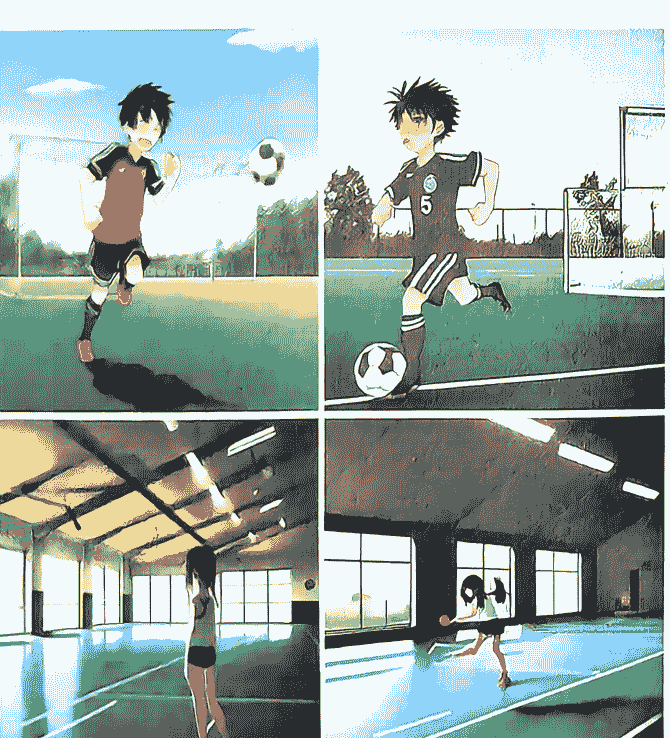

图 3-10 未添加反向提示词生成的畸形人物

常用人物反向词有 ugly、skin spots、skin blemishes、age spot、disabled、distorted、bad anatomy、morbid、malformation、amputation、bad proportions、twins、missing body、fused body、extra head、poorly drawn face、bad eyes、deformed eye、unclear eyes、cross-eyed、long neck、malformed limbs、extra limbs、extra arms、missing arms、bad tongue、strange fingers、mutated hands、missing hands、poorly drawn hands、extra hands、fused hands、connected hand、bad hands、wrong fingers、missing fingers、extra fingers、deformed hands、extra legs、bad legs、many legs、more than two legs、bad feet、wrong feet、extra feet。可根据实时结果增补。

色彩方面常出现单调或饱和对比混乱，可用 monochrome、greyscale、chromatic aberration、low saturation、high saturation、low contrast、high contrast 来调节。

其他风格冲突时也能加入反向词，比如写实图可加 cartoon、abstract style。反向词与正向词相辅相成，配合调整后成品会更精准。

## 3.4 提示词搭配的使用技巧

用户起初往往只想到大框架，比如一个男孩在森林里，描述太宽泛很难得到理想画面，需要逐步细化。

通常先用画质词调控整体，如 masterpiece、best quality 为正向，lowres、worst quality 为反向。因为模型从前往后读取，纯画质词常放在最后，确定内容后或使用种子时可前置以增强效果。

接着描述图像主体，主体是画面核心，一般置于提示词最前。以人物为例，可涉及体态、面部、表情动作、服装等。

先简单生成一幅 a boy, forest, masterpiece, best quality 的画面，如图 3-11 所示。

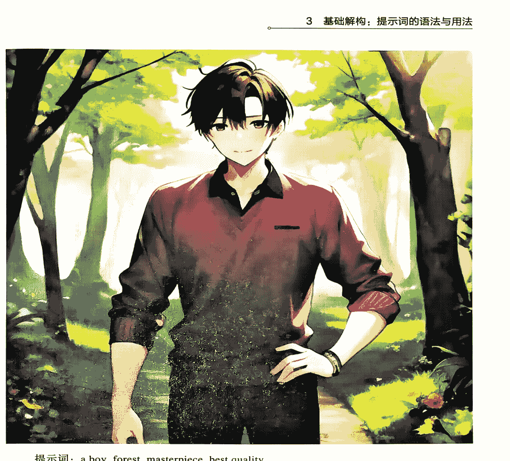

提示词：a boy, forest, masterpiece, best quality，

中文翻译：一个男孩，森林，杰作，最佳品质

图 3-11 提示词描述·图像主体

细化人物后画面更完整、更有故事性。还能对衣着、手持物做精细化，如图 3-12、图 3-13。

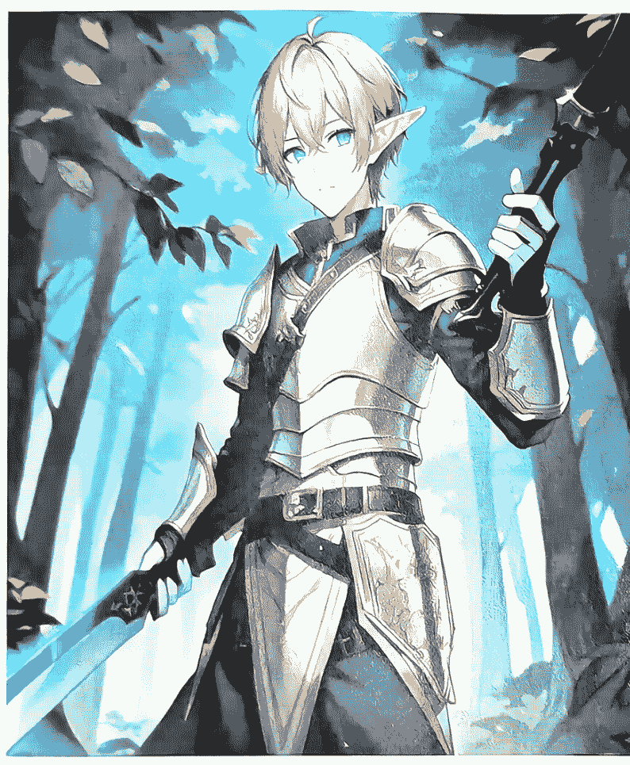

提示词: (a boy | elf | blue eyes | 20year-old | wearing armor), careful, holding a long sword in hand, forest, masterpiece, best quality

中文翻译: 一个男孩, 精灵, 蓝色眼睛, 20岁, 身穿盔甲, 谨慎的, 手持长剑, 森林, 杰作, 最佳品质

图 3-12 提示词描述 · 图像细节 1

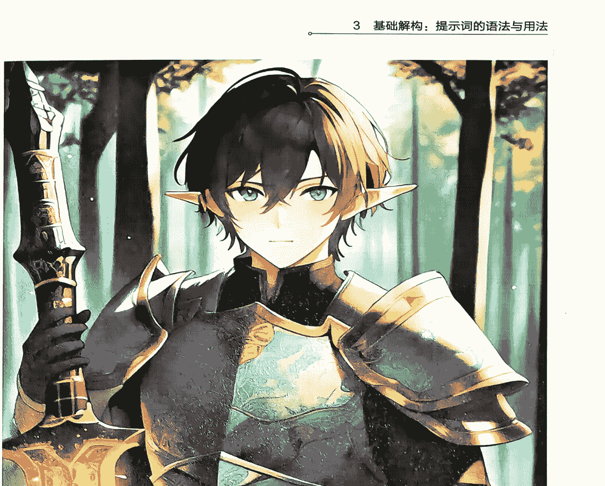

提示词：(a boy | elf | blue eyes | 20year-old | wearing armor:intricate dragon patterns on breastplate), careful, holding a long sword in hand, emitting a blazing light from its blade, forest, masterpiece, best quality

中文翻译：一个 20 岁身穿印有错综复杂龙文案盔甲、蓝色眼睛的精灵族男孩，谨慎的，手持长剑，剑身散发着炽热的光芒，森林，杰作，最佳品质

图 3-13 提示词描述·图像细节 2

人物描述完成后，再完善背景，可加入地点、时间、年代、事件等，如图 3-14。

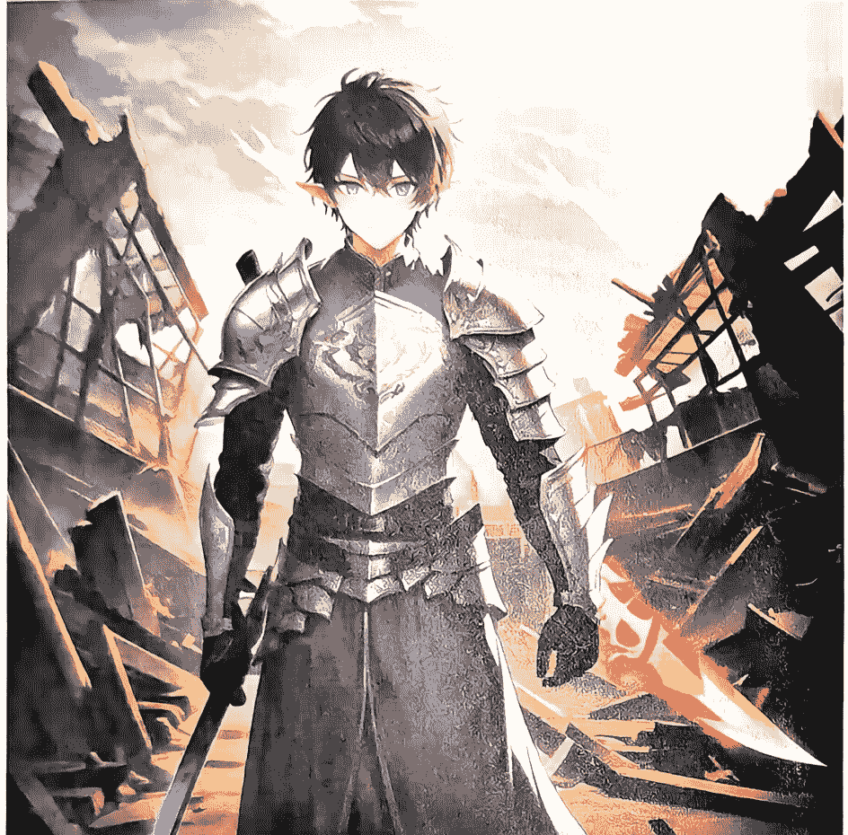

提示词: masterpiece, best quality, (a boy|elf|blue eyes|20year-old|wearing armor:intricate dragon patterns on breastplate), careful, holding a long sword in hand, emitting a blazing light from its blade, the ruins of collapsed tribal houses in the forest

中文翻译: 杰作, 最佳品质, 一个20岁身穿印有错综复杂龙文案盔甲、蓝色眼睛的精灵族男孩, 谨慎的, 手持长剑, 剑身散发着炽热的光芒, 森林中坍塌的部族房屋的废墟

图 3-14 提示词描述 · 图像细节 3

先把基础情节搭稳，整张画面就能拥有清晰的故事脉络。往上再叠加镜头感、光影氛围和细部修饰词，成像的精致度与表现力会明显上扬，见图 3-15。

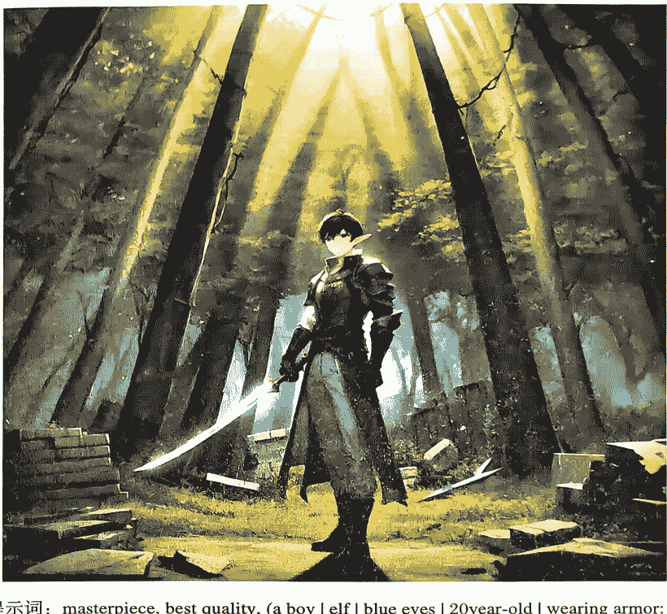

提示词：masterpiece, best quality, (a boy | elf | blue eyes | 20year-old | wearing armor: intricate dragon patterns on breastplate), careful, holding a obsidian long sword in hand, emitting a blazing light from its blade, the ruins of collapsed tribal houses in the forest, sunlight shines through the broken tree trunk, creating side lights. The ruins are covered in vines and shattered totems, and mist permeates, full body, wide shot

中文翻译：杰作，最佳品质，一个 20 岁身穿印有错综复杂龙文案盔甲、蓝色眼睛的精灵族男孩，谨慎的，手持黑曜石长剑，剑身散发着炽热的光芒，森林中坍塌的部族房屋的废墟，日光透过破碎的树干照进来，创造出侧光。废墟上布满了藤蔓和破碎的图腾，薄雾弥漫，全身，广角

图 3-15 提示词描述 · 图像细节 4

归纳起来，正向词大致由 画质、主体、场景、镜头、光影、细节、风格 这几个维度拼装而成，实际用时可以灵活调整顺序、增减或置换。反向词则主要围绕 画质下调、通用负面词汇、画面不适宜的元素、需剔除的内容 来组织，具体取舍要结合生成目标。

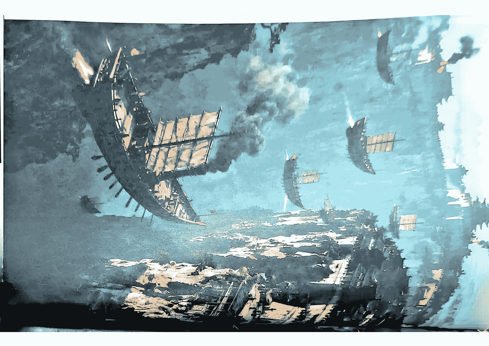

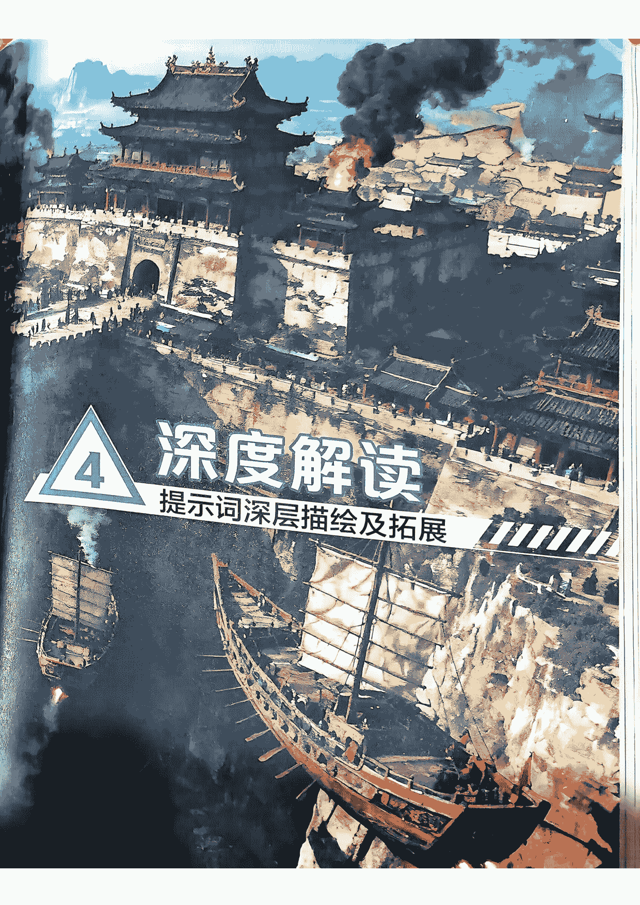

## 4 深度解读：提示词深层描绘及拓展

### 4.1 影视术语与镜头术语的运用

日常短视频与新闻里高频出现的影视专业说法，既能提升视觉素养，也能直接作为 Stable Diffusion 的输入，让生成画面更具专业感与电影味。下面围绕镜头种类、拍摄角度、影视用词展开。

#### 4.1.1 镜头类型

摄影器材的镜头种类繁多，各自的成像特性差异明显。把这些关键词写进提示，就能让成图带上相对应的视觉属性。

变焦算是常用类型，能不动机位就在一定范围内改变焦距。兼顾定焦的高还原与长焦的压缩主体、虚化背景能力，适用面很广。提示里加入 zoom lens 可增强动感与摄影质感，人物主体时再配合 virtual background 会更突出主体。例如生成一次郊游画面，完整提示词如下：masterpiece, highres, 8K, a 6-year-old girl, black long hair, light blue T-shirt, spring outing in the garden, peonies in full bloom, 20 ~ 70mm zoom lens, virtual background（中文翻译：杰作，高分辨率,8K，一个6岁女孩，黑色长发，浅蓝色连衣裙，花园春游，芍药花盛开，20 ~ 70mm变焦镜头，虚化背景），生成图片如图 4-1 所示。

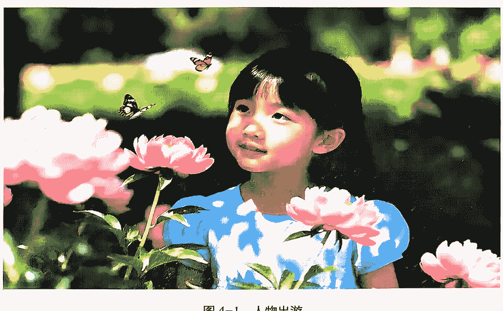

图 4-1 人物出游

若想呈现大场景，可在提示词中加入 wide-angle lens。广角具透视拉伸特性，特别适合表现开阔空间或建筑的宏伟感。比如生成城市天际线时加上该词，就能更好地展现建筑气势，如图 4-2 所示。

图 4-2 添加广角镜头提示词生成的城市天际线

鱼眼镜头因镜片前凸而得名，属于极端广角，视角可达 220°～230°，能制造强烈的视觉冲击。想让画面拥有夸张透视和强烈感染力时，可以加入 fisheye lens。图 4-3 展示了同一画面加入前后对比。

图 4-3 添加鱼眼镜头提示词前后同一图片对比

要拍微观或小物体的特写，macro lens 微距镜头是合适的选择。它常用于昆虫、花卉等细节拍摄，能引导模型更关注极致细节。图 4-4 为加入微距镜头提示词后生成的昆虫图。

图 4-4 添加微距镜头提示词生成的昆虫

#### 4.1.2 拍摄视角提示词及作用

拍摄视角决定了画面呈现的角度，也直接影响张力和情绪表达。常见用法如下。

平视、俯视、仰视分别对应 look straight ahead、low angle / look up、overlooking / high angle。平视贴近人眼习惯，画面平稳均衡，如图 4-5。俯视即高角度，从上往下看，增强立体感和空间深度，如图 4-6。仰视即低角度，从下往上看，能提升主体的气势和压迫感，如图 4-7。

图 4-5 使用平视视角生成的图片

图 4-6 使用俯视视角生成的图片

图 4-7 使用仰视视角生成的图片

鸟瞰是极端的俯视，也称上帝视角，用 aerial view 即可实现，适合城市或自然风光的俯拍，如图 4-8。

图 4-8 使用鸟瞰视角提示词生成的城市图

倾斜视角即荷兰角，镜头沿地平线倾斜，打破视觉平衡，营造不稳定感。在战斗或紧张场景中能增强动感，恐怖悬疑场景中也常用。如图 4-9 所示，昏暗走廊配合倾斜视角会更添紧张氛围。

图 4-9 倾斜视角效果展示

#### 4.1.3 影视术语提示词及作用

合理的影视术语能精准把控风格和氛围。

画质相关的提示词之外，cinematic 也可作为通用词提升电影感。具有电影感的画面通常光影层次更丰富、叙事性更强，如图 4-10 所示，加入后细节与空间感明显提升。

图 4-10 添加提示词 cinematic 前后生成图片的变化

胶片颗粒 film grain 能模拟胶卷的质感与颗粒噪点，带来复古氛围。图 4-11 右图加入该词后出现了类似胶片的噪点。

图 4-11 添加提示词 film grain 前后生成图片的变化

景深 depth of field 或 DOF 控制清晰范围。浅景深 shallow DOF 会模糊背景，突出主体，适合人物特写，如图 4-12。深景深 deep DOF 让画面整体清晰，适合风景建筑，如图 4-13。

图 4-12 添加提示词 shallow DOF 后生成的图片

图 4-13 添加提示词 deep DOF 后生成的图片

光圈值与景深配合使用，影响主体与背景关系。f/1.4 是大光圈，虚化强烈，适合突出面部；f/1.8 同为大光圈，虚化稍弱，保留部分背景细节，如图 4-14。

图 4-14 添加大光圈提示词后生成的人物特写图

f/2.8、f/4.0 为中光圈，主体清晰且背景轻微虚化，适合人物与环境兼顾的叙事画面，f/4.0 背景比 f/2.8 更清晰，如图 4-15。

图 4-15 添加中光圈提示词后生成的人物场景图

f/8.0、f/16 为小光圈，画面几乎全清晰，细节层次丰富，适合风景建筑，如图 4-16。

图 4-16 添加小光圈提示词后生成的风景场景图

#### 4.1.4 实用提示词组合案例

用三种不同镜头氛围提示词生成同一场景，能直观感受风格差异。以女孩站在空街为例。

复古氛围：film grain 最能体现复古感，配合 orange yellow warm tone、slight dark angle 以及柯达胶片 Kodak 5207 film grain，再加上 90 年代电影感。完整提示词：a girl standing on empty street, 50mm fixed focus lens, Kodak 5207 film grain, orange yellow warm tone, slightdark angle, handheld lens dynamic blur, 90 s movie retro feeling（中文翻译：一个女孩站在空旷的街道上，50mm 定焦镜头，柯达 5207 胶片颗粒，橙黄暖色调，轻微暗角，手持镜头动态模糊，90 年代电影复古感），生成图片如图 4-17。

图 4-17 复古胶片氛围

人物主体时，俯视配合浅景深和大光圈可强化可爱感。提示词：a cute girl, close-up, top view, shallow depth of field, f/1.4, macro lens（中文翻译：一个可爱的女孩，特写，俯视，浅景深，f/1.4，微距镜头），生成图片如图 4-18。注意微距镜头不要放在提示词过前，否则易生成局部器官特写，如图 4-19。

图 4-18 人物特写和近距离特写

图 4-19 局部特写

## 4 深度解读：提示词深层描绘及拓展

### 4.2 文学修辞手法的套用

修辞手法能提升语言表现力，也可迁移到生图提示词中，增强视觉张力与艺术感。但 Stable Diffusion 基于英文理解，直接输入中文修辞往往无效，需要转化为英文表达。下面介绍几种常用手法。

#### 4.2.1 比喻

比喻通过类比赋予画面具象联想，常用于增强冲击力和可视化。分为明喻和暗喻。

明喻使用比喻词连接，如 like、as if、compared。例“机械龙的鳞片像熔化的金甲”，转换为 the scales of the mechanical dragon are like melted gold armor（中文翻译：机械龙的鳞片就像熔化的金甲），生成图片如图 4-20。

图 4-20 明喻修辞生成图

暗喻不出现比喻词，用 is、become 等连接。例“他的眼睛是闪耀的星辰”，转换为 his eyes are shining stars（中文翻译：他的眼睛是闪耀的星辰），生成图片如图 4-21。

图 4-21 暗喻修辞生成图

#### 4.2.2 夸张

夸张通过极端化描述突出特征，营造震撼或超现实感。常用关键词有巨大、微小、无限、扭曲等。可分为直接夸张和间接夸张，也可分为放大和缩小。

例如“钻石般坚硬的铠甲”，提示词为 diamond-hard armor，生成图片如图 4-22。

图 4-22 “钻石般坚硬的铠甲”生成图

在创作超现实、科幻、奇幻这类题材时，对不真实的元素进行强化式描写，能帮助模型更快get到奇异点，同时把视觉张力和氛围感拉满。比方说想表现文明崩塌后自然力反噬都市的场景，让树根像巨蟒一样缠住高楼，提示词可以这样组织：a city, with tree roots like pythons entwining around buildings, concrete structures cracking and twisting wooden textures（中文翻译：一座城市，树根像蟒蛇一样缠绕在建筑物周围，混凝土结构开裂，木质结构扭曲），成图见图 4-23。注意夸张时英文语法必须通顺，否则模型会读不懂；也别同时对太多元素做夸张，否则画面会乱、没有重点。

图 4-23 超现实风格

#### 4.2.3 通感

通感也叫移觉，指的是把不同感官的体验相互借用。在文学里就是用一种感官去描写另一种感官。在写提示词时，可以把“听见、触摸、闻到、温度”等感官动词和视觉主体拼在一起，构建跨感官联动，比如听觉转视觉。想做一张摇滚现场把节奏具象成红色巨浪席卷舞台的画面，示例提示为：at the rock concert, the rock rhythm turned into a hot red wave that swept the stage（中文翻译：在摇滚音乐会上，摇滚节奏变成了席卷舞台的炽热红波），效果如图 4-24。

图 4-24 听觉与视觉通感

除了感官互通，还能把情绪、时间这类抽象概念也感官化。光写“焦虑”很难让人物状态被看见，这时可以用通感把焦虑变成缠在身上的黑色烟雾触手，通过视觉传递低落情绪并增加象征意味。示例提示：late at night, a girl sat on the dark living room sofa, turning off the lights, anxiety wrapped around her like black tentacles of smoke, sorrowful（中文翻译：深夜，一个女孩坐在黑暗的客厅沙发上，关掉了灯，焦虑像烟雾的黑色触手一样缠绕着她、悲伤的），成品如图 4-25。

图 4-25 运用通感将情绪视觉化

#### 4.2.4 排比

排比就是并列三个或以上结构相近、内容相关、语气一致的短语或句子。中文写作里用来增强气势、突出重点。在提示词里排比能让模型更准确地理解场景描述。英文排比更强调形式统一和并列结构，语法错了会影响成图，建议先用中文写好排比句式再翻译成英文。

以工业场景为例，先拆解要素：运转的机器、升起的蒸汽管道、忙碌工人的剪影，翻译后得到：a factory with machines running, steam rising pipe, silhouette of workers busy, clearly visible lines（中文翻译：一个机器运转的工厂，蒸汽上升管，工人忙碌的剪影，线条清晰可见），生成结果如图 4-26。

图 4-26 工厂场景

Stable Diffusion 对英文提示的兼容性更强，用修辞尤其是复杂修辞时，可以先用英文搭好骨架，再用中文做微调。提示词要由大到小、分层递进，抽象概念最好配上具体视觉载体，比如时间配沙漏、悲伤配阴霾，避免歧义。排比相对自由，可以直接套用。

### 4.3 提示词使用技巧拓展

Stable Diffusion 不只会文生图，图生图、局部重绘这些功能也离不开提示。

图生图是基于用户上传的参考图结合输入提示做二次创作，写法和文生图类似，区别在于作用对象是已有构图的改写。重绘幅度为 0 时提示不起作用，输出和原图一致；重绘幅度拉到 1 时则完全按提示重绘。

图 4-27 图生图的重绘幅度

局部重绘是对已生成图像的局部区域进行重画或细节细化。机制和图生图相近，重绘时只需给出该区域想改变的元素描述，无需重复描述整张画面。

提示词还能借助工具优化。秋叶的 Stable Diffusion WebUI 整合包自带提示词辅助面板，界面如图 4-28。鼠标移到提示词上会出现插件，如图 4-29，支持一键增减权重、复制、收藏、加入黑名单以及查看历史记录等功能。

图 4-28 秋叶整合包中的提示词辅助工具

图 4-29 提示词辅助插件

AI 出图是循序渐进的试错过程。从基础词定大体走向，到根据成图效果不断调整、灵活组合正向与负向提示，才能逐步逼近预期。同时使用时必须遵守国家法律法规和公序良俗，不能为违法犯罪提供便利，也不能违背社会主义核心价值观。

## 模块解析

### 视觉元素技巧

## 5.1 视觉构图模块

视觉构图是在限定空间里对画面要素进行组织，形成整体与局部、空间之间的结构关系。简单说就是造型艺术的结构方式，西洋叫构图学，国画叫布局或经营位置，摄影里叫取景。

常见构图有黄金分割线构图、对称式构图、引导线构图、框架式构图、对角线构图、三角形构图、中心构图。下面结合 AI 绘画说明如何用提示实现及适用场景。

### 5.1.1 黄金分割线构图及相关提示词表述

黄金分割线构图也称黄金比例，把整体分成大中小两部分，大部分和整体的比等于小部分和大部分的比，约为 0.618，被认为是最佳美感比例，能让画面更自然舒适。

人物为主时，用黄金分割突出主体占比，让层次错落有致。可用的关键词有 rule of thirds、三分构图，以及 golden ratio layout、黄金分割布局等。完整示例：masterpiece, highres, 8k, photography, a girl, golden ratio layout, rule of thirds（中文翻译：杰作，高分辨率，8k，摄影感，一个女孩，黄金分割布局，三分法），效果如图 5-1。

其他可用词还有 golden ratio composition、golden spiral、nine-grid composition 九宫格构图、dynamic balance 动态平衡等。

风景主体同样适用，把 a girl 换成 mountain 等风景关键词即可。也可搭配 golden spiral、subject placed at golden section point、主体位于黄金分割点，如图 5-2。

提示词：A huge waterfall, wildflowers, and a majestic snow capped mountain range gradually disappear into the clouds, golden section method

中文翻译：巨大的瀑布，野花和雄伟的雪山山脉逐渐消失在云层中，黄金分割法

提示词：A serene landscape featuring a historic stone pavilion situated at the intersection of a tranquil lake and rolling green hills, golden section method

中文翻译：宁静的景观，以位于宁静湖泊和绵延青山交汇处的历史石亭为特色，黄金分割线法

图 5-2 运用黄金分割线构图生成的以风景为主体的图片

### 5.1.2 对称式构图及相关提示词表述

对称式构图通过对称排列营造和谐与平衡感。常见对称形式有 center symmetry 中心对称、left-right symmetry 左右对称、up-down symmetry 上下对称、diagonal symmetry 对角对称。制作建筑类画面时用 symmetrical composition 对称构图，能体现规范性与整洁感，如图 5-3。

左侧图片提示词：a building, left-right symmetry, 8K resolution, sharp focus, cinematic lighting, natural color palette, balanced symmetry

中文翻译：一幢建筑物，左右对称，8K 分辨率，强聚焦，电影灯光，自然色调，平衡对称

右侧图片提示词：a building, center symmetry, 8K resolution, sharp focus, cinematic lighting, natural color palette, balanced symmetry

中文翻译：一幢建筑物，中心对称，8K 分辨率，强聚焦，电影灯光，自然色调，平衡对称

图 5-3 运用对称式构图生成的以建筑为主体的图片

镜面反射也属于对称的一种，湖面倒影能增加画面饱满度。关键词是 mirror reflection。完整提示：masterpiece, highres, 8K, photography, outdoor scenery, lakes, mirror reflection（中文翻译：杰作，高分辨率，8k、摄影感，户外风景，湖泊，镜面反射），如图 5-4。

图 5-4 运用镜面反射对称式构图生成的山川湖面图片

### 5.1.3 引导线构图及相关提示词表述

引导线构图是用画面中的线条把视线引向焦点。做建筑或风景时可用 leading lines to street 街道引导线、converging perspective 引领主体方向等，street 可替换成任意可作引导线的元素。

引导线不一定是实线，道路、河流、建筑群、楼梯等有方向性的元素都能引导视线。图 5-5 以街道和建筑为引导线，图 5-6 以河流为引导线。还可配合 subject at the end of lines 主体位于线条末端、dynamic perspective 动态视角、motion blur 动态模糊、depth of field 景深等词来强化效果。

图 5-5 运用引导线构图生成的建筑图片

图 5-6 运用引导线构图生成的风景图片

### 5.1.4 框架式构图及相关提示词表述

框架式构图是用前景的门窗等把主体框住，引视线进入画面，增加层次感并突出主体。

风景中用一个“画框”包围主体，能营造窥视感、神秘感，让主体与风景融合、冲击力更强。可用 framed by garden、框中花园，以及 window view composition 窗口视图，by 后可自行替换主体，如图 5-7。

除门窗外，doorway 门洞、trees 树丛、shadows 阴影、hands 手、fences 栅栏、buildings 建筑物等缝隙也能作框架。框架式同样适合人物表达压抑孤独情绪时配合单人场景使用，如图 5-8。

AI绘画全解 从提示词到视觉语言

图 5-7 运用框架式构图生成的风景图片

图 5-8 运用框架式构图生成的人物图片

### 5.1.5 对角线构图及相关提示词表述

对角线构图是把主体沿对角线排列，可分为完全对角线和近对角线。完全对角线严格沿对角线，近对角线稍有偏离，更自然灵动，增加活力。

战斗或游戏场景常用对角线制造动感与张力，可用 dynamic diagonal lines 动态对角线、tilted angle 倾斜角度。完整提示示例：masterpiece, highres, 8k, elf wield swords to confront demon, fierce fighting, dynamic diagonal lines, tilted angle（中文翻译：杰作，高分辨率，8k，精灵挥剑对抗恶魔，激烈战斗，动态对角线，倾斜角度），如图 5-9。

在风光题材里，对角线式布局能快速拉伸画面动势，写提示时可以用主体依托斜向轴线、斜向延伸的小径、由左上牵引至右下的导线等说法来指引模型生成。如图 5-10 所示。

## 5 模块解析：视觉元素技巧

图 5-9 运用对角线构图生成的战斗图片

图 5-10 运用对角线构图生成的风景图片

### 5.1.6 三角形构图及相关提示词表述

三角式排布是指让三处重点或三件物件形成近似三角的位形，从而带来稳重感、层次递进或动感。当要生成静物合集或画面元素偏多时，这种排布很适用，常用说法有 triangular arrangement、three-point composition。如图 5-11 所示，即便物件堆叠，借由三角式组织，整体依旧清爽不乱。

多人站位图里借用三角式站位，也能让前后关系更分明，如图 5-12 所示。

提示词: triangle composition, three female warriors wearing armor and holding swords stand on a cliff. the background is a dramatic misty mountain range and a cloudy sky

中文翻译: 三角形构图，三位身披盔甲、手持宝剑的女战士站在悬崖上。背景是戏剧性的雾蒙蒙的山脉和多云的天空

图 5-11 运用三角形构图生成的静物图片

图 5-12 运用三角形构图生成的人物站位图

### 5.1.7 中心构图及相关提示词表述

中心式布局把焦点置于画面正中，优势在于主题醒目、信息明确且易于把握平衡，属于上手快且实用的手法，可用于人像、物件、风景等题材。加入 centered composition、centered subject 这类关键词，就能得到主题清晰、构图平稳的成果，如图 5-13、图 5-14 所示。

图 5-13 运用中心构图提示词生成的景物图片

图 5-14 运用中心构图提示词生成的人物图片

本小节聚焦构图词的运用逻辑。常规做法是把构图词放在画质词之后、主体词之前，约在第二顺位，当然顺序可按创作需求自行微调。若想更精确地调节作用强度，可参照第三章第二节，为词组增减权重，以获得更理想的布光与布景效果。

### 5.2 个性化风格模块

AI 绘图借助风格关键词即可切换美学方向，常见方向包括赛博朋克、奇幻魔法、科幻未来、蒸汽朋克、写实人像等。

风格词主导画面的审美基调、情绪氛围与技术质感。笼统说，先确定绘制对象，再决定绘制手法；后者正是风格词要解决的问题。

如图 5-15 所示，提示词为“a castle on a hill”，画面呈现的是山丘之上的建筑，风格上较为中性。想要注入叙事感时，可在主体词后追加风格词。例如加入 gothic、dark academia style、ink wash painting、dramatic lighting 后，原本的建筑便呈现出暗沉的哥特气质，神秘氛围与画面充盈度都被提升，如图 5-16 所示。

图 5-15 一座山上的城堡（1）

图 5-16 一座山上的城堡（2）

搭建风格词可以从三个维度思考：

- 流派维度：挑选辨识度强的艺术方向，例如 cyberpunk、impressionism、ukiyo-e、gothic、minimalism 等。
- 技术维度：以渲染手段设定质感，例如 Unreal Engine 5、3D render、ray tracing 等。
- 文化维度：借用时代、神话或艺术家的标志性语汇，例如 Japanese Edo period、Viking mythology、Claude Monet 等。

#### 5.2.1 艺术流派风格提示词

赛博朋克近年频繁出现在游戏与绘画领域，最早源自二十世纪科幻小说潮流，后经影视游戏扩散为一种视觉文化。故事多围绕黑客、人工智能、企业冲突展开，人物多具边缘疏离气质，生活在底层与高楼林立的科技巨厦形成对比。视觉上常出现反乌托邦、科技急剧改变、信息无处不在、全身改造、机械义肢、仿生人、霓虹与全息广告、雨夜等元素。

由此可归纳的基础风格词：cyberpunk style、neon black movie style、futuristic dystopia、high-tech low-life。核心元素包括 neon-lit cityscape、flying vehicles、cyborgs、holograms、futuristic attire。要生成科幻题材，可挑选 cyberpunk style、neon-lit cityscape、flying vehicles、holograms 置于画质词与主体词之后，效果如图 5-17 所示。

在人造光特质下，还可以补充光照与色彩细节：neon lights、blue and magenta dominant palette、glowing effects、high contrast lighting，以及高科技常见瑕疵：glitch effects、digital distortion、circuit patterns、cybernetic implants。在图 5-17 基础上加入 circuit patterns、glitch effects 后风格更浓，如图 5-18。

图 5-17 赛博朋克风格

图 5-18 添加更多提示词后生成的赛博朋克风格的图片

赛博朋克的常见负向词有 natural lighting、pastel colors、rustic elements。

哥特式艺术起源于中世纪欧洲，约 3～5 世纪起用于建筑、雕塑、绘画、服饰。它以高耸、阴森、诡异、神秘、恐怖为特点，现代演变为暗黑美学与宗教神秘主义结合的风格。基础词可取 gothic style、mysterious、eerie、terrifying、dark aesthetics。色彩上常用 black、silver、dark red、dark purple、gold。

人物特征常为 pale skin tone、smoky makeup、Victorian attire。选取 pale skin tone、smoky makeup 配合基础风格词即可生成哥特人物，如图 5-19 所示。

图 5-19 具有哥特式风格的人物图片

建筑与背景场景可加入 castle、pointed church、flying buttresses、rose windows、iron decorations 等中世纪元素。常与吸血鬼意象关联的词如 moonlight、flying bats、graveyard，能进一步强化神秘恐怖氛围。结合通用画质词可得如图5-20的哥特场景。

图 5-20 哥特式风格场景图

常用负向词有 bright colors、modern clothing、cartoonish、低对比度 low contrast，用来剔除干扰元素。

#### 5.2.2 渲染风格提示词

硬件提升后，立体渲染风格在人物、游戏、电商领域很受欢迎，能呈现真实的光影变化、丰富的色彩与细腻纹理。

一种做法是用 3D MAX 或 C4D 建模后渲染并加材质，适用于影视、广告、动态图形等。另一种是虚幻引擎渲染，Epic Games 的实时 3D 创作工具，光照阴影、材质纹理、特效、后期等子系统协同工作，逼真度极高。

需要高饱和色彩、清晰材质或电商场景时，C4D 渲染词很管用。直接关联词有 C4D rendering、OC rendering。材质相关词如 clay material、plastic texture、smooth surface，细节词如 hyperfine modeling。

例如：masterpiece, best quality, 8K, C4D rendering, OC rendering, pink coffee cup, clay material, smooth surface, warm color tone, hyperfine modeling（中文翻译：杰作，最佳品质，8K, C4D 渲染，OC 渲染，粉红色咖啡杯，黏土材质，表面光滑，暖色调，超精细造型），结果如图 5-21 所示。若想突出风格，可把 C4D rendering、OC rendering 放在画质词后，权重高于主体词，顺序也可自行调整。

图 5-21 C4D 黏土材质咖啡杯电商场景图

3D MAX 更侧重建筑可视化、室内设计、工业设计的真实材质与物理光照。关联词有 3D MAX rendering、V-Ray rendering、hyper realistic rendering。常用材质词 real PBR material、marble texture、frosted glass，细节词 physical camera、高精度贴图 high precision mapping、wear details。

例如：masterpiece, best quality, 8K, 3D MAX rendering, V-Ray rendering, superrealistic living room scene, leather sofa, wear detail, marble coffee table（中文翻译：杰作，最佳品质，8K，3D MAX 渲染，V-Ray 渲染，超现实客厅场景，真皮沙发，服装细节，大理石咖啡桌），结果如图 5-22 所示。

图 5-22 3D MAX 超写实客厅场景图

想要超写实场景或游戏场景，可尝试虚幻引擎风格。它擅长高保真材质、金属反射、磨损纹理，Lumen 全局动态光照系统在光影、阴影、粒子与后期上表现优秀。UE5 在实时渲染上更进一步。

相关词有 unreal engine 5 style、UE5 cinematic、Lumen global illumination。材质词如 4K PBR materials、subsurface scattering、metallic reflections，风格细节可加 photorealistic skin pores、HDR lighting。

例如：masterpiece, UE5 rendering, post-apocalyptic city ruins, overgrown vegetation, destroyed concrete buildings, Lumen global illumination, sunset lighting, rusted vehicles, 4K PBR materials, subsurface scattering, HDR lighting（中文翻译：杰作,UE5 渲染，后启示录城市废墟，杂草丛生的植被，被毁的混凝土建筑,Lumen 全局照明，日落照明，生锈的车辆,4K PBR 材料，地下散射，HDR 照明），结果如图 5-23 所示。

图 5-23 虚幻引擎渲染风格超写实末世场景

#### 5.2.3 文化符号风格提示词

除直接的风格词，某个时代名称或艺术家名字也能作为提示词，其时代服饰或作品特征会成为风格核心。

日本江户时代是封建日本的最后一个时期，美术上最具代表性的就是浮世绘。浮世绘以歌舞伎、相扑、花街柳巷等世俗生活为题材，多以木版画呈现。当时流行及时行乐的人生观，作品以流畅线条勾勒人物动态与自然景观，兼具静美与动感。用高饱和红黄蓝等色调、平涂无阴影、大胆构图是其显著特点，题材涵盖人物、风景、花鸟、时事等。

# AI 绘画风格与光影关键词速览

要做出饱和度很高、线条干净或偏向平面的角色、风景，浮世绘是一种直观的取向。跟它强关联的指令词有 Japanese Edo period、ukiyo-e，用来塑造线条感的有 bold outlines、高饱和的色调，典型题材元素包括 cherry blossoms、geisha、samurai、kabuki actor。

把上述词组合可得到海浪与渔船的画面。使用的完整指令是：towering wave with foam, fishing boats struggling, dynamic diagonal lines, ukiyo-e, Japanese Edo period, bold outlines, high saturation，意为高耸带泡沫的海浪、挣扎的渔船、动态对角线、浮世绘、日本江户时代、大胆轮廓、高饱和。产出见图 5-24 所示。

图 5-24 浮世绘风格场景图

画家的个人笔触也能作为风格指令。法国印象派代表克劳德·莫奈即是典型。他的创作聚焦瞬间光影与色彩，物体的边缘被弱化，用色块堆叠表现流动的光感。画面常呈现短促松软的笔触，明亮色彩与柔和基调并存，观赏性很强。

与莫奈相关的关键词有 impressionism style、Monet painting、soft brushstrokes、vibrant colors，细节补充可用 oil painting、visible canvas texture、blurred details 等。

据此制作宁静睡莲与落日，指令为：impressionism style, Monet painting, lakeside, sunset, colorful sky, dynamic brushstrokes, water lilies, calm water, tree-lined shores, misty mountains，意为印象派风格、莫奈画作、湖畔、日落、多彩天空、动感笔触、睡莲、平静水面、林岸、薄雾山脉。结果见图 5-25。

图 5-25 莫奈油画风格场景图

#### 5.2.4 电影与导演风格做画面定调
电影发展百余年，形成了众多流派与鲜明的导演手法，这些都能直接作为风格词。

宫崎骏是日本动画的标志人物，人设精巧、想象夸张、奇幻元素融合度高，辨识度极强。画面清新，质感近似水彩、水粉与油画的混合，整体偏自然柔和、低饱和暖调，过渡细腻，奇幻气息浓重。适合需要自然中带奇幻或日常情感叙事的画面。

核心词为 studio Ghibli style、Hayao Miyazaki animation、hand-drawn animation、traditional 2D animation 等。

比如乡间骑行的少女：young girl riding a bicycle through sunny countryside, Studio Ghibli style, Hayao Miyazaki animation, soft watercolor textures, vibrant green fields，意为阳光乡村中骑自行车的少女、吉卜力风格、宫崎骏动画、柔和水彩质感、鲜活绿野。结果见图 5-26。

图 5-26 宫崎骏风格画面

科幻片以科学幻想为背景，常充满未来科技物件，强对比的光影有助于营造未来感。常用风格词有 science fiction、futuristic machinery、hard sci-fi，可按元素加入具体科技设定，也能直接用知名片名作指令，如《银翼杀手》，结果见图 5-27。

图 5-27 《银翼杀手》风格科幻画面

### 5.3 光影塑造氛围与层次
在 AI 绘图中，光影与构图、风格同等重要。光线与阴影在物体上的交互形成明暗、色调、纹理等视觉效果，好的光影能提升层次，用光色彩还能传递情绪并突出主体。

常见光线词有 top light、back light、hard light、soft light、sun light、moonlight、cold light、warm light、natural light、bright、color light、side light、Rembrandt light、butterfly lighting、rim light、edge light、mapping light 等，阴影词有 blurred shadows、clear shadows 等。下面以案例说明。

#### 5.3.1 顶光及相关表述
顶光自上方照下，阴影落在下方，轮廓更鲜明，层次增强。做人物肖像时加入 top light 能强化视觉焦点，效果见图 5-28。

图 5-28 顶光效果图

#### 5.3.2 逆光及相关表述
逆光即背光，从背面照来，会弱化部分结构细节，突出边缘，拉开纵深，容易形成剪影。若想营造神秘或唯美氛围，给主体加上 back light 即可，效果见图 5-29。

图 5-29 逆光效果图

#### 5.3.3 侧光及相关表述
侧光从侧面投射，分为 left light、right light 等，能在主体上形成受光面、阴影面与投影，使明暗对比清晰，空间感与立体感提升，且符合日常视觉习惯，效果见图 5-30。

图 5-30 侧光效果图

除左右侧光外，还有 rear side light、positive side light 等不同角度，具体选择依画面需求而定，如图 5-31 所示。

图 5-31 正侧光与后侧光对比图

#### 5.3.4 柔光、硬光及相关表述
柔光为漫射或散射光，不直射主体，如阴天自然光、遮挡后的灯光。硬光为未经处理的直射光，如正午阳光、手电筒直射。指令中常用 soft light 表示柔光，hard light 表示硬光。

柔光多用于人物，阴影过渡自然，对比降低，画面柔和，如图 5-32 所示。硬光多用于物件或场景，投影分明，能更好表现质感，如图 5-33 所示。

图 5-32 柔光效果图

图 5-33 硬光效果图

#### 5.3.5 蝴蝶光、伦勃朗光及相关表述
蝴蝶光即派拉蒙光，主光在镜头上方约 45° 照向面部，形成蝴蝶形高光，常用来增加面部层次与骨骼感，关键词为 butterfly lighting，效果见图 5-34。

图 5-34 蝴蝶光效果图

伦勃朗光俗称三角光，受光面约占面部 3/4，阴影一侧朝向镜头，因类似伦勃朗肖像而得名，使用关键词 Rembrandt light，效果见图 5-35。

图 5-35 伦勃朗光效果图

#### 5.3.6 冷暖光及相关表述
光影还能传达情绪。如图 5-36 人物面无表情，蓝色冷光却带来忧郁神秘感，可用 blue color light、cold color palette 实现。暖光则传递温暖浪漫，如图 5-37 所示，可用 warm color palette。

图 5-36 冷色光效果图

图 5-37 暖色光效果图

#### 5.3.7 光影词的组合应用
完整画面需交代光源、位置、类型。以公园玩耍为例，多云午后，阳光为柔光，角度为顶侧光，同时产生长阴影。完整指令：masterpiece, highres, best quality, 8k, child, playing in the park, cloudy afternoon, soft sunlight, top and side lights, soft light, long shadows stretching out on the grass，意为杰作、高分辨率、最佳品质、8k、儿童、公园玩耍、多云午后、柔和阳光、顶部与侧面灯光、柔光、长长的影子延伸在草地上，结果见图 5-38。

图 5-38 孩子在公园玩耍

不同材质在光下的表现也可描述以增强细节。例如博物馆顶灯属硬光，直射金属盔甲与银剑会产生强烈反光。指令：masterpiece, highres, best quality, 8k, modern museum, black steel armor on exhibition stands, strong light shines directly on the silver sword, and the sword has a bright reflection on its body, top light, hard light，意为杰作、高分辨率、高品质、8k、现代博物馆、展台上的黑色钢甲、强光直射银剑、剑身有明亮反光、顶光、强光，效果见图 5-39。

## 5 模块解析：视觉元素技巧

图 5-39 博物馆展览

## 6 进阶拓展
图像构成部分解析

### 6.1 人物设计的描述法
主体描述在指令中占比很大，生成人物时需细化外貌、服饰、动作等特征。

#### 6.1.1 基础人物关键词
常用基础词有 a girl、a boy，以及 a baby、a mature male、a mature female 等。

实际生成时若仅用这些词难以精准控制年龄，可加上年龄限定，如 1 years old、10 years old、20 years old、30 years old、40 years old、50 years old、60 years old、70 years old、80 years old。结果见图 6-1、图 6-2、图 6-3。

图 6-1 加年龄后的 a girl 画面

图 6-2 加年龄后的 a boy 画面（1）

图 6-3 加年龄后的 a boy 画面（2）

年龄特征可辨，但变化不够明显，需要更专属的年龄词。婴幼儿可用 toddler 配合性别与年龄，如 a male toddler, 2 years old，意为 2 岁的男婴，效果见图 6-4。少年青年阶段 a boy、a girl 仍适用。中年可用 middle age 搭配性别与年龄，如 a middle age female, 40 years old，意为 40 岁的女士，效果见图 6-5。老年可用 elderly 加在性别前，如 an elderly male, 80 years old，意为 80 岁的男性老人，效果见图 6-6。

图 6-4 2 岁男婴

图 6-5 40 岁中年女性

图 6-6 80 岁老年男性

除性别年龄外，种族或身份如 elf、demon、人鱼 merman 等也是核心要素，可按需选择。生成人物时还需注意 half body 与 full body 的区别，单人画面可加 solo。

#### 6.1.2 外形打磨与身份标签
有了基础的人物锚点后，下一步就是对长相进行精细化刻画。整体可以拆成外貌、体型、衣装三条线来写。

外貌主要落在发型、五官、肤色上。发型还能再细化成长短、发色、造型，比如“棕色短卷发女孩”，对应的英文提示是 a girl, brown short curly hair，效果如图 6-7 所示。体型可以用身高体重来量化，也可以用 tall、short、giant、dwarf 这类形容词，1.76 米这种具体数值同样可用。衣装部分既能写具体单品 T-shirt、coat、jeans，也可以用概括词 regular clothes、sleepwear、armor、robe。

图 6-7 棕色短卷发女孩

身份和职业本身就是很强的造型线索，从身份可以直接反推服饰和面部特征。比方唐代仕女，常见的是色彩艳丽的交领襦裙，外搭飘逸披帛，发髻上插金玉簪或鲜花，面部点花钿，手持团扇或执壶，体态丰腴温婉、面孔偏东亚。由此就能提炼出 Tang dynasty noble lady、cross-collar ruqun、flowing pibo、jade hairpin、flower hair accessory、huadian face decoration、round fan 等关键词，组合后能稳定还原如图 6-8 的风格。

图 6-8 仕女

想做欧洲中世纪骑士，就把民族、时代、职业放一起。骑士多是白人形象，配合盔甲，再加上金发蓝眼的常见特征，一套可用提示是 masterpiece, highres, 8k, a boy, gold hair, blue eyes, medieval knight, wearing armor，生成效果如图 6-9。

图 6-9 欧洲中世纪骑士

#### 6.1.3 细节质感 让角色更可信
基础造型确定后，增加皮肤、纹理、材质等细节，能让人物更饱满真实。常见的人物特征有 tattoo、scar、the texture of the skin，异种族角色还能写鳞片等种族特征。服装材质和光影反馈也属于细节层。

比如一只穿盔甲的蜥蜴人，重点在粗糙绿鳞与金属反光。提示词可写 lizardman, roughness green scale, steel armor, reflecting the dazzling sunlight，得到如图 6-10 的结果。

图 6-10 身穿钢制盔甲的蜥蜴人

#### 6.1.4 动作神态注入故事感
主体形象确定后，加上动作和表情能立刻提升叙事性。动作类常用的有 standing、sitting、lying、half squat，肢体细节可以用 spread arms、手放在脸上 hand on own face、手臂在脑后 arms behind head 等来丰富体态。dynamic pose、floating hair 这类动态词也能增强张力，如图 6-11。

图 6-11 肢体动作表现体态

特写时表情词非常关键，能避免呆板。基础情绪有 calmly、happy、sad、furioso，微表情可以写 cocked eyebrow、frown 等，效果如图 6-12。颜文字和 emoji 也能作为正向或反向提示词使用。

图 6-12 表情特写

#### 6.1.5 从零到一的完整提示词案例
图 6-13 是用 Stable Diffusion 生成的古代剑客，拆解如下：

先定主体：ancient Chinese swordsman 或 male swordsman。
再写五官发型：tied-up black hair、sharp black eyes、下颌 light stubble on jaw。
接着写衣装：dark tight-fitting warrior outfit，细节化为 dark blue warrior robe with black waist sash、wearing black boots with leather straps、carrying a long sword on back。
最后加动态情绪：standing with one hand on sword hilt、focused gaze，再补光感 soft martial arts movie lighting。

完整写法：masterpiece, intricate details, an ancient Chinese swordsman with tied-up black hair, sharp black eyes, light stubble on jaw, dark blue warrior robe with black waist sash, wearing black boots with leather straps, carrying a long sword on back, soft martial arts movie lighting, standing with one hand on sword hilt, focused gaze，中文意思为杰作、精细细节、束黑发的中国古代剑客、锐利黑眸、下颌微胡、深蓝武士袍配黑腰带、皮革绑带黑靴、背挎长剑、柔和武侠电影光、单手按剑柄站立、眼神专注。

图 6-13 古代剑客人物

想让风格更独特，可以引用艺术家或作品。像俄罗斯插画师 Ilya Kuvshinov，曾参与《攻壳机动队》角色绘制，风格常把欧美特征融进日系。加入 by Ilya Kuvshinov 和 Ghost in the shell 后，画面会带上他的倾向，如图 6-14。

图 6-14 带有伊利亚·库夫希诺夫插画师风格倾向的人物

综合来看，人物的通用模板是：角色基础提示词 + 外貌特征即发型五官服饰 + 面部与服饰细节 + 动态表情 + 参考示例，实际使用时可灵活调换顺序。

#### 6.1.6 人物三视图快速搭建
做角色设定常需要三视图，即正面、侧面、背面的组合，包含主视图、侧视图、后视图。

在 Stable Diffusion 里，核心词是 three views、full body、front view、side view、back view、multiple views，侧视图可换成 left view/right view。加 white background 或 simple background 能压住背景干扰，保证画面聚焦人物。三视图中权重最高的是 three views。

其余部分照旧写体貌、着装和画质。以黑发校服女孩为例：(three views of character:1.2), full body, front view, left view, back view, multiple views, a girl, black hair, school uniform, simple background, masterpiece, best quality，生成如图 6-15。

图6-15 黑发校服女孩三视图

图 6-15 里左视图眼色和正视图不一致，这时要通过追加关键词微调。若正向词反复试仍不稳，可用反向提示词屏蔽不想要的元素。调整后结果如图 6-16。

图 6-16 调整后的人物三视图

### 6.2 场景构建的元素堆叠
人物之外，场景是画面另一大支柱。通过分层堆叠环境要素，能搭建出逻辑清晰、有氛围、有叙事感的空间。合理的堆叠能让模型更准确理解画面，避免元素打架或空洞。

#### 6.2.1 由大到小分层递进
场景提示词也有阅读顺序，既影响模型解析优先级，也决定画面完整性。

第一步，确定核心主题，并与人物匹配，是未来科技工厂还是森林魔法小屋，这是基础。
第二步，搭建骨架。最基础的四要素是时间、环境、地点、风格。环境和地点作为主体，跟在时间后面，一起围绕核心主题做粗线条构思。
第三步，用风格词收束整体调性，保证画面统一。

框架确定后，再细化。时间能改变氛围，既可以是中世纪、蒸汽时代、石器时代这类大时代，也可以是早上、上午、下午、晚上这类具体时段，如图 6-17。

早上

晚上

上午

下午

图 6-17 不同时间段（点）提示词生成的场景

环境常写天气季节，比如晴天、雨天、雾天，天气对色彩情绪影响很大。季节非必需，按需增删，四季植被与色调差异明显，如图 6-18。

春季

夏季

秋季

冬季

图 6-18 不同季节提示词生成的场景

地点权重很高。室内可写布局、装饰、装修风格；室外可写地形、地貌、植被、人造建筑。

把上述要素串联，例如初夏午后花园：early summer afternoon in the garden, green moss grows on the towering stone walls, thick grass, flowers of all colors in full bloom, mountain，中文为初夏下午花园，高耸石墙长青苔、草茂、花繁、山景，效果如图 6-19。

图 6-19 初夏花园场景

串联时可微调顺序，但整体场景词始终优先于细节词。

#### 6.2.2 空间方位与层次关系
场景成型后，需要避免元素杂乱。明确方位和层次，能让模型合理排布。

常用方位词有上下、左右、前后、中间、边缘、角落，比如“左侧窗边放白色烤漆实木书桌”“咖啡店前种各式花”等。空间层次可用前景、中景、背景区分。

例如：the foreground is a painter sitting on a chair, with unfinished canvases on the easel to the left of the middle scene, three abstract paintings hanging on the background wall，中文是前景画家坐木椅，中景左侧画架放未完成画布，背景墙挂三幅抽象画，生成如图 6-20。

图 6-20 场景的空间层次排布

此外可用环绕、交错、遮挡等关系词，让元素互相参照，保持画面秩序。

### 6.3 多风格混搭创造独特性
Stable Diffusion 自由度高，完全可以跨领域、超现实、文化混搭。关键是先锁定主体，避免风格冲突覆盖主体。

风格融合有三种常见写法：比例加权、分步控制、层级叠加。比例融合如 gongbi style::oil painting style::2，表示工笔画与油画 2:1；或用步数控制 [gongbi style:oil painting style:20]。层级叠加则写 gongbi style AND oil painting style，生成如图 6-21。

图 6-21 工笔画风格和油画风格

同理，波西米亚风与极繁主义可写 bohemian style::maximalism style::比例数值，或 [bohemian style:maximalism style:步数]，层级叠加写 bohemian style AND maximalism style，效果如图 6-22。

# 风格混搭与 AI 生图商业实战拆解

图 6-22 波西米亚风格与极繁主义风格

把几种审美塞进一张图里，仅写风格名称很难让模型捕捉到位。建议为每一类风格补充色彩倾向、光影质感、氛围调性、建筑肌理等可操作的细节，方便模型锁定关键要素。分层等比叠加时，要特别关注这些细化描述的权重分配，避免某一风格盖过其余风格。美学并非都能无缝衔接，例如超现实与古典写生就容易因核心元素冲突产生违和，需提前判断兼容性。

图6-23 展示的是中式与赛博叠加后产生的未来科幻感庭院。完整指令为：an ancient chinese courtyard, pavilions and towers are arranged in a staggered and orderly manner, surrounded by blue electronic fines and suspended technological devices, antique AND cyberpunk style, warm yellow lights illuminate the courtyard（中文翻译：一座中国古代庭院、亭台楼阁错落有致，周围环绕着蓝色的电子线路和悬挂的技术装置，古色古香、赛博朋克风格、温暖的黄色灯光照亮了庭院）。此次是通过层级叠加融合两种风格，所以提示词里用 AND 将风格词连接。

图 6-23 中式赛博庭院

整体画面可以混搭，画面里的局部元素也能单独混搭。局部混搭与整体做法逻辑一致，都需要把控各风格的占比。追求更高精度时，要对各部位进行更细致的描述，防止两种语义在视觉上硬冲突。比如超现实与高度写实并用，需要巧妙调节表现力度，避免画面突兀。以生物为例，先用简明准确的词锁定主体基础特征，再用修饰性词提升真实度，并补足符合风格的背景使画面更饱满。图 6-24 为科技与奇幻两种风格融合的狮子，一半机械一半生物，身上附着着黑棕色的机械装甲，装甲缝隙涌动着蓝色能量，背景为强冲击力的金色能量涌动，科技与奇幻融合，完整的提示词如下：a lion, mechanical AND biological, with golden holographic mane, covered in a layer of black brown mechanical armor, with blue energy surging in the gaps of the armor, technology AND fantasy（中文翻译：一只狮子，机械和生物，金色全息鬃毛，覆盖着一层黑棕色的机械盔甲，蓝色能量在盔甲的缝隙中涌动，科技与奇幻融合）。

图 6-24 科技与奇幻两种风格融合的狮子

风格融合的出图通常需要反复打磨指令，通过多次试错找到最合适的成片。

## 理论实践
生图实战案例

### 7.1 影视与游戏中的应用

#### 7.1.1 影视行业应用

用 AI 快速产出电影海报和概念图已成常态，尤其在科幻题材上更明显。借助 Stable Diffusion 生成海报与概念图，耗时更短、成本远低于传统设计。以图 7-1 为例，使用模型 sd1.5\质感写实 v11_1.0 产出。生成词条为 movie poster, a spaceship landing on a desert planet, astronaut facing away from the camera, galaxy, backlighting, dramatic lighting, hot topics on ArtStation, science fiction movie, Interstellar, wide-angle lens, 8k resolution, masterpiece（中文翻译：电影海报，一艘宇宙飞船降落在沙漠星球上，宇航员背对镜头，银河，背光，戏剧性的灯光，ArtStation 上的热门话题，科幻电影，《星际穿越》，广角镜头，8k 分辨率，杰作）。重点提示词拆解如下。

- 画面主体
  - a spaceship landing on a desert planet：一艘宇宙飞船降落在沙漠星球上
  - astronaut facing away from the camera：宇航员背对镜头
- 背景元素
  - galaxy：银河
- 光影效果
  - backlighting：背光
  - dramatic lighting：戏剧性的灯光
- 风格与氛围
  - hot topics on ArtStation：ArtStation 上的热门话题
  - science fiction movie：科幻电影
  - Interstellar：《星际穿越》
- 技术参数
  - wide-angle lens：广角镜头
  - 8k resolution：8k 分辨率
  - masterpiece：杰作

影视、动漫在拍摄绘制前，导演或编剧通常要绘制大量分镜头脚本，用来说明场景构成、元素占比与构图。一部作品手绘或 3D 建模的分镜耗时巨大，而 Stable Diffusion 的文生图能力可在数秒内产出多版分镜草图供挑选，大幅降低门槛与成本。镜头角度难以用纯文本表述，图像则更直观。

不同类型与风格的影视作品均可使用文生图功能生成，如图 7-2 为科幻类电影的分镜头，飞船准备降落于黄昏时分的城市上空，利用广角镜头提示词可展现镜头下宏伟的城市和庞大的飞船。类似分镜若用 3D 建模完成，可能耗费数日甚至数周，而生图最快十几秒。

图 7-2 Stable Diffusion 生成的影视分镜头

动漫分镜头亦然，图 7-3 为使用 Stable Diffusion 生成的漫画式分镜头。可先按情境生成全彩、黑白或线稿，再由美术部门细化，提升制作效率。

为不同风格的影视作品生成人物形象，如未来科幻类动漫人物设计，首先确定图片风格为 anime 或 cartoon，然后以未来科幻机械为基础设计机器人形象，可添加提示词 mecha、android，再添加科幻机械特征提示词，如 circuitry、holographic interface 等，生成图片如图 7-4 所示。

图 7-3 Stable Diffusion 生成的动漫分镜头

图 7-4 未来科幻人物

#### 7.1.2 游戏行业应用

随着娱乐需求提升，游戏成为日常重要娱乐方式。但一款游戏开发周期短则一两年，长则五六年，而 3A 大作可玩时长仅几十小时。如图7-5所示的由虚幻引擎打造的写实类和奇幻类游戏场景从设计、建模到材质着色渲染都需要较长工期。对需求量大的市场而言，前期准备与分镜演示使用 Stable Diffusion 生成素材，可节约相当一部分时间。

图7-5 Stable Diffusion 生成的游戏场景

日本游戏公司 LEVEL-5 在游戏《闪电十一人》开发过程中，就采用过 Stable Diffusion 的文生图功能，如游戏中足球场的大规模人群和建筑物，如图 7-6 所示。生成该图的完整提示词如下：soccer stadium with cheering crowd, low-poly 3D style, vibrant colors, sunny day, dynamic camera angle, depth of field, game art, cutscene（中文翻译：有欢呼人群的足球场，低多边形 3D 风格，鲜艳的色彩，阳光明媚的日子，动态的相机角度，景深，游戏艺术，过场）（生成大致的画面后经过美术部门的调整，再结合人物插画，可进一步打造过场动画）。

图 7-6 Stable Diffusion 生成的游戏过场动画

游戏内的图标也可以通过 Stable Diffusion 生成，如武器装备类、技能类、道具类的图标。生成图标时，可添加提示词 icon 来明确图片类型。生成武器装备类时，需要明确武器类型、附加特效及其他装饰性效果。为防止程序自由发挥为背景生成无关元素，可添加提示词 clean background，所以完整提示词可写：a dagger, rune magic, purple light effect, sharp edges, flat shadows, clean background, game weapon icon, 2D game icon（中文翻译：一把匕首、符文魔法、紫光效果、锋利边缘、平坦阴影、干净的背景、游戏武器图标、2D 游戏图标），生成如图 7-7 所示。

生成技能类图标时，需明确技能类型与属性，再添加对应颜色提示词与特效装饰，必要时可按技能名称添加描述性提示词，如冰爆魔法可添加提示词 icy burst，模拟冰雹生成的冰晶爆炸砸落效果，完整提示词如下：ice magic, icy burst, frozen crystal shards, blue and white gradients, glowing aura, symmetrical design, ultra-detailed, 8k resolution, game skill icon（中文翻译：冰魔法，冰爆，冰冻水晶碎片，蓝白渐变，发光光环，对称设计，超精细，8k 分辨率，游戏技能图标），生成图片如图 7-8 所示。

以道具类的药水为例，不同效果的药水可用不同颜色提示词描述。比如，生命恢复药水可用 therapeutic medicine water bottle、red liquid 提示；毒药瓶则可用 green bottle、poison 提示；而神秘魔法药水可用 blue liquid、mysterious magic potion 提示。此外，还可加上光效或装饰性提示词，让药水更具魔幻感。生成图片如图 7-9 所示。

图 7-9 Stable Diffusion 生成的游戏道具类图标

### 7.2 电商设计中的应用

#### 7.2.1 电商用图应用

随着网络普及，网络购物已成为日常不可或缺的购物方式，电商行业因此快速发展，挂售商品时往往需要为顾客展示商品实景图，而实体拍摄或建模会耗费较大时间和精力，使用 Stable Diffusion 生成不仅可节约人力物力，还可按需调整。

比如家具产品，把家具放在真实家居场景展示，比纯色背景更有说服力，更能打动顾客。所以生成此类图片时，可用 photorealistic、UHD 等提示词强调画面质量，同时把室内场景各元素描述清楚。

以沙发场景为例，需说明沙发所在客厅的装修风格、客厅内其他家具装饰，然后把沙发放在画面中央，重点描述沙发款式、颜色等。完整提示词可写：photorealistic, UHD, Nordic style living room, minimalist gray lazy sofa placed in the center, large windows with sunlight, wooden floor, geometric carpet, side potted Montessori plants, strong light, 3D lighting, 8k（中文翻译：逼真，超高清，北欧风格的客厅，中央放置的极简主义灰色懒人沙发，带阳光的大窗户，木地板，几何地毯，侧面盆栽蒙台梭利植物、强光，3D照明，8k），生成如图 7-10 所示。

图 7-10 Stable Diffusion 生成的家具类场景化展示

除场景主图展示外，还可为商品生成带有节日氛围的主图背景，在更好吸引顾客选购的同时，避免图片侵权问题。如图 7-11 所示圣诞氛围主图背景，输入提示词时可为节日氛围提示词添加适当权重，但需根据电商用图色彩特点及平台规范对提示词进行调整。生成此类图片时，可在提示词中添加适当渲染风格提示词，如 C4D rendering、OC rendering 等，商品实拍类图片可按需添加镜头类或拍摄角度类提示词，使生成图片更符合电商用图风格。

图 7-11 Stable Diffusion 生成的节日氛围海报

电商设计领域重点提示词参考如下。

- 商品类型：clothing、electronics、home decor、accessories
- 场景与背景：white background、lifestyle setting、minimalist background
- 光影效果：soft lighting、highlighted features
- 画面质量：clean lines
- 应用场景：product showcase、e-commerce banner、social media post

#### 7.2.2 产品定制应用

随着生活品质提升，消费者对商品个性化定制越来越感兴趣，沟通定制细节时，根据消费者对商品定制内容的描述，可通过添加画质提示词与镜头提示词生成商品场景图，从而更直观地为消费者呈现实际样品图，进而大幅提高效率与成交率，还能在一定程度上避免因实际产品与消费者期望不符产生的材料与时间浪费问题。

以定制背包为例，可这样设计提示词。

- 画质提示词：照片级真实感、超高清细节、自然光照
- 镜头提示词：正面视角、纯色背景、中心构图
- 定制化提示词：尼龙材质、哑光皮质、双肩背包、多个口袋、可调节肩带、品牌标志在右下角等

完整提示词可以是 photo level realism, ultra high definition details, front view, white background, outdoor functional style backpack, backpack with multiple pockets, adjustable shoulder straps, beige vertical striped canvas and dark green leather splicing, branches and leaves and mountain peak patterns（中文翻译：照片级真实感，超高清细节，正面视角，白色背景，户外机能风双肩背包，多口袋背包，可调节肩带，米色竖条纹帆布与深绿色皮革拼接，树枝、树叶和山峰图案），生成图如图 7-12 所示。

图 7-12 Stable Diffusion 生成的个性化定制商品

### 7.3 创意与艺术中的应用

#### 7.3.1 创意图片生成

在短视频软件上，经常可以看到图片转换特效，这种特效可将照片转换为任意想要的风格，这些特效转换几乎都依靠 AI 生图程序完成。使用图生图功能上传自己的图片，添加相应风格提示词即可达到转换风格目的，如图 7-13 所示。除此之外，还可结合名人形象与艺术风格生成个性化作品，如图 7-14 所示。需要注意的是，生成他人形象作品时，不得侵犯他人肖像权及名誉权，更不得在未经允许情况下将图片用于商业活动。

图 7–13 图生图功能生成的风格转换图

图 7-14 通过名人或虚构角色生成特定风格的肖像

#### 7.3.2 艺术场景实操

出外景人像前，先用 Stable Diffusion 把想要的画面预演一遍，再和摄影师对齐想法，成片的把控会更精准。写真类生成时在描述里加入 DOF、f/2.8 这类摄影参数，景深和焦段的质感会更逼近实拍，参考图 7-15。

即便没有绘画基础，也能借助生图能力把内心的审美感受外化。图 7-16 就是把抽象情绪落成可视化作品的示例。

图 7-15 Stable Diffusion 生成的写真效果图

图 7-16 表达内心的艺术作品

### 7.4 跨领域创新应用

#### 7.4.1 平面设计提速

在前面提到的方向之外，AI 生图在多个专业赛道同样能发挥作用。平面设计里涉及标志、字体、包装等任务，只要按客户需求和手绘草案组织指令，就能为设计师快速补齐灵感并明显缩短交付周期，见图 7-17。做平面类产出时建议尽量规避强调立体的 3D 类描述。

可围绕以下关键词展开尝试：

- 设计类型：logo design（标志设计）、typography（字体设计）、packaging design（包装设计）。
- 风格与主题：minimalist style（极简风格）、retro style（复古风格）、modern style（现代风格）、artistic style（艺术风格）。
- 元素与细节：geometric shapes（几何形状）、abstract patterns（抽象图案）、natural elements（自然元素）。
- 技术参数：high resolution（高分辨率）、vector graphics（矢量图形）。

图 7-17 Stable Diffusion 生成的 logo（标志）

#### 7.4.2 建筑与空间可视化

建筑街景能够直接用 Stable Diffusion 渲染，图 7-18。先出图再与施工方核对细节，沟通效率会明显提升。室内装潢同样可以提前生成多套方案，从样图中挑选手感和家具，减轻前期试错成本，见图 7-19。追求写实感时可叠加镜头与摄影类的描述。

建筑设计的常用参考词：

- 建筑风格：modern architecture（现代建筑风格）、traditional architecture（传统建筑风格）、futuristic architecture（未来主义建筑风格）。
- 场景细节：detailed textures（增加建筑细节）、realistic shadows（增强光影效果）。
- 镜头与视觉效果：wide-angle lens（广角镜头）、over-the-shoulder shot（过肩镜头）。
- 光影效果：backlighting（背光效果）、dramatic lighting（戏剧性的灯光）。

室内装修设计的常用参考词：

- 室内风格：modern interior（现代室内风格）、traditional interior（传统室内风格）、minimalist interior（极简主义风格）。
- 家具与装饰：sofa（沙发）、coffee table（咖啡桌）、bookshelf（书架）、decorative plants（装饰植物）、artwork（艺术品）。
- 色彩与氛围：warm lighting（温暖的灯光）、cool lighting（冷色调灯光）。
- 场景类型：living room（客厅场景）、bedroom（卧房场景）。

图 7-18 Stable Diffusion 生成的建筑街景效果图

图 7-19 Stable Diffusion 生成的装修设计效果图

写指令时请尽量具体，模糊的概念容易让模型自由发挥导致画面偏离。主体元素的权重通常需要抬高，必要时可增减权重或调整词序。每次出图后根据实际效果迭代描述，逐步细化内容，才能把成片质量推向理想。

当下 AI 出图仍有局限，但随着多模型协同、大范围学习以及新场景探索的推进，能力在持续进化。可预见在个人创作、商业设计、教学辅助、医疗支持、媒体内容制作等方向会发挥更核心的作用。

理想画面很少一次成型，指令优化本质是迭代过程。灵活组合不同维度的词条，多轮试验打磨，差距才会逐渐缩小。往往最满意的作品诞生于下一次微调。

最后，向所有在 AI 出图路上持续试错的伙伴致谢。个人积累始终有限，只有持续学习并把语言与算法结合，才能产出更令人惊喜的视觉。

① 本书是 2024 年广东省教育科学规划课题（高等教育专项）“教育数字化转型赋能高职院校课程思政的实施路径与评价研究”（2024GXJK1006），广东省外语艺术职业学院 2025 年度校级教育教学改革研究与实践项目“产教融合视域下 AIGC 赋能高职虚拟现实专业教学模式构建研究”（2025JG13）的研究成果。

## 后记

## 作者简介

周婕，华南师范大学硕士毕业，现任广东省外语艺术职业学院讲师并兼任虚拟现实技术应用专业负责人。长期聚焦人工智能与虚拟现实的融合教学，已累计主持或参与科研项目 17 项，获省级教学竞赛奖项 4 项，拥有多项专利与软件著作权。

## · 掌握语法 ·
细化光影材质与构图风格的精准表达

## · 构建思维 ·
把模糊点子转化为可落地的视觉方案

## · 创造故事 ·
让 AI 化作画笔，呈现你独一无二的想象