# AI绘画教程：AI绘画工具使用方法与技巧从入门到精通

# 内容提要

本书以 AI 绘画技术提升现代设计效率为核心，通过对 AI 绘画现状的分析与讨论，详细地讲解了即时设计、Stable Diffusion、Photoshop AI、Liblib AI、海艺 AI 等主流 AI 绘画工具的特色、操作方法与绘画技巧。

全书共分为 7 章，第一章为新手入门篇，介绍了 AIGC 的行业现状与相关知识；第二章为引导篇，介绍了当下 AI 绘画的主流工具；第 3～7 章为应用篇，为新生代设计师、AI 画师、老牌设计师、轻办公体验人群推荐了不同的 AI 绘画工具，并且在介绍时辅以案例来讲解相关操作方法。

本书语言通俗易懂，最大程度地将软件和平台的特色功能进行展示。本书适合艺术专业人士和 AI 绘画爱好者阅读。无论是否具备专业背景，读者都能从本书中得到关于 AIGC 时代下 AI 绘画应用的全面指导和创意灵感的启发。 EXr6287u6NNVz+GYLY+7SDk226FstKIHdC0bNoQkB2Nqi1xSR0yxPmwrTs5gRi/BtfSbid6dBhii9q7cz2pIyA==

# 前言

◎关于本书

在人工智能浪潮的推动下，我们迎来了一个全新的时代——AIGC（Artificial Intelligence Generated Content，人工智能生成内容）时代。这一变革不仅改变了我们的生活和工作方式，还深刻影响着绘画和设计领域。AI 绘画让艺术创作与专业设计之间的界限日趋模糊，生成与原创越发难以分辨，二者正逐渐融合为新的创作形态。这种改变虽潜移默化，却以前所未有的速度和规模改变着大多数人的工作方式。如今，把设计“卷”起来不是靠蛮力、人力，更不是靠加班，而是靠科技的力量！

本书的编写初衷是希望读者认识到：使用 AI 绘画工具进行创作已是时代的标配。希望大家能学会使用 AI 绘画工具，以更新自身的工作流程。“卷设计”并不是让设计工作者更辛苦，要知道，当今设计工作的基础是做好设计本身，以及提供良好的设计服务。AI 绘画可以提升设计效率，并且能让甲方满意、让乙方轻松。

火药的发明让人类有了烟花也有了火器，使用火药的方式取决于使用的人；半个世纪前，驾驶被认为是一项特殊技能，也是一份工作，而当下满街的汽车，驾照几乎普及。道理很简单，当一项技能被普及后，没有技能的群体往往更加容易陷入被动。绘画和设计作为专业领域，通常需要历经几年或十几年的时间锤炼，方能培养出成熟的绘画或设计方向的人才。在艺术中，专业作品与兴趣创作是截然不同的水平，但 AI 绘画打破了这个限制：一个不懂艺术的人也许不能创作出令人眼前一亮的佳作，但完成基础专业水准的作品还是不成问题的。在时代的洪流中，以何种态度面对新事物，是大多数人必须思考的问题，也是前进与被动前进的抉择。

本书从 AIGC 是什么开始讲起，说明了 AI 技术并不是横空出世，其发展历程已久。科幻电影中的某些情节也不是作家、编剧的异想天开，而是人类持续研究、迭代技术的体现，至今已渗透至普通人的日常生活。进入数字时代，画师和设计师应如何重新定义？是擅长设计的画师，还是精通绘画的设计师？这些问题或许无须过度讨论，而真正应关注的是：在这个时代，专业的核心价值究竟是什么？书中对此也展开了探讨。

AI 绘画已不是高深的技术展示，而是深入生活各个角落的实用工具。无论工作还是生活，它让每一位对艺术和设计感兴趣的人都能找到属于自己的创作路径。现代 AI 绘画的呈现形式丰富多样：既有独立的应用程序、在线创作平台，又有嵌入各类设计软件中的功能模块，它们正全方位地融入大众的创作中。如果你是艺术相关行业的从业者，本书将助你提升职业核心竞争力；如果你是艺术爱好者或工作中逐渐涉及 AI 绘画方面的内容，本书能解答你已遇到或即将面临的应用问题。

AI 技术改变了绘画与设计的工作流程，分析、策划、总结的素材模板化的时代已成过去。AI 绘画不限于画笔和画布，也可以通过词汇表达；图像素材不再仅依赖摄影、素材库、建模；图形图像处理也不拘泥于固定的操作流程。本书将分享众多 AI 绘画与设计平台及工作流，并提供宝贵的知识和实用的技巧。了解 AI 绘画改变艺术与设计的创作方式，不仅可以提高设计师的工作效率，还可以让专业或非专业的读者找到使用 AI 绘画工具的入口，在设计的赛道上加速前进。

传统设计软件一旦掌握，往往可长期使用而无须频繁更新；然而 AI 绘画相关的工具、平台及插件却以每月甚至每周的节奏持续迭代。若数月不关注，便可能错失重要技术进展。因此，设计师需要持续关注并学习相关的 AI 软件功能。在跨领域能力日益重要的当下，掌握这些 AI 工具将有助于更好地适应多元化的工作需求。

持续横向拓展与纵向深化，已成为现代设计师的必备素养。停滞意味着落后，但提升需要合理规划：国内外软件与平台百花齐放，种类与品牌繁多，大家需要根据适用范围、学习难度、兼容性等多方面评估，按自身需求合理安排学习顺序与范围，避免盲目学习而浪费时间和精力。

最后，希望读者通过学习本书，能在 AIGC 时代中找到自己的定位与前进的方向。

◎学习资源

本书还附赠了以下学习资源。

（1）书中案例的提示词电子文档。

（2）PPT 课件。

（3）“Photoshop 完全自学教程”教学视频。

温馨提示

本书提供的附赠资源，读者可以通过扫描下面任意一个二维码，关注微信公众号并输入本书资源下载码，根据提示获取。

资源下载码：AH241118

由于图书出版流程需要一定周期，而 AI 绘画工具与平台在此期间仍持续迭代更新，因此读者在阅读时可能会发现书中所述界面、功能与当前版本存在一些差异，但这并不影响核心知识的学习与掌握。建议读者在实践过程中重点关注书中的设计思路、操作方法和应用逻辑，将其灵活运用于不同版本的软件环境中，不必拘泥于具体界面或细节功能的变动。

最后，感谢广大读者选择本书。本书由凤凰高新教育策划，由陆瑶、张文亮、周旖、洪刚 4 位老师执笔编写，他们具有丰富的一线教学经验和行业实战应用经验，力求为读者提供实用的指导。鉴于计算机技术发展迅速，书中内容难免存在不足之处，欢迎各位读者及专家批评指正。

编者 EXr6287u6NNVz+GYLY+7SDk226FstKIHdC0bNoQkB2Nqi1xSR0yxPmwrTs5gRi/BtfSbid6dBhii9q7cz2pIyA==

# 第一章
走近 AIGC 时代：人人皆可 AI 绘画

本章导读

AIGC 在世界范围内的广泛流行，并不是一蹴而就的。它经过许多著名科学家的研究与引领，从 AI 的设想到不同的架构模型的生成，直至今日给人类带来了从未有过的科技体验。了解国内外各知名企业现阶段在 AIGC 领域的研究成果，有助于我们广泛认知各家所长，以及选择合适的工具来高效地提升生产效率。本章先介绍 AIGC 的相关内容，然后介绍 AI 时代绘画工具的作用及发展历程。 EXr6287u6NNVz+GYLY+7SDk226FstKIHdC0bNoQkB2Nqi1xSR0yxPmwrTs5gRi/BtfSbid6dBhii9q7cz2pIyA==

## 1.1 席卷全球的革命
——AIGC

曾经在看阿诺德·施瓦辛格主演的电影《终结者》时，人们认为那些人工智能技术、机器人、时光隧道等未来科技似乎离我们很遥远。但随着时间的推移，那些看似属于未来的高科技，逐渐成了我们生活中的日常工具。本节将讲述 AI 到 AIGC 的发展历程，介绍当下国内和国外关于 AIGC 的发展布局和成果。

### 1.1.1 AI 与 AIGC

语言既是人类交流的重要手段，让我们可以表达自我、提出需求，也是一项生存技能。进入 AI 时代，语言不仅可以生成图像、音频、视频，还可以在图像、音频、视频的基础上再次升级创作，这就是 AIGC。随着技术应用的多样化和更新迭代，相信 AIGC 领域将迎来井喷式的发展。

对于普通用户而言，AIGC 通常被理解为一种“生成”行为，即人工智能自动产生内容的过程。这一行为本身也是 AI 领域的技术术语，常以“AI 生成的……”作为其核心释义。可以说，在当今时代，AIGC 已成为新型生产力的代名词，其生成的内容正广泛应用于营销推广、娱乐消费、艺术创作等多元场景中。

在具体了解 AIGC 之前，让我们深入地认识一下 AI。AI 的发展很早就开始了，在 20 世纪 50 年代，人工智能的概念就由计算机科学家约翰·麦卡锡提出，很多科幻类文学作品在不同程度上也有类似人工智能的思路。例如，美国作家艾萨克·阿西莫夫于 1950 年出版了小说《我，机器人》，其中描绘了与人类共存的机器人世界。2004 年，根据这部小说改编的电影《机械公敌》上映，其剧照如图 1-1 所示。

图 1-1 电影《机械公敌》剧照

在 20 世纪 50 年代，AI 的研究初步展开，在逻辑推理和机器学习等领域进行了开创性探索。但由于当时计算能力等条件的限制，这些技术距离民用化十分遥远。经过数十年的发展，AI 技术才逐步成熟，最终深度融入日常生活，成为无处不在的辅助工具。

###### 1\. AI 的构思与起源

AI 的理论正式起源于 20 世纪 50 年代。当时，众多科学家开始思考如何使计算机表现出人类的智能，主要以逻辑推理、神经网络、信息论、机器学习等方面的理论作为依据。计算机科学家、逻辑学家艾伦·图灵和其他人开始研究逻辑推理和计算机，图灵提出了“图灵机”的概念，这是一种理论计算设备，可以模拟人类的逻辑思维；一些科学家开始研究神经元与人脑功能之间的联系，如神经生理学家沃伦·麦卡洛克和数学家沃尔特·皮茨提出了一种基于神经元模型的计算模型，被认为是神经网络的起源；克劳德·香农提出了信息论的概念，这为理解信息处理和通信的基本原理奠定了基础，信息论对 AI 的研究起到了重要的作用。AI 研究者开始探索机器学习的概念，亚瑟·塞缪尔是最早将机器学习应用于棋类游戏的研究者之一，他开发了一个通过学习能够实现自我提升的西洋跳棋程序。

###### 2\. AI 的开端

AI 最早的命名时间可以追溯到 1956 年的达特茅斯会议，该会议被认为是 AI 领域的里程碑事件。这次会议于 1956 年夏季在美国新罕布什尔州的达特茅斯学院举行，会议主要由约翰·麦卡锡、马文·明斯基、纳撒尼尔·罗切斯特和克劳德·香农等人组织和参与。会议的目标是讨论如何使用计算机技术来模拟智能行为，探索机器能够完成复杂认知任务的可能性。这次会议为 AI 领域的发展奠定了基础，并将“Artificial Intelligence”（人工智能）这个术语正式引入了计算机科学领域。达特茅斯会议引发了人们对于 AI 的广泛兴趣和讨论，并为未来几十年 AI 领域的研究和发展提供了动力。此后，AI 研究在学术界和工业界持续发展，成为计算机科学领域的一个重要研究方向。

###### 3\. AI 的初步发展

20 世纪 60 年代是 AI 的初步发展与实践探索阶段。在知识处理方面，专家系统的先驱项目开始出现，展示了计算机利用专业规则解决特定领域问题的潜力。在机器学习方面，神经网络的早期模型遭遇了理论挑战，但相关研究为未来的复兴埋下了种子；同时，遗传算法等新的计算思想开始萌芽。在应用层面，初步的语音识别取得了可见的进展，比如 IBM 在 1962 年推出的“Shoebox”项目，成功实现了对有限孤立单词的识别。这些探索为 20 世纪 70 年代 AI 第一个黄金期的到来奠定了基础。

###### 4\. AI 的全民研发

在 20 世纪 70 至 80 年代，知识工程与专家系统得到了迅速发展。通过知识工程的方法，人们将专家系统的知识和推理能力转化为计算机程序，实现了在特定领域中与专家级水平相近的推理和决策能力。IBM、DEC（数字设备公司）等科技巨头都专注于该领域的研发与应用。人们对自然语言处理（Natural Language Processing,NLP）也进行了深入研究，包括语义理解、语法分析和机器翻译等。研究者致力于让计算机理解人类自然语言，为实现自然语言交互奠定了基础。机器学习领域引入了一些新的算法和技术，如决策树、神经网络等，提升了机器学习模型的性能和应用范围。但计算机性能的限制仍是 AI 发展的主要瓶颈，同时实验室成果无法大规模商业化也成为该阶段的重要制约因素。

###### 5\. AI 的多元化探索与技术积累

20 世纪 90 年代，AI 领域呈现出多元化发展的态势。尽管深度学习所需的诸多条件尚不成熟，但神经网络与反向传播算法的研究仍在持续，为未来的复兴埋下伏笔。与此同时，强化学习在 AI 领域获得了显著进展，这种学习方式是培养智能体通过与环境不断交互来学习最佳行为策略。在自然语言处理方面，统计语言模型的发展使得计算机可以更好地理解和生成自然语言。此外，机器翻译和信息检索领域也取得了一些突破，推动了语义理解和文本处理的发展。AI 发展史上具有象征意义的是 IBM 的 Deep Blue（深蓝），它在 1997 年击败了国际象棋世界冠军加里·卡斯帕罗夫，这引起了广泛的关注，向公众展示了 AI 在复杂决策任务上的巨大潜力。

###### 6\. AI 的发展与影响

21 世纪以来，AI 领域取得了许多重要的突破。尤其在 2010 年之后，深度学习经历了爆发式的发展。神经网络和大规模数据的结合，显著提升了计算机视觉、语音识别、自然语言处理等任务的性能。例如，2012 年，AlexNet 在 ImageNet 图像分类挑战中取得了突破性的成果，标志着深度学习在计算机视觉中的成功应用。

自动驾驶技术是 AI 在交通领域的重要应用。目前，成百上千家公司和组织致力于开发自动驾驶汽车，并在各种场景和道路上进行测试和实验。语音助手技术在过去的几年里蓬勃发展。Siri、Google Assistant、Amazon Alexa 等智能语音助手常见于人们的日常生活中。语音助手利用自然语言处理和语音识别技术，能够回答问题、执行任务，并与用户进行交互。

强化学习在过去的几年中也取得了重要的突破。例如，AlphaGo 在 2016 年击败了围棋世界冠军李世石，表现了强化学习在复杂博弈中的应用。此外，在机器人领域，强化学习也被用于训练机器人完成各种任务。

随着 AI 的迅速发展，人们越来越关注其伦理和道德问题。AI 的隐私保护、数据安全、算法公平性等议题引起了广泛的讨论，推动了 AI 伦理研究和政策制定。

###### 7\. AIGC 的里程碑

自然语言处理技术在过去几年里取得了重大的突破。机器翻译、情感分析、文本生成等任务在精度和效果上得到了显著提升。例如，OpenAI 研发的 GPT 系列模型在自然语言生成领域取得了重大进展，该系列中的大语言模型（Large Language Model,LLM）应用——ChatGPT，尤为引人注目。

AIGC 在 2022 年底随着 ChatGPT 的爆火被广泛普及。它作为推动生产力的关键力量，正在影响互联网内容生态的演进。起初通过深度学习和自然语言处理技术，AI 可以生成高质量的文本内容，包括文章、新闻报道、故事、对话等，帮助人们提高生产效率和文本创作的自动化程度。后来 AI 可以生成逼真的图像、艺术作品，并在音乐、视频制作等领域不断拓展边界。作为强大的生产力工具，AIGC 正深刻改变内容创作模式，并伴随开源模型的发展持续降低使用门槛。可以预见，它将成为未来 AI 领域最具影响力的方向之一。

### 1.1.2 国内外 AIGC 的发展

国内外科技企业均在 AIGC 领域积极布局。国内公司通常基于自身核心业务与数据优势推进技术研发与应用落地，而国外公司则布局较早，部分工具已成为全球性产品。双方的研究重点均注重与现有业务的整合与拓展。

###### 1．百度

百度是中国 AIGC 领域的重要参与者，于 2023 年 8 月向社会全面开放生成式对话产品“文心一言”，成为国内标志性的大模型应用之一。百度的 AIGC 能力建立在其长期的 AI 技术积累之上。其“百度大脑”AI 平台涵盖了自然语言处理、计算机视觉等多项关键技术，为文心一言等生成式 AI 产品提供了底层支持。此外，百度在自动驾驶等领域的领先地位，也使其 AI 综合技术实力受到广泛关注。

###### 2．腾讯

腾讯作为中文社交领域的领先企业，旗下曾推出微信搜一搜及早期的搜搜等搜索引擎，因此在 AIGC 中文对话方向，国内用户对其抱有较高期待。尽管 ChatGPT 的兴起引发了人们对 AIGC 的广泛关注，但其在中文问答方面的表现仍略逊于英文。

腾讯 AIGC 相关研究由腾讯 AI Lab 牵头，该机构专注于深度学习、自然语言处理、计算机视觉等方向，研究成果既用于内部产品优化，也推动学术与行业进步。腾讯 AI 开放平台面向公众提供语音识别、图像识别、机器翻译等多种 AI 能力。腾讯云亦推出涵盖人脸识别、文字识别、语音识别等功能的图像与音频识别服务，适用于门禁系统、图像搜索、智能客服等场景。

在具体 AIGC 产品方面，腾讯智影以其智能播报功能受到关注；腾讯 ARC 实验室在人像修复、人像抠图和动漫增强等图像处理方面表现突出；腾讯元宝则是一款具备自然语言处理与智能交互能力的 AI 助手。

###### 3．阿里巴巴

阿里巴巴早在 2020 年便启动了中文大模型研发工作，并于 2021 年发布了参数规模超百亿的多模态大模型 M6 及语言大模型 PLUG。目前，M6 已广泛应用于阿里巴巴生态体系中的多个业务场景。

在 AIGC 产品与服务方面，阿里云人工智能（Aliyun AI）提供了图像识别、语音识别、自然语言处理等一系列服务，助力开发者将 AI 能力集成至各类应用与业务中。ET Brain（电子脑）作为阿里巴巴旗下的 AI 平台，聚焦于智慧城市、智能交通、智能制造等领域的智能化解决方案，通过 AI 技术优化企业业务流程。

此外，阿里巴巴将语音交互技术应用于智能音箱、智能客服等场景，实现用户通过语音与系统自然交互；基于图像识别技术开发的图像搜索功能，用户可以通过上传图片或关键词进行商品与内容检索。

目前，阿里巴巴在 AIGC 领域取得了多项重要进展，特别是在企业级智能工具和底层技术研发上，展现了其将 AI 与实际业务场景深度融合的能力。

###### 4．商汤科技

商汤科技（SenseTime）是中国领先的 AI 公司，长期专注于计算机视觉与深度学习技术的研发及应用。其技术覆盖人脸识别、图像识别、视频分析等方向，广泛应用于安防监控、智能交通、金融、零售、教育等多个行业。

在人脸识别领域，商汤科技在国际评测中屡获佳绩，其 SenseFace 人脸识别系统具备高精度识别能力，广泛应用于安防监控、门禁系统及人脸支付等场景。SensePhoto 图像识别系统支持多类别、多标签的图像内容自动识别与分类。SenseStar 智能视频分析平台可对监控视频进行实时解析，实现人体检测、行为识别与车辆识别等功能。

###### 5．华为

华为是全球领先的信息与通信技术解决方案提供商，不仅在移动通信领域达到世界先进水平，还持续投入 AI 技术研发，具备从 AI 芯片到全栈软件能力的自主创新体系。其 AI 技术广泛应用于智能手机、云服务、物联网等业务领域，有效推动了 AI 技术的产业化落地。

华为云提供了图像识别、语音识别、自然语言处理及机器学习等方向的 AI 服务与解决方案。其自主研发的 MindSpore 全场景 AI 框架，支持端、边、云协同的全栈 AI 应用开发，具备高效训练与推理能力，并兼容多种硬件平台。

华为致力于推动 5G 高速低延迟网络与 AI 感知决策能力的深度融合，相关技术已在智能制造、智慧城市、智能交通等领域形成创新解决方案，促进产业智能化升级。

###### 6．科大讯飞

科大讯飞在 AIGC 领域布局较早，2018 年已发布多语种虚拟人口唇驱动技术，2021 年进一步推出 2D 真人捏脸系统。目前，其技术已实现从 3D 虚拟形象的口唇、表情与动作的 AI 驱动，到 AI 全流程参与 3D 形象构建的技术覆盖，相关虚拟人产品广泛应用于媒体、金融、文旅、教育、政务及企业服务等多个领域。

随着 AIGC 技术的不断成熟，其应用场景持续拓展。基于长期技术积累与行业实践，科大讯飞推出了 AIGC 内容创作平台“讯飞智作”及音乐创作平台“词曲家”。讯飞智作平台为用户提供 AI 配音、虚拟人音视频播报、声音与形象定制等功能，支持一键生成定制化音视频内容。该平台界面清晰、操作简便，有效降低了 AIGC 技术的使用门槛，有效推动 AIGC 技术走向大众，赋能社会应用。此外，其聊天机器人产品“讯飞星火”也正受到越来越多用户的关注。

###### 7\. DeepSeek

DeepSeek 是由杭州深度求索人工智能基础技术研究有限公司开发的 AI 助手，其大模型具备与全球领先 AI 对话的能力。该公司于 2023 年成立，专注于大语言模型及相关技术的研发，致力于提供高效的 AI 解决方案。

DeepSeek 在技术突破、成本效益、用户体验、模型迭代及训练框架等方面均取得了显著成就。DeepSeek-R1 模型采用纯深度学习方法，推动 AI 自发涌现推理能力，在数学、代码与自然语言推理任务上的性能可媲美顶尖闭源产品，同时训练和推理成本大幅降低。DeepSeek 系列模型在推理阶段具备显著成本优势，展现出强劲的商业竞争力。DeepSeek 团队持续迭代大模型版本，如 V2.5、V3 及 R1，其中 V3 采用无辅助损失的负载均衡策略，进一步优化模型性能。在训练方面，DeepSeek 使用自研的 HAI-LLM 框架，支持数据并行、流水线并行、张量切片并行及序列并行等多种高效并行方式，可扩展至数千 GPU，灵活适配不同的计算需求。

DeepSeek 的快速发展体现了中国在 AI 领域的创新实力，也为全球 AI 技术演进提供了重要参考。

###### 8．微软

微软在 AIGC 领域长期保持领先地位。自 2019 年投资 10 亿美元与 OpenAI 建立战略合作以来，双方关系持续深化；2023 年 1 月，微软再次追加约 100 亿美元投资，进一步深化双方合作，并将 ChatGPT 确立为其核心战略产品之一，这奠定了微软在 AIGC 领域的重要影响力。

2023 年 ChatGPT 广泛普及后，微软没有停下探索的步伐。2024 年 5 月，OpenAI 发布桌面版 ChatGPT 应用程序及新一代大语言模型 GPT-4o，显著提升了模型性能与用户体验。

微软不断将 AIGC 能力融入自身产品体系。其智能助手 Cortana 持续增强 AI 功能，不仅可以应答用户提问与执行任务，还可以通过语音识别和自然语言处理实现更智能、自然的对话。此外，微软推出多项面向开发者的 AIGC 服务与工具。Azure Cognitive Services 提供了包括自然语言处理、语音识别、图像分析在内的多种 AI 云服务与 API，支持开发者实现语音指令、情感分析、文本翻译等智能化功能；Bot Framework 则为构建智能对话机器人提供了工具支持。此外，Microsoft Office、Microsoft Edge、Bing 等也陆续集成 AI 功能，并通过引入 ChatGPT 技术不断强化智能化办公与搜索体验。

###### 9．谷歌

谷歌高度重视 AIGC 领域的研究与发展，虽在 AIGC 的整体布局上稍晚于微软，仍拥有多个具备竞争力的重要产品。在核心 AI 产品方面，谷歌于 2023 年 5 月的 I/O 大会上正式推出大语言模型 PaLM 2，并推出基于该模型的对话 AI 服务 Google Bard（后升级为 Gemini）。

此外，谷歌还将 AIGC 深度融入现有服务以提升体验。Google Assistant（谷歌智能助手）通过集成 AIGC 技术，实现了更自然的智能对话与语音交互能力；搜索引擎通过自然语言处理等技术，可以更精准地理解用户意图，并提供更相关和有用的搜索结果；Google Photos（谷歌图像）运用图像识别技术实现照片的自动分类与智能搜索；Google Translate（谷歌翻译）基于神经网络模型，可以提供更准确、流畅的多语种翻译服务；Google Maps（谷歌地图）则借助 AIGC 技术，为用户推荐个性化的地点、路线及周边服务。 EXr6287u6NNVz+GYLY+7SDk226FstKIHdC0bNoQkB2Nqi1xSR0yxPmwrTs5gRi/BtfSbid6dBhii9q7cz2pIyA==

## 1.2 AI 时代的绘画“神笔”

人类绘画发展至今，从岩画到彩陶，从绢帛到宣纸，从湿壁画到油彩，从矿物颜料到化学颜料，再从架上绘画到计算机制图，每一次人类绘画工具与材料的大发展都能够带动艺术的发展。这次 AI 绘画的问世也将推动人类绘画迈向新阶段。

### 1.2.1 AI 绘画师的“神笔”与“咒语”

对于 AI 绘画，有了“神笔”（AI 绘画工具）还要有“咒语”（绘画提示词）。在 AI 绘画工具中输入提示词（Prompt）就能生成图像，这些提示词被戏称为“咒语”。大家这么讲的原因在于，生成 AI 绘画作品的过程实在是太像魔法师在念咒了。那么这些“咒语”包含什么内容呢？

这些咒语一般由“主体+视角+距离+情绪+细节+光线+风格+参数”构成。举例如下。

我们在 Stable Diffusion 中输入“咒语”：

“a young man dressed in ancient mage clothing, robe of flame, handsome, casting spells with hand gestures, martial arts and immortal vibe, backed by a hexagram magic array, game character, surrounded by runes and magic patterns, best quality, masterpiece, cg, hdr, high definition, extremely detailed, detailed face, superhero”（一位身着古代法师服饰的年轻人，火焰长袍，英俊潇洒，手势施法，武术和仙气十足，背后有六芒星魔法阵，游戏角色，周围环绕着符文和魔法图案，最佳品质，杰作，CG,HDR，高清，极其细致，面部细节丰富，超级英雄）。

生成的几幅作品如图 1-2 所示。

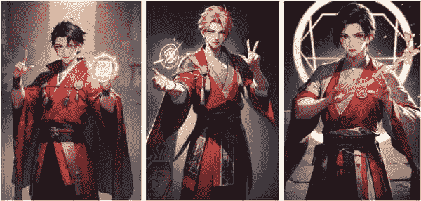

图 1-2 Stable Diffusion 生成的 AI 绘画作品

以上精美的绘画作品都是在 AI 绘画工具里输入提示词后生成的，这样可以显著提升创作者的绘画效率。AI 绘画工具出图往往是一连好几张，而传统画师只能靠自己一笔一笔、一张一张地去画。可见，对于传统画师而言，使用 AI 绘画工具就如同获得了一支“神笔”。

基于强大的扩散模型和语义理解能力，AI 可以在画师和设计师的角色之间自由切换，这取决于使用 AI 绘画工具的人想要让 AI 发挥什么样的作用。AI 绘画真正实现的是将艺术与科技紧密结合，让使用 AI 的画师和设计师变得更加强大。

OpenAI 的 CEO 萨姆·奥尔特曼曾说：“十年前的传统观点认为，人工智能首先会影响体力劳动，然后是认知劳动，接着，也许有一天可以做创造性的工作。现在看起来，它会以相反的顺序进行。”今天 AI 绘画的飞速发展就好像是给了普通人一支“神笔”，人们不需要学会如何画画，只需要拿着这支“神笔”学会念“咒语”就行了。

### 1.2.2 AI 绘画为普通人提供的艺术之路

AI 绘画这支“神笔”是实打实地赋予了每个人创造艺术作品的能力，打破了专业人士与普通人之间的技术壁垒，让每个人都能做出被大众喜欢、认可的艺术作品。

###### 1．普通人的绘画之梦

你不用经历艺考班每天早 8 点到凌晨 1 点的魔鬼训练；不用经历刚刚进入艺术院校对于专业选择的迷茫和困惑，不用担心进入专业院校之后，因为老师、学校的水平有限或老师不够用心而导致的“学不到东西”；你也不用担心自己像刚入行的设计师或插画师一样，每天熬夜赶稿，甲方却还是一脸的不满意。因为从生产图像的层面而言，一切技术的壁垒都不存在了，那些工作中消耗精力、降低效率的重复性操作，也都不再是问题。你需要做的就是不断提高自己的审美和眼界。在 AI 面前，你就是甲方，你成了一幅画、一个设计方案、一件艺术作品、一个艺术项目的真正“话事人”。

在生活中，人人都有对美的需求，但是真正系统学习过美术或有绘画能力的人极为有限。很多人的绘画水平可能还停留在“火柴人”的阶段。AI 绘画的神奇之处在于它生成图像的过程。在 AI 绘画中，“文生图”是我们最为常见的功能之一。在上一小节中，我们已经看到 AI“文生图”的强大功能。和传统绘画时人们要先学会打形，再不断深入刻画画面细节的逻辑不同，AI 绘画利用扩散模型，让毫无绘画基础的人也能通过精准的语言描述直接生成图片。例如，输入提示词：“Mechanical Girl, Sketch, Techno Feel, Portrait, Large Profile, Best Quality, 8K, Cyberpunk”（机械女孩，草图，科技感，肖像，大侧脸，最佳品质，8K，赛博朋克风格），生成的图像效果如图 1-3 所示。

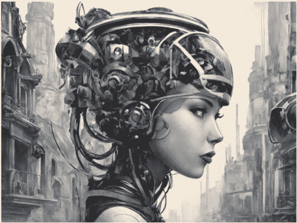

图 1-3 AI 生成的机械女孩图像

这让原本只有专业技术人才才能掌握的能力，变成了每个人都可以拥有的能力。同时，AI 绘画还有一个非常重要的功能——“图生图”。通过文字描述生成图像总是带有很强的随机性，有时生成几十张图依旧在人物动作、表情、画面细节上不能让创作者满意。而“图生图”功能则能很好地解决这类问题。即便一个人只会画类似“火柴人”的草图，也能够通过 AI 绘画工具生成精美的图片，并且这张图片的构图、立意都能够更加精准地贴近创作者的意图。

此外，智能的 AI 绘画工具还可以给黑白照片、线稿等上色。

由于绘画和设计在专业技能上形成的壁垒，很多人对艺术望而却步。如今，普通人在面对 AI 绘画技术的时候，要学习的并不是专业技法，而是提示词的运用。在掌握了提示词技巧后，普通人就有机会在绘画表达上“弯道超车”，让自己通过 AI 生成的图片，即使在一众专业人士的作品中也不落下风。这个时候，决定你和艺术家之间差距的不再是高深的技法，而是创作意识和审美眼光。

###### 2．让梦想照进现实

随着现代社会的发展，普通人在工作流程中也面临着更高的审美标准要求。工作中常常需要使用好看的图片或进行专业的排版，以提升内容的表现力。可以说，“美”在今天已经不仅是一种兴趣或话题，它还成了真实存在的工作需求。不妨设想几个场景：一个刚毕业需要找工作的学生是否需要一份排版精美的个人简历？年终述职或做行业报告分析时，汇报人是否需要一份重点突出、色彩搭配和谐的 PPT？公司举办活动需要宣传时，是否需要一张制作精美的海报？

在过去，手写文件是常态，一手好字就是一个人的“第二张脸”。而在今天，大多数文件和内容都在通过数字工具生成、展示和传输。此时，能够做出优秀的视觉传达，不也正是一个人的“第二张脸”吗？时代已在悄悄改变，我们的工作方式也发生了变化，只是我们依然“不识庐山真面目”。

今天，我们的工作是以精细化的专业分工为基础的。很多人意识到需要提升自己的审美、锻炼自己对美的表达能力，所以很多原本不是设计领域的人悄悄报了辅导班或网课学习 Photoshop 等设计软件。但这样的学习真的能够解决大家在工作和生活中的实际痛点吗？专业的设计师通常在高校学习了 4 年的专业知识和技能，在工作中又有大量实际操作经验。相比之下，普通人即便投入大量时间学习，往往也谈不上掌握了核心技能。自己的眼界或许提高了，但就是无法表现心中所思所想，这不免感到付出与收获不成正比，总觉得自己与艺术无缘。

然而，AI 绘画工具的出现，让普通人拥有了在工作流程中注入“美”的可能。用 AI 生成一个排版精美的简历、一个重点突出且色彩和谐的 PPT、一张令人赏心悦目的海报，都不是难事。AI 绘画工具可以帮普通人省去大量的时间，让他们在自己熟悉的领域中持续深耕。在生活中，制作装修效果图、绘制自己的二次元头像、做一个突出自己个性的网站、让自己的照片变得更美、修复家里的老照片等，都可以用 AI 绘画工具来实现。由此可见，AI 的确是为普通人打开了一条亲近艺术的新路径。这条路的意义不在于让大家成为艺术家，而在于让大家完善和美化自己的工作流程，并改善自己的生活。

### 1.2.3 AI 带给艺术从业者的提升之路

在不经意中我们迈入了 AI 时代。在这个新的时代，传统的艺术从业者将何去何从呢？对于 AI 时代的艺术从业者而言，AI 绘画强大的功能看起来是一个挑战，但实际上也蕴含着不少机遇。每一个艺术从业者都有自己擅长的领域，也有自己的短板。AI 绘画工具将为大家补齐短板，让艺术从业者在自己擅长的领域持续深耕。

###### 1\. AI 绘画实践应用介绍

面对 AI 绘画这一新生事物，艺术相关领域从业者与其抗拒它、恐惧它，不如拥抱它、利用它，让 AI 技术为自己的创作赋能。

随着 ChatGPT 的登场与各种 AI 绘画软件的开发和应用，人们也开始担忧 AI 绘画带来的冲击。“90%的广告人将失去自己的饭碗”“未来广告公司将消失”等观点一度甚嚣尘上，而 AI 设计的商用也很快引起了社会各界的讨论。

2023 年 4 月，国内旅游服务平台“飞猪”在上海、杭州两地的地铁站投放了由 AI 创作的海报，如图 1-4 所示。这让人们看到了 AI 设计的海报在商业领域的应用。

图 1-4 AI 生成的“飞猪”地铁广告引发热议

AI 为“飞猪”生成了多张广告图片，分别对应全球不同的旅游目的地，每张广告图片的内容都十分酷炫。这里选择部分图片进行展示，如图 1-5～图 1-7 所示。

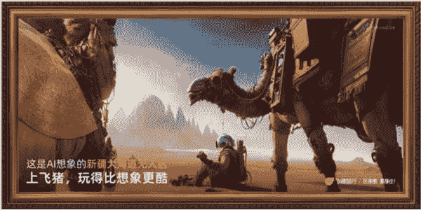

图 1-5 AI 生成的“飞猪”广告图片：新疆旅游

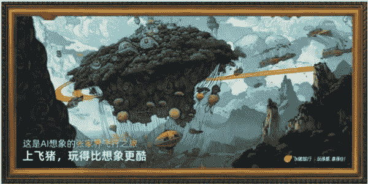

图 1-6 AI 生成的“飞猪”广告图片：张家界旅游

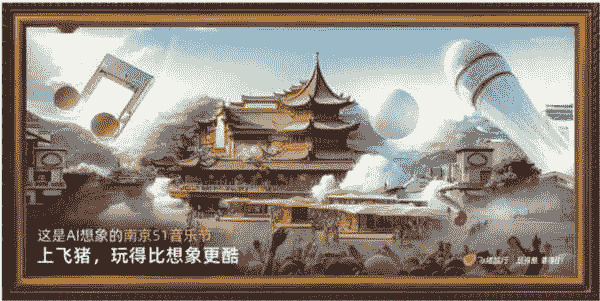

图 1-7 AI 生成的“飞猪”广告图片：南京旅游

2023 年 5 月，伊利推出了 6 款由 AI 参与的乳品包装设计，如图 1-8 所示。据伊利集团官方消息，该系列包装从概念到视觉设计，都是由 AI 参与甚至主导的。伊利表示，未来将加速推进 AIGC 技术在乳品行业的应用。在国外，亨氏番茄酱也通过 AI 绘图工具 DALL·E，为他们的番茄酱进行包装设计，如图 1-9 所示。

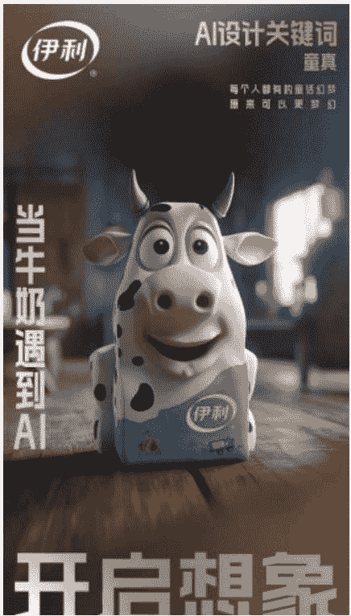

图 1-8 伊利 AI 包装设计——童真

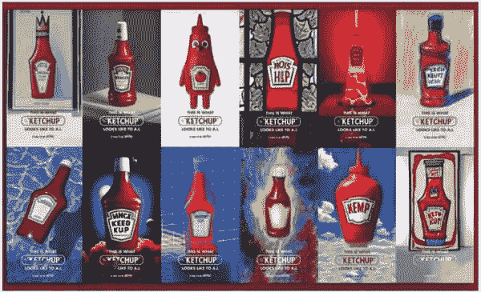

图 1-9 AI 生成的亨氏番茄酱包装

由以上实例可以看到，在广告设计和包装设计领域，AI 已经能够承担传统设计师的绝大部分工作。而事实上，AI 的能力远不止于此。室内设计、园林设计、建筑设计等空间设计领域，AI 同样可以胜任相关的设计任务。如果再加上 AI 在绘画领域的超强能力，我们可以发现，AI 的能力范围几乎覆盖了当今美术学院的每一个专业方向。

###### 2\. AI 绘画是否会取代设计师

既然 AI 在设计领域有如此抢眼的表现，那么人类设计师会被 AI 取代吗？在人类的美术史上，这种技术革命带来的行业危机已经不是第一次了。1839 年，当照相术出现的时候，很多人预言绘画将不复存在。然而事实是，在照相术出现之后 100 多年的时间里，绘画依旧在发展，而且呈现的面貌更加丰富，传统意义上绘画的记录功能被极大地削弱，但绘画表达情感、表现思想的功能变得越来越强大。于是 20 世纪的画坛有了表现主义，也有了爱德华·蒙克；有了抽象派，也有了康定斯基、蒙德里安、马列维奇；有了超现实主义，也有了萨尔瓦多·达利、勒内·马格里特（其作品如图 1-10 所示）等丰富的画派和卓有成就的艺术家。可以说，照相术将画家从传统的肖像画订单或宗教与历史题材的委托中解放出来，促使艺术家更多地面向自己的内心，成就更具个人色彩的艺术表达。今天的造型艺术也成了人们口中的“纯艺术”。

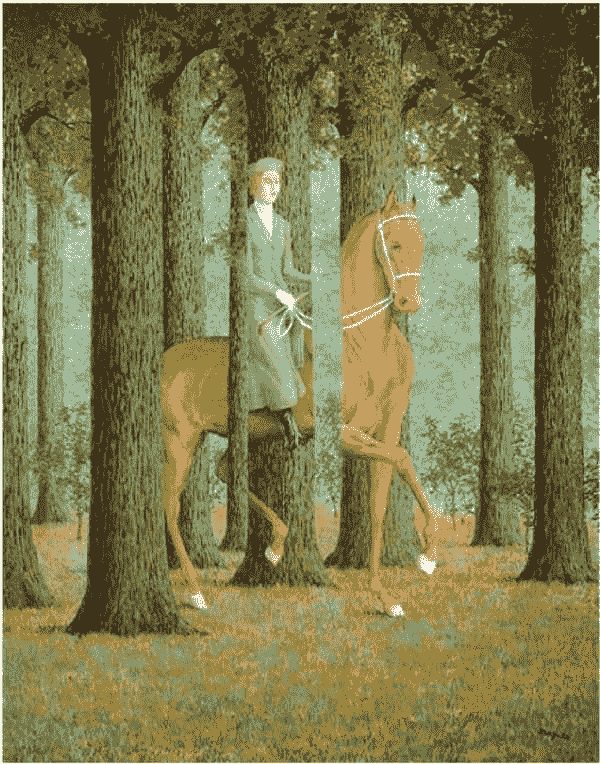

图 1-10 勒内·马格里特的作品《寻常之处》

对于今天的画家而言，照相术使创作变得更加便捷和自由。现在，速写已经不是艺术家搜集素材的主要方式，照片成为更加主流的参考，互联网也让画家进入了一个图像资源丰富的时代。万物互联让在架上绘画的画家不再为绘画的材料、运输等问题发愁，作品的传播途径也更加多元化。

因此，无论是题材上、绘画思想上，还是技术上，架上艺术都已经选择拥抱技术，享受时代发展带来的红利。

随着 20 世纪照相术等图像处理技术的发展，画师和设计师的技能和专长被清晰地区分出来。而进入 21 世纪后，由于社会需求的发展，无论是传统意义上的画师还是设计师，都被要求具有更高的视野，以及更加全面的能力，跨学科、跨专业几乎成了每一个新时代艺术创作者绕不开的课题。然而技术领域的难题如同一座高山横亘在眼前，让画师面对种类繁多的设计软件时望而却步，也让设计师面对纷繁复杂的绘画技巧时暗自生畏。AI 绘画的出现让二者的跨界融合成为可能，技术和技巧不再是“拦路虎”，审美和思想真正成为衡量画师和设计师水平的核心标尺。

让 AI 绘画工具赋能每一位创作者，助力他们成为 AI 时代的艺术家。

在设计领域，从 19 世纪哥特式复兴运动、工艺美术运动，到包豪斯的确立，现代设计逐渐成形，设计师也成了工业时代非常重要的一种职业。随着电脑的普及，各种各样的设计软件也应运而生，如专注于视觉传达设计的 Adobe Photoshop、Adobe Illustrator、CorelDRAW、Adobe InDesign，以及专注于空间设计的 AutoCAD、3ds Max、SketchUp 等。经过近几十年的发展，这些软件已经成为设计师开展工作必不可少的工具。在这些软件面世以后，软件的设计者也在根据设计师的使用习惯不断更新迭代，使设计师的工作更加便利。设计师普遍乐于接受技术的进步。

而 AI 绘画工具的出现为传统设计工作带来了颠覆性的改变。随着时间的推移和 AI 绘画工具的发展，已经有不少设计师开始思考如何用 AI 简化自己的工作、提高效率，让自己在和同行的竞争中脱颖而出。

举一个实际家装设计的例子：过去，家装设计师在跟客户沟通适合其房屋的设计风格时，总是要花费很多的时间。如果直接给客户看过往案例的图片，客户常因缺乏代入感而难以抉择；如果针对项目给客户出图，无论是用 SketchUp 还是用 3ds Max 出图，都得花费很多时间和精力。此外，比较较真的客户还必须查看用 3ds Max 出的效果图才能满意，且往往一张图还拿不定主意，总想多看几张图才能确定自己想要的效果。这就给设计师增加了很大的工作量。

但是当设计师用 AI 绘画工具生成的效果图跟客户沟通时，其工作量便大幅降低了。无论是基础模型、线稿，还是毛坯房照片，都可以导入 AI 绘画工具快速生成效果图，并且 AI 的出图效率更高，几分钟内就可以生成三四十张效果图。经设计师筛选后，总能挑出五六张可以拿给客户看的方案，如图 1-11 和图 1-12 所示。此外，AI 绘画工具也支持对生成图片进行局部重绘。在跟客户的沟通中，设计师可以将图片再次导入 AI 绘画工具，生成更符合客户需求的效果图。这样一来，设计师的效率提高了，客户也更容易获得满意的设计方案。

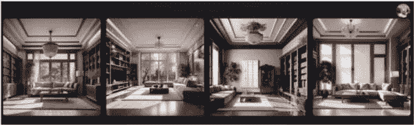

图 1-11 AI 绘画工具几秒内生成的中式客厅效果图

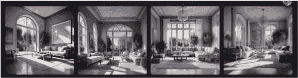

图 1-12 AI 绘画工具几秒内生成的地中海风格客厅效果图

基于 AI 绘画工具强大的学习能力，在现实操作中，设计师完全可以训练出适用于自己风格的专用模型，并根据自己的喜好不断优化，甚至可以在此基础上针对不同类型的客户需求对模型进行微调，让模型适用于更多的场景。这样一来，设计师和 AI 的协作将更加紧密，在提高工作效率的同时还能最大限度地保持设计师的个人风格。

AI 绘画工具的强大潜力并不止步于此。设计领域讲究“创意为王”,AI 绘画模型在设计流程中发挥最大价值的环节，就在于前期的概念设计。对设计师而言，AI 工具是激发创意的有效手段，它可以给设计师提供灵感、拓宽思路，带来更丰富的可能性，协助完成整个设计流程中最具挑战性的工作。

在前期创意阶段，AI 绘画工具非常擅长将设计师那些概念化的想法进行视觉呈现。例如，科技感、未来感、氛围感等较为抽象的表达，AI 就很擅长将它们视觉化和具体化。此外，如果设计师更习惯画草图，那么利用 AI 将草图视觉化，也能给设计师提供更多的可能性。

让 AI 参与自己的工作，成为辅助自己工作的工具，已成为越来越多设计师的选择。AI 并没有直接取代设计师，但善于运用 AI 的设计师，将逐步超越不会用 AI 工具的设计师。

当下，设计师需要结合自己过往积累的经验与审美，再搭配先进的工具，不断优化自己的设计成长路径，这样才能成为真正不可替代的创造者。 EXr6287u6NNVz+GYLY+7SDk226FstKIHdC0bNoQkB2Nqi1xSR0yxPmwrTs5gRi/BtfSbid6dBhii9q7cz2pIyA==

## 1.3 AI 绘画工具的发展历程

相较于传统绘画，AI 绘画虽然起步较晚，但发展势头异常迅猛。自 2015 年起，各种各样的 AI 绘画工具纷纷登场，尤其在 Midjourney 和 Stable Diffusion 出现之后，相关软件更是呈现井喷式增长。

2015 年 7 月，Google 推出 DeepDream，开创了 AI 根据文本生成图像的先河。

2021 年 1 月，OpenAI 发布 DALL·E 1 模型，让文本生成图像技术引起社会广泛关注。DALL·E 中的“DALL”指的是西班牙艺术家萨尔瓦多·达利，“E”指的是电影《机器人总动员》中的主角机器人，这个名字暗示着艺术与科技的融合。2022 年 4 月，DALL·E 2 模型发布，新版基于扩散模型开发，在整体绘画能力上有了很大的提升。

2022 年 5 月，Google 发布了同样基于扩散模型的图像生成工具 Imagen AI，同年 8 月又推出了 DreamBooth AI 这一图像生成器。

2022 年 10 月，Novel AI 上线了 AI 绘画功能。由于其风格偏二次元，迅速吸引了大量年轻用户，上线 10 天生成的图片就超过了 3000 万张。

老牌设计软件 Photoshop 也积极引入 AI 能力，通过 Photoshop SD 等插件让其功能更加强大。

而在国内，2022 年 10 月，百度基于文心大模型，推出了文心一格（已于 2025 年 4 月正式将服务迁移合并至文心一言官网）。此外，即时设计、海艺 AI 等 AI 绘画工具纷纷问世。

目前，AI 绘画领域具有代表性的产品为 Midjourney 和 Stable Diffusion。后文我们还会详细介绍这两个 AI 绘画工具。

2023 年，随着 ChatGPT 引发的浪潮，AI 绘画又一次引起了人们的热议。大家发现 AI 绘画变得越来越成熟，甚至出现了如 Sora 这样的 AI 视频生成工具。与此同时，国内的 AI 绘画工具也在加速发展，如今我们见到的已经是更加成熟、多样、个性化和实用的 AI 绘画工具。

这一系列 AI 绘画工具在短时间内密集涌现，迅速形成“百家争鸣”的局面，标志着 AI 向视觉艺术领域的全面渗透。

随着 AI 时代的到来，我们正实实在在地经历着一场科技革命，而这场科技革命是被 AI 推动的。我们的学习、工作、生活都将被 AI 重新塑造。在绘画领域，虽然国外 AI 工具发展较早，但是国内的 AI 工具正在迎头赶上。在下一章中，我们将为大家介绍一些国内外具有较大影响力的 AI 绘画工具。 EXr6287u6NNVz+GYLY+7SDk226FstKIHdC0bNoQkB2Nqi1xSR0yxPmwrTs5gRi/BtfSbid6dBhii9q7cz2pIyA==

## 本章小结

本章主要介绍了 AIGC 的基本概念和发展历程。AIGC 的成功主要得益于生成算法模型的不断创新。

随着 AIGC 模型的通用化程度和工业化应用能力的持续提升，其影响力日益凸显。AIGC 技术将大幅降低内容生产的门槛和成本，这也要求我们持续关注快速发展的技术和模型。对于新时代的艺术工作者而言，更要将 AI 绘画工具转化为赋能自己的利器，只有这样才能跟上时代的步伐，创造出契合时代脉搏的优秀作品。 EXr6287u6NNVz+GYLY+7SDk226FstKIHdC0bNoQkB2Nqi1xSR0yxPmwrTs5gRi/BtfSbid6dBhii9q7cz2pIyA==

# 第二章
国内外全知晓：认识主流 AI 绘画工具

本章导读

近几年来，AI 绘画以其颠覆性的效果强势进入人们的视野，我们总会听到“AI 将取代传统绘画艺术家和设计师”的广泛讨论。然而，面对如此强大的 AI 功能，绘画艺术家和设计师真的就无所适从了吗？到底是新的工具会取代传统的艺术家和设计师，还是新的工具会成为他们更加趁手的法宝？笔者认为没有任何一个人愿意选择前者，那么有哪些 AI 绘画工具能够为我们所用呢？Stable Diffusion、Midjourney 是早期出现在大家视野中的 AI 绘画工具，除此之外，还有很多 AI 绘画工具堪称隐藏的高手。本章将为大家介绍国内和国外具有代表性的 AI 绘画工具。 EXr6287u6NNVz+GYLY+7SDk226FstKIHdC0bNoQkB2Nqi1xSR0yxPmwrTs5gRi/BtfSbid6dBhii9q7cz2pIyA==

## 2.1 国内主流 AI 绘画工具

当 Stable Diffusion 和 Midjourney 在 AI 绘画的舞台上大放光彩的时候，人们不禁要问，国内有没有站在时代前列的 AI 绘画工具呢？事实上，国内有不少的科技公司正在进行这一方面的探索。百度基于文心大模型的文心一格（已于 2025 年 4 月正式将服务迁移合并至文心一言官网）、阿里巴巴旗下 Alibaba Design 推出的堆友、有“国内 C 站”之称的 Liblib AI、更贴合国内设计师使用习惯的即时设计，以及由成都海艺互娱科技有限公司开发的海艺 AI 等工具，都是国内非常优秀的 AI 绘画工具。接下来将给读者一一介绍。

### 2.1.1 大厂急先锋：堆友

堆友是阿里巴巴推出的 AI 绘画产品，登录堆友官方网址，首页如图 2-1 所示。其美观大方的界面和便捷的功能设置，无不体现着阿里巴巴的实力。在首页下方可以看到网友们在堆友中创作的作品。

图 2-1 堆友首页

“AI 反应堆”“AI 工具箱”和“3D 素材”共同构成了堆友的三大主要功能。

堆友的第一大功能是“AI 反应堆”，其中有简洁模式和自由模式，如图 2-2 所示。这两种模式都支持直接用中文提示词，其中自由模式相对来说更专业一些，适合有 Stable Diffusion 基础的用户使用。如果是初次接触 AI 绘画的小白，则推荐使用简洁模式。

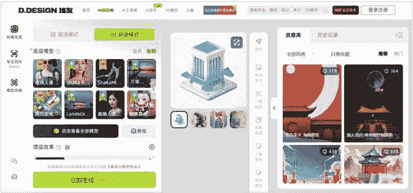

图 2-2 堆友“AI 反应堆”界面

堆友的第二大功能是“AI 工具箱”，包括“顽兔抠图”“一键消除”“AI 商品图”“鹿班营销图”“模特换肤”“创意融合”“AI 艺术字”“堆友相机”等功能，如图 2-3 所示。

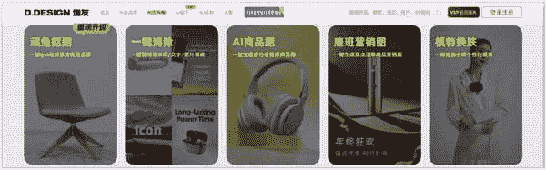

图 2-3 堆友“AI 工具箱”界面（局部）

堆友的第三大功能是“3D 素材”，可供用户自由编辑和下载 3D 素材图，也可供用户以现有素材做 3D 头像或 3D 场景，如图 2-4 所示。

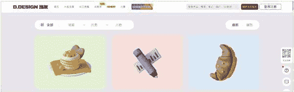

图 2-4 堆友“3D 素材”界面

除了以上三大功能，堆友还包括“AI 助手”功能，如图 2-5 所示。这是一个 AI 聊天工具，与多数聊天工具不同的地方在于，这款工具能够更加专业地回答设计相关领域的问题。

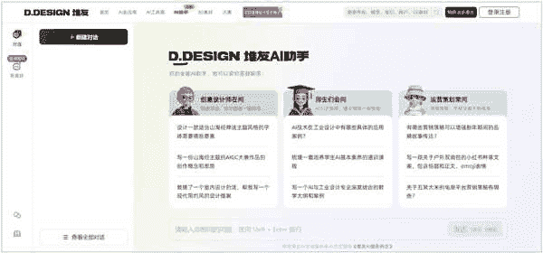

图 2-5 堆友“AI 助手”界面

总的来说，堆友是一款功能齐全的 AI 绘画工具。在电商相关的 AI 绘画领域中，堆友可以表现得更加专业。

### 2.1.2 国内 C 站：Liblib AI

Liblib AI 是一款功能强大的国产 AI 绘画工具。用户登录其官方网站就可以直接使用基于 Stable Diffusion 的在线 Web UI 界面，省去了使用 Stable Diffusion 时购买设备和下载模型的麻烦。Liblib AI 作为国内成熟的模型社区，拥有超多超全的模型供用户选择，可以大大提高用户的出图效率。

在网页地址栏中输入“https://www.liblib.art”就可以进入 Liblib AI 的官网（见图 2-6），或直接在浏览器中搜索“Liblib AI”也可以找到。进入首页后，就可以看到琳琅满目的 Checkpoint 和 LoRA 模型，如图 2-7 所示。

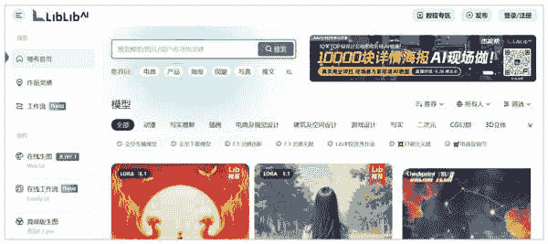

图 2-6 Liblib AI 网站首页

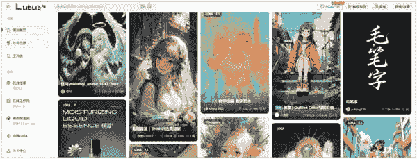

图 2-7 Checkpoint 和 LoRA 模型展示

除此之外，Liblib AI 还贴心地做好了风格分类，用户可以迅速地找到自己需要的模型，如图 2-8 所示。选择任意一个模型，可以将其加入模型库，也可以随时删除。相较于 Stable Diffusion 需花费时间下载和配置模型，Liblib AI 的操作流程更为简化。而且它的方便之处还不止于此，模型页面有一个“立即生图”按钮（见图 2-9），单击该按钮，用户可以直接进入 Liblib AI 的 Web UI 界面（见图 2-10）进行图片生成操作。

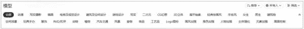

图 2-8 Liblib AI 模型汇总

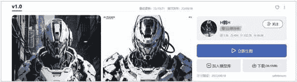

图 2-9 Liblib AI 中的“立即生图”按钮

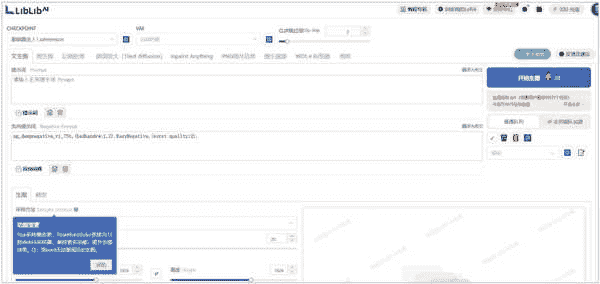

图 2-10 Liblib AI 的 Web UI 界面

在这里输入提示词：“White mech warrior, distant view, fighting in the ruins of a city, cyberpunk, highest quality, 8K”（白色机甲战士，远景，在城市废墟中战斗，赛博朋克风格，最高画质，8K），生成的作品如图 2-11 所示。即使你的英语不够好也不用担心，因为你输入的中文提示词可以在提示词输入框中被实时翻译成英文。Liblib AI 是本书的重点介绍对象，如果大家想要更深入地认识 Liblib AI，可以查看本书第六章的内容。

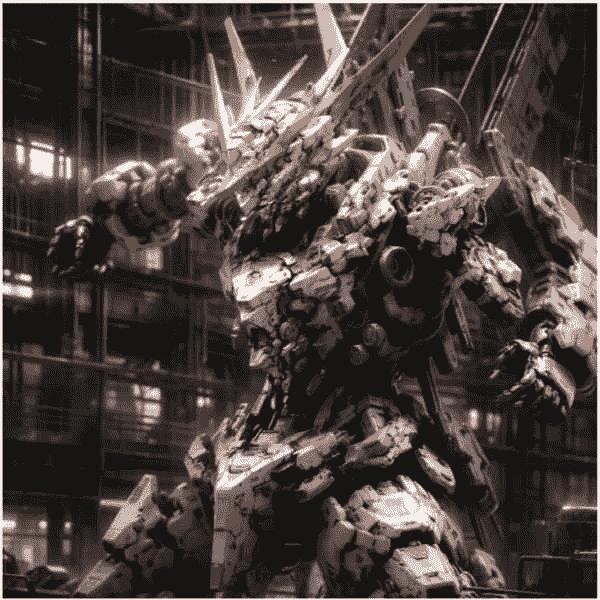

图 2-11 Liblib AI 生成的作品

### 2.1.3 设计师的福音：即时设计

UI 设计师对即时设计这个工具应该非常了解，因为它真的太好用了。如果说新一代 UI 设计工具里，国外以 Figma 为主流，那么国内的即时设计一定是最受欢迎的工具之一。即时设计的主页如图 2-12 所示。

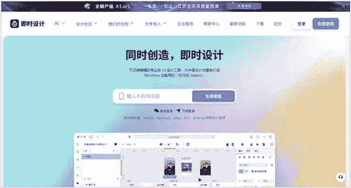

图 2-12 即时设计的主页

为什么我们会给即时设计这么高的评价呢？因为不同于传统 UI 设计软件，即时设计实现了跨平台和云端化。

首先，作为一款网页应用，即时设计在使用时，我们可以不用安装客户端，只需登录网页、注册账号就可以使用了。在使用的过程中，由于在该平台设计的所有内容都会被储存于云端，我们就不用因为工作场景的转换而总是背着电脑了，同时也省去了要把文件存储到电脑里的麻烦。即使需要在家里改稿，也只需通过电脑登录网页就可以工作了。

其次，即时设计实现了设计工作的“实时协作”。不同于传统的架上绘画，设计是一项经常需要与他人进行实时协作的工作，但是传统设计软件对于实时协作并不友好。面对同一个项目，团队成员、产品经理、开发人员、客户等需要经常相互沟通和协调，因此经常可以看到在一个项目群里大家将资料导出、标注、发送、收集反馈并进行修改。而即时设计帮大家省去了这些麻烦，真正实现了实时协作。就好像在腾讯文档里完成实时办公一样，我们也可以在即时设计里完成实时设计。多个设计师可以同时在线完成同一份设计稿，这大大降低了设计工作沟通的成本。

除此之外，高效率的自动化功能也是即时设计的一大优势。设计界面上所有可能重复出现的元素都可用组件、变体、自动布局等功能进行批量操作。可以说，以即时设计为代表的新一代 UI 设计工具改变了整套 UI 设计的流程，把设计、合作、反馈、原型制作、交付进行了整合，实现了一个工具、一套方法就能完成所有任务。

当然，即时设计也推出了自己的 AI 绘画功能，无论是在设计领域还是在绘画领域，即时设计都可以生成不错的 AI 作品，如图 2-13 所示。第三章将详细介绍即时设计的具体应用方法，此处就不再赘述了。

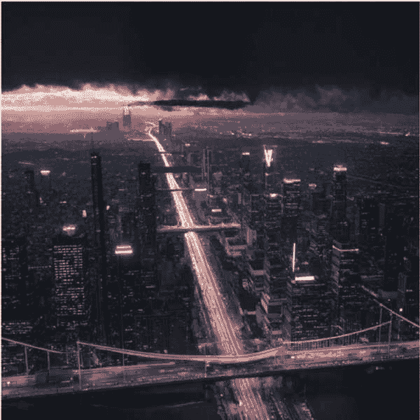

图 2-13 用即时设计生成的 AI 绘画作品

### 2.1.4 线上技术流：海艺 AI

海艺 AI 是一款国产线上 AI 绘画工具，功能非常强大。它不仅可以实现全中文操作，而且拥有自己训练的大模型，可以在自己平台的实验室内不断探索新的使用方法。在浏览器中进行搜索，便可以登录海艺 AI 的官网，如图 2-14 所示。

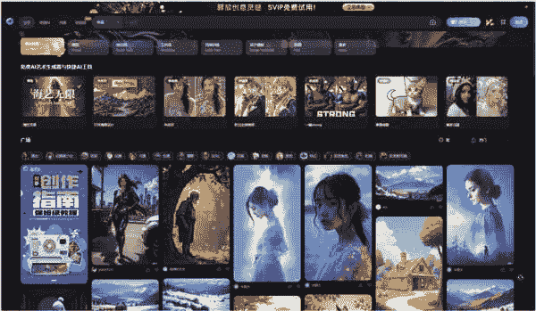

图 2-14 海艺 AI 主页

从操作层面来讲，海艺 AI 对新手非常友好。它不仅可以实现全中文提示词输入，还为不熟悉提示词编写的用户专门开发了 AI 绘画提示词工具，可以为用户提供可选择的提示词，如图 2-15 所示。

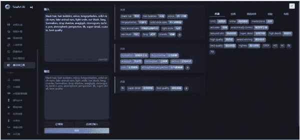

图 2-15 海艺 AI“提示词工具”功能

如果用户在作品广场看到喜欢的 AI 绘画作品，可以单击“同款”按钮一键进行生成。除此之外，海艺 AI 还有“快捷 AI”“快应用”等功能，可以让用户轻松生成大量高质量图片，并且能够适用于各种场景。

海艺 AI 提供了文生图、图生图、条件生图、高级画板、智能补图、高清修复、图像描述、提示词工具等一系列实用的 AI 绘画功能。

在模型方面，海艺 AI 的模型库集成了各具特色的模型，覆盖诸多领域，包括二次元、3D、数字艺术、油画、抽象艺术、现代科技、中国风、真人写实、摄影、建筑、室内设计等多种画风。同时，海艺 AI 还通过不断更新和丰富的模型库，为用户的创意提供无限可能。例如，输入提示词“二次元，女孩，繁华都市图”，生成的作品如图 2-16 所示。

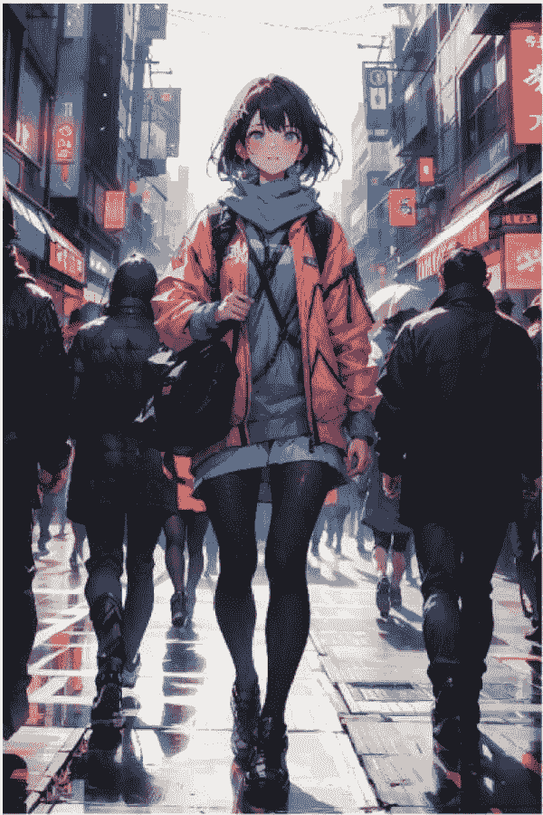

图 2-16 海艺 AI 生成的作品

不仅新手可以在海艺 AI 中生成高质量的图片，专业人士也可通过调整参数进行高质量创作。海艺 AI 拥有图生图、局部重绘、LoRA、ControlNet、高级画板等多种专业级功能，让专业人士在这里也可以实现自己的创意。

使用海艺 AI，用户不仅可以进行 Web UI 的创作，还可以通过“工作流”功能进行 Comfy UI 的创作。无论是游戏美术、电商设计、广告设计，还是漫画、插画等与美术相关的工作领域，海艺 AI 都可以通过 Comfy UI 优化工作流，使用户的工作效率实现指数级提升，如图 2-17 所示。海艺 AI 作为本书的重点介绍对象，在第七章将详细解读其使用方法。

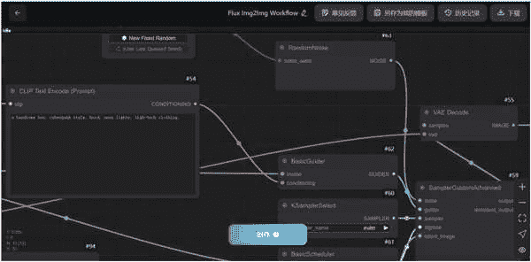

图 2-17 海艺 AI“工作流”展示 EXr6287u6NNVz+GYLY+7SDk226FstKIHdC0bNoQkB2Nqi1xSR0yxPmwrTs5gRi/BtfSbid6dBhii9q7cz2pIyA==

## 2.2 国外主流 AI 绘画工具

AI 绘画能引起社会各界的广泛关注，离不开 Stable Diffusion 和 Midjourney 这两款 AI 绘画工具，本节将介绍它们的具体应用。除此之外，还会介绍 Adobe 公司开发的 Adobe Photoshop Beta 版，它能帮助设计师将熟悉的设计工具和 AI 绘画进行连接。当然，国外的 AI 绘画工具远不止于此，还有 DALL·E、Novel AI 等。因篇幅有限，就不进行过多介绍了。

### 2.2.1 新生实力派：Stable Diffusion

2022 年 8 月，Stability AI 发布了开源图像生成模型 Stable Diffusion，如图 2-18 所示。尽管该模型对家用电脑的配置要求相对较高，但它首次实现了 AI 绘画在本地电脑上的运行。同时，Stability AI 将模型全面开源。

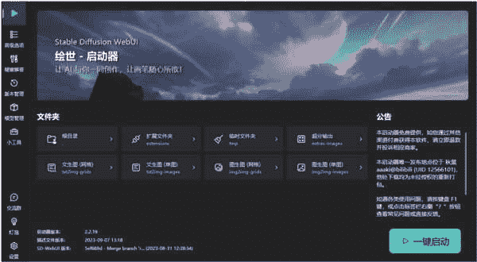

图 2-18 Stable Diffusion 界面

2022 年 11 月，Stable Diffusion 2.0 发布，新版本生成图像的分辨率提高了 4 倍，生成速度进一步加快，同时接入了深度信息。我们可以在 C 站（Civitai）上看到众多创作者基于 Stable Diffusion 开发的 AI 模型及其生成的作品，如图 2-19 所示。

至此，我们已经大致了解了 Stable Diffusion 的发展过程。下面让我们进一步探究这个 AI 绘画领域的佼佼者。

不同于 Midjourney 等需要在线使用的工具，Stable Diffusion 是一个可以本地部署的开源项目。用户可以在本地完成模型训练、图像生成及各类自定义操作，这也是这款 AI 绘画工具广受欢迎的重要原因。

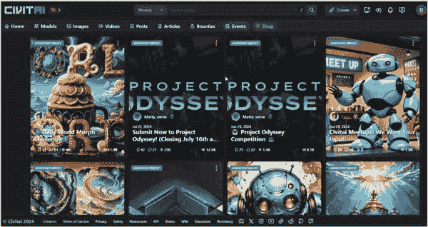

图 2-19 C 站网页

虽然 Stable Diffusion 的使用全程免费，但是对电脑的配置有比较高的要求，特别是在显卡、内存和硬盘等方面。此外，使用者需要对 Python 和 Git 有基本的了解，其安装部署的流程也比较复杂。在部署好之后，还需要配置一系列插件和模型等扩展功能。不过，安装好之后就可以在本地使用了，不需要连接互联网，这使其生成的图片拥有良好的私密性。

Stable Diffusion 的操作界面如图 2-20 所示。

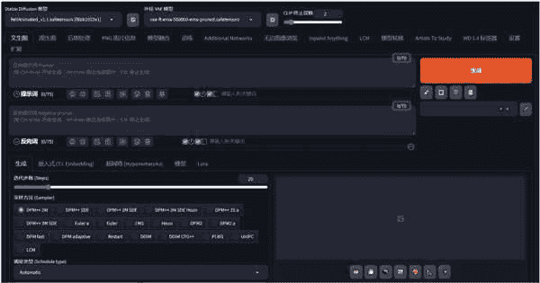

图 2-20 Stable Diffusion 操作界面

Stable Diffusion 在开源初期更擅长生成游戏角色、动漫、机甲、室内设计等领域的图像。随着后续推出的 SDXL 大模型，Stable Diffusion 擅长的领域得到了进一步的拓展，同时在 AI 模特、AI 写真、相片转卡通手绘、室内设计等方面的能力也得到了更大的提升。

如果你是一个纯粹的创作者，有很多的时间和精力钻研 AI 绘画工具，并且希望自己能够更加精准地掌握 AI 所生成的图像，那么 Stable Diffusion 非常适合你。

因为除了对电脑硬件的要求较高和安装部署流程较复杂，Stable Diffusion 生成的图片还有一个特点，就是虽然图片生成质量的上限非常高，但是图片生成质量的下限也是很低的。如果不是抱着学习的心态来接触 Stable Diffusion，你可能会在生成了几次 AI 绘画图片之后就失去了信心。同时，相较于其他 AI 绘画工具，Stable Diffusion 的提示词更加复杂，有正向提示词和反向提示词，还需要调整多种参数、调用合适的模型并配置 ControlNet 插件等。因此，使用 Stable Diffusion 的前期可能会比较吃力。但随着熟练度的提升，用户的操作效率会不断提高，生成的图像也会越来越精美。

在可控性方面，Stable Diffusion 表现尤为突出。用户可以通过 ControlNet 精确控制角色姿态、表情、手势，甚至生成文字；也可以通过 Inpaint Anything 功能来修改细节或替换衣服。此外，用户还可以训练专属模型，通过“高清重绘”实现老图翻新，甚至可以安装各种插件来辅助输入提示词。

### 2.2.2 王牌对王牌：Midjourney

2022 年 7 月，独立研究实验室 Midjourney 发布了同名生成模型 Midjourney，图标如图 2-21 所示。Midjourney 最初引发关注是因为设计师杰森·艾伦用其生成的图片——《太空歌剧院》（见图 2-22），该作品在科罗拉多州博览会数字艺术竞赛中获得头奖。

图 2-21 Midjourney 图标

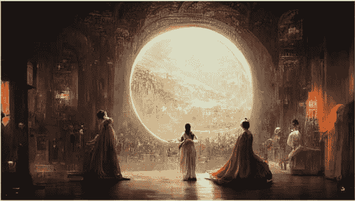

图 2-22 用 Midjourney 生成的图片——《太空歌剧院》

Midjourney 在以能够生成精美的图片引发关注的同时，也暴露了它的弱点，比如生成结果的可控性较低，特别是生成人物图像时出现的手指问题，被广大用户诟病。

直到 2023 年 3 月，Midjourney V5 推出后，才基本解决了之前版本画不好手指的问题，而且整体产出的图片不再像之前的版本那么不可控，更接近真实场景，甚至让人难辨真假。

不同于 Stable Diffusion,Midjourney 使用的是云服务器，可以在云端生成图片，不会调用本地的设备，也不需要复杂的部署，更无须高性能的主机。其使用的方式也非常简单，你甚至可以在手机上使用它。从硬件的角度来看，Midjourney 的使用门槛要大大低于 Stable Diffusion，而且其文生图和图生图功能都非常强大，有非常好的出图效果。在光源、色彩、精细度等方面，Midjourney 都有非常好的表现。由于操作的简便性和优异的出图效果，Midjourney 在用户受欢迎程度上与 Stable Diffusion 旗鼓相当。

作为 AI 绘画工具，Midjourney 在各种各样的风格里都显得游刃有余，如东方山水画、日本漫画、包豪斯、3D、赛博朋克等风格。由于其强大的绘画能力，已经催生了各种各样的使用场景，如网页设计、插画创作、游戏角色设定、街拍风格模拟、漫画分镜、产品实拍、包装设计及个人头像制作等。

在这里笔者也向大家展示两幅用 Midjourney 生成的图片，如图 2-23 所示。

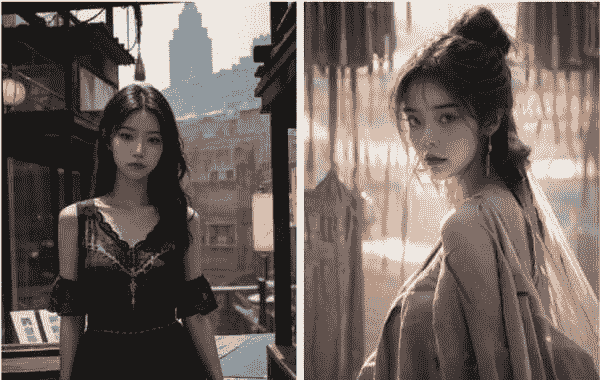

图 2-23 用 Midjourney 生成的图片

遗憾的是，目前国内用户无法直接访问 Midjourney，唯一的使用方式是通过社交平台 Discord 进行操作。同时，Midjourney 的使用是需要付费的，付费金额不同，用户享受的服务也不同。由于 Midjourney 未开源，其每一次的更新迭代也只能由官方主导完成，社区开发者并不能参与其更新迭代。

Midjourney 在可控性上要略逊于 Stable Diffusion。就图生图功能来说，Midjourney 的图生图功能更多是提供风格参考，难以做到精准控制，而 Stable Diffusion 的表现则更为突出。如果我们只想做一些概念插图、需要一些绘画创作灵感，或做一些简单的 UI 设计、人物设计，那么 Midjourney 是完全够用的。但如果我们想把 AI 绘画融入我们的工作流程、生成一套更加完整可控的工作方案，那么 Stable Diffusion 会是一个更好的选择。当然，我们也可以选择将二者结合使用。

现阶段的 Midjourney 在文字逻辑、构图结构、笔触、光影等方面优于 Stable Diffusion，所生成的图像更少带有“AI 痕迹”。而 Stable Diffusion 的画风上限取决于用户本身，如果用户擅长发掘模型，且使用模型时搭配 LoRA 模型，那么同样可以创作出“AI 痕迹”不明显的作品。

### 2.2.3 老树开新花：Photoshop Beta

当我们被 Stable Diffusion、Midjourney 等 AI 绘画工具惊艳的时候，很多人或许会觉得 Photoshop 已经落伍了。然而，正当人们观望的时候，Photoshop 再次用实力证明了自己，推出了新版本 Adobe Photoshop Beta（见图 2-24）。有了 AI 赋能，Photoshop 在效率方面取得了更大的突破，最让人惊艳的是创成式填充功能。

将修改移除画面元素和创成式填充两种功能搭配使用，是 Adobe Photoshop Beta 精准控制画面的主要途径。如果图片中存在一些自己不喜欢的元素，就可以直接框选它，并单击“创成式填充”,AI 就会将其从背景中去掉，并与背景的自然融合。依托创成式填充功能，Photoshop 的传统优势也得到了进一步的优化，如面对照片背景中路人过多的情况时，现在的 Photoshop 处理起来会更加轻松高效。

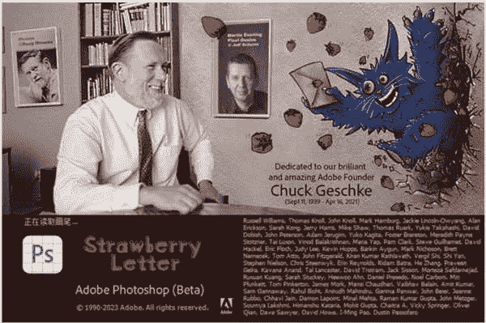

图 2-24 Adobe Photoshop Beta 启动界面

曾经的电商设计师如果要换掉图片中模特的衣服，往往是一件非常麻烦的事情，需要多次修改图片，甚至需要重新拍摄。现在直接框选图片中模特的衣服，并输入关键词“change cloth”，就可以帮模特替换衣服。输入想要的衣服风格、色彩等关键词，生成的衣服就会更加符合我们的需求。同理，为照片里的人物换个发型、加个配饰，也是小菜一碟。既然人物的衣服和头发可以换，背景当然也可以换。如果是针对风景照片，换个天空、换片草地也完全没有问题。这些过去需要 Photoshop 高手才能做出的无痕处理，现在都可以一键生成。就使用体验来说，由于 AI 的赋能，Photoshop 以往版本中的多项复杂操作得以简化，整体工作流程更加便捷。

图片填充功能也是 Adobe Photoshop Beta 的“绝招”之一。它可以对现有图片进行边缘扩展，使图片背景扩展 10 倍、20 倍，甚至更大范围。这种图片扩展功能不仅适用于真实的照片，还适用于 AI 生成的图像。只要对图片的构图不满意，都可以使用该功能进行修改。

细心的读者可能已经发现，Adobe Photoshop Beta 中的 AI 绘画功能一直处于一个可控的精准范围内。如果你不喜欢其他 AI 绘画工具“抽卡”般的不确定性，那么 Adobe Photoshop Beta 会是你非常不错的选择。

此外，只需安装 Photoshop SD 插件，就可以在 Adobe Photoshop Beta 中实现 Stable Diffusion 的文生图、图生图等功能。该功能巧妙地结合了 Photoshop 和 Stable Diffusion 的长处，在生成多种多样图片的同时保证了图片的可控性。

图 2-25 所示是由安装了 Photoshop SD 插件的 Adobe Photoshop Beta 生成的。其输入的提示词：“beach, girl, delicate features, best quality, 3/4 side view, half-length portrait, blue clothes, blue background”（海滩，女孩，精致的五官，最佳品质，3/4 侧面视图，半身像，蓝色衣服，蓝色背景）。

Adobe Photoshop Beta 还可以通过安装其他插件来增强功能。关于 Adobe Photoshop Beta 中 Photoshop SD 等插件的安装和使用方法，以及创成式填充功能的使用方法，都将在第五章进行详细的介绍。

### 2.2.4 图像的神器：Adobe Firefly

Adobe Firefly 是 Adobe 公司推出的 AI 图像生成工具，与其他 AI 绘画工具不同的地方在于可以内置于 Photoshop、Express 和 Lightroom 等常用的 Adobe 软件中。可以说，Adobe Firefly 不仅是一个 AI 图像生成工具，还是一款功能全面的图像编辑软件，如图 2-26 所示。同时，它也具有文生图、图生图和条件生图等功能。

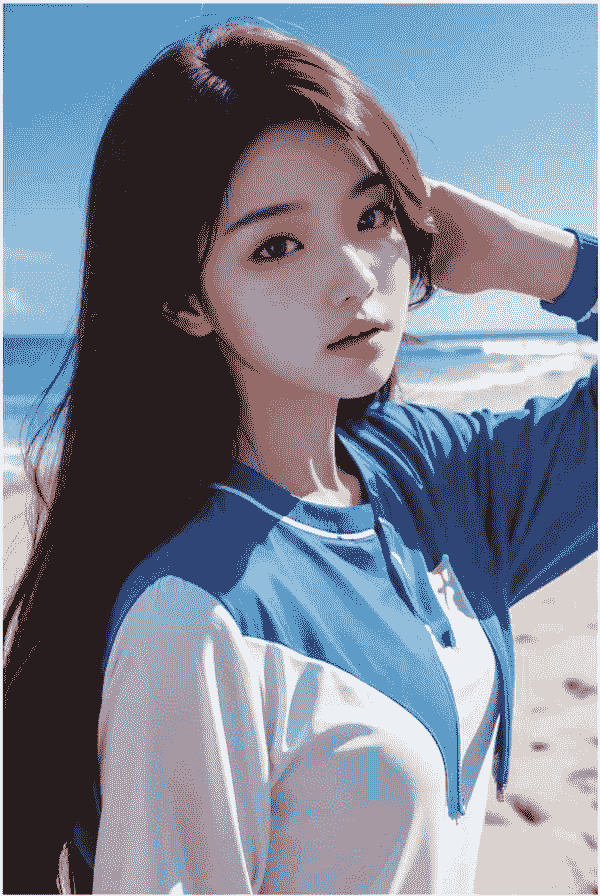

图 2-25 由安装了 Photoshop SD 插件的 Adobe Photoshop Beta 生成的图片

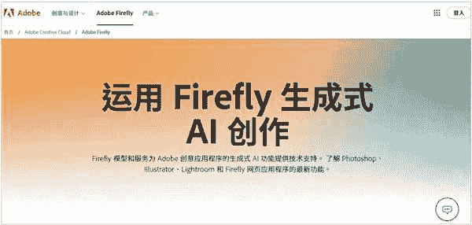

图 2-26 Adobe Firefly 网页截图

Adobe Firefly 是一款线上 AI 绘画工具，在使用之前，用户需要申请访问权限。

Adobe Firefly 中，生成式填色、以文字建立影像、生成式形状填色、生成式移除等与设计相关的 AI 功能都较为强大，如图 2-27 所示。除此之外，Firefly 3.0 还更新了自动风格化、结构和风格参考、图像质量优化、提示准确性和细节增强、插图和图标样式扩展等功能。

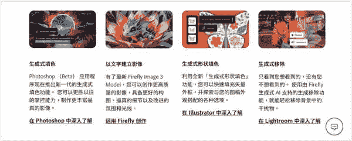

图 2-27 Adobe Firefly 的 AI 功能

在 Adobe Firefly 的各种功能中，生成式填色功能是非常实用的一个。用户可以通过选中图像中的目标区域来替换原图片中的相应对象，如图 2-28 所示。在进行替换后，用户还可以选中图片中的海面，再次进行生成式填色，完成最终作品，如图 2-29 所示。

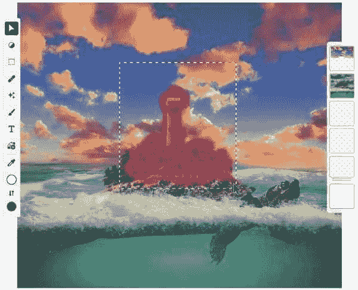

图 2-28 Adobe Firefly 生成式填色功能 1

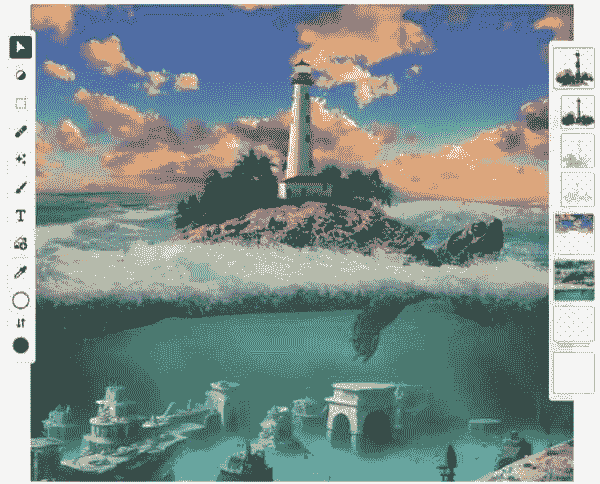

图 2-29 Adobe Firefly 生成式填色功能 2 EXr6287u6NNVz+GYLY+7SDk226FstKIHdC0bNoQkB2Nqi1xSR0yxPmwrTs5gRi/BtfSbid6dBhii9q7cz2pIyA==

## 本章小结

本章主要介绍了国内外多款主流 AI 绘画工具，包括国内的堆友、Liblib AI、即时设计和海艺 AI，以及国外的 Stable Diffusion、Midjourney、Adobe Photoshop Beta 和 Adobe Firefly。通过对这些工具的学习，相信读者对国内外的 AI 绘画工具已有了一定的认识，大家可以根据自己的需求选择相应的 AI 绘画工具，体验 AI 绘画带来的创作乐趣。 EXr6287u6NNVz+GYLY+7SDk226FstKIHdC0bNoQkB2Nqi1xSR0yxPmwrTs5gRi/BtfSbid6dBhii9q7cz2pIyA==

# 第三章
UI 设计新势力：即时设计的实操应用

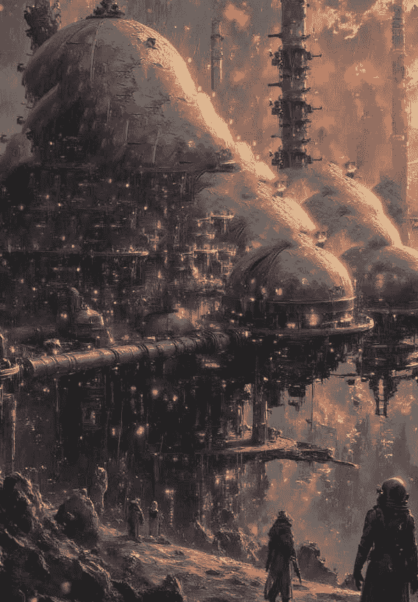

本章导读

传统的图像处理软件和矢量绘图软件在设计领域长期占据稳固地位。然而随着现代设计需求的多样化，产品交互中 UI 界面的种类不断丰富，设计任务也日益复杂。传统软件的工作流属于以图像处理的方式来进行 UI 设计，而国外主流工具如 Adobe XD、Figma、Sketch 等，对国内用户也存在一定的使用门槛或功能局限。在此背景下，国产 UI 设计软件即时设计整合国外工具的先进理念，并增加了 AI 插件与 AI 平台功能，迅速成为 UI 设计领域的佼佼者。本章将介绍即时设计的基本功能及其 AI 扩展能力，帮助读者将即时设计应用于工作中，提高工作效率。 EXr6287u6NNVz+GYLY+7SDk226FstKIHdC0bNoQkB2Nqi1xSR0yxPmwrTs5gRi/BtfSbid6dBhii9q7cz2pIyA==

## 3.1 从零开始：熟悉即时设计界面

即时设计作为一款在线协同操作的 UI 设计工具，凭借其海量的设计素材和丰富的 AI 插件生态，以及集成即时 AI 插件、A1.art 等 AIGC 工具，在同类软件中迅速脱颖而出。即时设计操作简单快捷，对有平面软件操作基础的用户来说更容易上手，同时对国外 UI 设计工具（如 Figma、Adobe XD、Sketch）的兼容性表现不错，可以说是近几年国产设计工具中的优秀代表。本节将为大家介绍即时设计的基础概况。

### 3.1.1 网页端、桌面端与移动端的区别

即时设计有网页、桌面、移动 3 个端口，在设计方面主要依靠电脑操作。了解三端差异之前需要先厘清电脑配置与用户使用需求的关系，这有助于我们理解软件的应用场景。官方对电脑的配置并没有提出明确的要求，但下面将结合实践经验为大家提供一些选配参考。

对于非设计专业的职场人士，如果希望让自己的工作成果展示起来更加美观大方，可以使用即时设计来做 PPT、海报、H5、DM 单等。这样既可以自主设计外观，还可以请同事一同参与设计。这类用户的目的是使用即时设计对工作成果进行美化。表 3-1 提供了一套基础电脑配置参考。这是主流办公电脑的配置，用户不仅可以随时进行协同设计操作，还可以中轻度使用 Photoshop、Illustrator 等软件。

表 3-1 基础电脑配置参考

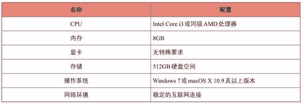

许多设计师（包括电商美工），以及部分电商创业者都在使用即时设计完成设计工作。然而，对于图像精修、包装设计、VI 设计、画册等复杂处理任务，还是需要使用 Photoshop、Illustrator、InDesign 等软件来进行设计。从事此类工作的用户建议配置性能更高的电脑，以满足设计需求。需要注意的是，即时设计的运行依靠网络传输，在没有网络的情况下无法使用。如果使用较老旧的电脑碰到传输困难的情况，可以加装性能更强的网卡解决。

###### 1．网页端

即时设计的核心在于线上协同操作，就是工作团队成员、甲方联系人等都可以随时进入设计项目，参与设计工作或跟踪项目进度，系统可为不同身份的成员设置相应的访问权限。由于操作时的运算压力由官方服务器承担，因此电脑配置的需求主要满足相应工作的技术标准即可。

在网页端操作时，只需在电脑浏览器的地址栏中输入“http://js.design/home”，进入官方主页并登录，即可进入工作平台对设计文件进行管理和操作。这种方式非常适合现代“轻办公”场景，只要电脑网络畅通，便可随时随地进行设计工作。需要注意的是，如果浏览器软件版本过低，用户输入官网的网址可能无法进入界面。

网页端支持多种登录方式，如手机号、微信账号及飞书账号，如图 3-1 所示。使用时需要完善注册信息，以便于后续多人协作及账号安全管理。

图 3-1 “即时设计”登录界面

###### 2．桌面端

桌面端也是日常使用频率较高的方式之一，但其并不像 Photoshop 那样是具有本地运算能力的软件，而是一个本地客户端平台，主要负责稳定地加载和显示软件界面，核心运算的压力依然由官方服务器承担。使用桌面端可有效减少某些浏览器因传输压力增加而导致的浏览器不稳定、卡顿、闪退等问题，它适合安装在个人电脑中。使用桌面端前需要先在官方网站中选择合适的操作系统版本下载并安装。

###### 3．移动端

即时设计的移动端有手机 App 和微信小程序两种形式，其主要用于作品管理与交互预览。例如，甲方需要查看设计任务的进度，通过移动端可以随时随地跟进；在交互体验方面，使用电脑端和网页端预览手机 App 的 UI 设计时需要用鼠标单击，其交互感不如使用移动端来得真实；团队设计协作或进行团队管理时，移动端也会更加便捷。即时设计手机 App 和微信小程序的操作界面基本一致，如图 3-2 所示。在处理较大文件时，建议使用手机 App 以获得更稳定的体验。

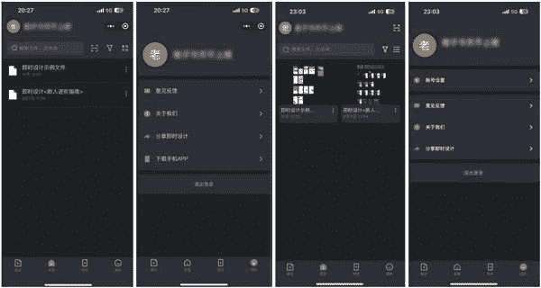

图 3-2 即时设计移动端界面（左侧两张为微信小程序界面，右侧两张为手机 App 界面）

### 3.1.2 熟悉操作界面

Photoshop 与 Illustrator 专注于图像与图形处理，为做出惊艳的图像视觉效果，提供了丰富的效果工具，学习时需要一定的时间成本。即时设计的名称代表其马上可以开始设计，是一款可迅速上手的软件。

UI 设计注重版式美观与交互方式，其展示载体为手机或电脑屏幕。为了保证屏幕交互的直观与高效，UI 界面通常避免过度复杂的设计，这也使许多图形图像处理软件多数强大的功能无法在这个领域施展。而即时设计秉承着实用原则，保留了最核心有效的工具组合，降低了这款软件的学习成本。其更多功能作为插件，由用户根据专业和自身使用习惯进行增减。下面将以网页端为例，对即时设计的界面功能进行介绍。

即时设计网页端的操作界面分为 5 个部分：顶栏、左侧面板、画布、属性面板和帮助，如图 3-3 所示。

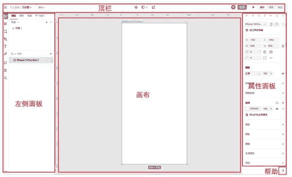

图 3-3 即时设计网页端的操作界面

###### 1．顶栏

顶栏包含功能主菜单、画布缩放、顶部工具栏、分享协作、预览、产研模式等。

（1）功能主菜单： 包含了设计工具中的所有功能，其中的“全局搜索”可以帮助用户快速找到需要的功能。注意，即时设计是云端实时存储的，所以不需要专门保存文件。

（2）画布缩放： 通过按-键或+键可以直接缩小或放大画布，也可以通过选择其下拉菜单中的选项，按 50%、100%、200%的比例显示。与缩放相关的快捷键见表 3-2。

表 3-2 与缩放相关的快捷键

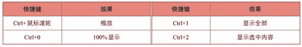

（3）顶部工具栏： 包含了文件、图层的常用功能。选择不同功能选项时，工具栏会显示不同的功能。

（4）分享协作： 可快速将文件分享给团队成员、将其他成员添加为文件协作者。

（5）预览： 可以通过“预览”来查看所有设计图效果，并检查交互设计中不合理的地方。

（6）产研模式： “设计”模式用于在画布中进行 UI 设计；“原型”模式用于 UI 设计中的交互设计环节；“标注”模式是开发者模式，主要用于实现设计师与开发者之间高效、精准的协作，需要有一定编程能力的人操作。

###### 2．左侧面板

左侧面板内容包括：组件工具栏、图层目录、页面目录、引用组件库、资源库、图层搜索等。

（1）组件工具栏： 在界面最左侧，可以选择需要的内容进行创建，包括矩形、圆形、线条、钢笔、画板等；也可以使用对应的快捷键创建内容。

（2）图层目录/页面目录： 可以直接查看、选择、编辑相应的图层/页面。

（3）引用组件库： 包含文件中所有的引用组件，可以拖曳引用组件至画布进行编辑；也可以单击鼠标右键，在快捷菜单中选择“删除引用组件”命令删除组件。

（4）资源库： 在资源广场中引用、下载的资源内容，可以在这里浏览、管理和使用。在设计过程中可以随时取用资源和引用新的资源。

###### 3．画布

画布作为设计过程中的核心区域，可供用户自由地设置画板、编辑图层、进行交互设计等，是用户施展创意的空间。

###### 4．属性面板

在属性面板中，可以编辑图层或画布等属性。属性面板中提供的功能项不恒定，会根据选择的工具显示相应的属性内容。

###### 5．帮助

可以快速解决用户在使用过程中遇到的问题。 EXr6287u6NNVz+GYLY+7SDk226FstKIHdC0bNoQkB2Nqi1xSR0yxPmwrTs5gRi/BtfSbid6dBhii9q7cz2pIyA==

## 3.2 方便快捷：AI 插件生态应用

即时设计能够快速兴起的一个原因就是插件生态。国内用户不太习惯老牌软件官方资源的使用方式，即网络素材资源虽然多，但需要用户自己去搜集和整理。而即时设计官方提供的素材、插件资源就足够用户完成大部分设计，并且插件资源可以很便捷地加载至主程序中，免去了烦琐的操作。本节将介绍即时设计中插件的搜索和安装方法，以及几款常用插件的使用方法，从而帮助大家用 AI 来提升设计效率。

### 3.2.1 安装与使用插件

即时设计将传统软件中的各种效果功能和部分 AI 新功能以插件的方式展示在资源广场中，用户可以根据个人的使用需求选择相关的插件。插件的查看与安装步骤也很便捷，用户只需进入资源广场进行搜索，选择需要的插件安装即可。即时设计这种高度定制化的方式，让每个用户都能塑造个性化的工作平台。在 AI 飞速发展的当下，许多插件都带有 AI 绘画等扩展功能。

###### 1．资源广场

插件是即时设计对工具的功能扩展，具备简化常规步骤、支持批量处理或对接第三方平台等功能，可大幅减少重复性工作或操作路径。资源广场是即时设计的插件库，从中选择合适的插件并在工作界面中添加使用，是设计师提升效率的必备操作。

###### 2．安装插件

即时设计的插件资源非常丰富，既有官方出品的插件，也有厂商或开发者提供的插件。多数插件自带使用教程，不需要用户摸索使用方法。找到合适的插件后，单击“安装”按钮即可使用，如图 3-4 所示。

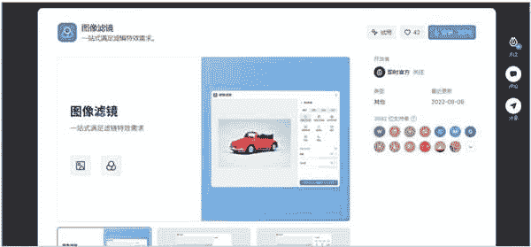

图 3-4 插件的安装

###### 3．使用插件

安装插件后，在左侧面板里单击“插件/小组件”按钮，然后选择需要使用的插件即可。插件多数会以小窗的形式在界面中运行。

### 3.2.2 AI 抠图插件

传统 UI 设计流程通常需要设计师同时操作多款专业软件来完成设计。而即时设计将各软件的很多功能以插件的形式整合，实现了设计任务在单一平台中的高效完成。以“AI 抠图”插件为例，该插件可以快速识别图像主体，将主体抠出后在设计文件中保留透明背景的主体图，使设计师无须切换至 Photoshop，即可直接在设计文件中使用处理后的素材。这一功能优化不仅简化了操作步骤，还使 UI 设计逐步告别多软件频繁切换的传统工作模式。

使用“AI 抠图”插件时，先将需要抠图的图片放入画布中，选中该图片后单击插件界面上的“抠图”按钮，即可完成抠图任务，如图 3-5 所示。其抠图速度比 Photoshop 快很多。

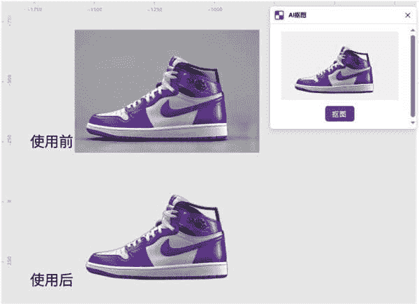

图 3-5 “AI 抠图”插件应用效果

### 3.2.3 智能填充插件

UI 设计中经常要在界面中使用“代用图”（暂时的占位图），以保证设计的整体效果。代用图的图像尺寸虽小但数量很多，需要花很多时间寻找与设计内容、风格相符的图像。在即时设计中，使用“智能填充”插件可以一键填充与设计相符的图像，并且会按照设计中的版式、样式去置入图片，省去了搜图和添加蒙版的过程。

使用“智能填充”插件时，用户选择置入图片的排版区域，插件就会按照常用设计分类进行排列，再选择与设计相符的图片类型即可，如图 3-6 所示。除添加图片外，还可以填写代用文本。如果对图像与文字的代用内容不满意，可以重复选择，直到满意为止。

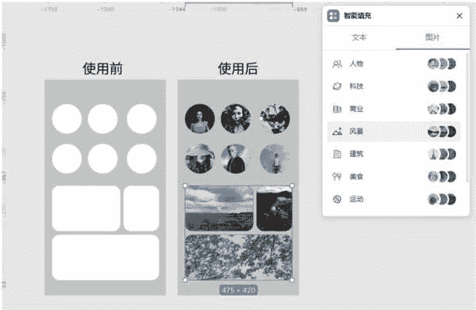

图 3-6 “智能填充”插件应用效果

### 3.2.4 AI 擦图插件

设计中通常需要使用处理后的图片作为设计素材。除了抠出主体，还需要将图片中多余的部分去除，这个需求就增加了很多的工作量。在即时设计中，使用“AI 擦图”插件可以把画面中不需要的部分迅速删掉，且处理后能保持画面自然完整。

使用“AI 擦图”插件时，先选中图像再启动插件，使用插件的画笔涂抹需要去除的部分，然后单击“擦除”按钮，即可完成操作，如图 3-7 所示。如果去除后还有小瑕疵，那么可以重复刚才的操作。当符合要求后单击“生成”按钮，画布中的图像就会变成修改好的图像。

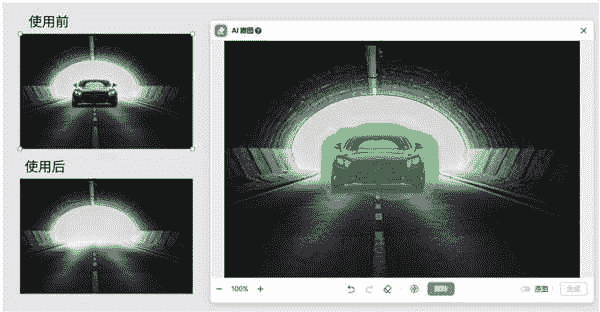

图 3-7 “AI 擦图”插件应用效果

### 3.2.5 高级图表插件

设计中常会用到表格文档，但有时表格数据只是一些数字内容，并不能作为设计元素使用。碰到这种情况，若要对数据资料进行图表化呈现，就只能由设计师自行绘制了，这样很浪费时间。现在，AI 绘制图表的能力很强大，即时设计的“高级图表”插件就可以通过输入表格数据，自动生成样式美观的图表。与可以直接将文档数据变为图表的 AI 插件不同，即时设计的“高级图表”插件可以在选择好需要的图表类型后设置数据、图表样式等参数，然后单击“生成图表”按钮就可以得到可反复编辑的图表，如图 3-8 所示。

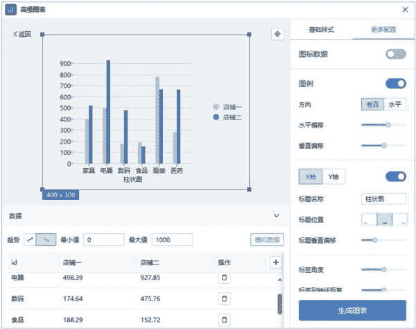

图 3-8 “高级图表”插件设置界面

### 3.2.6 文本翻译插件

当委托方提出了制作双语界面的需求时，很多设计师会感到很抓狂。因为在传统操作中，这样的需求需要设计师先把所有的文字信息逐一复制、翻译，并反复校对内容的准确性后，再逐个放回设计稿中，操作烦琐且容易出错。使用“文本翻译”插件则可以简化这个过程，用户只需选择所有需要翻译的部分，单击“翻译”按钮即可搞定。此外，翻译后的内容不仅准确度高，还会自动对齐，如图 3-9 所示。

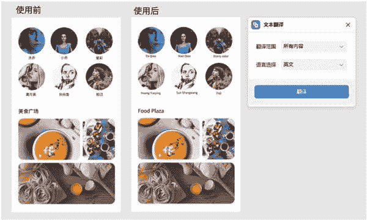

图 3-9 “文本翻译”插件应用效果 EXr6287u6NNVz+GYLY+7SDk226FstKIHdC0bNoQkB2Nqi1xSR0yxPmwrTs5gRi/BtfSbid6dBhii9q7cz2pIyA==

## 3.3 潮流玩法：A1.art 应用

A1.art 是即时设计中主攻 AI 绘画的平台。这个平台非常人性化，既可以自主生成图像，也可以通过他人设置好的流程完成图像转化，旨在降低艺术创作门槛并拓展视觉表现的可能性。本节将主要介绍 A1.art 的应用基础与多种应用场景。

### 3.3.1 应用基础

无论你是想提高绘图水平，还是只想让日常设计任务变得更轻松，A1.art 平台基本能满足你的需求，其界面如图 3-10 所示。其易于使用的界面和出色的功能让 AI 绘画的过程变得轻松有趣。与其他专业平台相比，A1.art 平台的生图界面如搭积木一般，先选择需要的部分，再输入提示词就可以得到神奇的结果。

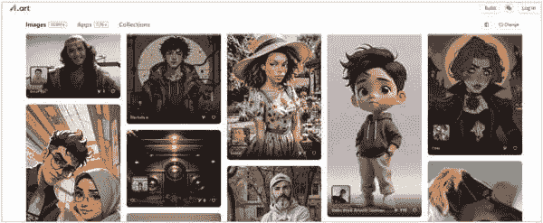

图 3-10 A1.art 平台界面

A1.art 平台里以 Build App（建设应用）功能为 AI 绘画的主要途径，Build App 界面如图 3-11 所示。这个功能有点像 Stable Diffusion 的 Comfy UI 操作理念，但更容易理解。它是以生图功能的种类作为每一个模块，不需要为模块添加流程连线，所以更容易上手。例如，搭建一个生成莫奈画风图像的应用后，就可以大量生成绘画或转换其他普通图像的风格，并可以将这个应用分享给其他用户直接调用。

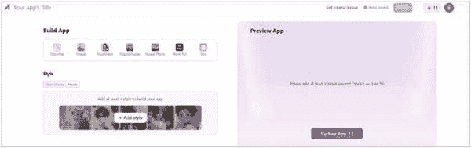

图 3-11 Build App 界面

###### 1\. Description

Description（描述）是应用中的提示词输入模块，作为 AI 绘画生成的核心部分，用户通过填写描述文本即可生成与提示词有关的内容。要注意，提示词应简洁明确，这样生图的成功率会更高。该功能不可独立使用，必须匹配 Style（风格）才可以生成图像，如图 3-12 所示。此外，下载无水印图像时，需要另行支付点数。

图 3-12 Description 功能演示

###### 2\. Style

Style 相当于 AI 绘画里的风格模型，决定了生成图像的绘画风格。A1.art 平台上有很多种风格可供挑选，包括二次元、油画、真人写真、2.5D、3D 等常见风格，还有室内设计、工业设计、景观设计等垂直领域风格，更有意思的是，还有 Cosplay 等换装模型，为用户提供了多样化的 AI 绘画体验，如图 3-13 所示。

图 3-13 Style 中丰富的绘画风格

这些风格可以叠加使用，最多可以叠加 12 种风格。新手在使用时切勿疯狂叠加风格，否则图像可能会无法生成或出现怪异图像。建议在叠加风格时，首先选择风格方向大致相同的进行叠加，之后尝试增加其他风格，并出图测试效果，一旦失败就取消多余的风格。这个过程有点像在网络游戏中给武器进行高阶强化。

###### 3\. Size

Size（尺寸）用于设定输出图像时的尺寸比例，在不设定的情况下默认尺寸比例是 1∶1。除此之外，还有 3∶4 和 2∶1 两种构图。生成图像后直接下载，得到的图像像素会比较低，通过高清化处理可提升画面清晰度。例如，生成一张“戴花环，穿花裙，在花丛中的女孩”图片，生成后的图像是 832×1152 像素，去水印并提升分辨率后的图像是 1664×2304 像素，如图 3-14 所示。

图 3-14 高清无水印图像

### 3.3.2 百变应用

在 A1.art 平台的 Build App 中，Description 和 Style 模块必须添加，还有很多实用型的功能模块，在应用中可以选择性添加。

###### 1\. Image

Image（图像）模块用于对现有图像进行加工，可以理解为图生图功能。其功能的中英文对比展示如图 3-15 所示。Image 的功能很多，大致分类和功能描述如表 3-3 所示。在应用搭建过程中，Image 功能是不可或缺的，掌握其各项功能的使用方法后，可大量减少平面设计的工作任务。

图 3-15 功能中英文对比

表 3-3 Image 的功能及其描述

###### 2\. FaceVideo

FaceVideo（表情视频）属于视频功能。用户将自拍视频上传（仅限面部自拍）至平台，选择任意风格并输入角色描述词，如图 3-16 所示，即可生成一段和上传的视频动作基本一致的角色视频，属于简易的数字人动作模仿。使用该功能可以将自己录制的表情、动作生成各种角色视频，体验不同的角色演绎乐趣。

图 3-16 FaceVideo 生成视频

###### 3\. Digital Avatar

Digital Avatar（数字分身）功能可将用户上传的图像剪切成圆形的头像，如图 3-17 所示。该功能模块可为剪切后的图像叠加 Style 或 Image 效果，进而生成个性的新头像。

###### 4\. Group Photo

Group Photo（合照）功能可以自动识别多人合影中的人物数量，并在生成新图像时，尽可能保持人物数量、位置关系及部分外貌特征，如图 3-18 所示。在使用此功能时，也有可能出现人物数量不足的情况，示例中的 4 张图中就有一张人物数量不对。但如果不使用该功能，出现错图的可能性会提高。该功能在此领域如同过滤器，会尽量筛去错误的图像。

图 3-17 Digital Avatar 生成头像

图 3-18 Group Photo 生成新图像

###### 5\. Word Art

Word Art（文字艺术）功能可以实现当下 AI 绘画中很流行的图中藏字和文字艺术化效果，包括设置调整文字的内容、字体和艺术化形式等。平台提供的英文字体比较丰富，设置完字体后叠加合适的风格即可生成艺术字，如图 3-19 所示。文字的辨识度可以调整，示例中的辨识度设置得较高，易识别。若希望图像中的文字看起来不太明显，可适当降低文字的辨识度。

图 3-19 Word Art 生成新图像

### 3.3.3 换装潮图

在 A1.art 平台中，用户既可以使用官方发布的流程应用，也可以发布自己的流程应用，这个操作使平台的互动氛围良好。用户在浏览效果应用的过程中，常能获得启发，并倾向于直接使用其他用户分享的应用，以亲身体验 AI 绘画的多样化效果。其中，比较受欢迎的流程应用是换装效果。用户可以将一张照片直接替换进好看的样图中，并且更换各种场景、服装、角色，如图 3-20 所示。相比真实的换服装拍照，这个方式更便捷、高效。

图 3-20 换装换场景生成新图像

在需要使用证件照但又来不及拍摄时，可以使用一张普通的照片通过换装生成着正装的证件照，如图 3-21 所示。运用 AI 绘画功能生成的图像，比手机修图软件做的效果好。随时随地将自拍照上传至 A1.art 平台的流程应用中，服装和背景都可自行设定，这样的自由度可能只有 AI 绘画平台才能做到。

图 3-21 换装生成证件照

换装功能让不懂设计的人可以轻松尝试各类服装搭配并预览效果。使用相应的流程应用时，只需选择服装色系即可生成未知的变装效果，无须专业知识也能享受创意实现的乐趣，如图 3-22 所示。

图 3-22 换装换色系生成新图像

用户常用真实的人物进行换装娱乐，是否想过给艺术作品中的人物进行换装呢？例如，为《蒙娜丽莎》换一个不一样的风格装扮，用相关的流程应用来生成一张异域风情的新作，如图 3-23 所示。

图 3-23 为艺术作品中的人物换装

换装应用还有很大的开发潜力，不仅可以用于娱乐，还可以极大提升设计效率，并优化图像编辑、数字艺术等相关专业领域的工作流程。这类功能不仅展现了科技与艺术结合的无限可能，还通过降低艺术创作的门槛，促进创意的广泛传播与共享，为设计行业带来前所未有的创新动力。

### 3.3.4 融合潮图

A1.art 平台中，融合图像的流程应用受到广大用户的喜爱。它可以将两个图像进行融合，生成时会有一些视觉倾向。其中，热度较高的风格融合，就是将图像融合成其他图像的视觉风格，从而生成具有新风格特征的画面，如图 3-24 所示。

图 3-24 风格融合生成新图像

前面的风格融合偏向于对风格的提取，并在主图中进行更多的创意呈现。在搭建流程应用时，如果降低融合图对主图的风格化影响，增强其元素的复刻程度，就可以生成侧重于元素替换的融合效果，如图 3-25 所示。

图 3-25 元素替换融合生成新图像

在融合图像的时候，如果对主图的色彩不满意，可以尝试使用其他的配色方案。生成此类融合效果时，需选用合适的配色方案作为融合图，以对主图进行色彩替换，如图 3-26 所示。

图 3-26 色彩替换融合生成新图像

为黑白照片上色是热度较高的 AI 绘画功能。该功能在为黑白照片上色的同时会进行一定色彩和元素的融合，让黑白经典照片焕发出新的活力，这也是非常有创意的一种流程应用，如图 3-27 所示。

图 3-27 黑白照片融合新色彩和元素生成新图像

图像融合是一个非常有创意的功能，不仅为普通用户提供了一种娱乐尝试，还为专业设计师提供了色彩和元素融合的创作思路。这类流程应用的开发和应用是非常有趣的创意过程，也是用户拓展艺术视野的方式。

### 3.3.5 次元潮图

AI 绘画技术让很多不可思议的绘画尝试变成了易于获取的体验方式，让每个人都可以用艺术的方式去尝试设计。在 A1.art 平台中，次元潮图的流程应用也非常丰富，用户在尝试的过程中可以发现许多艺术绘画的乐趣，如可以让一张图像从写实变为二次元风格 3D 手办或其他绘画风格。

尝试使用这类流程应用将一张照片变成 3D 手办效果，从而可以获得一张定制手办图。在挑选生成手办的应用时，可以挑选生成全身版的，这样 AI 就会根据上传图像中的形象绘制全身版手办图，如图 3-28 所示。

图 3-28 照片生成 3D 手办新图像

当然，也可以选择平台上发布的带有专属动作的 3D 手办流程应用生成新图像。在选择照片时，可以尝试使用平面卡通图像，生成效果别有一番新意，如图 3-29 所示。

图 3-29 卡通图像生成带动作的 3D 手办新图像

在次元的跳转方面，平台上的流程应用也是丰富多样的，除平面转 3D 外，3D 或真人图像转二次元的流程应用也非常有意思，如图 3-30 所示。该功能展现了 AI 绘画技术的强大，这应该算是动漫画手的福音。

图 3-30 3D 人物图生成二次元动漫的新图像

运用合照模块，可以将两张独立的人物图像（图像风格可以不同）组合并生成一张二人合影的图像，如图 3-31 所示。此外，还可以将图像转换为其他次元的风格。这种流程应用如果用在婚纱摄影中，可简化传统摄影中的合成与风格化工作流程。

图 3-31 将两张人物图像生成一张 3D 风格新图像

搭建转换次元风格的流程应用看似只是针对照片的一种娱乐方式，但这是曾经需要几个专业设计师、画师共同参与才能完成的任务。AI 绘画技术将设计师和画师的工作简化了，这预示着未来的设计工作应该更多地关注服务和品质。

### 3.3.6 流派潮图

绘画发展至今，出现了许多种类，如油画、版画、国画、水彩等。在此基础上，思想的演进也产生了许多绘画的流派，这些绘画种类和流派的作品带给了人们不同的视觉感受。如今，AI 绘画也会模仿各种艺术效果，比如已有流程应用能够生成具有印象派凡·高风格的作品，其生成效果如图 3-32 所示。

图 3-32 生成印象派凡·高风格的新图像

照相术的出现，曾引发关于写实绘画价值的深入探讨，这个议题直到今天也有很多人在思考。A1.art 平台也发布了黑白摄影流程应用，它能让一张现代摄影作品转化为有格调的黑白艺术摄影作品，其质感令人仿佛回到了拍摄时会“砰”的一声，并伴随镁光灯火光的年代，生成效果如图 3-33 所示。

图 3-33 生成黑白艺术照风格的新图像

摄影技术的发展也带动了海报、画报的发展。柯达、徕卡等经典相机所产生的彩色照片非常有特色，由此形成的色彩艳丽的海报、招贴画也成了一种时尚风格。通过相关的流程应用，将现代的人物照片添加进去，就可以生成一张极具时代特色的海报图，如图 3-34 所示。

图 3-34 生成复古海报风格的新图像

在现代设计不断追求画面细腻、图像像素精密与视觉风格多元化的今天，人们的审美视野再度回归古典油画上。在 A1.art 平台中找到或搭建这样一个流程应用，为一张照片套用油画效果，很快就可以生成一幅人物油画，如图 3-35 所示。

图 3-35 生成油画风格的新图像

静止的图像主要引发视觉与主观心理层面的感受，而动态的图像拥有声音，变成视频，则感受就更丰富了。从静图到动画跨越了两个艺术领域，而 AI 绘画技术使它们重新建立联系。在 A1.art 平台中找到或利用表情视频模块搭建流程应用，就可以让一张静图有更多的情绪表达和声音效果，让艺术拥有更多的娱乐效果，如图 3-36 所示。

图 3-36 照片生成动态视频效果

除了上述流程应用，还有其他用户分享的流程应用，包括多种艺术流派的视觉风格特征。因为篇幅有限，此处就不展开介绍了。 EXr6287u6NNVz+GYLY+7SDk226FstKIHdC0bNoQkB2Nqi1xSR0yxPmwrTs5gRi/BtfSbid6dBhii9q7cz2pIyA==

## 3.4 聊天设计：Wegic 应用

Wegic 是即时设计中一款基于 GPT-4o 的网站设计聊天机器人。用户通过与 AI 对话，将设计“聊”出来。当它生成网站后，用户还可以继续通过沟通进行修改，最终完成网站设计。Wegic 是一款支持多种语言的聊天程序，它让设计网站和手机 UI 变得更加省力。本节将为大家介绍用 Wegic 生成与修改网站的方法。

### 3.4.1 网站生成

Wegic（见图 3-37）由聊天机器人担任 AI 设计师角色进行网站设计，用户只需要在沟通中回答聊天机器人的提问，就可以在聊天中完成设计。

图 3-37 Wegic 网站界面

Wegic 的网站和聊天界面均是英文的，但用户无须担心英语不好而无法进行沟通。当用户输入中文时，程序会用中文回复。设计规划网站内容的过程中，用户不用过多考虑网站功能体系等细节框架，程序已经将需要思考的大部分设计因素以提问的形式进行获取，如图 3-38 所示。具体细节可以在大致框架生成以后再进行修改，直至设计效果符合需求为止。

图 3-38 Wegic 的聊天机器人询问设计需求

Wegic 的聊天机器人不像 ChatGPT、文心一言等通用对话模型那样对用户的各类问题均进行畅聊，它基于预设的设计节点问题展开，用户不会把聊天机器人带偏，它会很坚定地与用户周旋，从而得到关于节点问题的信息。例如，聊天机器人在询问网站语种时，用户故意岔开话题，它是不会“接招”的，如图 3-39 所示。

图 3-39 无法打岔聊天机器人的程序化提问

### 3.4.2 网站修改

完成 Wegic 聊天机器人的所有提问后，系统会自动生成网站初稿。此过程可以理解为用户填写了构建网站所需要的相关模块信息的提示词，AI 通过对这些内容的理解，生成了网站界面。其中，生成的网站包括移动端和电脑端两种效果。生成后的网站必须进行修改，毕竟现代技术还没有办法一步到位地生成用户满意的网站。网站右侧会有对话框，修改时还是与聊天机器人进行沟通，如图 3-40 所示。用户指出网站中需要修改的部分并回应 AI 的细化问题，从而逐步完成网站的修改。

图 3-40 网站进入修改阶段

网站的修改除了与聊天机器人进行沟通，还支持用户自行修改，包括添加或修改文字内容、添加链接、更改图片，以及手动调整修改区域的版式或修改上传版式参考图。修改的过程就好像这样一个场景：自己是甲方，与设计师一起坐在电脑前，自己指出修改区域后，设计师立刻进行修改。相信这是很多设计师、甲方都亲身经历过的日常，等一切都修改好后，用户可以通过 Wegic 平台发布网站。此外，可以通过链接将网站分享给其他人体验，如图 3-41 所示。注意，发布的网站也可以收回。

图 3-41 发布后通过链接打开网站

Wegic 凭借搭载 GPT-4o 的聊天机器人，能够为各类用户提供全面的网站设计服务。虽然功能看似简单，但都在比较实际地解决新工作流程中可能出现的问题。Wegic 这种对话式的设计，预示着未来更多设计门类将探索类似的技术驱动型工作新范式。 EXr6287u6NNVz+GYLY+7SDk226FstKIHdC0bNoQkB2Nqi1xSR0yxPmwrTs5gRi/BtfSbid6dBhii9q7cz2pIyA==

## 本章小结

即时设计是一个线上 UI 设计平台，在 AI 技术应用上通过增加 AI 插件等功能，显著提升了 UI 设计效率；在 AI 绘画领域，A1.art 在原生操作基础上简化了烦琐的功能设置，以搭建工作流程和分享的方式，帮助用户快速生成各类图像效果；Wegic 以对话的方式帮助用户生成和修改网站，是设计方法上的创新。以上功能虽然涉足的领域不同，但 AI 绘画技术正在以多种形式推动设计工作效率的提升。 EXr6287u6NNVz+GYLY+7SDk226FstKIHdC0bNoQkB2Nqi1xSR0yxPmwrTs5gRi/BtfSbid6dBhii9q7cz2pIyA==

# 第四章
新生实力派：Stable Diffusion 实操应用

本章导读

AI 时代，电脑作为创作载体，使绘画与设计的边界变得不那么清晰，手绘能力和设计技术也并非评判艺术作品的唯一标准。Stable Diffusion 的出现，颠覆了非专业人士无法画出好作品的状况，使人们能够将对美的热爱转化为具体可见的图像。本章将介绍 Stable Diffusion 的基础功能和操作技巧，帮助用户快速上手运行该软件。 EXr6287u6NNVz+GYLY+7SDk226FstKIHdC0bNoQkB2Nqi1xSR0yxPmwrTs5gRi/BtfSbid6dBhii9q7cz2pIyA==

## 4.1 Stable Diffusion 横空出世：软件介绍

Stable Diffusion 作为一款 AI 绘画工具，其本身是一个开源的 AI 模型，使用它需要具备一定的计算机语言和编程基础，这对于大多数不熟悉代码的用户来说构成了使用门槛。因此 Github 社区出现了 Stable Diffusion Web UI 的开源项目，旨在为 Stable Diffusion 编写 Web UI 版本，以降低其使用门槛，使普通用户也能通过可视化界面轻松使用。从此，Stable Diffusion Web UI 就在广大用户中流传起来。本节将介绍 Stable Diffusion 软件的配置及相关基础知识。

### 4.1.1 配置要求

以 Stable Diffusion 为运算内核的线上绘画平台有许多，对电脑硬件配置没有过高要求，但在线平台通常需要支付服务费用；而离线版本虽基本免费，但需要电脑硬件配置较高，扩展插件和绘画模型需要自行收集。本节将介绍基于“绘世”启动器的 Stable Diffusion Web UI 版本，其简洁的中文启动界面让大多数用户可以快速完成设置并开始使用。

电脑运算能力不足曾经一度限制着 AI 的发展，Stable Diffusion 软件也不例外，对电脑的配置也有一定的要求。其中显卡算力尤为关键，它直接决定了图像生成的精细程度。用户可根据需要来搭配电脑硬件。

###### 1．配置推荐

想要流畅体验 Stable Diffusion 的 AI 图像生成功能，需要加强 3 个方面的配置：运算能力强的处理器、大容量高速内存和高性能显卡（见表 4-1）。若笔记本电脑的配置够强大也是可以的，但笔记本电脑高速运行时温度过高，必要时请配置散热底座等辅助设备进行合理降温。当然，最好还是使用台式电脑。

表 4-1 Stable Diffusion 配置推荐

续表

###### 2．参数解读

2022 年 10 月，Stable Diffusion 尚处于基础版本阶段，其 AI 绘画过程的可控性较差。尽管后续版本有所改进，但可控性并没有被完全提升。2023 年 1 月和 7 月，Stable Diffusion 陆续推出了 LoRA 和 ControlNet 等插件，这才极大地提升了绘画过程中的可控性，助力 AI 绘画向着成为新的生产力这一方向迈进了一大步。这些进步极大提升了动画、游戏原画和概念设计等领域的工作效率。随着插件的丰富和模型训练群体的扩大，更多设计工作的效率被提升，软件对电脑配置的要求也不断提高。下面对关键硬件参数进行说明。

（1）CPU 推荐使用 Intel 第 12 代或 13 代以后的处理器，因为处理器在更新换代后，很多新款中端处理器的性能比几年前高级处理器还要强。

（2）内存在同样的容量下，需关注其代际与频率，配置中推荐选用 DDR4 及以后规格的内存。

（3）显卡方面首选 NVIDIA 显卡。显存容量对处理高分辨率图像至关重要，RTX 系列的显卡在此类任务中有很好的表现。

（4）硬盘方面要够快和够大，推荐使用固态硬盘（SSD），以确保更好地发挥电脑整体配置的性能。此外，存储众多模型和插件也需要更多的硬盘空间。

### 4.1.2 Stable Diffusion Web UI 介绍

Stable Diffusion 中文整合包应用最广的版本之一是知名 UP 主“秋葉 aaaki”发布的绘世整合包，它在国内大部分 AI 绘画爱好者中应用率较高。这个整合包只需要下载后解压文件就可以使用，极大简化了原本复杂的安装与部署流程，避免了用户在安装阶段因技术门槛而放弃。需要提示一下，这个程序较大，并且后续收集的很多模型、插件、生成的图像将占用大量存储空间，解压时可以选择剩余空间较大的硬盘分区作为 Stable Diffusion 的专属硬盘。单击整合包中 AI 启动器的卡通图标，就可以进入启动器管理界面，这是运行软件前的基础设置界面，如图 4-1 所示。

“一键启动”按钮用于开启 Stable Diffusion Web UI。之所以叫“Web UI”，是因为其操作界面在 Web 浏览器中运行。启动前最好更新浏览器和显卡驱动，以免程序无法正常运行。

在“高级选项”界面中，需要检查一下“高级选项→性能设置→生成引擎”，用户应根据自己显卡的配置进行相应选择，以更好地发挥显卡的性能，如图 4-2 所示。然后选择“高级选项→网络设置→启用 API”，这样其他软件和 Stable Diffusion 就可以联动操作了。

图 4-1 启动器界面

图 4-2 “高级选项”界面

“模型管理”界面是 Stable Diffusion 中管理各类模型的功能区域，如图 4-3 所示。这里显示着已安装的模型及大量推荐模型和下载链接，用户可直接单击下载，下载速度根据个人的网络环境决定。但因为这里的模型只展示名称且看不到生成效果，所以建议用户去其他专业网站下载，以便更直观地评估模型的风格与质量。

图 4-3 “模型管理”界面

单击“一键启动”按钮后，Stable Diffusion Web UI 就会在电脑默认浏览器上运行。初次看到图 4-4 所示的这个界面会觉得里面的功能内容特别多，但熟悉以后就会发现并不是很复杂。它主要分为 3 个部分：必要运行部分、提示词部分和参数调整部分。

图 4-4 Stable Diffusion Web UI 界面

必要运行部分就是生成图像时必须参与运行的模块，位于界面的最上方，分别是“Stable Diffusion 模型”“外挂 VAE 模型”“CLIP 终止层数”。“Stable Diffusion 模型”用于设置绘画风格，如 3D 风格、二次元风格等；“外挂 VAE 模型”用于设置图像微调滤镜，以把控色彩优化和画面质感；“CLIP 终止层数”用于控制出图结果与提示词的关联强度，数值越大相关性越低。例如，将“CLIP 终止层数”分别设置为“1”和“12”，输入相同的提示词：“a girl, gray jacket, full body, sitting, flowers, jeans, front”（一个女孩，灰色夹克，全身，坐着，鲜花，牛仔裤，正面），生成的图像如图 4-5 和图 4-6 所示。明显可以看出，“CLIP 终止层数”为“12”时，提示词内容基本被 AI 忽略了。通常“CLIP 终止层数”保持默认设置“2”即可。

图 4-5 “CLIP 终止层数”为“1”的图像效果

图 4-6 “CLIP 终止层数”为“12”的图像效果

合理的提示词搭配参数设置就可以得到一张又一张的精美图像。必要运行部分下方有一排功能标签：文生图、图生图、后期处理等。切换功能标签，提示词和参数调整部分的功能布局就会发生变化；添加新插件，功能标签中也会相应添加。 EXr6287u6NNVz+GYLY+7SDk226FstKIHdC0bNoQkB2Nqi1xSR0yxPmwrTs5gRi/BtfSbid6dBhii9q7cz2pIyA==

## 4.2 Stable Diffusion 绘画功能：模型分类

Stable Diffusion 的强大功能来自其模型运算，通过各种模型的运算生成不同风格的图像。本节将通过对 Stable Diffusion 中所运行的各种模型的功能进行介绍，帮助读者更深入地认识和操作该软件。

### 4.2.1 Checkpoint 主模型

许多用户在安装好 Stable Diffusion 后，会迫不及待地在提示词里输入自己脑海中的各种描述内容，然后单击“生成”按钮生成图像。在等待后看到一张效果杂乱的图像，心中可能会感慨一句：“都是骗人的！”也许用户在提示词中也努力加入了许多表达细节，但一切努力都付诸东流。没有正确选择 Checkpoint 主模型，可能就是导致这些问题出现的原因。Checkpoint 主模型就像一个风格素材库，它在训练过程中会侧重于某类素材，从而形成特定的风格倾向，假如想生成偏真人的图像，可以选择偏写实风格的主模型；想创作动漫风格，就选择偏二次元类的主模型；想渲染效果图就选择偏效果图类的主模型，以此类推。

我们也可以通过生成图像作品来分析模型的偏好特征。以 ReV Animated 这款 Checkpoint 主模型为例，要测试它生成图像的风格偏好，可以分别生成抽象、二次元、写实、设计创作 4 种类型的图像。

输入提示词：“indoor, bold lighting, blue and white colors, wavy resin plate, fluid background, depth of field, many flowers, leather sofa, rich details, high definition”（室内，大胆的灯光，蓝色和白色，波浪形树脂板，流体背景，景深，许多花朵，皮质沙发，丰富的细节，高清），生成的图像偏抽象创意风格，并不像写实照片那样真实，但具有较强的空间感，如图 4-7 所示。

图 4-7 生成抽象创意室内设计图像

图 4-8 生成动漫风格的图像

继续使用 ReV Animated 这款 Checkpoint 主模型，输入提示词：“a young and beautiful girl, best quality, detailed background, anime, long hair, very detailed face, very detailed eyes, white mecha clothes, night, space, horizon, beautiful and detailed starry sky, city summit, single person focus, depth of field, movie lighting, atmospheric lighting, science fiction, full body”（一个年轻漂亮的女孩，最佳品质，细致的背景，动漫，长头发，非常细致的脸，非常细致的眼睛，白色机甲衣服，夜晚，太空，地平线，美丽细致的星空，城市峰会，单人对焦，景深，电影照明，氛围照明，科幻小说，全身），生成的机甲动漫风格的图像如图 4-8 所示。该作品幻想的内容丰富，需要描述的内容就要相对丰富一些。此外，生成的作品立体感强、质感清晰，有别于 2D 的平面作品。

通过前两张作品的生成效果，基本可以判断该模型偏好 2.5D 风格，画风中带有一定的欧美漫画效果，在塑造真实感方面具有较好的效果。

进一步生成人物写实作品，以验证模型的写实倾向——属于漫画写实还是照片写实。输入提示词：“masterpiece, best quality, a girl, on the beach, exquisite patterns, intricate details”（杰作，最佳品质，一个女孩，在海滩上，精美的图案，错综复杂的细节），生成的效果偏向 2.5D 漫画写实，如图 4-9 所示。

在此基础上还可以测试该模型在场景塑造方面的能力。输入提示词：“indoor, pastel color, comfortable natural light, cube, gold, arch, metal ball, plant”（室内，柔和的色彩，舒适的自然光，立方体，金色，拱形，金属球，植物）。生成的图像在场景方面的表现可以媲美效果图的质量，如图 4-10 所示。其鲜明的 2.5D 风格视觉特点，尤其适合生成概念风格的效果图。

图 4-9 生成人物漫画写实风格的图像

进行一系列测试后，我们对 ReV Animated 这款 Checkpoint 主模型的特点已有了比较深入的了解，日后使用时更能有的放矢。在接触其他模型的过程中也可参照此方式进行测试。

如果使用 ReV Animated 主模型生成真人图像，其结果往往与预期效果有一定的距离。生成写实的图像就应该选择写实类型的主模型，这样才能得到理想的效果。例如，使用偏写实人物风格的 majicMIX realistic 麦橘写实主模型生成一位亚洲男性。输入提示词：“an Asian male, handsome, mature, face, white background, short hair”（一个亚洲男性，英俊，成熟，脸，白色背景，短发），生成的图像如图 4-11 所示。

图 4-10 生成场景设计图像

好用的主模型会涵盖大量的绘画因素，majicMIX realistic 麦橘写实就是一款包含大量绘画因素的主模型。在生成人物方面，它除生成亚洲人物效果较好外，生成欧洲人物图像的效果同样不错。输入提示词：“a European male, handsome, mature, face, white background, short hair”（一个欧洲男性，英俊，成熟，脸，白色背景，短发），生成的图像如图 4-12 所示。注意，在选择模型时，尽可能选择人气和口碑较高的模型。

图 4-11 生成一位亚洲男性的图像

图 4-12 生成一位欧洲男性的图像

用户在学习的过程中，可以多去专业网站上看看，收集不同类型的模型。国内的“Liblib AI”“吐司”“炼丹阁”等都是比较好的模型资源平台，下载速度比国外的快很多，并且每个模型都有很多用户生成的作品作为参考；国外的 Civitai（简称 C 站）、huggingface 等都是下载模型的主要渠道。下载好的主模型需放入“SD 主程序目录\models\Stable-diffusion”文件夹中。只有多浏览、多生成才能很快找到模型的操作规律，并筛选出适合自己需求的常用主模型。主模型的体积基本在 2GB～8GB。在使用 Stable Diffusion 进行 AI 绘画的过程中，主模型是比较耗费硬盘空间的主要因素之一，建议用户有计划地安排使用存储空间。

### 4.2.2 VAE 模型

VAE（Variational auto-encoders，变分自编码器）属于深度生成模型的一种。在 Stable Diffusion 中，VAE 模型的使用频率较高，主要用于调整图像色彩。简单来说，VAE 模型的作用类似于滤镜功能，通过实际案例就可以直观理解这个模型的效果。输入提示词：“European, ((middle-aged male)), mature, face, white background, (portrait), looking at viewer, blonde hair”[欧洲人，（（中年男性）），成熟，脸，白色背景，（肖像），看向观者，金发]，然后生成未使用 VAE 模型和使用 VAE 模型的图像，如图 4-13 和图 4-14 所示。

图 4-13 未使用 VAE 模型生成的图像

图 4-14 使用 VAE 模型生成的图像

可以很明显地看到，未使用 VAE 模型的画面色调偏灰白，而使用 VAE 模型之后，人物肤色变得红润，对比度得到增强，画面显得更加生动。

VAE 模型的安装和主模型类似，下载后将文件直接放入“SD 主程序目录\models\VAE”文件夹中即可在程序里使用。有的 VAE 模型需要和相应的主模型搭配使用，才能实现更好的视觉效果。用户在下载主模型时，可以注意一下模型的相关介绍。

### 4.2.3 Embedding 模型

Embedding 模型的中文名称为“嵌入式模型”，可以理解为将某种内容进行打包的训练模型，在需要时将这个模型参数加入画面中。Embedding 模型常用于反向提示词的打包，其中使用率很高的 Embedding 模型为 EasyNegative。下面以案例来说明使用 EasyNegative 前后的效果，输入同样的提示词：“realistic, extremely detailed, dynamic angle, a girl, space_suit, many colors, bright eyes, looking to the side”（写实，极其细致，动态角度，一个女孩，宇航服，多种颜色，明亮的眼睛，看向侧面），生成两张图像，如图 4-15 和图 4-16 所示。其中，图 4-16 所示使用 EasyNegative 对画面进行了缺陷控制，减少了肢体和身体的异形现象。

图 4-15 未使用 EasyNegative，人物身体和手臂都呈现不同程度的异形现象

图 4-16 使用 EasyNegative 后人物肢体正常

通过使用 Embedding 模型，可以调整画面的细节，但模型与模型之间的相互搭配并不是粗暴地加在一起就可以实现好的效果，胡乱搭配很容易导致图像崩坏。建议以模型介绍中描述的参数设置为基准，可以在其基础上适当浮动。如果风格相差太大，则不建议强行搭配，否则很容易生成奇怪的图像。Embedding 模型同样可以在模型资源网站里获取，下载后将其直接放入“SD 主程序目录\Embeddings”文件夹中即可使用。

### 4.2.4 Hypernetwork 模型

Hypernetwork 模型的中文名称是“超网络模型”，其作用是在原有画面的基础上修改视觉风格，可以理解为将原画面的画风和元素进行更改。

以一张二次元图像为例，输入提示词：“a girl, solo focus, masterpiece, best quality, view from below, slender body, excited, open mouth, nightwear”（一个女孩，单人焦点，杰作，最佳品质，仰视视角，苗条身材，兴奋，张着嘴巴，睡衣），生成的图像如图 4-17 所示。

图 4-17 未使用 Hypernetwork 模型生成的二次元漫画风格的图像

为了改变二次元漫画风格，加入 Hypernetwork 模型，这里仍然使用原有的提示词，只是分别增加了 3D 手办和水墨两种风格的 Hypernetwork 模型，生成的图像如图 4-18 和图 4-19 所示。大家可以明显看到画风的转变。

图 4-18 加入带有 3D 手办效果的 Hypernetwork 模型生成的图像

图 4-19 加入水墨笔触效果的 Hypernetwork 模型生成的图像

目前，Hypernetwork 模型在效果稳定性、训练便捷性和兼容性方面均不及 LoRA 模型，因此使用该模型的用户数量逐渐减少，相关资源也相对较少。在网上搜集并下载的 Hypernetwork 模型文件，只需直接放入“SD 主程序目录\models\hypernetworks”文件夹中即可在程序里使用。

### 4.2.5 LoRA 模型

LoRA 模型的全称是 Low-Rank Adaptation of Large Language Models，中文名称为“大语言模型的低阶适应”，可以理解为 Stable Diffusion 主模型的过滤器。LoRA 模型可利用少量数据训练出特定画面风格或人物造型，准确输出相应特征的图像。由于非常适合普通用户和个人开发者使用，LoRA 模型在用户中极为流行，国内多数线上 AI 平台的训练模型也以 LoRA 模型为主。该模型文件体积比较小，对电脑不会造成太大存储压力，下载后直接放入“SD 主程序目录\models\Lora”文件夹中即可使用。

添加 LoRA 模型时，可以在提示词中加入触发词来更好地激活模型，也可直接使用。使用时，权重设置得越高，越贴近 LoRA 模型的视觉效果。LoRA 模型为主模型叠加效果后，相当于一个复合且更加限定特征的新模型。以生成一个场景为例，未使用 LoRA 模型时，输入提示词：“interior, hall, big window, no humans, scenery, cinematic lighting, strong contrast, best quality, masterpiece”（室内，大厅，大窗户，无人，风景，电影灯光，强对比度，最佳品质，杰作），生成的图像如图 4-20 所示。生成的图像为写实风格的欧式室内大厅，这是主模型偏向的图像风格。

图 4-20 使用写实模型生成的室内场景

保持提示词不变，加入不同的 LoRA 模型后，画面就会出现不同的变化。这里选择清冷风格、曲面元素、剪纸元素与废土风格的 LoRA 模型，分别与主模型搭配生成图像，权重统一设置为 1.00。先加入清冷风格 LoRA 模型，模型的灰冷色调使画面内容变得更加冷清，且建筑场景也发生了变化，如图 4-21 所示。当只加入曲面元素 LoRA 模型时，画面内容变成了曲面造型的概念餐厅的大厅效果，如图 4-22 所示。

图 4-21 加入清冷风格 LoRA 模型生成的图像

图 4-22 加入曲面元素 LoRA 模型生成的图像

接着，尝试只加入剪纸元素 LoRA 模型，图像变成了剪纸风格的室外花园，画面风格鲜明，呈现出的场景已经不是提示词描述的大厅，而变成了建筑大厅外的楼梯，并生成了大量的树木与植物，如图 4-23 所示。

图 4-23 加入剪纸元素 LoRA 模型生成的图像

最后，尝试只加入废土风格 LoRA 模型，生成的图像依然是一个欧式建筑的大厅，破败陈旧的场景效果很好地反映了所加模型包含的视觉元素。值得注意的是，加入不同风格的 LoRA 模型，为什么有时生成结果与原图较为接近，有时却似乎与提示词关联较弱，甚至出现与未加载任何 LoRA 模型时完全不同的图像？从这些现象来看，LoRA 模型在风格控制上的表现似乎呈现褒贬不一的效果。

图 4-24 加入废土风格 LoRA 模型生成的图像

这样分析 LoRA 模型的功能其实是比较片面的。作为当下使用最广的辅助模型之一，LoRA 模型在训练的过程中所需要的数据量较少，视觉风格更加明确，触发后生成的图像在元素和风格上也与训练素材非常接近。例如，清冷风格、曲面元素、剪纸元素的 LoRA 模型，其训练素材中可能没有欧式室内场景，因此在权重为 1.00 时，生成图像的整体风格被完全替换；而废土风格的 LoRA 模型保留了原图的欧式室内特征，说明该模型在训练时包含相关的素材。由此可见，LoRA 模型具有“所见即所得”的特性，权重的参数设置将成为显示原图特征与 LoRA 模型特征比例的关键。若 LoRA 模型特征为机甲战士，使用该模型生成的图像必然包含机甲元素。这种高度可预测性，正是 LoRA 模型广受欢迎的关键。至于所选模型对画面的影响强度，则可以通过权重设置来调节。

在视觉元素和画面控制上，不同的 LoRA 模型有不同的功能侧重：有的模型可以固定面部特征，有的模型可以固定人物的妆容服饰，还有的模型可以转换图像背景等。在生成画面时，这些模型往往会被组合使用，以高效地生成接近创作者所需的图像，有时还会有意外的收获。在这个过程中，部分提示词的作用可能被弱化，甚至出现与提示词相悖的画面内容，但一切都以创作者最终的目标为准。例如，想生成一个中国武侠风的图像，要有江湖腥风血雨的感觉，这时选择加入水墨画作、飞溅艺术风格、氛围效果 3 种 LoRA 模型，并输入提示词：“a male, face close-up, highest quality, masterpiece, rich details, ink, wearing a hat, long hair, heavy snow, red, (long eyelashes, black eyeliner), Chinese sword, half body photo”[一个男性，脸部特写，最高质量，杰作，丰富的细节，墨水，戴帽子，长发，大雪，红色，（长睫毛，黑色眼线），中国剑，半身照]，生成的画面非常富有中国韵味，飞溅的水墨营造出风雨飘摇的氛围，人物面部也相对写意，火光飞射的红色让画面更加生动，非常接近创作初衷，如图 4-25 所示。

下面我们将加入的 3 个 LoRA 模型逐个删除。在逐步删除已加载的 LoRA 模型并同步生成图像的过程中，若每一步所得到的画面仍能较好地符合预期效果，则说明在该使用场景下，LoRA 模型对于实现目标画面的作用有限；反之，若移除模型后画面效果显著偏离预期，则证明 LoRA 模型在快速、精准地生成目标风格图像方面具有重要的实用价值。

首先，在提示词不变的情况下，仅删除氛围效果 LoRA 模型，生成的图像比较关注提示词中的“面部特写”，放大了面部所占比例，图像也基本满足创作初衷，如图 4-26 所示。

图 4-25 同时加入水墨画作、飞溅艺术风格、氛围效果 3 种 LoRA 模型生成的图像

图 4-26 仅删除氛围效果 LoRA 模型生成的图像

其次，将飞溅艺术风格 LoRA 模型删除，可以很明显地看到，生成图像中的主人公更像一个风度翩翩的富家公子。其目光虽然锐利，但缺乏快意恩仇的江湖气息，基本偏离了创作初衷，如图 4-27 所示。

最后，将水墨画作 LoRA 模型也删除，回归主模型的风格。随机生成的画面中，主人公手握带鞘长剑、身着汉服，天真的眼神与江湖氛围毫无关联，如图 4-28 所示。由此可见，为了提升出图效率，选择合适的 LoRA 模型是非常有必要的，尤其是需要表现图像意境时，LoRA 模型更是一大利器。

图 4-27 继续删除飞溅艺术风格 LoRA 模型生成的图像

图 4-28 删除氛围效果、飞溅艺术风格、水墨画作 3 种 LoRA 模型生成的图像 EXr6287u6NNVz+GYLY+7SDk226FstKIHdC0bNoQkB2Nqi1xSR0yxPmwrTs5gRi/BtfSbid6dBhii9q7cz2pIyA==

## 4.3 Stable Diffusion 描述语法：优化提示词

撰写提示词一直是很多用户苦恼的事情。虽然了解了模型的风格效果，也尝试使用他人的提示词生成了令人惊喜的图像，而自己却写不出理想的提示词，可能写完“a boy”或“a girl”之后大脑就一片空白了。本节就来介绍提示词的编写方法，让你与 AI 绘画工具的“沟通”更加顺畅。

### 4.3.1 正向提示词与反向提示词

在 Stable Diffusion 中，图像生成主要依靠提示词进行描述。无论是文生图还是图生图功能，均有提示词输入框。在撰写提示词的时候，可以参照这个逻辑：画面质量、画面风格、画面主体和画面场景等（见表 4-2）。一般来说，以这种方式描述画面，生成的图片失败率会大大降低。

表 4-2 提示词参考逻辑

提示词分为正向提示词（Prompt）和反向提示词（Negative Prompt）。正向提示词可以理解为你想呈现的内容，反向提示词就是你不希望在图像里出现的元素。现在我们以刚才的提示词参考逻辑撰写正向提示词：“high definition, photography, realistic style, 1/3 body, an elderly man, wrinkles,vicissitudes of eyes, T-shirt, short hair, city streets, at night, street lamps, looking up”（高清，摄影，写实风格，1/3 身长，一个年老的男人，皱纹，饱经沧桑的眼神，T 恤，短发，城市街道，夜晚，路灯，抬头），生成的图像如图 4-29 所示。

图 4-29 按照提示词参考逻辑生成的图像

这个图像存在较多瑕疵，比如画面的比例、手部、大臂等都存在问题，因此需要加入反向提示词。反向提示词一般用于修正手、脚、头的错位问题，以及改善口眼歪斜、面部杂色等常见图像问题。用户可在此基础上增加其他内容，让画面更精确，避免画面出现反向内容，降低生成错误图像的概率。正向提示词不变，加入以下反向提示词：“bad anatomy, skin blemishes, facing away, tilted head, lowres, missing fingers, extra fingers, bad feet, poorly drawn face, mutation, deformed, extra limbs, malformed limbs, fused fingers, long neck, cross-eyed, mutated hands, bad body, bad proportions, signature, watermark, blurry, cropped, jpeg artifacts, text, error”（解剖结构错误，皮肤瑕疵，背对着，倾斜的头部，低分辨率，缺失手指，多指，不良的脚，面部绘制拙劣，突变，变形，多余肢体，畸形的四肢，融合的手指，长颈，内斜视，变异的手，身体畸形，比例失调，签名，水印，模糊，裁剪，JPEG 伪像，文本，错误），生成图像的效果有了较大的改善，如图 4-30 所示。

图 4-30 提示词不变，加入反向提示词后生成的图像

### 4.3.2 增强与减弱

在图像提示词中，多数用户采用平铺直叙的方式，但也有部分用户会把比较重要的词放在前面，这的确是一种有效的方法。但提示词较多时，AI 也无法理解用户更偏向哪些内容。这种情况下，提示词之间的强弱区别就需要用符号标注出来，见表 4-3。权重的量化调整能使生成过程更具可控性，从而更快生成接近目标的图像。

表 4-3 提示词权重增强或减弱的写法

设置提示词权重的强度，有助于告诉 AI 提示词孰轻孰重，从而使画面的关键点更容易把握。以生成一个主体女孩的图像为例，输入未加权重的提示词：“high definition, photography, anime style, a girl, two dogs, red eyes, T-shirt, short hair, city streets”（高清，摄影，动漫风格，一个女孩，两只狗，红眼睛，T 恤，短发，城市街道），生成的图像如图 4-31 所示。其中，左下角的狗和人物脑袋比例差不多，前景与中景图像没有主次之分。

保持提示词内容不变，仅为“一个女孩”添加 50%的权重，修改为：“high definition, photography, anime style, (a girl:1.5), two dogs, red eyes, T-shirt, short hair, city streets”[高清，摄影，动漫风格，（一个女孩：1.5），两只狗，红眼睛，T 恤，短发，城市街道]，生成的图像如图 4-32 所示。其中，两只狗在画面中的权重很明显降低了，女孩在画面中的主体感加强，整个画面主次分明。

图 4-31 未设置权重时生成的图像

图 4-32 添加权重后生成的图像

### 4.3.3 混合

在图像提示词中，对复杂或混合型特征的描述往往需要借助一些特殊的方式。例如，发色混合两种或 3 种颜色，如果直接描述为“一半红一半蓝头发，发色混合”，即输入提示词：“high definition, photography, realistic style, a girl, half red hair, half blue hair, mix hair color”（高清，摄影，写实风格，一个女孩，一半红头发，一半蓝头发，混合发色），虽然已经说明了发色需要混合，但关于如何混合，AI 并不清楚，而且可能会生成各种各样的混合形式，也有可能生成的样子真的是半蓝半红，如图 4-33 所示。因此，在写混合目标的提示词时，需要通过一种能够让 AI 明白的语法来表述。

以红蓝发色混合为例，应该写作“red hair and blue hair”或“red|blue hair”，这样才能使之前画面中女孩头发的色彩混合自然。如果需要对头发颜色的比例进行设置，就相当于设置提示词的权重，只需要加入数字代表比例即可。例如，红色和蓝色为 1∶3，可写作“1 red hair and 3 blue hair”或“1 red|3 blue hair”。输入修改的提示词：“high definition, photography, realistic style, a girl, 2 red|1 blue hair”（高清，摄影，写实风格，一个女孩，2 红色|1 蓝色头发），生成的图像中，女孩的头发色彩按照比例自然混合，如图 4-34 所示。

图 4-33 通过常规描述生成的两种发色混合的图像

图 4-34 通过正确的语法描述生成的两种发色混合的图像

### 4.3.4 渐变

在前面案例中，将不同颜色的头发混合，相当于两种色彩的事物自然混合放置，各自保持独立，不会出现新的颜色属性。如果想让颜色呈现渐变效果，就需要使用另外一种表述。以红色到蓝色的渐变头发为例，“[red:blue:0.5]hair”代表红与蓝各占 50%的渐变头发；“[red:blue:0.3]hair”代表红色到蓝色的渐变头发中，红色占 30%，蓝色占 70%。按照这种写法输入提示词：“high definition , photography, realistic style, 1/3 body, a girl, [red:blue:0.5] hair”（高清，摄影，写实风格，1/3 身长，一个女孩，[红：蓝：0.5]头发），生成的图像中，女孩红蓝发色以 1∶1 的比例均匀过渡，如图 4-35 所示。

如果并不想要红色到蓝色的渐变头发，而是想要红色到透明或透明到蓝色的渐变头发，那么写法就要更改一下。例如，20%红色到透明的渐变头发，可以写成“[red:0.2]hair”;60%透明到蓝色的渐变头发，可以写成“[blue:0.4]hair”，只写出有色部分所占的比例即可。输入提示词：“high definition, photography, realistic style, 1/3 body, a girl, long hair, [blue:0.4]hair, white T-shirt”（高清，摄影，写实风格，1/3 身长，一个女孩，长发，[蓝色：0.4]头发，白色 T 恤），从生成的图像中可以看出，头发的尾端渐变为了蓝色，如图 4-36 所示。

图 4-35 按照渐变提示词生成的图像

图 4-36 按透明到蓝色的渐变提示词生成的图像

### 4.3.5 交替

在 AI 绘画过程中，用户可以利用交替的方式进行关键词的轮流使用，写作“[tag|tag|tag|...]”。这里的关键词可以写很多，之后进行交替绘画，比如生成一个牛马，交替的过程往往是先绘制牛再绘制马。输入提示词：“[cow|horse]”（[牛|马]），生成了一个牛的身体和马的四肢进行合体的动物，如图 4-37 所示。按照这个逻辑，如果想创作一些怪兽、神兽等，使用这种写法应该也是没有问题的。

图 4-37 使交替的语法生成的牛马合体的图像 EXr6287u6NNVz+GYLY+7SDk226FstKIHdC0bNoQkB2Nqi1xSR0yxPmwrTs5gRi/BtfSbid6dBhii9q7cz2pIyA==

## 4.4 Stable Diffusion 词中有画：文生图

掌握模型特性和语法结构，只是对 Stable Diffusion 有了初步的了解。在实际绘画中，还需要熟练运用各项功能参数，才能由理论转化为理想的画面成果。本节主要介绍文生图过程中的参数设置，这些设置也是生成画面的重要环节。

### 4.4.1 迭代步数

迭代步数是指 AI 在生成图像的过程中，每执行一步就对关键词和画面内容进行一次校准。通常步数越多，画面就会越精细，细节、光线、质感等都会有所优化，但迭代步数也不是设置得越高越好。如图 4-38 和图 4-39 所示，输入同一提示词“strong man”（强壮男性），在不同的主模型中生成不同风格的图像。从迭代步数上可以看出，2.5D 风格的图像在 20 步左右就基本完成了所有的画面效果，25、30 步的迭代几乎没有明显变化；虚拟仿真风格的图像在 25 步后也没有明显的变化。由此可见，多数情况下将迭代步数设置在 30 以内即可。设置过高的步数，既不能生成更好的图像效果，还浪费时间。但如果某些主模型或 LoRA 模型需要更多的迭代步数，那就按照具体模型的要求增加迭代步数即可。

图 4-38 2.5D 风格下不同迭代步数生成图像的差异

图 4-39 虚拟仿真风格下不同迭代步数生成图像的差异

### 4.4.2 采样方法

采样的过程其实就是去噪的过程。从上一小节中设置迭代步数的图中可以看出，AI 绘画初始阶段的画面混沌模糊，但随着迭代步数的增加，画面逐步清晰起来，最终画面中的瑕疵消失。不同的采样方法是不同的去噪方式，几十种采样器就相当于几十位风格各异的艺术家，用户可以根据其特点进行选择，见表 4-4。

表 4-4 Stable Diffusion 采样方法特点参考

输入统一的提示词：“high definition, photography, realistic style, a girl”（高清，摄影，写实风格，一个女孩），搭配不同采样方式生成组图，如图 4-40 所示。其中展示了真人写实、2.5D、二次元 3 种主模型风格，不同的采样器会显示出各自的特性，搭配过程中会有不一样的效果。有的模型和不同采样器搭配出图，图与图之间会有明显不同，而有的则相反。在没有图像错误的情况下，如何选择就看用户的个人审美了。

图 4-40 不同风格的主模型与部分采样方法搭配出图的尝试效果

### 4.4.3 高清修复

Stable Diffusion 在生成图像的时候经常出现面部崩坏的问题，这就要从生成图像时单位面积内的运算量角度来理解。举例来说，输入提示词：“high definition, photography, realistic style, 2/3 body, a girl, long hair, in the sea”（高清，摄影，写实风格，2/3 身长，一个女孩，长发，在海里），生成图 4-41 所示的 2/3 身长的图像。修改人物显示比例，输入提示词：“high definition, photography, realistic style, 1/3 body, a girl, long hair, in the sea”（高清，摄影，写实风格，1/3 身长，一个女孩，长发，在海里），生成图 4-42 所示的 1/3 身长的图像。两者相比，后者面部在画面中占比较大，占用的像素更多，那么模型在解析面部时出错率就会降低，甚至完全避免；而 2/3 身长的面部占比较小、像素较少，模型绘制五官时出错率会更高。这也是手部常出错的原因。

高清修复通过扩展原图整体的尺寸、增加单位面积的像素，并利用倍率对图片进行放大，从而提升画面质量。在放大过程中，系统会基于增加的像素对图片有问题的区域进行重新计算，从而修复画面，正确出图。

图 4-41 人物面部在画面中占比较小，容易出现面部异常问题

图 4-42 人物面部在画面中占比较大，可降低面部异常概率

高清修复工具的界面参数以放大算法、高分迭代步数、重绘幅度和放大倍数为主，而高度和宽度两个调整选项用于重新设置尺寸。

  放大算法：  放大时使用不同的计算方式，比如 R-ESRGAN 4X+、R-ESRGAN 4X+Anime6B 是用户使用频率比较高的算法。

  高分迭代步数：  设置为 0 时代表采用原图，随着数值的增大，图像细节会有所调整。例如，输入提示词：“high definition, photography, realistic style, 1/4 body, a man, short hair, handsome”（高清，摄影，写实风格，1/4 身长，一个男人，短发，帅气），生成画面后不断调整高分迭代步数，其中设置为 20～30 时效果较佳，如图 4-43 所示。

图 4-43 高分迭代步数增加过程中同一提示词生成图像的变化

  重绘幅度：  控制重绘的程度，常设置为 0.2～0.7，数值过高会导致生成效果与原画相差较大。例如，输入提示词：“high definition, photography, realistic style, 2/3 body, a girl”（高清，摄影，写实风格，2/3 身长，一个女孩），然后逐渐增大重绘幅度的数值，画面效果如图 4-44 所示。

图 4-44 重绘幅度数值增大过程中同一提示词生成图像的变化

  放大倍数：  对原画面的放大倍率，比如 512×512 像素放大 2 倍就是 1024×1024 像素。

### 4.4.4 图片尺寸

图片尺寸是指生成图像的尺寸，在生成前需要设定。模型在训练中使用的图像主要是 512×512 像素和 512×768 像素，使用这些尺寸更容易完美出图。超出这个尺寸范围不仅会增加生成次品的概率，在配置不足的设备上还容易引发显存溢出。而在这个尺寸范围内进行图像调整就比较稳定，并且不会浪费太多时间，但这样的尺寸不符合多数人的需求。解决的办法很简单，将高清修复工具中的“放大倍数”适当调大，并将“重绘幅度”设置为较低数值，以免输出图像与原始图像产生过大差异。

### 4.4.5 出图数量

图像生成之前需设置出图数量，其中“生成批次”和“每批数量”的设置存在区别。例如，2（生成批次）×3（每批数量）=6 张图，与 3（生成批次）×2（每批数量）=6 张图，这两种设置最后都是得到 6 张图，看似没有什么区别，但这只是对于配置较高的电脑而言，如果电脑配置比较低，每批数量越大，对显卡的压力也就越大。简单来说，生成批次就是做几次工作，每批数量就是一次工作中有几项任务。单次工作中包含的任务越多，电脑硬件压力越大；而工作次数多一些，每次工作包含的任务少一些，则电脑显卡溢出或出错的概率会大大降低。

### 4.4.6 引导系数

提示词引导系数用于调节提示词与生成结果的相关度，数值越高，生成图像与提示词吻合度越高；降低数值，AI 就会有更多发挥想象力的空间。例如，输入提示词：“best quality, extremely detailed CG 8k wallpaper, a girl, long hair, brown hair, ponytail, hair ornament, brown eyes, earrings, jewelry, tassel, fingerless gloves, grey background, looking at viewer, standing, hoodie”（最佳品质，极其细致的 CG 8K 壁纸，一个女孩，长发，棕色头发，马尾辫，发饰，棕色眼睛，耳环，珠宝，流苏，无指手套，灰色背景，看向观众，站着，卫衣），生成引导系数不同的图像组，如图 4-45 所示。可以看出，引导系数并不是越高越好，系数在 7～12 的时候效果较好。超时 15 之后，饱和度会增加，达到 20 时画面崩坏概率增加，对此可配合增加迭代步数来降低崩坏程度。

图 4-45 引导系数提升过程中同一提示词生成图像的变化

### 4.4.7 随机种子

随机种子常用设置方式有两种：一是设置为“-1”，代表完全随机；二是填入固定的图像种子数值，该数值是每次生成图像后产生的一串数字编码，就像图像的“身份证”一样。用户可以通过查看 PNG 图片信息中的“Seed”项获取。“Seed”的数值就是图像种子数值。如果想再次生成同样的 AI 图像，那么除了设置相同的参数，还需要设置固定的图像种子数值。

变异随机种子则是在原有图像的基础上产生新变化。常用方式有两种：一是设置为“-1”，但如果随机种子也是“-1”，则变异随机种子的设置就没有意义了；二是填入固定的图像种子数值，如果随机种子和变异随机种子使用的是不同图像的种子数值，就会产生一定的融图效果。

差异强度控制种子在变异过程中的强弱变化，但从图像效果上来看，有点类似重绘幅度的功能。例如，输入提示词：“a male, portrait”（一个男性，肖像），设置固定的随机种子数值，变异随机种子设置为“-1”，生成差异强度逐步变化的图像，如图 4-46 所示。

图 4-46 差异强度逐步变化的图像效果

保持提示词不变，并将随机种子和变异随机种子均设置为固定数值，则基于同一个人会生成两张发型不同的图像，如图 4-47 和图 4-48 所示。进一步调整差异强度，可发现发型逐渐融合形成新的发型，如图 4-49 所示。

图 4-47 随机种子设置为固定数值的图像

图 4-48 变异随机种子设置为固定数值的图像

图 4-49 将随机种子和变异随机种子均设置为固定数值，调整差异强度后的图像变化 EXr6287u6NNVz+GYLY+7SDk226FstKIHdC0bNoQkB2Nqi1xSR0yxPmwrTs5gRi/BtfSbid6dBhii9q7cz2pIyA==

## 4.5 Stable Diffusion 画中有画：图生图

图生图是 Stable Diffusion 中另一个重要功能。如果说文生图是语言沟通，那么图生图就是在语言沟通的基础上，根据图像做进一步沟通。更丰富的信息输入通常可以生成更准确的图像，图生图的这一特性使其受到很多绘画、设计领域工作者的喜爱。本节将主要介绍图生图功能的用法及参数设置技巧。

### 4.5.1 基本操作

图生图的原理是以一张图像作为参考，再结合新的设置与提示词，利用图像信息和设置要求生成新图像。图生图功能的图像改造过程很像数字绘画，能够帮助不擅长绘画的用户轻松实现角色风格绘画。

选择一张动漫人物（如樱木花道）图像，利用图生图功能，可尝试将该图像绘制成 2.5D 版和真人版图像。

若使用动漫 2.5D 模型，输入提示词：“high resolution, cinematic lighting, a man, Sakuragi Hanamichi, red hair, crew cut, Japanese, red basketball uniform, stadium”（高分辨率，电影灯光，一个男子，樱木花道，红头发，平头，日本人，红色篮球服，体育场），生成的图像如图 4-50 所示。在同样的提示词下，将主模型换为真人写实类模型，就可以生成真人版图像，如图 4-51 所示。这类效果具有生成速度快、操作简单的特点。如果能够灵活运用图生图功能，用户可以轻松完成很多更加专业的工作任务。

图 4-50 2.5D 版图像

图 4-51 真人版图像

图生图的基本参数设置与文生图大体一致，生成逻辑也基本相同，其主要区别在于，缩放模式和重绘幅度，这些参数关乎生成的图像质量及与参考图的关联性。下面继续以动漫人物樱木花道的图像为例，说明参数设置带来的差异。

###### 1．缩放模式

缩放模式用于处理原图和设置输出尺寸不一致的情况。常用处理方式有 4 种，其中“裁剪后缩放”和“缩放后填充空白”使用率较高。

（1）仅调整大小： AI 会直接将原图压缩成设置的尺寸，可能导致图像变形，如图 4-52 所示。

（2）裁剪后缩放： AI 会将原图剪裁成设置的尺寸，图像比例不变，但重绘面积可能会发生变化，如图 4-53 所示。

图 4-52 仅调整大小的生成效果

图 4-53 裁剪后缩放的生成效果

（3）缩放后填充空白： AI 会对超出画面的部分进行智能填充，图像比例不变，如图 4-54 所示。

（4）调整大小（潜空间放大）: AI 会将不一致的尺寸自动进行适配，比例会有略微变化，同时会填充缺失区域，如图 4-55 所示。

图 4-54 缩放后填充空白的生成效果

图 4-55 调整大小（潜空间放大）的生成效果

###### 2．重绘幅度

重绘幅度控制原图内容与生成的新图之间的差异程度，与高清修复工具中的重绘幅度功能一致，但参数设置考量方面略有不同。其数值越大，生成结果与原图的区别越大，如图 4-56 所示。在生成图像的过程中，常用数值为 0.4～0.6，具体设置多少因图而定。数值过大或过小，图像效果不理想的概率都会增大。图 4-56 中，重绘幅度为 0.4 时，2.5D 版的效果是最好的，对原图的保留度较高。

图 4-56 不同重绘幅度数值生成图像的变化

### 4.5.2 局部重绘

Stable Diffusion 中，全图生成并不能满足所有图像的调整需求，此时需要使用局部重绘功能。局部重绘允许用户对指定区域进行微调，通过蒙版划定范围并结合提示词引导，由 AI 针对该区域重新生成内容，从而实现精准编辑。

局部重绘参数功能说明如下。

  蒙版边缘模糊度：  控制重绘区域的边缘是硬边缘还是虚边缘，功能类似于 Photoshop 中的羽化效果。

  蒙版模式：  将所选区域或此区域以外的部分作为蒙版区域。

  蒙版区域内容处理：  其中有 4 个选项，图像小幅调整时选择“原图”，图像大幅调整时选择“填充”，生成原图中没有的新物体就选择“潜空间噪声”或“空白潜空间”。

  重绘区域：  区域较大时就选择“整张图片”；区域很小时就选择“仅蒙版区域”，并且设置好蒙版模式的边缘预留像素。前者要参考全图，后者只参考蒙版区域。

输入提示词：“high resolution, cinematic lighting, a girl, blonde hair, school uniform, upper body”（高分辨率，电影灯光，一个女孩，金发，校服，上半身），生成的图像如图 4-57 所示。如果希望对人物的发色进行修改，在传统图像处理软件中处理发丝边缘通常较为复杂，但用局部重绘功能则可以轻松实现。

在局部重绘中，使用画笔粗略地绘制需要重绘的范围，不需要非常精确，之后在提示词输入框中输入目标描述内容。例如，需要生成红色的头发，就输入提示词：“red hair”（红色头发），生成修改后的图像如图 4-58 所示。调整后，发丝的颜色准确到位，在阳光下也显得非常自然。

图 4-57 根据提示词生成的图像

图 4-58 修改发色后的图像

如果要将图 4-57 中的人物面部调整为欧洲人的样貌，输入提示词：“Europe face”（欧洲样貌），为了实现新生成的面部与原始图像在肤色和五官上的自然融合，蒙版边缘模糊度的设置尤为关键。该参数控制边缘的柔化程度，能够使新图像和原图像柔和拼接，如图 4-59 所示。

图 4-59 图像融合后的效果完美（蒙版边缘模糊度：6）

### 4.5.3 涂鸦生图

使用 Stable Diffusion 生成图像时会遇到这样的情况：AI 虽然按照用户的描述生成了图像，但这个图像始终不是用户希望的构图或位置关系。例如，将图 4-59 的背景换成飘几朵云的天空，并希望天空的颜色、云的位置都能精确符合设想，这时就可以使用涂鸦生图功能来实现。用户可以用画笔工具将大致构思以涂鸦方式勾勒出来，如图 4-60 所示。

同时，需要加入与涂鸦内容相应的描述，如输入提示词：“blue sky, white cloud”（蓝天，白云）。AI 通过综合识别涂鸦形状与提示词，能够更加准确地生成符合预期的画面，如图 4-61 所示。但受重绘程度的影响，人物面部和服装等发生了变化，这也是直接使用这个功能的主要局限。

图 4-60 用画笔工具涂画背景天空和云的大致形状

图 4-61 识别涂鸦形状与提示词后生成的图像

此前通过局部重绘更改了头发的颜色，但如果要生成彩色的头发，即便输入了相应提示词，仍需多次尝试才能得到所需的图像，效率较低。在这种情况下，使用涂鸦生图功能就能大幅提升效率。以图 4-59 为例，先用不同颜色的画笔把相应区域大致涂抹出来，如图 4-62 所示。

在此基础上，再增加提示词：“color hair”（彩色头发）,AI 便能根据涂鸦样式及提示词生成彩色的头发，如图 4-63 所示。但这里仍然受重绘程度的影响，画面会产生变化。

图 4-62 用画笔工具涂画不同的颜色

图 4-63 识别涂鸦样式与提示词后生成的图像

涂鸦生图功能的局限性主要是修改图像时，由于重绘幅度参数的加强，容易导致画面中涂鸦区域周围的元素被重绘，所以人物的样貌或周围的环境等会发生部分变化。用户只需要搭配 Stable Diffusion 其他插件固定重绘以外的画面，就可以解决这个问题，或者使用下一小节将要介绍的涂鸦重绘功能来解决。

### 4.5.4 涂鸦重绘

涂鸦重绘可视为局部重绘和涂鸦生图功能的结合。使用这个功能时，AI 会同时读取用户的涂鸦图像与提示词信息，并在重绘时将涂鸦区域作为蒙版进行处理，从而确保不影响周围的图像。输入提示词：“high resolution, cinematic lighting, a girl, in summer, cyberpunk city, glamour, upper body, short ponytail”（高分辨率，电影灯光，一个女孩，在夏天，赛博朋克城市，魅力，上半身，短马尾辫），生成的图像如图 4-64 所示。

使用涂鸦重绘功能将图像中女孩的黑色背心改成白色，只需要用画笔将白色涂抹于黑色背心部分，并输入提示词：“white tank top”（白色背心），这样 AI 就可以理解用户的想法，在不改变原画面整体构成的前提下，精准重绘目标区域，生成效果如图 4-65 所示。

图 4-64 涂鸦重绘案例的原图

图 4-65 涂鸦重绘修改背心颜色后的图像

细心观察会发现，涂鸦重绘的功能项只比局部重绘多出一个“蒙版透明度”参数。该参数用于设置涂鸦重绘区域所生成图像的不透明度：当设置为 100 时，该区域将完全透明；为 0 时，涂鸦重绘不起作用。在实际应用中，用户应根据画面的需要进行灵活调整。例如，在图 4-65 人物的白色背心上画一个红色的爱心图案，加入提示词：“heart symbol”（爱心图案），将“蒙版透明度”设置为“70”，可以看到添加在衣服上的图案颜色有一定的透明效果（见图 4-66），贴合度非常好，操作效率比用传统图像处理软件快很多。

图 4-66 通过设置“蒙版透明度”参数生成的图像 EXr6287u6NNVz+GYLY+7SDk226FstKIHdC0bNoQkB2Nqi1xSR0yxPmwrTs5gRi/BtfSbid6dBhii9q7cz2pIyA==

## 本章小结

本章主要介绍了主流 AI 绘画软件 Stable Diffusion 的核心功能与操作方法，并对文生图、图生图进行了详细的讲解，旨在为用户在设计工作中开辟一条 AI 绘画的新路径。当前阶段，AI 绘画工具可以通过各类模型生成符合多数用户期望的图像，而更深层次的应用潜力，还需要广大设计者在实践和学习中不断探索和挖掘。 EXr6287u6NNVz+GYLY+7SDk226FstKIHdC0bNoQkB2Nqi1xSR0yxPmwrTs5gRi/BtfSbid6dBhii9q7cz2pIyA==

# 第五章
神器的觉醒：Photoshop AI 实操应用

本章导读

进入 AIGC 时代，设计与 AI 的结合，让很多技术布局具有了实用性与前瞻性。使用 AI 生成图像只是这些功能中的一项。结合 AI 技术实现图像填充、修补、融合、滤镜等功能的强化，使 Adobe Photoshop Beta 版如同一个经验丰富的战士，获得了新的强大技能。本章将重点介绍该软件的 AI 设计功能与图像处理插件，以及 Photoshop 和 AI 绘画插件的协同工作方式。 EXr6287u6NNVz+GYLY+7SDk226FstKIHdC0bNoQkB2Nqi1xSR0yxPmwrTs5gRi/BtfSbid6dBhii9q7cz2pIyA==

## 5.1 Photoshop 新里程：安装软件

Photoshop 作为全球优秀的图像处理软件，历经 30 多年的不断完善，始终引领行业，被广泛应用于各个设计场景。随着技术方面不断向智能化发展，其用户群体也已从专业设计师扩展至众多非设计行业的爱好者。本节将介绍 Photoshop Beta 的配置要求与安装方法。

### 5.1.1 配置要求

1990 年，Photoshop 1.0 版本正式发布，其启动界面如图 5-1 所示。在发展的过程中，每次升级都伴随着对电脑硬件要求的提高。例如，Photoshop 2.0 版本新增了路径、栅格化功能并支持 CMYK 色彩模式，这次升级不仅成功吸引了印刷行业的关注，还对电脑的配置提出了更高的要求，需 4MB 内存。这个内存大小在今日看来微乎其微，但当时已属较高的配置。

图 5-1 Photoshop 1.0 版本启动界面

Photoshop Beta 是 Adobe 在 AI 绘画时代的重磅之作，给用户带来了显著的功能革新。它新增了创成式填充功能，包含文生图、智能抠图、内容替换、面部修复、图像扩展等功能。目前该版本处于测试阶段，各项功能正在逐步趋于稳定。Photoshop Beta 作为专业图像处理工具，对电脑的配置有一定的要求，官方给出的配置方案见表 5-1 和表 5-2。

表 5-1 Windows 操作系统的配置要求

续表

表 5-2 macOS 操作系统的配置要求

如果在推荐配置的基础上联合其他 AI 绘画程序，就需要安装性能更加强大的独立显卡。高配置的显存与运算能力可以帮助电脑顺畅地发挥 AI 绘画程序的联合功能。尽管官方推荐内存是 16GB，但如果作为生产力工具，尤其需要联合 AI 绘画程序时，建议使用 32GB 以上的内存。因此，专业用户需要大幅超过官方推荐配置标准，才能更好地使用 Photoshop 进行多样化的 AI 绘画与设计创作。

### 5.1.2 安装与注册

本小节我们将以 Windows 系统为例，介绍 Photoshop Beta 的安装流程及首次启动步骤。请使用合法的正版软件，且必须有 Adobe 账户才可以稳定使用软件功能。安装之前，用户需要预先准备好用于注册的电子邮箱。安装正版程序时，最好在 Adobe 官网下载 Creative Cloud 平台（见图 5-2），然后通过 Creative Cloud 安装 Photoshop Beta。

图 5-2 Creative Cloud 下载页面

如果用户的 Windows 系统并不是 10（22H2 及以上）或 11 版本，Photoshop Beta 的介绍页面会提示不兼容，还会有弹窗提示需要更新。这时用户只需更新 Windows 系统（见图 5-3）就能安装 Photoshop Beta。

图 5-3 官网下载更新程序界面

用户的 Windows 系统符合安装要求后，在 Creative Cloud 中直接选择“Photoshop Beta”进行安装。从官网渠道下载安装是最安全的方式。安装结束后会出现“开始试用”按钮，如图 5-4 所示。试用期内软件可以正常使用，但超出试用期限使用软件，就需要购买正版的使用权限。

运行 Photoshop Beta 后，会弹出软件启动界面。运行过程中无错误弹窗、警告弹窗，并可正常进入文件管理界面，即代表安装成功。此时就可以体验 Photoshop Beta 的 AI 创作和设计功能了。

图 5-4 安装完成后出现“开始试用”按钮 EXr6287u6NNVz+GYLY+7SDk226FstKIHdC0bNoQkB2Nqi1xSR0yxPmwrTs5gRi/BtfSbid6dBhii9q7cz2pIyA==

## 5.2 Photoshop 新生力：AI 赋能高效设计

Photoshop Beta 核心的升级功能就是 AI 辅助设计，如图像智能识别与基于文本的生成式填充等强大功能，这标志着图像处理软件的一次重要飞跃。本节将通过具体案例，对比旧版工作流程与新增 AI 辅助设计的工作流程，展示如何利用 AI 工具激发素材的潜力，实现多样化的创意处理。

### 5.2.1 智能移除对象

在平面设计中，有时需要将图像中多余的对象移除，我们该怎么做呢？现在将图 5-5 所示的图片在 Photoshop 中打开，如图 5-6 所示。假设需要将图中的人物移除，有若干种方法可以完成，在这里列举两种方法：一种是使用内容识别填充工具，另一种是使用移除工具。

图 5-5 一张摄影图片

图 5-6 在 Photoshop 中打开图片

###### 1．旧版“内容识别填充”流程

此方法需要先将待移除对象区域进行勾画并建立选区，然后使用内容识别填充工具进行处理。这个操作方法在过去的版本中是常用的，但还需要使用其他工具来处理画面细节，以消除填充后出现的瑕疵。图像呈现的最终效果要看设计师的审美能力和修图技巧了。

###### 2．移除工具

新版软件中增加了具备 AI 能力的移除工具。用户只需要使用该工具涂刷画面中待移除区域的轮廓（见图 5-7），选定范围，然后经过软件短暂的计算，人物就从图像中消失了。生成的部分与背景画面融合度非常高（见图 5-8），通常无须修整，这样显著提升了图像处理的效率。

图 5-7 涂刷对象轮廓

图 5-8 完成效果

### 5.2.2 创意填充图像

在设计过程中，有时需要在图像中增加其他图像，我们该怎么做呢？将图 5-5 所示的图片在 Photoshop 中打开，假设要在图中增加一只狗，在这里列举两种方法：一种是旧版工作流程，另一种则是创成式填充。

###### 1．旧版工作流程

在任务开始之前，需要设计师选择一张角度、内容都比较符合要求的狗狗图像，然后将这个素材的主体抠出。这是平面设计中的常规操作，虽然麻烦一些，但大家已习以为常。之后将抠出的素材置入设计文件，并对图像进行色彩、大小、边缘等调整，最终合成目标图像，如图 5-9 所示。

图 5-9 最终效果

###### 2．创成式填充

新版软件中，非常突出的一个变化就是界面中出现了“上下文”任务栏，它能智能跟随用户操作。使用创成式填充时，只需在任务栏中输入对生成内容的文本描述，软件就会根据描述的内容将图像生成在用户设定的目标位置。在操作过程中，用户不需要担心生成图像的色彩、边缘、比例等是否与原图一致，软件会将其周围进行合理调试。例如，在图像中绘制一个希望生成图像的区域，如图 5-10 所示，在任务栏中输入“一只狗在花丛中露出头”，之后，静候软件的生成结果即可。在这个过程中，软件一定要处于联网并登录账号的状态，否则无法使用该功能。软件生成的 3 个图像如图 5-11～图 5-13 所示，其光影、比例、色彩都是尽可能和周围环境匹配的，如果不满意可以继续生成。

图 5-10 绘制希望生成图像的区域

图 5-11 生成填充图像（1）

图 5-12 生成填充图像（2）

图 5-13 生成填充图像（3）

### 5.2.3 调整预设图像

在设计过程中，如果不满意图像的风格效果，该怎么做呢？下面将图 5-5 所示的图片在 Photoshop 中打开，假设需要增强画面的色彩对比度（见图 5-14）。这里列举两种实现方法：一种是使用旧版“调整”功能，另一种则是使用调整预设。

###### 1．旧版“调整”功能

旧版“调整”功能包含许多调整图像光色的工具，要完成图 5-14 所示的视觉效果，就要根据设计师的审美经验，在功能栏中通过设置相应的参数，并经过几次调整才能得到满意的效果。

###### 2．调整预设

“调整预设”是 Photoshop Beta 新增的功能。它将原“调整”功能中的工具相互搭配，预设出了多种风格的滤镜效果，并提供样图预览，这大大提升了操作便捷性和工作效率。

### 5.2.4 扩展图像

在设计过程中，如果不满意图像的画面比例，该怎么做呢？将图 5-5 所示的图片在 Photoshop 中打开，假设需要将画面的比例调整为正方形，这里列举两种实现方法：一种是旧版工作流程，另一种是使用扩展图像。

###### 1．旧版工作流程

旧版工作流程的逻辑是利用复制补充的方法填充画面多出的部分，再利用修补类工具将画面中明显重复的部分进行调整。

图 5-14 增强色彩对比度的效果

具体操作就是将画面中的新增区域用原图进行复制补充，这样会出现明显的瑕疵，画面衔接痕迹严重，如图 5-15 所示。随后用修复画笔类工具修补有问题的区域，直至达到满意的图像效果，如图 5-16 所示。虽然色彩、图像的衔接处都已修复，但画面的重复感还需进一步调整。

图 5-15 填补空白区域

图 5-16 修复完成的图像

###### 2．扩展图像

扩展图像功能采用 AI 智能生成扩展区域的思路。在使用裁剪功能时，“上下文”任务栏中会显示“生成式扩展”选项，用户只需要将画面拉至需要的长宽比例，无须输入任何提示词，系统即可自动完成画面扩展，效果如图 5-17 所示。

图 5-17 扩展生成的图像 EXr6287u6NNVz+GYLY+7SDk226FstKIHdC0bNoQkB2Nqi1xSR0yxPmwrTs5gRi/BtfSbid6dBhii9q7cz2pIyA==

## 5.3 Photoshop AI 黑科技：Neural Filters 滤镜

Neural Filters 是 Photoshop 2021 版就推出的滤镜插件，经过不断完善，功能表现非常稳定，并不断新增实用的智能滤镜。由此可见，Adobe 公司在 AI 领域的布局已久，Photoshop Beta 中各种 AI 辅助功能也不是一蹴而就的。用户可通过“滤镜”菜单中的“Neural Filters”命令启用该插件功能。该插件占用的内存较大，需要单独下载后使用，且运行过程中须保持网络连接。本节将通过效果实例介绍这款滤镜插件的主要功能。

### 5.3.1 人像 AI 滤镜功能组

Neural Filters 中的人像功能组包含 3 个 AI 滤镜：“皮肤平滑度”“智能肖像”“妆容迁移”，它们专为人像处理而设计。如果滤镜检测不到图像中的人像，则这些功能将不可用。

###### 1．皮肤平滑度

该滤镜的功能主要是将人物面部的皮肤进行平滑处理，让人像的皮肤看起来更加细腻、有光泽，并能智能淡化痘印等瑕疵。调整参数时，效果可实时预览。以图 5-18 为原图，可见女孩面部有较多雀斑。使用该滤镜后，人物面部雀斑有所改善，效果如图 5-19 所示。

图 5-18 原图

图 5-19 人物面部雀斑有所改善

###### 2．智能肖像

该滤镜的功能是通过 AI 对容貌、表情、光影等效果的编辑，调整人像的面部细节。假如想看看图 5-18 中女孩年龄增长后的样貌，可以通过调整“面部年龄”参数滑条来实现，如图 5-20 所示；也可以调节“表情”组中的“惊讶”的参数生成其惊讶表情，效果如图 5-21 所示。

图 5-20 年龄增长后的样貌

图 5-21 惊讶的表情

###### 3．妆容迁移

该滤镜的功能是通过 AI 对面部的识别，将化妆人像的妆容移至另一张图像的人脸部位。例如，将图 5-22 所示的人像妆容应用于图 5-18 中女孩的面部，得到的效果如图 5-23 所示。

图 5-22 待转移的人像妆容图像

图 5-23 妆容移到女孩面部的效果

### 5.3.2 创意 AI 滤镜功能组

Neural Filters 中的创意功能组包含两个 AI 滤镜：“风景混合器”和“样式转换”。它们专用于调整风景图像，可以混合色彩、肌理、风格、景物等，创作出多样化的图像。

###### 1．风景混合器

该滤镜能够将原图与一张风景图像进行智能合成，将风景图像中的色彩与景物元素自然地融入原图中。例如，以图 5-24 为原图，使用滤镜中的傍晚图像进行合成，合成后的效果如图 5-25 所示。

图 5-24 原图

图 5-25 与傍晚风景图像混合后的效果

使用“风景混合器”滤镜时，还可以通过调整四季与昼夜滑条进一步混合出更多的图像。例如，进行单一属性混合（如调整“冬季”滑条），得到图 5-26 所示的效果；进行多属性混合（如调整“白昼”和“夏季”滑条），得到图 5-27 所示的效果。

图 5-26 混合图像后调整“冬季”滑条的效果

图 5-27 混合图像后调整“白昼”和“夏季”滑条的效果

###### 2．样式转换

该滤镜的功能是将特定图像样式转化到目标图像上，支持使用预设样式或自定义样式。例如，将莫奈与毕加索的作品风格分别应用于同一图像，得到图 5-28 和图 5-29 所示的效果。

图 5-28 转换为莫奈印象主义风格

图 5-29 转换为毕加索立体主义风格

### 5.3.3 颜色 AI 滤镜功能组

Neural Filters 中的颜色功能组包含 3 个 AI 调色滤镜：“协调”“色彩转移”“着色”。它们专用于调整图像的色彩，可以实现色彩搭配转移、智能上色等功能，并提升画面的和谐度。

###### 1．协调

该滤镜的功能是调和因光照、色彩滤镜、色温等因素导致的图层间色彩不匹配的问题，以协调画面各图层中的图像色彩。例如，对图 5-30 使用该滤镜，可以得到图 5-31 所示的效果。

图 5-30 人物与背景的饱和度不一致

图 5-31 调整后饱和度趋于协调

###### 2．色彩转移

该滤镜的功能是将一张图像的色彩风格转换到目标图像上，激发新的创作灵感。例如，在预设图中选择一张暖色调的图作为参考，将图 5-32 转换为图 5-33 所示的效果。

图 5-32 原图

图 5-33 转移暖色调图像后的效果

###### 3．着色

该滤镜的功能是为黑白图像智能上色，最大限度地恢复图像的原始色彩。例如，对图 5-34 应用该滤镜，得到图 5-35 所示的效果。除此之外，该滤镜还有多种画面色彩风格可以调试。

图 5-34 原图

图 5-35 为黑白图像智能上色后的效果

### 5.3.4 摄影 AI 滤镜功能组

Neural Filters 中的摄影功能组包含“超级缩放”和“深度模糊”两个镜头增强滤镜。它们专用于摄影后期调整，这个组的功能可以扩展图像的尺寸与修改图像深度。

###### 1．超级缩放

该滤镜的功能是对图像的尺寸进行放大或缩小处理，放大时 AI 会智能补充画面细节。例如，对图 5-35 中的上色图像使用该滤镜，放大两倍后得到图 5-36 所示的效果，细节也得到了补充，如图 5-37 所示。

图 5-36 放大两倍后的效果

图 5-37 放大两倍的细节特写

###### 2．深度模糊

该滤镜的功能是将摄影中前景或背景进行模糊处理，从而达到调节画面景深的效果。例如，对图 5-38 应用该滤镜，调整焦距至前景，效果如图 5-39 所示。调整焦距至中景，效果如图 5-40 所示。

图 5-38 原图

图 5-39 调整焦距至前景的效果

图 5-40 调整焦距至中景的效果

### 5.3.5 恢复 AI 滤镜功能组

Neural Filters 中的恢复功能组包含两个 AI 恢复滤镜：“移除 JPEG 伪影”与“照片恢复”。它们专用于调整图像的画质，可以移除伪影和修复照片，增强整体画面质感。

###### 1．移除 JPEG 伪影

该滤镜的功能是将 JPEG 图像在压缩过程中产生的伪影消除。伪影的出现会让画面的品质下降，如图 5-41 所示。利用 AI 将伪影智能移除，并调整强度参数后，就可以得到图 5-42 所示的画面效果。

图 5-41 原图

图 5-42 移除伪影后的效果及树枝移除伪影后的细节对比

###### 2．照片恢复

该滤镜的功能是经过 AI 处理后，去除照片的划痕、杂色，并且增强对比度和细节表现，尤其适用于修复老照片。例如，对图 5-43 使用该滤镜，得到图 5-44 所示的效果。

图 5-43 照片处理前

图 5-44 照片处理后 EXr6287u6NNVz+GYLY+7SDk226FstKIHdC0bNoQkB2Nqi1xSR0yxPmwrTs5gRi/BtfSbid6dBhii9q7cz2pIyA==

## 5.4 Photoshop 魔法联动：Stable Diffusion 插件

虽然 Photoshop 的创成式填充功能非常智能，但在 AI 绘画的风格表现及可控性方面仍有待提升。反观 Stable Diffusion，其 AI 绘画能力更强、模型资源更丰富，但在图像编辑功能上有所不足。可能有人会想：有没有二者兼得的可能性？现在这个设想变成了现实，Photoshop SD 插件实现了这种功能的整合。在 Photoshop 中运行 Stable Diffusion，生成的图像可以直接在 Photoshop 中显示与修改。本节将介绍 Photoshop SD 插件的安装与使用方法，并展示其如何解决实际设计问题。

### 5.4.1 安装插件

要实现 Stable Diffusion 和 Photoshop Beta 的联合使用，需要分别在两个软件中安装配套插件，以建立双向连接。安装好 Photoshop SD 和 Auto-Photoshop-StableDiffusion-Plugin-Chinese 之后，在使用 Photoshop 的时候需要启动插件，并且 Stable Diffusion 也需要同时运行，这样在界面中就实现了超强的 AI 绘画组合功能。因此，在电脑的配置方面，正如本章开头所提及的，电脑的计算能力需要更加强劲才能支撑这组搭配。

###### 1\. Photoshop 插件安装

在 Adobe Photoshop 的安装目录中找到名为“Plug-ins”的文件夹，将 Photoshop SD 插件文件复制并粘贴到这个文件夹中即可。Photoshop 的插件几乎都安装在这个文件夹中，不过体积较大或结构复杂的插件需要独立安装。

###### 2\. Stable Diffusion 插件安装

安装 Stable Diffusion 的插件则更加简单：在运行界面“扩展”标签的“从网址安装”下，找到“扩展的 git 仓库网址”输入框，填入 Auto-Photoshop-StableDiffusion-Plugin-Chinese 插件的网址，就会自动完成安装。这是在 Stable Diffusion 中安装插件的通用方法，适用于大多数体积不大的插件。

###### 3．运行测试

在 Photoshop 中启动插件后，界面中会出现 Stable Diffusion 的文生图、图生图、局部重绘等主要功能，以及采样器、提示词、图像尺寸等参数设置，如图 5-45 所示。其使用方法与 Stable Diffusion 几乎一致。

图 5-45 Photoshop SD 插件界面

在图层中创建选区并输入提示词，单击“Generate More Txt2Img”按钮后，生成的图像将填充选区，并以独立图层形式存在，便于后续调整。该插件的 AI 绘画能力强大，可以满足各种画风的绘制，但每次生成的图像都是矩形区域，不能自由选取形状，这一点与创成式填充功能各有千秋，用户可以根据具体情况选择最适合的工具。

选择合适的模型，输入提示词：“a girl is standing by the sea, red hair, 3/4 view, bust, sunshine, side light”（一个女孩站在海边，红头发，3/4 侧视图，半身像，阳光，侧光），尝试生成图像，结果如图 5-46 所示。生成速度根据电脑配置而定，图像质量不逊于直接使用 Stable Diffusion。

为保证生成图像与提示词的关联度，用户需要持续优化提示词。对于必须生成的角度、色彩、物体，可以将对应提示词放在靠前的位置或加入“()”等语法符号加强权重。

如果仅靠随机尝试，效率会很低，生成的图像也容易偏离预期。例如，图 5-47 生成了面部特写的图像，图 5-48 中的图像角度发生了明显的变化，已不符合提示词所描述的 3/4 侧视图。

图 5-46 Photoshop SD 插件生成的图像

图 5-47 Photoshop SD 插件生成的问题图像（1）

图 5-48 Photoshop SD 插件生成的问题图像（2）

### 5.4.2 电商设计

如今，使用电商平台已成为大众日常购物的一部分。商家所需的活动海报、商品橱窗、产品详情页等设计工作量巨大，且行业需求不断增长。在 AI 绘画时代，这类设计工作迎来了新的工作模式。

以产品背景设计为例，以往需要根据产品搜集许多图像素材来拼合制作。现在，可同时运行 Stable Diffusion 和 Photoshop Beta，先在 Photoshop 中设定好画布尺寸，选择写实模型“majicMIX realistic 麦橘写实”，输入文生图的提示词：“tropical rain forest, lake water, product, photography, a stone booth in the center of the lake”（热带雨林，湖水，产品，摄影，湖中心的一个石质展位），单击“Generate More Txt2Img”按钮即可生成图像，如图 5-49 所示。

图 5-49 生成的背景图像

仅需几分钟就可以生成大量的背景图。用户可以多生成一些，挑选合适的图像作为背景，再添加产品和文字，得到图 5-50 所示的效果，设计效率显著提升。

随后将设计好的图片加入商品橱窗边框模板中，就可以快速完成一幅电商产品橱窗图，并且背景图有多张可以替换，如图 5-51 和图 5-52 所示。

图 5-50 在背景图中加入产品和文字

图 5-51 加入橱窗边框模板的效果

图 5-52 使用新的设计布局并替换背景

根据这个思路，用同样的模型、提示词和参数，仅修改画布尺寸，生成 Banner 海报背景图。然后加入设计元素来突出产品，从而完成一个简约、时尚的 Banner 海报，如图 5-53 所示。

进一步调整产品的角度与位置，并更换背景的底色，可使画面更加生动，如图 5-54 所示。通过灵活运用这一方法，设计者可以在很短的时间里完成多稿设计，显著提升整体设计流程的效率和质量。

图 5-53 简约时尚的 Banner 海报

图 5-54 进一步调整后的效果

### 5.4.3 IP 设计

现代文创产业发展迅速，很多品牌在不断推出专属 IP 形象。一个 IP 形象从手绘草图到绘制数字版，再到 3D 建模和动作加工，周期漫长，而且有时还会出现草图和平面图造型都非常满意，但进行 3D 建模后就不那么满意的情况。这个时候再返回草图阶段修改，既费时又费力。如果一开始就基于 3D 形象进行讨论，说不定会大幅提高效率。用 AI 绘画工具生成初稿方案，不仅可以节省很多人力，还能提高设计服务的体验感。

以一个 IP 形象设计为例，将沟通时手绘的画面草图置入 Photoshop 中，通过 Stable Diffusion 插件进行图生图，然后选择 IP 专用模型“IP DESIGN_3D 可爱化模型”，并输入提示词：“male, red topper,red clothes, standing, black boots, dark red cape, handsome face”（男性，红色礼帽，红色衣服，站立，黑色靴子，深红色斗篷，英俊的脸部），如图 5-55 所示，单击“Generate More Img2Img”按钮即可生成图像。

初稿方案生成具有一定的随机性，可以增加每次生成图像的数量，并且在生成的过程中适当调试参数，然后选择比较满意的图像作为备选方案，如图 5-56～图 5-59 所示。即使是较为满意的图像也不能直接拿来使用，还需要使用 Photoshop 修正 AI 生成的一些瑕疵细节。

图 5-55 将草图置入软件中并设置参数

图 5-56 生成 IP 形象设计（1）

图 5-57 生成 IP 形象设计（2）

图 5-58 生成 IP 形象设计（3）

图 5-59 生成 IP 形象设计（4）

选择最为满意的方案进行深化设计，注意选择时可以从细节完整度、提示词契合度、质感表现等方面进行权衡，最终的形象效果如图 5-60 所示。此外，可以将 IP 形象拓展为二次元风格或 COSPLAY 造型，并将这个形象包装得更加立体，如图 5-61 和图 5-62 所示。

图 5-60 深化 IP 形象效果

图 5-61 IP 形象的二次元效果

图 5-62 IP 形象的 COSPLAY 造型效果

### 5.4.4 包装设计

包装是商品在使用前展示在消费者面前的“脸面”，每件商品都需要包装设计，并且商品包装的更替日趋频繁，在设计过程中需要提供更多更好的设计方案。包装的展示也从过去的只在产品上展示，延伸到与环境搭配的整体视觉呈现，这一切都是为了提升设计服务的体验感。

以一套清爽的国风奶茶杯包装设计为例，使用 Photoshop 和 Photoshop SD 插件就可以完成。为了更迅速地完成设计，可以使用图生图功能。先置入一张普通纸杯图片，再选择一款 2.5D 风格的模型“欧美可爱人物风”，然后输入提示词：“（Masterpiece, best quality, official art, beauty and aesthetics:1.2）, Paper cups surrounded by emerald landscapes”[（杰作，最佳品质，官方艺术，美感与美学：1.2），翡翠风景环绕的纸杯]，单击“Generate More Img2Img”按钮即可等待设计图像出片，如图 5-63 所示。

图 5-63 置入纸杯图片并设置参数后的生成效果

此时，同样可以增加每批次的生成数量，在短时间内多生成一些设计图像，从中选择符合标准的设计方案进行修改。完成对图像的修改后还要将文字加入图像中，这样才能成为完整的设计，效果如图 5-64～图 5-67 所示。

图 5-64 包装设计成品（1）

图 5-65 包装设计成品（2）

图 5-66 包装设计成品（3）

图 5-67 包装设计成品（4） EXr6287u6NNVz+GYLY+7SDk226FstKIHdC0bNoQkB2Nqi1xSR0yxPmwrTs5gRi/BtfSbid6dBhii9q7cz2pIyA==

## 5.5 Photoshop 精悍利器：Alpaca 插件

搭配使用 Photoshop 与 Stable Diffusion 的功能很强大，但有的用户可能会觉得对电脑配置的要求比较高，并且需要掌握两个软件的操作，学习成本比较高。是否有一款简单的插件，也可以提供比较好的 AI 绘画功能呢？当然有，Alpaca 插件正是一个不错的选择。

### 5.5.1 安装插件

Alpaca 是一款小巧而又强大的 Photoshop 插件，涵盖图像生成、线稿上色、风格转换、AI 填充、无损放大及深度图这 6 项主要功能。该插件提供中文界面且提示词也支持中文输入，但笔者的使用体验是，它对英文提示词的理解度和准确性要高一些。测试感受因人而异，亲身体验才真实。

与大部分 Photoshop 插件的安装方式一样，只需要将 Alpaca 插件放入 Adobe Photoshop 安装目录下的“Plug-ins”文件夹中即可。运行软件后，将插件打开即可使用。注意，该插件只支持规则形状选区的图像生成，暂不支持 Photoshop Beta 中的自由形状选区。选择 Alpaca V3 模型，输入提示词尝试生成图像。这里输入提示词：“a girl is standing by the sea, blue sky, red hair, 3/4 view, bust, sunshine, side light”（一个女孩站在海边，蓝色的天空，红头发，3/4 侧视图，半身像，阳光，侧光），生成的图像如图 5-68 所示。使用时必须连接网络，生成速度由传输速度决定。

图 5-68 在 Alpaca 插件界面尝试生成图像

Alpaca V3 模型对提示词的理解能力非常好，在多次生成图像后可以看出，生成的图像与提示词内容关联度较高，出错率较低，画面的细致度也令人满意，如图 5-69～图 5-71 所示。

图 5-69 Alpaca 插件生成图像（1）

图 5-70 Alpaca 插件生成图像（2）

图 5-71 Alpaca 插件生成图像（3）

### 5.5.2 动画分镜

AI 绘画可以减少许多耗时的设计工作。Alpaca 插件内置的 Alpaca V3 模型和 Stable Diffusion 1.5 模型基本可以生成大部分画面元素，协助设计人员提升设计效率。以前动画设计中的很多分镜场景都需要人工绘制，现在可以直接借助 Alpaca 插件生成。

以“一头猎豹在丛林中的画面”为例，选择 Alpaca V3 模型，输入提示词：“3D, in the jungle, a cheetah, in the bushes from it, the body is exposed, and the sun shines through the cracks in the trees”（3D，在丛林中，一只猎豹，在灌木丛中，身体暴露在外，阳光透过树木的裂缝照射进来），利用 AI 绘画可以迅速生成图 5-72 所示的分镜效果，画面细腻、光影自然，主体和背景的细节非常完整。

图 5-72 Alpaca 插件生成 3D 风格分镜效果

为适应更多的动画场景风格，可以将分镜提示词分别设置为卡通风格（Anime）和水彩风格（Watercolor）。在内容一致、风格改变的情况下，生成的画面构图良好。如图 5-73 所示，卡通风格形象刻画到位，场景与主体的虚实表达恰当；如图 5-74 所示，水彩风格笔触娴熟，色彩浓淡恰到好处。

使用 Alpaca 插件完成动画分镜的过程中，不仅可以快速完成分镜的绘画任务，还可以灵活改变分镜的画风，增强设计的多样性，并为后续生成 AI 动态图像打下良好的基础。

图 5-73 Alpaca 插件生成卡通风格分镜

图 5-74 Alpaca 插件生成水彩风格分镜

### 5.5.3 草图填色

在设计创意初期，如工业、建筑、动漫和服装等领域，设计师常通过草图将构思可视化，为后续更加深入、详细的设计工作留下思考的节点。快速绘制的草图往往比较潦草，如果适当添加色彩，可以增强草图的视觉效果，对设计的推进大有益处。

草稿的画面通常不够工整，但直接使用 AI 生成效果图又会有过多的其他内容。Alpaca 插件的线稿上色功能虽然不如效果图那样精彩，但非常适合给草稿填色。以“一台跑车草图”为例，选择 Alpaca V3 模型，输入提示词：“Mustang sports car, driving on the Gobi, silver body, blue decal”（野马跑车，在戈壁上行驶，银色车身，蓝色贴花），对主体和场景进行填色，这样可以显著提升画面的立体感，如图 5-75 所示。

图 5-75 Alpaca 插件在工业设计草图上的应用

从图 5-75 中上色跑车的质感和动态表现上可以看出，Alpaca 插件在动画风格方面表现比较突出。在建筑设计方面，以一张赖特流水别墅草图为例，使用马克笔的单色手绘风格，选择 Alpaca V3 模型，输入提示词：“Wright' s Fallingwater, marker style, blue tone picture”（赖特流水别墅，马克笔风格，蓝色调画面），生成的效果如图 5-76 所示。这样更容易区分环境和主体的主次关系，将建筑物表达得更加清晰明确。

图 5-76 Alpaca 插件在建筑设计草图上的应用

室内设计草图因空间线条复杂易显凌乱，所以将其效果化后更方便看出空间的疏密关系。以卧室草图的上色为例，以写实的效果来表现室内的空间效果，选择 Alpaca V3 模型，输入提示词：“interior rendering, bedroom, gray bed, wooden furniture, wooden floor, wooden background wall, white table lamp, sunlight shining into the bedroom”（室内效果图，卧室，灰色的床，木质家具，木地板，木质背景墙，白色台灯，阳光照进卧室），生成的图像如图 5-77 所示。

图 5-77 Alpaca 插件在室内设计草图上的应用 EXr6287u6NNVz+GYLY+7SDk226FstKIHdC0bNoQkB2Nqi1xSR0yxPmwrTs5gRi/BtfSbid6dBhii9q7cz2pIyA==

## 本章小结

本章主要介绍了 Photoshop 的 AI 功能及相关插件，通过功能演示帮助用户深入理解 AIGC 的强大能力。AI 以不同的方式协助完成各类工作任务，尤其在图像的精准生成、融合与修饰方面，从多维度扩展了 Photoshop 的工作能力。工作流程的革新带来效率的飞跃，希望读者在学习这些技术后也能成为效率达人。 EXr6287u6NNVz+GYLY+7SDk226FstKIHdC0bNoQkB2Nqi1xSR0yxPmwrTs5gRi/BtfSbid6dBhii9q7cz2pIyA==

# 第六章
云端国人 C 站：Liblib AI 绘画实操应用

本章导读

当下很多设计师通过电脑端运行 AIGC 软件以提升设计效率。而许多没有设计经验的用户虽然对 AI 绘画充满好奇和热情，但不会冲动到配置一台高性能的电脑来体验。这时选择在线 AI 绘画平台是非常不错的途径。虽然大部分网络平台都以收费模式运营，但与投入上万元配置设备相比，在 AI 绘画平台体验的花费则显得非常划算。如果不需要进行大量专业操作，那么这样随时随地的云端操作也不失为一种灵活便捷的选择。本章将介绍 Liblib AI 平台的云端 AI 绘画操作。该平台基于 Stable Diffusion 技术构建，旨在帮助用户快速上手，并逐步掌握更多的 AI 绘画功能，并将其灵活运用于实际创作中。 EXr6287u6NNVz+GYLY+7SDk226FstKIHdC0bNoQkB2Nqi1xSR0yxPmwrTs5gRi/BtfSbid6dBhii9q7cz2pIyA==

## 6.1 云端畅想：线上 AI 绘画

在国内，基于 Stable Diffusion 进行设计辅助已成为主流趋势。从某种程度上来说，Liblib AI 平台可以复现 Stable Diffusion 的核心功能，并且配置了海量线上模型资源，可以同时满足专业创作者与新手用户的大部分使用需求。

### 6.1.1 模型的选择

Civitai 平台（简称 C 站，如图 6-1 所示）是 AI 绘画领域知名的模型分享社区，用户可以在该平台发布或下载 AI 绘画的模型、作品，同时可以在线进行创作。但由于是国外网站，访问限制影响了国内用户的体验。这种情况下，国内的 Liblib AI 平台应运而生。起初该平台的模型数量不如 C 站丰富，但经过不断开发和 AI 绘画爱好者的无私分享，现在的模型资源已经十分多样，不仅常用模型有充足的选择空间，就连不同设计种类的专用模型也覆盖全面。

图 6-1 Civitai 平台

与多数平台一样，使用 Liblib AI 需要先完成注册登录。除手机号以外，也支持主流社交账号关联登录。登录完成后即可使用在线 AI 绘画功能。该平台针对不同需求的用户提供了大量模型，包括 Checkpoint、LoRA、Textual Inversion、Hypernetwork 等主流类型，风格覆盖艺术、动漫、设计、摄影等领域，应用范围涵盖二次元、机械、汽车、园林、室内、电商、插画等方向。

如前面章节所述，Checkpoint 模型作为主模型在 AI 绘画中是非常重要的。选择优质的模型是生成优秀作品的前提。众所周知，AI 绘画模型是通过图像素材训练而来的，其能力取决于图像素材的质量和数量、训练的步数和周期，以及模型在实践应用中的迭代优化程度，即使同一画风的不同模型，其表现也存在差异。本小节将介绍几款适合用户放心使用的 Checkpoint 模型，以避免大家因选错模型而导致设计效果不佳。

###### 1\. GhostMix 鬼混模型

该模型主打写实动漫风格，作品角色的类型不限于人类，在机械类动漫场景方面同样表现出色。其装饰细节特别突出，生成的画面元素华丽，放大后效果更加惊艳，如图 6-2 和图 6-3 所示。

图 6-2 的提示词：“highest detailed, best quality, official art, (beautiful and aesthetic:1.2), girl, (fractal art:1.3), colorful”[最高细节，最佳品质，官方艺术，（美丽和美学：1.2），女孩，（分形艺术：1.3），色彩丰富]。

图 6-2 GhostMix 鬼混模型生成的作品（1）

图 6-3 的提示词：“masterpiece, best quality, official art, (beautiful and aesthetic:1.2), (a girl:1.3), extreme detailed, (fractal art:1.2), colorful”[杰作，最佳品质，官方艺术，（美丽和美学：1.2），（一个女孩：1.3），极致细节，（分形艺术：1.2），色彩丰富]。

图 6-3 GhostMix 鬼混模型生成的作品（2）

###### 2\. majicMIX realistic 麦橘写实模型

该模型在写实摄影领域表现卓越，只要描述词足够详细，其生成的很多作品可以媲美专业摄影作品。尤其在真人形象生成方面优势明显，可以替代多数同类模型，如图 6-4 和图 6-5 所示。若搭配合适的 LoRA 模型，还可以准确生成更多真人摄影风格的作品。

图 6-4 的提示词：“a girl, face, white background”（一个女孩，脸，白色背景）。

图 6-4 majicMIX realistic 麦橘写实模型生成的作品（1）

图 6-5 的提示词：“a girl, white dress, long hair , fluffy short sleeves, red flowers, roses, outdoor, sky, brown hair, natural, red lips, plants, curly hair, standing, shrubs, parted lips, (smoke), light, (night).”[一个女孩，白色的连衣裙，长发，蓬松的短袖，红色的花，玫瑰，户外，天空，棕色的头发，自然的，红色的嘴唇，植物，卷发，站立，灌木丛，微张的嘴唇，（烟），光，（夜）]。

图 6-5 majicMIX realistic 麦橘写实模型生成的作品（2）

###### 3\. ReV Animated 模型

这是一款 2.5D 动漫风格的模型，生成的图像角色造型偏欧美风，但仍保持写实特征，如图 6-6 和图 6-7 所示。该模型的创意度是一大亮点，对提示词的理解度也很高，广泛应用于概念设定、插画等场景。其兼容性也非常不错，能够较好地匹配多种 LoRA 模型。

图 6-6 的提示词：“two girls, orange shoes, sitting, blue sky, clouds, outdoors, black hair, bird, white socks, daytime, orange jacket, leaves, long hair, stairs, headband, bangs, low-angle view, wide shot”（两个女孩，橙色鞋子，坐着，蓝天，云，户外，黑发，鸟，白色袜子，白天，橙色夹克，树叶，长发，楼梯，头带，刘海，仰视视角，广角镜头）。

图 6-6 ReV Animated 模型生成的作品（1）

图 6-7 的提示词：“masterpiece, ultra high resolution, extreme detailed, original photo, a girl, portrait, silver hair, red clothes, lotus, lotus leaf, looking at the audience, long sleeves, red lips,cinematic lighting”（杰作，超高分辨率，极致细节，原始照片，一个女孩，肖像，银发，红色衣服，莲花，荷叶，看着观众，长袖，红唇，电影灯光）。

图 6-7 ReV Animated 模型生成的作品（2）

###### 4\. ArchitectureRealMix 模型

这是一款用于建筑、室内、城市规划、景观等设计领域的模型，能够生成较高质量的专业效果图，非常适合在设计项目的初期将大量前期概念生成图像，如图 6-8 和图 6-9 所示。搭配手绘风、插画风的 LoRA 模型，同样有不俗的表现。

图 6-8 的提示词：“high definition, 3ds Max rendering, architectural design, minimalism, glass curtain wall”（高清，3ds Max 渲染，建筑设计，极简主义，玻璃幕墙）。

图 6-8 ArchitectureRealMix 模型生成的作品（1）

图 6-9 的提示词：“masterpiece, best quality, landscape, a photo of a landscape park, dusk”（杰作，最佳品质，景观，一张景观公园的照片，黄昏）。

图 6-9 ArchitectureRealMix 模型生成的作品（2）

###### 5\. Product Design 模型

这是一款专注于工业设计的模型。工业设计领域的优秀模型较少，因训练需要大量超前的理念图像。该模型通过对提示词的理解可以生成比较准确的设计概念草图，适用于初期的设计方案探索，如图 6-10 和图 6-11 所示。若需要更加准确的设计表达，可以搭配产品的线稿，这样生成的效果会更加惊艳。

图 6-10 的提示词：“futuristic bus, unique front face, sharp headlights, 3/4 front view, full of vitality, technological, personalized, driving on the highway, vehicle focus, outdoor”（未来的公交车，独特的正面，明亮的前照灯，3/4 前视图，充满活力，科技的，个性化，在高速公路上行驶，车辆聚焦，户外）。

图 6-10 Product Design 模型生成的作品（1）

图 6-11 的提示词：“product design, desktop heater design, innovative, streamlined, smiling, mini, magnetic fluid panel, magnetic fluid interaction design, modular design, electronic touch screen, details, minimalist design, emotional design, interactive experience, futuristic style, ABS plastic, white background, drawing three views”（产品设计，桌面加热器设计，创新，流线型，微笑，迷你，磁流体面板，磁流体交互设计，模块化设计，电子触摸屏，细节，极简主义设计，情感设计，交互体验，未来主义风格，ABS 塑料，白色背景，绘画三视图）。

图 6-11 Product Design 模型生成的作品（2）

以上主模型基本可以满足用户的创作需要，通过灵活搭配辅助模型或插件，可提升出图效率。选择合适的主模型是提升 AI 绘画质量的关键，盲目尝试不仅难以达成目标，还会增加额外的工作量。

### 6.1.2 熟悉操作界面

登录 Liblib AI 平台后，首页会展示丰富的模型作品图片，呈现多样的艺术风格方向，如图 6-12 所示。左边栏是功能导航栏，包括在线生成、训练我的 LoRA、个人中心等选项。选择“在线生成”选项，即可进入绘画参数设置界面。

Liblib AI 的操作界面对第一次使用它的用户而言有一定的学习门槛，它不同于大多数网站只有几个风格模型和简单的提示词输入栏的界面。在 Liblib AI 平台上生成作品时，参数设置界面与 Stable Diffusion Web UI 的操作界面基本一致，如图 6-13 所示。这对于已经熟悉 Stable Diffusion Web UI 的用户而言较为简单，但对新手用户而言则需一定的适应时间。平台已经部署了大部分主流实用插件，且平台上丰富的模型资源均可以直接调用，使用起来非常方便，有助于用户体验更多的模型效果。

图 6-12 Liblib AI 平台首页

图 6-13 Liblib AI 平台在线生成界面

Liblib AI 平台的在线生成界面与 Stable Diffusion Web UI 的界面相比，主要有以下特点。

 可直接填写中文提示词，将需要的内容填写完后可一键翻译。

 默认填写了大部分通用的负面提示词。

 将采样方式合并在了一个下拉列表中。

 为减轻服务器的运行压力，对生成图像的数量进行了压缩，取消了批次设置。

 集成了 ADetailer、Controlnet 等插件，可以极大程度地满足用户的操作需求。

总之，有基础的用户可以在云端完成一定量的专业工作，但由于受生成数量和线上排队等待的影响，应用效率略低于本地部署。因此，当工作量比较大的时候还是建议使用本地环境。而新手用户可以借此完整体验专业 AI 绘画软件带来的不同感受，以及主流操作中所涉及的大部分效率插件，为日后使用本地部署的 Stable Diffusion Web UI 提前做好准备。

页面标签栏除了文生图和图生图等基础功能，后期处理、超清放大、Inpaint Anything、PNG 图片信息、WD1.4 标签器、图库等则是经过平台筛选的实用功能。

  后期处理：  包含“放大”和“修复”两个功能。“放大”用于填充图像像素使画面变得清晰，“修复”用于去除图像的杂色、划痕等瑕疵。

  超清放大：  将图像进行大倍率的放大，最高可放大 10 倍，本地运行需要大量的显存。

  Inpaint Anything：  一款精细化处理局部重绘的工具，比鼠标涂鸦更加精确。

  PNG 图片信息：  用于查询 AI 生成图像信息的工具，可导出生成图像时的所有相关信息。

  WD1.4 标签器：  可通过图像反推提示词并评分，为生成相似图像提供提示词信息。

  图库：  在 Liblib AI 平台生成的所有图像都放在图库中，用户可以对其进行管理和下载。

### 6.1.3 收藏学习

利用 AI 绘画工具进行设计已成为流行趋势，网络上各种风格的绘画模型层出不穷，没过几天就可能出现一个优秀又好用的新模型。许多在本地运行 Stable Diffusion Web UI 的用户经常会抱怨：好的模型太多，很多已下载的模型也在不停地升级。若将心仪的模型都下载并使用，不仅会占用大量硬盘空间，还需面临模型快速迭代更新所带来的过时风险。Liblib AI 平台通过作者上传维护模型，支持用户线上使用或下载，方便直接收藏与体验各类模型，避免资源浪费。

当看到自己满意的模型时，单击“加入模型库”按钮即可完成收藏。若希望立刻尝试使用该模型生成图像，可以单击“立即生图”按钮进入生图界面，如图 6-14 所示。在使用之前需要注意：不同模型的参数设置可能不一样，建议仔细阅读作者提供的参数建议；平台中的模型都有创作与商业使用许可范围，用户需在授权范围内合法使用。

图 6-14 Liblib AI 平台一款模型的介绍界面

许多用户在使用模型的过程中，发现模型的样图作品和其他用户上传的作品都非常好看，并仔细阅读和参考了作者的参数设置建议，但自己生成的图像并不符合预期。这可能源于参数的设置问题，或其他用户使用了其他的插件或辅助模型。要想快速解决这个问题，就需要查看其他作者作品的生成信息，如图 6-15 所示。优秀的模型通常符合大众审美，且用户众多，通过对比优秀作品的生成信息与自己的参数设置和资源配置，常能获得启发。此外，也可以在讨论区给作者留言，获取专业解答。

图 6-15 Liblib AI 平台模型介绍中返图区作品的生成信息

尽管 AI 绘画可以提升设计效率与质量，但“神兵”在手而发挥不出应有实力的现象也是屡见不鲜的。究其缘由，AI 绘画也是一项软件操作，熟练程度需要长时间的实践与积累。目前 AI 绘画领域发展速度极快，设计师需要持续关注新模型与新技术，不断学习更新，才能成为高效、优质、高产的创作者。 EXr6287u6NNVz+GYLY+7SDk226FstKIHdC0bNoQkB2Nqi1xSR0yxPmwrTs5gRi/BtfSbid6dBhii9q7cz2pIyA==

## 6.2 云端魔法：图像修整

Liblib AI 平台的在线生成操作与 Stable Diffusion Web UI 基本一致，关于文生图、图生图的相关内容不再赘述。如果 Liblib AI 只有这两个功能，那么它很难在设计圈确立地位。其立足的关键在于 Stable Diffusion 开源兼容的特性和广大开发者的持续贡献。接下来将介绍 Liblib AI 平台的一些附加功能和辅助插件，展示其如何有效支持设计工作流程。

### 6.2.1 图像反推

设计中如果需要对生成的图像进行再次加工，通常需要使用图像相关信息。之前介绍过使用 PNG 图片信息功能可以查询提示词、随机种子、主模型、LoRA 模型、VAE 模型及生成时设置的参数值等信息。但如果图像并不是 AI 生成的，这个方法就无法提取相关信息，此时就需要使用提示词的反推功能生成与图像相关的提示词。Liblib AI 平台有 3 种反推方式，不同的方式各有侧重，它们分别是 CLIP 反推、DeepBooru 反推和 WD1.4 标签器。

###### 1\. CLIP 反推

在图生图的正向提示词输入框旁边有一个“CLIP 反推”按钮，将图片上传至图生图的图片框中，单击“CLIP 反推”按钮，提示词输入框内即可显示与图像相关的提示词。

以图 6-16 为例进行提示词反推，得到反推提示词：“there is a picture of a building with a pagoda on the top, studio Ghibli environment, Greg Rutkowski, style of Jordan Grimmer, anime scenery, concept art, temple background, anime background art, Japanese temple, anime keyframe, video game environment design, anime beautiful peace scene, ancient Japanese architecture, realistic anime 3d style, global illumination, anime painter studio”（有一张顶部有宝塔的建筑图片，吉卜力工作室环境，格雷格·鲁特科夫斯基，乔丹·格里默尔风格，动漫风景，概念艺术，寺庙背景，动漫背景艺术，日本寺庙，动漫关键帧，电子游戏环境设计，动漫美丽和平场景，日本古代建筑，写实动漫 3D 风格，全局照明，动漫画家工作室）。以上提示词以短句为主，内容较长，但有的内容和图片并不是非常相关。重新使用这些提示词来生成图像，图像中出现了前景内容，其他内容与原图差不多，如图 6-17 所示。

图 6-16 反推提示词的图像

###### 2\. DeepBooru 反推

“DeepBooru 反推”按钮在图生图界面“CLIP 反推”按钮的右侧，将图片上传至图生图的图片框内，单击“DeepBooru 反推”按钮可得相应提示词。

图 6-17 使用 CLIP 反推提示词生成的图像

继续使用图 6-16 进行提示词反推，得到反推提示词：“east asian architecture, bridge, bush, day, grass, house , mountain, no humans, outdoors, scenery, sky, stairs, tree”（东亚建筑，桥，灌木，白天，草，房子，山，无人，户外，风景，天空，楼梯，树）。以上提示词以词为主，内容与图像中的内容基本一致，使用该提示词生成图像，可得到图 6-18 所示的效果，风格及画面元素与原图匹配度较高。

图 6-18 使用 DeepBooru 反推提示词生成的图像

###### 3\. WD1.4 标签器

在标签栏切换至“WD1.4 标签器”功能，将图 6-16 上传至图片框内，单击“反推”按钮即可生成详细的提示词信息及相关评价数据。反推过程中选择默认的 wd14-vit-v2-git 模型即可。阈值可以调整反推提示词的细致度，设置得越低，提示词越详细。设置阈值为“0.35”时，得到反推提示词：“scenery, no humans, tree, east asian architecture, outdoors, blue sky, stone stairs, cloud, day, grass, statue, rock”（风景，无人，树，东亚建筑，户外，蓝天，石阶，云，白天，草，雕像，岩石）。尝试使用生成的反推提示词生成图像，得到图 6-19 所示的效果，可以看出建筑的宝顶没有了。在“WD1.4 标签器”中调整阈值优化结果，并参考相关的评价筛选提示词。

图 6-19 使用 WD1.4 标签器反推提示词生成的图像

如果在 Stable Diffusion Web UI 中使用 WD1.4 标签器进行反推，完成后一定要卸载反推模型，以释放显存，避免影响其他操作。

### 6.2.2 放大修复

摄影与平面设计中有时需要对质量不高的图像进行放大和修复处理，使用 Liblib AI 平台标签栏中的“后期处理”功能即可完成相关工作任务。

上传图像后，设置“Resize by”和“Resize to”为合适的值。Upscaler1 和 Upscaler2 是放大算法，常用的算法包括“R-ESRGAN 4X+”（适合写实风格）和“R-ESRGAN 4X+Anime6B”（适合动漫风格）。

Upscaler1 使用 R-ESRGAN 4X+算法，Upscaler2 默认为 Lanczos，将图 6-20 所示图像放大 4 倍，放大前后的对比效果非常明显，如图 6-21 所示。虽然没有细节的补充，但还是让模糊的画面清晰了很多。

图 6-20 待放大的图像

图 6-20 的提示词：“high resolution, cinematic lighting, a girl, grey gradient hair, school uniform, upper body”（高分辨率，电影灯光，一个女孩，灰色渐变头发，校服，上半身）。

图 6-21 原图图像细节（左）和放大后图像细节（右）对比

### 6.2.3 面部修复

Liblib AI 平台的新手用户应该都遇到过生成图像出现多指、多四肢、面部扭曲等问题。这通常是因为参数设置不当导致的，如图片尺寸设定错误、主副模型选择错误、迭代步数数量不匹配等。Liblib AI 平台的 ADetailer 插件可以自动检测并修复面部、手部等细节。

ADetailer 功能在文生图和图生图的参数设置区域，向下滑动即可进入编辑区域。使用时先选中“启用 ADetailer”复选框，然后在模型列表中选择对应修复部位的模型，具体模型适用的对象说明见表 6-1。

表 6-1 ADetailer model 功能适用对象

使用 ADetailer 功能时，需要在生成图像前预设需要修复的部位。有人可能会问：如何预判哪些部位容易出错？一般而言，如果是全身图像，则面部出错概率大；如果人物动作复杂，则肢体部分出错概率大；如果生成半身像，则手部可以不考虑，但手部有提示词描述动作时，一定要记得修复手部。如果是文生图，就要设置好生成参数和修复参数；如果是图生图，除了填写原图的生成信息，尤其是图像种子数值要一致，还要设置图像修复部位。完成设置后，单击“开始生图”按钮即可在生成基础图像后，通过 ADetailer 自动修复指定部位，如图 6-22 所示。

图 6-22 设置 ADetailer 参数前后的效果对比

图 6-22 的提示词：“handsome male, medium height, crew cut, soft light, outdoor, loose clothes, summer, full body, nike air max”（英俊男性，中等身高，平头，柔和的光线，户外，宽松的衣服，夏季，全身，耐克 Air Max 系列）。

### 6.2.4 透明背景

在平面设计中，经常需要使用 PNG 格式的透明背景图像作为素材，但常规 AI 出图并不是透明背景。随着 Layer Diffusion 插件的出现，生成透明背景图像变成了一件很容易的事情，很多透明背景的图像素材都可以借由 AI 直接生成。

Layer Diffusion 是 Liblib AI 平台已经部署的功能插件，用户可在文生图界面勾选启用。在 Method 选项中，选择第一项即可生成透明背景图像，随后正常在提示词栏中填写提示词进行图像生成。注意，在使用 Layer Diffusion 时，现阶段不可同时使用 ADetailer 和 ControlNet，且提示词不可过长。生成后将同时显示灰白格背景预览图和透明背景图像，如图 6-23 所示，用户根据需要下载即可。

图 6-23 Liblib AI 平台生成的预览图和透明背景图像

图 6-23 的提示词：“A puppy with golden fur, sitting”（一只金色毛的小狗，坐着）。

这个插件除了可以生成透明背景图像，Method 选项中还提供了前景图、背景图的融合功能，操作逻辑类似 Photoshop 的工作流程。例如，对图 6-23 的小狗图像使用“给定前景生成背景图”功能，设置背景和融合提示词后，即可生成一张小狗坐在草地上的图像，如图 6-24 所示。可以看到，这样不只保留了图像原本的造型，还智能适配了环境色调。

图 6-24 的提示词如下。

Background Additional Prompt（背景提示词）：“meadows, forests, blue sky”（草地，森林，蓝天）。

图 6-24 给透明背景图像加上背景

Blended Additional Prompt（融合提示词）：“a puppy sitting on the lawn”（小狗坐在草坪上）。

假设我们有一张室内场景图（见图 6-25），可以使用给定背景生成前景图功能，输入相应的提示词，并选择风格匹配的主模型生成与场景协调的人物图像，如图 6-26 所示。如果对图像的要求比较高，就需要搭配使用其他工具，否则效率会打折扣。如图 6-27 所示，将生成的前景图进行优化，可以将其做进一步调整或作为素材保存。

图 6-25 的提示词：“French cream style, living room design, (unmanned:1.3), best quality, (Morandi color matching:1.2), low saturation colors, orange sofa, gray carpet, marble coffee table, plant decoration, simple round chandelier, white ceiling, sunlight, CG rendering, (depth of field)”[法式奶油风格，客厅设计，（无人：1.3），最佳品质，（莫兰迪配色：1.2），低饱和度色彩，橙色沙发，灰色地毯，大理石茶几，植物装饰，简单圆形吊灯，白色天花板，阳光，CG 渲染，（景深）]。

图 6-26 的提示词如下。

Foreground Additional Prompt（前景提示词）：“a male, wearing sports clothes, front, holding a book, dark blue sportswear”（一名男性，穿着运动服，正面，拿着一本书，深蓝色运动服）。

Blended Additional Prompt（融合提示词）：“standing on the floor”（站在地板上）。

图 6-25 一张室内场景图

图 6-26 在室内场景图的基础上生成前景图的效果

图 6-27 前景预览图和透明背景图像

### 6.2.5 精细涂鸦

设计工作中，经常需要对图像的特定部分进行修改。传统做法是使用 Photoshop 对目标进行修改。在 AI 绘画中，常用涂鸦修图对图像进行修改，但如果修改区域需要精确控制边缘，鼠标涂鸦选区边缘精细度低，不适合使用。自从 Inpaint Anything 插件在 Stable Diffusion Web UI 中应用后，可自动识别图像中角色、物品并分别涂鸦分区，精细化区域修改的问题得到有效解决。Liblib AI 平台生成图像的功能界面中也部署了该插件功能，线上使用速度不亚于本地部署。

Inpaint Anything 的功能界面丰富，包含图像上传、色块分区、蒙版展开、区域选择、生成参数设置，以及生成后的图像展示区域等。若需要对图像进行修改，就在操作界面中添加图像，如图 6-28 所示。上传后单击“Segment Anything”按钮即可分析图像。图像文件体积越大，需等待的时间就越长。完成分析后就会生成新的图像，以色块区域来代表图像中的物体，如图 6-29 所示。选中需要修改的区域，并填写提示词，即可生成新的图像。

图 6-28 上传室内场景图

图 6-28 的提示词：“grey sofa, coffee table, matte marble floor, grey carpet, vase, wooden wall cabinet, mural, single sofa, TV, decorations, sunlight, floor-to-ceiling windows, light luxury and simple style, strong sense of reality, rich detail, masterpiece, ultra clear quality”（灰色沙发，茶几，哑光大理石地板，灰色地毯，花瓶，木壁柜，壁画，单人沙发，电视，装饰品，阳光，落地窗，轻奢简约风格，强烈的现实感，丰富的细节，杰作，超清品质）。

图 6-29 划分好物品区域的图像

假如要去除图 6-28 中茶几上的物品及沙发上的抱枕，传统做法是使用 Photoshop 处理，但操作者需要具有一定的美术基础和软件操作技巧才能完成。而使用 Inpaint Anything 只需要选定要去除的区域，再次填写之前的提示词并选定模型后进行文生图即可，得到的效果如图 6-30 所示。

Inpaint Anything 功能已广泛应用于多个领域。例如，在保持场景不变的前提下实现 CG 换装，如图 6-31 所示。过去需要数小时完成的设计任务，如今仅需几分钟即可完成。

图 6-30 去除物品后的图像

图 6-31 使用 Inpaint Anything 实现 CG 换装

在电商模特拍摄中，往往需要换多套衣服进行取景，而使用 AI 绘画技术可以提升出图效率，使一个模特快速更换不同的衣服，并匹配相应的背景。先使用 Liblib AI 平台生成一个模特和背景环境都比较不错的示例图（见图 6-32），然后进行服装的替换。

图 6-32 的提示词：“a girl, cyberpunk, night, city street background, neon lights, upper body, smile”（一个女孩，赛博朋克风格，夜晚，城市街道背景，霓虹灯，上半身，微笑）。

这里为模特替换 4 套服装，分别是墨绿色的连衣裙、蓝色的 POLO 衫、红色的 T 恤和白色的长袖 T 恤，生成效果如图 6-33 所示。面部角度、表情神态、妆容都一致，这是传统拍摄难以实现、人工修图又极为耗时的任务。无论是 AI 生成的模特还是真人拍摄图像，都可以使用 Inpaint Anything 进行修改。

图 6-32 Liblib AI 平台生成的示例图

图 6-33 使用 Inpaint Anything 为示例图中的模特进行换装的效果 EXr6287u6NNVz+GYLY+7SDk226FstKIHdC0bNoQkB2Nqi1xSR0yxPmwrTs5gRi/BtfSbid6dBhii9q7cz2pIyA==

## 6.3 云端翱翔：技能精进

使用 Liblib 平台进行 AI 绘画或设计创作时，用户总希望生成的图像可以给自己惊喜，在提升效率的同时收获意料之外的好作品。但往往生成的过程像拆盲盒，精准快速生成图像的情况总是不出现，问题也许出在提示词的表述，或用户未找到适合自己的模型资源。有些人在浪费了大把时间后，以一种悲喜交加的心态做完了设计工作，甚至有人回到了原有工作流程进行传统设计。因此，亟须通过提升操作技巧和方法来增强对 AI 工作流的掌控力与信心。

### 6.3.1 临摹提升

Liblib AI 平台的操作逻辑与 Stable Diffusion 一致，用户可以将其视为更加智能的设计软件。用过设计软件的人都知道，要实现熟练高效的操作，既离不开长期的练习，也离不开对优秀案例的学习。那些让人眼前一亮的 AI 绘画作品就是提升自己操作水平最好的临摹对象。通过分析他人作品的提示词结构、模型选用、相关性设置、迭代步数、输出尺寸，以及高清修复与功能插件的使用情况等要素进行全方位的学习，并以此作为范本改变中间的关键内容，就可以逐渐生成属于自己风格的作品。

下面介绍利用优秀作品的生成信息提升自己的 AI 绘画能力的训练方法。首先在 Liblib AI 平台中找到“作品灵感”栏目，然后根据喜好从中选择自己的意向作品，如图 6-34 所示。单击图片后会出现一个信息框，其中详细介绍了关于作品的提示词、模型等相关信息，可供参考学习。

图 6-34 的提示词：“Epic CG masterpiece, hdr, ultra detailed graphic tension, dynamic posture, stunning colors, 3D rendering, cinematic lighting effects, super realistic, full-body photo, Dunhuang, a girl, jewelry, long hair, hair ornament, blurred background, milky skin, (shiny skin:1.5), falling petals, earrings, bracelets, strapless, red nails, bustier, Dunhuang style, Dunhuang mural background, influenced by ancient chinese art, daz3d, colorful costumes, cyan red ribbon, nostalgic paintings, tondo, (sky glows red, visual impact, give the poster a dynamic and visually striking appearance:1.2), Chinese Zen style, (dark lens:1), shadows, darkness, light, reflection, mist, smoke, halo, flickering, contrast, layered colors”[史诗级 CG 杰作，高动态范围，超精细的图形张力，动态姿势，令人惊叹的色彩，3D 渲染，电影灯光效果，超逼真，全身照，敦煌，一个女孩，珠宝，长发，发饰，背景模糊，牛奶般的肌肤，（光泽肌肤：1.5），飘落的花瓣，耳环，手镯，无肩带，红色指甲，抹胸，敦煌风格，敦煌壁画背景，受中国古代艺术影响，Daz3D，多彩服饰，青红色丝带，怀旧画作，圆形画，（天空泛红，视觉冲击，赋予海报动态且视觉上引人注目的外观：1.2），中国禅宗风格，（暗镜头：1），阴影，黑暗，光，反射，雾，烟，光晕，闪烁，对比，分层色彩]。

图 6-34 选定 AI 绘画作品

展开图像的生成信息，“复制全部”与“一键生图”按钮为学习提供了便捷入口，如图 6-35 所示。如果希望直接生成一样的内容，可以单击“一键生图”按钮，系统将直接将所有参数填入生成图像界面的对应位置，从而完成图像生成。单击“复制全部”按钮，可以将所有生成信息汇总后保存，供用户学习或作为修改范本。

图 6-35 展开图像的生成信息

在临摹练习时，建议先将内容全部复制，并将随机种子重新设为随机状态，然后尝试不改变提示词的前提下只更改参数设置。例如，修改采样方法、增减迭代步数，再尝试增加或替换 LoRA 模型，同时调整权重，或更换主模型等。更多的尝试都是为了在优秀作品的基础上熟悉参数的设置方法，尝试后生成的效果如图 6-36 所示。

图 6-36 提示词不变，修改参数后得到的新图像

可以看到，通过不断地调整，用户可以根据自己对模型风格的喜好，塑造出新的画面感觉，逐步掌握作品风格的控制技巧。待熟练后，可进一步通过修改提示词，打造自己喜欢的画面风格。

将图 6-34 所示图像的正向提示词翻译成中文后，进行了如下划分。

第一部分：史诗级 CG 杰作，高动态范围，超精细的图形张力，动态姿势，令人惊叹的色彩，3D 渲染，电影灯光效果，超逼真，全身照，（暗镜头：1）。

第二部分：敦煌，一个女孩，珠宝，长发，发饰，背景模糊，牛奶般的肌肤，（光泽肌肤：1.5），飘落的花瓣，耳环，手镯，无肩带，红色指甲，抹胸。

第三部分：敦煌风格，敦煌壁画背景，受中国古代艺术影响，Daz3D，多彩服饰，青红色丝带，怀旧画作，圆形画，（天空泛红，视觉冲击，赋予海报动态且视觉上引人注目的外观：1.2），中国禅宗风格，阴影，黑暗，光线，反射，雾，烟，光晕，闪烁，对比，分层色彩。

提示词可以分成 3 部分，分别是画面的画质和风格、画面主体与画面的场景描述。进行修改时，建议优先从主体部分入手。如果希望新的画面不是敦煌风格，就改成其他风格的描述，同时将敦煌相关的服饰改成其他服饰的特征。将主体相关提示词替换完后，场景部分也可以适当修改，从而得到新的画面。通过对优秀 AI 作品的临摹与调整，可以完成很多原本难以独立生成的作品，从而提升对平台功能的熟悉程度、扩展创意思路。此外，得到优秀作品的概率也会大幅提升。

图 6-37 替换提示词后生成的新图像

图 6-37 的提示词：“Epic CG masterpiece, high dynamic range, 8K, super detailed graphic tension, dynamic posture, amazing colors, 3D rendering, cinematic lighting effects, super realistic, full-body photo, India, a girl, updo, hair accessories, blurred background, milky skin, (shiny skin:1.5), falling petals, earrings, bracelet, strapless, red nails, Indian style, white flowers,white clothes, nostalgic paintings, (visual impact, give the poster a dynamic and visually striking appearance:1.2), flower background, (dark lens:1), shadows, darkness, light, reflection, mist, smoke, halo, contrast, layered colors”[史诗级 CG 杰作，高动态范围，8K，超精细的图形张力，动态姿势，惊人的色彩，3D 渲染，电影灯光效果，超逼真，全身照，印度，一个女孩，盘发，发饰，背景模糊，牛奶般的肌肤，（光泽肌肤：1.5），飘落的花瓣，耳环，手镯，无肩带，红色指甲，印度风格，白花，白色衣服，怀旧画作，（视觉冲击，赋予海报动态且视觉上引人注目的外观：1.2），花背景，（暗镜头：1），阴影，黑暗，光，反射，雾，烟，光晕，对比，分层色彩]。

### 6.3.2 图像准备

尽管 Liblib AI 平台提供了丰富的模型资源，但在艺术创作或设计工作中，用户仍可能遇到现有模型无法满足特定需求的情况。例如，电商美工需要符合产品调性的场景模型，绘画创作者需要模仿特定艺术家风格的模型，推文动画需要固定且匹配的风格模型等。现代工作场景中，各类专业任务往往需要专属的模型来高效完成。

在 AI 绘画尚未普及时，训练专属模型必须由计算机专业人员完成。如今，已经有很多界面简约的训练工具，如赛博丹炉（见图 6-38）、秋葉 aaaki 发布的 SD-Trainer（见图 6-39）等，这些工具不同程度地降低了操作门槛。很多用户形象地将训练模型称为“炼丹”，成功练出高效模型如同获得灵丹，而训练失败则如同丹炉炸裂。为了降低出废品的概率，“炼丹”前需要根据模型类型准备训练集。如果训练 Checkpoint 大模型，就需要收集几百或上千张图片作为训练数据，而训练 LoRA 模型则只需要几张或几十张图像，就可以训练出效果比较好的模型。

图 6-38 赛博丹炉的界面

图 6-39 SD-Trainer 的界面

训练 AI 绘画模型所用的数据集由图片文件构成，在训练前需要寻找与目标风格一致的素材。Liblib AI 平台支持训练 LoRA 模型，整体过程简单易学，非常适合非计算机专业的用户进行模型训练。由于 LoRA 模型偏向视觉风格化，因此画面中会生成固定的视觉元素或特定的文化样式。例如，使用机器人图像训练的模型，生成的画面中就会带有机器人；训练图像的画风都是凡·高风格，那么生成的画风也会是凡·高画风。

进入 Liblib AI 平台主页，选择“训练我的 LoRA”选项，进入模型训练界面，然后上传准备好的图片进行预处理。按照 Liblib AI 平台的要求，只能使用 JPG、PNG 和 JPEG 格式的图片，非训练会员最大训练上传量是 200 张，这个数量对于 LoRA 模型的训练来说已经足够。在图片预处理的时候，裁剪方式与打标算法是需要用户设置的部分。

###### 1．裁剪方式和尺寸

在预处理图像时，平台往往会将尺寸不一的图片裁剪为 512×512 像素或 768×512 像素，这样统一规格的图像可以提升训练效率。Liblib AI 平台有“聚焦裁剪”和“中央裁剪”两种裁剪方式：“聚焦裁剪”由系统自动识别并保留图像中信息量较大的部分，而“中央裁剪”是机械地保留图像中央部分。

图 6-40 预裁剪的图例

将图 6-40 所示的图片裁剪成 512×512 像素，使用“聚焦裁剪”的话，虽然效果会比较随机，但都是在主体部分进行裁剪，如图 6-41 所示。影响裁剪准确度的因素之一，是图像来自 AI 绘画图像还是照片图像。AI 绘画图像附带生成时的信息，裁剪时保留主体的准确性较高；而裁剪照片图像时可能会更加灵活。此外，影响聚焦裁剪准确性的因素还有被裁剪图像的大小、内容复杂度、内容信息分布等，需要根据具体的图像情况选择合适的方式。

图 6-40 的提示词：“goddess, upper body, voluptuous figure, meditation sitting posture, dark, halo behind the head”（女神，上半身，丰满的身材，冥想坐姿，黑暗，头后有光环）。

图 6-41 聚焦裁剪后的不同效果

“中央裁剪”方式的效果非常固定，即从画面中央扩展出 512×512 像素区域。如果图像本身尺寸比较接近 512×512 像素，那么得到的画面区域会比较合适；反之，则可能只得到图像的局部，如图 6-42 所示。因此在预处理图像的时候需要多关注图像本身的大小。

图 6-42 左图与裁剪尺寸接近，裁剪较为合适；右图尺寸较大，裁剪后只得到局部

###### 2．打标算法

打标算法通过图像内容反推出触发词，之后供用户筛选作为新模型的调用关键词，平台提供了 BLIP 和 Deepbooru 等反推算法。以图 6-43 为例，采用 BLIP 和 Deepbooru 两种算法反推生成不同结果。

图 6-43 反推触发词图例

图 6-43 的提示词：“Tifa, a girl, bangs, bare shoulders, black gloves, black background, brown hair, clenched hand, collarbone, embers, fighting, particles, lips, long hair, looking at viewer”（蒂法，一个女孩，刘海，裸肩，黑色手套，黑色背景，棕色头发，紧握的手，锁骨，余烬，战斗，粒子，嘴唇，长发，看着观众）。

BLIP 算法反推触发词：“a woman in a white tank top and black gloves”（一位身穿白色背心、戴黑色手套的女性），如图 6-44 所示。

图 6-44 BLIP 算法反推触发词

Deepbooru 算法反推触发词：“1 girl, abs, bangs, bare shoulders, black gloves, braid, braided ponytail, brown hair, clenched hand, clenched hands, collarbone, confetti, crop top, embers, falling petals, fighting stance, fingerless gloves, fire, gloves, lips, long hair, looking at viewer,midriff, petals, realistic, single braid, solo, sparks, tank top, tifa lockhart, upper body”（一个女孩，腹肌，刘海，裸肩，黑色手套，辫子，辫状马尾，棕色头发，紧握的手，紧握的双手，锁骨，五彩纸屑，露脐上衣，余烬，飘落的花瓣，战斗姿态，露指手套，火，手套，嘴唇，长发，看着观众，腹部，花瓣，逼真，单辫，独自一人，火花，背心，蒂法·洛克哈特，上半身），如图 6-45 所示。

图 6-45 Deepbooru 算法反推触发词

BLIP 算法偏向于短句，Deepbooru 算法偏向于词或短语，用户可以根据自己的需求选择合适的算法。除了反推的触发词，用户还可以在行首或行尾自行添加触发词。一般来说，触发词越靠近句首，则与图像关联性越强。

打标时，打标阈值会影响反推内容的容纳量和识别量。在图像的预处理过程中，用户也可以不依赖自动打标，直接自定义触发词，以精准控制模型调用条件。这种方式适用于固定角色、地名、建筑或特定风格等需要严格匹配的场景。

### 6.3.3 模型训练

完成图像的裁剪与打标等预处理后，需在训练前设置模型参数。Liblib AI 平台为用户提供了两种配置路径：一是基于反推触发词界面完成基础参数设置后直接开始训练；二是为专业用户提供可展开的折叠菜单，支持调整样图参数、学习率&优化器、噪声设置等选项，并通过精细化调试这些参数，可以更精准地控制模型训练过程。

训练中最核心的参数是底模选择。训练数据集的风格应与所选底模类型匹配：若数据集为写实照片，应选择写实类底模；若为艺术风格图像，则应选用相应艺术风格的底模。例如，使用多幅艺术作品训练画风模型时，平台会推荐相应类型的底模，用户也可以选用自己在平台中收藏的其他模型作为底模。

训练过程具有一定的随机性，虽然平台推荐的模型成功率较高，但不保证每次都能得到优质的结果，而用户自选的底模也可能带来意外的效果。总体而言，多尝试是获得理想模型的有效途径。

模型训练中还有 3 个需要设置的参数：“单张次数”“循环次数”与“模型效果预览提示词”。

  单张次数：  每个图像在训练中被重复使用的次数。

  循环次数：  整个训练集被模型完整学习的轮次。

  模型效果预览提示词：  训练过程中用于测试模型生成效果的提示词。

下面我们进行一次模型训练的尝试。首先准备几张凡·高的艺术作品，包含《自画像》《星空》《罗纳河上的星夜》等，如图 6-46 所示。

图 6-46 使用凡·高的艺术作品作为训练图像

选择 Liblib AI 平台推荐的画风模型进行训练，训练过程中使用的测试提示词：“best quality, 8K, HDR, (high resolution:1.2), Kodak Portrait 400, film grain, (blurry background:1.2), lens flare, (bright color:1.2), 1 male, wearing a blue coat, wearing glasses, looking at the audience, wheat field background, night”[最佳品质，8K,HDR,（高分辨率：1.2），柯达 Portrait 400 胶卷，胶片颗粒，（模糊背景：1.2），镜头光晕，（鲜艳色彩：1.2），一名男性，穿着蓝色外套，戴着眼镜，看着观众，麦田背景，夜晚]。

使用推荐的底模训练，得到的部分测试图像如图 6-47 所示。可以看到，测试图像的色彩与笔触已初步模仿训练图像的视觉风格。由于训练过程中测试图像的尺寸为 512×512 像素，因此细节笔触和色彩丰富度较原作仍有差距。

图 6-47 得到的测试图像

在 Liblib AI 平台中，用户可以对训练完的模型进行发布、删除或下载等管理操作，同样也可以使用模型在平台中进行生图。本例中，训练图像的数量较少，且人物头像只有一张，其余都是场景和风景图像，使用该模型分别生成人物图像（见图 6-48）和风景图像（见图 6-49），可以测试模型的质量。

图 6-48 的提示词：“(bright color:1.2), Van Gogh, a male wearing a blue coat and glasses, looking at the audience, wheat field background, night”[（鲜艳色彩：1.2），凡·高，一位身穿蓝色外套并戴着眼镜的男性，看着观众，麦田背景，夜晚]。

图 6-48 生成的人物图像

图 6-49 的提示词：“wheat field background, night, sunflowers”（麦田背景，夜晚，向日葵）。

图 6-49 生成的风景图像

从生成的两组图像可以看出，人像的训练素材只有一张，在生成新的图像时，面部风格化程度较弱；风景的训练素材相对较多，整体风格表现较为统一。由此可见，在训练模型的过程中，充足的图像素材是训练高质量模型的关键。模型训练完成后，还可以通过补充同风格素材持续迭代优化，以适应不断变化的生成需求。 EXr6287u6NNVz+GYLY+7SDk226FstKIHdC0bNoQkB2Nqi1xSR0yxPmwrTs5gRi/BtfSbid6dBhii9q7cz2pIyA==

## 本章小结

本章介绍了 Liblib AI 平台的部分功能。该平台基于 Stable Diffusion Web UI 构建，对熟悉原软件的用户非常友好，其插件生态及海量模型资源为云端 AI 绘画和设计提供了新思路。训练模型是未来 AI 设计师的必备技能，制作专属的模型有助于设计师更加高效地完成工作任务。 EXr6287u6NNVz+GYLY+7SDk226FstKIHdC0bNoQkB2Nqi1xSR0yxPmwrTs5gRi/BtfSbid6dBhii9q7cz2pIyA==

# 第七章
全能帮手：海艺 AI 绘画实操应用

本章导读

AI 绘画最初因 Stable Diffusion、Midjourney 等国外工具而广受关注。使用这些工具存在一定门槛：运行 Stable Diffusion 需要配置一台性能足够强大的电脑，而使用 Midjourney 则依赖国外网络环境。再加上国外这些 AI 绘画工具的提示词都是英文书写形式，无形中提高了国内用户在日常生活中使用 AI 绘画的难度。因此一款可以直接在国内网络访问、支持云端操作，并且生图质量优秀的 AI 绘画应用，成为众多国内 AI 绘画爱好者翘首以盼的事情。而海艺 AI 正好做到了 AI 绘画的本土化，无论是提示词的编辑方式、界面的设计，还是具体的操作方法，都更加符合中文用户的使用习惯，大家可以快速上手，并流畅地体验 AI 绘画带来的乐趣。当然，如果想用 AI 进行专业设计与图像生成，海艺 AI 也足以应对这些场景，成为你工作中的全能助手。 EXr6287u6NNVz+GYLY+7SDk226FstKIHdC0bNoQkB2Nqi1xSR0yxPmwrTs5gRi/BtfSbid6dBhii9q7cz2pIyA==

## 7.1 海艺 AI 入门：易操作

在日常的生活和工作中，一款工具的使用是否足够方便、上手是否足够快、在简易的操作下是否能够达到用户预期的效果，这些因素都直接或间接地决定了这款工具受欢迎程度的高低。而海艺 AI 在以下方面充分体现了人性化设计：依靠云端算力能够让用户在线上轻松完成作品生成，不需要过高的电脑配置；全中文的操作流程、简洁大方的界面设计，降低了操作认知负担；多项针对新手的人性化设计，让操作变得更加简单；每日免费生成额度，有效降低了使用门槛。在低门槛的基础上，海艺 AI 还能生成高质量的绘画作品，实在是让人爱不释手。

### 7.1.1 界面介绍

海艺 AI 的登录方式非常简单，只需要在浏览器中进行搜索，就可以登录海艺 AI 官网。完成注册登录后就可以在云端体验海艺 AI 强大的功能。

图 7-1 所示就是海艺 AI 的主页界面。该界面分为上、中、下 3 个部分：上部分主要是各种功能按钮，中间部分是一些快捷功能的入口，下部分则主要是平台每日活动推荐和用户作品展示广场。

图 7-1 海艺 AI 主页界面

在海艺 AI 主页界面的上部分我们会看到各种各样的功能按钮，这些按钮分为上下两排，如图 7-2 所示。

图 7-2 海艺 AI 主页界面上部分

上部分上排左侧为主页、快捷 AI 和训练等入口，其中“快捷 AI”是海艺 AI 独具人性化的设计，在下一节我们将对该功能进行更加全面的介绍。“训练”支持用户在海艺 AI 中训练属于自己的模型。上排中间部分的搜索框，支持搜索作品、模型、标签、用户、工作流等。上排右侧的“创作”按钮，可以进入海艺 AI 的创作界面。

在上部分下排按钮中，单击“精选推荐”“模型”“快应用”等任意一个按钮（见图 7-3），主页界面的中间部分都会展示其相应的功能。

图 7-3 海艺 AI 主页界面上部分的下排

例如，单击“精选推荐”按钮，主页中间部分将展示图 7-4 所示的内容。

图 7-4 展示“精选推荐”相应内容

单击“模型”按钮，主页中间部分将展示图 7-5 所示的内容。

图 7-5 展示“模型”相应内容

单击“快应用”按钮，主页中间部分将展示图 7-6 所示的内容。

图 7-6 展示“快应用”相应内容

在海艺 AI 的主页界面，上部分的每个按钮都对应着中间部分不同的展示内容，用户可以自行体验相应的功能。

继续向下滚动主页，用户可以看到海艺 AI 的作品广场，这里展现了海量的作品，如图 7-7 所示。单击“广场”中的任意作品，就可以生成与图片风格高度一致的新作品，具体的操作方式将在后面的章节进行更加详细的介绍。

图 7-7 海艺 AI 主页“广场”

### 7.1.2 简易版

单击海艺 AI 主页上方的“创作”按钮，就可以进入创作界面，如图 7-8 所示。进入该界面，一般默认进入“创作流”界面。

图 7-8 海艺 AI 创作界面

我们可以将海艺 AI 的创作界面看成左、中、右 3 个部分。左边是一些功能选项区，如图 7-9 所示；中间是提示词输入框和生成图片展示区；右边是模型和参数设置区域。通过对前面章节的学习，相信读者对于 AI 绘画工具的界面，特别是对 Web UI 操作界面已经比较熟悉，这里就不再进行更加详细的介绍。我们将重点关注海艺 AI 界面左边的一些独特且更具有人性化的功能，以及海艺 AI 更贴合中文用户理解习惯的功能表述。

左边的功能选项中，“简易版”和“创作流”是用户使用海艺 AI 常用的两种图片生成方式，如图 7-10 所示。如果你还是一个 AI 绘画新手，只是想体验一下 AI 绘画，那么建议优先选择“简易版”进行尝试。

图 7-9 海艺 AI 创作界面左边的功能选项区

图 7-10 海艺 AI“简易版”和“创作流”按钮

在海艺 AI 的“简易版”界面（见图 7-11）中，我们可以看到正负提示词的输入框及一些基本的参数设置等。

图 7-11 海艺 AI“简易版”界面

海艺 AI 还推出了“SeaArt Infinity”模型，在“简易版”界面同样可以进行快捷的操作，如图 7-12 所示。当然，还有其他的热门模型供用户选择。

图 7-12 “SeaArt Infinity”模型下的海艺 AI“简易版”界面

需要特别强调一下，在海艺 AI 中，有一个“创意超分”按钮  ，单击该按钮就可以让刚刚生成的图片更加清晰，同时还会智能补充细节来丰富图像内容。

### 7.1.3 创作流

相较于“简易版”，“创作流”才是海艺 AI 生成图片的主要操作界面，它有更加全面的 AI 绘画功能。界面左边有更多的功能按钮，中间区域更加细致，右边的参数调整区域也更加丰富，如图 7-13 所示。

图 7-13 海艺 AI“创作流”界面

下面让我们来生成一张图片，体验一下海艺 AI“创作流”界面的工作流程。先在提示词输入框内输入提示词：“女孩，白色头发，黑色外衣，站在梦幻的城堡前面，最好的质量，8K，女孩半身，背景远景”，然后在右边调整参数，这一步最重要的就是选择合适的模型和风格，如图 7-14 所示。接着在“基础设置”栏中对图片的数量和尺寸等进行设置。如果想要进行更加专业的操作，可以展开“高级设置”栏，设置负标签、采样步骤、文本强度、随机种子等，如图 7-15 所示。如果在这一系列操作之后，对生成的图片仍然不满意，就可以使用“高级修复”栏中的“高清修复”功能（见图 7-16）修复图片，或单击“发送到图生图”或“发送到条件生图”按钮进行再创作。

图 7-14 选择模型与风格

图 7-15 “高级设置”栏

图 7-16 “高级修复”栏

调整好各参数之后，稍等片刻就可以在中间区域查看生成结果，如图 7-17 所示。如果对生成的图片不满意，可以单击“重新生成”按钮  ，再次尝试。

图 7-17 查看生成结果

单击其中一张图片，就可以看到这张图片的相关信息，包括提示词、模型、LoRA 等，如图 7-18 所示。在此界面中，我们可以对选中的图片做进一步的操作。一般情况下，多数用户会选择使用“创意超分”功能，这个功能在提高图片分辨率的同时还可以融入 AI 的创意理解，如图 7-19 所示。而如果使用“高清修复”功能，则主要用于提升图片的分辨率，如图 7-20 所示。通过对比处理后的两张图片可以看到，无论是光感、色彩、对比度，还是一些细节上，“创意超分”功能都更胜一筹。

图 7-18 生成图片的相关信息

图 7-19 使用“创意超分”功能处理图片

图 7-20 使用“高清修复”功能修复图片

### 7.1.4 制作同款

让我们回到海艺 AI 的主页，其中有一个非常适合新手使用的功能——“同款”。

例如，在主页中单击“模型”按钮，切换到“模型”界面，如图 7-21 所示。单击界面中间部分所展示的第一张图，我们将看到更多由该模型生成的图片及该模型的各种相关信息。此处选择 SeaArt Infinity 模型来尝试制作同款，如图 7-22 所示。

图 7-21 “模型”界面

图 7-22 SeaArt Infinity 模型展示

进入模型的详情页后，可以看到模型的作者、收藏量、下载量、“下载”按钮、类型、标签、点赞量、查看量及评论量等信息，如图 7-23 所示。

图 7-23 “SeaArt Infinity”模型的详情页

单击“同款”按钮  ，就可以进入海艺 AI 的创作界面，并且可以迅速地用同样的模型和提示词生成新的图片。这里输入新的提示词：“（（最好的质量）），（（杰作）），（详细的），女生，羽绒服”，创作界面和生成的图像分别如图 7-24 和图 7-25 所示。

图 7-24 创作界面

回到主页，在“精选推荐”界面中，我们更容易找到自己心仪的作品，如图 7-26 所示。直接单击作品上的“同款”按钮（见图 7-27），就可以生成同类型的图片。这样生成的图片风格更加可控，也更加准确，因为这样生成作品的方式是复制了自己心仪作品的模型、LoRA 及其他参数，如图 7-28 所示。

图 7-25 使用 SeaArt Infinity 模型生成的图像

图 7-26 目标作品效果图

图 7-27 目标作品及“同款”按钮

图 7-28 已被复制的模型及风格等

用户仅需微调或直接沿用原有提示词，即可生成自己想要的作品，如图 7-29 所示。示例提示词：“艺术品，更好的质量，盲盒玩具风格，颜色类似宫崎骏风格，侧面，大气透视，F/1.8，超高清，必要的，高细节，一只熊猫，冥想，中国祥云，围绕着”。如果对生成的作品满意，只需要单击图片并使用“创意超分”功能，就可以得到细节丰富的高清大图，如图 7-30 所示。

图 7-29 生成的同款作品

图 7-30 最终生成的图片 EXr6287u6NNVz+GYLY+7SDk226FstKIHdC0bNoQkB2Nqi1xSR0yxPmwrTs5gRi/BtfSbid6dBhii9q7cz2pIyA==

## 7.2 海艺 AI 秘诀：速度快

如果你已经掌握了前文所提到的操作，恭喜你已经初步了解了海艺 AI。如果想进一步认识海艺 AI,“快应用”和“快捷 AI”两项功能值得深入体验。它们能加速图像生成，并支持个性化操作，有助于高效应对日常设计任务。

### 7.2.1 快应用

海艺 AI 中有一些功能是非常适合新手直接操作的。如果你需要完成一些快速出图的工作，那么“快应用”完全可以胜任。更有意思的是，“快应用”是用户自己封装的应用，每一款都针对现实使用场景，其中排名靠前的则是用户在不断地使用过程中筛选出来的，得到过广大用户的验证。下面将为大家介绍一些高人气的海艺 AI 快应用。

在海艺 AI 主页，单击“快应用”按钮进入“快应用”界面，之后我们会看到海艺 AI 精选出来的快应用，如图 7-31 所示。平台会不定期更换置顶的精选快应用来丰富用户的体验。

图 7-31 海艺 AI 精选的快应用

###### 1．照片转 2D 插画

很多人了解 AI 绘画是从真人转二次元的功能开始的，海艺 AI 当然也可以轻易地完成类似的操作。现在就为大家介绍其中之一：“照片转 2D 插画”快应用，如图 7-32 所示。在“快应用”界面的“精选”展示区中找到“Photos to 2D（照片转 2D 插画）”，单击右上方的“创作”按钮，就可以进入海艺 AI 的照片转 2D 插画创作界面。

在操作界面中，我们可以上传本地电脑中的照片或自己之前创作的图片，单击“创作”按钮就可以直接进行创作，如图 7-33 和图 7-34 所示。经转换后的图像效果如图 7-35 所示。

图 7-32 “照片转 2D 插画”快应用

图 7-33 “照片转 2D 插画”快应用操作界面（1）

图 7-34 “照片转 2D 插画”快应用操作界面（2）

在海艺 AI 中，不同的用户可以创作不同的“快应用”功能，类似“照片转 2D 插画”或真人转漫画的功能还有很多，风格也是千变万化的。除此之外，海艺 AI 中还有不少漫画转真人的快应用，同样有各种不同的风格供用户选择。大家可以在官网的“快应用”界面进行更加深入的探索。

图 7-35 转换后的效果

###### 2\. Logo Creator（标志创作者）

标志设计通常需要专业软件技能与审美积累，而海艺 AI 的“Logo Creator”快应用能够让普通人轻松完成设计。

在“快应用”界面的“精选”展示区中找到“Logo Creator”（见图 7-36），单击右上方的“创作”按钮即可进行创作。

在操作界面中，输入描述文字并单击“创作”按钮，就可以直接生成对应 Logo，如图 7-37 所示。

输入提示词：“棒球社标志，大学，青春，活力，浅色调，简洁，最好的质量”，就会得到图 7-38 所示的作品。

输入提示词：“动物园标志，熊猫，可爱，活泼，针对儿童，欢乐，明亮的色彩，简洁，平面，最好的质量”，就会得到图 7-39 所示的作品。

图 7-36 “Logo Creator”快应用

图 7-37 “Logo Creator”操作界面

图 7-38 海艺 AI 生成的 Logo（1）

图 7-39 海艺 AI 生成的 Logo（2）

如果你不是设计师，而是大学里的社团成员，或某个单位的普通文员，当需要设计一个标志时，可以借助海艺 AI 轻松应对。

###### 3．角色一致 3D 图

在设计工作中，有时需要设计同一角色的多角度形象和姿态。这原本是一项对专业要求非常高的工作，但是在 AI 绘画时代，这样的工作变得简单了，海艺 AI 可以让用户一键完成这样的工作。

在“快应用”界面的“精选”展示区中找到“角色一致 3D 图”（见图 7-40），单击“创作”按钮就可以创作任意一个角色的 3D 图像。

这里我们上传一张真人网球运动员的图片，如图 7-41 所示。上传后只需要几秒，就能获得这位网球运动员的 3D 角色及其多角度的形象和姿态，如图 7-42 和图 7-43 所示。

图 7-40 “角色一致 3D 图”快应用

图 7-41 上传的真人图片

图 7-42 “角色一致 3D 图”操作界面

图 7-43 生成的 3D 角色及其多角度形象和姿态

### 7.2.2 快捷 AI

“快应用”是用户自己封装的，而“快捷 AI”是海艺 AI 平台自己制作的功能模块。单击主页中的“快捷 AI”按钮，就可以看到这里有“官方”和“社区”两种分类。在“官方”栏下，我们看到的是平台提供的各种“快捷 AI”功能，如图 7-44 所示。

图 7-44 “快捷 AI”功能

在海艺 AI 的功能展示区可以看到“AI 换脸”“AI 滤镜”“AI 模特试衣”“去除背景”“智能消除”“AI 图像增强器”“AI 美妆”“AI 写真”“草稿成图”等多种功能，如图 7-45 所示。下面将挑选一些常用功能进行详细的介绍。

图 7-45 “快捷 AI”功能展示

###### 1．去除背景

设计师在日常的工作中经常会遇到需要去除画面背景的场景，传统方法是用 Photoshop 等软件进行处理，比较费时费力。如果用“快捷 AI”功能，就可以迅速地一键去除背景，显著提升工作效率。下面挑选一张背景复杂的图片进行操作，如图 7-46 所示。

先找到“去除背景”功能（见图 7-47），然后根据提示进行相关操作，即可获得去除背景的图片，如图 7-48～图 7-50 所示。

图 7-46 素材图片

图 7-47 “去除背景”功能

图 7-48 “去除背景”上传素材界面

图 7-49 “去除背景”操作界面

图 7-50 去除背景后的图片

###### 2\. AI 滤镜

“快捷 AI”中的“AI 滤镜”功能（见图 7-51）是用户感受 AI 绘画最为方便的形式之一。在“快捷 AI”界面中选择“AI 滤镜”，进入操作界面后上传图片，并选择自己想要转换的风格（见图 7-52），单击“开始创作”按钮就可以生成 AI 绘画作品。

本例我们上传一张正在画国画的小女孩的照片，选择“水墨风”选项，单击“开始创作”按钮就可以得到一张水墨风的作品，如图 7-53～图 7-55 所示。

图 7-51 “AI 滤镜”功能

图 7-52 “AI 滤镜”部分风格选项

图 7-53 上传素材

图 7-54 转换风格

图 7-55 生成的水墨风作品

“AI 滤镜”界面中还提供了很多不同的风格，下面选择“三维卡通”风格来进行作品生成，如图 7-56～图 7-58 所示。

图 7-56 上传素材

图 7-57 转换风格

图 7-58 生成的三维卡通风格作品

当然，该功能中还有很多的风格等着用户去体验和探索，此处不再赘述。

###### 3\. AI 模特试衣

海艺 AI 中很多“快捷 AI”功能都是为人们的日常工作量身定制的。如果你是线上店铺商家，那么“AI 模特试衣”功能不仅可以提升你的工作效率，还可以为你省下一部分开支。在“快捷 AI”中选择“AI 模特试衣”功能（见图 7-59），进入操作界面（见图 7-60），上传一张模特图后，选择不同的模特或场景，即可快速生成同一服装在新模特和新场景中的展示效果，如图 7-61 和图 7-62 所示。

图 7-59 “AI 模特试衣”功能

图 7-60 “AI 模特试衣”操作界面

图 7-61 选择不同的模特或场景

图 7-62 “AI 模特试衣”原图与对比图

我们还可以一次选择 3 个模特来生成多张展示图片，如图 7-63～图 7-66 所示，这样可以进一步提升工作效率。这种自由、高效更换模特和场景的功能，为线上服装店提供了实用性的视觉解决方案。

图 7-63 “AI 模特试衣”操作界面

图 7-64 “AI 模特试衣”生成作品（1）

图 7-65 “AI 模特试衣”生成作品（2）

图 7-66 “AI 模特试衣”生成作品（3）

###### 4．草稿成图

在“快捷 AI”界面选择“草稿成图”功能（见图 7-67），进入操作界面（见图 7-68），在“画板”中可以直接绘制或上传绘制好的草稿，并在下方的文本框中输入提示词。例如，绘制一条 S 形曲线并输入提示词：“一条大河”。同时，我们还可以选择不同的风格，如图 7-69 所示。单击“创作”按钮后就会生成 3 幅作品（见图 7-70），我们可以从中挑选自己最为中意的作品进行保存，如图 7-71 所示。如果需要改动，可以运用海艺 AI 图生图功能进行再创作。

图 7-67 “草稿成图”功能

图 7-68 “草稿成图”操作界面

图 7-69 选择风格

图 7-70 作品展示界面

图 7-71 “草稿成图”生成的作品 EXr6287u6NNVz+GYLY+7SDk226FstKIHdC0bNoQkB2Nqi1xSR0yxPmwrTs5gRi/BtfSbid6dBhii9q7cz2pIyA==

## 7.3 海艺 AI 秘诀：画得准

在前文中，重点介绍了海艺 AI 中各种方便新手使用的功能，相信大家已感受到海艺 AI 功能的强大。然而，海艺 AI 的强大不仅在于操作方便、生图速度快，还在于生图准确。用户在使用海艺 AI 生成图片时，可以通过“条件生图”功能准确把握成图效果，让生成的图片更加贴合自己的需求。同时海艺 AI 还独具巧思地设计了“高级画板”功能，让用户可以通过手绘方式更加精准地介入生图过程。

### 7.3.1 条件生图

海艺 AI 作为一款专业的 AI 绘画工具，“条件生图”功能极大地提升了作品的可控性与专业性，能够满足专业用户的创作需求。通过使用“条件生图”功能，用户可以控制生成作品的外轮廓与姿势、提取作品的线稿、为线稿进行上色、融合不同的图片进行再创作、利用原有图片的色彩生成新的图片，甚至可以让 AI 重新理解上传图片的内容并生成新的图片。此外，“条件生图”功能还可以和文生图或图生图功能搭配使用，进一步扩展创作空间。如果用户在“广场”区域看到了自己喜欢的作品，可以通过“条件生图”功能生成同样模型与风格的作品。

在“条件生图”中，海艺 AI 提供了很多不同的功能，如边缘检测（canny）、线稿细化、模型识别等，如图 7-72 所示。而不同的功能生成的图片也是完全不一样的，现在让我们来尝试一些常用功能吧。

图 7-72 “条件生图”功能

上传图 7-73 所示的图片，然后选择“条件生图”中的“边缘检测（canny）”功能，接着使用“工具”中的“预处理预览”工具，就可以查看提取的轮廓线（见图 7-74）。基于该轮廓生成的图片，在造型上与原图较为接近，如图 7-75 所示。

图 7-73 上传样图

图 7-74 “边缘检测（canny）”预处理图

图 7-75 最终生成的图片

保持相同的原图，将“边缘检测（canny）”功能换成“姿态识别”功能，查看相应的预处理图，如图 7-76 所示。然后搭配一个可以生成漫画女孩的模型，得到图 7-77 所示的效果。

图 7-76 “姿态识别”预处理图

图 7-77 使用“姿态识别”功能生成的图片

生成图片的效果除了与“条件生图”中各种各样的成图方法有关，还与选择的模型和风格有关。在主页的“广场”中，选择一幅中国古代永乐宫壁画风格的图片（见图 7-78），然后结合“姿态识别”功能和“同款”按钮来生成图片。

再次选择“条件生图”中的“姿态识别”功能，关闭“智能分析”，然后上传图 7-73 所示的网球运动员图片，并且保留“广场”中图片的模型和风格，如图 7-79 所示。这样就可以生成与“广场”中图片风格一致，且姿态与上传图片相近的图片，如图 7-80 所示。

图 7-78 “广场”中的作品

图 7-79 所用模型和风格

但如果我们将“条件生图”中的“姿态识别”换成“边缘检测（canny）”功能，就容易生成崩坏的图像，如图 7-81 所示。因此，理解每种“条件生图”功能的特性至关重要。

图 7-80 使用“姿态识别”功能生成的图片

图 7-81 使用“边缘检测（canny）”功能生成的崩坏图像

现在，我们重新上传一张图（见图 7-82），试一试“条件生图”的其他功能。

“线稿细化”功能可以让用户得到由上传图片演化生成的线描作品，但需要选择相应的模型（见图 7-83），不然得到的图片就是图 7-84 所示的样子，甚至会更加不确定。这里我们使用的模型是 Jib Mix Pencil Drawn XL 的 v2.0 Better Drawn Style 版本，生成成功的效果如图 7-85 所示。

图 7-82 上传样图

图 7-83 使用模型 Jib Mix Pencil Drawn XL 的 v2.0 Better Drawn Style 版本

图 7-84 使用“线稿细化”功能生成的崩坏图片

图 7-85 使用“线稿细化”功能生成成功的图片

“线稿细化”功能除了可以生成线稿，还能基于原图生成不同风格的动漫作品。图 7-86 和图 7-87 所示展示了“线稿细化”功能结合不同的模型和风格生成的作品。

“条件生图”中还有一个与“线稿细化”类似的“动漫线稿细化”功能，因篇幅有限，在此不再赘述。

图 7-86 生成图片（1）

图 7-87 生成图片（2）

在理解“线稿细化”功能后，我们可以用前面输出的线稿来体验一下“条件生图”中的“涂鸦上色”功能，如图 7-88 和图 7-89 所示。该功能可以给线稿或黑白图像上色。

图 7-88 “涂鸦上色”功能

图 7-89 使用“涂鸦上色”功能生成的图片

“条件生图”中还有“深度检测”功能，它可以根据上传的人物、建筑或场景图推断输入图像的深度，并利用文本和深度信息生成一张新的图片，同时保留更多结构和层次的细节，生成的效果如图 7-90 所示。

如果想让图片在相同的模型和风格下变得更加精致和细腻，可以使用“条件生图”中的“超清重绘”功能，效果如图 7-91 所示。

图 7-90 使用“深度检测”功能生成的图片

图 7-91 使用“超清重绘”功能生成的图片

“条件生图”功能除了能够在绘画领域大显身手，在设计领域也有不俗的表现。我们可以在“广场”中找到自己喜欢的建筑风格图片，单击“同款”按钮后，在创作界面通过选择“条件生图”中的“线段生图”来生成作品。例如，将一个现代简约风格的卧室效果图转换成北欧风格的效果图，如图 7-92 和图 7-93 所示。

图 7-92 现代简约风格卧室效果

图 7-93 北欧风格卧室效果

受限于本书篇幅，无法为大家一一展示海艺 AI 的“条件生图”功能。大家如果想在海艺 AI 中体验更加专业的 AI 绘画功能，建议自行登录官网进行更有意思的探索。

### 7.3.2 高级画板

在海艺 AI 中，除了“条件生图”功能，“高级画板”功能也可以让生成的图片更加可控。将文生图、图生图、条件生图等功能结合在一起，并且配合一些传统设计软件的工作流程，让整个作品的生成过程更加可控。如果需要生成产品海报，那么“高级画板”功能可以大幅提升工作效率。在海艺 AI 的创作界面中，“创作流”选项的下方便是“高级画板”选项，如图 7-94 所示。

进入“高级画板”界面之后，系统提供了“生成模式”“实时模式”和“设计模式”3 种模式，如图 7-95 所示。这里我们只介绍“实时模式”。

图 7-94 “高级画板”选项

图 7-95 “高级画板”的 3 种模式

进入“高级画板”界面之后，系统默认使用“实时模式”，如图 7-96 所示。操作时，先上传一张汽车图片，用户可基于原图手绘出自己脑海中的画面，并在下方输入提示词，如“沙滩，海边，椰子树”，生成的效果如图 7-97 所示。我们在左侧画板进行绘制的时候，右侧的画板就会实时生成图片。如果对生成的图片效果感到满意，可以将其保存为新的图层，以便后续编辑。

图 7-96 “高级画板”界面默认使用“实时模式”

图 7-97 手绘画面并输入提示词

在生成图片之后，单击“添加文字”按钮（见图 7-98）并输入相应的文字，即可生成一张完整的汽车海报。例如，输入标题——“行有界，爱无疆”，副标题——“小众 AI 汽车，暑期热销中”，文字的大小和颜色可以自行调整，如图 7-99 所示。如果想让字体更有设计感，可能还得使用相关专业软件。希望海艺 AI 可以更快地完善字体设计功能，因为好的字体在设计中真的太重要了。添加文字后，海报的最终效果如图 7-100 所示。

图 7-98 “添加文字”按钮

图 7-99 添加文字的相关设置

相较于传统平面设计软件，海艺 AI 中的“高级画板”的“实时模式”让操作变得更加直观易用。创作者只需要会涂鸦，能够用提示词简单地描述自己所需的图像，就可以完成设计。即使没有学习过任何图像处理软件的用户，也可以在海艺 AI 中独立完成产品海报设计。此外，“设计模式”和“生成模式”同样可以出色地完成产品海报设计工作。

图 7-100 海报的最终效果 EXr6287u6NNVz+GYLY+7SDk226FstKIHdC0bNoQkB2Nqi1xSR0yxPmwrTs5gRi/BtfSbid6dBhii9q7cz2pIyA==

## 本章小结

作为国内 AI 绘画应用的代表，海艺 AI 不仅具备强大的生成图像的能力，还在操作层面实现了人性化设计，贴合国内用户的操作习惯。通过学习本章的内容，读者已初步感受到了海艺 AI 的强大。然而海艺 AI 的强大功能远不止于此，受篇幅所限，如风格训练（LoRA）、工作流（Comfy UI）等功能尚未展开。本章只是揭开了海艺 AI 强大能力的序幕，更多实用功能仍有待用户亲自探索和体验。 EXr6287u6NNVz+GYLY+7SDk226FstKIHdC0bNoQkB2Nqi1xSR0yxPmwrTs5gRi/BtfSbid6dBhii9q7cz2pIyA==