# AI绘图全能指南：从入门到精通的工具与技巧

# 核心速览

本书围绕借助 AI 绘图提升当下设计效率这一主线展开，先梳理 AI 绘图的发展现状与趋势，再系统拆解即时设计、Stable Diffusion、Photoshop AI、Liblib AI、海艺 AI 等主流平台的功能亮点、操作路径与创作要点。

全书共七章。第一章面向零基础读者，介绍 AIGC 的行业背景与基础概念；第二章汇总当前的主流工具；第三至七章为实践篇，分别面向新生代设计师、AI 画师、资深设计师、轻办公用户等群体推荐匹配的工具，并在讲解中配以案例演示具体操作。

语言通俗易懂，力求把各软件与平台的核心功能清晰呈现。无论是否具备专业背景，艺术从业者与绘画爱好者都能从中获得在 AIGC 时代使用 AI 绘图的全景指引与创意启发。 EXr6287u6NNVz+GYLY+7SDk226FstKIHdC0bNoQkB2Nqi1xSR0yxPmwrTs5gRi/BtfSbid6dBhii9q7cz2pIyA==

# 前言

◎关于本书

在人工智能浪潮的推动下，AIGC 时代已经到来。这场变革不仅改变了生活与工作的形态，也深刻重塑了绘画与设计领域。AI 绘图让艺术创作与专业设计的边界逐渐模糊，原创与生成的区分越来越难以界定，二者正融合为新的创作形式。虽然变化看似缓慢，却以极快的速度和规模改写大量人的工作方式。今天要把设计做强，不再靠蛮力、人力或加班，而是靠技术赋能。

本书的初衷是让读者认识到，掌握 AI 绘图工具已成为时代的必备能力。学会使用这些工具，才能持续优化个人工作流。追求竞争力并不等于让创作者更辛苦，关键仍是做好设计本身并提供优质服务。AI 绘图能够提升效率，让需求方满意、让执行方更轻松。

火药的出现带来了烟花也带来了武器，具体效果取决于使用者；半个世纪前驾驶是稀缺技能，如今驾照普及。技能一旦普及，缺乏者更容易处于被动。绘画与设计往往需要数年甚至十几年的打磨才能成熟，而 AI 绘图显著降低了门槛：不懂艺术的人或许难以产出惊艳作品，但在基础专业水准上完成任务并不困难。面对新事物采取何种态度，是主动前进还是被动应对，是每个人都需要思考的选择。

本书从什么是 AIGC 开始，说明 AI 并非凭空出现，其演进已有悠久历史。科幻电影中的情节并非作家凭空想象，而是技术持续迭代的映射，如今已渗透到日常。进入数字时代，画师与设计师该如何重新定位，是偏设计的画师还是偏绘画的设计师？不必过度争论，更值得思考的是在这个时代，专业的核心价值是什么。书中对此进行了探讨。

AI 绘图已不是遥远的技术演示，而是深入生活的实用手段。无论工作还是生活，它都能为对艺术设计感兴趣的人提供创作入口。当下呈现形式多样，既有独立 App 与线上创作平台，也有嵌入主流设计软件的功能模块，正全面融入大众创作。如果你是艺术相关从业者，本书可助你提升核心竞争力；如果你是爱好者或工作中开始接触 AI 绘图，本书能解答你已遇到或即将遇到的问题。

AI 改变了绘画与设计的工作流程，过去依赖模板化素材的时代已经过去。AI 绘图不限于画笔与画布，也可通过语言表达；图像素材不再只依赖摄影、素材库或建模；图形处理也不再受限于固定流程。本书分享大量 AI 绘图与设计平台及工作流，并提供实用技巧与知识储备。了解 AI 如何改变创作方式，既能提升效率，也能帮助专业与非专业读者找到入口，加速在设计赛道前进。

传统设计软件一旦熟练可用多年，而 AI 绘图相关的工具、平台与插件却以周或月为单位迭代，数月不关注就可能错过关键进展。设计师需要持续追踪与学习。在跨域能力日益重要的当下，掌握这些工具有助于适应多元需求。

横向拓展与纵向深化已成为现代设计师的必备素养。停滞意味着落后，提升需要规划。国内外产品百花齐放，需依据适用范围、学习难度、兼容性等多维度评估，合理安排学习顺序，避免盲目投入浪费时间精力。

希望读者通过本书，在 AIGC 时代找到定位与方向。

◎学习资源

本书配套以下资料。

1）书中案例的提示词电子文档。
2）PPT 课件。
3）“Photoshop 完全自学教程”教学视频。

温馨提示
附赠资源可通过扫描下方任意二维码关注微信公众号，输入本书资源下载码按提示获取。
资源下载码：AH241118

由于图书出版周期较长，而 AI 绘图工具与平台在此期间仍在持续更新，阅读时可能会发现书中所述界面与功能与当前版本存在差异，但不影响核心知识的掌握。建议实践时重点把握设计思路、操作方法与应用逻辑，灵活迁移到不同版本环境中，无需拘泥于具体界面细节的变动。

最后感谢读者选择本书。本书由凤凰高新教育策划，由陆瑶、张文亮、周旖、洪刚 4 位老师执笔编写，他们具有丰富的一线教学经验和行业实战应用经验，力求为读者提供实用指导。鉴于计算机技术发展迅速，书中内容难免存在不足之处，欢迎各位读者及专家批评指正。

编者 EXr6287u6NNVz+GYLY+7SDk226FstKIHdC0bNoQkB2Nqi1xSR0yxPmwrTs5gRi/BtfSbid6dBhii9q7cz2pIyA==

# 第一章

走近 AIGC 时代：AI 绘图人人可上手

本章导读

AIGC 在全球范围内的流行并非一蹴而就。它经历了多位学者的推动，从 AI 设想到不同架构模型的诞生，直至今日带来前所未有的科技体验。了解国内外知名企业在 AIGC 领域的研究进展，有助于我们认识各家优势并挑选合适的工具提升生产效率。本章先介绍 AIGC 的相关背景，然后梳理 AI 时代绘图工具的作用与发展脉络。 EXr6287u6NNVz+GYLY+7SDk226FstKIHdC0bNoQkB2Nqi1xSR0yxPmwrTs5gRi/BtfSbid6dBhii9q7cz2pIyA==

## 1.1 全球性浪潮：AIGC 的崛起

曾在观看阿诺德·施瓦辛格主演的《终结者》时，人们觉得人工智能、机器人、时光隧道等科技离我们很远。如今这些看似未来的技术已成为日常。本节讲述 AI 到 AIGC 的演进历程，并介绍国内外 AIGC 的布局与成果。

### 1.1.1 人工智能与生成式创作

语言是人类表达自我与提出需求的重要方式，也是生存技能之一。进入 AI 时代，语言不仅能生成图像、音频与视频，还能在已有图像、音频、视频基础上进行二次创作，这正是 AIGC。随着应用多样化与迭代加速，AIGC 领域将迎来爆发式增长。

对普通用户而言，AIGC 常被理解为由人工智能自动产出内容的行为，是 AI 领域的常用表述，常以“AI 生成的……”来概括。可以说，AIGC 已成为新型生产力的象征，其产出广泛应用于营销推广、娱乐消费、艺术创作等场景。

在深入 AIGC 前，先认识 AI。AI 的研究很早就开始了，20 世纪 50 年代计算机科学家约翰·麦卡锡提出了人工智能的概念，众多科幻作品也有类似设想。例如美国作家艾萨克·阿西莫夫 1950 年出版《我，机器人》，描绘了与人类共存的机器人世界。2004 年改编电影《机械公敌》上映，其剧照如图 1-1 所示。

图 1-1 电影《机械公敌》剧照

20 世纪 50 年代 AI 研究初启，在逻辑推理与机器学习等领域作出开创性探索。但受限于计算能力等条件，距离民用化遥远。经数十年发展，AI 技术逐步成熟，最终深度融入日常生活，成为无处不在的辅助工具。

###### 1. 理论萌芽与源起

AI 理论正式形成于 20 世纪 50 年代。当时多位科学家思考如何让计算机展现类人智能，主要基于逻辑推理、神经网络、信息论、机器学习等理论。计算机科学家与逻辑学家艾伦·图灵研究逻辑推理与计算机，提出“图灵机”概念，可模拟人类逻辑思维；神经生理学家沃伦·麦卡洛克与数学家沃尔特·皮茨提出基于神经元的计算模型，被视为神经网络的源头；克劳德·香农提出信息论，为信息处理与通信奠定基础，对 AI 研究意义重大。研究者开始探索机器学习，亚瑟·塞缪尔是最早将机器学习用于棋类游戏之一，他开发了可自我提升的西洋跳棋程序。

###### 2. 正式命名开端

AI 的正式命名可追溯至 1956 年达特茅斯会议，被视为 AI 里程碑。该会议于 1956 年夏季在美国新罕布什尔州达特茅斯学院举行，由约翰·麦卡锡、马文·明斯基、纳撒尼尔·罗切斯特、克劳德·香农等人组织。会议目标是探讨用计算机技术模拟智能行为，探索机器完成复杂认知任务的可能性。此次会议为 AI 发展奠基，并将“Artificial Intelligence”正式引入计算机科学。此后，AI 研究在学术界与工业界持续推进，成为重要研究方向。

###### 3. 初步实践探索

20 世纪 60 年代是 AI 初步发展与实践探索阶段。在知识处理方面，专家系统先驱项目出现，展示了计算机利用专业规则解决特定问题的潜力；在机器学习方面，早期神经网络遭遇理论挑战，但为后世复兴埋下种子，同时遗传算法等新思想开始萌芽；在应用层面，语音识别取得初步进展，如 IBM 1962 年推出的“Shoebox”项目实现了有限孤立词识别。这些探索为 70 年代 AI 首个黄金期奠定基础。

###### 4. 大规模投入研发

20 世纪 70 至 80 年代，知识工程与专家系统迅速发展。通过知识工程将专家系统的知识与推理能力转化为程序，在特定领域实现接近专家水平的推理与决策。IBM、DEC 等科技巨头深耕此领域。自然语言处理也得到深入研究，包括语义理解、语法分析与机器翻译，为自然语言交互奠基。机器学习引入决策树、神经网络等新算法，提升模型性能。但计算机性能限制与实验室成果难以商业化，成为制约因素。

###### 5. 多元探索与技术积累

20 世纪 90 年代 AI 呈现多元化态势。深度学习所需条件尚未成熟，但神经网络与反向传播算法研究仍在持续，为未来复兴埋下伏笔。与此同时，强化学习取得显著进展，智能体通过与环境交互学习最优策略。自然语言处理中统计语言模型发展，使计算机更好地理解与生成自然语言。机器翻译与信息检索也取得突破，推动语义理解与文本处理。具有象征意义的是 IBM 的 Deep Blue，1997 年击败世界冠军加里·卡斯帕罗夫，向公众展示 AI 在复杂决策上的潜力。

###### 6. 新世纪突破与社会影响

21 世纪以来 AI 取得多项突破，尤其 2010 年后深度学习爆发式发展。神经网络与海量数据的结合大幅提升计算机视觉、语音识别、自然语言处理等任务性能。例如 2012 年 AlexNet 在 ImageNet 图像分类挑战中取得突破，标志深度学习在计算机视觉的成功。

自动驾驶是 AI 在交通领域的重要应用，成百上千家机构在不同场景下测试。语音助手在近年蓬勃发展，Siri、Google Assistant、Amazon Alexa 等已融入日常生活，利用自然语言处理与语音识别回答问题与执行任务。

强化学习也在近年取得突破，如 AlphaGo 2016 年击败围棋世界冠军李世石，展现了在复杂博弈中的应用，机器人领域也用其训练完成多样任务。

随着 AI 快速发展，伦理与道德问题愈发受关注。隐私保护、数据安全、算法公平性等议题引发广泛讨论，推动 AI 伦理研究与政策制定。

###### 7. 生成式内容的关键节点

自然语言处理在近年取得重大突破，机器翻译、情感分析、文本生成等任务精度显著提升。例如 OpenAI 研发的 GPT 系列模型在自然语言生成领域取得进展，其中大语言模型 ChatGPT 尤为瞩目。

AIGC 于 2022 年底随 ChatGPT 爆火而被广泛普及，成为推动生产力的关键力量，影响着互联网内容生态。起初 AI 借助深度学习与自然语言处理生成高质量文本，包括文章、报道、故事、对话等，提升生产效率与自动化程度。随后 AI 开始生成逼真图像、艺术作品，并在音乐、视频制作等领域不断拓展。随开源模型发展，使用门槛持续降低，可预见其将成为未来 AI 领域最具影响力的方向之一。

### 1.1.2 中外 AIGC 布局概况

国内外科技企业均在 AIGC 领域积极布局。国内企业多基于核心业务与数据优势推进研发与落地，国外企业布局更早，部分工具已成为全球产品。双方均注重与现有业务整合与拓展。

###### 1. 百度

百度是中国 AIGC 的重要参与者，2023 年 8 月向社会全面开放生成式对话产品“文心一言”，成为国内标志性大模型应用之一。其 AIGC 能力建立在长期 AI 积累之上。“百度大脑”AI 平台涵盖自然语言处理、计算机视觉等多项关键技术，为文心一言等产品提供底层支撑。此外，百度在自动驾驶等领域的领先地位，也体现了其综合 AI 实力。

###### 2. 腾讯

腾讯作为中文社交领先企业，旗下微信搜一搜及早期搜搜等产品使其在 AIGC 中文对话方向备受期待。尽管 ChatGPT 引爆关注，但其在中文问答表现仍略逊于英文。

腾讯 AIGC 相关研究由腾讯 AI Lab 牵头，聚焦深度学习、自然语言处理、计算机视觉等，成果用于内部产品优化并推动行业进步。腾讯 AI 开放平台向公众提供语音识别、图像识别、机器翻译等能力。腾讯云亦推出人脸识别、文字识别、语音识别等图像与音频识别服务，适用于门禁、图像搜索、智能客服等场景。

在具体产品方面，腾讯智影以智能播报功能受关注；腾讯 ARC 实验室在人像修复、抠图与动漫增强等图像处理方面表现突出；腾讯元宝是一款具备自然语言处理与智能交互能力的 AI 助手。

###### 3. 阿里巴巴

阿里巴巴早在 2020 年启动中文大模型研发，2021 年发布参数超百亿的多模态大模型 M6 及语言大模型 PLUG。M6 已广泛应用于阿里巴巴生态多个业务场景。

在 AIGC 产品与服务方面，阿里云人工智能提供图像识别、语音识别、自然语言处理等服务，助力开发者集成 AI 能力。ET Brain 作为阿里旗下 AI 平台，聚焦智慧城市、智能交通、智能制造等领域的智能化解决方案，通过 AI 优化企业业务流程。

此外，阿里巴巴将语音交互技术应用于智能音箱与智能客服，实现自然语音交互；基于图像识别技术开发图像搜索功能，用户可通过图片或关键词检索商品与内容。

目前阿里巴巴在企业级智能工具与底层技术研发上取得多项进展，体现了 AI 与实际业务场景深度融合的能力。

###### 4. 商汤科技

商汤科技是中国领先的 AI 公司，长期专注于计算机视觉与深度学习研发及应用。其技术覆盖人脸识别、图像识别、视频分析等，广泛应用于安防监控、智能交通、金融、零售、教育等多个行业。

在人脸识别赛道上，商汤科技屡次在国际权威评测中取得突出成绩。旗下 SenseFace 人脸识别系统以高精度著称，已成为业内常用参考，落地场景涵盖智慧安防、门禁管理、人脸支付等。SensePhoto 图像理解系统可对画面实现多类多标签的自动标注与归类。SenseStar 智能视频分析平台能够对监控实况做实时解析，提供人形检测、行为识别与车辆识别等能力。

###### 5．华为
华为是全球领先的信息与通信技术解决方案提供商，移动通信技术达到世界先进水平，同时持续加码人工智能研发，形成了从智能芯片到全栈软件的自主创新体系。相关智能技术已渗透至智能终端、云服务、物联网等业务线，推动人工智能从研发走向产业化。

华为云在视觉识别、语音识别、自然语言理解、机器学习等方向提供丰富服务。自主研发的 MindSpore 全场景 AI 开发框架，支持端侧、边缘与云侧协同，训练推理效率高且兼容多种硬件平台。

华为正大力推动超高速低时延 5G 网络与智能感知决策的深度融合，相关成果在智能制造、智慧城市、智能交通等领域形成可复制的升级方案。

###### 6．科大讯飞
科大讯飞较早布局生成式内容，2018 年推出多语种虚拟人口型驱动技术，2021 年发布 2D 真人捏脸系统。目前技术已覆盖从 3D 虚拟数字人口型、表情、动作的 AI 驱动，到全流程参与 3D 形象构建，相关虚拟人产品已落地媒体、金融、文旅、教育、政务、企业服务等行业。

随着生成式技术成熟，应用边界持续扩展。依托长期积累，科大讯飞推出内容创作平台“讯飞智作”及音乐创作平台“词曲家”。“讯飞智作”提供 AI 配音、虚拟人音视频播报、声线与形象定制等能力，可一键产出个性化音视频，界面简洁易上手，有效降低使用门槛，推动生成式内容走向大众。其对话式助手“讯飞星火”关注度也在不断提升。

###### 7\. DeepSeek
DeepSeek 由杭州深度求索人工智能基础技术研究有限公司打造，是一款对话式智能助手，其大模型能力可比肩全球顶尖水平。公司成立于 2023 年，聚焦大语言模型及相关技术，致力于提供高效的智能解决方案。

该团队在技术突破、成本表现、交互体验、版本迭代、训练框架等多个维度均有显著进展。DeepSeek-R1 采用纯粹的深度学习思路，激发模型自发涌现的推理能力，在数学、代码、自然语言推理等任务上达到顶尖闭源水准，同时大幅压缩训练与推理成本。系列模型在推理阶段成本优势明显，商业竞争力突出。迭代路线持续推进 V2.5、V3、R1 等版本，其中 V3 引入无辅助损失负载均衡策略，进一步优化表现。训练侧使用自研 HAI-LLM 框架，支持数据并行、流水线并行、张量并行与序列并行，可扩展至数千 GPU，灵活适配不同算力环境。

DeepSeek 的快速成长彰显中国智能领域的创新实力，也为全球技术演进提供重要参考。

###### 8．微软
微软在生成式内容领域保持长期领先。2019 年斥资 10 亿美元与 OpenAI 建立战略合作后关系不断深化；2023 年初再度追加约 100 亿美元投资，将 ChatGPT 确立为核心战略产品之一，奠定了其在该赛道的影响力。

ChatGPT 在 2023 年爆火后微软持续加码探索。2024 年 5 月 OpenAI 发布桌面版 ChatGPT 应用及新一代大模型 GPT-4o，性能与体验明显升级。

微软持续将生成式能力融入自身生态。智能助手 Cortana 的智能功能不断增强，既可问答执行任务，又能通过语音识别与自然语言理解实现更自然的对话。面向开发者，Azure Cognitive Services 提供自然语言理解、语音识别、图像分析等多种云服务与 API，支持语音指令、情感分析、文本翻译等场景；Bot Framework 为构建智能对话机器人提供工具支持。此外 Microsoft Office、Microsoft Edge、Bing 等产品均已集成智能功能，在引入 ChatGPT 技术后，智能办公与搜索体验持续强化。

###### 9．谷歌
谷歌高度重视生成式内容研究，虽然整体布局略晚于微软，仍拥有多款竞争力产品。2023 年 5 月 I/O 大会上，谷歌正式发布大语言模型 PaLM 2，并推出基于其的对话服务 Google Bard，后升级为 Gemini。

同时谷歌把生成式能力深度植入现有服务。Google Assistant 集成新技术后实现更自然的对话与语音交互；搜索引擎借助自然语言处理等技术提升意图理解，返回更相关的结果；Google Photos 利用视觉识别实现照片自动归类与智能检索；Google Translate 基于神经网络提供更准确流畅的多语种翻译；Google Maps 则借助生成式技术为用户推荐个性化地点、路线与周边服务。 EXr6287u6NNVz+GYLY+7SDk226FstKIHdC0bNoQkB2Nqi1xSR0yxPmwrTs5gRi/BtfSbid6dBhii9q7cz2pIyA==

## 1.2 从笔墨到算力：绘画的智能跃迁
从岩画、彩陶到绢帛、宣纸，从湿壁画、油彩到矿物颜料、化学颜料，再到计算机制图，每一次工具与材料的革新都推动艺术走向新高度。如今生成式绘画的出现，正把艺术推向新纪元。

### 1.2.1 神笔与咒语：提示词如何驱动画面
玩转生成式绘图需要两样东西：一支神笔，即绘图工具；一段咒语，即提示词。将描述文字输入工具即可生成图像，这种输入方式常被戏称为念咒。咒语通常由主体、视角、距离、情绪、细节、光照、风格、参数等要素拼凑而成。

例如在 Stable Diffusion 中输入：
“a young man dressed in ancient mage clothing, robe of flame, handsome, casting spells with hand gestures, martial arts and immortal vibe, backed by a hexagram magic array, game character, surrounded by runes and magic patterns, best quality, masterpiece, cg, hdr, high definition, extremely detailed, detailed face, superhero”（一位穿着古代法师袍的青年，火焰长袍，英俊帅气，手势施法，武侠与仙气兼具，背后有六芒星魔法阵，游戏角色设定，周围环绕符文与魔法纹路，最高品质，杰作，CG，HDR，高清，极致细节，面部精细，超级英雄）。

生成的几幅作品如图 1-2 所示。

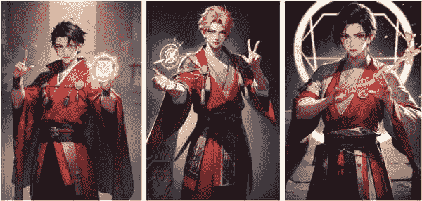
图 1-2 Stable Diffusion 生成的 AI 绘画作品

这些精美画面全由提示词驱动，大幅提升创作效率。AI 工具一次可批量输出，而传统画师只能一笔一笔、一张一张完成。对传统画师而言，使用 AI 绘图工具就像握住了神笔。

依托强大的扩散模型与语义理解能力，AI 可在画师与设计师角色间灵活切换，具体取决于使用者希望它承担怎样的职能。生成式绘画真正实现了艺术与科技的深度融合，让使用者变得更强。

OpenAI 首席执行官萨姆·奥尔特曼曾指出：“十年前主流观点认为人工智能会先影响体力劳动，再影响认知劳动，最后才触及创造性工作。如今看下来顺序正好相反。”生成式绘画的爆发，正像把一支神笔交到普通人手里：不必学会画画，只需学会写咒语即可。

### 1.2.2 零门槛创作：艺术平权时代到来
这支神笔真实地赋予每个人创作艺术作品的能力，打破了专业与业余的技术壁垒，让大众也能产出被认可的作品。

###### 1．普通人的绘画梦想
你不需要经历艺考班从早 8 点到凌晨 1 点的魔鬼训练，也不用在艺术院校里为专业选择迷茫，更不用担心因师资或学校水平受限而学不到东西；也不必像刚入行的设计师或插画师那样为甲方反复熬夜改稿。从图像生产层面看，技术壁垒已不复存在，耗时的重复性操作也被消解。你需要提升的是审美与眼界。在 AI 流程里，你就是甲方，你成为画作、方案、艺术项目的真正决策者。

生活中人人都渴望美好，但系统学过美术或具备绘画能力的人屈指可数。很多人水平仍停留在“火柴人”。生成式绘画的魅力在于生成逻辑。“文生图”是常见功能，利用扩散模型，零基础的人也能通过精准语言描述直接成图。比如输入提示词：“Mechanical Girl, Sketch, Techno Feel, Portrait, Large Profile, Best Quality, 8K, Cyberpunk”（机械女孩，草图，科技感，肖像，大侧脸，最佳品质，8K，赛博朋克风格），生成的图像效果如图 1-3 所示。

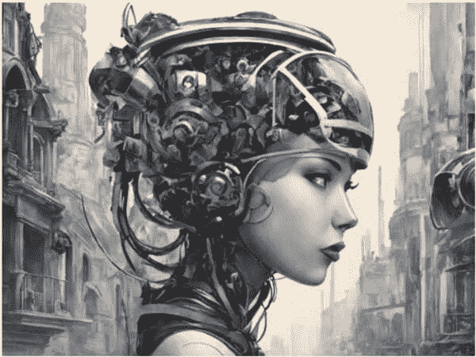
图 1-3 AI 生成的机械女孩图像

原本属于专业人才的能力，如今人人可用。生成式绘画的另一重要能力是“图生图”。纯文字生成随机性强，有时几十张仍达不到预期动作、表情与细节要求，而图生图能很好解决这个问题。即便只会画火柴人草图，也能借助工具生成精美图片，且构图与立意更贴近创作意图。此外，AI 还可为黑白照片、线稿上色。

因专业技能壁垒，很多人望艺术却步。如今普通人学习的不再是技法，而是提示词运用。掌握技巧后，普通人在绘画表达上也能实现弯道超车。此时拉开差距的不是高深技法，而是创作意识与审美眼光。

###### 2．从简历到海报，审美成刚需
现代社会对审美要求越来越高。工作中需要精美配图与专业排版来提升内容表现力。“美”早已不只是兴趣，更是真实工作需求。设想几个场景：应届生是否需要一份排版精美的个人简历？年终述职或行业报告是否需要重点突出、配色和谐的 PPT？公司活动宣传是否需要一张精致海报？

过去一手好字是“第二张脸”，今天数字内容成为主流，能否做出优秀视觉传达，也成了个人的“第二张脸”。工作方式已悄然改变，只是很多人尚未察觉。

当前工作高度专业化分工，很多人意识到审美表达的重要性，便去报班学习 Photoshop 等设计软件。但这种学习能否真正解决实际痛点存疑。专业设计师在高校接受四年系统训练并积累大量实践，普通人投入大量时间也难以掌握核心技能。眼界或许提升，却难以表达内心所想，付出与回报不成正比，常感与艺术无缘。

生成式绘图工具让普通人能在工作流程中注入“美”。用 AI 生成排版精美的简历、重点清晰色彩和谐的 PPT、赏心悦目的海报都不再困难。它节省大量时间，让人深耕熟悉领域。在生活里，装修效果图、二次元头像、个性化网站、照片美化、老照片修复等，都可通过 AI 实现。AI 为普通人打开了一条亲近艺术的新路径，其意义不在于制造艺术家，而在于完善工作流程与美化生活。

### 1.2.3 从冲击到赋能：从业者如何借力 AI
迈入 AI 时代，传统艺术从业者何去何从？生成式绘画看似挑战，实则带来机遇。它能补齐每个从业者的短板，让大家在擅长领域持续深耕。

###### 1．商业落地案例
面对这一新生事物，艺术从业者不如拥抱利用，让 AI 为创作赋能。

ChatGPT 登场与各式生成式绘画软件普及后，关于冲击的讨论一度甚嚣尘上，“90%广告人将失业”“广告公司将消失”等言论甚嚣尘上。2023 年 4 月，国内旅游服务平台“飞猪”在上海、杭州地铁站投放 AI 创作海报，如图 1-4 所示，让人看到 AI 设计在商业领域的落地。

图 1-4 AI 生成的“飞猪”地铁广告引发热议

AI 为“飞猪”生成多张广告图，对应全球不同目的地，画面极具视觉冲击力，部分展示如图 1-5～图 1-7。

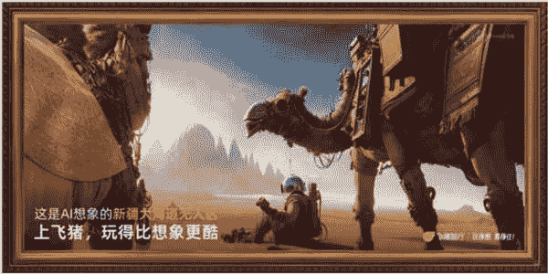
图 1-5 AI 生成的“飞猪”广告图片：新疆旅游

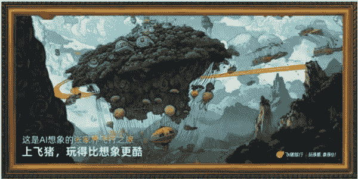
图 1-6 AI 生成的“飞猪”广告图片：张家界旅游

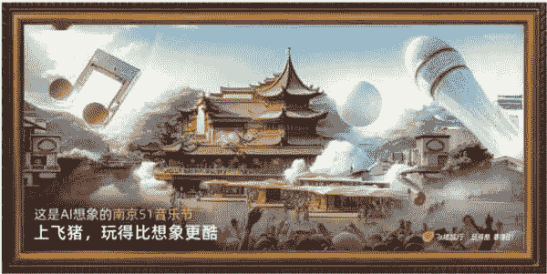
图 1-7 AI 生成的“飞猪”广告图片：南京旅游

2023 年 5 月，伊利推出 6 款由 AI 参与的乳品包装设计，如图 1-8 所示。据官方消息，该系列从概念到视觉均由 AI 参与甚至主导，伊利表示未来将加速 AIGC 在乳品行业的应用。国外方面，亨氏番茄酱也通过 AI 绘图工具 DALL·E 进行包装设计，如图 1-9 所示。

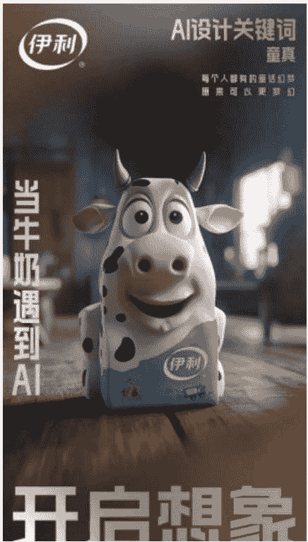
图 1-8 伊利 AI 包装设计——童真

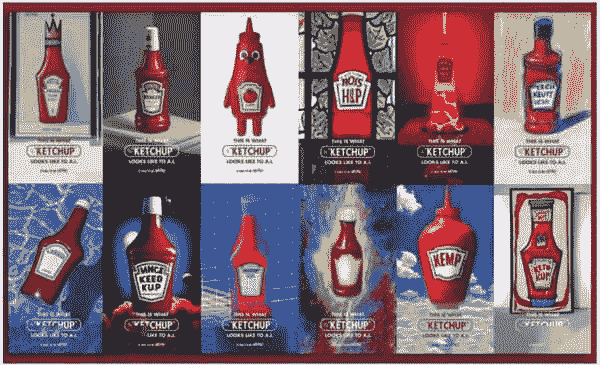
图 1-9 AI 生成的亨氏番茄酱包装

从案例可见，在广告与包装设计领域，AI 已能承担传统设计师的大部分工作。事实上 AI 能力远不止于此，室内设计、园林设计、建筑设计等空间设计领域同样可被 AI 助力。加上 AI 在绘画上的超强表现，其能力范围几乎覆盖美术院校的各个专业方向。

###### 2．设计师会被取代吗
AI 在设计领域表现抢眼，人类设计师会被取代吗？美术史上技术革命带来的行业焦虑并非首次。1839 年照相术出现时曾有“绘画将不复存在”的预言，但随后一百多年里绘画不仅存活，还呈现更丰富的面貌。绘画的记录功能被削弱后，表达情感与思想的功能愈发强大，20 世纪出现表现主义、抽象派、超现实主义等流派，涌现出蒙克、康定斯基、蒙德里安、马列维奇、达利、勒内·马格里特等艺术家。其作品如图 1-10 所示。

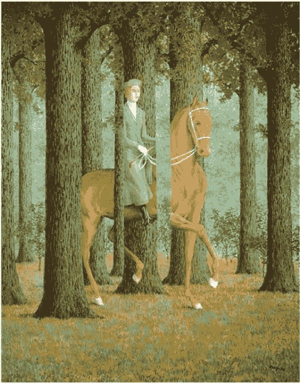
图 1-10 勒内·马格里特的作品《寻常之处》

对今天画家而言，照相术让创作更便捷自由。速写不再是主要素材收集方式，照片成为主流参考，互联网提供海量图像资源。万物互联也让材料运输与作品传播的难题大幅缓解。

就整个架上艺术而言，无论是选题方向、创作观念还是技术手段，都已全面拥抱数字时代的红利。

20世纪摄影等图像处理手段成熟以后，画师擅长的部分与设计师擅长的部分被明确拆分。步入21世纪，社会对创作者的需求不断升级，单一专长的壁垒不再适用，跨界融合、多学科视野逐渐成为新一代艺术从业者的必修课。只是现实中技术门槛像一道屏障，面对琳琅满目的设计软件，画师常感到无从下手；面对繁复的绘画技巧，设计师也常望而却步。AI绘画的到来打通了这道隔阂，硬性的技术与技巧不再是阻碍，决定作品水准的核心回到了审美判断与思想深度。

让AI绘画成为每位创作者的创作伙伴，助推大家成长为真正的AI时代艺术家。

回望设计史，从19世纪的哥特式复兴与工艺美术运动，到包豪斯的建立，现代设计逐步成形，设计师也就成为工业社会不可或缺的角色。电脑普及后，Adobe Photoshop、Adobe Illustrator、CorelDRAW、Adobe InDesign 等视觉传达类软件，以及 AutoCAD、3ds Max、SketchUp 等空间设计类软件相继出现，经过数十年迭代，它们已成为设计师日常工作的标配。软件厂商持续按使用习惯优化更新，设计师群体对技术升级的接受度一直很高。

AI绘画工具的介入则让传统设计流程迎来结构性变化。随着模型能力提升，越来越多设计师开始探索用AI来压缩流程、提速产出，在同行竞争中占据先机。

以家装设计为例。过去沟通风格时，拿既往案例图给客户看，代入感不足难以快速定案；若为单项目定制效果图，无论是SketchUp还是3ds Max，建模渲染都耗时费力，对追求细节的客户往往要出一张再一张3ds Max效果图反复确认，工作量极大。

换成AI绘画工具沟通后，效率完全不同。基础模型、线稿甚至毛坯房实拍都能作为输入，几分钟内就能批量生成数十张效果图。经过设计师筛选，通常能挑出五六张高质量方案供客户挑选，如图 1-11 和图 1-12 所示。工具还支持局部重绘，客户反馈后可直接把图片再喂回模型，快速得到更贴合需求的版本。设计师省时，客户更容易满意。

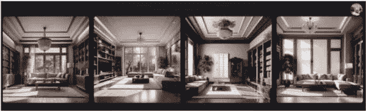

图 1-11 AI 绘画工具几秒内生成的中式客厅效果图

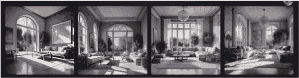

图 1-12 AI 绘画工具几秒内生成的地中海风格客厅效果图

凭借强大的学习与泛化能力，设计师完全可以基于自身风格训练专属模型，并不断微调优化。针对不同客群的需求，模型也能做精细化调整。这样人机配合更紧密，既提升效率，又最大程度保留个人的风格印记。

AI绘画的价值远不止提效。在以创意为核心的设计行业里，模型最能发挥作用的节点是前期概念探索。对设计师而言，AI是点燃灵感的催化剂，能提供新思路、拓宽可能性，并协助完成最具挑战性的概念阶段。

在创意启动期，AI绘画擅长把抽象的描述转化为直观画面。比如科技感、未来感、氛围感这类难以落地的表达，AI可以快速视觉化。若设计师习惯手绘草图，也能借助AI将其升维为可视方案，获得更多延展方向。

让AI进入工作流、作为辅助伙伴，已成为越来越多设计师的选择。AI并未直接取代设计师，但懂得善用AI的设计师，正在逐步拉开与不使用的同行的距离。

当下，设计师需要把过往积累的经验与审美，与新工具结合起来，持续优化自己的成长路径，才能成为真正难以替代的创造者。 EXr6287u6NNVz+GYLY+7SDk226FstKIHdC0bNoQkB2Nqi1xSR0yxPmwrTs5gRi/BtfSbid6dBhii9q7cz2pIyA==

## 1.3 AI 绘画工具的发展历程

与传统绘画相比，AI绘画起步晚但增速惊人。自2015年起相关产品密集涌现，尤其是在Midjourney和Stable Diffusion出现后，市场进入井喷期。

2015年7月，Google发布DeepDream，首次展示了AI依据文本生成图像的可能性。

2021年1月，OpenAI推出DALL·E 1模型，文本转图像技术开始进入公众视野。DALL·E的名称里，“DALL”致敬西班牙艺术家达利，“E”取自电影《机器人总动员》，折射艺术与科技的结合。2022年4月，DALL·E 2问世，采用扩散模型架构，绘画表现力大幅提升。

2022年5月，Google发布基于扩散模型的Imagen AI，8月又推出DreamBooth AI。

2022年10月，Novel AI上线绘画功能，因二次元风格迅速圈粉，上线10天内生成图片已超3000万张。

老牌软件Adobe也加码AI能力，通过Photoshop SD等插件增强其生成能力。

国内方面，2022年10月，百度依托文心大模型推出文心一格，已于2025年4月正式将服务迁移合并至文心一言官网。此外，即时设计、海艺AI等产品也在同期出现。

目前行业内最具代表性的产品是Midjourney和Stable Diffusion，后文将做详细解读。

2023年ChatGPT掀起的浪潮再次点燃AI绘画热度，技术日趋成熟，甚至出现Sora这样的AI视频生成工具。国内产品也在加速追赶，如今可用的工具更加多元、个性化与实用化。

短时间内大量工具集中爆发，形成百家争鸣的局面，标志着AI正全面渗透视觉艺术领域。

AI时代已经到来，这场由AI主导的技术革命正在重塑学习、工作与生活方式。绘画领域虽由国外起步，但国内工具已快速迎头赶上。下一章将介绍一批国内外影响力较大的AI绘画工具。 EXr6287u6NNVz+GYLY+7SDk226FstKIHdC0bNoQkB2Nqi1xSR0yxPmwrTs5gRi/BtfSbid6dBhii9q7cz2pIyA==

## 本章小结

本章梳理了AIGC的核心概念与演进脉络。其发展主要得益于生成算法模型的持续创新。

随着模型通用化程度和工业化落地能力的提升，AIGC的影响力不断扩大。技术大幅降低了内容生产的门槛与成本，这要求从业者持续跟踪模型变化。对新时代艺术工作者而言，把AI绘画工具转化为自身的能力增益，才是跟上时代节奏、产出符合时代脉搏作品的关键。 EXr6287u6NNVz+GYLY+7SDk226FstKIHdC0bNoQkB2Nqi1xSR0yxPmwrTs5gRi/BtfSbid6dBhii9q7cz2pIyA==

# 第二章
国内外全知晓：认识主流 AI 绘画工具

本章导读

近年来AI绘画以颠覆性的表现强势出圈，市场上常有“AI将取代艺术家与设计师”的讨论。面对如此强悍的能力，创作者是否已无处立足？工具究竟是会淘汰人，还是成为人的更顺手武器？从笔者角度看，没有人会主动选择前者。那么当前有哪些AI绘画工具可以被实际使用？Stable Diffusion、Midjourney是较早进入大众视野的代表，除此之外还有不少实力派产品值得关注。本章将盘点国内外具有代表性的AI绘画工具。 EXr6287u6NNVz+GYLY+7SDk226FstKIHdC0bNoQkB2Nqi1xSR0yxPmwrTs5gRi/BtfSbid6dBhii9q7cz2pIyA==

## 2.1 国内主流 AI 绘画工具

当Stable Diffusion和Midjourney在全球舞台占据主导时，国内也在积极布局。依托文心大模型的文心一格，已于2025年4月正式将服务迁移合并至文心一言官网，阿里巴巴旗下Alibaba Design推出的堆友，有“国内C站”之称的Liblib AI、更贴合本土设计师习惯的即时设计，以及成都海艺互娱科技有限公司开发的海艺AI，都是国内较为优秀的AI绘画产品。以下逐一介绍。

### 2.1.1 大厂急先锋：堆友

堆友是阿里巴巴推出的AI绘画产品，官网首页如图 2-1所示，界面简洁美观，功能布局直观，充分体现大厂设计水准。页面下方还能看到用户在平台上的创作示例。

图 2-1 堆友首页

“AI反应堆”“AI工具箱”“3D素材”构成了堆友的三大核心板块。

“AI反应堆”提供简洁模式与自由模式，如图 2-2所示。两者均支持中文提示词输入，自由模式参数更丰富，适合有Stable Diffusion使用经验的用户；简洁模式则更适合零基础新手快速上手。

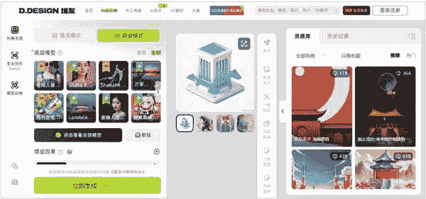

图 2-2 堆友“AI 反应堆”界面

“AI工具箱”集合了“顽兔抠图”“一键消除”“AI商品图”“鹿班营销图”“模特换肤”“创意融合”“AI艺术字”“堆友相机”等功能，如图 2-3所示。

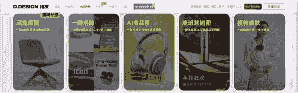

图 2-3 堆友“AI 工具箱”界面（局部）

“3D素材”板块可自由编辑下载3D素材，也能基于现有素材生成3D头像或3D场景，如图 2-4所示。

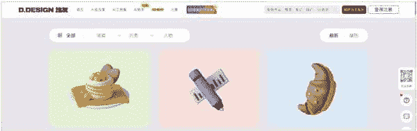

图 2-4 堆友“3D 素材”界面

此外，堆友还配备“AI助手”功能，如图 2-5所示。这是一款偏专业的AI对话工具，能针对设计相关问题给出更精准的回答。

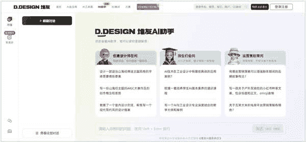

图 2-5 堆友“AI 助手”界面

总体来看，堆友功能体系完整，尤其在电商相关场景下的AI绘画应用表现突出。

### 2.1.2 国内 C 站：Liblib AI

Liblib AI是一款国产高性能AI绘画平台。登录官网即可直接使用基于Stable Diffusion的在线Web UI，无需自行购置设备或下载模型。作为国内成熟的模型社区，Liblib AI汇聚了海量Checkpoint和LoRA模型，能显著提升出图效率。

在浏览器中输入“https://www.liblib.art”即可进入官网，如图 2-6所示；搜索“Liblib AI”也能快速找到。首页展示了丰富的模型库，如图 2-7所示。

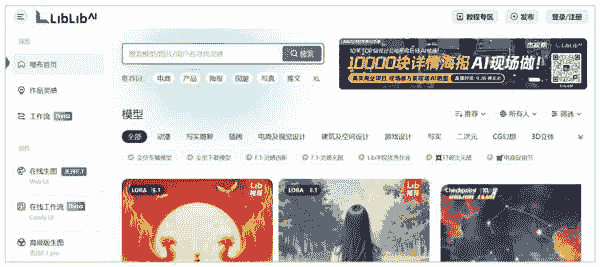

图 2-6 Liblib AI 网站首页

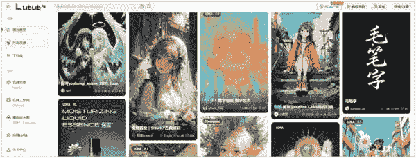

图 2-7 Checkpoint 和 LoRA 模型展示

平台还按风格做了清晰分类，便于快速定位所需模型，如图 2-8所示。任意模型可加入个人库，也可随时移除。相比Stable Diffusion本地部署的繁琐配置，Liblib AI流程更简化。模型页设有“立即生图”按钮，如图 2-9所示，点击后可直接进入Web UI界面，如图 2-10所示，进行创作。

图 2-8 Liblib AI 模型汇总

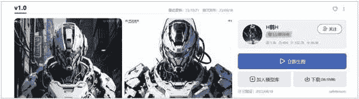

图 2-9 Liblib AI 中的“立即生图”按钮

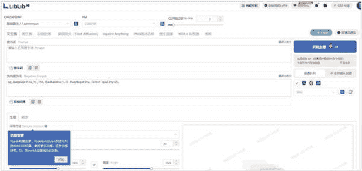

图 2-10 Liblib AI 的 Web UI 界面

例如输入提示词：“White mech warrior, distant view, fighting in the ruins of a city, cyberpunk, highest quality, 8K”，可生成如图 2-11所示的作品。即使英文不佳也没关系，中文提示词会在输入框中实时转成英文。Liblib AI是本书重点讲解的对象，具体内容可参考第六章。

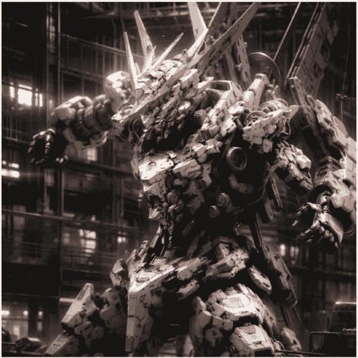

图 2-11 Liblib AI 生成的作品

### 2.1.3 设计师的福音：即时设计

对UI设计师而言，即时设计早已是熟知的效率工具。若说国外UI主流是Figma，那么国内即时设计则是极受欢迎的替代方案。其主页如图 2-12所示。

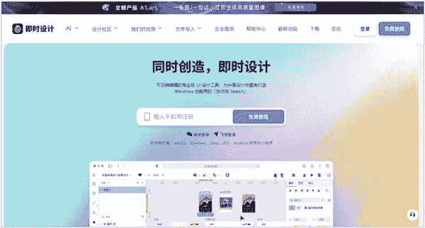

图 2-12 即时设计的主页

即时设计之所以备受青睐，核心在于跨平台与云端化。

作为网页应用，使用即时设计无需安装客户端，注册账号即可开始。所有内容自动保存在云端，工作场景切换时无需携带本地文件，家中也能随时登录修改，极大提升了灵活性。

其次，它实现了真正的实时协作。传统设计软件在多人协作上体验不佳，资料导出、标注、收集反馈常导致沟通成本升高。即时设计支持多人同时在线编辑同一份稿件，协作体验类似腾讯文档，效率大幅提升。

此外，自动化功能也是一大亮点。组件、变体、自动布局等可批量处理重复元素，将设计、协作、反馈、原型、交付整合成一套流程。

即时设计同样内置了AI绘画能力，在设计与绘画场景都能产出不错的结果，如图 2-13所示。第三章将对其应用方法做详细说明。

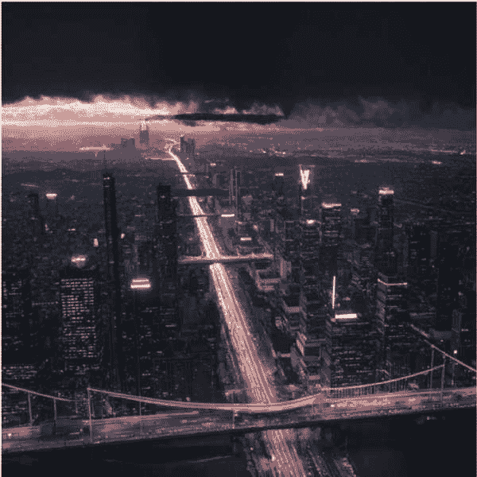

图 2-13 用即时设计生成的 AI 绘画作品

### 2.1.4 线上技术流：海艺 AI

海艺AI是一款功能强大的国产线上AI绘画工具，支持全中文操作，并自研大模型，在平台实验室内持续探索新用法。搜索即可进入官网，如图 2-14所示。

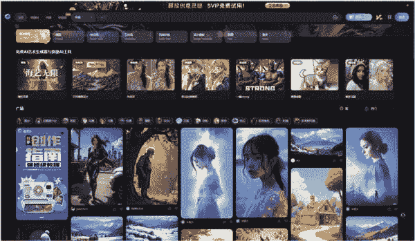

图 2-14 海艺 AI 主页

从易用性看，海艺AI对新手很友好。不仅支持纯中文提示词，还提供AI绘画提示词工具，为不熟悉指令的用户给出可选择的词条，如图 2-15所示。
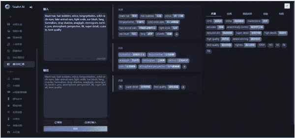

图 2-15 海艺 AI“提示词工具”功能

在作品广场刷到心水的 AI 成品，直接点“同款”就能一键复刻。平台还配了“快捷 AI”“快应用”这类入口，批量的高质量出图变得很顺手，覆盖的场景也比较宽。

能力集合上，海艺 AI 把文字生成图像、图像生成图像、条件生成、高级画板、智能补全、高清修复、图像描述、提示词工具等常用绘图功能集中在一起。

模型侧，模型库收录了风格迥异的模型，涵盖二次元、3D、数字艺术、油画、抽象艺术、现代科技、国风、真人写实、摄影、建筑、室内设计等方向，且持续更新，为创意提供持续的可能性。比如输入“二次元，女孩，繁华都市图”这类提示，得到的画面如图 2-16 所示。

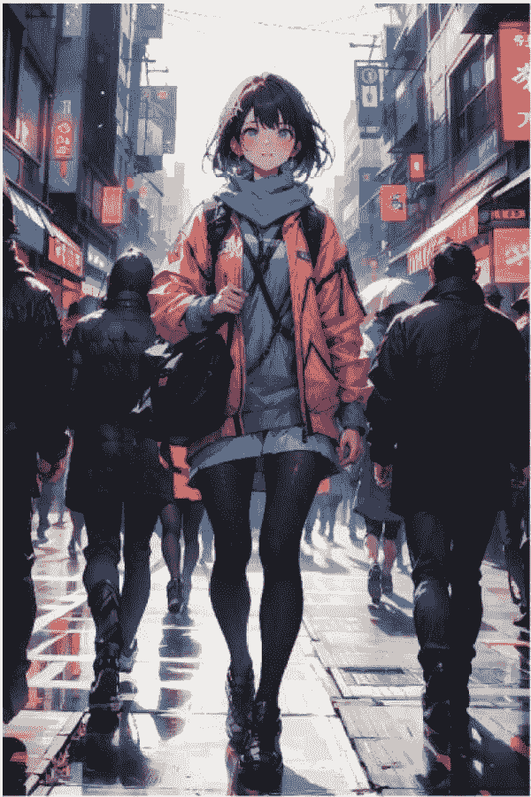

图 2-16 海艺 AI 生成的作品

新手能快速拿到可用成图，专业用户也能靠参数微调做精细化创作。进阶功能包括图像生成图像、局部重绘、LoRA、ControlNet、高级画板等，满足深度需求。

使用形态上，海艺 AI 支持 Web UI 在线创作，也能通过“工作流”切到 Comfy UI 模式。游戏美术、电商设计、广告设计，以及漫画、插画等美术相关工作，都可以借助 Comfy UI 打通流程，让效率实现量级跃升，如图 2-17 所示。海艺 AI 是本书重点讲解的对象，具体用法将在第七章展开。

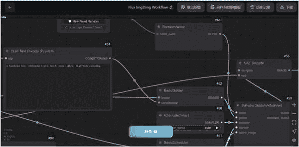

图 2-17 海艺 AI“工作流”展示 EXr6287u6NNVz+GYLY+7SDk226FstKIHdC0bNoQkB2Nqi1xSR0yxPmwrTs5gRi/BtfSbid6dBhii9q7cz2pIyA==

## 2.2 海外主流的 AI 制图方案

AI 制图能引发广泛讨论，Stable Diffusion 与 Midjourney 的推动作用很大，本节重点介绍两者的实操方式。随后也会提到 Adobe 推出的 Photoshop Beta，它把熟悉的设计工具与 AI 制图衔接起来。国外可用的制图工具远不止这些，DALL·E、Novel AI 等也很有名，受篇幅限制不再展开。

### 2.2.1 新生实力派：Stable Diffusion

2022 年 8 月，Stability AI 发布开源图像生成模型 Stable Diffusion，如图 2-18 所示。虽然对家用电脑配置有一定要求，它首次把 AI 生成带到本地运行，同时模型全面开源。

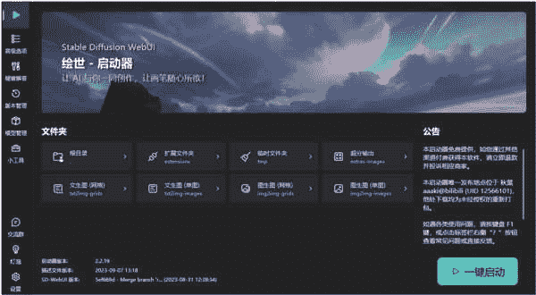

图 2-18 Stable Diffusion 界面

2022 年 11 月，Stable Diffusion 2.0 上线，分辨率约提升 4 倍，生成速度更快，还接入了深度信息。在 C 站 Civitai 上，能看到大量创作者基于该模型训练的模型及作品，如图 2-19 所示。

到此，演进脉络已比较清晰，下面进一步认识这款领域的代表。

与 Midjourney 等只能在线使用的产品不同，Stable Diffusion 是一个可本地部署的开源项目。模型训练、图像生成、各类自定义操作都能在本地完成，也是它受欢迎的关键。

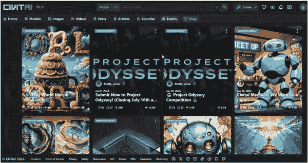

图 2-19 C 站网页

该工具全程免费，但对显卡、内存、硬盘等硬件要求较高，使用者最好具备基础的 Python 和 Git 知识，安装部署步骤相对繁琐。部署完成后还需配置插件和模型等扩展。好在装好后即可离线使用，无需联网，生成内容具备较好的私密性。

操作界面如图 2-20 所示。

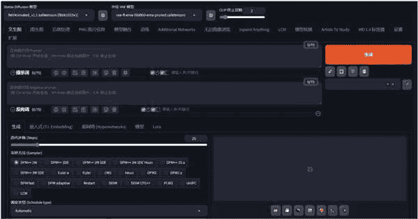

图 2-20 Stable Diffusion 操作界面

开源初期，Stable Diffusion 在游戏角色、动漫、机甲、室内设计等方向表现突出。随着 SDXL 大模型的到来，擅长范围进一步扩大，AI 模特、AI 写真、照片转卡通手绘、室内设计等能力也有明显提升。

如果你愿意花时间钻研制图工具，并希望更精准掌控生成结果，Stable Diffusion 值得尝试。

除了硬件门槛和部署复杂度，该工具还有一个特点：上限很高，下限也低。没有学习心态，很容易在几次尝试后失去信心。同时提示词体系更复杂，包含正向和反向提示词，需要调节多项参数、选用合适模型并配置 ControlNet 等，前期上手会比较吃力。但熟练度提升后，效率会持续提高，成图质量也会越做越好。

可控性上，Stable Diffusion 尤为突出。可通过 ControlNet 精准控制角色姿态、表情、手势，甚至生成文字；也能用 Inpaint Anything 修改细节或替换衣物。此外还能训练专属模型，用高清重绘翻新老图，甚至安装各类插件辅助撰写提示词。

### 2.2.2 王牌对王牌：Midjourney

2022 年 7 月，独立研究实验室 Midjourney 发布同名生成模型，图标如图 2-21 所示。最初走红是因为设计师杰森·艾伦用它生成的《太空歌剧院》，该作在科罗拉多州博览会数字艺术竞赛中获得头奖。

图 2-21 Midjourney 图标

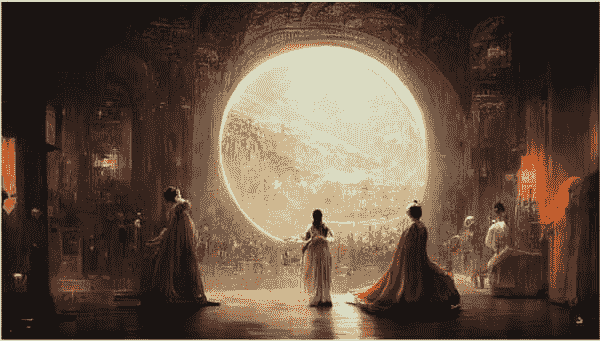

图 2-22 用 Midjourney 生成的图片——《太空歌剧院》

虽然 Midjourney 能产出精美的图像，可控性也是短板，尤其是人物手指的生成问题长期被用户吐槽。

直到 2023 年 3 月 V5 版本发布，才基本解决手指表现问题，整体输出的可控性提升，画面更贴近真实，甚至难以分辨真假。

不同于 Stable Diffusion，Midjourney 依赖云端服务器生成，不占用本地设备，无需部署，也不需要高配主机。用法非常简单，甚至手机上就能操作。从硬件角度看门槛远低于 Stable Diffusion，且文生图和图生图都很强，光影、色彩、精细度表现都很好。配合简便操作和优秀出图效果，它在用户认可度上与 Stable Diffusion 不相上下。

该工具在多种风格上都很自如，如东方山水、日本漫画、包豪斯、3D、赛博朋克等，由此衍生出网页设计、插画创作、游戏角色设定、街拍风格模拟、漫画分镜、产品实拍、包装设计、个人头像制作等场景。

下面展示两幅 Midjourney 生成的示例，如图 2-23 所示。

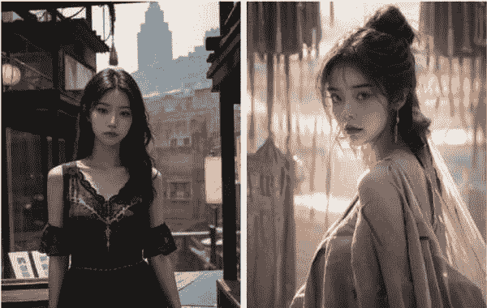

图 2-23 用 Midjourney 生成的图片

目前国内用户基本无法直接访问 Midjourney，只能通过 Discord 社交平台操作。同时使用需付费，不同档位享受的服务不同。未开源的特性决定了迭代完全由官方主导，社区无法参与。

可控性上 Midjourney 略逊于 Stable Diffusion。图生图更多提供风格参考，难以做到像素级控制，而 Stable Diffusion 在这方面更强。若仅需概念插图、获取灵感，或做简单的 UI 设计、人物设定，Midjourney 已足够。若想把 AI 制图嵌入工作流，形成完整可控的方案，Stable Diffusion 会是更合适的选择。当然两者结合也是常见做法。

现阶段 Midjourney 在文字理解、构图、笔触、光影等方面优于 Stable Diffusion，AI 痕迹更少。而 Stable Diffusion 的画风上限取决于使用者本身，善用模型并搭配 LoRA 也能做出痕迹不明显的作品。

### 2.2.3 老树开新花：Photoshop Beta

面对 Stable Diffusion、Midjourney 等工具的冲击，很多人以为 Photoshop 已过时。但在观望中，Adobe 推出了新版本 Photoshop Beta，如图 2-24 所示。借助 AI 加持，效率得到明显提升，最惊艳的是创成式填充。

把“移除画面元素”和创成式填充配合使用，是该版本精准操控画面主要途径。选中不想要的元素，点击创成式填充，AI 会将其剔除并与背景自然融合。依托这一能力，Photoshop 的传统强项得到强化，例如照片背景人多的问题处理起来更轻松高效。

过去电商设计师要换模特衣服，往往需要反复修改甚至重拍。现在直接框选衣服区域，输入关键词“change cloth”即可替换。新衣服的风格、色彩等都可以通过关键词引导，效果更符合预期。同理，换发型、加配饰也很便捷。人物可换，背景也能换，风景照改天空、换草地都可行。曾经需要高手才能做到的无痕修改，现在可一键完成。整体而言，AI 让以往的复杂操作被简化，工作流更顺畅。

图片填充也是 Photoshop Beta 的一大亮点。它能对现有图像做边缘扩展，把背景扩 10 倍、20 倍甚至更大。该功能既适用于真实照片，也适用于 AI 生成图像，只要构图不满意就能用此方式调整。

细看会发现，Photoshop Beta 的 AI 制图能力始终保持在可控精准的区间内。厌倦抽卡式不确定性的用户，这里会是不错选择。

安装 Photoshop SD 插件后，还能在 Photoshop Beta 中实现 Stable Diffusion 的文生图、图生图等能力。该方案结合了两者长处，在保持多样性的同时兼顾可控性。

图 2-25 是安装该插件后生成的示例，提示词为“beach, girl, delicate features, best quality, 3/4 side view, half-length portrait, blue clothes, blue background”，即海滩、女孩、精致五官、最佳品质、3/4 侧面、半身像、蓝色衣服、蓝色背景。

通过安装其他插件，功能还能进一步增强。关于 Photoshop SD 插件的安装使用以及创成式填充的具体用法，将在第五章详细说明。

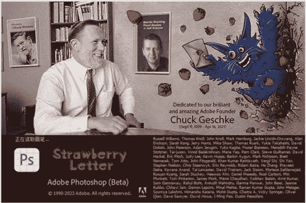

图 2-24 Adobe Photoshop Beta 启动界面

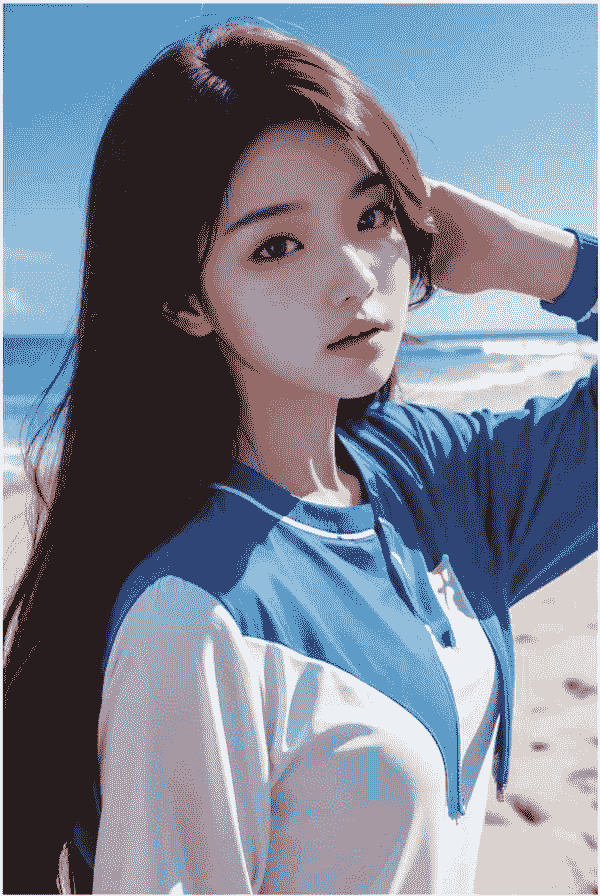

图 2-25 由安装了 Photoshop SD 插件的 Adobe Photoshop Beta 生成的图片

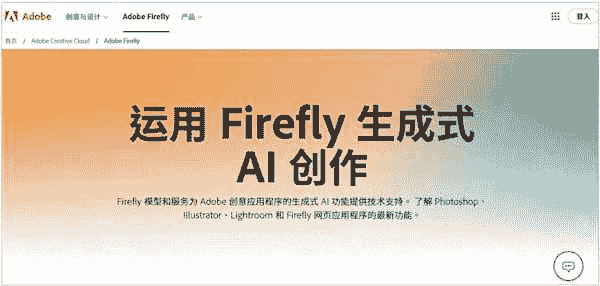

图 2-26 Adobe Firefly 网页截图

### 2.2.4 图像的神器：Adobe Firefly

Adobe Firefly 是 Adobe 推出的图像生成工具，其特点是可以内置于 Photoshop、Express、Lightroom 等常用软件中。可以说它既是生成工具也是图像编辑软件，如图 2-26 所示，同时提供文生图、图生图、条件生图等能力。

Firefly 为线上工具，使用前需申请访问权限。

平台内的生成式填色、以文字生成影像、生成式形状填色、生成式移除等设计相关功能都比较强力，如图 2-27 所示。Firefly 3.0 还新增了自动风格化、结构与风格参考、图像质量优化、提示词准确性与细节增强、插图与图标样式扩展等能力。

其中，生成式填色实用性很高。用户可选中目标区域替换原图对应内容，如图 2-28 所示。替换后再选中海面再次进行填色，即可得到最终效果，如图 2-29 所示。

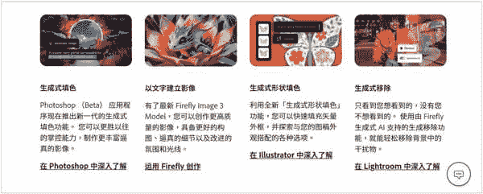

图 2-27 Adobe Firefly 的 AI 功能

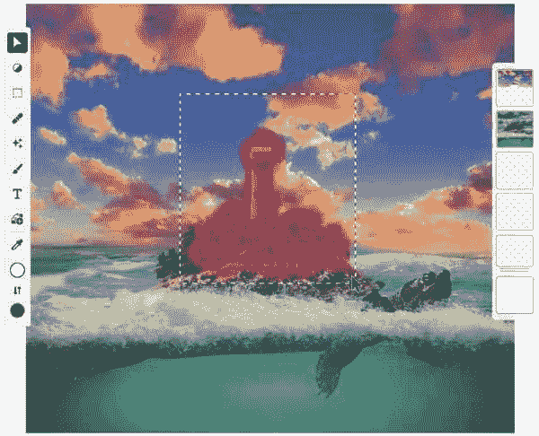

图 2-28 Adobe Firefly 生成式填色功能 1

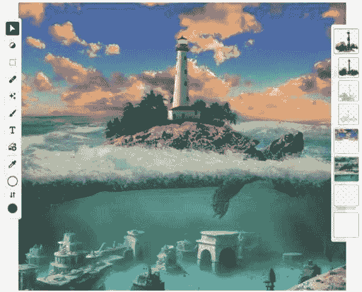

图 2-29 Adobe Firefly 生成式填色功能 2 EXr6287u6NNVz+GYLY+7SDk226FstKIHdC0bNoQkB2Nqi1xSR0yxPmwrTs5gRi/BtfSbid6dBhii9q7cz2pIyA==

本章小结

本章梳理了国内外多款主流 AI 制图工具，国内包括堆友、Liblib AI、即时设计、海艺 AI，国外包括 Stable Diffusion、Midjourney、Adobe Photoshop Beta、Adobe Firefly。通过学习这些工具，读者对国内外生态已有基本认识，可按自身需求挑选合适的方案，体验 AI 制图带来的创作乐趣。 EXr6287u6NNVz+GYLY+7SDk226FstKIHdC0bNoQkB2Nqi1xSR0yxPmwrTs5gRi/BtfSbid6dBhii9q7cz2pIyA==

# 第三章

UI 设计新势力：即时设计的实操应用

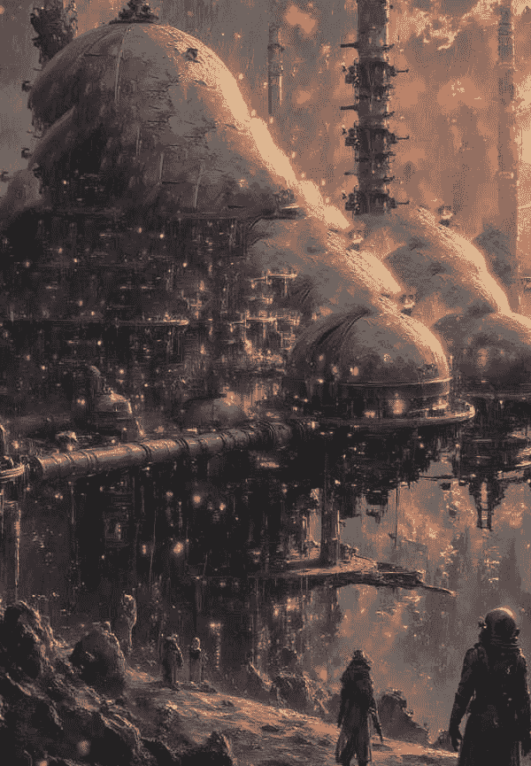

本章导读

传统图像处理和矢量绘图软件在设计领域长期占据主导。随着设计需求多样化，产品交互中 UI 界面类型日益丰富，设计任务也更复杂。传统软件多以图像处理方式做 UI 设计，而 Adobe XD、Figma、Sketch 等国外主流工具对国内用户存在门槛或功能局限。在此背景下，国产 UI 设计工具即时设计吸收了国外工具的先进理念，并加入 AI 插件与 AI 平台能力，迅速成为 UI 设计领域的佼佼者。本章将介绍即时设计的基础功能及其 AI 扩展能力，帮助读者把即时设计应用到工作中，提升效率。 EXr6287u6NNVz+GYLY+7SDk226FstKIHdC0bNoQkB2Nqi1xSR0yxPmwrTs5gRi/BtfSbid6dBhii9q7cz2pIyA==

## 3.1 从零开始：熟悉即时设计界面

即时设计是一款以云端协同为核心的界面设计方案，凭借庞大的素材供给、活跃的扩展生态以及内置的即时 AI、A1.art 等生成式工具，在同类产品中迅速站稳脚跟。学习门槛低、操作节奏快，有平面软件使用经验的设计师上手较为顺滑，对 Figma、Adobe XD、Sketch 等海外软件的互通表现也令人满意，是近年国产设计工具的代表之作之一。下面先做整体性的基础梳理。

### 3.1.1 三端使用场景与硬件建议
平台提供了浏览器入口、桌面客户端和移动应用三种形态，实质性的创作仍以电脑为主。厘清硬件条件与使用需求的关系，有助于判断不同场景下的适用方式。官方并未公布明确的最低配置，下文结合实操经验给出参考。

对于非专业设计的办公人群，若希望 PPT、海报、H5、宣传单等交付物更出彩，可以借助即时设计完成制作，并邀请同事共同参与。这类人群的核心诉求是借助工具美化工作成果。表 3-1 给出了一套基础机型建议。该配置属于主流办公本范畴，既能流畅进行协同作业，也可轻度兼顾 Photoshop、Illustrator 等软件。

表 3-1 基础电脑配置参考

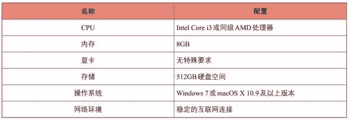

不少美术设计师、电商美工以及部分创业者都在用即时设计交付作品。但涉及图像精修、包装、VI、画册等深度处理时，仍需配合 Photoshop、Illustrator、InDesign 等专业软件。这类工作建议选用性能更强的设备。需注意即时设计的运行依赖网络连接，离线环境下无法使用。若老旧电脑出现传输卡顿，可考虑更换更高性能的网卡改善。

###### 1．网页版
即时设计的价值在于线上协同，团队成员、客户方等均可随时进入项目参与或跟踪进度，并按角色设定访问权限。计算压力由官方服务器承担，本地设备只需满足日常办公即可。

使用浏览器版时，在电脑浏览器地址栏输入“http://js.design/home”，进入官网登录后即可管理文件。这种方式契合轻办公习惯，有网络即可随时操作。若浏览器版本过低，可能无法正常打开页面。

登录支持手机号、微信、飞书等多种方式，如图 3-1 所示。注册时完善信息有利于后续协作与账号安全。

图 3-1 “即时设计”登录界面

###### 2．桌面客户端
桌面客户端也是高频使用形态，但它并非像 Photoshop 那样具备本地运算能力，而是一个本地启动程序，主要负责稳定加载界面，核心计算仍在服务器完成。相比浏览器，它能减少传输压力导致的卡顿、闪退问题，适合安装在主力机上。安装前需在官网下载对应系统的版本。

###### 3．移动应用
移动端包含手机 App 与微信小程序，主要用于作品管理与交互预览。客户查看进度、随时跟进；电脑端预览 App UI 时用鼠标点击体验不够真实，移动端预览更贴近真实操作；团队协作管理也更便捷。App 与小程序界面基本一致，如图 3-2 所示。处理大文件时建议优先使用手机 App 以获得更稳定体验。

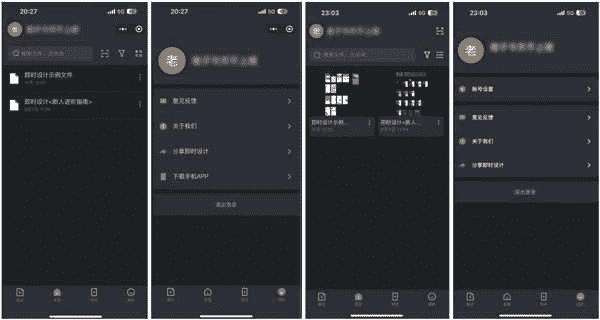

图 3-2 即时设计移动端界面（左侧两张为微信小程序界面，右侧两张为手机 App 界面）

### 3.1.2 界面构成与核心操作
Photoshop 与 Illustrator 专注于图像与图形处理，功能丰富但学习周期长。即时设计的命名体现了即开即用的定位，上手很快。

UI 设计强调版式与交互的直观高效，界面通常避免过度复杂，这让很多重型图像工具难以发挥。即时设计坚持实用主义，保留核心常用工具组合，降低学习门槛，更多扩展以插件形式存在，可按需增减。下面以浏览器版为例介绍界面构成。

即时设计网页端界面共分为 5 部分：顶栏、左侧面板、画布、工作属性区和帮助入口，如图 3-3 所示。

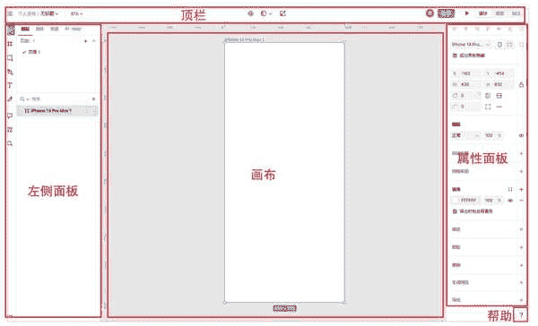

图 3-3 即时设计网页端的操作界面

###### 1．顶部功能栏
顶栏包含功能主菜单、画布缩放、顶部工具栏、分享协作、预览、产研模式等。

（1）功能主菜单：收纳设计工具的全部功能，其中“全局搜索”可快速定位所需功能。即时设计是云端实时存储，无需手动保存文件。

（2）画布缩放：按 - 键或 + 键可直接缩小或放大，也可在下拉菜单中选择 50%、100%、200% 等比例。与缩放相关的快捷键见表 3-2。

表 3-2 与缩放相关的快捷键

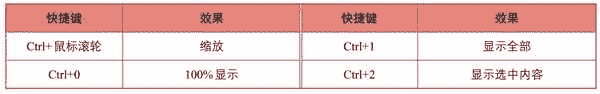

（3）顶部工具栏：集中文件、图层的常用操作。切换不同选项时工具栏会动态变化。

（4）分享协作：可快速把文件分享给团队，添加协作者。

（5）预览：用于检视整体效果并排查交互设计中的问题。

（6）产研模式：“设计”模式用于画布中的 UI 制作；“原型”模式用于交互环节；“标注”模式是开发者模式，便于设计师与开发精准对接，需要一定编程理解。

###### 2．左侧面板
左侧面板包括：组件工具栏、图层目录、页面目录、引用组件库、资源库、图层搜索等。

（1）组件工具栏：在界面最左侧，可创建矩形、圆形、线条、钢笔、画板等，也可使用快捷键快速生成。

（2）图层目录/页面目录：可直接查看、选择、编辑对应图层或页面。

（3）引用组件库：展示文件中所有引用组件，可拖拽到画布编辑，也可右键选择“删除引用组件”。

（4）资源库：资源广场中引用的、下载的素材在此浏览、管理和使用，设计过程中可随时取用或引用新资源。

###### 3．画布
画布是创作的核心区域，供用户设置画板、编辑图层、进行交互设计，是发挥创意的空间。

###### 4．属性面板
属性面板用于编辑图层或画布属性，显示内容会随所选工具动态变化。

###### 5．帮助
可快速解决使用过程中的问题。 EXr6287u6NNVz+GYLY+7SDk226FstKIHdC0bNoQkB2Nqi1xSR0yxPmwrTs5gRi/BtfSbid6dBhii9q7cz2pIyA==

## 3.2 方便快捷：AI 插件生态应用
即时设计快速崛起的重要原因在于插件生态。国内用户不太习惯老牌软件官方资源的使用方式，网络素材虽多却需自行搜集整理。而即时设计官方提供的素材与插件足够完成大部分设计需求，且插件可便捷加载到主程序，避免繁琐操作。本节介绍插件的搜索安装方法，以及几款常用插件的使用方式，帮助用 AIGC 提升设计效率。

### 3.2.1 插件的查找与安装流程
即时设计把传统软件中的效果功能和部分智能新功能以插件形式呈现于资源广场中，用户可按需挑选。查看与安装步骤都很简便，进入资源广场搜索后选择安装即可，打造高度定制的工作台。当前许多插件都内置 AIGC 绘图等扩展能力。

###### 1．资源广场
插件是对工具的功能扩展，具备简化步骤、批量处理或对接第三方平台的能力，能大幅减少重复性工作。资源广场即为插件库，从中挑选并添加到工作界面，是提升效率的必备动作。

###### 2．安装插件
即时设计的插件资源非常丰富，既有官方出品，也有厂商或开发者提供。多数插件自带使用教程，找到合适的插件后点击“安装”按钮即可启用，如图 3-4 所示。

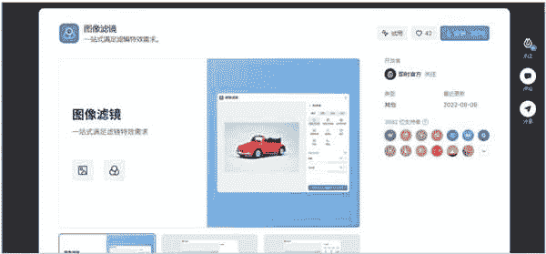

图 3-4 插件的安装

###### 3．使用插件
安装后在左侧面板点击“插件/小组件”按钮，选择所需插件即可。多数插件以小窗形式在界面中运行。

### 3.2.2 智能抠图组件
传统 UI 流程常需在多款专业软件间切换。即时设计把各软件功能以插件形式整合，实现单平台高效完成。以“智能抠图”为例，该组件可快速识别图像主体并保留透明背景，无需切到 Photoshop 即可直接使用处理后的素材，简化了操作路径。

使用时把待处理图片放入画布，选中后在插件界面点击“抠图”按钮即可完成，如图 3-5 所示。其速度明显快于 Photoshop。

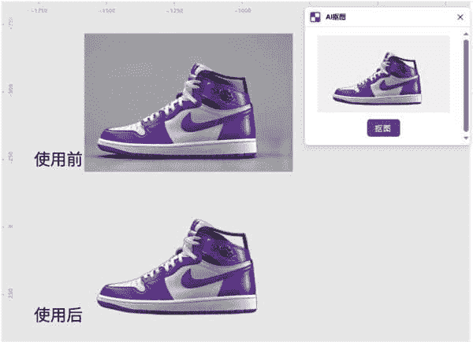

图 3-5 “AI 抠图”插件应用效果

### 3.2.3 智能填充组件
UI 设计中常使用“代用图”作为占位，数量多且需与风格匹配。借助“智能填充”插件可一键填充与设计相符的图片，并按版式样式自动置入，省去搜图和加蒙版的步骤。

操作时先选择置入图片的排版区域，插件会按常用设计分类排列，再挑选合适的图片类型。若需文字占位也可填写代用文本，不满意可重复选择直至合适，如图 3-6 所示。

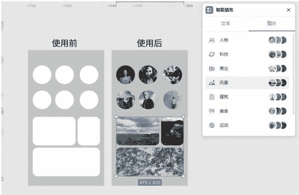

图 3-6 “智能填充”插件应用效果

### 3.2.4 智能擦除组件
设计素材常需去除多余元素。“智能擦除”插件能迅速抹去画面不需要的部分，处理后画面保持自然完整。

先选中图像启动插件，用画笔涂抹需去除区域，点击“擦除”完成操作，如图 3-7 所示。若仍有瑕疵可重复操作，满意后点击“生成”，画布即更新为修改后的图像。

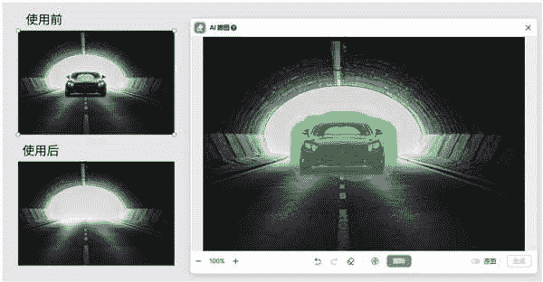

图 3-7 “AI 擦图”插件应用效果

### 3.2.5 高级图表组件
表格数据有时难以直接作为设计元素。生成图表能力很强，“高级图表”插件可输入表格数据自动生成美观图表，并在选择图表类型后设置数据、样式等参数，生成后仍可反复编辑，如图 3-8 所示。

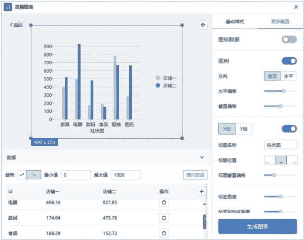

图 3-8 “高级图表”插件设置界面

### 3.2.6 文本翻译组件
制作双语界面时，传统方式需手动复制、翻译、校对再放回，容易出错。使用“文本翻译”插件可大幅简化流程，选中需翻译内容点击“翻译”即可，翻译结果准确且会自动对齐，如图 3-9 所示。

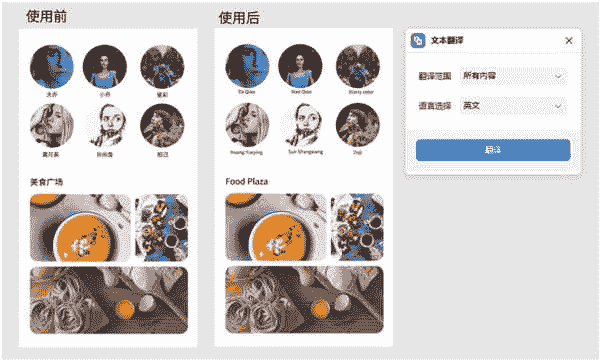

图 3-9 “文本翻译”插件应用效果 EXr6287u6NNVz+GYLY+7SDk226FstKIHdC0bNoQkB2Nqi1xSR0yxPmwrTs5gRi/BtfSbid6dBhii9q7cz2pIyA==

## 3.3 潮流玩法：A1.art 应用
A1.art 是即时设计中主攻 AIGC 绘图的工作区，人性化程度高，既可自主生成图像，也可借助他人搭建的流程完成图像转化，旨在降低创作门槛并拓展视觉可能性。本节介绍其应用基础与常见场景。

### 3.3.1 应用基础
无论是提升绘图水平还是让日常设计更轻松，A1.art 基本都能满足。其界面如图 3-10 所示。与其他专业工作区相比，生图界面像搭积木，先选模块再输入提示词即可得到结果。

A1.art 以 Build App 功能为 AIGC 绘图主要入口，界面如图 3-11 所示。该理念类似 Stable Diffusion 的 ComfyUI，但更易理解。以功能种类作为模块，无需连线，因此上手更快。搭建好一个生成莫奈画风的应用后，可批量生成或风格迁移，并分享给他人调用。

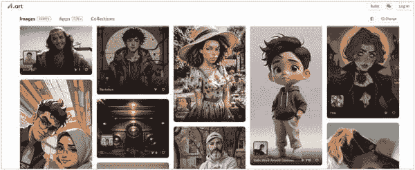

图 3-10 A1.art 平台界面

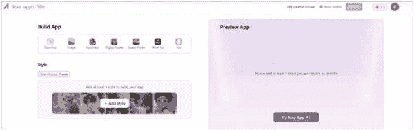

图 3-11 Build App 界面

###### 1\. Description
Description 是提示词输入模块，是生成的核心。填写描述文本即可生成相关内容，提示词应简洁明确以提高成功率。该模块不可单独使用，需配合 Style 才能出图，如图 3-12 所示。下载无水印图像需额外支付点数。

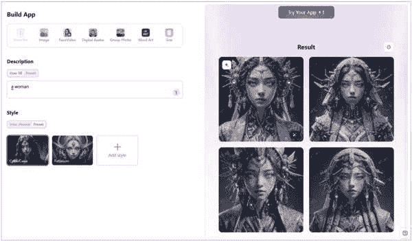

图 3-12 Description 功能演示

###### 2\. Style
Style 相当于风格模型，决定图像的绘画风格。工作区提供二次元、油画、真人写真、2.5D、3D 等常见风格，也有室内设计、工业设计、景观设计等垂直风格，更有 Cosplay 等换装模型，如图 3-13 所示。

风格可叠加，最多 12 种。新手切勿盲目叠加，否则易失败或出现怪异图像。建议先叠加方向相近的风格，再逐步尝试其他风格并测试，失败则移除多余风格。

图 3-13 Style 中丰富的绘画风格

###### 3\. Size
Size 用于设定输出比例，默认 1:1，还提供 3:4 和 2:1。生成后直接下载像素较低，经高清化处理可提升清晰度。例如“戴花环，穿花裙，在花丛中的女孩”，生成图为 832×1152 像素，去除水印并提升分辨率后为 1664×2304 像素，如图 3-14 所示。

图 3-14 高清无水印图像

### 3.3.2 百变应用
在 Build App 中，Description 和 Style 必须添加，其他实用模块可按需选择。

###### 1\. Image
Image 模块用于对现有图像加工，可理解为图生图功能。中英文对照如图 3-15 所示。其功能分类与描述见表 3-3。掌握 Image 各项功能可大幅减少平面设计工作量。

图 3-15 功能中英文对比

表 3-3 Image 的功能及其描述

###### 2\. FaceVideo：面部动作迁移
FaceVideo 归入视频类模块。使用者把一段仅拍脸部的自拍小片段上传到站点，挑一个画风并填入角色关键词，结合图 3-16 的示例，就能得到一段与原片动作基本同步的角色影像，实质是简易的数位人动态复刻。通过它，自己录制的表情和肢体可以投射到不同设定上，玩味角色扮演与尝鲜的乐趣。

图 3-16 FaceVideo 演示效果

###### 3\. Digital Avatar：圆形头像制作
Digital Avatar 能把上传的照片裁剪成圆头像，参考图 3-17。裁剪完成后，还能在素材上叠加 Style 或 Image 两种修饰，产出更具辨识度的新头像。

###### 4\. Group Photo：多人合影保留
Group Photo 会先识别合影里的人数，产出时尽量维持人数、相对位置和部分面部特征，如图 3-18 所示。实际使用中偶尔会出现人数缺失，示例四张里有一张数量不对。若关闭该模块，异常图的概率会上升。它的作用类似筛子，尽可能剔除错误结果。

图 3-17 Digital Avatar 头像示例

图 3-18 Group Photo 成果示例

###### 5\. Word Art：文字艺术化
Word Art 实现了当下流行的藏字图和文字艺术化玩法，支持调节文案、字体以及艺术化方式。站点对英文字体的储备比较丰富，选定字体后叠加合适的画风就能产出艺术字，如图 3-19 所示。可读性可以调节，示例里调得比较高所以易读。若想让画面中的文字更隐晦，可适当降低辨识度。

图 3-19 Word Art 成果示例

### 3.3.3 潮流换装玩法
在 A1.art 里，既能用官方提供的流程，也能发布自己的流程，这种机制让社区氛围很活跃。浏览他人分享的效果应用时常常能获得灵感，使用者倾向于直接采用别人的流程来亲身体验模型作画的多样性。其中换装是最受欢迎的类型，可以把一张照片直接套进精美的样图，同时更换场景、服饰、角色，如图 3-20 所示。相比线下试装拍照，这种方式更省事高效。

图 3-20 换装与换场景示例

当需要证件照却来不及拍摄时，可用一张普通照片通过换装流程生成身穿正装的证件照，如图 3-21 所示。用模型作画得到的效果通常优于手机修图。把自拍随时上传到站点的流程里，服装和背景都能自主设定，这种自由度是传统工具难以提供的。

图 3-21 换装生成证件照示例

换装模块让不擅长设计的普通人也能轻松尝试不同穿搭并预览呈现。操作相关流程时，只需挑选服装色系即可得到意想不到的变装结果，无需专业知识也能享受创作的乐趣，如图 3-22 所示。

图 3-22 换装与换色系示例

多数人用真人来玩换装，那是否可以给艺术作品里的角色换装呢？比如给《蒙娜丽莎》换上一套异域风格的装扮，用对应流程产出新作，如图 3-23 所示。

图 3-23 艺术作品人物换装示例

换装类应用仍有很大拓展空间，不仅能娱乐，还能大幅提升设计效率，优化图像编辑、数字艺术等相关工作流程。它展现了科技与艺术结合的可能性，也通过降低创作门槛推动创意传播，为设计行业注入新的动力。

### 3.3.4 图像融合潮流
在该站点里，图像融合的流程很受欢迎。它能够把两张图合并，生成时带有一定视觉倾向。其中最火的是风格融合，即让一张图带上另一张图的视觉风格，从而得到兼具新风格特征的画面，如图 3-24 所示。

图 3-24 风格融合示例

前面提到的风格融合更偏向风格提炼，并在主图上做创意发挥。如果在搭建流程时降低融合图对主图的风格化影响、增强元素复刻程度，就能得到侧重元素替换的效果，如图 3-25 所示。

图 3-25 元素替换融合示例

融合时若对主图的色彩不满意，可以尝试更换配色方案。生成这类效果时，需要选用合适的配色图作为融合源，对主图进行色彩替换，如图 3-26 所示。

图 3-26 色彩替换融合示例

为黑白照片上色是热度很高的功能。该流程在上色的同时会进行色彩与元素的融合，让经典黑白影像焕发新活力，这也是一种极具创意的用法，如图 3-27 所示。

图 3-27 黑白照片上色与融合示例

图像融合极具创意，既给普通使用者提供娱乐尝试，也为专业设计师提供色彩与元素融合的思路。这类流程的开发过程很有趣，也是拓展艺术视野的方式。

### 3.3.5 次元转换潮流
模型作画让许多看似不可能的尝试变得容易获取，让每个人都能以艺术的方式体验设计。在该站点里，次元转换的流程非常丰富，尝试中可以发现不少乐趣，比如把写实图像转为二次元风格、3D 手办或其他绘画风格。

可以尝试用这类流程把照片变成 3D 手办效果，获得定制手办图。挑选应用时可以选择生成全身版的，这样系统会依据上传形象绘制全身手办，如图 3-28 所示。

图 3-28 照片转 3D 手办示例

也可以选择带有专属动作的 3D 手办流程来生成新图。选照片时可以尝试用平面卡通图，效果会别有新意，如图 3-29 所示。

图 3-29 卡通图转带动作手办示例

在次元跳转方面，站点的流程多样，除平面转 3D 外，3D 或真人图转二次元的流程也很有趣，如图 3-30 所示。该功能体现了模型作画的强大，对动漫画手是福音。

图 3-30 3D 人物转二次元示例

利用合照模块，可以把两张独立的人物图组合成一张二人合影，如图 3-31 所示。此外还能把图像转为其他次元风格。这类流程若用于婚纱摄影，可简化传统合成与风格化工作。

图 3-31 两张人物图合成 3D 风格示例

搭建转换次元风格的流程看似只是娱乐，但过去需要多位专业设计师和画师协作才能完成。模型作画简化了这些工作，预示未来设计会更聚焦服务与品质。

### 3.3.6 艺术流派潮流
绘画至今已出现多种类型，如油画、版画、国画、水彩等，在此基础上又衍生出众多流派，这些作品带来不同的视觉感受。如今模型作画也能模仿各种艺术效果，比如已有流程可生成具有印象派凡·高风格的作品，效果如图 3-32 所示。

图 3-32 印象派凡·高风格示例

照相术的出现曾引发关于写实绘画价值的讨论，这一议题至今仍在。站点也发布了黑白摄影流程，能把现代摄影转为有格调的黑白艺术照，质感仿佛回到按下快门时会“咔嚓”一声并伴随镁光灯火光的年代，效果如图 3-33 所示。

图 3-33 黑白艺术照风格示例

摄影发展也带动了海报、画报的兴起。柯达、徕卡等经典相机产出的彩色照片很有特色，由此衍生的色彩艳丽海报也成了一种时尚风格。通过相关流程，把现代人物照放进去，就能生成一张极具时代感的海报图，如图 3-34 所示。

图 3-34 复古海报风格示例

在现代设计追求画面精细、像素准确与风格多元的今天，人们的审美又回到了古典油画。在站点里找到或搭建一个流程，为照片套用油画效果，很快就能生成一幅人物油画，如图 3-35 所示。

图 3-35 油画风格示例

静止图像主要带来视觉与心理感受，而动态图像加入声音后感受更丰富。从静图到动画跨越了两个艺术领域，模型技术让它们重新关联。在站点里找到或利用表情视频模块搭建流程，就能让一张静图拥有更多情绪表达和声音效果，让艺术更具娱乐性，如图 3-36 所示。

图 3-36 照片转动态视频示例

除上述流程外，还有使用者分享的多种艺术流派风格的应用。因为篇幅有限，这里就不展开了。 EXr6287u6NNVz+GYLY+7SDk226FstKIHdC0bNoQkB2Nqi1xSR0yxPmwrTs5gRi/BtfSbid6dBhii9q7cz2pIyA==

## 3.4 对话式建站：Wegic 应用
Wegic 是即时设计中一款基于 GPT-4o 的网站设计聊天机器人。使用者通过对话把设计“聊”出来。生成网站后，还能继续沟通修改，最终完成设计。Wegic 支持多种语言，让建站和手机 UI 设计更省力。本节介绍如何用 Wegic 生成与修改网站。

### 3.4.1 网站生成
Wegic 见图 3-37，以聊天机器人担任 AI 设计师角色，使用者只需在对话中回答机器人的提问，就能在聊天中完成设计。

图 3-37 Wegic 网站界面

Wegic 的网站和聊天界面都是英文，但使用者不必担心英语障碍。输入中文时程序会用中文回复。规划网站内容时，不必过分纠结功能体系等细节框架，程序会把大部分设计要素以提问形式获取，如图 3-38 所示。具体细节可在框架生成后再调整，直至效果符合需求。

图 3-38 Wegic 机器人询问需求

Wegic 的聊天机器人不像 ChatGPT、文心一言等通用模型那样自由闲聊，它基于预设的设计节点提问，使用者无法将其带偏，它会坚定地围绕节点获取信息。例如在询问网站语种时，使用者故意岔开话题，它也不会“接招”，如图 3-39 所示。

图 3-39 程序化提问无法打岔

### 3.4.2 网站修改
完成所有提问后，系统会自动生成网站初稿。可理解为使用者填写了构建网站所需模块的提示词，AI 据此生成界面。生成的网站包含移动端和电脑端两种效果。生成后通常需要修改，因为目前技术还无法一步到位。网站右侧有对话框，修改时仍与聊天机器人沟通，如图 3-40 所示。使用者指出需要修改的部分并回应 AI 的细化问题，逐步完成调整。

图 3-40 网站修改阶段

网站修改除对话外，还支持自行操作，包括增改文字、添加链接、更换图片，以及手动调整版式或上传版式参考图。修改过程像甲方与设计师面对面，指出修改区域后设计师立即执行。修改完成后，可通过 Wegic 平台发布网站，也可通过链接分享给他人体验，如图 3-41 所示。注意已发布的网站可收回。

图 3-41 发布后链接访问

Wegic 凭借搭载 GPT-4o 的聊天机器人，能为各类使用者提供完整的网站设计服务。虽然功能看似简单，但都在实际解决新工作流程中的问题。这种对话式设计预示未来更多设计领域将探索类似的技术驱动范式。 EXr6287u6NNVz+GYLY+7SDk226FstKIHdC0bNoQkB2Nqi1xSR0yxPmwrTs5gRi/BtfSbid6dBhii9q7cz2pIyA==

## 本章小结
即时设计是一个线上 UI 设计平台，通过增加 AI 插件等功能显著提升 UI 设计效率；在 AI 绘画领域，A1.art 在原生操作基础上简化繁琐设置，以搭建流程和分享的方式帮助使用者快速生成各类图像效果；Wegic 以对话方式帮助使用者生成和修改网站，是设计方法上的创新。以上功能虽领域不同，但 AI 作画技术正以多种形式推动设计效率提升。 EXr6287u6NNVz+GYLY+7SDk226FstKIHdC0bNoQkB2Nqi1xSR0yxPmwrTs5gRi/BtfSbid6dBhii9q7cz2pIyA==

# 第四章
新生实力派：Stable Diffusion 实操应用

本章导读
AI 时代，电脑作为创作载体，使绘画与设计的边界变得不那么清晰，手绘能力和设计技术也并非评判艺术作品的唯一标准。Stable Diffusion 的出现，颠覆了非专业人士无法产出好作品的现状，让人们能把对美的热爱转化为可见的图像。本章将介绍 Stable Diffusion 的基础功能和操作技巧，帮助使用者快速上手运行该软件。 EXr6287u6NNVz+GYLY+7SDk226FstKIHdC0bNoQkB2Nqi1xSR0yxPmwrTs5gRi/BtfSbid6dBhii9q7cz2pIyA==

## 4.1 Stable Diffusion 横空出世：软件介绍
Stable Diffusion 作为一款 AI 作画工具，其本身是一个开源模型，使用它需要一定的计算机语言和编程基础，这对大多数不熟悉代码的使用者构成门槛。因此 Github 社区出现了 Stable Diffusion Web UI 的开源项目，旨在为 Stable Diffusion 编写 Web UI 版本，降低使用门槛，让普通使用者也能通过可视化界面轻松使用。从此，Stable Diffusion Web UI 在广大使用者中流传开来。本节介绍该软件的配置及相关基础知识。

### 4.1.1 配置要求
以 Stable Diffusion 为运算核心的线上作画平台很多，对电脑硬件要求不高，但通常需要付费；而离线版本基本免费，但对电脑硬件要求较高，扩展插件和作画模型需自行收集。本节介绍基于“绘世”启动器的 Stable Diffusion Web UI 版本，其简洁的中文启动界面让大多数使用者能快速完成设置并开始使用。

Stable Diffusion 实战入门：配置与模型解析

过去很长一段时间，算力短板一直拖慢了 AI 的发展步伐，Stable Diffusion 同样受此影响，对机器配置提出了门槛要求。显卡的算力往往是成像质量与稳定性的关键变量，用户可以按自身用途自行组合硬件。

###### 1．硬件选配要点
若希望流畅使用 Stable Diffusion 的绘图功能，配置需在三方面下功夫：处理能力出色的 CPU、容量充足且读写快的内存，以及性能强劲的显卡，详细清单见表 4-1。笔记本在参数足够的前提下也能胜任，不过长时间高负载会产生明显热量，建议加装散热底座等辅助装置，综合体验上台式机更可靠。

表 4-1 Stable Diffusion 配置推荐

续表

###### 2．核心规格解析
2022 年 10 月，Stable Diffusion 仍处于早期版本，生成过程难以精确掌控。即便后续迭代有所改进，可控性依旧有限。直到 2023 年 1 月与 7 月陆续发布 LoRA、ControlNet 等扩展插件后，创作可控性才迎来质变，AI 绘画逐渐具备生产力工具的潜质。此次升级显著提升了动画制作、游戏原画、概念设计等环节的效率。随着插件生态繁荣与模型训练者增多，硬件需求也随之上涨。以下对主要硬件指标做概括说明。

（1）中央处理器方面，推荐 Intel 第 12 代及以上机型，原因是当前的中端芯片在运算表现上已可超越数年前的顶尖型号。
（2）内存选购时在容量相同的情况下应关注世代与频率，建议优先 DDR4 及更新标准。
（3）显卡建议以 NVIDIA 为主。显存规模对高分辨率成像的稳定性影响显著，RTX 系列在类似负载下表现可圈可点。
（4）储存设备需同时满足速度与空间，固态硬盘 SSD 是较佳选择，有助于释放整机潜力，也为海量模型、插件和输出图像预留足够空间。

### 4.1.2 Web UI 安装与启动指南
国内圈内最受欢迎的中文整合包之一，由 UP 主“秋葉 aaaki”推出的绘世整合包，用户覆盖面很广。下载后解压即可运行，省去了繁复的部署步骤，降低了技术门槛。需要留意的是本体体积不小，后续的模型、插件及生成作品会不断占用存储，建议将解压目录设在剩余空间充足的磁盘分区。双击包内的 AI 启动器卡通图标即可进入启动管理界面，这是使用前的初始配置页面，如图 4-1 所示。

“一键启动”负责唤起 Stable Diffusion Web UI。之所以命名为 Web UI，是因为所有操作均在浏览器中进行。启动前建议先升级浏览器与显卡驱动，以避免运行异常。

进入“高级选项”后，务必核对“高级选项→性能设置→生成引擎”，根据自身显卡型号挑选合适的引擎以获得最佳表现，如图 4-2 所示。接着打开“高级选项→网络设置→启用 API”，可实现与其他工具的联动。

图 4-1 启动器界面

图 4-2 “高级选项”界面

模型管理页面集中负责各类模型的增删查改，如图 4-3 所示。界面会罗列已装模型，并附带大量推荐及下载入口，点击即可获取，实际速率取决于网络环境。但该列表仅展示名称无法预览效果，建议前往专业站点下载，以便更直观地评估风格与品质。

图 4-3 “模型管理”界面

点击“一键启动”后，Web UI 会在默认浏览器中加载。初次打开图 4-4 可能觉得功能繁杂，使用一段时间后会发现布局简洁，主要由三大部分构成：必要运行模块、提示词区域、参数调节区域。

图 4-4 Stable Diffusion Web UI 界面

必要运行模块置于界面顶部，包含“Stable Diffusion 模型”“外挂 VAE 模型”“CLIP 终止层数”三项。“Stable Diffusion 模型”用来指定绘画风格，如 3D、二次元等；“外挂 VAE 模型”起到类似滤镜的作用，用以微调色彩与质感；“CLIP 终止层数”则调节生成内容与提示词的契合程度，数值越高契合越弱。例如将该参数分别设为“1”与“12”，并输入同一提示词：“a girl, gray jacket, full body, sitting, flowers, jeans, front”（一个女孩，灰色夹克，全身，坐着，鲜花，牛仔裤，正面），所得结果如图 4-5 与图 4-6。对比可见，设为“12”时提示词影响几乎消失。一般建议保留默认的“2”。

图 4-5 “CLIP 终止层数”为“1”的图像效果

图 4-6 “CLIP 终止层数”为“12”的图像效果

在提示词配合恰当参数后，便能稳定产出优质图像。必要模块下方有一组功能标签，如文生图、图生图、后期处理等。切换标签会重新排列提示词与参数区块；安装新插件后，标签栏也会相应扩充。 EXr6287u6NNVz+GYLY+7SDk226FstKIHdC0bNoQkB2Nqi1xSR0yxPmwrTs5gRi/BtfSbid6dBhii9q7cz2pIyA==

## 4.2 绘画功能中的模型类型
Stable Diffusion 的表现力建立在模型运算之上，各类模型决定了最终风格差异。本节将梳理其中核心模型，以帮助使用者更透彻地理解与操控。

### 4.2.1 Checkpoint 主模型
不少新手装好软件后立刻在提示词中输入脑海想法，生成结果却杂乱无章，难免产生质疑。原因多半是 Checkpoint 主模型选得不当。该类模型可理解为风格素材库，训练时聚焦特定类型，从而形成鲜明倾向。若追求写实人像，应挑选写实风格主模型；若想创作动漫，则选用二次元类；若需效果图，则对应选择效果图类，依此类推。

以 ReV Animated 为例，可通过生成抽象、二次元、写实、设计创作四类画面来探查其偏好。

输入提示词：“indoor, bold lighting, blue and white colors, wavy resin plate, fluid background, depth of field, many flowers, leather sofa, rich details, high definition”（室内，大胆的灯光，蓝色和白色，波浪形树脂板，流体背景，景深，许多花朵，皮质沙发，丰富的细节，高清），输出偏向抽象创意，写实度不足但空间表现突出，如图 4-7 所示。

图 4-7 生成抽象创意室内设计图像

图 4-8 生成动漫风格的图像

仍采用同一主模型，输入提示词：“a young and beautiful girl, best quality, detailed background, anime, long hair, very detailed face, very detailed eyes, white mecha clothes, night, space, horizon, beautiful and detailed starry sky, city summit, single person focus, depth of field, movie lighting, atmospheric lighting, science fiction, full body”（一个年轻漂亮的女孩，最佳品质，细致的背景，动漫，长头发，非常细致的脸，非常细致的眼睛，白色机甲衣服，夜晚，太空，地平线，美丽细致的星空，城市峰会，单人对焦，景深，电影照明，氛围照明，科幻小说，全身），生成的画面为机甲动漫风格，如图 4-8 所示。幻想元素越丰富，提示词就需要越详尽，成图立体感与质感分明，与纯 2D 平面不同。

由此可推断该模型偏好 2.5D 风格，呈现欧美漫画气质，写实刻画能力尚可。

为验证写实倾向，再生成人物写实图。输入提示词：“masterpiece, best quality, a girl, on the beach, exquisite patterns, intricate details”（杰作，最佳品质，一个女孩，在海滩上，精美的图案，错综复杂的细节），结果趋于 2.5D 漫画写实，如图 4-9 所示。

随后检验场景表现力。输入提示词：“indoor, pastel color, comfortable natural light, cube, gold, arch, metal ball, plant”（室内，柔和的色彩，舒适的自然光，立方体，金色，拱形，金属球，植物）。生成的场景质量可与效果图媲美，如图 4-10 所示。其鲜明的 2.5D 视觉特质非常适合概念类效果图。

图 4-9 生成人物漫画写实风格的图像

图 4-10 生成场景设计图像

经过上述测试，ReV Animated 的特性已基本明确，后续使用可更精准。探索其他模型时可沿用同样方法。

若用 ReV Animated 制作真人，效果常与预期不符。追求写实则应选用写实向主模型，例如偏写实人物的 majicMIX realistic 麦橘写实主模型。输入提示词：“an Asian male, handsome, mature, face, white background, short hair”（一个亚洲男性，英俊，成熟，脸，白色背景，短发），产出如图 4-11 所示。

图 4-11 生成一位亚洲男性的图像

图 4-12 生成一位欧洲男性的图像

优质主模型往往内置丰富绘画要素，majicMIX realistic 便是典型代表。除亚洲人物表现佳外，欧洲人物也同样可观。输入提示词：“a European male, handsome, mature, face, white background, short hair”（一个欧洲男性，英俊，成熟，脸，白色背景，短发），结果如图 4-12 所示。挑选模型时优先考虑人气与口碑。

在学习阶段可常逛专业站点搜集模型。国内的“Liblib AI”“吐司”“炼丹阁”下载速度快，且每个模型都有用户示例可参考；国外的 Civitai、huggingface 也是常用来源。下载完成后将主模型放入“SD 主程序目录\models\Stable-diffusion”文件夹。通过多浏览、多试验才能掌握规律并筛选出适配的常用模型。主模型体积通常在 2GB～8GB，是硬盘占用大户之一，建议提前规划存储。

### 4.2.2 VAE 模型
VAE 即变分自编码器，属于深度生成模型家族。在 Stable Diffusion 中应用广泛，主要负责色彩微调，功能类似滤镜，通过实例更易理解。输入提示词：“European, ((middle-aged male)), mature, face, white background, (portrait), looking at viewer, blonde hair”[欧洲人，（（中年男性）），成熟，脸，白色背景，（肖像），看向观者，金发]，分别生成未启用 VAE 与启用 VAE 的对比图，如图 4-13 与图 4-14。

图 4-13 未使用 VAE 模型生成的图像

图 4-14 使用 VAE 模型生成的图像

未使用 VAE 时画面偏灰白，启用后肤色更红润，对比度增强，整体更鲜活。

VAE 的部署方式与主模型相近，下载后放到“SD 主程序目录\models\VAE”即可调用。部分 VAE 需配合特定主模型才能发挥最佳效果，下载时请注意说明。

### 4.2.3 Embedding 模型
Embedding 模型即嵌入式模型，可视作将某种特征打包训练，在需要时将其参数注入画面。常用于反向提示词的封装，其中 EasyNegative 使用频率较高。下面以实例说明启用前后的差异，提示词保持一致：“realistic, extremely detailed, dynamic angle, a girl, space_suit, many colors, bright eyes, looking to the side”（写实，极其细致，动态角度，一个女孩，宇航服，多种颜色，明亮的眼睛，看向侧面），生成两张对比图，如图 4-15 与图 4-16。图 4-16 在 EasyNegative 作用下，有效抑制了手部与身体的畸形，肢体更自然。

图 4-15 未使用 EasyNegative，人物身体和手臂都呈现不同程度的异形现象

图 4-16 使用 EasyNegative 后人物肢体正常

Embedding 可以优化细节，但不同模型之间并非简单叠加即可，需谨慎搭配，否则易造成图像崩坏。建议以模型说明中的参数为基准小范围调整，风格差异过大时不建议强行混用。Embedding 同样可在资源站获取，下载后置于“SD 主程序目录\Embeddings”即可使用。

### 4.2.4 Hypernetwork 模型
Hypernetwork 即超网络模型，其功能是在已有画面基础上改变视觉风格，可理解为对原画面画风与元素的重塑。

以二次元画面为例，输入提示词：“a girl, solo focus, masterpiece, best quality, view from below, slender body, excited, open mouth, nightwear”（一个女孩，单人焦点，杰作，最佳品质，仰视视角，苗条身材，兴奋，张着嘴巴，睡衣），生成的图像如图 4-17 所示。

图 4-17 未使用 Hypernetwork 模型生成的二次元漫画风格的图像

若想摆脱原本的二次元漫画质感，可以引入 Hypernetwork 来做风格替换。提示词保持不变的情况下，分别接入 3D 手办风格与水墨风格的 Hypernetwork 模型，产出的结果如图 4-18 与图 4-19 ，画风的差异一眼可辨。

图 4-18 加入带有 3D 手办效果的 Hypernetwork 模型生成的图像

图 4-19 加入水墨笔触效果的 Hypernetwork 模型生成的图像

整体来看，Hypernetwork 在稳定性、训练门槛以及兼容性上都逊于 LoRA，因此活跃用户在减少，相关模型资源也越来越少。若要在本地使用，只需把下载好的 Hypernetwork 文件放到“SD 主程序目录\models\hypernetworks”文件夹中即可调用。

### 4.2.5 LoRA 模型

LoRA 即 Low-Rank Adaptation of Large Language Models，中文常译为大语言模型的低秩适配，作用类似 Stable Diffusion 主模型的风格滤镜。它用少量样本就能学会特定画风或人物特征，并稳定复现。体量小、门槛低，正因如此 LoRA 在创作者中普及度极高，国内多数在线 AI 训练平台也以此为主。模型文件不大，对磁盘压力小，下载后放到“SD 主程序目录\models\Lora”就能使用。

使用时可在提示词里加上触发词来激活，也可以直接叠加。权重越高，画面越贴近 LoRA 的视觉倾向；叠加后本质上形成了一个特征更聚焦的复合模型。以“interior, hall, big window, no humans, scenery, cinematic lighting, strong contrast, best quality, masterpiece”为例，未加 LoRA 时主模型倾向生成写实欧式室内大厅，如图 4-20 所示。

图 4-20 使用写实模型生成的室内场景

保持原提示词不变，仅更换 LoRA，权重统一设为 1.00，画面会呈现截然不同的走向。加入清冷风格 LoRA 后，整体色调变灰冷，建筑氛围也随之改变，如图 4-21 所示；单独使用曲面元素 LoRA，则变成曲面造型概念餐厅的大厅感，如图 4-22 所示。

图 4-21 加入清冷风格 LoRA 模型生成的图像

图 4-22 加入曲面元素 LoRA 模型生成的图像

再尝试剪纸元素 LoRA，输出变为剪纸风室外花园，场景不再是大厅，而是大厅外侧的楼梯并伴随大量树木植物，如图 4-23 所示。

图 4-23 加入剪纸元素 LoRA 模型生成的图像

最后接入废土风格 LoRA，画面仍是欧式建筑大厅，但呈现破败陈旧的废土质感，如图 4-24 所示。由此可见，LoRA 对风格的把控有时很接近原图，有时则弱化提示词关联，甚至完全偏离。

图 4-24 加入废土风格 LoRA 模型生成的图像

这种现象并不意味着 LoRA 不稳定。作为当前最主流的辅助模型，LoRA 训练数据需求少，风格指向明确，生成结果与训练素材高度贴合。清冷、曲面、剪纸这几类 LoRA 的训练集里可能缺乏欧式室内场景，所以在权重 1.00 时几乎完全覆盖原提示；废土 LoRA 保留了欧式大厅轮廓，说明其训练数据包含相关场景。这也体现了 LoRA 的“所见即所得”特性：权重决定原图特征与 LoRA 特征的比例。若 LoRA 学的是机甲战士，输出必然带机甲元素。这种可预测性正是它受欢迎的原因，影响力度可通过权重调节。

不同 LoRA 的侧重点也不同，有的锁面部特征，有的固定妆容服饰，有的转换背景，实际创作中常会组合使用。提示词在此过程中有时会被弱化甚至出现冲突，但最终以创作者意图为准。如想做中国武侠感，加入水墨画作、飞溅艺术风格、氛围效果三类 LoRA，提示词为“a male, face close-up, highest quality, masterpiece, rich details, ink, wearing a hat, long hair, heavy snow, red, (long eyelashes, black eyeliner), Chinese sword, half body photo”，得到的结果极具国风，水墨飞溅烘托风雨氛围，人物写意，红色火光点亮画面，基本贴合预期，如图 4-25 所示。

随后逐个移除这三个 LoRA 观察影响。仅删掉氛围效果 LoRA，画面更聚焦面部特写，比例放大，整体仍可接受，如图 4-26 所示。

图 4-25 同时加入水墨画作、飞溅艺术风格、氛围效果 3 种 LoRA 模型生成的图像

图 4-26 仅删除氛围效果 LoRA 模型生成的图像

再去掉飞溅艺术风格 LoRA，主角变得像风度翩翩的富家公子，眼神锐利却缺少江湖快意，偏离创作初衷，如图 4-27 所示。

最后把水墨画作 LoRA 也移除，回归主模型。随机画面里人物手持带鞘长剑、着汉服，眼神天真，与江湖意境无关，如图 4-28 所示。可看出，选对 LoRA 能大幅提升出图效率，尤其在营造意境时作用显著。

图 4-27 继续删除飞溅艺术风格 LoRA 模型生成的图像

图 4-28 删除氛围效果、飞溅艺术风格、水墨画作 3 种 LoRA 模型生成的图像 EXr6287u6NNVz+GYLY+7SDk226FstKIHdC0bNoQkB2Nqi1xSR0yxPmwrTs5gRi/BtfSbid6dBhii9q7cz2pIyA==

## 4.3 Stable Diffusion 描述语法：优化提示词

写提示词是许多新手的痛点。了解模型风格后，用别人的词能出好图，自己写却常常卡在“a boy”之后。本节梳理一套更顺手的写法。

### 4.3.1 正向提示词与反向提示词

Stable Diffusion 生成图像的核心就是提示词，文生图与图生图都有输入框。建议按“画面质量、画面风格、画面主体、画面场景”顺序组织，见表 4-2，这样失败率会明显下降。

表 4-2 提示词参考逻辑

提示词分正向 Prompt 与反向 Negative Prompt。正向描述想要的内容，反向剔除不想要的元素。以参考逻辑写出正向：“high definition, photography, realistic style, 1/3 body, an elderly man, wrinkles,vicissitudes of eyes, T-shirt, short hair, city streets, at night, street lamps, looking up”，生成的图像如图 4-29 所示。

图 4-29 按照提示词参考逻辑生成的图像

画面比例、手部、大臂仍有瑕疵，这时需要反向提示词。反向词主要修正手脚错位、头部倾斜、眼口歪斜、面部杂色等常见问题。可在此基础上扩展，避免错误元素出现。保持正向不变，加入反向：“bad anatomy, skin blemishes, facing away, tilted head, lowres, missing fingers, extra fingers, bad feet, poorly drawn face, mutation, deformed, extra limbs, malformed limbs, fused fingers, long neck, cross-eyed, mutated hands, bad body, bad proportions, signature, watermark, blurry, cropped, jpeg artifacts, text, error”，效果明显改善，如图 4-30 所示。

图 4-30 提示词不变，加入反向提示词后生成的图像

### 4.3.2 增强与减弱

提示词不只是平铺直叙，重要词可以前置，但当词条增多时仍需用符号标明强弱，见表 4-3。权重量化让生成更可控。

表 4-3 提示词权重增强或减弱的写法

以女孩与两只狗为例，未加权输入：“high definition, photography, anime style, a girl, two dogs, red eyes, T-shirt, short hair, city streets”，结果如图 4-31 所示，左下角狗与人头比例相近，主次不分。

保持内容不变，给“a girl”加 50% 权重，改为：“high definition, photography, anime style, (a girl:1.5), two dogs, red eyes, T-shirt, short hair, city streets”，如图 4-32 所示，狗的比重下降，女孩主体感增强，画面层次清晰。

图 4-31 未设置权重时生成的图像

图 4-32 添加权重后生成的图像

### 4.3.3 混合

复杂混合特征需要特殊语法。比如头发想混合红蓝。直接写“half red hair, half blue hair, mix hair color”，AI 可能理解不清，输出形式各异，如图 4-33 所示。

更可靠的写法是“red hair and blue hair”或“red|blue hair”。若需比例，可用数字表示权重。例如 1∶3 可写“1 red hair and 3 blue hair”或“1 red|3 blue hair”。输入：“high definition, photography, realistic style, a girl, 2 red|1 blue hair”，色彩按比例自然过渡，如图 4-34 所示。

图 4-33 通过常规描述生成的两种发色混合的图像

图 4-34 通过正确的语法描述生成的两种发色混合的图像

### 4.3.4 渐变

混合是并置共存，渐变则需要区间表达。以红蓝渐变发为例，“[red:blue:0.5]hair”表示二者各占 50% 的渐变；“[red:blue:0.3]hair”表示红色占 30% 蓝色占 70%。按此输入：“high definition , photography, realistic style, 1/3 body, a girl, [red:blue:0.5] hair”，头发呈现 1∶1 的均匀过渡，如图 4-35 所示。

想要的不是红到蓝的渐变发色，而是红到透明或透明到蓝的过渡，写法就要换一种思路。比如做20%的红色渐隐到透明，直接写 “[red:0.2]hair” 即可；如果想要60%的区域从透明过渡到蓝色，就只标注有色部分的占比 “[blue:0.4]hair”。举个例子，提示词输入为 “high definition, photography, realistic style, 1/3 body, a girl, long hair, [blue:0.4]hair, white T-shirt”，对应高清摄影写实风格、1/3身长、女孩长发、蓝色占比0.4的头发、白色T恤。生成出来的效果可以看到发尾明显呈现蓝色渐变，如图 4-36 所示。

图 4-35 按照渐变提示词生成的图像

图 4-36 按透明到蓝色的渐变提示词生成的图像

### 4.3.5 关键词轮换
在AI作画里，可以用 “[tag|tag|tag|...]” 的形式让关键词轮流参与创作。关键词可以堆不少，模型会交替进行渲染，比如生成牛马时，过程往往先像画牛再像画马。用提示词 “[cow|horse]” 就会得到牛的身躯搭配马的四肢的融合怪，如图 4-37 所示。按这个逻辑，怪兽、神兽这类奇奇怪怪的形象也能这样玩。

图 4-37 使交替的语法生成的牛马合体的图像 EXr6287u6NNVz+GYLY+7SDk226FstKIHdC0bNoQkB2Nqi1xSR0yxPmwrTs5gRi/BtfSbid6dBhii9q7cz2pIyA==

## 4.4 文生图参数体系
掌握模型特性和语法只是入门，真正把想法变成理想画面，还得熟练调参。本节聚焦文生图阶段的关键参数。

### 4.4.1 迭代步数
迭代步数就是AI每走一步就对关键词和画面做一次校准。步数越多画面越精致，细节、光影、质感都会提升，但并不是越高越好。图 4-38 和图 4-39 用同一提示词 “strong man” 在不同主模型下对比可以看出，2.5D风格大约20步就基本成型，25步、30步几乎看不出变化；虚拟仿真风格25步后也趋于稳定。所以多数场景把迭代步数控制在30以内就够了，调过头只会浪费时间。如果某个主模型或LoRA确实需要更多步数，再按模型说明上调即可。

图 4-38 2.5D 风格下不同迭代步数生成图像的差异

图 4-39 虚拟仿真风格下不同迭代步数生成图像的差异

### 4.4.2 采样方法
采样本质上是去噪。上节的步数图也能看出，初期画面浑浊，随着步数增加逐步清晰。不同的采样器相当于不同风格的去噪师，几十种采样器就能带来几十种味道，可参考表 4-4。

表 4-4 Stable Diffusion 采样方法特点参考

用统一提示词 “high definition, photography, realistic style, a girl” 配合不同采样器出图，如图 4-40 所示。图中涵盖了真人写实、2.5D、二次元三种主模型风格，采样器的个性会明显显现。有的模型换采样器效果差异很大，有的则变化不大。只要不出错，最终选哪个更多看个人审美。

图 4-40 不同风格的主模型与部分采样方法搭配出图的尝试效果

### 4.4.3 高清修复
Stable Diffusion 常出现面部崩坏，这和单位面积的计算量有关。比如提示词 “high definition, photography, realistic style, 2/3 body, a girl, long hair, in the sea” 生成图 4-41 的2/3身长画面，再把人物比例改为 “1/3 body” 生成图 4-42。对比可知，后者面部占比更大、像素更充足，模型解析失误率明显下降，甚至能避免崩坏；而2/3身长面部像素少，五官就容易出错，手部也是同理。

高清修复的思路是整体放大、提升单位像素，再借助倍率重算，重点区域得以修复。

高清修复面板主要涉及放大算法、高分迭代步数、重绘幅度和放大倍数，以及高度、宽度尺寸重置。

图 4-41 人物面部在画面中占比较小，容易出现面部异常问题

图 4-42 人物面部在画面中占比较大，可降低面部异常概率

 放大算法： 放大时采用的计算方式不同，比如 R-ESRGAN 4X+、R-ESRGAN 4X+Anime6B 就是常用的选择。

 高分迭代步数： 设为0就保留原图，数值越大细节调整越明显。以提示词 “high definition, photography, realistic style, 1/4 body, a man, short hair, handsome” 为例，不断调节高分迭代步数，20～30 的区间效果比较理想，如图 4-43 所示。

图 4-43 高分迭代步数增加过程中同一提示词生成图像的变化

 重绘幅度： 控制重绘强度，通常落在0.2～0.7之间，数值过高会让结果偏离原图。以 “high definition, photography, realistic style, 2/3 body, a girl” 为例，逐步提升重绘幅度，画面变化如图 4-44 所示。

图 4-44 重绘幅度数值增大过程中同一提示词生成图像的变化

 放大倍数： 原图的倍率，比如512×512放大2倍即为1024×1024。

### 4.4.4 图片尺寸
生成前的尺寸需要先设定。模型训练多基于512×512和512×768，这两个尺寸更容易出好图。超出范围不仅提升废片率，在显存有限的设备上还容易溢出。在这个安全区间内调图比较稳，也省时间。若要更大尺寸，可先用常规尺寸生成，再借助高清修复调大放大倍数，配合较低的重绘幅度避免偏离原意。

### 4.4.5 出图数量
出图数量由生成批次和每批数量共同决定。例如2批次×3张/批=6张，和3批次×2张/批也是6张。配置高的机器两者无感，配置低的机器每批数量越大对显存压力越大。简单说，批次是工作轮数，每批数量是一次工作的任务量。任务量小、轮数多，溢出或报错的概率会明显下降。

### 4.4.6 引导系数
引导系数调节提示词对结果的牵引力，数值越高越听话，越低想象空间越大。以提示词 “best quality, extremely detailed CG 8k wallpaper, a girl, long hair, brown hair, ponytail, hair ornament, brown eyes, earrings, jewelry, tassel, fingerless gloves, grey background, looking at viewer, standing, hoodie” 为例，不同系数下的成图见图 4-45。系数并非越高越好，7～12区间普遍比较舒服。超过15饱和度会飙升，20左右崩坏概率提升，可通过增加迭代步数来压制。

图 4-45 引导系数提升过程中同一提示词生成图像的变化

### 4.4.7 随机种子
随机种子常用两种用法：一是设为“-1”完全随机，二是填入固定的种子数。种子相当于图像的身份证，可在PNG信息里的“Seed”查看。想复现同一张图，除了参数一致，也要锁定同一种子。

变异随机种子是在已有图像上做变化。一种是设为“-1”，但若随机种子本身就是“-1”，变异就失去意义；另一种是填入不同图像的固定种子，会产生融图效果。

差异强度控制变异激烈程度，视觉上接近重绘幅度的作用。以 “a male, portrait” 为例，固定随机种子，变异种子设为“-1”，差异强度逐步变化的效果如图 4-46 所示。

图 4-46 差异强度逐步变化的图像效果

保持提示词不变，同时把随机种子和变异随机种子都固定，会在同一个人像上得到发型不同的两张图，如图 4-47 和图 4-48。继续微调差异强度，发型会逐渐融合形成新发型，如图 4-49 所示。

图 4-47 随机种子设置为固定数值的图像

图 4-48 变异随机种子设置为固定数值的图像

图 4-49 将随机种子和变异随机种子均设置为固定数值，调整差异强度后的图像变化 EXr6287u6NNVz+GYLY+7SDk226FstKIHdC0bNoQkB2Nqi1xSR0yxPmwrTs5gRi/BtfSbid6dBhii9q7cz2pIyA==

## 4.5 图生图实操
图生图是在文生图语言沟通的基础上，以图像为参考再做沟通。信息越丰富，生成越贴近预期，这也是设计绘画人群偏爱它的原因。

### 4.5.1 基本操作
图生图的原理是用一张参考图，结合新提示词和参数生成新图，过程很像数字绘画，能让非绘画用户也能完成风格化创作。

以樱木花道为例，用图生图可尝试做2.5D版和真人版。用动漫2.5D模型，输入 “high resolution, cinematic lighting, a man, Sakuragi Hanamichi, red hair, crew cut, Japanese, red basketball uniform, stadium”，得到图 4-50。同一提示词换成真人写实类主模型，就能得到真人版，如图 4-51。整体操作快、门槛低，熟练后能完成不少专业任务。

图 4-50 2.5D 版图像

图 4-51 真人版图像

图生图的基础参数与文生图大同小异，关键差异在缩放模式和重绘幅度，它们决定出图质量与参考图的关联度。下面仍以樱木花道为例说明。

###### 1．缩放模式
当原图与输出尺寸不一致时需要处理，常用四种方式，其中裁剪后缩放和缩放后填充空白使用率更高。

（1）仅调整大小： 直接压缩原图到设定尺寸，容易变形，如图 4-52 所示。

（2）裁剪后缩放： 先裁剪再缩放，比例保持不变，但重绘区域会变化，如图 4-53 所示。

图 4-52 仅调整大小的生成效果

图 4-53 裁剪后缩放的生成效果

（3）缩放后填充空白： 超出部分由AI智能填补，比例不变，如图 4-54 所示。

（4）调整大小（潜空间放大）: 自动适配尺寸，比例略有变化并填充缺失区域，如图 4-55 所示。

图 4-54 缩放后填充空白的生成效果

图 4-55 调整大小（潜空间放大）的生成效果

###### 2．重绘幅度
重绘幅度决定原图与新图差异大小，和高清修复里的重绘幅度原理一致，但取舍不同。数值越大差异越大，如图 4-56 所示。实战常用0.4～0.6，具体看图而定。过高过低都不理想。图 4-56 中重绘幅度0.4时2.5D效果最好，对原图保留度高。

图 4-56 不同重绘幅度数值生成图像的变化

### 4.5.2 局部重绘
全图生成无法满足所有细节调整需求，这时需要局部重绘。局部重绘允许用户用蒙版框定区域，结合提示词引导，AI仅对该区域重新生成，实现精准编辑。

局部重绘参数功能说明如下。

  蒙版边缘模糊度：  控制重绘区域的边缘是硬边缘还是虚边缘，功能类似于 Photoshop 中的羽化效果。

  蒙版模式：  将所选区域或此区域以外的部分作为蒙版区域。

  蒙版区域内容处理：  其中有 4 个选项，图像小幅调整时选择“原图”，图像大幅调整时选择“填充”，生成原图中没有的新物体就选择“潜空间噪声”或“空白潜空间”。

  重绘区域：  区域较大时就选择“整张图片”；区域很小时就选择“仅蒙版区域”，并且设置好蒙版模式的边缘预留像素。前者要参考全图，后者只参考蒙版区域。

先用 “high resolution, cinematic lighting, a girl, blonde hair, school uniform, upper body” 做一次文生图，得到的就是图 4-57 的画面。想改人物的发色，传统修图软件里梳理发丝边缘很费工夫，局部重绘则能轻松搞定。

操作上先用画笔大概圈出要改的范围，精度不必苛求，之后在提示词框里填入目标描述。比方说要让头发变红，就输入 “red hair”。处理后的结果见图 4-58，色彩准确且在光照下显得很自然。

如果想把图 4-57 的人脸风格换成欧洲样貌，提示词写 “Europe face” 即可。为了让新生成的面部和原图在肤色与五官上自然融合，蒙版边缘模糊度的设定非常关键，它决定了拼接处的柔化程度，能让新旧画面平滑过渡，效果如图 4-59 所示。

图 4-57 根据提示词生成的图像

图 4-58 修改发色后的图像

图 4-59 图像融合后的效果完美（蒙版边缘模糊度：6）

### 4.5.3 涂鸦生图

Stable Diffusion 产图时常出现构图或元素位置与预期不符的情况。举例来说，想把图 4-59 的背景换成飘云的天空，还要精确控制天色与云的落点，这时涂鸦生图就派上用场。先用画笔把天空与云的大致轮廓涂出来，如图 4-60 所示。

配合涂鸦需要文字说明，例如输入 “blue sky, white cloud”。模型会综合涂鸦形态与文字生成更贴合预期的画面，见图 4-61。受重绘强度的制约，人物的面部、衣着容易被牵连改动，这正是该功能比较明显的局限。

此前用局部重绘改过发色，若想得到彩色发丝，仅靠文字提示往往需要多次尝试，效率不高。涂鸦生图能明显提速。以图 4-59 为例，先用不同色彩的画笔把发区大概上色，参考图 4-62。

再加入提示词 “color hair”，系统会依据涂抹色彩与文字信息生成彩发，结果如图 4-63。同样受重绘强度制约，整体画面也会产生变化。

总体来看，涂鸦生图在大幅度重绘时容易波及涂鸦周边，导致人物样貌或环境被改动。可以借助其他插件锁定不需要变动的区域来规避，或改用下节要介绍的涂鸦重绘。

图 4-60 用画笔工具涂画背景天空和云的大致形状

图 4-61 识别涂鸦形状与提示词后生成的图像

图 4-62 用画笔工具涂画不同的颜色

图 4-63 识别涂鸦样式与提示词后生成的图像

### 4.5.4 涂鸦重绘

涂鸦重绘本质是局部重绘与涂鸦生图的结合。它会同时读取涂鸦图像与提示词，并在重绘时把涂鸦区作为蒙版处理，从而保护周边内容。以 “high resolution, cinematic lighting, a girl, in summer, cyberpunk city, glamour, upper body, short ponytail” 生成的基础图如图 4-64 所示。

想把图中女孩的黑色背心改成白色，只需用白色画笔涂在背心位置，并输入 “white tank top”。在不改变整体构图的前提下，目标区被精准刷新，效果见图 4-65。

对比局部重绘，涂鸦重绘仅多出一个“蒙版透明度”参数，用来调节生成内容的不透明度。100 表示完全透明，0 则关闭效果。实际应用可灵活调整。例如在图 4-65 的白背心里画红爱心，提示词用 “heart symbol”，透明度设为 70，图案呈现半透明质感，如图 4-66，贴合自然且比传统软件更快。

图 4-64 涂鸦重绘案例的原图

图 4-65 涂鸦重绘修改背心颜色后的图像

图 4-66 通过设置“蒙版透明度”参数生成的图像 EXr6287u6NNVz+GYLY+7SDk226FstKIHdC0bNoQkB2Nqi1xSR0yxPmwrTs5gRi/BtfSbid6dBhii9q7cz2pIyA==

## 本章小结

本章梳理了 Stable Diffusion 的核心用法，对文生图与图生图做了系统讲解，意在为设计工作开辟一条 AI 绘画的新路径。目前模型已能满足大多数预期，更深层次的潜力仍需设计者在实践中持续探索。 EXr6287u6NNVz+GYLY+7SDk226FstKIHdC0bNoQkB2Nqi1xSR0yxPmwrTs5gRi/BtfSbid6dBhii9q7cz2pIyA==

# 第五章

Photoshop AI 实战全攻略

本章导读

进入 AIGC 时代，设计与 AI 的结合，让很多技术布局具有了实用性与前瞻性。使用 AI 生成图像只是这些功能中的一项。结合 AI 技术实现图像填充、修补、融合、滤镜等功能的强化，使 Adobe Photoshop Beta 版如同一个经验丰富的战士，获得了新的强大技能。本章将重点介绍该软件的 AI 设计功能与图像处理插件，以及 Photoshop 和 AI 绘画插件的协同工作方式。 EXr6287u6NNVz+GYLY+7SDk226FstKIHdC0bNoQkB2Nqi1xSR0yxPmwrTs5gRi/BtfSbid6dBhii9q7cz2pIyA==

## 5.1 Photoshop 的新起点：安装准备

Photoshop 历经三十余年迭代，始终引领行业，被广泛应用于各类设计场景。随着智能化推进，用户群体已从专业设计师扩展到众多爱好者。下面介绍 Photoshop Beta 的配置要求与安装方法。

### 5.1.1 硬件配置要点

1990 年 Photoshop 1.0 正式发布，其启动界面如图 5-1 所示。每次升级都伴随硬件需求提升。例如 Photoshop 2.0 新增路径、栅格化并支持 CMYK 色彩模式，吸引印刷行业关注，同时要求 4MB 内存，当时已属较高配置。

图 5-1 Photoshop 1.0 版本启动界面

Photoshop Beta 是 Adobe 在 AI 绘画时代推出的重磅版本，新增创成式填充等功能，包含文生图、智能抠图、内容替换、面部修复、图像扩展等。该版本仍在测试中，功能逐步稳定。作为专业工具，对电脑配置有一定要求，官方给出方案见表 5-1 和表 5-2。

表 5-1 Windows 操作系统的配置要求

续表

表 5-2 macOS 操作系统的配置要求

在推荐配置上再配合其他 AI 绘画程序，建议选用性能更强的独立显卡。官方推荐内存 16GB，若作为生产力工具并联 AI 程序，建议 32GB 以上。专业用户需明显高于官方推荐，才能更好地进行多样化创作。

### 5.1.2 安装注册流程

以下以 Windows 为例说明 Photoshop Beta 的安装流程和首次启动。请使用合法正版软件并准备 Adobe 账户，安装前最好先准备好注册邮箱。建议从 Adobe 官网下载 Creative Cloud，再通过 Creative Cloud 安装 Photoshop Beta。

图 5-2 Creative Cloud 下载页面

若 Windows 非 10 22H2 及以上或 11 版本，安装页面会提示不兼容并弹出更新提示，更新系统后即可安装。

图 5-3 官网下载更新程序界面

系统符合要求后，在 Creative Cloud 中直接选择“Photoshop Beta”安装。安装完成后会出现“开始试用”按钮，如图 5-4。试用期内可正常使用，期满需购买权限。

启动后若无错误弹窗并能进入文件管理界面，即代表安装成功，可体验 AI 创作功能。

图 5-4 安装完成后出现“开始试用”按钮 EXr6287u6NNVz+GYLY+7SDk226FstKIHdC0bNoQkB2Nqi1xSR0yxPmwrTs5gRi/BtfSbid6dBhii9q7cz2pIyA==

## 5.2 AI 加持下的高效设计

Photoshop Beta 的核心升级是 AI 辅助设计，例如图像智能识别与基于文本的生成式填充，这标志着图像处理软件的重要跃迁。下面通过案例对比旧流程与新流程，展示如何用 AI 工具激发素材潜力。

### 5.2.1 一键智能去物体

平面设计中常需移除图像里多余元素。将图 5-5 的照片在 Photoshop 中打开如图 5-6，假设要去掉人物。这里列两种方式：内容识别填充与移除工具。

图 5-5 一张摄影图片

图 5-6 在 Photoshop 中打开图片

###### 1．旧版“内容识别填充”流程

先勾画待移除区域建立选区，再用内容识别填充处理。过去常用此法，但需额外工具修补瑕疵，最终效果依赖设计师审美与修图技巧。

###### 2．移除工具

新版提供具备 AI 能力的移除工具。用该工具涂刷待移除区域轮廓，选定范围后软件短暂计算，人物即从图像中消失，生成部分与背景融合度高，通常无需修整，效率显著提升。

图 5-7 涂刷对象轮廓

图 5-8 完成效果

### 5.2.2 创意扩展填充

设计中常需在图像里加入新元素。将图 5-5 打开，假设要在图中加一只狗，列旧流程与创成式填充两种做法。

###### 1．旧版工作流程

需先挑选角度合适的狗狗素材并抠出主体，再置入设计文件，调整色彩、大小与边缘后合成，最终效果如图 5-9。

图 5-9 最终效果

###### 2．创成式填充

新版界面新增“上下文”任务栏，可智能跟随操作。使用时在任务栏输入生成内容的文字描述，软件会把图像生成在指定位置，并自动协调周围色彩、边缘与比例。例如在画布中绘制生成区域如图 5-10，输入“一只狗在花丛中露出头”，联网登录后等待结果。软件给出 3 个方案如图 5-11～图 5-13，光影与环境匹配度高，不满意可继续生成。

图 5-10 绘制希望生成图像的区域

图 5-11 生成填充图像（1）

图 5-12 生成填充图像（2）

图 5-13 生成填充图像（3）

### 5.2.3 快速调整预设

若对画面风格不满意该如何处理？下面将图 5-5 打开，假设需增强色彩对比度。这里对比旧版“调整”功能与调整预设。

###### 1．旧版“调整”功能

旧版提供多种调光调色工具，要达到目标视觉效果，需依据审美经验在功能栏中设置参数并多次微调，耗时较长。

###### 2．预设一键调用

Photoshop Beta 加入了“调整预设”功能。原本分散在调整工具里的各种操作，现在被组合成多套风格滤镜，并附带即时预览图。想换个氛围直接点选即可，大幅省去反复调试的时间成本，操作效率明显提升。

### 5.2.4 画面比例怎么扩

在实操中，经常会遇到画面比例不合适的情况。以下图 5-5 为例，假设要把原图改成正方形，这里给出两种处理思路，一种是老办法，一种是新功能“扩展图像”。

###### 1．传统手工补片

老流程的核心思路是先复制填充，再手动修复。把多出来的空白区域用原图内容补齐，紧接着用修补类工具把重复、接痕明显的地方慢慢抹平。

图 5-14 增强色彩对比度的效果

具体做法是把新增区域直接复制原片内容过去，结果会出现明显的瑕疵，衔接处痕迹很重，如图 5-15 所示。随后借助修复画笔等工具对问题区进行修补，一点点推到满意为止，如图 5-16 所示。虽然色彩和边缘基本修复了，但画面还是有种说不出的重复感，需要再做细化。

图 5-15 填补空白区域

图 5-16 修复完成的图像

###### 2．AI智能扩展

“扩展图像”走的是 AI 自动生成思路。进入裁剪工具后，在“上下文”任务栏里会出现“生成式扩展”选项。只要把画布拉到想要的长宽比例，不用写任何提示词，系统就会自动补全画面，效果如图 5-17 所示。

图 5-17 扩展生成的图像 EXr6287u6NNVz+GYLY+7SDk226FstKIHdC0bNoQkB2Nqi1xSR0yxPmwrTs5gRi/BtfSbid6dBhii9q7cz2pIyA==

## 5.3 Photoshop 神经滤镜全解析

Neural Filters 是 Photoshop 2021 就上线的滤镜插件，经过多年迭代，运行稳定，功能也在不断扩充。足以看出 Adobe 在 AI 方向的布局很早，Beta 版里的各种 AI 辅助也不是一夜之间堆出来的。插件可通过“滤镜”菜单里的“Neural Filters”打开，使用前需要单独下载，且运行期间要保持网络。接下来用实拍案例拆解它的核心能力。

### 5.3.1 人像类神经滤镜

该分组收纳了 3 个面向人像的 AI 工具：“皮肤平滑度”“智能肖像”“妆容迁移”。这三个功能都依赖人脸识别，若画面中检测不到人像就会被禁用。

###### 1．肤质柔化

主要用于对人物面部肌肤做平滑处理，让皮肤更细腻、有光泽，同时智能淡化痘印、雀斑等瑕疵。参数可实时预览。以图 5-18 为例，模特脸上雀斑明显，套用后瑕疵明显减轻，结果如图 5-19 所示。

图 5-18 原图

图 5-19 人物面部雀斑有所改善

###### 2．智能肖像

该工具可通过 AI 编辑容貌、表情和光影细节。以图 5-18 为底图，拖动“面部年龄”滑块就能模拟年龄增长后的样貌，如图 5-20 所示；调节“表情”组里的“惊讶”参数，则能得到惊讶状态的面部表现，效果如图 5-21 所示。

图 5-20 年龄增长后的样貌

图 5-21 惊讶的表情

###### 3．妆容迁移

该功能能识别人脸，并把一张化妆照片的妆容迁移到另一张人脸上。比如把图 5-22 的妆容搬到图 5-18 的女孩脸上，最终效果如图 5-23 所示。

图 5-22 待转移的人像妆容图像

图 5-23 妆容移到女孩面部的效果

### 5.3.2 创意类神经滤镜

创意分组提供了“风景混合器”和“样式转换”两个工具，主要针对风景类素材，通过混合色彩、肌理、风格和景物元素来创造新的视觉。

###### 1．风景混合器

可把原图与另一张风景图智能合成，把后者的色彩和景物自然融合进前者。以图 5-24 为原片，用滤镜自带的傍晚素材合成后效果如图 5-25 所示。

图 5-24 原图

图 5-25 与傍晚风景图像混合后的效果

合成后还可以通过四季和昼夜滑块继续调配。比如单独拉动“冬季”滑块得到图 5-26 的效果；同时拉动“白昼”和“夏季”滑块则得到图 5-27 的组合效果。

图 5-26 混合图像后调整“冬季”滑条的效果

图 5-27 混合图像后调整“白昼”和“夏季”滑条的效果

###### 2．样式转换

可把预设或自定义的艺术样式套用到目标图像上。例如把同一张图分别转成莫奈印象派风格和毕加索立体主义风格，结果如图 5-28 和图 5-29。

图 5-28 转换为莫奈印象主义风格

图 5-29 转换为毕加索立体主义风格

### 5.3.3 调色类神经滤镜

调色分组包含“协调”“色彩转移”“着色”三个 AI 调色工具，擅长色彩匹配、风格迁移和智能上色，提升画面整体和谐度。

###### 1．协调

用来修复因光照、色温或滤镜导致的图层间色差，让画面色彩统一。以图 5-30 为例，人像与背景饱和度不一致，处理后得到图 5-31 的协调效果。

图 5-30 人物与背景的饱和度不一致

图 5-31 调整后饱和度趋于协调

###### 2．色彩转移

可把参考图的色彩风格搬到目标图上，提供新的创作灵感。选择一张暖调参考图，把图 5-32 的色彩转为暖色调，效果如图 5-33 所示。

图 5-32 原图

图 5-33 转移暖色调图像后的效果

###### 3．着色

专门为黑白照片智能上色，尽量还原原始色彩。对图 5-34 使用后得到图 5-35 的上色结果。该滤镜还支持多种色彩风格切换。

图 5-34 原图

图 5-35 为黑白图像智能上色后的效果

### 5.3.4 摄影增强类神经滤镜

该分组有“超级缩放”和“深度模糊”两个镜头级增强工具，可放大画面并在放大时补充细节，也能模拟景深变化。

###### 1．超级缩放

支持对图像进行放大或缩小，放大时 AI 会补全缺失的细节。以图 5-35 的上色结果为例，放大两倍后得到图 5-36，细节特写如图 5-37 所示。

图 5-36 放大两倍后的效果

图 5-37 放大两倍的细节特写

###### 2．深度模糊

可对前景或背景做模糊处理，调节景深氛围。对图 5-38 应用后，把焦点调至前景效果如图 5-39，调至中景效果如图 5-40。

图 5-38 原图

图 5-39 调整焦距至前景的效果

图 5-40 调整焦距至中景的效果

### 5.3.5 修复类神经滤镜

修复分组包括“移除 JPEG 伪影”和“照片恢复”，主要提升画质，消除压缩痕迹和老照片损伤。

###### 1．移除 JPEG 伪影

可消除 JPEG 压缩产生的色块和锯齿。原图品质下降明显，如图 5-41 所示。AI 移除伪影并调节强度后，得到图 5-42 的干净画面。

图 5-41 原图

图 5-42 移除伪影后的效果及树枝移除伪影后的细节对比

###### 2．照片恢复

能去除划痕、杂色，并增强对比度和细节，特别适合老照片修复。对图 5-43 处理后得到图 5-44 的修复效果。

图 5-43 照片处理前

图 5-44 照片处理后 EXr6287u6NNVz+GYLY+7SDk226FstKIHdC0bNoQkB2Nqi1xSR0yxPmwrTs5gRi/BtfSbid6dBhii9q7cz2pIyA==

## 5.4 Photoshop 与 Stable Diffusion 插件联动

Photoshop 自带的生成式填充已经很智能，但在画风表现和可控性上仍有提升空间。Stable Diffusion 在绘画能力、模型生态上更有优势，但图像精细编辑相对薄弱。两者结合就能互补，Photoshop SD 插件正好实现了这种联动，生成结果可直接在 Photoshop 中查看和修改。下面介绍安装与使用流程。

### 5.4.1 插件安装与测试

要实现双向联动，需要在两边分别安装对应插件。安装好 Photoshop SD 和 Auto-Photoshop-StableDiffusion-Plugin-Chinese 后，使用时需同时启动 Photoshop 插件和 Stable Diffusion 程序，才能形成完整的 AI 绘画工作流，对硬件配置要求较高。

###### 1\. Photoshop 插件安装

找到 Photoshop 安装目录下的“Plug-ins”文件夹，把 Photoshop SD 插件文件复制进去即可。大部分插件都放在这里，体积大或结构复杂的插件可能需要单独安装流程。

###### 2\. Stable Diffusion 插件安装

在 Stable Diffusion 运行界面，打开“扩展”标签，选择“从网址安装”，在“扩展的 git 仓库网址”里填入 Auto-Photoshop-StableDiffusion-Plugin-Chinese 的地址即可自动完成安装。这是通用安装方式，适合体积较小的插件。

###### 3．运行测试

启动后，Photoshop 界面会出现文生图、图生图、局部重绘等功能，以及采样器、提示词、尺寸等参数面板，如图 5-45 所示。

图 5-45 Photoshop SD 插件界面

在图层上建立选区，输入提示词后点击“Generate More Txt2Img”，生成的图像会填满选区并以独立图层出现，便于后续编辑。该插件绘画能力强，支持多种画风，但目前只支持矩形选区，无法自由画出不规则形状，与创成式填充各有侧重。

以“majicMIX realistic 麦橘写实”模型为例，输入提示词：“a girl is standing by the sea, red hair, 3/4 view, bust, sunshine, side light”，生成效果如图 5-46，质量与直接用 Stable Diffusion 相当，速度取决于电脑性能。

图 5-46 Photoshop SD 插件生成的图像

要提高提示词匹配度，需要不断优化表达。关键角度、色彩、物体可前置或用“()”加权。随机尝试效率低，容易偏离预期，比如图 5-47 生成了特写面部，图 5-48 的角度也偏离了 3/4 侧视图的要求。

图 5-47 Photoshop SD 插件生成的问题图像（1）

图 5-48 Photoshop SD 插件生成的问题图像（2）

### 5.4.2 电商场景实战

电商平台的活动海报、橱窗、详情页需求量大，传统做法靠大量素材拼贴。如今可同时运行 Stable Diffusion 和 Photoshop Beta，先在 Photoshop 里设定画布尺寸，选择“majicMIX realistic 麦橘写实”模型，输入提示词：“tropical rain forest, lake water, product, photography, a stone booth in the center of the lake”，点击生成即可得到背景图，如图 5-49 所示。

图 5-49 生成的背景图像

几分钟之内就能批量产出大量可用作背景的素材。通常做法是一次性生成多版备选，挑出最符合产品气质的底图，再叠加商品与文字，即可得到接近图 5-50 的展示，样品制作效率明显提升。

把已经定稿的画面套入电商橱窗边框模板，主图就能迅速完成，而且背景素材可以储备多张轮换使用，效果对比见图 5-51 和图 5-52。

图 5-50 在背景图中加入产品和文字

图 5-51 加入橱窗边框模板的效果

图 5-52 使用新的设计布局并替换背景

沿用上述思路，保持模型、词条与参数一致，仅修改画布尺寸，就能获得适合横幅海报的底图。随后在底图上叠加设计元素，突出商品的存在感，最终得到简约且有质感的海报，效果见图 5-53。

再对商品角度与摆放位置做微调，同时更换背景主色调，画面会更生动，如图 5-54 所示。熟练运用这套流程，设计师能在很短时间内产出多组方案，整体效率与成品质感都能同步提升。

图 5-53 简约时尚的 Banner 海报

图 5-54 进一步调整后的效果

### 5.4.3 IP 设计
文创市场持续升温，各品牌都在积极打造专属 IP。传统做法从手绘草稿到数字稿，再到三维建模与动作制作，周期漫长，且常出现平面很满意、三维却不理想的情况。此时回到草图阶段修改既费时又费力。若一开始就以三维形象为讨论基准，效率会显著提高。借助 AI 绘图工具生成初稿方案，能节省大量人力，也能让服务体验更顺畅。

以一次 IP 形象开发为例，将沟通时手绘的草图置入 Photoshop，通过 Stable Diffusion 插件进行图生图操作，并选择 IP 专用模型“IP DESIGN_3D 可爱化模型”，输入提示词：“male, red topper,red clothes, standing, black boots, dark red cape, handsome face”（男性，红色礼帽，红色衣服，站立，黑色靴子，深红色斗篷，英俊的脸部），如图 5-55 所示，单击“Generate More Img2Img”按钮即可生成图像。

初稿带有随机性，建议每次多生成几张并适时微调参数，从中挑出较为满意的基础稿作为备选，如图 5-56～图 5-59 所示。即便相对满意的产出，也需要借助 Photoshop 对 AI 生成的瑕疵细节进行修正后才能使用。

图 5-55 将草图置入软件中并设置参数

图 5-56 生成 IP 形象设计（1）

图 5-57 生成 IP 形象设计（2）

图 5-58 生成 IP 形象设计（3）

图 5-59 生成 IP 形象设计（4）

从细节完整度、提示词契合度与质感表现等多角度权衡后，选择最满意的方案进行深化，最终形象效果如图 5-60 所示。此外，还可以将该形象延展为二次元风格或 COSPLAY 造型，并使其更具立体包装感，如图 5-61 和图 5-62 所示。

图 5-60 深化 IP 形象效果

图 5-61 IP 形象的二次元效果

图 5-62 IP 形象的 COSPLAY 造型效果

### 5.4.4 包装设计
包装是商品上架前消费者看到的“门面”，每件商品都需要包装设计，且包装迭代频率越来越高，设计环节需要提供更多优质方案。展示形式也从单一产品呈现，扩展到与场景搭配的整体视觉，目的都是提升服务体验。

以一套清爽的国风奶茶杯包装为例，可用 Photoshop 与 Photoshop SD 插件完成。为加速推进，可采用图生图方式。先导入一张普通纸杯图片，再选用 2.5D 风格模型“欧美可爱人物风”，输入提示词：“（Masterpiece, best quality, official art, beauty and aesthetics:1.2）, Paper cups surrounded by emerald landscapes”[（杰作，最佳品质，官方艺术，美感与美学：1.2），翡翠风景环绕的纸杯]，单击“Generate More Img2Img”按钮即可等待设计图像出片，如图 5-63 所示。

图 5-63 置入纸杯图片并设置参数后的生成效果

此时同样可以提升单批生成数量，短时间内产出更多设计图，从中挑选符合标准的方案再做修改。图像修改完成后，还需加入文字才能形成完整设计，效果如图 5-64～图 5-67 所示。

图 5-64 包装设计成品（1）

图 5-65 包装设计成品（2）

图 5-66 包装设计成品（3）

图 5-67 包装设计成品（4） EXr6287u6NNVz+GYLY+7SDk226FstKIHdC0bNoQkB2Nqi1xSR0yxPmwrTs5gRi/BtfSbid6dBhii9q7cz2pIyA==

## 5.5 Photoshop 精悍利器：Alpaca 插件
Photoshop 搭配 Stable Diffusion 功能强大，但部分用户会觉得硬件要求高，且要兼顾两套操作，学习成本不低。想找一款更轻量的插件来获得不错的 AI 绘图能力吗？Alpaca 插件是不错的选择。

### 5.5.1 安装插件
Alpaca 是一款体积小巧功能完整的 Photoshop 插件，涵盖图像生成、线稿上色、风格迁移、AI 填充、无损放大及深度图共 6 项核心功能。插件提供中文界面，提示词也支持中文输入，但实际使用中英文提示词的理解与准确度更高，体验因人而异，亲测最可靠。

安装方式与大多数 Photoshop 插件一致，只需将 Alpaca 插件放入 Adobe Photoshop 安装目录下的“Plug-ins”文件夹即可。启动软件后打开插件即可使用。注意，目前仅支持规则形状选区的图像生成，不支持 Photoshop Beta 中的自由形状选区。选择 Alpaca V3 模型，输入提示词：“a girl is standing by the sea, blue sky, red hair, 3/4 view, bust, sunshine, side light”（一个女孩站在海边，蓝色的天空，红头发，3/4 侧视图，半身像，阳光，侧光），生成的图像如图 5-68 所示。使用时必须联网，生成速度取决于网络传输。

图 5-68 在 Alpaca 插件界面尝试生成图像

Alpaca V3 对提示词的理解力很强，多次生成后作品与描述的关联度较高，出错率低，画面精细度也令人满意，如图 5-69～图 5-71 所示。

图 5-69 Alpaca 插件生成图像（1）

图 5-70 Alpaca 插件生成图像（2）

图 5-71 Alpaca 插件生成图像（3）

### 5.5.2 动画分镜
AI 作图能大幅削减耗时环节。Alpaca 插件内置的 Alpaca V3 模型和 Stable Diffusion 1.5 模型基本可覆盖大部分画面元素，助力设计人员提升效率。过去动画分镜多靠手绘，如今可直接借助 Alpaca 插件生成。

以“一头猎豹在丛林中的画面”为例，选择 Alpaca V3 模型，输入提示词：“3D, in the jungle, a cheetah, in the bushes from it, the body is exposed, and the sun shines through the cracks in the trees”（3D，在丛林中，一只猎豹，在灌木丛中，身体暴露在外，阳光透过树木的裂缝照射进来），利用 AI 作画可迅速生成图 5-72 所示的分镜效果，画面细腻光影自然，主体与背景细节完整。

图 5-72 Alpaca 插件生成 3D 风格分镜效果

为适配更多动画风格，可将分镜提示词分别设为卡通风格 Anime 和水彩风格 Watercolor。内容一致、风格变化后，构图依然良好。如图 5-73 所示，卡通风格人物刻画到位，场景与主体虚实表达恰当；如图 5-74 所示，水彩风格笔触娴熟，色彩浓淡得当。

使用 Alpaca 插件完成动画分镜，不仅能快速完成绘画任务，还可灵活切换画风，增强设计多样性，也为后续生成 AI 动态图像奠定良好基础。

图 5-73 Alpaca 插件生成卡通风格分镜

图 5-74 Alpaca 插件生成水彩风格分镜

### 5.5.3 草图填色
在创意初期，工业、建筑、动漫、服装等领域设计师常以草图把想法可视化，为后续深入设计留下思考节点。快速草图往往比较潦草，适当上色能增强视觉效果，对推进设计很有帮助。

草稿画面通常不够工整，直接用 AI 生成效果图又易带入过多无关内容。Alpaca 插件的线稿上色功能虽不如效果图精致，却非常适合给草图填色。以“一台跑车草图”为例，选择 Alpaca V3 模型，输入提示词：“Mustang sports car, driving on the Gobi, silver body, blue decal”（野马跑车，在戈壁上行驶，银色车身，蓝色贴花），对主体和场景进行填色，可明显提升画面立体感，如图 5-75 所示。

图 5-75 Alpaca 插件在工业设计草图上的应用

从图 5-75 中上色跑车的质感与动态表现可见，Alpaca 插件在动画风格上表现突出。在建筑设计方面，以一张赖特流水别墅草图为例，使用马克笔单色手绘风格，选择 Alpaca V3 模型，输入提示词：“Wright's Fallingwater, marker style, blue tone picture”（赖特流水别墅，马克笔风格，蓝色调画面），生成的效果如图 5-76 所示。这样更容易区分环境与主体的主次，让建筑物表达更清晰明确。

图 5-76 Alpaca 插件在建筑设计草图上的应用

室内设计草图因空间线条复杂易显凌乱，效果化后更便于看清空间疏密。以卧室草图上色为例，用写实效果表现室内空间，选择 Alpaca V3 模型，输入提示词：“interior rendering, bedroom, gray bed, wooden furniture, wooden floor, wooden background wall, white table lamp, sunlight shining into the bedroom”（室内效果图，卧室，灰色的床，木质家具，木地板，木质背景墙，白色台灯，阳光照进卧室），生成的图像如图 5-77 所示。

图 5-77 Alpaca 插件在室内设计草图上的应用 EXr6287u6NNVz+GYLY+7SDk226FstKIHdC0bNoQkB2Nqi1xSR0yxPmwrTs5gRi/BtfSbid6dBhii9q7cz2pIyA==

## 本章小结
本章围绕 Photoshop 的 AI 功能及相关插件展开，通过功能演示帮助读者深入理解 AIGC 的强大能力。AI 以不同方式协助完成各类工作任务，尤其在图像的精准生成、融合与修饰方面，从多维度拓展了 Photoshop 的工作能力。流程革新带来效率飞跃，希望读者在掌握这些技术后也能成为效率达人。 EXr6287u6NNVz+GYLY+7SDk226FstKIHdC0bNoQkB2Nqi1xSR0yxPmwrTs5gRi/BtfSbid6dBhii9q7cz2pIyA==

# 第六章

云端国人 C 站：Liblib AI 绘画实操应用

本章导读
当前许多设计师通过本地运行 AIGC 软件来提升效率。而不少对 AI 作画好奇却缺乏设计经验的用户，并不愿为此配置高性能电脑。这时选择在线 AI 作画平台是不错的途径。虽然多数网络平台采用收费模式，但与投入上万元的硬件相比，在平台体验的费用显得很划算。若不需要大量专业操作，这种随时随地的云端创作也是一种灵活便捷的选择。本章将介绍 Liblib AI 平台的云端 AI 作画操作。该平台基于 Stable Diffusion 技术构建，旨在帮助用户快速上手，并逐步掌握更多 AI 作画功能，并将其灵活运用于实际创作中。 EXr6287u6NNVz+GYLY+7SDk226FstKIHdC0bNoQkB2Nqi1xSR0yxPmwrTs5gRi/BtfSbid6dBhii9q7cz2pIyA==

## 6.1 云端畅想：线上 AI 绘画
国内以 Stable Diffusion 进行设计辅助已成主流趋势。Liblib AI 平台能够复现 Stable Diffusion 的核心功能，并配置了海量线上模型资源，既能满足专业创作者，也能覆盖新手用户的需求。

### 6.1.1 模型的选择
Civitai 平台（简称 C 站，如图 6-1 所示）是 AI 作画领域知名的模型分享社区，用户可在该平台发布或下载模型、作品，也可在线创作。但因是国外网站，访问受限影响了国内用户体验。在这种情况下，国内的 Liblib AI 平台应运而生。起初平台模型数量不及 C 站丰富，但经过不断开发和 AI 作画爱好者的无私分享，如今资源已十分多样，常用模型选择充足，各类设计专用模型也覆盖全面。

图 6-1 Civitai 平台

与多数平台类似，使用 Liblib AI 需要先注册登录。除手机号外，也支持主流社交账号关联登录。登录后即可使用在线 AI 作画功能。平台针对不同需求提供了大量模型，包括 Checkpoint、LoRA、Textual Inversion、Hypernetwork 等主流类型，风格覆盖艺术、动漫、设计、摄影等领域，应用范围涵盖二次元、机械、汽车、园林、室内、电商、插画等方向。

# 底座定调，云端提效

前文已指出，Checkpoint 在生成链路里承担基石角色，基座决定了画面的天花板。底座表现受限于训练素材的体量与质量、迭代轮次与时长，以及投入实战后的持续调优。即使同属一种风格，不同训练者的版本之间仍有明显分差。下面归纳几款经过验证、稳定性较好的基座，便于快速定型，避免因选型不当拖累呈现。

###### 1\. GhostMix 鬼混模型
GhostMix 的风格基调偏向写实动漫，人设不止于真人，机甲、科幻等机械向场景同样拿得下。点缀细节很突出，画面整体精致华丽，放大后更通透，参考图 6-2 和图 6-3。

图 6-2 的提示词：“highest detailed, best quality, official art, (beautiful and aesthetic:1.2), girl, (fractal art:1.3), colorful”[最高细节，最佳品质，官方艺术，（美丽和美学：1.2），女孩，（分形艺术：1.3），色彩丰富]。

图 6-2 GhostMix 鬼混模型生成的作品（1）

图 6-3 的提示词：“masterpiece, best quality, official art, (beautiful and aesthetic:1.2), (a girl:1.3), extreme detailed, (fractal art:1.2), colorful”[杰作，最佳品质，官方艺术，（美丽和美学：1.2），（一个女孩：1.3），极致细节，（分形艺术：1.2），色彩丰富]。

图 6-3 GhostMix 鬼混模型生成的作品（2）

###### 2\. majicMIX realistic 麦橘写实模型
麦橘写实在摄影级写实方向很稳，提示越具体，成品越贴近专业摄影。真人肖像的还原度是优势，能够替代大多数同类基座，见图 6-4 与图 6-5。配合合适的 LoRA，还能衍生出更多人像摄影子风格。

图 6-4 的提示词：“a girl, face, white background”（一个女孩，脸，白色背景）。

图 6-4 majicMIX realistic 麦橘写实模型生成的作品（1）

图 6-5 的提示词：“a girl, white dress, long hair , fluffy short sleeves, red flowers, roses, outdoor, sky, brown hair, natural, red lips, plants, curly hair, standing, shrubs, parted lips, (smoke), light, (night).”[一个女孩，白色的连衣裙，长发，蓬松的短袖，红色的花，玫瑰，户外，天空，棕色的头发，自然的，红色的嘴唇，植物，卷发，站立，灌木丛，微张的嘴唇，（烟），光，（夜）]。

图 6-5 majicMIX realistic 麦橘写实模型生成的作品（2）

###### 3\. ReV Animated 模型
ReV Animated 属于 2.5D 动漫向，造型偏欧美味，同时保留一定真实质感，见图 6-6 与图 6-7。创意发挥空间大，对文字指令的理解灵敏，常用于概念设定与插画。与多款 LoRA 的兼容性也不错。

图 6-6 的提示词：“two girls, orange shoes, sitting, blue sky, clouds, outdoors, black hair, bird, white socks, daytime, orange jacket, leaves, long hair, stairs, headband, bangs, low-angle view, wide shot”（两个女孩，橙色鞋子，坐着，蓝天，云，户外，黑发，鸟，白色袜子，白天，橙色夹克，树叶，长发，楼梯，头带，刘海，仰视视角，广角镜头）。

图 6-6 ReV Animated 模型生成的作品（1）

图 6-7 的提示词：“masterpiece, ultra high resolution, extreme detailed, original photo, a girl, portrait, silver hair, red clothes, lotus, lotus leaf, looking at the audience, long sleeves, red lips,cinematic lighting”（杰作，超高分辨率，极致细节，原始照片，一个女孩，肖像，银发，红色衣服，莲花，荷叶，看着观众，长袖，红唇，电影灯光）。

图 6-7 ReV Animated 模型生成的作品（2）

###### 4\. ArchitectureRealMix 模型
ArchitectureRealMix 针对建筑、室内、城市规划、园林等设计场景，能输出较高水准的专业效果图，适合项目前期快速产出大量概念稿，见图 6-8 与图 6-9。搭配手绘或插画类 LoRA，表现同样可靠。

图 6-8 的提示词：“high definition, 3ds Max rendering, architectural design, minimalism, glass curtain wall”（高清，3ds Max 渲染，建筑设计，极简主义，玻璃幕墙）。

图 6-8 ArchitectureRealMix 模型生成的作品（1）

图 6-9 的提示词：“masterpiece, best quality, landscape, a photo of a landscape park, dusk”（杰作，最佳品质，景观，一张景观公园的照片，黄昏）。

图 6-9 ArchitectureRealMix 模型生成的作品（2）

###### 5\. Product Design 模型
Product Design 专注工业设计范畴，受限于前瞻概念图数据，该品类优秀基座较少。该底座可依据提示生成较准确的产品概念草图，适合早期方案探索，见图 6-10 与图 6-11。若配合产品线稿使用，表达精度会显著提升。

图 6-10 的提示词：“futuristic bus, unique front face, sharp headlights, 3/4 front view, full of vitality, technological, personalized, driving on the highway, vehicle focus, outdoor”（未来的公交车，独特的正面，明亮的前照灯，3/4 前视图，充满活力，科技的，个性化，在高速公路上行驶，车辆聚焦，户外）。

图 6-10 Product Design 模型生成的作品（1）

图 6-11 的提示词：“product design, desktop heater design, innovative, streamlined, smiling, mini, magnetic fluid panel, magnetic fluid interaction design, modular design, electronic touch screen, details, minimalist design, emotional design, interactive experience, futuristic style, ABS plastic, white background, drawing three views”（产品设计，桌面加热器设计，创新，流线型，微笑，迷你，磁流体面板，磁流体交互设计，模块化设计，电子触摸屏，细节，极简主义设计，情感设计，交互体验，未来主义风格，ABS 塑料，白色背景，绘画三视图）。

图 6-11 Product Design 模型生成的作品（2）

以上几款基座基本可以覆盖常见创作需求，灵活叠加辅助模型或插件可进一步提升效率。选对基座是改善画质的关键，盲目试错不仅事倍功半，还会浪费时间。

### 6.1.2 熟悉操作界面
进入 Liblib AI 后，首页展示大量模型作品，风格多样，如图 6-12。左侧导航包含即时绘图、训练我的 LoRA、个人中心等入口，点击即时绘图即可进入参数设置页。

对初次使用者而言，Liblib AI 的学习成本高于仅提供少数风格与简单提示输入的站点。其参数面板与 Stable Diffusion Web UI 基本一致，如图 6-13。熟悉 Web UI 的用户上手快，新手则需要适应期。平台已部署主流实用插件，模型资源可直接调用，使用便捷。

图 6-12 Liblib AI 平台首页

图 6-13 Liblib AI 平台在线生成界面

与 Stable Diffusion Web UI 相比，即时绘图界面有以下差异。

 可直接填写中文提示词，填写完毕后可一键转译。
 负面提示词默认已填充常用通用项。
 采样器被整合进一个下拉菜单。
 为控制服务器负载，单次产图数量受限，取消了批量设置。
 内置 ADetailer、ControlNet 等插件，大幅满足进阶操作需求。

总体来看，有经验的用户可在云端完成部分专业工作，但产图量与排队等待会限制效率，大工作量仍建议本地部署。新手可藉此完整体验专业绘图软件的操作手感及主流效率插件，为后续本地使用 Stable Diffusion Web UI 做准备。

页面标签除文生图、图生图等基础功能外，还提供后期处理、超清放大、Inpaint Anything、PNG 图片信息、WD1.4 标签器、图库等实用工具。

 后期处理： 包含“放大”和“修复”两个功能。“放大”用于补充像素使画面更清晰，“修复”用于去除噪点、划痕等瑕疵。
 超清放大： 将图像进行大倍率放大，最高可达10倍，本地运行对显存要求较高。
 Inpaint Anything： 一款精细化处理局部重绘的工具，比手动涂抹更精确。
 PNG 图片信息： 用于读取 AI 产图的参数信息，可导出完整生成记录。
 WD1.4 标签器： 基于图像反推提示词并打分，为复现相似画面提供参考。
 图库： 存放 Liblib AI 生成的所有图像，支持管理和下载。

### 6.1.3 收藏学习
AI 绘图已成为设计趋势，网络上模型层出不穷，更新极快。本地使用 Stable Diffusion Web UI 的用户常抱怨好模型太多、旧版频繁迭代。下载全部心仪底座会占用大量硬盘并面临过时风险。Liblib AI 由作者上传维护，支持线上体验或下载，便于收藏避免资源浪费。

看到满意的模型，点击“加入模型库”即可收藏；想立刻试用，点击“立即生图”进入绘制页。使用前注意阅读作者参数建议，不同模型习惯不一；同时注意模型的创作与商业使用许可，务必在授权范围内使用。

图 6-14 Liblib AI 平台一款模型的介绍界面

不少用户发现样图和他人作品都很出色，按建议设置后自家出图却不达预期，这通常与参数细节、插件或辅助模型的使用差异有关。查看优秀作品的生成信息，如图 6-15，有助于对比参数与资源配置，找到差距。也可在讨论区向作者提问获取专业解答。

图 6-15 Liblib AI 平台模型介绍中返图区作品的生成信息

AI 绘图能提升设计效率与质量，但工具再好也需要熟练操作。AI 绘图同样是软件技能，需要长期实践积累。目前领域迭代极快，设计师需持续关注新模型与技术，才能保持高效高产。 EXr6287u6NNVz+GYLY+7SDk226FstKIHdC0bNoQkB2Nqi1xSR0yxPmwrTs5gRi/BtfSbid6dBhii9q7cz2pIyA==

## 6.2 云端魔法：图像修整
Liblib AI 的在线生成操作与 Stable Diffusion Web UI 基本一致，关于文生图、图生图的相关内容不再赘述。其核心竞争力在于开源兼容与开发者持续贡献的附加功能与插件，下面介绍部分辅助功能如何支撑设计流程。

### 6.2.1 图像反推
设计中常需对已有图像进行二次加工，获取生成信息很有帮助。PNG 图片信息功能可查询提示词、随机种子、主模型、LoRA、VAE 及参数等，但对非 AI 产图无效，此时需要提示词反推。Liblib AI 提供三种反推方式，各有侧重，分别是 CLIP 反推、DeepBooru 反推和 WD1.4 标签器。

###### 1\. CLIP 反推
在图生图的正向提示词输入框旁有“CLIP 反推”按钮。先将图片上传至图生图区域，点击“CLIP 反推”后，输入框会自动填入与图像相关联的提示词。

以图 6-16 为例来演示提示词反推的操作。CLIP 产出的描述是：“there is a picture of a building with a pagoda on the top, studio Ghibli environment, Greg Rutkowski, style of Jordan Grimmer, anime scenery, concept art, temple background, anime background art, Japanese temple, anime keyframe, video game environment design, anime beautiful peace scene, ancient Japanese architecture, realistic anime 3d style, global illumination, anime painter studio”（有一张顶部有宝塔的建筑图片，吉卜力工作室环境，格雷格·鲁特科夫斯基，乔丹·格里默尔风格，动漫风景，概念艺术，寺庙背景，动漫背景艺术，日本寺庙，动漫关键帧，电子游戏环境设计，动漫美丽和平场景，日本古代建筑，写实动漫 3D 风格，全局照明，动漫画家工作室）。这段描述由多条短句拼接而成，整体偏长，而且部分信息与原图的关联并不紧密。把这些词再拿去生成，画面里会多出前景元素，其余部分与原本大致相近，如图 6-17 所示。

图 6-16 反推提示词的图像

###### 2\. DeepBooru 反推
在图生图界面里，DeepBooru 反推的按钮就放在 CLIP 反推的右边。将图片放到图生图的输入框，点击该按钮后就能得到对应的标签集。

图 6-17 使用 CLIP 反推提示词生成的图像

继续用图 6-16 做测试，这次得到的反推结果是：“east asian architecture, bridge, bush, day, grass, house , mountain, no humans, outdoors, scenery, sky, stairs, tree”（东亚建筑，桥，灌木，白天，草，房子，山，无人，户外，风景，天空，楼梯，树）。这组以单词为主的标签与画面内容基本吻合，用它来绘图得到图 6-18，风格和画面要素与原图的匹配度比较高。

图 6-18 使用 DeepBooru 反推提示词生成的图像

###### 3\. WD1.4 标签器
把标签栏切换到“WD1.4 标签器”功能，上传图 6-16 后按“反推”，默认选用 wd14-vit-v2-git 模型即可。阈值会影响提取的精细程度，数值越低标签越细。把阈值调到 0.35 时，得到的反推提示词为：“scenery, no humans, tree, east asian architecture, outdoors, blue sky, stone stairs, cloud, day, grass, statue, rock”（风景，无人，树，东亚建筑，户外，蓝天，石阶，云，白天，草，雕像，岩石）。按此标签生成后得到图 6-19，可以看到建筑顶部的宝顶不见了。后续可以在标签器里上下调整阈值，并结合评分来筛选标签以优化结果。

图 6-19 使用 WD1.4 标签器反推提示词生成的图像

在 Stable Diffusion Web UI 中使用完 WD1.4 标签器后一定要把反推模型卸载掉，腾出显存，避免影响其它操作。

### 6.2.2 放大修复
摄影与平面设计里常需要对质量不高的图像做放大修复，Liblib AI 平台标签栏的“后期处理”就能完成。上传后设置合适的 Resize by 与 Resize to，Upscaler1 与 Upscaler2 是两种超分算法，常用的是写实向的 R-ESRGAN 4X+ 和动漫向的 R-ESRGAN 4X+Anime6B。

本例用 Upscaler1 的 R-ESRGAN 4X+ 把图 6-20 放大 4 倍，Upscaler2 保持默认的 Lanczos，对比图 6-21 可见模糊感明显下降。虽然没有凭空增加细节，但观感已经清晰很多。

图 6-20 待放大的图像

图 6-20 的提示词：“high resolution, cinematic lighting, a girl, grey gradient hair, school uniform, upper body”（高分辨率，电影灯光，一个女孩，灰色渐变头发，校服，上半身）。

图 6-21 原图图像细节（左）和放大后图像细节（右）对比

### 6.2.3 面部修复
Liblib AI 平台的新手常会遇到多指、多肢、面部扭曲的问题，通常是尺寸、模型、步数等参数不匹配导致的。平台内置的 ADetailer 工具可以自动识别并修复面部、手部等细节。

ADetailer 的设置入口在文生图与图生图的设置区，往下滑动即可看到。先勾选“启用 ADetailer”，再在模型列表里挑选对应修复部位的模型，具体适用对象见表 6-1。

使用 ADetailer 时需要提前预设要修复的部位。怎么判断容易出错？经验上，全身图面部易出错；动作复杂肢体易出错；半身像手部相对安全，但提示词里明确描写了手部动作时仍要进行修复。文生图要同时调好生成参数和修复参数；图生图除了要填写原图的生成信息，图像种子必须保持一致，并指定修复区域。设置完毕点“开始生图”，基础图生成后会自动修复指定部位，如图 6-22 所示。

图 6-22 设置 ADetailer 参数前后的效果对比

图 6-22 的提示词：“handsome male, medium height, crew cut, soft light, outdoor, loose clothes, summer, full body, nike air max”（英俊男性，中等身高，平头，柔和的光线，户外，宽松的衣服，夏季，全身，耐克 Air Max 系列）。

### 6.2.4 透明背景
平面设计经常需要 PNG 格式的透明背景素材作为素材，常规的 AI 生成并不会带透明。Layer Diffusion 插件让生成透明背景变得简单。

该插件已在 Liblib AI 平台部署，文生图界面可勾选启用。Method 选第一项即可生成透明背景，随后在提示词栏正常填写即可。注意现阶段不可同时使用 ADetailer 和 ControlNet，且提示词不宜过长。生成后会同时显示灰白格预览图和透明背景图像，按需下载即可。

图 6-23 Liblib AI 平台生成的预览图和透明背景图像

图 6-23 的提示词：“A puppy with golden fur, sitting”（一只金色毛的小狗，坐着）。

插件除了透明背景，还提供前景、背景融合功能，操作逻辑类似 Photoshop。例如对图 6-23 的小狗使用“给定前景生成背景图”，设定背景和融合提示词后，可得到小狗坐在草地上的画面，如图 6-24。原造型被保留，环境色调也智能适配。

图 6-24 的提示词如下。

Background Additional Prompt（背景提示词）：“meadows, forests, blue sky”（草地，森林，蓝天）。

图 6-24 给透明背景图像加上背景

Blended Additional Prompt（融合提示词）：“a puppy sitting on the lawn”（小狗坐在草坪上）。

若手头有一张室内场景图（图 6-25），可用“给定背景生成前景图”功能，输入前景提示词并挑选风格匹配的主模型，生成与场景协调的人物，如图 6-26。对质量要求高时需要配合其他工具，否则效率会打折。图 6-27 展示了生成的前景预览和透明背景图像，可进一步调整或保存为素材。

图 6-25 的提示词：“French cream style, living room design, (unmanned:1.3), best quality, (Morandi color matching:1.2), low saturation colors, orange sofa, gray carpet, marble coffee table, plant decoration, simple round chandelier, white ceiling, sunlight, CG rendering, (depth of field)”[法式奶油风格，客厅设计，（无人：1.3），最佳品质，（莫兰迪配色：1.2），低饱和度色彩，橙色沙发，灰色地毯，大理石茶几，植物装饰，简单圆形吊灯，白色天花板，阳光，CG 渲染，（景深）]。

图 6-26 的提示词如下。

Foreground Additional Prompt（前景提示词）：“a male, wearing sports clothes, front, holding a book, dark blue sportswear”（一名男性，穿着运动服，正面，拿着一本书，深蓝色运动服）。

Blended Additional Prompt（融合提示词）：“standing on the floor”（站在地板上）。

图 6-25 一张室内场景图

图 6-26 在室内场景图的基础上生成前景图的效果

图 6-27 前景预览图和透明背景图像

### 6.2.5 精细涂鸦
设计工作中常需对图像的局部进行修改。传统做法是 Photoshop 手动处理。AI 绘画中的涂鸦修图对边缘控制不足，自从 Inpaint Anything 进入 Stable Diffusion Web UI，可自动识别角色、物品并分区涂鸦，精细化修改的问题得到解决。Liblib AI 平台也已上线该功能，在线速度不输本地。

界面包含上传、色块分区、蒙版展开、区域选择、参数设置与结果展示。需要修改时先添加图像，如图 6-28，点“Segment Anything”分析。文件越大等待越久，分析完会以色块代表图像中的物体，如图 6-29。选中目标区域，填入提示词即可重绘。

图 6-28 上传室内场景图

图 6-28 的提示词：“grey sofa, coffee table, matte marble floor, grey carpet, vase, wooden wall cabinet, mural, single sofa, TV, decorations, sunlight, floor-to-ceiling windows, light luxury and simple style, strong sense of reality, rich detail, masterpiece, ultra clear quality”（灰色沙发，茶几，哑光大理石地板，灰色地毯，花瓶，木壁柜，壁画，单人沙发，电视，装饰品，阳光，落地窗，轻奢简约风格，强烈的现实感，丰富的细节，杰作，超清品质）。

图 6-29 划分好物品区域的图像

例如要去除图 6-28 茶几上的杂物和沙发上的抱枕，用 Photoshop 需要美术与操作功底。Inpaint Anything 只需选定区域，填回原提示词并选模型生图即可，效果如图 6-30。

该功能已广泛应用，例如在保持场景不变的前提下实现 CG 换装，如图 6-31，过去数小时的工作现在几分钟完成。

图 6-30 去除物品后的图像

图 6-31 使用 Inpaint Anything 实现 CG 换装

电商模特拍摄往往需换多套衣服取景，AI 绘图可提升效率。先用 Liblib AI 平台生成一个模特与背景都不错的示例图（图 6-32），再做服装替换。

图 6-32 的提示词：“a girl, cyberpunk, night, city street background, neon lights, upper body, smile”（一个女孩，赛博朋克风格，夜晚，城市街道背景，霓虹灯，上半身，微笑）。

为模特替换墨绿色连衣裙、蓝色 POLO 衫、红色 T 恤、白色长袖 T 恤四套服装，效果如图 6-33。面部角度、表情神态、妆容保持一致，这是传统拍摄难以实现、人工修图耗时的任务。无论 AI 生成的模特还是真人拍摄图像，都可使用 Inpaint Anything 修改。

图 6-32 Liblib AI 平台生成的示例图

图 6-33 使用 Inpaint Anything 为示例图中的模特进行换装的效果 EXr6287u6NNVz+GYLY+7SDk226FstKIHdC0bNoQkB2Nqi1xSR0yxPmwrTs5gRi/BtfSbid6dBhii9q7cz2pIyA==

## 6.3 云端翱翔：技能精进
用 Liblib 平台创作时，大家都希望生成结果带来惊喜，既提效又能撞出好作品。但实际过程像拆盲盒，精准快速生成的时刻很难出现，问题往往出在提示词表述或模型资源没选对。很多人耗费大量时间后只能勉强交差，甚至退回传统设计流程。因此，提升操作技巧与工作流掌控力势在必行。

### 6.3.1 临摹提升
Liblib AI 平台的操作逻辑与 Stable Diffusion 一致，可视作更智能的设计软件。熟练离不开长期练习，也离不开优秀案例学习。那些让人眼前一亮的 AI 绘画作品就是最好的临摹对象。通过拆解提示词结构、模型选用、相关性设置、迭代步数、输出尺寸，以及高清修复与功能插件使用等要素进行全方位学习，再把关键内容替换掉，就能逐步形成自己的风格。

训练方法很直接：先在 Liblib AI 平台找到“作品灵感”栏目，按喜好挑选意向作品，如图 6-34。点进图片后会出现信息框，详细列出提示词、模型等参考信息，方便学习借鉴。

AI 绘画复刻技巧与 LoRA 自训实操拆解

图 6-34 的提示词：“Epic CG masterpiece, hdr, ultra detailed graphic tension, dynamic posture, stunning colors, 3D rendering, cinematic lighting effects, super realistic, full-body photo, Dunhuang, a girl, jewelry, long hair, hair ornament, blurred background, milky skin, (shiny skin:1.5), falling petals, earrings, bracelets, strapless, red nails, bustier, Dunhuang style, Dunhuang mural background, influenced by ancient chinese art, daz3d, colorful costumes, cyan red ribbon, nostalgic paintings, tondo, (sky glows red, visual impact, give the poster a dynamic and visually striking appearance:1.2), Chinese Zen style, (dark lens:1), shadows, darkness, light, reflection, mist, smoke, halo, flickering, contrast, layered colors”[史诗级 CG 杰作，高动态范围，超精细的图形张力，动态姿势，令人惊叹的色彩，3D 渲染，电影灯光效果，超逼真，全身照，敦煌，一个女孩，珠宝，长发，发饰，背景模糊，牛奶般的肌肤，（光泽肌肤：1.5），飘落的花瓣，耳环，手镯，无肩带，红色指甲，抹胸，敦煌风格，敦煌壁画背景，受中国古代艺术影响，Daz3D，多彩服饰，青红色丝带，怀旧画作，圆形画，（天空泛红，视觉冲击，赋予海报动态且视觉上引人注目的外观：1.2），中国禅宗风格，（暗镜头：1），阴影，黑暗，光，反射，雾，烟，光晕，闪烁，对比，分层色彩]。

图 6-34 选定 AI 绘画作品

进入作品详情页会展开生成信息面板，面板里有「复制全部」和「一键生图」两个操作入口，如图 6-35 所示。想直接得到同款图就点「一键生图」，系统会自动把整套参数填进生成界面并启动；想研究或二次改写就点「复制全部」，把整份记录打包保存下来作学习和修改的底稿。

图 6-35 展开图像的生成信息

做临摹练习时，先把整份记录复制出来并把随机种子改回随机，保持词条不动仅在参数层面做实验，比如切换采样器、增减采样步数，再挂不同的 LoRA 调权重，或更换底模。反复在优质案例上做参数对照，能快速建立参数敏感度，参数改动后的新结果如图 6-36 所示。

图 6-36 提示词不变，修改参数后得到的新图像

通过持续微调可以按个人偏好塑造成不同的画面气质，逐步摸清风格的控制要点。熟练之后再动词条，就能实现更自由的创意表达。

把图 6-34 的正向词条转成中文后可以这样归类。

第一部分：史诗级 CG 杰作，高动态范围，超精细的图形张力，动态姿势，令人惊叹的色彩，3D 渲染，电影灯光效果，超逼真，全身照，（暗镜头：1）。
第二部分：敦煌，一个女孩，珠宝，长发，发饰，背景模糊，牛奶般的肌肤，（光泽肌肤：1.5），飘落的花瓣，耳环，手镯，无肩带，红色指甲，抹胸。
第三部分：敦煌风格，敦煌壁画背景，受中国古代艺术影响，Daz3D，多彩服饰，青红色丝带，怀旧画作，圆形画，（天空泛红，视觉冲击，赋予海报动态且视觉上引人注目的外观：1.2），中国禅宗风格，阴影，黑暗，光线，反射，雾，烟，光晕，闪烁，对比，分层色彩。

总体来看提示词可拆成画质风格、主体描述、场景描述三类。改写时优先动主体。若要摆脱敦煌题材，可把风格词替换并把服饰特征换成目标风格的表述。主体换完后，场景部分可适度跟进调整，就能得到全新的画面。靠临摹优秀作品并调参，既能复现难以独立生成的成果，也能更快熟悉平台机制，打开思路并提升出片率。

图 6-37 替换提示词后生成的新图像

图 6-37 的提示词：“Epic CG masterpiece, high dynamic range, 8K, super detailed graphic tension, dynamic posture, amazing colors, 3D rendering, cinematic lighting effects, super realistic, full-body photo, India, a girl, updo, hair accessories, blurred background, milky skin, (shiny skin:1.5), falling petals, earrings, bracelet, strapless, red nails, Indian style, white flowers,white clothes, nostalgic paintings, (visual impact, give the poster a dynamic and visually striking appearance:1.2), flower background, (dark lens:1), shadows, darkness, light, reflection, mist, smoke, halo, contrast, layered colors”[史诗级 CG 杰作，高动态范围，8K，超精细的图形张力，动态姿势，惊人的色彩，3D 渲染，电影灯光效果，超逼真，全身照，印度，一个女孩，盘发，发饰，背景模糊，牛奶般的肌肤，（光泽肌肤：1.5），飘落的花瓣，耳环，手镯，无肩带，红色指甲，印度风格，白花，白色衣服，怀旧画作，（视觉冲击，赋予海报动态且视觉上引人注目的外观：1.2），花背景，（暗镜头：1），阴影，黑暗，光，反射，雾，烟，光晕，对比，分层色彩]。

### 6.3.2 图像准备

Liblib AI 的模型资源很丰富，但在实际创作中仍会出现覆盖不到的需求。比如电商美工需要贴合商品调性的场景模型，绘画创作者需要模仿特定艺术家的风格模型，推文动画需要风格固定且统一的模型等。不同专业场景往往需要定制模型来提高效率。

AI 绘画普及前，训练专属模型基本要程序员来做。现在有赛博丹炉、秋叶 aaaki 的 SD-Trainer 等门槛更低的工具，操作更简约。业内把训练叫做“炼丹”，炼出好模型像得到灵丹，失败则像炉毁。想降低废品率，炼丹前要按模型类型准备训练集。训练 Checkpoint 大模型通常要几百到上千张图，而 LoRA 只要几张到几十张就能得到可用效果。

训练集本质是图片文件，训练前要先找好与目标风格一致的素材。Liblib AI 支持 LoRA 训练，流程简洁，适合非计算机专业的用户。LoRA 偏视觉风格化，生成结果会固化特定视觉元素或文化样式。拿机器人图去训，输出会带机器人倾向；拿梵高画风训，输出也会呈现梵高特征。

在 Liblib AI 主页点进「训练我的 LoRA」，上传准备好的图片做预处理。平台只接受 JPG、PNG、JPEG 格式，非训练会员最多上传 200 张，对 LoRA 已足够。预处理阶段要设置裁剪方式和打标算法。

图 6-38 赛博丹炉的界面

图 6-39 SD-Trainer 的界面

预处理时平台会把尺寸不一的图片统一裁成 512×512 或 768×512，统一规格有助于提升训练效率。Liblib AI 提供「聚焦裁剪」和「中央裁剪」两种方式：「聚焦裁剪」由系统自动保留信息量大的区域，「中央裁剪」则机械保留画面中心。

###### 1．裁剪方式和尺寸

图 6-40 预裁剪的图例

把图 6-40 的素材裁到 512×512，若用聚焦裁剪，结果会有一定随机性，但基本都集中在主体上，如图 6-41 所示。裁剪准确度受来源影响，AI 生成图自带生成信息，主体保留更准；照片裁剪则更灵活。图像尺寸、内容复杂度、信息分布也会影响聚焦效果，需按具体情况选择。

图 6-40 的提示词：“goddess, upper body, voluptuous figure, meditation sitting posture, dark, halo behind the head”（女神，上半身，丰满的身材，冥想坐姿，黑暗，头后有光环）。

图 6-41 聚焦裁剪后的不同效果

中央裁剪的结果很固定，就是取画面中心 512×512 的区域。若原图尺寸接近目标尺寸，裁剪结果较合适；若原图偏大，则可能只得到局部，如图 6-42 所示。所以预处理时要多留意原图大小。

图 6-42 左图与裁剪尺寸接近，裁剪较为合适；右图尺寸较大，裁剪后只得到局部

###### 2．打标算法

打标算法能从图像内容反推出触发词，供后续调用。平台提供 BLIP 和 Deepbooru 两种反推方式。以图 6-43 为例，两种算法的输出差异明显。

图 6-43 反推触发词图例

图 6-43 的提示词：“Tifa, a girl, bangs, bare shoulders, black gloves, black background, brown hair, clenched hand, collarbone, embers, fighting, particles, lips, long hair, looking at viewer”（蒂法，一个女孩，刘海，裸肩，黑色手套，黑色背景，棕色头发，紧握的手，锁骨，余烬，战斗，粒子，嘴唇，长发，看着观众）。

BLIP 反推结果：“a woman in a white tank top and black gloves”（一位身穿白色背心、戴黑色手套的女性），如图 6-44 所示。

图 6-44 BLIP 算法反推触发词

Deepbooru 反推结果：“1 girl, abs, bangs, bare shoulders, black gloves, braid, braided ponytail, brown hair, clenched hand, clenched hands, collarbone, confetti, crop top, embers, falling petals, fighting stance, fingerless gloves, fire, gloves, lips, long hair, looking at viewer,midriff, petals, realistic, single braid, solo, sparks, tank top, tifa lockhart, upper body”（一个女孩，腹肌，刘海，裸肩，黑色手套，辫子，辫状马尾，棕色头发，紧握的手，紧握的双手，锁骨，五彩纸屑，露脐上衣，余烬，飘落的花瓣，战斗姿态，露指手套，火，手套，嘴唇，长发，看着观众，腹部，花瓣，逼真，单辫，独自一人，火花，背心，蒂法·洛克哈特，上半身），如图 6-45 所示。

图 6-45 Deepbooru 算法反推触发词

BLIP 偏向短句描述，Deepbooru 偏向词或短语集合，用户可按需选择。触发词位置越靠前，与图像关联越强。打标阈值会影响反推内容的丰富度和识别量。也可以跳过自动打标，直接自定义触发词，适用于角色、地名、建筑或需要严格匹配风格的场景。

### 6.3.3 模型训练

裁剪与打标完成后，需要设置训练参数。Liblib AI 提供两种配置路径：基于反推触发词的快速设置，或展开折叠菜单进行样图参数、学习率与优化器、噪声设置等精细调试，从而更精确地控制训练过程。

最核心的是底模选择。训练集风格要与底模类型匹配，写实照片配写实底模，艺术风格图配对应艺术底模。例如训练画风时，平台会推荐相近类型的底模，也可选用自己收藏的模型作底模。训练存在随机性，推荐模型成功率较高但不保证每次都优质，自选底模可能带来意外效果，多尝试是获得理想模型的关键。

训练中还需设置三个参数：

  单张次数：  每个图像在训练中被重复使用的次数。
  循环次数：  整个训练集被模型完整学习的轮次。
  模型效果预览提示词：  训练过程中用于测试模型生成效果的提示词。

下面以梵高作品为例做一次实操。准备《自画像》《星空》《罗纳河上的星夜》等几张图，如图 6-46 所示。

图 6-46 使用凡·高的艺术作品作为训练图像

选用平台推荐的画风模型进行训练，测试提示词为：“best quality, 8K, HDR, (high resolution:1.2), Kodak Portrait 400, film grain, (blurry background:1.2), lens flare, (bright color:1.2), 1 male, wearing a blue coat, wearing glasses, looking at the audience, wheat field background, night”[最佳品质，8K,HDR,（高分辨率：1.2），柯达 Portrait 400 胶卷，胶片颗粒，（模糊背景：1.2），镜头光晕，（鲜艳色彩：1.2），一名男性，穿着蓝色外套，戴着眼镜，看着观众，麦田背景，夜晚]。

训练后得到的测试图如图 6-47 所示，色彩与笔触已初步呈现训练集的视觉特征。由于测试图为 512×512，细节与色彩丰富度仍不及原作。

图 6-47 得到的测试图像

训练完成后可在 Liblib AI 中发布、删除或下载模型，也可直接用该模型生图。本例训练图较少，人像只有一张，其余为场景与风景，用该模型分别生成人像图和风景图，可用于评估模型质量。

图 6-48 的提示词为：“(bright color:1.2), Van Gogh, a male wearing a blue coat and glasses, looking at the audience, wheat field background, night”，对应的中文解释是【鲜艳色彩：1.2，凡·高，一名穿蓝色外套戴眼镜的男性正面向观众，背景为麦田，时间是夜晚】。

图 6-48 生成的人物图像

图 6-49 的提示词为：“wheat field background, night, sunflowers”，中文含义为【麦田背景，夜晚，向日葵】。

图 6-49 生成的风景图像

对比两组生成结果可以发现，人像部分的训练样本仅有 1 张，因此新图在面部风格化上力度不足；风景部分的训练样本相对丰富，风格呈现比较统一。这说明在模型训练环节，素材的数量与质量直接决定了最终效果的高低。模型训完后，还能通过持续加入同风格新素材来迭代优化，以满足不断变化的出图需求。 EXr6287u6NNVz+GYLY+7SDk226FstKIHdC0bNoQkB2Nqi1xSR0yxPmwrTs5gRi/BtfSbid6dBhii9q7cz2pIyA==

## 本章小结

本章梳理了 Liblib AI 平台的部分使用方法。该平台在 Stable Diffusion Web UI 的基础上做了优化，对习惯原版的用户十分友好，插件体系和丰富的模型库为在线 AI 绘画与设计提供了新思路。训练专属模型将成为未来 AI 设计师的核心技能，拥有自己的模型能让设计工作效率大幅提升。 EXr6287u6NNVz+GYLY+7SDk226FstKIHdC0bNoQkB2Nqi1xSR0yxPmwrTs5gRi/BtfSbid6dBhii9q7cz2pIyA==

# 第七章

海艺AI全能实操指南

本章导读

AI 绘画的热度最初由 Stable Diffusion、Midjourney 等海外产品带起。但使用门槛不低：Stable Diffusion 需要高配本地电脑，Midjourney 则受限于海外网络。更关键的是提示词全英文，对国内用户不够友好。于是，支持国内直连、云端运行、生成质量可靠的本土化绘画工具就成了大家的期待。海艺 AI 恰好满足了这点，从提示词输入、界面布局到操作流程都更贴合中文习惯，上手快、体验顺畅。即使是专业设计和图像生成需求，海艺 AI 也能稳定支撑，堪称工作中的多面手。 EXr6287u6NNVz+GYLY+7SDk226FstKIHdC0bNoQkB2Nqi1xSR0yxPmwrTs5gRi/BtfSbid6dBhii9q7cz2pIyA==

## 7.1 海艺 AI 入门：易操作

工具是否好用，往往看上手速度和操作便捷度。海艺 AI 在这些方面做了大量人性化思考：依托云端算力，无需高配电脑即可在线出图；全中文流程与简洁界面降低认知成本；还有不少面向新手的友好设计；每日免费额度也减少了试用门槛。在低门槛前提下还能输出高质量作品，用起来非常上头。

### 7.1.1 界面介绍

登陆海艺 AI 很简单，在浏览器搜索即可进入官网完成注册。登录后即可在线体验核心功能。

图 7-1 所示就是海艺 AI 的主页。该页面大致可分为上、中、下三块：上方集中功能入口，中部为快捷操作入口，下部则展示每日活动推荐和用户作品广场。

图 7-1 海艺 AI 主页界面

主页上部布满各类功能按钮，上下两排分布，如图 7-2 所示。

图 7-2 海艺 AI 主页界面上部分

上部上排左侧依次是主页、快捷 AI、训练入口，其中“快捷 AI”是海艺 AI 的特色功能，后面会详细介绍；“训练”可让用户在平台内训练自己的专属模型。上排中间的搜索框可检索作品、模型、标签、用户、工作流等内容。上排右侧的“创作”按钮可进入绘画创作页。

上部下排的按钮包括“精选推荐”“模型”“快应用”等，如图 7-3 所示，点击任意一个，主页中部就会切换对应内容。

图 7-3 海艺 AI 主页界面上部分的下排

例如点击“精选推荐”，中部会呈现图 7-4 所示的推荐内容。

图 7-4 展示“精选推荐”相应内容

点击“模型”，中部会呈现图 7-5 所示的模型列表。

图 7-5 展示“模型”相应内容

点击“快应用”，中部会呈现图 7-6 所示的快速应用集合。

图 7-6 展示“快应用”相应内容

总体来看，上部每个按钮都对应中部不同的展示区域，用户可自由探索。

继续向下滑动，主页下方是作品广场，汇聚大量用户作品，如图 7-7 所示。点击广场中的任意作品，都能基于其风格生成同款新图，具体方法后面章节会展开。

图 7-7 海艺 AI 主页“广场”

### 7.1.2 简易版

点击主页上方的“创作”按钮即可进入创作页，如图 7-8 所示。默认进入的是“创作流”。

图 7-8 海艺 AI 创作界面

整体可看作左、中、右三区。左侧为功能选项区，如图 7-9 所示；中间为提示词输入与图片展示区；右侧为模型与参数设置区。左侧的功能中，“简易版”和“创作流”是两种常用的出图方式，如图 7-10 所示。对于 AI 绘画新手，若只是想先体验，建议从“简易版”开始。

图 7-9 海艺 AI 创作界面左边的功能选项区

图 7-10 海艺 AI“简易版”和“创作流”按钮

进入“简易版”后，可看到正负提示词输入框以及基础参数设置，见图 7-11。

图 7-11 海艺 AI“简易版”界面

平台还提供了“SeaArt Infinity”模型，在“简易版”里也能快速调用，如图 7-12 所示，其它热门模型同样可选。

图 7-12 “SeaArt Infinity”模型下的海艺 AI“简易版”界面

特别要说明的是，海艺 AI 配备了“创意超分”按钮  ，点击后可提升刚生成的图片清晰度，并自动补足细节丰富画面。

### 7.1.3 创作流

相比“简易版”，“创作流”才是海艺 AI 的主操作界面，功能更完整。左侧按钮更多，中间区域更精细，右侧参数调节也更丰富，如图 7-13 所示。

图 7-13 海艺 AI“创作流”界面

下面演示一下基本流程。在提示词框输入：“女孩，白色头发，黑色外衣，站在梦幻的城堡前面，最好的质量，8K，女孩半身，背景远景”，然后在右侧选择合适的模型与风格，如图 7-14 所示。再在“基础设置”中设定图片数量、尺寸等，若需更专业的控制，可展开“高级设置”调整负标签、采样步数、文本强度、随机种子等，如图 7-15 所示。若结果不满意，可用“高级修复”里的“高清修复”功能见图 7-16 进行修复，或点“发送到图生图”“发送到条件生图”再创作。

图 7-14 选择模型与风格

图 7-15 “高级设置”栏

图 7-16 “高级修复”栏

参数设定完毕后稍等片刻，中间区域即可看到生成结果，如图 7-17 所示。若不满意，可点击“重新生成”按钮  重新尝试。

图 7-17 查看生成结果

点击任意一张结果图，可查看其提示词、模型、LoRA 等信息，如图 7-18 所示。在此页可进一步处理图片。多数用户会优先使用“创意超分”，它在提升分辨率的同时加入 AI 创意理解，如图 7-19 所示；“高清修复”则主要提升分辨率，如图 7-20 所示。对比两者可见，“创意超分”在光感、色彩、对比度及细节表现上更胜一筹。

图 7-18 生成图片的相关信息

图 7-19 使用“创意超分”功能处理图片

图 7-20 使用“高清修复”功能修复图片

### 7.1.4 制作同款

回到主页，有一个很适合新手的功能——“同款”。

比如点击“模型”进入模型页，如图 7-21 所示。点击中部展示的第一张图，可看到该模型生成的更多示例及详细信息。这里以 SeaArt Infinity 模型为例，如图 7-22 所示。

图 7-21 “模型”界面

图 7-22 SeaArt Infinity 模型展示

模型详情页展示作者、收藏量、下载量、下载按钮、类型、标签、点赞、浏览、评论等信息，如图 7-23 所示。

图 7-23 “SeaArt Infinity”模型的详情页

点击“同款”按钮  后，会自动跳转到创作页，并带入相同模型和提示词，快速生成新图。此时输入新提示词“（（最好的质量）），（（杰作）），（详细的），女生，羽绒服”，创作界面与生成效果分别如图 7-24 和图 7-25 所示。

图 7-24 创作界面

回到主页的“精选推荐”页，更容易找到喜欢的作品，如图 7-26 所示。直接点击作品上的“同款”按钮见图 7-27，即可基于原作品的模型、LoRA 及参数生成相似风格图片，如图 7-28 所示。

图 7-25 使用 SeaArt Infinity 模型生成的图像

图 7-26 目标作品效果图

图 7-27 目标作品及“同款”按钮

图 7-28 已被复制的模型及风格等

只需微调或沿用原提示词，就能得到想要的成果，如图 7-29 所示。示例提示词：“艺术品，更好的质量，盲盒玩具风格，颜色类似宫崎骏风格，侧面，大气透视，F/1.8，超高清，必要的，高细节，一只熊猫，冥想，中国祥云，围绕着”。若对结果满意，点击图片使用“创意超分”，即可得到细节丰富的高清大图，如图 7-30 所示。

图 7-29 生成的同款作品

图 7-30 最终生成的图片 EXr6287u6NNVz+GYLY+7SDk226FstKIHdC0bNoQkB2Nqi1xSR0yxPmwrTs5gRi/BtfSbid6dBhii9q7cz2pIyA==

## 7.2 海艺 AI 秘诀：速度快

掌握了上述操作后，你已初步了解海艺 AI。若想更高效，值得重点体验“快应用”和“快捷 AI”。它们能加快出图速度并支持个性化流程，适合日常设计提效。

### 7.2.1 快应用

平台内置了许多适合直接使用的快捷功能，适合需要快速出图的场景。更值得一提的是，“快应用”多由用户自封装，每款都针对具体使用场景，前排的都是经过大量用户验证的高人气应用。下面介绍几款热门的快应用。

进入主页点击“快应用”按钮，即可看到平台精选的快应用，如图 7-31 所示。精选列表会不定期更新，以丰富使用体验。

图 7-31 海艺 AI 精选的快应用

###### 1．照片转 2D 插画

很多人初识 AI 绘画就是从真人转二次元开始，海艺 AI 也能轻松实现。举例“照片转 2D 插画”快应用，如图 7-32 所示。在“快应用”精选区找到“Photos to 2D（照片转 2D 插画）”，点击右上“创作”即可进入对应创作页。

图 7-32 “照片转 2D 插画”快应用

在操作页可上传本地照片或先前作品，点击“创作”即可开始转换，如图 7-33 和图 7-34 所示。转换后的效果如图 7-35 所示。

图 7-33 “照片转 2D 插画”快应用操作界面（1）

图 7-34 “照片转 2D 插画”快应用操作界面（2）

海艺AI的快应用体系相当开放，每位创作者都能封装出自有的轻量工具。照片变二渲插画、真人变漫画这类形态只是冰山一角，平台上同类思路的作品数量不少，视觉调性也五花八门。反向玩法同样活跃，例如将漫画画面还原为写实人像的模块，就提供了多元的美学选项。想要系统挖掘，打开官网的快应用入口即可深入浏览。

图 7-35 转换后的效果

###### 2\. Logo Creator（标志创作者）

传统标志研发往往绑定专业软件使用和长期审美沉淀，Logo Creator快应用则把门槛降到普通人也能驾驭的水平。

在快应用页面的精选区找到Logo Creator（见图 7-36），右上角的创作入口一按即可进入工作区。

进入制作面板后，输入文字描述并触发创作，就能依据提示快速得到对应图形标识，流程如图 7-37所示。

例如提示词写成“棒球社标志，大学，青春，活力，浅色调，简洁，最好的质量”，得到的视觉结果如图 7-38所示。

再如提示词为“动物园标志，熊猫，可爱，活泼，针对儿童，欢乐，明亮的色彩，简洁，平面，最好的质量”，呈现的画面如图 7-39所示。

即使使用者并非专业设计师，例如高校社团负责人或企业行政人员，临时需要图形标识时也能迅速搞定。

图 7-36 “Logo Creator”快应用

图 7-37 “Logo Creator”操作界面

图 7-38 海艺 AI 生成的 Logo（1）

图 7-39 海艺 AI 生成的 Logo（2）

###### 3．角色一致 3D 图

设计任务里常出现为同一角色打造多视角、多姿态的需求，过去对专业能力要求极高。如今借助AI绘画环境，这类工作已被大幅简化，海艺AI可一键搞定。

在快应用精选区定位角色一致 3D 图（见图 7-40），按下创作键就能为任意角色制作三维影像。

本次演示提供了一张真人网球运动员的照片，如图 7-41所示。提供后数秒即可获得该运动员的三维角色及多角度的形象与姿态，如图 7-42和图 7-43所示。

图 7-40 “角色一致 3D 图”快应用

图 7-41 上传的真人图片

图 7-42 “角色一致 3D 图”操作界面

图 7-43 生成的 3D 角色及其多角度形象和姿态

### 7.2.2 快捷 AI

快应用多为用户自研封装，而快捷 AI 属于平台官方自建的模块。主界面按下快捷 AI 按钮后，可看到官方与社区两个分区。官方区罗列的是平台自带的各类快捷 AI 工具，如图 7-44所示。

功能一览页展示了AI换脸、AI滤镜、AI模特试衣、去除背景、智能消除、AI图像增强器、AI美妆、AI写真、草稿成图等多个选项，如图 7-45所示。下面挑选几项常用工具展开介绍。

图 7-44 “快捷 AI”功能

图 7-45 “快捷 AI”功能展示

###### 1．去除背景

设计日常里抠图需求频繁出现，传统做法多依赖Photoshop等软件，费时费力。借助快捷 AI 的去背景工具即可一键搞定，效率大幅提升。下面以一张背景繁复的素材为例，如图 7-46所示。

找到去除背景工具（见图 7-47），按引导完成步骤即可获得去背景后的画面，如图 7-48～图 7-50所示。

图 7-46 素材图片

图 7-47 “去除背景”功能

图 7-48 “去除背景”上传素材界面

图 7-49 “去除背景”操作界面

图 7-50 去除背景后的图片

###### 2\. AI 滤镜

在快捷 AI 体系里，AI滤镜是最直观的AI绘画体验之一。进入AI滤镜（见图 7-51），导入照片后挑选心仪的风格（见图 7-52），按下开始创作即可输出绘画结果。

本例导入了一张正在作画的小女孩照片，选用水墨风后启动创作，得到的水墨效果画面如图 7-53～图 7-55所示。

滤镜面板还内置了大量风格，切换到三维卡通风格运行后呈现的效果如图 7-56～图 7-58所示。

该工具剩余的风格选项也相当丰富，供自行探索，此处不再逐一展开。

图 7-51 “AI 滤镜”功能

图 7-52 “AI 滤镜”部分风格选项

图 7-53 上传素材

图 7-54 转换风格

图 7-55 生成的水墨风作品

图 7-56 上传素材

图 7-57 转换风格

图 7-58 生成的三维卡通风格作品

###### 3\. AI 模特试衣

快捷 AI 的诸多工具都贴合实际工作流。对电商从业者来说，AI模特试衣既能提效又可降本。打开AI模特试衣（见图 7-59），进入操作页（见图 7-60），导入模特图后切换不同模特或场景，即可迅速预览同一件服装在新模特、新场景下的呈现，如图 7-61和图 7-62所示。

一次操作还能并行选用3位模特产出多张展示图，如图 7-63～图 7-66所示，进一步提升效率。这种灵活更换模特与场景的能力，为服装电商提供了实用的视觉方案。

图 7-59 “AI 模特试衣”功能

图 7-60 “AI 模特试衣”操作界面

图 7-61 选择不同的模特或场景

图 7-62 “AI 模特试衣”原图与对比图

图 7-63 “AI 模特试衣”操作界面

图 7-64 “AI 模特试衣”生成作品（1）

图 7-65 “AI 模特试衣”生成作品（2）

图 7-66 “AI 模特试衣”生成作品（3）

###### 4．草稿成图

在快捷 AI 面板打开草稿成图（见图 7-67），进入操作页（见图 7-68），可在画板上直接涂鸦或导入已有草稿，并在下方文本框填写提示词。例如绘制一条S形曲线并输入“一条大河”，同时选用风格如图 7-69所示。按下创作后会产出3张作品（见图 7-70），挑选满意的保存即可，如图 7-71所示。如需调整，可再借助海艺AI的图生图能力进行二次创作。

图 7-67 “草稿成图”功能

图 7-68 “草稿成图”操作界面

图 7-69 选择风格

图 7-70 作品展示界面

图 7-71 “草稿成图”生成的作品 EXr6287u6NNVz+GYLY+7SDk226FstKIHdC0bNoQkB2Nqi1xSR0yxPmwrTs5gRi/BtfSbid6dBhii9q7cz2pIyA==

## 7.3 海艺 AI 秘诀：画得准

前文已梳理海艺AI中面向新手的诸多便捷工具，相信大家已体会到其强大之处。其优势不仅体现在操作简便、产出迅速，更在于生成精度。借助条件生图，用户能更精准把控成图效果，让输出更贴合预期。此外，海艺AI还配备了高级画板，使手绘能够介入生成流程。

### 7.3.1 条件生图

作为专业级AI绘图工具，条件生图显著提升了创作的可控性与专业度，契合进阶用户的需求。通过它可以掌控作品外轮廓与姿势、提取线稿并上色、融合多张素材再创作、沿用原图的色彩产出新图，甚至让AI重新解读导入内容并产出新作。该能力还能与文生图、图生图联动，拓展创作空间。若在广场看到心仪作品，也可借此复刻其模型与风格。

条件生图提供了边缘检测canny、线稿细化、模型识别等多种手段，如图 7-72所示，各手段的呈现差异明显，下面演示几项常用用法。

图 7-72 “条件生图”功能

导入图 7-73所示的照片，选用条件生图中的边缘检测canny，再用工具里的预处理预览查看提取的轮廓线（见图 7-74）。基于该轮廓产出的画面在造型上与原图较为接近，如图 7-75所示。

图 7-73 上传样图

图 7-74 “边缘检测（canny）”预处理图

图 7-75 最终生成的图片

保持原图不变，把边缘检测换成姿态识别，预处理图如图 7-76所示。搭配一个可产出漫画女孩的模型后，得到图 7-77的效果。

图 7-76 “姿态识别”预处理图

图 7-77 使用“姿态识别”功能生成的图片

成图品质不仅取决于条件生图的方法，还受模型与风格影响。在主页广场挑选中式永乐宫壁画风格的作品（见图 7-78），结合姿态识别与同款按钮进行生成。

再次启用姿态识别，关闭智能分析，导入图 7-73的网球运动员照片，同时保留广场作品的模型与风格，如图 7-79所示。这样即可得到风格一致、姿态接近原图的画面，如图 7-80所示。

若把姿态识别换成边缘检测canny，则易出现崩坏画面，如图 7-81所示。可见理解每种条件生图工具的特性很重要。

图 7-78 “广场”中的作品

图 7-79 所用模型和风格

图 7-80 使用“姿态识别”功能生成的图片

图 7-81 使用“边缘检测（canny）”功能生成的崩坏图像

现在更换一张新照片试用其他能力（见图 7-82）。

线稿细化可将导入照片演化为线描作品，但需搭配合适的模型（见图 7-83），否则易得到图 7-84那样的不稳定结果。本例使用Jib Mix Pencil Drawn XL的v2.0 Better Drawn Style版本，成功输出如图 7-85所示。

线稿细化除产出线稿外，还能基于原图产出不同风格的动漫效果。图 7-86和图 7-87展示了该工具在不同模型与风格下的表现。

条件生图里还包含与线稿细化相近的动漫线稿细化能力，因篇幅所限不再展开。

图 7-82 上传样图

图 7-83 使用模型 Jib Mix Pencil Drawn XL 的 v2.0 Better Drawn Style 版本

图 7-84 使用“线稿细化”功能生成的崩坏图片

图 7-85 使用“线稿细化”功能生成成功的图片

图 7-86 生成图片（1）

条件生图核心用法速览

图 7-87 生成图片（2）
弄明白线稿细化怎么用后，前面生成的线稿就能直接拿来试条件生图里的涂鸦上色，演示见图 7-88 和图 7-89。它本质上就是为线稿或黑白素材自动填色的工具。

图 7-88 “涂鸦上色”功能

图 7-89 使用“涂鸦上色”功能生成的图片
条件生图里还搭载了深度检测。可以上传人物、建筑或场景照片，系统会先解读画面深度，再结合文字提示生成新图，结构和层次感会保留得更好，示例见图 7-90。想要在同一模型、同一风格下把画质拉满，就用超清重绘，它能让细节更通透、质感更细腻，效果参考图 7-91。

图 7-90 使用“深度检测”功能生成的图片

图 7-91 使用“超清重绘”功能生成的图片
条件生图不只在绘画上好用，设计场景也很出彩。在广场淘到喜欢的建筑风格图后点一下“同款”，进入创作界面选条件生图的线段生图就能开始变体。比如把一张现代简约卧室效果图换成北欧风，前后对比见图 7-92 和图 7-93。

图 7-92 现代简约风格卧室效果

图 7-93 北欧风格卧室效果
受限于篇幅，条件生图的全部玩法这里就不展开了。想深入体验海艺 AI 更专业的绘画能力，直接上官网自己摸索会更有收获。

### 7.3.2 高级画板
海艺 AI 里除了条件生图，还有一个能让成图更可控的高级画板。它把文生图、图生图、条件生图整合在一起，借鉴传统设计软件的操作逻辑，让创作全流程更可把控。做产品海报时效率提升尤其明显。在创作界面的创作流下方就能找到高级画板入口，见图 7-94。
进入高级画板后，系统提供生成模式、实时模式、设计模式三种工作方式，示意见图 7-95。下面重点讲实时模式。

图 7-94 “高级画板”选项

图 7-95 “高级画板”的 3 种模式
打开高级画板，默认就是实时模式，如图 7-96。流程是先上传一张汽车底图，在左侧面板上直接手绘想要的场景，底下填入提示词比如“沙滩、海边、椰子树”，右侧就会同步出图，见图 7-97。左侧涂改时右侧实时刷新，满意后还能把结果保存成新图层继续改。

图 7-96 “高级画板”界面默认使用“实时模式”

图 7-97 手绘画面并输入提示词
图出来后点一下“添加文字”按钮，见图 7-98，填入文案就能拼成完整海报。比如主标题写“行有界，爱无疆”，副标题写“小众 AI 汽车，暑期热销中”，字号颜色均可自行调，设置界面见图 7-99。若要字体更有设计感，目前可能还需要配合专业排版软件，期待海艺 AI 未来把字体功能做得更完善，毕竟字体在设计里太关键了。加上文字后的成品效果见图 7-100。

图 7-98 “添加文字”按钮

图 7-99 添加文字的相关设置
相对传统平面软件，高级画板里的实时模式上手更快。只要会简单涂鸦，再用提示词描述需求就能成图，没接触过修图软件的人也能独立做出产品海报。设计模式和生成模式同样能胜任海报制作。

图 7-100 海报的最终效果 EXr6287u6NNVz+GYLY+7SDk226FstKIHdC0bNoQkB2Nqi1xSR0yxPmwrTs5gRi/BtfSbid6dBhii9q7cz2pIyA==

## 本章小结
作为国内主流 AI 绘画工具，海艺 AI 既有强劲的图像生成力，交互也做得非常人性化，贴合国人使用习惯。读完本章，你已能体会到它的实力。但它的功能远不止这些，受篇幅限制，像风格训练 LoRA、工作流 Comfy UI 等高级玩法还没来得及介绍。本章只是开了个头，更实用的功能还得靠自己去官网探索体验。 EXr6287u6NNVz+GYLY+7SDk226FstKIHdC0bNoQkB2Nqi1xSR0yxPmwrTs5gRi/BtfSbid6dBhii9q7cz2pIyA==