# AI绘画进阶指南

# 引 言

随着人工智能技术的飞速发展，AI 绘画已经成为创意设计领域中的一股强大动力。它不仅为创作者提供了全新的工具和方法，还极大地拓展了创意表达的可能性。本书《AI 绘画进阶指南：创意插画 + 电商设计 + 商业摄影 + IP 设计》正是为了帮助读者全面掌握 AI 绘画的技巧，并将其应用于各种实际场景而编写的。

本书共分为 8 章，涵盖 AI 绘画的核心技巧、风格构图、色彩光线运用、平台操作、插画创作、商业设计及品牌 IP 开发等内容。第 1 章至第 3 章聚焦 AI 绘画的基础优化，包括提示词技巧、工具选择及构图法则；第 4 章深入解析主流 AI 平台的操作技巧；第 5 章至第 8 章则结合实际应用场景，探讨 AI 绘画在插画、电商广告、商业摄影及品牌设计中的创新实践。

本书不仅提供理论知识，还结合案例分析与实操指导，帮助读者快速掌握 AI 绘画的进阶技巧。无论是提升个人创作能力，还是探索商业化应用，本书都能为读者提供学习路径。希望本书能成为你在 AI 绘画领域的得力助手，帮助你创作出更具竞争力的数字艺术作品。①

> ① 注意：AI 生成内容可能存在部分不实信息，用户在具体使用的过程中需自己甄别。为保证 AI 生成结果与事例的真实性，本书对 AI 生成内容不做更改，可能出现个别错误情况，特此说明。


结 语 / 197

# 第1章 AI绘画

在科技日新月异的今天，AI 绘画正以前所未有的速度闯入艺术与设计的各个领域。无论是在创意插画的梦幻世界、电商设计的实用战场、商业摄影的独特视角，还是 IP 设计的创新天地，AI 绘画都展现出了巨大的潜力。它让创作者能够以更自由、更高效的方式实现心中的艺术构想，开启创意无限的艺术之旅。

## 1.1 AI 绘画提示词

在 AI 绘画的世界里，提示词是创作者与 AI 沟通的桥梁，它决定了生成图像的方向、风格与细节。一个精心设计的提示词，能让 AI 生成符合我们预期的精彩图像。

### 1.1.1 提示词框架

提示词框架通常包括主体描述、细节描述和艺术风格描述，这三部分共同构成了提示词的核心框架。

#### 主体描述

主体描述是整个提示词框架的核心，它明确了画面中最重要的元素，为 AI 指明创作的方向。一个清晰、准确的主体描述能够帮助 AI 快速理解创作者的核心意图，从而生成与主题紧密相关的图像。主体描述可以根据不同的创作需求进行调整。它可以是一个具体的人或物，如图 1-1 所示，也可以是一个场景，甚至可以是一个抽象的概念，如图 1-2 所示。

通过精准的主体描述，创作者可以有效地引导 AI 创作出符合预期的图像。

#### 细节描述

细节是画面的血肉，丰富的细节描述能使画面更加生动、逼真，赋予作品独特的魅力和真实感。

人物细节：
对于人物主体，细节涵盖多个方面。以汉服少女为例，细节描述可以包括“汉服的袖口绣着精美的牡丹花纹，少女手中拿着一把牡丹花纹团扇，微微低头，眼神中带着一丝羞涩”，如图 1-3 所示。

物体细节：
物体主体的细节描述同样重要。以绘制一个古典风格的茶壶为例，“一个陶瓷茶壶，壶身有着细腻的手绘花纹，花朵和枝叶栩栩如生，壶嘴呈优美的弧形，壶把是弯曲的木质把手，上面有着精美的雕刻”。这些细节让茶壶不再是简单的几何形状，而是一件具有艺术价值的物品。

环境细节：
环境细节能为画面营造出特定的氛围。在绘制一个海边的场景时，“沙滩上海浪轻轻拍打着沙滩，远处的海平面与蓝天融为一体，天空中飘着几朵洁白的云朵”。这些环境细节使整个画面更加丰富、立体，让观众仿佛身临其境，如图 1-4 所示。

#### 艺术风格描述

艺术风格是画面的灵魂外衣，它赋予作品独特的视觉特征和情感氛围，不同的艺术风格能传达截然不同的情感和内涵。

常见艺术风格及特点：

写实风格：追求真实地再现对象，如同照片一般。如“肖像摄影，细致描绘了一位中年女性的面部轮廓、皮肤纹理和眼神。画中的光线处理自然，阴影层次丰富，人物形象栩栩如生”，如图 1-5 所示。

卡通风格：具有夸张、可爱、色彩鲜艳的特点。在创意插画中，“绘制一个卡通形象的小动物，它的眼睛占脸部的三分之一大小，身体圆润，四肢短小，全身毛茸茸的，色彩明亮，背景是一个充满奇幻色彩的森林”。

抽象风格：不追求对对象的具体描绘，而是通过形状、色彩和线条来表达情感和概念。如“以抽象风格创作一幅画，画面中由各种不规则的几何形状和鲜艳的色彩组成，线条错综复杂，给人一种充满活力和动感的视觉感受”。

### 1.1.2 几种提示词格式

提示词并没有严格意义上的格式要求，在 AI 绘画过程中，只要对目标图像的表述完备且清晰，就能得到目标图像或者近似图像。这里介绍几种常见的提示词格式供参考。

#### 关键词堆叠式

关键词堆叠式是一种简单直接的提示词格式，它将描述画面的关键元素和特征以关键词的形式罗列出来，快速传达创作意图。

在快速创作草图或初步构思画面时，关键词堆叠式非常实用。例如在创意插画创作中：

> “森林、精灵、魔法光芒、古老树木、宁静氛围”

这种简单的关键词罗列能让 AI 快速构建一个基本的画面框架，创作者可以根据生成的结果再进一步调整和细化。在电商设计中：

> “手机、屏幕、摄像头、简约设计、时尚颜色”

通过关键词堆叠，AI 能初步生成一个包含手机主要元素的设计画面。这种方式适合快速生成概念图或初步设计，但可能缺乏细节和深度。

#### 详细描述式

详细描述式是对画面进行全方位、细致的描述，如同撰写一篇详细的场景介绍，让 AI 能更精准地生成符合期望的画面的提示词格式。

在需要高质量、高度定制化画面的创作中，详细描述式是首选。比如在商业摄影中拍摄一款高端珠宝：

> “拍摄一幅高端珠宝的照片，珠宝是一款钻石项链、项链的链条由精致的铂金制成、镶嵌着多颗闪亮的钻石，钻石的切割工艺精湛，呈现出完美的火彩。项链的吊坠是一颗心形的钻石，周围环绕着小颗钻石，背景是黑色的丝绒布，灯光从上方和侧面打在项链上，突出钻石的光泽和质感”

在创意插画中绘制一幅奇幻风格的插画：

> “绘制一幅奇幻风格的插画，画面中有一个巨大的魔法城堡、城堡矗立在一座云雾缭绕的山峰上，城堡的大门高大而厚重，上面刻满了神秘的符文。城堡周围环绕着五彩斑斓的魔法光芒，光芒中有一些奇异的生物在飞舞。城堡内部有着华丽的装饰，墙壁上挂着古老的画像，地面上铺着华丽的地毯”

这种详细的描述能让 AI 生成的画面更加高质量、细节丰富的画面，满足创作者对画面的高要求，适用于对画面质量要求苛刻的创作场景。但编写提示词需要花费较多的时间和精力，对创作者的描述能力和想象力要求较高。

#### 分层描述式

分层描述式通过将提示词分为不同的层次（如主题、风格、细节等），逐步展开创作要求，使得信息更加清晰、有条理，便于 AI 理解和执行。

- 主题：20 世纪 20 年代的爵士乐场景
- 风格：复古、怀旧、艺术装饰风格
- 细节：
  - 场景：昏暗灯光下的爵士俱乐部，水晶吊灯、流苏灯
  - 人物：女歌手、萨克斯手、钢琴手、鼓手，观众穿着 20 世纪 20 年代服装
  - 色彩：深蓝、金色、暗红
  - 氛围：浪漫、迷离、充满活力

如果需要更详细的指导，可以在每个层次中进一步扩展内容。例如：

- 主题：20 世纪 20 年代的爵士乐场景
- 风格：复古、怀旧、艺术装饰风格，结合现代简约感
- 细节：
  - 场景：昏暗灯光下的爵士俱乐部，墙壁上有装饰艺术风格的画作，天花板悬挂水晶吊灯，流苏灯增添复古氛围。
  - 人物：女歌手（波浪卷发型、华丽服装、手持复古麦克风）、萨克斯手（专注吹奏）、钢琴手（弹奏老式钢琴）、鼓手（敲击鼓组），观众穿着 20 世纪 20 年代经典服装（西装、羽毛头饰）。
  - 色彩：深蓝、金色、暗红，局部使用白色和银色作为点缀。
  - 氛围：浪漫、迷离、充满活力，灯光营造出朦胧感，音乐节奏带动整个场景的动态感。

通过分层结构，创作者可以迅速抓住创作的核心要点，分层描述使得信息更加清晰，避免了长篇大论带来的混乱。但对于一些需要高度创意自由的场景，过于结构化的提示可能会限制创作者的想象力，同时创作者需要具备一定的艺术背景和经验，才能更好地理解和描述这种格式的提示词。

## 1.2 AI 绘画提示词生成

在 AI 绘画的创作过程中，提示词生成是第一步，也是至关重要的一步。一个精准、富有创意的提示词能够引导 AI 工具生成更加符合心意的高质量作品。而 DeepSeek 和 ChatGPT 作为两款先进的 AI 模型，在 AI 绘画提示词生成方面展现出了独特的优势。它们不仅能够理解复杂的语义信息，还能够根据用户的需求生成个性化的创作提示词，为 AI 绘画创作提供了强大的支持。

### 1.2.1 DeepSeek

DeepSeek 作为一款前沿的 AI 语言模型，以其深度学习技术和强大的自然语言处理能力脱颖而出。它能够理解复杂的语言指令，并生成精准且富有创意的文本内容。在 AI 绘画领域，DeepSeek 不仅可以生成高质量的提示词，还能根据用户的需求进行个性化调整，为 AI 绘画创作助力。

#### DeepSeek 简介

DeepSeek 基于先进的深度学习架构，通过海量文本数据进行训练，能够理解多种语言风格和复杂的语义信息。它在语言生成、信息提取和逻辑推理等方面表现出色，尤其适合用于生成需要精准描述和创意构思的 AI 绘画提示词。

#### DeepSeek 使用方法

注册与登录：访问 DeepSeek 的官方网站，如图 1-6 所示，注册并登录账号。

输入创作需求：如图 1-7 所示，在对话框中输入你的创作主题、风格、细节等信息。以关键词堆叠式提示词为例，输入“生成关键词堆叠式提示词，100 字，一幅具有复古风格的插画，主题为 20 世纪 20 年代的爵士乐场景”

生成提示词：点击“发送”按钮进行对话，DeepSeek 会根据你的需求生成详细的 AI 绘画提示词，如图 1–8 所示。

调整与优化：如果生成的提示词不符合你的预期，可以通过对话描述想要修改的提示词内容，重新生成提示词，如图 1–9 所示。

### 1.2.2 ChatGPT

ChatGPT 是由 OpenAI 开发的一款基于 Transformer 架构的自然语言处理模型，ChatGPT 能够根据用户的输入指令生成自然流畅的文本内容，广泛应用于写作、翻译、创意构思等多个领域。在 AI 绘画中，ChatGPT 可以作为生成提示词的重要工具，帮助创作者快速构思并精准表达创作意图。

#### ChatGPT 简介

ChatGPT 的核心是基于 Transformer 架构的深度学习模型。它通过海量的文本数据进行训练，学习语言的结构、语义和逻辑关系，从而能够生成自然流畅的文本内容。ChatGPT 的主要特点包括强大的语言生成能力、支持多种语言风格、实时交互与优化等。

#### ChatGPT 使用方法

注册并登录：访问 OpenAI 官方网站，如图 1-10 所示，使用邮箱或社交媒体账号注册并登录。

选择合适的模型：在 ChatGPT 的界面中，可以选择不同的模型版本（如 GPT-3、GPT-4 等）。对于生成绘画提示词，建议选择最新的 GPT-4 模型，因为它在语言理解和生成方面表现更优。

输入指令：在输入框中输入你的指令。指令可以是简单的描述，也可以是复杂的创意概念。例如：“生成 200 字详细描述式提示词，一幅赛博朋克风格的科幻插画，主题为太空探索。”

查看生成结果：ChatGPT 会根据输入的指令生成文本内容。你可以根据生成的结果进行调整和优化，如图 1-11 所示。

> 生成200字详细描述式提示词，一幅赛博朋克风格的科幻插画，主题为太空探索。

> 提示词：
绘制一幅充满未来主义和视觉冲击力的赛博朋克风格科幻插画，主题聚焦于太空探索的无限可能。画面中央是一艘造型前卫、充满流线美感的太空飞船，其船体采用未来感十足的金属材质，并点缀着霓虹般的蓝色和紫色光效，如同电路板上的脉冲，赋予飞船生命力。飞船两侧装载着精密的高科技设备，例如：折叠式太阳能帆板、纳米材料制成的防护罩、以及用于星际导航的全息投影系统。

实时交互：如果生成的结果不符合预期，可以修改指令内容或添加更多细节，如“生成 200 字详细描述式提示词，一幅赛博朋克风格的科幻插画，主题为太空探索，风格为赛博朋克，适合青少年受众”，直到获得满意的提示词，如图 1-12 所示。

> 生成200字详细描述式提示词，一幅赛博朋克风格的科幻插画，主题为太空探索，风格为赛博朋克，适合青少年受众。

> 提示词：
创作一幅充满未来感、科技感和冒险精神的赛博朋克风格科幻插画，主题为太空探索，适合青少年受众。画面以一艘造型炫酷、充满活力的太空飞船为核心，飞船采用流线型设计，船体镶嵌着霓虹般的蓝色和紫色光效，如同夜空中闪耀的星辰，充满动感与活力。飞船周围环绕着各种未来科技产物，例如：悬浮的全息投影导航仪、智能机器人助手、以及量子通讯设备，展现出人类科技的无限可能。

## 1.3 AI 绘画创作工具

AI 绘画创作工具是直接将提示词转化为绘画作品的魔法盒，在这个领域，有着众多各具特色的工具供我们选择，它们为不同需求的创作者提供了实现创意的平台。

### 1.3.1 即梦 AI

即梦 AI 首页如图 1-13 所示，是一款近年来备受瞩目的 AI 绘画工具，它以强大的图像生成能力和对用户友好的界面脱颖而出。即梦 AI 不仅能够快速生成高质量的图像，还提供了丰富的功能和选项，帮助创作者更好地实现创意，即梦 AI 图片生成界面如图 1-14 所示。

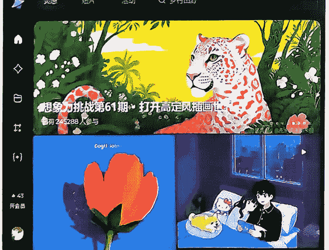

图 1-13 即梦 AI 首页

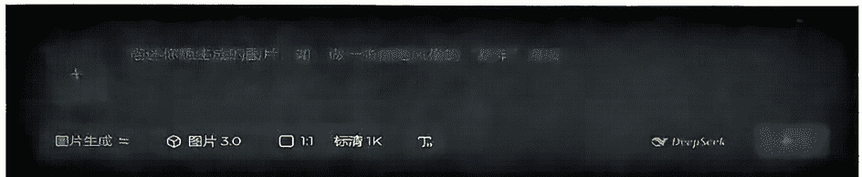

图 1-14 即梦 AI 图片生成界面

### 1.3.2 文心一言

文心一言是由百度开发的一款强大的 AI 语言模型，它在自然语言处理和生成方面表现出色，如图 1-15 所示。文心一言不仅能够生成高质量的文本内容，还可以用于生成 AI 绘画的提示词。通过结合文心一言的语言生成能力和 AI 绘画工具的图像生成能力，创作者可以更高效地实现创意表达。文心一言智慧绘图对话框如图 1-16 所示。

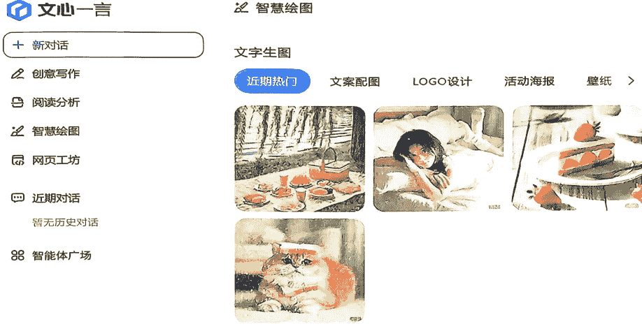

图 1-15 文心一言智慧绘图

智慧绘图

风格画板，上传参考，编辑重绘，绽放艺术灵感之美

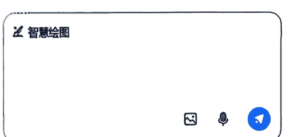

图 1-16 文心一言智慧绘图对话框

### 1.3.3 Midjourney

Midjourney 是一款专注于创意设计的 AI 绘画工具，如图 1-17 所示，它以其强大的图像生成能力和对细节的精细把控而闻名。Midjourney 不仅能够生成高质量的图像，还提供了丰富的风格选项和参数调整功能，帮助创作者实现创意。无论是插画、设计还是商业应用，Midjourney 都是一个值得信赖的工具。

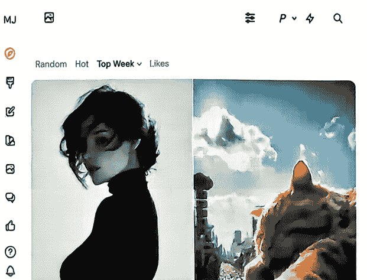

图 1-17 Midjourney 官网首页

### 1.3.4 Stable Diffusion

Stable Diffusion 是一款开源的 AI 绘画工具，它以其强大的图像生成能力和灵活性而受到广泛欢迎。Stable Diffusion 不仅能够生成高质量的图像，还提供了丰富的自定义选项，帮助创作者实现创意。官网如图 1-18 所示。

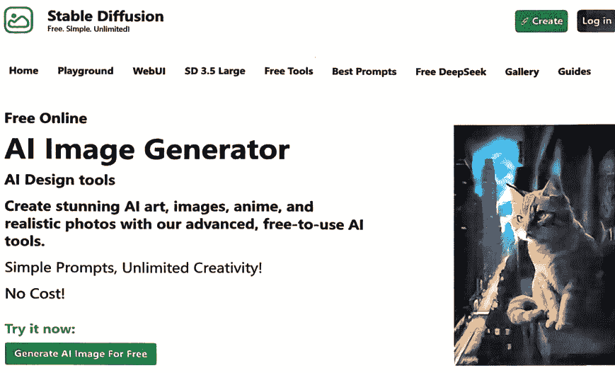

图 1-18 Stable Diffusion 官网

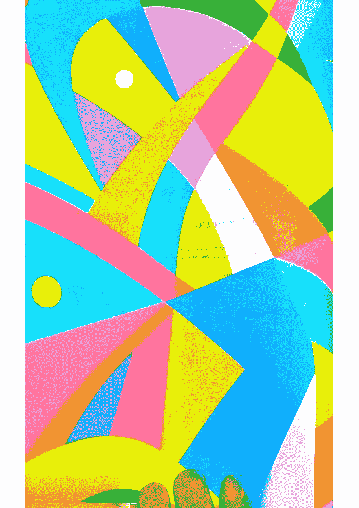

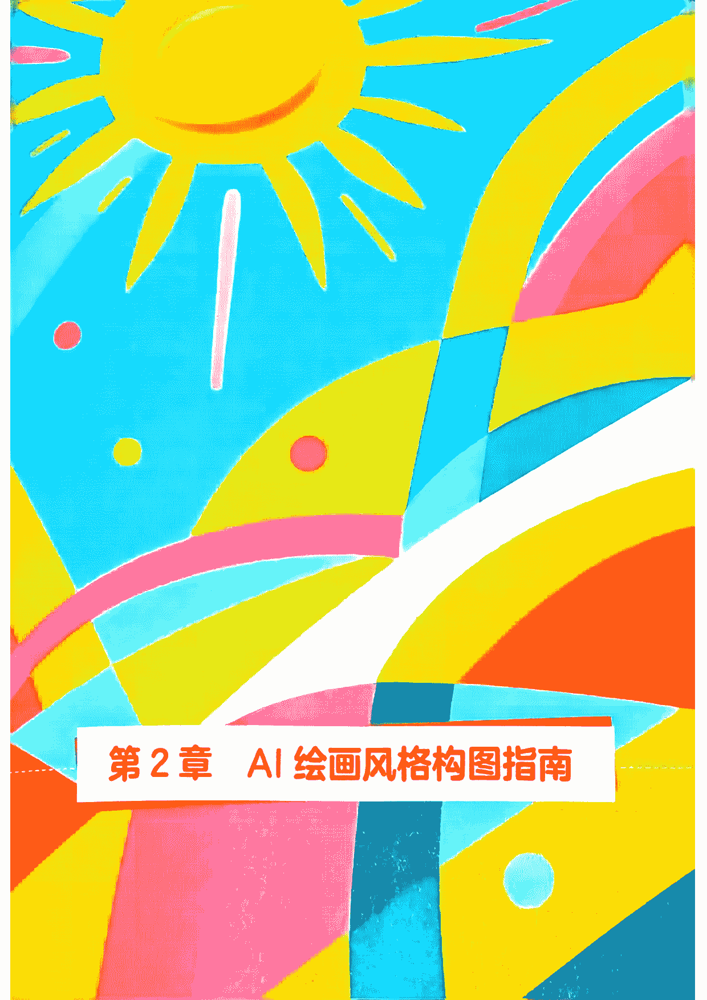

## 第 2 章 AI 绘画风格构图指南

> AI 绘画不仅是技术工具的运用，更是艺术表达的载体。不同风格和渲染品质的选择，直接决定了作品的最终呈现效果。本章将深入解析 AI 绘画中常见的艺术风格、渲染技术及画面质感处理技巧。帮助创作者精准匹配创作需求，掌握风格化的构图方法。

### 2.1 艺术风格

艺术风格是作品的核心语言，AI 绘画通过算法能模拟多种艺术流派，但如何让机器理解风格并转化为视觉语言，需要创作者对流派特质有清晰认知。

#### 2.1.1 抽象主义风格

抽象主义风格是一种不以具象形象为基础，而是通过色彩、形状、线条等元素来表达情感和思想的艺术风格。它打破了传统绘画对客观事物的描绘，强调艺术家内心世界的表达。

**重点提示词**

抽象主义风格提示词见表 2-1。

表 2-1 抽象主义风格提示词

| 提示词 | 作用与建议 |
| :--- | :--- |
| 抽象 | 避免具象描绘，强调自由组合的视觉元素 |
| 色彩碰撞 | 使用对比鲜明的色彩来增强视觉冲击力 |
| 几何形状 | 利用简单的几何形状（如圆形、三角形、方形）构建画面的基本结构 |
| 自由线条 | 用流畅或扭曲的线条表达情感和动态感 |
| 情感表达 | 通过色彩、形状和线条传达特定的情感，如喜悦、愤怒、宁静等 |
| 无具象形态 | 避免直接描绘现实中的具体物体，专注于抽象的视觉元素 |

在 AI 绘画构图时，可以尝试将画面分割成不同的区域，每个区域用不同的色彩和形状填充。避免使用具象的物体形象，而是通过形状和线条的组合来传达情感。例如，用弯曲的线条和柔和的色彩表达宁静，用尖锐的形状和强烈的色彩表达冲突。

**实例分析**

例如设计一幅以“希望”为主题的抽象画，使用鲜艳的黄色和橙色色块象征着阳光和活力，不规则的线条和形状则代表着希望的多样性。如图 2-1 所示，提示词为“抽象主义风格，色彩饱和度高、形状不规则，线条自由、情感表达，视觉冲击力，想象力，希望主题，阳光活力，欢快情绪”。

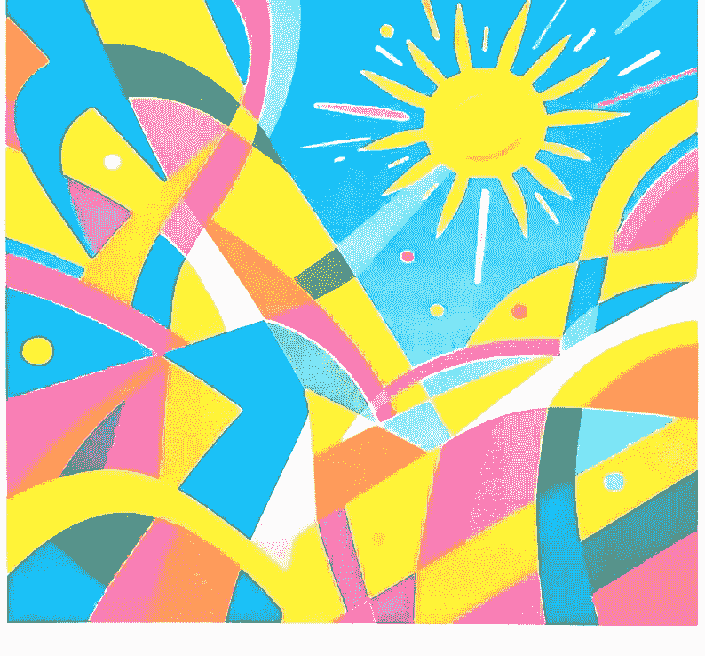

图 2-1 AI 绘画生成图——抽象主义风格 希望

又或者你想创作一幅表达内心焦虑的抽象作品，提示词可以是“抽象主义风格、尖锐三角形、深色调、交错线条、焦虑情绪”。如图 2-2 所示。

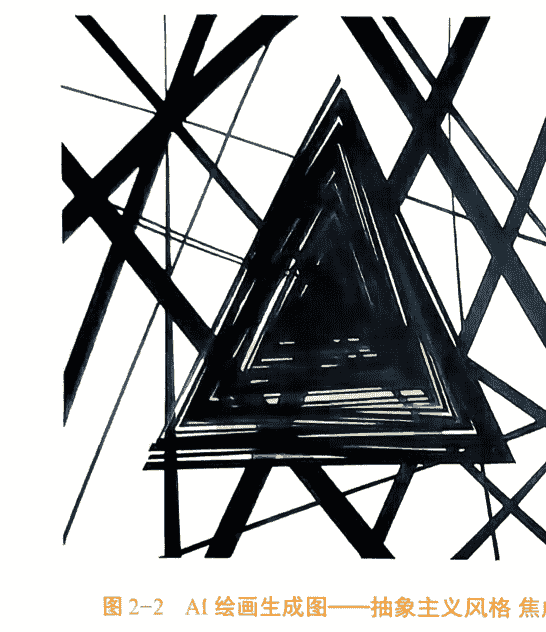

图 2-2 AI 绘画生成图——抽象主义风格 焦虑

#### 2.1.2 纪实主义风格

纪实主义风格强调真实地记录和描绘现实生活中的场景、人物和事件。这种风格的构图要求创作者以客观、真实的方式呈现主题，注重细节的刻画和场景的还原。在 AI 绘画中，要实现纪实主义风格，需要注重细节的真实性和场景的还原度。

**重点提示词**

纪实主义风格提示词见表 2-2。

表 2-2 纪实主义风格提示词

| 提示词 | 作用与建议 |
| :--- | :--- |
| 真实场景 | 选择一个具有代表性的现实场景作为创作主题 |
| 细节刻画 | 注重画面中每一个细节的描绘，如人物的表情、动作、场景中的物品等 |
| 客观呈现 | 以客观、真实的方式呈现主题，避免过多的主观情感介入 |
| 生活气息 | 通过场景和人物的描绘，传达出浓厚的生活气息和真实感 |
| 社会事件 | 可以选择具有社会意义的事件作为创作主题，增强作品的现实意义 |
| 人物特写 | 对人物进行细致的特写，展现人物的表情、动作和情感状态 |

**实例分析**

以一幅描绘城市街头的 AI 绘画为例，可以通过 AI 工具精确地还原建筑的结构、人物的服饰以及街上的各种物品。色彩的运用也要符合现实中的光线和环境。提示词为“纪实主义风格，真实场景，细节还原，建筑结构，人物服饰，真实感，生活气息，城市街头，广告牌，路灯，行人”，如图 2-3 所示。这种风格的作品能够让观众感受到生活的原汁原味，具有很强的代入感和真实感。

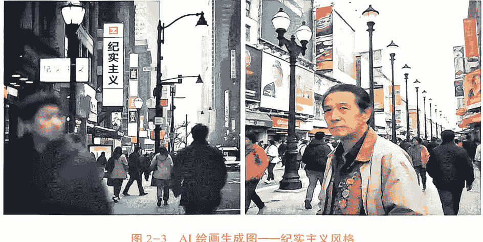

#### 2.1.3 极简主义风格

极简主义风格以简洁、纯净的视觉语言为特点，强调用最少的元素表达最丰富的内涵。这种风格的构图通常以简洁的线条、简单的形状和单一的色彩为主，追求极致的简洁与纯粹。在 AI 绘画中，要实现极简主义风格，需要在构图上做到简洁明了，色彩上尽量使用单一色调或少量的对比色。

**重点提示词**

极简主义风格提示词见表 2-3。

表 2-3 极简主义风格提示词

| 提示词 | 作用与建议 |
| :--- | :--- |
| 单一色彩 | 选择单一的色彩或低饱和度的色彩，增强画面的简洁感和纯粹感 |
| 空间留白 | 在画面中留出大量的空白区域，增强画面的呼吸感和空间感 |
| 纯粹形状 | 使用简单的几何形状作为画面的主要元素，如圆形、方形、三角形等 |
| 少即是多 | 坚持“少即是多”的设计理念，去掉一切不必要的元素，追求极致的简洁 |
| 现代感 | 通过简洁的构图和色彩运用，营造出现代感和艺术感 |

**实例分析**

例如，在绘制一幅人物肖像时，可以用简单的线条勾勒出人物的轮廓，再用大面积的单一色调填充背景，提示词为“极简主义风格，简洁形式、最少元素，单一色彩，对比色，简洁构图，现代感，艺术感，宁静专注，人物肖像”，如图 2-4 所示。

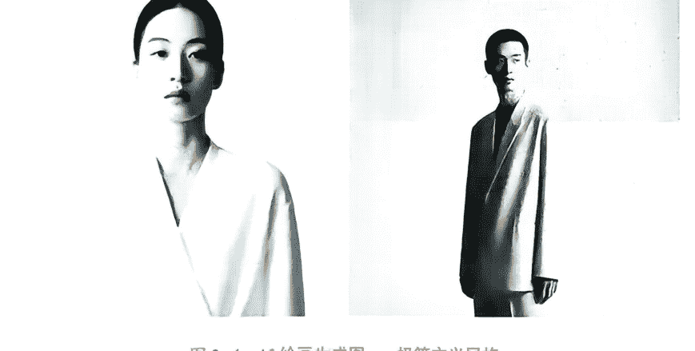

#### 2.1.4 印象主义风格

印象主义风格强调捕捉瞬间的光影变化和色彩感受，它打破了传统的绘画技法，采用点彩、短笔触等手法来表现光影效果，注重通过色彩的点染和笔触的运用，传达出一种生动而自然的视觉效果。

**重点提示词**

印象主义风格提示词见表 2-4。

表 2-4 印象主义风格提示词

| 提示词 | 作用与建议 |
| :--- | :--- |
| 光影变化 | 通过色彩和光影的运用，捕捉光影变化、增强生动感 |
| 色彩点染 | 使用点染的笔触来表现色彩，营造出柔和而自然的视觉效果 |
| 自然场景 | 选择自然场景作为创作主题，如日出、湖面、花园等，传达自然之美 |

**实例分析**

例如创作一幅风景画，用点彩的方式表现出树叶的光影变化，或者通过模糊效果表现出远处的山峦。编写提示词“印象主义风格，光线捕捉，色彩变化，光影效果，朦胧梦幻，自然光影，风景画，树叶光影”，如图 2-5 所示。

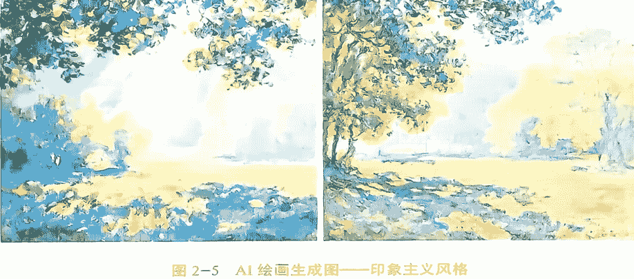

### 2.2 渲染品质

渲染品质是 AI 绘画作品专业性和视觉效果的重要体现。使用不同的渲染工具和技术提示词，可以提升作品的质感和真实感。本节将详细介绍几种常见的渲染方法和品质提升技巧。

#### 2.2.1 C4D 渲染

C4D（Cinema 4D）渲染器是一种强大的三维渲染软件，它能够为 AI 绘画作品提供高质量的三维效果。C4D 渲染器具有强大的材质和灯光系统，可以模拟出各种复杂的材质效果，如金属、玻璃、布料等。

例如，在绘制一幅科幻场景时，可以使用“C4D 渲染器”提示词为飞船添加金属材质，通过灯光的设置营造出未来感的光影氛围，如图 2-6 所示，提示词为“C4D 渲染器，三维效果，材质系统，灯光设置，金属材质，玻璃布料，科幻场景，未来感光影”。

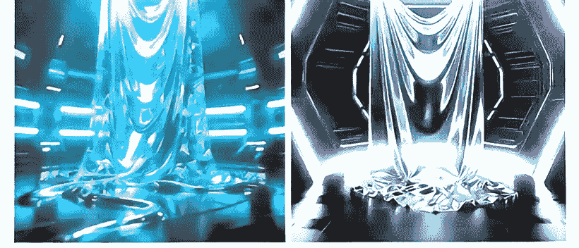

图 2-6 AI 绘画生成图——C4D 渲染

#### 2.2.2 虚幻引擎

虚幻引擎（Unreal Engine）是一种广泛应用于游戏开发和影视制作的实时渲染引擎。它以强大的实时渲染能力和高质量的视觉效果而闻名。在 AI 绘画中，虚幻引擎可以用于创建逼真的虚拟场景和角色。

例如，在绘制一幅奇幻森林场景时，可以使用“虚幻引擎”提示词为树木添加逼真的纹理，模拟出风吹动树叶的效果，提示词为“虚幻引擎，实时渲染，虚拟场景，角色创建，逼真纹理，物理引擎，风吹树叶，奇幻森林，电影级视觉效果”，生成图如图 2-7 所示。

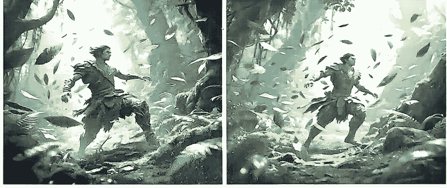

#### 2.2.3 光线追踪

光线追踪是一种先进的渲染技术，它通过模拟光线在场景中的传播和反射，能够生成高度逼真的光影效果，可以精确地表现出物体的反射、折射和阴影效果，使作品具有很强的真实感。

例如，在绘制一幅室内场景时，通过“光线追踪”提示词可以真实地表现出阳光透过窗户照射在物体上的光影变化，以及物体之间的反射和折射效果，如图 2-8 所示，提示词为“光线追踪、光影效果，光线传播，反射折射，阴影效果，真实感，室内场景，阳光透过窗户，光影变化”。

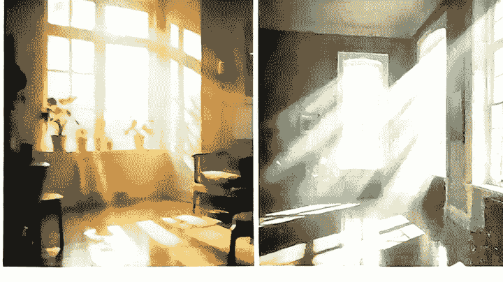

图 2-8 AI 绘画生成图——光线追踪

### 2.3 构图视角

视角是绘画创作中一个极为重要的概念，它决定了观众如何“看”一幅画。通过调整视角高度、远近和方向，创作者可以引导观众的注意力，营造出不同的视觉效果和情感氛围。创作者可以通过视角高度、远近、方向的调整，精准控制画面的叙事逻辑。

#### 2.3.1 视角高度

视角高度是指观察者相对于被观察对象的垂直位置。不同的视角高度可以带来不同的视觉效果，例如低视角可以增强画面的压迫感和动态感，而高视角则可以营造出一种俯瞰和宏观的视觉效果。

**重点提示词**

视角高度提示词见表 2-5。

表 2-5 视角高度提示词

| 提示词 | 作用与建议 |
| :--- | :--- |
| 仰视视角 | 相机位置低于主体视平线，常用于表现角色的威严、建筑的宏伟或危险的压迫感 |
| 平视视角 | 相机与主体视平线齐平，最接近人眼观察习惯、适合表现自然、日常或平等对话的场景 |
| 俯视视角 | 相机位置高于主体视平线、常用于展示场景全局、表现渺小感或营造压抑氛围 |

**仰视视角（仰拍）**

从较低的位置向上看，通常会给人一种仰视的感觉。这种视角能够增强主体的气势和威严感，常用于表现高大的建筑、英雄人物等。例如，提示词为“低角度仰拍，战士持剑站立，背景破碎城墙，仰拍视角强化人物高大感，广角畸变突出腿部长度”，通过“低角度仰拍”+“广角畸变”双重提示，拉长主体下肢比例，配合破碎背景强化力量感。生成图如图 2-9 所示。

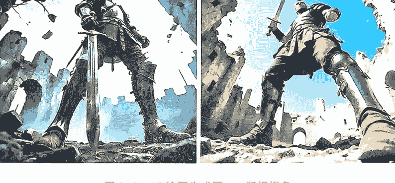

**平视视角（平拍）**

观察者与被观察对象处于同一水平线上。这种视角能够让观众更加自然地观察画面，常用于日常生活场景、人物肖像等。比如在绘制一幅人物交谈场景的插画时，平视角能够让观众更好地融入场景，提示词为“视线水平、尽量自然的城市街景、自然光影”，生成图如图 2-10 所示。提示词中使用“中景平视”+“视线水平”避免夸张透视，聚焦角色表情与互动细节。

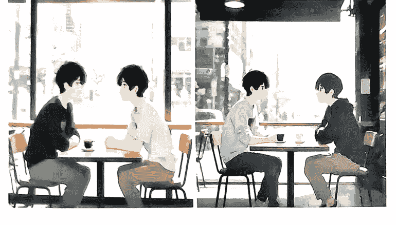

**俯视视角（俯拍）**

从较高的位置向下看，通常会给人一种俯视的感觉。这种视角能够展现更多的背景信息，常用于表现全景、风景等。例如，提示词为“俯视视角，广角，废弃城市街道，散落的人群，高视角强化场景空旷感，冷色调天空”，俯视视角可以让画面更广阔，使用“俯视视角”+“散落人群”压缩垂直空间，突出场景的宏大与个体的渺小，生成图如图 2-11 所示。

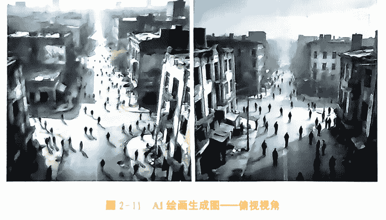

#### 2.3.2 视角远近

视角远近是指观察者与被观察对象之间的距离。不同的视角远近可以营造出不同的空间感和视觉焦点。在调整视角远近时，首先要确定画面的主题和情感表达。例如，如果想表达一种细节和真实感，可以选择较近视角；如果想营造一种宏观和整体的效果，可以选择较远视角。

**重点提示词**

视角远近提示词见表 2-6。

表 2-6 视角远近提示词

| 提示词 | 作用与建议 |
| :--- | :--- |
| 特写视角 | 聚焦主体局部(如面部、手部)，适合突出情绪或关键细节 |
| 中景视角 | 展示主体全身或主要动作，适合表现主体信息 |
| 远景视角 | 展示主体与环境的关系，适合交代场景或营造氛围 |

**特写视角**

观察者与被观察对象距离较近，通常会放大主体的细节，突出其特征，如人物的面部特写、物品的细节展示等。例如，特写视角拍摄一位女性，提示词为“面部特写，女性角色，幸福感，微笑眼角，皮肤纹理细腻，暖光侧打”，生成图如图 2-12 所示，“面部特写”+“微笑眼角”可以放大细节，强化情绪冲击力。

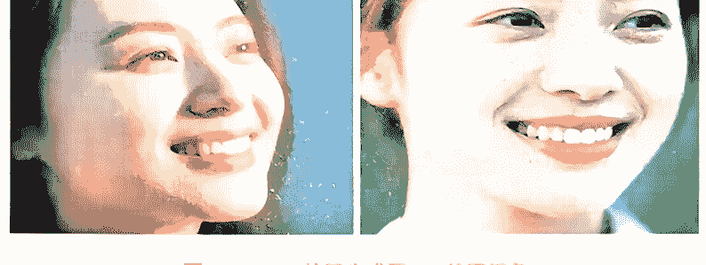

**中景视角**

观察者与被观察对象距离适中，能够同时展现主体和部分背景信息。这种视角常用于人物全身像、场景插画等。

例如设计一幅剑士挥舞长剑的插画，提示词为“半身中景，剑士挥剑攻击画面，铠甲金属反光，背景模糊的战场硝烟，动态模糊强化速度感”，如图 2-13 所示。

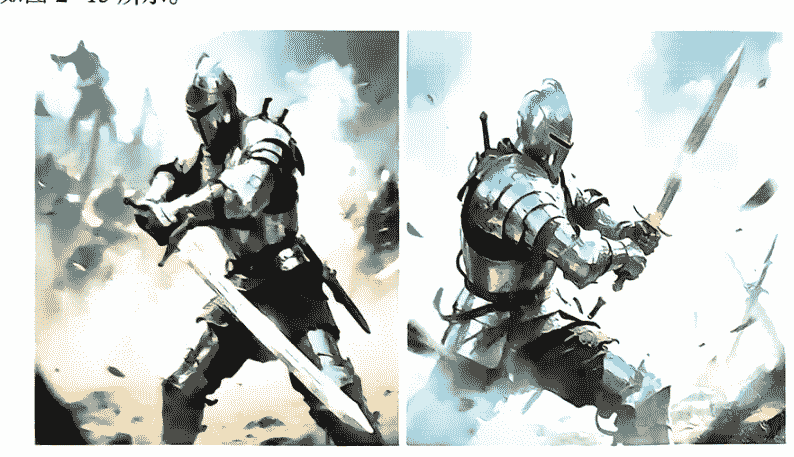

又例如描绘一幅时尚摄影作品，使用中景视角设计提示词可以让观众看到人物的整体造型和背景环境，提示词为“中景视角，时尚摄影，女性人物，人物全身造型，时尚感，氛围感背景”，生成图如图 2-14 所示。

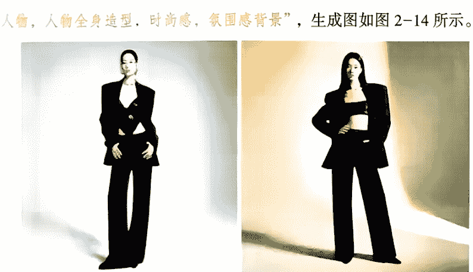

**远景视角**

观察者与被观察对象距离较远，通常会弱化主体的细节，突出整体的氛围和环境。这种视角常用于风景画、全景插画等。

假设我们要创作一幅壮丽的古代丝绸之路风景画，设计提示词使用“远景视角”+“宏大场景传递氛围”：“远景视角，古代丝绸之路，宏大的场景，深远的空间感，沙漠，沙丘，山脉，蜿蜒的古道，骆驼，云彩，神秘感，历史氛围，叙事性，艺术感染力”，生成图如图 2-15 所示。

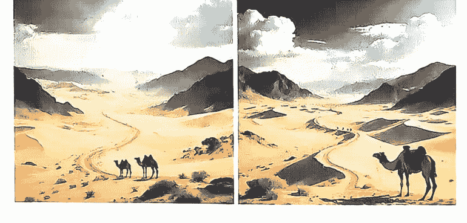

#### 2.3.3 视角方向

视角方向是指观察者相对于被观察对象的水平位置。不同的视角方向可以营造出不同的空间感。正面视角可以增强画面的对称性和平衡感，而侧面视角则可以营造出一种动态和紧张的视觉效果。

**重点提示词**

视角方向提示词见表 2-7。

表 2-7 视角方向提示词

| 提示词 | 作用与建议 |
| :--- | :--- |
| 正面视角 | 增强主体与观众的直接互动，适合表现对称美、仪式感或权威感 |
| 侧面视角 | 突出主体轮廓，适合表现动态或优雅姿势、避免正面直视、增加神秘感 |
| 斜侧面视角 | 最自然的叙事视角，平衡细节与空间感，适合表现动作、互动或场景深度 |
| 背面视角 | 制造悬念，适合叙事性强的场景 |

**正面视角**

观察者正对着被观察对象，通常会给人一种直接、稳定的感觉。这种视角常用于人物肖像、正面展示等。

例如，绘制一幅人物正面肖像插画，正面视角能够让观众清晰地看到人物的五官、发型和服饰，更好地传达人物的形象和气质，如图 2-16 所示，提示词为“正面肖像，贵族女性端坐，礼服蕾丝细节，背景对称的古奥立柱，眼神直视镜头”。

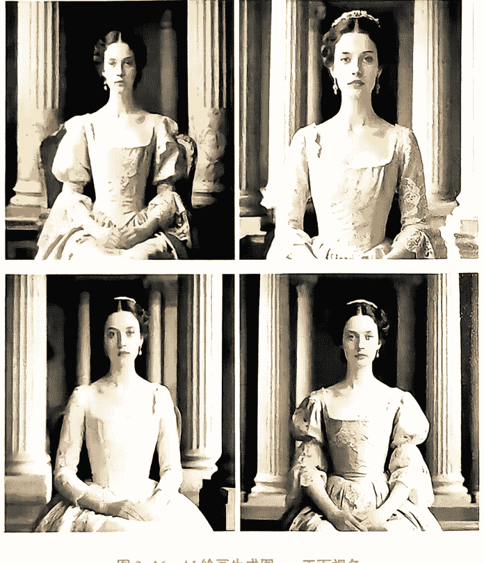

**侧面视角**

观察者从被观察对象的侧面进行观察，通常会给人一种侧面的轮廓感。这种视角常用于表现人物的侧面轮廓、动态姿势等。

例如描绘一幅田径摄影作品，使用侧面视角可以让观众感受到运动员的动态姿势和肌肉力量，“田径运动员侧面奔跑，运动残影效果，肌肉线条，速度感，竞技体育，动态模糊，汗水飞溅，力量爆发”。

#### 斜侧面视角

观察者从被观察对象的斜侧面进行观察，通常会给人一种立体感和动态感。这种视角常用于表现人物的立体感、场景的深度等。
假设描绘一幅唯美的女性插画，斜侧面视角可以展示其动作姿态和表情，让人物更加生动，生成图如图 2-18 所示。提示词使用“斜侧面视角”+“优雅动作姿态”捕捉动作的流畅性，“女性人物插画，唯美风格，斜侧面视角，优雅动作姿态和表情”。

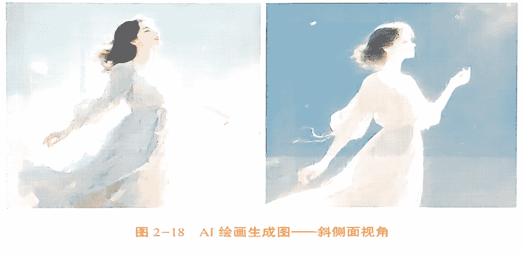

#### 背面视角

背面视角观察者从被观察对象的背面进行观察，通常会给人一种神秘感和期待感，适合制造悬念或引导观众想象。

例如创作一幅神秘人物插画，使用背面视角让观众感受到人物的神秘气质，生成图如图 2-19 所示，提示词为“一位身着黑色长风衣的人物站在昏暗的街道上，背面视角，路灯投下长长的影子，雾气弥漫，孤独氛围”。

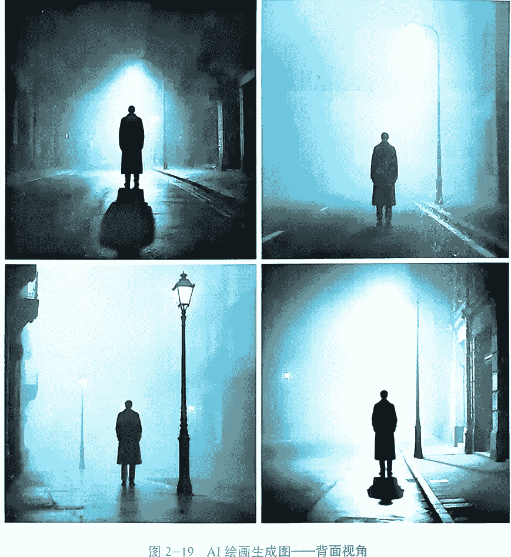

## 2.4 构图法则

构图是画面的骨骼，合理的构图能让画面元素布局合理，视觉重心突出，营造出独特的视觉效果。构图法则是 AI 绘画中“结构化控制”——三分平衡、中心聚焦、对称秩序、框架引导、前景纵深、线条牵引，每种法则都能精准锁定画面的视觉重心，但同时构图法则是“工具”而非“枷锁”。例如，中心构图可搭配轻微偏移制造“不稳定感”，三分构图可让主体略微偏离交叉点增强动态。构图法则提示词见表 2-8。

表 2-8 构图法则提示词

| 提示词 | 核心作用 | 典型场景 | 关键提示词组合 |
| :--- | :--- | :--- | :--- |
| 三分构图 | 平衡与延伸 | 风光、人像、静物 | “三分网格”“主体位于交叉点” |
| 中心构图 | 强聚焦与突出 | 特写、产品、舞台 | “主体居中”“背景虚化” |
| 对称构图 | 秩序与仪式 | 建筑、宗教、抽象艺术 | “水平/垂直/放射对称”“元素完全一致” |
| 框架构图 | 视线引导与故事感 | 复古、神秘、怀旧主题 | “天然/人造框架”“主体位于框架内” |
| 前景构图 | 强化纵深与空间感 | 风光、人像、建筑、纪实 | “前景遮挡”“前景层次”“前景与主体互动” |
| 引导线构图 | 叙事牵引与纵深感 | 探险、运动、场景引导 | “显性/隐性引导线”“多重线条汇聚” |

### 2.4.1 三分构图

三分构图是一种经典且实用的构图方法，将画面横向、纵向各均分三等分，形成九宫格网格，主体或关键元素放置于网格交叉点（“黄金分割点”），而非正中心。此法则符合人眼“非对称平衡”的视觉偏好，既避免呆板，又防止失衡。

提示词设计技巧
- 明确网格划分：“三分构图”“九宫格网格”“横向/纵向三等分”；
- 定位主体位置：“主体位于右下交叉点”“地平线对齐上 1/3 线”“人物视线指向左上交叉点”；
- 强调平衡感：“画面重心稳定”“元素分布疏密得当”；
- 补充风格关键词：“风光摄影”“人像写真”“静物特写”。

#### 实例分析

生成一张人物风景照，使用三分构图合理划分人物与风景的位置，提示词为“三分构图，优雅的模特站在海边，模特面向左侧，模特位于画面右侧的三分线上，海平面与水平方向的三分线对齐，画面平衡，温暖色调，宁静的海面背景”，生成图如图 2-20 所示。

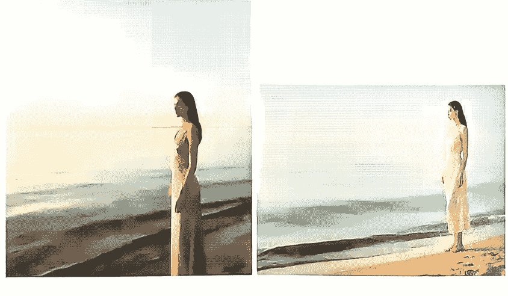

### 2.4.2 中心构图

中心构图是将主体放置在画面的中心位置，直接吸引观众的注意力，强调主体的重要性和独特性，适合表现主体单一、需要突出主体形象或者传达明确主题的画面。

提示词设计技巧
- 明确中心定位：“中心构图”“主体居中”“画面正中央”；
- 强化主体细节：“主体占画面 70% 面积”“面部 / 产品细节锐利”；
- 弱化环境干扰：“背景虚化”“纯色/渐变背景”“环境元素模糊”；
- 补充风格关键词：“肖像特写”“产品静物”“舞台特写”。

#### 实例分析

例如在商业摄影中拍摄一款珠宝，要求观众视线第一时间锁定戒指，同时保留钻石火彩与金属质感的细节，“中心构图，一款珠宝戒指，珠宝被放置在画面的中心位置，黑色的背景，光线聚焦在珠宝上，细节清晰可见，突出珠宝的珍贵和精美”，生成图如图 2-21 所示。

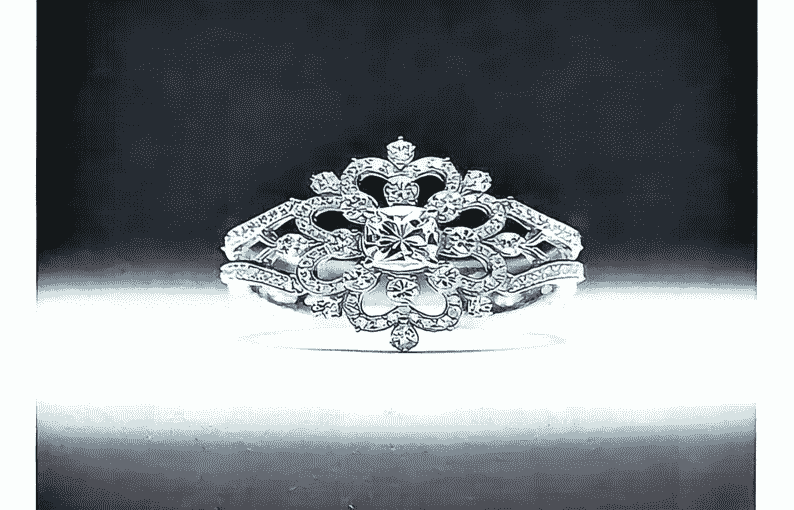

图 2-21 AI 绘画生成图——中心构图

中心构图也能体现动态或静态的感觉。在绘制一幅运动员冲刺的插画时，例如以中心构图绘制一幅画面，运动员位于画面中心，他身体前倾，四肢伸展，正在全力冲刺，周围的空气似乎有波动，这种中心构图在表现动态的同时也突出了运动员的主体地位。

### 2.4.3 对称构图

对称构图画面中的元素以一条轴线为对称中心，左右或上下两侧的元素在形状、大小、数量等方面相互对称。这种构图方式能给人一种稳定、庄重、和谐的视觉感受，常用于表现对称美感或营造正式、严肃的氛围。

#### 水平对称

以水平线为轴，上下元素对称（如天空与地面、海面与建筑）。
设计思路：“水平对称”复制上下元素，“湖泊倒映雪山”强制对称关系，“冷调光线”增强冷静氛围。

#### 垂直对称

以垂直线为轴，左右元素对称（如宫殿大门、镜面反射）。
提示词示例：“垂直对称构图，老宅大门左右对仗，朱红门漆与铜环完全对称，门前石狮子左右呼应，传统中式风格。”
设计思路：“垂直对称”+“左右对仗”复制左右元素，“朱红门漆”“铜环”强化传统质感。

#### 放射对称

以中心点为轴，元素呈放射状扩散（如花朵、车轮、灯光）。
提示词示例：“放射对称构图，夜空烟花绽放，火花以中心点为轴呈放射状扩散，地面人群仰头围观，暖黄灯光烘托节日氛围。”
设计思路：“放射对称”+“火花扩散”生成向外发散的烟花形态，“人群仰头”强化中心聚焦感。

#### 实例分析

例如绘制中国传统建筑风格的插画，如图 2-22 所示，提示词为“对称构图，一幅中国传统建筑插画，建筑左右两侧完全对称，飞檐斗拱、门窗等建筑元素对称分布，中国传统建筑，庄重与对称之美”

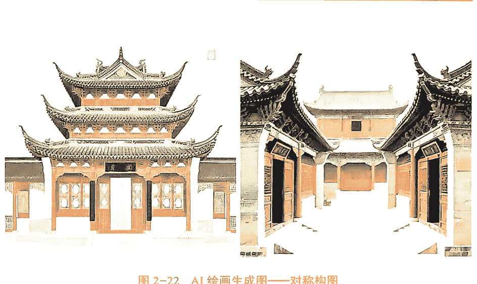

图 2-22 AI 绘画生成图——对称构图

### 2.4.4 框架构图

框架式构图是利用画面中的元素形成框架，将主体放置在框架之中。这种构图方式可以增加画面的层次感和神秘感，同时引导观众的视线聚焦到主体上，常用于突出主体或营造神秘氛围。

提示词设计技巧
- 明确框架类型：“天然框架”（树枝、山洞）、“人造框架”（窗户、门框）、“抽象框架”（灯光、阴影）；
- 描述框架与主体的关系：“框架包裹主体”“主体位于框架中心”“框架边缘做旧/模糊”；
- 补充氛围关键词：“神秘感”“故事性”“时光感”。

#### 实例分析

例如在绘制一幅神秘主题的插画，如图 2-23 所示，提示词为“框架式构图，一幅神秘插画，古老的窗户框架，主体（一个神秘的人物）放置框架中，窗户框架的线条和质感与主体相互映衬，神秘氛围，插花艺术”。

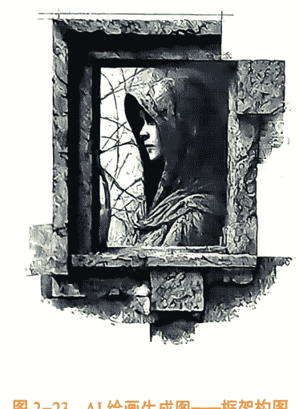

图 2-23 AI绘画生成图——框架构图

### 2.4.5 前景构图

前景构图是一种通过在画面前景放置元素来增强画面深度感和引导观众视线的构图方式。它能够为画面增加层次感，使主体更加突出，并且营造出丰富的视觉效果。前景元素可以是任何物体，如植物、岩石、栏杆等，它们可以作为画面的引导线，将观众的注意力引向主体。

提示词设计技巧
- 明确前景元素：直接描述前景的具体物体（如“前景野花”“岩石作为前景”“木质门窗作为前景”）；
- 强调空间关系：用“遮挡”“覆盖”“层次”等词提示前景与主体的位置（如“前景树枝遮挡主体上半身”“前景岩石覆盖画面底部 1/5”）；
- 补充氛围关键词：“自然感”“时光感”“沉浸式”“电影级”。

#### 实例分析

例如描绘一幅氛围感美女，如图 2-24 所示，提示词为“前景构图，前景是蔷薇花，中景是一位氛围感美女，暖色调，高清摄影，大师构图，浪漫唯美”。

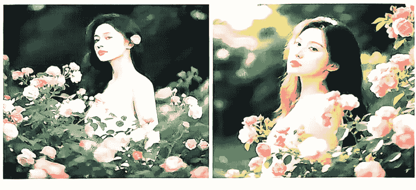

图 2-24 AI 绘画生成图——前景构图

### 2.4.6 引导线构图

引导线构图是一种通过线条引导观众视线的构图技巧，广泛应用于绘画、摄影和设计中。引导线构图可以增强画面的层次感和深度感，引导观众的注意力聚焦于画面的重点元素。

**显性引导线**
明确的线条元素（如蜿蜒小路、笔直公路、栏杆）。
提示词示例：“引导线构图，蜿蜒的山间小路指向远处山顶的古寺，道路两侧植被作为引导，晨雾弥漫，自然光从左上方照射。”
设计思路：“蜿蜒小路”作为显性引导线，“指向古寺”明确主体位置，“晨雾”增加画面层次。

**隐性引导线**
通过元素排列或光影形成的“心理线条”（如人物视线、灯光汇聚、色彩渐变）。
提示词示例：“隐性引导线构图，人群视线统一望向画面右侧的演讲者，灯光从顶部汇聚于演讲者头顶，背景人群模糊，突出主体。”
设计思路：“人群视线”作为隐性引导线，“灯光汇聚”强化焦点，“背景模糊”减少干扰。

**复合引导线**
多组线条共同引导（如道路＋河流＋人物视线）。

提示词示例：“复合引导线构图。溪流从画面左上流向右下，岸边小路与溪流平行，行人沿小路行走，视线望向溪流尽头的瀑布，多重线条共同指向瀑布主体。”

设计思路：“溪流＋小路＋视线”三重组合引导，“流向瀑布”明确主体位置，“多重线条”增强画面纵深感。

#### 实例分析

以一幅描绘英雄人物的 AI 绘画为例，提示词为“引导线构图，英雄人物，视觉引导，道路汇聚，光线指向，深度感，层次感，动态感，视觉吸引力，画面焦点，气场强大，坚定信念”，使用引导线构图，画面中的道路、光线等元素都可以作为引导线，从画面的四周向中心汇聚，指向英雄人物，生成图如图 2-25 所示。

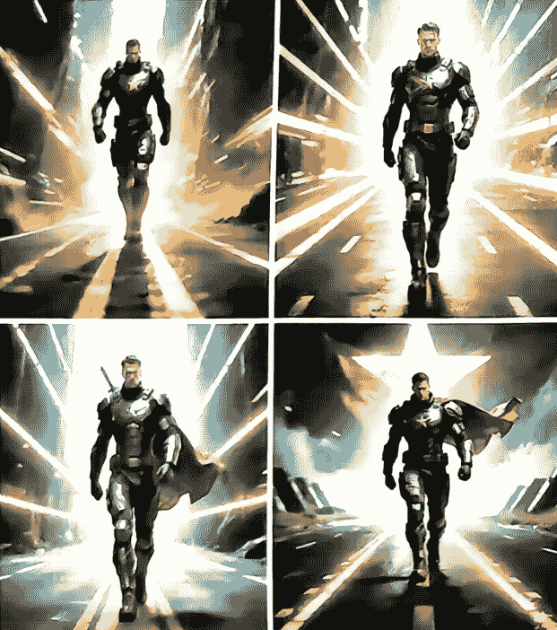

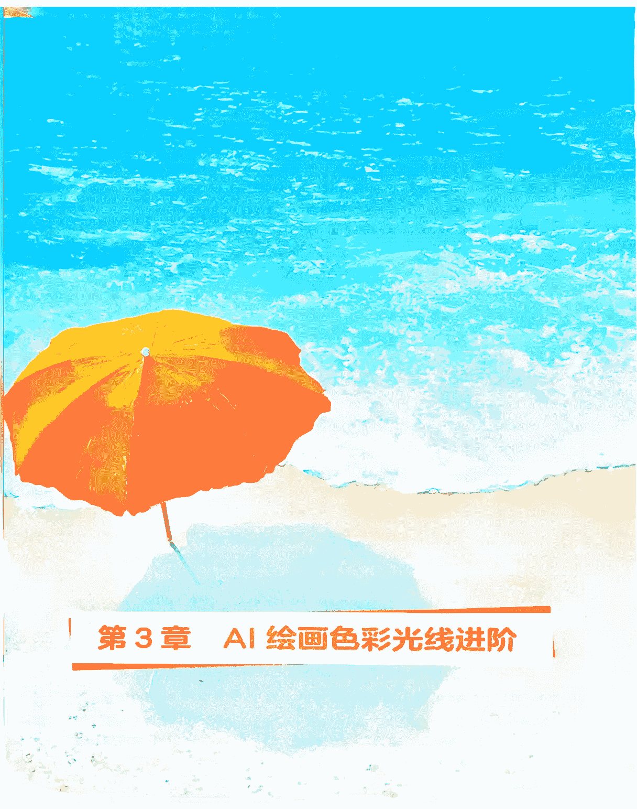

## 第 3 章 AI 绘画色彩光线进阶

> 在 AI 绘画的创作过程中，色彩和光线是塑造视觉效果的关键要素。色彩能够传递情感、营造氛围，而光线则可以增强画面的立体感和深度。本章将深入探讨色彩和光线在 AI 绘画中的进阶应用。

### 3.1 流行色彩

色彩是绘画语言中最具表现力的元素之一。从“选色”到“控色”的进阶，流行色彩是时代的视觉语言——“亮丽橙色”充满活力，低饱和的“自然绿色”回归治愈，“糖果色”持续占领可爱赛道，而“霓虹色”仍是赛博朋克的标志。

#### 3.1.1 亮丽橙色

橙色是一种充满活力和热情的色彩，它象征着阳光、活力和创造力，常被用于表现温暖、欢快的场景，能够为画面注入强烈的视觉冲击力。

提示词设计技巧
- 明确色相与明度：“高饱和亮橙”“明度 85% 的橙色”“比正橙偏黄 5% 的亮橙”；
- 关联光线：“暖黄阳光照射”“橙光环境光”“橙色与浅黄渐变”；
- 限定场景：“夏日冰激凌”“篝火晚会”“热带水果”；
- 避免脏色：“避免灰橙”“拒绝暗橙”“保持颜色通透”。

#### 实例分析

例如创作一幅夏日海滩场景的插画，使用亮丽橙色来描绘沙滩伞，同时搭配浅蓝色的海水和白色沙滩，营造出清新而充满活力的氛围，提示词为“夏日海滩插画，橙色沙滩伞，浅蓝色海水，白色沙滩，阳光明媚，活力四射”，生成图如图 3-1 所示。


图 3-1 AI 绘画生成图——亮丽橙色

#### 3.1.2 自然绿色

自然绿色是大自然的代表色，它象征着生机、宁静和和平，区别于高饱和的“荧光绿”，更接近真实植物的色彩（如树叶、草地），这种色彩能够为画面带来一种清新、自然的感觉，适合表现生态、治愈、自然景观、植物或环保自然主题。

提示词设计技巧
- 区分绿调：“橄榄绿”“草绿”“松针绿”“薄荷绿”（细化具体植物参考）；
- 关联环境：“阴天自然光”“晨雾柔光”“树荫过滤光”；
- 强调真实感：“带叶脉纹理的绿”“叶片边缘微卷的旧绿”“草地混有黄绿的杂色”。

#### 实例分析

创作一幅森林仙境的插画，可以使用深绿色来描绘古老的树木，浅绿色来描绘新生的嫩叶，搭配淡紫色的雾气，营造出神秘而宁静的氛围，生成图如图3-2所示，提示词为“森林仙境插画，深绿色树木，浅绿色嫩叶，神秘宁静”。

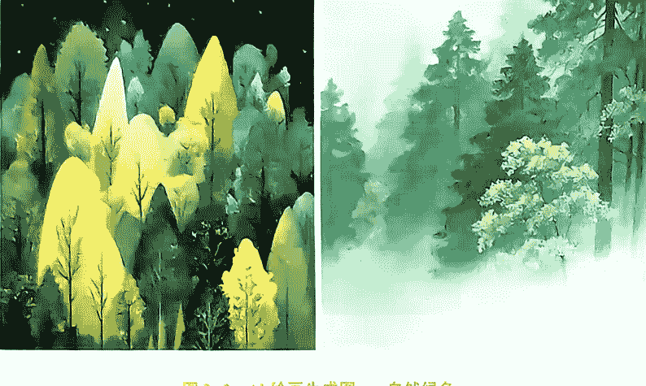

图3-2 AI绘画生成图——自然绿色

#### 3.1.3 糖果色

糖果色是一种甜美、柔和的色彩，通常包括粉色、浅黄色、浅蓝色等。这种色彩常被用于表现儿童、女性或浪漫主题的作品。糖果色能够为画面带来一种温馨、梦幻的感觉。

提示词设计技巧
- 明确色系：“马卡龙粉”“婴儿蓝”“柠檬黄”“泡泡糖紫”（用具体糖果类型命名）；
- 关联质感：“丝绒质感”“亮面塑料感”“糖霜光泽”；
- 强化对比：“与白色/浅灰搭配”“小面积高饱和+大面积低饱和”。

#### 实例分析

假设创作一幅童话故事插画，使用马卡龙粉来描绘公主的裙子，浅黄色来描绘魔法棒，搭配浅蓝色的天空和白色云朵，营造出梦幻般的氛围，生成图如图 3-3 所示，提示词为“一幅童话故事插画，马卡龙粉公主裙，浅黄色魔法棒，浅蓝色天空，白色云朵，梦幻甜美”。

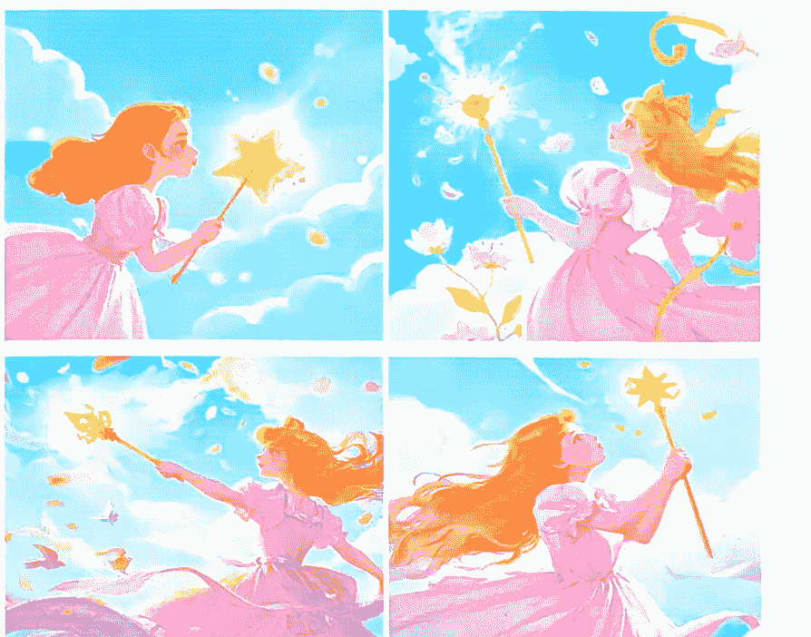

图 3-3 AI 绘画生成图——糖果色

#### 3.1.4 霓虹色

霓虹色是一种明亮、鲜艳的色彩，通常包括亮粉色、亮蓝色、亮绿色等。这种色彩常被用于表现现代、时尚或未来感的主题。霓虹色能够为画面带来一种强烈的视觉冲击力和科技感。

提示词设计技巧
- 明确光源：“霓虹灯管”“LED 光带”“全息投影”；
- 关联环境：“暗背景”“雨夜湿滑地面”“金属反光”；
- 强调发光：“颜色边缘泛光”“颜色渗透周围环境”“颜色与黑色背景强对比”；
- 避免模糊：“拒绝柔光”“保持颜色锐利”“加入光晕”。

#### 实例分析

例如创作一幅赛博朋克风格作品，通过“暗蓝背景 + 霓虹粉灯管”形成强对比，“边缘泛光”模拟霓虹灯的真实发光效果，“积水反射”强化色彩的渗透感，提示词为“生成一幅赛博朋克风格作品，霓虹色主调，暗蓝背景，街道两侧是霓虹粉灯管，边缘泛光，地面有积水反射霓虹光（粉色光斑），穿银色外套的角色站在中间（外套反光映出霓虹色），雨丝清晰（增强潮湿感），8K 电影级画质”，生成图如图 3-4 所示。

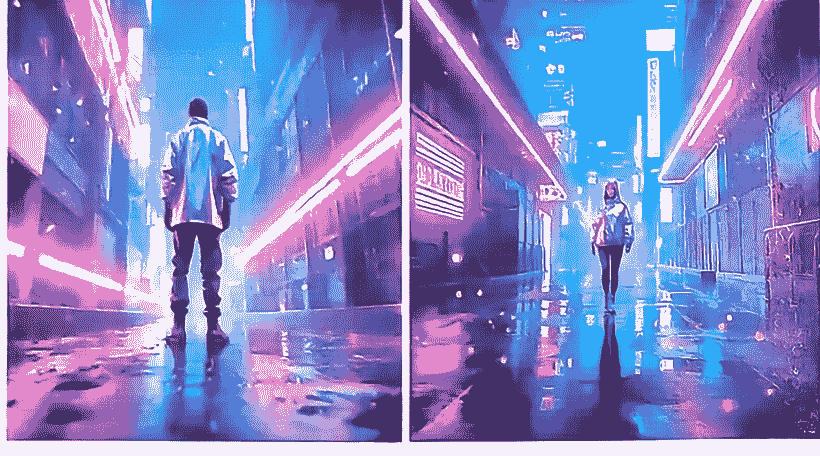

### 3.2 色彩搭配

色彩搭配是画面情绪的“语法”——对比色制造冲突，相邻色传递和谐，同色系构建层次。本节将解析三大搭配法则，教你通过提示词控制色彩关系，让画面“有话可说”。

#### 3.2.1 对比色搭配

对比色是指在色轮上相对位置的颜色，如红与绿、蓝与橙、黄与紫等。这种搭配方式能产生强烈的视觉冲击力，使画面元素更加突出，适合突出主体或制造戏剧感。

提示词设计技巧
- 明确对比色：“橙蓝对比”“红绿撞色”“黄紫互补”；
- 控制比例：“主色占 70%+ 对比色占 30%”（避免视觉混乱）；
- 调和细节：“加入中间色（如白/灰）”“降低对比色饱和度”“让对比色有明度差”；
- 关联场景：“节日海报”“潮牌设计”“戏剧舞台”。

#### 实例分析

假设生成一张“夏日音乐节”的海报，要求用对比色突出舞台与观众，提示词为“生成一张‘夏日音乐节’的插画海报，橙蓝对比色搭配，舞台背景是高饱和亮橙（占画面 70%），观众区域是亮蓝（占画面 30%），加入白色荧光字（中间色调和），舞台灯光橙蓝交替（强化对比），人物服装蓝橙撞色（细节呼应），夏日热烈氛围，8K 海报质感”，通过“亮橙 + 亮蓝”控制画面对比色调，“白色荧光字”作为中间色调和，“舞台灯光交替”强化动态对比，最终输出视觉冲击力强的音乐节海报，生成图如图 3-5 所示。

AI 绘画进阶指南：
创意插画 + 电商设计 + 商业摄影 + IP 设计

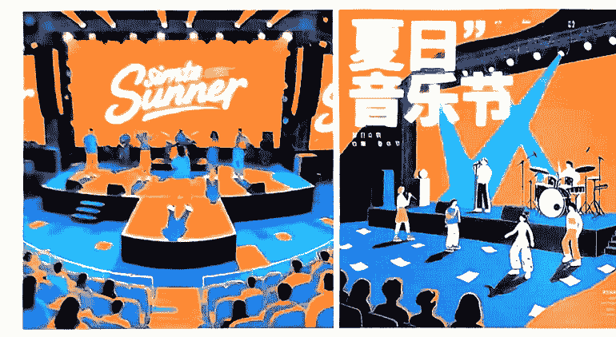

#### 3.2.2 相邻色搭配

色轮上相邻的两种或三种颜色（如黄、橙、红，蓝、紫、粉），因色相接近，能形成自然过渡的和谐感，适合表现温馨、治愈或自然主题。

提示词设计技巧
- 明确色阶：“黄 → 橙 → 红渐变”“蓝 → 紫 → 粉过渡”；
- 控制纯度：“主色高纯度 + 辅色低纯度”（避免单调）；
- 关联光线：“暖光渐变”“冷光柔化”；
- 关联场景：“日落晚霞”“花海”“儿童房”。

#### 实例分析

例如生成一张“秋日日落”的风光图，要求用相邻色传递温暖，提示词为“生成一张‘秋日日落’的风光图，黄→橙→红相邻色搭配，天空顶部是浅黄（饱和度 50%），中间是亮橙（饱和度 60%），底部是橘红（饱和度 70%），地面枫叶由红橙渐变（近景红橙鲜艳，远景橙黄柔和），暖光从右上方照射（强化渐变方向），8K 电影级画质”，其中通过“黄 → 橙 → 红”色阶控制和谐过渡，“近景鲜艳 + 远景柔和”增加空间层次，“暖光照射”强化颜色温度，设计如真实日落般温暖的相邻色场景，生成图如图 3-6 所示。


图 3-6 AI 绘画生成图——相邻色搭配

#### 3.2.3 同色系搭配

同色系是指同一颜色在不同深浅程度上的变化，如浅蓝、蓝色、深蓝等。这种搭配方式能体现出画面的统一与沉稳，强调整体的协调性。

提示词设计技巧
- 明确主色与辅色：“浅蓝主调 + 中蓝点缀 + 深蓝背景”；
- 控制变化：“明度递减”“饱和度递增”；
- 关联质感：“亚光 → 丝绒 → 亮面”；
- 关联场景：“极简家居”“高级时装”“艺术画廊”。

#### 实例分析

例如生成一张“极简主义卧室”的场景图，要求用同色系传递高级感。设计时通过“浅蓝 → 中蓝 → 深蓝”明度梯度控制层次，“亚光 → 棉麻 → 丝绒”质感词增加细节变化，“自然光统一”强化整体色调。生成图如图 3-7 所示，提示词为“浅蓝主调同色系搭配，墙面是浅蓝（饱和度 30%，亚光质感），床品是中蓝（饱和度 40%，棉麻质感），窗帘是深蓝（饱和度 50%，丝绒质感），地毯是藏青（饱和度 60%，羊毛质感），自然光从窗户射入（柔和统一），8K 极简风画质”。

## 3.3 色系运用

暖色（红、橙、黄）与冷色（蓝、绿、紫）是色彩的两大阵营——暖色传递温暖、活力，冷色传递冷静、神秘。

### 3.3.1 暖色系

暖色波长较长，易让人联想到阳光、火焰，能刺激食欲、提升兴奋感，适合表现温馨、热情或热烈主题（如家庭、节日、美食）。

**提示词设计技巧**
- 明确主色：“以橙为主”“红黄辅助”“金棕基调”；
- 关联光线：“暖黄阳光”“橙光环境光”“琥珀色滤镜”。

**实例分析**

生成一张“家庭晚餐”的场景图，通过“红棕木质 + 橙黄菜品”锁定暖色主调，“米白桌布”作为冷色点缀避免过噪，“暖黄灯光”强化温度感，提示词为“暖色系主调，餐桌是红棕色木质（饱和度 40%），桌布是米白（冷色点缀），菜品是橙黄（番茄汤、烤南瓜），温暖灯光氛围，8K 生活流画质”，生成图如图 3-8 所示。

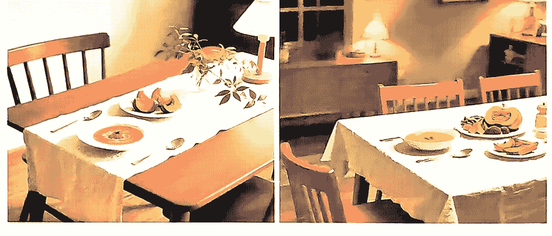

图 3-8 AI 绘画生成图——暖色系运用

### 3.3.2 冷色系

冷色系包括蓝色、绿色、紫色等，易让人联想到天空、海洋、冰雪，传达出冷静、沉稳、清凉等情感，常用于营造安静、高端的氛围。

**提示词设计技巧**
- 明确主色：“以蓝为主”“绿紫辅助”“青灰基调”；
- 关联光线：“冷白光”“蓝紫环境光”“月光滤镜”；
- 强化冷静：“加入反光（如水面）”“动态模糊（如流动的水）”“高光冷蓝”。

**实例分析**

生成一张“深夜书房”的场景图，要求用冷色系传递理性感。通过“青灰墙面 + 深蓝书桌”锁定冷色主调，“浅蓝书脊”作为暖色点缀避免压抑，“冷白灯光”强化理性感，提示词如“冷色系主调，墙面是青灰（饱和度 30%），书桌是深蓝（饱和度 40%，木质纹理），台灯是冷白光（高光冷蓝），桌面有摊开的书籍（浅蓝书脊），月光透过纱窗洒在地面（柔和冷光）、8K 电影级画质”。生成图如图 3-9 所示。

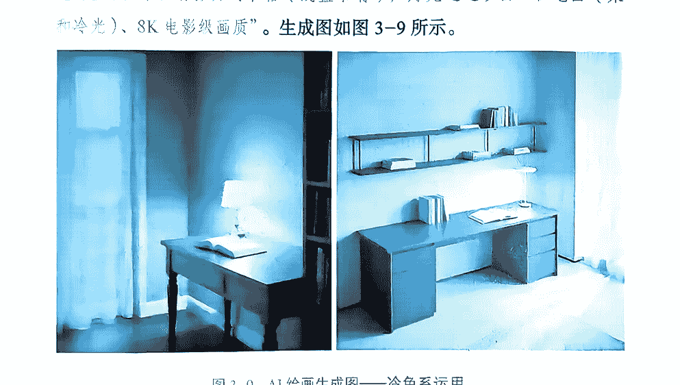

图 3-9 AI 绘画生成图——冷色系运用

### 3.3.3 色彩控制

色彩是 AI 绘画的“情绪语言”——亮丽橙传递活力，自然绿治愈心灵，糖果色点燃童趣，霓虹色碰撞未来；而色系搭配与控制则决定了色彩的“叙事逻辑”。

🎨 **色彩控制注意事项**
- 光线是色彩的“放大器”：暖光会让橙色更艳、绿色更暗，冷光会让蓝色更透、紫色更神秘，需根据色彩需求选择光线类型（如“暖黄阳光”配橙色，“冷白灯光”配蓝色）。
- 控制色彩数量：画面主色不超过 3 种（流行色 +1—2 种辅助色），避免视觉混乱；同色系可扩展至 5 种明度 / 饱和度变化，但需保持色相一致。
- 结合风格调整：赛博朋克适合高饱和霓虹色 + 暗背景，水彩画适合低饱和自然绿 + 柔光，需根据最终风格微调色彩参数。

**色彩控制综合表格**

色彩控制见表 3-1。

表 3-1 色彩控制综合表格

| 目标效果 | 核心色系 / 搭配 | 关键提示词 |
| :--- | :--- | :--- |
| 活力夏日 | 亮丽橙 + 自然绿 | “高饱和亮橙 + 低饱和草绿” |
| 治愈森林 | 自然绿 + 米白 | “低饱和草绿 + 浅灰米白” |
| 梦幻糖果屋 | 糖果色 + 白色 | “高饱和马卡龙粉 + 婴儿蓝” |
| 赛博朋克街道 | 霓虹色 + 暗蓝 | “亮粉灯管 + 暗蓝背景” |
| 节日海报 | 橙蓝对比色 | “70%亮橙 + 30%亮蓝 + 白色调和” |
| 秋日日落 | 黄→橙→红相邻色 | “浅黄→亮橙→橘红渐变” |
| 极简卧室 | 浅蓝同色系 | “浅蓝墙面 + 中蓝床品 + 深蓝窗帘” |
| 家庭晚餐 | 红棕暖色系 | “红棕木质 + 米白桌布 + 橙黄菜品” |
| 深夜书房 | 青灰冷色系 | “青灰墙面 + 深蓝书桌 + 冷白灯光” |

## 3.4 光线方向

在前两节中，我们掌握了流行色彩的精准控制与色彩搭配的叙事逻辑。但色彩的生命力，最终需要通过光线来激活——顺光让色彩饱满通透，逆光为物体勾勒金边，强光强化明暗对比，自然光赋予真实感……本节开始将聚焦光线的“方向、强度、种类”三大维度，结合实例拆解提示词设计、参数调节与光线—色彩协同技巧。

光线方向是画面的“隐形骨架”——顺光让色彩平铺直叙，侧光制造立体层次，逆光赋予神秘氛围，顶光强化戏剧张力，轮廓光勾勒物体边界。

### 3.4.1 顺光

顺光是指光线从画面主体的正面照射过来，光源位于相机/观察者正前方（如正午阳光、正面射灯），光线均匀覆盖物体表面，无明显阴影，使画面整体显得明亮、柔和且富有层次感，色彩呈现“平涂”效果，适合表现细腻质感或需要清晰展示细节的场景（如产品图、静物画）。

💡 **提示词设计技巧**
- 明确光源位置：“正面光源”“相机正前方射灯”“阳光从镜头方向照射”；
- 强调色彩均匀：“颜色过渡自然”“无明显明暗对比”“高光与阴影柔和”；
- 关联质感：“丝绸光泽”“陶瓷反光”“水果表皮细腻”。

💡 **实例分析**

例如生成一张“新鲜草莓”的产品图，生成图如图 3-10 所示，使用“相机正前方柔光箱”锁定顺光方向，“颜色通透”强化饱和度，“水珠反光”增加细节真实感，提示词为“生成一张新鲜草莓的产品图，顺光拍摄，草莓置于白色背景前，相机正前方有柔光箱（光线均匀覆盖），草莓表皮有细腻反光（高光柔和）、果蒂处带水珠（增加质感），颜色红得通透（饱和度 75%），8K 产品级画质”。

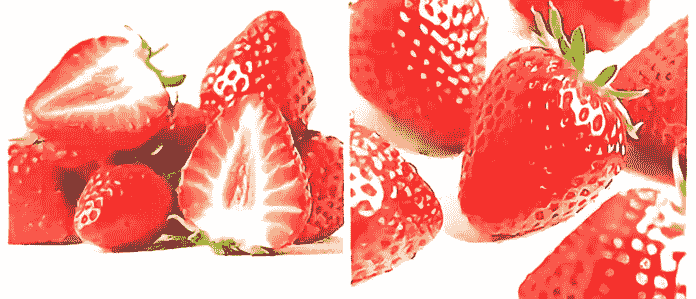

图 3-10 AI 绘画生成图——顺光

### 3.4.2 侧光

侧光是指光线从画面的侧面照射过来，光源位于物体侧面（45°～90°），光线在物体表面形成明显明暗交界线，阴影长度约为物体高度的1～2倍，能强化物体的体积感与纹理（如皱纹、裂纹、布料褶皱），适合表现质感或需要“故事感”的场景（如人物肖像、静物特写）。

**提示词设计技巧**
- 明确光源角度：“左侧光源”“右侧侧光”“侧逆光与侧光混合”；
- 强调立体感：“面部轮廓分明”“石墙纹理清晰”“花瓣边缘有阴影”；
- 关联色彩变化：“暗部颜色偏冷（如蓝灰）”“亮部颜色偏暖（如橙黄）”；
- 控制阴影：“阴影长度为物体1.5倍”“阴影边缘模糊（柔光）或锐利（硬光）”。

**实例分析**

生成一张“中年男性肖像”，需要突出面部轮廓与质感，通过“右侧侧光”强化面部体积，“亮部暖黄 + 暗部蓝灰”制造色彩对比，“皱纹清晰”突出质感，生成图如图3-11所示，提示词为“一张中年男性肖像，侧光拍摄（光源在人物右侧），面部左侧为阴影（蓝灰色），右侧为亮部（暖黄），皱纹与胡茬在阴影中清晰可见（纹理锐利），眼神光来自侧光反射（小面积高光），背景虚化（突出主体），8K人像级画质”。

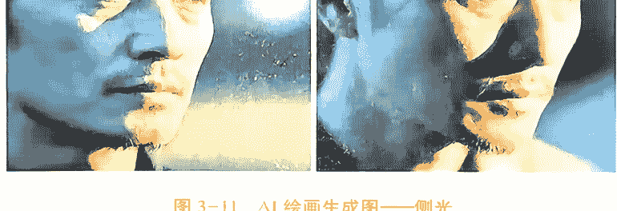

### 3.4.3 逆光

逆光光源位于物体后方（如夕阳从背后照射、背景灯打亮主体轮廓），物体正面处于阴影中，边缘被光线勾勒出明亮的轮廓（轮廓光），背景与主体形成强烈明暗对比，适合表现氛围感或“剪影”“半透明”效果（如夜景、逆光人像、玻璃器皿）。在表现人物、物体的轮廓和氛围时，逆光效果常常能带来意想不到的效果。

**提示词设计技巧**
- 明确光源位置：“背景光源”“主体后方射灯”“夕阳从画面右后方照射”；
- 强调轮廓光：“边缘有金色/银色光晕”“轮廓光宽度占主体 1/5”；
- 关联色彩：“亮部颜色与背景色呼应（如暖黄背景 + 橙黄轮廓）”；
- 控制主体亮度：“主体正面保留细节（非纯剪影）”“暗部颜色偏暖”。

**实例分析**

设计一幅逆光下的透明花瓶图像，通过“右后方光源”锁定逆光方向，“半透明暗部 + 金色轮廓”强化玻璃质感，“花瓣透光”增加细节真实感，突出玻璃质感与光影效果。提示词为“逆光下的透明花瓶图像，逆光拍摄（光源在花瓶右后方），花瓶主体呈半透明，边缘有金色轮廓光，背景是亮白（与轮廓光融合），花瓶内插粉色玫瑰（花瓣边缘有透光效果），8K 玻璃质感画质”。生成图如图 3-12 所示。

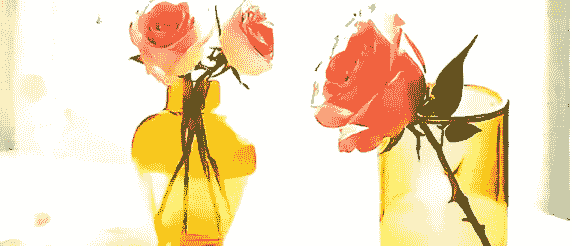

图 3-12 AI 绘画生成图——逆光

### 3.4.4 顶光

顶光光源位于物体正上方（如舞台顶灯、天花板吊灯），光线垂直向下照射，物体顶部明亮，底部因遮挡形成阴影（如眼窝、鼻下、裙摆），适合表现“权威感”“仪式感”或需要“焦点集中”的场景（如宗教画、舞台摄影、产品顶拍）。

**提示词设计技巧**
- 明确光源位置：“正上方射灯”“天花板主灯”“舞台顶光”；
- 强调阴影分布：“顶部亮、底部暗”“阴影形状符合物体结构（如圆形顶光 → 圆形阴影）”；
- 关联色彩：“顶部颜色偏冷（如白光）”“底部阴影偏暖（如橙黄）”；
- 控制焦点：“主体位于光中心（如人物面部）”“边缘物体暗化（突出主体）”。

**实例分析**

生成一幅舞台上的芭蕾舞者图像，提示词通过“正上方冷白顶光”强化舞台仪式感，“裙摆阴影暖黄”增加色彩层次，“面部眼神光”突出人物情绪，突出舞者的优雅与舞台氛围，提示词为“一幅舞台上的芭蕾舞者图像，顶光拍摄（光源在舞者正上方），舞者上半身明亮（冷白光），裙摆下方有柔和阴影，面部受光清晰（眼神光明显），背景暗化（突出主体），8K舞台级画质”。生成图如图3-13所示。

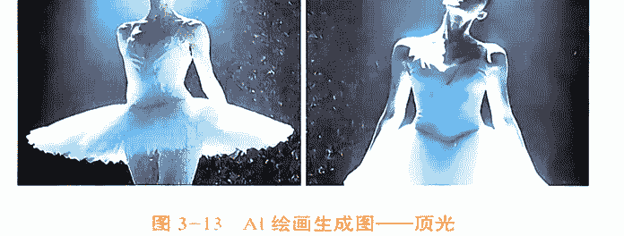

图3-13 AI绘画生成图——顶光

### 3.4.5 轮廓光

轮廓光是由逆光或侧逆光形成的窄而亮的边缘光（如头发光、边缘光晕），能分离主体与背景，能够突出物体的轮廓，强化物体的“存在感”，适合表现“精致感”或需要“视觉焦点”的场景（如人像发丝、珠宝、夜景灯光）。

**提示词设计技巧**
- 明确光源方向：“侧逆光”“背景灯从右后方照射”；
- 强调光效：“头发丝有金色发丝光”“珠宝边缘有银色光晕”。

**实例分析**

设计一张“红裙女生的夜景肖像”，要求突出发丝与裙摆的轮廓，可以通过“侧逆光”锁定轮廓光方向，“金色发丝光 + 橙红裙摆轮廓”强化色彩呼应，“背景深蓝”突出主体，编写提示词，如“侧逆光（光源在女生右后方），头发丝有金色发丝光（亮度 85%），背景是深蓝夜景（与轮廓光形成对比），面部受侧光补光（保留细节），8K 人像电影画质”。生成图如图 3-14 所示。

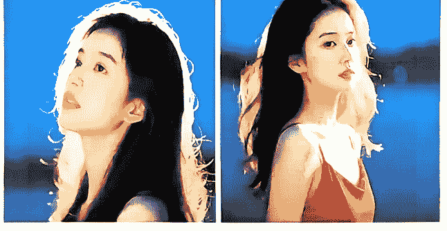

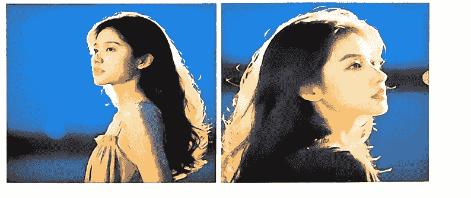

图 3-14 AI 绘画生成图——轮廓光

## 3.5 光线强度

光线强度直接影响色彩的明暗对比与视觉冲击力，决定了画面的明亮程度和阴影的深浅——强光让色彩鲜明锐利，适合表现活力或冲突；弱光让色彩柔和朦胧，适合营造氛围或神秘感。

### 3.5.1 弱光

弱光光线柔和（如黄昏柔光、室内暖灯、阴天散射光），物体明暗对比弱（高光与阴影过渡自然），色彩饱和度低且边缘模糊，弱光下的画面通常具有较浅的阴影和柔和的色彩过渡，能够传达出一种安静、内敛的情感，适合表现“温馨”“神秘”或“朦胧”的场景（如烛光晚餐、深夜书房、雾中风景）。

💡 **提示词设计技巧**
- 明确光线类型：“散射光”“柔光箱”“阴天自然光”；
- 强调柔和：“阴影边缘模糊”“颜色过渡自然”；
- 控制饱和度：“低饱和主色 + 中等饱和辅色”；
- 关联质感：“丝绸反光柔和”“皮肤质感细腻”。

**实例分析**

生成一张“深夜书房”的场景图，通过“台灯 + 月光”锁定弱光方向，“低对比度 + 低饱和度”强化安静感，“阴影柔和”增加画面温馨感，提示词为“深夜书房场景图，弱光环境（台灯光），书桌暖光（饱和度 40%），墙面阴影柔和（饱和度 20%），书籍边缘模糊（弱化轮廓），窗外有零星光斑（点缀氛围），8K 电影级氛围画质”。生成图如图 3-15 所示。

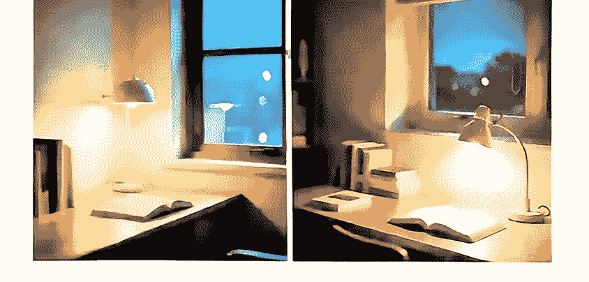

图 3-15 AI 绘画生成图——弱光

### 3.5.2 强光

强光光线强烈（如正午阳光、直射射灯），物体明暗对比明显（高光与阴影差异大），色彩饱和度高且边缘锐利，能突出物体的细节和质感，使画面显得清晰、明亮，适合表现“热烈”“紧张”或“聚焦”的场景（如运动赛事、舞台表演、产品特写）。

**提示词设计技巧**
- 明确光线类型：“直射强光”“硬光”“无云层的阳光”；
- 强调对比：“高光与阴影对比强烈”“颜色边缘锐利”；
- 控制饱和度：“高饱和主色 + 中等饱和阴影”；
- 关联质感：“金属反光强烈”“水珠高光明显”。

**实例分析**

生成一张“夏日沙滩排球赛”的海报。提示词为“夏日沙滩排球赛海报，强光直射（正午阳光），球员皮肤高光锐利（饱和度 85%），沙滩阴影深暗（饱和度 30%），排球网被阳光照亮（白色高光），海浪泛白（强化光线强度），8K 运动海报画质”，其中“正午阳光”锁定强光方向，“高对比度 + 高饱和度”强化活力感，“沙滩阴影深暗”增加画面层次，突出运动活力，生成图如图 3-16 所示。


图 3-16 AI 绘画生成图——强光

## 3.6 光线种类

光线种类直接影响画面的风格基调——自然光真实细腻，人工光富有设计感，特殊光（如体积光、丁达尔效应）则能打造超现实效果。

### 3.6.1 自然光

自然光是来源于自然界的光线，包括太阳、月亮、星空等自然光源，光线柔和且色温随时间变化（如日出暖黄、正午冷白、黄昏橙粉），色彩还原度高，适合表现“真实感”“自然感”或“时间感”的场景（如风景、人像、静物）。

**自然光线介绍**

自然光线类型见表 3-2。

表 3-2 自然光线类型表

| 自然光线类型 | 自然光线特征与作用 |
| :--- | :--- |
| 阳光 | 阳光是自然光中最常见且最具表现力的一种 |
| 月光 | 月光是夜晚的主要自然光，光线柔和、清冷，能为画面带来静谧、神秘的氛围 |
| 星光 | 星光通常在夜晚的天空中出现，光线极其微弱且分散，能为画面增添梦幻、浪漫的感觉 |

**提示词设计技巧**
- 明确时间段：“日出时分”“正午”“黄昏”“阴天”；
- 关联色温：“日出暖黄”“正午冷白”“黄昏橙粉”；
- 强调自然感：“光线有轻微散射”“阴影边缘模糊”；
- 关联场景：“户外风景”“窗边人像”“森林静物”。

**实例分析**

设计一张“黄昏森林”的风光图，要求真实自然，设定“黄昏色温”锁定自然光基调，“橙粉色+柔和阴影”强化真实感，“远山淡紫”增加暮光氛围，提示词为“黄昏森林的风光图，黄昏自然光，森林中光线呈橙粉色、树干阴影柔和（带暖黄反光），地面苔藓有斑驳光影（自然散射），远处山峰被染成淡紫（暮光效果），真实风光画质”。生成图如图 3-17 所示。

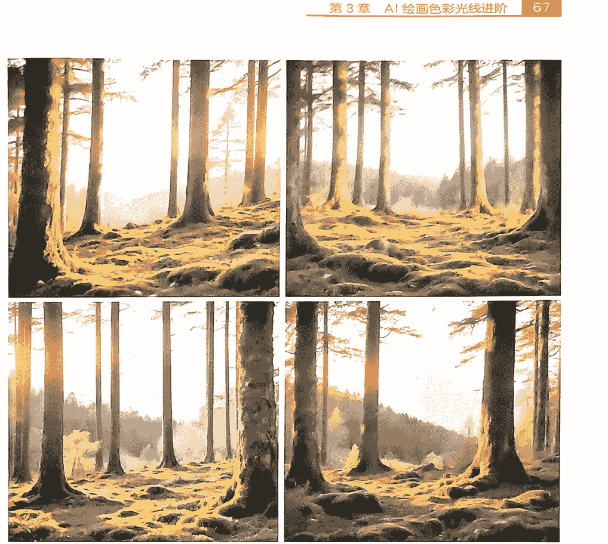

图 3-17 AI 绘画生成图——黄昏自然光

### 3.6.2 人工光

人工光是人类制造的光线，包括来自灯具、屏幕、霓虹灯等人工光源，光线方向、色温、强度可人为控制，色彩风格多样（如暖黄台灯的温馨、冷白 LED 的科技感、粉色霓虹的浪漫），适合表现“设计感”“科技感”或“风格化”的场景（如室内设计、潮牌海报、赛博朋克）。

**人工光线类型**

人工光线示例见表 3-3。

表 3-3 人工光线示例表

| 人工光线类型 | 人工光线特征与作用 |
| :--- | :--- |
| 灯光 | 灯光在现代生活中无处不在，种类繁多，如白炽灯、荧光灯、LED灯等。不同类型的灯光具有不同的色温和光质 |
| 烛光 | 烛光的光线微弱、摇曳，具有温馨、浪漫且神秘的氛围 |
| 霓虹灯 | 霓虹灯色彩鲜艳、明亮，具有强烈的视觉冲击力，常用于商业广告和城市夜景的描绘 |

**提示词设计技巧**
- 明确光源类型：“暖黄射灯、冷白LED、粉色霓虹灯、电影补光灯”；
- 关联风格：“复古台灯（暖黄）、科技感面板（冷白）、赛博霓虹（粉紫）”；
- 强调设计感：“光线有规律分布、颜色与场景主题匹配”；
- 关联场景：“现代客厅、科技展厅、潮牌店铺”。

**实例分析**

生成一张“赛博朋克酒吧”的场景图，使用“粉色霓虹灯+冷白LED”组合人工光源，“边缘泛光+规律排列”强化科技感，“酒杯光晕”增加浪漫细节。使画面科技感与浪漫感并存。提示词为“人工光组合（粉色霓虹灯+冷白LED），吧台顶部有粉色霓虹灯带（饱和度90%，边缘泛光），墙面冷白LED灯（饱和度50%，规律排列），酒杯折射出粉紫光晕（人工光反射），背景有全息投影（蓝色光斑），赛博朋克电影画质”。如图3-18所示。

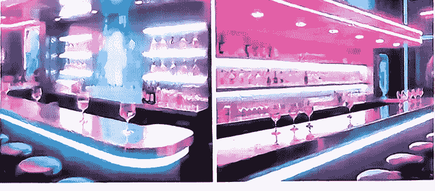

图 3-18 AI绘画生成图——人工光

### 3.6.3 特殊光

特殊光指突破自然规律或传统照明逻辑的光线（如体积光、丁达尔效应、极光、激光等），具有强风格化、高可控性与低自然限制的特点。它能直接“绘制”氛围——体积光塑造神秘感，丁达尔光传递神圣感。

**特殊光的分类与核心效果**

特殊光示例见表 3-4。

表 3-4 特殊光示例表

| 特殊光类型 | 关键提示词组合 | 典型效果 |
| :--- | :--- | :--- |
| 体积光 | “光束明显”“空气感”“散射” | 神秘宗教/魔法场景 |
| 丁达尔效应 | “光路清晰”“微粒反光”“神圣” | 清晨雾中/宇宙幻境 |
| 极光 | “带状光”“蓝绿渐变”“流动” | 极地夜空/奇幻场景 |

**提示词设计技巧**

特殊光的核心是“明确类型 + 锁定效果 + 关联场景”，需通过提示词精准描述光线的物理特征与视觉目标：
- 定义光线类型：直接说明特殊光种类（如“体积光”“丁达尔光”“激光矩阵”）；
- 描述光效细节：用“光束粗细”“光路清晰度”“颜色渐变”等词强化画面（如“宽度 2 米的光束”“光路带金色微粒”）；
- 关联场景元素：结合场景中的物体（如“穿过森林的丁达尔光”“照射在机器人上的激光”）；
- 控制风格倾向：用“神秘”“神圣”“科技”“浪漫”等词锁定氛围（如“神秘魔法体积光”“神圣丁达尔光”）。

**实例分析**

生成一张“奇幻魔法森林”的场景图，用丁达尔光营造神圣氛围，提示词为“丁达尔效应，清晨森林中，阳光穿透薄雾形成可见光路（光路带金色微粒），树木被暖黄光笼罩（饱和度 60%），地面苔藓有斑驳光影（自然散射），远处山峰被染成淡紫（暮光效果），奇幻电影画质”。

# AI 绘画进阶指南：
创意插画 + 电商设计 + 商业摄影 + IP 设计

达尔效应”锁定特殊光类型，“光路宽度 1 米 + 金色微粒”强化神圣感，“暖黄光笼罩树木”关联场景元素，“远山淡紫”增加暮光氛围。生成图如图 3-19 所示。

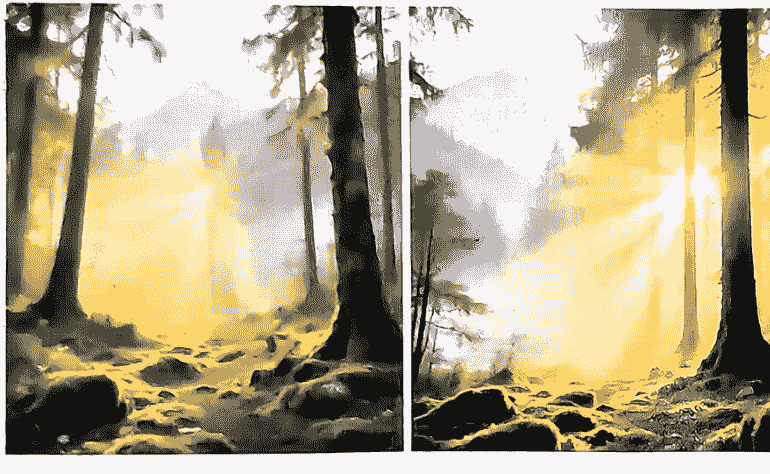

图 3-19 AI 绘画生成图——特殊光

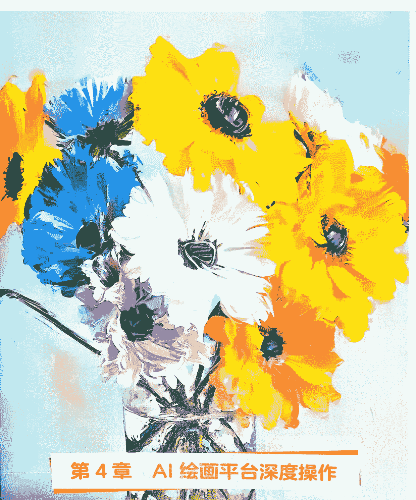

## 第4章 AI绘画平台深度操作

本章将深入探讨即梦 AI 和 Midjourney 这两款强大的 AI 绘画工具，通过详细介绍它们的功能、设置以及创意玩法，帮助读者掌握如何利用这些工具提升自己的设计和绘画能力。

### 4.1 即梦 AI 生图参考设置

在使用即梦 AI 进行绘画时，通过合理设置生图模型、比例和尺寸，以及掌握图生图参考设置和效果控制，用户可以更好地引导 AI 生成符合自己需求的图像。

#### 4.1.1 生图模型和比例

下面我们来了解即梦 AI 中的文生图相关参数设置，包括模型、比例。

**图片模型**

如图 4-1 所示，目前即梦 AI 共计四种图片模型，图片 2.0、图片 2.0 Pro、图片 2.1 以及图片 3.0，推荐使用最新版本的图片 3.0 进行创作。


各个模型简单介绍如下：

图片 3.0：拥有“影视质感”“文字更准”“直出 2K 高清图”等特征。支持设置图片分辨率为标清 1K 或高清 2K，在构图方面，能够更精准地遵循用户的提示，减少了以往在创作过程中出现的“抽卡”次数，显著提升了创作的效率。同时，在复杂场景的构图能力上表现优异，能够清晰展现更多画面繁杂的信息内容。

图片 2.1：解决了 AI 图像无法生成中文字体的问题，能够直接生成中英文文字。仅支持图片分辨率为标清 1K，用户可以自由指定字号、字体、颜色和位置，显著提升了图形创作的灵活性与个性化。

图片 2.0 Pro：在图片 2.0 的基础上进行了优化，仅支持图片分辨率为标清 1K，支持更复杂的图像生成需求，如更精准的构图和细节表现。

图片 2.0：仅支持图片分辨率为标清 1K，支持基础的图像生成功能，用户可以通过输入描述性文本生成相应的图像。

**图片比例**

比例是文生图功能中的一个重要参数，它决定了生成图像的宽高比。选择合适的比例可以确保图像在不同应用场景中的视觉效果。即梦 AI 提供了多种常见的比例选项，如 1:1（正方形）、16:9（宽屏）、4:3（标准屏）等，如图 4-2 所示。


不同比例使用场景如下，实例效果如图 4-3 所示。

- 21:9：也称为超宽屏比例，适合用于宽屏显示器或电影制作。
- 16:9：这是最常见的宽屏比例，广泛用于电视、电脑显示器和视频内容。
- 4:3：传统的屏幕比例，适用于较老的显示器和一些专业用途。
- 3:2：常用于摄影，特别是数码单反相机。
- 1:1：正方形比例，适合社交媒体平台如 Instagram。
- 2:3：竖屏比例，适合移动设备和社交媒体故事。
- 3:4：另一种竖屏比例，常用于手机和社交媒体。
- 9:16：适合短视频和移动设备上的全屏显示。


图 4-3 即梦 AI 图片比例

#### 4.1.2 参考图叠加工作流

图生图功能允许创作者以现有的图像为基础，生成新的图像。通过调整图生图设置，可以更好地控制生成图像的效果。

在编写提示词时上传现有图像，即可进行如图 4-4 所示的参考设置。点击“保存”后，在输入框内输入提示词进行图像创作。


参考类型有智能参考、主体识别、人像写真、角色特征、风格参考、边缘轮廓、景深、人物姿势，简单介绍如下：

**智能参考**：用户上传参考图后，AI 自动提取角色特征与风格参数，生成时自动对齐细节，实现多种商业创意设计。

**主体识别**：AI 自动提取主体物的外观特征，确保在不同状态、地点的一致性特征外貌，如图 4-5 所示。


图 4-5 即梦 AI 图片参考图——主体识别

**人像写真**：通过参考画面人物长相，输入相应的提示词，生成具有特定风格和背景的人像写真照片，如图 4-6 所示。


图 4-6 即梦 AI 图片参考图——人像写真

**角色特征**：通过上传参考图，调整脸部参考程度和主体参考程度的数值，使得生成的角色与原图接近，保持角色在不同场景和情节中保持一致的外观和性格特征，如图 4-7 所示。


图 4-7 即梦 AI 图片参考图——角色特征

**风格参考**：确保系列图片中角色发型、五官、服饰等特征高度统一，如图 4-8 所示。


图 4-8 即梦 AI 图片参考图——风格参考

**边缘轮廓**：希望使用参考图参考指定动作时，可以在导入参考图后选择“边缘轮廓”，如图 4-9 所示。


**景深**：指照片中从前景到背景的清晰范围，可能通过调整模型参数或使用特定功能来控制，如图 4-10 所示。


**人物姿势**：对于简单的姿势，可以使用人物姿势参考，但对于复杂姿势可能需要使用边缘轮廓或其他方法，如图 4-11 所示。


图 4-11 即梦 AI 图片参考图——人物姿势

以主体识别为例，保持主体人物特征的情况下，如图 4-12 所示编写提示词“白色花墙，前景花墙”，生成图如图 4-13 所示。


图 4-12 图片参考图——主体识别示例


图 4-13 图片参考图——主体识别生成图

### 4.2 即梦 AI 智能画布编辑

即梦 AI 的智能画布是其创意工具之一。通过使用智能画布，用户可以快速生成图像，并通过局部重绘和智能扩图等功能对生成的图像进行进一步的优化和调整。

#### 4.2.1 局部转向

如图 4-14 所示，在即梦 AI 首页左侧选择“智能画布”，选择“文生图”。


输入提示词，如“夜晚，长发飘逸，半遮美丽忧伤的脸，微醺的感觉，表情细腻，自然，暗调背景，发丝光柔和，面部清晰，线条流畅，特写，大师杰作，高级感，神秘感”，点击“立即生成”，如图 4-15 所示。


图 4-15 文生图画布生成图

选择“局部转向”功能见图 4-16，其功能是对目标图像中的元素进行转向。


图 4-16 文生图画布——局部转向

例如我们尝试将 4-15 中的主体人物的面部朝向向左旋转，如图 4-17 所示，“创建选区”框选人物主体区域，并在选区内使用“添加箭头”标注转向部位，以及转向方向。点击生成，生成图如图 4-18 所示。


图 4-17 文生图画布——局部转向操作

图 4-18 文生图画布——局部转向生成图

#### 4.2.2 抠图

抠图功能可以帮助我们快速获取目标图像中的元素，例如获取上述图像中的人像部分，点击如图 4-19 所示抠图功能，即可获取到图像中的矢量人像，如图 4-20 所示。


图 4-19 文生图画布——抠图


图 4-20 文生图画布——抠图操作

#### 4.2.3 扩图

扩图功能可以将图像内容按照设置比例进行扩展，如图 4-21 所示。在智能画布中扩图功能支持自定义缩放扩图比例，同时画布内也预设了一系列扩图选项，包括倍数扩图 1.5x、2x、3x，以及按指定比例 1:1、3:4、4:3、9:16、16:9 进行扩图，如图 4-22 所示对 1:1 人像扩图到 9:16。


图 4-21 文生图画布——扩图


图 4-22 文生图画布——扩图操作

#### 4.2.4 局部重绘

如图 4-23 所示，点击局部重绘功能，选区选中人物的服装区域，填写提示词“黑色抹胸礼服”，如图 4-24 所示人物服装由原本的墨绿色变为黑色。


图 4-23 文生图画布——局部重绘


#### 4.2.5 融图

使用融图操作可以使画面中的元素与整体风格进行融合，下面依次在同一项目的画布内中使用如下两个提示词，“雨中小路，两边爬满蔷薇藤蔓，幽深寂静，灰绿色调，孤冷静寂”和“女生，氛围感，长发飘飘”，分别得到两个图层，接下来对人物图层中的人像元素进行抠图，得到矢量人像，之后选择如图 4-25 所示的融图操作。


如图 4-26 所示，设定矢量人像为前景图像，风景图像为背景图像，调整好人物位置，点击“立即融图”，生成图如图 4-27 所示。


图 4-26 文生图画布——融图操作


图 4-27 文生图画布——融图生成图

### 4.3 Midjourney 指定参数优化图像

在使用 Midjourney 进行 AI 绘画时，通过指定不同的参数，用户可以控制图像的比例、风格、细节等多个方面。本节将详细介绍 Midjourney 中常用的参数设置及其优化方法。

#### 4.3.1 图片比例和尺寸（--ar）

图片的比例和尺寸是影响最终效果的重要因素。不同的应用场景可能需要不同比例的图像，例如社交媒体、广告设计或插画创作。Midjourney 通过 --ar 参数（Aspect Ratio）指定图像的宽高比，从而生成符合特定需求的图像，如图 4-28 所示。

“A futuristic cityscape at sunset --ar 1:1/--ar 2:3”
“日落时分的未来主义城市景观 --ar 1:1/--ar 2:3”


#### 4.3.2 特定风格模式（--style raw/--style expressive）

Midjourney 提供了多种风格模式，--style raw 和 --style expressive 是两种常用的风格模式，它们在图像生成的细节和表现力上有显著差异。
使用 --style raw 生成图像时，图像会更加简洁、写实，如果需要生成写实风格的图像，推荐使用 --style raw。
使用 --style expressive 生成图像时，图像会更加夸张、富有表现力，是专为 --niji 5 模型设计的风格化参数，用于增强图像的表现力和艺术性。如果需要生成更具艺术感和表现力的图像，推荐使用 --style expressive。如图 4-29 所示。

“romantic couple, portrait photography --style raw/--niji 5 --style expressive”
“浪漫的情侣，人像写真 --style raw/--niji 5 --style expressive”


图 4-29 Midjourney --style raw/--style expressive

#### 4.3.3 负面提示 (--no)

负面提示是 Midjourney 中一个非常实用的功能，它允许用户指定不希望出现在图像中的元素或风格。通过使用 --no 参数，可以更精准地控制图像的生成效果。如果需要排除多个元素，可以用逗号分隔，例如 --no animals,people，如图 4-30 所示。

> “A bouquet of colorful flowers --no red flowers”
> “一束五颜六色的鲜花 --no 红色的花”


图 4-30 Midjourney --no

#### 4.3.4 风格化程度（--s）

风格化程度是控制图像艺术风格强度的重要参数。通过 --s 参数（Style Intensity），可以调整图像的风格化程度，从而生成从写实到抽象的各种风格的图像。如果需要生成写实风格的图像，推荐将 --s 参数设置为较低的值（如 1-10）。如果需要生成更具艺术感的图像，可以将 --s 参数设置为较高的值（如 100-1000）。如图 4-31 所示。

“Cute hamster --s 0 / --s 600”
“可爱的仓鼠 --s 0 / --s 600”


#### 4.3.5 创意（--c）

创意（--c）参数是 Midjourney 中用于激发更多创意和独特性的功能。通过调整 --c 参数，可以生成更具创意和想象力的图像。如果需要生成较为传统的图像，可以将 --c 参数设置为较低的值（如 1-10），如果需要生成更具创意的图像，可以将 --c 参数设置为较高的值（如 20-100）。如图 4-32 所示。

“A tiger cub --c 0 / --c 80”
“一只老虎幼崽 --c 0 / --c 80”


#### 4.3.6 角色参考（--cref）

角色参考（--cref）是 Midjourney 中用于指定角色外观和特征的参数。通过上传角色的参考图像，可以引导 AI 生成更符合特定角色特征的图像。假设你需要生成一幅包含特定角色的图像，可以上传角色的参考图像，并使用以下命令，如图 4-33 所示：

“A little hamster is strolling through a clothing store --cref [左图链接]”
“一只小仓鼠在逛服装店 --cref [左图链接]”


#### 4.3.7 风格参考（--sref）

风格参考（--sref）是 Midjourney 中用于指定图像风格的参数。通过上传风格参考图像，用户可以引导 AI 生成具有特定风格的图像。假设你需要生成一幅具有指定风格的图像，可以通过上传该风格的参考图像，并使用以下命令，如图 4-34 所示：

```
“a boy --sref [左图链接]”
“一个男孩 --sref [左图链接]”
```


### 4.4 Midjourney 个性化风格

Midjourney 的 Style Tuner 功能允许用户生成并应用个性化的风格代码，从而在 AI 绘画中实现独特的视觉效果。通过这种方式，用户可以将自己的艺术风格融入生成的图像中，使其更具辨识度和艺术价值。本节将详细介绍如何生成个性化风格代码，并展示如何在实际创作中应用这些代码。

#### 4.4.1 生成个性化风格代码

生成个性化风格代码时，在 Discord 中使用 Midjourney 的 /tune 命令，假设输入提示词 “a baby Golden Retriever (一只小金毛寻回犬)”，如图 4-35 所示，选择预计生成的风格数量为 “16 个”，使用默认模型，点击 “Submit”。


图 4-35 Midjourney /tune

等待生成完成后，得到一个链接地址，如 https://tuner.midjourney.com/example(16 Style Directions)，打开链接地址，如图 4-36 所示，Midjourney 生成了 16 组风格不一的金毛寻回犬图形。


图 4-36 Midjourney /tune 生成风格

根据个人意愿选择几种喜欢的风格后，在页面下方的提示词框中获取到与之对应的个性化代码，如图 4-37 所示。


图 4-37 Midjourney 获取个性化风格代码

#### 4.4.2 使用个性化风格代码

在上述以金毛寻回犬为例的章节中，获取到其个性化风格代码为“4eR6GVlXlGgX”，回到 Discord 页面中使用这个风格代码，如图 4-38 所示。生成图如图 4-39 所示。


图 4-38 Midjourney 使用个性化风格代码


图 4-39 Midjourney 使用个性化风格代码生成图


# 第5章 AI 创意插画创作

本章将深入探讨如何利用 AI 绘画工具创作出具有不同风格的创意插画作品。从传统风格到现代风格、再到前沿风格，我们将通过丰富的实例和详细的提示词，帮助读者掌握如何运用 Midjourney 的 AI 技术精准地呈现这些风格的插画作品。

## 5.1 传统风格插画

传统风格插画独特的表现手法和深厚的文化底蕴一直是艺术创作的重要源泉，从古典油画到东方水墨，从浮世绘到新艺术运动，每一种风格都凝聚着特定时代的审美与技艺。传统插画核心在于还原特定画种的材料特性与艺术语言。AI 生成传统风格时，需重点强化“材质感知”与“技法特征”，避免因算法过度平滑导致“风格失真”。

### 5.1.1 水墨插画

水墨插画是中国传统绘画艺术的瑰宝，以水和墨为主要材料，通过笔墨的浓淡、干湿变化表现出独特的艺术效果。水墨插画以“墨分五色”“计白当黑”为核心，强调笔触的流动性与意境的留白感。

提示词与作用说明

水墨插画提示词见表 5-1。

表 5-1 水墨插画提示词

| 提示词类型 | 示例词库 | 作用说明 |
| :--- | :--- | :--- |
| 材料特征 | 生宣/熟宣、淡墨/浓墨/焦墨、破墨法/积墨法 | 明确水墨技法类型 |
| 晕染控制 | 晕染半径 15%、墨色浓度 30%、湿润反光 | 精准控制墨色过渡与质感 |
| 构图与意境 | 留白 20%、左侧疏朗、烟雨朦胧 | 调节画面节奏与氛围 |

实例分析：江南烟雨中的石桥

生成一幅以青石板桥为主体、细雨朦胧的水墨插画，要求体现“近景浓墨勾檐角，中景淡墨染远山，左侧留白 20% 营造烟雨”的层次。

设计过程中用“墨色浓度 70%”“晕染半径 15%”量化墨色层次，加入“湿润反光”“飞檐细节”等技法关键词，触发传统笔触记忆，参数 --style raw 保留 Midjourney 原始笔触的颗粒感，--s 600 增强墨色过渡的自然度。

提示词为“中国传统水墨画，江南石桥场景，近景青石板路湿润反光（用淡墨扫出潮湿感），中景木质廊檐用浓墨勾勒飞檐细节（墨色浓度 70%），远景低山用淡墨晕染（墨色浓度 30%，晕染半径 15%），画面左侧留白 20%（无笔触，模拟雾气），整体构图参考吴冠中《江南水乡》的简约疏朗，--v7 --style raw --s 600”，生成图如图 5-1 所示。


### 5.1.2 油画插画

油画的核心在于笔触肌理与色彩叠加效果，能够表现出强烈的视觉冲击力和细腻的情感表达。可以通过提示词强调“厚涂厚度”“笔触类型”及“色彩叠加逻辑”。

提示词与作用说明

油画插画提示词见表 5-2。

表 5-2 油画插画提示词

| 提示词类型 | 示例词库 | 作用说明 |
| :--- | :--- | :--- |
| 质感技法 | 厚涂法、短笔触/长笔触、刮刀肌理 | 强化油画材料特征 |
| 色彩逻辑 | 主色调+辅助色（如赭石+橄榄绿+柠檬黄）、色彩饱和度 70% | 控制色彩过渡自然 |
| 动态引导 | 风吹树叶（笔触方向）、阳光穿透（光束角度） | 赋予画面动态合理性 |

提示词设计技巧

关联质感：用“颜料厚度”“边缘可见笔触堆积”量化厚涂质感，触发 AI 对油画材料的记忆；
画面合理性设计：限定“短笔触斜向排列”“丁达尔效应模糊”，赋予画面动态合理性；
参数引用：参数 --q 2 提升色彩精度，--s 750 增强笔触细节的清晰度。

实例分析

生成一幅以枫树林为主体、阳光穿透树叶的油画插画，提示词为“古典油画风格，秋日森林场景，主色调为赭石（树干）+ 橄榄绿（树叶）+ 柠檬黄（光斑），树干用厚涂法（颜料厚度，边缘可见笔触堆积），树叶用短笔触斜向排列（模拟风吹方向），阳光透过树叶形成丁达尔效应（光束边缘模糊），整体色彩饱和度 70%（避免过艳），参考凡·高《麦田》的笔触张力、--v7 --q 2 --s 750”，充分体现“赭石色厚涂树干（厚度可见）、柠檬黄点染光斑（短笔触）、橄榄绿叠染树叶（斜向笔触）”的质感，Midjourney 生成图如图 5-2 所示。


图 5-2 AI绘画生成图——油画树林插画

另外，在肖像设计创作上，油画肖像插画的重点在于人物的面部表情和气质的传达。通过“细腻肤色”和“高光突出”等提示词，生成具有真实感的人物肤色和立体感的面部特征，即梦AI设计如图5-3所示。提示词为“油画肖像，中年女性，优雅气质，复古服饰，细腻肤色，高光突出，情感丰富”。


图 5-3 AI绘画生成图——油画肖像插画

### 5.1.3 水彩插画

水彩的魅力在于“水色交融”的透明感与“湿画法”的自然晕染。以其清新、透明的质感和丰富的色彩层次而受到许多艺术家和设计师的喜爱。

提示词与作用说明

水彩插画提示词见表 5-3。

表 5-3 水彩插画提示词

| 提示词类型 | 示例词库 | 作用说明 |
| :--- | :--- | :--- |
| 材质技法 | 湿画法(水分 7:3)、干画法(留白半径 5%)、叠色顺序(先浅后深) | 明确水彩技法类型 |
| 透明控制 | 透明、边缘模糊、晕染 | 调节水色的通透感 |
| 色彩搭配 | 群青+柠檬黄+浅粉、冷色调为主(海水)、暖色调点缀(晚霞) | 控制画面色调倾向 |

实例分析：海边日落的潮间带

设计生成一幅以潮间带礁石、海浪为主体的水彩插画，为体现“群青+柠檬黄叠染海水（湿画法）、浅粉晕染晚霞（干画法）、礁石边缘留白（自然晕染）”的透明感。提示词为“透明水彩风格插画，海边潮间带场景、主色调为群青（海水）+柠檬黄（浪花）+浅粉（晚霞），海水用湿画法叠染，礁石用干画法留白，晚霞与天空过渡自然，整体透明度 60%，参考卡伦·玛莎《水彩风景》的清新色调，--v7 --style scenic --s 500”，Midjourney 生成图如图 5-4 所示。提示词中参数 --style scenic 增强场景氛围感，--s 500 平衡透明感与细节。


图 5-4 AI 绘画生成图——水彩插画

### 5.1.4 素描插画

素描插画以其简洁的线条和明暗对比而展现出独特的艺术魅力。素描的核心是“线条排列”“明暗层次”与“透视关系”的精准表达。

提示词与作用说明
素描插画提示词见表 5-4。

表 5-4 素描插画提示词

| 提示词类型 | 示例词库 | 作用说明 |
| :--- | :--- | :--- |
| 线条语言 | 交叉排线（45° 斜线）、渐变排线（从密到疏）、平排排线（水平/垂直） | 明确素描线条类型 |
| 光影控制 | 投影长度、物体高度、黑白灰对比度 70%、光线方向（左上方） | 构建明暗逻辑的合理性 |
| 材质表现 | 深刨桃木木纹、皮质桌面反光 | 锚定具体材质的线条特征 |

设计提示词素描插画时避免使用“杂乱线条”“平涂阴影”等关键词，易导致素描失去“体积感”，负面提示词可添加“线条杂乱、黑白断层”等。

实例分析：老书店的午后光影

生成一幅以旧书架、木质书桌为主体的素描插画，要求体现“交叉排线表现木纹（45° 斜线，密度中等）、渐变排线塑造体积（从密到疏过渡）、投影长度为物体高度 1.5 倍（光线从左上方）”的光影逻辑。编写提示词如“古典素描风格、老书店场景，主体为深胡桃木书架（木纹用交叉排线，密度中等）+ 深棕色皮质桌面（阴影用渐变排线，从密到疏过渡），光线从左上方照射，整体黑白灰对比度 70%（亮部留白、暗部排线密集），参考门采尔的写实线条、--v 7 --q 2 --s 600”。

上述提示词中用“45° 交叉排线”“密度中等”明确线条语言，避免 AI 生成随机线条，“对比度 70%”控制光影合理性，参数 --q 2 提升线条精度，--s 600 增强明暗层次的清晰度。Midjourney 生成图如图 5-5 所示。

素描人物插画的关键在于通过线条和明暗对比来表现人物的立体感和气质。使用“明暗对比强烈”这一提示词可以生成具有立体感的人物形象，“线条简洁流畅”能够确保作品符合素描的艺术风格。“深邃眼神”这一提示词可以赋予人物形象生动的情感表达，使作品更具吸引力，即梦 AI 生成图如图 5-6 所示，提示词为“素描风格，人物肖像，青年男子，短发，深邃眼神，明暗对比强烈，黑白灰对比度 70%，线条简洁流畅，光影立体”。


图5-5 AI绘画生成图——素描插画


图5-6 AI绘画生成图——素描人物插画

### 5.1.5 剪纸插画

剪纸插画的核心是“镂空造型”“平面化构图”与“对称/重复图案”，是中国传统民间艺术的一种表现形式，以其简洁的线条和丰富的图案而具有独特的艺术魅力。

提示词与作用说明

剪纸插画提示词见表 5-5。

表 5-5 剪纸插画提示词

| 提示词类型 | 示例词库 | 作用说明 |
| :--- | :--- | :--- |
| 镂空规则 | 菱形鳞片(边缘锐利度 90%)、圆形镂空、锯齿状边缘 | 明确剪纸的经典镂空语言 |
| 色彩限制 | 仅用红/粉/金三色、无渐变、高饱和度 | 控制色彩的装饰性 |
| 构图法则 | 平面化(无透视)，对称分布(间距均匀)、主次分明 | 构建画面的秩序感 |

实例分析

假设生成一幅以“连年有余”为主题的剪纸插画，要求体现“鱼身镂空菱形鳞片（边缘锐利）、莲花对称分布（花瓣边缘锯齿状）、色彩仅用红/粉/金三色（无渐变）”的装饰性。

提示词为“传统剪纸风格，春节窗花主题，主体为红色锦鲤（身体镂空菱形鳞片，边缘锐利度 90%），下方对称分布两朵粉色莲花（花瓣边缘锯齿状，间距均匀），整体为平面化构图（无透视变形），色彩仅用红(#FF3333)/粉(#FF9999)/金(#FFCC00)三色（无渐变），参考陕北民间窗花的对称纹样，--v7 --style raw --s 400”，其中用“边缘锐利度 90%”“镂空菱形鳞片”明确剪纸的锐利特征，限定“色彩仅用红/粉/金”避免 AI 添加冗余颜色，参数 --style raw 保留剪纸的锐利感，--s 400 控制细节复杂度。Midjourney 生成图如图 5-7 所示。


图 5-7 AI 绘画生成图——剪纸插画

同时，设计剪纸人物插画的重点在于表现出人物的服饰和传统剪纸的风格特点。“图案丰富”和“传统纹样”可以为作品增添更多的文化内涵。通过“传统服饰”这一提示词，用户可以确保人物形象符合中国传统风格，即梦 AI 生成图如图 5-8 所示。提示词为“剪纸风格，人物插画，传统服饰，线条简洁，镂空，红色剪纸质感，图案丰富，传统纹样，高饱和度”。


图 5-8 AI 绘画生成图——剪纸人物插画

### 5.1.6 浮世绘插画

浮世绘是日本传统绘画艺术的一种形式，以其独特的色彩、线条和构图而闻名于世。其核心是“平面化构图”“轮廓线勾勒”（如云纹、海浪）。

提示词与作用说明

浮世绘插画提示词见表 5-6。

表 5-6 浮世绘插画提示词

| 提示词类型 | 示例词库 | 作用说明 |
| :--- | :--- | :--- |
| 程式化符号 | 海浪三层叠加（高度递减）、唐草纹云纹（连续 S 形）、菱形格纹（间距均匀） | 明确浮世绘的经典装饰元素 |
| 构图法则 | 中心聚焦（巨浪占 70%）、对称分布（云纹边框）、主次分明（海浪＞人物） | 构建画面的东方美学秩序 |
| 色彩分层 | 主色靛蓝（海浪）、辅助色朱红（船体）、点缀色金色（云纹） | 控制色彩的装饰性对比 |

实例分析：神奈川冲浪里的现代演绎

生成一幅以“巨浪卷船”为主题的浮世绘风格插画，要求体现“蓝白渐变海浪（三层叠加，高度递减）、金色云纹边框（唐草纹变体）、人物简化轮廓（仅保留头/手/船桨）”的经典元素。

提示词如“日本浮世绘风格，神奈川冲浪场景，主色调为靛蓝（海浪）+ 朱红（船体）+ 金色（云纹边框），海浪用程式化波浪线，云纹采用唐草纹变体（连续 S 形曲线，宽度均匀），人物用简化轮廓（头 / 手 / 船桨，无细节），整体构图遵循中心聚焦法则（巨浪占画面 70%），参考葛饰北斋《神奈川冲浪里》的经典比例，--v7 --style scenic --s 550”，其中用“程式化波浪线（三层叠加）”“唐草纹云纹”明确浮世绘经典符号，量化“巨浪占画面 70%”控制构图重心，--s 550 保留细节清晰度。Midjourney 生成图如图 5-9 所示。


浮世绘人物插画的重点在于表现出人物的服饰和传统日本风格的特点。提示词为“浮世绘风格，人物插画，和服女子，线条流畅，色彩鲜艳，中心人物聚焦，背景图案丰富，传统日本风格”，通过“线条流畅”和“色彩鲜艳”“背景图案丰富”等提示词，可以为作品增添更多的艺术价值。“传统日本风格”这一提示词可以确保作品符合浮世绘的艺术标准，即梦 AI 生成图如图 5-10 所示。


图 5-10 AI绘画生成图 - 浮世绘人物插画

## 5.2 现代风格插画

现代风格插画以其简洁、明快、富有创意的特点，在当代设计领域中占据重要地位。与传统的写实或装饰性插画不同，现代风格插画更注重抽象表达、几何构成和色彩对比，常运用极简线条、扁平化处理和数字化笔触，呈现出干净利落又不失创意张力的视觉效果。

### 5.2.1 填色画

填色画是一种通过简单线条勾勒轮廓，再填充色彩的插画风格，通过“未完成感”激发观者参与欲。它通常具有鲜明的色彩对比和简洁的图形设计。

提示词示例词库

填色画提示词见表 5-7。

表 5-7 填色画提示词

| 提示词类型 | 示例词库 |
| :--- | :--- |
| 风格特征 | 现代填色画、极简轮廓、留白艺术、儿童向/治愈系 |
| 技法细节 | 粗线条勾勒、无复杂细节、平面化 |
| 色彩控制 | 马卡龙色系(浅粉/浅蓝/米白)、双色填充、无渐变 |
| 构图法则 | 中心聚焦(主体占 60%)、对称分布、留白区域(30%-50%) |

实例分析

人物插画在填色画风格中可以通过简单的线条和鲜明的色彩来表现。提示词为“填色画风格，人物插画，简洁线条，明亮色彩，适合社交媒体，现代风格”，通过“简洁线条”和“明亮色彩”“极简轮廓”等提示词，生成具有现代感的画面效果。同时，“适合社交媒体”这一提示词可以确保作品具有足够的视觉吸引力，即梦 AI 生成图如图 5-11 所示。


或者生成一幅适合 3—6 岁儿童的森林动物填色画，要求轮廓线条粗细均匀(2pt)、留白区域占比 40%、仅用马卡龙色系(浅粉/浅蓝/米白)。使用参数参数 --q 2 提升线条精度，--s 300 降低细节干扰，适配儿童认知，提示词为“现代填色画风格，儿童绘本主题，主体为森林动物（兔子、狐狸、鹿）。轮廓线条粗细均匀，身体部分留白 40%（仅勾勒外框），填充色为马卡龙色系（兔子耳朵）+ 浅蓝（松鼠尾巴）+ 米白（鹿身），整体无阴影/渐变，极简造型 --v 7 --q 2 --s 300”，Midjourney 生成图如图 5-12 所示。


图 5-12 AI 绘画生成图——填色画风格插画

### 5.2.2 涂鸦插画

涂鸦插画是一种充满自由和创意的风格，通常以随意的线条和色彩组合为特点，展现出一种随性而富有活力的艺术效果，是街头文化的视觉符号。它适合用于创意广告、街头艺术等多种场景。

提示词示例词库

涂鸦插画提示词见表 5-8。

表 5-8 涂鸦插画提示词

| 提示词类型 | 示例词库 |
| :--- | :--- |
| 风格特征 | 街头涂鸦、自由笔触、夸张造型、高饱和度 |
| 技法细节 | 喷漆效果(边缘毛躁)、手写体文字，随机色块 |
| 色彩控制 | 荧光色(荧光绿/亮橙/玫红)、撞色搭配(互补色) |

实例分析

生成一幅以“太空猫”为主题的街头涂鸦插画，用“笔触粗犷（边缘毛糙）”“模拟喷漆效果”强化街头感，量化“头部占身体 1/2”增强造型记忆点，参数 --s 700 增强色彩浓度，--chaos 50 提升随机性（避免过度规整）。提示词为“街头涂鸦风格，太空猫主题，笔触粗犷（边缘毛糙，模拟喷漆效果）、猫头放大（占身体 1/2），四肢简化（仅保留轮廓），色彩为荧光绿（身体）+ 亮橙（耳朵）+ 镇红（项圈），整体无阴影（平涂）、参考班克西涂鸦的自由造型，--v7 --s 700 --chaos 50”，Midjourney 生成图如图 5-13 所示。

### 5.2.3 扁平化插画

扁平化插画是一种简洁、直观的风格，通常以简单的几何形状和纯色填充为特点，适合用于界面设计、图标设计等多种场景。

#### 提示词示例词库

扁平化插画提示词见表 5-9。

表 5-9 扁平化插画提示词

| 提示词类型 | 示例词库 |
| :--- | :--- |
| 风格特征 | 现代扁平化、几何造型、无阴影、高识别性 |
| 技法细节 | 圆角矩形、三角形顶角、线条简洁(无描边) |
| 色彩控制 | 主色+辅助色+点缀色、纯色填充 |
| 信息层级 | 主体>次要元素>背景 |

#### 实例分析

生成一幅“稳健理财”主题的扁平化图标，造型为盾牌＋上升箭头（几何化）、主色为深蓝（信任）＋浅绿（增长）、信息层级：盾牌主体＞箭头＞文字。

编写提示词如“现代扁平化插画，金融理财主题，造型为几何盾牌（圆角矩形＋三角形顶角）叠加上升箭头（直线＋三角形箭头），主色深蓝（#003366，盾牌主体）＋浅绿（#00CC66，箭头），无阴影／渐变（纯色填充），信息层级：盾牌占画面＞箭头＞文字，参考 Material Design 的扁平化规范 ---v7 ---style raw ---s 400”，其中，使用“几何盾牌（圆角矩形＋三角形顶角）”明确造型语言，量化“主色 #003366”“信息层级占比”控制视觉焦点，触发“信息优先级”记忆，参数 ---style raw 保留几何锐利感，---s 400 平衡细节与简洁性，Midjourney 生成图如图 5-14 所示。

图 5-14 AI绘画生成图——扁平化风格插画

### 5.2.4 3D 渲染插画

3D 渲染插画是一种通过三维建模和渲染技术生成的插画风格，以“体积感”“材质反射”“光影追踪”为核心，具有强烈的立体感和逼真效果，适合用于游戏设计、科幻插画等多种场景。

#### 提示词示例词库

3D 渲染插画提示词见表 5-10。

表 5-10 3D 渲染插画提示词

| 提示词类型 | 示例词库 |
| :--- | :--- |
| 风格特征 | 3D渲染、体积感、材质真实、光影自然 |
| 技法细节 | 金属粗糙度、硅胶亚光、高光强度 |
| 色彩控制 | 主色+辅助色+点缀色 |
| 光影控制 | 主光源(暖白光，角度45°)、环境光(冷蓝光) |

负面提示词可使用“扁平化、材质浑浊”。

#### 实例分析：科技感智能手表的 3D 渲染

设计一幅智能手表的 3D 渲染插画，使用金属表壳（银色，高光反射）、硅胶表带（深灰，亚光质感）、屏幕显示时间（蓝色发光），明确“主光源角度”“环境光强度”控制光影方向，以及参数 --s 800 增强材质细节，--q 2 提升渲染精度。

提示词为：“3D 渲染插画，智能手表主题，材质：金属表壳（银色，粗糙度 0.2，高光强度 1.0）、硅胶表带（深灰色），光影：顶部主光源（暖白光，角度 45°），底部环境光（冷蓝光），屏幕显示时间（10:30，蓝色发光，透明度 70%），参考 Blender 渲染的真实材质效果，--v7 --s 800 --q 2”，Midjourney 生成图如图 5-15 所示。

图 5-15 AI 绘画生成图——3D 渲染风格插画

### 5.2.5 等距插画

等距插画是一种通过等轴测投影方式绘制的插画风格，具有独特的视角和空间感，适合用于建筑设计、产品设计等多种场景。

#### 提示词示例词库

等距插画提示词见表 5-11。

表 5-11 等距插画提示词

| 提示词类型 | 示例词库 |
| :--- | :--- |
| 风格特征 | 3D渲染、体积感、材质真实、光影自然 |
| 技法细节 | 金属粗糙度、硅胶亚光、高光强度 |
| 色彩控制 | 主色 + 辅助色 + 点缀色 |
| 光影控制 | 主光源(暖白光，角度 45° )、环境光(冷蓝光) |

#### 实例分析：电商详情页的产品等距图

生成一幅“智能音箱”的等距插画，等距角度 30°（正等测投影）、网格密度中等、元素严格对齐（音箱主体 + 支架 + 电源线），使用参数 --style raw 保留等距的锐利感，--s 500 平衡面数与细节，适配电商展示需求。

提示词为“现代等距插画，智能音箱主题，等距角度 30°（正等测投影）。网格密度中等，元素：圆柱形音箱主体、木质支架（宽度 30px）、L 型电源线、所有元素边缘对齐、色彩；音箱深灰（#333333）、支架原木色（#A67C52）、电源线黑色（#000000），参考工业设计图的等距规范 --v7 --style raw --s 500”，Midjourney 生成图如图 5-16 所示。

## 5.3 前沿风格插画

前沿风格插画是近年来随着科技和文化的发展而兴起的新兴风格，其核心是“冲突感”与“技术符号”：赛博朋克的“高科技低生活”、低多边形的“数字极简”、卡通渲染的“次世代质感”，它们通常具有独特的视觉效果和强烈的未来感。

### 5.3.1 赛博朋克插画

赛博朋克的灵魂是“光污染美学”（霓虹撞色）+“机械共生”（义体/故障艺术），通常以霓虹灯、未来城市、机械元素为特点，适合用于科幻小说、游戏设计等多种场景。

#### 提示词示例词库

赛博朋克插画提示词见表 5-12。

表 5-12 赛博朋克插画提示词

| 提示词类型 | 示例词库 |
| :--- | :--- |
| 场景符号 | 贫民窟、全息广告、雨夜街道、地下诊所 |
| 机械细节 | 义肢、发光纹路(透明度50%)、齿轮外露、液压管道 |
| 色彩控制 | 青橙撞色(#00FFFF+#FF4500)、霓虹粉(#FF69B4)、高对比度 |
| 氛围强化 | 赛博格、高科技低生活、反乌托邦、故障艺术(信号干扰) |

负面提示词：--no 阳光 自然风景 木材质

#### 实例分析：雨夜义体医生的地下诊所

突出“青橙光污染+机械手术台+雨幕反射，生成霓虹灯牌下的义体诊所”。提示词为“赛博朋克风格，义体医生在地下诊所进行手臂改装，霓虹灯牌(青色 #00FFFF+ 橙色 #FF4500) 照亮雨幕，机械手术台(粗糙金属，液压管外露)，病人手臂露出发光电路(蓝色，透明度 50%)，地面水洼反射霓虹光，故障艺术特效（信号条纹）--v7 --s 900 --chaos 60”

在提示词中用“义体医生（冷科技）+地下诊所（破旧环境）”强化阶级对立，金属粗糙度0.3避免塑料感，发光电路透明度50%增强通透性，以及参数--s 900拉高色彩浓度，--chaos 60增加机械细节随机性，Midjourney生成图如图5-17所示。

图5-17 AI绘画生成图——赛博朋克插画

### 5.3.2 低多边形插画

低多边形插画是一种通过简单几何形状和有限多边形组合而成的风格，具有独特的艺术效果和强烈的现代感，适合用于游戏设计、数字艺术等多种场景。

#### 提示词示例词库

低多边形插画提示词见表5-13。

表 5-13 低多边形插画提示词

| 提示词类型 | 示例词库 |
|---|---|
| 结构控制 | 三角形面、四边形拼接、顶点简化、几何拼接 |
| 色彩规则 | 三色原则(蓝/白/黄)、纯色填充(无渐变)、高饱和度(#FFD700) |
| 风格强化 | 数字极简主义、几何抽象 |

负面提示词：--no 渐变 阴影 高细节

#### 实例分析：森林灵狐的低多边形形象

生成一幅灵狐插画，采用“红棕/乳白/墨绿三色 + 三角面拼接”，突出几何化生物特征，用“尖锐三角耳”继承狐狸特征，“六边形鳞片尾”增强数字质感，--s 420 略高于基础值，提升动物结构辨识度。提示词为“低多边形插画，森林灵狐侧身站立，顶点简化，造型：尖锐三角耳（红棕 #FF5722）、菱形眼睛（墨绿 #2E7D32）、梯形躯干（乳白 #FFF8E1）、尾部六边形鳞片纹理，无阴影纯色填充 --v7 --style raw --s 420”，Midjourney 生成图如图 5-18 所示。

图 5-18 AI 绘画生成图——低多边形插画

### 5.3.3 卡通渲染插画

卡通渲染插画是一种通过夸张的线条和色彩表现，展现出卡通风格的插画，具有强烈的视觉吸引力和趣味性，适合用于儿童书籍、动画设计等多种场景。

#### 提示词示例词库

卡通渲染插画提示词见表 5-14。

表 5-14 卡通渲染插画提示词

| 提示词类型 | 示例词库 |
| :--- | :--- |
| 风格标签 | 卡通渲染(Toon Shading)、三渲二(3D转2D)、动画电影质感 |
| 光影核心 | 轮廓光、顶部主光源、无投影 |
| 材质参数 | 皮肤(次表面散射)、树叶(半透明60%)、金属 |
| 风格参考 | 《塞尔达传说》、三渲二技术、动画电影质感 |

负面提示词：--no 写实 噪点 低饱和度

#### 实例分析：奇幻精灵的森林晨光

生成晨光中的精灵少女，突出发丝轮廓光+树叶半透明质感+高饱和森林色调，接近《塞尔达传说》的卡通渲染风格。

提示词为“卡通渲染插画，精灵少女站立在晨光森林中，轮廓光（白色，强度80%），长发发丝透光（次表面散射效果），树叶半透明（透明度60%，模拟露珠），材质：精灵裙装（丝绸质感，粗糙度0.3）+鹿角头饰（木质纹理），色彩：森林翠绿（#009933）、裙装粉紫（#CC66FF）、阳光柠檬黄（#FFFF00），参考《塞尔达传说》的光影层次 --v7 --s 800 --q 2”，生成图如图 5-19 所示。

其中使用轮廓光（强度80%），强制锁定描边粗细与亮度，避免AI弱化边缘光；树叶半透明（透明度60%），量化材质物理属性，模拟真实光线穿透效果；以及参数--s 800增强色彩饱和度，凸显卡通风格的高对比色调、--q 2提升渲染精度，避免材质细节模糊。

图 5-19 AI 绘画生成图——卡通渲染插画

# 第 6 章 电商场景应用设计

随着电商行业的蓬勃发展，AI 绘画在商品展示、广告设计等领域的应用愈发广泛，AI 绘画不仅能够提升设计效率，还能通过创意视觉增强消费者购买欲望。本章将围绕 AI 绘画在电商设计中的核心应用场景展开，涵盖商品主图、详情页、广告海报等关键环节，并结合汽车、美食、家居、美妆、健身及宠物等多个行业案例。帮助读者掌握 AI 绘画在电商领域的落地技巧。

## 6.1 商品主图

商品主图是电商页面中吸引消费者点击的第一印象，它需要简洁明了地展示商品的核心特点，同时吸引消费者的注意力。AI 绘画可以通过精准的构图和色彩搭配，突出商品的卖点，营造出吸引人的氛围。

#### 提示词示例词库

商品主图提示词见表 6-1。

表 6-1 商品主图提示词

| 提示词类型 | 示例词库 |
| :--- | :--- |
| 核心目标 | 强主体 / 高识别 / 促点击 |
| 必选元素 | 产品占比 ≥ 70% / 纯色背景(白 / 灰 / 浅蓝) / 45° 俯拍 / 平视视角 / 无文字遮挡 |
| 强化细节 | 材质纹理(如手机膜的磨砂感) / 功能亮点(如耳机的降噪麦克风) / 动态元素(如水杯的水珠飞溅) |

### 6.1.1 服装主图

生成服装主图，模特穿着当季流行款式，背景选择自然光线下的场景，突出服装的质感和色彩搭配。注重模特的姿态和表情，同时通过自然光线和色彩搭配营造出时尚感。建议选择与服装风格相符的背景，增强整体的协调性。

提示词为“生成一款春夏季节女性连衣裙的电商主图，采用极简风格设计。主图背景为纯白色（纯色背景），突出服装本身的质感。模特为亚洲年轻女性，肤色偏白，身材匀称，采用半身展示姿势，一只手轻放在腰间、另一只手自然下垂。连衣裙为淡蓝色，领口为V领设计。服装面料表现细腻，能看到轻微的褶皱和光影变化（材质纹理）。整体色调清新自然”，即梦AI生成图如图6-1所示。

图6-1 AI绘画生成图——女性连衣裙电商主图

### 6.1.2 家居用品主图

创作北欧风格香薰蜡烛主图，重点展示产品的特写，突出产品的质感和细节。背景营造出温馨氛围，通过柔和的光影效果让产品更具吸引力，即梦AI生成图如图6-2所示。

提示词为“生成一张北欧风格香薰蜡烛的电商主图，采用极简清新风格。画面中央放置一个纯白色陶瓷香薰蜡烛容器（强主体），蜡烛表面为浅粉色，顶部有微微融化的效果，体现出自然质感，容器底部有简约的品牌标识。以 Mug 造型（提拉米苏）、背景为浅灰色亚麻纹理，光线柔和自然温暖。在蜡烛周围能落几片干枯的玫瑰花瓣和尤加利叶（极简主义）。营造自然氛围，整体画面留白充足，突出产品本身。多角度展示，需要产品摄影风格、色彩饱和度适中，突出产品的自然质感。”

图 6-3 AI 绘画生成图——香薰蜡烛的电商主图

## 6.2 商品详情页

详情页是展示商品详细信息的重要页面，它需要通过图文结合的方式，全面介绍产品的功能、特点和使用场景。AI 绘画可以生成生动的场景图和细节图，帮助消费者更好地理解产品。

#### 提示词示例词库

商品详情页提示词见表 6-2。

表 6-2 商品详情页提示词

| 提示词类型 | 示例说明 |
| :--- | :--- |
| 核心诉求 | 建立信任（激发联想/推敲下单） |
| 必选元素 | 产品使用场景（如咖啡机在早餐桌）/多角度展示（正面/侧面/细节）/功能验证（如护肤品的上脸效果） |
| 高级技巧 | 动态叙事（如“打开→使用→收纳”流程）/情感共鸣（如“周末宅家喝手冲咖啡”）/数据佐证（如“98%用户反馈柔软”） |
| 避坑指南 | 场景与产品无关（如在浴室放防晒霜）/信息过载（同时展示10个功能点）/色彩混乱（超过3种主色） |

### 即梦 AI 操作贴士

生成主图时，建议先使用“智能抠图”功能分离产品，再通过“背景替换”锁定纯色底，最后用“局部重绘”优化细节（如凉席褶皱），比直接生成更高效。

### 6.2.1 护肤品详情页

创作护肤品详情页的插图，注重产品的展示和使用效果的呈现，例如聚焦“抗敏感修复面霜”，传递产品核心卖点。精致瓶身和精致包装通过 AI 绘画的细节处理，让产品更具高端感，提示词为“生成一款抗敏感修复面霜的电商详情页视觉图。风格需专业温柔，突出产品舒缓修护的功效。画面左侧展示女性面部特写，皮肤局部泛红、干燥起皮，眉头微皱，背景为浅灰色调，突出肌肤问题（使用场景）。使用高分辨率皮肤纹理，真实呈现敏感肌的粗糙感和泛红区域，光线采用柔和的侧光，避免阴影过重加剧皮肤问题的视觉冲击。文字标注‘外界刺激·干燥泛红·屏障脆弱’（文字辅助）。色调以浅蓝、浅粉、米白为主，传递温和专业的品牌形象”，即梦 AI 生成图如图 6-3 所示。

图 6-3 AI 绘画生成图——护肤品详情页

### 6.2.2 徒步鞋详情页

生成徒步鞋在户外跑步场景中的使用图，通过场景图展示产品的实际使用效果，鞋底的耐磨材质和鞋面皮革细节。色彩和光影的运用可以增强画面的动感，即梦 AI 生成图如图 6-4 所示。

提示词为 “设计一款专业户外徒步鞋的详情页视觉内容，突出其在复杂地形中的功能性与耐用性。画面左右两部分一分为二，左侧画面中鞋子半浸在清澈溪水中，水花飞溅效果清晰。鞋面采用深棕色防水皮革材质，表现出不吸水的疏水特性，鞋舌部分微微上翘但保持干燥，体现防水性能（功能验证）。画面右侧纯白色背景，展示鞋子的正面特写以及斜侧面角度防滑鞋底展示（多角度展示）。整体风格采用纪录片的真实感美学，色彩以大地色系（深棕、卡其、锈红）为主，背景环境光效自然。适合户外品牌官网产品详情页的深度展示”。

如左图所示先使用智能抠图功能获取到徒步鞋的产品主图，之后使用融图功能，或者图像拼接编辑，编辑为如右图完整的详情图后保存。

## 6.3 汽车广告

汽车作为高价值商品，其广告设计需要同时展现产品外观的精致细节和驾驶体验的动感魅力，视觉呈现直接影响消费者的购买决策。无论是展示车型外观、渲染驾驶场景，还是营造品牌调性，AI 绘画都能快速生成高质量的商业级图像。

### 6.3.1 汽车外观细节

汽车的外观细节是消费者第一印象的关键，AI绘画可以精准呈现车身的每一个精致线条和质感，为潜在买家提供身临其境的视觉体验。

#### 提示词示例词库

汽车外观细节提示词见表 6-3，金属漆面参数对照见表 6-4。

表 6-3 汽车外观细节广告提示词

| 提示词类型 | 示例词库 |
| :--- | :--- |
| 核心参数 | 材质类型(金属漆 /珠光漆 /镀铬) /表面处理(亚光 /亮面 /磨砂) /环境反射(玻璃 /水面(粼粼)) |
| 心理描述 | 车身线条(如溜背 /腰线) /轮毂设计(如熏黑 /辐条) /车灯状态(如开启 /关闭) |
| 常见问题 | 漆面反光过曝(丢失细节) /车身比例失调(如轴距过短) /部件缺失(如漏掉车标) |

表 6-4 金属漆面参数对照表

| 效果类型 | 核心提示词 | 视觉特征 |
| :--- | :--- | :--- |
| 磨砂质感 | 磨砂金属漆 /无镜面反射 | 无强烈反光，触感细腻 |
| 珠光渐变 | 彩虹金属漆 /角度依赖反光 | 不同角度呈现蓝→紫 /银→金 |
| 镀铬饰条 | 镜面不锈钢 /高光强烈 | 镜面抛光，清晰倒映环境 |

#### 实例分析：豪华轿车侧面展示

豪华轿车的外观图重点突出流线型设计和金属漆面的光影反射。通过高清渲染，让汽车的外观更具高端感，配合光影效果的运用可以增强画面的立体感和高端感。

即梦 AI 生成图如图 6-5 所示，提示词为“一辆银色敞篷轿跑车侧面全重展示，车身线条流畅优雅，从车头灯延伸至车尾形成完美的弧线（车身线条），车顶敞开状态展示内部精致内饰轮廓，黑色真皮座椅隐约可见。轮胎为多辐条轻量化设计，轮毂呈现金属光泽（轮毂设计）。背景为浅蓝色渐变天空，搭配远处模糊的城市轮廓，营造高端度假氛围。光线照射在车身表面形成细腻的高光与阴影过渡，突出曲面质感。添加轻微环境反光”。

### 6.3.2 汽车驾驶场景

驾驶场景图能生动展现汽车在不同环境下的使用情况，AI 绘画可以轻松生成各种极端或理想环境下的驾驶画面，帮助消费者想象拥有车辆后的生活方式。

提示词示例词库

汽车驾驶场景广告提示词见表 6-5，金属漆面参数对照见表 6-6。

表 6-5 汽车驾驶场景广告提示词

| 提示词类型 | 示例词库 |
| :--- | :--- |
| 核心参数 | 速度强度(低速/中速/高速)/环境氛围(城市/山路/荒漠)/光影效果(逆光/侧光/夜景) |
| 必选描述 | 车身姿态(如倾斜/平稳)/轮胎痕迹(如刹车印/泥渍)/环境互动(如溅起水花/扬起沙尘) |

表 6-6 金属漆面参数对照表

| 效果类型 | 核心提示词 | 视觉特征 |
| :--- | :--- | :--- |
| 中度动感 | 城市夜间行驶/流光尾灯 | 车身轻微倾斜、轮胎有抓地感 |
| 极速追焦 | 荒漠公路漂移/扬起沙尘 | 车身模糊成线，沙尘喷射明显 |
| 静态展示 | 展厅内静止/聚光灯照射 | 车身稳定，无模糊效果 |

#### 实例分析：城市 SUV 越野场景

SUV 越野场景图像中展示 SUV 在崎岖山路行驶状态，需要展现其越野能力，增强驾驶激情的传达。

提示词为“设计一款城市 SUV 在崎岖山路上行驶的场景图，展现其越野能力（中度动感）。车辆为浅灰色，部分车身被泥土溅到，增强真实感。轮胎深深陷入泥土中，显示强大的抓地力（车身姿态）。背景为陡峭的山坡和茂密的树林，天空为灰蓝色，带有乌云，营造户外探险的氛围（环境氛围）。画面角度为斜侧面低角度，突出车辆的高大和路况的崎岖。添加动态效果，如车轮扬起的泥土颗粒和飞溅的水花”，即梦 AI 生成图如图 6-6 所示。

#### 实例分析：敞篷跑车海边日落

一辆敞篷跑车海边场景图，温暖的海边风光背景，展示出敞篷汽车在日落海边的惬意场景。

即梦 AI 生成图如图 6-7 所示，提示词为“创作一辆敞篷跑车在海边日落时分的浪漫场景图（静态展示）。车身颜色为亮黄色，在夕阳的照射下呈现温暖的橘黄色调。车顶敞开，方向盘和座椅细节清晰可见。背景为金色阳光下的海滩，海浪轻轻拍打岸边，远处有夕阳缓缓沉入海平面。天空中有橙红色和紫色的渐变云彩，营造梦幻氛围（环境氛围）。方向盘上可以看到驾驶者的双手。添加微风效果，如车身上的轻微动态和女性长发的飘动。整体画面温馨浪漫，色彩丰富。适合跑车品牌情感营销广告”。

## 6.4 美食餐饮广告

在餐饮电商领域，视觉呈现直接影响消费者的食欲和购买决策。AI绘画可以生成极度逼真的食品图片，从精致的甜点到丰盛的正餐，轻松获得专业级美食摄影效果。

### 6.4.1 食品

美食广告的核心是让食物看起来诱人可口。AI绘画可以通过逼真的质感和色彩搭配，让食品的外观更加吸引人。

提示词示例词库

食品广告提示词见表 6-7，食品质感参数见表 6-8。

表 6-7 食品广告提示词

| 提示词类型 | 示例词库 |
| :--- | :--- |
| 核心质感 | 酥脆(饼干/薯片)/油润(红烧肉/烤鸭)/绵密(蛋糕/布丁)、多汁(汉堡/水果) |
| 必选描述 | 表面状态(如焦痕/糖霜)/内部结构(如蛋糕分层)/环境互动(如煎锅的热气) |

表 6-8 食品质感参数

| 效果类型 | 核心提示词 | 视觉特征 |
| :--- | :--- | :--- |
| 酥脆感 | 焦糖脆皮/边缘金黄 | 表面有裂痕，边缘碎屑 |
| 油润感 | 红烧肉表皮/油光发亮 | 表面反光，油脂渗出 |
| 绵密感 | 芒果慕斯蛋糕/分层清晰 | 内部细腻，无明显颗粒 |
| 多汁感 | 切开的水蜜桃/汁水流淌 | 表面湿润，汁水渗出 |

#### 实例分析：新鲜水果拼盘

创作生鲜水果广告图，可以营造出夏日凉爽清新的气息，展示新鲜可口的时令水果，提示词为“绘制一个色彩缤纷的新鲜水果拼盘，水果包括切开的西瓜(红色果肉带黑色籽)、草莓(鲜红色带绿叶)和橙子(橙色去皮分瓣）。水果极度逼真，表面有自然的光泽和细微的纹理。拼盘为木质托盘，带有粗糙的纹理。背景为浅绿色，模拟草席效果。添加几滴水珠在水果表面、增强新鲜感（多汁感）。整体色调明亮鲜艳，充满夏日气息。适合生鲜电商首页”，即梦 AI 生成图如图 6-8 所示。

### 6.4.2 餐饮

餐饮广告不仅要展示食物本身，还需要营造用餐氛围和品牌调性，AI 绘画可以轻松实现各种风格的餐饮场景设计。

提示词示例词库

餐饮广告提示词见表 6-9，餐饮空间氛围对照见表 6-10。

表 6-9 餐饮广告提示词

| 提示词类型 | 示例词库 |
| :--- | :--- |
| 核心氛围 | 温馨(家庭餐厅)/高级(法餐)/烟火气(夜市)/治愈(咖啡馆) |
| 必选描述 | 餐桌布置(餐具/桌布)/人物互动(如夹菜/举杯)/环境细节(如餐具反光/墙面装饰) |

表 6-10 餐饮空间氛围对照表

| 餐饮类型 | 核心提示词 |
| :--- | :--- |
| 社区早餐店 | 晨光木质桌椅 / 蒸笼热气 |
| 高端日料店 | 水晶吊灯 / 木质吧台 / 陶身拼盘 |
| 夜市大排档 | 霓虹灯牌 / 塑料凳 / 烤串烟火 |
| 美式快餐店 | 色彩鲜艳 / 高热量美食 / 汉堡薯条 |

#### 实例分析：美式汉堡快餐组合

一幅快餐广告图，展示汉堡套餐、薯条和可乐的组合，突出快餐的便捷性和美味。

提示词如“创作一个美式快餐汉堡套餐的俯视图，展现丰富的分量和诱人的外观、汉堡为双层牛肉饼设计，夹着融化的芝士片、新鲜生菜、番茄片和特制酱料。面包为金黄色，表面有芝麻粒。套餐包括薯条金黄色。部分弯曲和碳酸饮料，透明杯子带冰块和吸管。背景为快餐店风格的红色和黄色配色、带有品牌 logo 的模糊背景（环境细节）。整体色彩鲜艳，传递高热量美食的满足感。适合快餐品牌新品推广图”，即梦 AI 生成图如图 6-9 所示。

#### 实例分析：牛排餐厅摆盘

西餐厅牛排摆盘有着精致餐具和美味的牛排，细节处凸显牛排的质感，同时营造出高端的用餐氛围，即梦 AI 生成图如图 6-10 所示，提示词为“设计一款高端牛排餐厅的菜品摆盘图，展现精致餐饮美学。（主体细节）主菜为煎至完美的 5 分熟肉眼牛排，放置在白色瓷盘中央，表面有焦褐色。配菜包括绿色烤芦笋、金黄色小土豆和多种颜色季节性蔬菜。盘中配有少量酱汁，以艺术手法点缀在牛排旁。刀叉和酒杯摆放整齐，银质刀叉带有反光效果。整体色调以黑、白、金为主，传达奢华感（餐桌布置）。摆盘艺术、适合高级餐厅菜单设计”。

## 6.5 家居用品广告

家居用品广告需要同时展现产品的功能性、美观性和使用场景，让消费者直观理解产品的价值。

### 6.5.1 家具

家具广告需要通过场景的营造和细节的展示，让消费者感受到家具的质感和舒适性。AI绘画可以通过逼真的渲染效果，突出家具的设计和材质。

提示词示例词库

家具广告提示词见表6-11，材质质感参数对照见表6-12。

表6-11 家具广告提示词

| 提示词类型 | 示例词库 |
| :--- | :--- |
| 核心目标 | 传递风格词性/强化材质质感/构建使用场景 |
| 必选元素 | 材质(实木/皮质/布艺)/风格(北欧/现代/中式)/场景(客厅/卧室/书房)/功能:储物/装饰/收纳) |
| 强化技巧 | 环境互动:如沙发上的靠垫/餐桌上的餐具)/光影层次(暖光/冷光/自然光)/比例协调:家具与空间占比) |

表6-12 材质质感参数对照表

| 材质类型 | 核心提示词 |
| :--- | :--- |
| 实木 | 北美白蜡木/木纹自然/有结疤/年轮 |
| 真皮 | 头层牛皮/膝盖处压痕/表面褶皱/光泽温润 |
| 布艺 | 棉麻混纺/坐垫凹陷 |

#### 实例分析：北欧风格餐桌椅

餐厅家具广告图，北欧风格餐桌椅的组合，提示词展示着重展示其简约自然和舒适的风格特点，如“设计一幅北欧风格餐桌椅组合的展示图，采用自然光线下的餐厅场景。餐桌为白色岩板材质，表面光滑平整，边缘为轻微的圆角设计。餐椅为浅灰色布艺椅面，黑色金属椅腿，椅背为网格状设计。餐桌中央摆放一束白色郁金香花束，插在透明玻璃花瓶中。背景为浅木色墙面和白色纱帘，窗外可见模糊的绿色植物。光线从右侧窗户斜射进来，在桌面和椅面上形成柔和的光影效果。添加微妙的反射效果，如花瓶中的水面反光。适合家居品牌宣传图使用”，即梦AI生成图如图6-11所示。

### 6.5.2 日用品

日用品广告需要通过简洁的展示和实用性的传达，让消费者感受到产品的便利性和实用性。

提示词示例词库

日用品广告提示词见表 6-13。

表 6-13 日用品广告提示词

| 提示词类型 | 示例词库 |
| :--- | :--- |
| 核心目标 | 展示使用场景 / 强化功能优势 / 传递“便捷性” |
| 必选元素 | 产品形态（如旋转调料架的层数） / 使用动作（如抽纸巾） / 收纳效果（如化妆品整齐排列） |
| 强化技巧 | 对比展示（如使用前杂乱 / 使用后整洁） / 动态细节 |

#### 实例分析：多功能旋转调料架详情页设计

某厨房用品品牌需为“3层旋转调料架”生成详情页，目标用户为“小厨房家庭”（需解决“调料瓶杂乱”痛点）。详情页通过“痛点 → 方案”的逻辑链，用即梦 AI 生成“对比场景”降低用户疑虑。

首先生成详情页中的显示场景痛点页，提示词为“杂乱的厨房台面，各种调料瓶东倒西歪，台面空间仅剩10cm”。之后生成解决方案页，提示词如“旋转调料架放置在台面角落（占20%空间），3层可旋转托盘，每层放置6瓶调料，顶部预留空间放锅铲”，即梦AI生成图如图6-12所示。

## 6.6 美妆护肤广告

在美妆护肤行业，视觉呈现直接影响消费者的购买决策。美妆护肤广告的核心在于展现产品的质感、色彩和使用效果，AI绘画可以精确控制光影和色彩，创造出比真实拍摄更具艺术感的视觉效果。

### 6.6.1 口红

口红广告需要通过色彩的展示和质感的传达，让消费者感受到产品的时尚感和吸引力，通过逼真的渲染效果，突出口红的色彩和质感。

提示词示例词库

口红广告提示词见表 6-14。

表 6-14 口红广告提示词

| 提示词类型 | 示例词库 |
| :--- | :--- |
| 核心目标 | 传递颜色饱和度/强调质地(亚光/滋润)/关联使用场景(日常/约会/通勤) |
| 必选元素 | 色号名称(如“枫叶红”)/质地描述(如“丝绒亚光”)/唇部状态(如“服帖不拔干”)/场景互动(如涂口红时的镜子) |
| 强化技巧 | 光影对比(如暖光下更显色)/色彩心理学(红色→热情，豆沙→温柔)/细节真实(如唇纹/沾杯效果) |

#### 亚光丝绒唇釉

亚光口红广告图，展示口红的丝绒亚光质地和时尚色彩，营造出高级感，即梦 AI 生成图如图 6-13 所示，提示词为“生成一支亚光丝绒唇釉的特写图，采用黑色背景突出产品质感。唇釉外壳为深红色玻璃材质，表面带有细微的磨砂纹理，瓶盖为金色金属材质，顶端镶嵌一颗小钻石。唇釉管身微微倾斜，展示出内部膏体的丝绒质感，颜色为浓郁的勃艮第红。膏体表面带有细微的颗粒感，模拟真实亚光效果。置于质感细腻、色泽浓郁且富有层次感的勃艮第红唇釉涂抹效果背景上，营造出一种奢华且富有质感的氛围。光线从左侧照射，在瓶身表面形成细腻的高光和阴影过渡。添加微妙的反光效果，模拟真实环境下的光线反射。适合美妆品牌电商详情页使用”。

### 6.6.2 彩妆

彩妆广告需要通过场景的营造和细节的展示，让消费者感受到产品的效果和品质。

提示词示例词库

彩妆广告提示词见表 6-15。

表 6-15 彩妆广告提示词

| 提示词类型 | 示例词库 |
| :--- | :--- |
| 核心目标 | 传递色彩搭配/强化产品质感/构建“妆容完整度” |
| 必选元素 | 产品组合(如眼影盘+腮红+口红)/色彩过渡(如粉棕调眼影)/使用痕迹(如刷子蘸取粉饼) |
| 强化技巧 | 场景化展示(如梳妆台摆拍)/色彩心理学(莫兰迪色→高级、马卡龙→甜美)/细节真实(如粉饼压痕) |

#### 实例分析：腮红膏

腮红广告图着重展示腮红的自然效果和柔和色彩，营造甜美梦幻的氛围，突出腮红膏的细腻精致。

提示词为“生成一款腮红膏的精致特写图。腮红膏为圆形设计，外壳采用玫瑰金金属材质，表面带有细腻的拉丝纹理和微妙的镜面反光效果。膏体颜色为柔和的蜜桃色，表面带有微微的珠光粒子（产品质感）。轻轻打开膏体盖子，展示出内部膏体的饱满状态。背景为渐变丝绸面料、具有钻石般的色调和闪亮的亮点。光线从左侧照射、在金属外壳和膏体表面形成细腻的高光和阴影过渡，增强立体感。添加微妙的反光效果，如膏体表面的光泽和珍珠装饰的闪烁（细节真实）。适合美妆电商详情页或广告海报使用”，即梦 AI 生成图如图 6-14 所示。

## 6.7 宠物广告

宠物用品广告的核心在于展现产品的趣味性、安全性和舒适度。宠物用品的核心是“情感价值传递”，用户购买的不仅是产品，更是“与宠物共同生活的幸福感”。AI 绘画可以精确控制宠物表情、毛发质感和产品细节。本节将通过宠物玩具和宠物服装，展示 AI 在宠物广告设计中的创新应用。

### 6.7.1 宠物玩具

宠物玩具广告需要通过场景的营造和宠物的互动展示，让消费者感受到玩具的趣味性和吸引力。AI 绘画可以通过逼真的渲染效果，突出宠物的活泼姿态和玩具的细节，营造出温馨、有趣的氛围。

提示词示例词库

宠物玩具广告提示词见表 6-16。

表 6-16 宠物玩具广告提示词

| 提示词类型 | 示例词库 |
| :--- | :--- |
| 核心目标 | 传递互动乐趣/强化安全性/构建“宠物开心”场景 |
| 必选元素 | 玩具形态(如漏食球/毛绒老鼠)/材质(如毛绒/橡胶)/宠物行为(如啃咬/追逐) |
| 强化技巧 | 动态细节(如玩具摇晃)/安全认证(如“无毒咬胶”)/情绪传递(如宠物流口水/摇尾巴) |

#### 实例分析：狗狗飞盘

狗狗飞盘广告通过户外背景和宠物的动态表现，增强画面的活力感，同时对产品细节细致地展示，突出产品的轻巧便携的设计特点，提示词为“生成一幅狗狗在户外公园追逐飞盘的广告图。画面中狗狗正以活泼的姿态奔跑，眼神专注地盯着空中的飞盘，展现出极强的活力和运动感（动态细节）。背景是一个绿意盎然的公园，蓝天白云，阳光明媚，营造出愉悦的户外氛围。飞盘的设计细节清晰可见。如色彩鲜艳的图案和轻巧的材质（玩具形态与材质）”，即梦 AI 生成图如图 6-15 所示。

### 6.7.2 宠物服装

宠物服装广告需要通过场景的营造和宠物的展示，突出宠物服装的细节和质感，让消费者感受到服装的时尚感和舒适性。

提示词示例词库

宠物服装广告提示词见表 6-17。

表 6-17 宠物服装广告提示词

| 提示词类型 | 示例词库 |
| :--- | :--- |
| 核心目标 | 传递穿搭美感 / 强调舒适性 / 构建“宠物可爱”场景 |
| 必选元素 | 服装类型（如冬季保暖服 / 夏季防晒衣）/ 尺寸适配（如 M 码适合中型犬）/ 细节设计（如可调节项圈） |
| 强化技巧 | 场景化展示（如宠物穿衣服散步）/ 触感描述（如“柔软毛绒”）/ 情绪传递（如宠物眯眼笑） |

#### 实例分析：狗狗夏季防晒服

狗狗夏季防晒服注重服装的轻薄材质和时尚设计，可以通过户外背景和宠物的动态表现，增强画面的活力感，提示词为“生成一幅狗狗穿着夏季防晒服的广告图。画面中，狗狗穿着一件轻薄的防晒服（服装类型），展现出原装的透气性和时尚设计，背景是一个阳光明媚的户外公园，狗狗正在草地上奔跑，展现出极强的活力和运动感。防晒服的细节清晰可见，如轻薄的材质、透气的网眼设计和时尚的图案（细节设计）”，如图 6-16 左图所示。

可以在提示词中添加品牌相关描述，例如“宠物品牌 LOGO 以及文字说明。适合宠物电商主图”，生成图如图 6-16 右图所示。

#### 实例分析：宠物节日服装

宠物节日服装广告注重节日氛围的营造和服装的精致细节。温馨的节日背景可以增强消费者的代入感，而清晰的服装细节则能提升消费者的购买意愿，例如提示词为“一幅宠物穿着节日服装的广告图。画面中，猫咪穿着一件精美的节日服装，展现出服装的精致细节和节日氛围。猫咪是英国短毛猫，毛发呈奶油色。背景是一个装饰着圣诞装饰的家庭客厅（场景化展示）。服装精美的刺绣、闪亮的装饰和可爱的造型（服装细节）”，即梦 AI 生成图如图 6-17 左图所示。

重新输入提示词“白色矢量标识，宠物服装品牌 LOGO，搭配文字‘宠物节日服装’”，可单独生成宠物电商品牌信息标志，在即梦 AI 智能画布中使用抠图功能获取品牌图片信息，之后选择融图，生成图如图 6-17 右图所示。

## 第7章 商业摄影应用

### 表 7-1 建筑外观提示词

| 提示词类型 | 示例词库 |
| --- | --- |
| 建筑类型 | 商业大厦 / 博物馆 / 教堂 / 住宅楼 / 工业厂房 / 美术馆 / 民宿 |
| 风格标签 | 现代极简 / 古典欧式 / 新中式 / 解构主义 / 工业风 |
| 环境元素 | 城市天际线 / 绿化景观 / 水面倒影 / 街道车流 |
| 质感 | 玻璃幕墙反光 / 石材肌理 / 金属框架 / 红砖颗粒感 |

### 实例分析：现代商业大厦黄昏逆光效果

某地产项目宣传图，需突出大厦“科技感 + 城市地标”属性，背景为黄昏城市天际线。编写提示词时可以通过“流线型玻璃幕墙”强化科技感，“黄金时刻逆光”营造温暖氛围，“绿化景观 + 城市天际线”丰富画面层次。提示词例如“现代商业大厦（建筑类型），流线型玻璃幕墙，太阳角度低角度，黄昏逆光，玻璃表面折射金色光斑，底部修剪整齐的灌木和地灯绿化景观，城市天际线（环境元素），远处高层建筑群模糊虚化，蓝紫色渐变冷调天空，8K 高清，超写实质感”。即梦 AI 生成图如图 7-1 所示。


### 7.1.2 建筑细节

建筑细节摄影需要通过特写镜头捕捉建筑的精致部分，展现设计的巧妙和工艺的精湛。

#### 提示词示例词库

建筑细节提示词见表 7-2。

表 7-2 建筑细节提示词

| 图像类型 | 示例词库 |
| :--- | :--- |
| 细节 | 立窗浮雕/窗格花饰/檐口线条/地面拼花/金属构件 |
| 材质 | 大理石(抛光/亚光)/青铜(做旧/亮面)/木材(原木色/深棕)/混凝土(粗糙/光滑) |
| 视角 | 微距特写(1:1放大)/局部细节(突出单一元素) |
| 光影 | 侧光(强化纹理)/顶光(突出立体感)/柔光箱(均匀打光) |
| 氛围 | 历史厚重感/现代精致感/手工温度感 |

#### 实例分析：巴洛克风格教堂立柱

对巴洛克风格教堂立柱采用细节摄影，着重展示艺术和文化元素，通过光影效果增强画面的观赏性，如“侧光 + 阴影”强化浮雕立体感，提示词为“一幅巴洛克风格教堂立柱的精细特写图，采用微距镜头视角展现装饰细节（视角）。立柱为白色大理石材质，表面雕刻繁复的涡卷形花纹和天使浮雕（材质）。柱头部分采用复合式设计，融合莨苕叶纹样和贝壳形装饰。柱身分段装饰金色镀金带，与白色石材形成强烈对比（细节）。背景虚化为教堂内部昏暗环境，突出立柱的立体雕刻效果。光线设定为从左侧斜射的暖黄色灯光（光影），在浮雕表面形成细腻的高光和阴影过渡。适合建筑装饰艺术画册使用”，即梦 AI 生成图如图 7-2 所示。

#### 实例分析：中式雕花木窗建筑细节

中式雕花木窗摄影的重点是刻画木材的天然纹理和桐油质感（材质），通过细微的光泽变化体现手工打磨的痕迹（细节），利用侧光强化窗棂的立体结构（光影），突出中式美学的对称与秩序感，即梦 AI 生成图如图 7-3 所示。

提示词为“中式庭院雕花木窗的精细特写图，采用微距视角展现传统工艺之美。木窗为深棕色彩木材质，表面经过精细打磨和桐油涂刷，呈现温润的光泽感。窗框采用榫卯结构拼接，四角雕刻精美的回纹图案，线条流畅饱满。透光处呈现细腻的光影效果。背景虚化为庭院中的青石板地面和竹影，突出木窗的立体感。斜射的柔和日光，在木质纹理和窗棂凹陷处形成渐变的明暗过渡，窗棂间隙透出斑驳的光影。适合古建筑文化宣传图使用”。


图 7-2 AI 绘画生成图——巴洛克风格教堂立柱


图 7-3 AI 绘画生成图——中式雕花木窗建筑细节

## 7.2 人像摄影

商业人像摄影的核心是“传递人物性格与品牌调性”。AI 生成人像时，需避免“千篇一律”的模板化问题，关键在于细化人物属性（年龄、职业）、捕捉情绪细节（眼神、微表情）、设计符合场景的姿态（自然/仪式感）。本节将深入探讨 AI 在表情形态捕捉和动态姿态塑造方面的应用技巧。

### 7.2.1 表情人像

表情人像的关键在于“情绪真实性”——观众能通过微表情、眼神与面部细节，快速感知人物的性格、状态或品牌想传递的情感（如温柔、坚定、活力）。

#### 提示词示例词库

表情人像提示词见表 7-3。

表 7-3 表情人像提示词

| 提示词类型 | 示例词库 |
| :--- | :--- |
| 情绪类型 | 温柔知性/忧郁疏离/坚定自信/灵动元气/疲惫松弛 |
| 面部细节 | 眼神聚焦或涣散/微抿唇角/法令纹浅或深/苹果肌饱满或下垂、眼尾细纹 |
| 光线氛围 | 暖光漫反射(柔焦)/冷光侧逆光(轮廓感)/顶光(戏剧感)/窗边自然光(清新) |
| 风格适配 | 胶片质感(颗粒感)/超现实(低饱和度)/新中式(留白)/极简(纯色背景) |

#### 实例分析：温柔知性女性肖像（适用于母婴/教育品牌）

生成一张 28—32 岁女性的半身肖像，传递“专业但亲切”的教育机构讲师形象。按照情绪 + 细节 + 氛围 + 风格的描述画面，提示词的编写思路可以是：

情绪明确：“眼神专注但不锐利，嘴角微扬带自然笑意，苹果肌饱满显年轻”；

细节强化：“皮肤细腻有光泽（避免磨皮过度），发丝微乱（增加真实感），穿着浅米色针织衫（柔和感）”；

氛围营造：“下午的窗边自然光，暖黄色光线从右侧斜照”；

风格限定：“电影感胶片质感，低饱和度暖调（避免高饱和度显廉价），背景虚化（突出人物）”。

整理思路编写提示词如 “28—32 岁亚洲女性，半身肖像，眼神专注且温和，嘴角自然微扬，苹果肌饱满，皮肤细腻有光泽（轻微皮肤纹理保留），发丝微卷自然披散；穿着浅米色宽松针织衫，背景为木质书架（虚化处理）；下午窗边自然光，暖黄色光线从右侧斜照，整体氛围电影感胶片质感，低饱和度暖调，构图居中偏上”，即梦 AI 生成图如图 7-4 所示。


图 7-4 AI 绘画生成图——温柔知性女性肖像

#### 实例分析：惊喜表情特写（适合美妆产品情感化广告）

惊喜表情的重点是刻画眼睛和嘴角的肌肉变化，通过高光点位置控制视觉焦点，背景使用暖色调渐变光斑，与惊喜表情的积极情绪形成呼应，即梦 AI 生成图如图 7-5 所示。

提示词为 “亚洲年轻女性，惊喜表情的特写图，浅景深视角突出面部细节。人物眼睛睁大，瞳孔略微收缩，嘴角向两侧拉伸，脸颊因笑容自然鼓起（情绪细节）。背景为虚化的粉紫色渐变光斑，模拟舞台追光效果（风格氛围）。光线设定为从正前方 45 度角照射，在鼻梁和颧骨处形成清晰的三角高光区，下眼睑添加细微的高光点增强立体感。皮肤质感需表现细腻的绒毛和半透明感，在颧骨高点呈现自然的血色光泽。适合美妆产品情感化广告使用”。


图 7-5 AI绘画生成图——惊喜表情特写

### 7.2.2 姿态人像

姿态人像的关键在于“动态合理性”，人物的站姿、坐姿或动作需符合身份、场景与情绪，同时通过肢体线条引导观众视线，强化画面叙事性。

#### 提示词示例词库

姿态人像提示词见表 7-4。

表 7-4 姿态人像提示词

| 提示词类型 | 示例词库 |
| :--- | :--- |
| 姿态类型 | 童心腿(放松腿)/坐姿(交叠腿/垂足)/动态(转身/抬手/行走) |
| 线条走向 | S形曲线(女性柔美)/直线型(男性力量感)/交叉线(冲突感) |
| 服装适配 | 西装(垂坠感)/连衣裙(飘动褶皱)/运动服(利落剪裁)/旗袍(开衩角度) |
| 场景互动 | 手持道具(咖啡杯/文件)/脚踩台阶或地板/背靠沙发或书架 |

#### 实例分析：优雅舞者姿态（适合文化艺术活动宣传）

古典舞者姿态特写图，通过纱质裙摆的透光效果强化舞蹈的轻盈感，注意捕捉旋转瞬间的衣袂飘动和肢体延展感，提示词为“亚洲女性，古典舞者旋转。优雅姿态特写图，浅景深视角突出肢体线条。身着白色丝绸纱裙，裙摆随旋转动作呈绽放状，多层薄纱清晰可见。左手向上伸展，右手自然下垂，身体呈S形曲线，头部微微后仰，长发飞扬。背景为虚化的舞台灯光，呈现暖黄色光晕效果。光线设定为从舞台上方照射，在纱裙表面形成半透明质感，在手臂和面部轮廓处保留清晰细节。适合文化艺术活动宣传图使用”，即梦AI生成图如图7-6所示。


图 7-6 AI 绘画生成图——优雅舞者姿态

#### 实例分析：职场男性站姿（适用于金融/科技品牌）

男性的全身站姿肖像，传递“专业、可靠且有领导力”的企业高管形象，提示词为“亚洲男性、全身站姿，左腿为重心腿（脚尖微内扣）、右腿放松（脚尖点地）、双手交叠放于腹部；穿着深灰色定制西装（无花纹），白色衬衫（领口微敞1颗纽扣），袖口卷至小臂；背景为城市天际线（玻璃幕墙，虚化处理）。右手轻扶窗框；侧逆光（光线从右后方45°照射），面部受光均匀（无明显阴影），整体风格写实，强调肩线与裤线的直线条型线条”。

即梦AI生成图如图7-7所示，编写思路参考如下：

- 姿态重心：“左腿放松（脚尖点地），右腿为重心腿（脚尖微内扣），双手交叠放于腹部（显沉稳）”；
- 线条强化：“肩线水平（避免耸肩），脊柱微挺（显精神），裤线笔直（强化利落感）”；
- 服装细节：“深灰色定制西装（无夸张花纹），衬衫领口微敞（1颗纽扣），袖口卷至小臂（显干练）”；
- 场景融合：“站在落地窗前，背景为城市天际线（虚化处理），右手轻扶窗框（增加与环境互动的真实感）”；
- 风格限定：“写实风，光线从后方45°侧照（勾勒轮廓），面部受光均匀（避免阴影遮挡表情）”。


图7-7 AI绘画生成图——职场男性站姿

## 7.3 场景化摄影

场景化摄影通过构建沉浸式消费环境，帮助消费者想象产品使用情境。AI绘画可快速生成多样化场景，从温馨家居到壮丽户外，为商业视觉提供丰富的叙事可能。

### 7.3.1 室内空间

室内空间摄影需兼顾“功能性”与“情感性”，既要清晰展示空间结构（如家居布局、产品陈列），又要通过细节（如光线、道具）传递生活方式（如“舒适”“高级”“温馨”）。

**提示词示例词库**

室内空间提示词见表 7-5。

表 7-5 室内空间提示词

| 提示词类型 | 示例词库 |
| :--- | :--- |
| 空间类型 | 咖啡馆(原木风)、书房(极简)、客厅(轻奢)、卧室(日系) |
| 光影结构 | 顶光(均匀)+侧窗光(氛围)、暖光射灯(聚焦产品)、烛光(微醺感) |
| 道具关联 | 咖啡杯(带品牌logo)、书本(翻开至某页)、绿植(龟背竹/琴叶榕) |
| 风格统一 | 莫兰迪色系(低饱和度)、侘寂风(粗陶+棉麻)、工业风(金属+水泥) |

**实例分析：复古咖啡馆场景（适用于餐饮/生活方式品牌）**

生成一张咖啡馆内景图，传递“慢生活”“文艺”的品牌理念，需清晰展示咖啡机、木质桌椅与书架等元素。提示词编写思路：

空间结构：“L型吧台（原木材质）+木质餐桌（带做旧痕迹），吧台后方为开放式咖啡机（露出金属质感）”；

道具细节：“深棕色皮质沙发（凹陷感显使用痕迹），铁艺书架（摆放旧书+干花），桌面有咖啡杯（杯沿有唇印）+方糖罐（铜制）”；

光影层次：“顶部暖黄射灯（聚焦吧台），左侧窗户自然光（斜照桌面，形成光斑），右侧壁灯（暖光，照亮书架）”；

风格统一：“复古胶片质感，整体色调为棕+米白（低饱和度），墙面贴复古海报（模糊处理，避免喧宾夺主）”。

提示词为“复古咖啡馆内景，L型原木吧台延伸至画面右侧，吧台后方为开放式铜制咖啡机（表面有轻微使用痕迹）；左侧木质餐桌（桌面有咖啡渍与划痕）上放深棕色皮质杯垫+白瓷咖啡杯（杯沿有唇印），杯旁有铜制方糖罐（开口状态）；铁艺书架位于墙面（摆放旧书+干尤加利叶）。沙发为深棕色皮质（凹陷感明显）；顶部暖黄射灯（光线集中于吧台区域），左侧窗户自然光（斜照桌面形成椭圆形光斑）；右侧壁灯（暖光，照亮书架顶部）；整体风格复古胶片质感，色调棕+米白（低饱和度），墙面贴模糊的复古电影海报（增加年代感）”，即梦AI生成图如图7-8所示。


图 7-8 AI绘画生成图——复古咖啡馆场景

#### 实例分析：现代简约客厅

在现代简约客厅室内空间摄影中，通过自然光线和绿植装饰增强空间的舒适感和生机。纱帘和生活道具等细节处理能够提升画面的真实感和吸引力，提示词为“生成一幅现代简约风格客厅的场景图，采用广角视角展现空间布局。客厅中央放置浅灰色布艺沙发，搭配一条羊毛地毯。背景墙为白色亚光材质，悬挂三幅抽象艺术画。落地窗搭配白色纱帘，窗外可见城市天际线。光线设定为自然光透过纱帘形成的柔和漫反射，在地板和家具表面形成均匀的光影过渡。添加咖啡杯和杂志等生活道具增强真实感。适合家居品牌电商详情页使用”，即梦 AI 生成图如图 7-9 所示。


### 7.3.2 户外场景

户外场景摄影突出“人物与环境的融合感”，人物的动作、服装需与环境（如天气、地形、植被）自然互动，同时通过色彩（如“夏日的明黄 + 翠绿”）与氛围（如“黄昏的暖橘 + 淡紫”）传递情绪。

#### 提示词示例词库

户外场景提示词见表 7-6。

表 7-6 户外场景提示词

| 提示词类型 | 示例词库 |
| :--- | :--- |
| 场景类型 | 湖边(浪涌) / 公园(草坪) / 街道(老巷) / 山区(梯田) |
| 天气条件 | 晴日(高光+阴影) / 阴天(柔和漫射光) / 黄昏(暖橘+淡紫渐变) / 雨天(湿润反光) |
| 互动细节 | 踏水(浪花溅起) / 野餐(铺野餐垫+草莓) / 骑行(自行车倾斜角度) / 看海(手搭凉棚) |
| 色彩搭配 | 蓝+白(清新) / 橙+粉(浪漫) / 绿+棕(自然) / 灰+黄(复古) |

#### 实例分析：夏日海边漫步（适用于运动 / 文旅品牌）

生成一张海边情侣漫步的场景图，传递“自由、浪漫”的品牌理念，需突出海浪动态、阳光折射与沙滩质感，即梦 AI 生成图如图 7-10 所示。提示词编写思路参考如下：


环境动态：“海浪中等高度（至脚踝），浪涌方向从右至左，沙滩上有细碎贝壳 + 浅水洼（反光）”；

人物互动：“男女并肩行走（间距半臂），女生左手牵男生右手（自然弯曲），男生左手插兜（显放松），两人均低头微笑（看浪花）”；

服装适配：“女生穿白色挂脖连衣裙（裙摆被海风掀起），男生穿浅蓝短袖 + 卡其短裤（裤脚卷至脚踝）”；

色彩协调：“主色调为海蓝 + 米白（天空）+ 沙滩金（沙滩），点缀浅粉（女生发带）+ 浅蓝（男生短袖），整体低饱和度（显清新）”。

提示词为“夏日海边场景，浅蓝天空，云层稀疏，海浪中等高度从右向左涌动，沙滩为细白沙，夹杂浅色贝壳，近水区域有透明浅水洼，反光明显；男女并肩行走，女生穿白色挂脖连衣裙（裙摆被海风掀起至大腿中部），左手牵男生右手；男生穿浅蓝短袖+卡其短裤，左手插兜；两人均低头微笑；阳光为下午斜射光，暖橘色调，光线穿透云层形成柔和阴影，沙滩受光面泛金色；整体风格清新写实；色彩以海蓝 + 米白 + 沙滩金为主”。

## 7.4 静物拍摄

静物摄影是商业摄影中最依赖“精准控制”的分支，从产品宣传图到电商详情页，画面的质感、光影与场景真实感直接影响用户的信任度。本节将拆解玻璃器皿与食品静物两大高频场景，解析如何通过 AI 生成具有“商业可信度”的静物画面。

### 7.4.1 玻璃器皿拍摄

拍摄玻璃器皿时，如何通过光线和背景的巧妙搭配，突出其晶莹剔透的质感，同时展现出其独特的设计与工艺，是重点所在。

#### 提示词示例词库

玻璃器皿拍摄提示词见表 7-7。

表 7-7 玻璃器皿拍摄提示词

| 提示词要素 | 示例词库 |
| :--- | :--- |
| 材质美感 | 仿旧玻璃 高透光 / 磨砂玻璃 雾面 / 雕花玻璃 凹凸纹理 / 钢化玻璃 厚重感 |
| 光线控制 | 侧逆光 勾勒轮廓 / 顶光 透光性测试 / 柔光箱 均匀漫射 / 反光板 补光 |
| 环境配置 | 木质 大理石 / 背景虚化 纯色 渐变 / 悬挂装饰 细线 干花 |
| 风格适配 | 极简 纯色背景 / 复古 黄铜支架 / 工业 金属托盘 / 日系 原木+白瓷 |

#### 实例分析：透明玻璃水杯（适用于饮品品牌）

生成一杯装着冰镇柠檬水的透明玻璃杯，传递“清爽、纯净”的产品卖点，需突出玻璃的通透感与柠檬片的立体感，即梦 AI 生成图如图 7-11 所示。提示词为“透明玻璃水杯，高透光，无指纹，装着淡绿色冰镇柠檬水，杯壁凝结几颗小水珠，半浮的柠檬片，果肉纹理清晰，边缘有汁液渗出痕迹。侧逆光从左后方 45° 照射，杯身左侧形成明亮高光，右侧木质桌面有圆形反光。背景为模糊处理浅灰纯色，杯底压着一片轻微卷曲的薄荷叶，整体风格极简”。

提示词编写思路如下，从材质、液体细节、光线设计、环境方面进行描述：

材质强化：“杯身无指纹 / 水渍，表面折射光线形成规则光斑（边缘锐利），杯壁厚度均匀（显质感）”；

液体细节：“冰镇柠檬水（淡绿色，可见杯壁凝结的小水珠），柠檬片半浮（果肉纹理清晰，汁液渗出痕迹）”；

光线设计：“侧逆光，杯身左侧形成明亮高光，右侧桌面有圆形反光”；

环境互动：“背景为浅灰纯色（虚化处理），杯底压着一片薄荷叶（轻微卷曲，增加自然感）”。

#### 实例分析：磨砂玻璃花瓶（适用于家居品牌）

一个插着白色郁金香的磨砂玻璃花瓶，传递“温暖、治愈”的家居氛围，需强调玻璃的雾面质感与光线的柔和感。

磨砂玻璃花瓶重点刻画玻璃花瓶的材质细节，如磨砂纹理和透明度，同时，结合花卉细节如花朵的自然姿态和叶片的卷曲细节增强真实感，提示词为“玻璃花瓶与鲜花的静物图，采用俯视角度展现自然美感。玻璃花瓶为透明圆柱形设计，瓶身带有细微的磨砂纹理，瓶口略微外翻。花瓶内插有白色郁金香，花朵自然舒展。背景为浅灰色亚光材质，搭配米色麻布作为衬底。光线设定为从正上方照射的柔光箱，在玻璃表面形成均匀的漫反射效果，在花瓣和叶片表面产生柔和的高光点。添加微妙的阴影效果，增强画面的立体感”，即梦 AI 生成图如图 7-12 所示。


图 7-12 AI 绘画生成图——玻璃花瓶与鲜花组合

### 7.4.2 食品静物拍摄

食品静物摄影的关键是“激发食欲”，需通过色彩（如“金黄的烤面包”）、质感（如“酥脆的蛋卷”）与状态（如“冒热气的汤”）让观众“看到味道”。

#### 提示词示例词库

食品静物拍摄提示词见表 7-8。

表 7-8 食品静物拍摄提示词

| 提示词类型 | 示例词库 |
| :--- | :--- |
| 食材类型 | 铁板(司颂/马卡龙)/生鲜(三文鱼/车厘子)/甜品(提拉米苏/舒芙蕾)/热食(拉面/火锅) |
| 状态细节 | 刚出炉(表皮开裂)/冷藏(表面结霜)/热食(蒸汽升腾)/咬开(内馅流出) |
| 道具搭配 | 木质托盘(自然感)/陶瓷盘(高级感)/餐刀(金属反光)/餐巾(褶皱) |
| 氛围营造 | 热带风(芭蕉叶+椰子)/复古风(旧报纸+铜烛台)/日系风(竹编篮+樱花) |

#### 实例分析：新鲜可颂（适用于烘焙品牌）

生成一个刚出炉的黄油可颂，传递“外酥里嫩、黄油香气浓郁”的卖点，需突出表皮的酥脆感与内馅的层次感。提示词为“刚出炉的黄油可颂、表皮金黄开裂，裂纹长度占1/2，边缘有碎屑，斜角切开，露出分层内馅、气孔均匀，黄油融化痕迹明显。表面撒少量糖粒，反光清晰。顶光模拟烤箱强光，表皮高光占1/4，底部木质托盘，有烤痕，投射轻微阴影；旁边放半块黄油，切面新鲜，边缘微融。整体风格温暖诱人”，即梦AI生成图如图7-13所示。提示词中通过“表皮金黄开裂，内部蜂窝状结构”强化可颂的外观质感，配合顶光设计，凸显可颂外酥里嫩的卖点。


图 7-13 AI 绘画生成图——新鲜可颂

## 7.5 婚礼摄影

婚礼摄影是商业摄影中情感权重最高的场景，画面传递新人的性格、爱情的温度与新人的独特故事。本节将拆解婚礼仪式场景与肖像拍摄两大核心环节，解析如何通过 AI 生成具有“情感共鸣”的婚礼画面。

### 7.5.1 婚礼仪式场景

婚礼仪式是婚礼中最庄重、最神圣的环节，它承载着新人对未来的承诺和对爱情的坚守。婚礼仪式场景需要通过画面展现出仪式的庄重感和仪式感，同时捕捉到新人和宾客的情感流露。

#### 提示词示例词库

婚礼仪式场景提示词见表 7-9。

表 7-9 婚礼仪式场景提示词

| 提示词类型 | 示例词库 |
| :--- | :--- |
| 场景氛围 | 户外草坪（自然感）/室内宴会厅（华丽感）/教堂（神圣感）/古堡（文艺感） |
| 布景细节 | 鲜花拱（玫瑰+百合）/红毯（蕾丝边）/路引（蜡烛/鲜花）/背景板 |
| 道具关联 | 请柬盒（丝绒封带）/誓词卡（手写笔迹）/香槟塔（水晶杯）/捧花（颜色与婚纱呼应） |
| 氛围营造 | 温暖（暖黄灯光）/神圣（冷白灯光）/活泼（彩色气球）/安静（仅鸟鸣声） |

#### 实例分析：户外草坪仪式（适用于森系婚礼）

生成一场户外草坪婚礼仪式场景，传递“自然、清新、自由”的爱情故事，需突出鲜花的生机与新人的互动。即梦 AI 生成图如图 7-14 所示。提示词为“户外草坪婚礼仪式场景，浅绿草坪，草叶微湿有露珠（场景氛围）。背景为白色纱幔，被微风吹动 + 零星雏菊 / 洋甘菊。原木拱门缠绕白色玫瑰 + 尤加利叶，路引为玻璃罐装土 + 小野花，红毯边缘有蕾丝飘带（细节布置），新人并肩站在拱门前，新娘右手轻提头纱，长度至膝盖，新郎右手轻搭新娘腰部、自然弯曲（人物互动）。侧光光线从右后方 45° 照射、草坪受光面泛金色、纱幔透光形成朦胧光斑（光线设计），整体风格清新自然”。


图 7-14 AI 绘画生成图——户外草坪婚礼

#### 实例分析：教堂婚礼仪式（适用于传统婚礼）

生成一场教堂婚礼仪式场景，传递“神圣、庄重、永恒”的爱情承诺，需突出宗教元素与新人的虔诚感。提示词设计思路参考：

场景氛围：“哥特式教堂，地面为大理石，长椅覆盖红色绒布”；

布置细节：“祭坛中央为白色鲜花十字架（玫瑰+马蹄莲），新人宣誓台”；

人物互动：“新人面向祭坛，新娘手捧白色捧花”；

光线设计：“午后侧窗光，祭坛区域亮度高于其他区域（显神圣）”。

提示词为“哥特式教堂婚礼仪式场景，彩色玻璃窗，光线透过形成红/蓝/黄光斑，地面为大理石，反光明显，长椅覆盖红色绒布，边缘金线。祭坛中央为白色鲜花十字架，玫瑰+马蹄莲，新人宣誓台铺白色桌布+圣经。新人面向祭坛，新娘手捧半球形白色捧花，配叶常春藤。午后侧窗光，地面光斑明显，祭坛区域亮度更高。整体风格神圣庄重”，即梦AI生成图如图7-15所示。


### 7.5.2 婚礼肖像拍摄

婚礼肖像拍摄是婚礼摄影中最具情感和艺术价值的部分，它通过捕捉新人的表情、姿态和互动，展现出他们之间的爱情和幸福。

#### 提示词示例词库

婚礼肖像拍摄提示词见表 7-10。

表 7-10 婚礼肖像拍摄提示词

| 提示词类型 | 示例词库 |
| :--- | :--- |
| 情绪类型 | 甜蜜(微笑) / 感动(眼眶微红) / 庄重(严肃) / 俏皮(吐舌) |
| 姿态设计 | 牵手(手指交叠) / 拥抱(轻抱腰部) / 对视(视线交汇) / 依偎(头靠肩) |
| 服装适配 | 婚纱(拖尾/齐地) / 西装(单排扣/双排扣) / 敬酒服(露肩/收腰) / 秀禾服(刺绣) |
| 道具辅助 | 头纱(轻薄蕾丝) / 捧花(小型) / 戒指(佩戴状态) / 胸花(与新娘捧花呼应) |

#### 实例分析：新娘单人肖像

生成一张新娘单人肖像，传递“温柔、幸福”的情感，需突出婚纱的精致与新娘的气质。提示词编写思路：
情绪明确：“眼神温柔，嘴角微扬，发丝微卷”；
服装细节：“齐地婚纱，头纱，头冠”；
姿态设计：“单手轻提婚纱，自然垂落，肩膀下沉（显颈部修长）”；
环境互动：“背景为白色纱幔（虚化处理），地面铺蕾丝地毯（增加仪式感）”。

编写提示词如“新娘单人肖像，眼神温柔，视线看向镜头，嘴角自然微扬，笑意不露齿，发丝微卷自然披散。穿着齐地婚纱，蕾丝+薄纱，头戴珍珠+钻石头冠，轻薄蕾丝头纱，长度至腰部。单手轻提婚纱，露出脚踝，另一只手自然垂落，手腕微弯，肩膀下沉。背景为白色虚化纱幔，地面铺蕾丝地毯。整体风格温柔幸福”，即梦 AI 生成图如图 7-16 所示。


图 7-16 AI 绘画生成图——新娘单人肖像

#### 实例分析：新人合影

新人合影画面通过特写镜头，展示双人侧脸视角增强互动感和亲密感，利用柔和光线和轮廓光营造浪漫氛围，编写提示词如“新人合影的创意构图，采用双人侧脸视角展现亲密感（情绪描述）。新郎新娘面对面站立，新郎左手轻抚新娘脸颊，新娘左手轻搭新郎肩膀，两人闭眼深感受对方（姿态设计）。背景为模糊的浪漫灯光和花瓣飘落效果。光线设定为从斜上方照射的柔光，在面部轮廓形成柔和的高光带，在发丝边缘产生明亮的轮廓光，增强画面梦幻感（环境描述）。适合婚礼海报设计使用”，即梦 AI 生成图如图 7-17 所示。


图 7-17 AI 绘画生成图——新人合影

# 第8章 品牌IP设计


IP（Intellectual Property，知识产权）设计不仅仅是创造一个标志或形象，更是构建一个具有故事性、情感连接和文化内涵的品牌生态系统。随着AI技术的飞速发展，AI绘画能够快速生成创意概念、优化设计细节，并提供多样化的视觉表现。本章将深入探讨如何利用即梦AI进行品牌IP设计，涵盖LOGO设计、包装设计、IP形象设计、潮玩设计、表情包设计和壁纸设计等多个方面。

## 8.1 LOGO 设计

LOGO是品牌的核心视觉符号，它通过简洁而独特的设计传达品牌的核心价值和个性。AI设计的关键是用符号替代文字、用色彩强化记忆、用细节传递属性。

### 8.1.1 科技品牌 LOGO 设计

科技品牌LOGO需传递“未来感、专业性、可信赖感”，核心是将技术属性（如智能、数据、连接）转化为抽象视觉符号，同时避免过度复杂导致识别度下降。

#### 提示词示例词库

科技品牌LOGO提示词见表8-1。

表 8-1 科技品牌 LOGO 提示词

| 提示词类型 | 示例词库 |
| :--- | :--- |
| 核心符号 | 技术关联符号(代码/节点/数据流) |
| 色彩方案 | 冷调主色+霓虹/金属点缀，如深空蓝(#0A192F) → 荧光青(#00FFD1) |
| 材质细节 | 金属抛光/亚光/渐变流光 |
| 分辨率/格式 | 8K+商业级矢量(可缩放无锯齿) |
| 视角/结构 | 几何切割/负空间/对称构图 |

#### 实例分析：AI 算法服务平台“智核”LOGO

AI 算法服务平台“智核”聚焦机器学习与数据分析，需体现“智能运算 + 无限可能”。用“二进制代码 + 神经节点”直接关联“AI 算法”属性，通过“代码流”替代静态图形，用渐变（深空蓝 → 荧光青）模拟数据流动感，“极简科技 LOGO 设计，主体为抽象化的二进制代码流与神经网络节点融合形态，代码用 0-1 字符简化呈现，节点用发光圆点表示，主色调为深空蓝（#0A192F）渐变至荧光青（#00FFD1），线条采用几何切割，无曲线，整体呈圆形轮廓，象征数据闭环、品牌名称‘智核’用无衬线字体嵌入图形下方，背景添加浅灰色网格线，模拟数据矩阵，8K 高清，商业级矢量输出”，如图 8-1 所示。


图 8-1 AI 绘画生成图——AI 算法服务平台“智核”LOGO

#### 实例分析：区块链安全品牌“链盾”LOGO

强调“数据加密+安全防护”。需突出“可靠感”与“技术壁垒”。盾牌轮廓是“防护”的通用符号、金属锯齿强化“坚固”属性，六边形节点模拟区块链分布式存储结构，霓虹绿呼应“加密”的科技感。如图 8-2 所示，提示词为“赛博朋克风格 LOGO，主体为盾牌轮廓，边缘带金属锯齿。内部区块节点网络，节点用六边形+发光连线表示，主色为亚光黑（#121212），辅色为霓虹绿（#00FF7F），仅用于节点连线与盾牌边缘高光。3D 等距视图，增强立体感，负空间设计，盾牌中心留空形成‘链’字拼音首字母‘L’，品牌名称‘链盾’用手写体环绕盾牌顶部，8K 渲染，金属质感细腻”。


图 8-2 AI 绘画生成图——区块链安全品牌“链盾”LOGO

### 8.1.2 时尚品牌 LOGO 设计

时尚品牌LOGO是“风格宣言”，需通过符号化设计传递品牌调性（如奢华、复古、街头），关键是“强辨识度+情感共鸣”，用户看到LOGO就能联想到品牌风格。

#### 提示词示例词库

时尚品牌 LOGO 提示词见表 8-2。

表 8-2 时尚品牌 LOGO 提示词

| 提示词类型 | 示例词库 |
| :--- | :--- |
| 符号设计 | 字体变形 / 材质隐喻（金链 / 喷漆） |
| 色彩方案 | 暖金 / 霓虹撞色 / 高饱和渐变，如暖金（#D4AF37）+ 奶油白（#FFF8E7） |
| 材质细节 | 金属质感 / 喷漆纹理 / 做旧效果 |
| 风格参考 | 经典奢侈品牌 / 街头文化符号 |
| 分辨率/格式 | 8K 矢量图（适配印刷 / 刺绣） |

#### 实例分析：轻奢珠宝品牌“月曜”LOGO

轻奢珠宝品牌“月曜”主打法式优雅与珠宝工艺，需体现“精致、浪漫、时间沉淀感”。设计时使用字母“M”与月牙形直接绑定品牌名称，金链缠绕暗示“珠宝工艺”，手写花体字与图形风格统一，符合珠宝品牌“浪漫优雅”的调性，如图 8-3 所示。

提示词设计为“法式轻奢珠宝 LOGO，主体为手写体字母‘M’，与月牙形融合，字母末端自然延伸为月牙弧度，笔画用细金链缠绕，金链用细线条，高光模拟真实质感，月牙内部嵌入微型钻石切割纹理，主色调为暖金（#D4AF37）搭配奶油白（#FFF8E7），背景添加浅浮雕质感，模拟珠宝盒内衬，品牌名称‘月曜’用手写花体字，置于图形右侧，整体风格参考 Cartier 经典 LOGO，8K 矢量图”。


#### 实例分析：街头潮牌“沸点”LOGO

面向 Z 世代，需突出“叛逆、个性、潮流感”，适合印在卫衣、滑板等单品上。断裂笔画 + 喷漆溅射模拟“街头涂鸦”的随机性，多色渐变强化“年轻、叛逆”的视觉冲击，提示词为“街头潮牌 LOGO，主体为破坏感的字母“F”，笔画断裂处用喷漆溅射效果，橙红 #FF4500+ 荧光绿 #00FF00+ 亮蓝 #0000FF 渐变，字母下方添加火焰轮廓，主色调为高饱和值色，主色 #FF4500，辅色 #00FF00+#0000FF，整体风格参考 Supreme 经典 LOGO、粗糙质感，无规则边缘，背景添加做旧纸张纹理，模拟街头涂鸦贴纸，品牌名称“沸点”用粗体无衬线字，置于图形下方，8K 渲染”，如图 8-4 所示。


图 8-4 AI 绘画生成图——街头潮牌 LOGO

## 8.2 包装设计

包装设计是品牌与消费者接触的第一印象，它不仅需要保护产品，还需要传达品牌的价值和个性。

### 8.2.1 食品品牌包装设计

食品包装需激发“味觉联想”与“安全信任”，核心技巧是材质光照（如纸质包装的自然感）与食欲色值（如暖黄、莓果红）。

#### 提示词示例词库

食品包装提示词见表 8-3。

表 8-3 食品包装提示词

| 提示词类型 | 示例词库 |
| :--- | :--- |
| 材质选择 | 牛皮纸 /PVC/磨砂玻璃 |
| 食欲触发 | 透明窗口 /食材细节 /暖色调 |
| 结构设计 | 易撕拉环 /异形罐身 /互动元素 |
| 光照设置 | 自然光/侧光 |
| 风格参考 | 手工感 /卡通化 /自然风 |

#### 实例分析：儿童营养食品包装

儿童营养食品包装中，可爱的动物形象可以突出趣味性和功能性，提示词为“设计一款面向 3—6 岁儿童的果泥包装，需兼具趣味性和实用性，采用鲜艳的色彩组合，主色调为明黄色 (#FFD700) 和天蓝色 (#87CEEB)。正面设计卡通动物形象，如小熊和兔子，手持水果微笑。包装形状设计为动物轮廓，增强识别度。顶部设置防漏吸嘴。需考虑儿童抓握的便利性，包装容量为 120ml”，生成图如图 8-5 所示。


图 8-5 AI 绘画生成图——儿童营养食品包装

#### 实例分析：有机燕麦奶包装设计

主打“天然、无添加”，需传递“新鲜、健康”的视觉信号，提示词为“有机食品包装设计，主体为牛皮纸材质圆柱罐，表面有轻微压纹模拟手工感，罐身主色为米白（#F5F5DC），顶部用透明 PVC 窗口，露出燕麦与牛奶的混合液体，液体表面漂浮燕麦颗粒（细节清晰），标签用大豆油墨印刷。手写体“有机燕麦奶”，有机认证图标，背景添加浅绿色渐变，整体风格清新自然，8K 静物摄影”，生成图如图 8-6 所示。

提示词中通过牛皮纸压纹 + 透明 PVC 窗口增强“手工制作”的可信度，米白（纯净）+ 浅绿（有机）传递“天然无添加”的核心卖点。


图 8-6 AI 绘画生成图——有机燕麦奶包装设计

### 8.2.2 美妆品牌包装设计

美妆包装需传递“高级感”与“成分可信度”，核心是材质光影（如玻璃的通透感）与成分可视化（如精华液的微粒）。

#### 提示词示例词库

美妆包装提示词见表 8-4。

表 8-4 美妆包装提示词

| 提示词类型 | 示例词库 |
| :--- | :--- |
| 材质选择 | 琥珀玻璃 / 黑漆描金 / 黑檀木 |
| 成分可视化 | 微粒悬浮 / 激光雕刻文字 |
| 光影设置 | 聚光灯(45°) / 侧光(30°) |
| 风格参考 | 贵妇级极简 / 国风文创 |

#### 实例分析：精华液瓶身设计

精华液瓶身设计主打“高浓度玻色因 + 贵妇级体验”，需体现“科技感”与“奢华感”。使用渐变琥珀玻璃 + 磨砂质感传递“高端”属性，聚光灯照射强化玻璃通透感，金色微粒暗示“高浓度有效成分”，激光雕刻文字增加“科技感”，提示词为“贵妇级精华液瓶身设计，主体为渐变琥珀玻璃管，颜色从深棕（#654321）过渡到浅金（#D4AF37），瓶身表面有磨砂质感，模拟高端护肤品的手感，瓶盖为金色金属，雕刻品牌 LOGO，瓶身正面用激光雕刻技术显示“30% 玻色因”，文字有凹凸感，瓶内液体含金色微粒，背景添加黑色绒布，整体风格极简高级，8K 静物摄影，聚光灯从左上方 45° 照射，突出瓶身光泽”，生成图如图 8-7 所示。

#### 实例分析：国风口红套装包装设计

主打“东方美学 + 非遗工艺”，需传递“文化底蕴”与“精致感”。缠枝莲纹（传统吉祥图案）、黑檀木（非遗材质）传递“东方美学”，镜子刻诗 + 膏体青玉片形成“内外呼应”的文化叙事，提示词为“国风口红套装设计，主体为黑漆描金锦盒，盒面绘制缠枝莲纹，用金粉勾勒轮廓，口红管身为黑檀木材质，表面雕刻祥云暗纹，膏体为故宫红（#9D2933），膏体顶部镶嵌青玉圆片，整体风格参考故宫文创，传统纹样，现代工艺，8K 渲染，侧光 30° 突出漆面光泽”，生成图如图 8-8 所示。


图 8-8 AI 绘画生成图——国风口红套装包装设计

## 8.3 IP 形象设计

IP 形象设计是品牌 IP 设计的核心，从迪士尼的经典卡通角色到当下流行的潮玩 IP，形象设计始终是 IP 开发的关键环节。它通过创造独特的品牌形象和故事，提升品牌的识别度和用户忠诚度。本章将聚焦 AI 绘画在 IP 形象设计中的应用，系统讲解如何通过 AI 工具打造具有辨识度、情感共鸣的原创角色。

### 8.3.1 亲子 IP 形象设计

亲子 IP 需平衡“儿童的喜爱度”与“家长的认可度”，核心是圆润造型（降低攻击性）、低饱和色彩（柔和舒适）、教育符号（如书本、星星）。

**提示词示例词库**

亲子 IP 形象提示词见表 8-5。

表 8-5 亲子 IP 形象提示词

| 提示词类型 | 示例词库 |
|---|---|
| 造型特征 | 圆脸蛋/短四肢/Q版比例 |
| 教育符号 | 绘本/小书/字母刺绣 |
| 色彩方案 | 低饱和暖色调(淡蓝/米白/橘色) |
| 情感传递 | 治愈系表情(笑眼/微笑)/大眼睛占面部 1/3/温柔的眼神 |

**实例分析：早教品牌“小芽”IP 设计**

早教品牌“小芽”IP 面向 0-6 岁儿童，需传递“好奇、探索、成长”的核心价值。发光星星（好奇）、绘本领袋（学习）、兔子玩偶（陪伴）强化“探索成长”属性，圆脸蛋+大眼睛（儿童喜爱的“萌系”特征）+家长认可的“安全细节”（防滑鞋底）。生成图如图8-9所示，提示词为“亲子IP形象设计，主体为3岁左右的小女孩，圆脸蛋、短头发、大眼睛占面部1/3，穿着淡蓝色背带裤，手臂夹着一本绘本，右手举着会发光的星星、星星用渐变黄（#FFFF00）→浅粉（#FFB6C1）模拟光芒，左手抱着一只白色兔子玩偶，兔子耳朵有粉色蝴蝶结，脚穿白色运动鞋、整体风格为Q版卡通，头身比1:3，背景添加浅绿色草地，模拟早教课堂，自然光从上方原射，突出面部表情、8K渲染”。


图8-9 AI绘画生成图——早教品牌“小芽”IP设计

**实例分析：海洋科普亲子IP设计**

海洋科普亲子IP突出教育属性与海洋特色，设计风格需符合海洋主题色调，如设计拟人化的海洋生物海豚老师，“海洋主题的科普教育IP形象，海豚拟人化的海豚老师形象，服装设计融入科学实验元素，如护目镜、实验服，色彩方案采用海洋蓝(#1E90FF)与白色(#FFFFFF)为主色调，背景为海洋蓝色，模拟海底环境，自然光从侧面照射，8K渲染”，如图8-10所示。


图 8-10 AI 绘画生成图——海洋科普亲子 IP

### 8.3.2 公益 IP 形象设计

公益 IP 设计不同于商业 IP，它需要平衡情感共鸣与社会责任，既要避免过度娱乐化，又要确保视觉语言足够吸引大众关注。无论是环保、教育还是动物保护主题，一个成功的公益 IP 都能成为连接公众与公益事业的桥梁。

**提示词示例词库**

公益 IP 形象提示词见表 8-6。

表 8-6 公益 IP 形象提示词

| 提示词类型 | 示例词库 |
| :--- | :--- |
| 问题符号 | 受伤动物 / 破损生态元素 / 保护儿童 |
| 情感细节 | 流泪眼睛 / 破损部位 / 渐变色彩 |
| 色彩方案 | 低饱和冷色调( 深蓝 / 灰 ) / 亮色点缀 / 温暖色系 |
| 风格细节 | 透明材质 / 撕裂边缘 / 真实纹理 / 卡通渲染 |

**实例分析：儿童关爱 IP 设计**

儿童关爱 IP 突出儿童关爱与多元包容，采用暖色系设计 IP 形象，贴合儿童心理，例如构建爱心天使造型，提示词为“一个儿童关爱公益 IP 形象，爱心天使少女形象。爱心天使造型采用翅膀与光环设计，色彩方案采用温暖的粉红(#FFC0CB)、天蓝(#87CEEB)和浅黄(#FFFFE0)搭配、温暖的粉彩色渐变背景，8K渲染”，如图8-11所示。


图8-11 AI绘画生成图——儿童关爱IP

## 8.4 潮玩设计

潮玩（潮流玩具）作为近年来快速崛起的文化现象，已经从单纯的收藏品演变为融合艺术、设计和商业的跨界产物。潮玩设计通过创造独特的玩具形象和设计，吸引消费者的关注和购买。

### 8.4.1 IP形象盲盒设计

盲盒经济的核心在于通过有限空间展现无限创意，传达出惊喜感和趣味性，同一IP形象的多风格盲盒设计既能满足收藏者的多样性需求，又能通过系列化运营提升品牌价值。

**实例分析：森林精灵盲盒系列**

森林精灵主打“自然治愈”，设计 6+1 款（6 基础款 +1 隐藏款），基础款为不同精灵（花/叶/鹿等），隐藏款为“精灵女王”。系列统一，基础款固定“圆头圆脑+藤蔓头发+淡绿连衣裙”，仅调整配饰（花/叶/鹿）。

基础款提示词：“花精灵”。

“Q 版盲盒设计，主体为 10cm 高的森林精灵（圆头圆脑，大眼睛占面部 1/3），头发为缠绕的藤蔓，带 3 朵小野花，身穿淡绿色连衣裙，裙边有树叶刺绣，手持发光蒲公英，蒲公英种子用渐变黄（#FFFF00）→浅粉（#FFB6C1），脚穿棕色小皮靴，鞋尖有磨损痕迹，整体风格为治愈系插画，色彩柔和，线条圆润，3D 模型图”，如图 8-12 所示。

隐藏款提示词：“精灵女王”。

“Q 版盲盒隐藏款设计，主体为 12cm 高的森林精灵女王，头戴钻石王冠，边缘有星光闪烁，发间缠绕发光藤蔓，藤蔓上有 5 颗水晶，身穿渐变紫（#9932CC → #FF69B4）丝绸长裙，裙摆有珍珠装饰，手持水晶权杖，杖头镶嵌月光石，背后有半透明蝴蝶翅膀，翅膀上有星芒图案，整体风格为华丽童话风，色彩浓郁，细节复杂，3D 模型图”，如图 8-13 所示。


**实例分析：赛博朋克都市女性 IP “霓虹” 盲盒**

赛博朋克都市女性 IP “霓虹”，整体设计强调科技感与女性魅力的结合，盲盒中展示其多种风格的外观设计，提示词为 “设计赛博朋克题材的都市女性 IP “霓虹” 的多风格盲盒系列、包含三个版本：1) ‘数据黑客’版 – 全息投影眼镜与电路文身、霓虹蓝 (#00FFFF) 为主色调；2) ‘机械师’版 – 外露机械臂与齿轮装饰、金属银 (#C0C0C0) 配色；3) ‘虚拟偶像’版 – 透明材质连衣裙与全息花朵，粉色 (#FF69B4) 渐变。要求统一面部特征但差异化服装与配饰”，如图 8-14 所示。


### 8.4.2 IP 形象手办设计

手办作为高端收藏品，需要在精细化程度上达到极致。通过对同一 IP 形象的不同风格演绎，既能满足收藏者的多样化需求，又能通过限量版策略提升产品溢价能力。

**提示词示例词库**

潮玩提示词见表 8-7。

表 8-7 潮玩提示词

| 提示词类型 | 示例词库 |
| :--- | :--- |
| 系列统一 | 核心特征(头身比 /发型) |
| 隐藏款差异 | 尺寸 /材质 /细节升级 |
| 材质表现 | 金属渐变 /烤漆工艺 /透明材质 |
| 分辨率 /格式 | 3D模型图 |

**实例分析：机甲战士“铁穹”手办**

机甲战士“铁穹”主打“未来战争”，需突出“机械细节”与“战斗质感”，适合资深玩家收藏，设计关节液压杆 + 战斗划痕 + 粒子剑等离子流，强化“真实战斗过”的叙事，金属渐变（银灰→深灰）模拟“旧化”，烤漆工艺（红/橙）增强“科技感”，提示词为“1/12 比例机甲战士手办设计，主体为银灰色金属机甲，关节处有液压杆细节，表面有战斗划痕，头部为全罩式头盔，面罩反射红光模拟“能量核心”，右手持粒子剑，剑身有蓝色等离子流，腿部配备推进器，喷口有橙色火焰特效，整体风格为硬核科幻，线条锐利，材质厚重”，生成图如图 8-15 所示。


图 8-15 AI 绘画生成图——机甲战士守护者手办

## 8.5 表情包设计

表情包是“轻量化传播工具”，需通过日常场景（如打招呼、庆祝）与品牌强关联（如产品/IP特征）激发用户使用欲。

### 8.5.1 IP形象表情包设计

IP形象表情包需传递“性格标签”（如活泼/治愈），核心是将IP特征融入通用表情（如“开心”“点赞”）。

**实例分析：职场精英IP“阿Ken”商务表情包**

商务表情包突出职场场景真实性与幽默感，如图8-16所示，提示词为“创作职场精英IP‘阿Ken’的商务表情包，包含8个工作场景表情。要求保持阿Ken西装革履的精英形象。融入领带飘动、咖啡杯蒸汽等动态细节”。


**实例分析：萌系宠物 IP “豆豆” 日常表情包**

在设计萌系宠物 IP 表情包时，可以使用色彩柔和、造型温馨的角色形象。例如，可以设计一个以小动物为主题的表情包，展现角色的可爱和治愈感，如图 8-17 所示，提示词为 “设计萌系 IP 柯基狗狗 ‘豆豆’ 的日常表情包系列，包含 9 个基础表情和动作，要求保持豆豆圆润可爱的造型特征”。


### 8.5.2 IP 节日主题表情包设计

通过将 IP 形象与节日元素创新结合，提升 IP 曝光度。

**实例分析：圣诞节主题 “雪莉兔” 表情包**

圣诞节主题表情包以红色和绿色为主色调，通过圣诞树和礼物元素、雪花效果传达出圣诞节的温馨和喜庆，提示词为 “设计圣诞主题 IP ‘雪莉兔’ 表情包，包含 9 个节日元素表情。要求表情包设计时在风格上融入雪花、铃铛等圣诞符号”，如图 8-18 所示。


图 8-18 AI 绘画生成图——圣诞节主题“雪莉兔”表情包

**实例分析：中秋节主题“月宫兔”表情包**

强调传统文化与现代审美的融合，融合玉兔、圆月、桂花等元素进行设计，“创作中秋 IP ‘月宫兔’表情包，包含 9 个节日元素表情和动作。要求融入玉兔、桂花等传统意象，设计月光渐变光影效果”，如图 8-19 所示。


图 8-19 AI 绘画生成图——中秋节主题“月宫兔”表情包

## 8.6 壁纸设计

壁纸是“用户每日接触的视觉背景”，需通过适配性（屏幕比例）与一致性（IP 核心元素）实现“润物细无声”的品牌渗透。壁纸设计参数提示词见表 8-8。

表 8-8 壁纸设计参数提示词

| 提示词类型 | 示例词库 |
| :--- | :--- |
| 屏幕适配 | 竖屏(9:16)/宽屏(16:9) |
| 主体聚焦 | IP特征(如头盔反光/狐狸眼镜)，如星野(头盔反光)、小联(眼镜) |
| 背景设计 | 渐变深空/办公场景，如深蓝→紫渐变、文件堆+咖啡杯 |

### 8.6.1 IP 形象手机壁纸设计

手机壁纸作为高频曝光载体，能有效提升 IP 形象的日常触达率，核心是“IP 主体突出”（如面部/标志性动作），背景简洁不干扰主信息。

**实例分析：星空旅者 IP “星野” 手机壁纸**

IP 是一个戴宇航头盔的少年（头盔面罩反光），需设计“探索”主题壁纸。使用深空渐变（深蓝 → 紫）符合夜间使用场景，星云渐变（粉 → 蓝）增加浪漫感，提示词为“壁纸设计，主体为戴宇航头盔的少年（IP 特征），面向正前，右手向前伸出，手套带星星挂饰，背景为渐变深空，从深蓝（#0A192F）过渡到紫色 #6A0DAD，远处有星云，粉色 #FF69B4+蓝色 #00BFFF 渐变，整体风格为科幻插画（背景设计），色彩梦幻、线条流畅，8K 高清，适配手机屏幕分辨率”，使用即梦 AI 9:16 画幅，生成图如图 8-20 所示。


图 8-20 AI绘画生成图——星空旅者 IP “星野” 手机壁纸

**实例分析：萌趣动物 IP “果冻熊” 手机壁纸**

材质透明质感与马卡龙色系背景，凸显画面清新可爱氛围，使用即梦 AI 9:16画幅，如图8-21所示，提示词为“萌趣动物 IP ‘果冻熊’ 的壁纸，主体为半透明果冻质感的卡通小熊，身体呈现 Q 弹效果（IP 特征）。背景采用渐变的马卡龙色系 (#FFB6C1、#87CEFA、#98FB98)，营造清新甜美的氛围。添加闪烁的星星和爱心漂浮元素，增强画面的活泼感”。


图 8-21 AI 绘画生成图——萌趣动物 IP “果冻熊” 手机壁纸

### 8.6.2 IP 形象电脑壁纸设计

IP 形象电脑壁纸设计通过独特的视觉元素和创意构图，将品牌理念与个性融入桌面背景，提升用户对品牌的认知与情感连接。

**实例分析：办公效率品牌 “智联” IP “小联” 电脑壁纸**

IP 是一只戴眼镜的白色小狐狸（手持平板），设计 “专注工作” 主题壁纸。办公桌 + 文件 + 咖啡杯，强化 “工作效率” 主题，木材纹理（办公桌）+ 平板反光（屏幕）+ 狐狸毛发（蓬松），增强沉浸感，使用即梦 AI 16:9 画幅，如图 8-22 所示。提示词为 “壁纸设计、主体为戴眼镜的白色小狐狸（IP 特征），坐在木质办公桌前，前爪扶着平板，屏幕显示 ‘工作效率100%’，背景为办公场景，包括文件堆、咖啡杯、绿植（背景设计），小狐狸尾巴翘起，露出蓬松毛发，整体风格为写实插画，细节清晰，如未对焦感，平视视角，8K高清，适配电脑屏幕分辨率”。


图 8-22 AI绘画生成图——“智联”IP“小联”电脑壁纸

## 结语

随着 AI 技术的不断进步，AI 绘画已从简单的图像生成工具演变为数字创作的核心助手。从基础的提示词到高级的色彩和光线运用，从创意插画到商业应用，AI 绘画的潜力是无限的。

通过本书的学习，相信你已经掌握了如何利用 AI 绘画工具实现自己的创意，掌握不同风格与构图的搭配技巧，熟悉主流 AI 平台的操作逻辑，并能将 AI 绘画应用于插画、广告、摄影及品牌设计等多个领域。AI 绘画不仅是效率工具，更是激发创意的催化剂，它让艺术创作变得更加多元与自由。

然而，技术只是手段，真正的艺术价值仍源于创作者的独特视角与表达。AI 绘画的价值不在于取代人类创造力，而在于辅助创作者突破传统限制，探索更广阔的表达空间。希望读者在掌握本书内容后，能进一步融合 AI 技术与个人风格，创作出更具辨识度的作品。

未来，AI 绘画将继续进化，而你的创意将是推动艺术边界的关键。愿本书成为你探索 AI 绘画世界的起点，助你在数字艺术的道路上走得更远。感谢阅读，期待你的精彩创作！

责任编辑:胡 淞 杨 丹
装帧设计:张 晴


## 解锁 AI 绘画高阶密码

涵盖创意插画、电商设计、商业摄影、IP 设计
一本指南，全面进阶！


定价：78.00 元