# AI 绘画进阶实战

# 前言

生成式人工智能正重塑视觉创作的生态，AI绘画已成为设计流程中的关键助力。它不仅提供了新的创作方法论，也持续拓宽了视觉表达的边界。本书《AI绘画进阶指南：创意插画+电商设计+商业摄影+IP设计》即基于这一趋势编写，目的在于帮助读者系统掌握AI绘图的核心能力，并将其落地到真实项目。

全书共八章，覆盖方法论、风格与构图、色彩光影、主流平台实操、插画制作、商业设计与品牌IP开发等模块。首三章聚焦基础打磨，涉及指令词技巧、工具甄选与构图法则；第四章拆解主流AI平台的操作要点；第五至第八章结合案例，探讨AI绘画在插画、电商广告、商业摄影与品牌设计中的创新实践。

内容在理论梳理、案例拆解与实操指引之间保持平衡，助力读者快速进入进阶阶段。无论是提升个人创作水平，还是探索商业化路径，本书都能提供清晰的学习路线。希望它能成为你在AI绘画领域的实用伙伴，助你产出更具竞争力的数字艺术作品。①

> ① 提示：AI生成内容偶有不实信息，使用时请自行甄别。为保证案例还原度，本书保留了AI原始输出，可能存在个别误差，特此说明。

结 语 / 197

# 第1章 AI绘画

在技术快速迭代的背景下，AI绘画正加速渗透到艺术与设计的各处场景。从创意插画的想象空间，到电商设计的落地需求；从商业摄影的独特视角，到IP设计的创新探索，AI绘画均展现出强劲潜力。它让创作者能更自由、更高效地把脑海构思转化为成品，开启创意无限的旅程。

## 1.1 AI绘画提示词

在AI绘画体系中，提示词是人与模型沟通的桥梁，直接决定画面走向、风格取向与细节呈现。一份设计精良的指令，能够让模型产出更贴近预期的结果。

### 1.1.1 提示词框架

一套完整的提示词通常由主体说明、细节补充与风格定义三部分构成，三者共同构成指令骨架。

#### 主体描述

主体描述是提示词的锚点，明确画面最核心的元素，为模型指明创作方向。描述越清晰准确，模型越容易把握创作者意图，从而生成与主题高度契合的图像。主体可依据需求灵活变化，既可以是具体的人或物，如图1-1所示，也可以是情境场景，甚至是抽象概念，如图1-2所示。

通过精准的主体定位，创作者能够有效引导模型产出符合预期的画面。

#### 细节描述

细节是画面的血肉，精细的补充能让画面更生动逼真，赋予作品独特气质与真实感。

人物细节：
以汉服少女为例，细节可以写成“汉服袖口绣着精致牡丹纹样，少女手持牡丹纹团扇，微微低头，眼神里透着一丝羞涩”，如图1-3所示。

物体细节：
以古典茶壶为例，“一件陶瓷茶壶，壶身绘有细腻手绘花纹，花瓣与枝叶栩栩如生，壶嘴呈优美弧线，壶把为弯曲木质，并有精美雕刻”。有了这些细节，茶壶不再是简单几何体，而是一件具备艺术价值的器物。

环境细节：
环境细节能营造特定氛围。描绘海边场景时，“沙滩上海浪轻拍，远处海天相接，天空漂浮着几朵白云”。这些环境补充让画面更立体丰富，观者仿如置身其中，如图1-4所示。

#### 艺术风格描述

风格是画面的视觉外衣，赋予作品独特的观感与情感调性，不同风格传递截然不同的情绪。

常见风格及特征：

写实风格：追求高度还原，如同照片。以“肖像摄影，细腻刻画中年女性面部轮廓、肌肤纹理与眼神。光线自然，阴影层次丰富，人物栩栩如生”为例，如图1-5所示。

卡通风格：夸张可爱、色彩明亮。在创意插画中，“一只卡通小动物，眼睛占脸部三分之一，身体圆润四肢短小，全身毛茸茸，配以奇幻森林背景”。

抽象风格：不执着于具体物象，而是以形状、色彩与线条传达情感。如“以抽象手法创作，画面由不规则几何形与浓烈色彩构成，线条交织复杂，带来充盈活力与动感的视觉体验”。

### 1.1.2 几种提示词格式

提示词没有强制格式，只要表述完整清晰，就能得到目标或近似图像。以下几种格式供参考。

#### 关键词堆叠式

关键词堆叠式把画面关键要素以词条形式罗列，直截了当地传达意图。

适合快速出草图或初步构思。例如创意插画：
> “森林、精灵、魔法光晕、古老树木、宁静氛围”
简单罗列即可帮助模型先搭起画面框架，再逐步细化。电商设计中：
> “手机、屏幕、摄像头、极简设计、潮流配色”
通过关键词堆叠，模型可先行生成含核心元素的设计稿。方式高效但细节和深度有限。

#### 详细描述式

详细描述式对画面进行全方位细化，如同撰写场景说明，让模型更精准还原预期。

在对画质要求高的创作中是首选。比如商业摄影拍摄高端珠宝：
> “拍摄一件高端珠宝照片，主体为钻石项链，链条为精致铂金，多颗璀璨钻石镶嵌，切工精湛火彩完美。吊坠为心形钻石，外围点缀小钻，背景为黑色丝绒，上方与侧面打光，突出钻石质感与光泽”
创意插画奇幻风格示例：
> “绘制奇幻风格插画，画面中央是巨大魔法城堡，屹立于云雾缭绕山峰之上。大门高厚，刻满神秘符文，周围环绕五彩魔法光晕，光晕中有奇异生物飞舞。内部装饰华丽，墙面悬挂古画，地毯铺陈考究”
详尽描述能带来高质量高细节的输出，但撰写耗时，对创作者的表达与想象力要求更高。

#### 分层描述式

分层描述式把提示词按主题、风格、细节等层次展开，信息条理清晰，便于模型理解执行。

- 主题：20世纪20年代爵士乐场景
- 风格：复古怀旧、装饰艺术风格
- 细节：
  - 场景：昏暗灯光爵士俱乐部，水晶吊灯、流苏灯饰
  - 人物：女歌手、萨克斯手、钢琴手、鼓手，观众着20年代服饰
  - 色彩：深蓝、金色、暗红
  - 氛围：浪漫迷离、活力四射

可进一步细化：
- 主题：20世纪20年代爵士乐场景
- 风格：复古怀旧装饰艺术，结合现代简约感
- 细节：
  - 场景：昏暗灯光下的爵士俱乐部，墙面有装饰艺术画作，天花板垂挂水晶吊灯，流苏灯增添复古气息
  - 人物：女歌手波浪卷发华丽装扮手持复古麦克风、萨克斯手专注演奏、钢琴手弹奏老式钢琴、鼓手敲击鼓组，观众穿西装羽毛头饰等经典服饰
  - 色彩：主色深蓝金色暗红，局部点缀白银
  - 氛围：浪漫迷离充满活力，灯光朦胧，节奏带动场景动感

分层结构便于抓住重点、避免冗长混乱，但在需要高度自由创意的场合，结构化提示可能限制想象，需创作者具备一定艺术素养。

## 1.2 AI绘画提示词生成

在AI绘画流程中，提示词生成是首步，也是关键一步。精准有创意的指令能引导模型产出更贴合心意的作品。DeepSeek与ChatGPT在提示词生成上各有优势，都能理解复杂语义并产出个性化创作指令。

### 1.2.1 DeepSeek

DeepSeek是一款基于前沿深度学习的语言模型，以强大的自然语言处理能力著称。它能够解析复杂指令并产出精准且富有创意的文本，在AI绘画提示词生成上表现突出，并可根据用户需求个性化调整。

#### DeepSeek 简介

DeepSeek依托先进深度学习架构，用海量文本训练，支持多种语言风格与复杂语义理解。在语言生成、信息抽取与逻辑推理方面能力扎实，尤其适合生成需要精准描述与创意构思的绘画提示词。

#### DeepSeek 使用方法

注册与登录：打开DeepSeek官网，如图1-6所示，完成注册并登录。

输入创作需求：如图1-7所示，在对话框中填写主题、风格、细节等。以关键词堆叠为例，可输入“生成关键词堆叠提示词，100字左右，复古风格插画，主题20世纪20年代爵士乐场景”。

生成提示词：点击发送，DeepSeek会按需求生成详细提示词，如图1-8所示。

调整与优化：若结果不符，可在对话中描述修改点重新生成，如图1-9所示。

### 1.2.2 ChatGPT

ChatGPT由OpenAI推出，基于Transformer架构的自然语言处理模型，能生成流畅自然的文本，广泛用于写作、翻译与创意构思。在AI绘画中，它可作为提示词生成助手，帮助快速构思并准确表达创作意图。

#### ChatGPT 简介

ChatGPT核心为Transformer深度学习模型，通过海量文本学习语言结构、语义与逻辑，可产出自然流畅内容。其特点包括强大的语言生成、支持多风格、实时交互优化等。

#### ChatGPT 使用方法

注册并登录：访问OpenAI官网，如图1-10所示，用邮箱或社交账号注册登录。

选择模型：在界面中可切换不同版本，生成绘画提示词建议选用最新的GPT-4，理解与生成更佳。

输入指令：在输入框描述需求，简单或复杂均可。例如：“生成200字详细描述式提示词，赛博朋克风格科幻插画，主题太空探索。”

查看生成结果：ChatGPT会按指令输出文本，可据此调整优化，如图1-11所示。

> 生成200字详细描述式提示词，一幅赛博朋克风格的科幻插画，主题为太空探索。
> 提示词：
绘制一幅极具未来感与视觉冲击的赛博朋克科幻插画，主题聚焦太空探索的无限可能。画面中央是一艘前卫流线型飞船，船体为未来金属质感，点缀霓虹蓝紫光效，如同电路脉冲赋予生命力。两侧搭载精密设备，例如折叠太阳能帆板、纳米防护罩、全息星际导航系统。
实时交互：若结果不理想，可补充细节或改写指令，如“生成200字详细描述式提示词，赛博朋克风格科幻插画，主题太空探索，风格赛博朋克，适合青少年受众”，直至满意，如图1-12所示。

> 生成200字详细描述式提示词，一幅赛博朋克风格的科幻插画，主题为太空探索，风格为赛博朋克，适合青少年受众。
> 提示词：
创作一幅充满未来感、科技感与冒险精神的赛博朋克科幻插画，主题太空探索，面向青少年。画面核心是一艘炫酷有活力的太空飞船，流线设计，船体镶嵌霓虹蓝紫光效，如夜空星辰充满动感。周围环绕悬浮全息导航仪、智能机器人助手、量子通讯设备，展现人类科技的无限可能。

## 1.3 AI绘画创作工具

绘画创作工具是将提示词转化为图像的载体，当前可选工具众多，各有特色。

### 1.3.1 即梦 AI

即梦AI是一款近年热门的AI绘画工具，首页如图1-13所示，凭借强劲的图像生成能力与友好界面获得关注。它能快速生成高质量图像，并提供丰富功能与参数，助力创意落地。即梦AI图片生成界面如图1-14所示。

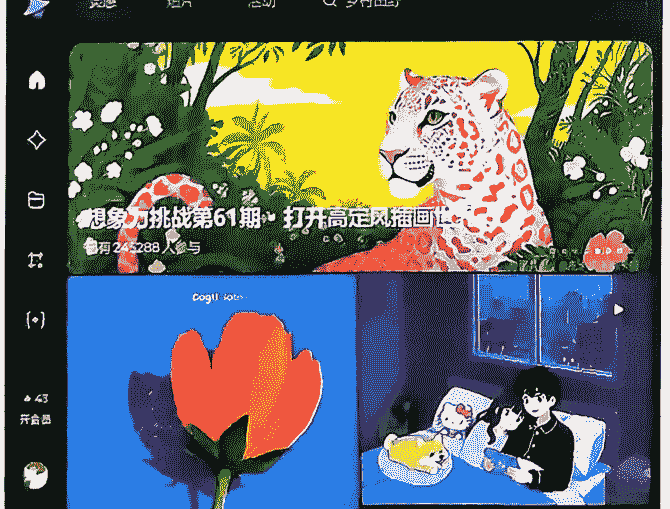
图 1-13 即梦 AI 首页
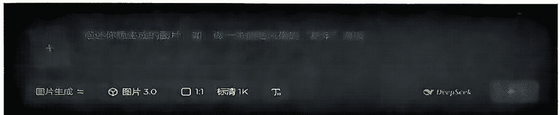
图 1-14 即梦 AI 图片生成界面

### 1.3.2 文心一言

文心一言是百度开发的强大AI语言模型，在自然语言处理与生成方面表现优异，如图1-15所示。它不仅能生成高质量文本，还可用于生成绘画提示词。结合其语言能力与绘画工具的图像能力，创作效率大幅提升。文心一言智慧绘图对话框如图1-16所示。

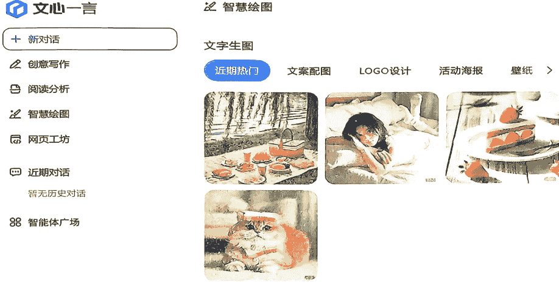
图 1-15 文心一言智慧绘图
智慧绘图
风格画板，上传参考，编辑重绘，绽放艺术灵感之美
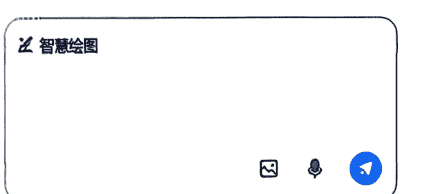
图 1-16 文心一言智慧绘图对话框

### 1.3.3 Midjourney

Midjourney是专注创意设计的AI绘画工具，如图1-17所示，以强图像生成力与细节把控著称。它提供丰富风格选项与参数调节，适用于插画、设计与商业应用，是可靠选择。

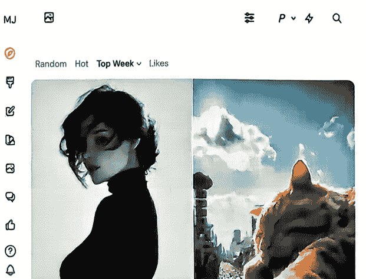
图 1-17 Midjourney 官网首页

### 1.3.4 Stable Diffusion

Stable Diffusion是一款开源AI绘画工具，以生成力与灵活性广受欢迎。它支持高质量图像生成并提供大量自定义选项。官网如图1-18所示。

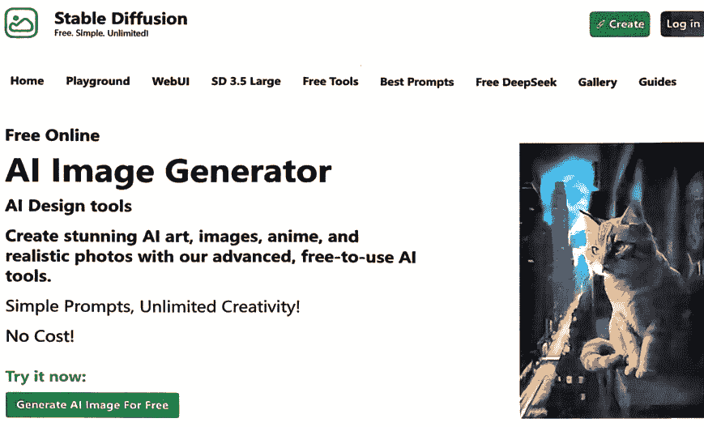
图 1-18 Stable Diffusion 官网
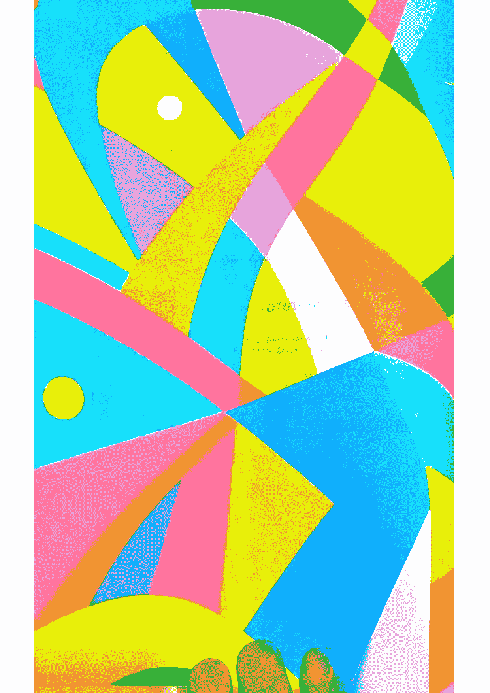
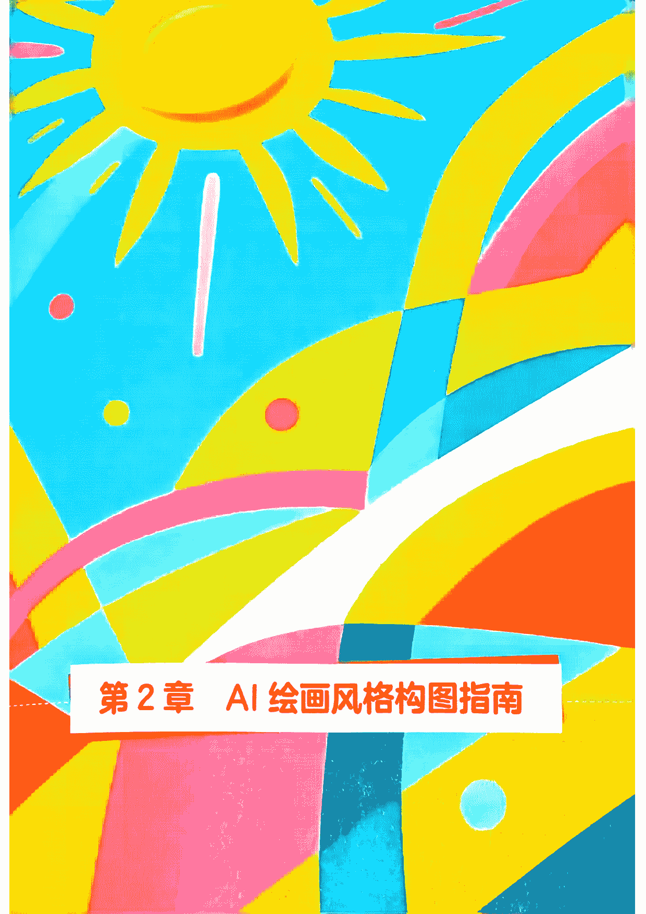

# 第 2 章 AI 绘画风格构图指南

AI绘画不仅是技术操作，更是艺术表达。风格与渲染品质的选择直接决定最终呈现。本章聚焦AI绘画常见艺术风格、渲染技巧与画面质感处理，帮助创作者匹配需求并掌握风格化构图。

### 2.1 艺术风格

艺术风格是作品的核心语言，AI可模拟多种流派，但要让模型理解并转化为视觉，需要对流派特质有清晰把握。

#### 2.1.1 抽象主义风格

抽象主义不以具象形象为依托，而是通过色彩、形体、线条表达情感与思想，打破传统写实描绘，强调内心表达。

重点提示词

抽象主义风格提示词见表2-1。

表 2-1 抽象主义风格提示词

| 提示词 | 作用与建议 |
| :--- | :--- |
| 抽象 | 规避具象描绘，强调自由组合的视觉元素 |
| 色彩碰撞 | 运用对比强烈的色彩提升视觉冲击 |
| 几何形状 | 以圆形、三角形、方形等基础几何构建画面结构 |
| 自由线条 | 以流畅或扭曲线条传递情感与动感 |
| 情感表达 | 通过色形线条传达喜悦、愤怒、宁静等情绪 |
| 无具象形态 | 避免直接描绘现实物体，专注抽象视觉元素 |

构图时可尝试将画面分割为不同区域，分别填入不同色彩与形状。避免使用具象物象，以形线组合传达情绪。例如用柔和线条与温润色彩表达宁静，用尖锐形体与强烈色彩表达冲突。

实例分析

以“希望”为主题的抽象作品，可用鲜黄橙色块象征阳光活力，不规则形体与线条表现希望多样性。如图2-1所示，提示词为“抽象主义风格，色彩饱和高、形态不规则、线条自由、情感表达、视觉冲击、想象力、希望主题、阳光活力、欢快情绪”。

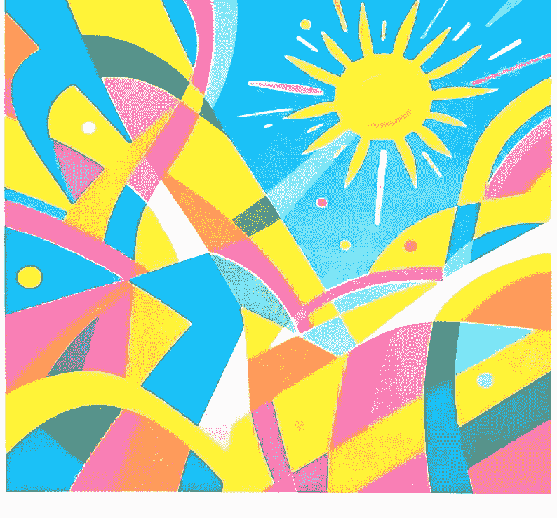
图 2-1 AI 绘画生成图——抽象主义风格 希望

若想表现内心焦虑，可用“抽象主义风格、尖锐三角形、深色调、交错线条、焦虑情绪”。如图2-2所示。

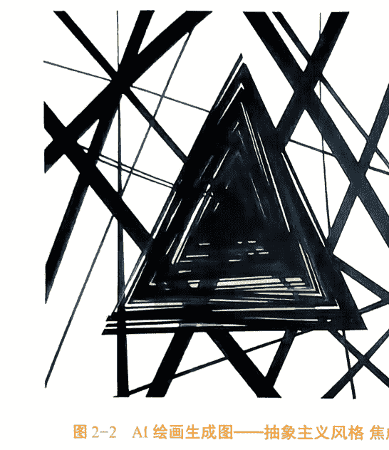
图 2-2 AI 绘画生成图——抽象主义风格 焦虑

#### 2.1.2 纪实主义风格

真实现场：纪实主义手记
纪实指向把日常生活、人物状态与正在发生的事件原貌搬进画面，整体语调克制冷静。创作时要收敛主观表达，把精力集中在细节的推敲和环境的复原上。用 AI 生成，决定成败的是细节是否经得起推敲、场景是否让人相信它真实存在过。

**重点提示词**
纪实主义风格提示词见表 2-2。

表 2-2 纪实主义风格提示词

| 提示词 | 作用与建议 |
| :--- | :--- |
| 真实场景 | 选一个有代表性的现实情境作为创作起点 |
| 细节刻画 | 把人物神情、动作以及画面中各类物件描到极致 |
| 客观呈现 | 保持旁观者般冷静的叙事视角，避免情绪化过度渲染 |
| 生活气息 | 通过环境与人物关系传递浓厚的烟火味与在场感 |
| 社会事件 | 选择有现实意义的事件主题，提升作品的社会关联度 |
| 人物特写 | 对人物做精细放大，呈现表情动态与情绪状态 |

**实例分析**
以城市街头为例，AI 可以精准复刻建筑体量、行人穿搭以及街边摆设。色彩要贴合真实光照与环境氛围。常用组合为“纪实主义风格，真实场景，细节还原，建筑结构，人物服饰，真实感，生活气息，城市街头，广告牌，路灯，行人”，如图 2-3 所示。这类作品观者能感受到生活的原汁原味，代入感与可信度都很强。

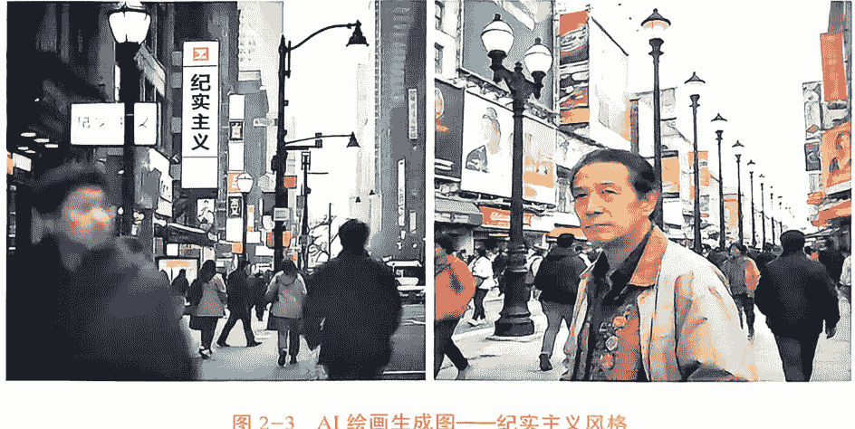

#### 2.1.3 极简主义风格
极简以干净利落的视觉语言著称，用最少元素承载最丰富内涵。画面多以简练线条、基础几何与单一色调为主，追求纯粹与留白。AI 实现的关键在于构图简洁、色彩克制。

**重点提示词**
极简主义风格提示词见表 2-3。

表 2-3 极简主义风格提示词

| 提示词 | 作用与建议 |
| :--- | :--- |
| 单一色彩 | 选一种主色或低饱和配色，提升画面纯净度 |
| 空间留白 | 大面积留白带来呼吸感与空间延展 |
| 纯粹形状 | 以圆形、方形、三角形等基础几何承载画面 |
| 少即是多 | 去掉冗余元素，用克制达成表达 |
| 现代感 | 借助简洁处理营造当代艺术的冷静气质 |

**实例分析**
人物肖像可用简线勾出轮廓，再以大块单色填充背景。关键词为“极简主义风格，简洁形式、最少元素，单一色彩，对比色，简洁构图，现代感，艺术感，宁静专注，人物肖像”，如图 2-4 所示。

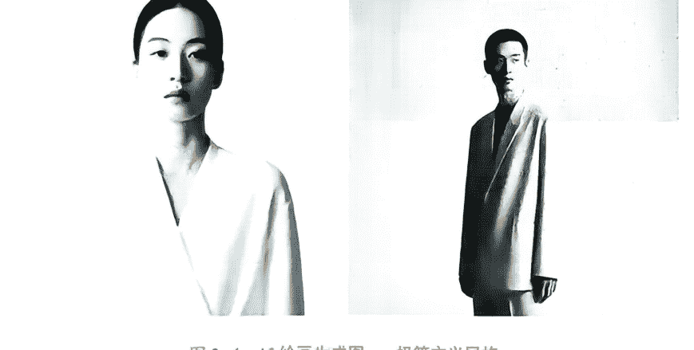

#### 2.1.4 印象主义风格
印象主义重在捕捉瞬间光影变化与色彩感受，打破写实技法，常用点彩与短促笔触表现光的变化，借助色彩跳动与笔触传递生动自然的视觉体验。

**重点提示词**
印象主义风格提示词见表 2-4。

表 2-4 印象主义风格提示词

| 提示词 | 作用与建议 |
| :--- | :--- |
| 光影变化 | 利用色块与光影捕捉瞬间的明暗流动 |
| 色彩点染 | 以点染手法营造柔和自然的色调氛围 |
| 自然场景 | 以日出、湖面、花园等自然题材传递诗意 |

**实例分析**
风景创作可用点彩表现树叶的光影，或以模糊处理远山轮廓。提示词可写为“印象主义风格，光线捕捉，色彩变化，光影效果，朦胧梦幻，自然光影，风景画，树叶光影”，如图 2-5 所示。

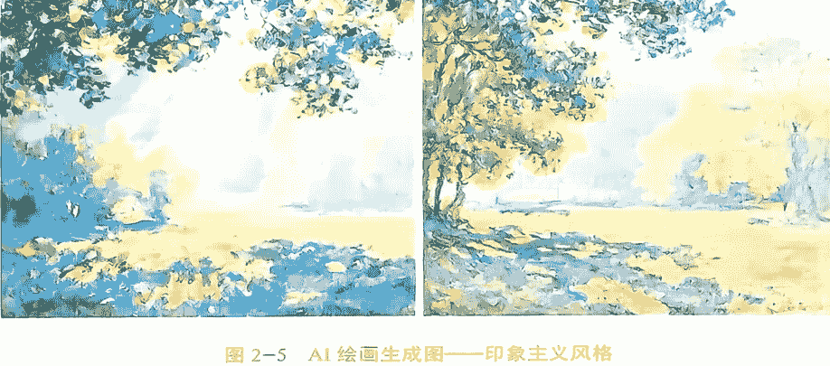

### 2.2 渲染品质
渲染品质直接决定 AI 作品的专业度与视觉质感。不同的渲染技术和关键词能明显提升材质感与真实度。下面介绍几种常用做法。

#### 2.2.1 C4D 渲染
Cinema 4D 是一款强大的三维渲染工具，能为 AI 画面提供高质量的三维质感。其材质与灯光系统可模拟金属、玻璃、布料等复杂表现。

例如科幻场景，可用“C4D 渲染器”关键词让飞船呈现金属质感，结合灯光营造未来氛围，关键词为“C4D 渲染器，三维效果，材质系统，灯光设置，金属材质，玻璃布料，科幻场景，未来感光影”。

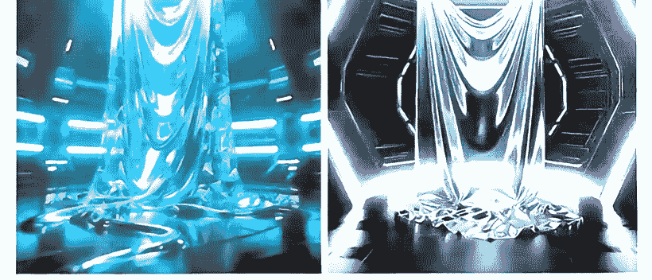

图 2-6 AI 绘画生成图——C4D 渲染

#### 2.2.2 虚幻引擎
虚幻引擎是游戏与影视常用的实时渲染引擎，以高画质实时表现闻名。在 AI 绘图里可用来构建逼真的虚拟空间与角色。

例如奇幻森林，可用“虚幻引擎”关键词为树木赋予逼真纹理，模拟风吹落叶，关键词为“虚幻引擎，实时渲染，虚拟场景，角色创建，逼真纹理，物理引擎，风吹树叶，奇幻森林，电影级视觉效果”，生成图如图 2-7 所示。

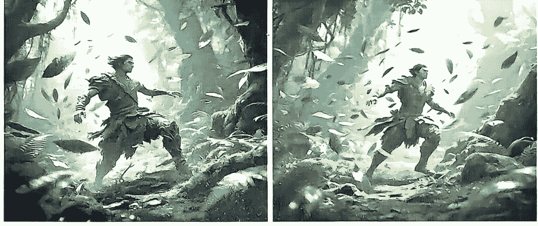

#### 2.2.3 光线追踪
光线追踪通过模拟光线传播、反射与折射，生成高度逼真的光影，可精准表现反射、折射与阴影，从而大幅提升真实感。

例如室内场景，用“光线追踪”关键词能表现阳光透窗在物体上的明暗变化，以及物体间的反射折射，关键词为“光线追踪、光影效果，光线传播，反射折射，阴影效果，真实感，室内场景，阳光透过窗户，光影变化”，如图 2-8 所示。

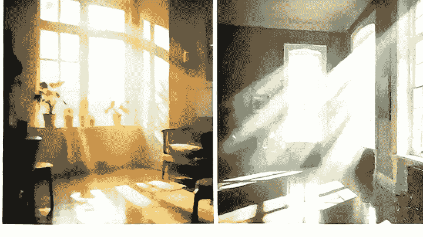

图 2-8 AI 绘画生成图——光线追踪

### 2.3 构图视角
视角决定观众“如何观看”。通过高度、远近与方向的调节，可以引导视线并营造不同情绪。精准的视角控制能让叙事更有逻辑。

#### 2.3.1 视角高度
视角高度指观察者与被摄物的垂直关系。低角度增强压迫与动感，高角度则带来俯瞰与宏观感。

**重点提示词**
视角高度提示词见表 2-5。

表 2-5 视角高度提示词

| 提示词 | 使用建议 |
| :--- | :--- |
| 仰视视角 | 镜头低于主体视平线，用于表现威严、宏伟或压迫 |
| 平视视角 | 镜头与主体视平线一致，贴近人眼习惯，适合日常与对话 |
| 俯视视角 | 镜头高于主体视平线，用于展示全局或制造渺小感 |

**仰视视角（仰拍）**
从下方往上看，主体气势被放大，常用于高大建筑或英雄形象。例如关键词为“低角度仰拍，战士持剑站立，背景破碎城墙，仰拍视角强化人物高大感，广角畸变突出腿部长度”，“低角度仰拍”配合“广角畸变”拉长下肢，破碎背景强化力量感。生成图如图 2-9 所示。

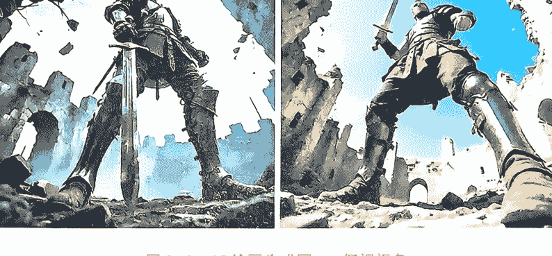

**平视视角（平拍）**
观者与主体同高，观看自然舒适，适合生活场景与人像。如绘制人物交谈插画，平视角更有沉浸感，关键词为“视线水平、尽量自然的城市街景、自然光影”，生成图如图 2-10 所示。结合“中景平视”与“视线水平”可避免夸张透视，聚焦表情与互动。

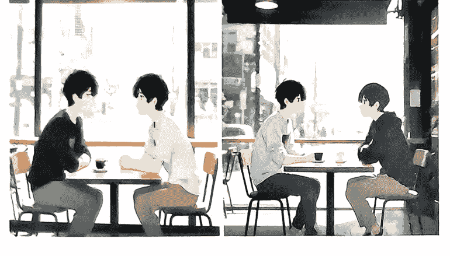

**俯视视角（俯拍）**
从上方往下看，可展现更广的背景，多用于全景与风景。例如关键词为“俯视视角，广角，废弃城市街道，散落的人群，高视角强化场景空旷感，冷色调天空”，“俯视视角”加“散落人群”压缩垂直空间，突出宏大与渺小。生成图如图 2-11 所示。

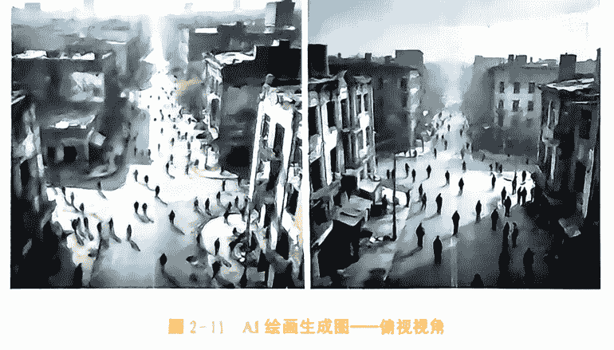

#### 2.3.2 视角远近
视角远近指观察者与被摄物距离，影响空间感与焦点。近景突出细节，远景强调氛围。

**重点提示词**
视角远近提示词见表 2-6。

表 2-6 视角远近提示词

| 提示词 | 使用建议 |
| :--- | :--- |
| 特写视角 | 聚焦局部如面部、手部，突出情绪与细节 |
| 中景视角 | 呈现主体全身或主要动作，兼顾主体与背景 |
| 远景视角 | 表现主体与环境关系，交代场景与氛围 |

**特写视角**
距离近，细节被放大，适合情绪渲染。例如拍摄女性面部特写，关键词为“面部特写，女性角色，幸福感，微笑眼角，皮肤纹理细腻，暖光侧打”，生成图如图 2-12 所示。“面部特写”配合“微笑眼角”强化情绪冲击。

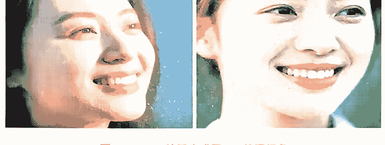

**中景视角**
距离适中，同时呈现主体与部分背景。常用于全身像与场景插画。例如剑士挥剑插画，关键词为“半身中景，剑士挥剑攻击画面，铠甲金属反光，背景模糊的战场硝烟，动态模糊强化速度感”，如图 2-13 所示。

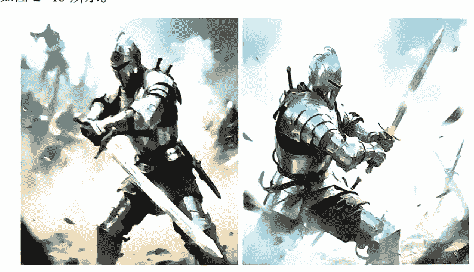

再如时尚摄影，中景能兼顾造型与环境，关键词为“中景视角，时尚摄影，女性人物，人物全身造型，时尚感，氛围感背景”，生成图如图 2-14 所示。

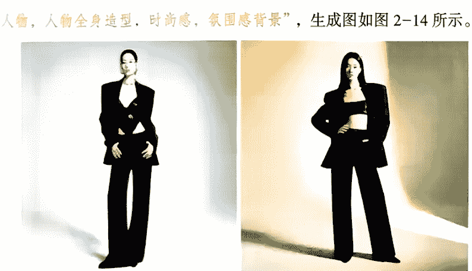

**远景视角**
距离远，细节弱化，整体氛围增强。常用于风景与全景。例如古代丝绸之路风景，关键词为“远景视角，古代丝绸之路，宏大的场景，深远的空间感，沙漠，沙丘，山脉，蜿蜒的古道，骆驼，云彩，神秘感，历史氛围，叙事性，艺术感染力”，生成图如图 2-15 所示。

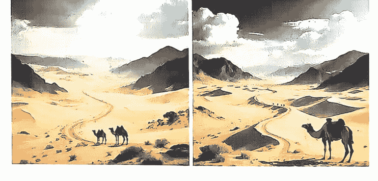

#### 2.3.3 视角方向
视角方向指观察者在水平面上的位置关系。正面增强对称与互动，侧面制造动感与神秘。

**重点提示词**
视角方向提示词见表 2-7。

表 2-7 视角方向提示词

| 提示词 | 使用建议 |
| :--- | :--- |
| 正面视角 | 增强直接互动，适合对称美、仪式感或权威感 |
| 侧面视角 | 突出轮廓，表现动态或优雅姿势，增加神秘感 |
| 斜侧面视角 | 最自然的叙事角度，兼顾细节与空间 |
| 背面视角 | 制造悬念，适合叙事性场景 |

**正面视角**
正对主体，视觉稳定直接。适合肖像与正面展示。例如人物正面肖像，关键词为“正面肖像，贵族女性端坐，礼服蕾丝细节，背景对称的古奥立柱，眼神直视镜头”，如图 2-16 所示。

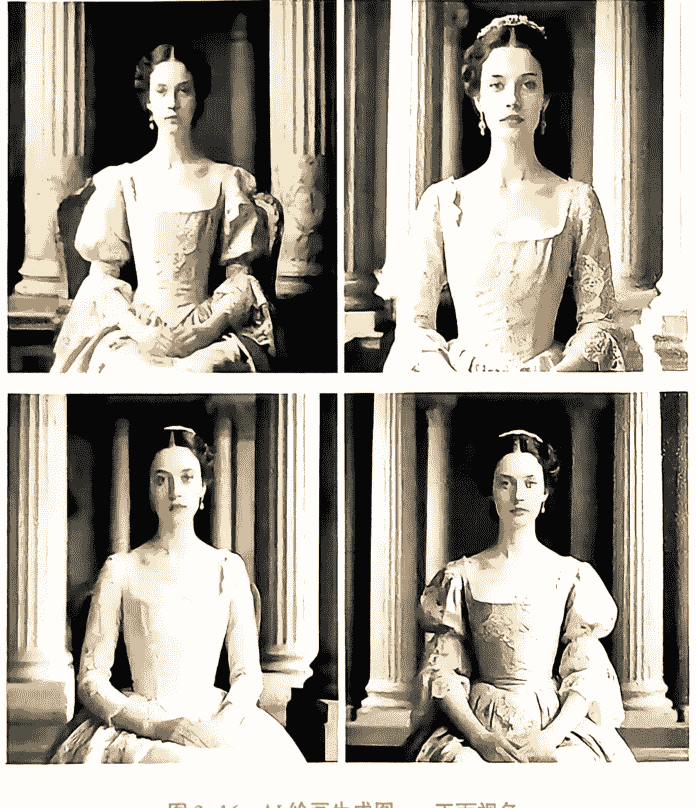

**侧面视角**
从侧面观察，轮廓感强，适合表现动态。如田径摄影，关键词“田径运动员侧面奔跑，运动残影效果，肌肉线条，速度感，竞技体育，动态模糊，汗水飞溅，力量爆发”。

**斜侧面视角**
从斜侧观察，兼具立体感与动感。描绘唯美女性插画时，关键词使用“斜侧面视角”加“优雅动作姿态”，生成图如图 2-18 所示。“女性人物插画，唯美风格，斜侧面视角，优雅动作姿态和表情”。

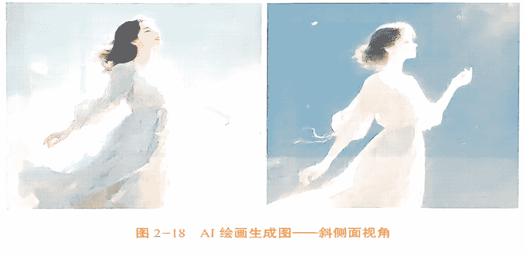

**背面视角**
从背后观察，营造神秘与想象空间。例如“一位身着黑色长风衣的人物站在昏暗的街道上，背面视角，路灯投下长长的影子，雾气弥漫，孤独氛围”，生成图如图 2-19 所示。

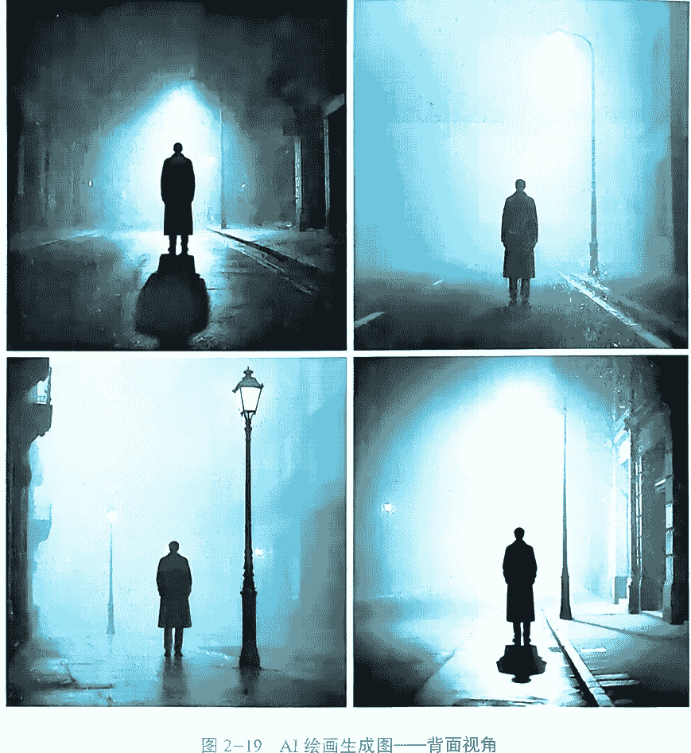

### 2.4 构图法则
构图是画面的骨架，合理的布局能让视觉重心突出。常见的结构化控制包括三分、中心、对称、框架、前景与引导线，构图是工具而非束缚。构图法则关键词见表 2-8。

表 2-8 构图法则关键词

| 关键词 | 核心作用 | 典型场景 | 关键组合 |
| :--- | :--- | :--- | :--- |
| 三分构图 | 平衡与延伸 | 风光、人像、静物 | “三分网格”“主体位于交叉点” |
| 中心构图 | 强聚焦与突出 | 特写、产品、舞台 | “主体居中”“背景虚化” |
| 对称构图 | 秩序与仪式 | 建筑、宗教、抽象艺术 | “水平/垂直/放射对称”“元素完全一致” |
| 框架构图 | 视线引导与故事感 | 复古、神秘、怀旧主题 | “天然/人造框架”“主体位于框架内” |
| 前景构图 | 强化纵深与空间感 | 风光、人像、建筑、纪实 | “前景遮挡”“前景层次”“前景与主体互动” |
| 引导线构图 | 叙事牵引与纵深感 | 探险、运动、场景引导 | “显性/隐性引导线”“多重线条汇聚” |

#### 2.4.1 三分构图
将画面横纵各分为三等分，形成九宫格，主体放在交叉点而非正中，符合非对称平衡的视觉偏好。

提示词设计技巧
- 网格明确：“三分构图”“九宫格网格”“横向/纵向三等分”；
- 位置定位：“主体位于右下交叉点”“地平线对齐上 1/3 线”“人物视线指向左上交叉点”；
- 平衡感：“画面重心稳定”“元素分布疏密得当”；
- 风格补充：“风光摄影”“人像写真”“静物特写”。

**案例拆解**
人物风景照可利用三分划分，关键词为“三分构图，优雅的模特站在海边，模特面向左侧，模特位于画面右侧的三分线上，海平面与水平方向的三分线对齐，画面平衡，温暖色调，宁静的海面背景”，生成图如图 2-20 所示。

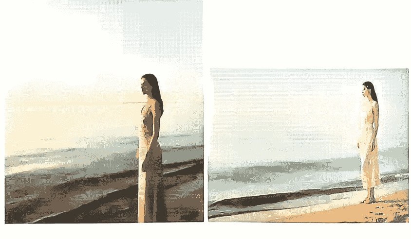

#### 2.4.2 中心构图
主体置于画面中央，直击视线，强调重要性与独特性，适合单一主体或需要强突出表达的画面。

提示词设计技巧
- 中心定位：“中心构图”“主体居中”“画面正中央”；
- 主体强化：“主体占画面 70% 面积”“面部 / 产品细节锐利”；
- 环境弱化：“背景虚化”“纯色/渐变背景”“环境元素模糊”；
- 风格补充：“肖像特写”“产品静物”“舞台特写”。

**案例拆解**
商业珠宝摄影，关键词为“中心构图，一款珠宝戒指，珠宝被放置在画面的中心位置，黑色的背景，光线聚焦在珠宝上，细节清晰可见，突出珠宝的珍贵和精美”，生成图如图 2-21 所示。

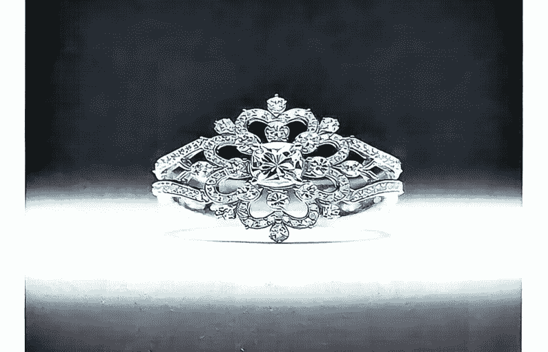

图 2-21 AI 绘画生成图——中心构图

中心构图也能表现动态，例如运动员冲刺插画，人物居中、身体前倾、四肢伸展，空气有波动感，既呈现动势又突出主体地位。

#### 2.4.3 对称构图
画面元素以轴线为中心左右或上下对称，呈现稳定、庄重、和谐的视觉感受，常用于表现对称美或正式氛围。

**水平对称**
以水平线为轴，上下元素对应，如天空与地面、海面与建筑。

对称秩序与视线引领：镜像、框景、引导线

实现思路：利用水平翻转将上方景物复制到下方，以湖面映出雪峰形成强制镜像，再配合冷色调光营造沉静氛围。

#### 垂直对称
以竖直中线为基准，左右两侧内容相互对应，多见于宫殿门面、镜面反射等场景。
示范表达：“垂直对称构图，老宅大门左右对仗，朱红门漆与铜环完全对称，门前石狮子左右呼应，传统中式风格。”
实现逻辑：
“垂直对称”结合“左右对仗”完成两侧复制，“朱红门漆”“铜环”提升传统质感。

#### 放射对称
以单一中心为原点向外扩散，形成辐射式布局，常见于花朵、车轮、光源等题材。
示范表达：“放射对称构图，夜空烟花绽放，火花以中心点为轴呈放射状扩散，地面人群仰头围观，暖黄灯光烘托节日氛围。”
实现逻辑：
“放射对称”加“火花扩散”生成由内而外的烟花形态，“人群仰头”强化中心聚焦感。

#### 实例分析
例如绘制中国传统建筑风格的插画，如图 2-22 所示，提示词为“对称构图，一幅中国传统建筑插画，建筑左右两侧完全对称，飞檐斗拱、门窗等建筑元素对称分布，中国传统建筑，庄重与对称之美”

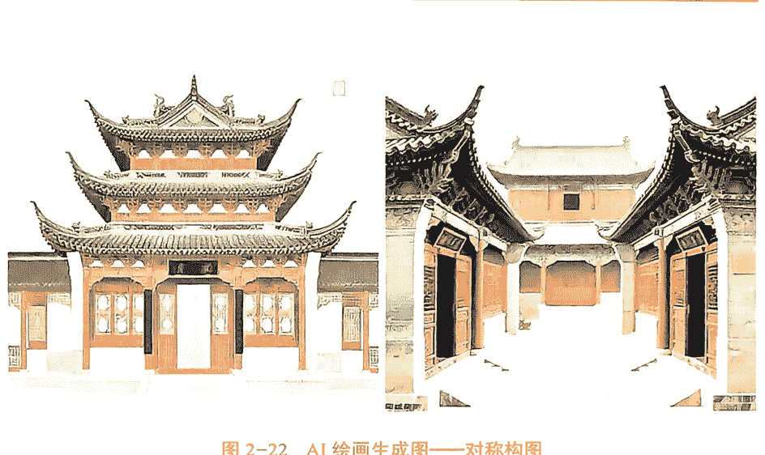

图 2-22 AI 绘画生成图——对称构图

### 2.4.4 框架构图
框式构图借助画面内部元素围成一个框，把焦点置于框内。此法可增强层次、提升神秘感，同时把视线牵引至核心，常用于突出主题或营造故事感。

提示词设计技巧
- 明确框架种类：“天然框架”如树枝、岩洞；“人造框架”如窗户、门框；“抽象框架”如光晕、阴影；
- 描绘框架与主体的关系：“框架包裹主体”“主体位于框架中心”“框架边缘做旧或虚化”；
- 补充氛围关键词：“神秘感”“故事性”“时光感”。

#### 实例分析
例如绘制一幅神秘主题插画，如图 2-23 所示，提示词为“框架式构图，一幅神秘插画，古老的窗户框架，主体（一个神秘的人物）放置框架中，窗户框架的线条和质感与主体相互映衬，神秘氛围，插花艺术”。

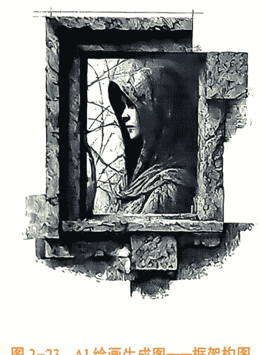

图 2-23 AI绘画生成图——框架构图

### 2.4.5 前景构图
前景构图在画面最前方布置物件，通过遮挡与层次强化空间纵深并指引观看方向。它能让画面更立体、焦点更突出，并带来丰富视觉体验。前景可为植物、岩石、栏杆等，常作为引导线把注意力引向主体。

提示词设计技巧
- 明确前景物：“前景野花”“岩石作为前景”“木质门窗作为前景”等具体描述；
- 强调空间关系：用“遮挡”“覆盖”“层次”等词提示位置，如“前景树枝遮挡主体上半身”“前景岩石覆盖画面底部 1/5”；
- 加入氛围词：“自然感”“时光感”“沉浸式”“电影级”。

#### 实例分析
例如描绘氛围感美女，如图 2-24 所示，提示词为“前景构图，前景是蔷薇花，中景是一位氛围感美女，暖色调，高清摄影，大师构图，浪漫唯美”。

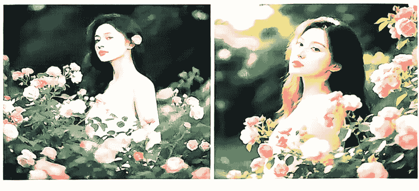

图 2-24 AI 绘画生成图——前景构图

### 2.4.6 引导线构图
借助线条把观者视线带向重点，广泛应用于绘画、摄影与设计，能增强层次与深度并聚焦核心。

**显性引导线**
线条明确可辨，如蜿蜒小路、笔直公路、栏杆等。
示范表达：“引导线构图，蜿蜒的山间小路指向远处山顶的古寺，道路两侧植被作为引导，晨雾弥漫，自然光从左上方照射。”
实现逻辑：
以“蜿蜒小路”作为显性引导线，“指向古寺”明确主体位置，“晨雾”增加画面层次。

**隐性引导线**
由元素排列或光影形成的心理线条，如人物视线、灯光汇聚、色彩渐变。
示范表达：“隐性引导线构图，人群视线统一望向画面右侧的演讲者，灯光从顶部汇聚于演讲者头顶，背景人群模糊，突出主体。”
实现逻辑：
“人群视线”充当隐性引导线，“灯光汇聚”强化焦点，“背景模糊”减少干扰。

**复合引导线**
多组线条协同作用，如道路＋河流＋人物视线。
示范表达：“复合引导线构图。溪流从画面左上流向右下，岸边小路与溪流平行，行人沿小路行走，视线望向溪流尽头的瀑布，多重线条共同指向瀑布主体。”
实现逻辑：
“溪流＋小路＋视线”三重组合引导，“流向瀑布”锁定主体，“多重线条”增强纵深感。

#### 实例分析
以一幅描绘英雄人物的 AI 绘画为例，提示词为“引导线构图，英雄人物，视觉引导，道路汇聚，光线指向，深度感，层次感，动态感，视觉吸引力，画面焦点，气场强大，坚定信念”，使用引导线构图，画面中的道路、光线等元素都可以作为引导线，从画面的四周向中心汇聚，指向英雄人物，生成图如图 2-25 所示。

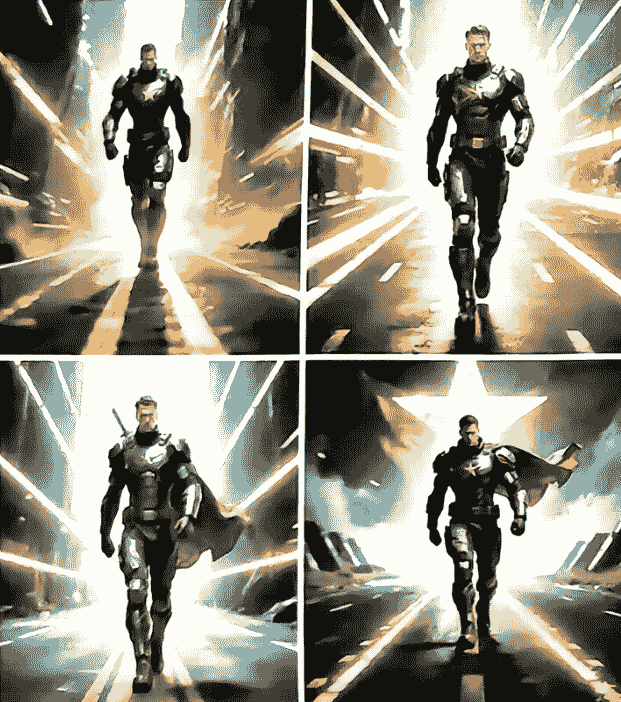

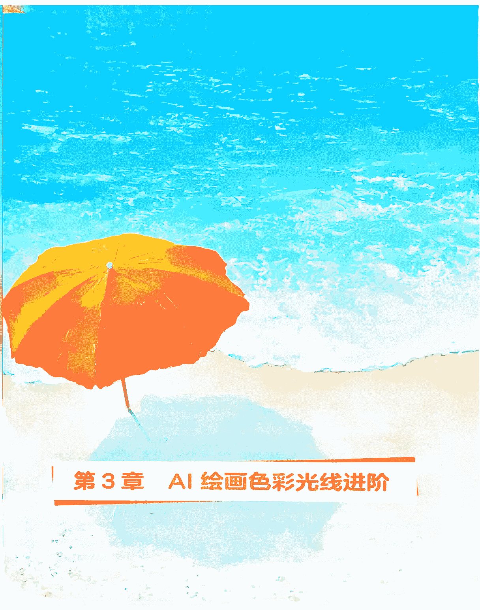

## 第 3 章 AI 绘画色彩光线进阶

> 在 AI 作画创作中，色彩与光线决定视觉质感。色彩负责传递情绪、营造氛围，光线负责塑造立体感与空间深度。本章聚焦色彩与光线的进阶运用。

### 3.1 流行色彩
色彩是绘画语言里表现力最强的部分。从选色到控色的进阶，流行色就是时代的视觉符号——“亮丽橙色”充满活力，低饱和的“自然绿色”带来治愈，“糖果色”占据可爱赛道，“霓虹色”仍是赛博朋克的标志。

#### 3.1.1 亮丽橙色
橙色热情奔放，象征阳光、活力和创造力，常用于表现温暖欢快的场景，能为画面注入强烈的视觉冲击。

提示词设计技巧
- 精准描述色相明度：“高饱和亮橙”“明度 85% 的橙色”“比正橙偏黄 5% 的亮橙”；
- 关联光线：“暖黄阳光照射”“橙光环境光”“橙色与浅黄渐变”；
- 限定场景：“夏日冰激凌”“篝火晚会”“热带水果”；
- 避免脏色：“避免灰橙”“拒绝暗橙”“保持颜色通透”。

#### 实例分析
例如创作夏日海滩场景插画，用亮丽橙色描绘沙滩伞，搭配浅蓝色海水与白色沙滩，营造清新充满活力的氛围，提示词为“夏日海滩插画，橙色沙滩伞，浅蓝色海水，白色沙滩，阳光明媚，活力四射”，生成图如图 3-1 所示。


图 3-1 AI 绘画生成图——亮丽橙色

#### 3.1.2 自然绿色
自然绿色代表大自然，象征生机、宁静与和谐，与高饱和的荧光绿不同，更接近真实植被的色彩，如树叶、草地，能带来清新自然的感觉，适合生态、治愈、自然景观等主题。

提示词设计技巧
- 细化绿调：“橄榄绿”“草绿”“松针绿”“薄荷绿”并可参考具体植物；
- 关联环境：“阴天自然光”“晨雾柔光”“树荫过滤光”；
- 强调真实感：“带叶脉纹理的绿”“叶片边缘微卷的旧绿”“草地混有黄绿的杂色”。

#### 实例分析
创作一幅森林仙境插画，可用深绿色表现古老树木，浅绿色表现新芽，搭配淡紫色雾气营造神秘宁静氛围，生成图如图3-2所示，提示词为“森林仙境插画，深绿色树木，浅绿色嫩叶，神秘宁静”。

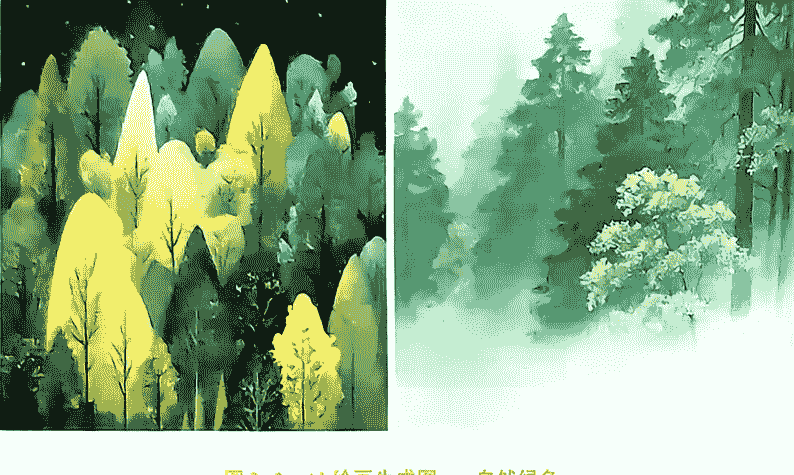

图3-2 AI绘画生成图——自然绿色

#### 3.1.3 糖果色
糖果色甜美柔和，通常包含粉色、浅黄、浅蓝等，常用于儿童、女性或浪漫主题，为画面带来温馨梦幻感。

提示词设计技巧
- 明确色系命名：“马卡龙粉”“婴儿蓝”“柠檬黄”“泡泡糖紫”；
- 关联质感：“丝绒质感”“亮面塑料感”“糖霜光泽”；
- 强化对比：“与白色/浅灰搭配”“小面积高饱和+大面积低饱和”。

#### 实例分析
假设创作童话故事插画，用马卡龙粉描绘公主裙，浅黄色描绘魔法棒，搭配浅蓝色天空与白色云朵营造梦幻氛围，生成图如图 3-3 所示，提示词为“一幅童话故事插画，马卡龙粉公主裙，浅黄色魔法棒，浅蓝色天空，白色云朵，梦幻甜美”。

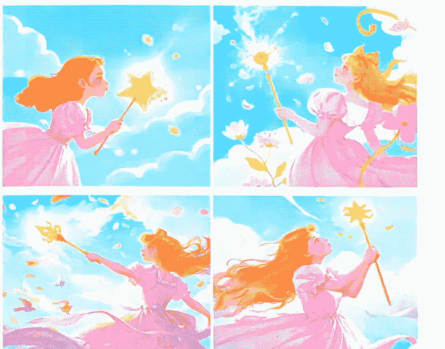

图 3-3 AI 绘画生成图——糖果色

#### 3.1.4 霓虹色
霓虹色明亮鲜艳，常含亮粉、亮蓝、亮绿等，用于表现现代、时尚或未来感主题，能带来强烈视觉冲击与科技感。

提示词设计技巧
- 明确光源：“霓虹灯管”“LED 光带”“全息投影”；
- 关联环境：“暗背景”“雨夜湿滑地面”“金属反光”；
- 强调发光：“颜色边缘泛光”“颜色渗透周围环境”“颜色与黑色背景强对比”；
- 避免模糊：“拒绝柔光”“保持颜色锐利”“加入光晕”。

#### 实例分析
例如创作赛博朋克风格作品，通过“暗蓝背景 + 霓虹粉灯管”形成强对比，“边缘泛光”模拟真实发光，“积水反射”强化色彩渗透感，提示词为“生成一幅赛博朋克风格作品，霓虹色主调，暗蓝背景，街道两侧是霓虹粉灯管，边缘泛光，地面有积水反射霓虹光（粉色光斑），穿银色外套的角色站在中间（外套反光映出霓虹色），雨丝清晰（增强潮湿感），8K 电影级画质”，生成图如图 3-4 所示。

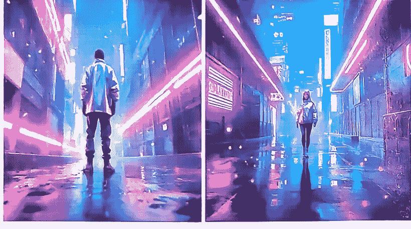

### 3.2 色彩搭配
色彩搭配是画面情绪的语法——对比色制造冲突，相邻色传递和谐，同色系构建层次。本节解析三大搭配法则，通过提示词控制色彩关系，让画面更有叙事性。

#### 3.2.1 对比色搭配
对比色在色轮上相对，如红与绿、蓝与橙、黄与紫，能产生强烈视觉冲击，使元素突出，适合强调主体或制造戏剧感。

提示词设计技巧
- 明确对比组合：“橙蓝对比”“红绿撞色”“黄紫互补”；
- 控制比例：“主色占 70%+ 对比色占 30%”避免混乱；
- 调和细节：“加入中间色如白/灰”“降低对比色饱和度”“让对比色有明度差”；
- 关联场景：“节日海报”“潮牌设计”“戏剧舞台”。

#### 实例分析
假设生成“夏日音乐节”海报，用对比色突出舞台与观众，提示词为“生成一张‘夏日音乐节’的插画海报，橙蓝对比色搭配，舞台背景是高饱和亮橙（占画面 70%），观众区域是亮蓝（占画面 30%），加入白色荧光字（中间色调和），舞台灯光橙蓝交替（强化对比），人物服装蓝橙撞色（细节呼应），夏日热烈氛围，8K 海报质感”，通过“亮橙 + 亮蓝”控制对比，“白色荧光字”调和，“舞台灯光交替”强化动态对比，最终输出视觉冲击力强的音乐节海报，生成图如图 3-5 所示。

AI 绘画进阶指南：

创意插画 + 电商设计 + 商业摄影 + IP 设计

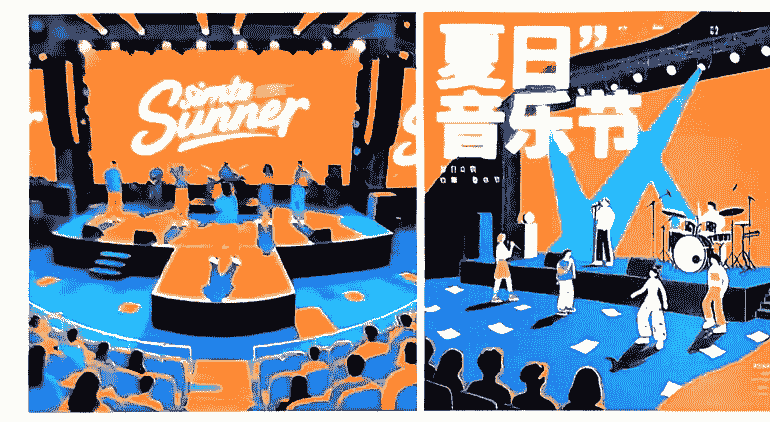

#### 3.2.2 相邻色搭配
色轮上相邻的两种或三种颜色，如黄、橙、红，蓝、紫、粉，因色相接近形成自然过渡的和谐感，适合温馨、治愈或自然主题。

提示词设计技巧
- 明确色阶：“黄 → 橙 → 红渐变”“蓝 → 紫 → 粉过渡”；
- 控制纯度：“主色高纯度 + 辅色低纯度”避免单调；
- 关联光线：“暖光渐变”“冷光柔化”；
- 关联场景：“日落晚霞”“花海”“儿童房”。

#### 实例分析
例如生成“秋日日落”风光图，用相邻色传递温暖，提示词为“生成一张‘秋日日落’的风光图，黄→橙→红相邻色搭配，天空顶部是浅黄（饱和度 50%），中间是亮橙（饱和度 60%），底部是橘红（饱和度 70%），地面枫叶由红橙渐变（近景红橙鲜艳，远景橙黄柔和），暖光从右上方照射（强化渐变方向），8K 电影级画质”，其中“黄 → 橙 → 红”色阶控制和谐过渡，“近景鲜艳 + 远景柔和”增加空间层次，“暖光照射”强化颜色温度，设计如真实日落般温暖的相邻色场景，生成图如图 3-6 所示。

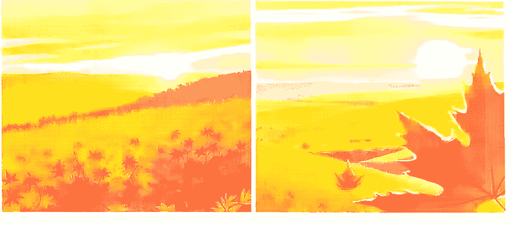

图 3-6 AI 绘画生成图——相邻色搭配

#### 3.2.3 同色系搭配
同色系指同一颜色在不同深浅上的变化，如浅蓝、蓝、深蓝，能体现统一与沉稳，强调整体协调性。

提示词设计技巧
- 明确主辅色：“浅蓝主调 + 中蓝点缀 + 深蓝背景”；
- 控制变化：“明度递减”“饱和度递增”；
- 关联质感：“亚光 → 丝绒 → 亮面”；
- 关联场景：“极简家居”“高级时装”“艺术画廊”。

#### 实例分析
例如生成“极简主义卧室”场景图，用同色系传递高级感。设计时通过“浅蓝 → 中蓝 → 深蓝”明度梯度控制层次，“亚光 → 棉麻 → 丝绒”质感词增加细节变化，“自然光统一”强化整体色调。生成图如图 3-7 所示，提示词为“浅蓝主调同色系搭配，墙面是浅蓝（饱和度 30%，亚光质感），床品是中蓝（饱和度 40%，棉麻质感），窗帘是深蓝（饱和度 50%，丝绒质感），地毯是藏青（饱和度 60%，羊毛质感），自然光从窗户射入（柔和统一），8K 极简风画质”。

## 3.3 色系运用
暖色与冷色是两大阵营——暖色传递温暖活力，冷色传递冷静神秘。

### 3.3.1 暖色系
暖色波长较长，易联想到阳光火焰，能刺激食欲、提升兴奋感，适合温馨、热情或热烈主题。

**提示词设计技巧**
- 明确主色：“以橙为主”“红黄辅助”“金棕基调”；
- 关联光线：“暖黄阳光”“橙光环境光”“琥珀色滤镜”。

**实例分析**
生成“家庭晚餐”场景图，通过“红棕木质 + 橙黄菜品”锁定暖色主调，“米白桌布”作为冷色点缀避免过噪，“暖黄灯光”强化温度感，提示词为“暖色系主调，餐桌是红棕色木质（饱和度 40%），桌布是米白（冷色点缀），菜品是橙黄（番茄汤、烤南瓜），温暖灯光氛围，8K 生活流画质”，生成图如图 3-8 所示。

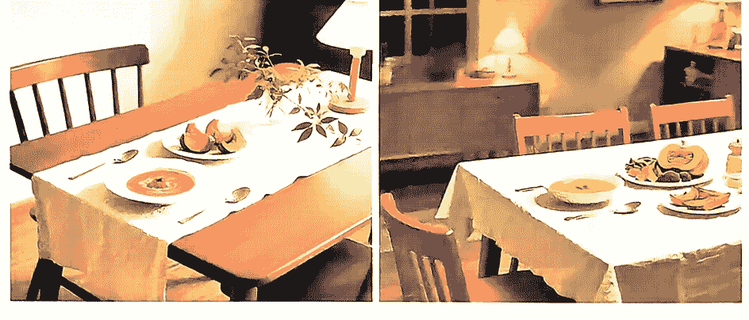

图 3-8 AI 绘画生成图——暖色系运用

### 3.3.2 冷色系
冷色系包括蓝、绿、紫，易联想到天空海洋冰雪，传达冷静、沉稳、清凉，常用于营造安静高端氛围。

**提示词设计技巧**
- 明确主色：“以蓝为主”“绿紫辅助”“青灰基调”；
- 关联光线：“冷白光”“蓝紫环境光”“月光滤镜”；
- 强化冷静：“加入反光如水面”“动态模糊如流动水”“高光冷蓝”。

**实例分析**
生成“深夜书房”场景图，用冷色系传递理性感。通过“青灰墙面 + 深蓝书桌”锁定冷色主调，“浅蓝书脊”作为暖色点缀避免压抑，“冷白灯光”强化理性感，提示词如“冷色系主调，墙面是青灰（饱和度 30%），书桌是深蓝（饱和度 40%，木质纹理），台灯是冷白光（高光冷蓝），桌面有摊开的书籍（浅蓝书脊），月光透过纱窗洒在地面（柔和冷光）、8K 电影级画质”。生成图如图 3-9 所示。

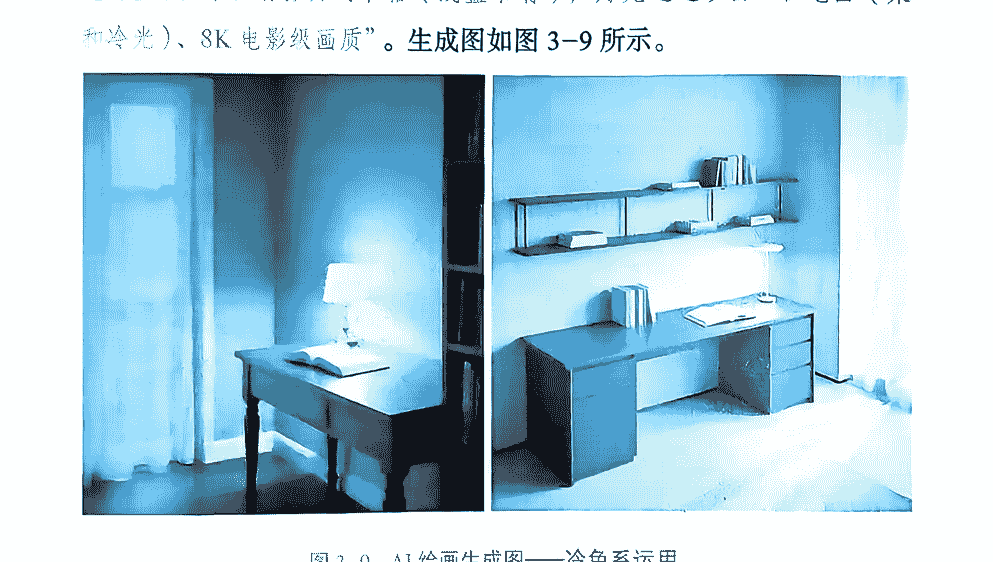

图 3-9 AI 绘画生成图——冷色系运用

### 3.3.3 色彩控制
色彩是 AI 绘画的情绪语言——亮丽橙传递活力，自然绿治愈心灵，糖果色点燃童趣，霓虹色碰撞未来；而色系搭配与控制则决定色彩的叙事逻辑。

🎨 **色彩控制注意事项**
- 光线是色彩的放大器：暖光会让橙色更艳、绿色更暗，冷光会让蓝色更透、紫色更神秘，需根据色彩需求选择光线类型，如“暖黄阳光”配橙色，“冷白灯光”配蓝色。
- 控制色彩数量：画面主色不超过 3 种，流行色 +1—2 种辅助色，避免视觉混乱；同色系可扩展至 5 种明度/饱和度变化，但需保持色相一致。
- 结合风格调整：赛博朋克适合高饱和霓虹色 + 暗背景，水彩画适合低饱和自然绿 + 柔光，需根据最终风格微调色彩参数。

**色彩控制综合表格**
色彩控制见表 3-1。

表 3-1 色彩控制综合表格

| 目标效果 | 核心色系 / 搭配 | 关键提示词 |
| :--- | :--- | :--- |
| 活力夏日 | 亮丽橙 + 自然绿 | “高饱和亮橙 + 低饱和草绿” |
| 治愈森林 | 自然绿 + 米白 | “低饱和草绿 + 浅灰米白” |
| 梦幻糖果屋 | 糖果色 + 白色 | “高饱和马卡龙粉 + 婴儿蓝” |
| 赛博朋克街道 | 霓虹色 + 暗蓝 | “亮粉灯管 + 暗蓝背景” |
| 节日海报 | 橙蓝对比色 | “70%亮橙 + 30%亮蓝 + 白色调和” |
| 秋日日落 | 黄→橙→红相邻色 | “浅黄→亮橙→橘红渐变” |
| 极简卧室 | 浅蓝同色系 | “浅蓝墙面 + 中蓝床品 + 深蓝窗帘” |
| 家庭晚餐 | 红棕暖色系 | “红棕木质 + 米白桌布 + 橙黄菜品” |
| 深夜书房 | 青灰冷色系 | “青灰墙面 + 深蓝书桌 + 冷白灯光” |

## 3.4 光线方向
在前两节掌握流行色彩的精准控制与色彩搭配的叙事逻辑后，色彩的生命力最终靠光线激活——顺光让色彩饱满通透，逆光为物体勾勒金边，强光强化明暗对比，自然光赋予真实感。本节聚焦光线的方向、强度、种类，结合实例拆解提示词设计、参数调节与光线-色彩协同技巧。

光线方向是画面的隐形骨架——顺光让色彩平铺直叙，侧光制造立体层次，逆光赋予神秘氛围，顶光强化戏剧张力，轮廓光勾勒物体边界。

### 3.4.1 顺光
顺光指光线从画面主体正面照射而来，光源位于相机/观察者正前方，如正午阳光、正面射灯。光线均匀覆盖物体表面，阴影不明显，画面整体明亮柔和且富有层次，色彩呈现平涂效果，适合表现细腻质感或需要清晰展示细节的场景，如产品图、静物画。

💡 **提示词设计技巧**
- 明确光源位置：“正面光源”“相机正前方射灯”“阳光从镜头方向照射”；
- 强调色彩均匀：“颜色过渡自然”“无明显明暗对比”“高光与阴影柔和”；

AI光影指令实战手册：从正面对光到特殊光效

质感意象关键词：丝绸的柔亮、陶瓷的反光、水果表皮的细腻。

💡 实战拆解
以“新鲜草莓产品图”为例，成片见图3-10。思路是把柔光箱放在镜头正前方做顺光，保证布光均匀；用“颜色通透”推高饱和表现；借助“水珠反光”提升细节真实感。最终指令为“生成一张新鲜草莓的产品图，顺光拍摄，草莓置于白色背景前，相机正前方有柔光箱（光线均匀覆盖），草莓表皮有细腻反光（高光柔和）、果蒂处带水珠（增加质感），颜色红得通透（饱和度75%），8K产品级画质”。

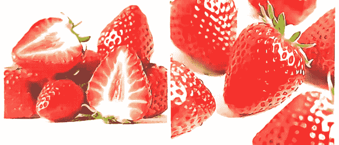

图 3-10 AI 绘画生成图——顺光

### 3.4.2 侧光
侧光即光束从画面侧面进入，光源大致位于物体侧方45°～90°。光线在表面形成明显的明暗分界，阴影长度约为物体高度的1～2倍，能强化体积感与表面肌理，如皱纹、裂纹、布料褶皱，适合表现质感或需要叙事氛围的人物肖像、静物特写。

指令要点
- 光源方位要明确：可写“左侧打光”“右侧侧光”“侧逆光与侧光混合”；
- 突出立体效果：如“面部轮廓分明”“石墙纹理清晰”“花瓣边缘带阴影”；
- 关联色调变化：如“暗部偏冷蓝灰”“亮部偏暖橙黄”；
- 控制阴影表现：如“阴影长度为物体1.5倍”“阴影边缘柔和或硬朗”。

实战拆解
制作“中年男性肖像”时，用“右侧侧光”抬升面部体积，用“亮部暖黄加暗部蓝灰”制造色差，再以“皱纹清晰”强化质感，成图见图3-11，指令为“一张中年男性肖像，侧光拍摄（光源在人物右侧），面部左侧为阴影（蓝灰色），右侧为亮部（暖黄），皱纹与胡茬在阴影中清晰可见（纹理锐利），眼神光来自侧光反射（小面积高光），背景虚化（突出主体），8K人像级画质”。

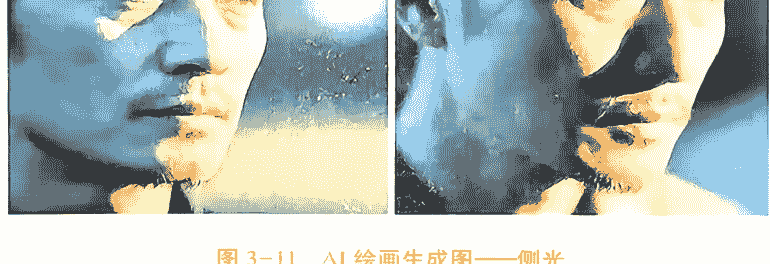

### 3.4.3 逆光
逆光时光源位于被摄物后方，例如夕阳自背后照来或背景灯点亮主体边缘，主体正面多处于阴影，边缘会被勾出明亮的轮廓光，主体与背景形成强烈明暗对比，适合营造氛围、剪影或半透明效果，常用于夜景、逆光人像、玻璃器皿。

指令要点
- 定位光源位置：“背景光源”“主体后方射灯”“夕阳从画面右后方照射”；
- 突出轮廓光：“边缘带金色/银色光晕”“轮廓光宽度占主体1/5”；
- 匹配色彩关系：“亮区颜色呼应背景，如暖黄背景配橙黄轮廓”；
- 控制曝光细节：“主体正面保留细节，避免纯剪影”“暗部偏暖”。

实战拆解
设计逆光下的透明花瓶，通过“右后方光源”锁定逆光方向，用“半透明暗部+金色轮廓”强化玻璃质感，“花瓣透光”增加真实细节，突出光影与玻璃质感。指令为“逆光下的透明花瓶图像，逆光拍摄（光源在花瓶右后方），花瓶主体呈半透明，边缘有金色轮廓光，背景是亮白（与轮廓光融合），花瓶内插粉色玫瑰（花瓣边缘有透光效果），8K玻璃质感画质”。生成图如图3-12所示。

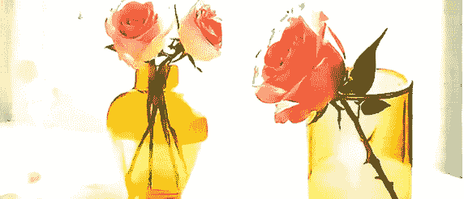

图 3-12 AI 绘画生成图——逆光

### 3.4.4 顶光
顶光来自物体正上方，如舞台顶灯或天花板射灯，光线垂直向下，顶部受光，底部因遮挡产生阴影，如眼窝、鼻下、裙摆，适合表达权威感、仪式感或需要焦点集中的场景，如宗教画、舞台摄影、产品俯拍。

指令要点
- 定位位置：“正上方射灯”“天花板主灯”“舞台顶光”；
- 描写阴影分布：“顶部亮底部暗”“阴影形态贴合物体结构，如圆形光源对应圆形阴影”；
- 关联色彩：“顶部偏冷如白光”“底部阴影偏暖如橙黄”；
- 控制焦点：“主体置于光心，如人物面部”“周边暗化凸显主体”。

实战拆解
生成舞台芭蕾舞者图像，指令用“正上方冷白顶光”强化仪式感，“裙摆阴影暖黄”增加层次，“面部眼神光”突出情绪，突出优雅与舞台氛围，指令为“一幅舞台上的芭蕾舞者图像，顶光拍摄（光源在舞者正上方），舞者上半身明亮（冷白光），裙摆下方有柔和阴影，面部受光清晰（眼神光明显），背景暗化（突出主体），8K舞台级画质”。生成图如图3-13所示。

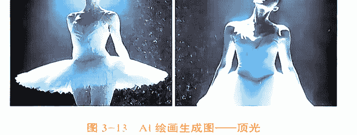

图3-13 AI绘画生成图——顶光

### 3.4.5 轮廓光
轮廓光多由逆光或侧逆光形成，是窄而亮的边缘光，如发丝光、光晕，能将主体与背景分离，强化存在感，适合需要精致感或视觉焦点的画面，人像发丝、珠宝、夜景灯光常用。

指令要点
- 明确方向：“侧逆光”“背景灯从右后方照射”；
- 强调光效：“头发丝带金色发丝光”“珠宝边缘带银色光晕”。

实战拆解
制作“红裙女生的夜景肖像”，突出发丝与裙摆轮廓，用“侧逆光”锁定轮廓方向，“金色发丝光+橙红裙摆轮廓”形成色彩呼应，“背景深蓝”衬托主体，指令如“侧逆光（光源在女生右后方），头发丝有金色发丝光（亮度85%），背景是深蓝夜景（与轮廓光形成对比），面部受侧光补光（保留细节），8K人像电影画质”。生成图如图3-14所示。

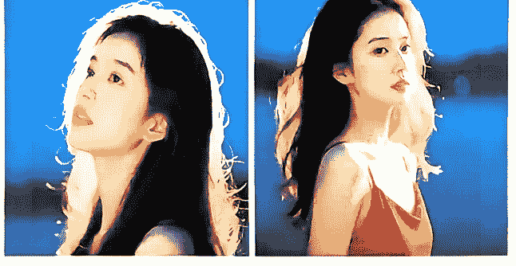

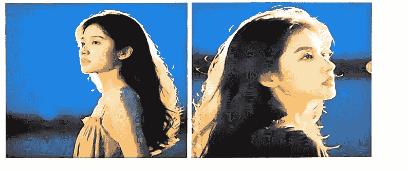

图 3-14 AI 绘画生成图——轮廓光

## 3.5 光线强度
光线强度决定画面的明暗对比与视觉冲击，左右亮度与阴影深浅。强光让色彩鲜明锐利，适合活力或冲突；弱光让色彩柔和朦胧，适合氛围与神秘。

### 3.5.1 弱光
弱光柔和，像黄昏柔光、室内暖灯、阴天散射，光影过渡自然，高光与阴影对比弱，饱和度低、边缘模糊，阴影浅而柔，传递安静内敛情绪，适合温馨、神秘、朦胧场景，如烛光晚餐、深夜书房、雾景。

💡 指令技巧
- 类型明确：“散射光”“柔光箱”“阴天自然光”；
- 强调柔和：“阴影边缘模糊”“色彩过渡自然”；
- 调控饱和：“主色低饱和+辅色中等饱和”；
- 联动质感：“丝绸反光柔和”“皮肤质感细腻”。

实战拆解
生成“深夜书房”场景，用“台灯+月光”锁定弱光来源，“低对比度+低饱和度”强化安静，“阴影柔和”增加温馨，指令为“深夜书房场景图，弱光环境（台灯光），书桌暖光（饱和度40%），墙面阴影柔和（饱和度20%），书籍边缘模糊（弱化轮廓），窗外有零星光斑（点缀氛围），8K电影级氛围画质”。生成图如图3-15所示。

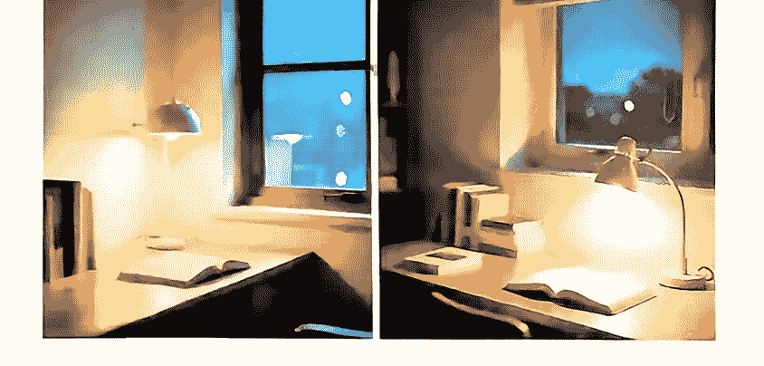

图 3-15 AI 绘画生成图——弱光

### 3.5.2 强光
强光强烈，像正午阳光、直射射灯，明暗差异大，高光与阴影分明，饱和度高、边缘锐利，细节与质感突出，画面清亮有张力，适合热烈、紧张、聚焦场景，如运动赛事、舞台表演、产品特写。

指令技巧
- 类型明确：“直射强光”“硬光”“无云层阳光”；
- 强调对比：“高光阴影对比强烈”“色彩边缘锐利”；
- 控制饱和：“主色高饱和+阴影中等饱和”；
- 联动质感：“金属反光强烈”“水珠高光明显”。

实战拆解
生成“夏日沙滩排球赛”海报。指令为“夏日沙滩排球赛海报，强光直射（正午阳光），球员皮肤高光锐利（饱和度85%），沙滩阴影深暗（饱和度30%），排球网被阳光照亮（白色高光），海浪泛白（强化光线强度），8K运动海报画质”，其中“正午阳光”锁定强光方向，“高对比度+高饱和度”强化活力，“沙滩阴影深暗”增加层次，突出运动张力，生成图如图3-16所示。


图 3-16 AI 绘画生成图——强光

## 3.6 光线种类
光线种类影响画面基调，自然光真实细腻，人工光设计感强，特殊光能打造超现实效果。

### 3.6.1 自然光
自然光来自太阳、月亮、星空，色温随时间变化，如日出暖黄、正午冷白、黄昏橙粉，还原度高，适合真实感、自然感、时间感场景，如风景、人像、静物。

自然光介绍
自然光线类型见表3-2。

表 3-2 自然光线类型表

| 自然光线类型 | 自然光线特征与作用 |
| :--- | :--- |
| 阳光 | 阳光是自然光中最常见且最具表现力的一种 |
| 月光 | 月光是夜晚的主要自然光，光线柔和、清冷，能为画面带来静谧、神秘的氛围 |
| 星光 | 星光通常在夜晚的天空中出现，光线极其微弱且分散，能为画面增添梦幻、浪漫的感觉 |

指令技巧
- 明确时段：“日出时分”“正午”“黄昏”“阴天”；
- 关联色温：“日出暖黄”“正午冷白”“黄昏橙粉”；
- 强调自然感：“光线有轻微散射”“阴影边缘模糊”；
- 关联场景：“户外风景”“窗边人像”“森林静物”。

实战拆解
设计“黄昏森林”风光图，设定“黄昏色温”锁定自然光基调，“橙粉色+柔和阴影”强化真实感，“远山淡紫”增加暮光氛围，指令为“黄昏森林的风光图，黄昏自然光，森林中光线呈橙粉色、树干阴影柔和（带暖黄反光），地面苔藓有斑驳光影（自然散射），远处山峰被染成淡紫（暮光效果），真实风光画质”。生成图如图3-17所示。

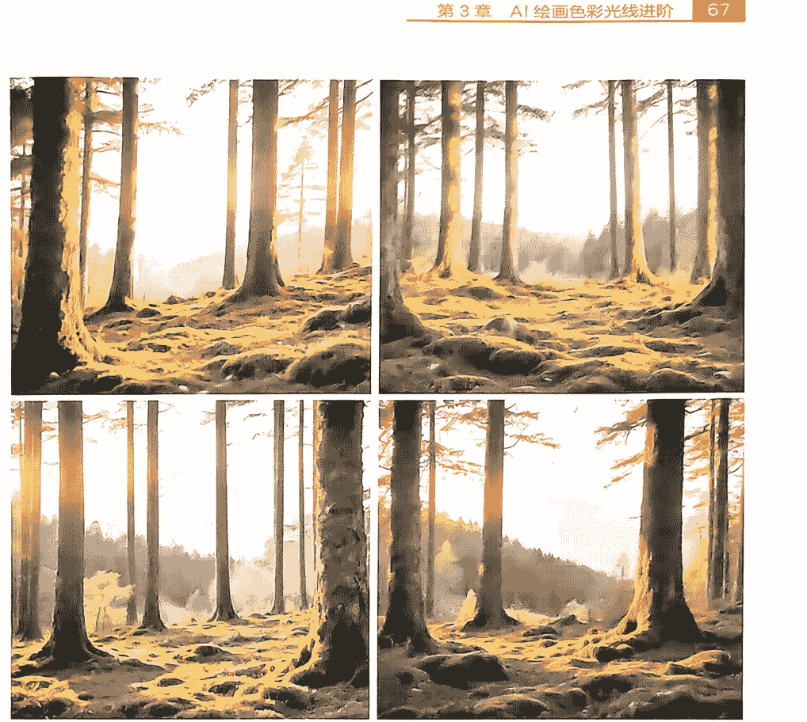

图 3-17 AI 绘画生成图——黄昏自然光

### 3.6.2 人工光
人工光由灯具、屏幕、霓虹等产生，方向、色温、强度可控，风格多样，如暖黄台灯温馨、冷白LED科技、粉色霓虹浪漫，适合设计感、科技感、风格化场景，如室内设计、潮牌海报、赛博朋克。

人工光示例
人工光线示例见表3-3。

表 3-3 人工光线示例表

| 人工光线类型 | 人工光线特征与作用 |
| :--- | :--- |
| 灯光 | 灯光在现代生活中无处不在，种类繁多，如白炽灯、荧光灯、LED灯等。不同类型的灯光具有不同的色温和光质 |
| 烛光 | 烛光的光线微弱、摇曳，具有温馨、浪漫且神秘的氛围 |
| 霓虹灯 | 霓虹灯色彩鲜艳、明亮，具有强烈的视觉冲击力，常用于商业广告和城市夜景的描绘 |

指令技巧
- 明确光源：“暖黄射灯、冷白LED、粉色霓虹灯、电影补光灯”；
- 关联风格：“复古台灯暖黄”“科技面板冷白”“赛博霓虹粉紫”；
- 强调设计感：“光线规律分布、色彩与主题匹配”；
- 关联场景：“现代客厅、科技展厅、潮牌店铺”。

实战拆解
生成“赛博朋克酒吧”场景图，使用“粉色霓虹灯+冷白LED”组合人工光源，“边缘泛光+规律排列”强化科技感，“酒杯光晕”增加浪漫细节，使画面兼具科技与浪漫。指令为“人工光组合（粉色霓虹灯+冷白LED），吧台顶部有粉色霓虹灯带（饱和度90%，边缘泛光），墙面冷白LED灯（饱和度50%，规律排列），酒杯折射出粉紫光晕（人工光反射），背景有全息投影（蓝色光斑），赛博朋克电影画质”。如图3-18所示。

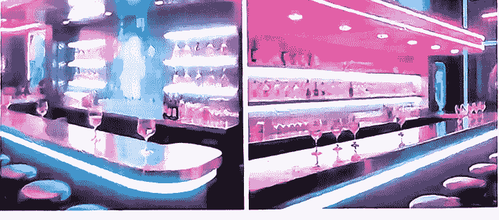

图 3-18 AI绘画生成图——人工光

### 3.6.3 特殊光
特殊光突破自然规律，如体积光、丁达尔效应、极光、激光，风格化强、可控性高，能直接绘制氛围，体积光营造神秘，丁达尔光传递神圣。

分类与效果
特殊光示例见表3-4。

表 3-4 特殊光示例表

| 特殊光类型 | 关键提示词组合 | 典型效果 |
| :--- | :--- | :--- |
| 体积光 | “光束明显”“空气感”“散射” | 神秘宗教/魔法场景 |
| 丁达尔效应 | “光路清晰”“微粒反光”“神圣” | 清晨雾中/宇宙幻境 |
| 极光 | “带状光”“蓝绿渐变”“流动” | 极地夜空/奇幻场景 |

指令技巧
核心是“定类型+锁效果+关联场景”：
- 定义类型：直接写“体积光”“丁达尔光”“激光矩阵”；
- 描述细节：用“光束粗细”“光路清晰度”“颜色渐变”强化，如“宽度2米的光束”“光路带金色微粒”；
- 关联元素：结合场景物体，如“穿过森林的丁达尔光”“照射在机器人上的激光”；
- 控制倾向：用“神秘”“神圣”“科技”“浪漫”等词锁定氛围。

实战拆解
生成“奇幻魔法森林”场景，用丁达尔光营造神圣氛围，指令为“丁达尔效应，清晨森林中，阳光穿透薄雾形成可见光路（光路带金色微粒），树木被暖黄光笼罩（饱和度60%），地面苔藓有斑驳光影（自然散射），远处山峰被染成淡紫（暮光效果），奇幻电影画质”。

# AI 绘画进阶指南：

创意插画 + 电商设计 + 商业摄影 + IP 设计

达尔效应”锁定特殊光类型，“光路宽度1米+金色微粒”强化神圣感，“暖黄光笼罩树木”关联场景元素，“远山淡紫”增加暮光氛围。生成图如图3-19所示。

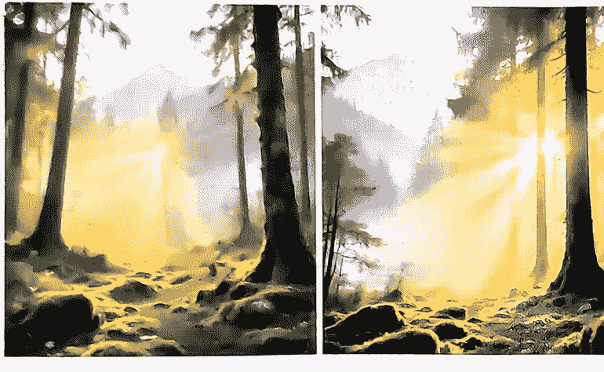

图 3-19 AI 绘画生成图——特殊光


## 第4章 平台实战操作
本章将深入探讨即梦 AI 和 Midjourney 这两款强大的 AI 绘画工具，通过详细介绍它们的功能、设置以及创意玩法，帮助读者掌握如何利用这些工具提升自己的设计和绘画能力。

### 4.1 即梦AI生图参数调优
在使用即梦 AI 进行绘画时，通过合理设置生图模型、比例和尺寸，以及掌握图生图参考设置和效果控制，用户可以更好地引导 AI 生成符合自己需求的图像。

#### 4.1.1 模型选择与比例适配
下面我们来了解即梦 AI 中的文生图相关参数设置，包括模型、比例。

图片模型
如图4-1所示，目前即梦 AI 共计四种图片模型，图片2.0、图片2.0 Pro、图片2.1 以及图片3.0，推荐使用最新版本的图片3.0进行创作。


各个模型简单介绍如下：

图片3.0：拥有“影视质感”“文字更准”“直出2K高清图”等特征。支持设置图片分辨率为标清1K或高清2K，在构图方面，能够更精准地遵循用户的提示，减少了以往在创作过程中出现的“抽卡”次数，显著提升了创作的效率。同时，在复杂场景的构图能力上表现优异，能够清晰展现更多画面繁杂的信息内容。

图片2.1：解决了 AI 图像无法生成中文字体的问题，能够直接生成中英文文字。仅支持图片分辨率为标清1K，用户可以自由指定字号、字体、颜色和位置，显著提升了图形创作的灵活性与个性化。

图片2.0 Pro：在图片2.0的基础上进行了优化，仅支持图片分辨率为标清1K，支持更复杂的图像生成需求，如更精准的构图和细节表现。

图片2.0：仅支持图片分辨率为标清1K，支持基础的图像生成功能，用户可以通过输入描述性文本生成相应的图像。

图片比例
比例是文生图功能中的一个重要参数，它决定了生成图像的宽高比。选择合适的比例可以确保图像在不同应用场景中的视觉效果。即梦 AI 提供了多种常见的比例选项，如1:1（正方形）、16:9（宽屏）、4:3（标准屏）等，如图4-2所示。


不同比例使用场景如下，实例效果如图4-3所示。

- 21:9：也称为超宽屏比例，适合用于宽屏显示器或电影制作。
- 16:9：这是最常见的宽屏比例，广泛用于电视、电脑显示器和视频内容。
- 4:3：传统的屏幕比例，适用于较老的显示器和一些专业用途。
- 3:2：常用于摄影，特别是数码单反相机。
- 1:1：正方形比例，适合社交媒体平台如 Instagram。
- 2:3：竖屏比例，适合移动设备和社交媒体故事。
- 3:4：另一种竖屏比例，常用于手机和社交媒体。
- 9:16：适合短视频和移动设备上的全屏显示。


图 4-3 即梦 AI 图片比例

#### 4.1.2 参考图叠加技巧
图生图功能允许创作者以现有的图像为基础，生成新的图像。通过调整图生图设置，可以更好地控制生成图像的效果。

在编写提示词时上传现有图像，即可进行如图4-4所示的参考设置。点击“保存”后，在输入框内输入提示词进行图像创作。


参考类型有智能参考、主体识别、人像写真、角色特征、风格参考、边缘轮廓、景深、人物姿势，简单介绍如下：

智能参考：用户上传参考图后，AI 自动提取角色特征与风格参数，生成时自动对齐细节，实现多种商业创意设计。

主体识别：AI 自动提取主体物的外观特征，确保在不同状态、地点的一致性特征外貌，如图4-5所示。


图 4-5 即梦 AI 图片参考图——主体识别

**人像写真定制**
以参考画面人物的面部特征为依据撰写提示词，就能生成风格统一且背景可自由替换的人像作品，效果如图 4-6。


图 4-6 即梦 图像参考——人像类

**角色跨场景连贯**
上传参考素材后微调面部相似与主体相似的数值，可让生成人物更贴近原图，从而在多场景、多情节中保持外形与气质的一致，示例见图 4-7。


图 4-7 即梦 图像参考——角色特征

**系列风格统一**
为保证成系列画面中发型、五官、服饰等要素高度一致，可借助风格参考来约束，示例如图 4-8。


图 4-8 即梦 图像参考——风格参照

**动作引导用边缘轮廓**
若希望参考图来驱动特定动作，导入后切换到“边缘轮廓”模式即可，见图 4-9。


**景深范围调节**
景深指画面由前景到后景的清晰跨度，可通过模型参数或相关功能进行控制，图 4-10 展示。


**姿势参考的使用**
基础姿势可以直接使用人物姿势参考，复杂的动作则建议搭配边缘轮廓或其他手段，示意图为图 4-11。


图 4-11 即梦 图像参考——人物姿态

以主体识别为例，在保留主角特征的前提下，参照图 4-12 输入提示词“白色花墙，前景花墙”，合成结果如图 4-13。


图 4-12 图像参考——主体识别示例


图 4-13 图像参考——主体识别生成图

### 4.2 即梦 智能画布编辑
智能画布是即梦的核心创作空间。先用文生图快速出片，再通过局部重绘、智能扩图等手段对成片进行精细化优化。

#### 4.2.1 局部方向调整
图 4-14 显示进入路径：在即梦首页左侧选择“智能画布”，进入“文生图”。


输入提示词，如“夜晚，长发飘逸，半遮美丽忧伤的脸，微醺的感觉，表情细腻，自然，暗调背景，发丝光柔和，面部清晰，线条流畅，特写，大师杰作，高级感，神秘感”，点击“立即生成”，如图 4-15。


图 4-15 文生图画布生成图

“局部转向”入口见图 4-16，该功能可对目标图像中的元素进行方向修改。


图 4-16 文生图画布——局部转向

例如将图 4-15 中主角的面部朝向向左旋转，图 4-17 所示，先用“创建选区”框住人物主体，再在选区内用“添加箭头”标注转向部位与方向。生成后效果见图 4-18。


图 4-17 文生图画布——局部转向操作

图 4-18 文生图画布——局部转向生成图

#### 4.2.2 抠图提取
抠图可快速获取图像中的关键元素。以上述成片为例，点击图 4-19 所示的抠图入口，即可得到矢量人像，如图 4-20。


图 4-19 文生图画布——抠图


图 4-20 文生图画布——抠图操作

#### 4.2.3 扩图扩展
扩图能按设定比例对画面进行延展，见图 4-21。智能画布支持自定义缩放比例，也提供预设倍数 1.5x、2x、3x，以及固定比例 1:1、3:4、4:3、9:16、16:9。如图 4-22 所示，将 1:1 人像扩至 9:16。


图 4-21 文生图画布——扩图


图 4-22 文生图画布——扩图操作

#### 4.2.4 局部重绘
如图 4-23 所示，点击局部重绘后选中人物服装区域，填入提示词“黑色抹胸礼服”，如图 4-24 所示，服装由原本的墨绿色变为黑色。


图 4-23 文生图画布——局部重绘


#### 4.2.5 融图合成
融图可让画面元素与整体风格自然融合。同一项目画布内先用提示词“雨中小路，两边爬满蔷薇藤蔓，幽深寂静，灰绿色调，孤冷静寂”和“女生，氛围感，长发飘飘”分别生成两个图层，随后对人物图层的人像做抠图得到矢量人像，再选择图 4-25 所示的融图操作。


如图 4-26 所示，将矢量人像设为前景，风景图像设为背景，调整人物位置后点击“立即融图”，结果如图 4-27。


图 4-26 文生图画布——融图操作


图 4-27 文生图画布——融图生成图

### 4.3 Midjourney 参数优化指南
在 Midjourney 中通过指定参数可控制画幅、风格、细节等。下面梳理常用参数的用法。

#### 4.3.1 画幅与尺寸 --ar
不同使用场景对比例要求不同，如社媒、广告或插画。--ar 用于指定宽高比，示例见图 4-28。

“A futuristic cityscape at sunset --ar 1:1/--ar 2:3”

“日落时分的未来主义城市景观 --ar 1:1/--ar 2:3”


#### 4.3.2 风格模式 --style raw / --style expressive
--style raw 与 --style expressive 是两类常用风格模式，在细节与艺术化程度上差异明显。

使用 --style raw 时画面更简洁写实，适合追求纪实感的人像或摄影类输出。

使用 --style expressive 时画面更夸张、表现力更强，专为 --niji 5 模型设计，用于提升艺术感。对比见图 4-29。

“romantic couple, portrait photography --style raw/--niji 5 --style expressive”

“浪漫的情侣，人像写真 --style raw/--niji 5 --style expressive”


图 4-29 Midjourney --style raw/--style expressive

#### 4.3.3 负面提示 --no
--no 可指定不希望出现的元素或风格，从而更精准控制生成结果。多个词可用逗号分隔，如 --no animals,people，示例如图 4-30。

> “A bouquet of colorful flowers --no red flowers”

> “一束五颜六色的鲜花 --no 红色的花”


图 4-30 Midjourney --no

#### 4.3.4 风格化强度 --s
--s 控制艺术风格的强弱，可从写实过渡到抽象。写实类建议设为 1-10，艺术化类可设为 100-1000，见图 4-31。

“Cute hamster --s 0 / --s 600”

“可爱的仓鼠 --s 0 / --s 600”


#### 4.3.5 创意强度 --c
--c 用于提升创意与独特性。偏传统时可设 1-10，追求大胆想象时可设 20-100，示意图见图 4-32。

“A tiger cub --c 0 / --c 80”

“一只老虎幼崽 --c 0 / --c 80”


#### 4.3.6 角色参考 --cref
--cref 用于锁定角色外貌特征。上传角色参考图后配合指令即可引导生成，示例见图 4-33：

“A little hamster is strolling through a clothing store --cref [左图链接]”

“一只小仓鼠在逛服装店 --cref [左图链接]”


#### 4.3.7 风格参考 --sref
--sref 用于指定画面风格。通过上传风格参考图，可引导模型复现特定画风，示例见图 4-34：

```
“a boy --sref [左图链接]”
“一个男孩 --sref [左图链接]”
```


### 4.4 Midjourney 个性化风格
Style Tuner 支持生成并应用专属风格代码，让作品具备个人辨识度。

#### 4.4.1 生成专属风格代码
在 Discord 中用 Midjourney 的 /tune 命令，输入提示词 “a baby Golden Retriever (一只小金毛寻回犬)”，如图 4-35 所示，设定生成风格数为“16 个”，使用默认模型，点击“Submit”。


图 4-35 Midjourney /tune

生成完成后会得到链接，如 https://tuner.midjourney.com/example(16 Style Directions)，打开后如图 4-36 所示，可看到 16 组风格各异的金毛图像。


图 4-36 Midjourney /tune 生成风格

挑选喜爱的风格后，在页面下方提示词框中即可获取对应个性化代码，如图 4-37 所示。


图 4-37 Midjourney 获取个性化风格代码

#### 4.4.2 应用个性化风格代码
以金毛为例，获取到的风格代码为“4eR6GVlXlGgX”，回到 Discord 后使用该代码，如图 4-38 所示。最终成图见图 4-39。


图 4-38 Midjourney 使用个性化风格代码


图 4-39 Midjourney 使用个性化风格代码生成图


# 第5章 AI 创意插画创作
本章聚焦如何借助 AIGC 绘画工具产出不同风格的创意插画。从传统到现代再到前沿，通过实例与提示词演示 Midjourney 精准呈现各风格插画的方法。

## 5.1 传统风格插画
传统插画承载深厚文化底蕴与独特表现技法。复现时需强化材质感知与技法特征，避免算法过度平滑导致的风格失真。

### 5.1.1 水墨插画
水墨以水墨为媒介，通过浓淡干湿呈现独特艺术性，核心在于“墨分五色”“计白当黑”，强调流动笔触与留白意境。

提示词要点
水墨插画提示词见表 5-1。

表 5-1 水墨插画提示词

| 提示词类型 | 示例词库 | 作用说明 |
| :--- | :--- | :--- |
| 材料特征 | 生宣/熟宣、淡墨/浓墨/焦墨、破墨法/积墨法 | 明确水墨技法类型 |
| 晕染控制 | 晕染半径 15%、墨色浓度 30%、湿润反光 | 精准控制墨色过渡与质感 |
| 构图与意境 | 留白 20%、左侧疏朗、烟雨朦胧 | 调节画面节奏与氛围 |

案例：江南烟雨石桥
目标是青石板桥为主体的细雨朦胧水墨，需表现“近景浓墨勾檐角，中景淡墨染远山，左侧留白 20% 营造烟雨”的层次。

创作中用“墨色浓度 70%”“晕染半径 15%”量化墨色，加入“湿润反光”“飞檐细节”等关键词触发传统笔触记忆，配合 --style raw 保留原始颗粒感，--s 600 增强墨色过渡自然度。

提示词：“中国传统水墨画，江南石桥场景，近景青石板路湿润反光（用淡墨扫出潮湿感），中景木质廊檐用浓墨勾勒飞檐细节（墨色浓度 70%），远景低山用淡墨晕染（墨色浓度 30%，晕染半径 15%），画面左侧留白 20%（无笔触，模拟雾气），整体构图参考吴冠中《江南水乡》的简约疏朗，--v7 --style raw --s 600”，生成图如图 5-1 所示。


### 5.1.2 油画插画
油画核心在于笔触肌理与色彩叠加，可通过提示词强调“厚涂厚度”“笔触类型”及“色彩叠加逻辑”。

提示词要点
油画插画提示词见表 5-2。

表 5-2 油画插画提示词

| 提示词类型 | 示例词库 | 作用说明 |
| :--- | :--- | :--- |
| 质感技法 | 厚涂法、短笔触/长笔触、刮刀肌理 | 强化油画材料特征 |
| 色彩逻辑 | 主色调+辅助色（如赭石+橄榄绿+柠檬黄）、色彩饱和度 70% | 控制色彩过渡自然 |

# AI绘画提示词进阶实操

动态引导参考
| 引导类型 | 具体表现 | 作用说明 |
| 动感塑造 | 叶面笔触随风倾斜、光束入射角度 | 让画面运动更具可信逻辑 |

提示词设计要点

质感联想：用“颜料堆积厚度”“边缘可观察笔触叠加”这类可量化表述，唤起模型对油画材料的记忆；
画面合理性：限定“短笔触斜向排列”“丁达尔模糊的光束边缘”，为画面注入动态逻辑；
参数选用：--q 2 用来提升色彩精准度，--s 750 用来强化笔触细节的清晰度。

实例拆解
围绕枫林透光的油画创作，选用描述为古典油画基调、秋日林地场景、色系选用赭石表树干、橄榄绿表叶片、柠檬黄表光斑，树干采用厚涂法体现颜料厚度与边缘笔触堆积，叶片以短笔触斜向排列模拟吹拂方向，阳光穿林形成丁达尔效应使光束边缘柔化，整体饱和度控制在70%避免过艳，借鉴凡·高《麦田》的笔触张力，并带入 --v7 --q 2 --s 750。成图呈现出赭石厚涂树干、柠檬黄点染光斑、橄榄绿叠染叶片的质感，Midjourney 输出如附图5-2。


图 5-2 AI绘画生成图——油画树林插画

在人像创作中，油画肖像的重点在传递神情和气质。借助“细腻肤色”“高光凸显”等描述，可得到更真实的肤质与立体的面部特征，即梦平台呈现如图5-3所示。描述示例为油画肖像、中年女性、优雅气质、复古服饰、细腻肤色、高光突出、情感丰富。


图 5-3 AI绘画生成图——油画肖像插画

### 5.1.3 水彩插画

水彩的魅力在于水色交融的通透感和湿画法的自然晕染，以清新透明的质感和丰富的层次受到青睐。

提示词与作用说明
水彩插画常用词库见表 5-3。

表 5-3 水彩插画提示词

| 提示词类型 | 示例词库 | 作用说明 |
| :--- | :--- | :--- |
| 材质技法 | 湿画法水分7:3、干画法留白半径5%、叠色顺序先浅后深 | 明确水彩技法类型 |
| 透明控制 | 透明、边缘模糊、晕染 | 调节水色的通透感 |
| 色彩搭配 | 群青加柠檬黄加浅粉、冷色调为主海水、暖色调点缀晚霞 | 控制画面色调倾向 |

实例拆解：海边日落的潮间带

聚焦潮间带礁石和海浪的水彩创作，呈现群青与柠檬黄叠染海水采用湿画法、浅粉晕染晚霞采用干画法、礁石边缘留白形成自然晕染的通透感。描述示例为透明水彩风格插画、海边潮间带场景、主色群青表海水、柠檬黄表浪花、浅粉表晚霞，海水用湿画法叠染，礁石用干画法留白，晚霞与天空过渡自然，整体透明度60%，借鉴卡伦·玛莎《水彩风景》的清新色调，--v7 --style scenic --s 500，Midjourney 输出如附图5-4。描述中 --style scenic 强化场景氛围感，--s 500 在通透感和细节间取得平衡。


图 5-4 AI 绘画生成图——水彩插画

### 5.1.4 素描插画

素描以简洁线条和明暗对比呈现独特魅力，核心在于线条排列、明暗层次和透视关系的精准表达。

提示词与作用说明
素描插画常用词库见表 5-4。

表 5-4 素描插画提示词

| 提示词类型 | 示例词库 | 作用说明 |
| :--- | :--- | :--- |
| 线条语言 | 交叉排线45°斜线、渐变排线从密到疏、平排排线水平或垂直 | 明确素描线条类型 |
| 光影控制 | 投影长度、物体高度、黑白灰对比度70%、光线方向左上方 | 构建明暗逻辑合理性 |
| 材质表现 | 深刨桃木木纹、皮质桌面反光 | 锚定具体材质线条特征 |

编写素描提示时避免“杂乱线条”“平涂阴影”等关键词，易导致作品失去体积感，负面提示可加入“线条杂乱、黑白断层”。

实例拆解：老书店的午后光影

围绕旧书架和木质书桌的素描创作，要求体现交叉排线表现木纹45°斜线密度中等、渐变排线塑造体积从密到疏过渡、投影长度为物体高度1.5倍光线来自左上方。描述为古典素描风格、老书店场景、核心为深胡桃木书架木纹用交叉排线密度中等加深棕色皮质桌面阴影用渐变排线从密到疏过渡，光线自左上方照射，整体黑白灰对比度70%亮部留白暗部排线密集，借鉴门采尔的写实线条、--v 7 --q 2 --s 600。

该描述用“45°交叉排线”“密度中等”锁定线条语言，避免随机线条，“对比度70%”控制光影合理性，参数 --q 2 提升线条精度，--s 600 增强明暗层次清晰度。Midjourney 输出如附图5-5。

素描人像的关键在于借助线条和明暗对比表现立体感和气质。“明暗对比强烈”可得到立体人物，“线条简洁流畅”确保符合素描风格，“深邃眼神”赋予情感表达，即梦平台呈现如图5-6所示，描述为素描风格、人物肖像、青年男子、短发、深邃眼神、明暗对比强烈、黑白灰对比度70%、线条简洁流畅、光影立体。


图5-5 AI绘画生成图——素描插画


图5-6 AI绘画生成图——素描人物插画

### 5.1.5 剪纸插画

剪纸的核心是镂空造型、平面化构图和对称或重复图案，以简洁线条和丰富图案著称。

提示词与作用说明
剪纸插画常用词库见表 5-5。

表 5-5 剪纸插画提示词

| 提示词类型 | 示例词库 | 作用说明 |
| :--- | :--- | :--- |
| 镂空规则 | 菱形鳞片边缘锐利度90%、圆形镂空、锯齿状边缘 | 明确剪纸经典镂空语言 |
| 色彩限制 | 仅用红粉金三色、无渐变、高饱和度 | 控制色彩装饰性 |
| 构图法则 | 平面化无透视、对称分布间距均匀、主次分明 | 构建画面秩序感 |

实例拆解
假设打造“连年有余”的剪纸画面，要求体现鱼身镂空菱形鳞片边缘锐利、莲花对称分布花瓣边缘锯齿状、色彩仅用红粉金三色无渐变的装饰性。

描述为传统剪纸风格、春节窗花主题、核心为红色锦鲤身体镂空菱形鳞片边缘锐利度90%，下方对称分布两朵粉色莲花花瓣边缘锯齿状间距均匀，整体平面化构图无透视变形，色彩仅用红#FF3333粉#FF9999金#FFCC00三色无渐变，借鉴陕北民间窗花的对称纹样，--v7 --style raw --s 400，其中“边缘锐利度90%”“镂空菱形鳞片”明确剪纸锐利特征，限定三色避免冗余，参数 --style raw 保留剪纸锐利感，--s 400 控制细节复杂度。Midjourney 输出如附图5-7。


图 5-7 AI 绘画生成图——剪纸插画

剪纸人物设计的重点在于服饰和传统剪纸风格。“图案丰富”和“传统纹样”增添文化内涵，“传统服饰”确保人物符合中国传统风格，即梦平台呈现如图5-8所示。描述为剪纸风格、人物插画、传统服饰、线条简洁、镂空、红色剪纸质感、图案丰富、传统纹样、高饱和度。


图 5-8 AI 绘画生成图——剪纸人物插画

### 5.1.6 浮世绘插画

浮世绘以独特的色彩、线条和构图闻名，核心为平面化构图和轮廓线勾勒。

提示词与作用说明
浮世绘插画常用词库见表 5-6。

表 5-6 浮世绘插画提示词

| 提示词类型 | 示例词库 | 作用说明 |
| :--- | :--- | :--- |
| 程式化符号 | 海浪三层叠加高度递减、唐草纹云纹连续S形、菱形格纹间距均匀 | 明确浮世绘经典装饰元素 |
| 构图法则 | 中心聚焦巨浪占70%、对称分布云纹边框、主次分明海浪大于人物 | 构建画面东方美学秩序 |
| 色彩分层 | 主色靛蓝海浪、辅助色朱红船体、点缀色金色云纹 | 控制色彩装饰性对比 |

实例拆解：神奈川冲浪里的现代演绎

打造“巨浪卷船”的浮世绘风格画面，要求体现蓝白渐变海浪三层叠加高度递减、金色云纹边框唐草纹变体、人物简化轮廓仅保留头手船桨的经典元素。

描述为日本浮世绘风格、神奈川冲浪场景、主色靛蓝表海浪、朱红表船体、金色表云纹边框，海浪用程式化波浪线，云纹采用唐草纹变体连续S形曲线宽度均匀，人物用简化轮廓头手船桨无细节，整体构图遵循中心聚焦法则巨浪占画面70%，借鉴葛饰北斋《神奈川冲浪里》经典比例，--v7 --style scenic --s 550，其中用“程式化波浪线三层叠加”“唐草纹云纹”明确经典符号，量化“巨浪占画面70%”控制构图重心，--s 550 保留细节清晰度。Midjourney 输出如附图5-9。


浮世绘人物插画的重点在于表现服饰和传统日本风格。描述为浮世绘风格、人物插画、和服女子、线条流畅、色彩鲜艳、中心人物聚焦、背景图案丰富、传统日本风格，借助“线条流畅”“色彩鲜艳”“背景图案丰富”等描述提升艺术价值，“传统日本风格”确保符合浮世绘标准，即梦平台呈现如图5-10所示。


图 5-10 AI绘画生成图 - 浮世绘人物插画

## 5.2 现代风格插画

现代风格插画以简洁明快、创意突出著称，更注重抽象表达、几何构成和色彩对比，常使用极简线条、扁平化处理和数字化笔触。

### 5.2.1 填色画

填色画先以简线勾勒轮廓再填充色彩，通过“未完成感”激发参与欲，通常色彩对比强烈、图形简洁。

提示词示例词库
填色画常用词库见表 5-7。

表 5-7 填色画提示词

| 提示词类型 | 示例词库 |
| :--- | :--- |
| 风格特征 | 现代填色画、极简轮廓、留白艺术、儿童向治愈系 |
| 技法细节 | 粗线条勾勒、无复杂细节、平面化 |
| 色彩控制 | 马卡龙色系浅粉浅蓝米白、双色填充、无渐变 |
| 构图法则 | 中心聚焦主体占60%、对称分布、留白区域30%-50% |

实例拆解
人物填色画可通过简线和明亮色彩表现。描述为填色画风格、人物插画、简洁线条、明亮色彩、适合社交媒体、现代风格，借助“简洁线条”“明亮色彩”“极简轮廓”营造现代感，“适合社交媒体”提升视觉吸引力，即梦平台呈现如图5-11所示。


或制作适合3—6岁儿童的森林动物填色画，要求轮廓线条粗细均匀2pt、留白区域占比40%、仅用马卡龙色系。选用 --q 2 提升线条精度，--s 300 降低细节干扰，适配儿童认知，描述为现代填色画风格、儿童绘本主题、核心为森林动物兔子狐狸鹿，轮廓线条粗细均匀，身体部分留白40%仅勾勒外框，填充色为马卡龙色系兔子耳朵加浅蓝松鼠尾巴加米白鹿身，整体无阴影渐变，极简造型 --v 7 --q 2 --s 300，Midjourney 输出如附图5-12。


图 5-12 AI 绘画生成图——填色画风格插画

### 5.2.2 涂鸦插画

涂鸦插画以自由随性著称，以随意线条和色彩组合呈现活力，是街头文化的视觉符号。

提示词示例词库
涂鸦插画常用词库见表 5-8。

表 5-8 涂鸦插画提示词

| 提示词类型 | 示例词库 |
| :--- | :--- |
| 风格特征 | 街头涂鸦、自由笔触、夸张造型、高饱和度 |
| 技法细节 | 喷漆效果边缘毛躁、手写体文字、随机色块 |
| 色彩控制 | 荧光色荧光绿亮橙玫红、撞色搭配互补色 |

实例拆解
制作“太空猫”为主题的街头涂鸦，用“笔触粗犷边缘毛糙”“模拟喷漆效果”强化街头感，量化“头部占身体1/2”增强造型记忆点，参数 --s 700 增强色彩浓度，--chaos 50 提升随机性避免过度规整。描述为街头涂鸦风格、太空猫主题、笔触粗犷边缘毛糙模拟喷漆效果、猫头放大占身体1/2，四肢简化仅保留轮廓，色彩为荧光绿身体加亮橙耳朵加镇红项圈，整体无阴影平涂、借鉴班克西涂鸦自由造型，--v7 --s 700 --chaos 50，Midjourney 输出如附图5-13。

### 5.2.3 扁平化插画

扁平化插画以几何形状和纯色填充为主，适合界面设计、图标设计等场景。

#### 提示词示例词库
扁平化插画常用词库见表 5-9。

表 5-9 扁平化插画提示词

| 提示词类型 | 示例词库 |
| :--- | :--- |
| 风格特征 | 现代扁平化、几何造型、无阴影、高识别性 |
| 技法细节 | 圆角矩形、三角形顶角、线条简洁无描边 |
| 色彩控制 | 主色加辅助色加点缀色、纯色填充 |
| 信息层级 | 主体大于次要元素大于背景 |

#### 实例拆解
制作“稳健理财”主题的扁平图标，造型为盾牌加上升箭头几何化、主色为深蓝信任加浅绿增长、信息层级：盾牌主体大于箭头大于文字。

描述为现代扁平化插画、金融理财主题、造型为几何盾牌圆角矩形加三角形顶角叠加上升箭头直线加三角形箭头，主色深蓝#003366盾牌主体加浅绿#00CC66箭头，无阴影渐变纯色填充，信息层级：盾牌占画面大于箭头大于文字，借鉴 Material Design 扁平化规范 ---v7 ---style raw ---s 400，其中使用“几何盾牌圆角矩形加三角形顶角”明确造型语言，量化“主色 #003366”“信息层级占比”控制视觉焦点，参数 ---style raw 保留几何锐利感，---s 400 平衡细节和简洁性，Midjourney 输出如附图5-14。

图 5-14 AI绘画生成图——扁平化风格插画

### 5.2.4 3D 渲染插画

3D 渲染插画以体积感、材质反射、光影追踪为核心，具有强烈立体感和逼真效果。

#### 提示词示例词库
3D 渲染插画常用词库见表 5-10。

表 5-10 3D 渲染插画提示词

| 提示词类型 | 示例词库 |
| :--- | :--- |
| 风格特征 | 3D渲染、体积感、材质真实、光影自然 |
| 技法细节 | 金属粗糙度、硅胶亚光、高光强度 |
| 色彩控制 | 主色加辅助色加点缀色 |
| 光影控制 | 主光源暖白光角度45°、环境光冷蓝光 |

负面提示词可使用“扁平化、材质浑浊”。

#### 实例拆解：科技感智能手表的 3D 渲染

设计智能手表的 3D 渲染插画，使用金属表壳银色高光反射、硅胶表带深灰亚光质感、屏幕显示时间蓝色发光，明确“主光源角度”“环境光强度”控制光影方向，以及参数 --s 800 增强材质细节，--q 2 提升渲染精度。

描述为：3D 渲染插画、智能手表主题、材质：金属表壳银色粗糙度0.2高光强度1.0、硅胶表带深灰色，光影：顶部主光源暖白光角度45°，底部环境光冷蓝光，屏幕显示时间10:30蓝色发光透明度70%，借鉴 Blender 渲染真实材质效果，--v7 --s 800 --q 2，Midjourney 输出如附图5-15。

图 5-15 AI 绘画生成图——3D 渲染风格插画

### 5.2.5 等距插画

等距插画以等轴测投影绘制，具有独特视角和空间感，适合建筑设计、产品展示等场景。

#### 提示词示例词库
等距插画常用词库见表 5-11。

表 5-11 等距插画提示词

| 提示词类型 | 示例词库 |
| :--- | :--- |
| 风格特征 | 3D渲染、体积感、材质真实、光影自然 |
| 技法细节 | 金属粗糙度、硅胶亚光、高光强度 |
| 色彩控制 | 主色加辅助色加点缀色 |
| 光影控制 | 主光源暖白光角度45°、环境光冷蓝光 |

#### 实例拆解：电商详情页的产品等距图

制作“智能音箱”的等距插画，等距角度30°正等测投影、网格密度中等、元素严格对齐音箱主体加支架加电源线，使用参数 --style raw 保留等距锐利感，--s 500 平衡面数和细节，适配电商展示需求。

指令采用“现代等距插画，智能音箱主题，等距角度 30°（正等测投影）。网格密度中等，元素：圆柱形音箱主体、木质支架（宽度 30px）、L 型电源线、所有元素边缘对齐、色彩；音箱深灰（#333333）、支架原木色（#A67C52）、电源线黑色（#000000），参考工业设计图的等距规范 --v7 --style raw --s 500”，该指令在 Midjourney 中渲染出的结果见图 5-16。

## 5.3 未来感绘画潮流
近几年科技与文化交汇催生出一批新锐视觉流派，其共性是冲突感与技术符号的结合。赛博朋克强调“高科技低生活”的张力，低多边形突出“数字极简”的几何秩序，卡通渲染则呈现“次世代质感”的饱满色彩，整体辨识度高且未来气息浓厚。

### 5.3.1 赛博朋克绘画
赛博朋克的核心是“光污染美学”的霓虹撞色叠加“机械共生”的义体与故障艺术，画面常出现霓虹招牌、近未来都市与硬核机械，适用于科幻创作、游戏美术等多类场景。

#### 提示词示例词库
赛博朋克插画提示词见表 5-12。

表 5-12 赛博朋克插画提示词

| 提示词类型 | 示例词库 |
| :--- | :--- |
| 场景符号 | 贫民窟、全息广告、雨夜街道、地下诊所 |
| 机械细节 | 义肢、发光纹路(透明度50%)、齿轮外露、液压管道 |
| 色彩控制 | 青橙撞色(#00FFFF+#FF4500)、霓虹粉(#FF69B4)、高对比度 |
| 氛围强化 | 赛博格、高科技低生活、反乌托邦、故障艺术(信号干扰) |

负面提示词：--no 阳光 自然风景 木材质

#### 实例分析：雨夜义体医生的地下诊所
要点是“青橙光污染+机械手术台+雨幕反射，生成霓虹灯牌下的义体诊所”。提示词为“赛博朋克风格，义体医生在地下诊所进行手臂改装，霓虹灯牌(青色 #00FFFF+ 橙色 #FF4500) 照亮雨幕，机械手术台(粗糙金属，液压管外露)，病人手臂露出发光电路(蓝色，透明度 50%)，地面水洼反射霓虹光，故障艺术特效（信号条纹）--v7 --s 900 --chaos 60”

指令把“冷感的义体医生”与“破旧的地下诊所”并置以强化阶层对立，金属粗糙度设为0.3避免塑料感，发光线路透明度50%增强通透感；参数--s 900拉高色彩浓度，--chaos 60提升机械细节的随机性，Midjourney 产出如图5-17所示。

图5-17 AI绘画生成图——赛博朋克插画

### 5.3.2 低多边形绘画
低多边形通过简洁几何与有限面片拼合形成，艺术感强且现代感突出，常用于游戏设计、数字艺术等方向。

#### 提示词示例词库
低多边形插画提示词见表5-13。

表 5-13 低多边形插画提示词

| 提示词类型 | 示例词库 |
|---|---|
| 结构控制 | 三角形面、四边形拼接、顶点简化、几何拼接 |
| 色彩规则 | 三色原则(蓝/白/黄)、纯色填充(无渐变)、高饱和度(#FFD700) |
| 风格强化 | 数字极简主义、几何抽象 |

负面提示词：--no 渐变 阴影 高细节

#### 实例分析：森林灵狐的低多边形形象
灵狐采用“红棕/乳白/墨绿三色 + 三角面拼接”，突出几何化生物特征，“尖锐三角耳”保留狐狸识别度，“六边形鳞片尾”加强数字质感，--s 420 略高于基准，提升结构辨识度。提示词为“低多边形插画，森林灵狐侧身站立，顶点简化，造型：尖锐三角耳（红棕 #FF5722）、菱形眼睛（墨绿 #2E7D32）、梯形躯干（乳白 #FFF8E1）、尾部六边形鳞片纹理，无阴影纯色填充 --v7 --style raw --s 420”，Midjourney 产出如图 5-18 所示。

图 5-18 AI 绘画生成图——低多边形插画

### 5.3.3 卡通渲染绘画
卡通渲染依托夸张线条与色彩，观感吸睛且有趣，适用于儿童图书、动画设计等领域。

#### 提示词示例词库
卡通渲染插画提示词见表 5-14。

表 5-14 卡通渲染插画提示词

| 提示词类型 | 示例词库 |
| :--- | :--- |
| 风格标签 | 卡通渲染(Toon Shading)、三渲二(3D转2D)、动画电影质感 |
| 光影核心 | 轮廓光、顶部主光源、无投影 |
| 材质参数 | 皮肤(次表面散射)、树叶(半透明60%)、金属 |
| 风格参考 | 《塞尔达传说》、三渲二技术、动画电影质感 |

负面提示词：--no 写实 噪点 低饱和度

#### 实例分析：奇幻精灵的森林晨光
目标是晨光中的精灵少女，凸显发丝轮廓光、树叶半透明质感与高饱和森林色调，接近《塞尔达传说》的卡通渲染调性。

提示词为“卡通渲染插画，精灵少女站立在晨光森林中，轮廓光（白色，强度80%），长发发丝透光（次表面散射效果），树叶半透明（透明度60%，模拟露珠），材质：精灵裙装（丝绸质感，粗糙度0.3）+鹿角头饰（木质纹理），色彩：森林翠绿（#009933）、裙装粉紫（#CC66FF）、阳光柠檬黄（#FFFF00），参考《塞尔达传说》的光影层次 --v7 --s 800 --q 2”，画面如图 5-19 所示。

轮廓光强度80%可锁定描边粗细与亮度，避免边缘光被削弱；树叶透明度60%量化材质属性，模拟光线穿透；参数--s 800提升色彩饱和以体现卡通高对比，--q 2提高渲染精度，防止材质细节模糊。

图 5-19 AI 绘画生成图——卡通渲染插画

# 第 6 章 电商场景应用设计
电商持续繁荣，生成式图像在商品展示、广告创意等环节渗透加深，既能加快产出效率，也能以创意视觉提升购买欲。本章围绕电商设计的核心场景展开，涵盖主视觉图、细节页、广告海报等关键环节，并结合汽车、美食、家居、美妆、健身、宠物等行业案例，帮助读者掌握落地方法。

## 6.1 主视觉图
首图是电商页面的首个关注点，需要简洁呈现核心卖点并吸引点击。智能绘画可通过精准构图与色彩搭配突出卖点，营造吸引力。

#### 提示词示例词库
商品主图提示词见表 6-1。

表 6-1 商品主图提示词

| 提示词类型 | 示例词库 |
| :--- | :--- |
| 核心目标 | 强主体 / 高识别 / 促点击 |
| 必选元素 | 产品占比 ≥ 70% / 纯色背景(白 / 灰 / 浅蓝) / 45° 俯拍 / 平视视角 / 无文字遮挡 |
| 强化细节 | 材质纹理(如手机膜的磨砂感) / 功能亮点(如耳机的降噪麦克风) / 动态元素(如水杯的水珠飞溅) |

### 6.1.1 服饰类主图
主图选用当季流行款模特，背景采用自然光场景，突出面料质感与配色。注意姿态表情，以自然光与色彩营造时尚感，建议背景与服装风格统一以提升协调性。

提示词为“生成一款春夏季节女性连衣裙的电商主图，采用极简风格设计。主图背景为纯白色（纯色背景），突出服装本身的质感。模特为亚洲年轻女性，肤色偏白，身材匀称，采用半身展示姿势，一只手轻放在腰间、另一只手自然下垂。连衣裙为淡蓝色，领口为V领设计。服装面料表现细腻，能看到轻微的褶皱和光影变化（材质纹理）。整体色调清新自然”，即梦平台产出的画面如图6-1所示。

图6-1 AI绘画生成图——女性连衣裙电商主图

### 6.1.2 家居用品主图
北欧风格香薰蜡烛主图聚焦特写，突出质感与细节。背景营造温馨氛围，柔和光影提升吸引力，即梦平台产出的画面如图6-2所示。

提示词为“生成一张北欧风格香薰蜡烛的电商主图，采用极简清新风格。画面中央放置一个纯白色陶瓷香薰蜡烛容器（强主体），蜡烛表面为浅粉色，顶部有微微融化的效果，体现出自然质感，容器底部有简约的品牌标识。以 Mug 造型（提拉米苏）、背景为浅灰色亚麻纹理，光线柔和自然温暖。在蜡烛周围能落几片干枯的玫瑰花瓣和尤加利叶（极简主义）。营造自然氛围，整体画面留白充足，突出产品本身。多角度展示，需要产品摄影风格、色彩饱和度适中，突出产品的自然质感。”

图 6-3 AI 绘画生成图——香薰蜡烛的电商主图

## 6.2 商品细节页
详情页需图文结合全面介绍功能、特点与使用场景。智能绘画可产出生动场景图与细节图，帮助消费者理解产品。

#### 提示词示例词库
商品详情页提示词见表 6-2。

表 6-2 商品详情页提示词

| 提示词类型 | 示例说明 |
| :--- | :--- |
| 核心诉求 | 建立信任（激发联想/推敲下单） |
| 必选元素 | 产品使用场景（如咖啡机在早餐桌）/多角度展示（正面/侧面/细节）/功能验证（如护肤品的上脸效果） |
| 高级技巧 | 动态叙事（如“打开→使用→收纳”流程）/情感共鸣（如“周末宅家喝手冲咖啡”）/数据佐证（如“98%用户反馈柔软”） |
| 避坑指南 | 场景与产品无关（如在浴室放防晒霜）/信息过载（同时展示10个功能点）/色彩混乱（超过3种主色） |

### 即梦 操作贴士
制作主图时，建议先用“智能抠图”分离产品，再以“背景替换”锁定纯色底，最后以“局部重绘”优化细节（如凉席褶皱），效率高于直接生成。

### 6.2.1 护肤品细节页
创作护肤品详情页插图，聚焦“抗敏感修复面霜”，传递核心卖点。精致瓶身与包装经智能绘画细节处理更显高端，提示词为“生成一款抗敏感修复面霜的电商详情页视觉图。风格需专业温柔，突出产品舒缓修护的功效。画面左侧展示女性面部特写，皮肤局部泛红、干燥起皮，眉头微皱，背景为浅灰色调，突出肌肤问题（使用场景）。使用高分辨率皮肤纹理，真实呈现敏感肌的粗糙感和泛红区域，光线采用柔和的侧光，避免阴影过重加剧皮肤问题的视觉冲击。文字标注‘外界刺激·干燥泛红·屏障脆弱’（文字辅助）。色调以浅蓝、浅粉、米白为主，传递温和专业的品牌形象”，即梦平台产出的画面如图 6-3 所示。

图 6-3 AI 绘画生成图——护肤品详情页

### 6.2.2 徒步鞋细节页
生成徒步鞋在户外跑步场景的使用图，以场景展现实际效果，突出鞋底耐磨材质与鞋面皮革细节。色彩与光影强化动感，即梦平台产出的画面如图 6-4 所示。

提示词为 “设计一款专业户外徒步鞋的详情页视觉内容，突出其在复杂地形中的功能性与耐用性。画面左右两部分一分为二，左侧画面中鞋子半浸在清澈溪水中，水花飞溅效果清晰。鞋面采用深棕色防水皮革材质，表现出不吸水的疏水特性，鞋舌部分微微上翘但保持干燥，体现防水性能（功能验证）。画面右侧纯白色背景，展示鞋子的正面特写以及斜侧面角度防滑鞋底展示（多角度展示）。整体风格采用纪录片的真实感美学，色彩以大地色系（深棕、卡其、锈红）为主，背景环境光效自然。适合户外品牌官网产品详情页的深度展示”。

先用智能抠图获取徒步鞋的产品主图，再以融图或图像拼接编辑为完整详情图后保存。

## 6.3 汽车广告
汽车作为高价值品类，广告需兼顾外观精致细节与驾驶体验动感，视觉呈现直接影响决策。智能绘画可快速生成商业级图像。

### 6.3.1 外观细节展示
外观细节为第一印象关键，智能绘画可精准呈现车身线条与质感，提供沉浸式视觉。

#### 提示词示例词库
汽车外观细节广告提示词见表 6-3，金属漆面参数对照见表 6-4。

表 6-3 汽车外观细节广告提示词

| 提示词类型 | 示例词库 |
| :--- | :--- |
| 核心参数 | 材质类型(金属漆 /珠光漆 /镀铬) /表面处理(亚光 /亮面 /磨砂) /环境反射(玻璃 /水面(粼粼)) |
| 心理描述 | 车身线条(如溜背 /腰线) /轮毂设计(如熏黑 /辐条) /车灯状态(如开启 /关闭) |
| 常见问题 | 漆面反光过曝(丢失细节) /车身比例失调(如轴距过短) /部件缺失(如漏掉车标) |

表 6-4 金属漆面参数对照表

| 效果类型 | 核心提示词 | 视觉特征 |
| :--- | :--- | :--- |
| 磨砂质感 | 磨砂金属漆 /无镜面反射 | 无强烈反光，触感细腻 |
| 珠光渐变 | 彩虹金属漆 /角度依赖反光 | 不同角度呈现蓝→紫 /银→金 |
| 镀铬饰条 | 镜面不锈钢 /高光强烈 | 镜面抛光，清晰倒映环境 |

#### 实例分析：豪华轿车侧面展示
豪华轿车外观图重点突出流线设计与金属漆光影反射。高清渲染增强高端感，光影强化立体。

即梦平台产出的画面如图 6-5 所示，提示词为“一辆银色敞篷轿跑车侧面全重展示，车身线条流畅优雅，从车头灯延伸至车尾形成完美的弧线（车身线条），车顶敞开状态展示内部精致内饰轮廓，黑色真皮座椅隐约可见。轮胎为多辐条轻量化设计，轮毂呈现金属光泽（轮毂设计）。背景为浅蓝色渐变天空，搭配远处模糊的城市轮廓，营造高端度假氛围。光线照射在车身表面形成细腻的高光与阴影过渡，突出曲面质感。添加轻微环境反光”。

### 6.3.2 驾驶场景广告
驾驶场景生动展现车辆在不同环境下的使用，智能绘画可轻松生成极端或理想场景，帮助消费者想象使用生活。

提示词示例词库

汽车驾驶场景广告提示词见表 6-5，金属漆面参数对照见表 6-6。

表 6-5 汽车驾驶场景广告提示词

| 提示词类型 | 示例词库 |
| :--- | :--- |
| 核心参数 | 速度强度(低速/中速/高速)/环境氛围(城市/山路/荒漠)/光影效果(逆光/侧光/夜景) |
| 必选描述 | 车身姿态(如倾斜/平稳)/轮胎痕迹(如刹车印/泥渍)/环境互动(如溅起水花/扬起沙尘) |

表 6-6 金属漆面参数对照表

| 效果类型 | 核心提示词 | 视觉特征 |
| :--- | :--- | :--- |
| 中度动感 | 城市夜间行驶/流光尾灯 | 车身轻微倾斜、轮胎有抓地感 |
| 极速追焦 | 荒漠公路漂移/扬起沙尘 | 车身模糊成线，沙尘喷射明显 |
| 静态展示 | 展厅内静止/聚光灯照射 | 车身稳定，无模糊效果 |

#### 实例分析：城市 SUV 越野场景
SUV 越野画面需展现崎岖山路行驶状态，突出越野能力与驾驶激情。

提示词为“设计一款城市 SUV 在崎岖山路上行驶的场景图，展现其越野能力（中度动感）。车辆为浅灰色，部分车身被泥土溅到，增强真实感。轮胎深深陷入泥土中，显示强大的抓地力（车身姿态）。背景为陡峭的山坡和茂密的树林，天空为灰蓝色，带有乌云，营造户外探险的氛围（环境氛围）。画面角度为斜侧面低角度，突出车辆的高大和路况的崎岖。添加动态效果，如车轮扬起的泥土颗粒和飞溅的水花”，即梦平台产出的画面如图 6-6 所示。

#### 实例分析：敞篷跑车海边日落
敞篷跑车海边场景，温暖海边背景，呈现日落惬意感。

即梦平台产出的画面如图 6-7 所示，提示词为“创作一辆敞篷跑车在海边日落时分的浪漫场景图（静态展示）。车身颜色为亮黄色，在夕阳的照射下呈现温暖的橘黄色调。车顶敞开，方向盘和座椅细节清晰可见。背景为金色阳光下的海滩，海浪轻轻拍打岸边，远处有夕阳缓缓沉入海平面。天空中有橙红色和紫色的渐变云彩，营造梦幻氛围（环境氛围）。方向盘上可以看到驾驶者的双手。添加微风效果，如车身上的轻微动态和女性长发的飘动。整体画面温馨浪漫，色彩丰富。适合跑车品牌情感营销广告”。

## 6.4 美食餐饮广告
餐饮电商中视觉直接影响食欲与购买。智能绘画可生成逼真食品图，从甜点到正餐均可达专业摄影水准。

### 6.4.1 食品
美食广告核心在于诱人可口，逼真质感与色彩搭配提升吸引力。

提示词示例词库

食品广告提示词见表 6-7，食品质感参数见表 6-8。

表 6-7 食品广告提示词

| 提示词类型 | 示例词库 |
| :--- | :--- |
| 核心质感 | 酥脆(饼干/薯片)/油润(红烧肉/烤鸭)/绵密(蛋糕/布丁)、多汁(汉堡/水果) |
| 必选描述 | 表面状态(如焦痕/糖霜)/内部结构(如蛋糕分层)/环境互动(如煎锅的热气) |

表 6-8 食品质感参数

| 效果类型 | 核心提示词 | 视觉特征 |
| :--- | :--- | :--- |
| 酥脆感 | 焦糖脆皮/边缘金黄 | 表面有裂痕，边缘碎屑 |
| 油润感 | 红烧肉表皮/油光发亮 | 表面反光，油脂渗出 |
| 绵密感 | 芒果慕斯蛋糕/分层清晰 | 内部细腻，无明显颗粒 |
| 多汁感 | 切开的水蜜桃/汁水流淌 | 表面湿润，汁水渗出 |

#### 实例分析：新鲜水果拼盘
创作生鲜水果广告，营造夏日清凉气息，展示时令水果。

提示词为“绘制一个色彩缤纷的新鲜水果拼盘，水果包括切开的西瓜(红色果肉带黑色籽)、草莓(鲜红色带绿叶)和橙子(橙色去皮分瓣）。水果极度逼真，表面有自然的光泽和细微的纹理。拼盘为木质托盘，带有粗糙的纹理。背景为浅绿色，模拟草席效果。添加几滴水珠在水果表面、增强新鲜感（多汁感）。整体色调明亮鲜艳，充满夏日气息。适合生鲜电商首页”，即梦平台产出的画面如图 6-8 所示。

### 6.4.2 餐饮
餐饮广告需同时展示食物与用餐氛围、品牌调性，智能绘画可实现多风格场景设计。

提示词示例词库

餐饮广告提示词见表 6-9，餐饮空间氛围对照见表 6-10。

表 6-9 餐饮广告提示词

| 提示词类型 | 示例词库 |
| :--- | :--- |
| 核心氛围 | 温馨(家庭餐厅)/高级(法餐)/烟火气(夜市)/治愈(咖啡馆) |
| 必选描述 | 餐桌布置(餐具/桌布)/人物互动(如夹菜/举杯)/环境细节(如餐具反光/墙面装饰) |

表 6-10 餐饮空间氛围对照表

| 餐饮类型 | 核心提示词 |
| :--- | :--- |
| 社区早餐店 | 晨光木质桌椅 / 蒸笼热气 |

餐厅视觉关键词速览

| 高端日料店 | 水晶吊灯 / 木质吧台 / 陶身拼盘 |

| 夜市大排档 | 霓虹灯牌 / 塑料凳 / 烤串烟火 |

| 美式快餐店 | 色彩鲜艳 / 高热量美食 / 汉堡薯条 |

#### 案例拆解：美式汉堡快餐组合
一张主视觉把汉堡套餐、薯条与可乐一起呈现出来，重点是传递方便与味觉满足感。指令大致是“制作一张美式快餐汉堡套餐的俯拍画面，呈现饱满分量与诱人卖相。汉堡采用双层牛肉饼结构，夹入融化芝士、新鲜生菜、番茄片与特制酱料，面包呈金黄并点缀芝麻。搭配金黄薯条，形态略带弯曲，再配一杯装有冰块并插吸管的透明碳酸饮品。背景使用快餐常见的红黄配色，品牌 LOGO 以虚化形式出现作为环境点缀。整体色调明亮，传递高热量带来的饱足感，适用于快餐品牌新品推广”。即梦平台绘制的画面如图 6-9 所示。

#### 案例拆解：牛排餐厅摆盘
西餐牛排的拍摄核心在于餐具精致度与主菜诱惑力，同时通过细节强化肉质质感并营造高端用餐氛围，如图 6-10 所示。生成指令可表述为“设计一张高端牛排餐厅的菜品呈现图，突出精致餐饮美学。主菜为煎至 5 分熟的肉眼牛排置于白瓷盘中央，表面带焦褐色泽。配菜包括绿色烤芦笋、金黄色小土豆与多种时令彩蔬，盘中以艺术化手法点缀少量酱汁。刀叉酒杯摆放整齐，银质餐具带有细腻反光。整体以黑白金为主色，传递奢华感，适合高级餐厅菜单设计”。

## 6.5 家居用品广告
家居类宣传需要在功能说明、美感表达与使用情境之间取得平衡，让消费者直观感知产品价值。

### 6.5.1 家具
家具广告依靠场景营造与细节刻画来传递质感与舒适感。AI 渲染能够真实还原设计语言与材质特性。

提示词示例词库
家具广告提示词见表6-11，材质质感参数对照见表6-12。

表6-11 家具广告提示词

| 提示词类型 | 示例词库 |
| :--- | :--- |
| 核心目标 | 传递风格词性/强化材质质感/构建使用场景 |
| 必选元素 | 材质(实木/皮质/布艺)/风格(北欧/现代/中式)/场景(客厅/卧室/书房)/功能:储物/装饰/收纳) |
| 强化技巧 | 环境互动:如沙发上的靠垫/餐桌上的餐具)/光影层次(暖光/冷光/自然光)/比例协调:家具与空间占比) |

表6-12 材质质感参数对照表

| 材质类型 | 核心提示词 |
| :--- | :--- |
| 实木 | 北美白蜡木/木纹自然/有结疤/年轮 |
| 真皮 | 头层牛皮/膝盖处压痕/表面褶皱/光泽温润 |
| 布艺 | 棉麻混纺/坐垫凹陷 |

#### 案例拆解：北欧风格餐桌椅
北欧餐桌椅的广告图以简约自然与舒适为基调，提示侧重自然光下的餐厅空间。餐桌采用白色岩板，表面平滑，边缘做了轻微圆角。餐椅为浅灰布艺坐面，搭配黑色金属腿，椅背为网格样式。桌面中央放置一束白色郁金香，置于透明玻璃花瓶内。背景为浅木色墙面与白色纱帘，窗外隐约可见绿植。右侧窗户斜射的光线在桌面与椅面形成柔和光影，并加入花瓶水面细微反光的细节。适合用于家居品牌宣传，即梦平台绘制的画面如图 6-11 所示。

### 6.5.2 日用品
日用品广告借助简洁画面传递实用性，让消费者感受到便利。

提示词示例词库
日用品广告提示词见表 6-13。

表 6-13 日用品广告提示词

| 提示词类型 | 示例词库 |
| :--- | :--- |
| 核心目标 | 展示使用场景 / 强化功能优势 / 传递“便捷性” |
| 必选元素 | 产品形态（如旋转调料架的层数） / 使用动作（如抽纸巾） / 收纳效果（如化妆品整齐排列） |
| 强化技巧 | 对比展示（如使用前杂乱 / 使用后整洁） / 动态细节 |

#### 案例拆解：多功能旋转调料架详情页设计
某厨房用品品牌为“3层旋转调料架”制作详情页，目标用户为小厨房家庭，核心痛点是调料瓶杂乱。页面采用“痛点到方案”的叙事链，用即梦平台绘制对比场景降低用户疑虑。

首先生成痛点页，指令为“杂乱的厨房台面，各种调料瓶东倒西歪，剩余可用空间仅约 10cm”。随后生成解决方案页，指令如“旋转调料架置于台面角落，占据约 20% 面积，3层可旋转托盘，每层可放 6 瓶调料，顶部预留空间可放锅铲”，即梦平台绘制的画面如图 6-12 所示。

## 6.6 美妆护肤广告
在美妆护肤领域，视觉呈现直接影响购买决策。核心在于展现产品的质感、色彩与使用效果，AI 绘图可精准控制光影与色彩，营造比实拍更具艺术感的效果。

### 6.6.1 口红
口红广告通过色彩与质地传递时尚吸引力，逼真渲染能突出色泽与手感。

提示词示例词库
口红广告提示词见表 6-14。

表 6-14 口红广告提示词

| 提示词类型 | 示例词库 |
| :--- | :--- |
| 核心目标 | 传递颜色饱和度/强调质地(亚光/滋润)/关联使用场景(日常/约会/通勤) |
| 必选元素 | 色号名称(如“枫叶红”)/质地描述(如“丝绒亚光”)/唇部状态(如“服帖不拔干”)/场景互动(如涂口红时的镜子) |
| 强化技巧 | 光影对比(如暖光下更显色)/色彩心理学(红色→热情，豆沙→温柔)/细节真实(如唇纹/沾杯效果) |

#### 亚光丝绒唇釉
亚光口红广告图展示丝绒亚光质地与时尚色彩，营造高级感，即梦平台绘制的画面如图 6-13 所示。提示为“生成一支亚光丝绒唇釉特写，黑色背景凸显质感。外壳为深红玻璃材质，表面带细微磨砂，瓶盖为金色金属并在顶端镶嵌小钻石。管身微倾展示内部丝绒膏体，颜色为浓郁勃艮第红，膏面带有细微颗粒模拟亚光效果。背景为同色系唇釉涂抹效果，营造奢华氛围。左侧光线形成细腻高光与阴影过渡，加入微妙反光。适合美妆品牌电商详情页使用”。

### 6.6.2 彩妆
彩妆广告依靠场景营造与细节展示，让消费者感知效果与品质。

提示词示例词库
彩妆广告提示词见表 6-15。

表 6-15 彩妆广告提示词

| 提示词类型 | 示例词库 |
| :--- | :--- |
| 核心目标 | 传递色彩搭配/强化产品质感/构建“妆容完整度” |
| 必选元素 | 产品组合(如眼影盘+腮红+口红)/色彩过渡(如粉棕调眼影)/使用痕迹(如刷子蘸取粉饼) |
| 强化技巧 | 场景化展示(如梳妆台摆拍)/色彩心理学(莫兰迪色→高级、马卡龙→甜美)/细节真实(如粉饼压痕) |

#### 案例拆解：腮红膏
腮红广告图着重呈现自然效果与柔和色彩，营造甜美梦幻氛围，突出膏体的细腻精致。如图 6-14 所示。提示为“生成一款腮红膏精致特写。膏体为圆形，外壳采用玫瑰金金属材质，表面有细腻拉丝纹理与微妙镜面反光。膏体颜色为柔和蜜桃色，带有微微珠光粒子。打开盖子展示内部饱满膏体。背景为渐变丝绸面料，带有钻石般色调与亮点。光线从左侧照射，在金属外壳与膏体表面形成细腻高光与阴影，增强立体感。加入膏体光泽与珍珠装饰闪烁细节。适合美妆电商详情页或广告海报使用”。

## 6.7 宠物广告
宠物用品广告核心在于趣味性、安全性和舒适度。购买动机本质是情感价值传递，用户买的不仅是产品，更是与宠物共处的幸福感。AI 绘图可精准控制宠物表情、毛发质感与产品细节。本节以玩具与服装为例。

### 6.7.1 宠物玩具
宠物玩具广告依靠场景营造与互动展示传递趣味与吸引力，营造温馨氛围。

提示词示例词库
宠物玩具广告提示词见表 6-16。

表 6-16 宠物玩具广告提示词

| 提示词类型 | 示例词库 |
| :--- | :--- |
| 核心目标 | 传递互动乐趣/强化安全性/构建“宠物开心”场景 |
| 必选元素 | 玩具形态(如漏食球/毛绒老鼠)/材质(如毛绒/橡胶)/宠物行为(如啃咬/追逐) |
| 强化技巧 | 动态细节(如玩具摇晃)/安全认证(如“无毒咬胶”)/情绪传递(如宠物流口水/摇尾巴) |

#### 案例拆解：狗狗飞盘
狗狗飞盘广告通过户外背景与宠物动态表现增强画面活力，同时细致展示产品，突出轻巧便携特点，提示为“生成一幅狗狗在户外公园追逐飞盘的广告图。画面中狗狗以活泼姿态奔跑，眼神专注盯着空中的飞盘，展现强烈活力与运动感。背景为绿意盎然的公园，蓝天白云，阳光明媚，营造愉悦户外氛围。飞盘设计细节清晰可见，如色彩鲜艳的图案与轻巧材质”，即梦平台绘制的画面如图 6-15 所示。

### 6.7.2 宠物服装
宠物服装广告通过场景与展示突出细节与质感，传递时尚与舒适。

提示词示例词库
宠物服装广告提示词见表 6-17。

表 6-17 宠物服装广告提示词

| 提示词类型 | 示例词库 |
| :--- | :--- |
| 核心目标 | 传递穿搭美感 / 强调舒适性 / 构建“宠物可爱”场景 |
| 必选元素 | 服装类型（如冬季保暖服 / 夏季防晒衣）/ 尺寸适配（如 M 码适合中型犬）/ 细节设计（如可调节项圈） |
| 强化技巧 | 场景化展示（如宠物穿衣服散步）/ 触感描述（如“柔软毛绒”）/ 情绪传递（如宠物眯眼笑） |

#### 案例拆解：狗狗夏季防晒服
狗狗夏季防晒服注重轻薄材质与时尚设计，可通过户外背景与动态表现增强活力，提示为“生成一幅狗狗穿着夏季防晒服的广告图。画面中狗狗身穿轻薄防晒服，呈现透气性与时尚设计，背景为阳光明媚的户外公园，狗狗在草地上奔跑，展现活力。防晒服细节清晰可见，如轻薄面料、透气网眼设计与时尚图案”，如图 6-16 左图所示。

可在提示中加入品牌相关描述，例如“宠物品牌 LOGO 以及文字说明。适合宠物电商主图”，生成图如图 6-16 右图所示。

#### 案例拆解：宠物节日服装
宠物节日服装广告注重节日氛围营造与服装精致细节。温馨节日背景增强代入感，清晰细节提升购买意愿，例如提示为“一幅宠物穿着节日服装的广告图。画面中猫咪穿着精美节日服装，展现刺绣、闪亮装饰与可爱造型。猫咪为英国短毛猫，毛色奶油色。背景为布置圣诞装饰的家庭客厅”，即梦平台绘制的画面如图 6-17 左图所示。

重新输入提示“白色矢量标识，宠物服装品牌 LOGO，搭配文字‘宠物节日服装’”，可单独生成宠物电商品牌信息标志，在即梦智能画布中使用抠图功能获取品牌图片信息，之后选择融图，生成图如图 6-17 右图所示。

## 第7章 商业摄影应用

### 表 7-1 建筑外观提示词

| 提示词类型 | 示例词库 |
| --- | --- |
| 建筑类型 | 商业大厦 / 博物馆 / 教堂 / 住宅楼 / 工业厂房 / 美术馆 / 民宿 |
| 风格标签 | 现代极简 / 古典欧式 / 新中式 / 解构主义 / 工业风 |
| 环境元素 | 城市天际线 / 绿化景观 / 水面倒影 / 街道车流 |
| 质感 | 玻璃幕墙反光 / 石材肌理 / 金属框架 / 红砖颗粒感 |

### 案例拆解：现代商业大厦黄昏逆光效果
地产项目宣传图需突出大厦科技感与城市地标属性，背景为黄昏城市天际线。编写提示词时可用“流线型玻璃幕墙”强化科技感，“黄金时刻逆光”营造温暖氛围，“绿化景观 + 城市天际线”丰富层次。提示例如“现代商业大厦，流线型玻璃幕墙，太阳低角度黄昏逆光，玻璃表面折射金色光斑，底部修剪整齐的灌木与地灯绿化景观，城市天际线，远处高层建筑群模糊虚化，蓝紫色渐变冷调天空，8K 高清，超写实质感”。即梦平台绘制的画面如图 7-1 所示。


### 7.1.2 建筑细节
建筑细节摄影通过特写镜头捕捉精致部位，展现设计巧思与工艺精湛。

#### 提示词示例词库
建筑细节提示词见表 7-2。

表 7-2 建筑细节提示词

| 图像类型 | 示例词库 |
| :--- | :--- |
| 细节 | 立窗浮雕/窗格花饰/檐口线条/地面拼花/金属构件 |
| 材质 | 大理石(抛光/亚光)/青铜(做旧/亮面)/木材(原木色/深棕)/混凝土(粗糙/光滑) |
| 视角 | 微距特写(1:1放大)/局部细节(突出单一元素) |
| 光影 | 侧光(强化纹理)/顶光(突出立体感)/柔光箱(均匀打光) |
| 氛围 | 历史厚重感/现代精致感/手工温度感 |

#### 案例拆解：巴洛克风格教堂立柱
对巴洛克风格教堂立柱采用细节摄影，着重展示艺术文化元素，通过光影增强观赏性，如“侧光 + 阴影”强化浮雕立体感，提示为“一幅巴洛克风格教堂立柱精细特写，采用微距镜头视角展现装饰细节。立柱为白色大理石材质，表面雕刻繁复涡卷花纹与天使浮雕。柱头部分采用复合式设计，融合莨苕叶纹样与贝壳形装饰。柱身分段装饰金色镀金带，与白色石材形成强烈对比。背景虚化为教堂内部昏暗环境，突出立柱立体雕刻效果。光线设定为左侧斜射暖黄色灯光，在浮雕表面形成细腻高光与阴影过渡。适合建筑装饰艺术画册使用”，即梦平台绘制的画面如图 7-2 所示。

#### 案例拆解：中式雕花木窗建筑细节
中式雕花木窗摄影重点在于刻画木材天然纹理与桐油质感，通过细微光泽变化体现手工打磨痕迹，利用侧光强化窗棂立体结构，突出中式美学对称与秩序感，即梦平台绘制的画面如图 7-3 所示。

提示为“中式庭院雕花木窗精细特写，采用微距视角展现传统工艺之美。木窗为深棕色木材质，表面经精细打磨并桐油涂刷，呈现温润光泽感。窗框采用榫卯结构拼接，四角雕刻精美回纹图案，线条流畅饱满。透光处呈现细腻光影效果。背景虚化为庭院青石板地面与竹影，突出木窗立体感。斜射柔和日光在木质纹理与窗棂凹陷处形成渐变明暗，窗棂间隙透出斑驳光影。适合古建筑文化宣传图使用”。


图 7-2 AI 绘画生成图——巴洛克风格教堂立柱


图 7-3 AI 绘画生成图——中式雕花木窗建筑细节

## 7.2 人像摄影
商业人像核心在于传递人物性格与品牌调性。AI 生成人像需避免模板化，关键在于细化人物属性、捕捉情绪细节、设计符合场景的姿态。本节探讨 AI 在表情捕捉与动态姿态塑造的应用技巧。

### 7.2.1 表情人像
表情人像关键在于情绪真实性，观众可通过微表情、眼神与面部细节快速感知人物性格、状态或品牌想传递的情感。

#### 提示词示例词库
表情人像提示词见表 7-3。

表 7-3 表情人像提示词

| 提示词类型 | 示例词库 |
| :--- | :--- |
| 情绪类型 | 温柔知性/忧郁疏离/坚定自信/灵动元气/疲惫松弛 |
| 面部细节 | 眼神聚焦或涣散/微抿唇角/法令纹浅或深/苹果肌饱满或下垂、眼尾细纹 |
| 光线氛围 | 暖光漫反射(柔焦)/冷光侧逆光(轮廓感)/顶光(戏剧感)/窗边自然光(清新) |
| 风格适配 | 胶片质感(颗粒感)/超现实(低饱和度)/新中式(留白)/极简(纯色背景) |

#### 案例拆解：温柔知性女性肖像（适用于母婴/教育品牌）
生成一张 28—32 岁女性的半身肖像，传递专业但亲切的教育机构讲师形象。按情绪 + 细节 + 氛围 + 风格描述画面，提示词编写思路为：

情绪明确：“眼神专注但不锐利，嘴角微扬带自然笑意，苹果肌饱满显年轻”；
细节强化：“皮肤细腻有光泽，避免过度磨皮，发丝微乱增加真实感，穿着浅米色针织衫营造柔和感”；
氛围营造：“午后窗边自然光，暖黄色光线从右侧斜照”；
风格限定：“电影感胶片质感，低饱和度暖调，避免高饱和显廉价，背景虚化突出人物”。

整理后提示如“28—32 岁亚洲女性，半身肖像，眼神专注且温和，嘴角自然微扬，苹果肌饱满，皮肤细腻有光泽且保留轻微皮肤纹理，发丝微卷自然披散；穿着浅米色宽松针织衫，背景为木质书架虚化处理；午后窗边自然光，暖黄色光线从右侧斜照，整体氛围电影感胶片质感，低饱和度暖调，构图居中偏上”，即梦平台绘制的画面如图 7-4 所示。


图 7-4 AI 绘画生成图——温柔知性女性肖像

#### 案例拆解：惊喜表情特写（适合美妆产品情感化广告）
惊喜表情重点在于刻画眼睛与嘴角肌肉变化，通过高光点位置控制视觉焦点，背景使用暖色调渐变光斑，与积极情绪呼应，即梦平台绘制的画面如图 7-5 所示。

提示为“亚洲年轻女性，惊喜表情特写，浅景深视角突出面部细节。人物眼睛睁大，瞳孔略微收缩，嘴角向两侧拉伸，脸颊因笑容自然鼓起。背景为虚化的粉紫色渐变光斑，模拟舞台追光效果。光线设定为正前方 45 度角照射，在鼻梁与颧骨处形成清晰三角高光区，下眼睑添加细微高光点增强立体感。皮肤质感需表现细腻绒毛与半透明感，在颧骨高点呈现自然血色光泽。适合美妆产品情感化广告使用”。


图7-5 效果展示——惊喜表情特写

### 7.2.2 姿态人像
人像表现的重点是动作的可信度。站姿、坐姿或动态都要与人物身份、拍摄场景和情绪基调相匹配，通过身体线条的走向牵引视线，让画面具备叙事张力。

#### 提示词示例词库
姿态人像常用词可参考表 7-4。

表 7-4 姿态人像提示词

| 提示词类型 | 示例词库 |
| :--- | :--- |
| 姿态类型 | 童心腿(放松腿)/坐姿(交叠腿/垂足)/动态(转身/抬手/行走) |
| 线条走向 | S形曲线(女性柔美)/直线型(男性力量感)/交叉线(冲突感) |
| 服装适配 | 西装(垂坠感)/连衣裙(飘动褶皱)/运动服(利落剪裁)/旗袍(开衩角度) |
| 场景互动 | 手持道具(咖啡杯/文件)/脚踩台阶或地板/背靠沙发或书架 |

#### 实例分析：优雅舞者姿态，适用文化艺术传播
以古典舞者旋转的特写为例，核心是利用纱裙的透光表现轻盈，捕捉衣袂张开与肢体延展的瞬间。可描述为东亚女性古典舞者旋转的优雅特写，景深较浅突出躯干线条，着白丝绸纱裙，裙摆随动作向外绽放，多层薄纱层次分明；左臂上扬右臂自然下垂，躯干呈柔和S弯，头部轻度后仰长发飞散；背景为虚化的舞台灯光，暖黄光晕弥漫。光源来自舞台上方，纱面呈现半透明质感，手臂与面部仍保持清晰轮廓，适合作为文化艺术类宣传视觉使用。


图 7-6 作品效果——优雅舞者姿态

#### 实例分析：职场男性站姿，适用于金融科技品牌
全身站姿肖像需要传递专业可靠与领导气质。示例为东亚男性全身像，左腿承重脚尖微内扣，右腿放松脚尖点地，双手交叉置于腹部；着深灰无纹定制西装，白色衬衫领口敞开一颗纽扣，袖口挽至小臂；背景为虚化的城市玻璃幕墙天际线，右手轻扶窗框增强环境互动；光线为右后方45°侧逆光，面部受光均匀无重阴影，整体写实风格，强调肩线与裤线的硬朗直线。

对应效果见图7-7，构建思路如下：

- 重心设定：左腿放松脚尖点地，右腿承重脚尖微内扣，双手交叠于腹部显沉稳；
- 线条塑造：肩线保持水平避免耸肩，脊柱微挺显精神，裤线挺直强化干练；
- 服饰细节：深灰定制西装无夸张纹路，衬衫领口微敞一颗扣，袖口挽至小臂更利落；
- 环境融合：立于落地窗前，天际线虚化做背景，右手轻靠窗框增强真实互动；
- 风格限定：写实风，后方45°侧照勾勒轮廓，面部光均匀防止表情被阴影遮挡。


图7-7 作品效果——职场男性站姿

## 7.3 场景化摄影
场景化摄影的核心是营造可代入的消费情境。生成工具能快速产出从温馨居家到开阔户外的多种空间，为商业视觉提供丰富叙事。

### 7.3.1 室内空间
室内摄影要兼顾功能展示与情绪传达，既要呈现空间结构与产品陈列，也要靠光线与道具传递舒适、高级、温馨等生活方式。

**提示词示例词库**
室内空间常用词见表 7-5。

表 7-5 室内空间提示词

| 提示词类型 | 示例词库 |
| :--- | :--- |
| 空间类型 | 咖啡馆(原木风)、书房(极简)、客厅(轻奢)、卧室(日系) |
| 光影结构 | 顶光(均匀)+侧窗光(氛围)、暖光射灯(聚焦产品)、烛光(微醺感) |
| 道具关联 | 咖啡杯(带品牌logo)、书本(翻开至某页)、绿植(龟背竹/琴叶榕) |
| 风格统一 | 莫兰迪色系(低饱和度)、侘寂风(粗陶+棉麻)、工业风(金属+水泥) |

**实例分析：复古咖啡馆场景，适用于餐饮生活方式品牌**
需要传达慢生活与文艺调性，清晰呈现咖啡机、木桌椅与书架。构建思路：空间以L形原木吧台延伸至右侧，吧台后为开放式咖啡机露出金属质感；左侧木餐桌有做旧痕迹，上置深棕皮质杯垫、白瓷咖啡杯杯沿有唇印、铜制方糖罐敞口；墙面铁艺书架陈列旧书与干花，皮质沙发有明显凹陷使用感。光影上顶部暖黄射灯聚焦吧台，左侧窗光斜射桌面形成光斑，右侧壁灯暖光照亮书架。整体复古胶片感，棕与米白低饱和调，墙面贴模糊复古海报作年代点缀。

示例提示语为复古咖啡馆内景，L形原木吧台延伸右侧，后方开放式铜制咖啡机表面有轻微使用痕迹；左侧做旧木桌上放深棕皮杯垫与白瓷咖啡杯杯沿带唇印，旁置铜方糖罐开口；铁艺书架靠墙摆放旧书与干尤加利叶；深棕皮质沙发凹陷明显；顶部暖黄射灯集中照亮吧台，左侧窗户自然光斜射桌面形成椭圆光斑，右侧壁灯暖光照亮书架顶部；整体复古胶片质感，棕加米白低饱和，墙面贴模糊复古电影海报提升年代感。


图 7-8 作品效果——复古咖啡馆场景

#### 实例分析：现代简约客厅
以自然光与绿植提升舒适与生机，纱帘与生活道具增加真实感。提示词为生成现代简约客厅场景，采用广角展现布局；中央浅灰布艺沙发配羊毛地毯；白亚光背景墙悬挂三幅抽象画；落地窗配白纱帘，窗外可见城市天际线；光线为纱帘漫反射的柔和自然光，在地面家具上形成均匀过渡；点缀咖啡杯与杂志作生活细节，适配家居品牌电商详情。


### 7.3.2 户外场景
户外摄影强调人与环境融合，动作与服饰要与天气、地形、植被自然呼应，借助色彩与氛围传递情绪。

#### 提示词示例词库
户外场景常用词见表 7-6。

表 7-6 户外场景提示词

| 提示词类型 | 示例词库 |
| :--- | :--- |
| 场景类型 | 湖边(浪涌) / 公园(草坪) / 街道(老巷) / 山区(梯田) |
| 天气条件 | 晴日(高光+阴影) / 阴天(柔和漫射光) / 黄昏(暖橘+淡紫渐变) / 雨天(湿润反光) |
| 互动细节 | 踏水(浪花溅起) / 野餐(铺野餐垫+草莓) / 骑行(自行车倾斜角度) / 看海(手搭凉棚) |
| 色彩搭配 | 蓝+白(清新) / 橙+粉(浪漫) / 绿+棕(自然) / 灰+黄(复古) |

#### 实例分析：夏日海边漫步，适用于运动文旅品牌
要求呈现自由浪漫的品牌调性，突出海浪动态、阳光折射与沙滩质感，对应效果见图 7-10。构建思路参考：


环境动态：海浪中等高度至脚踝，浪向右至左，沙滩布满细贝壳与浅水洼反光；
人物互动：男女并肩同行间距半臂，女生左手牵男生右手自然弯曲，男生左手插兜显放松，两人低头微笑看浪花；
服装适配：女生白挂脖连衣裙裙摆被海风掀至大腿中部，男生浅蓝短袖加卡其短裤裤脚卷起；
色彩协调：主色海蓝、米白天空、沙滩金，点缀女生浅粉发带与男生浅蓝上衣，整体低饱和显清新。

示例提示语为夏日海边浅蓝天空云稀，海浪中等高度自右向左涌动，细白沙滩夹浅贝壳近水处透明浅水洼反光明显；男女并肩行走，女生白挂脖连衣裙裙摆被风掀起，左手牵男生右手；男生浅蓝短袖卡其短裤左手插兜；两人低头微笑；下午斜射暖橘光穿透云层形成柔和阴影，沙面泛金；清新写实风格，以海蓝米白沙滩金为主。

## 7.4 静物拍摄
静物是商业摄影里最需精准控制的环节，质感、光影与真实感直接决定用户信任度。本节拆解玻璃器皿与食品静物两类高频场景。

### 7.4.1 玻璃器皿拍摄
要点是通过光线与背景搭配，凸显晶莹通透，同时表现设计工艺。

#### 提示词示例词库
玻璃器皿拍摄常用词见表 7-7。

表 7-7 玻璃器皿拍摄提示词

| 提示词要素 | 示例词库 |
| :--- | :--- |
| 材质美感 | 仿旧玻璃 高透光 / 磨砂玻璃 雾面 / 雕花玻璃 凹凸纹理 / 钢化玻璃 厚重感 |
| 光线控制 | 侧逆光 勾勒轮廓 / 顶光 透光性测试 / 柔光箱 均匀漫射 / 反光板 补光 |
| 环境配置 | 木质 大理石 / 背景虚化 纯色 渐变 / 悬挂装饰 细线 干花 |
| 风格适配 | 极简 纯色背景 / 复古 黄铜支架 / 工业 金属托盘 / 日系 原木+白瓷 |

#### 实例分析：透明玻璃水杯，适用于饮品品牌
需传递清爽纯净，突出玻璃通透与柠檬片立体感，对应效果见图 7-11。示例提示语为高透无指纹透明玻璃杯盛装淡绿冰镇柠檬水，杯壁结露珠，半浮柠檬片果肉纹理清晰边缘有汁液渗出。左侧后方45°侧逆光，杯身左侧亮高光，右侧木桌面有圆形反光。背景浅灰纯色虚化，杯底压一片轻微卷曲薄荷叶，整体极简风格。

编写思路：材质上杯身无指纹水渍，光线在边缘形成规则锐利光斑，壁厚均匀显质感；液体细节为淡绿柠檬水壁面凝珠，柠檬片半浮果肉清晰汁液痕迹；光线设计侧逆光左侧高光右侧桌面反光；环境互动背景浅灰虚化，薄荷叶增添自然感。

#### 实例分析：磨砂玻璃花瓶，适用于家居品牌
传递温暖治愈的家居氛围，强调雾面质感与柔和光感。重点刻画磨砂纹理与透明度，结合花卉自然姿态与叶片卷曲提升真实感。提示词为采用俯视角度的玻璃花瓶与鲜花静物图，玻璃为透明圆柱瓶身带细微磨砂纹理，瓶口微外翻；内插白色郁金香花朵舒展自然。背景浅灰亚光配米色麻布衬底。光线为正上方柔光箱照射，玻璃表面均匀漫反射，花瓣叶片出现柔和高光，辅以细微阴影增强立体感。


图7-12 作品效果——玻璃花瓶与鲜花组合

### 7.4.2 食品静物拍摄
关键在于激发食欲，通过色彩、质感与状态让观众感受到味道。

#### 提示词示例词库
食品静物拍摄常用词见表 7-8。

表 7-8 食品静物拍摄提示词

| 提示词类型 | 示例词库 |
| :--- | :--- |
| 食材类型 | 铁板(司康/马卡龙)/生鲜(三文鱼/车厘子)/甜品(提拉米苏/舒芙蕾)/热食(拉面/火锅) |
| 状态细节 | 刚出炉(表皮开裂)/冷藏(表面结霜)/热食(蒸汽升腾)/咬开(内馅流出) |
| 道具搭配 | 木质托盘(自然感)/陶瓷盘(高级感)/餐刀(金属反光)/餐巾(褶皱) |
| 氛围营造 | 热带风(芭蕉叶+椰子)/复古风(旧报纸+铜烛台)/日系风(竹编篮+樱花) |

#### 实例分析：新鲜可颂，适用于烘焙品牌
需表现外酥里嫩与黄油香气。提示词为刚出炉黄油可颂，表皮金黄开裂裂纹约占一半，边缘带碎屑，斜切露出分层内馅气孔均匀黄油融化痕迹明显，表面撒少许糖粒反光清晰。顶光模拟烤箱强光，表皮高光约四分之一，底部木托盘有烤痕投射轻微阴影，旁放半块黄油切面新鲜边缘微融，整体温暖诱人。


图 7-13 作品效果——新鲜可颂

## 7.5 婚礼摄影
婚礼摄影情感权重最高，需传递新人性格、爱情温度与独特故事。本节拆解仪式场景与肖像两大环节。

### 7.5.1 婚礼仪式场景
仪式是庄重核心，需展现神圣感与宾客情感流露。

#### 提示词示例词库
婚礼仪式场景常用词见表 7-9。

表 7-9 婚礼仪式场景提示词

| 提示词类型 | 示例词库 |
| :--- | :--- |
| 场景氛围 | 户外草坪（自然感）/室内宴会厅（华丽感）/教堂（神圣感）/古堡（文艺感） |
| 布景细节 | 鲜花拱（玫瑰+百合）/红毯（蕾丝边）/路引（蜡烛/鲜花）/背景板 |
| 道具关联 | 请柬盒（丝绒封带）/誓词卡（手写笔迹）/香槟塔（水晶杯）/捧花（颜色与婚纱呼应） |
| 氛围营造 | 温暖（暖黄灯光）/神圣（冷白灯光）/活泼（彩色气球）/安静（仅鸟鸣声） |

#### 实例分析：户外草坪仪式，适用于森系婚礼
传递自然清新自由，需突出鲜花生机与新人互动。对应效果见图 7-14。提示词为户外草坪婚礼浅绿草坪草叶微湿带露珠，背景白纱幔被风吹动点缀雏菊洋甘菊，原木拱门缠绕白玫瑰与尤加利叶，路引为装土玻璃罐配小野花，红毯边缘蕾丝飘带；新人并肩立于拱门前，新娘右手轻提头纱至膝，新郎右手轻搭腰部自然弯曲；侧光自右后45°照射，草坪受光面泛金纱幔透光形成朦胧光斑，整体清新自然。


图 7-14 作品效果——户外草坪婚礼

#### 实例分析：教堂婚礼仪式，适用于传统婚礼
传递神圣庄重永恒，需突出宗教元素与虔诚感。思路：场景为哥特式教堂大理石地面长椅覆红绒布；祭坛中央白花十字架玫瑰配马蹄莲，新人宣誓台；人物上新人面向祭坛新娘手捧白捧花。光线为午后侧窗光，祭坛区亮度更高显神圣。提示词为哥特式教堂仪式彩色玻璃窗光线投红蓝黄光斑，大理石地面反光明显长椅覆红绒布金线；祭坛白花十字架玫瑰加马蹄莲，新人宣誓台铺白桌布配圣经；新人面向祭坛新娘捧半球形白花配常春藤；午后侧窗光地面光斑明显祭坛更亮；整体神圣庄重。


### 7.5.2 婚礼肖像拍摄
肖像部分最具情感艺术价值，通过表情姿态互动展现爱情幸福。

#### 提示词示例词库
婚礼肖像拍摄常用词见表 7-10。

表 7-10 婚礼肖像拍摄提示词

| 提示词类型 | 示例词库 |
| :--- | :--- |
| 情绪类型 | 甜蜜(微笑) / 感动(眼眶微红) / 庄重(严肃) / 俏皮(吐舌) |
| 姿态设计 | 牵手(手指交叠) / 拥抱(轻抱腰部) / 对视(视线交汇) / 依偎(头靠肩) |
| 服装适配 | 婚纱(拖尾/齐地) / 西装(单排扣/双排扣) / 敬酒服(露肩/收腰) / 秀禾服(刺绣) |
| 道具辅助 | 头纱(轻薄蕾丝) / 捧花(小型) / 戒指(佩戴状态) / 胸花(与新娘捧花呼应) |

#### 实例分析：新娘单人肖像
传递温柔幸福，突出婚纱精致与气质。思路：眼神温柔嘴角微扬发丝微卷；服装为齐地婚纱蕾丝加薄纱配珍珠钻头冠轻薄蕾丝头纱至腰；姿态单手轻提婚纱露脚踝另一手自然垂落腕部微弯肩膀下沉显颈部修长；环境背景白纱幔虚化地面铺蕾丝地毯增仪式感。提示词为新娘单人肖像眼神温柔视线看镜头嘴角自然微扬不露齿笑意，发丝微卷披散；齐地婚纱蕾丝薄纱头戴珍珠钻冠轻薄蕾丝头纱至腰；单手轻提婚纱露脚踝另一手自然垂落腕微弯肩下沉；背景白虚化纱幔地面蕾丝地毯；整体温柔幸福。


图 7-16 作品效果——新娘单人肖像

#### 实例分析：新人合影

通过特写镜头锁定新人合影，并采用双方侧脸并列的构图方式，能让互动细节更集中，亲密氛围也随之增强。叠加柔和的主光与边缘轮廓光，整体调性会偏向浪漫梦幻。生成时可参考如下描述：“新人合影的创意构图，采用双人侧脸视角展现亲密感（情绪描述）。新郎新娘面对面站立，新郎左手轻抚新娘脸颊，新娘左手轻搭新郎肩膀，两人闭眼深感受对方（姿态设计）。背景为模糊的浪漫灯光和花瓣飘落效果。光线设定为从斜上方照射的柔光，在面部轮廓形成柔和的高光带，在发丝边缘产生明亮的轮廓光，增强画面梦幻感（环境描述）。适合婚礼海报设计使用”，即梦 AI 生成图如图 7-17 所示。


图 7-17 AI 绘画生成图——新人合影

# 第8章 品牌IP设计


品牌 IP 的价值并不仅限于创造一个标志或形象，更在于搭建具备故事内核、情感连接与文化内涵的品牌生态。随着 AI 绘画技术的快速发展，创意发散、细节打磨与视觉多样化都变得高效。本章将深入探讨如何利用即梦 AI 进行品牌 IP 设计，涵盖 LOGO 设计、包装设计、IP 形象设计、潮玩设计、表情包设计和壁纸设计等多个方面。

## 8.1 LOGO 设计

LOGO 是品牌的核心视觉符号，它通过简洁而独特的设计传达品牌的核心价值和个性。AI 设计的关键是用符号替代文字、用色彩强化记忆、用细节传递属性。

### 8.1.1 科技品牌 LOGO 设计

科技品牌 LOGO 需传递“未来感、专业性、可信赖感”，核心是将技术属性（如智能、数据、连接）转化为抽象视觉符号，同时避免过度复杂导致识别度下降。

#### 提示词示例词库

科技品牌LOGO提示词见表8-1。

表 8-1 科技品牌 LOGO 提示词

| 提示词类型 | 示例词库 |

| :--- | :--- |

| 核心符号 | 技术关联符号(代码/节点/数据流) |

| 色彩方案 | 冷调主色+霓虹/金属点缀，如深空蓝(#0A192F) → 荧光青(#00FFD1) |

| 材质细节 | 金属抛光/亚光/渐变流光 |

| 分辨率/格式 | 8K+商业级矢量(可缩放无锯齿) |

| 视角/结构 | 几何切割/负空间/对称构图 |

#### 实例分析：AI 算法服务平台“智核”LOGO

AI 算法服务平台“智核”聚焦机器学习与数据分析，需体现“智能运算 + 无限可能”。用“二进制代码 + 神经节点”直接关联“AI 算法”属性，通过“代码流”替代静态图形，用渐变（深空蓝 → 荧光青）模拟数据流动感，“极简科技 LOGO 设计，主体为抽象化的二进制代码流与神经网络节点融合形态，代码用 0-1 字符简化呈现，节点用发光圆点表示，主色调为深空蓝（#0A192F）渐变至荧光青（#00FFD1），线条采用几何切割，无曲线，整体呈圆形轮廓，象征数据闭环、品牌名称‘智核’用无衬线字体嵌入图形下方，背景添加浅灰色网格线，模拟数据矩阵，8K 高清，商业级矢量输出”，如图 8-1 所示。


图 8-1 AI 绘画生成图——AI 算法服务平台“智核”LOGO

#### 实例分析：区块链安全品牌“链盾”LOGO

强调“数据加密+安全防护”。需突出“可靠感”与“技术壁垒”。盾牌轮廓是“防护”的通用符号、金属锯齿强化“坚固”属性，六边形节点模拟区块链分布式存储结构，霓虹绿呼应“加密”的科技感。如图 8-2 所示，提示词为“赛博朋克风格 LOGO，主体为盾牌轮廓，边缘带金属锯齿。内部区块节点网络，节点用六边形+发光连线表示，主色为亚光黑（#121212），辅色为霓虹绿（#00FF7F），仅用于节点连线与盾牌边缘高光。3D 等距视图，增强立体感，负空间设计，盾牌中心留空形成‘链’字拼音首字母‘L’，品牌名称‘链盾’用手写体环绕盾牌顶部，8K 渲染，金属质感细腻”。


图 8-2 AI 绘画生成图——区块链安全品牌“链盾”LOGO

### 8.1.2 时尚品牌 LOGO 设计

时尚品牌 LOGO 是“风格宣言”，需通过符号化设计传递品牌调性（如奢华、复古、街头），关键是“强辨识度+情感共鸣”，用户看到 LOGO 就能联想到品牌风格。

#### 提示词示例词库

时尚品牌 LOGO 提示词见表 8-2。

表 8-2 时尚品牌 LOGO 提示词

| 提示词类型 | 示例词库 |

| :--- | :--- |

| 符号设计 | 字体变形 / 材质隐喻（金链 / 喷漆） |

| 色彩方案 | 暖金 / 霓虹撞色 / 高饱和渐变，如暖金（#D4AF37）+ 奶油白（#FFF8E7） |

| 材质细节 | 金属质感 / 喷漆纹理 / 做旧效果 |

| 风格参考 | 经典奢侈品牌 / 街头文化符号 |

| 分辨率/格式 | 8K 矢量图（适配印刷 / 刺绣） |

#### 实例分析：轻奢珠宝品牌“月曜”LOGO

轻奢珠宝品牌“月曜”主打法式优雅与珠宝工艺，需体现“精致、浪漫、时间沉淀感”。设计时使用字母“M”与月牙形直接绑定品牌名称，金链缠绕暗示“珠宝工艺”，手写花体字与图形风格统一，符合珠宝品牌“浪漫优雅”的调性，如图 8-3 所示。

提示词设计为“法式轻奢珠宝 LOGO，主体为手写体字母‘M’，与月牙形融合，字母末端自然延伸为月牙弧度，笔画用细金链缠绕，金链用细线条，高光模拟真实质感，月牙内部嵌入微型钻石切割纹理，主色调为暖金（#D4AF37）搭配奶油白（#FFF8E7），背景添加浅浮雕质感，模拟珠宝盒内衬，品牌名称‘月曜’用手写花体字，置于图形右侧，整体风格参考 Cartier 经典 LOGO，8K 矢量图”。


#### 实例分析：街头潮牌“沸点”LOGO

面向 Z 世代，需突出“叛逆、个性、潮流感”，适合印在卫衣、滑板等单品上。断裂笔画 + 喷漆溅射模拟“街头涂鸦”的随机性，多色渐变强化“年轻、叛逆”的视觉冲击，提示词为“街头潮牌 LOGO，主体为破坏感的字母“F”，笔画断裂处用喷漆溅射效果，橙红 #FF4500+ 荧光绿 #00FF00+ 亮蓝 #0000FF 渐变，字母下方添加火焰轮廓，主色调为高饱和值色，主色 #FF4500，辅色 #00FF00+#0000FF，整体风格参考 Supreme 经典 LOGO、粗糙质感，无规则边缘，背景添加做旧纸张纹理，模拟街头涂鸦贴纸，品牌名称“沸点”用粗体无衬线字，置于图形下方，8K 渲染”，如图 8-4 所示。


图 8-4 AI 绘画生成图——街头潮牌 LOGO

## 8.2 包装设计

包装设计是品牌与消费者接触的第一印象，它不仅需要保护产品，还需要传达品牌的价值和个性。

### 8.2.1 食品品牌包装设计

食品包装需激发“味觉联想”与“安全信任”，核心技巧是材质光照（如纸质包装的自然感）与食欲色值（如暖黄、莓果红）。

#### 提示词示例词库

食品包装提示词见表 8-3。

表 8-3 食品包装提示词

| 提示词类型 | 示例词库 |

| :--- | :--- |

| 材质选择 | 牛皮纸 /PVC/磨砂玻璃 |

| 食欲触发 | 透明窗口 /食材细节 /暖色调 |

| 结构设计 | 易撕拉环 /异形罐身 /互动元素 |

| 光照设置 | 自然光/侧光 |

| 风格参考 | 手工感 /卡通化 /自然风 |

#### 实例分析：儿童营养食品包装

儿童营养食品包装中，可爱的动物形象可以突出趣味性和功能性，提示词为“设计一款面向 3—6 岁儿童的果泥包装，需兼具趣味性和实用性，采用鲜艳的色彩组合，主色调为明黄色 (#FFD700) 和天蓝色 (#87CEEB)。正面设计卡通动物形象，如小熊和兔子，手持水果微笑。包装形状设计为动物轮廓，增强识别度。顶部设置防漏吸嘴。需考虑儿童抓握的便利性，包装容量为 120ml”，生成图如图 8-5 所示。


图 8-5 AI 绘画生成图——儿童营养食品包装

#### 实例分析：有机燕麦奶包装设计

主打“天然、无添加”，需传递“新鲜、健康”的视觉信号，提示词为“有机食品包装设计，主体为牛皮纸材质圆柱罐，表面有轻微压纹模拟手工感，罐身主色为米白（#F5F5DC），顶部用透明 PVC 窗口，露出燕麦与牛奶的混合液体，液体表面漂浮燕麦颗粒（细节清晰），标签用大豆油墨印刷。手写体“有机燕麦奶”，有机认证图标，背景添加浅绿色渐变，整体风格清新自然，8K 静物摄影”，生成图如图 8-6 所示。

提示词中通过牛皮纸压纹 + 透明 PVC 窗口增强“手工制作”的可信度，米白（纯净）+ 浅绿（有机）传递“天然无添加”的核心卖点。


图 8-6 AI 绘画生成图——有机燕麦奶包装设计

### 8.2.2 美妆品牌包装设计

美妆包装需传递“高级感”与“成分可信度”，核心是材质光影（如玻璃的通透感）与成分可视化（如精华液的微粒）。

#### 提示词示例词库

美妆包装提示词见表 8-4。

表 8-4 美妆包装提示词

| 提示词类型 | 示例词库 |

| :--- | :--- |

| 材质选择 | 琥珀玻璃 / 黑漆描金 / 黑檀木 |

| 成分可视化 | 微粒悬浮 / 激光雕刻文字 |

| 光影设置 | 聚光灯(45°) / 侧光(30°) |

| 风格参考 | 贵妇级极简 / 国风文创 |

#### 实例分析：精华液瓶身设计

精华液瓶身设计主打“高浓度玻色因 + 贵妇级体验”，需体现“科技感”与“奢华感”。使用渐变琥珀玻璃 + 磨砂质感传递“高端”属性，聚光灯照射强化玻璃通透感，金色微粒暗示“高浓度有效成分”，激光雕刻文字增加“科技感”，提示词为“贵妇级精华液瓶身设计，主体为渐变琥珀玻璃管，颜色从深棕（#654321）过渡到浅金（#D4AF37），瓶身表面有磨砂质感，模拟高端护肤品的手感，瓶盖为金色金属，雕刻品牌 LOGO，瓶身正面用激光雕刻技术显示“30% 玻色因”，文字有凹凸感，瓶内液体含金色微粒，背景添加黑色绒布，整体风格极简高级，8K 静物摄影，聚光灯从左上方 45° 照射，突出瓶身光泽”，生成图如图 8-7 所示。

#### 实例分析：国风口红套装包装设计

主打“东方美学 + 非遗工艺”，需传递“文化底蕴”与“精致感”。缠枝莲纹（传统吉祥图案）、黑檀木（非遗材质）传递“东方美学”，镜子刻诗 + 膏体青玉片形成“内外呼应”的文化叙事，提示词为“国风口红套装设计，主体为黑漆描金锦盒，盒面绘制缠枝莲纹，用金粉勾勒轮廓，口红管身为黑檀木材质，表面雕刻祥云暗纹，膏体为故宫红（#9D2933），膏体顶部镶嵌青玉圆片，整体风格参考故宫文创，传统纹样，现代工艺，8K 渲染，侧光 30° 突出漆面光泽”，生成图如图 8-8 所示。


图 8-8 AI 绘画生成图——国风口红套装包装设计

## 8.3 IP 形象设计

IP 形象设计是品牌 IP 设计的核心，从迪士尼的经典卡通角色到当下流行的潮玩 IP，形象设计始终是 IP 开发的关键环节。它通过创造独特的品牌形象和故事，提升品牌的识别度和用户忠诚度。本章将聚焦 AI 绘画在 IP 形象设计中的应用，系统讲解如何通过 AI 工具打造具有辨识度、情感共鸣的原创角色。

### 8.3.1 亲子 IP 形象设计

亲子 IP 需平衡“儿童的喜爱度”与“家长的认可度”，核心是圆润造型（降低攻击性）、低饱和色彩（柔和舒适）、教育符号（如书本、星星）。

**提示词示例词库**

亲子 IP 形象提示词见表 8-5。

表 8-5 亲子 IP 形象提示词

| 提示词类型 | 示例词库 |

|---|---|

| 造型特征 | 圆脸蛋/短四肢/Q版比例 |

| 教育符号 | 绘本/小书/字母刺绣 |

| 色彩方案 | 低饱和暖色调(淡蓝/米白/橘色) |

| 情感传递 | 治愈系表情(笑眼/微笑)/大眼睛占面部 1/3/温柔的眼神 |

**实例分析：早教品牌“小芽”IP 设计**

早教品牌“小芽”IP 面向 0-6 岁儿童，需传递“好奇、探索、成长”的核心价值。发光星星（好奇）、绘本领袋（学习）、兔子玩偶（陪伴）强化“探索成长”属性，圆脸蛋+大眼睛（儿童喜爱的“萌系”特征）+家长认可的“安全细节”（防滑鞋底）。生成图如图8-9所示，提示词为“亲子IP形象设计，主体为3岁左右的小女孩，圆脸蛋、短头发、大眼睛占面部1/3，穿着淡蓝色背带裤，手臂夹着一本绘本，右手举着会发光的星星、星星用渐变黄（#FFFF00）→浅粉（#FFB6C1）模拟光芒，左手抱着一只白色兔子玩偶，兔子耳朵有粉色蝴蝶结，脚穿白色运动鞋、整体风格为Q版卡通，头身比1:3，背景添加浅绿色草地，模拟早教课堂，自然光从上方原射，突出面部表情、8K渲染”。


图8-9 AI绘画生成图——早教品牌“小芽”IP设计

**实例分析：海洋科普亲子IP设计**

海洋科普亲子IP突出教育属性与海洋特色，设计风格需符合海洋主题色调，如设计拟人化的海洋生物海豚老师，“海洋主题的科普教育IP形象，海豚拟人化的海豚老师形象，服装设计融入科学实验元素，如护目镜、实验服，色彩方案采用海洋蓝(#1E90FF)与白色(#FFFFFF)为主色调，背景为海洋蓝色，模拟海底环境，自然光从侧面照射，8K渲染”，如图8-10所示。


图 8-10 AI 绘画生成图——海洋科普亲子 IP

### 8.3.2 公益 IP 形象设计

公益 IP 设计不同于商业 IP，它需要平衡情感共鸣与社会责任，既要避免过度娱乐化，又要确保视觉语言足够吸引大众关注。无论是环保、教育还是动物保护主题，一个成功的公益 IP 都能成为连接公众与公益事业的桥梁。

**提示词示例词库**

公益 IP 形象提示词见表 8-6。

表 8-6 公益 IP 形象提示词

| 提示词类型 | 示例词库 |

| :--- | :--- |

| 问题符号 | 受伤动物 / 破损生态元素 / 保护儿童 |

| 情感细节 | 流泪眼睛 / 破损部位 / 渐变色彩 |

| 色彩方案 | 低饱和冷色调( 深蓝 / 灰 ) / 亮色点缀 / 温暖色系 |

| 风格细节 | 透明材质 / 撕裂边缘 / 真实纹理 / 卡通渲染 |

**实例分析：儿童关爱 IP 设计**

儿童关爱 IP 突出儿童关爱与多元包容，采用暖色系设计 IP 形象，贴合儿童心理，例如构建爱心天使造型，提示词为“一个儿童关爱公益 IP 形象，爱心天使少女形象。爱心天使造型采用翅膀与光环设计，色彩方案采用温暖的粉红(#FFC0CB)、天蓝(#87CEEB)和浅黄(#FFFFE0)搭配、温暖的粉彩色渐变背景，8K渲染”，如图8-11所示。


图8-11 AI绘画生成图——儿童关爱IP

## 8.4 潮玩设计

潮玩（潮流玩具）作为近年来快速崛起的文化现象，已经从单纯的收藏品演变为融合艺术、设计和商业的跨界产物。潮玩设计通过创造独特的玩具形象和设计，吸引消费者的关注和购买。

### 8.4.1 IP形象盲盒设计

盲盒经济的核心在于通过有限空间展现无限创意，传达出惊喜感和趣味性，同一IP形象的多风格盲盒设计既能满足收藏者的多样性需求，又能通过系列化运营提升品牌价值。

**实例分析：森林精灵盲盒系列**

森林精灵主打“自然治愈”，设计 6+1 款（6 基础款 +1 隐藏款），基础款为不同精灵（花/叶/鹿等），隐藏款为“精灵女王”。系列统一，基础款固定“圆头圆脑+藤蔓头发+淡绿连衣裙”，仅调整配饰（花/叶/鹿）。

基础款提示词：“花精灵”。

“Q 版盲盒设计，主体为 10cm 高的森林精灵（圆头圆脑，大眼睛占面部 1/3），头发为缠绕的藤蔓，带 3 朵小野花，身穿淡绿色连衣裙，裙边有树叶刺绣，手持发光蒲公英，蒲公英种子用渐变黄（#FFFF00）→浅粉（#FFB6C1），脚穿棕色小皮靴，鞋尖有磨损痕迹，整体风格为治愈系插画，色彩柔和，线条圆润，3D 模型图”，如图 8-12 所示。

隐藏款提示词：“精灵女王”。

“Q 版盲盒隐藏款设计，主体为 12cm 高的森林精灵女王，头戴钻石王冠，边缘有星光闪烁，发间缠绕发光藤蔓，藤蔓上有 5 颗水晶，身穿渐变紫（#9932CC → #FF69B4）丝绸长裙，裙摆有珍珠装饰，手持水晶权杖，杖头镶嵌月光石，背后有半透明蝴蝶翅膀，翅膀上有星芒图案，整体风格为华丽童话风，色彩浓郁，细节复杂，3D 模型图”，如图 8-13 所示。


**实例分析：赛博朋克都市女性 IP “霓虹” 盲盒**

赛博朋克都市女性 IP “霓虹”，整体设计强调科技感与女性魅力的结合，盲盒中展示其多种风格的外观设计，提示词为 “设计赛博朋克题材的都市女性 IP “霓虹” 的多风格盲盒系列、包含三个版本：1) ‘数据黑客’版 – 全息投影眼镜与电路文身、霓虹蓝 (#00FFFF) 为主色调；2) ‘机械师’版 – 外露机械臂与齿轮装饰、金属银 (#C0C0C0) 配色；3) ‘虚拟偶像’版 – 透明材质连衣裙与全息花朵，粉色 (#FF69B4) 渐变。要求统一面部特征但差异化服装与配饰”，如图 8-14 所示。


### 8.4.2 IP 形象手办设计

手办作为高端收藏品，需要在精细化程度上达到极致。通过对同一 IP 形象的不同风格演绎，既能满足收藏者的多样化需求，又能通过限量版策略提升产品溢价能力。

**提示词示例词库**

潮玩提示词清单

潮玩方向的指令参考见表 8-7。

表 8-7 潮玩提示词

| 提示词类型 | 示例词库 |
| :--- | :--- |
| 系列统一 | 核心特征(头身比 /发型) |
| 隐藏款差异 | 尺寸 /材质 /细节升级 |
| 材质表现 | 金属渐变 /烤漆工艺 /透明材质 |
| 分辨率 /格式 | 3D模型图 |

案例拆解：机甲战士“铁穹”手办

“铁穹”走未来战争调性，核心是要把机械质感和战场氛围做出来，主打资深藏家群体。造型里加入液压关节、战损划痕、粒子剑的等离子流，用“身经百战”的叙事拉高沉浸度。表面做银灰向深灰的金属过渡来表现旧化，红橙烤漆则用来强化科技感。参考用例：“1/12 比例机甲战士手办设计，主体为银灰色金属机甲，关节处有液压杆细节，表面有战斗划痕，头部为全罩式头盔，面罩反射红光模拟“能量核心”，右手持粒子剑，剑身有蓝色等离子流，腿部配备推进器，喷口有橙色火焰特效，整体风格为硬核科幻，线条锐利，材质厚重”，成图见图8-15。


图 8-15 AI 绘画生成图——机甲战士守护者手办

## 8.5 表情包设计

表情包是轻量社交载体，通过日常互动场景如问候、庆祝，与品牌或IP的辨识点深度绑定，才能点燃用户的使用欲望。

### 8.5.1 IP形象表情包设计

IP形象的表情包要传递鲜明的人格标签，例如活泼、治愈，把IP特征嫁接到“开心”“点赞”等通用情绪上。

实例分析：职场精英IP“阿Ken”商务表情包

商务向表情包需要兼顾职场真实感与幽默感，如图8-16所示，参考指令为“创作职场精英IP‘阿Ken’的商务表情包，包含8个工作场景表情。要求保持阿Ken西装革履的精英形象。融入领带飘动、咖啡杯蒸汽等动态细节”。


实例分析：萌系宠物 IP “豆豆” 日常表情包

做萌系宠物IP的表情包时，用柔和配色与温馨造型更容易出效果。以小动物为原型能很好地体现可爱与治愈，见图 8-17，参考指令为 “设计萌系 IP 柯基狗狗 ‘豆豆’ 的日常表情包系列，包含 9 个基础表情和动作，要求保持豆豆圆润可爱的造型特征”。


### 8.5.2 IP 节日主题表情包设计

把IP形象与节日元素创意混搭，是提升曝光的有效做法。

实例分析：圣诞节主题 “雪莉兔” 表情包

圣诞系列以红绿为主色调，用圣诞树、礼物、雪花等元素营造温馨喜庆氛围，参考指令为 “设计圣诞主题 IP ‘雪莉兔’ 表情包，包含 9 个节日元素表情。要求表情包设计时在风格上融入雪花、铃铛等圣诞符号”，见图 8-18。


图 8-18 AI 绘画生成图——圣诞节主题“雪莉兔”表情包

实例分析：中秋节主题“月宫兔”表情包

该设计强调传统文化与现代审美的融合，融入玉兔、圆月、桂花等意象展开创作，参考指令为 “创作中秋 IP ‘月宫兔’表情包，包含 9 个节日元素表情和动作。要求融入玉兔、桂花等传统意象，设计月光渐变光影效果”，见图 8-19。


图 8-19 AI 绘画生成图——中秋节主题“月宫兔”表情包

## 8.6 壁纸设计

壁纸是用户每天接触的视觉底色，靠屏幕适配与IP核心元素的统一，能实现润物细无声的品牌渗透。壁纸设计参数提示词见表 8-8。

表 8-8 壁纸设计参数提示词

| 提示词类型 | 示例词库 |
| :--- | :--- |
| 屏幕适配 | 竖屏(9:16)/宽屏(16:9) |
| 主体聚焦 | IP特征(如头盔反光/狐狸眼镜)，如星野(头盔反光)、小联(眼镜) |
| 背景设计 | 渐变深空/办公场景，如深蓝→紫渐变、文件堆+咖啡杯 |

### 8.6.1 IP 形象手机壁纸设计

手机壁纸曝光频次高，是提高角色日常触达的有效载体，关键在于主角足够突出，背景简洁不抢戏。

实例分析：星空旅者 IP “星野” 手机壁纸

该角色是戴宇航头盔的少年，面罩带反光，主题定为“探索”。深空渐变从深蓝过渡到紫色符合夜间使用，星云粉蓝渐变增添浪漫感，参考指令为“壁纸设计，主体为戴宇航头盔的少年（IP 特征），面向正前，右手向前伸出，手套带星星挂饰，背景为渐变深空，从深蓝（#0A192F）过渡到紫色 #6A0DAD，远处有星云，粉色 #FF69B4+蓝色 #00BFFF 渐变，整体风格为科幻插画（背景设计），色彩梦幻、线条流畅，8K 高清，适配手机屏幕分辨率”，以 9:16 画幅生成，效果见图 8-20。


图 8-20 AI绘画生成图——星空旅者 IP “星野” 手机壁纸

实例分析：萌趣动物 IP “果冻熊” 手机壁纸

用半透明果冻质感搭配马卡龙色系背景，营造清新可爱的整体氛围，以 9:16 画幅生成，见图8-21，参考指令为“萌趣动物 IP ‘果冻熊’ 的壁纸，主体为半透明果冻质感的卡通小熊，身体呈现 Q 弹效果（IP 特征）。背景采用渐变的马卡龙色系 (#FFB6C1、#87CEFA、#98FB98)，营造清新甜美的氛围。添加闪烁的星星和爱心漂浮元素，增强画面的活泼感”。


图 8-21 AI 绘画生成图——萌趣动物 IP “果冻熊” 手机壁纸

### 8.6.2 IP 形象电脑壁纸设计

电脑壁纸通过独特点构与创意元素，把品牌理念融入桌面背景，提升认知与情感连接。

实例分析：办公效率品牌 “智联” IP “小联” 电脑壁纸

该IP是佩戴眼镜的白色小狐狸，手持平板。主题定为“专注工作”，办公桌、文件、咖啡杯强化效率感，木纹桌面、平板反光、蓬松毛发提升沉浸感，以 16:9 画幅生成，见图 8-22。参考指令为 “壁纸设计、主体为戴眼镜的白色小狐狸（IP 特征），坐在木质办公桌前，前爪扶着平板，屏幕显示 ‘工作效率100%’，背景为办公场景，包括文件堆、咖啡杯、绿植（背景设计），小狐狸尾巴翘起，露出蓬松毛发，整体风格为写实插画，细节清晰，如未对焦感，平视视角，8K高清，适配电脑屏幕分辨率”。


图 8-22 AI绘画生成图——“智联”IP“小联”电脑壁纸

## 结语

随着生成式视觉能力不断进化，AI绘画已从单纯的图像生成工具升级为数字创作的核心助手。从基础指令到色彩光线的进阶运用，从创意插画到商业落地，应用边界在持续拓宽。

学完本书，你应能用智能绘图工具实现创意，掌握风格与构图的搭配技巧，熟悉主流平台的操作逻辑，并把这些能力迁移到插画、广告、摄影、品牌设计等多个场景。它不仅是提效手段，更是激发灵感的催化剂，让艺术创作更自由多元。

技术只是载体，真正的艺术价值仍源于创作者独特的视角与表达。AI绘画的价值不在于替代人类创造力，而在于帮助创作者突破传统限制，打开更广阔的表达空间。希望你在掌握本书内容后，能把技术与个人风格融合，创作出更具辨识度的作品。

未来，AI绘画仍将持续进化，而你的创意将是推动艺术边界的关键。愿本书成为你探索AI绘画世界的起点，助你在数字艺术之路上走得更远。感谢阅读，期待你的精彩创作！

责任编辑:胡 淞 杨 丹

装帧设计:张 晴


## 解锁 AI 绘画高阶密码

涵盖创意插画、电商设计、商业摄影、IP 设计

一本指南，全面进阶！


定价：78.00 元