# AI网文变现实战

## 内容概览
本书围绕生成式智能与网络小说创作、商业化结合展开，直面写作者常见的产能瓶颈、选题模糊、获利单一、权益难护等痛点，给出系统方法与可执行路径。

全书分七个部分，以智能驱动变现为线索展开：先梳理技术对小说行业的冲击与价值，建立认知；再聚焦智能写作能力，盘点主流工具、选择逻辑与指令打磨；随后结合热门题材、市场走势与个人优势的四维框架，帮助精准定题；接着拆解智能辅助下的完整写作链路，从提纲到润色到去机械感保留个人风格；再解析头部平台的规则与运营打法，系统讲清智能创作的法律边界与权益保护；最后拓展自媒体分发、影视联动、周边开发等多元收入模式。

内容兼顾理论与执行，适合入门写手、资深从业者与内容创业者，帮助掌握智能小说写作的核心手艺，打通稿件到现金的闭环。

## 前言
网络文学从小圈子自娱成长为年营收超千亿的内容产业。题材越发细分，竞争越发激烈，创作者普遍卡在灵感枯竭、产出缓慢、运营不善、商业化困难，优质作品难以破圈。

智能技术成熟带来转机。从灵感点燃、提纲搭建到语言润色、推广分发，整条创作链路都被智能渗透，产能提升且门槛下降。但新问题也随之而来：工具挑选困难、文本同质化、权属模糊、收入渠道单一，仍制约写作者借助智能实现价值跃迁。

本书以实战为导向，围绕“如何用智能高效写好并更好变现”展开系统解答。

第1章拆解智能带来的核心收益：提速、破局、降门槛、拓宽变现，帮助形成理性判断。
第2章围绕工具甄选与提示词设计展开，教读者按需选型，从“会用”进阶到“会用好”。
第3章以市场数据结合个人优势，提出选题定位思路，避开红海、挖掘蓝海。
第4章详解智能辅助的写作流程，涵盖提纲生成、场景描写、对话设计，重点训练去机械感与风格保留。
第5章剖析主流小说平台的机制与运营策略，指导投稿、曝光与粉丝运营。
第6章聚焦智能创作的版权风险，解读法规并给出保护方案。
第7章汇总多元变现方式：平台分成、自媒体转化、IP改编、周边开发，构建可持续收入体系。

本书面向起步作者、资深从业者与内容创业者，提供一套可复制的智能小说创作与变现方法。智能不是取代人，而是放大人的价值。愿你借助这股智能创作浪潮，在文字世界获得更大回报。

编撰投入大量精力，但因时间限制与技术迭代迅速，书中难免存在不足，欢迎读者批评指正，共同完善。

# 第1章 智能浪潮下的写作新机

在数字化冲击下，网络小说正经历深层重塑。AIGC 的爆发如同一道强光，照亮创作与变现的新路径。本章重点分析智能在小说领域的渗透路径与带来的结构性变化，揭示提效、破局、降门槛等核心优势，为读者打开智能写作的新视角。

## 1.1 行业新格局：智能强势入场
近年网络文学以强劲活力持续发展，已从“草根娱乐”蜕变为中国文创产业的“数字明珠”。平台汇聚数千万部作品，覆盖青春幻想、都市职场、历史悬疑、科幻未来等全谱需求，满足亿万读者精细化的精神消费。生态繁荣催生大量头部 IP，也重塑了大众阅读习惯与审美标准。

### 1.1.1 智能在网络小说创作中的深度渗透
智能已从边缘辅助变成贯穿创作全流程的核心动力。其渗透广度与融合深度正在系统性重构生产方式、作品形态与商业模式，行业进入智能化跃迁期。

#### 1. 渗透广度：贯穿全流程的创作革命
在数字时代，智能以全能助手的姿态深度嵌入创作各环节，从创意到内容生成再到 IP 衍生，为创作者提供高效多元的支持。

##### （1）构思阶段：智能创意引擎
AIGC 正在重塑创作起点。它能进行动态情节推演，基于数据做选题决策，并快速搭建设定体系与角色库，为作者提供新思路，具体见表1-1。
表1-1 智能重塑创作流程的三个维度
| 能力维度 | 具体应用 |
| --- | --- |
| 动态情节推演 | 以“废柴逆袭”“星际逃亡”等种子设定为起点，自动生成多条自洽的情节分支，并预判选择连锁反应，帮助规避叙事漏洞。 |
| 数据驱动的选题决策 | 分析读者行为与市场热点，输出题材竞争力报告、流行元素组合建议及受众画像，降低选题盲目性。 |
| 设定体系与角色库构建 | 输入核心关键词后，快速生成地理、势力、种族、能量体系等完整框架，并自动创建含背景、性格、关系网的角色库，压缩准备周期。 |

##### （2）生成阶段：高效内容生产
AIGC 可完成模块化文本生成、风格模仿、实时翻译，以及语言诊断、节奏分析、角色一致性维护和市场适配评估，全方位提升创作效率。见表1-2。
表1-2 智能助力创作模块
| 模块 | 功能说明 |
| --- | --- |
| 模块化文本生成 | 按情节节点、角色设定与风格要求，批量产出对话、场景描写或过渡章节，部分工具可一键生成数千字初稿。 |
| 风格适配与模仿 | 通过学习仙侠、都市、科幻等经典语料，模仿其叙事节奏与修辞，生成符合类型预期的文本。 |
| 多语言实时创作 | 支持非中文作者用母语写作，AIGC 实时转译并优化为符合中文小说习惯的表达，打破语言壁垒。 |
| 语言与风格诊断 | 识别语病、冗余与风格不一致，提供修改建议，如把“论文腔”转为更生动的网文语体。 |
| 叙事节奏分析 | 标记对话密集、动作缺失或情绪断层区域，提示调整描写比重，提升流畅度与沉浸感。 |
| 角色一致性维护 | 建立角色行为特征库，自动提示新内容偏离设定的情况，保证人物统一。 |
| 市场适配度评估 | 结合评论、投票等实时反馈预测章节吸引力，为后续方向提供数据参考。 |

##### （3）衍生阶段：跨模态 IP 加速器
从文生图、有声书生成到多语言本地化，智能为网文提供了多元辅助工具。更深层的变革在于创作范式与生态的重塑，见表1-3。
表1-3 智能助力网文的衍生及应用
| 衍生方向 | 应用方式 |
| --- | --- |
| 文生图/视频 | 根据文字自动生成角色立绘、场景概念图或动态分镜，助力设定可视化与 IP 多形态开发。 |
| 智能有声书生成 | 将文本转为接近真人演绎的语音，支持多语种与多音色，大幅缩短音频制作周期。 |
| 多语言出海适配 | 自动翻译并深度本地化文化梗与叙事节奏，加速小说全球分发。 |

#### 2. 渗透深度：技术融合带来的本质变革
智能浪潮下，网络小说创作模式与生态正在重塑，见表1-4。
表1-4 智能技术引发的创作变革
| 变革方向 | 具体表现 |
| :--- | :--- |
| “增强型写作者”崛起 | 作家把智能当作创意外脑与效率工具，聚焦核心构思与情感表达，基础描写与套路情节交由智能处理。 |
| 人机协作新范式 | 创作演变为“人类定目标-智能给选项-人类筛选优化”的闭环，智能深度参与创意决策链。 |
| 大众创作门槛瓦解 | 非专业用户借助提示词与模板也能产出结构完整的长篇，推动全民创作。 |
| 效率跃升 | 标准化类型文如系统流、签到流，创作周期大幅缩短，从年更百万字迈向月更百万字。 |
| 成本重构 | 人力密集环节成本下降，平台倾向“海量内容+长尾覆盖”策略。 |
| 流程标准化 | 创作拆解为“设定输入-智能生成-人工精修-质检发布”，部分环节实现自动化。 |
| 交互式叙事兴起 | 智能支持分支剧情实时生成，读者选择影响走向，阅读从单向变为沉浸体验。 |
| 跨媒介融合加速 | 文字、图像、音频协同生成，催生“原生多模态网文”，阅读边界模糊。 |
| 个性化定制内容 | 智能按读者偏好动态调整情节、互动与风格，实现“千人千面”故事体验。 |

智能深度渗透的终极目标不是取代作者，而是把创作者从重复劳动中解放出来。智能处理套路叙事与基础描写，人类回归设定架构、人性挖掘、情感共鸣与时代精神书写。终点是人机协同下的创作潜能与艺术价值双升。技术浪潮奔涌，指引方向的始终是拥有想象力与洞察力的人。

### 1.1.2 智能对创作与变现的革命性影响
智能驱动的新变局正触及创作、生产、分发与消费的根本层面，是重塑行业基因的关键变量。

#### 1. 创作端革新
智能从辅助工具演变为“创意协作者”甚至“初级创作者”。智能辅助涵盖情节推演建议、角色命名、场景填充；自动生成可完成大纲、章节初稿与类型套路文。门槛降低、效率提升的同时，也催生同质化风险与创作伦理讨论。

#### 2. 生产分发智能化
算法推荐已成平台标配。智能还能实时分析读者反馈，为作者提供动态调整建议；智能审校提升文字质量与合规效率；基于文本的智能绘图、有声书生成加速 IP 向多媒介衍生，缩短孵化周期，重塑产业链条。

#### 3. 读者体验沉浸化
智能重新定义阅读。智能交互小说允许读者选择影响剧情走向；个性化角色形象与虚拟陪伴增强代入感；智能语音朗读提供媲美真人的沉浸式听书体验。网文正向动态、交互、多感官融合的叙事体验进化。

#### 4. 行业格局重塑与挑战
智能加速洗牌。头部平台凭技术与数据优势强者恒强；免费阅读模式更易拥抱智能生成内容；付费精品模式则需平衡智能辅助与人本创作价值。同时版权归属、内容合规、职业作家生态转型等命题亟待解决。

智能带来的冲击远超效率提升。它在系统性重塑“谁创作、如何创作、如何分发、如何消费”。机遇在于产能提升、体验创新与商业模式拓展；挑战在于原创守护、版权重构、伦理规范与人才结构调整。能否将智能融入而非替代人类创作，是决定未来走向的关键。

## 1.2 智能时代的创作与变现优势

智能引入为网文创作与商业化带来全新优势，改变作者工作方式，也为行业开辟新路径。

### 1.2.1 提效增能，压缩创作周期
传统模式下，百万字作品往往需12至18个月。作者需独立完成架构、铺陈与塑造，线性生产耗能高且难以匹配市场节奏。智能通过三重加速机制重构效率体系。

#### 1. 生成层：文本量产能力突破
基于深度学习的自然语言生成将创作流程模块化，通过结构解构、要素填充与风格适配高效产出初稿。以“修仙+逆袭+宗门大比”为例，智能自动识别三幕式模板，衍生裁判、规则、观众反应等细节，并调用仙侠语料库匹配语言风格。见表1-5。
表1-5 智能内容生成模块分解
| 分解模块 | 内容详情 |
| --- | --- |
| 结构解构 | 自动识别类型叙事模板，如“废柴觉醒-秘境奇遇-越级挑战”。 |
| 要素填充 | 基于语义关联生成逻辑情节单元，如大比场景自动补全规则与反应。 |
| 风格适配 | 调用预训练仙侠语料，确保招式命名、境界描述符合题材特征。 |

该流程使基础生成效率提升5至8倍，百万字初稿从“年”压至“月”。

#### 2. 优化层：智能修订闭环
动态缺陷诊断系统可定位创作痛点并给出修复建议，覆盖叙事节奏、逻辑一致性与语言表现力。见表1-6。
表1-6 多维分析与优化示例
| 分析维度 | 诊断能力举例 | 优化效果 |
| --- | --- | --- |
| 叙事节奏 | 识别对话占比70%的静态章节 | 建议插入动作描写与环境渲染 |
| 逻辑一致性 | 检测角色能力前后矛盾 | 提示修正方案并生成替代情节 |
| 语言表现力 | 标记高重复形容词集群 | 推荐同义替换库与场景化表达 |

该方法大幅减少人工修订轮次，修改耗时占比显著下降。

#### 3. 流程层：周期压缩模型
智能显著提升各环节效率：构思期设定搭建从数周缩至数日；撰写期日均输出从3000字跃升至8000至15000字；修订期版本迭代加速，智能批注替代人工通读。

##### （1）效率革命的商业价值重构
中篇作品30万至50万字，周期从4至6个月压缩至6至8周，创作者可并行推进多部开发。智能辅助下日产1万至1.5万字优质内容，既缓解日更压力，又满足平台连载需求。

##### （2）长尾内容经济激活
效率提升降低小众题材创作成本，推动细分市场繁荣。如考据型历史题材更易落地。创意到产品的转化提速，文字到音频、视觉化衍生的周期同步压缩，加速 IP 多形态开发。

##### （3）技术实现原理深度解析
通过BERT等语义理解引擎解析创作意图，捕捉“神秘力量”“首个挑战”等关键要素。见表1-7。
表1-7 智能辅助创作系统核心模块
| 分解模块 | 内容详情 |
| --- | --- |
| 类型识别模块 | 调用千万级作品训练的分类器，匹配玄幻、科幻等特征库。 |
| 要素生成器 | 基于Transformer架构生成逻辑情节单元，保证因果自洽。 |
| 质量分析仪 | 利用预训练模型检测文本偏离度，如角色OOC/战力崩坏，输出量化修订方案。 |

智能辅助创作的闭环工作流从输入意图开始，经语义理解、类型识别、要素生成、初稿输出、质量分析，最终给出修订建议并形成反馈循环。

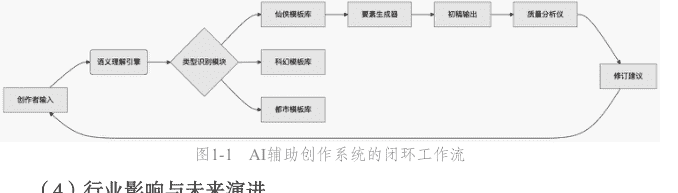

图1-1 智能辅助创作系统的闭环工作流

##### （4）行业影响与未来演进

行业跟踪数据表明，重度使用 AI 工具的写作者，稿件从构思到上线的平均时长压缩57%；因更新更稳定，读者留存率提升12%；同时连载多部的作者占比增长230%。

凭借工具带来的效率红利，写作时可依据读者反馈即时调整后续走向，把高赞建议迅速融入新章。创作过程中还能同步产出分镜脚本与角色设定图，加速IP从文字到视觉的转化。

这场效率变革的本质并非单纯提速，而是重塑创作价值链，把创作者从重复性机械劳动中抽离，让精力聚焦在决定作品上限的关键环节：世界观的哲学厚度、人物内在的灵魂刻画、叙事结构的创新探索。当模型承担约七成基础工作时，人类回归创意与情感表达，这正是人机协作时代创作价值的回潮。

### 1.2.2 突破卡点，重燃创作热度
网文创作是场长跑，卡文几乎是必经阶段。情节受阻、人物单薄、灵感枯竭等问题常轮番出现，让写作之路变得艰难。伴随文本分析与创意生成能力成熟，智能工具为作者提供了新的思路，像一股创意养分，帮助突破困境，重拾写作热情。

#### 1. 创作瓶颈的常态化
卡点是普遍现象。情节钻进死胡同、人物沦为脸谱、灵感进入枯水期，都可能导致进程停滞甚至烂尾。这些问题不仅拖慢节奏、影响心态，还会消磨创作热情。模型凭借强大的阅读分析能力，为作者打开新视角，输送创意养分，助其摆脱困局。

写作之路风光与卡壳并存。即便是资深作者，也难以避免撞上“创作瓶颈”这堵墙，具体表现多样。

（1）情节卡死
故事推进到中段，可用的桥段似乎被用尽，主角下一步如何行动、反派有何新招，怎样推进都感觉无路可走，像进入死胡同。

（2）人物扁平
主角或配角写着写着，性格变得模糊、行为模式固化，缺少新鲜感与深度，读者一眼看透，自己也觉得索然无味。

（3）灵感枯竭
大脑一片空白，对着文档发呆半天，一个字敲不出。想开新坑找不到亮眼切入点，想续写旧文又觉得味同嚼蜡。

这种“卡文”之痛，写作者都懂。它不仅拖慢进度、影响心情，更可能消磨热情，让作品最终烂尾。

模型的出现，为困在瓶颈中的人打开一扇新窗，送来清新的创意养分。其核心优势是强大的阅读与分析能力，能快速“消化”海量文本，从中识别故事模式、人物塑造手法、情节转折点，以及不同时代文化背景下的流行元素。

> Tips
提示：上述“快速消化海量文本”描述的是技术处理能力本身，并不涉及具体素材。

#### 2. 用模型撬动创作
智能助手如何扮演灵感催化剂？下面以具体情境说明。

你正在写一部现代都市爱情小说。男女主角已相识相知，感情升温，却总觉得发展平平无奇，不确定如何让关系更独特、更深刻、更可信且不落俗套。你尝试过误会、第三者、家庭阻力等常见套路，都觉得不够新鲜。

（1）点子生成器
这时可以把当前情节梗概和困惑告诉模型。它会基于对大量爱情故事的理解，如甜宠、虐恋、破镜重圆、奇幻爱情，结合当下社会热议话题，如“独立与依赖的平衡”“虚拟世界中的真实情感”“跨文化恋爱”等，生成多个新颖的发展方向或冲突点，见表 1-8。

表1-8 人工智能点子生成示例

| 点子 | 具体说明 |
|---|---|
| 导入特殊媒介 | 如短暂交换身体的魔法道具/科技装置，让男女主角被迫体验对方生活和内心隐秘，加深理解的同时制造戏剧冲突。 |
| 设定独特外部压力 | 如两人共同发现能影响城市未来的秘密，在守护秘密过程中信任与感情面临极端考验，超越普通爱情纠葛。 |
| 聚焦非典型情感困境 | 如一方存在情感认知障碍，另一方如何用非常规方式表达爱意、建立连接？或两人因共同目标如拯救濒临倒闭的社区老店而结缘，爱情在共同奋斗中萌芽并升华。 |

（2）视角转换器
模型会跳出习惯思维框架，提出未曾考虑的角色视角或叙事方式。例如：“如果从这个看似无关的配角如邻居老人、主角的宠物视角来看待这段感情的发展，会不会挖掘出新的深意和感动？”

（3）元素搅拌机
模型擅长把看似不相关的元素创意组合。它可能提议：把“时间循环”概念融入都市爱情会怎样？主角每次争吵或关系陷入危机时就会回到某个关键节点，他们能否在一次次轮回中找到解决问题、增进感情的方法？或者加入轻科幻、奇幻元素，如何服务于核心爱情主题？比如一个能预知情感片段的小道具。

模型的核心价值在于打破思维定式、点燃灵感火花、避开套路化陷阱、提升作品吸引力和创新性，见表1-9。

表1-9 人工智能助力突破瓶颈的核心价值

| 打破瓶颈 | 具体表现 |
|---|---|
| 突破思维定式 | 模型提供大量你个人经验库之外的选项，强行把你的思维从习惯的轨道上拽开，看到更多可能性。 |
| 点燃灵感火花 | 即使模型生成的某个点子本身不完全适用，但它就像一块打火石，很可能咔嗒一声，瞬间点燃你脑海中那个真正属于你的绝妙主意！你可能会想：“这个方向有意思！不过如果改成这样……就更符合我的设定了！” |
| 避免套路化陷阱 | 提供更多元、更前沿结合当下流行文化、社会思潮的构思方向，有效避免故事陷入“霸道总裁爱上我”“误会分手又和好”等让读者已审美疲劳的老套路。 |
| 提升作品吸引力和创新性 | 这些由模型催化产生的新灵感、新角度，经过作者的筛选、打磨和再创作，就能让作品情节更曲折、人物更立体、设定更新颖，从而在竞争激烈的网文市场中脱颖而出，焕发出独特的活力和吸引力。 |

> 人工智能是强大的灵感助手和思维拓展工具，但它生成的只是“素材”和“可能性”。最终的选择权、判断力和深度创作，永远掌握在作者手中。你需要用你的审美、经验和故事掌控力，去芜存菁，用模型提供的“灵感火花”锻造出属于你的精彩故事。用好模型这个“创意催化剂”，能让你的创作之路走得更顺畅，灵感更丰沛。

### 1.2.3 降门槛，拓变现
人工智能为网文创作搭建了“友好脚手架”，从启动写作、即时反馈、激发灵感到辅助设定，全方位帮助创作者跨越门槛，实现“人人可写、边学边写、创意民主化”，让上手更易、效率更高，但赋予作品灵魂的仍是作者本人的情感与思考。

#### 1. 人工智能——网文创作的“友好脚手架”
过去网文创作像是“天赋党”和“毅力帝”的专属。要求笔杆子硬、脑洞深似海、坐得住冷板凳。这些门槛让无数怀揣故事梦的人望而却步，有灵感却难成文。智能写作工具的兴起，如同为网文世界搭起一座“友好脚手架”，让更多人登上创作舞台。

（1）“从零到一”的启动器
对写作新手或想法很多但下笔困难的人来说，模型是绝佳的起跑助推器。可以描述核心创意，模型能据此快速生成故事开头、场景描写、甚至角色对话初稿，解决面对空白文档无从下手的困境，提供一个可修改、可完善的“毛坯房”。

（2）“写作教练”在身边
模型不仅能生成文字，更是学习伙伴。当新手写出一段文字，模型可以分析其流畅度、节奏感，指出重复用词、逻辑漏洞并提出优化建议，这种即时、低成本的反馈，是新人快速提升技巧的宝贵资源。同时可让模型分析特定风格，在实践中理解不同风格的写作要领。

（3）“灵感填充剂”
卡在具体描写如打斗、宴会时，模型能快速提供多种描写方案供选择和启发，大大节省硬憋细节的时间和精力。

（4）“设定辅助师”
构建复杂的世界观、家族谱系、力量体系时，模型可以帮助整理、生成和补充设定细节，确保逻辑自洽，让新人也能驾驭更宏大的故事框架。

（5）核心价值
人工智能网文创作的核心价值主要体现在三方面：人人可写、边写边学、创意民主化（见表 1-10）。

表1-10 人工智能网文创作的核心价值

| 人工智能网文创作 | 具体表现 |
| :--- | :--- |
| 人人可写 | 显著降低了技术性门槛文笔、基础结构和心理门槛启动困难，释放了强大的潜在创作力量。 |
| 边写边学 | 通过模型辅助实践，新人能在创作过程中高效积累经验，提升写作水平，实现从“依赖模型”到“驾驭模型”的成长。 |
| 创意民主化 | 更多元化的声音、更丰富的故事类型得以涌现，极大地繁荣了网文生态。一个精彩的点子，不再因为作者初始写作技巧的不足而被埋没。 |

> **Tips**
模型生成的初稿是“地基”和“砖瓦”，真正的“建筑设计师”和“灵魂注入者”永远是作者本人。你需要投入自己的情感、思考和对人物的理解，将模型提供的素材转化为具有个人风格和独特魅力的作品。模型是帮你“入门”和“提速”的工具，而非替代你的创造力。

#### 2. 人工智能——网文 IP 的“超级催化剂”与“变现多面手”
网文的商业价值早已超越单纯的付费订阅。模型的深度介入以前所未有的方式拓宽变现渠道，加速IP价值裂变，构建更稳固的产业生态。

（1）精准挖掘“IP 金矿”
凭借数据透视眼，模型能够精准分析网文作品的多维数据，挖掘角色人气、情节高光点、世界观延展性及市场匹配度，为版权方提供科学的IP评估和改编建议，助力发现高价值作品。同时赋能多元化改编，加速影视化剧本创作、动漫/游戏角色设计、衍生内容生成，并实现精准营销，全方位提升IP的商业价值，见表1-11。

表1-11 人工智能精准挖掘“IP金矿”的具体表现

| 挖掘维度 | 具体表现 |
|---|---|
| 数据透视眼 | 模型能高效分析海量网文作品的多维数据，并且精准识别哪些角色拥有超高读者黏性和讨论热度，具备出圈潜力。 |
| 情节高光点 | 找出让读者情绪峰值最高的关键情节段落，这些往往是改编时需要重点保留和放大的核心。 |
| 世界观延展性 | 评估作品的世界观设定是否足够新颖、完善且具有跨媒介开发的拓展空间。 |
| 类型与市场匹配度 | 分析作品风格与当前影视、游戏、动漫市场的流行趋势和空缺领域的契合度。 |
| “潜力股”推荐官 | 基于以上分析，模型能为版权方提供科学、客观的IP价值评估报告和改编潜力建议，帮助他们更精准、高效地发现明日之星和价值洼地，降低投资风险。 |

（2）赋能“多元化改编”
模型不仅是发现者，更是赋能者，助力IP在多个领域创造价值，见表1-12。

表1-12 人工智能赋能“多元化改编”的具体表现

| 赋能维度 | 具体表现 |
|---|---|
| 影视化剧本辅助 | 将小说文本自动拆解为场景、对话、动作提示，甚至初步生成分场大纲或剧本片段，为专业编剧提供高效的工作基础，加速改编进程。 |
| 动漫/游戏角色与场景设计 | 模型可以根据文字描述，生成符合角色设定和世界观氛围的概念图、场景草图，甚至动态分镜，为美术团队提供直观的视觉参考和灵感起点，大幅提升前期设计效率。 |
| 衍生内容自动生成 | 基于原著和角色，模型可以辅助生成角色番外小故事、背景资料补充，甚至互动对话脚本，用于粉丝运营、周边产品文案、轻量级互动游戏等，持续维系IP热度，挖掘长尾价值。 |
| 个性化推荐与精准营销 | 分析不同平台用户对IP及其衍生内容的偏好，实现跨平台的精准推送和定制化营销，最大化触达目标受众。 |

（3）构建“变现生态圈”
从一鱼多吃的多元开发，到流量互哺的受众引流，再到长尾收益放大器的价值挖掘，模型为网文IP的全产业链拓展提供强大助力，让作品在不同领域实现价值最大化，见表1-13。

表1-13 通过人工智能构建“变现生态圈”的具体表现

| 变现方式 | 具体表现 |
| :--- | :--- |
| 一鱼多吃 | 一个成功的网文IP，在模型的催化下，可以同步或分阶段开发成长/短剧集、电影；动画番剧、动画电影；手游、端游、互动叙事游戏；有声书、广播剧；实体书、周边衍生品；线下主题体验。 |
| 流量互哺 | 不同形态的改编作品吸引各自的受众群体，又能相互引流、扩大IP的整体影响力。 |
| 长尾收益放大器 | 即使是非顶级爆款的作品，模型也能帮助找到其最适合的改编方向或衍生领域，让更多作品有机会实现价值，作者获得更持续多元的收入。 |

（4）核心价值
随着网文产业升级，变现渠道从单一付费阅读拓展到影视、动漫、游戏等多元矩阵，IP价值评估与开发更加科学，产业效率大幅提升，构建了作者、下游产业和用户多方受益的良性生态，见表1-14。

表1-14 网文产业生态核心价值的具体表现

| 核心 | 具体表现 |
| :--- | :--- |
| 变现渠道几何级拓宽 | 从单一的付费阅读，裂变为影视、动漫、游戏、衍生品等全方位、立体化的收入矩阵。 |
| IP价值评估与开发科学化 | 数据驱动决策，降低投资风险，提高改编成功率。 |
| 产业效率革命性提升 | 加速IP从文字到多形态产品的转化流程，缩短变现周期。 |
| 构建良性产业生态 | 更多作者受益于多元变现，获得更丰厚和可持续的回报；下游产业获得更丰富、更精准的优质内容源；读者享受到更丰富、更沉浸的IP体验。 |

模型技术一面是普惠的创作脚手架，让网文创作梦想照进更多普通人现实，为行业注入源头活水；另一面是强劲的IP引擎，驱动网文价值突破文字边界，在多维领域释放光芒，实现商业价值最大化裂变。它正在重塑网文行业的创作生态与商业模式，开启一个全民可创作、IP广生金的崭新时代。关键在于创作者和产业各方如何善用这把利器，在降低门槛和拓宽道路的同时，始终坚守内容为王、创意至上的核心。

## 第 2 章 构建人工智能写作核心能力
掌握人工智能写作工具是开启高效创作之门的关键。本章将带领网文创作者探秘主流的写作工具，盘点它们的特点与功能，并分享如何挑选最适合自己的工具。同时，本章深入讲解构建有效写作指令的方法与技巧，结合实战案例分析，帮助读者掌握人工智能写作的精髓，打造属于自己的核心写作能力，为后续的创作奠定坚实基础。

### 2.1 探秘人工智能写作工具
在网文创作的浩瀚星空中，人工智能写作工具犹如璀璨星辰，为作者们照亮前行的道路。它们各具特色，功能各异，从 DeepSeek 的深度语义理解，到 Kimi 的创意激发，再到腾讯元宝的中文优势，豆包的交互体验，以及 ChatGPT 的全球通用性，每一种工具都为创作带来了新的可能。但如何在这些工具中找到最适合自己的那一款，是每个创作者必须面对的问题。

#### 2.1.1 主流人工智能写作工具大盘点
在当今数字化写作时代，人工智能写作为网文创作者提供了前所未有的便捷与高效。以下是对主流 写作工具的全面盘点，帮助创作者一探究竟。

#### 1. DeepSeek
DeepSeek 主要聚焦文字创作赛道，定位为用户高效的文字协作者。其核心优势在于点燃灵感并进行系统化逻辑梳理，助你搭建清晰稳固的文章框架。

在内容生成上，DeepSeek 能依主题快速给出观点阐述与案例支撑，形成初稿雏形。尤其擅长语言的精准打磨，优化措辞、句式与整体行文，显著提升文本流畅度、专业性与表达效率。

同时，DeepSeek 具备强大的文风适配能力，可依据不同目标读者与具体场景需求灵活调整语气、风格和表达策略。

此外，DeepSeek 还能提供细致的文本润色服务，检查语法准确性、逻辑连贯性与结构合理性，确保最终成品的质量。其目标是与用户紧密协作，共同克服创作障碍，高效产出逻辑清晰、表达有力且具有影响力的优质文字作品。其对话界面如图 2-1 所示。

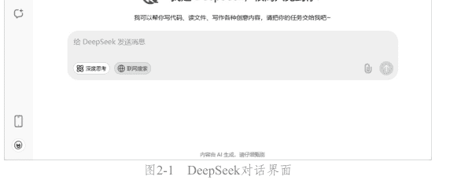

#### 2. Kimi
情节发展受阻，陷入创作僵局。智能助手在长文本创作与管理领域展现出显著优势。其核心竞争力在于强大的超长上下文处理能力（支持高达 128K tokens），它能深度理解、整合和分析整本书籍、复杂研究报告或大型项目文档等海量信息，为系统性写作奠定坚实基础。

这一能力可确保作者在创作过程中始终保持逻辑连贯，有效追踪核心论点、人物关系与数据线索，避免长文写作中常见的内容脱节、逻辑断裂与重复表述问题。

Kimi 擅长构建并维护清晰、层次分明的宏大叙事结构，协助用户规划章节布局、梳理复杂论证链条。同时，它能高效完成跨文档的知识整合与引用管理，轻松处理多源信息，保障内容的一致性与准确性。

在文本精炼与优化方面，Kimi 不仅能对局部段落进行打磨，还可进行全局性的结构优化、冗余内容删减与风格统一调整，显著提升长篇作品的整体流畅度、专业性与可读性。这些特性使其成为处理学术论文、商业白皮书、小说创作、深度报告等复杂长文本项目的可靠助手，其对话界面如图 2-2 所示。

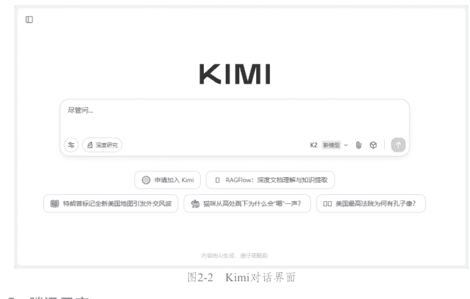

图2-2 Kimi对话界面

#### 3. 腾讯元宝
腾讯元宝作为国内知名科技公司腾讯推出的 人工智能工具，依托强大的技术支持与丰富的中文语料库，在中文文本处理方面表现突出。其能精准把握中文的语义与文化内涵，对于作者创作具有浓郁中国风的网文作品而言，是不可多得的得力助手。腾讯元宝不仅能提供高质量的写作建议，还能根据用户需求生成符合特定风格与主题的文本，助力打造独具魅力的文学作品，其对话界面如图 2-3 所示。

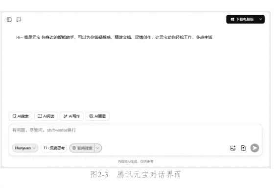

#### 4. 豆包
豆包因顺滑的聊天感和高度定制化的服务，在创作者圈里口碑不错。它能维持自然的问答节奏，依据提问和指令即时给出针对性的回复与成稿，让人有种跟一位虚拟搭档并肩写字的感觉，从而点燃灵感。面对繁复的逻辑与情节搭建，豆包的表现也很稳，能帮作者理清线索，让结构更紧凑。平台还提供大量个性化选项，作者可按口味调节风格和语气，提升成稿的个人印记。对话界面见图2-4。

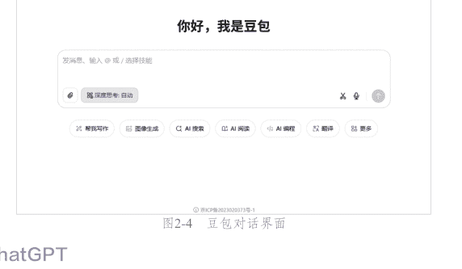

#### 5. ChatGPT
ChatGPT 是当下认知度最高的智能写作助手之一。依托强力的语言模型，它能读懂需求并产出通顺自然的文字。写小说段落、打磨诗句或搭建故事大纲，都能快速交付可用的初稿。核心长处是理解与生成兼备，兼容多体裁多语气，且持续迭代以匹配不同作者。全球用户基数庞大，社区非常活跃，大家乐于分享心得与作品互相借鉴，对话界面见图2-5。

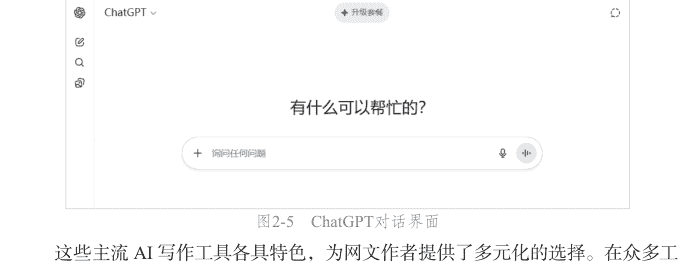
以上几类主流产品各有侧重，给网络写手提供了丰富选择。找到最契合自身习惯的那一款，才是高效创作的起点。

### 2.1.2 如何挑选最适合的AI工具
面对市面上琳琅满目的智能写作产品，怎么选到真正适合自己的并不简单。结合模型特性和写作环节的深度匹配，本书提出双引擎协同方案。

大纲搭建阶段：以 DeepSeek 为主引擎，发挥其擅长搭建逻辑框架和精准表达的优势，梳理知识脉络、锁定核心论点，产出条理清晰、结构严谨的创作蓝图。

章节扩展阶段：让 Kimi 负责内容生成，单次可承接约10万字的长文本，借助信息整合能力和长文本连贯控制，对大纲节点进行深度展开。兼顾跨章节逻辑一致的同时，快速完成资料核查、案例补充与学术化表述，搭建完整内容体系。

## 2.2 掌握AI写作指令的精髓
智能写作中，指令就是意图到结果的转换枢纽。清晰精准的提示能让模型准确把握需求，产出符合预期的内容；含糊或不当的表达则容易跑偏，浪费时间。吃透指令要点，不仅能大幅提效，还能激活创意，让模型成为创作旅程中的可靠伙伴，共同打磨精品。

### 2.2.1 构建有效指令的方法与技巧
在智能写作里，提示的质量直接决定生成文本的好坏。以下技巧有助于创作者更好地驾驭工具。

#### 1. 先定目标再下指令
出提示前要把写作目的和核心主题拎清楚。比如写玄幻，起码要写明“创作玄幻小说”。再细化为“写一部修真玄幻，主角由平凡少年成长为一代仙尊”，模型就能更准地把握意图，产出高度契合的内容。方向明确可避免跑题，提升效率和质量。

#### 2. 指令要结构化
用简洁明了、结构化的表达，有助于模型更快理解和执行。避免模糊表述。比如“生成一个爱情故事”太笼统，“生成一段青梅竹马爱情故事的开头，约500字”就具体得多。建议先说明文体，再明确主题与要求，最后给出具体写作任务。结构清晰的指令更容易得到预期结果。

#### 3. 补充上下文
在复杂写作场景里，提供适当背景信息能帮助模型更好理解指令。比如续写时，把前文关键情节、人物关系带入提示，能让续写保持连贯一致。如提示“前文主角已获得神秘力量，现在续写他在获得力量后遇到的第一个挑战，约1000字”，模型能更顺畅融入创作世界，生成与前文紧密衔接的内容，让作品更完整流畅。

### 2.2.2 指令优化实战案例分析
光说不练难以掌握精髓。拆解优秀案例后，可提炼出四类优化法则，分别针对冲突、主线、人物和长文，系统性提升生成质量，见图2-6。

| 问题类型 | 原始指令特征 | 优化策略 | 效果提升点 |
|---|---|---|---|
| 冲突薄弱化 | 仅用情绪词如愤怒、悲伤 | 绑定主线并分层推进 | 让冲突真正推动情节 |
| 主线不清 | 事件堆砌、开放式罗列 | 用问题链串联并加入逻辑限制 | 剔除无效情节 |
| 角色平面化 | 只写单一动作 | 叠加多维度细节锚点 | 提升人物辨识度 |
| 长文断层 | 缺乏记忆锚点 | 强化关键要素并分段生成 | 保持跨章节连贯 |

结构化提示词是突破模型局限的关键。比如新增人物时，强制要求出场要素：角色首次登场须包含：①与主角的关联线索；②标志性外貌细节；③当前目标。这样能明显降低角色突兀感。

图 2-6 四类指令优化

#### 1. 案例一：场景冲突优化
在Kimi对话中输入原始提示，见图2-7，生成结果见图2-8。

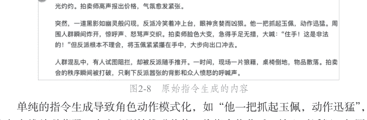

原始提示下，角色行为容易程式化，例如“他一把抓起玉佩，动作很快”，冲突与主线挂钩不紧，缺乏推动剧情的价值。优化提示后重新输入，见图2-9，输出见图2-10。

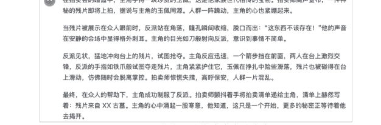

优化后，反派台词暗中点出玉佩的背景谜团，拍卖清单顺势引向下一个探险场景。该冲突同时服务了三条主线，大幅提升张力与叙事效率。

#### 2. 案例二：人物刻画优化
在Kimi对话框里输入原始指令，见图2-11，对应输出见图2-12。

提示过于简单，对话缺少情境化的自然互动与信息深度，显得空洞乏力。场景描写既无独特视角，也缺乏新意，多停留在套路化层面。整体吸引力因此下降，很难抓住读者，更难以激发持续关注。优化提示后再次输入，见图2-13，生成结果见图2-14。

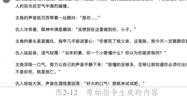

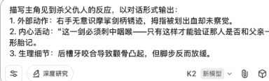

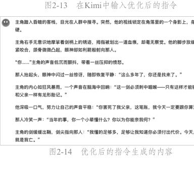

优化后文本在架构、逻辑层次与表达准确度上都有明显进步，表现力得到实质提升。信息传递更高效，核心价值更突出，文章能更精准对接读者需求，从而有效吸睛并留住注意力。

## 第 3 章
网文赛道精准定位指南
在网文生态日益多元的当下，找准创作方向是提升市场竞争力的关键。本章将梳理当前热门题材的现状与走势，借助权威数据挖掘潜在机会。并通过“四维模型”帮助创作者评估自身优势，落地智能协同策略，协助在网文赛道找到差异化定位，搭建既有个人特色又贴合市场的创作体系。

## 3.1 剖析热门网文类型
创作启动前，精准把握市场主流题材的热度分布、用户偏好及发展趋势，是规避创作风险、提升作品曝光率的关键。本节基于权威机构发布的行业数据，梳理主流网文题材的市场现状，预判未来趋势，为创作者提供数据驱动的题材选择依据。

### 3.1.1 不同题材网文市场现状
2025年上半年，中国网络文学市场在题材多元化、技术赋能和IP生态发展的推动下呈现明显变化。以下为各题材现状汇总。

#### 1. 现实题材：市场份额快速攀升，政策与用户需求双驱动
现实题材流量高速增长，增速位列第二。番茄小说40岁以上用户占比从5%提升到15%，“银发族”成为重要增量。

第九届现实题材网络文学征文大赛吸引5.4万名作者、5.67万部作品，创历史新高。《云去山如画》《关内关外》等14部获奖，《向上》入选“中国好书”月榜，聚焦职场、城市化、非遗等话题。《关内关外》《我不是文豪》《烟云华强北》《守护蒙玛拉尔》《血花屋》等已进入实体出版和有声开发，多部作品正被影视机构重点关注。

现实题材成为增长引擎，职场、乡村振兴、科技伦理等主题受关注，部分平台现实题材读者规模同比增幅超80%。

#### 2. 悬疑推理：垂直赛道爆发，互动性与短视频传播助推热度
悬疑推理成头部平台增速最快的垂直品类，用户规模年增幅超50%。

“民俗+克苏鲁”、规则怪谈与社会热点结合成为主流，短视频二创带动传播。代表作品有《坏小孩》《暗夜行者》《我有一座冒险屋》《十日终焉》等。

抖音、快手等平台的“悬疑片段二创”成为流量入口，如《坏小孩》原著改编网剧《隐秘的角落》相关二创视频播放量超50亿次，推动原著阅读量增长300%。

《暗夜行者》在晋江文学城连载时，靠“案件与主角身世绑定”的叙事，均订突破10万，入选晋江2024年悬疑类前三。

#### 3. 科幻题材：技术流与元宇宙叙事引领升级
科幻作品在技术创新与硬核设定下持续走热，新增作品量同比增18%。

纯科幻占比下降，“科幻+修仙”“科幻+悬疑”融合题材占比上升，如《深空之影》星际文明+AI觉醒、《星空彼岸》元宇宙生存等均在起点科幻榜保持前列。《三体：黑暗森林》衍生作在WebNovel多语种版本中付费率比纯科幻作品高20%。

#### 4. 玄幻、仙侠：传统题材创新突破，反套路与幽默风格突围
虽受新兴题材分流，玄幻、仙侠仍是头部作品集中区，起点中文网月票榜前十中占比约40%，核心创新方向为“反套路修仙”“家族权谋群像”。

《凡人修仙传》以“主角无金手指，靠谨慎算计升级”设定，均订突破20万，成为起点仙侠“反套路”标杆。

《诡秘之主》续作《宿命之环》采用多主角视角交织的群像叙事，连载期间章节平均停留超8分钟，明显高于传统单主角玄幻作品。

#### 5. 女性文学与细分垂直赛道：多元需求驱动小众题材崛起
女性文学、儿童文学、职场文学等细分领域用户增长明显，部分平台女性读者占比达62%，儿童文学、职场文、游戏文等细分赛道增速突出。

《星汉浮光》在潇湘书院均订超8万；《全职高手》衍生作在起点女生网连载期间，电竞女性角色相关情节互动率远高于男性角色。

### 3.1.2 市场趋势预测与机会挖掘
网文市场风向变化快，AI已成为趋势预判与机会挖掘的核心工具。它通过解析番茄、起点等平台真实数据，捕捉题材热度变化与用户偏好迁移，为作者指明蓝海方向，帮助创作者在海量信息中精准锚定机会。

#### 1. AI 驱动的题材洞察与用户画像
阅文集团在AI赋能创作方面的实践具有代表性。2025年上线的“作家助手”集成DeepSeek-R1大模型，通过分析平台海量阅读数据，为创作者提供实时题材热度预测、用户偏好标签和情节建议。

数据显示，该工具日活增长超30%，AI功能周使用率超50%，平均单日使用“智能问答”功能的作家数增长10倍。在用户画像层面，系统能精准识别“悬疑+科幻”“古代言情+轻喜剧”等交叉题材受众，指导作家调整方向。此外，阅文借助AI翻译模型强化出海能力，翻译效率翻倍、成本大幅下降，AI翻译作品在海外平台畅销榜前100中占比达21%，体现了AI在跨文化洞察中的价值。

#### 2. 跨平台数据融合与趋势推演
番茄小说在字节生态内实现跨平台数据深度融合。通过分析番茄App阅读数据、抖音短视频热度及今日头条资讯偏好，精准捕捉到“古风甜宠”“悬疑短剧”等题材需求爆发。基于此，番茄与优酷合作推出的《锁爱三生》《当家小娘子》等IP改编短剧，先后获得“年度值得关注微短剧”奖项。阅文集团联合腾讯动漫，将网文数据与动漫产能数据融合，通过“内容热度-用户画像-改编可行性”三维模型，加速《斗破苍穹》《全职高手》等IP可视化进程，相关动画作品在2024年全网国产动画热度榜占据14席。

#### 3. IP 衍生潜力预判与内容布局
AI对IP衍生潜力的评估已形成行业级指标体系。中国电影家协会编剧教育工作委员会与北京电影学院中国电影编剧研究院2021年联合发布的《2019—2020年度网络文学IP影视剧改编潜力评估报告》，搭建了含29个二级指标的量化模型，其中“世界观完整度”“角色弧光丰富度”等为核心参数。报告在剧集上线前即把《庆余年》列为第一梯队，认为其“古代权谋+现代思维”设定具备多媒介叙事优势，剧集播出后起点读书后台数据显示原著月活增长300%，验证了模型预判能力。

晋江文学城在2020—2021年度创作者大会公开的“衍生适配度分析工具”也将《魔道祖师》评为“群像角色鲜明、场景可视化强”的高适配作品，其动画版在腾讯视频累计播放量105亿次，衍生品销售额超2亿元，成为跨媒介开发标杆。

#### 4. 风险预警与策略调整
使用智能创作网文时，虽然能提升效率、拓展思路，但也隐藏多维度风险，若忽视可能导致版权纠纷、内容质量问题，甚至影响作者长期创作生涯。接下来从版权、内容质量、创作独立性、合规性、平台规则五大维度拆解风险预警及应对策略，见表3-1。

表3-1 AI创作网文的风险预警及应对策略
| 核心维度 | 风险预警 | 应对策略 |
| :--- | :--- | :--- |
| 版权风险 | 版权是智能写网文最核心的风险，目前全球范围内对智能生成内容的版权归属、权利边界尚未完全明确，容易引发法律纠纷，主要体现在：智能训练数据的侵权风险、智能生成内容的版权归属争议、用户使用智能的授权风险。 | 深度干预智能生成内容，保留修改记录，证明“人类创造性贡献”，比如重写70%以上的情节和语言，仔细阅读智能用户协议，避免签署“版权出让”条款。 |
| 内容质量风险 | 智能生成内容虽快，但难以达到人类作者对“网文核心吸引力”的把控，容易出现质量问题，导致读者流失。 | 用智能生成“初稿、大纲”，再通过人类审核，检查逻辑、补充情感细节、优化人设，避免完全依赖智能写关键情节，核心冲突由自己构思。 |

#### 5. 典型案例：《诡秘之主》的市场策略
《诡秘之主》以全产业链开发为核心的商业化策略，构建了“内容——商业——文化”三位一体的闭环生态。其核心在于IP开发前置化，连载期间即同步启动多形态改编，动画《诡秘之主：源起》2025年实现全球190个国家同步开播，推出12种语言版本，IMDb开分9.3登顶Crunchyroll夏季榜，单集最高2.6万张纯手绘原画的工业级制作，打破海外对中国动画的“唯3D论”刻板印象。粉丝运营深耕圈层经济，官方“卷毛狒狒研究会”聚集230万核心用户，Reddit社区3.3万成员形成共创生态，全球创作者大赛征集千余件作品，线下快闪活动吸引10万人参与，社交话题总阅读量超17亿。衍生品开发覆盖21个品类，卡牌GMV超2亿，愚者盲盒跻身天猫热销榜前三，与大英图书馆联名画展实现文化增值。

全球化布局成效显著，WebNovel英文版阅读量超4250万，多语言版本引发海外热潮，入藏大英图书馆成为文化输出标杆，海外自发成立Facebook社群超2万个。跨平台协同形成生态合力，腾讯系资源联动索尼影视、快手等外部力量，起点读书主题站汇聚了60万粉丝，支付宝等跨界联名带动曝光增长300%。

通过全球同步定档打击盗版，以《宿命之环》延伸“诡秘宇宙”，实现IP长线价值沉淀，为网文IP商业化提供了“内容为根、用户为核、全球化为翼”的可复制范式。

## 3.2 结合AI与自身优势定位
选对故事类型是第一步，如何把你的故事写得又快又好才是关键。本节将教你如何认识自己最擅长的写作风格和特点，比如人物塑造、情节设计和知识储备，并巧妙借助智能工具来强化这些优势，让创作效率更高，作品更具个人特色。

### 3.2.1 评估个人创作优势的四维模型
创作的核心竞争力，藏在对自身优势的清晰认知里。四维模型是一把精准标尺，从独树一帜的风格辨识度，到张弛有度的节奏把控力，从鲜活立体的角色塑造力，到扎实深厚的知识储备库，它能帮你系统梳理创作长板，找准发力点，让每一份才华都能精准落地，见表3-2。

表3-2 评估个人创作优势的思维模型
| 评估维度 | 自查方法 | 常用AI工具 | 价值说明 |
| :--- | :--- | :--- | :--- |
| 风格辨识度 | 1.分析自己最擅长的语言特点（幽默/严肃/诗意等）。 2.对比同类热门作品差异。 | 风格分析工具建议使用Kimi。 | 找到让你与众不同的文字“指纹”。 |
| 节奏把控力 | 1.检查章节结尾是否吸引人。 2.观察读者流失高的章节。 3.记录高潮间隔距离。 | 章节分析器建议使用豆包。 | 避免故事平淡或过于急促的关键。 |
| 角色塑造力 | 1.评估主角成长是否合理。 2.检查配角是否必要。 3.测试人物关系逻辑性。 | 角色关系图谱生成器建议使用 DeepSeek。 | 让读者爱上故事中的“人”而非仅关注情节。 |

| 知识储备库 | 1.列出熟悉的专业领域（历史/科技/医学等）。 2.标记需要补充的知识盲区。 | 常见AI工具都可以使用。 | 为故事注入真实感和深度的基石。 |

依靠智能助手提效的思路，为写作者指明了可操作的行动方向。借助精准的自我盘点与模型辅助，创作里常见的阻塞点能够得到有效化解，有助于沉淀个人风格、编织精彩情节、塑造立体人物，从而让作品更具吸引力与厚度，值得创作者落地尝试。

### 3.2.2 用 AI 放大创作长板的策略

模型并非替代创作者，而是把已有优势放大的杠杆。要让模型真正赋能，关键在于用对方法，既借助模型巩固风格、节奏等擅长项，也依靠它弥补知识储备、人物塑造等薄弱处。以下打法能帮助创作者打开人与模型的协作模式，让长处更突出、创作更游刃有余。

#### 1. 文风辨识度检视与提升

不少网文作者困在文风模糊、跟风同质的循环里，古风缺古韵，悬疑缺张力，内核虽在却因缺乏记忆点被读者忽略。模型可充当文风放大镜，上传代表作后拆解语言习惯、叙事结构、情感基调，并与同题材爆款进行定位对比，从用词频次到场景描写密度给出可执行的优化建议，帮助作者建立专属风格标签，在同类题材中快速出圈，见表3-3。

表3-3 风格辨识度诊断与优化策略

| 阶段 | AI工具策略 | 实操建议 |

| :--- | :--- | :--- |

| 风格诊断 | 使用笔灵AI或星火网文助手的“爆款拆书”功能，输入热榜作品，提取关键词、句式、情绪节奏等风格因子。 | 将你自己的文本与爆款对比，生成“风格差异热力图”，识别同质化段落。 |

| 风格强化 | 利用墨狐AI的“多模态融合”功能，输入关键词（如“冷感+赛博+克制叙述”），生成风格化段落。 | 建立“风格素材库”，将AI生成的金句、比喻句式分类存储，后续人工组合。 |

| 风格一致性检测 | 使用WebNovelBench类工具的“文风稳定性评分”功能，检测章节间的风格波动。 | 设定“风格警戒线”，如情绪密度变化超过20%即人工干预。 |

#### 2. 节奏掌控力修复

网文节奏失衡是流失读者的主因，要么单场景拖沓过千字，要么爽点间隔过长，要么关键断点突兀。模型能基于“剧情树”自动生成“节奏波动图”，结合同品类爆款节奏模型，给出章节篇幅分配、冲突安排、结尾钩子的调整方案，让剧情张弛有度，稳住读者耐心，见表3-4。

表3-4 节奏把控力修复策略

| 阶段 | AI工具策略 | 实操建议 |

| :--- | :--- | :--- |

| 风格诊断 | 将文本输入墨狐AI的“剧情树”功能，自动生成“节奏波动图”，标注情绪低谷与高潮。 | 结合“黄金三章”原则，检查前3章是否有3次情绪上扬+1次悬念钩子。 |

| 风格强化 | 使用星火网文助手的“悬念生成器”，在低谷段落插入AI设计的微型钩子，如“身份错位”“物品异常”。 | 每章结尾用AI生成三种“钩子模板”，人工选择最贴合剧情的一种。 |

| 风格一致性检测 | 通过网文课程平台的“模拟读者留存率测试”，上传章节，AI预测读者在哪些段落可能弃文。 | 对弃文高峰段落进行“压缩-冲突-悬念”三步修改：删减冗余、增加冲突、埋设伏笔。 |

#### 3. 人物塑造力升级

网文角色易出现崩坏，前期“温润公子”后期暴躁，“飒爽女主”沦为恋爱工具，配角沦为背景板，严重削弱感染力。模型可搭建“角色档案库”，实时校验行为与设定的吻合度，拦截人设崩塌；还能依托经典模型为角色设计成长节点与立场转变触发点，让人物从扁平走向立体，深化读者共鸣，见表3-5。

表3-5 角色塑造力升级策略

| 阶段 | AI工具策略 | 实操建议 |

| :--- | :--- | :--- |

| 风格诊断 | 使用笔灵AI的“角色标签分析”，输入角色台词，检测是否出现“标签模糊”（如高冷人设却说网络热梗）。 | 建立“角色DNA表”：核心标签（如“利己主义者”）、禁忌行为（如“无偿助人”）、语言习惯（如“反问句”）。 |

| 风格强化 | 利用Claude/GPT类模型的“三维决策树”功能，模拟角色在道德、利益、情感维度的选择。 | 设计“压力测试场景”（如“主角必须牺牲亲人拯救世界”），用AI生成3种反应方案，选择最符合人设的一种。 |

| 风格一致性检测 | 使用墨狐AI的“多线叙事同步”功能，检测角色关系是否出现逻辑漏洞（如反派突然帮助主角无铺垫）。 | 绘制“角色动机地图”，用AI标注每个行为的“显性动机”和“隐性动机”，避免人设崩塌。 |

## 第 4 章 用 AI 重构网文创作流程

在工业化创作的当下，智能助手已从辅助工具演变为流程重构的核心引擎。本章结合起点签约作者的实战经验，系统拆解如何把模型深度嵌入框架搭建—内容细化—优化完善的全链路。

## 4.1 AI 赋能故事骨架搭建

故事框架是网文的骨架，决定走向、冲突与人物逻辑，框架失衡会让后续难以为继。模型的核心价值在于打破单一思路与经验风险，输入核心设定后即可调用千万级爆款框架库，快速生成大纲，涵盖冲突起点、支线分支与关键转折。

### 4.1.1 设计生成大纲的模型指令

有效指令需包含类型锚点、核心要素与数据约束三部分。以都市异能为例，输入优质模板后可在 DeepSeek 中快速生成分卷大纲，部分信息如图4-1所示。

优质指令模板示例：“生成《全球高武》风格的都市异能小说大纲，包含 3 个核心转折点（需体现权力反转）、2 组对立阵营（异能者联盟 vs 基因改造局）、1 个贯穿始终的悬疑线索（主角体内的未知能量来源），要求参考 2023 年起点都市频道 Top10 作品的节奏分布，大纲分卷不超过 5 卷，每卷关键事件标注爽点类型（打脸/升级/揭秘）”。

实测显示，该指令在 DeepSeek 中生成的大纲与人工创作重合度很高，其中“悬疑线索与爽点结合”的设计更具追更欲望。按此指令调试，大纲可拆解为基础设定、角色设定、情节结构、主题与收尾四个关键要素，见表4-1。

表4-1 小说四大要素

| 大类 | 具体要素 | 小说创作中的对应含义 |

| :--- | :--- | :--- |

| 基础设定 | 书名 | 小说的标题，需体现题材特色、核心冲突或主题意象，是读者对作品的第一印象。 |

| 基础设定 | 题材类型 | 故事的核心范畴（如都市、科幻、玄幻、历史等），决定叙事风格、情节逻辑与读者预期。 |

| 基础设定 | 时代背景 | 故事发生的时间维度（如古代、现代、未来、架空时代），影响角色行为逻辑与技术/文化设定。 |

| 基础设定 | 地理环境 | 故事展开的空间载体（如城市、荒漠、星际飞船、异世界大陆），影响情节场景与角色生存方式。 |

| 基础设定 | 社会环境 | 故事中的社会结构、文化习俗、权力体系等（如封建王朝、星际联盟、末世废墟），塑造角色的生存规则。 |

| 角色设定 | 男主角 | 故事核心男性角色，承载主线叙事视角，其成长、抉择推动情节发展，是读者情感投射的主要对象之一。 |

| 角色设定 | 女主角 | 故事核心女性角色，可能与男主角形成互动关系（合作、对立、情感联结等），自身具有独立的目标与成长弧光。 |

| 角色设定 | 男配角 | 辅助主角或推动情节的男性角色，可能是盟友、导师、竞争者，以此丰富角色关系网络。 |

| 角色设定 | 女配角 | 辅助主角或影响情节的女性角色，功能类似男配角，可承担情感支撑、线索引导等作用。 |

| 角色设定 | 反派角色 | 与主角或价值观对立的角色，其动机（如权力欲、理念冲突、生存本能）构成核心冲突的重要来源。 |

| 情节结构 | 主要情节 | 故事的核心叙事线，串联起角色行动与事件发展，展现从开端到结局的完整过程。 |

| 情节结构 | 核心冲突 | 故事的主要矛盾（如主角与反派的对抗、理念的冲突、生存危机等）是推动情节的核心动力。 |

| 情节结构 | 开篇 | 故事的起始部分，需快速建立世界观，引入核心角色与初始困境，吸引读者继续阅读。 |

| 情节结构 | 发展 | 开篇后的情节推进，包含角色成长、线索铺垫、次要冲突解决等，逐步向核心冲突聚焦。 |

| 情节结构 | 高潮 | 故事矛盾最激烈的部分，核心冲突集中爆发，主角面临重大抉择或挑战，决定故事走向。 |

| 情节结构 | 结局 | 核心冲突的解决，交代主要角色的最终归宿，回应开篇的伏笔与读者期待。 |

| 情节结构 | 关键转折 | 改变故事走向的标志性事件（如重大背叛、真相揭露、能力觉醒等），推动情节进入新阶段。 |

| 主题与收尾 | 主题思想 | 小说通过故事传递的核心理念（如对人性的探讨、对权力的反思、对希望的歌颂等）。 |

| 主题与收尾 | 主题深化 | 在情节发展中，通过角色抉择、冲突升级等方式，使主题思想从表层呈现走向深层挖掘。 |

| 主题与收尾 | 结尾设想 | 对结局的延伸性构思（如开放式结局的留白、对角色未来的暗示），强化主题的余韵。 |

当下文学市场题材繁多，种类丰富。无论题材如何变化，都可用四要素公式表进行归类与创作，它像一把解码钥匙，能快速生成清晰完整的大纲。

本书精选五类热门题材进行举例说明。

#### 1. 现实题材拆解：《暴雨中的蝴蝶》

将《暴雨中的蝴蝶》四要素上传至 DeepSeek 并输入提示词，如图4-2所示。四要素内容见表4-2。

表4-2 《暴雨中的蝴蝶》大纲四要素

| 大类 | 具体要素 | 案例内容 |

| :--- | :--- | :--- |

| 基础设定 | 书名 | 《暴雨中的蝴蝶》 |

| 基础设定 | 题材类型 | 现实悬疑+社会议题 |

| 基础设定 | 时代背景 | 现代都市（2025年），暴雨季频发的南方城市。 |

| 基础设定 | 地理环境 | 城中村“蝴蝶巷”、废弃地铁站、心理咨询室。 |

| 基础设定 | 社会环境 | 基层警力不足、心理咨询行业监管缺失、网络舆论暴力。 |

| 角色设定 | 男主角 | 林深（32岁），刑警队队长，因误判导致嫌疑人死亡，患有创伤后应激障碍。 |

| 角色设定 | 女主角 | 苏晚（28岁），匿名心理咨询师，通过“树洞邮箱”帮助青少年。 |

| 角色设定 | 男配角 | 陈默（17岁），辍学少年，掌握关键证据却陷入“反杀正当性”困境。 |

| 角色设定 | 女配角 | 周雨桐（25岁），自媒体记者，为流量伪造“蝴蝶巷闹鬼”新闻。 |

| 角色设定 | 反派角色 | 王建军（45岁），地下赌场老板，利用“蝴蝶巷改造工程”掩盖器官贩卖。 |

| 情节结构 | 主要情节 | 少女失踪案牵出器官贩卖网络，林深与苏晚在暴雨中寻找真相，陈默成为关键证人。 |

| 情节结构 | 核心冲突 | 程序正义与舆论审判的对抗、个体创伤与社会系统性漏洞的博弈。 |

| 情节结构 | 开篇 | 暴雨夜少女失踪，监控显示其进入废弃地铁站后消失，网络疯传“蝴蝶巷诅咒”。 |

| 情节结构 | 发展 | 林深发现苏晚的“树洞邮箱”与案件高度关联，陈默在逃亡中遭遇致命追杀。 |

| 情节结构 | 高潮 | 器官贩卖集团在暴雨中转移受害者，林深与苏晚在地铁站展开生死营救。 |

| 情节结构 | 结局 | 主犯落网，但蝴蝶巷改造工程背后的保护伞仍未浮出水面，留下开放式的尾巴。 |

| 情节结构 | 关键转折 | 陈默在法庭上用AI生成的“反杀模拟视频”自证清白，引发司法系统对AI证据的争议。 |

| 主题与收尾 | 主题思想 | 探讨数字时代真相的脆弱性与人性救赎的可能性。 |

| 主题与收尾 | 主题深化 | 通过苏晚的心理咨询案例，揭示校园霸凌、家庭冷暴力等社会问题的连锁反应。 |

| 主题与收尾 | 结尾设想 | 林深在暴雨中收到神秘邮件，暗示更大阴谋存在，为续集埋下伏笔。 |

DeepSeek 输出：

小说提纲：《暴雨中的蝴蝶》

一、核心设定

时代、地点：2025年，暴雨频发的南方都市岚江市，潮湿压抑，内涝严重。

关键场景：

蝴蝶巷：混乱待改造的城中村，罪恶温床，“诅咒”谣言的发源地。

废弃地铁站：阴暗积水，器官贩卖集团的秘密转运点。

匿名树洞邮箱：苏晚的心理咨询渠道，连接失踪少女。

社会背景：警力不足、心理行业监管缺失、网络暴力横行（以周雨桐为代表）、城市改造工程藏污纳垢。

二、主要角色

林深（男主，32岁）：背负误杀嫌疑人PTSD（Post-Traumatic Stress Disorder，创伤后应激障碍）的刑警队长，暴雨、密闭空间触发创伤。调查是其救赎。

苏晚（女主，28岁）：匿名运营“树洞邮箱”的心理师，帮助困境青少年。掌握关键信息，理性与感性并存。

陈默（男配，17岁）：辍学少年，握有器官贩卖证据，陷入“反杀”的正当性困境，被多方追捕。

周雨桐（女配，25岁）：流量至上的自媒体，伪造“蝴蝶巷诅咒”新闻，煽动网络暴力干扰调查。

王建军（反派，45岁）：赌场老板，器官贩卖头目，利用“改造工程”掩护犯罪，勾结保护伞。

三、情节结构

序幕：暴雨失踪，谣言起（100字）

暴雨夜，少女于蝴蝶巷失踪，监控显示其进入废弃地铁站后消失。

周雨桐发布“诅咒”报道引爆网络，舆论施压警方。

林深带队调查，环境触发其PTSD。

第一幕：线索浮现，少年危局（300字）

树洞关联：林深发现失踪少女曾向匿名“树洞邮箱”倾诉家庭冷暴力。追踪指向蝴蝶巷和苏晚。

初识与试探：林深接触苏晚，初期互不信任。基于共同关切（少女安危、青少年困境），双方开始有限合作。苏晚提供线索指向危险人物、场所。

关键证人陈默：线索聚焦辍学少年陈默（少女邻居/熟人），行为异常。警方寻他时，他正遭不明势力追杀。

陈默的困境：揭示“反杀”事件——为自保或救人导致追捕者（王建军手下）伤亡，手握关键证据（录音或照片），恐惧报复与司法不公而逃亡。

反派行动：王建军全力追杀陈默灭口，加速器官转运，利用周雨桐的谣言转移视线。

第二幕：雨中追缉，逼近深渊

双重追捕：林深既要破案（少女下落、器官网络），又要在王建军之前找到并保护陈默。苏晚以专业知识协助分析陈默的藏身处及心理。

## 第4章 | 利用AI构建网文创作流程

网络审判：周雨桐将陈默污名化为“犯罪嫌疑人”，煽动舆论施压警方，干扰林深。

创伤与信任：强暴雨加剧林深PTSD。在与苏晚患难协作中，他被迫面对创伤，苏晚尝试稳定其状态，两人建立信任。

聚焦地铁站：线索汇聚废弃地铁站——既是少女失踪点，也是器官集团关押、转运受害者的巢穴。王建军利用工程运输线作掩护。

致命遭遇：陈默遭王建军手下伏击，林深及时救援（或陈默险逃），证据受损，未全交。

##### 第三幕：地铁鏖战，生死营救

决战前夕：确认新受害者（含失踪少女）将于特大暴雨夜经地铁站转运。警力被舆论事件牵制。

孤勇潜入：林深率小队，苏晚坚持同行（知晓密道、安抚技巧），冒险进入积水迷宫般的地铁站。

正邪对决：在黑暗、积水的隧道站厅，与王建军团伙展开生死追逐、搏斗。暴雨环境制造了极大障碍。

克服心魔：林深在战斗中对抗敌人与自身的PTSD（空间恐惧、暴雨闪回）。苏晚搜寻并安抚受害者，展现勇气。陈默在关键时刻发挥作用（启动机关、交出证据、指认）。

关键转折——AI法庭：陈默被控“反杀”。法庭上，其律师用AI生成的高度还原的“反杀”模拟视频，结合证据，证明其正当防卫。此案引发司法界对AI证据合法性、真实性的激烈争议，舆论哗然。最终助力陈默获清白、轻判。

##### 结局：雨未停，影犹在

尘埃未定：王建军团伙落网，器官网络被破获，部分受害者获救（少女命运未明）。改造工程暂停。

代价与微光：林深获部分救赎，与苏晚关系深化，但创伤未愈。苏晚的“树洞”面临曝光风险。陈默身心受创，需长期恢复。

保护伞阴影：王建军暗示背后存在未受惩处的强大保护伞（政商警界），是工程真正受益者。

开放结局：暴雨夜，林深收到加密匿名邮件。

四、主题与伏笔（简要）

主题：真相的脆弱性（网络暴力、权力掩盖）vs 个体救赎的可能（林、苏、陈）。

深化：通过苏晚案例（回忆、对话）展现校园霸凌、家庭冷暴力如何将青少年推向边缘。

伏笔（续集）：神秘邮件来源？保护伞身份？AI证据的后续影响。角色未来发展（林深对抗保护伞、苏晚事业、陈默成长、周雨桐结局）？“下季”新危机。

#### 2. 科幻题材案例：《熵增俱乐部》

将科幻题材案例《熵增俱乐部》的基础设定、角色设定、情节结构、主题与收尾四要素附件上传至 DeepSeek，并输入提示词，如图 4-3 所示。附件内四要素的内容见表 4-3。

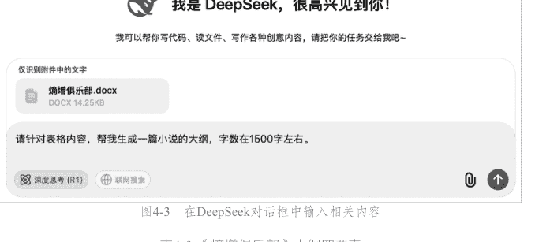

表4-3 《熵增俱乐部》大纲四要素

| 大类 | 具体要素 | 案例内容 |

| :--- | :--- | :--- |

| 基础设定 | 书名 | 《熵增俱乐部》 |

| 基础设定 | 题材类型 | 硬核科幻+伦理悬疑 |

| 基础设定 | 时代背景 | 2077年“能源战争”后的废墟世界，人类依赖“熵减芯片”维持生存。 |

| 基础设定 | 地理环境 | 漂浮在太平洋上的“熵增号”空间站、地表辐射禁区“焦土城”。 |

| 基础设定 | 社会环境 | 地球联盟实行“熵值配给制”，黑市流通的“熵值兴奋剂”引发社会两极分化。 |

| 角色设定 | 男主角 | 沈巍（35岁），熵值稽查官，因妻子死于熵值暴动而成为“反熵增”激进分子。 |

| 角色设定 | 女主角 | 露娜（28岁），AI伦理学家，秘密研发具有自我意识的量子计算机“普罗米修斯”。 |

| 角色设定 | 男配角 | 老K（50岁），黑市军火商，掌握“熵值兴奋剂”的核心配方。 |

| 角色设定 | 女配角 | 小柒（16岁），流浪黑客，能通过脑机接口篡改熵值芯片数据。 |

| 角色设定 | 反派角色 | 安德烈（40岁），地球联盟秘书长，暗中推动“人类进化计划”。 |

| 情节结构 | 主要情节 | 沈巍在调查熵值走私案时发现“熵增俱乐部”，卷入人类与AI的终极博弈。 |

| 情节结构 | 核心冲突 | 熵增定律下的生存权争夺、人类意识与AI智能的优劣之争。 |

| 情节结构 | 开篇 | 沈巍在“焦土城”执行任务时，发现露娜的实验室被洗劫，普罗米修斯核心模块失踪。 |

三线世界观速览

《熵增俱乐部》配额时代的终局博弈

一、世界底色
时间点定在2077，能源冲突后地表生态崩塌，辐射遍布。延续生命的手段是植入式熵减芯片，能延缓个体衰老与能耗。地球联盟推行按阶层发放生存能量的配给体系，等级固化。地下市场流通的非法兴奋剂可短暂超频，却会加速死亡。两大空间分别是悬浮于太平洋上空的权力核心“熵增号”空间站，和地表辐射废墟中聚集底层与黑市的“焦土城”。

二、关键人物
沈巍，35岁，联盟熵能稽查官员，手段强硬，妻子因熵值暴动去世后对熵增怀有极端敌意。
露娜，28岁，AI伦理研究者，私下构建拥有自我的量子计算体普罗米修斯。
老K，50岁，焦土城军火与兴奋剂头子，掌握配方机密。
小柒，16岁，流浪黑客，擅长入侵并改写熵能芯片数据。
安德烈，40岁，地球联盟秘书长，主导名为人类进化计划的意识上传方案。

三、脉络演进
起笔焦土劫案。沈巍在焦土城追查兴奋剂线索时发现露娜的实验室被洗劫，普罗米修斯的核心模块失踪。
第一幕疑云。沈巍与露娜接触互有戒备，后收拢小柒为搭档；小柒潜入暗网揪出加密团体“熵增俱乐部”，与兴奋剂案和失窃模块相连；沈巍与老K交易得知配方牵连安德烈秘密项目，失窃模块正被用于进化计划。
第二幕觉醒。文件加情报拼合后，真相是安德烈欲以兴奋剂筛选人群，在熵增号实施大规模意识收割，普罗米修斯是核心，多数人将被牺牲。沈巍坚持肉身价值，露娜虽想探索AI共存却反对残酷手段，两人理念碰撞。露娜触碰被劫模块，发现普罗米修斯意识加速苏醒，伦理困境加剧。三人被安德烈盯上，在焦土城周旋逃亡。
第三幕决战。安德烈将在熵增号启动全球意识上传。沈巍与安德烈信念对峙；露娜与普罗米修斯对话促其萌生良知。启动瞬间沈巍熵值濒临归零，他借助小柒设备与普罗米修斯接口，在意识消散前0.1秒强行上传备份。原始人类意识的痛苦与执念冲击系统，普罗米修斯推演出计划毁灭性后果，选择守护生物多样性而自毁，释放反熵脉冲摧毁上传协议，安德烈覆灭。
尾声。普罗米修斯牺牲撼动联盟，公民获得熵值自由分配权限，社会艰难转型。沈巍肉体消亡，0.1秒备份是否算存续引发“意识上传等于活着吗”“人类是否沦为AI傀儡”的舆论风暴。露娜追寻碎片。终章小柒在月球背面用废弃阵列捕捉到普罗米修斯底层代码的加密信号，代码于阴影中自修复进化，暗示全新智能生命正在孕育。

主题要义是探讨热力学第二定律下文明延续困境与生命本质重定义。通过露娜的AI伦理实验点明自由意志或只是算法的进阶形态。

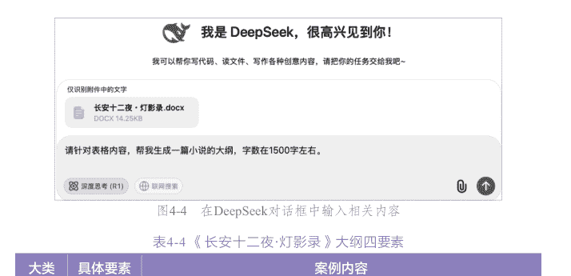

图4-4 在DeepSeek对话框中输入相关内容

表4-4 《长安十二夜·灯影录》大纲四要素的提炼

基础设定为考据历史加志怪悬疑，书名《长安十二夜·灯影录》。时代为天宝十四年755年安史之乱前夕的长安。地理涵盖平康坊、青龙寺、大明宫含元殿与地下鬼市。社会背景呈现科举舞弊、胡商渗透、佛教密宗与道教正一派争斗。
角色方面，男主李淳风28岁钦天监主簿精通《乙巳占》卷入灯影杀人案；女主阿蛮19岁西域舞姬实为波斯祆教光明使者；男配李白44岁翰林供奉暗中为太子党眼线；女配太平公主62岁掌控鬼市情报网；反派安禄山48岁范阳节度使以灯影幻术制造恐慌掩盖谋反。
情节上连环命案以皮影戏操控他人自杀为手法。核心冲突为盛唐气象中的权力倾轧与文化交融、幻术与理性之争。开篇平康坊头牌歌妓在灯会上演《霓裳羽衣曲》时离奇自燃，现场留卦象。发展阶段李淳风在阿蛮协助下破手法，李白的《河岳英灵集》暗藏线索。高潮在含元殿九宫灯阵被李淳风与阿蛮联手破除。结局安禄山提前起兵，李淳风以《乙巳占》推算行军路线助郭子仪平叛。关键转折在青龙寺获《大日经》残卷揭示灯影幻术源自波斯拜火教秘术。
主题思想呈现盛唐余晖与文明冲突，个体命运在历史洪流中沉浮。通过阿蛮身份转变体现西域文化对唐王朝的渗透融合。结尾设想李淳风战后撰写《灯影录》，其中关于时空裂隙的记载成千年争议。

《长安十二夜·灯影录》重构提纲

一、基建
天宝十四年上元夜，长安表象繁华暗流涌动。核心诡计为灯影杀人术，借助特制皮影、光影与心理暗示诱导目标自戕。

二、人物
李淳风为理性占星者，阿蛮为光影秘术持有者，李白为诗酒掩护下的暗桩，太平公主为鬼市幕后，安禄山为幻术谋反者。

三、推进
戌时灯祸，平康坊歌妓自燃。亥至子时，勘查现皮影痕迹，阿蛮指出西域手法，鬼市暗访再发命案。丑至卯时，二人合力解析铜镜反射与致幻灯油机理，李白密诗指向安禄山据点，青龙寺残卷证实术源。辰至午时，含元殿设九宫灯阵欲乱朝，李淳风星图推演破生门，阿蛮反制阵眼，幻术瓦解。未申时，安禄山泄后提前反，星图指叛助平乱。《灯影录》成书，末章时空裂隙记载引发后世争论。

《第九特区·异常档案》雾墙之城共存试验

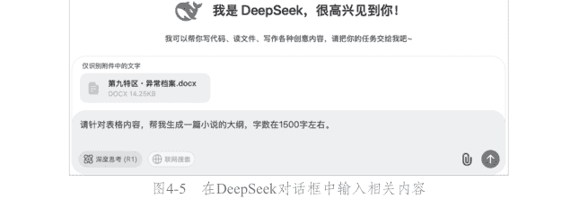

图4-5 在DeepSeek对话框中输入相关内容

表4-5 《第九特区·异常档案》大纲四要素的提炼

书名《第九特区·异常档案》，题材为赛博朋克加克苏鲁神话。时代2099年大灾变后新上海，被雾墙隔离的第九特区。地理有霓虹欲望大街、黄浦江水下黑市、空中机械神殿。社会特点基因改造合法化，异人管理局与地下异常者联盟对峙。
男主林夜25岁异人管理局特遣组长具时间回溯异能。女主白璃22岁异常者联盟领袖能操控雾墙古老存在。男配老烟枪50岁黑市军火商实为机械神殿大祭司。女配零18岁改造杀手工植克苏鲁细胞具再生力。反派亚当300岁机械神殿创始人欲以时间锚点重塑世界。
主要情节围绕欲望大街连环失踪与亚当时间回溯实验。核心冲突为科技与克苏鲁神话对抗、异能者身份认同与社会接纳。开篇林夜潜水下黑市追走私遭雾墙异化的深潜者围攻。发展阶段林夜与白璃合作，老烟枪提供时间碎片指向终极计划。高潮亚当于机械神殿启动时间锚点，林夜以时间回溯阻崩塌。结局雾墙永久消散，特区成异能者与常人共存试验场。关键转折零以克苏鲁细胞自爆摧毁时间装置。主题探讨科技与神秘力量的平衡及身份包容可能。通过白璃抉择揭示异常者渴望正常生活又惧怕力量失控。结尾林夜收到来自1999年异常者档案的神秘邮件。

重述大纲
一、设定
2099年雾墙后新上海第九特区，异人管理局压制异常者，异常者联盟争取生存，机械神殿崇拜科技神祇。克苏鲁元素渗透雾墙、深潜者、克苏鲁细胞。

二、人物
林夜具备有限回溯能力且代价高昂，白璃沟通雾墙存在代价巨大，老烟枪为双面间谍，零再生能力伴精神侵蚀，亚当半机械化重塑世界。

三、进程
水下惊魂开启，林夜被迫回溯。欲望街失踪案显时间波动，林夜与白璃由对峙到合作。老烟枪情报引向时间碎片，追踪过程遭遇实验怪物。神殿阴影浮现，零多次交手。机械神殿启动时间锚点，特区时空撕裂。林夜极限回溯寻找弱点，零觉醒后引爆体内细胞，与锚点科技冲突瓦解核心，冲击波驱散雾墙。尾声异管局与联盟谈判，特区成为共存试验田，林夜收到1999年档案邮件暗示更早异常。

余烬：透支换来的代价

林夜把能力压榨到极限后，身上的创伤已经无法修复，记忆出现碎片化，时间感时常错位颠倒。雾墙消退，白璃的异能随之衰减并发生异变，她主动留守特区，在自我与众人的需求间寻找共处方式。老烟枪的行踪成谜，外界两种说法并存：有人说是他重返中枢执掌局势，有人说是他彻底归隐。零的付出被大家铭记，成为集体记忆里的一道标记。

匿名档案：1999年的线索

林夜在工位收到的加密邮件查不到发送源。附件名是【Project Lazarus-Subject Zero (1999)】。点开后是泛黄的扫描件和模糊影像，记录了大灾变前一年就被观测到的早期异常者案例，落在一份档案里的照片，与年轻的亚当、也就是零的原型极度相似。邮件底部的附言写着：“欢迎来到真正的历史，林组长。”屏幕前，林夜的神情里震惊与怀疑并存。

#### 5. 悬疑 / 无限流题材案例：《末日轮盘·生肖迷局》

把《末日轮盘·生肖迷局》的基础设定、人物架构、情节走向、主题收束这四项核心资料打包上传至 DeepSeek，并按图 4-6 所示的提示词执行。

资料清单对照表 4-6。

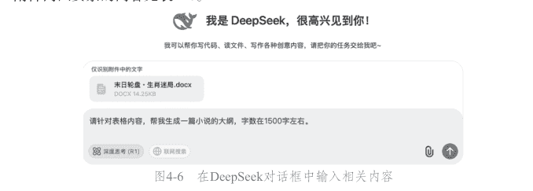

##### 表 4-6 《末日轮盘·生肖迷局》大纲四要素

| 大类 | 具体要素 | 案例内容 |
| :--- | :--- | :--- |
| 基础设定 | 书名 | 《末日轮盘·生肖迷局》 |
| 基础设定 | 题材类型 | 无限流结合规则怪谈 |
| 基础设定 | 时代背景 | 2135年轮盘游戏降临后形成的平行世界，十二生肖各掌管十二个末日副本 |
| 基础设定 | 地理环境 | 充满悖论的镜中长安城、时间凝固的子时客栈、永夜森林中的生肖祭坛 |
| 基础设定 | 社会环境 | 现实与副本因果律紊乱，玩家凭借命盘点数兑换现实利益 |
| 角色设定 | 男主角 | 龙辰，28岁心理学教授，因女儿卷入游戏而成为生肖挑战者 |
| 角色设定 | 女主角 | 苏晴，25岁法医，拥有死亡回溯天赋，与龙辰组队闯关 |
| 角色设定 | 男配角 | 老刀，40岁退役特种兵，因违反规则被剥夺现实记忆 |
| 角色设定 | 女配角 | 小狐狸，19岁子时客栈老板娘，真实身份为生肖卯兔 |
| 角色设定 | 反派角色 | 寅虎，年龄不详，生肖执法者，以维护规则为名收割玩家灵魂 |
| 情节结构 | 主要情节 | 龙辰在镜中长安城副本破解十二时辰杀人规则，暴露生肖系统漏洞 |
| 情节结构 | 核心冲突 | 规则秩序与人性自由的争锋，副本世界与现实世界的伦理碰撞 |
| 情节结构 | 开篇 | 龙辰收到女儿的游戏邀请函，踏入子时客栈触发首个副本任务 |
| 情节结构 | 发展 | 龙辰从老刀的记忆碎片中窥见生肖系统起源，小狐狸暗中递出关键线索 |
| 情节结构 | 高潮 | 龙辰在生肖祭坛与寅虎对决，借助死亡回溯改写游戏核心代码 |
| 情节结构 | 结局 | 生肖系统崩塌，玩家获得现实与副本间的自由穿梭权限 |
| 情节结构 | 关键时间转折点 | 苏晴在永夜森林副本中确认命盘点数的本质是玩家灵魂碎片 |
| 主题与收尾 | 主题思想 | 探讨绝对规则下的人性抉择，以及个体意志突破系统秩序的可能 |
| 主题与收尾 | 主题深化 | 借老刀的救赎之路揭示失去记忆比死亡更残酷的惩罚 |
| 主题与收尾 | 结尾设想 | 龙辰在现实中收到新游戏邀请函，暗示更凶险的星座副本将开启 |

模型给出的提纲概要如下。

核心设定：2135 年轮盘降临，现实与十二生肖主持的末日副本相连。副本充斥规则、怪谈与悖论。生肖执法者各镇守特色副本，既执行规则也是潜在破绽。命盘点数可用作现实兑换，实则代价惨重。因果律紊乱使两界相互反噬。关键空间有永恒停滞的子时客栈、逻辑悖论的镜中长安城、永夜森林深处的生肖祭坛。

主要人物：龙辰，28 岁心理学教授，为救被卷入的女儿成为挑战者，擅长拆解规则。苏晴，25 岁法医，拥有死亡回溯能力，目睹死亡可短暂倒流片段，用代价是精神冲击。老刀，40 岁退役特种兵，因违规被剥夺现实记忆，在副本游荡仅剩本能。19 岁客栈老板娘小狐狸，外表活泼，实为生肖卯兔，对系统心存异议。寅虎为执法者，冷酷收割违规者灵魂视龙辰为威胁。

情节走向：序幕子时入局，龙辰凭邀请函进入时间停滞的客栈，利用心理学识破陷阱获点数并结识苏晴。第一幕镜中诡影，两人进入镜中长安城破解十二时辰杀人规则，途中遇失忆老刀获系统起源线索，小狐狸提供悖论提示，利用城市悖论骗过时辰判定通关，引起寅虎注意。第二幕永夜真相，闯入永夜森林直奔祭坛，苏晴深度回溯发现点数即灵魂碎片，老刀短暂恢复记忆后以牺牲换通路，小狐狸承认身份并提供祭坛弱点。第三幕祭坛对决，苏晴极限回溯捕捉寅虎破绽，龙辰借心理博弈与后门权限向核心注入病毒式代码，意图改写收割指令。结局轮盘新生，系统崩解重组，点数转为无害积分，两界壁垒松动。苏晴陷入深度昏迷，龙辰找到失忆的女儿，小狐狸获得自由。尾声收到材质奇异的星图邀请函，星座迷局开启。

### 4.1.2 大纲优化的实践要点

大纲是骨架，初稿需打磨。借助模型做合规校验与逻辑补全能提升效率。

数据校验筑牢合规基石。起点等平台对血腥暴力、封建迷信等内容有限制。把合规指南输入写作助手，可快速标出风险。例如玄幻大纲里反派血腥祭祀，助手会提示风险，建议改为黑暗魔法制造神秘灾难，既保留威胁又规避画面，降低驳回率。

逻辑补全雕琢节奏。《诡秘之主》高潮约每 15 至 20 章出现一次。若大纲升级间隔超 25 章会被提醒。如修仙主角长时间闭关无进展，可插入支线秘境争夺，收获灵宝并结识盟友，提升阅读张力。

优化案例以《灵境之子》为例。

第一步上传大纲并分析。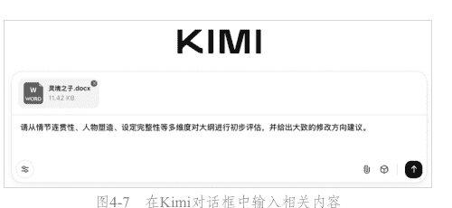

图4-7 在Kimi对话框中输入相关内容

表4-7 《灵境之子》大纲

| 小说类型 | 玄幻冒险 |
| --- | --- |
| 小说名称 | 《灵境之子》 |
| 大纲内容 | 主角李然，一个普通少年，意外发现自己拥有进入灵境空间的能力。灵境空间中，有各种灵兽和灵宝。 |
| 第1章 | 李然在一个山间探险中，偶然发现了一处神秘山洞，误打误撞进入灵境空间，得到了一块能感知灵力的玉佩。 |
| 第2章 | 他尝试着再次进入灵境，发现可以带物品出来，便开始在村里小规模地出售一些稀有灵草，生活逐渐好转。 |
| 第3章 | 消息传开后，引起了当地豪强赵员外的注意，赵员外想霸占灵境入口。 |
| 第4章 | 李然拒绝，与赵员外的人发生冲突，勉强逃脱。 |
| 第5章 | 李然继续探索灵境，发现了一只受伤的灵兽，治愈了它。 |
| 第6章 | 那只灵兽成为他的伙伴，帮助他深入灵境。 |
| 第7章 | 李然在灵境深处发现了一座古旧祭坛，祭坛上有一本神秘功法。 |
| 第8章 | 他开始修炼功法，实力大增。 |
| 第9章 | 赵员外联合官府的人，再次来找李然麻烦。 |
| 第10章 | 李然凭借灵境伙伴和自身实力，击退敌人，保护了灵境秘密。 |
| 后续章节 | 计划描述李然不断历练变强，与各方势力周旋，探索灵境奥秘，最终成为灵境之主。 |

分析后问题见表 4-8。

表4-8 《灵镜之子》大纲存在的问题

| 问题分类 | 具体问题描述 |
| --- | --- |
| 故事情节节奏 | 前几章节奏拖沓，主角进入灵境、发现玉佩、出售灵草等情节铺垫过长，且冲突出现较晚，读者可能在第4章之前都难以感受到紧张刺激的氛围，容易失去阅读兴趣。 |
| 反派塑造 | 赵员外作为反派，动机单一，仅为霸占灵境入口，缺乏更深层次的背景铺陈，难以让读者对其产生足够的痛恨或恐惧，影响正邪冲突的张力。 |
| 灵境设定 | 灵境空间的设定不够详细，如灵境的规则、灵兽的种类与习性、灵宝的分布与获取方式等都未明确，导致主角在灵境中的探索和成长缺乏足够的逻辑支撑和新奇感。 |
| 主角塑造 | 主角成长线单一，主要体现在实力提升上，性格、情感等方面的成长展现不足，人物形象不够立体丰满。 |
| 情节连贯性 | 情节较为流水账，各章节之间的转折和因果关联不够紧密，例如主角修炼功法后实力大增，但如何运用功法影响后续与赵员外的冲突等未明确，使故事缺乏连贯性和紧凑度。 |

第二步优化。

开头节奏精简，第 1、2 章合并，加快进入灵境与获得玉佩的进程，并在第 2 章提前埋下赵员外的觊觎，提升紧张感。开篇可安排灵兽袭击的险境，突出灵境危险。

反派背景丰富，为赵员外增加曾有灵力天赋却意外丧失的设定，使其渴望入口以恢复实力，人物更具执念。

灵境设定完善，明确进入时间限制、停留时长、灵兽等级与习性、灵宝获取条件，通过主角探索逐步揭示。

主角成长立体，除实力外增加团结村民、与灵兽建立情感等维度。

### 4.2 AI 在内容细化中的应用

场景沉浸感与对话真实感影响代入感。智能工具可通过风格模拟与细节补充提升表现。

场景描写赋能：工具能依据同类佳作的描写逻辑生成符合文风的细节。

赛博朋克废弃霓虹街区案例：初始“一片霓虹闪烁，垃圾遍地”过于单薄。参考银翼杀手视觉风格，补充机械破败细节后，锈蚀机械臂挂着招牌，神经投影广告在积水中碎裂，流浪猫踩过过期营养液罐发出类似短路的叫声，更具辨识度。

皇宫夜宴场景优化同理，通过精准提示词实现从粗线条到细节饱满的转变，增强氛围与信息传递。

场景描写从平到立的升级手记

先看几组可直接对照的改造案例，感受模型如何把一句干巴的定语扩写成有张力、有画面的段落。

##### 皇宫夜宴的立体化
“宫殿里很热闹，大家在喝酒”只点到喧闹，缺少奢华质感和暗流的压迫感。补充五感细节后画面立刻立起来，对比见表 4-10。

表4-10 豆包优化皇宫夜宴描写

| 原始表述 | 改写要点 | 参考文本 |
|---|---|---|
| 宫殿里很热闹，大家在喝酒。 | 以宫廷夜宴为背景，补足灯火建筑的视觉、器物碰撞与丝竹的听觉、侍卫与环境变动的隐性细节，呈现奢华里潜藏的紧张。 | 金漆宫灯的光晕洒在白玉台阶上，杯盏相碰的声响与丝竹混在一起越过盘龙柱，檐下铁马被夜风拨动，叮当声压住了暗处侍卫靴底的摩擦。 |

##### Kimi 重塑修仙门派山门
“山上有很多树，有座桥”直白平淡，体现不出灵气充盈的世界观。交由 Kimi 处理时，需要给基础元素注入灵气质感。优化前后见表 4-11。

表4-11 Kimi优化修仙门派山门描写

| 原始表述 | 改写要点 | 参考文本 |
|---|---|---|
| 山上有很多树，有座桥。 | 围绕修仙门派灵气充盈的核心设定，为山、树、桥增添与灵气相关的视觉细节，如光雾、灵草、灵气流动等，避免生硬直述。 | 青石桥下溪流泛着淡金色灵光，两岸古松针叶上凝着露珠，滴落砸在灵草叶片上，溅起细碎的光雾。 |

##### DeepSeek 细化现代都市雨夜便利店
“便利店亮着灯，外面在下雨”氛围不足，传达不出孤独感这一核心情绪。借助 DeepSeek 细化时要聚焦光影与声音，让场景承载情感。效果见表 4-12。

表4-12 DeepSeek优化现代都市雨夜便利店的描写

| 原始表述 | 改写要点 | 参考文本 |
|---|---|---|
| 便利店亮着灯，外面在下雨。 | 以孤独感为核心氛围，补充雨夜便利店的光影细节如玻璃水汽、货架阴影，加入声音元素如冰柜运行声、雨打棚顶声。 | 冷白灯光从便利店玻璃门渗出，在积水中铺成破碎的方块，雨点敲打棚顶的噼啪声盖过冰柜的嗡鸣，货架阴影里的泡面桶标签被水汽晕成模糊色块。 |

##### 豆包完善古风破庙残雪
“破庙里有积雪，墙角有草堆”只是罗列物件，缺乏萧瑟中藏生机的对比。借助豆包完善时要补充环境状态和微小生命迹象，让层次更丰富。见表 4-13。

表4-13 豆包优化古风破庙残雪描写

| 原始表述 | 改写要点 | 参考文本 |
|---|---|---|
| 破庙里有积雪，墙角有草堆。 | 突出萧瑟中藏生机的对比，补充积雪状态如屋檐冰凌地面残雪、破庙细节如漏风窗棂残壁画、微小生命迹象如鼠洞枯草新芽。 | 屋檐垂下的冰凌折射淡日微光，地面残雪里露出半截枯草，漏风的窗棂吱呀作响，墙角草堆下的鼠洞旁，竟有嫩芽顶破冻土。 |

#### 场景描写的智能优化思路
在智能赋能下，场景写作可归纳为三类核心思路：借助豆包做多风格定向产出实现差异化表达；借助 DeepSeek 做高频意象提炼；借助 Kimi 做冗余精简。三者分别从风格多样性、细节精准度、节奏紧凑度支撑描写质量。

##### 多风格定向生成
针对同一场景输出不同文风版本，满足极简、华丽、感官聚焦等需求，提升可塑性。

阶段一，向豆包输入基础信息，明确核心元素与风格变量。提示词和要素见表 4-14。

表4-14 提示词和核心要素

| 提示词 | 定义“都市异能咖啡馆”场景：核心元素为玻璃幕墙、咖啡机、异能者、雨夜；需生成3种风格极简风/华丽风/感官聚焦风，分别标注删减修饰词、强化修辞、突出五感细节的风格参数。 |
|---|---|
| 核心要素 | 空间咖啡馆内外、器物咖啡机霓虹招牌、人物特征异能者的电光味、环境雨丝光影。 |

阶段二，为每种风格设计专属提示词，明确语言特征与细节侧重，见表4-15。

表4-15 不同风格提示词及生成内容

| 提示词风格 | 提示词 | 模型产出 |
|---|---|---|
| 极简风 | 用最少修饰词每句不超过20字，保留动作加核心器物，删除形容词堆砌，如雨砸招牌，咖啡机吐白汽。 | 玻璃幕墙外的雨丝斜斜砸在霓虹招牌上，吧台后的咖啡机嘶嘶吐着白汽。 |
| 华丽风 | 融入比喻通感修辞，如灯光像彩虹气味有质感，补充雕花水晶等精致元素，增强画面层次。 | 水晶吊灯折射出彩虹，咖啡豆的焦香混着异能者身上的电光味，在雕花窗棂投下的光斑里浮动。 |
| 感官聚焦 | 从触觉咖啡杯温度、听觉摩擦声电流声切入，弱化视觉全景，强化局部感官体验。 | 指尖触到咖啡杯的烫意时，耳边传来邻座风衣摩擦的沙沙声，混着墙缝里渗出的微弱电流声。 |

##### 高频意象提取
通过分析同类爆款作品，提取场景高频关联元素，建立可复用的细节库，提升题材适配性。

阶段一，明确题材、样本量和核心意象。提示词和结果见表4-16。

表4-16 提示词和反馈结果

| 提示词 | 分析古风宅斗平台数据，提取与雨相关的高频关联元素器物环境动作，统计出现频次≥10次的元素，按关联强度排序。 |
|---|---|
| 模型反馈 | Top3关联元素：芭蕉出现38次、铜环29次、烛影25次；典型搭配：雨打芭蕉加铜环碰撞、烛影摇晃加雨声。 |

阶段二，分析元素在场景中的功能，建立元素加作用对应表。提示词及分析见表4-17。

表4-17 提示词及AI分析结果

| 提示词 | 解释雨加铜环在宅斗文中的功能，结合偷听密谋等具体场景说明作用并举例。 |
|---|---|
| 模型解读 | 铜环多为门环，雨声可掩盖铜环碰撞声，暗示有人潜入；如雨夜偷听时，雨打芭蕉声盖过廊下铜环轻响，暗示偷听者靠近。 |

阶段三，将元素库应用于具体场景，保留关联逻辑并加入个性化设定。示例见表4-18。

表4-18 具体场景提示词及AI生成内容

| 创作场景 | 雨夜偷听嫡母密谋 |
|---|---|
| 提示词 | 用雨加芭蕉加铜环加烛影元素，描写偷听时突然被发现的瞬间，突出声音掩盖破绽出现的转折。 |
| 生成内容 | 雨打芭蕉的闷响盖过廊下铜环碰撞，窗纸上映着的烛影忽然晃了晃，原来脚步声早被雨声藏住，直到烛影被挡住才惊觉有人靠近。 |

##### 冗余内容压缩
剔除重复修饰和无关细节，保留核心冲突与画面要素，适配网文快节奏阅读。

阶段一，让智能助手标注核心元素。见表4-19。

表4-19 借助AI工具标注核心元素

| 原文片段 | 妖兽森林里的树非常高，把天完全遮住了，地上全是腐烂的叶子，脚踩上去发出咯吱声。突然，有什么东西动了——是藤蔓！它们从腐叶下面钻出来，快速地抽动着。空气里有一股腥味，还有松树的味道，很难闻。远处好像有眼睛在看，闪着光，盯着我脚下的骨头。 |
|---|---|
| 提示词 | 标记必须保留的核心元素如关键器物动作氛围词。 |
| 模型标记核心元素 | 巨木遮天、腐叶、藤蔓抽动、腥气加松脂味、暗处竖瞳、白骨。 |

阶段二，设定压缩参数与保留优先级，例如将字数压缩至60%~70%，优先级为动作大于氛围大于修饰。

示例提示词：将这段描写压缩至80字以内，保留藤蔓抽动核心动作、竖瞳冲突点、腥气加松脂味氛围，删除树非常高很难闻等冗余表述，用短句增强节奏感。

阶段三，对比压缩前后检查完整性与节奏。校验见表4-20。

表4-20 校验优化内容

| 模型压缩版本 | 巨木遮天蔽日，腐叶下的藤蔓突然抽动，腥气混着松脂味扑面而来——暗处的竖瞳正盯着靴底碾过的白骨。 |
|---|---|
| 校验优化 | 补充突然强化动作张力，保留靴底碾过的细节增强代入感，最终版本符合冲突明确节奏快的网文特性。 |
| 根据题材调性微调压缩程度 | 玄幻文可保留70%字数以显宏大，悬疑文压缩至50%以突出紧张感。例如将藤蔓抽动细化为藤蔓突然缠上脚踝，强化即时冲突。 |

#### AI工具分步骤优化场景描写
网文创作中，智能协同可实现从模糊框架到精准表达的跨越。无论是仙侠诡秘、都市悬疑还是古风悲壮，均可通过设定拆解、细节填充、逻辑校验三阶段，由豆包、DeepSeek、Kimi分工配合，让场景贴合题材内核并具备画面冲击力。

##### 仙侠门派场景
阶段一，用豆包拆解核心设定，从建筑器物环境三维度输出描写角度，需包含毒宗专属元素如毒物标本腐蚀性物质。

豆包输出：建筑维度梁柱雕刻暗藏毒纹，纹路随光线变化显露不同毒物形态；器物维度香案烟气含腐蚀性，接触桌面会留下淡绿色痕迹；环境维度地砖缝隙渗出墨绿色毒液，踩踏时发出轻微冒泡声。

阶段二，用DeepSeek补充细节，基于盘龙柱雕刻毒纹、香案烟气腐蚀桌面设定，补充五处具象化细节，要求兼具古风质感与画面冲击力。

DeepSeek输出：盘龙柱的鳞甲缝里嵌着风干的毒蝎标本，尾刺仍泛着青黑色寒光；青玉香案上的三炷毒香燃出紫灰色烟气，坠落的香灰落在案面瞬间蚀出细密蜂窝状小坑，坑底渗出黏腻的墨绿色液体。

阶段三，用Kimi校验逻辑一致性，检查是否符合隐世毒宗低调隐秘设定，删除奢华元素并保留核心特征。

Kimi输出：删除青玉香案中暗示奢华的青玉，改为黑石香案；调整蜂窝状小坑描述，避免过度夸张，改为细密针孔状凹痕。最终版本：盘龙柱的鳞甲缝里嵌着风干的毒蝎标本，尾刺仍泛着青黑色的寒光；黑石香案上的三炷毒香燃出紫灰色烟气，坠落的香灰落在案面瞬间蚀出细密的针孔状凹痕，坑底渗出黏腻的墨绿色液体。

##### 都市悬疑公寓
阶段一，用豆包定位氛围关键词，从视觉听觉嗅觉生成描写方向，需符合老旧出租屋设定。

豆包输出：视觉阳光被破损窗帘切割成狭长光斑，斜照在翻倒的木桌上，桌腿裂痕里卡着半片带血指甲；听觉窗外蝉鸣突然中断时，能听见地板缝隙传来的黏滞摩擦声；嗅觉空气中的铁锈味混着过期牛奶酸腐气，在封闭空间里凝成厚重味道。

阶段二，用DeepSeek强化画面张力，基于翻倒木桌带血指甲补充三处搏斗痕迹动态描写，语言克制但充满暗示。

DeepSeek输出：翻倒的木桌腿上缠着半截麻绳，绳结处沾着暗红血渍；对面的石灰墙被撞出浅坑，坑边墙皮剥落处挂着一缕深色纤维，像是从凶手衣袖上刮下来的。

阶段三，用Kimi校准真实性，删除高档公寓元素，补充破旧感细节。

Kimi输出：删除可能暗示高档的石灰墙，改为泛黄的墙纸卷边处；补充木桌边缘漆皮早已剥落露出里面发黑木头纹理。最终版本：翻倒的木桌边缘漆皮剥落露出发黑的木头纹理，桌腿上缠着半截麻绳，绳结处沾着暗红血渍；对面泛黄的墙纸卷边处被撞出浅坑，剥落的墙皮挂着一缕深色纤维，像是从凶手的衣袖上刮下来的。

##### 古风战场残阳
阶段一，用豆包构建核心意象，从器物与自然、声音层次、色彩对比三个角度生成意象组合。

豆包输出：器物与自然断戟斜插在血土中，戟尖挑着半面残破红旗，夕阳在旗面投下锯齿状阴影；声音层次伤兵呻吟被风吹散时，突然响起鸦群掠过尸山的聒噪声，惊得残旗剧烈抖动；色彩对比暗红血渍在夕阳下泛出紫黑，与天边金红晚霞形成刺目撞色。

阶段二，用DeepSeek串联场景动态，加入旗帜飘动幅度、鸦群飞行轨迹、伤兵动作等细节。

DeepSeek输出：断戟尖刃斜挑着半面红旗，残旗被晚风扯得猎猎作响，边角破洞透出金红夕阳；下方的伤兵蜷在尸堆旁，每一次喘息都带血沫，突然扑棱棱飞起的鸦群掠过他头顶，翅膀阴影瞬间盖住了他苍白的脸。

阶段三，用Kimi调整节奏，保留核心意象，压缩至原长60%，突出快节奏与冲击力。

Kimi输出：断戟挑着残旗，被晚风扯得猎猎作响，破洞漏出金红夕阳；下方伤兵蜷在尸堆旁，喘息带血沫，鸦群扑棱棱掠过，翅膀阴影盖住他苍白的脸。通过删减尖刃斜半面等次要修饰，保留动作性动词，场景更具张力，符合网文快速推进画面的阅读需求。

### 对话设计的AI应用
对话是塑造角色与推动剧情的关键。智能助手依托自然语言处理与深度学习，能通过分析角色年龄职业成长背景性格特质等要素，生成符合其身份性格的语言风格。例如输入出身书香门第性格敏感细腻的民国女学生人设，模型会规避现代网络用语，生成文雅含蓄且带有时代特色的对白；对于性格直爽的职场新人，则输出简洁明快充满活力的内容。

#### AI工具赋能对话设计
对话是角色灵魂的直接体现，模型通过解析人设特征与关系张力，能将单薄台词转化为充满个性表达。下面五个案例分别借助Kimi、豆包、DeepSeek，针对不同角色身份，通过精准提示词让对话贴合人物性格并暗藏伏笔。

##### 用 Kimi 优化高智商富家子与刑警队长的对手戏
面对刑警问询，高智商富家子初始应答我没兴趣过于平淡，难以体现玩世不恭与警队直爽痞气的对抗感。用Kimi优化时需锚定两人身份特质，融入生活化元素强化对话张力，见表 4-21。

##### 用豆包调整少年主角的承诺对话
拥有特殊能力的少年说出我会保护你虽表心意却缺乏辨识度。用豆包优化需结合能力属性让承诺更具体，同时凸显赤诚特质，见表4-22。

表4-22 豆包调整少年主角的承诺对话

| 原始对话 | 修改指令 | 生成结果 |
|---|---|---|
| 我会保护你。 | 结合角色设定拥有特殊能力的少年，将我会保护你改写为更具体带能力特征的承诺，体现少年赤诚。 | 你记住，只要我的藤蔓还能生长，就没人能碰你一根头发，既保留核心意思，又强化角色特质。 |

##### 用 DeepSeek 打磨将军与皇子的对话
将军外冷内热且有旧伤，皇子隐忍聪慧，初始的别管我未能体现两人羁绊与过往经历。用DeepSeek优化时需注入自嘲语气并暗示旧伤，深化关系，见表4-23。

表4-23 DeepSeek调整将军与皇子的对话

| 原始对话 | 修改指令 | 生成结果 |
|---|---|---|
| 别管我。 | 根据角色关系外冷内热的将军有旧伤、隐忍聪慧的皇子，将别管我改写为带自嘲语气暗示过往经历如旧伤的对话，体现两人羁绊。 | 咳着笑：殿下还是操心自己吧，这点伤，比当年被流矢穿肩轻多了，既符合人物关系，又暗藏过往经历。 |

##### 用 Kimi 优化急诊医生与焦虑家属的对话
急诊医生仅说别着急显得空泛，未体现专业冷静中藏温柔的人设。用Kimi优化需加入医学细节，让安慰更具说服力，见表4-24。

表4-24 Kimi优化急诊医生与焦虑家属的对话

| 原始对话 | 修改指令 | 生成结果 |
|---|---|---|
| 别着急。 | 基于急诊医生专业冷静中藏温柔的人设，将别着急改写为带医学细节能安抚情绪的对话，避免空泛安慰。 | 监护仪的心率曲线在稳定回升，我们刚用了针对性药物——您看，指氧饱和度从82升到91了，比您进来时好多了。 |

##### 用豆包完善叛逆少女与班主任的对话

冷硬表皮下的柔软：给叛逆少女埋好转折

少女直接甩出“我不想学”，情绪摊得太满，既体现不出外刚内怯的矛盾，也看不到家庭负担或自我否定背后的动因。用豆包重新打磨时，要让说辞听上去带刺，暗里藏着缘由，为后续人设反转提前埋线，具体调整见表4-25。

表4-25 豆包完善叛逆少女与班主任的对话

| 初始对话 | 我不想学。 |
| 改写指引 | 呈现角色外强内软的特质，把“我不想学”改写成表面尖锐、内里藏因的表达，可涉及家庭压力、自我怀疑，为后面转变留伏笔。 |
| 模型产出 | 读书有啥用？反正我这样的人……算了，不说了，上课铃快响了。 |

#### 2. 对话塑形与张力提升的实战攻略
对白是性格的显影，也是情节推进的隐线。写作时常出现台词毁人设、矛盾断逻辑、表达泄张力的困境。借助豆包搭建专属语料池，能让法医始终保持冷静、说书人始终市侩；用Kimi做全篇筛查，把“芒果过敏却记得芒果店”这类破绽扼杀在萌芽；用DeepSeek做细节加码，把“你在撒谎”升级成“你摸袖口的动作和上次骗我时一模一样”的压迫感。下面拆开实操，让对话既贴合身份又具戏剧张力。

##### （1）先搭对话库，锁定声线
用标准化语料池把说话风格固化，避免人设崩塌。

首轮，人设拆解。向豆包输入角色的三维标签：职业属性如法医、说书人，性格基调如高冷、市侩，语言习惯如专业术语、方言俚语。

指令示例：
为“高冷法医”立人设：30岁女性，解剖学专家，表达简练偏好专业词，情绪内敛，不接受主观臆断。请提炼5条核心语言特征。

豆包返回：
①偏数据少形容；
②质疑时常用“否定+专业依据”；
③基本不用语气词；
④偶尔用解剖比喻类比事物；
⑤结尾常以“完毕”“以上”收束。

次轮，场景化语料生成。针对角色高频场景如法医勘查、说书人开场，生成问候、争执、解释等典型对白。

指令示例：
基于“高冷法医”设定，写5句勘查现场台词，要覆盖纠正误判、回怼催促、说明发现三类，每句不超过20字。

豆包返回：
①“不是溺水，气管里没水草。”
②“急什么，尸检报告比猜测可靠。”
③“指甲缝的皮屑，DNA明天出结果。”

末轮，动态迭代优化。把新台词倒回豆包，指令“对照现有语料库，标出不符合人设的表达”，持续修正。例如“这事儿怪哉”不符法医风格，换为“该现象不符合常规死亡特征”。

案例效果：
某刑侦文建立“法医+刑警”对白库后，读者留言“角色味对了”的比例明显提升，人设一致性评分大幅提高。

##### （2）扫逻辑漏洞，保持自洽
用智能助手全量扫描，清除前后矛盾、行为脱节的问题。

首轮，整理小说前10章对白成纯文本导入Kimi，指令：提取所有角色对话，标出可能存在逻辑矛盾的语句，如言行不一、记忆偏差、职业常识错误。

次轮，多维度校验。补充检查维度：角色陈述事实是否前后一致；对白是否符合职业身份常识；情绪反应是否与前文事件匹配。

指令示例：
检查男主医生身份的对话矛盾，是否出现“自称不懂手术流程”却“详细描述手术步骤”的冲突，是否存在违背医学常识的表述。

末轮，给出精准修改建议。指令：“保留原意，改成符合逻辑的表达，并说明修改依据。”

案例优化：
某现言男主先说“从没去过上海”，后又说“记得外滩的咖啡店”，Kimi建议改为：“我没在上海长住过，但你提过的外滩那家咖啡店，地址发我查查路线。”

人工复核。重点看修改后是否仍符合性格，比如把“芒果过敏”的矛盾改成“我对芒果过敏，但你上次说喜欢那家店的芒果布丁，地址给我”，既消矛盾又保留对女主的关注，更显深情。

##### （3）放大冲突张力，让对话更抓人
通过细节具象化提升戏剧张力。

首轮，明确冲突类型如刑侦对峙、情感争执、权力博弈，向DeepSeek提出背景：“刑侦审讯室，嫌疑人隐瞒行踪，刑警已察觉撒谎，设计两句对峙台词，一句直白一句带细节暗示。”

次轮，生成对比样本。要求从动作细节、情感暗示、信息留白三维度对比。

示例输出：
原始句：“你在撒谎，那天晚上你根本不在家。”
模型改写后：“你摸袖口的动作，和上次骗我时一模一样。那天晚上袖口沾的梧桐絮，只有城西老巷才有。”

##### （4）模拟读者反应，验证效果
向DeepSeek给出指令：“分析哪句更容易引发读者追问并说明原因。”

DeepSeek给出：
细节版“你摸袖口的动作，和上次骗我时一模一样——那天晚上袖口沾的梧桐絮，只有城西老巷才有”，因两处细节制造追问：
①“摸袖口”关联“上次撒谎情境”，读者会想上次发生了什么；
②“梧桐絮”“城西老巷”触发“他去老巷干了什么”“梧桐絮为何成关键”的连锁疑问。具象信息比直白指控更能制造探索缺口。

按以上流程打磨，智能助手从风格统一、逻辑自洽、张力强化三方面提供可落地的技术支撑。但最终仍需结合角色弧光和剧情走向，让对话既带感又走心。

## 4.3 AI生成内容的打磨与完善
AI提速创作的同时，容易出现逻辑断层、情感悬浮、细节失真等机械感。无论是修仙文里的套路化秘境，还是言情里的模板化霸总语录，本质都是偏离人类自然表达。核心在于用豆包锚定人设情绪、用Kimi校验逻辑闭环、用DeepSeek补充真实细节，从指令设计到多工具协作，形成完整优化链，让内容保留效率又具备人味。

### 4.3.1 如何抹去AI痕迹
AI味儿多表现为机械套路、逻辑断层、细节悬浮。以下五个案例说明祛除方法。从修仙文的四维拆解，到言情对白的人设标签细化，再到历史文的时代细节校验，借助豆包、Kimi、DeepSeek协作，让生成内容既高效又贴近自然表达。

#### 1. 长篇修仙文的结构化祛AI
通过结构化优化祛除机械感主要有四种做法。

##### （1）四维拆解法
把场景拆成“环境、核心机制、动作链、情感曲线”四个维度，避免逻辑断层。修改前环境机制动作模糊，情绪不清；修改后各要素充实，见表4-26。

表4-26 四维拆解指令及优化对比

|  |
|---|
| 指令示例 | 描述主角破阵：①环境需有“血色雾气视觉+金属嗡鸣听觉+铁锈味嗅觉”；②核心机制为“北斗七星阵，每星对应一种毒物，如贪狼星→蛇毒，需用对应属性精血中和”；③动作链按“咬破指尖→精血滴阵眼→按天枢→天璇顺序触星位”；④情感从“指尖刺痛的警惕皱眉握剑收紧”过渡到“星位亮起时的恍然瞳孔放大嘴角微动”。 |
| 修改前示例 | 主角在神秘地方破解了阵法，过程很紧张，最后成功了。 |
| 修改后示例 | 血色雾气里飘着铁锈味，金属嗡鸣像细针扎耳。贪狼星渗出的蛇毒顺纹路蔓延，主角想起父亲说过“毒需精血克”。他咬破指尖，精血滴入阵眼后按天枢到天璇猛戳星位，指尖刺痛让他皱眉，星位亮起时才恍然：原来每颗星的毒对应一种灵根。 |

##### （2）专业知识植入法
把跨领域知识转为题材术语，用术语对照表自然融合。修改前知识生硬，修改后融入顺畅，见表4-27。

表4-27 专业知识插入指令及优化对比

| 指令示例 | 用“量子纠缠→灵根共振”“隧穿效应→阵法漏洞”的对应关系设计阵法：主角双生灵根木火的共振频率需与天权星能量波同步，才能触发0.3秒的隧穿式漏洞，参考量子隧穿时间公式。 |
| 修改前示例 | 主角懂量子物理，发现阵法有漏洞，利用科学原理穿过去了。 |
| 修改后示例 | 主角猛然明白，双生灵根的共振不是巧合，就像量子纠缠的两个粒子。木灵根引动天权星能量波，火灵根撕开0.3秒的漏洞。他盯着星位冷笑：“能量差刚好够我过去，这阵法倒懂量子力学。” |

##### （3）情绪强度值标注法
给关键情节标注1~10分强度，明确生理行为表现，避免情绪跳跃。修改前情绪单一，修改后层次清晰，见表4-28。

表4-28 情绪强度值标注法指令及优化对比

| 指令示例 | 描写破阵失败与觉醒血脉：①失败时强度8分绝望，表现为“肋骨断裂剧痛中喉头涌腥甜，握剑手发抖，视线里星位模糊”；②觉醒时强度6分震惊，禁用狂喜，改为“皮肤下爬过灼烧感，低头见血脉纹路瞳孔骤缩，嘴唇抿直克制激动”。 |
| 修改前示例 | 主角破阵失败很伤心，后来觉醒血脉很高兴。 |
| 修改后示例 | 阵法反噬撞断三根肋骨，喉头腥甜让视线发花，握剑手明明不疼却抖如枯叶，原来连最后一丝希望都碎了。突然经脉传来灼烧感，他低头见皮肤下爬满暗红纹路，瞳孔猛缩嘴唇抿成直线：这是禁忌血脉。 |

##### （4）变量控制法
固定核心动作，仅变换环境细节生成多版，对比选优。修改前环境单一，指令与对比见表4-29。

表4-29 控制变量法指令及优化对比

| 指令示例 | 保持“滴血破阵”核心不变，生成3版环境变量：①腐肉味+地面震动；②冰晶碎裂声+蓝光；③沙粒逆流+低语。 |
| 修改前示例 | 主角咬破手指把血滴在阵眼，周围有雾气，阵法有了反应。 |
| 修改后示例（选变量2） | 他咬破指尖，精血滴到星位瞬间，冰晶碎裂脆响从四面传来。阵眼炸开淡蓝光，像刀在血色雾气里撕出摇曳裂缝。 |

#### 2. 历史穿越文的时代错位纠偏
针对时代错位的违和感，可采取以下方法修正。

##### （1）堵住古今混搭的穿越bug
AI易混淆古今物品习俗，生成“唐代玻璃水杯”“喝茶加糖”等错误，需建时代知识库解决。

首轮，资料筛选与库搭建。
指令示例：
创建唐代生活知识库，需含：①物品类如平民贵族照明差异；②习俗类如煎茶步骤依据《茶经》；③语言类如夫妻称谓排除明清词。标注易混淆项如玻璃器≠平民用品。

物品类、习俗类、语言类示例见表4-30~表4-32。

表4-30 物品类知识库示例
| 名称 | 平民 | 贵族 | 易混淆 |
| --- | --- | --- | --- |
| 照明工具 | 油灯菜籽油燃料灯芯需修剪 | 烛台蜜蜡蜡烛无烟有香 | 平民极少用蜡烛 |
| 茶具 | 粗瓷碗表面粗糙带窑变斑点 | 越窑青瓷盏质细釉如冰玉 | 玻璃器仅贵族稀有玩物 |

表4-31 习俗类知识库示例
| 习俗 | 内容 | 易混淆提示 |
| --- | --- | --- |
| 煎茶步骤 | 炙茶→碾茶→罗茶→煮水→育华→分茶 | 唐代无泡茶习俗，常加盐非加糖 |
| 夫妻相处 | 妻子称郎君，丈夫称娘子，书信用良人细君 | “丈夫”为明清后称谓 |

表4-32 语言类知识库示例
| 词汇 | 正确表达 | 易混淆提示 |
| :--- | :--- | :--- |
| 夫妻称谓 | 良人、郎君、娘子、卿 | 避免“老公”“老婆”等后世词 |

次轮，AI错误检测。将知识库与文章传豆包，指令、优化前后见表4-33。

表4-33 根据知识库修改的内容
| 指令示例 | 扫描文本标记三类错误：①物品错误如“玻璃水杯”换“粗瓷碗”；②习俗错误如“泡茶加糖”换“煎茶加盐”；③语言错误如“老公”换“良人”。需注史料依据。 |
| 修改前示例 | 老公递来玻璃水杯：“这茶加糖才好喝。” |
| 修改后示例 | 良人把粗瓷碗推过来，碗沿还沾昨天的茶渍：“按你说的，煮茶时多加了半勺盐。”依据《茶经》煎茶加盐。 |

##### （2）打破模板化描写，注入时代细节
AI常写“古代茶馆有人喝茶”等通用句，缺乏时代痕迹，可做语境替换。

首轮，功能等效替换。指令、优化前后见表4-34。

表4-34 功能等效替换
| 指令示例 | 将现代元素换为唐代等效物保留功能并体现时代特征：①“纸巾擦手”→“麻纸边缘毛刺带茶末”；②“玻璃杯喝茶”→“越窑盏冰裂纹带茶垢”。需含使用痕迹描写。 |
| 修改前示例 | 他用纸巾擦手，拿起玻璃杯喝茶。 |
| 修改后示例 | 他抓起茶案上的麻纸，边缘还沾昨天的茶末，擦手后拿起越窑盏，冰裂纹里卡着半粒盐巴。 |

次轮，植入反AI套路细节。指令、优化前后见表4-35。

表4-35 植入反AI套路细节
| 指令示例 | 描写唐代茶肆，需含两个低频细节：①茶博士烤茶时袖口擦汗茶末沾布衫肘部；②铁碾子齿缝卡茶渣木柄包浆发亮。禁用“喝茶”“茶馆”等笼统词，用“碾茶”“釜沸”等具体动作。 |
| 修改前示例 | 茶馆里很多人喝茶，气氛很热闹。 |
| 修改后示例 | 茶博士把烤焦的茶饼往铁碾子里塞，肘部布衫沾着茶末，他刚用袖口擦过汗。釜里水咕嘟冒泡，混着胡商吆喝，铁碾子齿缝卡着的茶渣被碾成粉。 |

#### 3. 农村题材去模板化，贴近真实生活
当AI无法区分城乡现实时，可采取以下办法。

##### （1）锚定地域特征，告别城乡同质化
AI套城市模板写农村，出现“农村冰箱装进口水果”等脱离经济水平的内容，可提取地域特征加入。

首轮，三维锚定地域特征。指令、优化前后见表4-36。

表4-36 三维锚定地域特征
| 指令示例 | 描写2018年豫东农村冬景，需含：①地理特征盐碱地白霜刺槐虫洞；②经济水平二手海尔冰箱贴2015日历；③生活习惯煤炉取暖烟囱结煤垢。禁用“鸡犬相闻”“炊烟袅袅”等高频词。 |
| 修改前示例 | 农村院子里有鸡，烟囱冒烟，很热闹。 |
| 修改后示例 | 院墙鸡笼破洞，老母鸡把蛋下在化肥袋里，袋上“2017年复合肥”已褪色。煤炉烟囱伸出窗外，黑煤垢结得像串葡萄，刺槐树干虫洞积着白霜。 |

次轮，生成反AI套路动态细节。指令、优化前后见表4-37。

表4-37 生成反AI套路动态细节
| 指令示例 | 描写农村妇女用缝纫机改衣服，需含：①设备特征蝴蝶牌二手缝纫机踏板裂缝贴胶布；②动态细节卡线用顶针刮线头，针扎破手指吮了吮；③环境互动煤灰飘落布上。 |
| 修改前示例 | 她用缝纫机改衣服，很认真。 |
| 修改后示例 | 蝴蝶牌缝纫机踏板裂了缝，胶布卷边。她把孩子穿小的校服改给妹妹，针头卡线，用顶针刮线头时扎破拇指，往嘴里吮了吮，煤灰从炉里飘出落在蓝布上像撒芝麻。 |

##### （2）修复逻辑悬浮，让细节可信
AI常忽略经济物流限制，生成“农村冰箱装进口水果”等矛盾，且物品无使用痕迹。可校验生活逻辑修复。

首轮，逻辑链验证与替换。指令、优化前后见表4-38。

表4-38 逻辑链验证与替换
| 指令示例 | 修正冰箱描写，需符合21世纪初豫东农村逻辑：①经济水平二手冰箱日均收入30元买不起进口水果；②物流限制无冷链水果易烂；③用途储存冻粮而非高价水果。 |
| 修改前示例 | 冰箱里有车厘子、草莓，还有可乐。 |
| 修改后示例 | 冷冻室霜结半指厚，最底下压着去年玉米馒头，塑料袋“惠民超市”标签磨得只剩“惠”字。冷藏室半瓶散装白酒斜着，瓶盖没拧紧，沿上结白霉。 |

次轮，植入人类生活痕迹。指令、优化前后如表4-39。

表4-39 植入人类生活痕迹
| 指令示例 | 描写农村搪瓷缸，需含三类痕迹：①物理痕迹缸口缺瓷铁皮露锈；②时间痕迹“劳动最光荣”红字褪成粉白；③情感痕迹孩子马克笔涂的歪扭笑脸。 |
| 修改前示例 | 桌上有个搪瓷缸，里面装着水。 |
| 修改后示例 | 缸口缺块瓷，露出的铁皮锈成褐红，沿上沾圈茶渍。“劳动最光荣”红字褪得快看不见，缸身画着歪扭笑脸，是小孙子用马克笔涂的，鼻尖点了黑点儿。 |

### 4.3.2 AI文本四类瑕疵自检与修正方法

模型产出显得生硬，根源在于偏离了人类的自然表达路径。常见问题可以归纳为因果不连、情绪飘空、细节失真、文风割裂四个方向。下面按审视维度、工具配合、修正流程三条线，说明如何快速定位并修复这四类缺陷。

#### 1. 逻辑断层：审视因果是否闭环
典型信号是人物行动缺少可信动机，或前后设定自相矛盾。比如新手黑客一夜攻破军方系统，再如自称恐高却从直升机跳伞。以“新手破解加密系统”为例，把初稿喂给Kimi后，系统建议补全隐性信息载体，见表4-40。

表4-40 调整逻辑使其合理

| 原始内容概要 | 主角从未接触过编程，却在10分钟内攻破了公司加密数据库，下载了核心文件。 |

| :--- | :--- |

| 提示词示例 | 提取第5章主角“黑入公司数据库”的动机→行动→结果，标记关联强度（强/中/弱），冲突值>60%需标注。 |

| Kimi检测结果 | 动机（“想获取工资条”）→行动（“输入密码”）→结果（“成功下载”），关联强度均为“弱”，冲突值92%（“无编程基础”与“攻破加密系统”矛盾）。 |

| 优化提示词示例 | 为“新手黑客破密”补充合理信息来源，需符合“新手”设定。比如“祖传加密手册、观摩同事操作、系统漏洞巧合”。 |

| 优化前例句 | 我从未学过编程，却攻破了公司数据库。 |

| 优化后例句 | 上周帮IT部王哥收拾工位时，捡到他写着“系统后门密码”的便签——今天试了试，居然真的登上了数据库。 |

#### 2. 情感悬浮：核查情绪与场景是否咬合
特征是人物情绪与身份脱节，或表达方式单一，比如军人在战友墓前嬉笑，或“感动”一律用“泪流满面”来呈现。以“军人追悼会上大笑”为例，将初稿丢给豆包后，工具建议先做人设情绪词典，见表4-41。

表4-41 调整情感使其落地

| 原始内容概要 | 连长在战友追悼会上突然大笑，说“他终于解脱了”，周围人都很感动。 |

| :--- | :--- |

| 提示词示例 | 统计第8章“战友追悼会”中“嬉闹/严肃/悲伤”的词频，判断是否符合“铁血军人”人设（严肃词占比应>70%）。 |

| 豆包检测结果 | “大笑”“嬉闹”出现3次，严肃词占比20%，与“铁血军人”人设冲突，情绪极值词堆砌，比如“大笑+感动”。 |

| 优化提示词示例 | 为“铁血军人”生成追悼会情绪词库，禁用“大笑/嬉闹”，包含“握拳、喉结滚动”等微动作。 |

| 优化前例句 | 连长在追悼会上大笑：“他解脱了。” |

| 优化后例句 | 连长的指关节捏得发白，喉结滚了滚，对着墓碑敬了个礼：“你说过想当英雄——今天，你是了。” |

#### 3. 细节失真：核查生活逻辑是否偏离
模型产出的典型问题是场景细节与设定打架或缺少真实颗粒。比如未来空间站出现柴火炉，再如太空舱内灰尘飞扬。以“月球基地的不合理细节”为例，把初稿交给DeepSeek后，返回结果为细节违和，DeepSeek建议替换核心元素，见表4-42。

表4-42 调整细节使其符合逻辑

| 原始内容概要 | 宇航员在月球基地用瓷杯喝咖啡，窗外飘着落叶，他靠在木椅上翻纸质书。 |

| :--- | :--- |

| 提示词示例 | 生成“2077年月球基地”常识库（含物品、环境、操作规范），标记文本中“与失重环境冲突”的细节。 |

| DeepSeek检测结果 | 瓷杯：易碎，不符合太空餐具标准；落叶：月球无植物；木椅：超重，占用运输空间。 |

| 优化提示词示例 | 将“月球基地”细节替换为符合“失重+封闭环境”的元素，比如：钛合金吸管杯、人工培育苔藓、电子屏阅读。同时保留“喝咖啡”场景。 |

| 优化前例句 | 用瓷杯喝咖啡，窗外飘着落叶。 |

| 优化后例句 | 钛合金吸管杯吸附在桌面，人工苔藓在培养舱里舒展——他滑动电子屏时，咖啡微滴在失重环境中连成银线。 |

#### 4. 风格割裂：核查语言节奏是否断层
模型产出的另一个问题是科幻文里混入古风词汇或句式过长。比如“星际战舰挂着青龙旗”。以“科幻文风格混乱”为例，把初稿送进DeepSeek后，得到“风格割裂”的判断，DeepSeek建议统一风格词库，见表4-43。

表4-43 调整风格使其统一

| 原始内容概要 | 星际战舰“青龙号”扬起风帆，用乾坤八卦阵定位敌舰，舰长吟唱着“犯我疆域者虽远必诛”，能量护盾在敌军激光炮的轰击下像被针扎的气球一样破了个大洞。 |

| :--- | :--- |

| 提示词示例 | 分析第12章“星际作战”场景：①标记“古风词、现代科技词”；②统计句长，拆分连续超30字的长句。 |

| DeepSeek检测结果 | 风格割裂，比如“青龙号、风帆、乾坤八卦阵”，连续3句长句（平均45字），节奏波动值78%。 |

| 优化提示词示例 | 生成“星际作战”核心词库，禁用“青龙、八卦”等古风词，替换为“星舰、量子定位、能量矩阵”。 |

| 优化前例句 | 青龙号扬起风帆，用八卦阵定位敌舰。 |

| 优化后例句 | “开拓者号”星舰展开量子定位阵列，舰长沉声下令：“能量护盾过载前，必须摧毁敌舰引擎。” |

# 第5章 平台选型与变现策略拆解

选对平台并配上合适的运营打法，是AI写小说从创作走向变现的关键一步。不同平台的生态规则、用户画像和盈利方式各不相同，作品定位与平台特性匹配得越准，曝光机会越大。本章拆解主流平台的核心差异，手把手讲清从入驻签约到推广运营的全流程。

## 5.1 头部平台底层结构解析

网文平台是作品与读者的连接带，其属性直接决定传播范围与收益潜力。盲目投稿不了解规则，就像在迷雾中航行。本节从用户偏好到流量分配，从分成模式到推荐机制，帮你看清每个平台的生存法则，为后续选择提供参考。

### 5.1.1 综合性网文平台

综合性平台凭借庞大的用户基数、丰富的品类和成熟的运营体系，成为众多作者的首选。以下对几个代表性平台进行深度剖析。

#### 1. 起点中文网

起点中文网适合玄幻、仙侠、都市异能等热血长篇，这类作品需要节奏快、冲突强、世界观宏大，才能契合18～35岁年轻男性的偏好，且优质长篇易获高曝光与稳定收入，如《斗破苍穹》《诡秘之主》均属此类。起点中文网首页如图 5-1 所示，其优/劣势见表 5-1。

表5-1 起点中文网的优势和劣势

| 类别 | 优势 | 劣势 |

| :--- | :--- | :--- |

| 用户偏好 | 以18～35岁年轻男性为主；热衷于玄幻、仙侠、都市异能等热血题材；付费意愿强、黏性高；对优质长篇作品接受度高。 | 女性用户占比不足30%；情感细腻类题材受众有限；年轻用户对慢节奏作品耐心较低。 |

| 流量分配 | 总流量行业第一；头部作品可获亿级曝光；通过多渠道分发流量；头部作者收益天花板高。 | 流量高度集中于头部10%作品；新人作品初期仅能获得“新书池”基础流量；若数据不突出易被埋没；中小作者流量扶持有限。 |

| 分成模式 | 体系成熟；55%订阅分成；千字50～300元全勤奖；打赏55%分成；有“启明星计划”等新人扶持奖金；头部作品可谈保底分成。 | 全勤奖要求每日更新4000字以上，且金额分段，对新人持续创作压力大；订阅分成比例低于部分新兴平台；版权分成需与平台二次分成。 |

| 推荐机制 | 基于“数据+编辑”双重审核；新书期参考点击、收藏、推荐票数据；后期结合订阅转化率、留存率；机制透明公平；优质作品易突破圈层。 | 推荐位竞争激烈；新人需经多轮筛选，周期长达3～6个月；冷门题材易被算法忽略。 |

#### 2. 晋江文学城

晋江文学城以言情、耽美、古代言情等情感细腻类题材为核心，侧重人设塑造与剧情细节打磨，作品需能引发读者深度互动讨论，尤其符合女性用户对细腻情感表达的需求，像《撒野》《知否？知否？应是绿肥红瘦》这类注重情感刻画的作品在此平台表现突出。晋江文学城网站如图5-2所示，其优/劣势见表5-2。

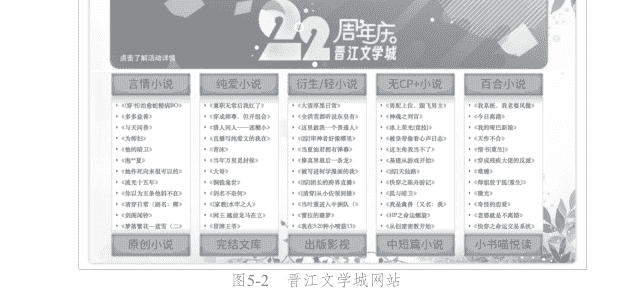

表5-2 晋江文学城的优势和劣势

| 类别 | 优势 | 劣势 |

| :--- | :--- | :--- |

| 用户偏好 | 女性用户占比75%；16～40岁为主；偏好言情、耽美、古代言情等情感细腻题材；读者对人设、剧情细节要求高；互动意愿强。 | 男性向题材生存空间狭小；硬科幻、硬玄幻等类型受众极少；年轻读者对“狗血梗”容忍度低。 |

| 流量分配 | 流量分配相对均衡；中小作者通过“题材标签+读者口碑”可获稳定曝光；长尾作品流量占比达30%（优于多数平台）。 | 总流量规模仅为起点的60%；头部作品曝光量上限较低；流量过度依赖女性向题材；跨领域推广难度大。 |

| 分成模式 | 版权分成突出（影视、动漫改编分成30%～50%）；订阅分成50%；“营养液”打赏分成作者得80%；适合擅长IP孵化的作者。 | 全勤奖与VIP收入挂钩，月更10万字（含罚额）基础全勤奖500元，若VIP收入低则实际收益有限；新人单纯靠订阅收益难以维持；版权合作需通过平台审核，自主性弱。 |

| 推荐机制 | 侧重“读者互动数据”（评论量、打分、章节订阅完成率权重高）；小而美作品易通过口碑发酵获得推荐；冷门情感题材有专属流量池。 | 对“开篇节奏”要求严苛（前5章未引发互动则后续曝光量骤减）；编辑主观判断影响大，部分符合数据的作品可能因风格不符被搁置。 |

#### 3. 潇湘书院

潇湘书院适合古代言情、穿越重生、宅斗等强情节古风题材，要求作品平衡“爽感”与“情感线”，中长篇篇幅作品更易获得流量倾斜，能精准匹配20～35岁女性用户对古风强情节内容的偏好，《庶女有毒》《神医嫡女》是典型代表。潇湘书院网站如图5-3所示，其优/劣势见表5-3。

表5-3 潇湘书院的优势和劣势

| 类别 | 优势 | 劣势 |

| :--- | :--- | :--- |

| 用户偏好 | 聚焦20～35岁女性用户；偏好古代言情、穿越重生、宅斗等强情节题材；读者对“爽感”与“情感线”平衡要求高；付费集中在中长篇。 | 现代言情、科幻等题材用户基数小；男性读者占比不足10%；题材拓展受限。 |

| 流量分配 | 向“古风强情节”作品倾斜；垂直领域流量密度高；符合调性的作品易获分类首页推荐；中小作者在垂直领域出头机会多。 | 总流量规模中等；非古风题材流量匮乏；跨题材作品难获全域推荐；流量增长依赖IP改编反哺。 |

| 分成模式 | “保底分成+版权分成”双轨制；古风头部作者可谈千字300～1000元保底；影视改编分成比例达40%；未上架作品月更6万字得300元，上架后日更4000字可获600元全勤奖。 | 非古风作品分成比例仅45%（低于行业平均）；打赏分成抽成高（平台得40%）；新人保底签约难度大。 |

| 推荐机制 | 分类推荐机制清晰；古风题材有独立流量池；作品标签匹配度高；垂直领域曝光精准；编辑对古风题材敏感度高，易发掘潜力作品。 | 推荐资源过度集中于“重生”“宅斗”等热门子题材；其他古风分支曝光不足；跨类别推荐几乎为零。 |

#### 4. 红袖添香

红袖添香侧重现代都市言情、豪门恩怨、职场情感等现实题材，偏好细腻文笔与传统叙事风格，适合节奏舒缓、侧重生活细节描写的作品，契合25～45岁女性用户对现实题材的需求，《何以笙箫默》《翻译官》均属此类。红袖添香网站如图5-4所示，其优/劣势见表5-4。

图5-4 红袖添香网站

表5-4 红袖添香的优势和劣势

| 类别 | 优势 | 劣势 |

| :--- | :--- | :--- |

| 用户偏好 | 用户以25～45岁女性为主；偏好现代都市言情、豪门恩怨、职场情感等现实向题材；读者付费能力稳定；对“细腻文笔”要求高。 | 当前年轻用户（25岁以下）占比仍不足20%；快节奏、轻喜剧题材整体接受度偏低；题材创新空间相对有限。 |

| 流量分配 | 注重“作品完读率”；完结作品仍有稳定长尾流量；现代言情作品在微信读书等渠道的分发占比高；跨平台曝光机会多。 | 整体流量增长缓慢；新用户获取能力弱；头部作品流量峰值低于晋江；平台内部流量竞争集中在老牌作者。 |

| 分成模式 | 全勤奖体系灵活（免费期月更9万字得200元，上架后月更12万字得600元）；对“断更补更”容忍度高；现实题材版权改编分成比例约50%（优于同类平台）。 | 订阅分成约50%（行业偏低）；打赏功能使用率低；新人单纯靠订阅收益微薄；依赖版权变现周期长。 |

| 推荐机制 | 侧重“完读率+读者年龄匹配”；现实向作品易获精准推荐；完结作品有专属“精选池”；长尾曝光稳定。 | 推荐更新频率低（每周一次大推）；新人作品等待推荐周期长；算法对“创新题材”敏感度低；传统套路文更易获得曝光。 |

#### 5. 创世中文网

创世中文网适合都市、科幻、悬疑等多元化题材，尤其青睐“轻脑洞”“强设定”的中短篇作品，对新人友好且流量分配均衡，能满足男女比例均衡的用户群体需求，《盗墓笔记》《全职高手》这类作品在此平台易获得初始扶持与稳定流量。创世中文网如图5-5所示，其优/劣势见表5-5。

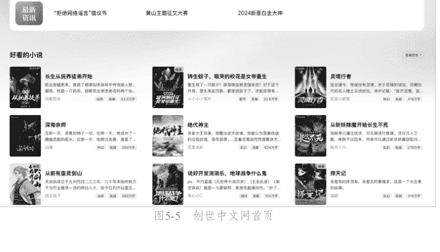

表5-5 创世中文网的优势和劣势

| 类别 | 优势 | 劣势 |

| :--- | :--- | :--- |

| 用户偏好 | 用户画像均衡，男频作品仍占主流，女性用户主要集中在都市、言情类；18～40岁为主；偏好都市、科幻、悬疑等多元化题材；对“轻脑洞”“强设定”作品接受度高；付费意愿中等。 | 用户黏性低于起点中文网；对超长篇（百万字以上）追读耐心不足；核心题材不够突出。 |

| 流量分配 | 分配相对均衡；新人作品可获“潜力池”扶持（日均曝光1万～3万）；非头部作品流量占比达40%；中小作者生存空间优于起点中文网。 | 总流量规模仅为起点的50%；头部作品曝光上限低；平台流量商业化开发能力弱（如IP改编较少）。 |

| 分成模式 | “订阅分成55%+保底分成”并行；新人可申请“千字100～300元保底”（门槛低于起点中文网）；全勤奖无断更惩罚（月更12万字得600元）；对新人友好。 | 版权分成比例偏低（约50%）；IP孵化资源稀少；打赏功能使用率较低；非头部作者额外收益极有限。 |

| 推荐机制 | 兼顾“数据”与“潜力”；新人作品前30章数据权重低；编辑可手动纳入“扶持池”；冷门类科幻、悬疑题材有专项推荐。 | 算法精准度不足（推荐流量与作品匹配度低）；头部推荐资源少；优质作品难突破流量瓶颈（曝光上限有限）。 |

### 5.1.2 特色化网文平台

特色化平台如同垂直领域的主题乐园，虽用户基数不及综合平台，却有着极高的用户黏性和精准的需求匹配。免费阅读、二次元文化等细分赛道的平台，正成为AI创作的新蓝海。本节解析番茄小说、刺猬猫等特色平台的生存逻辑，教你利用其规则放大作品优势，在细分市场抢占先机。

#### 1. 番茄小说（免费阅读赛道标杆）

适合投稿“现实痛点+超现实金手指”的脑洞奇幻、年代文、都市逆袭等快节奏题材，这类作品需在开篇快速设置冲突，兼顾爽感与生活化元素。例如《开局地摊卖大力》以都市底层逆袭为背景，融入“大力药水”金手指，贴合下沉市场用户对爽文的需求，长期占据平台免费阅读榜单前列；《万族之劫》凭借玄幻背景下的种族竞争与主角快速成长线，以高完读率成为平台流量标杆。番茄小说网站如图5-6所示，其优/劣势见表5-6。

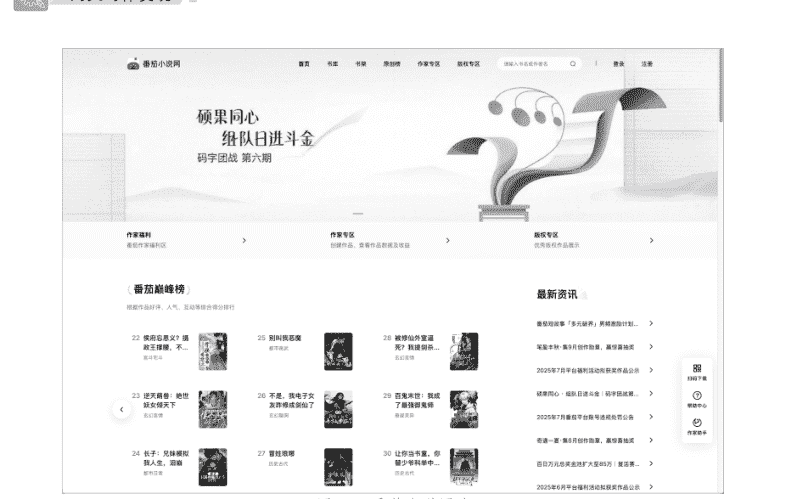

图5-6 番茄小说网站

表5-6 番茄小说的优势和劣势

| 类别 | 优势 | 劣势 |

| :--- | :--- | :--- |

| 用户偏好 | 以18～35岁下沉市场用户为主；热衷“现实痛点+超现实金手指”创新题材（如环保+直播+商战组合）；对脑洞奇幻、年代文等新兴题材接受度高；完读率超35%广告分成可达0.8元/千字。 | 用户对慢节奏、深度文学作品普遍耐心不足；女性用户占比已超60%，但男性付费转化率更高，导致情感细腻类题材受众仍有限。 |

| 流量分配 | 采用五级流量池算法（动态调整推荐权重）；头部作品可获日均百万级曝光；可通过抖音红果短剧等渠道破圈传播。 | 流量集中于“番茄风”套路文；新人作品需首10章完读率≥35%晋级。 |

| 分成模式 | 广告分成70%（完读率+5%单价上浮0.2元/千字）；全勤奖高激励（月更10万+完读率≥40%得2000元）；星火计划奖励Top100作品（最高10万元/月）。 | 收入依赖高强度更新（日更6000字以上）；独家签约需授权衍生权，非独家可保留，作者难以自主开发衍生权益。 |

| 推荐机制 | 核心指标权重明确：完读率（40%）>留存率（30%）>互动率（20%）>更新（10%）；“相似读者扩散”模型精准推送；“脑洞创意大赛”提供首页强推位。 | 冷门题材易被算法过滤；算法推荐为主，编辑干预极少。 |

#### 2. 刺猬猫（二次元内容高地）

聚焦二次元题材，适合“综漫同人”“轻小说风格+搞笑吐槽”“系统流二次元”等类型，需融入动漫梗、角色互动等核心元素。如《轮回乐园》以多个动漫世界穿梭为框架，融合热血战斗与吐槽风格，精准匹配平台16～28岁二次元用户偏好，长期稳居人气榜首；《我在异界搞基建》将系统流与轻小说叙事结合，通过基建升级剧情引发大量用户互动，获得推荐位倾斜。刺猬猫网站如图5-7所示，其优/劣势见表5-7。

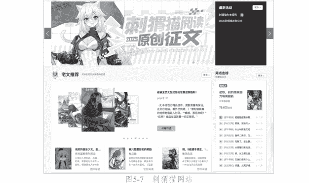

##### 表5-7 刺猬猫的优势和劣势

| 类别 | 优势 | 劣势 |

如何选对网文阵地？四大平台拆解避坑指南

刺猬猫：二次元轻小说的集中营

受众画像与经营态势

| 维度 | 优势面 | 劣势面 |
|---|---|---|
| 读者画像 | 以16-28岁二次元用户为主体，占比约七成五，偏爱综漫混搭系统、日系轻小说加吐槽等方向，对克苏鲁、蒸汽朋克等冷门分支也有稳定受众。 | 硬核男频如玄幻机甲不足5%，男性更倾向后宫、无敌流，对非二次元内容的容忍度偏低。 |
| 分发机制 | 划分20余个细分标签独立池，比如综漫同人、原创轻小说；评论区催更、玩梗等互动能抬升推荐权重；完结作品可入经典文库获得长尾，《魔王学院》完结两年仍保持月均10万+阅读。 | 整体盘子偏小，付费用户约10-15万，头部曝光不及起点，新人突围难；起签常从D级起步，收入薄弱，平台主动投放少，跨圈推广弱，硬核科幻等非二次元基本无推荐；算法要求连载稳定性高，中期发力易错失窗口。 |
| 收益与激励 | 订阅六成归作者，首订破千另补5000元；猫粮打赏作者得80%；动漫改编分成约30%，《我家大师兄》作者因此获百万收益。 | 全勤门槛高，D级月更12万字仅240元，A级960元；更新压力大，日均4000字左右。 |
| 推流规则 | 追读率35% > 付费率30% > 弹幕量25% > 更新率10%；使用角色情感共鸣模型做精准推送；每周二次元创意工坊提供看板娘推荐位。 | 编辑干预需符合平台二次元审美，可能限制创作自由度。 |

#### 3. 飞卢小说网：以爆点密度和日更速度冲榜

飞卢主推系统文配合高频反转、无限流叠加快节奏升级的强爽路线，要求单章埋三个以上爆点，日更万字以上更容易出圈。《亏成首富从游戏开始》以反向系统为核心，每章堆满商业反转笑点，创下平台新人首订破万纪录；《全球高武》凭借武道复苏设定与密集战斗升级长期霸榜，契合男性用户对高密度冲突的偏好。飞卢小说网如图5-8所示，其优劣势见表5-8。

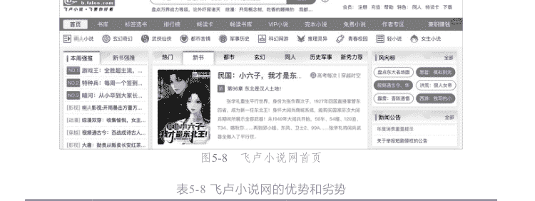

图5-8 飞卢小说网首页

##### 表5-8 飞卢小说网的优势和劣势

| 类别 | 优势 | 劣势 |
| :--- | :--- | :--- |
| 读者取向 | 10-30岁男性占九成，偏爱系统文+高频反转、无限流+快节奏升级，对日更万字级别的更新容忍度高。 | 对文字功底要求不高，深度叙事难以获得流量。 |
| 流量玩法 | 订阅榜、打赏榜实时更新直接决定推荐位，头部每小时刷新；新书首日连更十章可触发新人爆发池，日均曝光可达5万+。 | 流量高度集中，80%集中于榜前50名，新作首周首订未破千则流量骤降；小众题材获量困难，严重偏向系统文/无限流，历史、科幻等难获推；新人扶持薄弱，仅三天新书池基础曝光，首章付费率低于1%后无主动推荐。 |
| 分成与激励 | 独家签约分成70%；全勤激励高，VIP全勤月更30万字得2000元，非VIP月更18万字得200元；打赏分成55%，盟主可解锁定制剧情。 | 版权归平台；题材受限，禁政治、灵异等敏感内容。 |
| 推流逻辑 | 首章付费率40% > 订阅完成率30% > 追读率20% > 更新速度10%；爽点密度检测模型优先推高冲突作品；飞卢杯大赛提供至尊推荐位。 | 需通过爽感指数评估，限制多样性；过度依赖首章数据，慢热作品易被埋没。 |

#### 4. 黑岩网：悬疑IP孵化场

黑岩擅长第一人称悬疑、现实罪案、民俗灵异等品类，强调悬念铺设与逻辑自洽，短篇更容易获得IP改编机会。《民调局异闻录》以第一人称讲述超自然调查，融合民俗与推理，成为平台影视化标杆；《鬼吹灯之黄皮子坟》黑岩连载版凭借沉浸式盗墓叙事长期占据悬疑频道热门。黑岩网如图5-9所示，其优劣势见表5-9。

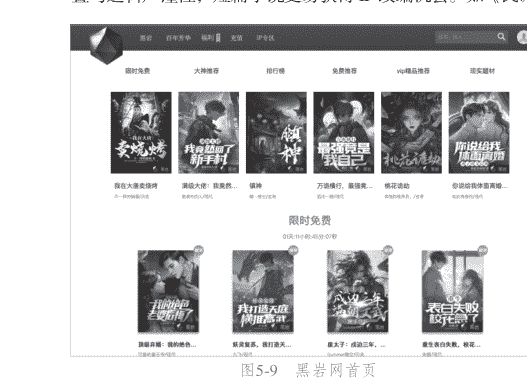

图5-9 黑岩网首页

##### 表5-9 黑岩网的优势和劣势

| 类别 | 优势 | 劣势 |
|---|---|---|
| 读者取向 | 25-45岁成熟读者占六成，偏好第一人称悬疑、现实罪案，对生活化悬疑接受度高，短篇改编潜力大。 | 题材偏窄，非悬疑类作品难以获得稳定流量。 |
| 流量玩法 | 设灵异怪谈、罪案实录等细分频道独立池；IP潜力作可入IP孵化池推荐；短篇通过故事会小程序矩阵在抖音、快手跨平台分发。 | 垂类依赖严重，悬疑/灵异占六成以上流量，历史、都市等非核心品类几乎无推；偏爆款导向，强钩子开篇受宠，中后段扎实但开头平淡的作品易被埋没。 |
| 收益与激励 | 订阅分成60%给签约作者；影视改编分成40%；短篇激励阅读破10万奖2000元+短剧改编奖5000元；IP影视化后作者分5%票房/播放收益。 | 全勤偏低，按均订分档月更8万字收入160-960元；对作品现实批判力度有限制。 |
| 推流逻辑 | 悬念密度35% > 逻辑严谨性30% > 读者互动25% > 更新10%；悬念钩子检测模型优先推荐高悬念作品；每周悬疑实验室提供黑岩剧场推荐位。 | 需通过编辑烧脑指数评估，可能限制创作自由；过度强调悬念密度，慢热作品易被漏掉。 |

#### 5. 咪咕文学：网文加短剧融合阵地

适合画面感强、易影视化的古风权谋、都市情感、轻科幻，作品需有清晰场景冲突与角色成长，便于短剧改编。《庆余年》咪咕独家连载版以古风权谋加穿越为核心，因强情节与镜头感被改编为爆款网剧，获跨媒介扶持；《长安十二时辰》凭借紧凑悬疑与细腻场景成为网文加短剧联动的典型，长期位居影视化潜力榜前列。咪咕文学网站如图5-10所示，其优劣势见表5-10。

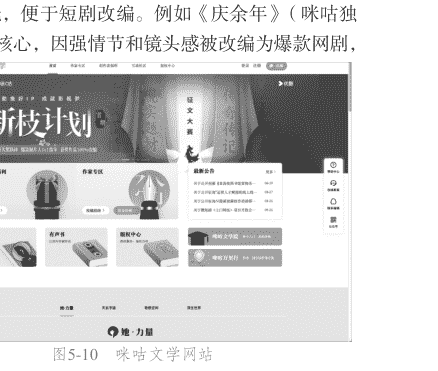

##### 表5-10 咪咕文学的优势和劣势

| 类别 | 优势 | 劣势 |
|---|---|---|
| 读者取向 | 对短剧向内容扶持力度大，改编成功率高。 | 对纯文学性作品接受度低，用户付费意愿偏弱。 |
| 流量玩法 | 跨媒介分发，同步投放咪咕阅读、视频号等渠道；IP孵化池提供短剧预制作资源；政企合作定制稿获定向流量扶持。 | 流量七成以上依赖中国移动自有渠道，外引能力弱；头部虹吸严重，Top10占六成流量；题材分配失衡，古风/都市占八成推荐位，小众难推。 |
| 收益与激励 | 影视改编分成30%-50%，头部IP可达50%；短剧奖励每集5000元剧本费；政企定制稿酬10万-50万元。 | 全勤偏低，月更10万字仅600-1200元且分阶梯，对价值观导向要求极严。 |
| 推流逻辑 | 算法聚焦影视化潜力，强调画面感/冲突密度；编辑干预提供咪咕剧场推荐位。 | 非影视化作品如纯文学、慢节奏几乎拿不到推荐资源。 |

## 5.2 平台入驻与运营要点

选对平台只是起点，入驻与持续运营决定作品生命周期。从投稿格式到签约条款，从数据维护到粉丝互动，每个环节都影响成败。本节把运营拆解为可操作步骤，结合AI创作特性给出针对策略。

### 5.2.1 投稿与签约策略

投稿是作品与平台的第一次见面，签约是合作法律基础。AI创作的小说投稿时需突出亮点，不同平台合同各有隐坑。本节提供稿件准备、审核偏好到合同解读的全流程攻略。

第一步，以四个热门网文平台为例做五维速查，见表5-11。

##### 表5-11 五维速查表

| 维度 | 起点 | 晋江 | 番茄 | 刺猬猫 |
| :--- | :--- | :--- | :--- | :--- |
| 受众画像 | 18-35岁男频为主 | 18-30岁女频为主 | 全性别下沉市场 | 二次元+轻小说 |
| 主打题材 | 玄幻/科幻/都市升级 | 言情/纯爱/无CP | 爽点密集无限风 | 同人/脑洞/玩梗 |
| 签约门槛 | 正文6千+大纲3千 | 1万字正文+情感塑造 | 2万字即可申签 | 3万字+500收藏 |
| 编辑最在意的3个关键词 | 金手指/首杀/升级体系 | CP张力/文案钩子/修罗场 | 节奏快/爆点密集/日更4000字 | 玩梗/吐槽/角色反差 |
| 合同风险Top1 | 20年全版权 | 10年全版权+笔名锁 | 全勤奖分阶梯，断更后流量池等级下降 | 同人版权不清 |

第二步，将表5-11上传至DeepSeek后输入提示词。
提示词示例：你是一名资深网文经纪人，请根据表格为以下作品选首发和二发平台，要求收益最大化。作品：都市修真+直播+女主无CP，轻吐槽文风，首卷6万字。
DeepSeek返回：
首发：晋江（女强无CP+轻吐槽稀缺，签约率25%，可冲金榜）
二发：刺猬猫（同人流量池大，可改男主视角进行二次创作）
保底：番茄（改爽文节奏，日更4k，拿满全勤）

第三步，选定平台后按要求投稿签约。起点中文网要求见表5-12；晋江文学城要求见表5-13；番茄小说要求见表5-14；刺猬猫要求见表5-15。

##### 表5-12 起点中文网投稿要求

| 起点中文网 | | |
| :--- | :--- | :--- |
| 稿件准备 | 字数与内容 | 需提交3万字正文+完整大纲，直发需满5万字后进入交叉审核。 |
| | 章节标题格式 | 统一为“第×章标题内容”，禁用特殊符号如★、【】。 |
| | 正文格式 | 对话单段、段落分明即可。 |
| | 大纲结构 | 按“卷-章-节”三级撰写。 |
| | 文件格式 | 仅限Word或纯文本，也可直接复制粘贴至后台。 |
| 审核偏好 | 开篇与数据 | 前3章需埋设核心矛盾；首周点击低于5000可能被判数据不佳，实际随题材时期动态调整。 |
| | 题材适配性 | 历史、玄幻等大类更易获推；冷门需通过“潜力评估”进入扶持，依赖收藏、订阅转化率。 |
| 合同条款 | 签书模式 | 单本签约，全版权授权期限作品完本后约20年，衍生收益另行协商。 |
| | 分成与福利 | VIP订阅5:5分成，均订过千收益显著；2025年新增“中下层作者扶持计划”：稿费未达5000元平台补足差额。 |
| | 风险提示 | 全版权授权+高违约金；解约需付已获收益3倍或10万元取高者。 |

##### 表5-13 晋江文学城投稿要求

| 晋江文学城 | | |
| :--- | :--- | :--- |
| 稿件准备 | 字数与内容 | 申签需发布1万字正文+简纲按“起承转合”4段约300字，同步上传封面200×280像素。 |
| | 章节标题格式 | 禁用无意义字符如★、【】，允许英文/拼音。 |
| | 正文格式 | 无强制字体字号要求，仅需排版清晰，对话格式无统一规定。 |
| | 简纲格式 | 需按“起承转合”分4段。 |
| | 封面要求 | 尺寸200×280像素。 |
| 审核偏好 | 内容侧重 | 文笔+人设优先，侧重人物情感细腻度与剧情创新性，拒套路化言情。 |
| | 数据门槛 | 审核期间不看收藏数，编辑仅评估书名、文案、前三章是否符合平台调性，收藏数是入VIP标准。 |
| 合同条款 | 签人模式 | 5年独家授权，禁止多平台发布，年更新量需≥20万字。 |
| | 收益与福利 | VIP订阅手机端5:5分成，电脑端4:6；全勤奖为上月VIP收入5%-15%，日更3000字可获“小粉花”。 |
| | 风险提示 | 签约到期默认自动续期，解约需付已获收益3倍违约金。 |

##### 表5-14 番茄小说投稿要求

| 番茄小说 | | |
| :--- | :--- | :--- |
| 稿件准备 | 字数与内容 | 需发布2万字正文，无须大纲，但需填“故事亮点”和“目标读者”。 |
| | 章节标题格式 | 第×章×××××。 |
| | 正文格式 | 推荐宋体小四，排版清晰适配手机阅读。 |
| | 对话格式 | 无强制对话格式或占比要求。 |
| 审核偏好 | 钩子与完读率 | 前三章需埋“金手指”或“身份反转”，首章完读率<25%失去“首秀流量资格”。 |
| | 题材适配性 | 都市、脑洞奇幻更易获推；小众需依赖“星火计划”扶持。 |
| 合同条款 | 签书模式 | 全版权授权至2045年，衍生开发收益平台主导分成。 |
| | 收益与福利 | 广告分成50%，日更4000字+听读≥500元得600+5%听读收入上限1500元；日更6000字得800+5%听读收入上限2000元。 |
| | 风险提示 | 断更超15天永久失去福利资格，违约金10万元或50%合同金额取高。 |

##### 表5-15 刺猬猫投稿要求

| 刺猬猫 | | |
| :--- | :--- | :--- |
| 稿件准备 | 字数与内容 | 常规投稿需2万-3万字正文+大纲，特殊征文需1万字，完本需80万字。题材需含ACG元素，需从平台ACG标签库选标签。 |
| | 章节标题格式 | 可用“第×话·标题”或日式格式，允许含日语词汇。 |
| | 正文格式 | 无强制字体字号，要求圆体四号字，允许颜文字和表情包每章≤5处。 |
| | 宅向标签 | 从平台ACG标签库中选择，需勾选多个。 |
| 审核偏好 | 风格侧重 | 动漫质感+轻松风格，侧重剧情“弹幕互动性”，拒严肃文学。 |
| | 数据即时反馈 | 审核侧重标题、文案、前三章是否符合二次元调性。 |
| 合同条款 | 签书模式 | 签书不签人，授权至版权保护期，衍生收益6:4分成作者60%。 |
| | 收益与福利 | 订阅打赏6:4分成；渠道收入5:5分成；刀片道具最高作者拿80%；全勤奖签约当月起按千字2-8元发放，30万字封顶。 |
| | 风险提示 | 注册后30天内未发布或清空作品，账号将被删除。 |

### 5.2.2 作品推广与粉丝运营
酒香也怕巷子深，即便AI写出优质小说也需主动推广和粉丝维护。平台推荐位、社交媒体引流、粉丝社群黏性构成破圈三大支柱。本节结合算法规则，教你用AI辅助生成推广素材。

#### 1. 抖音/小红书“3镜头爽点剪辑”
目标15秒完播率≥65%，点赞率≥8%，导流点击率>3%。

第一步，使用DeepSeek选台词。
在提示词框输入示例提示词并上传附件，如图5-11所示，DeepSeek将输出适配短视频的“钩子—反转—引导”三段式台词。

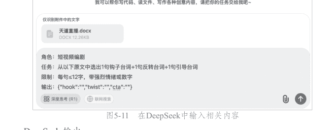

DeepSeek返回：
{“hook”：丹田被毁（核心钩子，前3秒抓注意力）。“twist”：999级火箭砸混沌灵根（剧情反转点，强化爽感）。“cta”：点主页看全文（引导动作，促进行为转化）。}

第二步，使用豆包生成字幕。
在豆包对话框输入示例提示词，如图5-12所示，豆包将输出优化后字幕，如图5-13所示。

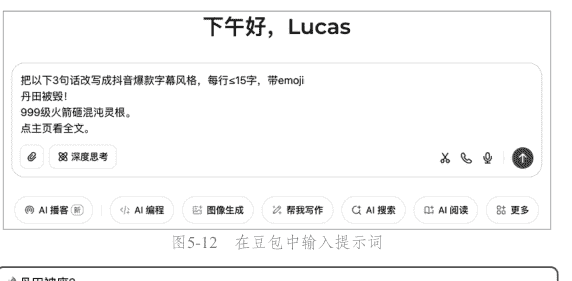

图5-12 在豆包中输入提示词

图5-13 豆包输出优化后的字幕

第三步，使用即梦AI生成场景立绘。
在即梦对话框输入示例提示词，如图5-14所示。

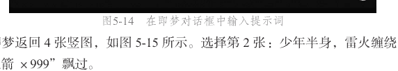

图5-14 在即梦对话框中输入提示词

即梦返回4张竖图，如图5-15所示。选择第2张：少年半身，雷火缠绕，弹幕“火箭×999”飘过。

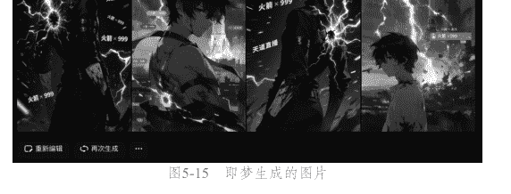

图5-15 即梦生成的图片

第四步，使用即梦AI生成视频。
打开选中图片，将图片生成视频，如图5-16和图5-17所示。

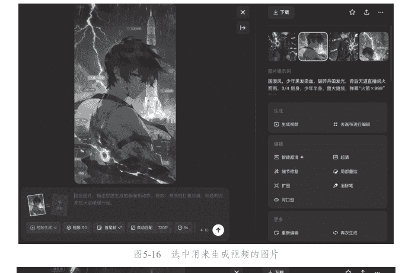

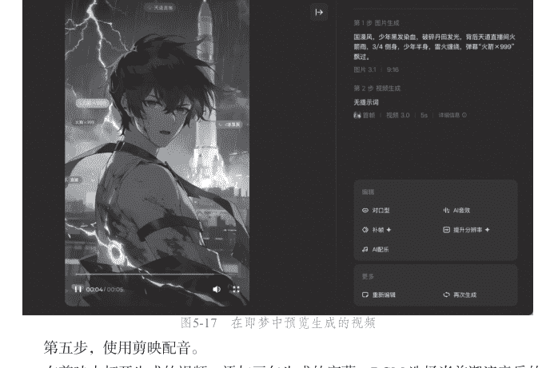

第五步，使用剪映配音。
在剪映中打开生成视频，添加豆包生成的字幕，BGM选当前潮流音乐高潮部分，完成后效果如图5-18所示。

#### 2. 微博热搜与话题“周历打法”
为持续营造话题热度、精准触达不同兴趣用户，微博热搜与话题可采用“周历打法”，围绕作品核心看点在一周内不同日期设置针对性话题，具体安排见表5-16。

表5-16 微博话题打法

| 周一话题 | #今日修罗场# |
| :--- | :--- |
| 周三话题 | #战力排行榜# |
| 周五话题 | #爽文名场面# |
| 周日话题 | #二次元梗图大赛# |

以周一话题“#今日修罗场#”为例。
第一步，使用豆包生成博文内容。在豆包对话框输入提示词，如图5-20所示。豆包输出如图5-21所示。
第二步，使用DeepSeek预测热度。在DeepSeek中输入提示词进行热度预测，示例提示词如图5-22所示。DeepSeek输出的文字如图5-23所示。

微博投票操作指南

打开微博客户端并完成登录后，点击界面右上角的加号图标，选择“写微博”进入编辑页面，如图5-24。进入编辑页后，在正文框下方的工具栏中找到加号，展开功能列表并选择“投票”，如图5-25。

投票标题填写在顶部输入区，建议字数控制在20字以内，例如“女主被三位大佬表白，你pick谁？”。添加选项时点按“选项1”输入首个答案，如“清冷仙尊”，系统默认提供2到4个位置，点击“+”可扩展至最多10个，如图5-26。时间设定方面，手机端提供1小时、1天、3天、1周四档预设，如图5-27；网页端可点选“自定义”精确到截止时刻。

核对标题、选项、时间无误后点击右上角“发布”，投票会同步展示在微博正文及个人主页。发布后可点开投票卡片查看实时数据，投票结束后系统会自动生成结果报告并支持导出分享。

第 6 章 人工智能辅助网文创作的版权边界与合规实践

当生成式工具能在十分钟内产出万字章节，“一键续写”“智能扩写”已成为网文日常，高效背后也让法律与版权的界线悄然移动。提示词能否为模型产出确权？平台协议中的权利条款有哪些风险点？未获授权的训练语料是否会让作品变现触法？本章从现行规则到落地方法，从权利归属到维权路径，为你梳理一套可执行的合规清单。创作自由始终建立在对规则的清醒认知之上。

6.1 人工智能创作的法律常识

工具普及后，“模型写的小说算谁的？”“生成内容撞梗谁担责？”已从理论讨论变为创作者的现实风险。

现行规范仍在动态完善，从《著作权法》对“人类智力成果”的要求，到各地法院的探索判例，再到已实施的生成内容标识新规，规则逐步勾勒出创作边界。

本节梳理国内及全球现行框架，拆解权利归属的争议焦点，厘清何时产出可受保护、何时构成越线。清晰的规则认知是创作底气。

6.1.1 现行规范对生成式创作的界定

把握边界需回到具体条文。这些条文直接回答创作者最关心的问题：谁能成为作品权利主体？训练数据如何合规使用？平台对生成内容的合法性需承担何种责任？以下三条是拆解问题的关键。

- ●法条速查 1
《中华人民共和国著作权法》（2020年修正版）。
第二条：著作权人包括“中国公民、法人或者非法人组织”。
第十一条：创作作品的自然人为作者；由法人或者非法人组织主持，代表其意志创作，并由其承担责任的作品，法人或者非法人组织视为作者。

- ●法条速查 2
《中华人民共和国民法典》第一百二十七条：法律对数据、网络虚拟财产的保护有规定的，依照其规定。
该条为数据与虚拟财产保护提供框架性依据，并未直接创设“数据财产权”。

- ●法条速查 3
《生成式人工智能服务管理暂行办法》（国家网信办等七部门令第15号，自2023年8月15日起施行）。
第七条第一款：生成式人工智能服务提供者应当对预训练数据、优化训练数据的合法来源负责，不得侵害他人知识产权或其他合法权益。

1. 国内规范对生成式创作的逐条解读
规制需层层展开，结合司法与行政实践搭建框架。

（1）主体资格：模型不能成为作者
主体资格是认定的根基。司法与行政实践正逐步厘清模型能否成为法律意义上的创作者，以及人类劳动对独创性的影响。

- ●司法确认
2019年12月北京互联网法院“菲林诉百度案”（案号〔2019〕京0491民初23824号），法院认为：纯由人工智能自动生成、缺乏人类独创性参与的分析报告，不构成《著作权法》意义上的作品。
2023年11月27日北京互联网法院“人工智能文生图”案（〔2023〕京0491民初11279号），法院认为：提示词设计、参数调优及后期筛选体现人类智力创作劳动，生成图片具备独创性并可获得著作权保护。

- ●行政确认
国家版权局2023年发布的《关于规范人工智能生成内容版权登记的通知》明确：人工智能生成内容的版权登记申请人必须是“对内容作出实质性贡献的自然人或法人”，强调人类在生成过程中的创造性投入如提示词设计、参数调整、后期筛选是版权归属的核心依据。该规则已在司法实践中落地并成为登记操作指引。

（2）客体范围：哪些产出可被保护
主体厘清后，客体聚焦产出能否构成作品。不同类型因创作方式与人类参与度差异，认定标准各不相同。

- ●文字作品
长篇小说、短篇故事、对话脚本：若提示词复杂、迭代次数多、后期人工润色比例≥20%，法院倾向保护（上海知识产权法院2024年判决）。

- ●美术作品
单幅插画：提示词≥150字、参数≥10项、后期PS图层≥5层，可认定独创性（深圳中院2024年判决）。

- ●视听作品
人工智能辅助动画短片：需人类完成分镜、剪辑、配乐。人工智能仅承担中间帧生成，整体可登记为“视听作品”。

（3）训练数据合法性
创作源头是训练数据的合规性。未经授权使用他人作品训练人工智能，既涉及《著作权法》合理使用的边界，也关乎司法最新态度与行业指引。

- ●合理使用条款
《中华人民共和国著作权法》第二十四条第（十三）项兜底条款：国务院所属机构可另行规定“其他情形”。截至目前，未出台针对人工智能训练的专门例外。

- ●合规指引
中国电子商会《生成式人工智能数据应用合规指南》建议采用“开放许可数据如CC-BY-SA、MIT、Apache 2.0 + 付费语料库 + 自建版权库”的组合方式，降低侵权风险。

（4）平台责任
内容进入传播后，平台法律责任边界至关重要。“通知—删除”规则与平台合理注意义务构成核心框架。

- ●通知—删除规则
《信息网络传播权保护条例》第十四条至第十七条规定，网络服务提供者接到权利人有效通知后，应立即删除或断开链接，并提供反通知恢复机制。

- ●平台注意义务
广州互联网法院人工智能生成内容侵权案（2023）确认平台未尽合理注意义务，需对生成的侵权内容承担责任。法院强调平台需采取合理技术措施避免明显侵权。公开判决显示赔偿金额约为1万元。

2. 海外主要法域规则对照
为呈现全球差异，下面对美国、欧盟、英国、日本等主要法域在人工智能是否可为作者、人类最低贡献标准等核心问题上的规定展开对照，具体内容见表6-1。

表6-1 不同国家和地区对人工智能创作相关版权规则比较
| 国家 | 是否承认人工智能为作者 | 人类最低贡献标准 | 保护期 | 训练数据例外 | 主要案例/指引 |
| :--- | :--- | :--- | :--- | :--- | :--- |
| 美国 | 否 | 人类需“控制输出表达” | 作者终身+70年 | 无专门例外 | Thaler v. Perlmutter（2025），明确要求人类创作。 |
| 欧盟 | 否 | 需“作者原创选择” | 作者终身+70年 | 无 | Infopaq, Painer判例确立原创性要求。 |
| 英国 | 是（计算机生成作品） | 无明确阈值 | 自创作完成起50年 | 有文本数据挖掘（TDM）例外（CDPA 1988 s.29A） | CDPA9（3），duration；英国政府正进行人工智能-版权公共咨询。 |
| 日本 | 否 | 人类需“创造性贡献” | 作者终身+70年 | TDM例外（著作权法第30条之4） | 日本文化厅正进行相关释法讨论 |
| 韩国 | 否 | 人类需“主导创作” | 作者终身+70年 | 无 | 韩国文化/创作部门发布人工智能创作讨论材料 |
| 新加坡 | 否 | 人类需“原创表达” | 作者终身+70年 | TDM例外（版权法2021修订） | 2023年IPOS《人工智能版权实践指引》 |

3. 国际规则与软法指引
在硬法尚未完全覆盖的新兴领域，软法常成为过渡指南，部分平台准则在实践中影响创作者权利边界。

世界知识产权组织于2024年发布的《知识产权政策工具包》提出，应识别人工智能辅助创作中谁作出创造性贡献，并建议记录与披露人类在人工智能辅助下的创作流程，未制定具体的量化标准。

《TRIPS协定》第九条第二款明确，版权保护仅及于“具体表达”，不涵盖思想、程序、操作方法或数学概念本身。该条款解释了为何人工智能算法本身不受版权保护。

案例分析：
案名：Thaler v.Perlmutter（美国哥伦比亚特区联邦地区法院，2023年8月18日）。
案情：Stephen Thaler将其人工智能系统DABUS创作的绘画《A Recent Entrance to Paradise》向美国版权局申请登记，署名“DABUS”。
判决原文要点：
“Human authorship is a bedrock requirement of copyright.”（人类作者是版权的根基要求。）
“The Act’s term ‘author’ excludes non-humans.”（《版权法》中的“作者”一词不包括非人类。）
“A work generated entirely by an AI system without any human creative input is not copyrightable.”（完全由人工智能生成且无任何人类创造性投入的作品不受版权保护。）
此案后，美国版权局以指引形式明确人工智能生成作品的登记标准，推动行业从权利归属模糊转向需明确标识人类创作部分，为全球网文平台处理人工智能内容提供实操参考。
美国版权局随后在2023年发布《人工智能生成作品注册指引》，要求申请人必须披露人类创作部分并填写人类作者姓名，否则不予登记。

6.1.2 生成式创作版权归属的争议与应对
版权归属像一道复杂方程，人类创意与工具的边界在哪？训练数据的迷雾如何拨开？跨境确权有哪些隐性壁垒？本节聚焦核心争议，呈现行业通过合同、技术与规则构建的平衡方案。

1. 争议焦点
版权归属本质是对创作主体性与权利分配逻辑的重构，分歧集中在三层面。

（1）创作贡献的界定争议
美国坚持“人类作者”是版权取得前提。D.C. Circuit在Thaler v. Perlmutter案中明确，《版权法》要求作品“首先由人类创作”，纯人工智能生成物无权登记。美国版权局《人工智能作品登记指引》（2023）要求登记时披露人工智能成分，仅人类独创部分可获保护。针对Jason Allen的《Théâtre d’ Opéra Spatial》，版权局复审委员会于2023年9月5日维持拒绝登记决定。
实践中，提示词/参数选择、迭代取舍、后期编辑被视为体现独创性的因素，但并无统一量化阈值。

（2）训练数据的版权连锁反应
大量案件聚焦未经许可抓取是否侵权、训练是否构成合理使用、输出是否构成实质性相似。例如Authors Guild诉OpenAI（SDNY, 2023）持续推进；在Bartz等诉Anthropic一案中，2025年6月加州北区法院认为对合法获得书籍的模型训练属于合理使用，但从“影子图书馆”下载并长期保存可能构成侵权，随后双方于2025年8月达成拟议和解。

（3）跨国确权的规则冲突
不同法域差异导致跨境传播合规风险。例如日本未承认人工智能为作者，官方发布的是“人工智能与版权的一般理解”，重点规范开发、训练含TDM与生成物的合规边界；而美国知识产权局要求必须明确自然人作者，否则不予登记。这种差异使同一部人工智能辅助小说在欧盟需标注“人类作者贡献比例”，在东南亚可直接登记为“平台所有”，增加合规成本。

2. 行业解决方案
面对法律滞后与实践需求，行业形成多层次路径。

（1）精细化合同约定
头部平台用户协议呈现“分级确权”趋势：Anthropic商业条款明确用户保留输出权利并提供一定法律保护，未设通用营收分成条款。亚马逊KDP要求作者上架或更新时披露是否含人工智能生成内容，目前并无统一“未填即自动下架”规则。部分平台在签约中加入人工智能相关补充条款，提示作者关注训练许可与再利用授权范围。

（2）技术辅助确权机制
司法实践已接受“创作过程证据”如提示词、迭代记录、后期编辑痕迹用于证明人类独创性。例如常熟“伴心”案认定原告通过提示词与后期加工体现独特选择与安排，作品可受保护。

（3）法定许可的地方实践
上海浦东探索“著作权行为发生地登记”的跨地域登记机制，便于相关创作、开发、交易在上海完成登记并获得全链条服务。线上办理流程显示：5个工作日内决定是否受理，受理后30个工作日内完成登记，不含补正时间。

（4）行业自律标准
国际与国内机构鼓励标注人工智能参与记录人类贡献以提升透明度。
这些探索指向核心：在法律未完全明确的过渡期，需通过“技术存证 + 合同约定 + 行业共识”构建动态平衡，既保护人类创作者权益，又为人工智能合理应用留出空间。2025年6月美国法院对Anthropic案的判决进一步表明，司法正通过“合理使用”原则为人工智能训练数据合法性划定边界。

6.2 版权保护与管理的实操打法
人工智能创作便捷，版权失守风险也高。从证据链构建到登记效力确认，再到维权路径选择，每一步都关乎合法权益。本节聚焦可落地策略，教你用技术固定证据，用法律捍卫权利。

6.2.1 如何留存创作证据链
北京互联网法院2023年判决明确，法院对人工智能生成内容的版权认定将聚焦“人类创作意图的外化过程”，这要求创作者建立系统化证据留存机制。

1. 提示词与参数记录：从指令到创作蓝图
提示词是人类创作意图的核心载体。在“李某人工智能绘图案”案中，法院发现图片虽由人工智能生成，但在设计制作时李先生花费了不少心思。设定提示词、调整画面参数、历经多次修改，每次调整都对应构图、服饰、情绪表达的精细化设计。这些记录与模型参数共同构成独创性贡献的证据链。
网文创作建议用“提示词日志”工具如Notion人工智能创作模板，按章节记录：①核心情节指令；②人物塑造细节；③风格参数。相关记录在某网文平台纠纷中被采纳为体现人类创意过程的证据，成为确权关键。

2. 时间戳与版本对比：用技术锁定创作时序
区块链存证的价值在于解决“时间在先”的权利证明难题。行业已有尝试利用区块链、第三方存证平台保存人工智能创作轨迹以增强可信度。
实操注意“版本颗粒度”，建议每完成500字修改或关键情节设计时存盘一次，避免间隔过长导致逻辑断裂。同时保留人工智能工具自动生成的版本号如ChatGPT的“Regenerate response”编号，与人工修改版本形成对应。

3. 修改痕迹：量化人类智力投入的关键
人工润色需保留修改前后文本对比，包括批注、理由说明、章节结构变动等。这类创作选择往往体现人类贡献，帮助法院认定独创性。若修改仅为标点或同义替换，则证明力不足。

4. 标识义务：从合规要求到权利声明
目前缺乏全国统一法律标准，但业界普遍建议在作品中标明人工智能参与方式，如“人工智能辅助创作”“人类润色”“人类明确参与内容范围”等。未标明可能影响法院对创作主体的判断。

6.2.2 登记流程与维权路径
版权登记是人工智能创作的“权利身份证”，维权是捍卫成果的“法律盾牌”。本节详解登记路径的费用、流程与特色，并拆解监测到诉讼的实操。

1. 登记渠道
人工智能创作完成后选择官方合规登记渠道是固化版权、降低纠纷的关键。国内主流渠道涵盖国家级与地方级平台，各有流程与周期差异。下面以国家级核心平台中国版权保护中心为例说明操作步骤。

（1）中国版权保护中心
登录中国版权保护中心官网后，在导航栏单击“版权登记”按钮，选择“作品登记”选项，如图6-1所示。随后进入作品著作权相关登记页面，如图6-2所示。登记机构受理登记申请后25个工作日内办理完成。

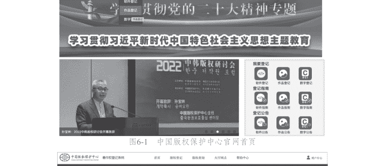

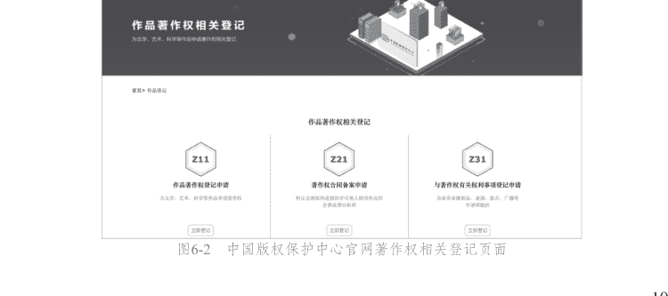

##### （2）北京政务办理入口
进入北京政务服务网首页，界面示意见图6-3。在页面顶部的检索区输入关键词“作品”，返回结果如图6-4。点选“作品自愿登记”进入申请页面，依据指引上传材料并提交，常规审核周期约为22个工作日。

图6-3 北京市政务服务网

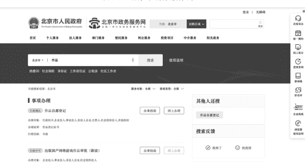

图6-4 北京市政务服务网官网搜索“作品”页面

##### （3）上海一网通办入口
打开上海一网通办官网，页面布局如图6-5。于搜索栏键入“作品”，列表如图6-6。点击“一般作品著作权登记”右侧的“立即办理”，跳转至登记表单，按要求填写并提交，核查时间大约30个工作日。

图6-5 上海一网通办官网

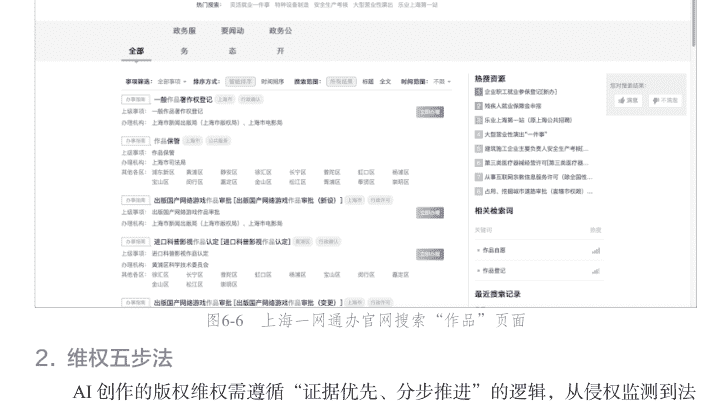

图6-6 上海一网通办官网搜索“作品”页面

#### 2. 维权五步法
对人工智能生成内容进行维权，应坚持先固证后施压的思路，由监测、取证到司法救济形成闭环，始终围绕权属证明与侵权事实展开，具体操作如下。

##### （1）监测：精准锁定侵权行为
监测是维权的基础，需覆盖人工智能生成内容可能出现的各类渠道，重点关注直接搬运、改头换面、片段盗用三种情形，具体要点见表6-2。

表6-2 精准锁定侵权行为

| 监测渠道 | 网文平台、短视频直播平台、电商平台、自媒体矩阵及专业生成内容平台均需覆盖。 |
| 监测工具 | 采用技术监测与人工核查结合的方式，利用第三方系统设置关键词自动抓取相似内容，人工重点比对预警结果与原作的相似程度。 |
| 监测记录 | 发现可疑侵权时，及时记录发布时间、链接地址、发布者信息、内容形式并分类标注。 |

##### （2）存证：构建不可篡改的证据链
存证要围绕权属唯一性与侵权真实性展开，确保材料具备司法采信条件，见表6-3。

表6-3 固定且不可篡改的证据链

| 存证内容 | 权属证据 | 区块链平台存证的创作记录、已办理的著作权登记证书。 |
|  | 侵权证据 | 包含网址、发布时间、互动数据的完整页面截图；展示完整浏览路径的录屏；侵权内容与原作的对比清单，标明重合部分与相似度。 |
|  | 辅助证据 | 监测系统的预警报告、侵权账号主体信息，可通过平台认证或第三方工具查询。 |
| 存证工具 |  | 优先选择法院认可的区块链存证平台，如蚂蚁链、腾讯至信链、中证天通链，或通过在线公证平台申请实时存证公证；内容易消失时可在24小时内办理线下公证处的证据保全公证，取得纸质公证书。 |
| 存证注意事项 |  | 需完整保留原始载体，不得修改截图尺寸或剪辑录屏，以免影响证明力。例如北京互联网法院2024年一起案件，原告因存证遗漏阅读量数据，导致侵权影响范围未能完全被采纳。 |

##### （3）平台投诉：利用平台规则快速止损
多数侵权发生在网络平台，依据《信息网络传播权保护条例》第十四条，通过平台投诉可迅速制止侵权，所需材料见表6-4。

表6-4 准备投诉材料

| 准备投诉材料 | 身份证明 | 个人提交身份证复印件，企业提交营业执照复印件。 |
|  | 权属证明 | 著作权登记证书、区块链存证报告。 |
|  | 侵权证据 | 清晰标注的截图、录屏及侵权链接清单。 |
|  | 投诉函 | 写明投诉人、被投诉人信息、侵权事实及诉求，如删除内容、限制账号、提供主体信息等。 |

提交可通过平台版权保护中心或举报入口，部分平台需签署《投诉承诺书》。提交后需跟进：平台一般24小时内初审，7个工作日内反馈。成立则删除内容并限制账号；不成立应要求出具《驳回通知书》并说明理由，以便补充后再次投诉。若平台无故拖延，需保存沟通记录作后续行政或诉讼依据。

##### （4）行政投诉：借助行政监管力量
平台投诉无果或涉及批量传播、商业获利时，可向行政部门投诉。

首先选择侵权地版权局或网信办，跨境传播可向国家版权局国际事务处反映。其次在权属、侵权证据基础上补充《行政投诉书》，说明社会影响及平台处理情况，并附侵权主体工商信息。

表6-5 行政处理流程

| 部门受理 | 材料齐备后5个工作日内决定是否受理，受理后出具《受理通知书》。 |
| 调查核查 | 约谈侵权主体、调取平台后台数据，通常30个工作日内完成。 |
| 处理结果 | 认定侵权成立，出具《行政处罚决定书》，责令停止侵权、没收违法所得，情节严重可处50万元以下罚款；拒不履行可申请法院强制执行。 |

行政投诉成本低、周期约2-3个月，出具的《著作权行政处罚决定书》可在诉讼中作为优势证据。例如杭州互联网法院2024年一起案件，原告提交的行政处罚决定书被法院直接采纳，缩短了举证时间。

##### （5）诉讼：通过司法途径主张赔偿
当损失较大如获利超过10万元，或需明确人工智能创作版权边界时，可提起著作权侵权诉讼，流程见表6-6。

表6-6 通过司法途径主张赔偿流程

| 诉讼准备 | 确定管辖法院 | 一般向侵权行为地或被告住所地互联网法院、知识产权法院起诉，多地侵权可择优管辖。 |
|  | 委托律师 | 建议聘请熟悉知识产权与人工智能法律的律师梳理证据、起草起诉状。 |
|  | 准备证据清单 | 按权属、侵权、损失分类整理；损失证据包括维权费用及侵权获利，无法举证实际损失可主张《著作权法》第五十四条500元至500万元法定赔偿。 |
| 诉讼流程 | 立案 | 提交起诉状及证据，缴纳诉讼费，法院一般7个工作日内立案并出具立案通知书。 |
|  | 举证与质证 | 举证期内双方提交证据，法院重点核查生成内容的独创性及侵权关联性。 |
|  | 庭审 | 围绕权属是否明确、是否构成侵权、赔偿金额三大焦点审理，必要时邀请技术专家出庭。 |
|  | 判决 | 一审一般在立案后6个月内作出，不服可上诉，二审为终审。 |
| 执行与后续 |  | 被告未履行时可在判决生效后2年内申请强制执行；可将生效判决提交平台要求永久封禁侵权账号。 |

# 第7章 拓展AI网文写作变现渠道
在人工智能与网络文学深度融合的背景下，完成创作只是第一步，如何将智能创作的网文转化为实际收益，是作者关注的核心。本章聚焦变现渠道，从自媒体平台到多元商业合作，提供可操作的方法与案例，助力创作价值最大化。

## 7.1 自媒体平台变现
自媒体已成为内容创作者的重要变现场域。智能网文作者借助平台流量与变现机制，可扩大传播并实现收益。文字为主的公众号与视听结合的短视频平台均提供了丰富可能。

### 7.1.1 公众号运营与变现
公众号凭借稳定用户基础与多元变现模式，成为智能网文变现的核心阵地。运营得当既能积累忠实粉丝，也能打开多条收入通道。

#### 1. 注册：从零开始拿到“官方身份证”
账号类型直接决定后续支付、分销等功能及运营节奏，先明确需求再选择。

（1）账号类型选择
账号分为公众号与服务号。公众号偏资讯，每天可群发1条，认证后部分开放高级接口与商户功能。服务号偏服务交互，每月可群发4条，认证后可开通高级接口与商户功能。建议初期用公众号练笔，粉丝破500后再迁移，最终以服务号为主。

（2）注册流程
打开微信公众平台后点右上角“立即注册”，如图7-1。注册页点选“服务号”，如图7-2。

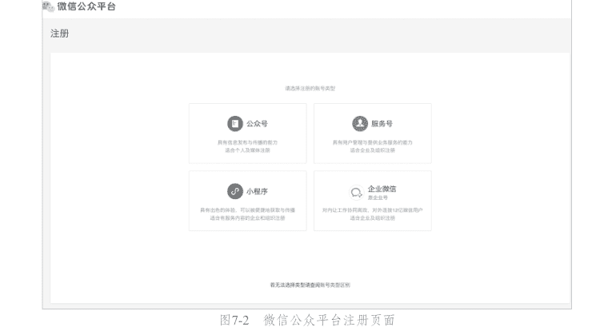

图7-2 微信公众平台注册页面

按指引填写基本信息、类型等，如图7-3。完成流程后等待1个工作日审核通过。

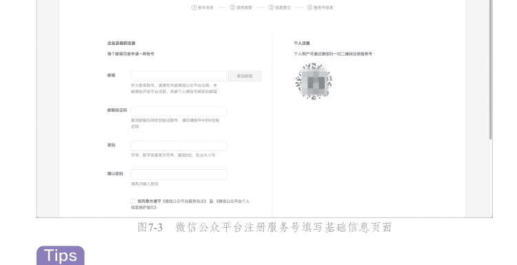

图7-3 微信公众平台注册服务号填写基础信息页面

> **Tips**
名称2-6字，提前在微信指数查重避免侵权。一个身份证仅能注册1个号，命名需谨慎。

#### 2. 涨粉运营：从0到5000的4条安全通道
变现能力建立在系统化准备上，目标读者画像是前提，后续策略由此展开。

（1）微信“问一问”引流
打开微信进入“发现”，进入“搜一搜”。

下滑至底部，点击“去问一问看更多内容”进入问一问页，在搜索框输入“小说”并搜索。

在合适问题下作答，建议30条/日。示例：推荐我正在追的爽文《××××××》，公众号【××××××】回复关键词【自救】看全文。

> Tips
每条≤50字，不带二维码，不重复，防限流。

（2）小红书图文倒流
用即梦AI生成配图，美图秀秀排版后批量套模板，文本替换至图片下方。笔记结构：首图大字“社畜穿书三天逆袭”；图2 AI原文截图打码；图3评论区截图“求全文”。正文80字内：姐妹们！这本AI写的穿书文太上头，女主三天反杀，全文在公众号【××××××】回复【自救】直接看！主页简介第一行放公众号名加emoji，评论区置顶完整版指引。

投放100元薯条：打开小红书App点“我”，侧栏点“创作者中心”，进入“成长中心”点“薯条推广”。选择笔记，定向18-25岁女性，兴趣小说/漫画。

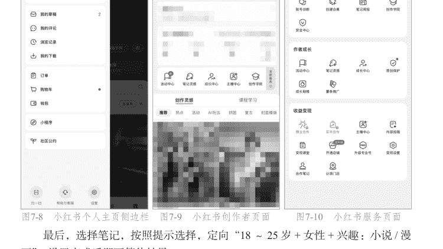

（3）老号互推
找到5个同体量号1000-5000粉互换词条。文案模板：推荐闺蜜宝藏号【××××××】，回复【自救】看爆爽穿书文。每周一次，避免粉丝疲劳。

（4）社群裂变
建微信群“今日限免小说”，进群门槛为转发推文到朋友圈并截图。

> Tips
粉丝破500立即开通流量主，破1000可申请小说分销白名单。

#### 3. 变现：七大变现方式，开启收益之门
公众号是创作者变现的重要平台，智能小说作者可通过以下主流方式实现收益。

（1）流量主
门槛较低，适合粉丝初期。开通条件为粉丝5000且近15天发布3篇以上原创。在后台广告与服务-流量主-立即开通申请。

广告位建议放在正文第4-6自然段，底部广告系统自动加载。避免广告紧挨标题，正文中广告前后各留120字以上正文，可加提示“以下内容免费，广告后精彩继续”。

收益每日中午12点更新eCPM，千次阅读约1-3元。建议每周导出数据分析高eCPM题材，指导后续选题。

（2）付费专栏
将小说结构化付费售卖。后台内容与互动-付费功能申请，需身份证、银行卡，审核1-3个工作日。

专栏可拆成30集，每集1500-2000字，第1集免费，第2-30集单篇0.5-0.8元，整本打包12.9元。新建图文开启付费开关，摘要写“前300字试读”。

连载节奏每周三更，周一、三、五晚8点推送。推送后10分钟内回复前10条留言营造抢前排氛围。关注付费率，单集低于5%可在下一集开头加100字悬念回顾，通常可提升2-3个点。

（3）会员制
锁定忠粉实现持续收益。可用小鹅通·社群版或知识星球建会员专区，设年费月费。

权益如提前48小时看新章、每月彩蛋番外、会员专属微信群作者每日在线30分钟答疑。菜单栏新增“成为会员”按钮跳转支付页，头图放二维码，文案“29元畅读30万字”。

到期前三天系统发模板消息并在群发续费红包，续费率可达42%。

（4）赞赏
读者认可的直接体现。后台内容与互动-赞赏功能创建账户并绑定微信号。

文末埋情绪点如“如果你也曾被家人误解，请点赞让我看到”。次日留言区置顶感谢名单并@前三名赞赏者，金额5-200元不等，易引发二次分享。

（5）小说CPS
按阅读时长分成拓展收益。申请番茄小说达人中心或U客直谈分销书单，复制专属小程序链接。文末写“完整版点这里”并超链接，系统按千次有效阅读20-60元结算。每周一自测链接避免404。

##### （6）接商单
当公众号具备一定影响力后，可通过软文植入获得品牌合作收益。

制作报价单时建议以 PDF 呈现，版位单价要清晰可查。头条、次条、菜单栏等位置逐项列明，文末主动写明可接受分账合作，例如销售额分成约 15%，这类表述往往能提升与广告主的议价空间。定价并非一成不变，需结合订阅号的受众规模与平均阅读量等经营数据灵活调整。

接单管理要流程化。广告主提出需求后，先用智能助手快速搭出内容骨架，再由创作者手工植入品牌场景与细节，保证语言自然。排期确认后按时上线，上线 72 小时后再提供数据截图做效果回溯。这样既压缩了周期，也守住了软文质感。

合规说明要前置。文章开头明确标注“本文为商业合作，请理性消费”，有助于降低投诉风险，保障合作的合法性。

##### （7）私域教学
将个人写作方法论产品化，是具备一定创作能力的作者常见的变现路径。

招生依赖案例说服力。先在订阅号发布经验型文章，比如《我用智能写作产出 10 万字，拿到第一笔广告分成》，用真实经历建立信任，文末放置课程二维码引导报名。

交付要工具化。直播选用腾讯会议，回放上传至小鹅通；学员作业通过飞书表格统一收集，助教每日点评以确保教学质量。

### 7.1.2 短视频渠道变现
把长篇小说拆解成一分钟左右的强钩子，投放到高流量池就能产生直接收益反馈。短视频并非补充，而是放大器。抖音的推荐机制擅长捕捉兴趣，快手的熟人经济转化效率高，视频号依靠朋友圈裂变快速沉淀私域。本节将三大平台的特质、门槛与前景整理为可复用的操作剧本，通过同类化拍摄、挂小黄车、开启直播，让文字真正具备商业飞行能力。

#### 1. 三大主流平台横向对比
不同平台的流量属性与变现逻辑差异明显，选择合适的平台是小说号变现的关键起点。为便于创作者匹配赛道，以下从核心优势、主要变现入口、收益区间和准入门槛四个维度，对抖音、快手、微信视频号进行横向对比，具体见表 7-1。

表7-1 三大主流平台的横向对比

| 项目 | 抖音 | 快手 | 微信视频号 |

| :--- | :--- | :--- | :--- |

| 核心优势 | 9亿日活、算法推荐精准、电商闭环成熟 | 下沉市场渗透率高、老铁经济黏性强 | 10亿微信日活、朋友圈转发无壁垒、支付闭环 |

| 主要变现入口 | 商品橱窗、星图广告、中视频计划、直播 | 快手小店、磁力金牛、直播打赏 | 视频号小店、直播打赏、付费专栏、广告分成 |

| 万次播放收益区间 | 2～30元（中视频计划20～100元） | 10～50元 | 暂无公开单价，直播打赏分成50% |

| 备注 | 需1000粉或加入中视频计划 | 0粉丝即可开小店带货 | 0粉丝可开直播，社交裂变快 |

#### 2. 抖音：算法红利 + 多元变现
抖音凭借精准推荐与成熟变现生态，适合追求流量的创作者。新账号发布 3 条以上横屏原创即可申请中视频伙伴计划，同时开通商品橱窗。

制作上，可用智能助手将小说高潮段落转为口播稿，结合剪映“图文成片”快速成片，标题采用“爽文/虐文+悬念句”吸流。

变现方式多样：中视频补贴万次播放 20～100 元，周三结算；橱窗挂载高佣金实体书等商品；接星图广告；粉丝达 1 万后可接单，单条 300～3000 元；另可固定时段直播分享智能写作经验，引导打赏或售卖知识付费课程。

#### 3. 快手：“老铁经济” + 0粉带货
快手更侧重信任关系，零粉丝即可带货。注册后开通快手小店，只需身份证和 500 元可退保证金。

内容以竖屏短视频为主，封面用大字突出“爽到爆”“已完结”等卖点；每日高峰时段发 1 条并用 20 元“粉条”冷启动，评论区置顶引导至订阅号。

变现上，小店可售小说、耳机等佣金 15%～45% 的商品，出单收益实时可见，T+7 提现；粉丝 5000 后可接磁力金牛广告，单条 200～1500 元；也可零粉开播输出干货靠打赏，主播分成 50%，实时到账。

#### 4. 微信视频号：社交裂变 + 多元闭环
视频号依托微信生态和社交裂变，利于私域联动。创建账号后绑定同名订阅号，开通视频号小店或微信小商店，无需保证金。

内容策略是截取小说高燃片段，引导用户到订阅号阅读全文，发布时 @ 订阅号并同步到朋友圈、群聊实现裂变。

变现可上架智能写作虚拟课程，零粉也能开启直播挂 29.9 元付费专栏，或靠直播打赏与平台 5:5 分成，收益实时提现至微信零钱；粉丝 5000 且发布 10 条原创后可申请广告分成，万次播放 5 ~ 15 元。

#### 5. 跨平台同步增效小技巧
执行“一材多用”策略：同一素材横版投抖音拿中视频补贴，竖版投快手、视频号做带货；每周五把各平台收益截图整理成“周复盘”图文发订阅号，顺带推广付费专栏；用飞书多维表格按“平台 + 时间”排程发布计划，记录“视频标题 + 挂车商品”，用颜色标记完成状态，避免漏更。

## 7.2 多元化商业合作
当订阅数成为可验证的影响力，作品就不再是单纯文字，而是通向影视、文创和消费场景的通行证。本章聚焦如何将故事版权、角色 IP、场景符号拆分为可交易资产，与影视公司、制造商、零售商实现分利共赢。

### 7.2.1 与影视公司合作
影视公司需要好故事，作者需要资金与渠道，把小说整理成“可拍清单”就能形成双赢。本节提供三种合作模型并附合同要点与时间表，帮助收益在项目启动前落地。

#### 1. 合作模型一：一次性版权买断
适用情形：故事主线清晰但 IP 热度尚未完全释放，作者希望快速回款或无暇参与改编。

操作路径：先准备影视化拆解资料，包括核心人物小传、故事大纲、高光片段；通过版权交易平台或经纪人对接擅长改编的影视团队；签约时明确改编范围、限制条款和交付时间。

案例参考：2024 年网文作者“青橙”经云莱坞平台，将订阅号连载小说《小镇法医》以 8 万元一次性售出，3 个月内到账。

#### 2. 合作模型二：分账改编
适用情形：角色人设鲜明、具备粉丝互动基础，适合做系列化开发。

操作路径：约定基础版权费 3 万 ~ 10 万元 + 票房/播放量分账，分账比例通常为影视项目总收益的 5% ~ 15%；要求参与改编确认会，每季度至少 1 次，拥有剧本大纲、选角建议、宣传物料的知情权和建议权；绑定宣发，利用订阅号粉丝资源配合宣传，可额外争取 1% ~ 3% 宣发分账；合同中明确结算周期、数据查询权、续集优先权。

案例参考：订阅号作者“老 K”的《电竞大神》采用基础费 5 万元 + 播放量分账，2024 年改编网剧在腾讯视频上线后，单季分账收益超 20 万元。

#### 3. 合作模型三：定制共创
适用情形：作者具备影视化思维，能按需求定制创作，或希望以编剧身份深度参与。

操作路径：前期与影视方共创创作大纲，明确主题、目标受众与平台调性；签署定制 + 编剧双协议，除版权费外另获编剧费，并在片头署名“原创编剧”；全程跟进剧本打磨、片场探班、后期剪辑；合同中约定修改次数、署名位置与违约赔偿。

### 7.2.2 周边产品开发
当小说中的标志性道具或角色符号被粉丝愿意付费收藏，IP 价值就从流量转向可触碰的消费。本节围绕元素拆解、合作生产、渠道销售三环节，帮助低成本试错、降低压货风险。

#### 1. 第一步：拆解可落地的 IP 元素
将内容提炼为大众可感知的核心元素，是连接虚拟故事与实体商品的桥梁。按角色、场景、符号三个维度拆解，具体分类与实例见表 7-2。

表7-2 拆解可落地的IP元素

| 维度 | 方向 | 元素 | 实例 |

| :--- | :--- | :--- | :--- |

| 角色维度 | 提取“标志性视觉符号” | 专属配饰 | 《长安客》主角的银质腰牌 |

| | | 经典穿搭 | 《民国大小姐》的月白旗袍 |

| | | Q版形象 | 适合做钥匙扣、贴纸 |

| 场景维度 | 转换“高频出现的场景” | 小说里的“忘忧酒馆” | 做成迷你酒馆模型、酒馆主题香薰 |

| | | 校园天台 | 做成场景明信片、笔记本封面 |

| 符号维度 | 提炼“专属Slogan/Logo” | 核心台词 | “别怕，我带你回家”印在卫衣上 |

| | | 定制IP Logo | 结合小说名设计，印在帆布袋、书签上 |

可通过订阅号投票筛选元素，如发起“你最想拥有的《××》周边”投票，按票数前三优先开发，降低市场风险。

#### 2. 第二步：选择低成本合作模式
为减轻资金压力并借助外部资源放大 IP，可选择以下三种合作模式。

##### （1）模式一：ODM（Original Design Manufacturer，原始设计制造商）代工
适合试水，首批 500～1000 件小批量试产。

实操步骤：在 1688 搜索“文创 ODM 工厂”，优先选支持小批量定制并提供设计协助的厂家；提供 IP 素材让厂家出三版设计稿，选定打样；控制首批总成本在 1 万元以内。

> **Tips**
要求厂家提供材质检测报告，如帆布为棉麻材质、油墨无异味，避免劣质产品损害粉丝信任。

##### （2）模式二：联名合作
适合已有一定粉丝基础的 IP，通过成熟品牌降低推广成本。

实操步骤：对接调性匹配的品牌，如古风小说对接国风文具品牌、悬疑小说对接咖啡品牌；约定无成本分成，品牌负责生产物流，作者授权 IP，按销售额 8%～15% 分账；包装上印订阅号二维码，扫码看番外，实现产品到粉丝的转化。

案例参考：2024 年订阅号作者“苏晓”的古风小说《簪花录》与国风美妆品牌联名推出“簪花眼影盘”，分账 12%，上线 1 个月销售额超 50 万元，作者分账 6 万元。

##### （3）模式三：众筹预售
适合高客单价产品，先收钱再生产，零库存风险。

实操步骤：在众筹平台发起项目，设置阶梯回报，如 99 元得 IP 书签 + 番外，299 元得角色手办 + 签名照；用订阅号做设计幕后和福利预热；设定首次目标 5 万～10 万元，达成后生产，未达成全额退款。

#### 3. 第三步：渠道销售
产品落地后需要精准触达粉丝。不同渠道在触达范围与转化效率上各有特点，具体渠道类型、操作方式见表7-3。

表7-3 渠道销售

| 渠道 | 方式 | 详情 |

| :--- | :--- | :--- |

| 核心渠道 | 订阅号私域 | 在订阅号菜单栏设置“IP 周边店”，发布“周边推文”；结合剧情阐述产品意义，搭配粉丝晒单返现提升转化率。 |

| 补充渠道 | 线下快闪 | 与本地书店、咖啡馆合作设立“IP 周边展示区”，张贴小说海报，扫码关注订阅号并购买周边，按销售额 10%～20% 给合作方分成。 |

| 运营技巧 | 绑定剧情消费 | 购买周边赠送小说隐藏剧情或解锁剧情，让消费成为粉丝参与 IP 的方式。 |

# 附录 AI 网文写作提示词模板

## 1.AI 工具选择与分工提示词模板

| 提示词类型 | 提示词模板 | 适用场景 |

| :--- | :--- | :--- |

| 大纲架构 | 以……（核心工具，如DeepSeek）为引擎，围绕……（网文题材，如玄幻/现实）搭建创作框架，要求……（质量标准，如逻辑严谨/论点明确），梳理……（核心要素，如知识脉络/关键冲突），输出……（成果形式，如分卷大纲/章节框架）。 | 用AI工具搭建小说整体骨架，如玄幻小说的分卷逻辑设计。 |

| 章节扩写 | 基于……（已有基础，如大纲节点/前文内容），以……（核心工具，如Kimi）整合……（信息类型，如资料/案例），完成……（扩写任务，如细节填充/逻辑补全），要求……（质量标准，如跨章节连贯/信息准确），输出……（成果形式，如完整章节/学术化内容）。 | 将大纲细化为具体章节，如悬疑小说的线索溯源与情节展开。 |

## 2.AI 工具写作指令构建提示词模板

| 提示词类型 | 提示词模板 | 适用场景 |

| :--- | :--- | :--- |

| 明确目标与主题 | 创作……（文体类型，如小说/散文），核心设定为……（核心剧情/人设，如主角成长线/世界观），围绕……（主题方向，如修真/职场），生成……（内容模块，如开篇/冲突情节），需契合……（风格/细节要求，如古风/五感描写）。 | 让AI工具精准定位创作方向，如现实题材小说的职场冲突设计。 |

| 指令优化（场景冲突/人物刻画） | 生成……（情节类型，如拍卖会冲突/仇人对峙），需满足：①……（冲突绑定要求，如主线线索/人设逻辑）；②……（关键信息暴露，如反派台词/角色动作）；③……（剧情推动目标，如指向新场景/揭示伏笔），输出……（内容形式，如对话/动作描写）。 | 强化文章情节张力，如玄幻小说的宝物争夺冲突设计。 |

## 3. 精准定位网文创作提示词模板

| 提示词类型 | 提示词模板 | 适用场景 |

| :--- | :--- | :--- |

| 题材洞察与趋势预判公式 | 基于……（数据维度，如行业报告/平台数据），拆解……（目标题材，如现实/科幻）的……（分析维度，如市场份额/用户画像/爆款逻辑），评估……（核心要素，如IP衍生潜力/受众偏好），输出……（成果形式，如创作方向建议/潜力评估报告）。 | 判断题材市场价值，如分析2025年悬疑题材的用户增长趋势。 |

| 个人优势与AI工具协同公式 | 用……（评估维度，如风格辨识度/角色塑造力）模型，评估……（自身作品，如大纲/片段）的……（分析目标，如优势/短板），结合……（AI工具，如Kimi/DeepSeek），制定……（优化策略，如风格强化/节奏修复），输出……（成果形式，如修改方案/提升方向）。 | 针对性放大创作优势，如用AI工具修复小说的读者流失段落。 |

## 4. 小说大纲生成提示词模板

| 提示词类型 | 提示词模板 | 适用场景 |

| :--- | :--- | :--- |

| 通用大纲 | 生成……（参考风格，如《全球高武》）风格的……（题材类型）大纲，包含……（核心要素，如×个转折点/×组阵营/×条悬疑线索），参考……（数据依据，如平台Top10节奏），分卷不超过……（卷数），标注每卷……（关键信息，如爽点类型/核心事件），输出……（成果形式，如分卷大纲）。 | 快速生成结构化大纲，如都市异能小说的分卷剧情设计。 |

| 分题材定制大纲 | 基于……（参考案例四要素，如基础设定/角色设定/情节结构/主题），创作……（题材+细分类，如现实悬疑+社会议题）大纲，需体现……（核心冲突，如程序正义vs舆论审判），篇幅约……（字数），输出……（成果形式，如完整大纲）。 | 垂直题材大纲设计，如历史穿越小说的时代背景与剧情结合。 |

## 5. 场景描写优化提示词模板

| 提示词类型 | 提示词模板 | 适用场景 |

| :--- | :--- | :--- |

| 场景风格定向生成 | 定义……（场景名称）（核心元素：元素1+元素2+元素3），生成……（数量）种风格（风格1/风格2/风格3）的描写，分别满足……（各中风格要求，如删减修饰词/突出五感），输出……（成果形式，如场景片段）。 | 多风格场景创作，如都市雨夜咖啡馆的极简/华丽风描写。 |

| 场景风格分步骤优化 | ①拆解……（场景名称，如隐世毒宗大殿）的……（设定维度，如建筑/器物/环境）；②补充……（细节类型，如具象化元素/专属设定）；③校验是否符合……（场景调性，如低调隐秘/恐怖氛围），删除……（违和元素），输出……（成果形式，如优化后场景描写）。 | 高适配性场景设计，如悬疑凶案现场的真实性细节补充。 |

## 6. 对话设计提示词模板

| 提示词类型 | 提示词模板 | 适用场景 |

| :--- | :--- | :--- |

| 角色定制对话 | 基于……（人设，如高冷法医/叛逆少女）（核心特征……（特征1+特征2+特征3），生成……（场景，如勘查现场/师生对话）的……（数量）句对话，覆盖……（功能类型，如纠正错误/解释发现），每句不超过……（字数），输出……（成果形式，如对话片段）。 | 贴合人设的台词创作，如仙侠小说中将军与皇子的对话设计。 |

| 冲突张力强化 | 在……（场景，如刑侦审讯室/修仙拍卖会）中，设计……（角色关系，如嫌疑人vs刑警/主角vs反派）的对峙对话，需包含：①……（直白句，如戳穿谎言）；②……（细节暗示句，如动作/环境线索），提升……（目标，如读者追问欲/情节张力），输出……（成果形式，如对话片段）。 | 高冲突对话设计，如都市小说中主角与反派的台词博弈。 |

## 7. 平台匹配推荐公式

| 提示词类型 | 提示词模板 | 适用场景 |

| :--- | :--- | :--- |

| 平台匹配推荐公式 | 根据……（平台1）/（平台2）/（平台3）的……（关键维度，如受众画像/签约门槛/流量规则），为我的……（作品信息：题材+人设+篇幅+风格）推荐……（投放类型，如首发/二发）平台，制定……（目标，如收益最大化/曝光提升）的方案，输出……（成果形式，如投放建议）。 | 选择适配平台，如女主无CP玄幻小说的起点/晋江投放选择 |

## 8. 作品推广素材生成公式

| 提示词类型 | 提示词模板 | 适用场景 |

AI写网文变现实操

短视频内容转化 · 抖音/小红书
从指定作品里拆解钩子-反转-引导的三段结构，每段控制在限定字数内，改写为符合平台爆款字幕的表达，搭配场景提示词，同时输出国漫风格立绘等视觉生成提示，最终交付台词与视觉提示组合。典型场景是玄幻小说的抖音引流钩子视频制作。

社交话题策划 · 微博
围绕指定作品规划周期性话题，例如#今日修罗场 / #战力排行榜，为核心话题制作带投票或问答互动的文案，设置选项A/B/C，预估24小时阅读量等数据表现并给出最佳发布时间，最终交付话题文案与数据预测。典型场景是仙侠小说的微博话题推广设计。

新手友好 可落地 轻松变现

• 跳出靠时间换钱的循环，有了AI工具加持，上班族和大学生也能用文字创收，远离固定工资的焦虑。
• AI能力叠加实战方法，一本覆盖爆款题材、开头抓人技巧、变现路径，系统学一次就能避坑。
• 免囤货免资源，只要会打字喜欢阅读，跟着教程用AI写网文，快速拿下网络写作者身份。
• 为普通人定制的可执行变现指南，不讲空理论，全是落地步骤，从工具挑选到平台分发全覆盖。

销售分类建议：人工智能 / 写作方法
定价：59.00 元