# AI 美学大师

## 序 言

人工智能（artificial intelligence, AI）不再只是冷冰冰的工具，它正逐渐成为一种全新的艺术语言。当“以词生图”成为可能，我们开始重新思考：什么是创作？什么是美学？谁又是艺术的主体？

本书诞生于这一时代的激荡之中，旨在为所有对 AI 图像生成怀有好奇与热情的读者，提供一套系统而深入的美学指南。从技术原理到提示词策略，从古典风格到当代表现，从西方经典到东方语汇，从朋克幻想到数字迷幻——我们既关注图像的视觉形式，也关注生成操作背后的文化逻辑与创作者主体的转变。

全书分为两大部分。第一部分“AI 美学释义”，系统梳理了 AI 图像生成的工作机制、提示词构建方法与风格语言的表达逻辑，帮助读者建立理解与创作的理论基础；第二部分“AI 作画示例与赏析”，则以风格分类为纲，结合大量 Midjourney 生成实例，分析不同提示词组合如何呈现多样化的视觉美学，并在最后设有理论回顾章节，凝练地揭示提示词写作的美学意义与创作伦理。

在 AI 深度介入创作的今天，美术教育的边界正在拓展，艺术实践的方式正在重构。本书并不试图为“什么是 AI 艺术”下一个标准定义，而是希望搭建一座知识与灵感的桥梁，引导你在这个由语言驱动的图像世界中，成为真正的“创作引导者”和“视觉策划人”。

你不再需要精通绘画技巧，也无须具备美术专业背景，只要理解提示词的逻辑、风格的符号、构图的奥义，你就可以用文字构建图像，用概念驱动美学。这是一场去技法化的艺术解放，更是一次语言与图像共同书写未来的实验。

我们相信，AI 图像生成并不是终点，而是一个起点——通往艺术多元可能性的起点。愿这本书成为你在 AI 美学旅程上的第一块踏板，带你走进那个由想象力与算法共同塑造的视觉宇宙。


AI 正在以前所未有的方式参与图像的生成与风格的塑造，也促使我们重新思考一些根本性的问题：什么是美？又是谁在决定它的样貌？

AI 美学的出现并非意味着传统美学的终结，而是开启了一种前所未有的协作形式。在这种形式中，图像不再完全依赖人手描绘，而是通过语言被“提示”，经由训练模型被“理解”，最终以某种似懂非懂的方式被“生成”。这一过程打破了以往创作与技术的界限，使得美的生成逻辑从感性直觉与技艺积累，转向了对语义、算法与文化语境的编织能力。

本部分将引导读者进入 AI 美学的基本语境，厘清它与传统视觉艺术之间的连续性与断裂点。从生成机制到风格演化，从语言构建到图像偏好，我们试图揭示 AI 在“如何画”之外，为何如此“思考”，为何偏好某些风格，又为何能在某些领域产出令人惊艳甚至陌生的图像成果。

这一部分并非技法的传授，而是一次理论与直觉的校准。在面对强大生成能力的同时，我们也必须意识到，美学判断力、语言精确度、文化理解与批评意识，将是未来 AI 图像创作者真正的核心竞争力。只有当我们理解了 AI 背后的视觉逻辑，我们才能真正以创作者的身份，与它共同构建出属于这个时代的视觉新语言。

## 第 1 章

### AI 美学基础

在进入丰富多元的 AI 视觉风格世界之前，我们先要掌握两项基础：一是理解 AI 美学背后的核心概念，二是熟悉图像生成的操作流程与规则。这是所有 AI 图像创作的起点，也是建立个人 AI 视觉语言体系的前提。

所谓“AI 美学”，并不是指 AI 所具有的审美能力，而是指人类通过与 AI 协作，借助算法进行艺术创作时所呈现出的新的视觉风格与感知模式。这种美学不仅反映了技术发展的语境，也重构了“创作”的边界与意义。在 Midjourney 等 AI 图像生成工具的推动下，我们进入了一个“提示词即绘画”的时代，许多艺术家从执笔者变为描述者，语言成为图像的起点，生成逻辑成为风格塑造的关键。

本章将从基础出发，先带领你了解 AI 美学的发展脉络、核心术语与美学特征，然后以 Midjourney 为例，介绍 AI 图像生成的全流程——从注册与进入平台，到提示词构建与图像生成，再到参数设置与进阶功能的使用。你将在这一步拥有基础的操作感与初步的风格掌控力，为后续的美学探索与案例实战打下坚实基础。

在 AI 时代，美学不再是一种被动的观看，而是一个由你主导、AI 协作的共创过程。从现在起，你将成为这场变革的实践者。

#### 1.1 了解 Midjourney 软件

Midjourney 是一款基于 AI 技术的图像生成平台，通过自然语言提示词（prompt）驱动图像创作。它凭借独特的美学输出能力、广泛的风格适应性和社区驱动机制，成为当前最受欢迎的 AI 图像工具之一。相比传统的绘图软件或开源扩散模型（如 Stable Diffusion），Midjourney 不依赖本地部署，也无需用户具备深度学习背景，更强调“创意”与“表达”的主导地位（图 1-1）。

##### 1.1.1 Midjourney 的工作逻辑

Midjourney 基于“扩散模型”（diffusion model），其核心思路是将一段随机噪点“逆向还原”为一张具象图像。这个过程由训练好的神经网络逐步执行，而影响图像“最终长什么样”的关键因素，便是用户输入的提示词。

提示词是 Midjourney 接收用户意图的主要接口。它可以包含对象（如 castle、cat、mountain）、风格修饰（如 Baroque style、dreamy lighting）、构图词汇（如 portrait、isometric view）等。用户通过自由组合词汇，控制生成图像的主题、风格、光线、氛围以及构图方式。

Midjourney 对提示词的响应能力强大，表现出的美学结果也极具统一性和艺术感，这正是它在设计师与视觉艺术爱好者中广受欢迎的原因（图 1-2）。

自 V7 模型发布以来，Midjourney 的提示词识别能力发生重大变化。用户可直接使用中文提示词进行图像生成，系统将自动进行语义识别并将中文提示词转化为图像构图意图。此外，V7 在处理复杂描述、多重风格与抽象语义上表现出更高的稳定性，这使得提示词创作更偏向“主题表达”而非“语序控制”。

值得注意的是，Midjourney 并没有传统意义上的“软件界面”，它并不以独立 App 或网页工具的形式存在，而是深度整合在聊天平台 Discord 中。

##### 1.1.2 Discord 介绍

Discord 是一款全球流行的实时聊天工具，最初为游戏社区服务，现已广泛扩展到设计、教育、科技等多个领域。Midjourney 将其 AI 图像生成功能集成在 Discord 中，有以下三个核心原因：

社区协作性强：用户在公共频道中输入指令，AI 生成图像后会将其实时显示在公共频道中，其他人可以查看、点赞并参考提示词。这种机制营造了“创作即分享”的氛围。

指令式输入简洁清晰：所有图像生成都以斜线命令（如 /imagine）触发，符合开发者与设计师的使用习惯。

便于运维与迭代：Discord 支持权限控制、Bot 调用、实时推送，便于团队对模型版本、参数功能进行灵活更新。

对新手而言，虽然首次接触 Discord 可能略感陌生，但只要完成注册、进入官方频道，并掌握基础命令结构，就能快速进入创作状态（图 1-3）。

##### 1.1.3 Midjourney 操作入口详解

Midjourney 的所有图像生成操作都在 Discord 平台上进行，这意味着理解 Discord 的基础界面结构与功能按钮，是顺利使用 Midjourney 的前提。

以下是 Discord 与 Midjourney 交互时，最常用的界面与功能说明：

**1. 频道结构：图像生成的主场所**

加入 Midjourney 官方服务器后，左侧频道栏会显示多个子频道：

- #newbies-××：新用户图像生成频道（×× 为编号），适合练习与观察他人提示词。
- #announcements：平台官方发布模型更新信息、参数变动说明、活动公告的地方。
- #status：系统运行状态与服务维护提醒。
- #trial-support / #general：社区交流与新手提问区。

初学者建议在 #newbies 中操作，在这里你可以直接输入 /imagine 开始生成图像，并看到他人提示词与生成结果，快速学习常用表达（图 1-4）。

**2. 输入栏与命令触发**

在频道下方的输入框中，输入 /imagine，系统会自动提示 “prompt: ”，你只需在后面补充描述内容（英文为主），按回车键即可提交生成。

例如：

```
/imagine prompt:A majestic castle on a hill, cinematic lighting, sunset,--ar 16:9
```

你可以输入多个 /imagine 命令，但注意每次提交后通常需要等待约 30 秒的生成时间（图 1-5）。

**3. 图像结果展示区域**

针对每次提交的提示词，Midjourney 会生成 4 张初始小图（即 4 宫格样式），并在图下方显示一组按钮用于后续操作：

- U1/U2/U3/U4 (Upscale)：将第 1 ～ 4 张图中的任意一张放大，生成细节更清晰的版本。
- V1/V2/V3/V4 (Variation)：基于第 1 ～ 4 张图的构图风格生成变体图组。
- 刷新（Re-roll）：重新根据原始提示词生成全新 4 张图。

鼠标还可在图片上点击以查看大图，右键另存为高清图（图 1-6）。

##### 1.1.4 搭建私人服务器

虽然 Midjourney 官方频道为用户提供了练习和学习的平台，但由于频道内用户众多、信息更新频繁，界面很容易被其他用户的生成内容“刷屏”，不利于个人集中创作与系统管理。因此，搭建一个专属的私人 Discord 服务器，是提升创作效率、保证创作独立性的重要方式。

以下是构建个人 Midjourney 创作空间的完整步骤：

**1. 创建自己的 Discord 服务器**

登录 Discord 账号后，在左侧服务器列表下方点击“+”图标，选择“创建我的服务器”。你可以跳过用途选择步骤，直接为服务器命名并上传头像。创建完成后，服务器名称将出现在左侧栏中，此时你已成功拥有一个专属的创作空间（图 1-7）。

**2. 将 Midjourney Bot 添加进你的服务器**

进入新建的服务器，在顶部服务器名称旁点击下拉箭头，选择“应用程序商店”（App directory），或通过访问 Midjourney 官网 https://www.midjourney.com，点击“Invite the Bot”进入授权界面，选择你刚刚创建的服务器进行授权，系统确认后 Midjourney Bot 即加入该服务器。

你如果已在 Midjourney 官方频道，可以右键点击 Bot 头像，选择“添加到服务器”，同样能够实现 Bot 迁移（图 1-8）。

**3. 创建专属文本频道**

在你的服务器内点击“+”号添加频道，选择“文字频道”，命名为如“midjourney 创作”“图像生成室”等，方便归类管理。建议一个频道对应一个使用目的，如人物练习、建筑草图、色彩测试等，这有利于后期复查（图 1-9）。

**4. 设置权限与角色**

为了保证 Bot 功能正常运行，并便于日后管理服务器成员，你可以进入“服务器设置→角色（Roles）”，为 Midjourney Bot 单独设置一个角色，并赋予其发送消息、上传图片、读写权限等基本功能。同时，你可

# AI 美学大师：提示词与艺术风格全解读

以为合作者、访客设置不同的访问权限，构建灵活的创作社群结构（图 1-10）。

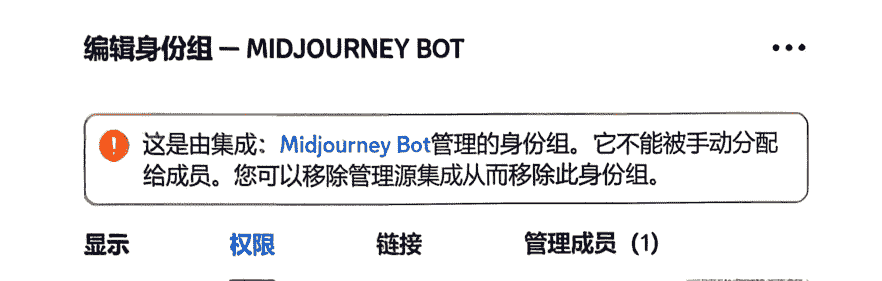

图 1-10 权限管理

## 5. 在服务器中使用 Midjourney 进行创作

完成以上设置后，你就可以在自己服务器的文字频道中像在公共频道一样使用 /imagine 命令输入提示词，系统将在频道内直接返回图像。由于这是你的私有空间，不会受到他人提示词干扰，你可以专注于构图、语言调整和风格迭代（图 1-11）。

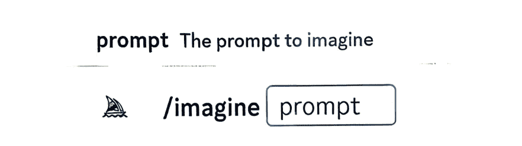

图 1-11 Midjourney 提示词指令

相较于公共频道，使用私人服务器具有以下几项优势：
- 能够保障创作的独立性：所有的提示词和生成的图像都集中展示，不会被他人信息干扰。
- 提升社群互动性：你可以将邀请链接发送给朋友或团队成员，共同在频道内进行练习、交流作品风格策划等层面的问题。
- 具备高效的管理性：支持自定义频道结构，可以按照不同的创作主题进行分类管理，权限的设置也非常灵活，适用于不同的目的。
- 扩展能力强：不仅可以接入其他设计类 Bot，还能集成任务管理工具，打造集生成、管理与协作于一体的 AI 创作工作室。

#### 1.2 从基本生成流程到进阶指令详解

完成 Midjourney 账号注册并熟悉平台操作之后，我们的核心任务就是开始进行图像生成。表面上看，AI 图像生成似乎只是“输入提示词—等待结果”，但实际上，最终生成的画面能否准确表达创作意图，与提示词的组织方式、参数设置以及后续的指令操作密切相关。本节将系统梳理图像的基本生成流程并详解各类进阶参数与指令，帮助你充分发挥 Midjourney 的 AI 美学能力。

##### 1.2.1 生成全流程示范

Midjourney 的图像生成操作均通过 /imagine 指令触发。你只需在 Discord 输入框中键入 /imagine，系统会提示“prompt:”，此处为填写提示词的区域。

完整指令及其生成图示例：

```
/imagine prompt: 未来城市，日落背景，电影感光影，超广角构图 --ar 16:9 (图 1-12)
```

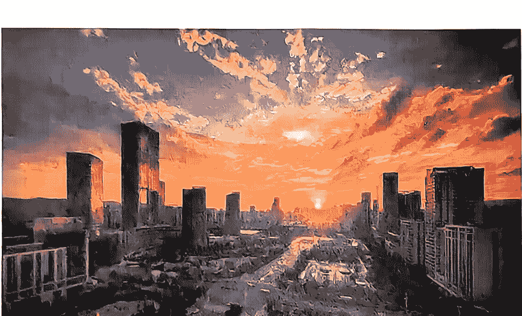

图 1-12 日落城市生成图

上述命令包括以下要素：
- 主题内容：未来城市
- 风格修饰：日落背景，电影感光影
- 构图与细节：超广角构图
- 参数设置：--ar 16:9（横屏宽高比）

虽然 Midjourney V7 版本已支持中文提示词输入，但建议实际创作时优先使用英文提示词。英文是系统训练的核心语言，提示词的语义识别与风格控制在英文输入模式下更为精准。后续章节将以英文为主，每条命令后附中文翻译；本小节仍用中文演示，以展示兼容性。

Midjourney 对提示词字数没有严格限制，但建议控制在 2 行内，促使信息更聚焦。关键词用逗号或空格分隔，不强求语法完整。

提交 /imagine 命令后，Midjourney 进入排队生成状态。通常 10 ～ 60 秒后，你会看到一组图像（2×2 四宫格），默认为“快速模式”，构图和细节略有差异，方便挑选（图 1-13）。

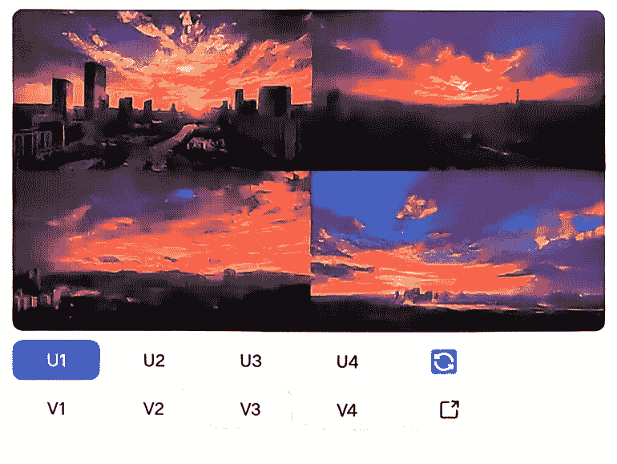

图 1-13 生成操作按钮

图像下方自动生成一组操作按钮：
- U1 ～ U4（Upscale）：将某一张放大为高清版本
- V1 ～ V4（Variation）：基于某图生成新变体
- Re-roll：根据原提示词重新生成 4 张图

你可以放大、保存图像或要求生成变体，具体操作见下一小节详述。

##### 1.2.2 图像放大、变体生成

点击任一图像对应的“U”按钮可高清放大（1024px ～ 2048px）。图像可直接右键保存，也可用“Open in Browser”新标签下载。升级后的图像通常细节增强、边缘清晰，适合创意精修或用作参考。

变体按钮（V1 ～ V4）可以快速获得基于同一构图和风格的不同图组。例如，V1 会基于第一张图生成 4 个新版本，适合寻找细节、布局或氛围的多样化方案。

##### 1.2.3 进阶指令与特殊参数功能

为了让 AI 图像输出更精准地贴合你的创意，Midjourney 支持多种进阶命令和参数。掌握这些命令，可以大幅提升作品的稳定性、风格一致性和实用性。

所有 Midjourney 指令以 “/” 开头。
- /imagine：生成图像
- /settings：打开参数设置面板（模型版本、风格等）
- /info：查看账户状态与剩余时间
- /help：帮助文档
- /prefer suffix：为提示词预设结尾，提升效率

常用参数详解与应用技巧列举如下：

1. --ar（aspect ratio 宽高比）

控制画面比例，如 16:9（横屏）、9:16（竖屏）、1:1（方图）。

示例：

```
/imagine prompt: A futuristic palace（未来感宫殿）--ar 3:2 (图 1-14)
```

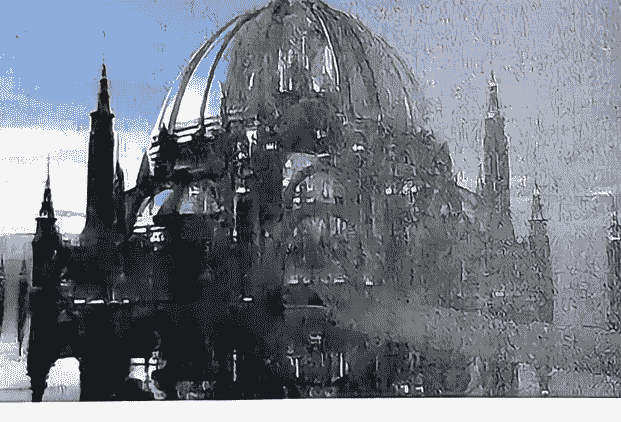

图 1-14 未来宫殿生成图

2. --v（version，模型版本选择）

指定生成所用的 AI 模型，V7 为最新且默认版本。
- --v 7（默认，建议使用）
- --v 5.2、--v 6 适合风格探索或特殊需求

示例：

```
/imagine prompt: A cinematic jungle landscape（电影感丛林景观）--v 7 (图 1-15)
```

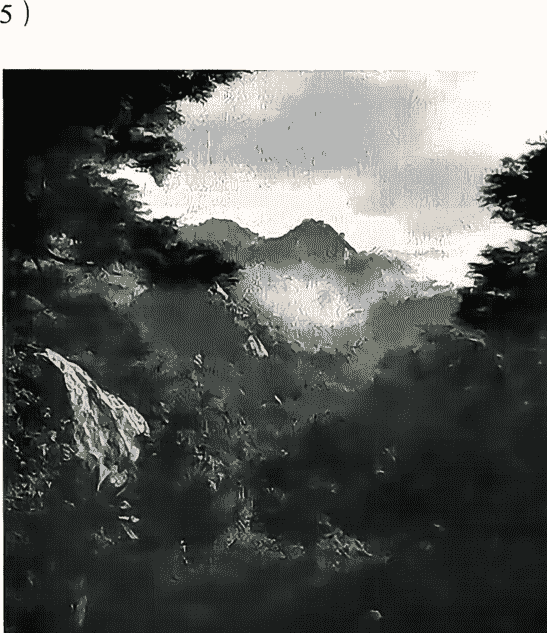

3. --style（风格模式）

主要用于 V5.2 及以下旧模型，V7 中已不建议使用。
- --style raw 写实
- --style cute 可爱动漫
- --style expressive 强化表现力

示例（V5.2）：

```
/imagine prompt: A robot cat in Tokyo（东京的机器人猫）--style cute (图 1-16)
```

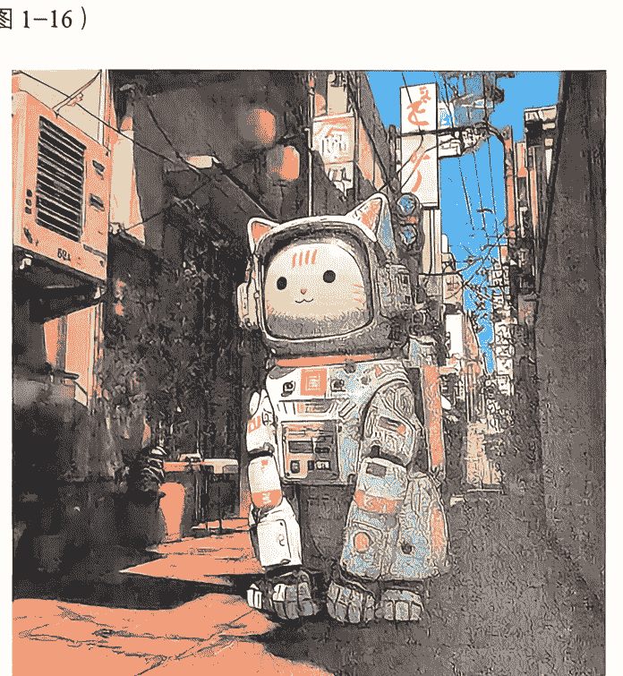

图 1-16 东京机器人猫生成图

在 V7 中，建议直接用描述性提示词，如 “in watercolor style” 等。

4. --chaos（多样性/随机性）

控制构图、细节变化幅度，0 ～ 100，参数值越高变化越多。

示例：

```
/imagine prompt: Surreal floating islands（超现实浮动岛屿）--chaos 60 (图 1-17)
```

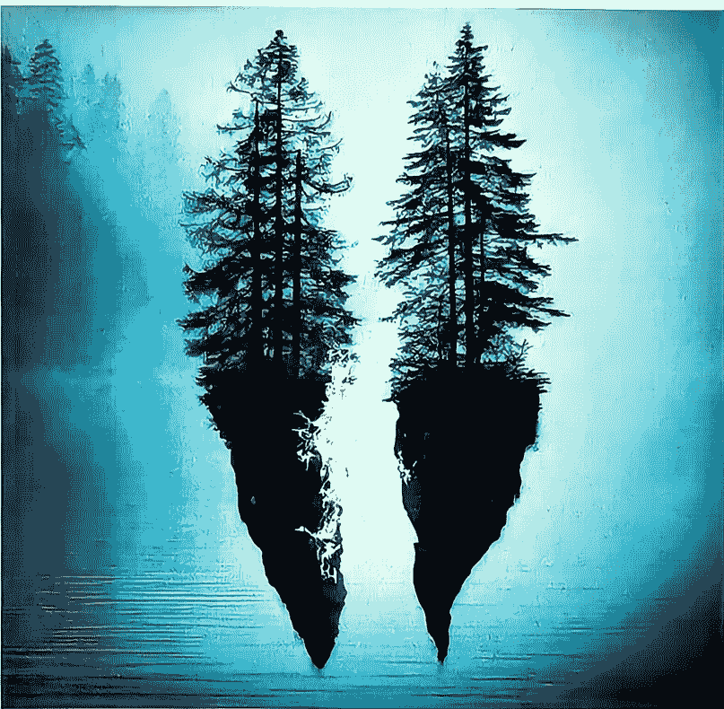

图 1-17 超现实浮动岛屿生成图

5. --quality 或 --q（图像生成质量）

影响计算资源与清晰度。V7 中该参数影响已减弱，建议使用默认参数。
- --q 1 默认
- --q 2 更高质量（耗时更长）
- --q .25 低质量预览

示例：

```
/imagine prompt: Futuristic spacecraft interior（未来飞船内部）--q 2 (图 1-18)
```

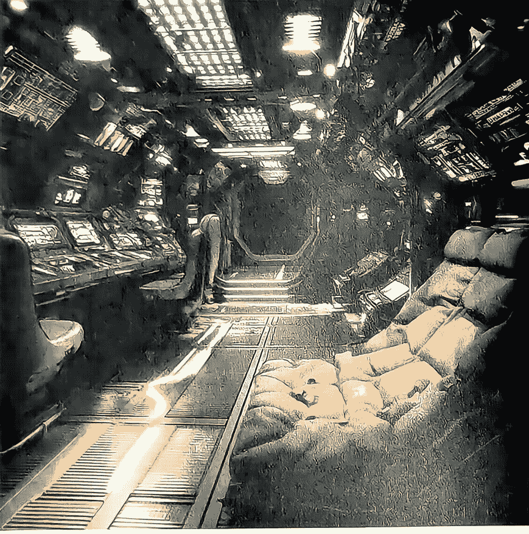

图 1-18 未来飞船内部生成图

6. --seed（随机种子控制）

固定随机生成因子，同样提示词 + 种子可复现近似画面，适合系列作品或教学演示。

示例：

```
/imagine prompt: Dark forest with glowing mushrooms（有发光蘑菇的黑暗森林）--seed 3478912 (图 1-19)
```

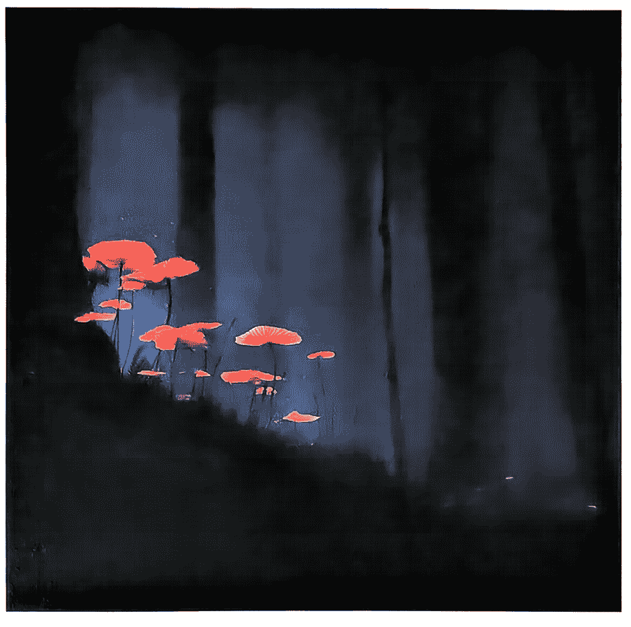

图 1-19 发光蘑菇生成图

7. --no（排除元素）

去除不希望出现的物体或风格。

示例：

```
/imagine prompt: A city at night（一座夜晚的城市）--no people, --no cars (图 1-20)
```

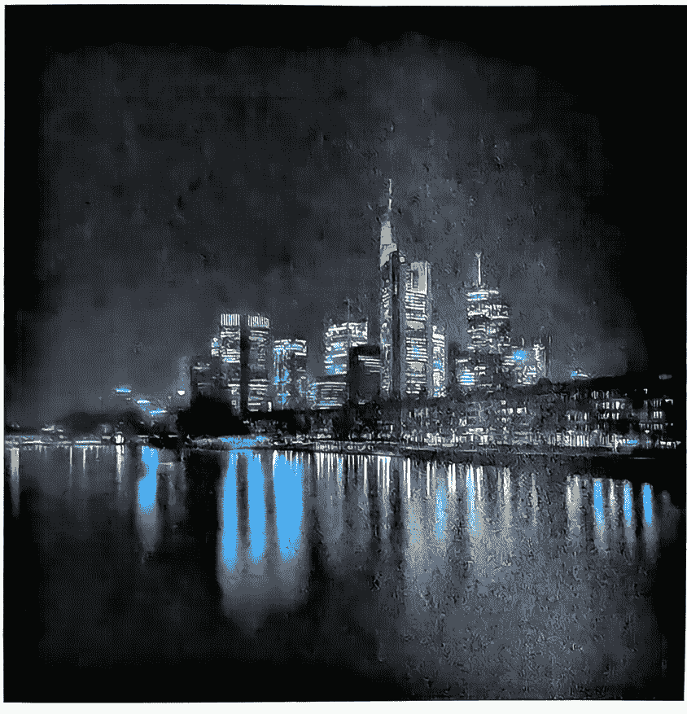

图 1-20 夜晚城市生成图

8. 设置界面快捷操作

输入 /settings 可唤出设置面板，快速切换模型、风格、画质、私密模式等选项（图 1-21）。不同订阅等级有权限差异，如私密生成需 Pro 版。


图 1-21 设置界面

##### 1.2.4 参数组合与应用策略

结合上述参数，可以灵活搭配生成各种类型的图像，举例如下：

**构图探索者**

```
/imagine prompt: Abandoned futuristic temple（废弃的未来感寺庙）--ar 2:3 --chaos 50 (图 1-22)
```

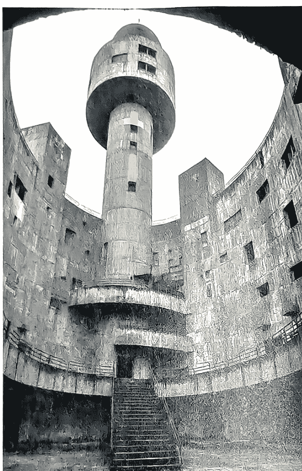

图 1-22 废弃未来感寺庙生成图

**写实强化风格**

```
/imagine prompt: Oil painting of a violinist（小提琴家油画）--v 5.2 --style raw --q 2 (图 1-23)
```

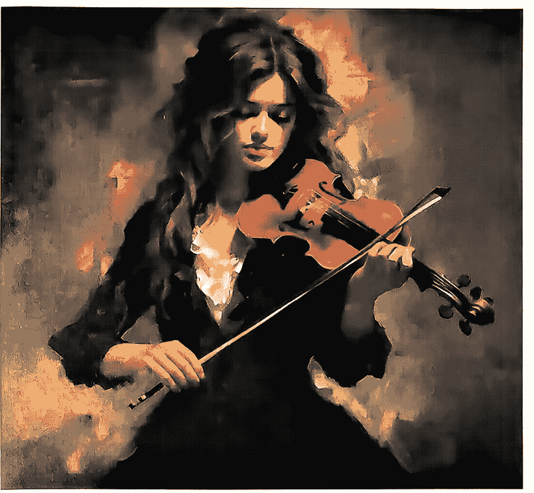

图 1-23 小提琴家油画生成图

**系列风格保持**

```
/imagine prompt: Elegant logo design, golden line style（优雅标志设计，金色线条）--seed 123456 --ar 1:1 (图 1-24)
```

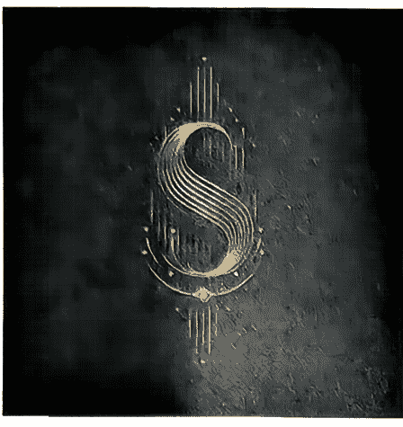

图 1-24 优雅标志设计生成图

**图像简洁预览**

```
/imagine prompt: Paper-cut style deer in forest（剪纸风格的鹿在森林）--q .25 --ar 1:1 (图 1-25)
```

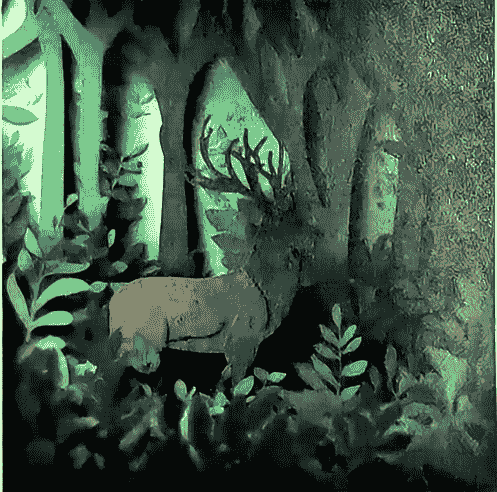

图 1-25 剪纸风格的鹿生成图

##### 1.2.5 流程与技巧总结

整合前述内容，Midjourney 图像生成的标准路径如下：
1. 输入 /imagine prompt: + 提示词（含主题、风格、构图等关键描述）；
2. 灵活组合参数（如 --ar、--seed、--chaos 等），提升定制能力；
3. 等待系统生成 2×2 四图预览；
4. 选择 Upscale 或 Variation，放大或探索变体；
5. 在 Web 端保存、管理、分类归档全部作品和历史提示词。

掌握这些流程和参数，你不仅能够高效生成符合预期的图像，还能在写实与幻想之间、细节与整体之间，逐步建立属于你自己的“图像语言”体系。Midjourney 赋予每个人“语言生图”的新能力，而对参数与指令的灵活运用，正是你走向高阶 AI 美学表达的第一步。

# 第 2 章 AI 绘画与美学表达

本章所要讲解的是关于语言与审美如何在 AI 系统中被“理解”和“转化”的底层原理。在 AI 图像生成中，提示词不仅是技术输入，还是一种新的创作语言。理解它的构建机制，是从“使用者”转向“创作者”的关键一步。

Midjourney 等 AI 图像生成平台本质上是一种语言驱动的视觉模型，并不能真正“理解”人类的美学判断，而是通过大量图文数据训练，模拟出人类对特定语言指令的视觉联想。这就意味着，提示词的选择与组合，将直接决定生成图像的风格、构图、氛围甚至象征意味。

在本章中，我们将带领你系统拆解提示词的生成原理，解析其中的语义逻辑、风格导向与构图偏好，并进一步探讨如何通过中文与英文的融合表达、意象语言的使用、情境描述的搭建，有效地实现从审美意图到生成画面的精准转化。

更重要的是，我们希望帮助你确立属于自己的语言表达策略。在千篇一律的“关键词堆叠”之外，真正高水平的 AI 视觉创作者往往具备精确而富有想象力的描述能力。他们不仅知道该写什么，还知道如何写出差异、写出诗意、写出风格。

本章将是你由表及里、深化美学理解、掌握语言控制力的起点。

在与 AI 共创的过程中，语言，才是你真正的画笔。

## 2.1 浅析 AI 绘画

### 2.1.1 算法时代的美学

AI 美学的本质，是 AI 通过深度学习算法和大规模数据训练，掌握了对图像风格、构图、主题、色彩等多维度的理解和创造能力。与传统美学依赖手工、个人经验和技法不同，AI 美学把“算法生成”推上了创作舞台的核心。例如，Midjourney、Stable Diffusion 等平台，将海量图像和文本用于模型训练，让 AI 学习并归纳视觉美学的规律。当用户输入提示词时，AI 会将自然语言转化为数学向量，根据关键词、修饰词和参数，自动激活并组合相关的视觉概念表征，形成相应的图像。更进一步，AI 创作过程具有高度的“概率性”和“可控性”，用户可以通过多次调整提示词和参数，不断筛选、优化，最终获得最符合自身审美期待的结果。

AI 美学技术的飞跃，还在于生成式 AI 模型的演化。无论是 GAN（生成对抗网络）、VAE（变分自编码器）还是 diffusion model，这些创新算法都能让 AI 将随机噪声“逆推”为具体图像，对复杂提示词和参数的响应极为灵活。同时，AI 美学引入“提示词工程”——即创作者用具有特定语义逻辑的脚本式语言，直接影响 AI 的生成方向。参数化机制（如 --ar、--seed、--chaos 等）则极大增强了创作者的控制力，实现了人机协作、自动生成与批量优化的统一。多模态数据（文本、图像、音频等）的融合，更让 AI 美学具备了跨媒介创作的无限潜力。这一切为 AI 美学的“以词生图”革命提供了坚实的技术基础。

本节重点为你梳理了 AI 美学在数据驱动、语言转译、参数控制和多模态跨界等层面的原理，理解这些底层机制，是后续开展高效提示词构建和美学创新的基础。

### 2.1.2 “以词生图”的美学实践

AI 美学的核心创作机制，就是“以词生图”。在这里，提示词不仅是用户输入的指令，而且是艺术想象力的语言载体。创作者的描述精准度、语序结构、修辞创新力，都直接决定了最终生成作品的风格、氛围与主题表现力。不同的关键词组合、修饰词顺序甚至是参数细节的变化，都能带来完全不同的画面效果。这种全新的“语言即美学策略”，让 AI 艺术既科学又充满想象空间。

更值得关注的是，AI 美学打破了流派与技法的限制。通过提示词的创新组合，AI 能自然融合多种风格与表现手法，实现传统绘画难以企及的多样化效果。比如，当“赛博朋克、东方水墨、未来极简”在同一命令中并列时，AI 便能输出融合东西方、现实与幻想的创新画面。可以说，提示词的语言创新力，已经成为 AI 美学多样化和个性化的关键引擎。

本节帮助你把握 AI 美学在语言表达、结构创新和风格融合方面的理论逻辑。掌握提示词的设计方法，是成为高阶 AI 美学创作者的基础能力。下一节我们将讨论 AI 美学与传统美学在流程、表达和创新机制上的根本差异。

值得注意的是，不同的生成工具因其底层算法与功能设计的差异，对提示词的响应效果也各不相同。表 2-1 对当前主流图像生成软件的优劣势进行了对比分析，为创作者根据具体需求选择适宜工具提供参考：

### 表 2-1 现有生图软件优劣势对比表

| 软件名称 | 优势 | 劣势 |
| :--- | :--- | :--- |
| Midjourney V7 | 风格化强，艺术性高，图像极具美学风格，上手简单，提示词生成速度快，社区活跃、灵感丰富，生成细节丰富，适合艺术创作 | 不支持图生图（需额外插件），无免费试用，仅 Discord 使用，控制参数不如 SD 精细 |
| DALL·E 3 (OpenAI) | 与 ChatGPT 无缝集成，语言理解能力强，修图（Inpainting）功能优越，适合多轮对话生成，风格自然、适合现实题材 | 风格变化较少，缺乏艺术个性，分辨率相对较低，无开放参数调控能力 |
| Stable Diffusion XL (SDXL) | 开源可本地部署，自由度高，支持图生图、控制图（ControlNet），模型种类丰富（如动漫、写实、设计），适合专业创作与实验性研究 | 上手难度高，需要学习提示词优化与参数调试，默认模型审美中庸，需换模型，对计算资源有一定要求 |
| Adobe Firefly | 与 Photoshop/Illustrator 无缝融合，文生图与图生图支持强，企业级授权合法合规，易于商业用户使用 | 风格限制较多，生成效果偏商业模板风，自定义性与创造性一般，完整功能需基于 Adobe 付费生态 |
| Leonardo.Ai | 商用图像生成精度高，提供训练私有模型功能，UI 界面友好，适合设计师，图文混合提示词解析力强 | 免费额度有限，商业功能需付费，有时生成速度不稳定，某些风格存在版权争议风险 |
| BlueWillow | 免费使用，门槛低，类似 Midjourney 的风格，社区友好、生成质量稳定 | 画面风格趋于保守，自定义能力较弱，不适合专业创作 |
| Bing Image Creator (DALL·E 模型) | 免费使用、速度快，与微软 Edge 集成良好，多语言提示词支持强 | 风格缺乏多样性，分辨率偏低，功能简单，不支持图生图 |

## 2.2 提示词的作用

在 Midjourney 的创作流程中，提示词就像是你与 AI 之间沟通的桥梁。我们输入的每一组词语，都被系统解析为图像的视觉要素、构图指令与风格倾向。掌握提示词的构建逻辑，是将想法准确转化为画面的关键起点。

随着 V7 模型的发布，Midjourney 对自然语言的理解力有了显著提升。V7 模式不仅能更精准地识别多重意象、抽象风格与隐喻结构，还在一定程度上支持中文输入。不过我们依然建议你使用英文提示词进行创作，原因有二：

一是英文语料在模型训练中占比最大，使用英文提示词可以让模型识别效率与风格控制效果更稳定。

二是多数关键词、参数标签、构图表达均以英文为核心，便于精准调整。

接下来，让我们一起拆解提示词的语义结构，了解 AI 是如何“读图”的。

### 2.2.1 提示词的基本语法结构

一条有效的提示词，通常由以下几个部分构成：

- 主题词（subject）：图像的核心内容，如人物、场景、物体等
- 修饰词（modifier）：补充主题的风格、氛围、材质等
- 构图词（composition）：视角、构图方式、镜头语言等
- 参数命令（parameter）：用于进一步控制图像比例、质量、风格等

我们来看一个具体示例：

```
/imagine prompt: A vintage typewriter on a wooden desk, warm lighting, shallow depth of field（一台老式打字机放在木质书桌上，暖光照射，浅景深）--ar 3:2（图 2-1）
```

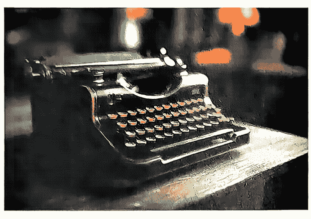

图 2-1 老式打字机生成图

你会发现，句子无须语法完整，但关键词组织得越清晰，AI 越能快速理解你的图像意图。

不同的关键词在提示词中承担不同的功能。有些用于确立图像的中心概念，比如 “dragon” “portrait of a queen”，这些属于主题词；而诸如 “soft lighting” “gothic architecture” “surreal atmosphere” 等，则是修饰性关键词，它们共同构建起视觉语言的氛围层。了解这些关键词在视觉生成中的语义层级，有助于我们精准控制生成结果。

此外，有些关键词虽然看似简单，但放在不同位置对图像的呈现会产生截然不同的效果。例如，“foggy background” 和 “background foggy” 都可被模型识别，但前者更强调雾气对背景构图的主导作用。也就是说，关键词之间的相对顺序，虽然不像编程语言那样具有绝对的语法规则，但依然会影响 AI 的理解重心。

### 2.2.2 系统如何“理解”提示词

Midjourney 采用的是基于 Transformer 架构的大型语言模型与图像扩散模型相结合的结构。当你输入提示词时，系统会将其拆解成一组语义向量，用于控制图像生成过程中的每一层特征提取。

简而言之：

- 主题词决定了图像“画什么”
- 修饰词决定了图像“怎么画”
- 构图词决定了图像“从哪儿看”
- 参数命令则控制“图像如何输出”

为了让系统更准确地识别提示词含义，我们可以使用“由大到小、由主到次”的语言组织方式。举例如下：

```
/imagine prompt: A steampunk city at dusk, glowing streetlights, aerial view（黄昏时的蒸汽朋克城市，街灯发光，俯视角度）--ar 16:9（图 2-2）
```

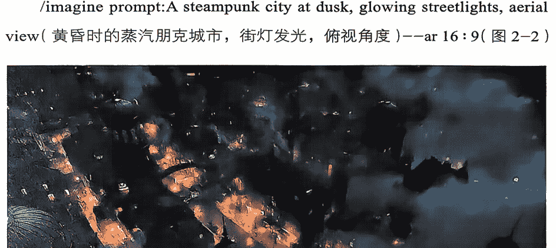

图 2-2 蒸汽朋克城市生成图

在这个例子中，“steampunk city”是主题，“dusk”指明时间，“glowing streetlights”构建光影，“aerial view”定义视角，而“--ar 16:9”确保作品以横向大画幅的构图输出。我们可以看到，每一层关键词在系统“理解图像”的过程中扮演了独立但互相关联的角色。

### 2.2.3 提示词顺序对构图的影响

虽然 V7 模型在语义处理上已经具备了上下文理解能力，但关键词的排列顺序仍对最终生成效果有显著影响。一般建议采用如下结构：

主体 + 风格修饰 + 环境构图 + 技法 / 光影 + 参数

示例：

```
/imagine prompt: A medieval knight standing in ruins, dramatic lighting, cinematic style, wide angle（废墟中站立的中世纪骑士，戏剧性光影，电影风格，广角镜头）--ar 16:9（图 2-3）
```

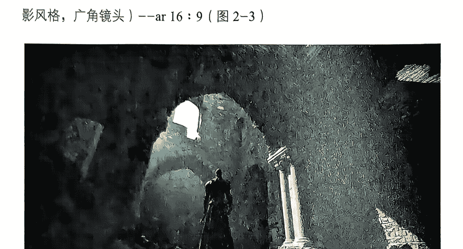

图 2-3 废墟中的骑士生成图

这样结构化的语言描述能更有效地帮助 AI 捕捉“你想表达的核心”，减少误判与风格模糊的情况发生。

顺序不当的提示词可能会出现以下问题：

一是主体被忽略或模糊：例如，“dramatic lighting before a dancer”可能优先生成光而非舞者。

二是构图混乱：例如，“cityscape, under moonlight, foggy, top-down view” 比 “top-down view of a foggy cityscape under moonlight” 更易导致空间错乱。

三是光影与背景错位：如先写 “fireflies” 再写 “night forest” 时，萤火虫可能会出现在前景而非背景。

可以发现，良好的提示词结构有助于提高生成图像的可控性、可重复性与美感稳定性。

### 2.2.4 避免关键词冗余与歧义

我们在组织提示词时，还需要避免以下几个常见问题：

- 重复关键词：过多重复同类形容词（如 “beautiful, pretty, stunning”）不会提升图像美感，反而容易造成系统判定混乱。
- 语义冲突：如同时使用 “dark forest” 和 “sunlit leaves”，会让系统难以判断画面的主光源。
- 使用模糊性高的词：比如，“nice” “cool” 这类过于宽泛的词语在视觉生成中几乎无效。
- 句法结构过长：虽然 Midjourney 允许较长的提示词，但主线不清会让生成的图像失焦。

我们建议采用“模块化构图”的思维方式，将每一段关键词作为一个功能模块，逐层添加：

- 模块一：主题 + 主体构成
- 模块二：风格 + 材质 + 色调
- 模块三：镜头语言 + 构图模式 + 焦点控制
- 模块四：技术参数 + 输出要求

示例：

```
/imagine prompt: A desert landscape with ancient ruins, soft golden lighting, isometric view, ultra detailed（一片古遗迹沙漠，柔和金色光线，等距视角，极致细节）--ar 16:9（图 2-4）
```

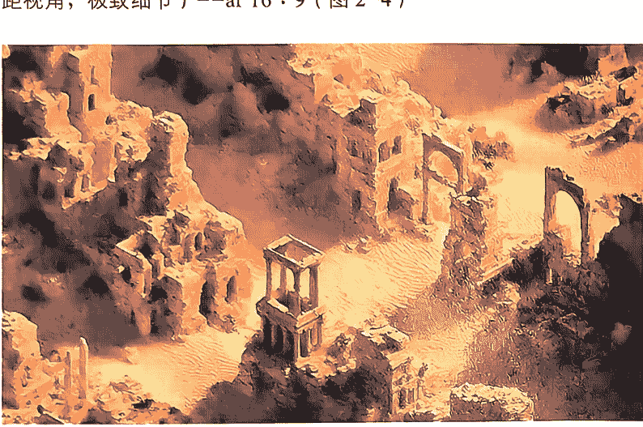

图 2-4 古遗迹沙漠生成图

这种模块结构不仅便于组织语言，也能帮助创作者在后续复制修改时快速定位内容变化点。

掌握提示词的语义结构，是我们迈向精准创作与多风格控制的第一步。下一节，我们将进一步探索如何结合表达策略，让提示词既具有“可读性”又具有“可控性”，为你的 AI 美学语言打下更坚实的基础。

## 2.3 用提示词构建美学语法的方法

在 AI 图像生成中，我们常常面临这样的问题：为什么提示词结构完整、语言清晰，但生成的图像却偏离预期？原因往往不在于语法问题，而在于图像意图的表达不够具体。Midjourney 虽然拥有强大的自然语言理解能力，但并不是“能读懂你的想象”的工具，而是“执行你的表达”的工具。

因此，要想提升图像生成的精准度与一致性，我们需要掌握一套能够引导 AI 生成方向的提示词构建策略。本节将带领你系统学习如何清晰、明确地描述图像目标，并通过不同策略将抽象构思转化为具象表达。

### 2.3.1 明确核心主体

每一张图像都应有一个明确的核心对象，这决定了图像的视觉焦点。如果你仅输入：

```
/imagine prompt: Landscape（风景）（图 2-5）
```

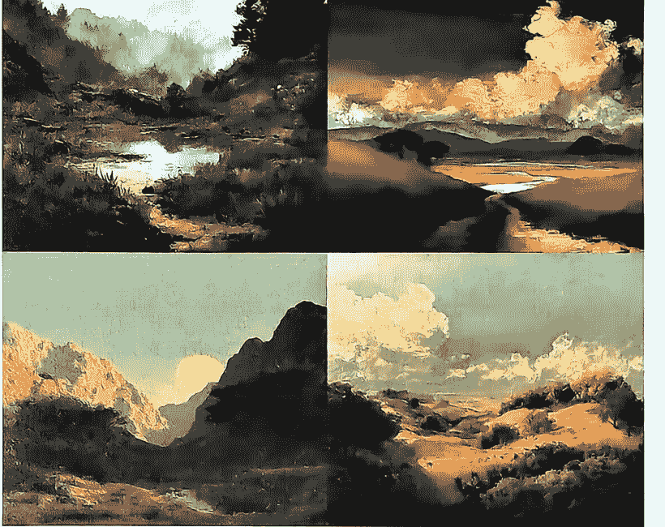

图 2-5 风景生成图

生成的画面可能涵盖山脉、河流、树木、云朵、人物，甚至建筑。Midjourney 会根据其训练语料库自动“猜测”你想要的图像元素。这种生成方式虽有创意空间，但缺乏控制力。

而当你使用更具体的描述时，生成图像的可控性会明显增强：

```
/imagine prompt: A serene mountain lake reflecting the twilight sky, surrounded by pine trees（宁静的高山湖泊映照着暮色天空，四周环绕松林）--ar 16:9（图 2-6）
```

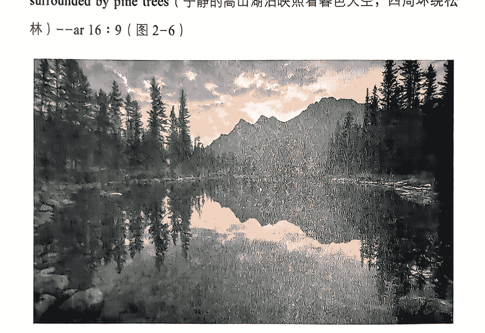

图 2-6 高山湖泊生成图

在这条提示词中，我们通过“湖泊 + 暮色天空 + 松林”构建了明确的图像层次。系统在读取关键词后会自动调整空间布局，从而生成更加符合预期的画面。

### 2.3.2 聚焦风格语言

在 AI 图像生成中，风格关键词对图像效果的影响极大。尤其是在 Midjourney V7 中，系统会对风格性词汇如“surreal”“dreamy”“hyperrealistic” 等进行高优先级识别，并将其作为画面整体渲染风格的核心引导。

我们建议你建立自己的风格词汇分类表，常见分类如表 2-2 所示：

表 2-2 风格词汇分类表

| 类型 | 示例词 |
|---|---|
| 光影类 | soft lighting, rim light, moody lighting, neon glow |
| 色调类 | pastel tones, monochrome, warm palette, golden hour |
| 风格类 | Baroque style, Vaporwave, Ukiyo-e, Retro-Futurism |
| 材质与质感类 | matte finish, watercolor texture, metallic surface |

举例：

```
/imagine prompt: A mechanical bird with intricate wings, metallic texture, glowing blue feathers, Steampunk style（一只拥有复杂翅膀结构的机械鸟，金属质感，蓝色羽毛发光，蒸汽朋克风格）--ar 3:2
```

通过风格限定词汇的有序堆叠，我们可以大大提升画面的一致性与美学表现力。

### 2.3.3 添加构图词与镜头语言

除了“画什么”“怎么画”，Midjourney 还能识别“从哪里看”。构图类提示词（如“wide angle”“top-down view”“portrait view”）不仅影响图像的空间分布，还决定了焦点的归属。

表 2-3 列出的是常用构图类关键词中英文对照：

表 2-3 常用构图类关键词

| 构图表达 | 中文含义 |
| :--- | :--- |
| isometric view | 等距视角 |
| top-down view | 俯视角度 |
| low angle shot | 低角度拍摄 |
| close-up portrait | 特写肖像 |
| ultra wide shot | 超广角构图 |
| symmetrical layout | 对称构图 |

示例：

```
/imagine prompt: A cyberpunk street food vendor, rainy night, neon signs, isometric view（赛博朋克风的街头小吃摊，雨夜，霓虹灯牌，等距视角）--ar 16:9（图 2-7）
```

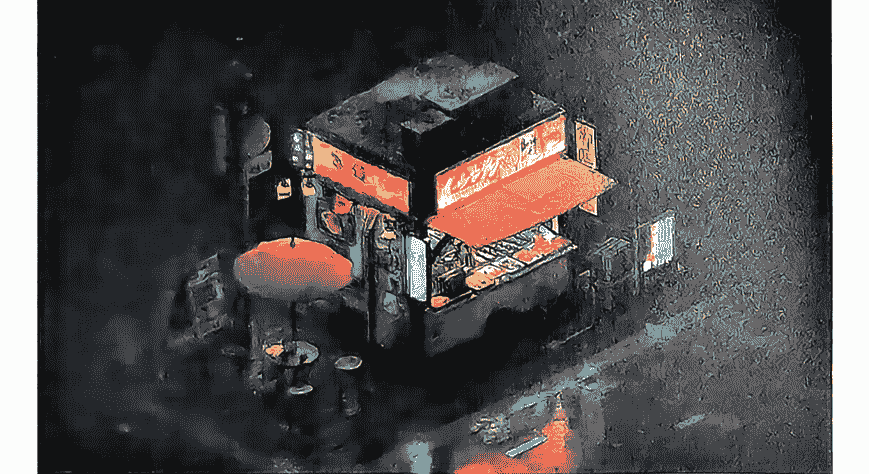

图 2-7 赛博朋克街头小吃摊生成图

在这个提示词中，“isometric view” 确保了画面层级有序，“neon signs” 强化了背景氛围，而 “rainy night” 则限定了光影反差。

### 2.3.4 明确主体与背景的层级关系

许多初学者在编写提示词时容易混淆前景与背景的语序，导致画面重心偏移。示例：

```
/imagine prompt: A tiger with forest（老虎和森林）（图 2-8）
```

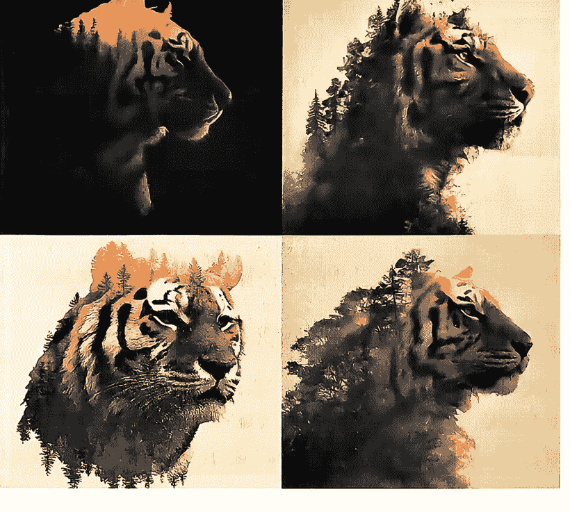

图 2-8 老虎与森林生成图

这条命令可能生成“森林中的老虎”，也可能生成“老虎背景图”，甚至可能生成“老虎皮毛上的森林图案”。而以下提示词则更加清晰：

```
/imagine prompt: A tiger walking through a misty forest, morning light filtering through trees（雾气弥漫的森林中，一只老虎缓缓行走，阳光透过树林洒下）--ar 16:9（图 2-9）
```

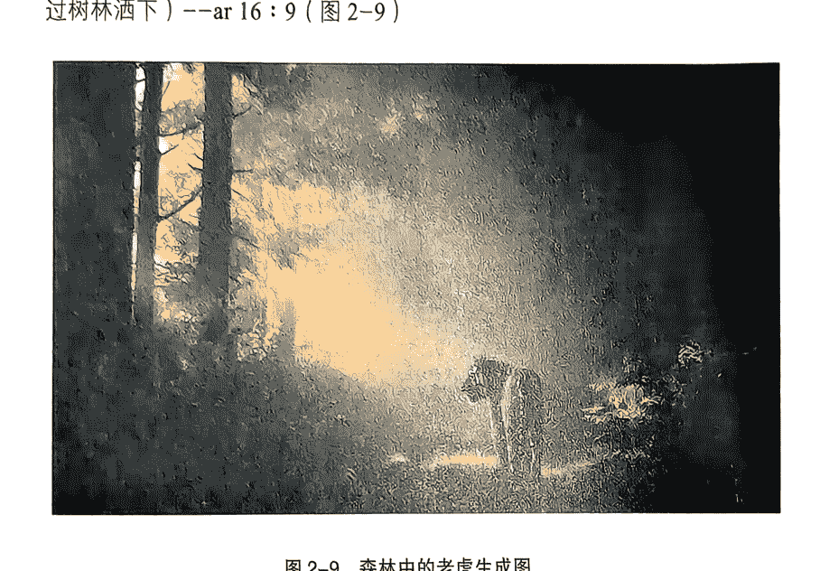

图 2-9 森林中的老虎生成图

通过添加 “walking through” “misty” “light filtering” 等描述，我们不但厘清了前后景层级，也构建了一个具有空间深度的画面场景。

### 2.3.5 用行为与动作丰富图像叙事

Midjourney 能够理解基本的动作性描述，因此我们可以在提示词中加入简短的动词，赋予画面动态感与故事性。

常见可识别的英文动词包括 walking、flying、holding、looking up、sitting、floating、dancing 等。

```
/imagine prompt: A girl holding a glowing orb, standing at the edge of a cliff, wind blowing through her hair（一位女孩手握发光的宝珠，站在悬崖边，微风吹动她的头发）--ar 9:16（图 2-10）
```

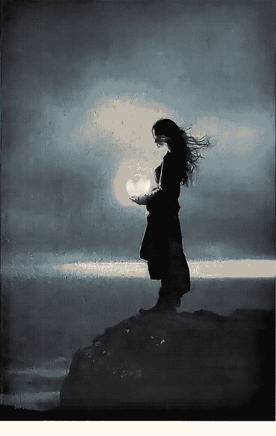

图 2-10 悬崖边的女孩生成图

这里，“holding”“standing”“blowing”共同构建起一个具有动作与情绪的画面，生成的结果往往更加真实、生动。

### 2.3.6 避免“无效冗余”的提示词堆砌

不少用户会习惯性地堆砌美化类词汇，举例如下：

```
/imagine prompt: A beautiful amazing fantasy elegant magical colorful unicorn（一个美丽、惊艳、奇幻、优雅、魔幻、五彩斑斓的独角兽）（图 2-11）
```

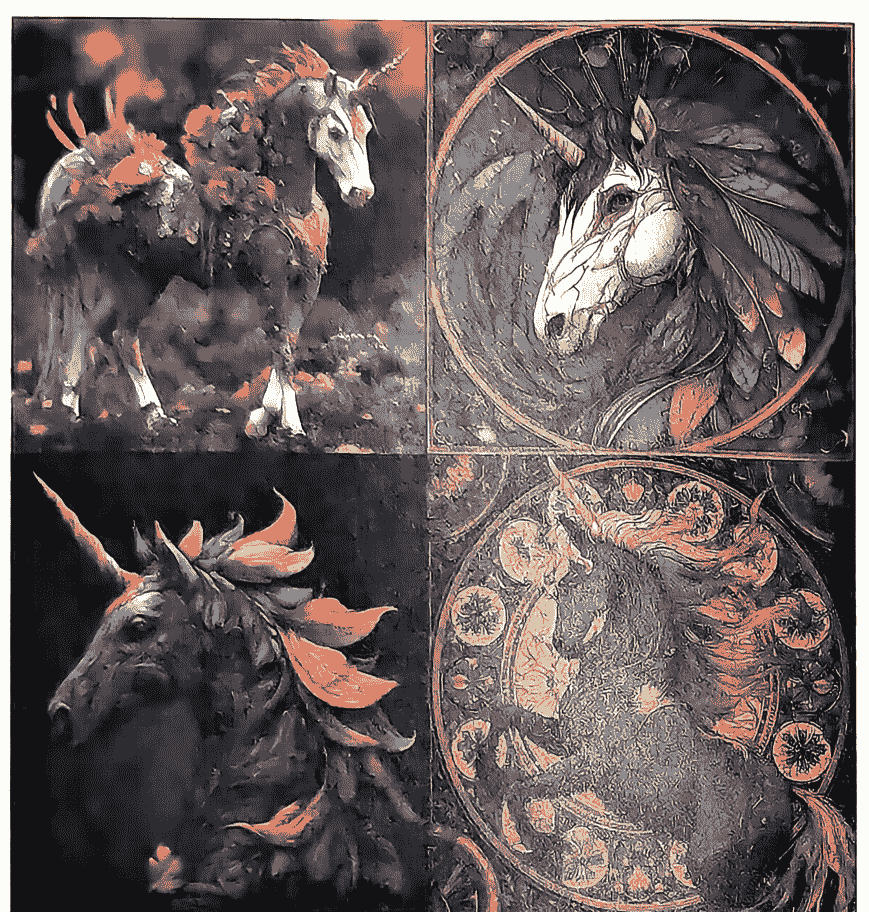

图 2-11 堆砌形容词的独角兽生成图

虽然看起来“很丰富”，但实际上这类堆砌反而会干扰系统判断重点。更有效的写法如下：

```
/imagine prompt: A glowing unicorn in a misty forest, pastel colors, cinematic lighting（雾气森林中的发光独角兽，柔和色彩，电影光影）--ar 16:9（图 2-12）
```

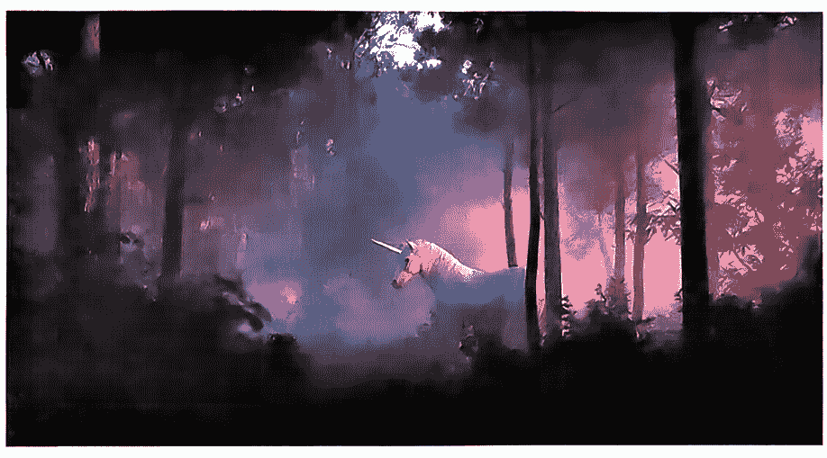

图 2-12 森林中的发光独角兽

这种方式既减少了冗余，又提升了可控性与美感一致性。

通过以上几种策略，我们不仅可以构建出“可被 AI 清晰识别”的语言结构，还能以更少的词语达到更强的表达效果。下一节，我们将继续探讨如何在中文输入的基础上更好地设计提示词，以发挥语言与美学的双重潜力。

## 2.4 中文提示词写作技巧

随着 V7 模型的发布，Midjourney 系统对中文提示词的支持能力有所增强。用户可以直接使用中文进行图像生成，系统会自动将其语义映射为图像构图逻辑。不过，建议在使用中文提示词时，依然保持一定的结构性与控制意识，因为中文提示词虽然便利，但在表达精确度、风格一致性与构图引导方面，仍略逊于英文提示词。

在本节中，我们将带你掌握 Midjourney 中文提示词的写作要点，包括句式组织、语义拆分、冗余词规避以及与英文关键词混合使用的策略。

### 2.4.1 中文输入的识别机制

Midjourney 的中文识别并非基于严格的语言翻译模型，而是通过语义相似性匹配系统将中文提示词映射为已有的训练向量。因此，它并不是逐字翻译，而是“猜测你可能想要的场景”。

举个例子：

```
/imagine prompt: 繁星点点的夜空，银河横贯山谷，远方有一位旅人正在仰望 --ar 16:9（图 2-13）
```

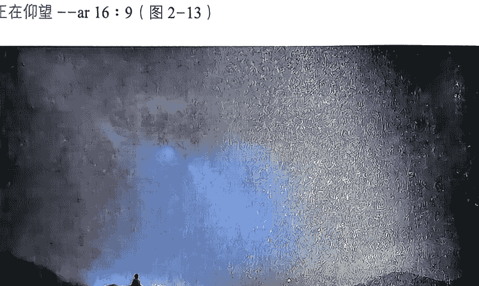

图 2-13 中文提示词生成图

Midjourney 能够识别“夜空”“银河”“山谷”“旅人”和“仰望”等关键词，但可能忽略形容词的层次关系，进而使生成画面中夜空的细节很突出，但旅人的姿态却较模糊。相较之下，如果使用英文提示词，就能更清晰地指引画面结构、光线处理和主体视角。

```
/imagine prompt: A traveler looking up at the Milky Way over a mountain valley, starry sky, cinematic composition（一位旅人仰望横跨山谷的银河，星光满天，电影构图）--ar 16:9（图 2-14）
```

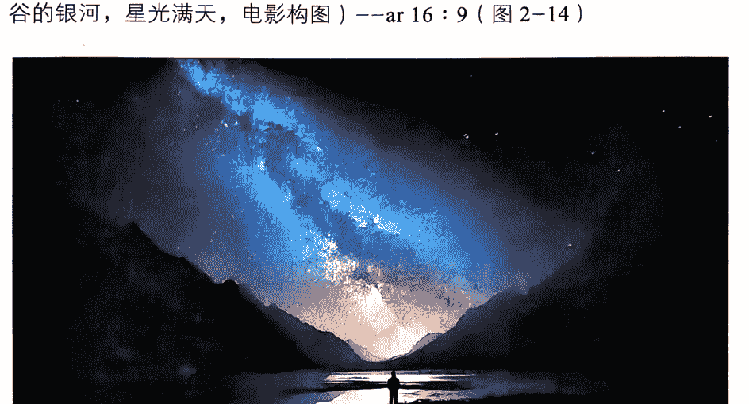

图 2-14 银河山谷生成图

这说明中文输入虽然被支持，但要想做到“精准引导”，还需要特别注意语言结构与关键词的组织方式。

### 2.4.2 中文提示词中的“可辨识关键词”

Midjourney 当前识别度较高的中文词语列举如下：

- 主体类：女孩、老虎、城堡、机器人、海洋、飞鸟、宇航员
- 场景类：沙漠、森林、雪山、夜晚、街道、图书馆、教堂
- 风格类：油画、水彩画、蒸汽朋克、未来主义、禅意、复古
- 构图类：特写、俯视、远景、广角、对称、镜面反射
- 光影类：柔光、逆光、日落、闪电、梦幻、雾气

# AI 美学大师：提示词与艺术风格全解读

推荐写法：

/imagine prompt: 日落时分的城市天台，一位身穿未来风格外套的女孩靠在护栏上，背后是霓虹灯闪烁的高楼 --ar 16:9 (图 2-15)

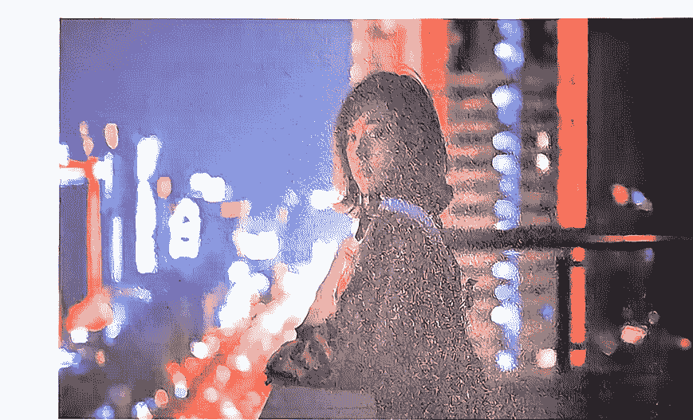

这条命令构成清晰：主体（女孩）、动作（靠在护栏上）、背景（霓虹高楼）、时间（黄昏）、风格（未来感），便于系统综合构图。

### 2.4.3 常见问题与优化方法

问题一：词义不明确

如“梦幻”“唯美”“有感觉”等属于感性词汇，对此，系统无法具体理解，建议替换为视觉风格词或构图词。

不推荐：

/imagine prompt: 一张梦幻的照片 (图 2-16)

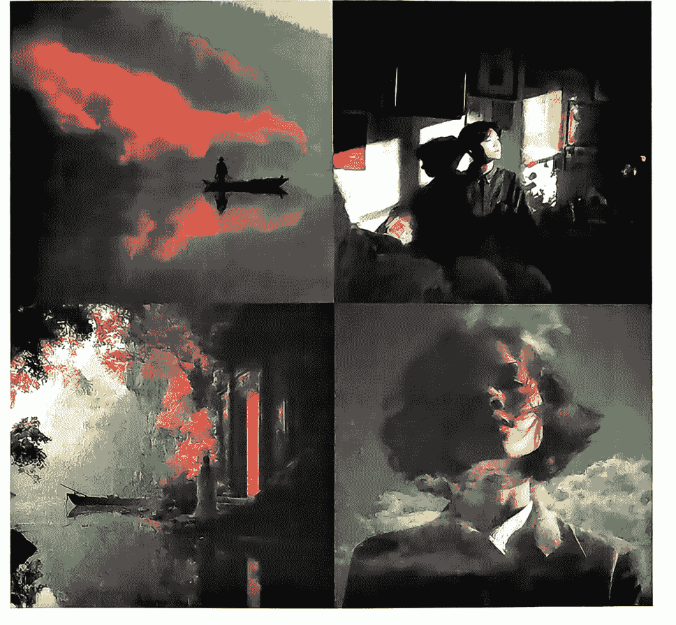

图 2-16 梦幻照片生成图

推荐：

/imagine prompt: A dreamy forest with soft lighting and pastel colors (柔光与粉彩色调下的梦境森林) --ar 3:2 (图 2-17)

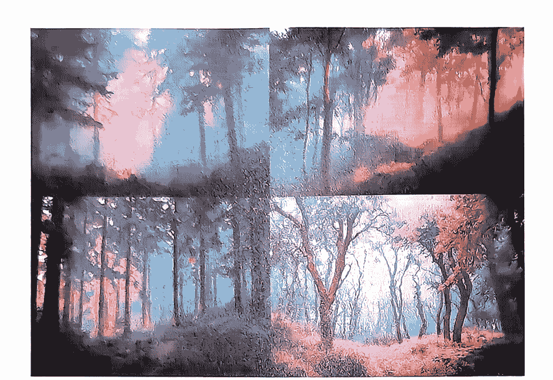

图 2-17 粉色调的梦幻森林

问题二：主次不分

中文习惯按照“主—修—补”的顺序组织语言，而 AI 识别则依赖语义层次更加清晰的结构。

不推荐：

```
/imagine prompt: 一位穿着蓝裙子的少女在湖边坐着看星星（图 2-18）
```

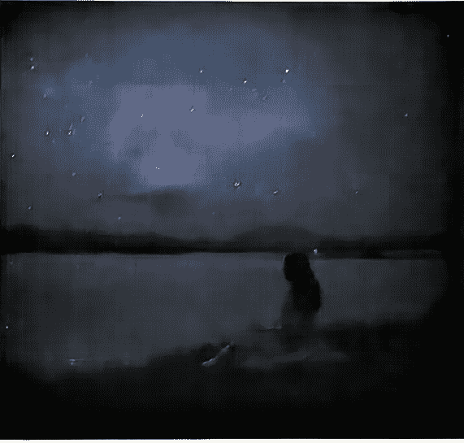

图 2-18 湖边的少女生

推荐：

/imagine prompt: A girl in a blue dress sitting by the lake, gazing up at the starry sky in the twilight (一位蓝裙少女坐在湖边，仰望暮色中的星空) --ar 3:2 (图 2-19)

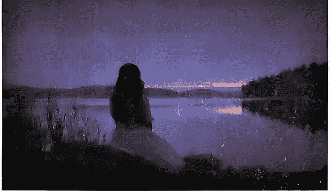

图 2-19 仰望星空的湖边少女生

问题三：句子过长，逻辑含糊

用户在使用中文提示词描述时容易堆叠多个修饰成分，导致生成结果难以聚焦。

不推荐：

```
/imagine prompt: 一个穿红衣服的女孩拿着一把伞在雨中走着，旁边是一家有灯光的咖啡馆，地上有水洼（图 2-20）
```

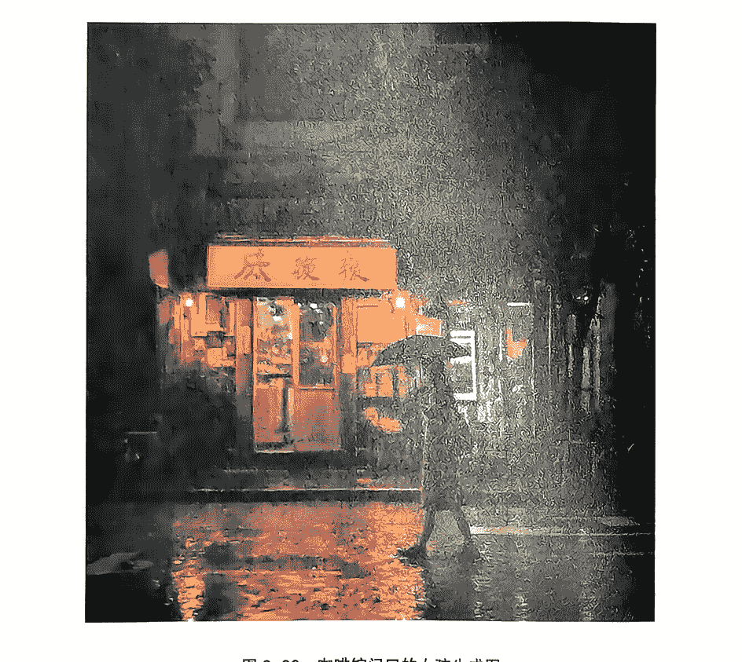

图 2-20 咖啡馆门口的女孩生成图

推荐将其分段并转写为结构明确的描述：

```
/imagine prompt: A girl in red walking in the rain with an umbrella, beside a glowing coffee shop, wet pavement reflections (红衣女孩打着伞走在雨中，旁边是一家灯光明亮的咖啡馆，地面有水面倒影) --ar 16:9 (图 2-21)
```

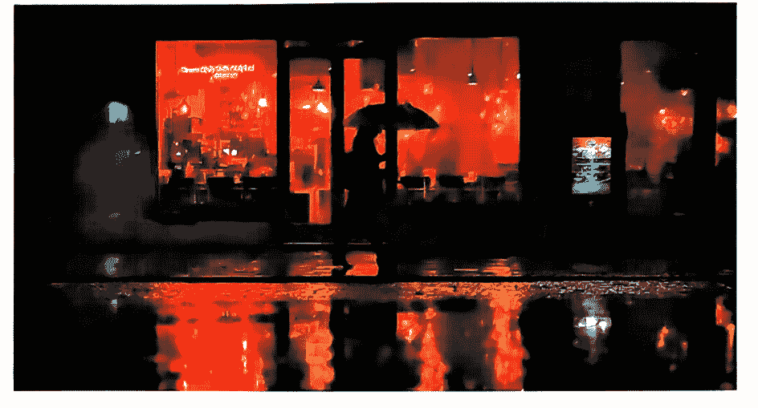

图 2-21 咖啡馆门口的打伞女孩生成图

### 2.4.4 中英文混合提示词的使用策略

Midjourney 允许在同一条提示词中混用中英文，这是一个非常实用的功能，尤其在描述风格与构图时可令生成结果更为精准。示例：

/imagine prompt: 月光下的湖面，surreal atmosphere，soft lighting，dreamy color palette（月光下的湖面，超现实氛围，柔光处理，梦幻色调）--ar 3:2（图 2-22）

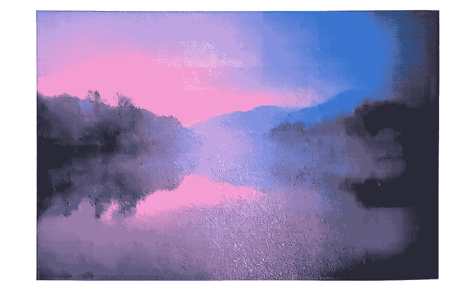

图 2-22 月光下的湖面生成图

建议使用英文表达以下类型的关键词：

- 风格词（vaporwave, baroque, retro, Minimalism）
- 材质词（glass, stone, fabric, metallic）
- 构图与光影（wide angle, cinematic light, backlit）
- 抽象意象（ethereal, glitch, post-apocalyptic）

这样能避免中文在表达这些细节时产生语义模糊或被误解的问题。

### 2.4.5 中文提示词写作建议清单

（1）保持语义层级清晰，避免堆砌形容词。
（2）控制每条提示在 30 字以内，保持聚焦。
（3）核心元素建议按“谁 + 在哪里 + 干什么 + 怎么样”的句式组织。
（4）加入少量英文关键词，提升识别精度。
（5）对风格或视觉特征使用具体的描述性词汇，如“金属质感”“蓝色光晕”“俯视视角”等。

我们鼓励你在日常创作中大胆尝试中文提示词这一表达方式，但在需要精细控制的商业项目等应用场景中，依然建议以英文提示词为主。本章接下来将进一步扩展提示词的表现策略，从语言形式转向意象营造，帮助你有效整合构图、风格与情绪。

## 2.5 情境式与意象式提示词设计

提示词在构建过程中，除了会涉及结构清晰、语义明确的功能性语言外，还会涉及更具表现力的表达方式，那就是“情境式”和“意象式”的语言风格。它们能有效提升图像的叙事性、氛围感和情绪深度，帮助你生成具有艺术感染力的画面。
这一节将带你理解这两种表达策略的核心逻辑，并提供具体应用示例，帮助你在 Midjourney 中提升语言美学控制力。

### 2.5.1 什么是情境式提示词

情境式语言，指的是通过描述人物行为、空间关系与环境细节，构建起一段完整“画面情境”的表达方式。相比简单的“对象 + 风格”结构，情境式提示词更强调“故事感”。
这类提示词常包含以下成分：

- 时间与气氛 ( twilight, midnight, morning fog )
- 动作与行为 ( walking, staring, floating )
- 场景环境 ( abandoned building, stormy coastline, narrow alley )
- 空间关系 ( in the middle of, surrounded by, under the light of )

示例 1：

/imagine prompt: A child holding a lantern, walking alone through a foggy forest at dawn（黎明时分，一个孩子提着灯独自走在雾气弥漫的森林中）--ar 3:2（图 2-23）

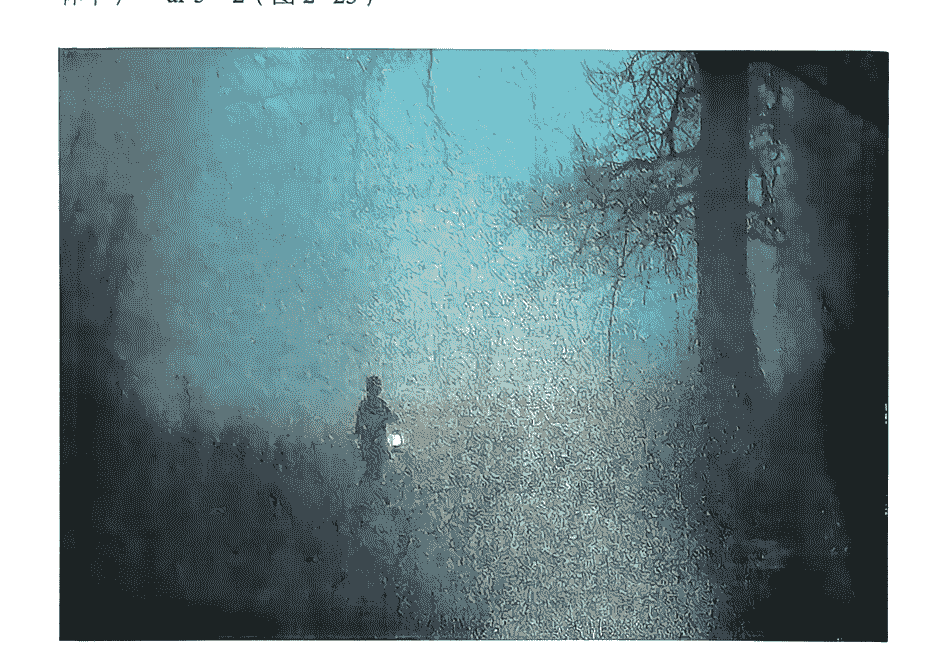

图 2-23 森林中提灯的孩子生成图

示例 2：

/imagine prompt: An old man sitting on a bench under a tree, golden autumn leaves falling, soft sunlight（一位老人坐在树下长椅上，金色秋叶飘落，柔光洒落）--ar 3:2（图 2-24）

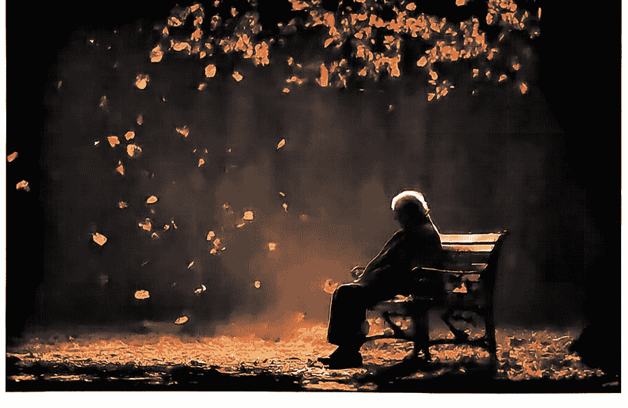

图 2-24 树下长椅上的老人生成图

在以上例子中，我们不是简单地指明 “a man in the park” 或 “a child in the forest”，而是通过 “灯光”“清晨”“落叶”“动作” 等关键词，把静态描述转化为 “会动的图像”。

### 2.5.2 意象式语言的图像暗示功能

意象式表达则更多地用于构建一种抽象的视觉感受，往往带有情绪色彩或象征意味，适合用于艺术化表达、插画创作、诗意构图等场景。

提示词常用意象式词语列举如下：

- 情绪意象 ( loneliness, nostalgia, serenity, chaos )
- 抽象象征 ( wings of light, shattered time, frozen silence )
- 文学化修辞 ( the sky bleeding red, a memory lost in smoke )
- 哲学隐喻 ( a soul trapped in glass, the end of gravity )

示例 1：

/imagine prompt: A figure made of stars walking through a dark ocean, loneliness in every ripple（一个由星星组成的人影走在漆黑海面上，孤独在每一道波纹中荡漾）--ar 16:9（图 2-25）

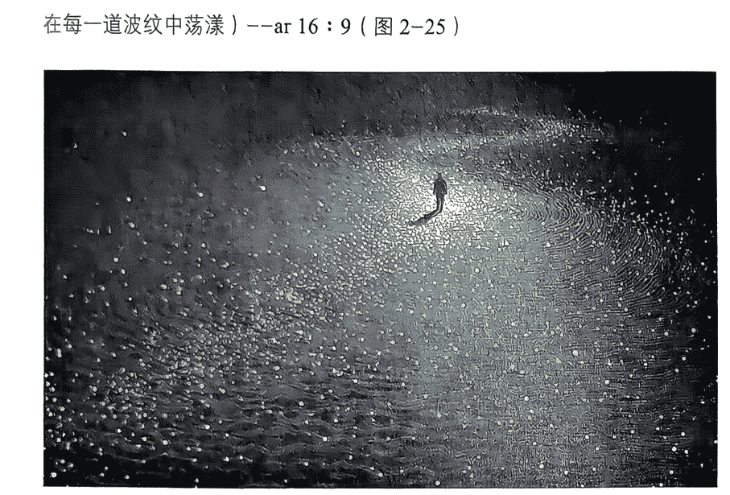

图 2-25 海面上的人影生成图

示例 2：

/imagine prompt: A burning clock melting into the sky, symbol of time collapsing（燃烧的时钟融入天空，象征时间的坍塌）--ar 3:2（图 2-26）

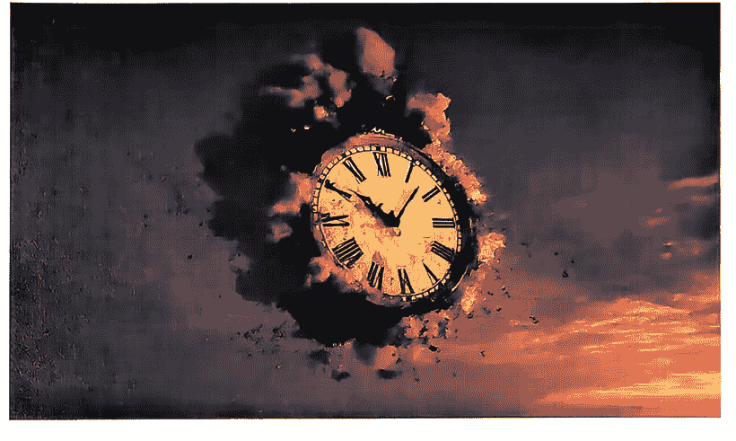

图 2-26 燃烧着融入天空的时钟生成图

这些提示词虽没有给出严格的对象细节，但通过象征物传递了强烈的情绪暗示，促使 Midjourney 基于关键词的象征含义进行图像的“类比性构图”。

### 2.5.3 把情景式和意象式表达结合起来

在日常创作中，你完全可以将这两种表达方式结合使用。我们建议你按照如下结构组织提示词：

情境开头 + 行动 / 环境细节 + 情绪 / 意象补充 + 技术参数

示例：

/imagine prompt: A solitary dancer leaping across a misty beach at dawn, waves gently receding around her feet, first rays of sun painting the sky gold, expression of quiet liberation (黎明时分，一个孤独的舞者在雾气弥漫的海滩上跳跃，海浪轻柔地退离她的脚边，初升的阳光将天空染成金色，画面表现宁静的解脱感) --ar 9:16 (图 2-27)

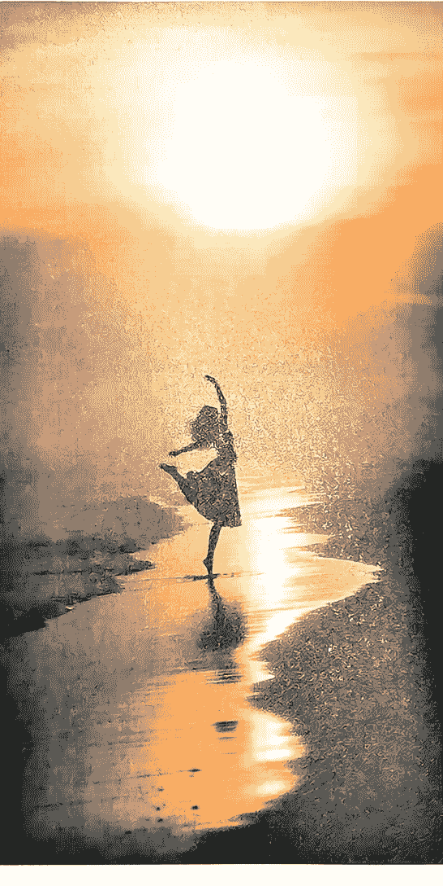

图 2-27 海滩舞者生成图

通过这种多层次的语言组织，你不仅能把握画面的核心对象，还能让观者从图像中“读出情绪”。这也是 AI 美学创作中最令人着迷的部分。

### 2.5.4 常见用途

为了更好地匹配不同的创作目标，表 2-4 总结了情境式与意象式表达在常见应用方向上的推荐组合策略与使用建议。

表 2-4 应用方向推荐表

| 应用方向 | 推荐表达方式 | 使用建议 |
| :--- | :--- | :--- |
| 插画设计 | 意象式 + 情境式 | 突出角色气质或构图氛围 |
| 概念艺术（Concept Art） | 情境式主导 | 强调动作、场景、叙事流动 |
| 海报封面 | 意象式强调 | 聚焦符号、情绪与视觉冲击力 |
| 摄影风格生成 | 情境 + 构图组合 | 指定光影状态、时间环境与视角结构 |

举个例子，如果你在创作一组主题为“孤独城市”的概念插图，可以使用如下构建法：

```
/imagine prompt: A man sitting on the edge of an empty subway platform, neon lights flickering, deep sense of isolation (一位男子坐在空荡地铁站台边，霓虹灯闪烁，画面充满孤独感) --ar 16:9 (图 2-28)
```

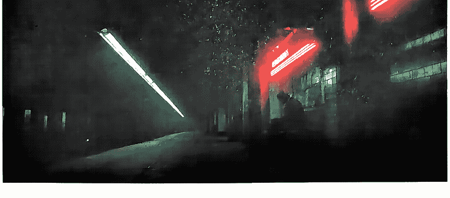

### 2.5.5 提示词编写练习

（1）从一段文字叙述中“拆图”，练习提取关键词并重组为提示词。
（2）选取一首诗、一句歌词，尝试转译为提示词并生成图像。
（3）使用对比意象（如 “cold light vs. warm eyes”）以产生冲突感。
（4）结合时间、天气、空间、动作与心理描述形成多层次构图。

你可以将下列句子转化为提示词练习：
“时间的尽头是一片蓝色的沙漠。”
“夜晚像一件黑色的披风，笼罩整座城市。”
“每个窗口里都有一段独白在闪烁。”
这些富有想象力的语言，正是 Midjourney 创作语言中的潜力矿藏。
下一节我们将进入 AI 辅助提示词生成领域，探讨如何借助模型与工具高效构建符合创作者意图的高质量提示词。

## 2.6 用文本 AI 辅助编写提示词

在 Midjourney 图像创作过程中，许多创作者会在写提示词时卡壳：想法很丰富，却难以精确表达；关键词有很多，却组合得不够恰当。为了帮助你克服语言构建瓶颈，AI 提示词生成工具应运而生。
这一节将带你了解并掌握如何借助 AI 技术辅助构建高质量提示词。我们将探讨推荐工具、具体应用方法、注意事项与进阶策略，帮助你在“构思—转化—优化”的过程中建立高效而稳定的提示词构建路径。

### 2.6.1 文本 AI 能做什么

Midjourney 本质上是“语言驱动”的图像生成工具，而在我们借助 Midjourney 展开创作的过程中，写出好的提示词并不容易：

- 你可能不清楚某种构图的英文表达；
- 不确定关键词的排列顺序是否影响构图；
- 想表达一种氛围，却找不到合适的词语；
- 想模仿一张图的风格，却难以归纳其语言特征。

对此，AI 文本辅助工具可以帮助你：

- 自动生成结构化提示词模板；
- 提供风格词汇、构图表达、材质描述的参考建议；
- 提高创作效率，降低语言门槛，拓展表达的深度。

### 2.6.2 使用方法

作为 AI 语言模型，ChatGPT 可在多个维度帮助你提升提示词质量。以下是常用功能示例：

1. 场景转提示词

输入指令：

请将以下中文描述转化为 Midjourney 英文提示词：在满月下，一只狐狸站在雪地里，远处是森林和小屋，空气中弥漫着冷色调的光

ChatGPT 输出结果及其对应的 Midjourney 生成画面：

```
/imagine prompt: A fox standing on a snowy field under a full moon, distant forest and cabin, cold color tone, cinematic lighting (一只狐狸站在雪地中，满月当空，远处有森林和小屋，冷色调氛围，电影光效) --ar 3:2 (图 2-29)
```

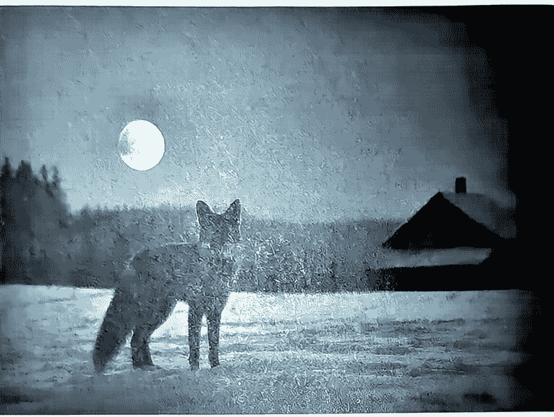

图 2-29 雪中的狐狸生成图

2. 风格关键词拓展

输入指令：

请帮我为“赛博朋克城市夜景”这个主题补充 10 个相关关键词，用于 Midjourney 提示词构建

ChatGPT 输出结果及其对应的 Midjourney 生成画面：

Neon signs, rain-slicked streets, flying cars, futuristic buildings, holographic billboards, purple glow, crowded alley, neon reflections, digital haze, sci-fi atmosphere (图 2-30)

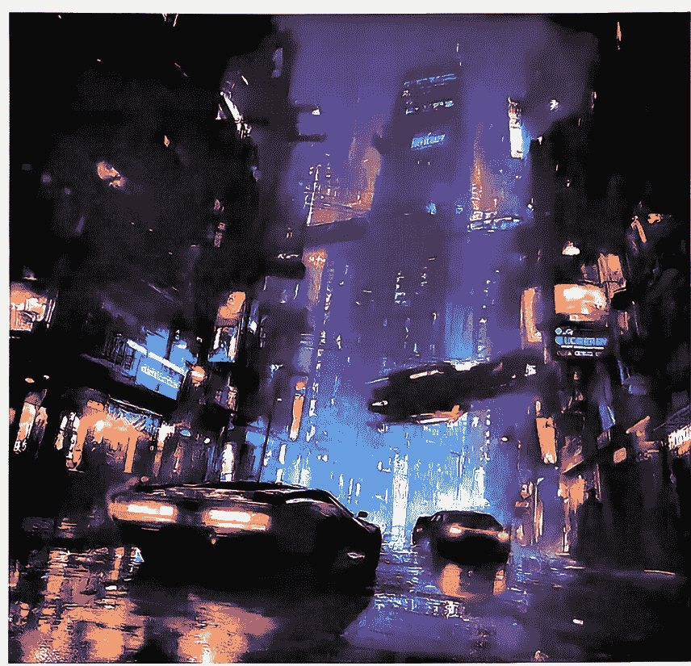

图 2-30 赛博朋克城市夜景生成图

3. 构图辅助设计

输入指令：

为一组插画系列提供一致风格构图的提示词模板，包括时间、光影、角度三项

ChatGPT 输出结果及其对应的 Midjourney 生成画面：

Template: [subject], [set time of day], [lighting style], [viewpoint]

Example: A samurai on a bridge, dusk, warm backlight, top-down view

（桥上的武士，黄昏时分，暖色背光，俯视角）--ar 16:9（图 2-31）

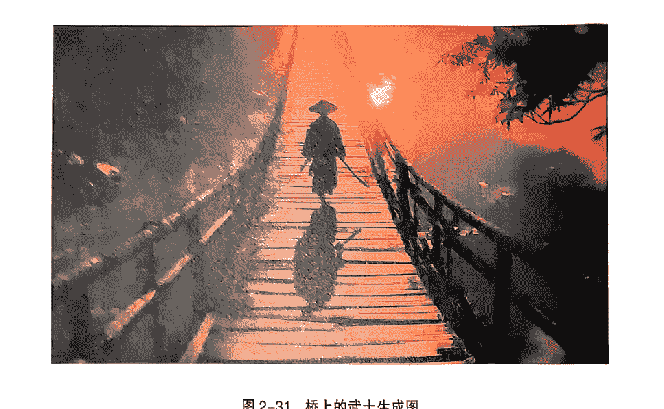

图 2-31 桥上的武士生成图

你可以根据这个模板将多个提示词套入同样结构，统一系列风格。

### 2.6.3 从图片中提取提示词

**Midjourney** 生成的图像本身就包含大量“提示词线索”。借助提示词反查工具，你可以通过图像倒推出可能的提示词：

推荐平台：

**Lexica.art**

**Hugging Face Spaces: Reverse Prompt Tools**

**PromptHero**（图搜功能）

使用方法：

- 将图像拖入上传区域；
- 系统返回类似风格的图像及其提示词；
- 选择最接近的语言结构作为基础；
- 根据你的目标修改主题或风格细节。

这种方式特别适用于“我喜欢这张图，但不知道该怎么描述”的场景。

### 2.6.4 注意事项

尽管 AI 能有效提升提示词构建效率，但我们提醒你注意以下几点：

- 避免完全复制：直接使用他人的提示词可能造成作品风格趋同，失去原创性。
- 二次创作不可忽视：文本 AI 输出内容只是“第一步草稿”，最终仍需人工打磨优化语言。
- 语言歧义需手动审查：部分工具生成的提示词可能存在逻辑冲突、重复用词、表达失焦等问题。
- 风格偏见需审慎调整：许多 AI 模板带有特定风格（如摄影、写实、复古等），建议依据创作目标重新编排风格词汇。

### 2.6.5 建立属于自己的提示词工具包

为了保持长期创作的稳定性，我们建议你构建个人提示词资料库，包括以下层面：

- 常用主体分类词（人物、建筑、动物、自然等）
- 风格词汇清单（油画、像素风、水墨、未来主义等）
- 构图与光影关键词整理（如 top-down view、soft lighting 等）
- 可重复使用的提示词模板组合（如风格控制、情绪表达等）
- 多语言对照表（如中英文关键词对照）

通过不断使用与归类，你将拥有一套属于自己的、可随时调用的“语言画笔”，让 AI 图像生成变得更加可控、优雅且高效。

## 第二部分：AI 作画示例与赏析

在第一部分，我们围绕 AI 图像生成的逻辑、美学背景与语言机制进行了深入阐释，而从第二部分开始，我们将正式走入图像的世界，以实例驱动的方式展开一次穿越风格与时代的视觉旅程。

AI 图像生成的独特性在于，它所创造的不是复制品，而是一种介于“模仿”与“想象”之间的新型图像现实。它既能够重构文艺复兴的古典油彩，也能描摹未来都市的赛博幻景；既能再现东方山水的留白气韵，也能捕捉网络亚文化中模糊而诗性的感官体验。而所有这些风格与图像的背后，真正决定作品气质与感染力的，是提示词的选择与构建方式。

因此，本部分并非简单罗列生成图，而是尝试建立一种“可被理解的风格语言系统”。每一章节聚焦于一个美学板块，涵盖其视觉特征、情感取向与文化背景；每一小节则围绕特定风格关键词展开，通过风格解析、提示词设计与图像示例三位一体，呈现出一个个“既具有创作参考价值，又富有审美教育意义”的图像场景。

你将看到，不同的提示词组合如何影响画面的构图与光影，不同的修辞方式如何引导 AI 生成特定气质的图像，而这些例子背后，隐含着 AI“理解人类语言”以及“将其转译为图像意象”的规律与限制。

我们希望，这一部分能成为你塑造视觉风格、积累语言经验、拓展美学视野的重要土壤。正如传统画家在素描本上勾勒肌理、练习透视，AI 图像创作者也需要在大量示例中反复体悟风格的张力与语言的边界。

在 AI 绘画的时代，每一个提示词，都是一笔。

而你的世界，将由你一词一画，亲手生成。

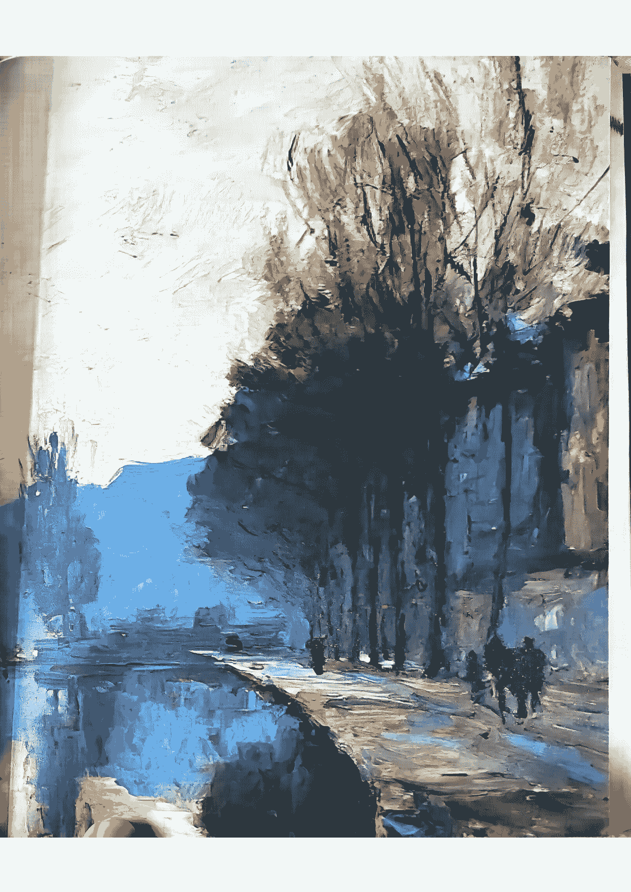

# 第 3 章

## 西方经典美学

在漫长的艺术发展史中，西方经典美学形成了一个以理性与秩序为核心、以写实与结构为手段的宏大视觉体系。从文艺复兴对古典人文精神的复兴，到巴洛克时期情感与张力的释放，再到洛可可的轻盈奢华与新古典主义的端庄克制，每一个风格流派不仅是时代精神的产物，还通过图像语言记录着人类如何理解“美”、构建“理想”。

这一章所涵盖的美学风格，几乎构成了整个西方视觉艺术史的主干结构。它们大多起源于特定的历史语境——文艺复兴响应宗教与封建秩序衰落后的理性觉醒，巴洛克服务于教会与王权的政治需求，洛可可反映贵族阶层对于日常逸乐的迷恋，而新古典主义则将启蒙时代的理性精神具象化为视觉范式。

从视觉特征来看，西方经典美学在风格上强调结构严谨、技法成熟与象征意义丰富。例如，文艺复兴中的透视法与人体解剖学研究、巴洛克中的光影冲突与动态构图，以及洛可可中的曲线装饰与粉彩色调，都具有鲜明的视觉识别度。这些特征对于 AI 图像生成尤其重要，因为它们为提示词提供了极具代表性的视觉线索和构图方向。

### 3.1 文艺复兴

关键提示词：
文艺复兴（Renaissance）、透视法（linear perspective）、人体比例（human anatomy）、自然光（natural lighting）、古典理性（classical rationality）、宗教题材（religious themes）、建筑背景（architectural backdrop）、宁静庄严（serene and solemn）

# AI 美学大师：提示词与艺术风格全解读

### 风格描述：

文艺复兴美学以“重生”为核心理念，是古典精神与人文理性的回归。它强调世界的可知性与人的尊严，主张通过科学的构图和写实的技法，揭示自然之美与人类之美。视觉上，文艺复兴时期的作品广泛使用透视法来营造空间深度，构图严谨，光影自然，常出现细节化的宗教题材或理想化的人物形象。

文艺复兴风格常通过石砌建筑（大多具有拱门、圆顶等构造特征）、绘制精美的长袍、庄严静穆的人物表情等要素体现出来。光线柔和且方向明确，人物神态温和内敛，呈现出一种庄重而宁静的视觉美感。

> “文艺复兴不是简单的复古，而是通过古典理性建构对人的重新发现。”在 AI 提示词中捕捉理性与美感的平衡，是生成文艺复兴风格图像的关键。

### 提示词：

文艺复兴风格，一幅宗教题材绘画，画面中心为圣母子形象，人物穿着古典长袍，表情宁静庄重。背景为文艺复兴建筑，有圆顶与柱廊结构，远景使用透视法营造深度，光线从左上方射入，形成自然阴影。整体色调温暖，注重细节描绘，风格写实、结构严谨，呈现出理性与庄严的审美气质（图 3-1）

(Renaissance style, a religious-themed painting featuring the Madonna and Child at the center. The figures wear classical robes with serene, solemn expressions. The background includes Renaissance architecture with domes and colonnades. Linear perspective creates spatial depth in the distant scenery, and soft natural light enters from the upper left, casting realistic shadows. The color palette is warm and the visual depiction is detailed, with a realistic and structurally balanced style, expressing a rational and solemn aesthetic)

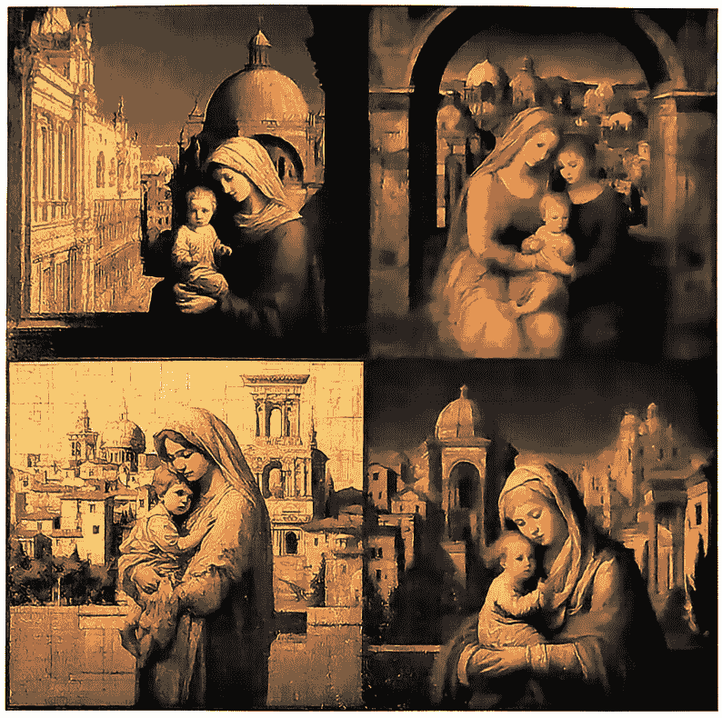

图 3-1 文艺复兴风格生成图

### 3.2 巴洛克

关键提示词：
巴洛克（Baroque）、强烈对比（dramatic contrast）、动态姿态（dynamic pose）、斜向光（diagonal lighting）、金色装饰（golden ornamentation）、情感张力（emotional tension）、宗教激情（religious ecstasy）、富丽堂皇（opulence）

# AI 美学大师：提示词与艺术风格全解读

### 风格描述：

巴洛克美学是一种充满张力与戏剧性的视觉语言，兴起于 17 世纪的欧洲宗教与政治动荡时期。它以极致的情感表达、动态的构图方式、奢华的色彩与光影对比来激发观者的感官与心理反应。巴洛克作品常通过对人物情绪的极端刻画与斜向的强光营造出强烈的视觉冲击力。

巴洛克风格可通过强烈的明暗对比、剧场式照明、人物的复杂姿态与动态布景来体现。巴洛克美学作品中的场景富于细节，装饰多为金色与红色，构图多采用螺旋式或对角线结构，以增强画面的动势和焦点聚集效果。

> “如果文艺复兴追求理性之美，那么巴洛克便是感性与崇高的交响。”

在提示词中调用这种充满力量与情绪的元素，能有效生成具有强烈视觉冲击力的图像。

### 提示词：

巴洛克风格，一幅充满宗教激情的画面，人物表情激昂，肢体姿势夸张有力。画面采用斜向强光，形成明暗对比强烈的光影效果。背景富丽堂皇，有金色雕刻、大理石柱与天顶壁画。构图动态感强，画面充满情感张力与神圣氛围。整体色调为深红与金色，突出奢华与戏剧性（图 3-2）

(Baroque style, a dramatic scene full of religious ecstasy, with figures displaying intense expressions and exaggerated, powerful poses. Diagonal lighting creates stark chiaroscuro effects. The background features opulent details such as golden carvings, marble columns and ceiling frescoes. The composition is highly dynamic, filled with emotional tension and a sacred atmosphere. The overall color palette is deep red and gold, emphasizing luxury and theatricality)

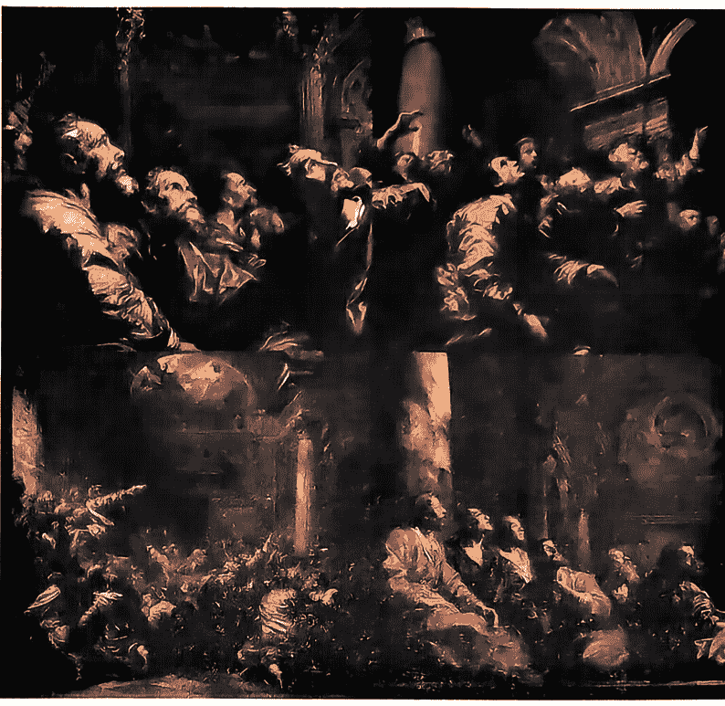

图 3-2 巴洛克风格生成图

### 3.3 洛可可

关键提示词：
洛可可（Rococo）、轻盈华丽（lightness and elegance）、柔和色彩（pastel colors）、装饰繁复（ornate decoration）、宫廷生活（courtly life）、花卉与卷饰（floral and scroll motifs）、亲密私语（intimate moments）、田园幻想（pastoral fantasy）

# AI 美学大师：提示词与艺术风格全解读

### 风格描述：

洛可可美学是巴洛克美学的轻盈延续，它舍弃了宗教与权威的宏大叙事，转而关注精致、世俗、亲密的人类情感体验。18 世纪的法国上流社会是这一风格的发源地，画面常以贵族的闲逸生活、恋爱游戏、园林漫步等场景为主题，强调柔和色彩、曲线构图和轻盈装饰。

AI 生成洛可可风格图像时，可将细腻的粉色、浅蓝、金色作为主色调，加以精美的服饰、细节繁复的室内空间或花园景观，营造出一种柔软、轻巧而迷人的视觉氛围。人物姿态优雅，常以眼神交流与身体语言传达私密情感。

> “洛可可是艺术中的呢喃。” 它以最柔美的方式呈现生活的甜美与欲望的轻盈。在提示词中捕捉这种精致且世俗的感性语调，是重现洛可可视觉特征的关键。

### 提示词：

洛可可风格，一幅描绘 18 世纪宫廷花园中贵族聚会的画面，人物身穿华丽轻盈的服饰，色彩为粉蓝、象牙白与金色。背景为精致的园林与喷泉，装饰繁复且带有卷曲花纹。人物表情柔和，姿态优雅，互动亲密自然。整体色调轻盈柔美，画面充满浪漫与闲适氛围，展现洛可可时代的精致生活方式（图 3-3）

( Rococo style, a scene depicting an 18th-century courtly gathering in a palace garden. Figures wear ornate, light costumes in pastel blue, ivory and gold. The background features refined gardens and fountains with elaborate floral and scrollwork motifs. Expressions are gentle, postures are elegant, and interactions are intimate and natural. The overall palette is soft and graceful, creating a romantic and leisurely atmosphere that reflects the refined lifestyle of the rococo era )

# 第 3 章 西方经典美学

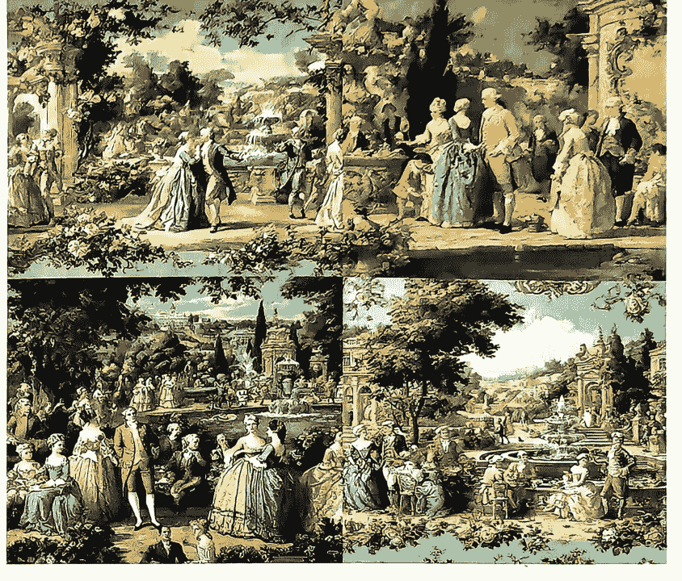

图 3-3 洛可可风格生成图

### 3.4 新古典主义

关键提示词：
新古典主义（Neoclassicism）、对称结构（symmetry）、克制理性（restrained rationality）、雕塑感（sculptural forms）、古希腊罗马（Greco-Roman Antiquity）、简洁线条（clean lines）、历史题材（historical themes）、道德教化（moral virtue）

# AI 美学大师：提示词与艺术风格全解读

### 风格描述：

新古典主义是对巴洛克与洛可可奢靡风格的有力回潮，它重新确立了古典理性、道德理想与秩序之美。随着启蒙运动与考古发现的兴起，欧洲艺术家纷纷转向对古希腊罗马文明的探索，追求简洁、克制、清晰而有力的视觉语言。新古典主义强调冷静的构图、严谨的比例、雕塑般的人物造型，作品常包含政治或道德寓意。

创作者在 AI 图像生成中，适合通过对称布局、几何化背景、雕塑感人物与沉稳色调，彰显新古典主义风格。人物常身着古典服饰，体态挺拔，背景可参考罗马神庙、石柱、壁龛等元素。整体画面呈现一种冷峻而崇高的氛围，仿佛每一处细节都服务于理性与品格的表达。

> 正如温克尔曼所说：“艺术的最高理想，是高贵的单纯与静穆的伟大。”而新古典主义正是对这种精神的视觉化演绎。

### 提示词：

新古典主义风格，一幅描绘古希腊神话场景的画作，人物衣着简洁、结构严谨，姿态如雕塑般静止。背景为对称式古典建筑，有石柱与拱券结构。光线柔和，突出人物体块与肌理。整体色调为米白、灰蓝与赤褐，强调克制与庄重。画面静穆理性，传达道德与秩序的美学理念（图 3-4）

( Neoclassicism style, a painting depicting a scene from Greek mythology. Figures wear simple garments and stand in sculptural, still poses. The background features symmetrical classical architecture, with stone columns and arches. Soft lighting emphasizes form and texture. The overall palette includes beige, muted blue and terracotta, reinforcing a restrained and solemn mood. The composition reflects a moral and orderly aesthetic vision )


图 3-4 新古典主义风格生成图

### 3.5 浪漫主义

关键提示词：
浪漫主义（Romanticism）、情感表达（emotional expression）、自然崇拜（sublime nature）、戏剧性构图（dramatic composition）、动荡场景（turbulent scenes）、英雄主义（heroism）、孤独感（solitude）、内心风暴（inner turmoil）

# AI 美学大师：提示词与艺术风格全解读

### 风格描述：

浪漫主义是一场对理性束缚的情感反叛，它强调个体感受、幻想、激情与自然的神秘力量。19世纪初，随着启蒙理性的冷却与社会动荡的加剧，艺术家开始将注意力转向内在世界与宏大自然，探索人类与自然、个体与命运之间的情感张力。浪漫主义作品构图富有戏剧性，情绪浓烈，色彩对比强烈，常见暴风骤雨、山崖海浪、挣扎的身影与炽热的天空等意象。

创作者在借助 AI 生成浪漫主义风格作品时，需突出运动中的自然情境与人物内在情感的爆发，可以使用风暴、海浪、奔马、烈火等动态元素，营造出激烈的氛围。色彩上常用深蓝、暗红、金橙等浓烈色调；人物或呈英雄式孤立，或陷入与自然力量的对抗之中；构图强调对角线张力与非平衡感。

> “浪漫主义不过是一种色彩的自由。”在提示词中激活这种自由与激情，是通往浪漫主义核心的通道。

### 提示词：

浪漫主义风格，一位披风飘扬的孤独旅人站立于悬崖之巅，面对浩瀚风暴中的海洋。天空被狂风撕裂，云层翻涌，海浪拍击岩壁。画面色调浓烈，以深蓝、灰紫、金橙为主。人物姿态坚定却显得渺小，展现人对自然力量的敬畏与抗争。构图充满戏剧张力，情绪强烈而富有诗意（图 3-5）

( Romanticism style, a solitary traveler with a flowing cloak stands atop a cliff, facing a stormy sea. The sky is torn by wind, clouds swirl, and waves crash against the rocks. The color palette is intense, featuring deep blues, muted purples and golden oranges. The figure appears resolute yet small, expressing awe and struggle against the force of nature. The composition is dramatic, emotionally charged, and poetic in tone )


图 3-5 浪漫主义风格生成图

### 3.6 现实主义

关键提示词：
现实主义（Realism）、日常生活（everyday life）、普通人物（common people）、自然光（natural light）、写实细节（detailed realism）、劳动场景（labor scenes）、社会环境（social context）、质朴色调（earthy tones）

# AI 美学大师：提示词与艺术风格全解读

### 风格描述：

现实主义兴起于 19 世纪中叶，是对浪漫主义情感过度的批判性回应，也是一场关注现实世界与社会阶层的艺术革命。它拒绝理想化和神话化的主题，转而聚焦普通人的日常生活，尤其是劳动者的艰辛与尊严。现实主义艺术主张“如实描绘”，强调细节的真实再现与社会背景的具体呈现。

创作者在使用 AI 生成现实主义风格图像时，应避免在提示词中提及戏剧性或梦幻感，转而强调自然光下的真实场景、未经粉饰的人物面孔，以及质感清晰的物件与环境。提示词中可引入农田、工厂、厨房、街巷等具体生活生产场所，人物穿着朴素，表情自然或沉思，构图稳重、节奏平缓，常以水平线作为构图基础。

> 正如库尔贝所言：“我只画我眼睛里看到的。”现实主义的美学，有一种深植于生活经验与社会观察中的视觉态度。

### 提示词：

现实主义风格，一位农民坐在田埂边休息，面容粗砺，衣着简朴，眼神中带着疲惫与宁静。背景为广袤的田野与干裂的土地，天空低沉，色调偏棕土色与灰蓝色。光线自然无雕饰，画面注重人物与环境的具体细节，展现真实生活中的质朴与韧性（图 3-6）

( Realism style, a farmer resting on a field ridge, with a weathered face and simple clothing, showing both fatigue and calm in the eyes. The background features a vast field and cracked earth under a subdued sky. The palette consists of earthy browns and muted blues. The lighting is natural and unembellished. The image emphasizes detailed realism of both figure and setting, portraying the quiet resilience found in ordinary life )

## 3.7 印象派

关键提示词：
- 印象派（Impressionism）
- 短笔触（short brushstrokes）
- 光影变化（light and shadow）
- 瞬时感受（ephemeral moments）
- 自然场景（outdoor scenes）
- 柔和色彩（soft colors）
- 氛围表达（atmospheric effects）
- 即兴构图（spontaneous composition）

### 风格描述：

印象派是对现实主义的延续与突破，它不再执着于“物”的准确再现，而是转向描绘“光”与“感觉”。19世纪后期，随着城市生活与户外写生的流行，艺术家开始尝试捕捉转瞬即逝的光影变化、天气感受与日常生活的氛围。印象派作品笔触轻快、构图自由，色彩明亮而富于变化，常在画面中呈现朦胧却鲜活的感官印象。

AI 生成印象派风格图像时，应弱化轮廓清晰的物体结构，强调光影流动和色块变化。提示词中可引入日出、湖面、花园、街角等自然或都市中的转瞬场景，色彩选择方面倾向柔和与层叠，构图上可采用非对称与开放式画面，呈现“观看中的片刻”。

正如莫奈所说：“我希望画出的是光本身。”印象派图像的核心，在于凝聚视觉之外的气息，凸显时间感。

### 提示词：

印象派风格，一场湖畔日出，阳光透过薄雾照在水面上，波光粼粼。画面使用短笔触表现水面与天空的颜色过渡，色彩为粉橙、浅蓝、灰紫等柔和色调。湖边的树木与建筑仅有模糊轮廓，人物行走于远处小道，构图开放且自然，整体氛围温柔、安静，呈现出晨曦中的片刻印象（图 3-7）

(Impressionism style, a lakeside sunrise where sunlight pierces through mist and reflects on the water. Short brushstrokes depict transitions between water and sky in soft hues of peach, light blue, and muted lavender. Trees and buildings at the lakeshore are loosely outlined, while figures walk along a distant path. The composition is open and natural, creating a gentle, quiet atmosphere that captures a fleeting morning impression)

图 3-7 印象派风格生成图

## 3.8 后印象派

关键提示词：
- 后印象派（Post-Impressionism）
- 结构感（structural composition）
- 主观色彩（subjective color）
- 内在情感（inner emotion）
- 粗轮廓（bold outlines）
- 象征寓意（symbolic meaning）
- 几何构成（geometric form）
- 笔触强化（enhanced brushwork）

### 风格描述：

后印象派既是对印象派的延续，也是一次主动的“背离”。艺术家在继承印象派对光色与生活场景关注的基础上，更加强调作品的主观表现与结构逻辑。代表人物如塞尚、梵高、高更等，不再满足于转瞬即逝的视觉印象，而是通过强化色彩、夸张形式、赋予寓意与表达情感，建立起个性化的视觉语言。

后印象派风格可通过更强烈的笔触、夸张的色彩使用与结构化的构图方式呈现。提示词中可以引入带有象征意味的自然景物、静物或人物，色彩不必贴近现实，反而应鼓励借助色彩表达内在感受与精神世界的主观倾向。构图可参考几何切分，画面强调形式、节奏与情绪的统一。

后印象派的AI图像应追求画面背后更深层的图像情绪与心理能量。

### 提示词：

后印象派风格，一片起伏的山丘在黄昏光照下呈现出非真实的色彩，前景有旋转形态的树木与形态扭曲的石屋。画面使用浓重的笔触，色彩包括明黄、深蓝、橘红与紫色等，构图近乎几何化，树木与建筑轮廓清晰且夸张。整体风格带有强烈情绪色彩，打造梦境与现实交错的视觉体验（图3-8）

(Post-Impressionism style, a landscape of rolling hills under the light of sunset, rendered in unreal colors. In the foreground are twisting trees and distorted stone houses. The painting features heavy brushwork and vivid hues like bright yellow, deep blue, orange, and purple. The composition is almost geometric, with bold outlines for trees and buildings. The overall tone is emotionally intense, creating a dreamlike interplay between reality and imagination)

图 3-8 后印象派风格生成图

## 3.9 象征主义

关键提示词：
- 象征主义（Symbolism）
- 梦境意象（dream imagery）
- 神秘气氛（mystical atmosphere）
- 寓言性主题（allegorical themes）
- 象征物（symbolic objects）
- 内省与灵性（introspection and spirituality）
- 装饰风格（decorative style）
- 朦胧轮廓（soft contours）

### 风格描述：

象征主义是一场逃离现实主义与自然主义的审美反转，它将艺术创作转向潜意识、梦境、神秘与灵性的世界。19世纪末，象征主义艺术家主张“用形象表达不可见的事物”，通过暗示、寓言与隐喻构建一个超越现实的视觉世界。象征主义风格作品常带有超自然色彩，人物表情内敛，背景氛围静谧而神秘，形式风格常融入新艺术的装饰性图案与线条。

借助 AI 生成象征主义风格作品时，创作者可在提示词中强调模糊的边缘处理、象征性的构图元素（如月亮、镜子、蛇、花卉等）、静止而深邃的人物姿态，以契合风格特征。色彩多为低饱和或带有光晕感的梦幻色调，画面强调情绪氛围与心理隐喻，而非具象的物理场景。

正如波德莱尔所言：“一切事物都在相互呼应。”象征主义的 AI 生成图像，也应努力在表象与隐意之间建构这种“共鸣”。

### 提示词：

象征主义风格，一位身披长袍的女性站在夜晚时分的湖畔，手持一面镜子，凝视远方月亮的倒影。背景为朦胧的森林与微光中的水面，画面整体采用蓝紫与银白色调，轮廓柔和，细节装饰繁复。人物表情神秘而内省，构图充满寓言气息，营造出梦境般的神秘氛围（图 3-9）

(Symbolism style, a robed woman stands by a nighttime lake, holding a mirror and gazing at the moon's reflection in the water. The background features a misty forest and a shimmering lakeside, with the scene rendered in bluish-purple and silvery hues. Contours are soft and decorative details abound. The figure's expression is mysterious and introspective, and the composition evokes both an allegorical theme and dreamlike atmosphere)

图 3-9 象征主义风格生成图

## 3.10 分离派

关键提示词：
- 维也纳分离派（Vienna Secession）
- 几何装饰（geometric ornamentation）
- 扁平化（flatness）
- 金箔效果（gold leaf effect）
- 象征寓意（symbolic content）
- 女性形象（feminine figures）
- 新艺术风格（art nouveau influence）
- 图案重复（pattern repetition）

### 风格描述：

维也纳分离派是19世纪末欧洲新艺术运动中的重要分支，由克里姆特等艺术家发起，主张“为时代的艺术、为艺术的自由”。它融合了装饰性与象征性，在视觉上强调金属质感、几何秩序与图像的扁平化处理，形成极具辨识度的现代美学语言。尤其是以女性为主题的维也纳分离派作品，常由金箔、花卉、曲线与抽象背景构成华丽而神秘的意象世界。

分离派风格可通过大量图案元素（如马赛克、圆形、植物纹样）、对比强烈的背景图层，以及金色、深红、墨绿等富贵色系来塑造。人物通常呈现装饰性姿态，构图注重对称与框架，背景与人物之间边界弱化，画面更接近壁画或图案艺术。

正如克里姆特所展现的那样，艺术可以同时具有视觉的奢华性与精神的象征性。提示词应引导 AI 将装饰与象征融合成一种“平面化的深度”。

### 提示词：

维也纳分离派风格，一位女性立于金箔装饰背景前，身着充满几何图案的长袍，面容宁静而神秘。背景为对称结构，包含环形、螺旋与植物图案，整体构图呈扁平装饰性风格。以金色与深红为主色，图像整体风格融合象征意涵与装饰性美感，打造一种充满仪式感的视觉体验（图 3-10）

(Vienna Secession style, a woman stands before a gold-leaf decorated background, wearing a robe filled with geometric patterns. Her face is serene and mysterious. The background features symmetrical forms including circles, spirals, and botanical motifs, rendered in a flat, ornamental manner. Dominated by gold and deep red tones, the image blends symbolic meaning with decorative elegance, creating a ceremonial visual experience)

图 3-10 维也纳分离派生成图

## 3.11 装饰艺术运动

关键提示词：
- 装饰艺术（Art Deco）
- 对称与几何（symmetry and geometry）
- 金属光泽（metallic sheen）
- 阶梯形构图（ziggurat forms）
- 未来感（futuristic）
- 奢华感（luxury aesthetics）
- 摩天大楼（skyscrapers）
- 机械美学（machine elegance）

### 风格描述：

装饰艺术运动是20世纪初期现代性与奢华风格的融合象征，主张用几何秩序、光泽材质和都市想象建构起一个速度感十足的视觉世界。Art Deco 在20世纪20年代到20世纪30年代盛行于建筑外观、室内、时尚、交通设计等多个领域，是对工业化、都市化和未来主义的积极回应。相比自然主义，它更强调造型的雕塑性与图案的装饰性。

装饰艺术风格常通过对称构图、流线型设计、金属质感与阶梯形建筑表现。提示词中可加入摩天楼、夜景、镜面装饰、黄金线条、女性肖像等关键词，强化“都市之美”与“工业之雅”的融合。色调常由黑、金、银、墨绿、宝蓝等高对比色构成，视觉冲击力强，富有节奏感。

正如当时的艺术家所追求的“在机器时代中发现装饰之美”，Art Deco 风格的 AI 生成图像应该既具“速度感”，又不失“华丽感”。

### 提示词：

装饰艺术风格，夜色下的摩天大楼群，以对称式构图呈现，建筑外立面为阶梯形轮廓与金属线条装饰，背景为星空与闪烁的都市灯光。整体画面使用黑金配色，细节精致，充满未来感与都市节奏感。风格强调几何造型、金属质感与对称秩序，展现机械时代的奢华视觉美学（图 3-11）

(Art Deco style, a skyline of skyscrapers at night arranged in a symmetrical composition. The buildings feature ziggurat-like silhouettes and metallic linear ornaments. The background includes a starry sky and glittering city lights. The color scheme is dominated by black and gold, with refined details that convey a sense of futuristic and urban rhythm. The style emphasizes geometric shapes, metallic sheen, and symmetrical structures, embodying the luxurious visual aesthetics of the machine age)

图 3-11 装饰艺术风格生成图

## 3.12 包豪斯

关键提示词：
- 包豪斯（Bauhaus）
- 功能主义（Functionalism）
- 几何形体（geometric shapes）
- 简约设计（minimal design）
- 现代材料（modern materials）
- 初级色彩（primary colors）
- 模块化（modularity）
- 理性构图（rational layout）

### 风格描述：

包豪斯风格源于1919年创立于德国的同名设计学院，标志着传统工艺与现代工业的融合，为现代主义美学确立了核心框架。包豪斯风格主张“形式追随功能”，强调设计的理性、功能性与可复制性，反对多余装饰，推崇清晰线条、几何构成和标准化生产。在视觉语言上，它追求简单、精确、有效，常采用初级色、基础形体和网格构图。

包豪斯风格可通过使用简洁的几何形状（圆形、三角形、正方形）、鲜明的“红黄蓝黑白”配色、模块化排布结构以及无装饰字体体现。背景可为建筑、家具或抽象图形设计，构图理性有序，色彩对比强烈而清晰，传递出“功能即美”的视觉理念。

正如包豪斯格言“少即多”，提示词中的每一个元素都应服务于结构性与功能性的视觉表达。

### 提示词：

包豪斯风格，一幅以红黄蓝三原色和黑白构成的几何抽象画面，包含圆形、矩形与直线元素，整体构图简洁理性。画面平面化，无阴影与渐变，图形排列遵循对称与网格原则，背景为纯白或浅灰，营造出现代主义的秩序感与结构感。整体风格强调功能性与形式的统一，体现出工业时代的理性美学（图 3-12）

(Bauhaus style, an abstract composition featuring primary colors—red, yellow, and blue—alongside black and white. The image includes circles, rectangles, and straight lines in a flat, minimal layout. No shadows or gradients are present; the shapes follow a grid-based, symmetrical arrangement. The background is pure white or light gray, creating a sense of modernist order and structural clarity. The overall style emphasizes functional form and visual unity, embodying the rational aesthetics of the industrial age)

图 3-12 包豪斯风格生成图

# 第 4 章

## 东方美学

东方美学并非一种单一的视觉体系，而是根植于东亚与南亚等地广泛文化传统中的多样审美结构。与西方美学中强调“形式、比例与物质性”的表达不同，东方艺术更重视意境、气韵与象征性传达，倾向于通过“留白”“空灵”“对比”“象征”等方法，唤起观者的内在感受与精神共鸣。

这一章所讲的东方视觉风格，涵盖中国、日本、朝鲜半岛、波斯、印度与东南亚等国家和地区的艺术流派，既包括传统的水墨、工笔、浮世绘、青绿山水等绘画体系，也包括极具装饰性与叙事性的波斯细密画、印度拉杰普特绘画以及吴哥风格的佛教艺术。这些风格虽然各具地域性，但共同展现出东方文化中“以神写形”“托物言志”“气象为本”的艺术精神。

东方美学往往并不追求对物象的绝对还原，而是致力于捕捉“物外之意”“境中之情”。这也使得它在 AI 生成中具备更强的抽象性、诗意性与结构张力，可作为实现 AI 艺术感知的深层美学工具。

## 4.1 中国水墨画

> 关键提示词：
> - 水墨画（Ink Wash Painting）
> - 留白（negative space）
> - 墨色层次（ink tonality）
> - 山水意境（landscape mood）
> - 气韵生动（spiritual resonance）
> - 写意笔法（freehand brushwork）
> - 浓淡干湿（ink gradation）
> - 虚实相生（solid and void balance）

### 风格描述：

中国水墨画是东方美学最具代表性的图像传统之一，其核心不仅在

# AI 美学大师：提示词与艺术风格全解读

于“画什么”，还在于“如何画”与“为什么画”。它以毛笔、宣纸、水与墨为媒介，通过“笔墨”表现自然万物的神韵与画家内心的情思。水墨画强调“意在笔先”“以神写形”，通过墨色的浓淡、笔触的疾徐、构图的虚实，营造“可游可居”的诗意空间。

水墨风格的呈现应围绕“气韵”与“留白”两个核心展开。提示词可引入山川、云雾、松石、孤亭、行旅人物等典型元素，构图上注意留白与动线走向的呼应。笔法方面应描述水墨浓淡干湿的过渡感，如“泼墨”“飞白”“破笔”等表现形式。色彩上主用黑白灰，局部可点缀淡赭、墨绿、丹朱等低饱和度传统色调。

AI 生成水墨图像的关键不在于再现“物”，而在于通过提示词激活构成“气象”的诸要素。

提示词：

中国水墨画风格，一幅写意山水画，画面中远山连绵，松树挺拔，山间云雾缭绕，一座小亭隐现于林间，近处有一位行旅人物沿山径而行。整体构图上下错落，留白广阔。墨色层次丰富，从浓墨到淡墨自然过渡，运笔灵动，富有飞白与泼墨效果。画面充满空灵与动感，传达出幽远、清雅、气韵生动的东方意境美（图 4-1）

(Chinese Ink Wash Painting style, a freehand landscape featuring distant mountains, upright pine trees, and mist drifting between peaks. A small pavilion is hidden among the woods, and a traveler walks along a winding mountain path. The composition is vertically layered with generous use of negative space. Ink tones range from deep black to light gray, with dynamic brushwork that includes flying white and splash ink effects. The overall image conveys serenity, elegance, and spiritual vitality—evoking the poetic mood of traditional Chinese painting)


图 4-1 中国水墨画风格生成图

## 4.2 中国工笔画

关键提示词：
工笔画（Gongbi Painting）、细致描绘（meticulous detailing）、线描（line drawing）、层层设色（layered coloring）、对称构图（symmetrical composition）、传统题材（classical themes）、花鸟人物（floral and figure subjects）、清丽雅致（elegant refinement）

### 风格描述：

工笔画是中国绘画传统中的“精工”技艺代表，以其精确的线条、严谨的构图和层层渲染的设色而著称。不同于水墨画的写意精神，工笔画强调对自然形态的深入观察与准确描摹，线条讲求“铁线描”之劲健与均匀，设色作品多由矿物颜料晕染而成，色泽清丽而不浮艳。常见题材有花鸟、仕女、神话人物与宫廷场景，展现出一种庄重又柔雅的东方秩序美。

创作者在 AI 工笔风格作品创作过程中，应通过关键词引导生成极为清晰的轮廓线、规整对称的构图布局以及干净明快的色彩。人物与物体造型细腻，姿态优雅，静中有动。提示词中可加入“勾线”“重彩”“双钩填色”“白描”等关键词，色彩选择可参考石青、胭脂、藤黄、赭石等中国传统设色体系。

> “笔精墨妙，赋色工丽。”要想借助 AI 再现工笔画之美，需要将“写实的眼”与“审美的心”共同注入提示词之中。

### 提示词：

中国工笔画风格，一幅描绘仕女赏花的画面，人物衣着华丽，发式精致，姿态婉约。背景为庭院花木，有海棠、牡丹与石榴，飞鸟停歇枝头。画面线条细腻勾勒，设色柔和、层次分明，采用对称式构图，轮廓清晰，人物神情端庄含蓄，画风整体典雅秀美，体现工笔画细致入微、工整有序的艺术特色（图 4-2）

( Chinese Gongbi Painting style, a delicate scene of an elegant lady admiring flowers. She wears ornate garments and an elaborate hairstyle, her posture graceful and reserved. The background features a garden with blossoming crabapple, peony, and pomegranate trees, with birds resting on the branches. The lines are finely drawn, with soft, layered coloring. The composition is symmetrical with precise outlines. The overall mood is refined and poised, capturing the meticulous and elegant spirit of Gongbi art )


图 4-2 中国工笔画风格生成图

## 4.3 中国青绿山水

关键提示词：
青绿山水（Blue-Green Landscape）、矿物重彩（mineral pigments）、层叠山峦（layered mountains）、装饰性构图（decorative composition）、金碧辉映（gold and blue brilliance）、理想化自然（idealized nature）、线描勾勒（outlined contours）、山水宫殿（landscape with palaces）

### 风格描述：

青绿山水是中国古代山水画的重要流派，起源于隋唐，盛行于五代、宋代，以鲜明的色彩、典雅的构图与理想化的自然景观著称。画面多以石青、石绿、泥金等矿物颜料设色，色泽浓郁华贵；构图层峦叠嶂，常融合山川、宫殿、飞瀑与云雾，描绘出富丽堂皇的“人间仙境”。

AI 青绿山水风格可通过关键词中的矿物重彩、金色点缀、对称与装饰性布局来体现。色彩上重点引导使用青绿色系（金石青、孔雀绿）、局部点缀金色装饰、朱红宫墙等元素。构图中可安排高远山峰、蜿蜒山径、楼阁亭台，画面讲究层次感与节奏变化。画中人物多为渺小点景式，以增强山水的壮丽感与精神性。

提示词应在彰显色彩富贵感的同时，表现青绿山水超脱现实、理想化自然的精神风貌。

### 提示词：

中国青绿山水风格，一幅描绘群山环绕的理想化山水世界的作品，高耸山峰层叠错落，以青绿重彩绘制，山间有宫殿楼阁、飞瀑流泉，云雾缭绕。画面以金粉描边，点缀松柏与朱红屋瓦，色彩浓丽，构图繁复有序，兼具壮丽景观与装饰美感，展现古代山水画的神秘与辉煌气质（图 4-3）

( Chinese Blue-Green Landscape style, a grand composition of layered mountains in rich blue-green mineral pigments. Palaces and pavilions are nestled among the peaks, with cascading waterfalls and drifting mist. The image features golden outlines and decorative details, including pine trees and vermilion rooftops. The color scheme is vivid and majestic, and the composition is complex yet balanced, evoking the mystical and opulent spirit of ancient Chinese landscape painting )


图 4-3 中国青绿山水风格生成图

## 4.4 日本浮世绘

关键提示词：
浮世绘（Ukiyo-e）、线性勾勒（linear delineation）、平涂色块（flat color planes）、风俗画（genre scenes）、木版印刷感（woodblock texture）、人物剪影（silhouetted figures）、江户日常（Edo daily life）、波浪云彩（stylized waves and clouds）

### 风格描述：

浮世绘是日本江户时代流行的一种版画艺术，其名意为“浮世之绘”，即转瞬即逝的尘世生活图像。它融合了绘画与版刻语言，以清晰的轮廓线、明快的色块与日常题材为特征，常描绘歌舞伎演员、町人风貌、风景名胜与美人。视觉风格强调构图的装饰性与图像的符号化，具有极高的辨识度与现代平面感。

浮世绘风格 AI 创作应围绕粗黑线勾勒人物与景物轮廓、平面化构图与低饱和度色块涂抹来展开。提示词中可加入“木刻风格”“手绘轮廓”“传统服饰”“和风景观”等关键词，同时注意背景处理，如浮云、巨浪、樱花、富士山等典型意象。色彩上使用典型的江户配色，如蓝染蓝、灰墨黑、朱红与浅黄等。

正如浮世绘所体现的那样，对日常生活的凝视，也是对时代精神的形塑。在提示词中合理布置人物动态与环境特征，即可再现这种优雅而平实的东方版画之美。

### 提示词：

日本浮世绘风格，一位身穿和服的女性走在江户城的街道上，背后是远处的富士山与盛开的樱花树。人物轮廓以粗黑线勾勒，画面采用平涂色块与木刻印刷的风格呈现。背景有飘动的云纹与流动的溪水，色彩以蓝、灰、红为主，画面整体平面感强，传达出宁静的江户风情与日常生活的美学情趣（图 4-4）

( Ukiyo-e style, a woman in a kimono walks through a street in Edo, with Mount Fuji and blossoming cherry trees in the background. Her figure is outlined with bold black lines, while the image features flat color planes and a woodblock print aesthetic. The background includes stylized clouds and flowing water. The palette uses indigo blue, gray, and vermilion red. The overall composition is flat and decorative, evoking the tranquil spirit and visual poetry of everyday Edo life )


图 4-4 日本浮世绘风格生成图

## 4.5 日本琳派

关键提示词：
琳派（Rinpa School）、装饰性构图（decorative composition）、金箔背景（gold leaf background）、自然意象（nature motifs）、图案化处理（stylized forms）、花鸟题材（floral and bird themes）、对称与留白（symmetry and negative space）、扇面屏风（folding screen aesthetics）

### 风格描述：

琳派是日本江户时代形成的重要装饰艺术流派，以“自然意象的形式美”为核心，作品多以花草、鸟兽、流水、季节景致等为题材，呈现出典雅、清润而富有图案化特征的视觉风格。琳派艺术强调构图的秩序性与形式的装饰性，常使用金箔、银箔或色块大面积铺陈背景，通过“少而精”的形式语言达到审美平衡。

琳派风格应通过对称式布局、空灵的留白与自然元素的高度图案化表达加以体现。提示词中可加入“金箔背景”“扇面屏风”“流水图样”“梅兰竹菊”等典型素材。颜色清雅而不单调，典型色彩包括金、墨、深绿、赭红与淡蓝。画面应营造出静谧、典雅、象征性强的意境。

AI 提示词需兼顾“自然之形”与“人工之美”，只有两者交融，才能生成具有琳派神韵的画面。

### 提示词：

日本琳派风格，一幅描绘秋日芒草与飞鸟的装饰画作，背景以金箔为底，芒草对称排布，飞鸟穿行其间。画面元素简约却布局精妙，整体采用屏风构图风格，配色以金、墨、赭石与淡蓝为主。植物与鸟类形象经过图案化处理，保留自然形态的装饰美，画面留白广阔，传达出典雅、静谧、超尘脱俗的东方意境（图 4-5）

( Rinpa School style, a decorative artwork depicting autumn pampas grass and birds in flight, set against a gold leaf background. The grasses are arranged symmetrically, and the birds move elegantly through the scene. The composition adopts a folding screen layout, with colors dominated by gold, ink black, ochre, and light blue. Plant and bird forms are stylized, blending natural elegance with decorative clarity. The image uses wide negative space and conveys a serene, refined, and transcendent atmosphere )


图 4-5 日本琳派风格生成图

## 4.6 日本狩野派

关键提示词：
狩野派（Kano School）、权威美学（Official Aesthetics）、水墨设色结合（ink and color fusion）、建筑壁画（architectural painting）、山水人物（landscape with figures）、对称布局（symmetrical layout）、儒释道融合（Confucian-Buddhist-Daoist fusion）、金底装饰（gold background decoration）

### 风格描述：

狩野派是日本室町时代至江户时代最具影响力的画派，以服务将军、诸侯的“官画体系”著称。狩野派的美学风格承袭中国宋元画法，融合日本本土审美，形成了结构严整、题材宏阔、色墨并用的综合绘画体系。狩野派作品常用于寺庙、城堡等大型建筑的装饰，也广泛用于屏风、隔扇等室内陈设，强调构图的礼仪性与视觉的威仪感，兼顾道德象征与自然意象。

狩野派风格可通过对称式构图、山水与人物并置、色墨融合渲染与金箔装饰背景来实现。提示词中可包含松树、岩石、鹤鹿、高士、僧人等典型形象，背景常辅以流水、远山、祥云、桥廊等元素。色彩融合水墨灰调与金色或赭红色，画面应充满格局感与文化感。

正如狩野永德之画常被称为“视觉上的权力象征”，AI 提示词的组织也应体现出结构上的均衡、形式上的庄重与题材上的文化深度。

### 提示词：

日本狩野派风格，一幅描绘山间松林与高士对话的画面，人物衣着古朴，站于石桥之上，身后远山连绵。背景有金箔屏风感，岩石与松树轮廓清晰，云雾渲染流动。画面结构对称，水墨打底，局部施以淡赭与青绿，表现出庄重、理性、带有礼仪感的视觉风格，兼具自然意境与儒释道哲思（图 4-6）

( Kano School style, a scene of two scholars conversing in a pine-covered mountain setting, standing on a stone bridge with distant mountains behind. The background evokes a gold-leaf screen painting, with clearly outlined rocks and pines, and drifting mist rendered in soft ink. The composition is symmetrical and balanced, with ink as the foundation and subtle use of ochre and bluish-green coloring. The image expresses a solemn, rational, and ceremonial aesthetic, blending natural scenery with philosophical depth rooted in Confucian-Buddhist-Daoist traditions )


图 4-6 日本狩野派风格生成图

## 4.7 朝鲜半岛绘画

关键提示词：
朝鲜民画（Minhwa）、象征寓意（symbolic motifs）、装饰性构图（decorative layout）、民间信仰（folk beliefs）、动物与自然元素（animal and nature motifs）、扁平色块（flat coloring）、节庆氛围（festive atmosphere）、日常生活图景（scenes of daily life）

## AI 是学大师：提示词与艺术风格全解读

### 风格描述：

朝鲜半岛绘画历史悠久，风格多样，既有受中国文人画影响的水墨山水与高士人物，也有独具特色的民间绘画（“民画”）传统。民画兴盛于18—19世纪，以吉祥寓意与宗教信仰为主题，表现虎图、十长生图、花鸟鱼虫、婚礼宴饮等题材。风格上强调象征性、趣味性与图案性，构图饱满，对比强烈，颜色鲜明且多使用平涂技法，传递出充满生命力的民间视觉文化理念。

朝鲜民画风格可通过吉祥元素（虎、仙鹤、龟鹿、莲花等）、平面装饰图样与色彩组合对比加以体现。提示词可引入“民间信仰”“节庆场景”“童趣构图”“象征图案”等关键词。配色方面多用红、黄、青、绿、黑等高对比色，形象造型具有装饰性和简化轮廓，画面传递欢乐、温暖与文化认同感。

> 正如民画学者所言：“民画是朝鲜民族生活愿望的象征性表达。”提示词应聚焦图像背后的吉祥观念与叙事习俗，重现具象而质朴的民画美学。

### 提示词：

朝鲜民画风格，一幅描绘虎卧山林的吉祥图，虎身姿夸张有力，周围点缀松树、仙鹤与祥云图案。背景为装饰性山丘与花卉图样，构图饱满，对称均衡。色彩使用高饱和的红、绿、黄与黑，形体边缘明确，画面充满节庆感与庇佑意象，展现朝鲜民间绘画的象征性与喜乐氛围（图 4-7）

(Korean Minhwa style, a folk painting depicting a tiger resting in the mountains with an exaggerated, powerful pose. Surrounding motifs include pine trees, cranes, and swirling clouds. The background features decorative hills and floral patterns in a symmetrical and full composition. Colors are highly saturated—red, green, yellow, and black—with clearly defined outlines. The scene evokes festivity and blessing, capturing the symbolic and joyful spirit of Korean folk art)


图 4-7 朝鲜民画风格生成图

## 4.8 波斯细密画

关键提示词：
波斯细密画（Persian Miniature）、手工书绘插图（manuscript illustration）、装饰密集（ornate detail）、金边勾勒（gold outlining）、对称构图（symmetrical composition）、细腻线描（delicate line drawing）、建筑与庭园（architecture and gardens）、寓言与史诗（fables and epics）

### 风格描述：

波斯细密画是中世纪伊朗及其周边地区高度发达的书籍插画艺术，不仅是视觉艺术，还是叙事传统的重要组成部分。这一风格讲究构图精密、色彩浓丽、线条纤细，常用于装饰《列王纪》《鲁米诗集》等史诗或神话文本。画面往往同时包含建筑、人物、山石、花卉等多个元素，形成一种充满信息量与象征意涵的“视觉叙事织锦”。

波斯细密画风格需通过高密度图案化构图、清晰轮廓线与装饰元素的组合来实现。提示词可引入“手抄书页”“多人物场景”“庭园与拱门”“色彩渐变”与“金边描线”等关键词。色彩以宝石色为主，如群青、玫红、孔雀绿、金色等，构图布局倾向于竖向叙事或对称展开。

正如波斯艺术追求“每一幅画都是一首诗”，提示词应协助 AI 捕捉细节叙述与画面繁复的精神统一，使波斯细密画风格作品既具视觉冲击力，也保留诗性韵味。

### 提示词：

波斯细密画风格，一幅描绘古代宫殿庭园中聚会场景的画作，画面中有多位身穿传统服饰的人物围坐交谈，背景为拱门、圆顶建筑与庭院植物。图像使用金色细线勾勒轮廓，色彩丰富，以蓝、红、金为主调，细节极为密集。构图层层叠进，图案装饰包围人物，画面传达出精致、诗意与叙事融合的波斯美学风格（图 4-8）

(Persian Miniature style, a detailed illustration of a royal gathering in an ancient palace garden. Multiple figures in traditional attire are seated and conversing, surrounded by domes, arches, and stylized flora. The image features gold-outlined contours and a rich palette of blues, reds, and golds. The composition is layered and ornate, with decorative patterns enveloping the scene. The overall aesthetic fuses narrative depth with poetic elegance, embodying the intricate visual tradition of Persian manuscript art)


图 4-8 波斯细密画风格生成图

## 4.9 印度拉杰普特绘画

关键提示词：
帕哈里绘画（Pahari Painting）、拉杰普特绘画（Rajput Painting）、叙事场景（narrative scenes）、神祇与爱情主题（deities and romantic themes）、宫廷生活（courtly imagery）、宝石色调（jewel tones）、装饰边框（decorative borders）、风格化植物（stylized flora）

### 风格描述：

拉杰普特绘画是 17 至 19 世纪印度北部兴盛的艺术形式，融合了印度教神话叙事、波斯细密画装饰语言与地方审美传统。帕哈里绘画则是拉杰普特绘画的重要分支，相关作品常描绘拉达与克里希纳的爱情故事、季节变换、节庆仪式、宫廷活动等，表现出一种充满情感张力与象征意味的视觉节奏。

视觉风格上，这类绘画突出平面构图、对称布局、色块排列与丰富边饰，人物轮廓清晰、面容典型化，姿态优雅而有仪式感。色彩明亮、纯净，常见宝石红、祖母绿、藏蓝与金色，整体画面富有诗意与装饰性。

可通过提示词中的“宫廷神话场景”“情感交汇的目光”“花园式构图”“对称式人物站位”与“花草纹样边框”等关键词，将这种神性与情感共存的视觉语言再现。生成图像应体现印度传统叙事与视觉仪式感的统一。

> “在帕哈里画中，每一片花叶都是心的隐喻。”提示词的构建要能唤起画面中的情感流动与精神象征。

### 提示词：

拉杰普特绘画风格，描绘克里希纳与拉达相遇于花园的场景，两人身穿宝石色传统服饰，目光相对，神情柔和含蓄。背景为对称式花园，布满繁花与藤蔓，远处有亭台楼阁。画面外缘为金色装饰边框，人物造型典型化，构图平面且节奏分明，整体色彩明艳清澈，传达出神性与人性交融的审美情境（图 4-9）

(Rajput Painting style, a romantic garden scene featuring Krishna and Radha gazing at each other with gentle expressions. Both figures wear traditional attire in jewel tones. The background is a symmetrical floral garden with pavilions in the distance. The image is framed with a gold decorative border, and the composition is flat, rhythmic, and stylized. The colors are bright and clear, capturing the spiritual and emotional harmony central to this classical Indian visual tradition)


图 4-9 拉杰普特绘画风格生成图

## 4.10 东南亚佛教艺术

关键提示词：
佛教艺术（Buddhist art）、东南亚风格（Southeast Asian style）、吴哥风格（Angkor style）、石雕浮雕（stone reliefs）、寺庙建筑（temple architecture）、莲花座（lotus pedestal）、神圣对称（sacred symmetry）、光晕与宝冠（halos and crowns）

### 风格描述：

东南亚佛教艺术以柬埔寨、缅甸、泰国、老挝等地的佛教视觉传统为代表，融合了南亚佛教造像体系与本土文化审美，形成了一种建筑性强、雕塑感浓厚、宗教象征性突出的美学语言。其中最具代表性的便是吴哥艺术，它以吴哥窟为中心，展现出石雕、浮雕、建筑与神祇形象高度一体化的视觉风格。

东南亚佛教风格 AI 图像生成中，创作者应通过提示词精确引导出佛塔、石像、莲花座、浮雕墙面、金身佛像等典型元素。人物造型应具备柬埔寨或泰式造像特征，如高颅髻、宝冠饰物、细长眉眼与庄严神情。场景可为神庙内部、林中佛塔或古迹遗址，强调建筑与自然的融合感，色调以金色、石灰色、赭红色与青铜色为主，气氛庄重而宁静。

提示词应包含神性、历史与自然交融的宗教视觉意象。

### 提示词：

东南亚佛教艺术风格，一座位于丛林中的佛塔遗迹，巨大的石质佛像面容安详，坐于莲花台上，头戴宝冠，背后浮雕墙刻满佛传故事。建筑部分融合吴哥风格，有热带植物缠绕，画面色调以金色、灰石色与绿色为主，营造出庄严、古老、神圣的氛围。构图对称，石雕细节丰富，展现出宗教信仰的力量与自然共存的宁静意境（图 4-10）

(Southeast Asian Buddhist art style, a jungle-enshrouded temple ruin featuring a massive stone Buddha seated on a lotus pedestal, wearing a jeweled crown. Behind is a relief wall depicting scenes from the Buddha's life. The architecture reflects Angkor style, intertwined with tropical vines. The palette includes gold, stone gray, and green, creating a sacred, ancient, and serene atmosphere. The composition is symmetrical and richly detailed, expressing the spiritual power and harmony with nature at the heart of this tradition)


图 4-10 东南亚佛教艺术风格生成图

# 第 5 章

## 当代视觉美学

20 世纪是视觉艺术不断“脱域”、重构与突破的时代。从野兽派对色彩与直觉的宣言，到立体主义对空间与透视的颠覆；从达达主义对意义的消解，到抽象表现主义对情感与偶然的极致释放——当代视觉美学从一开始就不再是一种风格，而是一系列对既有秩序的反思与挑战。

这一章所涉及的视觉流派，大多诞生于现代社会急剧变化的历史背景之中：两次世界大战、城市工业扩张、媒介变革、消费文化兴起、冷战科技竞赛等。艺术不再局限于“描绘”，还成为认识世界、介入现实与挑战认知方式的媒介。每一个流派都代表着一种新的观看方式，也体现着人类如何用视觉回应世界的裂变。

视觉上，这些风格表现出强烈的实验性、观念性与形式多样性。有的追求情绪的爆发（如表现主义、抽象表现主义），有的通过解构图像语言批判既有结构（如立体主义、达达主义），有的将工业与流行文化元素纳入艺术范畴（如波普艺术、欧普艺术），还有的彻底反艺术、反逻辑（如涂鸦、极简主义等）。它们共同构成了一个“去边界”的视觉谱系。

## 5.1 野兽派

关键提示词：
野兽派（Fauvism）、非自然色彩（non-naturalistic colors）、平面化涂抹（flat application of paint）、主观情绪（subjective emotion）、粗略轮廓（bold outlines）、简化造型（simplified forms）、视觉冲击（visual impact）、野性表达（expressive force）

### 风格描述：

野兽派诞生于 20 世纪初，是现代艺术的第一波“色彩革命”。以马蒂斯和德兰为代表的艺术家摒弃写实传统，追求色彩的独立性与感情表达力。他们用鲜艳、非自然的色块构建画面，不再关心物体真实的明暗与质感，而是通过纯粹的色彩关系与构图张力传达情绪。

野兽派风格 AI 图像生成中，创作者可通过关键词构建出具有高饱和度对比色、粗略线条轮廓与扁平画面结构等特征的作品。提示词应关注色彩如何脱离再现功能，成为画面主角。场景题材可为人物肖像、自然风景或室内空间，重点不在于细节真实，而在于“色彩如何让画面跳起来”。

正如马蒂斯的创作理念：“我不画现实，而是画我对现实的感受。”只有在提示词中植入这种“感受先于对象”的逻辑，才能让 AI 生成真正具有野兽派精神的图像。

### 提示词：

野兽派风格，一幅描绘阳光下房间内景的图像，墙壁用明黄表现，桌面为紫色，椅子为鲜红色，窗外树木以蓝色表现。画面轮廓粗犷，造型简化，色彩对比强烈，无阴影与透视处理。整体画面平面化、色块感强，呈现出热烈、自由、近乎野性的视觉张力，表现主观情绪的爆发力（图 5-1）

(Fauvism style, an interior scene under bright sunlight. The walls are painted in vivid yellow, the table in purple, and the chair in vibrant red, with trees outside rendered in blue. Bold outlines and simplified shapes dominate the composition. There is no shading or perspective; instead, the image is flat and color-driven. The visual tension comes from intense color contrasts, conveying a sense of emotional freedom and expressive wildness)


图 5-1 野兽派风格生成图

## 5.2 立体主义

关键提示词：
立体主义（Cubism）、多视角（multiple perspectives）、几何分解（geometric fragmentation）、扁平化结构（flattened structure）、非线性空间（nonlinear space）、重组构图（reassembled composition）、抽象图块（abstract shapes）、结构性阴影（structured shadows）

### 风格描述：

立体主义是 20 世纪现代艺术最具突破性的运动之一，由毕加索与布拉克共同奠定基础。它彻底颠覆了线性透视和单一视角的再现传统，强调将现实世界分解成几何形状，再以新的视觉逻辑进行重组。物体不再是被刻板再现的对象，而是成为被分析、解构、重构的视觉符号。

在使用 AI 生成立体主义风格图像时，提示词应强调“空间的打散”“多角度叠加”“几何化切割”等结构性特征。图像内容可以为静物、肖像或城市风景，但作品重点应在于形式重构而非内容还原。建议使用“碎片化形式（fragmented forms）”“立体主义构图（cubist composition）”“非线性视角（non-linear perspective）”等关键词，引导 AI 从传统构图中脱离。

> 如布拉克所说：“我们不是描绘物体本身，而是呈现我们对物体的认知。”这种认知的结构性与碎片化应成为立体主义 AI 生成的美学核心。

### 提示词：

立体主义风格，一张以静物为主题的图像，将水果、瓶子、桌面分解为几何形体，画面采用碎片化重组的构图方式。颜色以灰褐、靛蓝、赭红为主，形成结构性阴影。画面扁平无透视，物体被呈现于多个交错视角中，边界模糊，构图强调分析感与理性秩序。整体风格抽象而富有构成张力，重在对形式与结构的表达（图 5-2）

(Cubism style, a still-life image where fruits, bottles, and a tabletop are broken down into geometric shapes and reassembled in a fragmented composition. The color palette includes earthy browns, indigo, and ochre, with structured shadows. The image is flat and devoid of perspective, showing objects from multiple overlapping viewpoints. Boundaries are softened and forms intersect, emphasizing analysis and visual structure. The overall aesthetic is abstract and compositionally intense, focused on the interplay of form and perception)

## 5.3 表现主义

关键提示词：
表现主义（Expressionism）、情绪张力（emotional intensity）、主观变形（subjective distortion）、粗重线条（bold strokes）、强烈对比（strong contrasts）、内在冲突（inner turmoil）、黑红蓝主调（red, black, and blue tones）、焦虑氛围（atmosphere of anxiety）

# AI 美学大师：提示词与艺术风格全解读

### 风格描述：

表现主义起源于 20 世纪初的德语世界，强调艺术创作应来源于内心的强烈情感，而非对外部现实的准确再现。代表画家蒙克、基希纳、康定斯基等人，用夸张、变形的形式将痛苦、恐惧、孤独、狂喜等心理状态外化为画面张力。

表现主义风格的核心在于形式服从情绪。提示词应引导 AI 放弃对比例、光影与空间的自然再现，转而强调不安定的构图、偏离常规的形体比例、粗暴的笔触、冲突性的色彩。使用如“表现主义情感 ( expressionist emotion )”“扭曲的人物 ( distorted figures )”“心理景观 ( psychological landscape )”“原始笔触 ( raw brushwork )”等关键词尤为关键。

如蒙克的创作理念：“我不画人，我画他们内心的呐喊。”表现主义风格 AI 图像生成要在画面中保留这种强烈的心理投射。

### 提示词：

表现主义风格，一幅描绘城市街头人物的画面，人物面部表情扭曲，眼神空洞，身形比例夸张，背景建筑也被变形为倾斜的不规则几何体。画面采用黑、红、蓝的冲突色调，笔触粗重且不均匀，整个构图充满压迫与焦虑的气息，呈现出精神世界的不安与城市异化的情绪状态（图 5-3）

( Expressionism style, a city street scene featuring distorted human figures with hollow eyes and exaggerated proportions. Background buildings are warped into tilted, irregular forms. The palette emphasizes harsh contrasts of black, red, and blue. Brushstrokes are bold and uneven, creating a sense of visual turbulence. The entire image radiates tension and emotional unrest, expressing psychological distress and urban alienation )

## 5.4 未来主义

关键提示词：
未来主义（Futurism）、运动轨迹（motion lines）、速度感（sense of speed）、机械形体（mechanical forms）、动力构图（dynamic composition）、都市能量（urban energy）、重复形状（multiplied forms）、金属色调（metallic palette）

# AI 美学大师：提示词与艺术风格全解读

### 风格描述：

未来主义诞生于 20 世纪初的意大利，是对现代工业文明、速度、机械和战争的极端颂扬。艺术家如博乔尼、塞韦里尼强调“运动是形式的新本质”，通过碎片化的形体叠加、重叠线条、连续构图表达时间、能量与速度的运动感，画面常富有一种近乎躁动的生命力。

在创作未来主义风格 AI 作品时，我们应通过提示词清晰体现运动与碎裂感。使用如“动态模糊 ( dynamic motion blur )”“未来主义构图 ( futurist composition )”“重复金属形体 ( metallic forms )”“速度抽象 ( speed abstraction )”等关键词，可以引导生成具有连续性和冲击力的图像效果。强调对称而破碎的构图节奏、选择带有都市或工业背景的场景更易生成理想图像。

> 《未来主义宣言》中写道：“我们渴望用新的形式，表现现代生活的速度、噪声与激情。”提示词应激发 AI 图像中的这种视觉躁动。

### 提示词：

未来主义风格，一幅描绘奔跑中的人影的抽象图像，人体被分解成连续重复的金属块状形体，仿佛处于瞬间连拍中。画面布满运动轨迹线条与交错的光影，背景为闪烁的城市灯光和机械结构。整个构图极具速度感与能量爆发力，色调以银灰、钴蓝、橙红为主，传达出一种技术与激情交织的未来感（图 5-4）

( Futurism style, an abstract image depicting a running figure fragmented into multiplied metallic blocks, as if captured in high-speed motion. The scene is filled with motion lines and overlapping light trails, set against a backdrop of flashing urban lights and mechanical forms. The composition is charged with kinetic energy and forward momentum. The palette features silver, cobalt blue, and vibrant orange-red, evoking a vision of a mechanized, speed-driven future )

## 5.5 达达主义

**关键提示词：**
达达主义（Dada）、拼贴艺术（Collage Art）、荒诞（absurdity）、反逻辑（anti-logic）、文字元素（text fragments）、解构（deconstruction）、讽刺（satire）、不协调构图（incoherent composition）

# AI 美学大师：提示词与艺术风格全解读

### 风格描述：

与其说达达主义是一种风格，不如说它是一种彻底的反风格。它诞生于第一次世界大战期间，是对战争、理性与传统文化的愤怒回应。代表人物如杜尚、施维特斯等人，运用拼贴、现成品、讽刺与无意义的组合，挑战“艺术”这一概念本身的边界。

达达主义风格的重点不在于构图的美感，而在于反常规的组合逻辑。提示词应强调“拼贴元素”“不协调物体”“随机文字”“超现实构图”“机械与自然混合”等表述，让 AI 打破常规审美标准，制造出既陌生又讽刺的视觉张力。

达达主义信奉“越荒诞，越真实”，提示词中应有意导向冲突与无意义，使图像的表达方式呈现出非理性但富于隐喻色彩的特征。

### 提示词：

达达主义风格，一幅由撕裂的报纸碎片、老式机器零件、古典雕像残片和文字拼贴构成的图像，画面构图混乱，打破比例与透视规则。背景由抽象笔触与随机图案叠加而成，局部出现手写笔迹与印刷体文本，色调杂乱，分区不均，整体风格讽刺、荒诞，呈现对理性与逻辑的否定性挑战（图 5-5）

（Dada style, an image composed of torn newspaper fragments, vintage machine parts, classical statue pieces, and collaged text. The composition is chaotic, breaking all rules of scale and perspective. The background is layered with abstract strokes and random patterns, with occasional handwritten notes and typewriter text. The color scheme is jarring and unevenly distributed. The overall aesthetic is absurd and satirical, presenting a deliberate rejection of logic and conventional meaning）

## 5.6 超现实主义

关键提示词：
超现实主义（Surrealism）、梦境景观（dreamlike landscape）、不可能的组合（impossible combinations）、象征符号（symbolic imagery）、错位现实（dislocated reality）、静谧不安（eerie calm）、超逻辑构图（beyond logic composition）、潜意识视觉（subconscious imagery）

# AI 美学大师：提示词与艺术风格全解读

### 风格描述：

超现实主义起源于 20 世纪 20 年代，是对潜意识、梦境与心理真实的视觉探索。它受到弗洛伊德精神分析学说的深远影响，强调通过梦境逻辑与非理性组合挖掘人类内在的真实。代表艺术家如达利、马格利特、恩斯特等人，常以真实的细节塑造出不真实的场景，在熟悉与陌生之间制造震撼并带来启示。

在借助 AI 生成超现实主义图像时，提示词应引导图像走向意象联想而非叙事逻辑，关键在于构建“超现实”的场面组合，例如，“天空中的鱼”“熔化的钟表”“飘浮的岩石”等。加入“梦幻般（dreamlike）”“超越逻辑（beyond logic）”“象征性物体（symbolic objects）”“平静而神秘的氛围（calm but uncanny atmosphere）”等关键词尤为关键。

如布勒东的创作理念：“超现实主义不是逃避现实，而是寻找一种更深的现实。”提示词的构建也应探寻这种超越表象、通向潜意识的视觉之门。

### 提示词：

超现实主义风格，一幅梦境般的沙漠景观，地表上空布满飘浮的石块和变形的家具，一只巨大的眼睛嵌入天空中俯瞰大地，阳光明亮却毫无温度。人物站立于地平线尽头，身影模糊，投影向多个方向延伸。整体画面宁静却充满不安，色彩真实但组合荒谬，象征着潜意识中不可言说的欲望与恐惧（图 5-6）

(Surrealism style, a dreamlike desert landscape filled with floating stones and distorted furniture. A giant eye is embedded in the sky, gazing down upon the earth. The sunlight is bright but lacks warmth. A lone figure stands at the horizon, his shadow stretching in multiple directions. The scene is calm yet unsettling, with realistic colors arranged in absurd combinations, symbolizing unspeakable desires and fears from the subconscious mind)

## 5.7 抽象表现主义

关键提示词：
抽象表现主义（Abstract Expressionism）、即兴笔触（free brushstrokes）、情绪爆发（emotional outburst）、滴画（drip painting）、非具象（non-representational）、动态构图（dynamic composition）、颜料堆叠（layered pigment）、画面能量（visual energy）

# AI 美学大师：提示词与艺术风格全解读

### 风格描述：

抽象表现主义起源于 20 世纪 40 年代的美国，是第一种在全球范围内引发艺术革命的美国艺术运动。以波洛克、德·库宁、罗思柯为代表的艺术家不再描绘对象，而是将艺术转化为情绪的行动与身体的痕迹。每一次泼洒、每一道笔触，都是艺术家情感在画布上的瞬时体现。

在借助 AI 生成抽象表现主义风格图像时，创作者应明确提示“情绪优先于构图”，采用如“滴落的颜料（dripping paint）”“混乱的笔触（chaotic strokes）”“分层抽象（layered abstraction）”“画布上的表现性动作（expressive motion on canvas）”等关键词，可以引导 AI 模拟波洛克式滴画或罗思柯式色域场风格（Color Field）。图像应避免明确物象，强调质感、能量和动势。

正如哈罗德·罗森伯格所说：“画布成为事件发生的现场。”提示词构建也应激发这种“正在进行”的表现感。

### 提示词：

抽象表现主义风格，一幅充满爆发力的滴洒式画面，颜料以即兴笔触和溅射方式覆盖整个画布，无具体物象但充满动感。画面由深红、靛蓝、白色与黑色叠加形成强烈层次，笔触交错重叠，构图充满张力。整体传达出压抑后的释放感，如同情绪在高压下爆裂的瞬间（图 5-7）

( Abstract Expressionism style, an explosive drip-painted image where pigment is applied in spontaneous, energetic strokes across the canvas. There are no recognizable forms, only dynamic layers of deep red, indigo, white, and black. Brushstrokes intersect and overlap, creating intense visual tension. The composition conveys the sensation of release after emotional pressure, like the moment when emotions burst under high pressure )

## 5.8 波普艺术

关键提示词：
波普艺术（Pop Art）、鲜艳色块（bright color blocks）、重复图像（repetition）、平面构图（flat composition）、广告元素（commercial imagery）、名人肖像（celebrity portrait）、漫画风格（comic style）、消费主义符号（consumer symbols）

# AI 美学大师：提示词与艺术风格全解读

### 风格描述：

波普艺术诞生于 20 世纪 50 年代末 60 年代初的英国和美国，是对当代消费社会和大众文化的一种直接回应。以安迪·沃霍尔、利希滕斯坦、詹姆斯·罗森奎斯特为代表的艺术家，将广告、快餐、名人、漫画等元素引入艺术作品，使之成为批判与赞美并存的图像语言。

创作者在波普艺术风格 AI 图像生成的过程中，应强调图像的平面性与装饰性。关键词如“滑稽的轮廓（comic outlines）”“重复的名人面孔（repeated celebrity faces）”“半色调网点（halftone dots）”“商业色调（commercial color palette）”等，能有效引导 AI 生成具有沃霍尔或李奇滕斯坦风格的作品。使用 CMYK 对比色（青、洋红、黄、黑）可加强复古印刷感，构图应突出中心形象与符号化表达。

正如沃霍尔的艺术观念：“艺术就是你可以卖的东西。”波普艺术图像应体现出可消费的视觉形式。

### 提示词：

波普艺术风格，一幅以漫画风格描绘的女性肖像，面部以粗黑线条勾勒，肤色为明亮黄色，背景由重复的罐头和饮料瓶构成，采用平涂色块与半色调网点技术。画面构图对称，色彩艳丽，高饱和度，充满商业感与复古流行文化气息，呈现对消费时代的视觉回应（图 5-8）

( Pop Art style, a comic-style portrait of a woman outlined in bold black lines, with bright yellow skin tone. The background features repeated images of canned goods and soda bottles. The image uses flat color blocks and halftone dots, with a symmetrical composition and vibrant, saturated colors. It reflects the aesthetics of commercialism and retro pop culture, delivering a visual response to the consumer age )

## 5.9 极简主义

关键提示词：
极简主义（Minimalism）、留白（negative space）、简洁几何（clean geometry）、单色调（monochrome palette）、秩序感（sense of order）、克制美学（restrained aesthetic）、结构性光影（structured lighting）、材料质感（material texture）

# AI 美学大师：提示词与艺术风格全解读

### 风格描述：

极简主义艺术自 20 世纪 60 年代在美国兴起，是对抽象表现主义的反动，主张形式极度简化、情绪完全克制。代表艺术家如唐纳德·贾德、丹·弗莱文、艾格尼丝·马丁等人，用最基础的线条、面、光和材料，追求纯粹的视觉秩序与冥想感。

AI 图像生成中的极简主义创作应强调“极度克制”与“形式纯化”。使用关键词如“几何抽象（geometric abstraction）”“单色背景（monochrome background）”“对称布局（symmetrical layout）”“结构光和阴影（structured light and shadow）”等，可以有效引导其生成具有建筑性、冥想性和静谧感的画面。避免冗杂信息、过度装饰，让留白与质感成为主体。

正如极简主义常用格言所说，“少即多”，提示词的设计也应简洁、精准、有层次。

### 提示词：

极简主义风格，一幅以纯白背景为底的图像，画面中央为一组立方体，表面呈现光滑石材质感。场景无其他干扰元素，画面结构平衡，光影在几何面之间流动，形成克制而富有秩序的空间感。整体色调为单色系，强调材料与比例的关系，营造出静谧、沉思的美学氛围（图 5-9）

( Minimalism style, a composition with a pure white background featuring a central arrangement of geometric cubes with smooth stone textures. The scene contains no other visual distractions. The composition is balanced, with light and shadow flowing across the surfaces, creating a restrained yet structured spatial effect. The color palette is monochrome, emphasizing the relationship between material and proportion, and evoking a serene, contemplative aesthetic )


图 5-9 极简主义风格生成图

## 5.10 欧普艺术

关键提示词：
- 欧普艺术（Op Art）
- 视错觉（optical illusion）
- 几何重复（geometric repetition）
- 黑白对比（black and white contrast）
- 动态感（sense of motion）
- 视觉振动（visual vibration）
- 结构性构图（structured composition）
- 平面错动（plane displacement）

### 风格描述：

欧普艺术于 20 世纪 50 年代兴起，代表人物如布里奇特·赖利、维克多·瓦萨雷利等。欧普艺术以借助几何图案制造视觉错觉作为核心语言，通过黑白或高对比色的排列与变形，使画面呈现出动感、扭曲、波动等效果，挑战观众的视觉体验。

在 AI 图像生成中，欧普艺术不依赖具体物象，而是以视觉结构为主角。提示词应强调“视错觉图案（optical illusion pattern）”“几何畸变（geometric distortion）”“黑白波格（black and white wave grid）”“高对比度振动（high-contrast vibration）”“催眠式对称（hypnotic symmetry）”等，生成具有强烈几何感、节奏性和扰动感的图像。图像可为静态，但需制造出“仿佛在动”的幻觉。

欧普艺术是一种纯粹的视觉游戏，也是一种对感知系统的挑衅。提示词应准确控制图形的反复、对称、波动与错动的比例关系。

### 提示词：

欧普艺术风格，一幅由黑白几何图形构成的平面图像，图案呈同心圆波动状，线条粗细变化使画面产生强烈的视觉振动感。中心区域出现轻微旋转错位，制造出仿佛旋涡般的动态效果。整体构图对称，色调单一但视觉强度极高，产生近乎催眠式的观看体验（图 5-10）

( Op Art style, a flat image composed of black and white geometric patterns arranged in concentric, wave-like formations. Varying line thickness creates strong visual vibration. The center features slight rotational distortion, producing a vortex-like motion effect. The overall composition is symmetrical, with a monochrome palette that delivers intense optical energy, evoking a hypnotic viewing experience )


## 5.11 涂鸦艺术

关键提示词：
- 涂鸦艺术（Graffiti Art）
- 街头风格（street style）
- 喷漆纹理（spray paint texture）
- 自由字体（freehand lettering）
- 墙面涂写（wall tagging）
- 视觉碰撞（visual clash）
- 反文化（counter-culture）
- 城市符号（urban symbols）

### 风格描述：

涂鸦艺术起源于 20 世纪 70 年代的纽约街头，是青年群体对城市空间的主张和反抗形式。从最初的文字标签到完整的壁画式作品，涂鸦逐渐发展为一种高度视觉化的非正规艺术语言。代表人物如凯斯·哈林、巴斯奎特等，将街头视作画布，以极具冲击力的图像介入社会对话。

当借助 AI 生成涂鸦风格图像时，创作者应强调其“街头现场感”与“视觉冲击力”。关键词如“城市衰败背景（urban decay background）”“大胆自由字体（bold freestyle lettering）”“街头风格的社会信息（social message in street style）”等，可以有效生成具有涂鸦质感和反主流精神的图像。

涂鸦艺术的魅力在于其不受规训的自由表达与社会介入性，提示词中加入政治讽刺、口号式文字、街头元素（地铁、墙体、铁门）等，可增强图像的文化张力。

### 提示词：

涂鸦艺术风格，一面老旧城市墙体上覆盖着多层涂鸦图案，包括喷漆字体、抽象图形和人物速写。画面中充满鲜艳色彩与滴漆效果，背景为破旧红砖墙或水泥墙，带有城市风化痕迹。涂鸦中有自由手写的标语和讽刺图像，整体构图密集、凌乱却充满张力，呈现出街头艺术的反叛精神与视觉冲击力（图 5-11）

( Graffiti Art style, a weathered urban wall covered with multiple layers of graffiti, including spray-painted lettering, abstract shapes, and sketched characters. The image is filled with vibrant colors and dripping effects. The background is an old red brick or concrete wall with signs of urban decay. Freestyle slogans and satirical images are embedded within the graffiti. The composition is dense and chaotic yet full of energy, capturing the rebellious spirit and visual punch of street art )


图 5-11 涂鸦艺术风格生成图

# 第 6 章

## 插画与流行视觉

进入大众媒介时代后，插画与流行视觉逐渐从图像创作领域的边缘走向主流，成为现代视觉文化不可忽视的组成部分。相比经典艺术体系中的“高雅”与“永恒”，插画与流行视觉更强调传播性、情境性与风格的辨识度，涵盖了从儿童图画书到电子游戏美术、从广告插画到社交媒体视觉语言的广阔领域。

插画艺术的核心并不在于“还原真实”，而是通过图像讲述故事、传递情绪或定义角色世界观。正是凭借这种强烈的功能导向，插画在数字创作与 AI 图像生成中扮演着极为重要的角色。每一种插画风格，都是某种文化语境下的美学缩影，拥有清晰的视觉规则与象征语言，能够迅速与观众的内心建立联系。

“流行视觉”则是指那些在特定时期广为流行、具有符号化特征的视觉样式，如孟菲斯设计、酸性图形、黏土动画等。它们往往诞生于广告、电影、动画、时尚、网页设计等领域，在短时间内被大量复制与传播，并反过来影响主流设计语言的审美标准。

## 6.1 儿童读物插画

关键提示词：
- 儿童插画（children's illustration）
- 温暖色调（warm tones）
- 柔和笔触（soft brushstrokes）
- 童话元素（fairy tale elements）
- 拟人动物（anthropomorphic animals）
- 梦幻场景（whimsical scenes）
- 手绘质感（hand-drawn texture）
- 亲和力（approachability）

### 风格描述：

儿童读物插画是一种集叙事性、想象力与亲和力于一体的视觉表达方式，服务于低龄读者的图像阅读需求。它强调视觉语言的清晰与情感感染力，常以柔和色彩、拟人化形象和梦幻场景，引导儿童进入一个温暖、安全而充满奇趣的故事世界。

这一风格在 AI 生成图像中极具适配性。使用关键词如“柔和的粉彩色调（soft pastel palette）”“异想天开的森林动物（whimsical forest animals）”“故事书场景（storybook scene）”等，可让 AI 输出带有卡通比例、温柔情绪与细腻笔触的图像，模拟手绘水彩或彩铅质感。画面多将圆润造型、自然构图和小型人物作为主角，避免过度复杂或真实质感。

正因其服务对象为儿童，该风格在视觉策略上更倾向于传递情绪与激发想象，而非还原现实。在提示词构建时，创作者也应强调“童话感”与“情绪氛围”优先。

### 提示词：

儿童读物插画风格，一个梦幻森林场景，小兔子与小狐狸坐在蘑菇下看书，四周围绕着微笑的花朵与蝴蝶。色调以柔和的粉色、嫩绿与淡黄色为主，画面线条圆润、笔触温和，充满童趣。天空中有云朵形状的太阳，整个场景营造出温暖、安全、富有想象力的阅读氛围（图 6-1）

( Children’s book illustration style, a whimsical forest scene where a bunny and a fox sit under a mushroom reading a book, surrounded by smiling flowers and butterflies. The palette features soft pinks, light greens, and pale yellows. Lines are round and gentle, with a hand-drawn feel. The sun appears as a cloud-shaped figure in the sky, creating a warm, safe, and imaginative reading atmosphere )


图 6-1 儿童读物插画风格生成图

## 6.2 奇幻插画

关键提示词：
- 奇幻插画（fantasy illustration）
- 魔法世界（magical world）
- 精灵与龙（elves and dragons）
- 神秘森林（enchanted forest）
- 古老符文（ancient runes）
- 史诗感（epic atmosphere）
- 超自然光影（supernatural lighting）
- 奇幻色彩（fantastical colors）

### 风格描述：

奇幻插画作为幻想文学、角色扮演游戏与奇幻电影的重要视觉支撑，其特征是构建一个超越现实逻辑的完整世界观。这种风格融合中世纪美学、神话象征与魔法元素，强调角色造型的独特性与场景的超现实氛围，往往具有浓烈的史诗感和神秘感。

当借助 AI 生成奇幻插画时，关键词的组织需同时涉及角色（种族、服饰、武器）、场景（城堡、森林、遗迹）、氛围（魔法光影、异世界色调）三个维度。提示词如“魔法森林中的精灵战士（elf warrior in enchanted forest）”“发光符文与魔法雾（glowing runes and magical mist）”“史诗奇幻概念艺术（epic fantasy Concept Art）”等，将帮助 AI 构建出视觉上复杂而完整的幻想图景。

在图像表现上，创作者可融合绘本、水彩、数字绘画等技法，强调细节的丰富性与视觉的沉浸感，构建“可以进入”的幻想空间。

### 提示词：

奇幻插画风格，一位身穿银白战甲的精灵战士站在发光蘑菇环绕的森林中，身后是一座悬浮的古老城堡，空气中飘浮着魔法符文与淡蓝色光雾。整幅画采用浓郁的紫蓝与翠绿配色，构图充满层次与空间感，光影变化带有神秘氛围。整个场景展现出一个充满魔法与史诗气息的幻想世界（图 6-2）

( Fantasy illustration style, an elf warrior in silver armor stands in a forest surrounded by glowing mushrooms, with an ancient floating castle in the background. Magical runes and pale blue mist float in the air. The palette features rich purples, deep blues, and lush greens. The composition is layered and spatially rich, with supernatural lighting creating a mysterious atmosphere. The scene presents a magical, epic fantasy world )


图 6-2 奇幻插画风格生成图

## 6.3 科幻插画

关键提示词：
- 科幻插画（Sci-Fi illustration）
- 未来都市（futuristic city）
- 太空文明（space civilization）
- 宇宙飞船（spaceship）
- 高科技装备（advanced technology）
- 异星景观（alien landscape）
- 霓虹光效（neon lighting）
- 太空盔甲（space armor）

### 风格描述：

科幻插画是一种以未来科技与宇宙探索为基础的视觉叙事形式，通常描绘未来世界的社会结构、人与机器的关系、外星生态系统或时间旅行场景。它结合了科学幻想、美学实验与世界观建构，在概念设计、游戏美术与电影前期制作中具有重要地位。

在科幻插画 AI 图像生成过程中，创作者可以通过明确限定空间场景（如“太空港口”“殖民地基地”），结合角色设定（如“身穿盔甲的宇航员”“仿生人巡逻队”）与光影氛围（如“霓虹夜景”“蓝紫调未来都市”），引导 AI 生成具有强烈视觉科技感的作品。推荐关键词包括“科幻概念艺术（sci-fi Concept Art）”“控制论套装（cybernetic suits）”“有飞行汽车的未来天际线（futuristic skyline with flying cars）”“双太阳的外星沙漠（alien desert with twin suns）”等。

与奇幻插画的“魔法秩序”不同，科幻插画依赖“科技逻辑”构建合理性，通过材质、结构、灯光等细节体现“未来已至”的真实感。

### 提示词：

科幻插画风格，一座高耸入云的未来城市，空中飞行器穿梭于霓虹光轨之间。地面上，身穿机械外骨骼的巡逻队正通过扫描装置检查路人，城市建筑呈现出金属质感与仿生结构。画面以冷蓝与紫色为主色调，科技光线反射出高饱和色彩，营造出未来世界的紧张氛围与秩序感（图 6-3）

( Sci-Fi illustration style, a towering futuristic city where airborne vehicles move along neon-lit tracks. On the ground, patrols in mechanical exosuits scan passersby with advanced devices. The buildings feature metallic textures and biomimetic structures. The scene is dominated by cool blue and purple tones, with reflections of high-saturation lights, creating a tense and orderly futuristic atmosphere )


图 6-3 科幻插画风格生成图

## 6.4 日系动画风格

关键提示词：
- 日系动画风格（anime style）
- 大眼睛角色（big-eyed characters）
- 青春校园（school life）
- 浪漫氛围（romantic atmosphere）
- 日式构图（anime-style composition）
- 情绪光影（emotional lighting）
- 手绘质感（hand-drawn texture）
- 明快色彩（vivid colors）

# AI 美学大师：提示词与艺术风格全解读

### 风格描述：

日系动画风格不仅是一种图像语言，还是一种深植于日本文化语境中的视觉叙事方式。它通常通过夸张化的表情特征、符号化的构图元素与浓烈的情感渲染，建构出富有感染力的人物形象与世界观。主题涵盖青春成长、奇幻冒险、科幻战斗等，表现手法可写实、可卡通，核心始终在于“情感驱动”的视觉表现。

在 AI 生成图像中，这一风格因其面部结构标准明确、人物比例固定、背景风格统一而易于建模。使用关键词如“日系动画人物（anime style character）”“柔和赛璐珞着色（soft cel-shading）”“少女动漫光照（girl's anime lighting）”等，可以精准唤起对应的图像结构和色彩策略。

为了强化动画氛围，提示词还可加入“情绪标签”（如忧郁、充满希望、苦乐参半），并结合典型场景（樱花校园、夏日海边、祭典夜景）强化氛围。该风格在商业插画、同人创作、虚拟形象设计中被广泛使用，是 AI 图像生成最活跃的领域之一。

### 提示词：

日系动画风格，一位少女独自站在日落时分的校园天台，微风吹起她的长发，远处天空呈橘红渐变。人物拥有大眼睛、细致五官与柔和线条，穿着经典的水手风格校服，画面采用淡化轮廓与平涂上色的手绘风格。整个场景平和而怀旧，洋溢着青春的静谧感（图 6-4）

（Anime style, a girl stands alone on a school rooftop at sunset, her long hair swaying in the breeze. The sky is painted with a soft orange gradient. The character features large expressive eyes, delicate facial features, and gentle line drawing, dressed in a classic sailor-style uniform. The image uses flat coloring and subtle shading in a hand-drawn aesthetic. The scene is calm and nostalgic, filled with the quiet emotions of youth）


图 6-4 日系动画风格生成图

## 6.5 美式卡通

关键提示词：
美式卡通（American cartoon）、夸张肢体语言（exaggerated expressions）、厚描边（thick outlines）、幽默风格（humorous style）、复古配色（retro palette）、2D手绘风格（2D hand-drawn style）、经典电视动画（classic TV animation）、滑稽角色（goofy characters）

### 风格描述：

美式卡通风格作为 20 世纪大众文化的重要组成部分，以其夸张造型、幽默逻辑和强节奏动画语言广为流传。代表作从《米老鼠》《猫和老鼠》到《辛普森一家》《飞天小女警》等，涵盖从黄金时代的手绘动画到现代的扁平风格。美式卡通风格的图像特征通常包括厚重描边、明快色彩、圆润造型与高度符号化的角色设定。

当使用 AI 生成此类图像时，关键词应聚焦于角色动作、表情特征与 2D 动画质感，如“粗描边与平涂色块（thick outlines and flat colors）”“夸张滑稽角色（funny exaggerated characters）”“复古动画美学（retro animation aesthetics）”等。该风格强调幽默效果和角色驱动的视觉节奏，适用于人物头像、表情包、故事场景等生成需求。

同时，风格上可细分为经典复古卡通（如 20 世纪 40 年代风格）与现代扁平卡通（modern flat cartoon 风格），关键词略作调整即可生成不同年代气息的图像。

### 提示词：

美式卡通风格，一个表情夸张的狗狗侦探拿着放大镜蹲在城市街角，背景是简化的建筑轮廓与霓虹灯招牌。画面使用粗描边与强烈对比色彩，角色动作夸张滑稽，整个图像具有强烈的漫画感与幽默气氛，风格类似复古电视动画（图 6-5）

( American cartoon style, a goofy dog detective with an exaggerated expression crouches on a city street corner holding a magnifying glass. The background features simplified building outlines and neon signs. The image uses thick black outlines and bold contrasting colors. The character's pose is dynamic and humorous, with a strong comic vibe and a retro TV animation feel )


图 6-5 美式卡通风格生成图

## 6.6 欧洲漫画风格

关键提示词：
欧洲漫画（European comics）、清晰线条（clean lines）、精致背景（detailed backgrounds）、故事性构图（narrative composition）、中性色调（muted colors）、复古印刷感（vintage print texture）、叙事分格（sequential art）、角色造型独特（stylized characters）

### 风格描述：

欧洲漫画风格源于比利时和法国的连环画传统，这一风格的特点是强调图像叙事的完整性与构图的建筑感，代表作品包括《丁丁历险记》《阿斯特利克斯》等，视觉语言上多采用“清晰线条”技法，辅以平涂色块和逻辑严谨的场景透视。

与美式卡通的快速节奏和日系动漫的情绪渲染不同，欧洲漫画更注重画面叙事的逻辑结构和场景细节的真实感。使用“带对话框的漫画书面板（comic book panel with dialogue box）”“复古故事插图（vintage storytelling illustration）”等关键词，可以塑造这一典型风格。

该风格常用于表现冒险、历史、讽刺或哲学性题材，画面精细、布局讲究，适合构建具有文学质感的图像叙事作品。

### 提示词：

欧洲漫画风格，一位穿着风衣的记者在港口边调查神秘事件，背景为细致描绘的码头建筑与船只。画面采用清晰线条与中性色彩平涂，构图对称，细节丰富，具有强烈的故事氛围。整体风格复古，带有 20 世纪中期连环画印刷质感（图 6-6）

( European comic style, a trench-coated reporter investigates a mysterious case by the harbor, with detailed background of dockside buildings and boats. The image uses clear outlines and muted flat colors. The composition is symmetrical and rich in details, with a strong narrative atmosphere. The overall look is vintage, evoking the print texture of mid-20th-century comics )


图 6-6 欧洲漫画风格生成图

## 6.7 扁平化设计

关键提示词：
扁平化设计（Flat Design）、极简图形（minimalist graphics）、图标风格（icon-style）、高对比配色（high contrast color palette）、无阴影（no shadows）、简洁构图（clean layout）、界面视觉（UI visual）、现代信息图（modern infographics）

### 风格描述：

扁平化设计起源于 20 世纪现代主义设计传统，兴盛于移动互联网时代，强调去装饰化、功能优先的视觉表达方式。这种风格在 Web 界面、图标设计、信息图和移动应用中被广泛使用，典型特征是无透视、无渐变、无阴影，而用色块、图形与排版实现清晰高效的传达效果。

在 AI 生成图像领域，扁平化风格因其高度图形化、结构简洁而容易控制，适合用“扁平化设计插画（flat design illustration）”“最小矢量风格（minimal vector style）”“现代信息图布局（modern infographic layout）”“图标集设计（icon set design）”等关键词构图生成。图像中的对象往往以几何图形简化呈现，画面追求统一、明晰与美学上的“中性”效果。

扁平化设计风格不仅适用于产品界面设计模拟，也常被用于可视化概念展示或制作教学辅助图，是 AI 与设计思维结合的重要入口。

### 提示词：

扁平化设计风格，一组以教育为主题的插图，包括书本、电脑、铅笔和地球图标，采用极简几何图形绘制。配色为高对比度明亮色调，如蓝、黄、红，背景统一为白色或淡灰，图像中无任何阴影或渐变。整体构图整洁有序，适合用于现代教育类信息图表或网站界面（图 6-7）

( Flat design style, a set of educational-themed illustrations featuring books, a laptop, a pencil, and a globe icon, all rendered in minimalist geometric shapes. The color palette uses bright, high-contrast tones like blue, yellow, and red, with a white or light gray background. There are no shadows or gradients. The overall composition is clean and organized, ideal for modern educational infographics or web interfaces )

# 第6章 插画与流行视觉


图6-7 扁平化设计风格生成图

## 6.8 孟菲斯设计

关键提示词：
孟菲斯设计（Memphis Design）、大胆色彩（bold colors）、几何图形（geometric shapes）、图案重复（pattern repetition）、装饰性元素（decorative elements）、20世纪80年代风格（1980s style）、反对功能主义（Anti-Functionalism）、视觉解构（visual deconstruction）

### 风格描述：

孟菲斯设计风格诞生于 1981 年，由意大利孟菲斯设计小组倡导，其主张以“反功能主义、反极简主义”的姿态挑战现代主义设计的主流审美。它以艳丽色块、夸张图形、自由构图著称，常见元素包括圆点、锯齿、波浪、三角形与不规则图案，在 20 世纪 80 年代迅速风靡于家居、时尚与图形设计领域。

孟菲斯风格是一种极具装饰性与辨识度的复古图像语言。常用关键词包括“孟菲斯设计图案（Memphis Design pattern）”“20 世纪 80 年代几何风格（1980s geometric style）”“多彩复古抽象背景（colorful retro abstract background）”“后现代装饰布局（postmodern decorative layout）”等。该风格在图像构成上多体现为非叙事性，可用作图形背景、品牌视觉或时尚设计概念稿。

孟菲斯设计风格强调“趣味优先”，通过对结构、配色、图案的有意解构与重组，传达出一种自由、活力与不拘一格的视觉态度。

### 提示词：

孟菲斯设计风格，一幅以粉色、青蓝、黄色为主色调的抽象背景图像，布满波浪线、斑点、三角形与不规则图形。画面结构不对称但有节奏感，整体具有强烈 20 世纪 80 年代复古感与装饰性图案语言。风格张扬、活泼，适用于潮流品牌宣传物料或时尚视觉背景（图 6-8）

( Memphis design style, an abstract background in pink, cyan blue, and yellow tones, filled with wavy lines, polka dots, triangles, and irregular shapes. The layout is asymmetrical but rhythmic, evoking a strong 1980s retro feel with bold decorative patterns. The overall aesthetic is expressive and playful, suitable for trendy brand visuals or fashion design backgrounds )


图 6-8 孟菲斯设计风格生成图

## 6.9 瑞士国际主义风格

关键提示词：
瑞士风格（Swiss Style）、国际主义排版（International Typographic Style）、网格系统（grid system）、无衬线字体（sans-serif typography）、理性构图（rational layout）、极简美学（minimalist aesthetic）、清晰信息传达（clear communication）、红白配色（red and white color scheme）

### 风格描述：

瑞士国际主义风格，又称“国际字体风格”，起源于 20 世纪 50 年代的瑞士，影响了全球现代平面设计。它的核心理念是功能至上、信息清晰、结构严谨。代表设计师如约瑟夫·米勒－布罗克曼和阿明·霍夫曼主张以网格系统组织内容、使用无衬线字体与强烈对比色、大面积留白，强调视觉信息的逻辑性与可读性。

瑞士风格常通过关键词如“瑞士风格海报（Swiss Style poster）”“现代主义平面设计（modernist graphic design）”“基于网格的布局（grid-based layout）”“海维提卡排版（Helvetica typography）”“带有红色调的极简版式（minimal layout with red accents）”等实现构图控制与字体风格模拟，适用于杂志封面、广告招贴、展览设计等场景。

这种风格在今天被广泛视为“设计的黄金标准”，在视觉表现上追求干净、高效，具有现代气质。

### 提示词：

瑞士国际主义风格，一张展览招贴画，采用黑体无衬线字体排版，主色调为白底红黑字，构图依照严谨网格系统组织。文本内容简洁，字体大小与行距富有层次，图像整体极简、干净，强调信息的逻辑清晰性与视觉节奏感。画面体现出现代主义功能主义精神与国际化设计语言（图 6-9）

(Swiss style, an exhibition poster using sans-serif Helvetica typography, with a white background and red-black text. The layout follows a strict grid system, featuring clean hierarchy in font size and spacing. The overall composition is minimalist and orderly, emphasizing clarity of information and rhythmic visual structure. The image reflects modernist functionalism and international design aesthetics)


图 6-9 瑞士国际主义风格生成图

## 6.10 复古未来主义

关键提示词：
复古未来主义（Retro-Futurism）、太空时代幻想（Space Age dreams）、放射线图案（radial patterns）、金属质感（metallic textures）、弯曲玻璃穹顶（curved glass domes）、经典飞碟造型（classic UFO shapes）、复古字体（retro fonts）、未来乌托邦（futuristic utopia）、中世纪现代（mid-century modern）

### 风格描述：

复古未来主义是一种充满张力的视觉风格，试图展现过去人们对“未来”世界的想象。这种想象既源于 20 世纪中叶的乐观科技主义，也混合了当时的家居设计理念、流行文化与冷战语境下的太空幻想。该风格作品的常见意象包括弧形金属结构、放射状构图、明亮玻璃穹顶、浮空建筑，常搭配色调饱和的背景与质感十足的材质处理。

创作者可通过提示词，如“复古未来主义建筑（retro-futurism architecture）”“太空时代城市（Space Age city）”“中世纪科幻插图（mid-century sci-fi illustration）”“镀铬玻璃架构（chrome and glass structures）”等，唤起该风格错位的时间质感。它既不是“真正的未来”，也不属于“真实的过去”，而是一种幻想化的视觉交汇地带。

复古未来主义常用于打造视觉叙事中的“替代历史”或“未完成的未来”，在当代艺术、时尚设计、科幻视觉领域拥有持续的生命力。

### 提示词：

复古未来主义风格，一座飘浮在半空的城市建筑群，建筑外形融合中世纪现代主义与太空时代科技幻想，充满弧形金属结构与透明穹顶。背景为粉橘色渐变的天空，点缀几何星星与轨道环绕线条。整体色调饱和、对比鲜明，图像充满 20 世纪 50 年代人们对未来乌托邦的幻想，风格复古而奇异（图 6-10）

(Retro-Futurism style, a floating cityscape featuring buildings that merge mid-century modernism with Space-Age futuristic design, showcasing curved metallic structures and glass domes. The background is a soft gradient sky in peach and pink hues, decorated with geometric stars and orbital rings. The overall color palette is vibrant and high-contrast, evoking a 1950s vision of a futuristic utopia. The aesthetic is nostalgic and surreal)

## 6.11 酸性设计

关键提示词：
- 酸性设计（Acid Graphics）
- 数字躁动（digital chaos）
- 亮色渐变（neon gradients）
- 视觉过载（visual overload）
- 赛博气息（cyber aesthetics）
- 扭曲排版（warped typography）
- 3D 层叠（layered 3D effects）
- 迷幻科技感（psychedelic tech vibe）

### 风格描述：

酸性设计作为近年来新兴的视觉风格，主要活跃于网络亚文化、电子音乐、时尚品牌宣传等领域，特征是高饱和配色、动态图层、错位排版与迷幻感的数字演绎。该风格融合了 20 世纪 90 年代末期网页美学、Glitch（数字故障）错位元素与 3D 图层效果，建构起一种前卫、躁动、不断变形的视觉语言。

在 AI 生成图像中，酸性风格的构建可以借助关键词如“酸性设计海报（Acid Graphics poster）”“霓虹灯故障排版（neon glitch typography）”“赛博迷幻设计（cyber psychedelic design）”“3D 超现实视效（layered 3D surreal visuals）”等进行构图引导。该风格通常避免整齐结构与常规配色，转而追求信息泛滥、感官失序与炫目效果。

酸性设计适用于电子音乐专辑封面、先锋时尚展示等具有实验性与感官挑战性的视觉场景。

### 提示词：

酸性设计风格，一张用于电子音乐派对的宣传海报，画面充满霓虹渐变、闪烁纹理与扭曲的排版文字，中心为一个像素化变形的笑脸图案。图像使用多层 3D 效果与光感折射，色彩偏向绿色、粉紫与亮黄，风格躁动、不稳定，视觉冲击力极强，体现出数字错乱与迷幻融合的赛博感（图 6-11）

（Acid graphics style, a promotional poster for an electronic music party filled with neon gradients, glitch textures, and warped typography. At the center is a distorted pixelated smiley face. The image features layered 3D effects and luminous reflections, with a color scheme dominated by green, magenta, and bright yellow. The style is chaotic and unstable, delivering intense visual impact and blending digital dissonance with psychedelic cyber aesthetics）


图 6-11 酸性设计风格生成图

## 6.12 黏土动画风格

关键提示词：
- 黏土动画（Claymation）
- 手工质感（handcrafted texture）
- 塑形人物（modeled clay characters）
- 低帧率感（low frame-rate aesthetic）
- 定格动画（Stop-motion）
- 软化边缘（soft edges）
- 玩具模型感（toy-like）
- 温暖灯光（warm lighting）
- 童趣风格（whimsical style）

### 风格描述：

黏土动画风格起源于传统的定格动画技术，以黏土、橡皮泥等材料手工制作角色与场景，逐帧拍摄生成动画。在视觉特征上，黏土动画风格作品材质可见、边缘柔和、表面不平整，往往呈现一种“可爱但略显笨拙”的童话质感。

创作者可以通过关键词如“黏土动画风格插画（Claymation style illustration）”“定格 3D 外观（stop-motion 3D look）”“手工橡皮泥角色（handmade plasticine characters）”“带有触觉纹理的柔和光线（soft lighting with tactile textures）”，复现该风格特有的“手工动画”视觉语言。黏土动画风格色彩大多饱和且温暖，光线柔和，因为在表现童趣、幻想或叙事性情景时尤其有效，此类图像广泛应用于儿童插画、创意角色设计、节日卡片及品牌亲和视觉呈现等场景中。

### 提示词：

黏土动画风格，一对造型可爱的黏土小动物在森林中互动，角色表面带有可见的指压痕迹与粗糙纹理，背景为手工制作的树木与蘑菇。画面灯光温暖柔和，色调偏向红、橙、棕等暖色系，整体充满童趣与亲切感。风格明显体现出定格动画的静态质感与手工细节（图 6-12）

（Claymation style, two charming clay animal characters are interacting in a handmade forest, with visible fingerprints and textured surfaces. The background features crafted trees and mushrooms. Warm, soft lighting enhances the red, orange, and brown color palette, creating a whimsical and inviting atmosphere. The image strongly evokes the stop-motion aesthetic and tangible handcrafted details）


图 6-12 黏土动画风格生成图

## 6.13 剪纸 / 拼贴艺术

关键提示词：
- 剪纸艺术（Paper cut）
- 拼贴风格（Collage style）
- 分层构图（layered composition）
- 粗边手撕感（rough edges）
- 材质可见（visible texture）
- 纸张阴影（paper shadows）
- 图案拼接（pattern overlay）
- 手工美学（handmade aesthetic）

### 风格描述：

剪纸与拼贴艺术是一种深具手工质感与视觉层次的艺术形式，通常通过裁剪、撕裂、拼贴不同图像素材或纸张元素构建画面，形成强烈的拼贴感与图层感。早期如达达艺术家汉娜·赫赫等人使用拼贴方式进行视觉解构与政治表达。该风格至今仍广泛应用于插画、书籍封面、视觉艺术与广告设计中。

创作者可通过关键词如“剪纸分层艺术（paper cut layered art）”“手工拼贴插图（handmade collage illustration）”“撕边纸风格（ripped edge paper style）”“纹理剪纸设计（textured cutout design）”等实现图像的拼贴效果与材质模拟。常见元素包括彩色纸张、旧照片剪影、手写字体、几何图形与织物拼布等。

风格既可以走童趣路线，也可走超现实拼贴风路线，具有极强的跨媒介表现力。

### 提示词：

剪纸拼贴风格，一幅用彩色纸张拼贴而成的城市风景图，画面元素包括房屋、树木、人群等，每一层纸张边缘略有撕裂痕迹，形成立体层次感。纸张表面带有质感纹理与微妙阴影，背景为统一色块构成的天空。整体构图自由、富有童趣，展现手工拼贴的温度与艺术表现力（图 6-13）

(Paper cut and Collage style, a cityscape created from layered colorful paper elements, including houses, trees, and people. Each layer has slightly torn edges, adding dimensional depth. The paper surfaces show textured grains and soft shadows. The background is made of solid color blocks representing the sky. The overall composition is playful and warm, showcasing the charm and expressive power of handcrafted Collage art)


图 6-13 剪纸拼贴风格生成图

# 第 7 章

## “朋克”美学

朋克美学始于 20 世纪 70 年代的赛博朋克（Cyberpunk）艺术创作，其经过不断的发展，演化出了另类的美学体系。

朋克美学的独特性在于通过“朋克”这一核心思想——即对主流社会、权威秩序、单一价值的反叛与重塑——生成丰富多样的未来想象。不同“朋克”流派有着各自极端化、风格鲜明的世界观，反映出对于技术发展、社会结构与人类命运之间复杂关系的反思。

从整体上看，朋克美学拥有两个核心特质：一是对技术和社会的极致想象，二是对既定秩序的挑战和颠覆。无论是赛博朋克对高科技异化与底层苦难的凝视，还是太阳朋克对生态共生乌托邦的乐观追求，抑或是蒸汽朋克、柴油朋克、原子朋克、生物朋克、纳米朋克等流派对不同科技路径下的社会样貌和价值体系的设想，朋克美学始终以强烈的视觉符号和美学立场，刻画出技术进步与人类生活之间可能出现的裂缝、冲突与融合。

## 7.1 赛博朋克

关键提示词：
- 赛博朋克（Cyberpunk）
- 高科技低生活（high-tech, low-life）
- 夜幕都市（night cityscape）
- 霓虹灯（neon lights）
- 雨中街道（rainy streets）
- 巨型广告屏幕（gigantic billboards）
- 反乌托邦（dystopian）
- 电子植入（cybernetic implants）
- 未来亚洲风格（neo-Asian aesthetics）

### 风格描述：

赛博朋克是最早形成的“朋克”风格，也是这一美学体系的起点。

赛博朋克建立在对未来社会的深度忧虑之上，核心精神是“高科技，低生活”：在技术高度发达的社会中，个体却陷于失业、监控、污染、阶层固化等重重困境。

视觉上，赛博朋克融合未来都市的密集构图、亚洲都市风貌、潮湿霓虹灯环境以及科技感十足的街头植入物（如义体人、增强现实广告等），形成极具张力的反乌托邦视觉语言。这一风格的代表影像如电影《银翼杀手》《攻壳机动队》《阿基拉》《赛博朋克 2077》等。

在 AI 提示词构建中，创作者可以使用“赛博朋克夜城（cyberpunk night city）”“霓虹反乌托邦街（neon dystopian street）”“未来主义雨巷（rainy futuristic alley）”“技术黑色美学（tech noir aesthetics）”等关键词组合，复刻赛博朋克场景的潮湿、拥挤与炫光特质。

### 提示词：

赛博朋克风格，一座雨夜中的未来都市，街道上充满霓虹灯反射的水迹，建筑密集，巨型广告屏幕悬挂在高楼之间。街头行人穿着未来感服饰，有义体改造痕迹。背景为昏暗夜色与多层次光影。整体色调以紫、蓝等冷色为主，体现出高度发达科技下的城市冷漠与异化感（图 7-1）

（Cyberpunk style, a futuristic city on a rainy night with neon lights reflected on wet streets. Dense buildings are interlaced with gigantic advertisement screens. Pedestrians wear futuristic outfits with signs of cybernetic enhancements. The background is immersed in layered shadows and deep night hues. The color palette is dominated by cool tones like purple and blue, expressing the alienation and desensitization of a high-tech dystopian society）


图 7-1 赛博朋克风格生成图

## 7.2 蒸汽朋克

关键提示词：
- 蒸汽朋克（Steampunk）
- 齿轮机械（gear-driven machinery）
- 铜与铆钉（brass and rivets）
- 维多利亚风格（Victorian style）
- 飞行器与飞艇（airships and dirigibles）
- 蒸汽动力（steam-powered）
- 复古科技幻想（retro-tech fantasy）
- 发条装置（clockwork mechanisms）

### 风格描述：

蒸汽朋克是一种幻想性的复古未来风格，它假设人类历史在工业革命后走上了由蒸汽动力为主导的发展路径，而非电力和数字科技。这种风格将 19 世纪末的维多利亚审美与异想天开的机械装置结合在一起，创造出一个充满铜管、齿轮、飞艇、蒸汽引擎和哥特式建筑的世界。

蒸汽朋克强调手工感、机械暴露与复古装饰性细节，常出现佩戴护目镜、身穿皮革长袍的发明家与探险者形象。画面常因昏黄的灯光而呈现温暖、精细的质感，仿佛来自过去的“未来”。

AI 图像生成时，创作者可使用关键词如“蒸汽朋克城市景观 ( Steampunk cityscape )”“黄铜齿轮飞艇 ( brass gear airship )”“维多利亚时代的机械世界 ( Victorian mechanical world )”“复古未来主义蒸汽技术 ( retro-futuristic steam technology )”，构建蒸汽朋克特有的精密幻想世界。

### 提示词：

蒸汽朋克风格，一座被蒸汽驱动的复古未来城市，街道两侧布满铜管装置与齿轮结构，巨大的飞艇在雾气中飞行。建筑融合哥特与维多利亚风格，穿着护目镜与皮衣的工程师在街头活动。画面呈现温暖的黄铜色调，空气中弥漫蒸汽，充满复古机械幻想与探索精神（图 7-2）

( Steampunk style, a retro-futuristic city powered by steam, with brass pipes and exposed gears by the streets. Massive airships float through the misty sky. Architecture blends Gothic and Victorian styles, while engineers in goggles and leather coats roam the streets. The scene is bathed in warm brass tones, with clouds of steam in the air, evoking a spirit of retro mechanical fantasy and adventure )


图 7-2 蒸汽朋克风格生成图

## 7.3 柴油朋克

关键提示词：
- 柴油朋克（Dieselpunk）
- 金属工业（industrial metal）
- 战时机械（war machinery）
- 复古科技（retro-futurism）
- 装甲飞行器（armored aircraft）
- 重型发动机（heavy engine）
- 灰调画面（desaturated tones）
- 粗砺机械感（gritty mechanical texture）

### 风格描述：

柴油朋克继承了蒸汽朋克的“替代历史”设定，但时间轴从维多利亚时代推进到 20 世纪 20 年代至 20 世纪 50 年代，即介于两次世界大战之间的工业扩张与极权阴影交织的时代。其风格特点是冷酷、压抑、力量至上、机器崇拜，常见意象为金属质感强烈、线条硬朗的飞行器、装甲车、巨型武器以及战时城市风貌。

相比蒸汽朋克的优雅与幻想，柴油朋克更贴近现实历史中的黑暗面，融合了战时宣传画风格、装配线工厂美学与极简军事风格构图。

AI 提示词中，创作者可采用“柴油朋克战争之城（dieselpunk war city）”“带涡轮机的装甲飞艇（armored airship with turbines）”“工业复古未来主义（industrial retro-futurism）”等词语，强化柴油朋克风格的重金属感与压抑色调。

### 提示词：

柴油朋克风格，一座受战争影响的未来城市，天空中飞行着庞大的涡轮装甲飞艇，街道边是重型发动机驱动的机械战车。建筑呈装配式工业风格，街头广告牌采用 20 世纪战时宣传画风。画面色调偏灰冷，金属材质感强烈，氛围沉重，充满粗砺与压迫感强的视觉力量（图 7-3）

( Dieselpunk style, a war-torn futuristic city with massive turbine-powered armored airships hovering above. Heavy engine-driven war machines patrol the industrial-style streets, while propaganda posters in mid-20th-century aesthetics line the buildings. The color palette leans toward cool grays and metallic tones, creating a gritty and oppressive atmosphere with intense mechanical presence )

## 7.4 原子朋克

关键提示词：
原子朋克（Atompunk）、雷枪哥特（Raygun Gothic）、复古太空时代（Retro Space Age）、铬金属（chrome metal）、霓虹图案（neon patterns）、圆顶建筑（domed architecture）、火箭飞船（rocket ships）、20世纪50年代未来幻想（1950s futurism）

# AI 美学大师：提示词与艺术风格全解读

### 风格描述：

原子朋克是 20 世纪中期（原子时代）对于“未来世界”的幻想集合，它根植于原子时代与冷战背景之下人类对太空探索、科技进步的盲目乐观与潜在焦虑。该风格常被称为“雷枪哥特”，指向那种由未来飞船、太空服和镀铬家具构成的奇特混搭美学。

这一风格在视觉语言特征上常见鲜明的圆润造型、金属反光、鲜艳配色与复古科技图形，画面既怀旧又带有科技乌托邦的想象色彩。

在 AI 提示词中，创作者可以使用“原子朋克未来城市（atompunk future city）”“复古铬金属火箭飞船（retro chrome rocketship）”“20 世纪 50 年代科技美学（1950s sci-fi aesthetic）”“雷枪哥特设计（raygun gothic design）”等关键词，打造这种“来自过去的未来”美学。

### 提示词：

原子朋克风格，一座圆顶结构与铬金属装饰的未来都市，街头飞驰着复古喷气飞船，行人穿着太空时代风格的制服。建筑表面反光，充满 20 世纪 50 年代美式未来感。广告牌上是雷枪、机器人与家庭幸福的图像，色彩鲜艳，气氛乐观而略带讽刺。整幅画面复古中带有未来科技的想象张力（图 7-4）

(Atompunk style, a futuristic city with domed structures and chrome metallic surfaces. Retro rocketships speed through the sky, while citizens wear Space-Age uniforms. The buildings gleam with 1950s sci-fi optimism, adorned with billboards featuring rayguns, robots, and idyllic family life. Bright colors and sleek lines convey a cheerful yet subtly ironic vision of retro-futurism)

图 7-4 原子朋克风格生成图

## 7.5 生物朋克

关键提示词：
生物朋克（Biopunk）、基因工程（genetic engineering）、人类改造（human modification）、实验室环境（lab setting）、生化结构（bio-organic forms）、管线植入（tubing and implants）、不适美学（uncanny aesthetics）、潮湿有机质地（wet organic texture）、反乌托邦实验（dystopian biology）

# AI 美学大师：提示词与艺术风格全解读

### 风格描述：

生物朋克将科技焦点从外部机械转向内部基因，探讨的是生物技术进步可能引发的伦理、社会与身体层面的问题。在这个世界中，人体已不再神圣或完整，而是成为一种被不断实验、改造、融合与商品化的“材料”。

视觉上，它常以潮湿、有机、不对称的形态构建世界：实验管、脉络植入、生化人、仿生器官、组织再生实验等，呈现出一种“医学实验室中的未来恐怖”。这种风格既继承了科幻电影如《机械姬》中的生物恐惧意象，也延续了赛博朋克对“人”的边界的质疑。

AI 图像生成时，创作者可使用“生物朋克实验室环境（biopunk laboratory environment）”“被基因改造的人（genetically modified human）”“潮湿有机机械（wet organic machinery）”“躯体恐怖式生物科技未来（body horror biotech future）”等提示词，强化异化感、科技质疑与身体错位的画面冲击力。

### 提示词：

生物朋克风格，展现一个实验室中基因工程的成果。一个共生体（symbiont）静立于培养舱内，其形态是有机生命体与精密生物机械的优雅融合，皮肤表面可见发光的生物电路纹路。环境冷白洁净，培养液折射着冷调光线，舱壁附着几何生长的生物晶体结构。整体氛围透露出对生命形态演化的惊叹与对未来生物科技的沉思（图 7-5）

(Biopunk style, showcasing the outcome of genetic engineering within a laboratory. A symbiont stands serenely within a cultivation chamber, its form an elegant fusion of organic life and intricate biomechanics. Glowing bio-circuitry patterns trace its surface. The environment is pristine and cool-toned, with cultivation fluid refracting cold light. Geometrically grown bio-crystalline structures adhere to the chamber walls. The overall atmosphere evokes a sense of wonder at the evolution of life forms and contemplation of future biotechnology)

图 7-5 生物朋克风格生成图

## 7.6 纳米朋克

**关键提示词：**
纳米朋克（Nanopunk）、纳米技术（nanotechnology）、微观机器（micromachines）、智能灰尘（smart dust）、分子装配（molecular assembly）、精密控制（precision control）、未来都市（futuristic city）、技术乌托邦或技术控制（tech-utopia / tech-dystopia）、自我修复结构（self-replicating systems）

**风格描述：**
纳米朋克是对超微观科技极致演化的视觉想象，关注点从大型机械、基因操作转向分子级别的控制技术。这一风格描绘的是一个由纳米机器人、智能物质、无缝连接系统构建的新世界，表面光洁、流动、可控，看似理性完美，却隐藏着对失控与侵入性的深层焦虑。

纳米朋克风格作品通常具备超清晰的细节、高度整合的建筑与环境系统、几何与自然交融的形态，画面如同数字内脏般运作精密。它比赛博朋克更冷静，比生物朋克更克制，却也更“无孔不入”。

在 AI 提示词中使用“纳米朋克未来城市景观（nanopunk futuristic cityscape）”“纳米机器人群（nanobot swarms）”“超清洁生物技术架构（ultra-clean biotech architecture）”“具有分子设计的自我修复结构（self-repairing structures with molecular design）”等关键词，可以体现这一流派的极微尺度控制感与未来理性冷感。

**提示词：**
纳米朋克风格，一座由智能材料构成的未来都市，建筑表面呈现流体几何结构，自动修复装置在城市内部隐秘运作。空气中飘浮着纳米级智能粒子，控制环境变化。场景整洁无瑕，光线明亮冷静，仿佛整个世界都在分子尺度上被精准调控。人类角色少而边缘化，技术主导一切，表现出高科技理性与潜在压抑并存的世界观（图 7-6）

（Nanopunk style, a futuristic city built from smart materials, with architecture shaped by fluid geometries and integrated self-repairing systems. Nano-scale particles drift through the air, subtly regulating the environment. The scene is pristine and ultra-clean, lit with a bright and sterile glow, as if the entire world is engineered at the molecular level. Human presence is minimal and peripheral, emphasizing a world where technology exerts total control with both precision and unsettling calm）

图 7-6 纳米朋克风格生成图

## 7.7 太阳朋克

**关键提示词：**
太阳朋克（Solarpunk）、绿色植被（lush greenery）、阳光明亮（bright sunlight）、生态友好（eco-friendly）、人与自然共生（harmony with nature）、高科技（advanced technology）、有机流线型设计（organic design）

**风格描述：**
“朋克”并不是只有悲观的一面，太阳朋克就如其名，描绘的是科技被用于解决环境危机、人类与自然共生的可持续乌托邦想象。

赛博朋克和太阳朋克形成了朋克美学的两极：前者冷峻灰暗，后者温暖明朗。太阳朋克深受新艺术运动的影响，倾向于在视觉上运用洁净、富足、平等的意象，常以明亮的绿色植被、柔和的自然光与融入自然的高科技设施为主题。作品中充盈着仿佛沐浴阳光般的温暖，这种温暖源于人们对科技向善和未来可期的信念。

太阳朋克提供了对生态悲观主义的一种解毒剂，激发人们的乐观想象，它拒绝接受环境毁灭不可避免的论调，转而描绘科技与自然和谐并进的新世界。

**提示词：**
太阳朋克风格，一座充满绿色植被和自然光的未来城市，高科技建筑与自然无缝融合，屋顶和阳台布满花园与藤蔓。明亮的阳光洒在洁净的街道与水面上，环境温暖而富有生机。人们自由自在地活动，展现与自然和谐共生的场景。科技设施采用有机流线型设计，造型受新艺术运动影响。整体色调明亮、清新，画面充满希望与乐观氛围，展现对可持续未来的美好想象（图 7-7）

（Solarpunk style, a futuristic city filled with lush greenery and abundant natural light, where advanced technology blends seamlessly with nature. Rooftops and balconies are covered with gardens and vines. Bright sunlight shines on clean streets and sparkling water features, creating a warm and vibrant atmosphere. People move freely, illustrating a harmonious coexistence between humanity and the environment. Technological structures feature organic, flowing shapes inspired by Art Nouveau. The overall color palette is bright and fresh, evoking hope and optimism, and expressing a beautiful vision of a sustainable future）

图 7-7 太阳朋克风格生成图

## 7.8 废土朋克

**关键提示词：**
废土朋克（Wasteland Punk / Post-Apocalyptic）、荒漠化世界（desertified world）、末日文明遗迹（ruins of civilization）、拼凑科技（scrap tech）、粗糙装备（makeshift gear）、焦土色调（scorched tones）、末日载具（doom vehicles）、辐射天空（radioactive sky）、幸存者文化（survivor culture）

**风格描述：**
废土朋克是最具破败感的一种朋克美学，它建立在文明崩塌之后的背景中。无论是核战争、气候灾难、瘟疫、AI反叛，还是资源枯竭，废土世界都呈现出极端匮乏与无序的景象——这里没有繁荣的城市与先进的科技，只有沙尘中的断壁残垣、拼接而成的简易装备，以及人与人之间赤裸裸的生存博弈。

这一风格常见于《疯狂的麦克斯》《辐射》《边缘战士》等后末日影视与游戏作品中，核心意象与典型视觉特征包括干裂的地面、锈迹斑斑的金属构造、拼凑的装甲车、身穿皮革盔甲的幸存者、焦黄强烈的自然光。废土朋克不再是对未来秩序的幻想，而是对末日之后废墟美学的咀嚼。

AI提示词上建议使用“后末日废土（post-apocalyptic wasteland）”“幸存者临时营地（makeshift survivor camp）”“尘土飞扬的装甲车（dusty armored vehicle）”“辐射天空下被毁的大都市（ruined megacity under radioactive sky）”等词语，聚焦粗粝质感与强烈的环境压迫感。

### 提示词：

废土朋克风格，一片被沙尘与废墟覆盖的世界，残破的城市建筑骨架矗立在荒漠中，天空呈现橙红色的末日色调。改装装甲车穿行于裂开的地表，身穿拼凑装备的幸存者在垃圾堆中搜寻资源。画面充满灰尘、铁锈与烈阳的压迫感，表现出末世下的生存挣扎与文明遗迹的荒凉美学（图 7-8）

(Wasteland Punk style, a world buried under dust and ruins, where skeletal remains of city structures rise from the desert. The sky burns with an apocalyptic orange hue. Modified armored vehicles traverse cracked terrain, while survivors in makeshift gear scavenge for resources amid debris. The image is filled with dust, rust, and the harsh glare of a scorched sun, conveying the desperate struggle for survival and the haunting beauty of lost civilization)

图 7-8 废土朋克风格生成图

## 第 8 章
### 后互联网时代的视觉美学

传统美学的内在驱动力在很大程度上是对“隽永”的追求，艺术作品被视为一种能够凝结特定时间、情感或者观念的物质载体，其价值在于能够跨越时空，引发持续的审美共鸣。

然而到了网络空间，这种美学上的目标预设却遭到了颠覆。数字美学在本质上是非物质的、流动的、转瞬即逝的，它的载体是数据流，而它的生命周期则会被信息洪流无情地压缩。一幅数字作品、一个 Meme（迷因）、一种视觉风格在算法的助推下可以迅速达到病毒式传播的顶峰，但同样会在很短的时间内被新的热点所淹没。

从这个意义上来说，安迪·沃霍尔的波普艺术在这里形成了一种绝佳的历史参照。沃霍尔通过机械复制和主题消解，探讨了大众媒介时代的艺术与无聊。而在今天的网络时代，这一进程获得了进一步的加速。

在此基础之上，网络文化形成了高速的“解构”与“重构”的运作机制。几乎任何图像、文本以及观念一旦进入公共领域，就会被迅速地剥离自身的原始语境，然后被无数用户以戏仿、拼贴、再创作的方式赋予新的意义。种种后互联网时代美学风格的诞生、流行与消亡，正是在这个循环中以惊人的速度完成的。

## 8.1 像素艺术

**关键提示词：**
像素艺术（Pixel Art）、8 位 /16 位图形（8-bit / 16-bit graphics）、网格结构（grid layout）、有限色彩（limited palette）、复古游戏美学（retro game aesthetics）、像素角色（pixel characters）、低分辨率（low resolution）、电子游戏界面（video game UI）、怀旧风格（nostalgic style）

# AI 美学大师：提示词与艺术风格全解读

### 风格描述：

像素艺术是一种用可见网格单位构成数字图像的美学形式，最初源自 20 世纪 80 年代的早期电子游戏图像限制，但在当代被重新赋予审美价值，成为后互联网时代最具标志性的“数字原生风格”之一。

像素艺术并非技术落后，而是一种对早期数字视觉语言的主动回溯与怀旧再造。它以“少即多”的极简图像构造方法，用少量像素和色彩创造出可读性极强的角色、场景与情绪。在 AI 生成图像中，像素艺术强调对网格化图像结构、块面感、跳跃式配色的还原，常融合浓厚的复古电子游戏气息。

在组织提示词时，创作者可使用“像素艺术景观（pixel art landscape）”“8 位城市夜景（8-bit city at night）”“16 位幻想风格 RPG 村落（16-bit fantasy RPG village）”“像素化角色搭配复古游戏 UI（pixelated characters with retro game UI）”等词组，配合低分辨率质感和明亮饱和的配色，突出像素美学的清晰轮廓与怀旧魅力。

### 提示词：

像素艺术风格，一个 16 位复古游戏画面构成的夜晚城市，建筑、街灯与人物皆以网格化像素方式呈现。画面色彩有限但对比鲜明，背景为紫蓝色天空，点缀星光与云影。场景中角色动作简洁，地面为块状砖瓦图案，整体具有强烈的游戏界面感，充满数字时代早期的童年记忆与怀旧氛围（图 8-1）

(Pixel Art style, a 16-bit retro game-inspired night city scene, where buildings, streetlights, and characters are rendered in grid-based pixels. The color palette is limited yet vibrant, with a purple-blue sky, dotted stars, and stylized clouds. Characters have simple animations, and the ground features blocky tile patterns. The overall composition evokes a nostalgic atmosphere of early digital play and game aesthetics)


图 8-1 像素艺术风格

## 8.2 低保真 / 故障艺术

**关键提示词：**
低保真（Lo-fi）、故障艺术（Glitch Art）、图像噪点（visual noise）、磁带模糊（VHS blur）、信号错乱（signal error）、压缩伪影（compression artifact）、色彩撕裂（color tearing）、光的三原色模型通道分离（RGB shift）、回忆破碎感（fragmented nostalgia）

# AI 美学大师：提示词与艺术风格全解读

### 风格描述：

在后互联网视觉体系中，低保真与故障艺术构成了对“完美图像叙事”的解构与反讽。这种风格发端于数字技术崩坏时刻所带来的视觉残缺，如磁带录像损坏、网络图像传输错误或图像压缩失真等。当这些“错误”脱离技术语境并成为被刻意追求的审美对象时，它们便转化为对现代图像机制的挑战。

Lo-fi 风格多表现为模拟录像的颗粒感、模糊、色彩偏移和旧电视扫描线；Glitch Art 更聚焦于数据崩坏本身所带来的图像撕裂、像素漂移、图层错位与 RGB 通道裂变。

这类风格传递出一种数字焦虑与记忆碎片化的情绪，既像是故障世界的碎片，也像是模糊的回忆数据，在冷峻技术感和怀旧氛围之间制造矛盾。

在 AI 提示词构造中，建议加入“故障肖像（glitch portrait）”“VHS 静态效果（VHS static effect）”“RGB 分离（RGB separation）”“数据失真（data moshing distortion）”“低分辨率城市夜景（low-res city at night）”等关键词，明确标识技术错乱与复古模拟特征的结合。

### 提示词：

故障艺术风格，一幅深夜城市图像仿佛被数字信号干扰而破碎失真，画面充满压缩噪点与 RGB 通道错位，街道光源拉出 VHS 式拖影，天空中出现像素撕裂与扫描线。整体色调偏蓝紫，场景似在重播一段损坏的数据录像，带有模糊的记忆感和失序氛围（图 8-2）

(Glitch Art style, a nighttime city image appears digitally corrupted, filled with compression noise and RGB channel shifting. Streetlights stretch into VHS-style trails, while the sky is fractured with pixel tearing and scanlines. The overall tone leans toward bluish purple, as if replaying a damaged data tape, evoking a blurred sense of memory and digital disarray)


图 8-2 故障艺术风格生成图

## 8.3 蒸汽波

**关键提示词：**
蒸汽波（Vaporwave）、赛博怀旧（cyber nostalgia）、霓虹色调（neon tones）、热带夕阳（tropical sunset）、古典雕像（classical sculpture）、像素字体（pixelated font）、Windows 95 界面（Windows 95 UI）、电商美学（E-commerce Aesthetic）、合成器背景（synth textures）

# AI 美学大师：提示词与艺术风格全解读

### 风格描述：

蒸汽波是网络时代最具代表性的视觉风格之一，诞生于对消费社会、数字技术与 20 世纪 90 年代视觉符号的解构与戏仿。它既是一种亚文化风格，也是一种视觉上的伪怀旧（pseudo-nostalgia）产物，借由符号拼贴、色彩夸张、复古软件界面与古典元素，创造出一个个迷蒙而疏离的电子幻景。

Vaporwave 强烈依赖复古科技与早期互联网时代的符号体系，如 Windows 95 界面、CRT（阴极射线管）电视效果、像素化图形、日语排版、微软办公软件、购物网站界面等，构建出一种模拟消费主义乌托邦的视觉幻象。它常伴随慢拍合成器音乐、降速采样与电子广告声音，形成跨媒介的“废墟美学”。

视觉层面上，Vaporwave 往往以粉紫、青绿、霓虹橘红等作为主色调，融合热带风景、人工网格、古典雕像与日文文本，在夸张色彩与反复图层中营造出梦境般的氛围。

在提示词构建中，推荐使用如“蒸汽波美学（Vaporwave Aesthetic）”“复古网络网格（retro cyber grid）”“配日文的希腊半身像（Greek bust with Japanese text）”“热带日落与像素艺术棕榈树（tropical sunset with pixel art palm tree）”“Windows 95 UI 故障（Windows 95 UI glitch）”等关键词。

### 提示词：

蒸汽波风格，一尊古典雕像置于粉紫渐变背景前，背景为热带海滩夕阳、网格状地面与像素化棕榈树。画面上浮现日文排版与故障字体，整体色调为粉蓝与霓虹绿，带有强烈的 20 世纪 90 年代电子合成感与怀旧数字风格，形成一种人工构建的数字幻象空间（图 8-3）

(Vaporwave style, a classical statue placed against a pink-purple gradient background, with a tropical beach sunset, grid-patterned ground, and pixel palm trees. Japanese text and glitch fonts overlay the image, with a color scheme of pink, blue and neon green. The scene evokes a strong 1990s electronic synth vibe, creating an artificially constructed space of digital nostalgia)


## 8.4 合成波

**关键提示词：**
合成波（Synthwave）、霓虹灯（neon lights）、紫橙渐变（purple-orange gradient）、电网地面（grid floor）、未来公路（futuristic highway）、复古未来主义（Retro-Futurism）、80年代赛博城市（80s cyber city）、合成器音乐（synth music）、闪电与夕阳（lightning and sunset）

**风格描述：**
合成波起源于21世纪初对20世纪80年代科幻视觉与电子音乐文化的复兴，是一种带有强烈复古未来主义倾向的数字美学。它并非单纯模仿20世纪80年代的物象，而是借由现代数字工具重构对那个时代未来想象的浪漫投射。

Synthwave的核心视觉语汇包括紫橙霓虹色调渐变的天空、闪电与夕阳共存的背景、电网状地面、高速公路、赛博摩托、霓虹城市轮廓等。这种风格往往与电子合成器音乐共同出现，并通过色彩与构图唤起观者对科技浪漫与都市孤独的感性认知。

与Vaporwave的戏仿性不同，Synthwave带有一种真诚的怀旧情绪与对科技英雄主义的敬意。它延续了电影《银翼杀手》等20世纪80年代的视觉母题，也渗透进当下的游戏界面与AI生成图像中。

在提示词构建中，推荐使用如“合成波城市景观（synthwave cityscape）”“霓虹照亮的高速公路（neon-lit highway）”“复古网络日落（retro cyber sunset）”“有棕榈树的网络地平线（grid horizon with palm trees）”“发光的合成地平线（glowing synth horizon）”等关键词。

### 提示词：

合成波风格，一条发光的未来高速公路笔直通向夕阳，天空呈现橙紫渐变，远处的城市被霓虹灯包围。地面为发光电网结构，闪电划过天空，背景是低多边形山峦。整个画面充满合成器音乐氛围，呈现复古未来感与电子浪漫交织的视觉世界（图 8-4）

(Synthwave style, a glowing futuristic highway stretches straight toward the sunset, with a purple-orange gradient sky and a neon-lit city in the distance. The ground is a luminous grid structure, lightning streaks through the sky, and low-poly mountains rise on the horizon. The entire scene evokes the mood of synth music, blending retro-futuristic aesthetics with a sense of electronic nostalgia)


图 8-4 合成波风格生成图

## 8.5 核美学

**关键提示词：**
梦核（Dreamcore）、怪核（Weirdcore）、池核（Poolcore）、阈限空间（liminal spaces）、错位现实（displaced reality）、模糊记忆（blurry memory）、虚构空间（imaginary space）、视觉焦虑（visual unease）、集体潜意识（collective unconscious）

**风格描述：**
“核”美学（-core Aesthetics）是一种源自网络社群、植根于集体潜意识与数字原生文化的图像风格体系，它并不指某种固定风格，而是指一系列围绕“情绪空间”“记忆残片”“阈限感受”展开的审美变体。这些风格共同的特征是缺乏人物、虚构的场景、模糊的现实感、心理暗示式的空间布局，最终呈现出一种介于梦境与现实之间的不确定感。

“核”一词源自英文“core”，意为“核心”，但在互联网亚文化中，它更多地代表某种集体性极端审美倾向。它往往通过人为夸张、错位组合、感知扭曲等方式，强化观者的“熟悉却陌生”（uncanny）体验，形成与传统图像美学截然不同的感受机制。

尤其值得强调的是，“阈限空间”成为核美学最重要的语义场。这些空间如学校走廊、购物中心停车场、游乐场滑梯、清晨无人泳池等，都是介于“已知”与“未知”之间的临界状态，一旦脱离日常语境、凝固为图像，便会激发出幽微的情绪张力，如孤独、焦虑、怀旧、崩坏感等。

视觉风格上，“核”美学可使用模糊滤镜、故障像素、低清晰度图像、反常光线与强烈透视畸变，也可以通过错位文本、重复图层或非现实色彩营造“错觉真实”的氛围。

### 提示词：

核美学风格，一个空旷无人的长走廊，荧光灯光线不均，地面泛光、墙面微泛黄，仿佛属于某个废弃已久的学校或政府建筑。画面略带模糊与颗粒感，色调偏冷，远处空间若隐若现，散发出不安定的氛围。无人物出现，整体图像像是一段残缺记忆的视觉再现（图 8-5）

(Core Aesthetic style, an empty and desolate hallway illuminated by flickering fluorescent lights. The floor reflects faintly, walls are tinged with yellow decay, suggesting a long-abandoned school or government building. The image is slightly blurred and grainy, with a cold color tone. A distant vanishing point fades into obscurity, creating a sense of unease. No human figures appear, making the image resemble a fragment of a lost memory)


图 8-5 核美学风格生成图

## 8.6 极繁主义

**关键提示词：**
极繁主义（Maximalism）、堆叠视觉（layered visuals）、艳丽色彩（vibrant colors）、图像过载（visual overload）、装饰性图案（decorative motifs）、过剩元素（excessive elements）、混合风格（mixed styles）、视觉狂欢（visual feast）

**风格描述：**
极繁主义是后现代美学中的重要风格之一，与极简主义形成鲜明对照。极繁主义拒绝“少即多”的信条，主张“多即多”：越多越好，越复杂越迷人。在 AI 图像生成领域，极繁主义展现出惊人的图像密度与风格张力，仿佛是一场不加节制的视觉盛宴。

Maximalism 并非仅仅是“填满画面”，而是以高度的构图与符号层叠技巧，创造出繁复却又有秩序的图像结构。它广泛吸收巴洛克、洛可可、波普艺术、数字拼贴等多种风格特征，结合当代视觉语言，形成了炫技式的装饰性张扬特质。

在 AI 绘图中，极繁主义的常见表现包括高饱和度色块碰撞、金属光泽与纹理堆叠、透明图层叠合、重复图形密布、混合文化符号穿插其中。这种风格特别适合表现狂欢、热烈、神秘、迷幻等主题。

提示词构建可使用如“极繁主义插画（maximalist illustration）”“冲突的鲜艳色彩（clashing vibrant colors）”“华丽的巴洛克纹理（ornate baroque textures）”“图案过载（pattern overload）”“混合数字拼贴美学（mixed digital collage aesthetic）”等。

提示词：

极繁主义风格，一幅色彩极度鲜艳、元素高度堆叠的图像，画面包含复杂的金属结构、花卉图案、几何拼贴与人物肖像。背景与前景交错重叠，细节密集，几乎没有留白。整个构图如梦似幻，色块间对比强烈，图像呈现出一种富丽堂皇、热烈喧嚣的视觉狂欢场景（图 8-6）

（Maximalist style, an image filled with intensely vibrant colors and densely layered elements, featuring intricate metallic structures, floral motifs, geometric collages, and human portraits. Foreground and background intertwine with rich detail and minimal negative space. The composition is surreal and dazzling, with strong color contrasts and a lavish, celebratory visual atmosphere）


图 8-6 极繁主义风格生成图

## 8.7 液态金属 / 流体美学

关键提示词：
液态金属（Liquid Metal）、流体美学（Fluid Aesthetic）、流动质感（flowing texture）、镜面反射（mirror reflection）、光滑表面（smooth surfaces）、未来材料（futuristic materials）、非牛顿流体（non-Newtonian fluid）、数码液体（digital liquid）、拟态变形（morphing forms）

风格描述：
液态金属 / 流体美学是一种融合数字物理模拟、材料拟象与未来感设计的图像风格，它通过高仿真质感的流体视觉形态，创造出一种超现实的、有机与无机边界模糊的艺术表现。它常与 AI 生成的拟态结构和高光渲染紧密结合，成为数字时代“无常形态”美学的代表。
该风格并不关注具象叙事，而专注于物质状态的变化与视觉感官的冲击。核心特征包括如水银般的金属液体、能流动的玻璃形体、不规则镜面材质、悬浮或流动中的软结构等。这些元素组合在一起，常被用于呈现未来科技形象、数字身份视觉、虚拟生物体构成等主题。
在提示词构建中，推荐使用如“液态铬形态（liquid chrome forms）”“熔融玻璃雕塑（melted glass sculpture）”“流体反射表面（fluid reflective surface）”“数字变形金属（digital morphing metal）”等关键词，配合特写与极简背景，以突出该风格的未来质感。

提示词：
液态金属风格，一个悬浮于黑色背景中的变形金属结构，如水银般流动，表面反射周围虚拟光源，呈现出柔滑而具有未来感的质感。结构不断拉伸、扭曲、融合，具有流体般的生命力。画面聚焦于材质本身，无多余装饰，整体色调以金属灰、镜面银与蓝紫高光为主，展现非人造物的超现实感（图 8-7）

（Liquid metal style, a morphing metallic structure floats against a black background, flowing like mercury with a smooth, reflective surface that mirrors ambient virtual light. The form stretches, twists, and blends continuously, exuding the vitality of a digital fluid. The composition focuses solely on the material, with no extraneous elements. The palette centers on metallic gray, mirror silver, and bluish-purple highlights, evoking a surreal, post-organic aesthetic）


## 8.8 Y2K 美学

关键提示词：
Y2K 美学（Y2K Aesthetic）、赛博光泽（cyber gloss）、泡泡科技（bubble tech）、chrome 银（chrome silver）、未来感 UI（futuristic UI）、塑料质感（plasticity）、光滑反光（slick and shiny）、千禧年复古（millennium revival）、数字乐观主义（Digital Optimism）

风格描述：
Y2K 美学是以 1998 年至 2005 年间的视觉文化与科技幻想为基础复兴而来的复古未来风格。它诞生于数字乐观主义高涨的时期，反映了人类在进入 21 世纪前后对技术、互联网与消费主义的热烈幻想。这种风格在今天的 AI 视觉生成领域中，凭借大胆、富有光泽、金属感强烈的特征重新获得关注，成为数字怀旧的热门主题。
Y2K 风格兼具赛博科技与流行文化双重色彩，视觉元素常包括高饱和度色块、chrome 材质、透明塑料外壳、浮夸 UI 图形、仿 3D 界面按钮、气泡字体、反光字标、科技装饰符号等。这种风格也常与当时的流行音乐、电子游戏、早期互联网设计、未来时尚风格交织在一起，形成一种既复古又超前的视觉张力。
在 AI 提示词构建中，可使用如“铬 UI 按钮（chrome UI buttons）”“塑料科技接口（plastic tech interfaces）”“光滑表面（glossy surfaces）”“气泡排版（bubble typography）”“全息渐变（holographic gradients）”等关键词，配合高光、金属反射与饱和配色，生成高度风格化图像。

提示词：
Y2K 美学风格，一组千禧年复古风格的科技设备与用户界面，采用金属银、透明蓝、粉紫渐变等高光色调。界面按钮呈泡泡状，有发光边缘，字体为圆润科幻感设计。背景为反射光线的科幻网格图层，画面整体充满未来主义幻想与怀旧质感，仿佛置身于早期互联网科幻广告场景（图 8-8）

（Y2K aesthetic style, a collection of millennium revival tech devices and user interfaces featuring chrome silver, translucent blues, and pink-purple gradients. Interface buttons are bubble-shaped with glowing edges, and typography has a rounded, sci-fi feel. The background consists of a light-reflecting grid texture, evoking both futuristic fantasy and nostalgic charm, as if immersed in a retro sci-fi internet ad scene）


图 8-8 Y2K 美学风格生成图

## 8.9 3D 渲染艺术

关键提示词：
3D 渲染艺术（3D Render Art）、超写实材质（hyperrealistic materials）、光照模拟（lighting simulation）、数字雕塑（digital sculpture）、数字空间建构（digital space construction）、极致细节（extreme detail）、后物质性（post-material aesthetics）

风格描述：
3D 渲染艺术是数字图像生成领域中最具技术密度与视觉冲击力的风格之一，它不仅反映着建模与渲染引擎的强大，还展现着艺术家或 AI 在数字空间中对光影、材质、结构与虚拟存在感的深度掌控。
这一风格往往体现为超精致的材质贴图、复杂光照模拟以及极度真实却不依附于现实世界的构造方式，是“虚拟实在性”的典型表现。它可以是全新的数字雕塑，也可以是看似真实却根本不存在的室内空间、超现实建筑、概念化人物，还可以是抽象构图的虚拟艺术品。
该风格的核心不是对现实的复制，而是借助 3D 技术拓展想象力边界，构建一个仅存在于算法与数字材料中的异境宇宙。它广泛出现在 NFT（非同质化代币）艺术、数字展览、虚拟服装、游戏美术等场景中。
在提示词构建中，可使用关键词如“超现实 3D 渲染（hyperrealistic 3D render）”“计算机生成未来式视角空间（CGI futuristic space）”等配合材质、光影与空间构造说明，塑造 3D 渲染风格。

提示词：
3D 渲染风格，一个极具未来感的虚拟空间，由超写实的数字材质构成。空间中充满平滑曲面、光洁金属、透明玻璃与柔光照明，结构极具几何感。场景无重力感，飘浮的几何体与虚构家具共同创造出一个超现实环境。整体色调为中性灰、浅蓝与金属银，细节高度真实但无法在现实中存在，展现出 AI 美学中的虚拟实境魅力（图 8-9）

（3D render style, a highly futuristic virtual space constructed with hyperreal digital materials. The scene features smooth surfaces, glossy metals, transparent glass, and soft lighting, arranged in a geometrically structured environment. Elements appear weightless, with floating forms and fictional furniture creating a surreal atmosphere. The palette includes neutral grays, soft blues, and chrome silvers, with intensely realistic details that defy real-world logic, showcasing the immersive aesthetic of AI-driven virtual reality）


图 8-9 3D 渲染风格生成图

## 结语

未来仍在生成中

当我们翻到本书的最后一页时，也许你会发现，这不是一个“结束”，而更像是一段旅程的“暂停”。

在这本书中，我们尝试以系统化的方式，梳理了 AI 美学的核心概念、操作逻辑、语言策略与风格演化图谱。从工具入门到提示词建构，从艺术风格解析到生成案例赏析，我们希望提供的不仅是一本操作手册，还是一套通向想象力深处的路径图。

就 AI 图像生成而言，创作者不仅需要“会用”工具，还要“敢想”画面。在这个时代，创作者与观者的界限正在被重构：你不再被动等待灵感的降临，而是可以用文字召唤视觉；你不再孤身探索创意的边界，而是可以与 AI 共同构建复杂的世界。

但同时，我们要意识到——AI 美学仍是一个未完成的过程，它不是终点，而是生成的过程本身。

也许明天，新的算法将改变画面构成的方式；也许下一个版本的 AI，将赋予图像更多语义层次；也许下一个提示词，将会打开你从未想象过的视野。

而真正重要的，是你如何持续参与这个过程；是你如何思考、表达、选择、批判、创造；是你如何把技术变成语言，把语言变成风格，把风格变成属于你自己的视觉信仰。

全面解析AI绘图核心逻辑，从风格语言到美学构建
从Midjourney实战到艺术风格解读
专为插画师、设计师、艺术教育者量身打造。

- 深入解析中西方美术史与AI视觉融合路径
- 200+艺术风格与构图类型系统化呈现
- 聚焦儿童画、时尚插画、概念设计等行业实用风格
- 前沿收录后互联网美学、Y2K风格、3D艺术等新视觉潮流


定价：88.00 元