# AI美学新境

## 序言

人工智能正从单纯的工具角色转向一种新的表达范式。当文字可以驱动画面出现时，我们被迫重新审视：创作的本质是什么？审美从何而来？艺术的主体又该如何定位。

本书在这样的变动中形成，面向对生成式图像充满兴趣的读者，提供从底层原理到上层策略的完整审美地图。内容覆盖技术机理、提示构造、经典母题与当代语汇、西方范式与东方意象、赛博幻想到数字迷幻，既看画面本身，也看生成行为背后的文化逻辑与创作者身份的迁移。

结构分为两块。第一块梳理生成美学的基本释义，讲解图像生成的运行机制、提示的组装方式与风格语言的表达规律，帮助建立认知框架；第二块以风格为线索，结合大量 Midjourney 案例，拆解不同提示组合如何塑造多元视觉效果，并在末尾以理论回望收束，提炼提示写作的美学价值与伦理边界。

当生成技术深度介入创作，美术教育的边界被拉伸，实践形态被重塑。本书不给出 AI 艺术的定论，而想搭起知识与灵感的桥梁，让你在语言驱动的图像场域里，成为引导者与视觉策划人。

不必精通手绘，也不需科班出身，只要读懂提示的逻辑、风格的符号、构图的要点，就能以文字搭建画面，以概念推动审美。这既是技法解放，也是一场语言与图像共同书写的实验。

生成图像并不是终点，而是起点。愿这本书成为你在生成审美旅程中的第一块踏板，带你进入由想象力与算力共同塑造的视觉宇宙。

AI 正以新的方式参与成图与风格塑造，也逼迫我们审视根本问题：美是什么？谁在决定它的模样？

生成审美的出现并非传统审美的终结，而是开启了一种协作形态。图像不再完全依赖手绘，而被语言引导、被模型解读，最终以近乎似真非真的姿态产出。这一过程冲破了创作与技术的旧界限，使美的生成逻辑从感性直觉与经验积累，转向语义、算法与文化语境的编织能力。

本部分将带你进入生成审美的基本语境，厘清它与传统视觉艺术的延续与断裂。从生成机制到风格演化，从语言搭建到图像偏好，我们试图揭示 AI 在“如何绘制”之外，是如何“思考”以及为何偏好某些样式，又为何能在特定领域产出令人惊艳或陌生的成果。

这并非技能传授，而是一次理论与直觉的校准。面对强大的生成能力，审美判断、语言精度、文化理解与批判意识，将是未来创作者的核心竞争力。只有读懂模型背后的视觉逻辑，才能真正以创作者的身份，与之共同构建属于这个时代的视觉新语。

## 第 1 章

### 生成美学的基石

在进入丰富的视觉风格之前，先夯实两项基础：一是理解生成审美背后的核心概念，二是熟悉成图的操作流程与规则。这是开展 AI 图像创作的起点，也是形成个人视觉语言的前提。

所谓生成审美，并非模型自身具备审美，而是指人类借助算法协作时所呈现出的新型视觉风格与感知模式。它既映照技术发展的语境，也重塑了“创作”的边界与意义。在 Midjourney 等工具的推动下，我们进入“提示即绘画”的时代，艺术家从执笔画者变为描述者，语言成为图像的起点，生成逻辑成为风格塑造的关键。

本章从基础入手，先带你了解生成审美的发展脉络、核心术语与审美特征，再以 Midjourney 为例，介绍 AI 图像生成的完整流程——从账号创建到平台接入，从提示构建到成图，再到参数调节与进阶功能。你将获得基础操作手感与初步的风格掌控力，为后续探索与实战打下基础。

在 AI 时代，审美不再是被动观看，而是一个由你主导、AI 协作的共创过程。从现在起，你将成为这场变革的实践者。

#### 1.1 初识 Midjourney

Midjourney 是一个基于生成模型的成图平台，通过自然语言提示驱动创作。它凭借独特的输出美感、广泛的风格适应性与社区驱动机制，成为当前最受欢迎的生成工具之一。相较传统绘图软件或开源扩散模型如 Stable Diffusion，Midjourney 无需本地部署，也无需深度学习背景，更强调“创意”与“表达”的主导地位。

##### 1.1.1 Midjourney 的工作逻辑

Midjourney 基于“扩散模型”，核心思路是将一段随机噪声逐步逆向还原为具象图像。该过程由训练好的神经网络分步执行，而影响成图关键因素，便是用户输入的提示。

提示是 Midjourney 接收意图的主要接口，可包含主体如 castle、cat、mountain，风格修饰如 Baroque style、dreamy lighting，构图词汇如 portrait、isometric view 等。用户通过自由组合词汇，控制成图的主题、风格、光线、氛围与构图。

Midjourney 对提示的响应能力强，输出的美学结果统一且富有艺术感，这正是设计师与视觉爱好者青睐的原因。

自 V7 模型发布后，提示识别能力发生重大变化。用户可直接使用中文提示生成图像，系统会自动进行语义识别并转化为成图意图。此外，V7 在处理复杂描述、多重风格与抽象语义上更稳定，使提示创作更偏向“主题表达”而非“语序控制”。

值得注意的是，Midjourney 并没有传统意义上的软件界面，它并非独立 App 或网页工具，而是深度整合在聊天平台 Discord 中。

##### 1.1.2 Discord 简介

Discord 是一款全球流行的实时聊天工具，最初服务游戏社区，现已扩展至设计、教育、科技等多个领域。Midjourney 将生成功能集成在 Discord 中，主要基于三点：

社区协作性强：用户在公共频道输入指令，AI 生成结果实时展示，其他人可查看、点赞并参考提示，形成“创作即分享”的氛围。

指令式输入简洁清晰：所有生成都以斜线命令如 /imagine 触发，符合开发者与设计师的使用习惯。

便于运维与迭代：Discord 支持权限控制、Bot 调用、实时推送，便于团队灵活更新模型版本与参数功能。

对新手而言，初次接触 Discord 或许略感陌生，但完成注册、进入官方频道并掌握基础命令结构后，即可快速进入创作状态。

##### 1.1.3 Midjourney 操作入口详解

Midjourney 的所有图像生成操作都在 Discord 平台进行，理解 Discord 基础界面与功能按钮是顺利使用的前提。

加入 Midjourney 官方服务器后，左侧频道栏会显示多个子频道：
- #newbies-××：新用户图像生成频道，适合练习与观察他人提示。
- #announcements：官方发布模型更新、参数变动说明与活动公告。
- #status：系统运行状态与服务维护提醒。
- #trial-support / #general：社区交流与新手提问区。

初学者建议在 #newbies 中操作，可直接输入 /imagine 开始生成，并看到他人提示与结果，快速学习常用表达。

输入栏与命令触发：在频道下方输入框中输入 /imagine，系统会自动提示“prompt: ”，随后补充描述内容，以英文为主，按回车即可提交。

例如：
```
/imagine prompt:A majestic castle on a hill, cinematic lighting, sunset,--ar 16:9
```

可连续输入多个 /imagine 命令，但每次提交后通常需等待约 30 秒生成时间。

图像结果展示区：针对每次提示，Midjourney 会生成 4 张初始小图，即 4 宫格样式，下方显示一组操作按钮：
- U1/U2/U3/U4 Upscale：放大第 1~4 张图，生成细节更清晰版本。
- V1/V2/V3/V4 Variation：基于第 1~4 张图的构图风格生成变体图组。
- 刷新 Re-roll：根据原始提示重新生成全新 4 张图。

鼠标可在图片上点击查看大图，右键另存为高清图。

##### 1.1.4 搭建私人服务器

官方频道为用户提供练习与学习平台，但频道内用户众多、信息更新频繁，界面容易被他人内容刷屏，不利于个人集中创作与系统管理。因此搭建专属私人 Discord 服务器，是提升创作效率、保证独立性的重要方式。

构建个人创作空间的步骤如下：

1. 创建自己的 Discord 服务器
登录 Discord 账号后，在左侧服务器列表下方点击“+”图标，选择“创建我的服务器”，可跳过用途选择，直接命名服务器并上传头像。创建完成后，服务器名称将显示在左侧栏，你已拥有专属创作空间。

2. 将 Midjourney Bot 添加进服务器
进入新建服务器，在顶部服务器名称旁点击下拉箭头，选择“应用程序商店”，或通过访问 Midjourney 官网 https://www.midjourney.com 点击“Invite the Bot”进入授权界面，选择刚创建的服务器授权，确认后 Bot 即加入。
若已在官方频道，可右键点击 Bot 头像，选择“添加到服务器”，同样可实现迁移。

3. 创建专属文本频道
在服务器内点击“+”号添加频道，选择“文字频道”，命名为“midjourney创作”“图像生成室”等，便于归类管理。建议一个频道对应一个使用目的，如人物练习、建筑草图、色彩测试，有利于后期复查。

4. 设置权限与角色
为保证 Bot 功能正常并便于日后管理，可进入“服务器设置→角色”，为 Midjourney Bot 单独设置角色，赋予发送消息、上传图片、读写权限等基本功能。同时可为合作者、访客设置不同访问权限，构建灵活的创作社群结构。

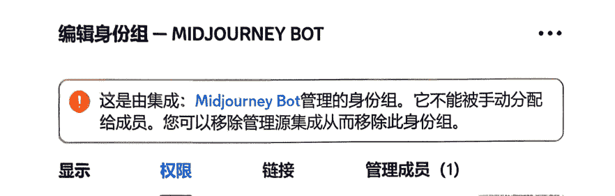

图 1-10 权限管理

## 5. 在服务器中使用 Midjourney 进行创作

完成以上设置后，你可在自己服务器的文字频道中像公共频道一样使用 /imagine 命令输入提示，系统将在频道内直接返回图像。由于这是私有空间，不会受他人提示干扰，可专注于构图、语言调整与风格迭代。

相较公共频道，私人服务器优势如下：
- 保障创作独立性：所有提示与生成图像集中展示，不被他人信息干扰。
- 提升社群互动性：可将邀请链接发送给朋友或团队成员，共同练习、交流作品与风格策划。
- 具备高效管理性：支持自定义频道结构，按创作主题分类，权限设置灵活，适用于不同目的。
- 扩展能力强：不仅可接入其他设计类 Bot，还能集成任务管理工具，打造集生成、管理与协作于一体的 AI 创作工作室。

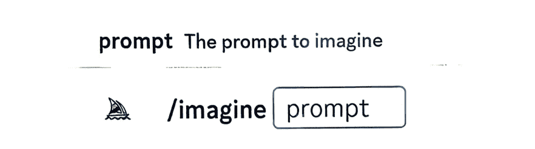

图 1-11 Midjourney 提示词指令

#### 1.2 从基础流程到进阶指令

完成 Midjourney 账号注册并熟悉平台操作后，核心任务是开始图像生成。表面看是“输入提示—等待结果”，但最终画面能否准确表达创作意图，与提示组织方式、参数设置及后续指令操作密切相关。本节系统梳理图像基本生成流程并详解各类进阶参数与指令，帮助你充分发挥 Midjourney 的美学能力。

##### 1.2.1 生成全流程示范

Midjourney 的图像生成均通过 /imagine 指令触发。在 Discord 输入框键入 /imagine，系统提示“prompt:”，此处填写提示。

完整指令及生成图示例：
```
/imagine prompt: 未来城市，日落背景，电影感光影，超广角构图 --ar 16:9 (图 1-12)
```
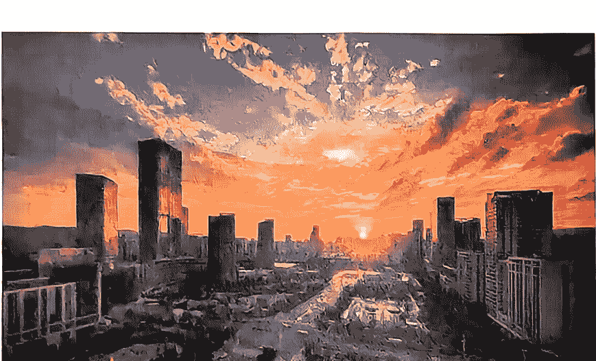

图 1-12 日落城市生成图

该命令包含：
- 主题内容：未来城市
- 风格修饰：日落背景，电影感光影
- 构图与细节：超广角构图
- 参数设置：--ar 16:9 横屏宽高比

Midjourney V7 已支持中文提示输入，但建议实际创作优先使用英文提示。英文是系统训练的核心语言，语义识别与风格控制在英文模式下更精准。后续章节以英文为主并附中文翻译；本小节仍用中文演示以展示兼容性。

Midjourney 对提示字数无严格限制，建议控制在 2 行内以聚焦信息。关键词可用逗号或空格分隔，不强求语法完整。

提交 /imagine 命令后，Midjourney 进入排队生成状态。通常 10~60 秒后，你会看到 2×2 四宫格图像，默认为“快速模式”，构图与细节略有差异，便于挑选。

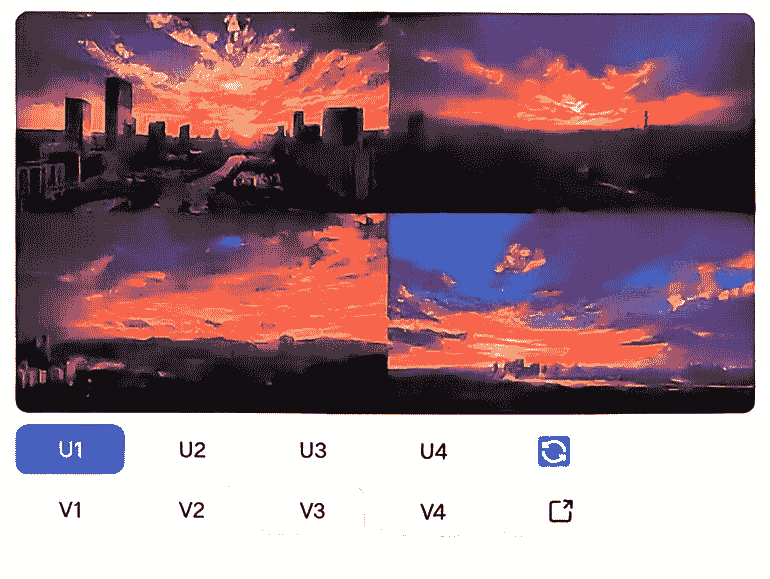

图 1-13 生成操作按钮

图像下方自动生成操作按钮：
- U1~U4 Upscale：将某张图放大为高清版本
- V1~V4 Variation：基于某图生成新变体
- Re-roll：根据原提示重新生成 4 张图

可放大、保存或要求变体，具体操作见下节详述。

##### 1.2.2 图像放大与变体生成

点击任一图像对应的“U”按钮可高清放大，尺寸约 1024px~2048px。图像可直接右键保存，也可用“Open in Browser”在新标签下载。升级后图像细节增强、边缘更清晰，适合创意精修或作参考。

变体按钮 V1~V4 可快速获得基于同一构图与风格的不同图组。例如 V1 会基于第一张图生成 4 个新版本，适合寻找细节、布局或氛围的多样化方案。

##### 1.2.3 进阶指令与特殊参数

为让 AI 输出更精准贴合创意，Midjourney 支持多种进阶命令与参数。掌握这些可大幅提升作品稳定性、风格一致性与实用性。

所有指令以“/”开头。
- /imagine：生成图像
- /settings：打开参数设置面板，调整模型版本、风格等
- /info：查看账户状态与剩余时间
- /help：帮助文档
- /prefer suffix：为提示预设结尾，提升效率

常用参数详解：

1. --ar 宽高比
控制画面比例，如 16:9 横屏、9:16 竖屏、1:1 方图。
示例：
```
/imagine prompt: A futuristic palace（未来感宫殿）--ar 3:2 (图 1-14)
```
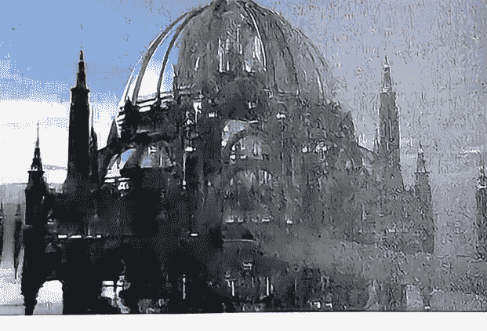

图 1-14 未来宫殿生成图

2. --v 模型版本选择
指定生成所用 AI 模型，V7 为最新且默认版本。
- --v 7 默认建议使用
- --v 5.2、--v 6 适合风格探索或特殊需求
示例：
```
/imagine prompt: A cinematic jungle landscape（电影感丛林景观）--v 7 (图 1-15)
```
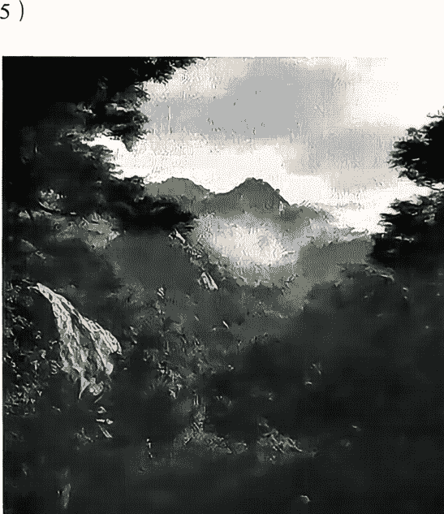

3. --style 风格模式
主要用于 V5.2 及以下旧模型，V7 中已不建议使用。
- --style raw 写实
- --style cute 可爱动漫
- --style expressive 强化表现力
示例 V5.2：
```
/imagine prompt: A robot cat in Tokyo（东京的机器人猫）--style cute (图 1-16)
```
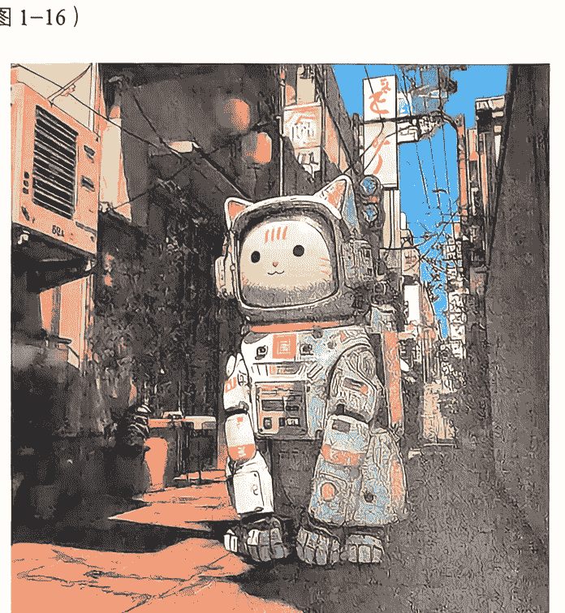

图 1-16 东京机器人猫生成图

在 V7 中建议直接用描述性提示，如 “in watercolor style”。

4. --chaos 多样性/随机性
控制构图、细节变化幅度，0~100，数值越高变化越大。
示例：
```
/imagine prompt: Surreal floating islands（超现实浮动岛屿）--chaos 60 (图 1-17)
```
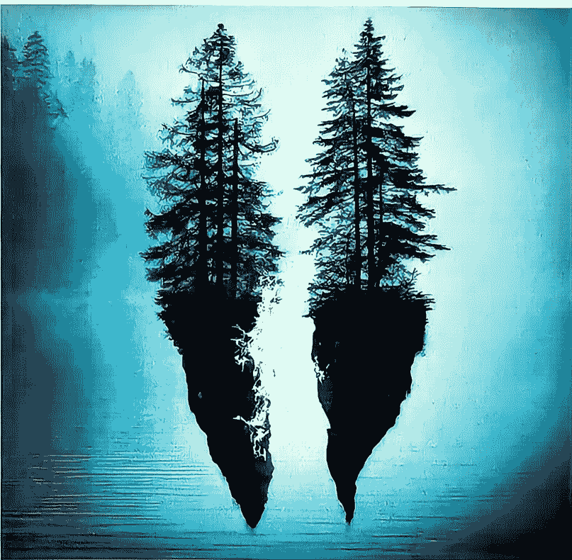

图 1-17 超现实浮动岛屿生成图

5. --quality 或 --q 图像生成质量

算力消耗与成像细节的权衡在 V7 已经被削弱，日常使用建议保留出厂设定。

- --q 1 默认基准
- --q 2 画质拉满，渲染时间变长
- --q .25 快速低清草图

示例：

```
/imagine prompt: Futuristic spacecraft interior（未来飞船内部）--q 2 (图 1-18)
```

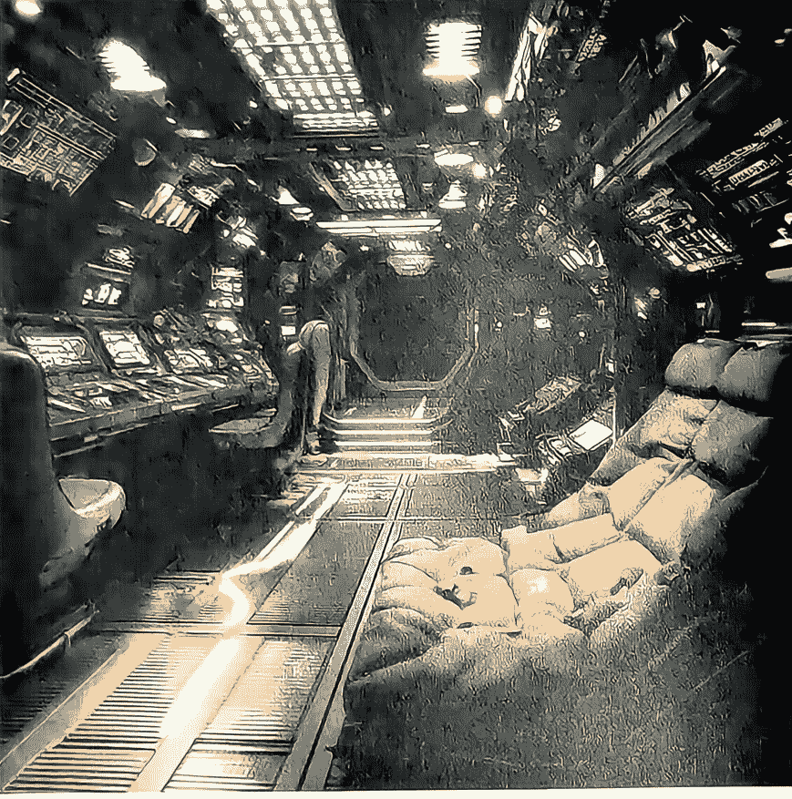

图 1-18 未来飞船内部生成图

6. --seed 随机种子控制

锁定随机数种子后，相同提示词配合相同种子可得到近似复现结果，适合做系列图或教学演示。

示例：

```
/imagine prompt: Dark forest with glowing mushrooms（有发光蘑菇的黑暗森林）--seed 3478912 (图 1-19)
```

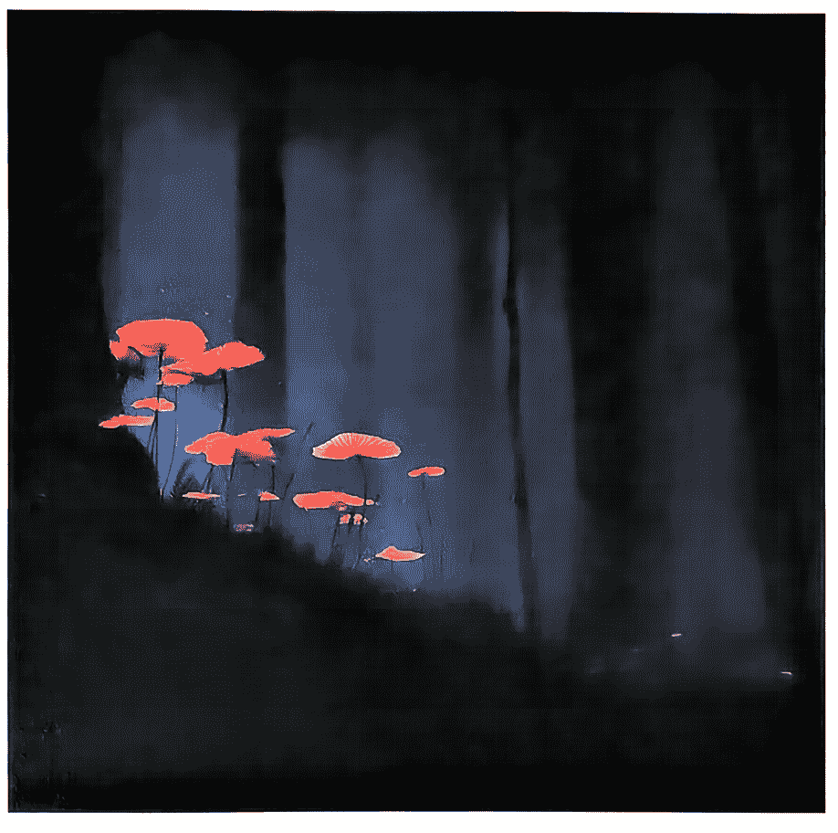

图 1-19 发光蘑菇生成图

7. --no 排除元素

用于把不想要的物体或风格从结果中剔除。

示例：

```
/imagine prompt: A city at night（一座夜晚的城市）--no people, --no cars (图 1-20)
```

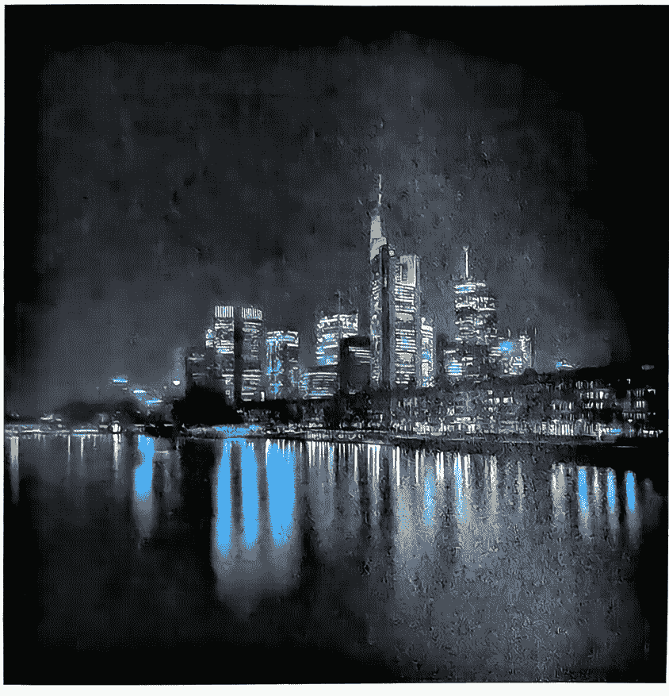

图 1-20 夜晚城市生成图

8. 设置面板快捷入口

在对话里输入 /settings 即可弹出设置页，一键切换模型、风格、渲染质量、私密模式等（图 1-21）。不同订阅等级权限不同，例如私密生成需要 Pro 版本。


图 1-21 设置界面

##### 1.2.4 参数组合与应用策略

把前面介绍的开关混搭使用，就能按需求定制不同类型的画面，典型做法如下：

**构图探索者**

```
/imagine prompt: Abandoned futuristic temple（废弃的未来感寺庙）--ar 2:3 --chaos 50 (图 1-22)
```

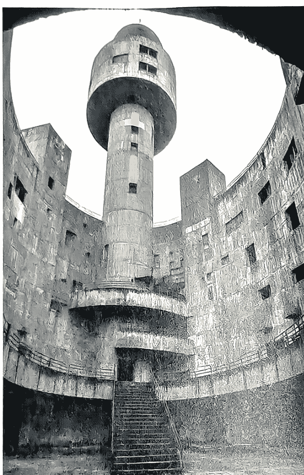

图 1-22 废弃未来感寺庙生成图

**写实强化风格**

```
/imagine prompt: Oil painting of a violinist（小提琴家油画）--v 5.2 --style raw --q 2 (图 1-23)
```

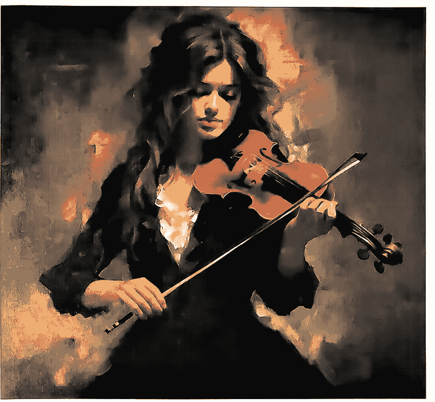

图 1-23 小提琴家油画生成图

**系列风格保持**

```
/imagine prompt: Elegant logo design, golden line style（优雅标志设计，金色线条）--seed 123456 --ar 1:1 (图 1-24)
```

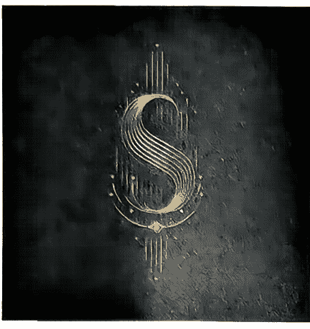

图 1-24 优雅标志设计生成图

**图像简洁预览**

```
/imagine prompt: Paper-cut style deer in forest（剪纸风格的鹿在森林）--q .25 --ar 1:1 (图 1-25)
```

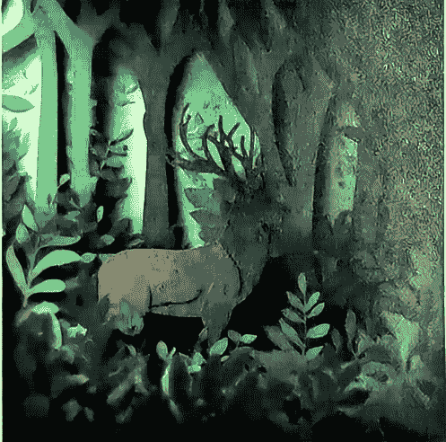

图 1-25 剪纸风格的鹿生成图

##### 1.2.5 流程与技巧总结

综合以上内容，Midjourney 的常规操作路径可概括为：

1. 发送 /imagine prompt: 随后加上主题、风格、构图等关键描述；
2. 按需叠加 --ar、--seed、--chaos 等控制项，提升定制能力；
3. 等待系统返回 2×2 预览图；
4. 选择 Upscale 放大或 Variation 探索变体；
5. 在网页端保存、管理、分类归档作品与历史提示词。

熟练掌握流程与参数后，能更快得到符合预期的画面，并在写实与幻想、细节与整体之间建立自己的图像语言。文字转图像的能力已对所有人开放，灵活运用指令与参数是迈向高阶 AI 美学表达的关键一步。

# 第 2 章 AI 绘画与美学表达

本章聚焦语言与审美在生成系统里如何被解析与转化的底层机制。提示词不仅是技术输入，更成为一种新的创作语法。理解其构建方式，是从使用者向创作者转身的关键。

Midjourney 等平台本质上是语言驱动的视觉模型，并不真正理解人类审美，而是靠海量图文训练模拟对特定语言指令的视觉联想。提示词的选择与组合，直接决定画面的风格、构图、氛围乃至象征指向。

本章将系统拆解提示词的生成原理，解析语义结构、风格倾向与构图偏好，并探讨中英混用、意象表达、情境搭建等方法，把审美意图精准映射到画面。

更重要的是帮助你形成个人化的语言策略。跳脱关键词堆砌的高水平创作者，往往具备精准且富有想象力的描述力，懂得写出差异、写出诗意、写出风格。

本章由表及里深化审美认知，提升语言掌控力。在与 AI 共创中，语言才是真正的画笔。

## 2.1 浅析 AI 绘画

### 2.1.1 算法时代的美学

AI 美学的核心在于模型通过深度学习与大规模数据，掌握了对风格、构图、主题、色彩等维度的理解与创造能力。与传统美学依赖手工经验不同，算法生成被推向创作核心。Midjourney、Stable Diffusion 等平台用海量图文训练，让模型归纳视觉美学的规律。用户输入提示后，系统把自然语言转为向量，按关键词、修饰词与参数激活相关视觉表征并组合成图。

创作兼具概率性与可控性，通过反复调参筛选优化，最终逼近个人审美期待。生成式模型的演进如 GAN、VAE、扩散模型，都能把随机噪声逆向为具体图像，对复杂指令响应灵活。提示词工程让创作者用语义明确的脚本式语言引导方向，而参数化机制如 --ar、--seed、--chaos 大幅提升控制力，实现人机协作、自动生成与批量优化。多模态数据的融合也让 AI 美学具备跨媒介创作潜力，为“以词生图”提供技术基础。

本节梳理了数据驱动、语言转译、参数控制与多模态跨界等原理，理解这些机制是高效构建提示与美学创新的基础。

### 2.1.2 “以词生图”的美学实践

“以词生图”是 AI 美学的核心机制。提示词既是指令，也是艺术想象的语言载体。描述的精确度、语序、修辞创新，直接决定风格、氛围与主题表现。关键词组合、修饰顺序与参数细节的变化会带来截然不同的画面，形成“语言即美学策略”的新范式。

AI 美学还打破了流派与技法的边界。通过提示的创新组合，可自然融合多种风格。像“赛博朋克、东方水墨、未来极简”并列时，系统能输出东西方与现实幻想的混合画面。提示词的语言创新力已成为多样化与个性的关键引擎。

本节把握语言表达、结构创新与风格融合的理论逻辑。掌握提示的设计方法，是成为高阶创作者的基础。下一节将对比 AI 美学与传统美学在流程、表达与创新机制上的差异。

不同工具因算法与功能差异对提示的响应不同，表 2-1 对主流生图软件的优劣进行了对比，便于按需选择：

### 表 2-1 现有生图软件优劣势对比表

| 软件名称 | 优势 | 劣势 |
| :--- | :--- | :--- |
| Midjourney V7 | 艺术表现突出，上手快，生成速度快，社区活跃灵感多，细节丰富，适合艺术创作 | 不支持图生图，需插件，无免费试用，仅 Discord 使用，参数精细度不及 SD |
| DALL·E 3 (OpenAI) | 与 ChatGPT 集成，语言理解强，修图功能好，适合多轮对话，风格自然适合纪实 | 风格变化有限，艺术个性不足，分辨率偏低，参数不可调 |
| Stable Diffusion XL (SDXL) | 开源可本地部署，自由度高，支持图生图与 ControlNet，模型丰富，适合专业与实验 | 上手门槛高，需优化提示与调试，默认审美平庸，需换模型，对算力有要求 |
| Adobe Firefly | 与 Photoshop/Illustrator 融合，文生图与图生图俱全，企业授权合规，适合商业 | 风格偏模板，自定义与创造性一般，完整功能依赖 Adobe 付费生态 |
| Leonardo.Ai | 商用精度高，可训练私有模型，界面友好，图文混合解析强 | 免费额度有限，商业功能付费，速度偶不稳定，部分风格有版权风险 |
| BlueWillow | 免费门槛低，风格接近 Midjourney，社区友好，质量稳定 | 画面保守，自定义弱，不适合专业创作 |
| Bing Image Creator (DALL·E 模型) | 免费快，与 Edge 集成，多语言支持 | 风格单一，分辨率低，功能简易，不支持图生图 |

## 2.2 提示词的作用

在 Midjourney 创作中，提示词是人与 AI 沟通的桥梁。每组词汇都会被解析为视觉要素、构图指令与风格倾向。掌握其构建逻辑是把想法转化为画面的起点。

V7 发布后，模型对自然语言的理解显著提升，能更准确识别多重意象、抽象风格与隐喻，也在一定程度上支持中文输入。但仍建议优先使用英文，原因在于训练语料以英文为主，识别效率与风格控制更稳定；且多数关键词、参数标签、构图表达均以英文为标准，便于精细调节。

下面拆解提示词的语义结构，看 AI 如何“读懂”描述。

### 2.2.1 提示词的基本语法结构

一条有效提示通常包含：

- 主题词：画面核心内容，如人、景、物
- 修饰词：补充风格、氛围、材质等信息
- 构图词：视角、布局、镜头语言
- 参数命令：控制比例、质量、风格等输出

示例：

```
/imagine prompt: A vintage typewriter on a wooden desk, warm lighting, shallow depth of field（一台老式打字机放在木质书桌上，暖光照射，浅景深）--ar 3:2（图 2-1）
```

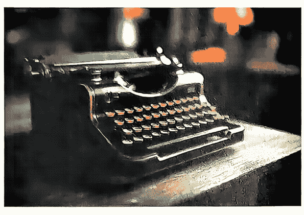

图 2-1 老式打字机生成图

句子无需语法完整，关键词组织越清晰，理解越快。

不同词承担不同功能。主题词确立中心概念，如 “dragon”“portrait of a queen”；修饰词如 “soft lighting”“gothic architecture”“surreal atmosphere” 则构建氛围层。把握语义层级有助于精准控制结果。

词的位置也会影响呈现。例如 “foggy background” 与 “background foggy” 均可被识别，前者更强调雾气对背景的主导作用。相对顺序不像编程那样绝对，却会改变 AI 的关注重点。

### 2.2.2 系统如何“理解”提示词

Midjourney 融合 Transformer 大型语言模型与图像扩散模型。输入提示后，系统将其拆解为语义向量，用于控制生成过程中的特征提取。

简言之：
- 主体词决定“画什么”
- 修饰词决定“怎么画”
- 构图词决定“从哪看”
- 参数命令决定“如何输出”

建议采用“由大到小、由主到次”的组织方式。举例：

```
/imagine prompt: A steampunk city at dusk, glowing streetlights, aerial view（黄昏时的蒸汽朋克城市，街灯发光，俯视角度）--ar 16:9（图 2-2）
```

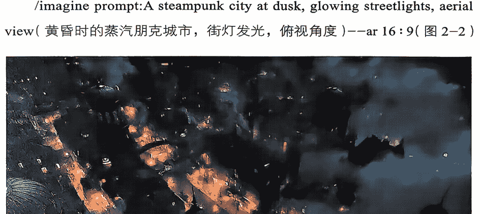

图 2-2 蒸汽朋克城市生成图

其中 “steampunk city” 为主题，“dusk” 指明时段，“glowing streetlights” 构建光影，“aerial view” 定义视角，“--ar 16:9” 保证横向大画幅。每层关键词在理解中既独立又关联。

### 2.2.3 提示词顺序对构图的影响

V7 已具备上下文理解，但关键词排列仍显著影响效果。常用结构为：主体 + 风格修饰 + 环境构图 + 技法/光影 + 参数

示例：

```
/imagine prompt: A medieval knight standing in ruins, dramatic lighting, cinematic style, wide angle（废墟中站立的中世纪骑士，戏剧性光影，电影风格，广角镜头）--ar 16:9（图 2-3）
```

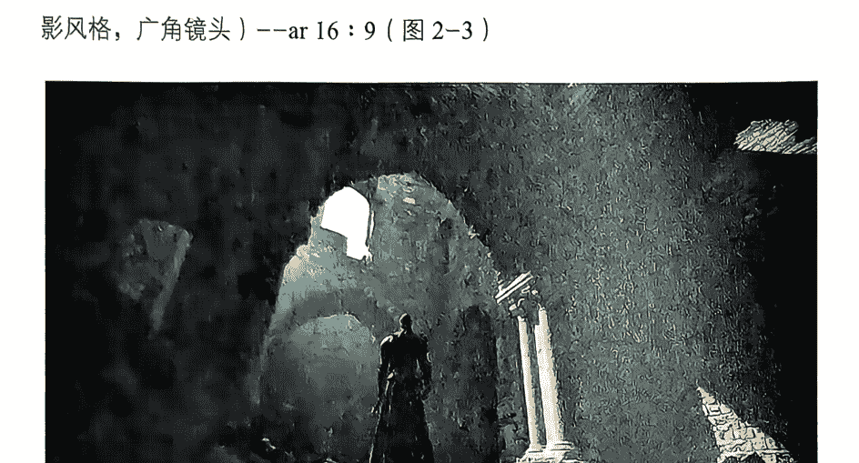

图 2-3 废墟中的骑士生成图

结构化描述能帮助 AI 抓住核心意图，减少误判与风格模糊。

顺序不当易出现：主体被忽略，如 “dramatic lighting before a dancer” 可能优先生成光而非舞者；构图混乱，如 “cityscape, under moonlight, foggy, top-down view” 比 “top-down view of a foggy cityscape under moonlight” 更易空间错乱；光影与背景错位，如先写 “fireflies” 再写 “night forest” 时萤火虫可能出现在前景而非背景。良好结构提升可控性、可重复性与美感稳定。

### 2.2.4 避免关键词冗余与歧义

组织提示时应避免：
- 关键词重复：过多同类形容词如 “beautiful, pretty, stunning” 不会提升美感，反易造成判定混乱
- 语义冲突：同时使用 “dark forest” 与 “sunlit leaves” 会让主光源难以判断
- 模糊词汇：“nice”“cool” 等词在视觉生成中几乎无效
- 句法过长：提示虽可长，但主线不清会导致失焦

建议采用模块化思维，分层添加：
- 模块一：主题 + 主体构成
- 模块二：风格 + 材质 + 色调
- 模块三：镜头语言 + 构图模式 + 焦点控制
- 模块四：技术参数 + 输出要求

示例：

```
/imagine prompt: A desert landscape with ancient ruins, soft golden lighting, isometric view, ultra detailed（一片古遗迹沙漠，柔和金色光线，等距视角，极致细节）--ar 16:9（图 2-4）
```

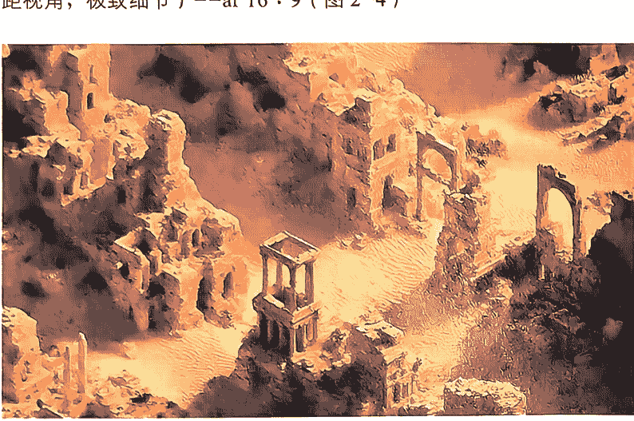

图 2-4 古遗迹沙漠生成图

模块结构便于组织与复用，也利于定位修改点。

掌握语义结构是走向精准创作的第一步。下一节将探讨如何让提示词兼具可读性与可控性，为 AI 美学语言奠基。

## 2.3 用提示词构建美学语法的方法

做 Midjourney 图像时，常见的尴尬是：指令写得很完整、读起来也很顺，成片却总差口气。症结大多不是语法对错，而是对画面意图的刻画不够落地。模型对自然语言的理解力很强，但它不是读心设备，而是按表达去执行的工具。

想让产出更贴合预期，关键在于建立一套能牵引生成方向的提示构建方法。下面从把模糊概念转化为机器可识别的具体描述入手，梳理提升精准度与稳定性的要点。

### 2.3.1 明确核心主体
每张图最好先定一个视觉锚点，它决定了画面的落点。若只是丢出：

```
/imagine prompt: Landscape（风景）（图 2-5）
```

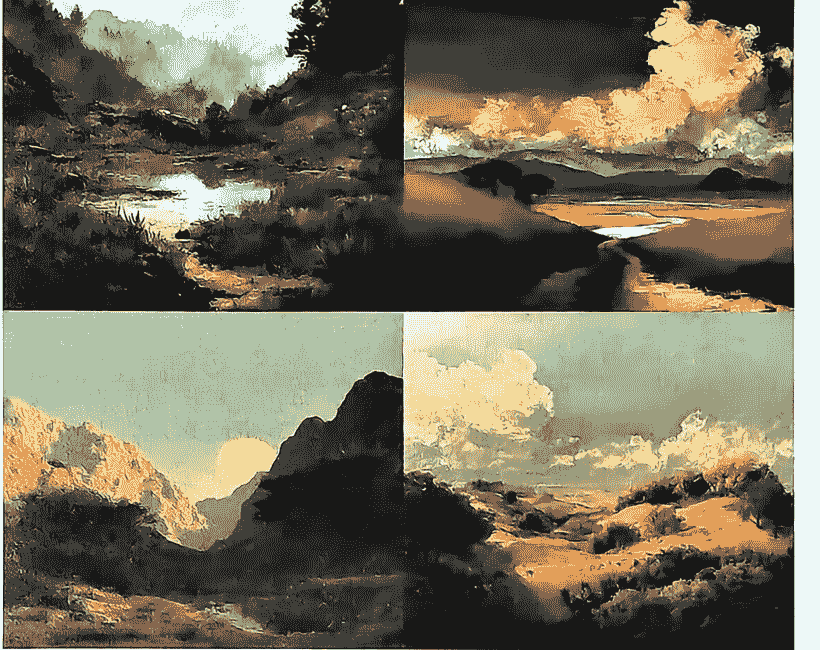

图 2-5 风景生成图

系统很可能把山脉、江河、林木、云层、人像、建筑等一并塞入画面，按训练数据自行补全你要的元素。这种做法偶尔有惊喜，却很难把控。

改用更具体的说法，可控性会明显变好：

```
/imagine prompt: A serene mountain lake reflecting the twilight sky, surrounded by pine trees（宁静的高山湖泊映照着暮色天空，四周环绕松林）--ar 16:9（图 2-6）
```

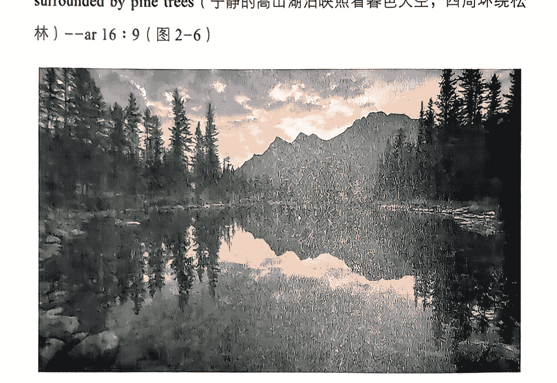

图 2-6 高山湖泊生成图

这里以“湖泊 + 暮色天空 + 松林”搭建了清晰的层次，关键词被读取后模型会自动调整空间安排，得到更符合预期的结果。

### 2.3.2 聚焦风格语言
风格类词汇对成片效果影响极大。尤其在 Midjourney V7 里，“surreal”“dreamy”“hyperrealistic”等词会被高优先级识别，并作为整体渲染的主导依据。

建议自行建立风格词库，常见划分见表 2-2：

表 2-2 风格词汇分类表

| 类型 | 示例词 |

|---|---|

| 光影类 | soft lighting, rim light, moody lighting, neon glow |

| 色调类 | pastel tones, monochrome, warm palette, golden hour |

| 风格类 | Baroque style, Vaporwave, Ukiyo-e, Retro-Futurism |

| 材质与质感类 | matte finish, watercolor texture, metallic surface |

举例：

```
/imagine prompt: A mechanical bird with intricate wings, metallic texture, glowing blue feathers, Steampunk style（一只拥有复杂翅膀结构的机械鸟，金属质感，蓝色羽毛发光，蒸汽朋克风格）--ar 3:2
```

通过有序叠加风格限定词，画面一致性和审美表现会明显增强。

### 2.3.3 添加构图词与镜头语言
除了要画什么、怎么画，还可以告诉模型从哪个角度看。构图类提示如“wide angle”“top-down view”“portrait view”会改变空间分布，也决定焦点归属。

表 2-3 列出常用构图关键词的中英对照：

表 2-3 常用构图类关键词

| 构图表达 | 中文含义 |

| :--- | :--- |

| isometric view | 等距视角 |

| top-down view | 俯视角度 |

| low angle shot | 低角度拍摄 |

| close-up portrait | 特写肖像 |

| ultra wide shot | 超广角构图 |

| symmetrical layout | 对称构图 |

示例：

```
/imagine prompt: A cyberpunk street food vendor, rainy night, neon signs, isometric view（赛博朋克风的街头小吃摊，雨夜，霓虹灯牌，等距视角）--ar 16:9（图 2-7）
```

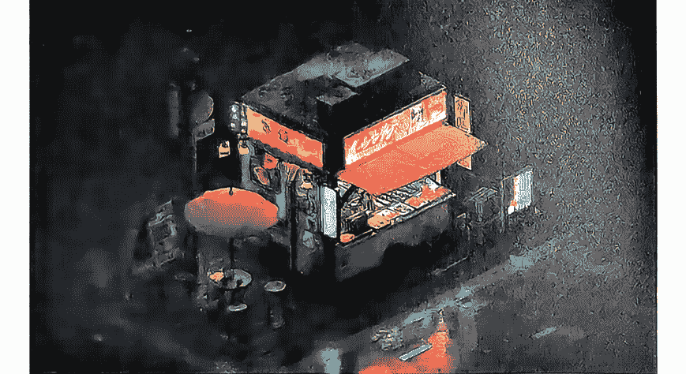

图 2-7 赛博朋克街头小吃摊生成图

“isometric view”保证了画面层级有序，“neon signs”强化了背景氛围，“rainy night”则限定了光影反差。

### 2.3.4 明确主体与背景的层级关系
新手容易因语序混淆前景和背景，导致重心偏移。例如：

```
/imagine prompt: A tiger with forest（老虎和森林）（图 2-8）
```

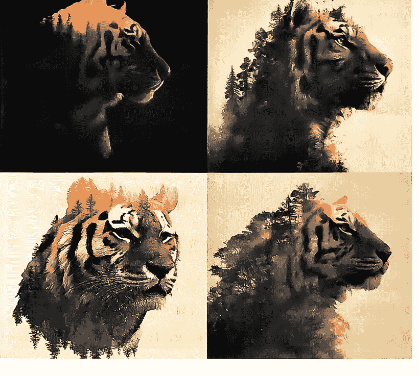

图 2-8 老虎与森林生成图

这条指令可能得到“森林中的老虎”，也可能得到“以老虎为底的图”，甚至生成“老虎皮毛上长出森林图案”。更清晰的写法是：

```
/imagine prompt: A tiger walking through a misty forest, morning light filtering through trees（雾气弥漫的森林中，一只老虎缓缓行走，阳光透过树林洒下）--ar 16:9（图 2-9）
```

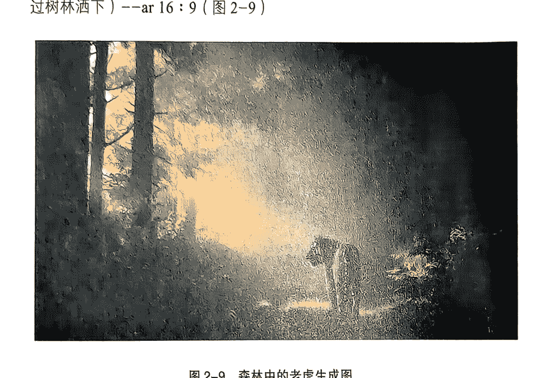

图 2-9 森林中的老虎生成图

加入“walking through”“misty”“light filtering”等描述后，前后景关系被理清，同时构建出具备空间深度的场景。

### 2.3.5 用行为与动作丰富图像叙事
Midjourney 能理解基础动作描述，加入短动词可让画面产生动态和故事感。

常见可识别英文动词有 walking、flying、holding、looking up、sitting、floating、dancing 等。

```
/imagine prompt: A girl holding a glowing orb, standing at the edge of a cliff, wind blowing through her hair（一位女孩手握发光的宝珠，站在悬崖边，微风吹动她的头发）--ar 9:16（图 2-10）
```

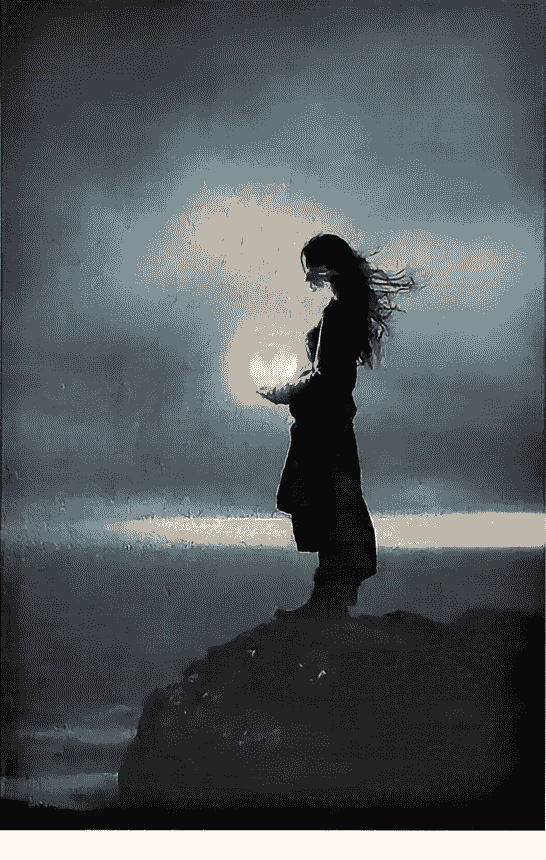

图 2-10 悬崖边的女孩生成图

“holding”“standing”“blowing”共同塑造出兼具动作与情绪的画面，成品往往更生动真实。

### 2.3.6 避免“无效冗余”的提示词堆砌
不少人习惯堆砌美化词，例如：

```
/imagine prompt: A beautiful amazing fantasy elegant magical colorful unicorn（一个美丽、惊艳、奇幻、优雅、魔幻、五彩斑斓的独角兽）（图 2-11）
```

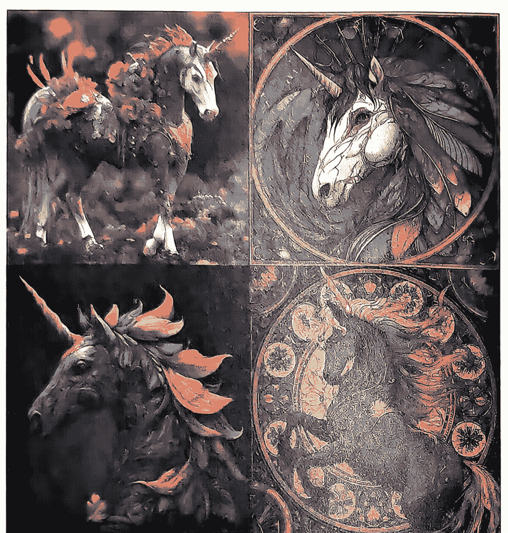

图 2-11 堆砌形容词的独角兽生成图

看起来很丰富，实则会干扰模型判断重点。更有效的做法是：

```
/imagine prompt: A glowing unicorn in a misty forest, pastel colors, cinematic lighting（雾气森林中的发光独角兽，柔和色彩，电影光影）--ar 16:9（图 2-12）
```

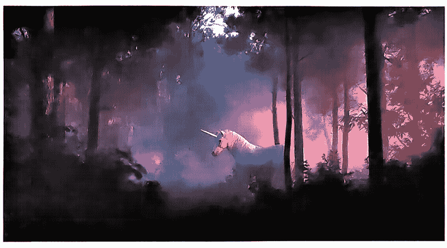

图 2-12 森林中的发光独角兽

减少冗余、用词精准，可控性和美感一致性都会提升。

掌握以上策略，就能写出 AI 可清晰识别的结构化语言，用更少的词实现更强的表达。接下来聊聊中文输入下的提示词写法。

## 2.4 中文提示词写作技巧
V7 对中文提示的支持明显增强，用户可以直接用中文生成，系统会自动把语义映射成构图逻辑。但建议仍保持结构性和控制意识，因为中文在表达精确度、风格稳定性和构图引导上，总体仍弱于英文。

下面介绍中文提示词的写作要点，包括句式组织、语义拆分、去冗余以及中英文混用的策略。

### 2.4.1 中文输入的识别机制
Midjourney 的中文处理并非严格逐字翻译，而是通过语义相似匹配把中文映射到训练向量，本质上是“猜你想表达的场景”。

举个例子：

```
/imagine prompt: 繁星点点的夜空，银河横贯山谷，远方有一位旅人正在仰望 --ar 16:9（图 2-13）
```

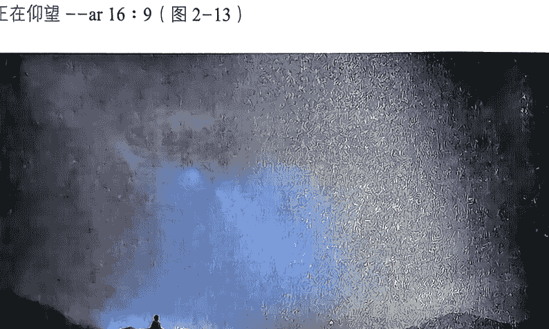

图 2-13 中文提示词生成图

系统能捕捉到“夜空、银河、山谷、旅人、仰望”等关键词，但可能忽略形容词的层级，夜空细节突出而旅人姿态模糊。改用英文则更明确：

```
/imagine prompt: A traveler looking up at the Milky Way over a mountain valley, starry sky, cinematic composition（一位旅人仰望横跨山谷的银河，星光满天，电影构图）--ar 16:9（图 2-14）
```

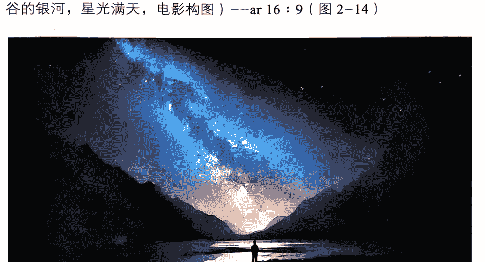

图 2-14 银河山谷生成图

可见中文可用，但要精准引导，必须注意语言结构和关键词的组织方式。

### 2.4.2 中文提示词中的“可辨识关键词”
Midjourney 当前对以下中文词语的识别较好：

- 主体类：女孩、老虎、城堡、机器人、海洋、飞鸟、宇航员
- 场景类：沙漠、森林、雪山、夜晚、街道、图书馆、教堂
- 风格类：油画、水彩画、蒸汽朋克、未来主义、禅意、复古
- 构图类：特写、俯视、远景、广角、对称、镜面反射
- 光影类：柔光、逆光、日落、闪电、梦幻、雾气

# AI 美学大师：提示词与艺术风格全解读

推荐写法：

/imagine prompt: 日落时分的城市天台，一位身穿未来风格外套的女孩靠在护栏上，背后是霓虹灯闪烁的高楼 --ar 16:9 (图 2-15)

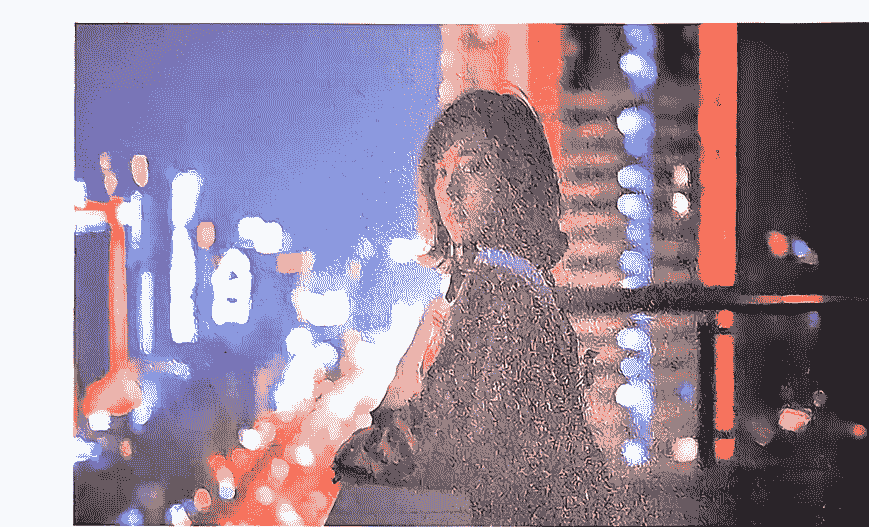

这条命令构成清晰：主体、动作、背景、时间、风格，系统容易综合成图。

### 2.4.3 常见问题与优化方法
问题一：词义不明确
“梦幻”“唯美”“有感觉”等感性词模型难以具体化，建议换成视觉风格或构图词。

不推荐：

/imagine prompt: 一张梦幻的照片 (图 2-16)

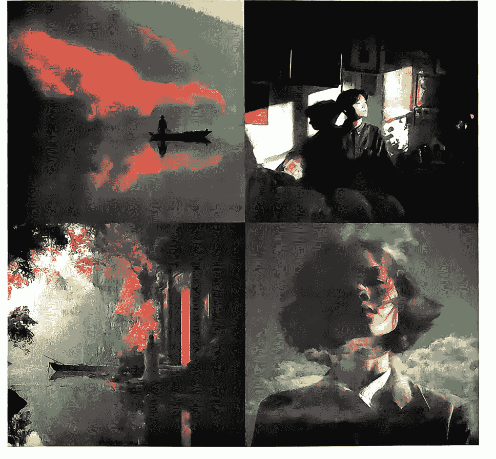

图 2-16 梦幻照片生成图

推荐：

/imagine prompt: A dreamy forest with soft lighting and pastel colors (柔光与粉彩色调下的梦境森林) --ar 3:2 (图 2-17)

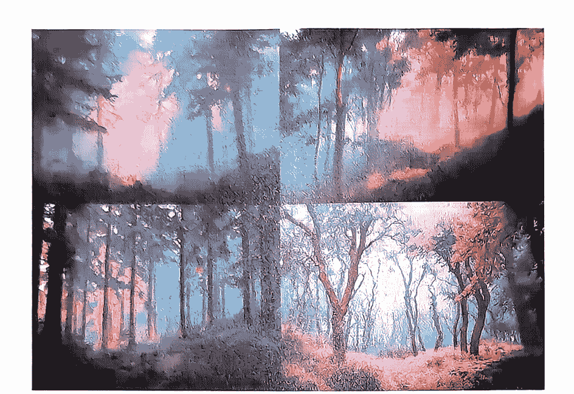

图 2-17 粉色调的梦幻森林

问题二：主次不分
中文习惯“主—修饰—补充”，AI 更依赖清晰的语义层级。

不推荐：

```
/imagine prompt: 一位穿着蓝裙子的少女在湖边坐着看星星（图 2-18）
```

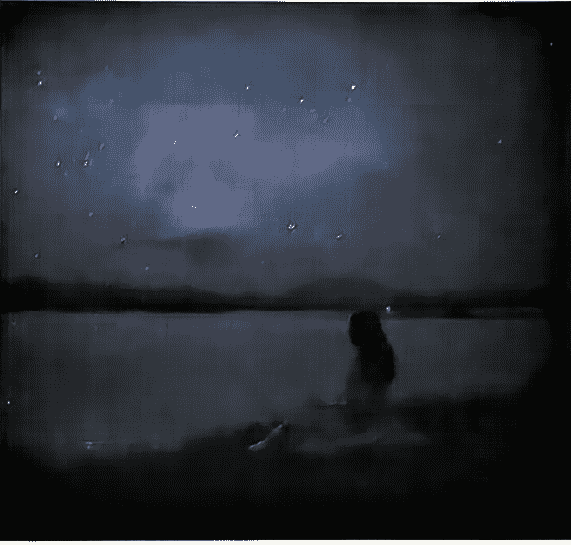

图 2-18 湖边的少女生

推荐：

/imagine prompt: A girl in a blue dress sitting by the lake, gazing up at the starry sky in the twilight (一位蓝裙少女坐在湖边，仰望暮色中的星空) --ar 3:2 (图 2-19)

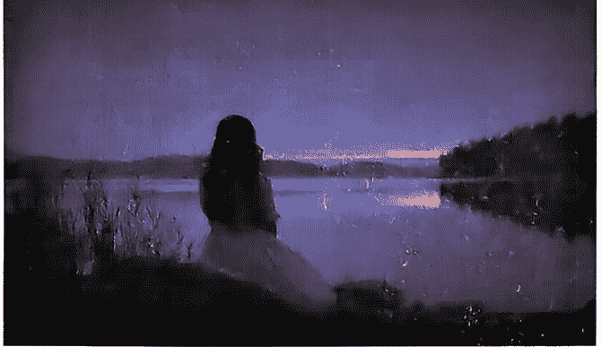

图 2-19 仰望星空的湖边少女生

问题三：句子过长逻辑不清
中文描述易堆叠修饰，导致焦点分散。

不推荐：

```
/imagine prompt: 一个穿红衣服的女孩拿着一把伞在雨中走着，旁边是一家有灯光的咖啡馆，地上有水洼（图 2-20）
```

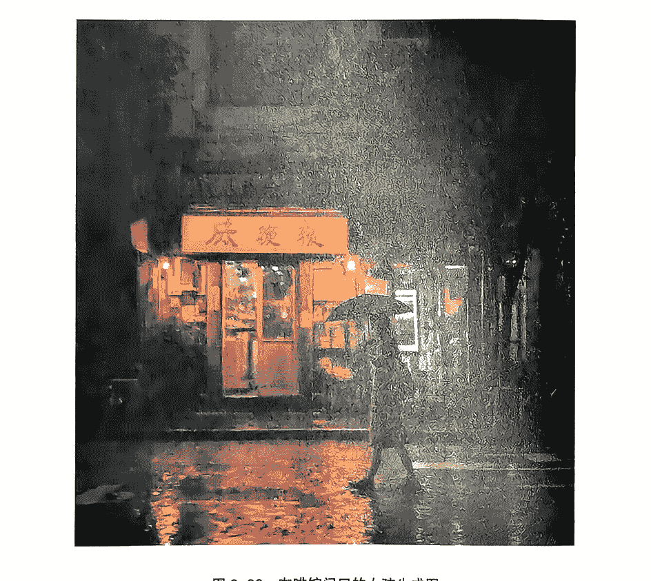

图 2-20 咖啡馆门口的女孩生成图

推荐拆分并写成结构清晰的描述：

```
/imagine prompt: A girl in red walking in the rain with an umbrella, beside a glowing coffee shop, wet pavement reflections (红衣女孩打着伞走在雨中，旁边是一家灯光明亮的咖啡馆，地面有水面倒影) --ar 16:9 (图 2-21)
```

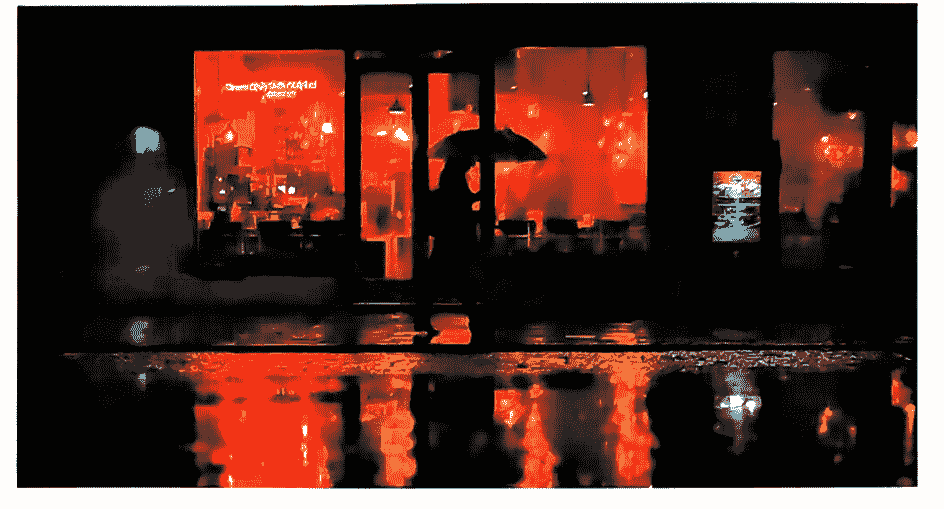

图 2-21 咖啡馆门口的打伞女孩生成图

### 2.4.4 中英文混合提示词的使用策略
同条提示中混用中英文非常实用，尤其在风格和构图上更精准。示例：

/imagine prompt: 月光下的湖面，surreal atmosphere，soft lighting，dreamy color palette（月光下的湖面，超现实氛围，柔光处理，梦幻色调）--ar 3:2（图 2-22）

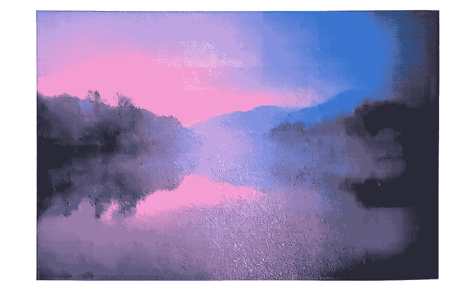

图 2-22 月光下的湖面生成图

建议英文表达：
- 风格词 vaporwave, baroque, retro, Minimalism
- 材质词 glass, stone, fabric, metallic
- 构图与光影 wide angle, cinematic light, backlit
- 抽象意象 ethereal, glitch, post-apocalyptic

这样能避免中文在细节上产生歧义。

### 2.4.5 中文提示词写作建议清单
（1）保持语义层级清晰，避免形容词堆砌。
（2）每条提示控制在 30 字以内，聚焦核心。
（3）核心元素按“谁 + 在哪里 + 干什么 + 怎么样”组织。
（4）适量加入英文关键词，提升识别精度。
（5）用具体视觉词替代模糊感受，如“金属质感”“蓝色光晕”“俯视视角”等。

日常创作可以大胆尝试中文，但在需要精细控制的商业项目中，仍建议以英文为主。本章接下来将进一步扩展提示词的表现策略，从语言形式转向意象营造，帮助你有效整合构图、风格与情绪。

## 2.5 情境式与意象式提示词设计
提示词除了功能性结构，还可以通过“情境式”和“意象式”表达提升叙事性、氛围感和情绪深度，生成更具艺术感染力的画面。

### 2.5.1 什么是情境式提示词
情境式语言是通过人物行为、空间关系和环境细节，构建完整“画面情境”的写法，比单纯的对象加风格更强调故事感。

常见构成：
- 时间与气氛 twilight, midnight, morning fog
- 动作与行为 walking, staring, floating
- 场景环境 abandoned building, stormy coastline, narrow alley
- 空间关系 in the middle of, surrounded by, under the light of

示例 1：

/imagine prompt: A child holding a lantern, walking alone through a foggy forest at dawn（黎明时分，一个孩子提着灯独自走在雾气弥漫的森林中）--ar 3:2（图 2-23）

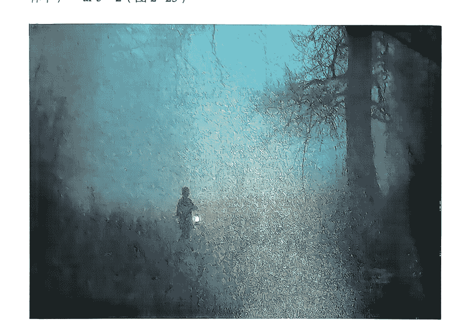

图 2-23 森林中提灯的孩子生成图

示例 2：

/imagine prompt: An old man sitting on a bench under a tree, golden autumn leaves falling, soft sunlight（树下长椅旁的年长者观望金色落叶纷飞，柔和光晕倾泻）--ar 3:2（图 2-24）

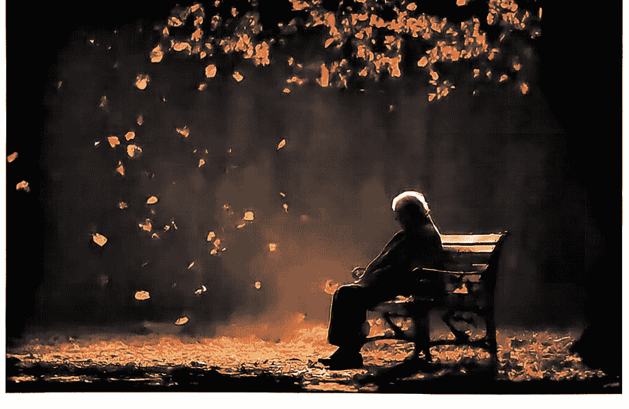

图 2-24 树下长椅上的老人生成图

这个案例并未固守“公园里的人”“森林里的小孩”之类的泛化表述，而是借助光感、时段、落叶、肢体动作等细节点缀，让原本凝固的描写拥有了流动的质感与生命力。

### 2.5.2 意象化表达的视觉暗示作用

意象化的写法更倾向于营造一种抽象的画面氛围，往往带有情绪倾向或象征指向，在追求艺术化呈现、插画创作、诗意构图的场景里尤为适用。

提示词中常见的意象类词汇可归纳为：

- 情绪意象 ( loneliness, nostalgia, serenity, chaos )
- 抽象象征 ( wings of light, shattered time, frozen silence )
- 文学化修辞 ( the sky bleeding red, a memory lost in smoke )
- 哲学隐喻 ( a soul trapped in glass, the end of gravity )

示例 1：

/imagine prompt: A figure made of stars walking through a dark ocean, loneliness in every ripple（由星光构成的人形漫步于漆黑海面，孤寂随每一道涟漪泛起）--ar 16:9（图 2-25）

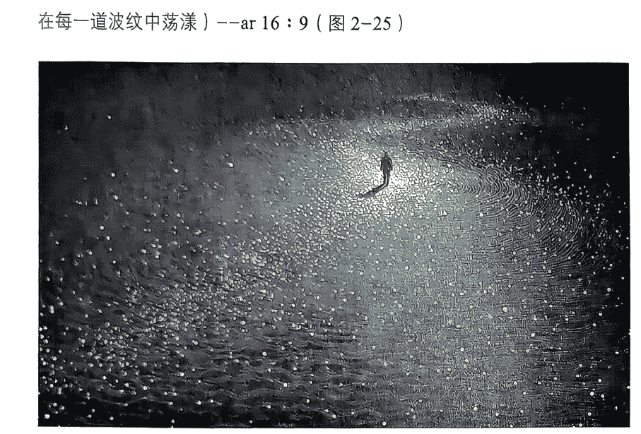

图 2-25 海面上的人影生成图

示例 2：

/imagine prompt: A burning clock melting into the sky, symbol of time collapsing（烈焰时钟融化进天际，暗喻时间崩解）--ar 3:2（图 2-26）

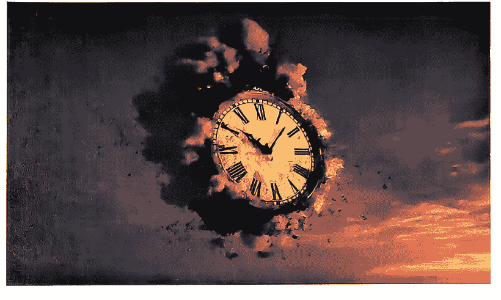

图 2-26 燃烧着融入天空的时钟生成图

这类提示词并不堆砌具体物件，而是凭借象征物的情绪导向，推动 Midjourney 基于关键词的象征内涵进行类比式构图。

### 2.5.3 融合情境与意象的表达方式

实操中，两种写法完全可以叠加。我们建议的组织顺序是：

场景起笔 + 动作/环境细节 + 情绪/意象点缀 + 技术参数

示例：

/imagine prompt: A solitary dancer leaping across a misty beach at dawn, waves gently receding around her feet, first rays of sun painting the sky gold, expression of quiet liberation（破晓雾气笼罩的海滩上，孤身舞者跃动，浪潮轻拂足边，晨光为天穹染金，整体传递安宁的释放感） --ar 9:16 (图 2-27)

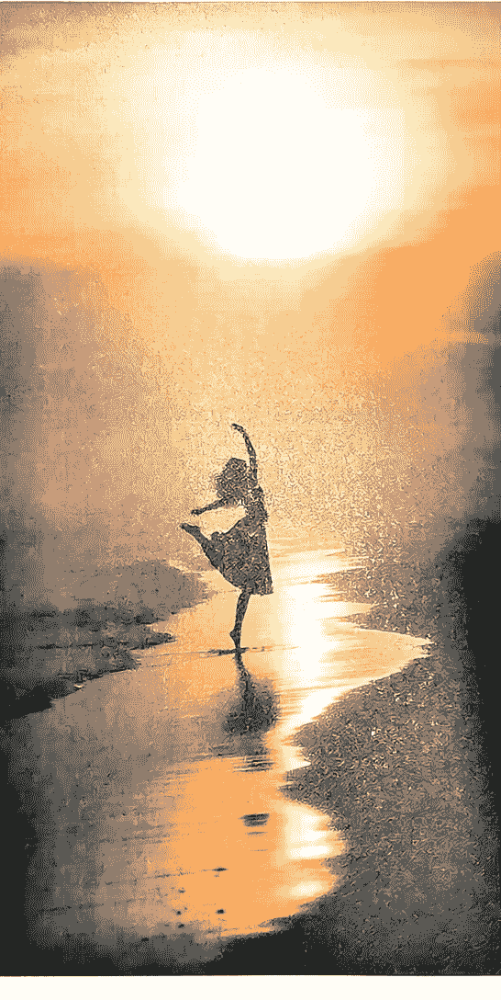

图 2-27 海滩舞者生成图

借助分层组织，既能稳住画面的主体，又能让观者从图里读出情绪，这正是 AI 美学创作最迷人的部分。

### 2.5.4 典型应用场景

为让不同创作目标更精准匹配，下面汇总了情境式与意象式在常见方向上的搭配思路与使用建议。

表 2-4 应用方向推荐表

| 应用方向 | 推荐表达方式 | 使用建议 |
| :--- | :--- | :--- |
| 插画设计 | 意象式 + 情境式 | 强调人物气质与画面氛围 |
| 概念艺术（Concept Art） | 情境式主导 | 突出动作细节、场景铺陈与叙事流畅 |
| 海报封面 | 意象式强调 | 聚焦象征符号、情绪张力与视觉冲击 |
| 摄影风格生成 | 情境 + 构图组合 | 明确光影条件、时间背景与视角结构 |

例如要创作一组主题为“孤独城市”的概念插图，可按此思路搭建：

```
/imagine prompt: A man sitting on the edge of an empty subway platform, neon lights flickering, deep sense of isolation (一位男子坐在空荡地铁站台边，霓虹灯闪烁，画面充满孤独感) --ar 16:9 (图 2-28)
```

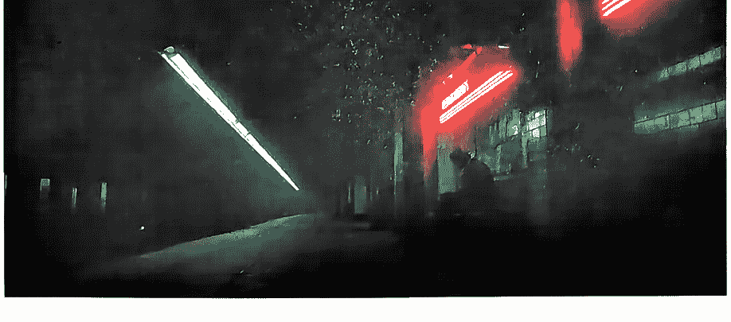

### 2.5.5 提示词编写练习

（1）从一段文字叙述中拆解画面，练习提炼关键词并重组为提示词。
（2）挑选一首诗或一句歌词，尝试转译为提示词并生成图像。
（3）使用对立意象（如 “cold light vs. warm eyes”）制造冲突感。
（4）结合时间、天气、空间、动作与心理描写形成多层次构图。

可以试着将下列句子转化为提示词练习：

“时间的尽头是一片蓝色的沙漠。”
“夜晚像一件黑色的披风，笼罩整座城市。”
“每个窗口里都有一段独白在闪烁。”

这类富于想象的表达，正是 Midjourney 创作语言的潜力所在。

下一部分将切入 AI 辅助的提示词生成，探讨如何借助模型与工具高效搭建贴合创作者意图的高质量提示词。

## 2.6 借助文本模型辅助撰写提示词

在 Midjourney 创作中，很多创作者会卡在语言落地：想法丰富却难以精确表述；关键词不少却组合不够顺畅。为此 AI 提示词生成工具应运而生。

本节介绍如何借助 AI 技术辅助构建高质量提示词，涵盖推荐工具、具体用法、注意事项与进阶策略，帮助你在构思、转化、优化环节建立高效稳定的工作流。

### 2.6.1 文本模型可以提供哪些帮助

Midjourney 本质是语言驱动的图像生成工具，写好提示词并不容易：

- 不清楚某种构图的英文表达；
- 不确定关键词顺序是否影响画面；
- 想表达氛围却找不到合适的词；
- 想模仿一张图的风格却难以提炼语言特征。

AI 文本辅助可以：

- 自动生成结构化提示词模板；
- 提供风格词汇、构图表达、材质描述的参考建议；
- 提升创作效率，降低语言门槛，拓展表达深度。

### 2.6.2 使用方法

作为语言模型，ChatGPT 能在多方面提升提示词质量，以下是常见用法示例：

1. 场景转提示词

输入指令：

请将以下中文描述转化为 Midjourney 英文提示词：在满月下，一只狐狸站在雪地里，远处是森林和小屋，空气中弥漫着冷色调的光

ChatGPT 输出结果及其对应的 Midjourney 生成画面：

```
/imagine prompt: A fox standing on a snowy field under a full moon, distant forest and cabin, cold color tone, cinematic lighting (一只狐狸站在雪地中，满月当空，远处有森林和小屋，冷色调氛围，电影光效) --ar 3:2 (图 2-29)
```

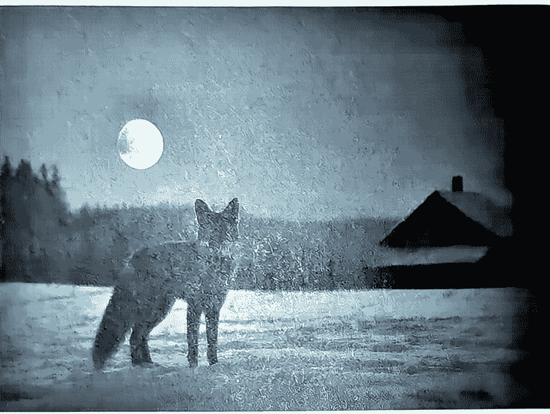

图 2-29 雪中的狐狸生成图

2. 风格关键词拓展

输入指令：

请帮我为“赛博朋克城市夜景”这个主题补充 10 个相关关键词，用于 Midjourney 提示词构建

ChatGPT 输出结果及其对应的 Midjourney 生成画面：

Neon signs, rain-slicked streets, flying cars, futuristic buildings, holographic billboards, purple glow, crowded alley, neon reflections, digital haze, sci-fi atmosphere (图 2-30)

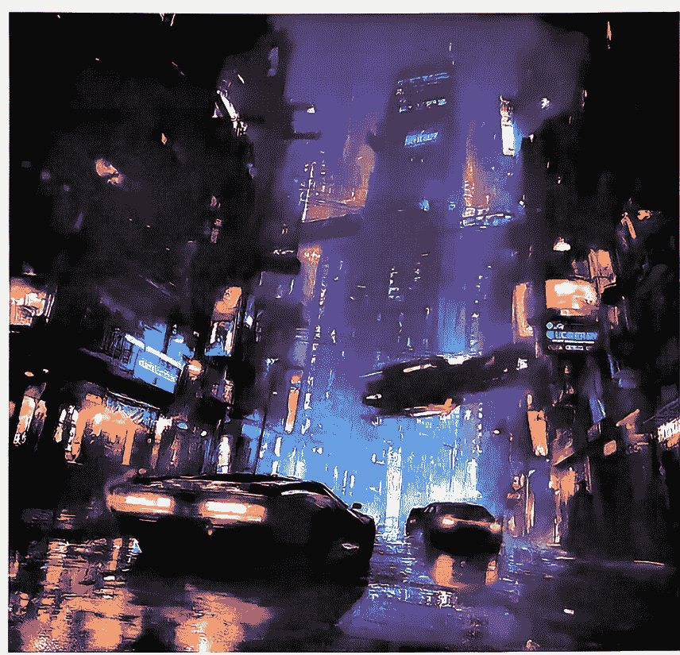

图 2-30 赛博朋克城市夜景生成图

3. 构图辅助设计

输入指令：

为一组插画系列提供一致风格构图的提示词模板，包括时间、光影、角度三项

ChatGPT 输出结果及其对应的 Midjourney 生成画面：

Template: [subject], [set time of day], [lighting style], [viewpoint]

Example: A samurai on a bridge, dusk, warm backlight, top-down view

（桥上的武士，黄昏时分，暖色背光，俯视角）--ar 16:9（图 2-31）

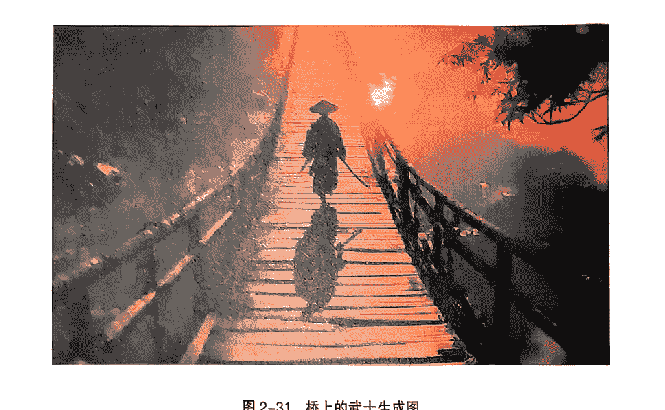

图 2-31 桥上的武士生成图

套用同一结构，可让系列风格保持统一。

### 2.6.3 从图片中提取提示词

Midjourney 生成的图像本身就蕴含大量提示线索，借助反查工具可以从图倒推可能的描述：

推荐平台：

**Lexica.art**

**Hugging Face Spaces: Reverse Prompt Tools**

**PromptHero**（图搜功能）

使用方法：

- 将图像拖入上传区；
- 系统返回相似风格图像及其提示词；
- 挑选最接近的语言结构作为基础；
- 按目标修改主题或风格细节。

这种方式特别适合“我喜欢这张图，却不知怎么描述”的场景。

### 2.6.4 注意事项

AI 能提升效率，但仍需留意：

- 避免完全照搬：直接套用他人提示词易导致风格同质化，削弱原创性。
- 二次创作不可少：文本 AI 的输出只是初稿，最终仍需人工打磨。
- 语言歧义要自查：部分生成提示词可能存在逻辑冲突、重复用词或表达失焦。
- 风格偏见需调整：许多模板带有固定倾向如摄影、写实、复古等，建议按创作目标重新编排词汇。

### 2.6.5 建立属于自己的提示词工具包

为保持长期创作稳定，建议搭建个人资料库，覆盖：

- 常用主体分类词（人物、建筑、动物、自然等）
- 风格词汇清单（油画、像素风、水墨、未来主义等）
- 构图与光影关键词整理（如 top-down view、soft lighting 等）
- 可复用的提示词模板组合（如风格控制、情绪表达等）
- 多语言对照表（如中英文关键词对照）

不断使用与归类，你将拥有随时调用的“语言画笔”，让 AI 图像生成更可控、优雅且高效。

## 第二部分：AI 作画示例与赏析

第一部分围绕 AI 图像生成的逻辑、美学背景与语言机制做了深入阐述，从第二部分起，我们将以实例为驱动，展开一次穿越风格与时代的视觉旅程。

AI 图像生成的特殊性在于，它创造的不是复制品，而是一种介于模仿与想象之间的新型图像现实。它既能复原文艺复兴的古典油彩，也能描摹未来都市的赛博幻景；既能再现东方山水的留白韵味，也能捕捉网络亚文化中模糊而诗性的感官体验。而所有风格背后的关键，仍是提示词的选择与构建方式。

因此本部分并非简单罗列成图，而是尝试建立一种可被理解的风格语言系统。每章聚焦一个美学板块，涵盖视觉特征、情感取向与文化背景；每小节围绕特定风格关键词展开，以风格解析、提示词设计与图像示例三位一体呈现。

你会看到不同提示词组合如何影响构图与光影，不同修辞如何引导 AI 生成特定气质的画面，这些案例背后隐含着 AI 理解人类语言并转译为图像意象的规律与边界。

我们希望这部分能成为你塑造视觉风格、积累语言经验、拓展美学视野的重要土壤。正如传统画家在素描本上练习肌理与透视，AI 创作者也需要在大量范例中体悟风格张力与语言边界。

在 AI 绘画时代，每一个提示词都是一笔。

而你的世界，将由你一词一画亲手生成。

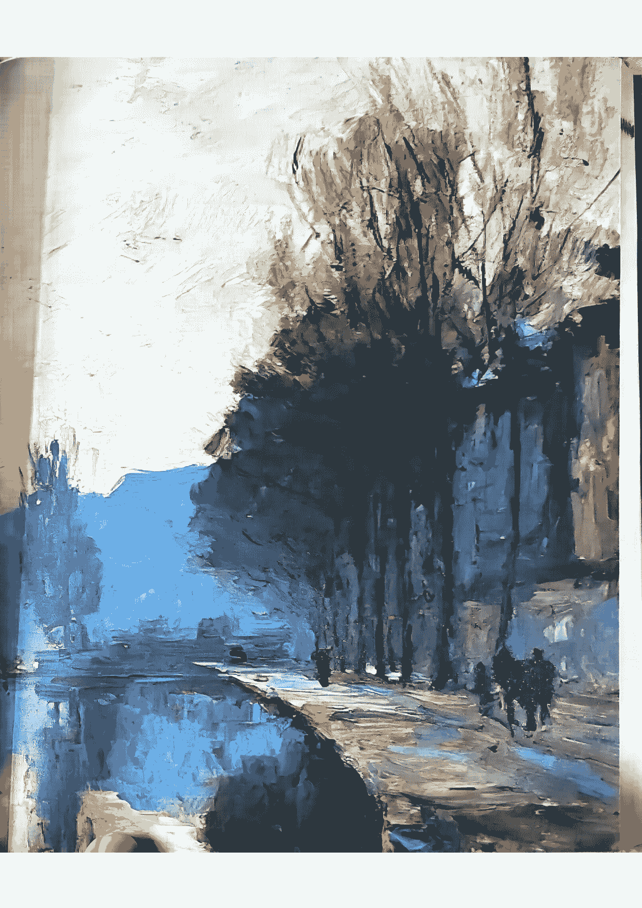

# 第 3 章

## 西方经典美学

在漫长艺术发展史中，西方经典美学形成了一个以理性与秩序为核心、以写实与结构为手段的宏大视觉体系。从文艺复兴对古典人文精神的复兴，到巴洛克时期情感与张力的释放，再到洛可可的轻盈奢华与新古典主义的端庄克制，每一个流派不仅是时代精神的产物，也以图像语言记录了人类如何理解美、构建理想。

本章涵盖的美学风格，几乎构成西方视觉艺术史的主干。它们多源于特定历史语境——文艺复兴回应宗教与封建秩序衰落后理性的觉醒，巴洛克服务于教会与王权的政治需求，洛可可反映贵族对日常逸乐的迷恋，而新古典主义则将启蒙时代的理性精神具象化为视觉范式。

从视觉特征看，西方经典美学强调结构严谨、技法成熟与象征意义丰富。例如文艺复兴的透视法与人体解剖研究、巴洛克的光影冲突与动态构图、洛可可的曲线装饰与粉彩色调，都具有鲜明识别度。这些特征对 AI 图像生成尤为重要，因其为提示词提供了极具代表性的视觉线索与构图方向。

### 3.1 文艺复兴

关键提示词：

文艺复兴（Renaissance）、透视法（linear perspective）、人体比例（human anatomy）、自然光（natural lighting）、古典理性（classical rationality）、宗教题材（religious themes）、建筑背景（architectural backdrop）、宁静庄严（serene and solemn）

# AI 美学大师：提示词与艺术风格全解读

### 风格描述：

文艺复兴美学以重生为内核，是古典精神与人文理性的回归。它强调世界可知与人的尊严，主张通过科学构图与写实技法揭示自然之美与人类之美。视觉上大量使用透视法营造空间深度，构图严谨，光影自然，常出现细节化的宗教题材或理想化人物形象。

风格常通过石砌建筑、拱门圆顶结构、精美长袍、庄严静穆的表情等要素体现。光线柔和且方向明确，人物神态温和内敛，呈现庄重宁静的视觉美感。

> “文艺复兴不是简单的复古，而是以古典理性重塑对人的发现。”在 AI 提示词中把握理性与美感的平衡，是生成该风格图像的关键。

### 提示词：

文艺复兴风格，一幅宗教题材绘画，画面中心为圣母子形象，人物穿着古典长袍，表情宁静庄重。背景为文艺复兴建筑，有圆顶与柱廊结构，远景使用透视法营造深度，光线从左上方射入，形成自然阴影。整体色调温暖，注重细节描绘，风格写实、结构严谨，呈现出理性与庄严的审美气质（图 3-1）

(Renaissance style, a religious-themed painting featuring the Madonna and Child at the center. The figures wear classical robes with serene, solemn expressions. The background includes Renaissance architecture with domes and colonnades. Linear perspective creates spatial depth in the distant scenery, and soft natural light enters from the upper left, casting realistic shadows. The color palette is warm and the visual depiction is detailed, with a realistic and structurally balanced style, expressing a rational and solemn aesthetic)

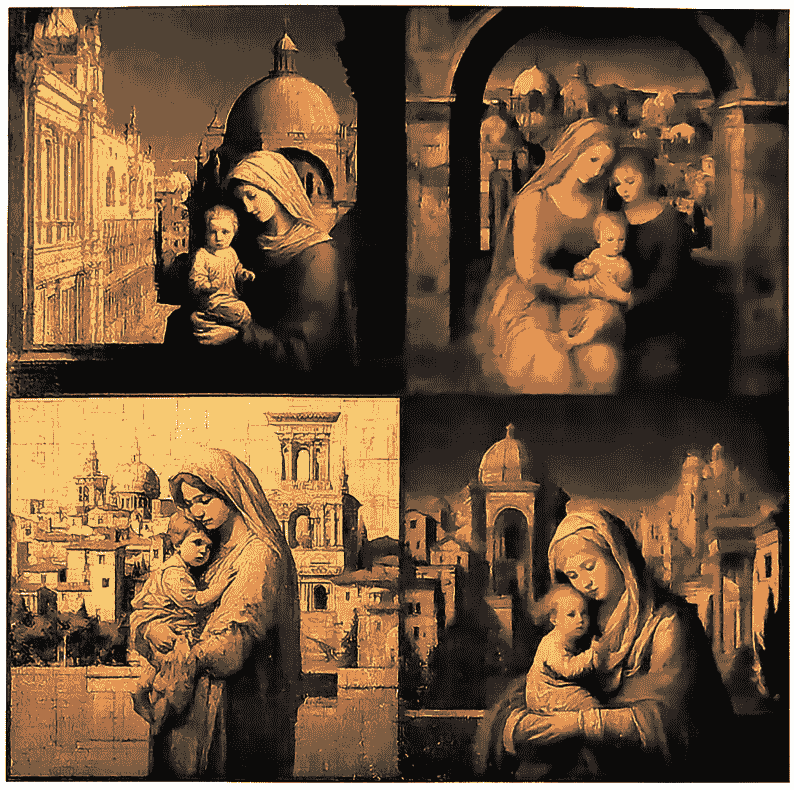

图 3-1 文艺复兴风格生成图

### 3.2 巴洛克

关键提示词：

巴洛克（Baroque）、强烈对比（dramatic contrast）、动态姿态（dynamic pose）、斜向光（diagonal lighting）、金色装饰（golden ornamentation）、情感张力（emotional tension）、宗教激情（religious ecstasy）、富丽堂皇（opulence）

# AI 美学大师：提示词与艺术风格全解读

### 风格描述：

巴洛克美学是一种充满张力与戏剧性的视觉语言，兴起于 17 世纪欧洲宗教与政治动荡时期。它以极致的情感表达、动态构图、奢华色彩与光影对比来激发观者的感官与心理反应。作品常通过人物情绪的极端刻画与斜向强光营造强烈视觉冲击。

风格可通过强烈的明暗对比、剧场式照明、复杂姿态与动态布景体现。场景细节丰富，装饰多为金色与红色，构图多采用螺旋式或对角线结构，以增强动势与焦点聚集效果。

> “如果文艺复兴追求理性之美，那么巴洛克便是感性与崇高的交响。”

在提示词中调用这种充满力量与情绪的元素，能有效生成具有强烈视觉冲击力的图像。

### 提示词：

巴洛克：神性狂喜与强光戏剧

巴洛克手法呈现的是一瞬近乎癫狂的信仰体验，人物面容激越、身形夸张而极具张力。斜向的光束切入画面，制造出强烈明暗对比的戏剧光影。背后铺陈金质雕饰、宏伟大理石柱和穹顶壁画。构图充满动势，情感张力与神圣气息并存。主色系以深沉酒红搭配金箔，凸显奢华和戏剧性（图 3-2）

(Baroque style, an image overflowing with devotional fervor, showing figures with fervent faces and over-the-top energetic gestures. Light comes in from an oblique angle, producing sharp chiaroscuro contrasts. The setting is lavish, with gilded reliefs, marble pillars and dome frescoes. The layout feels vigorous, charged with emotional intensity and holiness. Deep crimson and metallic gold dominate, underscoring opulence and drama)

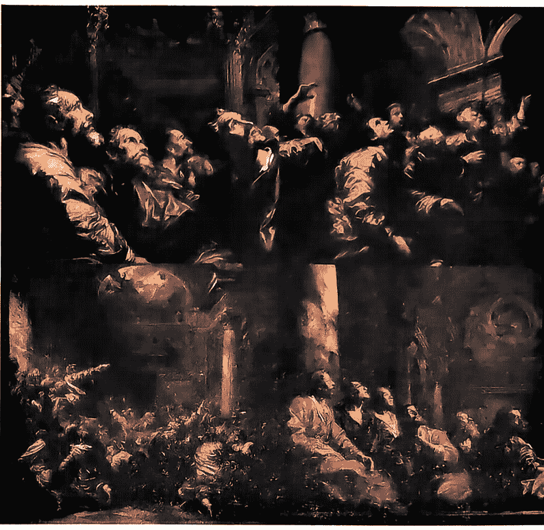

图 3-2 巴洛克风格生成图

### 3.3 洛可可

关键提示词：

洛可可（Rococo）、轻盈华丽（lightness and elegance）、柔和色彩（pastel colors）、装饰繁复（ornate decoration）、宫廷生活（courtly life）、花卉与卷饰（floral and scroll motifs）、亲密私语（intimate moments）、田园幻想（pastoral fantasy）

# AI 美学大师：提示词与艺术风格全解读

### 风格描述：

洛可可可视作巴洛克的优雅蜕变，它放弃了宏大的神权叙事，转而聚焦世俗化、精致化且私密的人际情感。源头可追溯至18世纪法国贵族圈，画面常取材于贵族的悠闲消遣、情爱嬉戏或园林散步，偏爱柔粉调、流畅曲线和轻盈点缀。

在AI中复现洛可可，建议用淡粉、浅蓝、香槟金搭建色调基底，搭配华美轻薄的衣饰、繁复装饰的室内或花园场景，营造柔软灵动且迷人的视觉感。人物举止优雅，多借助眼神与肢体暗示传递亲昵情绪。

> “洛可可是艺术的低声呢喃。” 它以极致柔美的笔调映照生活的甜蜜与欲望的轻盈。捕捉这种细腻世俗的感性基调，是还原洛可可视觉的要诀。

### 提示词：

洛可可风格，十八世纪宫廷花园内的贵族雅集，人物着装华美轻盈，主色以粉蓝、象牙白和金为主。背景呈现精致园林与喷泉，纹样繁茂带卷草装饰。人面神态温柔，体态优雅，互动自然亲密。整体色感轻盈柔和，氛围浪漫闲适，折射出洛可可时代的精致生活（图 3-3）

(Rococo style, a courtly gathering in an 18th-century palace garden. Attendees wear airy ornate attire in pastel blue, ivory and gold. The backdrop shows manicured gardens and fountains with elaborate floral scroll ornamentation. Faces are gentle, postures refined, interactions intimate and natural. Soft graceful hues create a romantic leisurely mood that reflects rococo refinement)

# 第 3 章 西方经典美学

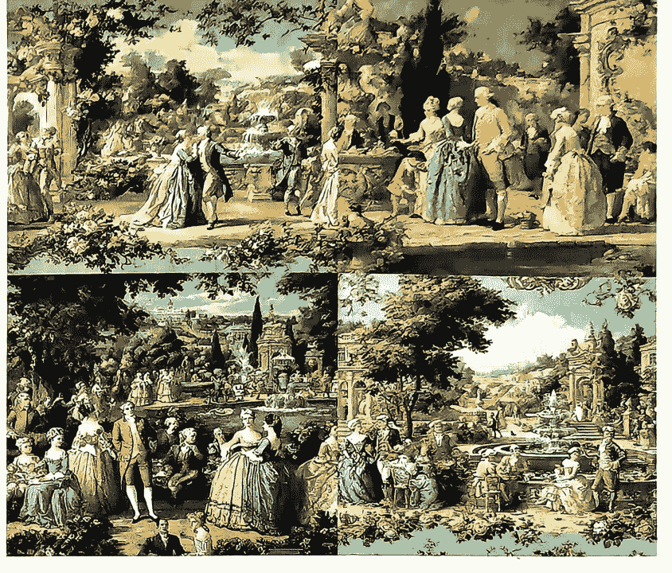

图 3-3 洛可可风格生成图

### 3.4 新古典主义

关键提示词：

新古典主义（Neoclassicism）、对称结构（symmetry）、克制理性（restrained rationality）、雕塑感（sculptural forms）、古希腊罗马（Greco-Roman Antiquity）、简洁线条（clean lines）、历史题材（historical themes）、道德教化（moral virtue）

# AI 美学大师：提示词与艺术风格全解读

### 风格描述：

新古典主义是对巴洛克与洛可可奢华的理性回潮，重建古典秩序、道德理想与美感。受启蒙思潮与考古发现驱动，欧洲画家转向希腊罗马遗产，追求简练、克制、清晰有力的视觉语法。构图冷静、比例严谨、人物如雕塑般凝固，常带政治或道德寓意。

AI中表现新古典，可用对称布局、几何化背景、雕塑化人物与沉稳用色。人物多着古风服饰，姿态挺拔，背景可借鉴罗马神庙、石柱、壁龛等元素。整体氛围冷峻崇高，细节服务于理性与品格的表达。

> 正如温克尔曼所言：“艺术的最高理想，是高贵的单纯与静穆的伟大。”新古典正是这一精神的视觉演绎。

### 提示词：

新古典主义风格，一幅取材于古希腊神话的画面，人物服饰简洁、造型工整，姿势宛如静止雕塑。背景为对称式古典建筑，石柱与拱券为主要结构。光线柔和，强调体量与肌理。色系为米白、灰蓝与陶红，传递克制庄重的情绪。画面静谧理智，体现道德与秩序的美学追求（图 3-4）

(Neoclassicism style, a painting inspired by Greek myth. Figures in plain garments hold sculptural still poses. Background features symmetrical classical architecture with stone columns and arches. Gentle light highlights volume and texture. Palette of beige, muted blue and terracotta reinforces restraint and solemnity. Composition conveys a moral orderly aesthetic vision)


图 3-4 新古典主义风格生成图

### 3.5 浪漫主义

关键提示词：

浪漫主义（Romanticism）、情感表达（emotional expression）、自然崇拜（sublime nature）、戏剧性构图（dramatic composition）、动荡场景（turbulent scenes）、英雄主义（heroism）、孤独感（solitude）、内心风暴（inner turmoil）

# AI 美学大师：提示词与艺术风格全解读

### 风格描述：

浪漫主义是对理性压抑的情感反叛，强调个体感受、想象、激情与自然的神秘力量。19世纪初，启蒙理性式微、社会动荡加剧，艺术家将目光投向内心世界与宏大自然，探寻人与自然、个体与命运的张力。作品构图戏剧化，情绪浓烈，色彩对比强烈，常出现风暴、海浪、悬崖、挣扎身影与炽热天空等意象。

AI生成浪漫主义时，需突出自然动势与人物情感爆发，可加入风暴、海浪、奔马、烈焰等元素以营造激烈气氛。常用深蓝、暗红、金橙等浓烈色调；人物或孤立如英雄，或与自然力量抗衡；构图强调对角线张力与非均衡感。

> “浪漫主义不过是一种色彩的自由。”在提示中点燃这种自由与激情，是触及浪漫主义内核的关键。

### 提示词：

浪漫主义风格，一名披风猎猎的孤旅者伫立悬崖之巅，遥望风暴笼罩的海洋。天际被狂风撕裂，云卷涌动，海浪拍打岩壁。色彩浓烈，以深蓝、灰紫、金橙为主调。人物姿态坚定却渺小，表达对自然力量的敬畏与抗争。构图张力十足，情绪澎湃且富有诗意（图 3-5）

(Romanticism style, a lone traveler with a billowing cloak stands on a cliff overlooking a stormy sea. The sky is ripped by wind, clouds roil, waves crash against rocks. Intense palette of deep blue, muted purple and golden orange. The figure is resolute yet tiny, conveying awe and struggle against nature. Composition is dramatic, emotionally charged and poetic)


图 3-5 浪漫主义风格生成图

### 3.6 现实主义

关键提示词：

现实主义（Realism）、日常生活（everyday life）、普通人物（common people）、自然光（natural light）、写实细节（detailed realism）、劳动场景（labor scenes）、社会环境（social context）、质朴色调（earthy tones）

# AI 美学大师：提示词与艺术风格全解读

### 风格描述：

现实主义诞生于19世纪中期，是对浪漫主义情感泛滥的批判，也是面向社会现实的艺术转向。它摒弃神话与理想化题材，转而关注普通人的日常，尤其是劳动者之辛劳与尊严。主张如实记录，强调细节真实与社会背景的具象呈现。

AI创作现实主义画面时，应避开戏剧化与梦幻感，转而强调自然光下的真实场景、无修饰的人物面孔以及清晰质感的物与环境。可引入田野、工厂、厨房、街巷等生活生产场所，人物着装朴素，神情自然或沉思，构图稳重节奏舒缓，常以水平线为基底。

> 正如库尔贝所说：“我只画我眼睛里看到的。”现实主义的美学深植于生活经验与社会观察。

### 提示词：

现实主义风格，一名农夫在田埂上休憩，面容沧桑，衣着简朴，眼神里交织疲惫与宁静。背景为辽阔田野与龟裂土地，天空低沉。色调偏向土棕与灰蓝。光线自然不做修饰，画面注重人物与环境的真实细节，展现平凡生活中的质朴与韧性（图 3-6）

(Realism style, a farmer pausing on a field ridge, weathered face and plain clothes, eyes showing fatigue and calm. Vast fields and cracked earth under a subdued sky form the backdrop. Earthy browns and muted blues dominate. Natural unembellished lighting. Detailed realism of figure and setting portrays quiet resilience in ordinary life)

## 3.7 印象派

关键提示词：

- 印象派（Impressionism）
- 短笔触（short brushstrokes）
- 光影变化（light and shadow）
- 瞬时感受（ephemeral moments）
- 自然场景（outdoor scenes）
- 柔和色彩（soft colors）
- 氛围表达（atmospheric effects）
- 即兴构图（spontaneous composition）

### 风格描述：

印象派承接现实主义并实现突破，不再追求物象的精确再现，而是着眼于光与感受。19世纪后期，城市生活与户外写生盛行，画家开始捕捉瞬息的光影变化、天气氛围与日常片段。笔触轻快、构图自由，色彩明亮且变化，常呈现朦胧而鲜活的感官印象。

AI生成印象派时，应弱化清晰轮廓，强调光影流动与色块转换。可引入日出、湖面、花园、街角等转瞬场景，色彩倾向柔和叠加，构图可采用非对称开放式，呈现“观赏中的瞬间”。

正如莫奈所说：“我希望画出的是光本身。”印象派的核心在于凝聚感官之外的气息，凸显时间感。

### 提示词：

印象派风格，湖畔清晨日出，阳光穿透薄雾洒向水面，波光闪烁。画面以短促笔触表现水面与天空的色彩过渡，色调为粉橙、浅蓝、灰紫等柔和色。湖岸树木与建筑轮廓模糊，远处小径有人行走。构图开放自然，整体温柔静谧，捕捉晨曦的片刻印象（图 3-7）

(Impressionism style, lakeside sunrise with sunlight filtering through mist onto water, creating shimmering ripples. Short brushstrokes render transitions between water and sky in soft peach, light blue and muted lavender. Lakeshore trees and buildings are loosely defined, figures walk a distant path. Open natural composition creates a gentle quiet atmosphere that captures a fleeting morning impression)

图 3-7 印象派风格生成图

## 3.8 后印象派

关键提示词：

- 后印象派（Post-Impressionism）
- 结构感（structural composition）
- 主观色彩（subjective color）
- 内在情感（inner emotion）
- 粗轮廓（bold outlines）
- 象征寓意（symbolic meaning）
- 几何构成（geometric form）
- 笔触强化（enhanced brushwork）

### 风格描述：

后印象派既延续印象派，也主动背离。艺术家在继承光色关注的基础上，更强调主观表现与结构逻辑。塞尚、梵高、高更等不再满足于短暂视觉印象，而是通过强化色彩、夸张形式、赋予寓意与情感表达，形成个人化的视觉语言。

后印象派风格可通过强笔触、夸张用色与结构化构图呈现。提示词可引入具象征意味的自然景、静物或人物，色彩不必写实，反而应借助色彩传递内在感受与精神倾向。构图常参考几何切割，强调形式、节奏与情绪统一。

后印象派的AI图像应追求画面深层的情绪与心理能量。

### 提示词：

后印象派风格，黄昏光下起伏山丘呈现非写实的色彩，前景有扭曲树木与变形石屋。画面用浓重笔触，色彩包括明黄、深蓝、橘红与紫。构图近乎几何化，树木与建筑轮廓清晰夸张。整体情绪强烈，营造梦境与现实交融的视觉体验（图3-8）

(Post-Impressionism style, rolling hills at sunset rendered in unreal hues, foreground with twisting trees and distorted stone houses. Heavy brushwork and vivid colors like bright yellow, deep blue, orange and purple. Composition is almost geometric with bold outlines. Tone is emotionally intense, creating dreamlike interplay between reality and imagination)

图 3-8 后印象派风格生成图

## 3.9 象征主义

关键提示词：

- 象征主义（Symbolism）
- 梦境意象（dream imagery）
- 神秘气氛（mystical atmosphere）
- 寓言性主题（allegorical themes）
- 象征物（symbolic objects）
- 内省与灵性（introspection and spirituality）
- 装饰风格（decorative style）
- 朦胧轮廓（soft contours）

### 风格描述：

象征主义：从现实走向梦境的审美逆转

象征主义是摆脱现实主义与自然主义束缚的逆向美学，把创作焦点从外部写实转向潜意识、梦境、神秘与灵性。十九世纪末的象征派提出“借可见形象承载不可见的意义”，依靠暗示、寓言与隐喻搭建一个超越日常的视觉场域。该类作品常渗入超自然气息，人物的眼神收敛克制，环境静谧却暗藏玄机，形式上常借鉴新艺术的繁复纹样与流畅线条。

在 AI 创作中，提示词可强调边缘的朦胧处理、指向象征的构图符号如月亮、镜子、蛇、花卉等，以及停顿而心理张力饱满的人物姿态，以贴合流派气质。色调多选取低饱和度或带有光晕的梦幻基调，整体侧重情绪渲染与心理隐喻，而非物理空间的精确复刻。

波德莱尔说过“万物皆相互呼应”。象征派的 AI 影像也应在表象与隐意之间建立共振。

### 提示词：

象征主义调性，夜色里一位披袍女子立于湖畔，手执镜子凝望水面倒映的月光。远景是笼罩薄雾的林带与泛着微光的水岸，整体以蓝紫交织银白呈现，边缘柔和，装饰细节丰富。人物神情内敛而神秘，布局富寓言性，营造出具梦幻感的神秘氛围（图 3-9）

(Symbolist mood, a cloaked female figure at a lakeside by night, holding a mirror toward the moon reflected on water. Misty woods and a softly luminous shore form the backdrop, rendered in bluish-purple mixed with silvery tones. Edges stay soft, ornamentation is abundant. Her expression is inward and enigmatic, the composition carries allegorical weight and a dreamlike mystery)

图 3-9 象征主义风格生成图

## 3.10 分离派

关键提示词：

- 维也纳分离派（Vienna Secession）
- 几何装饰（geometric ornamentation）
- 扁平化（flatness）
- 金箔效果（gold leaf effect）
- 象征寓意（symbolic content）
- 女性形象（feminine figures）
- 新艺术风格（art nouveau influence）
- 图案重复（pattern repetition）

### 风格描述：

维也纳分离派发轫于十九世纪末的新艺术潮流，克里姆特等人发起，主张“为时代的艺术、为艺术的自由”。该派融合装饰性与象征性，视觉上突出金属质感、几何秩序与平面的处理，形成极具辨识度的现代语言。尤以女性为题材的作品著称，常由金箔、花卉、曲线与抽象底纹组合成华丽而神秘的意象空间。

表现分离派特征时，可大量使用马赛克、圆环、螺旋、植物纹样等装饰语汇，并搭配金色、深红、墨绿等富丽对比色系。人物多呈装饰化姿态，布局讲究对称与框架感，前景与背景界限模糊，整体更接近壁画或纹样艺术。

克里姆特的实践显示艺术可同时具备奢华与象征。撰写提示时应让 AI 将装饰与象征结合，达成“平面中的深度”。

### 提示词：

维也纳分离派笔法，一名女子置于鑲金背景前，身着满布几何纹样的长袍，面容宁静而带神秘感。背景结构对称，出现环形、螺旋与植物母题，整体呈扁平装饰性构图。以金色与深红为主调，画面兼具象征意涵与装饰美感，营造出仪式化的视觉体验（图 3-10）

(Vienna Secession manner, a woman before a gilded backdrop wearing a robe covered in geometric motifs. Her face is calm yet mysterious. The background is symmetrical with circles, spirals and botanical motifs in a flat ornamental rendering. Dominated by gold and deep red, the image fuses symbolic meaning with decorative elegance, creating a ceremonial visual experience)

图 3-10 维也纳分离派生成图

## 3.11 装饰艺术运动

关键提示词：

- 装饰艺术（Art Deco）
- 对称与几何（symmetry and geometry）
- 金属光泽（metallic sheen）
- 阶梯形构图（ziggurat forms）
- 未来感（futuristic）
- 奢华感（luxury aesthetics）
- 摩天大楼（skyscrapers）
- 机械美学（machine elegance）

### 风格描述：

装饰艺术运动是二十世纪初现代性与奢华美学交汇的象征，追求以几何秩序、光泽材质与都市想象建构充满速度感的视觉体系。Art Deco 于二十年代至三十年代流行于建筑立面、室内、时尚、交通设计等领域，是对工业化、都市化与未来主义的积极回应。相较自然主义，它更强调造型的雕塑性与图案的华美。

该风格常以对称布局、流线造型、金属质感与阶梯式建筑表现。提示词可加入摩天楼、夜景、镜面点缀、黄金线条、女性肖像等关键词，强化“都市之美”与“工业之雅”的融合。色调多用黑、金、银、墨绿、宝蓝等高对比色，视觉冲击强，节奏感足。

正如当时艺术家在机器时代寻找装饰之美，Art Deco 的 AI 图像应兼具速度感与华丽感。

### 提示词：

装饰艺术笔触，夜幕下的摩天楼群以对称方式呈现，建筑外立面为阶梯轮廓与金属线饰，背景为星空与闪烁都市灯火。画面以黑金为主色，细节精致，充盈未来感与都市节奏。风格突出几何造型、金属光泽与对称秩序，展现机械时代的奢华视觉美学（图 3-11）

(Art Deco touch, a night skyline of skyscrapers arranged symmetrically. Facades show ziggurat silhouettes and metallic linear ornaments. The background holds a starry sky and glittering city lights. The palette is black and gold with refined details, conveying futuristic urban rhythm. The style stresses geometric forms, metallic sheen and symmetrical order, embodying the luxurious visual aesthetic of the machine age)

图 3-11 装饰艺术风格生成图

## 3.12 包豪斯

关键提示词：

- 包豪斯（Bauhaus）
- 功能主义（Functionalism）
- 几何形体（geometric shapes）
- 简约设计（minimal design）
- 现代材料（modern materials）
- 初级色彩（primary colors）
- 模块化（modularity）
- 理性构图（rational layout）

### 风格描述：

包豪斯风格源自一九一九年成立于德国的同名设计学院，标志着传统工艺与现代工业的结合，为现代主义确立核心框架。包豪斯倡导“形式追随功能”，强调设计的理性、实用性与可复制性，反对冗余装饰，推崇清晰线条、几何构成与标准化生产。视觉语言追求简洁、精准、有效，常使用原色、基础形体与网格布局。

可通过简洁几何形体如圆形、三角形、正方形、鲜明的红黄蓝黑白配色、模块化排列以及无装饰字体来体现。背景多为建筑、家具或抽象图形，构图理性有序，色彩对比强烈而清晰，传递“功能即美”的理念。

正如包豪斯格言“少即多”，提示词的每个元素都应服务于结构性与功能性的视觉表达。

### 提示词：

包豪斯风格，一幅以红黄蓝三原色搭配黑白构成的几何抽象画面，包含圆形、矩形与直线元素，整体构图简洁理性。画面平面化，无阴影与渐变，图形排列遵循对称与网格原则，背景为纯白或浅灰，营造出现代主义的秩序感与结构感。整体强调功能性与形式的统一，体现工业时代的理性美学（图 3-12）

(Bauhaus style, an abstract composition using primary red, yellow and blue with black and white. Circles, rectangles and straight lines appear in a flat minimal layout. No shadows or gradients; shapes follow grid-based symmetrical arrangement. Background is pure white or light gray, creating modernist order and structural clarity. The overall style stresses functional form and visual unity, embodying the rational aesthetics of the industrial age)

图 3-12 包豪斯风格生成图

# 第 4 章

## 东方美学

东方美学并非单一视觉体系，而是植根于东亚与南亚文化传统中的多元审美结构。与西方强调形式、比例与物质性的表达不同，东方艺术更重视意境、气韵与象征性传达，倾向于借助留白、空灵、对比、象征等手法，唤起观者内在感受与精神共鸣。

本章涉及的东方视觉风格，涵盖中国、日本、朝鲜半岛、波斯、印度与东南亚等地的艺术流派，既包括传统水墨、工笔、浮世绘、青绿山水等绘画体系，也包括极具装饰性与叙事性的波斯细密画、印度拉杰普特绘画以及吴哥风格的佛教艺术。这些风格虽各具地域性，却共同呈现出东方文化中“以神写形”“托物言志”“气象为本”的艺术精神。

东方美学往往不追求物象绝对还原，而是致力于捕捉“物外之意”“境中之情”。这也使其在 AI 生成中具备更强的抽象性、诗意性与结构张力，可作为 AI 艺术感知的深层美学工具。

## 4.1 中国水墨画

> 关键提示词：
> - 水墨画（Ink Wash Painting）
> - 留白（negative space）
> - 墨色层次（ink tonality）
> - 山水意境（landscape mood）
> - 气韵生动（spiritual resonance）
> - 写意笔法（freehand brushwork）
> - 浓淡干湿（ink gradation）
> - 虚实相生（solid and void balance）

### 风格描述：

中国水墨画是东方美学最具代表性的图像传统，其核心不仅在“画什么”，更在“如何画”与“为何画”。它以毛笔、宣纸、水与墨为媒介，通过笔墨表现自然神韵与画家内心情思。水墨画强调“意在笔先”“以神写形”，借助墨色浓淡、笔触疾徐、构图虚实，营造“可游可居”的诗意空间。

水墨风格的呈现应围绕“气韵”与“留白”展开。提示词可引入山川、云雾、松石、孤亭、行旅人物等典型元素，构图注意留白与动线的呼应。笔法方面应描述水墨浓淡干湿的过渡感，如“泼墨”“飞白”“破笔”等表现形式。色彩上主用黑白灰，局部可点缀淡赭、墨绿、丹朱等低饱和传统色调。

AI 生成水墨图像的关键不在于再现物象，而在于通过提示词激活构成“气象”的诸要素。

提示词：

中国水墨画风格，一幅写意山水，画面远山连绵，松树挺拔，山间云雾缭绕，林间隐现小亭，近处行旅人物沿山径而行。构图上下错落，留白宽阔。墨色层次丰富，从浓到淡自然过渡，运笔灵动，具飞白与泼墨效果。画面空灵且富动感，传达幽远、清雅、气韵生动的东方意境（图 4-1）

(Chinese Ink Wash Painting style, a freehand landscape with distant rolling mountains, upright pines, mist weaving between peaks. A small pavilion hides among woods, a traveler walks a winding path. The composition is vertically layered with generous negative space. Ink ranges from deep black to light gray, brushwork includes flying white and splash ink. The image conveys serenity, elegance and spiritual vitality, evoking the poetic mood of traditional Chinese painting)


图 4-1 中国水墨画风格生成图

## 4.2 中国工笔画

关键提示词：

工笔画（Gongbi Painting）、细致描绘（meticulous detailing）、线描（line drawing）、层层设色（layered coloring）、对称构图（symmetrical composition）、传统题材（classical themes）、花鸟人物（floral and figure subjects）、清丽雅致（elegant refinement）

### 风格描述：

工笔画是中国绘画传统中的精工技艺代表，以精确线条、严谨构图和层层渲染的设色著称。不同于水墨画的写意精神，工笔画强调对自然形态的深入观察与准确描摹，线条讲求“铁线描”之劲健与均匀，设色多由矿物颜料晕染而成，色泽清丽而不浮艳。常见题材有花鸟、仕女、神话人物与宫廷场景，展现庄重又柔雅的东方秩序美。

在 AI 创作工笔风格作品时，应通过关键词引导生成极为清晰的轮廓线、规整对称的构图布局以及干净明快的色彩。人物与物体造型细腻，姿态优雅，静中有动。提示词中可加入“勾线”“重彩”“双钩填色”“白描”等关键词，色彩可参考石青、胭脂、藤黄、赭石等中国传统设色体系。

> “笔精墨妙，赋色工丽。”要想借助 AI 再现工笔画之美，需要将“写实的眼”与“审美的心”共同注入提示词之中。

### 提示词：

中国工笔画风格，一幅仕女赏花的画面，人物衣着华丽，发式精致，姿态婉约。背景为庭院花木，有海棠、牡丹与石榴，飞鸟停歇枝头。画面线条细腻勾勒，设色柔和层次分明，采用对称式构图，轮廓清晰，人物神情端庄含蓄，画风整体典雅秀美，体现工笔画细致入微、工整有序的艺术特色（图 4-2）

( Chinese Gongbi Painting style, a refined scene of a lady admiring blossoms. She wears ornate garments and an elaborate hairstyle, posture graceful and reserved. The background shows a garden with crabapple, peony and pomegranate, birds perched on branches. Lines are finely drawn, coloring soft and layered. Composition is symmetrical with precise outlines. The mood is refined and poised, capturing the meticulous elegant spirit of Gongbi art )


图 4-2 中国工笔画风格生成图

## 4.3 中国青绿山水

关键提示词：

青绿山水（Blue-Green Landscape）、矿物重彩（mineral pigments）、层叠山峦（layered mountains）、装饰性构图（decorative composition）、金碧辉映（gold and blue brilliance）、理想化自然（idealized nature）、线描勾勒（outlined contours）、山水宫殿（landscape with palaces）

### 风格描述：

青绿山水：矿物重彩铺就的理想山域

青绿山水属于中原山水谱系中色泽最为华贵的一支，萌芽可追溯至隋唐，进入五代宋时达到全盛。其美学趣味源于矿物颜料的饱和质感、精致的构图秩序以及对自然的浪漫投射。传统作画多取石青、石绿、泥金等矿料渲染，色面厚重而富于贵气；山体常以重重叠嶂的写法展开，山川、宫阙、飞泉、云气等元素并置，营造出富丽而出尘的“人间仙境”氛围。

用生成模型复现此韵味时，核心在于矿物重彩、金质点缀与装饰性对称的配合。色调用金石青与孔雀绿作基调，局部以金粉与朱红宫墙做跳色点缀。构图上可安排耸峙的远峰、蜿蜒的山道、错落的楼阁亭榭，强调层次递进与节奏感。人物多以微小点景形式出现，用来凸显山水的宏阔与精神向度。提示词既要体现富贵色感，也要传达青绿山水超越现实、向往理想自然的情怀。

### 提示词：
中国青绿山水风格，一幅描绘群山环绕的理想化山水世界的作品，高耸山峰层叠错落，以青绿重彩绘制，山间有宫殿楼阁、飞瀑流泉，云雾缭绕。画面以金粉描边，点缀松柏与朱红屋瓦，色彩浓丽，构图繁复有序，兼具壮丽景观与装饰美感，展现古代山水画的神秘与辉煌气质（图 4-3）

( Chinese Blue-Green Landscape style, a grand composition of layered mountains in rich blue-green mineral pigments. Palaces and pavilions are nestled among the peaks, with cascading waterfalls and drifting mist. The image features golden outlines and decorative details, including pine trees and vermilion rooftops. The color scheme is vivid and majestic, and the composition is complex yet balanced, evoking the mystical and opulent spirit of ancient Chinese landscape painting )


图 4-3 中国青绿山水风格生成图

## 4.4 日本浮世绘

关键提示词：
浮世绘（Ukiyo-e）、线性勾勒（linear delineation）、平涂色块（flat color planes）、风俗画（genre scenes）、木版印刷感（woodblock texture）、人物剪影（silhouetted figures）、江户日常（Edo daily life）、波浪云彩（stylized waves and clouds）

### 风格描述：
浮世绘兴起于江户，兼融绘画与版刻的语言，“浮世”二字指向易逝的世俗生活画面。它以利落的轮廓、明快的大色面与市井题材见长，常见歌舞伎役者、町人形象、名胜风景与美人图。视觉上装饰意味浓厚、图式高度符号化，辨识度极高，带有先于现代的平面设计感。

以AI还原浮世绘趣味，可围绕粗黑线描勾出主体、平面化排布与低饱和度的色块填充展开。可加入木刻肌理、手绘线条、和服装束、和风景物等表述，背景常选用流云、巨浪、樱花、富士山等标志性意象。配色取自江户惯用色系，如蓝染蓝、墨灰、朱红与淡黄。对日常的凝视即是对时代精神的塑造，合理安排人物动态与环境细节，便能复现雅致朴实的东方版画之美。

### 提示词：
日本浮世绘风格，一位身穿和服的女性走在江户城的街道上，背后是远处的富士山与盛开的樱花树。人物轮廓以粗黑线勾勒，画面采用平涂色块与木刻印刷的风格呈现。背景有飘动的云纹与流动的溪水，色彩以蓝、灰、红为主，画面整体平面感强，传达出宁静的江户风情与日常生活的美学情趣（图 4-4）

( Ukiyo-e style, a woman in a kimono walks through a street in Edo, with Mount Fuji and blossoming cherry trees in the background. Her figure is outlined with bold black lines, while the image features flat color planes and a woodblock print aesthetic. The background includes stylized clouds and flowing water. The palette uses indigo blue, gray, and vermilion red. The overall composition is flat and decorative, evoking the tranquil spirit and visual poetry of everyday Edo life )


图 4-4 日本浮世绘风格生成图

## 4.5 日本琳派

关键提示词：
琳派（Rinpa School）、装饰性构图（decorative composition）、金箔背景（gold leaf background）、自然意象（nature motifs）、图案化处理（stylized forms）、花鸟题材（floral and bird themes）、对称与留白（symmetry and negative space）、扇面屏风（folding screen aesthetics）

### 风格描述：
琳派形成于江户，是日本极具代表性的装饰画流派，核心在于将自然意象提炼为形式之美。题材多取花草、禽兽、流水与四季景观，呈现清雅通透且高度图案化的视觉。琳派偏重秩序与装饰性，常以金箔、银箔或大面积色块作地，以“少而精”的形式语言达成审美平衡。

要表现琳派韵味，可借助对称式布局、空灵的留白与自然元素的高度程式化表达。提示词可引入金箔底色、扇面屏风、流水纹样、梅兰竹菊等经典素材。色调清雅而不单调，常用金、墨、深绿、赭红与淡蓝。画面需营造静谧、典雅、象征性强的氛围，同时兼顾自然形态与人工装饰的融合。

### 提示词：
日本琳派风格，一幅描绘秋日芒草与飞鸟的装饰画作，背景以金箔为底，芒草对称排布，飞鸟穿行其间。画面元素简约却布局精妙，整体采用屏风构图风格，配色以金、墨、赭石与淡蓝为主。植物与鸟类形象经过图案化处理，保留自然形态的装饰美，画面留白广阔，传达出典雅、静谧、超尘脱俗的东方意境（图 4-5）

( Rinpa School style, a decorative artwork depicting autumn pampas grass and birds in flight, set against a gold leaf background. The grasses are arranged symmetrically, and the birds move elegantly through the scene. The composition adopts a folding screen layout, with colors dominated by gold, ink black, ochre, and light blue. Plant and bird forms are stylized, blending natural elegance with decorative clarity. The image uses wide negative space and conveys a serene, refined, and transcendent atmosphere )


图 4-5 日本琳派风格生成图

## 4.6 日本狩野派

关键提示词：
狩野派（Kano School）、权威美学（Official Aesthetics）、水墨设色结合（ink and color fusion）、建筑壁画（architectural painting）、山水人物（landscape with figures）、对称布局（symmetrical layout）、儒释道融合（Confucian-Buddhist-Daoist fusion）、金底装饰（gold background decoration）

### 风格描述：
狩野派自室町延续至江户，是日本最具影响力的官画体系，多为武家与诸侯服务。其风格汲取宋元笔法并融入本土审美，形成结构严谨、题材宏大、墨色兼用的综合体系。作品多用于寺庙、城堡等大型建筑装饰，也见于屏风隔扇，强调构图的礼制感与视觉的威严，兼具道德象征与自然意象。

表现狩野派可借助对称构图、山水与人物的并置、水墨与设色的融合、金箔背景。提示词可包含松树、岩石、鹤鹿、高士、僧侣等典型形象，背景常配流水、远山、祥云、桥廊等元素。色彩以水墨灰调为底，点缀金色或赭红，画面充满格局感与文化重量。正如狩野永德之作常被视作“视觉上的权力象征”，提示词的组织也应体现结构均衡、形式庄重与题材厚重。

### 提示词：
日本狩野派风格，一幅描绘山间松林与高士对话的画面，人物衣着古朴，站于石桥之上，身后远山连绵。背景有金箔屏风感，岩石与松树轮廓清晰，云雾渲染流动。画面结构对称，水墨打底，局部施以淡赭与青绿，表现出庄重、理性、带有礼仪感的视觉风格，兼具自然意境与儒释道哲思（图 4-6）

( Kano School style, a scene of two scholars conversing in a pine-covered mountain setting, standing on a stone bridge with distant mountains behind. The background evokes a gold-leaf screen painting, with clearly outlined rocks and pines, and drifting mist rendered in soft ink. The composition is symmetrical and balanced, with ink as the foundation and subtle use of ochre and bluish-green coloring. The image expresses a solemn, rational, and ceremonial aesthetic, blending natural scenery with philosophical depth rooted in Confucian-Buddhist-Daoist traditions )


图 4-6 日本狩野派风格生成图

## 4.7 朝鲜半岛绘画

关键提示词：
朝鲜民画（Minhwa）、象征寓意（symbolic motifs）、装饰性构图（decorative layout）、民间信仰（folk beliefs）、动物与自然元素（animal and nature motifs）、扁平色块（flat coloring）、节庆氛围（festive atmosphere）、日常生活图景（scenes of daily life）

## AI 是学大师：提示词与艺术风格全解读

### 风格描述：
朝鲜绘画源流深长，既有受中原文人画影响的水墨山水与高士人物，也有独具特色的民间绘画传统。民画兴于18至19世纪，以吉祥寓意与宗教信仰为主题，常绘制虎图、十长生、花鸟鱼虫、婚宴等题材。风格重在象征、趣味与图案性，构图饱满对比强烈，色彩鲜明且多用平涂，传递出充满生命力的民间视觉理念。

朝鲜民画可通过吉祥元素、平面装饰图样与高对比配色体现。可引入民间信仰、节庆场景、童趣构图、象征图案等关键词。配色多用红、黄、青、绿、黑等高饱和色，造型装饰化且轮廓简练，画面传递欢乐、温暖与文化认同。正如学者所言，民画是民族生活愿望的象征表达，提示词应聚焦吉祥观念与叙事习俗，重现质朴的民画美学。

### 提示词：
朝鲜民画风格，一幅描绘虎卧山林的吉祥图，虎身姿夸张有力，周围点缀松树、仙鹤与祥云图案。背景为装饰性山丘与花卉图样，构图饱满，对称均衡。色彩使用高饱和的红、绿、黄与黑，形体边缘明确，画面充满节庆感与庇佑意象，展现朝鲜民间绘画的象征性与喜乐氛围（图 4-7）

(Korean Minhwa style, a folk painting depicting a tiger resting in the mountains with an exaggerated, powerful pose. Surrounding motifs include pine trees, cranes, and swirling clouds. The background features decorative hills and floral patterns in a symmetrical and full composition. Colors are highly saturated—red, green, yellow, and black—with clearly defined outlines. The scene evokes festivity and blessing, capturing the symbolic and joyful spirit of Korean folk art)


图 4-7 朝鲜民画风格生成图

## 4.8 波斯细密画

关键提示词：
波斯细密画（Persian Miniature）、手工书绘插图（manuscript illustration）、装饰密集（ornate detail）、金边勾勒（gold outlining）、对称构图（symmetrical composition）、细腻线描（delicate line drawing）、建筑与庭园（architecture and gardens）、寓言与史诗（fables and epics）

### 风格描述：
波斯细密画是中世纪伊朗及周边地区高度发达的书籍插画艺术，既是视觉艺术也是叙事传统的重要载体。此风格讲究构图精密、色彩浓丽、线条纤细，常用于装饰《列王纪》《鲁米诗集》等史诗文本。画面常同时包含建筑、人物、山石、花卉等多重元素，形成信息密集且富象征意味的“视觉叙事织锦”。

表现波斯细密画，需用高密度图案化构图、清晰轮廓线与装饰元素组合。提示词可加入手抄书页、多人物场景、庭园与拱门、色彩渐变、金边描线等。色彩以宝石色为主，如群青、玫红、孔雀绿、金色，布局倾向竖向叙事或对称展开。正如波斯艺术追求“每一幅画都是一首诗”，提示词应帮助模型捕捉细节叙述与繁复统一的精神，使作品兼具视觉冲击与诗性韵味。

### 提示词：
波斯细密画风格，一幅描绘古代宫殿庭园中聚会场景的画作，画面中有多位身穿传统服饰的人物围坐交谈，背景为拱门、圆顶建筑与庭院植物。图像使用金色细线勾勒轮廓，色彩丰富，以蓝、红、金为主调，细节极为密集。构图层层叠进，图案装饰包围人物，画面传达出精致、诗意与叙事融合的波斯美学风格（图 4-8）

(Persian Miniature style, a detailed illustration of a royal gathering in an ancient palace garden. Multiple figures in traditional attire are seated and conversing, surrounded by domes, arches, and stylized flora. The image features gold-outlined contours and a rich palette of blues, reds, and golds. The composition is layered and ornate, with decorative patterns enveloping the scene. The overall aesthetic fuses narrative depth with poetic elegance, embodying the intricate visual tradition of Persian manuscript art)


图 4-8 波斯细密画风格生成图

## 4.9 印度拉杰普特绘画

关键提示词：
帕哈里绘画（Pahari Painting）、拉杰普特绘画（Rajput Painting）、叙事场景（narrative scenes）、神祇与爱情主题（deities and romantic themes）、宫廷生活（courtly imagery）、宝石色调（jewel tones）、装饰边框（decorative borders）、风格化植物（stylized flora）

### 风格描述：
拉杰普特绘画兴盛于17至19世纪的印度北部，融合了印度教神话叙事、波斯细密画装饰语言与地方审美。帕哈里绘画是其重要分支，常描绘拉达与克里希纳的爱情故事、季节变化、节庆仪式、宫廷活动等，呈现出情感张力与象征意味兼具的视觉节奏。

**拉杰普特：花园里的神圣恋语**

这一脉绘画偏向二维平面处理、镜像式的构图与块面的秩序排列，边饰繁复细腻。人物轮廓干净利落，面容趋于程式化，姿态兼具庄重与优雅的仪式感。色调清透明亮，常选用宝石般的绛红、翡翠绿、藏青并以金色点缀，画面整体兼具诗意与强烈的装饰性。

若想复原神性与情感并置的视觉语法，可在提示词里加入“宫廷神话情境”“目光温柔交汇”“园林式布局”“对称的人物站位”“花草纹样边框”等引导，让模型兼顾印度传统叙事与仪式感的呈现。

> “在帕哈里画中，每一片花叶都是心的隐喻。”提示词的搭建需唤起画面内部的情绪流动与精神象征。

### 提示词：
拉杰普特绘画风格，克里希纳与拉达于花园邂逅，二人着宝石色传统服饰，视线相接，神情含蓄温婉。背景为对称花园，繁花藤蔓遍布，远景可见亭台楼阁。外缘饰以金色边框，人形程式化，构图扁平节奏分明，色彩鲜亮通透，呈现神性与人性融合的美学意涵（图 4-9）
(Rajput painting style, Krishna and Radha meet in a garden, both wearing traditional jewel-toned costumes, their gaze meeting with soft restrained expressions. The background is a symmetrical garden full of flowers and vines, pavilions in the distance. A gold ornamental border frames the image, figures are stylized, composition flat and rhythmic. The palette is vivid and clear, conveying the fusion of divine and human aesthetics in this classical Indian tradition)


图 4-9 拉杰普特绘画风格生成图

## 4.10 东南亚佛教艺术

关键提示词：
佛教艺术（Buddhist art）、东南亚风格（Southeast Asian style）、吴哥风格（Angkor style）、石雕浮雕（stone reliefs）、寺庙建筑（temple architecture）、莲花座（lotus pedestal）、神圣对称（sacred symmetry）、光晕与宝冠（halos and crowns）

### 风格描述：
东南亚佛教视觉以柬埔寨、缅甸、泰国、老挝一带的造像传统为核心，将南亚图像体系与本土审美结合，形成建筑性强、雕塑感浓、象征意味突出的语言。最具代表性的吴哥艺术以吴哥窟为中心，石刻、浮雕、建筑与神祇形象融为一体。

AI 生成时需精准引导出佛塔、石佛、莲座、浮雕墙面与金身等标志要素。人物塑造应贴近柬泰样式：高颅髻、宝冠、细长眉眼与庄严神情。场景可选神庙内殿、林间塔刹或废墟遗址，突出建筑与自然的共生。整体色调以金色、石灰白、赭红与青铜色为主，氛围肃穆宁静。

提示词宜涵盖神性、历史与自然交融的宗教意象。

### 提示词：
东南亚佛教艺术风格，丛林中一处佛塔遗迹，巨大的石质佛像面容安详，坐于莲花台，头戴宝冠，背后浮雕墙刻满佛传故事。建筑融合吴哥样式，热带藤蔓缠绕，画面色调以金色、灰石色与绿色为主，营造庄严古老神圣的氛围。构图对称，石雕细节丰富，展现宗教信仰的力量与自然共存的宁静意境（图 4-10）
(Southeast Asian Buddhist art style, a jungle temple ruin with a huge stone Buddha seated on a lotus pedestal wearing a jeweled crown. Behind it a relief wall narrates episodes from the Buddha’s life. Architecture follows Angkor traits, entwined with tropical vines. The palette uses gold, stone gray and green, creating a solemn, ancient and sacred mood. Composition is symmetrical, carving details are rich, expressing spiritual power and quiet harmony with nature)


图 4-10 东南亚佛教艺术风格生成图

# 第 5 章

## 当代视觉美学

20 世纪是视觉艺术不断跨域、重组与突破的时代。从野兽派以色彩与直觉发声，到立体主义拆解空间与透视；从达达主义消解意义，到抽象表现主义把情感与偶然推向极致。美学不再是单一风格的集合，而是一连串对既有秩序的质疑与重写。

本章流派多诞生于剧烈变革期：两次世界大战、工业城市扩张、媒介更迭、消费文化兴起、冷战科技竞赛。艺术从单纯再现转向认知、介入与观看方式的挑战。每种流派都提供新的观看语法，也记录人类如何以图像回应世界的裂变。

形式上，这些风格充满实验、观念与多样性。有的追求情绪爆发，如表现主义与抽象表现主义；有的以解构图像语言批判结构，如立体主义与达达主义；有的吸纳工业与流行元素，如波普艺术与欧普艺术；有的走向反艺术与反逻辑，如涂鸦与极简主义。它们共同构成一个去边界的视觉谱系。

## 5.1 野兽派

关键提示词：
野兽派（Fauvism）、非自然色彩（non-naturalistic colors）、平面化涂抹（flat application of paint）、主观情绪（subjective emotion）、粗略轮廓（bold outlines）、简化造型（simplified forms）、视觉冲击（visual impact）、野性表达（expressive force）

### 风格描述：
野兽派诞生于 20 世纪初，是现代艺术首波色彩革命。以马蒂斯和德兰为代表的画家抛弃写实，强调色彩的独立性与情感传导力。他们用鲜亮、非写实的色块搭建画面，不再追问物体真实的明暗与质感，而是借助纯粹的色关系与构图张力传递情绪。

AI 生成时可用高饱和对比色、粗犷线条与扁平结构来搭建特征。提示词应突出色彩摆脱再现功能、成为主角的逻辑。题材可为肖像、风景或室内空间，重点不在细节逼真，而在色彩如何让画面活起来。

马蒂斯曾说：“我不画现实，而是画我对现实的感受。”只有植入“感受优先于对象”的逻辑，生成物才具备野兽派精神。

### 提示词：
野兽派风格，阳光下室内景，墙面以明黄表现，桌面紫色，椅子鲜红，窗外树木以蓝色呈现。轮廓粗犷，造型简化，色彩对比强烈，无阴影与透视。画面平面化、色块感强，呈现热烈、自由、近乎野性的视觉张力，表现主观情绪的爆发（图 5-1）
(Fauvism style, a sunlit interior. Walls are vivid yellow, table purple, chair bright red, exterior trees in blue. Bold contours and simplified volumes dominate. No shading or perspective, the image is flat and color-driven. Strong chromatic contrast creates a wild, free expressive tension)


图 5-1 野兽派风格生成图

## 5.2 立体主义

关键提示词：
立体主义（Cubism）、多视角（multiple perspectives）、几何分解（geometric fragmentation）、扁平化结构（flattened structure）、非线性空间（nonlinear space）、重组构图（reassembled composition）、抽象图块（abstract shapes）、结构性阴影（structured shadows）

### 风格描述：
立体主义是 20 世纪现代艺术最具突破性的运动之一，由毕加索与布拉克奠基。它彻底颠覆线性透视与单一视角的再现传统，强调把现实世界拆解为几何形态，再以新的视觉逻辑重组。物体不再是忠实复制的对象，而成为被分析、解构、重构的视觉符号。

AI 生成时，提示词应强调“空间打散”“多角度叠加”“几何化切割”等结构性特征。内容可为静物、肖像或城市风景，重点应放在形式重构而非内容还原。建议使用“碎片化形式”“立体主义构图”“非线性视角”等关键词，帮助模型脱离传统构图。

> 布拉克说：“我们不是描绘物体本身，而是呈现我们对物体的认知。”这种认知结构化与碎片化的特质应成为立体主义 AI 生成的美学核心。

### 提示词：
立体主义风格，静物主题，将水果、瓶子、桌面拆解为几何形体，以碎片化重组方式构成画面。色系以灰褐、靛蓝、赭红为主，形成结构性阴影。画面扁平无透视，物体呈现于多个交错视角，边界柔化，构图强调分析感与理性秩序，整体抽象而富有构成张力（图 5-2）
(Cubism style, still life where fruits, bottles and tabletop are broken into geometric forms and reassembled fragmentally. Palette of earthy browns, indigo and ochre with structured shadows. Flat, no perspective, objects shown from overlapping viewpoints. Edges soften, forms intersect, stressing analysis and visual structure)

## 5.3 表现主义

关键提示词：
表现主义（Expressionism）、情绪张力（emotional intensity）、主观变形（subjective distortion）、粗重线条（bold strokes）、强烈对比（strong contrasts）、内在冲突（inner turmoil）、黑红蓝主调（red, black, and blue tones）、焦虑氛围（atmosphere of anxiety）

### 风格描述：
表现主义发端于 20 世纪初的德语区，强调创作应源于强烈的内心情感，而非对外部现实的精确复制。蒙克、基希纳、康定斯基等人用夸张、变形的形态把痛苦、恐惧、孤独、狂喜等心理状态外化为画面张力。

核心在于形式服从情绪。提示词应引导 AI 放弃比例、光影、空间的自然再现，转而强调不安定的构图、偏离常规的形体比例、粗暴的笔触、冲突性的色彩。使用“表现主义情感”“扭曲人物”“心理景观”“原始笔触”等关键词尤为关键。

如蒙克所言：“我不画人，我画他们内心的呐喊。” AI 生成需保留这种强烈的心理投射。

### 提示词：
表现主义风格，城市街头人物画面，人脸扭曲，眼神空洞，身体比例夸张，背景建筑变形为倾斜不规则几何体。采用黑、红、蓝的冲突色调，笔触粗重不均，构图充满压迫与焦虑，呈现精神不安与城市异化的情绪状态（图 5-3）
(Expressionism style, city street with distorted figures, hollow eyes and exaggerated proportions. Buildings warp into tilted irregular geometries. Palette of harsh black, red and blue. Bold uneven brushwork creates visual turbulence, radiating tension and psychological unease)

## 5.4 未来主义

关键提示词：
未来主义（Futurism）、运动轨迹（motion lines）、速度感（sense of speed）、机械形体（mechanical forms）、动力构图（dynamic composition）、都市能量（urban energy）、重复形状（multiplied forms）、金属色调（metallic palette）

### 风格描述：
未来主义诞生于 20 世纪初的意大利，对现代工业文明、速度、机械与战争进行极端颂扬。博乔尼、塞韦里尼等艺术家提出“运动是形式的新本质”，通过碎片形体叠加、重叠线条、连续构图表现时间、能量与速度，画面常带近乎躁动的生命力。

创作时，应通过提示词清晰体现运动与碎裂感。使用“动态模糊”“未来主义构图”“金属形体”“速度抽象”等关键词，可引导出连续且具冲击力的图像效果。强调对称而破碎的构图节奏，选择都市或工业背景场景更容易得到理想结果。

> 《未来主义宣言》写道：“我们渴望用新的形式，表现现代生活的速度、噪声与激情。”提示词应激发图像中的视觉躁动。

### 提示词：
未来主义风格，奔跑人影的抽象图，人体分解为连续重复的金属块状形体，似瞬间连拍。画面布满运动轨迹线条与交错光影，背景为闪烁城市灯光与机械结构。构图具速度感与能量爆发，色调以银灰、钴蓝、橙红为主，传达技术与激情交织的未来感（图 5-4）
(Futurism style, abstract running figure fragmented into repeated metallic blocks as if captured in high-speed sequence. Motion lines and overlapping light trails fill the scene against flashing urban lights and mechanical forms. Kinetic energy and forward momentum dominate. Palette of silver, cobalt blue and orange-red evokes a mechanized future)

## 5.5 达达主义

**关键提示词：**
达达主义（Dada）、拼贴艺术（Collage Art）、荒诞（absurdity）、反逻辑（anti-logic）、文字元素（text fragments）、解构（deconstruction）、讽刺（satire）、不协调构图（incoherent composition）

### 风格描述：
与其说达达主义是一种风格，不如说它是一种彻底的反风格。它诞生于第一次世界大战期间，是对战争、理性与传统文化的愤怒回应。代表人物如杜尚、施维特斯等人，运用拼贴、现成品、讽刺与无意义的组合，挑战“艺术”这一概念本身的边界。

# AI绘画风格关键词速查

达达主义并不看重画面的精致程度，核心在于违背常规的组合方式。撰写指令时要强调拼贴质感、格格不入的器物、随意出现的文字、非现实的布局，以及机械与自然的混搭，引导模型跳脱传统审美，制造陌生又带嘲讽的视觉张力。

达达派把荒诞视作真实，提示宜刻意指向矛盾与无意义，让输出呈现非理性却暗藏隐喻的特质。

### 提示词：
达达主义风格，画面以撕碎报纸、旧机械部件、古典雕塑残块及文字拼贴为主体，构图杂乱，故意违背尺度与透视。背景叠加抽象笔触与随机纹样，部分区域露出手写字迹与印刷文字，色彩凌乱分布不均，整体氛围讽刺荒诞，对理性逻辑作出否定式挑衅（图 5-5）

(Dada style image assembled from shredded newsprint pieces, old mechanical components, broken classical sculpture fragments and collaged typography. Composition is chaotic, purposefully violating proportion and perspective rules. Background combines abstract brushwork with random motifs, interspersed with handwritten notes and printed text. Colors are jarring and uneven, mood is satirical and absurd, rejecting logic and conventional meaning)

## 5.6 超现实主义
关键提示词：
超现实主义 Surrealism、梦境景致 dreamlike landscape、不可能组合 impossible combinations、象征意象 symbolic imagery、现实错位 dislocated reality、诡异宁静 eerie calm、超逻辑构图 beyond logic composition、潜意识视觉 subconscious imagery

### 风格描述：
超现实主义诞生于 20 世纪二三十年代，聚焦潜意识、梦境与心理真实的图像化表达。深受弗洛伊德精神分析影响，主张用梦的逻辑和非理性并置来挖掘内心真相。达利、马格利特、恩斯特等艺术家常以写实笔触塑造虚假情境，在熟悉与陌生之间制造冲击。

用 AI 生成超现实画面时，提示应侧重联想而非叙事，关键在于搭建超现实场景，比如天空中游动的鱼、融化的钟、漂浮的岩石等。加入梦幻、超越逻辑、象征性物体、平静中透出不安等词汇会更有效。

布勒东说超现实主义不是逃避现实，而是寻找更深层的现实。提示的构建也应指向穿透表象、抵达潜意识的视觉路径。

### 提示词：
超现实主义风格，一片梦幻沙漠，地表上空漂浮着石块与扭曲家具，天空中嵌入一只俯视人间的巨眼，日光灿烂却缺乏温度。地平线远处站着模糊的人影，影子向多个方向拉伸。画面整体安静却暗流涌动，色调写实但搭配荒诞，暗示潜意识中难以言喻的欲望与恐惧（图 5-6）

(Surrealism style desert landscape that feels dreamlike, with stones and warped furniture floating above ground. A huge eye is set into the sky overlooking the earth. Light is bright yet cold. A blurred figure stands at the horizon casting shadows in several directions. Atmosphere is calm but uneasy, realistic colours paired absurdly, hinting at unspeakable desires and fears from subconscious)

## 5.7 抽象表现主义
关键提示词：
抽象表现主义 Abstract Expressionism、即兴笔触 free brushstrokes、情绪爆发 emotional outburst、滴画 drip painting、非具象 non-representational、动态构图 dynamic composition、颜料堆叠 layered pigment、画面能量 visual energy

### 风格描述：
抽象表现主义兴起于上世纪四十年代的美国，是首个在全球引发革新的美国流派。波洛克、德·库宁、罗思科等人不再描绘物象，而是把绘画变为情绪行动与身体痕迹。每一次泼洒与笔触，都是情感在画布上的即时记录。

在模型中重现此风格时，应明确情绪优先于结构，使用滴落颜料、混乱笔触、分层抽象、画布上的表现性动作等词汇，可模拟波洛克式滴画或罗思科式色域场。画面要规避具象，突出质感、能量与动势。

哈罗德·罗森伯格说画布是事件发生的现场，提示也应激发进行时的表现感。

### 提示词：
抽象表现主义风格，一幅爆发性的滴洒画面，颜料以即兴笔触与飞溅方式覆盖整张画布，无可辨物象却充满动感。画面以深红、靛蓝、白与黑层层叠加，笔触交错重叠，构图张力十足。整体传达压抑后的释放感，如情绪在高压下瞬间爆裂（图 5-7）

(Abstract Expressionism style, an explosive drip painting where pigment spreads across the canvas in spontaneous energetic marks. No recognizable forms appear, only dynamic layers of deep red, indigo, white and black. Brushwork intersects and overlaps, creating strong visual tension. The work conveys release after emotional pressure, like a burst under strain)

## 5.8 波普艺术
关键提示词：
波普艺术 Pop Art、鲜艳色块 bright color blocks、重复图像 repetition、平面构图 flat composition、广告元素 commercial imagery、名人肖像 celebrity portrait、漫画风格 comic style、消费主义符号 consumer symbols

### 风格描述：
波普艺术诞生于五十年代末至六十年代初的英美，对消费社会与大众文化作出直接回应。安迪·沃霍尔、利希滕斯坦、詹姆斯·罗森奎斯特把广告、快餐、名人、漫画引入创作，形成兼具批判与赞美的图像语言。

在模型生成波普风格时，要突出平面性与装饰性。漫画式轮廓、重复名人面孔、半色调网点、商业色调等词能有效引导出沃霍尔或利希滕斯坦式的效果。用CMYK对比色可强化复古印刷感，构图需凸显中心形象与符号化表达。

沃霍尔认为艺术是可以被售卖的东西，波普画面应体现可消费的视觉形式。

### 提示词：
波普艺术风格，一张漫画式女性头像，面部以粗黑线条勾勒，肤色为亮黄，背景由重复的罐头与饮料瓶构成，采用平涂色块与半色调网点。布局对称，色彩高饱和艳丽，充满商业感与复古流行文化气息，对消费时代作出视觉回应（图 5-8）

(Pop Art style, a comic-style portrait of a woman with bold black outlines and bright yellow skin. The background repeats canned goods and soda bottles. Flat colour blocks and halftone dots are used, with symmetrical layout and vivid saturated hues. The image carries commercial and retro pop culture vibes, responding visually to the consumer age)

## 5.9 极简主义
关键提示词：
极简主义 Minimalism、留白 negative space、简洁几何 clean geometry、单色调 monochrome palette、秩序感 sense of order、克制美学 restrained aesthetic、结构性光影 structured lighting、材料质感 material texture

### 风格描述：
极简主义自六十年代在美国兴起，是对抽象表现主义的反动，主张形式极简、情绪克制。唐纳德·贾德、丹·弗莱文、艾格尼丝·马丁等人以最基础的线面光与材料追求纯粹视觉秩序与冥想感。

在模型中实现极简时要强调极度克制与形式纯化。使用几何抽象、单色背景、对称布局、结构化光影等词，可得到建筑性、冥想性与静谧感的画面。避免冗杂信息与过度装饰，让留白与质感成为主体。

极简格言少即多，提示设计也应简洁精准有层次。

### 提示词：
极简主义风格，一张以纯白为底的画面，中央放置一组立方体，表面呈现光滑石质感。场景无其他干扰，结构均衡，光影在几何面上流动，形成克制而有序的空间感。整体为单色系，强调材料与比例关系，营造静谧沉思的美学氛围（图 5-9）

(Minimalism style, a composition on a pure white ground with a central group of geometric cubes in smooth stone texture. No visual distractions remain. The layout is balanced, with light and shadow moving across surfaces to create a restrained, structured spatial feel. The monochrome palette emphasizes material and proportion, evoking a serene, contemplative mood)


图 5-9 极简主义风格生成图

## 5.10 欧普艺术
关键提示词：
- 欧普艺术 Op Art
- 视错觉 optical illusion
- 几何重复 geometric repetition
- 黑白对比 black and white contrast
- 动态感 sense of motion
- 视觉振动 visual vibration
- 结构性构图 structured composition
- 平面错动 plane displacement

### 风格描述：
欧普艺术在五十年代兴起，代表人物布里奇特·赖利、维克多·瓦萨雷利等。核心是以几何图案制造视觉错觉，通过黑白或高对比色的排列变形，使画面呈现动感、扭曲、波动等效果，挑战观看者的感知。

在模型中欧普艺术不依赖具象，而是以视觉结构为主角。提示应强调视错觉图案、几何畸变、黑白波浪网格、高对比振动、催眠式对称等，生成几何感强、节奏感与扰动感明显的图像。画面可静止，却需营造仿佛在动的幻觉。

欧普艺术是纯粹的视觉游戏，也是对感知系统的挑衅，提示需精准控制图形的重复、对称、波动与错动的比例。

### 提示词：
欧普艺术风格，一张由黑白几何图形构成的平面图，图案呈同心圆波浪状，线条粗细变化带来强烈视觉振动。中心区域略有旋转错位，形成类似漩涡的动态效果。整体对称，色调单一但视觉强度极高，产生近乎催眠的观看体验（图 5-10）

(Op Art style, a flat image of black and white geometric patterns arranged in concentric wave formations. Varying line thickness creates strong visual vibration. The center shows slight rotational distortion, producing a vortex-like motion. The symmetrical composition uses a monochrome palette with intense optical energy, evoking a hypnotic viewing experience)


## 5.11 涂鸦艺术
关键提示词：
- 涂鸦艺术 Graffiti Art
- 街头风格 street style
- 喷漆纹理 spray paint texture
- 自由字体 freehand lettering
- 墙面涂写 wall tagging
- 视觉碰撞 visual clash
- 反文化 counter-culture
- 城市符号 urban symbols

### 风格描述：
涂鸦艺术源于七十年代纽约街头，是青年对城市空间的主张与反抗。从文字标签发展到壁画式作品，涂鸦逐渐成为高度视觉化的非正规语言。凯斯·哈林、巴斯奎特等人把街头当画布，以强冲击的图像介入社会对话。

借助模型生成涂鸦风格时，应强调街头现场感与视觉冲击力。城市衰败背景、大胆自由字体、街头风格的社会信息等词可生成具涂鸦质感与反主流精神的画面。

涂鸦的魅力在于不受规训的自由表达与社会介入性，加入政治讽刺、口号式文字、街头元素如地铁、墙体、铁门等，可增强文化张力。

### 提示词：
涂鸦艺术风格，一面老旧城市墙体覆盖多层涂鸦，包括喷漆字体、抽象图形与人物速写。画面充满鲜艳色彩与滴漆效果，背景为破旧红砖或水泥墙，带有风化痕迹。涂鸦中有自由手写标语与讽刺图像，整体构图密集凌乱却张力十足，呈现街头艺术的反叛精神与视觉冲击力（图 5-11）

( Graffiti Art style, a weathered urban wall covered with multiple layers of graffiti, including spray-painted lettering, abstract shapes, and sketched characters. The image is filled with vibrant colors and dripping effects. The background is an old red brick or concrete wall with signs of urban decay. Freestyle slogans and satirical images are embedded within the graffiti. The composition is dense and chaotic yet full of energy, capturing the rebellious spirit and visual punch of street art )


图 5-11 涂鸦艺术风格生成图

# 第 6 章

## 当代插画与大众视觉

当大众传播全面铺开，插画与流行视觉从边缘走向中心，成为当代视觉体系里不可缺的组成。与传统美术追求崇高永恒不同，这类图像更看重传播效率、场景贴合度与风格辨识力，覆盖范围从童书绘本、游戏原画，到广告创作、社媒视觉表达。

插画的价值不在于写实复制，而是借助画面讲故事、传情绪、定人物的世界观。正因功能导向强，它在数字创作与生成式图像里占据关键位置。每种插画语汇都是特定文化语境下的美学浓缩，有清晰的视觉规范与象征系统，能快速击中观众情感。

所谓流行视觉，指在某时期广泛流传、具备符号属性的视觉样式，比如孟菲斯、酸性图形、黏土动画等。多诞生于广告、影视、动画、时尚、网页等场景，短时间内被大量复制传播，并反向塑造主流设计的审美取向。

## 6.1 儿童读物插画

关键提示词：

- 儿童插画（children's illustration）
- 温暖色调（warm tones）
- 柔和笔触（soft brushstrokes）
- 童话元素（fairy tale elements）
- 拟人动物（anthropomorphic animals）
- 梦幻场景（whimsical scenes）
- 手绘质感（hand-drawn texture）
- 亲和力（approachability）

### 风格描述：

童书插画把叙事、想象与亲和力揉在一起，为幼龄读者提供图形阅读体验。它偏重视觉清晰与情绪感染，常用柔软色调、可爱拟人角色与奇幻场景，把孩子带进温暖安心又充满趣味的故事空间。

在生成式创作中适配度很高。用“柔和粉彩”“奇思森林动物”“绘本场景”等词，容易得到卡通比例、温柔情绪、精细笔触的画面，模拟水彩或彩铅手绘感。构图多以圆润造型、松弛布局与小体量人物为主，避免过度复杂或写实质感。

目标受众是孩子，视觉策略更偏向情绪安抚与想象激发，而非真实还原。写提示时应优先突出童话气质与氛围情绪。

### 提示词：

儿童读物插画风格，林间空地一只小兔与小狐依偎在巨型蘑菇上翻书，周边环绕会笑的花朵与飞舞蝴蝶。主色采用淡粉、清新嫩绿与浅米黄，线条圆润流畅，触感轻柔，满溢童趣。天幕上飘着云团造型的太阳，整体气氛温馨、安全、富想象（图 6-1）

( Children’s book illustration style, a whimsical forest scene where a bunny and a fox sit under a mushroom reading a book, surrounded by smiling flowers and butterflies. The palette features soft pinks, light greens, and pale yellows. Lines are round and gentle, with a hand-drawn feel. The sun appears as a cloud-shaped figure in the sky, creating a warm, safe, and imaginative reading atmosphere )


图 6-1 儿童读物插画风格生成图

## 6.2 奇幻插画

关键提示词：

- 奇幻插画（fantasy illustration）
- 魔法世界（magical world）
- 精灵与龙（elves and dragons）
- 神秘森林（enchanted forest）
- 古老符文（ancient runes）
- 史诗感（epic atmosphere）
- 超自然光影（supernatural lighting）
- 奇幻色彩（fantastical colors）

### 风格描述：

奇幻插画是奇幻文学、桌游与奇幻影像的核心视觉支点，特点在于搭建超越现实逻辑的完整世界观。风格糅合中世纪审美、神话意象与魔幻元素，突出角色辨识度与场景超现实氛围，整体带有强烈的史诗张力与神秘气质。

用 AI 创作时，关键词应同时覆盖角色、场景、氛围三层：角色可指定种族、服饰、武器；场景可锁定城堡、秘林、遗迹；氛围可点明魔幻光影、异世色调。如“秘林精灵战士”“发光符文与魔雾”“史诗奇幻概念艺术”等表述，有助于模型拼凑出繁复完整且视觉统一的幻想图景。

表现手法可融合绘本、水彩、数字绘画，强化细节密度与沉浸感，营造可供观者进入的梦境空间。

### 提示词：

奇幻插画风格，银白铠甲的精灵战士伫立于萤光蘑菇簇拥的密林，身后漂浮古老城堡，空气里流动符文与淡蓝魔雾。整体以浓紫深蓝与翠绿作主调，层次丰富空间充盈，光影调度营造神秘感，呈现魔力弥漫、史诗感强的梦幻世界（图 6-2）

( Fantasy illustration style, an elf warrior in silver armor stands in a forest surrounded by glowing mushrooms, with an ancient floating castle in the background. Magical runes and pale blue mist float in the air. The palette features rich purples, deep blues, and lush greens. The composition is layered and spatially rich, with supernatural lighting creating a mysterious atmosphere. The scene presents a magical, epic fantasy world )


图 6-2 奇幻插画风格生成图

## 6.3 科幻插画

关键提示词：

- 科幻插画（Sci-Fi illustration）
- 未来都市（futuristic city）
- 太空文明（space civilization）
- 宇宙飞船（spaceship）
- 高科技装备（advanced technology）
- 异星景观（alien landscape）
- 霓虹光效（neon lighting）
- 太空盔甲（space armor）

### 风格描述：

科幻插画以未来科技与星际探索为题材展开视觉叙事，常呈现未来社会结构、人机关系、外星生态或时空旅行议题。它融合科学幻想、美学实验与世界观构建，在概念设计、游戏美术与影视前期制作中地位关键。

生成时可先锁定空间情境，如太空港、殖民地基地；再搭配角色设定，如全副武装的宇航员、仿生巡逻队；最后用光影气质收束，如霓虹夜景、蓝紫调都市。常用关键词有科幻概念艺术、控制论战甲、带飞行汽车的天际线、双日外星沙漠等，均能有效引导模型产出科技感强的画面。

与奇幻侧重魔幻秩序不同，科幻更依赖技术逻辑自洽，通过材质、结构、灯光等细节呈现“未来已至”的可信度。

### 提示词：

科幻插画风格，拔地而起的未来都市上空，飞行器沿霓虹轨道穿梭。地面外骨骼巡逻队正用扫描仪检视行人，建筑兼具金属光泽与仿生构造。冷蓝紫为主色调，科技光源映射出高饱和色彩，整体传递未来世界的张力与秩序感（图 6-3）

( Sci-Fi illustration style, a towering futuristic city where airborne vehicles move along neon-lit tracks. On the ground, patrols in mechanical exosuits scan passersby with advanced devices. The buildings feature metallic textures and biomimetic structures. The scene is dominated by cool blue and purple tones, with reflections of high-saturation lights, creating a tense and orderly futuristic atmosphere )


图 6-3 科幻插画风格生成图

## 6.4 日系动画风格

关键提示词：

- 日系动画风格（anime style）
- 大眼睛角色（big-eyed characters）
- 青春校园（school life）
- 浪漫氛围（romantic atmosphere）
- 日式构图（anime-style composition）
- 情绪光影（emotional lighting）
- 手绘质感（hand-drawn texture）
- 明快色彩（vivid colors）

# AI 美学大师：提示词与艺术风格全解读

### 风格描述：

日系动画既是图像语法，也是植根于日本文化语境的叙事方式。作品常以夸张面部特征、符号化构图与强烈情绪渲染塑造高感染力的人物与世界观。题材涉及青春成长、奇幻冒险、科幻战斗等，表现可偏写实也可走卡通，内核始终是情感驱动的视觉表达。

在生成式绘图中建模友好，人物面部规范明确、比例固定、背景统一。用“日系动画人物”“柔和赛璐珞着色”“少女动漫光照”等关键词，能精准触发构图与配色策略。

为增强氛围，提示词可加入情绪标签如忧郁、充满希望、苦乐参半，并结合樱花校园、夏日海边、祭典夜景等典型场景强化氛围。该风格在商业插画、同人创作、虚拟形象设计中被广泛使用，是 AI 成图最活跃的领域之一。

### 提示词：

日系动画风格，少女独自立于黄昏校园天台，微风拂动长发，远空呈橘红渐变。角色具大眼、精致五官与柔和线条，身着经典水手制服，画面以弱化轮廓与平涂着色的手绘质感呈现。整体宁静怀旧，流露青春静谧情绪（图 6-4）

（Anime style, a girl stands alone on a school rooftop at sunset, her long hair swaying in the breeze. The sky is painted with a soft orange gradient. The character features large expressive eyes, delicate facial features, and gentle line drawing, dressed in a classic sailor-style uniform. The image uses flat coloring and subtle shading in a hand-drawn aesthetic. The scene is calm and nostalgic, filled with the quiet emotions of youth）


图 6-4 日系动画风格生成图

## 6.5 美式卡通

关键提示词：

美式卡通（American cartoon）、夸张肢体语言（exaggerated expressions）、厚描边（thick outlines）、幽默风格（humorous style）、复古配色（retro palette）、2D手绘风格（2D hand-drawn style）、经典电视动画（classic TV animation）、滑稽角色（goofy characters）

### 风格描述：

美式卡通是二十世纪大众文化的核心载体，以夸张造型、幽默逻辑与强节奏动画语言著称。从米老鼠、猫和老鼠到辛普森一家、飞天小女警，涵盖黄金时代手绘到当代扁平风格。视觉上常见厚重描边、明艳配色、圆润形体与高度符号化角色。

用 AI 生成时，关键词宜聚焦动作、表情与二维动画质感，如“粗描边与平涂色块”“夸张滑稽角色”“复古动画美学”等。该风格突出幽默效果与角色驱动的节奏，适合头像、表情包、故事场景等生成需求。

风格可细分为上世纪四十年代的经典复古卡通与当代扁平卡通，稍作关键词调整即可获得不同年代气息的画面。

### 提示词：

美式卡通风格，表情夸张的狗狗侦探手持放大镜蹲在街角，背景为简化建筑轮廓与霓虹招牌。画面采用粗黑描边与强对比配色，角色动作滑稽夸张，整体具鲜明漫画感与幽默氛围，近似复古电视动画（图 6-5）

( American cartoon style, a goofy dog detective with an exaggerated expression crouches on a city street corner holding a magnifying glass. The background features simplified building outlines and neon signs. The image uses thick black outlines and bold contrasting colors. The character's pose is dynamic and humorous, with a strong comic vibe and a retro TV animation feel )


图 6-5 美式卡通风格生成图

## 6.6 欧洲漫画风格

关键提示词：

欧洲漫画（European comics）、清晰线条（clean lines）、精致背景（detailed backgrounds）、故事性构图（narrative composition）、中性色调（muted colors）、复古印刷感（vintage print texture）、叙事分格（sequential art）、角色造型独特（stylized characters）

### 风格描述：

欧洲漫画源自比利时与法国的连环画传统，注重图像叙事完整性与构图建筑感，代表作有丁丁历险记、阿斯特利克斯等。视觉语言多以清晰线条为主，配合平涂色块与严谨透视。

与美式卡通快节奏及日系动漫重情绪不同，欧洲漫画更强调画面逻辑与场景细节真实感。用“带对话框的漫画书面板”“复古故事插图”等关键词即可塑造典型面貌。

该风格多用于冒险、历史、讽刺或哲学题材，画面精细布局考究，适合打造具文学质感的图像叙事作品。

### 提示词：

欧式漫画气质的码头探案图里，风衣记者立于港边追查离奇事件，远景细致刻画出堆叠的仓库、码头结构与停泊船只。线条干练分明，色彩以中性色块平填，构图呈对称式，小物件描摹精细，整体叙事张力突出，呈现出上世纪中期连环画的怀旧印刷质感（图 6-6）

(In a European comic visual language, a journalist in a raincoat looks into an unsettling incident at the harbor, with a carefully rendered backdrop of wharf buildings and boats. Crisp contour lines and neutral flat fills characterize the image, the layout balanced symmetrically with rich detailing and a strong story mood, overall vintage with the printed texture evoked by mid-century comic books)


图 6-6 欧洲漫画风格生成图

## 6.7 扁平化设计

关键提示词：

扁平化设计（Flat Design）、极简图形（minimalist graphics）、图标风格（icon-style）、高对比配色（high contrast color palette）、无阴影（no shadows）、简洁构图（clean layout）、界面视觉（UI visual）、现代信息图（modern infographics）

### 风格描述：

扁平化源自现代主义对装饰的剥离，在移动互联网普及后迅速成为主流，核心理念是弱化装饰、突出功能。它大量出现在网页端、图标制作、信息图表和手机应用里，特点是不做透视表现、不使用渐变与阴影，依靠纯色块、简形与版式来完成高效传达。

在生成式图像创作里，这种风格因图形化程度高、结构易把握而很受欢迎，常用引导词有“扁平化设计插画”“极简矢量”“现代信息图排版”“图标集合”之类。画面主体多被简化为几何形态，整体追求一致性、通透感和中性美。

除了模拟界面，也常用来做概念可视化与教学示意，是AI辅助设计的重要切入点。

### 提示词：

扁平化手法呈现的教育主题小图组，包含书籍、笔记本电脑、铅笔和地球符号，皆以极简几何形描绘。主色选用蓝、黄、红等高饱和明亮配色，底色为纯白或浅灰，画面全无阴影与渐变，版面干净利落，适配当代教育信息图或网页视觉（图 6-7）

(Flat design style, an educational illustration set with books, a laptop, a pencil and a globe icon, all drawn in minimalist geometric forms. Palette leans on bright high-contrast hues like blue, yellow and red, set against a white or light gray ground. No shadows or gradients appear. The layout is tidy and orderly, suitable for modern educational infographics or web UI)

# 第6章 插画与流行视觉


图6-7 扁平化设计风格生成图

## 6.8 孟菲斯设计

关键提示词：

孟菲斯设计（Memphis Design）、大胆色彩（bold colors）、几何图形（geometric shapes）、图案重复（pattern repetition）、装饰性元素（decorative elements）、20世纪80年代风格（1980s style）、反对功能主义（Anti-Functionalism）、视觉解构（visual deconstruction）

### 风格描述：

孟菲斯诞生于1981年，由意大利同名设计小组提出，以反功能、反极简的立场对抗现代主义主流。风格以张扬的色块、夸张造型和随意布局闻名，常用圆点、锯齿线、波纹、三角与不规则纹样，在80年代迅速占据家居、时尚与平面设计领域。

它是一种辨识度极高的复古装饰语汇，常用引导词有“孟菲斯图案”“80年代几何”“多彩复古抽象底图”“后现代装饰排版”。画面多具非叙事特征，可作为底纹、品牌视觉或时尚提案使用。

整体强调趣味至上，通过刻意拆解与重组结构、色彩与纹样，营造出自由、律动且不羁的视觉感受。

### 提示词：

孟菲斯风格的抽象底图，主色为粉、青蓝、黄，布满波浪线条、圆点、三角和不规则形块。构图不对称却富有节奏，透出浓厚的80年代复古气息和强装饰性语汇，视觉上张扬活泼，适合潮流品牌物料或时尚背景（图 6-8）

(Memphis design style, an abstract background dominated by pink, cyan-blue and yellow, covered with wavy lines, polka dots, triangles and irregular forms. The composition is asymmetrical yet rhythmic, delivering a strong 1980s retro mood with bold decorative pattern language. The look is expressive and lively, fitting for trendy brand materials or fashion visuals)


图 6-8 孟菲斯设计风格生成图

## 6.9 瑞士国际主义风格

关键提示词：

瑞士风格（Swiss Style）、国际主义排版（International Typographic Style）、网格系统（grid system）、无衬线字体（sans-serif typography）、理性构图（rational layout）、极简美学（minimalist aesthetic）、清晰信息传达（clear communication）、红白配色（red and white color scheme）

### 风格描述：

瑞士国际主义，又名国际字体风格，起于50年代的瑞士，对全球现代平面产生深远影响。核心是功能优先、信息明确、结构严密。米勒-布罗克曼、霍夫曼等代表倡导以网格编排内容、配合无衬线字与高对比配色、大量留白，以提升视觉逻辑与阅读性。

实践中常借助“瑞士海报”“现代主义平面”“网格布局”“Helvetica字排”“红点缀极简版式”等关键词来控制构图与字体，适用于杂志封面、招贴与展览设计。

如今它被视作设计黄金准则，追求简洁高效，带有鲜明的现代气质。

### 提示词：

瑞士国际主义风格的展览海报，使用无衬线黑体排版，基底为白色，文字以黑红呈现，版面按严格网格编排。文案简练，字重与行距形成层次，整体极简整洁，突出信息逻辑与视觉韵律，体现现代功能主义与国际化设计语汇（图 6-9）

(Swiss style, an exhibition poster set in sans-serif type, white ground with black and red lettering, organized on a strict grid. Copy is concise, type size and leading create hierarchy, the whole is minimalist and clean, stressing logical clarity and visual rhythm, reflecting modern functionalism and international design language)


图 6-9 瑞士国际主义风格生成图

## 6.10 复古未来主义

关键提示词：

复古未来主义（Retro-Futurism）、太空时代幻想（Space Age dreams）、放射线图案（radial patterns）、金属质感（metallic textures）、弯曲玻璃穹顶（curved glass domes）、经典飞碟造型（classic UFO shapes）、复古字体（retro fonts）、未来乌托邦（futuristic utopia）、中世纪现代（mid-century modern）

### 风格描述：

复古未来主义是一种充满张力的视觉取向，呈现的是过去对未来的设想。这种设想源自中叶科技乐观主义，同时融合当时居家美学、流行文化与冷战时期的太空遐想。常见意象有弧形金属骨架、放射状构图、通透玻璃穹顶、悬浮建造，常配以饱和背景与厚重材质表现。

可通过“复古未来建筑”“太空时代都市”“中世纪科幻图”“镀铬玻璃结构”等提示词唤起其错位的时间感。它既非真实未来，也非真实过去，而是一种幻想交汇的视觉场。

该风格常用于构建替代历史或未竟的未来，在当代艺术、时尚与科幻视觉中仍具活力。

### 提示词：

复古未来主义风格的半空漂浮城市，建筑融和中期现代与太空时代幻想，遍布弧形金属构件与透明穹顶。背景为粉橙渐变天空，缀以几何星体与轨道线。色彩饱满对比强，弥漫着50年代对未来乌托邦的憧憬，氛围复古奇幻（图 6-10）

(Retro-futurism style, a cityscape floating mid-air, buildings blend mid-century modernism with Space Age fantasy, featuring curved metal forms and glass domes. Background is a peach-pink gradient sky dotted with geometric stars and orbital lines. Palette is vivid and high-contrast, evoking 1950s utopian visions of the future, nostalgic yet surreal)

## 6.11 酸性设计

关键提示词：

- 酸性设计（Acid Graphics）
- 数字躁动（digital chaos）
- 亮色渐变（neon gradients）
- 视觉过载（visual overload）
- 赛博气息（cyber aesthetics）
- 扭曲排版（warped typography）
- 3D 层叠（layered 3D effects）
- 迷幻科技感（psychedelic tech vibe）

### 风格描述：

酸性设计是近年兴起的视觉潮流，常见于网络亚文化、电子音乐与先锋品牌宣传。特点是高饱和配色、动感图层、错位字排和迷幻数字演绎，融合90年代末网页美学、故障错位与3D叠加，形成前卫躁动、持续变形的视觉语言。

AI绘图时可用“酸性海报”“霓虹故障字排”“赛博迷幻设计”“分层3D超现实”等关键词引导。风格排斥规整结构与常规配色，追求信息过载、感官错位与炫目冲击。

适用于电子音乐封面、先锋时尚等实验性强、感官挑战大的场景。

### 提示词：

酸性设计风格的电子派对海报，画面充斥霓虹渐变、闪烁纹理与扭曲字排，中央是一个像素变形的小笑脸。运用多层3D叠加与光线折射，配色以绿、粉紫、亮黄为主，风格不稳且躁动，冲击力极强，融合数字错位与迷幻赛博气息（图 6-11）

(Acid graphics style, a poster for an electronic music party filled with neon gradients, glitch textures and warped typography. Centered is a pixelated distorted smiley. Layered 3D effects and luminous refractions are used, colors lean to green, magenta and bright yellow. The mood is restless and unstable, delivering strong visual impact and blending digital dissonance with psychedelic cyber feel)


图 6-11 酸性设计风格生成图

## 6.12 黏土动画风格

关键提示词：

- 黏土动画（Claymation）
- 手工质感（handcrafted texture）
- 塑形人物（modeled clay characters）
- 低帧率感（low frame-rate aesthetic）
- 定格动画（Stop-motion）
- 软化边缘（soft edges）
- 玩具模型感（toy-like）
- 温暖灯光（warm lighting）
- 童趣风格（whimsical style）

### 风格描述：

黏土动画源于传统定格技术，用黏土或橡皮泥手工捏造角色与场景逐帧拍摄。视觉上材质明显、边缘柔和、表面粗糙，常呈现可爱却略显笨拙的童话质感。

可通过“黏土动画插画”“定格3D质感”“手工塑形角色”“柔光带触感纹理”等关键词复现其手工动画语汇。色彩多温暖饱和，光线柔和，擅长表现童趣、幻想或叙事场景，广泛用于儿童插画、角色设计、节日卡片与品牌亲切视觉。

### 提示词：

黏土动画风格的森林互动画面，一对可爱的小黏土动物对视，表面可见指压痕与粗糙肌理，背景为手工树木与蘑菇。灯光温润柔和，色调偏红橙棕等暖色，整体充满童趣与亲切，清晰体现定格动画的静止质感与手工细节（图 6-12）

（黏土定格质感，两只灵动的小陶动物在手捏小林间互动，表面能看清指纹与颗粒肌理。背景由手工塑成的树木与蘑菇搭建，柔和暖光勾勒出红橙棕的色群，氛围既奇幻又亲切，整体传递出实体手作定格动画的温度）


图 6-12 黏土动画风格生成图

## 6.13 剪纸 / 拼贴艺术

关键提示词：
- 剪纸艺术（Paper cut）
- 拼贴风格（Collage style）
- 分层构图（layered composition）
- 粗边手撕感（rough edges）
- 材质可见（visible texture）
- 纸张阴影（paper shadows）
- 图案拼接（pattern overlay）
- 手工美学（handmade aesthetic）

### 风格描述：
剪纸与拼贴以浓郁的手工触感和层次感著称，通常靠裁剪、撕裂、粘贴不同纸材或影像元素堆叠成画面，形成明显的拼合感与空间厚度。源头可追溯到达达时期，汉娜·赫赫等艺术家曾借拼贴进行视觉解构与政治表达。如今这种语言仍活跃于插画、书封、视觉创作与广告设计中。

要还原此效果，可尝试 paper cut layered art、handmade collage illustration、ripped edge paper style、textured cutout design 等方向来模拟材质。常见构成有彩色纸张、旧照剪影、手写字体、几何形与布艺拼布。

基调可偏童趣轻松，也可走向超现实拼贴，跨媒介表现力很强。

### 提示词：
用剪纸拼贴手法呈现的城市景致，多层彩色纸堆叠出街区、树木与行人，每层边缘带轻微撕痕带来立体感。纸面保留纤维颗粒与细腻阴影，天空以纯色块收束。布局自由活泼，传递出手工温度与表现张力（图 6-13）

(Collage paper-cut aesthetic, an urban view built from multicolored layered sheets showing buildings, foliage and figures. Torn perimeters give each stratum physical depth. Sheets display grainy texture and gentle shading, while the sky area stays flat in solid hues. The layout feels lighthearted and cozy, highlighting the warmth and expressive potential of handmade collage)


图 6-13 剪纸拼贴风格生成图

# 第 7 章

## “朋克”美学
朋克美学可追溯至上世纪七十年代诞生的赛博朋克创作，历经演化形成一套另类审美体系。其核心是朋克精神——反抗主流社会、质疑权威秩序、重塑单一价值，从而衍生出多元未来想象。各分支世界观极端且辨识度高，折射出对技术演进、社会结构与人类命运之间复杂关系的思考。

总体上，朋克美学有两大特质：对技术与社会的极致推演，以及对既定秩序的挑衅与颠覆。从赛博朋克对高科技异化与底层困境的凝视，到太阳朋克对生态共生乌托邦的乐观，再到蒸汽、柴油、原子、生物、纳米等不同技术路径下的社会图景设想，朋克始终以鲜明视觉符号与美学立场呈现技术进步与生活之间的裂缝、冲突与融合。

## 7.1 赛博朋克

关键提示词：
- 赛博朋克（Cyberpunk）
- 高科技低生活（high-tech, low-life）
- 夜幕都市（night cityscape）
- 霓虹灯（neon lights）
- 雨中街道（rainy streets）
- 巨型广告屏幕（gigantic billboards）
- 反乌托邦（dystopian）
- 电子植入（cybernetic implants）
- 未来亚洲风格（neo-Asian aesthetics）

### 风格描述
赛博朋克是朋克体系中最早确立的分支，也是起点。它建立在对未来社会的深层忧虑之上，核心理念是“高科技，低生活”：技术高度发达，个体却陷于失业、监控、污染与阶层固化。

视觉上常出现密集未来都市、亚洲城市质感、潮湿霓虹环境，以及义体人、增强现实广告等街头科技装置，形成张力十足的反乌托邦语言。代表影像有《银翼杀手》《攻壳机动队》《阿基拉》《赛博朋克2077》等。

提示词可组合 cyberpunk night city、neon dystopian street、rainy futuristic alley、tech noir aesthetics 等，营造潮湿拥挤与炫光交织的氛围。

### 提示词
赛博朋克氛围的雨夜未来都市，湿滑路面映出霓虹斑点，高楼间悬挂巨型广告屏。行人着未来服饰，部分可见义体改造痕迹。背景为昏暗夜色与多层光影，整体偏紫蓝冷调，传达高科技下的冷漠与异化（图 7-1）

(Cyberpunk mood of a neon-lit metropolis under rain, wet asphalt mirrors signage, towering blocks linked by massive billboards. Pedestrians in futuristic wear show cybernetic mods. Night atmosphere with layered darkness and cool purple-blue hues conveys isolation in a high-tech dystopia)


图 7-1 赛博朋克风格生成图

## 7.2 蒸汽朋克

关键提示词：
- 蒸汽朋克（Steampunk）
- 齿轮机械（gear-driven machinery）
- 铜与铆钉（brass and rivets）
- 维多利亚风格（Victorian style）
- 飞行器与飞艇（airships and dirigibles）
- 蒸汽动力（steam-powered）
- 复古科技幻想（retro-tech fantasy）
- 发条装置（clockwork mechanisms）

### 风格描述
蒸汽朋克是一种复古未来的幻想设定，假设工业革命后人类以蒸汽动力为主线而非电力与数字科技。它把19世纪末维多利亚审美与奇思妙想的机械装置结合，形成铜管、齿轮、飞艇、蒸汽引擎与哥特式建筑共存的世界。

该风格强调手作感、裸露机械结构与复古装饰细节，常出现戴护目镜、穿皮质长袍的发明家与探险者。暖黄灯光下质感细腻温暖，像是从过去驶来的“未来”。

AI生成可用 Steampunk cityscape、brass gear airship、Victorian mechanical world、retro-futuristic steam technology 等关键词搭建精密幻想世界。

### 提示词
蒸汽朋克场景的复古未来城，街边布满铜管与外露齿轮，雾中巨型飞艇缓行。建筑糅合哥特与维多利亚元素，街头有戴护目镜、穿皮衣的工程师活动。整体浸在温暖黄铜色调，空气弥漫蒸汽，充盈复古机械幻想与探索精神（图 7-2）

(Steampunk scene of a steam-driven retro city, streets lined with copper tubing and visible gears, huge airships drifting in fog. Buildings mix Gothic and Victorian motifs, workers with goggles and leather jackets move about. Warm brass lighting and steam haze create a nostalgic mechanical adventure mood)


图 7-2 蒸汽朋克风格生成图

## 7.3 柴油朋克

关键提示词：
- 柴油朋克（Dieselpunk）
- 金属工业（industrial metal）
- 战时机械（war machinery）
- 复古科技（retro-futurism）
- 装甲飞行器（armored aircraft）
- 重型发动机（heavy engine）
- 灰调画面（desaturated tones）
- 粗砺机械感（gritty mechanical texture）

### 风格描述
柴油朋克沿用“替代历史”设定，时间线推进至20世纪20至50年代，即两次世界大战间的工业扩张与极权阴影交织期。气质冷峻压抑、崇尚力量与机器，常现金属感强、线条硬朗的飞行器、装甲车、巨型武器与战时城市景观。

相较蒸汽朋克的优雅想象，柴油朋克更贴近历史黑暗面，融合战时宣传画、装配线工厂美学与极简军事构图。

提示词可选用 dieselpunk war city、armored airship with turbines、industrial retro-futurism 等，强化重金属质感与压抑色调。

### 提示词
柴油朋克氛围的战事影响未来城，上空盘旋庞大涡轮装甲飞艇，街道行驶重型发动机机械战车。建筑呈装配式工业风格，街头布告采用20世纪战时宣传画风。画面偏灰冷，金属质感强烈，氛围沉重，兼具粗糙与压迫的视觉张力（图 7-3）

(Dieselpunk depiction of a conflict-marked future urban area, turbine armored zeppelins looming overhead, heavy engine war vehicles cruising industrial roads, mid-century propaganda art on walls. Desaturated gray metallic palette builds a harsh claustrophobic mechanical tension)

## 7.4 原子朋克

关键提示词：
原子朋克（Atompunk）、雷枪哥特（Raygun Gothic）、复古太空时代（Retro Space Age）、铬金属（chrome metal）、霓虹图案（neon patterns）、圆顶建筑（domed architecture）、火箭飞船（rocket ships）、20世纪50年代未来幻想（1950s futurism）

### 风格描述
原子朋克凝结20世纪中期原子时代对未来的集体想象，深植于冷战背景下人类对太空探索与科技进步的乐观与焦虑并存，常称“雷枪哥特”，指由未来飞船、太空服与镀铬家具构成的奇特混搭美学。

视觉特征多为圆润造型、金属反光、鲜艳配色与复古科技图形，画面怀旧却充满科技乌托邦想象。

提示词可用 atompunk future city、retro chrome rocketship、1950s sci-fi aesthetic、raygun gothic design 等，打造“来自过去的未来”。

### 提示词
原子朋克风格的圆顶与铬金属装饰未来都市，天际划过复古喷气飞船，行人着太空时代制服。建筑表面高光反射，充满50年代美式未来感。广告牌展示雷枪、机器人与理想家庭图景，色彩明亮，气氛乐观中带点讽刺。整体复古却蕴含未来科技的想象张力（图 7-4）

(Atompunk view of a chrome-clad city with domes, vintage rocket craft flying above, residents in space-age uniforms. 1950s sci-fi optimism shines on facades, posters show ray guns, robots and happy families. Vivid hues and clean lines give a joyful but slightly ironic retro future feel)

图 7-4 原子朋克风格生成图

## 7.5 生物朋克

关键提示词：
生物朋克（Biopunk）、基因工程（genetic engineering）、人类改造（human modification）、实验室环境（lab setting）、生化结构（bio-organic forms）、管线植入（tubing and implants）、不适美学（uncanny aesthetics）、潮湿有机质地（wet organic texture）、反乌托邦实验（dystopian biology）

### 风格描述
生物朋克把科技焦点从外部机械转向内部基因，探讨生物技术进步可能带来的伦理、社会与身体层面问题。在此世界观里，人体不再神圣完整，而是一种可被反复试验、改造、融合与商品化的材料。

视觉上常以潮湿、有机、不对称的形态构建世界：培养管、脉络植入、生化体、仿生器官、组织再生实验等，呈现“实验室里的未来恐怖”。该风格承接《机械姬》等作品的生物恐惧意象，也延续赛博朋克对人边界的质疑。

AI生成可用 biopunk laboratory environment、genetically modified human、wet organic machinery、body horror biotech future 等提示，强化异化感与身体错位的冲击。

### 提示词
生物朋克氛围的实验室基因工程成果。一个共生体静立于培养舱内，形态为有机生命与精密生化机械的优雅融合，皮肤可见发光生物电路纹路。环境冷白洁净，培养液折射冷调光线，舱壁附着几何生长的生物晶体。整体传递对生命演化的惊叹与对未来生物科技的沉思（图 7-5）

生物朋克·基因共生实验室

(Biopunk style, showcasing the outcome of genetic engineering within a laboratory. A symbiont stands serenely within a cultivation chamber, its form an elegant fusion of organic life and intricate biomechanics. Glowing bio-circuitry patterns trace its surface. The environment is pristine and cool-toned, with cultivation fluid refracting cold light. Geometrically grown bio-crystalline structures adhere to the chamber walls. The overall atmosphere evokes a sense of wonder at the evolution of life forms and contemplation of future biotechnology)

培养舱中央悬浮着一具共生体，外形兼具生命的柔韧与生物机械的精密，体表流转着淡光的生物回路纹路。环境整体偏冷洁，营养液折射出清冷光泽，舱壁攀附着规则生长的生物晶体。画面既带来对生命演进的惊叹，也引向对前沿生物技术的伦理思考。

图 7-5 生物朋克风格生成图

## 7.6 纳米朋克

**关键提示词：**

纳米朋克（Nanopunk）、纳米技术（nanotechnology）、微观机器（micromachines）、智能灰尘（smart dust）、分子装配（molecular assembly）、精密控制（precision control）、未来都市（futuristic city）、技术乌托邦或技术控制（tech-utopia / tech-dystopia）、自我修复结构（self-replicating systems）

**风格描述：**

纳米朋克把视线从宏大机械与基因操作拉向分子层面的掌控，想象一个由纳米机器人、智能材质与无缝网络构成的世界。表象是极致的光洁、顺滑与可控，看似理性至善，实则暗含系统失控与无孔不入的焦虑。

画面细节高度放大，建筑与系统紧密咬合，造型在几何硬线与自然弧线之间切换，运转逻辑如同数字内脏般精准。与赛博朋克相比更克制，与生物朋克相比更内敛，渗透感带来的压迫更强。

在提示词实践中，可使用“纳米朋克未来城市景观（nanopunk futuristic cityscape）”“纳米机器人群（nanobot swarms）”“超清洁生物技术架构（ultra-clean biotech architecture）”“具有分子设计的自我修复结构（self-repairing structures with molecular design）”等，来强化微观尺度的控制感与冷静的理性氛围。

**提示词：**

纳米朋克基调，由智能材料堆砌的未来城廓，外墙呈现流动几何，自愈模块在都市内部隐性运作。空气中弥漫纳米级智能微粒，默默调节环境参数。整体清无瑕疵，光线明净冷淡，仿佛全城运行在分子精度之上。人迹稀少且处于边缘，技术全面主导，呈现高理性与隐性压抑并存的观感（图 7-6）

（Nanopunk style, a futuristic city built from smart materials, with architecture shaped by fluid geometries and integrated self-repairing systems. Nano-scale particles drift through the air, subtly regulating the environment. The scene is pristine and ultra-clean, lit with a bright and sterile glow, as if the entire world is engineered at the molecular level. Human presence is minimal and peripheral, emphasizing a world where technology exerts total control with both precision and unsettling calm）

图 7-6 纳米朋克风格生成图

## 7.7 太阳朋克

**关键提示词：**

太阳朋克（Solarpunk）、绿色植被（lush greenery）、阳光明亮（bright sunlight）、生态友好（eco-friendly）、人与自然共生（harmony with nature）、高科技（advanced technology）、有机流线型设计（organic design）

**风格描述：**

朋克并非只有颓败，太阳朋克以积极视角描绘科技修复生态、人与自然协同的可持续乌托邦。

赛博朋克与太阳朋克构成美学两极，前者冷暗，后者明暖。受新艺术运动影响，太阳朋克偏爱洁净丰盈、共享平等的视觉语言，常以繁茂绿植、柔和天光与融入生态的高科技设施为核心。画面洋溢着沐浴阳光的暖意，源自对科技向善与未来可期的信念。

它是对生态悲观叙事的对冲，用乐观想象展示科技与自然携手前行的新可能。

**提示词：**

太阳朋克氛围，一座绿意盎然、光照充足的未来城，尖端建筑与自然无缝衔接，屋顶阳台遍布花园与藤蔓。明亮阳光洒在整洁街区与水面上，气氛温暖生机。人们自在活动，呈现人与环境和谐共生的状态。技术设施采用有机流线造型，受新艺术运动启发。整体色调清新明亮，充满希望与乐观情绪，描绘可持续未来的美好想象（图 7-7）

（Solarpunk style, a futuristic city filled with lush greenery and abundant natural light, where advanced technology blends seamlessly with nature. Rooftops and balconies are covered with gardens and vines. Bright sunlight shines on clean streets and sparkling water features, creating a warm and vibrant atmosphere. People move freely, illustrating a harmonious coexistence between humanity and the environment. Technological structures feature organic, flowing shapes inspired by Art Nouveau. The overall color palette is bright and fresh, evoking hope and optimism, and expressing a beautiful vision of a sustainable future）

图 7-7 太阳朋克风格生成图

## 7.8 废土朋克

**关键提示词：**

废土朋克（Wasteland Punk / Post-Apocalyptic）、荒漠化世界（desertified world）、末日文明遗迹（ruins of civilization）、拼凑科技（scrap tech）、粗糙装备（makeshift gear）、焦土色调（scorched tones）、末日载具（doom vehicles）、辐射天空（radioactive sky）、幸存者文化（survivor culture）

**风格描述：**

废土朋克是破败感最强的分支，背景设定为文明崩塌后。无论是核战、气候灾难、瘟疫、AI叛乱或资源枯竭，废土都呈现极端匮乏与无序：不再有繁荣都市与先进科技，只剩尘埃中的残垣、拼凑的简易装备与赤裸的生存博弈。

常见于《疯狂的麦克斯》《辐射》等作品，典型意象包括龟裂地面、锈蚀金属、拼装装甲车、身着皮革护具的幸存者，以及强烈的焦黄自然光。废土朋克并非未来秩序的幻想，而是对末世废墟美学的凝视。

提示词建议使用“后末日废土（post-apocalyptic wasteland）”“幸存者临时营地（makeshift survivor camp）”“尘土飞扬的装甲车（dusty armored vehicle）”“辐射天空下被毁的大都市（ruined megacity under radioactive sky）”等，突出粗粝质感与环境压迫。

### 提示词：

废土朋克氛围，一片被沙尘与废墟覆盖的区域，残破城市骨架矗立荒漠，天空泛起橙红的末日色。改装装甲车穿行于裂开的地表，穿戴拼凑装备的幸存者在废料间搜寻物资。画面充斥尘埃、铁锈与烈日的压迫，传达末世生存挣扎与文明遗迹的荒凉美感（图 7-8）

(Wasteland Punk style, a world buried under dust and ruins, where skeletal remains of city structures rise from the desert. The sky burns with an apocalyptic orange hue. Modified armored vehicles traverse cracked terrain, while survivors in makeshift gear scavenge for resources amid debris. The image is filled with dust, rust, and the harsh glare of a scorched sun, conveying the desperate struggle for survival and the haunting beauty of lost civilization)

图 7-8 废土朋克风格生成图

## 第 8 章

### 后互联网时代的视觉美学

传统美学的内在驱动长期围绕隽永，作品被视为凝结时间、情感与观念的载体，价值在于跨越时空产生持续共鸣。

进入网络空间后，这一预设被颠覆。数字美学本质上是非物质、流动且易逝的，载体是数据流，生命周期会被信息洪流压缩。一幅数字作品、一则 Meme、一种视觉风格在算法助推下可迅速病毒式传播，也会在很短时间内被新热点淹没。

从这个角度，安迪·沃霍尔的波普艺术成为绝佳参照。他以机械复制与主题消解探讨大众媒介时代的艺术倦怠，而在当下网络时代，这一进程被进一步加速。

在此之上，网络文化形成高速的解构与重构机制。任何进入公共领域的图像、文本或观念，都会被剥离原始语境，再由无数用户通过戏仿、拼贴、再创作赋予新意。后互联网时代美学风格的诞生、流行与消亡，正是在此循环中以惊人速度完成。

## 8.1 像素艺术

**关键提示词：**

像素艺术（Pixel Art）、8 位 /16 位图形（8-bit / 16-bit graphics）、网格结构（grid layout）、有限色彩（limited palette）、复古游戏美学（retro game aesthetics）、像素角色（pixel characters）、低分辨率（low resolution）、电子游戏界面（video game UI）、怀旧风格（nostalgic style）

# AI 美学大师：提示词与艺术风格全解读

### 风格描述：

像素艺术是用可见网格单元构成数字图像的美学，最初源于 20 世纪 80 年代早期电子游戏的技术限制，如今被赋予审美价值，成为后互联网时代最具代表性的数字原生风格之一。

它并非技术落后，而是对早期数字视觉语言的主动回溯与怀旧再造。以极简构造，用少量像素与色彩塑造可读性强的角色、场景与情绪。在 AI 生成图像中，像素艺术强调网格化结构、块面感与跳跃配色的还原，常融合浓厚复古电子游戏气息。

构建提示词时可用“像素艺术景观（pixel art landscape）”“8 位城市夜景（8-bit city at night）”“16 位幻想风格 RPG 村落（16-bit fantasy RPG village）”“像素化角色搭配复古游戏 UI（pixelated characters with retro game UI）”等词，配合低分辨率质感和明亮饱和配色，突出清晰轮廓与怀旧魅力。

### 提示词：

像素艺术风格，一个 16 位复古游戏画面构成的夜晚城市，建筑、街灯与人物皆以网格化像素呈现。画面色彩有限但对比鲜明，背景为紫蓝色天空，点缀星光与云影。场景中角色动作简洁，地面为块状砖瓦图案，整体具有强烈的游戏界面感，充满数字时代早期的童年记忆与怀旧氛围（图 8-1）

(Pixel Art style, a 16-bit retro game-inspired night city scene, where buildings, streetlights, and characters are rendered in grid-based pixels. The color palette is limited yet vibrant, with a purple-blue sky, dotted stars, and stylized clouds. Characters have simple animations, and the ground features blocky tile patterns. The overall composition evokes a nostalgic atmosphere of early digital play and game aesthetics)


图 8-1 像素艺术风格

## 8.2 低保真 / 故障艺术

**关键提示词：**

低保真（Lo-fi）、故障艺术（Glitch Art）、图像噪点（visual noise）、磁带模糊（VHS blur）、信号错乱（signal error）、压缩伪影（compression artifact）、色彩撕裂（color tearing）、光的三原色模型通道分离（RGB shift）、回忆破碎感（fragmented nostalgia）

# AI 美学大师：提示词与艺术风格全解读

### 风格描述：

在后互联网视觉体系里，低保真与故障艺术构成了对完美图像叙事的解构与反讽。风格发端于数字技术崩坏瞬间产生的视觉残缺，如磁带录像损坏、网络传输错误或图像压缩失真。当这些错误脱离技术语境并成为被刻意追求的审美对象时，它们便转化为对现代图像机制的挑战。

Lo-fi 多表现为模拟录像的颗粒感、模糊、色彩偏移和旧电视扫描线；Glitch Art 更聚焦数据崩坏本身带来的图像撕裂、像素漂移、图层错位与 RGB 通道裂变。

这类风格传递出数字焦虑与记忆碎片化的情绪，既像是故障世界的碎片，也像是模糊的回忆数据，在冷峻技术感和怀旧氛围之间制造矛盾。

在 AI 提示词构造中，建议加入“故障肖像（glitch portrait）”“VHS 静态效果（VHS static effect）”“RGB 分离（RGB separation）”“数据失真（data moshing distortion）”“低分辨率城市夜景（low-res city at night）”等关键词，明确标识技术错乱与复古模拟特征的结合。

### 提示词：

故障艺术风格，一幅深夜城市图像仿佛被数字信号干扰而破碎失真，画面充满压缩噪点与 RGB 通道错位，街道光源拉出 VHS 式拖影，天空中出现像素撕裂与扫描线。整体色调偏蓝紫，场景似在重播一段损坏的数据录像，带有模糊的记忆感和失序氛围（图 8-2）

(Glitch Art style, a nighttime city image appears digitally corrupted, filled with compression noise and RGB channel shifting. Streetlights stretch into VHS-style trails, while the sky is fractured with pixel tearing and scanlines. The overall tone leans toward bluish purple, as if replaying a damaged data tape, evoking a blurred sense of memory and digital disarray)


图 8-2 故障艺术风格生成图

## 8.3 蒸汽波

**关键提示词：**

蒸汽波（Vaporwave）、赛博怀旧（cyber nostalgia）、霓虹色调（neon tones）、热带夕阳（tropical sunset）、古典雕像（classical sculpture）、像素字体（pixelated font）、Windows 95 界面（Windows 95 UI）、电商美学（E-commerce Aesthetic）、合成器背景（synth textures）

# AI 美学大师：提示词与艺术风格全解读

### 风格描述：

蒸汽波：消费幻觉的数字拼贴

在互联网视觉谱系里，蒸汽波堪称最具辨识度的语言之一。它诞生于对消费社会、数码技术以及上世纪九十年代影像符号的拆解与戏仿，既是一种次文化表态，也是一种人为调制的伪怀旧产物。创作者习惯用符号拼贴、色彩放大、老式软件界面与古典物件混搭，拼出朦胧而疏离的电子梦境。

这种美学高度依赖复古科技与早期网路的视觉残骸，比如九五年视窗系统、显像管电视纹理、像素图、和制排版、Office 套件界面、电商网站页面等，共同搭建出一种模拟的消费乌托邦假象。听觉上多配慢速合成器、降采样与广告电子音，形成跨媒介的废墟感。

画面里常反复出现粉紫、青绿、霓虹橙红等色，与热带风景、人造网格、古典半身像、日文排版叠加，在高对比与多层堆叠中制造出梦一般的氛围。

做提示时可尝试的方向有“蒸汽波美学（Vaporwave Aesthetic）”“复古网络网格（retro cyber grid）”“配日文的希腊半身像（Greek bust with Japanese text）”“热带日落与像素艺术棕榈树（tropical sunset with pixel art palm tree）”“Windows 95 UI 故障（Windows 95 UI glitch）”。

### 提示词：
蒸汽波调性，画面中央置一古典雕像，背景为粉紫渐层的海滩落日、格子地面与像素棕榈，日文排版和故障字体覆盖其上，整体偏粉蓝与霓虹绿，带有浓郁的九十年代合成电子气息和数字怀旧感，构成人工搭建的数字幻境（图 8-3）
(Vaporwave style, a classical bust sits before a pink-purple gradient with a tropical beach sunset, grid floor and pixel palm trees. Japanese type and glitch fonts overlay, palette of pink, blue and neon green. Strong 1990s synth feel and digital nostalgia build an artificial digital illusion)


## 8.4 合成波
**关键提示词：**
合成波（Synthwave）、霓虹灯（neon lights）、紫橙渐变（purple-orange gradient）、电网地面（grid floor）、未来公路（futuristic highway）、复古未来主义（Retro-Futurism）、80年代赛博城市（80s cyber city）、合成器音乐（synth music）、闪电与夕阳（lightning and sunset）

**风格描述：**
合成波在二十一世纪初兴起，是对上世纪八十年代科幻影像与电子音乐文化的再唤醒，带有明显的复古未来主义色彩。它并不是简单复制八十年代物件，而是借助现成数字工具，对那个时代对未来的浪漫想象进行重构。

视觉核心是紫橙霓虹渐变的夜空、闪电与夕阳并存的背景、电网状路面、笔直高速、赛博摩托与霓虹城市剪影，常与合成器音乐共现，通过色彩与构图唤起技术浪漫与都市孤独的情绪。相较于蒸汽波的戏仿语气，合成波更显真诚的怀旧与对科技英雄主义的致敬，延续了《银翼杀手》等八十年代图像母题，也大量渗入游戏界面与 AI 生成作品。

做提示词时可参考“合成波城市景观（synthwave cityscape）”“霓虹照亮的高速公路（neon-lit highway）”“复古网络日落（retro cyber sunset）”“有棕榈树的网络地平线（grid horizon with palm trees）”“发光的合成地平线（glowing synth horizon）”等。

### 提示词：
合成波视角，一条发光的未来公路直指落日，橙紫渐变的天空下远处霓虹城环绕。地面是发亮的电网，闪电划过天际，背景为低多边形山峦。整体弥漫合成器音乐的情绪，复古未来与电子浪漫交织（图 8-4）
(Synthwave view of a luminous highway leading straight to sunset under a purple-orange gradient sky, neon cityscape far away. The road sits on a glowing grid, lightning cuts across the sky, low-poly hills line the horizon. The atmosphere mirrors synth music, mixing retro-future mood with electronic reminiscence)


图 8-4 合成波风格生成图

## 8.5 核美学
**关键提示词：**
梦核（Dreamcore）、怪核（Weirdcore）、池核（Poolcore）、阈限空间（liminal spaces）、错位现实（displaced reality）、模糊记忆（blurry memory）、虚构空间（imaginary space）、视觉焦虑（visual unease）、集体潜意识（collective unconscious）

**风格描述：**
“核”美学是网络社群催生的图像体系，根植于集体潜意识与数字原生文化，并不指向单一风格，而是围绕情绪空间、记忆碎片与阈限感受展开的一系列变体。它们共同呈现人物缺席、虚构场景、现实感模糊、心理暗示式的空间布局，在梦境与现实间制造不确定感。

“核”源自英文 core，在亚文化里更像一种集体性的极端审美倾向，常通过夸张、错位与感知扭曲强化“似曾相识却陌生”的不安体验。其中，阈限空间是最核心的语义场——学校走廊、商场停车场、游乐场滑梯、清晨的空泳池等介于已知与未知之间的临界地带，一旦抽离日常语境凝固成图像，便会激发出孤独、焦虑、怀旧或崩坏的情绪张力。

视觉上常采用模糊滤镜、故障像素、低清画面、异常光线与强透视畸变，也借助错位文字、重复图层或非真实色彩营造出“虚假真实”的氛围。

### 提示词：
核美学调性，一个空无一人的长廊被忽明忽暗的荧光灯照亮，地面微反光墙面泛黄，像是久未使用的校舍或机关。画面带点虚化与颗粒，冷调为主，远端渐隐带来不安感，人物全无，像是记忆碎片的影像化（图 8-5）
(Core aesthetic, a vacant hallway lit by uneven fluorescents. Floor glints weakly, walls show yellowed aging hinting at an abandoned school or official building. Slight blur and grain, cool tones dominate, the far end dissolves into darkness and unease. No people present, the frame feels like a recovered memory shard)


图 8-5 核美学风格生成图

## 8.6 极繁主义
**关键提示词：**
极繁主义（Maximalism）、堆叠视觉（layered visuals）、艳丽色彩（vibrant colors）、图像过载（visual overload）、装饰性图案（decorative motifs）、过剩元素（excessive elements）、混合风格（mixed styles）、视觉狂欢（visual feast）

**风格描述：**
极繁主义是后现代美学的重要分支，与极简主义背道而驰。它抛弃“少即多”的信条，主张“多即多”：元素越多越好，结构越复杂越迷人。在 AI 图像生成里，极繁主义呈现出惊人的图像密度与风格张力，像一场不受约束的视觉盛宴。

Maximalism 并不是单纯填满画面，而是凭借高超的构图与符号层叠技巧，创造出繁复却有序的图像结构。它兼收巴洛克、洛可可、波普艺术与数字拼贴等多种语汇，结合当代视觉语言，形成炫技式的装饰张扬。

常见表现有高饱和色块碰撞、金属光泽与纹理堆叠、透明图层叠合、重复图形密布、跨文化符号穿插，特别适合表现狂欢、热烈、神秘或迷幻的主题。

提示词构建可使用如“极繁主义插画（maximalist illustration）”“冲突的鲜艳色彩（clashing vibrant colors）”“华丽的巴洛克纹理（ornate baroque textures）”“图案过载（pattern overload）”“混合数字拼贴美学（mixed digital collage aesthetic）”等。

提示词：
极繁主义画面，色彩饱和度极高、元素层层堆叠：繁复金属构造、花卉纹样、几何拼贴与人像混杂。前后景交织，细节密布几乎无空白，构图梦幻且对比强烈，营造出奢华喧闹的视觉盛宴（图 8-6）
(Maximalist composition overflowing with saturated hues and layered details: ornate metalwork, floral patterns, geometric collage and portrait fragments. Front and back merge with minimal empty space, surreal and glittering with bold contrast, delivering an opulent festive visual feast)


图 8-6 极繁主义风格生成图

## 8.7 液态金属 / 流体美学
**关键提示词：**
液态金属（Liquid Metal）、流体美学（Fluid Aesthetic）、流动质感（flowing texture）、镜面反射（mirror reflection）、光滑表面（smooth surfaces）、未来材料（futuristic materials）、非牛顿流体（non-Newtonian fluid）、数码液体（digital liquid）、拟态变形（morphing forms）

**风格描述：**
液态金属 / 流体美学融合数字物理模拟、材料拟象与未来设计思维，通过高仿真流体形态呈现超现实的有机与无机模糊感。它常与 AI 拟态结构与高光渲染结合，成为数字时代“无常形态”美学的代表。

该风格不强调叙事，而是聚焦物质状态变化与感官冲击。核心特征包括水银般的金属液体、可流动的玻璃形体、不规则镜面材质、悬浮或流动的软结构等，多用于表现未来科技形象、数字身份视觉或虚拟生命体。

在提示词构建中，推荐使用如“液态铬形态（liquid chrome forms）”“熔融玻璃雕塑（melted glass sculpture）”“流体反射表面（fluid reflective surface）”“数字变形金属（digital morphing metal）”等关键词，配合特写与极简背景以突出未来质感。

提示词：
液态金属表现，黑色背景中悬浮着一团不断变形的金属体，像汞一样流转，表面映出虚拟光源，质感柔滑带未来感。形态持续拉伸扭曲融合，充满液态生命力。画面只聚焦材质，无多余点缀，主色为金属灰、镜面银与蓝紫高光，呈现超现实的后有机感（图 8-7）
(Liquid metal aesthetic, a shifting chrome form hovers on black, moving like mercury with a glossy mirror surface catching virtual light. The shape perpetually elongates, twists and merges, pulsing with digital fluid life. Focus stays on material only, no distractions. Colors lean to metallic grey, mirror silver and blue-purple glints, creating an uncanny post-organic feel)


## 8.8 Y2K 美学
**关键提示词：**
Y2K 美学（Y2K Aesthetic）、赛博光泽（cyber gloss）、泡泡科技（bubble tech）、chrome 银（chrome silver）、未来感 UI（futuristic UI）、塑料质感（plasticity）、光滑反光（slick and shiny）、千禧年复古（millennium revival）、数字乐观主义（Digital Optimism）

**风格描述：**
Y2K 美学复兴了1998至2005年间的视觉文化与科技幻想，源于数字乐观主义高涨时期对技术、互联网与消费主义的热烈想象。在 AI 视觉里，因其大胆光泽与强金属感而再度走红，成为数字怀旧的热门母题。

Y2K 同时承载赛博科技与流行文化的双重气质，典型元素包括高饱和色块、chrome 材质、透明塑料外壳、夸张 UI 图形、仿 3D 界面按钮、气泡字体、反光字标与科技装饰符号，常与当时流行音乐、电子游戏、早期网页设计与未来时尚交织，形成复古却超前的张力。

在 AI 提示词构建中，可使用如“铬 UI 按钮（chrome UI buttons）”“塑料科技接口（plastic tech interfaces）”“光滑表面（glossy surfaces）”“气泡排版（bubble typography）”“全息渐变（holographic gradients）”等关键词，配合高光、金属反射与饱和配色。

提示词：
Y2K 美学，千禧复古科技产品与界面集合，金属银、半透明蓝与粉紫渐变高光。按钮为泡泡形带光边，字形圆润科幻。背景是反光科幻网格，整体充满未来幻想与怀旧气息，像置身早期网络科幻广告（图 8-8）
(Y2K aesthetic with millennial tech gadgets and UI, chrome silver, translucent blue and pink-purple gradients. Buttons are bubble-like with luminous rims, type is rounded sci-fi. Background is a reflective grid, blending futuristic imagination with nostalgic charm reminiscent of early internet sci-fi ads)


图 8-8 Y2K 美学风格生成图

## 8.9 3D 渲染艺术
**关键提示词：**

数字造境：3D 渲染的虚拟实在感

核心标签：3D渲染艺术、超写实材质、光照模拟、数字雕塑、数字空间建构、极致细节、后物质性美学

风格解析：
在数字成像的众多方向里，3D渲染艺术以高技术含量和强视觉张力脱颖而出，它既体现渲染引擎与建模工具的实力，也折射出创作者或AI对光影变化、材质表现、结构逻辑以及虚拟临场感的精准操控。

该类作品通常呈现出极致细腻的贴图质感、精密的光影计算，以及看似逼真却脱离物理限制的空间建构，堪称虚拟真实的代表形式。表现载体多样，既有原创的数字雕塑，也有仿若真实却无从寻觅的室内场景、超现实建筑形态、概念人物设定，乃至抽象构图的数字艺术作品。

其本质并非模仿现实，而是借助三维技术突破想象边界，在算法与数字材质的交汇处营造一个不可触达的异托邦。现阶段，这一美学已渗透进 NFT 作品、线上数字展览、虚拟服饰设计以及游戏美术等多个领域。

写提示词时，可以配合材质、光照和空间描述，选用诸如“超写实三维渲染”“CGI未来感空间”之类的核心词来指引模型生成这类风格。

提示词示例：
采用三维渲染手法的未来虚拟场域，以超写实数字材质搭建。内部遍布圆润曲面、镜面金属、通透玻璃搭配柔和灯光，整体轮廓高度几何化。画面呈现失重状态，悬浮的几何体与虚构家具共同构成超现实氛围，主色调围绕中性灰、淡蓝与铬银展开，细节近乎真实却违背现实物理，彰显AI美学下的沉浸式虚拟魅力（图 8-9）

A 3D rendering style depicting an ultra-futuristic virtual realm built from hyperreal digital materials. Smooth contours, reflective metals, clear glass and gentle illumination define a strongly geometric setting. Objects seem to float in zero gravity, with suspended geometric shapes and imaginary furnishings generating a surreal mood. The color scheme leans on neutral greys, pale blues and metallic silver, delivering highly convincing detail that breaks real-world rules and highlights the immersive virtual aesthetic powered by AI.


图 8-9 3D 渲染风格生成图

## 结语
生成永未完结

翻到最后一页时，你或许会感受到这并非终点，而是一次暂时的停靠。

本书以体系化的视角，盘点了AI美学的核心理念、运行机制、表达策略与风格演进脉络。从基础工具上手到提示词设计，从经典风格拆解到案例巡礼，我们想交付的不仅是使用指南，更是一张通往想象深层的导航图。

在AI绘画语境下，创作者的素养已超越“会操作”，更在于“敢构想”。角色关系正在重塑：灵感不再是等待降临的礼物，文本即可召回图像；探索不再单打独斗，人与模型可共同搭建庞大世界。

与此同时须清醒认识：AI美学本身仍在进行时，它不是一个可抵达的终点，而是持续生成的状态。

明天的新算法可能重写画面语法，下一代模型或许注入更丰富的语义，新的提示则可能打开从未涉足的视觉场域。

关键在于你如何持续在场：以怎样的方式思考、表达、甄选、质疑与创造；如何把技术转译为语言，再把语言沉淀为风格，最终让风格凝结为个人的视觉信念。

全面拆解AI绘画的核心逻辑，从风格语言到美学搭建

Midjourney实操结合艺术风格解读

面向插画师、设计师与艺术教育者定制

- 系统梳理中西方美术史与AI视觉的融合轨迹
- 200多种艺术风格与构图形式进行结构化呈现
- 聚焦儿童绘画、时尚插画、概念设计等实务导向风格
- 及时收录后互联网美学、Y2K、3D艺术等新兴视觉趋势


定价：88.00 元