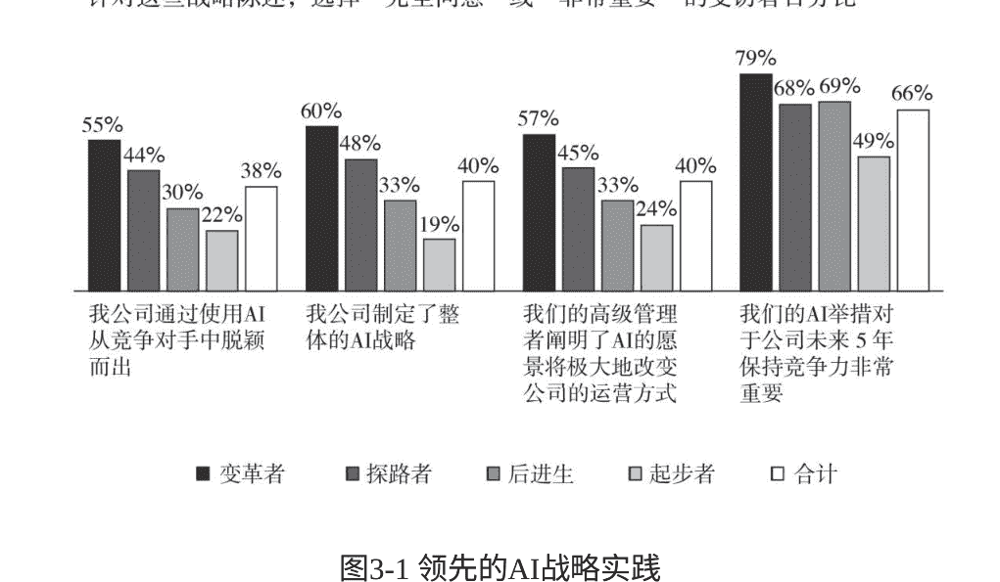
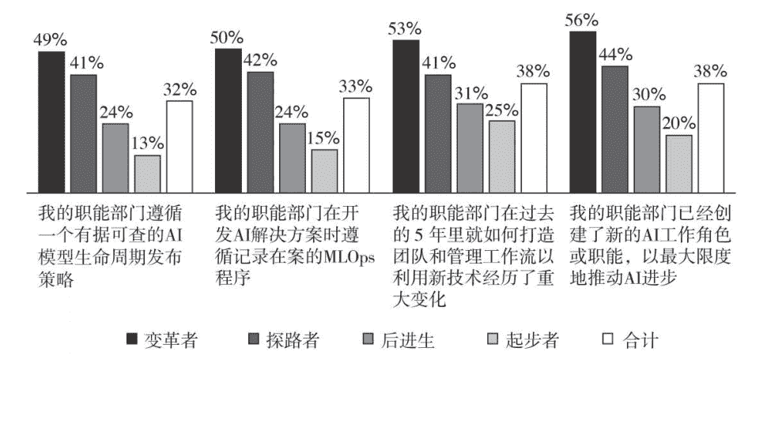
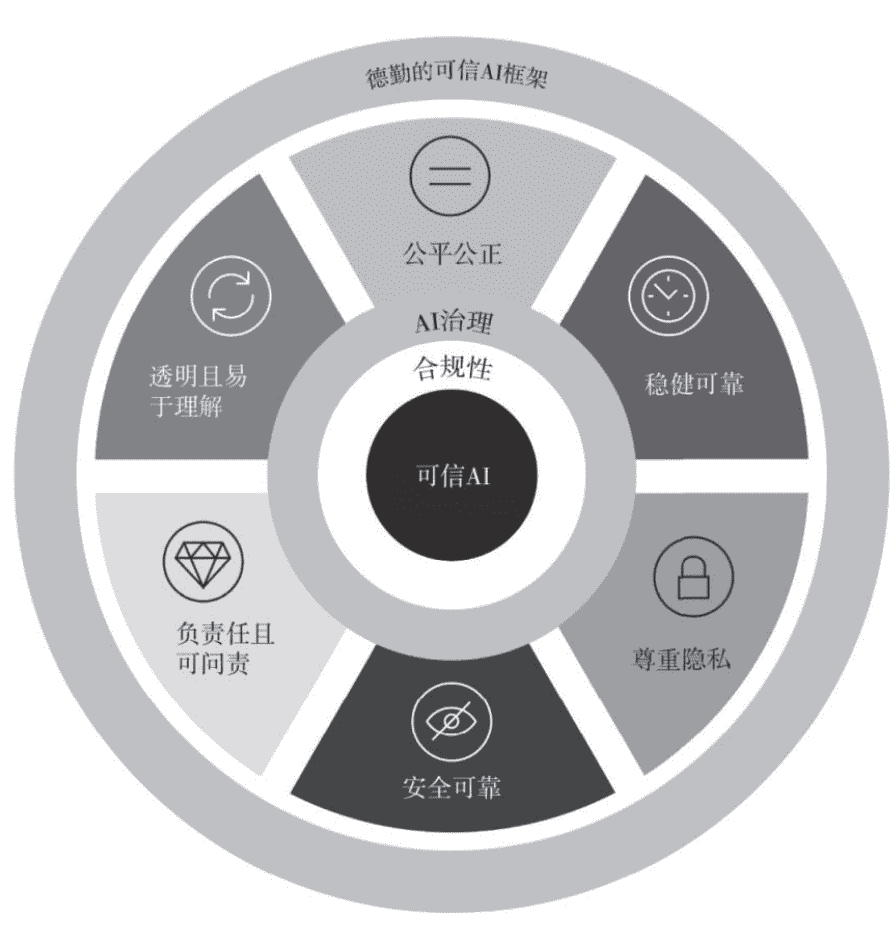
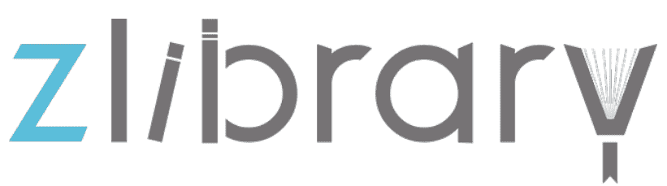

# 老牌企业AI突围：把智能变成竞争壁垒

# 前言

皮查伊在 2017 年 I/O 大会上发表的主旨演讲，参见 The Singju Post，2017 年 5 月 18 日，
https://singjupost.com/google-ceo-sundar-pichais-keynote-at-2017-io-conference-full-transcript/

Jack Clark，“Why 2015 Was a Breakthrough Year in Artificial Intelligence”，Bloomberg，2015 年 12 月 8 日，
https://www.bloomberg.com/news/articles/2015-12-08/why-2015-was-a-breakthrough-year-in-artificial-intelligence.

2017 年，Alphabet 董事长兼 CEO 桑达尔·皮查伊在面向客户的活动上宣布全面转向 AI 优先，并没有让外界感到意外。他当时表态，处于 AI 优先时代的企业会重新审视全部产品，用机器学习与人工智能去解决真实用户问题。实际上早在 2015 年，谷歌内部就已启动超过 2700 个与 AI 和机器学习相关的项目。搜索、地图、Gmail、视频通话以及语音助手等面向大众的功能早已深度集成智能。面向企业客户的谷歌云也对外开放 TensorFlow 这套机器学习工具包。Alphabet 体系内的 Waymo 与 Calico 等业务同样在大量实践智能技术。

Ash Fontana, The AI-First Company:How to Compete and Win with Artificial Intelligence（London:Portfolio, 2021）.

在硅谷以及数字化原生企业圈子里，Alphabet 重注智能早已是公开事实。对这类公司而言，将 AI 放在优先级前列几乎是常态。此前甚至已出版专门论述 AI 优先创业公司的著作。外界的普遍认知是，谷歌如此，Meta、亚马逊、腾讯、阿里巴巴也如此。

Thomas H. Davenport, “The Future of Work Now:Intelligent Mortgage Processing at Radius Financial Group，” Forbes, May 4，2021，https://www.forbes.com/sites/tomdavenport/2021/05/04/the-future-of-work-now-intelligent-mortgage-processing-at-radius-financial-group/？sh=71bfdec2713a.

更多细节，参见 Davenport, “The Future of Work Now”.

押注智能的并非只有科技巨头。大量传统大企业乃至中小型机构也在行动。举例来说，位于波士顿近郊、员工约 200 人的抵押贷款公司 Radius Financial Group，就已在智能实践上被列入案例。该公司联合创始人兼运营负责人基思·波拉斯基自 2016 年起深入研究智能工具。他把核心业务描述为“贷款制造”，环节全部需要量化评估。在引入智能与自动化之后，该公司的生产效率与盈利水平长期高于行业均值。

Airbus website, https://www.airbus.com/en/innovation/industry-4-0/artificial-intelligence, accessed December 27，2021.

谈到智能，第一反应往往是硅谷，但欧洲航空龙头空中客车的选择不同。面对数字化带来的剧烈冲击，空客在 21 世纪第一个十年中期即启动整体数字化转型。在众多举措中，智能与数据被置于核心位置。空客投入新技术研发，同时安排员工接受智能相关的再培训。官方表述为，智能并非单纯的研究方向，而是无处不在的未来技术，有可能重塑社会各层面。对空客而言，智能是关键竞争优势，有助于释放手中数据的价值。

智能已覆盖空客全球业务的各个板块，包括商用飞机、直升机、国防与航天等。OneAtlas 影像服务、ATTOL 视觉自动滑行起降导航演示器、基于视觉的直升机导航，以及面向驾驶舱飞行员和国际空间站宇航员的虚拟助手，均是典型应用。

在中国，阿里巴巴、腾讯等原生数字企业当然在加速智能化。但传统行业同样在应用，比如保险、银行、医疗健康与汽车销售。平安集团在上述领域均有布局，并在各条线嵌入智能：通过照片实现快速理赔、借助人脸识别完成身份核验、开展智能化远程医疗、评估二手车价值等。其商业模式是在金融服务、医疗健康、汽车服务与智慧城市构成的生态中，用智能向客户与网民提供以生活方式为导向的金融消费产品，并持续从业务数据中学习以优化智能场景。

Ping An Technology website, https://tech.pingan.com/en/, accessed December27, 2021.

平安对智能的投入效果明显。该集团 1988 年成立，2020 年收入接近 2000 亿美元。公司对智能的重视毫不掩饰。平安科技官网称，智能是其核心技术之一，目前已形成预测智能、认知智能与决策智能等系列方案。官网还介绍，平安科技已搭建智能认知技术矩阵，涵盖人脸识别、声纹识别、医学影像智能解读、动物识别和多模态生物特征识别，这些技术已在现实场景中得到广泛应用。即便不少科技公司也难以给出同样详实的公开表述。

平安、空客、Radius Financial 均为技术实力扎实的传统企业，却并非科技或电商公司。它们代表的是智能在传统企业中的角色。智能并非其核心产品，而是被深度利用的驱动力。一位零售机构的智能负责人曾向我们透露：“有人问我为何只在传统企业做数据与智能相关的工作？因为在原生数字企业里，这件事太容易了！”我们不完全认同“太容易”这一说法，但认可其核心判断：在传统行业里，用智能真正改造既有经营是极其困难的。正如开篇提到的谷歌，智能密集型科技公司与初创企业偶尔会被用作参照或合作伙伴。但本书关注的主体，是在智能出现前就已存在的行业与企业：银行、保险、制造、零售、消费品、信息服务、生命科学，甚至政府机构。它们面临的问题与客户需求各不相同，却都找到了重押智能的路径。

本书聚焦的是在智能出现之前就已存在的企业，如何借助这项技术完成转型。我们不介绍常见的试点做法，而是聚焦真正重押智能的公司——投入规模大、思路清晰，相信技术能带来重大业务改善，且已有回报证据。我们用“智能驱动”“智能推动”“智能赋能”等说法来概括这一做法。共同点是，这些公司在智能的投入、规划、战略、落地与变革上，都处于极端位置。并非所有公司都要采取如此激进的方式，但我们认为每个人都能从中学习与借鉴。

本书后半部分将探讨重押智能需要具备什么条件。我们的视角是智能采用的极端形态：最积极的采纳、最优的战略与运营融合、最高的商业价值、最完善的落地。我们会介绍领先的智能使用者如何影响战略、流程、技术、文化与人才。了解他们的做法，能帮助其他公司判断智能对自身转型的潜力。

# 我们的经验

See, for example, Thomas H. Davenport, “Competing on Analytics, ” Harvard Business Review, January 2006, https://hbr.org/2006/01/competing-on-analytics, or Thomas H. Davenport and Jeanne Harris, Competing on Analytics:The New Science of Winning (Boston:Harvard Business Review Press, 2007 ; updated and with a new introduction 2017) .

我们二人在一线企业中积累了大量实践。进入智能领域前，第一作者托马斯·达文波特长期研究定量分析，曾著有《数据分析竞争》一书与同名 HBR 文章，该文入选该刊百年 12 篇必读。文章与图书的反响说明，即便采取渐进方式，企业也能从重押视角中获益。此后他与全球数百家企业合作，帮助其构建分析能力。书中出现的 Capital One 与 Progressive Insurance 便是早期案例，它们后来还做了多项具体举措提升智能能力。

德勤是指 DTTL（也称“德勤全球”）机构网络及其相关实体中的一家或多家。DTTL 及其每个成员机构均为具有独立法律地位的实体。DTTL 并不向客户提供服务。在美国，德勤是指 DTTL 的一个或多个美国成员机构、其在美国使用“德勤”名称经营的相关实体及其各自的附属机构。根据公共会计规则和条例，某些服务可能无法为客户提供证明。了解更多有关其全球成员机构网络的信息，请访问 www.deloitte.com/about。

第二作者尼廷·米塔尔多年思考、演讲并与客户共事，探讨智能驱动意味着什么。他发现许多高管虽对智能了解有限，却渴望知道企业如何借助智能的广度完成转型。在深耕智能之前，他约 15 年服务医疗健康与生命科学企业，帮助其采集和分析业务数据。担任德勤美国数据分析与智能负责人期间，超过 5 年与有智能转型目标的客户及最顶尖的智能技术厂商深度合作，并主导德勤美国一项战略计划，推动全球最大专业服务机构的智能驱动转型。

我们都对智能着迷，更着迷的是智能与商业战略、商业模式、关键流程、组织、变革管理以及成熟企业现有技术架构之间的复杂互动。做出一个表现优异的新算法很了不起，能做出覆盖智能的企业级变革计划更难。我们乐于与运用技术的公司合作，并挖掘新的竞争与运营方式。

# 你将从这本书中学到什么

后面会提供大量案例，像前面提到的那样，讲述智能驱动公司如何使用智能。但案例的目的是探讨如何在“重押”层面上成功使用智能。每章主题及对应公司如下。

# 第1章 AI驱动意味着什么

本章介绍智能驱动公司应具备的条件，包括使用的技术、创造价值的方式，以及构成“重押智能”方法的要素。会提到多家公司，重点是平安集团，并细说星展银行在印度的数字化银行聊天机器人细节。

# 第2章 人性的一面

本章认为，让智能实践成功，最关键的不是机器而是领导力、行为与变革。先与星展银行 CEO 高博德交流，他是该行智能计划的推动者。还讨论了摩根士丹利、罗布劳、CCC 智能解决方案等公司的领导力议题。在提升管理层与员工理解与采纳方面，涉及壳牌、德勤、空客、蒙特利尔银行、礼来、联合利华。

# 第3章 战略

第 3 章聚焦智能如何实现或重塑商业战略。介绍三种主要的战略原型，并在说明这些原型的过程中引用罗布劳、丰田、摩根士丹利、平安、空客、壳牌、SOMPO、安森保险、费埃哲、宏利保险、前进保险和 Well 等公司。

# 第4章 技术和数据

没有先进技术与海量数据就无法应用高级智能。第 4 章介绍面向智能的现代技术基础设施与数据环境的构成。涵盖智能工具箱，包括智能数据、AutoML、MLOps、传统技术及扩展智能应用。涉及星展银行、克罗格公司及其子公司 84.51°、壳牌、联合利华、安森保险和空客。

# 第5章 能力

智能能力可像其他业务能力一样评估与排名。不同战略原型对应不同能力模型。本章详解平安、丰业银行、宏利保险、前进保险和安森保险的能力，并以联合利华为案例分析合乎伦理的智能能力。

# 第6章 行业 用例

用例即组织如何把技术应用于业务问题。本章介绍不同行业的用例，将清单分为“常见”与“不常见”，并给出每个行业的早期积极采用者案例，包括沃尔玛、希捷、第一资本、美国政府与新加坡政府、克利夫兰诊所、辉瑞、诺华、阿斯利康、礼来与迪士尼。

# 第7章 成为AI驱动的公司

最后一章提出 4 条可选择的路径。德勤的案例展示专业服务机构从“以人为中心”到“以人和智能为中心”的转型；CCC 智能解决方案展示从关注信息到关注智能的转变；第一资本展示从数据分析驱动到智能驱动的演进；Well 作为医疗健康初创公司，展示从零打造智能能力的路径。

本书没有提供标准配方。每家公司集成智能的基本原理、策略与路径各不相同。但我们相信案例与经验能帮助每家企业走出个性化转型之路。至少了解这些早期采用者和领先公司的做法，能激发一种念头：“我们也该行动起来。”

# 第1章 AI驱动意味着什么

Sundar Pichai, “A Personal Google, Just for You,” Official Google Blog, October 4, 2016, https://googleblog.blogspot.com/2016/10/a-personal-google-just-for-you.html.

世界上少数最成功且技术最强的公司已公开宣布要全力押注智能，或转向“智能优先”“智能驱动”。谷歌曾表述为“在智能优先的世界里，计算无处不在，交互更自然易懂，最重要的是更智能”。其他行业寻求智能驱动的公司也以简便易用技术与普遍智能为目标，但把目标落到各自的金融服务、制造或医疗健康领域。

在我们的分析中，智能驱动的大企业占比不到 1%。要凑齐案例写本书并不容易，我们最终挖掘了约 30 家案例，预计未来会更多。它们为何过去不这么做？本书介绍的公司业绩优异，拥有有效商业模式、良好决策机制、紧密客户关系、有吸引力的产品与服务，以及合理盈利定价。它们已成为学习型机器，员工被智能放大。这些公司通常拥有比同业更多更好且被智能分析利用的数据，因而能创造经济与社会价值。

对许多公司而言，充分释放智能潜力前需要先探索选定商业机会与潜在用例。很多公司从未迈出关键一步——把模型部署到生产环境。虽然试点可能产生价值，但多数止步于此。

这点见解虽有价值，却不足以让一家公司成为市场创造者，甚至不足以成为快速追随者。要从智能获得可观价值，企业必须从根本上重新思考人机在工作环境中的协作方式。需要巨额投资，不仅用于试点，更用于全面生产部署，从而改变员工工作方式与客户交互方式。高管应考虑在每个关键程序和运营中系统部署智能工具，以支撑新的业务流程设计与数据驱动决策。同时智能也应推动新产品、服务与商业模式的诞生。就目前看，以这种积极方式使用智能能带来行业领先地位。最终，成为智能驱动公司可能不仅是战略选择，更是生存关键。

## AI驱动的构成有哪些

如何判断一家公司是智能驱动的？需要哪些构成要素？目前并无公认清单，但在研究与咨询中，我们发现对技术采取极端积极态度的公司通常具备多种特质。过去 4 年我们对这些公司的智能行动做了 3 次调查，也可引用其中的反馈。

## 技术栈多元化是普遍做法

AI驱动企业是怎么玩转这门技术的

德勤2020年《企业AI现状》第三版调查显示，真正把AI当成经营工具的公司，往往不是单点尝鲜，而是把技术铺到多个部门、多个场景去用。AI本身是通用型工具，既能服务长期战略，也能解决短期经营问题。调查里被提及最多、也最容易在短期内兑现的三个方向是：让业务流程跑得更高效、让决策更靠谱、让现有产品和服务更有竞争力。

举例来说，流程效率的提升可以是更精准的供需匹配来压降供应链成本，也可以是预测设备何时需要保养，或者预测哪类应聘者入职后表现最好。单个场景未必能颠覆一家公司，但当几十个上百个场景叠加起来，整体竞争力就被拉开了。

### 变革者只是过渡态

在我们最近的企业AI调研里，AI能力最强、成果最多的公司占样本28%，被称作“变革者”。它们在AI旅程上走得比较顺，手上平均有约6个已经全面落地的AI应用，带来了约7项业务结果。成绩亮眼，但距离真正AI驱动的企业还有差距。变革者更多是想通过转型实现业务升级，真正完成转型的公司数量少到难以在样本中抽样。

AI驱动型企业通常部署的系统数量是百位数量级，业务收益也是持续滚动的。转型并不是一次性的项目，而是一个长期演进的过程。

### 技术栈是组合拳，不是单品

押宝AI的公司不会把自己限制在一种技术上。它们会把AI能提供的各种能力都用起来。表1-1里列出了常见技术组合。支撑AI的底层资源本质只有四类：统计学、逻辑学与语义学形式的知识，以及计算。但在这些资源上衍生出的方法、工具和应用形态非常多。

### 表1-1 AI驱动的公司采用的AI技术

| AI 技术的类型 | 技术是如何运行的 |
| :--- | :--- |
| 统计机器学习 |  |
| 监督式机器学习 | 利用历史数据训练出可做预测的模型 |
| 无监督式机器学习 | 自动化归类相似样本，不依赖人工标注 |
| 自我监督学习 | 从数据内部挖掘监督信号，属较新的做法 |
| 强化学习 | 通过试错并追求回报最大化来学习策略 |
| 神经网络 | 用多层特征隐含结构做预测或分类 |
| 深度学习 | 堆叠大量隐含层构建预测模型 |
| 深度学习图像识别 | 从带标签图像集中学习识别能力 |
| 深度学习自然语言处理 | 学习理解或产出语音与文本内容 |
| 基于逻辑的 AI 系统 |  |
| 规则引擎 | 依“若…则…”规则执行简单判断 |
| 机器人过程自动化 | 把工作流、数据访问与规则决策结合起来 |
| 基于语义的 AI |  |
| 语音识别 | 把人声转成可处理的文字 |
| 自然语言理解 | 解析文本的含义与意图 |
| 自然语言生成 | 产出定制化的可读文本 |

领导层对这些工具要有基本判断力，才能把对的技术配到对的场景。可惜技术之间的复杂性经常被低估。比如基于语义的AI下面又有NLU、NLG，它们的核心既可能是深度学习模型，也可能是承载术语关联的知识图谱。类似GPT-3这样的大型语言模型能基于“下一个词”预测生成诗歌到代码，而简单的NLG也可能只是规则驱动。技术种类繁杂，决策者在大规模投入前需要做足功课。

同一场景常常混合多种技术。做保险欺诈检测和医疗分析的Cotiviti就把规则与机器学习叠加使用。星展银行在打击洗钱时也采用同样组合。机器人流程自动化负责把后台结构化流程标准化执行，越来越多厂商开始把它和机器学习结合，称作智能流程自动化。VR、数字孪生、元宇宙等形态也在广泛吸收AI能力，未来会更常见。

## 生产部署中的众多AI系统

让模型从实验室进入生产，是AI落地的最大坎。很多团队做了试点、概念验证或原型就停了，学习是发生了，但没有产生经济价值。调研里最成功的“变革者”公司平均有6套AI系统在生产环境运行，这已经是样本里最积极的一群，但在我们访谈的企业中，落地的模型数远不止于此。

IBM Watson Global AI Adoption Index 2021显示，7国5000多名技术决策者中，仅31%表示公司已将AI作为业务运营的一部分积极部署，41%还在探索但未落地。MIT Sloan Management Review与波士顿咨询集团2019年的研究指出，10家受访企业里有7家认为AI影响很小或无影响；在已投资AI的90%企业里，不到2/5报告过去三年获得业务收益，意味着重金投入却没回报的企业占比约40%。我们的调研里，前三大障碍仍是实施难度、把AI嵌入组织职能、以及数据问题。

试点只是写模型和MVP，真正生产要改流程、补人手、接系统，工作量放大数倍。不少数据科学家认为模型跑通就完成任务，而部署到底是谁的责任常常模糊。

真正跑通的公司有三个共同点：第一，从立项就把部署写进计划，早期有问题就止损；第二，指派专人端到端负责，常见角色是AI产品经理，确保系统真的上线；第三，数据科学家和产品经理从一开始就和业务干系人深度协作，部署只是开始，后续动作一并规划。

## 利用AI对工作流程进行重新设想和设计

上世纪90年代的业务流程再造让企业重新设计工作方式，当时ERP和互联网提供了新可能。很多公司把流程再造变成了裁员运动，但用新技术重塑工作的思路依然有效，AI现在是最突出的驱动力。

德勤称当前为“与的时代”，即人机协作的时代。托马斯·达文波特等人提出的“增强”概念也大同小异。现实中AI很少纯粹替代人类，更多是把人从重复工作中解放出来做更复杂的事。所以核心问题不是如何裁掉员工，而是如何通过岗位重设、再培训和人机协作提升效率。

2019年调研显示72%的高管认为AI已带来中度或重大就业变化，82%预计三年内变化会更大。但很多变化并未体现在标准化的流程管理中，缺乏对流程、工作流、指标和统一执行的说明。

和AI关联最紧密的流程改进工具是机器人流程自动化。它不一定是严格意义上的AI，但具备规则决策能力，常被当作迈向机器学习的跳板。部分公司把它嵌入流程改进体系。比如退休金融服务公司Voya的持续改进中心就设了自动化人才单元，用精益和六西格玛先分析改善流程，再实施RPA，最后评估效果。

星展银行在东南亚把AI用于反洗钱和客户中心流程。反洗钱案例评估时间缩短至原来的三分之二，客户中心在不增员情况下客户数增长6倍，交易量增长12倍。

真正要实现转型，需要在更广范围内把流程重新设计，并追求不只是渐进的改进。流程挖掘现在正发挥作用，它从业务系统数据里还原真实执行路径，再用AI给出优化建议，省去大量手工梳理工作，在流程型企业里快速普及。

## 公司的很大一部分人精通AI及其应用方式

AI驱动不仅是技术问题，更是人的问题。希望大规模使用AI的企业需要一批能理解原理并会应用的高管和普通员工。尤其是随着模型开发自动化程度提升，公民数据科学家能分担部分工作，技能覆盖面变得更重要。

高管的AI素养同样关键。多数AI和分析部门负责人表示，花大量时间向其他经理解释价值和用法。高管不仅要给钱给时间，还要在自身工作中尝试AI。AI越来越多地参与决策，管理层需要理解何时可用、何时不该用，以及需要做多大承诺。

目前技能提升和再培训仍属早期，并非所有员工都需要全面培训，但关键岗位必须覆盖。空中客车已对1000多名员工进行AI和高级分析再培训；星展银行对18000多名员工开展数据技能培训，组建公民数据科学家团队，其中约2000人精通数据科学和商业智能，另有7000人数据使用、分析和AI能力明显提升。

然而，我们的AI调研显示仅10%的美国受访者明确支持再培训并保留现有员工，80%倾向于保留与替换比例相当，或主要用新人替代老员工。这种做法短视且不可持续，因为市场很难找到足够的AI人才，再培训是更可行的路径。

## 对AI的长期承诺和投资

决定用AI完成公司转型不是临时决策，它会影响未来数十年，最终涉及数亿甚至数十亿美元投入。我们访谈的公司都表示这是押注AI的代价。初期投入让人犹豫，但看到早期项目回报后，对数据、技术和人才的持续投入就变得顺理成章。

以AI为中心意味着用数据和分析驱动大多数决策、以新方式接触客户、把AI嵌入产品和服务、用更自动化和智能的方式执行任务甚至整个业务流程。很多公司已在数字化转型阵痛中，AI驱动的转型要再进一步，这是大赌注，多数企业仍缺乏勇气。

CEO的坚定支持很重要，但不够。如果中层和一线只是口头支持，推进会很慢，最后容易回潮。我们看到一些CEO通过多项举措建立AI和数据驱动型公司，但继任者不认同后，关注度很快回落。

## 独特且庞大的数据来源，实时分析并采取行动

AI能驱动公司，数据就能驱动AI。对AI持谨慎态度的企业也必须认真对待数据：采集、整合、存储、开放。2020年AI调查里，AI驱动企业选择的首要竞争举措是“实现AI数据基础设施现代化”。

除了数据质量，渴望转型的公司必须拥有越来越多独特或专有数据。行业内竞争对手若拥有相同数据，模型结果会趋同。差异化来自挖掘被低估的旧数据源，或获取新数据权限。

银行和零售业的数据量本就庞大。加拿大丰业银行、美国第一资本银行、新加坡星展银行利用海量交易和客户数据来理解行为并反馈给客户助其理财。美国克罗格和加拿大罗布劳等零售商则深度利用收银数据、库存数据、会员忠诚度数据，其数据规模远超竞争对手。

在某些场景里，率先拥抱AI的企业会围绕数据开放衍生出全新的经营模式。平安集团搭建的生态体系就是一个典型案例，它对外向客户与合作伙伴敞开，同时也让分析模型能够触达数据。空客的“智慧天空”平台把使用空客飞机的全球航空公司和原始设备制造商连在一起，数据在网络中流动、复用。业界从平台型电商初创企业的经验中习得一个共识：汇聚多方参与者的信息，往往是业务扩张与企业价值提升的核心引擎。

真正深度依赖AI的组织，并不会把数据收集完、抽空再去分析，而是一贯追求实时。它们以当代企业要求的节奏进行数据驱动决策，在销售现场为客户即时生成报价，在链路上阻断欺诈交易，对业务中断做出快速反应，并持续监控模型表现，在需要时触发再训练。这一能力的来源既是技术栈的现代化，也是对数据供应链的管理流程和对数据利用时效性的强烈意识。没有一家企业的数据是完美的，但AI密集型企业的数据环境明显好于行业平均水平。

## 打造可信且合乎伦理的AI治理

> Veronica Combs, “Guardrail Failure: Companies Are Losing Revenue and Customers Due to AI Bias,” TechRepublic, January 11, 2022, https://www.techrepublic.com/article/guardrail-failure-companies-are-losing-revenue-and-customers-due-to-ai-bias/.

当一家企业的运营高度倚赖AI，就必须保证所用系统在伦理上站得住脚、值得信赖，否则AI带来的收益会被反噬。目前较为成熟的正式治理机制和组织架构，主要集中在科技公司手中，它们拥有大量AI产品与服务，也迫切需要向客户证明自身的负责任形象。Tech公司之所以走在前面，和它们早早尝试AI以及历史上更易被指控算法偏见或伦理违规有关。

搭建合乎伦理、可信的AI并不需要付出天价成本。市面上已经有大量框架可以用来提炼原则，这些内容我们将在第5章展开。难点不在于列出原则，而在于落地执行，这一点同样会在后续章节讨论。

> Reid Blackman, “If Your Company Uses AI, It Needs an Institutional Review Board,” Harvard Business Review, April 1, 2021.

一种可行做法是组建由技术与业务复合背景的高管组成的小组，对准备上线的每款AI系统进行逐项评核。市场上已有算法审查委员会之类的组织出现，但审查范围不应只停留在算法本身。有伦理顾问提议设立类似医学或学术研究中人体受试者审查委员会的AI机构审查委员会，以确保系统各个环节都不违背伦理底线。毕竟AI工作本质上始终牵涉到人。

## AI驱动型企业创造价值的路径

AI驱动的公司往往能借助若干明确的价值杠杆，创造出高于同业的回报，下表1-2概括了这些杠杆，整本书会反复引用。单就本章而言，AI领先企业通常会同时运用多种杠杆，有时同一个应用场景就能撬动多个杠杆。

表1-2 全力押注AI的公司如何实现价值

| 价值杠杆 | 释义 |

| --- | --- |

| 执行速度 | 用AI把决策到执行的等待压缩到最低，从而更快达成运营和业务目标 |
| 降低成本 | 用AI智能化自动化流程、任务和交互，降低开支，提升效率，推动可持续运营并增强可预测性 |
| 理解复杂性 | 面对日益复杂的来源数据，借助AI识别模式、关联信息、预测结果，提升洞察与判断力 |
| 转变参与方式 | AI重塑人与系统的互动，让客户与员工能以语音、图像、文字、触控等方式更广泛地参与 |
| 驱动创新 | AI帮助洞察竞争与制胜之道，进而孵化新产品、新市场和新商业模式 |
| 增强信任 | AI防范欺诈、浪费、滥用与网络入侵等风险，守护品牌声誉，赢得利益相关方与客户的信任 |

以本章前面提到的星展银行反洗钱应用为例，它同时体现了多重价值。它让银行更早捕捉欺诈信号，拉快了执行节奏；交易监控分析师可以用更短时间审阅可疑案件，提升人效并降低成本；它整合更多银行内部数据来评估案件的真实风险概率，属于理解复杂性的体现；最终目标则是强化客户与监管机构对银行的信任。

价值当然是越多越好。想在AI领域取得成果的企业，应尽量激活尽可能多的杠杆，并在单个用例中追求多重杠杆的叠加。成本类杠杆相对容易量化，但企业不应只盯着好算的指标。改变商业模式、基于更丰富复杂的数据做决策、以及树立可信的AI，往往带来更大但更难量化的回报。

## 你的企业在AI adoption光谱上的位置

弄清AI驱动企业的构成后，你可能会发现自家公司已具备部分特征但尚未全部到位，或已在路上但距离成熟仍有差距。下面的分级可以用来定位当前进展，关于AI能力的深入讨论将在第5章展开。

- AI驱动。已具备前文所述的绝大部分要素并稳定运行，业务建立在AI能力之上，并正演变为一台持续学习的机器。
- 变革者。尚未完全AI驱动，但已迈出相当长的步伐，契合若干关键特征，已投产的多项AI应用为公司创造了显著价值。
- 探路者。AI转型已启动并取得进展，但仍处早期，已上线若干系统并产生可衡量的积极结果。
- 起步者。正在做AI试验，有规划但进展缓慢，生产环境中的AI落地数量很少或几乎为零。
- 后进生。已尝试接触AI，但没有进入生产应用，效果微弱甚至未产生任何经济价值。

本书提到的公司并非全部都是AI驱动型企业，部分属于变革者或探路者，但它们在实践层面已做出值得关注的尝试。

## 如何成为持续学习的组织

> John Hagel and John Seely Brown, “Great Businesses Scale Their Learning, Not Just Their Operations,” Harvard Business Review, June 7, 2017, https://hbr.org/2017/06/great-businesses-scale-their-learning-not-just-their-operations.

把这些特征综合起来看，深度押注AI的公司本质上是一台组织学习机器。对它们而言，与AI相关的学习已经被制度化并高效运转。至少体现在两个层面。第一，持续从研究与部署中学习。它们频繁试验，采用快速试错，从成功与失败中提炼经验。正如哈格尔与布朗所言，这类企业实现了“可扩展的学习”，对世界顶尖的AI公司而言，试验和学习同等重要。

平安集团就是一例。这家起家于保险、如今覆盖多个金融服务领域的中国公司，拥有庞大的研究院并吸纳大量计算机科学博士。创始人马明哲建议首席科学家肖京，具备创作能力的AI系统可能吸引庞大的客户与合作伙伴网络。肖京随后组织小团队在高质量样本上训练机器学习模型，让系统创作绘画、音乐和诗歌。

> Zheng Yiran, “AI Strikes Note of Confidence in Arts,” China Daily, September 23, 2019, https://global.chinadaily.com.cn/a/201909/23/WS5d882a3da310cf3e3556ce14.html.

试验获得成功：系统产出高质量的图像、音乐和诗歌，并在2019年世界人工智能大会上发布，收获媒体好评，音乐创作模块更获国际奖项。肖京在访谈中表示，平安正在探索把AI艺术创作系统接入集团不同生态的商业模式，例如把AI生成的音乐用于在线医疗等健康服务。团队同时掌握了为涉及主观情绪或感受的业务场景开发AI系统的能力，比如证券交易。

第二种学习方式与机器学习直接相关，至少与监督式学习相关，这也是商业中最常见的类型。该技术基于已知结果的历史数据训练模型以预测未知结果。作为组织学习机器的公司，正不断从自身的机器学习中学习。当代AI的核心作用，就是让大规模、快速的学习能够被生产化且具备经济性。

这类企业会监控模型预测的准确度，通常借助MLOps。当准确度下降时，就用新数据重新训练模型以改善预测。持续训练让模型不断自我增值并适应新情境。换句话说，当外部世界变化时，公司的预测能力也会随之进化。

真正意义上的学习机器会把这种做法应用到众多模型上，或至少对关键模型如此。这反映出它们把模型视作需要持续维护改进的核心业务资产，认识到准确性会随时间波动，并掌握用技术支撑模型运维的方法。这些正是AI驱动企业需要培养的能力。

组织学习机器也能从其他类型的AI中持续学习。例如，星展银行在印度的数字化银行推出聊天机器人，提供全天候免等待的客户服务。2016年一次服务故障复盘后，管理层要求团队更主动地监控服务流程，在问题发生前捕捉信号。这一挑战推动团队为印度数字银行建立新的客户科学计划，对每一位数字客户的服务旅程进行实时监控，主动寻找移动应用使用受阻的迹象，在出现困难时即时介入并提供下一步体验建议。该学习在印度和新加坡本土市场均得到复用。

“组织学习机器”最终传达的意思是稳定、可靠、不知疲倦。对AI的投入像一台运转良好的机器从不间断。它们会投资可复用的AI基础设施，如特征存储和算法库，并在全公司范围内重复使用。它们确保大量员工也在持续学习AI，不把AI看作潮流，而是看作提升市场效率的强大工具。

当然，造就学习型组织的不仅是技术，更是组织基因、以数据驱动决策为核心的企业文化、持续试验与创新的态度，以及员工、客户与业务伙伴的深度参与。真正起作用的是人，而非数据、算法或高性能服务器。本书在技术之外，会同等关注AI的人类维度，这正是下一章的重点。

总的来看，部分公司已具备上述全部能力，这是令人欣慰的。我们很荣幸能与它们交流并撰写相关案例。也希望未来有更多公司达到这一水平。或许通过呈现这些标杆企业，能激励本书读者带领自己的组织朝这个方向迈进，即使无法达到“全力押注”的程度也无妨。

# 第2章

## AI成功的非技术面

影响企业AI能力与成败的因素很多，并不局限于技术或数据。领导力、文化、态度与技能等人类要素，对AI的影响不亚于、对其他业务的影响甚至更大。若用机器学习模型预测一家公司是否会成为AI驱动型企业，这些软性特征的权重将会非常高。

许多AI领袖都承认这些因素的关键作用。例如我们访谈了位于剑桥的布罗德研究所，该所获得2.5亿美元拨款用于探索机器学习与生物学的交叉。负责旗下新成立的埃里克与温迪·施密特中心的两位联席主管被问及可能阻碍研究目标的因素时，首先提到文化。他们指出，AI研究员多为计算机科学家，生物学家则有其独特的语言与直觉，两者在解决智力挑战的方式上差异明显。他们深知连接这两个群体对中心成功至关重要。

被问及如何化解文化隔阂时，两位主管表示团队仍在探索策略（中心处于早期阶段），最核心的思路是举办活动，把两类人群聚集在一起，深入探讨交叉领域的机会及实现路径。他们也意识到，AI或生物学协作的变革管理科学，可能并不如协作本身成熟。

> Randy Bean and Thomas H. Davenport, “Companies Are Failing in Their Efforts to Become Data-Driven,” Harvard Business Review, February 5, 2019, https://hbr.org/2019/02/companies-are-failing-in-their-efforts-to-become-data-driven.

在未采取积极措施解决这些人类相关问题前，难以取得实质性进展。这或许可以解释为何许多公司在时间推移后并未变得更依赖数据，即使拥有巨额技术预算的大型企业也是如此。美国大型企业的调研显示，自称拥有数据驱动文化的企业比例近年反而有所下降。本章后续将介绍AI优先的公司为解决这些问题所采取的干预手段。

所有企业在AI adoption上的进展，关键驱动因素往往是给予支持甚至热情拥抱的领导者。下面介绍的CEO在银行的AI落地过程中发挥了非常有效的启发与指引作用。

## DBS CEO的AI领导力样本

星展银行集团CEO高博德在保守的银行业深耕近40年。令人意外的是，他不仅在被称作“该死的慢节奏”的行业里打造出区域巨头，还成为极具主动性的AI采用者。他的实践有力说明了高管对新技术有效应用的影响力。

高博德于2009年出任星展银行CEO，当时该行客户服务在新加坡同业中排名垫底。如今服务品质跻身顶尖，并通过并购和内生增长大幅拓展亚洲版图，成为东南亚最大银行，在中国与印度业务持续扩张。该行曾获《欧洲货币》“世界最佳银行”、银行家杂志“年度全球银行”、《全球金融》“世界最佳银行”等殊荣，并在数字化银行领域两次被《欧洲货币》评为“世界最佳数字化银行”。

加入星展前，高博德曾担任花旗集团东南亚及太平洋区CEO，但其根基在运营与技术。他师从花旗前CEO约翰·里德，里德是最早洞察信息与技术行业价值的全球银行家之一。高博德曾主管花旗亚洲交易服务，之后晋升为区域负责人，还另辟蹊径创办过一家互联网公司，虽然很快失败，但显示了他对创新的渴望和对失败的容忍。

事实上，高博德坦言他早期在星展的AI尝试虽具启发性但以失败告终，他称之为银行的“信号工具”。2013年，星展与新加坡公共研发机构A*STAR签署AI实验室协议，双方数据科学团队进行为期三年的联合探索。共参与六个项目，均未成功。但这段经历给银行积累了宝贵经验。

正如早期项目所示，高博德的AI策略之一是尽早启动并以试验为导向。该行KPI之一是每年开展1000次试验，其中大量涉及AI。高博德每半年安排两天展示试验成果，鼓励员工更深入思考AI的部署方式。

他还允许业务与职能部门灵活聘用“准数据科学家”，以此打开AI试验的大门。人力资源团队就是正面案例。缺乏技术背景的人力资源负责人组建了一个松散的小型内部实验室，用来识别和试点AI应用。该团队开发了“工作智能大师”应用，帮助招聘人员更高效地招募大量岗位所需人才；人力资源部还开发了员工流失预测模型，基于培训、薪酬、休假模式等信息预测离职概率。

数据是AI的助燃剂，许多企业需要对数据环境进行重大改造。来自数据转型的CEO并不多见。高博德将自己的兴趣和能力归因于花旗时期的经历，他参与创建了该行首个数据中心并学习了数据结构。

星展的数据转型成效显著。与不少公司一样，它把大部分数据从传统数据仓库迁移到数据湖，后者成本更低且更适配半结构化数据。此外，星展重塑了元数据结构，清理了8000万条不完整记录，重新签订数据访问权限与数据获取协议，并引入可视化工具让数据趋势更直观。

高博德仍在思考数据的存储与处理位置。近几年银行基本转向私有云，但数据体量庞大无法全部本地化。如今采用混合云架构，虽然复杂，但基础已就位，团队可在其上实验与迭代。

在高博德领导下，星展还建立了新的数据治理架构。例如设立“负责任的数据使用委员会”，审查面向客户的数据是否适合采集与使用。标准不仅是合法，更要求客户可接受。银行奉行PURE信条：数据采集必须有目的、不令人意外、尊重他人、易于解释。

AI转型的另一关注点是人才，既包括专业数据科学人才，也包括内部的公民数据科学家。令人骄傲的是，星展目前约有1000名数据与分析员工，涵盖数据科学家、分析师与工程师，部分在核心团队，更多分布于各职能部门。

# AI 转型怎么做：从领导力、文化到员工准备的实战拆解

星展银行已经多年让高管走下讲台，参加沉浸式的黑客马拉松去亲手体验数字化创新。近段时期，高博德把注意力放在怎么激活团队、消除对AI的焦虑上。一名基层员工建议引入亚马逊网络服务 AWS 的自动赛车联盟，用赛车游戏来教机器学习和强化学习，被银行采纳后计划培训多达3000人。高博德自己也下场参赛，他说很开心最终挤进自家员工前100名。内部成效很快显现，一名同事在 AWS 自动赛车联盟 F1 ProAm 赛道上夺冠。

高博德认为AI已是银行业的生死赌注。他不满足于采购外部厂商的能力，更想在内部孵化用例：“我们得具备和数字化原生企业一样的本事，再去创新，到需要时还能竞争。”银行也在努力让员工拥抱AI而非害怕被替代。至今没有人因AI丢掉工作，部分人通过提升技能转岗。聊天机器人等工具已让客服中心效率明显提升，推动业务持续增长。尽管如此，高博德也坦诚，他仍在推动员工增值为AI赋能，但AI未来能强到什么程度，没人能完全预判。

## 领导的样板能复制吗

从这些案例能提炼出可迁移的AI领导特质。第一是技术亲近度。高博德有IT背景当然加分，但没有类似履历的CEO只要花大力气补齐对AI及基础设施的理解，也能发挥作用。第二是跨界牵引。不同公司会选择不同的抓手，但高管的表态、技术兴趣、数据驱动决策文化的塑造、全员创新的鼓动，以及新技能的激励，都至关重要。

第三是拿到财务主动权。探索很贵，从研发到生产部署更贵。AI领军者必须保障试验和落地的资金。高博德早期就敞开钱包试验，不一上来就苛求回报率。后来他给业务与职能部门设定KPI，要求量化AI项目的节省或回报。星展个人银行业务当财年的目标是通过AI创造5000万新元回报，他很有信心。

第四是亲自参与。数据是核心课题，很少有CEO像他那样懂数据。个人身先士卒的另一种形式是深耕一个关键用例。摩根士丹利的财富管理全球领先，时任首席运营官吉姆·罗森塔尔曾提出类似Netflix推荐引擎的想法并长期督导开发直到退休，财富管理负责人安迪·萨珀斯坦强烈支持并将其与客户沟通平台整合，形成后来被称为Next Best Action的体系。首席数据官杰夫·麦克米兰指出，没有他们的长期参与，这个系统不可能建成。

优秀的AI领导者面孔各异。平安创始人之一马明哲拥有经济学与银行学博士学位，长期在多条金融业务线上挖掘AI场景。加拿大零售巨头罗布劳董事长兼CEO盖伦·韦斯顿对科技如何重塑零售充满好奇，家族长期持有公司并以长线眼光著称，前总裁萨拉·戴维斯自称数学很强。韦斯顿主导收购了Shoppers Drug Mart，并聚焦数据、分析与AI如何改善国民健康。

技术出身的领袖也不少。汽车保险影像分析公司CCC智能解决方案CEO吉蒂斯·拉马穆尔蒂曾任CTO，他长期押注技术发展，包括：
- 较早把数据迁到云端，在完整生态中存储处理
- 用车主手机拍摄的引导照片做碰撞损伤图像评估
- 近期押注自动驾驶与半自动驾驶车辆保险需要车内远程信息处理与AI系统来判定损失与责任

专业服务领域的德勤，业务、全球与战略服务执行负责人贾森·吉扎达斯评估各业务与未来环境契合度，推动合伙人重投审计、税务、咨询与风险顾问等领域的人机协作流程。德勤尚未宣称完成AI转型，但已迈出实质步伐。

不同形态的AI领导力共性是，都清楚AI能做什么，对本公司战略、商业模式、流程与人员的影响是什么。其他层面则依赖领导者本人的技能、直觉与情境判断。

## 文化不改，技术无用

对传统企业而言，AI转型的最大障碍往往是文化——是否以数据驱动决策，是否愿意用AI推动业务。没有正确氛围，即便散落各处的倡导者也拿不到资源，AI团队招不到人才，建好的应用也得不到使用。好技术在坏文化里创造不了价值。

文化建设可与试验项目并行，也常配合正规教育。大量公司推出数据素养或数据流畅计划，让全员学习数据类型、在分析和AI场景中的使用、哪些决策适合数据化、数据如何助力成功。这些努力把提出、开发、使用分析工具的责任扩散到组织各处，埋下成功的种子。

成熟计划通常包含概念学习、体验式学习如模拟或案例讨论，以及持续强化。项目层面，变革管理包括锁定利益相关方、明确系统目标与绩效预期、频繁沟通与原型演示以收集反馈、为使用者再培训或提升技能。数据科学家往往不擅长这些，于是很多公司设立AI项目或产品经理来保障。

德勤2021年调查显示，重投变革管理的公司，其AI举措超出期望的可能性是其他公司的1.6倍，实现期望的可能性超1.5倍。德勤随后启动AI学院，不仅培养内部人才，也试图成为行业的人才孵化器。迪士尼分析与AI团队自称“传道学”，强调对内部不同受众的沟通与说服。

落地的抓手往往从数据富集、关注度高的领域开始。蒙特利尔银行AI人才中心负责人张韧最初聚焦企业客户的大量点击流数据，用于个性化互动，以及对金融犯罪预防数据的使用兴趣。商业银行等保守领域则动作较慢。

业务领导者的支持决定资源能否到位、项目是否被信任。礼来的前首席数据官维平·戈帕尔上任后访谈全体业务负责人，锁定三类用例，与负责人共议成本收益并向高管层陈述，项目获批并逐步上线。星展的高博德每年多次举办活动展示成功或有前景的试验，礼来的戈帕尔也用类似聚会建立数据与AI社区，尤其对分散组织的员工而言年度聚首很重要。

要保持热度，必须把短期成果置于长期转型的叙事中。调查显示75%高管相信AI三年内会迅速改变自身公司。但AI目前适用面仍窄，很少能独立承担完整工作。宣传小胜利并将其连到转型图景很关键。例如一家健康保险公司用机器学习从PDF提取会员数据，短期看是数据提取，长期看是呼叫中心快速确认计划细节的垫脚石，也是走向对话式AI、减少来电的基础。

## 员工需要一张AI地图

向员工解释AI能力及对工作的未来影响理论上最难。公司庞大、变化难测、员工目标不同。一些企业因此用三条理由推迟教育：其他优先事项多、自动化进展慢、预测不确定。它们认为工作更可能升级而非裁员，可以边走边调。

但另一种观点认为，至少可以预测部分变化，让员工做好更普遍的准备。2018年调查显示82%受访者预计三年内员工工作会中度或大幅改变。现在开始教育，已属来不及。

亚马逊承诺投入7亿美元再培训美国三分之一员工，让配送、运输及总部非技术岗位人员掌握数字化就业技能。星展推出DigiFY项目，为员工提供数字沟通、数字商业模式、数字技术、数据驱动思维等七项数字化技能培训。德勤则要求几乎所有专业人才都理解技术及其与工作的匹配。三种做法都指向同一结论：无论岗位如何演化，数字熟练度越高，企业与员工越从容。

新能力落地后，组织形态通常也会随之调整。

星展银行较早尝试组建了一支“桥梁小组”。成员具备量化素养，但不走纯研发路线，核心职能是把业务侧的需求转译成AI团队可执行的任务，再把技术成果带回业务场景。这个岗位早有讨论，真正规模化落地的其实不多。星展内部的配置比例是每两名建模专家配一名桥梁人员。负责分析业务的首席分析官萨米尔·古普塔指出，分工明确后，建模专家能更专注试验，而桥梁人员则确保最终解决的是真实业务问题，而不是技术自嗨。

对在职人员补齐数据科学素养是另一条常见路径，往往借助在线课程平台。壳牌的实践比较典型。2019年时，这家能源企业发现排期的AI项目远超现有建模团队的承载能力。先用IT背景员工做小范围试点，随后扩大到石油工程师、化学家、地球物理学家等技术序列。优达学城的AI纳米学位一般需要4到6个月，每周投入10至15小时。到本书完稿时，已有超过五百名员工完成或正在学习该学位，另外一千名左右的员工完成了数据素养与数字化素养课程。

空客也在做类似的投入，与优达学城合作对一千多名员工开展数据科学和分析培训。公司要求员工与其直属经理每周共同空出半天，经理协助员工挑选一个可落地的试点项目并跟踪进展。空客认为收益是多层的：可协作的人才池扩大，对AI感兴趣的人形成社群，便于中央数据科学团队对接；实操过程本身也在内部宣传AI，让管理层和业务同事在真实场景中建立体感。

不少企业还试图提前描摹工作的未来形态与所需能力。预测难度大，岗位差异也很大，但已经开始系统梳理全员岗位，尤其关注可能受AI冲击的岗位以及与长期战略紧密相关的岗位。

> “JPMorgan Chase Makes $350 Million Global Investment in the Future of Work,” JPMorgan Chase press release, March 18, 2019, https://www.jpmorganchase.com/news-stories/jpmorgan-chase-global-investment-in-the-future-of-work.

Erik Brynjolfsson, Tom Mitchell, and Daniel Rock, “What Can Machines Learn, and What Does It Mean for Occupations and the Economy?” AEA Papers and Proceedings, May 2018, pp. 43-47, https://www.aeaweb.org/articles?id=10.1257/pandp.20181019.

例如一家深度押注AI的美国大型银行宣布投入3.5亿美元用于与AI变革相关的再培训，并做了细化的前瞻。该行与麻省理工等研究机构合作，借助“机器学习实用性”评估来判断哪些能力、哪些岗位最可能被AI替代。这套分析可以帮助银行提前为岗位变动制定预案，也帮助员工获取适配新角色的技能。也有企业按自身战略和产品做更具体的预测。欧洲微电子联盟“欧洲技能包”投入20亿欧元培养电子元件与系统人才；通用汽车在培训员工制造电动车与自动驾驶汽车；威瑞森在招聘并培养数据专家和营销人员以支撑5G；SAP则在提升员工在云计算、AI开发、区块链和物联网方面的能力。基于行业方向做再培训，比对全公司做泛化预测更容易，尽管仍然会出错。

联合利华的做法另辟蹊径。这家对AI依赖度很高的公司不去猜测哪个岗位会变化，而是把职业主动权交给员工，让他们自行规划路径，而不是被动接受自上而下的调整。公司先呈现多条可选的发展路线，帮助员工锁定目标岗位并厘清所需能力，再提供内部和外部的培训资源去补强。

> Davenport and Westerman, “How HR Leaders Are Preparing for the AI-Enabled Workforce.”

通用电气数字业务的一个人力资源工具也走同路，能向员工展示当前岗位的自然延伸方向。员工可以私下查看发展路径、所需技能以及开放的职位，帮助他们感受到更多机会，对自己的职业有更强的掌控感。

> Thomas H. Davenport, “Building a Culture that Embraces Data and AI,”Harvard Business Review, October 28, 2019, https://hbr.org/2019/10/building-a-culture-that-embraces-data-and-ai.

对任何人而言学习AI都有价值，但让核心利益相关方尤其是高管深度参与更为关键。部分公司专门设立项目。星展银行的黑客马拉松不要求写代码，而是围绕AI产品或服务全链路要素展开思考。道明银行财富管理业务的“WealthACT”项目则让团队走访硅谷、波士顿、蒙特利尔等科技中心，访谈客户并了解新品开发节奏。

总体看，AI驱动型企业已意识到AI不只是技术议题，需要强有力的领导推动数据驱动文化，并让员工主动参与自身的AI旅程。对多数企业而言，技术本身是最容易的部分，真正困难的是动员组织去探索、搭建和使用AI。领先者在这方面已走得较远，可作为参考。

# 第3章 战略

题词摘自Alex Connock and Andrew Stephen, “We Invited an AI to Debate Its Own Ethics in the Oxford Union—What It Said Was Startling,” The Conversation, December 10, 2021, https://theconversation.com/we-invited-an-ai-to-debate-its-own-ethics-in-the-oxford-union-what-it-said-was-startling-173607。

如果你对公司的AI战略没有一个愿景，那么你就没有为下一轮技术颠覆做好准备……你需要决定自己的公司在下一波技术浪潮中扮演什么角色，以及你如何将AI整合到你的业务中，并成为你所在行业的领导者。

> ——由英伟达（NVIDIA）的威震天AI系统自主撰写

我们习惯把AI与数据建模专家、技术人员捆绑，模型需要他们训练和部署。但在真正完成转型的公司里，还有更广泛的人群在参与不同的互动。企业越来越多地在问：AI能怎样改善业务？能用它孵化哪些新产品来带动增长？怎么靠AI赚钱？这些问题在AI驱动的公司里会被反复讨论，需要高管、战略部门乃至外部顾问一起碰撞。

这类对话有挑战，既要懂业务现状和战略空间，也要懂AI能解决或改变什么。正因如此才叫对话——没有一个人能包揽所有想法，想法需要在讨论中提炼。

企业借助AI实现的目标大致可归为三种原型，任何AI战略都应在其中找位置。

- 开创新事物，涵盖新业务与市场、新产品与服务、新商业模式与生态系统。
- 运营转型，在现有战略下大幅提升效率与优化效果。
- 影响客户行为，利用AI去影响客户的关键行为，比如社交、健康、财务、出行等。

本章围绕AI战略的影响展开，分析实现各原型的企业案例。聚焦AI的公司包括：

- 新业务或市场：罗布劳。
- 新产品或服务：丰田和摩根士丹利。
- 新商业模式或生态系统：平安、空客、壳牌、SOMPO和安森保险。
- 运营转型：克罗格公司。
- 影响客户行为：费埃哲、宏利保险、前进保险和Well。

部分企业同时追多条线，这里重点看主线。

## 战略原型1：创造新事物

All-in AI的公司通过AI开辟了多种新的经营方式，涉及新业务与市场、新产品与服务以及新商业模式与生态系统，后者或许最有想象空间。我们逐一介绍，并以已实践的公司为例。

### 新业务与市场

> Sam Ransbotham et al., “The Cultural Benefits of Artificial Intelligence in the Enterprise,” MIT Sloan Management Review Report, November 2, 2021, https://sloanreview.mit.edu/projects/the-cultural-benefits-of-artificial-intelligence-in-the-enterprise/.

全力投入AI的公司不仅用AI支撑现有业务，还用它孵化新业务或打开新市场。它们借助AI优势推出新品，或以更高效率交付已有产品。多年“企业AI”调查显示多数公司仍在用AI优化既有流程。但2021年的调查发现，表现偏弱的“起步者”“后进生”更关注效率与成本，而表现更强的“变革者”“探路者”更强调增长导向目标，如提升客户满意度、创造新品与优惠、进入新市场。麻省理工斯隆管理评论的分析也显示，主要用AI探索和创造新商业价值的企业，比只用AI改进流程的企业提高竞争力的可能性高出约2.7倍。

罗布劳正用AI推动医疗健康业务。这家以零售杂货闻名的加拿大最大连锁超市，正在积极布局健康领域。2013年收购加拿大最大连锁药房“购物者药品超市”，2017年收购电子病历提供商QHR，2020年对远程医疗提供商Maple进行少数股权投资。目前旗下有2000多个可提供医疗服务的网点和150多家诊所。

领导层常说“医疗健康的未来是数字化的”，核心载体是名为“PC Health”的App，PC即President’s Choice品牌。PC Health并非要取代国有化的加拿大医疗体系，而是帮助居民更高效地 navigating 医疗系统并提供“前门”服务。借助加拿大最大的客户忠诚计划，用户可通过“以健康为导向”的活动赚取积分。未来计划把PC Health与可穿戴设备和家庭医疗设备数据整合，并用忠诚度积分奖励健康行为。

PC Health的大部分AI能力来自与加拿大初创公司League的合作。League为特定健康目标提供个性化建议和定制化计划，也与企业主和保险公司合作。尽管有AI驱动的个性化推荐，League和罗布劳都坚持由药剂师、护士、医生等人提供健康建议。

罗布劳在医疗健康的数据资产非常丰富，包括电子病历、药房处方数据和大量医学影像，以及超市消费数据。基于目前的良好体验，罗布劳很可能持续用AI推出新健康产品。

### 新产品与服务

AI的第二个战略用途是打造新产品或对现有产品做重大升级。硅谷公司在搜索、邮件、地图、智能家居、翻译等产品中广泛嵌入AI。对传统企业而言，有意义地把AI加入产品服务通常挑战更大。

### 新产品中的AI：自动驾驶汽车

> Steven LeVine, “Our Economy Was Just Blasted Years into the Future,” Medium website, May 25, 2020, https://marker.medium.com/our-economy-was-just-blasted-years-into-the-future-a591fbba2298.

Roberto Baldwin, “Self-Driving Cars Are Taking Longer to Build than Everyone Thought,” Car and Driver, May 10, 2020, https://www.caranddriver.com/features/a32266303/self-driving-cars-are-taking-longer-to-build-than-everyone-thought/.

在实体产品中加入AI，最直观的例子是自动驾驶汽车。可惜完全自动驾驶面临现实难题。2020年初新冠疫情期间，网约车需求明显降温，汽车界的自动驾驶热潮也在悄然退潮。几家宣称提供自动驾驶出租和私家车功能的公司已叫停或推迟计划，有的多次反复。自动驾驶卡车初创公司星空机器人倒闭。正如《名车志》文章标题所言：“自动驾驶汽车的制造时间比所有人想象的都要长。”

业内普遍判断，自动驾驶已完成约80%的制造目标，但剩下的20%可能需要与前面80%一样长的时间，约40年。在高度受限场景中，自动驾驶仍在运行，如地理围栏、无行人区、温暖干燥的城市。谷歌Waymo的自动出租在菲尼克斯特定街道行驶，但受限环境难以支撑产业规模化。

丰田在智能汽车上的思路很有意思。它未必是自动驾驶开发商中最先上榜的，但多年来持续推动丰田研究所的“守护者”项目，目标是让人类驾驶更智能、更安全。丰田研究所CEO吉尔·普拉特长期强调安全。托马斯·达文波特在2017年麻省理工自动驾驶大会上的报道中写道：

> Thomas H. Davenport, “Getting Real about Autonomous Cars,” MIT Initiative on the Digital Economy blog post, April 3, 2017, https://ide.mit.edu/insights/getting-real-about-autonomous-cars/.

他指出美国仅不足1%的成年人死于车祸，但青少年占比高达35%。因此丰田希望开发带“守护者”模式的汽车，保护青少年和糟糕司机免于致命错误。公司还为日本快速老龄化社会设计“司机”模式，帮助需要持续辅助的老年司机。

普拉特和丰田研究所仍在推进“守护者”和“司机”。从公开的工作描述可窥见进展方向：

加入我们的使命，通过AI、自动驾驶、机器人和材料科学的进步来改善人类生活质量。我们致力于打造“所有人都能自由移动出行的社会”，让各年龄段与不同能力的人都能与科技和谐相处，享受更美好的生活。通过AI领域的创新，我们将：

- 开发独立于驾驶员行为、不会导致碰撞的车辆。
- 为车辆和机器人开发技术，帮助人们享受更高水平的独立、便捷的移动出行。
- 更快地将先进的移动出行技术推向市场。
- 发掘新材料，让电池和氢燃料电池更小、更轻、更便宜、更强劲。

（注：丰田研究所此项研究全面依赖AI）。

> Job description for “Research Scientist, Machine-Assisted Cognition,” Toyota Research Institute, https://www.simplyhired.com/search?q=toyota+research+ institute&job=IKITbaYj1djMYyHDHXyGr-9sbM2sxZvZ5eCw4DFFo2fIRUkQGllRXw, accessed August 2, 2021.

- 开发以人为中心的AI系统，以增强而非取代人类决策，从而提高决策质量如减少认知偏差并加快创新周期。

丰田守护者：先做安全护栏再谈全自动

2019年CES上丰田研究院公开“Toyota Guardian”的具体思路。新闻稿提到一种提升安全的“混合包络控制”做法。细节仍在演进，但本质更像是线控架构：驾驶员的指令先交给车载电脑，电脑判断该指令是否危险时有权拒绝。丰田把这种逻辑比作现代战斗机的控制方式。

如果车辆能否决司机的意图，司机的接受度会怎样，现在还难下结论。有人可能觉得智能介入超出了自己的掌控偏好。但方向盘震动提醒变道、近距障碍时自动制动接管这类做法，大多数人并不排斥。更进取的守护者系统，有望被理解为对驾驶能力的延伸而非剥夺。

这只是战略取向，落地方式决定成败。虽然公司近期重心放在守护者，但丰田和丰田研究院也在并行研究“司机”项目，即完全自动驾驶路线。普拉特判断，安全类功能在2020年代推出更现实。丰田同时在2022款车型上搭载了“队友 Teammate”这类高级辅助，具备半自动巡航与泊车能力。

为何这对丰田合适？公司以可靠性与丰田生产系统闻名，渐进式智能化与企业文化契合。安全导向更容易在全自动成熟前产生经济回报。业界与风投在全自动项目上已投下160多亿美元，短期回报预期偏弱。带守护者的车型，对父母与年长驾驶者尤其有吸引力。把AI先用在安全增强上，比押注全自动是更务实的短期选择。

空客的做法可作参照。多年来空客一直在提升民机与直升机的视觉导航能力，覆盖滑行、起飞、着陆等过去未被自动驾驶覆盖的环节。空客已实现多种空中自动飞行，但并不计划以AI工具替代人类飞行员，核心仍是飞行辅助与安全提升。

### AI切入新服务：差异化与价值提升
AI也能用来提供差异化服务、抬高服务价值，本质是更智能地交付已有服务。

### AI催生的新商业模式与生态体系
过去几十年，AI推动了大量新战略与商业模式，受益最明显的是原生数字化公司。多边平台因管理买家与卖家关系，年收入估值倍数被顾问巴里·利伯特的研究认为最高，可达传统模式的4倍。

AI是平台运转的关键。平台参与者产生的数据经机器学习实现匹配，产品可个性化，百万级用户依赖智能客服与聊天机器人获得高效服务。脸书、爱彼迎、亚马逊、谷歌、优步、阿里巴巴、腾讯等领先平台深耕AI并不意外。

传统企业也在构建AI驱动的平台式业务，增设新业务、形成新生态以实现增长、聚拢数据、触达新客。AI主要担当降低客户摩擦的角色。2021年调查显示，生态更多元的公司更可能用AI，概率是竞争对手的1.4倍，且更具差异化。成就最高的两个AI用户群体——变革者与探路者——拥有两种以上生态关系的比例均为83%，而成就最低的两组分别为70%与59%。拥有多元生态的公司更倾向为AI设定变革愿景、制定全公司战略、把AI作为战略差异化点。这些发现不一定指向成熟平台，但搭建生态是其前提。

### AI驱动的生态范例：平安
中国平安是典型案例。1988年起家为保险公司，如今自称领先的消费金融服务公司，依托综合金融服务平台经营。业务涵盖金融服务、医疗健康、汽车服务与智慧城市服务。

以医疗健康为例，平安把政府、患者、服务提供方、医保、技术方串联。其AI相关服务协助医生诊疗2000多种疾病。截至2021年9月，该业务已服务4亿用户，2000多名内部医疗团队与4.65万余名外部医生累计提供12亿次就诊。合作网络包括18.9万家药店、4000多家医院与8.3万家其他机构。规模体现中国人口体量，也体现数字化平台扩张速度。

生态的主要价值在于业务发展与有效服务，同时为AI模型训练积累洞察。在合规授权下，平安可从费用方获取理赔支付数据、从服务方获取诊疗数据、从药房获取处方数据、从患者获取症状数据。至2020年，平安已掌握3万余种疾病数据与10亿份就诊记录。首席科学家肖京称之为“数据的深海”。

其智能医疗健康部门提供影像分析服务，属于智慧城市生态的一部分。该系统把诊断时间从15分钟压缩到15秒，也让平安收集更多标注影像以改进机器学习模型。

协同效应处处可见。2020年，平安3700万新客户中有36%来自生态。截至2021年6月，2.23亿个人客户中近62%使用过医疗健康生态服务，这些客户的账户数与资产规模平均高于其他客户。平安正寻求生活方式金融与医疗健康生态的进一步联动。

### 空客、壳牌与SOMPO的早期生态探索
其他AI驱动企业也在搭建生态，阶段仍较早期，正探索商业模式与收入模式、数据共享与集成方式，并开发AI应用分析数据。

空客2017年推出“智慧天空 Skywise”开放数据平台，与Palantir合作建立。目标是成为主要航空参与者使用的参考平台，提升运营绩效并支持数字化转型。商用飞机每天产生超30GB数据，监测4万多个运行参数。到2021年，“智慧天空”覆盖140多家航空公司与9500多架联网飞机。

后续衍生出“运行状况监控”、“预测性维护”与“可靠性”三类应用。运行状况监控整合实时数据、分析设备事件并排序决策，并帮助定位所需零部件。预测性维护利用数据与机器学习预测部件维修时点，而非定期维修。可靠性提供设备详细指标，识别并排序全机队技术问题。空客还维护可订阅的全球跟踪数据集，供航空公司追踪自家与他家飞机。

在国防与航天业务，OneAtlas卫星影像与分析服务构建更开放生态。卫星影像配合深度学习模型可检测分类物体并识别时序变化，应用于土地利用、经济活动监测等。模块化服务既可由空客独立提供，如Starling森林砍伐监测、Ocean Finder海事监测，也可与行业伙伴联合开发：Preligens自动监控数百个敏感防御设施并生成报告；Orbital Insight监测基础设施与土地变化并识别车辆；4 Earth Intelligence分析空气质量与绘制栖息地；Sinergise与Euro Data Cube衡量新冠对欧洲经济社会影响。空气总部AI规划负责人罗曼里克·雷顿指出，OneAtlas能做的事情远超空客单独能力，因而构建开放生态至关重要。

SOMPO控股是日本大型保险与养老护理企业，与Palantir合作并重仓投资。战略目标是用数据与AI促成安全、健康、福祉社会转型。近期搭建5个生态：

- 移动出行
- 护理
- 健康老龄化
- 复原力服务
- 农业

首席数字官樫崎浩一表示，公司希望在每个领域借助Palantir的方法实现生态参与方之间的数据整合，包括竞争对手与合作伙伴，并开发AI应用增值数据。2015年起公司拥抱AI并推出移动出行与护理应用，还投资日本深度学习初创Abeja与美国One Concern，后者拥有AI复原力平台。数字化子公司SOMPO Light Vortex负责向外部销售数字化与AI应用。

壳牌正搭建名为“开放式AI能源计划”的能源行业生态，目标以AI提升能源与大型工业企业效率，聚焦可靠性解决方案。现有技术伙伴包括工业AI供应商C3.AI、云整合方微软、能源技术公司贝克休斯。

合作以价值交换为基础，AI产品通过公平交换进入计划，所有应用在C3.AI平台运行。数字化创新负责人丹·杰文斯称之为“流程工业的应用商店”。生态还计划共享运营商多年积累的数据资产，采用开放标准与标准化数据模型。该计划的商业影响尚不明确，维护业务相对窄，但正扩展至可持续能源转型、油气田开发优化、管线与油井泄漏减少等议题。

### 安森保险的数字化健康平台
安森保险是另一家拥抱平台模式的AI驱动公司，为4500万消费者提供服务。公司长期推进数字化与AI战略，目标是用数字方式把会员与所需医疗服务连接，而非仅提供医疗服务本身。CEO盖尔·布德罗在2021年投资者大会上表示，公司已从传统保险转型为数字化健康平台，依托数据在价值链上部署预测分析、AI、机器学习与协作，为消费者、服务提供者、企业主与社区提供主动个性化方案。

具体落地包括与黑石集团、K Health合作成立的氢健康公司，开发症状自查手机应用。用户可了解类似症状人群的诊断与治疗路径，应用给出是否就医建议，需就医则提供低成本远程医疗，不需则提供自我护理信息。截至2021年，该自查应用交互已超5.2万次。

另一条路径是影响会员行为。安森与健康咨询初创Lark合作，个性化推荐与AI对话集成于智能手机应用，推送糖尿病、心血管、糖尿病前期、戒烟、压力、焦虑、体重管理等内容。应用安全使用会员理赔数据与血压计、体重秤、血糖仪等设备数据进行远程监控，必要时安排与人类健康教练的实时通话。超200万患者接受Lark建议，研究显示生活方式干预在血糖控制与糖尿病预防等领域效果显著。

### 生态AI应用的达成与开发要点
对多数生态而言，AI应用的业务整合比实际开发更先行，早期焦点是跨组织边界的数据整合。要想成功，需做到：建立内部AI应用开发能力；与具备AI能力的外部厂商合作；处理生态成员间的协作与竞争关系；明确新商业模式的经济收益分配。简言之，企业既要完成更多业务协同，也要承担更多开发工作，不确定性高，且可能面临监管干预。

### 战略原型二：运营转型
除开拓新战略、新市场、新商业模式外，AI还能仅用于运营转型，使既有明确战略更有效。供应链准时上市、营销获客、销售拜访、人力招聘等目标均可经AI提升。

### 克罗格：以数据与AI重塑运营效率
克罗格与数据科学子公司84.51°提供典型案例。2017年克罗格提出“Restock Kroger”战略，4个核心举措中两项高度依赖分析与AI。首要目标是重新定义食品与百货客户体验。

公司加速数字化与电商，借助84.51°把客户数据与个性化专长应用于更多业务，并以自有品牌增长为基础。

- 数据与个性化：利用购物者数据创造差异化体验，每年提供超30亿条个性化推荐。
- 数字化：内容不仅提供功能信息，更通过食谱与相关产品提供灵感与个性化发现。
- 空间优化：借助客户科学决策空间规划，打乱货架布局、优化组合、改善库存。
- 自有品牌：持续投资开发高人气品牌，2011-2017年自有品牌销售额增长37%至205亿美元。
- 智能定价：自2001年以来投入超40亿美元，避免因价格流失客户。

除自有品牌外，以上举措均为数据、分析、AI密集型。第二战略目标“扩大伙伴关系创造客户价值”中，克罗格还提到扩展物联网传感器、视频分析、机器学习网络，并以机器人与AI实现互补创新，改变客户体验。

【数据即护城河】一个超市巨头的AI化拆解

回溯克罗格与上游消费品厂商的合作叙事，这家连锁把这段以数据为纽带的协作直接称为生态。事实上，集团几乎所有关键动作的底座，都来自内部孵化的分析与营销子品牌84.51°交付的数据洞察、分析能力与人工智能算力。同一期对外披露战略的报道里，特意点名了这家机构，并引用了当时负责人、现任首席商务与营销官斯图尔特·艾特肯的表述：

与此同时，负责分析与营销的内设单元84.51°上线了克罗格“精准营销”，被定位为一种“跨渠道媒体解决方案”，目标是放大零售商的个性化触达能力。

该方案调动了克罗格在2800家门店、覆盖美国35州、约6000万户家庭的购物记录，用于“在扩大的数字化生态里创建并执行整合营销活动”……“这一平台推动了‘克罗格货架重塑’计划的两个方向：重新定义食品与日用商品的顾客体验，以及扩大合作以创造顾客价值，”84.51°的CEO斯图尔特·艾特肯表示，“正如我们会通过该平台去做的那样，提升个性化并创造替代收入是重点领域。”

> Kroger Investor Conference, October 11, 2017, https://s1.q4cdn.com/137099145/files/doc_events/2017/10/1/Presentation.pdf.

当一份梳理战略的稿件反复凸显提供能力的部门与具体项目，数据与人工智能在公司层面的分量就呼之欲出。在被转述的投资者会议材料里，“数据与科学驱动的模式”是最突出的主题，材料还专门展开了“用数据洞察客户”。

> Russell Redman, “Kroger to ‘Lead with Fresh, Accelerate with Digital,’” Supermarket News, April 1, 2021, https://www.supermarketnews.com/retail-financial/kroger-lead-fresh-accelerate-digital-2021.

2021年克罗格对外发布新口号：“以创新引领鲜度，以数字化提速”。在向投资者陈述时，公司再次把客户服务的个性化定位为“竞争护城河”，并提到2020年每周输出约110亿条个性化建议——在没有人工智能支撑的情况下根本不可实现。在履约数字化层面，公司宣布与英国厂商Ocado合作建设首个机器人履约中心，这是规划中的20座里的第一座。Ocado在全球服务多家零售商，但在美国与克罗格保持独家合作，克罗格同时参与了Ocado的少数股权投资。Ocado披露了一批人工智能应用：

- 每日2000万次需求预测，用于降低缺货与食物浪费；
- 预测食品抵达配送中心的时点以保障最佳新鲜度；
- 识别临期食品并打折促销或捐赠；
- 高度个性化的数字化下单体验；
- 仓库机器人的AI“空中交通管制”系统；
- 包装机器人的计算机视觉与规划系统。

Ocado Group website, “About Us: What We Do, How We Use AI,” https://www.ocadogroup.com/about-us/what-we-do/how-we-use-ai, accessed December 26, 2021.

- 优化送货车辆的装载与时效。

可以说克罗格把人工智能当作执行经营战略的基础设施。缺少人工智能，部分战略根本无法落地；即便能落地，也会因人工智能变得更好、更快、更省钱。零售商的首要任务是用人工智能优化既有业务，同时借技术与数据孵化新业务，比如精准营销，并推动新的生态系统。

## 战略原型3：影响客户行为

See, for example, Sinan Aral, The Hype Machine: How Social Media Disrupts Our Elections, Our Economy, and Our Health—and How We Must Adapt (New York: Crown, 2021).

影响用户行为已成为人工智能的一个新战略目标。随着人工智能对谷歌、脸书、TikTok等社交媒体平台产生的惊人商业与行为效应，这个原型愈发受关注。这些公司在改变用户购买、社交、信息消费与分享等行为上取得巨大成功，有些是预期内的，有些则并非如此。财务上，可预期的行为带来了爆发式增长，而非预期的行为则引发立法者与观察者的警惕，包括政治与社会极化、虚假信息传播、注意力分散、网络暴力、不安全感、抑郁等。大量研究都指出，这些公司使用的算法与客户的正负面行为密切相关。

我们不讨论这些原生数字公司，也不深究它们在用户身上引发的正负面效果。但其他类型的企业已经注意到，数字化平台、详尽数据和人工智能算法能够改变其他类型的行为。大多数尝试仍处早期，传统公司与初创企业都在探索用人工智能来形塑客户行为。

公平地说，靠技术影响行为并非新鲜事。费埃哲1958年创造了第一个信用评分，1975年才为富国银行开发首个面向信贷提供者的行为评分系统。信用评分是机器学习最早的商业应用之一，它用借贷与还款数据的统计分析找出与还款相关的因素，再据此对有信用记录的消费者打分。

费埃哲想监控并改进的指标是财务责任，包括按时付款、不过度使用信用卡、不维持高额欠款等。费埃哲不仅为数亿人计算信用评分做得很好，还说服金融机构在贷款决策中采纳该评分，并向评分持有者解释评分的计算方式与提升路径。

> Progressive Insurance, “Telematics Devices for Car insurance,” Progressive website, https://www.progressive.com/answers/telematics-devices-car-insurance/, accessed March 24, 2022.

由机器学习生成的信用评分如今已与多种评分结合。例如，前进保险的AI Action将会在第6章细讲，它基于“快照”远程信息处理数据计算驾驶评分，分数会转化为消费者的字母等级。费埃哲现在也提供安全驾驶评分。我们本章已提到Lark与安森保险的合作，Lark为健康状况计算多种评分。第7章会介绍初创公司Well创建的健康状况评分和处方药依从性评分。宏利保险及其子公司约翰·汉考克以及全球其他寿险公司正用机器学习监控并试图改变客户的健康行为，让他们更健康。除了信用评分外，这些项目都还很早期，但显示出改善相关行为的潜力。这些保险公司都依赖海量数据与面向每个客户的评分流程，没有机器学习根本做不到。

## 战略性AI的流程

企业若想靠人工智能驱动新战略、商业模式和客户行为，仅靠自下而上的技术管理是行不通的。对这些公司而言，人工智能这种变革性、关键性的资源从定义上就是战略性的。如何使用这项资源，应该成为高级管理层与战略团队的核心议题。战略团队要参与决定人工智能用例的优先级，以及它们对产品、流程与伙伴关系的影响。

人工智能与战略的关联主要有两种。第一，正如本章讨论的，人工智能如何影响或支持业务战略。如果能改善产品服务、增强商业模式、转变客户渠道、优化供应链等，就该纳入公司战略考量。

第二，为人工智能本身制定战略。公司必须做出诸多关键决策，包括构建还是采购人工智能能力、从哪里获取关键人才、开展哪些项目、人工智能举措如何与数字化平台流程挂钩。所有这些决策都影响战略，也受战略影响，必须在战略层面讨论。

德勤2021年“企业AI现状”调查显示，战略性特征是AI领先者的典型标志。AI进展最快的受访者更倾向认同：他们拥有AI战略，并通过AI使用从竞争对手中脱颖而出；高级管理者阐明了AI如何改变运营；他们的AI举措对未来五年保持竞争力很重要（见图3-1）。

针对这些战略陈述，选择“完全同意”或“非常重要”的受访者百分比

要让人工智能以合适方式影响战略决策，企业需要满足前提条件。

- 对高级管理人员的AI教育至关重要。参与战略规划的高层需要熟悉不同AI技术及用例。AI为中心的战略本质是商业举措与AI能力的“匹配”，参与者必须了解两端。战略职能或AI人才中心可支持正式或非正式教育，确保广泛参与并切入业务战略中与AI相关部分。

- 在战略流程中，企业需要把AI与其他技术带来的有利影响纳入战略替代方案考量。这可能需要改变战略规划方法。例如，公司会问：“如果我们用机器学习更好地预测客户行为，能通过营销计划得到什么？我们如何借助对话式客服实现客户服务转型？”没有内化AI能力的思维，企业就不可能实施富含AI的战略举措。

除构想外，只有真正部署执行AI任务的系统，AI才会被嵌入产品与流程。战略与AI开发部署周期之间的联系对战略型AI系统至关重要。战略团队需要影响AI项目的优先级排序，并应能监控AI项目的进展。

本章我们探讨了AI与战略的5种关联——新业务与市场、新产品与服务、新商业模式与生态系统、新客户行为和运营战略执行。平安、克罗格和安森保险等大公司可能同时采用三四种原型。但在AI驱动的公司里，关键在于AI能否对业绩提升或增长做出实质贡献。否则很难说AI真正发挥了作用。虽然AI及相关技术能帮助公司改进，有时也会成为改进障碍。这就是第4章的主题。

# 第4章 技术和数据

在谈具体技术前，我们已从组织与领导力角度介绍了以AI为中心的公司。AI的人性化维度最具差异化与挑战性。然而没有全面使用AI技术，公司不可能在AI上取得伟大成就；没有大量数据，几乎什么也做不了。我们认定的每一家全力押注AI的公司都是如此，本章介绍它们的技术环境。

为技术而技术从来不是好主意，但我们将介绍的AI驱动公司为AI技术举措设定了明确业务目标：

- 通过构建全面的AI工具箱，支撑全面的AI用例；
- 利用自动化机器学习等工具，更快、更好地构建应用；
- 实现大规模AI部署；
- 管理与改进数据以用于模型训练等；
- 处理传统应用与复杂的IT架构；
- 为AI构建或采购高性能计算基础设施；
- 利用AI改进IT运维。

我们将以一家以AI为中心的公司为例，逐一说明这些目标及实现它们的技术。

## 使用工具包中的所有工具

在AI领域竞争的公司认识到存在众多不同AI技术，通常都愿意全部采用。不同技术适配不同用例，全面深入采用AI的公司拥有广泛用例与对应技术。例如星展银行在约150个不同AI项目中运用了广泛技术。

对任何银行来说防范金融犯罪都很重要，星展银行在高级分析和机器学习上投入，以打造更佳的预防系统。基于规则的系统虽被认为过时，但在反欺诈与反洗钱中很常见，星展银行也在使用。但其常见短板是误报过多——星展银行的误报率曾高达98%。因此交易监控团队构建了一个机器学习模型，利用更多银行数据对可疑案例进行优先级排序，每个案例都会计算风险评分，风险最低的案例进入休眠并由团队持续监控其风险模式变化。交易监控团队还开发了网络链接分析功能，使用图数据库分析潜在欺诈者关系，用机器学习检测可疑网络，并用开源技术为公司开发新数据流平台。

星展银行使用多种机器学习类型：用于信用决策的神经网络、用于图像与语音识别的深度学习模型，以及用于预测自动柜员机现金损耗与中断的传统机器学习模型。深度学习算法尚未被银行监管机构广泛接受用于信用模型，但星展银行正与监管机构合作，尝试将其精确性应用于银行决策。

星展银行的所有AI技术都需要配套基础设施，且已投入建设。银行对数据架构进行转型，并创建名为“ADA”（Advancing DBS with AI）的新数据平台。该平台涵盖数据摄取、信息安全、存储、治理、可视化、AI或分析模型管理等功能，目标是随着时间推移，在创建与维护新AI模型时实现尽可能多的自助服务。星展银行还将许多AI与分析系统迁移到混合云，以实现更高效的数据处理。

当然，专注AI的不同公司需要不同技术以打造用例、实现业务目标。但一家大公司不太可能仅依赖单一AI方法或技术。

## 更快、更好地打造AI应用

如果你的公司已把AI作为未来关键项目，你很可能希望进展更快。具体来说，你希望更多数据科学家更快开发新AI算法。运气不错，技术发展让专业数据科学家与公民数据科学家都更有可能构建新模型，这些模型在机器学习或基于过往数据预测未来方面表现优异。

你可能不熟悉机器学习基本方法，但机器学习做的正是这些。监督式学习是商业中最常见的机器学习类型，它使用训练数据集的大部分数据训练模型，用其余数据测试模型，然后用生成模型对不属于训练集且结果未知的额外数据进行预测或分类。开发良好的模型通常预测很好，但开发与部署可能劳动密集，往往涉及特征工程、测试不同特征或变量版本、解释不同模型、编写代码或API以部署模型并与其他系统集成。无监督学习通常用于聚类无结果变量的相似案例，在商业中虽不常见但已开始流行。

现在我们可以通过AutoML执行所有这些步骤（无监督学习也有AutoML版本）。克罗格旗下子公司84.51°正在使用AutoML开发一种“进行机器学习的机器”，可在相对较少人工干预下构建并部署大量模型。84.51°网站提供了一些启发性数据事实，体现其零售商母公司及其生态系统合作伙伴数据科学工作的巨大规模与范围：

- 与超过1500家消费品公司、代理机构、内容出版公司和商业合作伙伴合作；
- 覆盖美国近一半家庭；
- 2021年提供19亿项个性化服务；
- 利用超过35PB第一手购物者数据和超过20亿笔年度交易量；
- 分析了20亿个顾客购物车。

第3章介绍了克罗格在多大程度上依赖这些工作推动战略举措。84.51°在数据科学探索的广度与深度也揭示了公司采用尽可能最佳AI技术、工具与方法的重要性。

目前84.51°的机器学习方法源自一项被称为“嵌入式机器学习”的计划。数据科学经理斯科特·克劳福德自2015年起领导该计划。公司现任总裁米伦·马哈德凡是公司内部流程与产品自动化的倡导者。将机器学习与广泛使用AutoML结合，是从临时建模及分割到自动化流程的逻辑发展，后者通过效率与提高准确性产生价值。84.51°采用了AutoML工具与流程，但这是在重新设计的机器学习流程及文化的更广泛背景下进行的。

AutoML为企业的机器学习能力提供各种潜在好处。与很多公司不同，84.51°的机器学习并非基于单个训练数据集及对应模型的静态过程。相反，模型通常要基于新数据重新训练。例如，推动商品订购与库存管理流程的“销售预测”会根据最新数据每晚改进其模型。时任84.51°首席科学家的保罗·赫尔曼和他的团队开发了这种涉及自适应估计量的方法，因为他们意识到，这对于有效地对复杂且不断变化的人类行为（如购物偏好）进行建模非常重要。

嵌入式机器学习最终成为正式使命，其不仅仅采用AutoML，而且更广泛地支持、赋能和参与公司更好地使用和嵌入机器学习。“赋能”意味着提供基础设施（如服务器、软件和数据连接），以高效地使用和嵌入机器学习；“赋能”涉及确定最佳的机器学习工具集和训练分析师，以及使用那些工具的数据科学家。在评估了50多种工具之后，84.51°选择了R、Python和Julia作为其首选的机器学习语言，并选择了DataRobot作为它的主要AutoML软件提供商；“参与”意味着通过多个概念证明、推进代码共享或示例（通过促进共享的代码存储库Github）以及咨询来展示、宣传其好处，从而激励内部客户使用这些工具。

嵌入式机器学习计划的另一部分是为机器学习的使用提供标准方法。其内部开发的方法被称为“8PML”，在非厂商的公司中并不常见。斯科特·克劳福德表示，该方法大量借鉴了一些公开可用的数据挖掘过程，但为了更好地适应84.51°特定的用例和环境而进行了定制，它包含3个主要组成部分：解决方案工程、模型开发和模型部署。

## 解决方案工程

在搜集了必要的训练数据后，公司的大多数机器学习工作都集中在了模型的开发上，但84.51°感兴趣的关注点更加广泛。该公司的领导者意识到，未部署的模型不会提供任何经济价值，而错误地分析问题可能弊大于利。8PML从解决方案的工程阶段开始进行分析，明确项目的商业目标并与可用资源进行比较。例如，项目的商业目标可能需要定期更新和快速部署大量模型，而无需必要的预算和人员配备。过去，解决方案工程需要重新思考问题，以保持在资源限制范围内。AutoML技术可以大大减少这些资源限制。解决方案工程仍然是必要的，但解决方案的范围已经拓宽。

## 模型开发

在模型开发环节，核心是要把数据拆解清楚、把特征和变量设计出来，再挑出最契合训练集的模型。84.51°引入DataRobot的AutoML后，这一阶段的节奏被明显拉快，数据科学家的日常效率直接提升。腾出来的精力一部分用来尝试更多方案，一部分投向更高价值的环节，比如解决方案设计、特征工程等。更关键的是，这项技术让技术门槛不高的数据科学从业者也能产出高质量模型，不必再纠结哪种算法适合哪类分析，AutoML把匹配的工作接了过去。

把算法和问题对应起来过去一直是资深数据科学家的地盘，所以不少人对AutoML持怀疑态度，担心模型效果不可靠。在84.51°，有经验的团队最初也担心自己在算法方法上苦心经营的知识会贬值。公司管理层反复强调新工具的目的是让大家做得更快。随着时间推移效果被验证，现在资深数据科学家使用DataRobot工具的抵触几乎消失了。

AutoML起初被定位为提升专业数据科学家生产力，但84.51°很快把它用在了扩大人群上。公司数据科学能力在快速扩张，以应对不断增加的建模和分析需求，来解决更复杂的业务难题。市场上合格的数据科学家始终稀缺，于是84.51°借助AutoML，让没有传统数据科学背景的人也能搭建机器学习模型。如今他们常年招聘“洞察专家”，这类人机器学习经历不深，却擅长沟通和结果呈现，商业嗅觉很强。有了AutoML加持，传统模型开发里大量重复工作，比如用例判断和探索性分析，也能由洞察专家来完成。经验更丰富的数据科学家可以把重心放在真正需要深专业度的机器学习难题上，同时抽出时间给新人做培训和辅导。

## 模型上生产环节
84.51°机器学习方法论的第三块也是最后一块是模型部署，也就是把选定模型推到生产系统和业务流程里。以克罗格为例，其机器学习应用体量巨大，销售预测模型需要在接下来的两周里，每天为2500多家门店的每一件商品生成预测，这个环节容不得差错。正如斯科特·克劳福德所指出的，围绕部署，或他称之为“生产化”所带来的难题经常被低估：

> 在承担84.51°推动机器学习应用的职责之前，我的经历包括在美国最大保险公司之一和全球最大银行之一构建和部署模型。我所有经历的共同点是，“生产化”通常是机器学习项目最难啃的部分。生产部署的要求往往会严重限制可行方案。比如生产化可能要求代码以特定语言交付，如C++、SQL、Java，或满足严格的延迟阈值。

AutoML工具能通过生成嵌入式模型的代码或API来减轻部署压力。84.51°就常用DataRobot输出Java代码，用于数据预处理和模型打分。

今天很多企业都在试水AutoML，但84.51°和克罗格已经把它运转成了体系。嵌入式机器学习计划、AutoML工具的标准化以及三阶段的方法论，共同打造出“造机器学习的机器”。模型从构建到上线的方式，和一家管理良好的制造企业造实体产品的方式很像。未来类似工厂式的机器学习模式会越来越多，而84.51°已经在实践。

## 如何把AI做大做强
对不少拥抱AI的企业来说，能否把规模做上去、产生可感知的运营和业绩影响，是关键挑战。技术本身能提供助力，但和前面提到的其他AI目标一样，完整的答案是把技术、流程变革和新的人群结合起来。

我们在2021年的调研里专门讨论了大规模AI运营。AI成果领先的公司，被我们称作变革者和探路者，比起起步者和后进生，更倾向于认同自己已经实现了大规模AI运营，概率通常高出约25%。他们更早落地了一系列运营实践，来支撑AI规模化与持续管理，包括为AI模型建立记录与生命周期管理，用MLOps管控线上模型并保证其持续有效，建立管理AI的新团队结构和工作流，以及设立产品经理、数据工程师、机器学习工程师等新角色来最大化AI进展，见图4-1。

针对这些运营陈述选择“完全同意”的受访者百分比

## 图4-1 领先的AI运营实践
壳牌就是需要规模化也具备规模化能力的典型案例。公司在多个商业方向押注AI：更快理解地下环境、最大化新老油田采收率、提升现有资产运营效率与能效、为客户提供低碳方案，比如优化电动汽车充电和把可再生能源接入电网。

维护业务尤其依赖规模，因为壳牌旗下设施里有数十万台设备需要维护。数字创新与计算科学负责人丹·杰文斯表示，为实现规模化公司必须组合多种技术和方法。其中之一是预测性维护，即在故障发生前预测设备性能下降，而不是按固定间隔保养或等坏了再修。高管们相信预测性维护能提升设备可靠性、提高维护效率并增强过程安全性。

杰文斯认为，预测性维护模型通常需要为每个监控部件建立监督式机器学习，需求量远超单一集中式数据科学团队的承受能力。因此壳牌选择招聘并培训一批与工厂设备并肩工作的工程师，让他们能够自助地开发、解读和维护预测性维护模型。

目前壳牌AI社区外部核心成员已超过5000人，2013年内部核心团队只有30人，还有更多人不断加入，其中很多人正是负责创建和监督预测性维护模型的工程师。壳牌与优达学城合作开发了AI方法与技术的在线培训。杰文斯提到，来自压缩机、仪表、泵和控制阀等设备的数据汇聚到一个中央数据平台，累计已达“1.9万亿行数据”。同时壳牌与微软合作使用Azure云服务处理数据，并用Databricks的数据湖软件Delta Lake进行存储。

工程师现可在自研的AutoML工具上生成模型，并接受了如何验证所选模型的培训。模型上线后他们还能借助MLOps工具持续维护，确保预测质量。杰文斯称之为工业领域“世界上最大的MLOps应用之一”。两者都是第3章提到的生态系统的一部分，该生态系统由壳牌与C3.AI及贝克休斯共同打造。

每天有超一万台设备被监控，AI预测性维护模型持续评估其数据，且以每周数百台的速度在增长。杰文斯说，负责这项工作的工程师普遍乐于学习机器学习，而他们对设备的熟悉也让他们在解释和操作模型时更得心应手。

正因开发和维护模型的人员高度多元，且公司希望资产能在内部共享，保持相似的AI与系统开发流程就变得很重要。壳牌与微软合作配套了开发工具与方法，包括DevOps、Azure Boards、Azure Pipelines和Github。工具的广泛使用使壳牌能够共享代码和算法，并实现快速、成功的部署。

在预测性维护之外，壳牌也沿用类似思路扩大参与度、统一流程并借助外部伙伴。在管道维护上，壳牌用无人机搭载摄像头拍摄管道照片，再用深度学习模型识别潜在问题。AI图像识别的精度接近人工检查，所需时间却大幅缩短。壳牌某些工厂过去靠人工花了6年才完成全部管道检查，而无人机加AI的组合几天就能完成。随后人类检查员，部分在远程站点，会对深度学习模型的判断进行确认和优先级排序。工厂只需少量现场人员做更高阶核查。虽然检查员起初需要被说服来信任无人机或AI的准确性，但流程已逐步被接受。

壳牌还在地下勘探上寻求AI带来的改变。公司意识到地下数据分散在多个孤岛难以分析，于是创建了地下数据宇宙。但高管很快发现，勘探业务的众多合作伙伴也需要访问这些数据。

于是壳牌及其伙伴建立了一个我们在第3章讨论过的数据与算法共享生态系统——“开放地下数据宇宙”。该生态系统已有数年历史，规模庞大，汇集160多家公司，涵盖能源企业、技术厂商、顾问和学术机构。核心是跨组织数据交换，同时也是共享模型、应用、平台和培训材料的渠道。生态系统共享地震、油井、储层和生产等数据，并为每种数据类型制定标准。

其他AI驱动型企业在拓展AI时路径各异，并非都由技术主导。比如联合利华最大的难题是把AI用例推广到100多个业务国家。随着供应链、精准营销、定价促销等领域陆续上线高级分析与AI，联合利华与各国领导者，尤其是大市场，合作定制模型并将其嵌入本地系统流程。

以印度为例，联合利华产品覆盖90%家庭，但消费者多在当地数以百万计的小型杂货店购买。过去商品分类依据的是联合利华往该店的配送记录。现在数据科学家已开发数千个模型，根据历史销售额、本地消费习惯、店周边生活水平以及快速增长的产品品类，甚至竞争对手品类，来定制每家店的商品陈列。

这种细粒度模式在印度很有效，但在消费者习惯去大型连锁超市、购物俱乐部、大型超市或便利店的国家，做法完全不同。联合利华数据、分析与AI部门主管安迪·希尔说：“对我们而言，规模化不是模型开发问题，而是全球范围的变革管理与部署问题。”

## 训练AI的数据打理
数据是机器学习成功的底座，没有充足的好数据，预测就无从谈起。每家认真做AI的公司都必须处理数据——结构化、重组、放到统一平台上，并解决数据质量差、重复和孤岛等老大难问题。可以说，获取、清洗、整合合适数据是企业在扩展AI时遇到的最大障碍。

我们前面提到过星展银行的数据转型和高博德参与的ADA数据项目，也提到过壳牌在预测性维护上采集的大量数据。联合利华的情况类似。该公司一直在打造面向分析与AI的云上新数据平台，采用湖仓一体架构，把非结构化数据湖和商业智能常用的关系数据结合起来，形成数据的“单一事实来源”，从而轻松扩展存储并支撑密集的分析与AI负载。

面向AI的企业数据环境通常具备以下特征。

- 大多数基于云。云提供便捷访问和弹性算力，也带来丰富的AI工具。像第一资本等先锋用户表示，数据上云后在存储和基础设施管理上的投入时间大幅减少，从而能更专注AI能力建设。若因安全、低延迟或监管原因必须本地部署，也可在使用相同AI技术的基础上在本地运行。

- 数据机器可读。数据需要被抽取、分类和准备，通常以结构化形式呈现，如数字行列或分类文本，以便AI使用。公司必须从传真、手写笔记、语音记录、图像和视频中提取关键信息，才能挖掘更深洞察。

- 兼顾内外数据。企业会把地理空间、社交媒体、天气、图像等外部数据与内部业务数据结合。内部数据多为传统行列格式，外部数据形态多样，但最终都要转成数字行列用于分析。

- 集中化。大多数AI优先企业都在摆脱大量数据孤岛，转向统一的数据平台来支撑分析或AI需求。部分公司正探索数据网格或数据结构环境以整合多源数据，但这仍处于AI旅程早期。

> Thomas H. Davenport, Theodoros Evgeniou, and Thomas C. Redman, “Your Data Supply Chains Are Probably a Mess,” Harvard Business Review, June 24, 2021, https://hbr.org/2021/06/data-management-is-a-supply-chain-problem.

- 重心转移。企业在数据供应链上愈发强调消费环节的后续步骤，而非过去侧重的采集、搜集和存储。很多公司还强调创建可供内部或客户使用的数据产品，把数据、分析或AI模型打包成产品。

> Katherine Noyes, “AI Can Ease GDPR Burden,” Deloitte Insights for CMOs, Wall Street Journal, June 4, 2018, https://deloitte.wsj.com/articles/ai-can-ease-gdpr-burden-1528084935.

- 引入新系统。需要数据来驱动AI的公司也越来越意识到，需要用AI来支撑数据。比如用概率匹配的机器学习把不同数据库中关于同一产品、客户或供应商的记录关联起来。AI也在数据准备上发挥作用，指出质量问题并提出解决办法，还能自动生成数据目录帮助使用者找到所需信息。德勤咨询首席数据官胡安·泰洛指出，AI还能帮助企业合规，如欧盟通用数据保护条例GDPR和美国加州消费者隐私法案CCPA，它能识别潜在隐私侵犯并在某些情况下解决问题。

- 团队在扩张。尽管AI提供了助力，数据整理仍是劳动密集型工作。因此许多公司在AI团队中增加了数据工程师，负责构建高质量、大规模的数据环境来训练模型并可能将其用于数据生产。这解放了数据科学家，让他们更专注算法开发和特征工程，并加速系统上线。

毫无疑问，数据平台仍是AI成功的关键前提之一，但我们介绍的方法的兴起，有望显著提升AI数据管理的效率。

## 老系统拖累与改造路径
AI技术的一个重要但不够性感的问题是如何处理既有业务应用和复杂的技术架构。若要部署能做预测或建议的AI系统，或能提升人与系统交互的AI系统，就必须与业务系统集成。很多公司拥有陈旧分散的传统系统，集成难度很高。多数情况下它们需要现代化改造，才能让AI能力嵌入进去。

大型传统企业往往还背负复杂的AI架构和技术栈。尤其在全公司AI活动频繁却缺乏强有力中央协调时，会出现大量能力重叠。领导者甚至不清楚内部谁在用哪些工具、如何统一管理。这类公司通常并存多个云平台、多种AI开发工具和大量联盟，灵活性受损，效果也不理想。它们必须收敛这些不同的架构并逐步简化。

健康福利公司安森保险提供了一个很有启发性的例子。几年前我们就开始研究和咨询其相关问题。2017年，当时任首席信息官汤姆·米勒在德勤会议上发言，德勤正帮助安森保险建立AI优先机制。他介绍了公司如何管理传统系统。

米勒表示，安森保险业务架构的核心是理赔引擎，每年处理超过10亿宗理赔。2017年公司对理赔引擎做了现代化改造，把多个系统，其中一些来自收购整合到一个平台上，让关键服务模块化，注册、计费、定价等，并把AI功能嵌入核心系统流程。目标是实现机器学习洞察、客户界面的对话式AI和机器人流程自动化等认知能力，为此专门成立了认知能力办公室。

在持续的现代化进程中，安森保险正把理赔集中到核心系统，并向具备API的云平台迁移。云平台将推动跨系统互操作性，提升效率并通过AI降本。变革在平稳推进，但架构思路已有所调整。2018年加入公司的拉吉耶夫·罗南基，现在担任平台业务总裁。他表示安森保险的大部分AI功能将以API形式提供，而非直接写进业务系统代码，技术环境的变化被纳入一系列三年计划。

接下来的三年计划目标很有野心：自动化将是重点，目标是实现50%的工作任务自动化。下一个阶段还希望90%的利益相关者互动实现数字化并具备AI基础。

我们认为，安森保险的三年计划是把传统架构转向AI架构的好做法。任何背负技术债务的老牌公司都不可能一夜重建。即便能重建，随着AI变革节奏加快，新架构完成后也可能过时。关键是设定清晰目标，并在多年变革的每一步展示明确价值。

## AI反哺IT运维
根据德勤年度AI活动调查，近年来最热门的AI应用之一就是IT自身。AI和自动化能力可以预测和诊断网络、服务器等中的问题，自动化程序还能让它们自动恢复。这种用例看起来像自我反馈，但它已成为众多公司的关键能力。如果你企业的业务依赖IT和数字化，那么就需要用所有可用工具来保障这些资源的可用性。

AI在IT运营中的应用过去叫“IT自动化”，现在多称为“面向IT运营的AI”或“智能运维”。它利用软件和IT设备数据来定位问题区域并实现运营自动化。随着公司数字化程度加深，这项技术并未取代人类运维人员，但它有助于把工作量的增长控制在合理范围内。

空客把AI当作生产线的守护者，已经全面投入智能运维。数十万台IT设备支撑着飞机及其他产品的制造，一旦核心设备宕机或缺乏即时备件，整条产线就会停摆。公司用AI做故障预测和停机预防，同时压缩修复时长，并通过智能运维追踪向“智慧天空”开放数据平台传输的信息流。

为此空客联手Splunk监控生产机器与网络安全态势。18个月内搭建起全球数据融合平台，日均接入20万个数据产出资产产生的20TB数据。平台上运行120余款应用，多款内置机器学习能力，实时判断IT资产是否运行在最佳状态、故障时备件是否到位、内部或外部数据泄露及安全威胁的可能性。

没有AI的赋能，任何企业都难以驾驭如此体量的数据与应用。空客的路径并非孤例，数字化程度高的企业都必须让端到端的IT与数字底座保持高可用。AI驱动的企业本质上是数字驱动的企业，智能运维正是保持数字“燃料”持续运转的关键。

## 硬件底座：高性能计算环境
AI不只是软件问题。想大规模研发AI的企业必须先搭好硬件底座，也就是高性能计算环境，核心是能并行高速进行数值计算的系统。深度学习模型最常见的是在云端或本地部署的GPU，图形处理器最初为游戏而生，却非常适合图像、视频和自然语言处理。训练机器学习需要海量存储，还可能需要低延迟架构来做实时模型评分，其他AI方法则依赖强化的通用处理器。

德勤与英伟达共建德勤AI计算中心就是典型案例。英伟达提供搭载GPU的DGX A100系统，用于验证新场景、与客户共创，并在此基础上孵化新产品与服务实现增长。

## AI迭代速度：技术窗口极短
AI是变革速度最快的IT领域之一。成千上万的研究者探索新模型与新方法，成千上万的厂商竞相产品化，初创尤其容易兴衰更迭。没有企业可以规划一个长达10年的AI技术栈，持续跟踪外部产品与内部需求的匹配度是刚需。

我们建议每一家大公司，哪怕已是或正在成为AI优先，都应该配置一支技术瞭望小组，跟踪趋势、试用新技术并在契合时引入。他们不必是顶尖数据科学家，但要懂关键技术如何支撑业务场景与需求。

技术之外，组织变革同样关键。人员、流程、技术这三驾马车需要加上战略与商业模式的调整。AI再强，若缺乏业务、组织与文化的同步变化，也发挥不出价值。

# 第5章 AI能力如何构建
对任何重大商业变革，管理层常说“这是一段旅程”，AI转型亦然。没有公司能一蹴而就，必须通过试验、逐步积累、不断校准，在试错中建立可持续的AI能力。本章梳理能力构成、典型路径、常见捷径与陷阱，并探讨合乎伦理可信的AI能力落地。

## AI成熟度通路
All-in AI并非常识，我们估计不到1%的大公司达到该标准。但几乎所有业务能力都有成熟度模型，AI也不例外。成熟度受用例广度、技术广度、高层参与度、数据在决策中的作用、AI资源供给、生产部署vs试点比例、与战略或商业模式转型的关联、伦理合规机制等因素影响。

我们沿用五层模型：

- AI驱动，第5层。具备前述多数要素，全面运转，业务建立在AI之上，具备学习型组织特征。
- 变革者，第4层。尚未完全AI驱动，但进展显著，已有多项生产级AI用例并创造大量价值。
- 探路者，第3层。已启动并取得阶段性进展，部分系统上线带来可量化收益。
- 起步者，第2层。处于试验阶段，有规划但生产部署稀少，需大量补课。
- 后进生，第1层。仅作尝试，未进入生产，经济价值有限甚至为零。

第0层指完全无行动，在成熟经济体的大型企业中已属罕见。与其他模型不同，我们为AI划出三种原型，公司可在不同层级中选择：

1）创造新事物；2）运营转型；3）影响客户行为。据研究，改善运营是最常见目标，但部分企业用AI驱动新战略、全新流程与合作伙伴关系，按创新战略、商业模式或产品开发程度评估能力。运营型目标强调实质效率提升，客户行为型目标聚焦实际行为改变，这类深度转型需要高层深度参与战略研讨，第5层公司通常具备此特征。

## 平安：第五层级的商业模式重塑
难有公司比平安集团更执着于AI驱动业务。1988年成立的平安已成长为综合金融服务平台，通过金融服务、医疗健康、汽车服务、智慧城市等生活方式生态，输出保险、银行与投资服务。平安用AI孵化新模式、新战略、新生态与新流程。在中国经济高速增长、消费者财富提升的背景下，这一战略成效显著。公司既用AI优化运营，核心是打造AI驱动的应用场景与商业机会。

创始人兼董事长马明哲深度参与AI工作，想法源自数据，十余年聚焦数据、大数据再到AI。2013年引入前麦肯锡合伙人、麻省理工学院双学位的陈心颖担任首席运营官兼首席信息官。

组织规模庞大：截至2021年6月，拥有超4500名数据科学家与AI专家，超11万名科技专家。集团首席科学家、AI部门负责人肖京为卡内基梅隆大学计算机科学与机器人学博士，多数数据科学家曾在学术界。专家按项目下沉到业务部门，肖京强调海量数据与丰富场景利于人才聚集，且AI专家职责不仅建模，还需推进到业务落地。

公开用例众多：好医生平台用AI辅助医生问诊分类，服务超4亿用户，催生医疗健康新业务；智慧城市板块的智能疾病预测系统监控并预测多城流感、糖尿病等；平安好车主App通过拍照两分钟完成车祸理赔，七秒内生成投保建议；平安一账通为金融机构提供强AI风控能力。

平台层面：平安大脑整合深度学习、数据挖掘、生物识别等，支撑产业链事件分析、语音识别、推荐引擎、机器人等；智慧城市疾病预测由PADIA数据决策平台驱动，融合机器学习与自然语言处理等算法。

组织上，AI业务多由深圳平安科技牵头，同时在中国多地及新加坡设实验室。平安科技成立于2008年，多次获奖，2019年专利数位列全球第八，多数研究与AI相关。

三十多年前平安就以数据与场景化AI驱动转型，从保险转向综合金融与医疗服务。它从80年代末的小公司成长为全球巨头，2021年营收超1910亿美元，财富世界500强第16位，全球金融企业第2。

## 丰业银行：慢起步快追赶的运营转型
并非所有公司都追求领先。加拿大五大银行之一的丰业银行证明，起步慢不等于无法追赶。该行长期坚持结果导向，近两年加速AI能力建设。部分对手更早并购或自建AI能力，丰业银行先完成大规模数字化转型，夯实数据与分析基础。这种务实路径虽延后高端分析的落地，却形成了高度实用的数据驱动方法论。

2019年年中，CEO布莱恩·波特认为分析能力至关重要，成立客户洞察、数据与分析CID & A新团队，任命菲尔·托马斯为执行副总裁，首席分析官与首席数据官向其汇报，并增设专职首席信息官。

一体化汇报加速数据汇聚与AI能力建设。高管形容激励、领导力与文化高度一致，摩擦极低。分析与AI职能集中，数据科学家多与业务线直接对齐，业务领导者主导用例议程，与专业团队协同共建。首席分析官格蕾丝·李在2021年10月前表示，数字化让全行数据可见，分析与AI不再是支持部门，而是前线组成。

丰业银行采用“蓝领AI”策略，聚焦能在短期内创造业务价值的项目，而非研究或大爆炸项目。绝大多数项目已进入生产，格蕾丝称约80%的分析和AI模型已上线，其余20%在部署中。

资源虽划出少量探索新商业模式与产品的力量，聚焦区块链、量子计算等，但主体仍致力于提升现有运营与客户体验。AI聚焦客户，新冠期间为最需帮助的个人与小企业开发应用，利用机器学习结合存款与支出交易数据识别现金流风险，由加拿大零售银行分行经理主动联络提供个性化建议。

另推出AI驱动的营销与互动引擎，基于客户生活事件与渠道偏好提供个性化银行建议。后台自动化、交易安全、联络中心电话信息检索时间缩短一分钟以上均带来可观回报。

数据管理由首席数据官皮特·塞雷尼塔负责。2019年重组前数据战略侧重防御，合规、财务报告与风险管理为主。新战略转向“可复用权威数据集”，从客户、交易、余额等数据中提炼复用集合，提升速度、一致性与价值。塞雷尼塔表示，丰业银行的数据项目投资回报率已普遍可观。

丰业银行的经验表明，晚起步企业只要聚焦价值与可部署性，仍可追赶甚至超越对手。

## 数据与AI对保险客户行为的影响
改变客户行为是AI应用中最少见的目标。社交媒体充分利用此能力实现正负向行为影响。保险行业希望推动积极行为改变，不仅在风险发生时赔付，更在事前预防风险。

至少三家公司在探索这一方向，均处于早期阶段，同时兼顾运营改善，部分与初创合作，部分自主构建能力。包括长期以数据分析驱动决策的前进保险、第4章提及的安森保险，以及提供人寿与健康保险、年金等服务的加拿大最大险企宏利保险。

## 前进保险鼓励更好的驾驶行为
全球车险正向基于使用的保险发展，传感器监测驾驶习惯与时间，对安全驾驶者降价，高风险者提价。前进保险2008年率先推出Snapshot项目。

截至目前，Snapshot客户累计驾驶数据超140亿英里①。该公司用机器学习将驾驶行为转化为个人化保费，近期引入AutoML提升数据科学家分析效率。

Snapshot在不同州监测要素略有差异，采集数据包括：

- 加速与制动行为。通过加速度计识别急加速、重刹或急转弯。
- 驾驶时段。监测午夜至凌晨6点或交通高峰时段驾驶行为，相关时段收费更高。
- 里程数。行驶里程越少保费越低，但要求年行驶不少于4000英里。
- 手机使用。App可检测行车时通话或发短信，有此类行为保费上调。
- 车速。通过GPS判断是否超速或低于限速，按守法驾驶给予优惠。

1英里≈1.6093千米。 ——编者注

快照：用分级与提醒撬动驾驶习惯

除了价格优惠，快照更在用安全评级来引导行为。保费最多可降三成，额度随评级浮动：A级拿到最大减免，B级减免幅度收窄，C级及以下则不享受折扣。一旦记录到危险操作，车载装置会即时鸣响；官网会汇总整段行程的表现，手机端也会推送机器学习生成的改进建议。前进保险对外披露，快照累计为司机节省约十亿美元保费。若把由此避免的潜在事故数量算清，价值会更直观。

安森保险：把健康平台做成数字入口

2020年，安森对外宣布要把自身打造成数字化的健康平台，把数百万参保人的计划接入各类服务以提升整体状态。数字平台总裁拉吉耶夫·罗南基对我们说，公司想从“治病”转向“促健”：“我们不是在给病人看病，而是想让他们保持健康。”公司希望把个人用户、企业主与医疗供给方连起来，打造个性化健康管理，推动护理从被动救治转向主动预防。

年报里引述了罗南基的表述：全球市值前十的企业中有七家是平台型，它们实现了供需数字化。在安森，我们在搭建行业规模最大的平台，融合庞大的数据资产、自研智能和机器学习算法，通过平台把知识数字化，为消费者、客户、供应商伙伴与社区提供更敏捷无缝的体验。
Anthem Corporate and Social Responsibility Report, “Becoming a Digital-First Platform for Health,” 2020, https://www.antheminc.com/annual-report/2020/becoming-a-digital-first-platform-for-health.html.

报告随后指出，平台化已显现成效：护理交付被虚拟化，无需再投入昂贵的实体设施；公司能够预测护理需求并在合适时机匹配合适服务，把数字化、虚拟与实体护理融合；智能与机器学习还能持续优化供需，洞察个人健康需求，从而在社区层面推动整体状态改善。

到2021年，安森为用户推出了一款获奖App，内置多项智能增强功能，帮助用户更轻松浏览护理信息并定制体验。其中一项可依据用户提供的身心信息、人口统计特征与个人偏好匹配合适的供给方。公司还借助智能能力识别出需要复杂诊疗的用户，并引导他们前往费用更低但质量更好的医疗机构和服务体系，在获得护理的同时节省开支。

安森希望把身心主导权交还用户与社区。它认识到状态不只是诊疗问题，还受环境和日常决策影响，多数人的状态由所在社区决定。为此它与Sharecare合作，利用智能对“社区健康指数”数据做地理分析，描绘全美各地社区的健康画像并找出改进点。Sharecare的智能系统则基于认证项目为生活方式和习惯改变提供定制化建议，并针对发现的不良趋势做个性化外展干预。目标是让个人学习成果扩散到群体，通过智能驱动的信息整合改变社区健康。医疗研究人员也能收集和训练自己的健康数据，生成对社区产生实时积极影响的智能模型。

安森清楚，仅关注用户体验和社区参与还不够，必须赋能整个生态。对供给方而言，很多智能能力依托于供应商平台和护理管理系统。通过与临床工作流程集成，医生能获得智能洞察，为患者构建360度全景视图，视图可融合病历、健康传感器和远程监护数据。智能工具还能帮助医生在海量数据中梳理健康干预措施并排序，从而提供更主动、更个性化的及时干预，改善健康结局。

在赋能用户和供给方的同时，公司也用健康计划的方法识别护理缺口，特别是对享受医保和医疗补助的群体影响较大的缺口。这些智能与分析工具通过深度剖析“联邦医保优势计划”和“联邦医疗保险处方药计划”的质量评级，来设计“下一步最佳行动”的临床干预，并向用户推送个性化外展，从而降低风险、提升质量，并把洞察转化为行动。

安森正在搭建覆盖个人健康旅程和端到端护理体验的整体智能方案，通过智能实现个性化护理、简化护理管理，并在合适的时间和场景提供合适服务。截至2021年年中，已有超百万用户使用公司的数字服务台，这套集中化工具能把患有慢性或复杂疾病如癌症的用户与完整护理团队连接起来。公司还向企业主团体提供“全面健康，全面的你”计划，帮助用户制定并执行个性化健康改善方案，其中包含客服。在智能加持下，服务交互基于预测模型，通过主动语音或聊天向消费者推送相关信息，行为改变的落脚点是激励用户改善自身状态。

安森与合作伙伴氢健康共同开发了症状自查工具，用户可把出现的不适输入应用，应用会提示其他有相似症状的人通常被如何诊断，并提供进一步学习的选项，如给医生发短信、打电话或自行处理。该工具已有数万用户，安森预计到2025年用户数将达到500万。

第3章提到安森与Lark的合作，通过智能监控并努力改善用户健康状态。这只是系列尝试之一，核心是用数据、智能和相对自动化的干预手段教育消费者什么是健康行为，并试图在大规模上反复强化这些理念。

安森在智能领域具备全套能力，多年持续投入，拥有人才、领导力和资源来推动运营改善和用户行为引导计划。当然，要改变4300万用户的行为是艰巨而长远的目标，公司将通过智能和其他举措分阶段推进。

宏利保险：把健康行为变成可激励的资产

宏利是加拿大巨头，主要业务覆盖美国和亚洲。它强调一个理念：当客户去世、出现身心问题或房屋汽车出险时，保险公司的角色不应止于赔付，而应帮助客户活得更安全、更健康、更美好。公司推崇“行为保险”，即运用行为经济学原理以积极方式改变客户行为，如第3章所讨论的，通过智能等主动手段影响行为。

宏利是英国保险公司Vitality为数不多的全球合作伙伴之一，平安集团也是其伙伴。Vitality致力于激励人们改变行为以改善健康，针对运动不足、不健康饮食、吸烟和过量饮酒等不健康行为。据世界卫生组织，这些行为会提高呼吸系统疾病、癌症、糖尿病和心血管疾病的风险，而这四类非传染性疾病导致了全球60%的过早死亡。

通过Vitality伙伴计划，宏利用户可上传活动数据等信息，因保持健康获得奖励，包括智能手表折扣、保费下调和旅游折扣，还能在合作零售商处享受健康食品折扣。智能负责推送个性化的激励“诱饵”，以鼓励特定行为。在全球参与Vitality伙伴计划的客户中，最活跃用户的死亡率比平均水平低60%，严重疾病发病率下降20~30%。

尽管已有证据显示个性化行为干预有效，但智能影响行为的研究仍处早期。我们尚不清楚如何最好地激励和改变个人行为，怎样的奖励组合最有效，改变能持续多久。客观来说，要在没有智能的情况下实现这一目标，需要海量数据、大量预测和繁琐的处方。社交媒体已改变行为，信用评分也已成熟，那么保险为何不行？

值得注意的是，本章介绍的每家公司都让智能承担多种角色。平安集团用智能创造新生态和商业模式，也用于识别和管理风险、提升运营效率，并尝试影响客户行为。前进保险既把智能用于快照和按使用付费保险，也用于基于热门电视广告的客户服务聊天机器人。而且几乎所有公司都在推进后台任务的自动化。

同时要记住，传统公司在开拓新领域时仍面临初创挑战。美国的Oscar和Lemonade等初创公司正与安森和前进竞争。在中国，平安的每个生态系统里都有初创对手。本章公司都在构建强大的智能能力，这虽不能保证长期生存，却显著提升了可能性。

让AI更可信：伦理治理的实践路径

构建智能能力的一个核心是确保系统值得信赖且合乎伦理。原则上大家都认可其重要性，实践起来难度很大。只有少数公司具备所需结构和流程，多为科技公司，即便如此也面临伦理挑战。

### 头部厂商的伦理定位与现实张力
See, for example, Thomas H. Davenport, “The Future of Work Now: Ethical AI at Salesforce,” Forbes, May 27, 2021, https://www.forbes.com/sites/tomdavenport/2021/05/27/the-future-of-work-now-ethical-ai-at-salesforce/?sh=16195cd53eb6.
Margaret Mitchell et al., “Model Cards for Model Reporting,” paper presented at FAT*’19: Conference on Fairness, Accountability, and Transparency, January 2019, arXiv:1810.03993.
Isabel Kloumann and Jonathan Tannen, “How We’re Using Fairness Flow to Help Build AI That Works Better for Everyone,” Facebook blog post, March 31, 2021, https://ai.facebook.com/blog/how-were-using-fairness-flow-to-help-build-ai-that-works-better-for-everyone/.

负责任智能的首要任务是制定政策并设立负责职位监督伦理层面。目前迈出这一步的主要是提供智能产品和服务的供应商。谷歌、脸书、微软、Salesforce、IBM、索尼和DataRobot都在此列。负责智能伦理的高管大多侧重于内部或外部宣讲伦理重要性。一些公司开发了具体方法来改进或追踪伦理问题，例如谷歌提出的模型卡，用来记录数据源和算法意图，后被Salesforce等采用。脸书开发了名为“公平流”的工具，用于评估机器学习模型中的潜在算法偏见。

Shirin Ghaffary, “Google Says It’s Committed to Ethical AI Research. Its Ethical AI Team Isn’t So Sure,” Vox, June 2, 2021, https://www.vox.com/recode/22465301/google-ethical-ai-timnit-gebru-research-alex-hanna-jeff-dean-marian-croak.
不过，部分供应商尤其是谷歌的智能伦理团队一直不稳定。谷歌曾解雇两名对公司技术持批评态度的智能伦理研究员，团队内部对技术方向也存在不确定。脸书的智能伦理问题也遭公开质疑，尽管设有负责任智能团队，仍出现数据科学家举报的情况。

Paresh Dave and Jeffrey Dastin, “Money, Mimicry and Mind Control: Big Tech Slams Ethics Brakes on AI,” Reuters, September 8, 2021, https://www.reuters.com/technology/money-mimicry-mind-control-big-tech-slams-ethics-brakes-ai-2021-09-08/.
尽管争议不断，一些公司已限制某些智能能力的开发和营销，部分源于内部伦理团队或审查委员会的否决。路透社报道称，自2020年初起，谷歌叫停了情绪分析智能新功能，担心文化敏感性受损；微软限制了可模仿声音的软件；IBM则拒绝了一家客户对先进面部识别系统需求。这些案例显示伦理审查机制在一定程度上发挥了作用。

### 负责任智能的六大共识要素
许多智能企业和部分非科技企业已发布合乎伦理或负责任的智能政策声明，主题高度一致。德勤的“可信智能框架”就是典型范例，包含六个关键要素：
- 公平公正。评估系统是否包含内部外部检查，确保各方公平适用。
- 透明且易解释。帮助参与者了解数据使用方式和决策逻辑，可检查算法、属性和关联性。
- 负责任且可问责。建立组织架构和政策，明确智能系统输出的责任归属。
- 安全可靠。防范可能造成物理和数字伤害的风险，包括网络风险。
- 尊重隐私。保护数据隐私，避免将客户数据用于声明用途之外，允许选择加入或退出数据共享。
- 稳健可靠。确保系统能向人类和其他系统学习，产生一致可靠的输出。

该框架核心是合规性和智能治理。

Ping An Group, “AI Ethical Governance Statement and Policies of Ping An Group,” https://group.pingan.com/resource/pingan/ESG/Sustainable-Business-Integration/ping-an-group-ai-ethics-governance-policy.pdf, accessed December 21, 2021.

迄今只有少数非智能供应商企业制定了智能伦理、政策框架和合规流程，平安集团是其中之一。其政策强调人的自主性和以人为本，设立智能伦理委员会和监督委员会，并制定项目管理方法以评估智能应用是否符合政策。

### 联盟协作加速伦理落地
部分企业选择加入由致力于研究和制定智能伦理政策的企业联盟。智能伦理主题跨企业相似，联盟可帮助会员快速启动伦理计划，提供政策模板、简报或会议素材，解决关键问题。多数联盟为会员制，但研究和政策文件多对外开放。

世界经济论坛是早期推动者，多年来讨论智能伦理多个面向，包括Generation AI儿童智能标准、人脸识别责任边界、以人为中心的人力资源智能，并分享会员制定的智能伦理原则。

Partnership on AI, home webpage, https://partnershiponai.org/, accessed March 24, 2022.
智能合作伙伴成立于2016年，成员包括亚马逊、谷歌、脸书、IBM、索尼等智能和科技供应商、学术机构、非营利组织及少量非科技企业。使命是汇聚全球不同声音，让智能发展为人类社会带来积极结果。组织发布了关于算法偏见、智能开发人员多样性、机器学习伦理中的文献作用及虚假信息等研究和政策文件。

EqualAI, “Checklist for Identifying Bias in AI,” https://www.equalai.org/assets/docs/EqualAI_Checklist_for_Identifying_Bias_in_AI.pdf, accessed December 21, 2021.
EqualAI是较新联盟，专注减少智能开发使用中的无意识偏见，推出识别智能偏见核对表等工具，目标还包括监管和立法方案。

数据与信任联盟成立于2020年，会员中非科技企业较多。德勤为创始会员，关注负责任数据实践。其目标是开发新实践和工具以促进数据、算法和智能的负责任使用，首个项目是“算法安全性：减少劳动力决策中的偏见”。

联盟合作可加速伦理政策和管理框架确定，但为特定组织定制政策、实施并持续治理仍需专属资源。随着技术重要性提升，预计更多非科技企业将建立智能伦理方法。若一家企业出现在本书中，说明智能对其业务已至关重要，也应拥有相应的伦理政策、治理机制和领导力量。

### 自动化进程中的责任边界

我们先前谈到过 AutoML 如何搭建模型，以及 MLOps 怎样在运行中自动判断模型是否出现“漂移”，也就是预测力衰减，一旦衰减就必须重新训练。现阶段，多家开发工具厂商的能力已经延伸到自动审视模型本身，产出可信度层面的洞察。英国的 Chatterbox Labs 是较早实践这条路线的公司之一，它提供自动化解读，包括模型与训练数据的可解释性、公平性、隐私以及安全漏洞。德勤 AI 研究所在面向客户的服务里就使用了该工具。DataRobot、H2O 等 AutoML 与 MLOps 主流厂商同样具备模型偏见与公平性评估功能，开源工具箱 FairML 也能生成类似的洞察报告。

## 联合利华把 AI 伦理从声明落到流程

写一份负责任的 AI 政策声明相对容易，难的是执行。不少公司在发布政策后，都需要仔细设计管理与落地机制。联合利华就是典型案例，2022 年上线了一套名为“AI 保证”的机制。起草阶段聚焦透明度、算法偏见、公平性等常见议题，真正的重心在于“保证”而非仅停留在伦理口号。正如主导该项目的联合利华全球数据科学总监贾尔斯·帕维所说：“为了实现业务目标，我们必须用更少的资源做更多的事情。AI 是这条路径上最重要的工具，但它必须是负责任的 AI。我们需要 AI 的保证，这样我们才能在责任的护栏内推倒可能性的障碍。”

落地远比起草复杂。联合利华是高度全球化的组织，各区域业务拥有一定自主权，同时大量 IT 应用依赖外部供应商。内部使用的 AI 既有自研，也有定制采购，还可能嵌入合作伙伴提供的服务，例如其广告代理常用的程序化投放软件就用 AI 决定数字广告的投放位置。

AI 保证的核心是逐案评估新 AI 应用的风险。以现金流预测为例，很少涉及公平或偏见问题，却可能存在效果与可解释性风险。联合利华借鉴信息安全的做法，要求 AI 应用经审批才能上生产。

在立项前，员工或供应商需提交用例概述与方法。联合利华内部先行评审，复杂案例再交外部专家评估。提案人会收到关于潜在伦理与效果风险的说明，以及对应的缓解建议。开发完成后，会进行统计检验排查偏见或公平性问题，同时检查系统是否达到目标效果。不同部署场景还需满足当地法规。AI 保证团队会给出降风险建议，例如人力资源部门使用的简历筛选器若完全自动化，评审结论可能是必须由人工作出是否进入面试的最终决定。若风险严重且不可降，则以违反公司价值观为由否决该应用。最终裁定由高管执行委员会做出，成员涵盖法务、人力与 AI 部门。

一个化妆品品牌通过百货特许经营销售的案例体现了流程如何运作。特许经营要求导购在工作时需化妝或控制胡须长度。联合利华希望用自拍打卡实现出勤自动登记，并延伸出用计算机视觉检查外表合规的想法。AI 保证流程促使团队更全面思考法规、合法性、有效性以及全自动系统的社会影响，例如即便准确率高，是否应允许系统自动对违规导购记过。结论是必须保留人工复核被标记照片并处理后续问题。

另一个例子是工厂门禁的面部识别。公司需确保系统对所有员工稳定识别、面部数据库安全存储，并提供故障兜底机制，保证 AI 失效时员工仍能进入。

这些案例显示，有 AI 伦理政策的公司仍面临大量难题。AI 的优势在于能精细化对待客户与员工，形成差异化体验，但差异化很容易滑向偏见与不公平。未来几年，法律监管与企业政策都可能快速变化，拥抱 AI 的公司必须同步接受技术认知与应用方式的演进。

# 第6章 行业 AI 应用图谱

Deloitte AI Institute, “The AI Dossier,” 2021, https://www2.deloitte.com/us/en/pages/consulting/articles/ai-dossier.html.

前文介绍了领先 AI 采用者的战略原型与能力建设。本章更具体地拆解行业领导者在真实业务中采用的 AI 用例。用例是描述公司如何使用 AI 的基本单元，本章素材主要来自德勤 AI 专家编写的《AI 档案》，按行业与用例逐一记录自下而上的实践。

选定与排序用例是 AI 战略的核心， chosen 用例能在一段时间内区别于竞争对手，推动业务战略、商业模式与流程设计。本章可视作 AI 应用清单，并非每个用例覆盖所有行业，部分用例具有跨行业特性。我们介绍的部分用例已成为行业标杆，部分早已以数据驱动形式存在。本章还点出新兴或细分场景的用例，目标是说明企业如何借助 AI 脱颖而出。

## 消费行业

消费行业涵盖消费品制造、零售、汽车、住宿、餐饮、旅游与交通，均面向消费者，需深入洞察偏好与感受，同时面临复杂的物流、产品开发与客户互动难题，AI 正好提供助力。

常见用例包括：

- 车队网络优化。AI 结合运筹学优化路线、减少空驶回程、提升配送中心吞吐。在疫情等中断期，AI 难以完美优化，却能为警惕型企业提供供应链问题的早期预警。
- 精细化个性化。AI 实现高精度个性化，不仅提供协同过滤式推荐，还能基于机器学习预测谁会购买、响应广告或优惠。个性化正越来越多融合位置、社交帖子、健身健康行为，前提是取得用户授权。
- 产品组合优化。机器学习是现代组合优化的核心，确保合适的品类上架且库存充足，疫情期间尤其困难，但领先者仍能实现。
- 供需规划。以 AI 为核心的零售商可实现近乎持续的供需规划。如克罗格每周每店每品类制定需求计划，在模式稳定时机器学习是理想工具。
- 客户自动触达。领先企业用聊天机器人与智能客服管理互动。星展银行持续改进聊天机器人，减少客户来电需求。零售领域仅产品搜索到反馈收集就有至少 12 种具体场景。

> Alamira Jouman Hajjar, “Retail Chatbots: Top 12 Use Cases & Examples in 2022,” AIMultiple website, February 11, 2022, https://research.aimultiple.com/chatbot-in-retail/.

新兴或细分用例：

- 无人商店。亚马逊的 Amazon Go 及全食超市以无人售卖著称，人类仍负责采购与清洁。韩国 emart 24 与现代非凡也出现半自动化无人店。
> Cecelia Kang, “Here Comes the Full Amazonification of Whole Foods,” The New York Times, February 28, 2022, https://www.nytimes.com/2022/02/28/technology/whole-foods-amazon-automation.html.
- 自动驾驶。完全无人驾驶落地时间被反复推迟，但地理围栏场景已具备全自动能力，基础安全辅助功能已普及到中低价车型。
- 时尚科技。AI 虚拟试衣间与风格推荐服务增多。Stitch Fix 将 AI 推荐与人工造型师结合，从初创成长为大型公司。
- 个性化健康健身。智能手表与手机驱动的个性化健康建议在第 5 章已有论述。
- 服务体验现代化。AI 驱动的产品与服务个性化、推荐、优惠、网站与移动应用正在重塑购物与消费者服务。

## 沃尔玛供应链中的 AI

沃尔玛虽非数字化原生企业，却常被视为消费与零售领域 AI 能力最强的公司之一。其补货供应链久负盛名，在电商与配送方面进展显著。公司在供应链与预测需求领域投入数百名数据科学家，并与供应商紧密协作。内部使用“移动推销员”算法优化卡车等配送车辆路线，并以 GPU 运行的禁忌搜索模型优化整体供应链流程。当线上商品缺货时，AI 模型会推荐下一个最优可用选项。

仓库自动化起步相对晚，部分仓库建于 20 世纪六七十年代，但正快速升级。沃尔玛宣布投入 140 亿美元重塑配送中心并引入 AI 与机器人。与由亚马逊机器人公司前高管创办的 Symbotic 合作提升仓库自动化，还使用机器人将不同尺寸箱子堆成立方体以便配送。公司还与福特 Argo AI 合作在美国三座城市试点自动驾驶运输线上订单。门店内也在试验机器人盘点缺货与错架商品，以及清洁地板的机器人。

分销与配送已从内部能力变为对外服务。沃尔玛推出 GoLocal，为有当日次日达需求的零售商提供服务，家得宝是首批合作伙伴之一。除了零售实力，沃尔玛正像联合包裹、联邦快递一样成为重要运输服务商。

## 能源、资源和工业

该领域企业资本开支大，但受数据、集成与 B2B 特征限制，AI 采用速度不一。工业类公司虽使用部分 AI 应用，规模化集成仍是挑战。领先企业在以下用例已取得明显进展：

- 预测性资产维护。这是工业类最早且最流行的用例之一，依赖传感器捕捉故障早期信号。壳牌等 AI 驱动公司已在万台级设备上监控故障征兆并持续扩展。
> Judson Althoff, “Ørsted Uses AI and Advanced Analytics to Help Power a Greener Future,” LinkedIn, March 3, 2021, https://www.linkedin.com/pulse/%C3%B8rsted-uses-ai-advanced-analytics-help-power-greener-future-althoff.
- 生产与规划的边缘 AI。越来越多企业在网络边缘布署传感器，用 AI 分析流量、温度、化学成分、声音与图像数据。壳牌利用无人机图像识别监控管道状况，结合预测性维护；同时用机器学习计算流体力学规划风电场并优化发电。丹麦能源公司 Ørsted 全面使用数据与 AI 优化 1500 多台风力涡轮机的发电。
- 现场传感器数据分析。能源行业在勘探中广泛使用，例如钻头传感器监测热量与振动预测破损，钻头传回的图像经深度学习评估磨损与地下土质。风力发电机的传感器数据用于优化叶片角度与转速。
- 现场劳动力与安全。AI 可降低危险作业风险。美国南加州爱迪生公司用预测模型为每个现场维护或安装项目打分，团队针对高分项目讨论降风险措施，模型集成于工单系统。
- 公用事业中断预测。电力公司用机器学习为电网资产与电路生成停电风险分数，缩短停电时长。风险因素包括火灾、天气、动物干扰与植被。南加州爱迪生公司重点关注野火，用无人机视频图像识别与更全面的机器学习模型预测火灾风险并提前断电。

新兴或细分用例：

- 材料信息学。高校与工业研究机构用 AI 探索化学与化合物新组合以创造高性能材料。
- 算法供应链规划。AI 开始预测疫情、政治动荡、航运瓶颈等潜在中断，而非仅延续现有趋势。
- 数字孪生工厂。机器乃至整厂的虚拟复制品持续更新数据，AI 检测异常并解决故障，属于更全面的预测性维护。
- 虚拟工厂运营助理。车间工人与主管的部分巡检任务将被自动调节系统取代，增强现实设备与机器学习协同工作。空客在哈尔滨哈飞空客合资公司已使用相关软件。

## 希捷的 AI 品质实践

希捷科技是全球最大磁盘驱动器制造商，工厂沉淀大量传感器数据，近五年全面用于提升制造质量与效率。

> 用例参见 Thomas H. Davenport, “Pushing the Frontiers of Manufacturing AI at Seagate,” Forbes, January 27, 2021, https://www.forbes.com/sites/tomdavenport/2021/01/27/pushing-the-frontiers-of-manufacturing-ai-at-seagate/?sh=3d1e524cc4f.

制造分析重点之一是硅片与制程工具的自动化视觉检测，硅片是磁盘驱动器的原材料。希捷在美国明尼苏达州工厂利用显微镜图像数据构建自动缺陷检测与分类系统，可直接从图像中识别并分类硅片缺陷。其他图像分类模型检测电子显微镜的散焦情况，确保缺陷真实存在。

基于深度学习图像识别的自动缺陷分类模型 2017 年底首次部署后，在美国与北爱尔兰的硅片厂全面推广，为劳动力检测与废料预防节省数百万美元。公司不仅希望解放人工检测，还要提升整体效率，目视检查准确率从几年前约 50% 提升至 90% 以上。

> Nitin Aggarwal and Rostam Dinyari, “Seagate and Google Predict Hard Disk Drive Failures with ML,” Google Cloud Blog, May 7, 2021, https://cloud.google.com/blog/products/ai-machine-learning/seagate-and-google-predict-hard-disk-drive-failures-with-ml.

作为需要数百万硬盘的大客户，希捷与谷歌云合作预测数据中心硬盘故障，模型表现良好，为工程师争取到更长的处置窗口，降低成本并在问题影响用户前预防。

## 金融服务业

金融服务涵盖银行、保险、投资管理与交易，是 AI 应用最活跃的行业之一。行业信息丰富，决策速度与准确性直接决定成败，客户需要大量建议实现财务目标。机构通常具备投资 AI 的财力，本书许多 AI 优先企业均来自该领域。

金融服务中常见的特定用例包括下面这些。

银行智能化：风控合规与人机对话的双重演进

合规风控的升级路径
银行一方面要守住自身财务安全，另一方面也要落实监管要求的客户尽职调查与反洗钱义务。早年反欺诈主要靠规则型决策系统运行，误报率高、人工负担重。如今自学习模型被用来补位与优化。以 DBS 为例，其交易监控体系引入模型学习后，可按可疑程度对交易进行优先级排序。新的流程让审查人员效率提升约三分之一，同时可调动更广的数据域。风险概率最低的案件会被自动进入休眠，只有客户出现其他异常触点时才会被重新激活。

对话式服务的迭代
聊天机器人与智能客服在银行业已成常态。仅做余额查询已不具备新意，功能正不断叠加。美国银行的虚拟助手 Erica 上线不足三年，用户规模就稳步增长至两千多万之众。除基础查询外，它还能标记消费异常、为客户的财务目标提供储蓄建议，并可理解超过六万条与新冠相关的提问。随着迭代，助手的表达更自然、个性也更鲜明。

金融服务领域的AI落地

全景式客户体验
机构正借助人工智能与数字化工具深化客户理解与体验优化。客户旅程分析用于还原真实服务感知，预测模型则提前识别可能导致不满或流失的负面体验。无监督聚类可挖掘出新的或服务欠佳的细分群体。摩根士丹利的“下一步最佳行动”系统即为例证，通过学习判断客户最可能重视的产品或服务。缺乏客户洞察已无法再以技术不足为由。

智能化承保
传统承保高度依赖规则引擎，领先企业正把规则与模型学习结合，或直接以模型学习替代规则，以实现更精细的定价与决策。商业与住宅财产险中，图像识别用于评估屋顶状况与周边树木风险。车险领域，投保前拍摄车辆照片，事故后可实现无接触理赔裁决与支付。人身险也在探索规避体检。万通人寿旗下港湾人寿的数字化承保使半数申请免人工审核，获批申请中两成无需体检。

按使用计费的保险
第5章已提及，前进保险于2008年首创按实际驾驶行为计费模式。当前无论初创还是成熟公司都在跟进。该模式依赖人工智能解析海量行驶数据，并给出改善驾驶行为及对承保影响的建议。

交易运营自动化
大量金融交易已实现直通处理与清算，但失败交易仍需大量人工干预。人工智能既降低失败概率，也加速疑难交易的解决。它能预测易失败的交易并提前补足数据，从交易文档中抽取关键信息化解卡点，同时在交易数据中发现模式与异常。

个人端欺诈识别
在银行与保险场景中，欺诈检测是核心应用。信用卡公司在授权前拦截欺诈需模型学习与交易系统的紧密联动，为每笔交易打分。

信贷风险研判
用模型判断客户是否应获授信，是神经网络最早的应用之一，可追溯至上世纪八十年代中期罗伯特·赫奇特-尼尔森在神经网络建模方面的开创。如今多种学习方法已广泛用于此。

其他细分应用
生物识别数字支付。人脸识别用于验证支付、贷款与保单身份，在中国市场应用较广，平安集团即为代表。
房地产估值预报。多数房主都看过 Zillow 提供的 Zestimates，这是一种基于模型学习的房价预报工具。其他地产平台与保险公司也在投保前使用类似估值。Zillow 近期关闭房产买卖业务，表明模型估值在市场剧烈波动时仍存在局限。

第一资本的AI实践
按账户余额计，第一资本是美国第三大信用卡发行商，其信条为“基于信息的战略”。自1994年独立运营以来，公司善于分析，近十年已成为模型学习的应用高地，场景覆盖个人银行全链路。下一章将梳理其从分析到人工智能的演进。公司长期擅长预测客户是否会偿还信用卡账款，同时模型学习还用于：

诊断手机 App 故障
识别可疑交易以发现潜在洗钱
识别欺诈性信用卡交易并降低误报
识别欺诈性数字银行会话
为高频交易的个人商户生成虚拟卡号
预测在线会话中的客户意图
预测客户是否会致电呼叫中心及求助内容

第一资本还拥有强大的聊天机器人 Eno，可处理多项银行事务，并在需要时基于消费习惯提供洞察。公司也在用深度学习拓展信贷决策，并致力于提升模型可解释性以满足监管要求。

政府与公共服务行业的应用

在美国，除军事与情报领域外，政府与公共服务的智能化起步相对缓慢，但用例丰富，落地加速中。

成熟应用包括：
理赔后台自动化。政府常需向个人或组织支付理赔，人工智能可提供多层支持。机器人流程自动化是联邦政府的强项，覆盖五十多个机构的实践社区并有多项生产级项目。模型学习可筛选出最重要或最易支付的理赔，加快拨付。
人口风险支持。智能化方法可识别面临身体健康、精神健康、无家可 homeless、食品安全等风险的公民，实现问题前置解决。英国利用基于模型学习的电子脆弱指数为高分老年患者推送额外照护。
生物医学数据科学。生物学与模型学习的交叉快速扩张，研究者试图将疾病与有效疗法与基因组学、蛋白质组学等关联。哈佛与麻省理工的布罗德研究所投入2.5亿美元建立连接生物学与模型学习的中心。美国国家卫生研究院也在推进多项人工智能在基础与应用健康研究中的项目。
福利管理。公共与私营部门都在用人工智能决定福利供给。丹麦由算法决定谁可获得养老金、儿童津贴、失业补助等社会福利。私营企业的人力资源部门则尝试“劳动力一体”，以客户个性化服务的方式配置员工福利。
健康与环境预报。加拿大初创蓝点成功预报新冠症状发作与传播，让流行病学家看到疾病失控前的预警可能。人工智能也被用于预报火山爆发、洪水、雪崩等自然灾害。
视频监控分析。全球多地政府把人工智能视频图像识别用于公共安全。摄像头数量激增催生自动分析需求，既用于破案，也用于预测与预防。

新兴或细分场景包括：
基于智能代理的军事战略模拟。未来战争可能建立在人工智能能力上。智能代理模拟战斗能产生更精确的战棋，因其可建模大量主体行为与应急反应。多国也在探索人工智能自主控制武器，如无人机、自动驾驶汽车、侦察机器人。
民用资产与基础设施管理。城市与区域基础设施运行日益复杂，难以仅靠人力。新加坡陆路交通管理局等机构用传感器数据与人工智能监测并预测公共交通中断，推荐恢复替代方案。

> Steven Miller and Thomas H. Davenport, “A Smarter Way to Manage Mass Transit in a Smart City: Rail Network Management at Singapore’s Land Transport Authority,” AI Singapore website, May 27, 2021, https://aisingapore.org/2021/05/a-smarter-way-to-manage-mass-transit-in-a-smart-city-rail-network-management-at-singapores-land-transport-authority/.

法律结果预测。司法是人工智能有价值却具争议的领域。法官与陪审团的决定可被预测并由人工智能增强。算法量刑建议最具代表性，但部分方案存在偏见与透明度问题。

> Karen Hao, “AI Is Sending People to Jail—and Getting It Wrong,” MIT Technology Review, January 21, 2019, https://www.technologyreview.com/2019/01/21/137783/algorithms-criminal-justice-ai/.

教育自适应学习。拥有大量在线内容的教育机构可用人工智能自适应工具监测学习进度与记忆效果，根据表现推送合适难度材料，实现大规模个性化教学。

美国政府的AI进展

起步虽晚，美国政府近年来在民用与国防领域均加速推进。行政会议委托的研究显示，截至2020年2月，约45%的联邦机构已尝试使用人工智能与模型学习。随后第13859号行政命令《维持美国人工智能领先地位》要求各机构公开人工智能用例清单，涵盖：

> Thomas H. Davenport and Rajeev Ronanki, “Artificial Intelligence for the Real World,” Harvard Business Review, January-February 2018.

美国国家航空航天局在应收应付、IT支出与人力资源领域开展机器人流程自动化试点，86%的人力资源事务可无人工干预完成。

> National Oceanic and Atmospheric Administration, “NOAA Artificial Intelligence Strategy: Analytics for Next Generation Earth Science,” February 2020.

美国国家海洋与大气管理局部署人工智能战略，旨在提升全机构开发与使用的效率、有效性与协同性，扩大在各任务区的应用。

> David F. Engstrom, Daniel E. Ho, Catherine M. Sharkey, and Mariano-Florentino Cuéllar, “Government by Algorithm: Artificial Intelligence in Federal Administrative Agencies,” report to the Administrative Conference of the United States, February 2020.

美国社会保障局在裁决工作中引入人工智能与模型学习，以应对案件积压并确保决策准确一致。

> See U.S. Department of Veterans Affairs, Office of Research and Development, “National Artificial Intelligence Institute (NAII).”

美国退役军人事务部成立国家人工智能研究所以提升研发能力。新冠疫情初期，该部门部署人工智能聊天室解答现场问题并帮助评估病例严重程度与入院需求。

> Kate Conger, “Justice Department Drops $2 Million to Research Crime-Fighting AI,” Gizmodo, February 27, 2018.

美国国家司法研究所资助人工智能打击犯罪研究，帮助调查人口贩运、非法越境、毒品贩运与儿童色情等数据。

> Tony Kingham, “US S&T’s Transportation Security Laboratory Evaluates Artificial Intelligence and Machine Learning Technologies,” Border Security Report, September 11, 2020.

国土安全部科技司交通安全实验室探索将人工智能与模型学习纳入TSA安检流程，提升乘客安检与行李扫描效率，目标降低误报。

> Richard Rubin, “AI Comes to the Tax Code,” The Wall Street Journal, February 6, 2020.

美国国税局用人工智能测试不同通知与联系方式组合，以提高补税率。

> John Keller, “Pentagon to Spend $874 Million on Artificial Intelligence (AI) and Machine Learning Technologies Next Year,” Military and Aerospace Electronics, June 4, 2021.

在国防应用方面，五角大楼预计2022财年人工智能投入8.74亿美元，人工智能计划约600项，是上年的两倍。2018年成立的联合人工智能中心旨在加速人工智能在国防部的采用与集成，支持医疗创新、作战转型、舰队战备与流程优化。情报用途的投入规模与具体案例仍属保密。

新加坡政府的AI实践

国土虽小，新加坡是政府与公共服务人工智能的早期采用者。除前文提到的陆路交通管理局外，用例还包括复杂纳税申报自动化系统、监控警察与水库的移动机器人、通过智能手机监测体温以发现新冠感染、新加坡街头的无人驾驶汽车与出租车，以及医疗诊断与治疗系统。

> Singapore National Research Foundation, AI Singapore website, accessed June 15, 2022.

2017年，新加坡启动“AI新加坡”国家级计划，官方表述是催化、协同、提升全国AI能力，为数字经济的未来提供动能。该计划与研究机构、企业和政府部门联动，加快AI的研发与落地。通过国家研究基金会，新加坡已建成并资助网络安全、合成生物学、海洋科学等研究中心，同时推进多项AI研究项目。在初期成效印证下，政府为该计划第二阶段的五年运行提供延续资金，并显著扩大对AI领域的整体投入。五所本地大学也新建了五家卓越研究中心。

> Singapore Monetary Authority, “Veritas Initiative Addresses Implementation Challenges in the Responsible Use of Artificial Intelligence and Data Analytics,” press release, January 6, 2021, https://www.mas.gov.sg/news/media-releases/2021/veritas-initiative-addresses-implementation-challenges.

新加坡为境内运营的金融服务机构设立一套伦理框架的做法颇为罕见。该框架名为Veritas联盟，由新加坡金融管理局牵头，正推进落地实践。

## 生命科学和医疗健康行业

生命科学和医疗健康正处在AI驱动的深刻变革前夜，但全面实现仍有距离。大型药企偶尔会引入AI技术，尚未真正用电子手段或计算机建模来系统推进药物研发与测试。AI为先的创新型初创公司已冒出几家，前景可期却未实现重大突破。在临床一线，AI在诊断与疾病预测上的进展每天可见，却极少进入常态化诊疗。值得注意的是，该领域的潜在应用场景之多，超过我们分析的任何其他行业。以下用例正快速迈向主流。

- 临床试验的数字化数据流。自动化临床试验流程能为新化合物创造更大经济价值并加速上市。大多数试验已在数字平台上运行，依托AI分析并在关键环节实现自动化。药企常与合同研究机构合作优化试验执行。AI合成对照组让未入组的个体可作为对照，从而让更多受试者接受试验性治疗。AI还能整合协调试验数据，缩短整体周期。
- 药品智能制造。生产流程日益数字化自动化，AI可用于异常监控与过程结果预测。AI能识别流程退化对质量的影响、监测物料特性差异、解析环境条件，均基于传感器数据。为预测性维护与异常检测，AI正构建单机乃至整厂的数字孪生。
- 药品营销的全渠道参与。销售代表正放弃针对医生的过时推销方式和面向患者的电视广告。数字化成熟的医生与患者都期待由AI协调的个性化全渠道互动，决定通过何种渠道传递何种内容。这一任务的复杂度已远超人力营销所能承担。
- 患者声音的洞察。过去医疗客户基本匿名，如今患者在社交媒体及“同病相怜”等社区公开经验。AI可在线监测患者情绪与讨论主题，最终改善就医体验。
- 主动风险规避与合规。药物警戒愈发复杂，研发与营销的多阶段均需监管合规证明。AI可识别公众与从业者社区提出的问题、监测新闻源以协助合规，并利用真实世界验证数据辅助上市后不良反应与副作用监控。
- 患者参与度提升。临床依从性差是医疗提供方与支付方的重要痛点。正如第5章与第7章所述，行为“诱饵”可提升参与与依从，尤其在个性化定制时效果更佳。医疗版的“下一步最佳行动”同样依赖AI。
- 医疗健康收入周期优化。提供方与支付方正构建更高效的支付流程，并加速授权与支付核查的自动化。机器学习也被用于治疗前精准估算患者费用，这在美国已是法定义务。
- 计算机辅助诊断。基于AI的疾病诊断与自动用药建议并非新鲜事，已存在于基于规则的临床决策支持中。机器学习正让诊断与治疗更精确、更数据驱动。特别是深度学习图像识别在检测影像问题上已达到甚至超过人类放射科医生的水平。部分方法已获监管批准，多数仍在实验室阶段。未来与临床流程的整合程度将进一步加深。
- 精准医疗与个性化健康。机器学习是精准医疗的核心，可依据基因组成、关键代谢数据等推荐个体化治疗。对癌症患者而言，基于肿瘤基因组成的基因特异性策略已成现实，部分AI正用于推荐遗传学导向的药物与临床试验。这一进程漫长，但更精细的医学方法有望加速到来。
- 医院管理。现代医院聚集昂贵设施、设备与人才，AI已参与资源配置优化。急诊、影像设备、外科医生等稀缺资源的时间安排得到改善，优化范围未来可能延伸至诊所、康复中心与家庭护理等整个体系。

另有多类用例仍主要停留在研究实验室或临床应用极有限：

生物标志物发现。生物标志物是提示疾病状态的可检测物质。寻找过程类似探钓，在癌症等领域海量数据可生成潜在标志物。机器学习能更快发现单项或组合标志物，预测蛋白质折叠的新算法或可用于生成新型标志物。

合成生物学。创造新有机体、设备或药物耗时耗力，AI有望大幅提速。新算法可预测细胞DNA或生化变化如何影响行为，不仅加快医疗研究，也可能加速人造肉等消费品研发。

虚拟化药物研发实验室。机器学习可构建新化合物的数字模型并预测其对目标分子的作用，结合3D模拟可先在虚拟环境中测试验证，再进入动物与人体试验，显著压缩研发周期。

自我修复式医疗供应链。医院与耗材与普通商品一样面临不确定性，但延迟与缺货后果更严重。机器学习模型可更好预测需求，并在异常事件时快速重规划。

数字医疗健康提供商。医疗机构正提供智能辅助服务增强人类临床医生。尤其在中国，“平安好医生”等智能远程医疗系统为医生提供建议、诊断协助、治疗策略与用药推荐。美国尚未普及，但或成常规医疗的未来。

临床试验行为预测模型。部分试验参与者在结束前退出率可达30%，增加成本与偏差。生命科学组织正用机器学习预判完成率，仅招募最可能完成的受试者。

数字病理学。病理学在AI图像分析的采纳上远落后于放射学，多名病理学家仍偏爱显微镜，且缺乏统一影像采集传输标准。情况正改变，多家厂商提供基于深度学习的细胞图像识别，已用于预分类与工作流优先级，尽管尚未获FDA批准独立分析。

患者生命体征监测。可穿戴设备已从健身延伸到心率、血氧、心电图等医学相关数据，部分数据可同步至电子健康记录长期追踪，并在出现严重问题时自动报警。

用药遵从与远程监控。按处方服药是体系性难题，尤其对临床试验。“电子药柜”尚未实现，但部分试验已利用智能手机图像识别确认患者按频次服药或服安慰剂。

放射学诊断图像增强。深度学习图像识别在实验室成功率高，临床应用有限。提升采用率的一种方式是增强图像并高亮可疑区域，或标注肉眼难见的特征。研究者亦致力于提高医疗机构中图像识别的可重复性。

## 克利夫兰诊所的AI

在生命科学与医疗健康领域，我们尚不见由AI驱动的传统机构。虽然AI驱动的初创公司众多，大型医疗提供方与药企也在活跃，但尚未达到以AI显著改变业务的程度。为此介绍更积极的机构与已采用的用例。

克利夫兰诊所企业信息管理与分析部门执行董事克里斯·多诺万表示，诊所的AI“无处不在”。团队致力于自下而上的开发与部署，同时提供治理方法，工作由涵盖企业分析、IT与伦理的跨组织团队推动。

多数用例的收益在运营层面——更快更精确决策。例如术前麻醉风险评分，诊所多年使用基于规则的评分，现已转向机器学习，更自动化更精确。财务上，企业资源计划系统数据与机器学习模型结合，以更好评估财务风险。管理职能中广泛使用机器学习构建预测与仿真。

公共卫生领域，诊所建立预测模型以优先分配护理管理资源。因资源稀缺，病例分级对服务最需要的患者至关重要。预测风险评分现是是否进行报到电话的主要依据，如控制困难的糖尿病患者会获高分。另有模型识别无既往史或症状却存在疾病风险的患者，对高分者主动安排筛查或预防性护理以阻断发病。

还有模型识别由社会因素决定的健康问题患者，他们可能需要社会工作者而非医生，或需要公交卡才能就诊。多诺万称评分目前在电子病历外运行，预期最终会整合进电子病历。迄今电子病历内的预测模型表现普遍不佳，部分原因是未基于诊所自身数据训练。

诊所大量应用涉及深度学习医学影像分析。影像研究所放射科医生在开展癌症与骨折自动识别实验，神经科医生用该技术帮助定位癫痫灶。AI模型的当前目标是辅助医生识别图像问题，而非独立判断。另一项目宣布与PathAI合作，将病理切片库数字化，推动多疾病领域的AI转化研究与临床诊断。

多诺万认为AI潜力巨大，最大挑战是数据。其他行业数据更多且更干净结构化。医院数据同样存在质量问题，采集不当、录入方式不一、机构定义不一致。即使血压这类常见指标，站立、坐位或仰卧测量结果各异且记录方式不同。理解数据结构才能正确解读，因而数据准备已成为每个AI项目的组成部分，团队正致力于将有用数据集作为公共服务提供。

最后，多诺万指出诊所投入大量时间理解相关伦理问题，他预期审慎思考将是技术在临床决策中全面实施的关键。

## 各大制药公司的AI

试图用AI重塑药物开发的主要是初创公司。它们能否改善这一昂贵漫长流程尚待时间检验。几家大型药企也在将AI应用于自身业务并采用多元用例，但多数项目未触及药物发现核心。换言之尚未完全AI驱动，但正为未来做到这一点做准备。

辉瑞在销售与营销表现突出，许多AI应用支持这些职能。部分用例用于识别最有可能让患者使用辉瑞处方药的医生类型，或指导医生正确用药。辉瑞澳大利亚业务使用AI平台模拟不同销售与营销策略的影响。AI还实现与参与临床试验患者的个性化沟通。辉瑞建立科学数据云，用以创建改进化合物预测的算法，为AI在药物发现与开发中的更积极应用奠基。公司利用AI方法加速与BioNTech合作的创纪录新冠疫苗临床试验。员工亦通过系列训练营接受AI方法培训。

诺华公开讨论其AI计划。其AI创新实验室与微软合作，解决有效高效分子的智能设计、将人体T细胞转化为个性化抗癌病毒、针对年龄相关性黄斑变性的精准给药等议题。AI从真实世界数据中提炼新发现，为研发创造机会，并开发深度学习模型通过皮肤病变图像加速麻风病检测。

阿斯利康在药物发现与商业领域拥有系列用例。研发侧聚焦大数据集预测并排序可能作用于目标疾病的分子，显著加速开发。下一步在实验室合成分子，蛋白质折叠预测等工具可加速该环节。病理学家使用AI将组织细胞分析速度提升30%。自动化技术包括物理机器人与流程自动化，缩短新化合物生成、分析与测试的循环。该公司还利用联邦电子病历数据加速临床试验。

商业端，阿斯利康也有效使用AI。新冠疫情期间，其用机器学习与自然语言处理与医生进行个性化数字沟通——当时是唯一沟通渠道。还有AI模型用于评估销售经理与销售代表间的培训对话。

礼来使用AI进行临床试验开发。其设计中心分析计划通过整合数据源、高级分析、AI、自动化与用户体验改进的创新技术平台改变流程。机器学习捕获礼来试验经验及其他数据源，指导方案构建与交付，如国家与研究者选择。该计划将试验时间缩短20%，显著提升药品上市速度。

由于重大创新常由小型初创产生后被大型药企收购，AI时代或重现此模式。多家大型药企已与初创建立开发合作。若Exscientia、英矽智能、Berg Health、BenevolentAI等AI聚焦初创能显著提高药物开发速度与效果，其运作模式必然进入大型公司。

## 科技、媒体和通信行业

德勤称该领域为TMT。TMT涵盖数字化与AI驱动程度最高的行业，其产品与服务留下产品使用、位置、兴趣等丰富数据，易于AI分析。电信业率先使用数据挖掘，后用机器学习预测客户流失。科技领域也是消费者与决策者对数据隐私、消费者定位与资本监控最担忧的行业。未来几年TMT如何处理这些议题并在风险与潜力间取得平衡，将为其他行业定调。

常见采用者用例如下。

智能工厂与数字化供应网络。AI正越来越多应用于半导体与计算机生产等AI相关制造业。常见用例包括需求预测与库存水平预测、设备调度、芯片设计自动化与缺陷识别、良率优化、缺陷检测，希捷既是制造商也是技术公司。

消费者直接参与。科技行业是技术导向营销销售的主要领域。例如思科开发基于机器学习的销售倾向模型，评估数万名B2B客户购买特定产品的可能性。技术公司亦密切监控销售线索，通过机器学习确定优先级，并常使用自然语言处理系统培育低价值或低概率线索。

数字联络中心。聊天机器人与智能客服在多行业普及，技术导向公司尤为活跃。基于自然语言处理的数字客服用于账单、预约等管理任务。因产品服务复杂，该行业在AI客户支持方面处于领先，还可分析实时支持电话以了解情绪与需求。

客户数据变现。面向消费者的行业均在探索数据变现，TMT因数据丰富而领先。典型做法是通过广告商变现社交媒体或搜索用户的注意力，或将移动运营商已知的定位信息变现为基于位置的广告牌与营销机会。该话题敏感，未来或面临额外监管。

数据中心与设施冷却优化。科技公司数据中心是电力大户。Alphabet DeepMind率先开发出可持续将数据中心冷却能源成本降低40%的算法。西门子与Vigilent合作开发更全面的算法方法优化设施冷却，同样用于数据中心。

当前较少见但可能增长的用例。

虚假媒体内容检测。深度伪造音频视频仍处早期，但被视为未来虚假信息主要来源。深度伪造需AI创建，AI也能识别。军备竞赛结果不明，但至少存在解决可能。

自我修复网络。通信公司生死取决于网络健康，AI使预测、恢复与预防中断成为可能。如预测性资产维护可识别机器异常并预测故障，AI应用可识别网络问题与潜在故障并在发生前解决，至少能告知客户何时可能恢复。威瑞森2017年利用AI预测并预防200起可能影响客户的网络事件，其中多数在发生前已修复。

# AI正在改写翻译、视听与情绪洞察的边界

- 智能翻译服务。现在越来越多出境游客会借助手机上的AI应用完成基础沟通，同样也可用到邮件和网页的转换。真正关键的商务文件，仍然多是人机协作的模式完成，电脑辅助翻译工具会逐段给出译文建议，人只需要判断采纳、拒绝或修改。这样的配合显著提升了译者的效率。

- 视频内容解析。人类、手持摄像、监控、无人机、车载设备等源源不断产出海量影像，人工根本无法全部浏览。AI可以针对运动或物体、火灾烟雾、人脸识别、字符识别等众多目标进行自动甄别。配合自然语言生成能力，它还能把自己“看到”的东西讲成一段故事。

- 音视频挖掘。与视频解析类似，音频或视频的素材正被大规模拆解为可分析的结构化信息。AI能够提炼出主题、行为、情绪以及在场人物等要素。支撑这一过程的技术包括自然语言处理、计算机视觉、语音识别和深度学习等。

> See, for example, Douglas Heaven, “Why Faces Don’t Always Tell the Truth about Feelings,” Nature, February 26, 2020, https://www.nature.com/articles/d41586-020-00507-5.

- 情绪检测。借助深度学习，人脸情绪识别的准确度在提升，常被用在广告效果评估、驾驶员路怒识别、机场旅客焦虑感知等场景。批评者指出，仅凭面部信号推断情绪并不可靠，往往需要结合心率、皮肤电等生理指标才能提高可信度。

> Kolawole Samuel Adebayo, “Meta Describes How AI Will Unlock the Metaverse,” VentureBeat website, March 2, 2022, https://venturebeat.com/2022/03/02/meta-describes-how-ai-will-unlock-the-metaverse/.

- 元宇宙的搭建与运营。娱乐、游戏、教育、仿真等沉浸式虚拟空间的构想正在推进，AI在此扮演核心角色，比如自动生成视觉画面、音视频与文本，核验身份，预测用户动作与移动轨迹等。Meta就公开阐述了AI在元宇宙中的多重职能。

# 迪士尼的AI变革

市值约670亿美元的华特迪士尼是传媒娱乐巨头，其现代数据与AI脉络可追溯至1995年的乐园与度假村部门。当时高管注意到航空公司用收益管理做动态定价提升了利润，于是设想把同一逻辑搬到酒店房价上。曾在人民快运与大陆航空负责收益管理的马克·谢弗进入迪士尼后，主导了这一试点。

谢弗加入后，乐园业务迎来结构性变化，最终带动集团多条业务线。现今由他领导的收入与利润管理团队已有250多名“演职人员”，其中50人拥有博士学位。该团队是迪士尼以业务为导向的数据与AI中心，大幅提升了酒店、主题乐园、百老汇项目、出版物等资产的盈利能力。如今团队覆盖全公司，机器学习是主要手段之一。

> Sarah Whitten, “Disney Launches Genie, an All-In-One App for Park Visitors to Plan Trips and Skip Long Lines,” CNBC website, August 18, 2021, https://www.cnbc.com/2021/08/18/disneys-genie-app-is-an-all-in-one-trip-planner-for-its-theme-parks.html.

乐园端的AI也更面向游客。公司推出基于AI的实时度假助手“精灵”，能依据家庭偏好推荐游玩项目。配套的排队管理应用与迪士尼魔力手环联动，通过实时定位数据尽量压缩等候时间，提升在园体验。

> Robert Perkins, “Neural Networks Model Audience Reactions to Movies,” California Institute of Technology, July 21, 2017, https://www.caltech.edu/about/news/neural-networks-model-audience-reactions-movies-79098.

在影视业务，迪士尼设立StudioLAB探索AI对内容制作的增效。项目通过AI监测观影情绪，让试映反馈更有价值。联合加州理工学院在影院投放摄像头，用深度学习追踪观众面部表情，既扩大数据量也更准确捕捉观影感受。

StudioLAB还研发逐帧像素检测算法，确保成片质量，人工只需复核AI筛选出的关键像素；另有算法实现像素级自动绘制，保持画面一致。目标是让创意人员专注于叙事，而非繁琐的技术细节。

在技术驱动型行业，AI的应用场景正在扩散。前面提到的先行者起步更早、投入更大，长期来看这种投入大概率会在运营与财务表现上显现。很多用例具备跨行业迁移性，例如迪士尼把航空定价搬到休闲场景。要真正推动转型，企业需要系统性地审视并部署大量用例，并将不同场景串联，比如结合客户服务以放大效果。对高管而言，制定战略优先级尤为关键。

# 第7章 如何成为AI驱动型企业

在传统企业任职或管理者可能觉得AI转型超出自身能力。或许公司没有克罗格或罗布劳数十年的销售与会员数据，没有空客那样的海量传感器数据，也没有星展银行那样长期以技术驱动业务的历史，担心拿不出足够的人才与资金押注AI。

不必因此气馁。大量企业因种种原因过去并未充分运用技术、数据与AI。我们正处在AI驱动转型的开端，书中案例均为早期实践者。十年之前几乎没有AI先行的企业。如今的AI优先公司大致沿着几条路径前行：意识到未来必须更多使用AI，指定专人牵头，集中数据、人才与资金，快速新建能力。它们有的已抵达终点，有的接近终点，路径细节不同但核心步骤一致。

本章以四家案例说明成为AI驱动公司的四条路径。

- 德勤。由纯人类专业服务向人机协同转型。
- CCC智能解决方案。由信息服务商转型为以AI为核心的汽车碰撞维修服务平台。
- 第一资本。该行是量化分析技术的早期使用者，也是AI的深度采用者。
- Well。这是书中唯一初创案例，从零构建AI能力以影响健康行为。

这并非全部路径，但可为有意出发的企业提供参考。

# 德勤：从人力驱动到人机协同

我们对德勤案例尤为关注，因为尼廷·米塔尔是德勤美国AI业务联席主管，托马斯·达文波特曾在德勤服务十余年。德勤是业务重心转移的典型：从1845年在伦敦创立以来几乎完全依赖人类专业人员，到现在拥抱AI并以人机协作为主。德勤尚未完全完成转型，也不会放弃人力，全球员工近35万。但机构把全面使用AI作为专业服务的标志，这是一次重大转向。负责商业、全球与战略服务的贾森·吉扎达斯坚信转型是引领更智能经济的关键，并积极推动。他动员了必要的利益相关方，为投入、使命与旅程提供支持。

AI是德勤列为战略增长机会的优先投资方向，被认为会影响整体经济体。吉扎达斯全面主管AI能力向业务的整合。

由尼廷共同牵头的AI战略规划周期为2021-2026，总共六年。规划梳理AI如何被使用、如何形成社群、如何与英伟达、亚马逊云、谷歌等伙伴建立市场通道、如何搭建新实践领域并做长期投入。重点在于内部流程的AI化与面向客户的新产品。吉扎达斯表示：“我们的AI计划相信AI能重塑成本结构与能力体系，更像一次转型议程，而非大家都有的赌注式能力。领先客户都在路上，我们必须站在AI应对复杂挑战的最前沿。”

他认为德勤虽未完全AI驱动，但最难的部分——全员动员与关注度——已完成。业务单元、人才与财务等基础设施仍需推进。计划还包括投资AI初创并购、拓展政府程序完整性服务、帮助客户打造智能工厂。

这种转型在规模与方式上都少见。与其他四大一样，德勤拥有庞大的全球成员网络，每个国家或地区成员需符合当地监管。此前创新多在成员内部，但向AI的迁移是全球性的。审计、税务、咨询、顾问等部门的创新团队正共建可全球复用的方案，必要时做本地化调整。

跨业务协作也在发生，例如审计与税务共同开发客户数据统一格式的分析工具。咨询部门打造了名为AI工厂的AI服务体系，并与审计团队互通。提升员工AI技能是重点，德勤于2021年成立AI学院，在客户业务与战略语境下教学，已成为市场人才供给方。

## 审计业务的智能化

Thomas H. Davenport, “The Power of Advanced Audit Analytics,” Deloitte report, 2016, https://www2.deloitte.com/content/dam/Deloitte/us/Documents/deloitte-analytics/us-da-advanced-audit-analytics.pdf.

相对其他部门，审计与鉴证对AI的投入更早。德勤的AI研发始于2014年乔恩·拉斐尔领导的创新与交付团队。全球平台Omnia可做本地化定制，服务各成员的审计业务，工具组合可自动执行部分审 计、为人工审计师排序检查重点、为客户提供业务与风险洞察。平台持续迭代，已在外部审计的关键任务中实现大规模AI应用。团队从一开始就关注全球初创动态，部分能力内部研发、部分来自外部。例如加拿大Kira Systems的软件能从法律文件中抽取合同条款，极大减少人工阅读合同的工作量。Omnia本身像支柱，方便接入新工具。

Omnia从设计之初就是全球项目。首个试点虽在美国，但架构具有全球视野。开发采用敏捷试点与快速学习，标准化优先但允许局部修改。各国在数据隐私、审计流程与标准、法律与风险处理、决策方式上差异明显，部分司法辖区要求数据境内存储。平台可适配大型上市公司与小型私营企业。

审计需要以可分析格式获取客户核心财务与运营数据，因数据结构各异，抽取成本高。德勤的Cortex系统可自动从客户业务系统抽取日记账分录等数据用于分析。拉斐尔认为构建适用于所有客户的统一数据模型是最难环节，遗憾没更早启动。2018年引入首席数据官后，Omnia建设加速。

平台内含多项能力。Signal利用公开财务数据识别潜在风险。Cortex对日记账实时分析，挖掘会计、运营、控制相关模式。Reveal用预测分析标记审计关注领域供人工复核。近期还加入可信AI模块，用于评估模型偏差。

审计创新团队遵循五步法推广AI。

1. 简化与标准化。先建立通用的简化流程与程序文档，描述整体工作流，再补充当地变体，不引入新技术。
2. 数字化与结构化。先用IT手段采集数据并监控绩效，使任务可追踪，再明确活动顺序。
3. 自动化。任务数字化后可用工作流或RPA实现自动化，降低体力需求并提升时效与一致性。例如审计确认流程已通过工作流完全自动化，向多方第三方发送函证。
4. 高级定量与定性分析。结合描述性、预测性与规范性分析，并把外部数据与客户数据融合以改进风险评估与异常识别。
5. 认知技术落地。最后引入机器学习等AI，使任务具备学习与决策能力，如自动抽取分析合同条款。

每一步都能提升质量与洞察及时性。德勤审计创新连续在英国数字会计论坛及颁奖典礼上获“年度数字创新”：2015、2018、2020、2021、2022年。其他四大也在推进，但德勤被视为领先。

人才模型也在调整，团队招募多位博士数据科学家与实习生，并更倾向招聘数据与IT背景的新人。

拉斐尔认为客户对Omnia结果满意，尤其数据驱动的业务洞察。AI提升了审计质量，效率增益因项目而异，有时会揭示需人工深入调查的线索。疫情期间，Omnia支持更多工作在客户现场外完成发挥了关键作用。团队正探索气候情景模拟、日记账可视化与替代性财务结算模拟，并与德勤顾问及英伟达合作进行复杂视觉模拟。

## 税务领域的智能化

税务分为前瞻性战略与历史合规两类，核心都是对海量数据的复杂分析。过去主要依赖人工。德勤正把税务专家工作与AI流程结合，目标是更好平衡准确性、效率与洞察。

税务分析洞察业务AI战略负责人贝丝·穆勒指出：“税务中AI的机会无处不在。我们把高度技术化的税法应用于具体事实，AI驱动的工具与流程会持续演进，让客户的税务部门成为更强的业务伙伴。”

战略税务工作中，决策时间紧、信息不全会影响质量。AI可把税务算法嵌入决策流程，提前标记税务考量，让税务更早参与业务讨论。

# 税务合规工作流的智能化重塑

财税遵循的日常里，最大体力消耗来自于把运营系统里的信息拿出来再整理。ERP 这类系统最初不是为报税而设计，核心字段必须抓取出来并按税法口径重新归类。德勤为此做了 Intela 协作体系，里面集成自动抓取与分类能力，能把洞察直接推送给税务专家与使用方。试算平衡科目自动归类是典型场景，体系可为每个科目给出可抵扣与不可抵扣的初步判断，涉及增值税等流转税的归类也在逐步自动化。

信息齐备后，RPA 及其他技术接手核算、制表、申报，并在人工复核之外增加一层质量校验。财税信息的量化分析还能提示使用方需要关注的优化点。

与审计工作相似，过去的财税工作高度手工化：找信息、跨系统搬运、手工编制计算底稿。如今大量重复性劳动被剔除，未来还会继续减少。释放出来的时间让专业人员更聚焦解读纳税状况并给出改善建议。把自动化与AI引入税务团队，也与全球税政部门推动合规流程现代化的方向一致。部分合规场景未来可能演变为系统间的自动对话，由其上构建的智能体负责识别准确性风险。

## 咨询业务的智能化探索

咨询相对结构化程度低，但专业人员同样有大量应用空间。负责智能咨询的尼廷和团队正探索改变顾问工作方式的方向，大致可归为两类：能力补强、孵化新模式。

从人机协作驱动的关键，在于快速建成适配智能化经济的能力。随着智能技术在商业社会中的权重上升，德勤咨询必须具备相应的服务能力，涵盖对话式AI、计算机视觉、物联网与边缘数据的智能处理，以及 AutoML 等。目标是规模化积累知识与技能，让大多数顾问都能助力客户转型，而非仅靠少数专家团队提供服务。典型场景包括联络中心数字化、制造运营现代化打造智能工厂，或把云服务延伸至客户网络边缘。在内部的智能学院里，德勤联合培训机构为参与智能业务的顾问定制课程，把必要能力扩散到整个实践。

另一重点是孵化新模式，把传统商业模式延伸到新模式，巩固未来十年的市场位置。智能战略聚焦德勤已领先的领域，并孵化将在未来十年改变咨询方式的新业务。

例如，德勤拥有业内规模最大的数据实施业务之一，帮助客户把数据迁移上云。现正研究如何帮助客户利用这些数据、成为智能驱动型企业。推出的 ReadyAI 是一项智能能力即服务业务，提供预先配置互补技能的团队。团队协助客户决定数据如何使用，并借助标准化智能流程与工具，包括机器学习与深度学习，来开发应用场景。ReadyAI 让客户能迅速启动自有智能工作，且与传统咨询不同，没有预设需求或交付物，服务通常由客户主导。

另一项新业务涉及开发可预订的自动化交易流程。德勤长期是企业资源计划系统实施的领导者。如今许多企业追求流程自动化。德勤联合技术供应商推出基于 AIOps 的新业务，实现跨多个交易系统的流程自动化。过去这类工作需要大量人力。流程被拆分为独立交易，算法在其中做出智能决策、从流经数据中持续学习并触发自动动作。这些算法被打包成可独立预订的微服务。

第三项新业务是为制造客户打造智能工厂。随着车间传感器普及，制造每一步都在产生海量数据。汇聚数据并应用算法持续分析改进流程，是工厂智能化的核心。借助智能摄像头实时监控与调整，设备可形成制造运营基本自主且能自我改进的系统。德勤在全球供应链实施方面已领先，智能工厂业务则将其推向新高度：在制造与供应链交叉点实现智能驱动。

咨询领域试水智能后，德勤总结出三点经验。企业踏上智能驱动之路需要：实现当前业务现代化，德勤聚焦智能能力的打造以实现服务的智能化与现代化，从而在更智能的全球经济中为客户提供建议、实施系统与运行流程；以长远眼光发展业务，与成功企业一致，需建立未来十年可产生回报的新业务，智能战略涉及多年投入、聚焦领导力、执行力以及全公司追求长期利益的共识；不断探索寻求下一个目标，智能战略既推进结构化项目，也在不同团队持续试验寻找下一个创意。例如自主编程的应用。德勤许多项目涉及编程，正积极尝试用智能技术生成代码。OpenAI 开发的 GPT-3 已被证明不仅擅长生成文本，也擅长生成某些类型的计算机程序，该能力是开源工具 Codex 的核心，可将程序的英文描述转化为代码。顾问正在调查 Codex 在何种情况下可提升生产力并允许非程序员生成代码。

这三点经验持续指导咨询业务的智能规划、投入与领导力重心。业务领导者坚信，若要帮助客户实现智能驱动，德勤自身也需被智能驱动。

### 风险与财务顾问的智能实践
德勤的风险与财务顾问板块致力于帮助客户降低各类风险。过去它使用市面上可获得的智能工具协助部分客户项目，例如自动生成反洗钱可疑活动报告。借助智能战略增长机会，顾问业务开启了新的智能战略，由伊凡·塞夫等高级负责人及美国机构智能业务联席主管尼廷共同推动。领导者理解执行团队心态、推动变革并营造紧迫感。新战略基础是为顶尖数据科学家打造可复用的产品。埃德·鲍恩于2020年成为该板块智能团队负责人，拥有制药行业遗传学数据科学背景，随即加速招聘数学与科学背景的博士和数据科学家。

顾问板块智能团队已开发交付4款产品，两款用于网络安全，一款用于医疗欺诈检测，一款涉及会计控制。网络安全是智能潜力巨大的领域，因数据量庞大人类无法全部监控理解，且网络犯罪分子自身也在大量使用智能。与咨询业务相似，顾问部门也搭建了标准智能平台并聚合多项大规模数据资产。在德勤各板块中，顾问部门的智能方法是研究导向最显著之一，由尖端算法驱动。若方法成功，战略增长机会将推动其向其他板块复制。

在所有板块，德勤都强调专业人士与智能机器紧密协作，而非单纯自动化。目前人类仍承担大部分任务。未来可能出现转折点，机器为客户执行多数任务，人类只需确保机器按预期运行。当几乎所有员工都在与智能系统协作时，也就意味着智能已在德勤落地。

# Capital One：从分析驱动向AI驱动演进

正如第6章简要提及，第一资本长期被视为数据驱动的金融服务机构。1994年从 Signet 银行拆分成立，核心理念是信息驱动的战略，即重要运营与财务决策应基于数据与分析。创始人里奇·费尔班克现任 CEO 和奈杰尔·莫里斯认为数据与分析能让机构成为独特、高效且盈利的信用卡发行商。机构通过分析了解消费者支出模式、降低信贷风险、改善客户服务。后来进入零售银行与商业银行，建立并收购分支网络，进而拓展各类消费贷款。2002年任命全球首位首席数据官。长期首席信息官罗伯·亚历山大指出：“我们利用数据与分析打造更优质的消费金融服务机构。从很多方面看，我们是第一批大数据机构。”2006年托马斯·达文波特撰写关于定量分析竞争的文章时，第一资本是少数以数据与分析制定战略的机构之一。

为保持领先，机构需持续创新。2011年面对银行业颠覆，第一资本做出战略决策，对业务多个方面进行彻底改造与现代化——从文化到运营流程再到核心技术基础架构。“从第一天起，我们并不清楚这一切会怎样长期展开，”亚历山大说，“目标是抵达目的地并具备新能力，让我们能更快、更灵活地服务客户。”技术层面包括转向敏捷软件交付、建立大规模工程组织并招聘数千名数字人才、成为云原生机构并为云上重建应用，以及坚持现代架构标准，如遵循 REST 规范的 API、微服务和基于开源构建。

## AI投入开端
第一资本也全力押注AI。机构最初在信用卡业务和企业层面组建了两支大型机器学习团队，最近合并为机器学习中心。各部门都有数据科学家创建模型，包括信用卡、风险、客户服务，甚至财务与人力资源等职能。机构还向客户提供智能助理 Eno，帮助完成欺诈警报、余额查询等任务。管理层表示，机器学习与AI的重点不仅在于信贷决策这一信用卡发行商的经典应用，还在于客户互动与运营的方方面面。正如首席信息官罗伯·亚历山大所说：“每次决策都是一次使用机器学习的机会——向哪些客户营销、提供哪些产品、合作条款、奖励、支出限额、如何识别欺诈等等。”

机构目标是基于流畅客户体验预测需求，在客户需要时提供正确信息与合适工具，同时关注客户及其财务状况。目前AI与机器学习已应用于业务几乎各个方面，但这段旅程远未结束。

## 云上迁移奠基
第一资本如何把传统分析现代化从而进入AI领域？亚历山大与同事认为主要答案是新一代技术。2011年前后，银行高管试图重新定义银行未来。关键技术成本急剧下降，客户迁移至数字化渠道产生了更多数据，有可能更好地了解客户。云服务提供大规模处理数据和更轻松整合不同数据的能力。亚历山大与同事得出结论：IT 机构构建基础架构解决方案已无意义，应专注开发优质软件和发展出色业务能力服务客户。

这一思路的核心成果是把数据迁移到云上，而云上成为第一资本AI工作的重要催化剂。银行最初从数据中心私有云起步，随后观察了亚马逊网络服务的发展，亚历山大认为自家永远无法与 AWS 的规模与弹性竞争。银行可从软件驱动、大规模扩展、即时配置的云存储与计算能力中大幅受益。亚马逊网络服务及其他公有云提供了创新的新型机器学习工具与平台。简言之，向云上迁移将在银行内部推动新一代技术采用——不仅是AI，还有移动与数字化客户体验。到2020年，第一资本关闭了最后一个数据中心，并将所有应用与数据迁移至亚马逊网络服务公有云。

云服务如此重要，还因第一资本正越来越多地转向实时流数据环境。迈克·伊森是资深人士，现任企业数据、机器学习与企业工程部门首席信息官。他说，在数据量与速度上，银行现今与分析时期存在很大差异。他在采访中评论：“我们在90年代使用的模型主要基于批处理数据，即每月或每周，最多每天。现在我们拥有来自网络与移动端交易、ATM、卡交易的大量流数据，需要对其实时分析以满足客户需求并防止欺诈。我们有一个数据湖存储数据，但越来越多地要在数据进来时进行分析。”

机器学习中心负责人阿比吉特·博思补充：“我们正成为一家实时决策机构，里奇·费尔班克常谈论此事。我们最初由分析驱动，然后过渡到数据与云，现在实时决策是机构重点。分析实时数据的模型将驱动银行每一项功能与流程。”

第一资本对AI的全面重视只是整体转型的一部分，尽管是最重要组成部分之一。领导层从创始人里奇·费尔班克开始认为，未来经济赢家将是拥有传统银行业务能力尤其是风险管理的科技机构。费尔班克最初愿景是创办一家几乎所有业务都基于数据与分析的银行，如今第一资本拥有庞大数据库与实时AI，愿景已实现并得到进一步发展。罗伯·亚历山大认为，银行正处于向技术密集型银行全面转型的早期阶段，核心是基于AI的决策。

## 当下聚焦方向
第一资本的一个重点是在全行大规模采用机器学习，几乎所有关键业务流程都使用机器学习模型，且银行不断构建新模型与完善现有模型。比如，当前工作重点是利用AI来反击信用欺诈、为客户开发个性化奖励方案以及发现ATM诈骗。它正在完善 Eno，以便为客户提供更好建议，帮助改善财务状况。它可预测在线与呼叫中心通话时客户的活动与需求。

作为机器学习中心领导者，博思曾在多家AI领域领先的机构工作。许多数据科学家拥有博士学位，博思同时拥有工程力学博士与计算机科学与工程学博士双学位。他解释，虽然第一资本仍采用部分传统分析方法，但目标是尽可能多地使用从数据中学习的模型即机器学习。大规模机器学习是博思与机器学习中心的关键重点，方法包括标准平台、民主化、功能与算法库，以及大规模招聘与培训。

第一资本正在开发机器学习平台，随着时间推移，该平台将为银行开发、部署与维护模型的几乎所有方面提供帮助，已有数千个模型投入日常使用。平台目标之一是防止数据科学家在全行内部以十种方式做同一件事，提升效率、有效性与工作满意度。平台有助于使用各类库与工作流自动化工具开发模型，包括功能库与自动机器学习工具。平台上的工具还以可重复、可搜索方式捕获与存储模型训练与执行信息，如参数与结果，以便审计与重现。这些信息也能帮助银行验证与部署模型。一旦平台投入生产，其会使用 MLOps 工具与方法定期检查模型是否存在漂移，并在必要时重新训练。在某些情况下如 Eno 智能助理，重新训练会自动进行，有时则通过银行标准监管办公室进行人为监督。

即使在负责任AI领域即机器学习中心主要重点，博思也表示，银行希望尽可能在流程中实现规模化与自动化。它通过将可解释性、公平性与伦理考虑作为目标嵌入机器学习平台以寻求最大化。可解释程序库与自动偏见检测程序将成为平台组成部分。几行代码即可调用偏见检测库，其结果将被汇总并附在一份文件中，发送给模型风险官。

第一资本大量招聘AI人才，已招聘数千名机器学习与相关领域的软件工程师。2021年，银行还为此前在银行从事其他工作的机器学习工程师制订了160小时内部培训计划。博思表示该计划获员工非常积极回应，第一批学员已加入。机器学习中心与人力资源部门最近为机器学习工程师职位开发职业规划，包括职业发展、薪酬与招聘广告，同类规划已为数据科学家、研究科学家与数据工程师开发。第一资本在美国7所大学设有孵化器或实验室，并计划为生态系统增加更多内容。未来，大学教员可能周期性进出第一资本，享受为期6个月学术休假参与机器学习计划。

首席信息官亚历山大提出并回答关键问题：“为什么传统银行业尚未被科技机构颠覆？这种情况在某个时候可能出现，但我们有机会颠覆自己的行业。”事实上，第一资本正从科技机构招聘最优秀、最聪明的AI人才。博思此前曾在脸书担任高级AI职务，银行AI与机器学习产品部门执行副总裁罗布·普尔恰尼来自亚马逊，他是亚马逊最早领导 Echo 智能音箱与 Alexa 智能助手业务的高管之一。显然，第一资本领导层打算使机构在技术采用、数据管理与机器学习方面不逊色于任何机构，以打造造福客户的应用。曾经在定量分析领域竞争的机构，现在又在AI领域竞争，第一资本就是典型实例。

# CCC智能方案：从数据沉淀到决策自动化

全力押注AI的第三条路径是机构利用其广泛数据资产与业务生态系统。你可能不知道有一家AI密集型中型机构正在利用先进技术帮助汽车保险机构。若你遭遇车祸需花费大量精力维修受损车辆，你很可能从这家机构的数据、生态系统与基于AI的决策中受益。CCC 成立于1980年，全称认证抵押品机构。成立初衷是向保险机构提供汽车估价抵押信息，以确定被盗或受损车辆损失价值。1986年机构更名为 CCC 信息服务，2021年更名为 CCC 智能解决方案，这反映了机构在为客户提供的服务中使用AI。

40多年里，CCC 不断发展，已搜集管理越来越多数据，与汽车保险经济各方建立越来越多关系，并通过数据、分析最终AI做出越来越多决策。过去20多年由吉蒂斯·拉马穆尔蒂领导，他此前是机构首席技术官。CCC 稳步增长，年收入接近7亿美元。与本书提及的大多数机构相比，这是一家中型机构，它提供了一个例子，表明不同规模机构都可在业务中采用积极AI方法。

## 数据驱动能力孵化
一家机构可基于广泛数据打造AI能力，CCC 即是例证。它的机器学习模型基于超过一万亿美元历史理赔数据、几十亿幅历史图像以及有关汽车零部件、维修店、碰撞伤害、法规和众多其他实体的数据。通过远程信息处理与物联网传感器，机构还拥有超过500亿英里历史驾驶数据。它向由300多家保险机构、超过2.6万家维修机构、超过3500家零部件供应商以及所有主流汽车 OEM 组成的庞大生态系统提供数据，并越来越多提供决策建议。机构目标是将这些不同组织连接成无缝网络，以便快速高效处理事故索赔。所有事务都在云上进行，而 CCC 系统自2003年以来就一直基于云。机构通过云服务连接3万家机构、50万名个人用户和价值1000亿美元的商业交易。

CCC 在业务很多方面都使用AI。一份投资者介绍描述了其一系列代表客户做出的决策是基于AI的至少部分，包括下面这些。

- 在所有网络参与方中，谁需要介入解决该特定事件？
- 适用的本地费率和价格是什么？
- 适用于哪些地方法规？
- 本地表现最佳的碰撞维修提供商是谁？
- 此特定车辆的确切损坏情况是什么？需要采取什么措施进行维修？
- 发生或未发生的伤害有哪些？

# 碰撞理赔的成本到底怎么算

定损决策并非靠单一算法拍板，而是规则引擎和机器学习一起发挥作用。即便其中规则驱动的部分，背后也依托公司庞大的历史数据库。早在15年前，CCC 就开始搭建第一套基于规则的决策系统，当时称作专家系统。

AI 的渗透贯穿维修全流程，尤其在损失通知刚发出、保险公司首次得知车辆碰撞、被盗或受损的起点。远程信息系统可以直接触发通知，不用等车主报案。机器学习模型会在此时预判车辆是可修还是报废，这对保险公司而言是金额巨大且关键的判断。CCC 的模型让纸质清单退出历史舞台，处理更快，准确率提升了约4到5倍。流程往后推移，系统还会评估哪家维修厂更匹配，伤员情况会带来怎样的影响，以及整条链路是否混入欺诈风险。有保险高管透露，CCC 现在要解决的核心难题是，如何借助其能力而不把整套理赔主线完全交出去。

## 从照片估算到智能定损的演进

要看 CCC 如何从数据型企业转向 AI 型企业，最直观的线索就是它对车辆图像碰撞估损的探索。要说明转型，最好的方式就是看这家公司基于车辆影像实现碰撞维修自动或半自动估算的历程。

这家公司历史上累积了数十亿张照片，过去主要由理赔员用来记录和评估损伤。大部分影像过去都是理赔员到现场拍摄，或由维修方提供，需要专用显卡的专业相机来存取和传输。

大约十年前，拉马穆尔蒂留意到非专业相机发展迅猛，正被大量整合进智能手机。他设想车主可以直接为自己的受损车辆拍照，于是让当时的首席科学家研究这条路是否可行，并邀请多位顶尖高校教授一起探讨。很快他注意到图像分析出现新方向——深度学习神经网络，只要训练数据足够，其表现有时会超过人工。GPU 在图像分析上的速度优势明显，CCC 当时从唯一的供应商英伟达购入设备。与 CPU 逐项计算不同，GPU 能把数学问题拆小并行处理，几小时到几分钟就能完成 CPU 需要数天甚至数年才能跑完的任务。

拉马穆尔蒂最终判断这条路可行，召集了一批数据科学家去研究如何把照片映射到不同车型和零部件，并推算维修花费，还要理解车身结构，以及如何对照片做标注来训练模型。CCC 手上握有10亿张照片和价值1万亿美元的理赔记录作为训练素材。2018年，研究实验室里已经出现不错的原型，但难点转向如何把方案嵌入到 CCC 自身以及客户的工作流中。为每一辆车、每个客户、每种维修方式都找到可用的生产系统压力巨大，系统还必须划清使用边界，明确什么场景该用、什么场景不该用，并为 AI 算法设置安全围栏。

CCC 首席产品官希瓦尼·戈维尔提到，解决这些落地问题又花了大约三年。面向用户时需要基础组件，比如能从移动端采集数据和高分辨率照片的移动方案。到2021年年中，系统已具备生产部署条件。USAA 是最早一批尝鲜的客户。《华尔街日报》的报道中，USAA 财产与意外事故部门总裁吉姆·希林表示，这是他们首次用支持 AI 的软件完成端到端汽车保险估算，并称新平台是首个完全非接触式的理赔服务。

这些能力并非要取代人工，而是解放人工，让团队把精力放在客户共情沟通上，或聚焦那些 AI 难以准确处理的复杂案件。

## 数据资产驱动的持续进化

数据会持续流入 CCC，并用于不断优化估损模型和其他预测模型。更好的决策会带来更多业务，进而产生更多数据，形成“数据→模型→业务→数据”的正向循环，让生态与 AI 的结合更具爆发力。

公司在不断壮大，也持续投入人才，以便在理赔全生命周期里充分运用 AI 和数据科学。近期加入的戈维尔来自企业软件和 AI 技术背景，公司正积极招募兼具技术领导力和垂直行业深度的人才。戈维尔指出，数字化转型、汽车互联数据与 AI 正为整个保险生态创造增长机会和新的工作方式，这也是她加入的重要原因。

图像分析和更好的照片并非汽车保险唯一的技术变量。越来越多汽车和卡车搭载高级驾驶辅助系统，无人驾驶也被普遍认为即将普及。按里程付费的保险模式也在兴起。CCC 再次回到数据起点，致力于把数据转化为决策。公司已推出 CCC VIN Connect 服务，可抓取碰撞时车上搭载的高级驾驶辅助设备数据，以及车辆的驾驶行为记录。拉马穆尔蒂表示，无人驾驶时代到来后，CCC 计划为保险公司提供事故责任判定方案。当然，无人驾驶的技术细节仍不确定，这类系统需要像当年押注自动图像识别一样，做出长期的技术押注。

# AI原生创业：Well 的诞生与打法

最后一个案例与前面不同，它并非从传统模式起步再拥抱 AI，而是成立之初就以 AI 为核心的初创公司。本书聚焦传统企业在转型中要处理的既有技术、流程和战略包袱，初创公司搭建 AI 能力通常更顺畅，因此本书并不刻意聚焦它们。那么为何结尾仍讲一个初创公司？

有三点考虑。第一，对比价值。大型传统企业推行重大变革难度极高，了解一个 AI 优先的初创公司后，传统公司可能选择设立独立业务单元再逐步扩张，也可能收购已有成熟 AI 系统和流程的初创公司。

第二，关注焦点。前面章节介绍的多家公司侧重用 AI 改变客户行为，但鲜有深入。影响健康行为是本章要讲的初创公司的核心。

第三，创始人的视角。Well 的董事长、CEO 兼联合创始人加里·洛夫曼在过往公司积累了大量量化分析和 AI 经验，对成熟企业和初创公司的差异有独到观察。

Well 是一家以行为健康为目标的初创公司。洛夫曼曾在哈佛商学院任教，后担任哈里斯公司 CEO，该公司后改名为恺撒娱乐。他以推动恺撒全面使用量化分析著称。离开后，他在一家大型医保公司领导新业务部门，用数据、分析和 AI 来改变消费者健康行为。因为既有系统流程难以改造，他发现很难打造新服务。仅把会员手机号和邮箱收集并录入数据库，就花了3000万美元。后来公司被收购，新东家对该部门兴趣不大，洛夫曼于是离职创业。

Well 的目标是让人变健康，而不是等生病再治疗。截至撰写时，公司成立一年多，已获风险投资及其他投资者超过6000万美元融资。洛夫曼指出，传统医保的疾病管理多聚焦占5%的会员，却产生了70%的医疗成本和护理量，而 Well 为各类健康状况的会员都提供服务。它与企业主、社区卫生组织和消费者合作，借助 AI 与人工的建议，让人们更关注自身健康。

其概念与书中第5章提到的宏利、平安与 Vitality 的合作类似，但 Well 的建议和行动指引更个性化。别人推送通用运动营养提醒时，Well 会据具体情况推荐预防措施、诊断检测、睡眠建议或减糖方案。它也提供激励奖励，但奖励是差异化的。对依从性高的会员，奖励幅度较低；对依从性较差的会员，则给予更高奖励。

## 模型喂养了什么数据

Well 的个性化推荐建立在机器学习之上，模型需要持续的数据喂养。主要来源是保险理赔记录，部分会员的电子病历。理赔数据通常有三个月滞后，Well 用会员对问题的自评回答、App 互动行为来补充，并在必要时通过智能手表等可穿戴设备采集数据。必要时还会让会员填写简短调查，类似急诊室的问卷。

近期监管改革允许消费者索取三年理赔记录，Well 简化了从保险公司获取数据的流程，随后把会员状况与人群中具有相似人口统计特征的人进行对比。

> 关于这些模型的讨论，参见Mattia Prosperi et al., “Causal Inference and Counterfactual Prediction in Machine Learning for Actionable Healthcare,” Nature Machine Intelligence 2 (2020) : 369-375, https://doi.org/10.1038/s42256-020-0197-y。

Well 首席技术官奥兹·阿塔曼介绍，模型是传统预测性机器学习与因果效应推理的结合，用于做反事实预测。随着业务扩展，公司需要为多种健康干预设计内容体系，从建议、相关文章到21天的行动路径，以最大概率促成期望行为。配合这一体系，还需要清晰的临床路径和护理干预流程来应对常见病症。

目前 Well 已在糖尿病、行为与心理健康、高血压、睡眠障碍等领域建立了二三十条临床路径。阿塔曼认为，AI 在这里不主要是做模式发现，而是做高度个性化，即识别每位会员在临床护理或自我护理上的缺口，并推送最可能带来期望行为结果的内容。

团队建设是关键。数据科学家负责建模；医生、护士、药剂师组成的临床团队负责路径设计和内容制作；激励团队负责设计能驱动健康行为的奖励；产品团队负责网站和移动端界面。绝大多数员工是工程背景，负责 App 开发。公司全球约有100名员工。

## 新公司和老公司的打法差异

洛夫曼先是领导上市公司，再领导大公司部门，如今领导 AI 初创公司，这种经历并不常见。他发现，在原岗位上做系统和流程的重大改变最多算是困难，但在 Well，他可以用最新模块化的软件搭建 AI 及其他系统，通过 API 轻松对接任何外部系统。脱离传统公司，等于脱离传统技术债务。

初创公司 CEO 的日常也完全不同。

> 在大公司，一切都由员工去做，你自己不做任何事。现在几乎所有事都是我亲力亲为。我不再花时间与州长参议员会面，而是大量时间与工程师在一起。我非常注重深入业务实质，包括技术。在创业前，我做了大量研究以确保技术和商业模式可行。我相信团队支持、个性化关注、频繁接触与激励相结合，可以帮助高血压、糖尿病、体重或其他慢性病患者。我们已在成千上万人身上得到验证，希望很快覆盖更多人。

阿塔曼与洛夫曼在恺撒等大公司共事过，他也指出，传统公司的系统最初多为记录业务而建。Well 的系统从设计之初就是为了预测哪种微小“诱因”能改变会员的健康行为。这是一种完全不同的产品哲学，除非这是公司的首要目标，否则很难在老体系里实现。

## 从案例里提炼的十个实操要点

其他公司可以从上述 AI 历程中吸取经验，我们在此归纳要点。

- 明确 AI 的业务目标。这些公司对 AI 在业务中要实现什么都有清晰认知。对德勤是减轻专业人员负担、提升服务质量；对第一资本是降低摩擦让客户更易获取服务；CCC 是减轻车辆受损时保险公司与客户的管理负担；Well 则是用 AI 帮助客户养成健康行为。财务回报重要，但不足以单独定义 AI 用例。

- 从量化分析起步。多家公司在进入 AI 前已深耕量化分析。Well 是例外，因其本身就是 AI 原生公司，但其 CEO 在过往公司就大力提倡以量化分析竞争。德勤四个业务部门在转 AI 前都在做内部与客户分析，第一资本也是分析驱动的典范。CCC 从一开始就提供车辆损伤与维修分析。机器学习本质仍以量化分析为核心。

- 降低技术债务，构建模块化灵活的 IT 架构。要把 AI 用例轻松部署，就需要一个以 API 为主的灵活模块化基础架构。即使暂时不需要，提前准备也是值得的。若在传统公司难以实现，可考虑拆分或与零技术债务的初创公司合作。

- 把数据和 AI 应用推向云端。第一资本和 CCC 等公司把数据迁云后，AI 成功率大幅提升。监管或响应要求有时需要本地部署，但云端数据让跨源建模更便捷，数据孤岛会让数据科学家耗费大量时间在接入整合上。

- 让 AI 融入员工和客户的日常工作流。不灵活的流程会限制技术价值。德勤通过审计业务的简化和标准化改善流程，其他公司也在重新进行流程再造，以适配 AI。

- 积累数据资产。银行等行业数据相对充足，但德勤、CCC、Well 等很大程度上依赖可获得的数据推动 AI 策略。CCC 在转型前就开始积累数据，Well 则因监管变化让会员理赔数据可获取而使商业模式可行。

- 建立 AI 治理与领导结构。德勤用战略规划结构统筹投资与治理，第一资本、CCC、Well 的 CEO 都长期深入聚焦数据、分析与 AI，并保证其在战略中的落地。

- 储备 AI 人才。所有案例公司都强调 AI、数据工程、数据科学人才的储备。德勤内部培养并对外输出，第一资本拥有大量数据科学家和机器学习工程师，CCC 有联动的数据科学与工程团队，Well 的推荐与奖励模型高度依赖数据科学家。

- 做好投入准备。AI 能力开发成本不低。德勤设立专项投资工具，第一资本大力投资机器学习平台与人员，CCC 2021年上市后计划投入近10亿美元于 AI 与数据能力，Well 将6500万美元融资主要用于 AI 与系统建设。

- 与生态系统协作。CCC 本身就是生态型商业模式。德勤与英伟达等技术伙伴紧密合作，第一资本与 AWS 及外部服务商协作，CCC 串联保险公司、维修厂、零部件商等。没有稳固的技术伙伴关系，很难在 AI 领域取得突破。最有效的 AI 商业模式往往围绕生态与平台构建。

- 在全公司范围内打造解决方案。对中小企业，AI 方案天然覆盖全公司。大型企业则不一定，但德勤和第一资本证明，全公司协同能带来更大效益，包括跨部门复用、客户体验更顺畅、开发人员获得多样项目机会。全公司治理与人才中心能让这种方法更可行。

这些经验说明，AI 无论是战略性应用还是规模化应用，都将决定未来多数公司的成败。数据持续增长，AI 是理解数据并做出明智决策的工具，这一点不会改变。以活力和智慧使用 AI 的企业，很可能在未来数十年主导行业。

# 致谢

致谢：让本书成形的实践者与幕后力量

若没有一批把人工智能真正推向业务前线、敢于把成败经验摊开来说的管理者，这本书就不可能成形。以下按公司英文名称字母顺序，对所有贡献者作出记录：

来自空客的法布莱斯·瓦伦汀、罗马瑞克·雷登；安森保险的拉吉耶夫·罗南基、阿肖克·陈努鲁、肖恩·王；布罗德研究所的卡罗琳·乌勒、安东尼·菲利帕基斯；CCC智能解决方案的吉蒂斯·拉马穆尔蒂、西瓦尼·戈维尔、马克·弗莱德曼；克利夫兰诊所的克里斯·多诺万；星展银行的高博德、萨米尔·古普塔；德勤作为案例方的贾森·吉扎达斯、乔恩·拉斐尔、埃德·鲍文、伊尔凡·赛义夫、胡安·泰洛、贝丝·穆勒、阿多尼·卡拉齐斯；礼来公司的维平·戈帕尔；克罗格与84.51°的米伦·马哈德万及数位同事；宏利保险的乔迪·沃利斯；摩根士丹利的杰夫·麦克米兰；平安集团的肖京；半径金融集团的基思·波拉斯基；丰业银行的菲尔·托马斯、格蕾丝·李、皮特·赛雷尼塔；壳牌公司的丹·杰文斯；联合利华的安迪·希尔、贾尔斯·帕维；Well的加里·洛夫曼、奥兹·阿塔曼。他们的开放分享构成了本书的基石。

德勤内部有一支贯穿始终的支持团队：黛布拉·斯托拉里克、金·科尔德斯、詹妮弗·奥尼尔、梅丽莎·诺伊曼、杰米·帕尔梅罗尼-拉维斯、克里斯蒂娜·斯考比、杰里米·科维特、查理·陈。其中凯特·施密特与桑吉娜·贾恩把项目理顺，推动时间表、关系维护、复杂议题与审批流程，是成书的关键；桑迪·维塔斯则始终督促尼廷的进度。没有这群人，出版大概率要推迟到2026年。最初提出写作想法的比娜·阿玛纳斯也值得特别鸣谢。

托马斯·达文波特写道，陪伴他四十年的乔迪给予支持、安慰与爱，始终包容他。在写作期间，爱犬潘乔常在他脚边安静陪伴。

尼廷·米塔尔特别感谢贾森·吉扎达斯的引领、安德鲁·瓦兹的启发、戴夫·库图尔的指点、伊尔凡·赛义夫的并肩、杰克·鲁西的友情、艾米·费恩的辅导、安巴尔·乔杜里的前瞻、马特·戴维的坚定、西田·亨利的开拓、科斯蒂·皮利克斯对人工智能的热情、乔·乌库佐格鲁对未来的信任。在私人层面，芳女士的鼓励让他迈向作者身份，并愿意把观察与经验公开给公众。他希望阿德里安能从本书获得启发，在接下来几年追寻自己的目标。

Your gateway to knowledge and culture. Accessible for everyone.

-   [z-library.sk](http://z-library.sk)

-   [z-lib.gs](http://z-lib.gs)

-   [z-lib.fm](http://z-lib.fm)

-   [go-to-library.sk](http://go-to-library.sk)

[Official Telegram channel](http://Official%20Telegram%20channel)

[Z-Access](http://Z-Access)

[https://wikipedia.org/wiki/Z-Library](https://wikipedia.org/wiki/Z-Library)