# AI视频爆款30个实操案例

# 内容概览

生成式创作的门槛已经很低，做出兼具质感、传播力和转化力的作品却并不容易。本书针对创作者的核心痛点，从短视频、电影特效、神话想象、商业投放四个热门方向筛选出30个可直接复用的实战范例，涵盖抖音与视频号近期走红的田园疗愈风、怀旧客车、山海经异兽、文旅宣传广告等流行模板。

全书以 DeepSeek、即梦、可灵、豆包、Kimi、文小言、剪映七款主流工具为主线，完整呈现提示词撰写、文生图、图生图、动态合成、配乐植入、剪辑拼接的整条流程。拆解清晰、操作易懂，即便没有专业背景的入门者也能迅速上手，掌握智能视频的核心要领。

随书附赠230余分钟教学视频、270余条精编提示词、130余页课件以及370余组素材文件，提供全流程学习支持。适合短视频爱好者、自媒体从业者、影视后期新手、数字营销人员与广告创意人员。

# 让AI化身你的爆款引擎

创作者是否常有以下困扰：

- 夜以继日制作的内容播放数据长期徘徊在千次以下。
- 模型输出的画面生硬，缺少电影级质感。
- 商业素材上线后三秒即被用户划走。

这并非能力不足，而是方法需要迭代。

当同行用一条山海经异兽片段斩获十万点赞，用一条动态茶饮广告实现月销十万加时，传统制作模式已被改写。本书并非基础操作手册，而是聚焦一个核心问题：如何借助最新智能工具，产出平台算法偏爱、用户乐于分享的爆款作品？

## 一、为何能助你快速突围

本书是经过流量验证的案例合集，30个范例均源自抖音/视频号的热门范式，例如：

- 第3例 头发花墙片段 —— 单条模仿最高引流十万加粉丝。
- 第26例 茶叶广告片段 —— 被多家茶企复购的商业模板。
- 第12例 皮影戏风格片段 —— 曾被媒体转载的传统文化爆款。

## 二、工具组合拳打破制作瓶颈

- DeepSeek + R1 模型负责输出电影级分镜脚本。
- 即梦 + 可灵完成“图像→动态→运镜特效”的三级跃迁。
- 剪映智能抠像 + AI 配音，十分钟内可达成专业水准剪辑。

## 三、附赠资源包相当于省下一门课

- 230分钟视频课：重点演示“口型数字人”“电影预告节奏”等进阶技巧。
- 270条提示词：收录“宫崎骏风格关键词”“高转化广告文案结构”等模板。
- 370个素材文件：可直接套用“萌娃劳作”“蓬莱仙境”等场景词即得结果。

另额外赠送：《17个DeepSeek生成摄影或短视频分镜文案技巧》《28个智能电影剧本创作技巧》电子文档。

## 四、四大赛道变现全解析

智能短视频篇 —— 解决同质化难题，如第1例“乡村疗愈”模板：DeepSeek产出诗意提示词→即梦制作动态稻田→剪映植入背景音乐，多平台播放量常达十万加。

电影特效篇 —— 实现个人媲美团队，第11例“宫崎骏电影风格片段”：豆包生成蓝天草原图→即梦添加视频特效→剪映剪辑成片，成本不到五十元。

神话创意篇 —— 抢占文化IP红利，第21例“山海经异兽片段”：豆包生成异兽概念图→即梦图生视频→剪映合成特效，引发二次创作热潮。

商业广告篇 —— 打造秒杀级转化，第29例“汽水广告片段”：即梦生成气泡爆破镜头→豆包优化“冰爽感”文案→剪映剪辑成片，转化率提升两倍。

## 五、立即行动抢占红利窗口

翻开本书，你将不再只是工具使用者，而是掌握爆款密码的智能导演。无论是想接商单变现的个人，还是需要提升品牌曝光的商家，书中案例均可直接复用——下一条百万爆款，或许就从此书开始。

谨以此书献给所有不甘平凡的创作者：当别人仍在摸索基础操作时，你已用智能系统掀起流量风暴。

## 六、本书资源获取方式

如需获取随书教学资源，请使用微信“扫一扫”功能扫描下方二维码按需下载。

扫码获取本书配套资源

扫码查看视频教学样例

## 七、版本与会员特别提示

1. 本书涉及软件版本为：DeepSeek移动端1.1.9（72）、即梦AI移动端1.5.1、可灵AI移动端2.4.30.153、豆包移动端8.6.0、Kimi移动端2.1.2、文小言4.16.2.10、剪映移动端16.3.0、剪映电脑端8.1.1。
2. 编写时依据当时最新版本截取实操截图，出版周期内工具版本、功能与界面或有变动，请依书中思路举一反三学习。
3. 即便提示词相同，智能工具每次生成结果也会存在差异，观看教程时建议重点放在提示词编写与操作步骤上。
4. 篇幅所限，AI回复内容仅展示要点，完整文案请查阅随书文件。
5. 剪映部分功能需付费会员，未开通时使用免费功能也能达到接近效果。

本书由吴长城编著，感谢邓陆英资料整理、苏苏素材支持。因编者水平有限，疏漏之处敬请读者批评指正。

# 【AI短视频篇】

## 第1例 乡村治愈视频

在短视频平台中，田园疗愈类内容凭借宁静乡野、淳朴风情、手工艺纪录以及乐观人物形象吸引大量观众。画面多以青山绿水、田野农舍、袅袅炊烟为背景，营造远离城市喧嚣的安宁感。评论区常有人分享乡村记忆或对田园生活的向往，形成情感共鸣。本例介绍田园疗愈影像的制作方法。

### 1.1 DeepSeek 生成图像提示

DeepSeek在自然语言理解方面表现先进，能准确理解用户输入并转化为高质量图像生成指令。以下为移动端撰写提示词的操作要点。

☆温馨提示☆

在手机应用商店搜索DeepSeek即可下载安装。移动端对话界面组成如图1-1所示。

界面要素说明：

- ① 展开二：按下即可展开最近对话记录和用户信息。
- ② 输入区：在此输入提示词以获取回复。
- ③ 深度思考R1：开启深度思考模式，可查看AI推理过程。
- ④ 新建对话⊕：新建对话窗口。
- ⑤ 联网搜索：开启联网搜索，获取实时信息并标注来源。
- ⑥ 上传文件＋：弹出面板，可拍照识文字、图片识文字或上传文件。
- ⑦ 发送⬆：按下即可发送提示词。

步骤01 打开DeepSeek移动端，进入对话界面，在输入区①键入提示词；②按下发送键⬆，如图1-2所示。

步骤02 等待片刻生成回复后，按下复制键📋，如图1-3所示，即可复制提示词。

### 1.2 即梦以文生图制作乡村画面

即梦AI移动端具备网页版的视频生成能力，移动端交互更优化，便于随时捕捉灵感并预览。图1-4所示为即梦AI移动端的图片生成面板

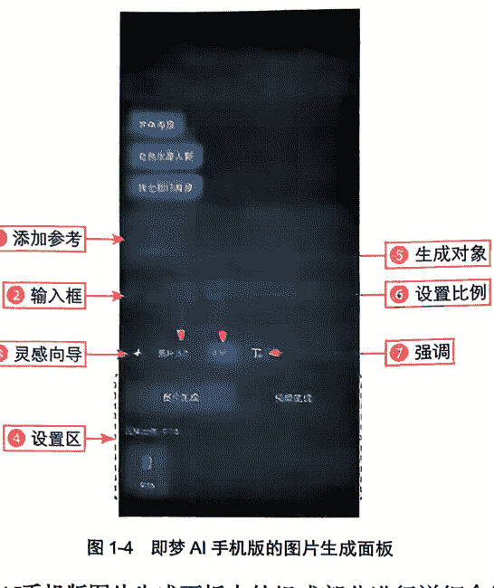

图 1-4 即梦 AI 移动端的图片生成面板

面板要素说明：

1. 添加参考：可上传相册或历史生成图片作为参考。
2. 输入区：输入提示词描述画面效果。
3. 灵感向导：接入AI模型，协助生成提示词。
4. 设置区：设置生成对象为图片或视频，并调整比例、时长、模型等参数。
5. 生成对象：显示当前生成对象，按下可展开设置区。
6. 设置比例：显示当前比例，按下可展开设置区。
7. 强调：输入重点强调的文本。

即梦AI能将文字描述转化为具体图像元素。利用DeepSeek生成的提示词，可在即梦中生成乡村画面，效果如图1-5所示。

操作步骤：

步骤01 打开即梦AI移动端，❶按下“想象”切换至想象界面；❷进入输入区，如图1-6所示。

步骤02 ❶在输入区键入提示词，默认模型为图片3.0、比例9:16；❷按下生成键，如图1-7所示。

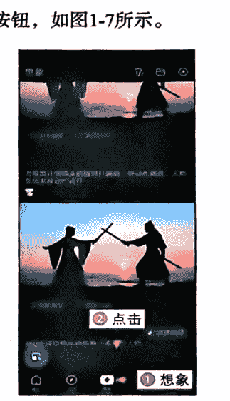

步骤03 稍等片刻生成4张图片，选择合适图片，如图1-8所示。

步骤04 进入详情页按下超清键，如图1-9所示，完成超清处理后选择图片按下下载保存。

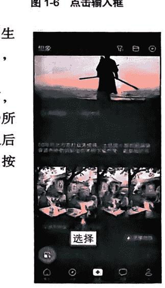

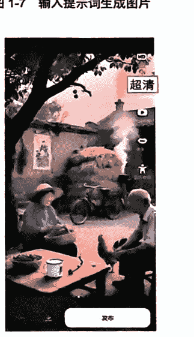

### 1.3 即梦以图生视频制作动态片段

即梦的图生视频功能可将静态图转化为动态短视频，支持平移、旋转、缩放等运镜，并可调节播放速度，效果如图1-10所示。

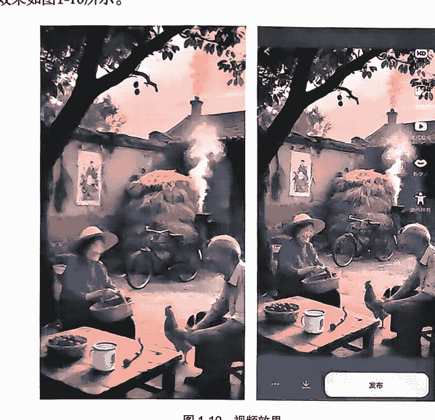

图 1-10 视频效果

操作步骤：

1. 步骤01 在上一节基础上，选择已超清处理的图片，如图1-11所示。
2. 步骤02 进入界面后按下生成视频键，如图1-12所示。
3. 步骤03 ①在输入区键入提示词，默认模型视频3.0、比例9:16；②按下生成键，如图1-13所示。
4. 步骤04 等待生成后选择视频，如图1-14所示。
5. 步骤05 进入详情页按下下载，继续选择保存到本地和有水印保存即可。

## 第 1 例 乡村治愈视频

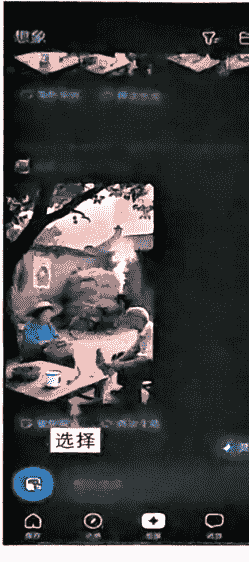

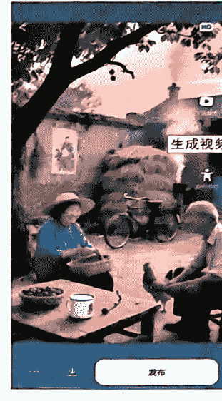

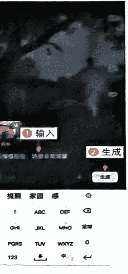

图 1-11 选择经过超清处理的图片 图 1-12 按下“生成视频”键 图 1-13 输入提示词生成视频

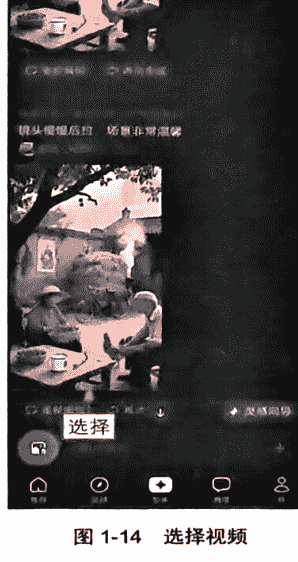

图 1-14 选择视频 图 1-15 下载视频

### 1.4 剪映中提取音乐添加背景音乐

剪映移动端操作简便功能全面，适合移动端快速剪辑。图1-16所示为剪映移动端的视频编辑界面。

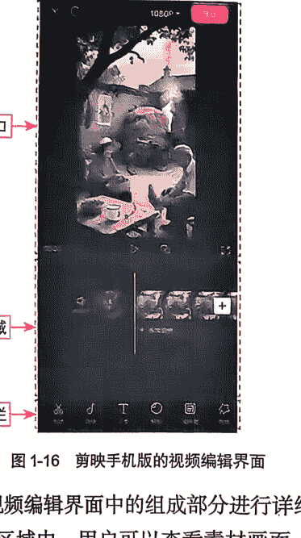

图 1-16 剪映移动端的视频编辑界面

界面说明：

1. 预览窗口：查看画面、时间轴位置及总时长。
2. 时间轴区域：添加素材、编辑原声封面、拖曳查看不同时刻内容。
3. 工具栏：提供剪辑、音频等编辑工具，按下进入具体功能。

剪映可快速为视频添加背景音乐，效果如图1-17所示。

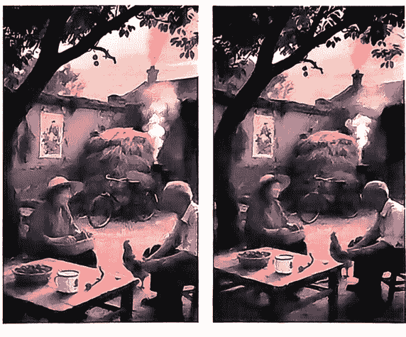

图 1-17 视频效果

操作步骤：

步骤 01 打开剪映移动端，按下开始创作键，如图1-18所示。

步骤 02 ①在照片视频界面选择视频素材；②勾选高清；③按下添加，如图1-19所示。

步骤 03 按下轨道中的添加音频键，如图1-20所示。

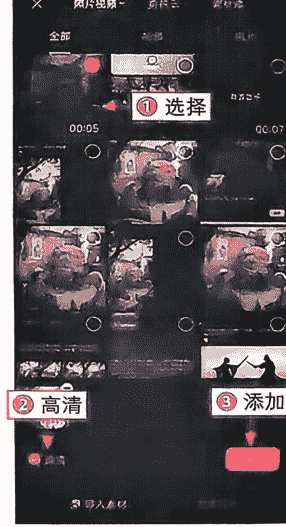

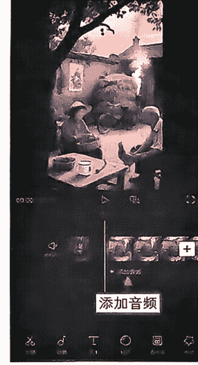

图 1-18 按下“开始创作”键

图 1-19 添加视频

图 1-20 按下“添加音频”键

步骤04 在弹出工具栏中按下提取音乐键，如图1-21所示。

步骤05 ❶在照片视频界面选择背景音乐视频素材；❷按下仅导入视频的声音，为视频添加背景音乐。

步骤06 拖曳音频素材右侧白框调整时长，使其与视频时长对齐，如图1-23所示。

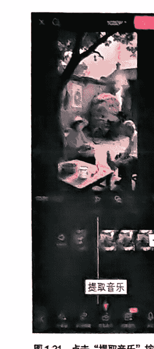

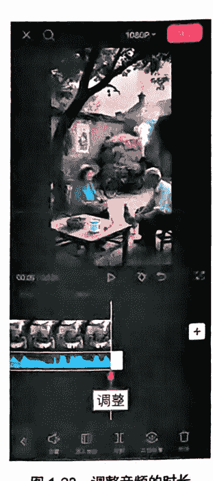

图 1-21 按下“提取音乐”键

图 1-22 添加背景音乐

图 1-23 调整音频的时长

## 第 2 例 怀旧客车视频

抖音中年代客车视频近年走红，复古场景与情感共鸣吸引70后、80后、90后群体，常围绕青春回忆、乡愁、送别、返乡等主题触发怀旧情绪。随着智能技术发展，该类内容有望进一步拓展。本例介绍年代客车视频制作方法。

### 2.1 即梦以文生图制作等车画面

视频画面需提前规划。以客车视频为例，通常包含等车、上车、坐车等镜头，可在即梦AI移动端输入提示词逐一生成，部分效果如图2-1所示。

操作步骤：

步骤01 打开即梦AI移动端，❶按下想象切换至想象界面；❷进入输入区，如图2-2所示。

步骤02 ❶在输入区键入提示词，默认模型图片3.0、比例9:16；❷按下生成键，如图2-3所示。

步骤03 稍等片刻生成4张图片，选择合适图片，如图2-4所示。

步骤04 进入详情页按下超清键，如图2-5所示，完成超清处理后选择图片下载保存。重复操作生成其余图片。

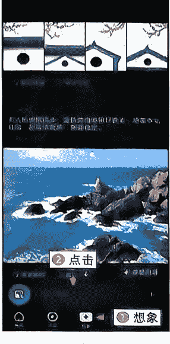

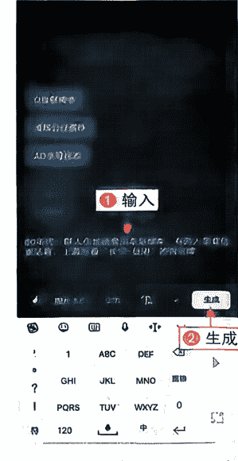

图 2-2 进入输入区

图 2-3 输入提示词生成图片

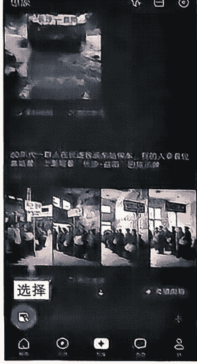

图 2-4 选择相应的图片

图 2-5 对图片进行超清处理

> ☆温馨提示☆

生成图片和视频的提示词可在提供的资源文件夹中获取，手机扫码即可。

### 2.2 即梦以图生视频制作等车片段

即梦图生视频建议选用视频3.0模型，响应更精准。输入提示词后可控制画面与运镜效果，部分效果如图2-6所示。

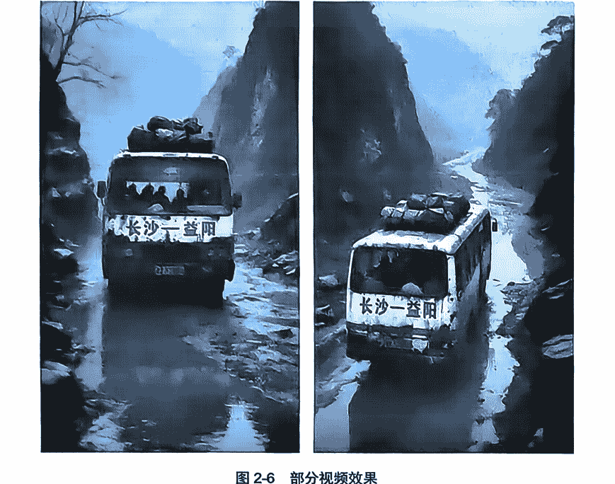

**等车短片制作速览**

图2-6呈现了部分成片画面。以下以即梦AI手机端为例，说明等车类短片的生成思路。

1. **步骤01** 在上一步完成超清增强后，从即梦移动端挑选一张已处理好的图片，参考图2-7所示。
2. **步骤02** 进入图片详情页，找到视频生成入口，具体位置见图2-8。
3. **步骤03** ①在描述区填入对应文案，模型维持视频3.0，画幅维持9:16；②按下生成键开始制作，如图2-9所示。
4. **步骤04** 稍作等待后会得到一段结果，从列表里挑定所需片段，如图2-10。
5. **步骤05** 进入预览页按下下载，如图2-11，随后依次确认“保存到本地”和“有水印保存”，把文件写进手机。按相同做法即可再产出另外三条素材。

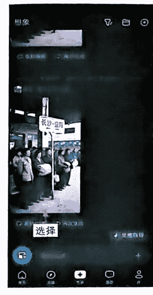

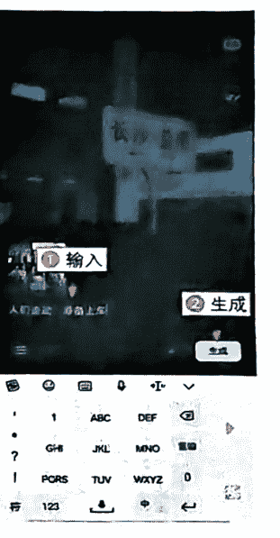

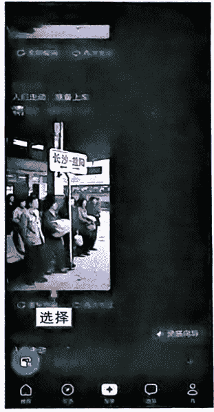

### 2.3 剪映拼接客车素材

即梦输出的是分散的小片段，需要用剪映完成剪辑、拼接、时长调整与转场，才能合成完整成片，效果见图2-12。

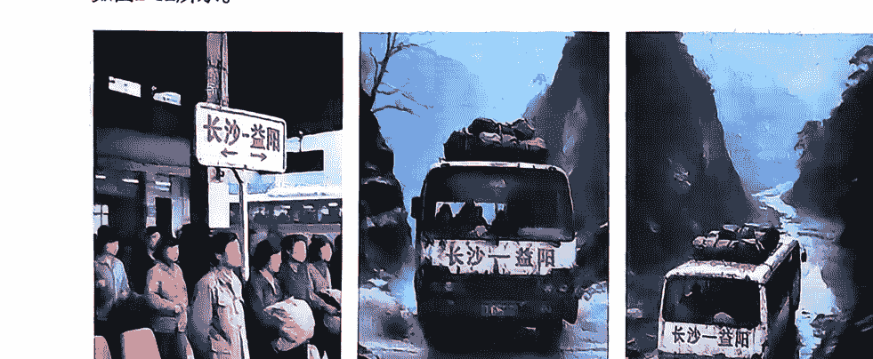

下面演示剪映移动端的操作流程。

**步骤 01** 启动剪映，点“开始创作”，①在“最近项目”里按顺序载入4条视频；②勾选“高清”；③按下“添加”完成导入，示意如图2-13所示。

**步骤 02** ①在时间轴上选中首条素材；②打开“变速”功能，如图2-14所示。

**步骤 03** 进入二级工具栏后，选用“常规变速”，见图2-15所示。

**步骤 04** ①把速率调至0.6倍以减慢播放；②勾选“智能补帧”；③按√确认，详见图2-16所示。

**步骤 05** 拖动首条素材两侧白框，将时长改成2.4秒，如图2-17所示。

**步骤 06** 剩余三条素材同理调整时长，依次为2.0秒、1.9秒、1.8秒，并对第四条做1.7倍加速处理，具体如图2-18所示。

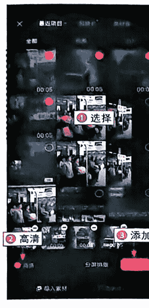

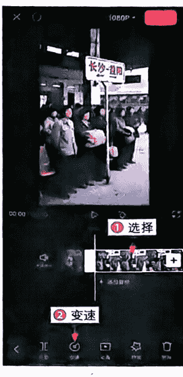

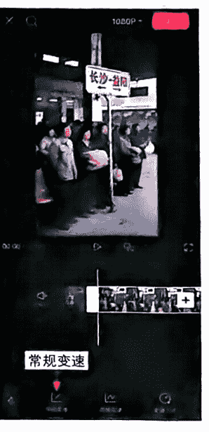

图2-13 视频导入示意

图2-14 启动变速功能

图2-15 选择常规变速

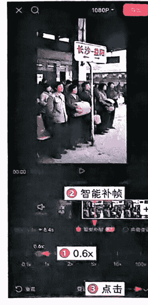

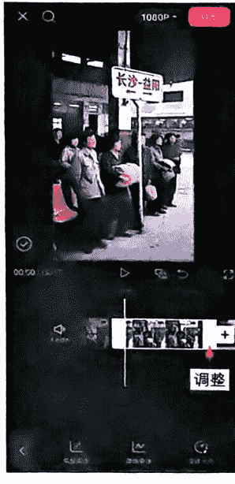

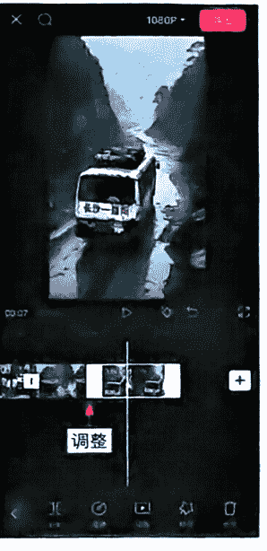

图2-16 执行相关操作1

图2-17 调整第一段时长

图2-18 调整其余段时长

**步骤 07** 在第一条与第二条素材间点按“转场”图标，如图2-19所示。

**步骤 08** 面板弹出后，①切到“叠化”标签；②挑选“叠化”效果；③按下确认加入转场，如图2-20所示。同理，其余片段间依次加入“推近”运镜与“叠化”转场。

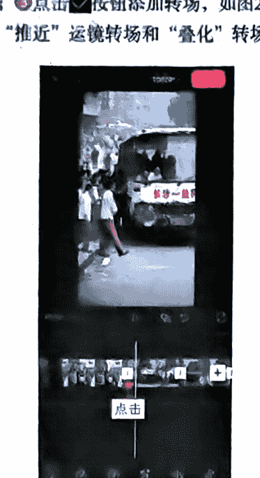

图2-19 调出转场入口

图2-20 新增转场效果

### 2.4 剪映曲库添加怀旧配乐

怀旧调性的视频离不开老歌，用剪映自带音乐库搜索即可快速配音，提升氛围。移动端添加音乐步骤如下。

**步骤 01** 回到剪映主界面，在时间轴起点点“音频”，见图2-21所示。

**步骤 02** 在二级菜单中点“音乐”，如图2-22所示。

**步骤 03** 进入音乐页点搜索框，①输入“恋曲1990”并检索；②点选中曲目右侧“使用”导入，如图2-23所示。

**步骤04** ①把时间轴拖到视频尾部；②点“分割”截断音频；③点“删除”去掉多余部分，如图2-24所示。

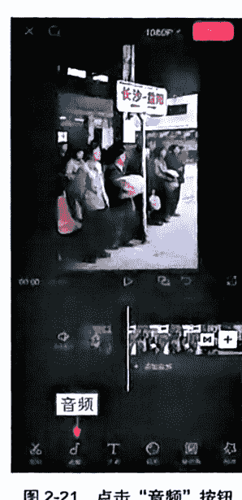

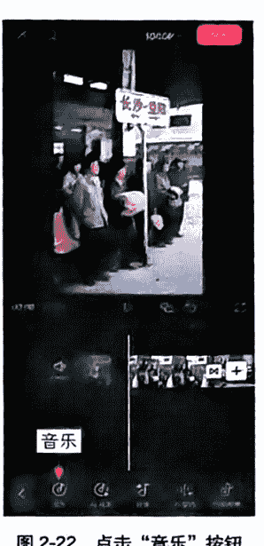

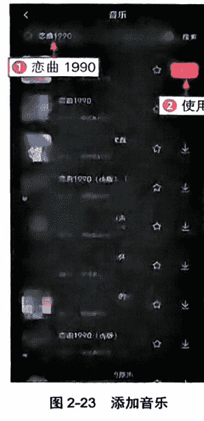

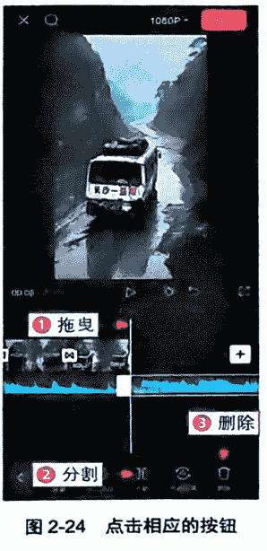

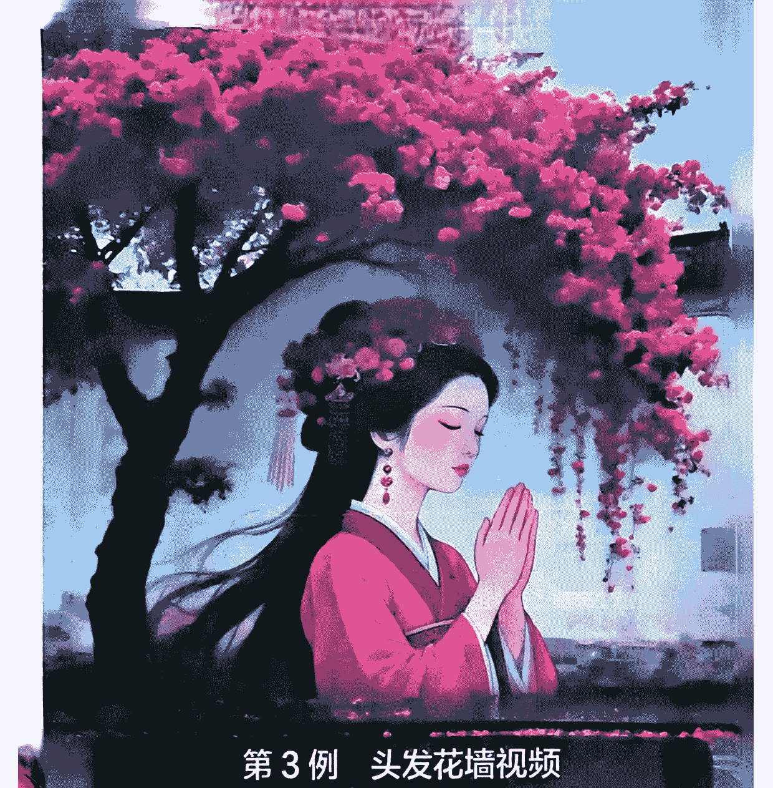

## 第 3 例 头发花墙视觉片

头发花墙指将发丝与花卉、藤蔓等自然元素融合，形成花墙式画面，色彩艳丽、构图唯美。抖音偏爱高颜值强视觉内容，此类绚丽画面易获推荐，伴随国风热，花卉与古风造型契合新中式美学。部分作品呈现发丝与花朵随风摆动的灵动感，增强沉浸。下面分享制作思路。

### 3.1 即梦文生图打造花墙素材

即梦AI手机版的文生图功能，输入描述即可生成花墙图，效果见图3-1所示。

以下演示即梦AI手机版制作花墙图片的操作方法。

**步骤01** 打开即梦APP进入“想象”页，点输入框，①填写对应提示词，模型默认图片3.0、比例9:16；②点“生成”，见图3-2所示。

**步骤02** 片刻后得到4张结果，挑选满意的一张，如图3-3所示。

**步骤03** 进入详情页点“超清”进行增强，如图3-4所示，处理后选中超清图点“下载”按钮，完成保存。

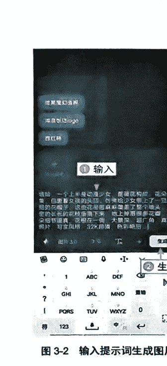

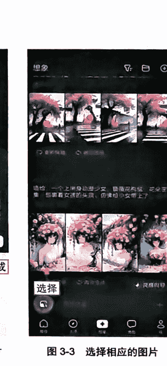

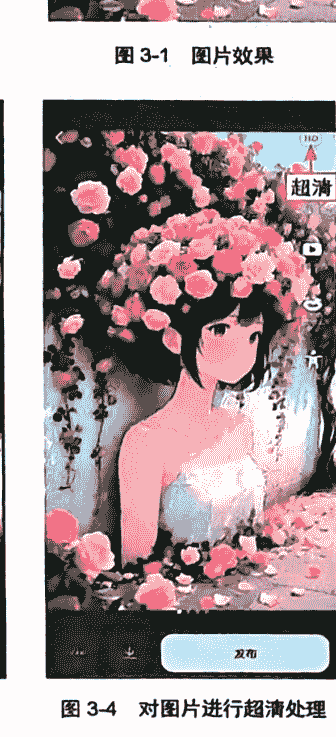

### 3.2 豆包文生图生成花墙图像

豆包手机版支持随时随地用手机AI作图，无需电脑或专业工具，移动创作很方便。图3-5展示了豆包的AI生图页面。

下面对豆包手机版“AI生图”界面中的组成部分进行相关讲解。

1. 添加参考图：轻触即可打开相册上传已有图片作为参考。
2. 风格区：在该区域中，创作者可以根据需要选择对应的图像风格，从而让AI生成的图像更适配分镜的需求。
3. 比例：点击该按钮，即可在弹出的列表框中选择需要的图像比例，如9：16、2：3、1：1和16：9等。
4. 编辑区：创作者可以点击该区域中的按钮，对手机中的图像进行编辑。
5. 输入区：在该区域中，创作者可以输入文字提示词，也可以通过语音输入的形式，告知AI自己需要的图像内容。

豆包基于深度学习能准确理解文本指令并出图，支持多种艺术风格，速度快。用它生成花墙图效果如图3-6所示。

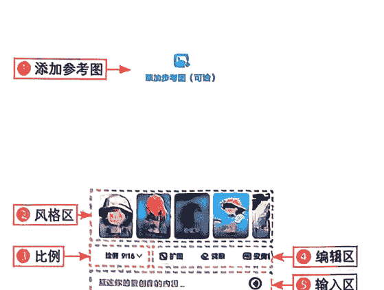

## 第 3 例 头发花墙视频

下面介绍在豆包手机版中制作花墙图片的操作方法。

步骤 01 打开豆包APP，
①点“创作”进入创作页；②点“开始创作”按钮，如图 3-7 所示。

步骤 02 在弹出的面板中选择“AI生图”选项，如图3-8所示。

步骤 03 ①在输入框填提示词，比例默认9：16；②点击“发送”按钮，如图3-9所示。

步骤 04 稍等片刻，即可生成 4 张图片，点击所选图片左下角的“下载”按钮，如图 3-10 所示，即可把图片保存至手机中。

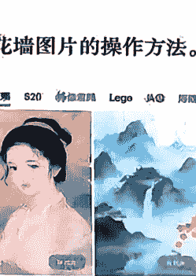

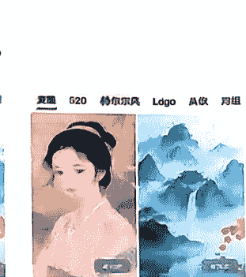

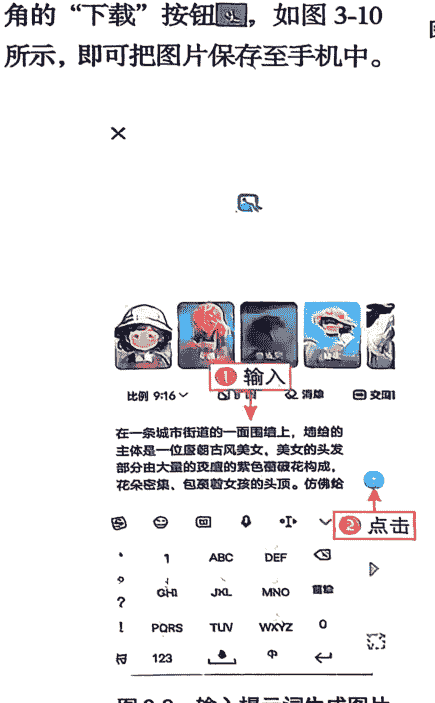

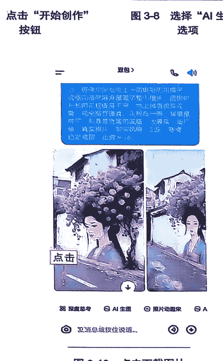

### 3.3 即梦图生视频制作花墙动态

即梦AI不仅能用自家生成的图做视频，也支持导入相册图片生成动态，效果参考图3-11所示。

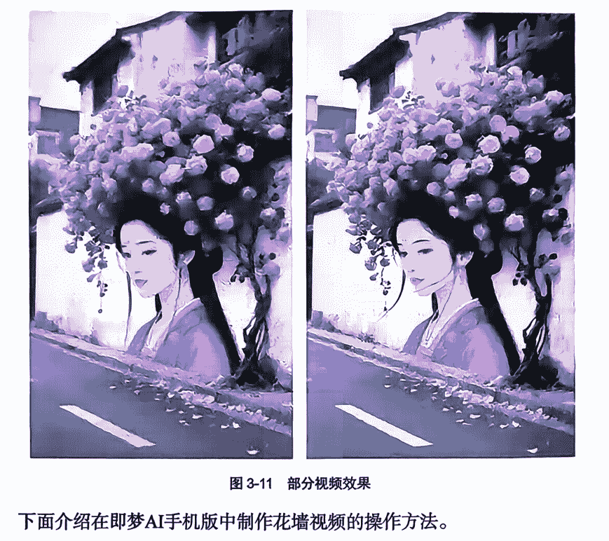

下面介绍在即梦AI手机版中制作花墙视频的操作方法。

- 步骤01 打开即梦APP，点击“导入图片”按钮，如图3-12所示。
- 步骤02 在“系统相册”界面中选择一张图片，如图3-13所示。
- 步骤03 ①在输入框中输入相应的提示词；②设置模型为“视频3.0”；③点击“生成”按钮，如图3-14所示。
- 步骤04 稍等片刻，即可生成一段视频，选择视频，如图3-15所示。
- 步骤05 进入相应的界面，点击“下载”按钮，如图3-16所示。
- 步骤06 在弹出的面板中点击“保存到本地”按钮，如图3-17所示，继续点击“有水印保存”按钮，保存视频。剩下的一段视频，在即梦AI手机版中通过“生成视频”功能制作即可。

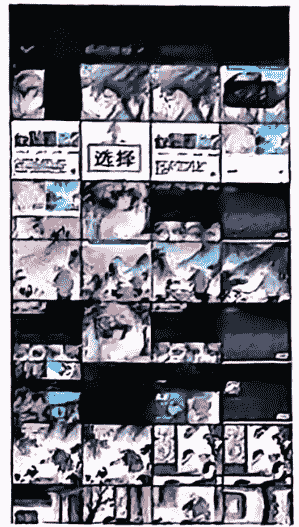

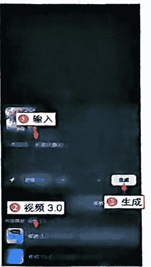

图 3-12 点击“导入图片”按钮

图 3-13 选择一张图片

图 3-14 输入提示词生成视频

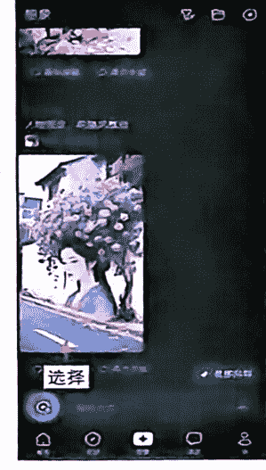

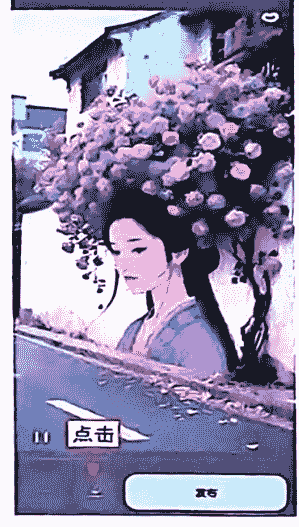

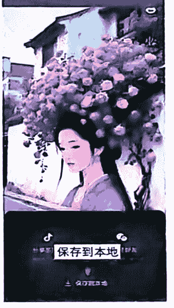

图 3-15 选择视频

图 3-16 点击“下载”按钮

图 3-17 点击“保存到本地”按钮

> ☆温馨提示☆
若对结果不满意，可点“再次生成”重新制作。

### 3.4 剪映剪辑合成花墙成片

在剪映手机端加音乐、转场和特效，可把两段花墙片段合成完整视频，画面更丰富，效果见图3-18所示。

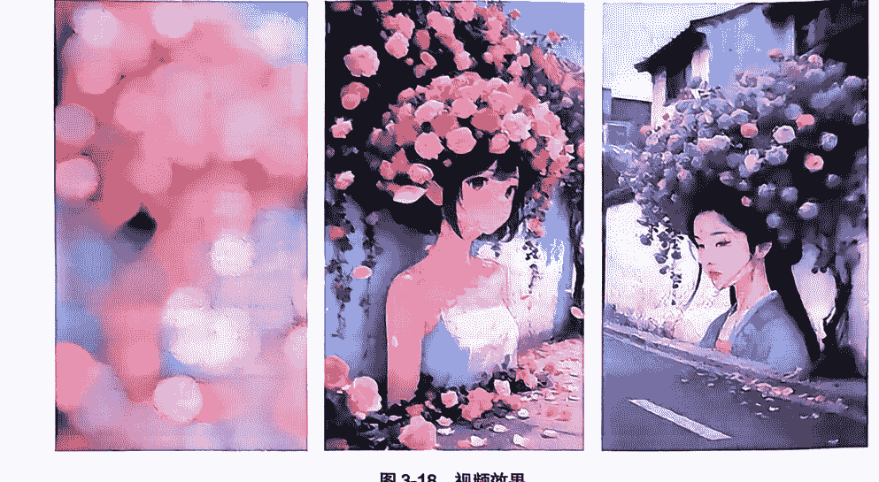

下面介绍在剪映手机版中剪辑花墙视频的操作方法。

- 步骤01 打开剪映手机版，依次导入两段视频素材，点击“音频”按钮，如图3-19所示。
- 步骤02 在弹出的二级工具栏中点击“音乐”按钮，如图3-20所示。
- 步骤03 在“音乐”界面中点击搜索栏，①输入并搜索“城北的花”；②点击所选音乐右侧的“使用”按钮添加音乐，如图3-21所示。
- 步骤04 ①调整两段视频素材的时长，使其都为3s；②选择音频素材；③在视频6s的位置点击“分割”按钮，分割音频素材；④点击“删除”按钮删除多余的音频素材，如图3-22所示。
- 步骤05 点击第1段视频素材和第2段视频素材之间的“转场”按钮，如图3-23所示。
- 步骤06 弹出相应的面板，①切换至“光效”选项卡；②选择“炫光Ⅱ”选项；③点击按钮添加转场，如图3-24所示。

步骤07 在视频的起始位置点击“特效”按钮，如图3-25所示。

步骤08 在弹出的二级工具栏中点击“画面特效”按钮，如图3-26所示。

图 3-25 点击“特效”按钮

图 3-26 点击“画面特效”按钮

步骤 09 弹出相应的面板，①在“热门”选项卡中选择“超大光斑”选项；②点击✔按钮添加开场特效，如图3-27所示。

步骤 10 调整“超大光斑”特效的时长，使其约为1.5s，如图3-28所示。

图 3-27 添加开场特效

图 3-28 调整“超大光斑”特效的时长

## 第 4 例 胖妞搞笑段子视频

抖音上“大唐女子身材焦虑”类的幽默语录片，以轻松调侃的方式结合当代身材焦虑，与唐朝审美形成反差，成为受众喜爱的解压内容。现代女性普遍有身材压力，这类片段用玩笑化解减重困境，提供情绪出口。“唐朝不用瘦”的想象能短暂缓解现实焦虑，契合解压经济趋势。本例将为大家介绍这类胖妞搞笑视频的制作技巧。

### 4.1 即梦图生图生成胖妞肖像

即梦AI的图生图功能可上传参考图并配合提示词生成创意人像，效果如图4-1所示。

下面介绍在即梦AI手机版中制作胖妞图片的操作方法。

- 步骤01 打开即梦APP，点击“导入图片”按钮，如图4-2所示。
- 步骤02 在“系统相册”界面中选择一张图片，如图4-3所示。
- 步骤03 添加图片之后，点击“智能参考”按钮，如图4-4所示。
- 步骤04 ①在相应的界面中选择“角色特征”选项；②点击“完成”按钮，如图4-5所示。
- 步骤05 ①在输入框中输入相应的提示词；②设置比例为9：16；③点击“生成”按钮，如图4-6所示。
- 步骤06 稍等片刻，即可生成4张图片，选择相应的图片，如图4-7所示，进入相应的界面，点击“超清”按钮对图片进行超清处理，之后可以选择超清图片并点击“下载”按钮，下载和保存图片。

图4-2 点击“导入图片”按钮

图4-3 选择相册原图

图4-4 开启智能参考

图4-5 选用角色特征

图4-6 输入提示生成

图4-7 挑选结果

### 4.2 即梦数字人对口型制作

即梦数字人功能能让静态图或卡通形象开口，实现口型同步，制作数字人视频，效果如图4-8所示。

图 4-8 视频效果

下面介绍在即梦手机版中制作数字人视频的操作方法。

- 步骤01 在即梦APP里挑选已做超清处理的图片，如图4-9所示。
- 步骤02 进入相应的界面，点击“数字人”按钮，如图4-10所示。
- 步骤03 进入“数字人”界面，在输入框中点击“导入配音视频”按钮，如图4-11所示。
- 步骤04 在“系统相册”界面中选择一段配音视频，如图4-12所示。
- 步骤05 上传成功后，①在“数字人”界面中选择“快速”选项；②点击“立即生成”按钮，如图4-13所示。
- 步骤06 稍等片刻，即可生成一段视频，选择视频进入相应的界面，点击“下载”按钮，如图4-14所示，下载和保存视频。

图 4-9 选择经过超清处理的图片

图 4-10 点击“数字人”按钮

图 4-11 点击“导入配音视频”按钮

图 4-12 选择一段配音视频

图 4-13 点击“立即生成”按钮

图 4-14 下载视频

### 4.3 剪映给数字人视频加字幕

即梦AI生成的数字人视频默认不带字幕，若想让观看更友好，就可以用剪映手机版给视频加上配音字幕，最终呈现效果见图4-15。

接下来详细说明剪映手机版添加配音字幕的具体步骤。

- 步骤01 启动剪映移动端，导入需要处理的视频素材后，点击底部的“字幕”功能入口，参考图4-16。
- 步骤02 进入“识别字幕”面板后，①先挑选一款喜好的字幕样式；②再点按“开始识别”，示意见图4-17。
- 步骤03 等待片刻，系统会自动生成对应配音的字幕，效果如图4-18。

## 第5例 古人养生短视频玩法

近年抖音平台上，古人养生类短视频热度持续攀升。这类作品往往把传统文化、中医理念与AI、动画等新技术结合，用新奇好玩的形式抓住年轻人的眼球。其走红源于传统文化回潮、健康焦虑加剧以及短视频技术不断创新三者叠加。作品通过趣味化与实用化的表达，让千年的养生智慧重新焕发生机，既回应了年轻群体的健康诉求，也加深了文化认同感。以下将分享古人养生视频的制作方法。

### 5.1 豆包文生图做养生图

相比即梦AI，豆包目前提供免费的图片生成服务，用户能零成本用文生图的方式制作养生配图，部分示例见图5-1。

下面详解豆包移动端制作养生图片的流程。

**步骤01** 打开豆包手机版，进入“AI生图”界面，① 在文本框输入合适的提示词，默认比例为9:16；② 按下“发送”按钮，如图5-2所示。
**步骤02** 稍作等待即可得到4张成图，点击目标图片左下角的“下载”图标保存到手机，如图5-3。按照同样方式，依据素材包里的提示词还能再生成另外4张养生图。

### 5.2 即梦图生视频做动态画面

即梦AI的视频3.0模型在镜头运动顺滑度、面部表情还原、物理仿真以及多主体互动方面都有明显进步，被业内称为AI视频创作的重大升级，建议多使用该模型生成片段，部分成果见图5-4。

下面介绍即梦AI手机端制作动态视频的步骤。

**步骤01** 启动即梦手机版，点击“导入图片”，在系统相册里挑选一张素材图，如图5-5所示。
**步骤02** ① 在提示框填写对应的描述；② 将模型切换为“视频3.0”；③ 敲击“生成”，参考图5-6所示。
**步骤03** 等待片刻后即可得到一段视频，选中后下载保存，如图5-7所示。按同样流程可再生成其余4段视频。

### 5.3 剪映添加配音字幕做成养生视频

完整视频离不开配音与字幕，借助剪映添加二者能大幅提升养生视频的沉浸感，最终效果见图5-8所示。

下面说明剪映手机版制作养生视频的操作流程。

- 步骤 01 启动剪映手机版，按顺序导入5段视频素材后，点击“音频”入口，如图5-9所示。
- 步骤 02 在二级工具栏里点按“提取音乐”，如图5-10所示。
- 步骤 03 ① 进入“照片视频”界面挑选一段配音素材；② 点击“仅导入视频的声音”，如图5-11所示，为主视频加上配音。
- 步骤 04 依据配音节奏调整5段素材时长，分别为4.0秒、3.7秒、3.5秒、4.3秒、4.0秒，如图5-12所示。
- 步骤 05 返回主工具栏，在视频起点位置点击“字幕”，如图5-13所示。
- 步骤 06 弹出“识别字幕”面板后，① 选定喜好的字幕模板；② 按下“开始识别”，如图5-14所示。

图5-8 点击“音频”按钮

图5-10 点击“提取音乐”按钮

图5-11 为视频添加配音

图5-12 调整5段视频素材的时长

图5-13 点击“字幕”按钮

图5-14 点击“开始识别”按钮

步骤 07 等待片刻即可生成配音字幕，随后点击“编辑字幕”，如图 5-15 所示。
步骤 08 ① 在编辑面板里补充标点并修改文字；② 确认后点击下一步，如图 5-16 所示。

萌娃劳作类视频多呈现孩子参与农耕、收割、种植等田间劳动的画面，既传达劳动最光荣的价值观，又凭借真实治愈的特质圈粉无数。孩子笨拙却认真的操作形成鲜明反差，配合少量幽默桥段，更能凸显童真可爱，让人会心一笑并获得治愈感。接下来介绍这类视频的制作思路。

### 6.1 用Kimi手机生成提示词

Kimi手机版本功能完备，适合在移动端捕捉灵感并即时生成内容。其多轮追问能力在手机环境下依然稳定，让用户脱离电脑也能顺畅交流。图6-1展示了Kimi手机版的对话界面。

下面详细解读Kimi手机版对话界面的各组成部分。

- **展开≡**：点按后左侧会滑出侧边栏，内含账号信息、“探索Kimi+”入口及历史对话。
- **示例区**：展示若干热门话题，点击即可体验与Kimi对话。
- **功能区**：列出Kimi的热门功能，如“拍照解题”“打电话”“图片创作”“翻译”“写作”等，点击即可使用。
- **新建对话⊙**：点按后可开启全新对话窗口。
- **语音播报🔊**：可边生成边朗读回复，默认关闭，需先开启后再对话。
- **输入区**：包含输入框、长思考🧠、语音输入🎤、上传📤四个元素，可输入提示词或使用对应功能。

## ☆ 温馨提示 ☆

AI工具对同一提示词的输出每次都可能有差异，建议把重心放在提示词的打磨和操作流程的把控上。

下面说明在Kimi手机版生成提示词的具体方法。

步骤01 打开Kimi手机版进入对话页，① 在输入框填入提示词；② 点击发送⬆，如图6-2所示。
步骤02 等待后即可得到回复，点击复制📋保存提示词，如图6-3所示。

### 6.2 即梦文生图制作萌娃图片

即梦AI的图片3.0模型能精准还原细节与质感，弱化AI图常见的过度修饰和假脸问题，还支持专业级画面表现及更精准的电影风格与镜头语言响应，示例见图6-4所示。

下面介绍即梦AI手机版制作萌娃图片的流程。

**步骤01** 打开即梦AI手机版进入“想象”页，点击输入框，❶ 输入提示词，默认模型为“图片3.0”、比例9:16；❷ 点击“生成”按钮，如图6-5所示。
**步骤02** 等待后生成4张图，选中所需图片如图6-6所示，进行超清处理提升画质。同样方式可再生成一张并超清处理。

### 6.3 即梦图生视频制作萌娃视频

即梦AI的视频3.0模型在人物面部表情理解与生成上大幅提升，生成角色不再面无表情，而是能呈现更丰富细腻的情绪变化，眼神、嘴角、微表情都更真实，角色更生动，示例见图6-7所示。

下面说明即梦AI手机版制作萌娃视频的操作。

**步骤 01** 在上一步基础上，于即梦手机版中选取已超清处理的萌娃图，如图 6-8 所示。
**步骤 02** 进入对应页面，点击“生成视频”按钮，如图 6-9 所示。
**步骤 03** ① 输入提示词，默认模型为“视频3.0”、比例9:16；② 点击“生成”按钮，如图 6-10 所示。

步骤 04 等待后生成一段视频，选中后保存，如图6-11所示。同样可用其他图和提示词再生成一段。

### 6.4 剪映对口型剪辑萌娃视频

剪映的AI对口型功能可让画面中的人物按指定音频或文字“开口”，支持文案转音频或直接导入音频，让萌娃喊“奶奶”，效果见图6-12所示。

下面详解剪映手机版剪辑萌娃视频的步骤。

**步骤01** 打开剪映手机版，依次导入两段视频素材，依次点按“音频”和“音乐”按钮，如图6-13所示。
**步骤02** 进入音乐界面，点击搜索栏，❶ 搜索“婴儿呵呵开心笑”；❷ 点击选中音乐右侧的“使用”添加，如图6-14所示。
**步骤03** ❶ 调整音频时长对齐第一段视频末尾；❷ 点击“音量”按钮，如图6-15所示。
**步骤04** ❶ 在音量面板将音量调至567；❷ 点击✔确认，如图6-16所示。
**步骤05** ❶ 选中第二段视频素材；❷ 点击“AI对口型”按钮，如图6-17所示。
**步骤06** 弹出面板后，❶ 切换到“修改口型|用音频生成”；❷ 点击“从音乐库选择”按钮，如图6-18所示。
**步骤07** 进入添加音乐界面，❶ 搜索“奶奶”；❷ 点击选中音乐右侧“使用”，如图6-19所示。

步骤 08 弹出面板后点击“生成”按钮，如图6-20所示。
步骤 09 等待片刻生成对口型视频，❶ 将分辨率设为1080P；❷ 点击“导出”按钮导出视频，如图6-21所示。

## 第 7 例 春分节气短视频

节日节气是文化传承的关键载体，借助视频能直观呈现其历史源流、民俗风情与时代内涵，提升大众对传统文化的认同与归属感。本例以春分节气AI视频为例讲解制作技巧。二十四节气外的端午、春节、中秋、元宵等节日同样可做成宣传片弘扬传统文化，方法相通，学会本例即可举一反三。

### 7.1 用文小言APP生成提示词

文小言APP是百度推出的“新搜索”智能助手，前身为文心一言APP，基于文心大模型提供搜索、创作、聊天等多元AI能力，支持语音、文字、图片、文档等多种输入，兼顾传统文字搜索、语音搜索、图片搜索，甚至边拍边问、边看边问等灵活用法。

扫码看教学视频

文小言APP界面简洁直观、功能强大，致力于为用户打造高效便捷愉悦的体验。下面介绍其对话界面，如图7-1所示。

下面对对话界面主要功能作详细介绍。

1. **设置**：登录后点击会弹出设置面板，可对对话、个性化、通用等进行调整，使APP更贴合使用习惯。
2. **对话窗口**：核心交互区，用于与APP智能对话并展示历史记录，便于追溯与参考。
3. **功能区**：集中展示“蛋小黄”“解题老师”“视频生成”“翻译”等功能，点击即可启用。
4. **输入区**：可点击“上传”+选择拍照、文档解析或语音通话与AI互动，也可在输入框内输入问题，或点语音输入按钮用语音提问。
5. **搜索按钮Q**：点击进入搜索页，可对对话历史、智能体、社区内容进行检索。

图 7-1 文小言 APP 的对话界面

50

⑥ **模型区**：点击可切换三种模式：“自动模式（推荐）”“文心大模型”“DeepSeek-R1满血版”。
⑦ **界面标签**：含“助手”“对话”“发现”“我的”四个标签，“助手”页可直接提问，底部切换各功能页。

下面介绍在文小言APP中生成提示词的流程。

步骤01 打开文小言APP进入对话页，① 将模型设为“文心大模型”；② 在输入框填入提示词；③ 点击发送按钮，如图7-2所示。
步骤02 等待片刻后获得回复，点击复制按钮保存提示词，如图7-3所示。

### 7.2 用可灵文生图打造节气画面
可灵AI的手机端在外出灵感捕捉时用起来更顺手，能迅速产出视频小样，并可以直接分享或存进手机相册。图7-4展示了其手机版首页的样子。

下面逐项说明首页里各部分的作用。

1. **展开**：点一下即可打开侧边栏，查看账号信息并进行管理。
2. **功能区**：集中呈现6项核心能力，分别是图生视频、文生图、文生视频、多模态编辑、创意特效、AI音效，点击任一入口就进入对应制作页。
3. **创意圈**：聚合其它用户上传的作品，默认提供推荐、视频、图片、短片四种筛选标签，可浏览点赞评论，前三类作品还能一键当模板复刻同款风格。
4. **导航栏**：包含首页、创意圈、生成、资产、我的五项入口。除了首页外，创意圈可继续浏览他人内容，生成入口支持产出图片、音效、视频，资产里汇总历史成果，我的则展示发布记录和点赞收藏。

做节气主题图时，可借助可灵AI手机版快速产出美感画面，示例效果见图7-5。
下面是具体操作流程。
**步骤01** 启动可灵AI手机版，点击文生图入口，进入文生图页面，如图7-6。
**步骤02** ① 在提示框里填入描述词；② 打开人物长相设置，默认画幅为9:16；③ 按下立即生成，如图7-7。

图 7-6 点击“文生图”按钮
图 7-7 输入提示词生成图片
**步骤03** 等待片刻即可出图，点击想要的画面，如图7-8。
**步骤04** 进入预览页 ① 选定心仪作品 ② 点下载按钮，在弹出的面板中勾选下载PNG保存。按同样方式再生成另外三张。

图 7-8 选择图片
图 7-9 下载图片

### 7.3 用即梦以图生视频，制作节气视频
制作节气视频时，在提示词里加上对应关键词，就能得到流畅唯美的动态画面，部分示例见图7-10。

扫码看教学视频

下面是即梦AI手机版的具体制作步骤。
**步骤01** 打开即梦AI手机版，点击导入图片，在系统相册里挑选一张素材图，如图7-11。
**步骤02** ① 填写提示词；② 将模型切换为视频3.0；③ 点击生成，如图7-12。
**步骤03** 等待生成完成，选择视频后下载保存。重复导入图片并输入提示词，可再产出另外三段。

### 7.4 在剪映中添加贴纸，剪辑节气视频
为了让节气视频每一帧都有壁纸感，可以加上文字贴纸提升氛围感，同时加入配音与字幕进一步优化质感，效果参考图7-14。

剪映手机版剪辑流程如下。
**步骤01** 启动剪映手机版，连续导入四段视频素材，然后点文本→新建文本，如图7-15。
**步骤02** ① 在输入框填入文案；② 确认勾选，如图7-16。
**步骤03** 点击文本朗读功能，如图7-17。
**步骤04** 弹出面板后 ① 切换到男声标签；② 选择云泽大叔并点调整参数≡，如图7-18。

**步骤05** ① 在参数面板把语速调为0.8倍以放慢；② 点击确认，如图7-19。

**步骤06** ① 选中文本轨道；② 点删除按钮移除文字，如图7-20。
**步骤07** ① 选中朗读音频；② 点击音量，如图7-21。
**步骤08** ① 把音量数值设为526增强音量；② 确认，如图7-22。
**步骤09** 返回上级工具栏，点击音乐，如图7-23。
**步骤10** 在音乐库搜索栏输入春分搜索，点击目标曲目右侧的使用添加，如图7-24。

**步骤11** ① 拖动音乐两端白框将时长对齐到朗读音频；② 点音量，如图7-25。
**步骤12** ① 将音量调至55弱化背景突出人声；② 确认，如图7-26。
**步骤13** ① 按朗读节奏调整四段视频时长；② 点击第三段与第四段之间的转场按钮||，如图7-27。
**步骤14** 弹出面板 ① 在热门标签选择叠化；② 点击全局应用为所有片段统一转场；③ 确认，如图7-28。

**步骤15** 在顶部工具栏点击字幕，如图7-29。

**步骤16** 弹出识别面板，点击开始识别快速生成字幕，如图7-30。
**步骤17** 识别完成后点样式，如图7-31。
**步骤18** 在面板里 ① 切换到模板→影视混剪；② 挑选一款模板，如图7-32。
**步骤19** ① 进入样式→粗斜体；② 选定样式；③ 开启加粗；④ 确认，如图7-33。

**步骤20** 点击编辑字幕，如图7-34。

**步骤21** 按原排版 ① 在编辑面板调整结构；② 调整尺寸位置；③ 点Aa，如图7-35。
**步骤22** ① 在字体页取消应用到所有字幕，以便单独调整；② 点击完成，如图7-36。

**步骤23** ① 选中第三段字幕；② 拖动至画面合适位置，如图7-37。其余字幕同理逐一校准。
**步骤24** 在时间轴起点点击贴纸，如图7-38。
AI 视频创作实战 30 例：短视频、电影特效、神话创意与商业广告

图 7-37 调整文字的画面位置
图 7-38 点击“贴纸”按钮
**步骤25** ① 在搜索框搜春分；② 选一个贴纸；③ 调整位置；④ 点取消，如图7-39。
**步骤26** 将贴纸时长拉长至与第一段视频一致，如图7-40。随后为其余三段分别添加春分贴纸，校准大小位置时长。

图 7-39 添加贴纸并调整位置
图 7-40 调整贴纸的时长
60

## 第 8 例  诗词动画视频
诗词动画视频把AI技术、古典诗意和动画创意融合在一起，既有教育价值又有艺术趣味，用户反响很好。通过AI配音和动态场景，古诗被赋予生命。本例以古诗动画为例讲解思路，学会后也可迁移到成语故事、寓言、文言文故事等同类视频。
### 8.1 用 DeepSeek，生成分镜文案
DeepSeek能根据文字描述迅速输出带画面说明、镜头运动、景别等信息的分镜脚本，省时省力。同时也能生成适配AI绘图的提示词。下面说明手机版制作流程。
**步骤01** 打开DeepSeek手机版进入对话页，点击输入框 ① 填入提示词；② 发送，如图8-1。
**步骤02** 等待结果后点击复制按钮保存文案，如图8-2。

### 8.2 用豆包以文生图，制作古诗图片
在豆包手机版对话页直接输入提示词即可生成符合要求的画面，示例见图8-3。
具体操作如下。
**步骤01** 打开豆包手机版 ① 在对话页点⊕；② 选择创建新对话，如图8-4。
**步骤02** 进入新对话页 ① 输入提示词；② 点发送⬆，如图8-5。
**步骤03** 片刻后生成四张图，点击左下角下载⬇保存到手机。重复操作再生成保存另外四张。

AI 视频制作爆款 30 例：短视频、电影特效、神话创意与商业广告
### 8.3 用即梦以图生视频，制作运镜视频
在即梦AI里生成视频时，可在原图基础上加入动作或运镜提示词，得到稳定和谐的动态画面。加入推近、拉远、跟随等运镜能增强动感，效果见图8-7。

制作步骤如下。
**步骤01** 打开即梦AI手机版，点击导入图片，在系统相册选图，如图8-8。
**步骤02** ① 填入提示词；② 模型设为视频3.0；③ 点击生成，如图8-9。
**步骤03** 生成完成后选视频下载保存。重复导入新图并输入提示词可再产出四段。

64
### 8.4 在剪映中添加字幕，剪辑古诗视频
剪映里为AI古诗动画加字幕与朗读配音，可把诗意与动画结合，带来独特视听感，效果见图8-11。

操作流程如下。
**步骤01** 打开剪映手机版，导入五段视频素材后点文本，如图8-12。
**步骤02** 在二级工具栏点击新建文本，如图8-13。
**步骤03** ① 输入文案；② 确认，如图8-14。
**步骤04** 点击文本朗读，如图8-15。
**步骤05** 弹出面板 ① 切到童声标签；② 选可爱童声；③ 确认，如图8-16。

AI 视频制作爆款 30 例：短视频、电影特效、神话创意与商业广告

**步骤06** 默认选中文字，点击删除移除文字，如图8-17。
**步骤07** ① 选朗读音频；② 点音量，如图8-18。
**步骤08** ① 把音量调到519增强；② 确认，如图8-19。
**步骤09** 返回上级工具栏点音乐，如图8-20。
**步骤10** 在音乐页搜索欢快愉悦，点击选中曲目右侧使用添加，如图8-21。

## 第8例 诗词动画视频

图 8-19 提升音量
图 8-20 点击“音乐”按钮
图 8-21 添加音乐
**步骤11** ① 将音乐尾部拉伸对齐朗读音频时长；② 点音量，如图8-22。

步骤 12 ① 将“音量”参数调整为45，使背景音乐减弱，凸显人声配读；② 按下✔确认键，参考图 8-23。
步骤 13 ① 依据配音内容，对5段视频片段的时间长度进行修改；② 在第4段与第5段素材之间的转场图标 | 处点一下，见图8-24。

图 8-22 音量按钮操作示例
图 8-23 音量调低效果
步骤 14 弹出面板后，切换到“叠化”标签页并选中“叠化”模式，如图 8-25。
步骤 15 ① 单击“全局应用”，让所有视频间的转场保持一致；② 后续点✔完成设置，见图8-26。

步骤 16 在顶部一级工具栏里找到并点击“字幕”按钮，参考图8-27。
步骤 17 “识别字幕”面板出现后，点击右上角的×关闭它，见图8-28。
步骤 18 接着按下“输入字幕”按钮，如图8-29。

### ☆ 温馨提示 ☆
自动生成的字幕分句不规范，手动录入能确保排版一致。

**步骤 19** ❶ 填入古诗词文案；❷ 取消“配音”选项的勾选；❸ 按下“下一步”，如图 8-30。

**步骤 20** 字幕即可生成，基于配音，❶ 修改每条字幕的显示时长及所在轨道；❷ 选中目标字幕；❸ 轻点“样式”按钮，见图 8-31。
**步骤 21** 面板弹出后，❶ 进入“字体”下的“创意”分类；❷ 挑选合适的字型，如图 8-32。
**步骤 22** ❶ 转到“样式”标签；❷ 选用一种样式；❸ 将文字尺寸调大，如图 8-33。
**步骤 23** ❶ 打开“动画|入场”选项卡；❷ 选用“渐显”进入效果；❸ 确认✔，见图 8-34。
**步骤 24** ❶ 选中诗名那条字幕；❷ 点击“样式”，如图 8-35。
**步骤 25** 面板出现后，取消“应用到所有字幕”选项的勾选，见图 8-36。
**步骤 26** ❶ 切换到“字体”里的“书法”分类；❷ 选定满意的字型，如图 8-37。

AI短视频爆款案例30则：短视频、影视特效、神话创意与商业广告

步骤 27 ① 进入“样式”选项卡；② 选定一种样式；③ 修改字号与在画面的位置；④ 点✔完成，如图 8-38。

步骤 28 ① 选中诗人署名字幕；② 按下“样式”按钮，见图8-39。
步骤 29 ① 转到“字体”下的“基础”分类；② 挑选合适的字体，如图8-40。
步骤 30 ① 切换至“样式”标签；② 选一个样式；③ 调整字号及画面中的布局；④ 点击✔确认，如图8-41。

图 8-39 样式按钮点击示意
图 8-40 字体选择示例
图 8-41 确认按钮操作

## 第 9 例 唯美语录短片
抖音平台的唯美语录类短视频凭借简练却富含哲理的文字搭配唯美的画面与配乐，收获了大量粉丝，尤其受年轻用户喜爱。这类内容多以“文字+画面+旁白”呈现，主题涉及情感、成长、职场与生活观念，极易产生共鸣并传播。本节以唯美语录AI视频为例，讲解电脑端的操作要点。网页版与移动端的核心功能基本一致，后续章节会适时补充电脑端的说明，以照顾桌面创作者。

### 9.1 用智谱清言，生成文案提示词
智谱清言官网界面简洁明了，上手很快。页面里呈现了常用功能、推荐信息和个性化设置，如图9-1。

下面详细说明智谱清言网页版的主要区域。
- **常用功能**：平台整合了多类AI服务，左侧导航集中展示了核心功能入口。
- **智能体**：点击“智能体中心”可进入中心页浏览官方及他人创建的智能体；点击“云知识库”则可查看相关文档。
- **下载APP**：点此可获取智谱清言手机客户端。
- **登录**：通过手机号验证码登录网页版。
- **推荐**：该区块帮助新手快速熟悉功能特点，指导高效互动与信息查找。
- **新建对话**：点击后开启新对话窗口，可向AI提出新问题。
- **输入区**：包含上传、输入框、发送按钮，并提供“推理”“沉思”“联网”三种模式。

AI短视频爆款案例30则：短视频、影视特效、神话创意与商业广告
智谱清言也能用来撰写生图用的提示词，方便后续图像生成。下面介绍其操作要点。
步骤01 登录智谱清言，①在输入框里填入提示词；②点击“发送”，见图9-2。

步骤02 等待片刻即可获得回复，如图9-3。

可挑选生成的提示词在AI绘图工具中使用，多试几次后选择最满意的图片。

> ☆ 温馨提示 ☆
篇幅所限，AI回复仅展示要点，完整内容请参考随书资料。

### 9.2 用豆包文生图，制作唯美画面
豆包整合了文案、图像、音乐等多项AI能力，支持高效创作。网页版图像生成功能稳定，是将想法转化为视觉的重要工具。图9-4展示了豆包网页版的“图像生成”界面。

图 9-4 豆包网页版的“图像生成”页面
以下介绍该页面的主要组成。
1. **新对话**：点击即可开启新的对话窗口。
2. **导航栏**：可切换到不同功能页面，如点击“图像生成”进入对应页面。
3. **历史对话**：展示过往记录，方便查阅管理。
4. **设置区**：输入提示词后，可在此调整参考图、比例和风格，让结果更符合预期。
5. **编辑区**：提供多项图像编辑功能，可对已生成图片进行修改。
6. **模板区**：随机展示各类模板，点击“做同款”可自动套用提示词和参数后生成。

豆包电脑版同样支持生图，界面与网页版相近，可先网页试用再决定安装。
在网页版输入提示词即可生成唯美风景图，下载保存喜欢的作品，部分效果见图9-5。

以下为制作唯美图片的操作流程。
步骤 01 打开豆包网页版，①点击“图像生成”进入该页面；②输入提示词；③点“比例”设为9:16；④点“风格”选“电影写真”；⑤点“发送”提交，如图9-6。

步骤02 系统会生成4张图，点击下方“下载原图”保存。同理输入新提示词生成其余6张并保存。
接下来生成四张电影写真风格图片，画面呈现树木不同生长阶段，从幼苗到参天大树，重点是中段树木，阳光透叶形成光影，背景为虚化森林。

图9-7 图片下载示意

### 9.3 用即梦图生图，制作人物照
即梦AI由字节跳动推出，网页版支持图文提示生成连贯场景视频，适合网页端创意初稿。图9-8为即梦网页首页。

图9-8 即梦AI网页首页
以下说明首页主要区域。
1. **导航栏**：展示主要页面及AI创作入口。
2. **搜索栏**：输入关键词后点击搜索查找作品。
3. **功能区**：包含图片生成、智能画布、视频生成、故事创作、对口型、动作模仿六大功能。
4. **作品区**：分“灵感”与“短片”两栏，前者提供模板，后者展示成片。

用即梦AI上传真人照片可生成个人唯美写真，增强代入感，效果见图9-9。
以下为制作人物图片的操作步骤。
步骤01 在首页点击“AI作图”区的“图片生成”按钮，如图9-10。
步骤02 进入图片生成页，点击“导入参考图”，如图9-11。

步骤03 打开对话框后，❶ 选择素材文件夹中的图片；❷ 点击“打开”，如图9-12。
步骤04 “参考图”面板出现，❶ 选“人像写真”；❷ 点击“保存”，如图9-13。

步骤05 导入后输入提示词，如图9-14。
步骤06 ❶ 将图片比例设为9:16；❷ 点击“立即生成”，如图9-15。

步骤07 等待后生成4张图，点击上方“下载”保存。同理可用同一参考图生成其余图片。

图 9-16 下载操作示意

### 9.4 用即梦图生视频，制作动态片段
即梦网页版与手机版生成视频逻辑一致，均需上传首帧图并输入提示词，部分效果见图9-17。

扫码观看教学视频

图 9-17 效果示例
以下为具体操作流程。
**步骤01** 在首页点击“AI视频”区的“视频生成”按钮，如图9-18。
**步骤02** 进入视频生成页，点击“上传图片”，如图9-19。

**步骤03** 打开对话框，❶ 选择素材文件夹中的图片；❷ 点击“打开”，如图9-20。
**步骤04** 导入后输入提示词，模型默认“视频3.0”，如图9-21。

**步骤05** 生成时长默认5秒，点击“生成视频”，如图9-22。
**步骤06** 等待后视频生成，点击上方“下载”保存。同理可生成并下载其余8段。

图 9-22 生成视频按钮
图 9-23 视频下载

### 9.5 剪映加字幕，剪辑唯美视频
剪映专业版导入素材后进入编辑界面，布局见图9-24。

图 9-24 编辑界面构成
以下介绍界面各部分。
1. **功能区**：包含素材、音频、文本、贴纸、特效、转场、字幕、智能包装、滤镜、调节、模板、数字人等12个模块。
2. **播放器面板**：预览画面效果，点击▶播放，点击“比例”可调整画布尺寸。
3. **操作区**：提供画面、变速、动画、调整、AI效果等，选中素材后显示相应选项，不同格式功能略有差异。
4. **时间轴面板**：提供选择、撤销、恢复、分割、删除、标记、定格、倒放、镜像、旋转、缩放等操作，拖入素材自动生成轨道。

剪映专业版界面简洁易上手，支持多轨编辑，可处理复杂项目，效果见图9-25。

以下为剪辑操作流程。
1. **步骤01** 打开剪映专业版，在首页点击“开始创作”，进入编辑界面，如图9-26。
2. **步骤02** 在“素材”区的“导入”标签下点击“导入”，如图9-27。
3. **步骤03** 弹出媒体资源选择框，①在文件夹中全选素材；②点击“打开”导入，如图9-28。

图 9-26 开始创作按钮位置提示
图 9-27 导入按钮位置提示
第04步 完成素材汇入后，进入素材区，把第一段视频右下角的“添加到轨道”点按，如图9-29所示，依序让视频与音频落到各自轨道。

图 9-28 素材导入界面
图 9-29 添加到轨道按钮（1）
第05步 参照配音节奏，拖动视频两端白框调节9段视频时长；对音频素材右键，在弹出菜单里挑选“识别字幕/歌词”，如图9-30。
第06步 字幕识别完成后，①进入“文本”页签设定字样；②字号调成12；③字间距设为2；④把文字在画面中的位置挪好，如图9-31。
第07步 ①切换至“动画 | 入场”页签；②选用“溶解”作为入场效果，如图9-32。
第08步 选中第3条字幕，①取消勾选“文本、排列、气泡、花字应用到全部字幕”；②单独移动该条字幕位置，如图9-33。后续字幕按画面留白逐条微调。

图 9-30 选择“识别字幕/歌词”选项
图 9-31 文字画面位置调整

图 9-32 入场动画选择“溶解”
图 9-33 字幕位置微调
第09步 将时间线拉到视频起始，①进入“转场”区；②在“叠化”页点按“叠化”转场右下角的“添加到轨道”完成添加，如图9-34。
第10步 在“转场”页按下“应用全部”，一次性为全部片段加上转场，如图9-35。

图 9-34 添加到轨道按钮（2）
图 9-35 应用全部按钮
第11步 ①切换到“文本”功能区；②点按“默认文本”右下角的“添加到轨道”，如图9-36。
第12步 新建文本后修改时长，使其与第1段视频时长对齐，如图9-37。

第13步 ①在“文本”页输入标题文字；②选定字体；③字间距设为2；④采用第1种对齐方式；⑤微调文字在画面中的位置，如图9-38。

第14步 复制标题文字后粘贴，①在“文本”页更改内容；②字号调为10；③字间距调为0；④重新定位文字；⑤按下“导出”按钮，如图9-39。

图 9-39 文字参数设置
第15步 ①在导出面板填写标题、保存路径并设定导出参数；②点“导出”完成输出，如图9-40。
第16步 导出成功后点“关闭”结束，如图9-41。

图 9-40 视频导出界面
图 9-41 关闭按钮

# 【电影特效篇】

## 第 10 例 运镜特效视频

即梦AI新发布的Video 3.0在运镜表现与整体实力上实现跃升，已成为AI视频生成赛道的主流方案之一。该模型支持急速推进、缓慢平移、环绕拍摄、低角度上升、俯拍等专业级运镜手法，能精准营造紧张感、开阔感或特殊视角；单个镜头内也可完成推拉、摇移、变焦、目标跟随等复合运动。本案例演示如何制作运镜特效，让画面更具电影质感。

### 10.1 豆包移动端制作首帧画面

首帧的作用是引导AI生成分镜脚本与画面。下面说明在豆包移动端制作首帧的操作思路。此前案例已多次讲解具体流程，本例仅突出关键要点。

在豆包手机端“AI绘图”界面输入“画面风格为极具视觉冲击力、史诗感的电影质感。一辆银色酷炫跑车在金黄沙漠中疾驰，扬起尘沙，夕阳余晖洒下，光影交错，远景构图”作为提示，产出并保存一张16:9的赛车图，效果见图10-1。

图 10-1 画面效果

### 10.2 豆包移动端制作分镜脚本

分镜脚本用于指导AI生成视频。借助豆包移动端可以迅速得到脚本。下面说明生成赛车分镜的做法。

1. 操作01 进入豆包移动端“新对话”页面，①导入首帧图；②输入对应提示词；③按下“发送”，如图10-2。
2. 操作02 稍等片刻即可得到分镜文本，点“复制”保存，如图10-3。

### 10.3 即梦图生视频制作运镜片段

即梦AI的“视频3.0”模型可实现多镜头无缝衔接，单段视频即可呈现多种运镜与画面效果，无需分段制作，例如可一次性完成侧面跟随、跟随前推、固定跟拍、前飞上抬等运镜组合，既提升效率又保持风格统一。即梦还能为成片添加AI音效，效果见图10-4。

## 第 10 例 运镜特效视频

下面说明即梦AI移动端生成运镜视频的具体操作。

操作01 打开即梦AI移动端，点“导入图片”，①导入首帧；②在输入框填入分镜提示；③模型选择“视频3.0”；④按下“生成”，如图10-5。
操作02 等待生成后选定视频进入详情页，点“AI音效”按钮，如图10-6。
操作03 稍等即可获得带音效的视频，默认“音效1”，点“下载”保存，如图10-7。

图 10-5 输入提示词生成视频
图 10-6 点AI音效按钮
图 10-7 下载视频

## 第 11 例 宫崎骏风格治愈视频

抖音上以宫崎骏风格为主的视频凭借独特的视觉美学和情感内核吸引大量用户。整体色调偏低饱和、柔和的蓝绿调，主要模仿宫崎骏动画中清新的天空、森林与海洋，例如《魔女宅急便》中琪琪飞越海滨城市的片段。宫崎骏电影的治愈主题与当代年轻人高压内卷的现实形成强烈反差，深受喜爱。本例介绍宫崎骏风格视频的制作思路。

### 11.1 豆包网页端制作治愈画面

豆包网页端可一次性产出多张图片，保证风格与人物特征一致。提问时导入参考图，可生成同类风格作品。

在豆包网页端“新对话”页面导入参考图后依次输入“根据图片提取提示词并生成同风格4张图，景别、场景各不相同，人物特征保持一致，比例16:9”“再生成几张蓝天白云背景的图”“再生成几张远景或背影角度的图”“再生成几张远景高空俯拍，地面为海洋与城镇，背景蓝天白云的图”等指令，产出并下载4张16:9治愈系动画图，效果见图11-1。

图 11-1 画面效果

> ☆温馨提示☆
> 本书部分步骤做了简化，完整流程可在教学视频中查看，用手机扫码即可。

### 11.2 即梦移动端生成治愈视频

即梦导入图片后输入偏动画风格的提示词，即可把静态图转为动态视频，部分效果见图11-2。

AI 视频制作爆款 30 例：短视频、电影特效、神话创意与商业广告

下面介绍即梦AI移动端生成治愈视频的操作。

操作01 打开即梦AI移动端，点“导入图片”，①导入首帧，②输入对应提示词；③模型选“视频3.0”；④按下“生成”，如图11-3。
操作02 等待片刻后得到视频，选定视频，如图11-4，然后下载保存。按同样方式输入提示词，生成剩余3段视频。

### 11.3 剪映移动端剪辑治愈视频

剪映中添加治愈音乐和字幕即可快速剪出宫崎骏风格短片，效果见图11-5。

## 第 11 例 宫崎骏风格治愈视频

下面介绍剪映移动端剪辑治愈视频的步骤。

操作01 打开剪映移动端，依次导入4段视频素材，①将时长调整为2.2s、2.5s、2.7s、5s；②点第1段与第2段之间的“转场”按钮，如图11-6。
操作02 在弹出面板“热门”标签下选择“叠化”，如图11-7。
操作03 ①点“全局应用”给所有片段添加相同转场；②点✔确认，如图11-8。
操作04 在视频开头依次点“音频”→“音乐”，如图11-9。

AI 视频制作爆款 30 例：短视频、电影特效、神话创意与商业广告

操作05 在“音乐”界面点搜索栏，❶搜索“魔女宅急便”；❷点选中音乐右侧的“使用”添加，如图11-10。

操作06 ❶把音频时长拉长对齐视频总时长；❷点“音量”按钮，如图11-11。
操作07 ❶把“音量”调至519提升音量；❷点确认，如图11-12。
操作08 在视频开头依次点“文本”→“新建文本”，如图11-13。
操作09 ❶输入文字；❷在“字体”|“基础”标签下挑选合适的字体，如图11-14。

96
## 第 11 例 宫崎骏风格治愈视频

图 11-13 点新建文本按钮
图 11-14 选择合适字体
操作10 ①切换到“样式”标签；②选择一种样式；③字号设为6缩小文字；④调整文字位置，⑤点✔，如图11-15。
操作11 调整字幕素材时长，使其与视频时长一致，如图11-16。

图 11-15 调整文字位置
图 11-16 调整时长

## 第 12 例 皮影戏风格视频

抖音上皮影戏风格动画近年走红，既源于对传统非遗文化的创新表达，也得益于短视频平台传播。结合AI可提升制作效率，在保留皮影特色的同时增强动态表现。制作此类视频既能多角度演绎经典故事，也能传播非遗文化。本例讲解皮影戏风格视频的制作技巧。

### 12.1 豆包移动端生成皮影画面

在豆包移动端“AI绘图”界面输入“红楼梦皮影戏舞台场景，贾宝玉与林黛玉的皮影角色，细腻工笔画线条，传统矿物颜料色彩，皮影镂空雕刻纹理，暖黄色舞台灯光，超高清8K细节，背景有戏曲幕布花纹，服饰有丝绸光泽与刺绣质感，皮影支架竹节结构清晰可见”作为提示，多次产出后下载3张16:9中国风皮影图，见图12-1。

图 12-1 画面效果

> ☆ 温馨提示 ☆
> 多次产出可增加选择范围，便于挑出满意画面。

### 12.2 豆包移动端生成皮影视频

豆包移动端也支持生成功能生成皮影视频，但每日生成次数有限，用完需次日恢复，效果见图12-2。

下面介绍豆包移动端生成皮影视频的操作。

1. 打开豆包移动端，点“创作”切换到“创作”界面；点“开始创作”，如图12-3。
2. 在弹出面板中选择“照片动起来”，如图12-4。
3. 设定比例为16:9；点“添加参考图（可选）”，如图12-5。

4. 在QQ界面中挑选对应图片素材，如图12-6。
操作05 添加图片后输入提示词，点“生成”，如图12-6。
操作06 等待片刻后得到视频，点视频右下角“下载”即可保存，如图12-8。同样方式导入参考图并输入提示词，生成其他视频。

> ☆ 温馨提示 ☆
> 下载的视频带有水印，后期可在剪辑软件中裁剪、遮挡或去除。

### 12.3 剪映移动端剪辑皮影视频

剪映中添加特色字幕和音乐并拼接片段，即可得到完整的皮影戏视频，实现音画统一，效果见图12-9。

AI 视频制作爆款 30 例：短视频、电影特效、神话创意与商业广告

下面介绍剪映移动端剪辑皮影视频的操作方法。

**步骤 01** 在手机上打开剪映，把三段素材依序拖到轨道上，① 将各自时长设为3.6s、2.9s、4.7s；② 点击第一段与第二段之间的转场按钮，参考图12-10。

**步骤 02** 弹出界面后进入运镜分类，选择穿越Ⅲ效果，见图12-11。对第二段和第三段之间也套用炫光光效转场。

**步骤 03** 定位到视频起点，先点特效入口再进画面特效，图12-12示意。

**步骤 04** 选择面板后①切换到电影分类；②应用电影感画幅特效遮挡水印，图12-13。

**步骤 05** 调整电影感特效持续时间，使其覆盖全片，图12-14。

**步骤 06** 在时间线起点依次点开音频和提取音乐，图12-15。

**步骤 07** ①打开照片视频页面选择一段素材；②点击仅导入声音按钮提取音轨，图12-16。

## 第12例 皮影戏风格片段

步骤 08 从一级工具栏进入字幕功能，见图12-17。

步骤 09 打开识别字幕面板后按下开始识别，图12-18。

步骤 10 识别结束①选取目标字幕；②点样式入口，图12-19。

步骤 11 进入面板后①修正错字；②转到模板分类下的影视混剪；③挑选一款模板，图12-20。

步骤 12 ①进入样式排列标签；②选择第四种排版；③调整字幕位置，图12-21。

AI 视频制作爆款 30 例：短视频、电影特效、神话创意与商业广告

图 12-18 点击“开始识别”按钮

图 12-19 点击“样式”按钮

图 12-20 选择一个模板

图 12-21 调整文字的位置

104

## 第13例 外星人入侵片段

科幻领域里地外生命始终备受关注，从《三体》热播到NASA披露的UFO信息，公众好奇心居高不下。抖音、快手等短视频社区里，带猎奇标题的特效内容更易留住用户并引发讨论，从而获得推荐加成。借助生成式画面打造的写实感，外星题材凭借视觉冲击、悬念设置和互动玩法迎合了娱乐需求。本节演示外星入侵片段的制作思路。

### 13.1 豆包移动端绘制外星人分镜

在豆包App的新对话页输入制作需求，请求生成4张16:9分镜，保持风格统一且具电影质感，内容涵盖外星人驾船特写、入侵攻击场景及人类反击，再额外生成一张太空飞船图。按提示生成并保存5张16:9图像，部分效果见图13-1。

### 13.2 即梦移动端合成外星人动态

即梦可先导入图再输入描述词生成动态，效果不理想时可多次尝试或调整描述直至满意，部分成片见图13-2。

下面说明即梦AI移动端生成外星人视频的操作。

1. **步骤 01** 启动即梦AI，点击导入图片，在系统相册挑选一张，图13-3。
2. **步骤 02** 导入首帧后①填入提示词；②把模型改为视频3.0；③点生成，图13-4。
3. **步骤 03** 等待完成后选择结果下载保存，图13-5。按相同流程生成剩余4段。

### 13.3 剪映移动端剪辑外星人片段

为增强大片质感，可在剪映中添加特效与字幕，提升观感，效果见图13-6。

AI 视频制作爆款 30 例：短视频、电影特效、视觉创意与商业广告

剪辑步骤如下：

步骤 01 启动剪映，导入5段素材，①用提取音乐功能加入背景音；②把时长分别调为2.7秒、3.8秒、3.4秒、3秒、3.4秒；③点第一段与第二段间的转场，图13-7。

步骤 02 面板展开后在运镜标签选放射，图13-8。剩余段间依次套用闪动光斑Ⅱ、放大镜、拉伸Ⅱ转场。

步骤 03 ①新增电影感特效；②把作用对象设为全局，使其覆盖全部画面，图13-9。

108

步骤 04 在4秒处先后点文本和新建文本，图13-10。

步骤 05 面板打开后①输入文字；②在字体基础分类挑选字体，图13-11。

步骤 06 ①切到样式粗斜体分类；②开启加粗；③调节字号与位置；④确认，图13-12。

步骤 07 在4秒处点文字模板，图13-13。

步骤 08 ①进入科技感分类；②选模板；③修改文案；④调整大小位置；⑤确认，图13-14。

## AI 视频制作爆款 30 例：短视频、电影特效、神话创意与商业广告

**步骤 09** 再次点文字模板，①切科技感；②选模板；③改文案；④调大小位置；⑤点对勾，图13-15。

**步骤 10** ①把三段字幕时长对齐主视频；②移动第四段画面位置，防止特效遮挡主体，图13-16。

## 第14例 怪兽打斗片段

本节以哥斯拉对战金刚的画面为例讲解怪兽打斗片制作。哥斯拉诞生于1954年，金刚首登银幕1933年，二者都是影史经典怪兽，拥趸广泛。影片以巨兽互殴、爆炸爆破、楼宇崩塌、吐息等大场面为卖点，适配短视频碎片化传播，易抓眼球。面对高压生活，用户偏爱轻松刺激内容，纯打斗风格恰合此需求。

### 14.1 豆包移动端生成怪兽图

在豆包App新对话中输入需求，请求生成4张16:9分镜，风格统一且具电影感；再请求生成4张不同场景打斗分镜，共获得8张16:9怪兽图，效果见图14-1。

### 14.2 即梦移动端生成怪兽视频

不确定即梦提示词时，可在豆包新对话请求生成含运镜与动作描述的图生视频提示词，再据此生成视频，部分成片见图14-2。

下面说明即梦AI移动端生成怪兽视频的操作。

**步骤 01** 启动即梦AI，点导入图片，在系统相册选一张，图14-3。
**步骤 02** 导入首帧后①输入提示词；②模型选视频3.0；③点生成，图14-4。
**步骤 03** 等待生成后选视频下载保存，图14-5。重复生成剩余7段。

## AI 视频制作爆款 30 例：短视频、电影特效、视觉创意与商业广告

### 14.3 剪映移动端剪辑怪兽视频

怪兽片需配激昂音乐并加入炫酷转场，提升视听冲击，效果见图14-6。

下面介绍剪映移动端剪辑怪兽视频的方法。

步骤 01 打开剪映，导入8段素材加一段白场，①搜索添加背景音乐；②把时长分别设为2.3s、4.0s、1.0s、1.0s、1.0s、1.0s、1.6s、1.7s、1.8s；③调整音乐时长；④设淡出0.6s，图14-7。

步骤 02 给第一二段间加炫光光效转场，图14-8。按需为其余段间添加喜欢的转场，部分可不加。

步骤 03 加入一段开幕基础特效并调时长，图14-9。

步骤 04 在白场起点点贴纸，图14-10。

步骤 05 面板打开后①输入搜索哥斯拉大战金刚；②选标题文字贴纸；③点取消，图14-11。

步骤 06 ①调贴纸时长；②调大小与位置；③点动画，图14-12。

步骤 07 面板中选放大入场动画，点确认，图14-13。

步骤 08 在白场起点依次点音频和音效，图14-14。

## AI 视频制作爆款 30 例：短视频、电影特效、神话创意与商业广告

步骤 09 面板打开后①搜索重音；②点所选音效右侧使用添加，图14-15。

步骤 10 调音效时长与视频对齐，图14-16。

## 第15例 西游记动画片段

《西游记》作为四大名著之一，打怪升级的叙事天然契合短视频改编，孙悟空、哪吒等角色认知度高。人工智能降低动画门槛，让此类内容升级为连通古今中外的文化桥梁。本章以孙悟空大闹天宫为剧情，演示零成本制作动画的方法。

### 15.1 豆包网页版生成动画图

在豆包网页版新对话页上传参考图，输入提示要求基于孙悟空形象生成5张Q版动画分镜，保持人物一致、动作变化、画面逻辑、16:9比例，生成并下载，部分效果见图15-1。

### 15.2 即梦移动端生成动画视频

生成图片后，在豆包网页版新对话请求生成简洁的图生视频描述词，适配AI工具，再用其生成视频，部分成片见图15-2。

下面说明即梦AI移动端生成动画视频的操作。

- 步骤 01 打开即梦AI，在生成框点添加参考，在系统相册选图，图15-3。
- 步骤 02 导入首帧后①输入描述词；②模型设为视频3.0；③点生成，图15-4。
- 步骤 03 等待后选视频下载保存，图15-5。重复生成剩余5段，其中一段使用了首尾帧。

### 15.3 剪映移动端剪辑动画视频

在剪映中加入《西游记》剧集原声，可大幅增强代入感，效果见图15-6。

下面介绍剪映移动端剪辑西游记动画视频的方法。

**步骤 01** 启动剪映，导入6段素材，①选中第一段；②依次点变速和曲线变速，图15-7。

**步骤 02** ① 激活“蒙太奇”变速模式，并对第3、第4、第5段素材同样套用蒙太奇变速；② 点击确认标识，如图15-8所示，同时把六段素材的播放时长分别设为2.6秒、3.2秒、3.5秒、2.3秒、3.5秒、3.0秒。

## AI短片爆款30例：从特效到神话与商业广告的制作指南

**步骤 03** 把时间轴移至视频起点，依次点开“音频”与“音乐”入口，如图15-9所示。

**步骤 04** 进入音乐界面，点击搜索框，❶ 键入“大圣歌”并搜索；❷ 在所选曲目右侧点“使用”，如图15-10所示，完成配乐添加。

**步骤 05** ❶ 把播放头移到视频尾部，点击“分割”切开音频；❷ 再点“删除”，如图15-11所示，剔除多余音频段。

**步骤 06** 选中第1段与第2段之间的转场图标[|]，如图15-12所示。

步骤07 打开面板后，① 在“运镜”标签下挑选“放射”；② 点✔确认，如图15-13所示。同样为其余片段依次添加“叠化”转场、“放射”运镜转场、“向右”运镜转场和“推近”运镜转场。

步骤08 从开头依次进入“特效”→“画面特效”，如图15-14所示。

步骤09 面板弹出后，① 切到“基础”分类；② 选用“拉镜开幕”效果；③ 点✔完成，如图15-15所示。

步骤10 调整“拉镜开幕”持续时间，使其结尾大约落在2秒位置，参考图15-16。

## 第 16 例 江湖武侠视频

近期女性主演的武侠内容走红，英姿飒爽的形象打破了以往男性为主的固有套路，吸粉无数。大家对侠义情怀和快意复仇的向往，让武侠题材始终保持热度。借助生成式AI，武侠类短片的玩法愈发多样。本节会演示如何制作江湖风武侠短片，并可配合换脸功能把自己置换成片中女主。

### 16.1 用豆包手机版，生成武侠图片

打开豆包移动端的AI绘图页，分别输入两组描述：一组是白衣古装男女持剑于海边夕阳对峙的远景剪影，江湖气韵浓厚，面部不清晰；另一组是长辫宽檐斗笠女子，身穿米黄古装腰饰花纹，在竹林背影中沐浴斑驳阳光，氛围古意盎然。用这两条提示生成两张16:9图片并保存，效果见图16-1。

### 16.2 用即梦手机版，生成换脸图片

在即梦移动端上传本人写真作为人物参考，选择人像风格并填入对应描述，批量生成5张16:9人像素材，部分成果见图16-2。

## AI短片爆款30例：从特效到神话与商业广告的制作指南

### 16.3 用即梦手机版，生成武侠视频

准备好7张素材后，回到即梦移动端导入首帧，选择视频3.0模型，填入对应提示逐条生成7段短片，部分成片如图所示。

☆温馨提示☆

图转视频的操作技巧在前文已多次讲解，此处不再赘述。

图 16-3 部分视频效果

### 16.4 用剪映手机版，剪辑武侠视频

在剪映里加入江湖氛围的配音、滤镜、特效与字幕，就能完成一条精彩的武侠短片，最终呈现如图16-4。

下面介绍剪映移动端的具体剪辑流程。

**步骤 01** 启动剪映移动端，按顺序导入7段素材，❶ 用提取音乐功能加入BGM；❷ 调节每段在轨道上的位置与时长，分别为2.3秒、1.5秒、1.5秒、5秒、3.2秒、3.9秒、3秒、2.7秒；❸ 点开转场入口，如图16-5所示。

**步骤 02** 面板出现后，❶ 在“叠化”分类里选择“闪黑”；❷ 点“全局应用”为所有片段统一加上该转场；❸ 点击确认，如图16-6所示。

**步骤 03** ❶ 选中末尾一段素材；❷ 点开“动画”入口，如图16-7所示。

**步骤 04** 面板打开后，❶ 切换到“出场”标签；❷ 选择“渐隐”；❸ 确认后让结尾画面逐步变黑，如图16-8所示。

**步骤 05** 接着打开“滤镜”入口，如图16-9所示。

## AI短片爆款30例：从特效到神话与商业广告的制作指南

**步骤 06** 面板弹出后，❶ 切换到“影视级”分类；❷ 选择“青橙”；❸ 点击“全局应用”为全部素材添加相同滤镜；❹ 点✔完成，如图16-10所示。

**步骤 07** 在视频开头依次点击“特效”-“画面特效”，如图16-11所示。

**步骤 08** 面板打开后，❶ 切换到“复古”分类；❷ 选择“荧幕噪点”；❸ 点✔确定，如图16-12所示。

**步骤 09** 调整“荧幕噪点”时长，使其尾端与第3段素材尾端对齐，见图16-13。

**步骤 10** 在顶栏依次点击“字幕”-“开始识别”，识别完成后点击“编辑字幕”，如图16-14所示。

步骤11 点击“多选”，① 全选字幕素材；② 点“样式”，如图16-15所示。

步骤12 在“字体”|“书法”分类中挑选合适字体，如图16-16所示。

步骤13 ① 切到“样式”|“文本”；② 将文字颜色改为深红色，如图16-17所示。

步骤14 ① 进入“描边”；② 选⊙取消文字描边，如图16-18所示。

步骤15 ① 进入“排列”；② 选择第4种排列样式，如图16-19所示。

步骤16 ① 切到“粗斜体”；② 勾选“加粗”B；③ 调整字号与位置，④ 点✔确认，如图16-20所示。

# AI 视频制作爆款 30 例：短视频、电影特效、神话创意与商业广告

图 16-18 取消文字描边

图 16-19 选择第 4 个排列样式

步骤 17 ① 选中第2条字幕；② 调整大小和位置，如图16-21所示。同理按画面需求调整其余字幕。

图 16-20 调整文字的大小和位置

图 16-21 调整文字

## 第 17 例 微缩小人国视频

微缩小人国风格用AI模拟实拍微缩摄影，营造童话般的迷你世界，靠反差萌与细腻质感吸引眼球。常见画面是小人与巨型物体的对照，比如小人搬运夸张食材，制造趣味和戏剧张力。得益于《格列佛游记》和《借东西的小人阿莉埃蒂》的IP加持，这类内容自带话题。本节讲解制作方法。

### 17.1 用豆包手机版，生成小人国提示词

豆包里的AI训练师负责模型训练与优化，通过数据处理、标注、参数调优和效果评估提升理解力。接下来演示如何用移动端训练师生成小人国提示词。

- 步骤 01 启动豆包App，点搜索，❶ 搜索框输入“ai小人国”；❷ 在结果里点选“AI小人国（美食）”，如图17-1所示。
- 步骤 02 进入对话页，❶ 在输入区填“做红烧肉”；❷ 发送，如图17-2所示。
- 步骤 03 等待片刻即可得到回复，包含绘画与视频提示词，点击提示词右上角复制即可快速拷贝，如图17-3所示。

> ☆温馨提示☆

在使用豆包提供的提示词生成图片或视频时，若画面不符合预期或逻辑不合理，可适当修改关键词后重试。

### 17.2 用豆包手机版，生成小人国图片

在豆包AI绘图页输入远景平视明亮光线高清，超精度微缩渲染，古代热闹集市，巨型摊位上摆放红润纹理清晰的整块五花肉，配大量巨型蔬菜，一群宋装迷你小人合力搬运巨肉，人流涌动等描述，生成并保存6张9:16图片，部分效果见图17-4。

### 17.3 用即梦手机版，生成小人国视频

生成6张图片后，在即梦移动端导入首帧，选择“视频3.0”模型，输入对应描述即可生成6段视频，部分效果如图17-5所示。

> ☆温馨提示☆

视频生成时若出现形变，可适当减少动作描述。

### 17.4 用剪映手机版，剪辑小人国视频

在剪映中调整时长、添加字幕和音乐，即可完成“小人们烹饪红烧肉”的成片，最终效果如图17-6所示。

下面是剪映移动端剪辑流程。

步骤 01 打开剪映移动端，依次导入6段素材，① 搜索歌曲“舌尖美食音乐”并加入背景音乐；② 将各段时长调为3.0秒、3.0秒、3.0秒、2.0秒、2.6秒、2.4秒；③ 调整音频长度；④ 点“转场”按钮，如图17-7所示。

步骤 02 面板弹出后，① 在“热门”分类选择“叠化”；② 点“全局应用”为所有片段统一添加转场；③ 点✓确认，如图17-8所示。

**步骤 03** 在视频开头添加文字，❶ 填入内容；❷ 在“字体”|“书法”中挑选合适字体，如图17-9所示。

**步骤 04** ❶ 切换到“样式”|“排列”；❷ 选一个排版；❸ 选用第4个排列样式；❹ 调整大小和位置，如图17-10所示。

**步骤 05** ❶ 切换到“动画”|“入场”；❷ 选“滚入”，如图17-11所示。

**步骤 06** ❶ 切换到“出场”；❷ 选“闭幕”；❸ 点✔完成，如图17-12所示。

**步骤07** 复制文字，① 调整第二段文字时长；② 点击“编辑”按钮，如图17-13所示。

**步骤08** ① 修改文字内容；② 在“入场”中选择“放大”，如图17-14所示。

**步骤09** 在“字体”|“基础”中选择合适字体，① 切换到“样式”；② 选择一种样式；③ 调整大小和位置，如图17-15所示。

图 17-13 调整文字的时长

图 17-14 选择“放大”选项

图 17-15 调整文字的大小和位置（2）

## 第 18 例 动物风剧情短片

抖音上的动物拟人短片凭借独特创意和治愈感吸睛，类似《精灵鼠小弟》那样让动物活灵活现。借助AI，动物被赋予买菜切菜炒菜等人类行为，形成萌宠加技能的强反差，喜剧效果十足。未来这类内容或更丰富，甚至孵化虚拟宠物IP。本章介绍制作思路。

### 18.1 用豆包网页版，生成分镜脚本

在豆包网页版新对话页输入“为我写一个小橘猫松弛周末的分镜脚本，猫戴眼镜穿粉色图案睡衣，拟人化写实偏日系”提示，生成分镜脚本，如表18-1所示。

表 18-1 分镜脚本

| 镜号 | 景别 | 时长 | 画面内容 | 台词/旁白 | 音效 |
| :--- | :--- | :--- | :--- | :--- | :--- |
| 1 | 全景 | 4s | 晨光穿过竹帘洒进铺着榻榻米的房间。戴金丝圆框眼镜穿粉色草莓图案睡衣的小橘猫蜷在淡蓝色被子里粉色肉垫搭在脸颊旁耳朵轻颤 | 旁白：“周末连阳光都慢下来” | 轻柔鸟鸣微风拂过竹帘的沙沙声 |

治愈系拟人橘猫一日分镜

| 2 | 中景 | 5s | 橘猫慢慢睁开琥珀色眼瞳，用前爪轻揉眼皮坐起，伸出长长的懒腰，草莓印花睡衣随动作微微起皱，打哈欠时粉嫩舌尖露出来 | 无 | 慵懒伸展声 |
| 3 | 近景 | 4s | 踩着粉色木屐走到原木色洗漱台，取用薄荷绿牙刷认真刷牙，泡沫沾在胡须上，对镜眨眼后用粉色毛巾擦拭面部 | 无 | 水流声、刷牙簌簌声 |
| 4 | 中景 | 6s | 进入布置温馨的餐厅，跪坐在樱花图案坐垫上，矮桌上摆着鲑鱼寿司、温泉蛋、茶泡饭，双手合十甜甜说“我开动啦”，随后用竹筷夹起寿司送入口中 | 无 | 餐具碰撞声、咀嚼声 |
| 5 | 全景 | 5s | 用餐后漫步到铺满碎石的日式庭院，蹲在盛开樱花树下，粉色睡衣与花色相映，戴眼镜专注观察飘落花瓣，时不时伸爪轻触 | 无 | 风吹花瓣簌簌声 |
| 6 | 中景 | 6s | 回到客厅窝进米白色绒面沙发，从木质书架抽出《猫咪奇幻记》绘本，戴眼镜双腿交叠聚精会神阅读，阳光透窗洒下斑驳光影 | 无 | 翻书哗啦声 |
| 7 | 全景 | 5s | 夕阳把天空染成橘红，猫咪立于木质长廊戴眼镜远眺落日，粉色睡衣随风轻扬，嘴角上扬露出满足微笑 | 旁白：“这周末，太治愈了” | 轻柔风声 |

### 18.2 豆包网页端制作猫咪分镜图
借助豆包网页版的新对话，先输入指令让系统依据上述分镜脚本出图，要求 16:9、写真写实、拟人化处理且面部与服装保持统一；再让其补充生成几张可穿插的空镜，比例与风格一致。批量导出后可获得9张16:9素材，部分效果见图18-1。

### 18.3 即梦手机端把图变动态
图集准备好后打开即梦手机版，将首帧导入并选用视频3.0模型，填入对应提示词即可合成9段动态片段，部分成片见图18-2。

### 18.4 剪映手机端剪辑猫咪剧情片
本案例走日系小清新电影调性，用拟人小猫的日常传递松弛自在感，成品效果如图18-3所示。

随后讲解剪映手机版的操作要点。
- 步骤01 打开剪映手机版，依序导入9段视频素材，①把时长分别设为5.0s、2.0s、2.1s、3.0s、2.0s、2.0s、5.0s、5.0s、5.0s；②在音乐库搜“欢快愉悦”添加背景乐并匹配长度；③进入转场功能，如图18-4所示。

- 步骤02 ①弹出面板后在热门标签里选“叠化”；②点“全局应用”为所有片段统一加转场；③确认，如图18-5所示。
- 步骤03 ①在视频开头插入文字；②进入字体｜基础挑选字形；③调节字号与位置，如图18-6所示。
**步骤04** ①切到动画｜入场；②选“打字机Ⅰ”；③时长设1.3s；④点✔完成，如图18-7所示。
**步骤05** ①让文字时长对齐第1段素材并复制；②调整第2段文字时长；③点编辑按钮，如图18-8所示。

**步骤07** 在视频约2s处加入一段“橘猫”贴纸，调整画面尺寸与位置，并赋予“轻微放大”入场动画，如图18-10所示。
**步骤08** 复制第1段文字，移动轨道使其对齐第2段素材，①修改文字内容；②调整画面位置，如图18-11所示。同理为其余片段配字。
**步骤09** 为最后一段文字设置“渐显”入场并做放大处理，如图18-12所示。
**步骤10** 在片头依次点开音频按钮和音效按钮，如图18-13所示。

步骤11 ❶ 搜索“打字机”；❷ 点所选音效右侧的使用按钮，如图18-14所示。
步骤12 添加音效后，❶ 拉伸时长对齐文字动画；❷ 点复制，如图18-15所示，并对齐第2个文字动画。
步骤13 同理为其余片段依次加入对应音效，增强代入感，如图18-16所示。

## 第 19 例 视觉美电影短片
随着AI发展，高清高帧率画面光影逼真、色彩接近专业水准，还能自动优化、模拟胶片颗粒、浅景深等电影美学，打造艺术大片。本例演示模仿韦斯·安德森风格制作短片。

### 19.1 豆包网页端生成电影画面
借助豆包网页版新对话输入“按韦斯·安德森风格如《月升王国》《布达佩斯大饭店》生成10张相似图，比例16:9”和“再生成一些空镜头画面”提示词，生成后保存12张16:9图片，部分效果见图19-1。

### 19.2 即梦手机端生成电影视频
十二张图完成后，通过即梦手机版导入首帧、设置视频3.0生成模型并输入提示词，即可得到十二段视频，部分效果见图19-2。

AI视频制作爆款30例：短视频、电影特效、神话创意与商业广告

### 19.3 剪映跟款剪辑电影短片
剪映提供模板，套用剪同款可快速成片。搜索关键词即可剪出视觉美电影短片，部分效果见图19-3。

随后介绍剪映手机版的操作方法。
- 步骤01 打开剪映手机版，①点“剪同款”进入界面；②点搜索栏，如图19-4所示。
- 步骤02 ①输入并搜索“韦斯安德森”；②在结果中选一款模板，如图19-5所示。
- 步骤03 进入界面后点剪同款按钮，如图19-6所示。
- 步骤04 ①在照片视频界面依次选择13段视频素材，其中一段需重复选择；②点下一步，如图19-7所示。
- 步骤05 套用模板生成视频后发现文字不统一，点解锁草稿按钮，如图19-8所示。

## 第 19 例 视觉美电影短片

步骤06 进入剪辑界面，更改前两段文字内容并调整画面位置，如图19-9所示。
步骤07 同理继续修改部分文字内容，如图19-10所示。
步骤08 按画面需求，①在轨道中调整部分视频显示片段；②最后点导出按钮导出视频，如图19-11所示。

## 第 20 例 科幻电影预告片
AI科幻预告因独特制作方式和视觉呈现近年走红，结合AI高效创作与科幻视觉奇观。传统制作周期长成本高，而AI擅长处理星际战争、古文明科幻、未来科技等复杂特效，低成本实现视觉奇观，快速满足观众对高概念需求。本例介绍电脑端制作技巧。

### 20.1 豆包网页端制作科幻图
借助豆包网页版新对话输入“做一段30秒预告，请按台词‘起初，没人关心生态警告，这不过是一次山火，一次干旱，一只动物哀鸣，一座城市崩塌……直到这颗星球灾难与我们每个人息息相关。’生成10张16:9科幻电影风格图，色调统一，现实主义题材”和“再帮我生成几张自然灾害图片”提示词，生成后保存12张16:9图片，部分效果见图20-1。
☆温馨提示☆
在豆包网页版新对话输入“再帮我根据图片生成图片生视频提示词，有运镜、画面描述，具有电影大片感，简洁，每段不超过30字”即可得到图生视频提示词。

### 20.2 即梦网页端制作科幻视频
生成12张图后，在即梦网页版视频生成页面导入首帧、设置视频3.0生成模型并输入提示词，即可得到12段视频，部分效果见图20-2。

### 20.3 剪映专业版剪辑预告片视频
在剪映专业版中按配音调整素材位置与时长，再添加合适字幕即可制作科幻电影预告片，效果见图20-3。

随后介绍剪映专业版的操作方法。
- 步骤01 打开剪映专业版，在素材区导入视频与音频素材，点按第1段视频右下角的添加到轨道按钮，如图20-4所示，把视频与音频依次加入对应轨道。
- 步骤02 按配音，①调整每段视频时长；②拖拽时间轴至最后一段视频起点，如图20-5所示。

## 第 20 例 科幻电影预告片

图20-4 添加视频和音频素材
图20-5 拖曳时间轴至相应位置
步骤03 ①切换至转场功能区；②在热门选项卡点按闪黑转场右下角的添加到轨道按钮添加转场，如图20-6所示。
步骤04 拖拽时间轴至视频起点，①切换至特效功能区；②在电影选项卡点按电影感画幅特效右下角的添加到轨道按钮添加画幅特效，如图20-7所示。

图20-6 添加转场
图20-7 添加画幅特效
步骤05 调整特效时长，使其与视频时长对齐，如图20-8所示。
步骤06 在音频素材上点右键，在弹出列表中选择识别字幕/歌词选项，如图20-9所示。
步骤07 识别字幕后，①设置字体；②调整文字大小与位置，如图20-10所示。
步骤08 复制并粘贴第1段字幕素材，①取消文本、排列、气泡、花字应用到全部字幕复选框；②修改英文字幕；③调整文字大小与位置，如图20-11所示。同理为其他中文字幕复制粘贴添加英文。

步骤09 拖拽时间轴至最后一段视频起点，①切换至文本功能区；②在文字模板｜科技感选项卡点按所选模板右下角的添加到轨道按钮添加文字，如图20-12所示。
步骤10 在手写字选项卡点按所选模板右下角的添加到轨道按钮继续添加文字，如图20-13所示。
步骤11 调整两段文字模板时长，使其与最后一段视频时长对齐，更改文字内容并调整大小与画面位置，如图20-14所示。
步骤12 拖拽时间轴至第1段视频起点，①切换至音频功能区；②在音效库选项卡搜索漂移；③点按所选音效右下角的添加到轨道按钮添加音效，如图20-15所示。

## 第 20 例 科幻电影预告片

图20-12 添加文字
图20-13 添加文字

图20-14 调整文字的大小和画面位置
图20-15 添加音效
步骤13 调整音效时长，使其与第1段视频时长对齐，如图20-16所示。
步骤14 同理为其他片段通过搜索音效关键词添加对应音效并调整时长，如图20-17所示。

图20-16 调整音效的时长
图20-17 添加相应的音效

# 【神话创意篇】

## 第 21 例 山海经异兽视频
《山海经》异兽自带神秘色彩，这类视频能激发观众对未知的探求。AI发展让只存于古籍文字的异兽可视化，极大提升吸引力，后期特效、配音、剪辑也易上手。本例介绍异兽视频制作技巧，帮助用AI还原异兽形象，满足对神秘东方美学的想象。

### 21.1 豆包手机端生成异兽图
若不熟悉《山海经》异兽，可在豆包手机版新对话输入“请按《山海经》故事列出一些异兽和其特征”提示词，然后挑选满意描述进行下一步。
在豆包手机版新对话输入“狰：形似豹，有五条尾巴和一只角，声音洪亮。鹿蜀：像马，头部白色，斑纹犹如虎纹，尾巴为红色。鸣蛇：形似蛇，却长四个翅膀。朱厌：身形像猿猴，白头红脚，它出现天下会大乱。生成怪兽风格、神话风格图片，比例为9：16”提示词，生成后保存4张异兽图片，部分效果见图21-1。

> ☆ 温馨提示 ☆

启动豆包客户端的新建对话页，输入诸如“再给我一套图生视频的提示词，要写明镜头运动和画面内容，表达尽量简短”之类的请求，提交后即可拿到对应的提示模板。

### 21.2 即梦客户端制作异兽片段
四张画面绘制完毕后，把开场帧导入即梦App，选用Video 3.0引擎并填入匹配的指令，即可批量得到四段素材，参考样张见图21-2。

图 21-2 部分视频效果

### 21.3 剪映客户端拼接异兽素材
在剪映里为片段增加旁白、字幕和音效，就能把分散的素材串成一段完整的异兽小片，画面更具张力，成片参考图21-3。

图 21-3 视频效果

下面以剪映移动端剪辑异兽视频为例讲解。

## 第 21 例 山海经异兽视频

**步骤01** 打开剪映App，按顺序载入四段视频，❶点选第一段；❷在开头位置点按“定格”把画面锁住，如图21-4所示。

**步骤02** 把定格片段的长度调成1.0s，如图21-5所示。

**步骤03** ❶点选第三段素材；❷使用“倒放”功能让片段反向播放，如图21-6所示。

**步骤04** ❶点选第二段素材，先打开“变速”再进入“常规变速”；❷把速率设为0.8×以放慢；❸勾选“智能补帧”；❹点✔确认，如图21-7所示。

**步骤05** ❶点选第四段素材，先打开“变速”再进入“曲线变速”；❷切换到“自定”并点“点击编辑”，如图21-8所示。

步骤 06 弹出调节面板后，①向下拖动最后两个变速节点，让片段时长拉伸到7.0s；②勾选“智能补帧”；③点✔，如图 21-9 所示。

步骤 07 点“转场”按钮[|]，弹出面板后，①在“运镜”页签选择“穿越Ⅲ”；②点“全局应用”给所有素材统一加上转场；③点✔，如图 21-10 所示。

步骤 08 搜索曲目“史诗中国剪辑版”加入背景乐并调整长度，随后把音量降至53，如图 21-11 所示。

步骤 09 ①在视频起点新建文字并输入内容；②在“字体”|“书法”页签挑选合适的字型，如图 21-12 所示。

步骤 10 ①切换到“花字”|“热门”页签；②挑选一款花字；③调节字号，如图 21-13 所示。

步骤 11 ①切换到“动画”|“入场”页签；②选用“打字机Ⅱ”；③点✔，如图 21-14 所示。

步骤 12 ①把文字时长调到与定格片段一致；②在定格片段后点“新建文本”，如图21-15所示。

步骤 13 ①输入文案，设定字体，选用红色花字样式，入场动画设为“渐显”；②在“动画”|“出场”页签选“溶解”；③点✔，如图21-16所示。

步骤 14 ①调整文字时长；②调整画面中的大小与位置；③点“复制”按钮复制该文字，如图21-17所示。照此方式为其余视频添加异兽名称文字。

步骤 15 新增一段解说文字，点“文本朗读”，①在“男声”页签挑选“浑厚旁白”；②点✔，如图21-18所示。生成音频后删除该文字层。

步骤 16 把解说音频的音量调高到1000，点✔，如图 21-19 所示。

步骤 17 移动音频轨道位置，在顶部工具栏点“字幕”，在识别面板点“开始识别”，如图 21-20 所示。

步骤 18 识别完成后点“编辑字幕”，如图21-21所示。

步骤 19 修改文字内容，①全选；②点“样式”按钮，如图21-22所示。

步骤 20 在“字体”|“基础”页签挑选合适的字型，如图21-23所示。

步骤 21 ①切换到“样式”|“排列”页签；②选用第4种排列；③把字间距设为4；④调节大小与位置，点✔，如图 21-24 所示。

## 第 21 例 山海经异兽视频

步骤 22 调整部分字幕轨道时长，并依据画面微调其他文字排版，如图21-25所示。

步骤 23 最后为对应片段加入合适的音效，如图21-26所示。

## 第22例 狐妖化为人形视频

狐妖化人类的短片常融合玄幻、古风、唯美与爱情元素，在多家短视频平台很受欢迎，尤其受年轻用户、二次元与国风爱好者追捧。画面中的狐妖多身着汉服或仙侠装扮，配以飘逸长发、狐耳或尾巴等标志，视觉冲击强。本例分享狐妖化人视频的制作思路，便于举一反三制作其他妖怪化形视频。

### 22.1 豆包智能体生成变身文案
豆包智能体基于字节跳动的AI技术与大数据能力，可完成自然语言处理、多轮对话、代码生成等任务，并深度整合到字节系产品中，提升体验。以下介绍在豆包移动端用智能体生成变身提示词文案的操作要点。

步骤01 打开豆包App，点“搜索”，①在搜索框输入并搜索“山海经”；②在结果中挑选“山海经变身提示词大师”，见图22-1。

步骤02 进入对话页，发送“九尾狐变身提示词”，即可获得对应的提示词，见图22-2。可挑选后修改。

### 22.2 即梦客户端生成狐妖图像
准备好提示词后，在即梦App中输入提示词，选择“图片3.0”模型，比例设为9:16，生成并保存三张分别对应妖怪、半妖、人形的图像，部分效果见图22-3。

### 22.3 即梦客户端生成狐妖视频
制作变身视频时需用到即梦的首尾帧功能，通过单独设定开头帧与结尾帧的画面实现变身效果，部分成片见图22-4。

下面以即梦App生成狐妖视频为例。

**步骤 01** 打开即梦App，点“导入图片”，见图22-5。

**步骤 02** 在系统相册中挑选一张狐狸图像作为起始帧，见图22-6。

**步骤 03** ①把模型设为“视频 1.2”；②继续点“导入图片”，见图 22-7。

**步骤 04** 在系统相册中挑选一张半妖图像作为结束帧，见图22-8。

**步骤 05** ①在输入框填入提示词；②点“生成”，见图 22-9。

**步骤06** 等待片刻即可得到一段视频，选中后下载，见图22-10。同理，用半妖与人形图像再生成一段变身视频，随后生成两段半妖与人形视频，模型切换为“视频3.0”。

### 22.4 剪映客户端剪辑狐妖视频
剪辑狐妖变身视频时，变速与音效很关键，能营造相应氛围，成片效果见图22-11。

下面以剪映移动端剪辑狐妖变身视频为例。

**步骤 01** 打开剪映App，按顺序载入四段视频素材，❶选中第一段；❷点“变速”，见图22-12。

**步骤 02** 在弹出工具栏点“曲线变速”，见图22-13。

**步骤 03** ❶选择“蒙太奇”实现自动变速；❷点✔，见图22-14。

**步骤 04** 同理为其余三段视频均设“蒙太奇”曲线变速，在第三段的“蒙太奇”面板中，❶向上拖动最后一个变速点以加快播放；❷勾选“智能补帧”；❸点✔，见图22-15。

**步骤 05** ❶把第二段视频时长调为2.0s；❷点“转场”，见图22-16。

**步骤 06** 弹出面板后，在“热门”页签挑选“叠化”，见图22-17。

**步骤 07** ①点“全局应用”为所有片段添加相同转场；②点✔，见图22-18。

**步骤 08** ①搜索曲目“阴森”加入背景乐并调整时长；②在视频开头点“音效”，见图22-19。

**步骤 09** ①输入并搜索“狐狸叫声”；②点所选音效右侧的“使用”加入音效，如图22-20所示。

步骤 10 ①调整“狐狸叫声”音效时长；②在两段变身视频下方添加变身音效，如图22-21所示。

步骤 11 最后在后两段视频位置加入一段笑声音效，如图22-22所示。

## 第23例 希腊神话人物视频

希腊神话充满爱恨情仇与权力博弈。部分人物如宙斯、雅典娜、美杜莎常被塑造成高颜值、华丽服饰或特效加持的形象，在“看脸”的环境下易被接受。随AI发展，它不仅能还原神话人物，还能增添现代感，吸引年轻观众。希腊神话是西方文化源头，这类视频能让观众通过短视频了解经典。以下分享制作技巧。

### 23.1 豆包网页端生成人物图像
在豆包网页版“新对话”页输入“生成4张希腊神话风格图片，众神为主体，神话风格，威严，比例为9:16”和“帮我生成宙斯、波塞冬、哈迪斯、赫拉、阿波罗的图片，风格一致，比例9:16”提示词，生成并下载6张图像，部分效果见图23-1。

> ☆温馨提示☆
若不确定神话人物，可发送“希腊神话有哪些人物，请简单介绍”让AI解答。一般豆包移动端一次最多生成4张图像，可通过修改提示词获取所需数量。

### 23.2 即梦客户端生成人物视频
生成6张图像后，在即梦移动端导入起始帧，选择“视频3.0”模型，输入对应提示词，即可生成6段视频，部分效果见图23-2。

> ☆温馨提示☆
还可继续输入“再帮我生成相应的图生视频提示词，简洁，有运镜”，获取提示词。

### 23.3 剪映客户端剪辑人物视频
剪辑时先确定风格，若偏轻快，可加入轻快背景乐和配音，保持画面统一，部分成片见图23-3。

下面以剪映移动端剪辑希腊神话人物视频为例。

**步骤01** 打开剪映App，按顺序载入6段视频，①把时长分别调为2.5s、3.7s、1.9s、4.7s、3.2s和3.5s；②选中第三段；③依次点“变速”和“常规变速”，见图23-4。

**步骤02** ①把变速设为0.5x；②勾选“智能补帧”；③点✔，见图23-5，降低播放速度。

**步骤03** 点第一段和第二段之间的“转场”按钮，见图23-6。

**步骤04** ①在“运镜”页签选“推进”转场；②点✔，见图23-7。同理为其余片段依次添加“横移模糊”运镜转场、“放射”运镜转场、“回忆拉屏Ⅱ”运镜转场和“向右下”运镜转场。

**步骤05** 在视频起点依次点“音频”和“音乐”，见图23-8。

步骤 06 ①搜索曲目go off；②点所选音乐右侧“使用”加入音乐，如图23-9所示。

步骤 07 ①调整音频时长；②点“音量”，如图23-10所示。

步骤 08 ①把音量设为30降低；②点✔，如图23-11所示。

步骤 09 新增文字，①输入文案；②点✔，如图 23-12 所示。

步骤 10 点“文本朗读”，如图23-13所示。

步骤 11 ①在“女声”页签选“出镜记者”；②点✔，如图23-14所示。

步骤 12 生成音频后点“删除”删除文字层，如图23-15所示。

步骤 13 ①选中配音素材；②点“音量”，如图23-16所示。

步骤 14 ①把音量设为687提升；②点✔，如图23-17所示。可根据内容适当分割并调整音频轨道位置。

步骤 15 在顶部工具栏点“字幕”，如图 23-18 所示。

步骤 16 弹出识别面板，点“开始识别”，如图23-19所示。

步骤17 ①选中字幕素材；②点“编辑字幕”，如图23-20所示。

步骤18 调整排版并修正错字，①全选文字；②点“样式”，如图23-21所示。

步骤19 ①切至“字体”|“书法”页签；②挑选合适字型，如图23-22所示。

步骤20 ①切至“样式”页签；②选一个样式；③调节大小与位置，如图23-23所示。

步骤21 ①切至“动画”|“入场”页签；②选“向右模糊Ⅱ”；③设时长1.5s；④点✔，如图23-24所示。

步骤22 ①选中第二段字幕；②调整位置，如图23-25所示。

**步骤 23** ①选中第三段字幕；②点“样式”，如图23-26所示。

**步骤 24** ①切至“样式”|“排列”页签；②把缩放设为45以缩小文字，如图23-27所示。

**步骤 25** ①选一个样式；②调整位置，如图23-28所示。同理调整其他文字的样式、大小与位置。

## 第 24 例 华夏女娲神话视频

女娲作为中华民族共同敬仰的创世女神和人文始祖，形象深植集体记忆。通过AI具象化，她不再仅存在于神话故事，这也为传统文化的创新发展提供新路径。本例介绍华夏女娲神话视频的制作技巧，将神话内核现代表达，丰富艺术形式，延续文化基因，增强文化自信。

### 24.1 豆包网页端生成女娲图像
在豆包网页版“新对话”页输入“华夏女娲，混沌初开，天地一片鸿蒙，女娲于这虚无之中诞生，她见世间荒芜，心生怜悯，决心创造生灵，她以黄土为原料捏出人形，赋予生命，从此世间有人类繁衍生息，充满生机。请据此文案生成8张对应图像，比例16:9，需有女娲形象，中式神话风格，色调一致，写实玄幻”和“帮我生成4张混沌初开、天地一片鸿蒙的图像，比例16:9，中式神话风格”提示词，生成并下载7张图像，部分效果见图 24-1。

### 24.2 即梦客户端生成女娲视频
生成7张图像后，在即梦App中导入起始帧，选用“视频 3.0”模型，输入对应提示词即可生成7段视频，部分效果见图 24-2。

AI 视频制作爆款 30 例：短视频、电影特效、神话创意与商业广告

### 24.3 剪映客户端剪辑女娲视频
利用“文本朗读”功能可为视频加入配音，剪映中还能为配音添加场景音效果，让声音更逼真，效果见图24-3。

下面介绍剪映移动端剪辑华夏女娲神话视频的操作方法。

- **步骤 01** 打开剪映App，按顺序载入7段视频，①选中第一段；②在起点点“定格”键固定画面，如图24-4所示。

- **步骤 02** ①调整定格素材与视频素材的时长分别为1.4s、3.9s、2.9s、5.0s、3.0s、3.3s、3.1s和3.1s；②在视频起点依次点“音频”和“提取音乐”，如图24-5所示。

- **步骤 03** ①打开“最近项目”页面，选定准备用作背景声的视频片段；②触发“仅导入视频的声音”完成音频抽取，如图24-6所示。
- **步骤 04** ①将音频轨道向右拖动，使尾端与视频结尾对齐；②激活顶部的“文本”入口，如图24-7所示。
- **步骤 05** 在二级工具栏里点选“新建文本”，如图24-8所示。

## 第 24 例 女娲神话剪辑攻略

- **步骤 06** ①填入视频旁白内容；②按下对号完成确认，如图24-9所示。
- **步骤 07** 按下“文本朗读”功能，如图24-10所示。
- **步骤 08** ①在“女声”标签下挑选“情感树洞”，打开“调整参数”；②把“语速”降至0.7倍，减缓语调；③确认设置，如图24-11所示。

- **步骤 09** 配音生成后会自动选中字幕轨道，直接点“删除”清除字幕，如图24-12所示。
- **步骤 10** ①选中新生成的配音轨道；②进入“声音效果”面板，如图24-13所示。

- **步骤 11** ①切换到“场景音”标签；②选用“人声增强”提升听感；③确认应用，如图24-14所示。
- **步骤 12** 在第一段视频与第二段视频的衔接处点击“转场”图标|，如图24-15所示。

> ☆ 温馨提示 ☆
不同情境下可为音频匹配不同的场景音，以增强代入感与质感。

- **步骤 13** ①在“光效”分类中选择“泛光”转场；②点击确认，如图24-16所示。随后依次为其余衔接处添加“泛白”“模糊”“叠化”“炫光Ⅱ”“拉远”转场。

- **步骤 14** 在一级工具栏点按“字幕”按钮，如图24-17所示。
- **步骤 15** 进入“识别字幕”面板后，点击“开始识别”生成字幕，如图24-18所示。
- **步骤 16** ①选中字幕轨道；②点击“编辑字幕”进入编辑状态，如图24-19所示。
- **步骤 17** 修正错别字并优化排版，①全选文字；②打开“样式”设置，如图24-20所示。
- **步骤 18** ①切换至“字体”|“书法”标签；②挑选合适的字库，如图24-21所示。

- **步骤 19** ①进入“样式”|“排列”面板；②选择一种排版方案；③将“缩放”设为45放大字号；④将“字间距”设为2拉开间距，如图24-22所示。
- **步骤 20** ①打开“动画”|“入场”；②选择“收拢”动效；③点击应用，如图24-23所示。
- **步骤 21** ①单独选中首段字幕；②点开“样式”入口，如图24-24所示。
- **步骤 22** ①进入“字体”|“书法”；②选定合适字型；③调节字号与位置；④点击确定，如图24-25所示。
- **步骤 23** 将时间轴定位到第一段视频开头，点击“特效”图标，如图24-26所示。

- **步骤 24** 在二级工具栏点选“画面特效”，如图24-27所示。

- **步骤 25** 打开面板后，①切换至“动感”标签；②选择“轻微抖动”；③点击确认，如图24-28所示。
- **步骤 26** 拉动“动感”特效时长，使其与首段视频时长一致，如图24-29所示。

## 第 25 例 蓬莱仙境微电影制作

蓬莱自古有“人间仙境”之誉，诸多作品常以八仙过海、海市蜃楼等传说为背景，结合蓬莱阁、八仙过海景区等实景，营造出虚实相生的氛围。如今都市人渴望减压，蓬莱所传达的“神仙日常”——闲适、浪漫、超脱——恰好契合这一情绪。本篇拆解蓬莱仙境故事短片的制作思路，通过AI完成内容创作，为观众提供情绪慰藉。

### 25.1 用豆包网页版，生成视频分镜

在豆包网页版“新对话”页面输入提示词“我要做一个介绍蓬莱仙境的AI短视频，请帮我写视频文案，并附带相应的分镜头脚本，8个场景左右，多展示场景，少人物”，即可得到分镜草案，参考如表25-1所示。

扫码看教学视频

表 25-1 分镜脚本

| 镜号 | 景别 | 时长 | 画面内容 | 台词 | 音乐/音效 |

| :--- | :--- | :--- | :--- | :--- | :--- |

| 1 | 远景 | 5s | 云雾缭绕的海面，远方山峦若隐若现，阳光洒在云雾上，折射出五彩光芒 | 在中国古代神话传说里，渤海之中有一座神秘的蓬莱仙山，它是无数人梦寐以求的仙境 | 悠扬空灵的古风音乐起，海浪声、风声 |

| 2 | 全景 | 7s | 蓬莱阁建筑群坐落在丹崖山巅，飞檐斗拱，气势恢宏，与碧海蓝天相映成趣 | 蓬莱阁，始建于宋朝嘉祐六年，与滕王阁、岳阳楼、黄鹤楼并称为中国古代四大名楼。它宛如一颗璀璨的明珠，镶嵌在这片神奇的土地上 | 古风音乐持续，夹杂着远处的鸟鸣声 |

| 3 | 中景 | 6s | 从蓬莱阁的窗户望出去，海天一色，海面上波光粼粼，时有海鸟飞过 | 当你站在蓬莱阁内，仿佛能穿越时空，感受古人对仙境的向往与追求 | 古风音乐，窗户开合声、海鸟叫声 |

| 4 | 特写 | 5s | 蓬莱阁上的雕花栏杆，精美的图案栩栩如生 | 这些精美的雕刻，诉说着岁月的故事，也展现了古人卓越的工艺 | 古风音乐，轻微的风声 |

| 5 | 全景 | 6s | 云雾在山间流动，田横山风景区内树木郁郁葱葱，仿佛一幅水墨画 | 田横山，与蓬莱阁相依相伴，这里山水相依，充满了诗意与神秘 | 古风音乐，风声，树叶的沙沙声 |

| 6 | 中景 | 7s | 八仙过海景区的八仙桥横跨海面，桥上人来人往，桥下海浪拍打着桥墩 | 相传，八仙曾在此各显神通，渡海而去，留下了“八仙过海，各显神通”的千古佳话 | 古风音乐，海浪声，人群的嘈杂声 |

| 7 | 远景 | 6s | 三仙山风景区内，亭台楼阁错落有致，与湖水、绿树相互映衬，宛如仙境 | 三仙山，承载着人们对仙境的美好想象，一砖一瓦，一草一木，皆充满了仙气 | 古风音乐，轻柔的风声 |

| 8 | 全景 | 8s | 夜幕降临，蓬莱仙境笼罩在一片柔和的月光下，楼阁的轮廓在月色中若隐若现，如梦如幻 | 蓬莱仙境，无论是白昼还是黑夜，都散发着独特的魅力，令人心醉神迷，流连忘返 | 古风音乐渐弱，海浪声、风声持续 |

> ☆ 温馨提示 ☆
分镜生成后，可将各镜头的台词合并为完整解说文案，便于后续配音。

### 25.2 用豆包网页版，制作仙境图片

在豆包网页版“新对话”页面输入“根据以上分镜文案，帮我生成相应的图片，比例为9：16，画面风格要保持一致，偏写实风格，有种仙气飘飘、雾气蒙蒙的感觉”和“再帮我生成8张仙女在蓬莱仙境中的图片”提示词，生成并下载11张图片，部分效果如图25-1所示。

图 25-1 部分图片效果

> ☆温馨提示☆
在豆包网页版“新对话”界面输入“再帮我想一些图生视频的提示词，每段30字左右，要包含运镜”提示词，即可得到可用指令。

### 25.3 用即梦网页版，制作仙境视频

在即梦网页版“视频生成”页面导入首帧图片，选择“视频3.0”模型并输入对应提示词，即可批量生成11段视频，部分效果如图25-2所示。

图 25-2 部分视频效果

### 25.4 用剪映专业版，剪辑仙境视频

在剪映专业版中按文案顺序排列素材、拼接镜头并叠加字幕与配音，可增强沉浸感，效果如图25-3所示。

图 25-3 视频效果

下面介绍在剪映专业版中剪辑仙境视频的操作方法。

- **步骤 01** 打开剪映专业版，在“素材”区“导入”页签点击“导入”按钮，如图25-4所示。
- **步骤 02** 弹出“请选择媒体资源”对话框，❶在目标文件夹全选视频素材；❷点击“打开”完成导入，如图25-5所示。

图25-4 单击“导入”按钮

图25-5 导入视频素材

- **步骤 03** 在“素材”区点击首段视频右下角“添加到轨道”，依次加入时间线，如图25-6所示。
- **步骤 04** ❶切换至“文本”区；❷点击“默认文本”右下角“添加到轨道”创建文字轨道，如图25-7所示。

图25-6 单击“添加到轨道”按钮（1）

图25-7 单击“添加到轨道”按钮（2）

- **步骤 05** ❶在“文本”操作区输入解说文案；❷点击“朗读”按钮，如图25-8所示。
- **步骤 06** ❶切换至“文本朗读”|“男声”；❷选择“苏感低音”；❸点击“开始朗读”生成配音，如图25-9所示。

- **步骤 07** 在“基础”操作区将“音量”调至7.7dB，提升响度，如图25-10所示。
- **步骤 08** ①切换至“声音效果”|“场景音”；②选择“低音增强”提升配音质感，如图25-11所示。

- **步骤 09** ①选中字幕素材；②点击“删除”去掉字幕保留音频，如图25-12所示。
- **步骤 10** 依据配音节奏拖拽视频左右白框调节每段时长，如图25-13所示。
- **步骤 11** ①切换至“转场”区；②在“叠化”页签点击“叠化”右下角“添加到轨道”，为剪辑点添加过渡，如图25-14所示。

图 25-12 删除素材

图 25-13 调整每段视频素材的时长

- **步骤 12** 在转场操作区点击“应用全部”，为所有剪辑点套用相同过渡，如图25-15所示。

图 25-14 单击“添加到轨道”按钮（3）

图 25-15 单击“应用全部”按钮

- **步骤 13** 将时间轴拉回开头，①切换至“音频”区；②在“音乐库”搜索“仙境纯音乐”；③点击所选音乐右下角“添加到轨道”，如图25-16所示。
- **步骤 14** 调整背景音乐时长，使尾部与视频结尾对齐，如图25-17所示。
- **步骤 15** 在“基础”操作区将音量设为-16.3dB，降低背景乐以突出人声，如图25-18所示。
- **步骤 16** ①切换至“文本”区；②进入“智能文本”|“文稿匹配”点击“开始使用”，如图25-19所示。
- **步骤 17** 弹出“输入文稿”面板，①粘贴解说文案；②点击“开始匹配”，如图25-20所示。

图 25-16 单击“添加到轨道”按钮（4）

图 25-17 调整背景音乐的时长

图 25-18 设置“音量”参数（2）

图 25-19 单击“开始使用”按钮

- **步骤 18** 等待生成字幕后，①设置字体；②将“字号”设为11放大文字；③将“字间距”设为2增加间距，如图25-21所示。

图 25-20 单击“开始匹配”按钮

图 25-21 设置字幕

- **步骤 19** 在播放器面板调整文字画面位置，并优化排版避免单字成行，如图25-22所示。
- **步骤 20** 选中最后一段字幕素材，如图25-23所示。

- **步骤 21** ①切换至“动画”|“出场”；②选择“渐隐”，让文字逐渐变暗，如图25-24所示。
- **步骤 22** 选中最后一段视频素材，如图25-25所示。

- **步骤 23** ①打开“动画”|“出场”；②选择“渐隐”，使画面缓缓变黑，如图25-26所示。
- **步骤 24** 将时间轴拖回开头，①切换至“新建文本”；②点击“默认文本”右下角“添加到轨道”新建标题文字，如图25-27所示。

## 第 25.例 蓬莱仙境故事短片

图 25-26 选择“渐隐”选项（2）

图25-27 操作指引：点按“添加到轨道”按钮（5）

第25步 把“默认文本”的时长拉伸，使结尾与下一段字幕的开头完全对齐，示意见图25-28。

第26步 ① 在“文本”操作区填写标题文案；② 选择字体；③ 把字号调到30放大字形，具体见图25-29。

图 25-28 调整“默认文本”的时长

图 25-29 放大文字

# 商业广告案例拆解

## 第 26 例 茶叶广告视频

智能创作平台的普及让广告文案、短视频脚本、海报设计等产出效率明显提升。以豆包为例，可迅速产出吸睛的茶类广告文案、创意海报，并利用AI绘图获取产品展示素材后合成AI视频。伴随直播电商与短视频平台的兴起，智能手段在茶电商投放中的渗透愈发深入。本案例拆解茶叶广告视频的完整制作思路。

### 26.1 在豆包网页端输出分镜脚本

进入豆包网页端“新对话”页面，输入“我要做一个品牌名为‘叶语’的茶叶广告视频，请帮我想一个分镜脚本，要有诗意感、画面感，清新，商业氛围浓厚，让人有购买的欲望”作为提示词，即可得到对应的广告分镜脚本，如表26-1所示。

扫码看教学视频

表 26-1 广告分镜脚本

| 镜号 | 景别 | 时长 | 画面内容 | 旁白/字幕 | 音效 |

| :--- | :--- | :--- | :--- | :--- | :--- |

| 1 | 远景 | 5s | 晨光微露，云雾缭绕的茶山若隐若现，茶树在山风轻抚下轻轻摇曳，仿佛在诉说着神秘的故事 | （轻柔音乐渐起）字幕：在群山环抱之处，聆听自然的私语 | 鸟鸣声、微风声，轻柔舒缓的背景音乐 |

| 2 | 中景 | 6s | 身穿素雅服饰的采茶姑娘，面带微笑，指尖灵巧地将嫩绿的茶叶采入竹篮，每一个动作都轻盈优雅 | 旁白：“叶语，始于每一片饱含心意的嫩芽。” | 手指轻触茶叶的细微声响，背景音乐持续 |

| 3 | 特写 | 4s | 鲜嫩的茶叶在竹篮中堆叠，露珠顺着叶片滑落，清晰展现茶叶的饱满与润泽感 | 无 | 露珠滴落的滴答声，背景音乐持续 |

| 4 | 中景 | 6s | 古朴的制茶工坊内，经验丰富的制茶师傅专注地翻炒茶叶，手法娴熟，茶叶在锅中上下翻飞 | 旁白：“传承古法工艺，精心雕琢每一缕茶香。” | 茶叶翻炒的沙沙声，背景音乐持续 |

| 5 | 特写 | 4s | 热气腾腾的茶叶在师傅手中渐渐成型，卷曲的茶叶散发着淡淡的清香 | 无 | 茶叶翻炒的沙沙声减弱，背景音乐持续 |

| 6 | 近景 | 5s | 精美的“叶语”茶叶礼盒缓缓打开，整齐排列的茶叶包装，设计简约而不失典雅，透出一股高端质感 | 字幕：“叶语，您的品质之选” | 礼盒开启的轻微声响，背景音乐持续 |

| 7 | 特写 | 7s | 透明玻璃杯中，几片茶叶在热水的注入下，缓缓舒展，茶汤逐渐变得清澈透亮，散发着诱人的香气 | 旁白：“一杯叶语，让生活慢下来，品味自然的馈赠。” | 热水注入的声音，茶叶舒展的细微声响，背景音乐持续 |

| 8 | 中景 | 6s | 午后阳光洒进窗边，一位优雅的女士端起茶杯，轻抿一口，露出惬意满足的微笑，窗外绿植随风摆动 | 无 | 轻柔的啜饮声，背景音乐持续 |

| 9 | 全景 | 8s | 不同场景下人们享受“叶语”茶的画面快速切换：朋友聚会时分享茶香、商务洽谈时品味茶韵、独处时沉浸于茶香之中 | 旁白：“叶语，陪伴每一个美好时刻。” | 背景音乐节奏稍加快，融入不同场景的轻微交谈声等 |

| 10 | 特写 | 5s | “叶语”品牌LOGO缓缓浮现，下方出现购买渠道和联系方式 | 字幕：“即刻拥有叶语，开启茶香之旅” | 背景音乐渐弱 |

### 26.2 借助豆包网页端生成茶系图

打开豆包网页端的新对话，输入“根据以上分镜文案，帮我生成相应的图片，比例为9：16，画面风格要保持一致，偏写实风格，清新，部分图片中有一位女主角”作为提示，即可批量生成并下载10张图片，部分效果如图26-1所示。

图 26-1 部分图片效果

> ☆温馨提示☆
> 在豆包网页端新对话中输入“再帮我想一些图生视频的提示词，每段30字左右，要包含运镜”即可获得对应的图生视频提示词。

### 26.3 依托即梦手机端合成视频

完成10张图后，将首帧素材导入即梦AI手机版，选择“视频3.0”生成模型并输入对应提示词，即可生成10段视频，部分效果如图26-2所示。

图 26-2 部分视频效果

### 26.4 剪映手机端完成广告剪辑

配音与字幕是广告质感的关键。剪映提供广告风格配音和多种文字模板，能让成片更具商业感，效果如图26-3所示。

图 26-3 视频效果

下面说明剪映手机端的剪辑流程。

步骤01 启动剪映手机版，按顺序导入10段视频素材，①先点选第2段；②依序进入“变速”和“常规变速”，如图26-4所示。

步骤 02 ① 把变速设为0.5x减慢播放；② 勾选“智能补帧”；③ 点✔确认，如图26-5所示。同理为第9段视频设置0.7x变速。

步骤 03 在开头新增一段文本，①输入文案；②点✔确认，如图26-6所示。

步骤 04 点按“文本朗读”按钮，如图26-7所示。

步骤 05 ① 在“营销”标签页选择“广告男声2”并点“调整参数”；② 把语速设为0.9x放慢；③ 点✔生成配音，如图26-8所示。

步骤 06 默认选中字幕素材，点“删除”将其移除，如图26-9所示。

步骤07 ① 选中配音音频；② 点“声音效果”，如图26-10所示。

步骤08 ① 切至“场景音”标签页；② 选择“清澈人声”提升质感；③ 点✔确认，如图26-11所示。

步骤09 ① 选中配音音频；② 点“音量”，如图26-12所示。

步骤10 ① 把音量调至672提升响度；② 点✔确认，如图26-13所示。

步骤11 ① 按配音内容调整10段视频素材时长；② 点第1段与第2段视频之间的“转场”按钮，如图26-14所示。

步骤 12 弹出面板后，①在“热门”标签页选“叠化”；②点“全局应用”为所有片段统一添加转场；③点✔确认，如图26-15所示。

步骤 13 在视频开头点“音乐”按钮，如图26-16所示。

步骤 14 进入音乐界面，①搜索“大自然的声音”；②点右侧“使用”添加背景音乐，如图26-17所示。

步骤 15 ① 调整背景音乐时长，使尾端与第3段视频尾端对齐；② 点“淡入淡出”，如图26-18所示。

步骤16 设置“淡出时长”为1.5s，点✔确认，让音乐收尾更自然，如图26-19所示。

步骤17 点“音量”按钮，①把音量设为60降低响度；②点✔确认，如图26-20所示。

步骤18 在约7s处插入一段“最初的感觉”音乐并调整时长，淡入淡出均设为1s，如图26-21所示。

步骤19 在一级工具栏点“字幕”按钮，如图26-22所示。

步骤20 弹出“识别字幕”面板，点“开始识别”进行字幕识别，如图26-23所示。

步骤 21 ① 选中字幕素材；② 点“编辑字幕”按钮，如图26-24所示。

步骤 22 修改文字内容与排版，①选中第1段文字；②点Aa按钮，如图26-25所示。

步骤 23 取消“应用到所有字幕”选项，①切换至“文字模板”|“简约”；②挑选一个模板；③调整文字大小与位置，如图26-26所示。

步骤 24 选中第3段字幕，①切换至“模板”|“简约”；②选择模板；③修改文字内容；④调整大小与位置，如图26-27所示。同理为其它字幕添加模板并调整样式。

## 第 27 例 书单广告视频

智能工具正在改变传统图书推荐方式，高效、个性化与互动性使其成为出版营销和教育领域的重要手段。借助AI可生成文案与配音，大幅降低制作门槛，非专业人士也能快速产出高质量视频。相比纯文字书单，AI生成的视频书单融合动态图片、封面、背景音乐和旁白解说，呈现更生动。视觉化表达能有效抓住注意力，激发观众对书籍的探索欲。本例讲解书单广告视频的制作技巧。

### 27.1 DeepSeek 辅助撰写视频文案

在DeepSeek中通过提示词实现模仿写作，可生成书单广告视频文案。下面说明DeepSeek手机版操作。

步骤01 打开DeepSeek手机版，进入对话界面，点按输入框，①输入提示词；②勾选“联网搜索”；③点“发送”，如图27-1所示。

步骤02 稍等片刻即可得到回复内容，如图27-2所示，可挑选文案复制使用。

### 27.2 豆包手机端生成背景图

在豆包手机端“新对话”界面输入“我正在做一个偏人工智能风格的视频，请帮我生成4张视频背景图片，插画风格，比例为16：9”作为提示，生成并下载1张背景图，效果如图27-3所示。

### 27.3 配音神器 pro 生成配音

通过微信平台的配音神器pro小程序即可生成网感配音，且目前免费。操作如下。

步骤01 打开微信手机版，在“微信”界面点“搜索”按钮，如图27-4所示。

步骤02 ①在搜索栏输入并搜索“配音神器pro”；②在结果中选择“配音神器pro”，如图27-5所示。

步骤03 进入界面后点“制作配音”按钮，如图27-6所示。

步骤04 ①在配音神器pro界面粘贴视频文案；②将“声音”设为“晓妍-自然流畅”、“语速”设为“1.2倍慢速”、“情感强度”设为“1.5倍情感”；③点“合成配音”；④点“导出配音”，如图27-7所示。

步骤05 等待片刻生成配音，点“下载配音”按钮，如图27-8所示。

步骤06 ①点“保存配音视频到相册”右侧的“去保存”；②在弹出面板点“允许”保存配音视频，如图27-9所示。

### 27.4 剪映手机端剪辑书单广告

剪辑前需准备书籍封面图用于片头，拼接后导出透明底PNG格式，可从豆瓣或当当网下载，视频效果如图27-10所示。

下面说明剪映手机端剪辑书单广告视频的操作。

步骤01 打开剪映手机版，添加背景图片素材，在起始位置依次点“音频”和“提取音乐”，如图27-11所示。

步骤02 ①在“照片视频”界面选中配音视频素材；②点“仅导入视频的声音”以添加配音并将音量设为1000提升响度，如图27-12所示。

步骤03 按配音时长调整图片素材长度，在1.6s处点“分割”按钮分割素材，如图27-13所示。

步骤04 为分割后的第2段图片素材依次添加“模糊”基础特效和“星火”氛围特效，如图27-14所示。

步骤05 在视频开头依次点“画中画”和“新增画中画”，如图27-15所示。

步骤06 ①在“最近项目”|“照片”选项卡中选择书单图片素材；②勾选“高清”；③点“添加”按钮，如图27-16所示。

步骤07 ①将书单图片素材时长设为1.6s；②调整画面大小与位置，使其从右侧入场；③在起始点点“添加关键帧”，如图27-17所示。

步骤08 在书单图片素材中部位置调整画面位置，如图27-18所示。

步骤09 在书单图片素材末尾调整画面位置，使封面居中，如图27-19所示。

步骤10 同理，①在书单图片素材后添加一段封面图片素材并设时长1.5s；②调整画面大小与位置以覆盖原封面；③在起始点点“添加关键帧”，如图27-20所示。

## AI 视频制作爆款 30 例：短视频、电影特效、神话创意与商业广告

步骤11 把封面图层拖至时间线末端，将画面放大并置于中央，参照图27-21。

步骤12 进入视频开头，点击贴纸入口，① 键入“白色边框”进行查找；② 挑选一种贴纸样式；③ 按下取消退出，见图27-22。

步骤13 ① 把贴纸持续时间拉伸至与封面图层结尾重合；② 对贴纸进行放大操作；③ 于贴纸起点点按添加关键帧图标◇以创建关键帧，见图27-23。

步骤14 移动到贴纸中段时修改画面尺寸，使之能够围住封面主体，参考图27-24。

步骤15 到达贴纸尾部时再次调整尺寸，保持对封面的包围，见图27-25。

步骤16 ① 于视频开头先后插入“发条旋钮转动齿轮”“滴水”两段音效，与对应画面对齐，音量分别设定为361与1000；② 当第二句旁白开始时，检索曲目名称加入背景音乐并修剪长度，图27-26。

步骤17 追加“水波纹”动态效果，时长与封面图层一致，并将作用目标指定为画中画，见图27-27。

步骤18 ① 在第二句配音起点生成AI字幕；② 进入字体面板热门分类挑选字型，如图27-28，并在样式-文本中把字色改为深红。

步骤19 ① 切换到样式-排列；② 将缩放数值设为100起到放大作用；③ 把字间距调至18以拉开字距；④ 点按对勾完成，图27-29。

步骤20 再次于第二句配音起点新增两行文字，共三行字幕统一延伸至视频结尾，见图27-30，使用字幕识别后移除首行。

**步骤21** ① 选中目标字幕；② 轻点编辑字幕入口，如图27-31。

**步骤22** 统一操作，① 全选全部字幕；② 打开样式面板，如图27-32。

**步骤23** ① 进入字体-书法分类；② 选取所需字型，如图27-33。

**步骤24** ① 切换到样式-排列；② 选用一种排版样式；③ 把字间距改成5；④ 微调字号与位置，如图27-34。

步骤25 ① 进入动画-入场；② 选用渐显效果；③ 确认应用，如图27-35。

## 第 28 例 AI驱动汽车广告制作流程

生成式AI正重塑汽车广告的制作路径。借助智能素材生成能力，可迅速获得高质画面，压缩实拍投入。从豆包负责文案、分镜，到即梦完成可视化，再到剪映进行合成，智能化已贯穿全流程，费用明显下降。以下提供一套可复用的实操思路。

### 28.1 豆包网页端输出分镜脚本

打开豆包网页新对话，输入提示“制作一条汽车广告，主角是黄色Speed车型，需呈现内饰与驾驶画面，场景包括都市、沙漠、丛林、草原，主题‘带你去想去的地方’，请输出分镜”即可获得脚本，见表28-1。

表 28-1 广告分镜脚本

| 镜号 | 景别 | 时长 | 画面内容 | 台词/旁白 | 音效 |

| :--- | :--- | :--- | :--- | :--- | :--- |

| 1 | 全景 | 5s | 阳光洒在空旷的停车场，一辆亮眼的黄色Speed汽车静静停放，车身线条流畅，在阳光下闪耀 | 旁白：“生活，总有无数向往的远方。” | 轻柔的风声，汽车引擎轻敞的嘀鸣声渐起 |

| 2 | 中景 | 7s | 镜头推近，车门打开，展示车内豪华的皮质座椅，精致的中控台，驾驶员坐在车内，手握方向盘，启动汽车 | 旁白：“而它，将成为你追逐远方的伙伴。” | 引擎轰鸣声增强，车门关闭声 |

| 3 | 全景 | 10s | 黄色Speed汽车穿梭在繁华的城市街道，高楼大厦林立，车水马龙，汽车灵活地在车流中行驶，转向灯闪烁 | 旁白：“穿越城市的喧嚣，开启未知的旅程。” | 城市街道嘈杂声，汽车行驶声 |

| 4 | 全景 | 10s | 画面切换，汽车驶入沙漠，金色的沙丘连绵起伏，汽车在沙地中稳健前行，车轮扬起沙尘 | 旁白：“无畏沙漠的挑战，探索广袤的荒芜。” | 呼啸的风声，汽车轮胎碾压沙地声 |

| 5 | 全景 | 10s | 画面再变，汽车驶入茂密的森林，阳光透过树叶洒在车身，汽车沿着林间小路蜿蜒前行，避开障碍物 | 旁白：“深入森林的秘境，感受自然的奇妙。” | 鸟鸣声，风吹树叶声，汽车行驶声 |

| 6 | 全景 | 10s | 汽车驶出森林，来到一望无际的草原，驾驶员加速，汽车在草原上飞驰，蓝天白云下，车身与绿色草原形成鲜明对比 | 旁白：“驰骋草原的辽阔，释放自由的渴望。” | 轮胎声响亮，爽朗的风声 |

| 7 | 特写 | 10s | 车内视角，驾驶员轻松操控方向盘，手指轻点中控屏切换音乐，享受舒适的驾驶氛围 | 无 | 车内音乐声，空调轻微运转声 |

| 8 | 中景 | 10s | 汽车停在草原上，驾驶员打开天窗，阳光洒入车内，驾驶员抬头望向天空，脸上露出惬意的笑容 | 旁白：“Speed汽车，带你去想去的地方。” | 舒缓的背景音乐 |

| 9 | 全景 | 10s | 黄色Speed汽车再次启动，向着远方行驶，画面拉远，汽车逐渐变小，融入美丽的风景中 | 旁白：“无论多远，与你同行。” | 音乐高潮 |

### 28.2 豆包生成统一风格车图

在豆包网页新对话中输入“依据上述分镜生成配图，比例16:9，主角为黄色车型，写实风格，画面与车模保持统一”，即可生成并保存9张图，部分效果见图28-1。不满意可重复生成后筛选。

图 28-1 部分图片效果

> ☆温馨提示☆

在豆包新对话输入“再提供几组图生视频提示，每组约30字，需含运镜描述”，即可获取可用提示。

### 28.3 即梦移动端图转视频

9张图准备好后，打开即梦AI移动端导入首帧，选用视频3.0模型并填入对应提示，即可生成9段素材，部分效果如图28-2。

### 28.4 剪映移动端剪辑合成

剪映内置的电视广告音色可让配音更专业，搭配起伏有致的音乐能增强商业质感，效果见图28-3。

下面介绍在剪映移动端中剪辑汽车广告视频的操作方法。

- 步骤 01 启动剪映移动端，依次导入9段素材，新建文本输入文案并点确认，如图28-4。
- 步骤 02 点按文本朗读入口，如图28-5。
- 步骤 03 ① 在营销分类下挑选电视广告音色；② 点确认生成配音，如图28-6。
- 步骤 04 默认选中字幕，点删除移除，如图28-7。
- **步骤 05** 选中配音音轨，点音量，① 调至1000提升响度；② 点确认。依据旁白节奏分别调整9段素材时长。
- **步骤 06** 在视频开头依次进入特效-画面特效，① 在动感分类选择震动屏闪；② 点确认添加，如图28-9。
- **步骤 07** 把震动屏闪时长调至约1秒，如图28-10。

- **步骤 08** 于第三段素材处加入心跳动态效果并调整时长，如图28-11。
- **步骤 09** 点按第一段与第二段之间的转场按钮[1]，如图28-12。
- **步骤 10** 面板弹出后，❶ 在运镜分类选择拉远；❷ 点确认，如图28-13。其余段落依次添加穿越Ⅲ、空间上移、复古放映、回忆、推近、叠化、炫光转场。
- **步骤 11** 启用字幕识别生成字幕，❶ 选中第一段字幕；❷ 点编辑字幕入口，如图28-14。

- **步骤 12** 统一排版，❶ 全选字幕；❷ 点样式按钮，如图28-15。
- 步骤13 ① 在字体面板搜索楷体；② 挑选合适字型，如图28-16。
- 步骤14 ① 切换到样式-描边；② 选⑨去掉描边；③ 点确认。同时调整字幕轨道与时长以匹配旁白，如图28-17。
- 步骤15 ① 选中末段字幕；② 点样式按钮，如图28-18。
- 步骤16 ① 进入模板-影视混剪挑选模板；② 修改文字内容；③ 点确认，如图28-19。

- 步骤17 ① 在29秒处新增字幕并调时长；② 在字体-书法分类挑选字型；③ 调整字号与位置，如图28-20。
- 步骤 18 ① 切换到动画-入场；② 选择收拢效果；③ 动画时长设为1.4秒；④ 点确认，如图28-21。

- 步骤 19 检索曲名加入两段背景音乐并裁剪时长，如图28-22。
- 步骤 20 将第二段音乐音量调为70，淡入淡出时长均设为1秒，如图28-23。
- 步骤 21 为四段行驶画面补充合适的环境音，如图28-24。

## 第 29 例 AI打造汽水广告实战

AI在商品广告中的应用优势明显，能提升效率、创意与精准度，同时压缩成本。传统拍摄需租赁设备、场地、人工，前期投入大，效果不佳还需重拍。而AI可低成本快速产出，试错压力小。本例分享汽水广告实操，帮助你成为AI导演。

### 29.1 即梦生成汽水宣传图

在即梦AI移动端输入提示词，生成并保存6张16:9的汽水广告图，部分效果见图29-1。

### 29.2 豆包自动生成图生视频词

豆包智能体既能按文字需求生成提示，也可基于上传图片自动产出图生视频词，提升创作效率。示范操作如下。

- 步骤01 打开豆包移动端，点搜索，① 输入“视频创作”；② 在结果中选择“AI视频创作/可灵/即梦/runway”，如图29-2。
- 步骤02 进入对话页，点导入⊕，在弹出面板中点相册，如图29-3。
- 步骤03 在相册中选一张汽水广告图发送，片刻后即可获得图生视频提示词，如图29-4。重复操作为其余5张图生成提示。

### 29.3 即梦将图转为视频

6张图准备好后，在即梦AI移动端导入首帧、选择视频3.0模型并输入提示，即可产出6段视频，部分效果见图29-5。

### 29.4 剪映剪辑节奏把控

汽水广告讲究明快节奏，快速切换镜头可营造活力与紧张，抓住注意力。配合慢动作、转场等特效可提升视觉冲击，效果见图29-6。

# AI 视频制作爆款 30 例：短视频特效神话与商业广告

图 29-6 视频效果

下面介绍在剪映移动端中剪辑汽水广告视频的操作方法。

**步骤01** 打开剪映移动端，导入6段视频。❶ 选中第一段，依次点变速-常规变速；❷ 变速调至1.5×提速；❸ 点确认，如图29-7。同理第二段也设为1.5×。

**西瓜汽水广告剪辑实操**

步骤02 ❶锁定第4个视频片段，先点开“变速”再点开“曲线变速”；❷在曲线变速界面选用“蒙太奇”曲线，完成速度调整，见图29-8。

步骤03 ❶选定第5个视频片段；❷调用变速功能并套用“英雄时刻”预设，见图26-9。

步骤04 在时间轴起点依次进入“音频”和“音乐”，❶在搜索框输入“广告配乐 热情律动”并检索；❷为目标曲目点右侧的“使用”，见图24-10。

图 29-7 点击相应按钮（1）
图 29-8 选择“蒙太奇”选项

步骤05 音乐加入后将音量数值调至668增强响度，点✔确认，见图29-11。

步骤06 调出“节拍”入口，见图29-12。

步骤07 ①在节拍面板开启“自动踩点”；②调节踩点强度；③点✔完成设置，见图29-13。

步骤08 ①依据节拍标记微调各片段时长与配乐时长；②点第1片段与第2片段之间的转场控件，见图29-14。

步骤09 面板弹出后，❶切换到“运镜”页签选择“穿越Ⅲ”；❷点✔保存。同理为其余相邻片段依次设置“推进”“无限穿越Ⅰ”“抖动”“闪白”转场，见图29-15。

步骤10 为每段片段配上对应音效，并适当提升部分音效响度，见图29-16。

步骤11 ❶在约12秒处将背景音乐切分；❷把后半段音乐音量降到100，见图29-17。

步骤12 在约12秒处插入一段“气泡音解说”配音，文案为“渴了，就喝西瓜汽水”，见图29-18，随后移除原字幕。

**第29例 汽水广告视频**

步骤13 将配音素材音量拉至1000，提升存在感，见图29-19。

步骤14 在末尾片段叠加“模糊”基础特效，见图29-20。

步骤15 在配音出现时段加入“渴了”文字模板，见图29-21。

步骤16 同一时段再加入“西瓜汽水”文字模板，见图29-22。

步骤17 调整两组文字模板时长，使其与对应配音完全对齐，见图29-23。

**第30例 文旅宣传视频**

人工智能正深度改写文旅广告与城市形象片的创作与分发。借助作画与图转视频技术，可把地域文化与自然景观结合，呈现奇幻唯美的画面；也能让实拍与虚拟画面融合，重现历史场景或文化故事。本案例演示文旅宣传片的完整思路，展示如何借助人工智能还原中国之美。

### 30.1 在豆包网页版制作美景图
进入豆包网页版的“新对话”页面，粘贴提示词，要求围绕文旅中国主题列举各省标志性风光，涵盖雪山、草地、城市、人文等元素，生成11张16:9大片感的现实风格图像，示例包括故宫、长城、岳麓山、新疆草原与牛羊、桂林山水、杭州古镇、广州塔、雪山、内蒙古沙漠、上海夜景、香港夜景等，生成后下载，部分效果见图30-1。

图 30-1 部分图片效果

### 30.2 在即梦网页版生成美景视频
于即梦的“视频生成”页面导入上述11张图像，选用“视频3.0”模型并输入对应描述，即可批量得到11段视频，部分效果见图30-2。

### 30.3 在剪映专业版完成宣传片剪辑
剪映专业版可依据配乐解说将多个精彩片段串联成完整文旅宣传片，成片效果见图30-3。

操作要点如下。

步骤01 启动剪映专业版，在“素材”区导入11段视频，点击首段视频右下角的“添加到轨道”按钮，将素材逐一铺放到时间线，见图30-4。

步骤02 对背景音乐视频右键，在快捷菜单中选择“分离音频”，把音频与画面拆分，见图30-5。

步骤03 选中分离后的画面部分，点“删除”按钮，只保留音频，见图30-6。

步骤04 依据音频内容，①调整11段视频时长与音频轨道位置，使音频起点落在00:00:02:08；②将时间轴拖到第1段与第2段视频之间，见图30-7。

步骤05 ①切换至“转场”区；②在“热门”页签为“叠化”选项点右下角的“添加到轨道”按钮插入转场，见图30-8。

步骤06 在“转场”操作区点“应用全部”按钮，统一添加转场，见图30-9。

图 30-8 单击“添加到轨道”按钮（2）
图 30-9 单击“应用全部”按钮

步骤07 ①在视频开头切换到“音频”区；②在“音效库”页签搜索“神奇的光扫”；③点选中音效右下角的“添加到轨道”按钮导入音效，见图30-10。

步骤08 以相同方式在第11段视频处加入“烟花绽放”音效并调节时长，见图30-11。

图 30-10 单击“添加到轨道”按钮（3）
图 30-11 添加一段“烟花绽放”音效

步骤09 在背景音乐音频上右键，选择快捷菜单中的“识别字幕/歌词”执行字幕识别，见图30-12。

步骤10 选中第1条字幕，①在“文本”区修改文字；②更换字体；③把“字号”设为6略作放大；④把“字间距”设为3增大间隔，见图30-13。

图 30-12 选择“识别字幕/歌词”选项
图 30-13 设置文字

步骤11 ①在视频开头切换到“特效”区；②在“基础”页签点“开幕”选项右下角的“添加到轨道”按钮加入开场特效，见图30-14。

步骤12 调整特效时长，使其结束点落在00:00:01:24，见图30-15。

图 30-14 单击“添加到轨道”按钮（4）
图 30-15 调整特效的时长

步骤13 ①在第11段视频起点切换到“文本”区；②在“文字模板”|“简约”页签点所选模板右下角的“添加到轨道”按钮，加入文字并把时长调整为与第11段视频一致，见图30-16。

步骤14 在“文本”操作区修改文字内容，见图30-17。

步骤15 将时间轴拖到00:00:01:04，①切换到“新建文本”页签；②点“默认文本”右下角的“添加到轨道”按钮，见图30-18。

步骤16 新增两条“默认文本”字幕并调整时长，使其结束点与第1段视频结束点对齐，见图30-19。

图 30-16 单击“添加到轨道”按钮（5）
图 30-17 更改文字内容
图 30-18 单击“添加到轨道”按钮（6）
图 30-19 调整字幕素材的时长

步骤17 选中其中一条“默认文本”字幕，❶在“文本”区修改内容；❷设定字体，见图30-20。

步骤18 ❶把“缩放”设为138%放大文字；❷把“位置”分别设为-179和517移动位置，见图30-21。

图 30-20 设置字体（1）
图 30-21 设置“位置”参数（1）

步骤19 ①切换至“动画”|“入场”页签；②选择“溶解”；③把“动画时长”设为0.7s，见图30-22。

步骤20 选中另一条“默认文本”字幕，①修改文字内容；②更换字体，见图30-23。

图30-22 设置“动画时长”参数
图30-23 设置字体（2）

步骤21 ①把“缩放”设为21%缩小文字；②把“位置”分别设为567和350调整位置。同理为其加入“溶解”入场动画，时长同样为0.7s，见图30-24。

步骤22 ①在00:00:01:04处切换到“贴纸”区；②输入并搜索“印章”；③点所选贴纸右下角的“添加到轨道”按钮导入贴纸，见图30-25。

图30-24 设置“位置”参数（2）
图30-25 单击“添加到轨道”按钮（7）

步骤23 调整贴纸时长与轨道位置，见图30-26。

步骤24 ①在“贴纸”区把“缩放”设为6%缩小贴纸；②把“位置”分别设为576和350，使其置于对应文字下方，见图30-27。

图 30-26 调整贴纸的时长和轨道位置
图 30-27 设置“位置”参数（3）

步骤25 ①切换至“动画”|“入场”页签；②为贴纸选择“渐显”动画，见图30-28。

图 30-28 选择“渐显”选项

# AI视频创作实战宝典

覆盖4大赛道、30个高变现案例、全流程实战讲解

方法①：关注公众号“智荟界”，回复49197，获取书中配套资源；
方法②：登录https://cip.com.cn/Service/Download（化学工业出版社有限公司官网）搜索书名下载配套资源

“龙飞摄影”
微信公众号
“构图君（龙飞）”
个人微信号

销售分类建议：计算机/人工智能
定价：98.00元