# AI视频号创富指南

## 推荐语

这本书结构扎实、内容落地，刚入门的读者可以顺着思路稳步成长，遇到困惑的实践者可以对照着书来梳理方向，想要长期深耕的同行者更能从中找到进阶路径。它没有空洞的大道理，而是让每一个阶段的读者都能找到适合自己的节奏与方法。无论你此刻站在什么位置，这里都有能真正帮到你的文字与力量。

> ——王鹏 微盟集团视频号达人负责人，微信创作者课堂特邀讲师

如果你正在寻找一本既能讲透视频号运营逻辑，又能融入AI赋能场景的实战之作，这本书将是你的不二选择。本书提供了一种让内容价值与商业价值统一的思路，好内容本身就是商业信任的起点。这本书帮你把每一次创作都转化为可持续增值的长期资产，是视频号内容创作者不可错过的实战指南。

> ——马大个 高维表达流派创始人，口播型IP打造先行者

本书构建了完整的视频号运营知识体系，从平台底层逻辑到AI全流程赋能，每个环节都深度结合实战方法论。视频号嵌入微信生态这个先天优势，赋予了视频号完全不同的流量逻辑。无论你是刚入局的内容创作者，还是寻求突破的自媒体IP，这本书都能带你吃透微信生态红利，实现从0粉丝到变现的完整跨越。

> ——粥左罗 《学会写作2.0》作者，30万人的写作教练

作者方比比以2个月视频播放量破亿的亲身实战经验，结合视频号平台红利与AI技术趋势，系统呈现了一套经过验证的内容创业方法论。本书清晰地梳理了个人IP的运营路径，帮助新手跑通从内容积累到私域沉淀，再到商业变现的完整路径。如果你想在视频号实现涨粉变现、打通商业闭环，这本书将是你的必备实战手册。

> ——陈婉婉 直播电商培训一姐，全域200万粉丝商业IP

方比比在人心浮躁的当下，依然可以坚守初心，做一个心性光明的人，这其实是很难得的。更难的是，他把自己对于AI和IP的思考集结成书。我一直觉得，人比主题重要，他对于这些业务的思考非常值得刚入行的人学习和借鉴，可以少走很多弯路。

> ——大果 花大果山MCN创始人，不住咨询创始人

本书开创性地将AI工具与视频号全链路深度融合，从账号搭建到商业变现，每个环节都有真实数据验证的实操方法。这本书真正教会你打造超级个体，以AI为杠杆、以内容为引擎，构建一套属于自己的商业系统。如果你想在内容创业的新时代抢占先机，这本书将帮你完成从“出售时间”到“出售价值”的跨越。

> ——Kris（K叔） 一行DoMore教育创始人，“Kris进化笔记”视频号主理人，《引爆自律力》作者

本书最大的特色在于兼备系统性与实操性，为新手创作者提供了从零起步的清晰路径，也为有一定基础的博主提供了AI全方位赋能的进阶策略。本书真正讲透了视频号、公众号与微信私域三者联动的底层逻辑，帮助读者打造真正具备长期竞争力的商业模式。无论你处于哪个阶段，这本书都能让你不仅学得会，更能让你直接用得上。

> ——黄盛 北大新媒特邀实战老师，全域500万粉丝商业IP，《轻松玩转内容变现》作者

在算法运行的当下，逻辑只能让人建立认知，情绪才能驱动最终决策。本书构建起一套完整的情绪短视频实战体系，从人类认知的底层驱动，到AI的数据追踪，深度拆解了如何通过“情绪洞察”实现内容的指数级爆发。作者不仅在传授制造爆款的方法，更深挖了情绪背后的商业增值，让你的内容不仅有温度，更有极高的转化效能。这本书带你穿透冰冷的数据，掌握情绪的杠杆，实现从“流量吸引”到“心智留存”的完整商业增长！

> ——富贵 长安文化CEO，AI情绪营销创始人

在注意力经济时代，客户的时间花在那里，钱就在哪里。这本书不仅可以让大IP的短视频流量进行10倍增长，更让普通创业者入局短视频的门槛变低。作者不仅拆解了短视频爆款的逻辑，更深入行业和模式，让你的内容叫好也叫座，有流量也有高转化。我们希望未来看到更多的从业者产出爆款内容，青云直上！

> ——梁靠谱 销冠孵化基地创始人

## 前言

半年前的一个深夜，我在视频号发布了自己的第一条视频。没有团队策划，没有提前准备，只是觉得自己这几年在知识付费行业摸爬滚打积累的东西或许对别人有用，就试着讲了出来。

发完视频之后，我就把手机扣在桌上，觉得大概率没什么水花。

结果第二天醒来，评论区出现了几百条留言。有人说：“讲到我心里去了”，有人说：“很喜欢你的笑容”，还有人只留下了三个字：“谢谢你。”那一刻，我盯着屏幕，眼眶有些湿润。一个没有任何背景的年轻人，竟然真的可以被这么多陌生人看见。

后来发生的事情完全超出了我的预期。一个月之内，我的这些视频播放量破亿，单个账号涨粉50万。“方比比先生”从一个随意取的昵称，变成了每天有无数人搜索的关键词。

做视频号的这半年是我二十多年的人生里收获最密集、成长最迅速的一段时光。

古语云：“种树者必培其根，种德者必养其心。”做视频号这半年我最深的体会恰恰印证了这句话：真正让内容走得远的不是技巧，不是套路，而是真诚。

视频号的推送机制不同于其他短视频平台：你发出去的内容，不仅靠算法推荐，还会顺着真实的社交网络传播，朋友会看到，朋友的朋友也会看到。这种传播方式让内容有了温度，也让创作这件事有了不一样的分量。

它不只是“做内容”，更像是一场以真心换真心的对话。好的内容真的能够触碰到人心里那个最柔软的地方。视频号给了这种内容最好的土壤。

我特别喜欢一句话：“此心光明，亦复何言。”当你的表达足够真诚时，世界自然会给你回响。

但我不想让这本书只停留在“讲故事”的层面。在视频一条条发出去的同时，我也在不断地拆解、研究和复盘。我研究平台的算法逻辑，拆解爆款视频的底层结构，摸索账号从冷启动到稳定增长的节奏规律。

常言道：“大处着眼，小处着手”，做视频号也是一样的道理。既要看清全局的趋势，也要把每一个细节落到实处。

在这本书里，我把实战中行得通的方法论完整地呈现了出来：从账号搭建的底层逻辑到内容生产的核心方法，再到运营节奏的把控、多元变现路径的设计，每一个章节环环相扣，既是系统的方法，也是我真实的经历。

书里的每一个方法都有我自己成功的数据作为支撑；书里的每一个细节都是我希望自己在刚开始做视频号时就能读到的内容。我不想写一本“看时觉得有道理，放下就忘了”的书，我想写一本“放在手边，反复翻阅，真正能用起来”的书。

与此同时，AI的出现让这条路变得前所未有的平坦。

以前做一条视频，从选题、脚本、拍摄、剪辑到封面设计，每个环节都需要专人负责，一个小团队忙一整天才能出一条视频。现在有AI帮你写脚本、优化标题、自动剪辑、生成封面，一个人就能完成过去一整个团队的工作。

普通人做内容的门槛被AI降到了前所未有的位置。这是属于每一位创作者的舞台，现在就是登上这个舞台最好的时机。

知是行之始，行是知之成。当你读完这本书时，不要只是停留在“我懂了”的层面，而是真正迈出第一步。

你不需要等到万事俱备。你有想法、有经历、有真正想说的话，这就足够了。每一条视频都是一次和世界的对话，每一次发布都是在为自己积累内容资产。这些积累不会消失，它们会随着时间慢慢生长，在某一个意想不到的时刻，结出你最想要的果实。就像半年前的那个深夜，我对着手机屏幕发呆，那时我也没想到，自己随手发出的一条视频会被这么多人看见。

写到这里，我必须停下来说一声“谢谢”。

谢谢每一位看完我视频的人。上亿次的播放意味着上亿个真实的“你”在某个时刻选择停下来，听我说几分钟的话。每一个点赞、每一条评论、每一次转发，对我来说都是一份沉甸甸的信任。正是这份信任，让我有了把所学所悟认真写下来的动力。

也谢谢此刻拿起这本书的你。在信息如此密集的今天，愿意花时间认真阅读一本书，本身就是一种了不起的选择。我希望这本书配得上你给予它的时间，你翻开阅读的每一页都有能真正为你所用的内容。

写这本书对我自己来说也是一次重新梳理和沉淀。在运营视频号的过程中，有时候靠的是直觉和惯性，真正停下来把它写成文字时才发现，要把一件事讲清楚比做到还困难。但也正因为这样，我更加确信：这本书里的每一句话都是经历过思考、检验、打磨之后，我真正想告诉你的方法论。

种一棵树最好的时机是十年前，其次是现在。你现在所在的位置，就是最好的起点。

希望这本书可以陪你走好运营视频号的每一步，走出一条属于自己的路。

方比比

2026年春

## 第一章 AI+视频号：抢占微信生态的流量红利

### 1.1 视频号进入4.0时代，为什么你一定要入局

#### 1.1.1 平台趋势：不仅是短视频平台，更是微信生态的流量风口

视频号不仅是一个短视频平台，更是微信生态的流量风口。这个定位决定了它正处于独特的红利期。

腾讯发布的2025年第一季度财报显示，截至2025年第一季度，微信及WeChat的合并月活跃用户数已达到14.02亿，而视频号的日活跃用户数从2024年的接近6亿增长到2025年第一季度的8.2亿。这意味着微信生态里超过一半的用户每天都会打开视频号。视频号已经从一个可有可无的平台变成了许多微信用户每天必访问的内容阵地。相比之下，其他短视频平台的用户增长速度已经趋于平缓。

在视频号，普通创作者之间的竞争还没有那么激烈，优质内容更容易被看到。这就是红利期的典型特征：增长快、竞争小、机会多。

##### 一、生态联动：打通微信全域的流量闭环

视频号最大的优势不是算法、不是功能，而是它背后的微信生态（见表1-1）。微信的用户不需要额外下载App（Application，应用程序），打开微信就能使用视频号——这个“零门槛触达”的优势是其他短视频平台都不具备的。

表1-1 视频号与微信的生态联动

| 生态组件 | 与视频号的协同 | 价值 |
| :--- | :--- | :--- |
| 微信好友 | 社交推荐、点赞可见 | 内容自带信任背书，传播效率高 |
| 朋友圈 | 可直接分享视频号内容 | 打通私域传播渠道 |
| 公众号 | 可互相关联、导流 | 图文 + 视频双向引流，粉丝互通 |
| 小程序 | 直播间可挂载小程序 | 交易闭环，边看边买 |
| 微信支付 | 原生支持 | 用户付款无障碍，转化率高 |
| 企业微信 | 可添加客户微信 | 私域沉淀，长期运营 |
| 搜一搜 | 视频号内容可被搜索 | 获取搜索流量 |

当你在视频号发布一条视频时，它不仅会在视频号信息流里被推荐，还可以被分享到朋友圈、转发到微信群、插入到公众号文章中。

比如，我们曾在公众号“理白先生”发布文章来深度分析“方比比”这个IP背后的运营逻辑，就在文章中多次插入了视频号“方比比先生”的短视频内容（见图1-1），实现了公众号和视频号的深度联动。

所以在这之后，我们就想把拍剪一体，我就做操盘手来操盘，比比老师做IP来回答。

我们的第1条千万级播放的爆款，就是我俩共同完成的。

图1-1 公众号“理白先生”与视频号“方比比先生”联动

##### 二、用户画像：最有消费能力的群体

视频号的另一大核心优势是它聚集了国内互联网最有消费能力的一群人。目前的数据显示，视频号当前的日活跃用户中，35～65岁的群体占比超过60%（见表1-2）。

表1-2 不同平台的多维度分析

| 平台维度 | 视频号 | 抖音 | 快手 |
| :--- | :--- | :--- | :--- |
| 内容形式 | 图文 + 短视频 + 直播 | 短视频为主 | 短视频为主 |
| 用户类型 | 以 35~65 岁的用户为主 | 以 26~35 岁的用户为主 | 以下沉市场的用户为主 |
| 创作门槛 | 较低 | 较高 | 中等 |

(续表)

这个年龄段的用户群体有三个显著特征：消费能力强、决策链路短、信任度高。他们不仅有充足的可支配收入，更重要的是他们愿意为品质和服务买单，而不是单纯地追求低价。

##### 三、算法机制：内容优先的公平推荐

视频号的算法对新人极其友好，因为它引入了社交推荐机制。视频号算法的核心逻辑是“朋友喜欢”。当你的视频被一个用户点赞、转发或评论，系统会将这条视频推荐给他的微信好友。比如，我发布在视频号上的内容，就会在左下角显示有几位朋友赞过（见图1-2）。

图1-2 “方比比先生”视频号朋友点赞

这意味着，哪怕你新注册了一个账号，粉丝数量为0，只要内容能打动第一批种子用户（即使他们只是你的几十个微信好友），通过他们的社交关系链传播，视频就能突破圈层，获得指数级传播。

而且不同于其他平台“发布即巅峰，三天后归零”的流量机制，视频号的内容具有更持久的生命力。因为社交关系的传播是持续的，一条优质视频可能在发布一个月甚至半年后再次翻红。

##### 四、红利期还在，现在就是最好的入局时机

可能你会担心，现在入局视频号是不是太晚了？我的答案是：一点都不晚。

视频号的日活跃用户数量还在快速增长，用户停留时长还在大幅提升，这说明平台还处于上升期，红利期远未结束。而且，相比其他短视频平台已经高度内卷的竞争环境，视频号的内容生态还相对处于“蓝海”，很多垂直领域的头部位置还没有被占据。

2024年，视频号头部账号的增长率超过50%，越来越多的创作者和品牌开始重视视频号，现在正是入局最好的时机。如果你现在不入局，等到一年后再来，可能就会面对完全不同的竞争格局。

所以，我想给所有还在观望的人一个建议：现在全力投入视频号。把视频号当成你的核心阵地，认真研究平台规则，深度理解生态逻辑，用心打磨内容，耐心积累用户。

因为视频号不仅是一个短视频平台，它还是微信生态的流量风口，是连接内容、社交、交易的超级入口，是未来三到五年最值得投入的商业机会。

##### 小结

相较于其他短视频平台，视频号的内容类型更加多元，从而降低了创作者的创作门槛，其变现模式也相当丰富，基于高价值人群的聚合，具备天然的商业化优势。本节我们总结了一定要入局视频号的三大理由。

- 生态联动：打通微信全域的流量闭环。
- 用户画像：最有消费能力的群体。
- 算法机制：内容优先的公平推荐。

风口不会一直存在，看懂趋势是第一步。真正的红利只属于那些敢于行动、持续深耕的实干家。从现在开始，开启你的视频号之旅。

#### 1.1.2 生态联动：视频号+公众号+微信，跑通商业闭环

你如果只是把视频号当成娱乐平台，就浪费了很多赚钱的机会。视频号真正的威力在于它能和公众号、微信打通，三者联动起来，形成一个完整的商业闭环：视频号负责获取流量，公众号负责深度内容，微信负责成交变现。这一节，我就把这三者的联动方法讲清楚，教大家把这套组合拳打起来。

##### 一、为什么要做生态联动

不管是做企业IP还是做个人IP，在公域平台都要依靠算法，今天算法推荐你的内容，你就有流量；明天算法调整了，你就可能颗粒无收。但微信生态不一样，用户添加了你的微信，关注了你的公众号，那用户就是你的资产。

张小龙在微信公开课上提过一个概念，叫“原子化组件”。简单来说，视频号就像水一样，可以流进微信生态的任何一个角落。你发朋友圈可以转发视频号内容，写公众号文章可以插入视频号内容，在群里聊天可以发视频号直播卡片……这种互通性是其他平台做不到的（见表1-3）。

表1-3 不同平台引流效果的对比

| 核心维度 | 其他短视频平台 | 视频号 |
| :--- | :--- | :--- |
| 对引流的态度 | 严防死守（红灯） 视微信为竞争对手，严厉打击导流行为，一旦发现立即限流或封号 | 官方鼓励（绿灯） 将视频号视为生态组件，鼓励与公众号、企业微信互通，构建商业系统 |
| 操作动作 | “偷感”很重 只能用谐音字（如“V信”），或者在主页简介极其隐晦地留一串数字，表示微信号 | 光明正大 直接挂载公众号文章链接、简介留微信号、直播间推送企业微信 |
| 用户路径 | 九曲十八弯（流失率极高） 复制微信号—打开微信—粘贴微信号—搜索添加 | 一步直达（几乎无损耗） 视频下方点击链接—关注/直播间点击卡片 |
| 风险系数 | 高风险（封号危机） 稍不注意就会触发关键词屏蔽，甚至账号被降权，辛辛苦苦运营的账号“一夜归零” | 零风险（绿色安全） 官方提供的原生功能，合规合法，不用担心因为引流而被关进“小黑屋” |
| 信任建立 | 弱连接（陌生人） 用户觉得你是“网上的陌生人”，跨平台添加心理门槛高，信任需要重新建立 | 强连接（熟人/半熟人） 基于微信社交关系链，好友点赞背书，添加后直接在微信沟通，信任感强 |

##### 二、视频号+公众号：短内容和长内容的配合

视频号和公众号是天生的搭档（见表1-4）。视频号适合短平快的内容，一两分钟讲清楚一个观点、一个技巧、一个故事，用户刷着刷着就看完了，门槛低、传播快。公众号适合有深度的内容，一篇文章可以把一个话题讲透，承载更完整的观点和方法论，可以建立你的专业形象。两者结合，就能覆盖用户的不同需求。

表1-4 公众号和视频号的联动策略

| 场景 | 操作 | 目的 |
| --- | --- | --- |
| 发布视频号内容 | 同步到公众号 | 用公众号粉丝帮助视频号冷启动 |
| 写公众号文章 | 插入相关视频号视频 | 丰富内容形式，为视频号导流 |
| 视频号爆款内容 | 在公众号写深度拆解文章 | 承接流量，深度转化 |
| 公众号爆款文章 | 在视频号做成短视频版本 | 内容复用，扩大传播 |

想象一个场景：用户在视频号刷到你，觉得你讲得不错，想进一步了解，这时候他点进了主页，发现你有公众号，就关注了，还看了几篇你写的深度文章，对你的认可度大大提升。

反过来也一样：用户在公众号看到你的文章，觉得内容有价值，发现文章里嵌入了视频号的视频，于是点进视频号主页看了看，觉得你说话挺有意思，于是就关注了视频号。

因此，两个渠道的粉丝就可以互相转化：视频号涨的新粉丝可以沉淀到公众号；公众号的老粉丝可以导流到视频号帮你冷启动。你不是在运营两个独立的账号，而是在运营完整的内容资产。比如，我的视频号“方比比先生”就在主页绑定了公众号（见图1-3），实现了视频和图文联动。

图1-3 视频号“方比比先生”主页绑定公众号

##### 三、视频号+微信：公域流量沉淀到私域

视频号和微信的联动，核心价值是把公域流量变成私域资产。

公域流量就是平台给你的流量，今天助推你完成10000次播放，明天可能只助推1000次，主动权并不在自己手里。私域资产就是加了你微信的人，他们在你的好友列表里，你想触达他们，自己采取合适的行动就行，不需要等待平台推荐。

视频号的厉害之处在于它允许你把公域流量引入私域。你可以在视频号主页写上微信号，用户想添加的话，复制一下就能添加。比如，我的视频号“方比比老板”就在主页展示了个人微信号（见图1-4）。

##### 四、4.0时代的生存法则：做离用户最近的生意

用户加了你的微信之后，就会看到你的朋友圈，看到你每天发的内容、分享的观点、展示的生活状态。这是一种持续的、低成本的触达方式。

他可以和你私聊，有问题可以直接沟通，有需求可以直接对接，这种一对一的沟通是建立深度信任的最佳方式；然后，他可能加入你的社群，和一群同频的人在一起交流，获得更强的归属感和信任感；最终，当他需要你的产品或服务时，成交就是水到渠成的事情。

把视频号、公众号、微信三者关联起来，视频号持续获客，公众号持续建立信任，微信持续成交变现，三个平台各司其职。把这套路径跑通了，你就打造了一个可持续的商业模式（见图1-5）。

###### 第一层：视频号获取流量

视频号是流量的入口，通过优质的短视频内容，吸引目标用户的关注。社交推荐机制让好内容能够快速传播，一条爆款视频可能带来几千甚至几万的新粉丝。

这一层的核心任务是：让更多人看到你、认识你。

###### 第二层：公众号建立信任

用户在你的视频号看了几条视频，觉得还不错，但此时他对你的信任程度还不够。这时候需要引导他们关注公众号，用深度内容进一步建立信任。

公众号可以发长文章，能够把你的专业能力更好地展现出来；可以发系列内容，让用户持续追更；可以发个人故事，让用户觉得你是一个真实的、有温度的人。

这一层的核心任务是：让用户从认识你变成信任你。

###### 第三层：微信完成转化

信任建立起来后，就可以引导用户加微信。在微信里，可以通过朋友圈持续影响用户，通过私聊了解用户需求，最终完成转化和变现。

不管你是销售产品还是提供服务，最终的成交大概率发生在微信里。因为微信是最适合完成高信任度成交的场景。

这一层的核心任务是：让用户从信任你变成为你付费。

##### 小结

视频号+公众号+微信的生态联动，是微信生态最大的红利所在。

三者可以互相导流、互相加热：视频号主页可以绑定公众号和展示微信号，公众号文章可以嵌入视频号视频，视频号内容可以分享到朋友圈和微信群。流量在三个“池子”之间自由地流动，最终沉淀成你的私域资产。

视频号的短视频负责获取流量，公众号的长内容负责建立信任，微信负责完成转化。三者配合，形成一个完整的商业闭环：获客—建立信任—成交。

这个系统的基础设施已经完善，用户习惯已经养成，但竞争还没有那么激烈。把这套组合拳打起来，就是抓住微信生态红利的正确做法。

### 1.2 AI赋能：提升内容创作与运营效率

#### 1.2.1 超级个体：AI时代趋势，开启一人公司全新商业模式

以前做自媒体，你需要一个团队：编导负责策划选题，文案编辑负责写脚本，摄影师负责拍摄，剪辑师负责后期，运营人员负责发布和数据分析。想要运营好短视频账号，至少需要几个人配合。

AI的出现提升了每个人的工作效率，有了AI协助，一个人就可以干一个团队的活。写脚本、做封面、剪视频、分析数据……这些以前需要有专业技能才能做的事情，现在AI都能帮你搞定。

这就是超级个体的时代：一个人借助AI工具，可以创造以前一个团队创造的价值。本节内容我们就来深度解析如何利用AI打造一人公司。

##### 一、一人公司不是做更高级的个体户

很多人以为一人公司就是个体户，其实二者有非常大的区别（见表1-5）。如果一人公司的老板每天依然在手动回复每个客户的邮件、亲手打包每件商品，那他本质上就是一个数字化的个体户。

表1-5 个体户与一人公司对比

个体户的本质是“出售时间”。比如，一位理发师一天工作10小时，只能服务20位顾客，平均每位顾客收费100元，他每天收入的天花板就是2000元。想要服务更多顾客，只能延长自己的工作时间。

而真正的一人公司不是通过延长工作时间来赚钱，而是把自身产品化，将个人的智慧和技能打造成个人品牌，建立一套可以24小时自动运行的商业系统。

举个例子，一位擅长使用Excel的职场人接单帮别人做表格，一单一单地做，这是个体户模式。但如果他把常用的Excel技巧录成课程，在网上持续售卖，这套课程可以持续复制给100个人、1000个人，甚至更多，哪怕在睡觉的时候，课程还在帮他赚钱，实现无限复利，这就是一人公司模式。

##### 二、现在是一人公司的黄金时代

一人公司并不算是一个全新的概念，但为什么偏偏在这两年开始盛行了呢？答案是有了AI的加持，打造一人公司的门槛降低了。

以前一个人想做一家公司，得懂产品、懂设计、懂营销、懂客服、懂财务……每一项都需要专业技能和大量时间，一个人根本忙不过来，所以必须组建团队。

而现在借助各种AI工具，我们只需要自己一个人就能完成从内容生产到商业变现的全流程工作。不需要办公室，在家就能干；不需要员工，AI就是你的员工；不需要融资，低成本就能启动。

就拿运营视频号来说，以前拍摄一条短视频，大概有这些环节：确定选题、写脚本、拍摄素材、剪辑、做封面、起标题、发布运营。如果每个环节都要亲力亲为，做一条视频至少需要2～3天。

现在AI可以介入大部分环节，你要做的只是检查、修改、加入自己的风格。AI甚至可以帮你分析数据、总结规律，给你有效的建议。以前需要5个人干的活，现在1个人借助AI就能搞定（见表1-6）。

表1-6 传统的视频号运营和AI加持下的视频号运营

| 工作环节 | 传统的视频号运营 | AI加持下的视频号运营 |
| :--- | :--- | :--- |
| 写脚本 | 自己写，2小时 | AI生成初稿，20分钟改完 |
| 想标题 | 反复打磨，半小时 | AI生成20个，5分钟选一个 |
| 做封面 | 请设计师或自学Photoshop | AI生成，几分钟搞定 |
| 剪视频 | 2~3小时 | AI辅助，1小时内完成 |
| 分析数据 | 手动整理，费时费力 | AI总结规律，几分钟出结果 |
| 研究对标 | 逐个拆解，耗时长 | AI批量分析，快速提炼 |

##### 三、视频号是一人公司的最佳载体

视频号是普通人做内容型一人公司的最佳载体，不仅是因为AI提升了内容生产效率，同时也是因为视频号能完成一家公司的全部业务闭环。

一家公司要活下去，核心的三件事就是获客、转化和交付。传统公司获客靠市场部、转化靠销售部、交付靠产品部或服务部，三个部门至少有十几个人。

现在，一个人就能打造完整的商业系统。前端有短视频和直播负责获取流量、吸引用户，中端有公众号和社群负责建立信任、培养黏性，后端有微信私域负责转化成交、长期复购。这三层加在一起就是一个完整的公司（见表1-7）。

表1-7 传统公司和视频号一人公司对比

| 业务环节 | 传统公司 | 视频号一人公司 |
| :--- | :--- | :--- |
| 获客 | 投广告、做搜索引擎优化、参加展会、销售地推 | 发短视频获取自然流量，直播吸引精准用户 |
| 建立信任 | 品牌宣传、客户案例、销售跟进 | 持续输出内容、建立专业形象，评论区互动拉近距离 |
| 转化成交 | 销售一对一跟进、报价、谈判 | 直播间直接成交，或引导到私域成交 |
| 交付服务 | 产品发货、售后客服 | 课程自动交付，社群统一服务，AI辅助答疑 |
| 复购增购 | 客户维护、老客户营销 | 朋友圈持续触达，公众号深度运营 |

##### 小结

- 一人公司不是个体户。个体户是“出售时间”，一人公司是24小时自动运行的商业系统。
- AI让一人公司成为可能。以前需要5个人干的活，现在1个人借助AI就能搞定。内容生产效率提升5～10倍，门槛大幅降低。
- 视频号是一人公司的最佳载体，有两个原因：一是AI让内容生产更高效；二是视频号能完成获客—转化—交付的完整闭环，还能把用户沉淀到私域。

#### 1.2.2 降本增效：用好这八大AI工具，创作效率提升10倍

AI的价值很直接：帮你提效率、找灵感、总结规律。AI工具就像是不知疲倦的助理，24小时待命，从来不抱怨，还能以10倍的速度完成工作，让你可以把精力用在真正重要的事情上，思考怎么把内容做得更好，怎么跟用户建立联结。

用好AI能让视频号的运营工作更加轻松，但对于初次接触AI的用户而言，首先是选择合适的AI工具。下面我来介绍我运营视频号时常用的AI工具有哪些、怎么用、优势是什么，你可以根据自己的需求选择最适合自己的AI工具。

##### 工具1：腾讯元宝

腾讯元宝是腾讯打造的AI助手，最大的优势是深度整合了微信生态，能直接调取微信公众号内容，特别适合做视频号的博主使用（见图1-6）。

比如，你刷到一条爆款视频，想要参考学习，它能帮你提取完整的口播文案、分析文案结构，甚至给出改进建议。

再比如，你想做选题调研，可以一次性发给它10篇公众号文章的链接，它能帮你总结核心观点、提炼共同话题、提供差异化角度。

我是一位××（内容类型）的短视频博主，这是3条爆款视频：……，请帮我提取每条视频的完整文案，分析它们的开头钩子、中间结构和结尾设计，总结这个类型的爆款公式，最后给我5个可以借鉴但有差异的选题方向。

##### 工具2：Claude

Claude是Anthropic公司开发的智能对话模型，能够理解长文本、深度分析专业内容，并进行长文创作，特别适合需要处理复杂内容、进行深度创作的博主使用（见图1-7）。

比如，你想把某个故事或内容改编成系列短视频，可以把整体内容发送给Claude，它能帮你提炼核心观点、拆解成多个视频主题、生成完整的口播稿，甚至给出每条视频的钩子设计和情绪节奏建议。

我是一位××（内容类型）的视频号博主，这是我找的3条爆款视频的脚本：……，请分析它们的内容风格和叙事特点，然后帮我针对××（新话题）生成一份保持同样风格的视频脚本，要求：开头3秒用具体场景代入，中间有2～3认知冲突点，结尾给出可执行的行动建议。

##### 工具3：ChatGPT

ChatGPT（Chat Generative Pre-trained Transformer，简称ChatGPT）是OpenAI推出的综合性AI对话工具，特别擅长深度思考和处理复杂问题，适合需要输出高质量内容的创作者使用（见图1-8）。

比如，创作者可以利用ChatGPT进行竞品分析，输入5～10条爆款视频的文案，让它总结共性规律并生成新文案，也可以用它做用户画像分析，根据目标人群的年龄、痛点、消费习惯，生成精准的“种草”文案。

我是一位××（内容类型）的视频号博主，目标受众是××（描述年龄、职业、痛点），现在这个赛道的特点是××（描述具体现象、问题），请帮我分析总结3个差异化选题方向，每个方向包括核心痛点、内容切入角度和预期效果。

##### 工具4：即梦

即梦是国内字节跳动公司推出的AI绘图工具，能快速生成图片、视频等，方便快捷（见图1-9）。

即梦的最大优势是门槛低。用户不需要复杂的提示词，直接用大白话描述就能让它生成图片，而且它能准确地理解中文语境，比如“氛围感”“高级感”“接地气”这些词，它都能准确理解并生成对应画面。

具体场景+人物状态+情绪氛围+画面风格。

例如：在深夜的办公室，年轻人对着电脑加班，露出疲惫但坚持的表情，温暖的台灯光，治愈插画风格，图片比例16：9。

##### 工具5：可灵AI

可灵AI是快手推出的视频生成工具，支持单独用文字或者图片生成视频，擅长将静态图片变成动态视频，适合需要大量短视频素材的创作者使用（见图1-10）。

可灵AI的核心优势是动态化能力，它支持生成5秒的视频，虽然时长有限，但足够做视频的开头、转场或氛围片段。

镜头运动+主体动作+场景描述+时长要求。

例如：镜头缓慢推进，年轻女性转头微笑，温馨的卧室，早晨柔和的光线，时长5秒。

##### 工具6：度加剪辑

度加剪辑是百度推出的AI视频剪辑工具，它的核心优势是能将百度的AI工具和热点数据深度融合，并且运用到剪辑工作中，让你从选题到成片的全流程都有AI加持（见图1-11）。

比如，你是做知识科普的博主，想快速追热点，打开度加剪辑的“灵感成片”功能，它会实时推送百度热榜话题，点击你关注的热点，就可以直接生成800字左右的文案初稿。你再选择一个口播模板，AI自动匹配素材、配音、字幕，几分钟就能产出一条完整的追热点视频，比自己创作更简单高效。

> 我是一位××（内容类型）的视频号博主，今天的热搜话题是××，请帮我生成800字的视频文案，要求：开头用一句话总结热点，中间分3个层次深度解读（是什么、为什么、怎么办），结尾给出实用建议并引导关注，语言要通俗易懂，多用短句。

##### 工具7：蝉镜

蝉镜是现在热门的AI数字人视频创作工具，能够快速生成真实自然的数字人口播视频，特别适合想做视频内容但不方便真人出镜的博主使用（见图1-12）。

比如，你想做知识分享、产品介绍类视频，但因为时间、形象或隐私原因不想真人出镜，只需要录制一段自己的视频素材，蝉镜就能复刻出你的数字分身，让这个数字人替你完成视频拍摄。

我是一位××（内容类型）的博主，想做××（主题）的口播视频，但我不想真人出镜，请帮我生成一条3分钟的视频，要求：开头用一个具体案例引入，中间分3个要点展开，每个要点用“首先、其次、最后”的结构，结尾总结核心观点并引导关注，风格要口语化、接地气。

##### 工具8：海螺AI

海螺AI是MiniMax推出的多模态AI产品。它是一款功能强大的AI配音工具，能够将文字快速转换成自然流畅的语音，特别适合不想真人出镜或录音条件有限的短视频创作者使用（见图1-13）。

海螺AI的核心优势是声音的真实度和情感表达能力，它生成的语音不像传统配音软件生成的那样机械呆板，而是能够准确还原真人说话的自然节奏，包括合理的停顿、语气的起伏、情绪的变化，让配音听起来更有人情味。

情绪基调+语速要求+适用场景+特殊要求。例如：沉稳专业，语速中等，适合知识科普，重点词汇需要停顿强调。

##### 小结

这八个工具，按功能可以分成四类：

- 文案类：腾讯元宝、Claude、ChatGPT。
- 图片类：即梦AI。
- 视频类：可灵AI、度加剪辑、蝉镜。
- 配音类：海螺AI。

## 第二章 AI账号基建：搭建高权重新号，自带流量

### 2.1 算法揭秘：利用推流机制，撬动账号冷启动

#### 2.1.1 推荐机制：吃透社交推荐与算法推荐，获取流量密码

视频号的推荐机制和其他平台的纯算法推荐不同。视频号是双引擎驱动的平台，它是社交推荐与算法推荐的结合体。如图2-1所示，在视频号的算法推荐逻辑中，社交关系的推荐占比高达55%，兴趣推荐占20%，热度推荐占15%。

在这一节，我们将一起了解视频号流量的运作机制，并且学会用AI这个超级工具提升创作效率，精准地撬动这两个推荐引擎，让账号从冷启动期就自带流量光环。

##### 一、视频号的流量密码：必须具备社交体面感

视频号的底层逻辑是朋友圈传播。我们在其他平台给一个视频点赞，家人朋友可能根本不会知道，但在视频号，你的老板、同事、客户、家人全都能看见你点赞的视频。系统会提示他们：你的朋友×××赞过。这就要求，视频号的内容必须具备社交体面感。

这也解释了为什么很多在其他平台上爆火的搞笑段子、娱乐视频，搬到视频号上就没人看了。因为没人敢点赞，大家都不愿意让别人知道自己喜欢看这类视频。

我们来看一个真实的案例。之前发布在视频号“方比比先生”的一条视频浏览量很高（见图2-2），标题是“年入百万的00后，给妈妈打多少钱才够”，视频内容主要是博主分享自己年入百万后，给妈妈打钱的故事。这条视频的点赞次数、转发次数、爱心推荐次数全部都超过了10万，评论量高达1.4万。

这条视频之所以受欢迎，很大一部分原因就是用户点赞没有压力。因为视频的话题是孝顺父母，用户点赞、转发这条视频，就是在朋友圈表达“我也是个孝顺的人”“我认同这种价值观”，哪怕身边的熟人看到用户点赞过这条视频，也不会对其产生任何负面影响，点赞转发毫无心理负担。

还有那些讲职场干货、人生哲理、健康养生、家国情怀的内容，在视频号上也特别受欢迎。视频号的相关报告指出，泛生活类内容（包括情感、正能量、家庭等）的占比达到43%，其中情感、家庭类话题的互动率高出平台均值27个百分点。特别是中老年用户群体，他们更喜欢看艰苦岁月、社会变迁、家长里短、儿女孝顺等相关话题的内容。这些内容之所以受欢迎，是因为点赞这些视频，能让别人觉得“我有品位、我爱学习、我关心家人”。

这就是朋友圈传播的威力：一个赞就是一张裂变的门票。当你的视频获得了一个赞，它就会被推送到这个点赞者的朋友那里。如果他的朋友也点了赞，视频就会继续传播到朋友的朋友那里。

我们可以利用AI去检测和优化内容的传播属性。下文是一个朋友圈传播力的测试指令，每次生成脚本前，我都会让AI帮我进行这个测试。

我正在策划一个关于×××（主题）的视频号脚本。请你帮我分析一下，这个选题是否适合在朋友圈传播。具体问题如下。

1. 如果我的微信好友点赞或转发这个视频，他会给别人留下什么印象？是显得他很专业、很有爱心，还是显得他没品位、不靠谱？
2. 这个视频能帮我的好友表达他平时不好意思说的那些话吗？比如关心父母健康、提醒朋友注意安全。
3. 这个视频的内容能成为朋友聚会时的聊天话题吗？大家会不会讨论这个话题？

请给以上的每个维度打分（满分10分）。如果总分低于21分，请帮我修改选题方向，给出3个更适合朋友圈传播的替代选题。

##### 二、从私域到公域：视频号的流量爬坡路径

虽然视频号的社交推荐很重要，但想要打造爆款短视频，也不全是靠朋友点赞，因为视频号的推流机制是一个阶梯式爬坡的过程。

**第一阶段是私域测试。** 视频发出后，系统会先推送给你的粉丝和部分微信好友。如果他们点了赞，系统就会认为这个视频有价值，可以进入第二阶段（见图2-3）。

###### 第一阶段：私域测试

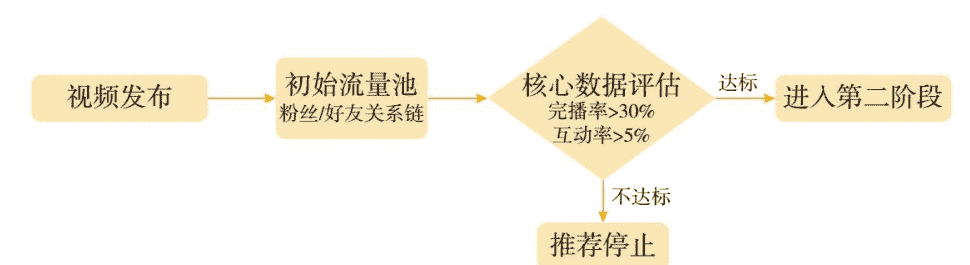

图2-3 第一阶段算法推荐

**第二阶段是公域试探。** 基于第一阶段的数据（尤其是点赞率和评论率），系统会把视频推给少量对这类话题感兴趣的陌生人，根据陌生人的互动数据判断是否能进入第三阶段（见图2-4）。

###### 第二阶段：公域试探

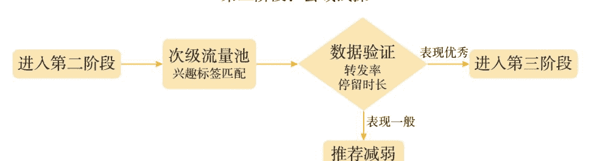

图2-4 第二阶段算法推荐

**第三阶段是流量爆发。** 如果陌生人也觉得好，系统就会加大推送力度。这时候，熟人推荐和陌生人推荐会交替上升，直到视频成为爆款（见图2-5）。

###### 第三阶段：流量爆发

图2-5 第三阶段算法推荐

我们可以利用AI，根据算法预设的指标，对视频进行更加精细的优化。这里我总结了通过AI优化的具体步骤，你只需要照着做，就能把AI变成你的流量操盘手。

###### 第一步：用AI优化“黄金3秒”，提升完播率

完播率是算法推荐的门槛。如果用户连前3秒都看不完，算法会直接将视频判定为低质量内容。我们可以这样给AI指令。

> 请分析这篇脚本的开头。它是否能在3秒内抓住用户的注意力？如果不能，请用反常识、提问的方法，帮我写5个更有吸引力的开头。要求：必须简短有力，直击痛点。

###### 第二步：用AI埋设槽点，提升评论率

评论率是互动率中权重最高的一项。一个爆款视频，评论区甚至比视频本身还精彩。以前写脚本时，总要绞尽脑汁想怎么才能让用户评论。现在，我们可以这样给AI指令。

请在脚本的中间部分设计一个有争议的观点，或者保留一个小漏洞（不能影响整体质量的那种），引导用户在评论区反驳或吐槽。同时，在结尾设计一个开放式提问，让用户忍不住想回答。

###### 第三步：用AI提炼金句，提升点赞率

用户点赞视频就能使视频在他的朋友圈传播，而金句就是最好的传播利器，同时让更多人点赞。我们如果想让AI生成金句放在视频中，就可以这样给AI指令。

> 请基于脚本的核心观点，帮我提炼3句朗朗上口、适合发朋友圈的金句。要求：对仗工整，富有哲理，能引起情感共鸣。

##### 三、熟人裂变效应：视频号的隐藏传播路径

现在，我们知道了视频号点赞的重要性，深度分析了视频号流量从私域到公域的爬坡路径，就可以基于视频号传播逻辑的独特性，找到视频号的隐藏传播路径：熟人裂变效应。

在我的视频号“方比比先生”爆火后，短短一周内我与合伙人收到了不下100条类似的私信，都是同行或朋友告诉我们：我妈妈刷到了你的视频，还转发给我了。

这种情况在其他平台几乎不会发生，但在视频号，它是常态。一开始我以为是算法精准推送，能直接把内容推给目标用户的父母。后来研究了一下我才发现，这并不是算法推荐，而是基于熟人社交关系的链式传播。

我们在公众号“理白先生”分享过一个有趣的案例。我认识王老师，我们是朋友。王老师和她妈妈是微信好友。当我的视频在平台上火起来之后，会沿着社交链条传播——直接绕过王老师，推送到她妈妈那里。然后她妈妈觉得不错，又把视频转发给王老师。

这就是视频号熟人推荐的威力——哪怕你的朋友不点赞、不评论、不转发，他们的父母、亲戚、同事，依然可能刷到你的内容。当一个人发现自己的社交圈里有多个人都在传播同一条视频时，信任感就会瞬间拉满。

视频号的传播路径不是“我—我的粉丝”，而是“我—朋友的妈妈—朋友—朋友的同事—同事的家人”，沿着社交关系一圈一圈传播出去。

这也印证了前面说的：在视频号，点赞不只是点赞，而是一张裂变的门票。你的内容能不能火，很大程度上取决于它能不能沿着用户的社交链条传播出去。

##### 小结

视频号的推荐机制和其他平台不一样，它是“社交推荐+算法推荐”的双引擎驱动。视频号的底层逻辑是朋友圈传播，你点赞的每一个视频，老板、同事、客户、家人都能看见。所以，视频号的内容必须具备社交体面感，让用户敢点赞，视频才更容易获得流量。

视频号的流量爬坡分三个阶段：私域测试（推给粉丝和好友）—公域试探（推给感兴趣的陌生人）—流量爆发（熟人和陌生人推荐交替上升）。

最终，视频号形成了独特的熟人裂变传播路径。视频会沿着社交链条扩散，当一个人的社交圈里多个人都在传播同一条视频时，信任感就会倍增。

#### 2.1.2 数据指标：读懂这四个关键数据，系统持续推荐长尾流量

视频号的爆款数据具有长尾效应，一条好视频的生命周期可以长达三个月，甚至半年。你今天发的视频，可能下个月还有人在给你点赞，你的账号还在涨粉。

想要触发这种长尾流量，就得满足系统的考核标准。系统“看不懂”你的视频拍得好不好，它只“看得懂”数据反馈。我总结了四个影响账号发展的关键数据。

##### 一、完播率：能不能把人留住

完播率由完整播放次数除以总播放次数而得，即完整看完的次数占播放的总次数的比例。简单来说，就是有多少用户把你的视频看完了。这是系统的第一道关卡，如果用户连你的视频都没看完就划走了，系统会觉得这条内容可能没那么吸引人，自然就不会继续推荐给更多人了。

完播率这个指标最能反映内容吸引力，完播率低说明内容结构或者开头有问题。部分新手写脚本时习惯做铺垫，讲一大堆背景。比如在开头说“大家好，我是××，今天天气不错，我想跟大家聊聊……”，还没等讲完，用户可能已经把这个视频划走了。

因此，我建议把结果前置，让用户一开始就有获得感。举个例子，那些数据很好的美食视频不会在开头先介绍食材，而是直接展示成品的诱人画面，配上“妈妈一定要会的15道蒸菜”“小酥肉的做法毫无保留分享给大家”等文案，让用户更想看下去，根据视频学习做菜技巧。

我们也可以让AI帮我们删除废话，可以尝试给它这些指令。

你是一位非常有经验的短视频剪辑师，请帮我看看下面这段脚本。我需要你做这几件事。

- 1. 帮我删掉那些没用的铺垫，特别是开头的客套话，要让内容更紧凑。
- 2. 把最精彩、最颠覆认知的结论放到最前面这几秒来说。
- 3. 帮我把字数减少一点，但要保留核心意思。
- 4. 我的目标是让用户听第一句话就想停下来，听完前五秒就想继续往下看。

##### 二、评论量：大家愿不愿意说话

提高互动率最有效的方法是增加评论量。这个指标直接反映了内容的吸引力和用户的参与度。很多视频内容中规中矩，道理讲得都对，但就是没人评论。点赞代表用户认同你，但评论代表用户愿意参与讨论你的话题。如果大家在一条视频的评论区讨论得很热烈，系统会认为这条视频很有话题度，就会把它推送给更多人，尝试引发更大的讨论。

有一位育儿博主，他在讲孩子教育的时候说：“教育是引导而不是命令。”结果评论区有特别多用户表达各自的立场，有人支持，有人反对，有人分享自己的经验。那条视频的评论量是他其他视频评论量的好几倍，于是系统就判定这是一条讨论热门话题的视频，将其推送给更多人。

我们可以让AI在脚本里专门设计一些能激起大家讨论的点。你可以这样告诉AI。

你是一个很懂社群运营的专家。请帮我优化这段脚本，在不改变原意的前提下，帮我加两处能引导大家评论的地方。

- 1. 在视频中间，加一个稍微有点争议的观点，或者留一个小漏洞，让大家忍不住想在评论区反驳或者纠正我。
- 2. 结尾不要用陈述句结束，设计一个二选一的问题，或者一个简单的填空题，让大家随手就能在评论区打字回复。

这里有一点要注意：有争议的观点不等于胡说八道。你抛出的观点必须有一定的合理性，能够引发讨论，但又不能太离谱。否则，用户会觉得你在博眼球，反而会取消关注。所以，引发争议的尺度要把握好。

##### 三、转发量：大家愿不愿意推荐你

转发其实就是一种信用背书。当用户把你的视频转发到朋友圈，就是在告诉他的朋友们：“我觉得这个内容好。”系统捕捉到这个动作，会给你的账号贴上高价值的标签，长尾流量往往就是这么获得的。

某条视频发布一个月后突然又火了，就是因为被某个影响力大的人转发了。很多创作者只顾着自己讲得开心，却没想过用户是否会转发自己的视频。用户转发通常只有两个原因：要么是为了表达自己——看，我有品位，我懂这个；要么是为了帮助别人——这个对你有用，或是这个太好笑了。

当你的视频结尾出现了金句，用户转发的动作往往是下意识的。比如，某条视频结尾的金句是：“40多岁的年纪，谁都不想取悦了。”这句话引发了很多中年人的共鸣，不少人在转发时还会配上自己的感悟，带来了可观的传播效果。

金句的本质是帮用户表达他们的情绪和态度。很多人心里有话想说，但不知道怎么说的漂亮。如果你的金句能替他们说出来，他们自然会转发。所以，写金句的时候，要站在用户的角度，想想他们此刻的心情是什么，他们想对谁说什么。

我们让AI帮我们提炼出适合发朋友圈的金句，可以给它这样的指令。

你是一位很会写金句的作家。请分析这段脚本的核心主题，帮我写五条适合用于视频封面或结尾字幕的金句。

要求如下：

- 1. 句子要短，不要超过15个字；
- 2. 要能引起大家的情绪共鸣，替用户说出他们想说但不敢说的话；
- 3. 要有具体的场景感，比如针对全职妈妈、创业者或者失恋的人。

##### 四、粉赞比：能不能把路人变粉丝

粉赞比是涨粉数量和点赞数量的比例，也就是每多少个点赞能带来一个粉丝。这个数据展示了账号的长期价值。有的视频点赞量很高，但点赞的人很少会关注博主，为什么？因为用户只是觉得这个视频挺有意思，但是并不认为这个博主值得关注。

系统如果发现你的粉赞比太低，就会判定你不是一个能持续输出优质内容的创作者，给你的扶持就会变少。单纯用AI做的视频，往往缺乏个性，无法让用户对博主的内容产生深刻印象。

可以让AI在每一条视频里都强化一下你的个人特色，并且给下一条视频做个预告。

你可以这样告诉AI。

我在这个账号的人设是×××（比如一位只讲真话的包工头）。

请在脚本的开头和结尾，加上一句有个人风格的口头禅。

并且，在结尾处设计一个下集预告。告诉用户：“关注我，下一集将揭秘一个更劲爆的内容（请根据当前脚本内容自动生成下集预告的主题）。”

通过下集预告，你就让用户在一次观看后产生了连续的期待。用户为了看下一集，就会主动点关注。这就是利用AI制造未完待续感觉的方法。

有位历史赛道的博主做了一系列讲历史故事的内容，每个视频讲一个历史人物从出生到巅峰的故事，每期结尾都留悬念。这个系列一共做了8期，从第一期到最后一期，他的涨粉速度呈现递增趋势。到最后一期的时候，评论区出现了大量“终于等到大结局了”“这一周追得好辛苦”之类的留言。

这个案例说明连续剧效应在视频号是完全可行的。用户习惯了追剧的体验，你把内容做成连续的，他们自然会追着看。关键是每一期都要留一个钩子，让用户期待下一期。

这个钩子不一定是悬念，也可以是一个承诺。比如，你做职场赛道，这期讲了如何写简历，就可以在结尾说：“下期教你面试时如何谈薪资，让HR主动给你加钱。”用户产生好奇心，因此马上就会关注。

##### 小结

视频号的流量其实并不神秘，它背后都是数据在说话。

完播率是基础，靠AI帮你删掉废话，把内容做精。

评论量是热度，靠AI帮你设计话题，让大家聊起来。

转发率是口碑，靠AI帮你写出金句，让大家愿意转。

粉赞比是转化，靠AI帮你设置悬念，把路人留下来。

#### 2.1.3 页面全解：用好三大页面功能，无限放大流量价值

如果把爆款视频比作发出去的传单，那视频号的主页就是店铺的门面。客人被传单吸引来了，结果发现店里空空荡荡，连个招牌都没有，那客人肯定很难在店里消费。同样的道理，我们在运营视频号时要“装修”好自己的账号，做好基础设置。

这一节，我们就来聊聊视频号里最容易被忽略的三个操作：视频置顶、账号设置、评论区置顶。我会手把手教你在哪里设置，同时讲清怎么把这些位置利用好。

##### 一、视频置顶：别让你的好内容被埋没

很多博主发了几百条视频，用户点进主页只能看到他最近发的几条，那些数据和内容很好、有引流效果的作品却因为发布时间早而被“埋”在了后面，新用户根本看不到。

视频置顶功能就是用来解决这个问题的：把你最好的视频展示在主页最上面，让每个进来的人都能第一眼看到你的精华内容。

###### 1. 置顶功能的设置

操作方法非常简单：在视频号主页，找到并打开想置顶的视频，点击右上角的三个点按钮，在弹出的菜单中选择“置顶”就完成了（见图2-6）。

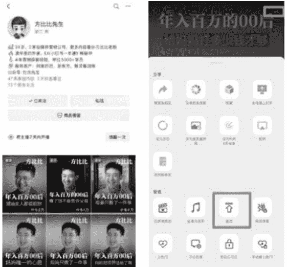

图2-6 视频号置顶功能设置

如果你想更换置顶视频，操作同样简单。打开已置顶的视频，点击右上角三个点按钮，选择“取消置顶”就可以了（见图2-7）。

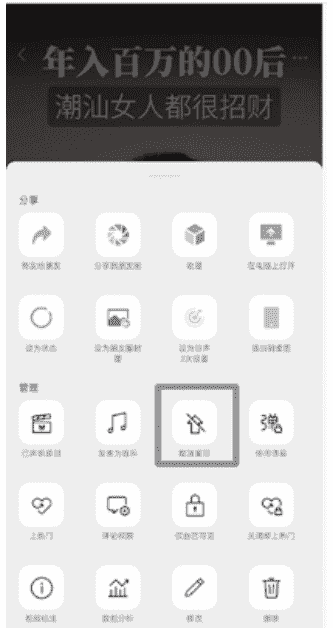

图2-7 视频号取消置顶操作方法

建议大家每个月看一次数据，如果有新的爆款出现，就及时更新置顶视频，保持主页的活力。

###### 2. 置顶视频的数量和选择

视频号目前最多置顶三条视频。我建议按如下方式安排。

第一条放高赞爆款视频，用数据证明实力，告诉用户你很受欢迎。人都有从众心理，看到一条视频有几万点赞，自然会觉得这个博主值得关注。

第二条放自我介绍视频，快速建立信任，让用户了解你是谁，你的经历和专长是什么。

第三条放核心业务或高价值干货，展示你的专业能力，同时引导用户转化。

秋叶大叔团队的视频号就是个很好的例子。他们精心设置主页的置顶视频，将高赞爆款、自我介绍和核心教程三个视频进行合理排列：用户点进主页，第一眼就看到一条点赞几万的爆款，就会认为这个账号有实力；接着又看到一条30秒的自我介绍，就知道这是一位做职场培训的老师，有十几年的经验；最后看到一个完整的课程介绍，知道了他能解决什么问题。这样的排列，既展示了专业度，又建立了信任，还提供了价值（见图2-8）。

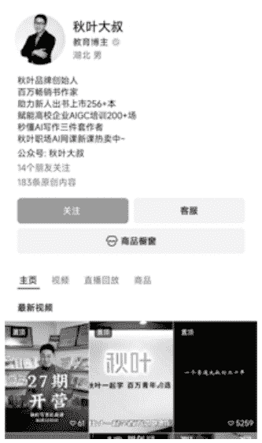

图2-8 秋叶大叔的三条置顶视频

##### 二、账号设置：让别人找到你、联系上你

说完视频置顶，我们来看看账号的核心设置功能，也就是简介区与个人资料。设置得当的简介区，能提升你的流量转化率。

###### 1. 头像设置

在视频号主页，直接点击自己的头像区域，进入后点击编辑按钮，就能看到“更换头像”选项。点击后可以从相册选择图片或拍摄新照片作为头像（见图2-9）。

图2-9 视频号头像修改操作方法

建议选择一张清晰、有辨识度的头像。如果是个人账号，用真人照片最好，能建立信任感；如果是企业或IP账号，就用统一的品牌标志，方便用户记忆。

###### 2. 简介设置

简介是用户了解你的第一窗口，非常重要。简介就显示在昵称下方，是用户点进主页后第一眼就能看到的内容（见图2-10）。

图2-10 视频号简介

想要修改简介也很简单。在视频号主页，点击头像区域进入编辑页面，找到“简介”一栏，点击进入即可修改。视频号简介的字数通常为50～100个字（见图2-11）。

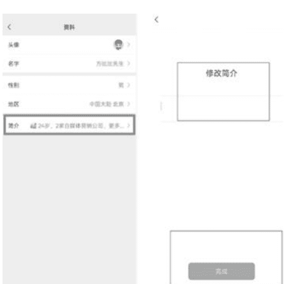

图2-11 视频号修改简介操作方法

###### 3. 绑定公众号

在视频号主页右上角点击三个点，进入账号管理，找到“账号安全与绑定”，按照页面提示操作即可完成绑定（见图2-12）。

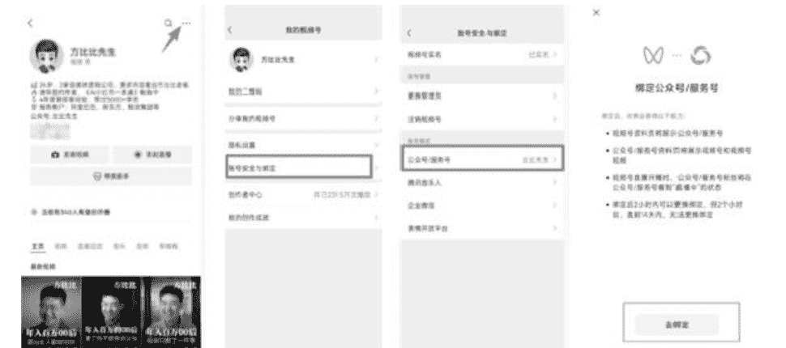

图2-12 视频号绑定公众号操作方式

绑定后就可以实现公众号与视频号的流量互导（见图2-13），比如你在视频号发了一条爆款视频，可以引导用户去公众号领取完整版资料，这样就把公域流量沉淀到了私域。

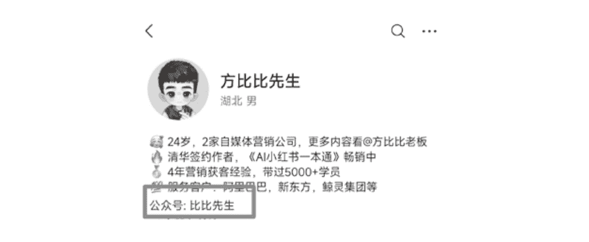

图2-13 公众号和视频号的流量互导

###### 4. 企业认证

在账号管理中可以找到企业或机构认证入口，认证后会获得更多功能权限和信任背书（见图2-14）。比如，可以在主页挂小程序、开通直播带货等功能。如果你想要长期运营这个账号，应尽早完成认证。

图2-14 视频号企业认证操作方法

##### 三、评论区置顶：搭建与用户沟通的桥梁

置顶评论可以回答用户的高频问题、引导用户打开更多视频，甚至能够把流量引到私域。

###### 1. 评论区置顶功能

我们可以先自己在评论区留言，然后找到自己刚发布的评论并长按，在弹出的菜单中选择“置顶”（见图2-15）。这样无论后面有多少人评论，这条评论都会稳稳地保持在第一位。

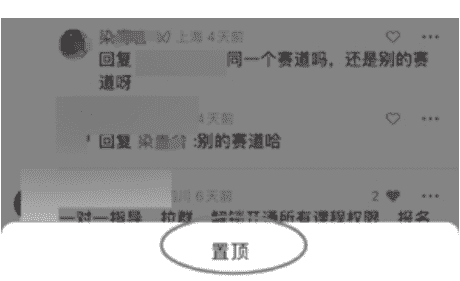

图2-15 评论区置顶功能操作方法

###### 2. 置顶评论的内容

高价值的置顶评论通常有三方面作用：回答用户的高频问题，引导用户观看其他视频以增加账号完播率和停留时长，引流到私域来实现流量转化。

比如，职场穿搭赛道的博主可以这样写置顶评论：“很多姐妹问我视频里的衬衫链接，其实衬衫是我自己改的。我把改造教程放在了下一条视频里，想学的姐妹可以去看看。另外，我建了个穿搭交流群，想进群的姐妹可以点我头像，私信‘穿搭’两个字。”

如图2-16所示，这条置顶评论就做了三件事：回答了用户的问题，引导用户去观看其他视频，还顺便引流到私域。用户看完不会觉得你在打广告，反而会觉得你很贴心，主动帮大家解决问题。

图2-16 评论区置顶内容

##### 小结

这一节我们深入拆解了视频号里最容易被忽略但作用巨大的三个操作：视频置顶、账号设置、评论区置顶。

**第一是视频置顶。** 在视频详情页右上角点击三个点，选择“置顶”，最多可置顶三条视频。建议按照高赞爆款、自我介绍、核心业务的顺序排列，用数据和内容建立信任。

**第二是账号设置。** 在视频号主页点击头像区域进入编辑页面进行修改。头像要清晰有辨识度，简介要在50～100字，说清楚你是谁、做什么、能提供什么价值。还可以绑定公众号实现流量互导，完成企业认证能够获得更多功能权限。

**第三是评论区置顶。** 长按自己的评论选择“置顶”。置顶评论要提供价值、引导行动，可以用来回答高频问题、引导观看其他视频、引流到私域。

### 2.2 账号四件套：打造吸睛的高质感IP

#### 2.2.1 账号开通与认证

在视频号的生态里，账号就像是你在这个数字世界里的身份证。账号开通与认证的具体操作更是直接关系到账号的权重、能获得的公域流量扶持以及未来的变现路径。

尤其是在AI创作爆发的今天，平台对于账号身份的真实性和权威性审查变得更加严格。如果因为不懂规则留下了违规记录，将来很可能面临账号限流的情况。

本节我们就来彻底拆解视频号的各种认证类型，帮你轻松避开那些足以让你新号报废的坑。

##### 一、选身份是视频号的第一道关卡

我们要先厘清一个核心逻辑：视频号是绑定在微信这个熟人社交工具上的，这意味着你跟粉丝的关系往往是基于朋友、社群或者是熟人推荐建立的。用户点赞转发往往是因为信任你。

视频号的身份认证，就是让平台替你完成背书。这种天然的信任基因决定了，认证后用户也会更加信任你。认证成功后会在昵称后面及账号主页显示认证结果。

视频号认证分为三种身份。第一种是没有认证的个人号，无特殊标识，也无须准备复杂的资质材料，只要完成基础信息填写，即可开始发布内容。这种身份认证适合所有普通用户，用于记录生活、分享兴趣爱好以及前期起号测试。

##### 二、选个人号还是企业号取决于你的变现终局

这时候你可能想问：那到底什么时候该选个人号，什么时候该选企业号呢？这要根据变现方式和具体定位来选择。

先说企业认证，也就是咱们常说的蓝V，其最大的特点是“品牌背书”。如果你是一家成熟的公司，计划打造一个官方账号，那企业认证是极佳的选择。

更关键的是，如果你后续打算投入资金进行广告投放，让优质产品被更多人看见，那企业主体身份会让你的投入产出更稳定。

但企业认证也有缺点：它天然带着营销标签。如果你是个人博主，带着蓝V发布内容，用户容易觉得你的营销感很重，信任成本反而变高了。而且，企业号的实名主体必须是法人或者授权员工，一旦公司资质出问题，整个矩阵都会受影响。

再说个人号，即无认证或黄V。它适合大部分的个体创业者，起号门槛极低，不需要认证也能发视频。个人号最大的好处是灵活性高，你可以先测试三个月，依据市场反应再做决策。

对于绝大多数刚刚入行的个体创作者，我更推荐从“个人号”起步。你可以先多多发表优质内容，同时要正确填写简介，完善账号基础设置。当有了一定的粉丝基础后，你就可以完成身份进阶了，即申请兴趣认证或职业认证（见图2-17），比如搞笑幽默博主。这种认证方式不仅能让你的账号挂上黄V，增加信任度，还能让你在算法推荐中获得特定标签的权重加持。

图2-17 视频号认证页面

进行职业认证时需要保证材料的真实性。视频号的审核是非常严苛的，采用人工+大数据复核的模式。用户要确保资料真实，一旦被平台判定为虚假认证，该微信号下的所有数字资产及账号都可能面临永久封禁。

如果你没有硬性的职业资质，那就选择“兴趣认证”。比如摄影博主、音乐博主等。这虽然不能直接证明你的专业性，但系统还是会打上精准的标签。比如，当系统识别到你是一个认证过的“摄影博主”，它就会更容易把你的摄影视频推送给那些对摄影感兴趣的公域人群。

##### 三、这四个坑千万不能踩

第一个坑是“实名主体冲突”，这是最基础的，也最容易被忽视的：一个身份证信息目前只能实名认证一个视频号。很多人在几年前随便注册过一个视频号账号，很久不用就忘了。现在想正儿八经运营视频号时，发现无法重新注册了。

如果存在这种情况，你需要先去将之前的账号注销掉。要注意，如果你后续要开通微信小店卖货，视频号的主体、小店的主体和实名认证的主体必须保持一致，所以最好都用自己的身份注册。如果这三者不一致，账号的钱可能无法提现。

第二个坑是“微信账号健康度”。视频号并非完全独立的平台，它是以微信为基础的。如果你的微信号刚注册没几天，或者经常因为乱发广告被禁言、被提示环境异常，那你注册的视频号账号就会存在风险，可能会一直在算法的观察期里。

还有不少人为了“矩阵起号”会注册许多新微信号。建议大家使用自己用了5年以上、有正常社交记录、绑定了银行卡的常用微信号来注册视频号账号，这样系统会认为你是一个“真实的人”，给你账号的初始权重，会比新注册的微信号高出一个量级。哪怕发的是一样的视频，权重更高的账号的推荐流也会更持久。

第三个坑是“认证类型与内容不符”，这是很多做矩阵账号的人最容易犯的错。比如随便使用一个公司的执照认证蓝V，结果天天发劣质内容，系统的人工巡检很快就能捕捉到，轻则取消认证标识，重则直接判定为“营销欺诈”。

第四个坑是“名称权属归属”。比如，你想取名“××带你学职场”，系统可能会提示“涉及职业培训，需要认证”。这里有个技巧：在起号阶段，先不要起那些带有“官方”“国家”“学院”甚至是敏感职业词的名字。先用一个通俗好记的昵称，等积累到一定数量的粉丝，拿到认证资格了，再去修改名称。视频号的名字目前一年只有两次修改机会，一定要珍惜。

##### 小结

账号入场，身份先行。视频号的认证体系不是门面，是立足依据。

- 个人号适合测试和人设破冰，企业号适合品牌背书和规模化投流。
- 黄V认证是专业博主的“信任加速器”，严禁资料造假。
- 实名制下，一个身份证只能注册一个视频号账号，别轻易试错。
- 认证主体、运营主体、交易主体必须“三位一体”，才能实现闭环。

#### 2.2.2 昵称：用AI取一个自带流量的爆款名字

账号名称是我们对外展示的第一张名片。一个好名字能带来精准的推送，系统算法会优先推荐给搜索过相关词的人群，而且更容易涨粉。名字、头像、简介风格一致，会提升我们的可信度，让用户更愿意关注。

这一节我们就来聊一聊，怎么借助AI起一个好名字，撬动我们的初始流量。

##### 一、名字不是个性签名，是流量钩子

一个好名字，至少要实现以下三个目标。

###### 1. 让算法秒懂

账号名称要让算法知道这个账号是跟什么主题相关，这样它才会将账号放进对应的流量池里进行推荐。

例如，“杨小厨教做菜”“阿比说保险”等名字十分简单，但赛道清晰、算法好识别，一个教做菜，一个谈保险，算法就会精准地把它们推荐给日常喜欢看这类内容的用户群体。

###### 2. 让用户秒懂

要在0.3秒内告诉用户，关注这个账号能得到什么。

例如，“郑奶奶科学育儿”“雅客PPT定制”等名字价值明确，新手爸妈和职场小白如果有这方面的需求，就会主动关注和点赞。

###### 3. 让传播秒实现

账号名称要简单好记，让用户在朋友聊天时能随口推荐。

例如，“老爸评测”“年糕妈妈”等名字简单好记，朗朗上口，用户看过一眼后很容易就记住，搜索的时候也很容易想起来。

##### 二、起好名字的三个黄金动作

###### 1. 埋对关键词，让算法主动推流

如果做运动健身领域的账号，名字最好包含“健身”“燃脂”“运动”这些关键词。比如“阿伟有氧健身塑形”“小翠有氧健身运动”，这样更容易被目标用户搜索到，既能获得长尾流量，又能吸引目标用户的关注。

###### 2. 有人情味，提高用户信任

大家越来越爱看真实的内容，而不是千篇一律的机械风格，所以名字里最好带上更多“人”的气息。

比如，可以在昵称里加上称呼，比如“聪哥说车”“63奕姐”，带有“人”味，显得更亲切真实。

###### 3. 说清价值，让用户立马想分享

人的注意力非常宝贵，黄金时间只有1秒多，我们需要在极短的时间内让用户关注到我们，被我们的内容吸引。

名字要直接呈现账号价值，亮明你能给用户带来什么实际收获。比如“崔哥搞定销售”“徐一一自律修心记”。

##### 三、别自己硬想，让AI当起名军师

很多人不知道该起什么样的名字，那就可以让AI来帮忙。普通人的词汇量是有限的，但AI能结合全网搜索趋势，帮我们想到意料之外的组合。

需要注意的是，使用AI时不能简单地说“帮我起个名字”，而是要给它具体的需求指令。下面是一套我验证过很多次的AI起名指令模板，你也可以尝试下。

你现在是一名短视频账号起名高手，特别了解微信搜索的规律。请帮我在×××方向，生成一批视频号账户昵称。要求如下：

- 名字里必须包含这个领域大家最常搜的词；
- 结构最好是身份+能帮人解决的问题；
- 让人感觉关注就能有收获；
- 听起来像朋友推荐，很自然；
- 包括多种类型：专家型、解决具体问题型、陪伴成长型。

整体控制在4～6个字，在手机上能呈现最佳显示效果。

##### 四、红线清单：这些名字千万不要用

###### 1. 不用生僻字和符号

类似于“减肥★教主”“小憩の瘦身屋”，即使用户想搜索，面对“憩”这样的生僻字，或者“★”“の”这样的字符，99%的人会选择放弃，因此很容易就失去潜在用户。

###### 2. 不要太宽泛

比如美食赛道的账号，用“美食日记”就不如“小刘的减脂餐”，辨识度很重要。用户看到名字，大脑就会形成预期，只要你的名字足够具体，用户就容易形成具体预期，清楚你是做什么内容的。

###### 3. 不模仿大V

大V有自己的粉丝群体，以大V的名字为基础就容易活在别人的阴影之下。“刘耕宏济南分宏”“帕梅拉中国女孩”，用户看到这类名字，第一反应是“山寨版”或“跟练账号”，而不是一个有独立价值的IP。你吸引来的用户可能是大V的流量溢出，但这些用户忠诚于大V，并不会选择你。

###### 4. 不混用中英文、数字和符号

人脑善于记忆有意义、有规律的词组，而非随机组合。用户如果要搜索你的名字，还要在中英文输入法间切换，很是麻烦。比如“Lucy_2025”，用户需要记忆三个无关联的元素：英文名、符号、数字，记忆成本很高，搜索不方便，识别度也不高。

##### 小结

一个好的名字本质上是个效率极高的流量漏斗，它能筛选出精准的用户群体，完成价值传递，建立用户信任。把名字当成一个自带搜索属性的流量钩子。在这个过程中，我们要反复打磨。

1. 埋对关键词，让算法主动推流；
2. 有人情味，提高用户信任；
3. 说清价值，让用户立马想分享。

#### 2.2.3 头像：AI定制高辨识度头像，一张图立住专业人设

头像是用户对你的第一印象，也是最直接的信任凭证。高质量的头像能传递出你的专业度、审美和可信度。

借助AI工具，可以快速生成高质感的头像，下面我就来详细地讲解方法。

##### 一、用AI生成职业照片：打造专业可信形象

用AI生成职业照片是最快捷的方式，你可以使用美图秀秀、豆包、Midjourney、妙鸭相机等工具，上传3～5张不同角度的真人照片作为参考素材，AI会根据你选择的风格（商务职业、轻松亲和、时尚潮流等）生成一系列高质感的职业照。

###### 1. 美图秀秀直接生成

在美图秀秀的主页找到“AI形象照”，点击“我的形象照”，开始创建你的面部档案，上传3～5张不同角度的真人照片作为参考素材，然后选择你喜欢的风格，让AI开始生成，非常简单（见图2-18）！部分服务可能需支付相应的费用，按照你的需求选择即可。

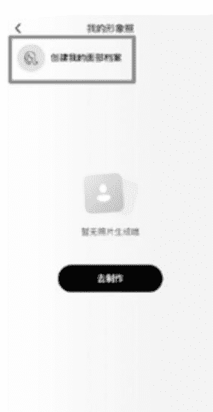

图2-18 美图秀秀生成职业照片操作方法

生成时注意选择与你的账号定位相匹配的场景和服装。比如知识付费博主可以选择简洁的纯色背景和商务休闲装，生活方式博主可以选择自然光和日常穿搭风格。

###### 2. 调试豆包生成

豆包有“AI写真”的功能，方法和美图秀秀类似，一分钟可以生成你的专属AI照（见图2-19）。当然，你也可以给豆包提示词，让豆包按照你的需求生成不同风格的头像，同样需要给豆包3～5张不同角度的真人照片作为参考素材。

图2-19 豆包“AI写真”操作页面

我已经给了你3～5张不同角度的真人照片作为参考素材，帮我生成一张××岁亚洲××（性别）的头像照片，穿着××（颜色）的西装外套，面带微笑，干净的白色背景，柔和的影棚光线，高分辨率，专业摄影风格，高清画质。

##### 二、用AI生成卡通IP形象：打造差异化记忆点

想要打造差异化记忆点，但是不想露脸的博主，可以通过豆包等工具将真人照片转化为卡通形象，或者直接用文字描述生成专属的卡通IP形象。

我已经给了你3～5张不同角度的真人照片作为素材，帮我生成一个可爱的卡通亚洲职场××（性别）头像，穿着商务休闲装，手持××（笔记本电脑/书/咖啡杯），自信微笑，干净简洁的背景，明亮的色彩，专业但亲切的形象，高质量插画。

##### 三、用AI修图工具优化真人照片：提升现有照片质感

如果你有不错的真人照片，但觉得光线不足、清晰度不够或细节不够理想，可以使用醒图、Remini、美图秀秀等工具进行智能优化。这些工具能自动调整照片的清晰度、亮度，甚至调整构图，让普通照片瞬间拥有专业摄影的质感。

醒图是国内最受欢迎的修图工具之一，它的“AI修人像”功能可以智能识别面部特征，自动优化光线和肤质，同时能够保持自然质感，不会出现过度美颜的虚假感（见图2-20）。使用时也可以自己适度调整参数，让照片看起来更清晰通透，但依然保留真实的面部特征，这样的头像更容易建立信任感。

图2-20 醒图主页面

醒图有一些修图固定模板可以直接进行使用，你也可以自己提出修图的具体要求，或是上传参考图（见图2-21）。

图2-21 醒图修图操作页面

美图秀秀的智能抠图和背景替换功能非常实用。如果你的照片背景杂乱或者不够专业，可以用它一键抠出人物，然后替换成纯色背景、办公室场景或者其他符合人设的背景（见图2-22）。

图2-22 美图秀秀主页面

这个功能可以帮你快速统一视觉风格，让所有头像和配图保持一致的专业调性，提升账号的品牌感。

##### 小结

头像是用户对你的第一印象，合适的头像能直接提升信任感和专业度。用AI工具来制作头像，主要有三种方式。

方式一：AI生成职业照片。这种方式适合想要塑造专业可信形象的博主。

方式二：AI生成卡通IP形象。这种方式适合不想露脸，但想要打造差异化记忆点的博主。

方式三：AI修图优化现有照片。这种方式适合已经有不错的照片，但想提升照片质感的博主。

#### 2.2.4 简介：自带光环的电子名片

如果简介写得好，每一个点进主页的人都可能成为你的粉丝。而且简介还能被微信搜索收录，只要写对了关键词，流量就会主动找上门。

这一节，我们就来讲清楚：怎么用AI写出让人看一眼就想关注的简介。

##### 一、简介的本质：给用户一个关注你的理由

有些人会在简介中写“一个热爱生活的人”“不忘初心，方得始终”，或者直接写“商务合作请联系：×××”。这些简介都有一个共同的问题：只顾着说自己。

在互联网上，没有人真正关心你是谁，用户只关心你能帮他解决什么问题。用户的时间极其宝贵，他在你的主页停留的时间可能只有短短三秒。在这三秒钟里，你的简介必须能够回答用户潜意识里的三个问题：

1. 你是谁？
2. 你有什么本事？
3. 关注你对我有什么好处？

一个有价值的简介本质上是一份价值承诺书。它能告诉用户：关注这个账号，你的生活会发生什么改变，你能学到什么技能，或者你能避开什么坑。

比如我的视频号“方比比先生”的简介就清楚地告诉了用户我的年龄、身份、过往成就，其中特意提到了我的客户案例、学员数量，说明我的方法可复制。用户看完会想：这个人能帮我解决营销获客问题，值得关注（见图2-23）。

图2-23 视频号“方比比先生”的简介

##### 二、爆款简介的万能公式：身份+背书+价值+引导

###### 1. 第一要素：身份定位

这是简介的开头，也是决定用户第一印象的关键。切记，不要用过于宽泛的词。比如，设计师这个词就太宽泛了，是室内设计师、平面设计师，还是服装设计师？宽泛有时意味着不专业，也就意味着用户无法对号入座。更好的写法是“10年专注小户型改造的设计师”或者“专门帮实体店做海报的设计师”。

在这里，我们可以利用AI来寻找差异化定位。你可以把你的职业履历告诉AI，然后这样给它指令。

请根据我的经历，帮我提炼出三个在视频号上容易涨粉的垂直身份标签，要求具体、有辨识度，不要用宽泛的词。

AI可能会给出这样的答案。

小户型空间“魔术师”，实体店流量操盘手，零基础AI绘画导师。

这些词不仅清晰具体，而且自带一种专业感。细分类目的标杆账号正在大量涌现，定位越是精准，就越容易在垂直领域脱颖而出。

###### 2. 第二要素：信任背书

这是建立信任最快的方式。互联网上信息庞杂，用户为什么相信你？凭数据，凭结果。很多人说，我就是一个普通人，没什么大成就，怎么办？其实是你不会“包装”。

这时候，AI的数据化思维就能派上用场了。比如，你是一个英语老师，拥有五年的教龄。如果你只写资深英语老师，就毫无吸引力。

你可以这样告诉AI。

我教了五年英语，带过大约20个班，几百个学生，很多学生的成绩都提高了。

AI会帮你优化成如下内容。

五年一线教学经验，累计辅导超800名学生，帮助超300名学生实现逆袭，取得高分。

###### 3. 第三要素：用户价值

写简介时，你要把“你会什么”转化成“用户能得到什么”。比如，你会做红烧肉，这是你的能力，而你能教用户3分钟做出红烧肉，这就是给用户的价值；懂法律是你的能力，而帮用户避开合同里的陷阱、维护合法权益就是给用户的价值。

这一步，我们也可以利用AI来挖掘痛点。你可以这样给AI指令。

我想做一个职场类的账号，目标用户是刚毕业的大学生，请帮我列出他们最焦虑的五个痛点，并将其转化为我能提供的价值文案。

AI会告诉你，他们焦虑的痛点是面试、职场“潜规则”、升职加薪等。对应的价值文案如下。

教你面试通关话术、教你职场防身术、教你快速看懂职场晋升逻辑。

###### 4. 第四要素：引导关注

不要只等着用户主动去点关注，也可以适当进行引导。比如“关注我，免费领《AI实操手册》”“关注我，有惊喜，每天早上8点，直播间答疑”等。

##### 三、简介里的搜索思维：让流量主动找上门

现在的微信已经不仅仅是一个聊天工具，更是一个巨大的搜索引擎。有问题想问时，越来越多的人习惯使用微信来搜索答案。

当用户在微信里搜家常菜做法、怎么教孩子写作文、哪里的火锅好吃时，系统会优先抓取账号名字和简介里包含这些关键词的人。

我们在写简介的时候，可以适当在其中埋入用户搜索词，你只需要向AI提出下面的问题。

在我的这个领域（比如美食烹饪），用户最近一个月在微信和全网搜索频率最高的10个关键词是什么？

AI就会给你答案如下答案。

家常菜、快手晚餐、营养早餐、下饭菜、儿童食谱……

了解这些词之后，你要做的就是把它们自然地写进你的简介里。比如，原本你写的是“教你做饭”，现在你可以改成“专注营养早餐与快手晚餐分享，教你做简单美味的家常菜”。

##### 小结

简介虽短，但决定了用户是否会关注你。核心公式包括四个要素：身份定位、信任背书、用户价值、引导关注。

身份定位要具体，信任背书要有数据，用户价值要说清楚，引导关注要给理由。

## 第三章 AI精准定位：找准天选赛道，才能事半功倍

### 3.1 黄金定位法则：精准塑造账号的差异化竞争力

#### 3.1.1 定位逻辑：大多数人做视频号失败的根本原因

一些新手总是按照自己的灵感来发视频，今天发风景视频，明天发科技资讯，后天发人生感悟，结果播放量始终上不去。

其实这就是定位出了问题。如果把做视频号比作在茫茫大海上航行，定位就是你手中的罗盘，它决定了船往哪里开。如果方向一开始就是偏的，那么发动机的马力越大，你离目的地反而会越远。

##### 一、三大定位误区

接下来，我将为你详细拆解三个最常见的定位误区，希望能帮助你重新审视自己的账号，找到那条正确的航线。

###### 误区一：把公域当成朋友圈

很多新手把做视频号当成了一种记录生活、表达自我的方式，但视频号是一个公域流量平台，这里的用户绝大多数都不认识你。用户的潜意识只在思考一件事：这个视频内容对我有什么用？

所以，我们需要转变思维，思考自己能给用户提供什么价值，可以是有用的知识，可以是愉悦的体验，也可以是情感的共鸣，总之，视频的内容必须利他。

比如，我们在做“方比比先生”这个视频号时，并没有把视频号当成朋友圈，一味展示自己的生活，而是讲对人生的感悟洞察、对亲人的感恩回馈。短视频内容不是单一的自我表达，而是价值输出。这样就会给用户带来启发和情绪价值，用户自然愿意点赞、转发、关注。我们的评论区就频繁出现“如果我有这样的儿子就好了”等评论，给我们的视频带来了千万级播放量（见图3-1）。

图3-1 “方比比先生”的评论区

###### 误区二：什么都想做，结果什么都做不好

第二个常见的误区是内容分散。陷入这种误区的创作者通常非常聪明，嗅觉也很灵敏。他们时刻关注着平台上的热点，看到别人发情感语录火了，就赶紧用AI生成几段金句；看到别人发健康养生火了，又转头去制作养生视频；过几天看到科技资讯热度高，又摇身一变成为科技博主。他们的想法很单纯：只要我跟上热点，流量自然就会来。

平台的推荐算法本质上是一个基于标签匹配的系统。根据视频号的推荐机制，系统会从创作风格的一致性、账号定位的专业性、内容垂直度等多个维度进行综合评估。系统需要先搞清楚你是哪个赛道的创作者，然后才能把你的内容精准地推送给对这类内容感兴趣的用户。

今天你发美食，系统会给你贴上美食博主的标签，把你推送给喜欢做饭的人。明天你突然发了科技资讯，系统就会感到困惑：昨天那些喜欢做饭的人，显然对科技资讯不感兴趣，那这条视频该推送给谁呢？如果后天你又发了育儿知识，系统就会彻底迷失：这个账号的内容太杂乱了，无法判断它的受众是谁。

只有当你持续不断地在一个领域深耕，比如你只分享AI办公技巧，或者只分享儿童睡前故事，算法才能清晰地识别你的身份。根据视频号运营的实战经验，账号定位越垂直，平台对于账号内容的标签才能越准确，推荐的用户才能越精准，视频的数据也才能最好。这时候，你获得的每一个流量都是精准有效的，每一个关注你的粉丝都是有价值的。

视频号“秋叶Excel”就是一个很好的例子。这个账号专注于Excel教学，每个视频都教一个具体的技巧（见图3-2）。正是因为定位垂直，内容专业，所以吸引了大量职场人士关注，粉丝黏性特别高。

图3-2 视频号“秋叶Excel”的视频

###### 误区三：流量很大，口袋却很空

第三个误区是最隐蔽、最容易让人产生幻觉的，就是过分追求播放量，而忽略了变现逻辑。比如，一些专门展示AI生成的风景图片的账号因为画面精美、视觉冲击力强，账号流量非常大，每条视频都有几万的点赞，但这些账号后期想要变现异常困难。

很多新手在做定位时，往往只盯着播放量这个虚荣的指标。他们觉得：只要有人看，就一定能赚到钱。这是一个巨大的误解。商业的本质不是流量，而是信任和需求。那些单纯为了寻求感官刺激而来的用户，他们的需求是非常浅层的，很难转化为购买力。

##### 二、用AI找到正确的定位：三圆交集法

讲了这么多失败的逻辑，现在我们来聊聊如何找到正确的定位。接下来，我要教你一个非常实用的方法——三圆交集法。

三圆交集法就是找到三个圆的交集部分。如图3-3所示，这三个圆分别是：能力圈（我最擅长做的是什么）、兴趣圈（我最喜欢做的是什么）、变现圈（我通过哪些事情实现了变现）。这三个圆重叠的部分才是你应该深耕的方向。

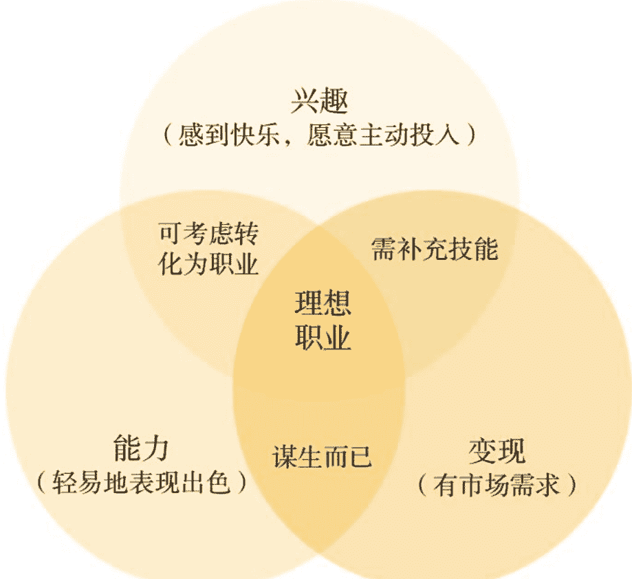

图3-3 三圆交集法

###### 1. 第一个圆：能力圈

能力圈代表你的能力和资源。比如你的专业技能、工作经验和人脉资源等。

有哪些事情是你比较擅长的或者是你能力范围内的？可以是职业技能，比如设计、策划、律师、会计等，也可以是生活技能，比如做饭、收纳、化妆、摄影等。只要是你擅长做的事情，都可以罗列出来。

###### 2. 第二个圆：兴趣圈

兴趣圈代表你的热情所在。我们常说：“唯有热爱能抵漫长岁月。”做视频号是一个长期的事情，如果你对内容本身没有兴趣，很难坚持下去。

有哪些事情是你特别喜欢的？比如画画、音乐、游戏、宠物、美食、旅行、阅读、运动等，都可以写出来。这些事情可能和你的职业无关，但却是你愿意投入时间和精力去研究的。

###### 3. 第三个圆：变现圈

变现圈代表市场价值。有哪些事情你已经拿到过结果，或者取得过让自己引以为傲的成就，同时这个事情已经带来了或多或少的收入？比如，你虽然是会计，但你曾经帮朋友做过家庭财务规划，朋友给了你一笔咨询费；或者你曾经在公司内部做过Excel培训，得到了领导的认可和奖金；或者你做的美食经常被朋友点赞，有人问你能不能教他们做，愿意付费学习。这些都是变现的经历。

###### 4. 找到三圆交集：你的商业定位

首先，把以上三个圆的事情，尽可能多地罗列出来。然后，找到与三个圆都有关联的事情，对它们进行排序，选出你认为得分最高的事情。这时，你也就清楚了自己应该做什么，即自我定位的核心点，也可以作为你未来事业发展的核心方向。坚持做下去，一定会给你带来意想不到的结果。

比如，你擅长做饭、营养搭配、拍照；你喜欢研究健康饮食、尝试新菜谱、分享美食；朋友愿意付费学做菜、你做的菜经常被点赞。那么你的定位就可以是“专门教上班族用5分钟做营养早餐”。

##### 小结

想要运营视频号账号，定位比努力更重要。很多人失败，不是因为不够努力，而是因为方向错了。他们把公域当成朋友圈，或是把账号做成了“杂货铺”，或是只追求播放量而忽略了变现逻辑。

正确的定位方法应该是用三圆交集法找到你的商业定位。能力圈展示你能做什么，兴趣圈展示你喜欢做什么，变现圈展示市场需要什么。只有三个圆交集的部分，才是你应该深耕的方向。

#### 3.1.2 爆款赛道：揭秘八大快速涨粉、高变现的素人天选赛道

做自媒体，选好赛道很重要。赛道决定了目标人群、起号困难程度和变现天花板。我们要知道，视频号处在微信生态中，它的用户群体平均年龄偏大，大多是30～60岁的社会中坚人群。这群人有消费能力、有社会经验，但他们的浏览偏好是有用、有情、有共鸣的视频。选对赛道会让涨粉变现事半功倍。

接下来，我就结合视频号的闭环逻辑和现在的市场趋势，拆解八个最适合普通人、涨粉快且变现稳的赛道。

##### 一、情感心灵：视频号长盛不衰的流量高地

人是感性的，尤其是视频号的主要用户，他们正处于上有老、下有小的年纪，生活压力大，内心非常渴望被理解、被治愈。只要你的视频文案能戳到他们的内心，或者替他们把那些想说却说不出来的话给说透，他们就不仅会看完，还会顺手点赞，甚至会转发他人。

这个赛道不需要真人出镜，也不需要什么高超的运镜技术，只需要用好AI工具，写出能引发深度共鸣的文案，再配上一些高质感的风景画面或数字人形象，一个人就能批量产出爆款，后期变现也顺理成章。你可以带货卖图书、身心健康产品，或者是通过视频号小店卖一些生活百货。这种视频号的流量不仅庞大，而且非常精准，因为被情感内容吸引来的，往往都是对生活有思考、有消费意愿的成年人。

我们可以参考“漫屿拾光”或“一禅小和尚”这类账号。虽然他们用的是动漫形象，但核心逻辑是一样的：用一段走心的情感文字，配一段治愈的画面。

##### 二、亲子教育：家长永远避不开、躲不掉的刚需

在视频号的用户画像里，家长是个极其庞大的群体。很多家长刷视频号的动力是想学学怎么教育孩子，因此如果博主能提供实用的育儿技巧，或是帮他们缓解带娃的压力，涨粉变现的难度会大大降低。

这个赛道的逻辑非常清晰，卖的是解决方案。比如讲“怎么让磨蹭的孩子快点写作业”“爸爸在育儿过程中缺位该怎么办”，这些话题都能精准戳中千万家长的痛点。

亲子赛道天然带着一种强信任感。一个能在视频里把带娃这件事讲得头头是道的博主，在用户眼里就是专家，其推荐的字帖、教辅材料，甚至是护眼灯，家长们也都会按照需要购买。

在这个赛道里，“清华妈妈马兰花”“程程和妈妈的日记”都是非常典型的案例。这些账号在视频号上的信任度极高，没有刻意去宣传理论知识，而是通过分享真实的带娃场景和解决思路，迅速建立了“专业且靠谱”的母亲形象。

##### 三、口播干货与知识科普：建立个人IP的直接路径

视频号是个非常看重人设的地方，大家更愿意相信那些专业、有一技之长的“老师”。口播干货赛道就是素人建立专业形象的最快路径。

无论博主是懂装修、懂数码产品，还是懂法律、懂职场，只要能对着镜头，讲用户觉得有趣、有用的内容，就能吸引到用户。

而且，很多用户刷到这种视频都愿意点赞加关注，因为他们觉得有用，哪怕现在记不住也没关系，先关注收藏，以后遇到问题可以随时回看。这种定位的变现逻辑极其硬核，那就是知识付费和咨询服务。

我们可以参考“旭东聊装修”或者“南昌谈师兄”。这些账号并不追求花哨的转场，就是一个人对着镜头讲干货，只要讲出来的内容让用户觉得“对，这就是我要找的答案”，那么涨粉变现就只是时间问题。这种赛道是目前视频号流量扶持的重点，属于高价值内容。

比如我发布在“方比比先生”以及“方比比老板”这两个视频号上的内容，也全部都是口播内容（见图3-4）。这个赛道非常有利于我们打造个人IP，只需要IP本人用朴实真挚的语言把观点、干货讲出来，就特别容易受到广大人群的喜爱。

图3-4 视频号“方比比先生”的视频

##### 四、搞笑段子与生活反差：覆盖人群广，流量易爆发

搞笑赛道在任何平台都是当之无愧的流量之王。视频号的用户更喜欢看那种带有生活烟火气或是充满反差感的幽默视频。

比如一个严肃的中年大叔在家里被老婆管得服服帖帖，或是日常生活中斗智斗勇的小段子，这些内容往往能在评论区引发热烈互动。视频号的算法非常看重互动率，一旦评论区热闹起来，系统就会认为博主的视频有讨论度，会把视频推向更大的流量池。

在视频号，像“林子哥唐山”“合长亭”这种本土气息浓厚的搞笑博主非常受欢迎。这些账号通常以个人或家庭成员之间的日常琐事为背景，通过幽默的表情和浮夸的剧情进行演绎，把普通人的生活拍出了爽剧的感觉。这类视频的变现主要靠品牌植入和直播带货，由于粉丝黏性较强，转化效果往往比单纯的广告收益要好得多。

##### 五、旅游与户外景点：视觉解压，治愈系

视频号里有很多长辈，他们年轻时忙着养家糊口，没机会出去走走，现在手里有点积蓄也有大把时间，但很难做到说走就走，所以他们会非常痴迷那些展现名山大川、古镇民俗或是绝美自然风光的视频。比如欣赏武功山的云海、岳麓山的红叶，对他们来说都是一种极大的精神慰藉。

旅游赛道的魅力在于画面感带来的视觉享受。这种内容，特别在深夜或是某个周末的午后，感染力极强。用户看了会产生一种“我也想去”或者“这辈子总得去一次”的向往。

在这个赛道，像房车生活类的账号就非常受欢迎，比如“白鸽房车旅行”或者是“雅清房车日记”，这类优质账号在视频号的点赞量、评论量和收藏量都很高，也有话题度，长辈们看完也会转发给自己的朋友们，这种裂变速度是极其可观的。

##### 六、生活Vlog：真实感驱动，信任加持

视频号的用户更愿意看到那些活生生、有温度，甚至带点小瑕疵的真实生活，生活Vlog（视频日志）就是适合普通人的赛道。博主在厨房里忙碌的三餐四季、一个中年人为考证而努力的过程、带着宠物在乡间小路上散步的日常，这些看似琐碎的内容，其实很有精神力量。

生活Vlog的核心价值在于陪伴感、代入感。当博主持续更新自己的生活状态，粉丝会觉得博主就像自己的某个老朋友，这种粉丝黏性是任何干货博主或者段子博主都很难拥有的。因为大家认可的是博主这个人，是他的这种生活方式和生活节奏。

在视频号，像“小叶广漂日记”“晴子在广漂”这类账号，其真实的人设能迅速获得同处境用户的共鸣。当用户看到博主在为生活努力时，会从博主身上看到自己的影子，这种信任是商业变现的基础。

##### 七、美食赛道：热门领域，人群密集

民以食为天，无论什么时候，美食赛道都是硬“通货”。在视频号，做美食有两个常见的方向：第一是教你做，比如针对独居青年，教他们如何用简单的食材做出不简单的味道；第二是带你看，也就是探店，展示在哪里可以吃到物美价廉的食物。

视频号的用户不仅爱看美食，更爱学做美食。如果博主能教他们做一道简单易学，又能拿得出手的年夜饭大菜，或者教他们怎么腌制一罐脆嫩的酸菜，他们会由衷觉得视频有用。这种需求被满足，就容易转化为极高的点赞量、收藏量和转发量，甚至变现。

很多像“大嘴美食教做菜”“品城记”这种风格的账号，要么教你做美食，要么带你去吃美食。这类账号的核心就在于实用性，比如教人做菜或分享食谱，你只要把复杂的菜谱转化为“一勺盐、两勺酱油”这种老百姓听得懂、学得会的话，你的视频就有机会被用户保存在收藏夹里。

##### 八、三农赛道：烟火气，治愈风

在工作和生活都快节奏的当下，每个人的心里都住着一个“陶渊明”。现在的视频号，三农赛道的热度一直居高不下。大家喜欢看那些原生态的场景，比如菜地里的露珠、果园里沉甸甸的果实，甚至是老屋檐下的雨滴。这种内容，特别是对于在城市生活的人来说，就是最好的心理疗愈良药。

不仅如此，三农赛道在视频号还有个得天独厚的优势，那就是可以直接带货农副产品。现在的消费者最怕食品含有各种添加剂，如果博主能真实展示在山里种的橙子、自家酿的酒，那种信任感是极具转化效率的。

你可以观察“深山阿成”或者是“云南巧儿妹”，这些账号通过展示乡村的烟火气和亲情，吸引了海量的粉丝。这种账号在视频号这种熟人社交圈里，传播速度极快，是非常有潜力的变现方向。

##### 小结

想要在视频号打造出爆款，选对赛道就是撬动流量的杠杆。本节内容深度拆解了以下八大赛道。

- 情感心灵：视频号长盛不衰的流量高地。
- 亲子教育：家长永远避不开、躲不掉的刚需。
- 口播干货与知识科普：建立个人IP的直接路径。
- 搞笑段子与生活反差：覆盖人群广，流量易爆发。
- 旅游与户外景点：视觉解压，治愈系。
- 生活Vlog：真实感驱动，信任加持。
- 美食赛道：热门领域，人群密集。
- 三农赛道：烟火气，治愈风。

#### 3.1.3 AI智能定位：挖掘自身优势，AI迅速帮你锁定吸金赛道

前文我们聊了不少定位的思路，也盘点了视频号里容易出爆款的赛道。道理大家都能听明白，但轮到自己实践时，还是会犯难。看别人写情感文案、拍美食视频都挺火的，但想了半天，觉得自己好像什么也不突出，职业普普通通，爱好也只有玩手机、带孩子，不清楚自己到底该做哪个赛道。

很多人之所以找不到定位，不是因为手里没牌，而是因为不知道哪张牌是王炸。现在，你可以结合AI进行智能定位，挖掘自身优势和天赋，综合当前市场趋势和变现情况，找到最适合自己的赛道。

##### 一、准备原始素材，进行AI投喂

想让AI帮我们定位，就不能只跟它说“帮我做视频号定位”，否则它给的建议大概率是“做知识博主”或者“做生活博主”这种正确的废话。

AI给出答案的质量很大程度上取决于用户提供的素材和问题的质量。如果想让它为自己量身定制一个精准定位，用户得先整理出一份自己的素材包，让AI更了解自己。可以从以下三个维度去整理自己的素材。

**第一，职业背景。** 不只是写出职业名称，更要写出具体的细节。比如你是老师，不仅要写教数学，还要写你特别擅长管理调皮捣蛋的孩子。

**第二，聚焦到个人兴趣。** 不能只写喜欢旅游，要写你擅长在旅游中挖掘当地的特色小吃，或者你擅长用最少的钱实现最完备的旅游计划。

**第三，资源储备。** 这个资源不仅仅指财富，还可能是其他方面，比如老家有大片的橙子园，或者认识很多资深的家装设计师，这些统统都是变现筹码。

##### 二、定位提示词模板

准备好素材后，接下来就是最关键的一步——对话。我们可以给AI设定一个极度专业且具有商业洞察力的人设。

你的背景：

你现在是全网顶尖的短视频和图文定位专家、商业咨询顾问。你最擅长从普通人的平凡过往中，挖掘出极具商业爆发力的细分赛道，并且非常熟悉微信视频号的算法逻辑和××岁用户的消费心理，能结合用户的素材，帮助用户快速定位合适的视频号赛道，以提升其内容变现力和竞争力。

你的角色：

希望你扮演一个具有丰富的视频和图文内容策划以及AI应用经验的行业专家，善于分析用户优势，并提供可行的赛道推荐方案。

你的任务：

结合用户提供的素材，为用户挖掘自身优势，并快速锁定最具潜力的视频号吸金赛道。我将为你提供用户详尽的职业履历、生活经历、兴趣特长以及其拥有的资源等。

素材经历：

职业背景（从事行业、从业年限、最引以为傲的三项工作成就、日常工作中解决最多的问题类型）；

兴趣特长（沉浸时间最长的事、朋友常请教的问题、愿意不计回报钻研的领域）；

资源储备（实体的货源、特定圈子的人际关系、特别的拍摄环境、很强的某种性格特质）；

理想状态（每天能花多少时间在视频号运营上，想快速带货或是想长期扩大影响力）。

我的要求：

1. 根据用户提供的自身情况（如兴趣、技能、资源、过往经验等），详细分析核心优势；
2. 结合当前视频号的市场热点，筛选出适合该用户的高潜力吸金赛道；
3. 提供具体的操作步骤，包括市场分析和如何起号的思路，要有变现闭环；
4. 请以结构清晰的报告形式呈现，包括“用户优势分析”“市场热点总结”和“推荐赛道”三个部分；
5. 语言简洁专业，内容逻辑严密，并附上相关参考资料链接（如有）；
6. 保证内容具有实操性，方便用户立即应用。

具体使用时，可以打开常用的AI工具，结合模板以及自身的具体经历，编写好发给它。下面我用一个职场宝妈的例子来演示。

你的背景：

你现在是全网顶尖的短视频和图文定位专家、商业咨询顾问。你最擅长从普通人的平凡过往中，挖掘出极具商业爆发力的细分赛道，并且非常熟悉微信视频号的算法逻辑和30～40岁女性用户的消费心理，能结合用户的素材，帮助用户快速定位合适的视频号赛道，以提升其内容变现力和竞争力。

你的角色：

希望你扮演一个具有丰富的视频和图文内容策划以及AI应用经验的行业专家，善于分析用户优势，并提供可行的赛道推荐方案。

你的任务：

结合我的素材，为我挖掘自身优势，并快速锁定最具潜力的视频号吸金赛道。我将为你提供我详尽的职业履历、生活经历、兴趣特长以及我拥有的资源等。

素材经历：

职业背景：互联网公司运营岗，从业8年，目前是部门小主管。最引以为傲的成就是带过3个新人从“小白”成长为业务骨干，帮公司搭建过一套完整的用户运营体系，还获得过2次“年度优秀员工”。日常工作中解决最多的问题是跨部门沟通协调，以及帮团队成员厘清工作思路。

兴趣特长：2个孩子的妈妈，孩子分别是5岁和2岁。特别擅长时间管理，能在全职工作的同时把2个孩子照顾得很好。朋友经常问我怎么平衡工作和家庭，怎么让老公主动参与育儿。另外，我对儿童绘本研究得比较多，家里有200多本绘本，很擅长给不同年龄段的孩子选书。

资源储备：运营了一个500人的宝妈交流群，都是在周围小区和幼儿园认识的宝妈。老公是程序员，能帮忙做简单的视频剪辑。家里有一面很好看的绘本墙，适合当拍摄背景。

理想状态：工作日晚上能抽出1～2小时，周末能抽出半天时间。希望先扩大影响力，后期能通过带货或知识付费变现。

我的要求：
1. 根据我提供的自身情况（如兴趣、技能、资源、过往经验等），详细分析我的核心优势；
2. 结合当前视频号的市场热点，筛选出适合我的高潜力吸金赛道；
3. 提供具体的操作步骤，包括市场分析和如何起号的思路，要有变现闭环；
4. 请以结构清晰的报告形式呈现，包括“用户优势分析”“市场热点总结”和“推荐赛道”3个部分；
5. 语言简洁专业，内容逻辑严密，并附上相关参考资料链接（如有）；
6. 保证内容具有实操性，方便我立即应用。

AI工具会回复你一份详细的定位分析报告，包含用户优势分析、市场热点总结和推荐赛道。比如针对这位职场宝妈，AI可能会给出以下结果（见表3-1和表3-2）。

###### 表3-1 用户优势分析表

| 优势维度 | 具体分析 | 变现潜力 |
| :--- | :--- | :--- |
| 职场经验 | 8年互联网运营经验，擅长时间管理和团队协作 | 这是很多宝妈最头疼的问题，痛点明确，容易引发共鸣 |
| 身份背书 | 全职工作同时带好两个孩子 | “过来人”的经验比理论更有说服力，信任成本低 |
| 内容积累 | 200多本绘本的选书经验 | 稀缺内容，可直接带货变现 |
| 资源储备 | 500人宝妈社群，老公能帮忙剪辑 | 冷启动有种子用户，降低内容生产门槛 |

###### 表3-2 推荐赛道表

| 赛道方向 | 核心定位 | 内容切入点 | 变现路径 |
| :--- | :--- | :--- | :--- |
| 职场宝妈时间管理 | 全职工作 + 带娃，我是怎么做到的 | 早起习惯、下班后的时间安排、周末规划 | 知识付费（时间管理课程）、效率工具 |
| 亲子绘本精选 | 帮你从200本里选出最值得买的10本 | 分龄书单、避坑指南、共读技巧 | 绘本带货、亲子阅读训练营 |
| 职场妈妈成长 | 当妈之后，如何在职场不掉队 | 产后复工、向上管理、职场人际 | 职场咨询、付费社群 |

##### 三、深度互动，从AI的建议中选出合适定位

AI给出的建议通常会包含好几个方向，很多人在这时又会犯“选择困难症”，觉得这个也很好，那个也不错，或者觉得AI想得太美好，自己哪个也做不到。这时，我们可以再跟AI进行第二轮、第三轮的深度互动。

你可以继续追问AI。

针对你推荐的“职场宝妈时间管理”这个定位，我最大的困难是不知道怎么把我的经验讲出来，感觉都是些琐碎的小事。请帮我想出5个具体的内容切入点，看看我能不能讲得出来。

AI会给你这样的建议。
1. 切入点1：早起1小时，我是怎么从“赖床党”变成5点起床的。
2. 切入点2：下班到睡前的3小时，我是怎么安排的（附时间表）。
3. 切入点3：让老公主动带娃的3个方法，亲测有效。
4. 切入点4：工作群消息太多？我用这个方法再也不焦虑了。
5. 切入点5：周末不累，还能高质量陪娃，我的时间块安排法。

如果你担心这个赛道竞争太激烈，也可以这样问AI。

> “职场宝妈”这个赛道在视频号里已经有不少人在做了，请帮我分析一下，作为一个素人，我该如何做出差异化？我的哪些特质是别人没有的？

AI会给出这样的分析。

你是二孩妈妈，很多博主只有一个孩子，二孩妈妈的时间管理难度更高，因此你更有说服力。

你有8年互联网运营经验，可以把职场方法论用到家庭管理上，这是很多全职妈妈博主做不到的。

你有绘本这个细分切口，可以将其作为差异化标签，比如“会选绘本的职场妈妈”。

建议人设定位：不是教你怎么做完美妈妈，而是教你怎么当“不那么累”的妈妈。

你越是追问细节，AI给出的策略就越具备实操性。你可以在AI给出的建议中不断筛选，直到找到那个让你感到兴奋、同时又觉得“这就是我”的定位，那就是你的天选赛道。

##### 四、定位的本质：从定位过去到定位未来

我们详细讲解了利用AI精准定位的方法论，但我们在实际操作过程中必须注意一点：定位并不是一成不变的标签。实际上，随着时间的推移，你在成长，你的认知在变，你的能力在变，你的资源在变，你的定位也应该跟着变。

换句话说，**我们不是在定位过去的自己，而是在定位现在的自己。** 现在的定位是基于你现在的能力和资源；半年后，当你积累了更多经验、触达了更多用户，你的定位很可能需要升级。所以，不要纠结如何找到完美的定位，先做起来，边做边调整，让定位跟着你一起成长。

比如我们在操盘视频号“方比比先生”时，打造出了一个月播放破亿、涨粉50万的现象级IP，但我们的定位并不是刚开始就完全决定好的。

初入视频号时，我们的定位是“年入百万的00后”，想贴“年轻创业者”的标签。前几条视频的数据很一般，虽然有十几万次播放，但没有成为爆款（见图3-5）。后来我们发现视频中提到和妈妈的互动过程时，数据明显会更好，评论区也有很多用户留言说“如果我有这样的儿子就好了”。

我们敏锐地察觉到用户喜欢的不是“年入百万”这个标签，而是人物身上那种“别人家孩子”的感觉。于是我们立刻调整方向，围绕“和父母相处的态度”这一主题拍摄了更多口播视频，这才有了我们的第一条千万级爆款视频“年入百万的00后，给妈妈打多少钱才够”。

图3-5 “方比比先生”早期关于创业赚钱的视频

你看，定位不是从一开始就完全确定好的，而是会随着数据反馈、成长经历不断变化。AI虽然能帮你分析方向，但最终的验证还是要靠真实的数据。

##### 小结

定位不是灵光一现，而是有方法地挖掘。

第一步，准备素材投喂AI。你给AI的信息越具体，它给你的定位越精准。

第二步，用好定位提示词模板。给AI设定专业人设，让它从你的经历中挖掘细分赛道。

第三步，和AI深度互动。追问细节，获得实操策略。

第四步，定位是动态的。我们不是定位过去的自己，而是定位现在的自己。

### 3.2 爆款选题库：模仿爆款是成功的捷径

#### 3.2.1 精准对标：用AI快速拆解对标账号的流量密码

学写作要读经典作品，学画画要临摹大师作品，学做菜要先看菜谱，任何领域的高手都是从模仿开始的。做视频号也一样，先学会拆解爆款，再形成自己的风格，这是最高效的成长路径。这一节，我会教你怎么用AI高效找到对标账号，破解他们的成功密码，把别人的经验变成你的起跑优势。

##### 一、AI加持下的五大对标账号搜寻法

我们想要去模仿对标账号，就要先找到模仿的对象。下面先来看五种找对标账号的方法。这五种方法各有侧重，可以单独使用，也可以结合使用，能够帮你快速建立起丰富的对标账号库。更重要的是，每种方法都可以用AI进行深度分析，让你不仅找得到，还能看得懂。

###### 1. 关键词搜索法：用AI拓展关键词矩阵

关键词搜索是最直接的方法。在视频号的搜索栏，我们可以直接搜索赛道关键词，比如“职场”“育儿”“美食”等；也可以搜索更细分的关键词，比如“职场沟通”“宝宝辅食”“探店测评”等。但很多人在使用关键词搜索时，搜来搜去就那几个词，搜出来的结果自然也单一。这时候，如果让AI帮你拓展关键词，效果就会完全不一样。

我的赛道：我想做职场成长类视频号，主要面向职场新人。

我的需求：请帮我生成以下30个相关的搜索关键词。
- 核心关键词（5个）：最直接相关的词。
- 长尾关键词（15个）：更具体的细分方向。
- 场景关键词（10个）：用户会搜索的具体场景。

关键词要符合视频号用户的搜索习惯，既要有搜索量，又要有明确的内容方向。

**核心关键词：** 职场、职场新人、职场成长、职场技能、职场干货

**长尾关键词：** 职场沟通技巧、职场人际关系、职场汇报技巧、职场邮件写作、职场会议发言、职场向上管理、职场时间管理、职场情绪管理、职场跳槽建议、职场加薪攻略、职场面试技巧、职场简历优化、职场新人避坑、职场礼仪规范、职场穿搭建议

**场景关键词：** 第一天上班、试用期转正、年终总结汇报、离职交接、跨部门协作、被领导批评怎么办、同事不配合、工作出错补救、职场被孤立、加班文化

有了这些关键词后，你可以在视频号搜索栏逐个搜索，观察每个关键词下的内容数量、热门视频特点、账号类型分布。通过这种方式，你不仅能找到很多对标账号，还能对整个赛道的内容生态有全面的了解。

###### 2. 推荐算法训练法：让系统主动推送对标账号

视频号的推荐算法非常智能，它会根据你的浏览记录、点赞收藏、关注对象等数据，不断地优化推荐内容。我们可以主动“训练”算法，让系统为我们推荐更多同领域的优质账号。

第一步，准备一个未关注任何账号的视频号，在视频号首页持续浏览你目标赛道的相关内容。比如，如果你想做育儿类账号，就专门看育儿相关的视频，其他类型的内容直接划过，不要停留。

第二步，对优质内容进行深度互动。不仅要点赞，还要收藏、评论、转发，甚至可以点进账号主页浏览更多视频。这些行为都会被系统记录，强化你的账号标签。

第三步，关注符合你定位的账号。当你关注某个账号后，系统会自动在“推荐关注”栏目推荐同类型的博主，这是一个非常高效的发现对标账号的方式。

第四步，持续重复以上动作，坚持7～10天。你会发现首页推荐的内容越来越精准，出现的对标账号也越来越多。

###### 3. 爆款视频反推法：从内容到账号的逆向挖掘

有时候，我们会在刷视频时偶然看到一条特别好的内容，但自己没有关注这个账号。这时候就可以用“爆款视频反推法”，从这条视频出发，深挖背后的账号价值。

第一步，当你看到一条优质视频时，先判断它是否符合你的定位。如果符合，就点进账号主页查看更多内容。

第二步，浏览该账号最近发布的20～30条视频，观察内容的稳定性和质量。如果大部分视频都保持较高水准，说明这个账号有稳定的内容生产能力，值得作为对标账号进行学习。

第三步，重点分析该账号的爆款视频。找出点赞数、评论数、转发数明显高于平均水平的视频，这些就是该账号的“流量密码”所在。

第四步，把这些爆款视频的标题、选题方向、内容结构记录下来，寻找共同规律。

###### 4. 话题标签挖掘法：用数据验证赛道热度

视频号的话题标签功能是一个被很多人忽视的宝藏工具。每个视频都可以添加话题标签，用户也可以通过话题标签搜索相关内容。通过分析话题标签，我们不仅能发现优质账号，还能验证赛道的热度和潜力。

第一步，当你看到一条优质视频时，注意观察视频文案下方的蓝色符号“#”，这些就是话题标签。

第二步，点击话题标签，会跳转到该话题的聚合页面。这个页面会展示包含该标签的所有视频号内容、朋友圈内容以及更多搜索结果。

第三步，观察话题的总浏览量。浏览量越高，说明这个细分方向的市场需求越大。比如“职场沟通”这个话题浏览量可能有5000万，而“职场邮件写作”可能只有500万，这个数据差异能帮你判断不同细分方向的热度。

第四步，浏览该话题下的热门视频和优质账号，批量收集对标对象。比如视频号博主“良田-7”的爆款视频带着标签“我的年度摄影总结2025”，点进去之后就会发现这个标签下还有许多优秀作品，可以继续找到许多摄影类对标账号。

###### 5. 数据工具辅助法：用第三方平台批量筛选

除了在视频号平台内部搜索，我们还可以借助第三方数据工具来批量筛选对标账号。一些专业的短视频数据分析平台，可以提供更详细的账号数据和排行榜信息。

我常用的工具有两个，一个是新榜，一个是友望数据。如图3-6所示，新榜具备视频号账号排行榜、热门视频榜单、数据分析等功能；如图3-7所示，友望数据提供多平台短视频数据分析，包括视频号。

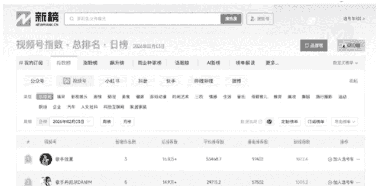

图3-6 新榜平台视频号榜单

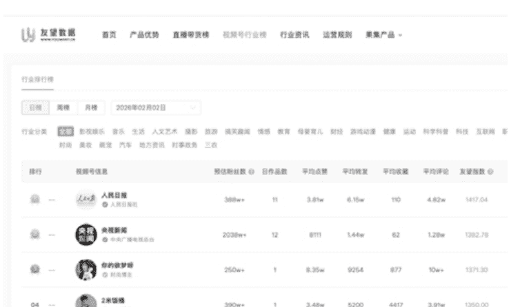

图3-7 友望数据视频号榜单

这些工具虽然部分功能需要付费，但基础的排行榜和账号搜索功能通常是免费的。通过这些工具，你可以快速找到一个赛道的头部账号、黑马账号、新锐账号。

##### 二、从账号库到流量地图：用AI构建系统化对标矩阵

找到对标账号只是第一步，更重要的是要把这些零散的账号信息整合成系统化的对标矩阵。这时候，AI就能发挥巨大的作用，帮你从碎片化的信息中提炼出结构化的知识体系。

###### 1. 建立对标账号信息表

手动整理账号信息工作太烦琐，你可以直接把博主的名字发给AI，让它自动生成结构化的信息表。

我发给了你一个视频号博主的名字，请帮我生成对标账号信息表。

请用表格的形式输出以下信息：

账号名称、核心定位、内容类型、更新频率、视频形式、爆款选题方向（列出3～5个高频选题）、变现方式（根据视频内容推测）、值得学习的亮点（3条）。

直接输出表格，不需要其他分析。

如果你要分析多个博主，可以一次性发送多个名字，并且告诉AI你的要求。

我有3个对标账号，我等下会把名字发给你，请生成详细的信息表。

请用表格形式输出每个账号的信息，维度包括：账号名称、核心定位、内容类型、更新频率、视频形式、爆款选题方向、变现方式、值得学习的亮点。

每个账号一个表格，方便我复制整理。

AI会给你以下表格作为答复。

###### 表3-3 对标账号信息汇总表

| 账号名称 | 粉丝量 | 核心定位 | 内容类型 | 更新频率 | 视频形式 | 爆款选题方向 | 变现方式 | 值得学习的亮点 |
| :--- | :--- | :--- | :--- | :--- | :--- | :--- | :--- | :--- |
| 职场老王 | 15万 | HR视角职场干货 | 干货教学 | 日更 | 真人出镜讲解 | 面试技巧、职场避坑 | 课程、咨询 | 标题吸睛、案例真实接地气 |
| 豆豆妈的育儿日记 | 8万 | 实用派育儿经验 | 避坑指南 | 周更3次 | 真人出镜 | 育儿误区纠正、省钱技巧 | 带货、好物推荐 | 接地气、共鸣强 |
| 美食探店小林 | 12万 | 本地特色美食挖掘 | 探店测评 | 周更4~5次 | 手持第一视角 | 性价比小店、老店故事 | 探店合作 | 反网红定位、本地化 |

###### 2. 让AI帮你提炼共性规律

当你用AI生成了10～20个对标账号的信息表后，可以再让它帮你分析这些账号的共性规律。

我整理了15个××赛道的对标账号信息，表格等下会发给你。请帮我：
- 分析这些成功账号的共同特征，从定位、内容、形式、更新频率等维度总结规律；
- 找出差异化的竞争策略，分析不同账号是如何在同一赛道做出区隔的；
- 识别出3～5个关键成功要素，哪些是必须具备的，哪些是加分项；
- 给我一个新手起号的优先级建议，比如我应该先学习哪些要素。

###### 3. 构建分层对标策略

不同阶段的账号使用的对标策略应该不同。AI可以帮你构建一个分层的对标矩阵，分析对标账号的目的是通过了解市场弄清楚现阶段的自己需要做什么、应该做什么。

我在做一个刚起步的××（赛道）视频号，目前粉丝数量不到1000。
我有15个不同体量的对标账号，粉丝数量从5万到50万不等。
请按以下格式，帮我设计一个分阶段的对标策略。
- 粉丝数量低于1万的阶段：我应该对标哪些账号？学习他们哪些方面？
- 粉丝数量在1万～5万的阶段：我应该对标哪些账号？重点提升什么能力？
- 粉丝数量在5万～10万的阶段：我应该对标哪些账号？如何做出差异化？
- 每个阶段的对标重点有什么不同？

以下是我的15个对标账号……

##### 小结

如何用AI快速找到精准的对标账号？

##### 一、AI加持下的五大对标账号搜寻法
1. 关键词搜索法：用AI拓展关键词矩阵，覆盖核心词、长尾词、场景词。
2. 推荐算法训练法：训练系统，让算法主动为你推送精准对标账号。
3. 爆款视频反推法：从优质内容出发，逆向挖掘背后的账号价值。
4. 话题标签挖掘法：通过话题浏览量验证赛道热度，批量发现优质账号。
5. 数据工具辅助法：借助第三方平台批量筛选，用AI进行批量分析。

### 二、从账号库到流量地图：构建系统化对标矩阵
1. 建立对标账号信息表：整理账号的核心信息，形成结构化数据。
2. 让AI提炼共性规律：分析成功要素，识别关键成功因子。
3. 构建分层对标策略：不同阶段对标不同账号，选择合适的进阶路径。

#### 3.2.2 选题搭建：学会这六套爆款选题公式，灵感不断

很多新手拍短视频都靠灵感，灵感来了一天能拍三条，灵感没了一周都拍不出来一条。每天醒来第一件事就是焦虑：今天应该拍什么？

这个问题的根源在于没有搭建好选题库，总是想到什么就拍什么，全凭灵感。真正能持续产出的创作者，都有一套自己的创作系统——打开选题库，挑一个选题，直接开拍，不用临时抱佛脚。

这一节，我就把这套选题系统讲清楚：选题库怎么搭、爆款选题从哪来、有哪些可以直接套用的选题公式。

##### 一、搭建选题库：内容持续输出的弹药库

很多人对选题的理解停留在“标题”的层面，每天都在焦虑拍什么。如果我们有完整的选题库，就可以很好地避免这个问题。选题库包含以下三个层次。

**第一层是内容栏目。** 你的账号要有几个固定的、不同的内容方向，就像电视台有不同的栏目一样。比如一个职场账号，可以有“面试技巧”“升职加薪”“职场避坑”三个栏目，每个栏目下面可以持续产出内容。

**第二层是系列规划。** 每个栏目下面，可以规划几个系列。比如“面试技巧”栏目下可以有“面试必问的10个问题”系列、“不同岗位的面试攻略”系列，系列化的内容能培养受众的追更习惯。

**第三层是具体选题。** 在栏目和系列的框架下，再去填充具体的选题。这时候你会发现，选题不是凭空想出来的，而是从框架里自然生长出来的。

比如，假设你做的是育儿赛道，你的选题库可能是如下结构（见表3-4）。

###### 表3-4 育儿赛道选题库参考

| 栏目 | 系列 | 具体选题举例 |
| :--- | :--- | :--- |
| 辅食制作 | 6~12 月龄辅食 | 宝宝第一口辅食怎么做、补铁辅食推荐、一周辅食不重样 |
| 育儿知识 | 新手爸妈必知 | 宝宝发烧怎么处理、如何判断宝宝吃饱了、哄睡的正确方式 |
| 带娃日常 | 真实记录 | 全职妈妈的一天、带娃崩溃瞬间、爸爸带娃名场面 |

##### 二、爆款选题

###### 1. 用户痛点挖掘

可以去知乎、小红书、抖音等平台搜索你的赛道关键词，观察用户在问什么问题；也可以去你的微信社群、朋友圈看用户经常咨询什么；或者直接问用户“你在×××方面最大的困扰是什么”。

比如，女性成长赛道的博主可以在小红书搜索“焦虑”，发现高频问题是“焦虑状态怎么缓解”（见图3-8），搜索的人很多，说明这个问题是很多用户关心的痛点问题。那么博主就可以拍一条短视频来讲解如何缓解焦虑。

###### 2. 同行爆款拆解

找10～20个同赛道的对标账号，收集他们的爆款视频，分析爆款的选题方向、标题结构、内容逻辑，提炼成选题模型，结合自己的特色进行改编。

职场赛道的视频号博主“老鱼德鲁克管理笔记”有一条爆款视频是站在员工的角度剖析“讲这种话的领导不是好领导”，我们可以改编成“职场上和同事相处，千万别讲这种话”。视频号博主“康至军”的爆款选题是“真正会带人的管理者身上有3个底层特征”，我们可以换个角度，改编成“职场上受领导器重的人都有这3种能力”。

###### 3. 自己的经验和故事

把你自己的真实经历、踩过的坑、成功的经验转化成选题，这类内容最真实，最容易引发共鸣。

比如，我在操盘视频号“方比比先生”时，所有视频选题都是从个人经历出发，“年入百万的00后，给妈妈打多少钱才够”讲的是和妈妈相处的真实故事，“过早赚钱不是好事”讲的是创业路上的真实感悟（见图3-9）。这些视频没有刻意编排，没有剧本演绎，就是把自己经历过的事、思考过的问题拍出来，反而成了千万级爆款。真实就是最好的流量密码。

##### 三、视频号的六大爆款选题公式

###### 公式1：身份标签+做了什么事+用了多长时间+得到什么结果

首先，具体的身份标签会让目标用户产生“这个人和我一样”的共鸣感，再用明确的时间周期打消“太难太久”的畏难情绪，就能激发用户“我也想要拥有或者得到”的行动欲望，使其产生强烈的代入感和即刻行动的冲动。

比如视频号博主“慧阿姨爱养生”在视频中分享47岁的自己坚持早起1小时养生后，在身体和心理上发生的改变，就很符合这个公式。

###### 公式2：数字+做事的方法+好处（适合干货类）

用3～7的具体数字去降低用户的畏难心理，让人觉得“只要做几件事就够了”，同时明确告诉用户具体做什么，来满足他们“怎么办”的需求，最后要描述清楚好处，让用户知道付出努力后能得到什么回报。

“记住这5句话，少走10年弯路”这类选题我们在视频号应该经常见到。比如，“红雁说”这个账号分享了“晚年不想被子女嫌弃的4条真相”，属于人生经验的分享，非常容易吸引关注。

“金姐说直播”则是以职场角度分享干货经验，让受众少走弯路。另外，这个作者的大部分视频是用AI生成的，流量也很不错，同样可以作为我们的参考创作结构。

###### 公式3：否定认知+颠覆观点（适合观点类）

先否定大众普遍相信的认知，制造冲突感，让用户产生“我一直以为正确的事情居然是错的”的震惊和停顿，然后陈述自己的观点。这种认知差异会激发用户强烈的好奇心，让他们想知道到底错在哪里。同时需要注意，要用肯定的语气塑造“只有我知道真相”的专家形象来建立权威感，但前提是要有理有据，不能胡说八道。

比如博主“男孩派”分享了一个话题——孩子身上有这4个缺点，父母应该偷着乐，就是关于优缺点的认知颠覆，让原本以为孩子有缺点的家长接受新认知。

还有视频博主“董太太”分享的话题——你以为的独立，其实是别人眼里的没人托举，颠覆了大众对独立的看法。

###### 公式4：做某件事的警告+不注意就会出现的后果+解决方案（适合避坑类）

先利用“人对损失的恐惧大于对获得的渴望”的特点，用具体明确的警告来制造“我可能要吃亏了”的紧迫感，再用足够严重但不夸张的后果来激发用户的自我保护欲，最后提供清晰的解决方案。

视频号博主“美丽年轻幸福说”分享的话题——晨起别乱喝水，4种喝法伤身，就是借伤身来提醒用户，不要这样做，再分享正确的喝水方法，吸引用户观看视频。

还有视频号博主“香老师论正养”分享的内容——冬天早上这3件事千万不要做，首先容易引发受众的好奇，具体是哪3件事不要做，再分享哪些事情可以做、需要注意什么，吸引重视身体健康的用户关注。

###### 公式5：痛点场景+用户心声+解决办法（适合情绪共鸣类）

先描述一个具体的痛点场景，让用户产生“这说的不就是我吗”的强烈代入感，然后说出他们不敢说或者说不清楚的心里话，给用户营造“这个人太懂我了”的感觉，最后给予明确的方法引导用户去行动，让他们相信困境是可以改变的。这种情绪价值的传递比单纯讲道理更容易打动人心。

比如关于“怎么跟老板提加薪”这个话题，“舒姐讲职场”“向太陈岚”等博主都是以职场老板的身份给出了实质的建议，并引导用户，让他们觉得其实这件事没那么难，马上就能去做、去改变。

###### 公式6：反差对比+选择（适合对比类）

起点相同但结果天差地别，这类视频可以让用户形成强烈的视觉和心理冲突，用鲜明对比给用户留下非常深刻的印象，最后再说清楚造成这种差距的根本原因，激发用户对标成功方的改变欲望和行动意愿，让他们主动寻求成长方法。

比如视频号博主“混知”分享的话题“饿瘦VS运动瘦，有啥区别？”，就是通过对比不同的减肥方式来吸引用户参与讨论，再分享更好的做法是什么。

再比如“智慧育儿浩1”分享的话题“为什么花了同样时间，别人的成绩好，你的不好”，针对的人群就是担心孩子成绩的家长。这条视频虽然是AI生成的，但是痛点够精准，转发率也非常高，说明内容引起了很多家长共鸣。

##### 小结

**获得爆款选题的三个渠道：**

- 用户痛点挖掘：去知乎、小红书、抖音等平台或社群、朋友圈中看用户在关心什么。
- 同行爆款拆解：收集对标账号的爆款，提炼选题模型，结合自己的特色改编。
- 自己的经验故事：真实经历最容易引发共鸣，真实就是最好的流量密码。

**六大爆款选题公式：**

- 身份+时间+结果：让用户产生“这人和我一样，我也能做到”的共鸣感。
- 数字+方法+好处：用具体数字降低畏难心理，告诉用户应该做什么、能得到什么。
- 否定认知+颠覆观点：制造“我一直以为正确的事情居然是错的”的冲击感。
- 警告+后果+解决方案：利用损失厌恶心理，先制造紧迫感再给出方法。
- 痛点场景+心声+解决办法：说出用户不敢说的心里话，再告诉他解决办法。
- 反差对比+选择：用鲜明的对比激发用户改变的欲望。

#### 3.2.3 标题进化：用万能提示词，生成点击率翻倍的吸睛标题

视频号和其他平台的算法机制不太一样。抖音是纯算法推荐，标题大多数情况下能充当供算法识别标签；小红书是强搜索，标题要包含更多的关键词；但视频号夹在中间——它既有社交推荐，又有算法推荐，还有搜索和话题推荐。

这意味着你的标题要同时满足两个需求：既要让算法知道你在说什么，又要让用户愿意点进来看。但很多新手写不好标题，通常就是把内容复述一遍，没有任何吸引力。

现在有了AI工具，这个问题就可以被轻松解决了。AI不仅能帮你批量生成标题，更重要的是它能基于大数据进行分析，告诉你什么样的标题更容易引发点击。你只需要掌握几个万能提示词模板，就能让AI成为你的专属文案策划，源源不断地输出高质量标题。

##### 一、爆款标题的重要性

用户刷短视频的时候，一秒钟可能划过好几条内容，基本上不会停下来慢慢看视频内容好不好，而是会先注意到标题。标题没能吸引他，手指一划就过去了，后面的内容再精彩也没人看。

我们运营“方比比先生”这个账号时，15条视频就做到1亿的播放量，很大程度上要归功于我们的爆款标题，同样的内容，标题不一样，结果也可能天差地别。

我们的团队在剪辑每条视频时都特别谨慎，光标题就要打磨至少2小时。举个例子，我们其中一条视频的内容是：我高考失利，父母劝我复读，但我当时没有听父母的安排，而是坚持自己的选择上了“双非”大学。团队编导在发布前给了三个标题，分别是“我拒绝了父母让我复读的要求”“高考后我选择了不复读”和“高考完，我被父母劝复读”。最终我们选择了第三个标题“高考完，我被父母劝复读”，这个标题相对于前两个标题来说有个核心优势：展示过程，而非结果，视频发布后再次成为爆款。

“拒绝了父母让我复读”和“选择了不复读”都是确定的结果，用户一看就知道结局了，没有悬念，没有探索欲。因为答案已经知道了，过程如何并不重要。

但第三个标题“被父母劝复读”是一个过程，是矛盾的开端。用户会想：然后呢？他答应了吗？他怎么应对的？这个好奇心会吸引着他点进来找答案（见图3-10）。

这也是我一直跟团队强调的：公域流量的逻辑从来不是给用户一个确定答案，而是抛给他们一个悬念。短视频的本质是跟用户的情绪对话，用户未表达出来的好奇心，才是真正的流量密码。

但想要写出好标题真的不容易，既要懂用户心理，还要懂文案技巧。在十几个字之内制造冲突、悬念、情绪共鸣，对大多数新手来说太难，这时我们可以让AI为我们提供灵感。

##### 二、AI标题创作的万能提示词

视频号用户的观看场景和其他平台不同。他们可能是在微信聊天的间隙刷视频号，可能是在朋友圈看到好友分享的视频，也可能是在视频号直播间购物后浏览推荐内容。这些不同的场景决定了用户不同的心理状态和需求。

所以我们在用AI生成标题时，要明确告诉AI这个视频会在什么场景下被用户看到、用户看到视频时处于什么样的心理状态，这样AI才能生成更符合场景的标题。

你是一位视频号爆款内容专家，深度理解视频号的社交推荐机制和用户行为特征。我需要为一条在视频号上发布的视频拟定标题，请根据以下信息生成20个备选标题。

视频内容：

主题（用一句话描述视频的核心内容）

时长（视频时长）

核心价值点（用户看完能得到什么）

目标用户：

人群画像（年龄、职业、兴趣等）

观看场景（用户在什么情况下会看到这个视频）

核心痛点（这个人群最关心什么问题）

平台特性要求：

1. 标题保持30～50字，分2～3行展示
2. 第一行必须在15字内吸引用户注意力
3. 标题要适合朋友圈转发，不能太营销化
4. 包含具体的价值承诺或情绪共鸣点
5. 语气要像朋友分享，而不是商家推销

标题风格：

请针对以下4种风格分别生成5个标题。

1. 价值干货型：强调实用性和可操作性
2. 情感共鸣型：触动用户的情绪和经历
3. 好奇悬念型：制造信息缺口，激发探索欲
4. 社交货币型：让用户愿意转发到朋友圈

请直接输出20个标题，按风格分类，每个标题单独一行。

我们用一个实际案例来演示。假设你拍了一条关于职场新人如何应对第一次述职汇报的视频，内容是分享5个实用技巧。你可以这样输入提示词：

你是一位视频号爆款内容专家，深度理解视频号的社交推荐机制和用户行为特征。我需要为一条在视频号发布的短视频拟定标题，请根据以下信息生成20个备选标题。

视频内容：

主题：教职场新人如何准备第一次述职汇报，避免常见错误

时长：3分钟

核心价值点：5个具体的汇报技巧，包括PPT制作、语言表达、时间控制等

目标用户：

人群画像：22～28岁，工作1～3年的职场新人

观看场景：晚上下班后刷视频号或者在微信群看到同事分享

核心痛点：第一次做述职汇报很紧张，不知道怎么准备

平台特性要求：

1. 标题在30～50字，分2～3行展示
2. 第一行必须在15字内吸引用户注意力
3. 标题要适合朋友圈转发，不能太营销化
4. 包含具体的价值承诺或情绪共鸣点
5. 语气要像朋友分享，而不是商家推销

标题风格：

请针对以下4种风格分别生成5个标题。

价值干货型：强调实用性和可操作性

情感共鸣型：触动用户的情绪和经历

好奇悬念型：制造信息缺口，激发探索欲

社交货币型：让用户愿意转发到朋友圈

请直接输出20个标题，按风格分类，每个标题单独一行。

AI会给你以下答复。

###### 价值干货型：

- 第一次述职汇报别慌！这5个技巧让领导对你刮目相看，第3个最关键
- 职场新人必看：述职汇报的完整准备流程，照着做就不会出错
- 3分钟学会述职汇报的黄金公式，HR说90%的新人都不知道
- 述职汇报怎么做？从PPT到表达的5个实战技巧，建议收藏
- 我用这5个方法做述职汇报，领导当场说要给我加薪

###### 情感共鸣型：

- 还记得第一次述职汇报时的紧张吗？这些技巧要是早点知道就好了
- 第一次述职汇报我紧张到手抖，后来学会这5招再也不怕了
- 为什么别人的述职汇报能打动领导，而你的却平平无奇？差距在这里
- 职场新人的第一次述职汇报，决定了领导对你的第一印象
- 那些述职汇报做得好的人，都偷偷掌握了这些技巧

###### 好奇悬念型：

- 为什么有些人的述职汇报能让领导记住？秘密在这5个细节里
- 述职汇报最容易踩的3个坑，90%的职场新人都中招了
- 领导最看重述职汇报的哪个部分？答案可能和你想的不一样
- 同样是述职汇报，为什么有人升职、有人被边缘化？真相扎心了
- 述职汇报做不好，领导会怎么看你？HR透露了这些内幕

###### 社交货币型：

- 把这条视频转给即将述职的朋友，能帮他们避免很多弯路
- 如果你身边有职场新人，一定要把这个述职汇报技巧分享给他
- 这可能是全网最实用的述职汇报教程，已经帮助3000多位职场新人
- 述职汇报的5个黄金法则，分享给需要的人，他会感谢你的
- 职场人都该看的述职汇报指南，转发给团队成员一起学习

这20个标题包含了不同的风格和角度：价值干货型强调具体方法，适合那些亟须解决方案的用户；情感共鸣型触动用户的经历，让他们产生“这就是在说我”的感觉；好奇悬念型制造信息缺口，激发探索欲；社交货币型则直接鼓励用户转发，有效利用视频号的社交推荐机制。

##### 小结

掌握AI万能提示词，就能写出点击率翻倍的吸睛标题。

利用AI生成标题，可以采用场景化标题生成法。视频号用户的观看场景不同，心态也不同，需要明确告诉AI该视频会在什么场景下被用户看到。提示词中需包含视频内容、目标用户、平台特性要求和标题风格四个维度，针对价值干货型、情感共鸣型、好奇悬念型、社交货币型四种风格分别生成标题。

#### 3.2.4 钩子设计：开头黄金三秒，让用户舍不得划走

在短视频行业里，有一条非常重要的“黄金三秒”法则。视频开头的三秒钟决定了算法是否会把你的视频推入下一个量级的流量池。为什么是三秒？因为在移动互联网时代，人的注意力变得极度稀缺，三秒足以让一个人的大脑做出判断：这个视频是有趣的、有用的，还是可忽略的无效内容。

所以我们需要在短视频的开头设计一个钩子，在最短的时间内吸引用户的注意力，让他不要划走，提高视频完播率，进而提升视频播放量。

##### 一、短视频开头误区

在深入讲解爆款钩子之前，我们先来看看最常见的几个短视频开头误区。

第一个误区是“自我介绍式”开头。很多从传统行业转行过来的创作者，习惯了开场先说：“大家好，我是×××，今天我来跟大家分享一下……”用户在刷到你时，其实根本不关心你是谁，这样的开头属于无效开头，浪费了黄金三秒。

第二个误区是“慢节奏叙事”。视频开头铺垫太长，风景拍了五秒钟，最后才慢吞吞进入正题。要知道，视频号的用户群体虽然相对成熟，但也是缺乏耐心的，如果开头抓不住重点，他们会默认这个视频在浪费时间，从而划走。

第三个误区是“书面化语言”。很多知识类播主喜欢把书本上的话原封不动地念出来，听起来专业，但十分生硬。短视频是一个社交平台，你得讲大白话，让大家都听得懂，营造面对面聊天互动的感觉。

下表可以让大家更清晰地看到爆款钩子和普通开头的对比。

###### 表3-5 爆款钩子和普通开头对比

| | 普通开头 | 爆款钩子 |
|---|---|---|
| 开篇第一句 | 大家好，今天我想跟大家聊聊理财。 | 哪怕你现在兜里只有 1000 元，我也能让你看懂资产配置。 |
| 视觉呈现 | 坐在办公桌前，对着镜头由于紧张显得表情僵硬。 | 第一秒就展示一个反直觉的实验结果或醒目的数据对比。 |
| 情绪调动 | 平铺直叙，声音没有起伏，像是在念课本。 | 语调有张力，使用反问、设问或者直接揭露行业黑幕。 |
| 逻辑推进 | 先说理论，再说案例，最后给结论。 | 先给一个极具诱惑力的结论，或者直接展示痛点场景。 |

##### 二、五大爆款钩子公式：让你的内容自带吸引力

###### 1. 痛点共鸣+情感投射

这一类策略的核心在于“扎心”。不管是生活中的琐事，还是职场上的焦虑，只要你能精准地描述出用户正在经历的痛苦，他们就会立刻被击中从而停下来。这种方式在情感类、亲子类、生活Vlog赛道非常适用。

比如视频号博主“何丽娟Semmi”就使用了这样的开头。可以想象一下，一个正在为辅导孩子写作业而崩溃的妈妈刷到了这条视频，开头“每次吼完孩子都后悔，我该怎么控制自己？”这句话就像一根针，直接扎进了她的心坎里。她会觉得这个博主懂她，她也遇到了同样的问题，自然会留下来看完视频，寻找解决办法。

这种钩子的写法在于，不讲大道理，而是直击用户痛点，场景越具体，痛点就越真实。比如视频号博主“品牌故事家”有一条讲存钱的视频，没有在开头说“如何科学存钱”，而是直击用户存不住钱的痛点，告诉用户“别再傻傻地存钱了”，触发用户的认同感和补救心理，他们自然就想看下去。

###### 2. 极限语境+确定性利诱

人类天生对“最”“超”“唯一”“必看”这类带有确定性的词语缺乏抵抗力，通过创造一个极端的语境，或者用夸张但又不失严谨的表述，可以快速吸引用户的注意力。

这种方式利用了人们的“信息避难”心理：既然信息这么多，我肯定想先看“最全的”或者“最好的”。这种钩子在养生、实用教学等赛道适用性强，成功率高。但要注意，视频号的用户更看重真实性，所以你的关键词后面必须跟着真实有用的内容，让用户有收获感和价值感。

在写文案时，可以适当使用一些数字。比如，视频号博主“杨洛宠物科普知识”在视频开头说“99%的人都不知道”，视频号博主“小小欺负乖乖”在视频开头说“仅需三步”。数字能够给大脑提供一个清晰的反馈，让用户觉这个视频很有价值。

###### 3. 警示提醒+风险对冲

这是利用心理学中的损失厌恶心理。对大部分人来说，比起获得一件东西，更害怕失去原本拥有的东西。视频的开头要制造出一种微弱的焦虑感，或者指出一个可能由于无知而导致的负面后果，用户为了寻找解决办法，就会非常有耐心地看完这个视频。

但这套逻辑的使用需要掌握好火候，不能为了吓唬人而胡编乱造，在开头提出风险后，必须紧接着给出简单易行的解决方案。否则，你只是在制造焦虑，用户在看完后不仅不会关注你，还容易产生负面情绪。只有既能指出问题又能给出方法，才能真正树立起专业形象。

比如，健康类博主“养生思维观”在视频的开头说“晚上喝白开水的人要注意了”，有这个习惯的人自然就很想继续看下去。视频号博主“龙菇凉聊聊”主要是分享安全教育的相关知识，她会在视频开头说“这些短信千万别信”，也会让用户因关心信息安全而继续看下去。

###### 4. 悬念设疑+好奇驱动

好奇是人的天性。通过在开头抛出一个违背常识或者极具反差感的结论，可以瞬间引发用户的好奇心。当一个问题没有解决时，大脑会处于一种紧张状态，如果不把视频看下去找到答案，就容易惦记着放不下。

这种钩子适合故事类、科普类、探店类视频，核心点就在于那个“问号”要足够重，让用户一看到就想问“真的吗？”或者“怎么做到的？”。

这种悬念式开头在视频号中非常常见。比如博主“敲哥的自由日记”会在视频的开头讲“一个非常非常冷门的小渔村”，用户就想看下去，想知道这个小渔村的具体信息。还有博主“惠溪宝典”在视频的开头提到“这位中国最难挖的天才”，就会激发用户的好奇心理以及对未知结局的探究欲，用户想知道哪个天才为什么挖不动，进而会往后看内容。

###### 5. 利益前置+干货直接输出

视频号的用户里有很多是来寻找答案、学习技能的务实型用户。对于这部分人，最好的钩子就是不兜圈子，直接把利益和价值放到面前，这种开门见山的方式非常实用。

当你直接说明价值，那些正有此类需求的用户会像抓到救命稻草一样，不仅会看，还会转发、收藏。这对于视频的社交扩散非常有帮助。

采用这类钩子时，语气一定要坚定、自信，千万不要用“也许”“大概”“我听说”这种模棱两可的词汇。你要表现得像这个领域的专家，给用户一种“听我的就对了”的权威感。

视频号博主“行长朋友圈”在视频的开头提出“如果存定期怎么选择”，用户就很想知道到底该怎么选，自然会继续看下去。还有视频号博主“蒋能能能”在视频开头提出“如何清洗衣物油渍”，用户也很想继续看下去，寻找问题的解决办法。

##### 三、听觉钩子：让用户舍不得划走的千万播放量BGM

好钩子解决的是“让用户停下来”的问题，但用户“停下来”不代表“会看完”。很多视频开头很抓人，用户停下来看了十几秒觉得没意思，还是划走了。所以除了开头的钩子，还有一种贯穿全程的隐形钩子，能够钩住用户的情绪，让他舍不得走，那就是BGM（Background Music，背景音乐）。

一些新手觉得，BGM不就是随便选择，配个氛围感吗？其实不然。我们在运营“方比比先生”账号的过程中发现，BGM的选择和处理直接决定了用户会不会看到最后。选对了，用户的情绪被你牵着走，哪怕内容已经讲完了，他还会把音乐听完；选错了，用户中途就觉得没感觉、没意思，就划走了。

我们在做视频“年入百万的00后，赚了钱不敢告诉父母”时，备选的BGM有三首：莫文蔚的《当你老了》、毛不易的《一荤一素》、黄绮珊和希林娜依·高的《是妈妈是女儿》。三首歌我们都试了，最后选了《是妈妈是女儿》。因为这首歌的情感浓度最高，而且歌词和视频内容高度契合。

但选对歌只是第一步，更关键的是选对歌的哪个部分。

一般人会觉得，用副歌效果最好，但我们反复测试后发现不是这样。《是妈妈是女儿》的副歌歌词是“我希望你被爱着，我希望你要快乐”，这是心境描写，比较抽象。我们最后选的是第一段主歌中的“孩子会穿过大雨，去懂人间的道理”，这是状态描写，自带画面感，和视频的成长故事更贴切。用户在看到画面的瞬间，就能和歌词产生共情（见图3-11）。这种视听同步的体验，比单纯用副歌效果好太多。

图3-11 视频号“方比比先生”的BGM片段选取

再来说说BGM的音量控制。初稿的时候，BGM的音量全程比较大，结果发现效果很差——在人物讲内容的时候，音乐就开始“抢戏”，分散了用户的注意力。而且从开始就把情绪拉满，等到真正的情感爆发点时，用户就没了反差感，自然也不会被触动。

终稿我们完全换了一个思路：刻意压低内容讲解时BGM的音量，让音乐只做背景铺垫，把用户的注意力牢牢锁在内容上。直到视频最后，才突然提高BGM的音量，让歌词的情绪瞬间爆发。

这种前后的反差，才是戳中用户泪点的关键。事实证明我们的做法是正确的。视频发布后，不少用户看完视频后反馈“这句歌词是全视频最戳心的地方”，有人说“光这句就看了四五遍”。

所以，听觉钩子不只是先声夺人那么简单。它包括选对音乐、选对段落、控制好音量和节奏、在关键节点制造情绪爆发。这些细节加在一起，才能让用户的情绪跟着你的视频走。

##### 小结

想要让视频号流量实现质的突破，务必从打磨黄金三秒钟开始。

- 钩子是完播率的及格线，也是进入流量池的入场券。
- 不要沉迷于自我介绍和慢镜头，要直接切入核心价值。
- 灵活运用痛点、极限、警示、悬念和利益这五大黄金公式。
- 注重音画联动的多维度打击，让听觉也成为钩子的一部分。

## 第四章 AI爆款制造机：从拍摄到剪辑的AI提效实战

### 4.1 打造高质感IP：从场景到拍摄的全流程拆解

设备只是工具，真正能提高视频拍摄质量的是对画面的理解和对细节的把控。“方比比先生”的矩阵视频一个月获得超过1亿的播放量，涨粉60万，背后其实有一套经过反复验证的拍摄方法论。

从场景搭建到灯光调试，从构图取景到设备选择，从拍摄前的准备到拍摄后的反复打磨，每个环节都经过精密考量，所有细节都做到位，才打造出了用户在屏幕上看到的那种高级感视频。

这一节，我把拍摄方法论完整地拆解一遍，讲清楚每个环节怎么做、为什么这么做。

##### 一、场景搭建：每一帧画面都是精心设计的

未来的IP拼的一定是视觉呈现效果，视觉营销是重中之重。用户刷到你视频的那一瞬间，画面质感已经在替你说话了。

我们在打造“方比比先生”这个账号矩阵时，从来不是随便找个地方就开拍。工作室的选址、背景的搭配、外部拍摄场地的合作，每一个布局和陈设都是为了呈现出高级的质感。

搭建拍摄场景的核心原则是背景越简洁，主体越突出。搭建场景时要注意这几个关键细节：人物和背景之间要有距离，大约0.5～1米，不要贴墙站，拉开距离才有景深，画面才立体。背景可以保留适当的装饰元素——绿植、图书、花束，作用是点缀，因此数量不要太多。

在室内拍摄时，幕布的颜色选择也非常关键。挑选幕布颜色时，要匹配内容传递的情绪。我们的团队在拍摄“方比比先生”相关视频时，使用过蓝色、深褐色、暖黄色等不同颜色的幕布，随着视频内容的变化不断调整冷暖色调。

最开始做商业内容时，需要传递冷静理性的感觉，我们选择了蓝色的幕布，中期想要拉近和用户的距离，我们尝试过用室内绿植作为背景，营造自然亲近的氛围；后来确定了视频主要传达的是积极正能量的情感内容，大多是关于孝顺的主题，所以后期多数使用暖黄色作为背景颜色。在绝大多数情况下，暖黄色是相对通用的选择。

如图4-1所示，在“方比比先生”的视频里，在室内拍摄时，风格以简约为主，背景是纯色幕布，突出人物；如图4-2所示，当我们的拍摄场景切换到户外时，会用自然场景中的鲜花绿植作为点缀，整体有种自然清新的氛围感，但画面主体依然是人物。

图4-1 “方比比先生”的室内拍摄场景

图4-2 “方比比先生”的室外拍摄场景

##### 二、灯光布置：光线是画面质感的灵魂

一个人在光线好的时候拍摄，皮肤显得细腻通透，在光线差的时候拍摄，就显得肤色不均。灯光布置的核心作用是让人物面部光线均匀、柔和、自然，同时营造出适合内容调性的氛围。

在白天拍摄时，可以利用自然光，人物面朝窗户坐，让光从正面或侧面45度照过来。上午9:00～11:00、下午15:00～17:00的自然光线最柔和，出片效果最好。当室内自然光线不足时，就需要用到补光灯。

我们在拍摄视频时，通常会关闭拍摄环境中所有的环境光源。因为环境光存在色散、杂光等问题，会导致拍摄时无法还原真实的色彩。比如幕布是红色的，在环境灯光下拍出来可能会出现色差，直接影响画面的色彩还原度，降低视觉质感。

关闭环境光之后，我们通过专业灯光来重新构建画面的光线层次，一般会使用三组灯光。第一组是主光，作用是照亮人脸，让人物面部明亮，有精气神。第二组是轮廓光（侧翼光），打在人物侧后方，让人物和背景产生分离，使画面更有纵深感。轮廓光和主光一般在同侧——比如主光打在左边，轮廓光也在左边。同时，根据人脸的亮度情况，我们会在另一侧酌情补一个辅光，避免人脸出现死黑区域。第三组是背景光，对背景做一个单独的提亮，让背景更有层次感，不至于和人物融合在一起。

正式拍摄之前可以先用手机试拍一段看效果，检查脸部亮度是否合适。我们团队在灯光设备上投入了大量成本，每一场拍摄的灯光布局都经过反复调试，甚至会关注窗外天光的微小变化对拍摄效果的影响。比如当云层遮住太阳的时候会等一等，或者通过调整灯光来补光（见图4-3）。

图4-3 方比比拍摄时调试灯光

##### 三、构图取景：每个镜头都需要精心设计

在拍摄时，取全景、中景，还是特写，也需要精密考量，因为构图和景别的选择会直接影响用户的观看感受。在构图上，有三种最实用的方法（见图4-4）。

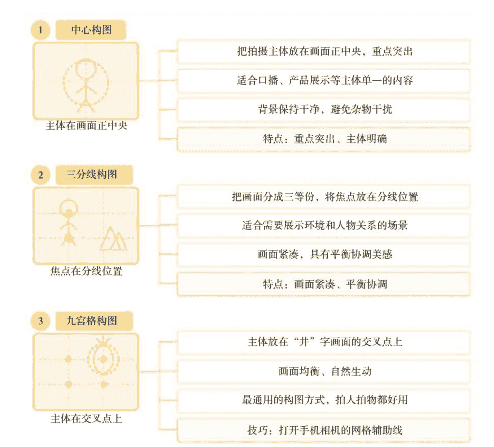

图4-4 常见的三种构图方法

- 中心构图：把拍摄主体放在画面正中央，重点突出，主体明确。这种构图适合口播、产品展示这类主体单一的内容，背景保持干净就好。
- 三分线构图：把画面分成三等份，将焦点放在分线位置，画面紧凑且有平衡感。这种构图适合需要展示环境和人物关系的场景。
- 九宫格构图：把主体放在“井”字画面的交叉点上，画面均衡自然。这是最通用的构图方式，拍人拍物都好用。

景别有多种类型（见图4-5），下面是三种最常用的景别。

图4-5 摄影景别类型

- 中景：拍膝盖以上到头顶，是最万能的景别，适合口播、教学、日常分享。用户既能看到表情，也能看到上半身的动作，信息量大。
- 近景：拍胸部以上到头顶，适合传递情绪。镜头离脸更近，用户能看清眼神和表情，代入感更强。我们很多高播放量的视频，在情绪表达的关键时刻用的就是近景。
- 特写：拍肩部以上到头顶，或者拍局部细节——手上的动作、眼神的变化、物品的纹理等。这种景别强调重点，能够制造视觉冲击力。

这里还有一点需要注意：不要从头到尾只用一种景别，哪怕是固定机位拍摄，剪辑时也可以裁剪成不同景别。全程采用一种景别会显得枯燥无聊，偶尔切一个近景或特写，会让视频更有节奏感。

##### 四、拍摄设备：根据预算丰俭由人

拍摄设备的选择取决于你当前所处的阶段和你的预算。这里分享两套方案：一套是我们团队在打造方比比这个IP时使用的专业拍摄方案，另一套是适合个人创作者起步的手机拍摄方案。

###### 1. 专业拍摄方案

我们使用的拍摄设备主要是索尼相机，它可以覆盖日常拍摄的大部分场景。同时我们也会使用大疆Pocket 3作为辅助拍摄设备。它体积小巧，自带稳定云台，画质高清，适合户外场景和日常Vlog的拍摄。比如2026年春节期间，发布在“方比比先生”这个视频号的祝福视频就是使用Pocket 3拍摄，画质完全能满足发布需求（见图4-6）。

图4-6 “方比比先生”的祝福视频

我们使用的收音设备是大疆无线麦克风，它佩戴方便，收音清晰，能有效隔离环境噪音。

###### 2. 手机拍摄方案

如果你的账号刚刚起步，就不需要一下子配齐专业设备，用手机同样能拍出清晰、有质感的视频。

初期的拍摄设备只要一部手机就够了。以iPhone为例，打开相机设置，将视频录制参数调整为4K、30帧，画面清晰度会有明显提升；同时建议关闭HDR模式，手机的HDR模式会影响画质（见图4-7）。其他手机的操作也类似，在相机设置中找到分辨率选项，选择最高的清晰度即可。

图4-7 iPhone手机视频录制参数设置

收音设备建议使用无线领夹麦克风，把它夹在领口位置，能有效提升人声清晰度。如果暂时没有麦克风，需要手机来收音，人物就要尽量靠近手机，距离保持在1米以内，同时关闭环境中的噪音源，比如空调、风扇等。

我还建议你使用手机三脚架来保证画面稳定。落地款的三脚架适用场景最广，缩短后还能当桌面支架。

不管选择哪套拍摄方案，核心原则是一样的：设备是为内容服务的，先把场景、灯光、构图做到位，设备带来的差异在短视频平台上并没有想象中那么大。

##### 五、完整工作流：揭秘爆款视频打造心法

每一条视频背后，都有一套完整的工作流在支撑（见图4-8）。

###### 视频制作工作流

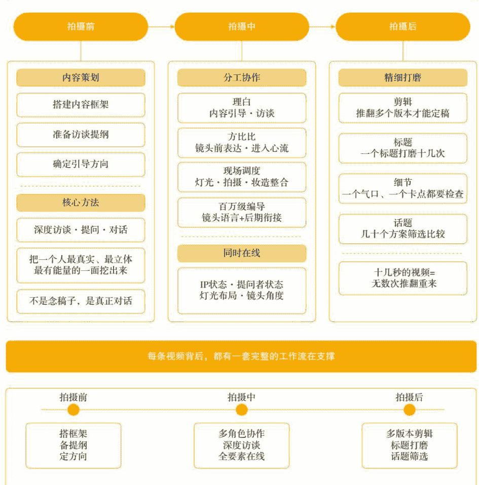

图4-8 视频制作工作流

- 拍摄前：提前搭好内容框架，准备好访谈提纲和引导方向。这不是随便写点内容，而是为了挖出真正有深度的内容，进行深度的访谈、提问、对话——把一个人最真实、最立体、最有能量的那一面挖出来，展现给用户。

与此同时，拍摄对象的状态也需要提前调整好。拍摄对象最好可以在拍摄前一晚开始调整饮食和作息，拍摄当天配合专业人士完成妆造，确保精神面貌在最佳状态。

- 拍摄中：分工明确。两个拍摄对象，一位负责内容引导和访谈，另一位在镜头前根据引导进入表达状态；专业人员负责做现场调度，整合灯光、拍摄、妆造等环节；内容编导负责镜头语言和后期衔接。
- 拍摄后：一条十几秒的视频有时要推翻好几个剪辑版本才能定稿；细节也要打磨十几次，甚至为了一个气口、一个特效的卡点，团队需要调整好几个版本；话题标签更是在几十个备选方案里不断筛选比较，最后才能发布。

如果你一个人拍摄视频，没有团队，那这个工作流也可以简化使用（见图4-9）。

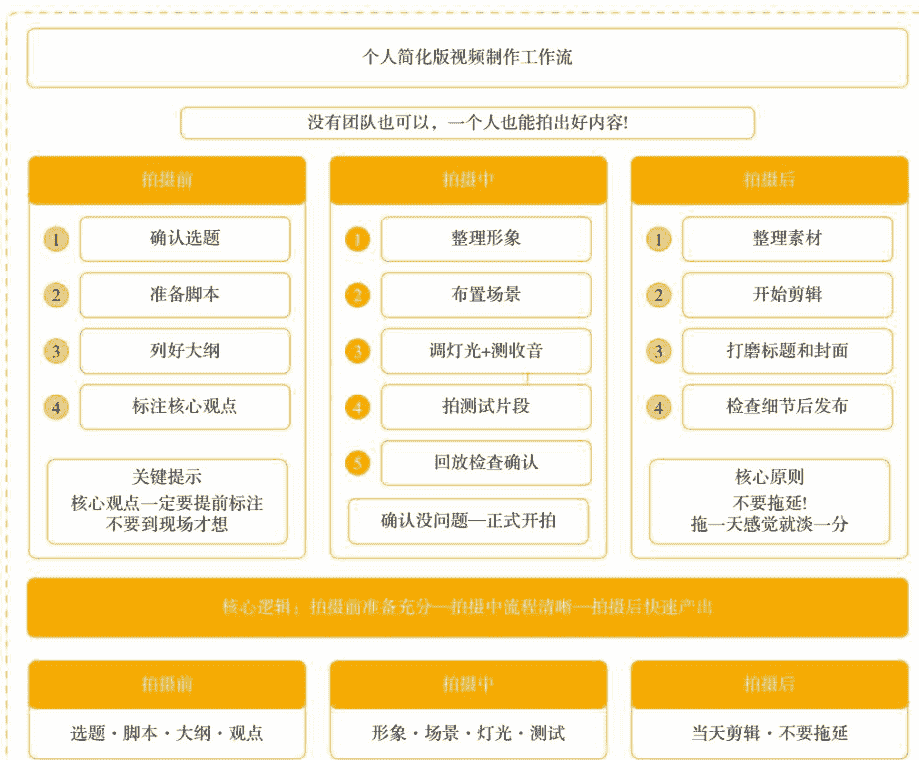

图4-9 个人简化版视频制作工作流

- 拍摄前：确认选题和脚本，列出大纲，标注清楚核心观点。
- 拍摄中：先花10分钟整理形象、布置场景、调好灯光、测试收音，同时检查设备参数是否正确——手机拍摄确认调至4K、30帧且关闭HDR。拍摄一段测试片段，检查确认没问题再正式拍摄。
- 拍摄之后：趁热打铁，整理素材，尽快剪辑。

##### 小结

想要拍出具有高级质感的视频，核心在于对每一个细节的把控。

场景搭建要简洁有层次，服装妆造要提前准备到位，灯光布置要让人物面部均匀自然，构图取景要有变化、有节奏，声音收录要干净清晰。

搭建好完整的视频制作工作流，一个人也可以拍出好内容。

### 4.2 AI剪辑与包装：让工具替你完成90%的工作

#### 4.2.1 情绪流剪辑：掌握剪辑节奏，提升作品完播率

完播率是平台推荐算法中权重最高的指标之一。一条视频能否被推到更大的流量池，第一个判定标准就是有多少人愿意看完它。可以说，完播率直接决定了你的视频能获得多少播放量。

那么问题来了：怎么才能让用户愿意看完视频？答案就是掌握好剪辑的节奏。我的视频号“方比比先生”能在短短一个月内达到亿级播放量，情绪流剪辑是一个不可忽略的要素。

##### 一、什么是情绪流剪辑

情绪流剪辑是一种以调动用户情绪为核心目标的视频剪辑方法，让用户不仅愿意看完视频，同时还能感受到视频传递的情绪。

它和传统剪辑有什么区别？我们可以从几个关键维度来理解（见表4-1）。

表4-1 传统剪辑与情绪流剪辑的区别

| 维度 | 传统剪辑 | 情绪流剪辑 |
| :--- | :--- | :--- |
| 核心目标 | 信息传递清晰 | 调动用户情绪 |
| 节奏处理 | 删除所有停顿，追求紧凑 | 有快有慢，适当保留停顿 |
| 结尾设计 | 内容讲完即结束 | 必须有情绪的升华 |
| 完播率逻辑 | 靠内容价值留人 | 靠情绪牵引留人 |

以视频号“方比比先生”这条关于年轻人要孝顺父母的视频为例，传统剪辑会把观点讲清楚就结束，而情绪流剪辑会在结尾配上一段跟内容传递的情感相匹配的背景音乐，将画面定格在真诚又感染力的笑容上，再加上一句情绪冲击力最强的文案（见图4-10）。用户看到这里，情绪被点燃，自然就想点赞、评论、转发。

##### 二、情绪流剪辑的意义和价值

###### 1. 直接提升完播率

图4-10 “方比比先生”情绪流剪辑

完播率低的视频通常有一个共同特点：节奏有问题。有的视频从头到尾一个节奏，用户看了几秒觉得后面也差不多，就划走了；有的视频剪得太紧太赶，用户看了觉得喘不过气，也会划走。

情绪流剪辑通过制造期待感、保持节奏变化、设计情绪高点，做到有效吸引和留住用户。当用户被你的节奏牵引时，他们就会不自觉地看到最后。

###### 2. 提升互动率和转发率

用户为什么会点赞、评论、转发一条视频？大多数情况下是因为被这条视频触动了。情绪流剪辑的核心就是调动情绪，当用户的情绪被调动起来，他们就会产生表达和分享的欲望。

###### 3. 强化IP的人格魅力

情绪流剪辑通过适当保留真实的互动、自然的表情、有温度的对话，让用户看到一个有血有肉的人，而不是一个冷冰冰的机器。这种真实感和亲近感，会提升粉丝黏性。

##### 三、如何掌握情绪流剪辑

理解了情绪流剪辑的含义和价值后，还要知道该怎么做。情绪流剪辑需要具备四项核心能力，我称之为四大基本功：审美力、升华力、呼吸力、节奏力。这四项能力都和把控短视频节奏密切相关，下面逐一讲解。

###### 1. 审美力：知道什么是好的

具备审美力就是知道什么样的视频节奏是用户喜欢的。很多新手花大量时间学习各种特效和技巧，剪出来的视频却不受欢迎，这就是有技术、没审美。

单纯掌握了技术只是明白怎么做，而审美在线才能明白为什么要这么做。只有知道用户喜欢什么样的节奏，你才能做出正确的剪辑决策，知道哪些片段该删除，哪些片段该保留。

###### 2. 升华力：设计好结尾

具备升华力是指能将普通的事物或叙述提升到更具感染力的层次。结尾是情绪流剪辑最重要的部分，一个有升华力的结尾能让用户产生强烈共鸣。

有升华力的结尾通常包含这些要素：一句触动人心的金句、一个真实自然的笑容、恰到好处的背景音乐配合、适当放慢的画面节奏。比如视频号“方比比先生”就会用一个温暖的笑容作为结尾，同时配上合适的背景音乐和歌词（见图4-11）。

图4-11 “方比比先生”的结尾升华

再比如“方比比先生”有一条讲述创业经历的视频，结尾说完“一个人最怕的不是穷，而是没了野心”这句话后，画面缓缓放大，配上一段匹配情绪的背景音乐，随后屏幕上出现主人公的名字（见图4-12）。这几秒钟的设计，就是情绪的点燃时刻。

图4-12 “方比比先生”的结尾升华

###### 3. 呼吸力：让画面动起来

具备呼吸力指的是视频通过关键帧技巧让画面实现放大或缩小，同时配合内容传递情绪（见图4-13）。传递正向情绪（笑容、认同、感动）时，画面可以适当放大，拉近和用户的距离；传递悬念或思考时，画面可以保持不动或微微缩放。放大幅度一般在10%～20%，主要用在开头和结尾以及情绪起伏大的片段。放大的时候注意尽可能只调整画面比例，不要调整画面位置，避免画面晃动。

###### 4. 节奏力：把控快与慢

节奏力是和完播率关系最直接、最密切的能力。情绪流剪辑要求适当保留停顿，而不是剪得越干净越好。比如在提出一个问题后，保留1～2秒的思考停顿，拉高用户的期待值，他们好奇接下来要说什么，就会继续看下去。

还要适当调节速度。开头如果语速太慢，可以加速到1.05～1.1倍，快速吸引用户注意力；结尾需要渲染情绪时，可以降速到0.9倍，让用户有时间感受情绪。

另外，开头的第一句、提出的问题、连续表达的观点，气口要剪干净；结尾、互动环节要适当保留笑声和语气词，体现真实感。

##### 四、剪辑注意事项

掌握了四大基本功，在实际剪辑时还有一些细节需要注意。

###### 1. 检查安全区

每次剪完视频后，一定要检查字幕是否会被平台界面遮挡（见图4-14）。如果关键文字被头像或互动按钮遮挡，用户就会看不见，自然就划走了。

###### 2. 做好调色和美颜

直接用原始素材，画面会显得灰暗。适当进行调色和美颜能让画面更有质感，用户看起来也更舒服。

###### 3. 加黑色蒙版

在画面上下边缘添加黑色渐变蒙版，能让用户的视线聚焦在人物脸部，提升画面的高级感。

###### 4. 不用文字描边

文字描边会让画面显得不够精致。当背景较暗时，可以直接使用白色或浅色字体。

###### 5. 慎用花哨转场

转场特效能不用就尽可能不用。如果需要转场，简单的叠化效果是较好的选择。扭曲变形的转场特效会打断情绪流动，也会打乱视频节奏。

##### 五、情绪流剪辑的可复制性

很多人看完前面的内容会想：这套情绪流剪辑的方法，是不是只适用于方比比这一个IP？换一个人、换一个赛道，还合适吗？我来告诉你：完全可以用。

我们在运营“方比比先生”这个账号的过程中，总结出了这套情绪流剪辑的方法论，然后迅速用同样的方法孵化了“方比比老板”这个账号。后来我们又把这套方法应用到其他客户身上，同样做出了爆款。

比如视频号“AI富贵”有一条视频叫“方比比爆火真相”，讲的是方比比这个IP为什么能火（见图4-15）。这条视频用的也是情绪流剪辑的思路：开头用“方比比爆火真相，我只跟他说了一句话”来吸引用户注意力；中间通过真实的采访对话推进节奏；结尾落在一个有情绪共鸣的文案上——“爱是非理性的情感联结，就像父母对孩子，哪怕孩子再平凡，也会觉得他是最好的。”

这条视频的效果非常好，更重要的是它验证了一件事：情绪流剪辑是一套可复制的方法，不依赖某一个特定的IP，而是依赖对剪辑节奏和用户情绪的理解。

如果你也想用这套方法打造自己的爆款内容，可以先从模仿开始。把“方比比先生”的视频拆解一遍，看看每一个剪辑点是怎么设计的，背景音乐是怎么配合情绪的，结尾是怎么升华的。看得多了、拆得多了，你自然就能找到感觉了。

##### 小结

情绪流剪辑的核心是通过把控剪辑节奏来调动用户情绪，让用户被牵引着看完整个视频，从而提升完播率。

掌握这项技能，需要修炼四项基本功：审美力要求知道什么节奏是好的，升华力要求设计触动人心的结尾，呼吸力要求画面配合情绪变化，节奏力要求把控视频节奏的快与慢。

情绪流剪辑是一套可复制的方法论，不依赖某一个特定的IP。从“方比比先生”到“方比比老板”，再到“AI富贵”，同样的方法论在不同赛道、不同人物上都做出了爆款。

#### 4.2.2 AI剪辑神器：一键成片、智能优化细节，轻松搞定成片

以前我们剪视频，最耗时间的是找素材、加字幕、调音频、卡节奏等工作，现在这些工作AI都能帮你干。你只需要把文案输入进去，它可以自动帮你匹配素材、添加字幕、搭配音乐，迅速产出一条完整的视频。

更关键的是，AI还能帮你优化那些容易被忽略的细节。它不是替代你，而是帮你完成那些重复性、耗时间的工作，让你把精力放在真正需要创意的地方。接下来我们来说说，AI剪辑到底怎么用，以及能解决哪些具体问题。

##### 一、一键成片：输入文案，AI自动配素材

先来说一键成片功能。你准备好文案，输入进去，选择想要的视频风格和配音类型，点击生成，AI会自动帮你匹配相应的素材。你只需要等一两分钟，视频就会自动完成，字幕、配音、背景音乐、转场效果都能自动添加好。

以剪映为例，打开“图文成片”功能，操作流程只需以下三步。

第一步，输入文案：把你写好的视频脚本输入进去。

第二步，选择风格：选择视频风格（清新、科技、温馨、商务等）和配音类型（男声、女声、情感语气等）。

第三步，生成视频：点击“生成视频”按钮，AI就会自动匹配素材、添加字幕和配音（见图4-16）。

AI会根据文案内容，从素材库里自动匹配相关的视频片段和图片。比如文案提到“海边日落”，它就配海边日落的画面；文案提到“城市夜景”，它就配城市灯光的镜头。AI匹配的准确率能达到80%甚至更高，基本不会出现明显的错配。

度加剪辑的“灵感成片”功能更方便，输入你的想法，它就能直接帮你生成文案，然后自动匹配素材、字幕、配音，几分钟就能产出一条视频（见图4-17）。

但并不是所有文案都适合一键成片，想让AI匹配得更准，文案要符合下面这几个标准。

###### 1. 每句话控制在15～20字

如果句子太长，AI就难以找到完整匹配的素材；如果句子太短，又会让节奏太碎。15～20字对应3～5秒的画面，节奏正好。比如“我们总是在忙碌的生活中忘记停下来看看周围的风景，错过了很多美好的瞬间”这句话就很长，AI可能无法理解，可以增加标点符号改成短句：“我们总在忙碌中奔跑，却忘了停下来看看风景，那些美好的瞬间就这样错过了。”

###### 2. 用具体场景，不用抽象概念

如果输入抽象的词汇，AI也不知道该配什么画面；如果输入具体的场景描述，AI就能精准地匹配。比如，如果你输入“成功需要努力和坚持”，AI可能不知道“成功”“努力”该配什么画面，可以改成“每天早晨六点开始学习”“健身房挥汗如雨的身影”“深夜办公室还亮着的灯光”这些明确具体的描述，AI生成的画面就会更精准。

###### 3. 文案要有情绪递进

一段好的文案不是平铺直叙，而是要有起承转合：先抛出痛点，再给出解决方案，最后情感升华。这样的文案结构清晰，AI匹配素材时也能根据情绪的变化选择不同风格的画面。

如果你觉得写文案很困难，可以先用AI生成文案，然后再复制到剪映。

你是一位专业的短视频文案编辑，擅长创作适合一键成片的视频脚本。请生成关于××主题的视频文案，要求如下：

1. 文案总字数控制在150～200字；
2. 每句话控制在15～20字，方便AI匹配素材；
3. 文案要有画面感，多用具体的场景描述，少用抽象的概念描述；
4. 情感基调（励志/温馨/实用/幽默等）；
5. 结构是先描述痛点场景，再给出解决方法，最后正向激励；
6. 目标受众（职场人士/25～45岁男性等）。

举个例子，你想做一条关于养成早起习惯的视频，可以跟AI提出如下要求。

你是一位专业的短视频文案编辑，擅长创作适合一键成片的视频脚本。请生成关于“如何养成早起习惯”的视频文案，要求如下：

1. 文案总字数控制在150～200字；
2. 每句话控制在15～20字，方便AI匹配素材；
3. 文案要有画面感，多用具体的场景描述，少用抽象的概念描述；
4. 情感基调为励志、实用；
5. 结构是先描述痛点场景，再给出解决方法，最后正向激励；
6. 目标受众是想要改变作息的年轻人。

AI可能会生成如下文案。

你有多久没看过早晨六点的太阳？
每次闹钟响起就按掉继续睡，
告诉自己明天一定要早起，
结果睁眼又是中午十二点。
早起的第一步不是定闹钟，
而是前一晚十一点准时上床。
手机放在够不到的地方，
睡前不刷视频不追剧。
第二天睁眼先喝一杯温水，
拉开窗帘让阳光照进来，
坚持一周你会发现，
早起的世界真的很不一样。

接下来，你就可以直接把这段文案粘贴进剪映的“图文成片”，选择励志风格和温暖女声配音，最后生成视频。

AI会自动匹配内容，整个过程大概需要两分钟，视频生成后，你只需要预览一遍，把个别不满意的素材替换一下，一条完整的视频就完成了。

##### 二、数字人播报

很多人做短视频最大的顾虑就是不想出镜，担心自己长得不够好看，担心表达不够流畅，担心被熟人看到尴尬……但是，仅有配音和画面的视频又缺少真人出镜的信任感和亲切感。数字人播报就可以解决这个问题。AI生成的虚拟人物能够替你出镜，口型、表情、动作都很自然。你只需要输入文案，选择数字人形象，AI就能生成一条口播视频。

主流的数字人工具有剪映的“数字人”、度加的“AI数字人”、蝉镜等。下面以剪映为例来讲解（见图4-18）。

第一步，在剪映首页找到“数字人”功能。

第二步，选择数字人形象：有男有女、有年轻有成熟、有商务风有亲和风，根据你的内容定位选择合适的数字人形象。

第三步，输入播报文案：把你的口播脚本粘贴进去。

第四步，调整声音和语速：选择配音类型（温柔、激昂、专业等），调整语速。

第五步，生成视频：点击“生成”按钮，等待几分钟，数字人播报视频就做好了。

##### 三、音频优化

很多人做视频时会在音频处理这一环节遇到困难。因为我们在录音的时候总会出现各种问题：表达不够流畅、有“嗯”“啊”等口头禅、停顿时间太长、背景有杂音、音量忽大忽小等。

以前处理这些问题需要用专业的音频软件一段一段地剪，费时费力，现在AI也可以一键帮你搞定：自动删除口头禅、去掉多余停顿、消除背景噪声、平衡音量大小。

还是以剪映为例，以下是完整的音频优化流程（见图4-19）。

第一步，导入素材：把你录好的音频或视频导入剪映。

第二步，智能剪口播：点击音频轨道，选择“智能剪口播”，AI会自动标记口头禅，然后你可以一键删除或手动删除。

第三步，预览效果：播放音频，听一下效果，如果有不满意的地方可以手动微调。

整个流程大概几分钟就能搞定。处理前的音频磕磕巴巴、杂音明显、节奏拖沓，处理后的音频流畅清晰、节奏紧凑、专业有力。

##### 小结

**一键成片：** 输入文案后，AI自动匹配素材、字幕、配音，几分钟即可生成一条视频，能够提升视频的产出速度。

**数字人播报：** 不想出镜也能做口播视频，可以选择数字人形象，用AI生成播报视频。这种方式适合前期不想出镜，想先尝试做内容的博主，可以等有了一定的粉丝基础和信心，再慢慢尝试真人出镜。

**AI音频优化：** 自动去除口头禅、长时间停顿、背景杂音，还可以平衡音量，让音频听起来更专业。

#### 4.2.3 封面设计：AI一键生成封面，塑造高质感品牌形象

一张优秀的封面需要实现两个目标：第一个是成为视觉抓手，它必须在色彩、构图上足够清晰，能在手机屏幕这个有限空间里，瞬间吸引用户注意力；第二个是进行信息传达，封面不能密密麻麻地写满字，而应该用最精炼的关键词，直击用户的痛点或激发用户的好奇心。

视频号的视频封面通常由三个要素组成：干净的底图、有吸引力的文字、统一的视觉标识。接下来逐一拆解如何用AI完成这三个部分的制作。

##### 一、用AI生成留白合理的底图

如果画面中的人物、背景、文字等元素全部挤在一起，用户就会找不到重点。比如，一张封面上既有人物特写，又有复杂的背景，还有大段的文字说明，各种元素混在一起，反而都看不清楚。

优秀的封面应画面简洁，主体突出，文字清晰。比如，封面的左侧是一个清晰的人物或产品特写，右侧是大面积的纯色或简单背景，写着几个字的核心关键词，整体看起来配色协调，用户一眼就能捕捉到有效信息。

这时候，AI绘画工具就派上用场了。比如，你是一个做职场干货的博主，如果你直接使用乱糟糟的办公桌图片作为封面，效果肯定不好，那么就可以让AI直接生成图片。

你可以将下面这段指令发给AI。

请生成一张极简风格的办公桌图片，画面左侧是一台银色的笔记本电脑和一杯冒着热气的咖啡，画面右侧留出大面积的浅灰色空白背景，用于添加文字。整体色调为温馨的暖色系，图片比例为竖版6：7。

AI会生成类似的图片（见图4-20）。

如果你是做口播类视频，需要用真人照片做封面，AI也能生成。你可以拍一张自己真人的照片，哪怕背景是乱糟糟的客厅也没关系。然后利用AI的画面扩展功能或者局部重绘功能，把背景替换成干净的纯色或者虚化的高级办公室背景。这样一来，人物清晰，背景干净，文字也有了“落脚”的地方。

你可以先准备一张图片发给AI，然后发送如下指令。

> 请帮我优化这张照片，保留人物主体，将背景替换为温馨的居家收纳场景，光线自然柔和。

##### 二、用AI生成写出吸睛的封面文案

生成合格的底图后，接下来就是添加封面上的文字。这里有一个误区：很多人会直接把视频的标题写在封面上。视频的标题为了兼顾搜索效果，通常会比较长，比如“新手必看：教你如何在十分钟内学会做红烧肉”。如果你把这些文字都放在封面上，字会变得非常小，而且显得很拥挤。

封面文案最好不要超过十个字，字号要大，颜色要醒目。你可以把你的视频脚本发给AI，然后输入如下指令。

> 请阅读这篇脚本，帮我提炼出三句封面文案。要求：字数在6～10个字；具有强烈的吸引力，能制造悬念或直击痛点；不要使用复杂的形容词和书面语，要有冲击力。

AI会提炼出“过年招待亲朋的十道菜”“大厨不传秘方”“十分钟搞定一道硬菜”等短句，就非常适合放在封面的留白处，再配上一张色泽鲜艳的菜品图，点击率会比放原标题高得多。

视频号博主“咪呀家常菜”会在封面写上“十道家常美食”，图片看起来也非常诱人，就会让用户很想点进去看究竟是哪十道菜；还有视频号博主“张大厨不是大厨”会在封面上写上“一分钟学会一道菜”，做法看起来非常简单，就会让人很想点进去学习（见图4-21）。

##### 三、建立模板思维，打造视觉识别系统

当你点开粉丝量很大的博主的主页，会发现他们的视频封面看起来都差不多。这并不是因为他们懒，而是因为他们在刻意经营一种东西——视觉识别系统，也就是我们常说的品牌。

如果你的封面今天用卡通风格，明天用写实风格，后天又用纯文字风格，用户点进主页就会觉得非常乱，很难记住你。在信息爆炸的时代，让用户记住的成本越来越高，统一的视觉风格就是降低记忆成本的最好方式。比如我的视频号“方比比先生”也是使用风格统一的封面（见图4-22）。

##### 小结

运营视频号就像经营一间店铺，封面就像是你的店铺招牌。如果没有一个吸引人的封面，再好的内容也很难被用户点开。在如今的AI时代，我们不需要成为专业设计师也能做出高点击率的封面。

第一，用AI生成留白合理的封面底图，让画面简洁有力。视频号封面的标准尺寸是竖版6：7，横版16：9，给AI下指令时要明确留白区域的位置。

第二，让AI提炼精简的封面文案，6～10个字直击痛点。封面文案和视频标题是两回事，封面文案要的是视觉冲击力，而非完整信息。

第三，建立统一的视觉识别系统，让用户一眼就能记住你。固定的版式、统一的配色、一致的字体，这些都是建立品牌识别系统的关键元素。

## 第五章 进阶运营：撬动算法杠杆，打造超级爆款

### 5.1 发布与冷启动：发布视频的黄金法则

#### 5.1.1 发布流程：认准黄金发布时间+关键设置，挖掘自然流量

冷启动阶段的数据表现决定了这条视频的流量上限，而冷启动的数据好不好，很大程度上取决于一件事——视频发出去的那一刻，有没有足够多的目标用户看到它。时间选对了，你的视频刚一发出去就有人看、有人互动，算法监测到正反馈就会给你推流。

除了发布时间，发布页面里还有几个设置项，看起来不起眼，但每一个都会影响视频的曝光和推荐：地点标签、话题标签、合集功能……如果能把这些设置都利用起来，你的视频就能得到更多流量。这一节就把发布时间怎么选、发布设置怎么做，一次性讲清楚。

##### 一、发布时间

视频号带有浓厚的社交底色。一条视频的第一波推流通常是推给你的好友或者和你标签高度重合的精准用户。这些人的完播率、点赞量和评论量，就是视频号对你视频的第一份数据测试。如果数据太差，算法就会判定视频质量不高，从而停止后续的流量推送。

数据显示，一天中有三个流量高峰（见表5-1）。

表5-1 视频号的流量高峰

| 时段 | 时间范围 | 用户特征 |
| :--- | :--- | :--- |
| 早高峰 | 7:00~9:00 | 通勤路上刷手机，利用碎片时间，偏好轻松短内容 |
| 午高峰 | 12:00~14:00 | 午休时间，相对放松，愿意看稍长的内容 |
| 晚高峰 | 18:00~22:00 | 下班后的放松时间，活跃度最高，各类内容都适合 |

其中，晚高峰是一天中流量最大的时段，尤其是19:00～21:00，这是绝对的黄金时间。如果你只能选一个时间发布，优先选这个时段。

虽然晚高峰是通用的黄金时段，但不同赛道的目标用户作息习惯不同，最佳发布时间也有差异（见表5-2）。

表5-2 不同赛道的最佳发布时间

这些时间是基于大多数用户的习惯总结出来的，应用到你的账号时，还需要根据实际数据来调整。那么如何找到你的最佳发布时间呢？建议用下面这个方法来测试。

首先，按照本赛道通常的最佳发布时间发布一周，记录每条视频的初始数据（前2小时的播放量、互动量）。

其次，尝试在不同时间点发布同类型内容，对比数据差异。

最后，打开视频号后台的“粉丝分析”，查看你的粉丝活跃时间分布，根据这个数据调整发布时间。

坚持记录两三周，你就能找到最适合自己账号的发布时间。

##### 二、视频号发布流程

视频号的发布流程十分简单，只需三个步骤即可（见图5-1）。

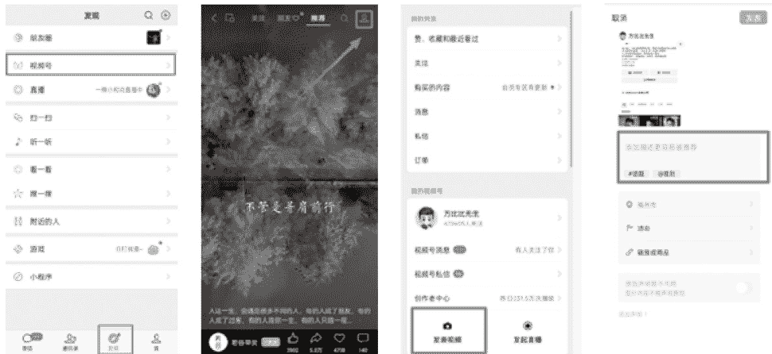

第一步，进入发布入口。在微信的“发现”页，点击“视频号”，进入后点击右上角的相机图标，即可开始创作。

第二步，编辑视频与添加描述。从相册选择提前准备好的内容，再进行基础编辑，可以为视频添加配乐、文字、表情符号等。撰写描述文案时需要简洁有力，能概括视频亮点，吸引用户点击和看完。

第三步，设置扩展信息。扩展信息是提升曝光量的关键。可以添加话题，加上与内容相关且热门的话题，有效增加被搜索和推荐的机会；对于本地生活、探店类账号，还可以添加位置，能触发地理推荐机制，吸引附近的用户；还可以关联公众号文章或商品链接，为公众号引流或实现变现。

##### 三、关键发布设置

清楚了发布时间和发布流程，接下来就是要把细节完善好，把发布页面的每项设置都做到位。

###### 1. 用地点标签，挖掘自然流量

很多新手在发布视频时，往往会忽略“添加位置”这个细节。对普通博主来说，带上一些热门城市或热门地标的定位，能够增加视频出现在同城流量池的机会。

在视频号的推荐算法里，地理位置是一个极其重要的维度，特别是对于那些想要做本地生意或者针对特定区域用户的账号来说，这就是“白给”的流量。

微信本身就是一个强社交、强地域属性的平台。当你发布视频时，带上一个具体的坐标——你所在的办公楼、某个网红商圈或者是知名的旅游景点，系统就会自动给你的视频打上一个“同城”或“附近”的标签。这样一来，除了常规的兴趣推送，系统还会尝试把你的内容推送给附近的人。

这种基于地理位置的定向推送，对于想要引流的实体店必不可少。比如，你开了一家很有格调的咖啡厅，在视频号发了一段喝咖啡的视频，定位就是你的咖啡厅。在附近刷到这个视频的人，可能直接就导航过来了。这种从公域流量到私域客流的转化路径，是极简且精准的。

###### 2. 话题标签的矩阵打法

话题标签就是你发给算法的名片。如果你不带标签，算法就需要通过分析你的画面和音频来判断你的内容类型，这会造成匹配的延迟。但如果你乱带标签，比如写代码的视频却带上“颜值”的标签，虽然可能骗到一些流量，但由于人群不匹配，完播率会瞬间降低，反而会降低你的账号权重。

正确的做法是采用“三级矩阵”的标签策略。大家可以参考“三土学AI”这个账号的做法：第一个标签是大而全的流量词，比如“AI”或者“AI推荐”，这决定了你的视频被放进哪个大的赛道；第二个标签是精准的行业搜索词，比如“GEO”或者“GEO布局”，这会使你的视频被精准推荐给那些有明确搜索需求的人；第三个标签是你的个人IP词或目标人群词，比如“×××学AI”或者“创业者必看”，这是为了在长期运营中形成你自己的话题聚合页，圈住目标人群。

标签不是越多越好，过多的话题会分散视频的权重，通常一个视频带上3～5个精准标签是最合适的。我们要用好标签，告诉算法：我的内容很垂直，我的受众很明确，请将我的视频精准地推送给这些人。

###### 3. 使用“艾特”功能互相引流

在发布视频的文案区，你可以@（提及）其他视频号账号，即我们俗称的“艾特”。如果你有多个账号，就可以互相“艾特”导流。视频里提到了某位朋友或合作方，“艾特”一下可以增加曝光，“艾特”官方账号还有机会获得更多推荐（见图5-2）。方法很简单，在文案输入框中输入“@”符号，系统会弹出你的好友列表或搜索框，选择你想提及的账号即可。

图5-2 微信视频号评论区的“艾特”功能

###### 4. 合集功能吸引用户点击

如果你有系列内容，一定要用合集功能把它们整理到一起。

用户看完一条视频觉得不错，可以直接进入它所在的合集，继续观看其他相关内容。这能大幅提升用户在你账号的停留时间，也有助于涨粉。

比如视频号博主“范小敏呀Minna”“知知不会倦”，都做了合集系列。每个合集有多条视频，用户从任意一条视频点进主页都能看到完整的系列，不仅能给用户很好的追更体验，还会给其他视频持续带来流量。

##### 小结

发布视频不是随手一发就可以了，什么时间发、怎么设置都会影响到视频的流量。

第一，发布时间决定冷启动数据，晚高峰19:00～21:00是通用的黄金时段，但不同赛道要根据自己目标用户的作息习惯去调整。花两三周时间测试，就能找到最合适的发布时间。

第二，地点标签是天然的流量入口，尤其是做本地生意的账号，每条视频最好都要带上定位。

第三，发视频要带话题标签。话题标签用“三级矩阵”——大赛道词、精准行业词、个人IP词，3～5个标签就够，不要贪多。

第四，系列内容一定要使用合集功能，让用户点进一条视频就能追完一整个系列。

#### 5.1.2 投流技巧：微信豆冷启动的正确方式

很多创作者对“投流”这件事有误解。他们觉得投流是花钱买播放量，这是作弊，真正的好内容不需要投流。其实，投流的本质是付费让平台把你的视频推送给更多人看。它无法让烂内容变成爆款，它只能让好内容更快被看见。

这一节，我们就来聊聊微信豆投流的正确方式：什么时候投、投多少、怎么设置、有哪些坑要避开。

##### 一、视频号投流的三个核心逻辑

运营视频号的过程中，投流是锦上添花。搞懂下面这三个核心逻辑，才能更好地投流。

###### 1. 必须先有优质内容，再谈投流

视频号投流的本意是“放大优质内容”，而不是挽救劣质内容。我见过太多新手博主在视频自然播放量才几十上百时就急着去投钱，结果钱花光了，视频播放量还是没怎么上升。

这是因为算法检测到视频的初始数据（点赞量、完播率、转发量）太差，认为内容不值得被更多人看见，这时哪怕将其推送给更多用户，用户也会很快划走。所以，我们在选择投流内容时，要优先选择初始数据还不错的视频，比如选择自然播放量能过500的视频，拿这类视频去试投效果更好。

###### 2. 投流就是合规检测

有时候，视频里可能存在某些敏感词或者是违规画面，但在自然推流时系统没报错。不过，一旦你尝试投流，系统就会提示无法投放或是审核不通过，这就代表后台在预警。这时，你就得先检查自己的内容，比如画面是不是出现了违规二维码，或是使用了“不符合社会主流价值观”的用语。

###### 3. 视频号更倾向于慢精准

有的平台会在短时间内用完所有的投流费用，但视频号有时候会让你觉得钱“花不出去”，这其实是因为平台的慢消耗。慢消耗意味着算法在帮忙精挑细选用户，它不希望把你的钱花在无效人群上。

比如，你设定的目标人群是30～39岁的女性，视频号就会慢慢筛选，确保推送的用户绝大部分都是符合要求的目标人群（见图5-3）。这种理性克制的算法是小预算用户省钱的保障。

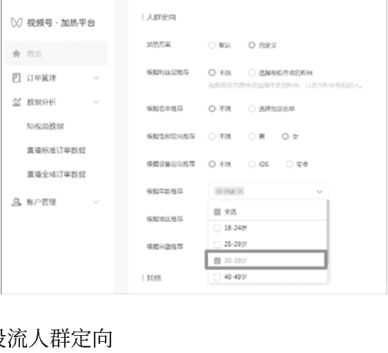

图5-3 视频号投流人群定向

##### 二、小预算不亏钱的实操

我接触过很多小而美的个人IP，他们刚开始投流时每次只投100～200元，照样能把账号运营得很好。这其中的关键就在于掌握四两拨千斤的技巧。

###### 1. 投点赞数，测人群精准度

新手最忌讳一上来就瞄准成交这种深层目标，毕竟用户转化需要过程。比如，可以先找一条自然数据还不错的视频，在微信豆投放里花100元，目标选“点赞数”，再定向选1～2个在这个垂直赛道做得最出色的对标账号，投放时长可以设成24小时，让内容“跑”一段时间（见图5-4）。

如果花完这100元，你能得到超过30个点赞，那成本大约为3元1个赞，那么就说明推送的人群很精准，内容也对路；要是点赞数达到50个及以上，那这条视频就是潜力股，值得你考虑继续分批次投流。

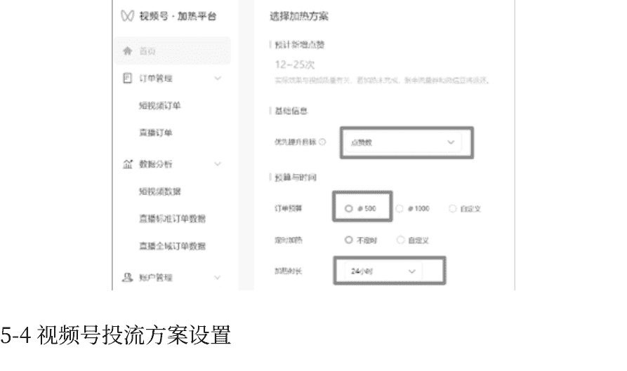

图5-4 视频号投流方案设置

###### 2. 使用微信小店广告

如果你有自己的产品，已经开了微店，那一定要研究这个工具。它的规则是“无转化不扣费”，也就是系统给予流量曝光，用户如果只是看个热闹没下单，那这份流量就是免费的；只有当订单成交了，系统才会按比例扣除广告费。虽然单次转化的成本看着比普通投流高一点，但胜在确定性强。这对初期不敢乱花钱、追求稳扎稳打的新博主来说是很好的商业测试。

###### 3. 矩阵号的分散投流

如果你所在的赛道覆盖面大、竞争激烈，比如英语、情感、养生等，那可千万别把所有鸡蛋都放在一个篮子里。比如，你可以尝试做两个以上的矩阵号，每个号的内容侧重点有所差异，在投流的时候，每个号只投100元，分散投放。这样做不仅能降低预算“打水漂”的风险，还能通过不同维度的流量入口，多方位筛选出真正的用户。

##### 三、投流时间：在对的时间找对的人

同样的内容和预算，在不同的时间段进行投流，数据有时能差出好几倍。至于投流时间段的选择，需要综合考虑目标用户、赛道类型等多种因素。

比如根据目标人群的活跃时间。如果目标人群是上班族，那么像早高峰7:00～9:00、晚高峰18:00～20:00都是他们通勤和放松的时间，这会儿就很适合投放与通勤、餐饮、娱乐、家居等相关的广告或内容；如果目标人群是中老年人群体，10:00～12:00、15:00～17:00的用户活跃度会比较高，适合进行健康养生、生活服务、传统文化等领域的投流。

再比如根据赛道类型，如果是读书分享、晨练运动教程的相关视频，那么6:00～9:00才是黄金时间，这时候用户的求知欲和好奇心更强烈，他们急需正能量和干货来开启新的一天；如果你在用户忙得焦头烂额的下午投放这种视频，他们大概率会因为没时间思考而直接划走。

在正确的时间把正确的内容送到目标用户的面前，这才是事半功倍的逻辑。

##### 四、常见误区和避坑指南

###### 误区一：把投流当成救命稻草

如果视频的内容不行，投流解决不了问题。投流只是“加速器”，它能让好内容更快被看见，但不能把烂内容变成好内容。

如果你的视频完播率只有15%，投流只是让更多人在看了三秒后划走，没有任何意义。平台根据这些数据会判定这条视频不受欢迎，自然流量就会更少。所以，还是要先把内容做好，再考虑投流。

###### 误区二：只投一条视频

很多人的做法是：发布10条视频，挑其中数据最好的一条进行投流，把钱都花在这一条上。

实际上，这个策略不是最优的。更好的做法是：发10条视频，挑3～4条数据还不错的，每条都投一点钱测试。这样能分散风险，也能积累更多数据，了解什么样的内容投流效果最好。

###### 误区三：投完就不管不顾

投流不是设置完就结束，而是要根据数据不断优化调整策略。如果投了一段时间，播放量在涨但完播率在跌，说明推送的人群不太精准，可以调整定向设置；如果播放量、完播率和互动率都在涨，可以考虑追加投放。

##### 小结

想要玩转微信豆投流，做到“花小钱、办大事”，本质上是掌握一套风险控制和概率放大的逻辑。

1. 视频号投流是锦上添花的动作。先有好内容作为支撑，才能触发算法的放大机制，否则投入再多钱也是“打水漂”。
2. 用好投流能帮助内容曝光变现，通过小额试投也能排查掉敏感词和违规风险。
3. 坚持小额试错。通过测试点赞率来验证推送的精准度，若人群正确，再分批增加预算，切忌盲目大手笔。
4. 深度用好微信生态闭环，关注微信小店的转化模式，能大幅降低单次获客成本，降低运营风险。
5. 根据内容属性选择晚间或早间的黄金时间进行投放，让每一分钱都花在用户最需要的情绪点上。

### 5.2 避坑指南：那些年，我踩过的视频号运营大坑

#### 5.2.1 常见误区：为什么你的视频号总是违规限流

视频号背靠微信，它的推荐算法和社交关系是深层绑定的。平台最看重的是生态健康和用户信任感，一旦你的操作触碰了底线，算法这只无形的手就会立刻按下暂停键，把流量通道收紧。

如果你发现自己的视频原本有几千上万的播放量，突然掉到了几十，甚至只有自己能看见，那多半是内容被平台判定为违规，因而被限流了。

这一节，我就带大家把违规限流的常见原因给彻底盘点清楚。识破了这些违规限流的陷阱，你才能不断避坑，在视频号这条路上走得稳、走得远。

##### 一、搬运与同质化

有些人在运营视频号时常常偷懒，看到别的平台上的某个视频火了，就觉得这个素材不错，下载下来，去个水印，换个背景音乐，直接上传到自己的视频号上。这种做法很容易被判违规限流。

因为视频号的后台拥有一套极其强大的识别系统，每段视频在上传的过程中，系统都会自动提取它的画面特征、音频波形、光影变化频率。哪怕做了镜像翻转，把视频速度调快了0.2倍，或在边缘加了一圈相框，在系统眼里，这都是同一段原创视频的抄袭版。

一旦系统通过比对，判定内容是非原创的搬运，账号就会被贴上“搬运号”的标签，轻则单条视频被限制推荐，重则整个账号的推荐权重被大幅降低。

除此之外，还有一种坑叫“同质化”（见图5-5）。很多人的视频虽然不是搬运的，的确是自己录制的，但如果内容、文案、拍摄场景、道具都和别人的相同或非常相似，同样会被判定为低质量重复。

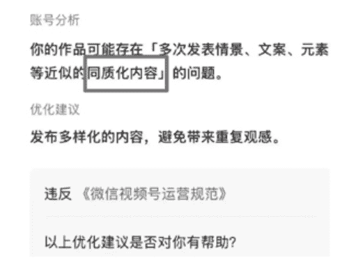

图5-5 视频号同质化违规

##### 二、软硬广之争

做生意的账号最容易掉进的第二个坑就是把视频号当作免费广告的渠道。很多新手商家一上来就是产品展示，配上高分贝的销售话术：“家人们，只要九块九，赶紧点击下方链接！”这种视频在微信生态里是会被强烈排斥的，因为微信是一个社交场，大家是来找共鸣、找知识、找欢乐的，没人想在朋友圈里看到一个天天发广告的推销员。

视频号对“硬广”的识别非常敏锐。如果视频画面里出现大面积的文字水印、联系方式、二维码，或者口播里反复提到敏感的促销词，如最后3件、还剩5分钟等，系统会自动将该视频判定为低质营销。这类视频发出去之后，通常初始流量池的表现就极差，因为用户一旦感觉到被推销，会下意识快速划走。这种负面反馈多了，算法就会认为你的视频给用户带来了不好的体验，从而停止推荐（见图5-6）。

图5-6 视频号硬广违规

我们可以把商业硬广包装成内容价值。比如你想卖茶叶，不要总发茶叶多好喝、多便宜，你可以教大家怎么分辨正宗的龙井茶，讲讲茶道背后的宁静生活。当用户觉得你的内容有用，又恰好符合其需求的消费场景，用户自然会寻找你的联系方式或产品链接进行消费。

##### 三、诱导分享与互动

有些运营教程会教新手博主在视频里引导大家点赞、转发、留言，这没错，互动确实能提升内容权重，但一定要注意尺度。如果引导变成了诱导，那就得不偿失了。

常见的违规操作包括在文案里写“不转不是中国人”“点赞的人今年发大财”等过度诱导互动的内容，或者是在评论区通过抽奖、赠送等操作，强制要求用户关注、点赞。还有人会编造一些容易引起极端争论的内容，甚至涉嫌政治对立、男女对立，故意通过大家在评论区吵架来换取热度。这些动作在微信生态的规则里，统统属于“恶意引导互动”。

如果系统通过大数据发现，某个账号的视频播放量是通过这种不正当手段诱导获得的，它就会判定这个账号的数据存在“注水”情况，账号评分就会下降，甚至会因为“违规引导”被禁言和扣除信用分（见图5-7）。

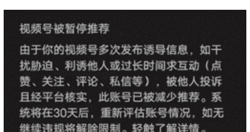

图5-7 视频号诱导互动违规

其实我们需要的是被粉丝真心认可，诱导关注的意义不大。正确做法是给用户一个互动的理由，比如提出一个开放式的问题，像“这种职场潜规则你遇到过吗？评论区告诉我你的处理方式”，自然地引导评论。这种互动才是健康的，也是平台喜闻乐见的。

##### 四、异常操作：别因为勤快而毁号

除了内容本身，发布后的一些操作习惯也容易让我们在无意中被限流。

###### 1. 频繁刷新作品和主页

有些人发完视频后每隔5分钟就来看一眼，手动刷新数据。在网络不稳定或操作过于密集的情况下，后台系统容易认为这是一个非人类控制的“批量刷量账号”，认为有人在进行异常点击。这种频繁的操作有时会导致推荐被暂时中断。

###### 2. 闪进闪出，互关互赞

很多新手为了快速起号，加入了一些所谓的“互助群”，大家在群里互相转发，点进链接几秒钟内就完成点赞、关注，然后退出。系统通过检测用户停留时长就能发现，这些人根本没看视频就点了赞。这种数据不仅不能增加权重，反而容易被系统判定为“刷量违规”，影响账号的信用。

###### 3. 一次性大量删除作品

一些博主觉得之前的赛道选错了，或是因以前的作品播放量低而不满意，于是一次性把原先的作品全部删除了。这种剧烈的后台变动容易被系统误认为账号异常，甚至直接导致账号权重清零。如果非要清理，比较稳妥的做法是先将想删除的视频设置成仅自己可见，或者每天删除一两个，给系统一个缓冲的时间。

##### 小结

想要了解视频号的进阶运营，第一步不是学怎么打造爆款，而是学怎么不被系统判定为违规限流。

1. 杜绝机械搬运与低质模仿，避开系统对同质化内容的流量拦截。
2. 掌握广告与内容的平衡，把软广植入在有价值的干货中。
3. 避免诱导行为，学会用高共鸣、高参与度的问题自然引导互动。
4. 维护账号健康，减少无意义的删发、数据刷新、互关互赞。

#### 5.2.2 红线揭秘：牢记三大隐藏规则，规避账号封禁风险

在视频号里，有很多规则是写在明面上的，但还有一些是“隐藏红线”，这些红线往往是新手最容易踩坑的地方。有的人觉得自己是在分享生活或是在追热点，实际上却不小心闯进了系统的风控模型里，在封号的边缘疯狂试探。

视频号是和微信的实名信息绑定的，一旦身份被封了就十分棘手。本节就来介绍这些隐藏红线，规避账号被封禁的风险，别让努力白费。

##### 一、第一大红线：千万别碰敏感赛道

做视频号时，选赛道是第一步，但有些赛道，普通人最好不要碰。第一个不能碰的赛道就是“时政信息”。很多人看了新闻后情绪激动，总想在视频号里点评两句，或者剪辑一些社会新闻的片段。如果没有官方颁发的“互联网新闻信息服务许可证”，也就是常说的“红V”认证，就不要选择时政信息赛道。

这种违规一旦触发，通常不是限流那么简单，也有可能面临封号惩罚。微信作为国民级应用，在舆论导向层面承担着巨大的责任，平台不会允许个人来随意解读严肃内容。

除了时政，还有一个敏感赛道叫“负面人物”。有些人为了博眼球，专门剪辑一些与劣迹明星或有争议的公众人物相关的视频，试图通过吐槽这些人来换取流量。但是，视频号的图像识别能力是非常强的，只要这个人的面部特征在黑名单里，视频发出来的一瞬间就会被拦截。

##### 二、第二大红线：资质认证，别碰特定的专业领域

如果说时政是硬红线，那么医疗和理财就是软红线。很多博主觉得：分享一些育儿经验、教教大家怎么搭配营养餐、聊聊自己的理财心得，能有什么问题？其实在视频号的内容规则里，这类视频隐藏着巨大的风险。

##### 三、第三大红线：敏感词与违禁语的坑

先说医疗保健，现在的视频号对健康类内容的审核十分严苛。比如“每天喝一杯水能降血压”“孩子感冒了别吃药，试试这个推拿法”，这种内容会被系统标记为“医疗建议”。如果博主没有国家颁发的证书，也不是经过服务平台认证的健康领域专家，这种视频不仅会被减少推荐，还可能会被判定为“非法行医”或“传播虚假医学信息”。

理财类视频也是一样的道理。很多账号教他人炒股、选基金，如果博主没有专业资质，就很容易被封号。现在的规则是，没有金融从业资质的博主不能提出具体的投资建议，更不能在视频里说“这只股票必涨”或“现在是买黄金的最好时机”等结论。

这个尺度很难把控，一旦疏忽就从纯分享变成“非法荐股”，严重时甚至会被判定为“涉嫌金融诈骗”。系统无法辨别拍视频的人是真心还是故意，只能通过关键词来判定这些内容。所以，当我们在做理财类内容时，尽量选择商业常识、理财观念这种安全的方向。要是想通过讲理财知识涨粉，最好具备相关的证书，有了证书的加持，在平台上才算有了资质。

有些新手在发布视频的时候总是喜欢用一些夸张的词汇博人眼球，比如“全网最火”“地表最强”“第一名”“绝无仅有”。这些词看似很厉害，能在第一秒就吸引用户，但在视频号的关键词过滤器里，这些全都是隐藏风险。

作为平台方，微信必须确保内容不涉及虚假宣传。一旦视频里频繁出现这些极限词，系统会默认该视频是在做违规广告，后果就是视频直接被标记为“不推荐”，甚至账号会被降权。有些敏感词涉及范围非常广，如果涉及民俗、地域歧视或者是不雅内容，也会触发系统的风控。

很多博主喜欢用谐音字，比如把“钱”写成“米”，把“赚钱”写成“赚米”，其实作用有限，AI模型已经进化到了能理解语义的程度。如果频繁使用大量的谐音字，会被系统判定为“故意规避监管”，从而加重处罚。

我们要做的是，学会使用更高级、更合规的表达方式。与其说“全网最强”，不如说“深受粉丝喜爱”；与其说“绝对有效”，不如说“希望能给你带来一些启发”。这种表达既安全，又显得很有修养。

##### 四、AI赋能：如何在发布前给自己做一次审核

既然视频号的规则非常严格，那么我们就可以用AI来武装自己。现在有很多专门检测敏感词和广告法词汇的工具，但最推荐大家使用的还是腾讯自家的AI产品。

原因很简单，视频号是腾讯的产品，而腾讯的AI模型是自家训练出来的，它最懂自家平台的“脾气”。

大家可以养成一个习惯：把文案全文发送给AI，让它扮演一个严苛的视频号内容审核员，然后给它一个清晰的指令。

> 你现在是视频号官方审核专家，请检查我下面这段文案，是否含有违反广告法的极限词、是否含有涉及医疗或金融领域的敏感表达、是否含有可能导致账号降权的语境。如果有，请帮我指出并给出修改建议。

这个步骤能帮你规避掉大部分潜在风险。很多时候，我们意识不到文案中存在的问题，但AI可以有效排查。千万不要怕麻烦，每次发布前的检查其实都是在给自己的账号“买保险”。

##### 小结

我们之所以要学这些隐藏规则，不是为了钻空子，而是为了能更自由地在规则内发挥。

1. 远离高压赛道，无资质不选时政、不选医疗、不选理财，避开负面人物素材，安全重于流量。
2. 规避敏感语境，不使用极限词和谐音字，学会用AI进行发布前的合规检查，用更稳健的语言来表达。
3. 敬畏系统识别，清楚图像识别和语音转文字技术的强大，不仅是文字，画面和口播同样要遵循平台规则。

## 第六章 多元变现：商业模式全揭晓，孵化吸金视频号IP

### 6.1 广告变现：五步构建高价值账号，商单不断

很多博主在广告变现这件事上走了不少弯路：有的博主不知道去哪里接广告，等着品牌方来找；有的品牌方报价太低，博主辛苦拍了一条视频只赚几十块；有的广告做得太硬，粉丝反感，数据很差，品牌方不满意。

这一节，我们就来聊聊广告变现的正确方式，从入驻平台到报价策略、从脚本撰写到长期合作，五个步骤帮你构建高价值账号，让优质商单源源不断地涌来。

##### 一、入驻互选平台，让商单主动找你

想让品牌方找到你，首先你要入驻互选平台。互选平台是连接创作者和品牌方的中介平台，创作者在平台上展示自己的账号数据、报价、擅长领域，品牌方在平台上筛选符合条件的博主并发起合作邀请，平台提供交易担保、数据监测、结算服务。

通过互选平台接单有几个好处：订单有平台担保，不用担心被骗；品牌方的产品质量相对有保障；平台会根据你的账号数据推荐合适的商单。

下面就来讲讲详细的入驻步骤。

1. 检查自己的账号是否符合入驻条件

如图6-1所示，互选平台有几个硬性的入驻条件：视频号粉丝数量不少于1000，发布的公开视频不少于10条，视频内容无违规记录，同时完成了微信实名认证。

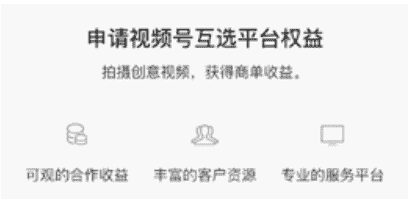

图6-1 互选平台的入驻条件

2. 注册并填写入驻信息

符合上述的入驻条件后，你可以打开视频号，进入创作者中心，找到“创作者服务”，点击“更多”，选择“互选平台”入口，按照提示填写信息后提交审核即可（见图6-2）。审核通过后，你就能在平台上看到品牌方发布的商单需求，可以主动报名。

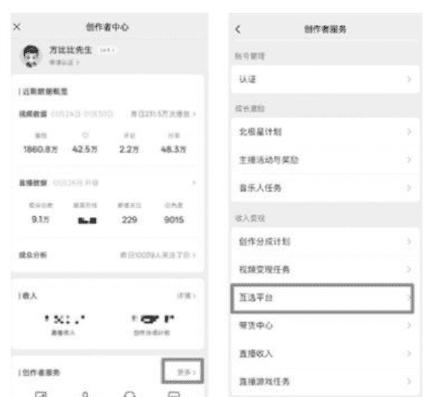

图6-2 申请入驻互选平台

入驻之后，记得完善自己的账号资料。要写清楚自己主要发布的内容主题、自己的粉丝画像、过往的成功案例等等。总之，资料越完善，品牌方选择你的概率就越大。

3. 设置合作报价

平台会要求你填写初始报价，建议粉丝量在5000以内的新手博主报价在800～1500元，粉丝量在5000～10000的博主报价在1500～3000元，粉丝量在10000以上的博主报价在3000元以上。当然，官方有时会给建议报价，你也可以参考。

##### 二、用AI优化广告脚本：广告不生硬，用户爱看不掉粉

接到商单后，很多新手博主会遇到一个尴尬的问题：用户一看是广告内容就划走，完播率暴跌，不但品牌方不满意，自己的粉丝量还下降。

问题就在于广告太生硬了，一眼就能看出来是在卖货，用户看到就迅速划走了。完播率低导致系统不推荐，播放量少导致品牌方不满意，这样很容易以后都接不到单。

一条好的广告视频应该让用户看完都没意识到这是广告，或者意识到了也不反感。怎么才能做到呢？可以用AI来优化脚本，把握好开头、中间、结尾三个环节。

1. 前三秒必须抓人

如果你的开头没有任何吸引力，用户还没看完前三秒就划走了。视频的开头内容需要能和广告结合起来，让广告植入不突兀，才能提升完播率。

你可以这样告诉AI。

> 我需要写××（产品）的广告词，开头必须在三秒内吸引用户注意力，可以使用痛点提问、制造悬念或反转等方式，不要用“大家好，今天给大家分享……”这种平淡的开头。

以下三种开头类型供你参考。

- **痛点型**：“你是不是也有这个困扰”，引发共鸣，让用户想知道答案。
- **悬念型**：“我花300元买到了一个假货”，制造悬念，让用户想看结果。
- **反转型**：“这个产品我本来不想买，但用了三天后打脸了”，用反转来吸引人，让用户想知道后面的故事。

2. 中间要有价值密度

开头留住人之后，中间部分要让用户觉得“这条视频对我有用”，而不是“这就是一条广告”。其中的秘诀就是：每一秒都要有价值，同时把产品卖点自然地融进去。

很多博主介绍产品时喜欢用“还不错”“挺好的”这种模糊的表达，用户听完后没感觉。正确的表达是：卖点要具体，要有数据支撑，要有使用场景，让用户能代入自己使用的感受。

你可以这样跟AI说，请它生成文案。

> 我需要写××（产品）的广告词卖点。这个产品我目前用了××（时间），它的三个优点是……，它有一个合理但不影响用户购买的缺点是……，写每个卖点的时候要具体，要有数据支撑，要有使用场景，避免“还不错”“挺好的”等模糊表达，这样才能让用户代入自己的使用感受。

3. 结尾要软性引导

结尾是促成转化的关键，但很多人在这里“翻车”。“立即购买”“快点击下方链接”这种硬性引导，用户一听就很反感，好的结尾应该像朋友推荐一样自然。

你可以这样跟AI说，请它生成文案。

> 我需要写××（产品）的广告视频结尾。请设计一段好的结尾，不要用“立即购买”“快下单”等硬性表达，语气要自然，像朋友推荐一样，这样用户更容易接受。

以下三种结尾类型，供你参考。

**建议型**：“如果你也有这个需求可以试试”，不强迫购买，用户反而更愿意接受。

**分享型**：“我放链接了，需要的自取”，像朋友分享，不像卖货。

**门槛型**：“适合××人群，不适合××人群”，筛选用户，提高转化率。

##### 小结

广告变现的核心逻辑是：先把账号做好，再让商单来找你。入驻互选平台，能够有效提高接商单的概率。

第一步，入驻互选平台，完善账号资料，让品牌方能找到你。

第二步，用AI优化广告脚本，开头三秒吸引人、中间有价值密度、结尾软性引导，广告不生硬，用户才能爱看，数据才能不差。

记住两个原则：一是不要为了变现乱接商单，如果发了和账号调性不符的广告会伤害粉丝的信任；二是用心做好每一条广告，优质的交付才能换来长期合作和口碑推荐。

### 6.2 从0到1开直播：从准备到开播的全流程

直播变现能和用户实时互动，用户有问题当场就能问，你当场就能解答。这种即时的互动能快速建立信任，促进成交转化，值得每个博主尝试一下。

这一节，我们分直播前、直播中、直播后三个阶段来讲清楚直播的全流程。

##### 一、预约卡设置，提前锁定你的用户

视频号的预约功能是一个强有力的召回工具。用户点了直播预约，博主开播时，微信就会发送一条服务通知，用户收到提醒就可以点进来看（见图6-3）。博主需要提前在视频号进行设置：打开微信，进入视频号，点击右上角人像图标，进入创作者中心，找到直播预告，创建新的预告（见图6-4）。

图6-3 视频号预约的服务通知

图6-4 视频号设置直播预告

重点是预告主题怎么写。很多博主直接写“××月××日直播”或者“随便聊聊”，这种标题并不能吸引用户。一个好的预告主题要告诉用户：我能帮你解决什么问题。

我们可以用AI来写预告主题，比如输入如下指令。

我是一名××赛道的博主，周五晚上要开一场关于×××主题的直播。请帮我写5个吸引人的直播预告标题，要求如下：

1. 指出目标人群的痛点；
2. 告诉大家我有快速解决的方法；
3. 字数控制在15字以内，要像朋友聊天一样自然。

##### 二、开播前的准备：人货场的环境布置

正式直播前，我们要检查好基础设备。不用买昂贵的专业摄像机，一部智能手机完全够用。关于收音和打光的相关事项，我们在前文讲过了，这里就不再赘述。

其实直播间不需要追求奢华的装修，关键在于整洁、美观，充满氛围感。像我在视频号“方比比老板”开直播时，就会专门追求氛围感（见图6-5）。

图6-5 视频号“方比比老板”直播间

##### 三、直播中把控三大节奏，步步为营

1. 开场节奏：前10分钟的关键留存

一场直播的前10分钟至关重要。这10分钟决定了用户会不会留下来，也决定了平台会不会给你更多流量。用户的注意力是有限的，你必须在最短的时间内吸引留住他们。

开场阶段的核心任务不是卖货，而是留人和暖场。你需要做好表6-1中的这三个动作。

表6-1 直播开场关键动作

| 动作类型 | 核心目标 | 具体操作 | 话术示例 |
| :--- | :--- | :--- | :--- |
| 欢迎互动 | 让用户感觉被看见，增加归属感 | 看到有人进来就欢迎他，点名互动 | 欢迎 × × 进入直播间，感谢你来捧场。看到这么多新朋友，我特别开心。 |
| 预告价值 | 给用户留下来的理由 | 明确告诉用户今天的直播有什么值得看的地方 | 今天直播间有 3 轮抽奖，每个整点抽；今天会给大家讲 3 个选品技巧，干货很多。 |
| 破冰互动 | 激活弹幕区，营造热闹氛围 | 设计简单的互动问题，让用户用 1 或 2 回答 | 今天第一次来我直播间的朋友评论 1；来过的朋友评论 2。 |

2. 讲品节奏：让用户从看看到想买

开场把人留住了，接下来就是讲产品，这是直播的主体部分。一个高效的产品介绍，不能是流水账，而应该遵循表6-2中的四个步骤。

表6-2 直播讲品步骤

| 步骤 | 核心目标 | 操作要点 | 话术示例 |
| :--- | :--- | :--- | :--- |
| 第一步：痛点切入 | 让用户觉得产品和自己有关系 | 不要一上来就介绍参数，先讲痛点，引发共鸣 | 大家有没有这种情况：早上泡的咖啡，到公司就凉了；冬天喝水，感觉像喝冰水？ |
| 第二步：产品介绍 | 展示产品核心卖点和差异化 | 把参数翻译成用户能理解的好处，不要堆砌专业术语 | 这个保温杯用的是316不锈钢内胆，保温时间长达12小时。什么概念呢？就是你早上7点倒的热水，到晚上7点还是烫的。 |
| 第三步：价值塑造 | 让用户感受到产品能解决实际问题 | 讲使用场景，讲长期价值，让用户产生代入感 | 这个保温杯我自己用了半年，每天带去公司，中午还能喝到热水。算下来一天才几毛钱，但省下了每天买热饮的钱，一个月能省几十块钱。 |
| 第四步：信任背书 | 打消顾虑，建立信任 | 讲销量、讲口碑、讲资质、讲自用体验 | 这款产品已经卖了10万单，回头客特别多，而且是大品牌，质量有保证。我自己用了很久才推荐给大家。 |

##### 四、直播后复盘，数据驱动增长

直播结束不意味着工作结束，复盘是提升直播效果的有效手段。

打开视频号创作者中心，就可以看到这场直播的数据：观看人数、平均停留时长、哪个时间段在线观看人数最多、哪个时间段观看人数流失最快等。这些数据会告诉你，哪里做得好、哪里需要改进。

借助AI可以让复盘更高效。你可以把直播录音转成文字，让AI来分析话术问题；可以把在线人数波动的关键节点告诉AI，让它来分析原因。你可以像下面这样跟AI说。

我的直播在第20分钟时在线人数从50人涨到了120人，但在第35分钟又降到了60人。请分析可能存在的原因。

下面是AI给出的答案。

在第20分钟人数上涨，是因为你发了福袋或者提到了一个热门话题；在第35分钟人数下降，可能是因为讲解商品的节奏太慢，或者产品本身的吸引力不足。

##### 小结

直播变现的核心是预约拉人、开播留人、讲品转化、复盘优化四个环节。

在直播开始前，设置好预约卡、写好吸引人的主题、提前预热引流、准备好设备；在直播过程中，开场10分钟先留人暖场，讲解商品按“痛点—产品—价值—信任”四步走，促单用限时限量制造紧迫感；在直播结束后，用AI分析数据和话术，找到问题，持续优化。

### 6.3 个人品牌变现：从做号到搭建私域成交系统

做短视频做到一定阶段，很多创作者就会遇到瓶颈：流量有了，粉丝有了，但单纯接广告或带货仍然无法有效提高收入。背后的逻辑很简单：在AI时代，内容的生产效率大幅提升，真正稀缺的是屏幕后面那个鲜活、专业、能赢得用户信任的人。单纯地发发视频已经不够了，创作者必须从“做号”转向“做品牌”。

##### 一、从做号到做品牌，用品牌为产品背书

做号的思维是关注数据指标，每天盯着完播率、点赞量，本质上你是流量的载体。而做品牌的思维是关注用户关系，你自己就是核心产品，用户因为认可你的专业能力和人格魅力而关注你。

当个人品牌建立起来后，商业价值的释放就是自然而然发生的过程。直播带货不再是单纯的卖货，而是用品牌为产品背书。选品就是价值观的延伸，用户购买你推荐的商品，是因为相信你的眼光和标准。

比如我们运营“方比比先生”这个视频号，就是想要打造个人品牌，所以直播带货的每款产品我们都会精挑细选，力求符合人设和专业标准。

不仅是选品，直播带货时，讲品的重点也应该放在使用后的真实感受上，让用户能想象到自己用这个产品的场景，而不是做营销型直播间，一味地制造焦虑，促使用户盲目下单。

比如方比比在直播时销售过一款马年春晚的联名围巾，但他没有一味地强调围巾的材质，而是重点讲解戴上这款围巾后那种从容自信、迎接好运的感觉，从自身感受出发，触动用户情感，让产品成为美好生活的一部分。

##### 二、私域成交系统：把流量变成钱

视频号最大的优势是与微信的连接，用户看完视频可以一键分享到朋友圈和微信群，这是其他短视频平台不具备的优势。如果用户加了你的微信，你发朋友圈他就能看到，这种触达是确定性的，不依赖平台算法。

很多人对朋友圈营销存在误解，觉得就是发发广告。实际上天天发广告的结果只有两个：被用户屏蔽或者删除。朋友圈营销的本质不是卖货，而是让用户持续了解你、认可你、信任你。只有建立了信任，你推荐的产品他们才愿意买。

每天发布3～5条朋友圈比较合适，发得太少用户记不住你，发得太多用户觉得烦。建议早上发一条价值内容或生活内容，中午发一条干货内容，晚上发一到两条产品内容或成果内容。具体的时间和内容也可以根据你的目标用户的习惯进行调整（见表6-3）。

表6-3 朋友圈营销常用时间段

| 时间段 | 用户状态 | 适合发的内容 |
| :--- | :--- | :--- |
| 7:00~9:00 | 上班路上，碎片化浏览 | 短小精悍的观点、金句 |
| 12:00~14:00 | 午休时间，相对放松 | 干货内容、案例分享 |
| 18:00~20:00 | 下班路上，相对疲劳 | 生活内容、轻松话题 |
| 21:00~23:00 | 睡前放松，深度阅读 | 长一点的内容、成果展示 |

如果不知道该发什么具体内容，那么下面这四种内容可以搭配着进行发布。

1. 价值内容，让用户觉得关注你有收获

这是朋友圈的基本盘。你在哪个领域做个人品牌，就分享哪个领域的干货。短平快地解决用户的一个具体问题，让他看完立刻觉得“这条朋友圈有用”。

你在朋友圈提供的价值越多，用户对你付费服务的期待就越高；你展示的解决问题的能力越强，用户越愿意为你的完整方案买单。

价值内容有两种写法。一种是输出方法论，把你的专业知识浓缩成一个模型或框架，让用户一看就觉得“这个人有点儿东西”；另一种是分享行业洞察，把你对某个现象的观察和思考写出来，让用户觉得你看问题比别人更深刻。

如图6-6所示，理白先生的这条朋友圈就是典型的方法论输出。他先提出了一个4F模型——failures（失败）、flaws（缺点）、frustrations（挫折）、firsts（初次经历），用来解释大IP为什么需要展示真实的一面；然后用俞敏洪北大落榜、马斯克早年创业靠接济的例子来佐证自己的观点；最后落到一句金句：“不要着眼于赚钱，而是要做让自己值钱的事。”

###### 2. 生活内容，让用户看到品牌背后那个真实的人

真诚是连接用户最短的路径。朋友圈的生活内容就是真诚的具体表现。生活内容不是记流水账，而是有选择地展示能强化你个人品牌的生活片段。

生活内容的关键是“有质感的日常”。不是今天吃了什么、去了哪里的随手记录，而是从一个生活场景出发，引出你的观察和思考。要让人看完觉得你有趣、有洞察力，愿意继续关注你。

###### 3. 成果展示，用客户的反馈替你说话

没有人喜欢听人自夸，但所有人都愿意相信其他客户的真实反馈。客户的好评截图、学员的成长记录、用户的复购反馈……这些都是最有说服力的内容，能够借第三方视角建立信任（见图6-7）。

图6-7 理白先生的成果展示朋友圈

成果展示的核心是“让别人替你说话”。你自己说课程好，用户会觉得你在打广告；但如果学员主动发朋友圈说学习你的课程之后涨粉了、变现了，那可信度就完全不一样。

发成果展示时要注意三点：第一，截图要真实，不要造假，用户的眼睛是雪亮的；第二，最好带上具体的数据或变化，比如“从0做到10万粉丝”“单月变现5万元”，数据比文字更有说服力；第三，配上你自己的简短点评，比如“看到学员出成绩，比自己赚钱还开心”，让用户感受到温度。

把这种口碑搬到朋友圈来，新用户看到别人的好评、转账、复购、主动推荐时，会觉得已经有人通过你的产品取得了好结果，说明你的产品和你推荐的产品都很靠谱，会产生“我也想要”的心理。

###### 4. 产品内容，在信任基础上自然推出

产品内容是临门一脚，在和用户建立信任之后，推出产品，促成成交。

真正有效的产品内容朋友圈就是大大方方地展示自己的产品体系，让用户一眼就能看明白产品提供什么、适合谁、多少钱。不用遮遮掩掩，也不用声嘶力竭，就像一个专业的店铺，只是把货品摆在橱窗里，告诉用户：你需要，就进来看看；你暂时不需要，至少知道我提供这个服务，以后有需要再来找我。

产品内容朋友圈的数量要控制好。如果你每天发5条朋友圈，产品内容最多占1～2条，其他几条都应该是价值内容、生活内容和成果展示。让用户觉得关注你是有收获的，而不是天天被广告轰炸。

##### 小结

从做号到做品牌是自媒体创作者实现价值跃迁的必经之路。做号关注流量数据，做品牌关注用户信任。

个人品牌的变现有两个核心场景：一是带货，用品牌为产品背书，选品就是价值观的延伸；二是私域成交，把公域流量沉淀到微信，用朋友圈持续培养信任。

朋友圈不是广告位，而是信任培育场，四种内容可以搭配发布：价值内容让用户觉得关注你有收获，生活内容让用户看到真实的你，成果展示让用户替你说话，产品内容在信任基础上自然推出。每天发布3～5条朋友圈，产品内容最多占1～2条。

搭建好这套系统，你就不再是只依靠平台算法“赏饭吃”的内容创作者，而是有自己的流量池、有稳定变现能力的个人品牌。

## 后记

感谢你看到这里。书写到此处，我最想说的是“普通”这两个字。

我没有什么特别亮眼的背景，只是一个在新媒体行业里扎根几年的年轻人。很长一段时间里，我和大多数人一样，认定成功是少数人的剧本，普通人只能坐在台下当观众。

直到我在视频号发出第一条视频。那天没有策划，没有脚本，只是一场日常的对谈，架了个手机拍摄，但评论区涌进来的那些陌生人说：“你讲得真好”“特别喜欢你的笑容”……

那一刻我突然懂了一件事：这个世界上没有真正的普通人，只有尚未找到舞台的表达者。

安迪·沃霍尔（Andy Warhol）曾预言：“未来每个人都能成名十五分钟。”我想说的是，未来已经来了，而且这十五分钟可能是一个人命运的转折点。

曾经一个人想被看见，需要太多条件：资源、技能、平台、运气……但今天，新媒体把表达的权利还给了每一个人，AI也把专业能力的门槛降到了最低。以前需要一个团队才能完成的事，如今一个人、一部手机、一个深夜，就足够了。

这本书能够完成，我要感谢太多人和太多事。

感谢视频号这个平台。它不看出身，不问背景，只问一个问题：你是否真诚？在一个算法驱动的世界里，真诚反而成了最稀缺的竞争力。这件事本身就是对每一个普通人最大的善意。

感谢AI时代。它没有淘汰普通人，恰恰相反，它赋予了普通人前所未有的杠杆。技术从来不是冰冷的工具，它是放大器，放大你的思考、你的创意、你的行动力。当一个人学会与时代共振，那他的能量超乎想象。

感谢我的父母支持我每一次看似冲动的决定，让我拥有敢于追梦的勇气和勇敢创业的底气。一个人敢往前冲，往往是因为知道身后有人接住自己。我一定会尽我所能去报答我的父母。

感谢理白先生。人这一生的转折往往不是来自某个了不起的机遇，而是来自某个人在关键时刻说的一句话。感谢理白先生在我最迷茫的时候推了我一把。很多时候，人不是缺能力，而是缺一个相信自己的理由，理白先生给了我那个理由。

感谢我的老师们：王鹏、马大个、婉婉、梁靠谱、富贵、余额宝、三金、王也、周周、彩卉。谢谢大家在内容层面和商业层面上给我的指导和帮助，这是对我莫大的支持和赋能。

感谢我的团队伙伴：怀轩、七月、林道一、橘娃、饭十、亿可、小鱼、子不语、婷宝，是我们共同创造了精彩的成果。能与你们并肩，是我最大的幸运。

感谢每一位读者和粉丝。尼采说：“一个人知道自己为什么而活，就可以忍受任何一种生活。”你们就是我的“为什么”。你们的每一次点赞、每一条留言，都不只是数据，而是一个个真实的人在告诉我：“你被看见了，你说的话有意义。”是你们让我确信，在这个喧嚣的时代，真诚才是唯一经得起时间考验的东西。

写这本书，我最大的野心只有一个：让每个人透过我的经历，看见自己的可能性。但愿这本书能给你多一点底气。

不要追求完美，不要等万事俱备。你不需要变成别人眼中的强者，你只需要开始。在这个时代，行动比思考重要一百倍。迈出第一步，剩下的路，时代的势能会推着你前行，AI会帮你填平沟壑。

凡是过往，皆为序章。你此刻翻开的，不只是一本书的最后一页，也是你自己故事的第一页。

只要你愿意拥抱变化，愿意真诚地面对世界，属于你的那个时刻，可能就在下一次点击“发布”之后。

愿你不必成为别人，只需活成自己最辽阔的样子。