# AI驱动视频号，拿下微信生态红利

## 推荐语

这本手册条理清楚、着陆坚实。新手能跟着节奏逐步推进，正在实践的人可以借此复盘梳理，期望长期耕耘的人也能觅得进阶抓手。全书拒绝空泛说教，各环节都有明确的节奏与可操作办法。无论起点差异，都能带走真正可用的方法与底气。

> ——王鹏 微盟集团视频号达人负责人，微信创作者课堂特邀讲师

在寻找一本既能讲透视频号运营底层、又把AI场景融进去的实战书，这本值得入手。它给出内容价值与商业价值统一的思路，认为好内容本身就是经营信任的起点。它帮助你把每一次创作沉淀为可持续增值的长期资产，是内容创作者的一份实操参考。

> ——马大个 高维表达流派创始人，口播型IP打造先行者

全书搭建起一套完整的视频号运营体系，从底层逻辑到AI全流程赋能，每一步都对接实战。得益于微信生态的先天优势，视频号拥有独特的流量逻辑。无论是初入局的新人，还是谋求突破的自媒体IP，都能吃透生态红利，实现从零到变现的通盘跃迁。

> ——粥左罗 《学会写作2.0》作者，30万人的写作教练

作者方比比以两个月播放量破亿的亲身经历，结合平台红利与AI趋势，系统化地呈现了一套可验证的内容创业方法。书中把个人IP的成长链路讲透，帮助新手跑通内容积累、私域沉淀到商业闭环。若想在视频号实现涨粉与变现，这是一本必备手册。

> ——陈婉婉 直播电商培训一姐，全域200万粉丝商业IP

方比比在浮躁环境中仍坚守初心，心性光明，这很难得。更可贵的是把对AI与IP的思考凝结成文字。我一直认为人比主题更重要，他对业务的洞察很值得新人借鉴，能少走不少弯路。

> ——大果 花大果山MCN创始人，不住咨询创始人

书中把AI工具与视频号全链路深度绑定，从账号搭建到商业化，每个环节都有真实数据支撑的操作。它教你打造超级个体，以AI为杠杆、以内容为引擎，搭建专属商业系统。若想在新时代抢占先机，这本书能帮你从出售时间转向出售价值。

> ——Kris（K叔） 一行DoMore教育创始人，“Kris进化笔记”视频号主理人，《引爆自律力》作者

本书兼顾系统性与可执行性，为零基础提供清晰的起步路径，也为已有基础的博主提供AI全方位赋能的进阶打法。它讲清了视频号、公众号与微信私域联动的底层逻辑，帮助打造具备长期竞争力的商业模式。无论所处哪个阶段，都能学以致用、直接落地。

> ——黄盛 北大新媒特邀实战老师，全域500万粉丝商业IP，《轻松玩转内容变现》作者

在算法主导的当下，逻辑能建立认知，情绪才推动决策。书中构建了一套情绪短视频实战体系，从认知驱动到AI数据追踪，拆解如何借助情绪洞察实现内容爆发。作者不仅传授爆款方法，更深挖情绪背后的商业增值，让内容既有温度又有高转化。这本书帮你穿透数据，掌握情绪杠杆，从流量到心智留存。

> ——富贵 长安文化CEO，AI情绪营销创始人

注意力经济时代，时间流向哪里，收益就跟着去。本书既能让头部IP的短视频流量实现十倍提升，也能大幅降低普通创业者的入局门槛。作者拆解了爆款逻辑，也深入模式与行业，让内容既叫好又叫座。我们期待更多从业者产出爆款，快速成长。

> ——梁靠谱 销冠孵化基地创始人

## 前言

半年前的那个深夜，我在视频号发布了第一条作品。没有团队策划，也没提前准备，只是想把这几年在知识付费行业积累的经验分享出来，便直接录了。

发完后我把手机扣在桌上，觉得大概率不会有波澜。

第二天醒来，评论区已经涌入数百条留言。有人说说到心里了，有人夸我笑容舒服，还有人只留了三个字：谢谢。那一刻我盯着屏幕，眼眶有些发热。一个没有背景的年轻人，竟然能被这么多陌生人看见。

随后发生的事完全超出预期。不到一个月，累计播放过亿，单号新增粉丝五十万。“方比比先生”从一个随意起的名字，变成了每天被大量搜索的关键词。

这半年，是我二十多年来收获最密集、成长最快的阶段。

古语说种树者必培其根，种德者必养其心。这半年最大的感悟是：让内容走远的不是技巧也不是套路，而是真诚。

视频号的传播机制与其它平台不同，内容既靠算法分发，也会沿着真实的社交关系扩散，朋友会看见，朋友的朋友也会看见。这种方式让内容有了温度，也让创作更有分量。

它不只是做内容，更像一场以真心换真心的对话。好的内容能触到人心最柔软处，视频号为这种内容提供了好土壤。

我很喜欢“此心光明，亦复何言”这句话。当表达足够真诚，世界自然会给予回响。

但我不想书只停留在讲故事。视频一条条发出时，我也在拆解、研究和复盘。研究平台算法逻辑，拆解爆款底层结构，摸索从冷启动到稳定增长的节奏。

大处着眼，小处着手，做视频号亦然。既要看清趋势，也要把细节落地。

本书把实战中行得通的方法论完整呈现，从账号搭建底层逻辑到内容生产核心方法，再到运营节奏把控与多元变现设计，章节环环相扣，既是系统方法，也是真实经历。

书里的每个方法都有我自己的数据支撑，每个细节都是我希望刚入门时就能读到的内容。我不想写一本当时觉得对，放下就忘的书，想写一本放在手边反复翻阅、真正能用的书。

与此同时，AI让这条路前所未有地平坦。

过去一条视频要经历选题、脚本、拍摄、剪辑、封面设计，每个环节都要专人，十人团队忙一天才出一条。现在AI能写脚本、优化标题、自动剪辑、生成封面，一个人就能完成过去一个团队的工作。

普通人做内容的门槛被降到最低。这就是创作者的舞台，现在登台最好。

知是行之始，行是知之成。读完不要停留在“我懂了”，要迈出第一步。

不需要等万事俱备。有想法、有经历、有想说的话就够了。每条视频都是一次与世界的对话，每次发布都在为自己积累内容资产。这些积累不会消失，会随时间生长，在某个意想不到的时刻结出果实。就像半年前那个深夜，我对着手机发呆时，也没想到随手发的一条视频会被这么多人看见。

写到这里，忍不住说声谢谢。

谢谢每一位看过我视频的人。上亿次播放意味着上亿个真实的你在某个时刻停下来听我讲几分钟。每一个点赞、评论、转发，都是沉甸甸的信任。这份信任给了我写下所学所悟的动力。

也谢谢此刻拿起这本书的你。在信息极度密集的今天，愿意花时间读一本书本身就是了不起的选择。希望书配得上你给予的时间，每一页都有可用的内容。

写书也是我的一次梳理与沉淀。运营中时常靠直觉与惯性，真正写成文字才发现把事讲清比做到更难。也正因如此，我更确信书里每一句话都是思考、检验、打磨后真正想告诉你的方法论。

种树最好的时机是十年前，其次是现在。你现在的位置，就是最好的起点。

愿这本书陪你走好每一步，走出属于自己的路。

方比比

2026年春

## 第一章 用AI撬动视频号，抢占微信生态流量红利

### 1.1 视频号进入4.0阶段，为什么现在必须入场

#### 1.1.1 平台走向：不只是短视频，更是微信生态的流量入口

视频号的本质不只是短视频产品，更是微信生态的流量入口。这个定位决定了它正处在独特的红利窗口。

腾讯2025年一季度财报显示，截至该季度，微信及WeChat合并月活达14.02亿，视频号日活从2024年接近6亿提升到2025年一季度的8.2亿。这意味着微信生态里超过一半用户每天都会打开视频号。视频号已从可选项变成日用阵地，而其他短视频平台的用户增速已明显放缓。

在视频号，普通创作者的竞争尚未白热化，优质内容更容易被看见。增长快、竞争小、机会多，正是红利期的典型特征。

##### 一、生态联动：打通微信全域的流量闭环

视频号最大的优势不是算法或功能，而是背后的微信生态。见表1-1。微信用户无需额外下载，打开即用，零门槛触达是其他平台不具备的。

表1-1 视频号与微信生态联动

| 生态组件 | 与视频号的协同 | 价值 |
| :--- | :--- | :--- |
| 微信好友 | 社交推荐、点赞可见 | 内容自带信任背书，传播效率高 |
| 朋友圈 | 可直接分享视频号内容 | 打通私域传播渠道 |
| 公众号 | 可互相关联、导流 | 图文 + 视频双向引流，粉丝互通 |
| 小程序 | 直播间可挂载小程序 | 交易闭环，边看边买 |
| 微信支付 | 原生支持 | 用户付款无障碍，转化率高 |
| 企业微信 | 可添加客户微信 | 私域沉淀，长期运营 |
| 搜一搜 | 视频号内容可被搜索 | 获取搜索流量 |

发布一条视频，它既会在信息流被推荐，也可被分享到朋友圈、转发到微信群、嵌入公众号文章。

例如，我们曾在公众号“理白先生”深度分析“方比比”IP的运营逻辑，文中多次插入视频号“方比比先生”的短视频，实现了公众号与视频号的深度联动。

图1-1 公众号“理白先生”与视频号“方比比先生”联动

##### 二、用户画像：最具消费力的群体

视频号聚集了国内互联网最具消费力的人群。目前日活中35~65岁用户占比超60%，见表1-2。

表1-2 不同平台的多维度分析

| 平台维度 | 视频号 | 抖音 | 快手 |
| :--- | :--- | :--- | :--- |
| 内容形式 | 图文 + 短视频 + 直播 | 短视频为主 | 短视频为主 |
| 用户类型 | 以 35~65 岁的用户为主 | 以 26~35 岁的用户为主 | 以下沉市场的用户为主 |
| 创作门槛 | 较低 | 较高 | 中等 |
| 续表... |

这批用户消费能力强、决策链路短、信任度高。他们愿意为品质与服务买单，而非单纯追求低价。

##### 三、推荐机制：以内容为先的公平机制

视频号算法对新人友好，因引入社交推荐。核心逻辑是“朋友喜欢”。视频被点赞、转发或评论后，系统会推荐给点赞者的微信好友。如“方比比先生”的视频左下角会显示朋友点赞数，见图1-2。

图1-2 “方比比先生”视频号朋友点赞

这意味着即便新号粉丝为零，只要打动第一批种子用户，通过社交关系链就能突破圈层，获得指数传播。

不同于其他平台“发布即巅峰，三天归零”的机制，视频号内容生命力更长。社交传播是持续的，优质视频可能在发布数月后再次翻红。

##### 四、红利尚在，现在是最佳入局窗口

现在入局是否太晚？一点也不。视频号日活仍在快速增长，用户停留时长大幅提升，平台处于上升期。相比其他平台高度内卷的环境，视频号内容生态仍偏蓝海，很多垂直领域头部尚未被占据。

2024年视频号头部账号增长率超50%，创作者与品牌关注度持续提升，现在正是入局好时机。若现在不行动，一年后竞争格局将完全不同。

建议全力投入，把视频号作为核心阵地，研究规则、理解生态、打磨内容、耐心积累。

视频号不仅是短视频平台，更是微信生态的流量入口、连接内容社交交易的超级入口，是未来三到五年最值得投入的商业机会。

##### 小结

相较于其他短视频平台，视频号内容类型更丰富，降低了创作门槛，变现模式也更丰富，基于高价值人群聚合具备天然商业化优势。本节总结了三大入局理由。

- 生态联动：打通微信全域流量闭环
- 用户画像：最具消费力的群体
- 推荐机制：内容优先的公平推荐

风口不会永远存在，看懂趋势是第一步。真正的红利属于敢于行动、持续深耕的实干者。现在开启你的视频号之旅。

#### 1.1.2 生态联动：视频号+公众号+微信，跑通商业闭环

把视频号当成娱乐平台，就浪费了赚钱机会。真正的威力在于与公众号、微信打通，形成完整商业闭环：视频号负责获客，公众号负责深度，微信负责成交。下面把三者的配合讲清楚。

##### 一、为何要做生态联动

在公域平台，流量靠算法，今天推荐明天就不见。微信生态不同，用户加了微信、关注了公众号，就成了你的资产。

张小龙提出“原子化组件”。视频号像水，可流进微信生态的任何角落。朋友圈可转发视频号，公众号文章可嵌入视频号，在群里可发直播卡片。这种互通是其他平台做不到的，见表1-3。

表1-3 不同平台引流效果对比

| 核心维度 | 其他短视频平台 | 视频号 |
| :--- | :--- | :--- |
| 对引流的态度 | 严防死守 红灯 | 官方鼓励 绿灯 |
| 操作动作 | 偷感重 | 光明正大 |
| 用户路径 | 九曲十八弯 流失率高 | 一步直达 几乎无损耗 |
| 风险系数 | 高风险 封号危机 | 零风险 安全合规 |
| 信任建立 | 弱连接 陌生人 | 强连接 熟人半熟人 |

##### 二、视频号+公众号：短内容与长内容的配合

视频号和公众号天生互补，见表1-4。视频号适合短平快，一两分钟讲清观点，门槛低传播快。公众号适合深度，一篇文章讲透话题，建立专业形象。两者结合覆盖不同需求。

表1-4 公众号和视频号联动策略

| 场景 | 操作 | 目的 |
| --- | --- | --- |
| 发布视频号内容 | 同步到公众号 | 用公众号粉丝帮助视频号冷启动 |
| 写公众号文章 | 插入相关视频号视频 | 丰富形式，为视频号导流 |
| 视频号爆款内容 | 在公众号写深度拆解文章 | 承接流量，深度转化 |
| 公众号爆款文章 | 在视频号做成短视频版本 | 内容复用，扩大传播 |

用户在视频号刷到你，想了解更多，点进主页看到公众号并关注，认可度提升。反过来，用户在公众号看到文章，点进嵌入的视频号，关注转化。

视频号涨粉可沉淀到公众号，公众号老粉可导流到视频号冷启动。不是运营两个账号，是运营完整内容资产。我的视频号“方比比先生”主页绑定了公众号，实现了视频与图文联动，见图1-3。

图1-3 视频号“方比比先生”主页绑定公众号

##### 三、视频号+微信：公域变私域

视频号与微信联动的核心价值是把公域流量沉淀为私域资产。

公域流量是平台给的，今天一万次播放明天可能一千次，主动权不在自己。私域资产是加了你微信的人，可反复触达。

视频号允许公域导入私域。可在主页留微信号，用户复制即可添加。如我的视频号“方比比老板”主页展示个人微信号，见图1-4。

##### 四、4.0时代的生存法则：做离用户最近的生意

用户加微信后会看到朋友圈，看到你持续的内容、观点与生活状态。这是低成本持续触达的方式。

私密对话是最容易加深信任的方式。创作者可以与用户展开一对一聊天，快速解答疑惑、直接对接受到需求，这种直连沟通让信任迅速沉淀；随后把用户汇聚到社群里，在价值观相近的小圈子里持续互动，归属感被强化、信任度被巩固；当购买意图出现时，成交往往水到渠成。

把短视频、长文平台、私聊工具串成一条完整通路，短视频负责持续吸客，长文负责持续增信，私聊负责收口变现，三者分工清晰、互相支撑。跑通这套闭环，就等于搭建了一个可复制、可持续的商业模型。

###### 第一层：以短视频撬动曝光
短视频是流量的入口，靠优质竖屏内容把目标人群吸引过来。社交裂变机制让好内容迅速扩散，一条爆款就能带来数千甚至上万的增粉。
这一层的核心诉求是：让更多人看到你、记住你。

###### 第二层：用长图文筑牢信任
用户在短视频看了几条内容后，好感会初步建立，但信任还不够扎实。这时需要把人群导入长文平台，借助系统化内容完成信任升级。
长文平台可发深度文章，把专业能力展现得更立体；可做系列专题，培养追更习惯；可分享个人经历，让形象更真实、有温度。
这一层的核心诉求是：让用户从初步认识走向深度信任。

###### 第三层：借助私域完成成交
信任建立之后，再邀请用户进入私聊域。在私域里，通过朋友圈持续输出价值，通过点对点对话精准识别需求，最终促成付费。
无论是卖产品还是交付服务，高信任的交易多数发生在私聊里。
这一层的核心诉求是：让用户从信任转化为买单。

##### 小结
短视频加长文加私聊的生态联动，是当前微信生态里最具红利的打法。
三者可以互相导流、相互放大：短视频主页可挂长文入口并展示私聊方式，长文里可嵌入短视频作品，短视频内容又可分享到朋友圈和群聊。流量在三个池子之间自由流动，最终沉淀为你的私域资产。
短视频负责拉新，长内容负责养信，私域负责成交，三者配合形成完整的获客—信任—成交闭环。
底层基础设施已成熟，用户使用习惯已养成，竞争强度相对可控。把这套组合拳打通，就是吃到微信生态红利的正确做法。

### 1.2 智能赋能：提升内容创作与运营效率

#### 1.2.1 超级个体：智能时代趋势，开启单人公司全新商业形态
过去做自媒体往往需要团队配合：选题由编导把控，脚本由文案撰写，拍摄依赖摄影师，后期靠剪辑，运营靠专人负责。运营一个短视频账号，通常至少需要数人分工。
智能模型大幅提升了个人产出效率，有了智能辅助，单人就能完成原本需要团队协同的工作量。脚本撰写、封面设计、视频剪辑、数据分析等以往需要专业技能的环节，现在都能交给智能系统代劳。
这就是超级个体时代：借助智能工具，单枪匹马就能创造过去需要团队才能达到的产出。下面深入拆解如何用智能搭建单人企业。

##### 一、单人公司不等同于个体户
很多人把单人公司等同于个体户，两者差异很大。如果负责人每天仍在手工回复邮件、亲自打包发货，本质上仍是一个数字化的个体户。

表1-5 个体户与一人公司对比

个体户的核心是卖时间。例如理发师一天工作10小时，只能服务20位客户，人均100元，收入上限就是2000元，想提升收入只能延长工时。
真正的单人公司不是靠加班赚钱，而是把个人能力产品化，把智慧与技能沉淀为个人品牌，构建一套可24小时自动运行的商业系统。
举例而言，擅长Excel的人接单做表格属于个体户模式。若把常用技巧做成课程在线售卖，这门课可以不断复制给百人、千人，甚至在睡觉时仍在产生收益，这就是单人公司的复利逻辑。

##### 二、为何此刻是单人公司的窗口期
单人公司并非全新概念，但为何近两年集中爆发？关键在于智能把门槛拉低了。
以前个人创业要懂产品、懂设计、懂营销、懂客服、懂财务，学习成本和时间成本极高，几乎必须组建团队。
现在借助各类智能工具，内容生产到商业变现的全流程都可由个人完成。无需实体办公室，在家即可操作；无需雇佣员工，智能系统就是你的助手；无需重资产投入，低成本即可启动。
以短视频运营为例，传统流程包括定选题、写脚本、拍素材、剪辑、做封面、定标题、发布维护，一条视频往往需要2到3天。
现在智能可参与大部分环节，你只需校对、微调、注入个人风格，数据分析与规律总结也能交给智能。过去需5人分工的工作，现在单人加智能即可完成。

表1-6 传统视频号运营与智能加持后的对比

| 工作环节 | 传统视频号运营 | 智能加持后的视频号运营 |
| :--- | :--- | :--- |
| 写脚本 | 个人撰写，约2小时 | 智能出初稿，约20分钟完成修改 |
| 想标题 | 反复打磨，约半小时 | 智能批量生成约20个，5分钟内挑选 |
| 做封面 | 找设计师或自学Photoshop | 智能直接生成，数分钟搞定 |
| 剪视频 | 2~3小时 | 智能辅助，1小时内完成 |
| 分析数据 | 手工整理，耗时耗力 | 智能自动归纳规律，数分钟出结果 |
| 研究对标 | 单个拆解，耗时较长 | 智能批量解析，快速提炼要点 |

##### 三、短视频号是打造单人公司的理想载体
短视频号不仅能提升内容生产效率，更能完成一家公司的全部业务闭环。
一家公司要生存，核心在于获客、转化、交付。传统模式里，获客靠市场部，转化靠销售部，交付靠产品或服务部，往往需要十几人。
现在个人就能搭建完整系统：前端用短视频和直播做获客与用户吸引，中端用公众号和社群做信任建立与粘性培养，后端用微信私域做成交与复购，三层组合即构成一个微型公司。

表1-7 传统公司与视频号一人公司对比

| 业务环节 | 传统公司 | 视频号一人公司 |
| :--- | :--- | :--- |
| 获客 | 投放广告、SEO、线下展会、地推销售 | 发布短视频获取自然流量，直播锁定精准用户 |
| 建立信任 | 品牌宣传、案例展示、销售跟进 | 持续输出专业内容、评论区互动拉近距离 |
| 转化成交 | 销售一对一跟进、报价谈判 | 直播间直接成交或导向私域成交 |
| 交付服务 | 产品发货、售后客服 | 课程自动交付、社群统一服务、智能辅助答疑 |
| 复购增购 | 老客维护、营销活动 | 朋友圈持续触达、公众号深度运营 |

##### 小结
- 单人公司与个体户不同。个体户售卖的是时间，单人公司运行的是24小时自动化的商业系统。
- 智能让单人公司变得可行。过去需要5人完成的工作，现在单人借助智能即可搞定，内容生产效率提升5到10倍，上手门槛大幅降低。
- 短视频号是最佳载体。原因有二：一是智能让内容产出更高效；二是短视频号能实现获客-转化-交付的完整闭环，并把用户沉淀进私域。

#### 1.2.2 降本增效：用好这八大智能工具，创作效率提升10倍
智能的核心价值在于提速、启发灵感、提炼规律。它像一个永不疲倦的助理，24小时待命，不抱怨，还能以数倍速度完成工作，让你把精力放在内容好坏和用户连接上。
合理使用智能能让短视频号运营变得轻松。对于新手来说，先选对工具。下面介绍我在视频号运营中常用的几类智能工具及其用法，供参考。

##### 工具1：腾讯元宝
腾讯元宝是腾讯系的智能助手，最大优势在于与微信生态深度融合，能直接调取公众号内容，对短视频号创作者特别友好。
比如看到一条爆款视频，可让它提取口播稿、拆解文案结构并给出优化建议；也可一次性丢给它10篇公众号链接，让它总结共性观点、归纳话题热度并提供差异化角度。

##### 工具2：Claude
Claude由Anthropic开发，长文本理解与深度创作能力突出，适合处理复杂内容和系列化创作。
比如想把一个长故事拆成系列短视频，可把整体素材发给Claude，它能提炼核心论点、拆分为多条视频主题、生成口播稿，并建议每条的钩子设计与情绪节奏。

##### 工具3：ChatGPT
ChatGPT是OpenAI的综合对话工具，擅长深度思考与复杂问题处理，适合输出高质量内容。
可用于竞品分析，输入5~10条爆款文案让它归纳共性并生成新稿，也可做用户画像分析，根据年龄、痛点、消费习惯生成精准种草文案。

##### 工具4：即梦
即梦是字节推出的智能绘图工具，能快速产出图片和视频素材，上手门槛低。
它支持用日常语言描述生成画面，对氛围感、高级感、接地气等中文语感理解准确。

##### 工具5：可灵智能
可灵智能是快手推出的视频生成工具，支持文字或图片转视频，擅长把静态图动起来，适合需要大量短素材的创作者。
优势在于动态化，单次可生成5秒片段，足够用于开场、转场或氛围补充。

##### 工具6：度加剪辑
度加剪辑由百度推出，将智能工具与热点数据融合贯穿选题到成片全流程。
比如做知识科普，可用灵感成片功能获取百度热榜话题，一键生成约800字文案初稿，再选口播模板，智能自动匹配素材、配音、字幕，数分钟即可产出一条热点视频。

##### 工具7：蝉镜
蝉镜是智能数字人创作工具，可快速生成自然的数字人口播视频，适合不方便真人出镜的博主。
只需提供一段个人视频素材，系统即可复刻你的数字分身，完成口播拍摄。

##### 工具8：海螺智能
海螺智能由MiniMax推出，是一款多模态配音产品，能把文字转为自然流畅语音，适合录音条件有限或不想露脸的创作者。
优势在于声音真实度与情感表达，停顿、语气起伏、情绪变化都更接近真人。

##### 小结
这八个工具可归为四类：
- 文案类：腾讯元宝、Claude、ChatGPT。
- 图片类：即梦智能。
- 视频类：可灵智能、度加剪辑、蝉镜。
- 配音类：海螺智能。

## 第二章 智能账号基建：搭建高权重新号，自带流量

### 2.1 算法揭秘：利用推流机制，撬动账号冷启动

#### 2.1.1 推荐机制：吃透社交推荐与算法推荐，获取流量密码
视频号的推荐逻辑与纯算法平台不同，是社交推荐与算法推荐双引擎驱动。按当前结构，社交关系推荐占比约55%，兴趣推荐约20%，热度推荐约15%。
本节解析视频号流量的运作方式，并说明如何借助智能提升创作效率，精准撬动两大推荐引擎，让账号在冷启动期就具备流量势能。

##### 一、视频号的流量密码：必须具备社交体面感
视频号的底层是朋友圈传播。在其他平台点赞只有系统知道，但在视频号，你的老板、同事、客户、家人都能看到你点赞的内容，系统会提示你的朋友××赞过。这就要求内容必须具备社交体面感。
因此很多在其他平台火爆的搞笑或娱乐段子搬到视频号表现平平，因为用户不愿让熟人看到自己点这种内容。
以方比比先生的视频为例，标题为年入百万的00后，给妈妈打多少钱才够，内容讲述年入百万后给母亲转账的故事，点赞、转发、爱心推荐均超10万，评论1.4万。之所以传播好，是因为点赞没有心理负担，等于在朋友圈表达我孝顺、我认同这价值观，熟人看到也不会产生负面联想。
职场干货、人生哲理、健康养生、家国情怀等内容在视频号也更受欢迎。相关数据显示泛生活类内容占比达43%，其中情感、家庭类互动率高于平台均值27个百分点。尤其是中老年用户，偏爱艰苦岁月、社会变迁、家长里短、儿女孝顺等主题，点赞这类视频能塑造我有品味、爱学习、重家庭的形象。
这就是朋友圈传播的裂变逻辑：一个赞就是一次传播门票，被点赞者会推送给他的朋友，朋友再互动就会进一步扩散。

##### 二、从私域到公域：视频号的流量爬坡路径
社交推荐虽重要，但打造爆款仍需遵循阶梯式推流机制。

**第一阶段是私域测试。** 发布后，系统先推送给粉丝和部分微信好友。若他们点赞、评论，系统会判定内容有价值，进入下一阶段。

###### 第一阶段：私域测试
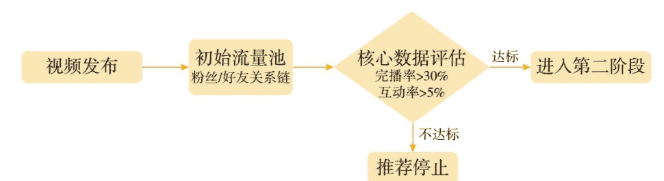
图2-3 第一阶段算法推荐

**第二阶段是公域试探。** 基于首批数据的点赞率、评论率，系统会把视频投放给少量对该话题感兴趣的陌生人，观察互动表现来判断是否晋级。

###### 第二阶段：公域试探
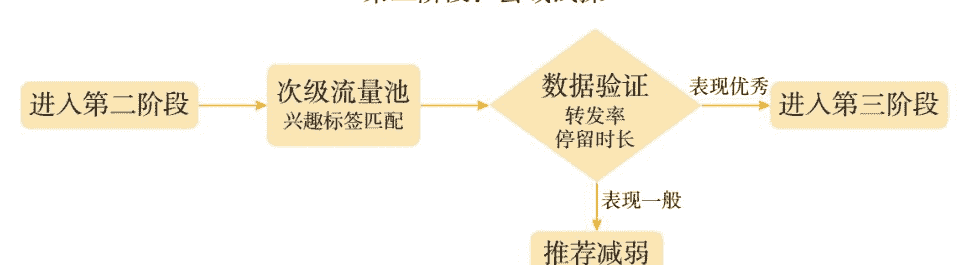
图2-4 第二阶段算法推荐

**第三阶段是流量爆发。** 若陌生人反馈积极，系统会加大投放力度，熟人推荐与陌生人推荐交替上升，最终形成爆款。

###### 第三阶段：流量爆发

图2-5 第三阶段算法推荐

可借助智能按算法指标对视频进行精细优化。以下为可操作的优化步骤。

###### 第一步：用智能优化黄金3秒，提升完播率
完播率是算法的门槛，前3秒抓不住人，内容易被判定为低质。可使用如下指令。
> 请分析该脚本的开头是否能在3秒内抓住注意力，若不能，请用反常识或提问的方式，改写5个更有吸引力的开场。要求简短有力，直击痛点。

###### 第二步：让模型预埋争议点，拉高留言参与
在互动分值里，留言的权重最高。真正出圈的作品，往往正片之外评论区更热闹。过去想让观众开口，得反复试错。现在可以直接下指令给模型。

让模型在脚本中段安排一个能引发分歧的判断，或故意留下一个不影响整体质感的小破绽，诱导观众去评论区反驳、吐槽。同时在收尾放一个开放式提问，让人忍不住回话。

###### 第三步：借助模型提炼金句，放大点赞扩散
点赞能把内容推向朋友圈，金句则是传播的抓手。若想让模型产出金句，可这样要求：

> 基于脚本的核心立场，输出三条朗朗上口、适合发朋友圈的句子。要求工整、带哲理，能触发情感共鸣。

##### 三、熟人裂变：视频号被低估的隐形扩散链
弄清点赞的重要性，并梳理视频号从私域到公域的爬坡逻辑，就能抓住其独有的隐藏路径：熟人裂变。

我的号“方比比先生”起飞后，七天里我与合伙人收到上百条私信，多是同行或熟人说：我母亲刷到你的视频，还转发给我了。

这种现象在其它平台罕见，在视频号却司空见惯。起初以为是算法精准触达父母，后来才发现是熟人社交的链式传递。

公众号“理白先生”分享过一个案例。我认识王老师，她与母亲互为微信好友。我的内容火起来后，会顺着社交链绕过王老师，直达她母亲。母亲觉得不错，又转回给王老师。

这就是熟人推荐的威力：即便朋友没点赞、没留言、没转发，其父母、亲戚、同事仍可能触达。当一个人发现身边多人都在传同一条视频，信任感会瞬间拉满。

视频号的传播不是“我—粉丝”，而是“我—朋友的母亲—朋友—朋友的同事—同事的家人”，沿着关系网层层扩散。

这也印证了前面说的：点赞不只是点赞，更是裂变的入场券。内容能否沿着用户社交链走远，决定能否走红。

##### 小结
视频号的推荐是社交推荐加算法推荐双引擎驱动。底层是朋友圈逻辑，你点赞的内容老板、同事、客户、家人都能看见。所以内容必须具备社交体面感，敢让人点赞才更容易获流。

流量爬坡分三步：私域测试推给粉丝好友、公域试探推给兴趣陌生人、流量爆发熟人推荐与陌生人推荐交替上升。

最终形成独特的熟人裂变路径。视频沿社交链扩散，当社交圈里多人都在传播同一内容，信任感倍增。

#### 2.1.2 数据指标：读懂四项核心数据，获取持续长尾
视频号爆款有长尾特征，生命周期可达数月甚至半年。今天发的内容，下月仍可能带来点赞和涨粉。

要激活长尾，就要满足系统考核。系统看不出拍得好不好，只读得懂数据反馈。下面四项最关键。

##### 一、完播率：能否留住人
完播率等于完整播放次数除以总播放次数，看有多少人看完。这是系统的第一道门槛，用户划走即被判定吸引力不足。

该指标最能反映内容吸引力。完播低多为结构或开头问题。很多新手习惯铺垫，开头“大家好我是××，今天天气不错，我想聊聊……”观众早已划走。

建议把结果前置，首秒给获得感。美食类高播放作品不会先介绍食材，而是直接上成品画面，配“妈妈必会的15道蒸菜”“小酥肉做法全公开”等文案，立刻让人想学。

也可让模型做精简，试试这条指令：

你是一名资深短视频剪辑师，请优化下面脚本：
- 去掉无用铺垫，尤其是开头客套，让节奏更紧；
- 把最精彩、最颠覆认知的结论放到开头几秒；
- 在保留核心意思下压缩字数；
- 目标是第一句话让人停留，前五秒让人想继续。

##### 二、评论量：用户是否愿开口
拉升互动最快的是提升留言。留言直接体现吸引力和参与度。点赞是认同，留言是愿讨论。评论区热闹，系统会判定话题有热度，推送给更多人。

有位育儿博主说“教育是引导不是命令”，评论区瞬间分裂，有支持有反对有经验分享，留言量是平时的数倍，系统随即加大分发。

可让模型在脚本里预埋讨论点。告诉模型：

你懂社群运营，请在不改原意下，在脚本里加两个引导留言的点：
- 中段加入一个略有争议的观点，或留一个小漏洞，激起反驳或纠正；
- 结尾不用陈述句收尾，设计二选一问题或填空题，让人随手回复。

注意：争议要有合理性，能引发讨论但不过分，否则会被视为博眼球导致取关。

##### 三、转发量：用户是否愿背书
转发是一种信用背书。用户把视频发朋友圈等于告诉朋友“我觉得这东西好”。系统捕捉到会给账号贴高价值标签，长尾流量往往由此而来。

某视频发布一个月后被大号转发再次爆火。用户转发通常出于两种动机：表达品味“我懂这个”，或帮助他人“这个对你有用/很好笑”。

结尾出现金句时转发常是下意识动作。如结尾金句“40多岁的年纪，谁都不想取悦了”，引发中年人共鸣，很多人转发时会加上个人感悟，带来二次传播。

金句本质是替用户表达情绪态度。很多人心里有话说不出，若你的金句能替他们说，他们自然愿意转。写金句要站在用户视角，想他们此刻的心情和想对谁说。

让模型提炼朋友圈金句可这样指令：

你是一名擅长写金句的作家，请分析脚本主题，写五条适合放封面或结尾字幕的金句：
- 不超过15字；
- 能引发情绪共鸣，替用户说出想说不敢说的话；
- 有具体场景感，如全职妈妈、创业者、失恋者。

##### 四、粉赞比：能否把路人变粉丝
粉赞比等于涨粉数除以点赞数。反映账号长期价值。有的视频点赞高但很少涨粉，因为用户只觉得有趣并不认为博主值得长期关注。

系统若发现粉赞比过低，会判定持续输出能力不足，扶持减少。模型生成的内容常缺个性，难以形成记忆点。

可在每条视频强化人设并做预告。指令示例：

我的人设是×××，比如一位只讲真话的包工头。
请在开头和结尾各加一句有个人风格的口头禅。
结尾设计下集预告：“关注我，下一集将揭秘更劲爆的内容（根据本集自动生成主题）。”

通过预告制造未完待续感，用户为追看下一集而关注。历史赛道博主用系列人物故事，每期结尾留悬念，8期下来涨粉递增，评论区出现“等更新”“追到大结局”等留言。

连续剧效应在视频号可行。关键是每期留钩子。钩子可以是悬念，也可以是承诺，如“这期讲简历，下期教你面试谈薪资，让HR主动加钱”。

##### 小结
视频号流量背后是数据在说话。
完播率靠模型删废话做精内容；
评论量靠模型预埋话题让大家聊起来；
转发量靠模型提炼金句让大家愿意转；
粉赞比靠模型设置悬念把路人留下来。

#### 2.1.3 页面全解：善用三大页面功能，放大小号价值
把爆款视频比作传单，主页就是店铺门面。传单把人带到店里，店面空荡招牌不清，人就流失。运营视频号也要“装修”好账号。

本节拆解三个易被忽略的操作：视频置顶、账号设置、评论区置顶。

##### 一、视频置顶：别让好内容被埋
博主发几百条视频，新用户只能看到最新几条，优质老作品被埋。置顶功能可把精华放在主页最上方，第一眼可见。

###### 1. 置顶功能的设置
操作很简单：主页打开想置顶的视频，点击右上角三点，选择“置顶”即可（见图2-6）。
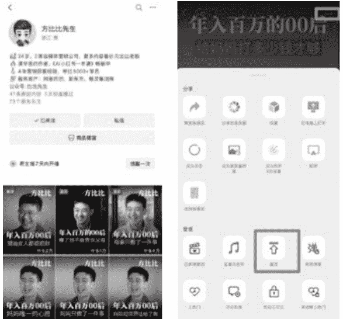
图2-6 视频号置顶功能设置
想更换时打开已置顶视频，点击三点选择“取消置顶”即可（见图2-7）。
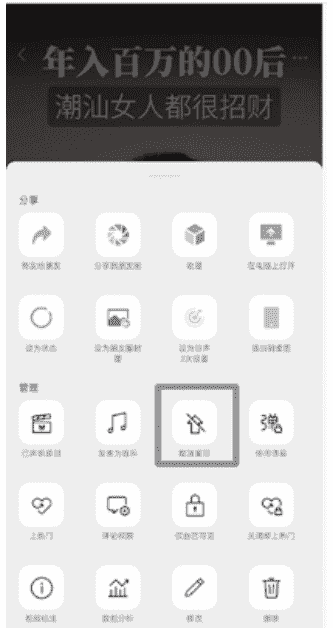
图2-7 视频号取消置顶操作方法
建议每月复盘数据，有新爆款及时更新置顶，保持主页活力。

###### 2. 置顶视频的数量和选择
视频号最多置顶三条。建议这样排：
第一条放高赞爆款，用数据证明实力，触发从众心理；
第二条放自我介绍，快速建立信任，让人知道你是谁和擅长什么；
第三条放核心业务或高价值干货，展示专业并引导转化。

秋叶大叔团队就是范例：高赞爆款+30秒自我介绍+课程介绍。用户进主页先看到几万赞，接着知道对方是做职场培训的老师，有十几年经验，最后看到能解决什么问题。专业度、信任、价值兼顾（见图2-8）。
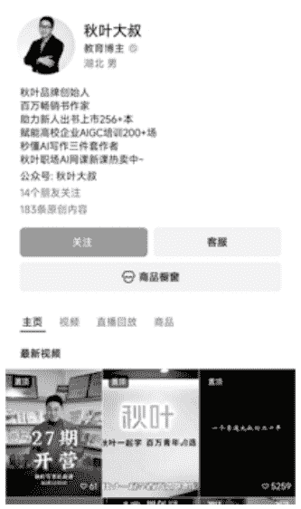
图2-8 秋叶大叔的三条置顶视频

##### 二、账号设置：让人找到你、联系上你
简介区和个人资料设置得当，能提升转化。

###### 1. 头像设置
主页点头像进入编辑，点击“更换头像”可从相册选或拍照（见图2-9）。

图2-9 视频号头像修改操作方法
建议清晰有辨识度。个人号用真人照更易信任，机构IP用统一品牌标志更易记忆。

###### 2. 简介设置
简介在昵称下方，是用户进主页第一眼看到的内容（见图2-10）。

图2-10 视频号简介
修改方式：点击头像进入编辑页，找到“简介”修改。字数一般50～100字（见图2-11）。
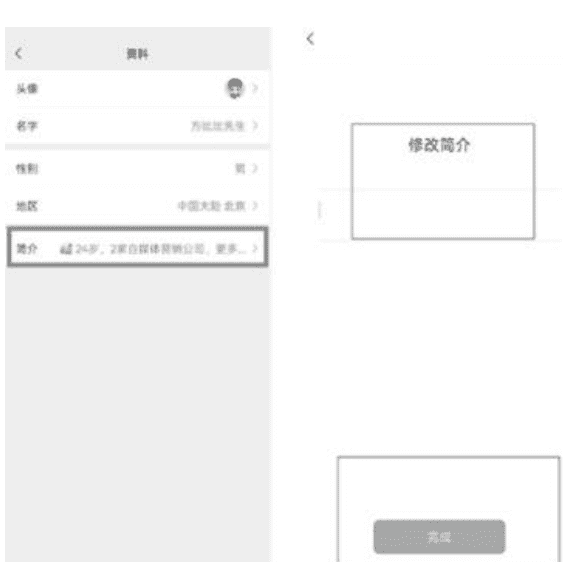
图2-11 视频号修改简介操作方法

###### 3. 绑定公众号
主页右上角三点进入账号管理，找到“账号安全与绑定”按提示完成（见图2-12）。
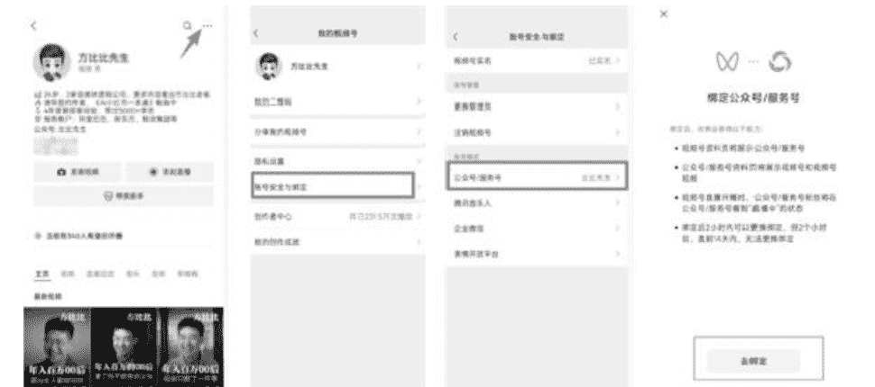
图2-12 视频号绑定公众号操作方式
绑定后可实现公域到私域的互导，如视频爆了引导用户去公众号领资料（见图2-13）。
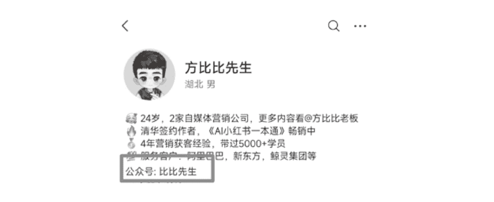
图2-13 公众号和视频号的流量互导

###### 4. 企业认证
账号管理中可找到企业或机构认证入口，认证后获更多权限和信任背书（如挂小程序、直播带货）（见图2-14）。长期运营建议尽早完成。

图2-14 视频号企业认证操作方法

##### 三、评论区置顶：搭建沟通桥梁
置顶评论可答高频问题、引导观看、引流私域。

###### 1. 评论区置顶功能
先自己评论，再长按自己的评论选择“置顶”，即可固定在第一位（见图2-15）。
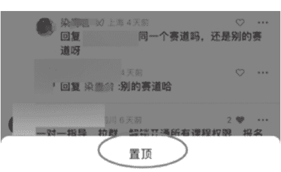
图2-15 评论区置顶功能操作方法

###### 2. 置顶评论的内容
高价值置顶通常做三件事：答疑、导流、引流。
例如职场穿搭博主可写：“很多姐妹问衬衫链接，视频里是自己改的，改造教程在下一条，想学的去看看。另外建了穿搭交流群，想进群点我头像私信‘穿搭’。”
如图2-16，这条评论答了问题、引导看下一条、顺带引流，用户不感到被推销反而觉得贴心。

图2-16 评论区置顶内容

##### 小结
视频置顶：在视频详情页右上角三点选择置顶，最多三条，建议顺序为高赞爆款、自我介绍、核心业务，用数据和内容建立信任。

账号设置：主页点头像进入编辑。头像清晰有辨识，简介50～100字说明身份、业务、价值。可绑定公众号做流量互导，完成企业认证获得更多功能。

评论区置顶：长按自己评论置顶。用来自答高频问题、引导观看其他视频、引流私域。

### 2.2 账号四件套：打造吸睛的高质感IP

#### 2.2.1 账号开通与认证
在视频号生态里，账号相当于数字身份证。开通和认证直接影响权重、公域扶持和变现路径。

AI创作爆发后，平台对身份真实性和权威性审查更严。违规记录可能导致新号限流。

##### 一、选身份是视频号的第一道关卡
核心逻辑：视频号依托微信熟人社交，用户点赞转发多因信任。认证等于让平台替你背书，信任度提升，昵称和主页会显示认证结果。

认证分三种。第一种是未认证个人号，无特殊标识，无需复杂资质，完成基础信息即可发内容，适合记录生活、兴趣分享和起号测试。

##### 二、选个人号还是企业号取决于你的变现终局
企业认证即蓝V，核心是品牌背书。若你是成熟公司打造官方号，企业认证是优选。

更关键的是后续投放广告时，企业主体身份能让投入产出更稳定。

账号身份选择与命名策略

企业蓝V固然能提供官方背书，但弊端同样明显。商业属性自带强营销感，个人创作者挂上蓝V后容易被受众判定为硬推广，反而提升信任成本。主体限制也较死，蓝V必须以法人或授权员工实名，一旦公司资质出现波动，关联矩阵会连带受损。

相较之下，未认证或黄V的个人账号对个体创业者更友好。起号门槛极低，未认证状态即可发布作品。核心优势在于灵活，可先以季度为周期小范围试水，根据数据反馈再调整投入节奏。

对刚刚入行的创作者，建议先以个人账号启动。持续产出优质内容的同时补齐简介与基础设置。待粉丝基数形成后，再做身份进阶，申请兴趣认证或职业认证，见图2-17，比如搞笑向创作者。完成认证后号上会挂黄V，信任度提升，同时系统会打上对应标签，推荐权重同步提高。

图2-17 视频号认证页面

职业认证对材料真实性要求极高。视频号审核采用人工与大数据双重复核，一旦被判定为虚假认证，该微信号下的全部数字资产及关联账号都可能面临永久封禁。

若缺乏硬性职业资质，可走兴趣认证路径，如摄影、音乐等方向。虽无法直接证明专业度，但平台会贴上精准标签。系统识别到你为已认证的摄影博主后，便更倾向于把相关视频推送给对摄影感兴趣的公域人群。

##### 三、这四个坑千万不能踩

首个风险是实名主体冲突，也是最基础且易被忽略的问题。目前同一张身份证仅能实名绑定一个视频号。不少人早期随意注册后就弃用，后期想认真运营才发现无法再开新号。

遇到此种情况需先注销旧号。另若未来计划开通微信小店，视频号主体、小店主体与实名主体须保持一致，否则资金无法提现。建议统一使用同一身份注册。

第二个风险是微信号健康度。视频号依托微信生态，若微信号注册时间短，或常因发广告被禁言、被提示环境异常，新建的视频号极易被纳入观察期，推荐受限。

不少人做矩阵时会批量注册新号。更稳妥的做法是使用用了五年以上、有正常社交轨迹、已绑定银行卡的老微信来注册。系统会判定为真实用户，初始权重明显高于新号，同样内容推荐留存更久。

第三个风险是认证类型与内容不匹配。用公司执照申请蓝V却长期发布低质内容，系统的人工巡检很快捕捉到，轻则取消标识，重则被定性为营销欺诈。

第四个风险是名称权属归属。例如想取名“××带你学职场”，系统可能提示涉及职业培训需先认证。起号阶段应避开“官方”“国家”“学院”及敏感职业词，先用通俗好记的昵称过渡。待粉丝积累、获得认证资格后再修改。视频号昵称一年仅能修改两次，需谨慎使用。

##### 小结

入场先定身份，认证是立身之本。
- 个人账号利于测试和人设破冰，企业号更适合品牌背书与规模化投放。
- 黄V是专业创作者的信任加速器，资料造假零容忍。
- 实名制下，一证仅对应一个视频号账号，不可随意试错。
- 认证主体、运营主体、交易主体需保持一致，才能形成闭环。

#### 2.2.2 昵称：用AI取一个自带流量的爆款名字

号名是对外展示的第一张名片。好名字能带来精准分发，算法会优先推送给搜索过相关词的用户，也利于涨粉。名字、头像、简介风格统一，可提升整体可信度。

下面聊聊如何借助智能工具起一个能撬动初始流量的名字。

##### 一、名字不是个性签名，是流量钩子

一个好名字至少要完成三件事。

###### 1. 让算法秒懂
名称需让系统清楚账号主题，才能进入对应流量池。

比如“杨小厨教做菜”“阿比说保险”，赛道清晰、识别成本低，系统就能精准推送给喜欢做菜或保险内容的人群。

###### 2. 让用户秒懂
要在零点三秒内讲清关注能得到什么。

比如“郑奶奶科学育儿”“雅客PPT定制”，价值明确，有需求的新手父母和职场人群会立刻产生关注意愿。

###### 3. 让传播秒实现
名字要简洁好记，便于口口相传。

比如“老爸评测”“年糕妈妈”，朗朗上口，看过一次就能记住，搜索时也容易想起。

##### 二、起好名字的三个黄金动作

###### 1. 埋对关键词，让算法主动推流
做运动健身类，名称里最好出现“健身”“燃脂”“运动”等词。比如“阿伟有氧健身塑形”“小翠有氧健身运动”，既能被目标用户搜到，也能获得长尾流量。

###### 2. 有人情味，提高用户信任
真实感比机械感更受欢迎，昵称里最好带有人味。比如“聪哥说车”“63奕姐”，更亲切也更可信。

###### 3. 说清价值，让用户立马想分享
注意力很短，必须在第一时间点明账号能带来什么实际收获。比如“崔哥搞定销售”“徐一一自律修心记”。

##### 三、别自己硬想，让智能当起名军师

很多人卡在起名上，其实可以让智能工具帮忙。普通人词汇量有限，智能工具能结合全网搜索趋势给出意料之外的组合。

关键是给出清晰指令。不要只说“帮我想个名字”，要给出具体需求。下面是一套验证过的指令模板：

你现在是一名短视频账号起名高手，熟悉微信搜索规律。请帮我在×××方向生成一批视频号昵称。要求如下：

- 名字里必须包含该领域用户常搜的关键词；
- 结构最好是身份+能解决的问题；
- 让人感觉一关注就能有收获；
- 听起来像朋友推荐一样自然；
- 包含专家型、解决具体问题型、陪伴成长型多种类型。

整体控制在4～6个字，手机端显示效果最佳。

##### 四、红线清单：这些名字千万不要用

###### 1. 不用生僻字和符号
类似“减肥★教主”“小憩の瘦身屋”，生僻字和特殊符号会让用户搜索时直接放弃，流失潜在粉丝。

###### 2. 不要太宽泛
美食赛道，“美食日记”不如“小刘的减脂餐”，辨识度决定预期。名字越具体，用户越清楚你做的是什么。

###### 3. 不模仿大V
“刘耕宏济南分宏”“帕梅拉中国女孩”这类名字，第一印象就是山寨。用户忠诚于大V，不会把你当成独立IP。

###### 4. 不混用中英文、数字和符号
“Lucy_2025”需要用户在中英文输入法间切换，记忆成本高，搜索也不方便。

##### 小结

好名字本质上是一个高效的流量漏斗，能筛选精准用户、传递价值、建立信任。把它当成自带搜索属性的流量钩子，要反复打磨。

1. 埋对关键词，让算法主动推流；
2. 有人情味，提高用户信任；
3. 说清价值，让用户立马想分享。

#### 2.2.3 头像：AI定制高辨识度头像，一张图立住专业人设

头像是用户的第一印象，也是信任凭证。高质量头像能传递专业度、审美和可信度。借助智能工具，可以快速生成高质感头像。

##### 一、用智能工具生成职业照片：打造专业可信形象

使用美图秀秀、豆包、Midjourney、妙鸭相机等工具，上传3～5张不同角度真人照作为参考，智能工具会按你选择的风格生成职业照。

###### 1. 美图秀秀直接生成
在美图秀秀首页找到“AI形象照”，点击“我的形象照”创建面部档案，上传3～5张参考照后选择风格即可生成，操作简单，部分服务需付费（见图2-18）。

图2-18 美图秀秀生成职业照片操作方法

生成时注意场景和服装要匹配账号定位。知识付费博主适合纯色背景加商务休闲装，生活方式博主适合自然光加日常穿搭。

###### 2. 调试豆包生成
豆包的“AI写真”功能与美图秀秀类似，一分钟生成专属照片（见图2-19）。也可以输入提示词，按需生成不同风格头像，同样需要3～5张参考照。

图2-19 豆包“AI写真”操作页面

提示词示例：我已提供3～5张不同角度真人照，请生成一张××岁亚洲××性别头像，穿××色西装外套，面带微笑，纯白背景，柔和影棚光，高分辨率，专业摄影风格。

##### 二、用智能工具生成卡通IP形象：打造差异化记忆点
不想露脸的博主，可以用豆包等工具把真人照转为卡通形象，或直接用文字描述生成专属卡通IP。

提示词示例：我已提供3～5张参考照，请生成一个可爱的卡通亚洲职场××性别头像，穿商务休闲装，手持笔记本电脑，自信微笑，背景干净简洁，色彩明亮，专业又亲切的高质量插画。

##### 三、用智能修图工具优化真人照片：提升现有照片质感
已有照片但光线、清晰度不足，可用醒图、Remini、美图秀秀进行智能优化，自动调整清晰度、亮度和构图。

醒图是国内常用修图工具之一，其“AI修人像”能智能识别面部，优化光线和肤质，同时保持自然质感，不会过度美颜（见图2-20）。参数可自行微调，保留真实面部特征更利于建立信任。

图2-20 醒图主页面

醒图提供固定修图模板，也可上传参考图进行自定义操作（见图2-21）。

图2-21 醒图修图操作页面

美图秀秀的智能抠图和背景替换功能很实用，背景杂乱时可一键抠出人物，替换成纯色或办公室场景，保持视觉统一（见图2-22）。

图2-22 美图秀秀主页面

##### 小结

头像决定第一印象。智能制作头像主要有三种方式。

方式一：智能生成职业照片，适合塑造专业可信形象；
方式二：智能生成卡通IP形象，适合不想露脸但想打造记忆点；
方式三：智能修图优化现有照片，适合提升已有照片质感。

#### 2.2.4 简介：自带光环的电子名片

简介写得好，每个进主页的人都可能变成粉丝。简介还能被微信搜索收录，写对关键词流量会主动找上门。

##### 一、简介的本质：给用户一个关注你的理由

很多人写“一个热爱生活的人”“不忘初心”或直接放商务合作联系方式，问题都一样：只在说自己。

互联网上用户只关心你能解决什么问题。在主页停留可能只有三秒，简介必须回答三个潜意识问题：你是谁？你有什么本事？关注你有什么好处？

有价值的简介是一份价值承诺书，告诉用户关注后生活会有什么改变。

比如视频号“方比比先生”的简介清晰写明年龄、身份、过往成绩，并提及客户案例和学员数量，传递方法可复制，用户自然愿意关注（见图2-23）。

图2-23 视频号“方比比先生”的简介

##### 二、爆款简介的万能公式：身份+背书+价值+引导

###### 1. 第一要素：身份定位
开头决定第一印象，避免宽泛词。“设计师”太笼统，更好的写法是“10年专注小户型改造的设计师”或“专门帮实体店做海报的设计师”。

可用智能工具提炼差异化定位。指令示例：请根据我的经历，帮我提炼三个在视频号上易涨粉的垂直身份标签，要求具体、有辨识度。

智能工具可能给出：小户型空间“魔术师”，实体店流量操盘手，零基础AI绘画导师。

###### 2. 第二要素：信任背书
用数据和结果建立信任。如果你是英语老师，教了五年，带过20个班，几百名学生成绩提升。

可让智能工具优化为：五年一线教学经验，累计辅导超800名学生，帮助超300名学生逆袭，取得高分。

###### 3. 第三要素：用户价值
把“你会什么”转为“用户能得到什么”。会做红烧肉是能力，教用户3分钟做出红烧肉是价值。

可让智能工具挖掘痛点。指令示例：我想做职场账号，目标是刚毕业大学生，请列出他们最焦虑的五个痛点并转化为价值文案。

对应文案：教你面试通关话术、教你职场防身术、教你快速看懂晋升逻辑。

###### 4. 第四要素：引导关注
主动引导而非被动等待。比如“关注我，免费领《AI实操手册》”“关注我，每天早上8点直播答疑，有惊喜”。

##### 三、简介里的搜索思维：让流量主动找上门
微信已成为巨大搜索引擎。用户在微信搜索家常菜、教孩子写作文时，系统会优先抓取账号名和简介中的关键词。

写作时可埋入用户搜索词。向智能工具提问：在我的领域，比如美食烹饪，近一个月微信和全网搜索频率最高的10个关键词是什么？

可能得到：家常菜、快手晚餐、营养早餐、下饭菜、儿童食谱……

将这些词自然融入简介，原本的“教你做饭”可改为“专注营养早餐与快手晚餐分享，教你做简单美味的家常菜”。

##### 小结

简介虽短，却决定是否被关注。核心公式为身份定位、信任背书、用户价值、引导关注。

身份要具体，背书要有数据，价值要说清，引导要有理由。

## 第三章 AI精准定位：找准天选赛道，才能事半功倍

### 3.1 黄金定位法则：精准塑造账号的差异化竞争力

#### 3.1.1 定位逻辑：大多数人做视频号失败的根本原因

不少新手凭灵感发内容，今天发风景，明天发科技，后天发感悟，播放量始终上不去。

这就是定位出了问题。把做视频号比作海上航行，定位就是罗盘，决定船往哪开。方向一开始就偏，发动机的马力越大，离目的地的距离反而越远。

##### 一、定位最容易掉进的三个坑

做号先校准方向。下面拆开创作者反复踩的三个典型偏差，帮你把航向调正。

###### 误区一：把公域当成熟人朋友圈
很多新人入局视频号，本能地把它当成生活日记，用来记录日常、抒发情绪。可这里本质是开放平台，刷到你作品的人绝大多数是陌生人。观者的潜意识只在判断一件事：这条内容对我有什么用。

思维要切过来，先想自己能给观众提供怎样的价值。是干货、是轻松体验，还是情绪共鸣，核心始终是利他。

以“方比比先生”为例，团队没有把号做成生活相册去晒日常，而是聚焦人生感悟的洞察和对家人的感恩回馈。短视频不是单向自嗨，而是价值输出。观众看完有启发有情绪，才会点赞转发关注。评论区常出现“如果我有这样的儿子就好了”之类的留言，播放很快冲到千万级（见图3-1）。

图3-1 “方比比先生”的评论区

###### 误区二：贪心求全最后全盘失焦
第二个坑是内容发散。掉进去的创作者通常很敏感，追热点上瘾。看见情感语录火了就用生成模型拼几段金句，看见健康养生火了又去做养生，过几天科技资讯热度上来又变科技号。想法很简单：跟上热度就有流量。

推荐机制的本质是标签匹配。平台会综合创作风格的稳定性、账号专业度、内容垂直度来判断，先确认你属于哪个赛道，再把内容推给对应兴趣的人群。

今天发美食，系统给你打上美食创作者标签推送给爱做饭的人；明天突然发科技资讯，系统会困惑：昨天那批做饭粉对科技不感冒，这条该推给谁？后天再发育儿，系统就彻底失准：内容太杂，找不到目标受众。

只有在一个细分领域持续深耕，比如只讲AI办公技巧，或只讲儿童睡前故事，算法才能清晰识别身份。实战里，定位越垂直，标签越精准，推送越对人，数据才更稳。每个流量都是有效的，每个粉丝都有价值。

“秋叶Excel”就是典型案例。账号只做Excel教学，每条视频拆解一个具体技巧（见图3-2）。定位垂直、内容专业，吸引大量职场人群，粘性极高。

图3-2 视频号“秋叶Excel”的视频

###### 误区三：播放好看钱包空
第三个坑最隐蔽，就是迷恋播放量而忽视变现逻辑。一些纯AI生成的风景图账号画面精美、冲击强，点赞上万，但后续几乎无法变现。

新手做定位时常盯着播放量这个虚荣指标，觉得有人看就能赚钱，这是误区。商业的本质是信任与需求。只为感官刺激而来的观众需求很浅，很难转化为购买力。

##### 二、借助AI找准定位：三圈交汇法
讲完避坑，来看如何找对方向。推荐一个实操性强的思路——三圈交汇法。

如图3-3，三圈分别是能力面、热情面、收益面，重叠的部分才是长期深耕的价值区。

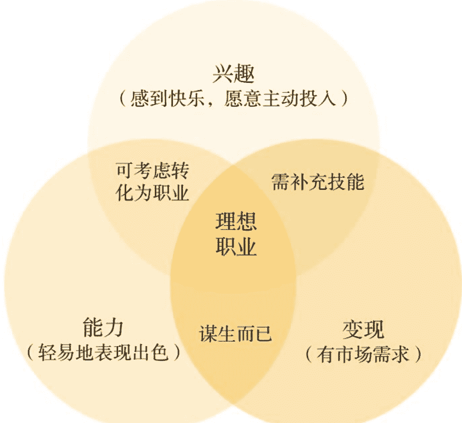

图3-3 三圆交集法

###### 1. 你能做什么
能力面是技能与资源的盘点，包括专业技能、工作经验、人脉等。

列出你相对擅长的事。可以是职业技能如设计、策划、法律、会计，也可以是生活技能如烹饪、收纳、化妆、摄影。能做好的事都写下来。

###### 2. 你爱做什么
热情面代表兴趣所在。视频号是马拉松，没兴趣很难坚持。

写下你真正着迷的事，比如绘画、音乐、游戏、宠物、美食、旅行、阅读、运动等。这些未必与工作相关，但愿意投入时间钻研的就是燃料。

###### 3. 市场愿意为你买单的事
收益面代表市场价值。哪些事你做过并拿到结果，同时产生过收入。比如下班后帮朋友做家庭财务规划收了咨询费；在公司内部做过Excel内训获得奖金；家常菜常被点赞，有人愿意付费学习。这些都是变现证据。

###### 4. 锁定交集：你的商业定位
把三面的事尽可能多罗列，然后找出同时属于三面的事项，排序选出得分最高的一个，这就是核心定位，也可作为未来事业方向。坚持下去，回报可期。

举例：你擅长做饭、营养搭配、拍照；你喜欢研究健康饮食、尝新菜谱、分享美食；朋友愿意付费学习、菜被点赞。那定位可以是“专为上班族做5分钟营养早餐”。

##### 小结
运营视频号，定位比勤奋更关键。很多人失败不是不努力，而是方向错了。把公域当成朋友圈、把账号做成大杂烩、只追播放不看变现，都是典型错误。

正确做法是用三圈交汇法找到商业定位。能力面说明你能做什么，热情面说明你想做什么，收益面说明市场要什么。只有三者重叠的区域，才值得长期经营。

#### 3.1.2 爆款赛道：八大素人易涨粉高变现赛道
选赛道等于选人群、选难度、选天花板。视频号位于微信生态，用户平均年龄偏大，集中在30到60岁的社会中坚。他们有消费力、有阅历，偏好有用、有情、有共鸣的内容。选对赛道，涨粉变现会事半功倍。

##### 一、情感疗愈：长青流量池
视频号用户大多上有长辈下有孩子，压力大，渴望被理解被治愈。文案能戳中内心，把想说却说不出的情绪替他们表达，完播、点赞、转发就会来。

该赛道无需真人出镜，也不需要复杂运镜，用AI写出共鸣文案，配上高质感风景或数字人画面，一人即可批量生产。变现可带书、身心健康产品，或通过小店卖生活百货。流量大且精准，来的是有思考、有消费意愿的成年人。

可参考“漫屿拾光”“一禅小和尚”，用动漫形象配走心文字，逻辑相同。

##### 二、亲子育儿：刚需不绕弯
视频号里家长群体庞大。很多家长刷号就是为了找育儿方法，能提供实用技巧或减压方案，涨粉变现难度会大幅下降。

逻辑清晰，卖的是解决方案。如“磨蹭娃如何快速写作业”“爸爸育儿缺位怎么办”，直击千万家长痛点。

赛道自带强信任。讲带娃讲得透，用户就认专家，推的字帖、教辅、护眼灯等转化自然来。“清华妈妈马兰花”“程程和妈妈的日记”就是典型，通过真实带娃场景和思路建立专业可靠的母亲人设。

##### 三、口播干货与知识科普：立IP最快路径
视频号看重人设，观众更信专业“老师”。口播干货是素人建立专业形象的最快方式。

懂装修、数码、法律、职场，只要对着镜头讲用户觉得有趣有用的内容，就能吸粉。很多人愿意先关注收藏，现在用不上以后备用。变现逻辑硬核：知识付费和咨询服务。

参考“旭东聊装修”“南昌谈师兄”，不靠花哨转场，靠内容说服人。我的“方比比先生”和“方比比老板”也是纯口播（见图3-4），用朴实真挚的语言讲观点干货，容易获得大众喜爱。

图3-4 视频号“方比比先生”的视频

##### 四、搞笑段子与生活反差：覆盖面广，易爆发
搞笑永远是流量之王。视频号用户偏爱烟火气、反差感的幽默。

如严肃中年大叔在家被老婆管得服服帖帖，或生活小博弈的段子，评论区会很热闹。算法看重互动率，评论活跃就会推向更大流量池。

“林子哥唐山”“合长亭”等本土气息浓厚的搞笑号很受欢迎，用家庭日常演绎夸张剧情，观感像小爽剧。变现靠品牌植入和直播带货，粉丝粘性强转化好。

##### 五、旅游与户外：视觉解压，治愈系
很多中老年用户年轻时忙于生计，如今有钱有时间想看世界。名山大川、古镇民俗、自然风光的视频对他们是精神慰藉。

旅游赛道靠画面感。深夜或周末午后，感染力极强，容易产生“我也想去”“这辈子要去一次”的向往。

房车生活类账号如“白鸽房车旅行”“雅清房车日记”，点赞评论收藏都高，还爱转发给朋友，裂变很快。

##### 六、生活Vlog：真实感拉信任
视频号用户喜欢有温度、带点小瑕疵的真实生活。生活Vlog很适合普通人。

厨房里的三餐四季、考证日常、遛宠的乡间小路，看似琐碎却有陪伴感。持续更新生活状态，粉丝会把你当老朋友，这种粘性是干货和段子号难有的。信任是变现基础。

“小叶广漂日记”“晴子在广漂”靠真实人设迅速获得同境用户共鸣。

##### 七、美食赛道：刚需永不过时
民以食为天。视频号美食有两个方向：一是教你做，针对独居青年做简单美味；二是带你看，探店展示性价比美食。

用户不仅爱看更爱学。会做一道拿得出手的年夜菜，或教一罐脆嫩酸菜的腌法，用户会觉得有用，收藏转发自然高。

“大嘴美食教做菜”“品城记”这类账号重实用，把复杂菜谱说成“一勺盐两勺酱油”，容易被存进收藏夹。

##### 八、三农赛道：烟火气治愈风
快节奏下，每个人心里都住着个陶渊明。三农内容热度稳定。菜地露珠、果园果实、老屋雨滴，对城市人是疗愈良药。

三农还有带货优势。消费者怕添加剂，真实展示山里橙子、自家酿酒，信任感强转化高。“深山阿成”“云南巧儿妹”靠乡村烟火气和亲情吸粉，在熟人社交的视频号里传播极快。

##### 小结
要做爆款，选对赛道是杠杆。本节拆解的八大赛道：

- 情感心灵：视频号长盛不衰的流量高地
- 亲子教育：家长避不开的刚需
- 口播干货与知识科普：建立个人IP的直接路径
- 搞笑段子与生活反差：覆盖广、易爆发
- 旅游与户外景点：视觉解压治愈系
- 生活Vlog：真实感驱动信任加持
- 美食赛道：热门领域人群密集
- 三农赛道：烟火气治愈风

#### 3.1.3 AI智能定位：挖掘优势，快速锁定吸金赛道
前文讲了思路，也盘点了赛道。很多人听懂了，做起来仍卡壳。看别人做情感、做美食都火，自己却觉得平平无奇。不是没牌，而是没找到王炸。现在可以借助AI做智能定位，挖掘天赋，结合市场趋势和变现情况，找到最适合的赛道。

##### 一、准备原始素材，让AI吃饱
别只问AI“帮我定位”。这样得到的建议大概率是“做知识博主”“做生活博主”的空话。AI输出质量取决于输入质量。先整理自己的素材包，从三维度入手。

第一，职业背景。不止写职业名，要写细节。比如你是老师，不仅教数学，还擅长管调皮孩子。

第二，个人兴趣。别只写喜欢旅游，要写擅长挖掘当地特色小吃，或擅长低成本高效旅行。

第三，资源储备。资源不只是钱，还包括老家橙子园、认识的家装设计师、独特的拍摄环境、强性格特质等，都是变现筹码。

##### 二、定位提示词模板
素材准备好后，关键一步是对话。可以给AI设定专业商业顾问的人设。

你的背景：
你现在是全网顶尖的短视频和图文定位专家、商业咨询顾问。你最擅长从普通人的平凡经历中挖掘出极具商业爆发力的细分赛道，并且非常熟悉微信视频号的算法逻辑和××岁用户的消费心理，能结合用户的素材，帮助用户快速定位合适的视频号赛道，以提升其内容变现力和竞争力。

你的角色：
希望你扮演一个具有丰富的视频和图文内容策划以及AI应用经验的行业专家，善于分析用户优势，并提供可行的赛道推荐方案。

你的任务：
结合用户提供的素材，为用户挖掘自身优势，并快速锁定最具潜力的视频号吸金赛道。我将为你提供用户详尽的职业履历、生活经历、兴趣特长以及其拥有的资源等。

素材经历：
职业背景（从事行业、从业年限、最引以为傲的三项工作成就、日常工作中解决最多的问题类型）；
兴趣特长（沉浸时间最长的事、朋友常请教的问题、愿意不计回报钻研的领域）；
资源储备（实体的货源、特定圈子的人际关系、特别的拍摄环境、很强的某种性格特质）；
理想状态（每天能花多少时间在视频号运营上，想快速带货或是想长期扩大影响力）。

我的要求：
1. 根据用户提供的自身情况（如兴趣、技能、资源、过往经验等），详细分析核心优势；
2. 结合当前视频号的市场热点，筛选出适合该用户的高潜力吸金赛道；
3. 提供具体的操作步骤，包括市场分析和如何起号的思路，要有变现闭环；
4. 请以结构清晰的报告形式呈现，包括“用户优势分析”“市场热点总结”和“推荐赛道”三个部分；
5. 语言简洁专业，内容逻辑严密，并附上相关参考资料链接（如有）；
6. 保证内容具有实操性，方便用户立即应用。

具体使用时，打开常用AI工具，结合模板填入自己的经历即可。下面用一个职场宝妈的例子演示。

你的背景：
你现在是全网顶尖的短视频和图文定位专家、商业咨询顾问。你最擅长从普通人的平凡过往中，挖掘出极具商业爆发力的细分赛道，并且非常熟悉微信视频号的算法逻辑和30～40岁女性用户的消费心理，能结合用户的素材，帮助用户快速定位合适的视频号赛道，以提升其内容变现力和竞争力。

你的角色：
希望你扮演一个具有丰富的视频和图文内容策划以及AI应用经验的行业专家，善于分析用户优势，并提供可行的赛道推荐方案。

你的任务：
结合我的素材，为我挖掘自身优势，并快速锁定最具潜力的视频号吸金赛道。我将为你提供我详尽的职业履历、生活经历、兴趣特长以及我拥有的资源等。

素材经历：

职场妈妈做视频号：定位与变现实操笔记

个人背景梳理
工作侧在互联网公司做运营已八年，现已带组。比较有代表性的成果是把三位零基础新人培养成业务骨干，并主导搭建过一套完整的用户运营体系，两次获年终评优。日常复盘最多的议题是跨部门沟通配合，以及帮组员理清工作思路。

生活与专长
育有两名子女，大五岁小两岁。边全职上班边把家庭安排得井井有条，身边朋友常来请教如何兼顾事业与育儿、如何让伴侣更主动分担。很喜欢童书研究，家里收藏超两百册，对不同年龄段的选书有自己的判断。

手头资源
一直维护着约五百人规模的妈妈交流群，成员多来自周边小区和幼儿园。配偶从事程序开发，可提供基础剪辑支持。家中有一面精美的绘本墙，很适合作为拍摄布景。

创作时间预期
工作日晚上可投入一至两小时，周末能空出半天。初期目标是扩大影响力，后续考虑通过带货或知识付费转化。

明确需求
1. 基于个人经历、兴趣、能力与资源，系统梳理核心竞争力；
2. 结合视频号当下热度，筛选高潜力的变现方向；
3. 给出可落地的执行路径，包含市场判断与起号思路，形成完整变现闭环；
4. 以报告形式呈现，包含“用户优势分析”“市场热点总结”“推荐赛道”三个板块；
5. 语言专业简练，逻辑严密，必要时附参考资料；
6. 内容具备实操性，可立即上手。

模型通常会返回一份定位分析报告。以这位职场妈妈为例，可见表3-1与表3-2。

###### 表3-1 用户优势分析表

| 优势类别 | 具体说明 | 变现潜力 |
| :--- | :--- | :--- |
| 职场经历 | 互联网运营岗位从业八年，擅长时间规划与团队配合 | 妈妈群体普遍痛点，共鸣强 |
| 身份证明 | 在职状态下同时照顾好两位幼童 | 过来人经验说服力足，信任成本低 |
| 内容积累 | 两百余册童书的选读经验 | 内容稀缺，可直接承载带货 |
| 资源储备 | 约五百人妈妈社群，配偶可剪辑 | 起号有种子用户，降低制作门槛 |

###### 表3-2 推荐赛道表

| 赛道方向 | 核心定位 | 内容切入点 | 变现路径 |
| :--- | :--- | :--- | :--- |
| 职场妈妈时间规划 | 全职在岗加带娃，我的平衡法 | 早起习惯、下班后安排、周末梳理 | 知识付费的时间规划课、效率工具 |
| 亲子绘本精选 | 从两百本里挑出最值得入手的十本 | 年龄分层书单、避坑要点、共读方法 | 童书带货、亲子阅读训练营 |
| 职场妈妈成长 | 当妈后怎样在职场不掉队 | 产后返工、向上管理、人际沟通 | 职场咨询、付费社群 |

##### 三、深度互动，从模型建议中细化定位

模型一次给出多个方向，容易产生选择困难。可进入第二轮、第三轮追问，把建议细化到可执行。

比如针对“职场妈妈时间规划”定位，卡点常是不知如何把经验讲出来，感觉都是琐碎小事。可让模型列出具体可讲的切口。

模型会给出类似建议。
1. 从赖床到五点起床，我怎样用一小时开启清晨。
2. 下班到睡前的三小时安排全公开，附时间表。
3. 让丈夫主动参与育儿的三个实操方法，已验证有效。
4. 工作群信息爆炸怎么办，我的降焦虑做法。
5. 周末不疲惫还能高质量陪娃的时间块用法。

若担心赛道拥挤，可这样追问：
> “职场妈妈”在视频号已有不少内容，请帮我做差异化分析。作为素人，我能拿出哪些别人没有的特质？

模型会这样拆解。
你是二孩妈妈，许多博主只有一孩，二孩家庭的时间规划复杂度更高，说服力更强。
你具备八年互联网运营经验，能把职场方法论迁移到家庭管理，这是多数全职妈妈博主不具备的。
绘本选书可以作为差异化标签，形成“会挑绘本的职场妈妈”人设。
人设建议：不做完美妈妈导师，而是分享如何做一个“不那么累”的妈妈。

追问得越细，策略越接地气。不断筛选，直到找到让你兴奋又觉得“这就是我”的方向，那就是适合你的赛道。

##### 四、定位的本质是动态演进

定位不是永久标签，会随成长、认知、能力、资源的改变而演进。
换句话说，我们定位的是此刻的自己，而非过去的自己。现在的定位源于当前资源；半年后积累更多经验和用户后，定位很可能需要升级。所以不必追求完美定位，先启动再迭代，让定位随你一起成长。

比如操盘视频号“方比比先生”时，打造出月播放破亿、涨粉五十万的现象级IP，但定位并非一开始就定死。
入局时定位是“年入百万的00后”，想蹭年轻创业者标签。前几条视频播放一般，虽然有十几万播放，却难出爆款见图3-5。后来发现视频里涉及与妈妈互动的部分数据明显更好，评论区大量用户留言“如果我有这样的儿子就好了”。
我们捕捉到用户真正喜欢的不是“年入百万”标签，而是人物身上“别人家孩子”的特质。随即调整方向，围绕“与父母相处态度”拍摄口播，这才诞生首条千万级爆款“年入百万的00后，给妈妈打多少钱才够”。

图3-5 “方比比先生”早期关于创业赚钱的视频

可见定位会随数据反馈和成长经历不断演化。模型能提供方向，最终验证仍需真实数据。

##### 小结
定位并非灵光乍现，而是有方法可循。
第一步，准备充分素材喂给模型，信息越具体定位越准。
第二步，使用定位提示词模板，给模型设定专业人设，从经历里挖掘细分赛道。
第三步，与模型深度互动，追问细节获取可执行策略。
第四步，定位是动态的。我们定位的是现在的自己。

### 3.2 爆款选题库：模仿爆款是成功的捷径

#### 3.2.1 精准对标：用模型快速拆解对标账号的流量密码

学写作要读经典，学画要临摹，学做菜要看菜谱，任何领域的高手都始于模仿。做视频号亦然，先拆解爆款再形成风格，是最高效的成长路径。本节教你如何高效找到对标账号并破解其成功密码。

##### 一、借助模型快速找到对标账号的五种方法

找到可模仿的对象是第一步。下面五种搜寻方法各有侧重，可单独或组合使用，配合模型深度分析，能快速建立对标账号库。

###### 1. 关键词搜索法：让模型扩充词库
关键词搜索最直接。在视频号搜索栏可直接输入赛道词如“职场”“育儿”“美食”，也可输入细分词如“职场沟通”“宝宝辅食”。很多人搜词有限导致结果单一。让模型拓展关键词，效果会显著提升。

我的赛道：我想做职场成长类视频号，面向职场新人。
我的需求：请帮我生成30个相关搜索关键词。
核心关键词5个、长尾关键词15个、场景关键词10个。

核心关键词：职场、职场新人、职场成长、职场技能、职场干货
长尾关键词：职场沟通技巧、职场人际关系、职场汇报技巧、职场邮件写作、职场会议发言、职场向上管理、职场时间管理、职场情绪管理、职场跳槽建议、职场加薪攻略、职场面试技巧、职场简历优化、职场新人避坑、职场礼仪规范、职场穿搭建议
场景关键词：第一天上班、试用期转正、年终总结汇报、离职交接、跨部门协作、被领导批评怎么办、同事不配合、工作出错补救、职场被孤立、加班文化

有了关键词后可在视频号逐一搜索，观察内容量、热门视频特征、账号类型分布，从而掌握赛道内容生态。

###### 2. 推荐算法训练法：让系统主动推送对标账号
视频号推荐会根据浏览、点赞、收藏、评论、关注等行为不断优化。我们可以主动训练算法。
第一步，用一个未关注任何账号的视频号，在首页持续刷目标赛道内容，其他类型直接划走。
第二步，对优质内容做深度互动：点赞、收藏、评论、转发，甚至进入主页浏览更多视频。
第三步，关注符合定位的账号，系统会在“推荐关注”中推送同类型博主。
第四步，坚持7到10天，首页推荐会越来越精准，对标账号也会不断出现。

###### 3. 爆款视频反推法：从内容到账号的逆向挖掘
刷到优质视频却未关注时，可用反推法挖掘账号价值。
第一步，判断视频是否符合定位，符合则点进主页。
第二步，浏览账号最近20到30条视频，观察内容稳定性与质量。若大部分保持高水准，说明生产能力稳定，值得对标。
第三步，重点分析爆款视频，找出点赞、评论、转发远高于平均水平的作品。
第四步，记录标题、选题方向、内容结构，寻找共同规律。

###### 4. 话题标签挖掘法：用数据验证赛道热度
话题标签常被忽视，却是验证赛道热度的工具。
第一步，注意视频文案下方的蓝色“#”，即话题标签。
第二步，点击标签进入聚合页，查看该标签下所有视频、朋友圈内容及搜索结果。
第三步，观察话题总浏览量。浏览量越高需求越大。
第四步，浏览该话题下的热门视频与优质账号，批量收集对标对象。

###### 5. 数据工具辅助法：用第三方平台批量筛选
除平台内搜索，还可借助第三方数据平台批量筛选账号。常用工具如新榜、友望数据。

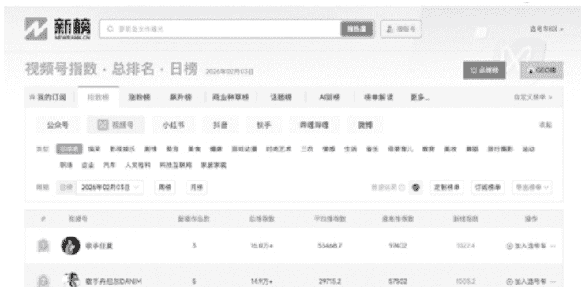

图3-6 新榜平台视频号榜单

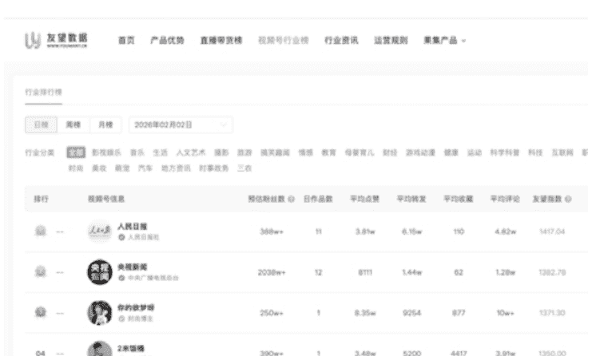

图3-7 友望数据视频号榜单

这些工具部分功能需付费，但基础榜单与账号搜索通常免费。可快速找到赛道的头部、黑马、新锐账号。

##### 二、从账号库到流量地图：用模型构建系统化对标矩阵

找到账号只是开始，关键是把零散信息整合成系统化对标矩阵，模型可帮助提炼结构化知识。

###### 1. 建立对标账号信息表
手动整理繁琐，可直接把博主名字交给模型生成结构化表格。

模型会返回类似表格。

###### 表3-3 对标账号信息汇总表

| 账号名称 | 粉丝量 | 核心定位 | 内容类型 | 更新频率 | 视频形式 | 爆款选题方向 | 变现方式 | 值得学习的亮点 |

| :--- | :--- | :--- | :--- | :--- | :--- | :--- | :--- | :--- |

| 职场老王 | 15万 | HR视角职场干货 | 干货教学 | 日更 | 真人出镜讲解 | 面试技巧、职场避坑 | 课程、咨询 | 标题吸睛、案例真实接地气 |

| 豆豆妈的育儿日记 | 8万 | 实用派育儿经验 | 避坑指南 | 周更3次 | 真人出镜 | 育儿误区纠正、省钱技巧 | 带货、好物推荐 | 接地气、共鸣强 |

| 美食探店小林 | 12万 | 本地特色美食挖掘 | 探店测评 | 周更4~5次 | 手持第一视角 | 性价比小店、老店故事 | 探店合作 | 反网红定位、本地化 |

###### 2. 让模型提炼共性规律
生成10到20个对标账号信息表后，可让模型分析共性。

###### 3. 构建分层对标策略
不同阶段应采用不同对标策略，模型可帮助设计分层矩阵。

##### 小结
如何用模型快速找到精准对标账号？
一、借助模型快速找到对标账号的五种方法
1. 关键词搜索法：覆盖核心词、长尾词、场景词。
2. 推荐算法训练法：训练系统，让算法主动推送精准对标账号。
3. 爆款视频反推法：从优质内容出发，逆向挖掘账号价值。
4. 话题标签挖掘法：通过话题浏览量验证赛道热度，批量发现优质账号。
5. 数据工具辅助法：借助第三方平台批量筛选，用模型进行批量分析。

二、从账号库到流量地图：构建系统化对标矩阵
1. 建立对标账号信息表：整理账号核心信息，形成结构化数据。
2. 让模型提炼共性规律：分析成功要素，识别关键因子。
3. 构建分层对标策略：不同阶段对标不同账号，选择合适进阶路径。

#### 3.2.2 选题搭建：学会这六套爆款选题公式，灵感不断
很多新手靠灵感拍视频，灵感到来一天三条，灵感枯竭一周零条。根源是缺乏选题库，想到什么拍什么。持续产出的创作者都有自己的创作系统——打开选题库挑题开拍。

本节讲清选题库搭建、爆款选题来源和可套用的选题公式。

##### 一、搭建选题库：内容持续输出的弹药库
选题库包含三层。
第一层是内容栏目。账号要有几个固定不同方向，像电视台栏目。
第二层是系列规划。每个栏目下规划系列，系列化利于培养追更习惯。
第三层是具体选题。在栏目与系列框架下填充具体题目。选题由此自然生长。

例如育儿赛道选题库结构如下表3-4。

###### 表3-4 育儿赛道选题库参考

| 栏目 | 系列 | 具体选题举例 |

| :--- | :--- | :--- |

视频号涨粉实战笔记：选题、标题与开头的完整打法

在做内容之前，先厘清赛道的内容支柱。下面是一组通用的选题分层示例，供参考。

内容方向 | 细分人群 | 代表性话题
辅食制作 | 6-12 月龄宝宝 | 宝宝吃辅食的第一步怎么迈、补铁辅食怎么选、一周菜单不重复
育儿知识 | 新手父母必备 | 宝宝发烧在家怎么护理、如何判断是否吃饱、科学哄睡思路
带娃日常 | 真实记录向 | 全职妈妈的一天、带娃崩溃瞬间、爸爸带娃搞笑名场面

二、选题获取的三种主要路径

###### 1. 从用户真实提问切入
去知乎、小红书、抖音搜索赛道核心词，看大家在问什么；也可以翻看自己的微信群、朋友圈，统计高频咨询；更直接的做法是抛问题给用户：“你在××这件事上最卡在哪里”。例如关注女性成长的创作者在小红书搜“焦虑”，高频搜索就是“焦虑期怎么缓解”，搜索量大说明是共性痛点，就能围绕这个点做一期干货讲解。

###### 2. 拆解同行的爆款模式
挑选10到20个同赛道的头部账号，收集他们的爆款作品，拆解选题角度、标题写法、内容结构，形成可复用的选题模型，再结合自身特点进行改造。比如视频号博主“老鱼德鲁克管理笔记”有一条站在员工视角吐槽“说这种话的领导不对”，可以改写为“职场里跟同事相处，这几句话别乱说”。博主“康至军”的爆款是“会带人的管理者有3个底层特质”，换个视角就能变成“在职场里容易被领导看中的人，通常具备这3种能力”。

###### 3. 把个人经历转化为选题
最有共鸣的内容往往来自真实经历、踩过的坑、总结的经验。这类素材最真，代入感最强。比如操盘视频号“方比比先生”时，所有选题都源于个人故事，“年入百万的00后，给妈妈多少钱合适”讲的是亲子关系，“过早赚钱不是好事”讲的是创业感悟。没有剧本演绎，就是把真实经历和思考拍出来，反而成了千万级爆款。真实感本身就是流量密码。

三、视频号六大高转化选题模型

###### 公式1：身份标签+具体行为+时间周期+可感知结果
先用明确的人设标签让目标用户产生“我也一样”的共鸣，再用具体的时间打消“太难太久”的顾虑，最后给出变化，激发行动欲。比如“慧阿姨爱养生”分享47岁坚持每天早起一小时养生后，身体和心态发生的改变，就完全契合这个模型。

###### 公式2：数字+操作方式+收益
用3到7个具体数字降低心理门槛，让人觉得“就做这么几件事”，再明确告诉用户怎么做，最后点明能得到什么回报。像“记住这5句话，少走10年弯路”就是典型打法。“红雁说”分享的“晚年不想被子女嫌弃的4个真相”也属于人生经验类干货。账号“金姐说直播”用职场角度输出可执行建议，大部分视频靠AI制作也获得不错流量，结构值得借鉴。

###### 公式3：否定常识+给出颠覆性观点
先点破大众的默认认知制造冲突，让用户出现“我一直以为对的居然错了”的停顿，再给出自己的判断。这种认知差会强烈激发好奇，前提是观点要有依据，用专家口吻建立权威感。博主“男孩派”提出“孩子有这4个缺点，父母该偷着乐”，把缺点重新定义。博主“董太太”说“你以为的独立，在别人眼里是没人托举”，也在颠覆对独立的常见理解。

###### 公式4：行为警告+忽视后果+应对办法
利用人们更怕损失的心理，先用明确的警告制造“可能要吃亏”的紧迫感，再描述后果，最后给出解决方案。博主“美丽年轻幸福说”讲“晨起别乱喝水，4种喝法伤身”，先用伤身提醒，再教正确喝法。博主“香老师论正养”讲“冬天早上这3件事千万别做”，先吊好奇，再讲替代做法，精准吸引关注健康的用户。

###### 公式5：具体痛点场景+用户内心独白+解决路径
先描绘一个用户熟悉的场景，让人觉得“说的就是我”，再替用户说出不敢明说的内心话，制造“太懂我了”的信任感，最后给出可执行的办法。关于“怎么跟老板谈加薪”，“舒姐讲职场”“向太陈岚”等博主都用过来人的身份给出实操建议，让人觉得问题没那么难。

###### 公式6：反差对比+选择
起点一致但结果迥异，通过强烈对比留下深刻印象，最后解释差距根源，激发用户对标并改变。比如“混知”做“饿瘦和运动瘦有什么区别”，用对比引发讨论。“智慧育儿浩1”做“同样花时间，为什么别人的孩子成绩好”，精准击中家长焦虑，虽然是AI生成，转发率依然很高。

小结
获取选题主要靠三条渠道：去平台和社群看用户在关心什么；拆解对标账号爆款提炼模型再改编；把自己的真实经历变成内容。六大公式分别是：身份加时间加结果、数字加方法加好处、否定认知加颠覆观点、警告加后果加方案、痛点场景加心声加解决办法、反差对比加选择。

#### 3.2.3 标题升级：用AI提示词把点击率做上去

视频号的推荐机制介于抖音和小红书之间，既有社交分发也有算法推荐，还有搜索和话题分发。因此标题需要同时满足算法识别和用户点击两件事。很多新手把标题写成内容复述，毫无吸引力。现在用AI可以批量生成、基于数据优化标题，掌握好提示词就能让AI当专属文案策划。

##### 一、标题为什么重要
用户刷视频时一秒划过好几条，先被标题抓住才会停留。运营“方比比先生”账号时，15条视频破1亿播放，标题贡献很大。同一内容换个标题效果天差地别。团队剪辑时光打磨标题就要两小时。有一条内容讲“我高考失利，父母劝复读，我没听从上了双非”，三个备选标题是“我拒绝了父母让我复读的要求”“高考后我选择不复读”“高考完，我被父母劝复读”。最终选用第三个，因为它呈现过程而非结果，有悬念，用户会想“后来怎样”，好奇心驱动点击。公域流量的核心不是给确定答案，而是抛悬念。短视频本质是和情绪对话，好奇心才是流量密码。

##### 二、AI生成标题的通用提示词
视频号观看场景多样，用户心态也不同，生成标题前要让AI知道观看场景和心理状态。提示词需包含视频内容、目标用户、平台要求和风格四个维度。

你可以这样指令AI：
你是一位视频号爆款内容专家，理解视频号社交推荐机制和用户行为。我需要为一条视频号短视频拟定标题，请按以下信息生成20个备选标题。

视频内容：
主题：一句话概括核心
时长：视频长度
核心价值：看完能得到什么

目标用户：
人群画像：年龄职业兴趣
观看场景：何时何地刷到
核心痛点：最关心的问题

平台特性要求：
1. 标题30到50字，分2到3行
2. 第一行15字内抓住眼球
3. 适合朋友圈转发，不营销化
4. 包含价值承诺或情绪共鸣
5. 语气像朋友分享

标题风格：分别生成价值干货型、情感共鸣型、好奇悬念型、社交货币型各5个。

以“教职场新人准备第一次述职汇报，给5个实用技巧”为例，AI会输出四类标题。价值干货型强调方法可操作，如“第一次述职别慌，这5个技巧让领导印象变好，第3个最关键”“职场新人必看，述职完整准备流程，照做不出错”。情感共鸣型触达经历，如“还记得第一次述职时的手抖吗，这些技巧早点知道就好了”“第一次述职决定第一印象，经历过的人都懂”。好奇悬念型制造信息缺口，如“为什么有人述职能记住，秘密在5个细节”“同是述职，为什么有人升职有人被边缘化，真相扎心”。社交货币型利于转发，如“把这条转给要述职的朋友，能帮他少走弯路”“身边有职场新人的话，这个述职技巧一定要分享”。

小结
用场景化提示词生成标题，明确视频内容、目标用户、平台要求和四种风格，能稳定产出高点击标题。

#### 3.2.4 开头设计：黄金三秒留住人

短视频有“黄金三秒”法则，开头三秒决定算法是否继续推。移动互联网注意力稀缺，三秒内要给出有趣或有用信号，否则就被划走。

##### 一、常见开头误区
自我介绍式开头：“大家好我是××，今天分享……”用户根本不关心你是谁，浪费黄金时间。慢节奏叙事：开头铺垫五秒风景，最后才切入正题，用户会判定浪费时间。书面化语言：照念书本内容，专业但生硬。短视频需要大白话，像面对面聊天。

爆款钩子与普通开头的对比：普通开篇第一句是“大家好，今天聊理财”，爆款是“哪怕你现在只有1000元，我也能让你看懂资产配置”；视觉上普通是坐在桌前表情僵硬，爆款第一秒展示反常识实验或数据对比；情绪上普通平铺直叙，爆款语调有张力，用反问设问；逻辑上普通先理论后案例，爆款先给结论或直接展示痛点。

##### 二、五大高转化钩子公式

1. 痛点共鸣加情感投射
精准描述用户正在经历的痛苦，让人立刻被击中。亲子类、情感类适用。博主“何丽娟Semmi”开头“每次吼完孩子都后悔，我该怎么控制自己”，直击辅导作业崩溃的妈妈痛点。写法不说大道理，而是场景具体，痛点越真实越留人。

2. 极限语境加确定性利诱
用“最”“唯一”“必看”等确定词，配合夸张但可信的语境，快速吸引注意。养生、教学类效果好。开头说“99%的人都不知道”“仅需三步”，数字给大脑清晰反馈。视频号用户重真实，承诺后面必须有干货。

3. 警示提醒加风险对冲
用损失厌恶心理，先制造微小焦虑，指出无知可能带来的负面后果，再给简单方案。开头提出风险后必须立刻给解法，否则只制造厌恶。运用时注意火候，不能胡编乱造。

以上打法构成视频号从选题到标题再到开头的完整闭环：先找用户在问什么并拆解对标，再用六大公式定选题，用AI提示词做标题，用钩子抓住三秒。

例如，专注健康领域的创作者“养生思维观”常在片头提醒“晚上习惯喝白开水的朋友要留意了”，具备该习惯的观众会产生继续观看的冲动。主攻安全教育内容的“龙菇凉聊聊”则习惯以“这些短信绝对别点开”开场，对信息安全有顾虑的群体因此被迅速吸引。

###### 4. 制造悬念借好奇留人
人天生想弄明白反常识的事。片头抛出一个违背常理或反差强烈的判断，能瞬间点燃探索欲。大脑一旦被问题悬着，未知答案会形成心理张力，不看完就会放不下。

这类钩子多见于叙事、科普、探店，关键在于疑问的重量够不够，让用户第一时间冒出“真的假的”“怎么做到的”。视频号里这类开场很常见。“敲哥的自由日记”常以“一个极其冷门的小渔村”开篇，观众立刻想知道村落位置与特色。“惠溪宝典”则用“中国最难挖掘的天才”引出话题，激发对来龙去脉的好奇，推动持续观看。

###### 5. 价值前置直接给干货
视频号中有一批目标明确的用户，他们进来就是找答案学技能。对这批人，最有效的策略是不绕弯，直截了当把收益摆在台前。

一旦价值被点明，正有需求的观众会像抓住救命稻草一样停留，更容易产生收藏转发，有助于社交裂变。

使用时语气要笃定，避免“也许”“大概”“听说”等模棱两可的表述，要以专家姿态给出确定感，让用户觉得“照做就对”。

“行长朋友圈”开场就抛出“定期存款如何挑选”，直接命中储蓄人群痛点。“蒋能能能”则以“衣物油渍怎样清洗”切入，让有同样困扰的用户急于获取方法。

##### 三、听觉钩子：用BGM把人留到尾声
抓人开场只是让用户停下，停下不代表看完。很多视频前几秒有力，后续乏味仍被滑走。除开头的钩子，还有一种贯穿全程的隐形牵引，就是背景音乐。

新手常把BGM当成氛围点缀，实则选择与处理直接决定完播。运营“方比比先生”账号的经验显示，音乐选对了情绪会被带走，内容讲完人还在听；选错了中途就流失。

制作“年入百万的00后，赚了钱不敢告诉父母”时，备选曲目有莫文蔚《当你老了》、毛不易《一荤一素》、黄绮珊与希林娜依·高《是妈妈是女儿》。测试后最终定《是妈妈是女儿》，情感浓度高且与内容高度契合。

选对歌曲只是起点，更关键的是选对片段。很多人认为副歌效果最佳，但实测并非如此。该曲副歌“我希望你被爱着，我希望你要快乐”偏向心境描摹，较为抽象。最终选用主歌首段“孩子会穿过大雨，去懂人间的道理”，状态描写具画面感，与成长故事更贴合。画面与歌词同步出现时，共情瞬间被点燃。

图3-11 视频号“方比比先生”的BGM片段选取

再说音量调度。初稿中音乐全程偏大，效果不佳，人物讲解时音乐抢戏，干扰注意力；且开头情绪已拉满，后续高潮缺失反差，触动减弱。

终稿改为讲解时刻意压低音乐，只做铺垫，把注意力牢牢锁在内容上；到视频末段再骤然抬升音量，让歌词情绪爆发。这种前后反差才是打动泪点的关键。发布后不少观众反馈“这句歌词最戳心”，有人表示单句就反复看了四五遍。

听觉钩子远不止先声夺人，包括选对音乐、选对段落、控制音量节奏、在关键节点制造情绪峰值，多重细节叠加才能让情绪跟随视频走。

##### 小结
要让视频号流量质变，必须从打磨黄金三秒做起。

- 钩子是完播的及格线，也是进入推荐池的入场券。
- 别浪费时间在自我介绍和慢镜头，直接切入核心价值。
- 灵活运用痛点、极限、警示、悬念、利益五大公式。
- 强化视听联动，让听觉也成为留人武器。

## 第四章 AI助力爆款：拍摄到剪辑全流程提效
### 4.1 塑造质感IP：从场景到拍摄的完整拆解
设备只是工具，提升成片质感的关键在于对画面的理解与对细节的掌控。“方比比先生”矩阵一个月播放破亿、涨粉60万，背后是一套反复验证的方法论。

从布景到光线调试，从构图取景到器材选择，再到拍摄前准备与后期打磨，每一个环节都被精细考量，细节做到位才呈现出屏幕上的高级感。下面把这套方法论逐项拆解。

##### 一、环境布置：每一帧都要精心设计
未来IP比拼的是视觉呈现，视觉营销至为关键。用户刷到视频的第一瞬，画面质感已在发声。

打造“方比比先生”矩阵时，从不随意选址拍摄。工作室选位、背景搭配、外景场地合作，每处布局与陈设都服务于高级质感。

布景的核心原则是背景越简洁主体越突出。注意几个细节：人物与背景保持0.5～1米间距，不要紧贴墙面，拉开距离才有景深，画面更立体。背景可保留少量点缀，如绿植、书籍、花束，数量不宜多。

室内拍摄幕布颜色选择很关键，要与内容情绪匹配。我们在“方比比先生”系列中用过蓝、深褐、暖黄等不同幕布，随内容变化调节冷暖。

早期商业内容需要冷静理性，选用蓝幕；中期想拉近距离，用室内绿植作背景营造自然亲近感；后期确定以孝顺为主题，传递积极正能量，多用暖黄色。绝大多数场景下暖黄是通用选择。

如图4-1所示，“方比比先生”室内拍摄风格简约，纯色幕布突出人物；如图4-2所示，户外拍摄会以鲜花绿植作点缀，氛围自然清新，主体依然是人物。

图4-1 “方比比先生”的室内拍摄场景

图4-2 “方比比先生”的室外拍摄场景

##### 二、光线布置：光是质感的灵魂
光线佳时肤色通透，光线差时肤色不均。灯光的核心作用是让面部光线均匀柔和，同时营造契合调性的氛围。

白天可利用自然光，让人物面朝窗坐，光线从正面或侧面45度入射。上午9:00～11:00、下午15:00～17:00的光线最柔和，成片效果最佳。室内自然光不足时需补光。

拍摄时我们通常关闭环境光源。环境光存在色散杂光，会导致色彩还原不准。例如红幕在环境灯下可能偏色，影响视觉质感。

关闭环境光后，用专业灯光重建层次，一般用三组灯。第一组主光，照亮人脸，让面部明亮有精神。第二组轮廓光即侧翼光，打在人物侧后方，让人物与背景分离，增强纵深感。轮廓光与主光一般在同侧，如主光在左，轮廓光也在左。再根据人脸亮度在另一侧酌情补辅光，避免出现死黑区。第三组背景光，单独提亮背景，增强层次，避免与人物融合。

正式拍摄前会用手机试拍，检查面部亮度是否合适。团队在灯光设备上投入不少，每场布局都反复调试，甚至关注窗外天光细微变化。如云层遮住太阳会等待，或通过灯光补光。

图4-3 方比比拍摄时调试灯光

##### 三、构图取景：镜头都要精心设计
拍全景、中景还是特写，都需精密考量，构图与景别直接影响观感。构图上有三种常用方法。

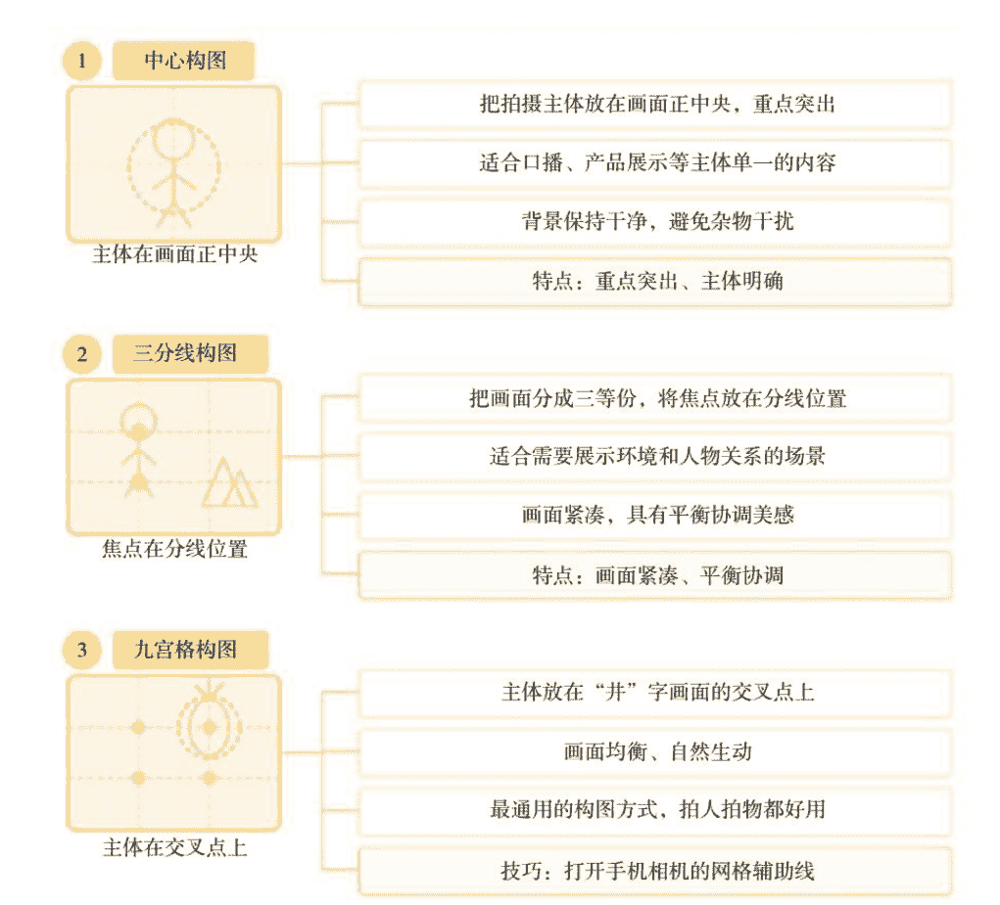
图4-4 常见的三种构图方法

- 中心构图：将主体置于画面正中，突出重点，主体明确。适合口播、产品展示等主体单一的内容，背景保持干净。
- 三分线构图：画面分三等份，焦点放在分线位置，画面紧凑有平衡感。适合需要呈现环境与人物关系时。
- 九宫格构图：主体放在井字交叉点上，画面均衡自然。最通用，拍人拍物都适用。

景别常用三种。

图4-5 摄影景别类型

- 中景：膝盖以上到头顶，最万能，适合口播教学日常分享。能看到表情和上半身动作，信息量足。
- 近景：胸部以上到头顶，适合传递情绪。镜头更近，能看清眼神表情，代入感更强。我们很多高播放视频在情绪关键时刻就用近景。
- 特写：肩部以上或局部细节，手部动作、眼神变化、物品纹理等。强调重点，制造视觉冲击。

注意不要全程只用一种景别，哪怕固定机位，剪辑时也可裁剪出不同景别。全程单一会枯燥，偶尔切一个近景或特写，能增加节奏感。

##### 四、拍摄器材：按预算灵活选择
器材选择取决于阶段和预算。分享两套方案：一套是打造方比比IP时用的专业方案，一套是个人创作者起步的手机方案。

###### 1. 专业拍摄方案
我们主要用索尼相机，覆盖日常拍摄需求。同时用大疆Pocket 3作辅助，体积小自带稳定云台，画质高清，适合户外和Vlog。2026年春节期间，“方比比先生”视频号的祝福视频就是Pocket 3拍摄，画质完全达标。

图4-6 “方比比先生”的祝福视频

收音用大疆无线麦克风，佩戴方便，收音清晰，能有效隔绝环境噪音。

###### 2. 手机拍摄方案
账号起步无需配齐专业设备，手机也能拍得清晰有质感。

以iPhone为例，相机设置里视频录制调为4K、30帧，清晰度明显提升；建议关闭HDR，手机HDR会影响画质。其他手机操作类似，在相机设置中选最高分辨率即可。

图4-7 iPhone手机视频录制参数设置

收音建议用无线领夹麦，夹在领口提升人声清晰度。若暂时无麦，用手机收音时人物尽量靠近手机，距离保持1米内，同时关闭空调、风扇等噪音源。

建议用手机三脚架保证画面稳定，落地款适用场景广，缩短后可当桌面支架。

无论哪套方案，核心原则一致：设备为内容服务，先把场景、灯光、构图做好，设备差异在短视频平台上没有想象中大。

##### 五、完整工作流：爆款视频打造心法
每条视频背后都有完整的工作流在支撑。

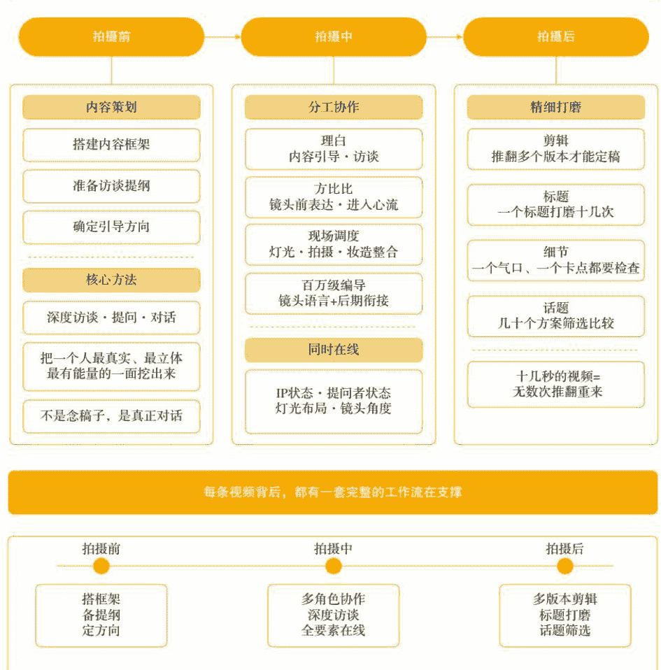
图4-8 视频制作工作流

- 拍摄前：提前搭好内容框架，准备访谈提纲和引导方向，不是随意写内容，而是挖出有深度的对话，把人物最真实立体有能量的那一面呈现出来。同时提前调整拍摄对象状态，最好前一晚开始调饮食作息，拍摄当天配合专业妆造，确保精神面貌最佳。
- 拍摄中：分工明确。一人负责内容引导和访谈，一人在镜头前根据引导表达；专业人员负责现场调度，整合灯光拍摄妆造；内容编导负责镜头语言和后期衔接。
- 拍摄后：一条十几秒视频有时要推翻数个剪辑版本才能定稿；细节打磨十几次，甚至为一个气口或特效卡点调整多个版本；话题标签也在几十个备选里反复筛选后才发布。

若单独操作，可简化工作流。

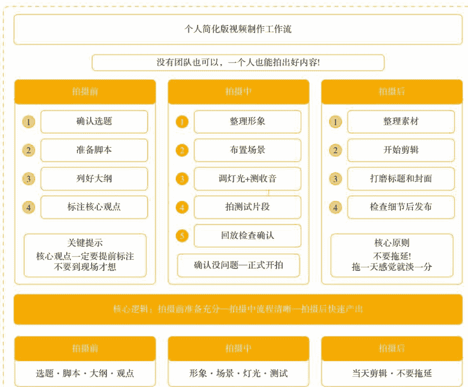
图4-9 个人简化版视频制作工作流

- 拍摄前：确认选题和脚本，列出大纲，标注核心观点。
- 拍摄中：先花10分钟整理形象、布置场景、调灯光、测收音，同时检查设备参数是否正确，手机拍摄确认4K、30帧且关闭HDR。拍一段测试片段确认无误再正式拍摄。
- 拍摄后：趁热打铁整理素材，尽快剪辑。

##### 小结
拍出高级质感视频，关键在于细节把控。

布景搭建要简洁有层次，服装妆造提前准备，灯光让面部均匀自然，构图取景要有变化节奏，声音收录干净清晰。

搭建完整制作工作流，单人也能产出好内容。

### 4.2 AI剪辑与包装：让工具完成九成工作
#### 4.2.1 情绪流剪辑：把握节奏提升完播
完播率是平台推荐算法权重最高的指标之一。视频能否进入更大流量池，首先看有多少人愿意看完。可以说完播率直接决定播放量。

怎么让用户看完？答案是把握剪辑节奏。“方比比先生”30天内达成亿级播放，情绪流剪辑是重要因素。

##### 一、什么是情绪流剪辑
情绪流剪辑是以调动用户情绪为核心的剪辑方法，让人不仅看完，还能感受到情绪。

它与传统剪辑的区别可从几个维度看。

表4-1 传统剪辑与情绪流剪辑的区别

| 维度 | 传统剪辑 | 情绪流剪辑 |
| :--- | :--- | :--- |
| 核心目标 | 信息传递清晰 | 调动用户情绪 |
| 节奏处理 | 删除所有停顿，追求紧凑 | 有快有慢，适当保留停顿 |
| 结尾设计 | 内容讲完即结束 | 必须有情绪的升华 |
| 完播率逻辑 | 靠内容价值留人 | 靠情绪牵引留人 |

以“方比比先生”关于年轻人孝顺父母的视频为例，传统剪辑讲清楚观点就结束；情绪流剪辑会在结尾配上与情感匹配的背景音乐，画面定格在真诚感染力的笑容，再加一句情绪冲击力强的文案。用户看到这里情绪被点燃，自然想点赞评论转发。

##### 二、情绪流剪辑的意义和价值
###### 1. 直接提升完播率

图4-10 “方比比先生”情绪流剪辑

完播率低的视频通常节奏有问题。有的从头到尾一个节奏，几秒后觉得后面差不多就划走；有的剪得太紧太赶，看着喘不过气也会划走。

情绪流剪辑通过制造期待感、保持节奏变化、设计情绪高点，有效吸引和留住用户。当用户被节奏牵引，就不自觉看到最后。

###### 2. 提升互动率和转发率
用户点赞评论转发大多因为被触动。情绪流剪辑核心就是调动情绪，情绪被调动后就会产生表达和分享欲望。

###### 3. 强化IP人格魅力
情绪流剪辑适当保留真实互动、自然表情、有温度对话，让用户看到有血有肉的人，而不是冰冷机器。这种真实感和亲近感会提升粉丝黏性。

##### 三、如何掌握情绪流剪辑
理解概念和价值后，还要知道怎么做。情绪流剪辑需要四项基本功：审美力、升华力、呼吸力、节奏力，都与把控短视频节奏相关。

###### 1. 审美力：知道什么节奏受欢迎
具备审美力就是知道用户喜欢什么节奏。很多新手花大量时间学特效技巧，剪出来的视频却不受欢迎，就是有技术没审美。

掌握技术只是知道怎么做，有审美才能明白为什么这么做。只有清楚用户偏好什么节奏，才能做出正确剪辑决策，知道哪些片段该删哪些该留。

###### 2. 升华力：把结尾做出高度
升华力是指把普通叙述提升到更具感染力的层次。结尾是情绪流剪辑最重要的部分，有升华力的结尾能产生强烈共鸣。

有升华力的结尾通常包含：一句触动人心的金句、一个真实自然的笑容、恰到好处的背景音乐配合、适当放慢的画面节奏。比如“方比比先生”常用温暖笑容作结，配合合适背景音乐和歌词。

情绪剪辑：收尾点燃，全程带走

图4-11 “方比比先生”的结尾升华

拿方比比先生讲创业那条来说，结尾抛出“人最怕的不是缺钱，而是野心消失”这句后，画面慢慢推近，情绪配合的音乐同时进入，随后名字缓缓出现在屏幕上（见图4-12）。这几秒的操作，本质上就是把情绪点燃的瞬间。

图4-12 “方比比先生”的结尾升华

###### 3. 呼吸感：让画面随情绪起伏
呼吸感靠关键帧实现画面的推拉缩放，并与情绪同步（见图4-13）。传递欢喜、认同、感动等正向情绪时，可适度放大，拉近与观众的距离；营造悬念或引发思考时，保持原状或做极轻微的缩放即可。缩放幅度建议控制在10%到20%，多用在开场、收尾以及情绪转折处。放大时只改比例不改位置，避免画面晃动。

###### 4. 节奏感：快慢结合留住完播
节奏感是影响完播率最直接的能力。情绪流剪辑强调留白，不求切得越干净越好。比如抛出问题后，保留1到2秒的静默，把期待拉满，观众会因好奇继续看下去。

语速也要弹性调节。开头若偏慢，可提速到1.05到1.1倍，快速抓住注意力；结尾需要沉淀时，可降到0.9倍，给观众体会的时间。

另外，开头第一句、提问句、观点密集处，气口剪得利落；结尾与互动处，适当保留笑声和语气词，增强真实感。

##### 四、细节把控清单
掌握四项基本功后，实操仍需注意以下细节。

###### 1. 核对安全区域
成片后务必检查字幕是否会被平台UI遮挡（见图4-14）。若关键信息被头像或互动按钮盖住，观众看不见就会划走。

###### 2. 做调色与美颜
原始素材常显灰暗。适度的调色与美颜能提升质感，观看更舒服。

###### 3. 加入暗边蒙版
在画面上下边缘加渐变黑蒙版，可引导视线聚焦人物面部，整体更高级。

###### 4. 文字避免描边
描边会让字显得廉价。背景偏暗时，直接用白或浅色字体即可。

###### 5. 转场尽量精简
花哨转场易打断情绪流动。确有需要时，选用简单的叠化即可，扭曲变形的特效易扰乱节奏。

##### 五、情绪流是否只属于一个IP
很多人会问，这套打法是否只能服务方比比先生，换人换赛道是否仍有效。答案是可以迁移。

在运营方比比先生账号期间，我们提炼出这套情绪流方法论，随后用同样思路孵化出方比比老板。之后复用到外部客户，也产出爆款。

例如视频号账号AI富贵发布的《方比比爆火真相》，拆解IP为何能火（见图4-15）。同样遵循情绪流思路：开篇用“方比比爆火真相，我只跟他说了一句话”抓注意；中段用真实访谈推进节奏；结尾落在共鸣表达——“爱是非理性的情感联结，就像父母对孩子，哪怕再平凡，也觉得他最好。”

该条数据表现不错，更重要的是验证了一点：情绪流并非绑定特定IP，而是对剪辑节奏与用户情绪的理解。

想复用可先模仿。把方比比先生的作品拆解一遍，看每个剪辑点如何设置、音乐如何配合情绪、结尾如何升华。多看多拆，感觉自然会形成。

##### 小结
情绪流剪辑的核心是用节奏调动情绪，让观众被牵引着看完，从而提升完播。

四项基本功分别为：审美力判断节奏好坏，升华力决定结尾是否触动，呼吸力让画面随情绪变化，节奏力把控快慢。

该方法论具备可复制性，不依赖单一IP。从方比比先生到方比比老板，再到AI富贵，同一套逻辑在不同人物与赛道均得到验证。

#### 4.2.2 AI剪辑工具：快速成片与细节优化
过去剪辑最费时的环节是找素材、配字幕、调音频、卡节奏。如今这些重复工作可交给智能工具。只需输入脚本，即可自动匹配画面、生成字幕、搭配音乐，迅速得到初稿。AI并非替代创作，而是把低效环节接走，让创作者聚焦创意。

##### 一、文案转视频：自动配画面
准备好脚本后，选择风格与配音类型，一键生成，系统会自动挑选素材并补全字幕、配音、背景乐与转场。

以剪映图文成片为例，三步完成。

第一步，粘贴脚本：将文案输入进去。
第二步，选择风格：如清新、科技、温馨、商务等，以及男声、女声、情感语气等配音。
第三步，生成成片：点击后系统自动匹配片段、字幕与配音（见图4-16）。

系统会依据文案关键词从素材库检索对应画面，例如写到“海边日落”即配落日画面，写到“城市夜景”即配灯火镜头，匹配准确率在80%以上。

度加剪辑的灵感成片更进一步，输入想法先生成文案，再自动配素材、字幕、配音，数分钟即可完成一条成片（见图4-17）。

并非所有文案都适合自动成片，若想提升匹配度需注意：

###### 1. 每句字数控制在15到20字
句子过长系统难以找到完整画面，过短会使节奏破碎。15到20字约对应3到5秒画面，较为理想。例如“我们总是在忙碌的生活中忘记停下来看看周围的风景，错过了很多美好的瞬间”偏长，可拆为“我们总在忙碌中奔跑，却忘了停下来看风景，那些美好瞬间就这样错过了。”

###### 2. 用具体场景替代抽象概念
抽象词难以对应画面，具体描述更精准。比如“成功需要努力和坚持”不易匹配，改为“每天清晨六点开始学习”“健身房挥汗的身影”“深夜办公室还亮着的灯光”更清晰。

###### 3. 文案需有情绪递进
优质文案具起承转合：先点痛点，再给方法，最后情感升华。结构清晰时，系统选片也能随情绪切换风格。

若写文案困难，可先让AI生成，再导入剪映。

你是一位专业的短视频文案编辑，擅长创作适合自动成片的视频脚本。请生成关于××主题的视频文案，要求如下：

1. 文案总字数控制在150～200字；
2. 每句话控制在15～20字，便于AI匹配素材；
3. 文案要有画面感，多用具体场景描述，少用抽象概念；
4. 情感基调；
5. 结构是先描述痛点场景，再给出解决方法，最后正向激励；
6. 目标受众。

举例：关于养成早起习惯。
你是一位专业的短视频文案编辑，擅长创作适合自动成片的视频脚本。请生成关于“如何养成早起习惯”的视频文案，要求如下：
1. 文案总字数控制在150到200字；
2. 每句话控制在15～20字；
3. 文案要有画面感，多用具体场景描述；
4. 情感基调为励志、实用；
5. 结构是先描述痛点场景，再给出解决方法，最后正向激励；
6. 目标受众是想要改变作息的年轻人。

AI可能生成：
你有多久没看过早上六点的太阳？
每次闹钟响起就按掉继续睡，
告诉自己明天一定要早起，
结果睁眼又是中午十二点。
早起的第一步不是定闹钟，
而是前一晚十一点准时上床。
手机放在够不到的地方，
睡前不刷视频不追剧。
第二天睁眼先喝一杯温水，
拉开窗帘让阳光照进来，
坚持一周你会发现，
早起的世界真的很不一样。

随后可直接粘贴进剪映图文成片，选择励志风格与温暖女声，约两分钟出初稿，预览后替换不满意素材即可完成。

##### 二、虚拟主播
不少创作者不愿出镜，担心形象、表达或被熟人认出，但纯音画视频又缺少信任感与亲切感。虚拟主播可解决此问题。AI生成的虚拟人物口型、表情、动作自然。输入文案、选择形象即可生成口播视频。

主流工具如剪映数字人、度加AI数字人、蝉镜等。以剪映为例（见图4-18）：
第一步，在首页找到数字人功能。
第二步，选形象：男/女、年轻/成熟、商务/亲和，按定位挑选。
第三步，输入播报文案。
第四步，调整声音与语速：温柔、激昂、专业等风格并调速。
第五步，点击生成，数分钟即可完成。

##### 三、音频精修
录音常出现口头禅、停顿过长、背景噪声、音量不稳等问题。过去需手动剪辑，现在AI可一键处理：删除口头禅、压缩冗余停顿、降噪、平衡音量。

以剪映为例（见图4-19）：
第一步，导入素材。
第二步，智能剪口播：AI标记口头禅，可一键删除或手动调整。
第三步，预览效果，不满意处手动微调。

数分钟即可完成，处理前音频磕绊、杂音明显、节奏拖沓，处理后清晰流畅、节奏紧凑、更显专业。

##### 小结
自动成片：输入文案后AI自动匹配素材、字幕、配音，大幅提升产出效率。
虚拟主播：无需真人出镜即可实现口播，适合起步阶段试水，后期再逐步过渡到真人。
音频精修：自动去除口头禅、长停顿、杂音并平衡音量，让声音更专业。

#### 4.2.3 封面制作：AI打造高质感封面
优质封面需实现两点：成为视觉抓手，在小屏上迅速吸引注意；完成信息传递，用最精炼关键词直击痛点或制造好奇。

视频号封面通常由干净底图、有吸引力的文字、统一视觉标识构成。

##### 一、用AI生成留白合理的底图
画面元素拥挤会让人无从下手。优秀封面应简洁、主体突出、文字清晰。如左侧人物或产品特写，右侧大面积纯色或简洁背景放置核心关键词，配色协调，一眼可得重点。

AI绘画可直接生成。做职场干货博主，可让AI生成极简办公桌图：左侧银色笔记本和冒热气的咖啡，右侧留大面积浅灰空白用于放字，暖色调，竖版6:7。

做口播类封面需要真人照片时，可拍一张原图后用AI扩展或局部重绘，将杂乱背景替换为纯色或高级虚化办公室背景，人物清晰，文字有落脚空间。

指令示例：请帮我优化这张照片，保留人物主体，将背景替换为温馨的居家收纳场景，光线自然柔和。

##### 二、用AI提炼封面文案
误区是把视频标题原封不动放在封面。标题常为“新手必看：教你如何在十分钟内学会做红烧肉”，放上去字号过小、拥挤。

封面文案最好不超过十个字，字号大、颜色醒目。可把脚本发给AI并要求：请阅读脚本，提炼三句封面文案，字数6到10字，具有强烈吸引力，能制造悬念或直击痛点，避免书面语。

AI可能给出“过年招待亲友的十道菜”“大厨不传秘方”“十分钟搞定硬菜”，配上诱人菜品图，点击率更高。

##### 三、建立模板思维，打造视觉识别系统
大号主页封面风格统一，这是刻意经营的品牌识别。风格混乱会增加用户记忆成本。固定版式、统一配色、一致字体，有助于形成品牌记忆。如方比比先生使用统一风格封面。

##### 小结
运营视频号如同经营店铺，封面即招牌。AI时代无需专业设计师也能做出高点击封面。
第一，用AI生成留白合理的封面底图，视频号竖版6:7、横版16:9，下指令时明确留白位置。
第二，让AI提炼精简封面文案，6到10字直击痛点。封面文案与视频标题不同，前者重冲击，后者重信息。
第三，建立统一视觉识别系统，固定版式、配色、字体，降低用户记忆成本。

## 第五章 进阶运营：撬动算法杠杆，打造超级爆款

### 5.1 发布与冷启动：发布视频的黄金法则

#### 5.1.1 发布流程：认准黄金发布时间+关键设置，挖掘自然流量

冷启动数据决定流量上限。视频刚发出时能否被目标用户看到，决定了算法是否会继续推流。选对时间并做好发布设置，能获得更多自然曝光。

##### 一、发布时间

视频号带有社交属性。首波推流通常面向好友及标签重合用户。他们的完播、点赞、评论构成算法对视频质量的第一轮测试。数据不佳则停止后续推送。

数据显示一天有三个高峰（见表5-1）。
表5-1 视频号的流量高峰

| 时段 | 时间范围 | 用户特征 |
| :--- | :--- | :--- |
| 早高峰 | 7:00~9:00 | 通勤刷手机，偏好轻松短内容 |
| 午高峰 | 12:00~14:00 | 午休放松，愿看稍长内容 |
| 晚高峰 | 18:00~22:00 | 下班放松，活跃度最高，各类内容均可 |

其中晚高峰流量最大，尤其是19:00到21:00为绝对黄金时段。若只能选一个时间，优先此段。

不同赛道用户作息不同，最佳时间也有差异（见表5-2）。这些时间基于用户习惯总结，应用到账号上需根据实际数据调整。测试方法：先按赛道常规最佳时间发一周，记录前2小时播放和互动；再尝试不同时段发布同类型内容对比数据；最后查看后台粉丝活跃时间分布，按此调整。坚持两三周即可找到最适合的发布时间。

##### 二、视频号发布流程

发布流程简单，共三步（见图5-1）。
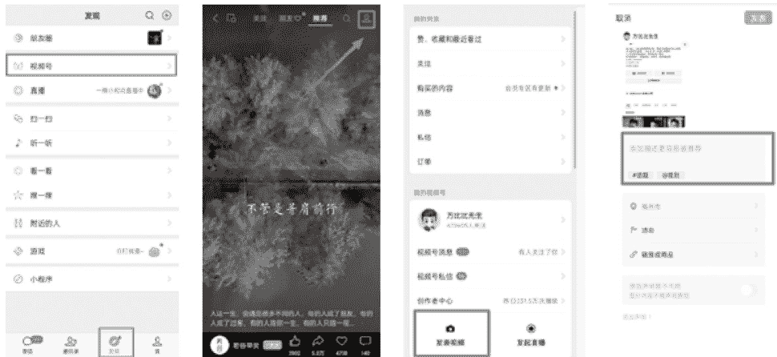

第一步，进入发布入口。在微信“发现”页点击“视频号”，进入后点右上角相机图标开始创作。

第二步，编辑视频与添加描述。从相册选好内容，进行基础编辑，可添加配乐、文字、表情。描述文案要简洁有力，概括亮点，吸引点击与观看。

第三步：用扩展信息撬动曝光

扩展信息是拉升触达量的关键动作。可以绑定与内容强关联且正处于热度期的话题，增加被搜索和被推荐的概率；面向本地生活、探店类账号时，补上位置信息能触发地理分发，吸纳周边人群；还能挂载公众号推文或商品链接，帮助导流或完成变现。

##### 三、发布页面的细节打磨

发布时间与流程搞清楚后，接下来就要把发布页的每一项设置都填满。

###### 1. 挂定位吃同城流量
新手发布时常忽略“添加位置”这个小开关。对普通创作者而言，给视频贴上热门城市或知名地标的定位，有助于进入同城分发池。

在视频号的推荐逻辑里，地理坐标是极重的信号，尤其对做本地生意或服务特定区域的账号来说，相当于白送的流量入口。

微信本身社交属性强、地域属性突出。发布时带上一个具体的坐标——自家办公楼、网红商圈或标志性景区，系统就会打上“同城”“附近”的标签。除了兴趣推送，还会尝试把内容喂给周边的人。

这种基于位置的精准推送，对线下门店至关重要。比如一家有调性的咖啡馆发一条喝咖啡的短片，定位就是自家店面。附近刷到的人可能直接导航过来，把公域曝光转化为私域客流，路径很短也很准。

###### 2. 话题标签的矩阵打法
话题标签相当于你递给算法的名片。不带标签时，算法只能靠画面和音频去猜内容类型，匹配会变慢；乱带标签，比如技术内容却挂“颜值”，虽然可能骗来一波流量，但人群不匹配会导致完播断崖式下跌，反噬账号权重。

更稳妥的做法是采用三级矩阵策略。可参照“三土学AI”的路数：第一层是大盘流量词，例如“AI”“AI推荐”，决定视频进入哪个大赛道；第二层是精准的行业搜索词，例如“GEO”“GEO布局”，把内容推给有明确需求的人；第三层是个人IP词或人群词，例如“×××学AI”“创业者必看”，长期沉淀后能聚合成自己的话题页，锁定目标受众。

标签不是越多越好，过多会稀释权重，一般3~5个精准标签最合适。用好标签就是告诉算法：内容很垂直，受众很清晰，请精准投放。

###### 3. 用“艾特”实现账号互导
在文案区可以@其他视频号账号，也就是常说的艾特。手握多个账号时可互相导流；视频里提到朋友或合作方，艾特一下能提升曝光，艾特官方账号还有机会获得额外推荐。操作很简单，在文案输入框打“@”，系统会弹出好友列表或搜索框，选择目标账号即可。

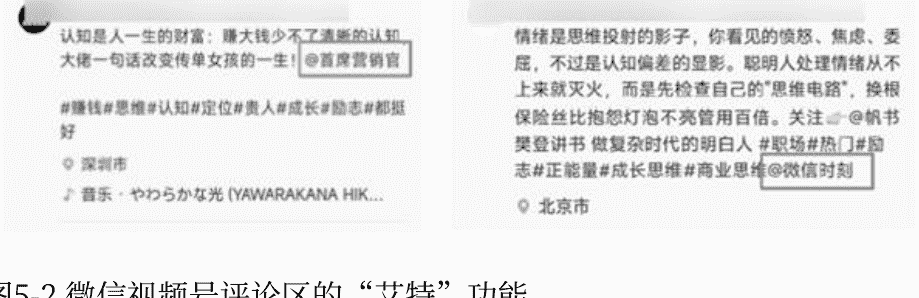

图5-2 微信视频号评论区的“艾特”功能

###### 4. 合集功能提升账号停留
有系列内容一定要用合集收拢。

用户看完一条觉得不错，可以直接进入合集连刷，整体停留时长被拉长，也更利于涨粉。比如“范小敏呀Minna”“知知不会倦”都做了合集专题。每个合集收纳多条内容，用户从任意一条点进主页就能看见完整系列，追更体验好，同时为其他视频持续导流。

##### 小结
视频不是一键发出就完事，发时点和设什么都会影响流量。

第一，发布时间决定冷启动表现，晚高峰19:00～21:00是通用黄金窗，不同赛道要结合目标用户的作息微调，花两三周测试就能找到最佳时段。

第二，地点标签是天然的入口，尤其本地生意，每条最好都带定位。

第三，话题标签要用三级矩阵——大赛道词、精准行业词、个人IP词，3~5个即可，别贪多。

第四，系列内容一定要做成合集，让用户点进一条就能追完整个系列。

#### 5.1.2 微信豆投流实战指南
不少创作者对投流有误区，觉得投流就是买播放量、作弊，真正的好内容不需要投。其实投流的本质是用钱让平台把优质内容推送给更多人，它不能把烂内容变爆款，只能让好内容更快被看见。

##### 一、视频号投流的三个核心逻辑
###### 1. 先有好内容，再谈放大
投流的初衷是放大优质内容，不是拯救劣质内容。我见过太多新手在自然播放几十上百时就砸钱，结果费用花完播放仍上不去。因为算法会先看初始数据——点赞、完播、转发，太差就会判定不值得分发，再怎么推用户也会快速划走。建议优先挑选自然播放能过500的视频去小额试投，效果更稳。

###### 2. 投流也是合规自检
自然分发时系统可能没报错，但一旦申请投放，违规画面或敏感词就会被拦截，提示无法投放或审核不通过。这相当于后台的预警，要及时检查是否出现违规二维码、违背主流价值观的表述等。

###### 3. 视频号偏好慢而准
部分平台会瞬间烧完预算，视频号有时却显得“花不出去”，这是慢消耗策略。算法在精挑细选用户，避免把钱浪费在无效人群上。比如目标设定为30～39岁女性，系统会慢慢筛选，确保推送的人群高度匹配。这种克制对小预算用户是保护。

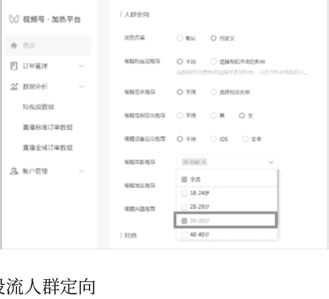

图5-3 视频号投流人群定向

##### 二、小预算不亏钱的实操
很多小而美的个人IP起步每次只投100～200元也能把账号做起来，关键在于四两拨千斤。

###### 1. 先投点赞测人群
新手不要一上来就追成交。找一条自然数据尚可的视频，用微信豆投100元，目标选“点赞数”，定向选择1~2个垂直赛道里表现最好的对标账号，投放时长设24小时，让内容跑一跑。

若100元带来超过30个点赞，单赞成本约3元，说明人群精准、内容契合；若点赞达50个以上，这条就是潜力股，可考虑分批加投。

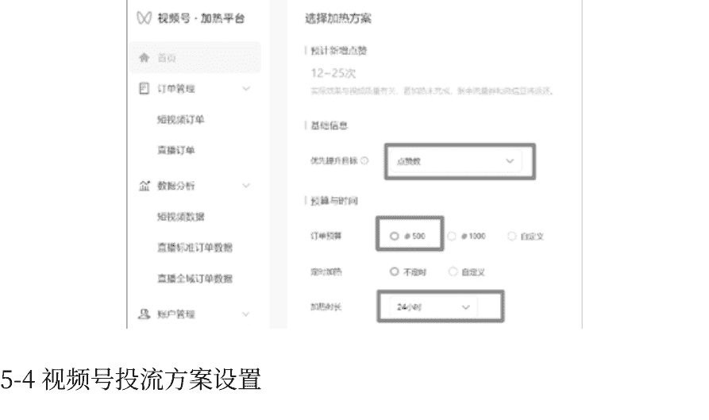

图5-4 视频号投流方案设置

###### 2. 用微信小店广告
已有产品并开通微店的创作者一定要研究这个工具。规则是“无转化不扣费”，曝光没成交就不收费，只有订单产生才按比例扣费。单次成本看着更高，但确定性强，适合初期求稳、不想乱花钱的博主做商业验证。

###### 3. 矩阵号分散投放
赛道覆盖面大、竞争激烈的领域如英语、情感、养生，不建议把预算押在一个号上。可做两个以上矩阵号，内容侧重点不同，每个号投100元分散投放。这样降低预算打水漂的风险，也能从不同入口筛选出真实用户。

##### 三、投流时间：在对的时间遇对的人
同样素材和预算，不同时段数据可能差出数倍。选择要结合目标人群和赛道。

比如上班族目标人群，早高峰7:00～9:00、晚高峰18:00～20:00是通勤与放松期，适合投通勤、餐饮、娱乐、家居类内容；中老年用户10:00～12:00、15:00～17:00活跃度更高，适合健康养生、生活服务、传统文化。

再比如读书分享、晨练教程类视频，6:00～9:00是黄金期，用户求知欲强、需要正能量开启一天；下午用户忙碌，推这类内容易被划走。把内容在用户情绪最需要时送达，才算事半功倍。

##### 四、常见误区和避坑指南
###### 误区一：把投流当救命稻草
内容不行，投流解决不了。投流是加速器，能让好内容更快被看见，却不能把劣质内容变好。完播率只有15%，投流只是让更多人看三秒就走，平台会判定不受欢迎，自然流量进一步收紧。先把内容打磨好，再考虑放大。

###### 误区二：只押一条视频
有人发10条只投数据最好的一条，把钱全砸进去。更优的做法是挑3~4条数据尚可的视频，每条小额测试，分散风险并积累数据，明确哪类内容投流更有效。

###### 误区三：投完就放任不管
投流不是设完就结束，要看数据动态优化。若播放上涨但完播率下滑，说明人群不准，需调整定向；若播放、完播、互动齐涨，可追加预算。

##### 小结
玩转微信豆投流的核心是风险控制与概率放大。

1. 投流是锦上添花，先有优质内容才能触发算法放大，否则投入只会打水漂。
2. 小额试投既能放大曝光，也能提前排查敏感词和违规风险。
3. 用点赞率测试人群精准度，确认方向后再分批加码，切忌一开始就重仓。
4. 利用微信生态闭环，微信小店的转化模式能显著降低获客成本。
5. 结合内容属性选择早晚黄金时段投放，让每一分钱花在用户情绪点上。

### 5.2 避坑清单：视频号运营常见大坑

#### 5.2.1 限流背后的高频违规原因
视频号依托微信，推荐与社交关系深度绑定。平台最看重生态健康和用户信任，一旦操作触线，算法会立刻收紧流量通道。你会发现原本几千上万播放的视频突然跌到几十，甚至仅自己可见，多半是被判定违规限流。

##### 一、搬运与同质化
部分运营者图省事，看到其他平台爆款就下载去水印、换背景音乐直接上传，很容易被限流。视频号后台有强大的指纹系统，上传时会自动提取画面特征、音频波形、光影变化频率。即便镜像、加速0.2倍、加边框，在系统眼里仍是抄袭版。

一旦判定为非原创搬运，账号会被打上“搬运号”标签，轻则单条限推，重则整体权重下降。

另一种坑是同质化。内容虽为自制，但文案、场景、道具与他人高度雷同，也会被视为低质重复。

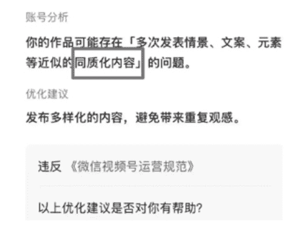

图5-5 视频号同质化违规

##### 二、软硬广的边界
做生意的账号最易掉进硬广陷阱。新手商家常上来就是产品展示加高分贝话术：“家人们九块九，赶紧点链接！”微信是社交场，用户来找共鸣、知识和欢乐，并不想被当成售货员。

视频号对硬广很敏感。画面出现大面积文字水印、联系方式、二维码，或口播反复提“最后3件”“还剩5分钟”等促销话术，系统会判定为低质营销。初始流量池表现差，用户感觉被推销快速划走，负反馈累积后算法会停止推荐。

图5-6 视频号硬广违规
更好的做法是把商业诉求包装成内容价值。想卖茶叶，不要只强调好喝便宜，可以教如何辨别正宗龙井、讲茶道背后的生活方式。用户觉得有用且契合需求，自然会去找链接。

##### 三、诱导分享与互动
引导点赞转发留言本身没错，能提升权重，但尺度要把握。变成诱导就违规。

常见违规包括文案写“不转不是中国人”“点赞的人今年发大财”等过度诱导，或在评论区用抽奖、赠送强制要求关注点赞。还有人编造极端对立话题，制造政治或性别对立来引战，属恶意引导互动。

系统通过大数据发现播放量靠不当手段获得，会判定数据注水，账号评分下降，甚至禁言扣信用分。

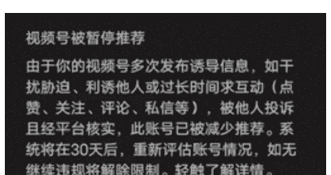

图5-7 视频号诱导互动违规
健康的互动应给用户理由，比如提出开放式问题：“你遇到过这种职场潜规则吗？评论区说说你的处理方式。”这种自然引导才被平台认可。

##### 四、异常操作：勤快也会毁号
发布后的习惯也会触发限流。

###### 1. 频繁刷新作品和主页
发完视频隔几分钟就手动刷新数据，网络不稳或操作密集时，后台可能误判为批量刷量账号，导致推荐暂时中断。

###### 2. 闪进闪出互关互赞
加入互助群，点进链接几秒内点赞关注就退出。系统通过停留时长能识别出用户根本没看视频就点赞，这种数据不仅不加分，反而会被判定为刷量违规。

###### 3. 一次性大量删除作品
觉得赛道选错或旧作播放低就一次性删光，会被系统视为账号异常，权重可能清零。稳妥做法是先设为仅自己可见，或每天删一两个，给系统缓冲期。

##### 小结
进阶运营的第一步不是追爆款，而是避免被判定违规限流。

1. 杜绝机械搬运与低质模仿，避开同质化拦截。
2. 平衡广告与内容，把软广植入干货中。
3. 拒绝诱导，用高共鸣问题自然引导互动。
4. 维护账号健康，减少无意义删发、刷数据、互关互赞。

#### 5.2.2 三大隐形红线：远离封号风险
视频号规则有明的也有隐的，隐形红线新手最容易踩。视频号与微信实名绑定，一旦身份被封，后果很棘手。

##### 一、第一大红线：别碰敏感赛道
选赛道时要避开高风险领域。首当其冲是时政信息。很多人看新闻后想在视频号点评或剪辑社会新闻片段，若没有“互联网新闻信息服务许可证”即红V认证，就不要碰。违规不仅是限流，可能直接封号。微信承担舆论导向责任，不允许个人随意解读严肃内容。

另一个敏感区是负面人物。为博眼球剪辑劣迹明星或争议公众人物的视频试图蹭流量，视频号图像识别能力强，只要面部特征在黑名单，视频发出瞬间就会被拦截。

##### 二、第二大红线：资质认证，别碰特定专业领域
时政是硬红线，医疗、理财是软红线。分享育儿经验、营养搭配、理财心得看似无害，实则在规则里风险很高。

##### 三、第三大红线：敏感词与违禁语的坑
以医疗保健为例，视频号对健康类内容审核极严。诸如“每天喝一杯水能降血压”“孩子感冒别吃药试试这个推拿法”，会被标记为医疗建议。若创作者无国家认证资质，也非平台认证的健康专家，视频不仅会被降权，还可能被判定为非法行医或传播虚假医学信息。

做理财号，先把红线吃透再发声

投融资赛道和医疗、时政一样属于高风险区。不少账号喜欢带人看盘、挑基金，一旦没有金融类从业资质，很容易被限流甚至封号。现行规则很明确：没有持证的创作者不能给出具体买卖指引，也不能在画面里拍胸脯说“这只票一定涨”“现在抄底黄金最合适”之类的话。

这种边界非常微妙，稍微踩线普通的经验分享就会被判定为非法荐股，严重时会被连带到涉嫌金融诈骗。平台审核不看创作者主观意图，只看关键词和语义风险。所以做这类内容，安全的做法是收敛在商业常识、财富观念的范围内。如果想靠理财知识做涨粉，最好先考证，有证才算有专业背书，平台上也更受信任。

新手常爱用夸张吸睛的词，比如“全网爆火”“地面最强”“第一名”“独一份”。开头一秒确实能抓眼球，但在视频号的风控词库里，这些全都是高危信号。

平台必须遏制虚假宣传，一旦极限化表述频繁出现，系统就会判定为违规广告，直接打上不推荐，账号权重也会掉。敏感词覆盖面很大，涉及民俗、地域偏见或低俗内容同样会触发拦截。

还有人想用谐音躲避，比如把“钱”写成“米”，把“赚钱”写成“赚米”，这招已经失效。语义模型已经能识别替换意图，长期大量使用会被视为故意逃避监管，处罚会加重。

更高阶的做法是形成合规表达习惯。不要说“全网最强”，换成“用户群体认可度高”；不要说“绝对有效”，换成“希望能带来一点参考启发”。既合规，质感也更好。

##### 四、AI助力自检：发布前给自己上一道保险

视频号规则严苛，相当于自带审核门槛。市面上敏感词检测工具不少，最贴合生态的仍是腾讯自家智能产品，因为视频号本身就在腾讯体系内，模型最懂平台的脾气。

建议养一个流程：把成稿完整丢给智能助手，让它扮演视频号严格审核员，并给清晰指令。

> 你现在是视频号官方审核专家，请核查我下面这段文案，是否出现违反广告法的极端用语、是否出现医疗或金融领域的敏感表述、是否包含可能导致账号降权的语境。如有问题，请列出来并给出修改建议。

做一次排查，能过滤掉大部分隐患。创作者常意识不到问题，AI却能快速揪出。别嫌麻烦，每次发布前的自检，都是给账号买保险。

##### 小结

学习这些隐藏规则不是为了钻空子，而是为了在合规框架内创作更自在。

1. 远离高风险赛道，无资质别碰时政、医疗、理财，避开负面人物素材，安全优先于流量。
2. 规避高危语境，不用极限用语和谐音替代，借助智能工具做发布前合规检查，用更稳健的语言表达。
3. 敬畏系统识别，图像识别和语音转文字能力都很强，画面和口播都必须遵循平台规则。

## 第六章 多元变现：商业模式全揭晓，孵化吸金视频号IP

### 6.1 广告变现：五步构建高价值账号，商单不断

不少创作者在广告变现上吃亏：有的人等品牌上门，有的人报极低价一条几十块，有的人广告做得太硬粉丝流失数据难看。其实广告变现是有方法论的，从入驻平台到定价策略，再到脚本撰写和长期合作，五步就能把账号打造成高价值体，让优质商单源源而来。

##### 一、入驻互选平台，让商单主动找你

想被品牌看见，先要出现在品牌能检索到的渠道。互选平台是创作者和品牌方的撮合市场，创作者展示数据、报价和擅长方向，品牌在平台筛选并发起合作邀请，平台提供交易担保、数据监测和结算。

通过平台接单的优势是订单有担保不会被欠款，品牌产品质量相对有保障，平台会根据账号画像推荐匹配的商单。

入驻步骤如下。

1. 检查是否符合入驻条件
如图6-1所示，互选平台对创作者有硬性要求：视频号粉丝不少于1000，公开视频不少于10条，账号无违规记录，并完成微信实名认证。

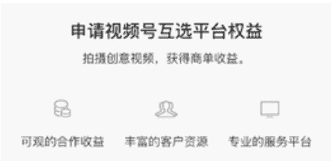

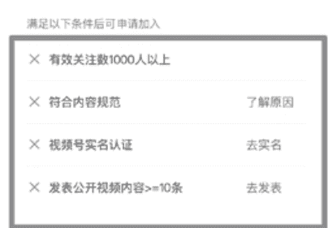

图6-1 互选平台的入驻条件

2. 注册并填写入驻信息
符合条件后，打开视频号进入创作者中心，找到创作者服务，点击更多，选择互选平台入口，按提示填写信息后提交审核即可（见图6-2）。审核通过后即可在平台查看品牌发布的商单需求并主动报名。

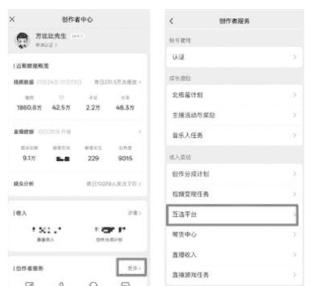

图6-2 申请入驻互选平台

入驻后记得完善主页资料。写清楚内容主题、粉丝画像、过往案例，资料越完整被选中的概率越大。

3. 设置合作报价
平台会要求填写初始报价。参考区间：粉丝5000以内新手建议800～1500元；5000～10000建议1500～3000元；10000以上建议3000元起。平台也会给出建议价，可作参考。

##### 二、用智能打磨广告脚本：让广告不生硬用户爱看

拿到商单后，新手常犯的错误是广告感太强，用户一看就划走，完播率暴跌，品牌不满意，粉丝也流失。核心是植入生硬。

一条好广告，用户最好意识不到是广告，或意识到也不反感。可以用智能助手优化开头、中段、结尾。

1. 开头三秒必须抓住注意力
没有吸引力的开头，用户在三秒内就会划走。开头要和产品结合，让植入不突兀，提升完播。

可以这样指令智能助手。

> 我需要写××产品的广告文案，开头要在三秒内抓住注意力，可用痛点提问、制造悬念或反转，避免“大家好，今天给大家分享”这类平淡开场。

三种类型可参考。

- **痛点型**：“你是不是也有这个困扰”，引发共鸣，让用户想知道答案。
- **悬念型**：“我花300元买到假货”，制造悬念，让用户想看结果。
- **反转型**：“这个产品我本来不想买，用了三天后打脸了”，用反转留人。

2. 中段要有价值密度
开头留住人后，中段要让用户觉得有收获，而不是纯卖货。每一秒都要有信息量，把卖点自然融进去。

很多博主介绍产品用“还不错”“挺好”这种模糊表达，用户无感。正确做法是卖点具体化，有数据、有场景，便于用户代入。

可以这样让智能助手生成。

> 我需要写××产品的广告卖点，我用了××时间，三个优点是……，它有一个合理但不影响购买的缺点是……，写的时候要具体、有数据、有使用场景，避免模糊表达。

3. 结尾做软性引导
结尾决定转化，但硬广最容易翻车。“立即购买”“快点链接”用户会很排斥，好的结尾像朋友推荐一样自然。

指令智能助手。

> 请为××产品写广告结尾，不要用立即购买、快下单等强硬表达，语气自然像朋友推荐。

三种结尾可参考。

**建议型**：“如果你也有这个需求可以试试”，不强迫，更易接受。
**分享型**：“链接我放了，需要的自取”，像分享不像卖货。
**门槛型**：“适合××人群，不适合××人群”，筛选用户提高转化。

##### 小结

广告变现的核心逻辑是：先把账号做起来，再让商单找上门。第一步入驻互选平台完善资料；第二步用智能工具优化脚本，开头抓人、中段有料、结尾软导，广告不生硬数据才好看。

记住两条原则：一是不要为了变现乱接商单，调性不符会伤信任；二是把每条广告当作品做，优质交付才有长期合作和口碑推荐。

### 6.2 从0到1开直播：从准备到开播的全流程

直播能实时互动，用户提问当场解答，快速建立信任促进转化，值得每个博主尝试。按直播前、中、后三阶段走一遍即可。

##### 一、预约卡设置，提前锁定用户

视频号的预约功能是强召回工具。用户点预约，开播时微信会推送服务通知提醒进场（见图6-3）。操作路径：微信进入视频号，点击右上角人像，进入创作者中心，找到直播预告，创建新预告（见图6-4）。

图6-3 视频号预约的服务通知

图6-4 视频号设置直播预告

预告标题别写“××月××日直播”或“随便聊聊”，要有价值感。可以用智能助手生成标题，指令如下。

我是一名××赛道的博主，周五晚要开关于××主题的直播。请帮我想5个吸引人的预告标题，要求点出目标人群痛点、给出快速解决方法、15字以内、口吻像朋友聊天。

##### 二、开播前准备：人货场的环境布置

设备不用专业，手机足够。收音和打光前文已讲。直播间不必奢华，整洁美观有氛围感即可。像“方比比老板”在视频号开播时就很注重氛围感（见图6-5）。

图6-5 视频号“方比比老板”直播间

##### 三、直播中把控三大节奏，步步为营

1. 开场节奏：前10分钟的关键留存
一场的直播前10分钟至关重要，决定用户是否留下，也影响平台推流。开场核心任务不是卖货，而是留人和暖场。做好表6-1中的三个动作。

表6-1 直播开场关键动作

| 动作类型 | 核心目标 | 具体操作 | 话术示例 |
| --- | --- | --- | --- |
| 欢迎互动 | 让用户感觉被看见，增加归属感 | 看到有人进来就欢迎，点名互动 | 欢迎××进入直播间，感谢你来捧场，见到新朋友很开心 |
| 预告价值 | 给用户留下来的理由 | 明确告知今天的看点 | 今天有3轮抽奖整点抽，会讲3个选品技巧，干货很多 |
| 破冰互动 | 激活弹幕区，营造热闹氛围 | 设计简单互动问题 | 第一次来的朋友评论1，来过的朋友评论2 |

2. 讲品节奏：让用户从看看到想买
开场留住人后进入商品讲解。高效讲解遵循表6-2中的四步。

表6-2 直播讲品步骤

| 步骤 | 核心目标 | 操作要点 | 话术示例 |
| --- | --- | --- | --- |
| 第一步：痛点切入 | 让用户觉得产品与自己相关 | 先讲痛点引发共鸣 | 大家有没有早上泡的咖啡到公司就凉了的经历 |
| 第二步：产品介绍 | 展示核心卖点和差异化 | 把参数翻译成好处 | 这款保温杯内胆316不锈钢，保温12小时，早上7点倒热水晚上7点仍烫 |
| 第三步：价值塑造 | 让用户感受到实际问题被解决 | 讲使用场景和长期价值 | 我用了半年每天带公司，中午还能喝到热水，一天几毛钱省下外购饮品 |
| 第四步：信任背书 | 打消顾虑，建立信任 | 讲销量口碑资质自用体验 | 已卖10万单回头率高，我自用很久才推荐 |

##### 四、直播后复盘，数据驱动增长

直播结束不是工作结束。创作者中心可看到观看人数、平均停留时长、流量高低点等数据，能找出问题。

借助智能助手可让复盘更高效。把录音转文字让智能助手分析话术；把在线人数波动节点给它分析原因。例如提问。

我的直播第20分钟时在线人数从50涨到120，第35分钟又降到60，可能是什么原因。

智能助手可能回答：20分钟上涨因发福袋或热点话题；35分钟下降因讲解节奏慢或产品吸引力不足。

##### 小结

直播变现的核心是预约拉人、开播留人、讲品转化、复盘优化四个环节。

开播前设预约、写好标题、预热引流、准备设备；开播中前10分钟留人暖场，讲品按痛点-产品-价值-信任走，促单用限时限量制造紧迫感；结束后用智能助手分析数据和话术持续优化。

### 6.3 个人品牌变现：从做号到搭建私域成交系统

做到一定阶段，创作者会遇到瓶颈：流量和粉丝都有，但靠广告或带货难再提升收入。因为人工智能时代内容生产效率大幅提升，真正稀缺的是屏幕背后那个专业可信的人。必须从做号转向做品牌。

##### 一、从做号到做品牌，用品牌为产品背书

做号思维盯数据，完播点赞，创作者是流量载体。做品牌思维关注关系，你自己就是核心产品，用户因认可专业和人格魅力而关注。

品牌建立后商业价值自然释放。直播带货不再是单纯卖货，而是用品牌为产品背书。选品是价值观延伸，用户买是因为信你的眼光。

比如“方比比先生”这个账号强调个人品牌，直播选品都贴合人设专业标准。讲品时也侧重真实使用感受，让用户能想象使用场景，而不是制造焦虑硬推。

##### 二、私域成交系统：把流量变成钱

视频号的最大优势是与微信打通，用户可一键分享到朋友圈群。加了微信后触达是确定性的，不依赖算法。

朋友圈不是发广告，天天广告只会被屏蔽删除。朋友圈本质是持续经营信任，让用户更了解、认可、信任你，之后才愿意买。

建议每天发3～5条，太多太少都不行。早上发价值或生活，中午发干货，晚上发1-2条产品或成果，可按用户习惯调整（见表6-3）。

表6-3 朋友圈营销常用时段

| 时段 | 用户状态 | 适合内容 |
| --- | --- | --- |
| 7:00~9:00 | 上班路上碎片浏览 | 短观点金句 |
| 12:00~14:00 | 午休相对放松 | 干货案例 |
| 18:00~20:00 | 下班路上较疲劳 | 生活轻松话题 |
| 21:00~23:00 | 睡前深度阅读 | 长文成果展示 |

不知道发什么，可轮换四类内容。

1. 价值内容，让用户觉得关注有收获
这是朋友圈基本盘。分享领域干货，短平快解决一个具体问题。价值越多，用户越期待付费服务。写法有方法论输出，也有行业洞察分享。如图6-6所示，理白先生用4F框架解释大IP为何要展示真实一面，并以俞敏洪、马斯克为例佐证，最后落到“不要着眼于赚钱，而是要做让自己值钱的事”。

2. 生活内容，让用户看到品牌背后那个真实的人
真诚是连接捷径。生活内容不是流水账，而是精选能强化个人品牌的生活片段。

打造有质感的朋友圈

朋友圈的灵魂在于呈现有质感的日常。别停留在记录今日饮食用餐、行踪轨迹的流水账，要从某个具体场景切入，展开你的观察与思考。读者读完后会觉得你有趣、有洞察，才愿意持续追更。

###### 3. 让口碑替你发声
没人喜欢听自我吹嘘，却愿意相信他人的真实体验。客户的好评截图、学员的变化记录、用户的重复购买凭证，这些第三方材料最有说服力，能从外部搭建信任（见图6-7）。
图6-7 理白先生的成果展示朋友圈
这部分的本质是借力。自行宣称课程好，多半被当成广告；学员自己发圈讲述跟学后粉丝增长、实现变现，可信度截然不同。
发布时注意三点：其一，素材务必真实，杜绝造假，观众自有判断力；其二，最好附带具体变化或数据，例如“从零到十万关注”“单月收入五万”，数字比形容更具冲击；其三，配上一句简短的个人感想，比如“看到学员出成果，比自己赚钱更欣慰”，让内容带温度。
把口碑搬进朋友圈，新客看到真实好评、转账记录、复购行为和主动推荐，会形成“已有用户从中获益”的认知，进而萌生尝试欲望。

###### 4. 在信任后自然呈现产品
产品类笔记是临门一脚，等信任搭建完成后再自然露出，更易促成成交。
打磨好的产品朋友圈，就是把产品组合清晰摊开，让人一眼看懂它解决什么问题、适合哪类人群、价格如何。无需遮掩，也不用强迫推销，就像一家专业店铺把商品摆在橱窗：有需求就进来了解，无需求也先建立认知，未来需要时自然会找你。
发布频率要克制。若一天发五条，产品类最多占一到两条，其余应以干货笔记、生活片段和案例呈现为主。让关注的人觉得收获满满，而非被广告轰炸。

##### 小结
从做号到做品牌，是创作者完成价值跃迁的必经路径。做号看数据，做品牌看信任。
个人IP变现主要围绕两件事：一是带货，用品牌为商品背书，选品本身即价值观的延伸；二是私域转化，把公域流量沉淀到微信，用朋友圈持续经营信任。
朋友圈不是广告位，而是信任培育的场域。四类内容可交替使用：干货笔记让读者觉得关注值得，生活片段让人看到真实的一面，案例呈现让他人替你证明，产品笔记在信任基础上水到渠成。建议每天发布三到五条，其中产品类不超过一到两条。
系统搭建完善后，你就不再被平台算法牵着走，而是拥有自有流量池和稳定变现能力的个人品牌。

## 后记
谢谢你读到这里。落笔至此，我最想说的二字是“普通”。
我并无出众履历，只是在新媒体领域耕耘数年的年轻人。很长一段时间内，我也以为成功是少数人的剧本，其余人只能旁观。
直到在视频号发布第一段视频。那天没有方案，没有脚本，只是随性的一场对谈，用手机记录。没想到评论区很快涌入陌生声音：“讲得真好”“很喜欢你的笑容”。当时我忽然明白，原来没有真正的平凡，只有尚未找到舞台的表达者。
安迪·沃霍尔曾预言：“未来人人都能成名十五分钟。”我想，这未来已然到来，而那十五分钟或许改写命运。过去想要被看见，需要资源、技能、平台与运气。如今新媒体把表达权交还给每个人，人工智能也把专业门槛降到极低。过去需团队完成的活，现在一部手机加深夜时分就够了。
这本书能完成，要感谢很多人和事。
感谢视频号。它不问出身，只问真诚。在算法主导的年代，真诚成了最稀缺的竞争力，这对每一个平凡个体都是善意。
感谢人工智能时代。它没有淘汰平凡人，反而给了平凡人前所未有的杠杆。技术是放大器，放大思考、创意与行动力。学会与时俱进，能量会远超想象。
感谢父母的支持。每一次看似冲动的决定背后都有你们托底，能勇敢前行，正因知道身后有人接住。我会用行动回报。
感谢理白先生。转折往往源于关键时刻的一句话。感谢他在我迷茫时推了我一把。多数人并非缺能力，而是缺被相信的理由，他给了我那个理由。
感谢我的老师和团队伙伴。是你们在内容和商业上给予指导与陪伴，共同创造了成果。能并肩，是我最大的幸运。
感谢每一位读者和粉丝。尼采说：“个体知道自己为何而活，就能忍受任何生活。”你们就是我的为何。每一次点赞、每一条留言，都在告诉我：你已被看见，你的话有意义。是你们让我确信，在喧嚣时代，真诚才经得起时间检验。
写这本书，我的野心只有一点：让大家透过我的经历看见自己的可能性。希望能给你一些底气。
别追求完美，别等万事俱备。你无需变成别人眼中的强者，只需开始。在这个时代，行动比思考重要百倍。迈出第一步，时代势能会推你前行，人工智能会帮你填平沟壑。
凡是过往，皆是序幕。你翻到这一页，或许正是你故事的起点。
只要愿意拥抱变化，愿意真诚面对世界，你的机会可能就在下回点击“发布”之后。
愿你无需变成他人，只活成自己最辽阔的样子。