# AI 训练师手册 2：DeepSeek＋模型训练＋商业应用实操

# **前言**

**写作背景**

在科技兴国宏伟战略的指引下，人工智能作为科技创新的核心驱动力，正全方位重塑着社会各领域的发展格局。同时，国家出台了多项扶持政策，旨在推动人工智能的技术突破与产业应用，提升国家科技竞争力与经济活力。

2020 年 2 月，人力资源社会保障部办公厅、市场监管总局办公厅、统计局办公室联合将“人工智能训练师”列为新职业并纳入国家职业分类目录。

2021 年 11 月，人力资源社会保障部办公厅、工业和信息化部办公厅联合发布人工智能训练师的国家职业技能标准。

在此背景下，培养掌握前沿 AI 技术的专业人才成为当务之急。然而，众多学习者在探索 AI 模型训练的道路上遭遇如下阻碍，急需系统性指导资源破局。

（1）基础薄弱，缺乏 AI 基础与模型训练概念，入门困难。

（2）认知碎片化，未形成对模型原理、特性及应用场景的系统认知。

（3）工具使用低效，不熟悉 DeepSeek 等模型的功能与操作方法。

（4）部署技术遇到瓶颈，本地部署 DeepSeek 面临环境配置、依赖冲突难题。

（5）数据处理能力不足，数据质量参差不齐，不懂数据标注，影响训练效果。

（6）训练优化困难，过程耗时且易出现过拟合或欠拟合问题，导致模型输出不符合预期。

（7）应用场景模糊，将技术转化为生产力的路径不清晰。

（8）商业化路径缺失，未建立价值挖掘、效益评估及风险管控体系。

**本书特色**

在 AI 技术日新月异的今天，很多人怀着对前沿技术的热忱，渴望踏入 AI 训练师领域，却在探索之路上遭遇重重险阻。

为助力广大读者跨越这些障碍，本书应运而生。书中不仅系统梳理了 AI 训练师的知识体系，深入解析了 DeepSeek 等主流模型的实战技巧，还结合丰富的行业应用场景，为读者呈上一份全面且翔实的学习指引，让读者在 AI 训练学习之旅中少走弯路，稳步前行。本书特色如下。

**（1）系统知识架构：**本书构建起了从 AI 基础理论到模型训练、部署、应用的完整知识体系。详尽阐述模型训练原理，深入分析 DeepSeek 等模型特性，搭配丰富示例，助力读者夯实基础，逐步进阶，成为 AI 训练领域的行家里手。

**（2）应用案例丰富：**精心设计政务、教育、交通、智驾、医疗、法律、金融和农业等多行业的实战案例，读者可以沉浸式学习如何针对不同的业务场景精准定制模型训练方案，有效提升模型性能，切实解决实际问题，积累项目实践经验。

**（3）深度工具解析：**对 Python、Ollama、Page Assist、Cherry Studio、AnythingLLM、OpenAI Platform、SD-Trainer、MakeSense、Weights、LiblibAI 等前沿 AI 工具进行深度剖析，从安装部署到核心功能应用，手把手指导读者熟练掌握操作技巧，充分发挥工具效能，提升工作效率。

**（4）精彩视频演示：**配套系列精讲视频，共计 130 多分钟，动态呈现复杂概念、关键操作流程及案例实现过程。读者在遇到晦涩难懂的文字描述时，可用手机扫码观看视频，如同老师亲临教学现场，直观感受每一步细节，轻松攻克学习难点。

**（5）超值学习资料：**为激发读者学习热情，我们提供丰厚的配套资料，涵盖同步教学视频、AI 提示词、配套素材和效果文件、AI 工具资源链接、PPT 等，全方位拓展读者视野，助力读者持续进阶。

本书是 AI 训练师的全方位成长指南。通过精心打造的知识架构，深度契合读者需求，从基础入门到项目实战，全方位助力读者跨越学习障碍。

丰富的行业案例解析，搭配详尽的操作演示，让复杂技术变得触手可及。无论您是初学者还是进阶工程师，都能从中汲取知识养分，开启 AI 训练师职业生涯的新篇章！

**教学资源**

本书提供的配套教学资源及具体数量如下表所示。

教学资源及数量表

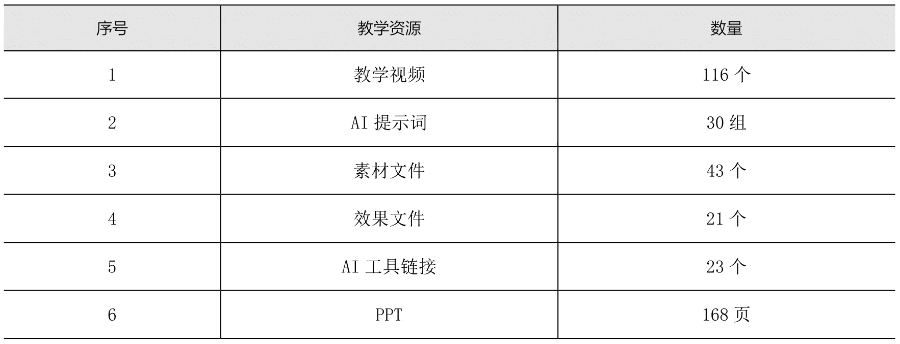

本书中案例的素材、效果、视频及其他资源已上传至百度网盘，可用微信“扫一扫”功能扫描左侧二维码，关注微信公众号，输入本书 77 页资源下载码，根据提示获取下载地址及密码。

资源下载码：AI2511

**特别提示**

（1）版本更新：本书在编写时，是基于当前各种 AI 工具和网页平台的界面截取的实际操作图片，但本书从编辑到出版需要一段时间，这些工具的功能和界面可能会有变动，读者在阅读时，请根据书中的思路举一反三进行学习。

其中，Python 的版本为 3.13.3、Ollama 的版本为 0.6.8、Cherry Studio 的版本为 v1.2.10、Page Assist 的版本为 1.5.12、AnythingLLM 的版本为 1.8.1-r2、SD-Trainer 的版本为 v1.12.0、Stable Diffusion WebUI 的版本为 1.8.0、剪映的版本为 6.0.1。

（2）提示词：也称为文本提示（或提示）、文本描述（或描述）、文本指令（或指令）、关键词或“咒语”等。需要注意的是，即使是完全相同的提示词，AI 模型每次生成的文案、图像或视频内容也会有差别，这是模型基于算法与算力得出的结果，是正常现象。

**作者服务**

本书由谷建阳、贾一琦编著，特别感谢参与编写整理的苏高等人。由于编者知识水平有限，书中难免有疏漏之处，恳请广大读者批评指正。

# **第 1 篇**

# **AI 基础**

## **第一章** **AI 入门：认识人工智能模型训练**

如今，人工智能（Artificial Intelligence,AI）已成为推动各行业发展的核心力量，从日常生活中的智能语音助手到工业生产中的自动化设备，人工智能的应用无处不在。人工智能模型训练正是实现这些智能应用的关键环节，它赋予了机器从数据中学习和理解的能力，使其能够模拟人类智能，为我们的生活和工作带来便利。本章主要介绍人工智能的基础知识，以及一些具有代表性的模型和应用，为后续更深入地学习 AI 训练奠定坚实的基础。

### **1.1** **基础入门：了解人工智能与模型训练**

在人工智能的广阔领域中，模型（Models）及其训练是核心所在。要想真正掌握人工智能技术，就必须先了解模型基础以及训练过程。模型就像是人工智能的大脑，通过训练使其能够学习到数据中的规律和模式，从而具备智能决策和预测的能力。

本节将从人工智能和模型的基本概念入手，深入探讨模型训练的方法和重要性，帮助大家建立起对人工智能模型训练的初步认识，为进一步学习后续知识做好铺垫。

**1.1.1** **为什么要学人工智能**

人工智能是指由机器展现的智能，它是通过对人类智能的模拟、扩展，使计算机系统能够执行通常需要人类智能才能完成的任务，包括学习、推理、问题解决、知识表示、语言理解与生成、感知以及决策等。

简单来说，人工智能旨在让机器具备类似人类的思考和决策能力，使其能够在特定领域或场景中自主完成复杂任务，从而提高效率、创造价值，为人类的生活和工作带来便利。下面通过一些现实中的应用场景，让大家对人工智能有更直观的感受。

例如，通过动态人脸识别技术，员工到达公司时，系统会直接实时检测人脸并进行识别分析，与公司员工数据库比对后完成签到打卡，如图 1-1 所示。

图 1-1 人脸数据识别

再如，随着无人机的快速发展，人工智能与之紧密结合。在高空监视工地建设进度时，通过目标检测算法，能够从高空远程实时查看卡车、汽车、挖掘机等机器的工作状态。另外，将人脸识别、目标跟随等算法应用到无人机上，使其成为自拍无人机，增加了拍照的稳定性和取景的多样性，如图 1-2 所示。

图 1-2 无人机目标跟随自拍

又如，在自动驾驶中，人工智能技术更是扮演着重要角色。汽车借助视觉传感器、激光雷达、卫星定位系统等多种传感器，对行驶环境进行实时感知与分析，进而规划驾驶路线并控制车辆行驶，如图 1-3 所示。因此，自动驾驶领域是人工智能技术高度集成的典型应用场景。

图 1-3 自动驾驶

在工业制造行业中，同样有很多人工智能的应用。以手机制造行业为例，为避免质量不合格的手机零部件流向市场，传统生产线依赖大量检测工人用肉眼进行质量检测，但这种方式容易出现漏检、误判，还会导致质检工人视觉疲劳。如今采用机器视觉代替人工，抓取手机图像进行算法分析，若分析结果不合格，机械手会自动定位并剔除不合格的产品，大大提升了产能。

通过以上生活中常见的人工智能应用场景，我们可以清晰地看到，人工智能已经越来越深入地融入我们的生活，在各个领域发挥着重要作用。

**1.1.2** **人工智能是如何发展起来的**

从古希腊神话中能自主行动的“机械人”构想，到 21 世纪 AlphaGo 击败人类围棋冠军的震撼瞬间，人工智能的发展历程既充满浪漫想象，又凝结着无数科学家的智慧结晶。下面介绍一些人工智能发展过程中的重要事件。

**1．图灵：开启机器智能的先驱**

追溯人工智能的源头，有一位不得不提的先驱——艾伦·麦席森·图灵（Alan Mathison Turing），他不仅被尊称为“计算机科学之父”，更被誉为“人工智能之父”。1936 年，图灵发明了“图灵机”，如图 1-4 所示，这一创造性的构想成为现代计算机的雏形，也标志着人类正式踏入机器智能的新纪元。

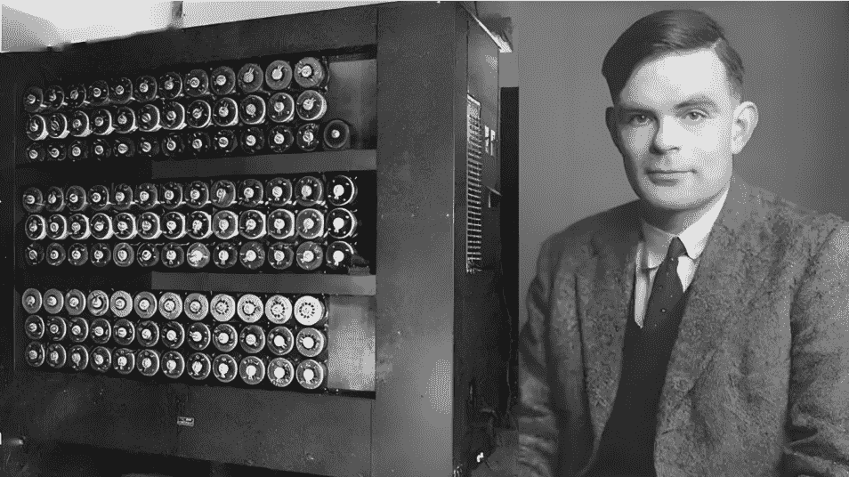

图 1-4 图灵与“图灵机”

1950 年，图灵在他的论文《计算机器与智能》中提出了著名的“图灵测试”，这一测试被视作人工智能发展史上的重要里程碑。那么，图灵测试的原理是什么呢？

简单来说，在一场实验中，人类作为测试者，与被测者（机器）进行交流，但测试者事先并不知道对方是机器还是人类。在交流过程中，测试者会随机提问，机器则需要自动给出回答。当问答结束后，如果有 30%的测试者无法分辨出对方是机器还是人类，那么这台机器就被认为具备了人工智能。

尽管以现在的标准来看，图灵测试显得较为简单，其科学性也受到一些质疑，但在人工智能发展的早期，它激发了人们对机器智能的深入思考，具有重要的历史意义。图灵的理论为人工智能领域奠定了基础，因此他当之无愧地被誉为“人工智能之父”。

**2．专家系统：规则驱动的困境**

时间来到 20 世纪 80 年代，“专家系统”开始崭露头角。这类系统主要依靠预先定义的规则来回答特定问题。例如，当用户提出一个问题时，系统会在预设的问题库中寻找对应的答案。

然而，这种基于人工规则的方法存在明显的局限性。一方面，对于复杂的应用场景，要建立一套完备的规则体系，需要耗费大量的时间和精力，成本极高；另一方面，像语音识别、图像识别等领域，很难通过人工的方式来制定具体的规则。

现在看来，这些方法只能算是“假智能”。因为系统的运行逻辑完全由人类预先设定，其内部的分析过程通常清晰可见，它只能处理预设规则覆盖的问题，面对未知问题则无能为力。这种基于固定规则的范式与人类大脑的工作机制有着本质的区别。

**3．人类大脑：神经网络的智慧**

人类的大脑由无数个神经元组成，这些神经元相互连接，形成了一个庞大而复杂的神经网络。这个神经网络具有强大的学习和进化能力，能够不断地从外界获取信息，进行分析和处理，并在这个过程中不断优化自己的“算法”。

我们可以通过学习新的知识、积累新的经验，来解决各种未知的问题，这种自主学习和适应的能力是早期人工智能方法所不具备的。

早期的人工智能，如基于规则的专家系统，其行为完全依赖于人类设定的程序，只能进行机械的响应，缺乏适应性和创造性。而图灵测试作为衡量智能的标准，也反映了那个时代对 AI 的期待与局限。从图灵的理论突破到专家系统的实践探索，人工智能的发展历程充满了挑战与反思。每一次对智能本质的追问，都在推动着我们不断前进。

**1.1.3** **人工智能的核心逻辑是什么**

当早期人工智能受困于“预设规则”的枷锁，只能在有限场景中进行机械响应时，一场源于仿生学的灵感革命正悄然开启——人工神经网络的诞生，让机器首次拥有了“像人类大脑一样从数据中自主学习”的能力。

这项脱胎于神经元连接原理的技术，用数学模型模拟大脑神经网络的信息处理机制，使 AI 从“被动执行人类指令”走向“主动从数据中提炼规律”。

尽管当前的人工智能仍停留在“弱智能”阶段，只能在图像识别、语音处理等特定领域展现专长，但其核心逻辑——通过多层神经元网络的协同计算实现认知进化，已然成为打开智能世界的钥匙。

对于零基础用户而言，理解人工神经网络如何模仿大脑“思考”，不仅是揭开 AI 神秘面纱的关键一步，更是掌握机器学习、深度学习等前沿技术的底层基石。下面将一步步拆解人工智能的核心逻辑，探寻机器如何通过数据“学习”，又为何能在某些领域超越人类的认知极限。

**1．从规则到学习：人工神经网络的诞生**

专家系统的痛点在于依赖人工定义的规则，无法应对复杂场景与未知问题。而人工神经网络的出现，彻底扭转了这一局面，它摒弃了“预设答案库”的模式，转而通过对大量数据的学习，自主提炼规律并形成预测判断能力。这种“数据驱动”的模式成为现代人工智能的主流方向，如 GPT、DeepSeek 等模型就是典型代表。

人工神经网络的设计灵感直接来源于人类大脑——它模仿神经元的连接结构，构建起一个“黑盒子”式的处理系统。我们无法完全解析其内部每一步的运算逻辑（正如我们尚未完全理解大脑如何处理信息），但它能通过“输入—处理—输出”的循环，实现对外部信息的高效处理。

例如，一个从未见过苹果的孩子，当你教会他识别苹果后，孩子的大脑会在神经元网络中形成特定的刺激反应模式，下次遇到相似物体时便能快速识别，如图 1-5 所示。人工神经网络正是通过这种仿生机制，接收不同强度的输入信号，经“神经元”层层处理后输出结果。

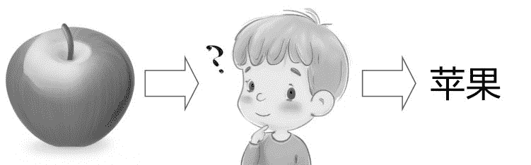

图 1-5 人工神经网络模拟人类识别物体的举例

**2．弱人工智能：当前技术的边界**

尽管人工神经网络取得了突破性进展，但必须明确：当下的人工智能仍属于“弱人工智能”。人类大脑拥有 860 亿个神经元，构成了极其复杂的神经网络。虽然人工神经网络的单元（神经元）数量远少于大脑，但其通过深度连接和高效算法，仍在特定任务上表现出色。

这种规模差异决定了现有 AI 只能在特定领域（如图像识别、语音处理）表现出色，尚不具备人类的通用智能和自主学习能力。举个简单的例子：结构简单的生物，其智能水平也相对有限，人工神经网络的“智能水平”也与其复杂度直接相关。

从仅有一个神经元的“初级神经网络”，到包含两层四个神经元的“浅层神经网络”，再到拥有五层以上、成千上万个神经元的“深度神经网络”，每一次“层数”的增加（即“深度”的提升）都意味着处理能力的飞跃。在图像领域广泛应用的卷积神经网络（Convolutional Neural Networks,CNN），便是在深度神经网络的基础上加入了卷积层、池化层等特殊组件，专门优化了对图像特征的提取与识别能力。

**3．神经网络：AI 入门的核心基石**

理解神经网络的工作原理，是踏入人工智能领域的必备基础，它不仅是技术落地的核心载体，更揭示了 AI 与人类智能的本质关联——我们试图通过模仿大脑结构，赋予机器“学习”的能力。尽管现阶段的技术还处于“弱智能”阶段，但神经网络的每一次进化，都在拉近机器与人类智能的距离。

**1.1.4** **什么是模型，模型是怎么训练的**

前面我们沿着人工智能的发展脉络，从图灵测试的理论奠基，到受仿生学启发的人工神经网络诞生，逐步揭开了 AI 的神秘面纱。如果说人工神经网络是 AI 的“大脑结构”，那么模型训练便是赋予这个“大脑”思考能力的核心机制——它让机器从“空白画布”蜕变为能识别图像、理解语言乃至进行预测的智能系统。

下面将深入 AI 的“成长课堂”，解析模型训练的核心逻辑，看看数据如何成为驱动智能的“燃料”，而神经网络又是如何在反复“练习”中掌握复杂技能的。

**1．认识模型：一个智能的“大脑”**

在人工智能领域中，模型是模仿人类智能的一种数学结构，用于对数据进行处理和分析，从而实现特定的任务，如图像识别、自然语言处理、预测等。模型就像是一个智能的“大脑”，其中封装了从海量数据中学到的模式和规律。

例如，在图像识别中，模型可以学习到图像的特征，如边缘、形状、颜色等，从而能够准确地识别出图像中的物体。图 1-6 为通过模型识别出图中的车牌。

图 1-6 通过模型识别出图中的车牌

**2.AI 的“学习”与“实践”：训练与测试的双重使命**

人工智能中的机器学习、深度学习，其实都围绕一个核心目标：让机器从数据中自主学习规律，这一过程包含以下两个关键阶段。

（1）学习（训练）过程：让模型通过大量数据“总结经验”，形成对特定任务的处理能力。

（2）验证（测试）过程：用训练好的模型处理新数据，验证其是否真正“学会”了所需技能。

其中，模型训练过程是 AI 实现智能的基石，它就像人类学习的“刷题阶段”——通过反复接触海量数据，不断修正错误，最终形成精准的判断能力。

**3．训练的两大核心阶段：数据喂养与参数调优**

模型训练的第一阶段是数据收集与标注，即我们要给神经网络“喂”什么数据。数据是神经网络的“食物”，但原始数据往往无法直接使用。以猫脸检测为例，具体过程如下。

（1）收集数据：需要采集成千上万张包含猫脸的图片，涵盖不同角度、光线、猫咪品种等场景，确保数据的多样性，如图 1-7 所示。

图 1-7 收集数据

（2）标注数据：人工或通过工具在图片中框出猫脸的真实位置（即“标签”），告诉模型“正确答案”是什么，如图 1-8 所示。

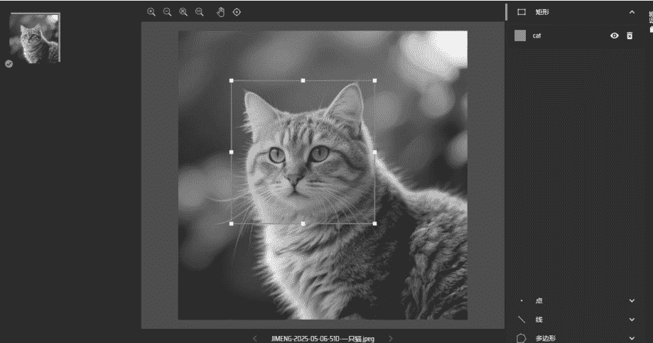

图 1-8 标注数据

这一步看似基础，却决定了模型训练的上限——如果数据质量差（如标签错误、场景单一），模型性能将大打折扣。

模型训练的第二阶段是利用数据对模型进行优化，这是一个“从误差到优化”的循环过程。当数据准备好后，模型训练便进入核心环节，具体流程如下。

（1）正向传播：初次预测。输入图片数据，神经网络通过层层神经元计算，输出一个预测结果，如图 1-9 中的方框表示的猫脸位置。此时的预测通常不准确，因为初始参数是随机的。

（2）计算误差：损失函数的作用。将预测结果与标注的真实标签（即图 1-10 中的方框表示的猫脸位置）进行对比，用损失函数量化差距。例如，计算两个方框的位置偏移量、重叠面积等，得到一个数值化的误差值。

图 1-9 预测结果

图 1-10 标注的真实标签

（3）反向传播：从错误中学习。误差像一声“警报”，告诉模型“哪里错了”。通过反向传播算法，误差会从神经网络的输出层倒推回每一层神经元，指导模型调整参数（如神经元的连接权重），使下次预测更接近真实结果。

（4）迭代优化：在重复中逼近完美。将上述过程重复成千上万次（称为“迭代”），每一次迭代都让误差缩小一点。随着训练的深入，模型对猫脸位置的预测越来越准，最终形成一个能在复杂场景中稳定工作的检测系统。

**4．为何深度学习近年才爆发——模型训练背后的“算力革命”**

可能有人会问：人工神经网络早已存在，为何深度学习直到二十一世纪初才突飞猛进？其实，答案就藏在模型训练曾面临的的巨大挑战中，具体如下。

（1）早期算力不足：训练深度神经网络需要海量计算资源，过去的硬件难以满足其巨大的计算需求。

（2）数据规模受限：过去，大规模、高质量、带标注的数据集稀缺，难以满足模型“吃饱吃好”的需求。

如今，随着适合并行计算的 GPU 硬件普及、大数据技术成熟，深度学习才真正挣脱枷锁，在图像、语音、自然语言处理等领域掀起智能革命。

**知识扩展**

GPU 是图形处理器（Graphics Processing Unit）的简称，它是一种专门用于图形绘制和图像处理的硬件设备，具有强大的并行计算能力和图形处理能力。最初，GPU 主要用于加速计算机图形渲染，如在游戏、动画制作等领域营造逼真的视觉效果。随着技术的发展，GPU 的并行计算能力被广泛应用于人工智能、深度学习、科学计算等领域，能够显著提高数据处理速度和效率。

**1.1.5** **什么是模型量化与模型蒸馏**

大模型特指拥有数十亿甚至数千亿参数的人工智能模型。例如，GPT-4 的参数规模超过 1.8 万亿，与 GPT-4 性能相当的 DeepSeek-R1，参数规模也达到了 671 亿。

在大模型落地应用的过程中，高昂的部署成本与低效的推理速度始终是两大核心挑战。为解决这些问题，模型压缩技术应运而生。其中，模型量化与模型蒸馏是当前最主流的两种方法，它们通过不同的技术路径实现“降本增效”，让大模型从实验室走向实际场景成为可能。

**1．模型量化：用低精度实现高效率**

模型量化的核心思想是精简参数表达。大模型本质上由海量参数构成，如 GPT-3.5 拥有 1750 亿参数，图 1-11 为 GPT-3.5 模型的应用示例。每个参数以特定数据类型存储，如常见的 float32（32 位浮点数）占据 4 字节（32bits）内存空间。量化的核心是通过降低参数精度，用更小的存储空间表示近似值。

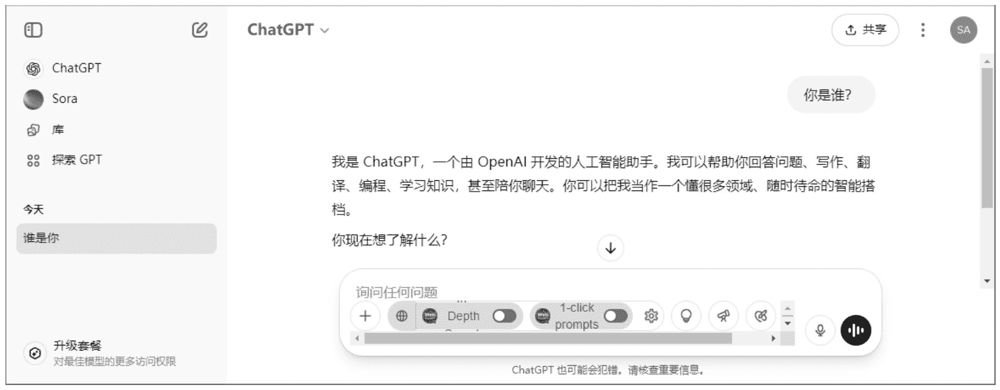

图 1-11 GPT-3.5 模型的应用示例

例如，若原参数值为 1.2768，可将其量化为 1.28（保留两位小数）或整数 1，前者采用 float16（16 位浮点数，2 字节），后者采用 int8（8 位整数，1 字节），存储空间分别压缩至原来的 1/2 和 1/4。

通过将模型参数从高精度转换为低精度数据类型（如 float32→float16→int8），量化可实现以下目标。

（1）存储空间锐减：直接减小模型体积，如 70 亿参数模型从 28GB（float32）压缩至 7GB（int8）。

（2）推理速度提升：低精度运算对硬件要求更低，在 GPU 或 CPU（Central Processing Unit，中央处理器）上的计算速度可提升 2～4 倍。

（3）成本降低：更小的模型意味着更少的显存占用和更低的部署算力需求。

在模型量化过程中，不可避免地会损失部分信息，可能导致模型准确率下降。但通过精细化的动态量化（针对不同层的参数动态调整精度）或混合精度训练（关键层保留高精度），可在压缩率与准确率之间找到平衡。目前，量化已成为大模型落地的标配技术，如 LlaMA 2、GPT 的轻量化版本均采用了不同程度的量化处理。

**2．模型蒸馏：让小模型模仿大模型**

模型蒸馏的本质是知识迁移与行为模仿，其核心逻辑是“以大带小”，即将大模型（也称为教师模型）学到的知识，通过“浓缩”的方式教给小模型（也称为学生模型），如图 1-12 所示。具体包括以下两个部分。

图 1-12 模型蒸馏的过程举例

（1）教师模型（Teacher Model）：已训练好的高性能大模型（如 GPT-4、Gemini），具备强大但复杂的能力。

（2）学生模型（Student Model）：待训练的小模型，目标是通过模仿教师模型的输出，在缩小规模的同时保留核心能力。

**知识扩展**

模型蒸馏的基本流程如下。

（1）输入相同数据（如用户提问）到教师模型和学生模型。

（2）教师模型生成“标准答案”（如详细回复），学生模型生成初始预测。

（3）通过损失函数计算两者输出的差异，指导学生模型优化参数，直至其输出接近教师模型。

模型蒸馏的技术优势与应用场景如下。

（1）轻量化部署：学生模型参数规模可缩小至教师模型的 1/10 甚至 1/100。例如，将千亿级模型蒸馏为百亿级，适配消费级设备（如手机、笔记本电脑）。

（2）效率提升：小模型推理速度更快，能耗更低，适合实时交互场景，如智能客服、对话机器人。

（3）知识复用：利用开源大模型（如 Llama、GPT-3）的蒸馏数据，中小团队可快速训练出高性能模型，降低研发门槛。

随着大模型进入“后千亿参数时代”，压缩技术的重要性与日俱增，单卡万元级的 GPU 费用与海量数据训练，迫使企业必须通过压缩技术降低落地成本。同时，智能汽车、智能家居等场景需要模型在终端设备上运行，轻量化是必经之路。另外，模型蒸馏技术还能让中小团队基于开源大模型快速迭代，促进 AI 技术普惠。

未来，模型压缩将与架构优化（如稀疏注意力）、训练策略（如数据增强）深度融合，推动大模型从“炫技式参数竞赛”转向“实用化效率比拼”。无论是量化的“精打细算”还是蒸馏的“以师带徒”，最终目标都是让人工智能真正“轻装上阵”，走进千行百业。

从技术原理到落地实践，模型量化与蒸馏不仅是大模型的“瘦身术”，更是连接技术理想与商业现实的桥梁。随着这两项技术的成熟，我们正迎来一个“小模型也有大能力”的智能时代——而这，正是人工智能从实验室走向普通人生活的关键一步。

### **1.2** **AI 大模型：工作逻辑解析**

随着人工智能技术的不断发展，各种 AI 大模型以其强大的性能和广泛的应用前景，改变着我们对人工智能的认知。从语言生成到图像识别，从数据分析到决策支持，AI 大模型在各个领域都展现出了巨大的潜力。

本节将聚焦于 AI 大模型的工作逻辑解析，通过介绍 GPT 模型等典型代表的工作过程、优势，以及神经网络、Transformer 等关键技术在大模型中的应用，让大家深入了解 AI 大模型的强大之处，以及它如何解决实际问题，推动人工智能技术的发展。

**1.2.1** **了解 GPT 模型的工作原理**

当我们与 ChatGPT（GPT 模型的对话机器人）展开对话时，在回应你的屏幕背后，AI 正进行着一场精密的“文字接龙”游戏。这个看似简单的语言游戏，正是支撑起现代人工智能对话系统的核心机制。

GPT 模型本质上是一个训练有素的“语言接龙专家”，当用户输入“你的名字是什么？”时，GPT 会启动以下循环机制。

（1）初始输入：将完整问题输入模型。

（2）首词预测：模型输出第一个词，如“我”。

（3）语境拼接：将预测词与原始输入组合，如“你的名字是什么？我”。

（4）迭代接龙：持续预测后续词汇，直到本次对话结束，如图 1-13 所示。

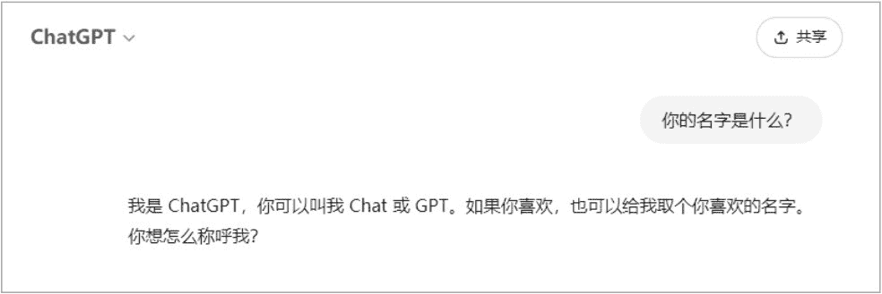

图 1-13 GPT 模型的对话示例

这种逐词生成的机制，使 GPT 能够像人类一样构建完整句式。但与传统接龙不同，GPT 的每个预测都建立在概率计算之上。模型会评估所有候选词汇的出现概率，优先选择最合理的选项。

纯粹的概率选择会导致回答刻板重复，为此 GPT 引入了“随机抽样”机制，这种设计让 GPT 在保持逻辑性的同时，展现出令人惊喜的创造力。“随机抽样”机制的具体作用如下。

（1）概率扰动：不总是选择最高概率词汇，而是随机采纳次优选项。

（2）温度参数：通过调节随机性强度，平衡回答的确定性与多样性。

（3）多样性增强：使模型能生成“这个问题值得深入探讨”，而非千篇一律的“我不知道”。

在持续对话中，GPT 还通过动态语境拼接维持连贯性，这种设计使 GPT 能够进行“记得我们上次讨论……”式的深度对话，具体作用如下。

（1）会话记忆：将历史对话与当前问题组合输入，如“昨天你说……今天我觉得……”。

（2）长度限制：GPT-3 保留 2048 个 token（通常指的是文本中的一个单元）的上下文窗口，GPT-4 扩展至 8000 个 token。

（3）注意力聚焦：自注意力机制自动识别关键信息，避免语境过载。

支撑这场“文字接龙”游戏的，是深度神经网络的精密结构——Transformer 架构。这种架构使 GPT 能够同时处理句子开头与结尾的隐含关联，实现全局语义理解。GPT 的“接龙技艺”通过海量数据的自监督学习炼成，之后，可能会通过强化学习等技术对其回答风格和安全性进行微调优化。这个过程类似于人类通过大量阅读掌握语言规律，但效率提升了百万倍，具体如下。

（1）预测训练：在海量文本中练习预测下一个词。

（2）误差修正：将预测结果与真实文本进行对比。

（3）参数微调：通过反向传播算法优化神经网络。

（4）迭代优化：在万亿词库中完成知识内化。

当我们惊叹于 AI 的创作能力时，不应忘记：每个流畅回答的背后，都是千亿次浮点运算的精密结果。GPT 的工作原理不仅是技术突破的缩影，更是人类探索智能本质的重要里程碑。

**1.2.2** **GPT 为什么能够获得成功**

在大语言模型的进化树中，2018—2020 年间的分支呈现出戏剧性的分化。当主流学术界在探索监督学习、强化学习时，GPT 如同孤独的拓荒者，在自监督学习的荒漠中默默前行。这种选择绝非偶然，而是蕴含着对语言本质的深刻洞察。

OpenAI 前首席科学家、联合创始人伊尔亚·苏茨克维（Ilya Sutskever）曾说：“神经网络本质上是并行的自动编程计算机。”这种认知颠覆了传统监督学习的范式——GPT 不再依赖人工标注的“标准答案”，而是从 45TB 未标注的互联网文本中自学成才，其中蕴含的语言模式远超任何人工标注体系。

研究团队用长短期记忆网络（Long Short-Term Memory,LSTM）网络预测评论中的下一个字符，当这个原始模型被改造用于情感分类时，竟取得了 SOTA（当时最优）效果。研究人员发现，网络中的某个特定单元（神经元）对情感极性的变化表现出高度敏感性。这一发现为“无监督学习能自动捕获与下游任务相关的语义特征”提供了早期的重要证据。

**知识扩展**

LSTM 是一种特殊的循环神经网络（Recurrent Neural Network,RNN），通过引入记忆单元和门控机制，有效解决了传统 RNN 在处理长序列数据时的梯度消失和爆炸问题，其基本网络结构如图 1-14 所示。

研究表明，当模型被训练去预测下一个词时，它实际上在学习构建世界的投影模型。就像侦探小说的读者通过前文线索准确预判凶手，GPT 的预测精度直接反映了其对文本内在逻辑的理解深度。这种“预测即理解”的机制，构成了 GPT 有效性的核心原理。

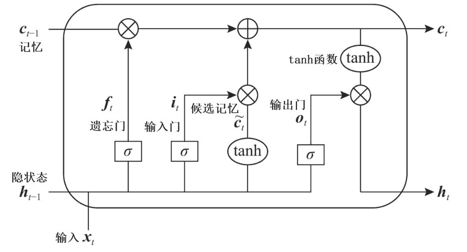

图 1-14 LSTM 的基本网络结构

如果说自监督学习为 GPT 注入了灵魂，那么 Transformer 架构则为其塑造了强健的躯体。相较于传统 LSTM 只能回溯 512 个词的记忆限制，Transformer 的自注意力机制实现了全局语义捕捉，其具体作用如下。

（1）并行计算革命：突破 RNN 的序列计算瓶颈，实现了训练速度的大幅提升。

（2）注意力可视化：能同时关注“苹果”作为水果和科技公司的双重语境。

（3）长程依赖建模：GPT-3 的 2048 个 token 上下文窗口可容纳较长的文本段落。

这种架构进化使 GPT 从“语言接龙玩家”蜕变为“世界模拟器”，为实现更通用的能力奠定了基础。GPT 的有效性最终指向一个哲学命题：语言即世界的投影。这种能力使 GPT 不再是简单的语言模型，而进化为通用的认知引擎。正如伊尔亚·苏茨克维所言：“我们训练的不是语言模型，而是世界的压缩表示。”

回望 GPT 的进化史，其成功密码恰恰在于将复杂问题简化为优雅的解决方案，具体如下。

（1）自监督学习：用预测替代标注，释放数据潜能。

（2）架构创新：用注意力机制突破计算瓶颈。

（3）规模法则：用“参数海洋”孕育“智能岛屿”。

（4）涌现设计：用简单规则触发复杂认知。

这种“简单-复杂”的辩证法，不仅揭示了 AI 发展的深层规律，更为通用人工智能（Artificial General Intelligence,AGI）的探索指明了方向。当我们在键盘上敲下第一个字符时，或许正在见证新的认知革命——这场始于“文字接龙”的游戏，终将重构人类与知识的相处之道。

**1.2.3** **AI 强化学习解决大模型推理问题**

当 GPT-4、DeepSeek 等大语言模型在对话生成、文本理解等任务中展现出惊人能力时，其在逻辑推理、复杂决策等领域的“短板”也逐渐显现，比如，偶尔出现的事实性错误、数学题计算偏差，或是对多步逻辑问题的“断片”。

例如，向 GPT 输入一个问题，如“我希望昨天是明天，那么今天就是星期五。今天是星期几？”, GPT 经过一长串的推理计算后，还是给出了一个错误答案，如图 1-15 所示，而正确答案应该是“星期三”。

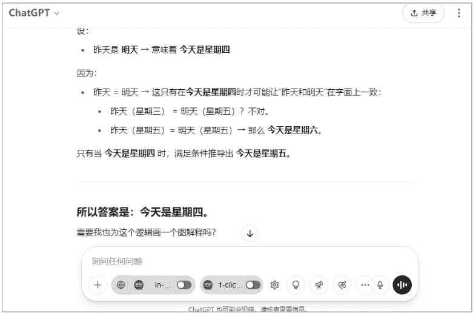

图 1-15 GPT 的错误回答示例

针对这些痛点，强化学习（Reinforcement Learning,RL）正成为业界关注的核心技术方向。它通过让模型在“试错-反馈-优化”的循环中自主进化，为大模型补上了“动态决策”的关键拼图。

传统的监督学习（如模型训练阶段的有监督微调）依赖“输入-标签”的明确对应关系，就像学生照着标准答案做题，虽能掌握已知规则，却缺乏应对未知场景的灵活性。而强化学习的核心逻辑是“行动-奖励-策略优化”，更接近人类通过实践积累经验的过程，具体如下。

（1）智能体（Agent）：基于大模型开发的 AI 应用（如 ChatGPT），需要在特定环境中采取行动（如生成回答、选择步骤）。

（2）环境（Environment）：包括用户输入、任务规则、外部知识库等一切影响模型决策的因素。

（3）奖励函数（Reward Function）：定义“什么是好的决策”。例如，回答准确得+1 分，逻辑错误得-1 分。

（4）策略（Policy）：模型根据环境状态选择行动的规则，通过最大化累计奖励不断优化。

以数学推理为例：监督学习模型可能记住“1+1=2”，但面对“(3×5)-2÷2”时，若训练数据中没有完全一致的表达式，就可能出错；而强化学习模型会尝试分步计算（先算乘法，再算除法，最后减法），每一步根据中间结果是否符合数学规则获得奖励，最终学会正确的运算顺序。

在大模型领域，强化学习的应用主要集中在以下两个关键环节。

（1）行为对齐：让模型“学会听话”。以 OpenAI 的人类反馈强化学习（Reinforcement Learning from Human Feedback,RLHF）技术为例，其核心步骤如下。

收集人类反馈：让标注者对模型的多个回答打分，如“哪个人工智能定义更准确、更易懂”。

训练奖励模型（Reward Model,RM）：将人类评分转换为可计算的奖励函数，教会模型识别“人类认为好的回答”。

策略优化：用奖励模型指导大模型调整生成策略，如减少“幻觉”（虚构事实）、增强逻辑连贯性。

**知识扩展**

通过这一过程，模型不仅能记住知识，还能理解人类的价值偏好（如更倾向简洁回答还是详细解释），实现“能力”与“合规”的双重提升。

（2）复杂决策：让模型在多步推理中“走对路”。面对需要多步决策的任务（如法律案例分析、科学实验设计），强化学习能帮助模型构建“推理链条”，其核心步骤如图 1-16 所示。

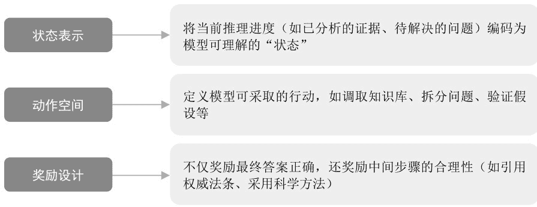

图 1-16 强化学习面对复杂决策问题的核心步骤

尽管强化学习潜力巨大，但其与大模型的结合仍面临以下 3 大核心挑战。

（1）奖励函数的“精准性陷阱”：人类的反馈可能有些模糊或存在偏见（如不同标注者对“好回答”的定义不同），导致奖励函数无法准确反映真实目标。例如，过度追求“回答长度”可能让模型生成冗长但无意义的内容。除了可以引入自动奖励模型机制解决该问题外，还可以采用对抗性强化学习，让模型与“挑错智能体”博弈，提升鲁棒性（源于拉丁语 Robustus，是模型维持性能稳定的关键指标）。

（2）数据效率：从“海量试错”到“智能探索”。传统强化学习需要数百万次试错（如 AlphaGo 训练时与自己对弈千万局），但大模型每次推理成本高昂（一次生成可能消耗数百万美元的算力）。业界正在探索“少样本强化学习”方案，通过预训练模型的知识初始化策略，让模型在少量试错中快速收敛。例如，一些研究（如“推理奖励迁移”技术）表明，通过知识迁移等方法，有可能将所需训练数据量显著减少。

（3）可解释性：打开“决策黑箱”。强化学习优化后的模型决策过程更复杂，难以像监督学习那样通过“输入-标签”对追溯错误原因，这在医疗、金融等对合规性要求高的领域尤为关键。目前，该问题的解决方案包括可视化推理路径（如用流程图展示模型决策步骤）、因果推断介入（确保奖励函数与真实因果关系对齐）。图 1-17 为 GPT 的可视化推理路径。

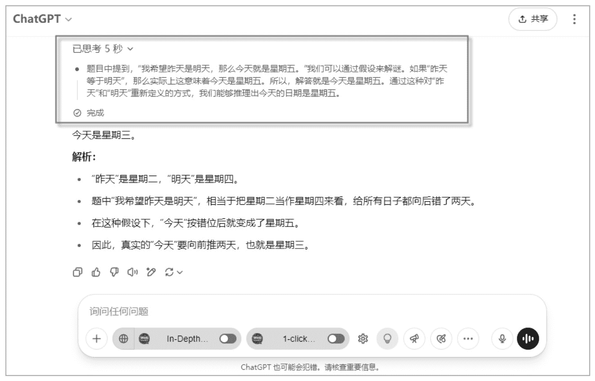

图 1-17 GPT 的可视化推理路径

从“照本宣科”到“自主推理”，强化学习正在改写大模型的“学习方式”，它不仅是解决当前推理问题的“解药”，更是一扇通往更高级智能的大门——当模型能像人类一样在试错中成长时，人工智能或许真的能从“工具”进化为“伙伴”。

**1.2.4** **RAG 检索技术解决大模型幻觉问题**

当大语言模型在对话中频繁出现“无中生有”“信息滞后”甚至“逻辑断层”问题时，“幻觉问题”已成为制约其在交通、医疗、法律、金融等高精度要求领域落地的核心障碍。为此，检索增强生成（Retrieval-Augmented Generation,RAG）技术应运而生——它通过为大模型配备一个“外挂知识库”，让模型在生成回答前先检索权威信息，从源头提升内容的准确性与可靠性。

大模型的幻觉表现可谓是五花八门，相关表现如下。

（1）事实性错误：例如，将“相对论”的提出者说成“牛顿”，或将“2024 年奥运会”地点误判为“东京”，甚至还将“林黛玉倒拔垂杨柳”描述得绘声绘色，如图 1-18 所示。

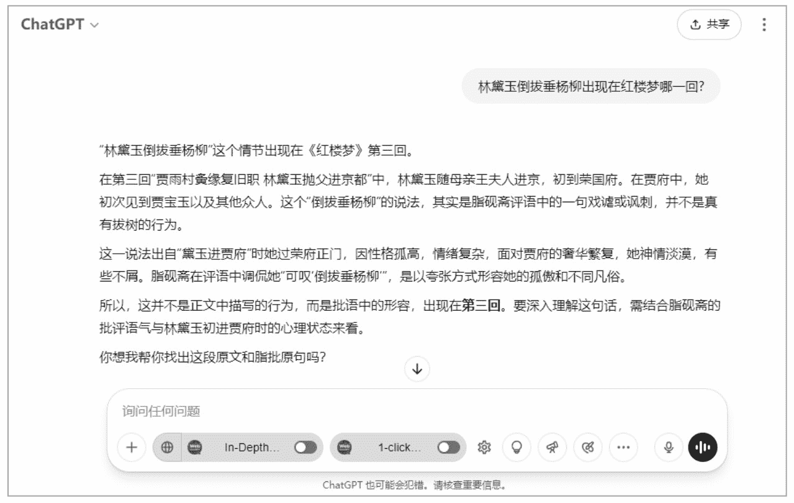

图 1-18 大模型出现的事实性错误示例

（2）逻辑断层：在多步推理中突然跳过关键步骤，如计算“100-7×3”时直接得出 79（正确答案为 79，但计算过程可能出现错误）。

（3）信息滞后、无中生有：很多基于固定时间点数据训练的模型，对 2023 年后的新事件（如政策变动、科技突破）一无所知，却虚构相关细节。

这些问题在通用场景下尚可接受，但在需要高可信度的场景（如医疗诊断、法律文书生成）中，可能导致严重后果。RAG 技术的出现，正是为了填补大模型“记忆缺陷”与“实时知识需求”之间的鸿沟。

RAG 的工作流程可概括为“检索—增强—生成”三部曲，具体如下。

（1）检索环节：用户提问后，系统先通过向量数据库从外部知识库中检索与问题语义最相关的内容片段。例如，询问“如何预防糖尿病”，会调取医学指南中关于饮食、运动、筛查的段落。

（2）增强环节：将检索到的知识片段整合到提示语中，作为大模型生成回答的“参考资料”。例如，在提示语中加入“根据《中国 2 型糖尿病防治指南（2023 年版）》，以下是预防建议：[知识片段]”。

（3）生成环节：大模型基于增强后的提示语，利用其语言组织能力，将碎片化的知识整合成流畅、结构化的回答，同时避免虚构信息。

在这种模式下，大模型不再依赖“内部记忆”，而是像人类一样“先查资料再作答”，从源头减少幻觉——知识库成为事实性信息的“单一真相来源”，模型仅负责“理解与表达”。

很多人可能会问，为什么不直接查知识库，而要经过大模型？这是因为传统搜索引擎返回的是碎片化链接或段落，用户需自行整合，效率低下。例如，在百度搜索“稳健型理财产品有哪些”时，常常会得到成千上万条结果，需逐条阅读才能归纳，如图 1-19 所示。而 RAG 让大模型充当“知识编辑器”，可以实现以下功能。

（1）整合碎片化信息：将多个相关片段合并，去除重复内容，生成逻辑连贯的回答，如图 1-20 所示。

图 1-19 直接搜索的结果

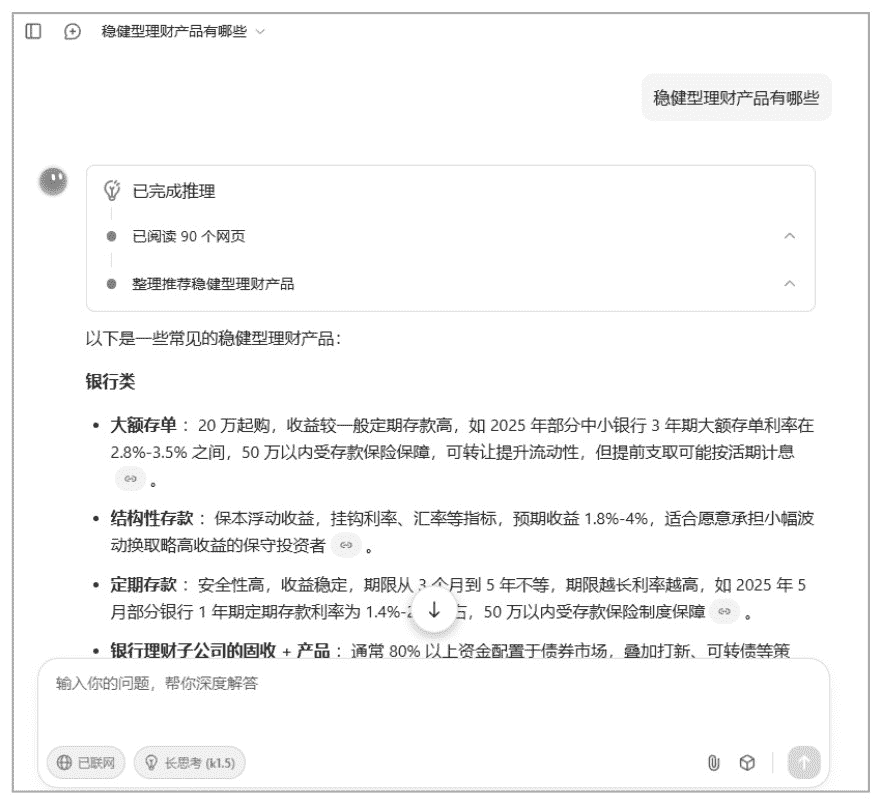

图 1-20 大模型生成的回答

（2）适配用户需求：根据提问方式调整输出形式（如科普文章、清单列表、对话式解答），提升实用性。

那么，为什么不将知识库直接融入大模型训练？主要是因为训练成本过高，大模型训练一次需数周时间，消耗数千张 GPU，而且无法实时更新知识（如每日新增的行业报告、政策文件）。

即使注入海量知识，模型在复杂推理中仍可能因“记忆模糊”产生幻觉，而 RAG 通过“实时检索＋事实校验”形成双重保障。另外，不同行业需要专属知识库，RAG 支持快速切换外部数据源，无须重新训练整个模型。

很多人可能会问，知识库内容太多，大模型“读不完”怎么办？RAG 通过以下两大创新技术解决了容量问题。

（1）文本切片（Chunking）：将长文本切割为 500～1000 字的片段，存储时附加元数据（如来源、时间、领域），检索时精准匹配相关片段。

（2）向量检索（Vector Search）：将文本转换为高维向量（保留语义信息的数字序列），通过余弦相似度计算，快速找到语义最接近的 top-N 片段（通常指从大量候选文本片段中筛选出最相关的前 N 个片段），避免出现信息过载问题。

RAG 的出现，标志着大模型从“单一模型能力比拼”转向“模型＋外部知识”的协同体系竞争。RAG 技术不仅解决了大模型的现实痛点，更重新定义了人机协作的边界——机器负责高效检索与逻辑整合，人类专注于创意与决策，二者结合，开启“智能增强”的新篇章。当大模型学会“先查资料再说话”时，我们离“可靠的人工智能助手”就又近了一步。

**1.2.5** **神经网络是 AI 模型训练的核心技术**

在当今人工智能领域，神经网络是 AI 模型训练的核心技术，它是一切 AI 模型的基础，提供了强大的计算和学习能力。下面梳理主流神经网络结构的演化脉络，揭示它们如何让机器从“机械计算”走向“智能理解”。

**1．感知机：神经网络的起点**

一切始于对大脑的仿生灵感——人类大脑通过神经元连接传递信号，早期科学家尝试用数学模型模拟这一过程。1957 年，弗兰克·罗森布拉特（Frank Rosenblatt）提出感知机（Perceptron），这是首个可训练的二分类线性模型，其核心是通过权重调整对输入信号进行“激活”或“抑制”，类似神经元的“放电”机制。图 1-21 为单层感知机模型结构示意图。

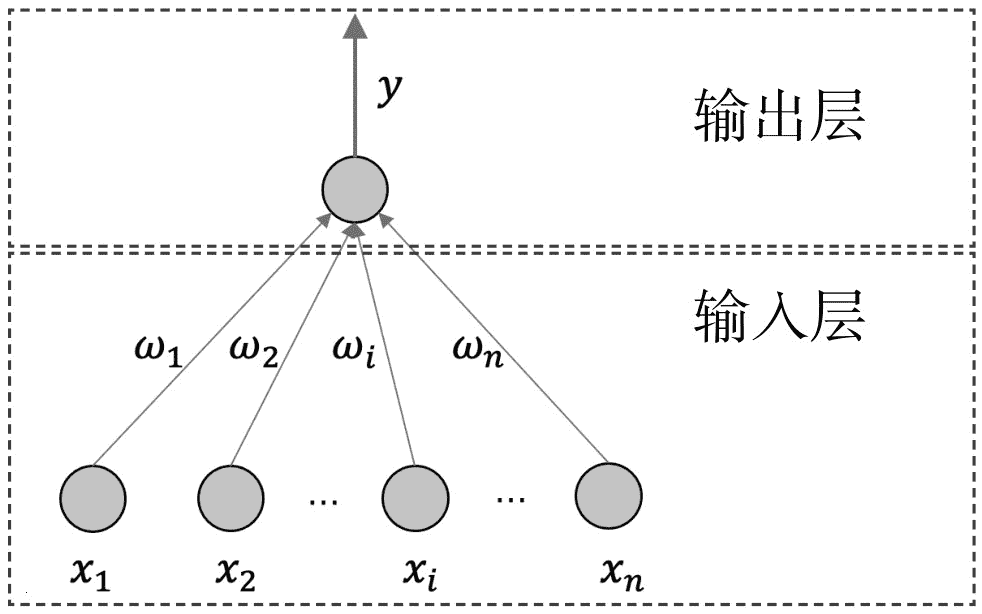

图 1-21 单层感知机模型结构

感知机由两层神经元组成，输入层接收外界输入信号后传递给输出层，输出层是 M-P 神经元。M-P 神经元模型是最早对生物神经元进行抽象化数学描述的模型之一，为后续更复杂神经元模型的设计提供了基础。感知机的核心特点如下。

（1）单层结构，仅能解决线性可分问题（如区分圆形和方形）。

（2）训练算法简单，但无法处理异或（Exclusive OR,XOR）等非线性问题，这暴露了早期线性模型的局限，是促成“第一次 AI 寒冬”的因素之一。

**2．多层感知机：突破线性瓶颈**

为解决非线性问题，科学家在感知机基础上增加隐藏层，形成多层感知机（Multi-Layer Perceptron, MLP）。通过激活函数（如 Sigmoid）引入非线性变换，MLP 能拟合复杂曲线，处理异或问题等非线性任务。

但是，随着多层感知机的层数增加，会出现“梯度消失”问题（深层权重难以更新），大幅限制了模型深度。

**3．卷积神经网络：图像识别的革命**

1998 年，法国科学家杨立昆（Yann LeCun）及其团队提出的 LeNet-5 架构，是首个成功应用于商业实践的卷积神经网络，专为图像识别设计，首次解决了“平移不变性”和“局部特征提取”问题。

卷积神经网络主要由两个部分组成：卷积层和传统神经网络层。可以将卷积层想象成许多不同规格的滤镜组合，这些滤镜在图像上进行局部扫描和观察，如图 1-22 所示。同一层上的滤镜观察角度不同，而不同层上的滤镜分辨率也不同，越往后分辨率越低，观察趋向于宏观。最终，不同层、不同滤镜的观察结果被输入到传统神经网络层进行建模。

图 1-22 将卷积层想象成许多不同规格的滤镜组合

卷积神经网络的核心创新如下。

（1）卷积层：通过滑动窗口（卷积核）提取图像局部特征（如边缘、纹理），通过权重共享大幅减少参数数量。

（2）池化层：对特征图降采样（如最大池化），保留关键信息，并提升抗变形能力。

（3）层级结构：浅层提取边缘，深层组合成复杂特征（如眼睛、车轮），最终实现图像分类。

整个卷积神经网络对图像的处理过程类似于人类观察、记忆和存储图像的过程，因此在 AI 视觉领域取得了很好的效果，成为主流的网络结构。

**4．循环神经网络：破解序列密码**

除了图像，AI 还需要处理语音、文本等具有时序依赖的序列数据，这些数据在语义上存在上下文影响关系，需要模型记住“上下文”，因此不适合使用 CNN。针对这种序列数据，研究人员提出了循环神经网络。

循环神经网络通过隐藏层神经元的自连接，让信息在序列中传递，理论上可处理任意长度的序列。RNN 的特点是上一级节点的输出会继续传递给下一级节点，适合对序列数据的上下文影响进行建模，其基本结构如图 1-23 所示。

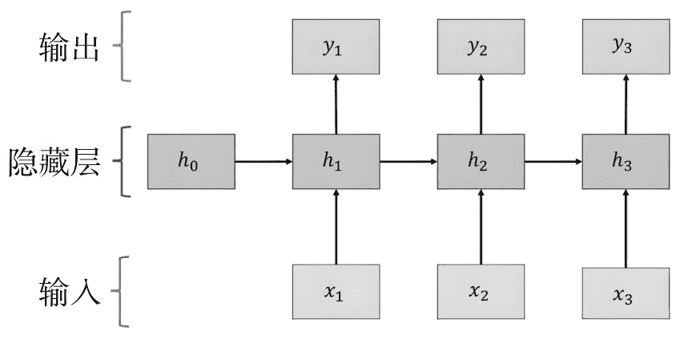

图 1-23 循环神经网络的基本结构

例如，在处理文本时，后续节点会接收来自前序节点的信息，使模型能够捕捉到序列中的长期依赖关系。

然而，RNN 存在两个主要缺陷：一是长时间依赖容易丢失，二是序列依赖关系导致无法进行并行计算，训练效率较低。尽管研究人员对 RNN 进行了一些结构优化，但这两个问题始终是困扰。

**5.Transformer：从序列到全局的飞跃**

RNN 和 LSTM 虽然可以处理序列数据，但只能按时间一步步逐个计算，并行效率很低，且长距离依赖仍有局限。2017 年，Google 的研究团队在 Attention Is All You Need 中提出 Transformer 架构，如图 1-24 所示，用自注意力机制（Self-Attention）彻底抛弃循环神经网络结构。

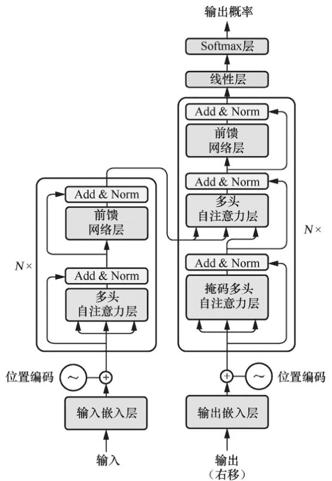

图 1-24 Transformer 架构

**知识扩展**

Softmax 层用于将线性层的输出转换为概率分布，表示每个词在输出序列中的可能性。Add & Norm（残差连接与归一化）用于将每一层的输入和输出相加，然后进行归一化处理，这有助于加速训练并稳定模型。*N*×表示编码器（Encoder）或解码器（Decoder）中有 N 个相同的层堆叠在一起。

Transformer 通过将文本的位置信息与词嵌入向量相结合，并对单词之间的关系进行建模，不再需要在网络结构上体现序列间的前后依赖关系。Transformer 的这一创新带来了以下三大优势。

（1）解决了序列数据长时间依赖问题。

（2）使并行计算成为可能，提高了训练效率。

（3）基础结构可以像积木一样组装，方便设计大型模型。

Transformer 的这些优势使其迅速成为语言模型的首选基础结构，并催生了一系列大模型的诞生，如 GPT 系列。

Transformer 的成功不仅局限于语言模型，图像领域也开始尝试将图像拆分成小块，并像文本位置编码一样对图像块进行编码，从而成功地用 Transformer 处理图像数据。此外，Transformer 还推动了多模态模型的发展，如 OpenAI 的对比语言-图像预训练（Contrastive Language-Image Pre-training,CLIP）模型，实现了图文混合处理的技术突破。

回顾过去十多年的神经网络结构发展，主流架构已经逐渐从 CNN 处理图像数据和 RNN 处理序列数据，转向基于 Transformer 的网络结构。Transformer 以其强大的能力和灵活性，当之无愧地坐上了神经网络模型结构的“王座”。

**1.2.6** **Transformer 催生出一切 AI 大模型**

在人工智能生成内容（Artificial Intelligence Generated Content,AIGC）领域，AI 大模型能够用来生成逼真的电影画面，或者精美的图像效果。图 1-25 为即梦 AI 生成的图像，这些惊艳成果的背后，都离不开一个核心技术的支撑——Transformer。

图 1-25 即梦 AI 生成的图像

作为当前 AI 领域的核心引擎，Transformer 自 2017 年被提出以来，便横扫文本、语音、视觉、科学、自动驾驶、机器人等多个 AI 研究领域。那么，Transformer 究竟做对了什么，能获得如此地位？下面将从技术层面进行深入解析。

**1．引入注意力机制：破解长距离依赖难题**

注意力（Attention）机制由图灵奖得主约书亚·本吉奥（Yoshua Bengio）等研究者在神经机器翻译等领域推动并普及，是一种强大的语义表征方式。在语言生成任务中，如根据“天黑了，进房间请打开……”预测下一个单词，人类能凭借对“天黑”与“开灯”等词的关联轻松判断，AI 也遵循类似的逻辑。

早期主流的 RNN 结构因擅长处理序列关系，在语言任务中表现出色，如图 1-26 所示。然而，RNN 存在明显缺陷：其网络参数沿序列一级一级传递，随着序列增长，较远词的影响逐渐减弱甚至消失，导致出现长距离依赖问题，尽管 LSTM、门控循环单元（Gated Recurrent Unit,GRU）等优化结构尝试改善，但未能彻底解决该问题。

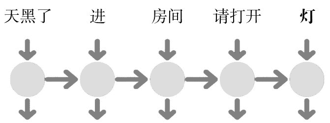

图 1-26 用 RNN 结构处理序列关系

注意力机制的出现带来了转机，它如同你可以在人群中一眼分辨出自己的好朋友一样，这就是关注形成的注意力。注意力机制通过在逐级传递的参数之外新增一个参数，来表征过去每个词对当前词的影响，如图 1-27 所示。这个参数不依赖序列关系，也不会因距离变长而消失，从而能有效捕捉长距离语义关联。Transformer 沿用了注意力机制，为解决长距离依赖问题奠定了基础。

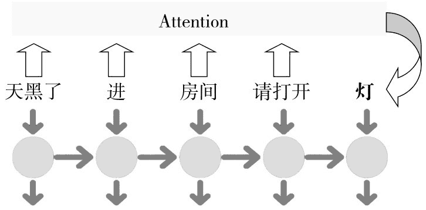

图 1-27 用注意力机制处理序列关系

**2．摒弃序列依赖：释放模型规模扩展潜力**

RNN 的序列关系不仅导致长距离依赖问题，还带来另一个局限——训练时每个节点的参数需从第一个节点开始一级一级计算，这种链式依赖严重限制了训练速度，模型规模也难以扩大。因为单词在序列中的位置对语义至关重要，时序关系是语言建模的关键，打破这一链条看似不可能。

Transformer 采用了一个“天才般”的解决方案：将词在序列中的位置表示成一个向量，与词本身的语义向量相结合后输入后续计算过程。这样，位置向量充分代表了序列关系，而链式计算不再是必要，如图 1-28 所示。

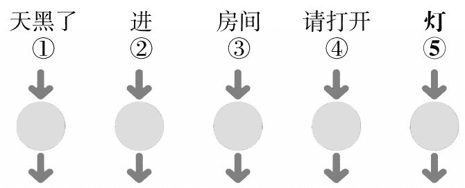

图 1-28 Transformer 的解决方案

在摆脱序列依赖后，模型训练可以实现并行化，这极大地提高了训练效率，使得训练前所未有的大规模模型成为可能。更大的模型规模能够表征更复杂的语义关系，为处理海量数据和复杂任务提供了可能。

**3．复杂化注意力表示：应对复杂语义挑战**

现实中的语言复杂多样，存在一词多义（如“苹果”可指手机品牌、水果或人名）、一句多义、语义反转、反讽等现象，网络时代的语言更是博大精深，这对注意力机制的语义表征能力提出了更高的要求。

Transformer 的第 3 个关键举措是大幅复杂化注意力表示。传统注意力简单使用两个词向量的相关性来表达语义关系，而 Transformer 为每个词计算*Q*（查询向量）、*K*（键向量）、*V*（值向量）3 个向量。

其中，*Q*和*K*用于相互匹配，*V*代表词的语义变体，三者结合可表征某个词在特定语义空间与另一个词的语义变体的关系。进一步将单注意力块拼接成多头注意力，能表达多个语义空间中多个语义变体的关系。这种多头注意力结构还可纵向堆叠，进一步处理各种复杂的语境和语义变化，极大地提升了模型对复杂语义的表征能力。

Transformer 通过沿用注意力机制并对其进行复杂且可扩展的设计，充分释放了语义表征潜力；去除 RNN 的序列依赖，实现了模型规模的可扩展性。这种突破使其具备了语义建模的强大能力，让基于海量数据训练大规模语言模型成为现实。

OpenAI 团队维敏锐洞察到 Transformer 的潜力，在其出现后迅速将其应用于生成式语言模型训练，推出了 GPT-1。此后，Transformer 与大模型相互成就，开启了 AI 发展的新篇章。

### **1.3** **DeepSeek：探究其特性与应用**

在众多的人工智能模型和应用中，DeepSeek 凭借其独特的特性和出色的表现引起了广泛关注，它的出现为人工智能领域带来了新的活力和可能性，成为研究和应用的热点之一。

DeepSeek 不仅在技术上具有创新性，而且在实际应用中展现出了强大的能力和价值。本节将深入探究 DeepSeek 的特性与应用，分析其爆火的原因，介绍其多种使用途径和逻辑推理能力，以及联网搜索方法和商业应用案例，帮助大家全面了解 DeepSeek 这一重要的 AI 模型，探索其在不同领域的应用潜力和发展前景。

**1.3.1** **DeepSeek 为什么爆火**

在人工智能模型领域，DeepSeek 的横空出世引发广泛关注，这款被称为“真正能媲美 OpenAI 旗舰模型”的开源产品，凭借一系列亮眼的性能指标和独特的市场定位迅速走红。从技术参数对比到实际应用价值， DeepSeek 的爆火绝非偶然，其背后蕴含着清晰的竞争逻辑。

DeepSeek 的核心竞争力首先体现在其比肩国际顶尖水平的性能表现上，如图 1-29 所示。在数学推理领域中，DeepSeek-R1 开源模型在美国数学邀请赛（American Invitational Mathematics Examination, AIME）2024 数学竞赛基准测试中取得 79.8 分，展现出强大的逻辑推理能力。

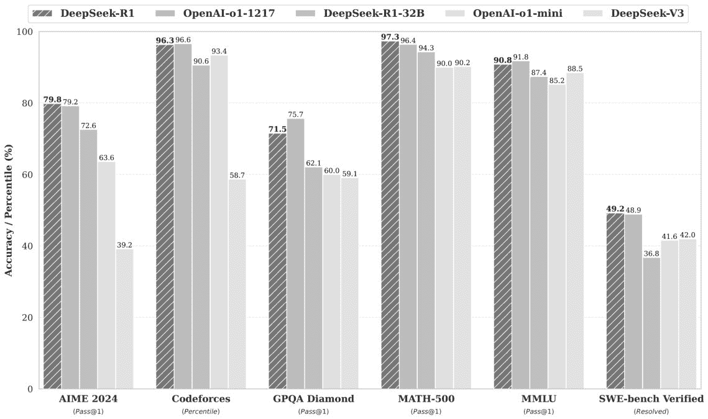

图 1-29 DeepSeek 与其他主流大模型的性能对比（数据来源：DeepSeek 官方 GitHub 仓库）

在代码生成能力方面，在 Codeforces 编码评测中，DeepSeek-R1 以 96.3 分逼近 OpenAI 同类型模型的 96.6 分，差距仅 0.3 个百分点，达到工业级代码开发辅助水平；在复杂学科处理方面，尽管在生物、物理、化学等博士级专业领域，OpenAI 模型凭借 4.2 个百分点的优势领先，但 DeepSeek 在高速五百强企业级应用场景中反超 0.9 个百分点，显示出对复杂工程场景的适配能力。

这些数据表明，DeepSeek 在核心任务上已跻身第一梯队，尤其在代码生成、数学推理等技术密集型领域，完全具备替代国际顶尖闭源模型的技术实力。

与 OpenAI、Google 等企业的闭源收费模式相比，DeepSeek 采取了极具颠覆性的市场策略，具体如下。

（1）全开源架构：DeepSeek 不仅开放模型权重文件，更提供完整的训练代码和数据集预处理流程，开发者可直接基于原生架构进行二次开发。

（2）免费商用授权：明确允许企业和个人在商业场景中自由使用，无须支付授权费用或分成，这对中小型企业和初创团队具有极大吸引力。

（3）降低技术门槛：通过开放 6711 亿参数的旗舰版模型（DeepSeek-R1），让更多机构能够接触到顶级大模型技术，打破了长期以来的技术垄断格局。

DeepSeek 的这种“技术普惠”策略迅速积累了庞大的开发者社群，成为近半年内（截至 2025 年 5 月）在 GitHub 仓库的星标数增速最快的开源 AI 项目，如图 1-30 所示。在 GitHub 近 2 亿个项目中，拥有 75.7k 星标即属于前 0.05%的头部项目。其中，DeepSeek-V3（96.5k 星标）和 R1（89.1k 星标）已进入行业前列。

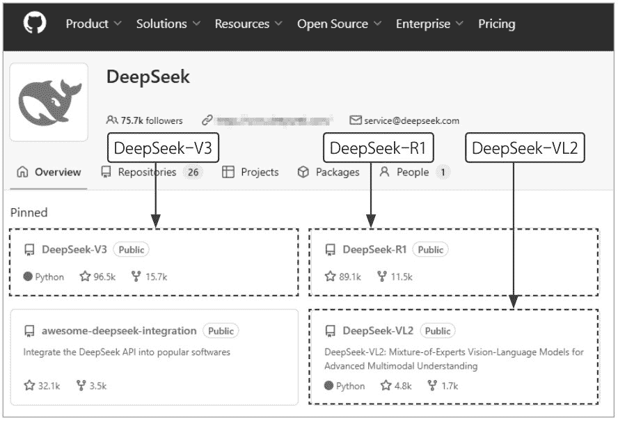

图 1-30 DeepSeek 的 GitHub 仓库

在模型性能与成本的天平上，DeepSeek 找到了绝佳平衡点。基于海量高质量训练数据，DeepSeek 构建了参数规模高达数百亿的旗舰模型，单位参数训练成本显著低于同类闭源模型。这些技术创新不仅支撑了高性能表现，更构建了难以复制的技术壁垒，使 DeepSeek 在短短数月内就获得超过 2000 家企业的生产环境部署。

DeepSeek 的爆火，本质上是技术创新与市场需求“共振”的结果，它既打破了国际巨头的技术垄断，又为行业提供了高性价比的 AI 解决方案，更通过开源模式激活了整个生态的创新活力。

随着其在代码生成、智能客服等场景的应用不断深化，DeepSeek 正在重新定义大模型时代的竞争规则——技术实力不再是唯一门槛，开放生态、性价比和场景适配能力正成为新的核心竞争力。

**1.3.2** **DeepSeek 的 6 种使用途径**

在 AI 领域，DeepSeek 凭借高性能、开源免费及生态开放性迅速崛起，成为备受关注的大模型解决方案。其成功不仅源于技术突破，更在于为用户提供了多元化的使用途径，覆盖从企业级应用到个人开发者、本地部署的全场景需求。下面是目前主流的 6 种 DeepSeek 使用途径，帮助大家快速解锁这一“国货之光”的核心能力。

**1．官方渠道：一站式体验旗舰模型**

作为最直接的入口，DeepSeek 官网提供了网页端对话、手机 App 下载及应用程序编程接口（Application Programming Interface,API）开放平台，适合普通用户和企业快速体验其核心功能，如图 1-31 所示。

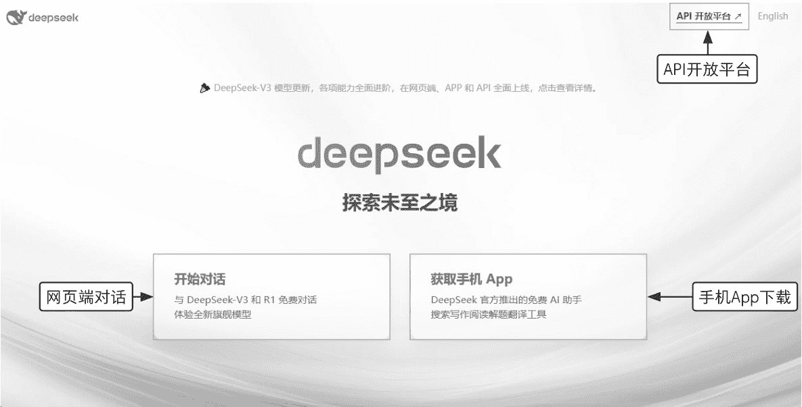

图 1-31 DeepSeek 官网

DeepSeek 的网页端与 App 均支持文本对话、搜索、写作、翻译等基础功能，无须复杂配置，使用手机号或邮箱注册，即可免费使用 DeepSeek-V3 和 R1 模型，满足日常问答、内容生成等需求。

DeepSeek 的 API 开放平台为开发者和企业提供标准化接口，支持自定义参数调用，适配智能客服、知识问答等业务场景。同时，DeepSeek 的官网会同步更新模型文档、技术白皮书及开发者工具，降低接入门槛。

**2．华为云 ModelArts** **Studio：企业级云上开发首选**

作为深度合作的云服务商，华为云 ModelArts Studio 平台提供了一站式大模型开发托管服务，尤其适合企业级用户，如图 1-32 所示。华为云 ModelArts Studio 支持模型调优、压缩、部署、评测等全生命周期管理，预置昇腾适配版 DeepSeek-R1-Distill、V3、R1 模型，兼容 Llama、Qwen 等开源框架。

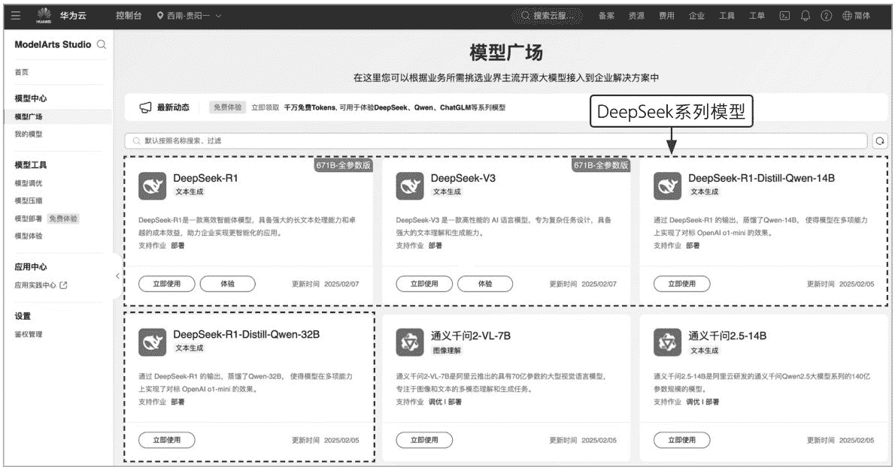

图 1-32 华为云 ModelArts Studio 平台

**3．硅基流动：高性能低成本 API 服务**

作为国内热门的 AI 算力平台，硅基流动针对 DeepSeek 模型推出专属优化服务。硅基流动的 DeepSeek 模型依托分布式架构优化，支持万级并发调用，适合高频次、低延迟的业务场景，如智能客服、实时对话机器人。

**4.Cursor:AI 代码编辑器深度集成**

Cursor 作为“明星级”AI 代码工具，已将 DeepSeek 模型融入开发流程，成为开发者的效率神器。Cursor 支持自然语言指令编写/修改代码、自动补全、代码审查等功能，同时深度结合 DeepSeek 的逻辑推理能力，尤其在数学证明、算法实现等场景表现突出。

在 Cursor 中启用“隐私模式”后，代码无须上传云端，本地即可调用 DeepSeek 模型，满足企业对数据安全的高要求。

**5.SCNet 超算互联网：公益化算力支持**

针对科研机构和个人开发者，SCNet 超算互联网平台提供了轻量化的 DeepSeek 服务，开放了 DeepSeek-R1-Distill-Qwen-32B 等蒸馏版本，如图 1-33 所示，支持基础对话、解题、翻译等功能，适合 AI 入门学习和小型项目测试。

**6．本地部署：Ollama 实现轻量化落地**

对于追求数据隐私和离线使用的用户来说，Ollama 提供了便捷的本地部署方案，涵盖 1.5B 到 671B 参数的模型（如 DeepSeek-R1-7B、32B），支持 Q4_K_M 量化格式，适配消费级显卡（如 RTX 3060 及以上）。

用户只需通过简单的指令，即可运行模型（如 ollama run deepseek-r1:7b），适合开发者进行模型微调、自定义任务开发，或企业构建私有 AI 系统。

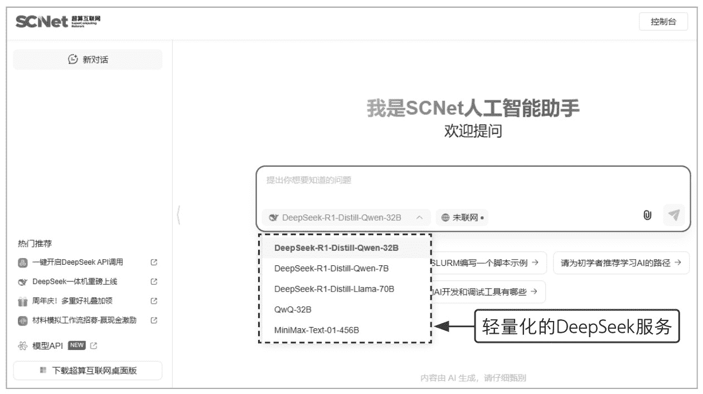

图 1-33 SCNet 超算互联网平台提供的 DeepSeek 服务

**1.3.3** **DeepSeek 的逻辑推理能力**

在人工智能的核心能力比拼中，逻辑推理的深度与透明度正成为区分大模型竞争力的关键指标。通过对比 DeepSeek-R1 与 GPT-4o mini 的思维链（Chain of Thought），即模型在回答问题前的完整思考过程，我们得以窥见国产大模型在逻辑推理上的独特优势：更贴合本土语境的深度思考、更完整的思维链条，以及对问题本质的穿透性理解。这些优势不仅体现在解题步骤的严谨性上，更反映了 AI 从“机械计算”到“类人推理”的进化。

思维链是 AI 在生成答案前的推导过程，它将模型的内在逻辑转换为可追溯的文字，让用户能够验证推理的合理性。例如，当被问及“今天是周六为何需要工作”时，AI 需拆解日期规则、调休政策、行业特性等因素，形成完整的逻辑链条。DeepSeek 与 OpenAI 的核心差异，正是从这一“思维透明度”开始显现的。

GPT-4o mini 的内容聚焦于“行业性质”“跨时区协作”“合同与加班制度”等通用原因，未触及中国特有的“法定节假日调休”制度，如图 1-34 所示。

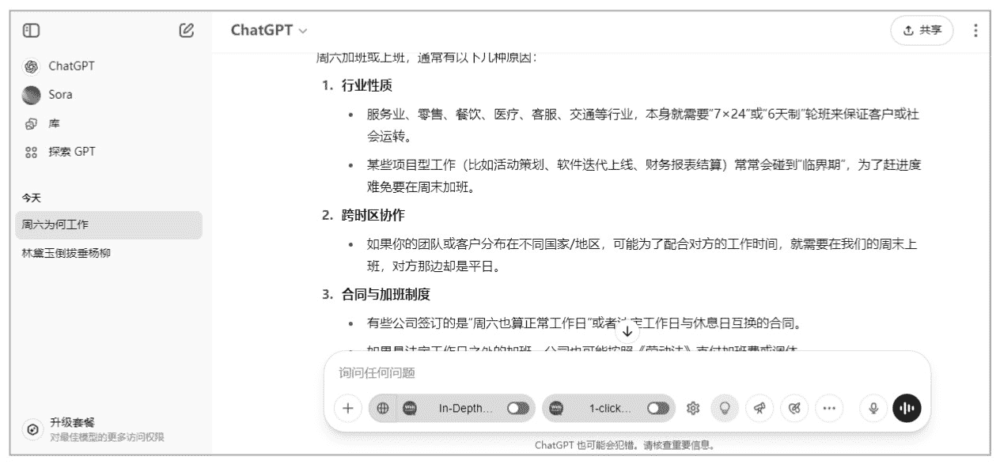

图 1-34 GPT-4o mini 的回答

DeepSeek-R1 则分以下 3 步进行推导。

（1）背景分析：确认“周六工作”违背常规，需排查特殊情况。

（2）原因枚举：列出“单休制度或特殊工作制”“行业特殊性”“法定节假日调休”等可能性。

（3）语境匹配：结合中国节假日调休规则（如“春节”“国庆”前后的周末补班），给出“调休”解释，如图 1-35 所示。

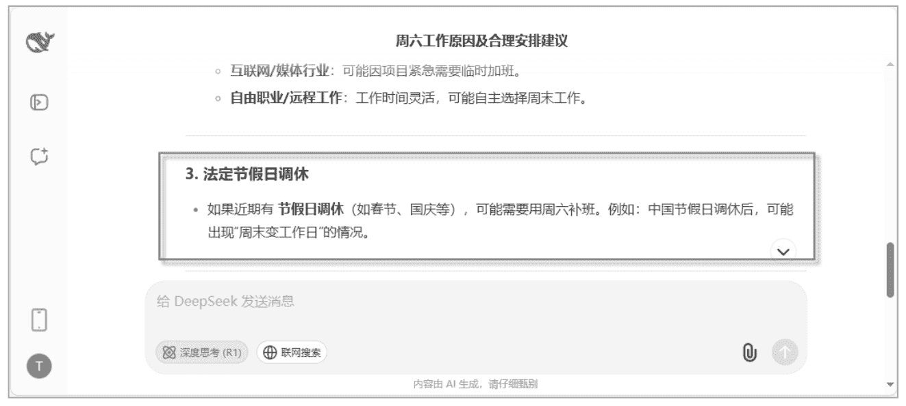

图 1-35 DeepSeek-R1 的回答

由此可见，DeepSeek 的思维链包含对本土政策的深度理解，而 OpenAI 的回答更偏向普适性逻辑，忽略了中国用户的实际生活场景。

OpenAI 被用户质疑其模型思维链是“摘要版”，仅呈现简化后的推导过程，而 DeepSeek 从 R1 版本开始即公开原始思维链，允许开发者和用户追溯每一步决策依据。这种透明化不仅提升了模型的可信度，更让教育、金融等对“可解释性”要求高的行业受益。例如，银行风控模型需向用户解释拒贷原因，完整的思维链可成为关键依据。

另外，DeepSeek 在模型训练中融入了大量中文语境数据，包括中国法律法规、节假日规则、商业逻辑等，使其在处理“调休”“假币交易”等本土场景时，能调用更精准的知识图谱。相较之下，OpenAI 的通用模型虽覆盖多语言，但在细分文化场景中存在“理解盲区”。

DeepSeek 在逻辑推理测试中的优异表现，不仅是技术层面的突破，更展现了 AI 从“数据驱动”向“知识驱动”的演进方向。当模型能够像人类一样拆解问题、跟踪状态并创造性地处理边界条件时，其应用场景将从简单问答拓展到复杂决策。

**1.3.4** **DeepSeek 的联网搜索能力**

在大语言模型的实际应用中，知识时效性不足是长期存在的痛点——模型训练数据截止后的新信息，如实时天气、最新票房、突发新闻等，往往无法准确回答，如图 1-36 所示。

图 1-36 大语言模型无法回复实时天气问题

传统大语言模型依赖静态训练数据，而 DeepSeek 通过联网搜索，可实时补充最新信息。例如，在回答“今天日期”时，能够准确调用系统时间接口进行回答，如图 1-37 所示。

DeepSeek 的联网搜索能力并非简单的“数据抓取”，而是建立在其底层动态思维链技术之上，具体分析如下。

图 1-37 DeepSeek 联网搜索示例

（1）问题拆解能力：在触发联网搜索前，模型会先对用户的问题进行语义解析，判断是否需要实时数据支持。例如，询问“2025 年 NBA 总冠军是谁”时，模型会识别“2025 年”为超训练数据时效的信息，自动激活搜索模块。

（2）逻辑验证机制：获取网络信息后，DeepSeek 会通过内置推理引擎验证数据可靠性，避免错误或过时信息干扰。例如，对比多个权威数据源（NBA 官网、体育新闻平台）的一致性，确保回答准确性。

（3）多模态融合：将搜索结果与模型知识库结合，生成结构化回答。例如，查询“某品牌新车参数”时，不仅抓取官网数据，还能结合历史车型对比、用户评价等知识库信息，提供深度分析。

**1.3.5** **DeepSeek 的商业应用案例**

在 AI 模型与商业场景深度融合的时代，DeepSeek 凭借其强大的数据分析、逻辑推理及实时联网能力，成为企业和个人用户提升效率的核心工具。DeepSeek 在内容创作优化、软件开发支持等领域展现出显著价值，真正实现了“用 AI 简化决策，用智能提升效率”。

例如，在社交媒体运营、电商详情页设计中，产品的封面图点击率是影响流量的关键因素，但人工分析多依赖主观经验，缺乏系统性的数据支撑，导致试错成本高。下面以“图书封面图点击率预测”为例，展示 DeepSeek 的解决方案，具体操作方法如下。

**步骤 01** 在 DeepSeek 输入框右下角单击“上传附件”按钮 ，如图 1-38 所示。

图 1-38 单击“上传附件”按钮

**步骤 02** 弹出“打开”对话框，①选择相应的封面图片文件；②单击“打开”按钮，如图 1-39 所示，上传图片文件。

**步骤 03** 输入相应的提示词，如“请帮我分析这两个图书封面，哪个点击率会更高？”，如图 1-40 所示，让 DeepSeek 帮忙找出点击率更高的图书封面。

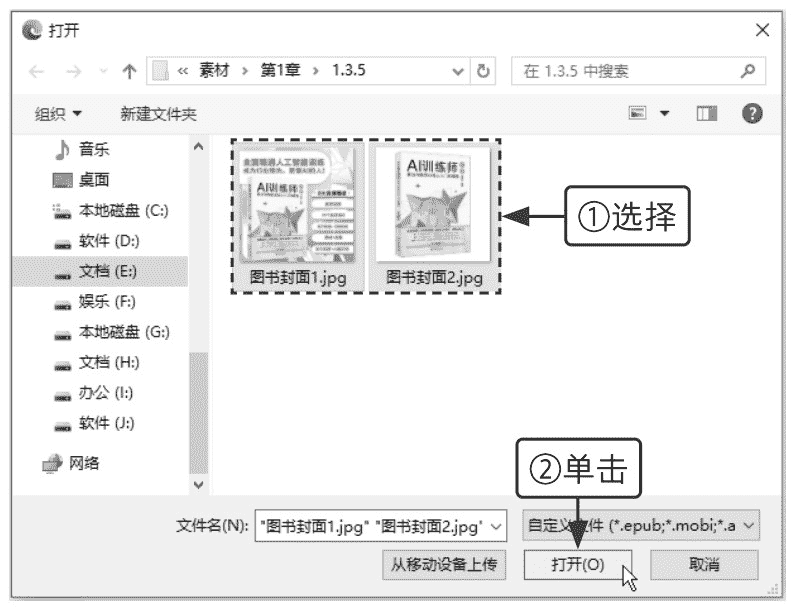

图 1-39 单击“打开”按钮

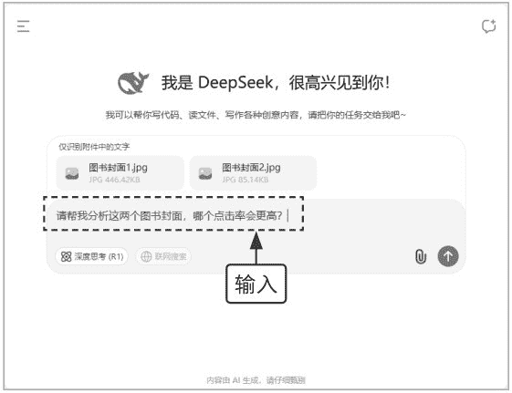

图 1-40 输入相应的提示词

**步骤 04** 单击 按钮，将图片和提示词同时发送给 DeepSeek，它会基于上传的图片，通过多模态理解技术生成对封面的文本描述，进而分析其色彩对比度、主体突出度、文字可读性、情感倾向（如科技感、亲和力）等特征，结合历史爆款封面数据库（如高点击率图片的平均色彩饱和度、构图规则），分析各封面的优势，并提出相应的结论，具体内容如下。

**答：**

从视觉设计和内容呈现的角度分析，图书封面 1 的点击率可能会更高，原因如下。

1． 视觉层次更清晰

• 标题突出：封面 1 的主标题“全面精通人工智能训练”字体更大、位置居中，搭配副标题“成为行业领先、更懂 AI 的人！”形成明确的主次关系，更容易吸引眼球。

• 对比强烈：橙黄色与深色背景的对比度更高，视觉冲击力更强，适合快速抓取注意力。

……

封面 2 的潜在不足

• 标题较弱：“云训练师手册”作为主标题，专业性较强但不够通俗，且与 AI 训练的关联性不如封面 1 直接。

……

结论

封面 1 通过更强的视觉对比、清晰的数据化卖点、明确的资源展示，更有可能在短时间内吸引用户点击。若封面 2 能优化标题突出性（如放大“AI 训练师”）、补充赠送资源细节，或增加暖色点缀，竞争力会显著提升。

**知识扩展**

由于本书的篇幅限制，DeepSeek 等 AI 模型回复的内容将只展示要点，完整内容请看随书提供的效果文件。

DeepSeek 的商业应用案例表明，AI 正在从“辅助工具”进化为“效率引擎”：在消费电子领域，它是智能导购员；在内容创作领域，它是数据化分析师；在软件开发领域，它是高效代码助手。DeepSeek 的核心价值在于将复杂的数据处理、逻辑推理转换为简单易用的解决方案，让企业和个人能够聚焦核心目标，释放创造力。

随着技术的持续迭代，DeepSeek 的应用场景将进一步拓展至金融风控、医疗诊断、供应链管理等领域，真正实现“AI 即服务”的商业愿景。对于企业而言，拥抱这类智能工具不仅是效率提升的选择，更是在数字化转型中保持竞争力的必然路径——当数据驱动的智能决策成为常态，商业创新的边界将被不断改写。

### **本章小结**

本章首先介绍了人工智能基础入门知识，涵盖学习人工智能的意义，人工智能的发展历程、核心逻辑、模型的概念与训练方式，以及模型量化与模型蒸馏等相关内容；其次深入解析了 AI 大模型的工作逻辑，包括 GPT 模型的工作原理、成功原因，AI 强化学习与 RAG 检索技术在大模型中的应用，以及神经网络和 Transformer 在 AI 模型训练中的关键地位；最后介绍了 DeepSeek 的特性与应用，分析了其爆火原因、6 种使用途径，以及逻辑推理能力、联网搜索能力，并列举了相关商业应用案例。

### **课后实训**

**实训任务** 使用 DeepSeek 解答一道热门数学题，题目为“西瓜进价每斤 2 元，卖 3 元，顾客用 100 元假币购买 30 斤，请问老板亏了多少钱？”，测试该大模型的逻辑推理能力。

下面介绍使用 DeepSeek 解答数学题的操作方法。

**步骤 01** 在 DeepSeek 的输入框中输入相应的问题，如图 1-41 所示。

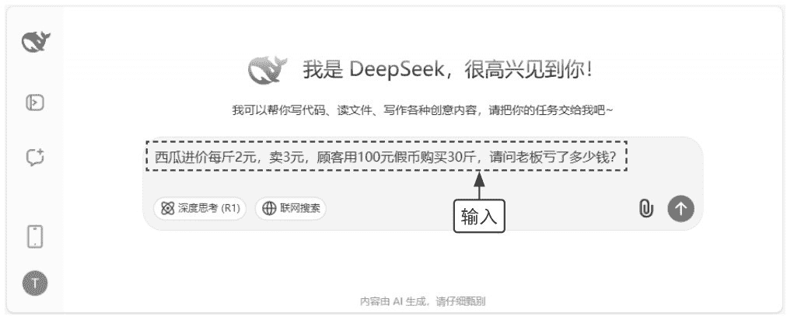

图 1-41 输入相应的问题

**步骤 02** 启用“深度思考（R1）”模式，单击 按钮发送问题，即可获取相应的答案，具体内容如下。

**答：**

老板在这笔交易中总共亏损了 70 元。具体计算如下。

西瓜成本：30 斤×2 元/斤=60 元

找零金额：顾客支付 100 元假币购买价值 90 元的西瓜（30 斤×3 元/斤），需找零 10 元真钱。

总亏损：60 元（成本）+10 元（找零）=70 元

关键点：假币导致老板损失了货物的实际成本（60 元）和找零的真钱（10 元）。即使售价包含利润，但题目未涉及机会成本，仅计算直接损失。因此，最终亏损为 70 元。

**知识扩展**

DeepSeek 的思维链不仅验证结果，更通过“现金流入/流出”模型排除干扰项，展现出对经济逻辑的精准把握。

## **第二章 模型部署：在本地使用 DeepSeek**

随着对人工智能模型的理解不断深入，大家会渴望将这些强大的模型应用到实际场景中，本地部署模型已成为许多人的首选。本章将聚焦于如何在本地使用 DeepSeek 模型，为大家呈现详细的部署流程与技巧。

### **2.1 模型安装：DeepSeek 本地部署**

在当今数字化时代，本地部署人工智能模型的需求日益增长。DeepSeek 这款由深度求索实验室研发的新一代开源大语言模型，凭借其多尺寸灵活适配、领域强化能力、高效推理架构以及对本地部署的友好支持，成为众多用户的首选。

本地部署 DeepSeek 模型是实现其功能定制化与数据隐私保护的关键步骤。本节将全面介绍在本地部署 DeepSeek 的过程，涵盖部署前的准备工作、安装依赖项、下载 Ollama 和 DeepSeek 模型、配置前端界面等环节。通过详细的操作指导与案例分析，用户可以在本地环境中成功搭建并运行 DeepSeek 模型，为后续的模型训练和深入商业应用奠定坚实的基础。

**2.1.1 部署前的准备工作**

在本地部署方面，DeepSeek 能够保障数据隐私、支持本地运行、无须上传云端，还支持接入企业知识库和行业数据库，满足定制化扩展需求。另外，单张消费级显卡即可运行 DeepSeek，长期使用成本低于云服务。在本地部署 DeepSeek 前，根据模型大小，对硬件配置的要求有所不同，具体如下。

（1）入门配置：建议使用配备 NVIDIA（英伟达）显卡（显存≥8GB）的设备，适合运行 7B/8B 模型。

（2）高性能配置：对于更大规模的 14B 模型，建议使用配备 NVIDIA 显卡（显存≥16GB）的设备。图 2-1 为 GeForce RTX 5090 D 显卡，采用 NVIDIA Blackwell 架构，配备 32GB GDDR7 显存和 21760 个 CUDA 核心，显存带宽高达 1792 GB/s，具有强大的 AI 算力。

图 2-1 GeForce RTX 5090 D 显卡

**知识扩展**

NVIDIA Blackwell 架构以数学家 David Blackwel（l 戴维·布莱克维尔）命名，有助于提升可靠性与集群通信效率。GDDR7 的全称是 Graphics Double Data Rate（图形双数据速率） 7，是 NVIDIA 与 DRAM（Dynamic Random Access Memory，动态随机存取存储器）行业合作推出的超低电压 GDDR 内存标准。

CUDA（Compute Unified Device Architecture，统一计算设备架构）是 NVIDIA 的并行计算平台和编程模型，允许开发者使用 C/C++、Python、Fortran 等语言调用 GPU 的并行计算能力。

（3）无独立显卡用户：即使没有独立显卡，也可以使用 CPU 模式运行，但性能大约是 GPU 的 20%。

另外，内存要求至少为 16GB，推荐使用 32GB 内存以确保处理长文本时的流畅性。存储空间方面，至少需要 50GB 的可用空间，建议使用 SSD（Solid State Disk 或 Solid State Drive，固态硬盘）硬盘以加快模型加载速度。

DeepSeek 支持多种操作系统，包括 Windows 10/11（21H2 及以上版本）、macOS Ventura 13.4＋，以及 Ubuntu 22.04 LTS/24.04 LTS。以 Windows 系统为例，确保已经安装了最新的显卡驱动，如图 2-2 所示。做好这些准备工作后，即可顺利开始 DeepSeek 的部署之旅了。

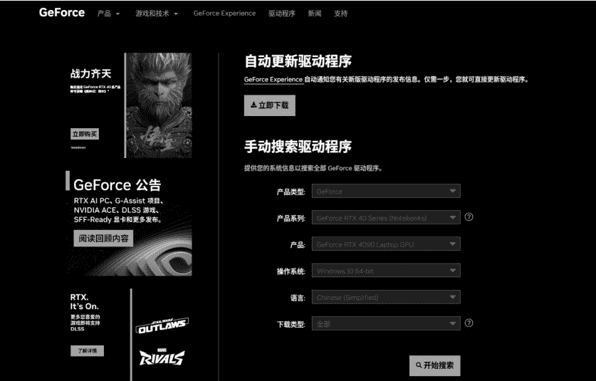

图 2-2 安装显卡驱动

**2.1.2 安装 Python 依赖项**

在部署 DeepSeek 之前，请确保系统已安装必要的依赖项，以下是不同操作系统下的安装指南。

（1）对于 Linux/Ubuntu 系统，需要提前安装以下工具，具体命令如下。

**知识扩展**

python3-pip 是 Python 3 的包管理工具，用于安装、更新和管理 Python 包，它使得安装 Python 库和框架更加方便快捷。curl 是一个命令行工具，用于在命令行中进行数据传输。git 是一个分布式版本控制系统，用于跟踪项目代码的版本历史、协作开发等，它可以帮助开发者管理代码变更、合并代码分支等。

（2）对于 Windows 系统，需要安装最新版的 Visual Studio 运行库。另外，还须确保 Python 版本为 3.8 或以上。用户可以通过以下命令安装 Python 3.8 或更高版本。

Python 是一种广泛使用的高级编程语言，由吉多·范罗苏姆（Guido van Rossum）于 1989 年发明，第一个公开发行版发行于 1991 年。Python 的设计哲学强调代码的可读性和简洁的语法，这使它成为一种易于学习的语言。下面介绍手动下载、安装与配置 Python 的操作方法。

**步骤 01** 进入 Python 官网，①将鼠标指针移至“Downloads”（下载）按钮上；②在弹出的“Download for Windows”面板中单击“Python 3.13.3”（Python 后面的数字为版本号，会根据版本的更新而变动）按钮，如图 2-3 所示，即可下载 Python 安装程序。

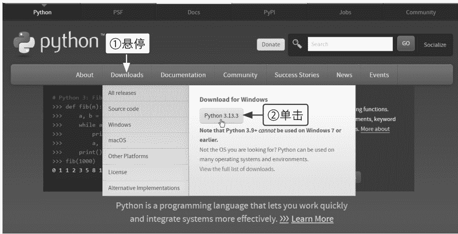

图 2-3 单击 Python 按钮

**步骤 02** 下载好 Python 的安装程序后，进入相应文件夹，双击该安装程序，如图 2-4 所示。

**步骤 03** 执行操作后，弹出 Python 的安装对话框，选择“Customize installation”（自定义安装）选项，如图 2-5 所示，根据提示进行安装即可。

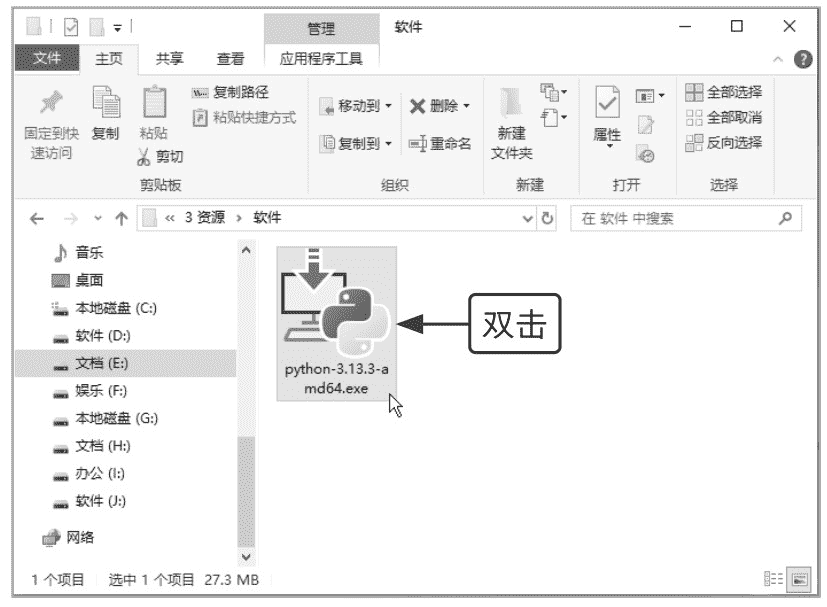

图 2-4 双击 Python 的安装程序

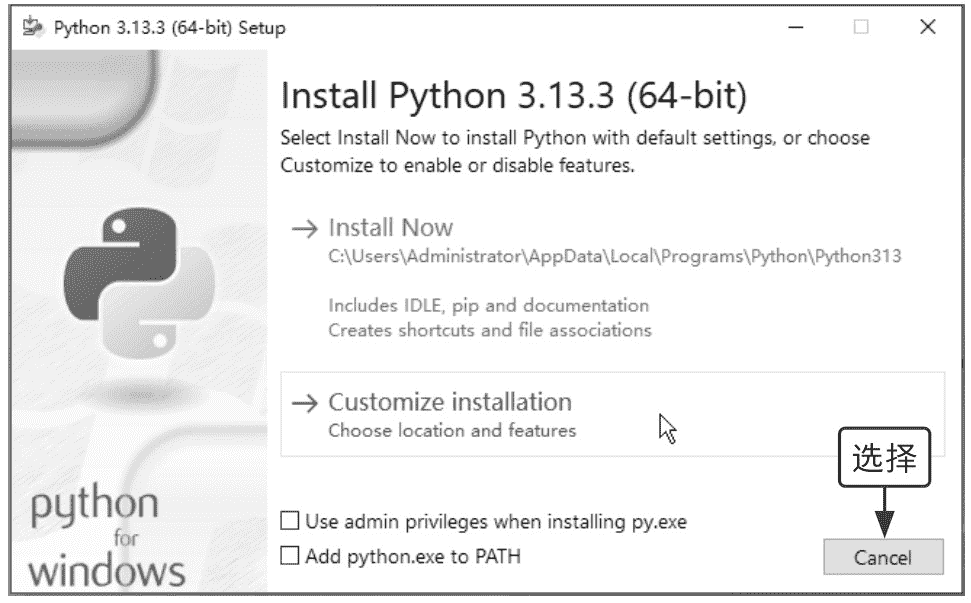

图 2-5 选择“Customize installation”选项

**步骤 04** 在安装 Python 的过程中需要注意，在“Advanced Options”（高级选项）界面中，需要选中“Add Python to environment variables”（将 Python 添加到环境变量）复选框，如图 2-6 所示，可自动同步环境变量。

**步骤 05** 如果在安装 Python 时没有自动同步环境变量，则需要手动添加环境变量，在“此电脑”图标上右击，在弹出的快捷菜单中选择“属性”选项，如图 2-7 所示。

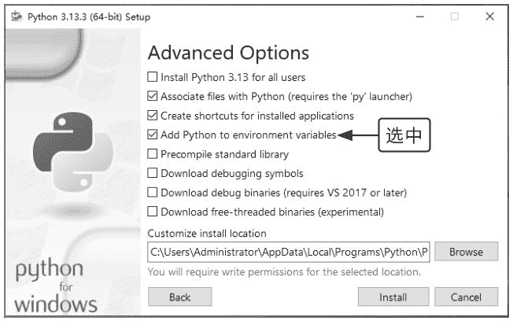

图 2-6 选中相应复选框

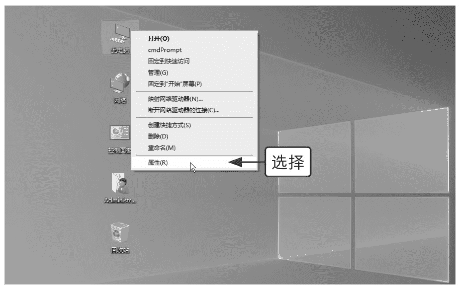

图 2-7 选择“属性”选项

**知识扩展**

环境变量是操作系统用来存储有关系统行为、用户偏好设置和应用程序配置信息的变量。正确配置环境变量，对于确保 Python 及其相关工具（如 pip 包管理器）能够从任何目录中被调用至关重要。

**步骤 06** 打开“设置”窗口，在“关于”界面中单击“高级系统设置”链接，如图 2-8 所示。

**步骤 07** 执行操作后，弹出“系统属性”对话框，并自动切换至“高级”选项卡，单击“环境变量”按钮，如图 2-9 所示。

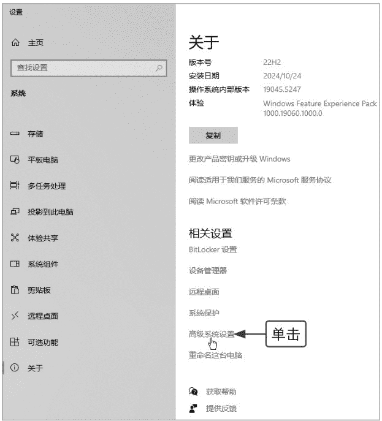

图 2-8 单击“高级系统设置”链接

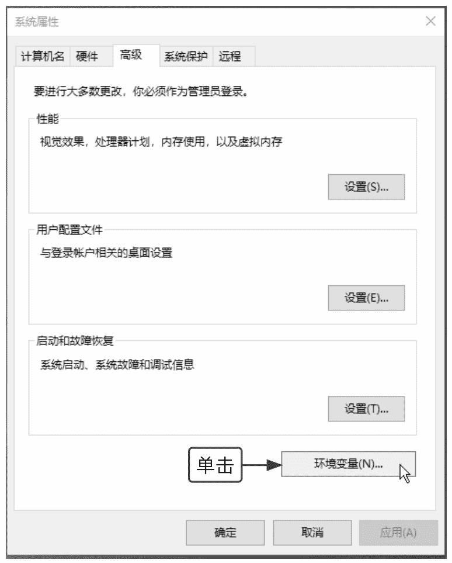

图 2-9 单击“环境变量”按钮

**步骤 08** 弹出“环境变量”对话框，在“系统变量”列表框中双击“Path”（路径）选项，如图 2-10 所示，或者选择“Path”选项后单击“编辑”按钮。

**步骤 09** 执行操作后，弹出“编辑环境变量”对话框，①单击“新建”按钮，新建一个环境变量值；②输入 Python 的安装地址，如图 2-11 所示。

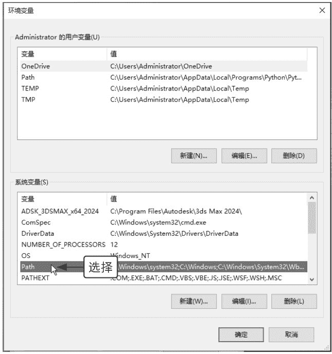

图 2-10 双击 Path 选项

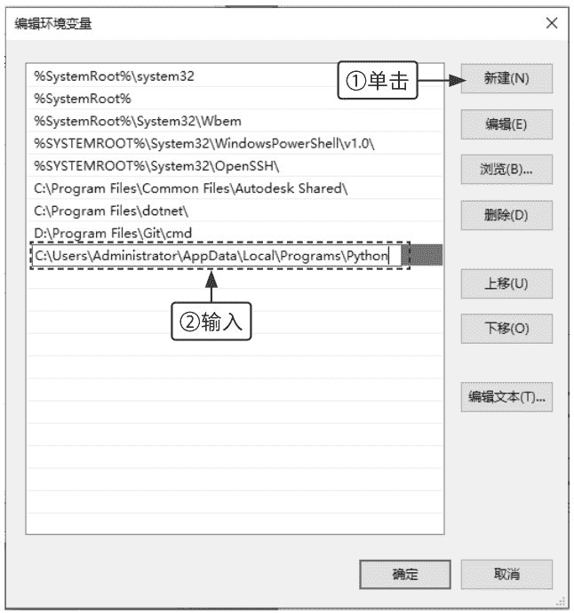

图 2-11 输入 Python 的安装地址

**步骤 10** 在任意文件夹内输入“cmd”并按 Enter 键，打开命令提示符窗口，输入“python -V”并按 Enter 键，如果返回一个版本号，则说明 Python 安装成功，如图 2-12 所示。

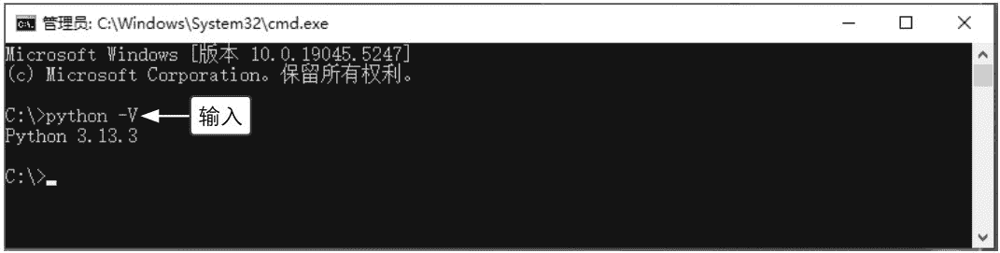

图 2-12 测试 Python 是否安装成功

这些依赖项是本地运行 DeepSeek 所需的基本环境，完成安装后，即可为后续的模型部署步骤做好准备。

**2.1.3 下载与安装 Ollama**

本次 DeepSeek 模型的本地部署需借助 Ollama 工具完成。Ollama 官网提供了丰富的模型资源，除了 DeepSeek 系列，还有 Mistral、Gemma 2 等众多模型。

Ollama 优势显著，它拥有多个版本，可适配不同的操作系统，无论是 Windows 还是 Linux 系统都能找到对应的安装包（Linux 为安装脚本，Windows 为 exe 文件），安装过程简单，安装完成后在控制台即可运行。

下面介绍下载与安装 Ollama 的操作方法。

**步骤 01** 进入 Ollama 官网，单击“Download”按钮，如图 2-13 所示。

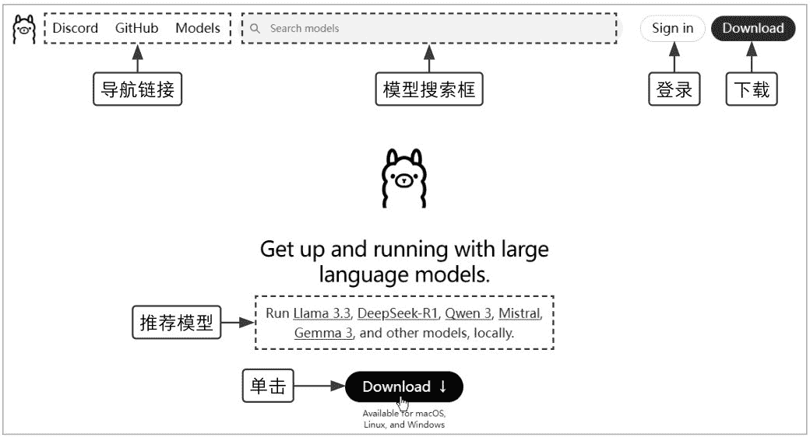

图 2-13 单击“Download”按钮

**步骤 02** 进入 Download Ollama 页面，用户可以根据自己的操作系统下载对应的版本。以 Windows 系统为例，单击“Download for Windows”（下载 Windows 版本）按钮，如图 2-14 所示，即可下载 Ollama 的安装程序。

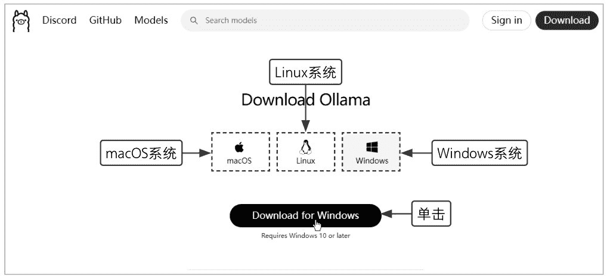

图 2-14 单击“Download for Windows”按钮

**步骤 03** 进入 Ollama 安装程序所在的文件夹，双击 Ollama 安装程序，如图 2-15 所示。

**步骤 04** 执行操作后，弹出“Setup”（安装，右侧为 Ollama 的版本号）对话框，单击“Install”（安装）按钮，如图 2-16 所示。

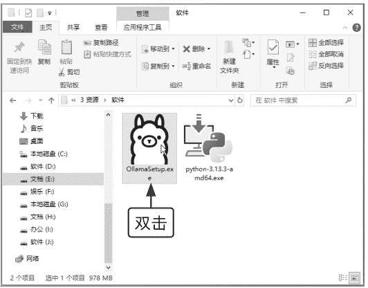

图 2-15 双击 Ollama 安装程序

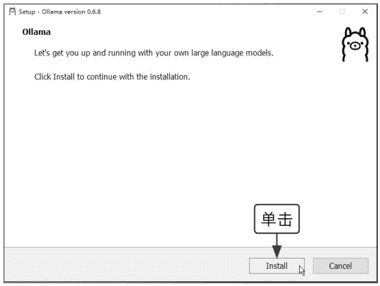

图 2-16 单击“Install”按钮

**知识扩展**

Ollama 具备强大的功能，它提供命令行工具，通过简单的命令就能实现模型的下载、运行、查看等操作，如利用 GPU 计算能力加速模型下载和运行。同时，Ollama 还支持图形化界面，方便用户操作。

**步骤 05** 执行操作后，进入“Installing”（正在安装）界面，显示 Ollama 的安装进度，如图 2-17 所示。

**步骤 06** 安装完成后，对话框会自动关闭。在任意文件夹内输入“cmd”并按 Enter 键，打开命令提示符窗口，输入“ollama -v”并按 Enter 键，如果返回一个版本号，则说明 Ollama 安装成功，如图 2-18 所示。

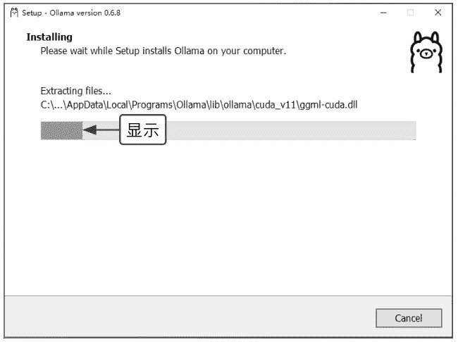

图 2-17 显示 Ollama 的安装进度

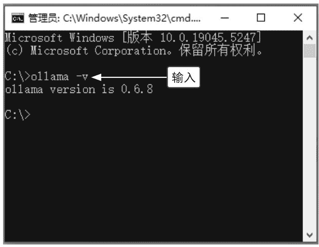

图 2-18 Ollama 安装成功

**步骤 07** 在命令提示符窗口中输入“ollama help”（帮助）并按 Enter 键，即可查看 Ollama 的帮助信息，如图 2-19 所示。

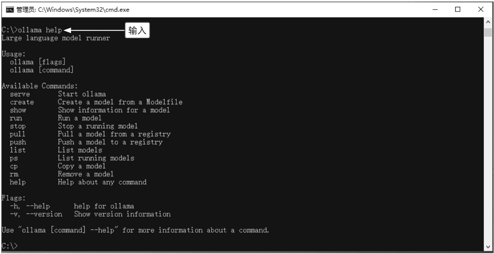

图 2-19 查看 Ollama 的帮助信息

**知识扩展**

Ollama 的常用命令及其作用如下。

（1）serve：启动 Ollama 服务，使模型可以开始运行并响应请求。

（2）create：根据一个 ModelFile 创建一个模型。ModelFile 是一个配置文件，用于定义模型的参数和设置。

（3）show：显示某个模型的信息，包括模型的配置、状态等。

（4）run：运行一个模型，使其开始执行任务。

（5）stop：停止一个正在运行的模型，使其停止执行任务。

（6）pull：从一个模型仓库中拉取模型，将其下载到本地。

（7）push：将一个模型推送到一个模型仓库。

（8）list：列出所有已下载的或可用的模型。

（9）ps：列出所有正在运行的模型。

（10）cp：复制一个模型到另一个位置或设备。

（11）rm：删除一个不再需要的模型。

（12）help：显示所有命令的帮助信息。

Ollama 的常用参数及其作用如下。

（1）-h, --help：显示 Ollama 的帮助信息，提供关于 Ollama 的命令行工具的概述和帮助。

（2）-v, --version：显示版本信息，提供当前安装的 Ollama 的版本号和相关的信息。

**2.1.4 下载 DeepSeek 模型**

Ollama 是一个开源的本地大语言模型运行平台，可用于简化模型的下载和管理。用户可以通过 Ollama 快速将 DeepSeek 模型下载到自己的电脑中并运行。下面介绍下载 DeepSeek 模型的具体操作方法。

**步骤 01** 进入 Ollama 官网，单击“DeepSeek-R1”链接，如图 2-20 所示。

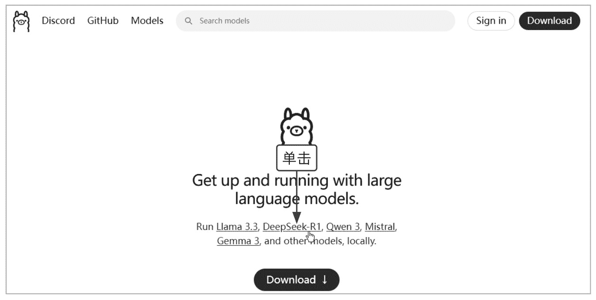

图 2-20 单击“DeepSeek-R1”链接

**步骤 02** 进入“deepseek-r1”页面，在左侧的列表框中根据电脑配置选择合适的模型。例如，这里选择的是 8b 模型，如图 2-21 所示。列表框左边为不同参数规模的 DeepSeek 模型，右边显示的是模型文件的大小。

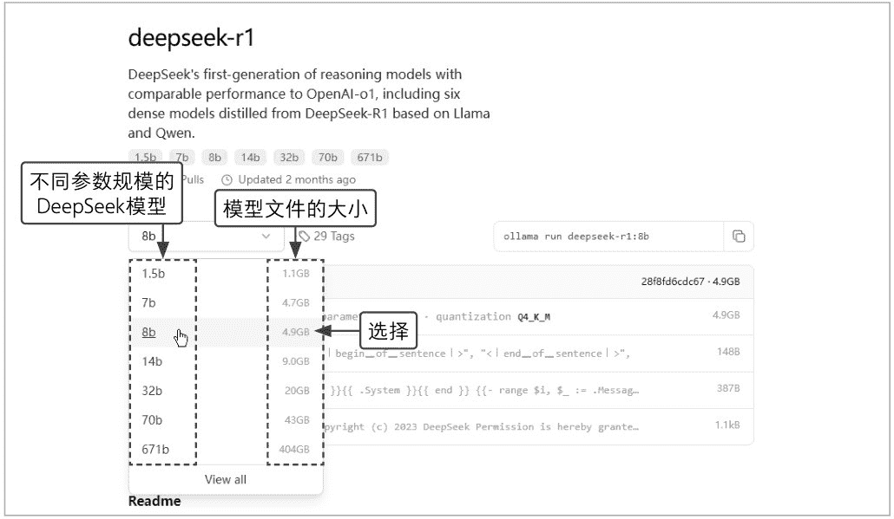

图 2-21 选择合适的模型

**步骤 03** 选择好模型后，单击右侧的 按钮，如图 2-22 所示，复制本地部署模型的命令。

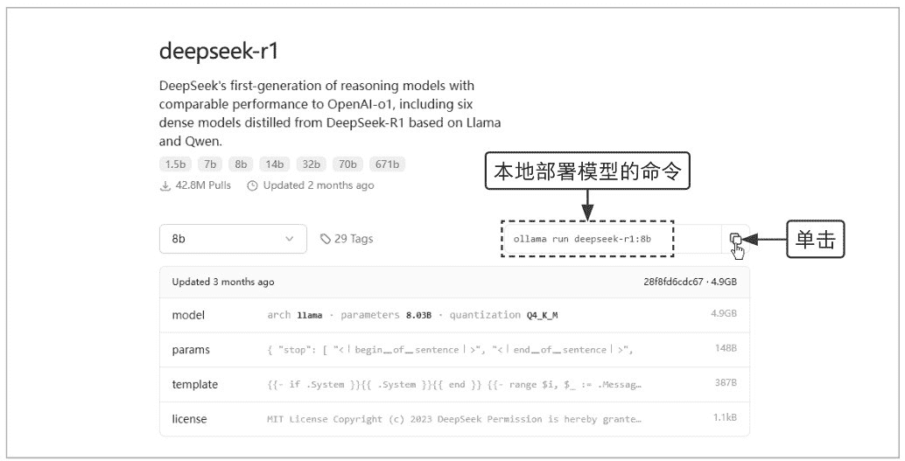

图 2-22 单击相应按钮

**步骤 04** 复制好命令后，打开命令提示符窗口并粘贴该命令，如图 2-23 所示。

**步骤 05** 按 Enter 键运行命令，即可开始本地部署模型，并显示相应的下载进度和速度，如图 2-24 所示。

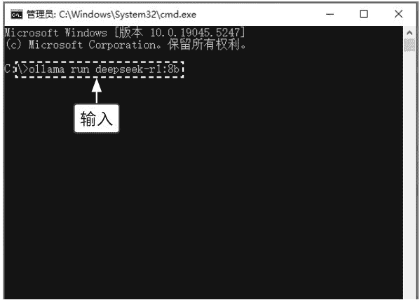

图 2-23 粘贴本地部署模型的命令

图 2-24 显示相应的下载进度和速度

**知识扩展**

DeepSeek-R1 的不同参数模型版本（注意，习惯上使用大写英文字母 B 来表示参数规模）主要在性能、适用场景和硬件需求上有所不同，以下是主要区别。

（1）1.5b、7b、8b 版本：参数相对较少，运行时资源消耗低，适合在本地设备上部署轻量级任务，如小型智能问答系统或简单 AI 助手。

（2）14b 和 32b 版本：推理能力显著提升，能处理更复杂的任务，如代码补全和数据分析，但需要高端 GPU 才能发挥最佳性能。

（3）70b 和 671b 版本：代表顶尖水平，70b 版本接近 GPT-4 的能力；671b 版本是顶级大模型，主要面向大规模云端推理，能处理极其复杂的任务，但对硬件和计算资源需求巨大。

DeepSeek-R1 的不同参数模型版本提供了从轻量级到顶级性能的多种选择，用户可根据自身需求和硬件条件选择合适的版本，推荐配置如下。

（1）1.5b 版本：对硬件要求低，4 核处理器、8GB 内存即可运行，无须显卡。

（2）7b 与 8b 版本：推荐使用 8 核处理器、16GB 内存、Ryzen 7 或更高 CPU、RTX 3060（12GB）或更高显卡。

（3）14b 版本：推荐使用 i9-13900K 或更高 CPU、32GB 内存、RTX 4090（24GB）或 A5000 显卡。

（4）32b 版本：推荐使用 Xeon 8 核、128GB 内存或更高、2～4 张 A100（80GB）或更高显卡。

（5）70b 版本：推荐使用 Xeon 8 核、128GB 内存或更高、8 张 A100/H100（80GB）或更高显卡。

（6）671b 版本：推荐使用 64 核、512GB 内存或更高、8 张 A100/H100（80GB）或更高显卡。

**2.1.5 试运行 DeepSeek 模型**

Ollama 对资源有限的设备也较为友好，即使是显存较小或老旧的设备也能运行 DeepSeek 模型。另外， Ollama 支持 GPU 加速，能够运行和部署由主流机器学习框架（如 Tensorflow、PyTorch）训练出的模型，并支持跨平台操作。同一服务实例可同时运行多个模型，用户可根据需求随时切换。模型下载完成后，即可通过 Ollama 试运行本地部署的 DeepSeek 模型，具体操作方法如下。

**步骤 01** 模型部署完成后，输入相应的问题进行测试，如“你是谁？你能做什么？”，如图 2-25 所示。

图 2-25 输入相应的问题进行测试

**步骤 02** 按 Enter 键确认，将指令发送给模型，DeepSeek 会根据要求进行回复，如图 2-26 所示。

图 2-26 DeepSeek 根据要求进行回复

**2.1.6 配置 Cherry Studio 前端界面**

在本地部署 DeepSeek 模型后，配置一个直观且易用的前端界面是实现高效人机交互的关键步骤。前端界面不仅能够简化用户操作，还能提升用户体验，使用户无须深入了解命令行操作即可充分利用 DeepSeek 的强大功能。

下面以 Cherry Studio 为例，介绍配置 DeepSeek 前端界面的操作方法。

**步骤 01** 进入 Cherry Studio 官网主页，单击“下载客户端”按钮，如图 2-27 所示。

图 2-27 单击“下载客户端”按钮

**步骤 02** 执行操作后，进入“下载”页面，选择与当前系统适配的版本，单击“立即下载”按钮，如图 2-28 所示，下载 Cherry Studio。

图 2-28 单击“立即下载”按钮

**步骤 03** 进入 Cherry Studio 安装程序所在的文件夹，双击 Cherry Studio 安装程序，如图 2-29 所示。

**步骤 04** 执行操作后，弹出“Cherry Studio 安装”对话框，保持默认设置即可，单击“下一步”按钮，如图 2-30 所示。

图 2-29 双击 Cherry Studio 安装程序

图 2-30 单击“下一步”按钮

**步骤 05** 进入“选定安装位置”界面，设置相应的目标文件夹路径，作为 Cherry Studio 的安装位置，如图 2-31 所示。

**步骤 06** 单击“安装”按钮，进入“正在安装”界面，显示 Cherry Studio 的安装进度，如图 2-32 所示。

图 2-31 设置相应的目标文件夹路径

图 2-32 显示 Cherry Studio 的安装进度

**步骤 07** 安装完成后，进入“正在完成 Cherry Studio 安装向导”界面，单击“完成”按钮，如图 2-33 所示，即可运行 Cherry Studio。

**步骤 08** 如果没有在上一步选中“运行 Cherry Studio”复选框，也可以双击桌面上的 Cherry Studio 程序图标来运行 Cherry Studio，如图 2-34 所示。

图 2-33 单击“完成”按钮

图 2-34 双击 Cherry Studio 程序图标

**步骤 09** 启动 Cherry Studio 后，单击右下角的“设置”按钮 ，如图 2-35 所示。

图 2-35 单击“设置”按钮

**知识扩展**

Cherry Studio 是一款功能强大的国产开源 AI 平台，集多模型对话、知识库管理、AI 绘画、翻译等功能于一体。它还提供基础对话功能，如一问多答、自动分组、对话导出等，并支持多种格式渲染。

Cherry Studio 的特色功能包括 AI 绘画、AI 小程序、翻译和文件管理等，还支持多服务商统一管理，如 OpenAI 和 Anthropic 等。Cherry Studio 的界面高度自定义，而且还具有本地知识库系统，支持多种文件格式导入和导出，并注重数据安全。

**步骤 10** 进入“设置”界面，①切换至“模型服务”选项卡；②在中间的列表框中选择“Ollama”选项，如图 2-36 所示。

图 2-36 选择“Ollama”选项

**步骤 11** 执行操作后，在右侧的 Ollama 窗口中单击“模型”选项区中的“管理”按钮，如图 2-37 所示。

图 2-37 单击“管理”按钮

**步骤 12** 弹出“Ollama 模型”对话框，其中会显示前面在本地部署的 DeepSeek 模型，单击右侧的 按钮，如图 2-38 所示。

图 2-38 单击相应按钮

**步骤 13** 关闭“Ollama 模型”对话框，返回“模型服务”选项卡，在右侧的 Ollama 窗口中可以看到添加的本地 DeepSeek 模型，同时会自动启用 Ollama 模型服务，如图 2-39 所示。

图 2-39 添加本地 DeepSeek 模型并启用 Ollama 模型服务

**知识扩展**

注意，在开始配置前端界面之前，需确认 Ollama 服务已在后台运行，并且 DeepSeek 模型已成功安装并可通过 Ollama 访问。

**步骤 14** ①切换至“默认模型”选项卡；②将“默认助手模型”“话题命名模型”“翻译模型”均设置为通过 Ollama 部署的本地 DeepSeek 模型，如图 2-40 所示。

图 2-40 设置默认模型

**步骤 15** ①单击“助手”按钮 进入其界面；②在输入框中输入相应的问题，如“你是谁？”，如图 2-41 所示。

图 2-41 输入相应的问题

**步骤 16** 单击 按钮发送指令，即可调用本地部署的 DeepSeek 模型来回答问题，如图 2-42 所示。

图 2-42 调用本地部署的 DeepSeek 模型来回答问题

### **2.2** **插件部署：DeepSeek 扩展应用**

为了进一步拓展 DeepSeek 模型的应用场景并提升便利性，本地部署 DeepSeek 浏览器插件成了一个重要的方向。本节将重点介绍如何在本地部署 DeepSeek 浏览器插件——Page Assist，包括安装插件、配置插件及进行插件的功能测试。通过 Page Assist 插件，用户可以将 DeepSeek 的强大功能无缝集成到浏览器环境中，实现更便捷高效的操作体验，满足多样化的应用需求。

**2.2.1** **安装 Page** **Assist 插件**

Page Assist 是一款开源的浏览器扩展程序，主要为本地 AI 模型提供直观的交互界面，其功能与特点如下。

（1）提供本地模型交互界面：Page Assist 作为浏览器插件，可在浏览器中打开侧边栏或 Web UI （Website User Interface，网络产品界面设计），与本地部署的 DeepSeek 模型进行对话，使用户能够便捷地获取智能辅助。

（2）支持多浏览器：Page Assist 适用于 Chrome、Edge、Firefox 等多种主流浏览器，用户可以根据自己的使用习惯选择合适的浏览器来安装和使用该插件。

（3）联网搜索功能：结合联网搜索功能，当用户提出问题时，Page Assist 能在检索网络信息后生成回复，为用户提供高效准确的答案。

（4）知识库搭建与整合：用户可以利用 Page Assist 快速搭建本地知识库，并将其与模型结合。当用户咨询相关问题时，模型能基于知识库中的内容给出回答，这在特定领域或专业场景下非常实用。

下面以 Edge 浏览器为例，介绍安装 Page Assist 插件的操作方法。

**步骤 01** 打开 Edge 浏览器，①单击地址栏右侧的“扩展”按钮 ;②在弹出的“扩展”菜单中选择“获取 Microsoft Edge 扩展”选项，如图 2-43 所示。

图 2-43 选择“获取 Microsoft Edge 扩展”选项

**步骤 02** 执行操作后，打开“Microsoft Edge 加载项”网页窗口，在搜索栏中输入 Page Assist，如图 2-44 所示，并按 Enter 键确认。

图 2-44 在搜索栏中输入“Page Assist”

**知识扩展**

Microsoft Edge 加载项是小型软件程序，用于自定义和增强 Edge 浏览器的功能，可帮助用户更好地控制浏览体验，使上网更轻松、更安全、更高效。

Microsoft Edge 加载项包括广告拦截器、密码管理器、语言翻译工具等多种类型，可以从 Microsoft Edge 加载项商店获取，并通过浏览器的扩展图标访问管理界面，进行安装、启用、禁用或删除等操作。

另外，Edge 浏览器还支持从 Chrome Web Store 安装扩展程序，使用加载项有助于优化浏览效率和安全性。

**步骤 03** 执行操作后，即可显示搜索结果，选择相应的扩展插件，如“Page Assist-A Web UI for Local AI Models”（本地 AI 模型的 Web UI），如图 2-45 所示。

图 2-45 选择相应的扩展插件

**步骤 04** 执行操作后，进入 Page Assist 插件的详情页面，单击右上角的“获取”按钮，如图 2-46 所示。

图 2-46 单击“获取”按钮

**步骤 05** 执行操作后，弹出信息提示框，单击“添加扩展”按钮，如图 2-47 所示，即可开始安装 Page Assist 插件。

**步骤 06** 稍等片刻，弹出信息提示框，显示 Page Assist 插件已经成功安装，如图 2-48 所示。

图 2-47 单击“添加扩展”按钮

图 2-48 弹出信息提示框

**2.2.2** **配置 Page** **Assist 插件**

Page Assist 插件为 DeepSeek 模型提供了便捷的交互界面和丰富的功能扩展，使用户能够在浏览器中高效地利用本地 AI 模型进行各种操作，提升了工作效率和使用体验。想要在 Page Assist 插件中调用本地部署的 DeepSeek 模型，还需要先配置该插件，具体操作方法如下。

**步骤 01** 在 Edge 浏览器的地址栏右侧，①单击“扩展”按钮 ;②在弹出的“扩展”菜单中选择相应的 Page Assist 插件，如图 2-49 所示。

图 2-49 选择相应的 Page Assist 插件

**知识扩展**

单击“扩展”按钮 ，可以查看当前已安装的扩展列表，选择下面的“管理扩展”选项，即可进入“扩展”页面，单击相应插件下方的“详细信息”链接，可以访问其设置页面，查看和修改插件的详细信息和配置选项。

**步骤 02** 执行操作后，进入 Page Assist 插件页面，页面中间会出现“Ollama is running”（Ollama 正在运行）的提示信息，说明 Page Assist 已经检测到了 Ollama，在上方的左侧列表框中选择本地部署好的 DeepSeek 模型，如图 2-50 所示。

图 2-50 选择本地部署好的 DeepSeek 模型

**步骤 03** 单击右上角的“Settings”（设置）按钮 ，进入“一般设置”页面，在左侧选择“RAG 设置”选项，如图 2-51 所示。

图 2-51 选择“RAG 设置”选项

**知识扩展**

初次使用 Page Assist 时，默认界面语言为英文，可以在“一般设置”页面的“语言”列表框中选择“简体中文”选项，将界面语言修改为简体中文。

**步骤 04** 进入“RAG 设置”页面，①将“文本嵌入模型”设置为通过 Ollama 部署的本地 DeepSeek 模型；②单击“保存”按钮保存设置即可，如图 2-52 所示。

图 2-52 单击“保存”按钮

**2.2.3** **测试 DeepSeek 模型**

安装并配置好 Page Assist 插件后，可以通过浏览器插件来使用本地部署的 DeepSeek 模型，快速获取所需信息。

下面介绍测试 DeepSeek 模型的操作方法。

**步骤 01** 返回 Page Assist 插件的聊天窗口，在输入框中输入相应的问题，如“你是谁？”，如图 2-53 所示。

图 2-53 输入相应的问题

**步骤 02** 单击“提交”按钮发送指令，即可调用本地部署的 DeepSeek 模型来回答问题，如图 2-54 所示。

图 2-54 调用 DeepSeek 模型回答问题

### **本章小结**

本章首先介绍了 DeepSeek 模型在本地的安装过程，涵盖部署前的准备工作、安装 Python 依赖项、下载与安装 Ollama、下载并试运行 DeepSeek 模型以及配置 Cherry Studio 前端界面等关键步骤，为本地部署提供了详细的操作指南；然后介绍了 DeepSeek 浏览器插件 Page Assist 的部署与应用技巧，包括安装、配置插件以及测试模型，使读者能够掌握如何在浏览器环境中扩展和利用 DeepSeek 模型的功能。

### **课后实训**

**实训任务** 在本地安装并配置好 DeepSeek 模型后，通过 Page Assist 插件可以实现本地 DeepSeek 模型的联网搜索功能，使该模型能够实时获取网络上的最新信息，如获取当天的日期信息。

下面介绍使用本地部署的 DeepSeek 获取当天日期信息的操作方法。

**步骤 01** 在 Page Assist 插件的聊天窗口中，在输入框左下角开启“搜索互联网”功能，如图 2-55 所示。

图 2-55 开启“搜索互联网”功能

**步骤 02** 在输入框中输入相应的问题，如“今天的日期是什么？”，发送指令后即可让 DeepSeek 联网搜索答案，如图 2-56 所示，这样可以提升本地 DeepSeek 模型回答问题的准确度。

图 2-56 让 DeepSeek 联网答案

## **第三章 数据获取：构建 AI 模型的知识库**

数据是信息的载体，是关于事实、概念或指令的信息表达，通常以数字、文字、图像、声音、视频等形式存在。在人工智能领域，数据是构建和训练 AI 模型的基石。本章将深入探讨数据获取的关键技术和方法，为 AI 模型训练提供丰富的知识库支持。

### **3.1** **数据与模型：看懂 AI 训练中的核心关联**

数据与模型之间的关系是 AI 训练中的核心。本节将聚焦于模型训练中的数据集，深入浅出地解释其重要性，并提供通俗易懂的解读。

**3.1.1** **通俗解读模型训练中的数据集**

在机器学习或深度学习项目中，数据是模型的核心驱动力。为了确保模型能够有效学习、优化并最终可靠地应用于真实场景，数据集的合理划分至关重要。通常，数据集会被分为 3 个独立部分：训练集、验证集和测试集，三者与模型训练之间的关系如图 3-1 所示。

图 3-1 训练集、验证集和测试集与模型训练之间的关系

训练集、验证集和测试集在模型训练中分别承担着不同的角色，共同推动模型从开发到落地的全流程。数据集的科学划分是机器学习成功的基础，无论是初学入门还是实战进阶，理解训练集、验证集与测试集的作用，掌握灵活划分的技巧，都能显著提升模型训练的效率与效果，相关方法如下。

**1．训练集：模型学习的基石**

训练集（Training Set）是模型在训练阶段直接学习数据特征的核心数据集，它通常占原始数据的 60%～80%，具体比例取决于数据规模和任务复杂度。

训练集的核心作用是：通过训练集，模型可以学习数据的潜在规律，调整内部参数（如神经网络的权重），最终获得初步的预测能力。注意，训练集应具备代表性和多样性，避免因数据偏差导致模型学不到通用规律。

**2．验证集：优化模型的“调参助手”**

验证集（Validation Set）用于在训练过程中评估模型性能，通常占数据的 10%～20%，其核心作用和注意事项如下。

（1）超参数调优：通过验证集调整学习率、丢弃率等超参数，避免模型在训练集上过拟合（过度记忆数据细节）或欠拟合（未能捕捉数据规律）。

（2）模型选择：比较不同算法或结构的性能，选择最优模型进入下一阶段。

（3）注意事项：验证集需与训练集互不重叠，确保评估的客观性。

**3．测试集：模型性能的“终极大考”**

测试集（Test Set）是模型训练完成后用于最终评估的数据集，占比通常为 10%～20%，且与训练集、验证集完全独立，其核心作用和注意事项如下。

（1）泛化能力检验：测试集通过模拟模型在真实场景中遇到的“未见数据”，验证其是否具备鲁棒性和实用性。

（2）性能量化：提供准确率、F1 分数等客观指标，为模型上线提供决策依据。

（3）注意事项：测试集应严格保密，仅在最终评估阶段使用，避免因提前接触数据而导致评估失真。

**知识扩展**

数据集的一个常见划分比例为 6:2:2，即训练集 60%、验证集 20%、测试集 20%，但需根据实际情况灵活调整。例如，小数据集可能采用 7:1:2 的比例来划分，而海量数据可适当降低验证集比例。

**3.1.2** **获取公开数据集的常用途径**

在机器学习领域，高质量数据集是模型训练的“燃料”。无论是新手入门还是资深开发者做项目，快速找到合适的数据集都是关键一步。下面为大家推荐两个实用的网站，覆盖从基础到前沿的各类数据资源，助大家轻松开启 AI 探索之旅。

**1.Kaggle：资源丰富的机器学习数据集社区**

作为全球知名的 AI 社区，Kaggle 的数据集板块堪称“机器学习的百科全书”，包含超 10 万个公开数据集，包括图像、文本、结构化数据等多种类型，覆盖医疗、金融、自动驾驶、自然语言处理等热门领域。

Kaggle 平台上还有很多典型数据集，如 Titanic 数据集，它是一个经典入门级的结构化数据集，用于练习分类模型（如逻辑回归）；再如 Google Landmark 图像数据集，包含千万级地标图片，适合图像识别项目，如图 3-2 所示。

图 3-2 Google Landmark 图像数据集

Kaggle 平台上的每个数据集都附带有用户讨论区和 kernels（代码示例），可直接查看其他开发者的数据分析过程和模型代码。例如，在房价预测数据集中，能看到如何用 Pandas（Python 数据分析模块）清洗数据、用 Scikit-learn（开源的 Python 库）训练模型的完整流程。另外，Kaggle 还支持在线 Notebook（笔记本）运行，无须本地配置环境，新手可直接在浏览器中尝试数据可视化和模型训练。

用户可以通过“标签”筛选数据类型，如 image、text 等；或者在 Kaggle 首页查看 Trending（趋势分析）榜单，了解当前 AI 领域的热点方向，如 2024 年的生成式 AI 数据集；同时，还可以参与数据集竞赛， Kaggle 的竞赛数据集经过严格筛选，常包含实际业务场景中的复杂数据（如缺失值、噪声数据），适合提升实战能力。

**2.Google** **Dataset** **Search：精准挖掘学术与开放数据**

Google Dataset Search 作为 Google 推出的专业数据集搜索引擎，整合了全球数千个数据源，包括大学开放数据平台、政府公开数据、科研机构数据集。同时，Google Dataset Search 支持按下载格式、使用权限等标签精准筛选数据集，如图 3-3 所示。

图 3-3 使用 Google Dataset Search 筛选数据集

Google Dataset Search 会优先展示与论文关联的数据集，同时还会提供数据集引用格式，方便学术论文写作时标注数据来源。另外，用户还可以先用 Google Dataset Search 找到数据，再用 Google 学术搜索（Google Scholar Search）检索相关研究论文，形成“数据＋方法”的完整研究链条，如图 3-4 所示。

图 3-4 Google 学术搜索的应用示例

**3.1.3** **生成高质量的模型微调数据集**

在 AI 模型的微调场景中，领域文献的结构化处理是关键而耗时的环节。传统文献处理方法面临三大痛点，而借助智能化工具可实现从文献到数据集的自动化转换。

传统文献处理方法的三大痛点如下。

（1）长文本分割的“信息断层”：单篇文献（如论文、行业报告）通常包含数万字，直接输入模型会因 token 限制（如早期模型通常支持 4096 个 token）导致内容截断；手动分割易出现“段落割裂”，破坏上下文逻辑（如将实验方法与结果拆分到不同块）。

（2）标签体系构建的“人工陷阱”：领域文献涉及多维度标签（如“方法-深度学习-Transformer”），人工标注耗时且易遗漏细分领域；用 Excel 表格管理标签效率低下，无法动态关联文献内容。

（3）答案生成的“机械重复”：基于规则的模板生成的内容往往缺乏逻辑推理（如仅提取文献摘要作为答案，无法应对“实验结论的局限性”等复杂问题）；重复问题标注（如同一概念的不同表述）会导致数据冗余，浪费训练资源。

在大模型开发领域，高质量微调数据集的构建往往是决定模型性能的关键环节。传统方法依赖人工标注或规则生成，面临效率低下、成本高昂、数据多样性不足等痛点。而一款名为 Easy Dataset 的智能工具正通过“大模型驱动＋自动化流程”的创新模式，实现数据集生成效率的极大提升，如图 3-5 所示。

图 3-5 使用 Easy Dataset 创建的数据集

Easy Dataset 能够极大地简化数据集制作流程，帮助用户快速生成高质量的训练数据。Easy Dataset 的使用方法非常简单：首先，用户只需要上传自己的文档，工具便会自动进行内容拆分；其次，用户可以指定或生成问题，工具会基于文档内容自动生成精准的答案，从而形成问答对；最后，用户可以选择一个合适的模型并一键构建数据集，就能轻松获得符合需求的数据集。

Easy Dataset 的优势非常明显，它允许用户灵活地编辑问题和答案，从而完全掌控数据质量，确保数据集符合自己的预期。另外，Easy Dataset 还支持导出多种文件类型，可以轻松适配各种微调框架的需求。

此外，Easy Dataset 是一个完全开源的项目，用户不仅可以使用“开箱即用”的客户端，还可以通过 Docker 进行本地部署，进一步满足个性化需求。

### **3.2 搭建知识库：构建大模型的训练数据集**

构建高效且精准的知识库是模型训练的关键步骤之一，可以为模型提供丰富的领域知识和结构化信息。本节将以 AnythingLLM＋DeepSeek-R1 为例，介绍从零开始构建 AI 大模型知识库的过程，帮助大家在本地环境中搭建稳定且高效的知识库系统。

**3.2.1 下载并安装 AnythingLLM**

AnythingLLM 是一个功能强大的全栈 AI 应用，由 Mintplex Labs 开发，支持多种大语言模型（Large Language Model,LLM）和向量数据库。AnythingLLM 允许用户将文档转换为知识库，与 LLM 结合实现智能问答。

下面介绍下载并安装 AnythingLLM 的操作方法。

**步骤 01** 进入 AnythingLLM 官网，单击“Download for desktop”（下载桌面版）按钮，如图 3-6 所示。

**步骤 02** 执行操作后，进入下载页面，系统会自动帮我们检测并选择合适的操作系统版本。例如，这里选择的是 Windows 版本，直接单击“Download for Windows（x64）”按钮，如图 3-7 所示，即可下载 AnythingLLM 的安装程序。

图 3-6 单击“Download for desktop”按钮

图 3-7 单击“Download for Windows（x64）”按钮

**步骤 03** 进入 AnythingLLM 安装程序所在的文件夹，双击 AnythingLLM 安装程序，如图 3-8 所示。注意，安装 AnythingLLM 之前需先启动 Ollama，否则在安装过程中可能会报错。

**步骤 04** 执行操作后，弹出“AnythingLLM 安装”对话框，并进入“安装选项”界面，保持默认设置即可，单击“下一步”按钮，如图 3-9 所示。

图 3-8 双击 AnythingLLM 安装程序

图 3-9 单击“下一步”按钮

**步骤 05** 进入“选定安装位置”界面，设置相应的目标文件夹路径作为 AnythingLLM 的安装位置，如图 3-10 所示。

**步骤 06** 单击“安装”按钮，进入“正在安装”界面，显示 AnythingLLM 的安装进度，如图 3-11 所示。

图 3-10 设置相应的目标文件夹路径

图 3-11 显示 AnythingLLM 的安装进度

**步骤 07** 安装完成后，进入“正在完成 AnythingLLM 安装向导”界面，单击“完成”按钮，如图 3-12 所示。

**步骤 08** 执行操作后，即可启动 AnythingLLM。单击“开始”按钮，如图 3-13 所示，根据提示完成一些基本的偏好设置和新建工作区的操作即可。

图 3-12 单击“完成”按钮

图 3-13 单击“开始”按钮

**3.2.2 配置 AnythingLLM**

AnythingLLM 具有内置 RAG 和 AI 代理，支持多用户管理和离线使用，能够有效保障数据隐私。另外， AnythingLLM 还支持 MCP（Model Context Protocol，模型上下文协议），可无代码构建智能代理（即 AI 智能体）。AnythingLLM 开源且支持本地部署，适合数据敏感场景，如企业知识管理和教育研究。

下面介绍配置 AnythingLLM 的操作方法。

**步骤 01** 在 AnythingLLM 的左侧面板下方单击“Open settings”（打开设置）按钮 ，如图 3-14 所示。

**步骤 02** 执行操作后，默认进入“设置”界面中的“外观”→“界面偏好”选项卡，在“显示语言”列表框中选择“Chinese”（中文）选项，将界面语言修改为中文，如图 3-15 所示。

图 3-14 单击“Open settings”按钮

图 3-15 选择“Chinese”选项

**步骤 03** ①切换至“人工智能提供商”→“LLM 首选项”选项卡；②单击“LLM 提供商”下方的相应按钮，如图 3-16 所示。

**步骤 04** 执行操作后，在弹出的“Search all LLM providers”（搜索所有 LLM 提供者）列表框中选择“Ollama”选项，如图 3-17 所示。

图 3-16 单击相应按钮

图 3-17 选择“Ollama”选项

**步骤 05** 执行操作后，即可接入 Ollama 中的模型，①在 Ollama Model 列表框中选择相应的 DeepSeek-R1 模型；②单击“Save changes”（保存更改）按钮，修改 AnythingLLM 的默认模型设置，如图 3-18 所示。

**步骤 06** ①切换至“人工智能提供商”→“Embedder 首选项”（嵌入器首选项）选项卡；②设置“嵌入引擎提供商”为 Ollama，系统会自动接入在 Ollama 中本地部署的嵌入模型；③单击“保存更改”按钮即可，如图 3-19 所示。

图 3-18 单击“Save changes”按钮

图 3-19 单击“保存更改”按钮

**3.2.3 上传私有的训练数据集**

在 AI 开发领域，数据是模型的基石，而私有数据集更是承载独特见解与专业信息的关键载体。用户可以在 AnythingLLM 中上传私有训练数据集，确保数据安全与模型性能“双提升”，同时还可以打造专属 AI 智能助手，精准解决特定领域问题，实现数据价值最大化。下面介绍上传私有训练数据集的操作方法。

**步骤 01** 在 AnythingLLM 的左侧面板中单击“新工作区”按钮，如图 3-20 所示。

**步骤 02** 执行操作后，弹出“新工作区”对话框，设置“工作区名称”为“企业销售数据”，如图 3-21 所示。

图 3-20 单击“新工作区”按钮

图 3-21 设置“工作区名称”选项

**步骤 03** 单击“Save”（保存）按钮，即可新建一个工作区，单击工作区名称右侧的 按钮，如图 3-22 所示。

**步骤 04** 执行操作后，弹出“文档”对话框，单击“我的文档”选项区中的虚线框区域，如图 3-23 所示。

图 3-22 单击相应按钮

图 3-23 单击虚线框区域

**步骤 05** 弹出“打开”对话框，①选择相应的数据表格；②单击“打开”按钮，如图 3-24 所示，上传数据表格。

**步骤 06** 将数据表格上传到文档库后，①选中相应的文档；②单击“移动到工作区”按钮，如图 3-25 所示。

图 3-24 单击“打开”按钮

图 3-25 单击“移动到工作区”按钮

**知识扩展**

如果用户需要在 AnythingLLM 中上传多种格式或类型的数据，可以单击“新建文件夹”按钮，创建多个文件夹来对这些数据进行分类处理。

**步骤 07** 执行操作后，将文档移动到工作区中，单击“保存并嵌入”按钮，如图 3-26 所示，即可完成数据的上传。

图 3-26 单击“保存并嵌入”按钮

**知识扩展**

AnythingLLM 知识库中的数据通常是经过系统整理和结构化的，它可以包含多个文档、文件夹，并且可以按照一定的主题、类别或层次结构进行组织。例如，一个企业知识库可以分为产品信息、客户服务指南、技术文档等多个部分。数据在知识库中会被处理成适合模型检索和理解的格式，如向量化的表示，以便快速响应各种查询。

### **本章小结**

本章首先介绍了数据与模型在 AI 训练中的核心关联，从通俗解读模型训练中的数据集入手，详细讲解了获取公开数据集的常用途径，并提供了生成高质量模型微调数据集的方法，为读者奠定了坚实的数据基础；然后介绍了如何搭建知识库来构建大模型的训练数据集，具体包括下载并安装 AnythingLLM、配置 AnythingLLM 以及上传私有的训练数据集，使读者能够实践并掌握数据集的构建与应用技巧。

### **课后实训**

**实训任务** 本实训任务旨在验证模型基于私有数据的问答效果。通过提问检验 DeepSeek-R1 模型理解与运用数据的能力，记录并分析回复的准确性、相关性和流畅度。根据结果调整数据或模型参数，优化回复效果，以提升模型性能和实用性。

下面介绍验证模型回复效果的操作方法。

**步骤 01** 在“企业销售数据”工作区的输入框中输入相应的问题，如“孙莉的销售金额是多少？”，如图 3-27 所示。

图 3-27 输入相应的问题

**步骤 02** 单击“将提示消息发送到工作区”按钮 ,AnythingLLM 即可调用 DeepSeek-R1 模型对数据进行深入分析，并根据要求回复，如图 3-28 所示。

图 3-28 模型的回复效果

## **第四章** **数据标注：引导模型学习提升性能**

在人工智能领域，数据标注是提升模型性能的关键步骤。本章将深入探讨数据标注的重要性和技术原理，同时结合 MakeSense 工具详细讲解图像数据标注的全过程，帮助读者掌握数据标注的实战技能，为模型训练提供精准的数据支持。

### **4.1** **数据标注：大模型的“智能基因编辑师”**

在人工智能的底层逻辑中，数据标注是连接人类知识与机器智能的桥梁。当我们惊叹于 DeepSeek-R1、GPT-4.5 等大模型的“聪明才智”时，其背后是无数的数据标注人员对原始数据的精细雕琢。

从早期纯人工标注到如今的智能辅助，数据标注正在经历从“劳动密集型”到“人机协同型”的转型，成为 AI 产业中不可或缺的核心环节。本节将带大家理解数据标注的本质，包括数据标注的概念与技术原理，以及其在大模型中的作用。

**4.1.1** **数据标注的概念与技术原理**

标注的本质是赋予数据“语义生命力”，它是指用人工或工具对原始数据（文本、图像、语音等）进行标签化、结构化处理，使其具备机器可理解的语义信息。例如，在图像领域，标注人员需用边界框圈出汽车、行人，告诉模型“这是什么”，如图 4-1 所示；在对话领域，需校准模型的伦理响应，确保模型回复符合人类价值观。

图 4-1 图像领域的数据标注示例

有研究表明，数据标注的准确率每提升 10%，模型在真实场景的误差率将降低 15%～20%。例如， OpenAI 的 GPT-4 模型通过数万小时的数据标注校准，将“有害内容生成概率”从 47%降至<1%。

在 AI 工业化的浪潮中，唯有重视数据质量，才能让大模型真正实现从“数据堆积”到“智能涌现”的跨越——毕竟，只有纯净的燃料才能驱动引擎驶向更远的未来。下面简单介绍从纯人工到 AI 辅助的数据标注技术跃迁过程。

（1）预标注：可显著减少重复劳动。该技术的原理是利用预训练模型（如 DeepSeek-R1）生成初始标注，人工仅需校验修正。例如，在文本实体标注中，用模型自动识别 90%的人名、地名，人工仅需处理模糊实体（如“小李”是否指代特定人物）；在图像标注中，用模型预标注车辆、行人，标注人员只需调整边界框位置。

（2）主动学习：让标注更“聪明”。该技术的原理是通过模型筛选最具价值的样本进行优先标注。例如，在罕见病影像标注中，模型主动选择“疑似病变但特征不明显”的样本，使标注资源集中于关键数据，能够减少大量的无效标注量。

（3）小样本增强：破解数据稀缺难题。该技术的原理包括利用扩散（Diffusion）模型生成仿真数据（如合成不同光照条件的自动驾驶场景图），配合少量真实的标注数据，能够大幅提升模型训练的效率。

**4.1.2** **数据标注在大模型中的作用**

在 DeepSeek 等大模型掀起的 AI 浪潮中，我们看到了 AI 的强大“智慧”——能写诗、会编程、可解答专业问题。但很少有人意识到，这些“智慧”的背后，是无数经过精细标注的数据在支撑。正如建筑需要坚实的地基，大模型的强大能力离不开高质量标注数据的“喂养”。

大模型的本质是统计学习系统，需依赖标注数据发现规律。下面是数据标注在大模型中的主要作用。

（1）监督学习的基石：90%的模型训练都依赖数据标注。例如，GPT-4 通过数千万条标注对话学会人类语言逻辑，AlphaFold 通过数百万条蛋白质结构标注数据破解折叠密码，如图 4-2 所示。

图 4-2 AlphaFold 模型应用示例

（2）模型对齐的关键：通过数据标注指导模型给出符合人类价值观的回复。

（3）“幻觉”抑制的“解药”：标注的“事实性数据”（如历史事件、科学公式等）可以帮助模型减少“胡编乱造”，提升回复可信度。

那么，数据标注如何塑造大模型能力呢？具体方法如下。

（1）文本标注：构建语言理解的“思维框架”，包括以下几类。

分类标注：将数据划分到不同类别中的一种标注方式。例如，在新闻数据中标注“科技/财经/娱乐”类别，让模型学会内容分类。

实体标注：在文本中识别出具有特定意义的实体，并进行标注。例如，在法律文书中标注“当事人/时间/地点”，让模型掌握信息抽取能力。

对话标注：对对话中的内容进行标注，以识别对话的结构、角色、话题等。例如，在客服记录中标注“问题类型/解决方案”，让模型优化问答逻辑。

（2）图像标注：赋予机器“视觉认知”能力，包括以下几类。

边界框标注：在图像中用矩形框标出目标物体的位置。例如，在自动驾驶图像中标注“车辆/交通信号灯”，让模型实现障碍物检测。

语义分割标注：将图像中的每个像素点与一个语义类别相关联的过程。例如，在机器人抓取任务中，通过对图像进行语义分割标注，区分出目标物体（如杯子）、桌面、背景等，从而更精准地控制机器人的抓取动作，如图 4-3 所示。

图 4-3 机器人抓取任务中的语义分割标注示例

关键点标注：在图像中对特定的关键部位进行标注。例如，在人体图像中标注“关节位置”，让模型完成姿态估计。

（3）多模态标注：打通大模型的“感知-认知”链路，包括以下几类。

图文对齐标注：将文本和图像进行对齐标注，使文本和图像之间建立关联。例如，在电商数据中标注“商品图-名称-描述”，让模型实现跨模态检索。

语音文本标注：使语音和对应的文本内容对应起来的一种标注方式。例如，在短视频数据中标注“语音内容-情感-场景”，让模型学会理解视频内容。

从早期的人工标注到如今的智能辅助，数据标注始终是大模型进步的“隐形驱动力”。它不仅是简单的标签粘贴，更是人类智慧与机器能力的深度融合——用数据标注为模型编写“认知说明书”，用领域知识为模型划定“行为边界”。

在 AI 工业化的进程中，数据标注的价值将愈发凸显：自动驾驶需要高精度标注实现安全行驶，医疗 AI 需要专业标注突破诊断瓶颈，智能客服需要场景化标注提升用户体验。正如石油驱动了工业革命，数据标注正驱动着 AI 革命——每一个精准的标签，都是打开智能未来的一把钥匙。

## **第四章** **数据标注：引导模型学习提升性能**

在人工智能领域，数据标注是提升模型性能的关键步骤。本章将深入探讨数据标注的重要性和技术原理，同时结合 MakeSense 工具详细讲解图像数据标注的全过程，帮助读者掌握数据标注的实战技能，为模型训练提供精准的数据支持。

### **4.1** **数据标注：大模型的“智能基因编辑师”**

在人工智能的底层逻辑中，数据标注是连接人类知识与机器智能的桥梁。当我们惊叹于 DeepSeek-R1、GPT-4.5 等大模型的“聪明才智”时，其背后是无数的数据标注人员对原始数据的精细雕琢。

从早期纯人工标注到如今的智能辅助，数据标注正在经历从“劳动密集型”到“人机协同型”的转型，成为 AI 产业中不可或缺的核心环节。本节将带大家理解数据标注的本质，包括数据标注的概念与技术原理，以及其在大模型中的作用。

**4.1.1** **数据标注的概念与技术原理**

标注的本质是赋予数据“语义生命力”，它是指用人工或工具对原始数据（文本、图像、语音等）进行标签化、结构化处理，使其具备机器可理解的语义信息。例如，在图像领域，标注人员需用边界框圈出汽车、行人，告诉模型“这是什么”，如图 4-1 所示；在对话领域，需校准模型的伦理响应，确保模型回复符合人类价值观。

图 4-1 图像领域的数据标注示例

有研究表明，数据标注的准确率每提升 10%，模型在真实场景的误差率将降低 15%～20%。例如， OpenAI 的 GPT-4 模型通过数万小时的数据标注校准，将“有害内容生成概率”从 47%降至<1%。

在 AI 工业化的浪潮中，唯有重视数据质量，才能让大模型真正实现从“数据堆积”到“智能涌现”的跨越——毕竟，只有纯净的燃料才能驱动引擎驶向更远的未来。下面简单介绍从纯人工到 AI 辅助的数据标注技术跃迁过程。

（1）预标注：可显著减少重复劳动。该技术的原理是利用预训练模型（如 DeepSeek-R1）生成初始标注，人工仅需校验修正。例如，在文本实体标注中，用模型自动识别 90%的人名、地名，人工仅需处理模糊实体（如“小李”是否指代特定人物）；在图像标注中，用模型预标注车辆、行人，标注人员只需调整边界框位置。

（2）主动学习：让标注更“聪明”。该技术的原理是通过模型筛选最具价值的样本进行优先标注。例如，在罕见病影像标注中，模型主动选择“疑似病变但特征不明显”的样本，使标注资源集中于关键数据，能够减少大量的无效标注量。

（3）小样本增强：破解数据稀缺难题。该技术的原理包括利用扩散（Diffusion）模型生成仿真数据（如合成不同光照条件的自动驾驶场景图），配合少量真实的标注数据，能够大幅提升模型训练的效率。

**4.1.2** **数据标注在大模型中的作用**

在 DeepSeek 等大模型掀起的 AI 浪潮中，我们看到了 AI 的强大“智慧”——能写诗、会编程、可解答专业问题。但很少有人意识到，这些“智慧”的背后，是无数经过精细标注的数据在支撑。正如建筑需要坚实的地基，大模型的强大能力离不开高质量标注数据的“喂养”。

大模型的本质是统计学习系统，需依赖标注数据发现规律。下面是数据标注在大模型中的主要作用。

（1）监督学习的基石：90%的模型训练都依赖数据标注。例如，GPT-4 通过数千万条标注对话学会人类语言逻辑，AlphaFold 通过数百万条蛋白质结构标注数据破解折叠密码，如图 4-2 所示。

图 4-2 AlphaFold 模型应用示例

（2）模型对齐的关键：通过数据标注指导模型给出符合人类价值观的回复。

（3）“幻觉”抑制的“解药”：标注的“事实性数据”（如历史事件、科学公式等）可以帮助模型减少“胡编乱造”，提升回复可信度。

那么，数据标注如何塑造大模型能力呢？具体方法如下。

（1）文本标注：构建语言理解的“思维框架”，包括以下几类。

分类标注：将数据划分到不同类别中的一种标注方式。例如，在新闻数据中标注“科技/财经/娱乐”类别，让模型学会内容分类。

实体标注：在文本中识别出具有特定意义的实体，并进行标注。例如，在法律文书中标注“当事人/时间/地点”，让模型掌握信息抽取能力。

对话标注：对对话中的内容进行标注，以识别对话的结构、角色、话题等。例如，在客服记录中标注“问题类型/解决方案”，让模型优化问答逻辑。

（2）图像标注：赋予机器“视觉认知”能力，包括以下几类。

边界框标注：在图像中用矩形框标出目标物体的位置。例如，在自动驾驶图像中标注“车辆/交通信号灯”，让模型实现障碍物检测。

语义分割标注：将图像中的每个像素点与一个语义类别相关联的过程。例如，在机器人抓取任务中，通过对图像进行语义分割标注，区分出目标物体（如杯子）、桌面、背景等，从而更精准地控制机器人的抓取动作，如图 4-3 所示。

图 4-3 机器人抓取任务中的语义分割标注示例

关键点标注：在图像中对特定的关键部位进行标注。例如，在人体图像中标注“关节位置”，让模型完成姿态估计。

（3）多模态标注：打通大模型的“感知-认知”链路，包括以下几类。

图文对齐标注：将文本和图像进行对齐标注，使文本和图像之间建立关联。例如，在电商数据中标注“商品图-名称-描述”，让模型实现跨模态检索。

语音文本标注：使语音和对应的文本内容对应起来的一种标注方式。例如，在短视频数据中标注“语音内容-情感-场景”，让模型学会理解视频内容。

从早期的人工标注到如今的智能辅助，数据标注始终是大模型进步的“隐形驱动力”。它不仅是简单的标签粘贴，更是人类智慧与机器能力的深度融合——用数据标注为模型编写“认知说明书”，用领域知识为模型划定“行为边界”。

在 AI 工业化的进程中，数据标注的价值将愈发凸显：自动驾驶需要高精度标注实现安全行驶，医疗 AI 需要专业标注突破诊断瓶颈，智能客服需要场景化标注提升用户体验。正如石油驱动了工业革命，数据标注正驱动着 AI 革命——每一个精准的标签，都是打开智能未来的一把钥匙。

### **4.2 MakeSense：图像数据标注实战指南**

MakeSense 是一款流行的开源图像数据标注工具。本节将深入探讨 MakeSense 的实战应用，帮助大家高效掌握图像数据标注技能。

**4.2.1 选择打标任务类型**

MakeSense 以其用户友好的界面和强大的功能，为用户提供了便捷的标注体验。它支持多种标注类型，可满足不同场景下的需求，并且能够导出多种格式的数据，方便与各类机器学习框架集成。下面介绍在 MakeSense 中选择打标任务类型的操作方法。

**步骤 01** 进入 MakeSense 主页，单击右下角的“Get Started”（开始使用）按钮，如图 4-4 所示。

图 4-4 单击“Get Started”按钮

**知识扩展**

MakeSense 的特点和功能如下。

（1）开源免费：采用 GNU 通用公共许可证第三版（GNU General Public License version 3,GPLv3），用户无须付费即可使用。

（2）无须安装：直接通过浏览器访问官网即可使用，支持多种操作系统。

（3）多种标注类型：支持矩形、点、线、多边形等多种标注类型。

（4）多种输出格式：支持输出 YOLO、VOC XML、VGG JSON、CSV 等多种文件格式，方便用户根据需求选择。

（5）集成 AI 功能：集成了 YOLOv5、SSD、PoseNet 等 AI 模型，既提高了标注效率，又减少了人工操作。

（6）保护数据隐私：所有标注工作均在本地完成，不存储用户上传的图像，充分保障了数据隐私。

**步骤 02** 执行操作后，单击页面中间的黑色方框区域，如图 4-5 所示。

**步骤 03** 弹出“打开”对话框，选择相应的图像文件，如图 4-6 所示。

图 4-5 单击黑色方框区域

图 4-6 选择相应的图像文件

**步骤 04** 单击“打开”按钮，即可加载图像文件。可以看到 MakeSense 支持 Object Detection（对象检测）和 Image recognition（图像识别）两种打标任务类型，这里单击“Object Detection”按钮即可，如图 4-7 所示。

图 4-7 单击 Object Detection 按钮

**知识扩展**

MakeSense 支持多种主流目标检测模型，用户可选择适合数据和任务的模型，快速检测图像中的物体。另外，MakeSense 还支持图片分类任务，能识别图像中的内容和主题，将其划分到不同类别，可用于图像管理与检索。

**4.2.2 创建和添加自定义标签**

在图像数据标注过程中，添加自定义标签是实现精准数据标注的重要一步。通过自定义标签，用户能够根据特定的项目需求和图像内容，定义不同的类别和对象，从而提高数据标注的准确性和适用性。

下面介绍在 MakeSense 中创建和添加自定义标签的方法。

**步骤 01** 选择对象检测任务后，弹出“Create labels”（创建标签）对话框，单击“Load labels from file”（从文件加载标签）按钮，如图 4-8 所示。

**步骤 02** 弹出“Load file with labels description”（加载带有标签描述的文件）对话框，将标签文件直接拖曳至中间的黑色方框中，如图 4-9 所示。

图 4-8 单击“Load labels from file”按钮

图 4-9 拖曳标签文件至黑色方框中

**步骤 03** 添加标签文件后，单击“Start project”（启动项目）按钮，如图 4-10 所示。

**步骤 04** 加载任务后，单击菜单栏中的“Actions”（操作）→“Edit Labels”（编辑标签）命令，如图 4-11 所示。

图 4-10 单击 Start project 按钮

图 4-11 单击 Edit Labels 命令

**步骤 05** 执行操作后，弹出“Edit labels”对话框，单击该对话框左上角的 按钮，如图 4-12 所示。

**步骤 06** 执行操作后，即可插入一个新标签，①输入相应的标签名称，如“house”（房子）;②单击“Accept”（接受）按钮即可添加新标签，如图 4-13 所示。

图 4-12 单击相应按钮

图 4-13 单击“Accept”按钮

**4.2.3 给图像数据打标**

在 MakeSense 中，标签是用来标识图像中特定内容或目标物体的名称或类别。例如，在对象检测任务中，可以创建“人物”“汽车”“房子”等标签。标签可以帮助模型理解图像内容，学习不同物体的特征，从而在后续的模型训练和预测任务中，能够准确地识别和定位这些目标物体或图像内容。

下面介绍在 MakeSense 中给图像数据打标的操作方法。

**步骤 01** 系统默认选择的是 Rect（矩形）标注工具，按住鼠标左键并拖曳，框住图中需要打标的对象，此时标注框是白色的，表示当前选中但未绑定标签，如图 4-14 所示。

**步骤 02** 在右侧的“Select label”（选择标签）列表框中选择相应的标签，如“car”（汽车），如图 4-15 所示。

图 4-14 框住图中需要打标的对象

图 4-15 选择相应的标签

**步骤 03** 执行操作后，即可给目标对象打上相应的标签，同时标注框变成黄色（即“car”这个标签的颜色），如图 4-16 所示。

**步骤 04** 在左侧的“Images”（图像）面板中选择其他图像，此时可以直接使用 Rect 标注工具标注图中的相同对象，如图 4-17 所示。

图 4-16 给目标对象打上标签

图 4-17 标注图中的相同对象

**4.2.4 修改标注项目的名称**

在使用 MakeSense 进行图像数据标注的过程中，灵活管理标注项目的信息至关重要。用户可以修改标注项目的名称，以确保项目标识的准确性与相关性，具体操作方法如下。

**步骤 01** 单击默认项目名称，此时该名称会变成蓝色可编辑状态，如图 4-18 所示。

**步骤 02** 删除默认名称，并输入相应的新名称，如“测试项目”，如图 4-19 所示。

图 4-18 单击默认项目名称

图 4-19 输入相应的新名称

**4.2.5 导出打标数据文件**

MakeSense 的导出功能允许用户将标注好的数据以多种通用格式保存到本地，以便后续在不同的机器学习框架和模型训练任务中使用。通过导出打标数据文件，用户可以轻松地将标注好的数据集集成到自己的 AI 项目中，进行模型训练、验证和测试。下面介绍导出打标数据文件的操作方法。

**步骤 01** 单击菜单栏中的“Actions”→“Export Annotations”（导出标注）命令，如图 4-20 所示。

**步骤 02** 弹出“Export rect annotations”（导出矩形标注）对话框，①选中相应标签格式前面的复选框，如这里选择 YOLO 数据标签格式；②单击“Export”（导出）按钮，如图 4-21 所示。

图 4-20 单击“Export Annotations”命令

图 4-21 单击“Export”按钮

**步骤 03** 执行操作后，即可导出打标数据文件，解压后打开相应的文本文档，即可看到相应的标签数据，如图 4-22 所示。

图 4-22 看到相应的标签数据

**知识扩展**

YOLO（You Only Look Once，你只看一次）格式通常用于表示图像中目标物体的位置和类别。例如，在图 4-22 的标签数据中，开头的 0 表示目标物体的类别，其他 4 组数据分别表示目标对象边界框中心点的 X 坐标、Y 坐标以及边界框的宽度和高度相对于图像坐标和尺寸的归一化值。通过这些信息，可以准确地定位和识别图像中的目标对象，在对象检测任务中非常有用。

### **本章小结**

本章首先介绍了数据标注的基础内容，详细讲解了数据标注的概念与技术原理，以及它在大模型中的关键作用，为读者奠定了坚实的理论基础；然后进入实战环节，以 MakeSense 工具为载体，全面介绍了图像数据标注的流程和技巧，涵盖选择打标任务类型、创建和添加自定义标签、给图像数据打标，以及修改标注项目的名称和导出打标数据文件等操作，使读者能够系统掌握图像数据标注的实践技能。

### **课后实训**

**实训任务** 使用 MakeSense 给图像数据添加多边形标注框。使用指定的图像标注工具，通过手动绘制多边形标注框，可以精确地勾勒出图像中目标物体的轮廓。

下面介绍使用 MakeSense 给图像数据添加多边形标注框的操作方法。

**步骤 01** 在左侧的“Images”面板中选择相应的图像，如图 4-23 所示。

**步骤 02** 在右侧的“Labels”（标签）面板中选择“Polygon”（多边形）标注工具，如图 4-24 所示。

图 4-23 选择相应的图像

图 4-24 选择“Polygon”标注工具

**步骤 03** ①单击“zoom in”（拉近镜头）按钮 放大视图；②开启 （图像拖动）模式，调整图像位置，便于观察对象；使用 Polygon 标注工具在目标对象周围多次单击，③创建一个多边形标注框，如图 4-25 所示。

**步骤 04** 在右侧的“Label”列表框中，选择相应的标签，如“house”，即可给目标对象打上相应的标签，同时标注框变成红色，如图 4-26 所示。

图 4-25 创建一个多边形标注框

图 4-26 给目标对象打上相应标签

## **第五章** **模型微调：让 AI 训练效果达到预期**

模型微调是提升 AI 表现的关键，本章将深入讲解模型微调的本质，帮助大家理解其与预训练等环节的区别，并掌握实用工具和基本流程。同时，本章聚焦于 OpenAI Platform 平台的 GPT 模型微调技巧，帮助大家优化模型，使其精准契合实际需求，实现高效、优质的 AI 训练效果。

### **5.1 微调的本质：让模型“听懂”领域语言**

在人工智能领域，大模型的“通用智能”与行业的“垂直需求”之间始终存在鸿沟。例如，将 DeepSeek-R1 微调为领域专家，本质是一场“知识注入”与“能力剪裁”的双重工程。

本节将通过一些理论知识，帮助大家看懂微调的本质：高质量数据是“燃料”，高效微调技术是“引擎”，而领域需求则是“导航仪”，在三者的共同作用下，让模型实现从“通用大脑”到“领域专家”的蜕变。

**5.1.1 揭开模型微调的神秘面纱**

在 AI 技术迅猛发展的当下，大模型已成为众多领域的核心驱动力。然而，通用大模型如 GPT-4.5、DeepSeek-R1 等，虽具备强大的泛化能力，但在特定场景下往往难以满足专业需求。那么，如何让“万能先生”变身“领域专家”？模型微调技术便是关键密钥。

微调（Fine Tuning）是指在预训练好的模型基础上，通过使用特定领域或任务的数据集对模型参数进行二次训练，从而调整模型内部参数（即权重和偏置）以传授新的知识或技能。

以投资理财为例，未微调的模型可能只会给出一些泛泛而谈的回答，而微调后的模型则能结合金融学的专业知识，给出更加精准、专业的解读。这就是模型微调的力量，它能让通用大模型进化成“领域专家”。

例如，商汤科技基于千亿参数的“商量”大语言模型（如图 5-1 所示），打造了商汤金融大模型，该模型融合了丰富的金融知识数据，凭借深厚的行业经验，构建起了金融全栈式多模态大模型能力。

图 5-1“商量”大语言模型

商汤金融大模型通过私有化部署及软硬一体机双模式，为金融机构提供从模型预训练到微调优化的全流程定制服务，支持构建包含专属知识库的智能化系统。某头部券商应用后，实现了研报解析效率提升 40%、客户画像精准度提高 35%的效果，成功打造出了符合金融严苛要求的智能化转型标杆。

那么，模型微调到底有什么作用呢？具体如下。

（1）特定领域专业化：通用大模型在特定领域的认知度不够，可能产生“幻觉”回复。通过微调，可以让大模型在该领域内更加专业。

（2）风格定制：例如，我们希望模型具备幽默风格，那么可以通过学习大量幽默对话来微调模型，使其掌握这种讲话风格。

（3）纠偏：通用大模型可能对某些问题过于敏感或反应不足，微调可以帮助纠正这些问题。

**5.1.2 微调与长文本、知识库、预训练的区别**

在了解模型微调之前，我们还需要明确它与长文本、知识库、预训练的区别，具体如下。

（1）长文本：适用于处理超长文本内容，但受上下文长度限制，且资源消耗大，因此它更像是一场闭卷考试，需要模型在短时间内理解并回答问题。

（2）知识库：通过嵌入模型将数据处理成向量格式存储，查询时匹配最相似的向量，适用于依赖查找且对实时性要求高的任务，如智能客服系统，如图 5-2 所示。需要注意的是，知识库的准确性依赖于准备资料的充分性。

图 5-2 智能客服系统

（3）预训练：指利用网络公开的庞大数据集对模型进行全面训练的过程。这一步骤的产物是一个具备广泛通用能力的预训练模型。然而，尽管这个模型在多个领域都表现出色，但当面对特定行业或垂直领域的需求时，其专业知识储备往往显得捉襟见肘。因此，预训练虽然为模型打下了坚实的基础，但还需进一步微调以适应特定场景。

**知识扩展**

预训练过程通常耗时较长（与模型规模和数据量相关），可能需要数小时至数天，甚至需要数月时间才能完成，这是因为模型需要从海量数据中学习并提炼出通用的知识模式。

（4）微调：微调就像是为模型开设了一个课外辅导班，通过使用特定领域的数据进行训练，让模型提前掌握相关知识。模型微调的定制化能力强，响应速度快，但成本较高，且时效性较差。

为了满足特定领域的需求，我们需要对预训练模型进行微调。微调过程旨在增强模型在特定任务或领域中的表现，使其更加精准和高效。

**5.1.3 模型微调的工具和基本流程**

模型微调是提升模型在特定领域表现的有效手段。通过微调，可以让模型更加专业、更具个性化风格，甚至纠正其某些不足。然而，手动编写微调脚本门槛较高，可视化的模型微调工具成为破局关键。下面推荐 3 个高效易用的模型微调工具。

（1）LLaMA-Factory：基于 LlaMA 模型的开源微调平台，支持从数据预处理到模型部署的全流程可视化操作，如图 5-3 所示。作为开源项目中活跃度最高的工具之一，LLaMA-Factory 提供丰富的领域微调案例（如教育、客服）。另外，LLaMA-Factory 内置了数据标注工具、参数调优模板，即使是非技术人员也可以快速上手。

图 5-3 LLaMA-Factory

（2）百度千帆平台：百度推出的商业化微调工具，非开源但功能集成度高，整合了数据管理、模型训练、推理部署一体化流程，并兼容文心一言等百度自研大模型。百度千帆平台依托百度云的算力集群，支持大规模并行训练，极大地缩短了模型微调周期。

（3）XTuner：专注于大语言模型微调的开源平台，以速度与稳定性著称。XTuner 通过优化训练算法，同等数据量下的训练耗时比传统方案减少 30%以上，而且还支持 LlaMA、ChatGLM 等主流开源模型，适配性强。

这些可视化模型微调工具的出现，让大模型定制从“极客专属”走向“全民可用”。无论是企业构建垂直领域专家模型，还是个人开发趣味应用，选择合适的工具均可大幅降低技术成本。建议用户先从开源平台入手熟悉流程，再根据业务规模升级至商业解决方案，逐步探索大模型在具体场景中的深度价值。

图 5-4 为模型微调的基本流程。模型微调的核心是用数据与算法为具体问题“量身定制”解决方案，当我们跳出“唯算力论”的局限，聚焦问题本质与数据质量，才能真正释放出模型的垂直领域潜力。

图 5-4 模型微调的基本流程

### **5.2 OpenAl Platform:GPT 模型微调技巧**

在人工智能领域，大模型的垂直领域应用正成为技术落地的核心方向。OpenAI Platform 凭借其成熟的 GPT 模型体系与便捷的开发工具链，为用户提供了从通用模型到定制化微调方案的高效训练路径，本节将介绍相关的模型微调技巧。

**5.2.1 模型是否真的需要微调**

下面这 3 个问题是判断模型是否需要微调的核心维度。

（1）通用大模型能否满足基础需求？可以用预训练模型（如 GPT-3.5、LlaMA 2）直接测试核心任务，观察效果是否达到预期。

（2）垂直领域知识是否缺失？判断标准为任务是否依赖非公开数据或行业专属逻辑。

（3）成本与收益是否匹配？如果仅需风格调整（如语气更正式），则通过提示词优化（成本≈0）即可实现，无须微调。

OpenAI 官方建议，用户可以先尝试通过提示词优化解决问题，因为调整提示词的成本远低于微调。例如，想让模型生成故事，可以先尝试在提示词中加入“确保故事引人入胜，情节丰富”等指令，如图 5-5 所示，若效果不行再考虑微调。

图 5-5 调整提示词的示例

当“只能意会不能言传”的需求出现时，如定义“温暖的心理咨询对话”，用数据标注让模型“自悟”，这种微调技术会比用语言描述的提示词更高效。

**5.2.2 训练数据准备规范**

数据的质量与规范性，直接决定了模型微调效果的上限。在 OpenAI Platform 的 GPT 模型微调项目中，训练数据的准备需遵循领域相关性、标注一致性与格式标准化原则。那么，模型微调需要什么样的数据呢？图 5-6 为 JSONL 格式（每一行是一个独立的 json 对象）的“对话示范”，这就是给 AI 示范的正确答案。

图 5-6 JSONL 格式的“对话示范”

其中，system_prompt（系统提示词）用于明确角色定位和回答风格，user_prompt（用户提示词）用于模拟真实用户需求（如职场新人书籍推荐）,assistant_answer（助理回答）则直接推荐书目并引导进一步沟通，符合简洁友好定位。

在准备训练数据时，系统提示词非必需，但数据量较小时建议添加，可以明确模型定位。同时，避免使用复杂格式，尽量保持自然的对话风格。至少需要 10 组示例，50～100 组效果更明显，可以按 7∶3 或 8∶2 的比例分为训练集与测试集。

**5.2.3 登录 OpenAl Platform 平台**

在明确微调目标并完成数据集准备等前期工作后，接下来正式进入模型微调的实操环节。首先需要登录 OpenAI Platform 平台，具体操作方法如下。

**步骤 01** 进入 OpenAI Platform 平台，单击右上角的“Log in”（登录）按钮，如图 5-7 所示。

**步骤 02** 执行操作后，进入 OpenAI Platform 的登录页面，可以使用电子邮件、Google、Microsoft、Apple 或者手机号登录，如图 5-8 所示。没有账号的用户可以单击“注册”链接，使用电子邮件或其他账号进行注册。

图 5-7 单击“Log in”按钮

图 5-8 OpenAI Platform 的登录页面

**5.2.4 创建微调模型并上传训练数据**

OpenAI 的模型已通过预训练，能够处理广泛的问题并执行多样化的任务。通过微调，用户可以基于 OpenAI 提供的基础模型，输入应用程序中期望的各类输入数据，并获得在目标任务中表现优异的定制化模型。

下面介绍创建微调模型并上传训练数据的操作方法。

**步骤 01** 登录 OpenAI Platform 平台后，默认进入“Fine-tuning”页面，单击“Create”（创建）按钮，如图 5-9 所示。

**步骤 02** 执行操作后，弹出“Create a fine-tuned model”（创建微调模型）对话框，在“Base Model”（基础模型）列表框中选择相应的基础模型，如这里选择 GPT-3.5 的基础模型，如图 5-10 所示，该模型性价比高，适合大多数场景。

图 5-9 单击“Create”按钮

图 5-10 选择相应的基础模型

**知识扩展**

注意，也可以选择已微调过的模型进行二次微调，实现“领域叠加”。

**步骤 03** 在“Create a fine-tuned model”对话框下方的“Training data”（训练数据）选项区中单击 按钮，如图 5-11 所示。

**步骤 04** 弹出“Open”（打开）对话框，选择相应的 JSONL 格式训练集文件（文件命名建议包含领域关键词），单击“Open”按钮，即可上传训练数据，如图 5-12 所示。

图 5-11 单击相应按钮

图 5-12 上传训练数据

**5.2.5 模型微调的超参数配置策略**

在 OpenAI Platform 的微调场景中，合理的超参数策略需平衡模型性能与资源消耗，通过系统化调参实现模型效果的最大化。下面介绍配置超参数的操作方法。

**步骤 01** 在“Validation data”（验证数据）选项区中使用默认设置（“None”，即无），如图 5-13 所示，用户可以根据需要选择上传测试集，用于评估模型泛化能力。

**步骤 02** 在“Suffix”（后缀）文本框中，可以给输出模型设置一个自定义的后缀名，如“joke”（笑话，这里微调的是一个会讲笑话的模型），如图 5-14 所示。

图 5-13 Validation data 设置

图 5-14 设置自定义的后缀名

**步骤 03** 在“Seed”（种子）文本框中，用户可以选填固定的种子值，确保相同数据和参数下的训练结果可复现，不填的话系统通常会随机生成种子值，如图 5-15 所示。

**步骤 04** 在“Method”（方法）列表框中可以选择模型微调的方法，默认使用的是“Supervised”（监督微调方法，提供对提示词的正确响应示例，以指导模型的行为），如图 5-16 所示。

图 5-15 Seed 设置

图 5-16 Method 设置

**步骤 05** “Create a fine-tuned model”对话框的最下方为“Configure hyperparameters”（配置超参数）选项区，包括“Batch size”（批量大小）、“Learning rate multiplier”（学习率乘数）和“Number of epochs”（纪元数，即训练轮数），首次微调建议直接使用默认参数，后续根据评估结果再调整，单击“Create”按钮，如图 5-17 所示。系统即可开始训练，耗时从几分钟到数小时不等。

图 5-17 单击“Create”按钮

**知识扩展**

“Configure hyperparameters”选项区中的相关参数说明如下。

（1）Batch size：指模型每批处理的数据量，影响参数更新频率。Batch size 的默认值为 8，类比“每学 8 道题就总结一次”，值太小的话效率会很低，太大则可能会遗漏细节。

（2）Learning rate multiplier：指模型学习时的“步长”，影响收敛速度和稳定性。Learning rate multiplier 的默认值为 0.0001，步长太大易错过最优解，太小则易陷入“局部最优”陷阱。

（3）Number of epochs：指模型完整学习数据集的轮数。Number of epochs 的默认值为 3，类比“学 3 遍课本”，学太多次容易记死答案（即过拟合），太少则可能学不透彻。

需要注意的是，当前 OpenAI Platform 暂不提供免费额度，因此本节涉及的模型微调流程与操作方法仅作为技术原理与步骤演示，实际体验需用户根据需求自行充值额度。

### **本章小结**

本章首先介绍了微调的基础内容，包括揭开模型微调的神秘面纱，微调与长文本、知识库、预训练的区别，以及模型微调的工具和基本流程，为读者提供了对微调技术的全面认识；然后详细讲解了在 OpenAl Platform 平台上的 GPT 模型微调技巧，涵盖模型是否需要微调的判断、训练数据准备规范、平台登录、微调模型创建与数据上传，以及超参数配置策略等。

### **课后实训**

**实训任务** 利用准备的图像数据集，对 Flux（简称 F.1）模型进行微调，训练出一个专注于小清新摄影风格的 LoRA 模型，使模型能生成符合该风格特征的图像，原图与效果对比如图 5-18 所示。

图 5-18 原图与效果对比

**知识扩展**

Flux 是一款强大的图像生成模型，在细节生成和复杂提示词理解方面的表现非常出色。LoRA 是参数高效微调（Parameter-Efficient Fine-Tuning,PEFT）的典型方法，通过特定任务数据调整预训练模型参数，使其适应新场景。

下面介绍微调 Flux 模型的操作方法。

**步骤 01** 登录 LiblibAI 平台，在左侧的“创作”选项区中单击“训练 LoRA”按钮，如图 5-19 所示。

图 5-19 单击“训练 LoRA”按钮

**步骤 02** 执行操作后，进入模型微调平台，在基础模型列表中选择相应的 F.1 模型作为底模，保持默认的超参数不变，如图 5-20 所示。

图 5-20 选择 F.1 模型

**步骤 03** 在“图片打标/裁剪”选项区中，单击“上传已有数据集”链接，如图 5-21 所示。

图 5-21 单击“上传已有数据集”链接

**步骤 04** 弹出“选择要上传的文件夹”对话框，选择相应的训练数据集文件夹，如图 5-22 所示。

图 5-22 选择相应的训练数据集文件夹

**步骤 05** 单击“上传”按钮，即可上传训练数据集，如图 5-23 所示。注意，这里的训练数据集已经进行了预处理，并添加了相应的图像标签。

图 5-23 上传训练数据集

**步骤 06** 在“模型效果预览提示词”下方的文本框中，输入相应的样图提示词（注意，这里的提示词不影响训练效果，仅用于预览模型效果），如图 5-24 所示。

图 5-24 输入样图提示词

**步骤 07** 完成上述所有设置后，单击“立即训练”按钮，如图 5-25 所示。

图 5-25 单击“立即训练”按钮

**步骤 08** 执行操作后，即可启动模型微调任务，并进入“训练中”页面，显示相应的训练进度，如图 5-26 所示。

图 5-26 显示相应的训练进度

**步骤 09** 在训练过程中，可以开启“日志视图”功能，查看 Loss（损失）值，判断模型训练的拟合程度，通常只要曲线平滑、数值逐渐降低即可，如图 5-27 所示。

图 5-27 开启“日志视图”功能

**步骤 10** 稍等片刻，进入“训练完成”页面，即可完成 Flux 模型的微调，并生成一个 LoRA 模型。单击“模型生图测试”按钮，如图 5-28 所示。

图 5-28 单击“模型生图测试”按钮

**步骤 11** 进入 LiblibAI 在线生图平台的“文生图”页面，①选择相应的 Flux 模型；②输入相应的正向提示词，描述生成图像的画面内容，如图 5-29 所示。

图 5-29 输入相应的正向提示词

**步骤 12** ①切换至“模型”→“Lora”→“我的训练”选项卡；②在其中选择训练好的 LoRA 模型；③设置模型权重为 1，用于加强人物的风格，如图 5-30 所示。

图 5-30 选择训练好的 LoRA 模型

**步骤 13** 单击“开始生图”按钮，如图 5-31 所示，稍等片刻，即可生成相应的人物图像。

图 5-31 单击“开始生图”按钮

# **第 2 篇**

### **模型训练**

## **第六章 语言模型训练：高效赋能各业务场景**

在当今数字化飞速发展的时代，语言模型已成为推动各行业业务场景智能化升级的关键力量。本章将系统介绍语言模型训练的实战技巧，旨在帮助大家掌握这一强大工具，以应对不同领域复杂多变的业务需求，提升业务效率与价值，为各行业的创新发展注入新动力。

### **6.1 使用 Page Assist 训练 DeepSeek**

随着 AI 技术的不断进步，训练出能够精准应对特定业务需求的语言模型成为众多企业的追求。本节将以 DeepSeek 模型为例，详细阐述如何利用 Page Assist 工具训练出一个专注于解答金融产品问题的 AI 模型，为金融领域业务场景的智能化转型提供有力支持。

**6.1.1 配置文本嵌入模型**

文本嵌入模型作为语言模型训练的重要基础，其配置的合理性直接关系到后续模型训练的效果与效率。下面介绍在使用 Page Assist 训练 DeepSeek 模型时，如何精心配置文本嵌入模型，具体操作方法如下。

**步骤 01** 进入 Ollama 官网，单击上方的“Models”（模型）链接，如图 6-1 所示。

图 6-1 单击“Models”链接

**知识扩展**

文本嵌入模型是一种将文本数据转换为向量表示的工具。在训练 DeepSeek 时，它通过对输入文本进行编码，生成固定维度的向量，使文本能够被计算机高效处理。这些向量保留了原始文本的语义信息，通过捕捉词汇间的语义关系，帮助模型更好地理解文本内容。这为后续的模型训练提供了结构化的数据输入，提升了模型对文本数据的理解和处理能力。

另外，在多语言场景下，文本嵌入模型可以将不同语言的文本映射到同一向量空间，使语言模型能够进行跨语言的理解和生成，这对于构建多语言对话系统、机器翻译等应用具有重要意义。

**步骤 02** 进入“Models”页面，这里会显示 Ollama 平台上的所有模型，找到并选择相应的文本嵌入模型，如“nomic-embed-text”，如图 6-2 所示。

图 6-2 选择相应的文本嵌入模型

**步骤 03** 进入模型详情页面，单击右侧的 按钮，如图 6-3 所示，复制本地部署模型的命令。

图 6-3 单击相应按钮

**知识扩展**

nomic-embed-text 是一个强大的自然语言处理模型，专注于文本嵌入和语义相似度计算。nomic-embed-text 基于 Transformer 架构，经过大规模文本数据预训练，可将文本转换为捕捉语义信息的向量，适用于文本分类、信息检索、文档聚类、问答系统、文本搜索等多种 NLP（Nature Language Processing，自然语言处理）任务，其支持多种语言，主要针对英语进行优化，也具备一定的跨语言处理能力。

**步骤 04** 复制好命令后，打开命令提示符窗口并粘贴该命令，按 Enter 键运行命令，即可开始本地部署模型，并显示相应的下载进度和速度，如图 6-4 所示。

图 6-4 显示模型的下载进度和速度

**知识扩展**

命令提示符窗口（Command Prompt）是 Windows 操作系统提供的一个文本界面，用户可以在其中输入命令来执行各种操作。

在 Windows 系统中，可以通过按 Win＋R 组合键打开“运行”对话框，然后输入“cmd”并按 Enter 键来打开命令提示符窗口；也可以通过在“开始”菜单中搜索 “命令提示符”或“cmd”，来找到并打开命令提示符窗口。

**步骤 05** 稍等片刻，出现“success”（成功）的提示信息，说明 nomic-embed-text 被成功部署到本地，如图 6-5 所示。

图 6-5 成功部署 nomic-embed-text

**知识扩展**

利用 nomic-embed-text 强大的文本嵌入能力，可以将知识库中的文本和用户问题转换为语义丰富的向量表示，这有助于精准计算文本之间的相似度，从而在知识库中检索出与用户问题最相关的内容，为模型生成准确回答提供有力支持，提升本地部署的 DeepSeek 对相关领域问题的理解和回答质量。

**步骤 06** 在 Edge 浏览器中进入 Page Assist 插件页面，单击右上角的“设置”按钮 ，如图 6-6 所示。

图 6-6 单击“设置”按钮

**步骤 07** 进入“一般设置”页面，①在左侧选择“RAG 设置”选项，进入“RAG 设置”页面；②在“文本嵌入模型”列表框中选择相应的 nomic-embed-text 模型，如图 6-7 所示。单击“保存”按钮保存设置即可。

图 6-7 选择 nomic-embed-text 模型

**知识扩展**

文本分割器用于将长文本分割成适合嵌入模型处理的较小块，它决定了如何将文档切分为片段，以便后续的嵌入和检索。嵌入大小指的是每个文本块被嵌入模型转换为向量表示时的维度大小。较高的嵌入维度可以捕捉更复杂的语义信息，但也增加了计算和存储需求。

嵌入重叠是指相邻文本块之间的重叠部分的大小。设置适当的重叠可以帮助保持文本的连贯性和上下文信息的完整性，特别是在处理连续的文本内容时。检索文档数量决定了在进行信息检索时，模型从知识库中检索出的文档数量。这个数字越大，模型在生成答案时可以参考的信息就越多，但也可能增加处理时间。

**6.1.2 创建知识库**

创建知识库是训练金融产品问答模型的关键环节，它为模型提供了丰富的专业知识与信息支持。通过合理组织和管理知识库内容，能够有效提升模型回答金融问题的准确性和专业性，使其在实际业务场景中发挥更大价值。

下面将详细介绍如何利用 Page Assist 构建一个精准且全面的知识库，涵盖各类金融产品相关知识，具体操作方法如下。

**步骤 01** 在 Page Assist 的设置页面中，①选择“管理知识”选项进入其页面；②单击右上角的“添加新知识”按钮，如图 6-8 所示。

图 6-8 单击“添加新知识”按钮

**步骤 02** 执行操作后，弹出“添加知识”对话框，①设置“知识标题”为“金融产品”，给知识库命名；②在“上传文件”下方的虚线框区域内单击，如图 6-9 所示。

**步骤 03** 执行操作后，弹出“打开”对话框，①选择相应的文档；②单击“打开”按钮，如图 6-10 所示。

图 6-9 单击虚线框区域

图 6-10 单击“打开”按钮

**步骤 04** 执行操作后，返回“添加知识”对话框，即可上传知识库文档，单击“提交”按钮确认，如图 6-11 所示。

**步骤 05** 执行操作后，使用前面配置的文本嵌入模型处理知识库，处理完成后，“状态”栏中会显示“已完成”，如图 6-12 所示。

图 6-11 单击“提交”按钮

图 6-12 完成知识库的处理

**6.1.3 添加提示词**

提示词在引导语言模型生成精准回答方面起着至关重要的作用。通过精心设计提示词的格式、内容与逻辑，能够帮助模型更好地理解金融产品问题的语义，从而生成更符合用户需求的高质量答案，提升本地 DeepSeek 模型在金融业务场景中的实用性。具体操作方法如下。

**步骤 01** 在 Page Assist 的设置页面中，①选择“管理提示词”选项进入其页面；②单击右上角的“添加新提示词”按钮，如图 6-13 所示。

图 6-13 单击“添加新提示词”按钮

**步骤 02** 弹出“添加新提示词”对话框，设置“标题”为“金融产品投资助手”，如图 6-14 所示，明确提示词的功能。

**步骤 03** 在“提示词”下方的输入框中输入相应的提示词，如图 6-15 所示，为模型指定相应的角色、技能和限制信息，提升模型回复的精准性。

图 6-14 设置“标题”选项

图 6-15 输入相应的提示词

**步骤 04** 开启“是否为系统提示词”功能，将上述提示词设置为系统提示词，如图 6-16 所示，为模型设定基础的行为框架和回答风格。

**步骤 05** 单击“添加提示词”按钮，即可添加相应的提示词模板，如图 6-17 所示。

图 6-16 开启“是否为系统提示词”功能

图 6-17 添加相应的提示词模板

**知识扩展**

系统提示词是用于指导模型生成回答的指令或引导语，用于给模型提供上下文信息、设定回答风格或格式等。系统提示词有助于提高回答的准确性、相关性和一致性，确保模型按照预期的方式进行输出。

**6.1.4 测试模型效果**

在完成金融产品问答模型的训练后，测试其效果是确保模型质量与实用性的关键步骤，具体操作方法如下。

**步骤 01** 返回 Page Assist 插件的聊天窗口，在提示词列表框中选择相应的模板，如图 6-18 所示。

图 6-18 选择相应的提示词模板

**步骤 02** ①单击提示词输入框下方的“知识”按钮 ;②在弹出的列表框中选择相应的知识库，如图 6-19 所示，让模型回复时自动调用知识库。

图 6-19 选择相应的知识库

**步骤 03** ①输入相应的问题（注意，该问题属于用户提示词），如“分析股票投资的基本面时，需重点关注哪些维度？”;②单击“提交”按钮，如图 6-20 所示，将指令发送给模型。

图 6-20 单击“提交”按钮

**知识扩展**

用户提示词是用户输入的文本内容，用于指导模型生成符合用户需求的回答或内容。用户提示词通常是一个问题、请求或指令，明确告诉模型用户希望得到什么样的输出。用户提示词的作用如下。

（1）明确用户需求：用户提示词直接反映了用户的意图和需求。

（2）指导模型生成内容：用户提示词为模型提供了生成内容的方向和范围。

（3）控制回答风格和格式：例如，用户输入“请用简洁的语言解释机器学习的基本概念”，模型会生成简洁明了的回答；如果用户输入“请用详细的语言解释机器学习的基本概念”，模型会生成更详细的回答。

（4）提供上下文信息：在多轮对话中，用户提示词可以帮助模型理解上下文信息。

（5）提高回答的准确性：用户提示词越具体，模型生成的回答越准确。

**步骤 04** 提交问题后，模型会根据提示词和知识库信息生成可靠的答案，具体内容如下。

**答：**

在分析股票投资的基本面时，需要重点关注以下 3 个维度。

1． 财务健康度

• 利润表：观察企业营收和净利润的增长率，通常连续 3 年超 15%的增长者具备竞争优势。

• 资产负债表：警惕负债率超过 60%的企业及流动比率低于 2 的情况。

• 现金流量表：确保经营现金流持续为正，避免“纸面富贵”的企业。

2． 行业竞争力

• 选择处于成长期或成熟期的行业，如新能源、人工智能等政策支持领域。

• 分析企业的市场份额和技术壁垒，专利数量及研发投入占比高的企业更具潜力。

3． 管理层能力

• 关注高管团队的履历，具有产业背景且持股比例高的管理层更具战略执行力。

• 通过股东大会记录、股权激励计划等评估公司治理透明度和决策能力。

这些维度共同帮助投资者深入了解企业的内在价值，从而做出更加科学和长期的投资决策。

下面是知识库中关于该问题的相关内容。通过对比训练后的 DeepSeek 模型回复结果，可以看到两者的内容基本相似，这表明训练后的模型能够有效理解和运用知识库内容，并基于知识库数据学习到关键要点，生成准确回答。这体现了模型训练的成功，使该模型在金融投资领域能够为用户提供可靠建议，增强其专业性和实用性，满足用户在投资决策方面的信息需求。

### **知识库：**

基本面分析是投资决策的基石，需重点关注以下 3 个维度。

财务健康度：通过利润表观察营收与净利润增长率，连续 3 年超 15%增长的企业通常具备竞争优势；资产负债表需警惕负债率超 60%的企业，流动比率低于 2 可能存在短期偿债风险；现金流量表需确保经营现金流持续为正，避免“纸面富贵”的企业。

行业竞争力：选择处于成长期或成熟期的行业，如新能源、人工智能等政策扶持领域；分析企业市场份额，龙头公司往往拥有定价权；考察技术壁垒，专利数量及研发投入占比超 5%的企业更具长期潜力。

管理层能力：关注高管团队履历，具有产业背景且持股比例高的管理层更具战略执行力；通过股东大会记录、股权激励计划等评估决策透明度。

### **6.2** **使用 Cherry** **Studio 训练 DeepSeek**

在当今数字化时代，知识共享与智能助手在摄影领域的应用日益受到关注。本节将深入探讨如何利用 Cherry Studio 这一强大工具训练 DeepSeek 模型，打造一个专注于分享摄影知识的智能 AI 助手。

本节将通过详细的操作步骤和案例分析，展示如何将摄影领域的专业知识转换为模型可理解的知识库，进而实现精准的知识检索和智能问答。这不仅有助于摄影爱好者快速提升技能，还能为摄影专业人士或者自媒体运营者提供高效的知识管理和分享平台，推动摄影知识的广泛传播与创新应用。

**6.2.1** **添加嵌入模型**

Cherry Studio 中的嵌入模型与 Page Assist 中的文本嵌入模型指的是同一个东西，它作为知识库构建的核心组件，作用是将文本数据转换为语义丰富的向量表示，为后续的检索与匹配奠定基础。

下面介绍在 Cherry Studio 中添加嵌入模型的具体方法，确保知识库能够精准捕捉文本的语义信息，为模型提供高质量的数据支持，具体操作方法如下。

**步骤 01** 进入 Cherry Studio“设置”界面中的“模型服务”选项卡，①在中间的列表框中选择“Ollama”选项；在右侧的“Ollama”窗口中，②单击“模型”选项区中的“管理”按钮，如图 6-21 所示。

**步骤 02** 弹出“Ollama 模型”对话框，①切换至“嵌入”选项卡，其中会显示本地已经部署好的嵌入模型；②单击右侧的 按钮，如图 6-22 所示。

图 6-21 单击“管理”按钮

图 6-22 单击相应按钮

**步骤 03** 关闭“Ollama 模型”对话框，返回“模型服务”选项卡，在右侧的“Ollama”窗口中可以看到添加的本地嵌入模型，如图 6-23 所示。

图 6-23 添加的本地嵌入模型

**6.2.2** **创建知识库**

创建知识库是实现智能化问答系统的关键步骤之一。通过创建合理的知识库，可以将企业的业务知识或个人的学习资料进行有效的组织和管理，为后续的知识检索和问答生成提供坚实的基础，使模型能够更好地理解和回答与知识库内容相关的问题。下面介绍创建知识库的操作方法。

**步骤 01** ①单击“知识库”按钮 进入其界面；②单击“添加”按钮，如图 6-24 所示。

图 6-24 单击“添加”按钮

**步骤 02** 弹出“添加知识库”对话框，①设置“名称”为“摄影技巧知识库”，设置“嵌入模型”为相应的 nomic-embed-text 模型，明确标识知识库主题，并使用 nomic-embed-text 将文本转换为语义向量，方便知识库检索；②单击“确定”按钮，如图 6-25 所示，即可创建知识库。

图 6-25 单击“确定”按钮

**知识扩展**

在“添加知识库”对话框中，“重排模型”用于优化搜索结果排序；“请求文档片段数量”用于平衡信息量和 token 消耗，避免过多的资源消耗。这两个参数通常保持默认设置即可。

token 是对文本进行分词后的最小单位，可以是一个单词、一个词组，甚至是单个字符。这种分割是基于特定的规则或算法，例如可以按照空格、标点符号等进行分割。语言模型在处理文本时，会将文本分解为一个个 token，然后对每个 token 进行独立的处理和分析。

在许多 AI 平台和服务中，token 数量是计费的关键依据。模型处理每个 token 都需要消耗一定的计算资源，因此服务提供商通常会根据使用的 token 数量来收取费用，token 数越多，费用越高。

**6.2.3** **添加文件并进行向量化处理**

在知识库创建过程中，添加文件并进行向量化处理是实现知识库智能化的关键环节。通过这一过程，可以使文件中的文本信息转换为模型可理解和处理的向量形式，从而实现知识的数字化存储和高效检索，提升知识库的实用性和智能性。

下面将介绍在 Cherry Studio 中如何将各类文件上传至知识库，并利用嵌入模型对文件内容进行向量化操作，具体操作方法如下。

**步骤 01** 在 Cherry Studio 中创建知识库后，单击“文件”选项区中的“添加文件”按钮，如图 6-26 所示。

图 6-26 单击“添加文件”按钮

**知识扩展**

在 Cherry Studio 中创建知识库时，可以添加以下多种类型的内容，以丰富知识库的数据来源和信息量。

（1）文件：可以添加多种格式的文件，如文本文件（如 txt 格式）、办公文档（如 docx、xlsx、pptx、pdf 格式）等。

（2）目录：可以将包含多个文件的目录或文件夹添加到知识库中，实现批量导入文件。

（3）网址或网站：可以添加指向网页或在线文档的网址或站点地图。

（4）笔记：允许用户直接在知识库中创建和添加笔记，用于记录个人想法或对已有内容的补充说明。

**步骤 02** 执行操作后，弹出“打开”对话框，①选择相应的 pdf 文件；②单击“打开”按钮，如图 6-27 所示，即可上传文件。

图 6-27 单击“打开”按钮

**步骤 03** 执行操作后，系统会自动进行向量化处理，当显示 完成状态时，代表向量化处理已完成，如图 6-28 所示。

图 6-28 完成向量化处理

**6.2.4** **搜索知识库**

知识库的构建不仅在于知识的存储，更在于知识的有效检索。在 Cherry Studio 中对创建好的知识库进行搜索操作，可以快速找到所需的知识条目，提高信息获取的效率，充分发挥知识库在实际应用中的价值，为问答系统提供精准的知识支持。下面介绍搜索知识库的操作方法。

**步骤 01** 在“知识库”界面的右上角单击 按钮，如图 6-29 所示。

图 6-29 单击相应按钮

**步骤 02** 弹出“搜索知识库”对话框，①输入要查询的内容，如“光绘摄影”;②单击 按钮，如图 6-30 所示。

图 6-30 单击相应按钮

**步骤 03** 执行操作后，即可呈现相应的搜索结果，并显示每条结果的匹配分数（Score），如图 6-31 所示。

图 6-31 呈现相应的搜索结果

**6.2.5** **引用知识库生成回复**

引用知识库生成回复是实现智能问答系统的核心功能之一，让用户可以体验到更加智能、高效的问答服务，使模型的回答更具针对性和实用性，满足用户在不同场景下的信息需求。

通过在 Cherry Studio 中引用知识库生成回复，使 DeepSeek 模型能够根据用户的问题自动检索知识库中的相关内容，并生成准确、有价值的回答。下面介绍引用知识库生成回复的操作方法。

**步骤 01** ①单击“助手”按钮 进入其界面；②单击“新建话题”按钮 ，创建一个新的话题，如图 6-32 所示。

图 6-32 创建一个新的话题

**步骤 02** ①切换至“设置”选项卡；②设置“模型温度”为 0.1，使模型的输出更加确定和稳定，如图 6-33 所示。“模型温度”是控制模型输出随机性的关键参数，温度值越低，模型输出越确定，随机性越小。

图 6-33 设置“模型温度”参数

**知识扩展**

温度值越高，随机性越大，模型在生成内容时可能会探索不同的词汇，产生的文本也就更加多样化，甚至会说出一些意想不到的话。

**步骤 03** 在提示词输入框下方，①单击“知识库”按钮 ;②在弹出的列表框中选择需要引用的相应知识库，如图 6-34 所示。

图 6-34 选择需要引用的相应知识库

**步骤 04** 输入并发送相应的问题，如“什么是光绘摄影？光绘的基本原理是什么？”，模型即可返回通过检索结果生成的答案，如图 6-35 所示。

图 6-35 通过知识库检索结果生成的答案

**知识扩展**

“上下文数”（Context Length 或 Context Window Size）是一个关键参数，用于定义模型在处理输入和生成输出时能够参考的上下文的最大长度。这个参数决定了模型在理解输入和生成输出时能“记住”多少信息。

**步骤 05** 通过对比知识库中的相关内容，以及 DeepSeek 生成的答案，可以看到两者表现出高度相关性和一致性，部分内容如下。（也就是说，知识库为模型提供了具体领域的专业知识和信息，训练后的模型能够理解和运用这些知识来生成回答。）

### **知识库：**

1．什么是光绘摄影

光绘摄影（Light Painting Photography）是一种利用光源在黑暗环境中通过长时间曝光进行“绘画”的摄影创作形式。任何发光物体（如手电筒、荧光棒等）都可以作为“画笔”，通过移动光源在画面中留下光迹，形成独特的图案或效果。

2．光绘的基本原理

（1）黑暗环境：光绘通常在光线极弱或全黑的环境下进行，以确保背景干净，只有移动的光源会被记录下来。

（2）长曝光技术：相机快门设置为长时间（如 10 秒或更长），持续捕捉光线轨迹。光线在曝光时间内进入感光元件并叠加，最终形成连贯的光绘图案。

（3）光的叠加性：光源移动的路径会被相机记录为连续的亮线，类似于在黑色画布上用光“作画”。

**答：**

光绘摄影（Light Painting）是一种利用光源在黑暗环境中移动并通过长时间曝光来创造图画的一种摄影方式。以下是关于光绘摄影的一些详细信息和常见步骤。

1． 光绘的基本原理

• 黑暗环境：光绘通常在低光或全黑环境下进行，以确保背景干净，只有移动的光源会被捕捉。

• 长时间曝光：相机快门设置为长时间（如 10 秒或更长），可以捕捉到光线的移动轨迹并形成图画。

• 光的叠加性：通过将光源在空中移动，能够在地面上留下光的连续轨迹，类似于用“画笔”在黑暗中作画。

……

光绘摄影创作注重场景构思和技巧掌握，初学者可以从简单的字母或几何轨迹开始练习，加深对光与时间关系的理解。希望这些信息能帮助你在光绘世界中找到属于自己的创意表达！

### **本章小结**

本章首先介绍了使用 Page Assist 工具训练 DeepSeek 模型的完整流程，涵盖配置文本嵌入模型、创建知识库、添加提示词以及测试模型效果等关键步骤；然后详细讲解了通过 Cherry Studio 平台实现 DeepSeek 模型训练的具体方法，包括添加嵌入模型、创建知识库、添加文件并进行向量化处理、搜索知识库以及引用知识库生成回复等核心环节。

### **课后实训**

**实训任务** 在 Cherry Studio 中利用网址链接添加知识库。通过本次实训任务，用户可以深入理解如何利用 Cherry Studio 平台的在线资源整合功能，高效地将分散在网页上的专业知识整合为结构化的知识库，这对于及时获取行业前沿信息、丰富模型的训练数据、提升模型在特定领域问题解答中的准确性和时效性具有重要意义。

下面介绍在 Cherry Studio 中利用网址链接添加知识库的操作方法。

**步骤 01** 在 Cherry Studio 中创建知识库后，单击“网址”选项区中的“添加网址”按钮，如图 6-36 所示。

图 6-36 单击“添加网址”按钮

**步骤 02** 弹出“添加网址”对话框，输入相应的网址，如图 6-37 所示。

图 6-37 输入相应的网址

**步骤 03** 单击“确定”按钮，即可添加网址至知识库中，将网页内容转换为结构化的知识条目，丰富知识库的数据来源和信息量，如图 6-38 所示。通过引入外部资源，模型能获取更多领域的知识，提升回答的全面性和准确性。

图 6-38 添加网址

## **第七章 绘画模型训练：创意生成与视觉设计**

随着 Midjourney、Stable Diffusion（简称 SD）、Flux 等大量 AI 绘画模型的兴起，绘画模型训练已成为推动创意生成与视觉设计领域革新的关键力量。本章将深入探索绘画模型训练的前沿技术与实践方法，助力大家掌握这一领域的新技能，从而能够在竞争激烈的创意市场中脱颖而出，创造出具有独特价值和吸引力的视觉作品，为行业发展注入新的活力。

### **7.1** **使用 SD-Trainer 训练 LoRA 模型**

随着深度学习技术在艺术创作领域的不断拓展，LoRA 模型作为一种高效且灵活的模型训练方法，受到了越来越多的关注。本节将聚焦于如何使用 SD-Trainer 训练 LoRA 模型，为大家打开绘画模型训练的大门。

**7.1.1** **LoRA 模型简介**

LoRA（也写为 Lora）的全称为 Low-Rank Adaptation of Large Language Models,LoRA 取的就是 Low-Rank Adaptation 这几个单词的开头，学名叫“大型语言模型的低阶自适应”。LoRA 是一种能够自动调整神经网络中各层之间权重的微调模型，通过学习可以不断提升模型的性能。

LoRA 最初应用于大语言模型（以下简称为大模型），因为直接对大模型进行微调，不仅成本高，而且速度慢，再加上大模型的体积庞大，因此性价比很低。LoRA 通过冻结原始大模型，并在外部创建一个小型插件来进行微调，从而避免了直接修改原始大模型，这种方法既成本低又速度快，而且插件式的特点使它非常易于使用。

例如，LoRA 在 Stable Diffusion 绘画模型上的表现非常出色，固定画风或人物样式的能力非常强大。只要是图片上的特征，LoRA 都可以提取并训练，其作用包括对人物特征进行复刻、生成某一特定风格的图像、固定人物动作姿势等，如图 7-1 所示。因此，LoRA 的应用范围逐渐扩大，并迅速成为一种流行的 AI 绘画技术。

图 7-1 使用 LoRA 复刻人物特征

LoRA 模型训练是一种基于深度学习的模型微调方法，它通过学习大量的图像数据，提取出图像中的特征和规律，从而生成个性化的图像效果。这种训练方法不仅具有高效性，而且可以生成更加丰富多样的图像风格。

LoRA 对于神经网络训练的意义在于，通过学习神经网络中各层之间的权重，提高模型的性能。具体来说，LoRA 通过自动调整当前层的权重，使不同的层在不同的任务上发挥更好的作用。这种重加权模型能够实现对 AI 生图效果的改善，并且具有参数高效性，能够显著降低微调的成本，同时获得与大模型微调类似的效果。

**知识扩展**

LoRA 原用于解决大语言模型的微调问题，如 GPT-3.5 这类拥有 1750 亿量级参数的模型。有了 LoRA，就可以将训练参数插入到模型的神经网络中，而无须全面调整模型。这种方法既可即插即用，又不会破坏原有模型，有助于提升模型的训练效率。

**7.1.2** **安装 SD-Trainer 训练器**

在训练 LoRA 模型之前，需要先下载相应的训练器，如这里使用的是 SD-Trainer，它是一个基于 Stable Diffusion 的 LoRA 模型训练器。使用 SD-Trainer，只需少量图片数据，每个人都可以轻松快捷地训练出属于自己的 LoRA 模型，让 AI 按照你的想法进行绘画。下面介绍安装 SD-Trainer 训练器的操作方法。

**步骤 01** 下载好 SD-Trainer 的安装包后，选择该安装包并右击，在弹出的快捷菜单中选择“解压到当前文件夹”选项，如图 7-2 所示。

图 7-2 选择“解压到当前文件夹”选项

**步骤 02** 执行操作后，即可开始解压文件，并显示相应的进度，如图 7-3 所示。

**步骤 03** 解压完成后，进入解压后的文件夹，①双击“A 强制更新-国内加速．bat”图标进行更新（注意，仅首次启动时需要运行该程序）；完成命令后，②双击“A 启动脚本．bat”图标启动应用，如图 7-4 所示。

图 7-3 显示解压文件的进度

图 7-4 双击相应图标

**知识扩展**

.bat 文件是 Windows 操作系统中的批处理文件（Batch File），它是一种简单的脚本文件，用于执行一系列预定义的命令。这些命令通常是 Windows 命令行指令，可以用来自动化重复性的任务。

**步骤 04** 执行操作后，即可打开命令提示符窗口，初次启动时会自动安装和部署一些必要的依赖项，因此时间会比较长，如图 7-5 所示。

图 7-5 在命令提示符窗口中自动安装和部署一些必要的依赖项

**步骤 05** 稍等片刻，即可启动 SD-Trainer，同时会在默认浏览器中打开“SD-Trainer｜SD 训练 UI”窗口，如图 7-6 所示。

图 7-6 启动 SD-Trainer

**7.1.3** **准备与整理训练数据集**

用户需要先明确自己的训练主题，如人物、风景、物品或特定的画风。确定好训练主题后，还需要准备用于训练的图像数据集。数据集的质量直接关系到模型的表现，因此一个理想的数据集应满足以下要求。

（1）具备不少于 15 张高质量的图片，通常建议准备 20～50 张图片。注意，由于本书只是用于讲解操作方法，因此并没有用到这么多图片。

（2）图片主体内容清晰可识别、特征鲜明，构图简单，无干扰元素，同时没有重复或相似度过高的图片。

（3）如果选择人物照片，尽量以脸部特写为主（包括多个角度和表情），还可以混入几张不同姿势和服装的全身照片。

素材图片准备好之后，需要对其进行进一步处理，具体如下。

（1）对于低像素的图片，可以使用 Stable Diffusion 的后期处理功能进行高清放大处理。

（2）统一裁剪图片的分辨率，确保分辨率是 64 的倍数，如 512px×512px 或者 768px×768px。

下面介绍准备与整理训练数据集的操作方法。

**步骤 01** 进入 SD-Trainer 安装目录下的 train 文件夹，创建一个用于存放图片数据集的文件夹，建议文件夹的名称（可以根据模型主题自定义设置）与要训练的 LoRA 模型名称一致，如“landscape photography”（风光摄影），如图 7-7 所示。

**步骤 02** 在“landscape photography”文件夹内创建一个名为“10_landscape photography”的子文件夹，并将准备好的训练图片放入其中，如图 7-8 所示。

图 7-7 创建一个用于存放 LoRA 模型的文件夹

图 7-8 放入相应的训练图片

**7.1.4** **使用 WD 标签器标注数据**

WD 标签器（又称为 Tagger 标注工具）是一种图片提示词反推模型，其原理是利用 Tagger 模型将图片内容转换为文本标签。Tagger 模型能够自动分析图片内容并推断出相应的文字描述，提高图片数据的标注效率。下面介绍使用 WD 标签器标注数据的操作方法。

**步骤 01** ①单击 SD-Trainer 左侧导航栏中的“WD 标签器”链接进入其页面；②设置相应的图片文件夹路径（即前面创建的“10_landscape photography”文件夹的路径）;③输入相应的附加提示词（注意用英文格式的逗号分隔）作为起手通用提示词，用于提升画面的质感，如图 7-9 所示。

图 7-9 设置图片文件夹路径并输入相应的附加提示词

**步骤 02** 单击页面右下角的“启动”按钮，即可进行图像预处理。可以在命令提示符窗口中查看处理结果，图像源文件夹中还会生成包含提示词内容的标签数据文档，如图 7-10 所示。

图 7-10 查看处理结果和生成相应的标签数据文档

**知识扩展**

图像预处理主要是对训练图片进行标注，有助于提升 AI 的学习效果。在生成 tags（打标文件）后，还需要优化文件内的标签，通常采用以下两种优化方式。

（1）保留所有标签：即不删减任何标签，直接将图片用于训练，这种方法常用于训练不同画风或追求高效训练人物模型的情境。

（2）删除部分特征标签：例如，在训练特定角色时，保留“黑色头发”作为其独有特征，因此删除 black hair（黑色头发）标签，以防止将基础模型中的“黑色头发”特征引导到 LoRA 模型的训练中。简而言之，删除标签即将特征与 LoRA 模型绑定，而保留标签则扩大了画面调整的范围。

**7.1.5** **设置底模文件和数据集路径**

SD-Trainer 提供了新手、专家、Flux、SD3.5 等多种 LoRA 模型训练模式，建议初次使用的用户采用新手模式，参数的设置会简单一些。下面介绍在新手模式中设置底模文件和数据集路径等参数的操作方法。

**步骤 01** 将用于 LoRA 模型训练的基础底模型（即底模文件，这里用到的是 Stable Diffusion 1.5 大模型）放入 SD-Trainer 安装目录下的 sd-models 文件夹内，如图 7-11 所示。

**步骤 02** 在“SD-Trainer｜SD 训练 UI”页面中，单击左侧导航栏中的“新手”链接进入其页面，如图 7-12 所示。

图 7-11 在相应文件夹内放入基础底模型

图 7-12 单击左侧的“新手”链接

**步骤 03** ①在“训练用模型”选项区中设置相应的底模文件路径（即上一步准备的基础底模型）;②在“数据集设置”选项区中设置相应的训练数据集路径（即图像文件夹的路径），如图 7-13 所示。

图 7-13 设置相应路径

**知识扩展**

注意，10_landscape photography 文件夹名称中的 10 是 repeat（重复）数，指的是在训练过程中，对于每一张图片，需要重复训练的次数。

repeat 数通常会影响模型训练的精度和稳定性。在修改 repeat 数时，需要根据具体的训练过程和模型要求来确定。一般来说，增加 repeat 数可以增加模型的训练精度，但也会增加训练时间和计算资源的消耗。

**步骤 04** 在“新手”页面下方的“保存设置”选项区中，设置相应的模型保存名称和路径，如图 7-14 所示。

**步骤 05** 在“新手”页面下方还可以设置训练相关参数、学习率与优化器参数、训练预览图参数等，这里保持默认设置即可，单击“开始训练”按钮，如图 7-15 所示。

图 7-14 设置相应的模型保存名称和路径

图 7-15 单击“开始训练”按钮

**步骤 06** 执行操作后，在命令行窗口中可以查看模型的训练进度，如图 7-16 所示。

**步骤 07** 模型训练完成后，进入 output 文件夹中，即可看到训练好的 LoRA 模型，如图 7-17 所示。

图 7-16 查看模型的训练进度

图 7-17 看到训练好的 LoRA 模型

**知识扩展**

通过将 repeat 数设置为 10（即 10_Fashionable Beauties 文件夹名称中的 10），可以让 SD-Trainer 训练 10 轮，同时“保存设置”选项区中的 save_every_n_epochs（每 n 轮自动保存一次模型）的参数默认设置为 2，表示每 2 轮自动保存一次模型，因此一次训练会自动生成 5 个 LoRA 模型文件。

### **7.2 使用 Stable Diffusion 测试模型效果**

Stable Diffusion 是一种利用神经网络生成高质量图像的绘画模型，基于扩散过程，能够在保持图像特征的同时增强图像的细节。Stable Diffusion 不仅在代码、数据和模型方面实现了开源，而且其参数量适中，使大部分人可以在普通显卡上进行绘画甚至精细调整模型。

本节将深入探讨如何利用 Stable Diffusion 这一强大的开源图像生成模型，对前面训练好的 LoRA 模型进行效果测试，同时通过实际操作演示如何生成图像，并评估 LoRA 模型对图像特征的表现能力和细节增强效果。

**7.2.1 部署训练好的 LoRA 模型**

LoRA 模型的优点包括训练速度快、计算需求低、训练权重小。因为原始模型被冻结，通过注入新的可训练层，可以将新层的权重保存为一个约 3MB 大小的文件，约为 UNet（U 形网络）模型的原始容量的千分之一。下面介绍部署训练好的 LoRA 模型的操作方法。

**步骤 01** 将训练好的 LoRA 模型和相关的预览图（注意，名称必须与 LoRA 模型相同）放入 Stable Diffusion 安装目录下的 models\Lora 文件夹中，即可完成模型的安装，如图 7-18 所示。

图 7-18 将 LoRA 模型和预览图放入相应的文件夹中

**步骤 02** 启动 Stable Diffusion（这里用到的是 WebUI 版本）,①切换至“Lora”选项卡；②单击“Refresh page”（刷新页面）按钮 ，即可看到新安装的 LoRA 模型，如图 7-19 所示。

图 7-19 看到新安装的 LoRA 模型

**7.2.2 使用 LoRA 模型实现文生图**

**效果对比** Stable Diffusion 具有出色的图像生成能力，能够依据文本描述生成高质量、高细节的图像；而 LoRA 模型则以其出色的参数高效性和对特定特征的捕捉能力，为图像生成提供了更丰富的细节和风格化元素。利用 Stable Diffusion＋LoRA 这一模型组合，可以充分发挥两者的协同优势，实现精准且富有创意的文生图应用，原图与效果对比如图 7-20 所示。

图 7-20 原图与效果对比

可以看到，通过 LoRA 模型生成的图像带有原图的画风，画面元素、构图、光影、色彩等都极其相似。下面介绍使用 LoRA 模型实现文生图的操作方法。

**步骤 01** 在 Stable Diffusion 的“文生图”页面中，①设置训练 LoRA 模型时使用的 Stable Diffusion 模型；②输入相应的提示词，指定生成图像的画面内容，如图 7-21 所示。

**步骤 02** ①切换至“Lora”选项卡；②选择训练好的 LoRA 模型，即可将其添加到提示词输入框中，用于固定图像画风，如图 7-22 所示。

图 7-21 输入相应的提示词

图 7-22 选择相应的 LoRA 模型

**知识扩展**

在 LoRA 模型的提示词中，可以对其权重值进行设置，具体可以查看每款 LoRA 模型的介绍。需要注意的是，LoRA 模型的权重值尽量不要超过 1，否则容易生成效果很差的图。大部分单个 LoRA 模型的权重值可以设置为 0.6～1，能够提高出图质量。如果只想带一点点 LoRA 模型的元素或风格，则将权重值设置为 0.3～0.6 即可。

**步骤 03** 在“生成”选项卡中，设置“采样方法”为“DPM++ 2M Karras”，使采样结果更加真实、自然，其他参数保持默认设置即可，如图 7-23 所示。

图 7-23 设置“采样方法”为“DPM++ 2M Karras”

**知识扩展**

DPM++ 2M Karras 采样器可以生成高质量图像，适合生成写实人像或刻画复杂场景，而且步幅（即迭代步数）越高，细节刻画效果越好。

**步骤 04** 单击“生成”按钮，即可生成相应画风的风光图像，效果如图 7-24 所示。

图 7-24 生成相应画风的风光图像效果

### **本章小结**

本章首先介绍了绘画模型训练的基础内容，涵盖使用 SD-Trainer 训练 LoRA 模型的详细过程，包括 LoRA 模型的概念与训练方法、SD-Trainer 训练器的安装技巧、训练数据集的准备与整理方法、WD 标签器的数据标注方法、底模文件和数据集路径的设置技巧，为创意生成与视觉设计提供了核心技术支持；然后介绍了如何使用 Stable Diffusion 测试模型效果，具体包括训练好的 LoRA 模型的部署方法，以及利用 LoRA 模型实现文生图的操作技巧，展示了从模型训练到实际应用的完整流程。

### **课后实训**

**实训任务** 使用 Stable Diffusion 直接生成图像，与 LoRA 模型生成的图像效果进行对比，如图 7-25 所示。本次实训任务旨在通过实践对比，观察 LoRA 模型对图像生成结果的影响。

图 7-25 效果对比

下面介绍使用 Stable Diffusion 直接生成图像的操作方法。

**步骤 01** 保持上一例的 Stable Diffusion 模型、提示词和生成参数不变，单击“生成”按钮，即可使用 LoRA 模型生成相应画风的风光图像，效果如图 7-26 所示。

图 7-26 使用 LoRA 模型生成相应画风的风光图像效果

**步骤 02** 选中正向提示词输入框中的 LoRA 模型参数，如图 7-27 所示，按 Delete 键将其删除。

图 7-27 选中正向提示词输入框中的 LoRA 模型参数

**步骤 03** 单击“生成”按钮，即可使用 Stable Diffusion 模型直接生成相应的风光图像，效果如图 7-28 所示。

图 7-28 使用 Stable Diffusion 模型直接生成相应的风光图像效果

## **第八章 语音模型训练：智能声音克隆与处理**

本章主要介绍语音模型训练的实战技巧，助力大家在智能声音克隆与处理领域取得突破。无论是在语音助手开发、有声内容创作，还是在音乐制作领域，这些知识都将提供强大的技术支持与创意灵感，帮助创造出具有独特价值和吸引力的作品。

### **8.1** **使用 weights 训练语音模型**

随着人工智能技术在语音领域的不断进步，语音模型训练已成为实现个性化语音交互和声音克隆的关键手段。本节将聚焦于如何使用 weights 平台训练语音模型，为大家打开智能声音克隆的大门。

**8.1.1** **认识与登录 weights 平台**

weights 是一个专注于 AI 模型训练和部署的平台，提供多种模型训练工具和服务，用户可使用 AI 技术生成语音翻唱、图像、音乐等创意内容，还能在社区中分享自己的作品。

weights 支持语音模型训练，允许用户上传音频数据进行人声克隆，还支持其他类型的 AI 模型开发，满足不同用户在语音克隆、图像处理等领域的需求。下面介绍登录 weights 平台的操作方法。

**步骤 01** 进入 weights 官网，单击右上角的“注册”按钮，如图 8-1 所示。

**步骤 02** 执行操作后，弹出相应的对话框，可以看到 weights 支持 Discord、Google、Apple 等账号授权登录，还可以使用电子邮件进行登录，如图 8-2 所示。可以选择一种合适的方式进行登录，登录的同时会自动进行注册。

图 8-1 单击“注册”按钮

图 8-2 选择合适的方式进行登录

**知识扩展**

weights 平台提供了可视化界面和 API 接口，便于用户操作和集成。凭借强大的功能和易用性，weights 被广泛应用于内容创作、语音助手开发、客服系统优化等场景，帮助用户高效创建个性化语音内容和智能交互应用。

**8.1.2** **设置模型的详细信息**

在语音模型的训练过程中，设置模型的详细信息是一个至关重要的环节。在 weights 平台中可以为语音模型设置精准且全面的详细信息，如名称、描述、类型等，具体操作方法如下。

**步骤 01** 进入 weights 的主页，单击“训练模型”链接，如图 8-3 所示。

图 8-3 单击“训练模型”链接

**步骤 02** 执行操作后，进入“训练模型”页面。可以看到，weights 不仅支持语音模型和图像模型的训练，还可以上传语音模型和导入 Civitai（简称 C 站，一个 Stable Diffusion 模型下载社区）的图像模型，这里单击“语音模型”选项区中的“训练”按钮即可，如图 8-4 所示。

图 8-4 单击“训练”按钮

**步骤 03** 执行操作后，进入“新语音模型”页面，在“模型详情”选项区中，设置“模型名称”为“女声”，设置“模型描述”为“AI 语音模型”，如图 8-5 所示。

**步骤 04** 单击“选择或拖放图片”区域，弹出“打开”对话框，选择相应的图片，如图 8-6 所示。

图 8-5 设置模型名称和描述

图 8-6 选择相应的图片

**步骤 05** 单击“打开”按钮，即可上传图片作为模型的封面图像，单击“下一步”按钮，如图 8-7 所示，保存模型详情设置。

图 8-7 单击“下一步”按钮

**8.1.3** **上传音频数据集并训练模型**

上传音频数据集是训练语音模型的关键步骤，用户可以将准备好的音频数据集导入到训练项目中， weights 平台会对用户上传的音频数据自动进行预处理，以便模型更好地理解和学习语音特征。下面介绍上传音频数据集并训练模型的操作方法。

**步骤 01** 展开“输入音频”选项区，单击“拖放或选择音频文件”虚线框区域，如图 8-8 所示。

**步骤 02** 弹出“打开”对话框，选择相应的音频素材，如图 8-9 所示。

图 8-8 单击“拖放或选择音频文件”虚线框区域

图 8-9 选择相应的音频素材

**步骤 03** 单击“打开”按钮，即可导入相应的音频数据集，导入结果如图 8-10 所示。注意，在“数据集时长”选项区中有一个进度条，其中包括“最小值”“已推荐”“最大”这 3 个时长维度，通常需要满足“最小值”维度，才能开始训练语音模型。

**步骤 04** 在该页面下方的“开始训练”选项区中单击“训练并保密”按钮，如图 8-11 所示。

图 8-10 导入相应的音频数据集

图 8-11 单击“训练并保密”按钮

**知识扩展**

在准备音频数据集时，可以根据训练目标选择合适的音频内容。例如，如果训练语音克隆模型，可以选择包含不同语音、语调和语速的句子；如果训练音乐相关的语音模型，可以选择包含歌唱部分的音频。另外，可以使用专业录音设备录制原始音频，也可以从合法的音频数据库中收集现有的音频文件，并将收集到的音频数据转换为统一的格式，如 WAV 或 MP3。

**步骤 05** 执行操作后，即可开始训练语音模型，单击页面右下角的 按钮，如图 8-12 所示。

**步骤 06** 执行操作后，弹出“待处理创作”对话框，可以查看语音模型训练的当前状态，如图 8-13 所示。

图 8-12 单击相应按钮

图 8-13 查看语音模型训练的当前状态

### **8.2 使用 AI 模型克隆声音制作音乐 MV**

在当今的多媒体创作领域，将语音模型与视频编辑相结合已成为一种创新的内容创作方式。本节将重点介绍如何使用 weights 克隆声音，并借助剪映结合训练好的语音模型，制作出具有音乐 MV 效果的创意作品。

**8.2.1 克隆声音唱歌**

通过 weights 平台的模型训练功能，用户可以将自己的声音或其他音频样本转换为独特的语音模型，然后借助该模型生成演唱指定歌曲的克隆声音，为音乐创作、娱乐产业和个性化内容制作开辟新的可能性。

下面介绍克隆声音唱歌的操作方法。

**步骤 01** 语音模型训练完成后，单击页面上方的“我的模型”链接进入其页面，如图 8-14 所示。

**步骤 02** 在“语音模型”选项卡中，选择相应的语音模型，如图 8-15 所示。知识扩展

图 8-14 进入“我的模型”页面

图 8-15 选择相应的语音模型

**知识扩展**

在语音模型的详情页面中，单击相应模型选项区中的“更多操作”按钮 ，在弹出的列表框中选择“下载”选项，即可下载该语音模型并进行本地部署。

**步骤 03** 执行操作后，进入该语音模型的详情页面，单击“创建”按钮，如图 8-16 所示。

**步骤 04** 执行操作后，弹出“创建封面”对话框，系统会自动选择相应的语音模型，单击“下一步”按钮，如图 8-17 所示。

图 8-16 单击“创建”按钮

图 8-17 单击“下一步”按钮

**步骤 05** 执行操作后，进入“选择输入音频”界面，在“音频”选项卡中，单击“拖放或选择音频文件”虚线框区域，如图 8-18 所示。

**步骤 06** 执行操作后，弹出“打开”对话框，选择相应的歌曲片段文件，如图 8-19 所示。

图 8-18 单击“拖放或选择音频文件”虚线框区域

图 8-19 选择相应的歌曲片段文件

**步骤 07** 单击“打开”按钮，即可上传相应的歌曲片段文件，单击“下一步”按钮，如图 8-20 所示。

**步骤 08** 执行操作后，进入“选择你的设置”界面，保持默认设置即可，单击“创建”按钮，如图 8-21 所示。

图 8-20 单击“下一步”按钮

图 8-21 单击“创建”按钮

**知识扩展**

如果音频仅包含人声，可以开启“预去梗”功能，更干净地提取人声特征，这样生成的克隆声音会更加清晰、自然。

**步骤 09** ①单击“我的创作”链接进入其页面，即可看到用 AI 克隆声音生成的歌曲片段；②单击右侧的 Audio playback（音频回放）按钮 ，如图 8-22 所示。

图 8-22 单击“Audio playback”按钮

**步骤 10** 执行操作后，即可播放并试听歌曲效果，如图 8-23 所示。

图 8-23 播放并试听歌曲效果

**步骤 11** 单击“更多操作”按钮 ，在弹出的列表框中选择“下载”选项，如图 8-24 所示，在弹出的“下载”对话框中即可下载歌曲。

图 8-24 选择“下载”选项

**8.2.2 剪辑音频与视频素材**

剪映不仅提供了直观易用的操作界面，更配备了丰富的剪辑功能，助力用户轻松处理 AI 产出的多媒体内容。用户可以使用剪映给 AI 克隆声音制作的歌曲搭配合适的视频画面，制作出精彩的音乐 MV 效果。下面介绍剪辑音频与视频素材的操作方法。

**步骤 01** 在剪映中新建一个草稿，在“媒体”功能区中单击“导入”按钮，如图 8-25 所示。

**步骤 02** 执行操作后，弹出“请选择媒体资源”对话框，①选择相应的视频和音频素材；②单击“打开”按钮，如图 8-26 所示。

图 8-25 单击“导入”按钮

图 8-26 单击“打开”按钮

**步骤 03** 执行操作后，即可导入相应的视频和音频素材，单击相应素材右下角的“添加到轨道”按钮 ，如图 8-27 所示。

**步骤 04** 执行操作后，即可将所选素材添加到对应的轨道中，如图 8-28 所示。

图 8-27 单击“添加到轨道”按钮

图 8-28 将所选素材添加到对应的轨道中

**知识扩展**

鉴于本书篇幅所限，未能对剪映这款强大的视频剪辑工具展开深度介绍。若想要系统学习剪映的完整功能体系与创作技巧，推荐阅读《剪辑师手册：视频剪辑与创作从入门到精通》一书，可以帮你开启专业剪辑进阶之旅。

**8.2.3 智能识别歌词**

**效果展示** 剪映的智能识别歌词功能，能够精准识别音频中的歌词内容，并自动生成同步的字幕，效果如图 8-29 所示。

图 8-29 效果展示

下面介绍使用剪映智能识别歌词的操作方法。

**步骤 01** ①切换至“文本”功能区；②单击左侧的“识别歌词”按钮；③单击右下角的“开始识别”按钮，如图 8-30 所示。

**步骤 02** 执行操作后，即可自动识别音频中的歌词内容，并生成相应的同步字幕，如图 8-31 所示。

图 8-30 单击“开始识别”按钮

图 8-31 生成相应的同步字幕

**步骤 03** ①切换至“文本”操作区中的“模板”选项卡；②选择相应的模板，如图 8-32 所示，添加动态字幕效果。

**步骤 04** 在“播放器”窗口中，按住歌词字幕并拖曳，适当调整其位置，如图 8-33 所示。

图 8-32 选择相应的模板

图 8-33 按住歌词字幕并拖曳

### **本章小结**

本章首先介绍了语音模型训练的基础内容，涵盖使用 weights 平台训练语音模型的详细过程，包括认识与登录 weights 平台、设置模型详细信息以及上传音频数据集并训练模型，为实现智能声音克隆提供了核心方法；然后介绍了如何使用 AI 模型克隆声音制作音乐 MV，具体包括克隆声音唱歌、剪辑音频与视频素材、智能识别歌词等，展示了将语音模型应用于音乐视频创作的完整流程。

### **课后实训**

**实训任务** 本次实训任务聚焦于将之前使用 weights 平台训练好的语音模型付诸实践，让模型真正“开口说话”。使用加载好的模型对输入文本进行语音合成，生成相应的音频文件，并通过扬声器播放出来。

下面介绍使用 weights 训练的语音模型进行语音合成处理的操作方法。

**步骤 01** ①将鼠标指针移至页面右上角的“创建”按钮上；②在弹出的面板中单击“语音封面”按钮，如图 8-34 所示。

**步骤 02** 执行操作后，弹出“创建封面”对话框，在“最近使用”选项区中选择相应的语音模型，如图 8-35 所示。

**步骤 03** 单击“下一步”按钮，进入“选择输入音频”界面，①切换至“文本到语音”选项卡；②输入相应的文本（目前仅支持英文），如图 8-36 所示。

**步骤 04** 单击“下一步”按钮，进入“选择你的设置”界面，保持默认设置即可，单击“创建”按钮，如图 8-37 所示。

图 8-34 单击“语音封面”按钮

图 8-35 选择相应的语音模型

图 8-36 输入相应的文本

图 8-37 单击“创建”按钮

**步骤 05** 进入“我的创作”页面，即可看到使用语音模型合成的音频，单击“Audio playback”按钮 ，即可播放并试听 AI 语音效果，如图 8-38 所示。

图 8-38 播放并试听 AI 语音效果

# **第 3 篇**

### **商业应用**

## **第九章 政务与教育：AI 赋能治理与教学创新实践**

在当今数字化时代，人工智能技术正逐渐渗透到各个领域，政务与教育领域也不例外。本章将深入探讨如何利用 DeepSeek 等 AI 模型在政务与教育领域进行创新实践，通过模型训练提升治理与教学效能，并通过商业应用实现 AI 模型的价值。

### **9.1 政务与教育领域的 AI 模型训练要点**

在政务与教育领域应用 AI 模型时，必须考虑一系列关键因素以确保其安全性和有效性。本节将聚焦于这些领域的 AI 模型训练关键要点，包括数据隐私防护、多模态融合和数据动态脱敏。

**9.1.1 数据隐私防护**

数据隐私防护是政务与教育领域 AI 模型训练的重要基础，它涉及在数据处理全生命周期中，通过技术和管理手段防止数据泄露、被篡改或滥用，保障个人隐私、商业机密和国家信息安全，同时满足相关法律法规的要求。

数据隐私防护是指在数据的收集、存储、处理、共享和销毁的全生命周期中，采取一系列技术和管理措施，防止数据被未经授权的用户访问或被泄露、篡改、滥用。数据隐私防护的方法如图 9-1 所示。

图 9-1 数据隐私防护的方法

例如，地方政府在实施 AI 辅助政务决策项目时，可以采用数据分类与分级和加密技术，对公民个人身份信息、财产状况等敏感数据进行严格保护。同时，在模型训练过程中还可以运用差分隐私技术，显著降低模型的输出结果泄露个人隐私信息的风险，有效地保障政务数据的安全性和公民的隐私权益。

**9.1.2 多模态融合**

多模态融合是将文本、图像、语音、视频等多种模态的数据进行整合，使 AI 模型能够更全面地理解信息，提升其认知和决策能力。多模态融合技术是推动政务与教育领域 AI 应用创新的关键，助力模型更精准地处理复杂任务，满足多样化需求。

例如，豆包是一个多模态预训练模型，专注于视觉和语言理解任务，它结合了文本生成、图像生成和音乐生成等技术，可以应用于创意设计、视觉内容创作等领域。图 9-2 为使用豆包生成的历史类图片，可以用于相关的教育场景。

图 9-2 使用豆包生成的历史类图片

在训练模型时，可以为每种模态选择合适的特征提取方法，如文本使用词嵌入、图像使用卷积神经网络，提取特征后采用拼接、融合等策略进行整合。同时，构建统一模型架构，使不同模态数据共同参与训练，让模型学习到各模态间的关联与互补信息。

例如，教育科技公司可以利用多模态融合技术开发智能辅导系统，整合学生的文本回答、教师的语音讲解和课堂表情图像，动态评估学习状态，为学生提供个性化指导，提升学习体验。

**9.1.3 数据动态脱敏**

数据动态脱敏是一种实时对敏感数据进行变形或替换的技术，在数据被访问时根据权限和需求触发，如图 9-3 所示。数据动态脱敏的目标是确保数据在非生产环境或共享场景中可用，但不可逆推原始信息，从而保护个人隐私、商业机密和国家信息安全，同时满足法律法规的要求。

数据动态脱敏在 AI 模型训练中起着关键作用。训练数据常含敏感信息，动态脱敏技术可在不影响数据可用性的前提下，实时去除敏感内容，保护隐私和安全。这确保了模型训练的合法性与合规性，使模型能在安全环境中学习有效特征。同时，可避免数据泄露风险，为模型训练提供可靠的数据基础，保障 AI 系统性能与用户信任感。

例如，银行在进行信用卡中心的业务分析时，通常需要对客户数据进行脱敏。在数据被访问时，根据访问者的权限和业务需求，采用数据动态脱敏技术，可以将客户姓名、身份证号、银行卡号等敏感信息进行实时替换或掩码处理，确保数据的保密性和安全性。

图 9-3 数据动态脱敏的应用示例

**知识扩展**

商业智能（Business Intelligence,BI）报表是通过商业智能技术将企业数据转换为可视化、结构化信息的工具，旨在帮助用户理解数据趋势、支持决策优化。

### **9.2 政务领域的 AI 模型训练商业应用场景**

AI 模型在政务领域的商业应用场景日益丰富，为提升公共服务质量和治理效能提供了新机遇。本节将详细探讨政务领域的 AI 模型训练商业应用场景，这些应用不仅提高了效率，还能创造出显著的商业价值和社会效益。

**9.2.1 公共服务优化**

公共服务优化是指利用各种技术和管理手段，提升公共服务的质量、效率和可及性，满足公众需求。相关部门可以借助 DeepSeek 等 AI 模型来实现这一目标，通过智能解析诉求、提升服务链条衔接、助力城市治理智能化、推动公共服务普惠化以及提升服务温度与效率，让政府服务更贴近民意、高效可达。

AI 模型可以结合本地城市需求部署原生政务应用，支持风险事件识别、工单小结、标签提取等功能，推动城市管理由“人工干预”向“智能驱动”转变。例如，无锡市基于 DeepSeek-R1 模型上线了多项原生政务 AI 应用，涵盖政务办公、政务服务、城市治理等核心领域，如图 9-4 所示。

利用 AI 技术低成本落地的优势，可以扩大其在公共服务中的覆盖面与可达性。DeepSeek 支持无联网部署，适配各类传统设备，适用于老旧社区和基层机构，涵盖就业、就医、政务办理等多个高频民生领域。

图 9-4 基于 DeepSeek-R1 模型打造的原生政务 AI 应用示例

**9.2.2 政务决策支持**

政务决策支持是指利用 AI 模型为政务决策提供科学依据和智能化辅助，帮助政府提高决策的科学性、精准性和效率。利用 DeepSeek 等 AI 模型，通过对政务数据的深度分析和挖掘，可以为政策制定、资源分配、风险评估等决策过程提供有力支持。

通过 AI 模型训练赋能政务决策支持的相关方法如下。

（1）数据整合与分析：需要收集和整合来自不同部门的政务数据，包括经济、社会、环境等多方面的数据，利用 DeepSeek 模型进行分析和挖掘，识别数据中的关键模式和趋势。例如，通过分析民生投诉数据，识别热点问题和潜在风险，为政策调整提供依据。

（2）政策仿真与模拟：基于强化学习构建政策传导模型，模拟不同政策方案的实施效果，预测政策对经济社会的影响，帮助决策者选择最优方案。

（3）智能推荐与匹配：根据用户的行为数据和特征，利用 DeepSeek 模型进行智能推荐和匹配，提高政务服务的个性化和精准化水平。

（4）风险预警与防控：运用多模态 AI 分析技术实时监测政务舆情、社会动态等信息，提前识别潜在风险事件，及时发出预警信号，以便决策者采取相应的防控措施。例如，通过监测社交媒体和热线数据，及时发现群体性事件的苗头，提前启动应急预案。

例如，重庆市九龙坡区大数据应用发展管理局通过部署与训练 DeepSeek-R1 模型，开发了“九 i 问”AI 助手，如图 9-5 所示，构建了多跨协同事件“智能分派 AI 模型”：在政务服务方面，打造辅助政务服务工作人员日常办件的智能助手；在生态环境保护方面，构建“智慧生态执法”模型。

图 9-5“九 i 问”AI 助手

**9.2.3 城市治理升级**

城市治理升级是指借助现代信息技术，尤其是人工智能技术，提升城市治理的智能化、精细化水平，实现从传统被动响应向主动预防、从经验决策向数据驱动决策的转变。

利用 DeepSeek 等 AI 模型，通过智能解析、动态知识更新、多模态融合等技术，可以优化城市管理流程，提高资源利用效率，增强城市应对复杂问题的能力，打造更加宜居、高效、安全的城市环境。

例如，广州市增城区城市管理和综合执法局上线了“百灵”城市治理大模型，深度融合 DeepSeek 技术，显著提升了城市管理的精细化水平。DeepSeek 通过对全区历史案件的深度分析，优化了案件处理流程，提升了响应速度。

再如，“杭州城市大脑”平台积极拥抱 DeepSeek 技术，基于“城市大脑”智能中枢系统，实现了 DeepSeek-R1 671B 等系列模型在政务信创环境的部署应用，通过“城市大脑”垂直领域模型训练应用生产体系，赋能城市高质量发展、高效能治理、高品质生活，如图 9-6 所示。

图 9-6“杭州城市大脑”平台

**知识扩展**

相较于参数量较小的模型版本，DeepSeek-R1 671B 在复杂逻辑推理、长文本深度交互和多轮对话能力上有显著提升，它支持复杂逻辑推理与长文本深度交互，适用于科研计算、企业级 AI 开发和智能助手等场景。

### **9.3 教育领域的 AI 模型训练商业应用场景**

教育领域的 AI 模型训练正在推动教育模式的深刻变革，商业应用前景广阔。本节将探讨个性化学习支持、教学效能提升以及教育硬件赋能等商业应用场景。在个性化学习支持方面，AI 根据学生特点提供定制化学习方案；教学效能提升侧重 AI 辅助教学工具的开发，提高教学效率；AI 赋能教育硬件，如智能学习设备，可以拓展教育边界。这些创新应用不仅提升了教育质量，也为教育科技企业创造了新的商业机会。

**9.3.1 个性化学习支持**

个性化学习支持是指根据每个学生独特的学习需求、兴趣、风格和进度，提供量身定制的学习方案和资源，以提高学生的学习效率和参与度。利用 DeepSeek 等 AI 模型，通过智能分析学生的学习行为、偏好和进度，可以提供实时反馈和适应性学习路径，从而实现真正意义上的个性化学习。

利用 AI 技术对学生进行精准测评，可以识别知识薄弱点和学习难点，为个性化学习提供依据。例如，作业帮平台实时分析学生作业表现，把握学情。另外，AI 还可以根据学生的学习进度和目标，动态调整学习路径，提供合适的学习内容和挑战。

例如，可汗学院推出的 Khanmigo 是一个基于 GPT-4 模型训练并开发的 AI 助手，能够为学生提供个性化学习指导，帮助教师规划课程，提升学习效率，如图 9-7 所示。

另外，AI 还可以基于学生的学习轨迹和知识掌握情况，自动生成和推送适配的学习资源，满足学生的个性化需求。例如，Flint 是一个专为学校打造的一体化 AI 平台，提供个性化学习材料和实时反馈，如图 9-8 所示。Flint 的设计理念是以学生为中心，确保每个学生都能在自己的节奏上学习。Flint 通过分析学生的学习行为和成绩，来调整教学内容和难度，从而提高学生的学习效率。

图 9-7 可汗学院推出的 Khanmigo AI 助手

图 9-8 Flint 一体化 AI 平台

**9.3.2 教学效能提升**

教学效能提升是指通过优化教学过程、利用现代技术等手段，提高教学效率和质量，使教学活动更加高效、精准地达成教育目标。利用 DeepSeek 等 AI 模型可以分析学生学习数据、辅助教学决策、推荐个性化教学资源，从而减轻教师负担、提高教学精准度和效率。

通过训练好的 DeepSeek 模型＋专业的知识库系统，可以分析学生的学习数据和课程内容，为教师推荐适配的教学资源，如教案、课件、练习题等，帮助教师高效准备课程。例如，DeepSeek 可以根据课程主题和教学目标推荐相关资源。

DeepSeek 能够实时分析教学过程数据，如课堂互动、作业完成情况，为教师提供详细反馈，助力精准教学调整。例如，华中师范大学智慧校园系统借助腾讯元宝推出的“满血版 DeepSeek-R1”，支持复杂学术分析与智能体创建，提升教学科研效率。

再如，浙江大学推出的“浙大先生”智能体，通过本地部署和训练 DeepSeek 模型，提供强大算力与 AI 功能，支持全国高校共享，如图 9-9 所示。

图 9-9“浙大先生”智能体

**9.3.3 教育硬件赋能**

教育硬件赋能是将人工智能技术（如 DeepSeek 模型）与传统教育硬件相结合，提升教学与学习效率。通过智能化升级和 AI 模型训练，传统教育硬件可实现个性化学习支持、智能教学辅助等功能，满足不同学生的学习需求，提高教学针对性和效率。

将 AI 技术嵌入教育硬件，如智能黑板、AI 教学终端等，可以实现传统教学模式的智能化升级。利用智能硬件可以分析学生的学习数据，为他们提供个性化的学习方案。另外，利用虚拟现实（Virtual Reality,VR）和增强现实（Augmented Reality,AR）技术可以创建沉浸式的学习环境，提升学生的学习兴趣。

**知识扩展**

智能黑板是一种融合传统黑板与现代科技的智能互动教学设备，它通常集纳米触控、液晶显示、电脑主机等功能于一体，支持触控互动、多媒体教学及常规书写，能够实现传统与智能教学的无缝切换。

例如，松鼠 Ai 自主研发了全学科多模态智适应教育大模型，将大语言模型占比控制在 10%左右，侧重发展教育教学本质。依托知识图谱、学情诊断等数百个关键参数，以及微颗粒知识点拆分、追根溯源等专利技术，精准定位学生知识漏洞，定制个性化学习方案。图 9-10 为松鼠 Ai 推出的相关智能学习机产品。

图 9-10 松鼠 Ai 推出的相关智能学习机产品

### **本章小结**

本章首先介绍了政务与教育领域的 AI 模型训练要点，详细阐述了数据隐私防护、多模态融合和数据动态脱敏等关键技术要点；然后介绍了政务领域的 AI 模型训练商业应用场景，包括公共服务优化、政务决策支持和城市治理升级，展示了 AI 技术在提升政务效率和质量方面的实际应用和显著成效；最后介绍了教育领域的 AI 模型训练商业应用场景，涵盖个性化学习支持、教学效能提升和教育硬件赋能，体现了 AI 在推动教育创新和满足多样化学习需求中的重要作用。

### **课后实训**

**实训任务** 使用 DeepSeek 为成绩不佳的学生生成教学辅导方案。DeepSeek 可以根据学生的学习进度和特点，为教师生成个性化的教学方案，满足不同学生的辅导需求，实现因材施教。

下面介绍使用 DeepSeek 生成教学辅导方案的操作方法。

**步骤 01** 在 DeepSeek 的输入框中输入相应的提示词，具体内容如下。

**问：**

假设你是一位资深初中数学教师，针对一名对“二次函数”理解困难的学生（学习风格为视觉型，认知水平为中等偏下），请设计一个分阶段的个性化辅导方案，要求包含以下内容。

（1）趣味性动画或图表示意二次函数图像变化。

（2）分步骤讲解核心知识点（如顶点公式、开口方向）。

（3）针对性练习题（附答案解析）。

（4）家长可操作的家庭辅助学习建议。

**步骤 02** 单击按钮发送指令，即可获取相应的教学方案，具体内容如下。

**答：**

初中数学二次函数个性化辅导方案（视觉型学习者）

学生背景分析

• 学习风格：视觉型（需借助图像、动画、色彩辅助理解）

• 认知水平：中等偏下（需拆解步骤、反复强化基础概念）

• 难点：二次函数图像变化规律、公式推导、符号抽象性

阶段一：建立直观感知（2 课时）

目标：通过动态演示理解二次函数图像与系数的关系

1． 趣味动画/图示

工具推荐：

•GeoGebra 动画（免费）：展示 y=ax²+bx+c 中，滑动调整 a/b/c 时抛物线的实时变化（如： a 变大时开口变窄，c 改变时图像上下平移）

……

通过动态视觉输入＋生活化类比＋分步拆解，帮助学生降低抽象符号的认知负荷，并逐步建立信心。

## **第十章 交通与智驾：构建安全高效出行解决方案**

在迈向智能化出行的征途中，AI 技术正重塑着交通与智驾行业。本章聚焦于交通与智驾领域，深入剖析 AI 模型训练的关键点和商业应用实践，旨在为读者呈现 AI 如何驱动交通与智驾行业的变革，助力构建更安全、高效的出行生态。

### **10.1** **交通与智驾领域的 AI 模型训练要点**

在交通与智驾领域，AI 模型训练是实现出行系统智能化的核心。数据安全与合规是基石，需妥善处理海量数据，保障数据隐私并确保数据被合法使用。模型鲁棒性是系统在复杂环境下保持稳定与可靠的关键。实时性保障方案则确保系统快速响应，满足出行的实时需求。本节将深入探讨交通与智驾领域的 AI 模型训练关键要点，为后续应用奠定坚实基础。

**10.1.1** **数据安全与合规**

在交通与智驾领域，AI 模型训练的数据安全与合规涉及对海量数据的全生命周期管理，确保数据的保密性、完整性和可用性，同时严格遵守相关法律法规，这包括对个人隐私数据、地理信息数据的保护，以及对自动驾驶数据的合规采集、存储、处理和使用。

在训练模型时，可以在训练集数据中添加噪声，保护单个数据记录的隐私，确保模型输出不会泄露敏感信息。另外，还可以利用同态加密技术，允许对加密数据进行计算，解密结果与明文计算结果一致，确保数据处理过程中的安全性。

例如，百度的智驾数据闭环解决方案，通过车主在日常驾驶中采集地图和道路数据，形成从车端到云端的数据闭环，实现地图数据的实时更新与智驾技术的持续优化。图 10-1 为百度推出的汽车机器人“阿波龙Ⅱ”。

图 10-1 百度推出的汽车机器人“阿波龙Ⅱ”

在上海地区，百度完成了 6 万公里测试，覆盖多家车企，支持 10 多个地图元素动态更新，达成 T +1 天数据更新效率。搭载智驾技术的车辆在遇到地图信息不全或路网变化时，可实时将信息上传至云端，云端快速处理更新后，通过 OTA（Over-the-Air Technology，空中下载技术）发送至车端，实现地图信息实时更新与智能驾驶无缝切换。

百度的智驾方案有效解决了地图采集与更新时效性不足的问题，提升了智驾技术的迭代速度和地图更新效率，展现了技术实力与应用效果。

**10.1.2** **模型鲁棒性强化**

模型鲁棒性强化是指通过一系列技术和方法，提升 AI 模型在复杂多变的交通与智驾环境中的稳定性和可靠性，确保模型在各种工况下都能做出准确、安全的决策。通过数据增强、架构优化、训练策略改进等手段，可以增强模型对环境变化、噪声干扰、极端场景的适应能力，从而提高智驾系统的整体性能和安全性。

例如，华为 ADS（Advanced Driving System，高阶智能驾驶系统）3.0 系统通过闭环数据训练框架，利用专家系统引导模型更新，增强自动驾驶系统的可解释性和鲁棒性，已在鸿蒙智行联盟车企中得到应用。其中，部分车型搭载 ADS 3.0 系统，在特定场景下（如高速干道）具备 L3 级技术能力，当前需人工监督驾驶，待法律开放后可激活全自动驾驶功能。

在交通与智驾领域的模型训练中，强化模型鲁棒性的相关方法如下。

（1）数据增强：采用多样化的数据增强技术，如图像的随机裁剪、旋转、翻转、调整亮度和对比度等，以及应用风格迁移技术，使模型能够适应不同的视觉条件和数据分布，从而提升其泛化能力和鲁棒性。

（2）模型架构优化：使用循环神经网络等能够捕捉时间序列信息的网络结构，结合卷积神经网络提取图像特征，让模型更好地理解动态驾驶场景。

（3）强化学习：通过强化学习算法，如双重深度 Q 网络（Double Deep Q-Network,DDQN），训练模型在模拟环境中学习最优的驾驶策略，增强其应对复杂交通状况的能力。

（4）对抗训练：将对抗攻击融入训练过程，使模型在面对恶意干扰时仍能保持稳定运行。例如，鲁棒强化学习方法（Robust Reinforcement Learning with Safety Guarantee,RRL-SG）在模拟器和真实车辆实验中表现出色，显著降低了碰撞次数，提升了鲁棒性。

（5）多模态数据融合：整合来自不同传感器（如摄像头、雷达、激光雷达等）的数据，使模型能够综合利用多种信息源，提高对环境的感知精度和决策的可靠性。

（6）专家系统引导：利用专家系统的知识和经验，对模型的输出进行评估和调整，如华为闭环训练框架，通过专家系统更新神经网络模型，提升模型的精度和鲁棒性。

（7）模型量化与剪枝：对模型进行量化（如从 float 32 量化到 int 8）和剪枝，减少计算资源占用和内存需求，同时加快推理速度，提高模型在车端部署的效率和鲁棒性。

（8）持续学习与自适应更新：构建闭环数据系统，使模型能够持续学习新的数据和场景，不断优化自身性能。例如，Momenta 和轻舟智航的解决方案通过数据的持续积累和标注，实现模型的快速迭代和自适应更新。

**10.1.3** **实时性保障方案**

在交通与智驾领域，AI 模型训练的实时性保障方案是指通过一系列技术和方法，确保模型能够实时处理和响应交通数据，以满足自动驾驶和智能交通系统对低延迟、高响应速度的要求，相关方法如下。

（1）采用实时操作系统（Real Time Operate System,RTOS）：使用如 RT_PREEMPT、Xenomai 或 QNX Neutrino 等实时操作系统，确保系统能够准确执行任务，避免非实时操作系统可能导致的延迟。

（2）流式处理：让传感器数据在采集的同时进行处理，无须等待完整帧或批次数据，显著缩短感知延迟。

（3）轻量级算法设计：优化算法以高效利用计算资源，在保证性能的同时大幅降低计算复杂度和资源消耗，并通过数学简化和并行化加速执行。对大模型或复杂算法库进行裁剪，集中资源处理关键任务。

（4）资源隔离与优先级管理：利用 Linux 的 cgroups（控制组）、QNX 的自适应分区（Adaptive Partition）等技术，保证关键任务有足够的资源分配，防止资源竞争导致的性能下降。

（5）时间同步与低延迟通信：使用网络时间协议（Network Time Protocol,NTP）或精确时间协议（Precision Time Protocol,PTP）统一各模块时间，避免时钟不一致问题。选择低延迟通信协议，如时效性网络（Time-Sensitive Networking,TSN）等，连接传感器、执行器和中央控制器，提升系统响应速度。

（6）冗余与容错机制设计：引入硬件冗余（如双控制器设计）和算法冗余（如并行执行同一任务并选择最快的结果），降低因故障或延迟导致的系统失效风险，增强系统的可靠性和实时性。

（7）严格的测试与验证：通过大规模仿真环境验证系统在复杂场景下的实时性表现，结合大量实际道路测试。设计极限工况的测试场景，或增加系统负载，测试高负荷下的实时性和稳定性。

例如，商汤绝影智能驾驶方案采用端到端自动驾驶技术，已研发出新一代自动驾驶大模型 DriveAGI，提升模型对复杂场景的理解和应对能力，相关应用场景如图 10-2 所示。

图 10-2 商汤绝影智能驾驶方案的应用场景

### **10.2 交通领域的 AI 模型训练商业应用场景**

AI 技术在交通领域的商业应用日益广泛，正在重塑交通管理与服务模式。本节将详细介绍交通领域的 AI 模型训练商业应用场景，推动交通行业向智能化迈进。

**10.2.1 智能交通管理**

智能交通管理是指借助 AI 模型优化交通信号、预测流量、监测路况，提升交通效率与安全，如图 10-3 所示。

图 10-3 智能交通管理场景

AI 模型能深度分析交通数据，助力精准决策和实时响应，其具体作用如下。

（1）交通流量预测：利用深度学习模型分析历史数据，预测未来流量变化，为信号调优和疏导方案制定提供依据。

（2）异常事件检测：部署 AI 算法实时监控交通数据，快速识别事故、施工等异常事件，并自动触发应急响应。例如，百度文心阡陌大模型在交通信号调优和道路隐患识别中，平均错误率下降 50%，准召率达 95%。

（3）智能信号控制：基于 AI 的系统根据实时流量动态调整信号灯时长，优化交通流，减少等待时间和排放。

（4）路线优化：分析实时数据为驾驶员提供最优路线建议，避开拥堵路段，提高出行效率。

例如，百度 Apollo 发布的 ACE 交通引擎是一种智能交通的综合解决方案，ACE 分别指 Autonomous Driving、Connected Road、Efficient Mobility，即自动驾驶、车路协同、高效出行。ACE 交通引擎通过集成大语言模型、视觉大模型等，为信控优化、道路隐患识别等交通场景提供了智能化支持。

**10.2.2 智慧出行服务**

智慧出行服务是指借助 AI 模型优化交通资源配置、提升出行效率与体验，其相关功能如下。

（1）需求预测与资源配置：利用深度学习模型分析历史出行数据，可以预测不同时段、不同区域的用户出行需求，为共享单车、网约车、公共交通等出行方式提供精准的资源配置策略。例如，高德地图旗下的高德云图宣布开放云睿时空融合大模型，打造时空与产业数据融合的应用生态，相关应用场景如图 10-4 所示。另外，云睿大模型还融合了人流、车流、事件流等数据要素，可以实现商户选址、铺货、交通治理等预测与决策辅助。

图 10-4 高德云图的应用场景

（2）智能调度与路径规划：基于实时数据和预测结果，动态调整运力和规划最优路径，提高出行效率，减少等待时间。例如，深圳地铁借助 DeepSeek 实时监测地铁的客流、列车位置、票务和设备状态等数据，根据通勤潮汐规律，自动优化列车运行班次和间隔，在高峰时段增加运力，平峰时段减少车次，既满足乘客出行需求，又避免资源浪费。

（3）个性化服务推荐：根据用户的历史出行记录和偏好，为用户提供更加个性化、贴心的出行服务推荐。例如，哈啰出行从 Copilot（副驾驶员）模式进阶到 Agent（智能体）模式，通过自研大模型或开源模型（如 ChatGLM、Qwen、Llama 2 等），为用户提供个性化的服务推荐，如座位选择、机上餐饮预订、机场贵宾室服务等，提升旅客的出行体验。

（4）多模态交通信息服务：融合多种交通信息源，提供一站式、多模态的出行信息服务，包括公共交通、共享单车、网约车等多种出行方式的无缝衔接。

**10.2.3 主动安全防控**

交通领域的主动安全防控，是指借助 AI 模型实现交通事故的提前预警与主动干预，通过实时监测和分析交通数据精准识别风险并及时采取措施，以降低事故率，提升交通系统的安全性。其具体作用如下。

（1）风险评估与预警：通过分析交通流特征，训练风险评估模型，实时监测交通状况，提前识别潜在风险，及时发出预警。利用交通仿真技术实现个体时空位移的连续推演，提高交通拥堵、事故识别的灵敏度与准确度，增强交通管控的主动性、及时性和有效性。

（2）智能监测与干预：利用智能视频监控和传感器技术，对驾驶员行为、车辆状态和道路环境进行实时监测，识别异常行为和风险状况，并通过智能系统进行干预。例如，监测驾驶员的疲劳驾驶、分心驾驶等行为，以及车辆的超速、车道偏离等风险情况，并发出实时预警，提醒驾驶员采取措施。

（3）多源数据融合：在模型训练过程中整合视频、收费站等多源数据，综合监测高速公路运行状态、车流量和历史运行情况，实现对交通状况的全面掌握，及时发现拥堵和事故隐患，提前采取缓解措施。

例如，径卫视觉科技作为一家专注于主动安全智能管理的企业，其智能驾驶主动安全防御系统利用人工智能和视觉分析技术，对车辆运行中的危险驾驶状况进行全模式管控与智能预警，如图 10-5 所示。同时，通过 AI 主动安全云平台融合人、车、路的全场景数据，形成安全分析报告，制定针对性解决方案，实现车队安全运营的多层级数据化管理。

图 10-5 径卫视觉科技的主动安全防控方案示例

### **10.3 智驾领域的 AI 模型训练商业应用场景**

智驾领域正经历着 AI 技术带来的深刻变革，从感知到决策再到仿真测试，全方位提升车辆的智能化水平。感知系统升级可以增强车辆的环境感知能力，决策规划突破可以优化路径规划与决策能力，仿真测试革新则可以提高测试效率与安全性。本节将深入探讨这些商业应用场景，揭示如何通过 AI 模型训练驱动智驾技术的进步与创新。

**10.3.1 感知系统升级**

感知系统升级旨在通过训练先进的 AI 模型，提升智驾系统环境感知能力与决策精准度，是实现自动驾驶的关键技术跨越。利用 DeepSeek 等 AI 模型的深度学习能力，可以优化感知系统对复杂场景的理解与响应，推动智驾技术迈向新高度。其相关方法如下。

（1）多模态数据融合：整合摄像头、雷达、激光雷达等传感器数据，形成更全面、精确的环境感知。将视觉数据的丰富语义信息与雷达数据的深度和速度信息结合，可以提升对障碍物检测的准确性和提前预警能力。例如，问界 M8 搭载的全向立体融合感知系统包括 192 线激光雷达、分布式毫米波雷达矩阵、毫米波角雷达、高精度固态激光雷达、超声波雷达、高清摄像头等，实现 360°全范围覆盖，具有强大的全维感知能力，如图 10-6 所示。

图 10-6 问界 M8 搭载的全向立体融合感知系统

（2）端到端学习：采用端到端的训练方式，让模型直接从输入的传感器数据学习到输出的控制指令，减少中间环节的误差传递，提高系统的整体性能。

（3）占用网络架构：引入占用网络，实现对三维空间中障碍物的占用状态进行预测，提升模型对复杂场景的感知能力，尤其是对于不规则形状障碍物的识别，如图 10-7 所示。

图 10-7 对于不规则形状障碍物的识别

（4）数据增强技术：通过对采集到的数据进行多种方式的增强，如图像的旋转、缩放、裁剪，以及添加噪声、改变光照条件等，扩充数据集的多样性，提高模型对不同场景的适应能力和鲁棒性。

**10.3.2 决策规划突破**

在智驾领域，决策规划是实现自动驾驶技术升级的关键环节，它通过先进的 AI 模型提升车辆在复杂交通环境中的决策能力，优化路径规划，确保驾驶安全和效率。其相关方法如下。

（1）强化学习与决策模型：利用强化学习（Reinforcement Learning,RL）算法，如深度确定性策略梯度算法（Deep Deterministic Policy Gradient,DDPG）和近端策略优化算法（Proximal Policy Optimization,PPO），训练 AI 模型进行端到端驾驶策略优化，学习人类驾驶员的策略并在不同交通场景下进行智能决策。例如，Waymo 和 Tesla（特斯拉）就采用这些技术优化自动驾驶策略。图 10-8 为 Waymo 无人驾驶汽车的智能决策工作场景。

图 10-8 Waymo 无人驾驶汽车的智能决策工作场景

**知识扩展**

DDPG 是一种结合了 Q 学习和策略梯度方法的强化学习算法，适用于连续动作空间，常用于机器人控制、自动驾驶等领域。

例如，在机器人控制中，DDPG 可以根据机器人的当前状态（关节角度、速度等）生成连续的动作信号，控制机器人的运动，实现精准的操作任务。

PPO 是一种策略优化算法，旨在解决策略梯度方法中策略更新过大的问题。它通过限制新旧策略之间的差异，即在策略更新时加入一个信任区域（Trust Region），确保每次策略更新都在一个合理的范围内。

PPO 在游戏 AI、机器人控制等领域被广泛应用。例如，在训练游戏 AI 时，PPO 可以通过与游戏环境的交互，不断优化 AI 的策略，使 AI 能够在复杂的游戏场景中做出合理的决策，提高游戏表现。

（2）端到端 Transformer 架构：采用 Transformer 架构计算最优驾驶轨迹，以适应不同交通状况，如红绿灯、变道和避障。例如，电网变压器（Grid Transformer,GriT）是一种基于 Transformer 的路径规划模型，能够在复杂环境下进行高效轨迹规划，并选择最优轨迹。

（3）数据闭环与持续优化：构建数据闭环，通过影子模式收集数据，进行清洗和标注，用于模型训练和优化。例如，Tesla 的数据闭环模式不断优化车载模型性能，提升自动驾驶模型在驾驶决策中的表现。

**10.3.3 仿真测试革新**

仿真测试革新是指利用先进的 AI 模型和仿真技术，提升自动驾驶系统的测试效率、安全性和可靠性。通过高保真仿真环境，模拟各种复杂的交通场景和极端条件，确保自动驾驶系统在实际应用中的高性能表现。其相关方法如下。

（1）端到端仿真解决方案：采用端到端的仿真架构，从传感器输出数据切入，提供置信度高、一致性好、覆盖率全面的全链路闭环仿真方案。例如，康谋科技的方案利用智能驾驶中间件技术，将仿真引擎生成的传感器原始数据直接传递给智驾应用层，绕过传感器硬件和驱动，缩短数据传输链路，降低开发成本，如图 10-9 所示。

图 10-9 康谋科技的端到端仿真解决方案应用示例

（2）XIL 架构仿真：基于 aiSim 仿真器，采用模型在环、软件在环、硬件在环等 XIL（X-in-the-Loop）测试架构，提供灵活的 API 接口，支持多种传感器模型、车辆动力学和场景构建功能模块，确保不同传感器和天气条件下的仿真确定性和一致性。

（3）场景构建与泛化：使用交互式图形化场景编辑工具，支持 OpenScenario（一种用于描述自动驾驶仿真场景的开放格式）和 AimScenario 格式，能够逐帧回放编辑过程。AimScenario 是一种基于 OpenScenario 的扩展格式，专门用于描述自动驾驶仿真中的高级交互场景。

（4）高保真物理传感器模型：提供物理级相机、激光雷达和毫米波雷达模型库，支持快速配置和参数调整。精准仿真 HDR（High Dynamic Range，高动态范围）、动态模糊、曝光等视觉效应，确保各种驾驶环境和天气条件下的高保真度测试。

（5）置信度与仿真结果分析：对仿真结果进行详细验证，确保仿真与真实世界数据的高度一致性和准确性。

例如，腾讯自动驾驶仿真平台 TAD Sim（Tencent Autonomous Driving Simulation，腾讯自动驾驶模拟）采用世界模型生成多样化的新轨迹视频，降低真实数据的稀疏性，并通过结构化条件和训练策略提升 4D 高斯泼溅（一种用于动态场景表示和渲染的技术）的时空一致性。图 10-10 为腾讯自动驾驶仿真平台 TAD Sim 的 AI 交通流模型。

图 10-10 腾讯自动驾驶仿真平台 TAD Sim 的 AI 交通流模型

### **本章小结**

本章首先介绍了交通与智驾领域的 AI 模型训练要点，包括数据安全与合规、模型鲁棒性强化和实时性保障方案，为构建安全高效的出行解决方案奠定了技术基础；然后介绍了交通领域的 AI 模型训练商业应用场景，涵盖智能交通管理、智慧出行服务和主动安全防控，展示了 AI 技术在提升交通效率和安全性方面的实际应用和显著成效；最后介绍了智驾领域的 AI 模型训练商业应用场景，包括感知系统升级、决策规划突破和仿真测试革新，体现了 AI 在推动智驾技术发展和创新中的关键作用。

### **课后实训**

**实训任务** 使用 DeepSeek 实现智能公交调度优化。通过 DeepSeek 动态调整公交资源，可以减少乘客等待时间，提升线路满载率，降低空驶率。

下面介绍使用 DeepSeek 优化公交调度的操作方法。

**步骤 01** 在 DeepSeek 的输入框中输入相应的提示词，具体内容如下。

**问：**

假设你是公交公司的运营专家，请基于历史客流数据（如早高峰、节假日）、实时路况（如雨天拥堵）和天气因素，设计一套动态公交调度方案，要求如下。

（1）预测未来 3 天不同线路的客流量变化。

（2）推荐增减车辆班次的时间点及线路。

（3）提供定制公交线路的可行性建议（如针对通勤需求高的区域）。

**步骤 02** 单击按钮发送指令，即可生成相应的智能公交调度优化方案，具体内容如下。

**答：**

动态公交调度优化方案

一、客流预测模型

1． 数据输入层

• 历史客流数据：过去 3 年同期的早高峰（7:00—9:00）、晚高峰（17:00—19:00）以及节假日客流

• 天气数据：温度、降水、风速等气象参数

• 特殊事件：大型活动、学校假期等

• 实时路况：拥堵指数、事故报告

2． 预测方法

……

该方案通过数据驱动决策，实现资源精准配置，既提升了服务质量，又优化了运营成本。

## **第十一章 医疗与法律：重塑精准诊疗与服务流程**

人工智能技术在医疗与法律领域的渗透，为这两个传统行业带来了前所未有的机遇。本章将深入探讨如何在医疗与法律领域中利用 AI 模型训练技术，实现精准诊疗与服务流程的重塑。

### **11.1 医疗与法律领域的 AI 模型训练要点**

在医疗与法律领域，AI 模型训练是实现智能化应用的关键步骤。数据安全与隐私保护是医疗与法律领域中至关重要的问题，特别是在处理敏感的患者信息和法律案件数据时。

本节将介绍如何在模型训练过程中确保数据的安全性和隐私性，采用先进的加密技术和访问控制机制，防止数据泄露和未授权访问。同时，为了适应不断变化的医疗和法律环境，AI 模型需要具备持续学习的能力，以不断更新知识和提升性能。

另外，边缘部署优化将成为讨论的重点，通过优化模型的部署方式，使其能够在资源有限的边缘设备上高效运行，从而实现快速响应和实时决策。这些要点将为读者提供在医疗与法律领域中成功应用 AI 模型的基础知识和实践指导。

**11.1.1 数据安全与隐私保护**

在医疗与法律领域，模型训练涉及大量敏感数据，数据安全与隐私保护至关重要。数据安全与隐私保护旨在防止数据被泄露、篡改和滥用，确保数据的保密性、完整性和可用性，同时遵守相关法律法规，如《通用数据保护条例》（General Data Protection Regulation,GDPR）和《健康保险流通与责任法案》（Health Insurance Portability and Accountability Act,HIPAA）。

在医疗与法律领域的模型训练中，数据安全与隐私保护的相关方法如下。

（1）数据清洗与投毒检测：数据清洗是保证训练数据质量的首要步骤，涉及删除错误、重复或无效的数据。数据投毒检测旨在防范模型投毒攻击，通过差异检测、模型验证和鲁棒性训练等方法，识别和清除被篡改的数据。

（2）对抗样本防御：对抗样本是指经过精心设计的输入，旨在诱导模型产生错误的输出。为保护模型免受对抗样本的影响，需要采用对抗训练、输入正则化处理和建立对输入数据的检测机制等技术。

（3）输入验证：通过严格的输入检查，确保模型接收到的都是符合预期的、安全的输入。输入验证的策略包括格式验证、范围合理性验证和内容的合法性验证等。

（4）隐私保护技术：采用差分隐私对训练梯度加噪，或在联邦学习中引入安全多方计算，限制敏感信息泄露。针对代码数据，部署静态分析工具并结合沙箱环境执行动态验证，阻断漏洞代码的传播。

例如，浙江大学医学院附属邵逸夫医院引入区块链技术，开辟了医疗电子病历和科研数据管理的新路径，如图 11-1 所示。利用区块链的核心特性，医院有效地解决了医疗数据安全和隐私保护的问题。

图 11-1 浙江大学医学院附属邵逸夫医院引入区块链技术

**知识扩展**

Hash（哈希）是一种将任意长度的数据转换为固定长度的字符串的算法，常用于数据加密和校验。在上图中，hash 表示手术记录创建、审核完成、病历归档、病历归档文件等各个环节都进行了哈希处理并上链，以确保数据的完整性和安全性。

Attending（主治）此处指主治医生。在上图中，Attending 表示手术记录需要经过主治医生审核这一环节。

通过区块链化电子病历，每份记录在链上都能得以验证，确保了数据的真实性和完整性，同时增加了患者对自己医疗信息的控制。在科研数据方面，通过建立科研数据管理平台，从实验室仪器源头开始，实现科研数据全流程的链上存证和溯源追踪，确保了科研数据的可靠性。

**11.1.2 持续学习机制**

持续学习机制是指模型在初始训练完成后，能够持续不断地从新的数据和环境中学习，以适应不断变化的医疗和法律领域的应用场景。持续学习机制对于保持模型的准确性和实用性至关重要，特别是在医疗诊断和法律文本分析等快速发展的领域。其相关方法如下。

（1）在线学习：模型实时或批量处理新数据，更新权重，适应数据分布的变化。例如，在医疗领域，模型通过分析电子健康记录、医学影像等新数据，实时学习疾病诊断和治疗的新特征，提升诊断准确性和治疗效果。

（2）增量学习：模型分阶段学习新任务或新数据，保留已有知识，避免灾难性遗忘。例如，在法律领域，通过模型训练，让模型定期学习新法规和案例，可以扩展模型知识库并保持模型对旧法规的理解。

（3）灾难性遗忘防治：通过正则化约束、Replay（一种广泛应用于强化学习和推荐系统的评估技术）技术等方法，防止模型在学习新任务时遗忘旧任务知识。例如，在医疗影像分析中，采用经验 Replay 存储旧数据样本，结合新数据训练模型，确保保留旧特征提取能力。

例如，谷歌 DeepMind 的约翰·贾珀（John Jumper）等人利用带有重放缓冲区的简单在线算法，解决了灾难性遗忘问题。在医疗和法律领域，该算法通过存储旧任务的代表性样本并在新任务训练时重放，使模型能够保留旧知识。图 11-2 为谷歌 DeepMind 推出的 Gemini 模型，通过整合在线学习和增量学习策略，能够在不断变化的数据环境中保持高性能。

图 11-2 谷歌 DeepMind 推出的 Gemini 模型

**知识扩展**

Gemini 模型从设计之初就支持多模态，能够理解和生成多种类型的内容，已集成到谷歌的多个产品和服务中，如 Google 搜索结果、Bard 聊天机器人和谷歌云平台的 Vertex AI。

其中，Gemini 2.5 Pro 版本的模型被定位为“思考型模型”，在生成响应前能够进行推理，显著提升了模型准确性和整体表现。

**11.1.3 边缘部署优化**

边缘部署优化是指通过一系列技术和方法，使模型能够在边缘设备（如移动设备、物联网设备等）上高效运行，实现实时数据处理和快速响应。在医疗与法律领域，边缘部署优化能够提高模型的可用性和实用性，确保在资源受限的环境中也能提供准确和及时的服务。其相关方法如下。

（1）模型压缩：采用知识蒸馏、量化剪枝等技术，减小模型体积，降低存储和算力需求。例如，将 ResNet 50 等基础模型的参数量缩减至原始规模的 18%，同时维持 98.2%的病灶检测准确率。

（2）动态资源分配：根据设备当前可用算力，自动调整模型推理的并行度与分辨率参数，实现计算负载的智能调度。例如，通过动态资源分配算法，MXNet（一个开源的深度学习框架）的异步计算机制能够在低功耗边缘设备上实现每秒 15 帧以上的实时影像解析。

（3）自适应批处理：根据网络延迟与设备负载动态调整本地训练的数据批量大小，提升训练速度。

例如，PatientSeek 是一个开源医疗法律领域的微调 DeepSeek 模型，使用了 Reflection-Tuning 技术，能够自我纠错，提高了模型的推理效率和实用性，相关的性能评测数据如图 11-3 所示。

图 11-3 PatientSeek 的性能评测数据（数据来源：WhyHow.AI 平台）

**知识扩展**

Reflection-Tuning 是一种创新的自我纠错技术，旨在提升大型语言模型的准确性和可靠性。Reflection-Tuning 的核心原理包括推理过程监控、合理性评估、错误检测和纠正等多个步骤，通过赋予模型自我检测和纠正错误的能力，显著提高了输出的准确性。

### **11.2** **医疗领域的 AI 模型训练商业应用场景**

AI 技术在医疗领域的应用前景广阔，正在彻底改变传统的医疗服务模式。本节主要分析医疗领域的 AI 模型训练商业应用场景，帮助大家了解 AI 技术如何在医疗领域创造商业价值，并改善患者的就医体验。

**11.2.1** **临床诊疗升级**

临床诊疗升级是指利用 AI 模型优化医疗诊断和治疗流程，提高诊断准确性和治疗效果，提升医疗服务的整体质量和效率。其相关方法如下。

（1）智能辅诊助手：基于 AI 模型的辅诊助手可以快速生成病历摘要、诊断建议和治疗方案，减少医生的手动输入工作量，提高病历书写的准确性和效率。

（2）病情问答与建议生成：AI 模型能够根据患者的病情数据生成问答内容和治疗建议，帮助医护人员快速决策，提升诊疗的精准度与质量。

（3）超声影像辅助诊断：AI 模型通过分析超声影像数据，能够提供辅助诊断结果，提高诊断的准确性和效率，尤其在基层医疗资源有限的情况下，能够有效提升诊断水平。

例如，首都医科大学附属北京天坛医院基于龙影大模型研发的“中文数字放射科医生小君”，能够快速生成多种疾病的诊断意见，提升放射科的诊断效率和水平，如图 11-4 所示。

图 11-4 龙影大模型的应用场景

**11.2.2** **健康管理创新**

健康管理创新是指利用 AI 模型和相关技术，对个体或群体的健康状况进行实时监测、评估和干预，提供个性化的健康建议和管理方案，从而提高健康水平，预防疾病发生，降低医疗成本。其相关方法如下。

（1）个性化健康管理：通过 AI 模型对用户的健康数据进行分析，生成个性化的健康评估报告和管理方案，包括饮食、运动、心理调节等方面的建议。

（2）健康监测与预警：利用智能穿戴设备收集用户的生理数据，如心率、血压、睡眠质量等，结合 AI 模型进行实时分析，及时发现异常并发出健康预警。

（3）健康知识普及与教育：开发基于 AI 的健康教育平台，为用户提供精准的健康知识和自我管理方法，提高健康素养。

例如，讯飞医疗推出的 AI 健康助手应用讯飞晓医 App，如图 11-5 所示，依托星火医疗大模型的亿级高质量权威医学知识数据库，为用户打造个人数字健康空间，覆盖“看病前、用药时、检查后”三大核心健康场景，提供症状自查、药物查询、报告解读和个性化健康档案管理等服务。

图 11-5 讯飞医疗推出的 AI 健康助手应用讯飞晓医 App

截至 2025 年 5 月，讯飞晓医 App 已覆盖高频常见疾病 1600 余种、常见症状 2000 余种、常见药品 4000 余种、常见检查项目 6000 余项，用户满意度达 98%。

对于医疗领域的模型训练来说，可以利用自然语言处理技术来进行健康咨询和教育，提供个性化的健康建议。同时，还可以利用机器学习与深度学习算法来分析健康数据，识别健康风险因素，预测疾病发生概率。

**11.2.3** **医院管理优化**

医院管理优化是指利用 AI 模型提升医院运营效率、资源分配合理性和管理决策科学性。通过分析医院数据，AI 模型可以助力优化管理流程、提高服务质量。其相关作用如下。

（1）智能资源分配：利用 AI 模型分析患者流量和资源需求，可实现动态资源分配。通过预测分析技术，可以合理安排医护人员、设备和物资，减少等待时间，提升服务效率。

（2）流程自动化：通过引入 AI 驱动的流程自动化系统，可以优化预约、登记、分诊等流程，减少人工错误，提高运营效率。

（3）质量控制：借助 AI 模型实时监测和分析医疗数据，可以及时发现并纠正偏差，确保高质量医疗服务。

（4）决策支持：为管理层提供数据驱动的决策支持，通过数据挖掘和分析技术，将医院数据转换为可操作的洞察，助力科学决策。

例如，南京鼓楼医院自主构建了大模型训练和推理软硬件平台，研发了具有自主知识产权的大模型，并实现了“满血版 DeepSeek-R1”等多个大模型在院内本地的自主化部署，研发了多场景医疗 Agent，累计服务患者近 20 万人次，实现了从智能问诊到病历生成再到检查检验报告诊断生成的全链条 AI 赋能，引领智慧医疗驶入“快车道”，如图 11-6 所示。

图 11-6 南京鼓楼医院的大模型 Agent 平台

图 11-7 为南京鼓楼医院的全时智能客服功能，支持语音、文字、图片多模态交互，常见就医问题智能客服都能精准响应，视障人士以及不便使用文字的特殊群体都可通过语音完成全流程咨询，为患者带来了极大的便利。

图 11-7 南京鼓楼医院的全时智能客服功能

另外，南京鼓楼医院的大数据 AI 技术团队自 2023 年开始开展医疗大模型的研究和应用，自主研发了鼓医大模型，并自主构建了大模型训练和推理软硬件平台，具备大模型“训练—部署—应用”全闭环自研能力。随着 DeepSeek 模型的发布和开源，该医院自主部署了 DeepSeek-R1 32B、DeepSeek-R1 671B 等模型，研发了自适应调用的智能体，应用于智能问诊、病历生成、数据治理等场景。

### **11.3** **法律领域的 AI 模型训练商业应用场景**

在法律领域，AI 模型的应用也在不断拓展和深入。本节主要分析法律领域的 AI 模型训练商业应用场景，帮助大家了解 AI 技术在法律领域的实际价值和应用潜力，以及如何为法律行业带来创新和变革。

**11.3.1** **法律文本智能处理**

法律文本智能处理利用 AI 模型和 NLP 技术深度解析法律文本，提取关键信息，实现高效准确的法规分析、案例检索、合同审查与生成、文书自动化等，助力法律从业者提升工作效率和质量。

例如，壹万卷（上海）科技有限公司推出的 ChatLaw 法律大模型，使用了中文语料库和严格筛选、标注、清洗的中国法律法规、判例等数据，训练出法律垂直领域的大模型 ChatLaw 学术版 Demo（示范），并在 GitHub 上开源。ChatLaw 法律大模型具备基础律师的法律逻辑和思维，可引导式回复用户咨询，辅助律师梳理类案判决逻辑，帮助企业完成风险与合规沟通，如图 11-8 所示。

图 11-8 ChatLaw 法律大模型

通过训练 AI 模型，使其可以运用 NLP 技术从海量法规文本中提取关键信息，如法律条款、概念、主体等，支持法律专业人士快速了解法规细节并应用于实践。另外，借助语义匹配和文本向量化技术，AI 模型可以对比当前案件与历史案例的相似性，快速找到相关判例，为律师和法官提供参考。

**11.3.2** **法律研究赋能**

法律研究赋能是指通过 AI 模型深度处理法律文本，为法律专业人士提供高效的研究工具。借助自然语言处理技术，AI 模型可以实现法律文本的语义理解、智能检索、案例分析等功能，帮助法律工作者快速获取关键信息，提高工作效率和质量。

例如，南京大学推出的中文法律大语言模型 LaWGPT，基于 LlaMA 模型进行二次预训练，扩充法律领域词表，并通过大规模法律语料预训练和指令精调提升模型性能，如图 11-9 所示。

图 11-9 LaWGPT 中文法律大语言模型的应用场景示例

进一步地，LaWGPT 利用法律领域对话问答数据集和中国司法考试数据集进行指令精调，使其能够更精准地处理法律相关任务，提供法律咨询、文书生成、司法考试辅助、法律教育与培训、智能客服等功能。

利用 AI 模型对海量案例进行快速检索和分析，提取关键信息和相似案例，可以帮助律师制定诉讼策略。另外，通过自然语言处理技术，让 AI 模型从法规文本中提取关键条款和概念，可以辅助法律专业人士快速理解法规内容。

**11.3.3** **企业合规管理**

企业合规管理是指通过 AI 模型确保企业在运营过程中遵守相关法律法规和内部政策，降低法律风险。AI 模型通过自然语言处理、知识图谱等技术，能够实现法规解读、风险识别、智能审查等功能，提升合规管理效率和准确性，助力企业构建全方位的合规防控体系。其相关作用如下。

（1）法规解读与风险识别：利用 AI 模型解读法律法规，结合企业实际运营情况，自动识别潜在的合规风险点。通过分析海量法规文本和案例数据，模型能够快速定位与企业业务相关的法规条款，并评估企业可能面临的法律风险。

（2）智能审查与监测：部署智能审查系统，对企业内部的合同、文件、交易记录等进行实时监测和分析，自动发现并预警违规行为。通过设定合规规则和风险阈值，模型能够及时识别异常数据和行为模式，确保企业运营的合规性。

（3）个性化合规建议：基于企业的具体情况和需求，AI 模型会提供个性化的合规建议和解决方案。通过分析企业的历史数据和业务流程，模型能够生成定制化的合规策略、流程和指南，帮助企业优化合规管理体系。

（4）智能合规培训：开发智能合规培训平台，根据员工的岗位、职责和合规需求，提供个性化的培训内容和案例分析，提升员工的合规意识和操作能力。

例如，LexisNexis 法律科技平台利用 AI 助手自动生成合规性文档和合同，可以帮助企业在签订合同前发现潜在问题，应用场景包括企业合同审查、风险评估等，如图 11-10 所示。LexisNexis 通过训练模型来理解法律语言和上下文，从而生成符合法律规范和行业标准的文档。

图 11-10 LexisNexis 法律科技平台的 AI 助手功能

### **本章小结**

本章首先介绍了医疗与法律领域的 AI 模型训练要点，涵盖数据安全与隐私保护、持续学习机制和边缘部署优化，为模型的实际应用奠定基础；其次介绍了医疗领域的 AI 模型训练商业应用场景，包括临床诊疗升级、健康管理创新和医院管理优化，展示了 AI 技术在提升医疗服务质量与效率方面的实际应用和显著成效；最后介绍了法律领域的 AI 模型训练商业应用场景，涉及法律文本智能处理、法律研究赋能和企业合规管理，体现了 AI 在推动法律行业智能化发展中的关键作用。

### **课后实训**

**实训任务** 使用 DeepSeek 审查合同的法律风险。DeepSeek 等模型可以预防合同风险，提升企业法律文件的合规性和可执行性。

下面介绍使用 DeepSeek 审查合同法律风险的操作方法。

**步骤 01** 在 DeepSeek 的输入框中输入相应的提示词并上传合同协议书附件，具体内容如下。

**问：**

请对以下合作协议进行法律审查，并指出其中可能存在的风险条款（如违约责任模糊、争议解决机制缺失等），并提出修改建议。（上传附件：合同协议书）

**步骤 02** 单击按钮发送指令，即可根据上传的合同审查其中可能存在的法律风险，具体内容如下。

**答：**

法律审查意见及修改建议

一、合作内容条款（第一条）

风险点：

1． 未约定具体验收标准，可能导致交货时对设备质量或性能的认定产生争议。

2． 交货时间虽明确，但未约定分批交货的可能性或延迟交货的宽限期。

修改建议：

1． 补充验收标准，如“乙方提供的设备需符合国家 GB/T ××-××标准，甲方应在收到货物后 10 个工作日内完成验收，并以书面形式通知乙方结果”。

2． 增加分批交货条款或延迟交货的宽限期，如“除不可抗力外，延迟超过 15 日甲方有权解除合同”。

……

修改后的条款应确保双方权利义务对等，减少模糊表述，以降低法律风险。

该方案通过数据驱动决策，实现资源精准配置，既提升了服务质量，又优化了运营成本。

## **第十二章** **金融与农业：驱动智能决策与产业升级**

本章将深入探讨 AI 模型训练在金融与农业领域的创新应用，展示其如何推动产业升级和智能决策。通过分析 DeepSeek 等先进 AI 模型的实际应用案例，揭示 AI 技术在优化业务流程、提升决策效率和创造商业价值方面的巨大潜力。

### **12.1 金融与农业领域的 AI 模型训练要点**

金融与农业领域的 AI 模型训练需要克服数据治理、模型部署与监控、可解释性突破等多方面的挑战。本节将详细探讨这些关键要点，并介绍相应的解决方法和技术，帮助相关企业或平台构建准确可靠的 AI 模型，为金融与农业领域的智能应用奠定坚实的基础。

**12.1.1 数据治理**

数据治理在金融与农业领域至关重要，它涉及对数据的全生命周期管理，确保数据的准确性、一致性和可用性。良好的数据治理是构建可靠 AI 模型的基础，能够提升数据质量，降低风险，支持智能决策。

例如，中国农业银行推出的金融大模型 ChatABC，深度整合大模型核心技术体系与金融场景需求，在大模型精调、提示工程、知识增强、检索增强以及基于人类反馈的强化学习等关键技术方向实现了突破性实践，如图 12-1 所示。

图 12-1 金融大模型 ChatABC 的技术架构和能力示意

**知识扩展**

MaaS（Model as a Service，模型即服务）是指将机器学习模型部署到企业端提供给用户使用的服务。

ChatABC 创新构建了三维知识融合体系：一是接入农业银行自主研发的金融领域专用知识库，涵盖政策法规、产品体系、风控模型等结构化数据；二是集成十余年累积的内部业务问答语料，覆盖对公信贷、零售金融、国际结算等核心场景；三是引入专家团队标注的高质量训练数据，形成“预训练-精调-强化学习”的闭环优化链路。

通过多模态知识融合与动态参数更新机制，ChatABC 已实现金融垂直领域的深度认知理解，可精准响应智能投顾、信贷审批、合规咨询等专业化问答需求，为金融科技智能化转型提供新型基础设施支撑。

**12.1.2 模型部署与监控**

对于金融与农业领域来说，AI 模型的部署与监控是确保模型在生产环境中稳定、高效运行的关键环节。模型部署涉及将模型从开发环境迁移到生产系统，而模型监控则关注模型的实时性能和数据变化，确保模型持续满足业务需求并符合监管要求。

在部署前，需确保模型经过充分验证，包括数据收集、清洗、特征工程、训练、调优和验证等步骤。验证方法如交叉验证和测试集评估，确保模型的稳定性和可靠性。另外，还需要根据行业需求选择合适的部署平台。金融领域可选择本地部署以保障数据隐私，或云服务平台如 AWS、Azure 等；农业领域可利用云平台或边缘计算设备进行部署。

例如，商汤科技与北大荒信息有限公司合作，基于 AI 遥感大模型，通过对多源遥感数据进行智能挖掘分析，为北大荒业务部门及农场提供科学、精准、全方位的决策支撑，如图 12-2 所示。

图 12-2 AI 遥感大模型应用场景示例

**知识扩展**

AI 遥感大模型是基于深度学习架构（如卷积神经网络、Transformer 等），利用大规模遥感数据训练出的模型，可处理地物分类、目标检测、语义分割等任务。在农业领域，AI 遥感大模型可以帮助进行农作物长势监测、产量预测、土壤质量评估等，优化农业资源分配，提高农业生产效率。

AI 遥感大模型是两大公司联合研发的基于智能遥感技术与气象技术的监测模型，以及基于 AI 图像识别技术的农作物病虫害检测模型，实现了对北大荒种植区域内主要粮食作物病虫害影响范围和程度的高效判定，提升了病虫害预测及防治效能。

**12.1.3 可解释性突破**

在金融与农业领域，AI 模型的可解释性突破是指通过一系列技术和方法，使复杂的 AI 模型（如深度学习模型）的决策过程变得透明、易于理解和解释。可解释性突破旨在解决 AI 模型的“黑箱”问题，确保模型的决策逻辑能够被业务人员和监管机构理解和信任，从而提高模型在实际应用中的可靠性和合规性。

在训练模型的过程中，通过特征构造目标，使用线性构造、非线性构造、特征交互等方法，明确局部可解释性需要导出的关键特征。例如，可以使用 LIME、SHAP、EBM Boosting 等典型局部可解释算法进行实验，比较其解释准确性。

**知识扩展**

LIME（Local Interpretable Model-agnostic Explanations，局部可解释模型无关解释）通过训练可解释模型近似原始模型局部行为，适用于解释模型单个预测。

SHAP（SHapley Additive exPlanations,SHapley 值可加性解释）基于博弈论中的 SHapley 值（表示特征对预测结果的贡献程度），为每个特征在模型预测中分配一个重要性值，表示该特征对预测结果的贡献程度，从而提供模型决策的全局和局部解释，适用于解释模型单个预测。

EBM Boosting（Explainable Boosting Machine Boosting，可解释提升机 Boosting）是一种基于提升树的机器学习方法，通过逐个训练弱学习器并将其组合成一个强学习器（即 Boosting）来提高模型的性能，同时保持模型的可解释性。

对于复杂的“黑箱”模型，可以采用事后解释方法（如 LIME、SHAP）来近似解释其决策过程。这些方法通过局部逼近或特征重要性分析，模拟模型的决策逻辑并提供可理解的解释。

例如，浦发银行基于 DeepSeek 模型上线了零售智能风控报告，通过 SHAP 值分析等可解释 AI 技术，解析模型决策依据和风险因素，释放员工专家经验，赋能业务人员精准防控风险。

### **12.2 金融领域的 AI 模型训练商业应用场景**

AI 技术正在重塑金融行业的业务模式和运营流程。本节将深入探讨金融领域的 AI 模型训练商业应用场景，包括投资决策智能化、风险管控升级和运营效能提升，并通过实际案例分析，展示 AI 如何助力金融机构在竞争激烈的市场中实现精准决策、降低风险并提高运营效率。

**12.2.1 投资决策智能化**

投资决策智能化是指利用 AI 模型和相关技术对金融市场数据、行业信息、公司基本面等进行深度分析和挖掘，为投资决策提供科学依据和智能化支持，提高投资决策的准确性和效率，降低投资风险。其相关方法如下。

（1）数据收集与分析：收集金融市场数据、公司财务报表、行业研报等多维度数据，进行清洗和预处理，提取关键特征和指标。

（2）特征工程：根据投资目标和策略，选择和构建与投资收益相关的特征，如财务指标、市场趋势、新闻情感等。

**知识扩展**

特征工程是机器学习中的关键步骤，涉及对原始数据进行选择、转换和提取，以生成适合模型训练的特征。

（3）模型训练与优化：使用历史数据对 AI 模型进行训练，采用深度学习算法（如 LSTM、Transformer 等）和强化学习技术优化模型参数，提高预测准确性。

（4）投资策略生成：利用 AI 模型生成个性化的投资策略，如价值投资、成长投资、量化投资等，并根据市场动态实时调整投资组合。

（5）风险评估与控制：通过风险评估模型计算投资组合的风险指标，识别潜在风险因素，制定止损策略和资产配置优化方案。

例如，国泰君安证券打造的千亿级参数多模态垂类大模型君弘灵犀，以多模态大模型能力和君弘智投服务体系为核心，提供智能化的投资咨询服务，如图 12-3 所示。君弘灵犀大模型能够根据用户的投资目标和风险偏好生成个性化的投资组合建议，并实时跟踪市场动态，及时调整投资策略，帮助投资者实现资产的稳健增值。

图 12-3 君弘灵犀大模型的基本能力示例

**12.2.2 风险管控升级**

风险管控升级是指利用 AI 模型和相关技术对金融领域的各种风险进行更精准的识别、评估和管理。通过深度学习、自然语言处理等技术，金融机构能够处理大规模数据，捕捉复杂的风险特征，从而提升风险管控的效率和效果。其相关方法如图 12-4 所示。

图 12-4 风险管控升级的 AI 模型训练方法

例如，广西农商联合银行利用 AI 模型对海量金融数据进行深度挖掘和分析，构建精准的风险预测模型。该模型能够实时监测市场动态和客户信用状况，为银行提供及时有效的风险预警，成功降低了信贷风险，提升了资产质量。

**12.2.3 运营效能提升**

金融领域的 AI 模型训练在提升运营效能方面，主要是指借助机器学习、深度学习等前沿技术，对各类金融数据进行深度挖掘与分析，通过构建并训练精准的 AI 模型，优化金融机构的内部流程、业务操作及资源分配等，从而实现降本增效、提升服务质量与风险管理水平等目标，增强金融机构在市场中的竞争力。

例如，建设银行推出的“方舟计划”金融大模型工程，深耕计算机视觉、自然语言处理等 AI 技术领域，其建设体系如图 12-5 所示。“方舟计划”金融大模型的票据识别功能可支持 140 多种票据类型的自动识别，信息录入效率提升了 120 倍；智能客服工单功能可自动生成工单，每单节约 15～20 秒，可用率高达 82%；研报摘要功能能够实现多家机构研报的智能摘要生成，辅助投研决策。

金融机构可根据自身的具体业务场景和任务需求，选择合适的 AI 算法和模型架构，如决策树、随机森林、支持向量机、神经网络等，并通过监督学习、无监督学习或强化学习等方法对模型进行训练，使其能够准确地对金融数据进行预测、分类或聚类等。

另外，在金融领域的模型训练过程中，还可以采用知识图谱技术，将金融领域的实体、关系和知识进行结构化表示和存储，构建金融知识图谱，通过图数据库进行查询和推理，实现智能问答、风险传导分析、投资决策支持等功能，提升金融机构的知识管理和应用水平。

图 12-5“方舟计划”金融大模型工程的建设体系

### **12.3** **农业领域的 AI 模型训练商业应用场景**

农业作为国民经济的基础产业，正在 AI 技术的驱动下经历深刻的智能化变革。本节将聚焦于农业领域的 AI 模型训练商业应用场景，涵盖智能经营管理、资源利用优化和供应链创新。通过这些应用，AI 技术不仅提升了农业生产效率和资源利用率，还推动了农业供应链的现代化和智能化转型。

**12.3.1** **智能经营管理**

在农业领域，通过收集、分析农业生产过程中的各类数据，如土壤信息、气象数据、作物生长状况、畜禽行为特征等，构建并训练 AI 模型，进而实现对农业生产经营的精准决策、智能监控与自动化管理，以提高生产效率、降低成本、提升产品质量，增强农业生产的效益和竞争力。

例如，孺子牛大模型 AI4DLLM（Artificial Intelligence for Dairy Industry Large Language Model，面向乳业的人工智能大型语言模型）由中国农业大学等研发，整合了全球 TOP 40（排行前 40）的奶牛养殖集团的数据，覆盖全国荷斯坦奶牛（我国最主要的奶牛品种）存栏量的 30%，支持奶牛健康监测、牛奶产量预测及环保饲料优化，如图 12-6 所示。

作为垂直领域人工智能创新典范，孺子牛大模型深度聚焦奶业全产业链智能化升级，构建了以下四大革新性功能矩阵。

（1）智能牧场管理中枢（牧场超级大脑）：集成物联网与 AI 算法，实现牧场运营的实时感知与动态优化。

（2）产业决策优化引擎（智能决策系统）：基于机器学习构建“生产-销售-物流”全链路预测模型。

（3）行业知识创新平台（仰廉数字书院）：打造奶业专属的智能知识管理与创新孵化系统。

（4）虚实融合数字基座（数字孪生牧场）：构建 1∶1 映射的牧场数字孪生体，支持仿真推演与预案测试。

图 12-6 孺子牛大模型

技术实现路径上，孺子牛大模型采用“三阶跃迁式”研发范式，具体如下。

（1）基础层：依托中国奶业协会等权威机构授权的百万级行业语料库，构建具备奶业基因的预训练大语言模型基座。

（2）精调层：创新应用 PEFT 技术，针对饲料配方优化、疫病预警等 20 多个核心场景进行专项强化。

（3）价值层：通过知识注入引擎持续融合行业专家经验，形成“数据-模型-知识”三元驱动的智能进化体系。

**12.3.2** **资源利用优化**

资源利用优化是指利用 AI 模型对农业生产的各类资源（土地、水、肥料、农药、劳动力等）进行精细化管理和智能调配，以实现资源的高效利用和优化配置，提高农业生产效率，降低生产成本，减少资源浪费和环境污染，增强农业的可持续发展能力。

例如，阿里达摩院推出的 AI 遥感大模型——AIE-SEG（AI Earth Segmentation Foundation Model,AI 地球分割基础模型），主要用于耕地保护。通过 AIE-SEG 对农田进行监测，识别精度可达到 90%以上，可有效助力耕地保护和城市规划，如图 12-7 所示。

图 12-7 AI 遥感大模型——AIE-SEG 的应用场景示例

基于多模态时空数据融合与深度学习技术的 AI 遥感大模型，可为农业管理部门构建全流程智能化决策支持体系。AIE-SEG 通过整合卫星遥感、无人机航测、物联网监测等多源异构数据，实现农业生产要素的动态感知与精准分析。其具体作用如下。

（1）智能估产与风险预警系统：生长态势监测，运用时空谱数据融合算法，实时解译作物长势参数，生成区域种植结构分布图；病虫害智能诊断，通过迁移学习构建作物病害特征库，结合光谱异常检测技术实现病害早期识别与传播路径模拟；产量动态预测，耦合气象再分析数据与作物生长模型，构建区县级产量预测引擎，误差控制在 3%～5%。

（2）数据驱动的农业生产规划平台：历史规律挖掘，基于长时序遥感数据集（1980 年至今），运用时空卷积网络提取“气候-产量”关联模式；气候智慧型决策，接入 ECMWF（European Centre for Medium-Range Weather Forecasts，欧洲中期天气预报中心）数值预报结果，构建作物种植适宜性评估模型，优化播种期/种植结构配置；资源配置优化，通过多目标优化算法，生成水、肥、药精准投入方案，将资源利用效率提升 15%～20%。

AIE-SEG 已在国内多个现代农业示范区部署应用，显著提升了农业统计工作效率，为粮食安全战略实施提供了关键技术支撑。

**12.3.3** **供应链创新**

农业供应链创新是指借助 AI 模型对农业供应链的各环节进行智能化管理与优化，实现从生产资料采购、农产品生产加工，到运输销售等全流程的降本增效、提质保质，提高供应链的灵活性、协同性和响应速度，增强农业产业的整体竞争力。其相关技术如图 12-8 所示。

图 12-8 实现农业供应链创新的 AI 模型训练相关技术

例如，DC 农业基于 DeepSeek 模型的私有化部署，构建了专属智能助手“农小智”，同时开发了 40 余款智能软硬件系统以及相关产品，如图 12-9 所示，深度嵌入订单管理、智能分拣、仓储物流调度、流通配送及售后客服等供应链全环节。

在订单管理环节，“农小智”通过历史交易数据和市场需求预测，优化采购与库存计划；在智能分拣环节，结合计算机视觉与自动化控制技术，提升农产品分拣精准度；在仓储物流调度方面，通过智能算法优化仓库空间利用率和配送线路规划，降低物流成本。

图 12-9“农小智”智能硬件产品

### **本章小结**

本章首先介绍了金融与农业领域的 AI 模型训练要点，涵盖数据治理、模型部署与监控、可解释性突破等方面，为模型的有效训练和应用奠定基础；然后介绍了金融领域的 AI 模型训练商业应用场景，聚焦于投资决策智能化、风险管控升级以及运营效能提升等方面，详细阐述了 AI 模型如何助力金融机构优化业务流程、提高决策效率和防控风险；最后介绍了农业领域的 AI 模型训练商业应用场景，包括智能经营管理、资源利用优化以及供应链创新，展示了 AI 技术在提升农业生产力、资源利用效率和产业协同能力方面的巨大潜力。

### **课后实训**

**实训任务** 使用 DeepSeek 模型提供投资顾问服务。DeepSeek 能够提供因人而异的金融产品投资建议，实现个性化的智能投顾体验。

下面介绍使用 DeepSeek 模型提供投资顾问服务的操作方法。

**步骤 01** 在 DeepSeek 的输入框中输入相应的提示词，具体内容如下。

**问：**

我是一名 35 岁的白领，月收入 2 万元，希望用闲钱进行稳健理财。请根据我的年龄、收入、风险偏好和投资期限，推荐合适的理财产品类型及投资组合。

**步骤 02** 单击按钮发送指令，即可生成相应的投资建议，具体内容如下。

**答：**

根据您的年龄、收入、风险偏好（稳健型）和投资期限（假设为中长期），以下是为您量身定制的理财方案建议。

1．核心理财原则

（1）稳健为主：配置 70%～80%中低风险产品。

（2）适度进取：20%～30%配置增值型资产。

（3）流动性管理：保留 3～6 个月应急资金（建议预留 6 万元）。

2．推荐投资组合（总比例 100%）

……

• 乐观估计：年化 6%～7%（需权益类资产表现良好）。

建议初期先用 3 个月时间分批建仓，同时开始系统学习基金投资知识。可优先从招商银行、天弘基金等头部机构的产品入手，注意选择管理规模超过 50 亿元的基金产品。

是否需要针对某个具体产品类型提供更详细的筛选方法？