# DeepSeek实战：AI模型训练与商业化手册2

# 前言

**缘起背景**

在国家推动科技自强、产业升级的大方向下，AI正成为重塑各行各业运行方式的核心引擎。配套的政策扶持让技术研发到商业落地的节奏明显加快。

2020年2月，人力资源社会保障部办公厅、市场监管总局办公厅、统计局办公室联合把“人工智能训练师”纳入新职业目录。2021年11月，人力资源社会保障部办公厅与工业和信息化部办公厅共同发布了该职业的国家技能标准。

在此环境下，能把技术真正在生产现场落地的专业人才十分紧缺。大量学习者在踏上模型训炼之路时，往往被以下堵点卡住，亟需一套成体系的指引。

（1）根基不稳，对AI基础概念和训练思路掌握模糊，难以开启学习。
（2）知识零散，未能把原理、特性与典型场景串联成完整认知。
（3）工具陌生，对DeepSeek等主流大模型的调用方式和操作逻辑不熟。
（4）本地部署受阻，环境搭建、依赖冲突消耗大量时间。
（5）数据处理能力弱，样本质量参差，标注规则缺失拖累效果。
（6）调优乏力，训练周期长，易出现过拟合或欠拟合，输出偏离预期。
（7）场景感薄弱，技术如何转化为生产力路径不清。
（8）商业化思路缺失，对价值挖掘、效益评估与风险管控没有体系。

**本书亮点**

AI更新速度快，想进入训练师领域的人不少，却常被门槛挡住。本书既梳理训练师的知识版图，也拆解DeepSeek等主流模型的实操手法，并结合行业落地给出可复用的实践路径。核心优势如下。

**（1）全链路知识覆盖：** 从AI基础理论到训炼、部署与应用形成闭环。系统阐释训炼机理，解析DeepSeek等模型特性，辅以大量示例助读者夯实根基、逐步进阶，成为该领域的熟练从业者。

**（2）行业实践案例：** 精选政务、教育、交通、智驾、医疗、法律、金融、农业等多领域的工程案例，引导读者为不同业务定制训炼方案，提升模型表现，解决真实业务问题并沉淀项目经验。

**（3）工具拆解实操：** 围绕Python、Ollama、Page Assist、Cherry Studio、AnythingLLM、OpenAI Platform、SD-Trainer、MakeSense、Weights、LiblibAI等前沿工具，从安装部署到核心功能逐项讲解，手把手带读者掌握使用技巧，最大化工具效能。

**（4）视频配套演示：** 附赠系列精讲视频累计130多分钟，以动态方式呈现抽象概念、关键操作与案例复现。阅读文字受阻时扫码观看，如同面对面教学，直观跟进每一步细节，快速突破难点。

**（5）学习资料礼包：** 为提升学习动力，提供同步教学视频、AI提示词范例、配套素材与效果文件、工具资源链接、PPT等整套资料，拓展视野，支持持续进阶。

本书是训练师成长的全流程指南，贴合读者需求，从入门到实战无缝衔接。案例解析与操作演示并重，让复杂技术变得可感知。无论是初学者还是进阶工程师，都能从中汲取养分开启职业新阶段。

**教学资源**

本书提供的配套教学资源及具体数量如下表所示。

教学资源及数量表
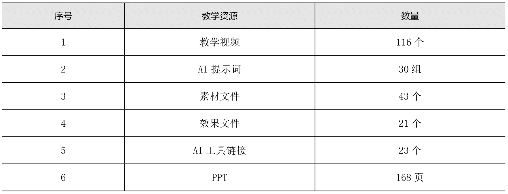

书中案例所用素材、成果文件、演示视频等已上传至百度网盘，通过微信扫码关注公众号，输入第77页公布的资源下载码，按提示获取链接与密码。

资源下载码：AI2511

**特别说明**

（1）版本提示：书中截图基于成稿时各工具网页界面，正式出版后界面与功能或有调整，阅读时请以思路举一反三。所涉版本为：Python的版本为3.13.3、Ollama的版本为0.6.8、Cherry Studio的版本为v1.2.10、Page Assist的版本为1.5.12、AnythingLLM的版本为1.8.1-r2、SD-Trainer的版本为v1.12.0、Stable Diffusion WebUI的版本为1.8.0、剪映的版本为6.0.1。

（2）提示词说明：也称为文本提示、文本描述、文本指令、关键词或“咒语”等。需注意，即便提示词完全相同，模型每次生成的文案、图像或视频也可能不同，这是算法与算力作用下的正常现象。

**作者致谢**

本书由谷建阳、贾一琦编著，特别感谢苏高等参与整理。因编者水平有限，疏漏难免，恳请读者批评指正。

# 第1篇
# AI基础

## 第一章 AI入门：初识模型训练

当前，AI已成为推动各行各业变革的主力，从日常的智能语音助理到工厂的自动化产线，无处不在。模型训练正是让这些智能应用落地的枢纽，它让机器能够从数据中提炼规律、形成判断，进而模拟类人智能，为生活与工作创造价值。本章先梳理AI的基础认知与代表性模型及应用，为后续深入训练奠定基础。

### 1.1 基础入门：了解AI与模型训练

在AI领域，模型及其训练占据核心位置。要真正掌握技术，先要弄清模型的工作逻辑与训练方式。模型可视作AI的大脑，通过训练学会数据中的规律与模式，从而具备智能判断与预测能力。

本节从AI与模型的基本定义出发，探讨训练方法与意义，帮助建立初步认知，为后续学习铺路。

**1.1.1 为什么要学AI**

AI指的是机器所展现出的智能，是通过模拟、延伸人类智能，让计算机系统完成原本需人类完成的任务，包括学习、推理、问题求解、知识表示、语言理解生成、感知与决策等。

通俗来说，AI旨在让机器具备类人的思考与决策能力，在特定场景下自主完成复杂工作，提升效率、创造价值。以下场景可帮助直观感受。

例如，采用动态人脸识别技术，员工到公司后系统实时捕捉人脸并与员工库比对，完成签到打卡，如图1-1所示。

图1-1 人脸数据识别

再如，无人机与AI深度结合。在高空巡检工地进度时，目标检测算法可远程实时辨识卡车、轿车、挖掘机等设备的工作状态。将人脸识别、目标跟随等算法植入无人机，还能实现自拍飞行，提升拍摄稳定与构图多样性，如图1-2所示。

图1-2 无人机目标跟随自拍

再如自动驾驶，AI扮演关键角色。车辆借助视觉传感器、激光雷达、卫星定位等感知行驶环境，实时分析并规划路线、控制行驶，如图1-3所示。自动驾驶正是AI高度集成的典型代表。

图1-3 自动驾驶

在工业制造中同样常见。以手机制造为例，为避免不良零部件流出，传统线依赖人工肉眼质检，易漏检误判并造成视觉疲劳。如今改用机器视觉抓取图像进行算法分析，不合格品会被机械臂自动定位剔除，大幅提升产能。

从以上应用可见，AI已深度融入生活，并在各领域发挥重要作用。

**1.1.2 AI是如何发展起来的**

从古希腊能自行行动的“机械人”幻想，到21世纪AlphaGo战胜人类围棋冠军的震撼，AI发展既有浪漫想象也有无数科学家的智慧结晶。以下梳理若干关键节点。

**1．图灵：机器智能的开创者**

AI源头绕不开艾伦·图灵，被誉为计算机科学之父与人工智能之父。1936年他提出“图灵机”的构想，如图1-4所示，为现代计算机奠基，也开启了机器智能时代。
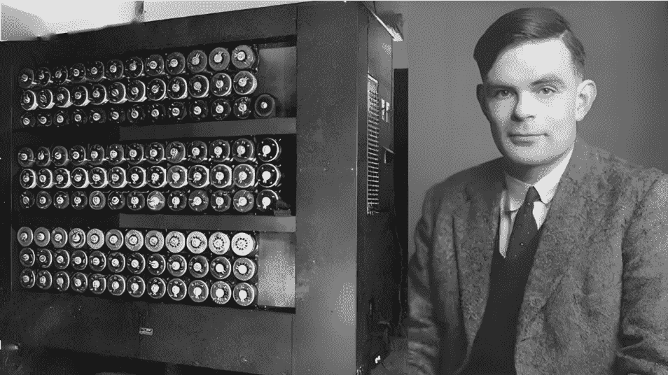
图1-4 图灵与“图灵机”

1950年，图灵在《计算机器与智能》中提出“图灵测试”。其原理是测试者与被测者交流而不知对方是人还是机器，若30%的测试者无法分辨，则机器被视为具备人工智能。

以今天标准看，该测试较为简单且科学性存疑，但在早期它激发了对机器智能的深入思考，具有重要历史意义。图灵的理论为AI奠定基础，实至名归地被称作“人工智能之父”。

**2．专家系统：规则驱动的瓶颈**

20世纪80年代，“专家系统”兴起。系统依赖预设规则库回答问题，相当于在固定库中检索答案。

但这种做法局限明显：复杂场景下建立完备规则成本极高；语音识别、图像识别等领域难以人工穷举规则。时至今日，这类系统更像是“伪智能”——运行逻辑完全由人类设定，只能处理预设问题，面对未知束手无策，其范式与人类大脑本质不同。

**3．人类大脑：神经网络的灵感**

人类大脑由860亿个神经元构成庞大网络，具备强大的学习与进化能力，能从外界获取信息、分析处理并不断优化自身“算法”。

我们通过学习新知识、积累经验解决未知问题，这种自主学习与适应能力是早期AI不具备的。早期基于规则的专家系统只能机械响应，缺乏适应与创造。图灵测试反映了那个时代的期待与局限，而从理论突破到实践探索的历程充满反思与挑战。

**1.1.3 AI的核心逻辑是什么**

当早期AI困于预设规则，只能有限机械响应时，源于仿生的灵感带来了转折——人工神经网络的诞生让机器首次能像大脑一样从数据中自主学习。它以数学模型模拟神经元连接，实现信息处理机制的仿真，使AI从被动执行指令转向主动提炼规律。

虽然当前AI仍处“弱智能”阶段，只能在图像识别、语音处理等特定任务中发光，但其核心逻辑——通过多层神经元协同计算实现认知进化——已成为打开智能世界的关键。对零基础学习者而言，理解人工神经网络如何模仿大脑“思考”，是掌握机器学习、深度学习等前沿技术的底层起点。下面逐步拆解其核心逻辑。

**1．从规则到学习：人工神经网络的崛起**

专家系统依赖人工定义规则，难应对复杂与未知。人工神经网络则抛弃“答案库”模式，转而通过海量数据学习，自主提炼规律并形成预测能力。这种数据驱动范式成为现代AI主流，GPT、DeepSeek等均为典型。

其设计灵感来自人类大脑——构建一个“黑箱”处理系统。我们无法完全解析内部每一步运算，正如大脑机制尚未完全明晰，但它可通过“输入—处理—输出”循环实现高效处理。

比如一个从未见过苹果的孩子，被教会识别后，大脑会在神经元网络中形成特定刺激反应模式，下次遇到相似物即可快速识别，如图1-5所示。人工神经网络正是借助这种仿生机制，接收不同强度输入，经层层“神经元”处理后输出结果。
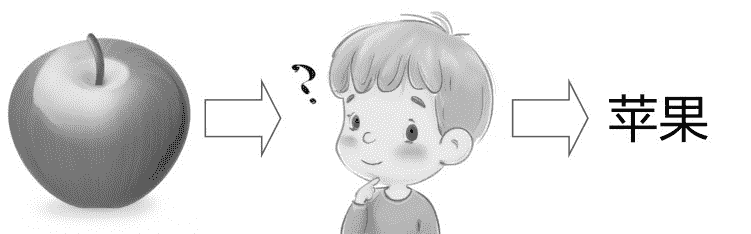
图1-5 人工神经网络模拟人类识别物体的举例

**2．弱人工智能：当下技术的边界**

人工神经网络虽有突破，但需明确：当下AI仍属“弱人工智能”。人类大脑约有860亿个神经元，而人工神经网络的单元数远少于此，却凭借深度连接与高效算法，在特定任务上表现突出。

规模差异决定现有AI只能在特定领域出色，尚不具备通用智能与真正自主学习能力。简单类比，生物结构越简单，智能水平越有限；人工神经网络的智能也与其复杂度正相关。

从单神经元的“初级网络”，到两层四神经元的“浅层网络”，再到五层以上、数万神经元的“深度网络”，每增加一层即意味着处理能力的跃升。广泛用于图像的卷积神经网络CNN，正是在深度网络基础上加入卷积层、池化层等组件，专门优化图像特征提取与识别。

**3．神经网络：AI入门的核心基石**

理解神经网络工作原理是进入AI领域的必备基础，它既是技术落地的载体，也揭示了AI与人类智能的本质联系——通过模仿大脑结构赋予机器学习能力。即便现阶段仍是弱智能，神经网络的每一次进化都在拉近机器与人类智能的距离。

**1.1.4 什么是模型，模型是怎么训练的**

沿着AI发展脉络，从图灵测试的奠基到受仿生启发的人工神经网络诞生，AI的面纱已逐步揭开。若说人工神经网络是AI的“大脑结构”，模型训练则是赋予这个大脑思考能力的核心机制——它让机器从空白状态成长为可识别图像、理解语言并进行预测的智能系统。

下面深入AI的“成长课堂”，解析训练的核心逻辑，看看数据如何成为驱动智能的“燃料”，神经网络又如何通过反复练习掌握复杂技能。

**1．认识模型：智能的“大脑”**

在AI中，模型是一种模仿人类智能的数学结构，用于处理分析数据并完成图像识别、自然语言处理、预测等特定任务。模型就像智能的“大脑”，封装了从海量数据中学到的模式与规律。

例如在图像识别里，模型能学会边缘、形状、颜色等特征，从而准确辨识物体。图1-6展示了模型识别出图像中的车牌。

图1-6 通过模型识别出图中的车牌

**2.AI的“学习”与“实践”：训练与测试的双重使命**

机器学习、深度学习的核心目标都是让机器从数据中自主学习规律，这一过程包含两个关键阶段。

（1）学习即训练过程：模型通过大量数据“积累经验”，形成对特定任务的处理能力。
（2）验证即测试过程：用训练好的模型处理新数据，检验其是否真正掌握所需技能。

其中，模型训练是AI实现智能的基石，类似人类的“刷题阶段”——通过反复接触海量数据，不断修正错误，最终形成精准判断。

**3．训练的两大核心阶段：数据喂养与参数调优**

模型训练第一步是数据收集与标注，即要喂给神经网络什么数据。数据是神经网络的“食物”，但原始数据通常不能直接使用。以猫脸检测为例，具体流程如下。

（1）收集数据：需采集数以万计包含猫脸的图片，涵盖不同角度、光线、品种等场景，保证多样性，如图1-7所示。

图1-7 收集数据

（2）标注数据：人工或借助工具在图片中框出猫脸的真实位置，即“标签”，告诉模型正确答案是什么，如图1-8所示。
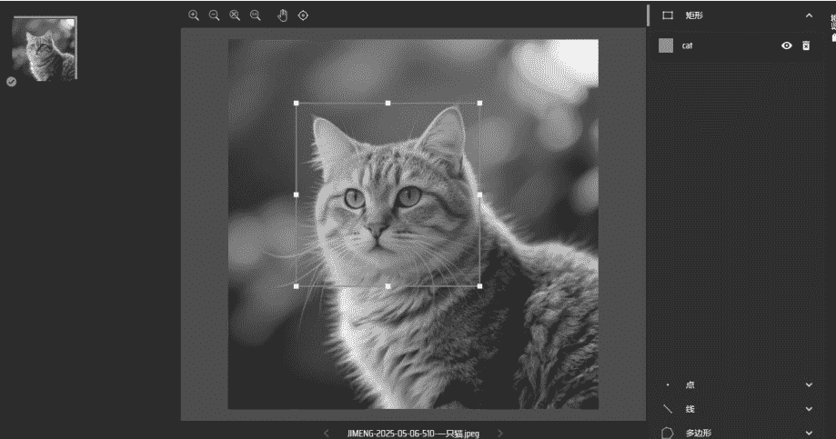
图1-8 标注数据

这一步看似基础，却决定模型训练的上限——若数据质量差，如标签错误、场景单一，模型性能将大打折扣。

**误差驱动的迭代优化**

数据就位后，网络进入以误差为导向的精修阶段，整体可以概括为四个递进动作。

（1）前向预测：首次试探。将图像送入网络，逐层计算后给出初步定位，例如图1-9方框所标的猫脸区域。由于初始权重是随机初始化的，这次输出往往偏差较大。

（2）误差量化：损失函数衡量差距。将预测框与人工标注的真实框，例如图1-10所标的猫脸区域进行对比，借助损失函数把空间差异转化为数值。通常会考察两框的位移、重叠程度等，最终得到一个可计算的误差值。

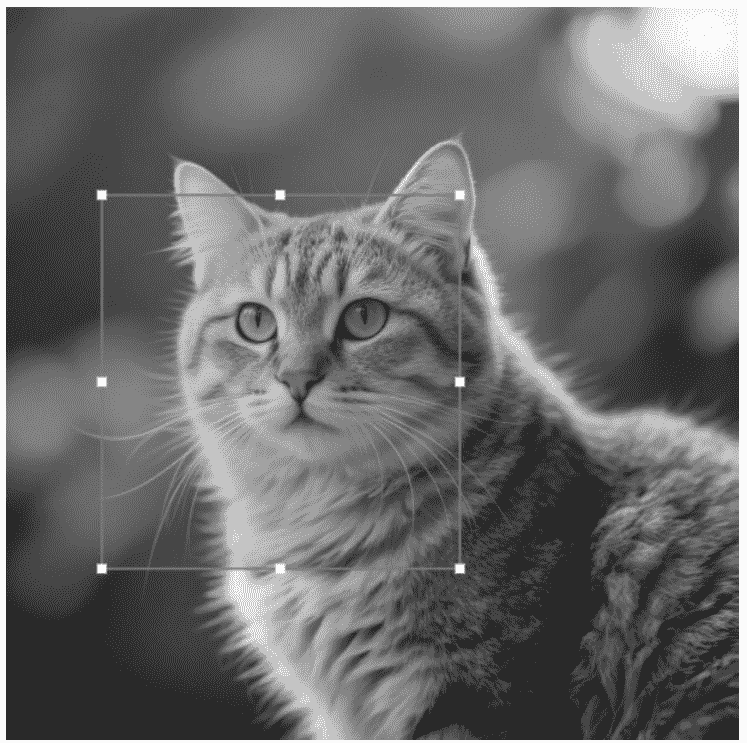

图 1-9 预测结果

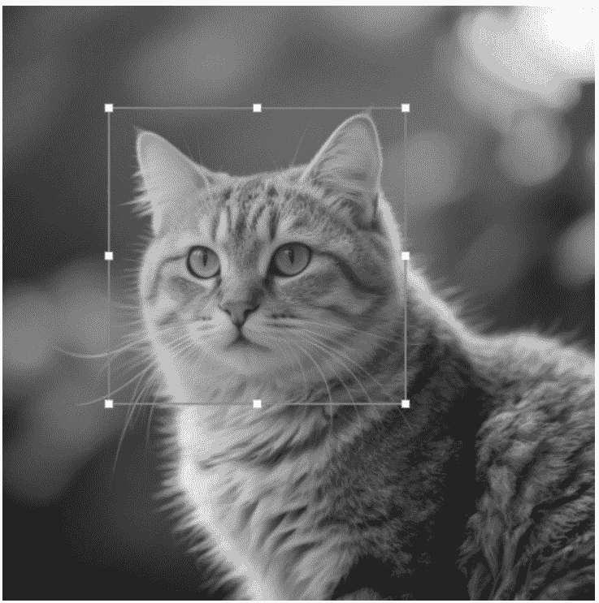

图 1-10 标注的真实标签

（3）反向调整：从错误中学习。误差相当于警报，提示模型错在何处。通过反向传播机制，误差从输出层逐层回溯至各神经元，驱动连接权重的更新，使下一次预测更贴近真实。

（4）循环收敛：重复逼近理想。将上述四步重复上万次，每轮迭代都让误差略微下降。随着训练深入，网络对猫脸位置的判断愈发准确，最终能在复杂场景中稳定工作。

**4．算力松绑才让深层网络真正起飞**

神经网络的原理很早就提出，为什么深层网络直到本世纪初才爆发。核心阻力来自训练本身的高门槛，主要有两点。

（1）早期算力不足。训练深层网络需要海量计算，当时的设备难以支撑。
（2）标注数据匮乏。过去高质量且带标签的规模化数据集很少，网络难以充分学习。

如今，擅长并行运算的GPU普及，大数据技术成熟，深层网络才摆脱束缚，在视觉、语音、自然语言等方向掀起智能浪潮。

知识扩展

GPU是图形处理单元的简称，起初为图形渲染和图像处理设计，具有强大的并行运算能力。早期多用于游戏、动画制作。随着发展，其并行优势被迁移到AI、深层学习、科学计算等领域，显著提升了处理效率。

**1.1.5 参数瘦身两大手法：精度压缩与知识提炼**

所谓巨型网络，通常指参数规模达到数十亿甚至数千亿级别。例如GPT-4的参数量超过1.8万亿，与其能力相当的DeepSeek-R1参数规模也达到671亿。

在落地应用中，高昂的部署成本与缓慢的推理速度是两大痛点。为此出现了网络压缩技术，其中精度压缩与知识提炼是最主流的两种降本增效手段。

**1．精度压缩：用低精度换取高效率**

精度压缩的核心思路是简化参数表达。巨型网络由海量参数构成，如GPT-3.5约有1750亿参数，图1-11为其应用示例。每个参数以特定数据类型存储，常见的float32占4字节。压缩的核心是通过降低数值精度，用更小的存储空间表示近似值。

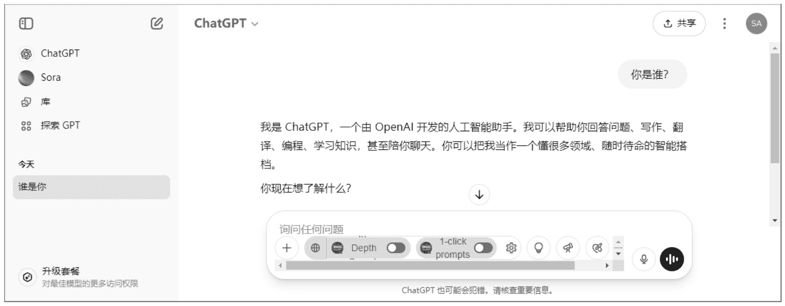

图 1-11 GPT-3.5 模型的应用示例

例如，原参数值1.2768可量化为1.28或整数1，前者采用float16占2字节，后者采用int8占1字节，存储空间分别降至原来的1/2和1/4。

把高精度转为低精度，可实现：

（1）存储占用锐减，如70亿参数网络从float32的28GB压缩至int8的7GB。
（2）推理提速。低精度运算对硬件要求更低，在GPU或CPU上的计算速度可提升2～4倍。
（3）成本下降。体积更小意味着显存占用减少，部署算力需求降低。

精度压缩不可避免会损失部分信息，可能导致准确率下降。但可通过动态量化分层调精度或混合精度保留关键层高精度来平衡压缩率与准确率。目前，量化已成为巨型网络落地的标配，如LLaMA 2、GPT的轻量化版本均采用了不同程度的量化处理。

**2．知识提炼：让小型网络模仿大型网络**

知识提炼的本质是知识迁移与行为模仿，核心逻辑是“以大带小”。即将大型网络学到的知识浓缩传授给小型网络，如图1-12所示。具体包括：

图 1-12 模型蒸馏的过程举例

（1）教师网络：已训练好的高性能大型网络，如GPT-4、Gemini。
（2）学生网络：待训练的小型网络，目标是在缩小规模的同时保留核心能力。

知识扩展

知识提炼的基本流程：
（1）将相同数据如用户提问同时输入教师网络和学生网络。
（2）教师网络生成标准答案，学生网络生成初始预测。
（3）通过损失函数计算两者输出差异，指导学生网络优化参数，直至逼近教师。

技术优势与应用场景：
（1）轻量化部署。学生网络参数规模可缩小至教师网络的1/10甚至1/100。例如将千亿级网络提炼为百亿级，适配消费级设备如手机、笔记本电脑。
（2）效率提升。小型网络推理更快、能耗更低，适合实时交互场景如智能客服、对话机器人。
（3）知识复用。利用开源巨型网络的提炼数据，中小团队可快速训练出高性能网络，降低研发门槛。

进入后千亿参数时代，压缩技术的重要性与日俱增，单卡万元级GPU费用与海量数据训练迫使企业必须通过压缩降低落地成本。同时，智能汽车、智能家居等场景需要网络在终端设备运行，轻量化是必经之路。另外，知识提炼还能让中小团队基于开源巨型网络快速迭代，促进AI技术普惠。

未来，压缩将与架构优化如稀疏注意力、训练策略如数据增强深度融合，推动巨型网络从参数竞赛转向效率比拼。无论是精度压缩的精打细算还是提炼的师徒传授，最终目标都是让智能技术真正轻装上阵，走进各行各业。

**1.2 AI巨型网络：运行机理拆解**

随着技术演进，各类巨型网络以强性能和广应用前景重塑认知。从语言生成到图像识别，从数据分析到决策支持，巨型网络在多个领域释放潜力。

本节聚焦巨型网络的工作逻辑，通过GPT等典型代表的工作流程、优势，以及神经网络、Transformer等关键技术在其中的应用，让大家深入了解其强大之处，以及如何解决实际问题，推动技术发展。

**1.2.1 GPT运行机制全解析**

与ChatGPT对话时，背后进行的是精密的文字接龙游戏。GPT本质是训练有素的语言接龙专家，流程如下：

（1）初始输入：完整问题送入系统。
（2）首词预测：系统输出第一个词，如“我”。
（3）语境拼接：将预测词与原始输入组合，如“你的名字是什么？我”。
（4）迭代接龙：持续预测后续词汇，直到对话结束，如图1-13所示。

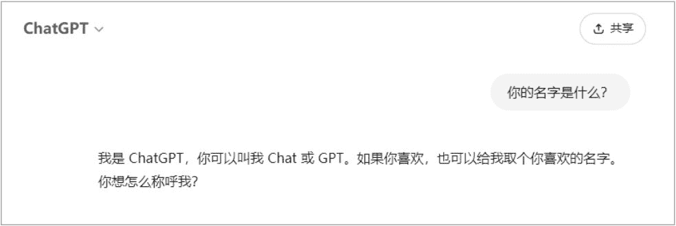

图 1-13 GPT 模型的对话示例

每个预测都基于概率，系统评估候选词出现概率后优先选择合理者。为避免刻板重复，GPT引入随机抽样，具体作用如下。

（1）概率扰动：不总是选最高概率词，而是采纳次优选项。
（2）温度参数：调节随机性强度，平衡确定性与多样性。
（3）多样性增强：可生成“这个问题值得深入探讨”，而非千篇一律的“我不知道”。

在持续对话中，GPT通过动态语境拼接维持连贯，具体作用如下。

（1）会话记忆：将历史对话与当前问题组合输入，如“昨天你说……今天我觉得……”。
（2）长度限制：GPT-3保留2048个token的上下文窗口，GPT-4扩展至8000个token。
（3）注意力聚焦：自注意力机制自动识别关键信息，避免语境过载。

支撑这一游戏的是深度神经网络的Transformer架构，使GPT能同时处理句首与句尾的隐含关联，实现全局语义理解。GPT的接龙能力通过海量数据的自监督学习炼成，后续可通过强化学习等技术微调风格与安全性。具体如下。

（1）预测训练：在海量文本中练习预测下一个词。
（2）误差修正：将预测结果与真实文本对比。
（3）参数微调：通过反向传播算法优化神经网络。
（4）迭代优化：在万亿词库中完成知识内化。

每个流畅回答背后，都是千亿次浮点运算的结果。

**1.2.2 GPT为何能一骑绝尘**

在大语言模型进化中，2018—2020年间出现分化。当主流探索监督学习、强化学习时，GPT在自监督学习中前行，这体现了对语言本质的洞察。

OpenAI前首席科学家伊利亚·苏茨克维曾说：“神经网络本质上是并行的自动编程计算机。”GPT不依赖人工标注的标准答案，而是在45TB未标注互联网文本中自学成才，其蕴含的语言模式远超人工标注体系。

研究团队用长短期记忆网络预测评论下一个字符，将原始模型改造用于情感分类时取得当时最优效果。研究发现网络中特定单元对情感极性变化高度敏感，为“无监督学习能自动捕获与下游任务相关语义特征”提供了早期证据。

知识扩展

LSTM是一种特殊的循环神经网络，通过记忆单元和门控机制有效缓解传统RNN处理长序列时的梯度消失与爆炸，其基本结构如图1-14所示。

研究表明，训练模型预测下一个词时，实际上在学习构建世界的投影模型。就像读者通过前文线索预判凶手，GPT的预测精度反映了其对文本内在逻辑的理解深度。这种预测即理解的机制构成了有效性核心。

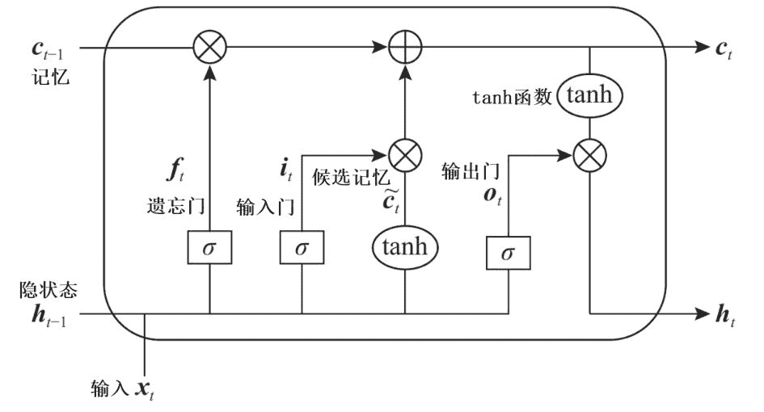

图 1-14 LSTM 的基本网络结构

自监督学习为GPT注入灵魂，Transformer为其塑造躯体。相较于传统LSTM只能回溯约512个词，Transformer的自注意力实现全局语义捕捉，具体作用如下。

（1）并行计算革命：突破RNN序列计算瓶颈，训练速度大幅提升。
（2）注意力可视化：能同时关注“苹果”作为水果和科技公司的双重语境。
（3）长程依赖建模：GPT-3的2048 token上下文窗口可容纳较长文本段落。

架构进化使GPT从语言接龙玩家蜕变为世界模拟器。GPT的有效性指向一个命题：语言即世界的投影。正如苏茨克维所言：“我们训练的不是语言模型，而是世界的压缩表示。”

成功密码可归纳为：

（1）自监督学习：用预测替代标注，释放数据潜能。
（2）架构创新：用注意力机制突破计算瓶颈。
（3）规模法则：用参数海洋孕育智能岛屿。
（4）涌现设计：用简单规则触发复杂认知。

这种简单与复杂的辩证法，为通用人工智能探索指明方向。

**1.2.3 用强化学习补齐巨型网络的推理短板**

GPT-4、DeepSeek等巨型网络在对话生成、文本理解中能力惊人，但在逻辑推理、复杂决策上仍显短板，如事实性错误、数学计算偏差或多步逻辑断片。

例如输入“我希望昨天是明天，那么今天就是星期五。今天是星期几？”，GPT经过长串推理仍给出错误答案，如图1-15所示，而正确答案应是星期三。

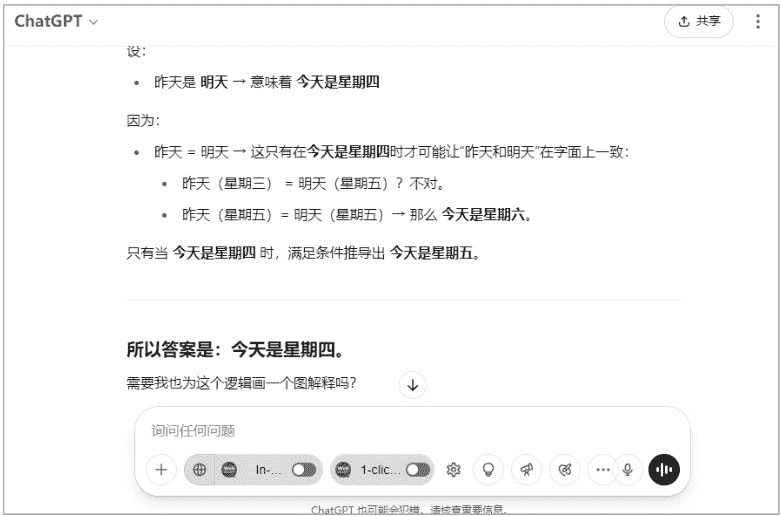

图 1-15 GPT 的错误回答示例

针对这些痛点，强化学习成为核心方向。它通过试错-反馈-优化循环让模型自主进化，补上动态决策的关键拼图。

传统监督学习依赖输入-标签明确对应，像学生照标准答案做题，能掌握已知规则却缺乏应对未知的灵活性。强化学习核心是行动-奖励-策略优化，更接近人类实践积累经验，具体如下。

（1）智能体：基于巨型网络开发的AI应用，如ChatGPT，在特定环境中采取行动。
（2）环境：用户输入、任务规则、外部知识库等一切影响决策的因素。
（3）奖励函数：定义好决策的标准，如回答准确得+1分，逻辑错误得-1分。
（4）策略：模型根据环境状态选择行动，通过最大化累计奖励不断优化。

以数学推理为例，监督学习可能记住“1+1=2”，但面对“(3×5)-2÷2”时若无完全一致样本易出错；强化学习会尝试分步计算，每步根据中间结果是否符合规则获得奖励，最终学会正确运算顺序。

在巨型网络领域，强化学习主要用于：

（1）行为对齐：让模型学会听话。以OpenAI的人类反馈强化学习RLHF为例，核心步骤如下。

收集人类反馈：让标注者对多个回答打分。
训练奖励模型：将人类评分转为可计算奖励函数。
策略优化：用奖励模型指导巨型网络调整生成策略，减少幻觉、增强逻辑连贯性。

通过此过程，模型不仅记住知识，还能理解人类价值偏好，实现能力与合规双重提升。

（2）复杂决策：让模型在多步推理中走对路。面对法律案例分析、科学实验设计等任务，强化学习帮助模型构建推理链条，其核心步骤如图1-16所示。

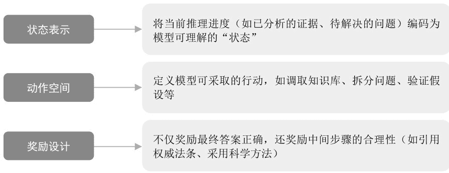

图 1-16 强化学习面对复杂决策问题的核心步骤

结合仍面临挑战：

（1）奖励函数的精准性陷阱。人类反馈模糊或存在偏见，导致奖励函数无法准确反映真实目标，如过度追求回答长度会产生冗长无意义内容。可引入自动奖励模型或对抗性强化学习提升鲁棒性。
（2）数据效率。传统强化学习需数百万次试错，但巨型网络每次推理成本高昂。业界探索少样本强化学习，通过预训练知识初始化策略，让模型在少量试错中快速收敛，如推理奖励迁移技术可显著减少训练数据需求。

（3）可解释性：让决策过程可追溯

强化学习调优会让模型的判断路径变得更为曲折，不像监督学习那样能够直接对照输入与标签来定位错误来源；尤其在医疗、金融等合规压力大的行业，这一不透明性风险被放大。当前常用的缓解策略包括把推理轨迹可视化，例如用流程图逐步展示决策步骤；另外借助因果推断调整奖励函数，使其更贴合真实世界的因果关系。 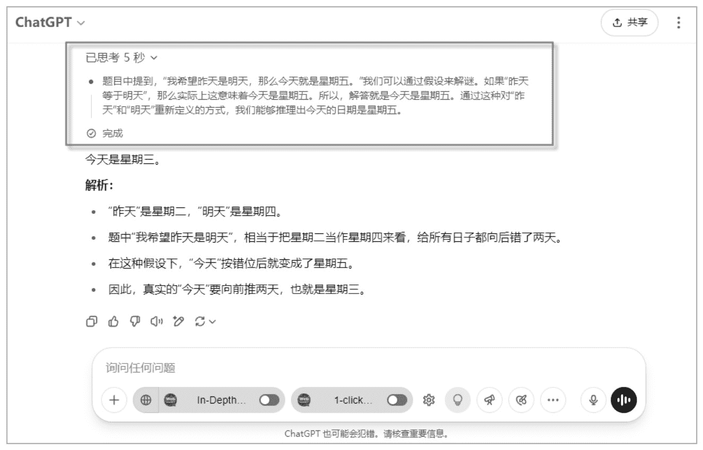

图 1-17 GPT 的可视化推理路径

从照本宣科到自主试错，强化学习正改写大模型的学习范式。它不仅是缓解当前推理缺陷的手段，更是通向更高阶智能的入口——当系统能在试错中自我进化，人工智能才可能由单一工具向可协作的伙伴转变。

1.2.4 检索增强生成遏制模型幻觉

当对话系统频繁出现张冠李戴、信息过期或推理中断时，幻觉已成为制约其在交通、医疗、法律、金融等高精度场景落地的核心障碍。检索增强生成 RAG 思路是为系统接入外部知识库，让生成答案前先做一次权威核查，从根源上提升可信度。

幻觉的常见形态包括：

（1）事实性张冠李戴：比如把相对论的提出者说成牛顿，把 2024 年夏季奥运会举办地写成东京，甚至把“林黛玉倒拔垂杨柳”描述得绘声绘色，如图 1-18 所示。 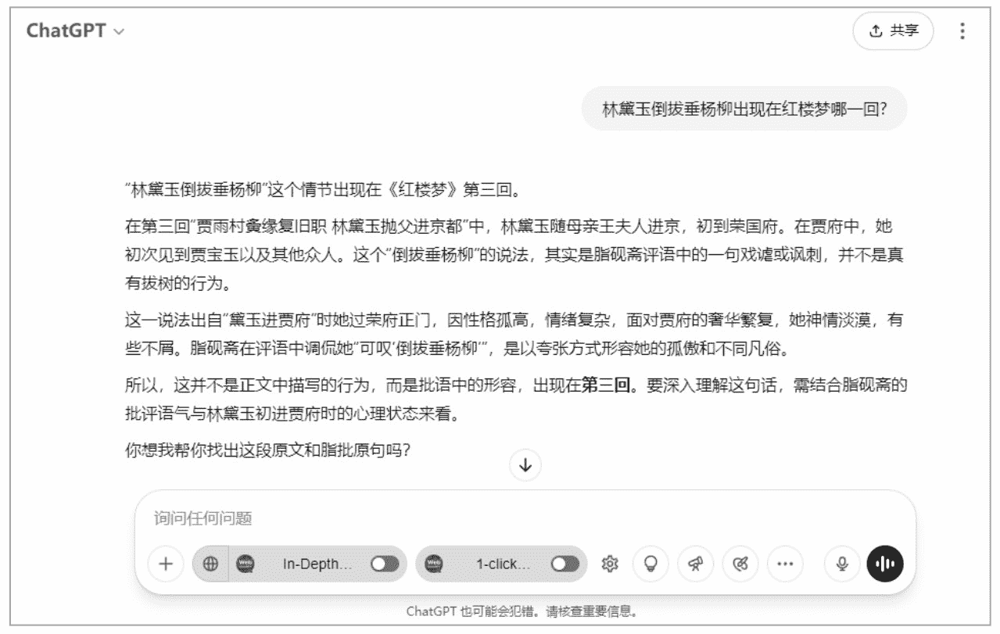
图 1-18 大模型出现的事实性错误示例

（2）逻辑断层：在多步推理中跳过关键环节，例如计算“100-7×3”时直接给出 79，数值看似正确但推导不成立。

（3）信息过时与无中生有：基于固定时间切片训练的系统对 2023 年后的新动态缺乏认知，却会自行补全细节。

在闲聊中这些问题可容忍，但在医疗诊断、法律文书等强可信场景下后果严重。RAG 的目的正是弥补系统记忆缺口与实时知识需求之间的鸿沟。

RAG 的流程可概括为检索—增强—生成：

（1）检索阶段：用户提问后，系统通过向量库从外部库抽取语义最相关的片段。例如问“如何预防糖尿病”，会调取医学指南中关于饮食、运动、筛查的段落。

（2）增强阶段：将检索到的片段嵌入提示词，作为生成时的参考。例如提示中写“依据《中国 2 型糖尿病防治指南（2023 年版）》，预防建议如下：[知识片段]”。

（3）生成阶段：模型基于增强后的提示，利用语言组织能力把零散信息整合成流畅结构化答案，避免自行编造。

在此模式下，系统不再依赖内部记忆，而是像人一样先查资料再作答，知识库成为事实的唯一来源，模型只承担理解与表述。

有人会问为何不直接查库。传统搜索引擎返回大量碎片链接，用户需自行整合，效率低下。例如搜“稳健型理财产品有哪些”时，往往得到数万条结果，需逐条阅读才能归纳，如图 1-19 所示。RAG 让模型扮演“知识编辑”，能够：
（1）整合碎片信息：把多个相关片段合并去重后输出连贯回答，如图 1-20 所示。 
图 1-19 直接搜索的结果
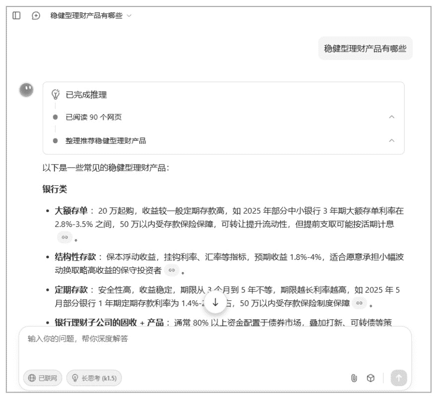
图 1-20 大模型生成的回答
（2）适配表达形式：按提问方式输出科普文、清单或对话式解答，提升实用性。

为何不把知识库直接融入训练？训练成本极高，一次训练需数周、数千张 GPU，且无法实时更新每日新增的报告与政策。即便注入海量知识，系统仍可能因记忆模糊产生幻觉。RAG 通过实时检索加事实校验形成双重保障，且可按行业快速切换数据源，无需重训整体模型。

知识库庞大时如何应对？靠两项技术：
（1）文本切片：把长文本切成 500～1000 字的片段，并附带来源、时间、领域等元数据，检索时精准匹配。
（2）向量检索：把文本转为保留语义的高维向量，用余弦相似度快速挑出语义最接近的 Top-N 片段，避免信息过载。

RAG 的出现标志着从单一模型比拼转向模型加外部知识的协同竞争。它不仅遏制幻觉，也重新划定人机协作边界：机器负责高效检索与逻辑整合，人专注创意与决策，共同开启智能增强的新阶段。当系统学会先查资料再开口，可靠的助手就更近一步了。

1.2.5 神经网络是 AI 模型训练的核心技术
在当今人工智能版图中，神经网络是模型训练的基石，几乎所有智能能力都建立在它之上。下面梳理主流结构演进，看看机器如何从机械计算走向智能理解。

1．感知机：起点之作
灵感来自大脑神经元信号传递。1957 年弗兰克·罗森布拉特提出感知机，是首个可训练的二分类线性模型，核心是通过权重调整对输入进行激活或抑制，类似神经元放电。图 1-21 为单层感知机结构示意图。 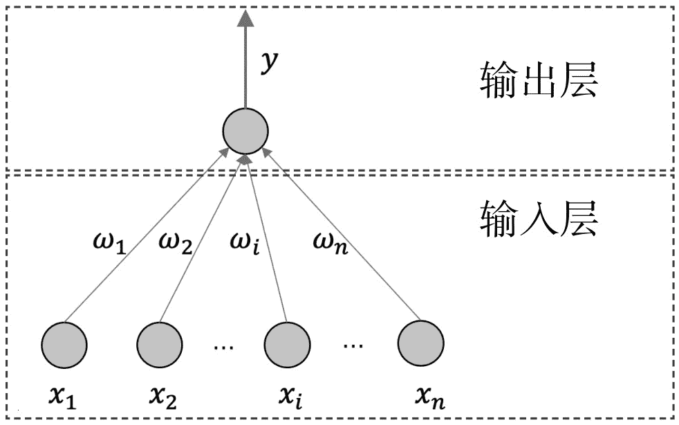
图 1-21 单层感知机模型结构
感知机由输入层和输出层构成，输出层采用 M-P 神经元。M-P 模型是早期对生物神经元的数学抽象，为后续更复杂的神经单元奠基。其局限在于：
（1）单层结构，只能处理线性可分问题；
（2）训练简单却无法解决异或等非线性问题，正是导致第一次 AI 寒冬的诱因之一。

2．多层感知机：突破线性限制
为解决非线性问题，研究者在感知机上加入隐藏层，形成多层感知机 MLP。借助 Sigmoid 等激活函数引入非线性，MLP 能拟合复杂曲线，处理异或任务。但层数加深后会出现梯度消失，深层权重难以更新，限制了模型深度。

3．卷积神经网络：视觉突破
1998 年杨立昆团队提出的 LeNet-5 是首个落地商用的卷积神经网络，专为图像识别设计，首次解决平移不变性和局部特征提取。卷积神经网络由卷积层和传统神经网络层组成。可把卷积层想象成多规格滤镜在图像上滑动扫描，如图 1-22 所示，后层分辨率更低，观察更宏观。 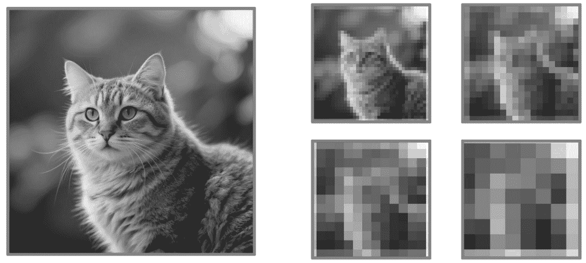
图 1-22 将卷积层想象成许多不同规格的滤镜组合
核心创新点：
（1）卷积层：用滑动窗口提取局部特征如边缘、纹理，并通过权重共享大幅减少参数；
（2）池化层：对特征图降采样保留关键信息，提升抗形变能力；
（3）层级结构：浅层抓边缘，深层组合成眼睛、车轮等复杂特征，最终完成分类。其处理流程类似人类观察与记忆图像，成为视觉领域的通用架构。

4．循环神经网络：处理序列
语音、文本等时序数据存在上下文依赖，不适合 CNN。循环神经网络通过隐藏层的自连接让信息在序列中传递，理论上可处理任意长度序列。基本结构如图 1-23 所示。 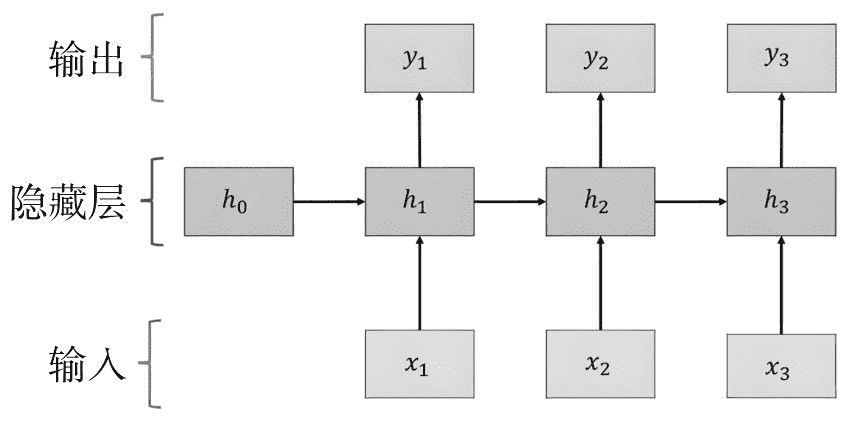
图 1-23 循环神经网络的基本结构
例如处理文本时，后续节点接收前序信息，捕捉长期依赖。但 RNN 有两大缺陷：长距离依赖易丢失，且序列依赖导致无法并行，训练效率低。

5．Transformer：全局飞跃
RNN 及 LSTM 虽能处理序列，却只能串行计算且长依赖仍受限。2017 年 Google 在 Attention Is All You Need 中提出 Transformer 架构，如图 1-24 所示，用自注意力机制彻底摆脱循环结构。 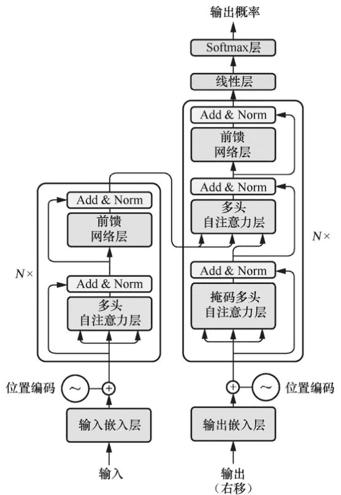
图 1-24 Transformer 架构
知识扩展
Softmax 层把线性输出转为概率分布，表示每个词的可能性。Add & Norm 即残差连接与归一化，有助于加速训练并稳定模型。N× 表示编码器或解码器由 N 个相同层堆叠。

Transformer 把位置信息与词嵌入结合建模词间关系，无需在结构上体现先后依赖。由此带来三方面优势：
（1）解决长距离依赖；
（2）支持并行计算，提升训练效率；
（3）模块化可像积木一样堆叠，便于设计超大模型。

Transformer 迅速成为语言模型的首选骨架，催生 GPT 系列，并在图像与多模态领域发光，如 CLIP 实现图文混合处理。回顾十余年演进，主流架构已从 CNN 处理图像、RNN 处理序列，转向以 Transformer 为核心的体系。

1.2.6 Transformer 催生出一切 AI 大模型
在 AIGC 领域，AI 大模型能生成电影级画面或精美图像，如图 1-25 即梦 AI 生成的作品，其背后核心支撑正是 Transformer。 
图 1-25 即梦 AI 生成的图像
自 2017 年提出以来，Transformer 席卷文本、语音、视觉、科学、自动驾驶、机器人等多个赛道。它做对了什么？

1．引入注意力机制：破解长距离依赖
注意力机制由约书亚·本吉奥等在神经机器翻译中推动普及，是一种强语义表征方式。人类能依据“天黑”与“开灯”的关联预测下一个词，AI 亦然。

早期 RNN 擅长序列但参数沿序列逐级传递，远距离词影响衰减甚至消失，导致长距离依赖问题，LSTM、GRU 等优化未能根治。

注意力机制在逐级传递之外新增一项表征，记录每个历史词对当前词的影响，不受距离限制，如图 1-27 所示。Transformer 沿用该机制奠定基础。 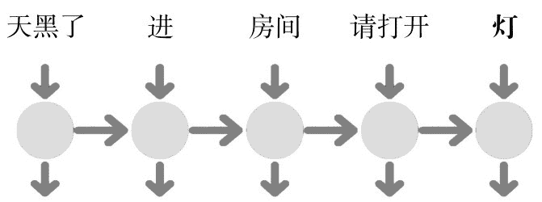
图 1-26 用 RNN 结构处理序列关系
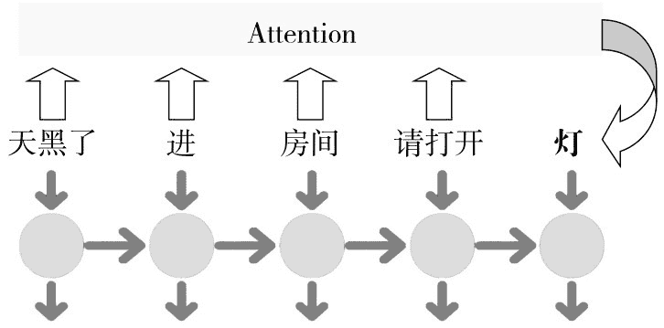
图 1-27 用注意力机制处理序列关系

2．摒弃序列依赖：释放规模潜力
RNN 因链式计算导致训练缓慢，难以做大模型。Transformer 的解法是把序列位置编码成向量，与语义向量融合后输入计算，如图 1-28 所示。位置向量承载了时序信息，链式计算不再必要。 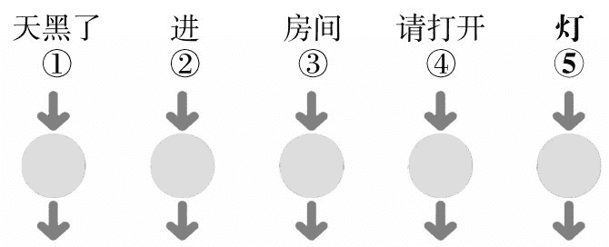
图 1-28 Transformer 的解决方案

摆脱串行依赖后，训练可并行，超大规模模型成为可能，更大容量意味着更复杂语义的表征力。

3．复杂化注意力表示：应对复杂语义
语言存在一词多义、一句多义、反讽等现象，对注意力表征能力要求极高。Transformer 为每个词计算 Q 查询向量、K 键向量、V 值向量。Q 与 K 匹配，V 承载语义变体，三者一起可表达关系。进一步拼接为多头注意力，可覆盖多个语义空间，再纵向堆叠处理复杂语境，极大提升表征力。

Transformer 既保留并强化注意力机制，又去除 RNN 序列依赖，使海量数据训练超大模型成为现实。OpenAI 迅速将其用于生成式语言模型，推出 GPT-1。此后 Transformer 与大模型相互成就，开启 AI 新篇章。

1.3 DeepSeek：探究其特性与应用
在众多人工智能模型与应用中，DeepSeek 凭借独特特性和出色表现获得广泛关注，为 AI 领域注入新活力，成为研究热点。它不仅技术上具创新性，实际应用价值也突出。下面将深入剖析其特性与应用，解读爆火原因、使用方式、推理能力、联网搜索与商业案例，全面了解这一重要模型。

1.3.1 DeepSeek 为什么爆火
在 AI 模型赛道，DeepSeek 横空出世引发热议。这款被视作能与 OpenAI 旗舰模型媲美的开源产品，靠亮眼指标和差异化定位迅速走红，其爆火绝非偶然。

核心竞争力首先体现在性能对标国际顶尖。以数学推理为例，DeepSeek-R1 开源模型在美国数学邀请赛 AIME 2024 基准测试中取得 79.8 分，展现出强劲的逻辑推理能力。 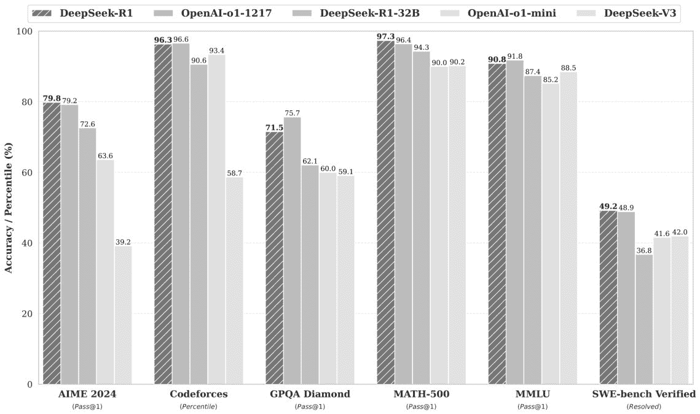

DeepSeek 破局：开源驱动的梯队跃升

图 1-29 DeepSeek 与其他主流大模型的性能对比（数据来源：DeepSeek 官方 GitHub 仓库）

在编程类任务上，Codeforces 的评测里 DeepSeek-R1 拿到 96.3 分，与 OpenAI 同系列的 96.6 分仅差 0.3 分，已可承担工业级代码辅助工作；在高难度专业学科，博士层面的生物、物理、化学等科目 OpenAI 仍领先约 4.2 分，但把场景换到面向五百强企业的落地工程时，DeepSeek 反而高出 0.9 分，体现出在复杂工程环境下的匹配优势。

以上结果说明，这套系统在核心任务上已进入头部行列，尤其在代码编写、数学推演等技术密集型方向，具备与国际顶尖闭源方案替代的技术基础。

与 OpenAI、Google 等厂商坚持的闭源收费路线不同，DeepSeek 采用了极具颠覆性的打法：

（1）全链路开源：除模型权重外，还同步公开训练脚本与数据预处理流程，开发者可在原生架构上直接二次开发。
（2）商业免费许可：明确允许个人与企业在商业场景无偿使用，无需交授权费或分成，对中小企业与初创团队吸引力很大。
（3）使用门槛下降：对外开放参数量达 6711 亿的旗舰版 DeepSeek-R1，让更多机构触达顶级大模型技术，打破长期以来的技术垄断。

凭借“技术普惠”的思路，DeepSeek 在半年内聚集庞大开发者社群，成为截至 2025 年 5 月 GitHub 星标增速最快的开源智能项目，如图 1-30 所示。在 GitHub 超过 2 亿个项目里，75.7k 星已属前 0.05% 的头部梯队。其中 DeepSeek-V3 拿到 96.5k 星，R1 拿到 89.1k 星，均进入行业前列。

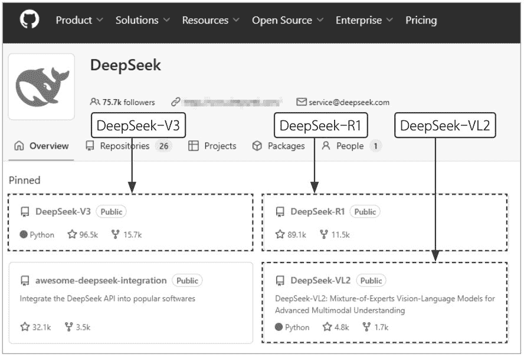

图 1-30 DeepSeek 在 GitHub 上的项目

在效能与成本的权衡上，DeepSeek 找到较为理想的平衡点。依托海量高质量训练语料，其旗舰系统参数上百亿级，每参数训练开销明显低于同类闭源方案。这一创新不仅支撑了高性能输出，也形成了难以复制的技术壁垒，推动短短数月内超 2000 家企业完成生产环境落地。

走红的本质，是技术创新与市场需求的共振：既打破国际巨头的技术垄断，也为行业提供高性价比解决方案，并以开源模式激活生态创新活力。随着代码生成、智能客服等场景持续深化，它正重新定义大模型竞争逻辑——技术实力之外，开放生态、性价比与场景适配正成为新的核心壁垒。

**1.3.2 DeepSeek 六大接入方式**

在智能赛道，DeepSeek 因表现突出、免费开源与生态开放迅速崛起，成为备受关注的解决思路。其成功不仅源于技术突破，更在于提供了覆盖企业级应用到个人开发者、本地落地的全场景入口。以下六条主流路径可帮助快速掌握这一“国货之光”的核心能力。

**1．官网直连：旗舰能力一站体验**

作为最直接入口，DeepSeek 官网提供网页对话、手机 App 下载及 API 开放平台，适合普通用户与企业快速试用核心功能，如图 1-31 所示。

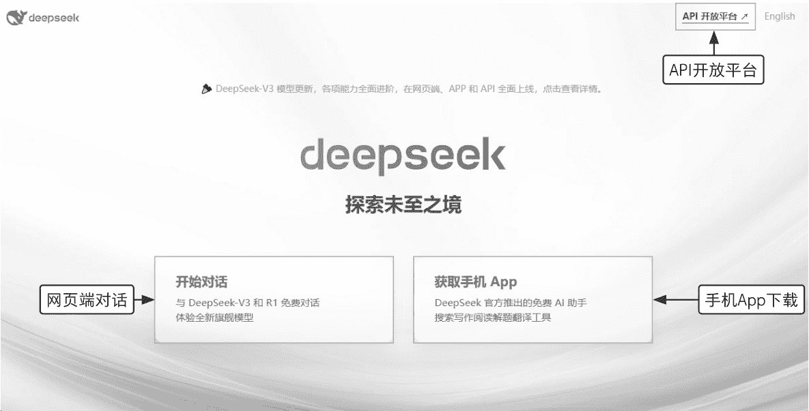

图 1-31 DeepSeek 官网

网页端与 App 都支持文本对话、搜索、写作、翻译等基础功能，无需复杂配置，手机号或邮箱注册后即可免费使用 DeepSeek-V3 与 R1，满足日常问答与内容生成需求。

API 开放平台面向开发者与企业提供标准化接口，支持自定义参数调用，可适配智能客服、知识问答等业务。官网还会同步更新模型文档、技术白皮书及开发者工具，降低接入门槛。

**2．华为云 ModelArts Studio：企业云上开发首选**

深度合作云服务商华为云 ModelArts Studio 提供一站式大模型开发托管服务，尤其适合企业用户，如图 1-32 所示。平台支持模型调优、压缩、部署、评测等全生命周期管理，预置昇腾适配版 DeepSeek-R1-Distill、V3、R1，兼容 Llama、Qwen 等开源框架。

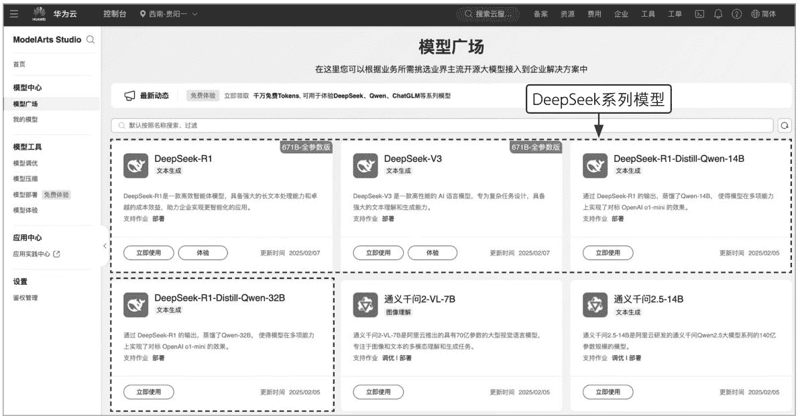

图 1-32 华为云 ModelArts Studio 平台

**3．硅基流动：高性价比 API 服务**

国内热门算力平台硅基流动为 DeepSeek 推出专属优化服务。其服务基于分布式架构优化，支持万级并发调用，适合高频低时延场景，如智能客服、实时对话机器人。

**4.Cursor：代码编辑器深度融合**

明星级智能编程工具 Cursor 已将 DeepSeek 纳入开发流程，成为开发者效率利器。Cursor 支持自然语言指令编写与修改代码、自动补全、代码审查，并深度结合 DeepSeek 的逻辑推理能力，在数学证明、算法实现等场景表现突出。

开启 Cursor 的“隐私模式”后，代码无需上传云端，可本地调用 DeepSeek 系统，满足企业对数据安全的高要求。

**5.SCNet 超算互联网：公益算力支持**

面向科研机构与个人开发者，SCNet 超算互联网平台提供轻量化服务，开放 DeepSeek-R1-Distill-Qwen-32B 等蒸馏版本，如图 1-33 所示，支持基础对话、解题、翻译等功能，适合入门学习与小型项目测试。

**6．本地部署：Ollama 轻量落地**

对数据隐私与离线使用有需求的用户，Ollama 提供便捷的本地部署方案，覆盖 1.5B 至 671B 参数的模型，如 DeepSeek-R1-7B、32B，支持 Q4_K_M 量化格式，可适配消费级显卡如 RTX 3060 及以上。

用户只需一条简单指令即可运行模型，例如 ollama run deepseek-r1:7b，适合模型微调、定制任务开发，或企业构建私有智能系统。

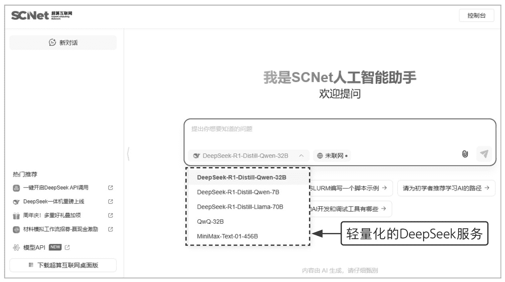

图 1-33 SCNet 超算互联网平台提供的 DeepSeek 服务

**1.3.3 DeepSeek 的逻辑推理能力**

在智能核心能力比拼中，推理深度与可追溯性已成为关键分水岭。通过对比 DeepSeek-R1 与 GPT-4o mini 的思维链，即模型在给出答案前的完整思考过程，可看出国产大模型在逻辑推理上的独特优势：更贴合本土语境的深度思考、更完整的推理链条，以及对问题本质的穿透理解。这些优势不仅体现在解题严谨性上，也体现了从“机械计算”到“类人推理”的进化。

思维链将模型的内在逻辑转化为可追溯文字，便于验证推理合理性。例如针对“今天是周六为何需要工作”的提问，系统需拆解日期规则、调休政策、行业特性等，形成完整链条。DeepSeek 与 OpenAI 的核心差异，正始于这份“思维透明度”。

GPT-4o mini 的回答集中在行业属性、跨时区协作、合同与加班制度等通用原因，未涉及中国特有的法定节假日调休制度，如图 1-34 所示。

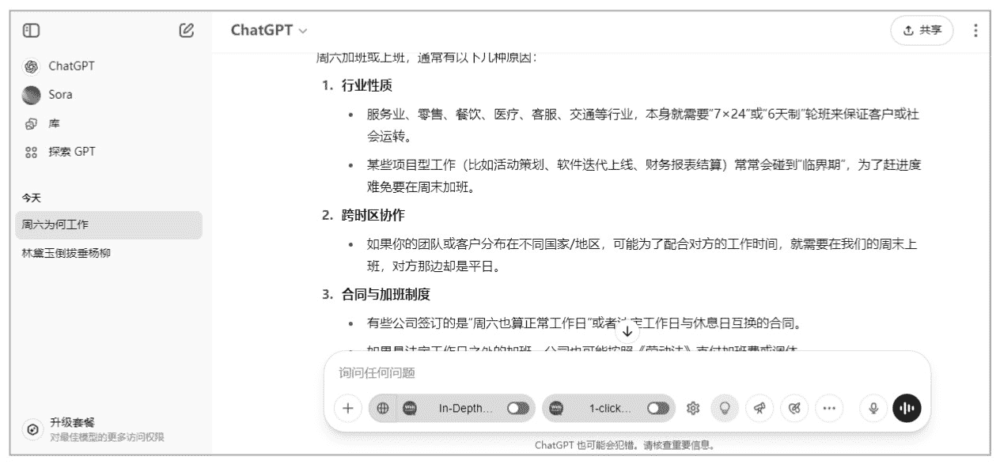

图 1-34 GPT-4o mini 的回答

DeepSeek-R1 则分三步推导。

（1）背景分析：确认周六工作违背常规，需排查特殊情况。
（2）原因枚举：列出单休或特殊工时制、行业特殊性、法定节假日调休等可能性。
（3）语境匹配：结合中国节假日调休规则，如春节、国庆前后周末补班，给出“调休”解释，如图 1-35 所示。

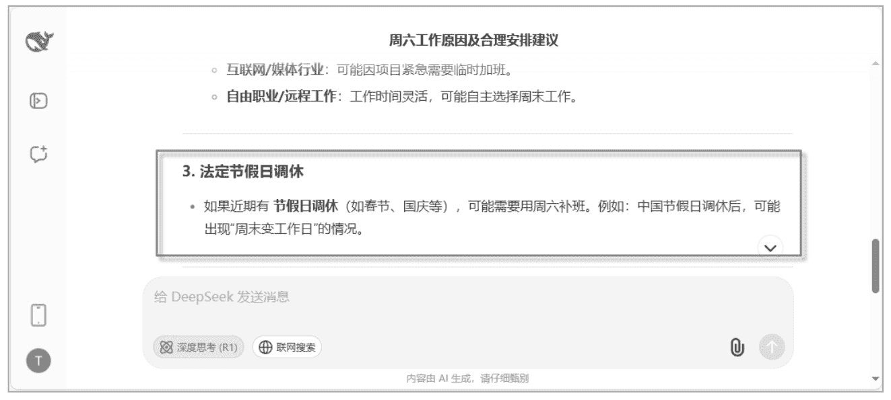

图 1-35 DeepSeek-R1 的回答

可见 DeepSeek 的思维链包含对本土政策的深度理解，而 OpenAI 的输出更偏普适逻辑，忽略中国用户的真实生活场景。

市场亦质疑 OpenAI 的思维链多为“摘要版”，仅呈现简化推导；DeepSeek 从 R1 起即公开原始思维链，允许开发者与用户追溯每一步决策依据。这种透明化提升模型可信度，对教育、金融等对可解释性要求高的行业尤为重要。例如银行风控需向用户解释拒贷原因，完整思维链可成为关键依据。

此外，DeepSeek 在训练中融入大量中文语境数据，包括法律法规、节假日规则、商业逻辑等，使其在“调休”“假币交易”等本土场景能调用更精准的知识图谱。相比之下，OpenAI 的通用模型虽覆盖多语言，但在细分文化场景存在理解盲区。

该系统在逻辑推理测试中的出色表现，不仅是技术突破，更展现智能从“数据驱动”向“知识驱动”的演进。当模型能像人类一样拆解问题、追踪状态并创造性处理边界条件时，其应用将从简单问答扩展至复杂决策。

**1.3.4 DeepSeek 的联网搜索能力**

大语言模型长期受制于知识时效性，模型截止后出现的实时天气、最新票房、突发新闻等信息往往无法准确回答，如图 1-36 所示。

图 1-36 大语言模型无法回复实时天气问题

传统模型依赖静态训练数据，DeepSeek 通过联网搜索可实时补足新信息。例如回答“今天日期”时，能准确调用系统时间接口进行回应，如图 1-37 所示。

DeepSeek 的联网搜索并非简单抓取，而是建立在底层动态思维链之上，具体包括。

图 1-37 DeepSeek 联网搜索示例

（1）问题拆解能力：在触发搜索前，模型会先对语义进行解析，判断是否需要实时数据。例如询问“2025 年 NBA 总冠军是谁”时，模型识别年份超出训练时效，自动激活搜索模块。
（2）逻辑验证机制：获取网络信息后，通过内置推理引擎校验可靠性，避免错误或过时信息干扰。例如对比 NBA 官网、体育新闻平台的一致性，确保回答准确。
（3）多模态融合：将搜索结果与知识库结合，生成结构化回答。例如查询某品牌新车参数时，不仅抓取官网数据，还能结合历史车型对比、用户评价等知识库信息，提供深度分析。

**1.3.5 DeepSeek 的商业应用案例**

在模型与商业场景深度融合的当下，DeepSeek 凭借强大的数据分析、逻辑推理与实时联网能力，成为企业与个人提升效率的核心工具。在内容创作优化、软件开发支持等领域已展现出显著价值，真正实现“用智能简化决策，用智能提升效率”。

例如在社交媒体运营、电商详情页设计中，封面图点击率是影响流量的关键，但人工分析多依赖主观经验、试错成本高。下面以“图书封面点击率预测”为例，展示操作流程。

**步骤 01** 在 DeepSeek 输入框右下角点击“上传附件”按钮 ，如图 1-38 所示。

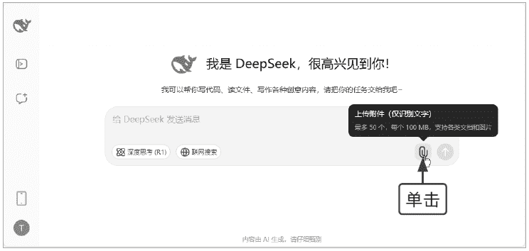

图 1-38 单击“上传附件”按钮

**步骤 02** 弹出“打开”对话框，①选择相应封面图片文件；②点击“打开”按钮，如图 1-39 所示，完成图片上传。

**步骤 03** 输入提示词，如“请帮我分析这两个图书封面，哪个点击率会更高？”，如图 1-40 所示，让 DeepSeek 找出点击率更高的封面。

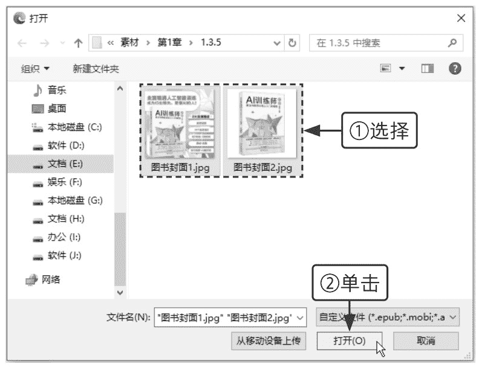

图 1-39 单击“打开”按钮

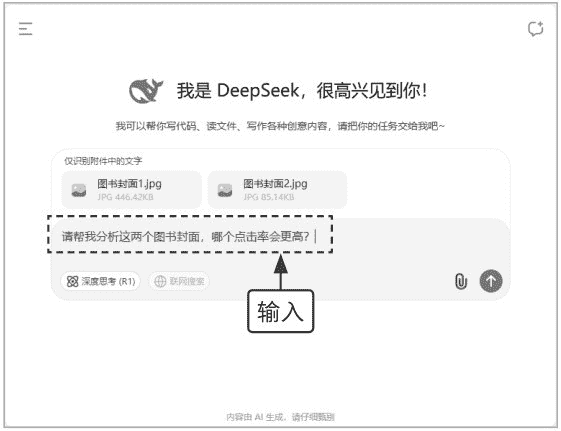

图 1-40 输入相应的提示词

**步骤 04** 点击 按钮，将图片与提示词同时发送给 DeepSeek。它会基于上传图片通过多模态理解生成文本描述，进而分析色彩对比度、主体突出度、文字可读性、情感倾向等特征，结合历史爆款封面数据库，分析各封面优势并给出结论，具体如下。

**答：**

从视觉设计与内容呈现角度看，图书封面 1 的点击率可能更高，原因如下。

1． 视觉层次更清晰
• 标题突出：封面 1 主标题“全面精通人工智能训练”字体更大、居中，搭配副标题形成明确主次，更易吸引眼球。
• 对比强烈：橙黄色与深色背景对比度更高，视觉冲击力更强，适合快速抓取注意力。
……
封面 2 的潜在不足
• 标题较弱：“云训练师手册”作为主标题专业性强但不够通俗，与 AI 训练关联性不如封面 1 直接。
……
结论
封面 1 通过更强视觉对比、清晰的数据化卖点、明确的资源展示，更有可能在短时间内吸引用户点击。若封面 2 能优化标题突出性、补充赠送资源细节或增加暖色点缀，竞争力会显著提升。

**知识扩展**

由于篇幅限制，DeepSeek 等智能模型回复内容仅展示要点，完整内容请查看随书效果文件。

该系统的商业案例表明，智能正从“辅助工具”进化为“效率引擎”：在消费电子领域它是智能导购员，在内容创作领域它是数据化分析师，在软件开发领域它是高效代码助手。其核心价值在于将复杂数据处理与逻辑推理转化为简单易用的解决方案，让企业与个人聚焦核心目标、释放创造力。

随着技术迭代，应用场景将进一步拓展至金融风控、医疗诊断、供应链管理等领域，真正实现“智能即服务”的商业愿景。对企业而言，拥抱此类智能工具不仅是效率提升的选择，更是数字化转型中保持竞争力的必然路径——当数据驱动的智能决策成为常态，商业创新的边界将被不断改写。

### **本章小结**

本章首先介绍人工智能基础入门知识，涵盖学习意义、发展历程、核心逻辑、模型概念与训练方式，以及模型量化与蒸馏等内容；其次深入解析 AI 大模型工作逻辑，包括 GPT 原理与成功原因、强化学习与 RAG 检索技术在模型中的应用，以及神经网络和 Transformer 在训练中的关键地位；最后介绍 DeepSeek 特性与应用，分析走红原因、六种使用途径，以及逻辑推理能力、联网搜索能力，并列举相关商业应用案例。

### **课后实训**

**实训任务** 使用 DeepSeek 解答热门数学题，题目为“西瓜进价每斤 2 元，卖 3 元，顾客用 100 元假币购买 30 斤，请问老板亏了多少钱？”，测试大模型的逻辑推理能力。

操作步骤如下。

**步骤 01** 在 DeepSeek 输入框中输入问题，如图 1-41 所示。

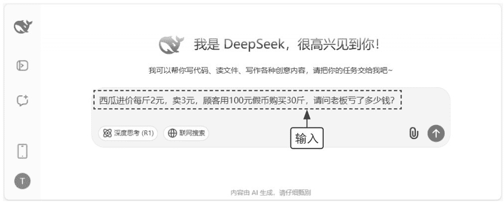

图 1-41 输入相应的问题

**步骤 02** 启用“深度思考（R1）”模式，点击 按钮发送问题，即可获得答案，具体如下。

**答：**

老板在这笔交易中总共亏损 70 元。具体计算如下。

西瓜成本：30 斤×2 元/斤=60 元
找零金额：顾客支付 100 元假币购买价值 90 元的西瓜，需找零 10 元真钱。
总亏损：60 元（成本）+10 元（找零）=70 元

关键点：假币导致老板损失货物实际成本 60 元和找零真钱 10 元。即使售价含利润，题目未涉及机会成本，仅计算直接损失，因此最终亏损为 70 元。

**知识扩展**

DeepSeek 的思维链不仅验证结果，更通过“现金流入/流出”模型排除干扰项，展现出对经济逻辑的精准把握。

## **第二章 模型部署：在本地使用 DeepSeek**

随着对人工智能模型的理解加深，越来越多用户渴望将模型落地到实际场景，本地部署成为常见选择。本章将聚焦如何在本地使用 DeepSeek 模型，呈现详细的部署流程与技巧。

### **2.1 模型安装：DeepSeek 本地部署**

在数字化时代，本地部署智能模型的需求持续增长。DeepSeek 由深度求索实验室研发的新一代开源大语言模型，凭借多尺寸灵活适配、领域强化能力、高效推理架构及对本地部署的友好支持，成为众多用户的首选。

**DeepSeek 本机部署实战手册**

把 DeepSeek 放到自己的机器上跑，是兼顾功能定制与数据不出域的常用思路。下面把环境准备、依赖补齐、Ollama 获取、模型拉取到本地验证串成一条完整线，跟着走就能在自有硬件上稳定启动 DeepSeek，也为后续微调和业务落地打底。

**2.1.1 部署前的准备工作**

本地化运行的核心价值在于数据始终留在内网，隐私可控；同时可以直接接入企业私有知识库和行业数据库，做到更深度的定制化。借助消费级显卡即可启动，长期算力成本也比订阅云服务更经济。不同模型对硬件的要求并不相同。

（1）入门方案：建议使用搭载 NVIDIA 显卡且显存在 8GB 及以上的设备，足以流畅承载 7B/8B 量级的模型。

（2）高性能方案：若要运行 14B 级模型，建议显卡显存不低于 16GB。图 2-1 展示的 GeForce RTX 5090 D 基于 NVIDIA Blackwell 架构，配备 32GB GDDR7 显存、21760 个 CUDA 核心，显存带宽最高可达 1792 GB/s，AI 计算能力非常强。

图 2-1 GeForce RTX 5090 D 显卡

**知识扩展**

NVIDIA Blackwell 架构以数学家 David Blackwel（戴维·布莱克威尔）命名，有助于提升可靠性与集群间通信效率。GDDR7 的全称是 Graphics Double Data Rate 7，是 NVIDIA 与 DRAM 动态随机存取存储器厂商联合推出的超低电压显存标准。

CUDA 即 Compute Unified Device Architecture 统一计算设备架构，是 NVIDIA 的并行计算平台与编程模型，允许开发者使用 C/C++、Python、Fortran 等语言调用 GPU 的并行能力。

（3）无独显环境：没有独立显卡也可以以 CPU 模式运行，只是速度大约只有 GPU 模式的 20%左右。

内存至少 16GB，处理长文本时建议 32GB 以保持流畅。存储预留 50GB 可用空间，优先选择 SSD 固态硬盘以加快模型加载。

DeepSeek 支持 Windows 10/11 21H2 及以上、macOS Ventura 13.4+ 以及 Ubuntu 22.04 LTS/24.04 LTS。以 Windows 为例，先把显卡驱动升级到最新版本，如图 2-2 所示。准备就绪后即可进入正式部署。

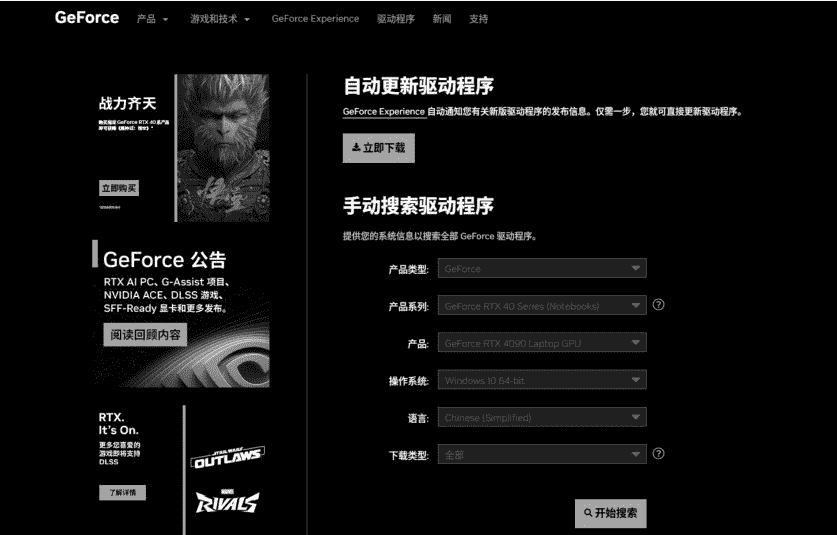

图 2-2 安装显卡驱动

**2.1.2 安装 Python 依赖项**

部署前先把系统基础组件补齐，不同平台操作略有差异。

（1）Linux/Ubuntu 需要预先安装以下工具，具体命令如下。

**知识扩展**

python3-pip 是 Python 3 的包管理器，用于安装、更新和管理 Python 包，使依赖管理更便捷。curl 是命令行数据传输工具。git 是分布式版本控制系统，用于记录代码版本历史、协同开发，可帮助管理代码变更与分支合并。

（2）Windows 需要安装最新版 Visual Studio 运行库，并确保 Python 版本在 3.8 及以上。可通过以下命令完成安装。

Python 是一种广泛使用的高级编程语言，由吉多·范罗苏姆于 1989 年发明，首个公开版本于 1991 年发布。其设计强调可读性与简洁语法，入门门槛较低。接下来介绍手动下载、安装与配置的流程。

**步骤 01** 进入 Python 官网，将鼠标悬停在 “Downloads” 下载按钮上；在弹出的 “Download for Windows” 面板中点选 “Python 3.13.3”，如图 2-3 所示，即可获取安装程序。

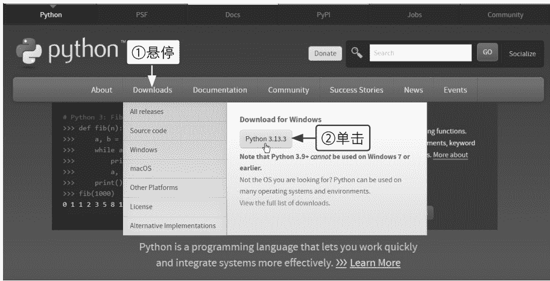

图 2-3 单击 Python 按钮

**步骤 02** 下载完成后打开对应文件夹，双击安装包，如图 2-4 所示。

**步骤 03** 弹出安装向导，选择 “Customize installation” 自定义安装选项，如图 2-5 所示，按提示继续。

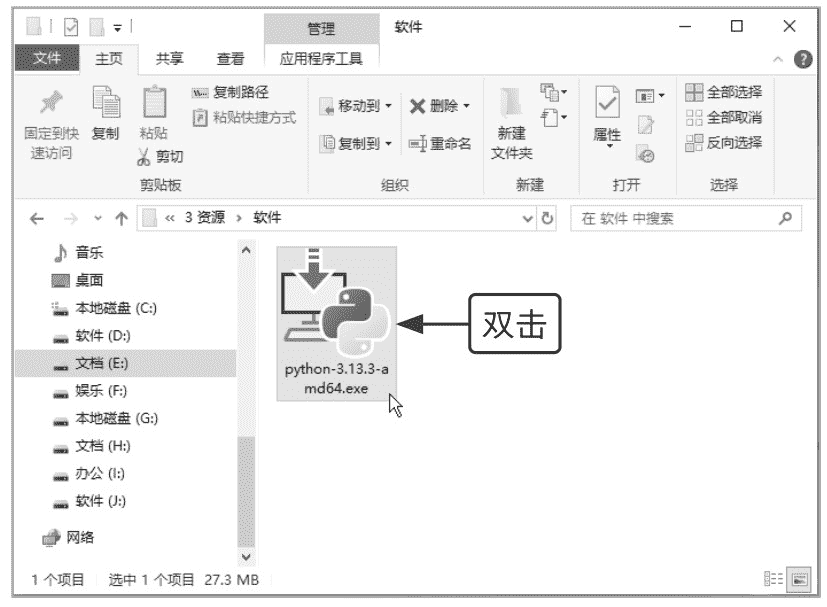

图 2-4 双击 Python 的安装程序

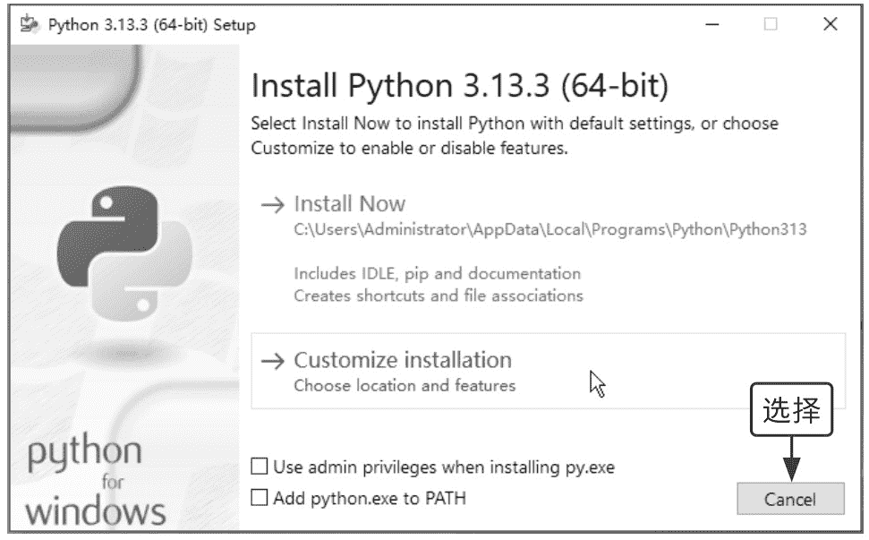

图 2-5 选择“Customize installation”选项

**步骤 04** 安装过程中进入 “Advanced Options” 高级选项界面，勾选 “Add Python to environment variables” 将 Python 加入环境变量的复选框，如图 2-6 所示，可自动同步环境变量。

**步骤 05** 若未自动同步，需要手动添加。右键 “此电脑”，在快捷菜单中选择 “属性” 选项，如图 2-7 所示。

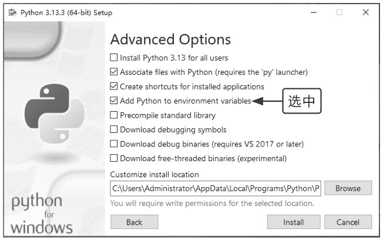

图 2-6 选中相应复选框

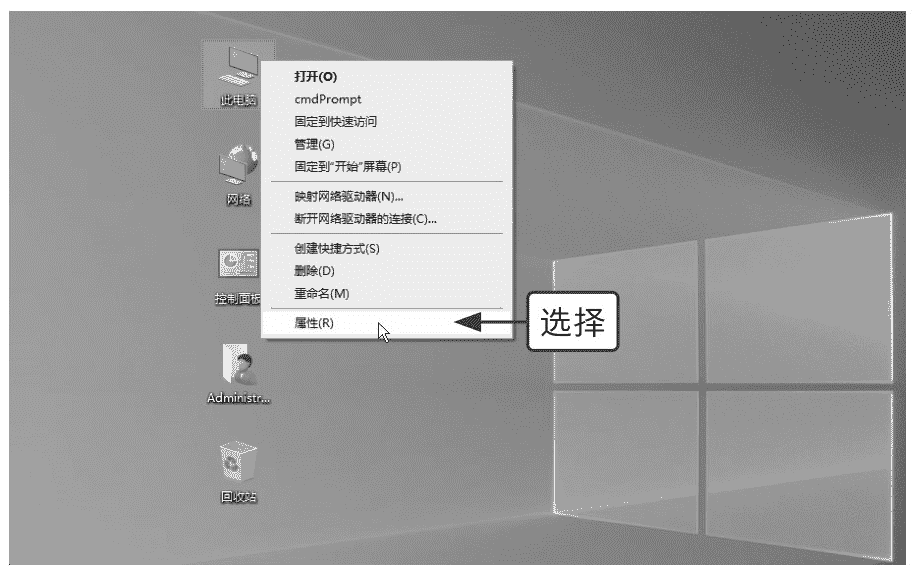

图 2-7 选择“属性”选项

**知识扩展**

环境变量是操作系统用来保存系统行为、用户偏好和应用配置信息的变量。正确配置环境变量，才能确保 Python 及其工具如 pip 能从任意目录被调用。

**步骤 06** 打开 “设置” 窗口，在 “关于” 页面点击 “高级系统设置” 链接，如图 2-8 所示。

**步骤 07** 弹出 “系统属性” 对话框并自动切换到 “高级” 选项卡，点击 “环境变量” 按钮，如图 2-9 所示。

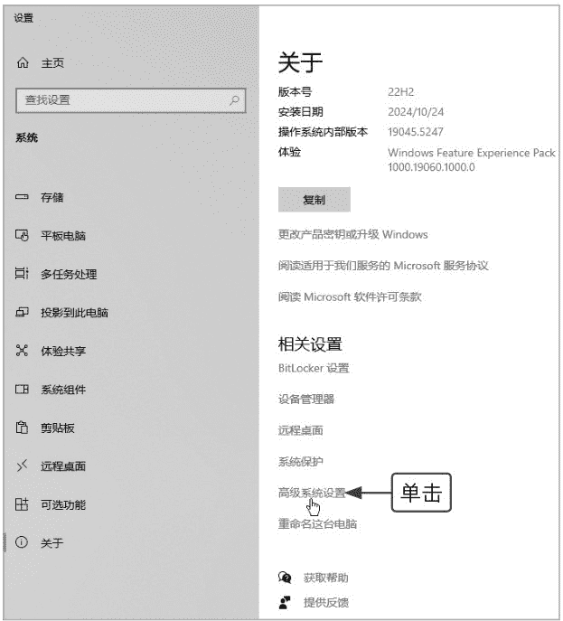

图 2-8 单击“高级系统设置”链接

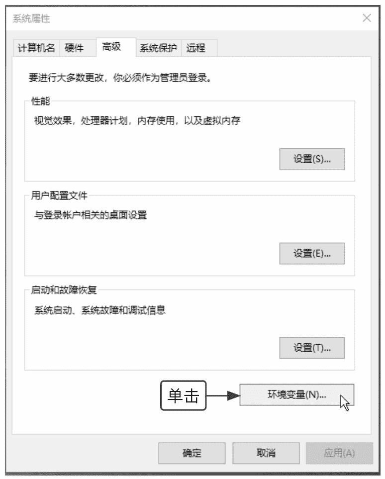

图 2-9 单击“环境变量”按钮

**步骤 08** 弹出 “环境变量” 对话框，在 “系统变量” 列表中双击 “Path” 选项，或选中后点 “编辑” 按钮。

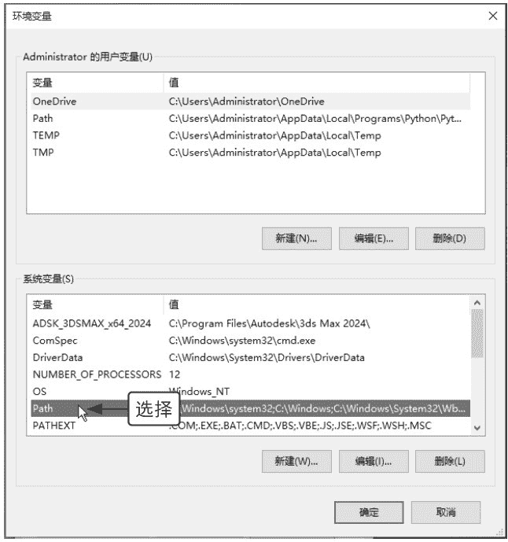

图 2-10 双击 Path 选项

**步骤 09** 弹出 “编辑环境变量” 对话框，点击 “新建” 按钮，填入 Python 的安装路径，如图 2-11 所示。

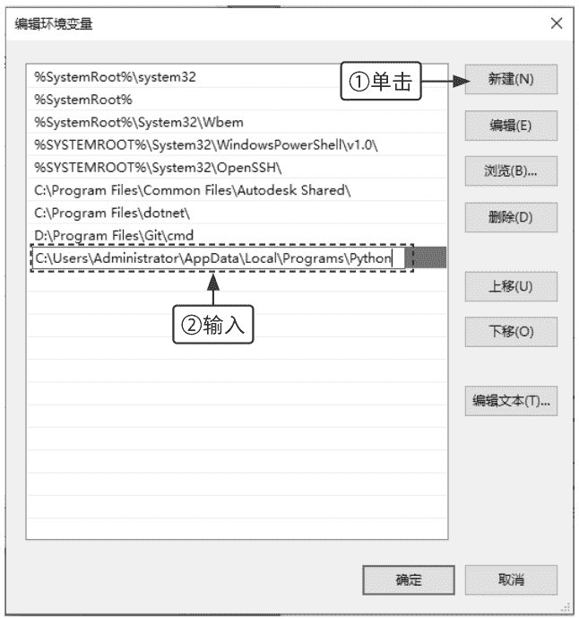

图 2-11 输入 Python 的安装地址

**步骤 10** 在任意文件夹输入 “cmd” 回车打开命令提示符窗口，输入 “python -V” 回车，返回版本号即表示安装成功，如图 2-12 所示。

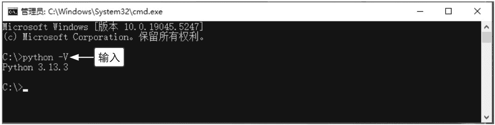

图 2-12 测试 Python 是否安装成功

以上组件构成本地运行 DeepSeek 的基础环境，完成后再进入模型部署阶段。

**2.1.3 下载与安装 Ollama**

本次部署借助 Ollama 完成。Ollama 官网提供丰富模型资源，除 DeepSeek 系列外，还有 Mistral、Gemma 2 等众多模型。

Ollama 支持多版本，可适配 Windows 与 Linux，安装简便，完成后可在控制台直接调用。

**步骤 01** 进入 Ollama 官网，点击 “Download” 按钮，如图 2-13 所示。

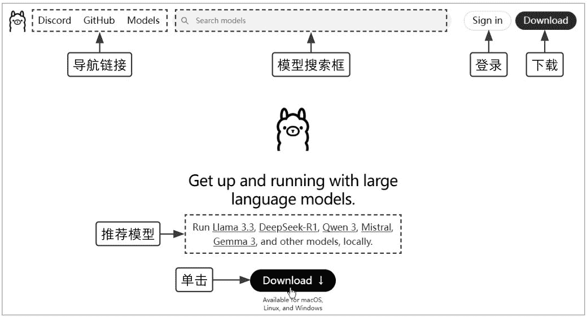

图 2-13 单击“Download”按钮

**步骤 02** 进入 Download Ollama 页面，按系统选择版本。以 Windows 为例，点击 “Download for Windows” 按钮，如图 2-14 所示，即可获取安装程序。

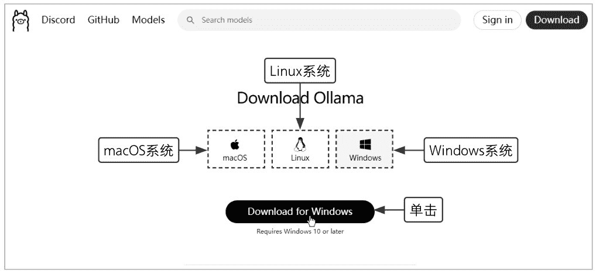

图 2-14 单击“Download for Windows”按钮

**步骤 03** 打开安装程序所在文件夹，双击 Ollama 安装程序，如图 2-15 所示。

**步骤 04** 弹出 “Setup” 对话框，点击 “Install” 按钮，如图 2-16 所示。

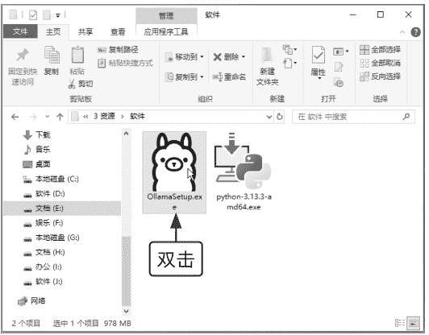

图 2-15 双击 Ollama 安装程序

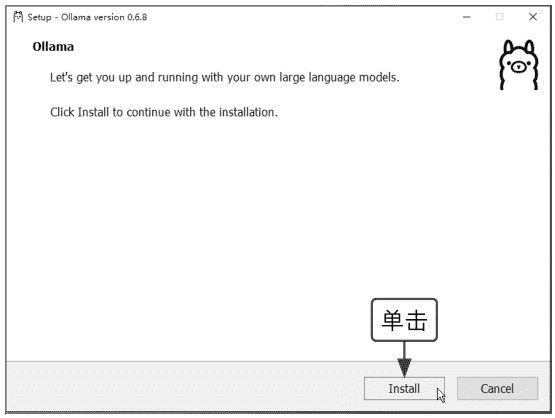

图 2-16 单击“Install”按钮

**知识扩展**

Ollama 提供命令行工具，通过简短指令即可完成模型的下载、运行、查看等操作，并可利用 GPU 加速；同时也支持图形界面，操作更友好。

**步骤 05** 进入 “Installing” 界面，显示安装进度，如图 2-17 所示。

**步骤 06** 安装完成后对话框自动关闭。打开 cmd，输入 “ollama -v” 回车，若返回版本号说明安装成功，如图 2-18 所示。

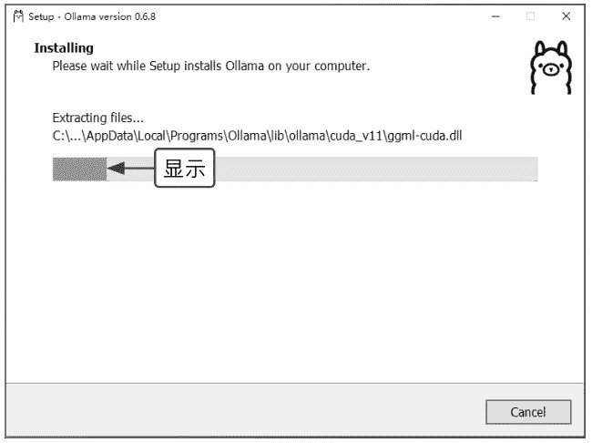

图 2-17 显示 Ollama 的安装进度

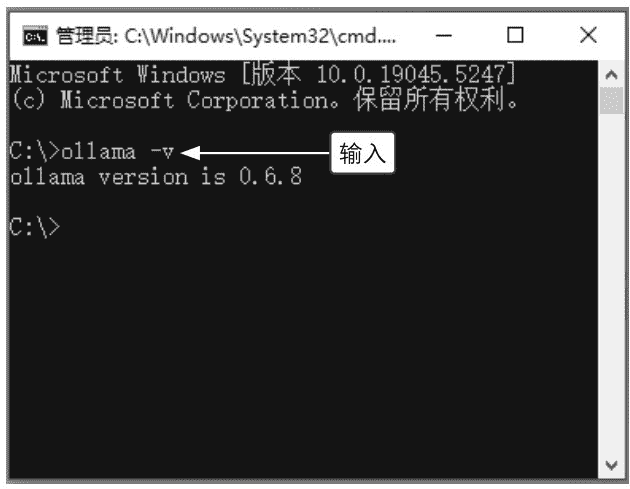

图 2-18 Ollama 安装成功

**步骤 07** 在命令提示符窗口输入 “ollama help” 回车，可查看帮助信息，如图 2-19 所示。

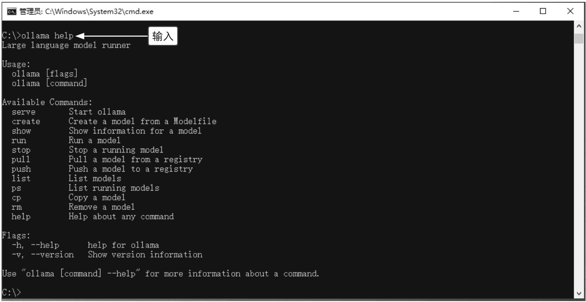

图 2-19 查看 Ollama 的帮助信息

**知识扩展**

Ollama 常用命令及作用：

（1）serve：启动 Ollama 服务，使模型可响应请求。
（2）create：基于一个 ModelFile 创建模型。ModelFile 是定义模型参数与设置的配置文件。
（3）show：显示模型信息，包括配置、状态等。
（4）run：运行指定模型。
（5）stop：停止正在运行的模型。
（6）pull：从模型仓库拉取模型到本地。
（7）push：将模型推送到模型仓库。
（8）list：列出已下载或可用的模型。
（9）ps：列出正在运行的模型。
（10）cp：复制模型到另一位置或设备。
（11）rm：删除不再需要的模型。
（12）help：显示所有命令的帮助信息。

常用参数：
（1）-h, --help：显示帮助信息，提供命令行工具概述。
（2）-v, --version：显示版本信息。

**2.1.4 下载 DeepSeek 模型**

Ollama 是开源的本地大语言模型运行平台，可简化模型的下载与管理。用户可通过 Ollama 快速把 DeepSeek 模型拉取到本地并运行。具体操作如下。

**步骤 01** 进入 Ollama 官网，点击 “DeepSeek-R1” 链接，如图 2-20 所示。

图 2-20 单击“DeepSeek-R1”链接

**步骤 02** 进入 “deepseek-r1” 页面，左侧列表根据电脑配置选择合适模型。例如此处选择 8b 模型，如图 2-21 所示。左侧为不同参数规模，右侧显示模型文件大小。

图 2-21 选择合适的模型

**步骤 03** 选择好模型后，点击右侧的 按钮，如图 2-22 所示，复制本地部署模型的命令。

图 2-22 单击相应按钮

**步骤 04** 复制命令后，打开命令提示符窗口并粘贴该命令，如图 2-23 所示。

**步骤 05** 按 Enter 运行命令，即可开始部署并显示下载进度和速度，如图 2-24 所示。

图 2-23 粘贴本地部署模型的命令

图 2-24 显示相应的下载进度和速度

**知识扩展**

DeepSeek-R1 不同参数版本在性能、适用场景和硬件需求上各有差异，习惯上用大写 B 表示参数规模。

（1）1.5b、7b、8b 版本：参数较少，资源消耗低，适合本地轻量问答或简单 AI 助手。
（2）14b 和 32b 版本：推理能力明显提升，可处理代码补全、数据分析等复杂任务，需高端 GPU。
（3）70b 和 671b 版本：顶尖水平，70b 接近 GPT-4 能力，671b 面向大规模云端推理，硬件需求巨大。

推荐配置：
（1）1.5b：4 核处理器、8GB 内存，无需显卡。
（2）7b 与 8b：8 核处理器、16GB 内存、Ryzen 7 或更高、RTX 3060 12GB 或更高。
（3）14b：i9-13900K 或更高、32GB 内存、RTX 4090 24GB 或 A5000。
（4）32b：Xeon 8 核、128GB 内存、2～4 张 A100 80GB 或更高。
（5）70b：Xeon 8 核、128GB 内存、8 张 A100/H100 80GB 或更高。
（6）671b：64 核、512GB 内存、8 张 A100/H100 80GB 或更高。

**2.1.5 试运行 DeepSeek 模型**

Ollama 对资源受限设备友好，即使显存较小或机器较旧也能运行；支持 GPU 加速，可运行 TensorFlow、PyTorch 等框架训练的模型，并支持跨平台。同一实例可同时运行多个模型，便于切换。

模型下载完成后即可通过 Ollama 试运行，具体如下。

**步骤 01** 部署完成后输入测试问题，例如 “你是谁？你能做什么？”，如图 2-25 所示。

图 2-25 填写测试用例

步骤 02 按下回车键确认发送，DeepSeek 会按指令返回内容，参考图 2-26。

图 2-26 模型按指令返回结果

**2.1.6 为本地模型配置 Cherry Studio 前端**

本地大模型跑通后，装一个直观易用的前端能大幅提升人机交互效率。前台把命令行细节隐藏起来，让使用者无需接触终端即可发挥 DeepSeek 的能力。

下面以 Cherry Studio 为例演示配置流程。

步骤 01 打开 Cherry Studio 官网首页，按下“下载客户端”按钮，见图 2-27。

图 2-27 按下下载客户端按钮

步骤 02 进入下载页后，挑选适配当前系统的版本，按下“立即下载”获取安装包，见图 2-28。

图 2-28 按下立即下载按钮

步骤 03 在存放安装程序的文件夹中双击 Cherry Studio 安装包，见图 2-29。

步骤 04 随后弹出安装向导，保留默认配置后点“下一步”，见图 2-30。

图 2-29 双击 Cherry Studio 安装程序

图 2-30 按下下一步按钮

步骤 05 在“选择安装位置”界面设定目标目录作为安装路径，见图 2-31。

步骤 06 按下“安装”后进入进度页，可观察到 Cherry Studio 的安装过程，见图 2-32。

图 2-31 设置安装目录路径

图 2-32 安装进度展示

步骤 07 安装结束会进入完成向导，按下“完成”即可启动 Cherry Studio，见图 2-33。

步骤 08 若上一步未勾选“运行 Cherry Studio”，也可双击桌面图标启动，见图 2-34。

图 2-33 按下完成按钮

图 2-34 双击桌面程序图标

步骤 09 启动后点右下角“设置”按钮 ，见图 2-35。

图 2-35 按下设置按钮

**知识扩展**

Cherry Studio 是一款国产开源的 AI 工作台，融合多模型对话、知识库管理、AI 绘画、翻译等功能。基础对话支持一问多答、自动分组、记录导出，并兼容多种渲染方式。

其亮点包含 AI 绘画、AI 小程序、翻译、文件管理，以及对 OpenAI、Anthropic 等多家服务商的统一管理。界面可深度自定义，内置本地知识库，支持多格式导入导出，并重视数据安全。

步骤 10 进入设置页，①切换到“模型服务”标签；②在中间列表中选定“Ollama”项，见图 2-36。

图 2-36 选定 Ollama 选项

步骤 11 随后在右侧 Ollama 面板中点“模型”区域的“管理”按钮，见图 2-37。

图 2-37 按下管理按钮

步骤 12 弹出“Ollama 模型”对话框，可看到此前本地部署的 DeepSeek 大模型，按下右侧的 按钮，见图 2-38。

图 2-38 按下对应按钮

步骤 13 关闭模型窗口，返回“模型服务”标签，右侧面板即可看到已添加的本地 DeepSeek 大模型，且 Ollama 服务会自动开启，见图 2-39。

图 2-39 添加本地模型并激活 Ollama 服务

**知识扩展**

配置前端前请确认 Ollama 后台正在运行，且 DeepSeek 大模型已安装并可被 Ollama 调用。

步骤 14 ①切换到“默认模型”标签；②将“默认助手模型”“话题命名模型”“翻译模型”全部指向通过 Ollama 部署的本地 DeepSeek 大模型，见图 2-40。

图 2-40 设置默认模型

步骤 15 ①按下“助手”按钮 进入对话页；②在输入框里输入示例问题，如“你是谁？”，见图 2-41。

图 2-41 输入测试问题

步骤 16 按下 按钮发送，即可调用本地的 DeepSeek 大模型作答，见图 2-42。

图 2-42 调用本地模型作答

### **2.2 插件部署：把 DeepSeek 引入浏览器**

为拓宽 DeepSeek 的使用场景并提升便捷性，部署浏览器插件成为重要方向。本节以 Page Assist 为例介绍安装、配置及功能验证。通过该插件，DeepSeek 可无缝嵌入浏览器，实现更高效的智能辅助。

**2.2.1 安装 Page Assist 插件**

Page Assist 是一款开源浏览器扩展，为本地 AI 模型提供可视化交互入口，主要特征如下。

（1）本地模型交互：插件可在浏览器侧栏或 Web UI 中与本地 DeepSeek 大模型对话，快速获得智能支持。
（2）多浏览器支持：兼容 Chrome、Edge、Firefox 等主流浏览器，按需选择。
（3）联网搜索：结合网络检索，可在查阅资料后生成更准确回复。
（4）知识库构建：可快速搭建本地知识库，模型据此作答，适合专业领域。

下面以 Edge 为例演示安装。

步骤 01 打开 Edge，①点地址栏右侧“扩展”按钮 ；②在弹出菜单中选择“获取 Microsoft Edge 扩展”，见图 2-43。

图 2-43 选择获取 Microsoft Edge 扩展选项

步骤 02 进入 Microsoft Edge 加载项页面，在搜索框输入 Page Assist，按回车确认，见图 2-44。

图 2-44 在搜索框输入 Page Assist

**知识扩展**

Microsoft Edge 加载项是扩展浏览器功能的轻量程序，可帮助用户自定义浏览体验，提升安全与效率。

加载项包含广告拦截、密码管理、翻译等类型，均可在官方商店获取，通过扩展图标管理安装、启用、禁用或移除。Edge 也支持从 Chrome Web Store 安装扩展，有助于提升浏览效率与安全性。

步骤 03 在搜索结果中挑选对应扩展，如“Page Assist-A Web UI for Local AI Models”，见图 2-45。

图 2-45 选择对应扩展插件

步骤 04 进入详情页，按右上角“获取”按钮，见图 2-46。

图 2-46 按下获取按钮

步骤 05 弹出提示框，按下“添加扩展”即可开始安装。

步骤 06 稍等片刻，提示框显示 Page Assist 已成功安装，见图 2-48。

图 2-47 按下添加扩展按钮

图 2-48 弹出安装成功提示

**2.2.2 配置 Page Assist 插件**

配置完成后可在浏览器中调用本地 DeepSeek 大模型。具体设置如下。

步骤 01 在 Edge 地址栏右侧，①按下“扩展”按钮 ；②从菜单中选择已安装的 Page Assist 插件，见图 2-49。

图 2-49 选择 Page Assist 插件

**知识扩展**

按下“扩展”按钮  可查看已装扩展列表，选择“管理扩展”进入管理页，按插件下方的“详细信息”可进入设置页修改配置。

步骤 02 进入插件页面后，中间会显示“Ollama is running”提示，说明已检测到 Ollama，顶部左侧列表中选择已部署的 DeepSeek 大模型，见图 2-50。

图 2-50 选择本地部署的 DeepSeek 大模型

步骤 03 按右上角“Settings”按钮  进入通用设置，在左侧选择“RAG 设置”，见图 2-51。

图 2-51 选择 RAG 设置选项

**知识扩展**

初次使用时界面语言为英文，可在通用设置页的“语言”下拉框选择“简体中文”切换。

步骤 04 在 RAG 设置页，①将“文本嵌入模型”指定为 Ollama 上的本地 DeepSeek 大模型；②按下“保存”完成配置，见图 2-52。

图 2-52 按下保存按钮

**2.2.3 验证模型可用性**

安装配置完成后，可通过插件直接使用本地 DeepSeek 大模型获取信息。

步骤 01 回到 Page Assist 聊天窗口，在输入框输入测试问题，如“你是谁？”，见图 2-53。

图 2-53 输入问题

步骤 02 按下“提交”按钮发送指令，即可让本地 DeepSeek 大模型作答，见图 2-54。

图 2-54 调用模型作答

### **本章小结**

本章先介绍了 DeepSeek 本地部署全流程，涵盖准备工作、Python 依赖、Ollama 安装、模型下载试跑以及 Cherry Studio 前端配置，提供完整操作参考；再介绍了浏览器插件 Page Assist 的部署与使用，包括安装、配置和测试，帮助读者掌握在浏览器环境中扩展 DeepSeek 的方法。

### **课后实训**

**实训任务** 在本地完成 DeepSeek 部署与配置后，利用 Page Assist 插件的联网搜索功能，让模型实时获取网络最新信息，例如查询当天日期。

步骤 01 在插件聊天窗口的输入框左下角打开“搜索互联网”开关，见图 2-55。

图 2-55 开启搜索互联网功能

步骤 02 在输入框输入问题如“今天的日期是什么？”，发送后 DeepSeek 会联网检索并返回结果，见图 2-56，有助于提升回答准确度。

图 2-56 让 DeepSeek 联网获取答案

## **第三章 数据获取：构建 AI 模型的知识库**

数据是信息的载体，以数字、文字、图像、声音、视频等形式存在，是人工智能训练的基石。本章将探讨数据获取的关键技术与方法，为模型训练提供丰富知识支撑。

### **3.1 数据与模型：读懂 AI 训练中的核心关联**

数据与模型在 AI 训练里是一对共生关系。本篇聚焦训练环节最核心的输入——数据集，用通俗的视角说明它为什么关键，以及怎么用才能发挥效果。

**3.1.1 模型训练数据怎么分才科学**

做机器学习或深度学习时，数据就是模型的燃料。想要模型既能学会规律又能在真实场景可靠发挥，关键一步就是把数据合理拆分。常规做法是把原始集合切成三份互不重叠：训练集、验证集、测试集，三者配合的逻辑如图 3-1 所示。

图 3-1 训练集、验证集和测试集与模型训练之间的关系

三部分分工明确，共同把模型从实验推进到上线。科学的切分是项目成功的底座。无论是入门练习还是实战落地，弄清三者的职责并学会灵活配比，都能明显提升训练效率和最终表现。具体拆解如下。

**1．训练集：模型学习的主战场**

训练集 Training Set 是模型在训练阶段直接接触的核心样本，通常占总体 60%～80%，占比受数据量和任务难度影响。

核心作用是让模型从样本中挖掘潜在规律，更新内部参数如神经网络权重，从而获得初步预测能力。训练集要具备代表性和多样性，避免样本偏差导致模型学偏、泛化受限。

**2．验证集：调参和选型的“试金石”**

验证集 Validation Set 主要用于训练过程中评估效果，一般占 10%～20%。要点包括：

（1）超参数优化：借助验证集调整学习率、丢弃率等超参数，防止模型在训练集上过拟合即过度记忆细节，或欠拟合即学不到本质规律。

（2）模型筛选：对比不同算法或结构的效果，挑出最优方案进入下一步。

（3）使用注意：验证集必须与训练集完全分离，保证评估客观。

**3．测试集：上线前的“终极考核”**

测试集 Test Set 用于模型训练结束后做最终检验，占比通常 10%～20%，且与前两份数据严格隔离。作用有：

（1）泛化检验：模拟真实环境里的未见数据，检查鲁棒性和实用性。

（2）指标量化：给出准确率、F1 等客观数值，为上线决策提供依据。

（3）使用注意：测试集要保密，只在最终评估时使用，避免提前泄露导致结果失真。

**知识扩展**

常见的经验配比是 6:2:2，即训练 60%、验证 20%、测试 20%。实际操作中要灵活调整，例如小样本数据可采用 7:1:2，海量数据则可适当压缩验证集比例。

**3.1.2 公开数据集去哪找？两大实用入口**

高质量数据集是模型训练的“燃油”。新手练手、老手做项目，都离不开快速找到合适的公开数据。以下推荐两个覆盖面广、好用的平台。

**1.Kaggle：机器学习社区的数据宝库**

作为全球知名 AI 社区，Kaggle 的数据板块堪称百科全书，已收录超 10 万个公开集，类型涵盖图像、文本、结构化数据，领域包括医疗、金融、自动驾驶、自然语言处理等。

平台上既有经典入门集如 Titanic 用于练习逻辑回归等分类任务，也有大规模图像集如 Google Landmark，含千万级地标图片适合视觉项目，如图 3-2 所示。

图 3-2 Google Landmark 图像数据集

每个数据集都附带讨论区和 Kernels 代码示例，可直接参考别人的分析与建模流程。比如房价预测集里能看到用 Pandas 清洗、用 Scikit-learn 训练的完整链路。Kaggle 还提供在线 Notebook，无需本地环境即可在浏览器里做可视化与训练。新手可用标签筛选 image、text 等类型，也可看 Trending 榜单把握热点，如 2024 年生成式 AI 相关数据集；还能参与竞赛，竞赛数据常含缺失、噪声等真实业务问题，有助于提升实战。

**2.Google Dataset Search：学术与开放数据的精准搜索引擎**

Google Dataset Search 聚合了全球数千数据源，包括高校开放平台、政府公开数据和科研机构资源，支持按下载格式、使用权限等维度精细筛选，如图 3-3 所示。

图 3-3 使用 Google Dataset Search 筛选数据集

该工具会优先展示与论文关联的数据集，并提供标准引用格式，便于学术写作标注来源。结合 Google 学术搜索使用，可实现“数据+方法”的完整研究闭环，如图 3-4 所示。

图 3-4 Google 学术搜索的应用示例

**3.1.3 如何高效生成微调用数据集**

在模型微调场景里，把领域文献结构化是关键却耗时。传统手工流程主要有三痛点，智能化工具能把文献自动转成可用数据集。

传统方式的痛点：

（1）长文本切分断层：单篇论文或报告常达数万字，直接喂模型会因 token 限制如早期 4096 导致截断；人工切分容易割裂段落，打破方法与结果的上下文。

（2）标签体系搭建费力：领域标签多维度如“方法-深度学习-Transformer”，人工标注易漏、耗时；用 Excel 管理标签难以动态关联内容。

（3）答案生成机械重复：规则模板只会提取摘要，难以回答“实验局限性”等复杂问题；同义重复标注造成数据冗余浪费资源。

在这一领域，Easy Dataset 通过大模型驱动+自动化流程大幅提升生成效率，如图 3-5 所示。

图 3-5 使用 Easy Dataset 创建的数据集

Easy Dataset 简化制作链路：上传文档后自动拆分内容；用户可指定或自动生成问题，工具基于原文产出精准答案形成问答对；最后选定模型一键构建数据集。

优势也很明显：问题答案可灵活编辑，完全掌控质量；支持多格式导出，适配主流微调框架。该项目完全开源，既提供开箱即用的客户端，也支持 Docker 本地部署，满足个性化需求。

### **3.2 本地知识库搭建实战**

搭建精准高效的知识库是训练的关键，能为模型提供结构化的领域知识。下面以 AnythingLLM+DeepSeek-R1 为例，演示从零起步在本地构建稳定知识库。

**3.2.1 AnythingLLM 安装全流程**

AnythingLLM 是 Mintplex Labs 出品的全栈 AI 应用，兼容多种大语言模型和向量库，可把文档转为知识库实现智能问答。

**步骤 01**  进入官网，点击“Download for desktop”下载桌面版，如图 3-6 所示。

**步骤 02**  进入下载页，系统自动识别系统版本。以 Windows 为例，点击“Download for Windows（x64）”即可，如图 3-7 所示。

图 3-6 单击“Download for desktop”按钮

图 3-7 单击“Download for Windows（x64）”按钮

**步骤 03**  打开安装包所在文件夹，双击安装程序，如图 3-8 所示。注意安装前需先启动 Ollama，否则可能报错。

**步骤 04**  弹出安装向导，进入安装选项，保持默认后点“下一步”，如图 3-9 所示。

图 3-8 双击 AnythingLLM 安装程序

图 3-9 单击“下一步”按钮

**步骤 05**  进入安装位置设置，选择目标文件夹，如图 3-10 所示。

**步骤 06**  点击“安装”，显示进度条，如图 3-11 所示。

图 3-10 设置相应的目标文件夹路径

图 3-11 显示 AnythingLLM 的安装进度

**步骤 07**  安装完成，进入完成向导，点击“完成”，如图 3-12 所示。

**步骤 08**  启动 AnythingLLM，点击“开始”，如图 3-13 所示，按提示完成偏好设置和新建工作区。

图 3-12 单击“完成”按钮

图 3-13 单击“开始”按钮

**3.2.2 AnythingLLM 基础配置指南**

AnythingLLM 内置 RAG 与 AI 代理，支持多用户与离线使用，保障隐私，还支持 MCP 无代码构建智能体，适合企业知识管理等敏感场景。

**步骤 01**  左侧面板下方点击“Open settings”打开设置 ，如图 3-14 所示。

**步骤 02**  默认进入外观→界面偏好，在显示语言中选“Chinese”，将界面切为中文，如图 3-15 所示。

图 3-14 单击“Open settings”按钮

图 3-15 选择“Chinese”选项

**步骤 03**  ①切换到人工智能提供商→LLM 首选项；②点击 LLM 提供商下的按钮，如图 3-16 所示。

**步骤 04**  在弹出的搜索列表中选择“Ollama”，如图 3-17 所示。

图 3-16 单击相应按钮

图 3-17 选择“Ollama”选项

**步骤 05**  接入 Ollama 后，①在 Ollama Model 列表选定 DeepSeek-R1 模型；②点击“Save changes”保存更改，如图 3-18 所示。

**步骤 06**  ①切换到人工智能提供商→Embedder 首选项；②将嵌入引擎提供商设为 Ollama，系统自动接入本地嵌入模型；③点击保存更改，如图 3-19 所示。

图 3-18 单击“Save changes”按钮

图 3-19 单击“保存更改”按钮

**3.2.3 把私有数据导入工作区**

私有数据集承载独特专业信息，在 AnythingLLM 中上传可兼顾安全与性能，还能打造专属问答助手。

**步骤 01**  左侧面板点击“新工作区”，如图 3-20 所示。

**步骤 02**  弹出对话框，将工作区名称设为“企业销售数据”，如图 3-21 所示。

图 3-20 单击“新工作区”按钮

图 3-21 设置“工作区名称”选项

**步骤 03**  点击“Save”新建工作区，点击名称右侧的 按钮，如图 3-22 所示。

**步骤 04**  弹出文档对话框，点击“我的文档”区虚线框，如图 3-23 所示。

图 3-22 单击相应按钮

图 3-23 单击虚线框区域

**步骤 05**  弹出打开对话框，选择数据表格后点“打开”，如图 3-24 所示，完成上传。

**步骤 06**  文档上传后，选中对应文件，点击“移动到工作区”，如图 3-25 所示。

图 3-24 单击“打开”按钮

图 3-25 单击“移动到工作区”按钮

**知识扩展**

如需上传多种格式，可点击“新建文件夹”对数据分类管理。

**步骤 07**  文档移入工作区后，点击“保存并嵌入”，如图 3-26 所示，即可完成。

图 3-26 单击“保存并嵌入”按钮

**知识扩展**

AnythingLLM 内部的知识库本质上是一套经规范化整理的信息集合，可以收纳多份文件与多层目录，并按主题、分类或层级关系进行归置。以企业为例，内部库通常拆分为产品资料、客户服务指引、技术文档等若干板块。入库后的素材会被转译为模型便于检索与理解的表征形式，最典型的做法是向量编码，从而做到对各类查询的即时响应。

### **本章小结**
本章先从训练环节数据与模型的互动关系切入，以通俗方式拆解训练集的构成，梳理获取公开数据集的常见路径，并给出构建高质量微调数据的思路，为数据认知奠定基础；随后说明如何借助知识库为大模型准备训练数据，具体涉及 AnythingLLM 的下载安装、系统配置以及私有训练集的上传，帮助读者动手掌握数据集搭建与应用方法。

### **课后实训**
**实训任务** 本次实训旨在验证模型在私有数据上的问答表现。向 DeepSeek-R1 提出问题，检验其对数据的理解与运用能力，记录并评估回复的准确度、相关度与流畅度。根据评估结果对数据或模型参数进行针对性调整，以优化输出效果，提升实用性。

验证回复效果的操作如下。

**步骤 01** 在“企业销售数据”工作区的输入框中键入待测问题，例如“孙莉的销售金额是多少？”，如图 3-27 所示。

图 3-27 输入相应的问题

**步骤 02** 单击“将提示消息发送到工作区”按钮 ,AnythingLLM 即可调用 DeepSeek-R1 模型对数据进行深入分析，并按要求给出回复，如图 3-28 所示。

图 3-28 模型的回复效果

## **第四章** **数据标注：让模型学会正确思考**
在人工智能体系里，数据标注直接决定模型的上限。本章系统讲解标注的关键意义与技术逻辑，并以 MakeSense 为例演示图像标注的完整实操流程，帮助读者掌握实战技能，为训练提供高质量数据支撑。

### **4.1** **数据标注：大模型的幕后工程师**
在 AI 的底层逻辑中，标注是把人类知识转化为机器可读信息的桥梁。我们惊叹 DeepSeek-R1、GPT-4.5 等大模型表现时，背后是大量标注人员对原始素材的精细加工。

从手工标注到如今的人机协同，标注工作正从劳动密集型转向智能协作型，已成为人工智能行业的核心环节。本节阐述标注的本质，包括概念、技术原理及其对大模型的作用。

**4.1.1** **数据标注的概念与技术原理**
标注的核心在于让数据拥有机器可理解的语义，通过人工或工具对文本、图像、语音等原始素材进行标签化与结构化处理。图像场景中，标注员会用边界框标出汽车、行人等目标，告诉模型“这是什么”，如图 4-1 所示；在对话场景中，则需校准伦理倾向，确保输出符合人类价值取向。

图 4-1 图像领域的数据标注示例

研究显示，标注准确率提升一成，模型在真实场景的误差率可下降 15%～20%。例如 OpenAI 的 GPT-4 借助上万小时的标注校准，将有害内容生成概率从 47%降至 1%以下。

在人工智能工业化进程中，数据质量决定模型能否从堆砌数据迈向真正智能，干净的数据才是驱动引擎的优质燃料。下面介绍标注技术从人工到智能辅助的演进。

（1）预标注：显著降低重复劳动。利用预训练模型如 DeepSeek-R1 生成初版标注，人工只需复核修正。例如文本实体标注中模型可自动识别 90% 的人名地名，人工处理剩余模糊实体；在图像标注中模型先框出车辆行人，人工再微调框位。

（2）主动学习：让标注更聪明。模型会筛选最具价值的样本优先标注。例如在罕见病影像标注中，模型主动挑出“疑似病变但特征不明显”的案例，使资源集中于关键数据，减少无效标注量。

（3）小样本增强：破解数据稀缺。借助扩散模型生成仿真数据，如合成不同光照条件的自动驾驶场景，配合少量真实标注，可大幅提升训练效率。

**4.1.2** **数据标注在大模型中的作用**
在大模型浪潮下，AI 能写诗编程解答专业问题，但这些能力都建立在海量精细标注数据的喂养之上。正如建筑离不开地基，模型能力离不开高质量标注。

大模型本质是统计学习系统，依赖标注数据发现规律。主要作用如下。

（1）监督学习的基石：约九成的模型训练依赖标注。例如 GPT-4 通过数千万条标注对话学会语言逻辑，AlphaFold 凭借数百万条蛋白质结构标注破解折叠难题，如图 4-2 所示。

图 4-2 AlphaFold 模型应用示例

（2）模型对齐的关键：标注引导模型输出符合人类价值取向的回复。

（3）“幻觉”抑制的解药：事实性标注数据如历史事件、科学公式等，可降低模型胡编乱造，提升可信度。

标注如何塑造模型能力，具体体现在：

（1）文本标注：构建语言理解框架，包含
分类标注：将新闻划分到科技、财经、娱乐等类别，帮助模型学会分类。
实体标注：在法律文书中标注当事人、时间、地点等，提升信息抽取能力。
对话标注：在客服记录中标注问题类型、解决方案等，优化问答逻辑。

（2）图像标注：赋予机器视觉认知，包含
边界框标注：用矩形框定位自动驾驶图像中的车辆、信号灯，实现障碍检测。
语义分割标注：为图像每个像素赋予语义类别，如在机器人抓取中区分杯子、桌面、背景，提升抓取精度，如图 4-3 所示。

图 4-3 机器人抓取任务中的语义分割标注示例
关键点标注：在人体图像中标注关节位置，完成姿态估计。

（3）多模态标注：打通感知与认知的链路，包含
图文对齐标注：在电商数据中关联商品图、名称、描述，实现跨模态检索。
语音文本标注：在短视频数据中标注语音内容、情感、场景，帮助模型理解视频。

为便于对照，下面以相同示例展示不同标注视角的呈现方式：
图 4-1 对照视角 
图 4-2 对照视角 
图 4-3 对照视角 

从手工到智能辅助，标注始终是模型进步的隐形引擎。它不仅是贴标签，更是人类智慧与机器能力的融合，用标注为模型编写认知说明书，用领域知识划定行为边界。在自动驾驶、医疗 AI、智能客服等场景，精准标注的价值日益凸显，每一个准确标签都是打开智能未来的一把钥匙。

### **4.2** **MakeSense：图像标注实操手册**
MakeSense 是一款广受欢迎的开源图像标注工具。本节深入其实战应用，帮助读者高效掌握图像标注技能。

**4.2.1** **选择标注任务类型**
MakeSense 界面友好、功能完备，支持多种标注方式，满足不同场景需求，并可导出多种格式方便接入机器学习框架。以下介绍任务类型选择的操作流程。

**步骤 01** 进入 MakeSense 主页，单击右下角的“Get Started”按钮，如图 4-4 所示。

图 4-4 单击“Get Started”按钮

**知识扩展**
MakeSense 的主要特点如下。
（1）开源免费：采用 GPLv3 许可证，可免费使用。
（2）无需安装：直接通过浏览器访问，跨系统兼容。
（3）多种标注类型：支持矩形、点、线、多边形等。
（4）多种输出格式：支持 YOLO、VOC XML、VGG JSON、CSV 等。
（5）集成 AI 功能：内置 YOLOv5、SSD、PoseNet 等模型，提升效率。
（6）保护隐私：所有标注在本地完成，不上传图像。

**步骤 02** 执行后单击页面中央的黑色方框区域，如图 4-5 所示。

**步骤 03** 弹出“打开”对话框，选择相应图像文件，如图 4-6 所示。

图 4-5 单击黑色方框区域

图 4-6 选择相应的图像文件

**步骤 04** 单击“打开”按钮加载图像。MakeSense 支持 Object Detection 和 Image recognition 两类任务，此处选择“Object Detection”按钮即可，如图 4-7 所示。

图 4-7 单击 Object Detection 按钮

**知识扩展**
MakeSense 支持多种主流目标检测模型，可根据数据和任务快速检测图像物体。也支持图片分类任务，用于图像管理与检索。

**4.2.2** **创建和添加自定义标签**
在图像标注中添加自定义标签是实现精准标注的重要环节。用户可依项目需求定义类别，提升标注准确性和适用性。

下面介绍在 MakeSense 中创建和添加自定义标签的方法。

**步骤 01** 选择对象检测任务后，弹出“Create labels”对话框，单击“Load labels from file”按钮，如图 4-8 所示。

**步骤 02** 弹出“Load file with labels description”对话框，将标签文件拖拽至中间黑色方框中，如图 4-9 所示。

图 4-8 单击“Load labels from file”按钮

图 4-9 将标签文件拖入黑色区域

步骤 03 标签文件拖入后，点击“Start project”（启动项目）按钮，参考图 4-10。
步骤 04 任务加载完毕后，通过菜单栏“Actions”（操作）→“Edit Labels”（编辑标签）进入编辑界面，见图 4-11。

图 4-10 点按 Start project 按钮

图 4-11 选择 Edit Labels 命令

步骤 05 执行后弹出“Edit labels”对话框，点击左上角的  按钮，如图 4-12。
步骤 06 即可新增标签：①输入标签名，例如“house”（房子）；②按下“Accept”（接受）按钮完成添加，详见图 4-13。

图 4-12 点按指定按钮

图 4-13 点击“Accept”按钮

4.2.3 用 MakeSense 为图像标注
在 MakeSense 里，标签相当于对图像中特定内容或目标的类别命名。做目标检测时，可创建“人物”“汽车”“房子”等标签，帮助模型学会分辨不同物体的特征，进而在训练和预测中准确定位。
标注操作方法如下。

步骤 01 默认工具为 Rect（矩形）。按住鼠标左键拖动框选目标，框线呈白色表示已选中但未绑定标签，见图 4-14。
步骤 02 在右侧“Select label”（选择标签）列表中挑选对应标签，如“car”（汽车），参考图 4-15。

图 4-14 用框圈出待标注对象

图 4-15 在列表中选取标签

步骤 03 选择后目标自动关联标签，标注框变为黄色，即“car”标签的颜色，见图 4-16。
步骤 04 在左侧“Images”（图像）面板切换其它图片，Rect 工具可直接用于标注同类目标，详见图 4-17。

图 4-16 为目标贴上标签

图 4-17 对同类对象进行标注

4.2.4 调整项目名称
标注过程中及时管理项目信息很重要，修改项目名能保证标识准确。具体做法如下。

步骤 01 点击默认的项目名称，名称变为蓝色可编辑状态，见图 4-18。
步骤 02 清除原名后输入新名称，如“测试项目”，参考图 4-19。

图 4-18 点击项目默认名称

图 4-19 填入新的项目名

4.2.5 导出标注结果文件
MakeSense 支持把标注好的数据以通用格式保存到本地，便于接入各类机器学习框架。导出步骤如下。

步骤 01 打开菜单栏“Actions”→“Export Annotations”（导出标注），见图 4-20。
步骤 02 弹出“Export rect annotations”对话框：①勾选所需格式的复选框，此处以 YOLO 数据格式为例；②点击“Export”（导出）按钮，见图 4-21。

图 4-20 点击“Export Annotations”指令

图 4-21 按下“Export”按钮

步骤 03 执行后即可获得标注文件，解压打开对应文本文件即可查看标签内容，见图 4-22。

图 4-22 查看导出的标签数据

知识扩展
YOLO（You Only Look Once，你只需看一次）格式用于描述目标位置与类别。以图 4-22 的数据为例，第一位 0 表示类别，其余 4 个数值分别对应边界框中心点 X、Y 坐标及宽高相对于图像的归一化值，可精确定位目标，在目标检测中常用。

本章回顾
本章先介绍数据标注的基础与原理，阐明其在大模型中的作用；再以 MakeSense 为例演示实操，涵盖任务选择、自定义标签创建、图像标注、项目更名与数据导出，帮助读者掌握图像标注的完整技能。

课后实训
实训任务：使用 MakeSense 添加多边形标注框。借助手动绘制多边形，可更精确勾勒目标轮廓。
操作如下。

步骤 01 在左侧“Images”面板选择目标图像，如图 4-23。
步骤 02 在右侧“Labels”（标签）面板切换为“Polygon”（多边形）标注工具，如图 4-24。

图 4-23 选择目标图像

图 4-24 切换到 Polygon 标注工具

步骤 03 ①点击“zoom in”（拉近镜头）按钮  放大视图；②开启 （图像拖动）模式调整位置；用 Polygon 工具在目标周围多次点击，③生成多边形标注框，如图 4-25。
步骤 04 在右侧“Label”列表中选择标签，如“house”，目标即被标注，框线变为红色，如图 4-26。

图 4-25 创建多边形标注框

图 4-26 为目标添加对应标签

第五章 模型微调：实现预期训练效果
模型微调是提升 AI 表现的关键，本章讲解微调的本质与预训练的区别，并聚焦 OpenAI Platform 上 GPT 模型的微调方法，帮助模型更贴合实际需求。

5.1 微调本质：让模型理解行业语言
通用大模型与垂直场景需求常有落差。以把 DeepSeek-R1 微调成领域专家为例，本质是知识注入与能力裁剪的结合。本节说明高质量数据是燃料，高效技术是引擎，领域需求是导航，三者共同推动模型从通用大脑向领域专家转变。

5.1.1 认识模型微调的核心
当下大模型已成为核心驱动力，但 GPT-4.5、DeepSeek-R1 等通用模型在特定场景仍显不足。微调即在预训练模型基础上，用特定领域数据二次训练，调整权重与偏置，赋予新知识或技能。
以理财为例，未微调模型回答空泛，微调后可结合金融专业知识给出精准解读。商汤科技基于千亿参数“商量”大模型，打造商汤金融大模型，融合金融知识数据，构建全栈多模态能力。

图 5-1 “商量”大语言模型

该模型支持私有化部署与软硬一体机双模式，提供从预训练到微调的全流程定制。某头部券商应用后，研报解析效率提升 40%、客户画像精准度提高 35%，成为金融智能转型的标杆。
微调的作用主要体现在：
（1）领域专业化：减少通用模型在垂直领域的“幻觉”。
（2）风格定制：通过学习大量对话实现特定语气。
（3）纠偏：修正模型对某些问题的过度敏感或迟钝。

5.1.2 微调与其它技术的边界
明确微调与相关概念的区别。
（1）长文本：处理超长内容，受上下文限制，资源消耗大，更像闭卷考试。
（2）知识库：把数据转成向量存储，检索最相似向量，适合实时查询场景，如智能客服。

图 5-2 智能客服系统

准确性依赖资料完整性。
（3）预训练：用公开大数据训练，获得通用能力，但缺乏垂直专业储备。
（4）微调：像课外辅导，用领域数据针对性训练，定制强、响应快，但成本较高、时效性弱。

知识扩展
预训练耗时很长，受规模与数据量影响，从数小时到数月不等，因为需从海量数据中提炼通用模式。

5.1.3 常用微调工具与流程
手动写脚本门槛高，可视化工具更易用。
（1）LLaMA-Factory：开源微调平台，覆盖预处理到部署，提供数据标注与参数模板。

图 5-3 LLaMA-Factory

（2）百度千帆平台：商业化工具，集成数据管理、训练、推理，兼容文心一言，依托算力集群加速训练。
（3）XTuner：开源大语言模型微调平台，优化算法使同数据量训练时间减少 30% 以上，兼容 LlaMA、ChatGLM 等。

可视化工具让模型定制从极客走向普及，建议先用开源平台熟悉流程，再按业务规模升级商业方案。

图 5-4 模型微调基本流程

模型微调核心是用数据与算法为具体问题量身定制，聚焦问题本质与数据质量才能释放垂直潜力。

5.2 OpenAI Platform GPT 微调实用技巧
OpenAI Platform 提供成熟的 GPT 体系与工具链，支持从通用到定制的训练路径。

5.2.1 模型是否需要微调
判断维度：
（1）通用大模型能否满足基础需求？先用 GPT-3.5、LLaMA 2 等测试。
（2）垂直知识是否缺失？是否依赖非公开数据或行业逻辑。
（3）成本收益是否匹配？仅需风格微调可用提示词优化，成本近乎为零。
官方建议先尝试提示词优化，例如加入“确保故事引人入胜，情节丰富”等指令。

图 5-5 调整提示词示例

当需求难以用语言描述时，如“温暖的心理咨询对话”，用数据标注让模型自悟比提示词更有效。

5.2.2 训练数据准备规范
数据质量决定微调上限。OpenAI Platform 要求领域相关、标注一致、格式规范。图 5-6 为 JSONL 格式的对话示范，每行是一个 JSON 对象。

图 5-6 JSONL 格式对话示范

其中 system_prompt 定义角色与风格，user_prompt 模拟真实需求，assistant_answer 给出示范回复。数据量小可加系统提示词，避免复杂格式，保持自然对话。建议至少 10 组，50~100 组效果更好，按 7:3 或 8:2 分训练集与测试集。

5.2.3 登录 OpenAI Platform 平台
前期目标明确、数据准备完成后，进入实操。首先登录平台。

步骤 01 进入 OpenAI Platform，点击右上角“Log in”（登录）按钮，如图 5-7。

**OpenAI 模型微调与 LoRA 实战速览**

完成上一步操作后，界面会跳转到 OpenAI Platform 的登录页，支持通过邮箱、Google、Microsoft、Apple 账号或手机号码进入，未注册用户可点按注册链接新建账号。

图 5-7 展示 Log in 按钮所在位置

图 5-8 呈现 OpenAI Platform 登录界面

**5.2.4 新建微调任务并上传训练数据**

OpenAI 官方模型在预训练阶段已具备广泛通用能力。经微调后，可在基础模型上注入业务场景所需示例，得到针对特定任务表现更优的定制化版本。

具体操作步骤如下。

步骤 01 登录平台后默认停留在 Fine-tuning 列表页，点击 Create 按钮进入创建流程，见图 5-9。

步骤 02 弹出 Create a fine-tuned model 对话框，在 Base Model 下拉中挑选底座，此处选用 GPT-3.5，成本效益较好且适用范围广，见图 5-10。

图 5-9 标识 Create 按钮

图 5-10 展示底座模型选择界面

知识扩展

若希望叠加领域知识，也可基于已有微调模型再次进行微调，实现领域叠加效果。

步骤 03 在对话框下方的 Training data 区域按下  按钮，见图 5-11。

步骤 04 随后打开系统文件选择窗口，挑选符合 JSONL 规范的训练集，建议文件名中体现领域关键词，点击 Open 完成数据上传，见图 5-12。

图 5-11 标注相应操作按钮

图 5-12 演示训练数据上传界面

**5.2.5 超参数配置要点**

在 OpenAI Platform 进行微调时，需要在效果与资源消耗之间求平衡，下面给出配置思路。

步骤 01 Validation data 区域保留默认 None，即不启用验证集，见图 5-13。若需要评估泛化能力，可自行上传测试集。

步骤 02 Suffix 文本框可为模型添加自定义后缀，例如 joke，表示这是一个擅长讲笑话的版本，见图 5-14。

图 5-13 展示 Validation data 配置

图 5-14 演示自定义后缀设置

步骤 03 Seed 文本框可填入固定随机种子，保证相同数据与参数下结果可复现，留空时系统会自动生成，见图 5-15。

步骤 04 Method 下拉中可选择微调策略，默认 Supervised，即监督式微调，通过提示词与标准响应的配对示例引导模型，见图 5-16。

图 5-15 呈现 Seed 设置

图 5-16 呈现 Method 选择

步骤 05 对话框底部为 Configure hyperparameters 区域，包含 Batch size、Learning rate multiplier、Number of epochs。新手建议沿用默认配置，后续依据评估结果再调整，最后点击 Create 启动训练，见图 5-17。训练时长从几分钟到数小时不等。

图 5-17 标记 Create 按钮位置

知识扩展

Configure hyperparameters 中的参数说明：

（1）Batch size 指每轮处理的样本数量，影响梯度更新频率。默认 8，类比每学 8 题即总结一次，数值过小效率低下，过大易丢失细节。

（2）Learning rate multiplier 为学习步长，决定收敛速度与稳定性。默认 0.0001，步长过大易跳过最优解，过小易陷入局部最优。

（3）Number of epochs 表示完整遍历数据集的次数。默认 3，类比复习 3 遍，次数过多易过拟合，次数不足学得不透。

注意当前 OpenAI Platform 并未提供免费额度，本节仅作技术演示，实际使用需充值。

### 本章小结

本章首先梳理了微调的基本概念，厘清了微调与长文本、知识库、预训练的区别，并介绍了工具与流程；随后以 OpenAI Platform 为例演示了 GPT 微调实操，涵盖判断是否需要微调、数据准备规范、登录、模型创建与数据上传、超参数配置等环节。

### 课后实训

实训任务 利用已准备的图像集，对 Flux 简称 F.1 模型进行微调，训练出偏向小清新摄影风格的 LoRA，使其生成的图像具备该风格特征，原图与效果对比见图 5-18。

图 5-18 对比原图与生成效果

知识扩展

Flux 在细节还原和复杂提示理解方面表现突出。LoRA 属于参数高效微调 PEFT 的典型方案，通过任务数据调整预训练参数以适配新场景。

Flux 微调操作流程：

步骤 01 登录 LiblibAI 平台，左侧创作区点击训练 LoRA 按钮，见图 5-19。

图 5-19 指出训练 LoRA 按钮

步骤 02 进入微调页后，在基础模型列表中选择 F.1 作为底模，超参数保持默认，见图 5-20。

图 5-20 显示 F.1 模型选择

步骤 03 在图片打标/裁剪区点按上传已有数据集链接，见图 5-21。

图 5-21 标记上传数据集链接

步骤 04 弹出文件夹选择对话框，挑选对应的训练集文件夹，见图 5-22。

图 5-22 展示文件夹选择界面

步骤 05 点击上传按钮提交数据集，见图 5-23。注意该数据集已完成预处理并附带图像标签。

图 5-23 演示数据集上传

步骤 06 在模型效果预览提示词下方输入样图提示词，仅用于预览不影响训练，见图 5-24。

图 5-24 显示提示词输入区

步骤 07 全部设置完成后点击立即训练按钮，见图 5-25。

图 5-25 定位立即训练按钮

步骤 08 执行后进入训练中页面，可查看进度，见图 5-26。

图 5-26 呈现训练进度

步骤 09 训练期间可打开日志视图查看 Loss 曲线，判断拟合情况，通常曲线平滑且数值下降即可，见图 5-27。

图 5-27 展示日志视图功能

步骤 10 片刻后进入训练完成页，完成 Flux 微调并生成 LoRA，点击模型生图测试按钮，见图 5-28。

图 5-28 标记模型生图测试按钮

步骤 11 进入 LiblibAI 在线生图平台的文生图页，①选择 Flux 模型；②输入正向提示词描述画面内容，见图 5-29。

图 5-29 展示正向提示词输入

步骤 12 ①切换至模型→Lora→我的训练；②挑选训练好的 LoRA；③将模型权重设为 1 以强化风格，见图 5-30。

图 5-30 显示 LoRA 选择界面

步骤 13 点击开始生图按钮，见图 5-31，稍等即可得到符合风格的人物图像。

图 5-31 标识开始生图按钮

# 第 2 篇

### 模型训练

## 第六章 语言模型训练：赋能各业务场景

在数字化快速演进的背景下，语言模型已成为推动各行业智能化升级的关键要素。本章系统介绍语言模型训练的实战技巧，帮助读者掌握这一工具以应对不同业务场景的复杂需求，提升效率与价值。

### 6.1 基于 Page Assist 训练 DeepSeek

随着 AI 技术发展，训练出能精准匹配特定业务需求的语言模型成为企业目标。本节以 DeepSeek 为例，讲解如何借助 Page Assist 工具训练一个专注解答金融产品问题的 AI 模型，为金融场景智能化提供支撑。

**6.1.1 配置文本嵌入模型**

文本嵌入模型是语言模型训练的基础，其合理配置直接影响后续效果与效率。以下介绍在 Page Assist 中训练 DeepSeek 时的配置方法。

步骤 01 进入 Ollama 官网，点击顶部 Models 链接，见图 6-1。

图 6-1 指示 Models 链接位置

知识扩展

文本嵌入模型的作用是将文本转换为向量表示。在训练 DeepSeek 时，它对输入文本编码生成固定维度向量，使计算机能够高效处理。向量保留语义信息，通过捕捉词汇间关系帮助模型理解文本，为后续训练提供结构化输入。

在多语言场景中，文本嵌入模型可把不同语言映射到同一向量空间，使模型实现跨语言理解与生成，对多语言对话系统、机器翻译等应用意义重大。

步骤 02 进入 Models 页面，可看到 Ollama 平台全部模型，找到并选择文本嵌入模型如 nomic-embed-text，见图 6-2。

图 6-2 展示文本嵌入模型选择

步骤 03 进入模型详情页，点击右侧  按钮，见图 6-3，复制本地部署命令。

图 6-3 标记相应按钮

知识扩展

nomic-embed-text 是基于 Transformer 架构的自然语言处理模型，专注文本嵌入与语义相似度计算。经过大规模文本预训练，可将文本转为捕捉语义的向量，适用于文本分类、信息检索、文档聚类、问答系统、文本搜索等 NLP 任务，支持多种语言，主要优化英语，也具备一定跨语言能力。

步骤 04 复制命令后打开命令提示符窗口粘贴，按 Enter 执行，即可开始本地部署并显示下载进度与速度，见图 6-4。

图 6-4 展示模型下载进度

知识扩展

命令提示符窗口是 Windows 系统提供的文本界面，可输入命令执行操作。可通过 Win+R 打开运行对话框输入 cmd 启动，也可在开始菜单搜索命令提示符打开。

步骤 05 稍等片刻出现 success 提示，表示 nomic-embed-text 已成功部署到本地，见图 6-5。

图 6-5 显示部署成功提示

知识扩展

借助 nomic-embed-text 的嵌入能力，可将知识库文本与用户问题转为语义丰富的向量，便于计算相似度，从知识库中检索最相关内容，为模型生成准确回答提供支持，提升本地 DeepSeek 对相关领域问题的理解与回答质量。

步骤 06 在 Edge 浏览器打开 Page Assist 插件页，点击右上角设置按钮 ，见图 6-6。

图 6-6 指示设置按钮

步骤 07 进入一般设置页，①左侧选择 RAG 设置进入对应页面；②在文本嵌入模型列表中选择 nomic-embed-text，见图 6-7。点击保存按钮保存配置。

图 6-7 展示模型选择界面

知识扩展

文本分割器用于把长文本切分为适合嵌入模型处理的短片段，决定文档切分方式。嵌入大小指每个文本块转为向量的维度，维度越高语义信息越丰富但计算与存储成本也上升。嵌入重叠指相邻片段的重叠长度，适当重叠有助于保持连贯性与上下文完整。检索文档数量决定信息检索时从知识库中取出的文档数，数量越大参考信息越多但处理时间可能增加。

**6.1.2 创建知识库**

让金融问答更可信：先把专业底座搭好

要让模型在金融产品类问题上给出可信答案，关键在于先搭建一套结构清晰、便于调用的专业素材集合。素材越规范、分类越明确，模型在真实业务场景中的准确度与专业性就越能体现。

下面以 Page Assist 为例，说明如何建立一个覆盖较广、检索便捷、调用顺畅的金融产品资料集。

**步骤 01** 进入 Page Assist 设置界面，① 进入管理知识板块；② 在右上角按新增知识入口，见图 6-8。

图 6-8 按下“添加新知识”按钮

**步骤 02** 触发新增知识窗口后，① 将知识标题设为“金融产品”作为本集名称；② 在导入文件区域的虚线框内操作，见图 6-9。

**步骤 03** 随后弹出打开窗口，① 选择对应文档；② 确认打开，见图 6-10。

图 6-9 按虚线框区域

图 6-10 按“打开”按钮

**步骤 04** 返回新增知识窗口，资料已就位，按提交完成导入，见图 6-11。

**步骤 05** 提交后，系统会调用预先配置的文本嵌入模型对资料进行处理，待状态列显示已完成即代表建库结束，见图 6-12。

图 6-11 按“提交”按钮

图 6-12 资料库处理完成

**6.1.3 新增引导语**

引导语对大模型产出精准回复起着关键作用。格式、内容与逻辑设计得当，能帮助模型更好地把握金融产品问题的语义，从而输出更贴合用户需求的高质量答案，提升 DeepSeek 在金融业务中的实用价值。具体做法如下。

**步骤 01** 在 Page Assist 设置页，① 进入管理引导语；② 在右上角按新增引导语入口，见图 6-13。

图 6-13 按下“添加新提示词”按钮

**步骤 02** 在弹出的新增引导语窗口中，把标题设为金融产品投资助手，见图 6-14，以明确该指令的作用。

**步骤 03** 在引导语输入框内填入具体指令，见图 6-15，给模型设定角色、能力范围与限制，提升回复的精准性。

图 6-14 设置“标题”选项

图 6-15 输入相应引导语

**步骤 04** 打开是否为系统提示词开关，将该条设为系统级引导语，见图 6-16，给模型设定基础行为框架与风格。

**步骤 05** 按添加提示词按钮保存模板，见图 6-17。

图 6-16 开启“是否为系统提示词”功能

图 6-17 添加相应提示词模板

**补充阅读**
系统级引导语本质上是给模型的指令，用来提供上下文、设定输出风格或格式。它能显著提高回答的准确性、相关性与一致性，确保输出符合预期。

**6.1.4 验证模型效果**

训练完成后，需要验证可用性与质量，具体操作如下。

**步骤 01** 返回 Page Assist 插件的聊天窗口，在引导语列表中选取对应模板，见图 6-18。

图 6-18 选择相应提示词模板

**步骤 02** ① 按输入框下方的知识按钮 ；② 在弹出列表中挑选对应的资料库，见图 6-19，让模型在作答时自动引用库内内容。

图 6-19 选择相应知识库

**步骤 03** ① 在输入框提出问题，例如分析股票投资的基本面时，需重点关注哪些维度；② 按提交按钮，见图 6-20，将指令发送给模型。

图 6-20 按“提交”按钮

**补充阅读**
用户输入即用户输入的文本，用来指示模型生成符合需求的内容，通常是问题、请求或指令。其作用包括：
（1）体现用户意图。
（2）为模型划定生成方向与范围。
（3）控制风格与格式。
（4）在多轮对话中提供上下文。
（5）提示越具体，回答越精确。

**步骤 04** 提交后，模型会结合引导语与资料库生成答案，示例如下。

**答：**
评估股票投资基本面时，建议聚焦以下 3 个维度。

1． 财务稳健性
• 利润表：关注营收与净利润增速，连续 3 年超过 15% 的企业通常具备竞争优势。
• 资产负债表：警惕负债率高于 60% 的企业，流动比率低于 2 存在短期偿债风险。
• 现金流量表：经营性现金流需持续为正，避免纸面富贵。

2． 行业竞争优势
• 优先选择成长期或成熟期的赛道，如新能源、人工智能等受政策扶持领域。
• 对比市场份额与技术壁垒，专利多、研发投入占比高的企业更具潜力。

3． 管理层执行力
• 关注高管履历，具备产业背景且持股比例高的团队执行力更强。
• 通过股东大会纪要、股权激励等评估治理透明度与决策能力。

综合以上，可更深入把握企业内在价值，做出更科学的长期决策。

资料库原文如下。对比训练后 DeepSeek 的回复，两者在表述上高度一致，说明模型已学会理解与运用库内要点，基于资料给出准确答案，验证了训练的有效性，也让模型在金融投资场景中提供可靠建议。

### **资料库：**
基本面分析是投资决策的基石，需重点关注以下 3 个维度。
财务健康度：通过利润表观察营收与净利润增长率，连续 3 年超 15% 增长的企业通常具备竞争优势；资产负债表需警惕负债率超 60% 的企业，流动比率低于 2 可能存在短期偿债风险；现金流量表需确保经营现金流持续为正，避免纸面富贵的企业。
行业竞争力：选择处于成长期或成熟期的行业，如新能源、人工智能等政策扶持领域；分析企业市场份额，龙头公司往往拥有定价权；考察技术壁垒，专利数量及研发投入占比超 5% 的企业更具长期潜力。
管理层能力：关注高管团队履历，具有产业背景且持股比例高的管理层更具战略执行力；通过股东大会记录、股权激励计划等评估决策透明度。

**6.2 使用 Cherry Studio 训练 DeepSeek**

在数字化背景下，知识共享与智能助手的结合在摄影领域日益重要。本节介绍如何借助 Cherry Studio 训练 DeepSeek，打造一个专注摄影知识分享的智能助手。

通过清晰流程与案例，可把摄影专业内容转化为模型可读的资料库，实现精准检索与智能问答，对爱好者提升技能、对专业人士与自媒体运营者优化知识管理都很有帮助。

**6.2.1 新增嵌入模型**

Cherry Studio 中的嵌入模型与 Page Assist 的文本嵌入模型功能相同，它是构建资料库的核心，把文本转为语义向量，为检索匹配打基础。

以下是在 Cherry Studio 中新增嵌入模型的办法。

**步骤 01** 进入 Cherry Studio 设置-模型服务，① 在中间列表选择 Ollama；② 在右侧 Ollama 面板按模型区域的管理按钮，见图 6-21。

**步骤 02** 弹出 Ollama 模型窗口，① 切换到嵌入标签，可看到已部署的嵌入模型；② 按右侧的  按钮，见图 6-22。

图 6-21 按“管理”按钮

图 6-22 按相应按钮

**步骤 03** 关闭窗口返回模型服务，右侧 Ollama 面板即可看到新增的本地嵌入模型，见图 6-23。

图 6-23 新增的本地嵌入模型

**6.2.2 新建资料库**

搭建结构化资料库是智能问答的基础，能把企业业务资料或个人笔记系统化，为检索与生成提供支撑。

**步骤 01** ① 按知识库按钮  进入页面；② 按添加按钮，见图 6-24。

图 6-24 按“添加”按钮

**步骤 02** 在添加知识库弹窗中，① 将名称设为摄影技巧知识库，嵌入模型选择对应的 nomic-embed-text 模型，实现语义向量化；② 按确定完成创建，见图 6-25。

图 6-25 按“确定”按钮

**补充阅读**
添加知识库对话框中的重排模型用于优化搜索结果排序，请求文档片段数量用于平衡信息量与 token 消耗，通常保持默认即可。
token 是文本分词后的最小单元，可是一个词、词组或单个字符。AI 处理文本时会先切分为 token，再进行分析，token 数量也是计费依据，用量越多费用越高。

**6.2.3 导入文件并做向量化**

把文件导入资料库并向量化，是实现智能化的关键，能把文本转为模型可理解的向量形式，提升存储与检索效率。

**步骤 01** 在已创建的资料库中，按文件区的添加文件按钮，见图 6-26。

图 6-26 按“添加文件”按钮

**补充阅读**
Cherry Studio 支持多种素材导入：
（1）文件：txt、docx、xlsx、pptx、pdf 等。
（2）目录：整文件夹批量导入。
（3）网址或网站：网页链接或站点地图。
（4）笔记：在库内直接创建补充说明。

**步骤 02** 弹出打开窗口，① 选择目标 pdf 文件；② 按打开上传，见图 6-27。

图 6-27 按“打开”按钮

**步骤 03** 系统自动开始向量化，待状态显示  完成时，表示处理结束，见图 6-28。

图 6-28 向量化处理完成

**6.2.4 检索资料库**

资料库的价值不仅在于存储，更在于快速检索。Cherry Studio 的搜索功能可迅速定位所需条目，提升信息获取效率。

**步骤 01** 在资料库页面右上角按  按钮，见图 6-29。

图 6-29 按相应按钮

**步骤 02** 弹出搜索知识库窗口，① 输入查询词，如光绘摄影；② 按  按钮，见图 6-30。

图 6-30 按相应按钮

**步骤 03** 系统会展示匹配结果并附带匹配分数 Score，见图 6-31。

图 6-31 呈现相应搜索结果

**6.2.5 引用资料库生成回复**

引用资料库生成回答是智能问答的核心，能让模型基于库内内容自动检索并给出针对性、实用性强的答案。

**步骤 01** ① 按助手按钮  进入界面；② 按新建话题按钮 ，开启新对话，见图 6-32。

图 6-32 创建一个新的话题

**步骤 02** ① 切换到设置选项卡；② 将模型温度设为 0.1，使输出更稳定确定，见图 6-33。温度越低，随机性越小。

图 6-33 设置“模型温度”参数

**补充阅读**
温度越高，输出越随机，内容多样性增强，但也可能出现意外表达。

**步骤 03** 在提示词输入框下方，① 按知识库按钮 ；② 在列表中选择要引用的资料库，见图 6-34。

图 6-34 知识库引用选择界面

**步骤 04** 选定要引用的知识库后，在提问区输入明确问题，例如“光绘摄影是什么？其基本原理如何？”，发送后模型会依托检索到的资料给出生成结果，详见图 6-35。

图 6-35 基于检索结果的生成示例

**知识扩展**
Context Length 又称 Context Window Size，是决定模型单次可处理的输入输出总量上限的参数，也即模型在一次交互中能保持的记忆范围。

**步骤 05** 将知识库原文与 DeepSeek 的输出并列比对，可以发现二者在含义和细节上高度一致，摘录如下。这说明知识库为模型注入了领域内的专业素材，训练后的模型能够理解并据此组织回答。

### **知识库：**

1．什么是光绘摄影
Light Painting Photography 是一种在近乎全黑环境中，利用光源移动配合长时间曝光实现“绘画”效果的摄影形式。手电筒、荧光棒等一切发光物体都可充当画笔，通过在画面中移动光源留下光痕，形成独特的图形。

2．光绘的基本原理
（1）暗环境：拍摄多在极弱光或全黑场景进行，以保证背景干净，仅记录移动光源的轨迹。
（2）长曝光技术：快门设定为10秒以上，让光线在曝光时间内持续进入感光元件并叠加，最终形成连贯的光绘图案。
（3）光的叠加性：光源移动的路径被相机记录为连续亮线，相当于在黑布上用光作画。

**答：**
光绘摄影 Light Painting 是让光源在黑暗中移动，配合长曝光来绘制画面的摄影方式。核心要点如下。

1．光绘的基本原理
• 暗环境：通常在低照度或全黑环境拍摄，确保背景纯净，只捕捉移动光源。
• 长时间曝光：快门调至10秒及以上，可记录光线移动轨迹并形成画面。
• 光的叠加性：挥动光源可在画面上留下连续光迹，类似黑暗中以画笔作画。

……

光绘创作强调构思与技巧的结合，入门者可先从字母或几何线条练习起，逐步体会光与时间的关系。希望这些内容能帮助你在光绘领域找到个人化的创意表达。

### **本章小结**
本章先梳理了借助 Page Assist 训练 DeepSeek 的完整流程，涵盖嵌入模型配置、知识库构建、提示词添加及效果验证等要点；随后详细说明了在 Cherry Studio 平台上的操作路径，包括接入嵌入模型、新建知识库、文件导入与向量化、知识检索以及基于引用生成回复等核心环节。

### **课后实训**

**实训任务** 在 Cherry Studio 中使用网址链接构建知识库。通过本次练习，可深入理解平台的在线资源整合能力，将分散在网页上的专业信息整合成结构化库，从而更快获取行业前沿、扩充训练数据、提升垂直领域问答的准确性和时效性。

操作说明如下。

**步骤 01** 在 Cherry Studio 新建知识库后，进入“网址”区域，点击“添加网址”按钮，如图 6-36 所示。

图 6-36 添加网址按钮位置

**步骤 02** 弹出“添加网址”对话框，填入需要采集的目标链接，如图 6-37 所示。

图 6-37 输入目标网址

**步骤 03** 确认后，网址会被纳入知识库，平台会将网页内容解析为结构化条目，丰富数据源和信息量，如图 6-38 所示。引入外部资源后，模型可覆盖更广的知识面，提升回答的全面与准确。

图 6-38 网址添加完成

## **第七章 绘画模型微调与创意视觉生成**

随着 Midjourney、Stable Diffusion、Flux 等生成式绘画工具的普及，模型微调已成为推动创意生成与视觉设计革新的核心动力。本章将深入探讨绘画模型训练的前沿技术与实操路径，帮助大家掌握新技能，在竞争激烈的创意市场中脱颖而出，创作出更具价值与吸引力的视觉作品，为行业注入新活力。

### **7.1 使用 SD-Trainer 进行 LoRA 微调**

深度学习在艺术创作中的渗透不断加深，LoRA 因其高效灵活的微调特性备受关注。本节聚焦 SD-Trainer 训练 LoRA 的方法，为绘画模型训练打开入口。

**7.1.1 LoRA 模型简介**

LoRA 全称 Low-Rank Adaptation of Large Language Models，即大型语言模型的低秩自适应。LoRA 是一种能够自动调节神经网络各层权重的微调方案，通过学习持续提升模型性能。

LoRA 最初服务于大语言模型，因为直接微调巨型模型成本高、速度慢且性价比低。LoRA 的思路是冻结原模型，在外部挂载一个小型插件进行微调，避免改动原始权重，既节省成本又提升效率，且插件化使用便捷。

例如在 Stable Diffusion 绘画模型上，LoRA 的表现十分突出，能很好地固定画风或人物形象。只要是图像中的特征，LoRA 都可提取并训练，其用途包括人物特征复刻、特定风格生成、人物动作姿态固定等，如图 7-1 所示。因此 LoRA 应用范围不断扩大，已成为热门的 AI 绘画技术之一。

图 7-1 LoRA 人物特征复刻示例

LoRA 训练是一种基于深度学习的微调方式，通过学习大量图像数据提取特征与规律，从而产出个性化图像效果。该方法高效且能生成多元丰富的视觉风格。

LoRA 对神经网络训练的意义在于通过学习各层权重关系提升模型表现。具体来说，LoRA 自动调整各层权重，使不同层在不同任务上发挥更佳。重加权模型可改善 AI 出图的品质，同时参数高效，显著降低微调成本，并获得接近完整模型微调的效果。

**知识扩展**
LoRA 最初为解决大语言模型微调难题而设计，如参数达 1750 亿级的 GPT-3.5。通过 LoRA，可将训练参数以插件形式插入神经网络，无需全面改动原模型。即插即用且不破坏原模型，有助于提高训练效率。

**7.1.2 安装 SD-Trainer 训练器**

在训练 LoRA 模型前，需先部署训练器，这里选用 SD-Trainer，它基于 Stable Diffusion 的 LoRA 训练工具。借助 SD-Trainer，仅需少量图片即可快速训练出个人专属的 LoRA 模型，让 AI 按个人想法作画。下面介绍安装流程。

**步骤 01** 下载 SD-Trainer 安装包后，右键选择该压缩包，在快捷菜单中点击“解压到当前文件夹”，如图 7-2 所示。

图 7-2 解压选项

**步骤 02** 执行后开始解压文件，并显示进度，如图 7-3 所示。

**步骤 03** 解压完成后，进入解压目录，先双击首次更新的批处理文件进行国内加速更新，仅首次启动需执行；完成后双击启动脚本打开应用，如图 7-4 所示。

图 7-3 解压进度

图 7-4 启动图标

**知识扩展**
.bat 文件是 Windows 系统的批处理脚本，用于按顺序执行预设命令，常用来自动化重复任务。

**步骤 04** 执行后会打开命令提示符窗口，初次启动会自动安装部署必要依赖，耗时较长，如图 7-5 所示。

图 7-5 依赖安装过程

**步骤 05** 等待片刻，SD-Trainer 启动，并在默认浏览器中打开训练 UI 界面，如图 7-6 所示。

图 7-6 训练界面

**7.1.3 准备与整理训练数据集**

首先要明确训练主题，如人物、风景、物品或特定画风。主题确定后需准备训练图像集，数据质量直接影响模型效果，理想数据集应满足：

（1）包含不少于15张高质量图片，建议20～50张。注意本书仅作方法演示，未使用如此多图片。
（2）主体清晰可辨、特征明显、构图简洁、无干扰元素，且避免重复或相似度过高的图片。
（3）若为人物照片，尽量以面部特写为主，涵盖多个角度与表情，并可加入几张不同姿势与服装的全身照。

素材准备完成后需进一步处理：
（1）对低像素图片，可用 Stable Diffusion 的后期处理功能进行高清放大。
（2）统一裁剪分辨率，确保为64的倍数，如512px×512px或768px×768px。

操作说明如下。

**步骤 01** 进入 SD-Trainer 安装目录下的 train 文件夹，新建一个存放图片数据集的文件夹，建议名称与 LoRA 模型主题一致，如“landscape photography”，如图 7-7 所示。

**步骤 02** 在“landscape photography”文件夹内新建名为“10_landscape photography”的子文件夹，并将训练图片放入其中，如图 7-8 所示。

图 7-7 新建数据集文件夹

图 7-8 放入训练图片

**7.1.4 使用 WD 标签器标注数据**

WD 标签器即 Tagger 标注工具，是一种图像提示词反推模型。通过 Tagger 模型可将图片内容自动转化为文本标签，提升标注效率。下面介绍使用方法。

**步骤 01** 在 SD-Trainer 左侧导航栏点击“WD 标签器”进入页面；设置图片文件夹路径，即前面创建的“10_landscape photography”文件夹路径；输入附加提示词，英文逗号分隔，作为通用提示词提升画质，如图 7-9 所示。

图 7-9 路径与提示词设置

**步骤 02** 点击页面右下角“启动”按钮开始图像预处理。可在命令提示符窗口查看处理结果，源文件夹会生成包含提示词的标签文档，如图 7-10 所示。

图 7-10 预处理结果与标签文件

**知识扩展**
图像预处理即对训练图片进行标注，有助于提升 AI 学习效果。生成 tags 后通常需优化标签，常见做法有两种。
（1）保留全部标签：不做删减直接用于训练，常用于训练不同画风或高效训练人物模型。
（2）删除部分特征标签：例如训练特定角色时保留“黑色头发”作为独有特征，故删除 black hair 标签，避免基础模型中的该特征干扰 LoRA 训练。简言之，删除标签使特征与 LoRA 绑定，保留标签则扩大画面可调范围。

**7.1.5 设置底模文件和数据集路径**

SD-Trainer 提供新手、专家、Flux、SD3.5 等多种训练模式，建议初次使用选择新手模式，参数设置更简洁。下面介绍新手模式下配置底模与数据集路径的操作。

**步骤 01** 将用于 LoRA 训练的基础底模型，如 Stable Diffusion 1.5 大模型，放入 SD-Trainer 安装目录下的 sd-models 文件夹，如图 7-11 所示。

**步骤 02** 在训练 UI 页面，点击左侧导航栏的“新手”进入页面，如图 7-12 所示。

图 7-11 放入基础模型

图 7-12 新手模式入口

**步骤 03** 在“训练用模型”区域设置底模文件路径；在“数据集设置”区域设置训练数据集路径，即图像文件夹路径，如图 7-13 所示。

图 7-13 路径配置

**知识扩展**
注意，10_landscape photography 文件夹名中的 10 表示 repeat 重复数，即每张图片在训练过程中重复训练的次数。
repeat 数会影响模型精度与稳定性。调整时需结合具体训练需求与模型要求。一般增加 repeat 数可提升精度，但也会延长训练时间和资源消耗。

**步骤 04** 在“新手”页面下方的“保存设置”区域，设置模型保存名称与路径，如图 7-14 所示。

**步骤 05** 在“新手”页面下方还可设置训练参数、学习率与优化器参数、训练预览图参数等，保持默认即可，点击“开始训练”按钮，如图 7-15 所示。

图 7-14 保存设置

图 7-15 开始训练

**步骤 06** 执行后可在命令行窗口查看训练进度，如图 7-16 所示。

**步骤 07** 训练完成后，进入 output 文件夹，即可看到训练好的 LoRA 模型，如图 7-17 所示。

图 7-16 训练进度

图 7-17 训练结果

**知识扩展**
将 repeat 数设为 10，可让 SD-Trainer 训练 10 轮，同时“保存设置”区域的 save_every_n_epochs 参数默认设为 2，表示每 2 轮自动保存一次模型，因此一次训练会生成 5 个 LoRA 模型文件。

### **7.2 使用 Stable Diffusion 测试模型效果**

Stable Diffusion 是一种基于神经网络生成高质量图像的绘画模型，依托扩散过程，在保持图像特征的同时增强细节表现。Stable Diffusion 实现了代码、数据与模型的开源，且参数量适中，大多数用户可在普通显卡上进行绘画及模型微调。

下面这部分内容会演示怎样借助开源绘图框架 Stable Diffusion 来检验前面已训练好的 LoRA 表现，并通过动手操作展示画面生成流程，看看 LoRA 在保留特征和提升细节方面的实际效果。

**7.2.1 部署训练好的 LoRA 模型**

LoRA 的长处在于学习快、算力占用小、文件很轻。底座网络保持冻结，只新增少量可学习参数，最终就能得到大约 3 MB 的权重包，相比 UNet 主干模型整体规模仅约千分之一。下面说明部署已训练 LoRA 的具体做法。

**步骤 01** 把训练完成的 LoRA 权重与同名预览图一起放入 Stable Diffusion 安装目录的 models\Lora 文件夹里即可完成部署，如图 7-18 所示。

图 7-18 LoRA 文件与预览图存放位置

**步骤 02** 启动 Stable Diffusion 的 WebUI，①进入 Lora 标签页；②按下 Refresh page 刷新键，新加的 LoRA 就会出现在列表里，如图 7-19 所示。

图 7-19 新装的 LoRA 出现在列表中

**7.2.2 使用 LoRA 模型实现文生图**

**效果对比** Stable Diffusion 本身在根据文字生成高质量细节画面上表现很强，LoRA 则凭借参数高效和对特定风格的精准把握，为结果带来更丰富的细节和风格化倾向。两者配合使用，能在保证准确度的同时提升创作自由度，原图与生成结果的对比见图 7-20 所示。

图 7-20 原图和生成效果对照

实际生成结果能明显保留参考图的绘画风格，元素构成、构图方式、光影氛围与色彩倾向都高度一致。下面介绍具体操作。

**步骤 01** 在文生图界面，①先选用当时训练 LoRA 时所用的底模；②在提示词栏里描述想要的画面主题，如图 7-21 所示。

**步骤 02** ①切到 Lora 标签；②挑选已训练好的 LoRA，它会自动写入提示词区以锁定风格，如图 7-22 所示。

图 7-21 填写提示词描述

图 7-22 选择待使用的 LoRA

**知识扩展**
提示词里可以调节 LoRA 的权重数值，具体建议可参考模型说明。一般不要让权重高于 1，否则画面容易崩坏。单用时 0.6到1之间通常画质更好；若只想稍微带点风格，可把数值调到 0.3到0.6。

**步骤 03** 在生成面板中，将采样器改为 DPM++ 2M Karras，能让结果更逼真自然，其余参数保持默认即可，如图 7-23 所示。

图 7-23 将采样器设为 DPM++ 2M Karras

**知识扩展**
DPM++ 2M Karras 适合画写实人像或复杂场景，迭代步数越多，细节表现也越细腻。

**步骤 04** 按下生成键，就能得到目标风格的风景图，效果见图 7-24。

图 7-24 生成的风景图效果

### 本章小结

本章先梳理了绘画模型训练的基础，详细讲解了用 SD-Trainer 训练 LoRA 的全过程，包含 LoRA 概念、训练方式、训练器安装、数据准备与整理、WD 标签器标注、底模与路径配置等，为视觉创作提供技术支撑；随后介绍了如何用 Stable Diffusion 验证效果，涵盖 LoRA 的部署流程和基于 LoRA 的文生图实操，完整呈现了从训练到落地的闭环。

### 课后实训

**实训任务** 直接用 Stable Diffusion 生成画面，并与 LoRA 生成的画面做对比，如图 7-25 所示。通过实际对比，感受 LoRA 对生成结果的改变。

图 7-25 两者在效果上的差异

下面介绍使用 Stable Diffusion 直接生成图像的操作方法。

**步骤 01** 保持底模、提示词和参数不变，点击生成，就能用 LoRA 得到对应风格的风景图，效果如图 7-26 所示。

图 7-26 LoRA 生成的风景效果

**步骤 02** 在正向提示词区选中 LoRA 参数，如图 7-27 所示，按 Delete 删除。

图 7-27 选中提示词中的 LoRA 参数

**步骤 03** 再次点击生成，即可纯用 Stable Diffusion 产出风景图，效果见图 7-28。

图 7-28 纯 Stable Diffusion 生成效果

## 第八章 语音模型训练：智能声音克隆与处理

本章重点介绍语音模型训练的实操方法，帮助你在声音克隆与处理方面取得进展。无论是语音助手开发、有声内容制作，还是音乐创作，这些技巧都能提供强有力的技术支撑和创意灵感，打造更具价值和吸引力的作品。

### 8.1 在 weights 平台训练语音模型

随着人工智能在语音领域的快速发展，语音模型训练已成为实现个性化交互和声音克隆的核心手段。本节聚焦 weights 平台的语音模型训练流程，带你打开智能声音克隆的大门。

**8.1.1 认识与登录 weights 平台**

weights 是一个面向模型训练与部署的服务平台，提供多种训练工具，支持生成语音翻唱、图像、音乐等创意内容，也可在社区分享作品。
该平台可开展语音模型的训练工作，用户可上传音源数据完成人声克隆，也可开发其他类型的人工智能模型，满足声音克隆、图像处理等多场景需求。登录方法如下。

**步骤 01** 打开 weights 官网，点击右上角的注册入口，如图 8-1 所示。

**步骤 02** 弹出登录窗口后，可看到支持 Discord、Google、Apple 授权，也可使用邮箱登录，如图 8-2 所示。任选其一即可完成登录与注册。

图 8-1 单击“注册”按钮

图 8-2 选择合适的方式进行登录

**知识扩展**
weights 提供可视化界面和 API 接口，操作便捷且易于集成。凭借强大功能和良好易用性，已广泛应用于内容创作、语音助手、客服优化等场景，帮助用户高效打造个性化语音内容和智能交互应用。

**8.1.2 配置模型基本信息**

训练语音模型时，准确填写模型信息是关键步骤。在 weights 中可以为模型设定名称、描述、类型等详细信息，具体操作如下。

**步骤 01** 进入 weights 主页，点击训练模型链接，如图 8-3 所示。

图 8-3 单击“训练模型”链接

**步骤 02** 进入后可看到平台支持语音与图像模型的训练，也可上传已有语音模型或导入 Civitai 的图像模型，点击语音模型区的训练按钮即可，如图 8-4 所示。

图 8-4 单击“训练”按钮

**步骤 03** 进入新语音模型页面，在模型详情区，将名称设为女声，描述填为 AI 语音模型，如图 8-5 所示。

**步骤 04** 点击选择或拖放图片区域，弹出打开对话框，选择封面图，如图 8-6 所示。

图 8-5 设置模型名称和描述

图 8-6 选择相应的图片

**步骤 05** 点开按钮上传图片作为封面，再点下一步保存设置，如图 8-7 所示。

图 8-7 单击“下一步”按钮

**8.1.3 上传音频数据并开始训练**

导入音源数据集是语音模型训练的核心环节。用户可将准备好的音源导入项目，weights 会自动预处理，帮助模型更好地学习语音特征。操作步骤如下。

**步骤 01** 展开输入音频区，点击拖放或选择音频文件的虚线框，如图 8-8 所示。

图 8-8 单击“拖放或选择音频文件”虚线框区域

图 8-9 选择相应的音频素材

**步骤 02** 弹出打开对话框，选择素材音频，如图 8-9 所示。

**步骤 03** 点击打开完成导入，效果如图 8-10 所示。注意数据集时长区的进度条，包含最小值、推荐值、最大值三个维度，通常要达到最小值才能开始训练。

图 8-10 导入相应的音频数据集

**步骤 04** 在页面下方的开始训练区，点击训练并保密按钮，如图 8-11 所示。

图 8-11 单击“训练并保密”按钮

**知识扩展**
准备音源时可根据目标选择合适内容。做声音克隆可选用不同语气、语速、语调的句子；做音乐相关模型可选用含演唱片段的音源。录音可用专业设备，也可从合法数据库收集，并统一转为 WAV 或 MP3 格式。

**步骤 05** 开始训练后，点击页面右下角的按钮，如图 8-12 所示。

图 8-12 单击相应按钮

**步骤 06** 弹出待处理创作对话框，可查看训练进度，如图 8-13 所示。

图 8-13 查看语音模型训练的当前状态

### 8.2 用 AI 克隆声音制作音乐 MV

在多媒体创作中，将语音模型与视频编辑结合已成为创新玩法。本节介绍如何用 weights 克隆声音，并结合剪映与已训练模型，制作出音乐 MV 风格的创意作品。

**8.2.1 克隆声音演唱歌曲**

通过 weights 的模型训练功能，可把自己的声音或其他音源样本转化为专属语音模型，再用该模型生成指定歌曲的克隆演唱，为音乐创作、娱乐和个性化内容提供新思路。

**步骤 01** 训练完成后，点击页面上方我的模型链接进入，如图 8-14 所示。

**步骤 02** 在语音模型标签页中挑选对应模型，如图 8-15 所示。

图 8-14 进入“我的模型”页面

图 8-15 选择相应的语音模型

**知识扩展**
在模型详情页，点击模型区的更多操作按钮，在弹出列表中选择下载，即可将语音模型下载到本地部署。

**步骤 03** 进入详情页后，点击创建按钮，如图 8-16 所示。

图 8-16 单击“创建”按钮

**步骤 04** 弹出创建封面对话框，系统会自动关联对应模型，点击下一步，如图 8-17 所示。

图 8-17 单击“下一步”按钮

**步骤 05** 进入选择输入音频界面，在音频标签下，点击拖放或选择音频文件的虚线框，如图 8-18 所示。

图 8-18 单击“拖放或选择音频文件”虚线框区域

**步骤 06** 弹出打开对话框，选择歌曲片段，如图 8-19 所示。

图 8-19 选择相应的歌曲片段文件

**步骤 07** 点击打开上传片段，再点击下一步，如图 8-20 所示。

图 8-20 单击“下一步”按钮

**步骤 08** 进入选择设置界面，保持默认后点击创建，如图 8-21 所示。

图 8-21 单击“创建”按钮

**知识扩展**
如果音源只有人声，建议开启预去梗功能，能更干净地提取人声特征，生成的克隆音会更清晰自然。

**步骤 09** ①点击我的创作链接进入，可看到克隆生成的歌曲片段；②点击右侧的 Audio playback 回放键，如图 8-22 所示。

图 8-22 单击“Audio playback”按钮

**步骤 10** 即可播放试听效果，如图 8-23 所示。

图 8-23 播放并试听歌曲效果

**步骤 11** 点按“更多操作”，弹出菜单后选择“下载”，按图 8-24 的提示进入下载窗口，即可把歌曲保存到本地。

图 8-24 下载选项示意

**8.2.2 音视频素材剪辑方法**

剪映提供直观界面与丰富剪辑能力，方便处理由 AI 产生的多媒体素材。可为 AI 克隆声线演唱的曲目配上画面，制作 MV。下面说明剪辑流程。

**步骤 01** 在剪映里新建草稿，切换到“媒体”区，点击“导入”，位置见图 8-25。

**步骤 02** 随后弹出“请选择媒体资源”对话框，①挑选所需视频和音频；②点击“打开”，如图 8-26。

图 8-25 导入按钮位置

图 8-26 打开按钮位置

**步骤 03** 导入完成后，点击素材右下角的“添加到轨道”，如图 8-27。

**步骤 04** 执行后，素材会被放置到对应轨道中，如图 8-28。

图 8-27 添加到轨道按钮

图 8-28 素材已加入轨道

**知识扩展**

受篇幅所限，剪映的全部能力未做深入展开。如需系统掌握功能体系与创作技巧，建议阅读《剪辑师手册：视频剪辑与创作从入门到精通》，助力进阶。

**8.2.3 智能识别歌词**

**效果展示** 剪映自带的歌词智能识别可精准提取音频中的歌词并自动生成同步字幕，呈现效果见图 8-29。

图 8-29 识别效果

操作如下。

**步骤 01** ①切换至“文本”功能区；②左侧点击“识别歌词”；③右下角点击“开始识别”，如图 8-30。

**步骤 02** 执行后系统会自动解析音频歌词并生成同步字幕，如图 8-31。

图 8-30 开始识别入口

图 8-31 字幕生成效果

**步骤 03** ①进入“文本”操作区的“模板”页签；②选择合适模板，如图 8-32，为字幕添加动态效果。

**步骤 04** 在播放器窗口中按住字幕拖动，适当调整显示位置，如图 8-33。

图 8-32 模板选择界面

图 8-33 拖动调整字幕

### 本章小结

本章先介绍了语音模型训练的基础，在 weights 平台完成训练的完整路径，包括熟悉平台、设定模型参数、上传音频集并训练，为智能声线复刻提供方法；随后介绍了借助人工智能模型克隆声音制作音乐 MV 的流程，涵盖声线复刻演唱、音视频剪辑、智能歌词识别等，展示了语音模型在音乐视频创作中的落地。

### 课后实训

**实训任务** 目标是让此前在 weights 平台训练好的语音模型真正发声。加载模型后输入文字进行语音合成，生成音频并通过扬声器播放。

**步骤 01** ①鼠标移至页面右上角“创建”按钮；②在弹出的面板中点击“语音封面”，如图 8-34。

**步骤 02** 弹出“创建封面”对话框，在“最近使用”区选择对应语音模型，如图 8-35。

**步骤 03** 点击“下一步”进入“选择输入音频”界面，①切换到“文本到语音”页签；②输入英文文本，如图 8-36。

**步骤 04** 点击“下一步”进入“选择你的设置”界面，保持默认，点击“创建”，如图 8-37。

图 8-34 语音封面入口

图 8-35 语音模型选择

图 8-36 文本输入框

图 8-37 创建按钮

**步骤 05** 进入“我的创作”页面，可看到合成的音频，点击 Audio playback 按钮  即可试听效果，如图 8-38。

图 8-38 试听效果

# 第 3 篇

### 商业应用

## 第九章 政务与教育：人工智能赋能治理与教学创新实践

在数字化时代，人工智能正逐步渗透各领域，政务与教育亦然。本章探讨如何利用 DeepSeek 等模型在政务教育场景开展创新实践，通过模型训练提升治理与教学效能，并从商业角度挖掘价值。

### 9.1 政务教育领域模型训练要点

落地人工智能模型需兼顾安全与效能。本节聚焦关键要点，包括隐私防护、多模态融合与数据动态脱敏。

**9.1.1 数据隐私防护**

隐私防护是模型训练的基础，需在数据全生命周期通过技术和管理手段防止泄露、篡改或滥用，保障个人隐私、商业机密与国家信息安全，满足法规要求。

隐私防护指在收集、存储、处理、共享与销毁环节采取措施，避免未授权访问或泄露、篡改、滥用。其方式如图 9-1。

图 9-1 隐私防护方法

例如地方政府推进 AI 辅助政务决策时，可采用数据分类分级与加密技术，对公民身份、财产等敏感数据严格保护。训练中引入差分隐私，可降低输出泄露个人信息的风险，保障政务数据安全与公民权益。

**9.1.2 多模态融合**

多模态融合是将文本、图像、语音、视频等多源数据整合，使模型更全面理解信息，提升认知与决策能力，是推动政务教育应用创新的关键。

例如豆包是一个面向视觉与语言理解的多模态预训练模型，具备文本生成、图像生成、音乐生成等能力，可用于创意设计、视觉内容创作。图 9-2 为豆包生成的历史类图片，可用于教学。

图 9-2 豆包生成的历史主题图片

训练时可为不同模态选用适配特征提取方式，如文本用词嵌入、图像用卷积神经网络，提取后通过拼接、融合等策略整合，并构建统一架构，让多模态数据共同参与训练，使模型学习模态间关联与互补。

例如教育科技公司可利用多模态融合开发智能辅导系统，融合学生文本作答、教师语音讲解与课堂表情图像，实时评估学习状态并提供个性化指导。

**9.1.3 数据动态脱敏**

数据动态脱敏是在数据访问时实时对敏感信息进行变形或替换，根据权限与需求触发，如图 9-3。目标是让数据在非生产环境或共享场景可用，但无法反推原始信息，保护隐私与安全，满足法规。

在模型训练中，训练数据常含敏感信息，动态脱敏可在不影响可用性的前提下实时剔除敏感内容，保障隐私与安全，确保训练合规，使模型在安全环境学习有效特征，避免泄露风险，为训练提供可靠数据基础。

例如银行进行信用卡业务分析时，需对客户数据脱敏。访问时按权限与业务需求，采用动态脱敏技术，对姓名、身份证号、卡号等敏感信息实时替换或掩码，确保保密性。

图 9-3 数据动态脱敏示例

**知识扩展**

商业智能 BI 报表是通过商业智能技术将企业数据转化为可视化、结构化信息的工具，帮助洞察趋势、优化决策。

### 9.2 政务领域模型训练商业应用场景

人工智能模型在政务领域的商业化场景不断丰富，为公共服务质量与治理效能提升带来机遇。本节重点探讨相关场景。

**9.2.1 公共服务优化**

公共服务优化是指借助技术与管理手段提升服务质量、效率与可及性。相关部门可借助 DeepSeek 等模型实现智能诉求解析、服务链条衔接、城市治理智能化、服务普惠化与温度提升，让政府服务更贴近民意。

模型可结合本地需求部署原生政务应用，支持风险事件识别、工单小结、标签提取等，推动城市管理从人工干预转向智能驱动。例如无锡市基于 DeepSeek-R1 模型上线多项原生政务 AI 应用，覆盖政务办公、政务服务、城市治理等核心领域，如图 9-4。

借助低成本落地的优势，可扩大覆盖面。DeepSeek 支持离线部署，适配传统设备，适用于老旧社区与基层机构，覆盖就业、就医、政务办理等高频民生领域。

图 9-4 基于 DeepSeek-R1 的原生政务应用示例

**9.2.2 政务决策支持**

政务决策支持是利用模型为政府决策提供科学依据与智能化辅助，提升决策科学性、精准性与效率。借助 DeepSeek 等模型对政务数据深度分析，可为政策制定、资源分配、风险评估等提供支撑。

主要方法如下。

1. 数据整合与分析：汇集不同部门的政务数据，包括经济、社会、环境等多维度信息，利用 DeepSeek 模型分析挖掘，识别关键模式与趋势。例如分析民生投诉数据，识别热点问题与潜在风险，为政策调整提供依据。

2. 政策仿真与模拟：基于强化学习构建政策传导模型，模拟不同方案实施效果，预测政策对经济社会的影响，帮助决策者选择最优方案。

3. 智能推荐与匹配：根据用户行为数据与特征，利用 DeepSeek 模型进行智能推荐与匹配，提升政务服务个性化与精准度。

4. 风险预警与防控：运用多模态人工智能技术实时监测政务舆情与社会动态，提前识别潜在风险事件并发出预警，以便决策者采取防控措施。例如监测社交媒体与热线数据，及时发现群体性事件苗头，提前启动应急预案。

例如重庆市九龙坡区大数据应用发展管理局部署并训练 DeepSeek-R1 模型，开发“九 i 问”智能助手，如图 9-5，构建多跨协同事件智能分派模型：在政务服务方面打造辅助工作人员日常办件的智能助手；在生态环境保护方面构建“智慧生态执法”模型。

图 9-5 “九 i 问”智能助手界面

**9.2.3 城市治理升级**

城市治理升级是指借助现代信息技术，尤其是人工智能，提升治理智能化与精细化水平，实现从被动响应到主动预防、从经验决策到数据驱动决策的转变。

利用 DeepSeek 等模型，通过智能解析、动态知识更新、多模态融合等技术，可优化城市管理流程，提升资源利用效率，增强城市应对复杂问题的能力。

例如广州市增城区城市管理和综合执法局上线“百灵”城市治理大模型，深度融合 DeepSeek 技术，显著提升管理精细化水平。通过对全区历史案件深度分析，优化案件处理流程，提升响应速度。

再如“杭州城市大脑”平台积极拥抱 DeepSeek 技术，基于智能中枢系统实现 DeepSeek-R1 671B 等系列模型在政务信创环境的部署应用，通过垂直领域模型训练与应用生产体系赋能城市高质量发展、高效能治理、高品质生活，如图 9-6。

图 9-6 “杭州城市大脑”平台

**知识扩展**

相比参数量较小的版本，DeepSeek-R1 671B 在复杂逻辑推理、长文本深度交互与多轮对话能力上提升明显，适用于科研计算、企业级 AI 开发与智能助手等场景。

### 9.3 教育领域模型训练商业应用场景

教育领域的模型训练正推动教育模式变革，商业前景广阔。本节探讨个性化学习支持、教学效能提升与教育硬件赋能等场景。

**9.3.1 个性化学习支持**

个性化学习支持是指根据每个学生的学习需求、兴趣、风格与进度，提供定制化学习方案与资源，提升学习效率与参与度。借助 DeepSeek 等模型，通过智能分析学习行为、偏好与进度，可提供实时反馈与自适应学习路径。

利用人工智能技术对学生进行精准测评，可识别知识薄弱点与学习难点，为个性化学习提供依据。例如作业帮平台实时分析学生作业表现，把握学情。AI 还可根据学习进度与目标动态调整路径，提供合适内容与挑战。

例如可汗学院推出的 Khanmigo 是基于 GPT-4 训练的智能助手，能为学生提供个性化学习指导，帮助教师规划课程，提升学习效率，如图 9-7。

另外，AI 可基于学习轨迹与知识掌握情况，自动生成并推送适配的学习资源。例如 Flint 是一个专为学校打造的一体化 AI 平台，提供个性化学习材料与实时反馈，如图 9-8。Flint 以学生为中心，通过分析学习行为与成绩调整教学内容与难度，提升学习效率。

图 9-7 可汗学院推出的 Khanmigo 智能助手

图 9-8 Flint 一体化 AI 平台

**9.3.2 教学效能提升**

教学效能提升是指通过优化教学过程与利用现代技术，提高教学效率与质量，使教学活动更高效、精准达成教育目标。利用 DeepSeek 等模型可分析学生学习数据、辅助教学决策、推荐个性化教学资源，从而减轻教师负担、提高教学精准度与效率。

通过训练好的 DeepSeek 模型结合专业知识库，可分析学生学习数据与课程内容，为教师推荐适配的教学资源，如教案、课件、练习题等，帮助教师高效备课。例如 DeepSeek 可根据课程主题与教学目标推荐相关资源。

DeepSeek 能够在教学环节中即时捕捉互动记录与作业完成等过程信息，并把这些数据汇总成教师可以直接使用的反馈，支撑教学策略的快速微调。华中师范大学的智慧校园项目引入腾讯元宝发布的全量能力 DeepSeek-R1，可开展复杂的教研分解并自动搭建教学智能体，显著加快教研节奏。

另一典型案例是浙江大学自主研发的“浙大先生”智能体，采用本地化部署并自行训练 DeepSeek 体系，算力充足、功能完备，已向全国高校开放共享，如图 9-9 所示。

图 9-9“浙大先生”智能体

**9.3.3 教育硬件赋能**
将人工智能技术与传统教学设备融合，是提升教与学效率的关键路径。借助智能化升级与模型训练，传统硬件可提供定制化学习陪伴与智能教学助力，适配不同学生的需求，提高教学精准度与效率。

把智能算法植入智能黑板、AI 教学终端等设备，能够推动传统课堂向智能化演进。硬件可采集学习行为数据并据此生成个性方案；再叠加 VR 和 AR 技术，可营造沉浸式学习场景，提升参与感与兴趣。

**知识扩展**
智能黑板是传统黑板与现代科技结合的互动教学装置，通常集成纳米触控、液晶面板、主机等，支持触控互动、多媒体讲授与常规书写，可在传统模式与智能模式间自由切换。

例如松鼠 Ai 自主打造的全学科多模态智适应教育大模型，有意将大语言模型比例控制在 10% 左右，更聚焦教学本质。依托知识图谱、学情诊断等数百项核心参数，以及微颗粒知识点拆分、溯源分析等专利技术，可精准定位知识盲区并生成定制方案。图 9-10 松鼠 Ai 推出的相关智能学习机产品

图 9-10 松鼠 Ai 推出的相关智能学习机产品

### **本章小结**
本章先梳理了政务与教育场景下模型训练的核心要点，重点涉及隐私防护、多模态融合与动态脱敏等技术；继而展示了政务领域的商业化应用，涵盖公共服务提效、决策辅助与城市治理升级，体现了技术对政务能力提升的实际价值；最后聚焦教育领域的典型落地，涉及个性化陪学、教学效能优化与硬件赋能，彰显技术在推动教育创新与满足多元需求中的作用。

### **课后实训**
**实训任务** 利用 DeepSeek 为学习困难的学生制定辅导方案。系统可根据学习进度与个人特征，为教师生成差异化的辅导计划，实现因材施教。

下面说明生成方案的操作流程。

**步骤 01** 在 DeepSeek 输入框中输入提示词，具体内容如下。

**问：**
请扮演资深初中数学教师，为一名视觉型、认知水平偏中低、对“二次函数”理解困难的学生设计分阶段个性化辅导方案，要求包含：
（1）用趣味动画或图形展示二次函数图像变化规律。
（2）分步讲解核心要点，如顶点公式、开口方向。
（3）提供针对性练习题并附解析。
（4）给出家长在家可执行的辅助学习建议。

**步骤 02** 发送指令后即可获得教学方案，示例内容如下。

**答：**
初中数学二次函数个性化辅导方案（视觉型学习者）

学生画像
• 学习偏好：视觉型，需借助图像、动画与色彩辅助理解
• 认知水平：偏中低，需拆解步骤并反复强化基础概念
• 难点：图像变化规律、公式推导、符号抽象

阶段一：建立直观感知（约 2 课时）
目标：通过动态演示建立系数与抛物线关系的直观认识
1. 趣味动画/图示
推荐工具：
• GeoGebra 动画：拖动 y=ax²+bx+c 中的 a/b/c 参数，实时观察抛物线开口、宽窄、平移的变化
...
借助动态视觉输入、生活化类比与逐步拆解，降低抽象符号的认知负担，逐步增强学习信心。

## **第十章 交通与智驾：安全与效率并重的出行体系**
迈向智能出行，AI 正深度重塑交通与智驾产业。本章聚焦该领域模型训练要诀与商业实践，展现技术如何推动行业变革，助力打造更安全、高效的出行生态。

### **10.1 交通与智驾领域的 AI 模型训练要点**
在交通与智驾场景中，模型训练是实现系统智能化的核心。数据安全合规是基础，需要对海量数据做全生命周期管理，保障保密性、完整性及合法使用。模型鲁棒性决定系统在复杂环境下的稳定可靠。实时性保障则确保低延迟响应，满足出行需求。本节深入探讨相关关键要点。

**10.1.1 数据安全与合规**
交通与智驾训练涉及对海量数据的全流程管控，需兼顾保密性、完整性及可用性，并严格遵守法规，包括个人隐私、地理信息及自动驾驶数据的合规采集、存储、处理与使用。

训练时可在训练集中加入噪声，降低单条记录可识别风险，避免模型输出泄露敏感信息。同时可采用同态加密，在加密态下完成计算，保证处理过程安全。

比如百度构建了智驾数据闭环方案，依托车主日常行驶采集地图与路况，形成车端到云端的数据闭环，实现地图实时更新与智驾持续优化。图 10-1 百度推出的汽车机器人“阿波龙Ⅱ”。

图 10-1 百度推出的汽车机器人“阿波龙Ⅱ”

在上海，百度已完成约 6 万公里测试，覆盖多家车企，支持 10 多个地图要素的动态更新，实现 T+1 级别的数据刷新。搭载智驾的车辆遇到信息缺失或路网变化时，可将数据回传云端，云端处理后通过 OTA 推送至车端，实现地图与驾驶的无缝切换。

该方案解决了地图采集与更新滞后问题，提升了智驾迭代速度与地图时效性，充分体现技术及应用价值。

**10.1.2 模型鲁棒性强化**
模型鲁棒性强化是通过技术手段提升 AI 在多变交通环境下的稳定与可靠性，确保不同工况下均能做出准确、安全决策。借助数据增强、架构优化与训练策略改进，可增强模型对环境变化、噪声干扰与极端场景的适应力。

比如华为 ADS 3.0 高阶智能驾驶系统采用闭环数据训练框架，以专家系统引导模型迭代，提升可解释性与鲁棒性，已在鸿蒙智行联盟车型中落地。部分车型在特定场景如高速干道具备 L3 级能力，当前需人工监督，待法规放开后可激活全自动驾驶。

强化鲁棒性的常用方法包括：
（1）数据增强：对图像进行随机裁剪、旋转、翻转、亮度对比度调整，并应用风格迁移，提升泛化能力。
（2）模型架构优化：融合循环神经网络捕捉时序信息与卷积神经网络提取图像特征，更好理解动态驾驶场景。
（3）强化学习：如双重深度 Q 网络 DDQN，在仿真环境中学习最优驾驶策略，应对复杂交通。
（4）对抗训练：将对抗攻击纳入训练，提升模型在恶意干扰下的稳定性。
（5）多模态融合：整合摄像头、雷达、激光雷达等多源数据，提高感知精度及决策可靠性。
（6）专家系统引导：以专家知识评估并修正模型输出，如华为闭环训练框架。
（7）模型量化与剪枝：从 float32 量化至 int8 并剪枝，降低资源占用，加快车端推理。
（8）持续学习与自适应更新：构建闭环数据系统实现持续迭代，如 Momenta 与轻舟智航的方案。

**10.1.3 实时性保障方案**
实时性保障旨在确保模型能快速处理交通数据，满足自动驾驶与智能交通对低延迟、高响应的要求，主要手段包括：
（1）实时操作系统：选用 RT_PREEMPT、Xenomai 或 QNX Neutrino 等，保证任务准时执行。
（2）流式处理：传感器数据边采集边处理，避免等待完整帧。
（3）轻量级算法设计：简化数学运算并并行化，裁剪非核心模块。
（4）资源隔离与优先级管理：借助 Linux cgroups、QNX 自适应分区等保障关键任务资源。
（5）时间同步与低延迟通信：采用 NTP/PTP 统一时间，使用 TSN 等低延迟协议连接各节点。
（6）冗余与容错机制：硬件双控制器与算法并行冗余，提升可靠性。
（7）严格测试验证：结合大规模仿真与道路实测，验证极限工况下的实时表现。

比如商汤绝影智能驾驶方案基于端到端技术，推出自动驾驶大模型 DriveAGI，增强对复杂场景的理解能力，应用场景如图 10-2 所示。

图 10-2 商汤绝影智能驾驶方案的应用场景

### **10.2 交通领域的 AI 模型训练商业应用场景**
AI 在交通领域的商业化应用不断深化，重塑管理与服务模式。本节介绍主要场景。

**10.2.1 智能交通管理**
智能交通管理借助 AI 优化信号、预测流量、监测路况，提升效率与安全，如图 10-3 所示。

图 10-3 智能交通管理场景

AI 的核心作用包括：
（1）交通流量预测：基于历史数据预测未来变化，供信号优化与疏导提供依据。
（2）异常事件检测：实时监控数据，快速识别事故、施工等异常并触发应急响应。比如百度文心阡陌大模型在信号调优与隐患识别中，误报率下降约 50%，准召率达 95%。
（3）智能信号控制：根据实时流量动态调整灯时长，改善通行效率与排放。
（4）路线优化：基于实时数据为驾驶员推荐最优路径。

比如百度 Apollo 推出的 ACE 交通引擎，涵盖自动驾驶、车路协同、高效出行三大方向，集成大语言模型与视觉大模型，支撑信号优化、隐患识别等场景。

**10.2.2 智慧出行服务**
智慧出行服务通过 AI 优化资源配置与提升体验，相关功能包括：
（1）需求预测与资源配置：分析历史出行数据预测时空需求，为共享单车、网约车、公交提供精准调配策略。比如高德云图开放云睿时空融合大模型，构建时空与产业数据融合生态，应用场景如图 10-4 所示。该模型融合人流、车流、事件流，辅助选址、补货、交通治理等决策。

图 10-4 高德云图的应用场景

（2）智能调度与路径规划：依托实时数据动态调整运力与路径。比如深圳地铁借助 DeepSeek 实时监测客流、列车位置、票务与设备状态，按通勤潮汐自动优化发车间隔，高峰增运、平峰减运。
（3）定制化服务推荐：基于出行历史与偏好提供定制化建议。比如哈啰出行从 Copilot 模式进化至 Agent 模式，自研或接入 ChatGLM、Qwen、Llama 2 等模型，向用户推荐座位、机上餐饮、贵宾服务等。
（4）多模态交通信息服务：融合公交、共享单车、网约车等多源信息，提供一站式出行服务。

**10.2.3 主动安全防控**
主动安全防控利用 AI 实现事故预警与干预，通过实时监测与分析降低风险。具体包括：
（1）风险评估与预警：分析交通流特征实时识别潜在风险，结合仿真推演提升拥堵与事故识别灵敏度。
（2）智能监测与干预：通过视频监控与传感器监测驾驶员疲劳、分心、超速、偏离等行为，及时预警。
（3）多源数据融合：整合视频、收费站等数据，全面掌握高速运行状态，提前发现拥堵与事故隐患。

比如，径卫视觉科技的智能驾驶主动安全防御系统，依托人工智能与视觉分析对危险驾驶进行全模式管控与预警，如图 10-5 所示。其 AI 云平台融合人、车、路数据，形成安全分析报告并制定解决方案，实现车队安全的多层级数字化管理。

图 10-5 径卫视觉科技的主动安全防控方案示例

### **10.3 智驾领域的 AI 模型训练商业应用场景**
智驾正经历从感知到决策再到仿真测试的全链条变革，AI 模型训练推动感知升级、决策优化与测试革新。

**10.3.1 感知系统升级**
感知升级通过先进 AI 模组提升环境理解与决策精度，是自动驾驶的关键。借助 DeepSeek 等体系优化复杂场景理解能力，相关方法包括：
（1）多模态数据融合：融合摄像头、雷达、激光雷达等传感器信息，提升障碍物检测与预警能力。比如问界 M8 搭载的全向立体融合感知系统，集成 192 线激光雷达、毫米波雷达矩阵、角雷达、固态激光雷达、超声波雷达与高清摄像头，实现 360° 覆盖，如图 10-6 所示。

图 10-6 问界 M8 搭载的全向立体融合感知系统

（2）端到端学习：模型直接从传感器输入学习到控制输出，减少中间误差，提升整体性能。
（3）占用网络架构：预测三维空间障碍物占用状态，增强对不规则目标的识别能力，如图 10-7 所示。

图 10-7 对于不规则形状障碍物的识别

（4）数据增强技术：通过对采集到的数据进行多种方式的增强，如图像的旋转、缩放、裁剪，以及添加噪声、改变光照条件等，扩充数据集的多样性，提高模型对不同场景的适应能力和鲁棒性。

**10.3.2 决策规划突破**

在智驾体系里，决策与规划是拉动技术跃迁的核心环节，依靠前沿 AI 模型提升车辆在复杂路网中的判断力与路径优化能力，保证安全与效率。主要方向如下。

（1）强化学习与决策模型：借助强化学习 RL 方法，例如深度确定性策略梯度 DDPG 与近端策略优化 PPO，对端到端驾驶策略做优化，让模型学习人类驾驶习惯并在多变交通情境下实现自主判断。Waymo 与 Tesla 特斯拉已将该类技术用于完善自动驾驶策略。图 10-8 为 Waymo 无人驾驶汽车的智能决策工作场景。

图 10-8 Waymo 无人驾驶汽车的智能决策工作场景

知识扩展

DDPG 是一种融合 Q 学习和策略梯度思路的强化学习算法，适用于连续动作空间，常用于机器人控制、自动驾驶等领域。

例如，在机器人控制中，DDPG 可以根据机器人的当前状态关节角度、速度等生成连续动作信号，驱动机器人运动，完成精细操作任务。

PPO 是一种策略优化算法，旨在解决策略梯度方法中策略更新幅度过大问题。它通过限制新旧策略之间的差异，即在策略更新时加入信任区域 Trust Region，确保每次策略更新都在合理范围内。

PPO 在游戏 AI、机器人控制等领域被广泛应用。例如，在训练游戏 AI 时，PPO 可以通过与游戏环境的交互，不断优化 AI 的策略，使 AI 能够在复杂的游戏场景中做出合理的决策，提高游戏表现。

（2）端到端 Transformer 架构：采用 Transformer 架构计算最优驾驶轨迹，以适应不同交通状况，如红绿灯、变道和避障。例如，电网变压器 Grid Transformer, GriT 是一种基于 Transformer 的路径规划模型，能够在复杂环境下进行高效轨迹规划，并选择最优轨迹。

（3）数据闭环与持续优化：构建数据闭环，通过影子模式收集数据，进行清洗和标注，用于模型训练和优化。例如，Tesla 的数据闭环模式不断优化车载模型性能，提升自动驾驶模型在驾驶决策中的表现。

**10.3.3 仿真测试革新**

仿真测试革新是指利用先进的 AI 模型和仿真技术，提升自动驾驶系统的测试效率、安全性和可靠性。通过高保真仿真环境，模拟各种复杂的交通场景和极端条件，确保自动驾驶系统在实际应用中的高性能表现。其相关方法如下。

（1）端到端仿真解决方案：采用端到端的仿真架构，从传感器输出数据切入，提供置信度高、一致性好、覆盖率全面的全链路闭环仿真方案。例如，康谋科技的方案利用智能驾驶中间件技术，将仿真引擎生成的传感器原始数据直接传递给智驾应用层，绕过传感器硬件和驱动，缩短数据传输链路，降低开发成本，如图 10-9 所示。

图 10-9 康谋科技的端到端仿真解决方案应用示例

（2）XIL 架构仿真：基于 aiSim 仿真器，采用模型在环、软件在环、硬件在环等 XIL X-in-the-Loop 测试架构，提供灵活的 API 接口，支持多种传感器模型、车辆动力学和场景构建功能模块，确保不同传感器和天气条件下的仿真确定性和一致性。

（3）场景构建与泛化：使用交互式图形化场景编辑工具，支持 OpenScenario 一种用于描述自动驾驶仿真场景的开放格式 和 AimScenario 格式，能够逐帧回放编辑过程。AimScenario 是一种基于 OpenScenario 的扩展格式，专门用于描述自动驾驶仿真中的高级交互场景。

（4）高保真物理传感器模型：提供物理级相机、激光雷达和毫米波雷达模型库，支持快速配置和参数调整。精准仿真 HDR High Dynamic Range，高动态范围、动态模糊、曝光等视觉效应，确保各种驾驶环境和天气条件下的高保真度测试。

（5）置信度与仿真结果分析：对仿真结果进行详细验证，确保仿真与真实世界数据的高度一致性和准确性。

例如，腾讯自动驾驶仿真平台 TAD Sim Tencent Autonomous Driving Simulation，腾讯自动驾驶模拟 采用世界模型生成多样化的新轨迹视频，降低真实数据的稀疏性，并通过结构化条件和训练策略提升 4D 高斯泼溅 一种用于动态场景表示和渲染的技术 的时空一致性。图 10-10 为腾讯自动驾驶仿真平台 TAD Sim 的 AI 交通流模型。

图 10-10 腾讯自动驾驶仿真平台 TAD Sim 的 AI 交通流模型

### 本章小结

本章首先介绍了交通与智驾领域的 AI 模型训练要点，包括数据安全与合规、模型鲁棒性强化和实时性保障方案，为构建安全高效的出行解决方案奠定了技术基础；然后介绍了交通领域的 AI 模型训练商业应用场景，涵盖智能交通管理、智慧出行服务和主动安全防控，展示了 AI 技术在提升交通效率和安全性方面的实际应用和显著成效；最后介绍了智驾领域的 AI 模型训练商业应用场景，包括感知系统升级、决策规划突破和仿真测试革新，体现了 AI 在推动智驾技术发展和创新中的关键作用。

### 课后实训

实训任务 使用 DeepSeek 实现智能公交调度优化。通过 DeepSeek 动态调整公交资源，可以减少乘客等待时间，提升线路满载率，降低空驶率。

下面介绍使用 DeepSeek 优化公交调度的操作方法。

步骤 01 在 DeepSeek 的输入框中输入相应的提示词，具体内容如下。

问：

假设你是公交公司的运营专家，请基于历史客流数据（如早高峰、节假日）、实时路况（如雨天拥堵）和天气因素，设计一套动态公交调度方案，要求如下。

（1）预测未来 3 天不同线路的客流量变化。

（2）推荐增减车辆班次的时间点及线路。

（3）提供定制公交线路的可行性建议（如针对通勤需求高的区域）。

步骤 02 单击按钮发送指令，即可生成相应的智能公交调度优化方案，具体内容如下。

答：

动态公交调度优化方案

一、客流预测模型

1． 数据输入层

• 历史客流数据：过去 3 年同期的早高峰（7:00—9:00）、晚高峰（17:00—19:00）以及节假日客流

• 天气数据：温度、降水、风速等气象参数

• 特殊事件：大型活动、学校假期等

• 实时路况：拥堵指数、事故报告

2． 预测方法

……

该方案通过数据驱动决策，实现资源精准配置，既提升了服务质量，又优化了运营成本。

## 第十一章 医疗与法律：重塑精准诊疗与服务流程

人工智能技术在医疗与法律领域的渗透，为这两个传统行业带来了前所未有的机遇。本章将深入探讨如何在医疗与法律领域中利用 AI 模型训练技术，实现精准诊疗与服务流程的重塑。

### 11.1 医疗与法律领域的 AI 模型训练要点

在医疗与法律领域，AI 模型训练是实现智能化应用的关键步骤。数据安全与隐私保护是医疗与法律领域中至关重要的问题，特别是在处理敏感的患者信息和法律案件数据时。

本节将介绍如何在模型训练过程中确保数据的安全性和隐私性，采用先进的加密技术和访问控制机制，防止数据泄露和未授权访问。同时，为了适应不断变化的医疗和法律环境，AI 模型需要具备持续学习的能力，以不断更新知识和提升性能。

另外，边缘部署优化将成为讨论的重点，通过优化模型的部署方式，使其能够在资源有限的边缘设备上高效运行，从而实现快速响应和实时决策。这些要点将为读者提供在医疗与法律领域中成功应用 AI 模型的基础知识和实践指导。

**11.1.1 数据安全与隐私保护**

在医疗与法律领域，模型训练涉及大量敏感数据，数据安全与隐私保护至关重要。数据安全与隐私保护旨在防止数据被泄露、篡改和滥用，确保数据的保密性、完整性和可用性，同时遵守相关法律法规，如《通用数据保护条例》General Data Protection Regulation,GDPR 和《健康保险流通与责任法案》Health Insurance Portability and Accountability Act,HIPAA。

在医疗与法律领域的模型训练中，数据安全与隐私保护的相关方法如下。

（1）数据清洗与投毒检测：数据清洗是保证训练数据质量的首要步骤，涉及删除错误、重复或无效的数据。数据投毒检测旨在防范模型投毒攻击，通过差异检测、模型验证和鲁棒性训练等方法，识别和清除被篡改的数据。

（2）对抗样本防御：对抗样本是指经过精心设计的输入，旨在诱导模型产生错误的输出。为保护模型免受对抗样本的影响，需要采用对抗训练、输入正则化处理和建立对输入数据的检测机制等技术。

（3）输入验证：通过严格的输入检查，确保模型接收到的都是符合预期的、安全的输入。输入验证的策略包括格式验证、范围合理性验证和内容的合法性验证等。

（4）隐私保护技术：采用差分隐私对训练梯度加噪，或在联邦学习中引入安全多方计算，限制敏感信息泄露。针对代码数据，部署静态分析工具并结合沙箱环境执行动态验证，阻断漏洞代码的传播。

例如，浙江大学医学院附属邵逸夫医院引入区块链技术，开辟了医疗电子病历和科研数据管理的新路径，如图 11-1 所示。利用区块链的核心特性，医院有效地解决了医疗数据安全和隐私保护的问题。

图 11-1 浙江大学医学院附属邵逸夫医院引入区块链技术

知识扩展

Hash 哈希是一种将任意长度的数据转换为固定长度的字符串的算法，常用于数据加密和校验。在上图中，hash 表示手术记录创建、审核完成、病历归档、病历归档文件等各个环节都进行了哈希处理并上链，以确保数据的完整性和安全性。

Attending 主治 此处指主治医生。在上图中，Attending 表示手术记录需要经过主治医生审核这一环节。

通过区块链化电子病历，每份记录在链上都能得以验证，确保了数据的真实性和完整性，同时增加了患者对自己医疗信息的控制。在科研数据方面，通过建立科研数据管理平台，从实验室仪器源头开始，实现科研数据全流程的链上存证和溯源追踪，确保了科研数据的可靠性。

**11.1.2 持续学习机制**

持续学习机制是指模型在初始训练完成后，能够持续不断地从新的数据和环境中学习，以适应不断变化的医疗和法律领域的应用场景。持续学习机制对于保持模型的准确性和实用性至关重要，特别是在医疗诊断和法律文本分析等快速发展的领域。其相关方法如下。

（1）在线学习：模型实时或批量处理新数据，更新权重，适应数据分布的变化。例如，在医疗领域，模型通过分析电子健康记录、医学影像等新数据，实时学习疾病诊断和治疗的新特征，提升诊断准确性和治疗效果。

（2）增量学习：模型分阶段学习新任务或新数据，保留已有知识，避免灾难性遗忘。例如，在法律领域，通过模型训练，让模型定期学习新法规和案例，可以扩展模型知识库并保持模型对旧法规的理解。

（3）灾难性遗忘防治：通过正则化约束、Replay 一种广泛应用于强化学习和推荐系统的评估技术 技术等方法，防止模型在学习新任务时遗忘旧任务知识。例如，在医疗影像分析中，采用经验 Replay 存储旧数据样本，结合新数据训练模型，确保保留旧特征提取能力。

例如，谷歌 DeepMind 的约翰·贾珀 John Jumper 等人利用带有重放缓冲区的简单在线算法，解决了灾难性遗忘问题。在医疗和法律领域，该算法通过存储旧任务的代表性样本并在新任务训练时重放，使模型能够保留旧知识。图 11-2 为谷歌 DeepMind 推出的 Gemini 模型，通过整合在线学习和增量学习策略，能够在不断变化的数据环境中保持高性能。

图 11-2 谷歌 DeepMind 推出的 Gemini 模型

知识扩展

Gemini 模型从设计之初就支持多模态，能够理解和生成多种类型的内容，已集成到谷歌的多个产品和服务中，如 Google 搜索结果、Bard 聊天机器人和谷歌云平台的 Vertex AI。

其中，Gemini 2.5 Pro 版本的模型被定位为“思考型模型”，在生成响应前能够进行推理，显著提升了模型准确性和整体表现。

**11.1.3 边缘部署优化**

边缘部署优化是指通过一系列技术和方法，使模型能够在边缘设备（如移动设备、物联网设备等）上高效运行，实现实时数据处理和快速响应。在医疗与法律领域，边缘部署优化能够提高模型的可用性和实用性，确保在资源受限的环境中也能提供准确和及时的服务。其相关方法如下。

（1）模型压缩：采用知识蒸馏、量化剪枝等技术，减小模型体积，降低存储和算力需求。例如，将 ResNet 50 等基础模型的参数量缩减至原始规模的 18%，同时维持 98.2%的病灶检测准确率。

（2）动态资源分配：根据设备当前可用算力，自动调整模型推理的并行度与分辨率参数，实现计算负载的智能调度。例如，通过动态资源分配算法，MXNet 一个开源的深度学习框架 的异步计算机制能够在低功耗边缘设备上实现每秒 15 帧以上的实时影像解析。

（3）自适应批处理：根据网络延迟与设备负载动态调整本地训练的数据批量大小，提升训练速度。

例如，PatientSeek 是一个开源医疗法律领域的微调 DeepSeek 模型，使用了 Reflection-Tuning 技术，能够自我纠错，提高了模型的推理效率和实用性，相关的性能评测数据如图 11-3 所示。

图 11-3 PatientSeek 的性能评测数据（数据来源：WhyHow.AI 平台）

知识扩展

Reflection-Tuning 是一种创新的自我纠错技术，旨在提升大型语言模型的准确性和可靠性。Reflection-Tuning 的核心原理包括推理过程监控、合理性评估、错误检测和纠正等多个步骤，通过赋予模型自我检测和纠正错误的能力，显著提高了输出的准确性。

### 11.2 医疗领域的 AI 模型训练商业应用场景

AI 技术在医疗领域的应用前景广阔，正在彻底改变传统的医疗服务模式。本节主要分析医疗领域的 AI 模型训练商业应用场景，帮助大家了解 AI 技术如何在医疗领域创造商业价值，并改善患者的就医体验。

**11.2.1 临床诊疗升级**

临床诊疗升级是指利用 AI 模型优化医疗诊断和治疗流程，提高诊断准确性和治疗效果，提升医疗服务的整体质量和效率。其相关方法如下。

（1）智能辅诊助手：基于 AI 模型的辅诊助手可以快速生成病历摘要、诊断建议和治疗方案，减少医生的手动输入工作量，提高病历书写的准确性和效率。

（2）病情问答与建议生成：AI 模型能够根据患者的病情数据生成问答内容和治疗建议，帮助医护人员快速决策，提升诊疗的精准度与质量。

（3）超声影像辅助诊断：AI 模型通过分析超声影像数据，能够提供辅助诊断结果，提高诊断的准确性和效率，尤其在基层医疗资源有限的情况下，能够有效提升诊断水平。

例如，首都医科大学附属北京天坛医院基于龙影大模型研发的“中文数字放射科医生小君”，能够快速生成多种疾病的诊断意见，提升放射科的诊断效率和水平，如图 11-4 所示。

图 11-4 龙影大模型的应用场景

**11.2.2 健康管理创新**

健康管理创新是指利用 AI 模型和相关技术，对个体或群体的健康状况进行实时监测、评估和干预，提供个性化的健康建议和管理方案，从而提高健康水平，预防疾病发生，降低医疗成本。其相关方法如下。

（1）个性化健康管理：通过 AI 模型对用户的健康数据进行分析，生成个性化的健康评估报告和管理方案，包括饮食、运动、心理调节等方面的建议。

（2）健康监测与预警：利用智能穿戴设备收集用户的生理数据，如心率、血压、睡眠质量等，结合 AI 模型进行实时分析，及时发现异常并发出健康预警。

（3）健康知识普及与教育：开发基于 AI 的健康教育平台，为用户提供精准的健康知识和自我管理方法，提高健康素养。

例如，讯飞医疗推出的 AI 健康助手应用讯飞晓医 App，如图 11-5 所示，依托星火医疗大模型的亿级高质量权威医学知识数据库，为用户打造个人数字健康空间，覆盖“看病前、用药时、检查后”三大核心健康场景，提供症状自查、药物查询、报告解读和个性化健康档案管理等服务。

图 11-5 讯飞医疗推出的 AI 健康助手应用讯飞晓医 App

截至 2025 年 5 月，讯飞晓医 App 已覆盖高频常见疾病 1600 余种、常见症状 2000 余种、常见药品 4000 余种、常见检查项目 6000 余项，用户满意度达 98%。

对于医疗领域的模型训练来说，可以利用自然语言处理技术来进行健康咨询和教育，提供个性化的健康建议。同时，还可以利用机器学习与深度学习算法来分析健康数据，识别健康风险因素，预测疾病发生概率。

**11.2.3 医院管理优化**

医院管理优化是指利用 AI 模型提升医院运营效率、资源分配合理性和管理决策科学性。通过分析医院数据，AI 模型可以助力优化管理流程、提高服务质量。其相关作用如下。

（1）智能资源分配：利用 AI 模型分析患者流量和资源需求，可实现动态资源分配。通过预测分析技术，可以合理安排医护人员、设备和物资，减少等待时间，提升服务效率。

（2）流程自动化：通过引入 AI 驱动的流程自动化系统，可以优化预约、登记、分诊等流程，减少人工错误，提高运营效率。

医疗场景里的智能化能力聚焦

（3）质控在线：让智能系统持续跟踪诊疗全过程的数据流，实时揪出异常波动并快速纠偏，帮助医疗服务始终保持高水准。
（4）决策支撑：调用数据挖掘与分析手段，把沉淀在医院里的信息转化为可执行的经营判断，为院方领导提供量化依据，支持更理性的管理选择。

南京鼓楼医院是此方向的典型案例。该院自建了覆盖训练与推理的软硬件基础，拥有完全自主知识产权的基座模型，并在院内完成了“满血版 DeepSeek-R1”等多款通用大模型的本地化部署；同时搭建了多用途医疗智能体，累计服务人群接近20万例，覆盖从智能问诊、病历撰写到检查检验报告产出的全链路智能赋能，智慧医疗的推进速度明显加快，如图 11-6 所示。

图 11-6 南京鼓楼医院的大模型 Agent 平台

图 11-7 展示的是医院的全时智能客服能力，支持语音、文字、图像三种交互方式，对常规就医问题都能给出准确回应。视障群体或不方便打字的特殊人群，也能仅靠语音完成咨询闭环，大幅提升就医体验。

图 11-7 南京鼓楼医院的全时智能客服功能

该院大数据 AI 团队自 2023 年起深耕医疗大模型，自主打造鼓医大模型并自建训推一体平台，形成研发、部署到落地的完整自研闭环。随着 DeepSeek 开源，院内已落地 DeepSeek-R1 32B、DeepSeek-R1 671B 等版本，并构建可自适应调用的智能体，已在智能问诊、病历生成、数据治理等环节投入使用。

### **11.3** 法律场景的商业化落地路径
法律行业里智能模型的渗透面在持续扩大。本节聚焦法律领域模型培育的商业化方向，帮助理解人工智能在法律实务中的真实价值、发展潜力和对法律服务的重塑逻辑。

#### 11.3.1 法文本自动化处理
依托自然语言处理与智能模型对法规、判例进行深度拆解，抽取核心要素，实现法规研判、案例检索、合同审阅与生成、文书自动化等操作，提升从业者效率与质量。

代表性案例是壹万卷（上海）科技有限公司推出的 ChatLaw 法律大模型。该模型以中文语料为底座，采用经过严格筛选、标注、清洗的中国法律法规、判例等数据培育出法律垂直大模型 ChatLaw 学术版 Demo，并在 GitHub 开源。ChatLaw 具备接近执业律师的法律逻辑与思维方式，可引导式作答用户咨询，辅助律师梳理类案判决逻辑，帮助企业开展风险与合规沟通，如图 11-8 所示。

图 11-8 ChatLaw 法律大模型

经过培育后，模型可利用 NLP 从海量法规文本中抽取条款、概念、主体等关键信息，帮助法律专业人士快速把握法规细节并应用于实践。结合语义匹配与文本向量化技术，还可比对在办案件与历史案例的相似度，迅速定位相关判例，为律师和法官提供参考。

#### 11.3.2 法律研究助力
借助智能模型对法律文本做深度处理，为专业人士提供高效研究工具。依托自然语言处理，可实现语义理解、智能检索、案例分析等功能，帮助法律工作者快速获取要点，提升效率与质量。

南京大学推出的中文法律大语言模型 LaWGPT 即是典型。项目以 LlaMA 为基础进行二次预训练，扩充法律领域词表，并通过大规模法律语料预训练与指令微调提升性能，如图 11-9 所示。

图 11-9 LaWGPT 中文法律大语言模型的应用场景示例

随后，LaWGPT 利用法律对话问答集和中国司法考试集进行指令微调，进一步强化法律咨询、文书生成、司法考试辅助、法律教育培训、智能客服等任务能力。

依托智能模型对海量案例进行快速检索与分析，提取核心信息与相似案例，可帮助律师制定诉讼策略。借助 NLP 从法规文本抽取关键条款与概念，也能辅助专业人士迅速理解法规内容。

#### 11.3.3 企业合规管理强化
企业合规管理指借助智能模型确保运营符合法律法规与内部制度，降低法律风险。模型通过自然语言处理、知识图谱等技术实现法规解读、风险识别、智能审查等功能，提升合规效率与准确度，构建全方位防控体系。主要体现为：

（1）法规解读与风险识别：模型解读法律法规，结合企业实际运营自动识别潜在合规风险点。分析海量法规与案例数据后，可快速定位与业务相关的条款并评估法律风险。
（2）智能审查与监测：部署智能审查系统，对内部合同、文件、交易记录等实时监测分析，自动发现并预警违规行为。通过设定合规规则与风险阈值，及时识别异常数据与行为模式，保障运营合规。
（3）个性化合规建议：基于企业具体情况与需求，模型提供定制化合规建议与方案。分析历史数据与业务流程后，可生成合规策略、流程与指南，优化管理体系。
（4）智能合规培训：搭建智能合规培训平台，按岗位、职责与合规需求推送个性化培训内容与案例分析，提升员工合规意识与操作能力。

LexisNexis 法律科技平台是代表。该平台的 AI 助手可自动生成合规性文档与合同，签约前帮助企业发现潜在问题，场景包括合同审查、风险评估等，如图 11-10 所示。平台通过训练模型理解法律语言与上下文，生成符合规范与行业标准的文档。

图 11-10 LexisNexis 法律科技平台的 AI 助手功能

### 本章小结
本章先梳理了医疗与法律领域模型培育要点，涵盖数据安全与隐私保护、持续学习和边缘部署优化，为落地应用打基础；再介绍了医疗领域的商业应用场景，包括临床诊疗升级、健康管理创新、医院管理优化，展示人工智能提升服务质量与效率的实际成效；最后介绍了法律领域的商业场景，涉及文本智能处理、研究赋能、企业合规管理，体现人工智能推动法律行业智能化发展的关键作用。

### 课后实训
**实训任务** 使用 DeepSeek 审查合同的法律风险。DeepSeek 等模型可预防合同风险，提升法律文件的合规性与可执行性。

**步骤 01** 在 DeepSeek 输入框中输入提示词并上传合同附件，具体如下。

**问：**

请对以下合作协议进行法律审查，并指出其中可能存在的风险条款（如违约责任模糊、争议解决机制缺失等），并提出修改建议。（上传附件：合同协议书）

**步骤 02** 单击发送后，系统会基于上传合同给出风险审查意见，具体如下。

**答：**

法律审查意见及修改建议

一、合作内容条款（第一条）

风险点：

1． 未约定具体验收标准，可能导致交货时对设备质量或性能的认定产生争议。
2． 交货时间虽明确，但未约定分批交货可能性或延迟交货宽限期。

修改建议：

1． 补充验收标准，如“乙方提供的设备需符合国家 GB/T ××-××标准，甲方应在收到货物后 10 个工作日内完成验收，并以书面形式通知乙方结果”。
2． 增加分批交货条款或延迟交货宽限期，如“除不可抗力外，延迟超过 15 日甲方有权解除合同”。

……

修改后的条款应确保双方权利义务对等，减少模糊表述，降低法律风险。

该方案通过数据驱动决策，实现资源精准配置，既提升服务质量，又优化运营成本。

## **第十二章** 金融与农业：AI 驱动决策升级与产业跃迁
本章深入探讨模型培育在金融与农业领域的创新应用，展示其如何推动产业升级与智能决策。通过分析 DeepSeek 等先进智能模型的实际案例，揭示人工智能在优化业务流程、提升决策效率、创造商业价值方面的潜力。

### **12.1** 金融农业领域模型培育的关键要点
金融与农业领域的模型培育需克服数据治理、部署监控、可解释性突破等多重挑战。本节详细讨论要点及解决思路，帮助企业构建可靠模型，为智能应用奠定基础。

#### 12.1.1 数据管理
数据管理在金融与农业至关重要，涉及数据全生命周期管理，保证准确性、一致性与可用性。良好的管理是可靠模型的基础，能提升数据质量、降低风险、支撑智能决策。

中国农业银行推出的金融大模型 ChatABC 深度融合大模型核心技术与金融场景需求，在精调、提示工程、知识增强、检索增强及基于人类反馈的强化学习等方向取得突破，如图 12-1 所示。

图 12-1 金融大模型 ChatABC 的技术架构和能力示意

**知识扩展**

MaaS 即模型即服务，指将机器学习模型部署到企业端供用户使用。

ChatABC 构建了三维知识融合体系：一是接入农行自研金融领域专用知识库，涵盖政策法规、产品体系、风控模型等结构化数据；二是集成十余年积累的内部业务问答语料，覆盖对公信贷、零售金融、国际结算等核心场景；三是引入专家团队标注的高质量训练数据，形成“预训练-精调-强化学习”闭环优化链路。

通过多模态知识融合与动态参数更新，ChatABC 已实现金融垂直领域的深度认知，可精准响应智能投顾、信贷审批、合规咨询等专业问答，为金融科技智能化转型提供新基础设施。

#### 12.1.2 模型部署与监控
对金融与农业而言，部署与监控是保障模型在生产环境稳定高效运行的关键。部署指模型从开发环境迁移到生产系统，监控则关注实时性能与数据变化，确保持续满足业务需求并符合监管要求。

部署前需充分验证，包括数据采集、清洗、特征工程、训练、调优、验证等。交叉验证与测试集评估可确保稳定可靠。此外需按行业选择部署平台。金融可选本地部署保障数据隐私，或采用 AWS、Azure 等云平台；农业可利用云平台或边缘计算设备。

商汤科技与北大荒信息有限公司合作，基于 AI 遥感大模型，对多源遥感数据智能挖掘，为北大荒业务部门及农场提供科学精准的决策支撑，如图 12-2 所示。

图 12-2 AI 遥感大模型应用场景示例

**知识扩展**

AI 遥感大模型基于深度学习架构如卷积神经网络、Transformer，利用大规模遥感数据培育，可处理地物分类、目标检测、语义分割等任务。在农业中可用于作物长势监测、产量预测、土壤质量评估等，优化资源配置、提高生产效率。

该遥感大模型由两家联合研发，融合智能遥感与气象技术监测模型，以及基于 AI 图像识别的病虫害检测模型，实现对北大荒种植区主要粮食作物病虫害影响范围与程度的高效判定，提升预测与防治效能。

#### 12.1.3 可解释性突破
在金融与农业领域，可解释性突破指通过技术手段让复杂模型如深度学习的决策过程透明化、易理解，解决“黑箱”问题，确保业务人员与监管机构能理解并信任模型，提升可靠性与合规性。

培育过程中，通过特征构造目标，使用线性、非线性构造、特征交互等方法明确局部可解释性所需关键特征。可选用 LIME、SHAP、EBM Boosting 等典型局部可解释算法实验比对解释准确性。

**知识扩展**

LIME 通过训练可解释模型近似原始模型局部行为，用于解释单次预测。

SHAP 基于博弈论 Shapley 值，为每个特征分配重要性值，表示其对预测的贡献，提供全局与局部解释，适用于单次预测解释。

EBM Boosting 是一种基于提升树的机器学习方法，通过组合多个弱学习器提升性能，同时保持可解释性。

对复杂黑箱模型，可采用事后解释方法如 LIME、SHAP 通过局部逼近或特征重要性分析模拟决策逻辑并给出可理解解释。

浦发银行基于 DeepSeek 模型上线零售智能风控报告，通过 SHAP 值分析等可解释 AI 技术解析模型决策依据与风险因素，释放专家经验，赋能业务人员精准防控风险。

### **12.2** 金融领域模型培育的商业应用场景
人工智能正重塑金融业务模式与运营流程。本节深入探讨金融领域商业场景，包括投资决策智能化、风险管控升级、运营效能提升，并通过案例展示人工智能如何助力金融机构实现精准决策、降低风险、提高效率。

#### 12.2.1 投资决策智能化
投资决策智能化指利用智能模型对市场数据、行业信息、公司基本面等进行深度分析，为投资决策提供科学依据与智能支持，提升准确性与效率，降低风险。主要方法：

（1）数据收集与分析：采集市场数据、财务报表、行业研报等多维度数据，清洗预处理并提取关键特征指标。
（2）特征工程：按投资目标与策略选择构建与收益相关的特征，如财务指标、市场趋势、新闻情绪等。

**知识扩展**

特征工程是机器学习的 key 步骤，涉及选择、转换、提取原始数据生成适合训练的特征。

（3）模型培育与优化：利用历史数据训练模型，采用深度学习如 LSTM、Transformer 与强化学习优化参数，提升预测精度。
（4）投资策略生成：利用模型生成个性化投资策略如价值投资、成长投资、量化投资，并根据市场动态实时调整组合。
（5）风险评估与控制：通过风险评估模型计算组合风险指标，识别潜在风险，制定止损策略与资产配置优化方案。

国泰君安证券打造的千亿级参数多模态垂类大模型君弘灵犀，以多模态能力与君弘智投服务体系为核心，提供智能投资咨询服务，如图 12-3 所示。该模型可依据用户投资目标与风险偏好生成个性化组合建议，并实时跟踪市场动态及时调整策略，帮助投资者实现资产稳健增值。

图 12-3 君弘灵犀大模型的基本能力示例

#### 12.2.2 风险管控升级
风险管控升级指利用人工智能对金融各类风险进行更精准识别、评估与管理。通过深度学习、NLP 等技术处理大规模数据捕捉复杂风险特征，提升管控效率与效果。其培育方法如图 12-4 所示。

图 12-4 风险管控升级的 AI 模型训练方法

广西农商联合银行利用智能模型对海量金融数据深度挖掘分析，构建精准风险预测模型。该模型可实时监测市场动态与客户信用状况，为银行提供及时风险预警，降低信贷风险，提升资产质量。

#### 12.2.3 运营效能提升
金融领域模型培育在提升运营效能方面，指借助机器学习、深度学习等技术深度挖掘各类金融数据，通过构建精准模型优化内部流程、业务操作与资源分配，实现降本增效、提升服务质量与风险管理水平，增强竞争力。

建设银行“方舟计划”金融大模型工程深耕计算机视觉、NLP 等人工智能技术，建设体系如图 12-5 所示。其票据识别功能支持 140 多种票据类型自动识别，信息录入效率提升 120 倍；智能客服工单可自动生成，每单节约 15～20 秒，可用率达 82%；研报摘要功能实现多机构研报智能摘要，辅助投研决策。

金融机构可按具体业务场景与任务需求选择合适的算法与模型架构，如决策树、随机森林、支持向量机、神经网络，并通过监督学习、无监督学习或强化学习训练，使其能准确预测、分类或聚类金融数据。

另外，模型培育中可采用知识图谱技术，将金融实体、关系与知识结构化存储，构建金融知识图谱，通过图数据库查询推理，实现智能问答、风险传导分析、投资决策支持等，提升知识管理与应用水平。

图 12-5 方舟计划金融大模型工程建设蓝图

### 12.3 农业场景下 AI 训练的商业化路径

农业是国民经济的基石，正被 AI 浪潮深度重塑。下文聚焦田间与牧场里模型落地的商业价值，围绕经营提效、资源调配和链路协同三条主线展开。通过这些实践，AI 不仅降低成本提升品质，也在推动全产业链向现代化迈进。

**12.3.1 精准经营与自动化运营**

生产端汇聚土壤参数、气象指标、作物长势、畜禽行为等多源信息，训练专属模型，实现决策更准、监控更实时、管理更自动化，从而提质降本、增效增收。

典型案例是乳业垂直大语言系统孺子牛 AI4DLLM，全称 Artificial Intelligence for Dairy Industry Large Language Model。该系统由国内顶尖农大牵头打造，接入全球排名前 40 的奶牛养殖企业数据，覆盖全国荷斯坦奶牛存栏约三成，支持群体健康监测、产奶量预测及低碳饲料配方优化，如图 12-6 所示。

作为垂直赛道创新标杆，该系统面向全产业链智能升级打造了四大功能模块。

（1）智能牧场管理中枢，也称牧场超级大脑，融合物联网感知并结合 AI 推演，让牧场运营实现实时洞察与动态调节。

（2）产业决策优化引擎，即智能决策系统，基于机器学习搭建起生产、销售、物流全链路预测框架。

（3）行业知识创新平台，名叫仰廉数字书院，构建奶业专属的知识管理与创新孵化体系。

（4）虚实融合数字基座，即数字孪生牧场，打造 1∶1 映射的牧场数字镜像，支持仿真推演与预案测试。

图 12-6 孺子牛大模型

研发思路上采用三步进阶模式，具体如下。

（1）基座层：依托国内奶业协会等权威机构授权的百万级行业语料，构建带有奶业基因的预训练语言基座。

（2）精调层：引入 PEFT 技术，对饲料配方优化、疫病预警等 20 多个核心场景做专项强化。

（3）价值层：通过知识注入引擎持续融合专家经验，形成数据、模型、知识三者协同的智能进化体系。

**12.3.2 要素使用效率提升**

该板块核心是借助 AI 对土地、水、肥、农药、人力等投入进行精细化管控并智能调配，实现高效利用、科学配置，提升产出、压缩成本、减少损耗与污染，强化可持续发展能力。

代表性案例来自阿里达摩院推出的遥感基础模型 AIE-SEG，即 AI Earth Segmentation Foundation Model，主要用于耕地保护。经该模型监测农田，识别精度可达 90% 以上，为耕地保护与城市规划提供支撑，如图 12-7 所示。

图 12-7 AI 遥感大模型——AIE-SEG 的应用场景示例

依托多模态时空信息融合与深度学习，这类遥感模型能为农业管理部门搭建全流程智能决策支撑平台。AIE-SEG 整合卫星遥感、无人机航拍、物联网监测等多源异构数据，实现生产要素动态感知并做到精准解析。具体作用体现在：

（1）智能估产兼风险预警系统：长势监测，利用时空光谱数据融合算法实时解析作物长势指标，生成区域种植结构分布图；病虫害智能诊断，基于迁移学习构建作物病害特征库，结合光谱异常检测实现早期识别，同时模拟传播路径；产量动态预测，耦合气象再分析数据，叠加作物生长模型，构建区县级预测引擎，误差控制在 3%～5%。

（2）数据驱动的生产规划平台：历史规律挖掘，基于 1980 年至今的长时序遥感数据集，采用时空卷积网络提取气候与产量的关联模式；气候智慧型决策，接入 ECMWF 数值预报结果，构建作物种植适宜性评估模型，优化播种期及种植结构配置；资源配置优化，通过多目标优化算法生成水肥药精准投入方案，使要素利用效率提升 15%～20%。

AIE-SEG 已在国内多个现代农业示范区落地，显著提升统计效率，为粮食安全战略实施提供关键技术支撑。

**12.3.3 产销链路协同升级**

供应链创新是指借助 AI 对采购、加工、运输、销售各环节进行智能化管控与优化，实现全流程降本增效、提质保鲜，提升灵活性、协同性与响应速度，增强产业整体竞争力。其相关技术如图 12-8 所示。

图 12-8 实现农业供应链创新的 AI 模型训练相关技术

典型实践来自 DC 农业，基于 DeepSeek 私有化部署打造专属智能助手“农小智”，并研发 40 余款智能软硬件产品，如图 12-9 所示，深度嵌入订单管理、智能分拣、仓储物流调度、流通配送及售后客服等全链环节。

在订单管理环节，“农小智”结合历史交易数据与市场需求预测，优化采购与库存计划；在智能分拣环节，融合计算机视觉与自动化控制技术，提升农产品分拣准确度；在仓储物流调度层面，通过智能算法优化仓库空间利用率与配送线路规划，降低物流成本。

图 12-9“农小智”智能硬件产品

### 本章小结

本章先梳理了金融与农业领域 AI 模型训练的关键要点，涵盖数据治理、模型部署与监控、可解释性突破，为有效训练与应用奠定基础；随后阐述金融领域模型训练的商业场景，聚焦投资决策智能化、风险管控升级与运营效能提升，说明 AI 如何助力金融机构优化流程、提升决策效率与防控风险；最后介绍农业领域模型训练的商业场景，包括精准化运营、要素效能提升与链条协同升级，展现技术在提升生产力、要素利用效率与产业协同能力方面的巨大潜力。

### 课后实训

**实训任务** 使用 DeepSeek 模型提供投资顾问服务。DeepSeek 能够给出因人而异的金融产品投资建议，实现个性化智能投顾体验。

下面介绍操作流程。

**步骤 01** 在 DeepSeek 的输入框中输入相应的提示词，具体内容如下。

**问：**

我是一名 35 岁的白领，月收入 2 万元，希望用闲钱进行稳健理财。请根据我的年龄、收入、风险偏好和投资期限，推荐合适的理财产品类型及投资组合。

**步骤 02** 单击按钮发送指令，即可生成相应的投资建议，具体内容如下。

**答：**

根据您的年龄、收入、风险偏好（稳健型）和投资期限（假设为中长周期），以下是为您量身定制的理财方案建议。

1．核心理财原则

（1）稳健为主：配置 70%～80%低波动产品。

（2）适度进取：20%～30%配置增值型资产。

（3）流动性管理：保留 3～6 个月应急资金（建议预留 6 万元）。

2．推荐投资组合（总比例 100%）

……

• 乐观估计：年化 6%～7%（需权益类资产表现良好）。

建议初期先用 3 个月时间分批建仓，同时开始系统学习基金投资知识。可优先从招行、天弘等头部机构的产品入手，注意选择管理规模超过 50 亿元的基金产品。

是否需要针对某个具体产品类型提供更详细的筛选方法？