# 算法到模型 · AI 训练师实战手册

# 概览
本书体例完整、覆盖面广、实例丰富，全书共十章，配有51个动手拆解与80个行业典例剖析。按照既定路径学习，可由零基础起步，逐步夯实智能科技的核心能力，成为合格的训练人才。随书提供同步教学视频、PPT讲义、原始素材、呈现成果以及智能提示词等配套资料。

整书围绕两条脉络展开。

技能脉络：从智能科技相关技术切入，梳理了训练人才的职业发展轨迹与行业动向，并聚焦能力提升路径，涵盖对该职业的认知、能力构建、Python 语言、机器学习方法、深度学习方法、自然语言处理、数据标注、神经网络训练、模型测评与优化、模型管理与部署等内容，对智能训练相关工作作出系统阐述与指导。

案例脉络：横跨智能全域，特别强调算法与模型的落地应用。选取亚马逊、华为、ChatGPT、文心一格、Photoshop、海尔、小米、支付宝、百度、京东、阿里巴巴、美团、网易云商、文心一言、淘宝、剪映、Google、今日头条、携程旅行、字节跳动、Stable Diffusion 等一大批经典案例，帮助读者把技术转化为实践能力。

本书面向拟进入训练岗位的读者，也适合对智能科技感兴趣的群体，包括智能科技从业者、模型研发人员、标注人员、数据分析师、AI 产品经理、企业决策者，以及任何希望提升智能能力的读者。也可作为培训机构与职业院校的参考教材。

# 前言
INTRODUCTION

**市场态势**
2020年2月，人工智能训练师获批为新职业并被纳入国家职业分类目录。人力资源和社会保障部同年发布的《新职业—人工智能工程技术人员就业景气现状分析报告》指出，我国AI人才缺口已超过500万，供需比约为1∶10，供需失衡严重。

随着AI在办公、制造、金融、医疗、政务等领域的深度渗透，对高质量智能模型的需求持续走高，企业对专业训练人才的招聘需求快速攀升。该岗位已成为市场追捧的热门职位，智能市场规模不断扩大，为从业者提供了宽广的就业空间与职业发展前景。

**技术价值**
训练师擅长高效处理与分析海量数据，负责算法与模型的训练与调优，在智能体系中发挥关键作用。他们既具备扎实的专业功底，也积累了丰富的实操经验。随着技术迭代加快，对训练师的专业要求也在不断提高。持续学习与能力升级是职业常态。通过本书，读者可以系统把握训练师的核心知识与技能，掌握从算法设计到模型训练的完整流程，为胜任岗位奠定坚实基础。

**本书亮点**
当前智能科技正引领第四次工业革命，从智能手机到自动驾驶，从医疗诊断到金融预测，智能正在重塑社会各领域。作为技术变革的核心角色，训练师不可或缺，本书为该群体量身定制，主要亮点如下。

**（1）体系完整：**全书十章，融合80个行业案例分析，系统梳理训练师所需核心技能。先帮助读者认识AI新职业、明确职责要求；再系统讲解编程语言、机器学习、深度学习等技术基础；进而深入自然语言处理、数据标注、神经网络训练等关键环节，掌握AI系统训练全流程；最后介绍模型评测优化、管理和部署等应用实践，确保训练成果能够落地。

**（2）实践导向：**编撰过程中兼顾完整性与可用性，通过51个实操案例，让读者在做中学，夯实基础知识的同时激发创新思维与动手能力。理论结合实践，循序渐进迈向优秀训练师。

**（3）资源充裕：**为加深理解，特地录制配套教学视频，对重点难点进行详细讲解。另附赠PPT教学课件、学习素材、效果展示及AI提示词等资源，方便读者更高效地吸收内容。

**温馨提示**

**（1）版本更新：**本书配图基于成书时各AI工具与网页平台的实际界面截取，因出版周期存在时间差，工具功能与界面可能已调整，阅读时请以书中思路为纲，灵活举一反三。

本书所用版本为：Python 3.12.1，Stable Diffusion 1.6.1，VIA 2.0.12，SD-Trainer v1.4.1。

**（2）提示词：**提示词亦称关键词、描述词、输入词、指令或代码，网络上常称“咒语”。需注意，即便使用完全相同的提示词，AI模型每次生成的文案、图像或视频内容也可能存在差异。

**资源获取方式**
本书附赠资源可通过微信扫码关注下方公众号，输入第77页资源下载码，按提示领取。

资源下载码：aixunsc

“博雅读书社”微信公众号

本书由谷建阳主编，苏高、胡杨等参与编写，在此致谢。限于编者水平，书中难免疏漏，敬请广大读者批评指正。

# 第一章
# 认识 AI 新职业 ——AI 训练师
在数字化浪潮下，人工智能已渗透至生活各处，从智能家居到自动驾驶，从个性化推荐到医疗诊断，无处不在。随着AI普及，一个新兴岗位应运而生——人工智能训练师，本章带你深入了解这一职业。

### 1.1
### 人工智能基础认知
人工智能赋予机器模拟人类行为尤其是认知行为的能力，从复杂的数据分析到惊艳的语音识别，它重塑了人们对机器智能的认知。

人工智能不仅是计算机科学前沿，更是开启全新时代的革命性力量，正重塑生活方式与世界认知。那么，人工智能究竟是什么？它如何改变世界？未来又会带来怎样的影响？

### 1.1.1
### 以AI开启新时代
人工智能是通过计算机系统、软件与算法模拟人类智能的技术，通过机器学习与海量数据处理，使其具备推理、判断与决策能力。相关领域涉及计算机科学、心理学、哲学、神经科学等。

应用范围极广，覆盖医疗、金融、制造、交通等多个行业。医疗领域可用于疾病诊断与治疗方案制定；金融领域可用于风险评估与投资决策；制造领域可用于生产线自动化与质量控制等。

**案例 1 Amazon Echo智能音箱**
Amazon Echo是一款智能音箱，如图1-1所示。其核心是亚马逊开发的虚拟助手AI技术Alexa。Alexa具备语音交互能力，用户可通过语音播放音乐、设置闹钟、收听有声读物，并获取实时新闻、天气、体育与交通信息等，为用户带来便捷与全新互动体验。

图1-1 人工智能驱动的产品案例—Amazon Echo

当然，人工智能发展也带来隐私保护、数据安全、就业影响等伦理与社会议题。推进技术发展时需综合考量技术、伦理与社会因素，确保健康可持续发展。

### 1.1.2
### 能力分层：人工智能的三个层级
AI发展是渐进过程，当前可将人工智能划分为弱人工智能、通用人工智能与超级人工智能。

**1．弱人工智能**
弱人工智能即人工狭窄智能，现阶段已实现的技术，专为特定任务设计并目标导向。ANI在特定任务上表现突出，如语音助手识别指令、面部识别快速精准识别人脸、自动驾驶汽车依据环境信息自主驾驶等。

其实现依赖精细编程与大量训练数据。精细编程为机器设定规则与逻辑，训练数据则帮助机器不断学习改进，提升准确率与效率。

**案例 2 华为ADS 2.0高阶智能辅助驾驶系统**
问界M9搭载的华为ADS 2.0高阶智能辅助驾驶系统是典型弱人工智能应用。通过先进传感器与算法，实现多环境下的智能驾驶辅助。

该系统核心特点是不依赖高精度地图，全国通用，适应性强。自主导航能力体现了弱人工智能特征，可基于实时感知信息决策控制，无需预制高精度地图支持。

同时系统具备城市NCA智驾领航辅助功能，如图1-2所示，可在城市环境实现领航辅助驾驶，进一步提升智能化水平。该功能依赖车辆环境感知识别与决策控制算法优化，是弱人工智能的又一重要体现。

图1-2 问界M9的城市NCA功能

**温馨提示**
ADS全称Advanced Driving System，中文为高阶智能驾驶系统。通过车载传感器与摄像头感知环境，结合计算机视觉、机器学习等技术识别交通状况，提供自适应巡航、自动紧急制动、车道偏离预警等辅助功能，目标是提升驾驶安全、减轻驾驶负担，为自动驾驶奠基。

NCA为自动驾驶技术之一，旨在提升安全性、减轻驾驶疲劳，为完全自动驾驶做准备。在高速公路、城市快速路等封闭道路，NCA可在驾驶员监控下实现自动变道、自动上下匝道等功能，辅助长途驾驶。

弱人工智能已取得长足进展，但仍有限制。仅能执行特定任务，缺乏人类式的全面思辨与创新，且训练运行需大量数据与算力，可能受资源制约。未来仍需探索克服这些挑战。

**2．通用人工智能**
通用人工智能即Artificial General Intelligence，具备通用人工思维的智能机器，不仅能从数据中学习并解决各类问题，还能模仿人类智能与行为，如思考、理解、学习、交流并表现卓越。

AGI的出现为解决复杂问题提供新思路，是AI领域重要里程碑，标志智能水平迈向更广的通用性与适应性。

**案例 3 ChatGPT生成高质量自然语言文本**
ChatGPT技术属于通用人工智能范畴。ChatGPT基于深度学习的自然语言处理技术，可以类人方式思考、理解与交流。通过大量训练数据与模型优化，已能生成高质量自然语言文本并回答多类型问题，如图1-3所示。

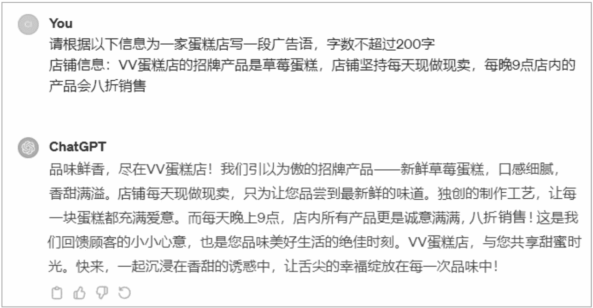
图1-3 ChatGPT可回答用户提出的问题

目前通用人工智能仍处初级阶段，需克服技术与伦理挑战，如确保机器行为符合道德伦理、学习决策过程可解释透明、保护用户隐私与数据安全等。

**3．超级人工智能**
超级人工智能是AI发展的终极目标，能模拟人类思维与行为，并实现独立思考与创新，解决前所未有的复杂问题。

目前处于非常初级阶段，需克服多重挑战。首先需强大算力与数据处理能力支持大规模学习推理；其次需具备自我意识与独立思考能力，涉及复杂认知科学与哲学议题；同时需探索有效算法与模型支持创新与决策。因此发展是长期复杂过程，需持续探索研究。

### 1.1.3
### 技术革新：人工智能如何改变世界
人工智能近年来发展迅速，弱人工智能领域不断突破瓶颈，出现大量可行方案。通用人工智能仍面临巨大挑战，需解决机器学习等核心问题。尽管如此，随着算力与算法进步及数据量爆发式增长，弱人工智能已在某些领域取代或超越人类工作。

回溯历史，科技推动生产力提升并引发行业变革。詹姆斯·瓦特改良的蒸汽机引发从手工劳动到动力机器生产的转变，提升生产效率并创造就业与财富。此后蒸汽机应用于运输，催生蒸汽火车与轮船，使英国商品与技术走向世界。行业变革往往源于基础技术突破，逐步渗透各行各业。

如今，人工智能在算法、算力与大数据的驱动下经历类似变革。与蒸汽机一样，其广泛应用将引发行业重塑，短期可能出现阵痛，长期将创造更多价值，应拥抱变化，积极应对挑战与机遇。

在快速发展过程中，多个领域技术革新不断，包括机器学习、知识图谱、自然语言理解、人机交互、计算机视觉、生物特征识别、VR与AR等。以下重点介绍部分革新技术。

**1．知识图谱**
知识图谱是计算机专家系统的升级，借助节点与边构建数据结构图，以结构化语义知识库存在。旨在赋予机器理解文本背后含义的能力，通过建模、填充属性、建立关联，构建机器的先验知识。

**案例 4 足球明星的知识图谱**
以“罗纳尔多·路易斯·纳扎里奥·达·利马”为中心，可扩展出包含个人资料、职业生涯、成就等的知识图谱。其中该实体为节点，“世界足球先生”“前巴西职业足球运动员”“世界杯冠军”等为关联信息，通过边表示关系。

知识图谱能全面呈现实体信息，为后续推理分析提供更完整数据基础。

**2．人机交互**
人机交互是AI领域重要技术，目标是实现更拟人化的交互方式。传统交互依赖键盘鼠标等外设，AI追求更自然的交互，常见方式如下。

❶ **语音交互：**人与机器交流的核心方式，包括语音采集、识别、语义理解与语音合成，常与自然语言处理结合，形成自然交流体验。

❷ **情感交互：**使计算机具备类人情感理解与表达能力，通过情感传递实现更自然、亲切、生动的交互。

❸ **体感交互：**利用肢体动作与数字设备自然交互，降低用户约束，交互更自然，目前广泛应用于游戏娱乐、医疗辅助、三维建模与电商购物等。

❹ **脑机交互：**直接实现大脑与外界信息传递的交互方式。尚处初级阶段，但潜力巨大，未来有望突破，当前瓶颈包括大脑信号采集、信号与机器指令转换、信号反馈等。

**案例 5 《阿凡达》中的脑机交互方式**
电影《阿凡达》展示了脑机交互的科幻概念。在潘多拉星球，下身瘫痪的前海军战士杰克·萨利通过先进脑机交互技术，利用意念操控人造阿凡达执行任务。该技术直接将大脑与外部世界连接，通过头部设备将意识转化为指令控制阿凡达，无需外围神经与肌肉通道，而是解读大脑神经活动实现控制。

**3．计算机视觉**
计算机视觉让计算机具备类人视觉能力，能提取、处理、理解与分析图像视频，主要涉及计算机成像、图像理解与三维视觉。

❶ **计算机成像：**通过探索人眼结构与相机成像原理，追求理想图像效果，如绘画、去雾、去噪、暗光增强、滤镜与图像融合等。

**案例 6 文心一格的AI绘画功能**
使用文心一格等AI绘画技术，可利用神经网络与计算机成像技术创作出具有梵高艺术风格的独特作品，如图1-4所示。文心一格能学习艺术家风格与技巧，并在全新图像中创造惊艳视觉效果。AI绘画不仅帮助理解艺术，也让更多人体验创作乐趣，开启全新艺术创作方式。

图1-4 文心一格生成的梵高风格AI绘画作品

❷ 图像理解： 
把画面拆解成像素和偏移量只是第一步，真正让机器读懂画面是图像理解的核心。从浅到深大致可分三层：底层捕捉边缘、特征点、纹理等基础线索；中层在意物体的轮廓与区域归属；高层则要完成识别、定位、分割、姿态估算以及自然语言描述等任务。该能力现已广泛用在人脸校验、目标搜检、图像分割、OCR光学字符识别和行为分析等场景。

**案例7 Photoshop智能抠图**

图像分割是计算机视觉的关键分支，目标是对画面里不同主体做有效剥离，为后续分析提供干净素材。Photoshop里的“删除背景”正是依托分割实现，能迅速判断背景区域并将其剔除，从而做到一键抠图，如图1-5所示。其实现路径主要结合图像处理与机器学习，用海量样本做训练，使网络学会自动分离前景。

图1-5 Photoshop智能抠图示例

❸ 三维视觉： 
研究重点在于怎样借助视觉获取三维信息并对之进行解释，落地方向涵盖机器人、无人驾驶、智慧工厂、虚拟现实和增强现实等。

**4．生物特征识别**

借助个体生理或行为特质进行身份核验的技术，具有安全性高、易用性和私密性强的特点，已大量进入金融、公安全、教育、交通等领域。传统手段有指纹、人脸、虹膜识别；新方向有静脉、声纹、步态识别等，具体情况如下。

❶ 静脉识别： 以近红外光照射手指获取清晰静脉纹路，再提取特征作比对。具备活体检测、体内纹路难复制、唯一稳定、难以伪造等优势，安全等级较高。

❷ 声纹识别： 根据说话人语音的声纹特征判定身份，分说话人辨别与说话人确认两类。应用场景不同策略也不同，例如刑侦缩小范围时倾向辨别，银行交易时则倾向确认。

❸ 步态识别： 利用行走习惯识别身份，具备非接触、远距离、多角度、光照鲁棒、不易伪装的优点，在智能视频监控里优势突出。

**案例8 机场借助步态识别监测可疑人员**

机场可把步态识别接入监控，用于甄别可疑人员，如图1-6所示。该技术依托每个人独特的身体结构与行走姿态，通过体型与步态特征判断身份与状态。在远距离或复杂环境下，步态往往是唯一可清晰成像的人体生物特征，其物理基础涉及身高、头型、腿骨、肌肉、重心与神经敏感度等个体差异信息。

图1-6 步态识别技术应用示例

**5．虚拟现实和增强现实**

VR与AR能在数字世界里构建与真实环境高度贴合的虚拟空间。用户在限定范围内可获得接近真实的视觉、听觉乃至触觉反馈。

在虚拟现实里，用户完全沉浸于计算机生成的数字世界，通过VR眼镜与手柄与虚拟物体互动，获得逼真的触感与反馈，效果如图1-7所示。当前VR已广泛用于游戏、影视、教学、医疗与军事，提供沉浸式感官体验。

图1-7 VR效果示例

增强现实更进一步，把虚拟内容叠加到真实世界。借助专用软件与硬件，AR可把数字信息、图像与物体投射到用户真实环境中，形成半真半虚的混合体验。用户可在现实中看到虚拟对象并与之互动，已在工业设计、零售、旅游、游戏等行业落地。

**案例9 上汽通用汽车的AR系列产品**

上汽通用运用人工智能与增强现实打造“AR看车”“AR说明书”等产品。用户用手机扫描车内图标，即可实时获取功能讲解、动画演示、视频介绍甚至错误提示。这些产品基于卷积神经网络的深度学习，采用轻量化模型加速推理，并通过数据增强降低过拟合、提升泛化能力。无需挑选车型，扫码即可通过“AR看车”“AR说明书”等了解新车细节，如图1-8所示。

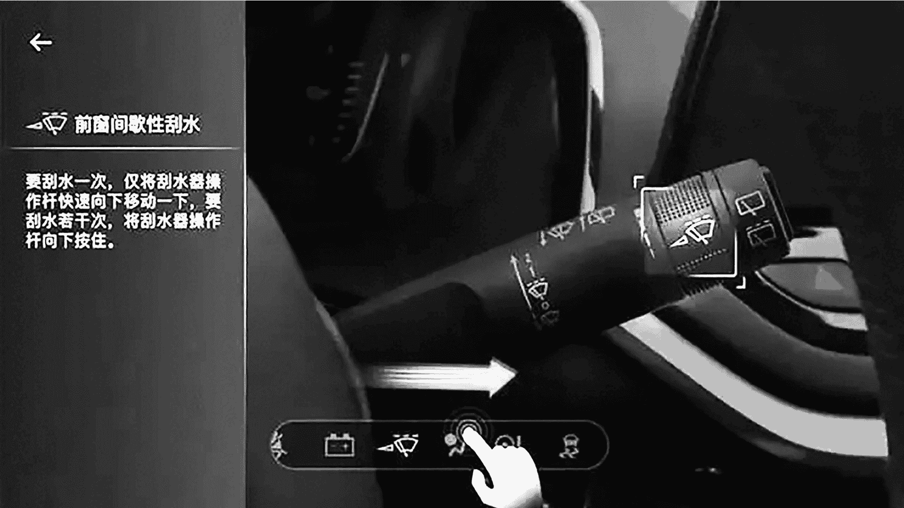

图1-8 通过“AR说明书”了解新车细节

### 1.1.4

### 十大行业变革：人工智能引领的未来趋势

在科技高速发展的背景下，人工智能已成为推动各行业重塑的核心力量，既带来新机遇也带来新挑战。它正改写生活方式、工作方式乃至思考方式。在其驱动下，行业变革正以空前的速度与规模展开，下面介绍若干典型渗透领域。

**1．智能制造**

智能制造对人工智能的需求集中在智能装备、智能工厂与智能服务三大方向，相关技术包括分析推理、自然语言处理、大数据智能与机器学习等。

**案例10 海尔的COSMOPlat平台**

海尔推出的COSMOPlat平台打通用户需求与智能制造体系，让用户全程参与产品设计、生产、物流与迭代，以“用户驱动”为创新动能，改变传统生产与消费关系，致力于创造用户终身价值。平台可与海尔互联工厂无缝对接，支撑冰箱、洗衣机等产品的个性化定制、远程下单到智能制造的全流程。图1-9所示为COSMOPlat平台中的“工业大脑-AI平台”核心功能。

图1-9 COSMOPlat平台中的“工业大脑-AI平台”核心功能

**2．智能家居**

依据工信部与国家标准委发布的《智慧家庭综合标准化体系建设指南》，智能家居是智慧家庭的重要组成。人工智能对该行业的影响可概括为三方面。

其一，提升智能化水平，使家居设备更智能、高效、便捷。借助语音识别、图像识别、自然语言处理等，系统能更好地理解用户指令，提供更个性化服务。

其二，提升安全性。系统可借助人工智能实现实时监控、异常检测与自动报警，保障家庭安全。

其三，推动创新发展。借助机器学习、深度学习等，系统可持续学习与改进，匹配不同用户习惯。同时也推动商业模式创新，如基于大数据的用户画像与个性化推荐等。

**案例11 小米小爱鼠标控制智能家居产品**

小米小爱鼠标是一款热门智能家居产品，提供更便捷的家居操控方式。它保留了传统鼠标功能，同时集成小米自家语音助手“小爱同学”。用户可用语音指令控制灯光、空调、电视、窗帘等设备，同时支持与米家生态联动，实现自动化控制与智能推荐等功能，如图1-10所示。

图1-10 小米小爱鼠标的应用场景

**3．智能金融**

人工智能在金融业的渗透广泛，能显著改变现有格局，使服务更个性化、更高效、成本更低。对业务部门而言，可助力获客与精准服务；对风控部门而言，可增强风险管控与安全性；对普通用户而言，可实现资产优化配置，提供更完善服务。目前应用还包括智能获客、身份识别、大数据风控、智能投顾、智能客服与金融云等。

**案例12 支付宝人脸识别实现刷脸支付**

支付宝的刷脸支付采用人脸识别技术，在海量图像数据支撑下，识别准确率可达99.99%。该功能已广泛用于超市、便利店、餐厅等线下场景，为用户带来更便捷快速的支付体验。

**4．智能交通**

借助人工智能，可实现各类交通要素互联、信息共享与协同优化，构建高效、安全、便捷、低碳的出行环境。主要方向包括统一智能交通管理平台与无人驾驶。管理平台通过采集路况、调节信号灯、发布路况信息可缓解拥堵；无人驾驶可在一定程度上降低事故风险、减轻通勤压力、提升出行体验。

**案例13 百度Apollo无人驾驶出租车**

百度Apollo无人驾驶出租车已在北京、长沙等地测试运营。技术栈融合激光雷达、摄像头、传感器等，实现高精度地图、定位、控制等功能，可做到完全自主驾驶。用户可通过手机App预约，并在规定区域内自动出行，如图1-11所示。

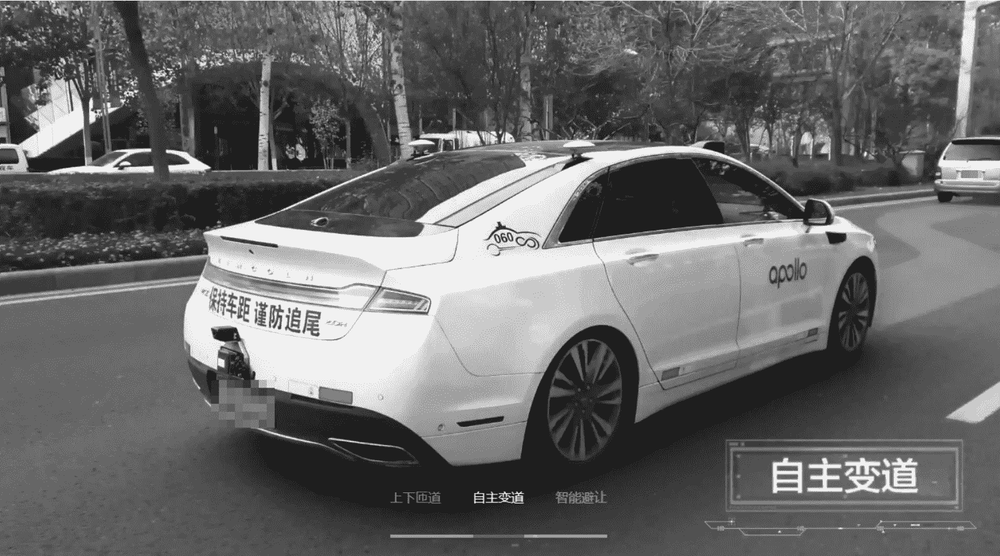

图1-11 百度Apollo无人驾驶出租车

**5．智能安防**

人工智能的引入为安防带来巨大变革。智能安防与传统安防的区别在于智能化，可通过机器实现自动判断，降低人力依赖，实现实时防范与处置。行业应用集中在视频监控，一类是采用图像分割等手段检测目标并做事件区分与报警联动；另一类是利用模式识别对特定物体如车辆、人脸等进行统计。

传统安防需大量人力监控与巡逻，而智能系统可减轻人力负担、降低成本。通过机器学习与图像识别，系统还能实时监测异常行为、安全隐患与威胁，及时发出警报，有效提升防范与处置能力。

**6．智能医疗**

人工智能在医疗领域前景广阔，正推动行业升级。近年来在诊疗、疾病预测、影像诊断、药物研发等方面发挥重要作用，提升医护工作效率与基层医生诊疗水平。

深度学习等技术可快速准确分析海量医疗数据，帮助医生更精准诊断，提升效率与精度。此外还可结合基因信息与病史，为患者提供个性化治疗方案与用药建议。同时也能加速新药研发，提升研发效率与成功率。

**7．智能物流**

人工智能对物流的影响深远，主要体现在两方面。

其一，提升效率、降低成本。例如借助智能搜索、推理规划、计算机视觉等，可实现运输过程自动化与高效优化，减少人力成本。

其二，改变传统模式，推动行业向智能化、自动化演进。传统物流面临人力成本高、效率低等问题，人工智能的引入可解决这些痛点。

**案例14 京东物流智能物流服务**

京东物流是京东集团旗下服务商，近年大力投入人工智能研发，推出智能仓储、智能配送、智能客服等服务。技术应用使仓储、配送、客服环节实现自动化与智能化，大幅提升效率、降低成本、改善体验。图1-12所示为京东推出的室内配送机器人，可打通楼宇横纵向配送网络，完成“最后100米”末端配送。

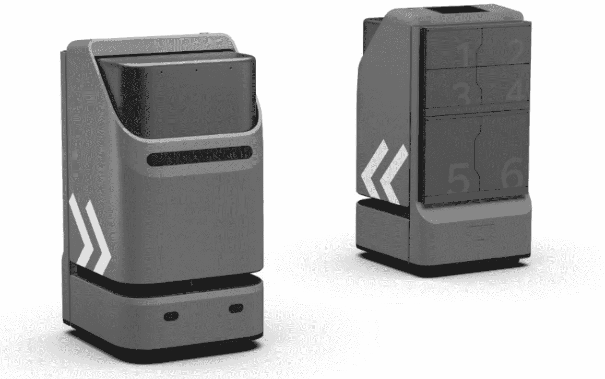

图1-12 京东物流推出的室内配送机器人

同时京东物流还借助大数据分析与预测，对货源、运输、仓储等环节做精准管控与优化，实现智能化运营。

**8．智能教育**

一方面促进教育个性化与精细化，使每个学生获得更适配的教学方案，提升效果；另一方面提升教学效率、减轻教师负担，让教师更专注于创新教学内容与方式。

同时优化教育资源共享与分配，使优质资源更广泛传播，提升整体水平。借助数据分析与虚拟现实，学习体验也更生动高效。

**9．智能零售**

智能零售借助人工智能对销售流程进行升级，实现线上服务与线下体验深度融合。如今不少无人超市借助计算机视觉、生物特征识别与机器学习，在降低人力成本的同时为顾客提供新颖购物体验。

**案例15 阿里巴巴无人咖啡店“淘咖啡”**

阿里巴巴推出的“淘咖啡”是一个无人值守咖啡店，借助人脸识别、智能支付等技术实现快速自动化购物。顾客在店内扫码绑定支付宝，挑选咖啡后通过人脸识别完成支付即可取走。整个过程无需排队，大幅提升便利性与效率。该项目展现了阿里在智能零售领域的创新实力，也为国内无人超市发展提供探索。

**10．生活服务**

人工智能为生活服务带来变革契机，提升个性化、便捷性与效率。总体上以手机为核心，提升用户体验。通过手机收集行为习惯并训练模型，实现个性化推荐，为用户提供贴身助理服务。

例如游玩时看到一束花，可通过手机应用了解相关信息；朋友圈分享风景照时，无需询问地点，点击图片搜索即可获取游玩地点与景点详情。

**案例16 美团借助人工智能提供智能推荐与个性化服务**

美团运用人工智能为用户提供智能推荐与个性化服务。通过分析消费习惯与偏好，可推荐合适餐厅、菜品等，提升消费体验。同时优化配送系统，提升配送效率，提供更便捷服务。

此外美团还借助智能语音识别提升服务可靠性，用户可用语音指令完成订餐，避免手动输入错误。

### 1.1.5

### AI训练师的出现：赋予人工智能“人性之魂”

在智能化时代，人工智能正成为各行业变革的核心驱动力。在这场技术革新浪潮中，AI训练师扮演关键角色，致力于培养新一代人才并推动技术落地。

AI训练师可帮助企业深入理解人工智能的实际价值，推动技术在更多领域应用。通过培训活动，他们能收集真实反馈，为算法优化、性能提升与产品改善提供有价值信息。

**案例17 通过训练模型提升智能语音助手的准确率与响应速度**

智能语音助手可通过语音交互为用户提供服务，如智能音箱、车载语音助手等。AI训练师可通过模型训练让助手更好地识别与理解指令，提升准确率与响应速度。同时依据用户反馈优化交互方式与功能，使之更符合用户习惯与需求。经过优化，助手可更好地提供音乐播放、信息查询、提醒设置等服务，提升体验与产品价值。

图1-13 车载语音助手

总体来看，AI训练师的出现是人工智能发展历程中的独特现象，他们不仅是技术的传授者或应用推动者，更是赋予人工智能“人性之魂”的艺术家。

在人与机器互动中，训练师用情感与智慧填补冰冷算法与多变现实之间的鸿沟。他们既洞察潜能也认识局限，使人工智能服务时更贴近人类期望。可以说，训练师正架起技术与人性之间的桥梁。

## 1.2

## 全方位了解AI训练师

人工智能让生活更便利，如智能安防、智能物流、智能交通等，而在这个过程中，新兴职业——AI训练师发挥关键作用，他们充当人工智能的教练，使其更懂人类需求。

AI训练师是人工智能领域的重要职业，主要负责训练模型，使其更好地理解人类语言与指令，并解决实际问题。随着技术发展，该职业需求将持续增长，成为数字化时代的重要人才。

### 1.2.1

### AI训练师的起源：技术发展的必然产物

AI训练师这一新兴职业源于人工智能的快速发展与普及。近几年，随着人工智能在制造、医疗、金融、零售、娱乐、教育等领域广泛应用，对系统优化的需求急剧增加，为该职业出现提供了土壤。

过去，AI产品经理会简单处理数据再交给标注人员。但标注人员对数据的理解与质量存在差异，导致效率低下。另外，细分领域数据使用后价值流失，造成数据难以沉淀与复用。针对这两个问题，AI训练师应运而生。

其主要职责是从技术与应用角度对系统或模型进行深度优化与训练，使其适应各种复杂任务。工作不仅包括简单调整与优化，还包括评估系统性能、探索进一步优化空间。目标是让系统在提升生产力、改善客户体验、加速创新与降低运营成本等方面发挥最大潜力。

**案例18 网易云商智能客服系统——七鱼在线机器人**

网易云商平台推出的七鱼在线机器人是一种智能客服系统，经过AI训练师优化后，能更准确识别用户意图与问题，并提供更人性化、个性化的回复与建议，如图1-14所示。这不仅提升用户满意度与忠诚度，也大幅减轻人工客服负担，提升企业运营效率。

图1-14 七鱼在线机器人智能客服系统演示效果

AI训练师对技能要求较高，不仅需深入理解人工智能基础理论与技术，熟悉各类框架与算法，还需具备一定编程能力。此外，解决问题的能力、创新思维与良好沟通技巧也是必备素养。

随着智能技术向各行业的纵深渗透，围绕模型训练与优化的人才需求正快速抬升。AI训练师正逐渐成为连接技术研发与业务落地的枢纽，推动方案落地、提升系统效能、打磨产品体验。可以预期，随着智能化进程持续加速，该职业将长期占据关键位置，成为人工智能演进的重要推手。

### **1.2.2**

### **AI训练师能力全景**

在人工智能快速迭代的背景下，AI训练师既要具备扎实的专业底座，也要拥有可落地的实操经验，二者共同决定了技术能否真正解决业务痛点。其核心基础可归纳为以下六方面。

❶ **信息采集与洞察功底：** 熟悉规范的数据获取思路，善用各类工具实现高效清洗与解析，具备较强的逻辑推理，能够从海量信息中提炼规律与趋势。

❷ **行业理解深度：** 掌握行业数据特征、发展态势与竞争格局，特别对所在企业所处赛道有深入认知，才能更合理地驱动人工智能手段。

❸ **问题捕捉敏锐度：** 依据产品的数据诉求，及时识别问题特征，通过深度剖析挖掘潜在痛点与解决思路，从庞杂信息中萃取价值，为产品迭代提供支撑。

❹ **跨部门协作沟通：** 需要与研发、产品、业务等团队高频配合，能够以清晰简练的语言把专业概念通俗化，促进多方理解与协同。

❺ **技术认知基础：** 掌握核心人工智能概念与原理，清楚技术边界与局限，能够甄别并选用合适的方案应对实际问题。

❻ **生态视野全局性：** 跟踪行业动向、痛点与挑战，能够针对具体场景设计契合需求的解决方案；同时关注市场变化与用户偏好，为产品演进提供建议。

**案例 19 AI训练师在智能推荐系统中的关键角色**

达观的智能推荐系统已与多家企业达成合作，内置深度学习、协同过滤等多种算法，并按行业特性进行深度调优，明显提升了转化率、点击率与留存率。达观自研的四段式推荐流程——召回、排序、后处理、兜底——支持厂商依据业务场景与指标自主配置策略。

在该系统中，AI训练师承担核心职能，负责整合并深度挖掘用户数据，涵盖人口属性、偏好与行为信息，构建可自定义标签的用户画像，如图 1-15 所示，为精准营销、用户运营与系统优化提供依据。

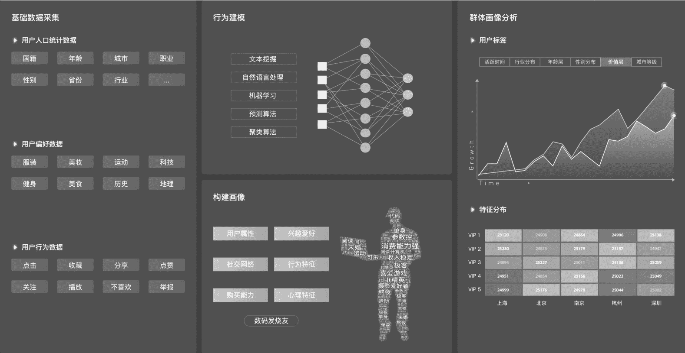

图 1-15 达观智能推荐系统中的用户画像体系

系统同时依托海量语料积累与前沿自然语言处理技术，实现文本分类、标签抽取、内容审核、情感识别及知识图谱构建，进一步输出更精准的特征，提升推荐准确性。

### **1.2.3**

### **AI训练师供需失衡：挑战与机会**

人工智能普及推动了企业对训练人才的需求快速攀升。AI训练师负责模型的训练、调优与部署，是业务落地的关键环节。但当前供给明显不足，市场缺口持续扩大。

缺口成因在于：一方面应用场景激增，训练人才需求集中爆发；另一方面岗位要求融合机器学习、深度学习、数据科学等知识并具备项目实战经验，符合条件者目前稀缺，难以满足市场。

缺口带来的挑战是招聘周期拉长，选人成本上升，且难觅兼具全面技能与经验的人才，进而制约人工智能应用速度与管理效率。

缺口也带来机会：具备相应技能的人才职业前景广阔，选择多且议价能力强；企业若能招到合适人选，则能大幅提升AI应用水平，加速业务创新。

缓解缺口需多管齐下：加强系统化培养与在职培训，提升现有人员的专业水平；企业内部开展知识分享与技能升级；通过合作与联盟共享人才资源，共同推动技术应用。

### **1.2.4**

### **AI训练师成长路径与远景**

AI训练师的主要来源是具备1～3年工作经验的互联网产品经理，因其拥有丰富的数据处理与产品开发经验而被优先考虑。另有两大通道：从客服等数据相关运营岗位平级转岗，以及从数据标注人员中择优晋升。对产品经理而言，这是一条理想的转型方向。

职业晋升上，提升技能与经验是关键，其中成长为AI产品经理是常见上升通道。AI产品经理更聚焦整体体验与商业价值，需要更全面的素质，如技术理解力、人机交互设计能力、行业洞察力等，适合有志深耕的训练师。

完成转型需要投入时间与精力，积极争取内部转岗或借调机会，持续补强能力。同时要关注行业趋势与市场需求，敏锐把握机会应对挑战。

随着技术普及，AI训练师需求将持续增长，职业前景依然宽广。工作内容与职责也会随技术演进不断拓展，需持续学习新方法提升能力以适应变化。

同时，人才来源也在多样化，除AI产品经理外，数据科学家、机器学习工程师、数据分析师也可能转型而来，掌握AI技术对这些相关岗位同样重要。

### **1.2.5**

### **AI训练师前景：从新兴到主流**

人工智能被越来越多的组织视为核心能力，各行业引入AI解决实际问题，推动对AI训练师需求急剧上升。互联网、金融、医疗、教育、电商、物流、制造等领域均需要专业技术支持。

**案例 20 百度智能云平台智能推荐引擎**

百度智能云推出的智能推荐引擎，基于海量文本、图片、视频数据进行大规模预训练。AI训练师在其中负责数据治理、模型优化与部署监控，确保引擎的精准与稳定。该产品提供精准内容结构化、可解释推荐结果与规则定制能力，为全链路推荐系统建设提供强力支撑。

图 1-16 展示了该引擎的产品架构，基于用户数据、行为数据、物料数据等多源数据，训练三段式“召回—排序—融合”算法，依托百度高性能高可靠工程架构构建全链路推荐系统，AI训练师在背后发挥不可或缺的作用。

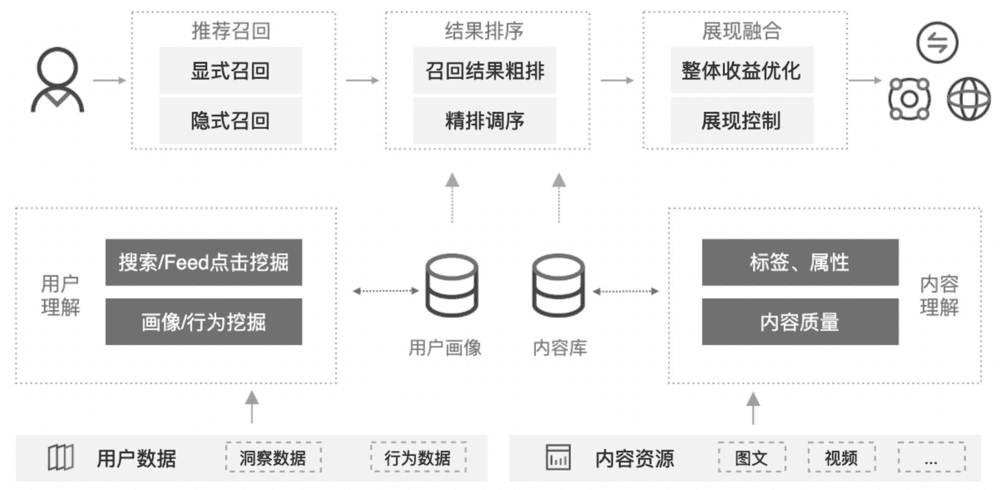

图 1-16 智能推荐引擎的产品架构

随着技术进步与应用场景扩展，AI训练师的职责边界将持续扩大，技能要求也随之提升。除传统模型训练优化外，还需关注数据治理、算法选型、模型部署与监控等环节，并与业务团队紧密合作，深入理解需求提供针对性方案，这为职业发展提供更多机会与挑战。

**温馨提示**

图 1-16 中“Feed 点击挖掘”指对来自 RSS 简易信息聚合或其它数据源的点击行为进行深度分析，以把握用户兴趣与易点击内容。

### **本章小结**

本章阐述了AI训练师这一新兴岗位。先介绍AI的基本概念、层级分类及技术变革意义；再详细说明AI训练师的起源、基础能力、人才缺口与职业规划。通过学习，读者可全面了解该职业，为职业发展做好准备。

# **课后习题**

为帮助读者巩固本章知识，下面进行知识回顾。

**1．人工智能可划分为哪几个层级？**

**2．AI训练师需要掌握哪些基础能力？**

# **第二章**

# **能力培养**

——成为一名合格的 AI 训练师

第一章介绍了AI训练师的背景与定位，明确其是引领人工智能发展的关键角色，需具备专业素养与实践技能以赋予人工智能“人性之魂”。那么如何成为合格的AI训练师？本章将解析其所需核心能力，帮助大家认识这一充满挑战与机遇的新兴职业。

### **2.1**

## **AI训练师知识与技能全解**

AI训练师是引领人工智能发展的先锋，需要宽泛且深入的知识体系。他们不仅要懂人工智能原理与技术，还需掌握计算机操作、数学基础、编程能力、特征工程、数据处理等技能。

此外，还需具备优秀的实践能力，将理论应用于真实场景解决复杂问题。本节将全面拆解AI训练师所需的知识与技能，为成长为优秀训练师奠定基础。

### **2.1.1**

### **计算机操作：训练师的基础**

在数字化时代，计算机操作已是基本技能。AI训练师需熟练使用办公软件与网络应用，并掌握系统操作技巧以保障工作流畅。须掌握的要点如下。

❶ **操作系统基础：** 熟悉 Windows、Linux 等操作系统的概念、功能与使用方法，能完成安装、配置与管理。图 2-1 分别展示 Windows 10 与 Windows 11 界面，为训练师提供开发工具与软件环境。

图 2-1 Windows 10 系统界面（左图）和 Windows 11 系统界面（右图）

❷ **办公软件操作：** 精通 Word、Excel、PowerPoint 等常用办公软件的基本操作与功能。

❸ **网络应用：** 理解网络基本概念，能熟练使用浏览器搜索、浏览网页、收发邮件等。

❹ **数据传输与管理：** 掌握文件与文件夹管理、文件搜索、压缩、备份与恢复等操作。

❺ **软件开发工具：** 熟悉集成开发环境、版本控制系统等常用开发工具。

❻ **硬件与性能优化：** 了解计算机硬件构成与工作原理，具备基础维护与性能优化能力。

❼ **安全防护与病毒查杀：** 掌握网络安全基础知识，能安装配置防病毒软件，进行系统防护与病毒清除。

❽ **虚拟化与云计算应用：** 了解虚拟化原理，熟悉云存储、云桌面等云计算服务的应用。

### **2.1.2**

### **数学基础：训练师的核心底座**

数学是人工智能技术的底层支撑，许多算法与模型都建立在数学原理之上。掌握数学基础有助于理解算法机理，并在实践中完成模型训练与优化。

数学在数据处理、特征提取、模型评估中亦发挥关键作用。通过数学分析可更精准处理数据、提取关键特征并评估性能。因此数学基础对提升技术水平与实践效果至关重要。

虽不必在入门前掌握全部数学，但在实际应用中具备以下基础大有裨益。

❶ **线性代数：** 研究线性方程组、向量空间、矩阵等。深度学习中提供向量与矩阵运算等基础工具，是构建复杂模型的基础。

**案例 21 用线性代数实现线性回归模型**

线性代数在AI训练中应用广泛，典型案例是机器学习中的线性回归。线性回归通过建立自变量与因变量的线性关系进行预测，模型可表示为 y=wx+b，其中 w、x 为向量，b 为标量。线性代数用于符号表达与运算。

参数求解使用最小二乘法，最小化预测值与真实值的平方误差，涉及矩阵运算与线性方程组求解，需线性代数知识。

性能评估如均方误差、相关系数等也依赖线性代数计算方法。

❷ **概率论与统计学：** 为机器学习提供理论支撑，帮助理解数据内在规律。从概率分布到参数估计再到假设检验，为模型提供数据分析与推理工具。

❸ **微积分：** 涉及函数、极限、导数、积分等，是优化算法如梯度下降等的基础。

❹ **凸优化：** 专注于目标函数为凸函数时的优化问题。深度学习中诸多损失函数与优化问题可转化为凸优化，掌握其理论与方法至关重要。

### **2.1.3**

### **编程技能：实现人工智能的关键**

编程是实现AI算法与模型的核心手段，训练师需借助 Python、TensorFlow、PyTorch 等语言与工具开发训练系统。编程能力提升模型开发、调试与优化效率。

通过编程可自动化数据处理、编写处理脚本、快速搭建新算法与模型，亦便于与其他技术团队协作，实现跨平台集成与部署。

**案例 22 用 Python 实现人工神经网络**

Python 是机器学习领域最受欢迎的语言，因学习曲线平缓、可扩展性强且开源而备受青睐。

典型应用是用 Python 训练人工神经网络 ANN。ANN 模拟生物神经网络结构，通过训练优化权重与结构解决复杂任务。Python 是其开发常用语言。

Python 拥有 TensorFlow、PyTorch 等流行库，提供构建与训练神经网络的丰富功能。以 TensorFlow 为例，可创建全连接神经网络，导入数据与标签，构建多层感知器并用反向传播训练，通过迭代调整权重与偏置提升预测性能。

NumPy 与 Pandas 等数据处理库亦让数据清洗与分析更高效，支持数学运算、矩阵计算与统计分析。

### **2.1.4**

### **特征工程：挖掘数据深层价值的艺术**

特征工程是提升机器学习模型性能的关键环节，通过精细选择与构建特征，帮助模型更好理解数据并捕捉原始数据中的关键信息。优秀特征可显著提高准确性、稳定性和泛化能力。

特征工程需要领域知识与创造性思维。训练师需深入理解业务背景与数据特性，完成特征选择、构建与转换，通过不断尝试与优化找到最佳表示方式。因此特征工程既是提升性能的核心，也是展现技术实力与创造力的重要舞台。

**案例 23 Gmail 可准确识别垃圾邮件**

为什么 Gmail 能秒判垃圾邮件？特征工程藏着答案

Gmail 依托机器学习模型，可以非常精准地把垃圾邮件挑出来，如图 2-2 所示。垃圾邮件分类是机器学习里的经典问题，本质是训练一个自动识别并隔离垃圾邮件的分类器。要让模型真正有效，特征工程是决定成败的关键环节。

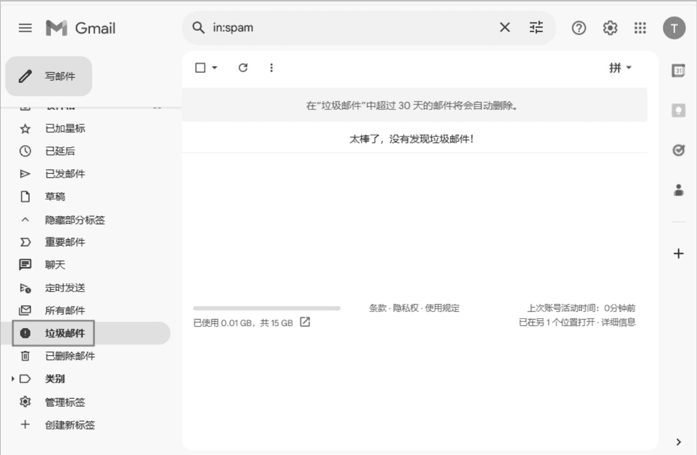

图 2-2 Gmail 的垃圾邮件识别功能

在垃圾邮件场景里，特征工程的任务是从原始邮件文本中提炼出最具区分力的信号，帮助模型做出正确判断。这通常需要 AI 训练师完成特征筛选、转换与降维的一整套工作，具体可拆解为：

1 AI 训练师要从海量原始邮件中抽取关键信号，比如词频、短语模式、邮件长度等，这些指标能够反映邮件内容与性质，为后续建模提供可用输入。

2 为了提升分类精度，往往需要对特征进行加工与组合。比如用文本向量化把词语变成高维向量，便于模型处理；再借助统计式或模型式的特征选择方法剔除无关或冗余维度，降低复杂度、增强泛化。

3 特征加工完成后，就可以用朴素贝叶斯、支持向量机或神经网络等算法训练分类器。通过反复训练与调优，不断提高判别准确率、降低误判，从而让垃圾邮件过滤系统更稳健。

特征工程，简单说就是对原始数据做预处理与转换，抽取出对模型建模真正有用的特征。它是机器学习中不可或缺的一环，特征质量直接决定模型上限。目标就是尽可能从原始数据里榨取出可用信息，服务算法与模型。

做特征工程需要掌握的核心能力包括：

❶ 数据预处理：清洗数据、处理缺失、剔除异常、做标准化等基础工作。
❷ 特征提取：从源数据中挖掘与预测目标相关的信号，需要结合业务理解与专业知识。
❸ 特征选择：采用过滤式、包裹式、嵌入式等方法，从众多候选特征里挑出最相关、最有价值的。
❹ 特征转换：通过编码、降维等方式重塑特征，让数据内在规律更容易被模型捕捉。
❺ 特征评估：用各类指标与方法检验特征质量，为迭代优化提供依据。

要熟练掌握这些，需要持续学习理论并大量实操，在尝试与优化中形成手感，同时熟悉主流机器学习算法以便更好落地。

### 2.1.5
数据为王时代 AI 训练师的必修课

对 AI 训练师而言，透彻理解数据的全流程处理与管理至关重要，涵盖采集、预处理、标注、管理等多个环节。

❶ 数据采集：这是整个工作的起点，数据质量直接影响后续效果。AI 训练师要懂得从不同渠道高效、准确地获取数据，并保证完整与一致。

案例 24 Scrapy 可快速采集大量数据

Scrapy 是 Python 生态里常用的网络爬虫与抓取框架，提供了一套开箱即用的工具链，让采集变得高效。图 2-3 所示为用 Scrapy 抓取的职位信息表。

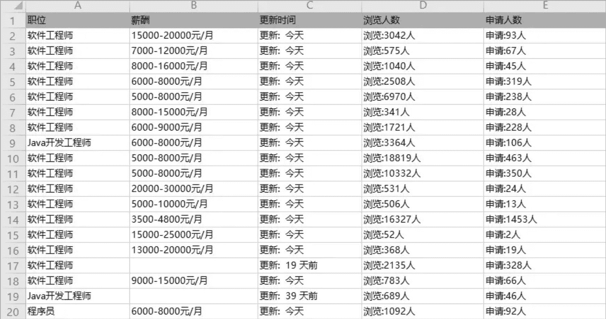

图 2-3 使用 Scrapy 采集的职位信息数据表

Scrapy 的主要特点如下。

1 异步引擎：基于 Twisted 构建的异步网络引擎，让采集并行非阻塞进行。
2 强大的选择器：支持 CSS 选择器或 XPath 选择器，轻松定位并抽取网页中的结构化信息，如 HTML 或 XML。
3 调度器：内置调度机制可按固定间隔请求网页，实现定时采集。
4 持久化：支持把结果存入数据库、CSV 文件等多种后端。
温馨提示
CSV 文件即逗号分隔值文件，纯文本格式用于存储表格数据。每条记录由字段组成，字段间以逗号或制表符分隔，常用于电子表格与数据库间的数据迁移。
5 插件系统：插件架构让扩展变得容易，可处理 HTTP 认证、链接跟踪、JavaScript 渲染等需求。

借助 Scrapy，AI 训练师能快速获取大规模数据，为模型训练提供充足样本，同时可按项目需求灵活定制。

❷ 预处理：包含清洗、去重、格式转换等，保证数据质量与准确性。
❸ 数据标注：机器学习任务离不开标注。AI 训练师要掌握手动与自动化等多种标注方法，保证标注质量，并能根据项目选择合适方案。
❹ 数据管理：要懂得数据的存储、备份、版本控制，保障可访问性与安全性，并能及时供给训练与验证。

总体来看，AI 训练师必须全流程吃透数据处理，每个环节都会直接影响最终模型表现。

### 2.1.6
AI 基础脉络 AI 训练师要懂的底层知识

除核心技能外，AI 训练师还需掌握以下基础：

❶ 机器学习与深度学习算法：如决策树、支持向量机、神经网络等，后续章节会展开。
❷ 数据结构与算法：为实现算法优化提供支撑。
❸ 数据库知识：掌握数据库设计与 SQL，有助于处理大规模数据。
❹ 计算机视觉：涉及视觉任务时，需熟悉图像识别、目标检测等算法。
案例 25 用图像识别打造智能交通监控
基于图像识别，智能交通监控系统能自动识别违章行为、车型、行人数量并实时预警，如图 2-4 所示。
在该场景下，AI 训练师需用大量监控图像训练模型，提升识别精度，常采用深度学习与卷积神经网络进行特征提取与分类。训练过程中要处理海量视频图片、提取有效信息，并反复调参优化。系统上线后可为交管部门提供实时监测，减少事故风险。

图 2-4 智能交通监控系统

❺ 自然语言处理：NLP 是 AI 重要分支，涉及分词、词性标注、命名实体识别、句法分析、语义理解等，有助于提升系统性能与体验。
❻ 项目开发与管理：了解软件工程、项目管理等知识，才能在实战中推动 AI 项目落地。

技术在快速演进，AI 训练师必须持续学习，才能跟上新技术与新场景。

## 2.2
AI 训练师的工作职责与从业方向

随着 AI 深度渗透各行各业，AI 训练师的职责与发展空间持续扩大。

### 2.2.1
AI 训练师职责 赋予模型智慧的幕后推手

智能化浪潮中，AI 已成为各行业跃迁的核心驱动。AI 训练师正是推动这一进程的关键力量，承担培养人才、普及应用、优化技术、拓展研究与提升认知等多重使命。

其核心职责是为模型“喂养”高质量数据，让模型具备智能。日常工作包括需求分析、数据标注、算法开发与调优，其中标注与开发是重中之重。以图片为例，一个模型往往需要数千到数十万张样本。

从事该工作不仅需要数学基础，还要深刻理解应用场景，经常深入一线调研，分析影响模型判断的因素。同时积极参与前沿研究，为新场景与新算法贡献思路。未来，AI 训练师还将参与政策与伦理建设，引领行业健康发展。

具体工作职责如下：

❶ 数据收集与预处理：从多源采集数据并清洗，保证质量与准确性。
❷ 模型开发与调试：用机器学习与深度学习技术构建模型并优化，提升精度与性能。
案例 26 用 AI 模型实现机器翻译
机器翻译是 NLP 典型应用，通过 AI 模型自动把一种语言转为另一种语言，如图 2-5 所示。
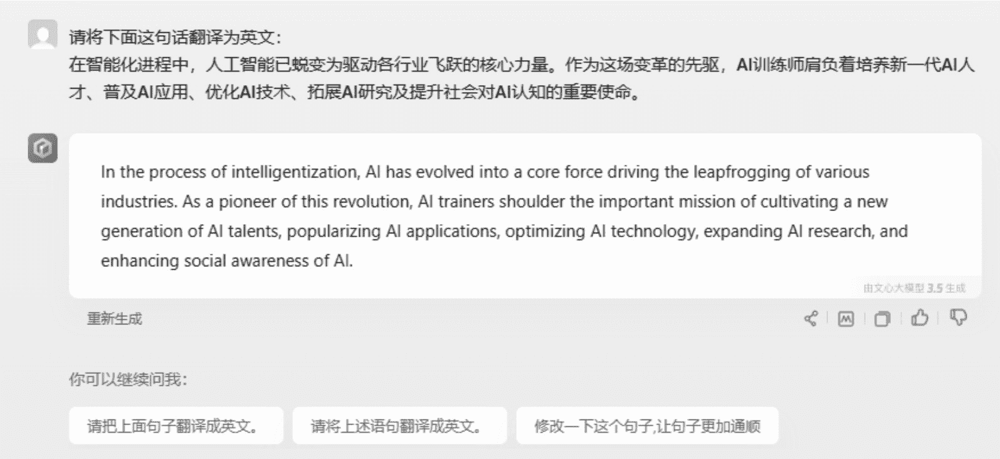

图 2-5 使用人工智能模型自动将中文翻译为英文

AI 训练师需收集海量双语语料，训练如神经网络的深度模型，并通过参数调优提升流畅度与准确性。常用 BLEU、METEOR 等指标评估效果。
温馨提示
BLEU 分数用于衡量机器翻译质量，通过对比机器输出与人工参考译文计算相似度。
METEOR 在准确率基础上加入流畅度考量，对翻译质量进行综合评估。
在开发中，还需处理语言特性、分词、词性标注、一词多义等问题，并与语言专家、工程师协作，确保模型在真实场景可用。
❸ 算法研究与实验：跟踪最新算法并做对比实验，选出最适合具体问题的方案。
❹ 结果分析与报告撰写：解读模型表现并形成报告，说明性能与适用场景。
❺ 团队协作与沟通：与数据科学家、开发、产品经理等协同，并向非技术人员解释模型原理与用途。
❻ 提供数据标注规则：通过聚类与标注分析提炼行业特征，结合领域知识制定清晰、精准的标注规范。
❼ 数据验收与管理：参与模型搭建与数据验收，跟踪核心指标并维护数据。
❽ 积累通用数据：从已有数据中挑选可复用样本，形成领域沉淀，为后续项目加速。

可见，AI 训练师需要技术、编程与沟通协作的复合能力，通过持续训练优化模型，为各行业提供智能化方案。目前市场需求旺盛，供需失衡，求职者除技术外，行业认知也至关重要。

### 2.2.2
AI 训练师的从业领域 覆盖更广的智能化场景

AI 训练师可进入的领域非常宽泛，涵盖绘画、文案、机器人、教育、营销、制造、汽车、电商、医疗等。

❶ 绘画：训练 AI 绘画系统，实现艺术作品的自动或半自动生成，应用于艺术、设计、娱乐等。
❷ 文案写作：训练模型生成广告语、产品描述、新闻稿等，通过海量文本学习人类写作风格。
❸ 智能机器人与聊天机器人：通过大量训练让机器人理解语言、识别语音、对话交互。
案例 27 优必选 Walker 系列机器人
UBTECH 的 Walker 系列机器人具备高精度运动能力，可模仿复杂人类动作，如图 2-6 所示。AI 训练师通过训练实现人机交互、智能服务、自主导航等功能。

图 2-6 优必选的 Walker 系列机器人示例

❹ 教育培训：构建智能推荐、个性化教学、学习进度评估系统，提升教学效率。
❺ 营销：分析消费者行为与市场趋势，预测购买意向，实现个性化推荐。
案例 28 虚拟试衣镜重塑购物体验
虚拟试衣镜结合 AI 与深度学习，让顾客在镜前实时预览不同款式、颜色与尺码的效果，如图 2-7 所示。

图 2-7 虚拟试衣镜
系统通过摄像头捕捉身体数据建立虚拟模特，并推荐搭配。还能与智能家居、穿戴设备联动，提供更精准建议。品牌方则可据此做更精准的定位与销售预测。
❻ 智能制造：推动工业 4.0，实现生产过程智能化与自动化，提升效率与质量。
❼ 汽车：为自动驾驶训练感知与决策模型，提升安全与驾驶体验。
❽ 电商：实现智能推荐、智能客服、智能物流等功能，提升用户体验与运营效率。
案例 29 Mokker 用 AI 生成电商产品图
Mokker 是基于 AI 的在线背景生成工具，支持一键抠图、智能配图与自定义模板，如图 2-8 所示。

图 2-8 使用 Mokker 制作的电商产品图片示例
它适用于电商与营销团队快速生成高质量产品图，提升转化效率。
❾ 医疗：训练医学影像诊断、病理分析、药物研发等模型，辅助医生提升诊断准确性并提供个性化治疗方案。

❿ **金融方向：** 人工智能在金融行业的渗透程度很高，常见场景有风险管控、反欺诈识别、智能投顾等。AI 训练师能够围绕这些场景构建金融类模型，助力机构更有效地把控风险并实现更精准的个性化服务。

总体来看，AI 训练师的岗位覆盖面非常广，随着技术迭代和应用场景的不断扩增，未来需要其参与和支撑的领域仍将持续增加。

### **本章小结**

本章核心围绕 AI 训练师所需的能力框架展开，涉及计算机基础操作、数学基础、编程实现、特征工程、数据处理以及人工智能基础等知识模块。AI 训练师的本质工作是为人工智能赋予生命与智能，为各行业提供更加智能化的解决方案。

### **课后习题**

为帮助巩固本章要点，以下安排两道回顾练习。

**1．特征工程在实践中需要哪些关键技能和知识储备？**

**2．AI 训练师的主要工作职责有哪些？**

# **第三章**

# **编程语言入门**

——AI 训练师必备技能

本章以 Python 为主线，讲解 AI 训练师必须掌握的编程能力。Python 语法简洁、功能丰富，在人工智能领域应用广泛，可显著提升模型训练与数据处理的效率。学习本章内容，能够快速建立 Python 基础使用能力，为后续的 AI 训练工作奠定坚实基础。

## **3.1**

## **Python 安装与环境部署**

Python 是一款易学且功能强大的语言，被广泛用于人工智能、数据科学、机器学习等领域。开启 AI 训练之前，需要先完成 Python 的规范安装与环境搭建。本节详细介绍完整的搭建流程。

### **3.1.1 下载与安装 Python**

Python 属于高级解释型脚本语言，设计上强调可读性，语法结构独特。与其他语言相比，Python 使用英文关键字和标点符号，阅读和编写都更直观。解释型机制免去了编译环节，可直接执行代码，使开发更灵活。Python 同时支持面向对象编程，具备封装、继承等特性，适合构建大型复杂系统。

Python 可覆盖从轻量文本处理到复杂 Web 应用与游戏开发。其易用性加上丰富的库和框架生态，成为初学者的理想选择。主要特性总结如下。

❶ **简洁高效：** 语法简明、结构清晰，上手快；自带标准库与大量第三方库，开发效率高。

❷ **可读性强：** 注重代码可读，有助于降低维护成本；缩进规范使结构更清晰。

❸ **社区活跃：** 开发者社区规模庞大，遇到问题可快速获得解答，开源资源丰富。

❹ **跨平台：** 支持 Windows、Linux、Mac OS 等系统，便于跨平台开发。

❺ **交互式：** 支持命令行即时交互，方便测试调试。

❻ **扩展性佳：** 性能关键代码可用 C/C++ 编写并嵌入 Python，提升运行效率。

❼ **库生态丰富：** 标准库覆盖多类任务，第三方库在科学计算、数据分析、机器学习等方向齐全。

❽ **数据库连接：** 提供主流商业数据库接口，方便查询与管理。

❾ **图形界面：** 多种 GUI 框架可用，可跨平台创建桌面应用。

开始编程前，需先在电脑上获取并安装 Python。下面以 Windows 系统为例说明流程。

**步骤 01** 访问 Python 官网，将光标移至导航栏 Downloads，从下拉菜单中点选 Python 3.12.1 按钮，如图 3-1 所示，开始下载。

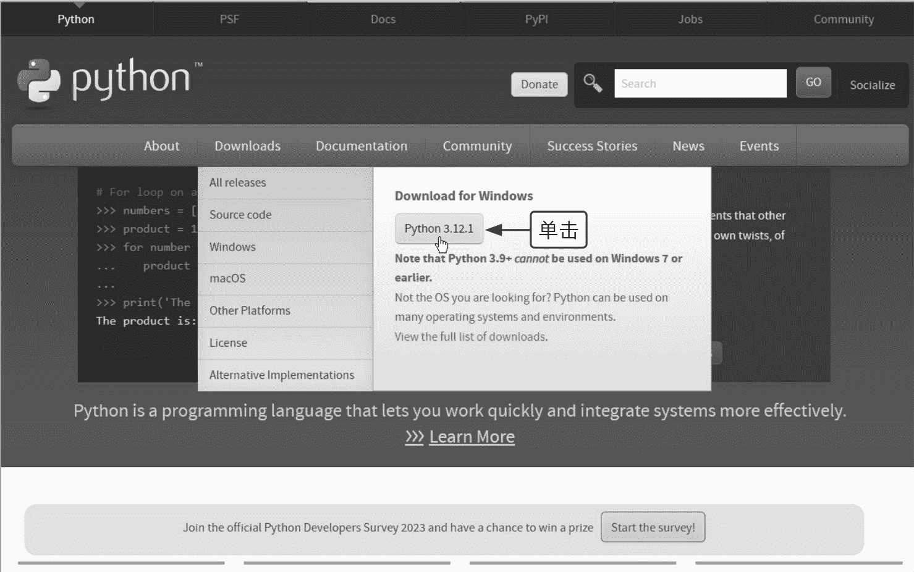

图 3-1 点选 Python 3.12.1 按钮

**温馨提示**

跨平台使用 Python 时，通常先下载对应平台的二进制包再按指引安装。若目标平台没有现成二进制包，可选用 C 编译器自行编译源码，以获得更灵活的配置选项。

**步骤 02** 下载完成后双击安装包，如图 3-2 所示。

**步骤 03** 弹出运行确认提示，点击“运行”按钮，如图 3-3 所示。

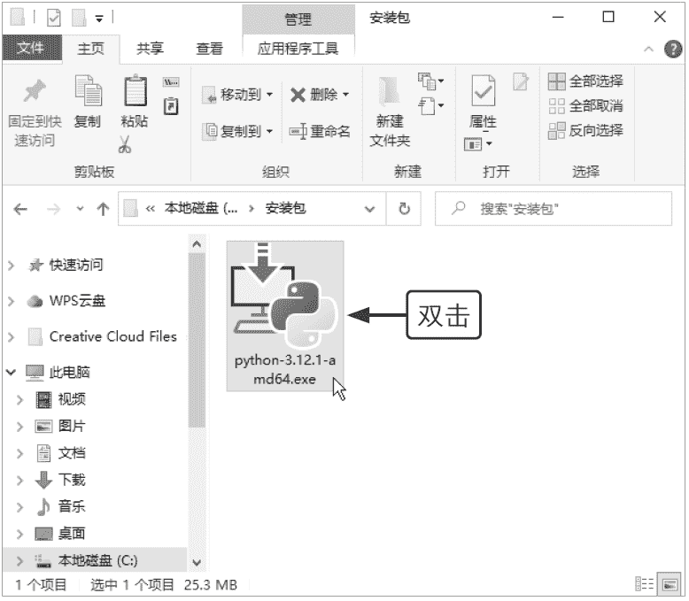

▲图 3-2 双击安装包

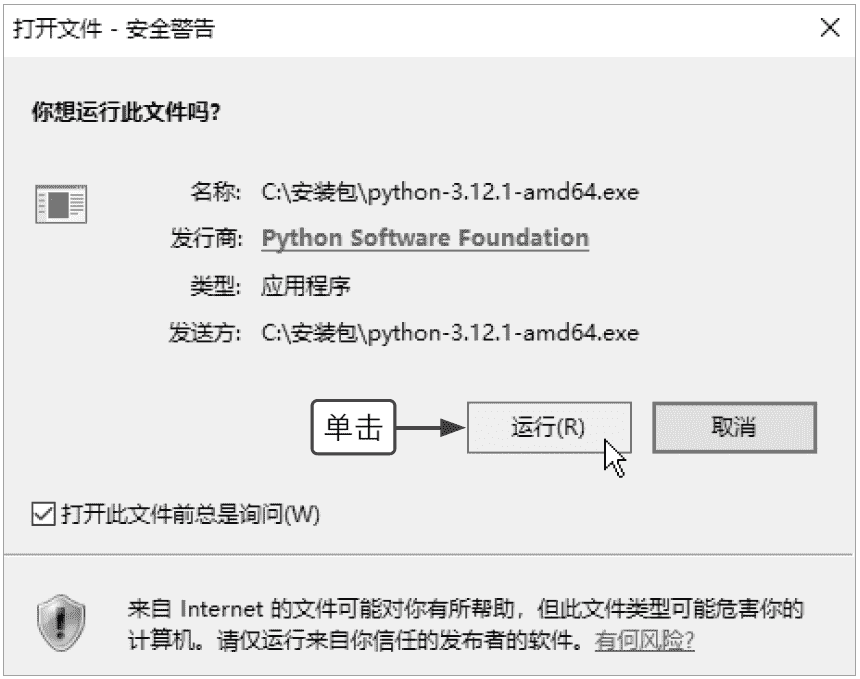

图 3-3 点击“运行”按钮

**步骤 04** 弹出 Python 3.12.1 (64-bit) Setup 对话框，可选择 Install Now 默认安装，或选择 Customize installation 自定义组件，此处选用 Install Now 即可，如图 3-4 所示。

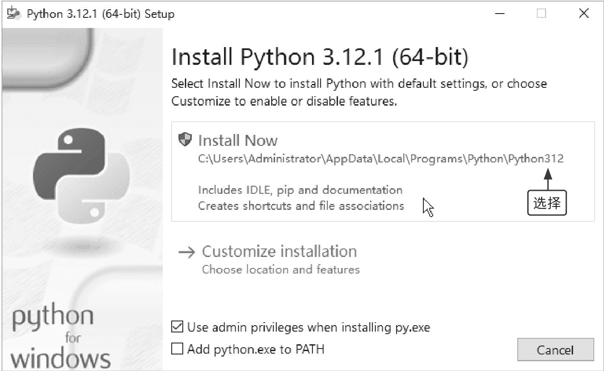

图 3-4 选择 Install Now 安装方式

**步骤 05** 进入 Setup Progress 安装进度界面，如图 3-5 所示。

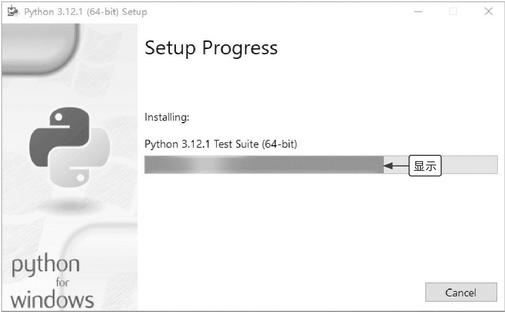

图 3-5 显示 Setup Progress 进度

**温馨提示**

Python 的可移植性不仅体现在操作系统，还支持 x86、ARM 等多种硬件架构。只要设备支持对应系统和架构，即可在其上运行。

**步骤 06** 片刻后出现 Setup was successful 安装成功提示，点击 Close 关闭即可，如图 3-6 所示。

图 3-6 点击 Close 按钮

### **3.1.2**

### **配置 Python 环境变量**

为顺畅调用 Python，需要把安装路径加入系统环境变量。环境变量是操作系统保存程序运行参数的集合，配置正确后可在任意位置启动 Python。下面以 Windows 为例说明设置方法。

**步骤 01** 在桌面“此电脑”图标上右击，从快捷菜单中选择“属性”命令，如图 3-7 所示。

图 3-7 选择“属性”命令

**步骤 02** 打开“系统”窗口，在左侧导航栏点选“高级系统设置”链接，如图 3-8 所示。

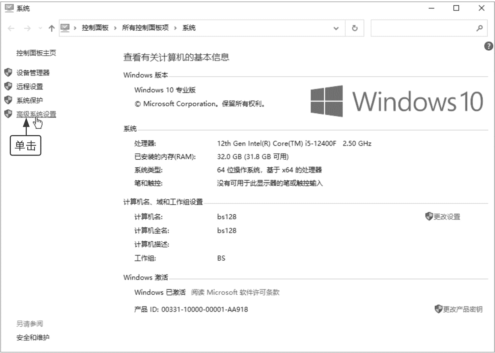

图 3-8 点击“高级系统设置”链接

**步骤 03** 弹出“系统属性”对话框并自动切换到“高级”选项卡，点击“环境变量”按钮。

**步骤 04** 弹出“环境变量”对话框，在“系统变量”列表中双击 Path 选项，如图 3-10 所示。

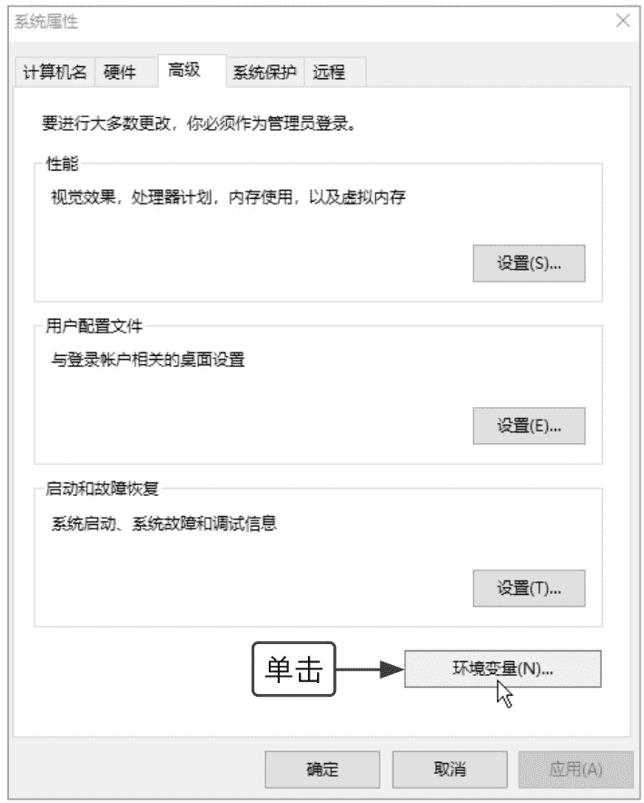

▲图 3-9 点击“环境变量”按钮

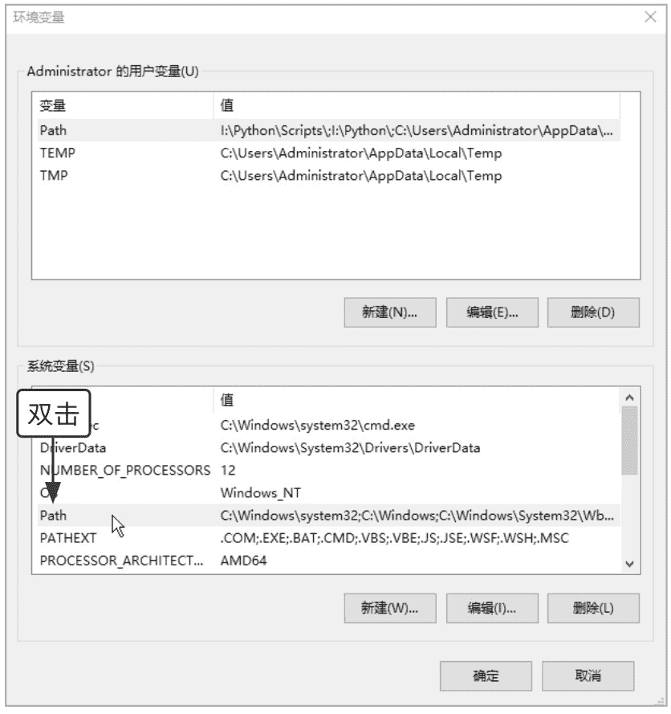

图 3-10 双击 Path 选项

**步骤 05** 弹出“编辑环境变量”对话框，点击“新建”按钮，如图 3-11 所示，新增一条系统变量。

**步骤 06** 将 Python 的安装目录粘贴到变量值输入框中，如图 3-12 所示，点击“确定”完成配置。

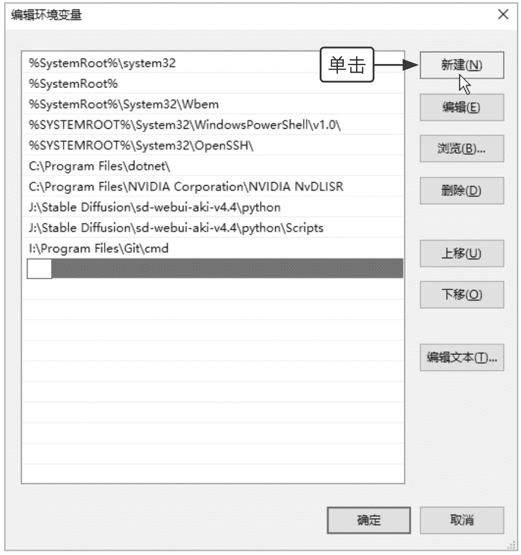

▲图 3-11 点击“新建”按钮

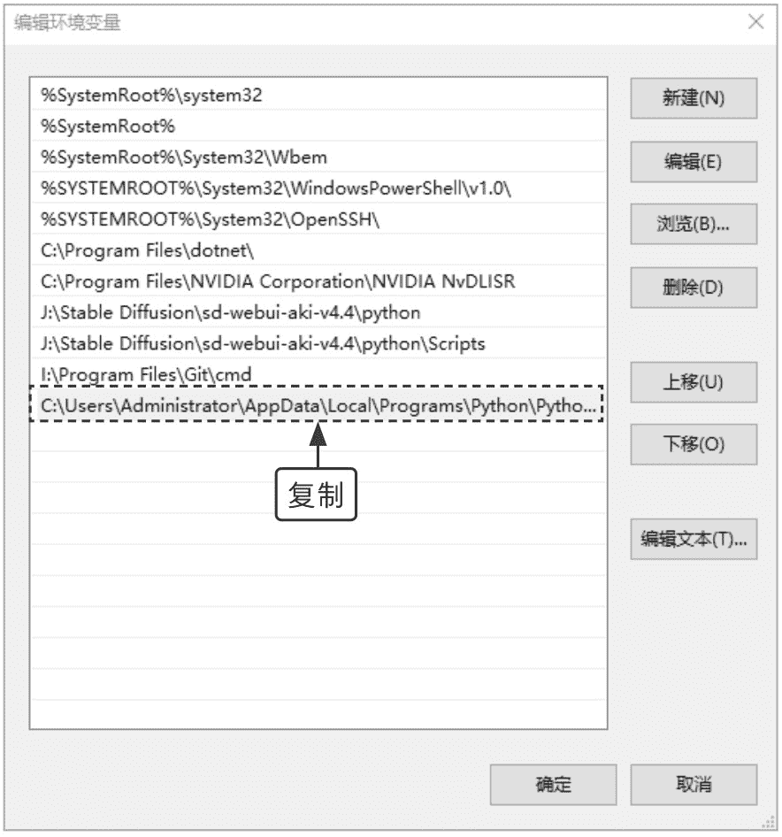

图 3-12 粘贴 Python 安装目录

**温馨提示**

程序和可执行文件可能分散在多个目录，操作系统默认搜索范围有限。环境变量如 Path 由系统维护，记录解释器和其他程序位置，便于系统在多目录中定位执行。

注意 UNIX 系统中环境变量名区分大小写，通常写作 PATH；Windows 不区分大小写，一般写作 Path。合理配置可更便捷运行 Python，提升 AI 系统开发效率。

### **3.2**

## **六个技巧掌握 Python 语法规范**

在 AI 训练中，Python 语法的规范与准确性直接影响代码可读性和训练效率。正确的格式有助于提升维护性与模型精度。本节介绍六个实用技巧，帮助提升编程规范能力。

### **3.2.1**

### **基础语法练习：输出英文字符**

Python 与 Perl、C、Java 等语言既有共通之处，也有简洁、解释型、面向对象、标准库强大、第三方库丰富等独特特点。下面介绍两种输出英文字符的方法，即交互式编程与脚本式编程。

**步骤 01** 交互式编程无需创建脚本文件，直接在解释器交互模式中编写代码。Windows 安装 Python 时会自动安装交互式客户端，在“开始”菜单中选择 Python 3.12 (64-bit) 即可，如图 3-13 所示。

**步骤 02** 打开 Python 3.12 (64-bit) 窗口，在提示符中输入以下文本，如图 3-14 所示。

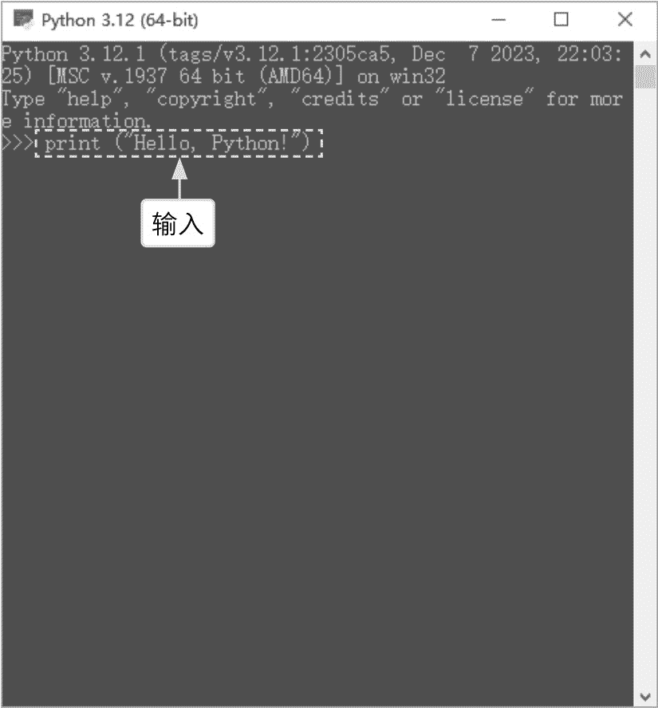

图 3-13 选择 Python 3.12 (64-bit) 选项

图 3-14 输入相应文本信息

**步骤 03** 按【Enter】键查看结果，即可输出对应英文字符，如图 3-15 所示。

**步骤 04** 脚本式编程由解释器调用脚本运行直至结束。下面新建一个简单 Python 脚本，将源代码复制到记事本中，如图 3-16 所示。

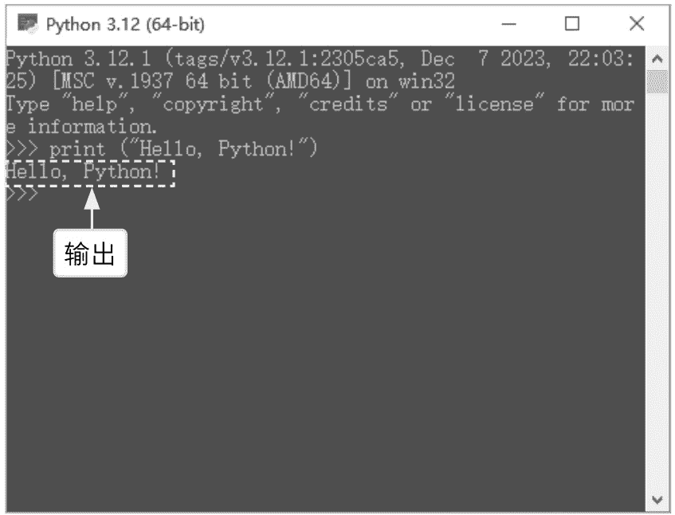

▲图 3-15 输出相应英文字符

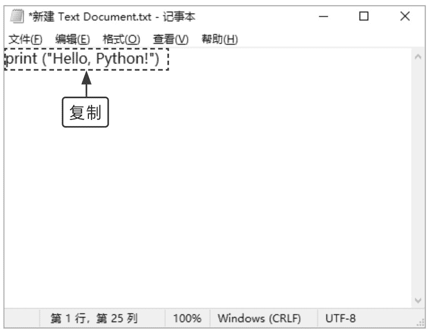

图 3-16 将源代码复制到记事本文件中

**步骤 05** 保存记事本文件为扩展名 .py 的脚本，如图 3-17 所示。

**步骤 06** 在“开始”菜单中选择 IDLE(Python 3.12 64-bit)，打开 IDLE Shell 3.12.1 程序，选择 File｜Open 命令，如图 3-18 所示。

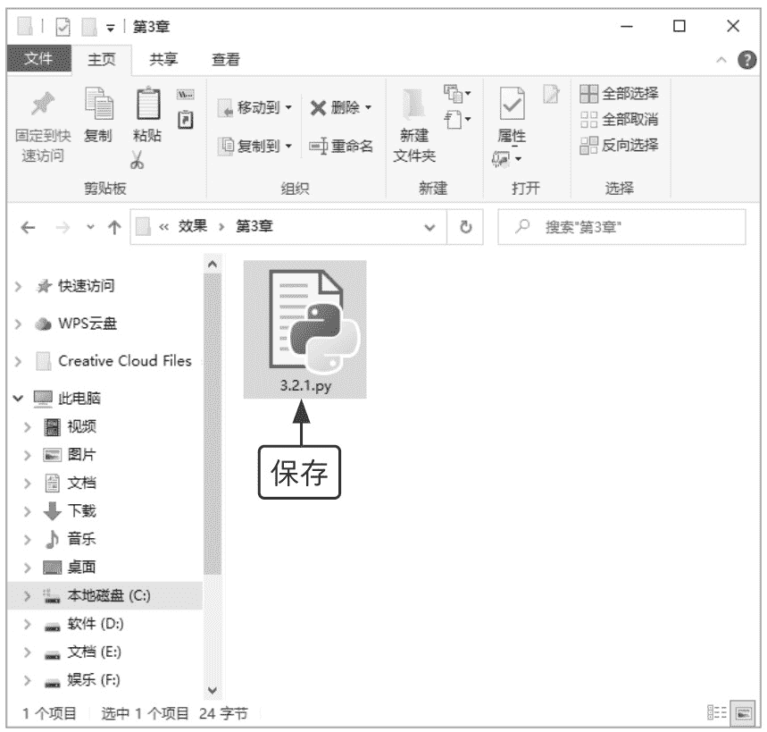

▲图 3-17 保存为脚本文件

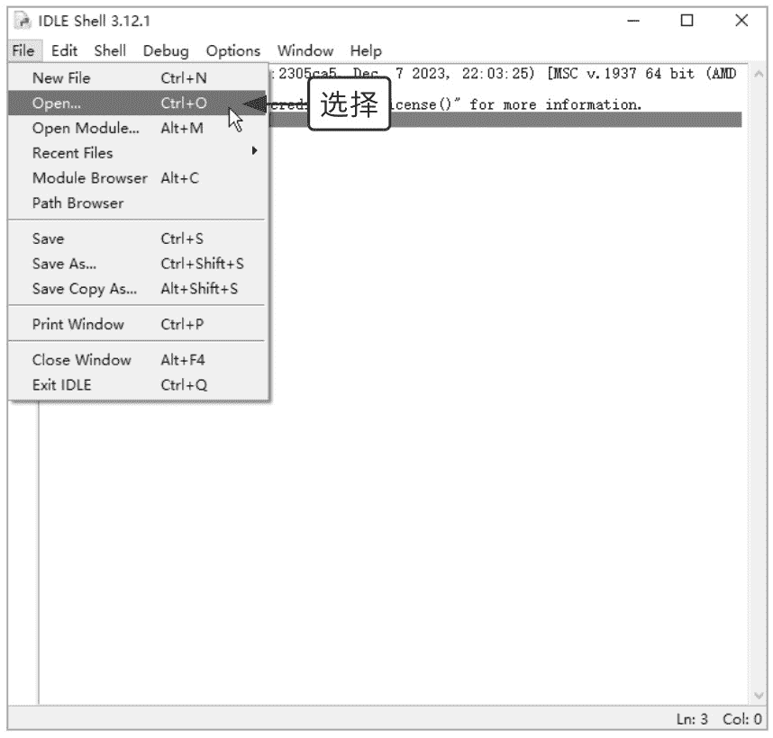

图 3-18 选择 Open 命令

**步骤 07** 弹出“打开”对话框，选择刚才保存的脚本文件，如图 3-19 所示。

**步骤 08** 点击“打开”按钮，脚本文件载入并可在编辑区添加注释，如图 3-20 所示。“#”用于添加注释，说明代码作用。此例注释解释 print 函数用于向控制台输出指定字符串。

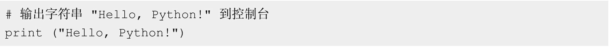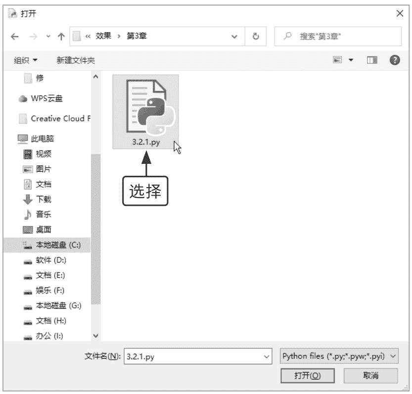

▲图 3-19 选择刚才保存的脚本文件

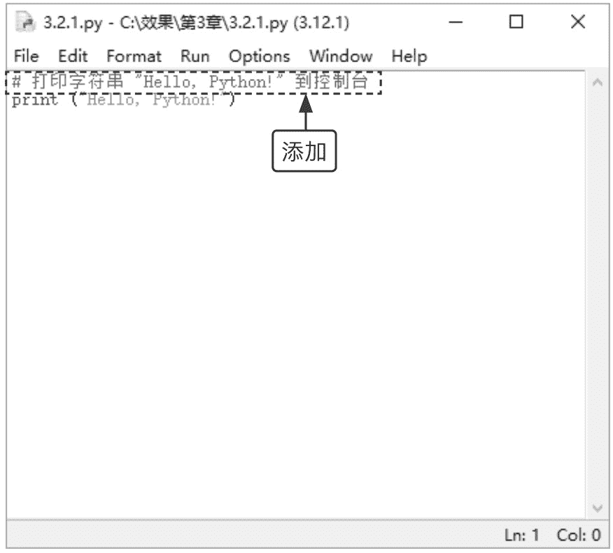

图 3-20 添加相应注释信息

**步骤 09** 选择 Run｜Run Module 命令，执行当前代码模块，如图 3-21 所示。

**步骤 10** 执行后可在集成开发环境中看到脚本运行结果，如图 3-22 所示。

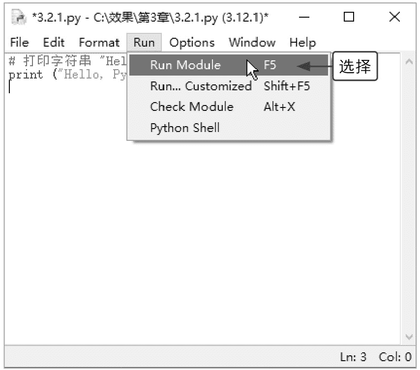

▲图 3-21 选择 Run Module 命令

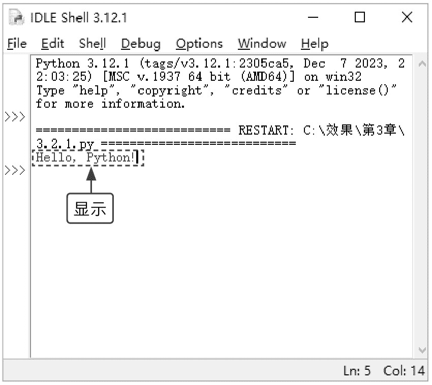

图 3-22 显示脚本运行结果

**温馨提示**

IDLE 是 Python 的集成开发环境，内置 Shell 窗口即 IDLE Shell，支持交互式输入代码并即时反馈结果。IDLE 提供文本编辑、调试、语法高亮、自动缩进等特性，有助于高效编写、测试与调试代码。

### **3.2.2**

### **中文编码设置：输出中文字符**

早期 Python 默认编码为 ASCII，仅能正确处理英文。若直接输出汉字，可能报错。因为 ASCII 不支持中文字符。

解决方法是在文件开头声明编码，指示解释器采用指定字符集读取文件。处理中文推荐使用 UTF-8，兼容多种中文字符。声明方式有两种。

只要在文件开头添加任一声明，解释器即使用 UTF-8 读取文件，从而正确处理中文，读取与输出中文时不再出错，具体操作如下。

**步骤 01** 打开 Python 3.12 (64-bit) 窗口，在提示符中输入以下文本，其作用是在屏幕输出“你好，世界”这句话，如图 3-23 所示。

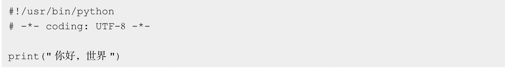

**步骤 02** 执行后程序自动运行并输出对应中文字符，如图 3-24 所示。

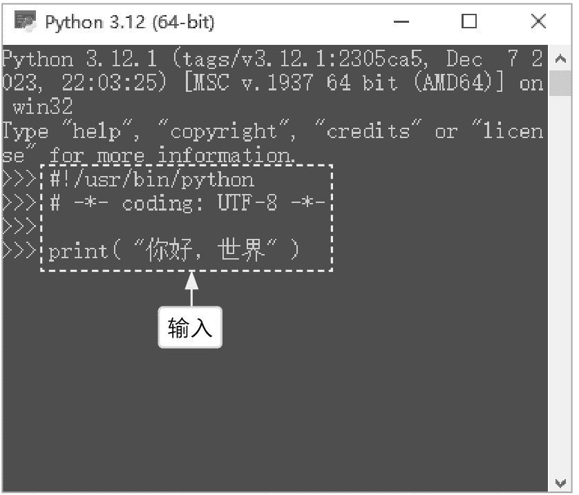

▲图 3-23 输入相应文本信息

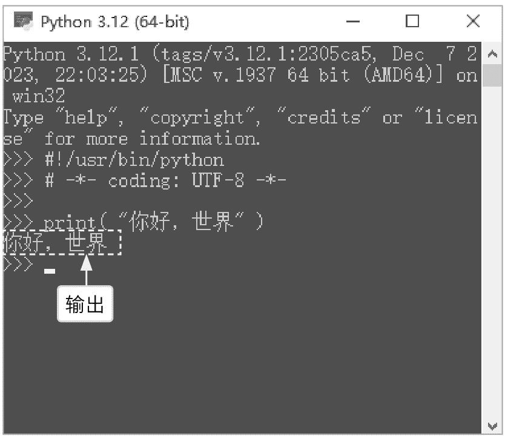

图 3-24 输出相应中文字符

**温馨提示**

Python 3.X 源代码文件默认编码为 UTF-8，可直接解析中文，无需额外指定。

使用 Notepad++、Sublime Text、Visual Studio Code 等编辑器编辑 Python 文件时，需确保文件编码设为 UTF-8，否则可能出现编码错误导致中文无法正确读取。也可在编辑器中手动设置编码或通过编码声明指定格式。

### **3.2.3**

### **变量赋值设置：定义不同数据类型**

Python 中数据类型用于描述数据结构。常见类型包括整数、浮点数、字符串、列表、元组、字典等，各有特定属性与行为。例如整数与浮点数属于数值型，用于计算；字符串属于文本型，用于表示信息。

在 Python 里，变量其实就是给数据起名字的标签，类型不是写死的，运行的时候才确定。你完全可以让同一个名字先装数字再装文本，解释器会自动跟着变。下面演示在交互窗口里怎么创建不同类型的变量并打印出来。

**步骤 01** 启动 Python 3.12 64位窗口，在 >>> 后面粘贴下面示例，代码演示了如何声明整型、浮点型、字符串变量，并用 print 把它们的值展示出来。

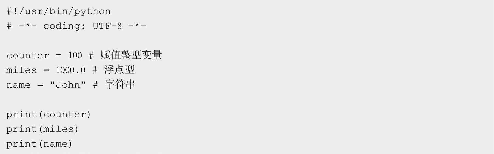

**温馨提示**

赋值时 Python 会自行判断类型。等号 = 是赋值符号，左边写标识符，右边写值。此外 Python 支持一次性给多个名字赋同一个值。

举例来说 a = b = c = 1，实际上只新建了一个值为1的整数对象，a、b、c 都指向同一个地址。此时改动其中一个，其余引用也会跟着变化。

**步骤 02** 运行后程序会自动执行，会看到 counter 得到100，miles 得到1000.0，name 得到John，如图 3-25 所示。

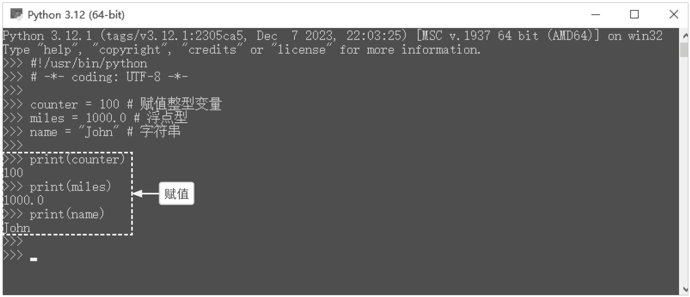

图 3-25 变量赋值

**温馨提示**

变量本质上占据内存空间。创建时解释器会按类型分配合适大小的区域，并决定能存放什么内容。

所以变量可以承载整数、小数、字符等多种形态，通过灵活切换类型来匹配不同编程需求。

### **3.2.4**
### **Python 运算符实操：算术与逻辑运算**
Python 的运算符是执行计算的特殊符号，能让数据产生变化。主要可归为几大类。

❶ **算术运算符：** 负责完成基础数学计算，比如加减乘除。设 a=10，b=20，对应用法见表3-1。

表 3-1 算术运算符用法

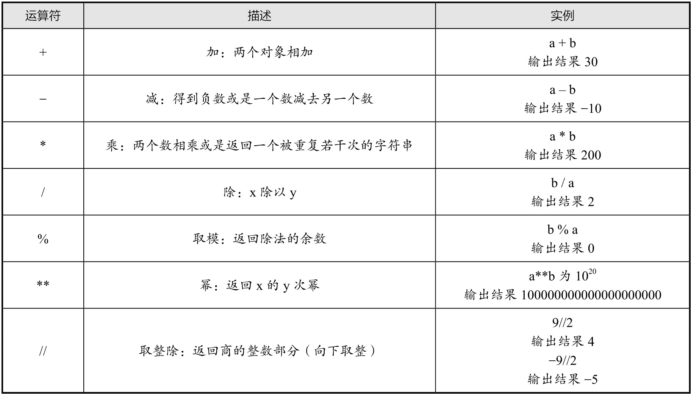

❷ **赋值运算符：** 把表达式结果存回变量。用法见表3-2。

表 3-2 赋值运算符用法

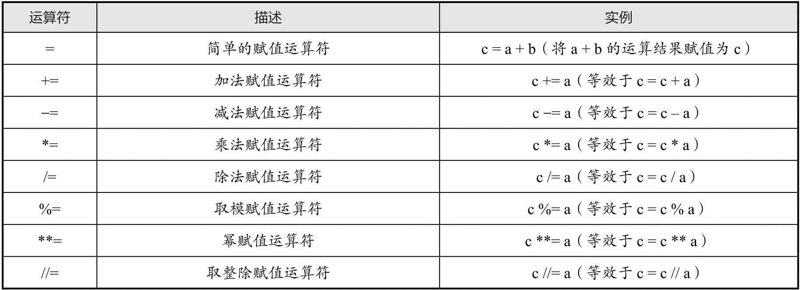

❸ **比较运算符：** 判断大小或相等。仍以 a=10 b=20 为例，见表3-3。注意比较结果 1 对应 True，0 对应 False。

表 3-3 比较运算符用法

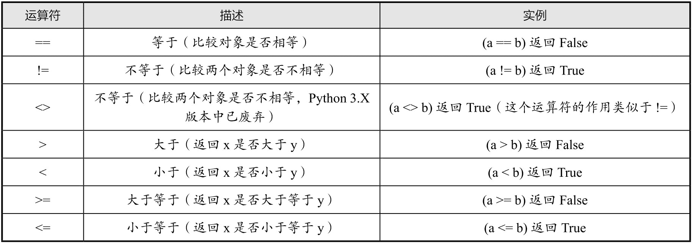

❹ **逻辑运算符：** 实现与或非逻辑判断。以 a=10 b=20 为例，见表3-4。

表 3-4 逻辑运算符用法

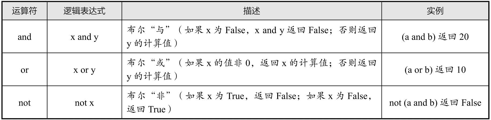

❺ **位运算符：** 对二进制位操作。假设 a=50，b=15，二进制如下，操作见表3-5。

▼表 3-5 位运算符用法

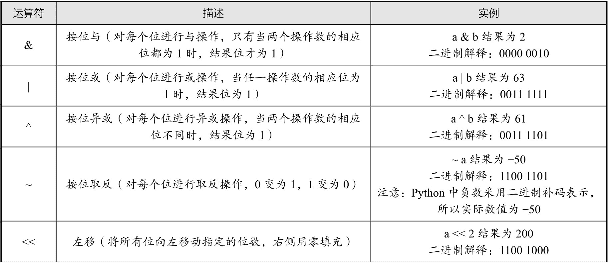

▼续表

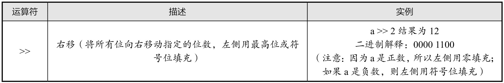

不同运算符对应不同符号，+ 表示加，- 表示减，* 表示乘，/ 表示除等。Python 还支持一元操作符，- 用来取负，+ 用来取正。表达式里参与计算的数值叫操作数，例如 2+3 中 2 和 3 是操作数，+ 是运算符。下面演示基础算术运算的写法。

**步骤 01** 打开 Python 3.12 64位交互窗口，在提示符下输入下面代码，创建 a、b、c 三个变量，通过加减乘除取模等运算求出 c 并打印。

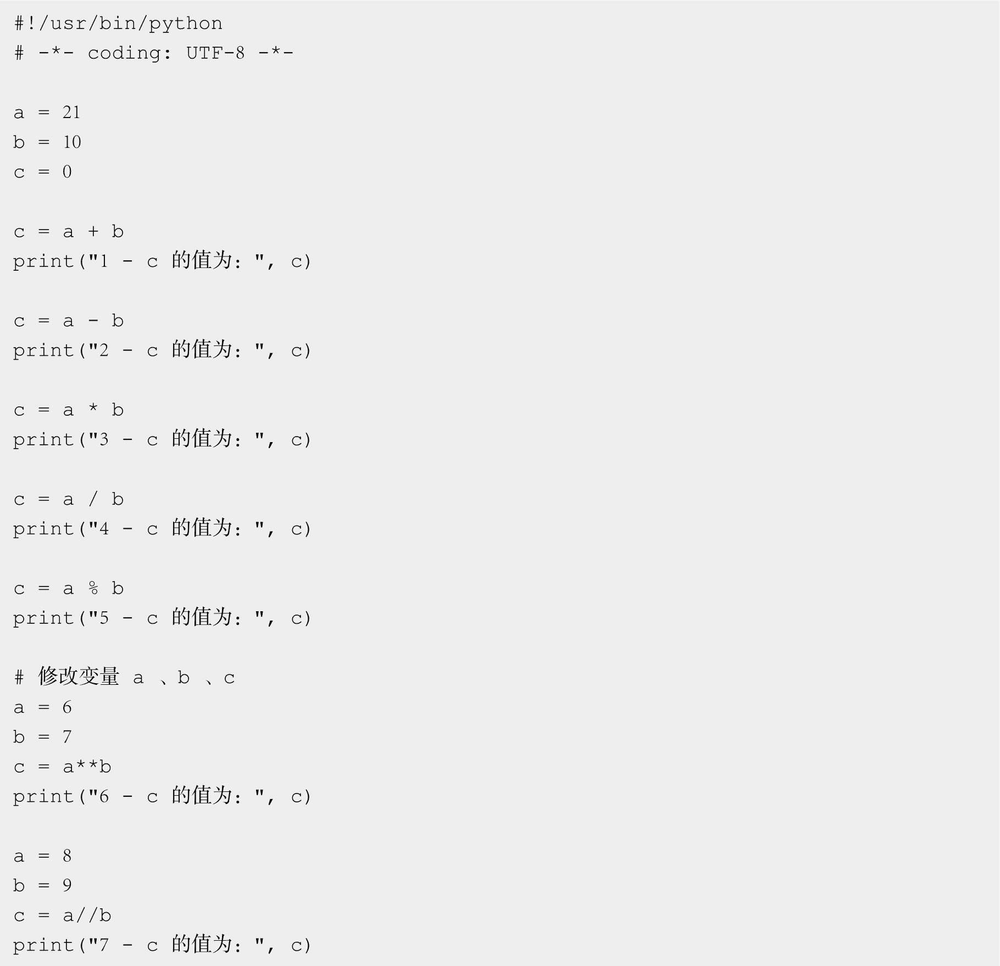

**温馨提示**

/ 会得到浮点数结果，若需要整数商请用整除 //。取模 % 会返回除法的余数。

**步骤 02** 执行后程序自动运行，可看到各算术运算符的输出，如图 3-26 所示。

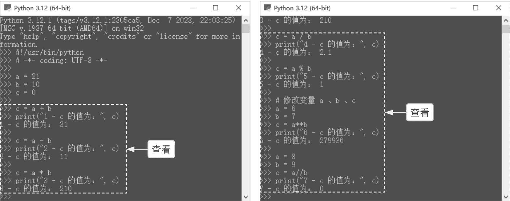

图 3-26 查看所有算术运算符的计算结果

### **3.2.5**
### **Python 条件语句：数值大小判断实战**
Python 的条件结构用于按条件选择执行路径。结构以 if 开头，后跟条件表达式；条件为真时执行其后的代码块，为假时跳过。

除了基础 if，Python 还提供 if-else 与 if-elif-else，前者为假时执行 else，后者可在多条件间择优执行。此外还支持嵌套 if，在 if 或 else 内部再写 if，实现更复杂的判断，使程序更灵活可维护。下面示范如何用条件语句比较数值大小。

**步骤 01** 打开交互窗口输入下面代码，使用最基本的 if，将 10 赋给 x，判断 x 是否大于5，若成立则打印“x 大于 5”。

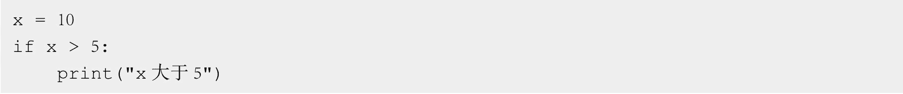

**步骤 02** 按回车运行，因 10>5，输出“x 大于 5”，如图3-27所示。

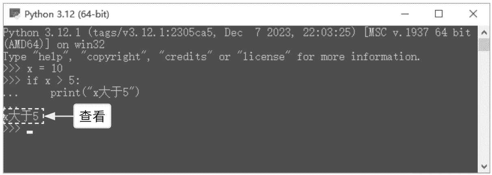

图 3-27 查看运行结果 1

**步骤 03** 继续输入代码，给 x 赋10，判断是否大于15，是则打印“x 大于15”，否则打印“x 小于或等于15”。

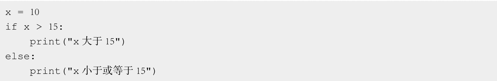

**步骤 04** 回车后因10不大于15，输出“x 小于或等于15”，如图3-28。

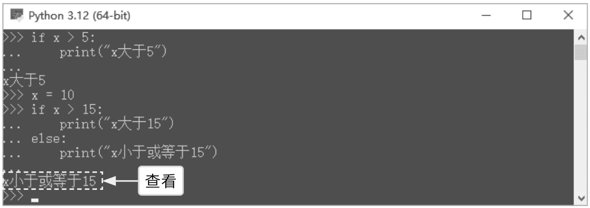

图 3-28 查看运行结果 2

**温馨提示**

if-elif-else 支持多分支，按条件顺序匹配；一旦遇到真值就执行对应块并跳过其余，若全部为假则执行 else。

**步骤 05** 输入代码，给 x 赋10，先判断是否大于20，再判断是否大于10，否则输出“x 小于或等于10”。

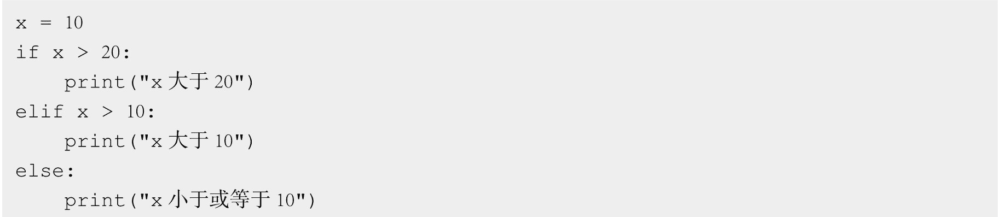

**步骤 06** 回车运行，因10不大于20，实际进入第三分支，输出“x 小于或等于10”，如图3-29。

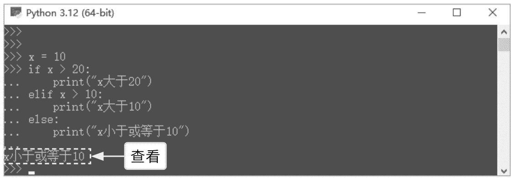

图 3-29 查看运行结果 3

**温馨提示**

嵌套 if 允许在 if 或 else 内部再套写 if，形成多层判断。

**步骤 07** 输入代码，给 x 赋10，y 赋20，分别判断 x>5 和 y>10，条件成立则打印对应信息。

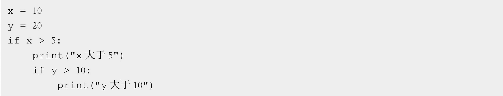

**步骤 08** 回车后两个条件均成立，依次输出“x 大于5”和“y 大于10”，如图3-30。

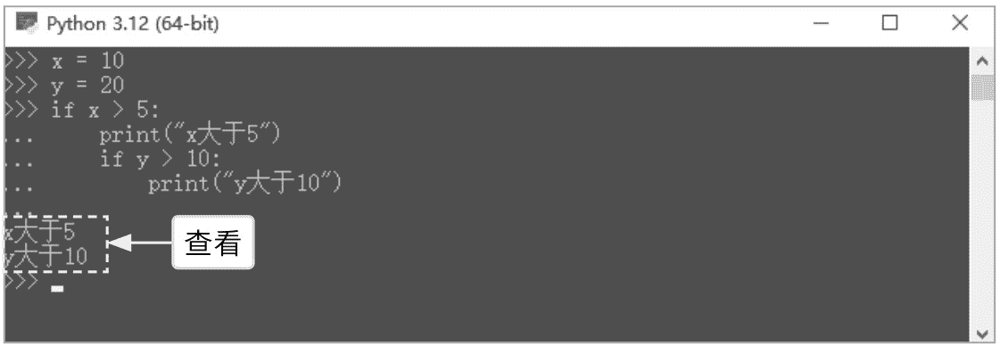

图 3-30 查看运行结果 4

**温馨提示**

嵌套结构下即使某分支为真，其余仍可能被评估，使用 else 能让逻辑互斥。过多嵌套会降低可读性，建议用函数拆分，超过三层就考虑重构。

### **3.2.6**
### **Python 循环语句：输出数字序列**
Python 循环用于重复执行代码直至条件满足，主要有 for 与 while，还支持嵌套，见表3-6。

表 3-6 Python 的循环结构

循环中常用控制流程的内置工具：

❶ **break：** 遇到即立刻退出当前循环。
❷ **continue：** 跳过本次剩余语句，进入下一轮迭代。
❸ **range()：** 生成整数序列，常配合 for 遍历区间。
❹ **enumerate()：** 遍历时同时返回索引和值。
❺ **zip()：** 并行遍历多个可迭代对象，返回元组迭代器。
❻ **列表推导式：** 用简洁语法快速生成列表，内含 for 与可选条件。
❼ **生成器表达式：** 类似列表推导但惰性求值，按需产出下一个值。

下面演示如何用循环输出数字序列。

**步骤 01** 打开交互窗口输入下面代码，使用 for 循环打印1到5。

**温馨提示**

for i in range(1,6) 表示 i 从1取到5，range 右端不包含。每次迭代 i 取下一个数并执行 print(i) 输出。

**步骤 02** 回车后依次打印1到5，如图3-31。

图 3-31 查看运行结果 5

**步骤 03** 输入 while 示例，先把 i 设为1，只要 i<=5 就循环，打印 i 后 i+1，超过5结束。

**步骤 04** 回车运行，输出与 for 循环一致，如图3-32。

图 3-32 查看运行结果 6

### **3.3**
## **AI 训练师实战：5 个实例，精通 Python 编程**
AI 训练师日常要处理数据、搭建模型、训练评估，Python 是核心工具。本节聚焦实战技巧，帮助建立牢固编程基础。

### **3.3.1**
### **实例 1：使用 Python 计算业绩提成奖金**
某公司按业绩阶梯发放提成，规则如下。

❶ **业绩低于或等于 10000 元时：** 奖金可提 10%。
❷ **业绩高于 10000 元，低于 50000 元时：** 低于或等于 10000 元的部分按 10%提成；高于 10000 元的部分，可提成 7.5%。
❸ **业绩位于 50000 元到 100000 元时：** 低于或等于 10000 元的部分按 10%提成；高于 10000 元且低于 50000 元的部分，可提成 7.5%；高于 50000 元的部分，可提成 5%。
❹ **业绩超过 100000 元时：** 低于或等于 10000 元的部分按 10%提成；高于 10000 元且低于 50000 元的部分，可提成 7.5%；高于 50000 元且低于 100000 元的部分，可提成 5%；高于 100000 元的部分，可提成 1%。

要求：从键盘输入当月业绩 i，求出应发放提成奖金总数。

**步骤 01** 打开 IDLE Shell 3.12.1 程序，选择 File｜New File（新建文件）命令，如图 3-33 所示。

**步骤 02** 执行操作后，打开新的代码窗口，输入以下文本信息，代码先获取业绩输入并转整型，再用条件语句确定计奖方式，最后计算并输出结果，如图 3-34 所示。

▲图 3-33 选择 New File 命令

图 3-34 输入相应文本信息

**温馨提示**

图 3-34 中的主要代码含义如下。

① “#!/usr/bin/python3” 用于指定脚本解释器路径，常用于 UNIX/Linux 可执行脚本。
② “i = int(input('请输入您的业绩： '))” 读取键盘输入并转为整数，本案例为业绩。
③ “arr = [100000,50000,10000,0]” 定义业绩阈值列表。
④ “rat = [0.01,0.05,0.075,0.10]” 定义与阈值对应的提成比率列表。
⑤ “r = 0” 初始化奖金累加变量。
⑥ for 循环遍历阈值，if i>arr[idx] 时计算超出部分的奖金并累加到 r，同时更新业绩值为当前阈值。

**步骤 03** 选择 Run｜Run Module 命令运行代码，弹出 Save Before Run or Check 对话框，单击“确定”按钮，如图 3-35 所示。

**步骤 04** 执行操作后，弹出“另存为”对话框，选择保存路径并输入文件名，如图 3-36 所示。

▲图 3-35 单击“确定”按钮

图 3-36 输入相应的文件名

**步骤 05** 单击“保存”按钮，即可运行 Python 程序，要求用户输入相应的业绩数据，如图 3-37 所示。

**步骤 06** 按【Enter】键查看运行结果，即可计算出相应的奖金，如图 3-38 所示。

▲图 3-37 输入相应的业绩数据

图 3-38 查看运行结果

**案例30：AI大模型一键算提成**

借助文心一言这类大模型，算业绩提成变得非常省心，用户不必亲自写代码也不用做繁琐的手算，抛一个问题进去就能马上拿到正确答案。把问题粘进文心一言的输入框，敲下回车，系统就会返回结果，如图 3-39 所示。实际得到的数值和用 Python 跑出来的完全一致。

图 3-39 使用文心一言 AI 大模型计算业绩提成奖金

发出提问后，文心一言会即时理解意图，调用预训练的模型和算法完成运算，并在页面呈现答案。无论是手写代码还是调用大模型，只要思路和算法正确，算出来的结果都一样可靠。

这类大模型的亮点在于交互非常即时，对编程不熟或想省时间的用户特别友好。与此同时，模型也在持续学习进化，能够更精准地捕捉用户的需求。

### **3.3.2**

### **实例 2：用 Python 把三个数排好序**

本例演示如何用 Python 实现三个整数的升序排列。用户输入 x、y、z 三个数后，程序会按从小到大的顺序输出。实现思路是先把最小值稳定在 x 上，先比较 x 和 y，x 大就互换；再比较 x 和 z，x 大就互换，这样 x 就是三者最小。

下面是具体操作流程。

**步骤 01** 启动 IDLE Shell 3.12.1，选择菜单 File｜Open，如图 3-40 所示。

**步骤 02** 弹出打开对话框，定位到目标脚本文件，如图 3-41 所示。

▲图 3-40 选择 Open 命令

图 3-41 选择相应的脚本文件

**步骤 03** 点按“打开”按钮，脚本就会载入。文件里包含一段简洁的 Python 程序，核心功能是接收三个整数输入并升序输出，如图 3-42 所示。

**步骤 04** 执行 Run｜Run Module 运行程序，提示输入数字时，这里先填入 9，如图 3-43 所示。

▲图 3-42 打开脚本文件

图 3-43 输入一个数字

**温馨提示**

图 3-42 中代码的关键作用如下。

① “l = []” 用于创建空列表 l，用来暂存用户输入的整数。

② “for i in range(3):” 开启循环体，让程序重复三次。

③ “x = int(input('integer:\n'))” 弹出输入提示，将用户键入的内容转成整数后赋给 x，input 负责读取，int 负责类型转换。

④ “l.append(x)” 把本次输入的 x 追加到列表 l 尾部。

⑤ “l.sort()” 对列表 l 执行排序，默认就是升序。

⑥ “print(l)” 把排好序的列表打印出来。

**步骤 05** 按回车确认，再继续输入剩下两个数字，如图 3-44 所示。

**步骤 06** 再次按回车，程序会输出三个数，且已按升序排列，如图 3-45 所示。

▲图 3-44 输入两个数字

图 3-45 查看运行结果

**案例31：文心一言实现数字升序排列**

文心一言也能完成数字排序。把待排的数字填进提问框，再加上“由小到大排列”的提示词，就能直接得到有序结果。比如输入 9、2、8，模型会返回 [2, 8, 9]，如图 3-46 所示。

图 3-46 使用文心一言 AI 大模型由小到大排列数字

这种排序需求在数据处理、表格整理、统计分析时很常见。借助文心一言，用户可以快速获得正确顺序，无需手工排或写代码。

### **3.3.3**

### **实例 3：用 Python 打印斐波那契数列**

斐波那契数列又称黄金分割数列，通常以 0、1 起步，后续每一项都是前两项之和，示例形式如图 3-47 所示。常见写法是 1,1,2,3,5,8,13,21,34…

图 3-47 斐波那契数列的相关示例

在自然界里也能见到类似规律。

❶ 向日葵种子呈斐波那契螺旋分布。

❷ 菠萝表面的鳞片排列与该数列相关。

❸ 树木生长的分支模式常遵循该规律。

此外，该数列在数学、计算机科学、经济学等领域应用广泛。如计算机图形学中用于生成分形，经济学中用于分析股价走势等。

下面演示如何用 Python 输出斐波那契数列。

**步骤 01** 打开 IDLE Shell 3.12.1，选择 File｜Open，弹出打开对话框并选中对应脚本，如图 3-48 所示。

**步骤 02** 单击打开，脚本载入，内容定义了一个求第 n 项斐波那契数的函数，并以第 10 项为例输出，如图 3-49 所示。

▲图 3-48 选择相应的脚本文件

图 3-49 打开脚本文件

**温馨提示**

图 3-49 代码要点如下。

① “def fib(n):” 声明 fib 函数，接收参数 n。

② “a,b = 1,1” 初始化前两项。

③ “for i in range(n-1):” 循环执行 n-1 次。

④ “a,b = b,a+b” 利用多重赋值更新两变量，体现斐波那契定义。

⑤ “return a” 返回计算得到的第 n 项。

⑥ “print (fib(10))” 调用函数并打印第 10 项结果。

**步骤 03** 选择 Run｜Run Module 运行，即可看到第 10 个斐波那契数，如图 3-50 所示。

**步骤 04** 再用 File｜Open 打开另一份脚本，该脚本使用递归方式计算第 n 项，并输出第 10 项，如图 3-51 所示。

▲图 3-50 代码运行结果

图 3-51 打开另一个脚本文件

**温馨提示**

图 3-51 代码要点如下。

① “def fib(n):” 定义递归函数 fib，参数 n 表示需要求的项数。

② “if n==1 or n==2:” 递归出口，当 n 为 1 或 2 时直接返回 1。注意这里采用 1,1 起步的定义，与标准 0,1 略有差异。

③ “return fib(n-1)+fib(n-2)” 递归主体，通过两次调用求前两项之和。

**步骤 05** 运行代码，递归方式会输出第 10 项，如图 3-52 所示。需注意递归实现效率较低，会重复计算。

**步骤 06** 再次 File｜Open 打开脚本，这次函数用于生成前 n 项序列并输出前 10 项，如图 3-53 所示。

▲图 3-52 代码运行结果

图 3-53 打开相应脚本文件

**温馨提示**

图 3-53 代码要点如下。

① “if n == 1:” 基础情况，返回含 1 的列表。

② “if n == 2:” 基础情况，返回 [1,1]。

③ “fibs = [1, 1]” 先准备前两项。

④ “for i in range(2, n):” 从第 3 项开始迭代到第 n 项。

⑤ “fibs.append(fibs[-1] + fibs[-2])” 把新项追加到列表末尾。

⑥ “return fibs” 返回完整的序列。

**步骤 07** 运行代码，即可打印前 10 个斐波那契数，如图 3-54 所示。

图 3-54 代码运行结果

**案例32：文心一言生成斐波那契数列**

让文心一言输出斐波那契数列，只要在提问框输入指令即可，例如“前两项为 1,1，请给出前 10 项”。回车后模型会理解请求并生成序列，如图 3-55 所示。

图 3-55 使用文心一言 AI 大模型输出斐波那契数列前 10 项

值得注意的是，文心一言有时会以自然语言解释数列含义，而非直接列出数字。若需要精确计算，Python 等编程语言仍是更高效的选择。

### **3.3.4**

### **实例 4：用 Python 打印九九乘法表**

九九表为二维结构，需同时控制行列。本例用 i 控制行，j 控制列，i、j 均从 1 到 9 遍历，即可完整输出。

操作如下。

**步骤 01** 启动 IDLE Shell 3.12.1，选择 File｜Open，弹出打开对话框并选择脚本，如图 3-56 所示。

**步骤 02** 点击打开，脚本显示，代码作用是输出完整的九九乘法表，如图 3-57 所示。

**温馨提示**

代码主要作用如下。

① “for i in range(1, 10):” 外层循环，i 从 1 到 9。

② “print()” 每次外层循环后输出空行，用于分隔各行。

③ “for j in range(1, i+1):” 内层循环，j 从 1 到 i。

④ “print ("%d*%d=%d" % (i, j, i*j), end=" ")” 格式化输出乘法式，end=" " 防止换行，实现同行连续输出。

▲图 3-56 选择相应的脚本文件

图 3-57 打开脚本文件

**温馨提示**

Python 支持单引号、双引号和三引号表示字符串，且开始结束引号必须匹配。

三引号可承载多行文本，常用于写文档字符串或多行注释，能让代码更清晰易读。

**步骤 03** 选择 Run｜Run Module 运行，即可得到九九乘法表，如图 3-58 所示。

图 3-58 代码运行结果

**案例33：文心一言输出九九乘法表**

文心一言具备强大的自然语言处理能力，能快速理解需求并生成九九乘法表，过程准确高效，如图 3-59 所示。凭借该能力，它可处理文本生成、分类、情感分析等多种任务，并支持跨语言文本处理。

图 3-59 使用文心一言 AI 大模型输出九九乘法口诀表

### **3.3.5**

### **实例 5：用 Python 实现猜数字游戏**

本例用 Python 制作一个猜数字小游戏。程序会在 0 到 100 之间随机生成一个数字，玩家需尽快猜中，每轮都会给出提示帮助缩小范围。

操作介绍如下。

**步骤 01** 打开 IDLE Shell 3.12.1，选择 File｜New File，新建代码窗口并输入如下内容。这是一段简单的猜数字游戏代码，如图 3-60 所示。

**步骤 02** 选择 Run｜Run Module 运行，程序会要求猜 1 到 100 之间的数字，例如这里输入 50，如图 3-61 所示。

▲图 3-60 输入相应文本信息

图 3-61 输入相应的数字

**温馨提示**

图 3-60 代码要点如下。

① “import random” 导入 random 模块，用于生成随机数。

② “def guess_number():” 定义 guess_number 函数，被调用后执行游戏逻辑。

猜数字实现逐行拆解

③ number_to_guess = random.randint(1, 100) 调用 random.randint(1,100) 在 1 到 100 的区间内产生一个随机整数，存进 number_to_guess。
④ guess = None 先把 guess 置为 None，后续用来保存玩家本次输入。
⑤ attempts = 0 把 attempts 初始化为 0，用来累计猜测轮数。
⑥ while guess != number_to_guess: 当 guess 与目标 number_to_guess 不相等时循环继续。
⑦ guess = int(input("请猜一个 1 到 100 之间的数字：")) 向玩家发出提示，将键盘输入的字符串转为整数后赋给 guess。
⑧ attempts += 1 每次循环结束时把尝试次数加一。
⑨ 后续的 if-elif 块比较大小并给出提示。
● 猜的值比目标小，程序会提示数值偏低，请继续。
● 猜的值比目标大，程序会提示数值偏高，请继续。
⑩ print(f"恭喜你，你在{attempts}次尝试后猜对了！") 猜中后把累计轮数打印出来告知玩家。
⑪ if __name__ == "__main__": 标准的入口保护，只有直接执行脚本时才进入内部块，被导入时跳过。
⑫ guess_number() 调用前面定义的猜数字函数，开始游戏流程。

步骤 03 按回车查看运行效果，因输入与系统随机数不匹配，游戏未结束且会给出大小反馈，如图 3-62 所示。
步骤 04 玩家需反复尝试直至命中目标，系统最终会报告总共用了多少轮，如图 3-63 所示。

▲图 3-62 给出相应提示

图 3-63 猜对数字，游戏结束

案例 34 用文心一言大模型进行猜数字互动

借助文心一言大模型也可以开展猜数字玩法，模型会根据玩家输入即时生成提示与回应，让体验更智能有趣，如图 3-64 所示。

图 3-64 使用文心一言 AI 大模型玩猜数字游戏

当报出的数字偏高或偏低时，文心一言会给出方向性提示并提供缩小范围的建议，同时还能基于对话历史展开轻松交流，提升互动趣味。大模型在海量语料上完成训练，掌握了语言规律、语义特征与上下文关联，能够理解意图并提取关键信息，在猜数字场景中做出恰当回答。

该模型采用生成式对话技术，可结合上下文即时产出相关内容，在游戏中会主动引导玩家逐步收敛区间直至猜中。并且具备自我学习与优化能力，使用越久对话质量和生成准确度越会提升。

温馨提示

编写 Python 猜数字等程序时，还需注意命名规则，具体如下。
① 名字只能由字母、数字及 _ 构成，且首字符不可为数字。
② 命名是大小写敏感的。
③ 以 _ 开头的名称带有特殊含义。以单 _ 开头通常表示受保护的类属性，需通过接口访问；以双 _ 开头表示类私有成员；以双 _ 开头和结尾则是保留的特殊方法，如 __init__() 为构造方法。
④ 同一行可写多条语句，用分号 ; 分隔。

本章小结

本章涵盖了 Python 编程的基础与实战。先介绍了 Python 的下载安装及环境变量配置；再通过 6 个小技巧演示语法要点，包含英文输出、中文输出、不同数据类型定义、四则运算以及条件与循环语句的使用；最后用 5 个实战案例展开应用，分别是业绩提成计算、数字升序排列、斐波那契数列输出、九九乘法表输出以及猜数字游戏制作。学完本章，读者可掌握 Python 基础知识与常用技巧，为后续 AI 训练学习打下基础。

课后习题

为巩固本章内容，下面安排两道回顾练习。
1．使用 Python 输出“AI 训练师”，如图 3-65 所示。

图 3-65 输出“AI 训练师”

2．使用 Python 输出指定格式的日期，如图 3-66 所示。

图 3-66 输出指定格式的日期

# 第四章

机器学习算法
——常用的 AI 训练方法

AI 训练主要依托机器学习与深度学习两大方向，机器学习让计算机自行解析数据模型以提升智能水平；深度学习则模拟人脑神经网络，通过多层网络协同实现对数据的深度理解。本章聚焦机器学习算法的基础与应用，帮助读者理清 AI 训练的原理与方法。

## 4.1
认识机器学习算法

机器学习是计算机科学的一个分支，目标是构建可用于解决业务问题的预测模型。它使用能够自行改进的算法，无需硬编码规则，核心思想是：当程序在任务 T 上的表现 P 随经验 E 不断积累而提升时，可认为该程序能从经验 E 中学习任务 T。

其运行机制简言之是，机器接触大量结构化与非结构化数据，从中汲取经验并对未来进行预测。这一过程融合多种算法与技术，推动模型持续进化。本节介绍机器学习算法的基础，解析其如何提升人工智能的智慧。

### 4.1.1
机器学习与人工智能：共筑智能未来

机器学习属于人工智能的子领域，赋予计算机无需人工显式编程即可决策的能力。通过 if-then 规则、数学方程或神经网络等训练方式，模型得以建立。

温馨提示

if-then 规则是一种逻辑表达形式，表示“若条件成立，则结果发生”。在编程中，它用于根据特定条件执行相应操作；也可用于模糊控制，表示模糊条件与模糊结果的关联。

许多机器学习算法依赖结构化数据训练。结构化数据指按固定格式组织的资料，如表格或数据库。采用结构化数据可缩短训练周期、降低资源占用，并让 AI 训练师更清晰地理解模型解决问题的过程。

机器学习模型的应用遍及各行业，涵盖医疗、电商、金融、制造等。通过机器学习，企业可更精准预测市场、评估风险、细分客户，从而优化运营并增强竞争力。

案例 35 淘宝推出原生 AI 大模型应用“淘宝问问”

“淘宝问问”是机器学习模型在电商领域的典型落地。阿里云通义千问大模型完成备案并向公众开放后，淘宝内部测试接入通义千问的 AI 购物助手“淘宝问问”，标志着 AI 在电商的应用迈进一步。

用户在淘宝搜索栏输入“问问”并选择“淘宝 AI 助手”即可进入界面，如图 4-1 所示。该助手功能全面，提供更智能便捷的购物体验，与通义千问的合作进一步提升服务质量。

图 4-1 跳转到“淘宝问问”界面

“淘宝问问”兼具多重角色：既像资深导购提供个性化商品建议，如图 4-2 所示；又像生活助手解答各类疑问，如图 4-3 所示；还能化身灵感写手提供文案创意。

▲图 4-2 提供个性化的商品挑选建议

图 4-3 解答生活中的各类疑问

当前网购常需跨平台比对，AI 正简化这一流程，缩短查找路径并降低决策成本。相比传统搜索框，“淘宝问问”更能理解用户意图并给出更有参考价值的建议，帮助快速找到个性化商品，且可与内部生态联动提供一站式跨域方案。

例如，用户询问旅行相关问题时，系统可自动关联飞猪等平台，提供出行、住宿、景点、行程与装备购买等全流程方案，如图 4-4 所示。

图 4-4“淘宝问问”可提供全方位的旅行解决方案

需注意，淘宝用户须知提示：受训练数据与技术水平限制，输出仅供参考，无法完全保证真实性、准确性、合法性与可用性；返回的商品及多媒体内容是基于输入检索获得，并不代表平台推荐。

总体看，“淘宝问问”是淘宝在搜索功能上的创新，通过接入基于机器学习的大模型实现对话能力，应用场景扩大至导购、科普、内容生成等，为用户带来全新体验。从商业角度，它降低运营成本，提升购买意愿与转化率。

未来，“淘宝问问”有望结合内容直播与货架电商，为平台带来更多流量与增长。随着 AI 与机器学习持续发展，电商正迈向自动化、无人化新阶段。

### 4.1.2
3 个基本类型：了解机器学习算法的技术原理

机器学习通过算法从数据中自动学习并改进模型以解决实际问题，按学习方式可分为监督学习、无监督学习和强化学习。

1．监督学习

监督学习旨在建立输入 X 与输出 Y 之间的数学映射，利用带标签的训练数据使模型学会根据输入预测输出。训练数据需包含特征与目标值，目标值通常由人工标注。

监督学习可用于历史数据预测未来结果，前提是提供输入与输出变量。常见算法包括线性回归、逻辑回归、支持向量机、朴素贝叶斯和决策树等。应用场景主要有：
❶ 图像识别：自动对图片分类，例如根据人脸区分性别。
❷ 文本分析：自动分类文本，例如将新闻归为政治、体育、经济等。
❸ 语音转文本：将语音自动转为文字记录。

案例 36 剪映“智能字幕”功能自动将语言转换为文字

剪映的“智能字幕”借助监督学习算法把音频中的语音或歌词转写为文字，在多种场景中提升效率。实现转写需先准备标注数据集，包含语音样本与对应文字，通过监督学习算法如深度学习模型与自然语言处理技术训练，模型逐步学会音频到文字的映射，提升识别准确率。

应用上，用户导入音频后即可自动生成字幕，如图 4-5 所示，节省手工时间并保证一致性。该功能也用于音频翻译、会议记录、讲座笔记等场景。

图 4-5 剪映的“智能字幕”功能

监督学习既用于分类也用于回归。分类是将数据划入预定义类别，回归是预测连续数值。常用算法有决策树、支持向量机、逻辑回归、神经网络等。

温馨提示

支持向量机是典型监督学习算法，目标是在特征空间中找到最优分离超平面，使正负样本间隔最大。它适用于分类与回归，在小样本、非线性、高维识别问题上优势明显。模型通过超平面划分数据，决策边界由最大间隔超平面决定，多类问题需做相应改造。

案例 37 Google 翻译利用监督学习算法提升精准度

Google 翻译通过监督学习大量已翻译文本，学习源语言表达与目标语言对应的关系，据此预测新文本翻译，如图 4-6 所示。

图 4-6 Google 翻译

2．无监督学习

无监督学习仅使用输入变量 X，数据未标注，算法通过挖掘内在结构构建模型，本质是从原始数据中自主发现规律与特征。

无监督学习不依赖人工标签，通过自我归纳总结数据模式。常见方法有聚类、降维等，如表 4-1 所示。

表 4-1 常见的无监督学习算法

聚类旨在把数据集划分为多个簇，同簇内相似度高、跨簇差异大；降维则把高维数据映射为低维，便于理解与分析。其他方法还包括层次聚类、自编码器等，在大规模数据处理、特征提取、降维上表现良好。

温馨提示

层次聚类是一种逐层划分数据的方法，形成树状聚类结构。它先将每个样本视为独立类，再按相似度逐步合并，直至形成单一类。

自编码器是一种无监督神经网络，由编码器与解码器组成。编码器将输入压缩为低维表示，解码器尝试重建原始数据，从而学习数据内在结构。广泛用于数据压缩、异常检测及生成模型如 ChatGPT、Stable Diffusion 等。

无监督学习的应用包括聚类分析、异常检测与降维处理。聚类用于市场细分、社交网络分析；异常检测用于欺诈识别、故障预测；降维用于图像压缩、特征提取。

案例 38 Amazon 利用无监督学习重塑电商体验

亚马逊的个性化推荐体系里，无监督方法主要负责把用户的历史点击与成交信息转化为可用的模式，参考图 4-7 的展示效果。平台先汇总站内互动足迹，包含浏览轨迹、下单清单、评分反馈等行为日志；随后用无监督模型挖掘这些足迹背后的共性与趋势，例如哪些品类常被一起购买；最后借助聚类实现商品的自动归类，搭建更细分的推荐逻辑，从而提高命中率与用户满意度。

图 4-7 Amazon 电商平台推荐的商品

**3．强化学习**

强化学习是一类偏向决策的机器学习范式，目标是为智能体挑选下一步行动。与需要标注样本的监督模式不同，它不依赖预先准备的训练集，而是让智能体在环境中持续交互，通过尝试不同行为并获得即时反馈，即正向奖励或负向惩罚，来不断修正策略。因此强化学习本质上是试错式的探索，目标是逼近能最大化累计收益的最优方案。

运行的核心是智能体从环境接收观察信息与奖励信号，据此决定执行何种操作。环境对操作作出回应，通常以奖励数值衡量该行动对任务目标的接近度。

常见实现路径有 Q-Learning、SARSA、Actor-Critic 等，它们实现方式各异，但都围绕状态、动作、奖励的交互学习最优策略，具体如下。

❶ Q-Learning 属于值迭代类方法，通过持续学习特定状态下各动作的价值来指导行为选择。其核心是 Q 值函数，用以估计在给定状态下采取某动作的期望回报，随着函数迭代更新，智能体能逐步逼近最优策略。

❷ SARSA 遵循状态-动作-奖励-状态-动作的在线更新流程，解决动作选择问题。它记录某一状态下采取的动作及其后续结果与奖励，用以指导行为。搭配合理的探索机制，SARSA 也能运用于连续动作空间，并逐渐寻得更优行为。

❸ Actor-Critic 将策略与价值两条思路融合，由 Actor 与 Critic 两模块组成。Actor 部分主要依据当前状态挑选动作，Critic 部分则对状态价值与动作价值的估计进行校验并用于策略参数的更新。双模块协同能加快最优策略的学习速率。

强化学习在多个领域落地。
❶ 游戏领域可训练智能体做决策，例如围棋中学习落子策略。
❷ 机器人控制领域可让机器人掌握自身行为，例如学会行走或抓取。
❸ 自动驾驶领域可通过学习实现驾驶决策，例如在拥堵时自动规划路线。

**案例 39 基于强化学习算法的 AlphaGo 人工智能围棋程序**

阿尔法狗是谷歌 DeepMind 团队基于强化学习打造的人工智能围棋程序，目标是学习对弈。该程序通过自我对弈持续学习，不断优化策略，最终战胜人类围棋世界冠军。这一案例展示了强化学习在人工智能领域的巨大潜力，也证明了其在复杂决策问题上的有效性。

### 4.1.3
### 六步读懂机器学习运行逻辑

下面拆解机器学习算法的六个基本流程，帮助快速理解其运行方式，为后续探索与应用奠定基础。

**1．准备数据集**

构建模型时，数据集是起点。数据集可视作一个 M×N 的矩阵，M 指特征数量，N 指样本数量。特征通常拆分为 X 与 Y，X 为输入变量或特征，Y 为对应的类别标签或因变量。

**2．探索性数据分析**

探索性数据分析即 EDA，目的是深入认识数据，涉及清洗、描述性统计、分布观察、关系比较、直觉提炼与总结等。EDA 强调数据的真实分布，重视可视化，助力分析者直观看出隐藏规律，为模型选择提供依据。

常用手段包括描述性统计如均值、中位数、标准差等，数据可视化如热力图、箱线图、散点图等，以及数据整形如透视、分组、过滤等。

**案例 40 常用的数据可视化工具—散点图**

散点图是常用的可视化工具，用于展示两个变量之间的关系，如图 4-8 所示。数据点以点状分布在由 x 轴与 y 轴构成的平面上，通过观察点的分布可推断相关性、线性关系、正相关或负相关等。散点图在科学、经济、社会、统计等领域数据分析中广泛使用。

图 4-8 散点图

**3．数据预处理**

实际工作中原始数据常存在缺失、异常值、分布不均等问题，会影响模型准确性。因此预处理的目的是清洗整理原始数据，使其适配模型，提升可靠性和精度。

具体操作包括数据清洗、特征选择、特征转换、数据分割等。

❶ **数据清洗：**保障数据质量的核心环节，涉及错误、缺失、异常值的检测与修正。通过补全缺失、修正错误或剔除异常，可提升一致性与可信度。
❷ **特征选择：**从原始特征中挑选与预测目标最相关的变量，降低维度，避免过拟合或欠拟合。剔除无关或冗余特征能提高运行效率与准确性。
❸ **特征转换：**将原始特征映射为更能表达目标的新特征，如用降维减少维度，或用编码把分类变量转为模型可读格式。
❹ **数据分割：**把数据集划分为可独立管理的单元，便于重构、重组与恢复，并提升索引与扫描效率。合理分割有助于提升模型稳定性、发现潜在模式并评估泛化能力，辅助训练师优化模型。

**4．机器学习算法建模**

在数据处理与预测中，算法扮演核心角色。依据目标变量 Y 的类型选择模型，Y 可是连续数值如房价，或离散类别如邮件分类。

机器学习大致分为监督学习、无监督学习与强化学习，每类各有适用场景与优势，具体前文已介绍。常见建模方法如下。

❶ **决策树：**通过树状结构对数据进行分析与预测，可用于分类或回归。
❷ **随机森林：**结合决策树与集成思想，构建多棵树以提升预测稳定性和准确性。
❸ **逻辑回归：**用于分类问题，通过将数据映射到类别来给出预测。
❹ **支持向量机：**寻找能分隔不同类别的超平面，使样本点与平面保持最大间隔。
❺ **深度学习：**使用含多隐藏层的神经网络进行预测，可用于分类、回归与生成任务，后续章节会展开。
❻ **K 最近邻 KNN：**依据与当前样本最相似的 K 个邻居的标签进行预测。
❼ **聚类分析：**将相似样本归为一类，常用于无监督场景。
❽ **降维技术：**降低数据维度以提升可解释性与可视化效果，常见方法包括主成分分析和线性判别分析等。

**5．选择合适的机器学习任务**

以监督学习为例，常见任务有分类与回归。分类旨在把输入分配到预设类别，帮助理解与预测不同类型数据并做决策。实现分类通常包括：
❶ **数据收集和预处理：**采集数据并做清洗、去重、特征提取等。
❷ **特征选择：**挑选相关特征，可能需做归一化或标准化。
❸ **算法选择：**依据问题选决策树、支持向量机、逻辑回归等。
❹ **训练模型：**用训练集训练并调参优化。
❺ **评估模型：**用测试集评估，常用指标有准确率、精确率、召回率、F1 值等。
❻ **优化和调整：**依据评估结果改进模型，提升分类性能。

回归用于寻找变量间的关联，使模型能根据一个或多个预测变量输出连续值。回归有助于理解数据关系并做预测。任务选择取决于具体问题与数据特征，也可借助集成学习、特征工程等进一步优化。

**6．评估应用效果**

最后需评估模型在真实数据上的表现，这步决定泛化能力与落地价值，具体可从两方面入手。
❶ 将训练好的模型部署到真实数据并记录预测结果，即模型应用阶段，重点关注预测准确性、稳定性与效率。
❷ 关注实际运行效率，即处理与预测速度。可对比不同硬件上的运行时间、内存占用等指标，并通过算法与参数优化提升效率。

合理的评估能全面把握泛化能力、准确性、稳定性与效率，为实际应用提供依据。

### 4.2
## 六大场景掌握机器学习实战

机器学习的应用面很广，可用于图像识别与分类、自然语言处理、推荐系统等，提升计算机智能化水平。

实际选用算法与模型时需结合问题与数据类型，同时对数据做归一化与缩放，并对模型进行调参优化，以提升性能与精度。

### 4.2.1
### 图像识别分类：人脸识别、图像检索、物体识别

图像识别与分类是机器学习的重要方向，通过训练模型可识别图像中的物体、人脸或其它特征。

人脸识别方面，算法通过大量面部图像学习不同面部特征，训练完成后可快速准确地识别人脸，广泛用于身份验证、安全监控、社交媒体等。

**案例 41 人脸识别闸机开启“刷脸坐地铁”时代**

上海申通地铁集团与阿里巴巴、蚂蚁金服合作推出人脸识别闸机，推动地铁服务智能化升级，提升运营效率，为乘客提供更便捷安全的出行体验，如图 4-9 所示。

图 4-9 人脸识别闸机

阿里与蚂蚁为申通提供了先进的机器学习算法支持，在人脸识别技术中发挥关键作用。通过训练大量人脸图像，算法能识别并区分不同面部特征。乘客经过闸机时，摄像头捕捉到的人脸会被迅速与数据库比对，匹配成功后闸机自动开启。

该技术得益于算法的高效与准确，通过持续学习优化可提升识别率并降低误判。随着数据积累与技术进步，人脸识别在地铁场景将更成熟可靠。

除人脸识别外，图像检索也是重要应用。通过训练模型对图像分类，用户可输入关键词或标签检索相关图像，广泛用于搜索引擎、电商、图片分享等。

物体识别同样重要，通过训练模型对不同物体分类，可在图像中识别汽车、动物、植物等，应用于自动驾驶、智能监控、农业等领域。

**案例 42 微信“扫一扫”可自动识别花草、动物、商品等物体**

微信“扫一扫”能识别花草、动物、商品等物体，如图 4-10 所示，主要依赖图像识别与机器学习。微信先通过摄像头或相册获取图片，再做图像预处理如亮度、对比度、锐度调整，便于特征提取；随后用深度学习算法对图像分类，识别出花草或动物。大量训练数据与算力支撑了识别性能与用户体验的提升。

图 4-10 微信的“扫一扫”功能

### 4.2.2
### 自然语言处理：机器翻译、文本分类、语音识别

自然语言处理依赖机器学习实现各类任务。机器翻译、文本分类、语音识别等都需要大规模数据分析与处理。通过训练模型，计算机可理解并生成人类语言，完成各类 NLP 任务。

机器翻译是重要应用，使用算法将一种语言自动转成另一种语言。通过训练双语语料库，模型可掌握语言转换规则与语义对应，实现自动翻译。

文本分类是常见任务，用算法对大量文本打标签，便于检索、过滤与分析，典型场景包括垃圾邮件过滤、新闻分类、情感分析等。

语音识别是另一重要方向，把语音信号转为文本或指令。通过训练大量语音样本，模型可学习声学特征与文本的对应关系，实现语音内容自动识别。

NLP 技术已渗入智能客服、语音助手、智能家居等生活场景，未来应用将更广泛，为交互带来更便捷智能的体验。

**案例 43 百度地图利用自然语言处理技术提升导航体验**

百度地图中的“小度”集成了语音识别、自然语言理解、语音合成等技术，提供智能化导航服务。用户可用语音交互，输入目的地、查询路线、获取实时路况等，如图 4-11 所示。

图 4-11 用户可以通过语音与“小度”进行交互

用户发出指令后，“小度”先做语音识别转为文本，再用 NLP 技术分析理解，提取关键信息。依据需求生成导航方案，并提供实时路况与交通提示，帮助顺利到达。

“小度”还具备智能推荐，可依据习惯与历史路径推荐合适路线与目的地，并能回答各类问题提供知识。这些功能得益于 NLP 的持续发展，使其理解意图更准，服务更个性化。

### 4.2.3
### 推荐系统：电商商品推荐、社交内容推荐

推荐系统通过机器学习从海量行为数据中提取有用信息，依据兴趣偏好做个性化推荐，提升体验并降低信息过载。算法还能实现实时更新与调整，例如引入强化学习实现自主学习优化；多模态推荐等新方向也依赖机器学习对多源数据的融合理解，提供更精准结果。

电商平台的商品推荐是典型应用。平台可分析购物历史、浏览记录、搜索行为等，为用户推荐相关商品，提升购物体验并促进销量。

社交媒体内容推荐也常见，平台可分析点赞、评论、关注等行为及个人资料与兴趣，为用户推荐内容或好友，提升参与度与粘性，增加活跃度与影响力。

除电商与社交外，推荐系统还广泛用于视频网站、音乐平台、新闻资讯等，根据用户喜好与行为推荐个性化内容或服务，提升满意度。

**案例 44 今日头条利用人工智能技术实现个性化资讯推荐**

今日头条利用机器学习等技术打造智能推荐系统，通过分析用户行为构建画像、提取内容特征、训练推荐模型，并实时调整策略，实现个性化资讯推荐，如图 4-12 所示，提升用户体验。

图 4-12 今日头条利用机器学习技术实现了个性化资讯推荐

今日头条的推荐算法基于机器学习与大数据分析，通过浏览历史、兴趣偏好、地理位置等因素为每个用户生成个性化列表。核心原理主要包括协同过滤与深度学习，相关介绍如下。

1 协同过滤：通过分析用户的历史行为与相似用户的行为预测兴趣偏好。例如，用户常点击体育新闻，系统会推荐更多体育相关内容。

2 深度学习驱动的精准推荐
基于大规模用户行为记录与内容属性特征训练预测模型，可提前判断用户的兴趣点与行为走向。模型会结合实时操作与反馈进行动态自适应，不断优化推荐结果，提升命中率与用户满意度。

### 4.2.4

### 制造端质检与异常监测
把机器学习引入工业制造，能够在效率、成本、品质与安全多个维度创造价值。常见落地方向如下。

❶ 质量管控：依托历史与实时生产数据对工艺流程实施在线监控与持续优化，挖掘影响良率的关键因素，提前预测产品质量风险并发出预警，帮助企业及时修正工艺参数，避免不合格品产生。

❷ 异常检测：产线异常识别是保障稳定的关键。算法通过分析温度、压力、流量等多元过程数据，自动捕捉偏离正常工况的信号并即时告警，有助于降低设备故障与维修支出，提升效率与安全性。

除此之外，机器学习还可延伸至工艺优化、能源管理、供应链管理等环节。结合具体行业场景与需求，技术能够为制造业打开更广阔的创新空间。

案例 45 梅卡曼德以 AI 与 3D 视觉重塑汽车制造工艺
梅卡曼德将 AI 与 3D 视觉融合到汽车焊装产线，推出 3D 视觉引导的抓放件系统，如图 4-13 所示。系统可精准识别工件型号与位置并自动纠偏，引导机械臂实现精确抓取与放置。该“AI+机器人”智能工位满足了柔性生产需求，同时对工艺质量、产能达成与成本管控提供支撑。

图 4-13 基于3D视觉引导的抓放件系统实现汽车装配自动化与无人化

梅卡曼德研发的抓放件系统界面简洁、操作直观，突出用户友好。完全图形化操作无需深厚编程基础即可完成无序抓取、上料下料、拆码垛等复杂任务。系统还集成了引导定位与装配、缺陷检测、三维测量及机器人涂胶等多种机器视觉能力，适配工业生产多样化需求。

系统内置 3D 视觉与机器学习等前沿算法模块，可高效处理图像数据，进一步提升检测精度与处理速度。其应用已为汽车制造、电子装配、物流分拣等行业带来显著的自动化便利与革新。

### 4.2.5

### 智驾感知与路况理解
机器学习贯穿自动驾驶的感知、识别、决策与执行全链路，推动技术持续进步，为出行带来更安全、更舒适、更便捷的体验。

首先，视觉感知是核心环节。车载高清摄像头实时采集环境信息，包括标志、车辆、行人及障碍物。数据经处理后输入训练好的模型，模型学习不同物体与场景的特征，历经大量数据训练后实现对路况的稳定感知。

其次，路况识别同样关键。路况涵盖路面状况、交通信号、车道线、交叉口及各类交通参与者。通过神经网络训练，系统学会理解这些信息，例如识别湿滑路面并调整车速与稳定性策略规避失控。算法还能预测交通流、识别拥堵区域并规划更优行驶路径，提升安全与效率。

另外，决策规划与控制执行是闭环核心。决策规划涉及行驶路径、速度与加速度的判断，模型基于海量驾驶数据学习车道保持、超车、停车等最优策略，并在不同场景下自适应调整。控制执行则要求对动力学实现精确操控，包括加速、制动与转向。模型通过学习车辆动力特性与驾驶员行为实现稳定控制。深度强化学习在试错模拟中不断优化策略，增强系统对复杂路况的适应性。

案例 46 极越 01 打造智能化的汽车机器人
极越 01 搭载 ROBO Drive Max 高阶智能辅助驾驶，体现持续突破与创新追求，如图 4-14 所示。功能涵盖点到点领航辅助、车道保持、前向碰撞预警、限速识别与超速提醒等，带来智能科技出行体验。

其核心优势在于强悍的智能硬件配置。搭载高通骁龙 8295 超旗舰芯片，算力约为 8155 的 8 倍，语音响应更快、大屏交互更流畅、全舱体验更沉浸。智能 AI 伙伴 SIMO 实现全车语音控制，响应约 500 毫秒，即便在弱网或离线环境也能保持可用，保障随时交互。

图 4-14 极越 01 的智能驾驶功能展示

导航与辅助方面，车辆配备 3D 智能驾驶地图，可实时渲染路线、减少盲区、增强安全。JET 即集度自研高阶自动驾驶架构，为极越 01 提供电子电气架构与操作系统支持，融合前沿 AI 技术、百度高阶自动驾驶能力与吉利 SEA 浩瀚架构，实现全栈应用。

通过实时解析传感器数据与车辆运行信息，机器学习帮助辅助驾驶系统识别与预测障碍物、交通信号等要素，为驾驶员提供更准确及时的辅助。凭借卓越配置与全方位辅助功能，极越 01 成为名副其实的汽车机器人。

### 4.2.6

### 环境守护：气象预报与污染监测
机器学习在环境保护中发挥重要作用，气象预测与大气污染监测是两大核心应用。

气象预测是环境管理基石。机器学习算法可提升对天气、气候变化及极端事件的预报精度，对灾害预防、农业安排、能源调度等意义重大。

案例 47 谷歌 DeepMind 以机器学习实现天气预测
谷歌 DeepMind 开发的天气系统 GraphCast，利用图神经网络处理海量历史气象数据。用户仅需输入当前及 6 小时前的状态，模型即可滚动预测未来 10 天天气。该长期预报有助于制定可持续资源管理策略，降低气候变化风险。

GraphCast 基于图神经网络技术，以当前与 6 小时前数据为输入预测未来 6 小时，再将结果反馈回模型形成持续滚动计算。在一台 Google TPU v4 机器上，10 天预报可在约 1 分钟内完成，相比传统数值天气预报效率更高、成本更低。

温馨提示
Google TPU v4 是谷歌第四代定制 AI 芯片，面向强化学习与语言模型推理加速。4096 个 v4 TPU 组成的 Pod 可提供超过一 Exaflops 的 AI 计算能力，相当于约 1000 万台普通笔记本电脑的总和。

大气污染监测同样关键。随着城市化与工业化加速，空气污染威胁健康与生态。部署传感器网络采集多区域空气质量数据，结合机器学习进行处理分析，可实时掌握空气质量、追踪污染源并预测变化趋势，为制定针对性减排措施提供依据，保护公众健康与环境。

除此之外，机器学习还可用于生态保护区物种识别与生态监测，利用卫星遥感数据监测全球气候变化等，从而提升环境保护的效率与准确性，增强对自然系统的认知。

本章小结
本章系统探讨了机器学习算法在人工智能中的地位与应用。通过学习，读者可加深对该类算法的理解，并认识其在各行业中的关键作用。未来，机器学习将继续推动 AI 研究与应用，为生活与工作带来更多便利与创新。

课后习题
1．机器学习算法可分为哪 3 大基本类型？
2．机器学习算法在社交媒体平台有哪些典型应用？

# 第五章

# 深度学习算法

——AI 训练师的核心技能
本章聚焦深度学习算法，这是人工智能前沿技术之一，也是 AI 训练师必须掌握的核心能力。深度学习作为机器学习的重要分支，通过构建深度神经网络模拟人脑认知，在语音识别、图像处理、自然语言理解等领域取得突破。本章介绍其基本原理与典型场景。

### 5.1

### 认识深度学习算法
在机器学习体系中，深度学习作为子集已获得广泛关注。受大脑结构启发，深度学习能处理海量结构化与非结构化数据，为复杂问题提供新解法。其核心是人工神经网络，赋予机器强大决策能力。本节从原理到流程，帮助读者全面认识深度学习。

### 5.1.1

### 概念解读：认识深度学习算法
深度学习以人工神经网络为基础，模拟神经元连接方式与信息传递，通过大量数据与算力训练优化，可解决传统机器学习难以处理的难题。

其最大特点是自主特征学习，无需人工指定特征，模型可自动挖掘数据模式与规律。因此在计算机视觉、自然语言处理、语音识别等领域表现优异。

案例 48 深度学习算法在无人机视觉导航与避障中的应用
无人机借助深度学习处理图像，实现在复杂环境下的稳定飞行与任务执行。深度学习在视觉导航与避障中发挥关键作用，提升飞行精度与可靠性。

图 5-1 所示为大疆 Air 3 的 APAS 5.0 全向视觉感知系统，具备强大的全向避障能力，可在多方向快速顺畅避开障碍，保障全方位拍摄创作。

图 5-1 大疆 Air 3 的 APAS 5.0 全向视觉感知系统

深度学习通过分析无人机拍摄图像，完成目标检测、三维重建、定位估计等，并实现障碍检测与路径规划，保障安全飞行。

深度学习核心是人工神经网络，最基础模型为感知机。感知机是线性分类器，通过输入特征与权重点积做决策，但只能处理线性可分问题。

为此引入多层感知机 MLP，通过堆叠多层感知机形成复杂非线性分类器。每层将上一层输出进行线性组合与激活函数运算，逐步学习更复杂特征。

除感知机与 MLP 外，还包括卷积神经网络、循环神经网络、生成对抗网络等，各有侧重适用于不同场景，后续章节详述。

分类是深度学习关键任务。网络通过学习输入与输出的映射关系，即一组权重参数，实现最优分类。训练常用反向传播算法，包含前向传播与反向传播两个阶段。前向传播产生输出，反向传播比较真实结果与预测结果并调整权重，降低误差。

### 5.1.2

### 深入对比：机器学习与深度学习的区别
两者虽都用于构建有用模型，但在结构与方法上存在差异。

❶ 模型结构：机器学习多采用线性回归、逻辑回归等较简单模型，适合线性问题；深度学习使用多层神经网络，通过多层次连接实现深度理解，擅长非线性复杂问题。

❷ 学习方法：机器学习以监督学习与无监督学习为主，监督学习依赖标注数据，无监督学习挖掘数据内在结构；深度学习可结合两者，常先在非标注数据上学习特征表示，再用监督微调优化。

❸ 算法复杂度：机器学习算法相对简单；深度学习复杂度更高，依赖神经网络进行学习。

❹ 所需资源：机器学习数据量小、模型轻，可在个人电脑训练；深度学习需大规模数据与算力，常借助 TPU 等专用处理器加速。

温馨提示
TPU 即张量处理单元，是专为神经网络运算设计的 ASIC。与 CPU、GPU 相比，TPU 更聚焦深度学习特定计算需求，在大规模模型训练中兼具高性能与高能效。

❺ 适用问题：机器学习适合分类、回归、降维、聚类等相对简单线性问题；深度学习更适合图像与语音识别、自动驾驶、AI 游戏、机器人、自然语言处理等复杂任务。深度学习也可处理简单问题，但通常机器学习更高效。

### 5.1.3

### 工作原理：深度学习算法的底层逻辑
深度学习本质上是机器学习的一种范式，流程相似但在数据分析与建模上更为统一。传统机器学习需大量人工筛选特征，而深度学习通过多层网络自动学习关键特征。

其核心是构建多层神经网络并用海量数据训练，使模型掌握重要特征以提升分类或预测精度。深度学习模仿人脑信号处理机制，自行分析数据并提取特征值。其底层逻辑如图 5-2 所示。

图 5-2 深度学习算法的底层逻辑

图中关键概念如下。

❶ 数据集：算法基础，包含训练、验证与测试数据。
❷ 特征工程：在深度学习中涉及从原始数据提取与构建可用特征。
❸ 测试集：用于评估模型泛化能力，训练过程中不使用。
❹ 训练集：用于模型学习，掌握预测或分类规律。
❺ 验证集：用于调参与性能监控，常见划分比例为训练集∶验证集∶测试集 = 7∶2∶1。
❻ 迭代训练：模型多次循环学习与评估，逐步调整参数。
❼ 模型预测：用训练好的模型对新数据进行推理。
❽ 模型评估：通过准确率、精确率、召回率等指标衡量性能。

### 5.2

## AI 训练师实战：8 个实例，掌握深度学习的应用场景
深度学习已渗透各行各业，为解决复杂问题提供新思路。本节以百度飞桨 AI Studio 平台为例，通过 8 个实例深入了解深度学习应用场景。

### 5.2.1

### **实例 1：AI 作画生成龙年吉祥物**

让深度学习负责绘图，电脑就能自动产出独一无二的视觉作品，把科技感与艺术感融合在一起。图 5-3 就是一次模型生成的龙年吉祥物呈现效果。

图 5-3 使用 AI 生成的龙年吉祥物图像效果

下面拆解一次完整的使用流程。

第一步 打开 AI Studio，来到应用中心，从列表里挑一个合适的智能方案，如图 5-4 所示。该方案以 Stable Diffusion XL 为底座模型训练而成。训练结束后，它掌握了多种绘画风格与技法，能依据用户提供的文字描述自动合成符合需求的画作。

图 5-4 选择相应的 AI 应用

第二步 进入方案详情页后，在指令输入区填入描述性文字，如图 5-5 所示。指令文本在深度学习里承担引导模型输出的角色，描述越精准丰富，生成结果越贴合预期。

图 5-5 输入相应的提示词

第三步 展开“高级设置”区，把“图片比例”调成“3∶2 文章配图”，保证输出画面符合 3∶2 的比例要求，如图 5-6 所示。

图 5-6 设置“图片比例”选项

第四步 点按“生成画作”，系统会结合输入的指令和已设参数自动绘制，成图效果如图 5-7 所示。

图 5-7 生成画作效果

小提示

AI Studio 是依托百度深度学习平台飞桨打造的学习与实训社区，提供在线编程环境、免费 GPU 算力、海量开源算法与开放数据等资源，助力开发者或 AI 训练师快速搭建、训练和部署各类深度学习模型。

### **5.2.2**

### **实例 2：方言转普通话的智能翻译**

基于深度学习训练的自然语言类服务可以完成方言转写，把多种地方话准确转为标准语，方便更多人理解。

操作流程如下。

第一步 启动 AI Studio，进入应用中心挑选对应的智能服务，如图 5-8 所示。该服务以 ERNIE 3.5 为底座训练，ERNIE 是一款聚焦自然语言处理任务的强力深度学习模型。

图 5-8 选择相应的 AI 应用

第二步 进入详情页后，在“新对话”输入框里填入指令，包含待转写的方言内容，并额外附上两个追问，如图 5-9 所示。

图 5-9 输入相应的提示词

第三步 按【Enter】确认，或点击输入框右侧的“发送”按钮 ，把指令提交给服务，模型会按要求给出回应，如图 5-10 所示。

图 5-10 AI 应用根据提示词的要求进行回答

### **5.2.3**

### **实例 3：按地名推荐当地美食**

借助深度学习模型与推荐算法，系统能根据输入的地名推送当地特色菜。下面说明使用方法。

第一步 在 AI Studio 的应用中心里选择目标服务，如图 5-11 所示。该服务同样以 ERNIE 3.5 为底座，由百度开发，擅长文本文档理解，通过捕捉上下文与语义信息来把握文档含义。

图 5-11 选择相应的 AI 应用

第二步 进入详情页后，在“新对话”文本框里输入指令，要求模型查找河南郑州地区的特色早餐，如图 5-12 所示。

图 5-12 输入相应的提示词

第三步 按【Enter】确认发送，服务会按指令返回结果，如图 5-13 所示。

图 5-13 AI 应用根据提示词的要求进行回答

小提示

可切换到“知识库”标签页，查看开发者在训练该模型时所用的训练集，如图 5-14 所示。这些数据涵盖大量中国美食信息，包括食材搭配、制作工艺、口感特点等。

图 5-14 查看开发者在训练该深度学习模型时所使用的训练集

### **5.2.4**

### **实例 4：AI 旅行顾问提供个性化建议**

深度学习模型在信息处理与个性化推荐方面的能力，能为出行规划带来很大便利。下面给出操作流程。

第一步 进入 AI Studio 的应用中心，选择对应服务，如图 5-15 所示。该服务同样基于 ERNIE 3.5，采用多任务学习思路，把关系分类、属性识别等 NLP 任务放在同一神经网络里共享参数，从而提升泛化能力。

图 5-15 选择相应的 AI 应用

第二步 进入详情页后，在“新对话”文本框里输入指令，要求模型给出旅行建议，如图 5-16 所示。

图 5-16 输入相应的提示词

第三步 按【Enter】确认发送，服务会按要求作答，如图 5-17 所示。

图 5-17 AI 应用根据提示词的要求进行回答

案例 49 携程旅行发布旅游垂直行业大模型—携程问道

携程推出的旅游垂类大模型“携程问道”，定位为旅客的“智能导游”，让“AI+旅游”的新型规划模式落地。模型基于深度学习技术，对海量旅游数据进行分析，能够读懂用户旅行需求并给出个性化行程建议，如图 5-18 所示。

图 5-18 携程问道大模型应用示例

相较传统规划，携程问道不仅能完成基础行程安排，还能依据用户兴趣推荐合适的景点、餐厅和娱乐项目，像一位熟悉用户的专属顾问，让每趟出行更贴心、更精彩。

### **5.2.5**

### **实例 5：图片表格结构化为电子表单**

手工整理表格费时费力还易出错，用 AI 识别中文表格可以大幅提升效率。下面说明操作。

第一步 进入 AI Studio 应用中心，选择对应服务，如图 5-19 所示。该服务基于轻量级表格识别模型 SLANet 训练，可用于医疗、金融等多场景的表格结构识别。

图 5-19 选择相应的 AI 应用

小提示

SLANet 采用 PP-LCNet CPU 友好型轻量级骨干网络、 CSP-PAN 轻量级高低层特征融合模块和 SLAHead 结构与位置信息对齐特征解码模块等技术，可对文档中的表格区域进行结构化识别。

第二步 进入详情页后，在“待测试图片”区上传一张表格图片，如图 5-20 所示。

图 5-20 上传一张表格图片

第三步 在页面下方点按“提交”按钮，服务会自动识别表格结构与内容并转为电子表格，如图 5-21 所示。用户可点按 Download 下载转换后的文件。

图 5-21 AI 应用自动识别表格结构和内容

案例 50 金鸣识别将图片转换为各种文档

金鸣识别是一款基于深度学习算法的 OCR 工具，如图 5-22 所示。它能精准识别图片中的文字与表格，前置表格线识别技术让表格还原度极高。无论是 JPG/PNG，还是大图、长窄图、TIF，甚至 PPT、Word 中的图片，均可轻松处理。

图 5-22 金鸣识别 OCR 工具

该工具采用先进边缘检测技术，结合形态学处理、轮廓检测与透视变换等方法，先筛选出符合表格形状的轮廓，再进行透视变换与单元格分割，最后执行 OCR 识别，保证表格识别的准确性与完整性。

### **5.2.6**

### **实例 6：一键读取车牌信息**

传统车牌识别多靠人工，效率低且易错。随着 AI 发展，自动化识别已成现实，对交通安全与违法打击意义重大。下面说明操作。

第一步 进入 AI Studio 应用中心，选择对应服务，如图 5-23 所示。该服务基于 PP-OCRv4 训练的高精度车牌识别模型，端到端 f-measure 可达 93.79%。

图 5-23 选择相应的 AI 应用

小提示

PP-OCRv4 由文本检测模型与文本识别模型串联构成，先用检测模型定位所有检测框，再按坐标抠取并矫正文本行，最后送入识别模型得到文本结果。“端到端”即全流程自动完成，无需人工干预。f-measure 为模型性能评估指标，93.79% 说明该模型在车牌识别任务上准确度很高。

第二步 进入详情页后，在“待测试图片”区上传一张含车牌的图片，如图 5-24 所示。

图 5-24 上传一张带车牌的图片

第三步 点按页面下方的“提交”按钮，服务即可自动识别图中车牌，如图 5-25 所示。注：示例车牌为虚拟车牌，用户可自行替换真实车牌测试。

图 5-25 AI 应用自动识别图中的车牌

案例 51 利用 AI 车牌识别技术打造自动化的智能停车场

AI 车牌识别系统是构建自动化智能停车场的核心，如图 5-26 所示。通过快速准确识别进出车辆车牌，可提升安保能力、减少非法停车与盗刷风险。自动计费提高运营效率，减少人工误差与纠纷；与其他智能系统集成后可提供更全面的管理数据，结合移动支付与电子发票则优化车主体验。

图 5-26 自动化智能停车场

### **5.2.7**

### **实例 7：AI 快速提炼网页要点**

信息爆炸时代，快速获取与整理网页内容尤为关键。AI 可自动总结网页，帮助用户迅速抓住重点。下面说明操作。

第一步 进入 AI Studio 应用中心，选择对应服务，如图 5-27 所示。该服务不仅能回答各类问题，还可识别百度的网页内容。

图 5-27 选择相应的 AI 应用

第二步 进入详情页后，在“新对话”文本框中输入目标网址，如图 5-28 所示。

图 5-28 输入相应的网址

第三步 按【Enter】确认发送，服务会自动对该网址页面内容进行总结，如图 5-29 所示。

图 5-29 AI 应用自动总结网址中的页面内容

### **5.2.8**

### **实例 8：语音交互实现对话式服务**

通过训练 AI 模型实现语音聊天，能提升人机交互效率与体验，并拓展更多智能服务。下面说明方法。

第一步 进入 AI Studio 应用中心，选择对应服务，如图 5-30 所示。该服务调用了文心一言大模型的语音对话功能，可用语音回答用户问题。

图 5-30 选择相应的 AI 应用

小提示

文心一言大模型具备优秀的语音识别能力，能准确将用户语音转为文字进行处理，同时支持语音合成，可将文字转为自然流畅的语音输出，提供更便捷的交互方式。

第二步 进入详情页后，在“在此处填写你想对我说的话”下方文本框中输入指令，如图 5-31 所示。

图 5-31 输入相应的提示词

第三步 点按“发送”按钮，指令发出后，服务在输出文字回答的同时，还会同步进行语音播报，如图 5-32 所示。

图 5-32 AI 应用通过语音进行回答

案例 52 文心一言 App 可与 AI 进行连续语音对话

在文心一言 App 上，用户可通过语音与 AI 连续对话，即时获取信息、答案与建议，无需等待或翻阅大量文档，沟通效率大幅提升。

在“连续语音对话”模式下，用户可随时说出问题或需求，AI 自动识别并即时反馈，如图 5-33 所示，为用户带来更智能的交互体验。

图 5-33 文心一言 App 的“连续语音对话”模式

此外，文心一言 App 的语音识别技术持续优化，连续对话准确率显著提升。即便在复杂语言环境或多种口音场景下，大模型也能准确识别用户语音，保证对话顺畅。

本章小结

本章围绕深度学习算法的基础概念、与机器学习的区别、工作原理展开，并通过 8 个实操案例展示其应用。案例涵盖 AI 生成绘画、方言翻译、美食推荐、旅游助手、中文表格识别、车牌识别、网页内容总结与语音聊天，体现了深度学习的强大功能与广泛前景，为读者学习 AI 训练提供了实践参考与启示。

# **课后习题**

为帮助读者巩固本章知识，下面安排复习练习。

**1．使用 AI 生成室内设计图，效果如图 5-34 所示。**

**2．使用 AI 生成风景照片，效果如图 5-35 所示。**

▲图 5-34 室内设计图效果

图 5-35 风景照片效果

# **第六章**

### **自然语言处理**

——让 AI 能够与人类对话

在数字化时代，人们越来越希望与计算机及智能设备进行更自然、更流畅的交互。为此，自然语言处理技术应运而生，它是人工智能的重要分支，致力于让计算机能够与人类对话。作为 AI 训练师，需要深入理解并应用自然语言处理技术，挖掘文本数据价值，提升机器对人类语言的认知能力。

### **6.1**

## **认识自然语言处理**

# 让AI听懂人话：NLP速览

在AI全景里，语言能力一直是核心枢纽。整体诉求是让系统能够听、解、写、模仿人类表达，从而实现顺畅的自然对话。简言之，这些技术为智能体提供了日常语言交互的基础功。模型可解析文字、语音及会话式输入，让人机沟通更流滑，问答、答复、闲聊都能自然进行。以下围绕语言处理的核心理念、技术机理与典型用途展开，助你建立系统认知。

### 6.1.1
#### 概念拆解：NLP在做什么

NLP是让机器掌握并使用人类语言的技术方向，处在认知科学、计算技术与语言学交叉地带，旨在完成各类与语言相关的任务，三者关系如图 6-1 所示。

图 6-1 NLP 在人工智能、计算机科学、语言学中的交叉位置

进步源于算力提升与海量文本积累。借助深度网络，处理复杂语言任务的能力明显增强。落地场景很广，智能客服、语音助手、跨语翻译、自动写作文本、社交内容分析等都在使用，也在提升人与机器交互效率和文本自动化处理上发挥作用。

随着学习技术演进，神经网络和各类机器学习方法在该领域的作用持续扩大。未来方向包括更深入的语义把握、更自然的对话交互、更宽泛的多语处理以及更强的迁移学习能力，这些都将让智能体在语言方面更智能、更灵活。

### 6.1.2
#### 底层逻辑：语言学与计算的交汇

底座是跨学科的，需要语言学、计算技术、统计学等多方面知识。既要研究语言结构、语义、句法和语用，也要借助大规模语料做统计分析并构建模型。核心机理可归为三块。

**1．语言概率模型**
实现语言处理需对语言做多层次分析，构建语言概率模型是关键步骤。模型用于估计文本序列出现的可能性，可基于规则、统计或深度学习搭建。

在概率建模里，常用来描述文本生成可能性的代表有 N-gram、隐马尔可夫模型和条件随机场，它们能帮助把握文本的内在结构与语义。下面做简要说明。

❶ N-gram 属于统计类语言模型，用来预测在已知前 N-1 个词的情况下下一个词出现的概率。它假设当前词只受前面 N-1 个词影响，与其他词无关。常用的是双元模型 Bi-gram 与三元模型 Tri-gram，前者关注相邻两词搭配，后者关注相邻三词搭配。

❷ 隐马尔可夫模型 Hidden Markov Model，HMM 是一种含有隐含未知参数的马尔可夫统计模型。在语言处理中常用于序列标注和分析任务，如语音识别、词性标注、命名实体识别等。其难点在于从可观察数据中推断出隐含参数，再用于后续分析。

❸ 条件随机场 Conditional Random Field，CRF 是一种判别式概率模型，也是一种无向图模型，常用于序列标注和分析任务。在分词、词性标注、命名实体识别等序列标注问题上表现较好。

**2．向量表征与语义挖掘**
词向量是把自然语言文本转成机器可处理的向量形式，通过把词或短语映射为向量，机器能更好地理解和处理语言。常见方法有 Word2Vec、GloVe 与 FastText，它们把词或短语映射为高维向量，并捕捉语义和语法关系，具体如下。

❶ Word2Vec 由 Google 于 2013 年开源，把词表征为实数值向量的工具，包含 CBOW 与 Skip-gram 两种架构。训练后，文本处理被简化为 K 维向量空间里的向量运算，向量空间的相似度可反映语义相似度。输出的词向量可用于聚类、找同义词、词性分析等任务。

❷ GloVe 的完整名称是 Global Vectors for Word Representation，是一种广泛使用的词向量生成方法。它基于通用语料训练，适合通用语言处理任务。与 Word2Vec 不同，GloVe 通过统计共现矩阵来学习词表征，共现矩阵记录词语共同出现的统计关系。

❸ FastText 以字符级 N-gram 为基础做文本分类，采用字符级别的 N-gram 特征来表示词，避免了传统词袋模型需要枚举所有词序列的局限。训练时每个词被表示为固定长度向量，再组合成文本向量，最后用归一化指数函数做分类。

温馨提示
归一化指数函数通常被称为 softmax，它把预测结果映射为非负数且所有概率之和为 1，便于多分类任务输出。

**3．深度学习方法**
深度学习在语言处理中作用日益凸显，通过大量数据训练，模型可以自动抽取文本特征，提升处理准确率，同时帮助更好地把握语义和上下文信息。

### 6.1.3
#### 传统路线 vs 深度路线

语言处理是一个复杂的研发领域，需要不同技术处理海量文本。下面重点对比传统机器学习路径和深度学习路径。

**1．基于传统机器学习的语言处理**
传统方法做语言任务时通常经历以下步骤。

❶ 文本预处理，包括分词、去停用词、词干提取等，去除无关信息，提取关键词或短语。
❷ 使用各类机器学习算法对预处理后的数据做特征提取和模型训练，可根据任务选择分类、聚类、情感分析等算法。
❸ 通过模型评估和参数调整对模型进行优化，提升任务准确率。

**2．基于深度学习的语言处理**
与传统方法相比，深度学习能自动抽取文本特征，避免了繁琐的手工特征工程。基于人工神经网络的学习技术在近十年快速发展，出现了卷积神经网络、递归神经网络和 Transformer 等模型，在后续章节会详细展开。

案例 53 用深度学习做情感分析
下面以 TensorFlow 为例，展示如何用深度学习模型处理自然语言文本实现情感分析，对电影评论做正负情感分类。通过训练神经网络模型，可让它学习文本特征并预测情感倾向。

温馨提示
上述代码示例的主要执行流程如下。

① 加载语料：从 IMDB 评论集加载训练集和测试集，每条数据是一条文本评论，并附带正面或负面的标签。
② 数据预处理：把文本转成数字序列，通过词嵌入 Word Embedding 实现，每个词映射为固定大小的向量。若评论长度超过 256，则截断或填充。
③ 构建模型：先用词嵌入层把文本转向量，再用 LSTM 单元处理序列，最后用全连接层做分类。LSTM 是一种特殊的递归神经网络。
④ 编译与训练：使用 Adam 优化方法与分类交叉熵损失编译模型，然后用训练数据训练并在验证集上评估。分类交叉熵用于衡量预测与真实结果的差距，常用于分类问题。
⑤ 测试模型：用示例英文评论输入模型，转换为数字序列后预测并输出结果。

### 6.1.4
#### 理解与生成两大核心

语言处理作为人工智能的重要分支，聚焦于让机器理解和生成人类语言，包含自然语言理解和自然语言生成两大核心。

**1．自然语言理解**
自然语言理解 Natural Language Understanding，NLU 是指系统对自然语言文本进行分析、理解和推理的过程。技术包括词法分析、句法分析、语义分析和语用分析，目的是让机器把握文本含义和意图，是智能对话、文本分类、信息抽取等应用的基础。

从微观看，NLU 是自然语言到机器内部表示的映射；从宏观看，是机器能够执行人类期望的语言功能，如问答、摘要、释义、翻译等。

例如在智能客服里，NLU 能理解用户提问并给出准确答复；在智能推荐里，NLU 能理解用户需求和兴趣并推荐个性化内容；在翻译里，NLU 能理解并转换不同语言的文本。

**2．自然语言生成**
自然语言生成 Natural Language Generation，NLG 是指让机器生成人类可读的语言，包括把内部信息或数据转换成可读文本，以及生成符合语法和语义规则的自然语言。

案例 54 基于语言处理的智能问答系统 —— 小米小爱同学
小米的人工智能助手小爱同学就是一种基于自然语言理解的智能问答系统，它能分析用户问题，在内部知识库中寻找最合适的答案并返回，如图 6-2 所示。

图 6-2 小爱同学的使用场景示例

智能问答系统通常融合语言处理、信息检索和自然语言生成三类技术：首先用自然语言理解做分词、词性标注、句法分析等，理解用户意图和关键信息；其次用信息检索在知识库中查找相关信息，涉及文本匹配和排序算法；最后用自然语言生成对答案整理格式化，以自然语言形式返回用户。

### 6.1.5
#### 预处理的六大操作

语料预处理是语言处理的基石，有助于数据清洗、统一格式、降噪、提升效率、增强泛化能力，为后续分析打基础。常见的 6 个步骤如下。

❶ 分词 Tokenization：预处理的首步，把连续文本拆分为独立的词或符号。分词准确度直接影响后续任务，因为机器无法直接理解连续文本。

案例 55 用 HanLP 做中文分词
HanLP 是一个强大的语言处理工具包，提供中文分词、词性标注、命名实体识别等功能。用户在图形界面输入中文文本，选择如 CTB 的分词方式，点击“分析”即可看到结果，如图 6-3 所示。

图 6-3 使用 HanLP 进行中文分词处理

❷ 词干提取 Stemming：通过去掉词尾和中间音节获取词的基本形式。例如 running 与 run 属于同一词根。标准化不同形式有助于提升任务准确度。
❸ 词形还原 Lemmatization：与词干提取相似，但更注重还原到词的原始形式，例如 running 还原为 run。它通常更精确，但在处理海量文本时词干提取可能更高效。
❹ 词性标注 Parts-of-Speech Tagging：为文本中每个词分配词性标签。例如 run 可作动词、名词或形容词。词性标注有助于理解词在句中的功能和意义，对情感分析、句法分析很有帮助。
❺ 命名实体识别 Named Entity Recognition，NER：从文本中识别具有特定意义的实体，如人名、地名、机构名等。是信息抽取的重要环节，有助于理解文本中的具体实体和关系。
❻ 分块 Chunking：把句子分解为更小的有意义片段，如名词短语、动词短语等。分块有助于 AI 理解句子结构和含义，为后续句法分析打基础。

### 6.2
#### 五类典型应用场景一览

随着人工智能快速发展，语言处理在各领域的应用潜力巨大。主要场景包括情感分析、聊天机器人、语音识别、机器翻译、自动摘要等。深入研究这些场景，有助于理解语言处理如何改变生活和工作，并为模型训练提供更多创新思路。

### 6.2.1
#### 情感分析：捕捉文本情绪

情感分析又称情感计算，利用语言处理对文本做情感极性分类或标注，判断表达的是积极、中性还是消极情绪。在市场分析和客户服务领域应用广泛，企业可通过分析用户评论或反馈了解消费者态度，从而改进产品或服务。

案例 56 百度大脑情感倾向分析让舆情更直观
百度大脑情感倾向分析接口基于人工智能和语言处理技术，对文本做情感倾向判断并给出置信度。它可对只含单一主体主观信息的文本做自动情感判断，包括正面、负面或中性，如图 6-4 所示。

图 6-4 使用百度大脑情感倾向分析接口进行自动情感倾向性判断的示例

温馨提示
置信度是指对某事物或观点的信任程度。在语言处理领域，置信度常用于评估机器翻译、语音识别、情感分析等任务结果的可信度或准确性。

该接口提供简单易用的方式分析文本情感倾向，为口碑分析、话题监控、舆情分析等提供技术支撑。用户可快速了解文本表达的情感倾向并做分析和决策。

### 6.2.2
#### 对话机器人：模拟人机交流

聊天机器人是一种基于语言处理的自动化问答系统，通过自然语言对话与用户交互。它能根据预设规则和算法自动回复问题和需求，提供便捷客服。随着技术发展，其在企业服务、社交媒体、虚拟助手等领域应用越来越广。

案例 57 字节跳动基于云雀大模型打造的 AI 工具 —— 豆包
字节跳动基于云雀大模型开发的 AI 工具豆包，提供聊天机器人、写作助手及图片生成等功能，如图 6-5 所示。豆包具备多语种、多功能的 AIGC 服务，包括问答、智能创作、聊天等，支持语言大模型及其他模型接入，提供强大的算力支撑。

图 6-5 字节跳动基于云雀大模型开发的 AI 工具 —— 豆包

温馨提示
AIGC 可生成文本、图像、音频、视频等多种内容。广义上，AIGC 可视为具备生成创造能力的人工智能，即生成式 AI。从计算智能、感知智能到认知智能的演进，AIGC 已为人类社会打开认知智能的大门。

用户可与数字人豆包对话，让其生成歌词、小说、文案等，也可通过智能分析获得深入理解。豆包通过学习大量语料提升语言能力，可根据不同场景和需求使用不同语言风格和表达方式。应用场景覆盖社交媒体、智能家居、电子商务等，能帮助用户解决问题、获取信息、娱乐，提升体验和满意度。

### 6.2.3
#### 语音转文字：声音到文本

语音识别是指把人类语音转换成文本或指令的技术。通过语音识别，人们可以更方便地与计算机交互，无需手动输入。应用广泛于智能家居、车载系统、手机 App 等，让用户通过语音指令控制设备或执行任务。

案例 58 通义听悟帮你跨越语言障碍
通义听悟是由阿里云推出的一款实时语音转文字工具，支持中文、英语、日语及中英文自由说等多种语言，适用于会议、课程、访谈、培训等场景。通过实时转写功能，用户可解放双手，专注工作和学习，提高效率，如图 6-6 所示。

图 6-6 通义听悟的实时语音转文字功能

通义听悟借助即时的多语转换能力，有效扫除语言隔阂，图 6-7 所示的功能让不同语种间的交流更加自如流畅。除此之外，它还提供智能归纳能力，可迅速从会议或课程中提炼出要点，帮助用户快速把握核心信息。

图 6-7 通义听悟的实时翻译功能

### **6.2.4**

### **机器翻译：跨语沟通的连接器**

机器翻译的核心是通过计算设备自动完成源语言到目标语言的文本转换。随着全球化深入以及多语场景日益增多，商务出行、文化传播、国际交流等领域对该技术的依赖不断提升。当前的主流方案大多依托深度学习，能够输出较为准确、通顺的译文，在很大程度上推动了跨语言信息的流通。

**案例 59 连续语义增强机器翻译模型 CSANMT**

CSANMT 由编码器、解码器与语义编码器三部分构成，采用连续语义增强思路设计，并可与回译等离散数据增强方法配合使用，适用于百万级以上规模的翻译语向，测试表现见图 6-8。

图 6-8 CSANMT 的测试效果

其语义编码器基于大规模多语预训练模型，通过自适应对比学习构建跨语言连续语义表征空间。为提升采样效率，模型设计了混合高斯循环采样机制，融合拒绝采样与马尔可夫链，同时兼顾自然语言在离散空间中的分布特点。此外还引入邻域风险最小化策略，以提高数据利用率，进而增强泛化与鲁棒表现。

**温馨提示**

本案例涉及的专业概念解释如下。

① 翻译语向：指具体的翻译方向，即从源语言到目标语言的映射关系，例如英译中、法译德等。

② 连续语义表征空间：一种连续的语义表示空间，每一点对应一种语义，相较离散表示更能刻画细微差别与连续性。

③ 混合高斯循环采样策略：面向神经机器翻译的采样方法，利用循环网络生成目标序列，并以混合高斯分布抽样目标句词。

④ 拒绝采样机制：从数据集中挑选具代表性样本并剔除不具代表性的策略，可压缩数据量，加速训练并提升泛化。

⑤ 马尔可夫链：下一状态仅依赖当前状态的随机过程模型，在文本生成与机器翻译中较为常见。

⑥ 离散空间：由不连续点构成的数学集合，在 NLP 中多用于表示词语或符号等离散单元。

⑦ 邻域风险最小化策略：让模型在训练样本邻域内的风险最小的优化思路，有助于更好泛化到未见数据。

⑧ 鲁棒性：模型在噪声、异常值等不确定因素下仍保持稳定输出的能力。

### **6.2.5**

### **自动摘要：快速抓取文本精华**

自动摘要是指运用自然语言处理技术，从给定材料中自动抽取主题与关键信息并生成简洁摘要的技术。该方向得益于 NLP 与人工智能的发展，通过算法训练实现文本的自动分析与概括。

自动摘要主要包含三类环节：

❶ 文本理解：解析词汇、语法与语义，深入把握原文内涵。

❷ 信息抽取：提取主题、人物、事件等核心要素，为摘要生成提供素材。

❸ 文本生成：依据提取的关键信息与原文语义，组织生成通顺的摘要。

应用场景广泛。新闻领域可帮助读者迅速浏览要点节省时间；学术研究中可助力学者快速把握论文核心观点与成果；政府工作报告、商业分析等也具备较大应用前景。通过自动摘要能够缓解信息过载，提升阅读效率，加快对文本主旨的把握，为高效信息管理提供便利。

**案例 60 文心一言览卷文档插件自动提取摘要**

文心一言的览卷文档插件，原名 ChatFile，可上传文档后完成摘要、问答、创作等任务，示例见图 6-9。注意该插件仅支持 10MB 以内文件，不支持扫描件，可上传 .doc、.docx、.pdf 等格式。

图 6-9 使用览卷文档插件自动提取 PDF 文档摘要内容的示例

### **6.3**

## **AI 训练师实践：五步训练 Embedding 语言模型**

Embedding 即嵌入，是自然语言处理中的常用方法，能够将文本中的词或其他单元映射到连续向量空间。通俗地讲它是一种映射变换，把离散符号转为向量表示。通过将文本转为固定维度向量，计算机能够更好地理解与处理自然语言。

例如 Embedding 可学习文本与图像的共现关系，使 AI 绘画工具在生成图像时更贴合文本描述，提升相关性。本节以热门 AI 绘画生成工具 Stable Diffusion 为例，说明绘画类 Embedding 模型的训练流程。

### **6.3.1**

### **模型认知：Embedding 训练概览**

Embedding 的本质是把高维数据映射到低维空间，在机器学习与自然语言处理中占据重要地位，其核心是用实值向量表示数据语义。

理解 Embedding 需要先掌握词元、向量等基础。自然语言处理是对语言文字的分析，而神经网络只能处理数字，因此需先对文字进行数字化。首要工作是词元化，把样本切分为最小单元，常见做法以单词为单元。随后把词元映射为数字，通常按出现频率排序。

多数 AI 训练师更倾向特征提取，用更丰富的描述信息刻画词元，使模型理解更充分。总之 Embedding 是把数字映射为向量，为后续神经网络计算奠定基础。

训练 Embedding 可让语言模型以紧凑高效的方式编码输入文本的上下文，即使输入被拆分也不影响输出准确性。其价值在于语义表示，支持向量运算，可在多个 NLP 任务间共享迁移。预训练后在小数据上微调，有助于提升模型在各类 NLP 应用中的效果。

在大语言模型中，Embedding 对解决长文本输入问题愈发关键。通过把文本转为向量后存入数据库，结合检索技术找到与问题最相似的文档，再把问题与检索结果一起输入大模型如 ChatGPT，即可获得针对长文本的回答。

简言之，Embedding 可视为预训练的指导信号，在模型推理时提供操作提示。例如 Embedding 包含“花”的信息，模型生成的图像会呈现花卉特征。

在提示词足够详尽时，嵌入式模型的作用会相对减弱。反向使用也很有趣，例如把“画坏的手”信息写入 Embedding 并配合负面提示，可让模型尽量避免生成此类图像。

**温馨提示**

常见 Embedding 模型包括 Word Embedding 与 Character Embedding。Word Embedding 把单词映射为向量，Character Embedding 把字符映射为向量，均通过神经网络等方法从大规模文本学习得到。

训练通常采用无监督方式，如预测上下文词或字符来学习向量表示。训练完成后得到的向量可用于多种 NLP 任务，例如计算词向量相似度衡量词汇相似性，或作为分类、回归任务的输入特征。

### **6.3.2**

### **参数调优：为 Stable Diffusion 做准备**

在 Stable Diffusion 中进行 AI 绘画时，Embedding 可把输入图像转为向量表示，便于算法处理并生成新图像。开始训练前需完成基础配置，具体如下。

**步骤 01** 打开 Stable Diffusion Web UI 的“设置”页面，切换到“训练”选项卡，勾选“如果可行，训练时将 VAE 和 CLIP 模型从显存移动到内存，可节省显存”，如图 6-10 所示。点击“保存设置”使之生效。

图 6-10 选中“如果可行，训练时将 VAE 和 CLIP 模型从显存移动到内存，可节省显存”复选框

**温馨提示**

勾选该选项主要用于节省显存，供其他模型训练或运行。VAE 即 Variational Autoencoder 变分自编码器；CLIP 即 Contrastive Language-Image Pre-training 对比语言-图像预训练。

**步骤 02** 在 Stable Diffusion 根目录下新建 train 文件夹，并在其中创建子文件夹，建议名称与嵌入式模型一致以便区分，如图 6-11 所示。

**步骤 03** 打开刚创建的子文件夹，在其中新建两个图像目录，分别命名为 input 和 output，如图 6-12 所示。

▲图 6-11 创建相应子文件夹

图 6-12 创建两个图像文件夹

**步骤 04** 打开 input 目录，将拟训练的图片放入其中，如图 6-13 所示。建议图片预先裁剪为 512px×512px。

图 6-13 将需要训练的图片放入相应文件夹中

### **6.3.3**

### **数据标注：图像预处理操作**

Embedding 模型像一张便利贴，本身不存储大量信息，而是提取所需元素进行标注。图像预处理可提升标注准确率与效率，把图像转为机器学习算法可理解的形式，提取特征为模型提供更具代表性的输入，从而提高性能，具体如下。

**温馨提示**

训练 Embedding 时，对原始数据进行水平翻转可生成相似但不同的样本，与原数据一起训练可丰富表示形式，使模型学到更多特征与模式。

**步骤 01** 在“训练”页面切换至“图像预处理”选项卡，在“源目录”填入 input 文件夹路径，在“目标目录”填入 output 文件夹路径，页面下方同时勾选“创建水平翻转副本”与“使用 BLIP 生成标签（自然语言）”，点击“预处理”按钮，如图 6-14 所示。

图 6-14 单击“预处理”按钮

**温馨提示**

BLIP 即 Bootstrapping Language-Image Pre-training 自助法语言-图像预训练，可生成描述文本信息的标签。

**步骤 02** 执行后会显示预处理进度，待页面右侧出现 Preprocessing finished 预处理完成的提示即表示成功，如图 6-15 所示。

图 6-15 成功完成预处理

**步骤 03** 预处理完成后进入 output 文件夹，可看到处理结果，包括图片与 caption 文档，其中包含提示词信息，如图 6-16 所示。

图 6-16 output 文件夹中的图片和 caption 文档

### **6.3.4**

### **模型创建：生成嵌入式 Embedding**

嵌入式模型通常指把模型集成到硬件或系统中以实现实时或离线应用。优化与集成过程中可能需要多次迭代调试以获得最佳效果。下面介绍生成方法。

**步骤 01** 在“训练”页面切换至“创建嵌入式模型”选项卡，设置“名称”为 model1，“每个词元的向量数”为 6，如图 6-17 所示。

图 6-17 设置相应参数

**温馨提示**

在 Stable Diffusion 中，每个词元的向量数取决于预训练模型架构与输入数据特性。通常预训练语言模型使用 Transformer 架构，每个词元会被转为固定长度向量表示。

在 Transformer 中，每个词元被拆分为词序列，每个词以向量表示，经填充后长度一致。对于文本或图像输入，每个输入均转为一系列向量，可为文本词元向量或图像像素向量。图像输入通常使用卷积神经网络等技术提取特征向量。

**步骤 02** 点击“创建嵌入式模型”按钮，页面右侧会显示嵌入式模型的保存路径，表示创建成功，如图 6-18 所示。

图 6-18 嵌入式模型创建成功

### **6.3.5**

### **模型训练：用 Embedding 打包提示词**

在 Stable Diffusion 中，训练模型的过程常被称为“炼丹”，因其与深度学习训练过程相似。完成前述操作后即可开始训练 Embedding，把提示词打包形成训练集，具体如下。

**步骤 01** 在“训练”页面切换至“训练”选项卡，在“嵌入式模型”列表中选择前面创建的 model1，在“数据集目录”填入 output 文件夹路径，在“提示词模板”列表中选择 subject_filewords.txt 选项，相关设置如图 6-19 所示。

**步骤 02** 页面下方继续设置“最大步数”为 10000，表示达到该步数后训练停止，勾选“进行预览时，从文生图选项卡中读取参数（提示词等）”复选框，用于读取文生图参数，相关设置如图 6-20 所示。

▲图 6-19 设置相应参数

图 6-20 设置最大步数并选中相应复选框

**步骤 03** 设置完成后进入“文生图”页面，选择合适的大模型并输入简短提示词，如图 6-21 所示。

图 6-21 输入一些简单的提示词

**步骤 04** 返回“训练”页面，点击底部的“训练嵌入式模型”按钮，如图 6-22 所示，即可开始训练，耗时较长，约 10000 步需一个半小时左右。

图 6-22 单击“训练嵌入式模型”按钮

**步骤 05** 训练完成后，在扩展模型中切换至“嵌入式（T.I. Embedding）”选项卡，即可查看训练好的嵌入式模型，如图 6-23 所示。用户进行文生图或图生图时可直接选择该模型绘图。

图 6-23 查看训练好的嵌入式模型

**温馨提示**

训练过程中每隔 500 步，训练进度下方会显示模型效果预览图，如图 6-24 所示。

图 6-24 呈现了模型训练时的预览画面。

看完预览觉得满意，就点“中止”结束了；觉得还不够好，就让训练继续跑下去。一般情况下，大概到一万步左右画面才开始像样，配置偏弱的机器可能要跑到三万步才会明显提升。

### **本章小结**
本章围绕自然语言处理的基础概念、典型应用场景，以及 Embedding 模型的构建与训练展开。学完之后，你应该能把握 NLP 的技术脉络，理解 Embedding 的原理与训练要点，为后续的实践打下基础。

### **课后习题**
为帮助回顾和加深理解，安排以下思考题。

**1．请简述自然语言处理是什么？**

**2．利用 Embedding 模型对 AI 生成的人物形象进行优化，前后对比见图 6-25 所示。**

图 6-25 效果对比

# **第七章**

### **数据标注**
——让 AI 学会理解世界的底座

对原始素材做标记、分类或注释，为机器学习提供学习依据，这就是数据打标，它是 AI 训练流程中必不可少的一环。缺少标注的信息，算法难以抽取有效特征，也就谈不上有效学习。由此可见，打标工作在人工智能推进与落地中占据着核心位置。

### **7.1**
## **认识数据标注**

打标工作并不轻松，需要投入大量人力、物力和时间，执行者还必须具备相应专业能力。标注的准确度、一致性和完备性会直接决定模型的效果和可信度。如何在保证质量的前提下提升效率，是行业共同面对的难题。本节从基础层面切入，帮助你理解打标在 AI 体系中的角色。

### **7.1.1**
### **定义与价值：看懂打标的本质**

打标是对计算机视觉或自然语言处理可识别的材料进行人工标记的过程。操作人员需要逐一审阅图像、文本等素材，为其添加标签或说明，供后续算法和程序调用。经过标记后的素材更容易被算法解析，并借助自然语言处理进行解读，从而为模型提供更丰富、更精准的信息，帮助模型更好地理解高质量图像、视频与文本。

**案例 61 数据标注可帮助自动驾驶汽车识别周围的环境**

在自动驾驶场景中，标注能让车辆识别行人、其他车辆和障碍物，从而更安全地行驶，如图 7-1 所示。没有标注，车辆难以准确感知周边环境，安全风险会显著上升。因此打标对机器学习项目的成功至关重要。

图 7-1 数据标注可帮助自动驾驶汽车识别周围的环境

本质上，打标是用人工贴标的方式为机器系统提供学习样本，让计算机学会理解并判断事物。整个流程可类比生产线，包含获取数据、数据处理、机器学习和模型评估四个环节。

❶ **获取数据：** 有资质的团队通常自行采集数据，资质不足的可以委托供应商采集。采集后需预处理，例如切分为单张图片，方便后续标注。

❷ **处理数据：** 依据标注规范，将图片整理成机器学习算法可识别的格式。

❸ **机器学习：** 标注完成后，计算机反复学习数据特征，最终实现自主识别。

❹ **模型评估：** 标注与验证会循环进行，每批标注数据投入学习后，模型会逐步完善。

### **7.1.2**
### **标注分类：不同类型的打标及其用途**

构建可靠的 AI 模型离不开高质量样本，机器学习与深度学习都依赖结构清晰、标注精确的数据。借助打标与学习，可以实现语音识别、商品推荐、搜索优化、计算机视觉、聊天机器人等提升体验的应用，涉及文本、语音、静态图像与动态视频等多种形态。

常见打标类型如下。

❶ **图像标注：** 为图片添加文字描述或标签，便于理解、识别与分类，涵盖物体、场景、活动等，常用于计算机视觉与图像识别。

❷ **文本标注：** 通过标签或元数据补充语言信息，可用于自然语言处理、信息抽取、文本分类、信息检索、机器翻译等。

❸ **情感标注：** 利用高质量训练数据评估人们的感受与观点。通常做三级标注：正面、中性、负面；要求更高时会细化到六级甚至十二级。

❹ **意图标注：** 对文本中的意图进行标记，如用户查询意图、机器翻译意图等，有助于提升自然语言处理与对话系统的准确性。

❺ **语义标注：** 将文本或数据关联到预定义语义类别或概念，为数据注入语义信息。常见任务包括命名实体识别与语义关系标注。

❻ **音频标注：** 对语音数据进行时间戳、转录及语言特征识别，还可识别方言、说话者人口统计特征等。在安全热线中也常用于识别玻璃破碎等非语音声响。

**温馨提示**

说话者人口统计数据是指借助语音识别与分析技术，对说话者的年龄、性别、种族、地域、口音等人口学特征进行分类与标注。

❼ **视频标注：** 对视频内容做标记与描述，让计算机理解视频信息。常用方法包括边界框与语义分割，对定位与目标跟踪至关重要。

**案例 62 数据堂 3D 点云标注工具实现智能化的辅助标注**

数据堂的 3D 点云标注工具在长期使用中积累了丰富经验，发展出多种自动化辅助标注方案，显著提升标注效率，相关示例如图 7-2 所示。3D 点云标注是对三维物体点云数据进行识别、分类、定位与语义分割，为后续机器学习或深度学习模型训练提供标注结果。

图 7-2 3D 点云数据标注示例

**温馨提示**

点云数据由大量三维坐标点构成，用来描述物体表面。标注人员需借助专业工具对点云进行处理与分析，按任务需求做分类、标记与注释。3D 点云标注在自动驾驶、机器人、智能制造、VR/AR 等领域应用广泛。

### **7.1.3**
### **高效打标技巧：提升效率与准确率的方法**

打标是将文本、图像、音频等与对应标签或类别关联的过程，常用于机器学习。标注质量直接影响模型性能与落地效果，必须重视每个环节。基本流程如下。

❶ **采集数据：** 从不同渠道收集待标注素材，包括文本、图像、音频、视频等。

❷ **清洗数据：** 对原始数据做预处理，去除噪声与异常值，并进行格式转换与标准化。

❸ **标注数据：** 使用标注工具，依据既定规则与标准进行标注，可包含对象类别、位置、大小、运动轨迹，或场景描述、情感倾向等。

❹ **审核标注：** 检查标注结果，确保准确性与质量。

❺ **存储数据：** 将标注后的数据存入数据库或存储介质，方便后续调用。

❻ **反馈数据：** 把标注数据回传给机器学习模型，以提升性能。

**案例 63 使用 2D3D 融合标注技术助力训练自动驾驶模型**

2D3D 融合标注对自动驾驶模型训练有明显推动作用。对多传感器融合数据进行高效精准标注，可提升车辆视觉感知能力，结合雷达感知增强环境理解，相关示例如图 7-3 所示。在自动驾驶落地中，该技术能大幅提高安全与可靠性。

图 7-3 2D3D 融合标注示例

**温馨提示**

2D3D 融合标注是指对 2D 与 3D 传感器采集的图像数据同时标注并建立关联，让标注人员结合视觉与深度信息实现更精准的标注。

### **7.2**
## **AI 训练师实战：5 个实例，掌握 VGG 数据标注工具**

VGG 是一款目前使用广泛的数据标注工具，功能强大且操作简便，能为 AI 训练师提供高效精准的标注方案。以下通过 5 个实例，帮助掌握 VGG 的使用方法与技巧。

### **7.2.1**
### **实例 1：重建 3D 人脸模型**

VGG 的 Unsupervised 2D to 3D 功能可从单张 2D 图像自动学习并重建对应 3D 模型，无需 3D 模型、多视图图像或关键点等监督信息。

打标是实现该功能的关键，能提供高质量训练集，保证模型准确学习 3D 结构。借助无监督学习，可从单视图图像学习弱对称可变形 3D 物体类别，实现人脸自动 3D 重建，原图与效果对比见图 7-4 所示。

图 7-4 原图与 3D 效果图对比

操作步骤如下。

**步骤 01** 进入 Unsupervised 2D to 3D 页面，点击“选择文件”按钮，如图 7-5 所示。

图 7-5 单击“选择文件”按钮

**步骤 02** 弹出“打开”对话框后选择素材图片，点击“打开”上传，稍等片刻即可生成该人脸的 3D 模型，如图 7-6 所示。

图 7-6 生成人脸图片的 3D 模型

### **7.2.2**
### **实例 2：检索人体姿态**

VGG 的 Human Pose Retrieval 主要用于计算机视觉，可从图像或视频中自动检测人体的关节位置与方向，依赖大量标注数据训练。下面介绍操作流程。

**步骤 01** 进入 Human Pose Retrieval 页面，目前开放 Pose based Video Retrieval 功能，系统会根据左侧姿态图自动检索电影镜头中的人物姿态，如图 7-7 所示。

图 7-7 Pose based Video Retrieval 功能

**步骤 02** 在 Predefined Poses 区域点击按钮，如 At Ease，可加载预设姿态并自动检索对应电影镜头，如图 7-8 所示。

图 7-8 加载预设的姿态

**步骤 03** 适当拖动骨骼图中的关节，系统会实时检索出匹配的电影镜头，如图 7-9 所示。

图 7-9 移动骨骼图中的人物关节

**温馨提示**

人体姿态检索在运动分析、行为识别、VR 与游戏开发中应用广泛，能让应用更准确地理解人体动作，提供更自然的人机交互。

**步骤 04** 展开 Advanced options，可选择查看 Frames、Shots 或 Videos，并设置 Metadata、Show Full Frame、Live Refresh、No Background 等，同时可调整每页图片数量。例如勾选“Shots”，即可检索出包含该姿态的所有镜头，如图 7-10 所示。

图 7-10 检索出电影中所有包含相应人体姿态的镜头

### **7.2.3**
### **实例 3：检索视频内容**

VGG 的 Frozen in Time Video Search Demo 借助人工智能从视频中提取信息并理解内容，可为智能推荐、智能监控等提供数据。自动化检索能显著提升标注效率。

**步骤 01** 进入功能页面，在搜索框输入视频类型，如 starry sky，如图 7-11 所示。

图 7-11 输入需要检索的视频类型

**步骤 02** 点击“Search”按钮，即可得到相关视频结果，如图 7-12 所示。

图 7-12 检索到相应的视频内容

### **7.2.4**
### **实例 4：检索绘画作品**

VGG 的 Visual Search of Paintings 能自动查找指定对象类别的绘画作品。其原理是先用数据标注对图像做分析与注释，再用标注数据训练模型实现自动识别与比较。

**步骤 01** 进入页面，在搜索框输入绘画类型，如 dog，如图 7-13 所示。

图 7-13 输入需要检索的绘画作品类型

**步骤 02** 点击搜索框右侧的 按钮，即可得到对应绘画作品，如图 7-14 所示。

图 7-14 检索到相应的绘画作品

### **7.2.5**
### **实例 5：标注图像信息**

VIA 即 VGG Image Annotator，由 Visual Geometry Group 开发，是开源的图像、音频、视频手工标注工具，操作简便，在实例分割上表现突出。支持矩形、圆形、椭圆、多边形、点、线标注，并可导出 CSV 与 JSON 格式。

**温馨提示**

CSV 是一种以逗号分隔的纯文本表格格式。JSON 是一种轻量级数据交换格式，易读易写且跨平台兼容。

**步骤 01** 在浏览器打开 VIA，进入 Home 页面，点击“Add Files”按钮，如图 7-15 所示。

图 7-15 单击“Add Files”按钮

**步骤 02** 弹出“打开”对话框后选择素材图片，点击“打开”上传，在 Region Shape 区域选择矩形工具，用框选方式标注小狗对象，如图 7-16 所示。

图 7-16 添加标注

**步骤 03** 调出属性编辑面板，在名称栏输入标识如 dog，点击  按钮新建属性条目，随后为该条目补充名称 Name、描述 Desc. 与类型 Type 等信息，完成对标注目标的属性配置，参考图 7-17。

图 7-17 编辑标注对象的属性

**温馨提示**

对图像中各区域进行说明时，先要创建属性定义，例如定义 Name；定义完成后，再通过赋值，例如把 Name 设为 dog，来为每个区域关联对应的注释含义。

### **本章小结**

本章围绕数据标注展开，阐述其在人工智能训练中的基础地位。标注赋予数据语义，为模型学习提供指引。先从概念与价值切入，再梳理常见标注形式及其应用场景，随后给出提升效率与准确度的实践建议。最后以五个实操案例演示 VGG 标注工具的使用，涉及三维人脸重建、人体姿态检索、视频内容检索、绘画作品检索以及图像信息标注，助力读者快速掌握，为模型训练提供更可靠的数据支撑。

### **课后习题**

为帮助回顾与巩固，以下布置两道练习。

**1．数据标注的定义是什么？**

**2．使用 VIA 对图 7-18 中的花进行标注。**

图 7-18 标注图中的花对象

# **第八章**

# **神经网络训练**

—— 让 AI 更懂人

神经网络训练是人工智能体系中的关键环节，其核心是教会模型理解、解析并模拟人类思维。经过训练，AI 能在不同场景下表现得更智能、更高效。本章将深入探讨如何通过神经网络训练，使 AI 更贴近人类需求。

### **8.1**

## **认识神经网络**

神经网络乍看抽象，实则是大量人工神经元或节点按特定方式连接而成的结构。节点间的联结类似人脑神经，能传递并处理信息。

在 AI 训练中，神经网络提供了强有力的技术支撑，让模型具备模仿人类智能行为的能力。下面先做初步认知。

### **8.1.1**

### **概念：什么是神经网络？**

从整体看，神经网络可分为生物神经网络与人工神经网络两类。

生物神经网络是真实存在于人脑中的神经元网络，由神经细胞按一定规律连接而成，主要用于产生意识、支撑思考与行动。

人工神经网络也称连接模型，是一种模仿生物神经网络工作原理的分布式并行信息处理数学模型。它通过调整节点间连接强度的变化实现信息处理。学术与工程界通常简称为神经网络或类神经网络。

**案例 64 用人工神经网络搭建波士顿房价预测模型**

波士顿房价预测模型基于历史成交记录与多种机器学习方法，目标是预测未来房价走势，为投资决策提供参考。模型核心采用线性回归思路，通过拟合历史样本建立房价与影响因素之间的线性关系网络，结构简洁且效果稳定。

开发者利用 PaddlePaddle 飞桨框架搭建了一个全连接网络来模拟该线性回归。网络包含输入层、隐藏层与输出层：输入层接收影响房价的变量，隐藏层通过全连接与输入层相连，输出层给出房价预测值。

训练时以波士顿房价数据集为样本，标签为真实房价；随后利用随机梯度下降 SGD 不断调整权重与偏置，以减小预测值与真实值平方误差的损失，最终得到可较准确预测未来房价的模型。

**温馨提示**

SGD 是一种常用优化方法，特别适合大规模数据场景。

### **8.1.2**

### **原理：神经网络的组成结构**

典型神经网络由输入层、隐藏层和输出层构成，如图 8-1 所示。每个节点对应一个特定输出函数即激励函数，两节点间的连线代表信号传输的比重也就是权重，网络最终输出由激励函数与权重共同决定。

图 8-1 神经网络结构示意

神经网络本质上是一种运算模型，通过网络变换与动态行为实现并行分布式的信息处理，并在不同层次上模仿人脑的信息加工方式。

神经网络先按学习准则进行训练再投入使用。以识别字母 A、B 为例，要求输入 A 时输出 1，输入 B 时输出 0。若网络判断错误，训练过程会让其下次犯同样错误的概率降低。

### **8.1.3**

### **技巧：神经网络的训练方法**

神经网络不仅是算法集合，更是应对复杂问题的自适应系统。它通过持续调整节点间连接权重，逐渐适应数据模式并提取有用信息。要发挥这种能力，需要掌握规范的训练流程。

❶ **数据预处理：** 对原始数据做清洗、归一化等，使其符合模型输入要求。

**温馨提示**

数据清洗是指发现并修正数据文件中的可识别错误，包括一致性检查、无效值与缺失值处理。归一化是将有量纲表达式转化为无量纲标量的过程，便于计算。

❷ **网络结构设计：** 根据任务类型与数据特征确定层数、每层神经元数量及互联方式。

❸ **初始化参数：** 为权重与偏置设定初始值。

❹ **前向传播：** 按输入与结构计算网络输出。

❺ **计算损失：** 比较实际输出与期望输出，计算损失值。

❻ **反向传播：** 依据损失与梯度下降法更新权重与偏置。

❼ **迭代优化：** 循环前向、算损失、反向传播，直至损失收敛或达到最大迭代次数。

**温馨提示**

损失收敛指多次迭代后损失变化逐渐减小并趋于稳定，表明模型性能已接近较好水平。最大迭代次数是设定的训练上限，到达阈值即停止训练，可防止过拟合并节省资源。

❽ **测试评估：** 用测试集评估训练后模型的泛化能力。泛化能力指模型对新样本的适应程度，能力越强预测越可靠；反之易出现过拟合或欠拟合。

❾ **调整优化：** 根据评估结果进一步调整结构与参数。

神经网络可用于图像识别、语音识别、自然语言处理、推荐系统等复杂任务。虽然训练需要大量数据与算力，但技术成熟后效率显著提升，应用日益普及。

**案例 65 Neural Filters 让 Photoshop 创意修图更简单**

Neural Filters 是 Photoshop 推出的 AI 修图功能，可把繁琐的修图流程简化，提升效率。滤镜集合包含多种效果，其中“妆容迁移”可把人物的眼部与唇部妆容风格迁移到另一张人像上，效果示例见图 8-2。

图 8-2 妆容迁移功能效果示例

### **8.2**

## **AI 训练师必知的 6 种神经网络架构**

神经网络是人工智能的核心载体，掌握常见架构有助于选择合适的模型。下面介绍 6 种重要架构及其特点。

### **8.2.1**

### **感知机：用于解决模式识别问题**

感知机是第一代神经网络，仅含一个神经元。工作方式是先把原始输入转为特征，再通过权重与阈值决定输出。结构简单但受限明显，一旦特征固定学习能力受限，需要多层自适应非线性隐藏单元来实现更复杂的映射。

**温馨提示**

输入输出映射是指把一个集合的元素对应到另一个集合元素的关系，在机器学习中体现为从输入数据到预测结果的函数关系。

### **8.2.2**

### **卷积神经网络：捕捉图像的空间结构**

卷积神经网络 CNN 专注于处理网格结构数据，如图像与语音。其核心是通过卷积提取特征，再通过池化降低特征图尺寸。

卷积操作使用可学习的滤波器即卷积核以滑动窗口方式扫描输入，生成特征图来捕捉局部模式。典型 CNN 由卷积层、激活函数、池化层和全连接层组成，分别负责特征提取、引入非线性、降维与分类映射。

CNN 在图像识别、目标检测、分割等视觉任务中表现突出，能自动学习抽象特征。结合迁移学习，可将在大规模数据上预训练的模型迁移到新任务，提升泛化能力。

**案例 66 CNN 在 ImageNet 挑战赛中展现出惊人的图像识别能力**

ImageNet 包含上万类图像，传统方法难以兼顾多样性与准确性。经过训练的 CNN 能够快速处理海量图像，在分类任务中取得很高准确率，且对光照、角度、尺寸与遮挡等变化更鲁棒。实际中 CNN 已广泛应用于安防、自动驾驶、人脸识别与医学影像分析等领域。

### **8.2.3**

### **循环神经网络：用于处理序列数据**

循环神经网络 RNN 专门处理序列数据如文本、语音与时间序列。它在序列演进方向上递归展开，各循环单元按链式连接。

**温馨提示**

递归指函数或算法直接或间接调用自身的方法。

RNN 具备记忆性、参数共享与图灵完备性，在捕捉序列非线性特征时有优势。其结构含循环单元与隐藏状态，循环单元接收当前输入与上一时刻隐藏状态，隐藏状态同时影响当前输出与下一时刻状态。

RNN 训练常采用反向传播与梯度下降，但存在梯度消失与爆炸问题，需借助长短时记忆网络、自适应学习率等手段缓解。RNN 广泛用于自然语言处理、语音识别与时间序列分析。

**案例 67 使用高级神经网络库 Keras 训练 RNN 模型**

Keras 是基于 Python 的高级神经网络库，可在 TensorFlow 等框架上运行。它提供简洁 API 构建与训练 RNN 模型，例如用于股票价格预测的时间序列任务。Keras 还配套可视化工具如 TensorBoard，方便跟踪训练过程。

### **8.2.4**

### **生成对抗网络：相互博弈以提升模型性能**

生成对抗网络 GAN 用于生成新样本如图像、音频与文本。网络由生成器与判别器组成，生成器负责造假样本，判别器负责判断真伪。

训练过程中两者对抗博弈：生成器努力造出更逼真的样本以欺骗判别器，判别器则不断提升识别能力。通过对抗优化，双方性能同步提升。GAN 主要用于图像生成、修复与风格迁移。

**案例 68 使用 Stable Diffusion 的图生图功能实现风格迁移**

Stable Diffusion 的图生图功能借助 GAN 实现风格迁移，可把一种图像的风格迁移到另一张图像上，如图 8-3 所示。过程通过训练生成器学习目标风格，再将其应用于源图，同时用判别器评估生成质量与风格真实性。

图 8-3 Stable Diffusion 图生图应用示例

### **8.2.5**

### **递归神经网络：对序列数据进行有效处理**

递归神经网络 Recursive Neural Network 采用树状层级结构，按连接顺序递归处理输入信息，适用于自然语言处理、语音识别与时间序列预测。

其基本思想是把序列数据输入后逐层展开，形成层次化网络，对数据进行精细处理。网络由多个节点组成，节点含权重参数，训练时通过反向传播逐层传递误差并更新权重。

**案例 69 Deep Speech 利用 RNN 提高语音识别准确率**

Deep Speech 是百度基于深度学习的语音识别系统，采用递归神经网络与 CTC Loss 训练深度模型，能处理嘈杂环境、不同口音与语种。通过频谱识别输出字符串，实现语音到文本映射。

**温馨提示**

CTC Loss 全称为 Connectionist Temporal Classification Loss，用于序列识别任务，常与神经网络结合生成序列标签。

### **8.2.6**

### **长短期记忆网络：处理自然语言序列等任务**

长短期记忆网络 LSTM 是一种时间递归网络，用来解决传统 RNN 的长期依赖问题。它引入记忆单元，可在需要时保留并使用历史信息。

结构包含输入门、遗忘门、输出门与记忆单元。

❶ **输入门：** 用 sigmoid 激活函数控制新信息进入记忆单元的程度。

❷ **遗忘门：** 决定保留或丢弃长期记忆的部分信息。

❸ **输出门：** 控制从记忆单元输出多少信息。

❹ **记忆单元：** 通过 tanh 激活生成候选值，作为新的记忆。

借助门控机制，LSTM 能有效捕捉序列间的长期依赖，避免梯度消失与爆炸。

**案例 70 LSTM 网络在谷歌语音搜索和识别技术中的应用**

长程记忆让语音转写更稳

Google 的语音查询与识别服务里会调用 LSTM 来捕捉音频中跨越较长区间的关联。语音本质上是逐帧展开的时间序列，后面帧的含义通常受前面若干帧牵制。普通循环网络在序列拉长时容易丢掉开头的信号，导致远期关联被削弱；LSTM 靠门控记忆单元在较长跨度上保存并传递历史信息，把转写正确率拉上来。图 8-4 所示为 Google 的语音搜索功能。

图 8-4 谷歌的语音搜索功能

落地层面，LSTM 负责从声波里提取特征与模式并映射成文字。原始音频先经预处理变成特征序列，再送入 LSTM 判断并输出文本。训练阶段借助反向传播不断调整参数，让预测结果逼近真实标签。

为了进一步提效，Google 常把 LSTM 与其他组件配合使用。典型做法是加入注意力机制 Attention Mechanism，处理较长的语音时模型会自动聚焦关键片段，更好把握语义并提升识别质量。

## **8.3**

## **实战拆解：五步训练专属画风 LoRA**

LoRA 即低秩适配，核心思路是通过微调层间权重来提升网络表现。本节以图像领域的 LoRA 为例，梳理训练专属画风的完整流程。

### **8.3.1**

### **初识模型：LoRA 训练总览**

LoRA 最初诞生于大语言模型场景。对超大模型做全量微调成本高、耗时长且存储压力大。LoRA 的做法是冻结原模型主体，在外部挂载一个轻量插件完成适配，既省资源又保留即插即用的便利。

**案例 71 用 LoRA 微调 Stable Diffusion 绘画大模型**

Stable Diffusion 上应用 LoRA 后，风格固化与人物复刻能力突出。只要图片中出现的视觉特征，都可以被提取学习，用于人脸复刻、锁定特定风格、稳定人物姿态等，相关示例如图 8-5 所示。

图 8-5 使用 LoRA 模型生成晚霞风格的图像示例

LoRA 训练属于深度学习范式，依赖大量图像学习规律，实现个性化出图。效率高且能产出多样视觉风格。

对神经网络而言，LoRA 的意义在于重新分配层间权重，让不同层在特定任务上更有效发挥。这种低成本的重加权方式既改善生图质量，又大幅降低微调成本，效果接近全量微调。

**温馨提示**

LoRA 最初为解决大模型微调难题而设计，如参数量达 1750 亿的 GPT 3.5。通过 LoRA 可以把训练参数以插件形式注入网络，无需改动原模型主体。即插即用且不破坏原有能力，有助于提升训练效率。

### **8.3.2**

### **前期准备：部署训练器与整理素材**

开始训练前需要先安装训练工具，这里选用秋葉 aaaki 推出的 SD-Trainer，它基于 Stable Diffusion 实现 LoRA 训练。用它只需少量图片即可快速得到专属 LoRA，让 AI 按照你的意图作画。同时要提前准备训练用的图片集。

下面说明 LoRA 训练的具体准备事项。

**步骤 01** 获取 SD-Trainer 安装包后，右键选择“解压到当前文件夹”，把压缩包释放到当前目录，如图 8-6 所示。

图 8-6 选择“解压到当前文件夹”命令

**温馨提示**

训练主题要先确定，比如特定人物、物品或画风。确定后需准备高质量数据集，数据集质量直接决定模型表现。理想数据集应满足：

① 图片数量不少于 15 张，建议 20～50 张。本书仅为演示未用这么多。

② 主体清晰可辨、特征鲜明，构图简洁无干扰，避免重复或高度相似的图片。

③ 若为人物照，优先脸部特写，涵盖多角度与表情，可混入几张不同姿势与服装的全身照。

素材准备好后建议进一步处理：

① 低像素图可用 Stable Diffusion 的后期功能做高清放大。

② 统一裁剪尺寸，分辨率保持 64 的倍数，如 512px×512px 或 768px×768px。

**步骤 02** 解压完成后进入 train 目录，新建一个用于存放 LoRA 模型的文件夹，建议命名与目标模型一致，如 Fashionable Beauties，如图 8-7 所示。

图 8-7 创建一个用于存放 LoRA 模型的文件夹

**步骤 03** 在 Fashionable Beauties 下再建一个名为 10_Fashionable Beauties 的文件夹，并把准备好的训练图放入其中，如图 8-8 所示。

图 8-8 放入相应的训练图片

**温馨提示**

文件夹名中的 10 即 repeat 数，表示每张图片在训练中重复使用的次数。该数值用于调节训练精度与稳定性。提升 repeat 可提高精度，但会增加耗时与算力消耗，需根据实际需求权衡。

### **8.3.3**

### **数据标注：图像预处理与打标优化**

图像预处理的核心是对训练图做标注，有助于提升学习效果。生成 tags 后还需优化标签，通常有两种做法。

❶ **保留全部标签：**不删减任何标签直接训练，常用于画风训练或追求高效人物训练。优势是省去处理时间，降低过拟合风险；劣势是风格变化大时需输入大量标签调用，且为提升效果需增加 epoch 轮次，训练时间拉长。

❷ **删除部分特征标签：**例如训练特定角色时保留“黑色头发”作为其独有特征，故删除 black hair 标签，防止基础模型的该特征干扰 LoRA 训练。简单说，删标签是把特征绑定到 LoRA，留标签则扩大画面可调范围。优势是调用更精准、还原度高；劣势是易过拟合，泛化能力下降。过拟合表现为细节丢失、模糊、发灰、边缘不齐、无法执行指定动作等，在部分大模型上尤其明显。

**温馨提示**

过拟合指模型在训练集上表现很好而在未见数据上变差；欠拟合指模型连训练数据都拟合不好，无法捕捉真实模式。

下面是标注操作流程。

**步骤 01** 进入 SD-Trainer 安装目录，先双击“A 强制更新-国内加速．bat”完成更新，首次启动需运行。完成后双击“A 启动脚本．bat”启动应用，如图 8-9 所示。

图 8-9 双击“A 启动脚本．bat”文件

**步骤 02** 浏览器中打开“SD-Trainer｜SD 训练 UI”后，单击左侧“WD 1.4 标签器”，如图 8-10 所示。

图 8-10 单击左侧的“WD 1.4 标签器”

**温馨提示**

WD 1.4 标签器即 Tagger 标注工具，原理是利用 Tagger 模型把图片内容反推为提示词，用于文生图或图生图，提升标注效率。

**步骤 03** 在标签器页面设置图片文件夹路径，即前面创建的 10_Fashionable Beauties，并输入附加提示词，用逗号分隔，作为起手通用提示词以提升画面质感，如图 8-11 所示。

图 8-11 输入相应的附加提示词

**温馨提示**

起手通用提示词是在生成任务开头使用的宽泛提示，用于给模型一个大致方向，帮助其更好地理解需求。

**步骤 04** 点击右下角“启动”按钮开始预处理，命令行窗口可查看进度，同时源文件夹会生成对应标签文档，如图 8-12 所示。

图 8-12 查看处理结果和生成相应的标签文档

### **8.3.4**

### **参数配置：设置训练模型与数据集**

SD-Trainer 提供“新手”和“专家”两种模式，建议新手从“新手”模式入手，参数更简便。

**步骤 01** 把用于 LoRA 训练的基础底模文件放入 SD-Trainer 安装目录下的 sd-models 文件夹，如图 8-13 所示。

图 8-13 在相应文件夹放入基础底模型

**步骤 02** 在“SD-Trainer｜SD 训练 UI”中点击左侧“新手”，在“训练用模型”区填入底模路径，在“数据集设置”区填入训练图片文件夹路径，如图 8-14 所示。

图 8-14 设置相应路径

**步骤 03** 在“新手”页面的“保存设置”区指定模型保存名称与路径，如图 8-15 所示。

图 8-15 设置相应的模型保存名称和保存路径

**步骤 04** 学习率、优化器、训练预览图等参数保持默认即可，点击“开始训练”按钮，如图 8-16 所示。

图 8-16 单击“开始训练”按钮

**步骤 05** 训练过程中可在命令行窗口查看进度，如图 8-17 所示。

图 8-17 查看模型的训练进度

**步骤 06** 训练完成后进入 output 文件夹即可看到生成的 LoRA 模型，如图 8-18 所示。

图 8-18 看到训练好的 LoRA 模型

### **8.3.5**

### **效果验证：评估模型应用表现**

将训练好的 LoRA 模型放入 Stable Diffusion 的 LoRA 文件夹中测试绘画效果，原图与生成图对比如图 8-19 所示。可看到生成图像带有原图的画风，人物脸形、发型、服饰与背景都高度相似。

图 8-19 原图与效果图对比

在 Stable Diffusion 中测试的方法如下。

**步骤 01** 进入“文生图”页面，选择与训练时相同的大模型，输入简短提示词，切换至 Lora 选项卡，点击“刷新”即可看到新模型。选中后添加到提示词输入框，用于固定画风，如图 8-20 所示。

图 8-20 将 LoRA 模型添加到提示词输入框中

**温馨提示**

LoRA 提示词中可调整权重值，具体参考各模型说明。权重建议不超过 1，否则易劣化。单个 LoRA 通常设为 0.6～0.9 以提升质量；只想带一点风格时可设为 0.3～0.6。

**步骤 02** 页面下方将“采样方法”设为 DPM++ 2M Karras，使结果更真实自然，其余参数保持默认，如图 8-21 所示。

图 8-21 设置“采样方法”为 DPM++ 2M Karras

**温馨提示**

DPM++ 2M Karras 采样器适合写实人像与复杂场景，步幅越高细节越好。生成速度快且画面质量高。

**步骤 03** 点击“生成”即可得到对应画风的图像，效果如图 8-22 所示。

图 8-22 生成相应画风的图像效果

### **本章小结**

本章介绍了神经网络基础，包括概念、结构、训练方法，以及感知机、卷积神经网络、循环神经网络、生成对抗网络、递归神经网络、长短期记忆网络等架构的特点与应用场景，并以 LoRA 训练为例详细讲解了训练特定画风模型的完整流程。通过学习，读者可掌握神经网络原理与 LoRA 训练方法。

### **课后习题**

**1．神经网络的组成结构是什么？**

**2．用真实摄影风格的 LoRA 模型生成人物图片，效果如图 8-23 所示。**

图 8-23 真实摄影风格的 LoRA 模型生成的人物图片效果

# **第九章**

# **模型评估和优化**

——确保 AI 训练的结果

在人工智能领域，模型的评估与优化是保证训练结果有效可靠的关键环节。本章将探讨模型评估的方法与技术，以及如何对模型进行优化以提升性能。掌握这些技巧后，读者能更好地应对训练中的各类挑战，为实际应用提供稳定可靠的 AI 支持。

## **9.1**

## **5 个指标，评估训练好的 AI 模型**

随着人工智能技术发展，评估训练好的 AI 模型已成为重要研究方向。评估时通常关注多个指标，以确保模型在不同场景下表现稳定。本节将详细介绍用 5 个关键指标评估模型的方法，包括正确率、查准率、F1 分数、误差与 ROC 曲线等，这些指标在机器学习领域应用广泛，有助于全面了解模型性能并指导改进优化。

### **9.1.1**

### **正确率：直观展示模型的整体性能**

在评估训练好的 AI 模型时，正确率是一个重要指标。正确率即模型正确预测的样本占总样本的比例，直观反映整体性能。正确率高说明模型分类或预测能力强；正确率低则表明误差较大。

**案例 72 用正确率评估机器学习模型性能**

处理一个二分类任务时，目标是将新闻文章分为“正面”或“负面”。使用机器学习模型对一批新闻进行分类，并以正确率为评估标准。

首先把新闻分为训练集与测试集，用训练集训练模型；然后用测试集评估，计算正确率。具体做法是把模型预测结果与测试集中每个样本的真实标签对比，统计预测正确的样本数占总数的比例。

正确率读起来很直观，数值往上走就意味着把新闻划分成正面或负面的判断更靠谱，数值往下掉就说明错判明显，需要继续打磨。

但只盯着正确率来做判断很容易掉坑里。一旦正负两类的量级极度失衡，这个单一指标就会被大类带跑。比如负例占 99% 的数据集里，即便一个模型永远输出负例，也能拿到 99% 的正确率，可对少数类的识别能力其实是零。整体好看并不代表小类也好看。

### 9.1.2 精度：把关误报的比例
精度也叫精确度，算的是模型判为正类的那批里，真正属于正类的占比。换句话说，就是在所有被判正的结果中，正确的份额。

计算思路是：精确度 = 真正例 ÷ 被判为正类的总数。真正例指被模型正确挑中的正类样本。

它的意义在于很多业务更怕误报。精度越高，假阳性越少，挑出来的东西越可信。缺陷是和正确率一样，会被类别失衡影响，在极端分布下全判少数类也可能得到很漂亮的数字。所以实际使用时大多会和召回度一起看。

召回度衡量的是所有真实正类里，被模型成功找回的比例，反映的是覆盖是否完整。

精度和召回度是一对此消彼长的关系。想把精度拉高，模型就会更保守，只在把握很大时才判为正，误报减少但会漏掉很多模棱两可的正例，召回就下来。只有在两者之间找到业务合适的平衡点，模型才算可用。

### 9.1.3 F1 值：兼顾两端的综合刻度
F1 值是精度和召回度的调和平均，能同时体现两边表现。数值越大说明综合越好。和算术平均不同，调和平均对低的那一端惩罚更重，逼着模型不能在精度或召回上单方面塌掉。

在需要同时兼顾的场景里，F1 常被当作最终裁决，比如垃圾邮件过滤、疾病筛查等。

案例 73 用 F1 评估信用卡欺诈识别
某团队在做信用卡欺诈识别时，发现两端都很关键。
1 精确度：精确度高意味着被判为欺诈的交易大多是真欺诈，能减少对正常客户的骚扰和不必要的调查。
2 召回度：召回度高意味着能尽可能揪出真实欺诈，降低客户被骗的风险。
因为两者都重要，F1 值成为衡量整体平衡的合适指标，数值越高代表模型在误报和漏报之间拿捏得越好。

### 9.1.4 误差指标：对异常点的敏感与稳健选择
在回归类评估里，均方误差 MSE 与根均方误差 RMSE 是常用尺度，都反映预测值与真实值的偏离，且对离群点极敏感。数据里一旦混入异常点，这两个数值会暴涨，扭曲对模型好坏的判断。

为缓解这个问题，平均绝对百分比误差 MAPE 被提出。它不再看绝对偏差，而是看每一点误差占真实值的比例。经过归一化后，异常点带来的冲击被相对削弱，评估对离群点的抗干扰能力提升，尤其在数据里存在个别极端点时，能更真实地反映整体水平。

### 9.1.5 ROC 曲线：在不同阈值下可视化取舍
二分类评估里，精度、召回、F1、P-R 曲线等只能反映某个切分点的表现。ROC 曲线则能展示阈值滑动时的整体趋势。

温馨提示
P-R 曲线以召回度为横轴、精确度为纵轴，用来评估二分类模型的性能。

ROC 的全称是受试者工作特征曲线，横轴为假阳性率 FPR，纵轴为真阳性率 TPR。画出来后可以直观看到模型在不同阈值下的取舍。

图 9-1 ROC 曲线示例

与之配套的 AUC，即曲线下面积，取值 0 到 1，越接近 1 说明区分能力越强。AUC 能量化 ROC 所体现的性能。

相较 P-R 曲线，ROC 在正负样本分布发生变化时形状更稳定，受测试集比例干扰较小，因而更能客观反映模型本身的能力。

### 9.2 八个实操方向，系统提升模型表现
AI 应用普及后，性能优化成为训练师的核心课题。以下八个方法可帮助在准确度、效率和可解释性上同步改善。

### 9.2.1 留出检验：先切分再检验泛化
留出法的思路是把原始数据随机分成训练集和验证集，用训练集学习，用验证集检验泛化。

案例 74 用留出检验评估客户购买预测
目标是判断客户是否会购买，特征包括年龄、收入、教育水平等，标签为是否购买。
1 数据分割：随机抽 70% 作为训练集，30% 作为测试集。
2 模型训练：在训练集上训练逻辑回归。
3 模型评估：在测试集上计算正确率、召回度、F1。
假设测试集 100 条，模型正确 85 条，其中正类对 50 条，负类对 35 条。
1 正确率 =（50+35）÷100 = 0.85。
2 召回度 =50÷（50+5）≈0.91，假设漏掉 5 条真实购买。
3 F1≈0.87，假设精确度约 85%。
若留出检验上的指标与训练集相近且整体偏高，可认为模型具备较好泛化。

### 9.2.2 交叉验证：让评估更稳更可靠
留出法的验证集划分带有随机性，可能导致评估偏差。交叉验证通过多轮划分降低这种波动。

K 折是常见做法，把数据均分为 K 份，轮流取一份作验证，其余作训练，重复 K 次，最终聚合结果。评估更稳定，也更有利于选出合适的模型和参数。

图 9-2 K-Fold 交叉验证示例

### 9.2.3 验证曲线与学习曲线：诊断过拟合与欠拟合
验证曲线在不同超参数下对比训练集与验证集的表现，帮助判断过拟合或欠拟合，从而找到更优参数。

案例 75 随机森林中树的数量选择
通过调节随机森林中决策树的数量，绘制验证曲线可观察正确率随树数变化的趋势，选择峰值点。

图 9-3 随机森林模型示例

ALL Data 指全部可用数据，Subset 指抽取的子集。随机森林通过特征子集采样提升多样性，减少过拟合。

学习曲线则观察样本规模变化时模型表现的走势。若曲线随数据增加趋于平稳，说明再加数据收益有限，可据此确定合适训练规模，避免过拟合或欠拟合。

### 9.2.4 自助法：重抽样提升稳定性
自助法 Bootstrap 采用有放回抽样，从原始数据中生成多个训练集和测试集组合进行反复训练和评估。每个样本被抽中的概率相同，能充分利用数据。

案例 76 重复自助训练
数据共 100 条，每条 5 个特征。先有放回抽样生成 80 条训练集、20 条测试集，训练并评估。重复 10 次后可得到平均性能与波动范围，更全面地了解模型稳定性和上限。

### 9.2.5 超参数调整：寻找最优组合
超参数在训练前设定，对速度、稳定性和泛化有决定性影响。常见超参数包括：

❶ 学习率：控制权重更新步长，过大易震荡，过小收敛慢。
❷ 正则化参数：防止过拟合。L1 Lasso 使部分权重归零，产生稀疏解，适合特征选择；L2 Ridge 让权重整体变小；Dropout 在训练时随机丢弃神经元，降低依赖，提升泛化。
温馨提示
损失函数用于衡量预测与真实标签的差距，并据此反向传播优化参数。

❸ 批大小：每次迭代的样本数，平衡速度与显存占用。

调参流程通常为：先确定候选取值范围，再用网格搜索或随机搜索遍历组合并在验证集上评估，逐步固定关键参数后继续微调，结合交叉验证保证可靠性，必要时动态调整学习率并使用早停法在验证性能不再提升时终止训练，以防过拟合并节省时间。

### 9.2.6 数据预处理：打好地基提升训练质量
预处理是模型表现的隐形推手，主要包括：
❶ 数据清洗：处理缺失、异常、重复。缺失可填充、删除或插值；异常可用统计、距离或密度方法识别；重复数据可通过排序、哈希或聚类去重。
❷ 数据归一化：将特征缩放到统一尺度，如最小-最大归一化到 [0,1]、标准化到均值 0 方差 1、Z-score 等，加速收敛并提升稳定性。
❸ 数据转换：格式、类型、结构的转换，提升可用性和一致性。
❹ 数据集成：多源数据融合，需注意结构、格式与标准统一。
❺ 数据划分：合理划分为训练集、验证集、测试集，分别用于学习、调参选模和泛化评估，避免过拟合与欠拟合。

经过规范化预处理后，原始记录中的干扰信息和多余字段被剔除，学习效果与泛化能力同步提升。清洗后的样本更统一、干净，与预测目标的关联更紧密，进而助力模型在准确度、稳定性与可靠性上全面增强。

**案例77 数据治理利器 OpenRefine**

OpenRefine 是一款开源免费的数据处理软件，可帮助用户完成数据清理、格式转换与范围拓展，示意图见图9-4。其核心能力包括：

1 数据净化：提供多套清理手段，可剔除或修正异常值、缺失项及重复记录，提升数据质量与一致性。

图 9-4 OpenRefine 数据处理工具

2 数据迁移：支持把数据由一种格式转至另一种格式，以适配后续分析与建模需求。

3 数据扩充：借助网络服务与外部数据源拓展数据维度，便于与其他来源融合，挖掘更丰富的关联信息，洞察数据内在规律。

### 9.2.7
### 特征筛选：降维提效的关键手段

特征筛选是指从原始样本中挑出与模型训练最相关、最具代表性的变量的过程。该步骤可减少维度与复杂度，提升预测表现与泛化水平，节约算力与时间，并降低过拟合风险。常见策略可分为过滤式、封装式与嵌入式三类。

❶ 过滤式筛选：依据预设规则对变量进行打分并一次性挑选。常用方法包括统计类如卡方检验、信息增益；距离类如欧氏距离、余弦相似度；模型类如决策树、随机森林。

温馨提示

统计类过滤式筛选说明如下。

① 卡方检验：用于衡量两个变量间的相关强度，通过计算变量A与变量B的卡方值评估关联。

② 信息增益：常用于决策树建模，衡量某个变量对划分数据集的信息贡献，多用于分类任务。

距离类过滤式筛选说明如下。

① 欧氏距离：计算两样本间的直线距离，用于评估不同变量间的相似或差异。

② 余弦相似度：衡量两个向量夹角，通过余弦值判断相似程度，常用于文本挖掘与自然语言处理。

模型类过滤式筛选说明如下。

① 决策树：构建单棵决策树挑选变量。节点处依据变量划分数据，选出划分效果最佳的变量。

② 随机森林：构建多棵决策树评估变量重要性。每棵树对数据进行一次划分，综合各树结果选出关键变量。

❷ 封装式筛选：通过构建变量子集进行挑选，通常采用递归消除生成不同组合，并用交叉验证评估子集表现。能更灵活处理变量间相互作用，但计算成本较高。

❸ 嵌入式筛选：将变量挑选与模型训练结合，通过优化算法让模型在训练过程中自动保留最有用的变量。

进行筛选时还需注意：

❶ 防过拟合：避免只挑与目标高度相关的变量而忽略其他潜在有用信息，否则训练集表现好、测试集表现差。

❷ 关注变量间互动：变量间常存在依赖或协同关系，挑选时需避免冲突。

❸ 平衡效率与效果：筛选本身消耗算力，需结合硬件条件与业务需求选择合适方法。

### 9.2.8
### 集成学习：多模型协作提升稳健性

集成学习利用多个模型进行预测并整合结果，以提升鲁棒性与泛化能力。核心思想是将多个模型输出组合，获得更可靠的预测。

实践中通常训练多个独立模型，类型可同可异，再通过加权平均或投票等机制融合。整合后可有效降低单一模型过拟合与泛化不足的问题，因不同模型各有优势，取长补短可提升整体表现。

此外，通过引入模型多样性，可降低对特定数据分布的依赖，使其在不同分布下更稳健。常见做法有：

❶ bagging：对数据重采样并组合多个模型，提升泛化能力。

❷ boosting：加权组合多个模型，提高精度并降低误差。

❸ stacking：将多个模型的预测结果作为输入，再由另一模型整合，获得更精准结果。

### 9.3
## AI训练师实战：融合模型让AI绘画更出彩

融合模型是通过加权混合多个机器学习模型形成综合模型来提升性能。例如将二次元风格与国风人物模型融合，生成二次元国风人物，效果如图9-5所示。

### 9.3.1
### 融合模型：给训练好的模型加分

单一 AI 绘画模型难以覆盖多样化艺术需求，融合可以在 Stable Diffusion 中的大模型、主模型或底模上进一步优化。融合两个绘画模型的操作如下。

步骤01 进入 Stable Diffusion 的“模型融合”页面，在“模型 A”列表中挑选一个二次元风格模型，如图9-6所示。

▲图 9-5 生成的二次元国风人物效果

图 9-6 选择一个二次元风格的模型

步骤02 在“模型 B”列表中选择一个国风人物类模型，并将“自定义名称（可选）”设为“二次元国风人物”作为新模型名，如图9-7所示。

图 9-7 设置“自定义名称（可选）”参数

温馨提示

“模型融合”页面的参数技巧：

① 模型 A、模型 B、模型 C：至少合并两个，最多同时合并三个。

② 自定义名称（可选）：建议把两个模型名和比例写入名称，如“Anything_v4.5_0.5_国风人物模型_0.5”。未设置时默认使用模型 A 文件名并覆盖原文件。

③ 融合比例（M）：模型 A 占比为（1-M）×100%，模型 B 占比为 M×100%。

④ 融合算法：包括“原样输出”（结果=A）、“加权和”（结果=A×（1-M）+B×M）、“差额叠加”（结果=A+（B-C）×M）。两模型合并推荐“加权和”，三模型只能用“差额叠加”。

⑤ 模型格式：ckpt 为默认格式，safetensors 是升级版，生成更快且不受反序列化攻击。

⑥ 存储半精度（float16）模型：降低精度减少显存占用。

⑦ 复制配置文件：建议选中“A、B 或 C”单选按钮，可复制全部配置。

⑧ 嵌入 VAE 模型：嵌入当前 VAE，相等于给图像加滤镜，会增加模型容量。

⑨ 删除键名匹配该正则表达式的权重：可按键值匹配删除模型内特定元素。

步骤03 点击“融合”按钮开始合并，并显示进度，如图9-8所示。

图 9-8 显示合并进度

步骤04 合并完成后右侧会显示新模型路径（见图9-9），新模型已自动放在 Stable Diffusion 主模型目录内。

图 9-9 显示合并后的新模型路径

### 9.3.2
### 测试模型：生成兼具风格的画作

融合后可测试出图效果，创造更具表现力的作品。

步骤01 进入“文生图”页面，在“Stable Diffusion 模型”列表中选择刚合并的新模型，输入提示词指定画面内容，如图9-10所示。

图 9-10 输入相应的提示词

步骤02 连续点击两次“生成”，即可得到兼具二次元与国风风格的人物图像，效果如图9-11所示。

图 9-11 生成兼具二次元风格和国风风格的人物图像

### 本章小结

本章围绕人工智能模型的评估与优化展开。先介绍了准确率、精度、F1 分数等5项常用评估指标；再详述了 Holdout 检验、交叉验证、自助法等8种优化手段，用以提升稳定性与降低过拟合风险。随后讲解了 AI 绘画模型的融合步骤与测试评估，形成一套完整的评估优化方法论，帮助用户更好训练与改进模型。

### 课后习题

**1．AI 模型的常用评估指标有哪些？**

**2．使用 C-Eval 查看 GPT-4 大模型的评估报告，如图 9-12 所示。**

图 9-12 查看 GPT-4 大模型的评估报告

# 第十章

# 管理和部署

——应用训练好的 AI 模型

AI 训练师不仅要做好训练与优化，还要学会有效管理与部署模型，这直接关系到运行效率、稳定性及在生产环境中的实际效果。本章探讨模型管理与部署，以及训练和发布 ChatGPT 类聊天机器人的方法。

### 10.1
## 4个流程，管理 AI 模型

良好管理是训练成功的重要保障，能提高效率、减少错误，确保开发与部署顺利。本节介绍管理 AI 模型的四个基本流程：模型开发与管理、数据集管理与维护、模型部署与性能优化、持续监控与迭代改进。

### 10.1.1
### 流程1：模型的开发与管理

每个成功模型背后都有一套科学高效的管理方法，建立清晰流程、实施版本管理、持续更新文档注释，为后续开发打下基础。相关要点：

❶ 开发流程的建立：需明确需求分析、数据收集与预处理、模型训练与评估等关键环节，合理规划时间与资源，保持有效沟通与协作。

❷ 版本管理的重要性：开发中会经历多次迭代，应使用版本控制系统记录变更与改进，便于回溯与复现。

❸ 文档与注释的关键作用：及时记录设计思路、参数调整与实验结果，便于团队知识共享，提升协同效率。

### 10.1.2
### 流程2：数据集的管理和维护

数据质量对训练效果至关重要。高质量数据集能大幅提升准确性与可靠性，反之则导致性能不佳。管理方法如下：

❶ 收集阶段关注准确性与代表性，根据项目需求定义范围与标准，确保样本真实反映目标特征；同时清洗筛选，去除异常、重复和低质量数据。

❷ 标注数据需保证标签正确与一致，建立严格审核机制，多次核对校验，避免模型学习错误知识。

❸ 存储与维护需搭建稳定可靠的数据仓库集中管理，制定备份与更新计划保证可用性与稳定性，并做好安全与隐私保护。

❹ 随模型迭代与新场景出现，定期更新扩充数据集，关注数据源变化与新采集方式，对新增数据做质量检测与标注，保持可用性。

案例78 使用 IBM watsonx.data 进行数据管理和分析

IBM watsonx.data 是一个强大的数据管理和分析平台，为企业提供全面数据解决方案，如图10-1所示。具备数据集成、存储、处理和分析能力，帮助从海量数据中提取价值。

图 10-1 IBM watsonx.data 数据管理和分析平台

凭借分布式存储，企业可将大量数据存于高性能设备上，确保安全稳定。利用数据处理功能进行清洗、转换与加载，保证数据准确一致；通过预处理提取与库存管理、销售预测相关信息。

### 10.1.3
### 流程3：模型部署和性能优化

部署与优化直接影响实际应用效果与用户体验。

❶ 选择合适的部署环境与平台：根据需求与场景评估硬件与软件框架，包括服务器、云平台或边缘计算，以及操作系统与编程语言。需考虑运行效率、可扩展性、可靠性与安全性。

❷ 模型性能优化：采用模型剪枝、模型量化、知识蒸馏等技术减小体积、降低计算复杂度并提升速度，并可使用 GPU 或 TPU 等硬件加速。优化结构与算法可减少计算量与内存占用。

温馨提示

模型剪枝通过删除冗余参数减小体积并加速推理。

模型量化通过降低数值位数减小体积与计算量。

知识蒸馏将大模型知识迁移到小模型，用大模型输出作软标签训练小模型，提升性能。

❸ 安全性与隐私保护：对模型与数据加密，实施访问控制与审计，防止未授权访问与数据泄露；遵循数据隐私法规与合规要求。

最佳部署需与硬件工程师、系统管理员、网络安全专家等跨学科协作，共同评估平台性能、解决技术难题，确保安全稳定。

### 10.1.4
### 流程4：持续监控和迭代改进

部署不是一次性工作，而是一个持续循环。

❶ 建立监控机制定期检查运行状况，收集分析运行日志，了解性能表现、错误信息与资源消耗。

❷ 基于反馈数据有针对性地迭代改进，调整结构、优化算法、更新参数，提高性能、降低误差、提升体验。

❸ 形成良性闭环，建立反馈与改进流程，让每次迭代有组织、有计划实施，提升模型稳定性的同时增强团队协作与创新能力。

### 10.2
## 4种方式，部署 AI 模型

随着大模型技术快速演进，AI 模型的交付形态也越来越多元，面对不同的业务场景和技术约束，AI 训练师可选择的落地方式包括本地运行、服务端托管、无服务器托管以及容器化部署。各种方案各有长处与适用边界，选对部署策略是保证应用高效、稳定、安全的关键。

### **10.2.1**
### **本地运行：可控稳、隐私优**

本地运行指将模型直接装在自有设备上，利用本地算力完成推理计算。该模式可基于多种语言与框架实现，比如 Python 生态下的 TensorFlow、PyTorch 等。

落地时要先确认本地硬件是否达标，如 CPU、内存等资源能否支撑模型推理，同时做好资源占用与调度，避免资源争抢导致不稳。软件层面也需准备好运行环境，安装模型所依赖的库与组件，确保模型能正常加载。数据安全与隐私同样是本地部署需要重点考虑的维度。

**案例 79 本地运行 Stable Diffusion 大模型**

Stable Diffusion 是基于扩散模型实现的 AI 绘画工具，支持本地化使用，常用流程如下。

1 检查配置：确认电脑满足最低要求，内存不低于 16GB、硬盘可用空间约 60GB、配备 NVIDIA 系列显卡且显存至少 6GB。
2 安装 Python 与 Git：Stable Diffusion 需 Python 3.10.6 及以上版本配合 Git，安装 Python 时务必勾选 Add Python to PATH 将其加入系统环境变量。

图 10-2 解压 Stable Diffusion 的整合包
3 下载整合包：将 Stable Diffusion 整合包下载到磁盘空间充裕的位置并解压，如图 10-2 所示。
4 启动 Stable Diffusion：双击主目录中的 A 启动器.exe，自动完成依赖组件的安装与更新，随后打开启动器点击“一键启动”即可，如图 10-3 所示。

图 10-3 单击“一键启动”按钮

温馨提示
Git 是一款分布式版本控制系统，用于管理软件开发过程中的源代码文件。它提供修改、提交、合并等核心能力，并可追溯代码变更历史。

### **10.2.2**
### **服务端托管：弹性强、适配广**

服务端托管是将模型放在云端服务器或物理服务器上对外提供服务，通过网络接收请求并返回预测结果。可借助多种技术搭建 API 服务，并按需扩充服务器资源。

常见做法是使用 Flask、Django 等 Web 框架快速搭建稳定高效的 API，编写接口处理请求并返回结果。也可以直接选用 AWS、Azure、Google Cloud 等云服务商的实例来承接模型托管，利用其丰富的计算与运维能力加速上线。

**案例 80 在 Google Colab 上部署 Stable Diffusion 大模型**

Google Colab 是面向浏览器的在线编程平台，支持在网页中编写与运行 Python 脚本，并提供免费 GPU 加速深度学习任务。其 GitHub 仓库的 README 中已准备好不同模型的 .ipynb 文件，按教程操作即可在 Colab 上完成 Stable Diffusion 的部署，如图 10-4 所示。

图 10-4 在 Google Colab 上部署 Stable Diffusion 大模型

Colab 中的 .ipynb 文件属于交互式笔记本，常用作数据分析、可视化与机器学习实验。用户无需本地安装环境即可在云端创建与运行笔记本。

### **10.2.3**
### **无服务器部署：零运维、低成本**

无服务器部署借助云厂商的 Serverless 计算平台交付模型，例如 AWS Lambda、Azure Functions 等，平台提供管理与运维支持，降低部署门槛。

采用该方式无需自建硬件，按实际调用量计费，成本更可控。图 10-5 为 Azure Functions 中的机器学习模型部署平台，可用 Jupyter Notebook 构建、训练与发布模型。架构可随请求自动扩缩容，无须人工干预服务器，运维负担明显下降。

图 10-5 Azure Functions 中的机器学习模型部署平台

在无服务器模式下，模型被封装为独立函数，每个函数单独运行并处理特定请求。平台按需触发并分配算力，实现真正的按量计算，提升资源利用率。

相较传统服务器部署，无服务器方案灵活性与扩展性更高，上线速度更快，无须关心底层硬件与基础设施。同时因计算与数据在分布式环境中运行，也带来更好的安全与隐私防护效果。

### **10.2.4**
### **容器化部署：隔离干净、迁移方便**

容器化部署利用 Docker 等容器技术把模型及其依赖、环境配置打包成独立可移植的容器，实现跨平台一致运行。

容器化简化了部署流程，避免为每个环境重复安装依赖；同时具备良好可移植性，可在不同环境间迁移而不受差异影响。借助容器编排工具如 Kubernetes，可方便管理容器集群，实现横向与纵向弹性扩展，在高并发与大规模模型场景下优势明显。

温馨提示
Docker 是一个开源应用容器引擎，采用 Go 语言开发并遵循 Apache 2.0 协议。它是对 Linux 容器的封装，提供简易的容器使用接口。
Kubernetes 别名 K8s，是用于管理多主机集群上容器化应用的开源系统，支持自动化部署、扩缩容与运维。

### **10.3**
## **AI 训练师实战：六步打造并上线 ChatGPT 应用**

ChatGPT 凭借强大的自然语言处理能力备受关注。本节以 Dify 平台为例，演示如何训练并发布一个对话式机器人应用。

### **10.3.1**
### **第一步：新建 ChatGPT 应用**

Dify 是一个直观、可操作的 LLM 训练与运维平台，具备强大的 LLMOps 能力，同时支持 Web App 构建，可快速生成专属 ChatGPT 应用，并在平台上完成训练与微调。

温馨提示
LLMOps 是面向大型语言模型的开发、部署、监控、更新与优化的一套实践流程，旨在保证模型在实际使用中的高效、可扩展与安全，涵盖训练、部署、监控、安全合规等多环节。

创建流程如下。
步骤 01 进入 Dify 官网首页，点击右上角的“Get Started”按钮，如图 10-6 所示。
步骤 02 登录或注册后进入创建应用页，点击“创建应用”按钮，如图 10-7 所示。
步骤 03 在“开始创建一个新应用”对话框中选择应用类型，如“助手”，输入名称如“与孔明对话”，点击“创建”按钮，如图 10-8 所示。

▲图 10-6 单击“Get Started”按钮

▲图 10-7 单击“创建应用”按钮

图 10-8 单击“创建”按钮
步骤 04 创建成功后进入应用“概览”页，可开启应用与后端 API 服务，并看到访问链接，如图 10-9 所示。

图 10-9 应用的“概览”页面
步骤 05 在概览页下方可查看运行数据图表，包括总消息数、活跃用户数、平均会话互动、Token 输出速率、用户满意度与费用消耗等，如图 10-10 所示。

图 10-10 查看该应用的运行数据分析图表

### **10.3.2**
### **第二步：配置对话提示词**

提示词用于为 AI 回复设定指令与约束，可嵌入表单变量如 {{input}}，变量值由用户输入引入。提示词对终端用户不可见。

步骤 01 在概览页左侧导航点击“编排”，在“提示词”文本框中填写对应指令，如图 10-11 所示。

图 10-11 输入相应的提示词
步骤 02 如不会撰写，可点击“自动编排”，在弹出的对话框中输入目标用户与期望解决的问题，点击“生成”后自动产出提示词，再点“应用”即可填入文本框，如图 10-12 所示。本示例仍使用自定义提示词。

图 10-12 自动生成相应的提示词

### **10.3.3**
### **第三步：选择模型并调参**

Dify 支持多种模型能力，包括 OpenAI 的 GPT-4、GPT-3.5 系列、Azure OpenAI Service、Anthropic 的 Claude 系列、Replicate、Hugging Face Hub、ChatGLM、Llama2、MiniMax、讯飞星火、文心一言、通义千问等，可按需求选用。

步骤 01 在“编排”页点击 按钮，在面板中打开“模型”选项的下拉列表，选择目标大模型如 gpt-3.5-turbo，如图 10-13 所示。

图 10-13 选择需要训练的大模型
步骤 02 在“模型及参数”面板的“模型设置”区可自定义温度、Top P、存在惩罚、频率惩罚、最大标记等参数，点击“平衡”按钮即可恢复默认标准参数，如图 10-14 所示。

图 10-14 单击“平衡”按钮

温馨提示
温度控制生成随机性；Top P 在生成每个词时按概率分布筛选前 P 部分候选词；存在惩罚用于抑制已出现词的重复；频率惩罚控制对高频词的关注度；最大标记限定生成长度。

### **10.3.4**
### **第四步：搭建并导入知识库**

Dify 支持直接上传数据集，也提供 API 导入方式。
步骤 01 在顶部导航点击“知识库”，点击“创建知识库”按钮，如图 10-15 所示。

图 10-15 单击“创建知识库”按钮
步骤 02 进入创建页后切换到“导入已有文本”标签，点击“选择文件”链接，如图 10-16 所示。

图 10-16 单击“选择文件”链接
步骤 03 在打开对话框中选择文本文件，点击“打开”完成数据集上传，如图 10-17 所示。

图 10-17 上传数据集

温馨提示
知识库还可通过 Notion 内容同步或抓取 Web 站点数据快速创建。Notion 是一个灵活的笔记与项目管理工具，支持文档、数据库、任务列表等多种形态。

### **10.3.5**
### **第五步：分段清洗文本**

文本分段指将连续文本切分为词或段落；文本清洗则去除噪声、冗余与无用信息，得到干净数据。
步骤 01 在上一页点击“下一步”，进入“文本分段与清洗”页，分段设置默认“自动分段与清洗”，将“索引方式”设为“经济”，准确率会略降但无需消耗 Token，如图 10-18 所示。

图 10-18 设置“索引方式”为“经济”

温馨提示
Token 是自然语言处理中的基本单元，常指单词、标点、数字等语言要素。

步骤 02 在下方的“检索设置”区将 Top K 设为 3，用于筛选与问题最相似的文本片段，点击“保存并处理”按钮，如图 10-19 所示。

图 10-19 单击“保存并处理”按钮
步骤 03 处理完成后进入“处理并完成”页，系统提示知识库已创建，点击“前往文档”按钮可查看详情并进行召回测试，如图 10-20 所示，召回测试仅支持“高质量”索引方式。

图 10-20 单击“前往文档”按钮

### **10.3.6**
### **第六步：接入数据并上线应用**

为模型引入上下文数据集可提升性能与可解释性，降低标注成本，并促进多任务学习。
步骤 01 返回“编排”页，在“上下文”区点击“添加”按钮，如图 10-21 所示。
步骤 02 在弹出的“选择引用知识库”对话框中选择对应数据集，如图 10-22 所示。

▲图 10-21 单击“添加”按钮

图 10-22 选择相应的数据集

**步骤 03** 点选“添加”，所选数据集即可关联到 ChatGPT 项目，紧接着在右侧的调试预览区底部输入想要检验的提问，参考图 10-23。

图 10-23 输入相应的问题

**步骤 04** 按下“发送”后即可开启与对话智能体的互动，此时可明显感知到经过训练的 ChatGPT 项目已拥有独立的人设与专属知识，如图 10-24。

图 10-24 与 AI 机器人进行聊天

**步骤 05** 如图 10-25 所示，点击右上角的“发布”即可把该 ChatGPT 项目正式推出。

图 10-25 单击“发布”按钮

### 本章小结

本章围绕已训练 AI 模型的管控与上线展开。先梳理四大核心流程：模型研发与维护、数据资产治理、部署实施与性能调优、持续监控与迭代优化；再对比四种部署形态：本地、服务端、无服务器、容器化；最后演示 ChatGPT 模型的六步构建与发布路径，涵盖项目创建、对话提示词设定、训练模型与参数配置等要点。本章突出模型治理与部署选型对落地效果的决定性作用，并结合案例给出可操作的参考。

### 课后习题

以下练习用于巩固本章要点。

**1．AI 模型部署常见的形式有哪些？**

**2．在 Dify 平台导入用于 ChatGPT 模型训练的数据集，如图 10-26 所示。**

图 10-26 上传一个用于 ChatGPT 模型训练的数据集

# 附录

# 课后习题答案

# 第一章

**1．人工智能可以划分为哪几个层级？**

答 从发展脉络看，人工智能常被归纳为弱智能、强智能与超智能三个阶段，详见 1.1.2 节。

**2．AI 训练师需要掌握哪些基础能力？**

答 该岗位要求扎实的数据处理分析能力、丰富的行业认知、敏锐的洞察判断、良好的沟通协作，以及对 AI 技术与产业生态的深刻理解，具体见 1.2.2 节。

# 第二章

**1．特征能力工程需要掌握哪些关键技能和知识？**

答 涉及数据清洗、特征抽取、特征筛选、特征转换、特征评估等，详见 2.1.4 节。

**2．AI 训练师的工作职责有哪些？**

答 主要负责数据采集与预处理、模型构建与调试、算法实验、结果解读与报告撰写、团队协作、标注规范制定、数据验收与管理、领域通用数据沉淀，具体见 2.2.1 节。

# 第三章

**1．使用 Python 输出“AI 训练师”。**

答 操作说明如下。

**步骤 01** 打开 Python 3.12 64 位窗口，在提示符中输入以下代码，其作用是在屏幕上打印“AI 训练师”。

**步骤 02** 执行后即可看到输出结果，如图 1。

图 1 输出相应的内容

**2．使用 Python 输出指定格式的日期。**

答 操作说明如下。

**步骤 01** 打开 Python 3.12 64 位窗口，在提示符中输入以下脚本。该脚本用于获取当前日期并以 dd/mm/yyyy 格式呈现。

**步骤 02** 按【Enter】运行，即可得到目标日期格式，如图 2。

图 2 输出指定格式的日期

# 第四章

**1．机器学习算法有哪 3 个基本类型？**

答 三类如下，详见 4.1.2 节。

❶ **监督学习：** 基于带标签数据训练，算法从特征与正确答案中学习，从而对未见样本进行预测或决策。典型应用为图像识别、语音识别等。

❷ **无监督学习：** 使用无标签数据，算法探寻数据内在结构与模式，如聚类。常用于市场细分、社交网络分析等。

❸ **强化学习：** 通过奖惩机制训练，智能体在与环境交互中学习最优策略以最大化累计奖励，常用于自动驾驶、机器人控制等。

**2．机器学习算法在社交媒体平台上有哪些应用？**

答 主要有：

❶ **情感分析：** 解析文本或用户生成内容判断情感倾向，可自动分类为正面、负面或中性，帮助企业把握用户反馈、监控舆情与制定营销策略。

❷ **用户推荐：** 基于历史行为预测兴趣并推送，提升满意度与留存。

❸ **智能客服：** 站内客服对话借助机器学习，系统自动解析输入并通过自然语言处理转化为结构化查询，再调用预训练模型作答或提供建议。

# 第五章

**1．使用 AI 生成室内设计图。**

答 流程如下。

**步骤 01** 进入 AI Studio 平台的“应用”页面，点击“文生图”标签，如图 3。

图 3 单击“文生图”标签

**步骤 02** 切换至“文生图”选项卡，选择目标 AI 应用，如图 4。

图 4 选择相应的 AI 应用

**步骤 03** 进入详情页输入提示词，点击“生成画作”，系统会依据提示词产出图像，效果如图 5。

图 5 生成画作的效果

**2．使用 AI 生成风景照片。**

答 流程如下。

**步骤 01** 进入 AI Studio 平台的“应用”页面，在“文生图”选项卡右上角搜索框输入“写实文生图”，从结果中挑选对应 AI 应用，如图 6。

图 6 选择相应的 AI 应用

**步骤 02** 进入详情页输入提示词，点击“生成画作”即可得到图像，效果如图 7。

图 7 生成画作的效果

# 第六章

**1．什么是自然语言处理？**

答 自然语言处理是使计算机理解与处理人类自然语言的人工智能技术。通过语言学、计算机科学和人工智能的交叉，构建能理解输入并作出响应的数字系统。NLP 使计算机具备分析、理解与生成自然语言的能力，广泛用于机器翻译、舆情分析、自动摘要、观点抽取、文本分类、问答、语义对比、语音识别等。

**2．使用 Embedding 模型优化 AI 生成的人物角色。**

答 流程如下。

**步骤 01** 进入“文生图”页面，选择写实类大模型，输入正向提示词指定画面内容，如图 8。

图 8 输入相应的正向提示词

**步骤 02** 设置生成参数后点击“生成”，可得到写实风格图像，如图 9。此时人物面部易出现变形。

图 9 设置生成参数并生成写实风格的图像

**步骤 03** 点击反向提示词输入框，切换至“嵌入式（T.I. Embedding）”选项卡，选择 EasyNegative 模型，系统会自动填入反向提示词，如图 10。该模型可提升画面精细度，避免模糊、灰调、面部扭曲等。

图 10 选择 EasyNegative 模型

**步骤 04** 保持其他参数不变，点击“生成”，调用 EasyNegative 的反向提示词生成图像，画质明显改善，效果如图 11。

图 11 使用 EasyNegative 模型生成的图像效果

# 第七章

**1．什么是数据标注？**

答 数据标注是对 AI 应用所需数据进行分类标记的过程，涵盖文本、音频、图像、视频等。常见形式有框选标注、语音标注、文本标注、视频标注等。可类比为机器模仿人类经验学习，通过预先打标签让计算机不断学习特征，最终实现自主识别，为 AI 企业提供大量带标签数据以保证模型有效性。

**2．使用 VIA 标注图 7-18 中的花对象。**

答 流程如下。

**步骤 01** 在浏览器打开 VIA 应用，进入 Home 页面，点击“Add Files”按钮，如图 12。

图 12 单击“Add Files”按钮

**步骤 02** 弹出“打开”对话框，选择素材图片上传，在 Region Shape 区域选择圆形工具 ，用圆形框住花朵并添加标注，如图 13。

图 13 添加标注

**步骤 03** 展开 Attributes 编辑器面板，输入名称 flower，点击 按钮添加属性，并设置名称、描述和类型以编辑标注对象属性，如图 14。

图 14 编辑标注对象的属性

# 第八章

**1．神经网络的组成结构是什么？**

答 通常包含输入层、隐藏层、输出层三部分。输入层接收图像、声音、文字等外部数据；隐藏层在输入与输出间进行信息转换与处理，可有多个或无；输出层输出分类、预测等结果。

**2．用真实摄影风格的 LoRA 模型生成人物图片。**

答 流程如下。

**步骤 01** 进入“文生图”页面，选择写实类大模型，如图 15。

图 15 选择写实类的大模型

**步骤 02** 输入正向提示词与反向提示词，描述主体内容并排除不需要元素，如图 16。

图 16 输入相应的提示词

**步骤 03** 切换至 Lora 选项卡，选择摄影类 LoRA 模型，可在正向提示词后添加 LoRA 参数并调节权重，如图 17。

图 17 选择相应的摄影类 LoRA 模型

**步骤 04** 在页面下方将“采样方法”设为 DPM++ 2M Karras，“宽度”设为 512，“高度”设为 768，以提升真实感并调整为竖版，如图 18。

图 18 设置相应参数

**步骤 05** 连续点击两次“生成”即可得到人物图片，效果如图 19。

图 19 生成相应的人物图片效果

# 第九章

**1．AI 模型的常用评估指标有哪些？**

答 常用指标包括准确率、精确率、F1 分数、误差与 ROC 曲线等，可从不同维度衡量模型性能，详见 9.1 节。

**2．使用 C-Eval 查看 GPT-4 大模型的评估报告。**

答 流程如下。

**步骤 01** 进入 C-Eval 主页，点击导航栏中的“排行榜”链接，如图 20。

图 20 单击导航栏中的“排行榜”链接

**步骤 02** 进入排行榜页面，在“公开访问的模型”列表中点击“GPT-4*”链接，如图 21。

图 21 单击“GPT-4*”链接

**步骤 03** 进入 GPT-4 页面，在“模型详细结果”列表中可查看评估报告，如图 22。

图 22 查看 GPT-4 大模型的评估报告

**步骤 04** 页面底部还可查看 GPT-4 在各科目上的详细评估柱状图，如图 23。

图 23 查看柱状图

# 第十章

**1．部署 AI 模型的主要方式有哪些？**

答 可选本地部署、服务器部署、无服务器部署与容器化部署，详见 10.2 节。

**2．在 Dify 平台上传一个用于 ChatGPT 模型训练的数据集。**

答 流程如下。

**步骤 01** 在 Dify 页面顶部导航栏点击“知识库”，进入页面后点击“创建知识库”按钮，如图 24。

图 24 单击“创建知识库”按钮

**步骤 02** 进入创建页面，切换至“导入已有文本”选项卡，点击“选择文件”链接，如图 25。

图 25 单击“选择文件”链接

**步骤 03** 弹出“打开”对话框，选择文本文件后点击“打开”按钮即可上传数据集，如图 26。

图 26 上传数据集

**步骤 04** 点击“下一步”进入“文本分段与清洗”页面，将“索引方式”设为“经济”，其余保持默认，如图 27。

图 27 设置“索引方式”为“经济”

**步骤 05** 在页面下方点击“保存并处理”按钮，如图 28。

图 28 单击“保存并处理”按钮

执行后进入“处理并完成”页面，系统提示知识库已创建，点击“前往文档”按钮。

图 29 点击“前往文档”按钮

**步骤 07** 点按后会自动跳转到文档页面，在该页面内找到并打开需要查看的数据集文件，参考图 30。

图 30 挑选目标数据集文件

**步骤 08** 完成选择后即可展开该数据集的全部信息，包含段落内容、元数据以及技术参数等细节，示意见图 31。

图 31 查看数据集详细内容