# 对话式广告：AI如何重写营销规则

## 序
智能算力已经渗透进商业传播的每个环节，从人群触达到素材自产，信息抵达路径与内容生产逻辑被彻底改写，营销因此更敏捷、更贴近、更具互动性。与过去追求覆盖量的传统打法不同，智能化带来的是更明确的指向与即时的反馈闭环，传播不再是单向投喂，而变成品牌与用户持续在线的互动。

在实际落地中，最先显效的是洞察。借助深度学习与机器学习的分析引擎，系统能穿透海量行为轨迹，读懂偏好与使用习惯，帮助品牌锁定更契合的目标人群。旧式市场调研多依赖抽样问卷，如今平台可同步拆解社交动态、消费记录与浏览路径，拼出细腻的用户画像。以数据为依托的投放让主播摆脱粗放覆盖，直达真实需求；背后是智能系统强大的算力与归纳能力，让品牌能够前瞻性预判行为并提升转化。

创意生产是第二个拐点。过去创意高度依赖团队灵感碰撞，周期长且难以规模化。如今模型基于对受众口味的理解，能在极短时间内产出定制化素材。无论是视觉、短片还是文案，都可按人群画像量身输出，并一次给出多套备选供主创挑选。自然语言处理还能自动撰写契合品牌调性的文案，精准传递产品卖点。自动化生成既压缩了制作周期，也让内容更具吸引力与说服力。

第三个维度是互动体验的跃迁。消费者已厌倦被动接收，更期待参与。智能系统结合增强现实与虚拟现实，为广告赋予沉浸感与可玩性。通过智能驱动的虚拟助手，用户可在广告场景中试穿、试用、模拟体验。系统还能依据实时反馈动态调整呈现，使传播变成一次互动而非单向输出。效果优化也进入在线模式：系统持续监测投放表现并据数据回流修正策略，在不同渠道与人群间不断迭代。过去复盘多在投放结束后进行，现在可在投放进行中就进行优化，例如某个投放位效果偏弱时迅速切换渠道或迭代创意，以最大化投入产出并加快响应速度。

在这种模式下，广告从信息载体演变为沟通桥梁。智能化让传播带上温度，不再是冰冷的品牌自说，而是基于数据的个性化共鸣。情感连接尤其明显，通过情绪分析捕捉使用者的心理波动，进而定制更具感染力的内容，比如在特定节日期间识别情绪并推送温情文案。这样的共情能够提升点击并在用户心智中建立更深的记忆。智能与广告的结合实现了智能化与个性化，也打开了互动的新可能。随着技术演进，广告将愈发个性、愈发智能、愈发富于情感，成为品牌与用户紧密相连的纽带，推动商业生态持续创新。

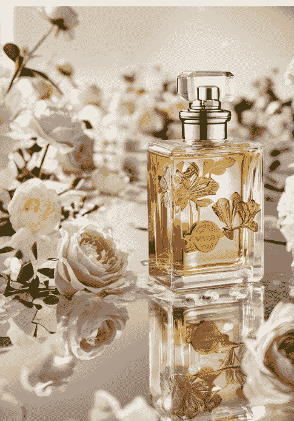

## 第1章 AI重构：为商业传播注入新动能
传播形态、内容表达与用户参与方式正经历系统性变革，传统打法遭遇瓶颈。信息过载的环境里，用户触媒渠道与内容偏好愈加分散，广告必须更准、更具区分度、更有创造力。此时智能算力恰逢其时，为行业注入全新活力，从创意到投放再到体验全面改写未来。

在创意端，效率与多样性明显提升。过去创意高度依赖人的直觉，受时间与成本制约难以快速迭代。智能系统凭借自然语言处理与生成能力，可在数分钟内完成从文案到视觉的批量产出，匹配不同市场与人群的差异化需求。同时模型具备持续学习特性，能从大量优秀案例中提炼有效模式并进行再创作。技术加持下，企业可降低制作成本，用新颖设计吸引更多关注。

数据解析与精准触达的强化进一步放大了传播价值。传统投放多依赖画像标签与调研结论，难以捕捉真实动机。智能系统以强大的算力处理海量行为数据，挖掘隐性消费倾向，为投放提供科学依据。机器学习与算法调优使广告能够在合适的时间与渠道触达潜在用户，减少浪费并提高转化。实时数据回流还能动态校准投放策略，实现更灵活智能的投放，提升品牌影响力与用户黏性。

消费者与广告的关系也在被重塑。语音识别、图像识别等能力让广告可实时捕捉情绪与需求并推送针对性内容，增强趣味与参与度。智能驱动的对话机器人与个性化推荐系统为用户提供更多入口。虚拟现实与增强现实的融合，把平面展示转变为沉浸式体验，让用户在参与中更深刻理解品牌理念。持续的创新让广告从单向告知转向情感联结与沟通。

总体来看，智能算力为商业广告带来跨越式进步，在创意生产、精准投放与用户互动上全面提效。它帮助广告摆脱传统束缚，成为引领市场与吸引消费的核心力量。随着技术进一步成熟，表现形式与沟通方式将持续突破，智能与广告的深度融合既是行业变革路径，也是品牌与消费者互动的新篇章。

### 1.1 生成式大模型概览
当前涌现出一批聚焦图像与视频生成的核心模型，推动视觉创作革新。下面是具有代表性的模型：

#### 1.1.1 图像生成大模型
- **DALL·E 3**：OpenAI打造的文本转图像系统，能依据描述生成精细且复杂的视觉结果。
- **Midjourney**：2022年7月上线，擅长艺术化风格输出，成图质量高且具有辨识度。
- **Stable Diffusion**：2022年8月开源，支持本地部署，可产出多样化的图像内容。

#### 1.1.2 视频生成大模型
- **Sora**：OpenAI于2024年2月公布的文本转视频模型，可生成长达一分钟的高质量动态内容，是视频生成领域的重要进展。
- **PixelDance**：字节跳动推出的视频生成系统，采用DiT结构，支持图文驱动，可输出长达10秒的连贯片段，涵盖多主体互动与时序动作。
- **Vidu**：生数科技与清华大学联合发布，基于自研U-ViT架构，可一键生成16秒1080P高清视频。
- **可灵大模型**：快手推出，图像理解能力突出，可把静态画面转化为5秒动态视频，支持多种运动效果。
- **Video-LLaVA**：北京大学ChatLaw课题组开源的视觉语言模型，可同时处理图像与视频输入，在视频问答任务中表现突出。

### 1.2 智能创作的应用场景
上述模型在图像与视频生成上的落地场景广泛，显著提升创作效率。

图像生成方面，DALL·E 3、Midjourney 与 Stable Diffusion 能把文字描述转化为高质量视觉素材，为广告设计、品牌推广、包装创意等提供新工具。创意人员可输入产品属性或品牌主张生成效果图辅助发散；游戏与动画制作中可快速产出角色设定与场景概念；艺术家与插画师亦可借助模型迅速获取灵感图，实现跨界创作。Stable Diffusion 的开源特性还允许本地微调，满足个性化需求。

视频生成方面，Sora、PixelDance、Vidu 等大幅缩短制作周期。Sora 可生成分钟级高质量视频，广泛用于影视前期预览与短视频平台，助力创作者在正式拍摄前测试反馈；广告公司亦可快速制作贴合调性的宣传片。PixelDance 支持图文驱动生成短片段，实现多主体互动与复杂场景，教育领域可生成教学动态视频，增强直观性。Vidu 的1080P高清输出满足广告片、微电影等对清晰度要求高的场景。可灵大模型可将静态图动化，在影像修复与历史影像复原中让老照片“活”起来，适用于博物馆与档案馆的沉浸式历史呈现。Video-LLaVA 作为视觉语言模型，可解析视频复杂语义，在视频问答与内容理解中发挥独特价值，社交平台可实现实时互动问答，智能家居与安防领域则可识别关键场景事件，提升监控效率。

### 1.3 常用的智能创作工具
前文介绍了大模型与场景，本节梳理常用智能创作工具及其优势。

#### 1.3.1 图像生成工具
**DALL·E 3和Stable Diffusion：** OpenAI的DALL·E 3（图1-1）和开源的Stable Diffusion（图1-2）被广泛用于根据文本描述生成高质量图像。它们常用于广告设计、海报创作、视觉概念图绘制等场景，设计师可以通过输入关键词快速获得创意图像。
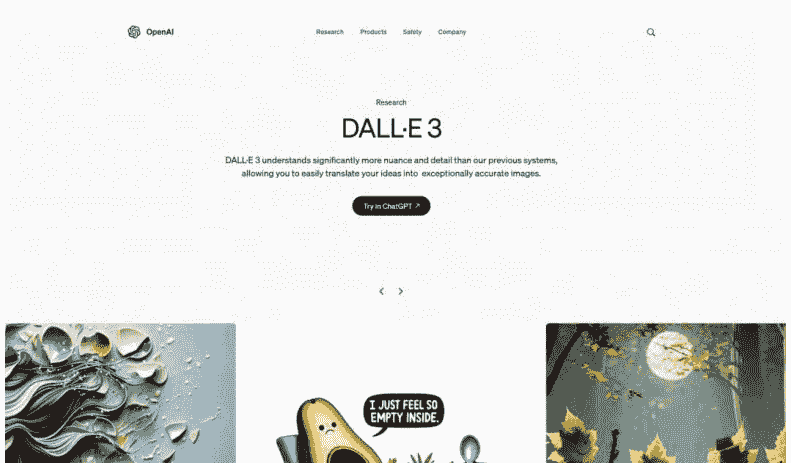
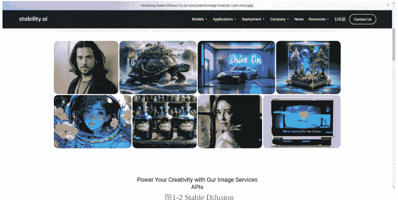
Power Your Creativity with Our Image Services APIs
图1-2 Stable Diffusion

**Midjourney：** 这个工具以其艺术性图像生成效果出名，适合品牌推广、产品包装、插画设计等需要独特视觉风格的项目，能提供高质量的图像输出（图1-3）。
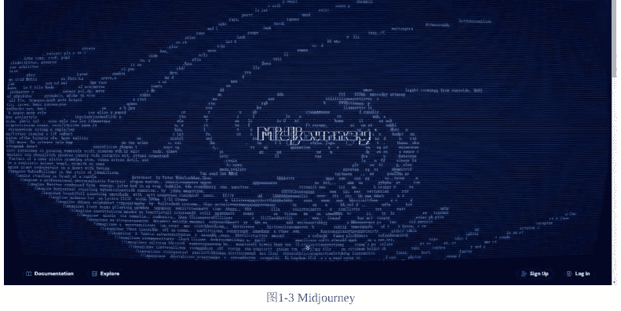
图1-3 Midjourney

**Artbreeder：** 这是一个基于GAN（生成对抗网络）的平台，允许用户通过混合不同图像生成新图像，适合角色设计、概念艺术、插画等应用（图1-4）。
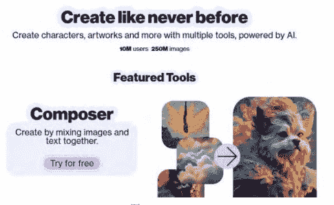
图1-4 Artbreeder

#### 1.3.2 视频生成工具
**Runway ML:** 这是一款强大的AI设计平台，提供了图像、视频生成和编辑的多种AI模型支持，适合短视频制作、广告视频创作等多种场景。其工具如“Text to Video”功能，可以快速将文本描述转化为短视频片段（图1-5）。
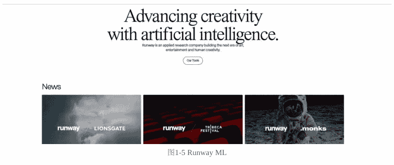
**Synthesia:** 主要用于生成视频中的虚拟角色口述内容，适合企业培训、在线课程、营销视频等领域。用户可通过输入文本，生成虚拟角色朗读内容的动态视频（图1-6）。
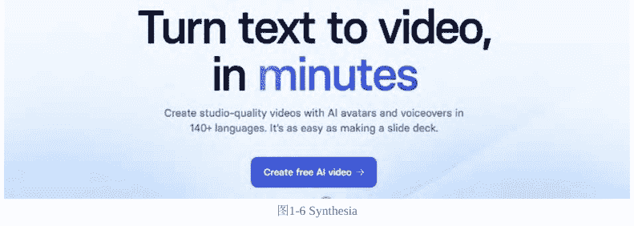
**DeepBrain AI:** 这是一款视频生成工具，支持输入文本并自动生成包含虚拟人物的叙述性视频，适用于新闻播报、视频简报等场景（图1-7）。

**即梦AI:** 即梦AI是由字节跳动推出的一站式AI创作平台（图1-8），它支持用户通过自然语言或图片输入生成高质量的图像和视频。其目标是降低创作门槛，激发用户创意，为创意爱好者提供一个AI表达平台。它适用于艺术创作、内容创作、教育领域以及广告与宣传等多个场景。
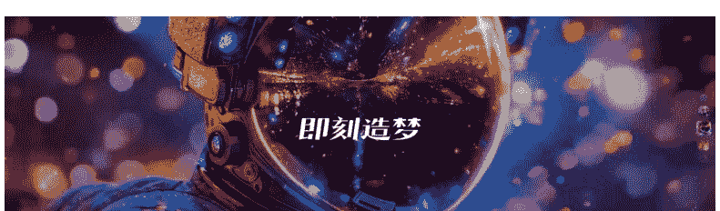
图1-8 即梦AI

#### 1.3.3 图像编辑和处理工具
**Adobe Photoshop和Adobe Firefly：** Adobe引入了AI工具Firefly，提供生成性填充和生成性扩展等功能，帮助设计师快速修复图像、补充背景或创建新图像元素（图1-9）。
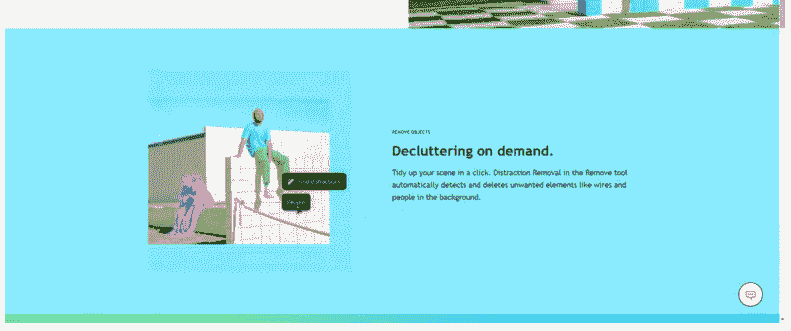
图1-9 Adobe Photoshop和Adobe Firefly

**Canva：** Canva中集成的AI工具，如Magic Resize、背景去除器等，能快速编辑和调整图像，适合社交媒体内容设计、广告海报制作等（图1-10）。
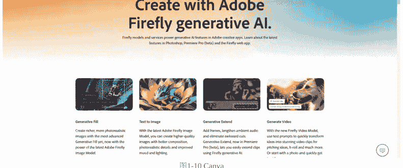
图1-10 Canva

**Remove.bg：** 这是一个AI背景移除工具，可以快速去除图像背景，适用于电商图像处理、社交媒体内容制作等（图1-11）。
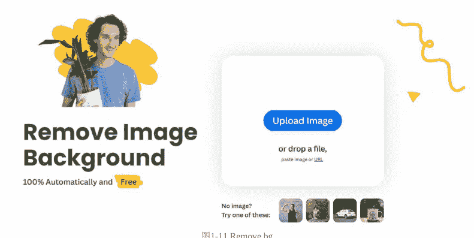
图1-11 Remove.bg

#### 1.3.4 文案与创意辅助工具
**ChatGPT和Jasper：** 这些AI写作工具可帮助创作者快速生成广告文案、内容创意，提升内容创作效率，特别适合需要文字和视觉结合的项目（图1-12、图1-13）。
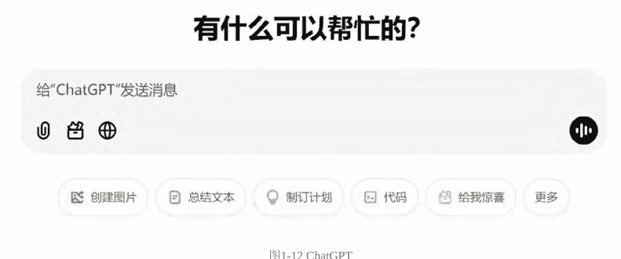
图1-12 ChatGPT
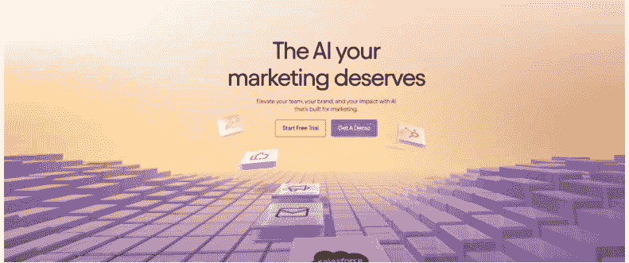
图1-13 Jasper

#### 1.3.5 动画和角色生成工具
**Character.ai：** 这是一个AI生成角色平台，适合游戏设计、动画制作等项目中需要定制化虚拟角色的场景，能够让设计师为不同项目生成角色和互动对话（图1-15）。
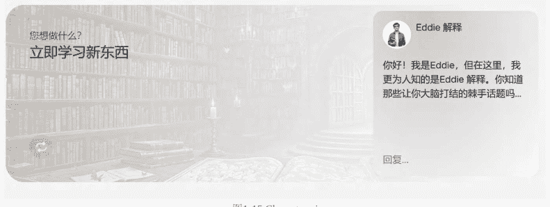
图1-15 Character.ai

**Puppet by DeepMotion：** 这款工具通过AI进行动作捕捉，生成动画人物的动态效果，适用于虚拟主播、游戏开发、动画视频等（图1-16）。
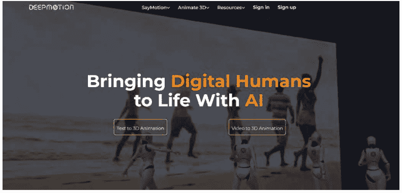
图1-16 Puppet by DeepMotion

#### 1.3.6 综合性生成工具
**Cohesive AI：** 这是一个基于人工智能的多功能平台，旨在帮助用户进行文本创作、内容生成、数据分析和协作管理等。其核心理念在于通过先进的自然语言处理和机器学习技术，简化内容创作过程并提升工作效率（图1-17）。
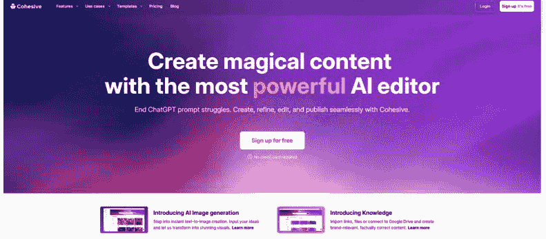
图1-17 Cohesive AI

### 1.4 如何看待智能创作
智能创作的快速演进正为创意领域注入技术活力，从智能排版到图像生成，智能工具已成为广告设计的常规组件。但智能并非设计师的替代品，而是一种强有力的协作伙伴，如何认知智能创作需从人机协同视角出发。

智能的核心优势在于高效与数据驱动。它可在数秒内生成数百个广告方案供挑选与调整，这种速度是人工难以企及的，尤其在需要快速响应市场的商业广告中价值突出。然而高效输出背后，智能并不能独立完成全部设计。优秀广告需要情感表达、文化理解与创意联想，这些是智能难以完全掌握的。

人类设计师的核心价值在于创造力与对目标的深度洞察。智能基于数据与模式，可识别趋势并复刻风格，但难以捕捉复杂文化语境或解读消费者情感共鸣。例如广告需体现品牌价值并融入社会热点，智能可提供素材，但整体情感张力与叙事结构仍需人类决策。简言之，智能负责加速与扩展，人类负责判断与赋意，二者协同才能释放更大价值。

共创时代：AI助攻广告人

在营销传播里，人机配合正成为最有前景的工作方式。AI擅长承接重复性高、效率要求高的基础环节，而人则把握创意走向，掌舵整体表达。举例来说，一次面向全球的品牌投放，团队往往要产出多语种、多文化版本的大量素材。AI可以迅速生成不同语言和风格的初稿，人类设计师再据此结合各地文化语境进行微调，让画面既保持统一调性，又具备本土的亲和力。

人机协作的另一层价值在于激发灵感。AI生成的方案常常带来出乎意料的视角，帮助设计师跳出固有框架。比如某服饰品牌在推广时借助AI产出上百种独有纹样，为创意组提供了新的发想来源，最终从中筛选并打磨出最能代表品牌精神的元素。这种配合既提升了产出效率，也拓宽了创意边界。

AI在设计中的定位是辅助而非替代。它让工作更高效、更智能，为创意落地提供技术支撑。但无论技术怎样演进，人类的创造力和对情感、文化的理解始终不可替代。设计师与AI的融合，既是技术与艺术的交汇，也是广告行业迈向新阶段的必然趋势。如何在AI的高效与人的创造之间找到平衡，将成为行业发展的重要命题。

## 第2章 AI提速：提高生产力

当下商业竞争激烈，企业都在寻找加快广告制作节奏、更迅速触达消费者的办法。AI为广告行业带来了前所未有的改变，既能参与创意生成，也能精准解析用户数据并推动个性化推荐，从而显著拉升生产效率。过去从策划到设计再到投放，广告创作需要投入大量人力与时间，各环节反复修改成本高。AI的加入简化了流程，让生成与迭代变得更快。

AI通过智能生成、大数据洞察和流程自动化大幅压缩制作周期。借助自然语言处理和生成式模型，品牌能够快速产出符合调性的文案和图像，并且能依据市场反馈实时调整，实现快速迭代。同时AI可精细识别用户需求，自动优化投放策略，让内容更贴合目标受众偏好。这种量身定制的传播方式提高了效率，减少了资源浪费，投入产出比也随之提升。

更关键的是，AI不只是提速，还在推动创意多样化。AI产出的内容突破了传统思维限制，让企业在短时间内获得大量概念，丰富品牌的表达形式。随着技术成熟，AI生成的内容愈发贴近人类创意，帮助品牌用更个性化、更具情感的内容吸引消费者，构建更紧密的关系。

AI驱动的创作模式加速了行业生产力的整体跃迁，让企业以更低成本、更快速度、更高品质完成广告制作。这不仅是效率的提升，更是对广告创意和品牌传播方式的重新定义。善用AI技术，广告行业将迎来新一轮发展契机，持续产出充满活力与创意的内容来应对快速变化的市场。

### 2.1 简单了解AI商业广告制作的流程

日常平台上充斥着各式商业广告，而把AI融入制作流程对很多人仍显陌生。本节对AI商业广告的制作路径做一个通俗梳理，便于更直观地理解其运作逻辑。

#### 2.1.1 明确需求与构思创意

需求分析：先与客户沟通，厘清品牌定位、传播目标、受众特征等关键信息，为后续创意和内容生成奠定基础。

创意构思：在需求明确后，可借助ChatGPT进行初步发散和概念探讨，生成多个广告概念、文案主题或情境设想，帮助团队锁定符合品牌调性的方向。

创意讨论：通过多轮对话不断优化想法，直至形成清晰的概念和故事框架，确保创意贴合需求且具备吸引力和独特性。

举例说明，假设要做一个儿童玩具广告，可先请ChatGPT拆解需求。比如提问：我想做一个儿童玩具的广告，能先帮我拆解一下用户需求吗？

ChatGPT会给出核心分析：目标用户主要是3-12岁儿童，实际购买决策者多为父母。核心诉求包括安全性、教育性和趣味性。情感层面可突出亲子共度时光、陪伴成长的价值。用户痛点有对质量和耐用性的担忧、对学习效果的疑虑以及玩具易被厌倦的问题。内容建议侧重生动场景展示、互动体验呈现和家长评价背书，以同时打动孩子与家长。

#### 2.1.2 脚本撰写和文案生成

在创意确定后进入脚本撰写。ChatGPT可辅助完成广告文案，包括场景描写、台词设计和情感传递，保证风格统一、逻辑顺畅且符合品牌调性。

脚本优化环节可依据客户反馈快速生成不同版本，提升迭代效率。同时还能提供初步的视觉建议，如突出品牌元素、产品特写和场景氛围等。

延续儿童玩具案例，可让ChatGPT创作示例文案。标题可以是“让孩子的笑声充满每个角落，成长与欢乐同步前行”。正文强调选用国际标准环保材质确保安全，益智互动设计激发逻辑与创造力，多样玩法避免很快厌倦，全家参与增进亲子情感。结尾号召家长为孩子打开快乐与智慧之门。

#### 2.1.3 视觉设计与效果图生成

文案脚本定稿后可用Midjourney生成视觉效果。输入品牌特征、场景描述和风格关键词，即可得到写实或艺术化的广告画面。

角色与场景设计方面，Midjourney能模拟逼真人物与背景，通过调整描述词反复尝试，直至产品、人物与背景组合匹配品牌需求。

风格一致性对于多场景广告尤为重要。保持相似参数设置，可生成视觉连贯的系列画面，确保整体统一。

#### 2.1.4 整合与优化

初稿完成后可做小范围观众测试收集反馈，ChatGPT据此优化内容和脚本细节。

视觉上根据反馈微调色彩、构图或背景，并用Midjourney重新生成特定场景。

整体检查脚本、配音与视觉是否融合一致，形成连贯的视听体验。

注意输出格式以适配社交媒体、电视等不同渠道。

发布后可用AI工具分析观看反应、点击率等数据，ChatGPT也可生成后期宣传策略或自动互动回复，增强品牌与用户的连结。

音频和配音方面，ChatGPT可撰写旁白脚本并给出情感表达建议，结合AI语音生成工具产出适配的配音。

短视频制作则可将ChatGPT的脚本与Midjourney的画面通过视频合成工具整合为完整广告。

### 2.2 如何与AI沟通：提示词

在使用AI生成广告素材时，关键词的质量直接影响结果。描述模糊会浪费时间，而借助ChatGPT先行提炼关键词，能事半功倍。下面介绍两种常用做法。

#### 2.2.1 快问快答：直接对话获取关键词

在不确定的时候，可直接向ChatGPT描述场景请其展开，再提炼关键词。

首先，打开ChatGPT 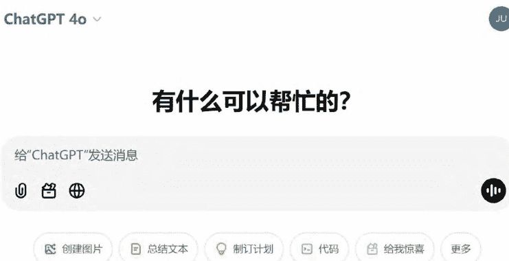

随后在对话框输入：你好，请帮我形容一种适合青少年饭后或下午茶食用的饼干。

ChatGPT会给出详细描述：是一款健康美味的饼干，外表金黄散发香气，采用优质小麦粉、天然蜂蜜和少量黑巧克力碎，加入坚果和燕麦带来微炒香气与膳食纤维，入口酥脆而后融化，层次丰富，适合配牛奶或茶饮。

下一步要求总结特点关键词，可继续提问：请把这种饼干的特点整理成关键词。

得到的结果包括：酥脆口感、天然健康、甜而不腻、营养丰富、适合青少年、层次丰富、搭配性好等。

若想更细致，可再问：请对饼干特点做更细致的描述。此时会得到关于烘烤控制、配方健康、甜度把握、营养成分、味觉层次和搭配适配性的深入说明，从而获取更多可用的关键词。

#### 2.2.2 准确指定：在对话中指定具体数字

提问时加入明确数量，能获得更精准的答案。

例如输入：你好，请给我3个关于滑板广告的标题文案。其中“3个”是数量限定，“滑板广告”是内容限定。ChatGPT会返回三条不同风格的标题，如“脚下的自由，风中的舞者——点燃你的滑板激情！”、“速度与创意的碰撞，让滑板带你飞跃平凡！”、“滑出个性，板上人生——解锁属于你的酷炫时刻！”。

### 2.3 AI设计如何简化传统广告的创作

数字时代下，AI正以创新和效率重塑广告创作。传统流程涵盖策划、设计、拍摄、后期等多个复杂环节，耗时耗力。AI通过自动化和智能化简化环节，提供更个性化、数据驱动的内容，让品牌更灵活快速响应市场。

在策划初期，AI可自动处理市场调研与数据分析。自然语言处理技术能解析社交媒体上的大量评论与反馈，提取消费者需求、喜好与痛点，帮助品牌精准定位人群并明确创作方向。

设计环节中，AI图像生成与识别技术大幅提升创意落地效率。基于生成式对抗网络等技术，AI能在短时间内产出大量方案供挑选。输入关键词即可生成贴合品牌形象的高质量图像甚至3D建模，降低专业门槛。AI还能通过深度学习提取品牌既有风格并自动校准新图，保证视觉一致性。

视频制作上，AI可基于素材库和图像合成快速生成内容。对短视频而言，AI几分钟内完成动态效果与简单特效，配合自然语言生成自动生成字幕、配音与音乐。产品展示类视频可借助3D建模与虚拟现实呈现真实感，大幅降低成本与周期。

在个性化广告层面，AI价值尤为突出。传统模式难以满足每位消费者的个性需求，而AI通过浏览习惯、消费记录和兴趣偏好生成定制内容。借助推荐算法，AI可为不同用户调整风格、文案和视觉元素。例如对户外爱好者展示户外场景的装备广告，提升点击率与用户体验，实现大规模个性化投放，让品牌在竞争中更具优势。

AI参与广告投放的实时监控与动态优化，是其在投放链路上的另一项关键价值。传统投放多依赖事后汇总，决策路径冗长，难以即时修正创意与投放策略。借助机器学习驱动的分析能力，AI设计工具能够在线追踪投放表现，涵盖点击数据、转化结果、用户停留时长等核心指标，迅速锁定效果最佳的素材与呈现形式。依托数据回流机制，系统会自动调整方案，挑选更贴合受众偏好的配色、文案与版式，整体提升投放效能。拥有这种实时迭代能力后，广告创作不再停留在一次性交付，而是进入持续优化、逐步演进的闭环，使品牌能够更快响应市场变化。

#### 2.3.1 对话迭代：逐步提炼关键词
早前已提到ChatGPT在归纳总结方面的表现突出，数轮对话即可得到可用的广告词汇。下面以生日聚会为案例，说明怎样通过多轮对话逐步提取可用词。

打开ChatGPT，在输入框写下：“你好，请详细描绘一个生日派对的场景，把其中用于修饰的词语用逗号隔开，整体风格要喜庆。”

> 你好，请详细描绘一个生日派对的场景，把其中用于修饰的词语用逗号隔开，整体风格要喜庆

在一个温馨明亮、色彩丰富的房间里，生日派对热闹非凡。墙面悬挂着五彩气球，缤纷彩带在空中轻扬，节日气息浓厚。桌上放着精致的多层奶油蛋糕，顶端插着几根闪烁的蜡烛，投下温柔的光晕。身边的伙伴们面带灿烂真诚的笑容，手里拿着鲜艳的纸杯蛋糕和饮品，举杯欢笑。

角落里堆放着小巧的礼物，包装纸明亮精致，缎带在灯光下泛着耀眼光泽。孩子们身着鲜艳考究的衣物，兴奋地围着寿星奔跑，笑声回荡，氛围轻松欢乐。大人们则在一旁愉快交谈，背景音乐欢快轻柔，为聚会增添活力。

当众人围坐唱起生日歌，房间充盈着温暖和谐幸福的感觉。寿星闭眼带着微笑虔诚许愿，随后吹灭蜡烛，引来热烈响亮的掌声与欢呼。整幅画面洋溢着喜庆温馨的调性，充满爱与友情的温度。


输出信息量很大但偏冗长。若想精简，可继续输入：“请把上文压缩一下，只保留10个画面关键词。”

> 请把上文压缩一下，只保留10个画面关键词

房间、气球、蛋糕、蜡烛、笑容、礼物、孩子、笑声、生日歌、掌声。


若要将描述与关键词导入设计类AI，英文表达更利于生成。此时追加要求：“请把上面的描述和关键词都转成英文。”

将上述的描述和关键词转换为英文

**Description:**

在一间温暖明亮色彩丰富的房间里，生日派对充满欢乐。墙上挂着气球，桌上摆放着一座精美蛋糕，上面点着闪亮蜡烛。朋友们温柔微笑，手持五彩纸杯蛋糕和饮品同庆。

角落里摆着用鲜艳包装纸和缎带装饰的礼物，在灯光下闪烁。孩子们穿着亮色服装围着寿星跑动，笑声不断。大人们愉快交谈，背景播放着轻快音乐。大家一起唱生日歌，寿星许愿吹蜡烛，随后收获热烈掌声与欢呼，整场画面喜庆温馨，洋溢友情。

**Keywords:**

room, balloons, cake, candles, smiles, gifts, kids, laughter, birthday song, applause.

以上即是通过多轮对话获取AI商业广告设计关键词的做法，后续会据此生成画面。

#### 2.3.2 表格归纳：系统化整理关键词
与ChatGPT交流时，可让其用表格形式汇总并区分关键词。

本节以“商业广告图需要哪些构成”为题，输入：“请为一幅商业广告图设计，利用表格详细列出其画面构成要素。”

请为一幅商业广告图设计，利用表格详细列出其画面构成要素

以下是以“庆祝活动”为主题、面向青少年生日派对的商业广告图构成表格：

| 图片构成部分 | 描述 | 位置 | 设计特点 |
|---|---|---|---|
| 背景色 | 明亮暖调，偏浅黄或浅粉，营造温馨愉悦感 | 整体背景 | 色彩柔和带轻微渐变，增强层次 |
| 墙面装饰 | 多色气球与缤纷彩带 | 背景中部与顶部 | 气球错落分布，彩带弧形垂落，提升立体感 |
| 中心焦点：蛋糕 | 多层蛋糕，顶端点亮蜡烛 | 画面中下 | 蛋糕做工精致，奶油装饰，烛光吸引视线 |
| 聚会人物 | 微笑的青少年，手拿小蛋糕或饮料 | 中心左右 | 表情愉悦，着装鲜艳，手持甜品，增添活泼感 |
| 礼物堆 | 色彩丰富的礼品盒配缎带 | 画面左下或右下 | 包装明亮带闪光，强化吸引力 |

| 标题文字 | “生日派对大促销”或“为特别日子增添更多欢乐” | 顶部或中心上方 | 大字号，对比色突出主题，抓眼球 |
| 促销信息 | 如“全场礼品8折”或“特价套餐” | 标题下方或底部 | 字体较大，配亮色底块，加强视觉冲击 |
| 背景音乐元素 | 音符图标点缀 | 画面四周散布 | 图标小且半透明，提升轻快感 |
| 联系方式或二维码 | 公司联系方式或优惠码二维码 | 右下角 | 小图标设计简洁，便于扫码联系 |

该布局整体协调，主次分明，能引导视线并呈现产品与促销信息。

再追问应用场景，输入：“我想做美食街商业活动的广告，能用哪些视觉元素吸引顾客，请用表格总结关键词并附上说明。”

以下是美食街商业活动广告适用的视觉元素关键词表，用于营造热闹氛围与诱人美食场景。

| 视觉元素 | 关键词 | 说明 |
| --- | --- | --- |
| 背景色 | 热烈明亮温暖色调 | 以红橙黄等暖色为主 |
| 美食图片 | 精美诱人多样化 | 特写拍摄，细节丰富 |
| 装饰物 | 霓虹灯、灯笼、小彩旗 | 增加节庆感，夜间更显眼 |

| 视觉元素 | 关键词 | 说明 |
| --- | --- | --- |
| 人群 | 欢笑互动热闹 | 展示顾客品尝场景，带动人流 |
| 促销信息 | 折扣、买一送一、特惠 | 突出优惠，醒目呈现 |
| 动态元素 | 烟火、气泡、火花 | 增加画面动感，吸引目光 |
| 标题文字 | 大字体对比鲜明 | 如“美食狂欢节”，快速传达 |
| 标志性美食 | 烧烤、串串、小吃 | 热门小吃吸引目光 |
| 地点标识 | 美食街名称或地图 | 突出位置，便于定位 |
| 气氛烘托 | 香气效果、烟雾特效 | 模拟香气，带来沉浸体验 |

**广告内容描述：**

广告采用热烈红橙色背景，中央展示串串、烧烤、甜点等精美美食大图。背景点缀霓虹灯、彩旗与灯笼，营造夜市氛围。画面呈现顾客欢笑品尝的场景，标题以醒目大字写“美食狂欢节”，下方突出“全场折扣，买一送一”等优惠。周边用烟火气泡等动态元素点缀，底部附上美食街位置标识与二维码，方便获取信息。

随后输入：“请把上面的美食街广告文字内容按类型归纳，整理成表格并列出关键词。”

以下是美食街商业广告中常见文字类型及其关键词汇总表：

| 文字内容类型 | 关键词 | 说明 |
|---|---|---|
| 标题文字 | 美食节、狂欢、美食街、聚会 | 抓住眼球，快速传递主题 |
| 活动名称 | 美食狂欢节、夜市美食节 | 强化记忆点 |
| 促销信息 | 折扣、优惠、买一送一、特惠 | 激发消费欲望 |
| 美食名称 | 烧烤、串串、奶茶、小吃、甜点 | 展示品类多样性 |
| 地点信息 | 美食街、地址、地标、导航 | 便于顾客找到 |
| 时间信息 | 日期、时间、营业时间 | 方便安排行程 |
| 参与方式 | 扫码、关注、转发 | 引导互动 |
| 情感用语 | 欢迎光临、尽情享受、狂欢时光 | 营造亲切氛围 |
| 安全提示 | 卫生保障、消毒措施、限流人数 | 增加信任感 |
| 联络信息 | 电话、微信、网站、客服 | 提供咨询渠道 |

这些文字类型形成层次分明的资讯结构，帮助顾客快速理解并产生兴趣。若对结果不够细化，可继续针对主题、背景和提示词进行追问，越深入提问，关键词越精准，最后再导入AI设计工具使用。

## 第3章 AI驱动的商业广告文案创作
消费者注意力日益分散，广告文案面临全新挑战。品牌不仅要靠文字打动人，更需在极短时间内传递价值与情感。高质量文案的产出耗时耗力，涉及创意、语言与市场洞察。人工智能的出现让这一流程更高效智能，AI文案生成不仅打破时间与创意的限制，也为品牌在复杂市场中实现更敏捷的沟通提供了可能。

AI生成文案的优势在于能快速产出大量兼具创意、个性与数据驱动的内容。传统创作需大量调研与打磨，AI借助深度学习与自然语言处理，可从海量数据中提炼用户需求，生成契合品牌调性与受众偏好的文案。无论电商描述、社交广告还是邮件营销，AI都能迅速响应，产出具感染力的文字。

此外，AI还能实现更强个性化。通过分析消费行为、浏览记录与偏好，系统可自动调整风格与内容，让文案更贴近个体心理，从而提升点击与转化。AI文案可适配多种场景与风格，为品牌带来更好的市场表现。

“AI助力商业广告文案创作”将揭示AI如何提升效率、实现个性化呈现并增强市场响应能力。

### 3.1 ChatGPT在文案创作中的优势
商业广告文案需在短暂注意窗口内传递价值主张、情感共鸣与品牌特性。传统流程耗时耗成本，难以快速响应市场。ChatGPT的出现带来转变：凭借强大的自然语言处理与生成能力，它可快速高效地为品牌提供创意十足且精准的文案。

ChatGPT的一大亮点是对多种风格与语气的把控能力。从正式专业的表述到轻松幽默的口吻，它能根据品牌调性与目标人群自动调整，使内容更具吸引力。例如在时尚品牌广告中，可产出兼具创意与美感的文字；在科技产品广告中，则能用精炼专业的语言传递技术优势。这种灵活转换帮助品牌在不同场景下实现快速语言适配。

更重要的是，ChatGPT通过学习大量市场数据与语言模型不断优化创作能力。数据驱动的方式使其能迅速捕捉市场动态，提炼当下热门关键词、情感倾向与表达方式，让文案更具时效与亲和力。这种高效灵活的创作方式提升了品牌市场响应速度，增强消费者点击与参与。

总体来看，ChatGPT展示了智能创作的未来。它不仅提高内容生产效率，也在精准传达与个性化呈现上提供新解，让品牌更容易在竞争中脱颖而出。

#### 3.1.1 电商推广文案实操
商业广告文案主要用于产品推广、宣传与营销，目标是通过文字吸引眼球、提升购买欲。电商文案需概括产品特点并突出优势，可由ChatGPT快速生成，从而提高销量与影响力。

本节以对话演示为例：

首先打开ChatGPT，输入：“我准备销售一款冰箱，特点为三区布局、保鲜冷冻、一级能效、可通过手机APP控制，请基于这些特点分析卖点。”

> 我准备销售一款冰箱，特点为三区布局、保鲜冷冻、一级能效、可通过手机APP控制，请基于这些特点分析卖点

这款冰箱的卖点可从智能功能、能效表现与贴心设计来呈现，提升使用体验：

(1) **三分区格局**：内部分为冷藏、冷冻与保鲜三区，让不同食材在适宜温度下保存，避免串味，保持口感。用户可分类存放日常食材、冻品与蔬果，提升空间利用率，适合囤货与用餐频繁的家庭。

(2) **保鲜冷冻技术**：搭载先进保鲜冷冻系统，可按食材种类自动调节温湿度，确保肉类、蔬菜与水果处于最佳状态。延长新鲜期，减少食物浪费，契合健康生活需求。

(3) **一级能耗，环保节能**：作为一级能效产品，耗电量低，使用成本更低，也更环保。兼顾经济效益与碳减排，是注重节能的理想选择。


(4) **智能APP控制**：支持手机APP远程操控，可实时查看温度、调节冷藏冷冻设置，甚至接收食材管理提醒。无论在路上还是购物时，都能一键掌控冰箱状态，避免重复购买。这一功能契合快节奏生活，提升家居管理效率。

综合来看，该冰箱以完善功能、科学分区满足日常存储，又通过智能化、节能与便捷性提供更高品质生活体验，是现代家庭的优质选择。


随后输入：“请根据上述卖点，撰写一篇产品推广文案，要求中英文各一篇。”

请根据上述卖点，撰写一篇产品推广文案，要求中英文各一篇

##### 中文推广文案：

想让生活更轻松高效？这款智能冰箱带来全新存储体验！三区布局将冷藏、冷冻、保鲜精细划分，让每种食材都有专属环境。无论肉类、蔬果还是速冻食品，都能找到最佳存放空间。

**鲜活常驻 指尖可控**

整机内置鲜冻保鲜系统，能自动调节温湿度，帮助食材锁住原味并延长保存期，取用时依旧新鲜健康。能效达到一级标准，运行省电更环保，日常使用轻松达成节能目标。 
作为家居生活的贴心助手，该冰箱支持手机App远程操控。不论身处何地，都能通过手机查看实时温控、修改运行参数，还可管理食材清单，降低浪费。智能化带来的便利正是产品的核心价值。 
挑选这款机型，就是拥抱新一代智能储鲜方案，让每一次品尝兼顾新鲜与健康。

图3-3 中文推广文案

##### English Promotional Copy:

想让厨房管理更省力？这款智能冰箱带来便捷升级。机身采用三区布局，分别对应冷藏、冷冻与保鲜，为肉类、水果、蔬菜或冰品提供专属环境，延长鲜嫩期。
搭载先进鲜冻技术，设备可智能调节湿度与温度，有效封存新鲜度，确保取出时风味接近入库状态。同时顶级能效评级让这款环保之选既能降低电费，又能减少碳排放。
专为现代居家设计，还支持手机远程操控。无论身在何处，都能查看并调节温度，或通过手机管理食材库存，帮助减少浪费、保持整洁。智慧生活从未如此简单。
选择这台冰箱，开启进阶储存体验，新鲜与健康一键可达。

#### 3.1.2 创作体育用品文案

体育用品广告文案多用于推广户外运动类产品、传达品牌主张并号召参与。此类广告常见于户外广告牌。本节以与 ChatGPT 的对话为例，演示体育用品文案的创作流程。

下面是具体操作步骤：

启动 ChatGPT 后，在对话栏里发出提示：“我想为一个体育用品的户外广告牌拟写文案，请帮我概括这类文案有哪些特征。”（图3-5）

> 我想为一个体育用品的户外广告牌创作文案，希望可以帮我总结文案有哪些特点

户外运动类广告牌文案通常具备以下特点，以便快速抓住注意力并传递品牌信息：

- (1) **凝练有力**：文案多为精炼表达，篇幅极短，便于迅速传递信息。短句或口号易吸引路人视线，并快速传达核心卖点。
- (2) **激励人心**：多使用充满动能的用语，点燃消费者的运动热情，鼓励其追求更高目标或挑战自我。
- (3) **号召行动**：常出现“出发”“挑战”“突破”等号召性词语，促使受众产生立即行动的冲动，并与产品建立情感联结。
- (4) **形象化表达**：善于运用生动形象的语言，让人瞬间联想到运动场景或身体活力，如“冲刺”“跃动”“极速”等，提升代入感。
- (5) **品牌或产品关联**：会直接或间接点出品牌或产品特性，如“专业”“轻盈”“耐用”等，凸显优势以增强记忆点。
- (6) **情感共鸣**：借助情感化表达引发共鸣，帮助消费者对品牌产生积极感受。例如围绕“胜利”“坚持”“自我挑战”等主题吸引热爱运动、追求突破的群体。
- (7) **视觉配合**：文案与画面相配合，常与运动员形象、运动场景或标志性产品结合，增强整体冲击力与吸引度。

一个有效的体育用品户外广告文案通常借助上述特点吸引注意，并迅速传递品牌精神与产品价值。

生成完毕后，继续在同一对话栏输入提示词：“请帮我根据上述体育用品的特点提供一些健身餐产品的文案，能够结合户外运动，优点是方便食用。”（图3-6）

请帮我根据上述体育用品的特点提供一些健身餐产品的文案，能够结合户外运动，优点是方便食用

以下是几组结合户外运动、便于食用的健身餐文案，突出便携、营养与活力：

- (1) “突破极限，随时随地补给！”
无论攀登山顶或林间奔跑，便携健身餐为你提供充足能量，迎接每次挑战！
- (2) “无负担的力量，装进背包！”
轻盈好带的健身餐富含高能营养，让你轻装出击、活力满满，随时补充体力，运动更自由！
- (3) “每一步都有能量相伴！”
小巧的健身餐提供充足营养支持，专为户外运动打造，助你勇敢前行，享受自然与挑战。
- (4) “出发吧！营养在手，活力相随！”
健身餐轻松放进口袋，无论徒步、跑步或骑行，每一口都是支持，简单便捷让运动更轻松！
- (5) “能量随行，尽享运动快感！”
精致包装即取即食，充足的蛋白质与纤维带来持久活力，陪你轻松前行于每段户外旅程！
- (6) “轻便健身餐，挑战无极限！”
快速补充体能，健康便捷，为户外爱好者量身打造，让每个运动瞬间更充实。
- (7) “便携美味，与你并肩前行！”
健身餐小巧却强劲，无论山巅或赛道，随时为你补能，畅享运动的酣畅淋漓。

这些文案以简练有力的语言传递便携与营养优势，并与户外运动场景相连，鼓励消费者在运动中轻松补给。

图3-6 健身餐产品

在此做进阶操作，接着输入提示词：“请帮我给上述的健身餐产品出10条广告文案。”（图3-7）

请帮我给上述的健身餐产品出10条广告文案

以下是10条适用于健身餐产品的广告文案：

- (1) “你的运动搭档，随时随地注入活力！”
轻便健身餐放进口袋，营养一路相随！
- (2) “无惧高峰，每一步都是新起点！”
便携营养助力，让健身餐成为登山、跑步的必备伙伴。
- (3) “一口能量，迎战户外挑战！”
高蛋白、低热量，轻松携带，随时满血复活。
- (4) “自由奔跑，不怕能量不足！”
健身餐即刻补充营养，完美匹配每次运动冒险。
- (5) “快速补能，享受每公里的畅快！”
有健身餐在手，能量无忧，助你突破运动极限。
- (6) “无负担的力量，让你走得更远！”
健身餐好携带，运动途中随时轻松补给。
- (7) “只需一口，刷新活力值！”
健身餐满足日常运动需求，让你无惧挑战。
- (8) “户外营养新选择，便携能量伴你行！”
高效补充，无负担，助你在每一次运动中大放异彩。
- (9) “高效能量，快速回馈每份努力！”
轻便健身餐随时恢复体能，助你从容应对每一段路程。
- (10) “户外、健身、补能，一步到位！”
健身餐兼顾美味与便利，轻松携带，营养随时到位！

图3-7 10条广告文案

#### 3.1.3 创作电视广告文案

在当代媒体环境中，电视凭借直观呈现与感官体验，是传递信息、促进产品销售的重要渠道。本节将利用 ChatGPT 生成电视广告文案，以实践操作为例：

打开 ChatGPT，在对话栏里输入提示词：“假设你是一位经验丰富的室内设计师，希望你可以为我提供一些关于地板的广告语。”（图3-8、图3-9）

假设你是一位经验丰富的室内设计师，希望你可以为我提供一些关于地板的广告语

当然！作为资深室内设计师，可根据地板特色与需求提供创意广告语。以下为不同风格示例：

##### (1) 高端奢华系列
- “一步步走进奢华，地面亦能品味生活”
- “尽享优雅舒适，地板之选彰显品味”
- “每一寸地面，都是格调的延伸”
- “奢华与温润并存，让每一步都充满暖意”

##### (2) 环保健康系列
- “自然之选，健康之道”
- “绿色环保，让地板也能呼吸清新”
- “贴近自然，为家打造健康空间”
- “从脚下开始，呵护每一步”

##### (3) 耐用实用系列
- “经得起时光考验，承载家庭故事的地面”
- “坚固耐用，随心打造每个空间”
- “为生活注入力量，让地板陪你走更远”
- “从不妥协，只为提供更长久的陪伴”

##### (4) 现代简约系列
- “简约之美，地板自在呈现”
- “设计源于生活，优雅藏于细节”
- “简洁舒适，演绎现代家居美感”
- “轻松营造现代感空间，关键在地面”

图3-8 地板的广告语（1）

##### (5) 艺术创意系列
- “将艺术带入每一步，地板亦是一幅画”
- “步步惊艳，地板与空间完美融合”
- “每一块地板，都是一件艺术品”
- “设计源自灵感，地面让空间更有故事”

图3-9 地板的广告语（2）

随后在对话栏里输入提示词：“请为我根据地板的舒适的触感写一个广告词，同时为这段广告语创造一个情景以及生活画面，最好能够引人入胜。”（图3-10）

请为我根据地板的舒适的触感写一个广告词，同时为这段广告语创造一个情景以及生活画面，最好能够引人入胜

##### 广告语

> “每一步，都是轻柔的拥抱；每一次触碰，都是温暖的记忆。”

##### 情景与生活画面

清晨阳光洒满客厅，小女孩赤脚跑出房间，追逐宠物小狗。脚步轻落在温暖地面上，脸上露出幸福笑容。小狗欢快打滚，地板仿佛成为最温柔的舞台。

远处妈妈在厨房备早餐，爸爸端着咖啡倚窗感受清新。一家人在每个瞬间都离不开这块地面带来的柔软与舒适。

画面切至夜晚，外婆坐在铺有软垫的地面上与孩子们拼积木，笑声充满屋子。地板不仅是游戏场所，更是承载亲密记忆的温暖陪伴。

**旁白（画外音）：**

> “它不仅仅是地面，更是家人共享温馨时光的起点。让生活从脚下开始，感受舒适触感，创造爱的瞬间。”

该情景通过生活细节与情感联结，将地板的舒适触感与家庭温暖结合，引发消费者情感共鸣，同时凸显产品核心价值——舒适、温暖与陪伴。

图3-10 广告词

### 3.2 精细分析：提高文案质量

上一节通过实例介绍了借助 ChatGPT 进行商业广告文案创作，本节将讲述如何利用 ChatGPT 撰写详情文案，为商品提供设计、功能、规格、使用方式及注意事项等全面信息，帮助消费者充分了解产品。

用户可借助 ChatGPT 获取产品详情文案，既提高效率，也减少人为失误。

接下来进行操作演示：

打开 ChatGPT，在对话栏里输入：“现在你是一位资深甜品师，对于甜点十分的了解。我希望你可以为我出一个关于生日蛋糕的方案，但是我不清楚蛋糕的详情，所以我需要提供哪些信息？”（图3-11、图3-12）

> 现在你是一位资深甜品师，对于甜点十分的了解。我希望你可以为我出一个关于生日蛋糕的方案，但是我不清楚蛋糕的详情，所以我需要提供哪些信息？

作为资深甜品师，我可为您设计独特色味的生日蛋糕方案！为确保蛋糕符合需求并让庆祝更特别，请提供以下关键信息：

#### (1) 蛋糕的基本信息
- **人数：** 蛋糕需供多少人食用？（影响大小与层数）
- **预算：** 预算范围是多少？（影响设计复杂度与材料选择）


#### (2) 风格和主题
**整体风格：** 想要的主题调性（如浪漫、可爱、个性、简约、奢华等）。
**特别元素：** 是否有特定主题或设计？例如卡通形象、专属文字、花卉装饰等。
**颜色偏好：** 是否有主色调偏好？例如粉色、蓝色、金色或多彩。

#### (3) 蛋糕的口味
**蛋糕胚：** 是否偏好某种类型？例如海绵、戚风、奶油、慕斯或裸蛋糕。
**夹心口味：** 喜爱的内馅，如巧克力、草莓、抹茶、芝士、奶油、坚果或其他风味。
**甜度偏好：** 是否偏好清淡、普通或浓郁甜度？

#### (4) 装饰和细节
**外部装饰：** 是否喜欢鲜花、水果、翻糖、玩偶、喷砂、巧克力淋面等。
**文字内容：** 是否需要特定祝福语、姓名或日期？
**层数设计：** 需要几层？或小型单层？

#### (5) 特殊需求
**饮食限制：** 是否有饮食偏好或禁忌？如素食、无麸质、低糖等。
**年龄与喜好：** 送给谁？如儿童、青年、长者，或有特定爱好（如运动、艺术等）。

#### (6) 交付细节
**日期和时间：** 需要何时完成？
**运输方式：** 是否自取或需要配送？

图3-12 蛋糕的详情（2）

此时，笔者依据 ChatGPT 提供的要点进行生日蛋糕详情文案创作，提供的具体信息为“希望要巧克力口味的，要求带冰激凌，同时能够加一些草莓做点缀。设计需要三层，甜度要五分甜，最好使用动物奶油，然后交付日期为10月30日，运输方式选择为商家配送”。（图3-13、图3-14）

请根据我的要求，来写蛋糕的详情页，希望要巧克力口味的，要求带冰淇淋，同时能够加一些草莓做点缀。设计需要三层，甜度要五分甜，最好使用动物奶油，然后交付日期在10月30日，运输方式选择为商家配送

##### 生日蛋糕详情页：巧克力冰淇淋草莓蛋糕 🍫🍓🎂

**产品名称**

「三层巧克力冰淇淋草莓梦」

**产品描述**

为庆祝增添一份甜蜜惊喜！这款三层巧克力冰淇淋草莓蛋糕，将浓郁巧克力与清爽草莓完美结合，搭配丝滑动物奶油，入口即化。层层叠加提升视觉冲击，每一口都充满惊喜。适合特别日子，与亲友分享甜美时光。

**蛋糕规格**
- (1) **层数**：三层经典设计
- (2) **口味**：
    - **蛋糕胚**：松软巧克力海绵蛋糕，浓郁可可香气。
    - **夹心**：每层夹入巧克力冰淇淋与新鲜草莓碎，丰富口感。
    - **外层装饰**：轻盈动物奶油，低甜度，健康美味。
- (3) **甜度**：五分甜（中甜，适合多数人群）。

图3-13 蛋糕详情（1）

##### 设计亮点
- (1) 外观设计：
巧克力淋面自顶层缓缓流下，打造高级质感。
每层点缀鲜红草莓，搭配巧克力片装饰，尽显浪漫活力。
- (2) 顶部装饰：
中心摆放一颗草莓玫瑰，象征甜蜜幸福。
冰淇淋球镶嵌其中，带来一丝清凉惊喜。
- (3) 细节雕琢：
每层周围撒上薄薄可可粉，提升质感。

##### 食材说明
**动物奶油**：100%天然动物奶油，低脂清爽，健康之选。
**巧克力**：选用高品质黑巧克力，浓香不腻。
**草莓**：每日采购新鲜草莓，保证果香与甜美。
**冰淇淋**：自制巧克力冰淇淋，入口丝滑。

##### 交付与配送
**交付日期**：2024年10月30日
**运输方式**：专业配送团队全程冷链送达，确保新鲜完美。

##### 价格与服务
**定价**：请联系客服获取报价，享节日特惠！
**定制化**：支持文字或额外装饰个性化定制。

##### 温馨提示
**存储建议**：请在0°C至4°C保存，建议尽快享用以确保最佳口感。
**食用说明**：蛋糕从冷藏取出后静置10分钟，即可享受最佳风味。

立即预订，为特别日子送上甜蜜礼物！🎂❤️

图3-14 蛋糕详情（2）

### 3.3 根据不同的需求调整文案内容

#### 3.3.1 熟悉ChatGPT提问方式

向 ChatGPT 提问时需掌握合适的关键词与话术，不同提问方式会带来不同创作结果。下面以实操展示：

打开 ChatGPT，在对话栏里输入内容（以创作海洋环保活动海报为例）：“你好，我准备制作一个关于海洋环保活动的海报，希望你可以帮我想一些广告文案。”（图3-15、图3-16）

> 你好，我准备制作一个关于海洋环保活动的海报，希望你可以帮我想一些广告文案

当然可以！以下是适合海洋环保活动的广告文案，结合不同风格与情感，力求吸睛并传递环保理念：

##### (1) 呼吁行动型
- “捡起一片垃圾，守护整个海洋！”
- “保护海洋，不只是今天的承诺，而是世代的责任。”
- “每一滴海水，都承载着生命的希望。”
- “海洋无声，但需要你的声音。”

图3-15 海报文案（1）

##### (2) 视觉冲击型
- “当塑料袋成为鱼的家，你是否愿意改变？”
- “蓝色的海洋，还是灰色的垃圾场？选择在你手中。”
- “还给大海一片蓝，还给生命一片净土。”
- “一瓶塑料，可能是鲸鱼的最后一餐。”

图3-16 海报文案（2）

一眼就能看出，这类自动生成的表达非常模板化，搜索引擎里到处都是同款，基本可以归为无效信息。

很多人会想知道怎样提问才能拿到更有用反馈，下面就沿用之前的海洋公益案例，把提问方式拆解清楚：“你好，我希望帮一个公益活动创作一个海洋环保活动内容的海报，希望侧重于保护海洋生物，同时能够激发人们对于海洋保护的意识，最后要加入一些醒目的关键词。”（图3-17、图3-18、图3-19）

> 你好，我希望帮一个公益活动创作一个海洋环保活动内容的海报，希望侧重于保护海洋生物，同时能够激发人们对于海洋保护的意识，最后要加入一些醒目的关键词

###### 海洋公益海报内容规划

**建议主文案**

- “守护蓝色星球，保护海洋生命”
- “拯救海洋生物，从你我做起！”

**宣传话术**

- “每一片珊瑚，每一只海龟，都值得我们的守护。”
- “保护海洋生命，就是保护我们的未来。”

图3-17 海报的内容（1）

###### 核心板块

####### 🌊 活动概述

海洋孕育了无数生命，如今却遭遇前所未有的威胁：塑料垃圾污染、过度捕捞、气候变化……

每年，超百万只海洋生物因塑料废弃物受伤或死亡。一起行动，为海洋生物撑起一片安全的蓝天。

####### 🎯 活动目标

- 清理海滩，降低塑料污染
- 普及海洋保护知识
- 提高公众对濒危物种的关注
- 推动更环保的生活方式

####### 📅 时段与场域

- 时段：2024年10月30日
- 场地：xx市xx海滩

###### 视觉重点

####### 核心关键词

- “救救海龟！”
- “海洋不能失去它的声音！”
- “蓝色的海洋，需要绿色的行动！”

####### 参与号召

“每一个行动都能改变大海的未来。”
“加入我们，让生命在海洋中自由游弋！”
“你的参与，是海洋生命最需要的保护。”

图3-18 海报的内容（2）

###### 视觉建议

- 主色选用醒目的蓝白，点缀绿色，传递环保与生机。
- 加入海龟、鲸鱼、珊瑚等形象，彰显生命力量。
- 用塑料垃圾与洁净海洋的对比制造视觉冲击，引发思考。

希望这版方案能准确传达活动主题，如需补充细节或调整，随时沟通！ 🌟

图3-19 海报的内容（3）

#### 3.3.2 让ChatGPT扮演专业角色

ChatGPT能扮演各行各业的身份。沟通时先赋予它明确角色，比如让它担任珠宝设计师，设计一条项链的宣传文案并提出具体要求，它就能按需生成。接下来演示如何通过设定身份做广告文案。

以山地自行车设计师为例，输入：“你好，现在假定你是一位有着20年工作经验的山地自行车设计师，我希望你帮我设计一份山地自行车海报的文案，希望你可以向我寻求一些关于山地自行车的需求问题。”（图3-20、图3-21）

> 你好，现在假定你是一位有着20年工作经验的山地自行车设计师，我希望你帮我设计一份山地自行车海报的文案，希望你可以向我寻求一些关于山地自行车的需求问题

要做出更具吸引力的山地自行车海报文案，我需要先了解你的具体需求与目标。以下问题有助于我精准创作：


##### (1) 目标受众

你的山地自行车主要面向哪类人群？（如新手、专业骑手、户外探险爱好者等）
受众的年龄区间、骑行经验和偏好是怎样的？

##### (2) 产品亮点

你希望突出哪些特点？（如轻量化、耐用性、避震性能、越野能力等）
有没有特别的技术亮点或独家设计？（如车架材质、变速系统、刹车类型）

##### (3) 骑行场景

产品适合哪种地形或环境？（如山地、林道、泥泞路、碎石路等）
是否针对特定骑行体验设计？（如长距离骑行、快速爬坡、极限越野）

##### (4) 设计风格

海报整体风格偏向哪种？（如专业、酷炫、自然、户外冒险等）
是否需要加入品牌标志、标语或宣传语？

##### (5) 关键词和宣传语

是否有必须体现的关键词？（如“极限挑战”、“轻量化科技”、“探索自然”）
对广告语有初步想法，还是需要从零设计？

##### (6) 附加信息

产品是否有促销活动或发布会需要体现？
海报投放场景是线上宣传（如社交媒体）还是线下展示（如户外展览、店面广告）？

图3-21 赋予身份（2）

随后继续输入：“首先强调产品面向初学者，适用年龄是14岁以上，耐用性和车辆稳定性是亮点，非常适合山地道路并且能够适应多种路况，海报内容要强调专业性，并且文案内容简练吸引人眼球。”（图3-22、图3-23）

首先强调产品面向初学者，适用年龄是14岁以上，耐用性和车辆稳定性是亮点，非常适合山地道路并且能够适应多种路况，海报内容要强调专业性，并且文案内容简练吸引人眼球

###### 山地自行车海报文案方案

主标题

“开辟新路，从这里开始！”
“初次越野，不妥协的选择！”

宣传语

“为初学者打造，驾驭每一种地形！”
“稳如磐石，越野路上的最佳拍档！”
“多路况适应，专业级耐用保障！”
“14岁以上即可轻松上手，助力越野梦想！”

产品特点

【超强稳定性】专业设计的车架与避震系统，带来稳健的骑行体验。
【耐用材质】高强度车架，适应山地、泥泞、碎石等多种路况。
【便捷操控】轻松掌控刹车与变速，无需繁杂操作。
【适合新手】从越野骑行的第一步到无限探索的可能，全程护航。

图3-22 文案设计（1）

###### 视觉引导语

“稳踏征途，迎接挑战！”
“你的第一辆专业越野车！”

###### 设计建议

**背景画面：** 真实山地场景，展现车辆在复杂路况上的表现（如碎石路、林间小道）。
**产品展示：** 近景呈现山地自行车的结构细节，如车架、轮胎纹路、避震系统。
**色彩搭配：** 使用对比强烈的色调，如绿色和黑色，象征自然与力量，同时强化年轻活力感。
**品牌标志和联系信息：** 放置于海报底部，确保便于识别和获取产品信息。

如果您希望进一步调整或有特定要求，请告诉我！

图3-23 文案设计（2）

以上就是利用身份设定进行文案创作的方法，这也是一个非常实用的技巧。

#### 3.3.3 用风格词提升润色

通常ChatGPT生成的文案很专业严谨，但语言风格偏统一，缺少风趣幽默的表达。广告文案需要在语言上更灵活多变。若想让输出更抓眼球，可在提问中加入风格描述的关键词。

本节以加入风格关键词的操作为例演示，以毛绒公仔玩具为例：“你好，请为毛绒公仔玩具写一段广告文案。”（图3-24）

你好，请为毛绒公仔玩具写一段广告文案

##### 广告文案：毛绒公仔玩具

“一抱入心，满满的幸福感！”

每一只毛绒公仔，都是爱的化身！
柔软的触感、萌趣的造型，不仅是孩子的贴心玩伴，更是大人舒缓压力的小治愈。
无论是生日礼物、节日惊喜，还是为自己留下一份童趣，这里都有最适合你的选择。

- 【产品亮点】
- 超柔面料：细腻亲肤，安全无害，适合全年龄使用。
- 卡通设计：可爱、独特，带来无法抗拒的视觉治愈感。
- 高弹填充：每一次拥抱，都是蓬松的幸福体验。
- 定制专属：支持定制文字与形象，打造独一无二的专属公仔！

带上一只毛绒公仔，陪你度过每一个温暖时光。
**赶紧行动！**数量有限，心动要快哦！❤️

图3-24 广告文案

紧接着输入：“请为毛绒公仔玩具创作一段广告文案，文字要风趣幽默，适合儿童看，最好展现的情节有感染力。”（图3-25）

请为毛绒公仔玩具创作一段广告文案，文字要风趣幽默，适合儿童看，最好展现的情节有感染力

##### 广告文案：毛绒公仔玩具

它们叽叽喳喳，计划着第二天怎么陪我玩——兔子说要教我跳高，考拉决定抱着我看动画片，而企鹅……它说要和我比谁跑得快！😂

**你信吗？有了这些超级可爱的毛绒公仔，每一天都像童话故事！**

它们柔软得像棉花糖，抱起来好舒服，还会守护我的小秘密，是我最好的朋友。😊

❤️

快来选一只，加入我们的“公仔俱乐部”吧！我们一直在等你呢——派对开始了！🎉

图3-25 创作升级

再举一个手办的例子，输入：“请为手办产品写一段广告文案，希望文字风格上符合动漫爱好者这个群体，并且能够展示手办精致的特点。”（图3-26）

请为手办产品写一段广告文案，希望文字风格上符合动漫爱好者这个群体，并且能够展示手办精致的特点

##### 广告文案：精致手办，点亮你的次元梦想

> “次元壁太薄了，TA直接走进了我的世界！”

每一个手办，都是用心雕琢的艺术品。
从指尖的微妙弧度到服饰的褶皱纹理，从发丝的渐变光泽到神态的细腻刻画，TA不只是模型，而是你热爱世界的具象化呈现。✨

###### 【为什么选择TA？】
- 👁️ **超精细还原**：每一处细节都忠实于原作，角色灵魂一览无遗！
- 🖌️ **匠心工艺**：多层喷涂、精致手工上色，让每个角度都宛如动画重现。
- 📐 **立体姿态**：动态造型、真实比例，仿佛下一秒就会跃出展示柜！
- 🌟 **专属陪伴**：它不是静止的玩具，而是你的热爱伙伴，与你一同分享二次元的每分感动。

无论是展示柜的C位，还是桌面的最佳搭档，让这款手办成为你动漫收藏中不可或缺的一部分。❤️

**快来带TA回家，让热爱触手可及！** 🛒

图3-26 手办文案

## 第4章
文生图像：用Midjourney打造广告视觉

在当下数字营销环境里，视觉传播已成为品牌竞争的关键。一张吸睛的广告图不仅是装饰，更是传递品牌价值、打动消费者的有力工具。过去做专业商业广告图需要设计团队和专业设备，成本高、周期长。随着AI技术快速发展，图像生成工具如Midjourney正改变这一现状，为企业提供高效创新的解决方案。

Midjourney凭借出色的文本转图像技术和多样的艺术风格，迅速成为设计圈的明星产品。只需简单文字描述，就能快速生成创意十足且质量很高的视觉作品。从场景构思到风格微调，用户能借助Midjourney的灵活性，把品牌诉求转化为精准视觉。这种技术的优势不仅在于提升创意效率，更在于能轻松实现传统设计难以完成的视觉效果，打破创意表达的边界。

对商业广告而言，Midjourney的价值尤为明显。传统广告设计往往需要多次修改沟通才能定稿。用Midjourney，创意人员可反复调整文字描述，实时生成多种方案，从中挑选最契合品牌调性的设计。即时性大幅缩短了创意落地时间，同时降低制作成本。无论是产品推广海报、品牌宣传画面，还是活动邀请函，Midjourney都能提供快速优质的视觉方案。

更重要的是，Midjourney为广告设计注入更多可能性。得益于多样化的风格选择和场景构建能力，品牌能在视觉表现上更具个性，从而抓住特定受众。比如奢侈品牌可用Midjourney生成充满艺术氛围的高端视觉，面向年轻市场的品牌则能借助活力画面强化吸引力。AI的加入让广告设计摆脱模板化思维，开启更自由多元的创意旅程。

当然，尽管Midjourney带来了诸多便利，如何合理运用并与品牌形象深度融合仍需思考。成功的广告设计不仅依赖工具强大，更需要设计者对品牌内核的深刻理解和对创意表现的准确把控。因此Midjourney并非替代传统设计师，而是赋能创意人员的高效新方式。

本章以Midjourney为核心，探索如何利用该工具生成高质量商业广告图片。通过案例与操作指南，剖析其在不同场景的应用潜力，帮助读者充分挖掘技术优势。希望能为设计师、营销人员和企业提供新灵感，推动广告设计迈向智能化与高效化的新阶段。

### 4.1
Midjourney运行原理

Midjourney基于先进的深度学习技术，能把用户输入的文本描述转化为精美图像，背后依赖自然语言处理和文本到图像生成模型的深度融合。用户输入描述后，系统先通过自然语言处理模型解析信息。这一过程不仅关注词义，还通过上下文理解需求，提取关键词并建立语义关联。例如“一个宁静的森林小溪”会被拆分为“森林”“小溪”“宁静”等要素，结合意图构建完整语义图谱。

解析完成后，语义信息会传到图像生成模块，利用扩散模型或生成式对抗网络生成图像。扩散模型通过逐步去噪，把随机噪声转化为符合描述的高质量图像；生成式对抗网络则由生成器和判别器协作优化，其中生成器依据文本生成图像，判别器评估真实性和文本匹配度，二者在对抗中提升质量。

Midjourney的核心优势在于风格与细节的控制。用户可通过文字指令指定艺术风格、色彩方案和场景构建，这依赖条件生成机制。借助文本和图像特征的多模态嵌入，Midjourney能把抽象描述转化为直观视觉效果，同时在生成中灵活调整构图、纹理和光影，使结果更符合审美预期。无论是复古油画还是赛博朋克场景，都能精准呈现。

生成过程中系统还支持多次迭代优化。初稿会提供多样方案供选择，用户可提出修改意见，如调整色调、强化细节或改变构图。系统利用反馈优化生成，逐步完善图像质量，直至满意。这种高互动方式大幅提升创作效率，也增强用户的参与感和掌控力。

Midjourney的强大功能得益于大规模模型训练。通过海量图像和文本数据的训练，系统建立了广泛的视觉与语言关联知识。结合监督学习和迁移学习策略，可在通用模型基础上针对特定领域优化，进一步提升在特定场景的生成表现。

最终系统以高分辨率形式输出图像，用户可根据需求调整细节或直接下载。作为高度智能化的文本到图像生成工具，Midjourney不仅简化传统创意流程，也为艺术创作、品牌设计和商业广告提供无限可能。其运行原理展现了AI在视觉领域的深度应用，把复杂生成过程转化为简单高效的用户体验，为创意行业注入新动力。

### 4.2
Midjourney入门基础

做商业广告不仅要有好文案，还要有优秀的图片提供直观视觉感受。本节讲解Midjourney的使用方法，先了解基础操作和细节步骤，再跟随学习。

#### 4.2.1 Midjourney的注册与绑定

Midjourney搭建在Discord平台上，运行依赖Discord。Discord是一款面向社群和团队的即时通讯平台，最初面向游戏玩家，现已广泛用于学习社群、兴趣小组、企业协作等。它整合文字、语音、视频聊天，同时支持文件共享和屏幕共享。用户可通过创建或加入服务器参与不同主题讨论，并细分为多个频道组织话题。

要用Midjourney，先注册Discord。打开官网下载安装，然后安装（图4-1、图4-2）。

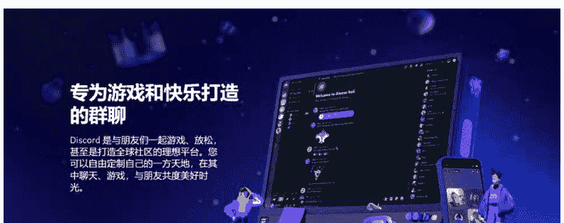

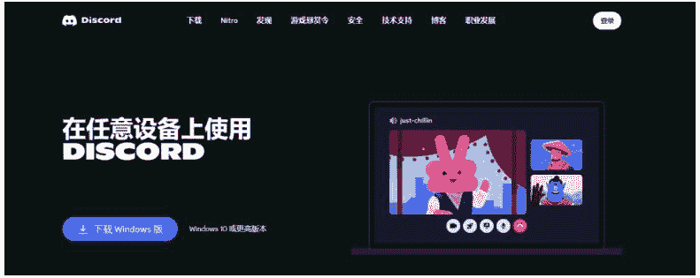

图4-2 Discord的下载

一次冒险之旅在等着你哟。在我们的桌面APP上和你的好友消遣娱乐，同时在移动设备上谈天说地吧。

安装完成后打开Discord，点击注册，填写信息后即可登录（图4-3）。


图4-3 Discord的登录

绑定Midjourney账号，先登录Midjourney官网，下拉至首页底部，点击Join the Discord。最后按提示绑定Discord账号即可（图4-4）。

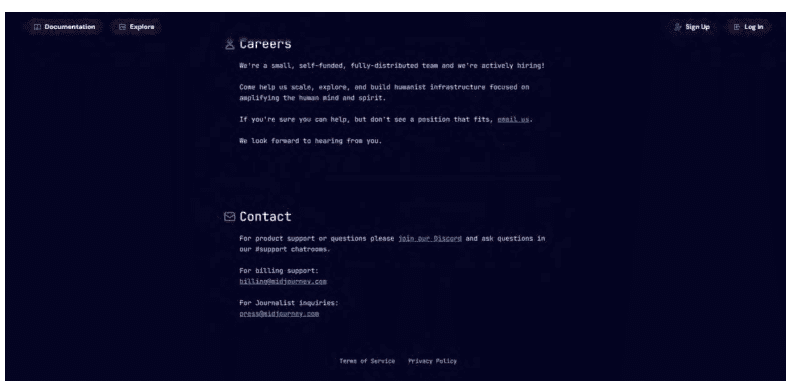

图4-4 绑定Midjourney

#### 4.2.2 Midjourney会员订阅

订阅对使用也很重要，Midjourney需付费会员才可创作，分为基础会员、标准会员、专业会员。基础会员每月8美元，可生成200张图。标准会员每月30美元，有15小时服务器使用时长。专业会员每月60美元，有30小时服务器使用时长（图4-5）。


年付也有优惠（图4-6）。


注意，标准与专业会员的图片生成有优先级，用专业服务器生成，无需等待。
服务器时长与生成图片质量及要求相关，要求越高，特定时间内生成数量越少。

#### 4.2.3 如何创建个人服务器

Midjourney 私域创作室搭建与指令实操

在公共频道工作时，大家都挤在同一个服务器里，排队等待、生成缓慢，作品发出几秒就被刷走，找回来非常困难。建立一个专属私域房间，可以大幅提升绘图效率并保留自己的成果。

下面按真实操作演示搭建流程：

启动 Midjourney 后进入首页，在左侧边栏找到新建服务器的入口并打开（图4-7）。


图4-7 Midjourney主页

打开后会进入创建向导，点选“亲自创建”（图4-8）。

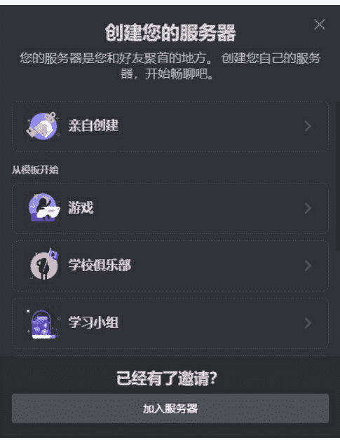

图4-8 创建服务器

进入信息设置页后，选择“仅供我和我的朋友使用”（图4-9）。

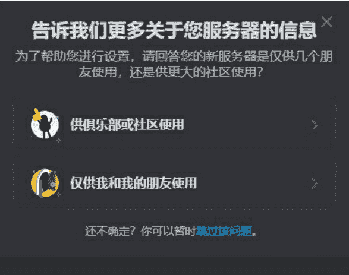

图4-9 服务器信息

随后弹出“自定义您的服务器”，填入想要的名称后确认创建（图4-10）。


图4-10 输入服务器名称

创建完成会显示“欢迎来到×××（自定义名称）的服务器”，此时私域服务器已经就绪（图4-11）。

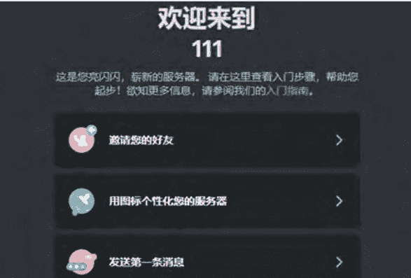

图4-11 创建完毕

#### 4.2.4 机器人接入服务器

后续绘图依赖机器人接收指令并执行，接入步骤如下：

先点击首页左上角的“寻找或开始新的对话”（图4-12）。

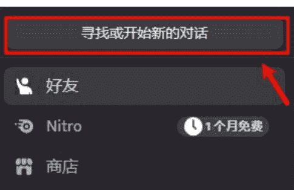

图4-12 寻找或开始新的对话

在搜索框输入 Midjourney Bot，选中对应结果后回车确认（图4-13）。


图4-13 Midjourney Bot

添加成功后左侧会出现 Midjourney Bot 的会话，将鼠标移到标题上右键唤出菜单（图4-14）。

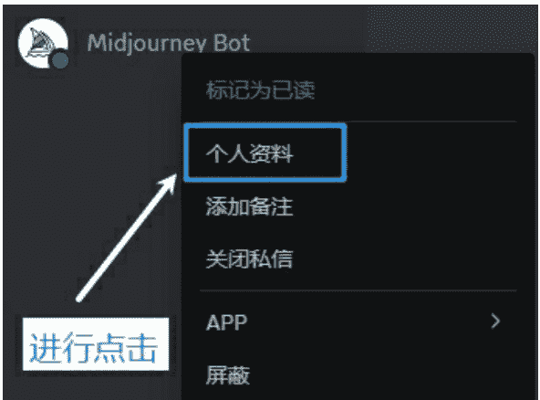

调出菜单后进入“个人资料”，跳转到详情页（图4-15）。


在详情页点击“添加APP”，随后选择“添加我的服务器”（图4-16）。


图4-16 添加到我的服务器

随后出现服务器列表，挑选刚才新建的那个（图4-17）。

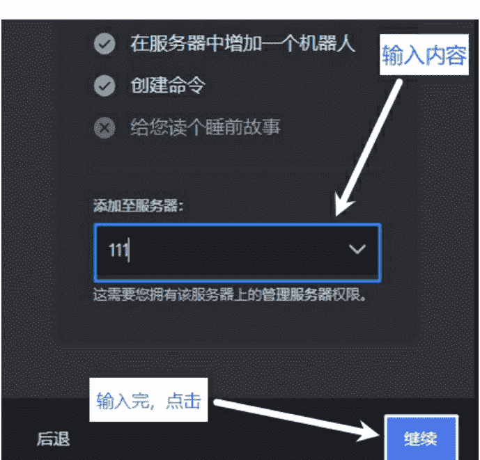

图4-17 绑定服务器

点继续进入授权页，点击授权即可（图4-18）。

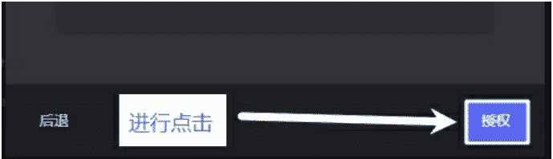

图4-18 进行授权

授权通过后完成一次人机验证，机器人就正式接入到个人的服务器中了。

### 4.3

Midjourney 指令通关解析

用 Midjourney 作图需要理解常用指令和提示写法，下面梳理几项核心技巧。

#### 4.3.1 /imagine 生成实战示范

制作商业广告风格画面时，/imagine 是最常用的指令。提示词使用英文即可，不区分大小写。

演示如下：

在输入框输入“/”，从下拉菜单选择“/imagine”（图4-19）。

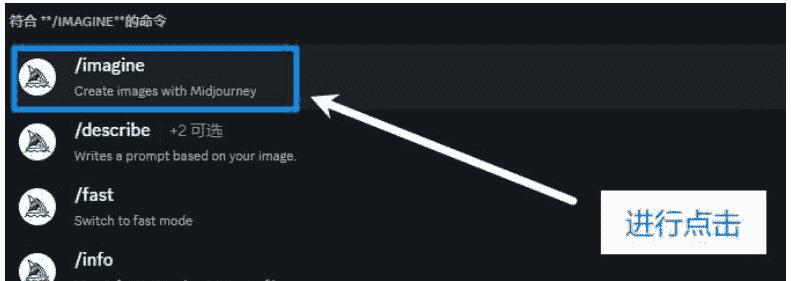

在下方输入区填入期望的关键词（图4-20）。


例如这里输入“An old gentleman in a suit（一个穿着西装的老绅士）”（图4-21）。


图4-21 关键词生成

回车后 Midjourney 开始处理（图4-22）。


图4-22 开始运转

稍等片刻即可得到四张结果图（图4-23）。

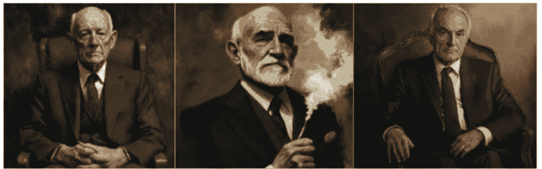

图4-23 生成图片

这就是 /imagine 出图的基础流程。

#### 4.3.2 U 键实现图片放大

上一部分用 /imagine 产出四张图，本节说明 U 的作用。以这四张为例，点击下方对应的 U1（图4-24）即可对细节进行放大查看。

#### 4.3.3 V 键重构画面

上文介绍了 U 的功能，本节讲 V。V 能让所选图像在保留整体构图的基础上重新演算，从而产生变化。

实际演示：

沿用上文生成的图片，以第二张为例，点击 V2（图4-26）。

点击后系统会对第二张进行重绘，产出新的画面（图4-27）。

#### 4.3.4 Vary 功能二次生成

在放大图界面，Vary 可对整图或局部进行二次调整。

操作演示如下：

仍以前文的图片为例，在放大图下点按 Vary 按钮进行再次生成（图4-28）。

执行后会二次合成，Vary（Subtle）可理解为细微变化，Vary（Strong）可理解为强烈变化。本次选择的是 Vary（Strong）按钮，生成结果如图4-29 所示。

上述是全图二次生成，下面讲局部二次调整。

这里仍用上面的图，选择的是 Vary（Region），该功能可对图像的某一部分进行重绘（图4-30）。

框选完成后按回车，等待局部重新生成即可（图4-31）。

可以看出，重新生成的四张图与之前相比在面部等细节上均有变化。

#### 4.3.5 Upscale 功能提升像素

本节介绍如何提升图片像素，默认生成分辨率为 1024×1024。若需要更高清晰度就需要用到 Upscale。

这里重新生成了一张图片（新春的灯笼），用于讲解（图4-32、图4-33）。

点击 Upscale（Subtle），作用是细微提升像素（图4-34）。

再以原图为例，点击 Upscale（Creative），可理解为精致提升像素（图4-35）。

需要注意，无论是细微还是精致的提升，最终都不会改动画面本身的内容，因此主题不会改变。

### 4.4

四类商业广告设计演示

上文介绍了 Midjourney 的基础用法，本节演示如何利用它完成四类商业广告的设计。

#### 4.4.1 借助 Midjourney 设计服装

先向 ChatGPT 提问：“我想用 midjourney 来进行服装设计，请从服装设计概述以及不同的服装关键词还有不同服装部位的关键词等方面给出内容。”

以下为 ChatGPT 给出的回答概要：

服装设计概述强调利用 AI 快速构思不同风格服装，可视化复杂概念，覆盖高级定制到街头时尚、民族服饰到未来科幻，通过精准提示探索面料质感、剪裁、配色等。

常用关键词可分为风格、性别年龄、布料质感、图案颜色以及服装部位。上身、下身、全身、配饰与细节设计均有对应的英文词，如 minimalist、streetwear、haute couture、silk、denim、puff sleeves、high waist 等。组合示例包括现代简约连衣裙、复古上衣、街头外套、民族风格旗袍等。

这里以设计中山装为例，整理的提示词为“Mao suit, Zhongshan suit, traditional Chinese menswear, tailored fit, classic formal attire”。

将关键词输入 Midjourney，最后生成下图（图4-36）：

#### 4.4.2 借助 Midjourney 设计背包

打开 ChatGPT 提问：“我想用 Midjourney 来进行背包设计，请从背包设计概述以及不同的背包关键词还有不同背包部位的关键词等方面给出内容。”

以下为 ChatGPT 的回答概要：

背包设计概述指出背包兼具实用与时尚，可通过文本描述定制材质、风格与结构细节，涵盖通勤、登山、旅行、潮流、健身等用途。

关键词按用途、风格、材质、颜色划分，例如 urban backpack、hiking backpack、minimalist、futuristic、waterproof nylon、canvas、black、neon 等。部位关键词包括主体结构、功能区、背负系统与装饰元素，如 front panel、side pockets、main compartment、adjustable shoulder straps、leather details 等。

组合示例以城市通勤背包为切入点，提供可直接使用的提示词方向。

Midjourney关键词实战拆解：背包、香水瓶与汉服

城市通勤轻奢款
参考指令："sleek urban backpack, minimalist design, waterproof nylon, laptop compartment, quick-access front pocket, black with subtle branding, ergonomic padded straps, modern and stylish, clean lines, studio lighting"

②户外登山背包
参考指令："rugged hiking backpack, large capacity, waterproof, durable cordura fabric, multiple compartments, adjustable shoulder straps, hip belt, side mesh pockets, earthy tones, professional outdoor gear aesthetic"

③时尚潮流背包
参考指令："streetwear-inspired backpack, bold graphic prints, vibrant colors, leather details, metallic zippers, compact size, reflective strips, designed for young urban lifestyle, chic and trendy"

④多功能旅行背包
参考指令："expandable travel backpack, ergonomic design, anti-theft compartments, water resistant fabric, laptop sleeve, luggage strap, olive green, practical and stylish, versatile for short trips"

（5）Midjourney参数建议
- 风格相关参数
  - v 5：当前主流版本，细节点描更可控
  - ar 2：3：竖向比例，便于呈现整体造型
  - q 2：提升输出清晰度，纹理更饱满
  - style 4a或4b：4a偏向现代时尚，4b偏向复古艺术，可按需求切换

材质与质感加强
提示词里补充“high-quality render, realistic texture, studio lighting”，能让面料质感和光影呈现更精致。

把以上要点融合后，户外款可用的组合为“rugged hiking backpack, large capacity 60L, waterproof cordura fabric, multiple compartments, padded shoulder straps, ventilated back panel, adjustable hip belt, reflective safety strips, olive green with black accents, modern outdoor gear aesthetic, high-quality render, studio lighting”。按此输入即可得到图4-37的效果。

#### 4.4.3 利用Midjourney辅助设计香水瓶
向ChatGPT提出：“我想用Midjourney来进行香水瓶设计，请从香水瓶设计概述以及不同的香水瓶关键词还有不同香水瓶的关键词等方面给出内容”。

整理后的要点如下：

> （1）香水瓶设计概述
香水瓶既要起到保护作用，也要传达品牌气质。借助Midjourney可迅速产出创意草图，涵盖现代简约、奢华定制、复古艺术等多种方向，通过关键词与参数调节即可逼近预期。

（2）香水瓶设计关键词分类
①按风格分类
现代简约风：minimalist, clean lines, sleek, contemporary
奢华高端风：luxury, elegant, opulent, gold accents, crystal bottle
复古艺术风：vintage, baroque, ornate, antique glass, handcrafted
未来科技风：futuristic, sci-fi inspired, metallic, holographic
自然灵感风：organic, floral motifs, nature-inspired, earthy tones

②按瓶身形状分类
几何形状：cylindrical, square, rectangular, hexagonal, pyramid
流线造型：curved, oval, hourglass, teardrop, asymmetrical
雕塑感造型：abstract, sculptural, artistic, figurative

③按材质与质感分类
玻璃：frosted glass, clear glass, tinted glass, textured glass
金属：polished metal, gold-plated, brushed steel, copper details
自然材质：ceramic, wood accents, stone details, shell-inspired
特殊质感：matte finish, glossy finish, pearized, holographic

④按装饰与功能细节分类
瓶盖设计：crown-shaped cap, magnetic closure, crystal stopper, floral cap
喷头与颈部：fine mist sprayer, engraved neck, metallic collar
装饰细节：embossed logo, engraved patterns, ribbon or tassel, gemstone accents

⑤按色彩与主题分类
经典配色：clear and gold, black and silver, white and pastel tones
大胆配色：vibrant red, electric blue, neon yellow
渐变色调：gradient shades, ombre, dual-tone glass
自然主题：earthy green, oceanic blue, floral pink

（3）Midjourney提示词示例
①现代简约香水瓶
“sleek minimalist perfume bottle, cylindrical shape, frosted glass, metallic silver cap, clean lines, modern design, subtle branding, studio lighting, high-quality render”

②奢华高端香水瓶
“luxurious perfume bottle, crystal glass, gold-plated details, crown-shaped cap, ornate patterns, premium fragrance packaging, high-end aesthetic, elegant and opulent design, cinematic lighting”

③复古艺术香水瓶
“vintage-inspired perfume bottle, antique glass, intricate baroque details, bronze accents, hand-blown glass, floral engraving, nostalgic and timeless, soft shadows”

④自然主题香水瓶
“nature-inspired perfume bottle, organic shape, earthy tones, floral motifs, wooden cap, frosted green glass, eco-friendly design, natural and refreshing aesthetic, warm lighting”

⑤未来科技香水瓶
“futuristic perfume bottle, metallic and holographic finish, angular and geometric shape, sci-fi inspired design, reflective surfaces, modern tech aesthetic, bold lighting”

（4）Midjourney参数建议
①技术参数
v 5：最新迭代，细节表现更强
ar 1：1：适合瓶身特写
q 2：高质量渲染，质感突出
style 4a或4b：可选择写实或艺术化风格

②额外细节与光影优化
加入“high-quality render, realistic texture, cinematic lighting”，强化瓶身材感。
使用“soft shadows, dynamic lighting, reflective surfaces”提升立体感与高级感。

（5）扩展关键词
主题装饰：butterfly motif, floral patterns, gemstone-encrusted, minimalist logo
背景环境：placed on marble table, surrounded by flowers, in a luxurious setting
系列设计：matching body lotion bottle, luxury packaging box, complementary colors

综合后可直接使用的关键词为“frosted glass perfume bottle, soft gradient from pink to gold, cylindrical shape, smooth surface, metallic silver cap, subtle engraved logo, elegant and feminine, luxurious design, cinematic lighting”（图4-38）。

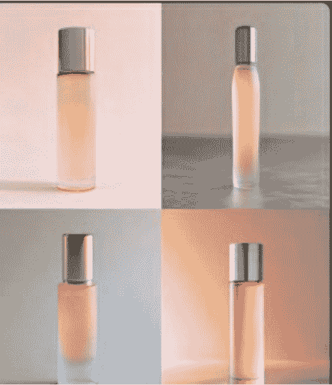

图4-38 香水瓶

#### 4.4.4 利用Midjourney辅助设计汉服
本节演示如何借助Midjourney为汉服创作赋能，用数字方式延续传统服饰的文化生命。

在ChatGPT中提问：“我想用midjourney来进行汉服设计，请从汉服设计概述以及不同的汉服关键词还有不同款式汉服的关键词等方面给出内容。”

> （1）汉服设计概述
汉服承载深厚文化底蕴与独特美学，设计核心在于宽衣博带、层次剪裁与纹样运用。Midjourney可迅速生成传统与现代融合的视觉，覆盖明制、唐制及新式改良等方向，兼顾传承与创新。

（2）汉服设计关键词分类
①按朝代与款式分类
汉制汉服：Han Dynasty hanfu, long flowing robes, wide sleeves
唐制汉服：Tang Dynasty hanfu, high-waisted, bell sleeves, ruqun
宋制汉服：Song Dynasty hanfu, straight cut, delicate patterns, simplicity
明制汉服：Ming Dynasty hanfu, stand collar, mamian skirt, structured look
新式汉服：modern hanfu, fusion design, minimalist, contemporary elements

②按款式与部件分类
上衣：
衣裳：long robe, cross-collar, straight collar
短褂子：jacket, flowing sleeves, lightweight fabric
披帛：draping, embroidered edges, transparent material
裙子：
馆裙：structured, geometric pleats
马面裙：wide pleats, front and back panels
绣裙：floral patterns, intricate details
配件：
绶带：embroidered sash, knotted, brocade fabric
发饰：jade hairpins, tassels, floral ornaments
鞋履：embroidered shoes, flat, platform soles

③材质与颜色
面料：
丝绸：soft, flowing, shiny finish
棉麻：lightweight, natural texture
纱：translucent, airy, layered
颜色与渐变：
单色：ivory, jade green, cherry blossom pink, imperial yellow
渐变：sunset orange to red, midnight blue to violet
图案：floral motifs, phoenix embroidery, geometric patterns

④主题与装饰
季节主题：
春：spring hanfu, floral embroidery, light pastels
夏：summer hanfu, breathable fabrics, vibrant colors
秋：autumn hanfu, warm tones, layered designs
冬：winter hanfu, thick fabrics, fur trims
文化主题：
富贵：luxurious hanfu, gold embroidery, dragon motifs
自然：nature-inspired hanfu, bamboo patterns, mountain landscapes
仙气：ethereal hanfu, flowing fabrics, dreamlike hues

（3）Midjourney提示词示例
①唐制汉服
“Tang Dynasty hanfu, high-waisted ruqun, wide bell sleeves, flowing silk fabric, vibrant red and gold embroidery, phoenix and floral patterns, luxurious and elegant, cinematic lighting, high-quality render”

②明制汉服
“Ming Dynasty hanfu, stand collar, mamian skirt with intricate pleats, brocade fabric, deep blue with silver embroidery, structured and formal, soft shadows, studio lighting”

③新式汉服
“modern hanfu, minimalist design, cross-collar blouse with gradient from jade green to white, lightweight gauze skirt, floral embroidery on the hem, ethereal and contemporary style, soft natural lighting”

④四季汉服
春：“spring hanfu, pastel pink and green, cherry blossom embroidery, lightweight gauze fabric, flowing design, romantic and fresh aesthetic”
夏：“summer hanfu, vibrant yellow, lightweight linen fabric, sleeveless ruqun with embroidered lotus patterns, breathable and elegant”
秋：“autumn hanfu, warm orange and brown tones, layered design, maple leaf motifs, soft and cozy”
冬：“winter hanfu, thick silk with fur trims, deep red with gold embroidery, warm and luxurious, phoenix motifs”

（4）Midjourney参数建议
①技术参数
v 5：生成最新版本，细节更佳
ar 2：3：适合全身构图
q 2：高分辨率，突出面料与纹样
style 4b：偏复古优雅

②额外优化描述
加入“realistic fabric texture, intricate embroidery, cinematic lighting”确保细节真实精致。
使用“soft shadows, ethereal lighting, dynamic composition”强化柔美与立体感。

（5）扩展关键词

樱园汉服 · AI视觉构建

场景基调可设定为传统园林之中，身着汉服的人物被樱花簇拥，柔和阳光洒落。
动态表现上要突出汉服面料随风舒展，举止优雅灵动。
造型搭配方面配有同款刺绣鞋与玉簪点缀。
综合以上条件，可提炼出的投喂词为唐代汉服、束腰襦裙、宽大宫袖、流动丝绸质感、红金刺绣、凤纹花卉、奢华优雅、电影级光感、高质量渲染（图4-39）。

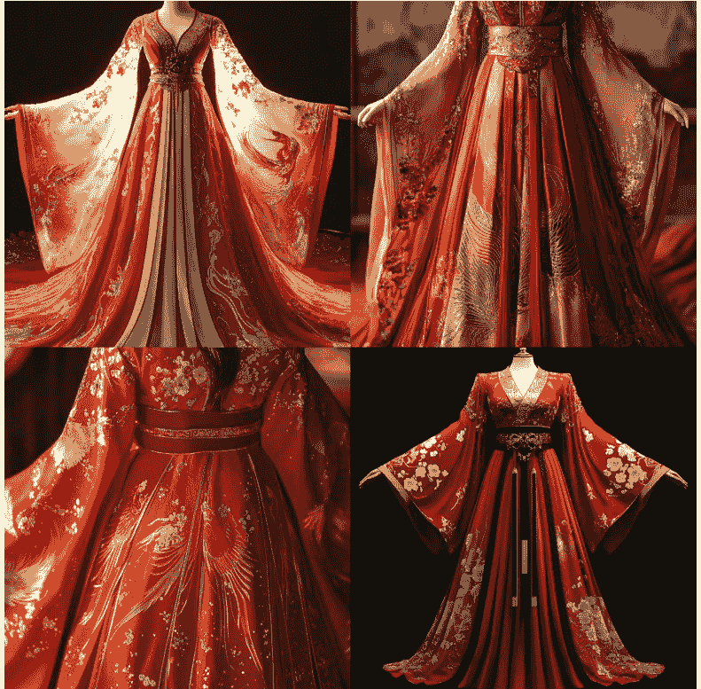

这一环节梳理出了借助 Midjourney 进行汉服视觉搭建的整体思路，后续章节会进一步展开以此延续中华优秀传统文化的创作方法。

### 4.5 关于修图的秘籍

前面讲了如何从零出图，本节聚焦后期精修。修图如今已成为决定画面质感与表达张力的关键环节，而 MidJourney 的加入让这一过程产生了明显变化。依托 AI 的生成能力，传统修图繁复的手工步骤被大幅压缩，智能算法配合独特的艺术化生成逻辑，让修饰既高效又富有想象空间。对设计师、摄影师和数字艺术爱好者来说，这既是技术工具，也是打开创意边界的伙伴。

修图的本质是细节打磨与整体风格的协同把控，需要技术精度与艺术感知共同支撑。过去的手工修图高度依赖重复操作，耗时费力且门槛较高。MidJourney 能理解上传素材的内容语义，并按需求快速给出优化版本。无论是色调微调、细节强化还是整体风格迁移，都能在较短时间内完成，同时保持个人化的表达。

MidJourney 对修图的价值不止于提效。丰富的风格选择让单张影像具备更强的艺术承载力，同时能挖掘画面潜藏的艺术潜力，启发新的创作灵感。修图由此从单纯的后期修正，转变为创作流程中的艺术探索节点。

#### 4.5.1 图片尺寸的修正

MidJourney 默认输出 1:1 方图，若需改变画幅，可通过 ar 参数实现。下面给出实操演示。

先用 MidJourney 生成一张企鹅主题的图像（图4-40）。

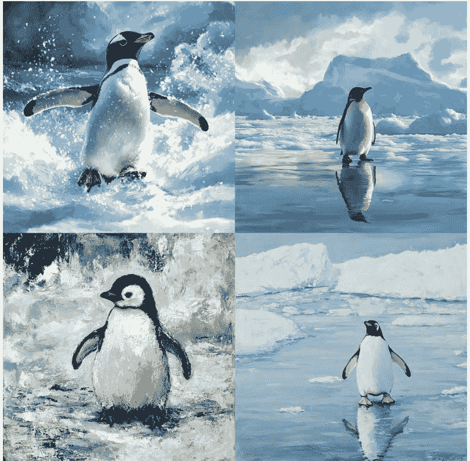

图4-40 企鹅

随后在提示词后追加 “ar 4 : 3”（图4-41）。

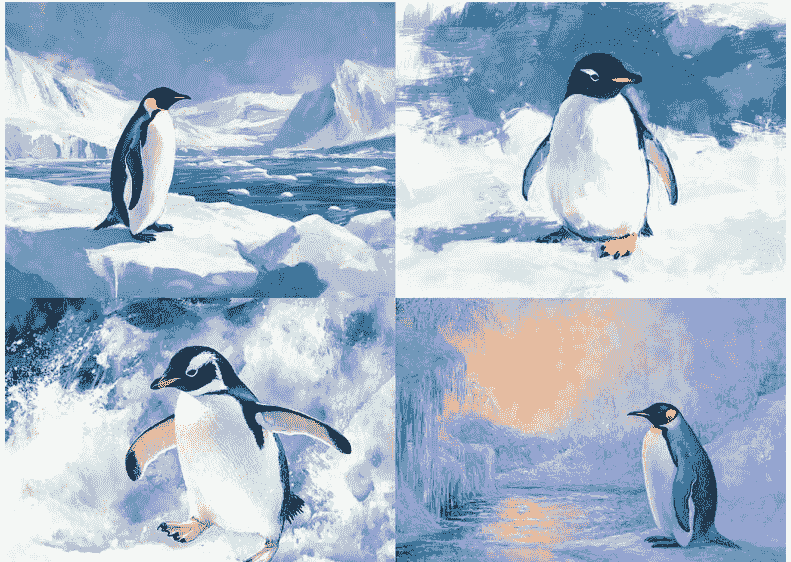

图4-41 ar 4 : 3

再以 16:9 为例，主题选汉堡生成一组图像（图4-42）。

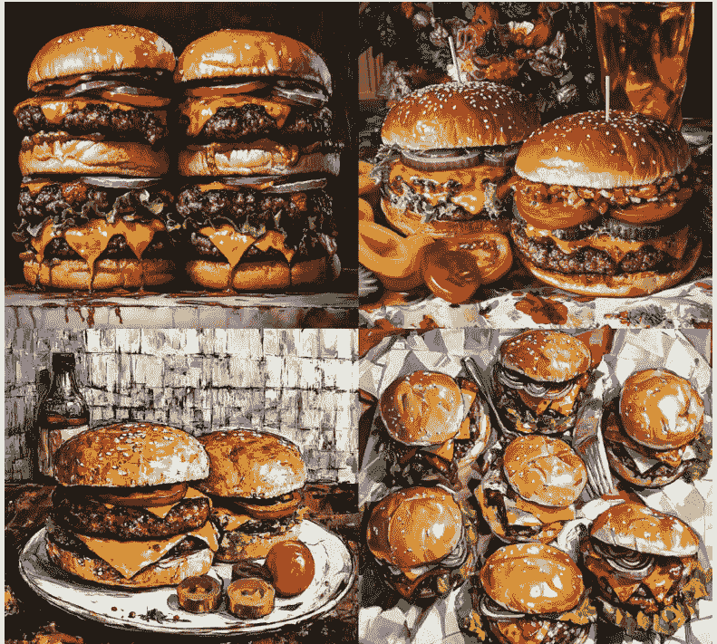

图4-42 汉堡

提示词后加入 “ar 16：9”（图4-43）。

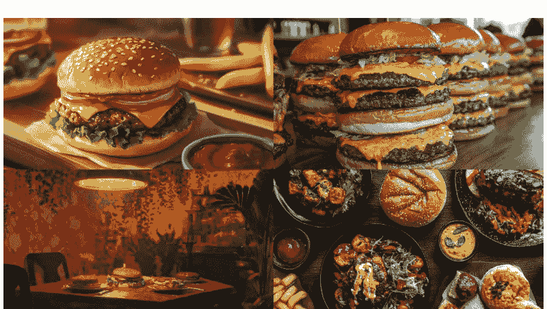

图4-43 ar 16：9

上述即为画幅调整的基本做法，提示生成或放大时最终尺寸可能存在细微偏差。

#### 4.5.2 图片场景的转移

在图像下方的编辑栏中提供上下左右平移控件，可用来推移画面内容。操作要点是，平移后下方将不再出现 V 按钮，也就无法再执行重构。

以一轮明月为主题做演示（图4-44）：

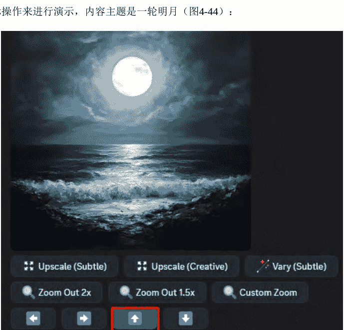

图4-44 一轮明月

点击向上平移，可得到新的画面（图4-45）。

#### 4.5.3 Zoom Out的妙用

Zoom Out 的作用是在方形原图基础上向外延伸，满足留白与构图扩展的需求。

操作步骤如下：

先以枫叶为主题生成一张图像（图4-48）。

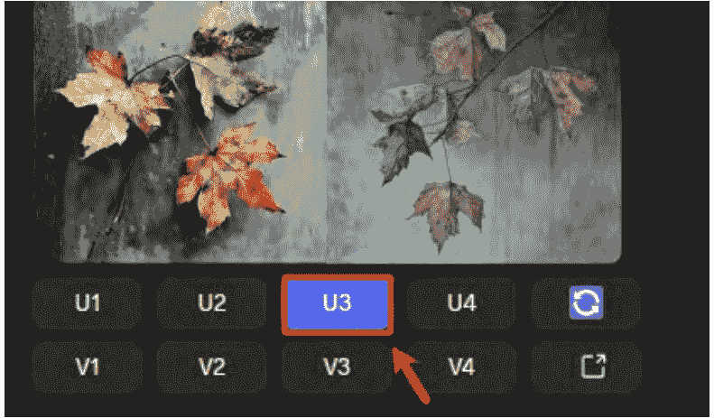

图4-48 枫叶

选中一张图像点按 U 按钮，这里选用第三张（图4-49）。

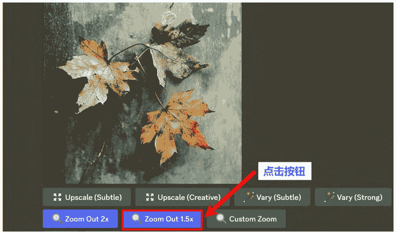

图4-49 Zoom out 1.5x

对第三张放大后的图像点击下方的 Zoom Out 1.5x（图4-50）。

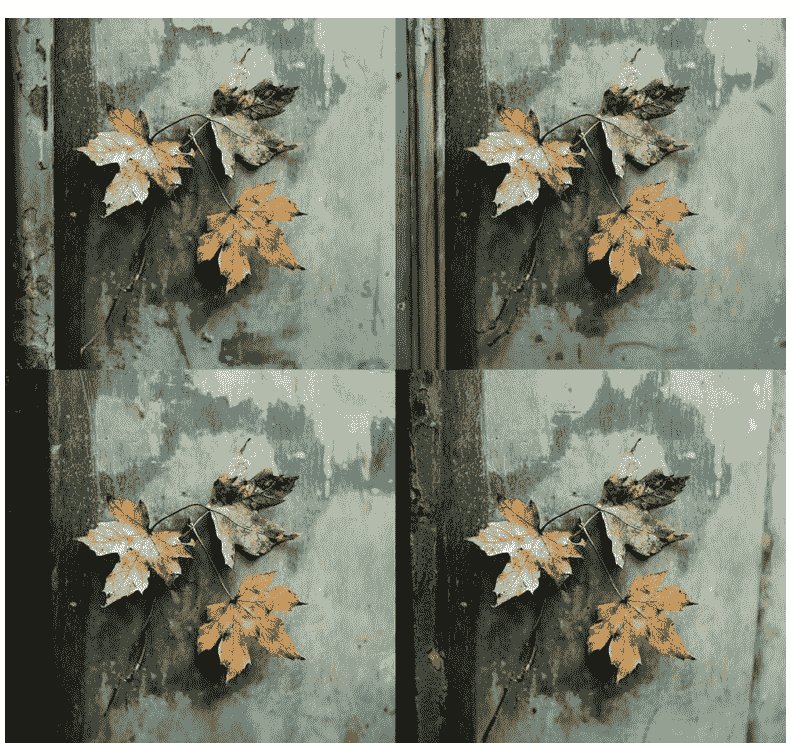

图4-50 效果图

继续在同一张上点选 Zoom Out 2x（图4-51、图4-52）。

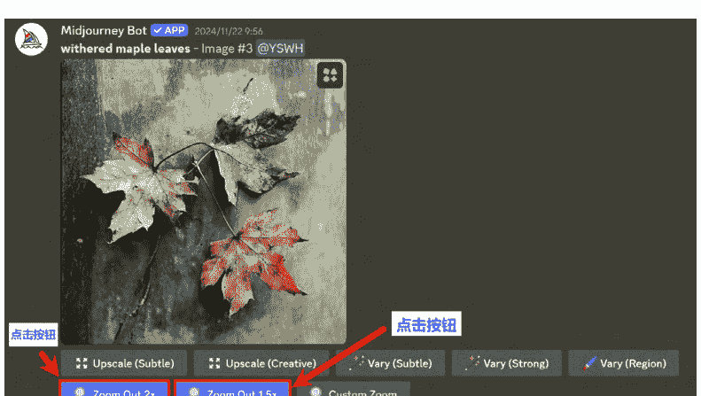

图4-51 Zoom Out 2x

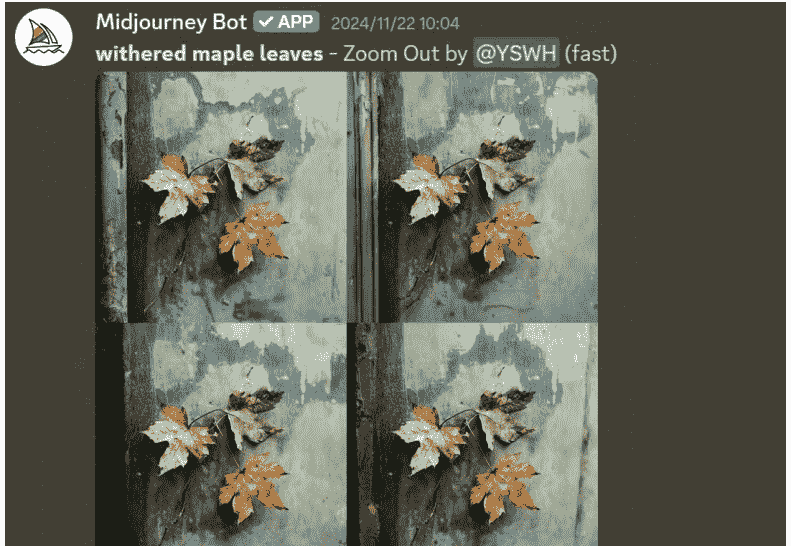

图4-52 效果图

再介绍 Custom Zoom 功能，支持自定义缩放。仍以第三张为例，点击 Custom Zoom。

弹出窗口后可同时调整比例与缩放倍数，缩放范围 1～2 倍，此处选择 1.8 倍（图4-53）。

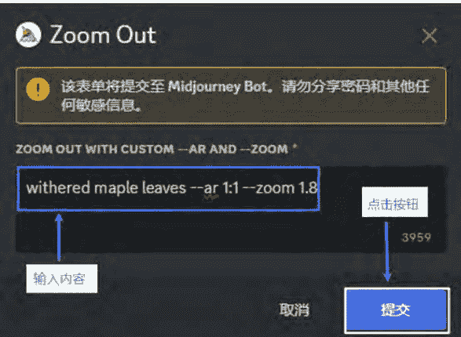

图4-53 修改比例

提交后等待缩放完成（图4-54）。

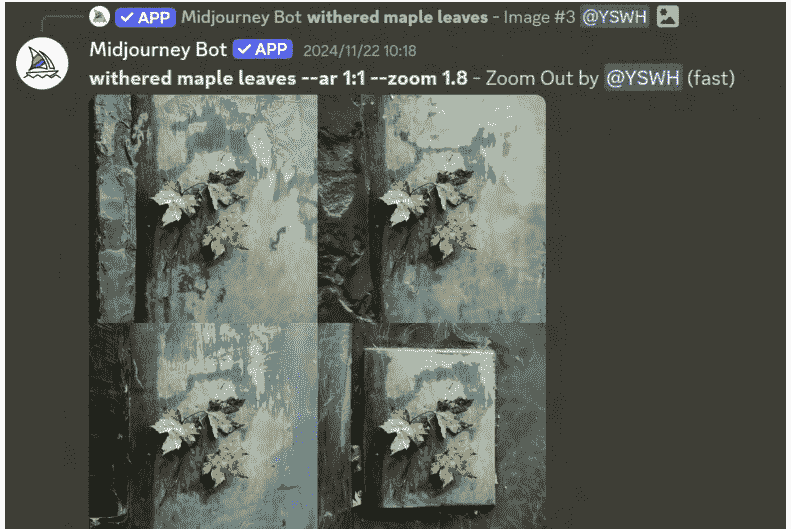

图4-54 效果图

弹窗中同样可以修改画面比例，继续以第三张为例将比例改为 4：3（图4-55）。

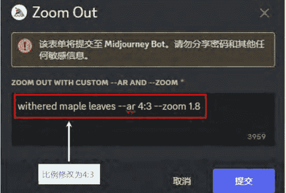

图4-55 修改比例

提交后生成新图（图4-56）。

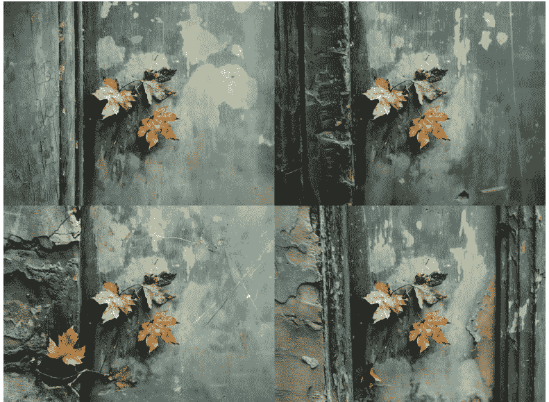

图4-56 效果图

至此画幅与缩放度的调整完成，原图主体内容保持稳定，这就是 Zoom Out 的使用逻辑。

## 第5章 如何生成企业独特标志

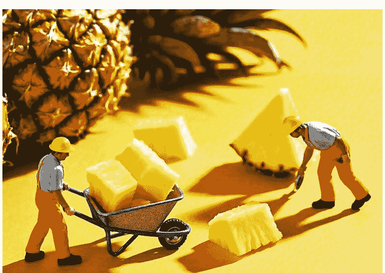

在当下商业环境里，企业标志早已超越单纯符号，成为品牌形象的集中表达。它承载文化内涵、核心价值与市场定位，也是消费者识别品牌的视觉入口。优秀的标志能在竞争中脱颖而出，传递品牌独特气质。借助 Midjourney 这类 AI 图像生成工具，企业能够以前所未有的效率产出高质量且富创意的标志方案。

使用 Midjourney 设计标志无需繁复手绘或专业软件，只需输入文本描述，AI 便可产出多套方案。这种方式降低了门槛，也提供了更多灵感。可描述业务核心、目标受众、风格偏好与色彩倾向，AI 据此产出符合调性的方案，再通过微调提示词强调图形元素、字体或配色，逐步逼近品牌需求。

标志的重要性不言而喻。它是品牌与消费者建立信任的桥梁，必须具备识别度与独特性，并在印刷品、数字广告、包装、App 等场景灵活呈现。Midjourney 支持极简、复古、科技感或手绘感等多样化风格尝试，帮助品牌找到最契合的视觉表达。

AI 还为标志设计注入了更多创意可能。Midjourney 不受传统思维束缚，能生成新颖的图形组合、意想不到的配色与前沿几何造型，让标志更具个性化，更易与目标受众产生情感连接，提升市场影响力。

创作过程中可实时调整与优化，快速探索不同方向，无需从零反复修改。高效与灵活让 Midjourney 成为企业标志设计的强力工具，也让设计师聚焦更具战略性的创意决策。本章将手把手演示如何用 AI 生成独特的企业 LOGO。

### 5.1 利用ChatGPT为logo生成关键词

设计企业或品牌 LOGO 前，需明确目标、内涵与意义，好的 LOGO 能让品牌更突出。下面以果汁品牌为例说明流程。

首先借助 ChatGPT 生成 LOGO 关键词，具体步骤如下：

打开 ChatGPT 官网（图5-1）。

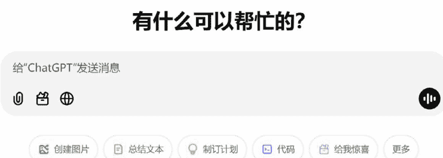

点击输入框，先为 ChatGPT 设定身份：经验丰富的品牌运营设计师（图5-2）。


随后输入需求说明，围绕芒果果汁、阳光健康进行概念建议（图5-3）。

ChatGPT 给出的概念以“阳光芒果，健康活力”为主题，核心元素包含代表主打的芒果、传递温暖的阳光表现、以及体现自然健康的绿色点缀；色彩以橙黄为主、绿色为辅，辅以白或淡蓝提升清新；造型建议将芒果与太阳结合，加入果汁流动感；字体选用圆润现代无衬线或带手写感风格。

同时给出灵感示例，如芒果拟人化太阳、绿叶环绕的果树造型、品牌名沿曲线排布等（图5-4）。

若需提升艺术感，可进一步要求强化独特性与记忆点。此时模型会给出概念升华方向，如半剖芒果呈现日出放射纹理、抽象几何线条表现果肉与光感等；色彩上建议金属渐变或热带活力色系；字体可与图形融合；并可提供动态化设想（图5-5、图5-6、图5-7）。

最后让模型将要点归纳为可用于 MidJourney 的提示要素，涵盖核心主题、图形元素与艺术风格三类（图5-8）。

模型还提供了英文版提示词。至此果汁品牌 LOGO 素材已准备好（图5-9）。

#### MidJourney 生成参考指令

"Modern abstract mango juice brand logo, half-cut mango with radiant sunburst design, flowing juice drops, mango-shaped tree with green leaves, vibrant orange and yellow gradient with subtle metallic sheen, minimalist geometric lines, fresh and healthy tropical vibe, bold sans-serif font, white background, artistic and dynamic, highly memorable design --v 5 --ar 1:1 --q 2"

图5-9 英文指令

### 5.2 利用Midjourney生成企业logo

上一步已通过 ChatGPT 获得果汁品牌的 LOGO 关键词，接下来打开 Midjourney 输入英文提示。

调用 /imagine 指令，在输入框填写 “Modern abstract mango juice brand logo, half-cut mango with radiant sunburst design, flowing juice drops, mango-shaped tree with green leaves, vibrant orange and yellow gradient with subtle metallic sheen, minimalist geometric lines, fresh and healthy tropical vibe, bold sans-serif font, white background, artistic and dynamic, highly memorable design--v 5--ar 1 : 1--q 2”（图5-10）。

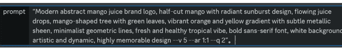

回车确认后等待生成（图5-11）。

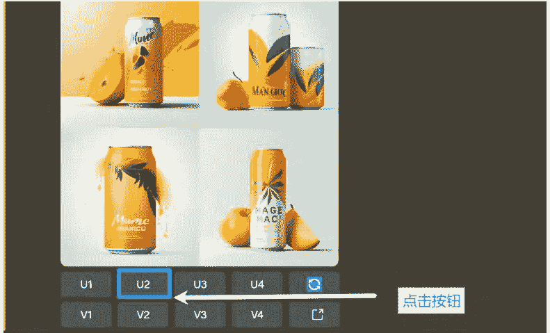

选中第二张图点 U2 放大效果（图5-12）。

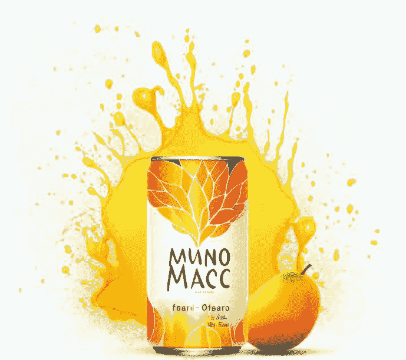

图5-12 效果图

若不满意，可在四张图下方点重新生成（图5-13）。


图5-13 重新生成

点击提交按钮后等待重新生成（图5-14），新结果即为图5-15。


图5-14 点击提交


图5-15 生成效果

### 5.3 细节强化，让Logo更具记忆点
本段的核心是为提示词补充更具体的修饰，让Logo的视觉调性得到锁定与强化，从而形成更鲜明的印象。

在Midjourney中再次使用 /imagine 指令进行微调，比如剔除 bold sans-serif font 和 white background 这类限制条件（图5-16）。


发送指令后等待Midjourney重新合成新图（图5-17）。


此时Logo的形态会变得更为突出，辨识度明显提升，随后点按U1对第一张结果进行放大审视（图5-18）。


个人觉得画面略显局促，需要扩展视野，于是调用Zoom Out 1.5x按钮，点击后等待编辑完成渲染（图5-19）。


图5-19 缩放

紧接着点按U4按钮（图5-20）生成第四个版本，并将该张图片保存下来（图5-21）。


图5-20 U4按钮


图5-21 保存图片

### 5.4 后期精修：Photoshop
Midjourney可以快速产出Logo初稿，若想满足特定需求或做精准修改，后期精修是必要的。本节以Photoshop为例展开，安装环节仅作简要说明，操作流程会拆解清楚。

#### 5.4.1 Photoshop的下载与安装
先访问Adobe官方网站 https://www.adobe.com/（图5-22），定位到Photoshop下载入口，点击下载后按向导完成安装即可（图5-23）。


#### 5.4.2 处理Logo图片
安装完成后将前面保存的Logo导入Photoshop，进入主工作区。
先点击界面右上角的「选择主体」按钮（图5-24）。


图5-24 选择主体

随后在下方预览区会自动生成主体选区（图5-25）。


图5-25 框选区域

按键盘Ctrl+J复制出一个新图层（图5-26）。


图5-26 新的图层

再按Ctrl+C复制该图层，点击菜单栏左上角的「文件」→「新建」，新建一个默认尺寸的画布（图5-27）。


图5-27 创建新的图层

创建后会出现白色背景板，按Ctrl+V把刚才复制的内容粘贴上去（图5-28、图5-29）。


图5-28 粘贴图层


图5-29 粘贴成功

右键点击左侧的选框工具，选择椭圆选框工具（图5-30）。

## 第6章 商业广告配乐打造

在当下广告创作中，背景音乐早已超越单纯的音效填充，成为营造情绪氛围、加深品牌记忆与驱动消费者共鸣的关键媒介。一段贴合主题的配乐能在瞬间抓住注意力，让画面更具感染力，并把品牌主张传递得更清晰。过去定制音乐耗时耗力、成本高企，随着生成式AI的成熟，音乐制作效率被大幅提升。Suno作为一款专注于AI音乐生成的工具，为广告人提供了便捷的创作与迭代支持。

借助Suno为广告配乐，创作者只需给出简短描述即可获得多套可选方案。无论是轻快明亮的旋律、科幻感强的节奏，还是舒缓优雅的底声，系统都能快速生成并按需求调整风格。对比传统流程，AI生成显著压缩了周期，也拓宽了想象边界。通过实时调节音高、节奏、配器等参数，可反复打磨，直至与画面达到最佳契合。

配乐的价值在于情感联结。讲述品牌故事时，激昂的曲调能营造自信力量感，柔和的钢琴独奏则唤起温暖亲近。Suno能帮助创作者把品牌调性与音乐风格精准对齐，产出既具辨识度又贴合形象的配乐，同时支持跨风格尝试，为广告注入更多创意活力。

在数字化传播环境中，广告需要在极短时间内建立情感连接，音乐恰是实现这一目标的高效手段。AI的介入让音乐创作摆脱资源与周期的限制，借助Suno，概念到成片可在数分钟内完成，既提升效率，也提供更多定制化选择。

本章将围绕Suno进行讲解，帮助读者建立对商业广告背景音乐创作的清晰认知。

### 6.1 AI音乐工具：Suno
Suno是一款基于人工智能的音乐创作平台，以操作直观、生成迅速受到创作者欢迎。不论是专业制作人还是零基础用户，都能通过简洁界面快速完成音乐产出。它降低了创作门槛，让人更专注于表达与设计，而非技术细节。

使用方式非常简单：输入关键词或一句风格描述，例如“温暖的钢琴旋律配合轻柔弦乐”或“富有未来感的电子节拍”，系统即可生成多段符合描述的音乐片段。对不熟悉乐理的人尤其友好，AI会自动处理旋律、和声与节奏等技术环节，让创作像对话一样自然，便于产出高质量成果（图6-1）。

实时迭代是另一大优势。用户可在初稿基础上，通过微调提示词或参数来优化效果，比如改变情绪基调为欢快、悲伤或激昂，更换乐器类型，或调整时长与节奏。这种即时反馈机制让创作者短时间内探索多个方向，大幅提升创意效率，非常适合广告、视频或游戏项目中对背景音乐的需求。

在商业应用层面，Suno提供的音乐具备清晰的版权归属，生成内容通常归使用者所有，为广告、影视配乐、企业宣传等商业场景提供了法律保障，无需担心版权纠纷，成为追求原创且成本可控的首选。

生成音乐的多样性和原创性很高，从抒情感性的旋律到科幻感电子节奏，都能通过深度学习捕捉风格精髓，为项目提供独特灵感，也减少了寻找版权音乐的时间成本（图6-2）。

### 6.2 利用ChatGPT获取歌词以及关键词
在正式进入音乐生成前，很多人会疑问歌词如何来。借助ChatGPT既能完成歌词创作，也能为Suno准备提示词。本节将演示如何用ChatGPT生成歌词并提炼关键词。

#### 6.2.1 获取歌词
首先打开ChatGPT官网：https://chatgpt.com（图6-3）。

以文中芒果果汁饮料为案例，笔者在ChatGPT输入：“我希望为芒果果汁饮料创作一个商业广告的背景音乐，能否帮我创作歌词，内容积极向上，同时要展示健康生活。”（图6-4）

清晨阳光洒满了窗台，

一杯芒果汁唤醒了期待。

鲜甜滋味溢满了心怀，

健康活力伴你一路精彩。

##### [副歌]

芒果的芳香，自然的力量，

每一口都是幸福的能量。

健康生活，我们共同向往，

畅饮美味，绽放无限光芒。

##### [第二段]

忙碌时刻也需要关怀，

一杯果汁带来自在。

维生素C，让精神更澎湃，

活出精彩，心情更愉快。

##### [副歌]

芒果的芳香，自然的力量，

每一口都是幸福的能量。

健康生活，我们共同向往，

畅饮美味，绽放无限光芒。

##### [桥段]

阳光与果实的美妙结合，

每一天都充满新的颜色。

##### [副歌]

芒果的芳香，自然的力量，

每一口都是幸福的能量。

健康生活，我们共同向往，

畅饮美味，绽放无限光芒。

##### [结尾]

芒果果汁，陪伴你我他，

健康生活，快乐到天涯。

图6-4 生成歌词

生成后笔者觉得还需改进，于是输入：“我认为歌词的内容不够好，将歌词中的芒果去掉，加强歌词中的阳光与积极向上的态度，进行改写，同时给歌词创作一个歌名”（图6-5）。

##### 歌名：阳光之路

[第一段]

清晨阳光洒满了窗台，

一缕暖意唤醒了期待。

新鲜空气充满了心怀，

健康活力伴你一路精彩。

[副歌]

阳光的力量，自然的能量，

每一步都是幸福的方向。

积极生活，我们共同向往，

拥抱美好，绽放无限光芒。

[第二段]

忙碌时刻也需要关怀，

片刻休憩带来自在。

深深呼吸让精神澎湃，

活出精彩，心情更愉快。

[副歌]

阳光的力量，自然的能量，

每一步都是幸福的方向。

积极生活，我们共同向往，

拥抱美好，绽放无限光芒。

[桥段]

阳光与微笑的美妙结合，

每一天都充满新的颜色。

图6-5 二次生成

经过这轮改写，《阳光之路》就基本成型了。

#### 6.2.2 获取关键词
有了歌词后，若想让Suno更准确演绎，还需要关键词即提示词。以下演示如何用ChatGPT提取关键词。

再次打开ChatGPT，输入：“我希望为生成的歌词加入一些关键词，可以给出建议吗？”（图6-6）

我希望为生成的歌词加入一些关键词，可以给出建议吗

Thought, 持续 6 秒

当然，我很乐意为您提供一些可以加入歌词的关键词建议，以强化积极向上和健康生活的主题。以下是一些您可以考虑的关键词：

- **活力**：体现充满能量和生命力的状态。

- **清新**：带来新鲜感和舒适的感觉。

- **自然**：强调与自然环境的和谐。

- **健康**：直接突出健康生活的主题。

- **能量**：表现出动力和积极性。

- **快乐**：传递愉悦和幸福的情感。

- **自由**：表达无拘无束的生活态度。

- **新鲜**：强调产品或生活的新鲜感受。

- **纯净**：突出纯粹和无污染的特质。

- **舒爽**：带来身心放松的感觉。

图6-6 关键词

上述建议偏概括，于是进一步追问：“我希望这些关键词可以加入歌词中，我要在Suno中使用，请结合歌词来用。”（图6-7）

[第一段]

清晨阳光洒满了窗台，

一缕暖意唤醒了期待。

新鲜空气充满了心怀，

活力满满，生活更精彩。

[副歌]

阳光的力量，自然的能量，

每一步都是健康的方向。

积极生活，我们共同向往，

拥抱美好，绽放无限光芒。

[第二段]

忙碌时刻也需要关怀，

片刻休憩带来舒爽自在。

深深呼吸让精神澎湃，

自由自在，心情更愉快。

[副歌]

阳光的力量，自然的能量，

每一步都是健康的方向。

积极生活，我们共同向往，

拥抱美好，绽放无限光芒。

[桥段]

阳光与微笑的美妙结合，

每一天都充满绿意的颜色。

[副歌]

阳光的力量，自然的能量，

每一步都是健康的方向。

积极生活，我们共同向往，

拥抱美好，绽放无限光芒。

图6-7 加入歌词中

与此同时，可以引入AI音乐中的概念——元标签。元标签是音乐文件的结构化信息，包含标题、艺术家、风格、情绪、节奏、关键词等，能帮助Suno更精准把握情感。

于是向ChatGPT提问：“请帮我总结出上述歌词的元标签，我希望这首歌可以有十分欢快的曲风，同时能够更好地表达积极阳光的情感”（图6-8、图6-9）。

请帮我总结出上述歌词的元标签，我希望这首歌可以有十分欢快的曲风，同时能够更好地表达积极阳光的情感

Thought, 持续 10 秒

当然，我很高兴为您总结这首歌的元标签，并确保歌曲拥有十分欢快的曲风，更好地表达积极阳光的情感。

##### 歌曲元标签

**标题:** 阳光之旅

**艺术家:** (您的名字或品牌名称)

**风格/类型:** 流行、流行摇滚、青春活力

**情绪:** 欢快、积极、阳光、充满活力、幸福感

**关键词:** 阳光、绽放光芒

**节奏/速度:** 中快板 (120-140 BPM)，适合欢快、振奋人心的节奏

**曲风:** 明亮、轻快、富有感染力，旋律易于传唱

**乐器:**

- 原声吉他 (增加温暖和亲和力)

- 钢琴 (提供明亮的旋律线)

- 鼓和打击乐 (强化节奏感)

- 弦乐 (如小提琴，增加丰富性)

- 管乐 (如长笛或萨克斯，增加轻快感)

- 电子合成器 (适度使用，增添现代感)

图6-8 元标签 (1)

**目标受众:** 年轻人、注重健康生活方式的人群、喜欢积极向上音乐的听众

**使用场景:** 饮料广告背景音乐、健身房、户外活动、晨间节目

**语言:** 中文

**主题:** 健康生活、积极心态、拥抱自然、享受每一天

**情感色彩:** 振奋、鼓舞人心、温暖、充满希望

**声音特质:** 清晰的男声或女声主唱，和声部分饱满，整体音色明亮

图6-9 元标签 (2)

#### 6.2.3 将关键词结合到歌词中
本小节介绍ChatGPT的进阶用法——通过探索GPT实现专业歌词生成。

先打开ChatGPT，点击左上角的探索GPT（图6-10）。

跳转后在搜索栏输入：Suno（图6-12）。

选择第一个“Suno Prompt”，点击进入新页面（图6-13）。

##### Suno Prompt

创建者: Nikolai Ryzhkov

Generates detailed music prompts for Suno in the style of singers, bands, songs or movies / Creates negative prompts to exclude styles / Provides cover prompts based on your lyrics (v.4, upd. 10/24)

开始聊天

图6-13 Suno Prompt

进入页面后点击开始聊天，跳转到对话窗口（图6-14）。

仍以芒果果汁品牌广告配乐为例，输入：“你好，我希望你帮我创作一首芒果果汁饮料商业广告的背景音乐的歌词，要求内容健康阳光，不要在歌词中出现芒果”。

以下是Suno Prompt生成的带Prompt的歌词（图6-15）：

[instrumental intro]

[Verse 1]

阳光洒满了窗台，

一杯清甜靠近心怀。

自然的味道轻轻漫开，

幸福感瞬间溢出来。

[Chorus]

每一滴纯净都是爱，

清新滋味让心盛开。

大自然的礼物常在，

为你带来美好时代。

（清新滋味，让心盛开。）

[Verse 2]

呼吸清晨的自在，

感受鲜活的每一拍。

阳光笑容轻轻飘来，

这一刻让生活更精彩。

[Chorus]

每一滴纯净都是爱，

清新滋味让心盛开。

大自然的礼物常在，

为你带来美好时代。

同时AI还给出了音乐风格建议，后续在Suno使用时会详细介绍，这里提供的风格为：

> Pop, Cheerful, Joyful, Acoustic Guitar, Piano, 115 BPM, Key of C Major, bright and uplifting female voice

对歌词的段落说明如下：

> [Verse 1]

阳光洒满了窗台，

一杯清甜靠近心怀。

自然的味道轻轻漫开，

幸福感瞬间溢出来。

Verse 1为第一段主歌。

[Chorus]

每一滴纯净都是爱，

清新滋味让心盛开。

大自然的礼物常在，

为你带来美好时代。

（清新滋味，让心盛开。）

Chorus为副歌。

[Verse 2]

呼吸清晨的自在，

感受鲜活的每一拍。

阳光笑容轻轻飘来，

瞬间点亮生活

Verse 2 对应作品里的第二段主歌。

[Bridge]
无论在哪，总能感受它，
鲜活能量，点亮每个刹那。
陪你追逐未来的步伐，
清甜记忆是最美回答。
[Bridge] 标识的是歌曲的桥段部分。

[Guitar solo]
Guitar solo 表示吉他独奏段落。

[Outro]
自然流动的愉快，
让你的笑容更灿烂。
这一杯清甜的未来，
属于你我无限的期待。
[Outro] 标识的是歌曲收尾部分。

### 6.3 Suno驱动的AI广告配乐方案
人工智能的迅猛演进正在重塑广告行业的生产方式。过去做广告，尤其是配乐环节，往往要动用大量的人力与物力，专业的音乐团队需要花费数周甚至数月打磨。Suno作为一款前沿的AI作曲工具，凭借深度学习和智能算法，能够在极短时间内产出高质量且贴合广告调性的背景音乐，为创作带来了结构性的改变。

Suno大幅提升了制作效率。传统流程下，一段契合情绪与主题的BGM可能要耗费数周数月，而Suno只需输入参数就能快速生成多版本音乐作品，创意团队由此能更快捕捉市场机会，也有更多时间反复打磨，确保音乐与画面无缝契合。

在成本层面，Suno同样具有明显优势。专业音乐团队的价格对预算有限的品牌并不友好，Suno以自动化生成替代高昂的人工依赖，让中小企业也能用上优质配乐，把节省下来的费用投入其他推广环节，实现更高的回报。

个性化与定制化是另一大亮点。广告能否打动受众，关键在于共鸣。Suno可依据广告主题、风格取向及受众特征，生成专属的音乐方案，无论是激昂的旋律还是轻柔的氛围音，都能精准匹配创意需求，从而强化品牌感染力。

在创新维度上，AI不受传统创作框架的束缚，能够融合多元元素，创造出新颖的声音体验，帮助作品在同质化市场中脱颖而出。同时，模型具备持续学习进化能力，可根据市场反馈不断优化，保持内容的新鲜与竞争力。

在全球化传播方面，Suno支持多种音乐风格与文化元素，能够为不同区域受众定制符合审美的配乐，对跨国品牌实现本地化营销尤为关键。

总体来看，以Suno进行商业广告背景音乐生成，对AI创作商业广告而言意义重大。它同时兼顾效率、成本与创意，为团队提供高度个性化的音乐解决方案。随着AI技术持续进步，善用Suno等工具，已成为品牌提升传播力与市场竞争力的关键抓手。

#### 6.3.1 Suno上手指南
本小节会介绍Suno的登录与基础操作流程。

首先访问官方网站：https://suno.com/（图6-16）。

#### 6.3.2 实操示范：用Suno写一首歌
这里以实操方式演示完整创作流程，示例歌词沿用前文素材。

先把歌词粘贴到 Lyrics 栏（图6-23）；
随后在 Style of Music 中填入曲风关键词（图6-24）；
Title 栏填写“阳光之旅”（图6-25）；
点击 Create 开始生成，等待系统渲染（图6-26）。
生成完成后会得到两版风格不同的成品（图6-27）。
下方附上两版试听二维码供扫码收听。

阳光之旅第一版
阳光之旅第二版

#### 6.3.3 歌曲二次编辑技巧
若对初版结果不满意，可通过 Extend 功能进行调整。以此前生成的两首为例，点击任一作品的 Extend 按钮（图6-28、图6-29）。

进入片段编辑界面后（图6-30），可指定时间点重写，例如希望修改 2:00 处的内容，将时间指针调至 2:00（图6-31）。
确认后再次点击 Extend，系统会产出两段新的音频片段（图6-32）。
随后在歌曲旁点击编辑，选择 Create—Get Whole Song 合成整曲（图6-33），等待二次渲染后即可获得完整版本（图6-34）。

### 6.4 Suno音乐版权要点解析
Suno生成的音乐在版权归属与使用权限上与用户类型及使用场景密切相关，是创作和使用时必须关注的核心议题。

版权政策大致分为免费用户与付费用户。免费用户生成的内容版权归平台所有，仅可在非商业场景使用，如个人欣赏、学习等非营利用途，商业化使用需另行取得商用许可。

付费用户在订阅有效期内生成的音乐，其版权通常归订阅者所有，可自由用于商业用途，包括广告、影视配乐等，但仍需遵守服务条款，不得用于非法活动或虚假署名牟利。

在广告场景中使用时，重点需注意两点：一是确认订阅类型是否包含商业使用许可，超出许可范围可能引发纠纷；二是建议在广告中明确标注音乐来源为Suno，以体现对平台知识产权的尊重，降低法律风险。

关于法律边界，需要认识到AI生成内容的版权保护在全球并不统一，部分国家尚未形成明确法规，使用前最好咨询专业律师，确保符合当地法规。

此外，用户上传至平台的素材或融入的外部内容，如歌词、旋律片段等，必须确保已获合法授权，避免侵权风险，保障双方权益。

总体而言，Suno的版权规则因身份与场景而异。商业广告使用者应严格遵守服务条款、合规获取商用许可并尊重创作来源，保持对AI生成内容法律风险的敏感性。实践中，确保背景音乐来自付费会员生成，是避免复杂版权问题的稳妥做法。

## 第7章 即梦AI重塑商业广告视频
AI技术的快速演进正深刻改变广告行业的形态，即梦AI正是这一浪潮中的代表性平台。依托高效算法与卓越的创意生成能力，即梦AI帮助品牌以更低成本、更快速度制作出令人印象深刻的视频内容。当前已进入视觉优先的传播时代，信息接收高度依赖视觉冲击与故事表达，即梦AI不仅提供技术工具，更赋予品牌用创意讲好故事的能力。

传统广告制作常被预算、周期与资源制约，场景搭建、演员调度与后期剪辑均需投入大量人力。即梦AI以AI驱动，集成智能脚本生成、自动场景设计与高效渲染，显著压缩制作周期并降低创作门槛。无论是初创团队还是大型品牌，只需输入关键词或创意方向，即可快速获得具有表现力的广告视频，让更多创意想法得以落地。

即梦AI的核心价值在于技术与品牌创意需求的深度融合。在高度竞争的市场中，品牌需要吸引眼球同时传递价值与情感共鸣。即梦AI借助数据分析与生成模型，可依据目标受众的年龄、兴趣与行为偏好，定制化输出契合品牌定位的内容。同时，其对海量视频素材的深度学习能力，使其能捕捉最新视觉趋势与叙事风格，为品牌提供前沿灵感。

即梦AI更代表了一种全新创作模式，打破创意与技术分离的壁垒。创作者可在平台上通过智能推荐获取灵感，并实时调整生成结果以满足具体需求。这种高度互动的体验让品牌能快速响应市场变化，在动态调整中不断优化效果，实现从创意到呈现的一体化。

应用场景覆盖广泛。电商可借助它快速制作短视频提升转化率；社交媒体可利用趣味互动内容增强粉丝粘性；线下门店则能通过高质量视频营造沉浸式品牌体验。无论何种场景，其技术优势都能为品牌创造新的传播机会。

技术革新不仅是工具升级，更是对行业未来的重新思考。AI大幅提升了制作效率，但真正打动人心的仍是创意与故事。即梦AI并未替代创作者，而是成为最强助手，为创意赋能，让富有温度的故事得以呈现。技术与人性的结合，既增强广告表现力，也搭建起品牌与消费者间更具情感的沟通桥梁。

即梦AI的愿景是让广告创作更自由、创意边界更广阔。在技术主导的时代，它提醒我们，最终决定效果的仍是人与人之间的情感连接。通过赋能品牌、放大创意，它为每一个想用视频讲故事的人开辟无限可能。这不仅是AI技术的革新，更是创意未来的探索。

### 7.1 文本驱动视频创作
本节介绍如何利用即梦AI进行视频创作，掌握操作后可更高效打造AI商业广告视频。

### 7.1.1 打造1:1正方形视频
1:1视频在视觉上极具表现力，正方形构图有助于将注意力集中在画面中心，便于快速传达广告主旨与细节。主流平台如TikTok、YouTube均支持该比例，有助于内容更好地展示。中心聚焦的特性也使其更适合强调个人化观看体验的创意。

操作流程如下：
打开即梦AI官网（图7-1）；
点击右上角登录，登录后进入创作主页（图7-2）；
点击左侧菜单的视频生成（图7-3），跳转至新页面（图7-4）；
在视频生成中选择文本生视频（图7-5）；
在文本框输入提示词，以创作向日葵为例：“向阳而开的向日葵，阳光洒下，四周都是灿烂的光辉，在中心构图，高细节品质，4k高清画质。”（图7-6）；
展开下方视频比例选项并选择（图7-7）；
选择1:1后整体设置如图（图7-8）；
点击生成视频按钮，等待进度条走完，完成后即可获得符合要求的1:1视频（图7-9）。

### 7.1.2 生成16:9横幅视频
16:9多指横幅视频，能提供更宽阔的场景与视野，适用于纪录片、电影等叙事类内容，且更贴合人眼的视觉习惯。

16:9是当前显示设备与多媒体内容的主流宽高比，广泛应用于电视、电影、电脑显示器与手机屏幕。其流行源于多方面的实用优势。

该比例更符合人类视野特点，人眼横向视野大于纵向，16:9屏幕能提供更沉浸的体验，尤其在观看影片或游戏等需要强参与感的场景。

在分辨率表现上，16:9允许像素更高效地布局，常见1080p 1920×1080与4K 3840×2160均采用此比例，兼顾画质清晰度与文件大小传输效率。

普及性高带来更好的设备兼容性，从智能电视到笔记本再到视频平台，统一标准减少了格式适配成本，提升观看体验并降低创作者制作难度。

综上，16:9凭借视觉舒适性、高效分辨率与广泛兼容性，成为现代屏幕与内容创作的黄金标准（图7-10、图7-11）。

下面演示16:9视频生成方法。
进入即梦AI的视频生成页面，选择文本生视频（图7-12）；
在输入栏填写“一只秋田犬缓慢地荡秋千”（图7-13）；
点击生成视频并等待渲染完成（图7-14）。

### 7.1.3 生成3:4竖版视频
3:4是一种较传统的宽高比，在早期显示设备与摄影作品中较为常见。尽管当前主流偏向16:9，3:4仍在特定场景下具备不可替代的价值。

视觉上更均衡自然，相较于宽屏，3:4画幅更接近正方形，有助于聚焦画面中央，减少视觉分散，在静态艺术创作、经典摄影与早期绘画中尤为突出，也曾是早期胶片摄影的主流比例。

该比例特别适合竖向内容。肖像摄影与人物绘画中更贴合人体比例，能完整呈现主体而不显局促，广泛用于传统肖像、证件照与人像创作。阅读类内容时，3:4屏幕更接近纸质书体验，浏览更舒适。

在数字创作中，3:4仍适用于对显示精度要求高的场景。许多手机与平板的分辨率接近此比例，呈现文档、表格与传统格式图片时效果更佳。教育、医疗等专业领域因其显示空间分布均匀，也更适合数据精准展示。

从审美传承角度看，3:4承载经典韵味。大量老电影、电视节目与传统相机照片采用此比例，为现代创作提供复古风格选项，兼具怀旧感与时尚气质。

总体而言，3:4凭借视觉平衡性、多场景适应性与历史传承价值，在特定领域仍占有一席之地，提供独特且具文化韵味的视觉体验（图7-15、图7-16）。

### 7.2 图片驱动的视频创作
即梦AI为创作者提供了全新的视觉表达路径，通过将静态图片转化为动态视频，赋予画面生命力，使创意突破原有边界。无论个人创作者还是商业团队，视频制作正从复杂流程转向智能高效体验。

平台依托深度学习与视觉生成技术，分析输入图片的元素、结构与风格，将其流畅转化为生动视频。既保留原图的美感，又通过动态化提升吸引力与感染力，从风景到叙事，从单帧艺术到多帧连贯，每张图片都能讲述独特故事。

应用范围极广，从社交媒体短视频到广告展示，即梦AI降低了制作门槛，重塑视觉内容创作可能，成为AI赋能创意领域的重要标志，并引领视觉创作新趋势。

#### 7.2.1 图生视频
图生视频即利用图片生成动态视频。本节演示如何用单张图片制作一段视频。

操作步骤：
打开即梦AI，进入视频生成界面，点击图片生成视频（图7-19）；
视频模型以“视频1.2”为例，素材可沿用前文4.5节的月亮图片（图7-20）；
选择上传图片，将素材导入（图7-21）；
上传成功后栏框显示已完成（图7-22）；
点击生成视频，等待渲染，以下为效果展示（图7-23）。

#### 7.2.2 首尾帧结合生成
在单图生成基础上，进阶做法是利用首尾帧控制视频走向。通过即梦AI的“使用尾帧”开关，可生成更复杂的镜头过渡。

为便于理解，先用即梦AI生成两张黄昏街道图片（图7-24、图7-25），第一张作首帧，第二张作尾帧。

操作流程：
打开即梦AI视频生成，选择图片生视频，先上传首帧图片（图7-26）；
上传完成后打开“使用尾帧”开关（图7-27）；
将第二张图片上传至尾帧区域（图7-28）；
提示词填写“美好、唯美、高清”（图7-29）；
设置完成后点击生成，等待视频产出（图7-30）。

#### 7.2.3 图文结合

图文协同，让图生视频更精准
把图像和文字提示结合起来，比单纯依赖图转图更能命中预期。文字可以在一定程度上修正图像生成的偏差，也为创作者提供更大的发挥空间，最终成片往往更贴近想象。

以书中这张花卉图为例（图7-31）：
先进入视频生成页面完成图片上传；
在提示词区填入唯美、绽放、氛围感等关键词（图7-32）；
点击生成，等待处理完毕即可得到视频（图7-33）。

### 7.3 实战进阶：即梦AI生成商业广告
下面通过一次实操演示，说明如何用即梦AI为双十一制作一条吸睛的促销片。

#### 7.3.1 商业广告图片的制作
双十一是电商集中促销的节点，平台和商家都会密集投放来提升成交。

本次以篮球鞋为示例：
打开即梦AI后点首页左侧的探索入口（图7-34）；
进入探索主界面（图7-35）；
选择产品设计分类，再锁定鞋类主题，将鼠标放在参考鞋图上点选做同款，右侧会弹出编辑区（图7-36）；
保留原图作为底，在右侧编辑框内修改关键词；
点击生成即可得到新的球鞋图（图7-38、图7-39）。

#### 7.3.2 商业广告视频的制作
上节介绍了图片制作，本节以香水为例演示图转视频流程。

首先打开即梦AI的图片生成，在文案框内输入：橘子味香水，香水瓶置于铺满花瓣的水面，瓶侧放一瓣橘子，写实滤镜，高清。选用图片2.0Pro模型，比例设为4:3（图7-40）；
确认后点生成（图7-41、图7-42）；
生成图片后保存，再进入视频生成，选择图片转视频并上传刚才的图（图7-43）；
设置完成后点击生成视频，等待输出（图7-44）。

## 第8章 完整构建：AI商业广告诞生全流程
传统广告从创意到成片要经过策划、拍摄、后期等多个环节，投入大、周期长。引入AI后，整条链路变得更标准、更智能、也更富创造力，这是技术升级与效率创意融合的结果。

一条完整的AI广告，从灵感到交付，贯穿了人工智能的各个环节。系统能够快速捕捉市场信号，通过分析用户行为、数据趋势与品牌定位，提炼出贴近目标人群的创意方向，让点子更精准、易产生共鸣。借助自然语言生成能力，文案的搭建也能迅速完成，既契合品牌调性又具备传播力。

进入视觉环节，AI通过图像生成、场景模拟、风格迁移等手段把概念转化为画面。无论是动态场景搭建还是产品细节呈现，都能按品牌需求提供多种选择。随后借助自动化剪辑、配乐、特效等处理，形成具备表现力的成片。流程自动化压缩了周期，让团队把精力放回创意本身。

投放阶段同样离不开AI。基于深度学习与数据分析，系统可预测受众的观看习惯与偏好，辅助选择投放平台与时间；还能实时跟踪投放表现与用户反馈，进行动态优化。基于实时数据的闭环大幅提升传播效率，让每条广告价值最大化。

AI同时让制作与投放更智能，也重塑了创作边界。过去预算、资源、时间限制了许多想法，如今中小企业也能借助先进工具产出媲美大牌的作品。创意从高成本的稀缺品变为人人可用的手段，激发更多创作热情。

AI还带来更强的互动与个性化表达。语音识别与生成技术可实现实时对话，打造沉浸体验；图像识别则能依据用户环境或偏好对内容进行个性化调整。广告由此成为品牌与消费者沟通的桥梁，增强认同与好感。

完整设计一条AI商业广告，既是技术流程的实践，也是创意思维的革新。AI让策划、制作、传播更高效有序，解放创作者去追求更深层的感染力。技术与艺术的结合为行业开启新篇章。

随着技术演进，商业广告将更智能、更精准、更具个性化。AI广告的出现正是这一趋势的注脚，它不仅是技术产物，更是创意与人性化体验在数字时代的融合。它改变了制作方式，也在重新定义广告的意义与价值。

本章以汉服为主题制作一条弘扬中华传统文化的商业广告，让传统服饰走向现代生活。

### 8.1 文案的打造
好的广告离不开好的文案，这里继续调用ChatGPT进行创作。

打开ChatGPT，给其设定一个角色（图8-1）。
输入指令要求为唐朝汉服从特点、优势、方案三方面设计文案，语气不要矫揉造作。
返回的内容围绕恢宏与优雅融合展开，点出宽袍大袖、飘逸灵动、丝绸锦缎、细腻刺绣与云肩霞帔等视觉特征。
优势部分强调文化底蕴、织锦工艺与环保面料结合的质感、多场景适用性以及个性化刺绣配饰定制。
方案建议主推雍容华贵唐制系列，面向热爱传统文化、追求高品质生活的用户，并提供试穿、量身定制、快速配送与贴心售后等服务。
示例文案以千年传承、华美重现为主题，描绘袖风飘然、步履生香的意象，并给出数条简短slogan。

在希望提升意境与创新的追问下，ChatGPT提供了意境与创新结合版。广告词突出霓裳、衣袂飘然等意象，并阐述盛唐风穿越时光在汉服中复苏，罗绡间蕴含诗画追求。创新亮点包括以霓裳羽衣、长安花月等文化符号营造诗意旅程，提出汉服日常化理念，给出晨起、午后、夜晚的使用场景示例，以及以洛阳梨花树下初穿汉服等故事引发情感共鸣，并提供多条简短创意语。

文案准备就绪，可进入下一步。

### 8.2 背景音乐的打造
广告离不开音乐，音乐赋予灵魂。接下来借助ChatGPT与Suno制作唐朝汉服广告的纯伴奏。

打开ChatGPT，基于前文内容请它给出古风纯音乐关键词（图8-2）。
建议涵盖音乐流派为中国传统古风风格，风格为空灵、诗意、神秘；情绪为宁静、怀 nostalgic、典雅；乐器包括古琴、二胡、箫、琵琶、古筝、中式打击乐；节奏为缓慢到中速，70-90 BPM；调性采用五声音阶如D宫或G商；环境描述为月下竹林、宁静湖面或薄雾山径；音效设计包含水声、落叶、远鸟等自然声景的柔和过渡。

打开Suno，进入创作页，打开Instrumental开关，把上述关键词填入曲风栏（图8-3）。

### 8.3 商业广告视频内容的制作
文案有了，需要画面支撑。借助ChatGPT与即梦AI完成。

在ChatGPT提问如何用即梦AI创作唐朝汉服图片并获取关键词。
得到：
```
核心关键词：
唐朝汉服
霓裳羽衣
广袖流仙
锦绣罗衣
云肩霞帔
风华盛唐
古典优雅
唐韵华彩
视觉元素关键词：
大袖飘逸
刺绣祥云
繁花织锦
流光溢彩
轻纱半透
金线镶边
缎面丝绸
牡丹绽放
飞鸟与云纹
场景与氛围关键词：
长安夜景
庭院深深
梨花满园
烟霞晚照
月光笼纱
古韵幽幽
梦回唐朝
色彩关键词：
朱红
金色
玉白
青绿黛蓝
橙黄
樱粉
酒红
人物与动态关键词：
汉服仕女
步履轻盈
袖舞流光
发髻精致
妆容清雅
浅笑含情
手持团扇
簪花仕女图
```
完整关键词示例：
「唐朝汉服仕女，广袖流仙，云肩霞帔，金线刺绣祥云，背景为长安夜景，庭院灯笼点点，色彩朱红与玉白相映，气质典雅端庄」
「霓裳羽衣仕女，流光溢彩的锦缎罗裙，金色祥云刺绣，站在梨花满园中，月光柔和笼罩，画面色调黛蓝与樱粉，意境古典唯美」

拿到关键词后打开即梦AI，进入图片生成，把完整关键词填入输入栏，尺寸设为16：9（图8-5）。

图8-5 调参数
填写完毕后，点击Create生成（图8-6、图8-7）。

图8-6 生成的图片（1）

图8-7 生成的图片（2）
图片完成后进入视频生成，选择图片生视频，上传两张已生成的图（图8-8）。

图8-8 进行视频生成
设置完成后点视频生成按钮等待输出（图8-9）。

图8-9 生成完毕
以上就是广告的制作流程，下方可观看成片效果。

霓裳羽衣仕女

### 8.4 AI商业广告的版权归属
从文案到图像，AI正在重塑广告制作。但随之而来的是版权归属的复杂议题，涉及法律、技术属性与社会伦理。

传统广告版权多归创作者或团队所有，基于人类智慧的独创性表达。而AI生成内容时，工具本身无法律主体资格，关键在于人类参与度与贡献程度。

争议集中在两点：工具提供者与使用者之间的权利分配，以及生成物是否满足版权法原创性要求。模型开发者投入资源训练算法，其技术可受知识产权保护，但生成内容是否归其所有，通常取决于合同与法律。实际操作者通过设计提示、筛选输出对成片形成主导，也可据此主张权利。

若生成内容只是对现有素材的拼接，缺乏创造性表达，很可能不构成受保护作品而落入公有领域，这会带来商业风险，如被他人直接复制难以维权。

伦理层面也需关注。广告承载文化价值与社会情感，若因权属不清被滥用，可能伤害群体情感或引发文化争议。因此除法律框架外，还需建立公平透明负责任的使用环境。

应对方案多层并行：法律上可按独创性与人类参与度制定分级版权标准；合同约定可在现阶段明确使用者与工具提供者的权利义务；技术提供者也可建立生成内容的使用许可体系，让客户以更清晰透明的方式获取使用权。

AI广告版权归属复杂，既考验法律适应性，也对商业伦理与技术实践提出新要求。平衡保障与创新、利益与责任，才能推动行业健康发展。

### 8.5 对于AI商业广告的预测
AI广告在智能化、个性化、互动化上持续加深，既优化制作投放，也拉近品牌与消费者情感连接，但也面临隐私、伦理与技术应用挑战。

最大优势是数据驱动的精准投放与内容生成。通过深度分析行为、兴趣、情绪，广告可高度个性化。未来广告不再是被动推送，而是主动融入生活，甚至成为有价值的服务。AI可依据地理位置、时间、当下情绪实时生成动态广告，让人感觉恰到好处而非干扰。

生成式AI将拓宽创意边界。从静态图到动态视频，再到VR/AR沉浸体验，表现形式更丰富。品牌可用AI打造虚拟代言人或生成用户专属交互内容，每条广告皆具独特性。技术提升视觉冲击，同时可实时调整以适应不同用户需求。

AI广告将实现从生成到投放优化的闭环智能管理。通过实时数据监测与反馈动态调整策略，实现资源最优与效果最大化。创意本身也能持续优化，广告更自然地融入日常生活，与内容生态深度融合，模糊广告与内容的边界。例如AI可在影视剧或游戏中智能植入广告，成为叙事的一部分，增强品牌信息感染力。

AI广告的前景很亮眼，但随之而来的隐私与伦理难题同样突出。用户数据决定了推荐精度，可数据依赖越深，个人信息的边界就越容易被触碰，如何在个性化分发和隐私保护之间找到平衡，已成为行业必须回答的核心问题。生成式内容带来的真实性辨别和版权归属，也亟需更清晰的规范，否则虚假信息扩散和版权纠纷都可能成为发展的绊脚石。技术要往前走，规则和消费者权益的护网也必须同步补强。

从现有的落地来看，AI广告在多个垂直赛道已经显出明显势能。电商是先行区，基于浏览和购买轨迹，系统能拼出极度贴合个人的推荐型广告，直接给出可执行的购物建议。时尚与美妆则凭借虚拟试衣、量身搭配建议等玩法，把用户体验和转化率一起拉升。娱乐行业正用互动式内容制造沉浸感，为电影、游戏定制可参与的推广，让品牌和观众的情绪连上。旅游和酒店业也在借助实时生成的内容，动态呈现目的地的亮点，并为潜在用户规划专属的行程方案。

整体上，AI商业广告正处在一个从信息搬运转向情感连接的转折期。投放的精度叠加互动的体验，让广告不再只是告知，而是成为双方对话的桥梁。越是深耕行业场景，AI的价值释放得越充分，也越能编织出品牌与消费者之间更紧密、更可持续的共赢关系。

## 结语
AI设计辅助工具的快速普及，正在给商业广告带来创造力与效率的双重提速。这些工具优化了制作链路，用智能化、个性化的创意策略重塑行业运行逻辑，为从业者提供更精准触达消费者的技术手段。往后看，它不仅是创意环节的助力，更是推动广告创新的关键引擎。

设计助手的位置正在从单一工具向全流程协作伙伴迁移。想象一个日常场景：用户在购物网站浏览时，系统能即时产出匹配其审美偏好与购买需求的动态素材，从色调选择、单品组合到画面氛围和叙事调性，都在实时呼应用户的内在期待。这种体感让广告从信息投喂变为生活的一部分。

视觉技术的融合会让体验更进一步。虚拟现实里漫游品牌故事，扩展现实把广告元素植入真实空间，广告由此走出平面的屏幕，进入立体、可感的感官世界。品牌不再停留于Logo和口号，而是通过可互动的形式与人产生情绪共鸣和记忆沉淀，也让用户更主动地参与到品牌叙事的构建中，提升价值感的同时完成双向连接。

在公益与社会责任层面，设计助手的影响同样深远。它可以帮助品牌更精准地表达社会价值，为议题扩音。比如基于实时数据的气候变化可视化广告，就能以更直观、更有温度的方式触动公众，让环保等议题的传播效率更高。未来，它将在商业之外，成为推动社会积极改变的力量。

可以说，AI设计辅助更像一位始终在线的创意搭档，能随需求调整思路，提供源源不断的设计可能。无论是传统品牌的推广，还是新形式的互动营销，它都让广告从单向传播转向以数据为基、以创意为向的情感互动。相信随着技术持续演进，从运动品牌的个性化视频推荐，到时尚领域的虚拟试衣，再到公益组织的动态环保传播，AI设计辅助都将引领更多行业的设计新趋势，让创意更高效、表达更精准，让广告行业在技术与艺术的结合中焕发新生。

未来一段时间内，用AI协助创作商业广告会成为越来越多创作者的常态，它也极可能成为商业广告形态转型的破局者。