# AI赋能财务：智能管理与数据分析全景指南

# 前言

在信息与技术更迭加速的当下，财务岗位的日常往往被繁杂的事务和不稳定的工作节奏占据。要整合来自不同系统的数据，要核对发票与报销单，要随时应付领导突发的财务需求，同时还要抽出时间做战略层面的研判与前瞻。

很多时候，制约效率的并非专业素养或行业认知不足，而是缺少真正能把重复性手工从肩上卸下的办法与工具。

过去，财务给人的印象是高度标准化的业务，只要流程规范、报表准确就足以站得住脚。现实却是，财部门如今面对的业务环境愈发多元、动态，工作的边界早已超出记账核算，更需要与业务团队并肩推动企业进展。

有人认为AI足以承担识别票据、填表报数这类杂务，让人从体力劳动中解放出来专注决策；也有人怀疑智能工具很难真正落地，最终沦为口号。

实质上，AI要发挥作用的前提是与个人的专业经验和判断形成互补。它擅长处理高频、重复、规则清晰的环节，而风险管控、价值判断以及需要创造性与灵活性的部分，仍应由财务人员牢牢把握，而非全盘交由机器。

本书命名为“AI财务大师”，并非宣称某种算法能彻底替代财务岗位，而是希望以循序渐进的案例与方法，引导读者以更务实客观的视角理解如何与AI协同。每一章都直指财务人的痛点，例如多源数据的汇聚、格式混乱的清洗、海量公式的自动核算，以及资金监控、成本分摊等核心领域的实践。后续还将涉及财务分析与可视化，让原本枯燥的指标会“说话”，把实时交互的信息递交给管理层，提升沟通与决策效率。

对一线财务来说，读完后或许能体会把成堆表单交给AI的松弛感，也能腾出更多时间关注自身成长与业务本质；对财务主管或负责人而言，或许能借此重新审视团队架构、岗位分工与人才培养，引领组织走向更具持续价值的转型。未来，日常财务不必再疲于对账、赶报表，而能更多聚焦创新与洞见。

需要特别说明的是，为如实呈现当前技术条件下AI工具的实际表现，书中保留了它生成的回答原文，尽量不做修改，因而可能存在语法或措辞的瑕疵，敬请理解。同时，我们也适度展示了AI计算失误的例子并加以点评。我们相信这种原汁原味的呈现，更有助于直观认识工具的真实水平。

# 第1章 告别手工重复：认识AI财务的核心力量

财务工作的刻板印象是面对大量单据、表格与报表，日复一日地核对、入账、审批，到了月末季末加班几乎成了常态。许多流程本不必耗费如此多的人工，只是长期形成的习惯让我们默认了这种重复。AI进入办公场景后，人们才猛然意识到，原本以为必须人工处理的琐碎事务，完全可以被高效接管。这是财务方式的根本转变，也是重新定义财务角色的契机。

## 1.1 为什么财务人需要AI加持

基础财务工作被周期性任务反复占据。每月结账、每季汇总、每年审计准备，任务看似永恒且不可迟延。

因此财务人员一直寻找更高效的路径。市面上涌现不少辅助小工具，也确实带来一定便利，但始终无法根治问题——重复性工作不仅未消失，还随着业务扩张而递增。

曾经，财务无非是收付款、记账、报税、输出标准报表，一切按部就班，不需要太多思考。如今已截然不同。

出纳的职责早已超出资金流水记录，数据分析成为日常核心。每一笔交易、每一笔支付背后，都需要细致解读，预测资金流向，评估短缺风险，甚至从数据中捕捉潜在的财务危机，这已远非单纯的收付范畴。

会计的工作也不止于记账报税。从利润表到现金流，从财务比率到预算执行，会计要确保数据精准，同时透过数字洞察经营症结，为管理者提供决策支持。

这正是大数据时代财务不可回避的现实。我们正处在数据重塑商业的阶段，“数据熵”这一概念也因此流行。简单说，数据熵指数据复杂度与不确定性。

随着企业规模与业务复杂度上升，财务数据的熵值急剧攀升。过去处理数百条交易记录，现在可能是数百万条；不仅要处理内部数据，还要与各部门信息对接、整合、分析。

于是即便掌握了先进工具，面对的工作量与复杂度仍在逐年提高。更多分析、更多决策意味着更长时间投入，本为减负而生的工具创新，反而让不少人陷入更忙的循环。面对蕴含大量规律的海量数据集，传统工具与手工操作已捉襟见肘。

AI的价值由此显现——它能帮助“降熵”，在混乱数据中梳理秩序。

例如某零售企业交易流水庞大，月末结算时票据堆积令人窒息，管理层却希望实时看到财报分析。矛盾难以调和，即便加班也无济于事，因为通用记账软件难以自动勾稽复杂数据，基础整理仍需人工。

引入AI后，系统可自动整理、汇总，输出结果。信息经清洗整合后，财务人员能够集中于策略分析，把创造力投入高价值决策。

“降熵”的意义不只在于减负，更在于把杂乱数据重组为可洞察的信息体系。假设某阶段利润率下滑，原因不明。传统做法是逐项检查成本与销售，AI则能直接在数百万条交易中挖掘异常，例如某类客户订单金额收缩但单价不变，导致平均利润下降。这种细微变化手工发现耗时巨大，AI只需一条指令。

AI还能挖掘人们未曾设想的方向，比如某款产品的销售高峰是否受天气影响，或某区域销售额上升是否与当地民俗活动相关。这种挖掘能力显著提升了财务工作的价值。

因此，探讨财务人为何需要AI，本质也是探讨职能转型。过去财务是信息的记录者与传递者，如今应成为数据的探索者，支撑甚至引导企业决策与业务发展，而AI正是这一转型的抓手。

## 1.2 AI工具能为财务做什么

近两年生成式AI工具迅速普及，从ChatGPT到文心一言，再到2025年1月上线的DeepSeek，其强大的语言理解能力给工作带来新体验，财务领域也不例外。

AI最受关注的能力是语义理解，即对话系统。用户发出指令，系统能理解意图并作出回应。

例如开票遇到疑问，直接向AI提问，可获得基于政策与案例的解释，省去查阅资料的时间。预算调整、税务申报、甚至电脑卡顿蓝屏等，均可获得解决方案。这得益于自然语言处理在深度学习时代的进步，AI学会捕捉上下文关联，从海量信息中提取相关内容，相当于为每位财务配了一名随时待命的助手。

另一个省时功能是内容生成，包括文本、表格、PPT等。

过去撰写报告需数小时，现在只需在对话框输入主题与数据，很快就能得到带标题、摘要、结论并附核心问题的初稿，稍作润色即可使用。图表与PPT同样便捷，导入数据后即可自动成表、计算并套用模板。

这些功能源于深度学习与自然语言生成技术，模型在训练时接触大量财务报告、行业分析范本，学会语言结构与写作逻辑，再结合用户提供的具体数据，在固定框架内自动填充数字与要点。

对话与生成能快速完成大部分基础工作，给人上手快的惊喜。但若仅停留于此，便小看了AI的价值。其“降熵”意义更在于辅助决策。

财务做数据分析的难点往往不是缺数据，而是数据太多难以取舍。AI恰好能解决筛选难题，在短时间内对混乱信息降熵。

以预算编制为例，年初或季度初需规划未来周期的收支，企业要整合历史指标、市场环境、部门需求及不可控因素，跨系统登录、反复沟通耗时多。

借助AI，多源数据可在统一平台融合，通过算法评估风险并自动测算不同假设下的结果，释放时间用于判断与决策，及时发现潜在问题。

业绩预测亦属高价值场景。企业经营需考虑市场趋势、行业对比、竞争格局、消费者心理等变量。

AI具备深度学习与数据挖掘能力，能从成千上万条交易与外部指标中发现隐性规律，给出概率化预测。比如某零售企业发现节假日线上流量激增时，线下门店部分品类销量反而下滑，这涉及消费者行为。若靠手工对比上百万条数据几乎不可行，AI可在短时间内识别趋势，帮助更精准地安排促销与备货。

当然，并非所有问题都能完全交给AI，复杂情境仍需人脑判断。但自动化、智能化的功能已让财务更简洁高效，且工具仍在持续迭代，更多细节应用等待财务人员自行探索。

## 1.3 使用AI有门槛吗

AI可自动生成报告、做数据分析，甚至辅助预算与预测，听起来很强，但是否需要技术背景？是否要像学Excel、Python那样先花时间研究算法？

很多人有疑虑，月末已够忙，若再为学习AI抽出时间并不现实。

过去AI被视为“高精尖”，网上演示充斥数学公式与代码，令人望而却步。那是研发阶段的画面，如今落地的商业化工具已走向封装式、对话式体验。

对普通用户而言，AI像一个会聊天的机器人，操作与手机App搜索相近，点几下、输入几行文字即可得到结果，无需关心模型如何运行。这种前后端隔离正是现代工具的优势。

因此，能否用好AI，关键在于需求表达是否清晰。

以DeepSeek为例，网页版主界面就是简洁的聊天框，上方提示“可帮你写代码、读文件、写作创意内容，请把任务交给我”。

底部有“深度思考（R1）”按钮，用于需要推理过程的详细回答，耗时稍长但逻辑更清晰。“联网搜索”可接入网络补充信息，例如查询最新税务法规变化时，能结合模型与网络检索给出条文与官方链接。

右侧回形针图标为上传附件，支持PDF、Word、Excel，AI可直接阅读文件内容，例如提炼报表关键数据或指出异常。

左侧为侧边栏与新建对话入口，核心操作围绕中间聊天框。左下角为个人账户，可设置、删除对话或反馈问题。

使用方式与聊天无异，例如输入“帮我写一段财务培训会议的开场白”或“这段文本有哪些关键财务指标需要注意”，几秒内即可返回文字或结构化要点。下方提供复制、重新生成、喜欢、不喜欢等按钮，可继续追问，AI会保留上下文给出修订版。

例如提示主题为人机协作、参会人员为集团各事业部全体财务人员，AI即可基于先前内容优化开场白。

若想深度参与决策分析，提问时需补充业务背景，如“这是公司上季度的销售收入和成本变动，请找出异常走势”或“削减营销开支对整体利润的影响会有多大”，信息越充分，回答越有参考价值。

操作本身并不深不可测，一条指令即可得到分析，不需写代码。

有人会问，既然如此简单，非财务背景能否做财务工作？并非如此。操作门槛低不代表价值降低，专业知识越扎实，使用越灵活。

使用质量取决于提问精准度，如同搜索引擎，关键词不准结果偏差。若对业务需求、准则规范、核心指标不熟悉，AI输出也只是泛泛。唯有明确目标与关键数据，回答才具洞察力。

同时专业素养决定甄别能力。主页面提示“内容由AI生成，请仔细甄别”，AI并非百分百正确，需要人类判断。

回到门槛问题，操作层面并不高，当前工具基本实现“开箱即用”，打开网页即可。愿意尝试并稍作摸索，大多数人可在短时间内上手。

真正的门槛更在心态。需要放下畏难情绪，把AI当作日常助手逐步融入流程。工具仍在迭代，保持学习心态，就能持续享受减负增效，形成真正的人机协作。

## 1.4 动手试试：迈出AI财务的第一步

“纸上得来终觉浅，绝知此事要躬行”。不妨亲自动手做几个小任务，感受AI的实际帮助。

### 任务01 与AI工具互动

别一开始就聊财务数据，先随意互动一下，例如让它写朋友圈文案、作诗或讲个笑话，如图1-6所示。


这一步无门槛、无需专业知识，纯属娱乐，却能快速熟悉对话方式，体验输入一句话即得奇妙回应的满足感。

### 任务02 简单信息检索

若对话还算顺畅，可挑选感兴趣的主题，如“日常健康管理”或“周末自驾游路线”，尝试用AI获取信息，如图1-7所示。

帮我列出健康饮食的五大关键原则，每条原则再配一句简短解释。

**健康饮食五大关键原则：**

从饮食清单看AI的提炼能力

1. 谷物打底、品类要丰富：每天最好吃到12种以上食物，每周累计25种以上，以谷类为主要能量来源。
2. 蔬果奶豆要常备：这类食物富含维生素、矿物质和膳食纤维，对身体维护很有帮助。
3. 鱼禽蛋肉要适量：属于优质蛋白质来源，摄入时仍需控制分量。
4. 口味清淡、油糖酒减量：有助于降低高血压、肥胖等慢性疾病风险。
5. 饮食与运动保持平衡，维持合理体重：摄入能量与消耗能量相匹配，体型更健康。

> ① 本回答由 AI 生成，仅供参考，不构成任何专业建议。

图1-7 DeepSeek汇总的健康饮食建议示例

这一组输出能够体现智能助手把零碎信息自动聚合成条目或段落的能力。对财务从业者而言，这种先抓住重点再分层呈现的技巧，正是编制报表、归集业务资料时最需要的。练习本身尚未进入实务操作，但已经能提前感受到 AI 在归纳整理方面的效率提升。

### 任务03 撰写会议通知邮件

在尝试把 AI 应用于财务场景之前，可以先从日常办公的常见需求练手。假设现在要发一封会议通知，把需求交给助手，观察它能否按要求给出初稿。

指令最好写清楚，例如：“请起草一封会议通知邮件，通知运营组和市场组本周五上午9点开会，时长1小时，主题是新财年预算编制讨论。语气礼貌且需体现重要性。”

助手会给出符合“称呼、正文、落款”结构的草稿，如图1-8所示。

**主题：新财年预算编制讨论会通知**

运营组、市场组同事：

为做好新财年规划，财务组将组织预算编制讨论会，具体安排如下：

- 时间：本周五（[日期]）上午9:00
- 时长：1小时
- 地点：[会议室]
- 内容：回顾上年度预算执行情况，探讨新财年预算需求

请各组负责人准备简要汇报材料，其余同事提前思考工作计划与预算需求。

敬请按时出席。

财务组

[日期]


上述初稿基于输入要素生成，若感觉不足可继续补充要求，例如：“再加上‘请于周三前回复是否到场’，并进一步强调会议的分量”。助手会据此即时改写，直至满意。

这个小练习能够直观体会到，只要需求描述足够具体，助手就能产出符合场合的文案。财务日常里经常需要通知各部门报送报销单据、汇总数据等，AI 可在这些重复性公文写作上节省时间。

### 任务04 解释财务概念

完成前面相对轻松的练习后，可以检验助手是否真正理解财务。输入一个专业名词或准则条款，看它能否用大白话解释。

例如输入：“什么是权责发生制？请用通俗语言并举例说明。”

助手会给出白话解释，如图1-9所示。

> 权责发生制是一种会计原则，收入和费用在经济业务实际发生时入账，而不是等现金收付时才入账。通俗讲就是“业务发生了就记账，跟钱是否到账无关”。

举例说明：

假设7月份向客户交付一批货物，客户约定8月份付款。按权责发生制，7月份就要确认销售收入，因为交易已完成，即使现金尚未收到。

反之，若7月份收到客户预付款，但货物要到8月份才交付，这笔款项7月份不算收入，需等到8月份交付时才确认。

总体来看，权责发生制关注经济实质而非现金流，能更准确反映企业财务状况和经营成果。

图1-9 DeepSeek对权责发生制的通俗解释

可见助手对权责发生制的理解较为准确，并以易懂案例进行说明。通过此类测试，财务人员既能初步判断 AI 在财务知识上的可靠性，也能练习甄别答案。AI 虽能整合已有资料进行解释，但仍可能因资料矛盾、混淆或陈旧产生错误，需要人工识别并纠正。

### 任务05 整理一份流水账

接下来靠近专业需求，从最基础的数据归纳与计算入手。假设某公司1月份各部门收支流水如表1-1所示。

表1-1 公司1月份各部门收支流水明细

| 日期 | 部门 | 交易类型 | 金额（元） | 备注 |
| :--- | :--- | :--- | :--- | :--- |
| 01-05 | 销售部 | 支出 | 10000 | 业务差旅费 |
| 01-07 | 销售部 | 收入 | 2000 | 销售订单收入 |
| 01-08 | 信息部 | 支出 | 3000 | 设备维护费 |
| 01-09 | 销售部 | 收入 | 15000 | 销售订单收入 |
| 01-11 | 市场部 | 支出 | 1000 | 市场调研费用 |
| 01-17 | 研发部 | 收入 | 8000 | 项目补助收入 |
| 01-19 | 财务部 | 支出 | 120 | 交通费 |
| 01-20 | 市场部 | 收入 | 5000 | 品牌合作收入 |

为感受 AI 在数据归纳与计算方面的表现，可将流水复制到对话框并要求：“依据上述流水，请计算本月总收入、总支出和结余。”

AI 扫描文本中的数字与关键词后进行运算并归纳，给出统计结果，如图1-10所示。

依据提供的流水记录，本月各项合计如下：

**总收入 = 所有收入金额相加**
= 2000 (01-07) + 15000 (01-09) + 8000 (01-17) + 5000 (01-20)
= **30000元**

**总支出 = 所有支出金额相加**
= 10000 (01-05) + 3000 (01-08) + 1000 (01-11) + 120 (01-19)
= **14120元**

**结余 = 总收入 - 总支出**
= 30000 - 14120
= **15880元**

因此，本月总收入为30000元，总支出为14120元，结余为15880元。


经加减核验，AI 输出结果准确。整个过程无需编写公式或程序，只需用自然语言描述需求即可获得结构化结果。由此可见，AI 可辅助财务人员进行表格数据的归纳与计算，甚至按指令直接生成表格，省去从零制作的繁琐。若熟悉此操作，面对真实流水账或报表时即可先让 AI 出草稿，再进行深入分析与决策。

完成以上五个小任务后，AI 对财务工作的潜在价值会更清晰。此时可思考：

1. 哪些环节让我节省了更多时间？
2. AI 回答在哪些地方不够准确，需要我补充信息？
3. 是否出现了意料之外的惊喜，例如额外思路？
4. 在真实工作中，能否把这些小任务固化为流程，例如每次初步汇总数据都先让 AI 做第一版？

核心目的不仅是熟悉 AI 功能，更是养成与 AI 交互的习惯，学会把 AI 输出融入日常工作，这才是迈向 AI 财务的第一步。

在此提醒，使用 AI 时注意保护公司隐私，不要用最核心、最敏感的数据做实验，可先用小样本或脱敏数据，确保安全并便于试错。

# 第2章 用AI加速财务数据的整理工作

财务日常离不开表格，临近月末或季末，重核对、补缺漏、催进度的任务叠加，往往让人喘不过气。随着 AI 融入办公，情况有所改善。从批量归类多源信息，到识别冗余指标、统一格式、发现账单异常，这些过去耗时的工作如今能在短时间内以更智能的方式完成。

## 2.1 来自不同来源的数据批量整合

企业规模扩大后，各部门数据常成散点，列标题难以对应。月末合并时，财务需先统一列名，再逐条核对金额来源，既费时又易错。更常见的是某部门更改表格格式却未通知财务，导致整批数据无法兼容。

传统做法靠人工比对或写代码实现部分自动化。如今借助 AI，这类耗时工作可在短时间内变得简单。

以下用具体案例演示如何通过几轮对话，让 AI 从分散文件中一次性完成归类整理。

**【案例背景】**

假设中型企业宏景电子，营销部门用 Excel 记录投放费用、销售回款，字段如“投放费用（广告）”“市场支出”“回款金额”；采购部门数据从 ERP 导出，字段有“供应商支出”“原材料采购费”“杂项开支”；电商渠道的 CSV 文件记录线上订单收入、平台扣点、客户退款，与财务会计科目并不完全一致。

月末财务需合并各业务线收支后导入正式系统，每次都要改列名或重新分类，易出错且耗时。现尝试用 DeepSeek 简化多源数据整合。

**【任务演示】**

### 任务01 准备待合并数据并提问

先检查各部门文件，确保每份至少包含日期、金额、项目名称等字段，并转为可复制的文本。

在 DeepSeek 对话框输入：“我有三份表格的数据，想做统一分类和汇总，最终得到一张包含‘日期、来源、科目名称、金额、备注’的整合表，能否帮忙完成？”

此时 DeepSeek 可能会询问具体信息，如图2-1所示。

当然可以！为更好地帮助你，我需要了解以下信息：

1. **表格格式**：三份表格的结构如何？各列名称是什么？
2. **数据内容**：数据如何分布？是否存在重复的日期、来源、科目名称等？
3. **分类规则**：希望如何分类？是否有特定标准？
4. **汇总方式**：按日期、来源、科目名称汇总，还是其他方式？
5. **备注信息**：备注是直接提取还是需按规则生成？

提供这些信息后我能给出更具体的指导，若有示例数据请一并提供。

图2-1 DeepSeek询问任务具体要求

这时需更精确地描述分类规则，例如营销相关统一归入“市场推广”，采购原材料归入“原材料成本”，电商收入归入“线上销售收入”等，规则按自身需求确认。之后粘贴数据或上传附件即可。

### 任务02 逐段粘贴数据并下指令

实际工作中数据量较大，可采用逐段粘贴并重复指令的方式操作。

①营销数据。

假设营销数据如表2-1所示。

表2-1 公司营销部门数据

| 日期 | 项目名称 | 广告投放费用（元） | 回款金额（元） |
| :--- | :--- | :--- | :--- |
| 01-05 | 春节促销计划 | 3000 | 5000 |
| 01-10 | 新媒体投放 | 2000 | 0 |
| 01-12 | 电商渠道推广 | 5000 | 6000 |
| 01-15 | 线下促销活动 | 1000 | 0 |
| 01-18 | 客户小礼品 | 500 | 0 |

将数据粘贴并输入：“这是营销部数据，请读取并提炼主要字段，注意把‘广告投放费用’归类为‘市场推广’科目。”

DeepSeek 给出统一格式的表格，如图2-2所示。

好的，已提取主要字段并将“广告投放费用”归为“市场推广”科目，结果如下：

**提炼后的主要字段：**

| 日期 | 来源 | 科目名称 | 金额(元) | 备注 |
|---|---|---|---|---|
| 01-05 | 营销部 | 市场推广 | 3000 | 春节促销计划 |
| 01-10 | 营销部 | 市场推广 | 2000 | 新媒体投放 |
| 01-12 | 营销部 | 市场推广 | 5000 | 电商渠道推广 |
| 01-15 | 营销部 | 市场推广 | 1000 | 线下促销活动 |
| 01-18 | 营销部 | 市场推广 | 500 | 客户小礼品 |

图2-2 DeepSeek整合营销数据

②采购数据。

假设采购数据如表2-2所示，供应商名称为虚构。

表2-2 公司采购部门数据

| 日期 | 供应商名称 | 供应商支出（元） | 采购用途 |
|---|---|---|---|
| 01-04 | 美通原料 | 12000 | 原材料款 |
| 01-08 | 广鑫塑胶 | 8000 | 零配件费 |
| 01-19 | 科内电子 | 5000 | 电子配件 |
| 01-21 | 美通原料 | 3000 | 加急订单材料 |

指令调整为：“这是采购部数据，请读取并提炼主要字段，将‘供应商支出’归到‘采购成本’。”

DeepSeek 给出整合结果，如图2-3所示。

好的，已提取主要字段并将“供应商支出”归为“采购成本”科目，结果如下：

**提炼后的主要字段：**

| 日期 | 来源 | 科目名称 | 金额(元) | 备注 |
|---|---|---|---|---|
| 01-04 | 采购部 | 采购成本 | 12000 | 原材料款 |
| 01-08 | 采购部 | 采购成本 | 8000 | 零配件费 |
| 01-19 | 采购部 | 采购成本 | 5000 | 电子配件 |
| 01-21 | 采购部 | 采购成本 | 3000 | 加急订单材料 |

图2-3 DeepSeek整合采购数据

③电商数据。

假设电商数据如表2-3所示。

表2-3 公司电商部门数据

| 日期 | 产品 | 订单收入（元） | 客户退款（元） |
|---|---|---|---|
| 01-04 | 日用品A | 30000 | 0 |
| 01-08 | 电子产品B | 25000 | 5000 |
| 01-08 | 日用品B | 10000 | 2000 |
| 01-19 | 电子产品A | 5000 | 0 |
| 01-21 | 配件产品 | 2000 | 0 |

输入指令：“这是电商部数据，请读取并提炼主要字段。将‘订单收入’归到‘线上销售收入’，‘客户退款’归到‘线上退款支出’。”

DeepSeek 给出整合结果，如图2-4所示。

好的，已提取主要字段并完成归类，结果如下：

**提炼后的主要字段：**

| 日期 | 来源 | 科目名称 | 金额(元) | 备注 |
|---|---|---|---|---|
| 01-04 | 电商部 | 线上销售收入 | 30000 | 日用品A |
| 01-08 | 电商部 | 线上销售收入 | 25000 | 电子产品B |
| 01-08 | 电商部 | 线上销售收入 | 10000 | 日用品B |
| 01-19 | 电商部 | 线上销售收入 | 5000 | 电子产品A |
| 01-21 | 电商部 | 线上销售收入 | 2000 | 配件产品 |
| 01-08 | 电商部 | 线上退款支出 | 5000 | 电子产品B |
| 01-08 | 电商部 | 线上退款支出 | 2000 | 日用品B |

图2-4 DeepSeek整合电商数据

### 任务03 生成汇总表并导出到本地

经多轮对话，数据已统一为相同结构，可进一步合并为汇总表，便于核对。

发出汇总指令即可得到汇总表。在实际场景中，可将结果复制到办公软件。选中 DeepSeek 生成的汇总表内容，如图2-5所示。

以下是三个部门数据汇总后的完整结果：

**汇总表：**

| 日期 | 来源 | 科目名称 | 金额(元) | 备注 |
|---|---|---|---|---|
| 01-05 | 营销部 | 市场推广 | 3000 | 春节促销计划 |
| 01-10 | 营销部 | 市场推广 | 2000 | 新媒体投放 |
| 01-12 | 营销部 | 市场推广 | 5000 | 电商渠道推广 |
| 01-15 | 营销部 | 市场推广 | 1000 | 线下促销活动 |

图2-5 选中DeepSeek生成的汇总表

打开 WPS Office 新建表格文档，选中单元格后按 Ctrl+V 粘贴，即可得到本地汇总表，如图2-6所示。

## 【复盘总结】

回顾操作，可归纳出两点实用技巧。

- ① 分批输入数据：数据量大时不必一次性贴完，可分份提交，每份查看 AI 的初步归类与汇总结果，提出修改意见，让其逐步达到预期标准。
- ② 保持审查意识：AI 并非全对，对企业特有字段的理解可能不足，需定期校正分类错误。建议先验证少量数据再批量处理，发现错漏及时告知 AI 修正方式。

先做脱敏，再谈整合

不想把供货商名称、具体商品名等敏感字段直接送进模型，很简单，先做一层映射再上传。比如把“美通原料”临时映射成“供应商A”，等汇总收敛、文件拉回本地后再批量还原。这样既能用上模型的整合能力，又把信息边界守住。

把前面练习跑完后，你会明显感受到模型在结构化汇总上的可控性——把分组汇总的逻辑说清楚，逐步试错、边调边收敛，它就能稳定执行。以后文件再多、字段再变，甚至出现多语种、多货币的表，也能用同一套思路快速纳入统一报表。

思路同样适用于财务管控。拿已分类的历史数据推下一期预算，对比过往周期的分类结果，一旦某个科目或成本项异常飙升就能自动预警，这些流程完全可以复用同样的指令方法。

## 2.2 去重提质，让报表不跑偏

整理数据最常见的坑是重复。同一笔业务被录入两三次，同一个供货商的支出在不同时间点以相同金额出现。重复多半来自多次导入或手工填写时改动了一个字段没留意。单条看是小事，汇总后就会导致报表失真，账目对不上。

传统做法是靠表格的条件格式标出相同单元格，再逐条手工核查；或者写公式筛掉完全重复的行。数据规模一大、维度一多，效率很低。

模型能怎么提速？下面用报销场景演示。

### 【案例背景】
假设公司2月份的出差费用明细由多个部门汇总，表2-4。有人在不同工作表里重复填写了出租车和住宿，也有人因网络卡顿导致系统重复产生条目。结算前必须先清洗重复，再统计。

表2-4 公司2月出差报销明细

| 日期 | 报销人 | 报销金额（元） | 事由 | 备注 |
| :--- | :--- | :--- | :--- | :--- |
| 02-01 | 小张 | 50 | 打车费 | 从机场到酒店 |
| 02-01 | 小张 | 50 | 打车费 | 从机场到酒店 |
| 02-01 | 小张 | 520 | 机票 | 从A市到B市 |
| 02-02 | 小张 | 300 | 住宿费 | 入住商务酒店 |
| 02-05 | 小王 | 80 | 餐饮费 | 出差工作餐 |
| 02-05 | 小王 | 80 | 工作出差 | 出差 |
| 02-06 | 小李 | 100 | 打车费 | C市打车 |
| 02-08 | 小李 | 100 | C市打车费 | 出差 |

### 【任务演示】
任务01 先让模型标出可疑重复并返回清洗清单

在对话里这样描述需求：“我有一份出差报销明细，部分记录疑似重复，请以‘日期、申请人、金额、事由’四项完全一致作为重复判定标准，并把近似但不完全相同的行单独列出供我复核。”

模型会先给出执行要点并索要数据。核心在于规则设计：完全一致的行直接剔除，近似记录留给人工判断。规则也可以更灵活，例如“申请人+金额相同且事由文字相似度>60%即视为可疑”，模型就能按模糊匹配提示风险点。

数据量小时直接粘贴，量大可分批。先验证完全重复的识别是否正确，再看近似重复的提示。

### 近似记录需人工确认
情形一：事由表述不同，金额相同
| 日期 | 报销人 | 报销金额(元) | 事由 | 备注 |
|---|---|---|---|---|
| 02-05 | 小王 | 80 | 餐饮费 | 出差工作餐 |
| 02-05 | 小王 | 80 | 工作出差 | 出差 |
问题：同一人同日同金额，事由一为“餐饮费”一为“工作餐”，可能是重复或归类错误。

情形二：事由口径不一致
| 日期 | 报销人 | 报销金额(元) | 事由 | 备注 |
|---|---|---|---|---|
| 02-06 | 小李 | 100 | 打车费 | C市打车 |
| 02-08 | 小李 | 100 | C市打车费 | 出差 |
问题：“打车费”与“C市打车费”是否同一业务，需确认是否重复或需要统一口径。

经核对发票，情形一为重复，情形二为两笔独立支出。

确认后给模型新指令：“我同意删掉完全重复的行，情形一判定为重复删其一，情形二保留两者。请输出清洗后的表并提供下载链接。”

返回的清洗清单：

| 日期 | 报销人 | 报销金额(元) | 事由 | 备注 |
|---|---|---|---|---|
| 02-01 | 小张 | 50 | 打车费 | 从机场到酒店 |
| 02-01 | 小张 | 520 | 机票 | 从A市到B市 |
| 02-02 | 小张 | 300 | 住宿费 | 入住商务酒店 |
| 02-05 | 小王 | 80 | 餐饮费 | 出差工作餐 |
| 02-06 | 小李 | 100 | 打车费 | C市打车 |
| 02-08 | 小李 | 100 | C市打车费 | 出差 |

文件下载：[点击下载去重后的报销清单.csv](点击下载去重后的报销清单.csv)

合并逻辑完全由指令决定：是直接删除一条、把两条合并，还是金额不变、事由和备注用分号拼接，都可以明确指定。数据量大时上传文件比复制粘贴更省事，模型也能直接给出CSV下载链接。

### 任务02 让模型指导在表格里操作去重
如果不想把数据交给模型，可以让它教你如何在WPS里操作。提问：“我有一份出差报销明细疑似重复，想在WPS Office里直接去重，有哪些方法？”

进一步要求按操作难易排序并标注功能：

按操作复杂度排序（从简到难）及功能说明：
- 1. 删除重复项工具 复杂度：★☆☆☆☆ 适用：选定字段完全一致的行一键删除，特点无需人工核对
- 2. 条件格式标记重复行 复杂度：★★☆☆☆ 适用：快速标出完全重复或部分字段重复，需人工确认
- 3. 高级筛选保留唯一值 复杂度：★★★☆☆ 适用：生成不影响原表的新去重表，需设置范围与输出位置
- 4. 数据透视表汇总去重 复杂度：★★★★☆ 适用：汇总统计并间接去重，需手动调整布局

再让模型表格化对比：

| 方法 | 完全重复去重 | 疑似重复排查 | 操作难度 |
| :--- | :---: | :---: | :---: |
| 删除重复项工具 | ✔ | ✘ | 最简单 |
| 条件格式标记 | ✔ | ✔ | 简单 |
| 高级筛选 | ✔ | ✘ | 中等 |
| 数据透视表 | ✔ (间接) | ✘ | 较复杂 |

建议选择：仅完全重复→删除重复项工具；完全重复+疑似→条件格式标记；生成独立去重表→高级筛选；汇总统计+去重→数据透视表。

针对删除重复项工具的具体步骤：
1. 打开文件 启动WPS表格并打开报销明细
2. 选中数据范围 点击任意单元格后Ctrl+A全选或框选
3. 进入功能 菜单栏「数据」→「重复项」→「删除重复项」
4. 勾选去重字段 选择日期、报销人、金额、事由等判断列，确认勾选「数据包含标题」
5. 执行删除 点击「确定」，系统提示删除数量与保留数量
6. 保存文件 Ctrl+S保存修改

按此流程操作后，完全重复的行被移除，疑似项仍保留供人工复核，效率明显提升。

## 【复盘总结】
指令越具体，结果越准。想让模型分辨重复，必须给出阈值和判定条件，比如“日期金额一致且备注文字重合度超80%才算重复”，而不是只说“帮我去重”。

即便模型很强，也无法100%理解业务语境，最终对疑似重复仍需财务人员人工把关，避免误删真实记录。去重完成后可以顺便让模型做异常值扫描，比如金额多填一个零，兼做去重与异常检查能进一步提升数据可靠性。

掌握了这套思路，就能迁移到供应商名录、活动报表等场景，快速筛查重名、重复记录，让整体数据质量上一个台阶。

## 2.3 统一混乱格式，消除信息差

财务里最头疼的就是格式不统一。不同部门、不同系统出来的表，表头可能是中文也可能是英文缩写，日期有“2025/01/05”“05-01-2025”“2025年1月5日”，金额有的带小数有的不带，甚至分隔符都不一样。格式不统一会造成信息断层，后续分析、预算、税务都可能出错。

生成式AI提供了一种更快的标准化思路。

### 【案例背景】
某贸易公司需汇总采购与销售原始表，如表2-5、表2-6。

表2-5 采购部门原始数据
| Date | Amount | Description |
|---|---|---|
| 05.01.2025 | 12005 | 原材料采购 |
| 01-07 | ¥85025 | 零配件采购 |
| 01-12 | 30005 | 原材料加急订单 |
| 25.01.2025 | 99999 | 特殊定制费用 |
| 28.01 | 1200 | 员工餐费 |

表2-6 销售部门原始数据
| 日期 | 金额（元） | 备注 |
|---|---|---|
| 1/10 | 1000.5 | 促销活动 |

日期写法、金额精度、表头语言都不一致，需要统一后再合并。

### 【任务演示】
任务01 统一已经混乱的格式
需要完成的要点：
- ①日期统一为yyyy-mm-dd，无年份的补齐
- ②金额统一保留两位小数，小数点用点，不带千分位逗号
- ③列名统一为中文“日期、金额、备注”
- ④最前加一列“部门”标识来源

指令示例：“请合并这两张表，标题统一为‘日期、金额、备注’，日期格式统一为‘yyyy-mm-dd’，补全缺失年份，金额保留两位小数用点作小数点，表格最前加‘部门’列。”

得到标准化结果示例：

合并后标准化表格：
| 部门 | 日期 | 金额(元) | 备注 |
| --- | --- | --- | --- |
| 采购部门 | 2025-01-05 | 12005.00 | 原材料采购 |

| 采购部门 | 2025-01-07 | 85025.00 | 零配件采购 |

| 采购部门 | 2025-01-12 | 30005.00 | 原材料加急订单 |

| 采购部门 | 2025-01-25 | 99999.00 | 特殊定制费用 |

| 采购部门 | 2025-01-28 | 1200.00 | 员工餐费 |

| 销售部门 | 2025-01-10 | 1000.50 | 促销活动 |

| 销售部门 | 2025-01-12 | 50.75 | 小额样品 |

| 销售部门 | 2025-01-15 | 999.98 | 特价清仓 |

| 销售部门 | 2025-01-18 | 250.25 | 小规模零售 |

| 销售部门 | 2025-01-20 | 750.00 | 线下批发 |

图2-19 DeepSeek统一数据格式

这一次的归一化效果相当不错。模型把结构、列名都不一致的两份原始表合并成一份清单，字段名称、日期写法、金额的小数位全部统一。像补齐缺失日期、金额强制保留到分这类容易忽略的细节，也处理得比较到位。

当然模型也不是每次都无差错。发现理解偏差时，可以在同一对话里追加说明，让它回溯修正。

导出也很简单，把模型生成的表格复制到空白工作表就能直接用，后续步骤不再赘述。

统一之后可以在同一会话里继续深化，比如让模型把自然科目对照到财务系统的科目编号，或直接完成金额汇总。结构对齐后，才能被财务软件稳定读取，避免导入失败或数据丢失。

### 任务02 事先预防格式杂乱

等问题发生后再补救远不如源头把控。等到合并时才发现混乱成本更高，不如在填报环节就把规则锁死。

各部门习惯用 Office 填报，正好可以利用单元格格式做初步管控。例如日期列只允许 yyyy-mm-dd 写法，写成 2025.01.05 时系统会直接拦截无法录入。

选中整列右键打开“设置单元格格式”，快捷键 Ctrl+1，如图2-20所示。

在“数字”选项卡选择“日期”，挑选合适的样式后确定。

此时用其他写法输入会变成乱码，比如输入 0501，单元格会显示错误日期，如图2-21所示。

乱码本身并不能提示正确写法，这时需要启用校验。

选中日期列，在WPS菜单栏点“数据”→“有效性”，打开窗口，先处理“设置”页签，如图2-23所示。

“允许”里选“日期”。若只收 2025年1月1日之后的数据，把“数据”设为“大于”，“开始日期”填限制点。若只要求格式正确，可用“介于”，起止设为 1900-01-01 到 2100-12-31，覆盖常见年份即可。

切换到“输入信息”页签，如图2-24所示。勾选显示提示后，在“标题”写“此处输入日期”，在提示框写“日期格式为 2025-01-01”。再勾选“选定单元格时显示输入信息”，选中时就会弹出提示，效果如图2-25所示。

最后到“出错警告”页签，如图2-26所示。样式建议用“停止”，无效数据直接拦截。“标题”可写“日期格式错误”，“错误信息”写“请重新输入”。确定后测试，输入 0105 这类不符合规则的内容，WPS会立刻弹出红色警告，如图2-27所示，说明校验生效。

日期、金额这类字段相对好控，真正难管的是文本。比如部门会出现“销售”“销售部”“销售部门”等多种写法，很乱。

这时可以用校验做下拉限制。选中部门列打开有效性窗口，如图2-28所示。

“设置”页签的“允许”里选“序列”，也就是列表。“来源”填入允许值，例如 采购部门，销售部门，财务部门，注意项目之间要用英文逗号隔开，中文逗号会导致选择失效，如图2-29所示。务必勾选“提供下拉箭头”，可视情况勾选“忽略空值”。

切换到“输入信息”页签，如图2-30所示。勾选“选定单元格时显示输入信息”，标题写“选择部门”，提示写“在下拉菜单中选择对应的部门”，提示别写太长。

“出错警告”页签，如图2-31所示。可选“停止”，自定义标题与信息；若只提醒不阻断，则不勾选“输入无效数据时显示出错警告”。

设置完成后，点到部门列会出现小箭头，点击展开即可选择，如图2-33所示。若手动输入不在列表中的值，会立刻触发警告，如图2-34所示。

如果部门很多且变动频繁，手写来源不现实。此时可在另一张表建立《部门表》，纵向列出全部名称，通过名称管理器定义动态引用范围，公式示例：`=OFFSET(部门表!$A$1,0,0,COUNTA(部门表!$A:$A),1)`，再在数据有效性里选择“序列”并绑定该名称，下拉菜单即可随部门表自动更新，如图2-35所示。

图2-35 DeepSeek辅助数据验证设置

## 【复盘总结】

把杂乱格式整理成统一标准，说难不难，说烦也烦。难点不在算法，而在每个部门、每个系统都有自己的习惯，最终财务收到的文件版本各异。智能助手能帮忙把日期、货币、列名统一，同样也能处理术语差异，比如B2B用“订单ID”，B2C用“OrderNo.”或“订单号”，都能快速归一成同一字段。

### 2.4 识别发票、报销单中的可疑记录

企业越大，票据越多，异常也就越多。同一张发票重复报销、费用拆分入账、报销项目超出公司范围等，都可能隐藏在大量数据中，需要大量人工核对，容易遗漏。因此需要更自动化的排查思路。

【案例背景】

公司每月汇总各部门员工的发票报销，样例如表2-7所示。

表2-7 公司发票报销记录

| 发票号 | 报销人 | 部门 | 报销金额（元） | 供应商名称 | 备注 |

| :--- | :--- | :--- | :--- | :--- | :--- |

| FA001 | 张三 | 销售部 | 500 | A酒店 | 0109住宿 |

| FA002 | 张三 | 销售部 | 500 | A酒店 | 0109住宿 |

| FA003 | 李四 | 采购部 | 2000 | B超市 | 原材料采购 |

| FA004 | 王五 | 业务部 | 998 | C餐厅 | 宴请 |

| FA005 | 赵六 | 售后部 | 1000 | D快递 | 快递费 |

| FA004 | 小孙 | 业务部 | 998 | C餐厅 | 业务招待 |

| FA006 | 张三 | 销售部 | 5000 | F航空 | 机票 |

任务是找出可疑记录，如发票号重复、金额异常、供应商与内容不符等。

【任务演示】

#### 任务01 筛选重复发票号

WPS中可直接高亮重复项。选中“发票号”列，点顶部“数据”→“重复项”→“设置高亮重复项”，弹出对话框确认列，如图2-37所示。确认后重复项会被背景色标记，一眼可见，如图2-38所示。

| A | B | C | D | E | F |

|---|---|---|---|---|---|

| 发票号 | 报销人 | 部门 | 报销金额(元) | 供应商名称 | 备注 |

| FA001 | 张三 | 销售部 | 500 | A酒店 | 0109住宿 |

| FA002 | 张三 | 销售部 | 500 | A酒店 | 0109住宿 |

| FA003 | 李四 | 采购部 | 2000 | B超市 | 材料采购 |

| FA004 | 王五 | 业务部 | 998 | C餐厅 | 宴请 |

| FA005 | 赵六 | 售后部 | 1000 | D快递 | 快递费 |

| FA004 | 小孙 | 业务部 | 998 | E餐厅 | 业务招待 |

| FA006 | 张三 | 销售部 | 5000 | F航空 | 机票 |

图2-38 WPS标记重复项

可以看到 FA004 被高亮，可逐条核查是否属于重复报销。核查完后可通过“数据→重复项→清除高亮重复项”取消标记。

#### 任务02 条件格式突出异常值

想快速看到超阈值的报销，可用条件格式。选中“报销金额”列，点“开始”→“条件格式”→“突出显示单元格规则”→“大于”，如图2-39所示。

弹出窗口输入阈值 1000，选择高亮样式，如浅红填充深红文字，点击确定。大于1000的金额会自动标红，如图2-41所示，2000、5000 被凸显出来。后续可在“条件格式→管理规则”中调整颜色或阈值。

WPS还提供“AI条件格式”，在同菜单底部。只需用自然语言描述“标记报销金额大于1000的项目”，如图2-42所示，AI会生成规则并预览效果，如图2-43所示。确认后完成，效果与手动一致，省去设定步骤。

图2-43 AI条件格式自动生成规则

#### 任务03 AI辅助查找逻辑不合理的发票内容

条件格式能抓金额异常，却抓不到逻辑问题。例如表2-7 前两条发票号不同，但报销人、金额、备注完全一致，可能为同一住宿拆开报销，合计后或超标准。

人工若记录分散很难发现，AI可跨行比对模式，提示疑似拆单。

可把报销表发给DeepSeek，提问：
“请结合常见财务逻辑，帮我检查是否有疑似重复报销、逻辑不一致、同一供应商多笔拆分等问题，并列出可能的可疑点及理由。”

分析结果如图2-44所示。

据此可在表格里把AI提示的行标记为“需二次审核”，快速定位问题。

进一步可问：
“以上报销异常点，哪些是重点排查项？如何进行排查操作？”
AI会给出针对性建议，如图2-45所示。

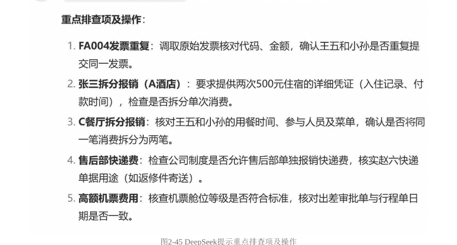

与手工排查相比，智能体的优势在于快速检索文本一致性，例如发票号 FA004、供应商“C餐厅”出现多次即被抓出。若提供历史报销记录，还能推断“张三此前从未有如此高额支出，本次5000元机票需重点核查”。或把公司报销制度给模型，它能按额度筛出超标项。

模型只能提供疑点，不能作为最终结论，最终仍需人工核对原始凭证，避免误判。

## 【复盘总结】

智能助手既可与办公软件协同，也能独立作为分析助手。不少办公软件已内置智能组件，让用户在同一界面完成传统筛选、条件格式等操作，并调用智能分析，形成“先可视化区分，再深度排查”的流水线。

三点经验：

- ① 给模型明确的业务规则，如“同一发票号不可由不同员工报销”“餐饮单笔超额需提示”。规则越清晰，模型越能抓住逻辑矛盾。
- ② 别把模型当最终裁决者，它只提供建议，财务需二次核查，金额异常或信息模糊时更要比对实单。
- ③ 注意风险与安全。直接把整表丢到公网模型存在泄露风险，建议私有化部署或先做脱敏简化，再享受效率提升。

# 第3章 AI财务数据计算：摆脱低价值的重复劳动

财务工作常被数据和表格占据，月初反复核对报表、计算指标、核验数字关系，重复劳动消耗大量精力，而真正有价值的分析反而被挤压。智能工具的出现让这种局面可以改变。

## 3.1 代替手工输入函数进行数据统计

很多财务在汇总计算时被复杂公式卡住。例如想算“各部门×月份综合加权平均成本”，往往要把多个分表合并，再写SUMIF、LOOKUP、IF甚至多层嵌套公式，牵涉上百行数据时效率极低。

智能助手让操作变成对话。在对话框里直接说“请对这一列求平均，再除以另一列，最后汇总”，它就能自动生成所需公式，或直接给出计算结果，避免手动拖拽和写嵌套公式的繁琐。

# 表格批量运算的两种思路

对表格做批量核算时，基本就两条路线可选：一条是直接调用 WPS Office 内置的智能能力，另一条是把数据交给 DeepSeek、豆包、通义这类对话式大模型来处理。

### 【场景一：WPS 内置智能上手演示】

下面这张表记录了订单号、销售额、客户评价、客户类型等字段，见表3-1。

表3-1 销售信息表

| 订单编号 | 销售额（元） | 客户评价 | 客户类型 |
| :--- | :--- | :--- | :--- |
| A1001 | 1200 | 非常满意，服务态度很好 | VIP |
| A1002 | 850 | 价格偏高，但质量不错 | 普通 |
| A1003 | 3000 | 送货速度太慢，不太满意 | 普通 |
| A1004 | 500 | 客服回复及时，体验很好 | VIP |
| A1005 | 1500 | 产品质量一般，有待提高 | 普通 |
| A1006 | 720 | 超级棒的一次购物体验 | VIP |
| A1007 | 980 | 勉强可以接受，服务一般 | 普通 |
| A1008 | 2000 | 物超所值，还会再买 | VIP |
| A1009 | 600 | 质量不如预期，有点失望 | 普通 |

现在用 WPS 的智能助手跑几个小样例。

### 任务01 计算销售总额

拿到表后，首要的指标往往是整体销售额，反映经营业绩。手工写 `=SUM(范围)` 人人会，这里演示让模型来生成。

在表格中选一个空位，比如 B11，用来存放汇总结果。

顶部工具栏打开“WPS AI”，如图3-1。该入口聚合了表格助手、批量生成、数据分析、公式生成等多种能力，处理效率明显提升。


点进“AI 写公式”，会弹出输入框，用自然语言描述需求即可，例如输入“请帮我算出销售总额并给出公式”，如图3-2所示。


无需记忆语法，直接用口语表达。随后 B11 便自动写入了“=SUM(B2:B10)”，合计数值同步呈现，如图3-3所示。

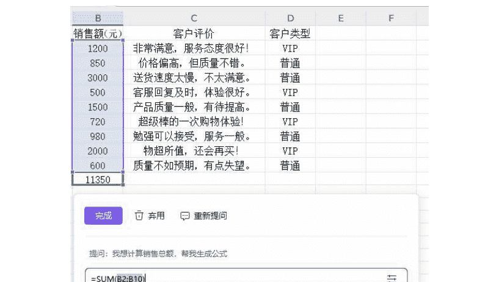

核对公式无误后点“完成”，面板收起，B11 的合计已填好。

### 任务02 统计销售额大于1000元的订单数量

超过阈值的订单数能反映需求变化与定价效果。本次统计销售额>1000 元的订单条数。

结果放在 B12，启动公式生成功能，在对话框里写：

> “请统计销售额大于1000元的订单有多少笔，并生成公式。”

模型分析后给出如图3-4所示的结果。

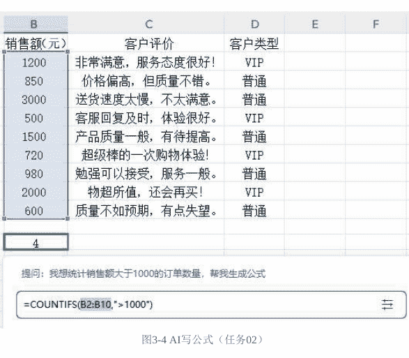

不必自己敲 COUNTIFS，也不用手动框定范围，把意图说清楚，结果就会落到指定单元格。

### 任务03 按客户类型计算平均销售额

前两个例子比较基础，现在同时算两类客户的均值。

最后一列把客户分为“普通”和“VIP”，不同群体的均价有助于优化营销策略。

无需先筛选分类，直接提需求即可。

选中任意单元格，启用公式生成，输入：

> “请计算 VIP 客户的平均销售额并给出公式。”

智能体会挑选合适的函数把结果填入，如图3-5所示。

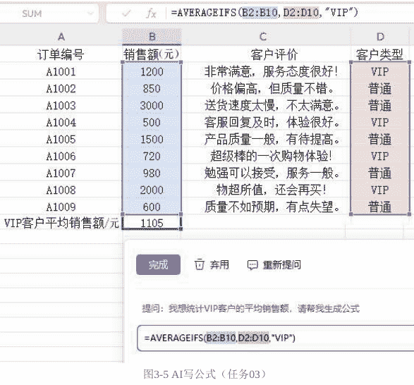

同理也能迅速得到普通客户的平均销售额。

### 任务04 判断客户评价的情感倾向

前三项都是数值汇总，表中还有大量文本，比如客户评价。文本洞察同样重要，以前只能人工判断，如今智能助手可做情感分析、关键词抽取、自动摘要等。

操作要领：

在“客户评价”右侧新增一列 D，用来放情感结果，选中 D2。

对整列做倾向判断需要“批量生成”，打开顶部“WPS AI”菜单下的“批量生成”，如图3-6所示。


在批量生成的对话框里写规则，例如：

> “把客户评价分成‘正面’和‘负面’两类，填入本列。”

窗口会显示如图3-7的内容。

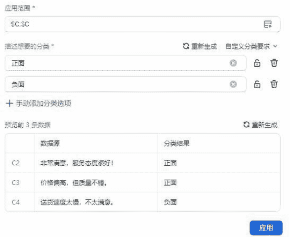

“应用范围”里已默认整列 C，即评价所在的列；分类也已区分正面和负面。

可先预览前 3 条，确认合理后点“应用”，整列即被填充，如图3-8所示。

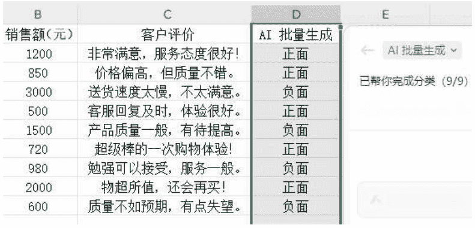

不到一分钟，无需人工阅读、无需手动标注，情感倾向便全部完成。

若想加入“中性”，只要在分类里多写一个“中性”，模型就会做三分类。数据量不大时，保持分类简洁更直观。

### 【场景二：对话式大模型辅助】

从上面的例子看，嵌入办公软件的智能体很省心，不必指定“销售额在哪一列、评价在哪一列”，只要说“算一下销售总额”或“把评价分成正负面”，系统就能自动定位范围并完成计算或分类，减少沟通成本。

只要表头清晰，WPS 的智能助手基本能读懂表格，直接出结果，无需上传下载，交互更轻松。

不过当任务需要生成新内容或做更复杂的计算时，对话式大模型的自由度更高。

下面演示几个纯用对话式模型完成的统计任务。

### 任务05 基于“客户评价”，提取关键词或短语并统计频次

目标是找出评价里出现频率高的词，比如“快递慢”反复出现说明物流有问题，“物超所值”高频说明性价比认可。过去要导出再分词，现在可直接让模型做。

把表3-1 整体截图复制到模型对话框，发出指令：

> “请从这些客户评价里抽取关键词或短语，统计出现频次，并给出词频排行，同时区分正面反馈和负面反馈。”

模型会逐条分词，如“满意”“服务”“质量”“送货速度”等，并统计次数，列出清单，如图3-9所示。

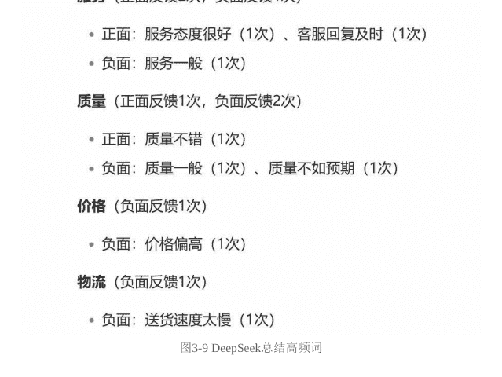

拿到词频后，可回到 WPS 新建“关键词”“出现次数”两列粘贴，再做柱状图，文本分析的工作量大幅下降。

### 任务06 按照客户类型分组，分别计算销售额总和、平均销售和订单数量

把客户分为 VIP 与普通，能更直观看到购买力与订单量的差异，指导资源投入。过去要筛选后再分别求和、求均值、数订单，类型越多越繁琐。

对话式模型只需一句话：

> “按‘VIP客户’和‘普通客户’分组，分别算总销售额、平均销售额和订单数，生成一张新表展示。”

模型立即完成分组运算，如图3-10所示。

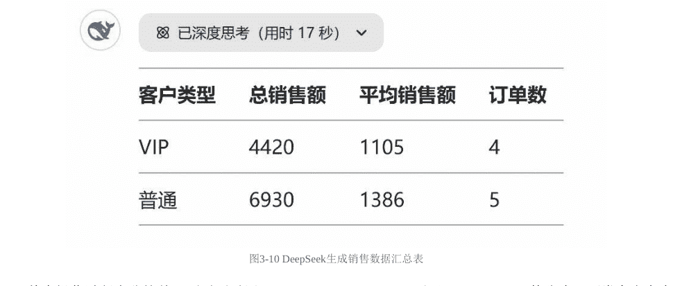

不用写 SUMIFS、AVERAGEIFS、COUNTIFS，两类客户的金额与订单差异一目了然。结果建议抽检一个数值验证，确认无误后再复制到本地表格保存。

### 任务07 基于“客户评价”文本，为每条订单做综合评分

任务04 只是二元划分，实际评价常是多面的，比如价格不满意但服务还行。用 1~5 分的评分更细，能反映满意度。

从财务视角，这类“满意度指数”可检验价格区间与评价的相关性，或高毛利项目是否伴随更多负评。后续还能做特征挖掘。

操作很简单，指令写清楚即可，例如：

> “请基于‘客户评价’文本，为每条订单生成一个综合评分，放在最后一列。若出现‘非常满意’‘超级棒’‘再买’等积极词权重+1，若出现‘不太满意’‘有点失望’‘质量一般’等偏负面词权重-1，最终映射到 1~5 分区间，正面可达 5 分，负面可降到 1 分，中性约 3 分。”

模型会逐条给出评分，形成新表，如图3-11所示。

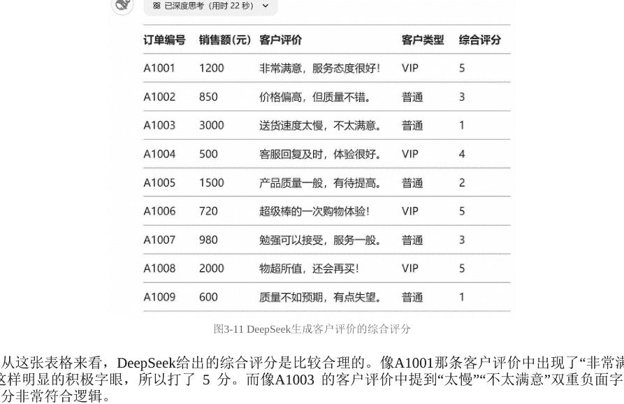

结果较为合理，A1001 因含“非常满意”得 5 分，A1003 因“太慢”“不太满意”双重负面得 1 分。人工翻阅在大样本下很耗时，模型的批量判断效率很高。

这三个例子展示了对话式模型在复杂统计上的能力，分组、情感分析、评分计算只要把逻辑讲清楚就能自动批量处理。

## 【复盘总结】

对比来看，WPS 内置智能的长处是开箱即用，不用解释列名，也不用事后下载上传。而对话式模型的优势是不受软件限制，能深度解析复杂指令。

选择取决于需求：数据就在 WPS 里且主要是数值统计，内置智能够用；需要大量文本评分或自定义分值，对话式模型更灵活。

把常规统计交给智能后，还可以做趋势预测、自动生成摘要报表，结合可视化工具输出图表和解读，让财务人员摆脱公式束缚，聚焦专业判断与决策支持。

最后提醒：无论哪种方式，都要做好抽样核对。模型偶尔会猜错列名或漏掉特殊行，发布结论前务必验证，确认无误后再写入正式报表。

## 3.2 资产折旧额计算

企业里不同资产的使用年限、残值、折旧方法各不相同。算设备投入的利润率前，先要把成本里的折旧算清楚。

有些人用 IF、SUM、LOOKUP 串起一堆公式，改个参数就怕牵一发而动全身，精力都耗在维护公式上。

智能如何帮忙？下面看案例。

### 【案例背景】

某公司新购 3 台设备，每台每月有收入、使用成本和折旧。设备信息如表3-2所示。

表3-2 设备信息表

| 设备名称 | 月收入（元） | 月使用成本（元） | 购入成本（元） | 预计残值（元） | 预计使用年限（年） |
| :--- | :--- | :--- | :--- | :--- | :--- |
| 设备A | 20000 | 8000 | 100000 | 20000 | 5 |
| 设备B | 15000 | 5000 | 80000 | 10000 | 5 |
| 设备C | 10000 | 3000 | 60000 | 5000 | 4 |

### 【任务演示】

### 任务01 计算月折旧额

固定资产需每月计提折旧，多用年限平均法：

（购入成本-预计残值）/（使用年限×12）

不手动输入公式，直接在 WPS 里调用。

在表后新增“月折旧额”列，调出 WPS AI，点击“AI 表格助手”，它是 WPS AI 菜单最左侧的集成入口，里面汇总了问答、批量生成、写公式等功能。

选中 G2，在对话框输入：

> “按照年限平均法，计算设备的月折旧额，生成公式并填入单元格中。”

注意数据格式必须是数值，文本或常规格式会导致识别失败。

WPS AI 很快给出如图3-12 所示的公式。

因为没用批量生成，只生成了设备 A 的结果，随后向下填充其余两行，如图3-13 所示。

整体步骤略显繁琐，需要写指令、保证格式正确、再下拉填充。

用 DeepSeek 再做一次。

把表3-2 截图上传给 DeepSeek，提问：

> “根据表格内容，用年限平均法计算每个设备的月折旧额。”

DeepSeek 展示计算过程和结果，如图3-14所示。

根据年限平均法计算如下：

1. 设备A
   - 年折旧额 = (100000 - 20000) / 5 = 16000 元/年
   - 月折旧额 = 16000 / 12 ≈ 1333.33 元/月

2. 设备B
   - 年折旧额 = (80000 - 10000) / 5 = 14000 元/年
   - 月折旧额 = 14000 / 12 ≈ 1166.67 元/月

3. 设备C
   - 年折旧额 = (60000 - 5000) / 4 = 13750 元/年
   - 月折旧额 = 13750 / 12 ≈ 1145.83 元/月

最终答案：
- 设备A月折旧额：1333.33 元
- 设备B月折旧额：1166.67 元
- 设备C月折旧额：1145.83 元

图3-14 DeepSeek计算设备折旧额

结果与 WPS AI 一致，但只是数值，后续数据变动就得重算。

想要公式而非结果，只需在指令里加一句：

> “根据表格内容，用年限平均法计算每个设备的月折旧额，生成表格函数公式，让我填充到表格中。”

截图最好包含 G 列“月折旧额”，这样模型给出的单元格位置更准，不用人工核对。

DeepSeek 给出的结果如图3-15所示。

以下是各设备的月折旧额计算公式及填充位置说明：

| 设备名称 | 月折旧额公式（填充位置） | 函数公式表达式 |
| :--- | :--- | :--- |
| 设备A | G2 单元格 | =(D2 - E2)/(F2*12) |
| 设备B | G3 单元格 | =(D3 - E3)/(F3*12) |
| 设备C | G4 单元格 | =(D4 - E4)/(F4*12) |

操作步骤：
1. 在表格右侧新增 G 列，标题为“月折旧额”。
2. 在对应行填入上述公式，如设备 A 填入 G2。
3. 公式会自动计算，结果保留两位小数。

图3-15 DeepSeek生成折旧函数公式

让公式替你跑财务：设备核算与成本分摊实战

把设备A的折旧公式先写进对应单元格，往下拖拽填充就能让整列G自动计算出来。用可复用的公式替代一次性结果，更符合财务复核与调整的日常习惯。

### 任务02 计算月净利润率
管理层常会问三台设备当月到底为公司赚了多少钱，这就需要月净利润和月净利润率。

月净利润 = 月收入 - 月使用成本 - 月折旧额
月净利润率 = 月净利润 ÷ 月收入

计算步数增多时交给对话式AI更省心，DeepSeek在多步骤衔接上表现顺手。

在对话框里提问：
> “根据前文的图表，继续计算每台设备的月净利润和月净利润率，用表格函数表示。”

不需要再传图补充背景，AI会沿用上下文直接给出延续答案，如图3-16所示。

### 表格公式填充说明

| 设备名称 | 月净利润公式（H列） | 月净利润率公式（I列） |
| :--- | :--- | :--- |
| 设备A | =B2 - C2 - G2 | =H2/B2（格式化为百分比） |
| 设备B | =B3 - C3 - G3 | =H3/B3（格式化为百分比） |
| 设备C | =B4 - C4 - G4 | =H4/B4（格式化为百分比） |

### 操作步骤
1. 新增列：在表格右侧新增两列：
   - H列：标题为“月净利润”
   - I列：标题为“月净利润率”
2. 填充公式：
   - 月净利润：在对应设备的行中填入公式，如设备A的H2单元格填入 =B2-C2-G2。
   - 月净利润率：在对应单元格填入公式，如设备A的I2单元格填入 =H2/B2，并将单元格格式设为百分比，保留两位小数。
3. 结果验证（以设备A为例）：
   - 月净利润：20000 - 8000 - 1333.33 = 10666.67 元
   - 月净利润率：10666.67 / 20000 = 53.33%

DeepSeek不仅给出函数，还给出操作指引，提醒新增列、填入公式并把净利率转成百分比格式。最终结果与手工推导一致，填充效果如图3-17所示。

### 任务03 计算设备投入回收期
常见的提问是“花了10万元买的设备，多久能回本”。这需要借助已算出的月净利润来估算回收月数。

继续用DeepSeek求解，指令示例：
> “根据前文的计算结果，判断每台设备的投入回收期限是多久，以月为单位。”

DeepSeek的答复如图3-18所示。

### 表格公式填充说明

| 设备名称 | 投入回收期限公式（J列） | 数值结果（月） |
| :--- | :--- | :--- |
| 设备A | =D2/H2 | 9.38 |
| 设备B | =D3/H3 | 9.06 |
| 设备C | =D4/H4 | 10.25 |

图3-18 DeepSeek生成投入回收期限公式

公式与结果一目了然，便于评估风险回报。

### 任务04 一台设备多阶折旧
实务中同一设备在不同阶段可能采用不同折旧方法。例如前两年用年限平均法，后三年因技术迭代改用加速折旧，更能反映前期价值快速流失。

以设备A为例，前两年按年限平均法，后三年改用加速折旧。若要在表格里逐年列示，需要先算前两年计提额与剩余价值，再从第三年起重新设定折旧比例。

在AI对话框输入：
> “设备 A 前 三年采用年限平均法计提折旧，从第三年开始采用加速折旧法计提折旧，列 出每年的折旧金额与年末剩余价值，并给出表格公式方便在 WPS 表格中实现。”

AI快速返回结果，如图3-19所示。

### 设备A折旧计算表

| 年份 | 年折旧额（元） | 年末剩余价值（元） |
| :--- | :--- | :--- |
| 1 | 16,000 | 84,000 |
| 2 | 16,000 | 68,000 |
| 3 | 24,000 | 44,000 |
| 4 | 16,000 | 28,000 |
| 5 | 8,000 | 20,000 |

图3-19 DeepSeek计算多阶折旧额

核对过程：
前两年年限平均法：
年折旧额＝（原始成本-残值）/预计使用年限
＝（100000-20000）/5＝16000 元
第一年年末剩余价值：100000-16000＝84000 元
第二年年末剩余价值：84000-16000＝68000 元

第三年起采用年数总和法：
剩余净值基数＝原始成本-前两年累计折旧-残值
＝100000-32000-20000＝48000 元
剩余年限总和＝3＋2＋1＝6 年
第三年：折旧额＝48000×（3/6）＝24000 元，剩余价值＝68000-24000＝44000 元
第四年：折旧额＝48000×（2/6）＝16000 元，剩余价值＝44000-16000＝28000 元
第五年：折旧额＝48000×（1/6）＝8000 元，剩余价值＝28000-8000＝20000 元

结果准确。多阶折旧更贴合价值曲线，对话式AI省去手工拆分。若要改为前三年加速后两年平均，或中途处置，只需改写指令即可。

### 任务05 设备投资内部收益率估算
除了看月度收益，企业还想知道几年后处置设备能回收多少，并据此估算IRR判断投资是否划算。

在AI输入框输入：
> “参考图片中的数据，假设第三年年末，将各设备按残值卖出。以月净利润为现金流，请帮我估算内部收益率（IRR），并判断每台设备的投资是否划算。”

DeepSeek的计算过程如图3-20所示。

以设备B手工验证：
现金流序列：
- 第0个月：-80000 元
- 第1~35个月：8833.33 元
- 第36个月：月净利润+残值=8833.33+10000=18833.33 元
年化IRR = (1+0.0225) ^12 -1≈30.72%

与DeepSeek结果一致。过去需要手工搭建现金流表，现在AI直接生成。若处置价格变化，一句话调整指令即可，无需重写公式。用WPS AI处理时，可先建现金流列再调用AI组件生成IRR公式，最终效果相同。

## 【复盘总结】
从月折旧到月净利率，再到回收期、多阶段折旧、处置后IRR，AI已不只是写公式工具，更承担财务核算中的思考环节。核心是把多重逻辑组合并给出准确答案。

这种方式把易变的假设拉到对话里动态讨论。例如领导问：“设备B只用三年，第三年末以12000元卖出，相比用满五年哪种更划算？”过去需分别算三年折旧、收入、回收价并对比。现在只需一句：“假设设备B三年后卖12000元，算三年总收益并与五年总收益对比，差异多少。”AI即可输出对比表。

可扩展场景如设备提前故障需维修，传统做法要插入维修费列、调整折旧与回收期公式，条件一变全表需改。AI则能瞬间重跑逻辑。

AI的对话记忆也很关键。先算折旧再算净利润，后续直接问“这台设备的回收期是多少”，AI会自动调取前面结果，无需重复传递数据，在多步骤演算中非常省事。

### 3.3 智能分摊项目成本与费用
成本核算中，公共费用需要合理分摊到具体项目。生产制造、连锁零售、建筑施工等企业常设成本会计岗位，处理租金、水电、管理费、折旧等共担支出。微小误差就会导致报表失真，影响考核与决策。

借助AI，用自然语言描述分摊规则即可一次性完成公共成本分配，减少维护公式的负担。

### 【案例背景】
某公司有3个在研项目A、B、C，数据如下表3-3。

表3-3 项目基本数据

| 项目名称 | 项目初始人数 | 工时（小时） | 本期产值（万元） |
| :--- | :--- | :--- | :--- |
| 项目 A | 10 | 600 | 50 |
| 项目 B | 20 | 1200 | 90 |
| 项目 C | 15 | 900 | 75 |

### 【任务演示】

### 任务01 按人数分摊办公租金
公司年度办公租金60万元，按人头分配较为直观。初始人数10、20、15，占比10/45、20/45、15/45。

实际中人数会变动：6月1日项目A新增1人变为11人；9月30日项目B减少2人变为18人；项目C不变。若按初始人数分摊会失真，需在表格中按月份写IF公式，操作繁琐。

将表3-3上传后输入指令：
> “本年度 6 月 1 日，项目 A 新入职 1 人，人数变成 11 ；等到了 9 月 30 日，项目 B 因为某阶段结束，减少 2 人，变成 18 人；项目 C 的人数一直保持不变，结合表格数据，按项目人数，对全年 60 万元的租金成本进行合理分摊，最后列成表格展示。”

结果如图3-21。DeepSeek先确定各月人数，再汇总人力月数，计算各项目在总计541人·月中的占比，最后乘以总金额。分摊更灵活，避免反复改公式。

### 任务02 按工时分摊水电费
本期水电费20万元，按工时分配。A 600小时、B 1200小时、C 900小时。

指令：
> “请按照工时比例，将 20 万元的水电费分摊给各个项目，把结果用表格的形式列出来。”

结果如图3-22。若需排除项目C，只需加一句“排除项目C”即可。AI还能同时给出多种分配思路对比，手动实现会很耗时。

### 任务03 依据产值来分配公共费用
部分企业倾向按产值贡献来分摊公共费用，体现多赚多担原则。公共费用总额120万元，A产值50万元、B 90万元、C 75万元，B承担比例最高。

在WPS中选中C2单元格，使用“AI写公式”，输入：
> “ 现有 120 万元公共费用，需要按照各项目产值的占比来分摊，帮我生成项目 A 应分摊费用金额的公式。”

AI识别三行产值并生成公式，完成后下拉填充即可，如图3-23至图3-24。建议提前将分摊列格式设为数值保留两位小数。总和验证为120万元。与DeepSeek结果一致，可相互校验。

### 任务04 多维度混合权重分配管理费
有时需要综合人数、工时、产值并设定权重，如人力40%、工时30%、产值30%，避免单一指标偏差。手工写公式复杂度高。

上传表3-3后输入指令：
> “ 公司有管理费 100 万元，按照人力权重 40% 、工时权重 30% 、产值权重 30% 的标准来分摊。将结果用表格的形式列出来。”

> “其中，本年度 6 月 1 日，项目 A 新入职 1 个人，人数变成 11 ；等到了 9 月 30 日，项目 B 因为某阶段结束，减少 2 人，变成 18 人；项目 C 的人数一直保持不变。结合表格数据，按项目人数，对全年 100 万元的管理费进行合理分摊，最后列成表格展示。”

启用深度思考后结果如图3-26。

### 管理费分摊（100万元）

| 项目名称 | 分摊金额（万元） |
| :--- | :--- |
| 项目A | 23.04 |
| 项目B | 43.19 |
| 项目C | 33.77 |

图3-26 DeepSeek计算管理费用成本分摊金额

验算：
项目A加权人数 =（10×5 + 11×7）/12 ≈10.58
项目B加权人数 =（20×9 + 18×3）/12 =19.5
项目C =15
总加权人数 =45.08

项目A：人力23.47%×0.4=9.39%，工时22.22%×0.3=6.67%，产值23.26%×0.3=6.98%，合计23.04%
项目B：人力43.25%×0.4=17.30%，工时44.44%×0.3=13.33%，产值41.86%×0.3=12.56%，合计43.19%
项目C：人力33.28%×0.4=13.31%，工时33.33%×0.3=10.00%，产值34.88%×0.3=10.46%，合计33.77%

分摊金额：A 23.04万元、B 43.19万元、C 33.77万元，总和100万元，验证通过。

多口径的费用摊薄如果靠手工来做，常常要耗上大半天。即便会用函数，也得反复试错公式写法，而 AI 通常能在半分钟内给出答案，对财务同事来说是实打实的减负。

到现在四类费用的分摊金额已经分别算出。若想把这些结果整合成一张总表，可以借助对话上下文的记忆功能，让模型直接生成一份完整的成本费用分摊表，如图3-27所示。

把内容拷贝回本地就能得到可直接上报的各项目分摊清单。

助手的价值并不止于此。真实业务里，分摊规则往往比示例更复杂，比如会出现“产值不足10万元的项目，分配额适当下调10%”之类的条件判断。过去需要在表格里写 IF 判断配合系数，一处疏忽就会导致逻辑混乱并报错。

和助手用自然语言沟通时，只需补充“产值低于10万元的项目，最终结果再扣减10%”，混合规则即可被理解，助手会自行拼接公式或直接给出运算后的数值。更值得注意的是，助手还能把所有数据打包输出，同时附上一段文字说明呈现思路。这比在表格里增设辅助列、反复核对公式要省心，也降低了操作失误的可能。

### 任务05 项目合并费用再做再分摊
基础演示完成后，我们来看一个进阶情形。

企业项目未必能一路顺利，停掉或合并很常见。如把项目 A 与项目 C 合并成新项目 AC，公司仍需把管理费、水电费等共摊成本分到各项目头上。此时 A 和 C 视为一体，不再单独核算，就要在表格里新增引用区域或重写公式。

如今不需要这么繁琐，智能助手能够理解“合并”这一概念并迅速给出结果。

举例，假设要把人力、工时、产值先合并再算管理费，可这样下指令：

> “现在项目 A 和项目 C 合并为新项目 AC，项目 B 保持不变，现在把管理费 100 万元，按之前的权重，重新分摊给项目 AC 和项目 B，用表格的形式输出合并后的人力权重、工时权重、产值权重和管理费分摊结果。”

结果如图3-28所示。

图中显示 DeepSeek 一次性给出了全部数值，无需在表格里逐列合并再核算。

这种合并后即时再分配的方式，对项目频繁整合或拆分的企业很实用。无论预算调整还是战略变化，只要在指令里把合并逻辑讲清楚，助手即可立刻交付分摊结果，并列出每个项目的明细数字。

## 【复盘总结】
回顾前5个分摊任务的演示，可以看出 智能助手在财务逻辑理解上具备几个明显优势。

- ① 处理范围超出单纯加减乘除，只要用语言说明清楚“依据人力头数摊配”“以产值为基准加权”“先算权重再落到项目”，它就能一次理顺计算链条。
- ② 面对人力、工时、产值、折旧等常见要素，助手能按照指令设定的比例或规则抓取对应列，运算后输出符合业务逻辑的分摊表。
- ③ 若要微调某个环节，例如“本次市场部不参与办公租金分摊”，只需补一句，助手就能重新跑一遍分配，而不必在公式里逐段查找“市场”相关的引用，大幅缩短维护时间，让人把精力放到评判分配是否合理、规则是否公平等核心问题上。

在肯定能力的同时，也有两点认知要厘清。

其一，助手解决的是公式编排与自动化运算，无法替代财务人员对公允性或特殊情形的专业判断。你可以告诉它“某部门特殊，给它打折”，它会照做；但若未说明，它不会自行决定谁打折谁全额。因此落地前必须先明确：分摊原则是什么？是人头、工时还是产值？是否存在豁免例外？

其二，无论是 WPS AI、DeepSeek，还是 ChatGPT、豆包、文心一言，任意两种工具都可以做交叉核验。比如先让 WPS AI 分配一次，再把结果交给 DeepSeek 问：“这个比例合理吗？能否给出简要公式解释？”两次结果一致则大概率可靠，若出现细微差异，就重点检查是否有录入错误或遗漏部门。过去只能人工对照公式，用助手互检更省力。

## 3.4 速算财务报表分析指标
资产负债表、利润表、现金流量表即便是非财务人员也熟悉。如今报表基本无需手工编制，直接从记账软件导出即可。

但编制并非终点，还需要基于数据做进一步分析，比如综合评估盈利、运营、偿债等各类指标，为管理层提供更深入的经营判断。

借助 智能工具，可以比较轻松地获得自动化版本的各项财务指标，下面一起验证。

### 【案例背景】
下面是某科技公司的部分年度报表数据，资产负债表如表3-4所示，利润表如表3-5所示，现金流量表如表3-6所示。三张表数据较为简化，非标准模板，仅作案例展示。

### 表3-4 某科技公司资产负债表

| 项目 | 期初数（万元） | 期末数（万元） |

| :--- | :--- | :--- |

| 流动资产： | | |

| 货币资金 | 1200 | 1500 |

| 应收账款 | 900 | 800 |

| 存货 | 300 | 400 |

| 其他流动资产 | 80 | 100 |

| 流动资产合计 | 1480 | 2800 |

| 非流动资产： | | |

| 固定资产 | 3000 | 3200 |

| 累计折旧 | -500 | -600 |

| 无形资产 | 400 | 500 |

| 长期待摊费用 | 150 | 200 |

| 非流动资产合计 | 3050 | 3300 |

| 资产总计 | 4530 | 6100 |

| 流动负债： | | |

| 短期借款 | 500 | 700 |

| 应付账款 | 600 | 500 |

| 应交税费 | 120 | 100 |

| 其他流动负债 | 150 | 200 |

| 流动负债合计 | 1370 | 1500 |

| 非流动负债： | | |

| 长期借款 | 600 | 800 |

| 应付债券 | 400 | 500 |

| 递延所得税负债 | 70 | 100 |

| 非流动负债合计 | 1070 | 1400 |

| 负债合计 | 2440 | 2900 |

| 所有者权益： | | |

| 实收资本 | 1200 | 1500 |

| 盈余公积 | 300 | 400 |

| 未分配利润 | 590 | 1300 |

| 所有者权益合计 | 2090 | 3200 |

| 负债和权益总计 | 4530 | 6100 |

### 表3-5 某科技公司利润表

| 项目 | 本期金额（万元） |

| :--- | :--- |

| 主营业务收入 | 8000 |

| 主营业务成本 | 5600 |

| 营业税金及附加 | 100 |

| 期间费用（合计） | 1200 |

| 投资收益 | 50 |

| 营业外收支净额 | 20 |

| 利润总额 | 1170 |

| 所得税费用 | 170 |

| 净利润 | 1000 |

### 表3-6 某科技公司现金流量表

| 项目 | 本期金额（万元） |

| :--- | :--- |

| 经营活动现金流入（如销售收现） | 7800 |

| 经营活动现金流出（如购买原材料、支付费用） | 6400 |

| 经营活动净现金流量 | 1400 |

| 投资活动现金流入 | 100 |

| 投资活动现金流出 | 1000 |

| 投资活动净现金流量 | -900 |

| 筹资活动现金流入 | 1200 |

| 筹资活动现金流出 | 1000 |

| 筹资活动净现金流量 | 200 |

| 现金流量净增加额 | 700 |

| 期初现金及现金等价物余额 | 1200 |

| 期末现金及现金等价物余额 | 1900 |

### 【任务演示】

### 任务01 速算盈利能力指标
管理层最关心的是盈利水平，即赚钱能力。毛利率反映售出商品扣除成本后剩余的收益，是衡量产品赚钱潜力的重要指标；净利率展示每单位营收最终能保留多少净利润，用来衡量整体盈利效率。股东关注投资回报，净资产收益率衡量自有资本使用效率，数值越高说明为股东创造的利润越多。

下面选取毛利率、净利率、净资产收益率三项代表性指标让 助手辅助计算。

以 DeepSeek 为例，将脱敏后的财务数据上传并输入指令：

> “ 根据资产负债表和利润表，计算公司本年度的毛利率、净利率、净资产收益率这三项财务指标，结果保留两位小数。”

DeepSeek 的计算结果如图3-29所示。

计算公式、过程、数据代入及保留小数均已列出，完全符合指令。财务人员无需自行写公式或查找数据即可获得盈利能力指标。

有人问：若不想把公司数据上传给外部 助手，能否在 WPS 表格中直接计算？尝试在“AI 表格助手”或“快速问答”中输入相同指令，得到如图3-30所示的回答。

可以明显看到：毛利率算对，但净利率的答案与 DeepSeek 不一致，经核验为错误。计算净资产收益率时，因资产负债表和利润表处于不同工作簿，无法直接读取，需提前合并数据，使用上不如外部 助手便利。

再次尝试 WPS 的“AI 写公式”功能来计算毛利率和净利率。

选中利润表空白单元格，调出“AI 写公式”，指令：

> “我想计算公司本年度的毛利率，帮我生成公式。”

逐个指标提问，得到的结果相对准确，公式撰写也便于核验数值引用是否正确，如图3-31所示。

同样会遇到先前的问题：需提前将所有数据单元格设为“数值”格式，呈现结果的单元格设为“百分比”，否则 WPS AI 在调取数值时可能出现格式错误。这一点很重要，因为从记账软件导出的利润表多为字符或文本格式，而非数值格式。

重复步骤测试净利率，如图3-32所示。

此次 WPS AI 的公式调用也失效，未得到期望结果。在财务指标计算场景中，当前 WPS AI 的匹配度可能偏低，后续演示主要以 DeepSeek 为主。

### 任务02 速算偿债能力指标
除了盈利，管理层也关心企业能否及时还债。偿债能力分为短期和长期。

典型短期指标有流动比率和速动比率。流动比率衡量流动资产偿还流动负债的能力，数值越高短期偿债越稳健；速动比率剔除存货后评估即时支付能力。

典型长期指标有资产负债率、产权比率和利息保障倍数。资产负债率显示总资产中负债融资的比例，越高负债压力越大；产权比率反映债权人与股东的资金结构，越高依赖债务融资；利息保障倍数表示经营利润支付利息的能力。

在 DeepSeek 中输入指令：

> “ 根据资产负债表数据，计算公司本年度的流动比率、速动比率、资产负债率、产权比率和利息保障倍数，结果保留两位小数。”

DeepSeek 的计算结果如图3-33所示。

流动比率 = 流动资产合计 / 流动负债合计 = 2800 / 1500 ≈ **1.87**

速动比率 = (流动资产合计 - 存货) / 流动负债合计 = (2800 - 400) / 1500 = **1.60**

资产负债率 = 总负债 / 总资产 × 100% = (1500 + 1400) / (2800 + 3300) × 100% ≈ **47.54%**

产权比率 = 总负债 / 所有者权益 = (1500 + 1400) / 3200 ≈ **0.91** (或 **90.63%**)

利息保障倍数：

- 需息税前利润（EBIT）和利息费用，但利润表中未单独列示利息费用，**数据不足无法计算**。

图3-33 DeepSeek计算偿债能力指标

前四项指标均已计算清楚，公式、数据、保留小数均无遗漏。利息保障倍数因数据不全未能计算，DeepSeek 给出说明，未出现编造数据的情况。

助手还能对期初和期末进行对比。例如指令：

> “ 根据资产负债表数据，计算公司年初的流动比率、速动比率、资产负债率、产权比率，结果保留两位小数。之后，与本年度相关指标进行对比，说明数据是上升了还是下降了，列成表格展示出来。”

助手给出如图3-34所示的回答。

计算结果与对比分析表：

| 财务指标 | 计算公式 | 年初值 | 年末值 | 变动方向 |

| :--- | :--- | :--- | :--- | :--- |

| 流动比率 | 流动资产合计 / 流动负债合计 | 1.08 | 1.87 | ↑ 上升 |

| 速动比率 | (流动资产 - 存货) / 流动负债合计 | 0.86 | 1.60 | ↑ 上升 |

| 资产负债率 | 总负债 / 总资产 × 100% | 53.86% | 47.54% | ↓ 下降 |

| 产权比率 | 总负债 / 所有者权益 | 1.17 | 0.91 | ↓ 下降 |

图3-34 DeepSeek对比期初和期末偿债能力指标

DeepSeek 以表格列出公式、年初值、年末值及变动方向，一眼可见偿债能力变化趋势；计算保持严谨，可直接使用。

若领导突然询问：年末增发债券500万元，资产负债率会变成多少？给出清晰指令即可瞬间得到结果，如图3-35所示。

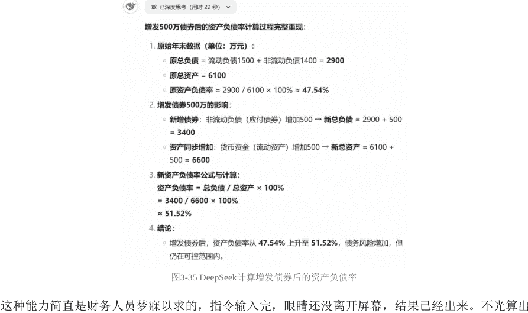

这种响应速度正是财务人员渴望的，指令刚输入，结果已出现。不但算出从47.54%升至51.52%，还完整列出数据变化、计算公式、逻辑推演及结论，省去汇报准备时间。

### 任务03 速算盈利质量指标
现金是企业存续命脉。盈利能力指标显示赚了多少钱，但收入按权责发生制确认，钱未必已到账。客户拖欠、账期过长或坏账风险出现时，就会出现“利润表利润很高，现金流量却不足”的情况。

盈利质量指标关注利润中有多少是真实现金。代表性指标有盈利现金比率、营业收入现金比率、全部资产现金回收率。盈利现金比率衡量净利润中以现金形式流入的比例，越高越扎实；营业收入现金比率看卖出商品收现的速度；全部资产现金回收率评估总资产带来的经营性现金回报。

在 DeepSeek 中粘贴三张报表并输入指令：

> “ 根据资产负债表、利润表和现金流量表数据，计算公司本年度的盈利现金比率、营业收入现金比率和全部资产现金回收率，结果保留两位小数。”

DeepSeek 的计算结果如 图3-36 所示。

计算结果：

1. 盈利现金比率

公式：经营活动净现金流量 / 净利润 × 100%

计算：1400 / 1000 × 100% = **140.00%**

2. 营业收入现金比率

公式：经营活动现金流入（销售收现） / 主营业务收入 × 100%

计算：7800 / 8000 × 100% = **97.50%**

3. 全部资产现金回收率

公式：经营活动净现金流量 / 平均总资产 × 100%

平均总资产 = (4530 + 6100) / 2 = 5315

计算：1400 / 5315 × 100% ≈ **26.34%**


可见，助手可以一次性读取三大报表进行综合计算，且速度快、准确度高，对实际工作助力明显。

### 任务04 合并资产负债表
日常工作中，企业有多家子公司或分支机构时，需定期编制合并报表，将母子公司资产、负债、权益合并后对外报告。

理论上记账软件可直接出具合并报表，但中小企业记账软件往往只管理本公司明细账，子公司账需另行导出，再手工抵销合并。而且往来款、内部销售等科目命名不统一时，软件无法自动匹配，只能人工“翻译”与协调。

人工合并费时费力，让 助手协助编制合并报表，能大幅减少手工编表与抵销工作量。

下面是该科技公司下属一家子公司本年度资产负债表，如表3-7所示。


| 项目 | 期初数（万元） | 期末数（万元） |

| :--- | :--- | :--- |

| 流动资产： | | |

| 货币资金 | 100 | 300 |

| 应收账款 | 80 | 150 |

| 存货 | 120 | 200 |

| 其他流动资产 | 30 | 50 |

| 流动资产合计 | 330 | 700 |

| 非流动资产： | | |

| 固定资产 | 500 | 600 |

| 累计折旧 | -80 | -100 |

| 无形资产 | 60 | 100 |

| 其他非流动资产 | 20 | 40 |

| 非流动资产合计 | 500 | 640 |

| 资产总计 | 830 | 1340 |

| 流动负债： | | |

| 短期借款 | 150 | 200 |

| 应付账款 | 70 | 120 |

| 应交税费 | 20 | 40 |

| 其他流动负债 | 30 | 50 |

| 流动负债合计 | 270 | 410 |

| 非流动负债： | | |

| 长期借款 | 50 | 100 |

| 其他非流动负债 | 20 | 40 |

| 非流动负债合计 | 70 | 140 |

| 负债合计 | 340 | 550 |

| 所有者权益： | | |

| 实收资本 | 400 | 500 |

| 未分配利润 | 90 | 290 |

| 其他权益项目 | 0 | 0 |

| 所有者权益合计 | 490 | 790 |

| 负债和权益总计 | 830 | 1340 |

示例中母企与子企的入账做法出现了两处不一致。

① 存货归集口径不一样。母公司把存货全部放在“存货”科目，子公司却是单独列示“原材料”。如果事先不说明，模型很容易把两者当成不同类别的资产来对待。
② 关联借款的列报位置不一样。子公司向母公司借入的款项计入了“应付账款”，母公司报表里这笔资金则体现在“短期借款”。缺乏映射说明时，系统只能依据关键词做粗匹配，很容易错位。

这种情形下，最稳妥的做法是提前把需要调整的项目写清楚。例如：

> “请把母公司和子公司的资产负债表合并，注意子公司有一笔120万元的短期借款被计入应付账款，需要做抵销处理，最后输出格式一致的合并报表。”

合并后的呈现见图3-37。篇幅所限，下面只摘取核心部分。

| 资产 | 期末数 | 负债及所有者权益 | 期末数 |

| :--- | :--- | :--- | :--- |

| **流动资产** | | **流动负债** | |

| 货币资金 | 1,800 | 短期借款 | 900 |

| 应收账款 | 830 | 应付账款 | 500 |

| 存货 | 600 | 应交税费 | 140 |

| 其他流动资产 | 150 | 其他流动负债 | 250 |

| **流动资产合计** | **3,380** | **流动负债合计** | **1,790** |

| **非流动资产** | | **非流动负债** | |

| 固定资产 | 3,100 | 长期借款 | 900 |

| 无形资产 | 600 | 应付债券 | 500 |

| 其他非流动资产 | 240 | 递延所得税负债 | 100 |

| **非流动资产合计** | **3,940** | 其他非流动负债 | 40 |

| | | **非流动负债合计** | **1,540** |

| | | **所有者权益** | |

| | | 实收资本 | 2,000 |

| | | 盈余公积 | 400 |

| | | 未分配利润 | 1,590 |

| | | **所有者权益合计** | **3,990** |

| **资产总计** | **7,320** | **负债及权益总计** | **7,320** |

图3-37 DeepSeek合并资产负债表

结果显示期末数据已经合并完毕。子公司应付账款调减120万元，对应短期借款调增120万元，子公司短期借款由原来的200万元变为320万元；母公司短期借款原本700万元，抵销内部往来120万元后合并口径为900万元。母公司应收账款相应调减120万元以冲销内部债权。其余项目基本为母子公司直接相加。

合并时若出现金额不符，模型会直接提示异常，便于财务人员快速定位。

## 复盘总结

回顾四个演示，可以确认大模型能够一次性读取三大报表、自动计算分析指标并完成报表合并。将这些能力串联起来，可提炼出三条实操要点。

第一，提示必须清晰。模型对财务术语的理解依赖指令的准确性。若把“应收账款”写成“客户欠款”，把“毛利率”写成“利率”，输出就容易偏差。

第二，上下文越充分，结论越可靠。合并报表的演示属于简化版，真实场景还需考虑控股比例是80%还是100%、是否属于非同一控制下合并、是否需要按购买日公允价值调整子公司权益等。缺少这些背景，合并结果会偏离预期。

第三，财务指标存在内在勾稽。演示中未重点展开，但这是校验计算准确性的有效手段。例如净资产收益率、权益乘数、总资产收益率三者之间存在乘除关系，可用来快速验算。

# 第4章 让财务数据会说话

报表里记录着企业的经营成果和管理思路。领导常说“业绩不错”，具体在利润的哪个环节体现？产品投入与市场推广又怎样牵动利润率？这些宽泛的问题，借助数据都能找到线索。

行情变化快，能从数字里读出资金流向、成本结构和风险信号的人，更容易抓住关键节点。财务分析的本质不是反复核对，而是让沉默的数据自行发声，讲清利润从哪来、资金往哪去、机会在哪、风险在哪。仅靠制表不够，AI是很好的助手。

## 4.1 财务报表数据的解读与分析

报表编制完成、指标算出，只是分析的前两步。要让数字产生价值，还需对指标做细致解读，厘清指标背后的实际含义，分析经营变化的真实原因。

这种解读正是AI的强项。

### 【案例背景】

延续上一节某科技公司的三大报表，并利用AI生成一份完整的财务指标测算结果，如表4-1。

表4-1 某科技公司各项财务指标计算结果

| 分类 | 指标 | 结果 |

| :--- | :--- | :--- |

| 偿债能力指标 | 流动比率 | 1.87 |

| | 速动比率 | 1.60 |

| | 资产负债率 | 47.54% |

| | 产权比率 | 0.91 |

| 营运能力指标 | 应收账款周转率 | 9.41 |

| | 存货周转率 | 16.00 |

| | 总资产周转率 | 1.51 |

| 盈利能力指标 | 毛利率 | 30.00% |

| | 营业利润率 | 14.38% |

| | 净利率 | 12.50% |

| | 净资产收益率 | 37.81% |

| 发展能力指标 | 总资产增长率 | 34.66% |

| 盈利质量指标 | 盈利现金比率 | 140.00% |

| | 营业收入现金比率 | 97.50% |

| | 全部资产现金回收率 | 26.34% |

### 【任务演示】

### 任务01 财务报表的快速概括

拿到数据密集的报表，想快速形成全景式概括，只需一条简洁指令。

以资产负债表为例，上传表格后提问即可。指令不同，回复也不同，例如最基础的提问：

> “请根据这份资产负债表，用文字简要概括公司财务状况。”

DeepSeek 的回复如 图4-1 所示。

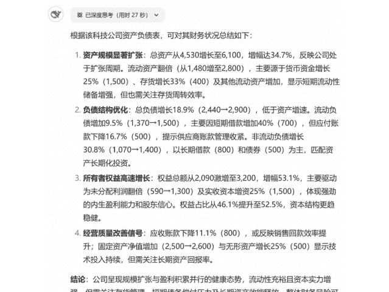

该总结属于典型的描述性汇总，条理清晰，语言简练。内容围绕总资产、负债结构、资本结构等常规角度展开，算是财务状况的入门式概述。

它没有深入探究资产扩张背后的业务动因，整体偏向结果陈述，缺乏推理拓展。但对于想要迅速把握报表变动方向的人来说，已经够用。

如果要把这段总结用在分析报告或向领导做一分钟汇报，可以把使用场景和听众告诉AI：

> “我要向公司非财务背景的领导汇报本年度财务状况，请基于这份资产负债表生成一段一分钟的口头汇报稿。”

此时需求发生变化，听众是非财务人员，表述就要避免专业术语，用更通俗的说法，比如把“流动资产”说成“随时能用的钱”，把“非流动负债”解释为“三年以上的借款”等。

于是得到如 图4-2 的回复。

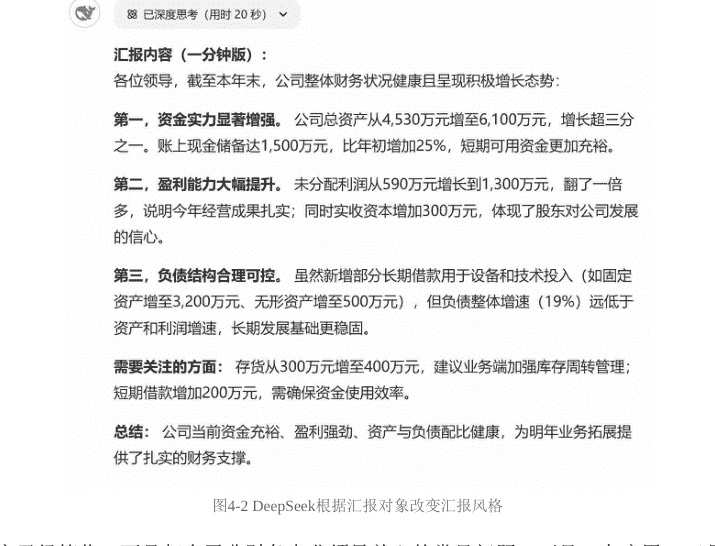

语言明显更口语化，也贴合了非财务领导关心的要点。可见与AI协作时，直接说明想要的结果形态，就能一次拿到最合适的答案。

### 任务02 读懂指标背后的实质

做财务指标分析，先要确定分析哪些指标。

如果已有固定分析模板，直接套用即可；如果是新手或想更新汇报格式，可以直接请教AI：“依据三大财务报表，可以从哪些角度分析财务指标？请列几项并解释含义。”

结果如 图4-3 所示。

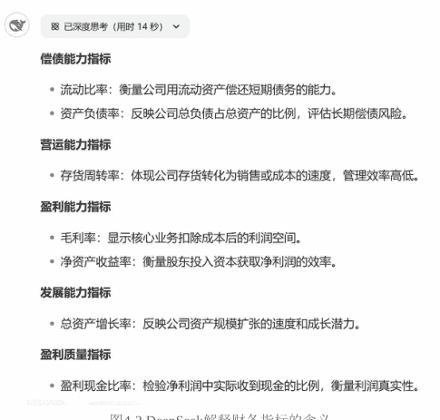

搞清楚每项指标的意思后，就能有针对性地展开。以营运能力为例，把相关指标复制到对话框并提问：

> “请分别解读营运能力的三大指标，并据此对公司营运能力做出整体评价。”

DeepSeek 的评价如 图4-4 所示。

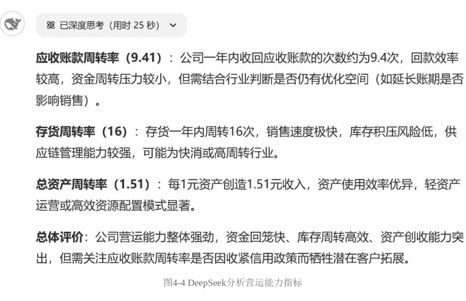

回答不仅给出三个核心指标的解读，还结合业务逻辑做了合理推演。比如应收账款周转率高，指出回款效率好，同时提醒结合行业判断是否存在过度压紧信用，表达留有余地、很专业。存货周转率部分也进一步推测行业特性，分析立体。

盈利能力、盈利质量、发展能力等指标，也可以按同样方式获取解读。

### 任务03 追踪指标变化趋势

之前我们让AI对比期初与期末的偿债能力指标，却没有解释变化意味着什么。

单一时点只能说明当下状况，管理层更在意趋势，即企业是在改善还是出现恶化迹象。

现在以偿债能力变化为例，把 图3-34 的期初期末数据上传，并输入指令：

> “请对表格中偿债能力指标的期初与期末变化进行趋势分析。”

DeepSeek 的分析结果如 图4-5 所示。

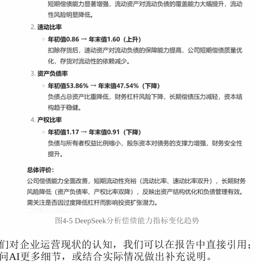

如果推断与实际经营相符，可直接引用；若AI忽略了关键业务信息，也可追问细节或补充说明。

在看到指标明显变动后，还可以加入战略背景做关联分析。例如：

> “结合本公司今年转向线上销售、主要竞争对手加大市场投入的背景，解读这些指标的升降对未来销售目标和资金需求会产生什么影响。”

AI 会在已有数据和背景信息上进行更深层的推演，结果如 图4-6 所示。

结合背景的偿债能力指标影响分析及未来资金需求预测：

#### 1. 指标变化的背景驱动因素

- 线上销售转型：需要前期投入数字化平台、物流体系及营销费用，短期可能消耗流动性，长期有助于提升资产周转效率。

- 竞争对手施压：市场费用增加可能压缩利润，需要保持充足现金储备应对价格战或促销。

#### 2. 偿债能力提升对销售目标的影响

- 流动比率、速动比率上升：短期流动性增强，为线上渠道初期投入提供资金弹性，也能应对竞争对手扩张带来的即时资金需求。

- 资产负债率、产权比率下降：降低债务依赖，减少利息负担，但可能限制杠杆融资空间。需在内部利润积累与外部融资之间取得平衡。

#### 3. 潜在资金需求矛盾点

- 短期需求：线上转型初期需持续投入技术开发与备货，若销售增长不及预期，可能出现现金流压力。

- 长期需求：竞争对手挤压可能迫使公司加大研发或营销投入，需确保毛利率稳定以维持内生资金供给。

图4-6 DeepSeek结合其他背景综合分析偿债能力指标变化趋势

这段回答体现了较强的财务分析思维。指标升降不是孤立看待，而是放在真实经营情境中理解，比如将流动比率上升与线上投入的灵活性关联，将资产负债率下降与未来融资空间挂钩，分析很具针对性。

对短期和长期资金需求的区分，既点出转型期的现金压力，也考虑了竞争下的盈利波动风险，前瞻性较强。

在实际工作中，通过多期对比、横向与行业均值或竞品对比，能得到更丰富的洞察。AI 的价值在于快速识别差异、联想可能原因，最终判断仍需财务人员结合战略、行业和业务实际来定夺。

### 任务04 综合判断并给出建议

完成粗略解读和趋势分析后，管理层通常会问：“这对业务意味着什么？该怎么做？”

只有将分析与建议结合，才能体现财务分析的价值。这时可以让AI整合前面结论，形成行动指引。

把前面得到的关键结论，如偿债能力改善、净利率下滑、营运变化、行业压力等打包输入，或直接在同一对话中指令：

> “请把前面关于企业财务指标的解读和分析整理成一段综合点评，作为财务报表分析报告的总结语。”

指令明确了用途是报告总结语，因此回复会更专业、精炼、要点突出。

DeepSeek 的回答基本符合预期，如 图4-7 所示。

财务报表分析总结语：

本公司本年度财务状况呈现“稳中向好、质效双升”的积极态势：

**偿债能力显著优化**，流动比率（1.08→1.87）与速动比率（0.86→1.60）双升，叠加资产负债率（53.86%→47.54%）与产权比率（1.17→0.91）双降，反映短期流动性充裕、长期杠杆风险可控，为线上渠道转型与市场竞争提供了稳健的资金保障；**营运能力表现亮眼**，存货周转率（16次）与总资产周转率（1.51）均处行业高位，佐证供应链高效协同与资产创收能力；**盈利能力持续强劲**，毛利率30%、净利率12.5%与ROE 37.81%彰显盈利韧性，但需关注高ROE是否依赖债务驱动；**发展能力积极扩张**，总资产增长34.66%，体现战略投入决心；**盈利质量优势突出**，盈利现金比率140%与营业收入现金比率97.5%验证利润含金量，现金流充沛为持续投入夯实基础。

**需关注风险点**：①毛利率提升空间待挖掘，以应对竞争对手挤压；②资产扩张需与收入增长协同，警惕投资回报滞后风险；③若ROE依赖高杠杆，需平衡股东回报与财务安全。

图4-7 DeepSeek生成财务报表分析总结语

知道现状和原因还不够，还要给出怎么做。若只说“请基于以上内容提出3条改进建议”，得到的结果往往空泛。要想建议更落地，提问就要更具体。

可以站在管理层角度思考更关心的议题，比如资金链稳固或盈利提升，然后明确指令。例如：

> “请针对上述风险点提出3个可落地的改进办法，重点放在提升盈利能力和稳固资金链上。”

DeepSeek 给出的回复如图4-8所示。

针对风险点的三条解决方案（聚焦盈利能力与资金链稳固）：

1.  **优化产品结构与供应链成本，提升毛利率**

    - **策略**：筛选高毛利产品线优先推广（如线上渠道定制款），淘汰低利润品类；引入集中采购或战略供应商合作，降低原材料成本；利用数字化工具优化物流路径，减少仓储与运输费用。

    - **效果**：直接扩大利润空间，增强价格战抗压能力，同时释放现金流支持研发与营销。

2.  **建立资产投入与收入联动的动态评估机制**

    - **策略**：对新投资项目（如线上平台、设备购置）实行“投产比”实时监控，设定3-6个月收入达标阈值，未达预期则调整资源分配；推行轻资产运营（如外包非核心环节），减少固定资产沉淀。

    - **效果**：确保资产扩张有效转化为收入增长，避免无效投资占用资金，提高资产周转率。

3.  **构建“内生现金流优先”的融资策略**

策略建议：将盈利现金比率达到140%的优势转化为再投入的动能，例如把年度现金流留存比例设定为60%用于业务扩张；若确需借助外部资金，则优先选用期限较长、利率较低的贷款来替代短期借款，从而降低偿债高峰的压力。

效果：削弱对债务的依赖，改善资本结构，同时为线上转型与市场竞争提供持续的资金支持。

图4-8 DeepSeek生成风险点解决办法

AI输出的建议来源于财务指标与文字描述，并非一定契合企业的组织架构和实际资源。财务人员拿到这些结论后，需要带着报告与运营、生产、市场等部门充分沟通，再把方案修订成可执行的版本。

后续的打磨过程同样可以借助AI，第二轮、第三轮迭代中，AI会结合补充的运营数据或生产信息，对方案不断细化，最终形成更务实的落地思路。

## 【复盘总结】

从拿到报表与指标开始，到借助AI工具完成粗读、指标释义、趋势研判、外部信息联动挖掘，再到建议优化，整个链路清晰可见。AI在财务解读阶段能够大幅压缩海量数据的整理与逻辑串联，让分析不再停留在数字堆砌，而是真正服务于业务决策。

需要警惕的是，AI给出的解读与建议仅作辅助，最终是否合理仍需专业人员结合真实经营状况、行业动向、内部管理策略来判断。对涉及复杂业务背景或敏感数据的部分，必须进行二次核对与推敲。

在与AI协作时，输入的上下文越清晰、信息越详实，输出的洞察就越贴近实际，也越有价值。

## 4.2 多场景假设下评估现金流的健康状况

现金流相当于企业的血液，周转一旦受阻，再好的盈利预期也可能落空。面对原材料价格波动、客户回款推迟、新项目投入、融资到账时间错配等不确定性，财务管理必须通过情景模拟来检验企业在风浪中的稳健度。

### 【案例背景】

背景仍是某科技公司的年度报表。前文“3.4 速算财务报表分析指标”已给出：经营活动净现金流量1400万元，投资活动净现金流量-900万元，筹资活动净现金流量200万元，期末现金及现金等价物余额1900万元。

账面资金尚属充裕，但管理层仍有担忧：一边要为新品追加研发和营销投入，另一边宏观经济不明朗，客户回款周期可能拉长。财务部门希望借助AI对不同情景下的现金流健康度进行多轮模拟与评估，为管理层提供汇报依据和应对思路。

### 【任务演示】

#### 任务01 评估公司当前的现金流健康度

任务起步，先用最基础的方式让AI对当期现金流做概括评价。将年度现金流量表的关键数据粘贴到对话区，并给出通俗指令，例如：“请基于这份现金流量表，对公司当前现金流健康程度做简要点评，语言要通俗。”

AI会输出总体评价，涵盖短期支付能力充足、无资金链风险、投资净流出较大等要点，如图4-9所示。

该公司现金流整体偏健康，主要体现在：

1. 经营活动现金流强劲：净流入1400万元，核心业务造血能力突出。经营现金流入7800万元显著高于流出6400万元，显示回款顺畅、成本可控，主营业务具备持续造血功能。
2. 投资活动合理可控：净流出900万元，主要用于长期资产投入如研发或设备，符合科技企业扩张期特征。投资规模未超经营净现金，未靠外部融资填补缺口，风险可控，但需关注未来回报效率。
3. 筹资活动适度平衡：净流入200万元，流入1200万元可能用于运营或战略投资，流出1000万元或为分红或还债，未出现大规模举债，资本结构稳健，短期偿债压力有限。
4. 流动性充裕：现金净增700万元，期末余额1900万元较期初1200万元增长58%，短期支付能力充足，无断链风险。现金流结构以经营为主、适度筹资为辅，符合成长期特征。

潜在风险与建议：

- 投资效益：需验证研发或资产投入对盈利的拉动，避免资金低效占用。
- 经营稳定性：当前经营现金流虽好，仍需防范市场波动冲击。
- 融资可持续性：若长期依赖外部融资，需优化股债比例，降低资金成本。

结论：短期现金流健康，流动性充足且结构合理；长期需确保投资转化效率并维持经营稳定，整体风险可控。

图4-9 DeepSeek评价公司现金流总体表现

若AI回答未切中管理层关切，例如想知道“资金能否支撑下半年500万元新品研发”，可直接追问：“请补充分析，若下半年追加500万元研发投入，对整体现金流有何影响？”

AI会结合已有数据推演风险，如图4-10所示。

若下半年追加500万元研发投入计入投资现金流出，则：

1. 直接影响：投资净流出由-900万扩大至-1400万，全年现金净增由700万降至200万，期末现金由1900万降至1400万，降幅26%，流动性仍在安全区间。
2. 资金来源：若完全由经营净流入1400万覆盖，无需新增筹资，但会削弱储备；若部分依赖筹资，则可能增加负债或股权稀释，需权衡成本。
3. 长期平衡：研发短期增加现金消耗，符合创新战略，若产品成功商业化，可提升未来经营现金流。需确保研发效率与转化率。

风险提示：若全年经营现金不及预期叠加研发投入，期末现金可能逼近安全线。需预留应急资金，防止研发周期延长或市场风险导致承压。

结论：500万研发投入使现金储备下降但未触及警戒，短期风险可控，长期收益取决于研发成效与主营稳定。

图4-10 DeepSeek分析追加问题——研发对现金流的影响

在此场景下，仅凭报表与简单指令即可形成现金流全貌认知，后续若研发或营销持续加码，需提前预留风险底线。

#### 任务02 调整单一假设，观察对经营现金流的影响

回款速度是影响现金流的关键变量。客户付款期延长会占用流动资金，若能换来订单增长，管理层需权衡利弊。可让AI模拟“应收账款回款周期延长”的影响。

假设公司收入规模8000万元，应收账款余额800万元，原回款期60天。若延长至90天，一季度内无法变现的现金将增加。告知AI基础信息后发起单一变量提问：“主营收入8000万，应收账款800万，回款期由60天延长至90天，对经营活动现金流的影响及额外占用资金是多少？”

DeepSeek给出简化测算，如图4-11所示。

回款期拉长后，经营现金流预计减少667万元。若缺乏其他融资渠道保障顺畅运转，公司可能面临资金链断裂风险。该做法显然不可取。

#### 任务03 多重变量并发假设，综合评估资金状况

经营决策往往面临多变量叠加，如原材料涨价、销售不及预期、回款期拉长同时发生。让AI同时处理多重假设，更贴近真实压力环境。

设定综合情景：原材料价格上涨10%推升主营成本；销售增速从预期10%下调至5%，收入不足；应收账款回款期延长至90天。将信息打包提问：“基于这三项假设，重新预测下半年经营现金流量，期末现金余额剩余多少？”

AI会将变量套入原有模型，粗略估算下半年现金流较原计划的减少幅度，如图4-12所示。

结果仅作演示参考，因原材料成本在主营成本中的占比未明确，AI只能简化处理，可能存在高估或低估，但足以体现AI处理多变量的能力。

#### 任务04 引入投资和筹资活动，做资金预测

现金流不仅受经营影响，投资与筹资的波动往往更剧烈。一次大额设备采购会短期消耗大量资金，而银行贷款到账则能补充现金。需把投资与筹资纳入假设。

假设明年第一季度投入2000万元购置新生产线，为弥补缺口计划第二季度发行1000万元公司债券，剩余1000万元差额由自有资金或短期贷款承担。打包提问：“参考今年数据，模拟明年季度现金余额走势，考虑经营、投资、筹资联动。”

AI预测结果如图4-13所示。

| 季度 | 经营净现金流 | 投资净现金流 | 筹资净现金流 | 期末现金余额 | 资金缺口处理 |
| :--- | :--- | :--- | :--- | :--- | :--- |
| Q1 | 350 | -2,225 | 1,000 | 1,025 | 短期贷款1,000万 |
| Q2 | 350 | -225 | 1,000 | 2,150 | 发行债券1,000万 |
| Q3 | 350 | -225 | 0 | 2,275 | 无缺口 |
| Q4 | 350 | -225 | 0 | 2,400 | 无缺口 |

逻辑对应：Q1投入2000万，期初1900万+350-2225+1000=1025万；Q2发债1000万后期末2150万；全年经营贡献1400万，筹资2000万，投资净流出2900万，期末比年初增加500万。

图4-13 DeepSeek预测明年资金状况

AI按季度联动模拟出现金走势，第一季度投资支出与第二季度发债的过渡清晰呈现，短期贷款与自有资金使用尚属合理，但未考虑经营现金波动或其他融资手段，假设较为单一，与信息有限有关。

还可让AI估算新债利息，若公司债年化利率6%，下年度利息支出及经营利润是否覆盖，以提前评估融资风险，避免借新还旧的恶性循环。

#### 任务05 AI辅助做情景敏感性分析，生成多情景报告

把前述零散假设整合为多情景分析，提供乐观、基准、悲观三种假设，让AI一次性输出对比结果，并给出期末现金余额与短期融资需求及建议。

情景假设：

乐观：销售增长率10%，回款周期60天，原材料成本不变或小幅上涨。
基准：销售增长率5%，回款周期75天，原材料成本上涨5%。
悲观：销售增长率2%，回款周期90天，原材料成本上涨10%，且新增2000万元设备投资，融资可能延迟。

指令：“请基于三种情景，分别预测明年现金流，用表格列出情景、预测期末现金余额、可能融资需求及运营或财务应对建议。”

AI输出表格如图4-14所示。

三种情景下现金流预测与应对建议

| 情景 | 预测期末现金余额 | 融资需求额 | 运营/财务应对建议 |
| :--- | :--- | :--- | :--- |
| 乐观 | 2,540万元 | 0 | 1. 加速市场渗透，维持回款效率；2. 预留资金用于技术迭代。 |
| 基准 | 1,790万元 | 0 | 1. 优化供应商账期，对冲成本上涨；2. 加强应收账款动态监控。 |
| 悲观 | -1,140万元 | 2,340万元 | 1. 紧急启动股权/债权融资；2. 暂停非核心投资，压缩管理费用；3. 与客户协商预付款或缩短账期。 |

图4-14 DeepSeek做情景敏感性分析

该回答未展示计算过程，收入、成本、回款如何映射到现金流缺乏中间推导，严谨规划需补充逻辑与更具针对性的建议。可继续要求AI生成详细多情景报告用于汇报。

> “参照上述分析，形成一份多情景报告，用于会议展示。”

报告部分内容如图4-15所示。

公司现金流多情景预测与管理建议报告

一、引言
本报告基于不同市场环境假设，分析未来现金流状况，评估潜在风险并提出应对策略。通过乐观、基准、悲观三情景量化财务影响，为管理层决策提供数据支持。

二、核心假设与测算方法
1. 情景定义
- 乐观情景：需求强劲，回款高效，成本可控。
- 基准情景：市场平稳，部分客户延迟付款，成本小幅上升。
- 悲观情景：经济下行，客户资金紧张，成本大幅攀升且融资受阻。
2. 关键参数设定

| 参数 | 乐观情景 | 基准情景 | 悲观情景 |
| :--- | :--- | :--- | :--- |
| 销售收入增长率 | +10% | +5% | +2% |
| 应收账款回款周期 | 60天 | 75天 | 90天 |
| 原材料成本涨幅 | 0% | +5% | +10% |
| 新增投资规模 | 0万元 | 0万元 | 2,000万元 |
| 融资计划达成率 | 100% | 100% | 0% |

图4-15 DeepSeek生成多情景报告

报告迁移至本地后经修改定稿，可用于打印或PPT展示。

## 【复盘总结】

上述5个任务展示了AI在评估企业现金流时的深度辅助作用。将经营变量、投资与筹资变动整合后，AI可处理多重假设并给出量化结果。熟悉操作方法后，可在实际业务中灵活调整参数，快速看到变量叠加的影响，避免单点分析局限。从单一假设到多变量并发再到整体模拟，充分体现了AI的强大功能，帮助财务人员用最少时间得到贴近真实经营场景的预测图景。

本节突出“情景敏感性分析”在现金流决策中的重要性。AI不仅能告知资金缺口多少，还能说明不同情景下的缺口及对策。尤其是第4、5个任务，将投资计划、融资时点、利息成本纳入统一分析，使财务人员能清晰识别风险节点与规划重点。

实务中，自动生成的多情景报告能让管理层快速对比乐观、基准、悲观假设，也便于财务与各部门协同，做好资金安排与战略落地的预案。

## 4.3 多融资方案对比抉择

企业发展到一定阶段，资金短缺会成为瓶颈。新项目启动、产能扩张或抓住市场机遇都需大量投入，仅靠经营收入往往无法即时满足。融资渠道多样，包括银行贷款、发行公司债券、股权融资、应收账款保理、票据贴现等，每种方式成本、风险和影响各不相同。过去财务人员需花费大量时间测算对比，如今可借助AI快速推进。

### 【案例背景】

前面提到的某科技公司，因扩充产线投入大量研发与市场推广费用，虽经营现金流仍健康，但自有资金留存不多。为抓住行业窗口期，管理层拟筹措约3000万元资金，用于设备更新、加速新品上市及铺设销售渠道。最初倾向银行贷款，内部讨论后发现可选路径众多，每种方案均有吸引力与风险，管理层希望财务部门提供多套融资方案对比报告，结合财务数据、指标变化及治理结构影响，辅助决策。

### 【任务演示】

#### 任务01 列出多种可行的融资方案，并做初步介绍

目标是让AI快速梳理当下情境下常见可行的融资方式，并做简短说明，便于管理层查阅“融资方案清单”。

若无现成模板，可通过对话式AI快速获得初步建议，再结合经验取舍。打开AI工具，将脱敏后的企业基本情况与融资需求粘贴后下指令：“公司当前资产负债率约48%，流动比率1.87，净利润率12.5%，主营消费电子制造；明年需约3000万元资金，使用期限2年左右；可接受一定利息成本或股权稀释，但要求流程效率高、到账快。请列举银行贷款、公司债券、股权融资、应收账款保理、票据贴现等可行融资方式，并说明每种方式的大致优缺点。”

AI会从知识库调取常见融资手段，给出说明，如图4-16所示。

### 融资工具盘点与取舍逻辑

1. **银行贷款**
   优势在审批较快，一般1到4周能落地，资金成本在4%到8%之间，且不摊薄股权。短板是会抬高负债率，通常需要抵押物或第三方担保。**建议优先考虑。**

2. **应收账款保理**
   优势在到账速度最快，3到7天可收齐款项，且不计入表内负债。劣势是综合成本偏高，约5%到15%，对账款质量要求严格。**适用场景是有优质应收款需要快速补血。**

3. **股权融资**
   优势是不用还本付息。劣势是会稀释控制权，谈判与尽调周期长，往往3到6个月。**适合非紧急的长期用途。**

4. **票据贴现**
   优势是放款即时，1到3天到账，成本相对低约3%到6%。劣势是需要足额的承兑票据，期限短需不断滚动。**可作为短期周转的辅助手段。**

5. **公司债券**
   优势是利率水平低，期限可与资金需求匹配。劣势是发行流程慢，1到6个月不等，且准入门槛高。**当资金不急用时更合适。**

**综合判断**：首选银行贷款搭配保理的组合，资金可在两周内到位，综合成本大约6%到10%。纯保理或短期过桥可作备选。尽量避开股权融资因其耗时过长，也要谨慎使用纯票据贴现以防期限错配。

拿到上述清单后，财务团队仍需结合自身状况筛选。例如是否有足够抵押物支撑银行贷款，资产规模与信用评级能否满足公司债发行，股东对稀释股权的接受度如何，先把短期不可行的路径剔除。

这项工作的产出，本质上是从庞大的可能性里快速提炼出一张融资备选清单，并附上每种方式的简要说明与优劣，便于管理层先做初步认知，也为那些行业特色的融资工具打开思路。

### 任务02 用数字比拼融资成本

确定候选清单后，管理层通常关心：银行贷款和发债到底差多少，利息负担几何，资产负债率会不会失控。这正是量化环节要回答的问题。

该环节更重计算，我们可以让AI把不同方案对报表的冲击制成对比，并给出具体数值。

可把最新资产负债表数据带入，比如负债总额2900万元，所有者权益3200万元，资产总额6100万元。发出测算指令：

> “银行贷款预估利率5.5%～6.5%，拟融资3000万元；公司债券假设票面利率5%，发行费用约占融资额1%。请简略测算两种方案对资产负债率、流动比率、利息保障倍数的差异。  
> 方案一：2年期银行贷款，年利率6%，到期一次性还本付息。  
> 方案二：公司债券发行3000万元，年利率5%，2年到期。”

AI读取数据后输出结果如下。

方案一银行贷款影响：
1. 资产负债率：负债增至5900万，资产增至9100万，资产负债率约64.8%，原为47.5%。
2. 流动比率：贷款若列为流动负债，流动资产2800万/流动负债4500万，流动比率降至0.62；若归入非流动负债，则保持约1.87。
3. 利息保障倍数：新增利息180万，年利息总额287万，利息保障倍数约1170/287≈4.08倍。

方案二公司债券影响：
1. 资产负债率：负债增至5900万，资产增至9070万，扣除发行费30万后，资产负债率约65.1%。
2. 流动比率：流动资产增至5770万，流动负债1500万，流动比率提升至3.85。
3. 利息保障倍数：新增利息150万，年利息总额257万，倍数约1170/257≈4.55倍。

结论要点：
- 资产负债率两者相近，64.8%对65.1%。
- 流动比率方面，方案二明显改善，3.85远高于方案一潜在的0.62。
- 利息保障倍数方案二更优。

综合倾向方案二，因其兼顾流动性与利息负担；若贷款能确认为非流动负债，方案一也可保留。

量化后，方案对比不再停留在“感觉哪个好”，而是有明确数字支撑。AI呈现出的利息差异与报表表现清晰可见。公司债利息虽低，需计入发行与合规成本；银行贷款操作直接但要担保抵押。把应收账款保理加入比较，费率会更高但资金到位更快。

有了数据，还需要一句总结。AI给出的汇报口径大致是：方案二更优，两方案均把资产负债率从47.5%推升到约65%。关键分歧在于流动性，一是贷款若计入流动负债，流动比率会从1.87跌至0.62；二是债券带来现金，流动资产升至5770万，流动比率跃至3.85。利息方面，方案一每年约180万，方案二约150万，对应利息保障倍数分别为约6.5倍与7.8倍。建议优先方案二，若贷款可确认为非流动负债则方案一可备选，并需保证收入稳定。

必要时可让AI自动生成表格，把关键数字一目了然，例如两年一次性还本后每年需预留的利息金额对净利润和现金流的压力。

### 任务03 股权融资对控制权的影响测算

资金成本与财务指标只是视角之一，若采用股权融资引入战略投资者或机构，就可能触及股权稀释、决策权分散等治理问题，这往往是管理层最敏感却易被忽略的点。

先告知AI当前持股情况，比如A、B、C三位股东分别持股50%、30%、20%。

若新增3000万元股权融资，实际稀释比例取决于估值与条款。假设投前估值为1亿元，3000万元对应约23%的新股比例。要求AI测算稀释后持股与董事会影响。

> “公司现有A、B、C持股50%、30%、20%。按1亿元投前估值融资3000万元，约占23%股权。请测算原股东稀释后比例及对董事会的可能影响。”

AI迅速给出：A从50%摊薄至38.5%，B从30%降至23.1%，C从20%降至15.4%，新投资方占23%。

若创始人高度看重控制权，股权融资会变得敏感；若企业希望借助战略资源做协同，股权融资反而可能是资源交换的机会，同时拿到资金与渠道。

### 任务04 还款能力推演与长期压力测试

融资不仅是拿钱，还要考虑后续偿还对中长期现金流和资本结构的影响。银行贷款与公司债到期需还本付息，股权融资则要考虑退出安排。没有预案，未来两年到三年可能出现资金链风险。

需先明确未来2至3年经营预期，例如营收增速10%到15%，净利率维持12%左右。这意味着能产生多少净利润，能否覆盖还款高峰。

可让AI进行还款模拟：

> “假设选择3000万元银行贷款，2年到期一次性还本，年利率6%。结合利润表与现金流，是否会有偿付风险？若收入未达标会怎样？”

上传财务数据后得到回复：

偿付能力评估，贷款本息合计3360万元。

1. 基于当前：年净利润约1000万，两年累计2000万，不足以覆盖本息，需依赖现金流或再融资。经营净现金流年约1400万，两年2800万，加上现有现金1900万，理论上可覆盖3360万，但需保留运营资金，压力仍存。
2. 若收入下降20%：净利润或腰斩至约500万/年，经营现金流降至约800万/年，两年累计现金缺口约960万，违约风险明显上升。

结论：业绩达标时现金流勉强够付，需严控支出；业绩不达标时须提前准备再融资或资产处置，建议做20%收入下滑的压力预案。

同理选择公司债，两年后需付本金3000万加利息300万共3300万，若现金储备不足需考虑续发债或引入新资金。股权融资方面，AI会提醒VC/PE通常3至5年寻求退出，可能通过上市或转让实现，若无法上市或约定的对赌未达成，可能被动回购，造成财政与法律风险。

可结合此前现金流多情景假设，让AI在乐观、基准、悲观情景下分别评估还款风险。

### 任务05 多方案汇总与决策建议

前四个任务逐步拆解了方案列举、成本量化、股权影响、还款压力。现在需要把碎片信息整合成一份管理层可用的多方案对比报告，并与AI共同打磨结论。

对话框输入：

> “请把前面列举的融资方案要点汇总成表，维度包括资金成本、对报表指标影响、对股权治理影响、两年后还款或退出压力。”

AI生成对比如下。

融资方案对比

| 方案 | 资金成本 | 报表影响 | 股权/治理影响 | 还款/退出压力 |
|---|---|---|---|---|
| 银行贷款 | 年利率6%，两年利息360万 | 资产负债率升至64.8%；若为流动负债流动比率降至0.62 | 无稀释，需抵押担保 | 2年后还本付息3360万 |
| 公司债券 | 年利率5%+1%发行费，实际年化约6.06% | 资产负债率升至65.1%；流动比率升至3.85 | 无稀释，需遵守债券条款 | 2年后还本付息3300万 |
| 股权融资 | 出让23%股权，投前估值1亿 | 资产负债率下降，净资产增加 | 原股东稀释至A38.5%/B23.1%/C15.4%，新股东进入董事会 | 无还款，但需分享利润与控制权 |

随后让AI据此生成报告：

> “根据以上内容生成一份多方案对比报告，开头给出优先级排序，说明公司当下更适合哪种。”

报告要点：

一、优先级排序
1. 公司债券，短期稳健首选
2. 股权融资，长期避险可选
3. 银行贷款，仅作应急备用

二、维度对比
资金成本、报表影响、治理影响、还款压力四项均已列示。

三、当下适配性
若侧重短期流动性，公司债券可把流动比率从1.87提升至3.85，利息压力也略低；风险是资产负债率升至65.1%，需确保经营现金流稳定。
若收入不确定性高，股权融资无还款压力，可规避违约风险；代价是A股东控制权从50%降至38.5%，需重新设计治理结构。
若紧急且收入有保障，银行贷款到账快，但若列为流动负债流动比率会跌至0.62，流动性风险极高。

财务人员拿到报告后，还需结合经营战略、管理层风格与市场判断进行修订。若创始人坚决不稀释股权，则需剔除该路径。AI也可提出混合方案，如部分银行贷款搭配部分股权融资以分散风险。

任务结束，管理层可获得清晰的对比表与建议书，对各方案的短期与长期影响形成系统认知，为与银行、投资人或保理机构谈判提供基础。

## 【复盘总结】

沿着五个任务推进，我们完整走了一遍从方案盘点到决策建议的流程。

直观感受是，AI不只是计算助手。在第二个任务里它完成了融资成本量化，在第三个任务里却能分析股权稀释、董事会席位、优先清算权等治理层面的利弊。创始团队对话语权的在意，或企业对战略协同的渴求，这些非数字因素AI也能捕捉并提示，体现出更强的理解力。

在此基础上，还可进一步拓展。例如结合多情景现金流分析，让AI在最佳、基准、最差情景下评估债务与股权组合的适配性，判断是否保留应收账款保理作为备用选项。

在董事会层面，混合或阶梯式融资很常见，比如先用银行贷款缓解流动性，再视市场窗口发行债券或引入战略投资。AI可通过对话推演各阶段资金使用与还款节奏，以及股权结构演变，形成更具操作性的方案。

# 第5章

财务数据报告可视化：让汇报一针见血

财务信息来源分散、数据繁杂，想要迅速抓住重点并不容易。可视化的思路在于把复杂内容整理成可读报告，用图表图形替代晦涩数字，让信息一眼可懂。过去这往往靠人工反复制作，成本高且易出错。现在借助AI，只需提供数据即可大幅提升汇报效率。下面先看看本章内容。

## 5.1 自动提炼财务会议要点

财务会议发言里充斥大量数字、预算项目与专业术语，讨论话题也常快速切换。会后要追溯决议、重点指标、责任人，往往需耗费数天整理录音与笔记。

AI会议助手可在会议进行时实时识别发言，自动归类要点并输出纪要，省去反复听录音的负担。接下来展示AI如何从多线程的财务会议中提取重点，提升效率与准确性。

### 【案例背景】

某医疗器械公司近期研发费用、水电能耗、市场推广支出增速加快，每月需开会审视预算执行与盈亏变化。参会者除财务部外，还包括研发主管、市场负责人及海外合作伙伴。会议时长数小时，涉及多项数字报告、技术名词与外语交流。

在此场景下，尝试使用AI会议助手，看其能否自动区分发言人观点，抓取动议与后续动作，并实现中英文即时互通。

### 【任务演示】

### 任务01 快速同步转写会议发言

首先在设备上安装AI助手应用，本次演示以“通义”AI助手为例。会议地点多变，移动设备更便携，如手机、平板或笔记本。

打开通义网页版，点击侧边栏“效率”，进入“实时记录”，如图5-1所示。手机端同样可找到“实时记录”进入功能，如图5-2所示。

可选择“现场录音”或“手机音频”。会议进行中选前者，会后补录选后者，一键转写。

选择“现场录音”后，会议启动，所有通过麦克风输入的声音会被实时识别并转为文字，屏幕上滚动显示。如图5-3所示。若识别有误，可点选文字手动修正或标记，待会后处理。

可以看到，通义对不同发言者进行了智能区分，避免了后期人工标注的麻烦。

### 任务02 自动生成要点导读与关键词

AI助力会议记录与财务写作实战

录音停止后，助手会依据已生成的逐字稿开展自动梳理。不同产品路径略有不同，有的在录制途中即给出概要，有的要在录制结束后才开始处理，操作手感基本相近。

以通义为例，系统会从发言里抽取关键段落拼成一段导读，并罗列相关关键词，如预算执行、研发费用、海外合作，效果见图5-4。

原文 导读 脑图

### 会议基础信息
2025-03-31 09:40:44 - 09:43:39

参会人: 发言人1、发言人2、发言人3

> "公司目前面临的主要问题是开支增速过快，这包括了研发、水电能耗以及市场推广等关键领域的费用大幅超出预算，对公司的财务健康构成挑战。尤其在核心技术攻关这一重要阶段，需进一步加大投资以确保突破。同时，国外市场的激烈竞争迫使公司增加广告投放和渠道建设的投入，而海外合作的回款问题则影响了现金流。针对这些挑战，公司将采取措施加以应对和解决，以维持公司的稳定发展和竞争力。"

- 公司开支
- 预算执行
- 盈亏变化
- 研发费用
- 水电能耗
- 市场推广费用
- 核心技术攻关
- 市场竞争
- 广告投放
- 渠道建设
- 海外合作
- 回款速度

图5-4 通义总结会议内容

同时会扫描“请示”“决定”“安排”“落实”“责任人”等提示词，自动标出涉及决策或后续跟进的发言归入“待办事项”。

### 任务03 跨语言同步对照与翻译
若参会者中有境外伙伴，或需要让海外同事查阅纪要，会后打开“原文”，右上角的“翻译”入口支持选择目标语种，如图5-5所示。

### 翻译
目标语言
- 不翻译
- 中文
- 英文
- 日语
- 取消
- 确定

图5-5 通义翻译设置页面

选择“英文”演示，点击“确定”后数秒即可完成翻译，如图5-6所示。

图5-6 通义中英文翻译对照效果

这样无需另请翻译，就能把双语要点直接发送给海外协作方，对跨国协同很有帮助。

### 任务04 提取图文数据重点
财务会议里常提到报表、图表、PPT中的数值，随时可拍照上传给通义，系统能自动识别文字与数据，如图5-7所示。

这张图片的内容是关于“财务会议预算执行情况讨论”。看起来像是一个会议或报告的标题页，主要议题是讨论财务预算的执行情况。如果你有关于这个主题的具体问题或需要进一步的帮助，请告诉我！

图5-7 通义提取图片中的文字

部分应用还会为本次会议的核心议题生成“可视化概览”，例如用分支图串联要点，形成脑图，便于快速抓住主干，如图5-8所示。

图5-8 通义生成会议要点脑图

## 【复盘总结】

上述四项任务完整演示了会议要点提炼的流程。复盘后有三点认识。

① 前两项侧重即时转录与自动成稿，并非只能在手机上使用。笔记本、平板、会议室一体机同样支持，且电脑端功能更全面。

例如通义网页版可对录音文本做精简改写，如图5-9所示。

## AI改写
在保留原文的要点内容基础上，将原文内容进行精简和改写

显示内容 ● 改写结果 ○ 原文和改写结果

立即体验

图5-9 通义AI改写会议内容功能（网页版）

网页版还支持按人单独查看发言，如图5-10所示。

## 筛选
- □ 只看标记内容
  - 🔵
  - 🔴
  - 🟡
- ☑ 显示发言人
  - ☑ 全选
  - ☑ 🐦 发言人 1
  - ☑ 🐦 发言人 2
  - ☑ 🐦 发言人 3

图5-10 通义筛选发言内容（网页版）

另外，财务专业术语或企业内部代号，如产品代号、部门简称等，模型默认库未必覆盖。提前建立自定义词库，有助于提升纪要准确度。

② 第三项展示了多语言翻译，若企业长期与海外客户或分支机构往来，仅有双语对照不够。可把多语言纪要与结构化要点结合，实现一边分层总结、一边自动输出多语言版本。

例如会后先生成带层级分组与决策清单的中文纪要，再一键生成英语或其他语种版本，并保留层级与责任对应。内外团队收到的结构一致、信息同步，有助于财务审批、预算调整保持同一节奏。

③ 第四项的图文提取不止于可视化。实践中，财务部门可把智能生成的要点对接到项目管理平台、OA系统，或嵌入企业ERP，让会议决策与业务数据双向贯通。

## 5.2 随时输出财务汇报文稿

财务工作除了核算分析，还要频繁撰写邮件汇报、个人总结、财务报告等文字材料。紧急情况下希望最快产出清晰专业的稿件。

对话式智能工具能让文字输出进入快车道。提供关键信息、思路和目标读者，就能迅速获得初稿，稍作修改即可提交。

### 【案例背景】
某新能源企业财务主管需向不同对象发送文档。上午给供应商写邮件解释结算变动，中午写内部财务简报给财务总监，下午准备预算外追加申请递交高层。

以下演示以 DeepSeek 为例。

### 【任务演示】

### 任务01 生成邮件初稿
需求是给长期合作的零部件供应商写邮件，要求本月开具采购发票。提示写作目的与要点：

> “帮我写一封给供应商 A 的邮件，主题是‘货物已经收到，尽快开具本月的采购发票’，语气要礼貌、内容应简短，突出用于成本抵扣，希望对方理解并配合。”

助手即时生成如下，如图5-11所示。

邮件主题：关于货物签收及本月采购发票开具的协助请求

尊敬的供应商A：

您好！

我司已收到本月采购的货物（订单号：XXX），验收无误。现烦请贵司尽快开具**本月对应款项的增值税专用发票**，以便我司及时完成财务入账及税务抵扣相关工作。

因涉及月度成本核算及进项税申报，如蒙贵司配合于**X月X日前**提供发票，我们将深表感谢。若有疑问，请随时与我联系（电话/邮箱）。

感谢支持，顺祝商祺！

此致

XXX（您的姓名）

XXX公司财务部

联系电话：XXX-XXXXXXXX

日期：XXXX年XX月XX日

图5-11 DeepSeek生成邮件初稿

生成后需核对是否涵盖关键信息，缺失可再补充，或自行修改填充。语气偏正式可要求再改：“请写得更亲切一些。”确定后复制发送即可。

### 任务02 生成内部财务简报
财务主管每周需向财务总监提交简报，包含收入支出概况及异常指标，如意外保险理赔或材料成本骤升。

把表格关键数字粘贴给助手，让其拟简报提纲。指令示例：

> “请根据以下财务数据，帮我列出一个简报提纲。重点突出本周收入与支出总额、异常科目及原因、后续建议动作。”

助手会产出结构清晰的大纲，通常如图5-12所示。

### 财务简报提纲
1. 财务概况
   - 收入：210万元（含保险理赔10万元+主营200万元）
   - 支出：170万元（材料120万+人力50万）
2. 异常科目
   - 材料成本激增30%（上周92.3万→本周120万）
     - 原因：原材料价格波动或临时采购增加，需核实。
   - 保险理赔10万元：确认入账准确性，评估类似非经常性收入潜力。
3. 建议动作
   - 采购部：分析价格趋势，协商供应商或寻找替代。
   - 财务部：监控现金流，优先处理保险理赔入账复核。
   - 建立原材料价格预警机制，防范后续波动。

有了提纲，可继续让助手按提纲生成约300字简报稿。若漏掉关键信息如理赔到账时间、成本激增具体原因，可补充要求让助手增补。

### 任务03 生成预算外追加申请报告
公司出现预算外资金需求需走正式审批。市场部申请50万元额外预算用于新一轮产品推广，提供资料如下。

1. 竞争对手近期加大线上投放，导致本公司产品曝光度下降。
2. 申请金额50万元，主要投向短视频平台和搜索引擎推广。
3. 预计投放周期一个月，保守估计ROI为15%至20%。
4. 风险在于投放策略不精准可能达不到预期，需准备备用方案。

审核通过后需撰写《预算外追加申请报告》，公司模板如下。

一、申请背景
说明市场环境、竞争状况及为何需要额外预算。
二、预算申请金额
列明具体数额并说明与原预算差异。
三、资金使用计划
明确分配方式、投放渠道、使用周期、负责团队。
四、预期收益与ROI
估算销量增长、利润贡献或品牌影响，给出回报率。
五、风险与对策
分析市场风险或投放失败风险，提出应急方案。
六、结论与审批请求
重申必要性，向管理层正式提出申请。

将信息与模板粘贴给助手，要求：

> “根据市场部提供的资料，按照公司的报告模板，生成一份《预算外追加申请报告》，要求语言正式且结构完整。”

助手很快输出初稿，篇幅有限仅截取部分。检查完整性，必要时提示“请增加竞争对手投放数据分析报告、ROI测算模型”，助手会迅速补足，短时间内完成符合模板的报告。

### 任务04 生成管理层会议汇报发言稿
月度或季度管理层会议汇报需展示关键数据并做简短发言，台上3分钟，台下准备常需3天。智能体可在仅有数据表的基础上快速生成面向高层的发言稿。

假设运营情况如表5-1所示。

表5-1 公司运营情况表
| 项目 | 内容 |
|---|---|
| 本月销售额 | 320 万元 |
| 上月销售额 | 300 万元 |
| 销售额环比增长 | 6.70 % |
| 本月毛利率 | 35% |
| 本月经营性现金流 | 80 万元 |
| 核心产品线 A 占比 | 40% |
| 核心产品线 A 销售额 | 128 万元 |
| 核心产品线 B 占比 | 25% |
| 核心产品线 B 销售额 | 80 万元 |
| 市场推广支出 | 45 万元 |
| 研发投入 | 20 万元 |
| 下月重要项目 | 新品 C 推广预热 |

提示助手：
> “请帮我写一份向管理层汇报的发言稿，侧重于销售表现与成本投入，最后加上一段对下月新品推广的预期分析。用于在会议上发言。”

助手生成的发言稿如图5-14所示，涵盖销售额、毛利率、现金流等关键数据，结合产品线表现作出判断，对A产品线风险预警、B产品线潜力挖掘具备现实感与前瞻性。新品推广部分规划具体、预算合理、目标明确，并预留应急预算应对不确定性。结尾提出明确下一步行动建议，推动业务落地。整体兼顾经营视角与管理执行力，稍加润色即可使用。

### 任务05 生成对外发布的财务新闻稿或公告
对外披露财务信息需避免过度承诺与不当披露，同时兼顾易读性。相比内部报告，对外措辞更需谨慎，尤其数字披露与前瞻性表述。

假设公司刚统计完最新季度业绩。较去年同期主营业务收入增长15%，净利润增长8%，新业务板块贡献占比从5%提升至12%。

指令示例：
> “请用新闻稿风格撰写一份公告，以通俗易懂的方式突出收入与新业务增长，措辞要谨慎。”

助手给出偏官方公告风格的初稿，语言正式、术语规范，适合对外披露，如图5-15所示。

初稿完成后需与法务、公关讨论措辞，避免不当披露或夸大。可提示助手“请删除对未来具体收入数额的猜测，改为更谨慎的表述”，助手会立即重写。确认合规后润色，以公司新闻公告形式发布。

## 【复盘总结】
复盘5个任务可见智能助手在财务文本输出中适用性广泛：从邮件到结构化简报、预算追加报告、管理层发言稿、对外新闻公告，均可迅速产出草稿，理顺语言逻辑。最终仍需财务人员审核补充，避免数据或合规疏漏，但效率大幅提升。

实践中可根据场景灵活指指令：指定目标读者、篇幅与口吻、插入财务数字与合规要点。对话深化后，助手能更精准把握行文风格，让“随时输出财务汇报文稿”成为现实。

## 5.3 定向绘制财务图表

数据能说明问题，但原始形态不利于理解。展示时通常需转化为图表。过去只能在办公软件中手动设置样式、排版配色，做数据看板更耗时。现在可借助对话式智能工具直接生成可读图表，或引导在WPS等软件中绘制。

### 【案例背景】
某制造公司发布最新季度经营报告，财务部需在例会上呈现销售收入变化、成本结构、库存周转等可视化图表。时间紧、人手少，主管尝试让智能体自动生成图表并在WPS中编辑美化。

### 【任务演示】

### 任务01 快速生成基础柱状图与折线图
财务分析最常用的是柱状图与折线图。对比大小用柱状图，展示随时间变化趋势用折线图。

某公司1—6月销售收入与销售成本数据如表5-2所示。

表5-2 某公司 1—6 月份的销售数据表
| 月份 | 销售收入（万元） | 销售成本（万元） |
| :--- | :--- | :--- |
| 1月 | 100 | 60 |
| 2月 | 120 | 70 |
| 3月 | 90 | 50 |
| 4月 | 150 | 80 |
| 5月 | 160 | 90 |
| 6月 | 180 | 110 |

### 方法一：利用智能工具 + 第三方工具
多数智能工具不直接生成图表，但可让助手输出Python代码或Markdown，再配合第三方工具成图。

例如让助手生成制作柱形图的Python代码，如图5-16所示。

```python
import matplotlib.pyplot as plt

plt.rcParams['font.sans-serif'] = ['SimHei']
plt.bar(['1月','2月','3月','4月','5月','6月'], [100,120,90,150,160,180])
plt.title('销售收入'); plt.ylabel('万元')
plt.tight_layout()
plt.show()
```

图5-16 DeepSeek生成柱形图代码

使用代码生图时常出现字体显示不全、出现“□”的问题，通常是运行环境缺少字体支持。DeepSeek给出的代码已用plt.rcParams指定支持中文的字体如SimHei。

将代码放入交互环境运行，即可自动生成柱形图，如图5-17所示。

```python
import matplotlib.pyplot as plt

plt.rcParams['font.sans-serif'] = ['SimHei']
plt.bar(['1月','2月','3月','4月','5月','6月'], [100,120,90,150,160,180])
plt.title('销售收入'); plt.ylabel('万元')
plt.tight_layout()
plt.show()
```

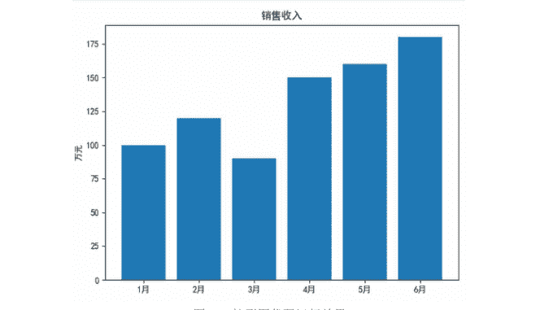

图5-17 柱形图代码运行效果

此方法适合有一定编程基础的财务人员。

### 方法二：利用WPS AI在WPS中直接生成图表
打开WPS表格，将“月份”“销售收入”“销售成本”三列数据粘贴至A1:C7。

调出WPS AI，打开“AI表格助手”，以对话形式告知需求：

> “请根据 A1:C7 区域的数据，为我插入一个组合图表，其中柱状图表示销售收入，折线图表示销售成本，并为图表添加合适的标题。”

按上述指令，WPS AI 产出的复合图示于图5-18。

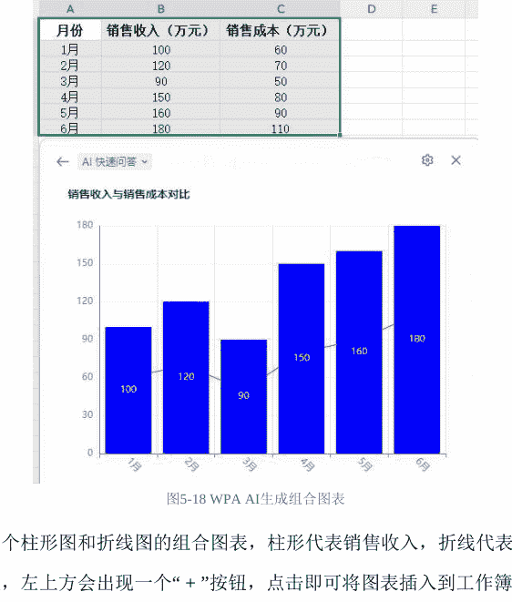

图形同时呈现了柱状与折线的混合样式，柱体用于展示营业收入，线条用于展示营业成本。

把光标悬停在图表上方，左上角会出现“+”号，点击后该图即可固定到当前工作簿。

全程不需要额外编程工具，在公司常用的办公软件里就能完成生成与编辑，效率较高，贴合财务日常出表的工作习惯。

### 任务02 借助 AI 搭建透视表与透视图

财务分析很少只看单一维度，通常会同时对照产品类别、地区、销售额、成本、利润率等多项指标。透视表与透视图是表格软件的重要能力，能在同一张表内实现筛选、切片与汇总。

下面以 WPS 为例，说明如何借助智能助手完成透视表与透视图表的创建。示例数据为表5-3。

表5-3 某公司销售明细表

| 月份 | 产品线 | 销售额（万元） | 成本（万元） |
| :--- | :--- | :--- | :--- |
| 1月 | A线 | 120 | 70 |
| 1月 | A线 | 100 | 60 |
| 1月 | B线 | 80 | 50 |
| 1月 | B线 | 90 | 55 |
| 2月 | A线 | 130 | 80 |
| 2月 | A线 | 110 | 65 |

把整张表完整复制给智能助手，并说明：

> “我想在 WPS 表格里制作一个数据透视表，行维度是月份，列维度是产品线，值是销售额和成本，同时还想看到利润字段，请列出操作步骤。”

助手会给出分步指引，如图5-19所示。

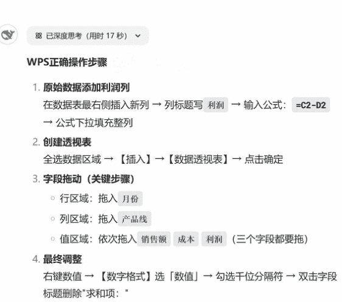

按指引操作后，得到如图5-20所示的透视表。

| 月份 | A线 销售额 | A线 成本 | A线 利润 | B线 销售额 | B线 成本 | B线 利润 |
| :--- | :--- | :--- | :--- | :--- | :--- | :--- |
| 1月 | 220 | 130 | 90 | 170 | 105 | 65 |
| 2月 | 240 | 145 | 95 | 180 | 115 | 65 |
| 总计 | 460 | 275 | 185 | 350 | 220 | 130 |

图5-20 按步骤创建数据透视表

透视表生成后，若想更直观地观察走势，可在 WPS 的“插入”菜单中选择“数据透视图”，挑选折线、柱状等合适的样式。步骤不熟时可再次请助手补充说明。

插入透视图后，还能使用“切片器”进一步限定数据。例如在“产品线”字段上添加切片器，就能一键切换查看 A 线或 B 线的指标变化，实现交互式浏览。

透视表与透视图的最大价值在于，源数据只需在单一表格中维护，而汇总、筛选、切换结果可在另一张表或图中实时呈现。相比过去手工做多张静态表，新方式大幅节省时间，也降低了重复汇总和公式出错的风险。

## 【复盘总结】

本节两个任务并非要把财务人员培养成可视化专家，而是展示一种新型协作模式：财务提供核心数据与业务逻辑，智能助手负责生成或指导绘图，随后财务再借助 WPS 等常用工具做适度润色与排版，在有限时间内拿出既美观又实用的可视化成果。通过人机协同，财务部门能更从容地用图形语言表达财务状况，让数字真正“动”起来，帮助管理层和业务部门更直观理解数据。

不同平台对图表的支持程度不一。有的能直接给出动态可视化链接，有的只返回静态 PNG 或 SVG。财务不必局限于“直接出图”的想法，完全可以先让助手产出思路、布局与脚本，再到 WPS、Excel 或 Power BI、Tableau 等工具二次加工。因为直接生成的图表未必处处符合要求，且大多不可编辑，本地加工才能最大化满足公司实用需求与审美风格。

本节聚焦定向绘制图表，更高阶的应用是让助手在可视化同时进行简单预测或分析，例如基于销售历史绘制外推趋势图、用回归模型预测下季度营业额。生成图表后，还可让助手在图旁自动加入解释性文字或智能注释，例如，“本月库存周转率明显提升是因订单数量大增，需警惕原材料供应稳定性”。在自动洞察加持下，图表不再只是直观图形，更能提供有洞察力的解读。

## 5.4 Word 报告到 PPT 的快速转换

在商务或项目场合，文字报告与演示文档是两种不同的呈现形式。文字版擅长条分缕析阐述背景、数据与推理，演示文档则适合在会议上快速展示，突出重点与可视化效果。

财务、市场或人力等部门通常先在 Word 中撰写详细报告，再把要点提炼到 PPT 中进行排版配图。借助智能助手，Word 转 PPT 不再耗时。只需把报告文本交给助手，助手即可梳理段落、关键数据与标题结构，自动生成初稿，用户只需做最后修饰与排版。这种一键转换既提升效率，又保证输出质量。

下面分别用通义与 WPS AI 演示 Word 报告转 PPT 的过程。

### 【案例背景】

下面是一份某公司财务部门近半年工作进展、成果及下一阶段计划的报告。

### 半年度财务部工作总结与展望

一、整体目标完成情况
本财年初，财务部围绕“提升数字化效率、强化风险管控、支持业务增长”三大方向设定目标。上半年整体完成率约75%，部分项目达标或超预期，部分环节仍需改进。

二、主要工作成果
（1）数字化进程：应收账款自动化核对模块上线，人工操作效率提升60%，差错率显著下降。
（2）成本控制：原材料价格上涨情况下，通过预算监控与供应商谈判，综合采购成本同比仅升3%，低于行业平均涨幅。
（3）财务共享平台上线：境内多分支机构接入共享系统，月度结算周期缩短，一定程度上缓解人力不足。

三、现存问题与挑战
（1）自动化程度不平衡：部分子公司未纳入数字化核算，需进一步整合。
（2）内部人员培训：新系统对操作技能要求高，目前仅60%员工完成培训，需加大推进。
（3）政策影响：财税政策变化频繁，需跟踪解读并快速落实。

四、下阶段计划
（1）强化内部培训：线上线下结合，全面覆盖财务与相关业务团队。
（2）加强风控与合规：数字化系统中引入更多自动预警，提升风险监测精准度。
（3）深化外部协同：与更多供应商、客户系统对接，打通流程数据，降低对账结算人工负担。

五、总结
上半年财务部打下数字化基础，但在系统整合与培训方面仍需完善。未来将紧扣“降本增效、守牢合规”核心，持续优化流程、强化内部协同与外部联动，为业务拓展保驾护航。

接下来将该工作总结转为 PPT，以便在下周公司月度会议上汇报。

### 【任务演示】

### 任务01 用通义把文档转成 PPT

打开通义主界面，点击侧边栏“效率”按钮，找到“PPT创作”，如图5-21所示。


图5-21 通义网页版“PPT创作”功能入口

点击“开始创作”，进入内容上传页，如图5-22所示。


通义支持一句话主题，也支持长文本或文件上传。报告较短时可直接粘贴，报告较长时可拖拽文档上传。注意此处只需上传内容，无需发出指令。

上传完成后点“下一步”，系统自动识别文档内容并进入大纲确认界面，如图5-23所示。

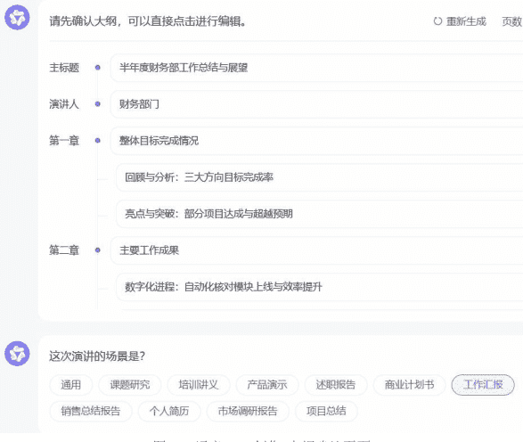

界面会展示自动生成的大纲或提示，便于快速预览系统对文档的理解与拆分。可在此增删合并章节、拆分子目录或修改表述。还可选择演讲场景，如“工作汇报”，让助手按场景调整布局。

确认无误后再次点“下一步”，进入 PPT 生成页。最醒目的是 PPT 模板选择区，如图5-24所示。


系统提供多种风格模板，选择其一并点击右上角“生成PPT”即可制作并预览效果，如图5-25所示；不满意可点“切换模板”预览其他效果。


为增强视觉层次与逻辑性，通义支持插入层级图、流程图与循环图。层级图适合展示组织结构、项目分级等；流程图适用于业务流程、审批步骤等；循环图用于周期性、反馈关系等。在财务领域有助于表达持续优化逻辑。

进入编辑界面后，若文档中含有可层级展示的小标题，系统会 Hij 自动插入对应图形。若未自动识别，也可手动选中大纲文字或列表，点击侧边栏的“插入层级图”或“插入流程图”按钮，如图5-26所示，系统会据内容自动生成图形。


图5-26 通义“PPT创作”侧边栏功能

确认后，点击页面上方“导出”按钮即可导出多种格式，如图5-27所示。例如选择“导出为PPT”，即可获得本地文件便于细化编辑。

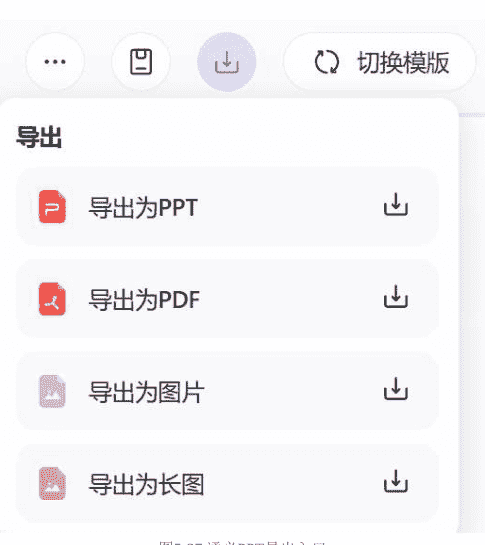

图5-27 通义PPT导出入口

### 任务02 用 WPS AI 把总结转 PPT

若习惯用 WPS 写文档做 PPT，此方法更贴近工作习惯。确保使用含 WPS AI 功能的版本，一般为最新电脑版或网页版。检查报告是否已保存为 WPS 可读格式 .docx 或 .wps，否则先转换。

无需打开 PPT，在文字报告主界面即可看到“WPS AI”功能按钮，如图5-28所示。


图5-28 WPS AI“文档生成PPT”入口

点击“文档生成PPT”，WPS AI 会新建演示文稿并进入大纲确认页，自动识别文档内容生成 PPT 大纲，随后选择模板，如图5-29所示。


与通义不同，WPS AI 除推荐模板外，还支持上传个人收藏模板，或用喜欢的图片作背景生成自定义模板，满足公司对色彩、字体、Logo 位置的统一要求。不同类型文档可拥有专属模板。

任选一个模板查看生成效果，如图5-30所示。


WPS AI 立即生成基础幻灯片预览，且为可在本地直接编辑的 PPT，可随时修改文字、删除合并页面、调整字体大小。还提供“美化助手”，为每页应用统一色调与标题格式并加入插图图标，使整套幻灯片更专业。

## 【复盘总结】

以上两个任务演示了通义与 WPS AI 从 Word 到 PPT 的转换流程。二者各有特点。

通义作为对话式助手，拆分要点、概括结构表现不错，能以更大自由度产出初稿，也可按指令生成辅助脚本或 Markdown 文件，使半自动化方案更灵活。但通义与 PPT 软件无联动，最终仍需导出到本地再做精细美化。

WPS AI 则与 WPS 生态无缝衔接，文档与 PPT 在同一软件环境转换，生成后可直接后期处理，无需频繁切换应用。但对冗长或结构复杂的报告，WPS AI 在抓重点方面可能不如成熟对话式助手。毕竟 PPT 是演讲提示，不必承载全部内容。

无论哪种方法，都能在 5 分钟内把报告做成 PPT，省去大量手工整理。再进一步，PPT 完成后可反向上传给助手，要求据内容生成发言稿，这对需上台汇报的财务人员是额外助力。

# 第6章 AI 财务落地：打造“AI+”工作流程

数字化、智能化时代已至，财务部门掀起“AI+”流程再造热潮。多数人积极但不知从何入手，例如听说过“训练你的私人财务顾问”，却不知如何创建与训练。本章旨在教会财务人员将智能助手真正融入工作流程，甚至进入此前未涉足的新领域如编程。

## 6.1 训练你的私人财务顾问

会计、资金、预算等专业人士常希望拥有一位随叫随到、永不疲倦的顾问，能秒答日常难题并给出专业建议。当前对话式助手在很多方面已实现这一想法。

但使用中很多人发现，助手回答多为通用信息，对企业实践细节不了解，实用性不足。对话式助手另有重要功能即“智能体”，通过加入自定义资料或知识库，可创建专属智能体，使其更贴合公司内部流程或个人理财需求，让专属“随叫随到”的财务顾问成为现实。

### 【案例背景】

假设你是一家金融科技企业的资金管理主管，公司正加速布局海外结算业务。财务部门需掌握大量跨境支付、合规申报、汇率风险等知识。你手头有一份公司整理的《跨境资金管理指引》，涵盖汇款流程、备案要求、限额规定、KYC 审查及财务报表示例等详细条款。

为减少重复解答，你希望把该指引变成“私人财务顾问”式智能体，让内部人员尤其是分公司财务或业务经理可直接对话助手获取专业回答，减少邮件与电话咨询。

下面以通义为主工具演示如何从零搭建可回答特定金融场景的智能体。

### 【任务演示】

### 任务01 创建我的智能体

登录通义平台，侧边栏找到“智能体”，进入后在“发现智能体”页上方点“+ 创建我的智能体”按钮，如图6-1所示，即可开始创建。

### 6.1 创建专属财务顾问智能体

通义提供若干创建模板，若要完全符合自身情况可选择“自由创建”，进入智能体设置页，设置头像、名称、设定、权限等。

通义提供 AI 绘制头像功能，可输入如“一个专业财务顾问图标，包含货币和文件元素”。也可自定义上传企业吉祥物或公司 logo，头像仅起视觉提示作用，不影响回答。

名字宜简单好记，如“财务顾问”或“跨境结算小帮手”等。随后围绕期望输入设定。

关键设置是权限，共三种：完全公开、部分公开、仅自己可见。完全公开的智能体可被全网搜索，不适合当前场景。本智能体供公司内部使用，选择部分公开。

设置完成后效果如图6-2所示。

设置页下方有折叠的“高级设置”，多数为选填，影响不大，但下拉至底部有“知识”，如图6-3所示。

此处是让智能体更贴合自身情况的关键，也是训练的核心。我们在此提供的内容越详细，智能体回答越贴近公司真实需求，例如上传公司整理的《跨境资金管理指引》。

上传成功后，助手会把文本信息吸纳到数据库，后续回答若检测到关键词或相关话题，会匹配并引用这些资料，而非依据网络通用内容。

设置完成后点“创建”，智能体即创建完成。

### 任务02 测试提问我的智能体

先确认智能体能否真正调用已导入的知识库作答，重新打开之前搭建好的“财务顾问”智能体，参考图6-4。

向其提问：
“如何向境外合作伙伴划款？前面要走哪些申报流程？”

观察返回的结果是否引用了我们上传指引里的细节，倘若只是泛泛而谈的行业常识，说明模型还需要调优。

若答案跑偏或过于模糊，可在“设定”里补充约束，例如：“回复内容只能基于已上传文件中的政策说明，禁止自行推测，也不要列出本公司无关的条文。”

### 任务03 分享我的智能体

经过测试和微调确认可用后，这款智能体可以生成链接分享给团队成员，也能嵌入企业内网或财务系统，实现一键检索。

分享入口在智能体头像右上角，点击“分享”即可弹出复制链接的窗口，如图6-5所示。

把链接贴到企业微信、钉钉等沟通软件即可完成分发。

因为金融政策和内部流程都会随时间变化，建议定期把最新指引重新导入，用新版本覆盖旧版本，防止模型给出过期答案。

如果资料量大，可拆分为多份分批导入，并在目录中标明更新重点，方便模型更条理地调用。

## 【复盘总结】

到这里，我们已经在通义平台上完成了一个带有企业属性和专业知识的“财务顾问”。整体路径可总结为“建模—导入资料—测试调优”三步，走完很快上手，适合需要即时问答的财务同事当作专属助手。

除跨境资金咨询外，类似的私人顾问思路，还能拓展到培训、合规、客服等领域。将培训材料、操作手册等喂给模型，就能变身为全能的知识问答库。

若加上多语言支持，海外分部的同事也能用各自母语对话，省去翻译环节，减少跨文化沟通成本。

## 6.2 财务工作中AI改造的切入点

财务日常除了报表和演示，还夹杂着大量繁琐但关键的事务，一旦没人跟进，流程就会卡壳。表面上看不算核心，却长期占用人力，比如逐张核对上千张发票、整理零散报销、追踪月度税申、与多家供应商核对付款、归档历史单据等。单笔工作量不大，累积起来却很消耗精力。

随着对话式AI成熟，把标准化、流程化的重复环节交给模型，是释放人力、提升效率的新方向。

### 【案例概览】

以一家中等规模的制造企业为例，财务团队约十人，业务涉及采购、生产、销售和售后，上下游往来频繁。

部门细分为应收组、应付组和综合组。应收组管开票和回款，对账项繁多；应付组负责采购、劳务、外包等支出，每月发票和报销单据量大；综合组主攻成本核算和分析，时常抽调人力协助应付组核票、对账或办理税申。正是在这种现状下，企业决定先从标准化程度高的环节试点AI，开启数智化探索。

### 【任务演示】

#### 任务01 批量发票校验

有些公司每月待核发票在几百到几千张之间，需要逐笔核对抬头、税号、金额并归入对应项目或成本中心。利用AI的文本识别能力，可自动提取抬头、税号、金额、开票日期等信息，并整理成台账。

比如将电子发票PDF导入后提问：
> “请把这三张电子发票整合成一张发票管理台账，包含发票代码、号码、开票日期、购方名称及税号、销方名称及税号、金额、税额、价税合计、校验码、类型、备注等关键项。”

具体提问方式见图6-6。还可追加规则：
> “金额大于1万元或开票日期超出当月范围的请特别标出。”
> “抬头与公司名称不符的请判定为异常票据。”

最后把生成的台账导出到本地人工复核即可。几分钟内就能得到录入表，并迅速找出异常单据。

#### 任务02 供应商应付对账与付款排期

企业往往对接众多供应商，账期和付款方式各异。规模增大后，人工对账、数据校验和付款指令下发会消耗大量时间，若发票延迟或金额错误，还会引发反复沟通。

AI可从四方面提供支持：
- ①汇总对账：从ERP或财务系统导出应付明细，同时把供应商寄来的对账单PDF、Excel统一放到AI可读取的文件夹。
- ②智能匹配：借助供应商名称、发票号或业务编号，将对方对账单与公司内部应付清单进行比对，找出金额不一致或遗漏的项目。
- ③异常高亮：比如系统记录10万元，对方单据写12万元，AI会用醒目标记突出异常行，并简要说明可能原因，如某张发票未入账或重复录入。
- ④生成付款清单：对账结束后，AI结合各供应商的账期和过往付款习惯，自动生成下周或下月的付款优先级和总额规划，帮助财务在审批付款前把控全局。

先让AI完成大批量核对，人工只需聚焦异常并与供应商确认。最终还能输出清晰的付款排期，结合现金流给出顺序建议，为管理层提供参考。

#### 任务03 历史凭证归档与检索

日常运营会累积大量原始凭证、合同、银行流水等资料，因纸质与电子并存，后期检索常耗时费力。审计、税务检查或内部追溯时，找档案更是项大工程。

AI可分三步介入：归档分类、对话检索、查漏补缺。
- ①归档分类：先按科目、时间、项目做初步整理，再让AI根据文件内容识别日期、发票号、合同编号等关键信息，并按统一规则命名，例如“202505 合同 供应商××× 编号001”。思路与任务01的发票校验类似，只是对象变为其他文件。
- ②对话检索：需要调阅时，可直接在系统提问：“帮我找2025年5月与供应商×××签的采购合同”，AI会在已归档资料里迅速定位并给出下载链接或摘要。该功能类似通义AI的阅读能力，位于侧边栏“效率”菜单，点击“开始上传”可将企业历史文档、办公文件甚至书籍导入，AI能快速阅读并作答。速读范围不限文档，还可处理音频、视频或网址。财务文件格式转换也可在工具内完成。
- ③批量查漏：定期核查某月或某项目的凭证是否齐全，AI可在对话中提示：“当前库里检索到50张发票，系统登记52张，可能缺两张，需关注。”从而快速定位问题。

引入AI后，档案管理更轻松。日后审计或稽查需调取特定时期交易记录，只需一句指令即可让AI列出清单。

## 【复盘总结】

从上述三个案例可以看出，越是基础、繁琐、依赖检索比对的事务，越适合优先用AI改造。借助对话式助手完成初筛、比对和汇总，人工只需聚焦异常和特殊需求，可明显提升效率和准确度。

本节涉及批量发票校验、供应商应付对账、历史凭证归档检索三个环节。它们并非财务分析的核心，却长期占用大量精力。模式是先由AI完成机器识别、筛查与分类，财务人员在后段重点复核并处理异常，显著减少重复劳动，也提高信息质量。

AI还能配合一些小创新，比如紧急付款时让AI即时生成下周付款额与各账户余额的对比图；为供应商设置提醒脚本，在约定日前自动发送催票邮件；统计报销时生成可视化排名，直观呈现哪些科目超支严重。这些做法让财务流程更透明、可控。

长期来看，这些细节层面的AI辅助将成为财务数字化的基石，推动财务角色从“记账员”向“价值创造者”转变，在企业发展中发挥更大作用。

## 6.3 AI+Python简化重复性任务

到这里，许多财务同事可能已经体会到对话式AI在自然语言理解上的优势，比如查询专业知识或撰写报表说明，往往能给出不错的答案。但在批量数据处理、跨表合并、精细化计算等场景，单独使用AI容易出错或达不到预期。

AI与Python结合可以相互弥补。把业务场景和需求告诉AI，让它输出可执行的Python代码，再在本地环境运行，就能实现大规模数据处理、自动生成文件、逻辑校验和计算，一次性解决重复性工作。

### 【案例概览】

为了演示，这里准备了两份示例数据，见表6-1和表6-2。

**表6-1 销售明细表**

| 客户 ID | 销售日期 | 产品名称 | 销售数量 | 单价（元） | 销售金额（元） |
| :--- | :--- | :--- | :--- | :--- | :--- |
| C001 | 1/10 | 办公椅 | 10 | 200 | 2000 |
| C002 | 1/12 | 显示器 | 5 | 900 | 4500 |
| C003 | 1/15 | 锂电池 | 100 | 30 | 3000 |
| C001 | 1/18 | 文件柜 | 2 | 600 | 1200 |
| C003 | 1/18 | 锂电池 | 50 | 30 | 1500 |

**表6-2 月度费用表 单位：元**

| 日期 | 管理费用 | 销售费用 | 物流费用 | 其他费用 |
| :--- | :--- | :--- | :--- | :--- |
| 2025/1/1 | 500 | 800 | 300 | 100 |
| 2025/1/2 | 520 | 750 | 280 | 120 |
| 2025/1/3 | 530 | 770 | 290 | 100 |
| 2025/1/4 | 600 | 820 | 310 | 150 |
| 2025/1/5 | 550 | 780 | 300 | 130 |

### 【任务演示】

#### 任务01 按客户批量生成对账文件

在实际工作中，财务常需按客户输出对账文件，列明本期销售明细、应收金额、累计欠款等。假设某月有多张销售明细表，每张包含多位客户的订单，如表6-1。月末需要把明细按客户拆分为多份对账文件并发送确认。

这类批量生成文件的任务很适合Python处理，但不懂代码的人难以实现。交给AI即可获得正确脚本。

在对话框输入：
> “我电脑桌面有一张销售明细表，请写一段Python脚本，按客户编号分组，为每位客户生成一份对账单，包含表头和该客户所有订单行，末尾汇总‘销售总金额’，文件名格式为‘对账单_客户ID_1月.xlsx’，并在桌面新建‘对账单’文件夹保存结果。”

DeepSeek生成的代码如图6-9所示。

```python
import pandas as pd
import os

### 设置路径
desktop = os.path.join(os.path.expanduser('~'), 'Desktop')
output_folder = os.path.join(desktop, '对账单')
os.makedirs(output_folder, exist_ok=True)

### 读取数据（请将“销售明细表.xlsx”替换为实际文件名）
df = pd.read_excel(os.path.join(desktop, '销售明细表.xlsx'))

### 处理每个客户
for client_id, group in df.groupby('客户ID'):
    # 复制数据并添加合计行
    invoice = group.copy()
    total = pd.DataFrame([[''] * len(invoice.columns)], columns=invoice.columns)
    total['销售金额'] = invoice['销售金额'].sum()
    
    # 合并数据
    final = pd.concat([invoice, total], ignore_index=True)
    
    # 保存文件
    final.to_excel(
        os.path.join(output_folder, f'对账单_{client_id}_1月.xlsx'),
        index=False,
        engine='openpyxl'
    )
```

将代码复制到Jupyter Notebook或VS Code中运行，即可自动读取表格，按客户编号拆分输出多份对账单，如图6-10。打开其中一份，效果如图6-11。

财务同事无需手动筛选复制粘贴，脚本即可一次性完成大量对账文件的拆分与输出。若想增加判断，例如“当月订单数少于2张则不生成对账单”，可在对话中提出额外要求，让AI对脚本进行优化。

#### 任务02 批量制作费用图表

此前已介绍过用Python生成柱形图，但只展示了单张。稍作调整即可批量产出数十甚至数百张图表，满足制作大量可视化材料的需求。

以表6-2的月度费用表为例，输入：
> “我电脑桌面有一张月度费用表，请写一段Python脚本，按日期生成5张柱形图展示每天各项费用，并在桌面新建‘柱形图’文件夹保存，每张图以日期命名。”

DeepSeek生成的代码如图6-12所示。

## 【复盘总结】

本节以按客户批量生成对账文件和批量制作费用图表两个案例，展示了AI与Python结合带来的效率和灵活性。

对话式AI善于理解自然语言并生成文本，却无法直接操作本地的大量数据；Python能高效处理海量数据，但编写门槛较高。两者结合，AI充当“翻译员”把需求转为代码，财务人员复制运行后即可一次性处理十几到数百个文件，所有对账文件和图表整齐输出到指定文件夹，实现少人工、少差错、多产出。

该思路同样适用于拆分工资表、制作固定资产卡片、盘点仓库、合并多表等批量工作。脚本运行后还能灵活扩展，若新增需求如“统计每位客户退货信息”“在图表中加入上年同期对比线”，只需回到AI处描述新要求，就能获得更新版脚本。迭代速度远高于传统财务软件的固定模板，使财务人员能快速响应变化。

未来，“AI + Python”模式有望推动财务流程全面数字化，为企业构建更高效、更准确、更敏捷的财务生态。

```python
import pandas as pd
import matplotlib.pyplot as plt
import os

### 基础设置
desktop = os.path.join(os.environ['USERPROFILE'], 'Desktop')
df = pd.read_excel(f'{desktop}/月度费用表.xlsx')  # 支持xlsx/csv
os.makedirs(f'{desktop}/柱形图', exist_ok=True)

### 中文显示配置
plt.rcParams['font.sans-serif'] = ['SimHei', 'Microsoft YaHei', 'WenQuanYi Zen Hei']  # 多字体备选
plt.rcParams['axes.unicode_minus'] = False

### 绘图函数
for _, row in df.iterrows():
    date = row['日期'].strftime('%Y%m%d')
    plt.figure(figsize=(10,5))
    bars = plt.bar(row.index[1:], row[1:])
    [plt.text(b.get_x()+0.4, b.get_height(), f'{b.get_height():.0f}', ha='center') for b in bars]
    plt.title(f'{date} 费用明细', pad=20)
    plt.tight_layout()
    plt.savefig(f'{desktop}/柱形图/{date}.png', dpi=120)
    plt.close()

print(f'生成完成！共 {len(df)} 张图表')
```

图6-12 DeepSeek生成批量制作柱形图代码

运行脚本后，桌面会新建“柱形图”文件夹，内含5张PNG图片，如图6-13所示。

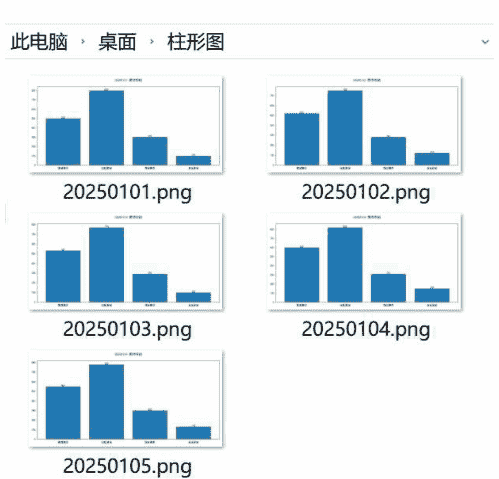

图6-13 费用柱形图

这些柱状图用普通的图片浏览器就能直接打开浏览。假如后续要用在汇报里，也完全可以复制到 Word 或 PPT 中使用。