# AI 赋能财会实操指南

## 前言

过去，AI 只活在科幻的想象里。今天它已渗透进生产生活的每个缝隙，成为维持社会运转的关键底座。经济活动的核心枢纽——财会，正遭遇一次系统性的重塑。

聊到 AI，多数人先想到算力、模型和数据量。更深层的冲击是，它迫使我们重新丈量人的认知边界，以及人与系统如何协同。这既是工具的换代，也是思维的升级，在财会领域尤为明显。

很长一段时间，核算、重复整理、报表编制占据了大量工时。随着智能系统的介入，传统作业范式被改写。定位正从单纯的数据搬运，转向策略参与与价值创造。强大的协作助手已经就位，怎样与其相处，是每位从业者必须面对的课题。

系统很强，也可能成为负担。若驾驭不了，最终被淘汰的可能是使用者。那么在技术浪潮中，财会人该如何守住职业价值？

答案其实清晰：积极接纳转变，学会使用智能助手，把它转化为提升能力的杠杆。变化是唯一恒定的事。智能化不可逆，理解并善用它，才能在未来的职业路径上保持竞争力。

如何接纳？需要培养与智能共生的心智。机器擅长处理海量数据，却替代不了人的洞察与创造。系统可以提供信息与分析手段，最终决策仍依赖人的判断。同时也要关注技术应用中的合规与伦理，确保效率提升不偏离职业准则与社会期待。

本书基于以上思考而写，旨在深入探讨智能技术在财务领域的应用，帮助读者高效使用各类助手解决工作难题，培养前瞻思维。智能助手的能力边界是有限的，但使用方式是开放的。文中列出的技巧和步骤仅作思路参考，并非标准答案，期望读者结合真实场景挖掘更大潜力。

需要特别说明，为真实呈现当前智能助手的处理水平，本书完整保留了各工具给出的原始回答，未做任何修正。因此文中可能出现语法、用词的小瑕疵，也可能存在计算错误，敬请理解。

技术本身是中性的，关键在于使用者。怀揣善意合理利用，智能一定会为工作和生活增添色彩。让我们共同期待这个充满可能性的新时代。

本书编写过程中，涉及的智能软件或 ChatGPT 问答截图均为自动生成，或存在不足与错误，烦请读者斧正。为更好演示智能的呈现效果，针对生成的答案尽量不做处理，因此可能出现语法文字瑕疵等情况，敬请谅解。

## 第1章 AIGC 是否具备创造性

智能系统诞生不足百年，已从模仿人类思维的实验室项目，扩展到创意内容的批量生产，AIGC 的出现正是这一跃迁的标志。当这股浪潮涌入财会领域，更带来了前所未有的想象空间。

### 1.1 从图灵设想到规模化

故事要回溯到 20 世纪 40 至 50 年代。那时的计算科学家尝试打造能模拟人类智能的机器。基本思路是：如果机器能用符号操作来模拟逻辑推理，也许能模拟更复杂的人类思维。

1950 年，英国数学家艾伦·图灵提出了著名的图灵测试。做法是这样的：审问者在看不到参与者的情况下，通过键盘与屏幕与一台机器和一个真人对话。审问者要分辨谁是机器谁是人。若无法准确判断，或把真人误判为机器，则机器通过测试。


该测试的核心假设是：文字交流中若让人分不清对面是人还是机器，就可视作具备智能。这一设想对后续研究产生了深远影响。

1956 年，在达特茅斯会议上，学界首次正式提出人工智能这一概念。目标是探索如何以符号形式展现学习、推理等智能行为。会议汇聚了多学科专家，探讨机器如何实现看、说、翻译等类人功能。

回顾智能的起源不难发现，从诞生之初就被赋予创造性期待。这种期待源于人类模拟乃至超越自身智能的渴望。研究者希望机器不仅能重复计算，还能展现创新与解决问题能力。

早期研究重心在逻辑与规则的实现，让机器按预设指令模拟简单思维。随后发展为更复杂的认知模拟，试图赋予机器抽象思维与创造性解题能力。

进入 20 世纪末，算力提升与算法进步让机器学会基于大数据进行学习与预测。这让系统处理复杂数据集更高效，也能从中提炼规律应用于实际问题。

深度学习兴起后，系统在图像识别、语音识别与自然语言处理等领域取得突破。这些技术经过沉淀，已融入智能手机语音助手、社交媒体人脸识别、在线客服聊天机器人等日常场景。

21 世纪以来，智能从理论探索走向广泛应用，被整合到创作、音乐、写作与科学发现等领域，展现出惊人的创造力，成为人类智能的补充。

未来，智能有望与量子计算、生物技术等更深度融合，开辟新研究与应用方向，持续推动社会与科技发展，也意味着更智能化的未来到来。

### 1.2 AIGC 究竟指什么

AIGC 即 Artificial Intelligence Generated Content，人工智能生成内容。指利用智能技术自动创建文本、图像、音乐、视频等多种形态的内容。核心是通过训练机器学习模型，让其学会理解和模仿人类创作方式，进而独立产出新颖作品。

从理论上看似乎抽象，但现实中早已渗透。比如社交媒体上的视频滤镜，背后就有 AIGC 参与；偶尔听到的一首新歌、一张图片，也可能是系统创作。2024 年，第十四届北京国际电影节首次设立 AIGC 竞赛单元，评选优秀的 AIGC 电影短片，令人印象深刻。

智能究竟如何做到？主要依赖自然语言处理 NLP、计算机视觉和生成式对抗网络 GAN 等技术。

自然语言处理让系统能理解并生成人类语言。通过分析海量文章、书籍与对话，系统掌握语言结构、用词习惯与表达方式。手机语音助手能理解指令并回应，写作场景下则可按主题生成逻辑清晰的文章。

计算机视觉赋予系统看的能力。经训练后可识别图片、视频中的物体、人脸乃至复杂场景。这就是手机相册能自动分类，或社交平台推荐可能认识的人。自动驾驶汽车对道路、车辆、行人的实时识别也依赖这一技术。

生成式对抗网络是 AIGC 的核心之一。其原理类似两个模型对弈，一个负责生成内容如图片，另一个负责判断真假。通过对抗式训练，生成内容会越来越逼真。如今已用于生成高质量图片、音乐甚至视频。

经过无数次训练与调整，系统拥有了一定创造性，以多种内容形式呼应了科学家当初的期待。利用智能技术帮助用户自动生成文本、图像、音频、视频的软件或平台，被统称为 AIGC 类系统，民间也常简称为智能助手。

### 1.3 模型产出的内容算创造吗

智能助手的发展体现了其在理解复杂数据、生成可用内容与辅助决策方面的巨大潜力。面对市面上大量模型作品，不少人会问：系统生成的内容具有创造性吗？

传统观念里创造性是人类专属。如今系统能写诗、作画、写歌，难免让人怀疑。

要回答这个问题，先要界定创造性：是从无到有，还是在已有基础上重组出新？若按前者，目前系统生成的内容并不具备真正创造性，因为作品是在海量已有数据分析基础上模仿组合而成，缺乏独立原创思维。简单说，系统只是按程序与算法执行，没有自我意识与主观意志，无法产生完全脱离人类经验的新概念与新思想。

如果把创造性理解为对已有元素的重新组合与创新表达，那么系统确实展现出一定创造力。人类创作本身也多建立在前人知识之上，再结合独特理解与诠释。莫扎特、达·芬奇、莎士比亚的作品，无一不受时代背景与文化积淀影响。

系统通过深度学习从海量数据中提取规律与模式，再生成新内容。这个过程在某种程度上类似人类的学习与创作。虽然没有情感与意识，但能在数据基础上进行复杂运算与组合，产出让人惊艳的作品。部分模型绘画与音乐甚至能触动情绪，引发共鸣。

从不同视角看，系统是否具有创造性仍是一个主观议题，没有统一答案。但智能的发展确实体现出对创造性定义的重新思考。创造性也许并非人类独有，而是更宽泛的概念。机器的出现拓宽了视野，让大家看到不同形式的创造。过去认为只有人类能下棋，如今系统已在围棋上超越顶尖高手。

相较于纠结系统是否有创造性，讨论系统能否激发人类更多创造力更有价值。有助手辅助，人可以把精力投入更高层次创作。就像摄影出现并未消灭绘画，反而催生了新艺术形式。

与其争论系统是否创造，不如思考如何更好地协作，发挥各自优势。未来是人机共存的时代，需要找到新的平衡与共赢。让机器效率与人类情感结合，或许能创造前所未有的奇迹。

## 第2章 智能工具全景扫描

近年来智能工具的演进速度超出想象，影响范围极广。从文本与图像生成到音乐与视频制作，系统通过学习大量数据，能在数秒内提供媲美人类的创作成果。接下来深入看看正在重塑各行业的这些工具。

### 2.1 文本类工具如何使用

文本类工具是指利用智能系统自动生成各类文字内容的工具。其出现彻底改变了人与文字的互动方式，为创作打开无限可能。

举例来说，假设你是一名营销人员，需要为新品写一篇吸睛广告文案，灵感暂时枯竭。这时可用文本工具，输入产品特点与目标受众，系统立刻生成数段创意文案，从中挑选或结合自身想法修改，既省时又提效，如图 2-1 所示。

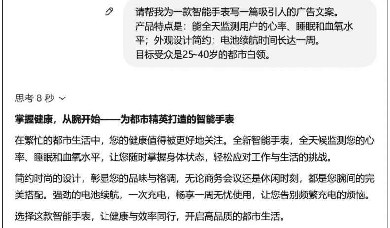

假设你是一名财务人员，需要起草一份内部财务通知，提醒全员本月报销截止日及注意事项。你对格式与措辞拿不准，担心表达不清导致误解。此时可借助文本工具，如图 2-2 所示。

> 帮我写一份公司内部的财务通知，提醒大家本月的报销截止日期是25号，报销申请需附上有效发票，并填写完整的报销单。

**【公司内部财务通知】**

主题：关于本月报销截止日期的重要提醒

各位同事：

您好！

为了保障公司财务工作的顺利进行，特此通知本月财务报销的截止日期为XX月25日。请各位同事注意以下几点，确保您的报销申请能够及时、准确地得到处理：

1.  **报销截止日期**：请务必在XX月25日前将报销申请提交至财务部。逾期提交的申请将顺延至下月处理。

2.  **有效发票**：报销申请必须附上正规、有效的发票原件或经认可的电子发票。发票内容需清晰，信息完整，包括开票日期、项目、金额等，且与报销事由相符。

3.  **完整报销单**：请填写公司统一的报销单，并确保所有信息（如报销人姓名、部门、报销项目、金额等）准确无误，同时需经直接上级审核签字。

请各位同事提前规划，准备好相关材料，按时提交报销申请。如有任何疑问或需要协助，请随时与财务部联系。

感谢大家的理解与配合！

祝工作顺利！

【公司名称】财务部

【发布日期】XXXX年XX月XX日


有了这份通知，稍作检查即可在群内或邮件中发布。

再比如，你是 HR 专员，工资表完成后需要拆分成每位员工的工资条，手工制作繁琐。可让文本工具生成一段快速完成任务的 Python 代码，如图 2-3 所示。

> 请给我一段Python代码，将电脑桌面上的“工资表.xlsx”，拆分成50个包含表头和员工工资信息的单独表格，每个表格要用员工的姓名来命名，最后保存在电脑桌面上的“工资条”文件夹中。

根据你的要求，以下是一段Python代码，它会读取桌面上名为“工资表.xlsx”的Excel文件，并将其拆分成最多50个单独的Excel文件，每个文件包含一个员工的信息和原始表格的表头。这些文件将以员工的姓名命名，并保存到桌面上的“工资条”文件夹中。

```python
import pandas as pd
import os

# 设定路径
desktop_path = os.path.join(os.path.expanduser('~'), 'Desktop')
summary_path = os.path.join(desktop_path, '工资表.xlsx')
folder_path = os.path.join(desktop_path, '工资条')

# 确保输出目录存在
os.makedirs(folder_path, exist_ok=True)

# 读取Excel文件中的数据
data = pd.read_excel(summary_path)

# 假设'姓名'是DataFrame中的一列，用于区分不同员工
split_limit = 50  # 设置拆分的最大数量为50
handled = 0  # 记录已经处理过的员工数量

for name, group in data.groupby('姓名'):
    if handled >= split_limit:
        break  # 达到设定的拆分限制后退出循环
    # 将每个员工的数据（包括表头）写入新的Excel文件
    output_file_path = os.path.join(folder_path, f'{name}.xlsx')
    group.to_excel(output_file_path, index=False)
    handled += 1

# 完成提示
print("工资表已拆分并保存至新建文件夹'工资条'")
```

复制代码到 Python 编辑器运行，即可自动把整张工资表拆分为个人工资条并保存，大幅节省时间和精力。

可见文本工具不仅服务专业程序员，也让非编程背景的职场人士受益。借助智能生成代码即可完成部分自动化任务，提升效率。

通过以上例子可看出，文本工具在日常工作中实用性很高。撰写邮件、制定计划、编写代码、总结会议纪要都能派上用场。即便不是文字高手，或时间紧张，也能快速生成专业得体的文本。在各类智能工具中，文本工具的使用率最高。

使用时要注意保持思考与判断。系统生成内容可能不完全贴合需求，或存在小错误，需人工修改润色。

目前国内外有多款知名文本工具。国际上以 OpenAI 的 ChatGPT 最为知晓。国内则有阿里通义、百度文心一言、抖音豆包、科大讯飞星火认知大模型等，均在持续提升中文表现，为用户提供更贴近本土语言习惯的服务。

### 2.2 图像类工具实战

许多文本工具也集成了图像生成功能，如 ChatGPT、文心一言、通义、豆包等。它们不仅能理解与生成文字，还能根据描述生成对应图像，使创作过程更丰富，降低创作门槛，也为设计师与艺术家提供新灵感。

假设你是一名电商店主，想为新品制作一张独特的宣传图。你可在 ChatGPT 中输入：“请生成一张产品宣传图，画面是一款放在海滩上的蓝色运动水壶，背景有阳光和海浪，风格清新自然。”

数秒后系统会生成符合描述的图片，如图 2-4 所示。


这是一张清新自然风格的产品宣传图，蓝色运动水壶放置在海滩上，背景有阳光和海浪，整体画面展现了轻松的夏日氛围。

图 2-4 ChatGPT生成产品宣传图

有了这张图，可直接用于线上推广，省去找设计师或自行拍摄的麻烦。

图像的生成价值其实远不止前文提到的例子。举一个具体场景：一位老师在准备四季主题的自然科学课程，需要一幅能让孩子直观看出夏天特点的可爱画面。打开具备图像合成能力的平台，输入类似“为少儿科普制作一张卡通夏日风景，突出炎热感受”的描述，很快就能得到可直接投放在课堂的素材，教学质感因此提升，效果就如 图 2-5 所示。


图 2-5 豆包生成夏季景色卡通图

从这些事例能够看出，兼具文案与绘图能力的综合型方案，显著降低了日常工作的门槛，也反映出智能体正向多模态融合推进。一次交互便能同时拿到文字说明和视觉稿，信息传递的速度与质量都得到改善。

不过除了这种一体化产品，市场上还有专注于绘图的专业级选项，比如 Midjourney、Stable Diffusion。相比综合方案，这类产品的专业深度更高，底层模型针对光影、色彩搭配与构图逻辑做了专门训练，细节表现更细腻、质感更扎实、视觉冲击更强。同时提供丰富的可调节参数，支持自定义输出分辨率、艺术倾向、细节精细度等，让使用者实现高度可控的微调。

因此在广告创意、概念美术等对画质要求极高的专业场景，这类工具的优势尤为突出。而在日常办公或偶尔需要一幅图且精度要求不高的情况下，综合型方案的使用体验往往更顺手。

## 2.3 音频生成工具

音频生成是 AIGC 的重要分支，能够用 AI 来创作或后期处理音频。过去制作音频需要录音师、配音演员和音乐人通力协作，如今输入一段文字或简单的旋律，就能快速得到高质量的音频结果。工具可模仿多种声线、调节语调语速，甚至原创音乐，已成为创意行业的基础设施，广泛用于自动化新闻播报、虚拟助手语音回复、个性化音乐创作等场景。

市面上的音频工具既有集成型的大平台，也有深耕特定功能的专业产品。集成型通常在提供文本、图像能力的同时，还能生成音乐，如图 2-6 所示。


在更专业的音频赛道，则出现了聚焦配音、音乐合成、语音克隆等方向的 AI 方案，可提供上百种配音角色与风格，甚至能合成与原声高度相似、表达自然、音质清晰的个性化配音。

使用门槛也不高。用户在平台界面或通过 API 接入后，输入待转化的内容，选择声线模型及语速、音调、风格等参数，系统处理后直接输出音频文件。

不少方案还打通了从录音到生成的全流程，支持音频转文字、文字转音频等能力，被大量应用于企业宣传、商业广告、促销活动、教学课件、社交媒体和有声读物等领域，大幅拓展了音频创作的边界，也让非专业人士更容易上手。

## 2.4 视频生成工具

视频生成工具借助机器学习模型实现视频的自动创建或编辑。既能做简短动画，也能模拟复杂场景。用户只需给出风格、主题或视觉要素等参数，AI 就能据此合成对应视频，在内容创作、广告投放、教育培训和娱乐领域应用广泛。

核心能力之一是自动化内容生成，可从零构建全新视频场景，也能基于指定主题和风格拼接视频片段。例如还原历史事件、复现名画场景，或创造全新的虚拟世界，都能按需定制。

另一项能力是智能化后期编辑，包括自动剪辑、色彩校正和特效增强。即便没有专业剪辑经验，用户也能做出接近专业水准的成品。工具通过分析视频结构和元素，自动给出编辑建议或直接套用指定风格，极大简化了后期复杂度。

市场上产品形态多样，既有面向专业人士的软件，如 Adobe After Effects 或 DaVinci Resolve 的 AI 功能，也有面向大众的编辑工具，如剪映、可灵，视频创作变得更简单高效。无论是动画、实拍还是混合媒体，都能找到匹配方案。

以可灵为例，它支持文生视频和图生视频两种模式（如图 2-7 所示）。输入一段详细描述后，系统会根据场景、人物、动作和情绪要素生成对应画面；图生视频则更直观，上传一张图片后即可让画面动起来，为人物加入动作，为风景增添流动感。上传一张美景照片，可灵能让云缓缓飘动、树叶随风摇曳、水面泛起涟漪，让静态瞬间鲜活起来。


随着技术持续演进，视频生成工具将更智能、功能更强，不仅会改变专业影视的制作流程，也将让视频内容的生产与分享无处不在，进一步丰富视觉文化与艺术表达。

## 2.5 PPT 生成工具

若盘点让人头疼的工作，制作 PPT 绝对名列前茅。在商业和教育场景中，PPT 是展示思想与成果的标准载体，但制作耗时且重复度高。哪怕是资深设计师，往往也要花数小时打磨一版演示文稿。即便套用模板，复制内容、调整排版也通常需要一个小时左右。

所幸 AI 已进入这一领域。输入主题、提纲或一个关键词，系统能在数分钟内自动生成内容充实、设计精美的演示文稿。用户无需从零构思版式和配色，也不用费力寻找配图和图表，审核一遍即可完成制作。

这类工具还具备较强的自适应能力，能学习使用习惯和历史偏好，提供更个性化的设计方案。例如财务人员常制作含大量数据分析的 PPT，系统会记住相应的模板与布局，未来调用时可快速复用。

目前已有不少成熟产品。通义在提供文本与图像能力的基础上，也能一键生成 PPT。进入网页版效率板块的 PPT 创作页，输入类似“人工智能的发展历程与未来趋势”这样的主题描述（如图 2-8 所示），工具即可理解需求并自动搭建结构清晰的大纲与内容，最终输出成稿。

在视觉上，系统可根据文本智能匹配推荐配图，也支持上传自定义图片，保证画面个性化与主题一致。模板库覆盖工作汇报、学术演讲、日常分享等多种场景，满足不同使用需求。国内办公软件中，WPS 用户基数较大，如今 WPS 也加入 AI 能力，支持一键生成 PPT，如图 2-9 所示。


图 2-8 通义 PPT 生成页面


图 2-9 WPS 的 PPT 生成页面

AIGC 的 PPT 工具仍在迭代，目前在创意和个性化上仍需人工微调。但不可否认的是，它已大幅提升效率，让 PPT 制作不再成为负担。

需要强调的是，AI 可以完成大量基础工作，最终的内容质量和呈现效果仍需人工把关。尤其是涉及专业数据与敏感信息时，准确性和权威性必须由使用者负责。

## 2.6 适合财务办公的 AI 工具总结

了解了诸多 AI 工具后，财务人更关心哪些真正可用。实务中，文本生成工具和 PPT 生成工具的适用性最广，因为它们直击财务工作的核心：高效、准确地处理和传递信息。

财务工作与数据报告紧密绑定，每天要处理大量数据和文书，如财务报表、预算方案、风险评估、合规文件等。文本生成工具可依据输入数据和要求，自动计算、归类、分析并汇总成专业的财务文档，减少重复劳动。PPT 在汇报和沟通中同样关键，无论是向管理层汇报业绩，还是向投资者展示财务状况，都离不开专业演示。PPT 生成工具能基于内容和数据自动生成美观、结构清晰的稿件，让财务人员把精力放在内容本身。

在其他类型工具中，图像生成也有独特价值，并非用于做宣传海报，而是生成数据可视化图表。财务数据需要图表呈现才能易于理解，图像生成工具可基于数据自动生成折线图、柱状图、饼图、热力图等，直观展示财务状况、业绩趋势和关键指标。做风险评估或市场预测时，还能辅助生成示意图，支持决策。

音频生成和视频生成在财务中的应用相对有限，但在特定场景下仍有价值。例如会议记录时，音频工具可实时将发言转写为文字，便于整理纪要。视频工具能将财务数据、图表与解说结合，自动生成动画视频，以更生动的形式展示报表、预算方案或开展财务培训，提升理解度和兴趣。

面对琳琅满目的产品，财务人员如何选择？核心思路是集成与集中。就像做饭时一把功能齐全的多用途锅更实用，财务工作涉及数据、报告、沟通等多项任务，单平台解决更省时省力。财务数据属于公司核心机密，集中管理在安全上更有保障，集成型工具通常具备更完善的安全机制，数据不易分散泄露。此外，学习和维护多套软件成本高，集成工具降低学习曲线，让财务人专注专业而非软件操作。

ChatGPT、文心一言、通义、豆包等都属于集成型 AI 工具，WPS 也在原有办公套件上加入 AI 能力。各产品功能大体相近，可按使用习惯挑选一到两个即可。

为便于展示 AI 在财务领域的应用技巧，后续演示以通义和 WPS 为主。

特别说明：书中所有工具操作仅作演示展示，不作为推广。

## 第3章 智能协作：AI 提升沟通效率的应用技巧

沟通效率是财务工作的痛点，尤其涉及多部门协作时，信息传递常成瓶颈。一个报表变更通知，可能要反复发邮件、打电话，时间耗在信息对齐上，而非实际工作。AI 正在改变这一点，它能快速同步信息、智能解答常见问题、精准翻译财务术语、自动整理会议记录，让财务人员把时间用在刀刃上。

### 3.1 在线同步数据，跨部门轻松协作

财务与其他业务部门沟通的典型障碍是数据不同步。月度报表刚完成，销售侧数据又更新；管理层讨论预算时，财务和市场表格对不上，导致会议纠结于“数字是否一致”，而非“如何决策”。来回核对不仅拖慢节奏，还易引发误解和错误。AI 的数据同步能力，尤其是云端协同，能让所有人基于同一份最新数据讨论，避免反复交换资料。

目前多数办公软件都支持在线文档协同与数据同步，适合中小企业或日常同步范围不大的场景。

下面以 WPS 作为示例，演示如何将表格上传云端、设置权限，让各成员实时看到变更，无需频繁邮件传阅。

#### 【演示 1】为表格生成分享链接

在 WPS 中打开需共享的表格。若文件未在云端，先本地编辑完成。然后点击页面右上角的“分享”按钮，位置如图 3-1 所示。


点开后会出现“和他们一起查看/编辑”选项，开启即进入多人协作模式。但 WPS 会先要求将表格上传至云盘（如图 3-2 所示），因为协同需要在云端存储文件，确保所有人访问同一版本，实现实时同步。


图 3-2 WPS 表格上传至云盘

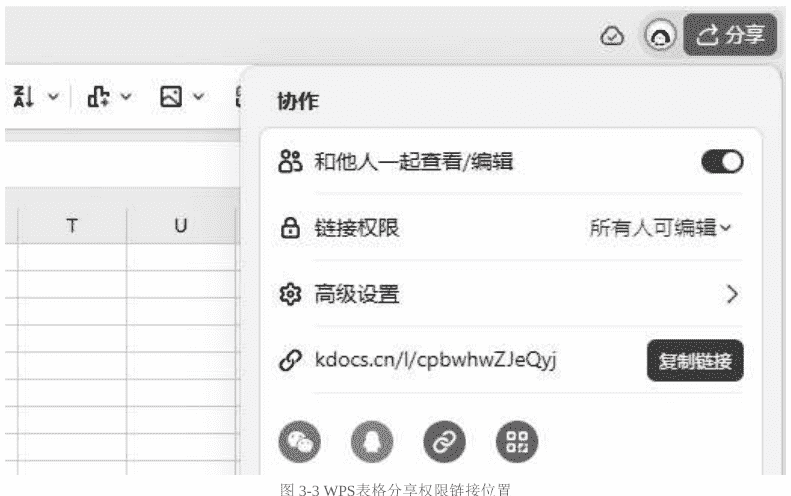

图 3-3 WPS 表格分享权限链接位置

点击“立即上传”后进入协作模式，“分享”按钮下方会出现分享链接。复制链接后，可通过邮件或企业沟通工具发送给各部门负责人。

接收者点击链接即可在浏览器或 WPS 客户端中直接打开文档，进行实时编辑。

#### 【演示 2】管理表格权限

为避免无关人员修改不属于自己的区域，WPS 提供精细权限管理。入口在“复制链接”按钮上方“链接权限”处（如图 3-4 所示），点击后可设置当前链接的访问权限。

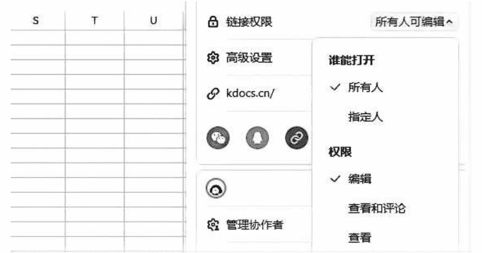

选择“所有人可编辑”，任何持有链接的人都能修改内容，适合部门间频繁协作的场景，如联合填写预算表。若不希望随意改动，可设为“仅指定人可访问”，只有手动添加的人员能编辑，其他人即使有链接也仅可查看，防止误操作。

若仅需对方核对数据，可设为“指定人”“查看和评论”；若仅供管理层查阅，可设为“指定人”“查看”。

通过这些设置，可精细化控制共享范围和操作权限，在保证高效协作的同时保护数据安全与完整。

#### 【演示 3】使用“评论”功能进行协作沟通

WPS 支持在文档中添加评论。当协作者发现问题或需要解释某项数据时，可右键单元格选择“插入评论”，输入问题或备注（如图 3-5 所示）。系统会自动通知相关人员查看并回复。


#### 【演示4】隐私保护与数据隔离

多人协作时，有时需对不同部门数据隔离，避免查看不相关信息或泄露敏感内容。WPS 可通过单独分享工作表或列隐私保护实现隔离。

##### ❶单独分享工作表

右键点击工作表标签，选择“分享工作表”，如图 3-6 所示。


系统会生成仅限该工作表的专属链接，接收者只能访问该表，无法查看文档中其他工作表。

##### ❷开启列隐私保护

若希望在同一工作表中只允许特定人员编辑特定区域，可选中目标单元格区域，右键点击“开启列隐私保护”，然后点“指定人管理列隐私”（如图 3-7 所示），从人员列表中指定可编辑者。

此方式适合多部门共同填写同一张表但需避免相互干扰的场景。

##### ❸高级设置

除上述功能外，可在图 3-4 中“链接权限”按钮下方的“高级设置”里做更细化控制。

这里提供“允许协作者查看最近访客”“禁止查看者下载、打印、另存和复制内容”“禁止申请编辑权限”等选项，如图 3-8 所示。


“允许协作者查看最近访客”开启后，所有有编辑权限的人员可看到文件最近访问记录，便于追踪进度并及时跟进。

“禁止查看者下载、打印、另存和复制内容”可保护敏感数据，防止查看权限人员将文件本地保存、打印或复制粘贴，降低外泄风险。

另外，“设置文档水印”功能可在文档中添加公司名称或“机密”等标识，即使被截图或拍照也能追溯来源，对财务数据等保密资料尤为重要。

#### 【演示 05】权限关闭与内容锁定

各部门完成数据填写与修改后，为防止误改或意外更改，可关闭所有人的编辑权限并锁定文档内容。此时协作者只能查看，无法修改，确保数据完整与准确。

要收回文档的编辑权限，只需再次点开页面右上角的“分享”，在“链接权限”里把访问范围设为“所有人仅可查看”。设置完成后，任何人打开文档都只能阅读，无法做任何改动。

如果想彻底固定某些内容或结束协同，还可以直接关闭“分享”下方的“与他们一起查看/编辑”开关。当然，权限关闭后若后续仍需微调或补充新信息，也可以重新打开编辑权限。

### 3.2 跨平台与跨文档的数据实时同步思路
财务数据变动频繁，若不能保证各设备、各文件中的内容保持一致，很容易出现版本错位或信息滞后。下面以WPS为例，说明如何实现不同终端与不同文档形式之间的数据联动。

#### 【演示 1】同一份数据在多设备间的无缝衔接
移动办公下，同一份报表往往在电脑、手机、笔记本间流转。上午可能在办公室电脑上整理，下午在手机上审阅，晚上在笔记本上终审。若每次都要手动下载上传，流程繁琐且易出错。借助WPS的云端同步，登录同一账号后，各终端都能实时读取最新版本。

具体流程如下：

- 1. 把文档推送到WPS云端
在办公电脑处理完表格后，点击WPS的“云文档”，将文件上传到云空间。之后只要用同一账号登录，即可在任意设备上调取。
- 2. 手机端调阅
打开WPS手机客户端并登录相同账号，在“首页-最近”里即可找到已上传的文件，点开后可直接浏览或编辑，如图 3-9 所示。
图 3-9 WPS手机客户端文档列表
- 3. 其他电脑访问
在另一台电脑打开WPS，点击左上角的“WPS Office”（如图 3-10 所示），无需手动上传下载即可直接打开云端文件。

通过云同步，多设备间切换时始终看到同一版本，避免了因来回传输产生的版本混乱。

#### 【演示 2】表格、文字、演示文稿之间的联动更新
财务数据除了以表格呈现，还常需转成文字报告或演示稿供不同层级汇报。传统做法是手工复制，容易遗漏。WPS的“粘贴链接”与“插入对象”功能可以让三者动态关联。

具体操作演示如下：

##### 1. 表格与文字报告的联动
假设表格中整理出如下财务数据，如图 3-11 所示。

| 项目 | 本月数据（万元） | 上月数据（万元） | 变化幅度 |
| :--- | :--- | :--- | :--- |
| 销售收入 | 500 | 450 | 11.11% |
| 成本费用 | 300 | 280 | 7.14% |
| 毛利润 | 200 | 170 | 17.65% |
| 运营费用 | 100 | 90 | 11.11% |
| 净利润 | 100 | 80 | 25.00% |

需要将其同步到文字报告时，先选中表格区域右键“复制”，在WPS文字中右键“选择性粘贴”，在弹出的窗口里选择“粘贴链接”，类型选为“WPS表格 对象”，确认后完成，如图 3-12 所示。

这样插入的表格为OLE动态链接对象。源表发生变化时，文档中的数据会随之更新。若把源表中销售收入的本月值由“500”改为“400”，报告中的数值及变化幅度也会同步变化，如图 3-13 所示。

| 项目 | 本月数据（万元） | 上月数据（万元） | 变化幅度 |
| :--- | :--- | :--- | :--- |
| 销售收入 | 400 | 450 | -11.11% |
| 成本费用 | 300 | 280 | 7.14% |
| 毛利润 | 200 | 170 | 17.65% |
| 运营费用 | 100 | 90 | 11.11% |
| 净利润 | 100 | 80 | 25.00% |

实时联动大幅减少了重复手工维护的工作量，也避免了版本不一致带来的差错。

##### 2. 表格与演示文稿的联动
打开WPS演示文稿，在目标页选择“插入”菜单，点击“对象”，如图 3-14 所示。
在对话框中选“由文件创建”，点“浏览”找到对应的表格文件，确认后导入，如图 3-15 所示。
表格随之作为对象嵌入演示文稿，如图 3-16 所示。

| 项目 | 本月数据（万元） | 上月数据（万元） | 变化幅度 |
| :--- | :--- | :--- | :--- |
| 销售收入 | 500 | 450 | 11.11% |
| 成本费用 | 300 | 280 | 7.14% |
| 毛利润 | 200 | 170 | 17.65% |
| 运营费用 | 100 | 90 | 11.11% |
| 净利润 | 100 | 80 | 25.00% |

双击可进入编辑状态裁剪显示范围，源表更新后演示文稿中的对象也会自动刷新，无需反复复制粘贴。

##### 3. 样式调整不影响链接
链接的表格在文字或演示文档中仍可单独调格式。双击进入编辑模式后，可修改字体、颜色、边框等。WPS的格式修改与链接功能相互独立，不会影响数据同步。

##### 4. 断开链接定稿
报告提交前为避免数据自动变动，需将链接切断。以WPS文字为例，右键表格选择“工作表 对象”-“链接”，如图 3-17 所示。
在弹出的对话框中点“锁定”，如图 3-18 所示。
确认后，文档中的表格即被固定为当前内容，不再随源表更新。

通过以上方法，可有效解决财务工作中多终端、多格式的数据同步痛点。

### 3.3 智能翻译助力跨语言财务沟通
在全球化背景下，财务沟通常涉及多语言。数据本身通用，但分析、说明、汇报需要精准表达。传统人工翻译耗时且易出现术语偏差，AI智能翻译则提供了高效且专业的替代方案。

下面以通义为例说明妙用。

#### 【演示 1】财务报表的自动翻译
报表包含资产负债表、利润表、现金流量表等专业词汇。通义可将中文报表快速转为英文、法文、德文等。

操作步骤：打开通义首页，选择“对话”，在输入框左侧点击“上传文档”上传报表，如图 3-19 所示。
通义支持多种格式。假设上传Excel利润表，上传成功后输入指令“请把这份利润表翻译成英文”，如图 3-20 所示。
系统会迅速返回译文，如图 3-21 所示。若内容较长，可分段上传以保证准确性。译文完成后可自行校对术语，不准确处可进一步向模型解释以优化。

需要法文或德文时，只需在指令中明确目标语言即可。

#### 【演示 2】多语言财务分析报告的生成
财务分析报告结合背景与专业判断，人工翻译成本高。通义可根据中文分析快速生成外语版本。

例如输入“本季度公司利润增长了 15%，主要原因是运营成本下降和新产品的成功上市。”并要求译成法语，如图 3-22 所示。
模型会结合上下文使用规范术语，如将“利润增长”译为“Le bénéfice de l'entreprise a augmenté”，“运营成本”译为“coûts d'exploitation”，避免逐词硬翻。

除报表外，该能力同样适用于跨国财务培训材料的多语言转换，以及面向国际审计机构的报告与沟通文件，显著降低翻译耗时与误解风险。

### 3.4 用AI财务问答智能体减少重复解释
财务部门常被“报销要找谁签字”“凭证如何填”“发票怎么开”等基础问题反复打扰，既消耗时间又易导致口径不一致。AI问答助手可以分担这一负荷。

下面以通义演示如何搭建。

#### 【演示 1】使用预设智能体解答基础问题
智能体是一种具备感知、决策、执行能力的AI系统，可按预设规则或学习数据自动应答。AI平台通常提供通用对话型、专业领域型、任务导向型等预设智能体。

财务类重复问题可直接由通义的预设财务智能体响应。在智能体页面的搜索框输入“财务”，可找到约30个相关智能体，如图 3-24 所示。
图 3-23 通义智能体
图 3-24 通义与财务相关的智能体搜索结果

进入“财务助手”后，例如提问“员工想要报销，怎么开发票？”，系统会返回涵盖发票类型选择、信息收集要点、增值税专用发票合规说明等完整流程，如图 3-25 所示。
图 3-25 财务助手智能体回答报销发票开具流程

员工可随时自助查询，财务人员免于重复解释，保证信息统一。实用后可通过收藏或标签持续使用。

#### 【演示 2】创建企业专属报销助手智能体
预设智能体通用性强，企业内部流程差异大时需定制。创建专属问答体可按公司报销规则、审批层级、系统操作指引等进行定向配置。

创建步骤如下：

##### 1. 找到通义智能体创建入口
登录通义官网或客户端后，侧边栏点“智能体”。进入后会看到“发现智能体”和“我的智能体”两标签。点击“发现智能体”页面上方“创建我的智能体”即可进入创建页。

##### ②专属财务报销助手智能体相关设置
在创建页右上角点“自由创建”，进入配置界面，可设置头像、名称、设定、权限及高级选项，如图 3-28 所示。


以下是对专属财务报销助手智能体的配置建议：

###### 头像
头像是视觉标识，点击默认图标可上传自定义图片，如账本、计算器或公司Logo。也可点击头像进入“AI头像生成”。


输入描述如“一个计算器，卡通风格”后点“生成头像”，系统会给出四张候选图供挑选，不满意可换一批或重新描述。


###### 名称
名称应直观易懂，如“财务报销小助手”或“智能报销助手”。

###### 设定
设定决定回答风格。可描述为“你是一位经验丰富的财务报销助手，专门解答员工关于报销申请、发票处理、费用报销制度的疑问，能依据公司财务制度给出准确流程指导。”

###### 权限
权限用于控制访问范围，如图 3-31 所示。


选择“公开·所有人可见可使用”则内外人员均可访问，适合对外常见问题解答。

权限模式怎么选

选用“部分公开·获取链接的用户均可使用”后，该助手不会对外完全放开，只有拿到链接的人才有入口进入。适合想在小范围内传播，又不想做成公开产品的场景，比如企业内部存在不便公开的财务规范时就很合适。

选用“私密·仅自己可见可使用”后，可见范围被收窄到创建者本人，哪怕链接外泄他人也打不开。适合还在试用、调试或仅作个人使用的阶段，先自行验证避免误用或过早曝光，比较稳妥。

###### 高级设置
高级设置默认是收起状态，点开后能看到更细的定制项，用来进一步调节助手的表现方式，让个性更鲜明。

里面包含智能体简介、开场白、提问灵感、技能和知识，排版参照图3-32。

###### 智能体简介
选填，用一句话点明定位。比如：一只灰白混色爱撒娇的小柴犬

###### 开场白
选填，对话启动时的问候。比如：汪汪汪，我是小柴犬，快来跟我聊聊不然我就追球了！

###### 提问灵感
会排在开场白下方，给用户提供提问方向。比如：你是谁

###### 技能
- 文生图
- 网页搜索
- 代码执行器

###### 知识
点此区域或拖拽文件上传，只能传单个 PDF，容量上限 10M


简介主要用来说明机器人能提供哪些服务，写清楚服务范围后这段文字会出现在头像侧边。例如：“我是财务报销助手，可以帮您解答报销、发票、费用报销类的问题。”

开场白是首次交互的用语，建议写得亲切直接，让人迅速明白助手的核心能力。例如：“您好！我是您的财务报销助手，随时为您解答报销流程、发票填写、费用报销政策等疑问，您可以直接提问。”

提问灵感是帮助用户快速上手的提示，可以放一些员工常问的例子，一眼就能看出能问什么。比如：“如何填写报销单？”“开发票需要满足什么要求？”“差旅住宿的标准是怎样的？”

技能可按财务报销的实际需求配置。需要流程图辅助说明时，打开“文生图”即可自动生成图表；若希望答案严格来自公司内部文件，避免掺杂外部网络信息，可关闭“网页搜索”；如需助手自动生成报销表格或进行简单费用核算，则启用代码执行技能。

知识区是机器人回答的根基。若想让回复严格遵循公司财务报销规则，就需要上传一份完整的财务报销制度、报销流程指南等资料。支持 PDF 格式，文件大小不超过 10MB。上传完毕后模型会基于这些材料学习，员工提问时即可从文档中给出准确答案。

例如，下面是一份《差旅费报销标准》的节选：

> 差旅费报销标准

（1）适用范围
本标准适用于员工因公出差产生的交通、住宿、餐饮补助、通信补助等费用。出差前须按公司流程填写申请单并获批，方能报销。

（2）交通费
覆盖机票、火车票、高铁票、长途汽车票、出租车费等。
标准：
飞机票按经济舱票价，凭机票订单及登机牌报销。
火车/高铁限二等座及以下，凭车票报销。
出租车费需说明出行地点及原因，凭出租车发票报销。
市内交通补助：如未使用公司交通工具或公共交通，可按每日 50 元申请。
要求：须提供相应票据；线上订票需同时提交电子发票与订单确认；自驾需提供里程记录与燃油发票。

（3）住宿费
公司依职级与城市制定报销上限。
标准：
- 职级 1~3：普通酒店标准间，不超 400 元/晚。
- 职级 4~6：中档酒店，不超 600 元/晚。
- 职级 7 及以上：高级酒店，不超 1000 元/晚。
特殊情况：若会议指定酒店超标，需事先特批。
要求：提供住宿发票、预订单与入住证明；额外费用如早餐、洗衣需事先说明并提供票据。

（4）餐饮补助
按出差天数计。
标准：
- 一线城市如北京、上海：150 元/天。
- 二线城市如杭州、武汉：120 元/天。
- 其他城市及乡镇：100 元/天。
要求：无须发票，按日固定金额；不足一天按比例计算。

（5）报销流程
出差结束后 5 个工作日内通过财务系统提交申请，需附出差申请单及批复、交通票据、住宿证明及其他凭证。财务部审核无误后办理报销。

将该标准用 WPS 导出为 PDF，上传至通义智能体的知识区，最后点页面右上角的“创建”，财务报销助手即完成搭建。

##### ③财务报销助手智能体链接分享
打开“我的智能体”，财务报销小助手已出现在列表中，如图 3-33 所示。


进入对话页，可看到之前设置的所有展示内容。若需将链接分发给他人，只需点页面右上角“分享”，再点“复制链接”（如图 3-34 所示），即可转发。


##### ④财务报销助手智能体应用效果展示
下面验证助手能否准确回答差旅费报销相关问题，效果见图 3-35。


可以看到，助手的回复与《差旅费报销标准》的规定完全一致，还额外提醒了报销住宿费时所需材料。

再试一个更复杂的问题，如图 3-36。


助手清楚指出了报销申请被拒的原因，并精确算出该员工提交申请的时间区间。即使问题并非直截了当，也能给出解答。从此差旅费报销的重复咨询无需财务逐个回复。

##### ⑤ 智能体的持续维护和更新
为使助手始终跟上制度变化，报销规则变动时，可点智能体右上角“...”图标，会出现“修改配置”入口，如图 3-37。


点“修改配置”会回到之前的设置页，重新上传最新财务文件即可完成知识库更新，记得最后点“保存”。

实际使用中，员工的提问与反馈也能让智能体更聪明。通义会记录每次互动并据此调整；若发现某些回答不够准确，管理员可手动优化，确保下次更精确。

### 3.5 AI会议助手自动完成会议记录
财务日常离不开会议，项目汇报、预算讨论、年度总结等都涉及大量数据、指标与专业术语。会后整理核心内容、决策要点与后续行动，既耗时又易遗漏。AI 会议助手可自动生成纪要，帮助财务人员快速聚焦信息，提升效率。

下面以通义为例演示会议记录用法。

#### 【演示 1】会议实时记录
AI 会议助手能在会议进行中捕捉发言，实时提炼要点。对财务会议而言，讨论预算、利润时可即时记录，确保每个决策被精准留存。

会议记录对便捷性要求越来越高，电脑操作不够灵活，手机更便携且可随时分享。因此以下演示以通义手机端为主，未安装 App 的可用微信小程序。

##### ❶登录通义手机客户端
安装并登录通义手机客户端后，进入主页面，如图 3-38 所示。


图 3-38 通义手机客户端主页面

##### ②开启录音
点图 3-38 页面底部中间的“记录”按钮，会进入“实时记录”页，这里提供转写录音、总结纪要、绘制脑图功能，适用于会议记录、课堂笔记、演讲记录等场景。

###### 实时记录
开始录音，AI通通帮你搞定

- 转写语音
  实时语音转写
- 总结纪要
  AI为你总结纪要
- 绘制脑图
  脑图轻松整理

###### 我的记录
2024年10月09日
20:17 记录
10月09日 00:55
上季度销售额下降至2500万，利润率从12%降至10%，主要因原...


“转写语音”可把会议语音实时转为文字，也可完整保存原始音频，方便回听。对复杂、数据密集的会议尤其重要，有疑问时可随时回放。

使用该功能，只需在会议开始前点图 3-39 页面下方的圆圈按钮，选择录音语言、是否翻译、是否区分发言人，最后点“开始录音”。

会议进行中，每个人发言都会同步以文字形式呈现，如图 3-40 所示。

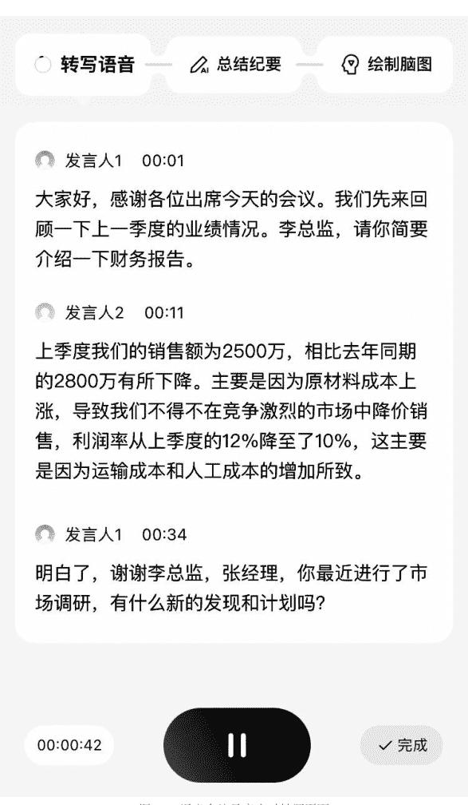

##### ❸结束录音
会议结束点页面右下角的“√完成”即可停止录音。通义会自动跳转到已转写好的会议内容界面。

#### 【演示 2】总结会议纪要
会后通义可根据录音自动生成结构化的会议纪要，按章节或按发言人呈现，内容可随时复制发送。

转写语音 总结纪要 绘制脑图

##### 全文摘要
上季度销售额下降至2500万，利润率从12%降至10%，主要因原材料成本上涨及市场激烈价格竞争。财务负责人指出销售策略已调整以应对当前挑战。市场调研经理随后分享了新的市场发现，并介绍了未来计划，旨在改善市场表现与财务状况。

##### 章节速览
▶ 00:01
##### 上季度业绩回顾与市场策略讨论
> 会议中，财务负责人报告了上季度销售额下降至2500万，利润率由12%降至10%，主要归因于原材料成本上涨和市场中价格竞争导致的销售策略调整。随后，市场调研经理分享了新的市场发现及未来计划。

图 3-41 通义总结会议纪要

#### 【演示 3】绘制内容脑图
除纪要外，通义还会把会议要点以脑图形式呈现，帮助参会者快速浏览关键主题和决策路径，如图 3-42 所示。这种可视化方式对财务会议特别友好，能清晰展示数据流向、预算调整等复杂信息。

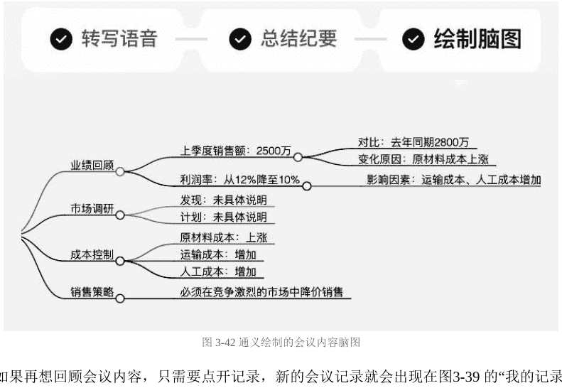
后续回顾会议内容，只需点开记录，新的会议记录就会出现在图 3-39 的“我的记录”里。

#### 【演示 4】跨语言财务会议翻译
在全球化公司里，财务会议常涉及多语参与者，如何消除语言障碍至关重要。

会议进行时，通义可通过麦克风捕捉发言并自动识别语言。例如中国区财务总监用中文发言，通义会自动译成英文，外籍同事就能实时看到英文内容。

该功能只需在开启录音前打开“翻译”开关即可，如图 3-43 所示。


图 3-43 通义会议录音翻译设置

此外，会后生成的纪要还能一键译成英文，便于参会者下载分享，具体操作是点图 3-41 页面右上角的“开启翻译”按钮。翻译效果如图 3-44 所示。

##### 2024年10月09日20:17 记录
- 转写语音
- 总结纪要
- 绘制脑图

##### 全文摘要
上季度销售额下降至2500万，利润率从12%降至10%，主要因原材料成本上涨及市场激烈价格竞争。财务负责人指出销售策略已调整以应对当前挑战。市场调研经理随后分享了新的市场发现，并介绍了未来计划，旨在改善市场表现与财务状况。

Sales fell to 25 million in the last quarter, and profit margins fell from 12% to 10%, mainly due to rising raw material costs and fierce price competition in the market. The financial leader noted that the sales strategy has been adjusted to meet the current challenges. The market research manager then shared new market findings and presented future plans t...

图 3-44 通义翻译会议纪要

#### 【演示 5】视频记录并提取PPT
除了录音转写，通义还支持视频记录与 PPT 提取，对财务汇报、培训或项目展示特别有用，能把视频中的发言与 PPT 内容同步对齐。

操作时打开图 3-38 页面下方的“拍摄”按钮，选择从相册提取会议录像或直接拍摄。上传后通义会解析视频，解析完成后会显示如下页面，如图 3-45 所示。


图 3-45 通义解析会议视频完成页面

## 第4章
财务核算：AI简化核算流程的应用技巧

财务核算工作繁琐却关键，数据量增大后人工核算在速度和精度上都受限制。AI工具凭借强大计算能力，能快速处理海量数据，精确套用财税政策，生成准确会计分录，让流程更顺畅、更自动化。接下来探讨 AI 在财务核算中的具体应用。

### 4.1 让AI工具协助税务核算
面对不断变化的税收法规和专项政策，财务人员需花费大量时间学习并手动套用，易出错且效率低。AI 技术为此提供了方案。借助像通义这样的工具，财务人员无需自行追踪最新财税政策，可通过智能工具自动应用于日常计算。

下面以通义为例演示 AI 如何协助税务核算。

#### 【演示 1】抓取最新财税政策
新出台的财税政策常含优惠，涉及税收减免、费用抵扣时若不能及时调整，企业可能错失成本节约机会。通义通过实时追踪和更新各类财税政策，帮助企业抓住政策红利。只需输入关键词或需求，AI 就能自动抓取最新法规、解析条款并迅速测算对报表的影响。

操作上打开通义主页，在对话框输入相关政策关键词即可获得实时答复。

例如，某注册于中国上海自由贸易试验区的进出口贸易公司 A，主营离岸转手买卖业务。2024 年 3 月底，公司计划签署总金额约 10 亿元的离岸买卖合同。3 月 21 日，财务人员在通义主页输入“2024年上海最新印花税政策”，得到如图 4-1 所示的回复。

图 4-1 通义抓取最新财税政策

回复显示，自 2024 年 4 月 1 日至 2025 年 3 月 31 日，注册在中国上海自由贸易试验区及临港新片区的企业从事离岸转手买卖业务，签订的买卖合同可免征印花税。

政策生效日为 2024 年 4 月 1 日，意味着公司 3 月底签署的合同不适用该优惠，按原政策需缴纳几十万元印花税。

为最大化节税，财务人员建议将合同签署时间延后至 4 月 1 日之后，以符合免征条件。节省下来的资金可重新投入运营，提升资金使用效率。

AI 实时洞察财税政策，企业抓住红利期快速调整

借助AI抓取并解读最新财税动向，企业能在政策窗口期迅速校正经营策略，避免因信息滞后而多支出的税费。以A企业的实践来看，仅把合同签署时点的微调，就节省了数十万元的贴花税费负担，既降了财务压力，又提升了运营灵活性。

政策迭代提速后，用AI做持续追踪已成为财务管理的基础能力。这种智能化决策支持大幅提升了团队效率，让企业在复杂多变的政策环境中始终抓住关键机会，实现财务价值最大化。

#### 【演示 2】自动化税额测算
算税时财务人员常需反复用计算器校对，生怕出错。如今这项工作可交由AI完成，人工只需复核结果。以A企业为例，若在2024年3月底签约，实际应缴贴花税是多少？把相关要素输入对话窗口，助手给出的测算结果如图 4-2。

整体判断准确，明确指出2024年3月底签约时已不适用免征，并按现行0.03%税率测算出应缴金额。只是在点出税率时，对该税率是否覆盖全部离岸转手买卖业务的具体依据表述可更清晰，以确保适用无误。

#### 【演示 3】模拟不同财税政策的财务影响
AI的另一价值在于提前预判政策变动带来的财务冲击。通过模拟不同情景，企业可提前规划应对，对决策层尤为关键。

例如制造企业B年销售额5,000万元，成本3,000万元，年研发投入500万元，现行企业所得税税率25%。假如未来对该行业研发费用加计扣除比例由75%提升至100%，让助手模拟影响，如图 4-3 所示。

结果清晰呈现政策前后差异，测算过程完整，对税负下降的分析到位，并做了总结，得到预期答案。

### 4.2 发票处理从识别到入账的自动化闭环
每月大量电子凭证需要审核、录入、分类、入账，最耗时的不是审核本身，而是把凭证从邮件等渠道抽取出来，转化为系统可识别的数据再入账。AI可彻底改变这一流程。

以下以智能助手为例演示处理流程。

#### 【演示 1】凭证信息识别
电子凭证多通过邮件、短信、微信发送。可点击链接或附件打开下载页，通常可导出PDF保存。下载时建议用“凭证编号+日期”命名，存放在专属财务文件夹并做好备份。

- ① 提交给助手
打开网页版或客户端，在对话区左侧上传入口直接提交PDF或截图。
- ② 向助手提问
提交后助手会自动抽取关键数据，如编号、金额、税率等，整理成可查询格式，只需在对话区提问即可获取。

这里有一张部分信息被隐藏的增值税专用凭证，如图 4-4，是企业采购信息技术服务收到的。

图 4-4 用于测试的电子凭证样式

图 4-5 助手识别凭证信息

特别说明：该样式仅用于AI测试，并不反映真实交易。

我们要求“识别凭证信息并完整描述”，如图4-5。助手对单价、金额、税率等均描述准确，“合计不含税”“合计含税”金额也逐项列出，便于理解关键数据。

提醒：AI提取信息后仍建议人工校验，确保准确。

#### 【演示2】凭证的分类与归档
业务增长带来凭证量激增，不及时归类容易分散存放，税务申报和审计时风险增加。制作凭证管理台账可在统一平台查看开票时间、金额、税率、供应商等信息。这一任务也能交给AI。

##### ❶ 凭证管理台账模板自动生成
询问“一个完整的凭证管理台账应包含哪些内容？”，得到回答如图 4-6。继续要求“按这些内容生成表格模板”，很快输出模板，如图 4-7。

##### ❷ 凭证上传与信息提取
重复信息识别步骤，提交凭证后要求“识别信息并填入台账模板”。回答如图 4-8。

好的，以下是根据您提供的凭证信息填充的凭证管理台账表格模板：

| 序号 | 凭证号码 | 开票日期 | 销售方信息 | 购买方信息 | 商品/服务详情 | 税率(%) | 不含税金额(元) | 税额(元) | 含税总金额(元) | 凭证状态 | 认证日期 | 抵扣情况 | 备注 | 附件 |
|---|---|---|---|---|---|---|---|---|---|---|---|---|---|---|
| 1 |  | 2024-09-02 |  |  | 信息技术服务/技术服务 | 6 | 18867.92 | 1132.08 | 20000.00 |  |  |  |  |  |

图 4-8 助手将凭证信息填入管理台账

已提供的信息全部准确填入，未提供项保持空。

##### ❸ 数据导出
台账完成后需导出为表格文件。全选图4-8表格内容，助手会弹出操作按钮，点击“复制”。打开WPS新建表格文档，右键粘贴或Ctrl+V即可，如图4-9，最后保存命名为“凭证管理台账”。

图 4-9 导出到WPS的凭证管理台账

#### 【演示 3】凭证处理问题解答
处理中常遇到不合规凭证或特殊情形，AI可作为知识助手解答。若问“凭证上企业信息错误怎么办？”，会给出处理建议，如图 4-10。

也可问“凭证金额与合同不符如何处理？”该问题实务中很常见，可能涉及开票错误或合同调整。通过提问可了解处理流程，避免误报入账。

回答如图 4-11。

当凭证金额与合同金额不符时，建议按以下流程处理：
- (1). 核对差异：对比凭证与合同金额，确认差异并查找原因，如计算失误、遗漏项目、额外费用等。
- (2). 联系供应商：及时沟通说明不符情况，要求解释并提供合同、订单、验收单等证据。
- (3). 请求更正：属供应商错误则要求作废重开；属额外费用或调整则协商解决方案，如调增合同或签补充协议。
- (4). 内部审批：上报财务负责人或管理层说明情况并提出建议，取得授权。
- (5). 财务处理：按最终确定金额调整账务，保证账务一致，并保存沟通记录、更正凭证、审批文件。
- (6). 法律和税务合规：确保处理符合法规，如有需要可咨询会计师或税务顾问。

该回答系统完整，覆盖核对、沟通、审批、账务及合规全流程，可操作性强。

### 4.3 AI助力会计分录智能生成
用友、金蝶等财务软件已能自动生成分录，当前重点是如何让分录更智能、适配复杂业务。AI并非替代基础自动化，而是优化过程，使其能应对跨部门、跨币种、多税制等动态需求。

#### 【演示1】多场景动态适配的分录生成
假设某跨国企业在中国和W国均有业务，需处理一笔中国子公司向W国子公司汇款10万W元支付运营费，需考虑汇率及两国税制差异。

##### ① 向助手提供业务信息
交易类型：跨境支付
支付金额：10万W元
支付目的：W国子公司运营费
支付币种：人民币
收款方：W国子公司
当前汇率：1W元=8.00人民币
税务政策：中国与W国的增值税、所得税等

##### ② 生成分录
提问“款项已支付，请生成中国子公司基础分录”，回答如图 4-12。也可反问“款项已收到，请生成W国子公司基础分录”，如图 4-13。

##### ③ 税务影响
未考虑税务的基础分录较为简单。若考虑税务则更复杂。可了解缴税情况，回复如图 4-14。

假设中、W两国有双重征税协定，该资金被视为投资，则W国子公司收到的实收资本本身不直接产生企业所得税，但资金用于经营产生的利润仍需在W国纳税。

#### 【演示 02】基于税务政策变化的分录调整
增值税税率调整会直接影响记账，企业需及时更新分录以保持合规。助手虽不能直接操作系统，但可提供调整指引。

假设企业售货收到117000元，会计误按17%税率入账：
借：银行存款 117000
贷：主营业务收入 100000
贷：应交税费—应交增值税（销项税额） 17000

若应按13%税率记账，如何调整？提问后给出调账建议，如图 4-15。财务人员可将建议录入系统并记录调整。

图 4-14 助手列举跨国业务可能涉及的税务情况
图 4-15 助手调整会计分录

#### 【演示 2】复杂费用分摊与项目核算的智能处理
跨部门、多项目费用分摊传统上需人工设定规则。AI可基于历史数据或项目进度自动识别分摊需求并生成分录。

##### ❶ 提供基本信息生成分录
输入“企业支付管理费用100万元，需分摊至市场部、研发部、销售部，比例40%、30%、30%，请生成分录”。回答如图 4-16。

好的，企业支付管理费用100万元，分摊比例为市场部40%、研发部30%、销售部30%。分录如下：
(1). 计算各部门费用
市场部：100万×40%=40万
研发部：100万×30%=30万
销售部：100万×30%=30万
(2). 生成分录
总账：借：管理费用 1000000 贷：银行存款 1000000
分摊：借：市场部管理费用 400000
借：研发部管理费用 300000
借：销售部管理费用 300000
贷：管理费用 1000000

助手按比例自动计算并生成对应分录。

##### ② 按项目进度或历史数据分摊
输入“两项目A、B，第一阶段完成比例A60% B40%，总预算50万平分，管理费用已发生20万，销售费用已发生10万，请生成分录”。回答如图 4-17。

按完成比例分摊：
项目A分摊比例60%，项目B40%
项目A管理费用 200000×60%=120000，销售费用 100000×60%=60000
项目B管理费用 200000×40%=80000，销售费用 100000×40%=40000
分录：
借：项目A-管理费用 120000
借：项目A-销售费用 60000
借：项目B-管理费用 80000
借：项目B-销售费用 40000
贷：管理费用 200000
贷：销售费用 100000

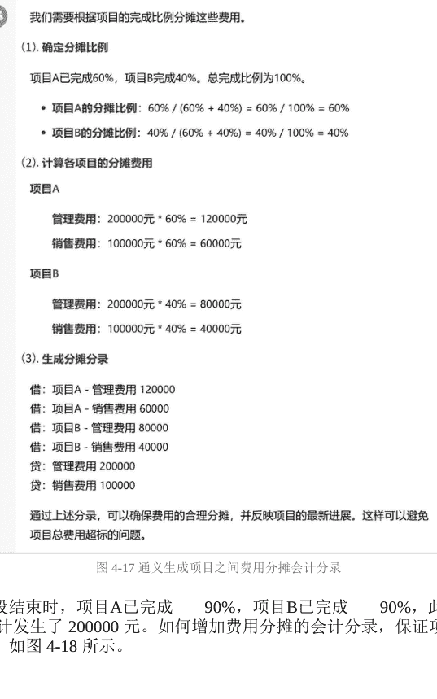
当第二阶段结束时，项目A完成90%，项目B完成90%，管理费用累计25万，销售费用累计20万，如何追加分摊？回答如图 4-18。

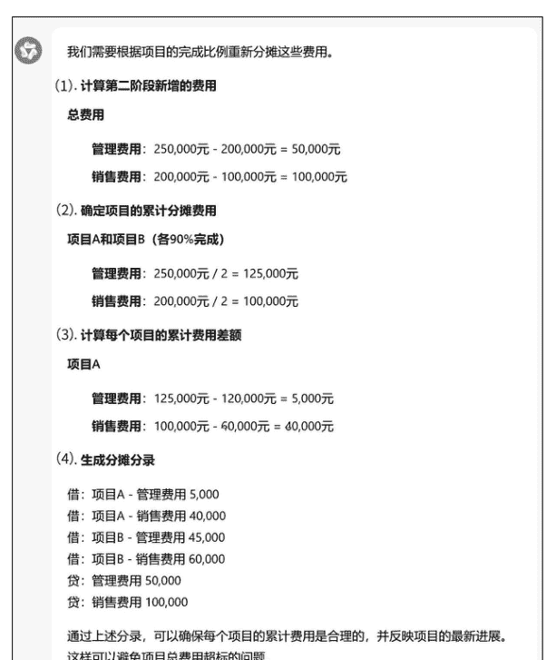
这是基于第一阶段结果生成的第二阶段分摊分录，助手快速完成复杂计算并输出分录，减轻工作负担。

##### ③ 检查和复核分摊结果
分摊后复核是否平衡至关重要。AI可自动复核，避免手工遗漏。

如第三阶段结束，两个项目均已完成，实际费用共60万，项目A累计管理+销售费用35万，项目B25万，分摊是否合理？如何调整？回答如图 4-19。

按应分摊费用各30万计算，项目A超支5万，项目B不足5万。调整分录：
借：项目B-管理费用 25000
借：项目B-销售费用 25000
贷：项目A-管理费用 25000
贷：项目A-销售费用 25000

图 4-19 助手调整项目之间费用结果

可见AI可简化复杂分摊，自动生成并动态调整分录，提高效率并减少人为错误。

### 4.4 固定资产折旧的AI精确计算

固定资产折旧与财务分析的智能化路径

在财务核算中，资产价值的递减计算直接影响报表可信度。无论是新购入的主机，还是使用多年的办公用品，一旦计入固定资产，就必须把价值损耗算准。折旧并非只有直线一种口径，还要受资产类别、可使用寿命、残值比例等多重条件影响。当企业固定资产数量庞大时，手工逐笔计提并核对会耗费大量工时。

下面以通义为例，展示智能助手如何加速折旧计算，为日常工作提供参考。

#### 【演示 1】智能推荐折旧方案

折旧口径种类多样，直线法、双倍余额递减法、工作量法各有侧重。新设备入账时，核算人员常犹豫该选用哪种，这时借助智能助手即可获得专业判断。

示例：企业刚购入价值五十万元的高端生产设备，以及价值二万元的办公电脑。两类资产属性差异明显，摊销方式也应区别。

##### ❶ 先判断使用年限与残值

新设备能用多久？期末还能剩多少价值？不确定时可直接询问通义：请帮我预估新增固定资产的预计使用年限和残值。资产为价值五十万元的高端生产设备，和价值二万元的办公电脑。

通义的回复见图 4-20 所示。

对使用寿命与残值的判断，通常结合行业惯例、企业内部制度以及资产本身特征来确定。针对上述两项资产的常规参考如下：

###### 高端生产设备（500000元）

**预计可使用年限：** 该类设备技术含量高、单价高，设计寿命普遍较长。制造业里一般在十年到十五年区间，具体还要看保养状况和技术迭代速度。

**残值：** 使用期满后的可回收价值。考虑到拆解残料和技术再利用的可能，残值普遍设定为原值的百分之五至十，即大约二万五千元到五万元之间。

###### 办公电脑（20000元）

**预计可使用年限：** 办公电脑受技术更新影响大，换代快，通常为三年到五年。

**残值：** 因贬值速度快，残值一般按原值的百分之五左右估算，约一千元。

以上仅为参考数值，实际应用中需根据公司折旧政策和市场表现调整，并在编制报表时遵循相关会计准则。

图 4-20 通义估算固定资产的预计使用年限和残值

##### ② 给出折旧方法建议

沿用通义的参考，假设高端生产设备按十二年、残值率十%测算，办公电脑按五年、残值率五%测算。

继续提问通义：“请为公司新增的固定资产推荐合适的折旧方法。资产为价值五十万元的高端生产设备，预计使用十二年，残值率十%；价值二万元的办公电脑，预计使用五年，残值率五%。”

通义给出如图 4-21 所示。

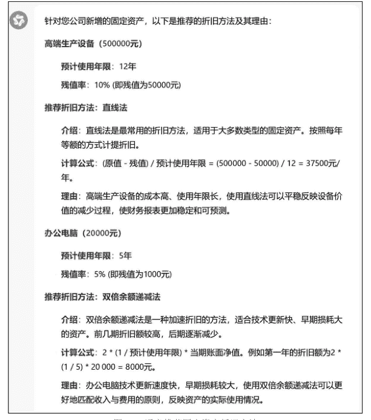

该回复针对具体资产做了差异化推荐，并说明了推荐理由，同时对直线法和双倍余额递减法进行了说明，可操作性较强，逻辑也比较清晰。

#### 【演示 2】自动核算月度折旧金额

遵循权责发生制，固定资产折旧一般要按月计提，这样才能让资产损耗平滑地分摊到各月成本，保持当期成本与经营情况一致。

具体每月应提多少？仍以高端生产设备和办公电脑为例，让通义直接算出。“公司有两项新增固定资产，一项是高端生产设备，初始价值五十万元，预计十二年，残值率十%；一项是办公电脑，初始价值二万元，预计五年，残值率五%。请计算每月应计提的折旧额。”

通义计算结果见图 4-22 所示。

根据您提供的数据，我们可以分别测算两项资产的月折旧额，具体过程如下：

##### 高端生产设备

初始价值：500000元

预计使用年限：12年

残值率：10%

残值：500000元 × 10% = 50000元

###### 年折旧额计算

年折旧额 = (原值 - 残值) / 预计使用年限 = (500000 - 50000) / 12 = 450000 / 12 = 37500元/年

###### 月折旧额计算

月折旧额 = 年折旧额 / 12 = 37500 / 12 = 3125元/月

##### 办公电脑

初始价值：20000元

预计使用年限：5年

残值率：5%

残值：20000元 × 5% = 1000元

###### 年折旧额计算

年折旧额 = (原值 - 残值) / 预计使用年限 = (20000 - 1000) / 5 = 19000 / 5 = 3800元/年

###### 月折旧额计算

月折旧额 = 年折旧额 / 12 = 3800 / 12 ≈ 316.67元/月

##### 小结

高端生产设备每月折旧：3125元

办公电脑每月折旧：316.67元


得到结果后，财务人员即可直接进行当期计提，会计分录为：

借：制造费用－折旧费用 3125（高端生产设备）

借：管理费用－折旧费用 316.67（办公电脑）

贷：累计折旧 3441.67

#### 【演示 3】动态调整折旧计划

资产在使用过程中，因升级改造、搬迁或用途变更，折旧计划往往需要重新拟定。过去财务要手动推算剩余年限和金额，如今借助智能助手，这一过程更智能。

假设前述高端生产设备使用满五年后，企业对其进行技术升级，生产效率和性能显著提升，但未来几年贬值会加快，剩余使用年限从七年调整为五年，残值保持不变。此时是否需要更换折旧方法？

向通义咨询后，回复见图 4-23 所示。

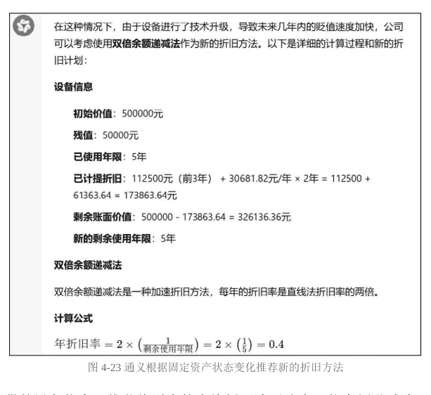

通义基于最新的设备信息，建议将原先的直线法改为双倍余额递减法，更贴合设备未来快速贬值的特征。

如需查看后续各年的详细折旧情况，可继续追问，回复见图 4-24 所示。

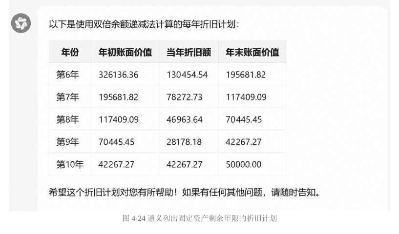

该案例体现了智能助手的优势，能够依据新的折旧政策迅速算出剩余年限的折旧额，并以表格形式清晰呈现。从金额变化可以看出，双倍余额递减法确实更能反映设备加速贬值的实际。这种智能化调整既节省了手工核算时间，也降低了差错风险。

## 第5章

数据分析：AI驱动财务分析的应用技巧

当下财务管理的核心，已从单纯记账转向数据洞察。财务人员需要从海量数据中挖掘趋势与规律，为管理层决策提供支撑。单纯的数字堆砌和报表输出已无法满足市场变化的需求，企业需要更敏捷、更智能的分析工具。人工智能的引入，正好解决了这一痛点。下面将探讨如何用人工智能驱动财务分析，从基础函数到指标解读，实现效率与洞察的双提升。

### 5.1 智能函数运用

财务工作中函数是处理数据的利器，很多同事只熟练使用 SUM、AVERAGE 等基础函数，对 INDEX、MATCH、OFFSET 等高阶函数的理解不足，导致数据处理灵活性受限。无论是外置的智能助手如通义，还是办公软件自带的智能功能如 WPS AI，都能帮助财务人员快速上手并正确使用函数。

#### 【演示 1】函数公式的推荐与自动生成

财务分析中，选择对的公式很关键。面对多样化的数据，如何迅速锁定合适的函数并写对公式，是常见难题。智能助手可以根据具体数据场景，自动推荐函数并解释原理。

举例说明，财务人员手头有一张包含数百个产品销售收入的表格，需要按地区汇总销售额。应该用哪个函数？公式怎么写？

##### ❶智能体推荐函数

通义中设有专门的函数类智能体，在“发现智能体”页搜索“函数”即可找到，如图 5-1 所示。


随机打开一个，例如“Excel 大神”，提问：“我正在处理一张包含数百个产品销售收入数据的表格，需要按地区对销售额进行汇总分析，应该使用什么函数公式呢？”

通义给出如图 5-2 所示。


这里给出了两种适配场景的函数，任选其一即可。

##### ②智能体生成函数公式

明确函数后，若不确定具体写法，可描述表格结构并提问：“应用 SUMIF 函数按地区汇总销售额，地区在 E 列，销售收入在 C 列，公式是什么？”

为提高准确性，也可直接上传表格或复制粘贴数据到对话框。

通义分析后会给出具体公式，如图 5-3 所示。

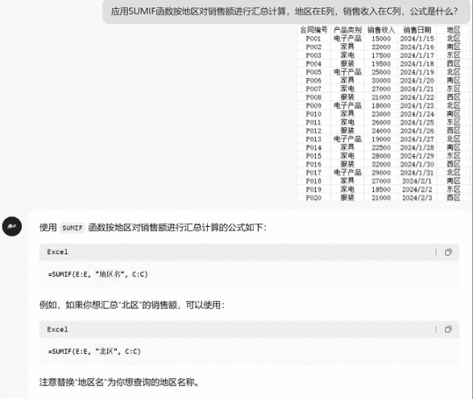

##### ③在单元格中输入公式

若要汇总“北区”销售额，只需复制通义提供的第二个公式到目标单元格即可。

打开 WPS 表格，在统计单元格输入公式查看结果，如图 5-4 所示。

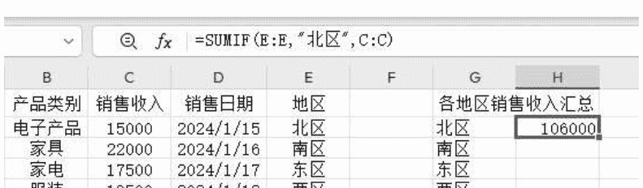

北区的销售收入已汇总出来。若需汇总其他区域，只需将公式中的“北区”替换为“南区”“东区”或“西区”即可。

#### 【演示 2】多变量分析中的嵌套函数和数组公式

财务分析常涉及多变量，需借助嵌套函数和数组公式。嵌套函数是将函数层层嵌入，逐级处理数据；数组公式则可一次性对一组数据进行多重运算并返回多个结果。前者适合线性逻辑判断，后者更适合多条件、大规模的复杂计算，灵活性更强。

但复杂公式易出错，这时智能助手可提供帮助。

延续前例，假设不仅要按地区汇总销售额，还要按销售日期和产品类别同时分析，单一的 SUMIF 已不够，需用嵌套函数或数组公式。

提问通义：“我想要统计表中销售收入大于 20000 元的合同数量，但如果产品类别是家具，则只统计销售日期在 2024 年 1 月 20 日之后的合同。”

通义智能体给出的嵌套函数公式如图 5-5 所示。

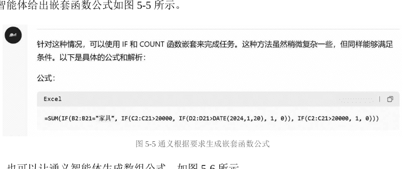

也可以让智能体生成数组公式，如图 5-6 所示。

了解了，您想要统计满足以下条件的合同数量：

1. 销售收入大于 20000 元

2. 如果产品类别是家具，则销售日期必须在 2024 年 1 月 20 日之后

您可以使用以下数组公式来实现这一目标：

```
=SUM((C2:C21>20000) * (B2:B21<>"家具") + (B2:B21="家具") * (C2:C21>20000) * (D2:D21>DATE(2024,1,20)))
```

图 5-6 通义根据要求生成数组公式

两种方法都能完成该统计任务，输入结果如图 5-7 所示。

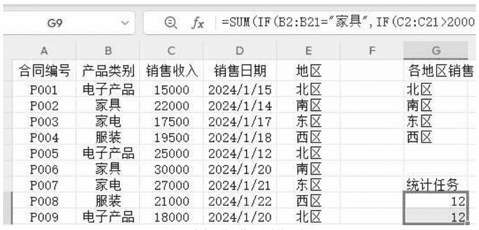

两者结果一致，都是 12。可见尽管结构不同，但在多条件统计场景下，嵌套函数和数组公式都能达到同样准确的效果，智能助手让复杂公式编写变得简单。

### 5.2 巧用智能助手快速筛选数据

数据筛选是财务人员的日常操作，面对多条件筛选或需要美观呈现时，手动筛选效率低下，数据透视表是常用方案，但上手门槛较高。智能助手可辅助财务人员快速精准筛选，并指导透视表和切片器的使用。

下面以通义和 WPS 为例演示快速筛选数据的方法。

#### 【演示 1】智能助手直接筛选表格数据

智能助手本身具备数据筛选能力，面对小规模或格式多样的筛选需求，可直接交由助手完成，人工复核即可。

假设有一张全年产品销售记录表，需要筛选出销售额超过 20000 元、产品类别为“家电”、客户评分不低于 4 的记录，并整理成新表。

筛选条件较多，手动操作费时，可直接让通义处理。

##### ❶上传或复制数据

打开通义主页，新建对话，将销售记录表复制到对话框或上传文件，然后描述筛选需求，即可得到答复，如图 5-8 所示。

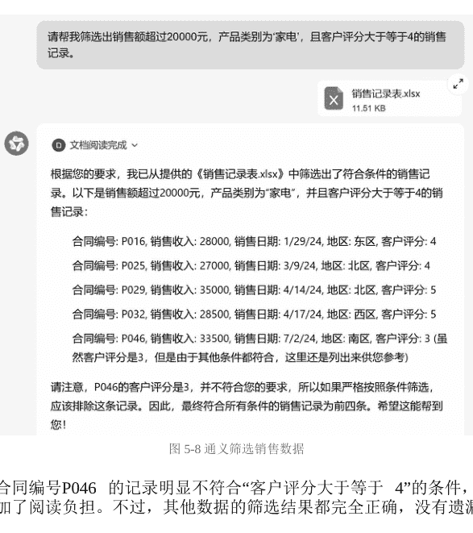

该回答中，合同编号 P046 的记录明显不符合“客户评分大于等于 4”的条件，却出现在结果里，虽然进行了说明，但增加了阅读负担。其余数据的筛选结果正确，未出现遗漏，基本可用。

除表格外，通义也能从合同、邮件、报告等非结构化文本中筛选信息。将文本整理后上传，指令如“从这些合同中提取金额大于 100000 元的记录，并筛选出交易日期在 2024 年 7 月之后的合同”，通义也能快速定位。

##### ②将筛选结果整理成表格

得到筛选数据后，还可要求助手将其整理成表格，便于提交。

继续提问：“将符合条件的销售记录列成表格。”可得到如下回复，如图 5-9 所示。

当然可以，以下是按照您的要求筛选出来的销售记录表格：

| 合同编号 | 产品类别 | 销售收入 | 销售日期 | 地区 | 客户评分 |

| :--- | :--- | :--- | :--- | :--- | :--- |

| P016 | 家电 | 28000 | 1/29/24 | 东区 | 4 |

| P025 | 家电 | 27000 | 3/9/24 | 北区 | 4 |

| P029 | 家电 | 35000 | 4/14/24 | 北区 | 5 |

| P032 | 家电 | 28500 | 4/17/24 | 西区 | 5 |

图 5-9 通义将符合条件的销售记录列成表格

##### ❸将筛选结果保存到本地

复制表格内容，在 WPS 中新建文档，选中单元格后粘贴并保存，即可将符合条件的数据保存在本地。

#### 【演示 02】利用数据透视表和切片器进行筛选

数据透视表是强大的数据分析工具，可按不同维度对数据进行分类、汇总和筛选。切片器作为可视化筛选控件，能实现不同维度的快速切换，特别适合汇报和交互式分析。例如在销售会议中，管理者可通过切片器快速查看不同地区和产品类别的销售表现，直观把握趋势。

对很多人来说，插入透视表和切片器的操作并不熟练，通义可以提供步骤指导。具体操作如下：

##### ❶向通义提问数据透视表插入步骤

将销售记录表复制到通义对话框或上传文件后，要求：“请指导我为该 WPS 表格插入数据透视表，用来统计不同产品类别、不同销售地区的销售收入。”

通义给出如图 5-10 所示。

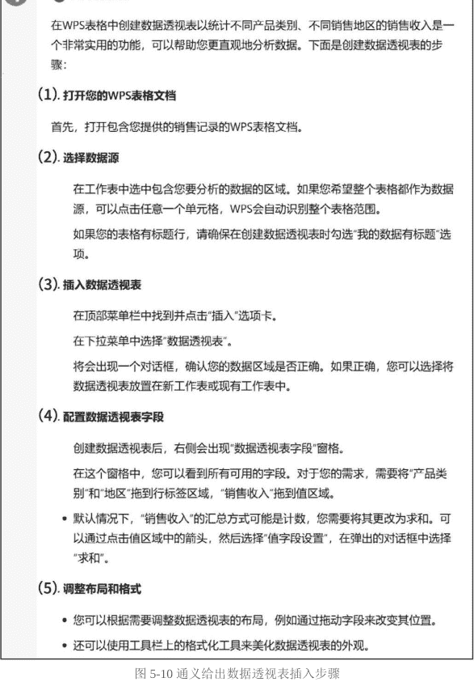

在 WPS 表格中创建数据透视表以统计不同产品类别、不同销售地区的销售收入是一个非常实用的功能，可以帮助您更直观地分析数据。下面是创建数据透视表的步骤：

###### (1). 打开您的 WPS 表格文档

首先，打开包含您提供的销售记录的 WPS 表格文档。

###### (2). 选择数据源

从数据汇总到智能财务洞察

先框定要做分析的区域。想让整表都参与计算，只要点进任意一个单元格，WPS 就会自动判定表格范围。源数据带表头时，建表环节务必勾选“我的数据有标题”，否则字段对应会错位。

###### (3). 插入数据透视表
切换到顶部“插入”标签，点击“数据透视表”。随后弹出的确认框会显示当前数据源范围，核对无误后可选择把结果放到新工作表或当前工作表。

###### (4). 配置数据透视表字段
透视表创建完成后，右侧会出现“数据透视表字段”窗格，里面列出所有可用字段。把“产品类别”和“地区”拖入行标签区，把“销售收入”拖入数值区。

- 数值区默认汇总方式常为计数，需要改成求和。点击数值区的小箭头，选择“值字段设置”，在弹出的对话框里把汇总方式改为“求和”。

###### (5). 调整布局和格式
字段可以随时拖动来改变排列顺序。工具栏里的格式按钮也能用来美化表格外观。

图 5-10 通义给出数据透视表插入步骤

通义已把 WPS 透视表的操作流程讲清楚，下面在原始表格里按步骤实操。

##### ②插入数据透视表
打开原始文件，先检查数据是否规范。每列都要有明确表头，例如“产品类别”“销售收入”“地区”等，因为透视表的字段是依表头自动生成的，这一步很关键。

按通义的指引在 WPS 中生成透视表，完成后的界面如图 5-11 所示。

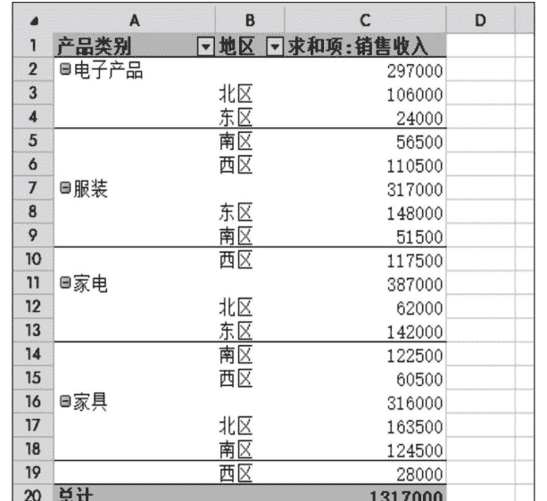

汇总虽然完成了，但“地区”作为“产品类别”的子层级展示，不符合日常浏览习惯。可以把当前透视表复制给通义，让它帮忙优化。

通义给出的解决思路如图 5-12 所示。


按建议把“地区”从行标签移到列标签后，呈现方式立刻变得清晰，如图 5-13 所示。

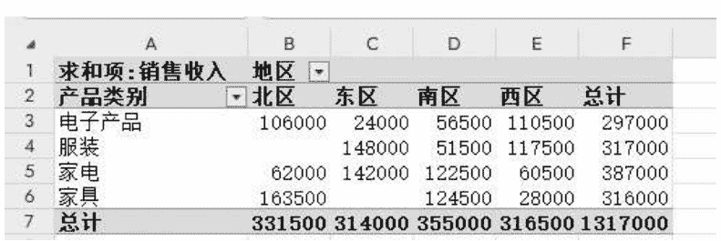

可看出智能助手不一定每次都能一步做到位，需要人工引导配合，才能高效完成任务。

##### ③添加切片器
想更灵活地筛选展示，可为透视表添加切片器。选中透视表后找到“插入切片器”按钮，选择需要筛选的字段，如“地区”或“产品类别”。

插入后切片器会出现在透视表旁边，如图 5-14 所示，点击切片器里的按钮，透视表内容会动态更新，很适合多维度快速分析。

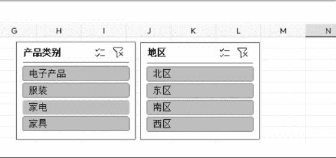

##### ④数据透视表和切片器的筛选效果展示
透视表配合切片器后即可进行交互筛选。用户只需点选切片器中的某个维度，透视表会立即刷新，只显示符合条件的汇总结果。

例如，想看南区家具的销售情况，只需点选“南区”和“家具”，透视表会进一步筛选，仅展示相关数据，如图 5-15 所示。

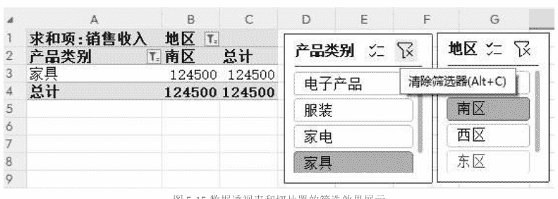

若要一次性取消多个筛选条件，只需点切片器中的“清除筛选器”按钮，即可恢复透视表的全局展示。

这种无缝动态筛选让透视表既有强大的分析能力，又具备灵活的操作性，让财务数据分析更简单高效。

### 5.3 财务指标计算与自定义
财务指标是衡量企业健康的信号，反映运营效率、盈利能力、资本结构等核心信息。但其计算并不简单，复杂财务数据涉及多维度，手工运算容易陷入繁琐公式，忽视指标背后的深层含义。随着业务与市场变化，常规指标难以实时反映实际。AI 工具的出现提供了新方式，不仅能快速精准计算常规指标，还能按企业情况定制指标，让数据分析更贴近现实。

#### 【演示 1】常规财务指标计算
计算资产负债率、流动比率、净利润率等基础指标是财务工作的常见任务。AI 如通义可自动完成。

假设有一份 XX 公司 202X 年的资产负债表，下面通过通义计算偿债能力指标：

打开通义，上传资产负债表文件，或直接复制表格内容到对话框中，要求通义据此计算偿债能力指标如资产负债率和流动比率。结果如图 5-16 所示。

通义读取表格后数秒内生成详细结果，不仅计算了资产负债率和流动比率，还计算了速动比率。财务人员可直接复制结果到报告，省去繁琐手工运算。

具体计算如下：

**资产负债率 (Debt to Asset Ratio)**
资产负债率 = 总负债 / 总资产
期末数：总负债 = 330000元，总资产 = 800000元
计算：330000 / 800000 = 0.4125 或 41.25%

**流动比率 (Current Ratio)**
流动比率 = 流动资产 / 流动负债
期末数：流动资产 = 340000元，流动负债 = 180000元
计算：340000 / 180000 = 1.89

**速动比率 (Quick Ratio 或 Acid Test Ratio)**
速动比率 = (流动资产 - 存货) / 流动负债
期末数：流动资产 = 340000元，存货 = 90000元，流动负债 = 180000元
计算：(340000 - 90000) / 180000 = 250000 / 180000 = 1.39

图 5-16 通义计算公司偿债能力指标

#### 【演示 2】自定义财务指标
不同行业和企业的分析标准各异，通用指标有时无法满足特定需求，因此需要设计针对特定场景的指标。通义可依据行业特性协助创建自定义财务指标。

假设某公司以技术创新为核心，频繁投资研发项目。仅靠传统投资回报率难以反映项目真实贡献，尤其是风险、周期和现金流不确定性。因此需要设计“创新项目投资回报加权指标”，更精细衡量每个项目价值，并结合风险和周期加权。公司期望该指标能评估创新项目资金使用效率，并实现多维度衡量。

##### ❶ 自定义财务指标
创新项目回报不仅看最终资金回报，还需综合项目风险、周期长度和现金流稳定性。该指标如何构建，可向通义请教思路，如图 5-17 所示。

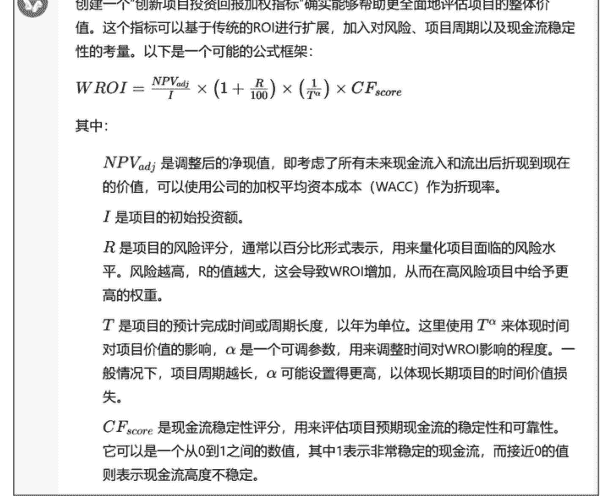

图 5-17 通义编写创新项目投资回报加权指标公式

该公式融合了传统财务指标如净现值 NPV 与非传统因素如风险、周期、现金流稳定性，是通义按用户需求编写的概念框架，有效性和适用性尚未验证，仅作演示。若计划实际使用，建议先小范围测试并据反馈优化，同时可参考文献和案例。

##### ②收集相关数据交给通义进行计算
假设指标获公司认可，接下来需收集相关数据。包括项目执行期间累计现金流入流出、各项目风险评分、预计开发周期等。

将数据导入通义，输入指令：“请按上述公式帮我计算公司 202X 年创新项目投资回报加权指标。项目数据在 A 列，风险调整系数在 B 列，周期加权系数在 C 列。”

通义会根据各项目现金流、风险评估和周期自动计算加权回报指标，如图 5-18 所示。

好的，我们直接计算项目1的WROI。

$NPV_{adj} = 100,000$

$I = 50,000$

$R = 10$

$T^a = 1.5$

$CF_{score} = 0.9$

使用公式：

$WROI = \frac{NPV_{adj}}{I} \times (1 + \frac{R}{100}) \times (\frac{1}{T^a}) \times CF_{score}$

计算步骤：

基础ROI: $\frac{100000}{50000} = 2.0$

风险调整后的ROI: $2.0 \times 1.1 = 2.2$

周期加权后的ROI: $2.2 \times \frac{1}{1.5} = 1.4667$

最终WROI: $1.4667 \times 0.9 = 1.32$

项目1的WROI为 **1.32**。

图 5-18 通义计算项目 1 创新项目投资回报加权指标

如需可继续计算项目2、项目3的加权指标。

### 5.4 AI深度分析财务指标
面对众多指标时，容易只看表面数字，忽视因果关系。例如毛利率上升是否意味着业务健康？净利润率下降是否预示亏损？答案并不总是明显。尤其在业务复杂、市场多变时，指标关联与解读深度往往超出传统分析能力。AI 工具如通义不仅能解释数字，更能从整体运营与市场环境出发，提供深层解读。

#### 【演示 1】常规指标结果解读
前文通义已对 XX 公司 202X 年偿债能力指标进行计算，得出资产负债率、流动比率等，为偿债能力提供初步框架。AI 不仅能计算，还能深度分析结果，例如要求其对资产负债率和流动比率进行深度分析，结果如图 5-19 所示。

该回答对资产负债率和流动比率做了数值解读，并提及财务风险和经营效率。但因资料有限，分析相对表面，缺少公司背景、历史数据和多指标关联的挖掘。

因此，若想获得更深入结果，需提供更多资料并进一步追问。例如资产负债率偏高原因，或当前债务结构是否合理。

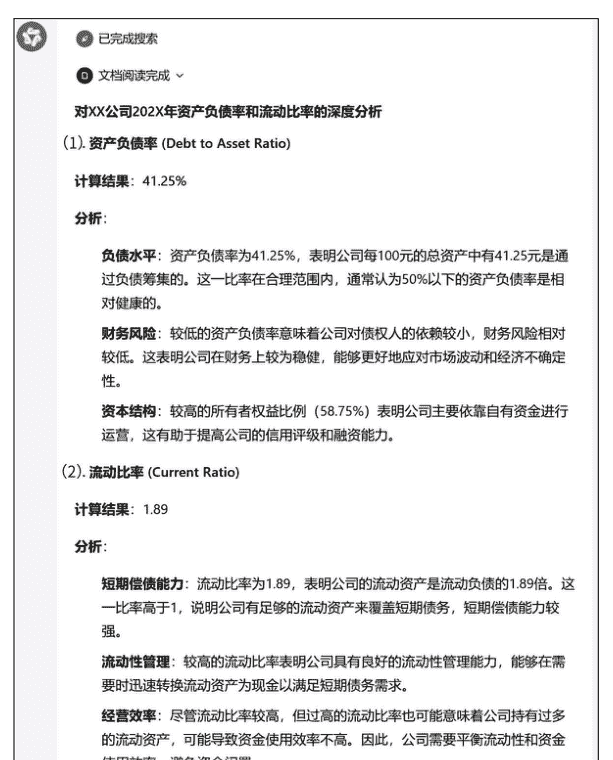

#### 【演示 2】 历史数据解读与趋势分析
单一指标解读往往片面，仅靠一年资产负债率难以全面判断偿债能力。结合历史数据做趋势分析，能提供更深入洞察。

仍以 XX 公司为例，对比 202X 年期初与期末资产负债率变化并解读未来趋势，通义分析结果如图 5-20 所示。

##### 资产负债率变化对比
期初（202X年初）：38.33%
期末（202X年末）：41.25%

##### 解读未来趋势
- **负债增加原因**：公司可能为业务扩展、资本支出或增加营运资金需求而增加负债。
- **资产增加原因**：营业收入增长、投资和融资活动导致总资产增加。
- **财务风险**：资产负债率上升但仍处于健康水平（50%以下），财务风险可控。
- **资本结构优化**：公司应关注资本结构，合理利用财务杠杆，避免过度负债。
- **业务发展**：扩张业务和投资时，需确保新增负债带来合理回报。
- **市场环境**：密切关注市场动态，灵活调整财务策略。


该回答提供了较为详细的资产负债率趋势解读，结合财务分析一般标准，指出年内比率上升原因，并评估当前健康水平，特别给出 50% 临界值警示。

#### 【演示 3】数据交互与指标关联分析
财务指标并非孤立存在，彼此相互作用。一个指标变化无法完全说明问题，需与其他指标综合分析。例如资产负债率上升不一定意味着财务风险增加，可能是通过债务融资获得更高投资回报。因此需要多指标联动对比。

比如在偿债能力分析基础上，将 XX 公司利润表和现金流量表上传给通义，计算营运能力、盈利能力、发展能力指标，再综合分析财务状况，结果如图 5-21 所示。

明白了，以下是基于各项财务比率的数据支撑，对 XX 公司财务状况的综合结论：

##### 综合结论
XX 公司在 202X 年的财务状况总体表现良好，具体表现在以下几个方面：

(1). 财务稳健性和偿债能力：
**流动比率 (1.89)** 和 **速动比率 (1.39)** 均高于1，表明公司具有较强的短期偿债能力，能够在需要时迅速变现流动资产来偿还短期债务。
**资产负债率 (41%)** 较低，说明公司的负债水平相对较低，财务风险较小，财务结构稳健，能够有效抵御市场波动带来的冲击。

(2). 高效的资产管理和营运能力：
**存货周转率 (3.33)** 表明公司能够有效地管理和转化存货，减少资金占用，提高资金使用效率。
**应收账款周转率 (5.00)** 较高，说明公司能够及时收回账款，减少坏账风险，加速资金回笼，提高运营效率。

(3). 强大的盈利能力和高效的经营管理：
**净利润率 (19.2%)** 和 **营业利润率 (25%)** 均较高，表明公司在扣除所有成本和费用后仍能保持较高的利润水平，主营业务盈利能力强，经营效率高。

(4). 显著的成长潜力：
**营业收入增长率 (25%)** 和 **净利润增长率 (38.37%)** 均较高，显示公司不仅在扩大业务规模方面取得了显著进展，而且在提高效益方面也表现出色，未来发展前景良好。

##### 综合来看：
XX 公司在 202X 年展现了良好的财务健康状况和较强的市场竞争力。公司的财务结构稳健，短期偿债能力强，资产管理和营运效率高，盈利能力强，且成长潜力大。这些数据表明 XX 公司在当前市场环境下具有较强的抗风险能力和可持续发展的潜力。未来，公司应继续关注市场动态，优化内部管理，以维持和提升其竞争优势。


通过此回答可见，AI 工具可在数秒内完成基础财务分析，大幅提升效率。

#### 【演示 4】不同项目指标对比分析
AI 在深度分析财务指标方面的功能，还可应用于不同项目指标对比。例如前文自定义指标中，假设 XX 公司有多个项目，可让通义对比三个项目的创新项目投资回报加权指标并给出综合评价，如图 5-22 所示。

当然，我们可以对比分析一下这三个项目的WROI结果，以帮助您更好地理解每个项目的综合表现。

##### 项目对比分析：
- (1). 项目3 的 WROI 为 1.6625，是三个项目中最高的。这主要得益于其较低的风险（5%）、较短的周期（1.2）和最高的现金流稳定性（0.95）。这些因素共同作用，使得项目3在综合回报上表现最佳。
- (2). 项目1 的 WROI 为 1.32，虽然低于项目3，但仍表现出良好的综合性能。项目1的风险（10%）和周期（1.5）适中，且现金流稳定性（0.9）较好，使其在综合回报上具有较强的竞争力。
- (3). 项目2 的 WROI 为 0.92，是三个项目中最低的。这主要是因为项目2的风险较高（15%），周期较长（2.0），且现金流稳定性较低（0.8）。这些不利因素显著降低了其综合回报。

##### 综合评价：
- **项目3** 是最佳选择，因其低风险、短周期和高现金流稳定性，提供了最高的综合回报。
- **项目1** 次之，尽管风险和周期适中，但其综合回报仍然较为可观。
- **项目2** 表现最差，高风险、长周期和低现金流稳定性使其综合回报最低，投资吸引力较低。

图 5-22 通义对比不同项目指标

通义通过对 WROI 的详细比较，明确指出各项目优劣。项目3 因低风险、短周期和高现金流稳定性获得最高 WROI，成为最佳选择，项目1 次之。此类分析有助于财务人员快速形成投资判断。

### 5.5 财务异常数据识别与原因查找
在财务管理中，发现异常数据是确保财务健康和防范风险的重要环节。异常数据不仅影响报表准确性，还可能隐含业务或操作流程中的潜在问题。手工识别费时费力且易遗漏。AI 可自动化识别异常，提供实时预警，并通过历史数据和趋势分析帮助定位问题根源。

下面以通义为例，演示 AI 在财务异常数据识别与原因查找中的应用技巧。

#### 【演示 01】异常库存变动的识别与分析
库存管理是企业运营关键环节，过多或过少库存都会带来风险。库存数据异常变动可能意味着管理不善或市场需求变化。

这里有一份包含产品库存数量、入库日期、出库日期、产品类别和库存成本等信息的库存管理明细表，记录最近数月库存变化。只需打开通义对话框，点击“上传文档”，将明细表上传至分析平台。

然后要求通义识别库存数据中的异常变动。例如：“请帮我筛选出最近两个月没有发生出库操作的产品，这可能意味着滞销或库存积压。”

通义的回答如图 5-23 所示。

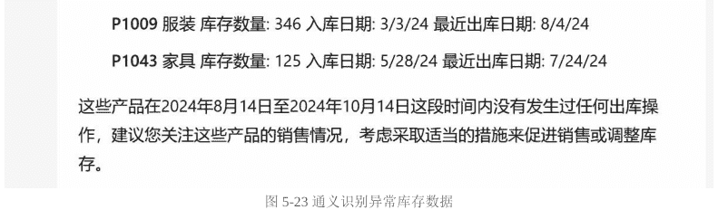

通义已经根据历史库存数据自动对比每个产品类别的库存变化，找到超过两个月没有出库操作的产品。

财务预警速判断与可视化报表实操

当异常点被筛出后，可进一步追问财务团队：“请对这两笔异常记录做深入剖析，说明可能导致滞销或库存堆积的成因，并给出可执行的管控建议。”

关于 P1009 这笔异常库存的解读，见图5-24。


解读完成后，可把由通义生成的库存异常分析与调整建议导出到本地电脑，便于后续讨论或提交管理层审批。

#### 【演示 02】 自动标记异常费用支出

收入波动容易被看见，支出端的不合规风险更需警惕。某部门费用骤增，或出现不符合报销规定的单据，往往暗示管理缺口或业务操作偏差。智能助手能够自动揪出这类问题。

此前已演示过如何用通义搭建报销问答型智能体，以减轻重复解释的负担。实际上，该智能体同样可承担合规审查职能。

以差旅报销为例，前期已为“财务报销小助手”导入完整的《差旅费报销标准》，下面演示如何让其识别不合规的差旅单。

1. 打开“财务报销小助手”
进入通义首页的智能体中心，点击我的智能体，找到“财务报销小助手”并进入会话页。
2. 导入差旅费报销明细表
会话输入框左侧并无上传按钮，但可直接复制粘贴。打开明细表，将数据复制后粘贴到对话框即可完成导入。
3. 发送指令
输入指令：“找出不符合报销标准的差旅费报销明细”。系统会依据《差旅费报销标准》自动筛出异常费用，如图5-25所示。

该结果严格对照公司内部制度，明确点出超出标准的具体原因。与网络上常见的泛泛说明不同，这里直接引用内部规范，并逐项对照出差天数、住宿费用与规定，实用性与针对性更强，对日常业务支持更大。


#### 【演示 3】 预算执行偏差识别与原因查找

预算偏离是财务监控的关键点。实际支出大幅超出预算会损害报表质量，甚至影响现金流；短期小幅超支也可能是合理的，如何把握尺度一直是人工操作效率低的痛点。借助智能手段，偏差的识别与剖析可以更智能、更快。

##### ①上传预算与实际支出数据并定义分析需求
先将预算表与实际支出表整理好，通过对话窗口导入文件。
在对话框中明确分析要求，例如：“请对比 202X 年各部门预算与实际支出，找出超预算 10% 以上的部门或项目。”系统会自动读取表格、完成对比并计算偏离幅度。

##### ②生成偏差报告
数秒内就会生成一份偏差报告，列出超预算的部门或项目及超支比例，如图5-26所示。

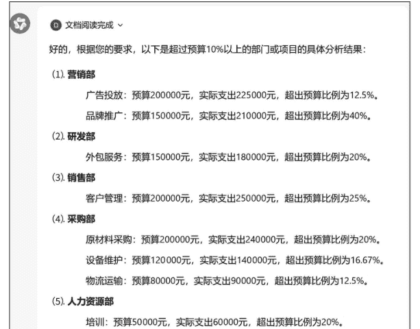

图 5-26 识别预算偏差

##### ③查找超支原因
想进一步弄清原因，可继续追问：“请分析超支原因。”系统会基于现有数据进行归因分析，如图5-27所示。


**广告投放**：市场竞争加剧，为维持曝光被迫加大投放；或投放渠道单价上涨导致支出超出预期。
**品牌推广**：活动执行比计划更复杂，或为提升效果额外增加了线下活动、赞助等投入。

(2). 研发部
**外包服务**：服务商因市场需求抬高报价，或项目复杂度提升需要更多专业支持。

(3). 销售部
**客户管理**：为升级客户关系管理系统投入增加，或为提升满意度扩充服务人员与频次。

(4). 采购部
**原材料采购**：全球供应链波动带来原材料价格上涨。
**设备维护**：突发故障或设备老化需额外维修更换。
**物流运输**：燃油价格上涨或为满足紧急需求改用更高成本的运输方式。

(5). 人力资源部
**培训**：新增培训项目或课程，或投入外部资源提升员工技能。

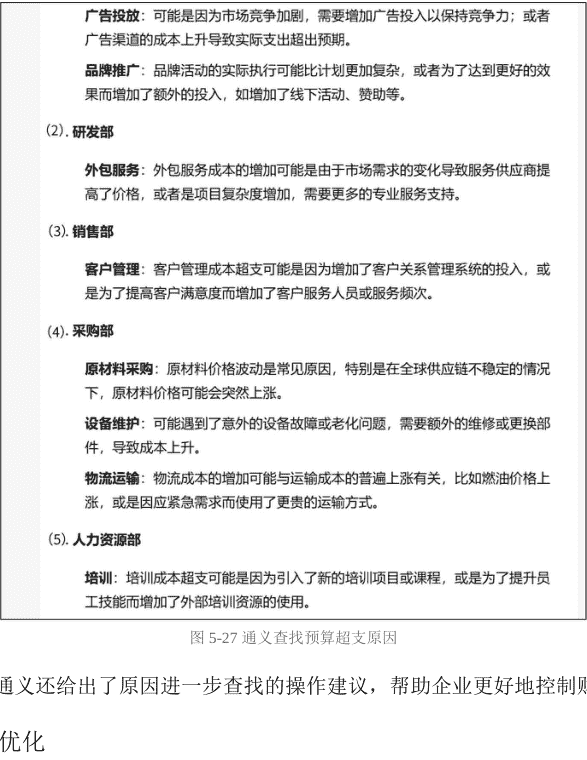

在最后，系统还给出了进一步核查方向的建议，帮助企业更有效地控制财务风险。

##### ④ 预算偏差调整与优化
确认偏差后，需要据实调整预算并采取措施把后续支出拉回合理区间。通过智能工具可以快速获取优化建议并生成调整方案。

以销售部为例，如图5-28所示。针对超支情况可按以下路径处理：

- (1). **详细分析超支原因**
回溯数个周期的预算与实际，锁定主因，如客户管理成本上升、市场拓展力度加大等。结合市场调研确保调整符合行业趋势。
- (2). **设定清晰目标与KPI**
为每个销售团队或个人制定可量化、可达成目标；设置销售额、新客数、客户满意度等KPI用于效果评估。
- (3). **优化客户管理成本**
按高价值、潜力、普通客户分层提供差异化服务，避免资源浪费；借助CRM提升管理效率，减少人工失误；通过邮件、社媒等低成本渠道保持联系，降低上门频次。
- (4). **控制市场拓展成本**
将市场拆分为子市场，优先投入潜力区；尝试线上营销、合作伙伴、行业展会等渠道并做A/B测试；与合适伙伴共担成本扩大覆盖。
- (5). **建立审批与监控机制**
完善预算审批流程，明确审批人及标准；每月或每季度复盘预算执行，及时止损；保持数据透明，让相关人员清晰掌握执行情况。
- (6). **灵活应对变化**
制定经济下行、竞争加剧等应急预案；预算中预留弹性空间应对不可预见波动。


完成以上步骤后，财会同事无需再手工比对，繁琐的计算与报告撰写可交由AI完成，自己只需做最终审核。

### 5.6 AI分析投资组合与决策建议

在日常工作中，财务同事常需参与投资管理，涉及组合分析、风险评估和收益预测等复杂任务。AI可以快速处理市场数据、输出组合报告，并根据实时信息调整策略，节省大量人工时间。

下面以通义为例演示三类操作。

#### 【演示 1】分析投资组合的收益与风险
假设公司投资基金由以下构成：
- 40%股票，主攻科技医疗
- 35%债券，以公司债为主
- 15%私募股权，近期投向初创企业
- 10%现金，应对流动性需求

需评估结构是否合理及潜在收益风险。

先把结构和假设输入通义：股票年化预期收益10%，波动率15%；债券3%，5%；私募股权12%，18%；现金0.5%，波动率近0。

要求进行分析，结果如图5-29所示。

系统按权重计算出整体预期收益率6.9%，同时提示因未考虑资产间协方差，直接加总无法精准反映组合风险，但整体风险偏高，帮助财务经理判断是否需要调整配置。

根据您提供的投资组合结构及各部分的预期收益和风险数据，我们可以先计算这个投资组合的预期收益和整体风险。以下是具体的分析步骤：

##### 预期收益计算
- 股票：40% * 10% = 4%
- 债券：35% * 3% = 1.05%
- 私募股权：15% * 12% = 1.8%
- 现金：10% * 0.5% = 0.05%
合计预期收益为：4% + 1.05% + 1.8% + 0.05% = 6.9%

##### 风险计算
计算组合整体风险需考虑资产相关性。为简化，这里假设相关性为零，仅做加权近似：
- 股票：40% * 15% = 6%
- 债券：35% * 5% = 1.75%
- 私募股权：15% * 18% = 2.7%
- 现金：10% * 0% ≈ 0%
直接相加无法准确反映风险，因忽略了协方差。若精确计算需使用相关系数及组合方差公式。
即便作为近似，也能看出股票和私募股权的高波动对组合风险贡献显著。

##### 结论
- **收益**：组合预期年化收益约6.9%，高于无风险利率，体现了风险溢价。
- **风险**：股票与私募股权占比大且波动高，组合面临相对较高的市场风险。

图 5-29 分析投资组合的收益与风险

系统通过加权计算给出整体预期收益率6.9%，同时指出忽略资产间协方差无法精确反映组合风险，但给出较高风险的结论，有助于财务经理评估当前结构是否合理，以便为未来一年的资产配置做出调整决策。

#### 【演示 2】场景假设与模拟
假设组合保持不变，但担心未来三年进入高通胀期，想模拟其表现并提前调整。

##### ❶设定假设情景：全球高通胀
向系统输入假设：未来三年全球平均通胀6%-7%，利率上行、物价快速上涨、消费承压。
要求分析当前组合在该情景下的表现。

##### ②情景模拟分析
系统基于高通胀情境评估各资产表现并给出解释，如图5-30所示。

在高通胀情景下，系统提供了分项与综合分析，并给出调整建议，帮助财务经理优化组合以应对通胀风险。通过此类假设模拟，可在不同市场环境下评估表现并优化决策。

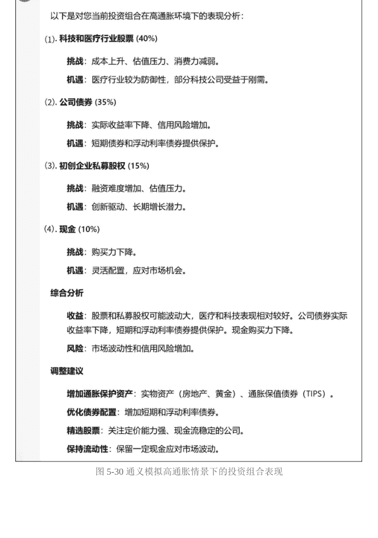

## 第6章
财务报表图形化：AI快速生成报表的实战技巧

财务报告是企业经营状况的窗口，也是股东、投资者和管理层决策的基础。它既是内部管理的依据，也是对外沟通的桥梁。现实中，财务同事不仅要梳理数据，更要把复杂信息转化为管理层易懂的图表和简洁语言，而季度末、年末时往往时间紧、任务重，AI的介入能有效分担压力。

### 6.1 用AI生成可视化图表
数据本身重要，呈现方式往往决定决策效率。如何在短时间内掌握图表制作技巧并高效输出？有了AI指导，这类难题可以迎刃而解。

#### 【演示1】AI指导用户使用WPS生成图表
财务同事更习惯用WPS或Excel出图，而非完全依赖AI自动化。在AI帮助下，可获得详细操作指引，逐步学习高效制作图形化图表。

假设需展示2024年1-6月月度收入与成本，帮助管理层分析趋势并预测未来。数据已整理，包含“月份”“收入”“成本”三列，需生成折线式图表。

##### ❶准备数据
准备2024年1-6月收入成本表，保存为WPS文件，示例见表6-1。

表 6-1 公司 2024 年上半年的收入和成本情况

| 月份 | 收入（元） | 成本（元） |
| :--- | :--- | :--- |
| 1月 | 100000 | 60000 |
| 2月 | 110000 | 65000 |
| 3月 | 120000 | 70000 |
| 4月 | 130000 | 75000 |
| 5月 | 125000 | 72000 |
| 6月 | 135000 | 78000 |

##### ❷数据导入并提问
进入通义界面，将表格内容复制粘贴到对话框，输入指令：“我需要使用WPS，根据表格内容生成一张折线图，展示2024年1月到6月的收入和成本变化趋势，应该怎么操作？”

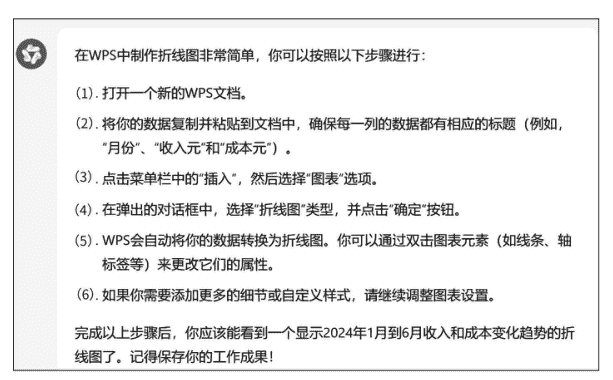

##### ③根据指导步骤生成折线图
按系统给出的步骤在WPS中操作，得到折线图如图6-2所示。

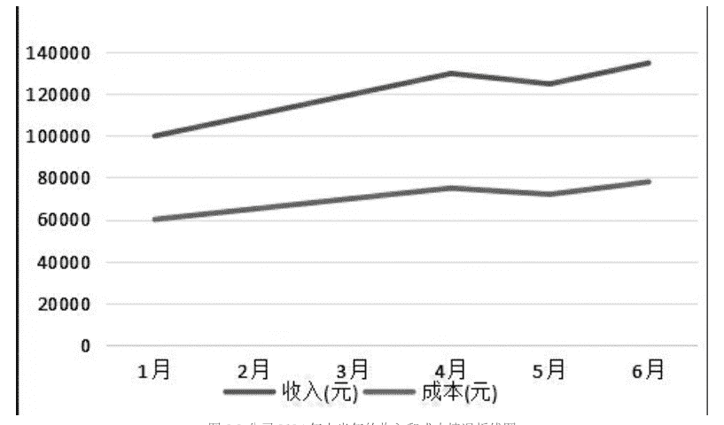

##### ④美化折线图
当前图表颜色区分不明显，且未标注数据点，不够直观。可继续提问：“我想美化折线图，让收入和成本用不同标记显示，并在每个数据点上显示具体数值，应该如何操作？”

系统迅速给出操作指引，如图6-3所示。

感谢你的反馈，你提供的步骤是正确的。在WPS中，确实可以通过“属性”工具栏来选择不同的标记样式。以下是详细的操作步骤，以确保你能正确地美化你的折线图：

###### 选择不同的标记
- (1). 选择图表：
    单击图表以选中它。
    确保图表周围出现选中框，表明它已被选中。
- (2). 选择数据系列：
    单击你想要修改的线条（例如，收入的线条）。
    这时，线条会被高亮显示，表示已选中该数据系列。
- (3). 打开“属性”工具栏：
    在图表的右侧，会出现一个“属性”工具栏。
    如果没有出现，可以尝试右键点击选中的线条，然后选择“格式数据系列”。
- (4). 选择标记样式：
    在“属性”工具栏中，找到“标记”选项。
    选择“内置”标记样式。
    从提供的标记样式中选择一个你喜欢的样式。

###### 显示数据点上的具体数值
- (1). 选择数据系列：
    再次单击你想要添加数值的线条（例如，收入的线条）。
- (2). 添加数据标签：
    右键点击选中的线条，选择“添加数据标签”。
    选择一个位置选项，例如“上方”或“旁边”，以便在每个数据点上显示具体的数值。

图 6-3 通义指导折线图美化

按步骤美化后，收入与成本线使用不同标记和颜色区分，数据点上直接显示数值，可读性大幅提升。管理层能一目了然看到月度变化，决策效率提高。

最终效果如图6-4所示。

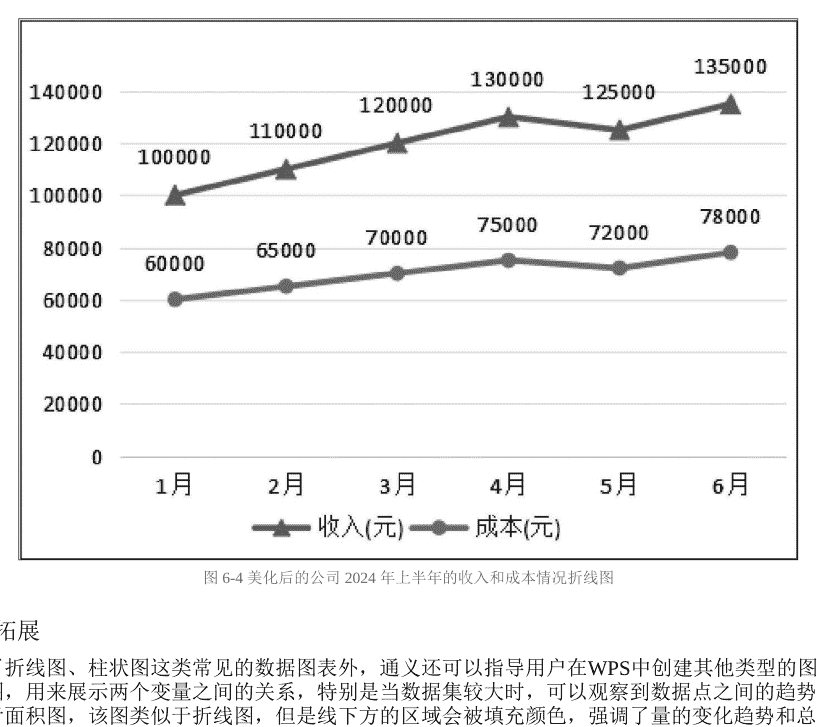

图6-4 美化后的公司2024年上半年的收入和成本情况折线图

##### ⑤内容拓展
除折线图、柱状图外，通义还能指导在WPS中制作散点图，用于观察变量关系；或制作面积图，强调总量变化趋势。

#### 【演示2】AI工具结合宏代码批量生成图表
面对批量数据手工绘图效率低下，使用宏代码批量生成是实用方案。不少财务同事对代码有畏难情绪，但AI可以直接生成代码，把最困难的部分完成，财务同事只需执行简单操作即可。

季度图表1分钟搞定：AI+宏联动实战

以此前汇总的2024年上半年收入与成本明细为例，本次要为第一季度和第二季度各生成一张收入柱形图，同时配一张成本走势折线图。

受限于WPS Office标准版的宏权限，本次演示全部以Microsoft Excel为操作环境。

##### ❶ 激活宏权限
打开Excel后点左上角“文件”，在菜单底部找到“选项”。在弹出的设置窗口左侧切到“信任中心”，再点右侧的“信任中心设置”。
左侧列表选择“宏设置”，右侧勾选“启用所有宏（不推荐，可能有安全风险）”，如图6-5所示，
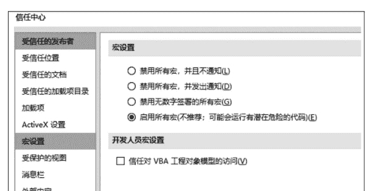
点“确定”保存并关闭所有对话框。

后续要跑宏，工作簿必须保存为宏启用格式。点“文件”“另存为”，在文件类型里选“Excel启用宏的工作簿（*.xlsm）”，如图6-6所示。


##### ② 让 AI 撰写宏脚本
这一步只需向通义提问：“我有一张Excel表格，包含2024年上半年的销售数据。A列为月份，B列为收入，C列为成本。请帮我写一段宏代码，分别生成Q1和Q2的收入柱状图和成本折线图。”

通义的返回内容如图6-7所示。
```
Sub GenerateSalesCharts()
    ' 声明工作表和图表对象
    Dim ws As Worksheet
    Dim chart1 As ChartObject
    Dim chart2 As ChartObject

    ' 设置工作表
    Set ws = ThisWorkbook.Sheets(1) ' 假设你的数据在第一个工作表中

    ' 第一季度收入柱状图和成本折线图
    Set chart1 = ws.ChartObjects.Add(Left:=100, Top:=50, Width:=400, Height:=300)
    With chart1.Chart
        .SetSourceData Source:=ws.Range("A2:B4") ' 设置收入为柱状图的数据范围
        .ChartType = xlColumnClustered
        .HasTitle = True
        .ChartTitle.Text = "第一季度收入与成本"

        ' 添加成本折线图
        .SeriesCollection.NewSeries
        .SeriesCollection(2).XValues = ws.Range("A2:A4")
        .SeriesCollection(2).Values = ws.Range("C2:C4")
        .SeriesCollection(2).ChartType = xlLine

        ' 设置图例名称
        .SeriesCollection(1).Name = "收入"
        .SeriesCollection(2).Name = "成本"
    End With

    ' 第二季度收入柱状图和成本折线图
    Set chart2 = ws.ChartObjects.Add(Left:=100, Top:=400, Width:=400, Height:=300)
    With chart2.Chart
        .SetSourceData Source:=ws.Range("A5:B7") ' 设置收入为柱状图的数据范围
        .ChartType = xlColumnClustered
        .HasTitle = True
        .ChartTitle.Text = "第二季度收入与成本"

        ' 添加成本折线图
        .SeriesCollection.NewSeries
        .SeriesCollection(2).XValues = ws.Range("A5:A7")
        .SeriesCollection(2).Values = ws.Range("C5:C7")
        .SeriesCollection(2).ChartType = xlLine

        ' 设置图例名称
        .SeriesCollection(1).Name = "收入"
        .SeriesCollection(2).Name = "成本"
    End With
End Sub
```

图6-7 通义生成的图表创建VBA代码片段

##### ③ 把代码导入 Excel
点复制按钮拿到图6-8中通义给出的代码，回到Excel按“Alt+F11”打开VBA编辑器。

在编辑器中新建一个模块，将代码粘贴进去，如图6-8所示，保存后退出编辑器。
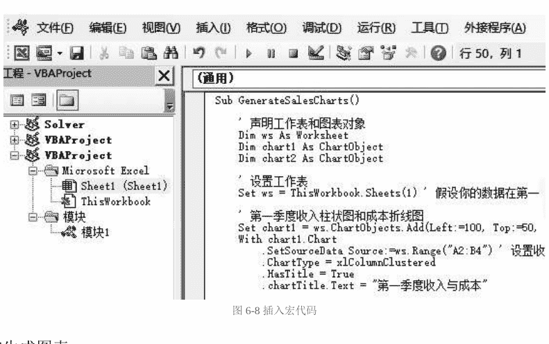

##### ④ 运行宏自动出图
回到Excel按“Alt+F8”调出宏列表，选中“GenerateSalesCharts”执行，如图6-9所示。
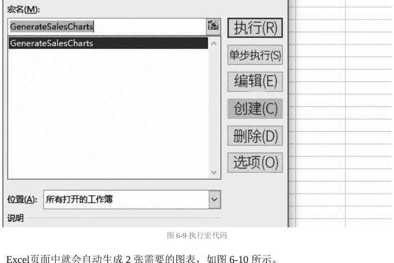

执行完成后，工作区会自动出现两张目标图表，如图6-10所示。
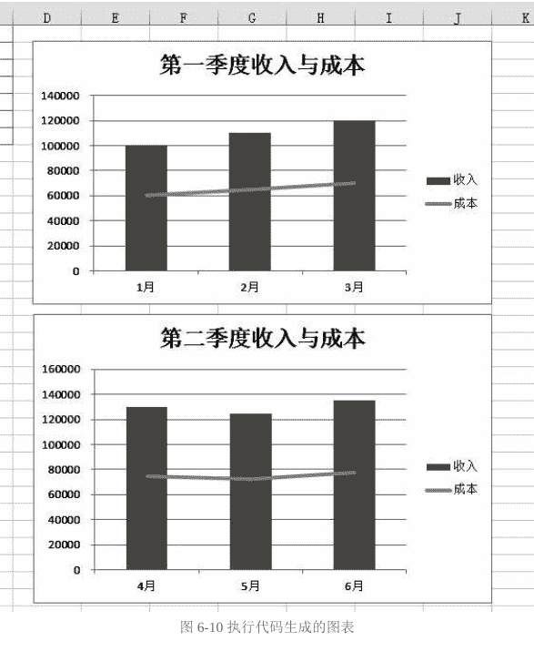

需要的话再自行调整美化，大约一分钟即可批量产出多张图表，显著提升财务同事的工作效率。

#### 【演示3】AI 直接生成图表
目前已有不少智能助手支持基于表格数据直接生成可视化，无需手动选择类型和调格式，AI会依据输入自动给出合适的呈现。

通义暂时不具备该能力，但ChatGPT可以实现，下面以效果为例，如图6-11所示。

| 月份 | 收入 (元) |
| :--- | :--- |
| 1月 | 100000 |
| 2月 | 110000 |
| 3月 | 120000 |
| 4月 | 130000 |
| 5月 | 125000 |
| 6月 | 135000 |

指令：根据上表，生成一张柱形图，展示公司2024年1月到6月的收入变化趋势。

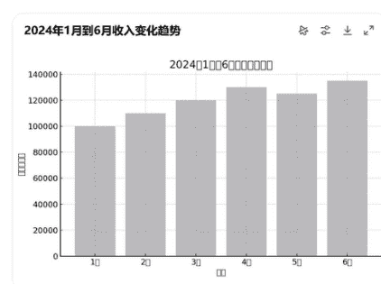

这是2024年1月至6月的收入变化趋势柱状图，展示了各月份的收入波动情况。如有其他调整或需求，请告诉我。

图6-11 ChatGPT自动生成的图表

操作与之前一致，直接把表格粘进对话框并输入指令即可。如需为柱形图加上数据标签等进一步美化，也可直接说明，ChatGPT会刷新图表，直至满足要求，如图6-12所示。
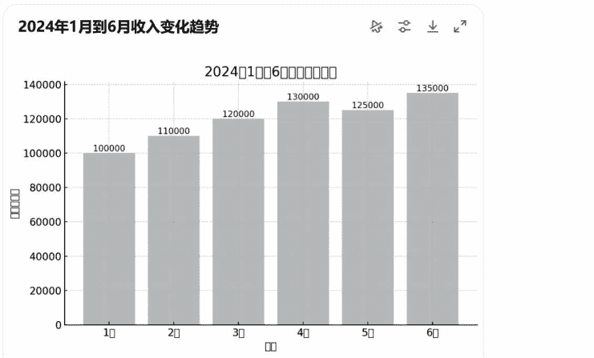

图6-12 ChatGPT美化生成的图表

值得注意的是，从图6-12和图6-13可以看出，ChatGPT生成的图表中中文会显示为方框，这是因为渲染字体不支持中文。

该问题虽有办法绕过，但任何处理都会让“直接生成图表”变得繁琐，与使用AI追求省心的初衷相悖。期待未来产品能原生解决。

当图表符合预期后，可点右上角下载图标保存到本地，再嵌入到汇报材料中。

### 6.2 用 AI 辅助撰写财务报告
撰写财报是财务工作的常规任务，但在有限时间内整合数据、提炼分析并形成结构清晰、内容扎实的报告始终是痛点。AI的加入提供了新思路。

AI能够依据输入自动搭建报告骨架，完成主体撰写，保证结构完整、逻辑顺畅。财务人员只需少量操作，就能快速得到符合公司要求的初稿，尤其在时间紧迫时优势明显。

下面仍以通义为例演示。

假设某公司20XX年的财务数据已整理完毕，需向管理层提交一份涵盖收入、支出、利润、现金流的详细分析并对未来做简要预测的报告。

#### 【演示1】确定报告框架
选定合适的框架是报告成型的关键。财务人员可沿用既有框架，也可让AI生成新框架。

##### ① 沿用以往的财务报告框架
公司若已有固定模板，可直接参考历史报告。此时可用AI对框架进行优化更新。

例如把过往的财务报告上传后输入：“请根据这份文档，总结出公司的财务报告框架。”通义会快速提炼出既有结构，并给出优化建议，使其更贴合当下。

##### ② 用 AI 生成全新报告框架
若需要新框架，可让AI帮忙搭建整体结构。提问时不必把每部分都列死，适当开放能获得更灵活的建议。

例如向通义提问：“我现在需要根据公司的20XX年度财务数据，撰写一份财务报告，报告需要涵盖收入、支出、利润和现金流的详细分析，预计还要对未来的财务状况作出简要预测。请为我出具一份详细的报告框架。”

###### 封面
标题：[公司名称]20XX年度财务报告
日期：2024年12月31日
编制人：财务部
审核人：[姓名]

###### 目录
- 概述
- 公司概况
- 财务概览
- 收入分析
- 支出分析
- 利润分析
- 现金流分析
- 财务比率分析
- 风险与挑战
- 未来展望
- 附录

##### 概述
报告目的：说明背景、目的与重要性。
报告范围：覆盖的时间段与主要内容。
数据来源：财务数据的来源及可靠性说明。

##### 公司概况
公司简介：历史、愿景、使命简述。
经营范围：主营业务与服务描述。
市场地位：行业定位与竞争优势。
关键业务里程碑：过去一年重要成果。

##### 财务概览
总资产：期末总资产情况。
净资产：公司净资产值。
总收入：年度总收入。
净利润：年度净利润。
现金及现金等价物：现金与短期投资总额。
负债总额：公司总负债。

##### 收入分析
收入构成：按产品线或服务分类的收入明细。
收入趋势：近几年收入变化。
产品/服务收入对比：各产品收入贡献比较。
地区收入分布：各区域收入占比。
收入增长因素：主要驱动因素。

###### 支出分析
成本构成：主要成本项目分类与金额。
固定成本与变动成本：区分列示。
营销费用：广告、促销等费用。
研发投入：研发相关支出。
行政管理费用：管理支持部门费用。
支出控制措施：控制举措及其效果。

###### 利润分析
毛利分析：毛利润及其变动。
营业利润分析：营业利润及其变动。
净利润分析：净利润及其变动。
利润率变化趋势：毛利率、营业利润率、净利润率走势。
影响利润的主要因素：关键影响因素分析。

###### 现金流分析
经营活动现金流：日常运营现金流入流出。
投资活动现金流：资本支出与投资现金流。
融资活动现金流：借款、还债、股权融资现金流。
现金流健康度评估：现金流状况评价。

###### 财务比率分析
流动性比率：流动比率、速动比率等。
杠杆比率：资产负债率、权益乘数等。
效率比率：存货周转率、应收账款周转天数等。
盈利能力比率：净资产收益率、毛利率等。

###### 风险与挑战
市场风险：需求变化、竞争加剧等。
财务风险：资金链、汇率波动等。
运营风险：供应链中断、生产事故等。
法律合规风险：法规变化、诉讼等。
应对策略：对应风险的对策。

###### 未来展望
行业发展趋势：所在行业未来方向。
公司发展战略：中长期战略规划。
预计财务目标：未来一至几年的财务目标。
面临的机遇与挑战：主要机遇与挑战。
短期与长期规划：具体计划安排。

###### 附录
财务报表：资产负债表、损益表、现金流量表。
重要会计政策：采用的主要会计政策。
专业术语解释：术语定义。
参考文献或资料来源：引用数据来源。

#### 【演示2】准备财务报表
完整报告需要数据支撑。框架确定后，下一步是整理所需报表。

可向通义提问：“撰写这份财务报告框架时，哪些财务报表是必须的？请列出我需要准备的财务报表。”

通义的回答如图6-13所示。
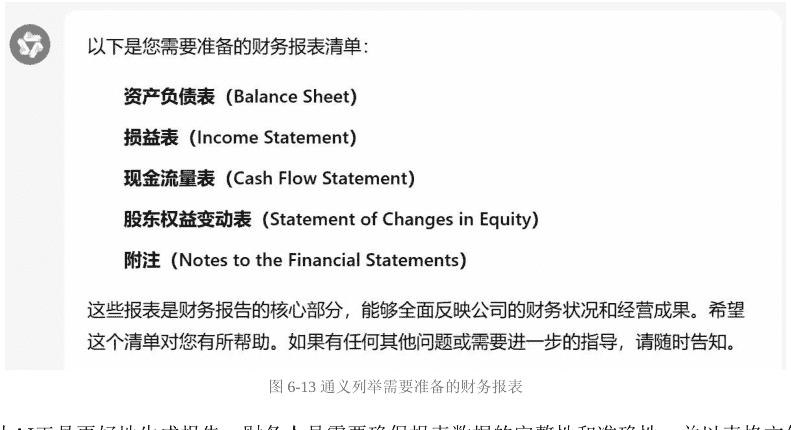

为了让AI生成更准确，财务人员需保证报表数据完整、准确，并以表格文件形式准备好，便于后续上传分析。

#### 【演示3】上传报表并生成报告
数据准备好后即可让通义起草。除点击“上传文档”外，通义还支持拖拽上传，可一次性选中多份报表拖入对话框，平台会自动识别。

上传成功后在对话框输入：“请根据上传的财务报表，按照刚才的财务报告模板，开始撰写财务报告。”如图6-14所示。


通义会解析报表数据，按既定框架起草报告，以下是部分内容，如图6-15所示。

##### 概述
**报告目的：** 本报告旨在全面分析[公司名称]在20XX年度的财务状况和经营成果，为管理层和利益相关者提供决策支持。
**报告范围：** 报告涵盖20XX年1月1日至20XX年12月31日的财务数据。
**数据来源：** 数据来源于公司内部财务系统和外部审计机构。

##### 公司概况
**公司简介：** [公司名称]是一家专注于高科技领域的创新型企业，成立于[成立年份]，总部位于[地点]。
**经营范围：** 公司主要从事[主要产品/服务]的研发、生产和销售。
**市场地位：** 在[行业]领域，公司凭借其先进的技术和优质的服务，已成为行业内的领先企业。
**关键业务里程碑：** 20XX年，公司成功推出了[新产品/服务]，并在[市场]取得了显著的市场份额增长。

##### 财务概览
**总资产：** 800000元
**净资产：** 470000元
**总收入：** 500000元
**净利润：** 96000元
**现金及现金等价物：** 150000元
**负债总额：** 330000元

##### 收入分析
**收入构成：** 20XX年度，公司实现营业收入500000元，较上期增长100000元，增长率为25%。

**收入趋势：** 公司收入持续增长，主要得益于新产品的推出和市场的拓展。
**产品/服务收入对比：** [具体产品/服务]的收入增长最为显著，占总收入的[百分比]。
**地区收入分布：** [主要市场]的收入占比最高，达到[百分比]。


若一次写不完，可输入“继续写”让其分段完成。也可按框架分步指令，例如：“请根据上传的财务报表，按照刚才的财务报告模板，开始撰写财务报告。先写第一部分‘概述’。”随后依次要求撰写财务概览、收入分析、支出分析等。

分步撰写有助于把控结构和节奏，确保每部分符合预期。

#### 【演示4】人工增加财务数据故事讲述
仅按框架由AI生成的内容结构清晰，但表达偏机械，缺乏对数据背后关联的洞察。此时财务人员可自行加入数据故事，让报告更有深度。

财务数据故事讲述是通过叙事把抽象数据转化为易懂的信息，帮助读者把握运营与财务表现，并解释原因、趋势与影响。

其中有五个技巧：

##### ❶ 识别关键数据点
通读AI生成的报告，找出核心财务数据点。如收入、利润、成本的波动区间，现金流的正负变化，尤其是经营、投资、融资活动的显著波动。

##### ❷ 分析数据背后的原因

锁定关键波动点之后，下一步就是追问数字背后的推力。影响财务表现的因素大致可归为外部环境和内部动作两类。外部层面，要看行业景气度、需求迁移或宏观经济态势是否在起作用，比如某季度营收抬升，往往与全行业需求回暖或公司打开新市场有关。内部层面，则要审视经营效率、战略调整或产品迭代如何传导到报表上，例如成本攀升多半源于生产效率下滑或供应链开支增加。

这一步，财务人可以把智能助手当成头脑风暴搭档，用精准提问来找灵感。让模型归纳波动的可行因果并给出观察角度，能明显拓宽分析边界。

例如对通义提出：“从内部经营视角，解释公司营业收入为何明显上涨。”模型会结合报表和市场动态，输出若干解释假设和趋势线索，为报告提供更多切入点，如图 6-16 所示。

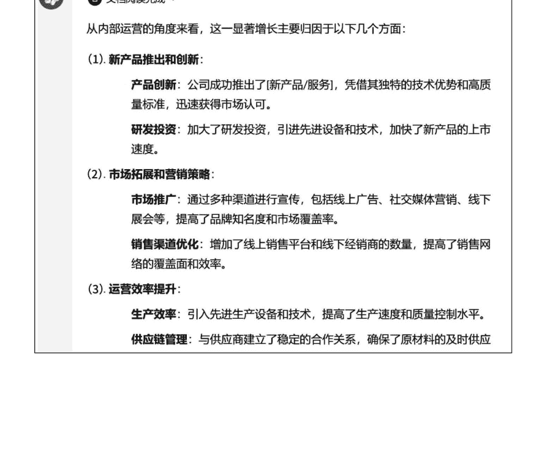


图 6-16 通义分析公司营业收入显著增长的原因

##### ❸ 把数字变成故事
把已识别的变化和成因转化为读者能秒懂的叙事，是报告可读性的关键。

讲增长时，可以描绘企业在特定窗口期如何实现营收提升，以及这种提升对后续的意义。写作时引入市场扩张、新品落地等情节，将数字与战略布局、团队投入、市场脉动串联，赋予报告温度，让它不再是冰冷的数值堆砌，而是战略落地、市场演进与集体努力的真实写照。

另一个值得展开的点是前瞻。财务人需基于当前走势，描绘未来财务图景，并点出潜在机会与风险，这也是撰写财务报告的初始要求之一。

##### ❹ 用图表让数据更直观
为了让叙事更有说服力，必须配合可视化。用折线、柱状、饼图等呈现核心指标与走势，能大幅降低理解成本。具体的图表制作方法可参照前文介绍。

### 6.3 AI校对与润色财务报告的实用操作
财务报告的产出不只是数据归集，文字打磨同样耗时。语法失误、用词偏差或逻辑跳跃都会拉低质感。过去这些校对润色只能靠人工反复通读，如今模型已能承担这部分重复劳动。

下面以通义为例，演示如何利用智能助手完成校对润色。

#### 【演示1】用模型快速检查标点与错字
模型可在很短时间内扫清语法、标点和错字问题。无论是别字、标点误用还是句子残缺，都能被自动揪出并给出改进建议。

- ❶ 先整理初稿并妥善保存
开始校对前，先把经助手辅助撰写的主体内容连同人工补充的文字和图表整合成一份初稿，存放在桌面或指定工作目录，便于后续调用。
- ❷ 把稿件送入通义并给出校对指令
把初稿发到通义的聊天窗口，输入指令：“请帮我校对这份财务报告的标点是否正确，有无错别字或语法错误，让全文语言流畅。”
模型会逐项扫描后列出修改点，如图 6-17 所示。从结果看，模型指出的主要是标点和别字问题。
- ❸ 依据反馈调整
收到反馈后，可逐条审阅其合理性，自行决定采纳与否。若问题较少，直接在源文件中手工修正效率更高（图 6-19）。若错误集中，也可让通义直接输出修改版再复制回去，不过这种方式会丢失原有排版，适合未做格式定型的稿件。

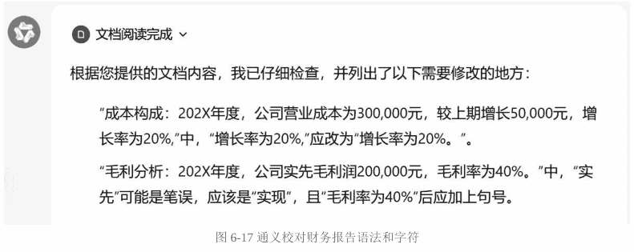

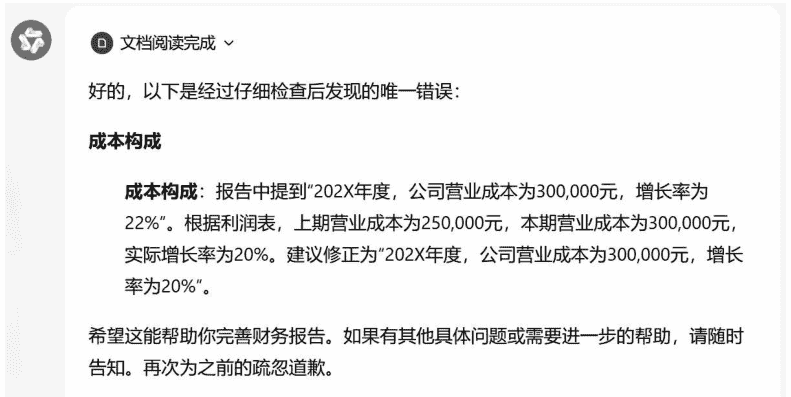

#### 【演示 02】用模型提升表达专业度与句式流畅性
除了基础校对，模型还能打磨语言质感。财务报告的数据往往准确，但表述容易显得生硬、冗长或说服力不足。借助模型调整段落与句式，可让行文更专业、易读。

操作时无需上传全文，只需把待优化的段落粘贴给通义，指令可以是：“请优化这段财务报告的语言表达，使其更专业。”

举例，原段落为：“固定成本与变动成本：固定成本主要包括管理费用和财务费用，分别为30000元和10000元；变动成本主要包括销售费用和资产减值损失，分别为20000元和5000元。”

发出优化指令：“请优化这段财务报告的语言表达，使其更专业、流畅。”

于是，通义在保持原本的财务信息不变的情况下，自动调整了句子结构、用词，如图 6-19 所示。

在本报告中，我们对成本结构进行了详细分类，以提供更加清晰的财务视图。固定成本方面，主要包括了管理费用30,000元及财务费用10,000元，总计40,000元。这些费用在一定时期内相对稳定，不受生产量或销售量的直接影响。而变动成本则由销售费用20,000元以及资产减值损失5,000元构成，合计25,000元。此类成本随业务活动水平的变化而变化，是企业日常运营中不可避免的一部分。通过上述成本分析，我们可以更好地理解成本行为模式，为成本控制和决策制定提供有力支持。

模型补充了成本特征的解释，让固定与变动成本的区别更易理解，且把两类成本分段阐述，逻辑更清晰。整体流畅度和专业感有所提升，仍有进一步打磨的余地。


#### 【演示 3】用模型切换报告语言风格
模型还能根据受众快速切换语言风格。管理层偏好简洁、数据导向的决策信息；投资者更关注成长潜力与风险判断；内部财务团队则需要更细致的分析。模型可迅速适配不同语气，确保报告贴合预期。

举例，假设有一段写给管理层的财务报告内容，风格比较正式且简洁。原文是：“本年度，公司销售额增长了15%，但运营成本也上升了5%，主要原因是供应链的波动影响了采购成本的稳定性。未来几个季度需要加强对成本控制的关注，尤其是在原材料采购方面。”

若要转为更面向投资者的口吻，可将原段落输入通义对话框，并发出指令：“请将这段文字调整为更面向投资者的风格，强调公司的增长潜力和市场机会。”

生成后的段落就会有所变化，如图 6-20 所示。

本年度，尽管面临供应链波动带来的挑战，导致运营成本上升了5%，我们的公司依然实现了销售额15%的显著增长。这不仅证明了公司在复杂市场环境下的强大适应能力和业务韧性，同时也凸显了我们产品和服务在市场上的高度需求。展望未来，我们将继续密切关注成本控制，特别是优化原材料采购流程，力求降低采购成本，提高效率。我们相信，通过这一系列措施，公司将能够进一步巩固其市场地位，抓住更多增长机会，为股东创造更大价值。

优化后保留了核心数据，却用“市场高度需求”“为股东创造更大价值”等表述增强吸引力，更突出未来增长预期。这样的语气更契合投资者，因为它既传递机遇，也展现了应对挑战的思路，而非单纯罗列成本数字。

通过以上操作，财务人员可以快速调整语言风格，无论是更加正式的管理层报告，还是更具说服力的投资者报告，都可以在几秒钟内完成修改。这大大节省了手动调整的时间，确保报告在不同场景中都能达到最佳效果。

最后要注意，在完成所有的校对与优化后，财务人员要生成最终版本的财务报告，方能提交给管理层或其他报告阅读者。


### 6.4 用 AI 一键把财务报告做成 PPT
财务汇报里，数据是骨架，信息传递是目的，呈现形式决定成败。不少财务同事的困扰是：报告刚完成就被要求立刻转成 PPT。手动调版式、排图表、填数据既费时又易出错，赶工时质量难免打折。怎么又快又好？答案是借助 AI 一键生成 PPT，把原本数小时的工作压缩到几分钟，让排版焦虑消失，专注在核心内容上。

#### 【演示1】借助第三方 AI 平台生成幻灯片
先用第三方 AI 平台来演示，这里所说的第三方是指区别于 WPS、PowerPoint 等办公软件的独立 AI 平台。以通义为例，具体流程如下：

- ❶ 进入通义的 PPT 创作入口
打开通义首页，就有醒目的“PPT创作”入口，点击即可进入创作页面，如图6-21所示。
当然，如果不从此处进入，点击通义侧边栏的“效率”，在“工具箱”中，同样能找到“PPT创作”。


图 6-21 通义PPT创作入口

- ❷ 选择制作方式
在创作页面，用户可以选择两种不同的方式来生成 PPT（如图 6-23所示）。
第一种方式是“一句话主题生成 PPT”，适用于用户只有一个大致的主题方向，但没有具体内容需要展示的情况。例如做一份财务安全教育方面的 PPT，用户可以通过一句话，让通义生成一个初步的框架，帮助梳理思路和搭建 PPT 的基本结构，尤其适合需要短时间内完成从无到有，交付初步汇报内容的场景。
第二种方式是用户自行设定内容的生成模式。这种方式适合用户已经有了详细的报告或数据内容时，可以通过上传文件或直接输入长文本来生成 PPT。通义会智能地根据上传的内容提取关键信息，将其转化为 PPT 页面，并合理分布各个章节和图表。
这两种创作方式，分别针对不同需求的用户，我们现在要做的财务汇报 PPT 比较适合第二种方式。


图 6-22 通义PPT创作页面

- ❸ 导入财务报告
点击图 6-22 左下角的“上传文件生成PPT”，会跳转到文件上传页面（如图 6-24所示）。只需要将财务报告拖拽到此处即可上传成功。
特别要说明的一点的是，在这个上传页面，我们能看到，通义还支持音视频文件的上传，最下面还有网址的粘贴，这些功能为用户提供了更多的素材来源和展示方式，极大地丰富了 PPT 内容的表现力。
对于某些培训、教育或产品演示等场景，音频或视频往往能起到更直观、更生动的效果。例如，在财务培训 PPT 中，你可以上传一段关于财务风险管理的教学视频，直接嵌入到 PPT 中播放，能帮助受众更好地理解复杂的概念。同样，音频文件也可以用于补充解说，方便观众在观看 PPT 时获得更详细的解释。
而网址的粘贴功能允许用户直接将外部资源整合到 PPT 中。这非常适合需要引用实时数据、市场分析报告或在线文献的场合。例如，财务人员可以通过粘贴行业报告的链接，让通义为其自动生成相关的市场趋势分析幻灯片。这不仅节省了手动搜集数据的时间，也确保了信息的准确性和时效性。


图 6-23 通义PPT创作文件上传页面

此处我们先将之前制作好的财务报告内容上传。

- ❹ 生成并修改 PPT 大纲
财务报告上传成功后，点击“下一步”，通义会根据上传的报告内容自动生成 PPT 大纲，如图 6-24 所示。
PPT 大纲提供了一个 PPT 内容的概览，能帮助财务人员提前确认 PPT 的框架是否符合预期，还可以方便地进行调整或修改。如果大纲结构不合理，后续的内容展示可能会出现逻辑混乱，影响汇报效果。这时候，财务人员可以点击页面右上角的“重新生成”，或者直接手动编辑大纲内容。


- ❺ 选择演讲场景
在页面的最下方可以选择该 PPT 适配的演讲场景，如图 6-25 所示。
每种场景都有其特定的侧重点和演示风格，这一功能允许用户根据不同的汇报需求进行个性化调整。通义将根据选定的场景，例如“课程研究”“培训讲义”或“工作汇报”等，自动调整 PPT 的结构、风格和内容展示方式。
此处的财务汇报 PPT 我们可以选择“工作汇报”场景。之后点击“保存”，进入“下一步”。


- ❻ 选择 PPT 模板
通义提供了多种专业设计的 PPT 模板，涵盖了从简洁的财务分析到图文并茂的战略汇报等多种类型和风格（如图 6-26 所示），用户可以根据汇报的场合和受众选择合适的模板。例如，给公司高层做年度财务汇报时，选择“简约”的模板。
选定某个模板后，在页面作业可以预览该模板的页面板式。


图 6-26 通义PPT模板选择

- ❼ 产出演示文稿
选定模板后，点击图 6-26 右上角的“生成PPT”按钮，即可生成财务汇报 PPT，如图 6-27 所示。
在通义 PPT 创作页面的左侧，用户可以看到所有 PPT 页面的导航栏，显示的是每一张幻灯片的缩略图，方便地浏览和快速切换到特定的 PPT 页面。
页面的中央部分显示了当前选中的 PPT 页面内容。当用户选择某一页面时，可以对该页面的文字、图表和数据进行直接修改。无论是调整标题、修改段落内容，还是更新数据和图表，所有的编辑都能在可视化环境中完成。
在完成 PPT 内容的编辑后，用户可以点击页面右上角的“演示”按钮，预览最终的 PPT 效果。


图 6-27 通义生成财务汇报PPT

- ❽ 预览与导出 PPT
来到最后一步，当你完成了 PPT 的所有编辑工作并确认内容无误后，就可以准备导出 PPT 了。在通义平台上，导出 PPT 非常简单。点击页面右上角的导出按钮，将看到几个导出选项，如图 6-28 所示。
通义提供了多种导出格式，包括导出为 PPT、PDF、图片以及长图格式，用户根据需要自行选择即可。
因为我们要进行财务汇报，所以选择“导出为PPT”，浏览器会自动添加到下载任务中，下载完成后保存在电脑上，如图 6-29 所示。
此时打开 PPT，还能进行本地的编辑，也可以直接进行汇报展示。
通过以上步骤，使用通义这样的第三方 AI 工具，无须烦琐的手工排版，也无须费力设计图表，财务人员可以在极短的时间内完成一个专业的财务汇报 PPT。


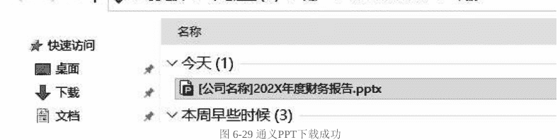

#### 【演示 2】使用 WPS 直接生成 PPT
除了使用第三方 AI 工具外，财务人员还可以借助 WPS 内置的 AI 功能，快速生成 PPT。这是 WPS 推出的智能化功能之一，专门为提升用户在办公过程中效率而设计。以下是具体操作：

- 1. 新建 WPS 演示并找到 WPS AI 入口
打开 WPS，点击“+”，新建一个空白的演示文稿，如图 6-30 所示。
在新建的空白演示文稿页面上方的菜单栏中，找到“WPS AI”，点击即可看到“AI生成PPT”和“AI新建幻灯片”，如图 6-31 所示。
与之前的通义 PPT 一样，“AI新建幻灯片”是通过输入主题大纲，让 WPS AI 自动生成对应的幻灯片，自由度更大，适合还没有前期内容的情况。而“AI生成PPT”就是我们当前需要选择的，即通过输入财务报告文档来生成更加对应且细致的财务汇报 PPT。


- 2. 导入财务报告
点击“AI生成PPT”后，选择“文档生成PPT”，然后在文档上传页面上传整理好的财务报告，如图 6-32 所示。


- 3. 选择大纲生成方式
文档上传成功后，会自动跳转至选择大纲生成方式页面，如图 6-33 所示。
WPS AI 提供了两种不同的 PPT 大纲生成方式，分别是“智能改写”和“贴近原文”。
“智能改写”是通过 AI 智能化处理上传的文档内容，自动生成符合 PPT 结构的大纲。这意味着 WPS AI 会对文本进行重新组织、优化表达，并提取出关键的主题和分段内容，帮助用户快速生成一个简洁、有条理的 PPT 大纲。
“贴近原文”选项会保留上传文档的大部分原文内容，尽量减少改写，直接将文本结构转换为 PPT 大纲。这种方式适合那些希望保留文档原始表达的用户，尤其是在不需要过多修改内容的情况下，可以快速生成与文档内容相符的 PPT 结构。
在财务汇报 PPT 的制作上，可以选择“智能改写”，毕竟 PPT 的核心功能是辅助展示和传递关键信息，而不是罗列所有细节内容。如果将所有内容都展示出来，反而会让观众信息过载，难以抓住核心要点。因此，PPT 应当通过简化、提炼，帮助观众快速聚焦在最重要的部分，而不是让信息繁杂堆积，影响汇报效果。
选择完成后，点击“生成大纲”后，WPS AI 将根据所选方式生成 PPT 的大纲。


- 4. 挑选 PPT 模板
确认大纲无误后，用户可以点击“挑选模板”按钮进入模板选择页面（如图6-34所示）。

页面入口被切成若干功能块，最醒目的就是模板推荐区。WPS 会基于常见使用场景，提前收纳一批版式简洁、信息呈现直观的方案。进一步收窄范围时，可用“风格”和“配色”两套筛选器来操作。譬如财务汇报需要更庄重，偏商务感的方案更合适；创意类展示则倾向高饱和、设计感强的配色。系统自带的库之外，还能把本地已有的模板直接导入使用。

##### ⑤生成PPT
模板确定后，前往图 6-35 界面右下角的“创建幻灯片”。触发后，WPS 会把先前整理好的提纲与所选模板自动融合，产出结构分明、视觉统一的演示文稿，效果见图 6-35 WPS AI生成财务汇报PPT。

进入后是大家熟悉的编辑工作区。左侧缩略栏罗列每页预览，点击即可跳转。中央主区展示当前页正文，可直接修改文字、配图与图表并调整排版。右侧功能栏集中了字体、配图、图形、动画等编辑项，按需继续美化。

在此界面里，既能改动具体内容，也可增删页面、替换模板元素、优化整体观感，确保最终成片贴合汇报需求。

##### ⑥预览并保存PPT
内容与排版完成后，可完整播放一遍，检查动画以及页间切换是否流畅。确认无误后，将财务汇报文件存入本地目录即可。

以上即为借助 WPS 直接产出演示文稿的完整流程，目前该能力需开通 WPS AI 会员，未使用过的用户可先领取数日试用体验后再做决定。

#### 【演示3】生成PPT汇报发言稿
PPT 成型后，现场讲述才是关键。仅有视觉框架不足以支撑说服力，照读会显得僵硬。幻灯片本质是信息浓缩，发言稿则负责补足未展示的细节，用更通顺的语言把数据讲透、逻辑理清、情绪带起。此时借助智能助手可快速打磨一份有感染力的讲稿。

以某大模型为例演示：

##### ①将PPT输出为PDF文档再上传
该平台暂不支持直接导入 PPT，先导出为 PDF。打开汇报文件，点击左上角“文件”，选择“输出为PDF”，如图6-36所示。保存后上传至平台即可。

##### ②向该助手提问
在对话窗口输入：“请依据 PDF 内容，为公司管理层汇报准备一份高质量发言稿。”

系统会结合汇报语境生成完整讲稿，见图 6-37 所示。

如此便无需手写讲稿，也不必逐字照读，可更从容地抓住重点，让陈述更生动、更具吸引力。

图 6-37 通义生成发言稿

## 第7章
智能内控：AI助力财务安全实操

数据体量持续攀升，业务复杂度也在提高，传统内控手段已显吃力。引入智能手段正好填补缺口，可在内控各环节提供比人工更深的洞察。面对繁复的税务合规要求，系统能迅速解析政策变动；审计环节也能自动提炼要点避免遗漏。借助智能分析，企业可更早感知财务风险并及时处置。

### 7.1 AI优化应收账款管理的操作方法
应收管理向来是财务痛点，尤其在客户关系复杂、账期长、付款节奏不一致时。信息不清、资金跟进不到位容易导致流动紧张，进而影响运营与战略。智能手段为此提供了新思路。

以下以某大模型为例展示优化方法。

#### 【演示 01】 预测应收账款回款时间
回款是否及时直接决定资金链稳健性。若能提前预判客户回款节点，就能更合理安排资金，避免闲置或断裂。平均回款天数、按时付款次数、逾期次数等指标是判断风险的关键。

##### ❶准备应收账款历史数据
先收集并整理历史应收信息，确保完整准确。字段通常包括客户名称、订单日期、订单金额、账期如30天、实际回款日期等。假设有多家客户，整理后的部分记录如图 7-1 所示。

##### ❷载入数据并咨询
打开对话窗口，把整理好的历史表导入，输入指令：“请依据客户应收历史，计算每位客户的平均回款天数、准时付款次数与逾期次数。”

系统会把各客户的平均天数、准时次数、逾期次数汇总，为后续预测提供依据，如图 7-2 所示。

##### ③ 预测回款时间
掌握历史规律后，可对单笔订单做大致预判。假设与客户A于2024年11月28日成交，账期30天，预计回款节点如何？回答见图 7-3 所示。

实际工作中，回款预测不仅依赖历史，还需结合订单金额、行业属性、区域以及当期宏观环境等多因素构建模型。此处仅为基础演示，具体应用需结合实务经验持续优化。

#### 【演示 2】客户信用评分与风险等级分类
应收管理的核心在于识别客户付款能力与习惯，判断谁更可靠，谁可能带来风险，从而制定差异化催收策略。

##### ❶ 载入数据并评分
第一步仍是准备历史付款记录，以图 7-3 汇总表为例导入，或直接在汇总表下方追问：“请依据历史数据生成信用评分，并按高、中、低风险划分。”

返回结果如图 7-4 所示。

##### ❷ 依据类别给出回款策略
评分本身的价值在于指导策略。继续询问系统对不同风险等级客户的管理建议，结果如图 7-5 所示。

不同风险等级的应收策略可有所区别：

###### 低风险客户（信用评分 A）
特征：回款周期短，几乎无逾期。
建议：
- 提供小额现金折扣如1%以增强粘性。
- 保持定期沟通，了解需求并提供更优服务。
- 可适当延长账期或提高授信额度。

###### 中风险客户（信用评分 B）
特征：回款周期中等，偶有逾期。
建议：
- 提供适度现金折扣如2%以激励及时付款。
- 定期发送付款提醒，加强监控。
- 不定期评估信用状况，及时调整授信政策。

###### 高风险客户（信用评分 C 和 D）
特征：回款周期长，逾期频繁。
建议：
- 谨慎使用折扣，若使用需设严格条件如5日内付款。
- 缩短账期，降低授信额度，甚至要求预付款。
- 加强监控，及时跟进回款。
- 必要时借助法律手段追缴。
- 建立风险预警机制，提前识别违约可能。

图 7-5 通义给出不同风险等级客户的应收账款管理策略

可见系统能针对不同等级给出具体策略，部分建议偏通用，如低风险客户的忠诚维护表述较笼统，可进一步追问细化。

### 7.2 用AI工具解读税务合规要求
税务合规是财务安全的底线，处理不当会导致处罚、业务中断甚至声誉受损。政策文件长、术语多、更新快，人工阅读易遗漏。智能工具可高效提炼要点，降低负担。

#### 【演示 1】 高效解读税务文档
财务日常需处理大量税务文件，逐条阅读费时易错。系统可自动抽取关键信息并生成简明解读。常用做法有三：一是把政策文件导入提问；二是搭建税务合规智能体，将更新文件放入知识库后提问；三是使用效率工具箱里的“阅读助手”做全文总结与问答。下面重点演示第三种。

##### ❶打开“阅读助手”
在效率模块进入工具箱，找到阅读助手，如图 7-6 所示。

##### ❷导入税务政策文件
点击“开始上传”，把待解读文件提前下载后拖拽至上传区，如图 7-7 所示。支持文档、论文甚至图书，方便学习财税资料。这里以《关于提高个人所得税有关专项附加扣除标准的通知》为例，上传成功后文件会出现在最近记录，点击即可进入问答页。

##### ③解读文档
进入页面后右侧有“导读”“翻译”“脑图”“笔记”四个板块。点“导读”可看到全文概述与关键要点，如图 7-8 所示。脑图页会把个税专项附加扣除各项标准梳理成层次结构，一目了然，如图 7-9 所示。页面底部对话框还能针对细则提问，如图 7-10 所示。

#### 【演示 2】网页在线解读
除阅读助手外，还支持“链接速读”，同样在效率工具箱内。输入《关于提高个人所得税有关专项附加扣除标准的通知》的链接，上传成功后会进入与图 7-10 相同的页面，完成导读、脑图生成或提问，操作逻辑一致，仅资料来源从文件变为网页。

### 7.3 AI协助应对审计工作
财务工作不是等审计人员到场才准备，而是日常就要保持审计就绪。审计本质是财务工作的全面体检，内控不清晰就会被放大。因此提前梳理风险点、准备资料至关重要。

#### 【演示 1】分析审计要求
审计要求有时表面平常，背后指向特定风险点。智能工具可帮助拆解意图。例如审计人员要求“核查公司过去六个月内所有采购合同的审批流程是否符合内部控制规定，并提供相关审批记录”。财务人员不确定关注点时，可输入：“审计人员要求检查过去六个月采购合同审批流程，我不太清楚用意，请帮忙分析可能的审计重点。”返回结果如图 7-12 所示。

下一步依据这些重点，结合实操逐项自查并准备资料。

#### 【演示 2】模拟审计问答
审计现场常涉及流程、数据与政策执行，提前演练可避免手忙脚乱。可让系统扮演审计员进行模拟。

例如输入：“审计员将检查公司费用报销情况，请帮助模拟可能的审计问答。下面你扮演审计人员，先提问。”

系统会开启模拟并抛出首个问题，如图 7-12 所示。后续进入一问一答，若回答不理想，可另开对话询问标准答案，掌握后再回到原对话继续练习，保持连贯性。

总之智能工具的能力边界看似有限，使用方式却很灵活。希望财务人员在实践中不断探索，挖掘工具潜力，让工作更高效、更从容。