# AI赋能HR

# 前言

正如华为创始人兼CEO任正非所说，AI的崛起就像火车、轮船的诞生，标志着社会结构和生产方式的深刻变革。AI正在改变我们的工作方式，HR也无法置身事外。

不同的是，AI发展极快，远超以往任何一轮技术革命。有的企业已抢占先机，享受技术红利；也有些人还在观望，或者简单尝试后就放弃。

但无论你是否准备好，AI已经到来，正重新定义每一项工作。所以，这本书关注的不是AI有多强，而是它如何帮助HR做得更好。

# 1. AI已来，HR不能缺席

HR的价值在于读懂人、看懂组织，并推动有意义的改变。现实中，很多人被事务缠身，忙于琐碎，却顾不上做真正该花时间思考的工作。有些人是没时间做，有些人是不知道怎么做。

AI正好打破这个局面。用对方法，它就是你的“能力外挂”，也是你的“成长加速器”。这场变革里，马车车夫嘲笑火车的老故事不会重演，我们正驶向一次真正意义上的跃迁。

AI不只是工具。它更像一面镜子，——照出我们的习惯，也映射出我们的能力边界。当AI进入HR领域，许多习惯做法开始被重构。那些基于经验的判断、繁琐的日常操作，一旦被拆解，就可以被替代。曾经被视为“专业能力”的部分，正在变得可复制、甚至可自动化完成。

# 2. 从被动应对，到主动协同

面对变革，HR不能只是被动应对，关键得升级与AI的协同方法。不妨做个小实验。假设你要分析员工的离职原因，可以这样写提示词：

方式一：请根据员工离职访谈帮我分析一下离职问题。

方式二：你是HR分析师，以下是近半年员工访谈纪要，请从薪酬机制、管理风格、职业发展三个维度提取共性问题，按结构化清单输出，便于写入HR改善报告。

你会发现，方式不同，结果天差地别。后者不仅条理清晰，甚至可以直接用于决策支持。

问题不是AI不行，而是你没用对。

# 3. “不会用AI”，会成为新的职场鸿沟

有人已经靠AI完成质变，有人还在重复低效劳动。当有人还在用AI写几句文案时，已有HR用AI完成了绩效分析、流程优化、报告撰写，甚至一人顶上一个小团队。AI不会取代HR，但会取代不会用AI的HR。这不是危言耸听，而是大势所趋。

差距不只在工具用得熟不熟，更在认知层次、方法能力和思维方式。AI应用的门槛，不是技术，而是结构化思维、任务拆解力和判断力。

AI不会让HR消失，但会逼着HR进化，成长为更高阶的专业角色。未来的HR，不只是AI的操作者，更要让AI成为协作者和助力者。HR的价值，始终来自对人性的理解、对组织的洞察，以及那份人类特有的温度——这是AI永远替代不了的。

# 4. 读完这本书，你能掌握什么？

这不是一本教你“如何操作AI工具”的技术手册，而是一本面向实际学习和工作场景的认知训练指南。全书目标是帮你构建一张适合自己的“AI时代HR进化手册”。

本书写给：

- 疲于事务性工作，渴望用AI解放双手的HR新人；
- 卡在专业瓶颈，希望借AI重构体系的中层管理者；
- 致力推动组织变革，需将AI融入人才战略的HR负责人；
- 所有相信“HR的未来在于人机协同”的进化者。

你将学会：

- 如何用好提示词驱动AI协作；
- 通过自主学习构建专属的HR知识地图；
- 借力AI搭建四大HR基础体系；
- 赋能绩效分析、人才发展、战略规划等实战任务；
- 重塑能力结构，迈向策略型HR。

这不是一本看完点头的书，而是一本看完就能上手实干的书。

AI已来，未来不会等待观望者！让我们不只是跟上变化，而是成为变化的一部分。希望读者朋友读完之后，可以不再犹豫该从哪一步开始。

# 致谢

谨向在本书写作过程中给予我帮助、启发与支持的每一位伙伴，表达诚挚的感谢。

感谢每一位曾合作过的客户。虽然每个项目我都全力以赴，真诚以待，但限于能力和经验有限，并非每一次都达到预期。感谢你们给予的机会与包容！

特别感谢金田铜业、扬翔股份、中国信息通信研究院、华恒生物、瑞斯康达、深圳第26届世界大学生运动会组委会、正浩控股、广联达等客户。这些客户给予我的，远比我给客户的多。尤其要感谢河南仕佳光子科技股份有限公司。董事长葛海泉先生，让我有机会见证一家芯片企业从一片麦田起步，到成功上市的全过程。在服务期间，葛总给予我极大的信任与关爱。多少难忘的美好时光，留在了淇河之畔。

感谢华夏基石彭剑锋老师等业界前辈，他们对管理的热爱与投入，以及取得的成就，一直激励我前行。特别感谢施炜老师——他的教导总是让我深感“听君一席话，胜读十年书”。他博学而务实，严厉而坦率。认识施老师的这些年，是我进步最快的阶段。

感谢邢雷老师、段皎老师多年来的陪伴与支持，始终同行，不离不弃。我们一起经历被专业问题考验的痛苦，一起感受被客户认可的快乐。

感谢识千家马优老师。本书选题的确立，离不开她在关键阶段的建议与推动。她专业与热心并重，让我受益良多。

收稿之际，顿感写书是一个抽丝剥茧的过程，更是一次结构化思维与认知升级的自我挑战。十余年的咨询生涯让我深信：无论技术如何迭代，管理的本质始终是激发人的潜能、成就组织与个体的共同成长。愿这本书所汇聚的经验、方法与思考，能为HR从业者的专业成长之路提供一份清晰、实用、可行的参考。更期待它能在未来十年、二十年，与所有同行者一起，见证中国管理实践的创新与突破。

作者 2025年5月20日

# 第一章 HR用好AI的第一课：提问与判断

AI在HR领域的应用，相较于其他管理职能，具备天然的“双重优势基因”。

一方面，HR管理拥有方法论的普遍性。从胜任力建模到薪酬设计，百年管理科学已沉淀出系统化的范式与工具。我们要做的，不是从零构建，而是学会激活AI的“知识引擎”，快速调用全球积累的理论体系、方法工具与实践案例。

另一方面，HR工作又高度情境化。文化特征、组织阶段、人才结构等变量，决定了任何标杆方案都“可借鉴、难复制”。这意味着，AI不仅是知识的搬运工，更要成为“定制化的思维伙伴”，在“通用方法”与“企业特性”之间，焊接出真正契合自身情况的解决方案。

也因此，HR是AI最容易上手、却最难精通的领域之一。就像人人都有厨房，并不代表人人都会做饭——一样的食材，有人只会做出快餐，有人烹出“舌尖上的中国”。

工具相同，差别在于对AI的认知方式与使用策略。

## 第一节 提示词设计——驾驭AI的关键策略

提示词（Prompt），也称指令，是人与AI互动的桥梁。表面看，它只是输入对话框中的一句话，实则背后承载的是人的意图表达、任务拆解和逻辑组织。指令清楚，AI才能理解你要什么；指令含糊，它就只能靠猜。

### 一 定义AI五种身份

AI不再只是一个被动执行的工具，它正逐步具备“拟人化”的特征——可以模拟多种人格与视角。你可以将AI设定为五种角色：导师、助手、对手、目标受众和创作者。

#### 一）导师：高阶认知，解决复杂问题

在需要认知支持的任务中，AI可以担任“导师”角色，协助理解复杂问题、梳理思路。

凭借广泛的知识储备和高速的信息整合能力，AI能系统化地组织内容，帮助你理清概念脉络、重构逻辑关系、建立主题框架。它的角色，类似于一位“首席知识官”或“数字智囊”。

虽然AI尚无法替代顶尖人物的深度洞察力，但在知识广度和逻辑组织方面，已经远超绝大多数人类，其能力已足以为你提供专业支持。

设定导师角色的三个关键操作点如下：

##### 1. 设定权威身份

AI输出内容的语言风格与逻辑深度受到角色设定的显著影响。将其设定为“资深专家”或“诺奖得主”等高成就、权威身份，有助于提升其内容输出的专业性与结构性，使其表达更符合高阶思维的要求。

##### 2. 聚焦认知任务

导师型AI角色的价值，不在于替代写作，而在于协助思考。它擅长执行“组织思路、搭建框架、比较路径、解释机制”等任务，适合用于构建结构而非直接生成最终内容。

##### 3. 明确提问方式

导师角色适合开放式问题。尽量避免“这对不对”式提问，而是采用“请解释……”“请从三方面分析……”等结构化问法，以引导AI进行系统性推理与分析。

示例指令：

你是数字HR领域的专家。请帮我梳理“AI赋能招聘”的方案结构框架，语言要求通俗清晰，逻辑严谨。

#### 二）助手：操作执行，高效产出

在标准化任务中，AI最适合扮演“助手”角色。它执行稳定、响应迅速，能高效完成各类明确、可拆解的事务性工作。

无论是撰写通知、整理清单、生成摘要，还是处理表格、数据，AI都能快速上手、批量产出。随着智能体（Agent）技术的发展，AI助手正逐步具备任务自驱能力，从“被动执行”走向“主动推进”。

设定助手角色的三个关键操作点如下：

##### 1. 明确任务目标

任务要具体、清晰、可执行，避免使用模糊描述。例如，“帮我写一篇某主题的文章”，AI的回答会较为了无生趣。而“请写一篇800字的HR某主题推文，口吻亲切、结构清晰”则更具可操作性。

##### 2. 规范输出格式

明确告知AI希望的输出形式，包括结构要求（如表格、分段、项目符号）、语气风格（如正式、口语化）、字数范围、语言种类等。越清晰，结果越可控。

##### 3. 提供上下文信息

助手型AI并不具备“理解情境”的能力，信息输入越充分，结果越贴合预期。建议提供背景材料、参考样例或必要说明，减少理解偏差。

示例指令：

你是我的行政文案助手，请根据以下要求撰写一则内部通知：

目标：通知员工“五一”假期安排

材料：5月1日至5日放假，5月6日恢复上班，假期期间注意关闭办公设备

格式：正式通知格式，段落清晰，适合发布在OA系统

语气：正式、简洁

限制：控制在200字以内

如有不清楚的地方，请提问，不要自行假设。

#### 三）对手：反向验证，锤炼思维

AI不仅能协助完成任务，也可以充当“对手”，帮助你进行假设验证、方案反推和逻辑检视。

在策略制定、方案评估、观点表达等场景中，它能模拟客户、上司、投资人或竞争者，从对立视角提出质疑与挑战，暴露盲点，优化推理，增强说服力。

这个角色的价值不在于附和，而在于逼你把问题想透、把逻辑讲清。

设定对手角色的三个关键操作点如下：

##### 1. 设定真实身份

指定AI扮演的身份对象及特点（如保守型HRD、资深采购经理、竞争企业负责人等）。身份决定视角，视角决定它从哪里切入质疑。

##### 2. 指定博弈场景

明确你希望它挑战的是什么内容（如一项计划、一个判断、一个主张），并告知预设立场，让AI在尽量真实情境下提出合理挑战。

##### 3. 引导反向思考

鼓励AI从多个角度进行质疑，如可行性、成本、接受度、风险、长期影响等。必要时，可以引导AI持续扮演角色，在你的回应基础上继续反问、追问，形成有深度的交锋过程。

示例指令：

请扮演一家保守型传统HRD，质疑我提出的“全面引入AI工具改造招聘流程”的建议。

我主张全流程AI辅助招聘，请从三个方面提出反对意见：数据安全、员工接受度、实施成本。你可以逐点挑战，如果我回应，请继续追问，直到逻辑闭环。

#### 四）目标受众：同理洞察，提升共鸣

在内容创作、沟通表达、用户研究等任务中，AI可以模拟目标受众的视角，对内容进行反应和反馈。

你可以让它扮演一位HR总监、00后职场新人，阅读文案、倾听主张、理解方案，并给出“像他们一样”的真实感受与建议。

这个角色的价值在于：让你从读者立场审视方案和内容。

设定目标受众角色的三个关键操作点如下：

##### 1. 设定用户身份

清晰指明AI应扮演哪类人群，例如“三年经验HRBP”“注重细节的企业老板”等。身份越具体，反馈越贴近真实。

##### 2. 提供评估对象

将你希望AI评估的内容（如招聘文案、推文标题）完整提供，确保AI有充分上下文进行判断。

##### 3. 引导反馈角度

指定反馈维度，例如：是否易懂？是否有吸引力？是否有说服力？是否符合预期？

受众型AI角色的作用是“共情模拟”，帮你检验内容是否能触及人心。

示例指令：

请你扮演一位985大学毕业生，阅读以下招聘广告文案，并回答三个问题：

1) 你是否会点击查看？
2) 第一印象是什么？
3) 你是否愿意了解更多？请说明原因。

#### 五）创作者：共创内容，激发灵感

AI也可以作为创意工作的共创者，擅长命名构思、标题打磨、脚本草拟、文风模仿等任务，尤其适用于从0到1的灵感激发与素材生成。

在这一角色下，它的价值不在于完成任务，而在于提供可能性，拓展思路，激发更多角度与表达方式。

设定创作者角色的三个关键操作点如下：

##### 1. 明确创作目标

清楚说明希望创作的内容类型（如品牌名、广告语、剧本结构、公众号标题等），并指出用途、受众和使用场景，帮助AI把握创作方向。

##### 2. 提供创作边界

设定风格调性（如专业、轻松、故事化）、内容限制（如不超30字、避免使用某类词汇）、参考素材等，防止AI创作跑题或风格偏差。

##### 3. 赋予共创身份

将AI设定为创意搭档，鼓励它主动提供选项、解释思路、尝试不同表达方式，形成真正的共创氛围。

创作者AI角色的目的不是替你写，而是与你一起“想出来”。

示例指令：

你是我的创意搭档，我们要为一门“AI赋能HR”的在线课程命名。

目标：名称简洁、有辨识度，面向企业HR，风格专业中带点轻松。

请列出10个命名建议，并简要说明各自的命名逻辑。

理解这五种角色的特点，并根据具体任务灵活切换，是高效使用AI的起点，也是掌握人机协作的关键一招。

### 二 提示词设计四大策略

提示词不仅决定AI能否准确理解你的意图，更直接影响它回应的方向、深度与表达效果。指令越清晰，输出越精准，表现也越出彩。

图1-1展示了提示词设计策略的四种典型模式：智驾模式指在结构化指令模式下，让AI精准执行人的意图；火花模式用于激发AI的创作灵感与内容多样性；缰绳模式则指引入方法论或思想，引导AI循特定逻辑和方向生成内容。标尺模式主要用于AI内容输出把关与质量审校；

图1-1 提示词设计四大策略

四种模式既可单独使用，也可灵活叠加，构建更智能的交互策略，形成一套既能放手生成、又能精准收敛的提示词系统。接下来，我们将一一拆解。

#### 一）智驾模式：结构化指令

AI最擅长处理的，是问题清晰、目标明确、流程可控的任务。提示词中的智驾模式，本质就是一种结构化编程方式——你给它一张“路线图”，它就能按图索骥，有序输出。

这种模式适用于“你知道要什么，只需要它帮你高效完成”的场景。比如写总结汇报、产出标准模板，智驾模式是最稳妥的一种指令。

##### 1. RCOR+X指令结构

该结构包括4个组成核心，外加可选的补充维度。

- R（Role）角色设定。AI应以什么身份思考？
- C（Context）任务背景。任务发生的情境是什么？
- O（Outcome）目标成果。你希望AI输出什么？
- R（Requirement）输出要求。在结构、风格、格式上的具体要求。

在这四个要素上，根据不同任务情况，进行X（补充维度），可进一步提升AI的专业表现，如：

- 内容框架：必须包含A、B、C三部分；
- 应用场景：如“适用于企业官网与抖音推广”；
- 指定证据：引用用户评价、数据支持等。

下面我们做个演示。

###### 案例：指令效果对比

背景：你是公司HRBP，刚完成了一场离职员工访谈。该员工来自销售部门，提出了几点关于晋升机会、绩效公平和工作负荷的反馈。你的任务是撰写一份访谈纪要报告，供HRD参考，作为部门改善和制度评估的依据。

1）普通型指令（无结构提示）

输入指令：

帮我写一份员工离职访谈纪要，内容包括员工反馈和建议。

AI反馈：

###### 离职访谈纪要

员工对销售岗位整体满意，但认为晋升路径不够清晰，绩效评估标准略显主观，近期工作压力较大。建议公司优化激励机制，加强内部沟通，提升员工参与感。

2）RCOR+X结构化指令

输入指令：

你是一名资深的HRBP。现在我公司销售岗位员工提出多项关于绩效、晋升和压力管理的反馈（见附件）。请你帮我撰写一份离职访谈纪要，结构清晰、内容具体，反映真实声音，供HRD判断改进方向。

要求报告需包含：

- 基本访谈信息；
- 核心反馈问题；
- 员工建议；
- HR观察与建议；
- 语言需专业、客观、简明；
- 适合HR管理层审阅，可直接作为内部改进参考资料。

AI反馈：

###### 离职访谈纪要报告

访谈对象：销售部李某某 | 工作年限：3年 | 职位：客户经理

访谈时间：2024年12月10日 | 访谈人：HRBP张某

1) 员工反馈要点

- 晋升机制不明确：晋升评定标准缺乏公开透明，导致员工对发展路径预期不清晰。
- 绩效评估主观性强：部分季度评估结果与工作成果不符，认为存在主管偏好影响。
- 工作节奏高压：月度指标紧张，加班频繁，缺乏弹性安排。

2) 员工建议

- 明确并公示晋升标准。
- 增加绩效沟通频次。
- 引入轮岗机制，缓解岗位疲劳。

3) 观察与建议

- 建议HRD评估销售体系的绩效模型是否需微调。
- 可考虑引入“晋升路径图”和“季度问卷反馈机制”提高员工参与感。

备注：员工整体对公司文化认可，表达离职为“职业发展阶段性调整”，无负面情绪倾向。

智驾模式的本质，其实和职场中委派任务的方式如出一辙：先说明“谁来做”、在什么背景下做，再说“要做成什么样”、有什么要求。RCOR+X，就是把这种思维方式翻译成AI能理解的指令。

##### 2. 哲学三问式指令结构

当任务存在较高的不确定性和创造性，比如策划方案、探索新机制或撰写高阶内容时，推荐使用哲学三问式指令。

结构如下：

指令=我是谁？（角色）+我从哪里来？（问题背景）+我要到哪里去？（目标）+X（约束条件）。

示例指令：

你是擅长绩效管理的HR顾问，曾服务过快消行业Top3企业。某公司销售团队2023年Q4业绩下滑15%，员工抱怨“提成公式复杂”“目标浮动过大”。

请你先剖析原方案的问题（见附件），然后输出三套优化激励机制方案，需满足：

#### 二）火花模式：交互触发

AI的底层原理，是一个基于概率预测的语言模型。它不会真正思考，但却非常擅长组合。所以，每一次你的追问、补充或纠正，都会促使它重新计算最可能有价值的回应路径。交互越多元，AI的灵感张力就越强。

在这种模式下，提示词不再是“下命令”，而更像是“发起一场头脑风暴邀请”。你不是在要求它完成任务，而是在请它一起参与探索，帮你打破认知惯性、激发新思路，带你走到“我原本没想到的那条路”。

在火花模式下，建议采用多轮交互设计、递进式提问的方式，例如：

- 反问型。挑战默认设定，打破思维定势。
- 角色代入型。转换视角，共情模拟。
- 版本对比型。并列生成，激发选择偏好。
- 拆解/归类型。发散思维，再收敛聚焦。

以下是一组提示词示例：

##### 1. 反向+反问式：挑战假设，激发洞察

示例指令：

- 如果这个制度注定失败，它最致命的缺陷在哪里？
- 你能反过来用它的对立面来设计一种更高效的流程吗？
- 请提出3个完全相反的HR激励策略，并分析其优劣。

##### 2. 角色代入式：换位共创，打开视野

示例指令：

- 请你模拟一位95后新员工，听完这份入职培训手册后，你有哪些真实反馈？
- 如果你是工会代表，你会如何反对这项裁员方案？
- 假如你是管理学家明茨伯格，请你点评这份组织设计逻辑。

##### 3. 理论转译式：把抽象模型落地

示例指令：

- 请你把福柯关于“规训权力”的理论，应用到员工考核制度设计中。
- 从系统理论视角，如何理解“离职潮”背后的组织循环逻辑？
- 将“心理契约破裂”模型转化为3个员工访谈提纲问题。

##### 4. 多版本对比式：拓展思路，辅助判断

示例指令：

- 请列出3种完全不同风格的入职欢迎邮件，分别适合科技公司、制造业和金融企业。
- 请提供3套OKR目标设定逻辑，侧重激进增长/稳健执行/员工自驱。
- 请分别用AIDA法和FAB法写一份招聘文案，供我比较选择。

##### 5. 发散再收敛式：从想法池，到筛选决策

示例指令：

- 请你提出5种可能导致员工高离职率的原因，并挑选1个最可能的，写一段针对性建议。
- 请先提供一组关于[主题]的创意灵感（不少于20条），再帮我设计一个适合的分类方法，便于后续筛选与使用。
- 列举10种可能的员工激励手段，然后帮我归类为短期激励/长期激励/内在激励。

火花模式的目的，不是让AI直接“给出答案”，而是帮助你拓展问题背后的更多可能性。你负责判断取舍，AI负责铺路搭桥。有时候，真正有价值的问题，不是为了得出一个结论，而是为了引出更多值得思考的问题。

#### 三）标尺模式：设定质检标准

AI没有判断力，但可以被引导去“学会判断”。只要你清晰说明什么是好内容、什么是合格标准，它就能按照这个方向去生成、复查，甚至自我优化。

就像质量管理中的“标准作业+质检清单”，AI既能产出，也能自查，关键在于你有没有给它一把清晰、可执行的标尺。

示例指令：

- 请你用结构化面试标准检查这份纪要是否包含关键行为证据。
- 你是HR合规审计师，请对这份员工手册从合法性、语言中立性、风险点三个方面进行打分。

让AI“知道怎么叫做好”，让它朝着更专业、精准、稳定的方向输出，这样可以有效避免AI生成“正确的废话”。

#### 四）缰绳模式：小模型驱动大模型

AI再强大，也没有世界观，也无法做意义判断，它只是被动响应你的指令。缰绳模式的核心，是用人类的认知模型，引导AI的生成逻辑。就像策马者手中的缰绳，不只是控制方向，更是让AI跟上你的思维节奏，一步步走在正确的路径上。

示例指令：

- 请用冰山模型评估候选人在面试中呈现出的动机特征。
- 请参考OKR逻辑检查这份绩效目标的合理性。
- 请以员工生命周期模型为框架，梳理数据分析报告结构。

每一个模型，都是人类经验的“压缩包”。你给它输入提示词，AI就能在这条认知轨道上跑出更可靠的结果。

这四种提示词策略并非彼此割裂，而是可以根据任务需要灵活组合，构建属于你的“AI提示词调度系统”。

例如：

- 智驾+标尺：快速生成+自动自检。写完就审，效率拉满。
- 火花+缰绳：灵感发散+框架引导。创意有边界，内容不跑偏。
- 三段合体：智驾写初稿→火花扩展新版本→标尺评分优化。

### 三 学会提问，才有好回答

想真正用好AI，掌握操作技巧还不够，还要善于提问。在实际使用中，人们常陷入三类提问困境：

- 不知道从哪问起——目标模糊，任务说不清；
- 不知道怎么拆解问题——思维混乱，逻辑跳跃；
- 不知道结果靠不靠谱——缺乏判断标准，不敢直接用。

推荐使用三种提问法，帮助你从“不会问”到“问得准、问得深、问得稳”。

#### 一）不知道从何开始

当你面对陌生主题、全新任务，或情况过于复杂时，最常见的困境就是：根本不知道从哪问起。

这时，你需要先问一个关于“怎么提问”的问题——这就是元问题提问法。你越简单、越朴素地发问，AI越能帮你厘清方向。

就像小时候面对陌生世界时，我们常常会问：

- “这是什么？”
- “我从哪里开始？”
- “我怎么办？”

这些看似幼稚的问题，其实正是建立认知结构的起点。

示例指令：

- 我想完成XX任务，但完全没有头绪，请教我该怎么向你提问。
- 我想了解XX主题，请告诉我可以从哪些角度来拆解？
- 如果你是HR专家，你会建议我如何切入这个议题？

通过这些提问，帮你打开互动的第一扇门。它们能唤醒AI对主题的结构感，帮你在混沌中找出突破口，从“无序”走向“有解”。

#### 二）不知道如何思考

不知道如何思考，往往是切入点不明。根本原因在于：你在思维系统中的“位置”还不清楚。就像导航时走不动，问题不在于没路，而是你既不知道现在在哪，也没想清楚要去哪。

图1-2展示了一个简洁实用的结构化提问工具：GPC提问法。它是“提问前的认知自检”，帮你厘清三个关键问题。

- G（Goal）：明确目标与认知卡点（信息/结构/价值）。
- P（Positioning）：通过不同视角定位问题，厘清整体结构。
- C（Clarification）：用假设型提问明确解决方向，引导AI生成策略。

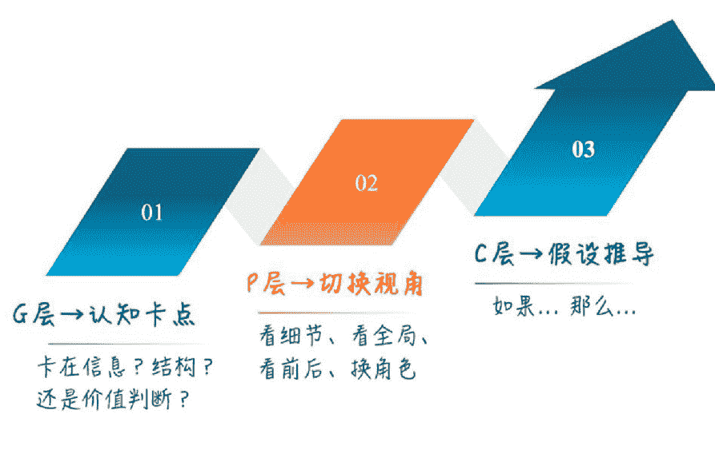

##### 1. Goal：定位认知层级

不要一开始就问“怎么解决”，先弄清楚自己卡在哪一层认知上：你是缺信息？缺结构？还是还没想清楚目标的价值？例如，面对“新员工离职率高”的问题，先判断你是卡在：

1) 信息层。我知道得还不够，重点是弄清楚事实——数据缺失、情况不明，导致无法判断问题实质。

示例指令：

- 要全面理解新员工离职问题，我可能还缺少哪些关键信息？
- 请列出分析员工离职趋势时常用的核心变量，我看看哪些还没掌握。

2) 结构层。我看得还不清楚，重点是理清因果逻辑与系统结构，看清问题的来龙去脉。

示例指令：

- 请分析招聘、培训与管理三个环节之间的因果关系，它们如何共同影响新员工的留存？
- 请帮我搭建一个影响新员工留存率的因素结构图，用逻辑模块表示各因素的关联方式。

3) 价值层。关注的是目标导向与价值取舍，问题是否值得投入资源解决。

示例指令：

- 请分析：我们是否需要投入资源留住这部分员工？长期来看他们对组织的价值几何？
- 如果只能选择一项优化措施，是提高留存率，还是提升招聘效率？哪个更符合组织的长期利益？

一个好的开始，不是找答案，而是找问题。

##### 2. Positioning：切换思维视角

很多问题卡住，是因为你一直站在同一个视角看问题。我们可以从四个典型的视角切入，帮助自己跳出惯性思维，看到问题的更多面。

1) 看细节。关注局部环节，发现问题发生的具体触点。

提问示例：

- 请聚焦该流程中的微环节，梳理可能被忽略的关键细节。
- 绩效问题频出，请重点检查反馈环节是否存在漏洞或模糊地带。

2) 看全局。放大视野，从系统角度判断是否存在结构性问题。

提问示例：

- 请从整体流程出发，分析问题是否由多环节耦合导致。
- 从组织系统角度判断，晋升机制中存在哪些潜在的结构性联动？

3) 看前后。引入时间维度，考察问题的历史与未来趋势。

提问示例：

- 这个问题在过去是否出现过？若继续不处理，未来可能带来哪些连锁影响？
- 请分析：类似问题在过去两年的演变趋势，以及未来的发展方向。

4) 换角色。站在他人立场重新审视议题，提升共情与洞察力。

示例指令：

- 请模拟一位95后员工，评价这套考核制度可能引发的情绪和反馈。
- 站在业务部门主管角度，这份HR制度可能会引起哪些关注或顾虑？

提问的本质，是站在对的位置，看清问题。

##### 3. Clarification：用“如果……那么……”假设句式引导策略生成

当你已经搞清楚卡点所在，切入视角也足够清晰，下一步就是引导AI提出有逻辑、有针对性的解决方案。在策略生成阶段，“假设型提问”是一种高效的方法，将AI带入具体场景，帮助你推演结果、识别风险、发现优化空间。常见的三种提问类型包括：

1) 假设验证型。通过设定一个假设，检验它可能带来的后果。

提问句式：如果……，那么会发生什么？

示例指令：

- 如果我们不改培训流程，会继续离职吗？
- 如果把绩效考核频次从季度改为月度，会影响员工满意度吗？

2) 极端测试型。将变量推向极端，观察系统反应。

提问句式：如果将……推到极端，会怎样？

示例指令：

- 如果试用期延长至半年，还会有这么多新员工流失吗？
- 如果取消所有非核心福利，仅保留工资，会对员工稳定性产生多大影响？

3) 反向破解型。构造最坏情境，从反面识别风险。

提问句式：如果我要……，我该怎么做？

示例指令：

- 如果我要让离职率再涨10%，我应该怎么做？
- 如果要故意让员工对绩效考核极度反感，我怎么设计评分机制？

AI擅长应对“假设场景”。你问得越具体，它给出的回答就越具策略性、可行性与落地感。

#### 三）不知道结果是否可靠

在使用AI时，最让人焦虑的，往往不是“写不出来”，而是“写出来之后，能不能用”。你可能会产生这些疑问：

- AI给我的答案靠谱吗？
- 它是不是偷懒了？
- 有没有比这个更好的版本？

这些其实都指向一个核心问题：输出质量控制。我们不仅要让AI生成内容，更要让它自我反馈、比较修正、持续优化。为此，推荐一个实用的三段式提问法。

##### 1. 自检提问法

让AI像学生检查自己的作业一样，回头检查自己的回答是否存在漏洞、错误或偏颇。

示例指令：

- 请从逻辑性、完整性和事实准确性三个维度评估你刚才的回答。
- 请指出你刚才回答中可能存在的错误或盲点。
- 如果这段内容将用于正式场合，你建议在哪些方面进一步修改？

##### 2. 对比提问法

让AI生成多个版本，并进行自我比较，帮你找出最佳表达方式，建立判断标准。

示例指令：

- 请基于相同要求，再生成两个风格不同的版本，并比较优缺点。
- 请写出三个开头/结尾不同的版本，并说明哪一个更适合年轻人。
- 请给出一个更简洁、更有逻辑的替代表述。

##### 3. 优化提问法

很多HR任务并不是“从0到1”的创作，而是已有内容的优化与迭代。你可能已经有初稿，只是觉得“还差点火候”。

示例指令：

- 请从实际执行风险的角度，检查以下员工调岗流程，指出可能的阻力点或模糊环节，并提出改进建议。
- 请模拟一位普通员工，阅读这份绩效制度后，指出可能引发误解或争议的表述，并给出更清晰的替代说法。
- 请模拟公司高管视角，评估这份培训汇报是否体现关键ROI指标与战略价值，如有不足，请指出并补充优化建议。

AI会写，更会改——前提是你得让它回头看。通过“自检—对比—优化”三步提问法，就能让AI的输出越来越准、越来越实用。

AI不是万能工具，但只要你掌握了五种角色认知、四类提示词策略，再加上三种提问方法，就已经具备了驾驭AI的核心能力。这套组合拳，足以覆盖HR工作中绝大多数任务场景。

接下来，我们将通过更复杂、更具价值的实战演示，带你深入理解如何释放AI的潜能，让它真正成为你工作中最得力的伙伴。

## 第二节 AI的能力边界

在用AI之前，先要搞清楚它的能力边界——擅长什么、不擅长什么。就像选合作伙伴，得先弄清楚他能做什么、做不了什么。为此，我们挑选了两个风格鲜明的AI（本书限于大语言模型）代表。通过对比它们的差异，你能更清楚地判断：什么场景下，该请谁出场帮忙。

### 一 AI双雄：ChatGPT & DeepSeek

目前表现最突出的两款AI模型，是风格迥异的ChatGPT（4o版本）和DeepSeek（R1版本）。

ChatGPT是生成式AI的典型代表，擅长自然语言生成任务，尤其适用于开放式内容创作，如故事写作、文案润色、问答对话等。它特别适合处理各类“语言表达型和知识整理类任务”，例如撰写员工关怀邮件、优化招聘广告、起草文化宣导文案，甚至协助你准备汇报材料或面试提纲。

不过，它的推理能力存在局限。由于推理路径较为线性，一旦中间某个推理节点出错，后续内容往往“一错到底”，导致逻辑不严谨、结构松散。因此，ChatGPT对提示词的表达清晰度要求较高——你问题问得越精准，它的回答就越靠谱。

与ChatGPT相比，DeepSeek更偏向“推理导向型”AI。它采用混合专家机制和树状推理路径，能同时探索多个思路，并通过动态筛选，保留更优的答案。这种方式让它在处理多变量、强因果、结构复杂的问题时更具穿透力。

在HR工作中，它特别适合应对需要条理清晰、逻辑严密的任务，比如分析员工流失背后的多个原因、构建人才测评报告结构等。它更像一个“分析型思考者”，思维缜密，结构清晰，能帮你把问题拆细、理顺、排好逻辑顺序。

但DeepSeek的问题也比较突出，“幻觉现象”比行业平均水平更严重，尤其在生成内容与事实证据之间的对应关系上，容易出现“看起来很像，但实际不对”的偏差。毕竟，条条道路通罗马，谁知道它选的那一条，到底是哪一条？！

尽管技术路径有所不同，ChatGPT和DeepSeek正在朝着生成与推理一体化的方向逐步靠拢。ChatGPT通过引入“思维链”提示词，增强了推理的层次感，部分弥补了线性思维的短板；而DeepSeek则通过强化学习优化语言表达，让它在保持推理深度的同时，生成的内容更通顺、自然。

从演进趋势来看，一个正试图学会“怎么讲清楚道理”，另一个在努力“说得更像人话”。两者之间的界限，正在变得模糊，但各自的技术基因仍有明显优势。

概言之，在思考辅助上，ChatGPT更擅长广度创新，而DeepSeek强于深度分析。在文本生成上，ChatGPT更像一位语言艺术家，语言自然、风格多变；而DeepSeek更像一位逻辑架构师，思维严谨、条理清晰。将两者搭配使用，取长补短，是一种非常实用的组合策略。

当然，Kimi和通义千问等模型也是不错的选择。在不复杂的文本生成领域也可以与ChatGPT一较高下。

### 二 AI天赋与短板

想真正驾驭AI，先得看清它的长处和短板。

#### 一）三项天赋

##### 1. AI信息重组能力强，擅长复杂内容整理

它可以从一堆杂乱的文字中快速梳理出清晰的结构和关系。比如，把一段面试纪要提炼成STAR模型，把制度文档拆解成流程图，甚至一键生成岗位职责框架。

##### 2. AI能高效产出，批量完成标准任务

AI最擅长“标准化中带点变化”的工作任务。只要你提出清晰的要求，它就能一口气写出十种不同风格的员工关怀邮件，或几十条个性化招聘文案。

##### 3. AI还能切换视角，模拟不同角色，适合共情创造与观点对抗

AI没有固定立场，能快速代入不同身份。你可以让它从“95后新员工”视角吐槽绩效制度，或模拟一位上司回应请假申请，它都能即时切换。这让它在写作、模拟反馈、对抗演练等场景中非常灵活，堪称“认知变形金刚”。

#### 二）三大短板

尽管AI很强大，但它也有明显短板，尤其在需要价值判断、人情判断、组织情境适配的任务上，常常力不从心。

##### 1. AI不具备价值判断能力

AI无法理解“公平”“信任”这类抽象判断。在它眼里，绩效考核只是算法计算，员工关系只是数据匹配。比如，领导在决定是否调整晋升标准时，不仅要看数据，更要权衡员工情绪、组织氛围和文化影响，而AI并不理解这些“灰度地带”，它的建议往往过于机械，缺乏人味。

##### 2. AI缺乏组织语境感知能力

AI不能全面了解你公司的历史、文化和状态，也难以捕捉那些微妙的氛围和隐性的规则。它可能在企业刚刚裁员时，建议你“推行绩效末位淘汰”；也可能用“互联网腔调”写一封发给一线制造员工的通知。

##### 3. AI缺乏情绪理解、文化敏感和判断能力

AI可以模仿语气，却无法真正感知情绪。它可以生成内容，但无法判断“哪一句话说出去会伤人”“这项制度是否会引发员工抵触”。它不了解老员工的心理落差，也无法体会人事调整背后的信任成本。在情绪处理、文化引导和组织信号管理等任务中，AI无法替代HR的判断力和人际洞察。

所以，AI不是HR的替代者，而是协作者。它擅长整理、生成、模拟，但真正的判断和落地，还得靠人来做。人负责判断和创造，AI负责支持和优化，优势互补，才是正确之路。

### 三 警惕AI幻象与应对之策

AI和人最大的不同是：人不知道会承认“我不知道”，但AI却总是“有问必答”，看起来无所不知。这既是它的优点，也是最大的风险。你糊弄它，它也会认真地糊弄你。

在实际使用中，AI幻象（AI hallucination）已成为最不容忽视的问题之一。它指的是，AI生成的内容听起来很专业，实际上可能是错的、编的、甚至是不存在的。

#### 一）AI幻象的表现形式

AI幻象可分为三类。

##### 幻象1：一本正经地“胡说八道”

AI会自信满满地编造事实。这个毛病已经广为人知。例如，它可能虚构一条根本不存在的劳动法规、捏造一句名人名言，甚至写出一篇听起来头头是道、却是毫无根据的管理实践案例。

这并不是它有意撒谎，而是因为它并不真正理解“什么是真实”。它只是根据语言模型的统计规律来预测文本内容，说出一个“听起来合理”的答案。

这个问题在HR工作中尤其危险。比如在处理法律条文、制度草案、政策引用等敏感内容时，如果未经核实，就很容易误导决策。

##### 幻象2：迎合用户

除了“会编造”，AI还有一种更隐蔽的偏差：说顺耳话。它往往更倾向于迎合用户，而不是实话实说。这类现象被称为“偏好性失真”，表现主要有三种。

1) 虚假认同

你抛出一个明显高风险的创业点子，比如“打造一个比微信还大的社交平台”，AI可能一本正经地分析“市场空间广阔，三年估值百亿”，而不是提醒你这可能只是“PPT里的成功”。

2) 观点偏见强化

当你反复表达某种立场，比如气候悲观论，AI会根据上下文不断生成支持这一立场的内容。这是因为它的工作原理是预测“你可能想听什么”，而不是主动纠偏。

结果可能让你接收到的信息越来越单一，比如强调气候危机，却很少看到新能源的积极进展。这不是传统意义上的“信息茧房”，但确实是一种由你输入驱动的偏见循环。

为了避免观点被单一强化，在与AI互动时，主动要求提供对立观点、反方数据或多角度分析。

## 3）指令曲解

你想让AI指出某品牌手机的缺点，它却和你谈起“高端设计”“用户喜爱”“生态体验”。听起来很正面，但核心问题被绕开了。

这并非AI在故意说谎，而是因为它在训练中学到：说得中听，评分更高。

## 幻象3：遇到复杂问题，AI容易“降智处理”

当问题太复杂、变量太多，AI经常会选择自动简化。这种现象叫“复杂性回避”，表面上看它回答得挺快，但其实内容往往很浅，甚至错误。以下是典型表现：

###### 1）建议肤浅

你问“如何提升员工留存率”，它可能回答“提供下午茶”，却忽略深层原因，如晋升通道、文化认同等。

###### 2）常识错误

你请它解释航天原理，它可能写出“宇航员在月球游泳”这种违背物理常识的句子。

###### 3）推理混乱

你让它算“10%年利率、5年期贷款总利息”，它可能说“50%”，甚至附上一套看起来自洽但完全错误的推理过程。

某些“听起来靠谱”的回答，本质上是语言模型在训练数据不足或逻辑链条超出其能力范围时，生成的伪推理内容。它并不具备真正的理解力，而是尽力“拼出一个合理的句子”。

#### 二）应对之策

要警惕AI幻象！建议采取以下三类防御机制。

##### 1.源头锚定法

限制AI自由发挥，避免无依据生成。

- 明确时间与法律框架，如“请基于20××年《劳动合同法》分析”；
- 限定知识来源，如“仅引用公开出版的××类专著”；
- 要求注明出处与数据来源，方便人工核查。

##### 2.多模型交叉验证

同一个问题，交由不同模型（如ChatGPT与DeepSeeK）分别回答，通过对比发现不一致之处，查验结果可信度。如有必要，还需通过互联网搜索和线下检索的方式进行查证。

##### 3.链式提问法

引导AI逐步推理、减少胡乱编造。强化推理路径，避免让AI直接蹦出结论。示例：“先列出所有假设，再逐条分析数据支持与否”。这种结构化、逐步推导的提问方式，被公认为目前最有效的抗幻觉机制之一。

### 特别说明

关于本书后续章节中的案例与AI生成内容，特作如下说明：

#### 1.AI生成内容

书中所有AI反馈内容，均由ChatGPT、Kimi和DeepSeek完成。每一个问题，都会交由三个AI同时回答，“正面对决”，再选出表现更佳的一方呈现给读者。

#### 2.内容处理

为提升阅读体验与控制篇幅，AI生成内容（部分）在呈现时进行了必要编辑处理。

- 对原始回应进行了文本删减与格式优化；
- 对文字语言表达风格做了适当润色与统一。

#### 3.内容性质

本书所呈现的案例与AI回应，旨在展示人机互动效果。其中所涉及的数据、情境、角色均为模拟设定，并不对应任何真实事件或真实个人。

#### 4.立场说明

AI所生成内容中的观点、建议仅供参考，并不代表作者对其结论的完全认同。请读者结合自身背景、专业判断和使用情境，谨慎评估其适用性与准确性。

# 第二章 AI打造HR知识地图四件套

现代社会，信息越来越多，知识越来越碎。我们常常越学越迷茫。不是“没学”，而是“学过了却记不住”；不是“不知道”，而是“知道了但用不上”。根本问题在于——缺乏一张清晰的知识地图。

所谓知识地图，是将零散的知识点组织为一张可视、可用、便于传授的认知结构图。该概念最早由情报学学者布鲁克斯（B.C.Brooks）提出，在知识管理与组织学习领域被广泛接受。知识地图不仅是信息的罗列，更是连接意识世界与现实世界的桥梁。

清华大学杨百寅教授认为，知识体系应包含三类认知：对本质的理解（理性知识）、对价值的判断（感性知识）、对行动规则的把握（活性知识）。这三类知识，共同构成认知演进的“三元引力场”。

这也正是“知识地图四件套”的出发点：从碎片中提取结构，从跳跃中建立体系。本章将带你构建一套属于HR的知识框架，打牢认知基础，助力能力进阶。

## 第一节 概念结构地图：从碎片到系统的收纳整理

西方哲学家普遍强调“讨论之前，先界定概念”。亚里士多德将“概念定义”视为知识推理的前提；笛卡尔、康德等人也强调知识必须建立在清晰、可区分的概念之上。这一传统为后来的科学方法奠定了概念规范基础。

而知名营销战略专家华杉曾在公开讲座中提到，中国传统文化经典恰恰相反：不下定义（概念模糊）、不强调逻辑（偏好微言大义）、习惯跳跃（重类比与隐喻）。这种文化惯性，也深刻影响了HR知识体系的建构方式。

当前，国内HR领域高度依赖西方知识输入，然而在概念引进过程中，翻译缺乏系统规范，导致同一概念出现多种解释，甚至相互冲突的现象。概念不清，不仅加大了学习与沟通成本，也制约了理论的落地应用。

管理既是一门科学，也是一门实践艺术。构建清晰、统一、结构化的概念体系，是知识管理的基本功，也是真正实现“知识转化为能力”的起点。

### 一 五级概念框架梳理HR知识脉络

我们常会发现：读了很多书、听了不少课，一到实战却不知道从哪下手；看了不少标杆案例，一到应用却分不清哪些该学、哪些能学、又该怎么学。问题往往不在努力不够，而是缺少一张清晰的概念结构地图。

这种“学了却用不上”的困境，背后往往隐藏着以下两类结构性障碍。

首先是学习断层，从“知”到“行”存在鸿沟。很多时候，我们对概念只是停留在表层认知，常见表现包括：

- “是什么”，知道某个概念或理论的存在，但缺乏深入理解。例如：“我知道绩效管理这个名词，但如果让我解释其本质和内涵，就说不清了。”
- “做什么”，对任务内容缺乏完整认知，包括：一是不清楚有哪些核心工作环节，二是无法梳理具体运作流程。例如：“知道绩效考评重要，却无法明确关键步骤——如目标设定、评价主体、反馈沟通等”。
- “怎么做”，缺乏操作路径与执行细节。即便知道具体任务内容和执行顺序，也难以将其落地执行。例如：“听说可以用KPI+360度评估，但不会设计评分表、确定权重或异常情况下如何调整评价结果。”

其次是概念污染，混搭学习导致的认知失调。同一个概念在不同公司、不同老师的说法不一，甚至自相矛盾。比如“企业文化”到底指什么？“管理”到底怎么定义？恐怕十个讲师能讲出十种版本。为了标新立异，似乎每个人都想形成自己的话语权。

更常见的是“混搭”：东学一点，西抄一点，最终堆出一个逻辑冲突、结构混乱的知识结构。

实际上，每种管理体系中的核心概念，背后都有其文化基因和实践基础。

以“轮岗”为例，概念相同，背后的系统逻辑却可能完全不同：

- 华为的轮岗，基于“组织熵减”与“跨界成长”的战略认知，用于激活组织边界、培养复合型人才；
- 西南航空的轮岗，则建立在“服务授权”与“客户体验”的运营理念上，强调多能工培养与服务连贯性。

概括来说，华为轮岗是自上而下的战略工具（组织变革驱动），而西南航空是自下而上的运营手段（服务效率驱动）。如果不理解这些概念背后的文化与制度配套，只看到表面形式，就容易“形学到了，神却跑偏了”。

该如何辨别有价值的知识？又如何把零散信息整理为成体系的认知？

这正是概念结构地图的价值所在——它将知识从“记住几个术语”，转化为可理解、可迁移、可落地的认知框架。这不仅降低了学习难度，更为实战应用提供了清晰指引，是实现从“知道”到“做到”的关键一环。

#### 一）五级概念结构地图

一个高质量的概念体系架构，通常具备以下四个关键特性，决定了知识体系是杂乱堆叠，还是能够有机生长、持续演化，如图2-1所示。

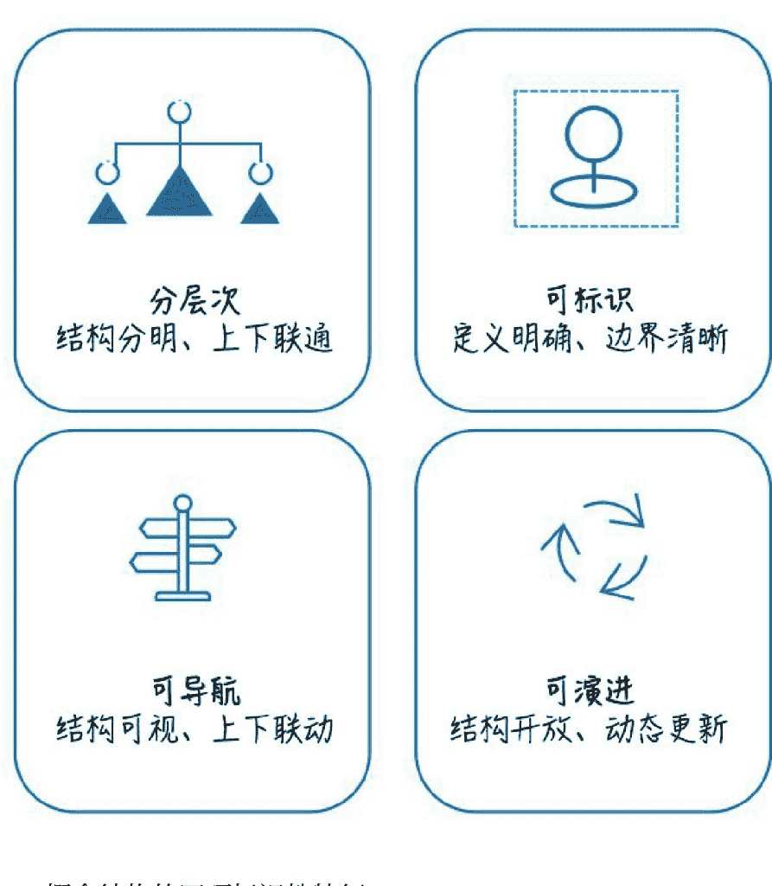

##### 1.分层次

知识不是简单堆积，而是一个有依赖、有组织的结构系统。就像一棵树，有主干、枝干和叶片，不同层级承担不同功能。真正的知识管理，不在于“记住所有内容”，而在于关键时刻能快速定位最相关的一层。

##### 2.可标识

每个知识点都应是清晰、独立、可识别的认知单元，而非模糊叠加的术语堆。一个可标识的概念，至少应具备三项特征：

- 明确边界。知道“是什么”与“不是什么”；
- 命名规范。便于沟通、管理与记录；
- 结构归属。清楚其所属模块与层级位置。

这样能避免概念冲突（如“人才管理”vs“组织发展”），也为AI检索、识别和迁移打下基础。

##### 3.可导航

概念体系不仅要分得清、标得明，还要找得快、连得上。换句话说：无论从哪个节点切入，都能快速定位上下文与相关知识。

例如，当你在处理“员工评分标准”的问题，应能从绩效管理模块导航至“评分体系设计”，再进一步跳转到“行为锚定评分法”等相关子模块。

##### 4.可演进

知识体系不是静态文档，而是可以随情境生长的认知生命体。它应具备吸收新概念、替换旧模块、重组路径的能力，随实践变化而自我进化。

一个具备这四大特性的知识体系，不仅能够系统化整理信息，还能通过模块化设计实现灵活扩展。这种动态知识架构，才能成为AI时代职场能力发展的加速器。

基于以上分析，本书提出“五级概念结构模型”（见表2-1），用于构建一套从认知原点到执行动作的清晰知识层次与结构。

##### 表2-1 五级概念结构体系

| 名称 | 专业术语 | 定义 | HR 领域示例 |
| :--- | :--- | :--- | :--- |
| 元概念 | 理念级知识 | 文化和战略认知原点 | 奋斗者文化 |
| 父概念 | 范畴级知识 | 一级模块或核心知识领域 | 绩效管理、人力资源规划 |
| 子概念 | 子系统级知识 | 构成模块的关键子系统或核心能力维度 | 绩效评估、绩效反馈、绩效改进 |
| 孙概念 | 方法流程级知识 | 可复用的方法、流程、策略 | KPI、BSC、评分体系 |
| 末端概念 | 操作实践级知识 | 个人可直接执行的动作或操作单元 | SMART 法则、打分表设计、反馈话术模板 |

#### 二）三个核心概念解释

我们将重点讲解其中三个核心层级：元概念、子概念与末端概念。

##### 1.元概念：文化信仰层，组织运行的源代码

元概念是构建知识体系的逻辑起点，通常承载着组织核心议题的基本立场与价值假设。它体现企业的文化基因、战略取向，为整个概念体系提供方向指引与判断标准，是最具引导性与解释力的认知原点。

当元概念不清晰，或与下层概念相互冲突时，组织行为就容易陷入割裂。例如，某公司想学丰田的“持续改善”，却缺乏容错机制，结果连基础文化都无法承接。

在HR领域，元概念通常具备以下四个特征：

- 抽象性。不直接对应操作动作，通过父概念逐步转译；
- 唯一性。一个组织通常只有少数元概念，体现文化独特性；
- 稳定性。具有长期指引性，不随短期战略反复变动；
- 支配性。处于概念体系的顶端，所有下层概念必须与其一致。

元概念决定方向，父概念承接理念，向下逐层转化，最终落实为具体制度与行为。以下是“奋斗者文化”的转译路径示例。

示例：

- ●→元概念“以奋斗者为本”
- ●→父概念“绩效管理”
- ●→子概念“长期激励机制”
- ●→孙概念“虚拟股票”
- ●→末端概念“股权激励解锁条件设计”（体现奋斗者长期贡献）。

这条路径清晰展示了文化如何层层转译为制度、工具与行为，实现理念真正落地。每一个有成效的管理实践总结，实质上都是“元-父-子-孙-末端”概念结构的一次外化表达。

##### 2.子概念：结构化中枢，连接理念与方法的桥梁

子概念是对父概念进行系统拆解的关键单元，是承上启下的连接层。它不仅表达“我们做什么”，更呈现“我们如何理解并组织这件事”的结构逻辑。

构建子概念时，不能只堆关键词，而要形成清晰的逻辑路径。常见的五种拆解方式见表2-2：

###### 表2-2 子概念解析的五种路径

| 拆解路径 | 说明 | 适用场景 | 适用示例 |
| :--- | :--- | :--- | :--- |
| 功能路径 | 按职能划分模块 | 职能边界清晰的领域（如招聘） | 需求分析、渠道管理 |
| 流程路径 | 按时间/事件顺序拆解阶段 | 强流程依赖场景（如入职） | 简历筛选→背调→Offer |
| 维度路径 | 按对象/区域/层级分类 | 复杂多元对象（如培训） | 社招 vs 校招 |
| 方法路径 | 按常用方法或工具类别展开 | 技术驱动领域（如绩效） | KPI 法、OKR 法 |
| 结果路径 | 按产出物/数据指标分类 | 结果导向领域（如薪酬） | 岗位画像报告、ROI 分析 |

子概念拆解建议只选一种主路径，确保结构清晰。进入孙概念阶段，可再引入流程或方法等多种视角。

此外，子概念拆解还应符合MECE原则（相互独立、完全穷尽）。

例如，在“招聘需求分析”下分为：

- 岗位需求分析（关注职责与能力要求）
- 团队需求分析（关注结构与人才协同）。

两者互不重叠，合起来完整覆盖了父概念内涵。

##### 3.末端概念：最小可执行单元，知识体系的“神经末梢”

末端概念是最贴近工作现场的知识单元，指那些可立即执行的动作、操作技术。它们虽小，却是将理念转化为现实的关键接口。

比如，“用OKR做绩效评估”是孙概念，而“如何写好一个KR”“评估周期如何设置”就是末端概念。末端概念不仅是“执行终点”，更是“进化起点”，推动知识体系持续适配业务需求。

五级概念结构，不仅是知识地图的骨架，更是认知升级的路径。它帮助我们不仅知道“知识点在哪里”，更知道“知识从哪来、要到哪去”。当拥有自己的概念结构图谱时，任何新机制、新概念都能找到“接入口”与“匹配路径”——学习不再是“扫码式吸收”，而是“系统级接入”。

#### 三）如何借助AI建立概念结构地图

人脑在知识结构构建方面存在天然短板，问题在于：

- 人脑记得住概念，但容易忘掉结构；
- 人脑擅长判断，但不擅长穷尽性拆解；
- 人脑可以理解“对不对”，但在“怎么开始”面前常常卡壳。

AI的加入，为HR知识体系的构建打开了另一条通道。它不是替你得出正确答案，而是帮你更快搞清楚，你该判断什么、先做什么。你给它方向，它搭出结构骨架；你判断适配性，它快速分类、拆解并补充盲点区域。

要让AI协助构建概念结构地图，请先将五级概念结构模型投喂给AI。接下来，我们以“招聘管理”为例讲解如何操作。

##### 案例：招聘概念体系构建

输入指令：

我正在搭建招聘模块概念体系，请你结合华为经验，生成一个五级概念结构草图，并说明一下背后的内涵。

要求：以表格形式展现，包括概念层级、内容、内涵说明三列信息。

AI反馈：

1.华为招聘管理五级概念结构图谱（定制草图）

| 层级 | 内容 | 说明 |
| :--- | :--- | :--- |
| 元概念 | 以奋斗者为本 × 熵减机制驱动组织活力 | 强调组织不断引入新鲜血液以对抗僵化、激活人才代谢 |
| 父概念 | 招聘管理 | 招聘不仅是 HR 的职责，而是战略人力资源工作的“入口机制” |
| 子概念 | 1. 岗位需求澄清机制<br>2. 招聘全流程责任制<br>3. 渠道分层与人才分群<br>4. 专业面试官体系<br>5. 甄选评估与结果闭环 | 华为强调结构严密、流程闭环、岗位导向清晰、责任到人 |
| 孙概念 | 1. 岗位需求澄清→基于编制的岗位画像、关键职责与 KPI 澄清、主管确认机制<br>2. 面试官体系→ 认证机制、评估口径标准化、打分责任制<br>3. 渠道管理→编内/编外、校招/社招、推荐/外包分层 | 每个子系统的关键方法、标准机制、流程细化 |
| 末端概念 | 1.岗位 JD 模板撰写<br>2.主管签字的招聘需求审批单<br>3.结构化面试问题清单<br>4.候选人评估打分表<br>5.渠道 ROI 月报<br>6.背调标准模板 | 这些内容直接落入华为的一线招聘执行表单、系统或制度动作 |

2.结构链条示例：从理念到动作的完整迁移

“奋斗者文化”→招聘管理→专业面试官体系→结构化面试标准→评分表+面评话术模板。

此外，你还可以要求AI将内容以层级结构图、思维导图等方式可视化输出，进一步提升效果。

示例指令：

请为绩效管理模块生成一张符合五级概念结构的层级结构图，展示从元概念到末端概念的层级关系。

AI反馈：（节选）

奋斗者（元概念）

绩效管理（父概念）

绩效考核（子概念）

KPI 设计（孙概念）

SMART 原则（末端概念）

评分比例设置（末端概念）

打分机制（孙概念）

行为锚定评分法定义（末端概念）

当我们对AI的输出存疑时，以下这些提示词帮助你快速建立、修正和优化自己的概念地图，如表2-3所示。

##### 表2-3 AI结构构建常用任务与提示词

| 任务目标 | 提示词示例 |
| --- | --- |
| 拆解一个父概念为子概念 | 请基于绩效管理，拆解出 5 个子概念，要求满足 MECE 原则，并说明各自关注点。 |
| 比较两个概念是否重叠 | “岗位能力模型”与“胜任力词典”是否属于同一子概念？如何区分？ |
| 补全结构盲区 | 我认为招聘模块中包含岗位需求分析、渠道管理，请列出可能遗漏的关键子概念。 |
| 分析一个标杆实践的底层逻辑 | 谷歌 20%创新时间制度背后的元概念、父概念、子概念可能是什么？ |
| 判断概念迁移可行性 | 将 OKR 机制引入我司，目前已采用 KPI，有哪些冲突与融合点？结构如何调整？ |

读者朋友可以尝试以“职位管理”与“任职资格”为主题，生成概念结构地图，并通过调整提示词信息观察输出内容的差异。

### 二 深入学习核心概念的三种方法

概念定义是认知的起点。它不仅决定如何理解一个问题，更决定如何判断、分类与行动。如果定义模糊，认知就无法清晰；如果定义偏差，行动方向也可能跑偏。

要真正掌握一个概念，不能停留在“记住名字”，而应借助科学的方法，将其学准、学通、学活。唯有如此，才能构建出可对齐、可应用、可迁移的认知能力。

#### 一）学准：锚定一个概念的“正确定义”

所谓学准，就是在使用某个术语时，要有一个稳定、清晰、场景适配的认知锚点。特别是面对那些抽象性强、解读路径多的核心概念——如“职位”和“岗位”、“组织能力”、“战略”等。否则，就容易在沟通、设计与执行中出现理解错位、逻辑断层。

##### 为什么学准难？

越基础、越宏观的概念，往往定义越多元。以“企业文化”为例，光是学术界就有十几种，例如：

- Schein的三层模型（假设—价值—表象）；
- Denison的文化特质理论（一致性、适应性、参与性等）；
- Hofstede的跨文化维度模型（权力距离、不确定性规避等）。

每一种理论都有其内在逻辑，但关注的角度不同。这就造成了一个常见困惑：到底选哪个？是不是都要学？是不是只有唯一的“标准答案”？

答案是否定的。我们真正需要判断的是：在特定任务中，哪种定义最有用、最贴合目标？

我们可以借用一种实用的哲学视角来区分概念的类型，有助于更清晰地识别定义的用途。这种区分方式源于亚里士多德的“目的因”理论，概念大致可以分为两类——目的性概念与必然性概念。

- 目的性概念：关注的是“为什么要存在”，即概念所承载的意义与价值。例如，什么是“市场经济”？亚当·斯密用“看不见的手”来定义，强调个体在追求私利的过程中，如何在无形中推动社会整体利益的最大化；

##### 必然性概念：关注的是“如何达成目标”，即实现目标所依赖的路径与条件。例如，什么是“幸福”？亚里士多德将其定义为一种通过正义、勇敢、智慧等德性实践所达成的终极人生状态。

这种区分方式有助于我们判断：一个概念在使用时，是更多体现功能目标，还是更多体现逻辑构成。当你面对一个概念时，不妨先问自己两个问题：

- 我为什么要用这个概念？（明确动机与目的）
- 它要帮助我完成什么？解决什么问题？（判断用途与功能）

过去，这类思辨往往依赖经验积累与高度抽象能力；但现在，我们可以借助AI的语言理解与逻辑建构能力，有效辅助完成这一过程。下面通过一个实际示例，展示AI如何参与其中。

##### 案例：“组织能力”定义选择

背景：

HR正在设计一套组织能力评估工具，需要对“组织能力”下定义。但查阅文献发现定义众多，角度各异：有的侧重流程与机制，有的强调人才协同，还有的偏战略适应与变革弹性。

如何选择一个最贴合当前任务目标的定义？

###### Step 1：定义聚类——快速收集+自动分类

输入指令：

请整理6种常见的有影响力的“组织能力”概念定义，要求备注出处，并做个分类。

AI反馈：

以下是6种不同角度的概念定义参考：

1. 《哈佛商业评论》：组织能力是指公司在个体能力的基础上，整合形成的集体能力，使其能够持续提供价值。
2. 斯坦福大学：组织能力类似于个人技能，是组织在竞争中持续表现突出的特定能力。
3. SEBoK（系统工程知识体系）：组织能力是指组织执行系统工程以实现其价值和目标的能力。
4. CIO Wiki：组织能力是公司有效管理资源（如员工）以获得竞争优势的能力。
5. 迈克尔·波特《竞争战略》：组织能力代表了组织以特定方式整合活动以传递价值的能力。
6. 《组织能力的杨三角》：组织能力由三要素构成——员工能力、员工思维模式、员工治理方式。

以下是按应用场景的概念分类：

- 内部能力建设（1、3、4、6）；
- 外部价值创造（2、5）。

###### Step 2：场景适配推荐——结合目标筛选最优定义

输入指令：

请结合我的任务，按“目的性或必然性概念”标准推荐最合适的定义。

AI反馈：

推荐定义（用于组织能力评估工具）：组织能力是由员工能力、员工思维模式和员工治理方式三大核心要素构成的系统能力结构（杨三角组织能力模型）。

推荐理由：

- 必然性概念：结构性强，可作为工具框架支柱；
- 可拆解：每个维度可细分为行为指标与测评维度；
- 易沟通：便于HR、管理者、员工对齐认知；
- 实用落地：广泛用于企业诊断、评估、组织发展设计。

延伸建议：你可以将杨三角三要素，进一步拆解为细项，例如：

| 维度 | 可评估方向 |
| :--- | :--- |
| 员工能力 | 专业能力、学习能力、问题解决力 |
| 员工思维模式 | 主动性、责任感、以终为始 |
| 员工治理方式 | 流程支撑、授权机制、跨部门协作效率 |

结合Likert评分、行为案例库或AI辅助评分模型，即可形成一套完整的组织能力测评工具系统。

当然，我们也可以对某一个概念的定义进行属性判别。通过这种方式，我们可以很快理解概念的精髓和本质。

示例指令：

关于“职位是组织的最小单元”这一定义，属于必然性概念还是目的性概念？

AI反馈：

属于必然性概念。它强调的是组织构建和管理中必要的结构性单元，表明为了有效管理组织和资源，每个组织都需要将工作任务细化为具体的职位。这个定义描述的是一个组织运作的基本构成部分，是实现更大目标（如组织运作、绩效管理等）的基础条件。

#### 二）学通：上可溯源、下可落地

概念体系的真正价值，在于是否能打通从“为什么这么做”到“具体怎么做”的全链条理解。

##### 1. 上可溯源：从动作追溯到概念原点

所谓上可溯源，就是从一个表层的工具、流程或表单，向上追问它的概念归属、价值逻辑与文化支撑。

例如，你在使用一个360度绩效反馈表单，不应该只关注表单怎么填，更应追问它属于哪个模块？它反映了什么绩效理念？与组织价值观是否一致？

##### 2. 下可落地：从理念拆解到执行动作

反过来，下可落地意味着能够从抽象理念出发，逐级转译为策略、方法、模板、话术等可执行内容。理念不能落地，就只是口号。

只有当语义记忆（如概念定义）与情境记忆（如应用场景）结合在一起，才能真正形成深度理解。

我们看两个AI帮助学习概念的示例。

##### 案例：上可溯源——360度绩效反馈

输入指令：

你是一名资深的人力资源顾问，请你回答关于360度绩效反馈的以下三个问题：

- 为什么用360度，而不是KPI？
- 这是谁提出来的理论？背景是什么？目的是什么？
- 这一做法与“效率优先兼顾公平”的企业文化是否一致？

AI反馈：

……

##### 案例：下可落地——绩效目标设定

输入指令：

我正在设计绩效目标设定流程，可以帮我拆解为具体步骤并生成配套沟通话术吗？

AI反馈：

以下是一个标准的五步法流程：

- 明确组织层级战略目标；
- 拆解为部门KPI；
- 转化为岗位目标；
- 与员工协商确认（建议沟通话术如下……）；
- 设置考核周期、权重与评价方式。

……

输入指令：

请你详细讲解下，公司战略目标如何拆解到部门KPI，其中有什么技术难点和操作要领，请你举例说明。

AI反馈：

……

只有理念可溯、行为可落，才能构建一个“既能解释世界，又能改造世界”的知识系统。

#### 三）学活：跨场景、能迁移、生成新认知

真正掌握一个概念，不仅在于理解它的含义，还在于能否灵活迁移、跨情境应用，并由此完成“从理解到分析，再到创造”的认知跃迁。

学活，意味着让一个抽象概念具备“生命力”——能够在不同场景中生长出新的解释力与解决力，最终成为推动实践的认知杠杆。

AI在这一过程中，可以扮演“迁移加速器”的角色，我们来看一个示例。

##### 案例：“文化”概念迁移

输入指令：

你是一位资深的文化顾问。我们公司强调“开放沟通、持续改进”的价值观。请帮我将这个文化理念转化为绩效谈话中的具体行为引导和话术模板。

AI反馈：

当企业文化强调开放沟通，绩效谈话应营造心理安全感，鼓励反馈的双向流动。以下是可用于绩效面谈的三个行为引导方向及示例话术：

- 承认不足，引导反馈：在这个季度的项目中，我也在不断优化管理方式。你觉得哪些地方我可以做得更好？
- 鼓励改进，不定性否定：这个目标虽然没有完成，但我注意到你在执行中做了哪些尝试。我们一起看看还能怎么调整得更高效？
- 以成长为导向，而非惩罚为主线：这次的挑战很典型，不如我们从中总结一套经验模型，作为下次项目的参考？

学会迁移，把“文化”从墙上的口号，转化为管理者真实可用的行为动作——从抽象信念，落地为日常对话。

##### 小结

AI时代开启了真正的“知识平权”革命——学习不再受限于资源，也突破了时间和地域的边界，获取知识的效率与质量同步跃升。

对HR而言，一套成熟的概念体系，是认知升级的底座。它决定了一个人能否看清本质，抓住精髓。在未来，“概念化能力”或将比“知识储备”更具战略价值。因为真正的高手，从来不是掌握最多术语的人，而是能定义和重构游戏规则的人。

## 第二节 知识流动地图：从局部到整体的立体透视

一个高质量的知识体系，既像一张地图，也像一台精密运转的机器。各模块不仅要主次有序、逻辑清晰，更要因果关联、动态协同，才能真正支撑从理解到应用的落地闭环。

接下来，将带你拆解如何借助AI，让知识如何从点到线、从线到面，最终构建出一个立体的、具有生命力和创造力的认知系统。

### 一 主次关系与先后顺序

> 《大学》有言：“物有本末，事有终始。知所先后，则近道矣。”

#### 一）主次关系

静态视角来看，HR知识模块结构化管理可根据其在组织系统中的定位，分为三类：

- 主导模块。提供方向和价值引导，构成系统运转的起点，如战略规划、组织文化；
- 协同模块。承接管理意图，推动关键任务落地执行，如招聘、培训、绩效管理等；
- 支持模块。提供结构保障与资源基础，强化系统闭环与可持续性，如发展通道规划、人才盘点等。

以人才管理体系为例，战略属于主导模块——它决定企业如何识别关键人才、定义“好人才”的标准，以及如何形成选育用留的统筹逻辑。

但需要强调的是，模块的主次关系不是绝对的，而是受企业阶段、发展重心与资源分布影响的动态排序。就像在沙漠中，水比金子更重要——同一模块在不同情境下，其战略价值可能完全不同。例如，对初创企业，招聘至关重要；而对成熟型组织，领导力发展与人才梯队建设则成为保障未来的核心任务。

过去，我们主要依赖业务敏感性和经验判断模块优先级。而现在，在AI工具的辅助下，我们可以更系统地识别“当前最值得优先启动的模块”，为HR提供更有力的决策支持。

我们看一个典型案例。

##### 案例：初创科技企业HR工作优先级排序

背景：某高科技初创企业，员工约300人，刚步入盈利阶段，正从“创业英雄主义”过渡到“组织化协作”阶段。创始人逐渐意识到HR的重要性，但资源有限，必须明确“先做什么、后做什么”。

输入指令：

你是一名资深的人力资源顾问。请基于当前组织特征，识别对战略支撑性强、失控风险高的HR工作模块及核心动作，按优先级给出建议。

AI反馈：

以下建议优先启动的六大HR模块及原因。

###### 1. 组织结构与岗位体系梳理

从“人盯人”转向“岗位对人”，建立可扩展的组织框架。很多初创公司初期靠人驱动，“谁能干谁顶上”，但进入盈利后要逐步建立“靠岗位运行的组织”。

核心动作：

- 明确现阶段各部门职责边界；
- 建立基础岗位说明书、团队结构图；
- 预设未来6-12个月的组织扩张路径。

###### 2. 关键人才识别与留用机制设计

找到关键少数，提前布局“绑得住、用得上”的机制。这个阶段流失一个技术骨干，对公司造成的是“时间断层”和“知识断层”。

核心动作：

- 梳理10-15位核心技术/业务骨干；
- 设计长期激励雏形：如股权池、绩效奖金、项目分红、非现金激励；
- 防止盈利初期“人一走、心也散”。

###### 3. 绩效管理与目标对齐机制搭建

从“凭感觉”到“有依据”，推动团队结果导向文化。初创期目标经常变，关键是形成“目标意识”和“复盘机制”。

核心动作：

- 搭建简洁实用的目标管理机制（如简版OKR/KPI）；
- 强化“对齐目标、反馈透明、绩效有依据”的习惯；
- 重点在于对齐感而非打分制。

###### 4. 招聘系统优化：从“凑人”到“找对人”

打造一套“能拉人、会选人、快速匹配”的高效机制。初创企业最容易“着急用人”，导致错配率高、磨合期长、流动性大。

核心动作：

- 明确关键岗位的人才画像（尤其是技术、产品、市场三类）；
- 梳理面试流程，建立结构化评估工具（面评表、统一打分机制）；
- 如果频繁扩张，建立候选人池、员工推荐激励机制。

###### 5. 文化澄清与价值观内嵌机制

给快速成长的组织一套“组织语言”，保持团队向心力。盈利初期员工快速涌入，文化容易“稀释”，必须用机制固化“精神边界”。

核心动作：

- 由创始人/核心高管提炼企业价值观原型；
- 嵌入到招聘评估、试用期评审、晋升/表彰等关键场景；
- 以小而美的仪式、共享、故事等方式强化共识。

###### 6. 制度雏形与员工体验设计

利用“够用”规则托底，让组织有序而不僵化。过度自由易乱，过度制度会僵。这个阶段需要“轻制度，重体验”。

核心动作：

- 起草基本规章制度：入转调离流程、考勤休假、薪酬发放等；
- 设置员工反馈机制，解决“信息不对称”和“成长焦虑”；
- 关注新人融入、试用期管理、跨部门协作体验。

看到这个AI反馈，不由得感叹：现实中有不少百人规模的企业，花费百万巨资请咨询公司打造精密的管理体系，是否真的值得？是否有这个必要性？

#### 二）先后顺序

从动态视角来看，知识模块在运用过程中有其先后顺序。关键是，模块众多，如何判断启动顺序？

是优先对齐战略方向，还是优先解决当前痛点？又或者，从打基础的能力模块开始构建？

在这类判断中，AI也能派上用场，继续看一个典型案例。

##### 案例：后备干部管理方案

背景：

某铜材制造集团为上市企业，拥有9000名员工，年营收超过千亿元，目前正处于高速发展期。集团高层高度重视干部梯队建设，已着手构建系统化的后备干部管理体系，以保障核心岗位的持续人才供给。

输入指令：

请结合企业背景，明确后备干部工作的推进顺序，提炼一下关键词，然后说明应做什么、为什么、怎么做。

AI反馈：

后备干部管理方案听起来高大上，但要真正落地有效，必须先打好几个关键的“地基”。否则，很容易出现“名册做得很美，但没人能接班”的尴尬局面。

推动后备干部管理落地的“五项基础性工作”，就像盖房子要先有地基，人才接班也必须有这五块“承重结构”。

###### 1. 明确组织“未来画像”与战略驱动岗位

关键词：战略对位、干部接班场景化、未来组织构型

做什么？

- 回答一个核心问题：为什么要储备后备干部？未来哪些岗位最关键？
- 明确未来3-5年的组织战略，对应梳理“战略岗位地图”与“关键胜任力变化趋势”。

为什么？

- 否则你会陷入“给每个岗位都配个后备”的平均主义；
- 真正的接班风险常常出现在隐性关键岗（如业务副总、核心产品经理）。

实操建议：

- 做一张《战略关键岗位优先级地图》；
- 采用工具：关键岗位价值-稀缺性评估表。

###### 2. 梳理并规范职级/岗位体系

关键词：组织骨架清晰，岗位承载路径明确

做什么？

- 梳理现有岗位与职级体系，特别是“核心管理通道”和“专业通道”；
- 确保每个后备人才能够看得见路径、走得了台阶。

为什么？

- 若没有清晰的岗位体系，后备干部评上了却“没有位置”，晋升路径就成了空谈；
- 不同体系（如区域岗、职能岗、专业岗）如果不对齐标准，评审就会混乱。

实操建议：

- 做一张《干部成长路径图》（如M2→M3→BU负责人）；
- 明确各职级的晋升“任职条件”。

###### 3. 搭建任职资格/胜任力模型体系

关键词：数据基础、动态管理、干部池维护机制

做什么？

- 制定干部人才的能力模型，分为“通用素质+角色胜任力+核心潜力因子”；
- 明确“选谁进后备池”的判断逻辑，不是人脉好、说话巧，而是结构化可评估的能力表现。

为什么？

- 没有统一标准，评选容易“凭感觉”“走关系”；
- 难以与人才发展动作（如培训、轮岗）匹配。

实操建议：

- 建一套3-5级的胜任力等级描述；
- 组织结构化评估（如人才盘点、能力行为面谈）。

###### 4. 建立干部人才数据画像与盘点机制

关键词：数据基础、动态管理、干部池维护机制

做什么？

- 为每位干部建立动态“人才画像”，包括能力、绩效、潜力、岗位适配度等；
- 每年/每半年组织一次盘点，识别、分层、动态出入池。

为什么？

- 后备干部不是一选定就不动的“名册”，而是一个动态更新的“人才资产池”；
- 如果不能动态调整，会导致“后备=僵尸名单”。

实操建议：

- 建立《干部盘点九宫格》（绩效x潜力）；
- 或升级为动态人才盘点图（AI辅助打标）。

###### 5. 梳理干部发展的配套机制（晋升通道+育成方案）

关键词：评出来→用起来→留下来

做什么？

- 明确干部入库后的“发展动作”：是否轮岗？是否配导师？是否有晋升优先权？
- 建立“试岗/影子计划”，将候选人提前纳入实战通道。

为什么重要？

- 很多后备干部方案“只评不养”“只提不动”；
- 若没有配套机制，容易让干部陷入“空等状态”，最终失去动力。

实操建议：

- 打通后备→培养→任用三段流程；
- 建立《干部试岗计划》《轮岗派遣SOP》。

总结：后备干部管理，不是HR的“选美大赛”，而是组织的“战略接力赛”。没有晋升路径的评选，只会让人才空转；没有画像的管理，只会让组织盲投。

从这个案例可以看出，AI已具备接近资深顾问的分析水准，关键在于你是否能提出清晰的问题，提供有效的情境输入。

#### 三）判断方法

在实际工作中，判断知识模块的主次与启动顺序，往往不是靠单一逻辑就能解决的。我们可以结合三条常见路径：从战略优先级出发、从问题根源切入、从能力基础评估，形成一个更加立体的综合判断框架。

##### 1. 战略对齐

以战略优先级为锚点，识别那些对战略落地起关键作用的核心模块。

- 优势：资源聚焦，方向明确，避免“撒胡椒面”式改革。
- 局限：当战略不清或高层意见不一时，容易判断失焦；初创企业适配性较弱。

##### 2. 痛点溯源

从显性问题切入，向上追溯潜在的系统根因，定位需要优先修复的结构模块。比如，高潜人才频繁流失，表面看似激励问题，实则可能源于岗位画像模糊、晋升路径混乱——这时应优先完善职级体系与能力模型。

- 优势：定位精准、见效快，适合问题导向型改革。
- 局限：若判断失误，容易陷入“头痛医头、脚痛医脚”的救火模式，忽略系统性改善。

##### 3. 能力承载

不是所有“想做的事”，组织都具备立刻执行的条件。应评估当前的资源、流程与人员基础，识别哪些模块具备可行条件，优先启动牵引性强、依赖度高的部分。

就像造房子，地基不牢，装修再漂亮也白搭。比如想推360度反馈，但若连行为词典、任职资格体系都未建立，最终只会流于形式。

- 优势：风险更低、路径清晰，适合资源有限或能力尚处搭建期的组织。
- 局限：若过于保守，可能错失转型窗口，需定期评估能力边界。

这三种判断方法并不互斥，应根据组织所处阶段、资源状况与核心目标，选用最合适的判断路径，形成清晰可落地的优先顺序。

- 成熟企业，以战略对齐为主导，痛点溯源为补充；
- 转型企业，痛点溯源优先，能力承载定边界；
- 初创企业，能力承载为基础，逐步融入战略对齐逻辑。

有位知名的管理咨询专家常提醒企业家：“不怕慢，就怕站。”意思是，企业要敢于迈出管理升级的第一步。

但“敢干，不能盲干”。要让管理升级真正落地，首先要厘清HR工作的主次关系与启动顺序，明确“先做什么、后做什么”“哪个更重要”。

这样可以避免热火朝天开局、无疾而终收场。

### 二 知识模块的耦合与联动

复杂知识系统中模块之间的耦合关系，决定了整体能否高效协同、稳定运行。所谓“耦合”，是指各模块间在机制依赖、信息流动与功能协作上的关联程度。

就像人体除了器官，还需要神经和血管系统协同反应，HR中的招聘、绩效、薪酬、培训等模块，也必须通过机制打通、数据互联、语言统一，实现“血脉畅通”，才能支持组织高效运作。

像设计乐高玩具一样，让模块既能独立运行，又能协同联动的能力，是知识体系走向成熟的关键标志。图2-2展示了某企业在不同人力模块之间的耦合关系图谱。

#### 基于能力（行为）的人力资源管理逻辑图

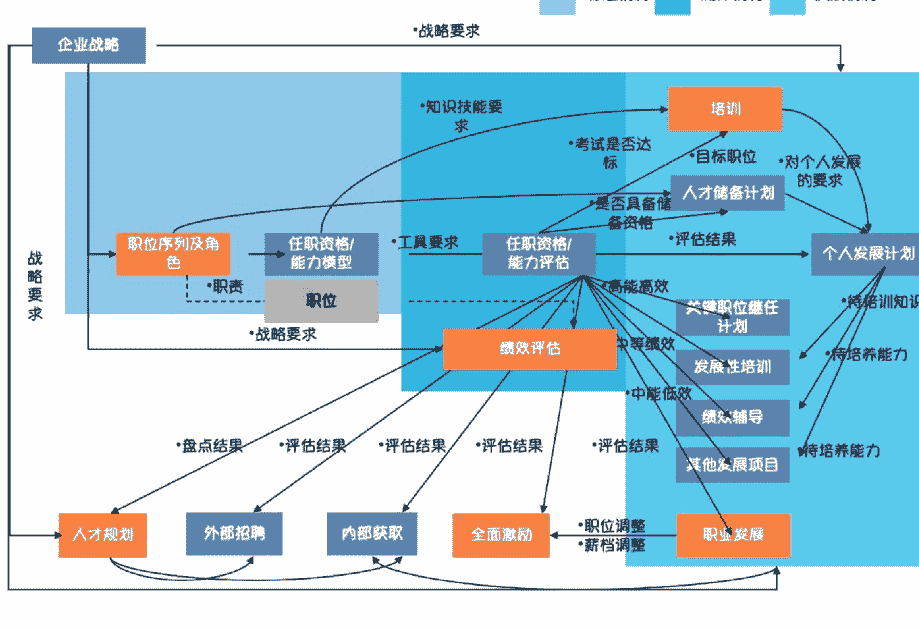

2-2 某企业HR模块耦合与联动图

#### 一）识别和选择耦合关系

在构建知识系统时，首要任务是识别各模块之间的耦合关系：哪些必须联动，哪些可以相对独立，做到“该连的连，该断的断”。

##### 1. 强耦合与弱耦合

模块之间的耦合关系大致可分为两类：

强耦合。模块之间高度依赖，一方调整，另一方必受影响。例如，绩效管理与晋升路径通常构成强耦合关系——绩效结果既决定晋升机会，也影响员工对公平的感知。

弱耦合。模块之间联系松散，运作相对独立。比如员工关怀与外部招聘，虽都涉及人才体验，但业务逻辑各自独立，无需高度联动。

不是所有模块都需要深度联动，耦合路径多并不等于系统效率高。

##### 2. 耦合优化：既要协同，也要留白

模块若过度绑定，会降低灵活性；若完全割裂，又会失去闭环能力。合理的做法是：

首先，强化因果清晰、协同要求高的耦合路径，如绩效→薪酬→晋升，这是HR体系中最需要打通的关键链条。

其次，拆解不必要的逻辑捆绑，避免模块之间不必要的捆绑与牵制，增强系统的灵活性与可调整性。

不少企业照搬他人模块拼图，表面上体系完备，实则因耦合逻辑不清，造成结构冲突、执行失效，难以支撑组织运行。

接下来，我们通过一个典型案例来深入理解模块耦合的影响。

##### 案例：任职资格认证结果与薪酬调整的耦合关系

背景：很多HR都会问，员工通过了任职资格认证，是否就应当同步涨薪？答案是：不一定。这背后取决于组织如何设定“能力等级”与“薪酬调整”的耦合机制。

输入指令：

你是一名资深人力资源专家。请基于不同组织实践，总结“任职资格等级认证”与“薪酬调整机制”之间的耦合关系。

要求如下：

- 列出常见耦合模式，并为每种模式命名；
- 每种模式说明：定义、适用背景、关键特点、潜在风险；
- 为每种模式匹配一个真实或典型企业案例；
- 最后用一张表格对比这几种模式的“耦合强度、激励力度、管理弹性、典型风险”。

AI反馈：

任职资格等级认证（通常由能力评估或岗位能力模型构成）与薪酬调整机制之间存在多种耦合模式。

模式1）强绑定型耦合（资格等级=薪酬等级）

定义：任职资格等级直接决定薪酬等级，等级提升必然伴随薪酬调整。即“评上就涨，评不上就冻”。

适用背景：

- 企业规模大，岗位标准化程度高（如大型制造业、国有企业）；
- 重视体系稳定性与员工激励一致性；
- 有成熟的能力模型和等级评价体系。

特点：

- 薪酬晋升有明确路径，员工动力强；
- 管理和评价制度必须非常严谨，否则容易引发质疑；
- 高一致性，低灵活性。

案例：

华为的任职资格体系（如职级13级对应多少档位薪酬），职级晋升通过严格考核，薪酬同步上调，被称为“铁三角”制度（能力-等级-薪酬强绑定）。

###### 模式2）弹性挂钩型耦合（等级影响薪酬带宽）

定义：任职资格等级决定你在哪个薪酬带宽区间中浮动，而不是绝对对应。等级高者有更大的增长空间。

适用背景：

- 快速发展期企业，需平衡激励与管理灵活性；
- 管理层希望保留一定薪酬操作权；
- 不希望等级认证变成“涨薪通行证”。

特点：

- 增加了管理弹性，可兼顾绩效、市场对标等因素；
- 员工等级提升≠立即涨薪，但会增强其“涨薪可能性”；
- 激励效果较弱于强绑定模式，但风险更可控。

案例：

字节跳动实行能力等级与薪酬等级“半耦合”：每个职级对应一组薪酬带宽，等级晋升后不一定立即调薪，而是视绩效和预算而定。适用于快速迭代型组织。

###### 模式3）同步参考型耦合（等级作为涨薪决策的辅因）

定义：任职资格等级不直接决定薪酬调整，但在做涨薪/晋升决策时作为一个参考因素。主要依据是绩效与市场。

适用背景：

- 注重绩效文化、绩效导向的企业；
- 任职资格评定尚未完全普及或标准化；
- 企业处于激励机制探索期。

特点：

- 评价体系更看重“绩效当下”而非“能力储备”；
- 避免“证书化”、“表演型”评审；
- 等级提升并不意味着管理者必须涨薪，但可作为晋升依据。

案例：

某银行总部的做法：薪酬涨幅主要依据绩效评分，但能力等级是“晋升岗级”和“竞聘资格”的参考项之一。可理解为“评级影响晋升权，不决定薪资值”。

###### 模式4）解耦型（认证与薪酬完全分离）

定义：任职资格认证与薪酬调整完全分离，各自独立运行。

适用背景：

- 能力评估更多用于培训发展用途；
- 企业强调“绩效=回报”而非“能力=回报”；
- 岗位变动频繁，等级难以稳定对应薪酬。

特点：

- 保留任职资格的“能力开发导向”；
- 薪酬体系更侧重绩效结果、岗位价值；
- 容易造成员工对评定“失去期待”感。

案例：

初创型互联网企业常用此模式：认证结果主要用于制定培训路径，薪酬由绩效决定，等级只是“成长路径地图”，不构成实质激励。

以下是总结对比表：

| 模式 | 耦合强度 | 激励力度 | 管理弹性 | 风险 |
|---|---|---|---|---|
| 强绑定型 | 很高 | 很强 | 低 | 制度失衡风险高 |
| 弹性挂钩型 | 中高 | 中等偏强 | 中高 | 操作不透明可能引发质疑 |
| 同步参考型 | 中 | 中等 | 高 | 激励作用较弱 |
| 解耦型 | 低 | 弱 | 高 | 激励失效、评定价值感低 |

还有一个常让HR感到棘手的问题：如何处理职级体系与薪级体系之间的耦合关系。这两大体系，一套定义员工在组织中的身份定位，一套决定其收益回报，共同构成人力资源管理的“双基石”。它们如何耦合，不仅关系到组织的公平感知和激励效果，更是薪酬体系设计中最具挑战性的核心议题。不妨看看AI是如何解析这个问题的——也许，它的分析能让你豁然开朗。

#### 二）模块耦合的结构可视化

借助AI，我们可以将“看不见的关系”转化为“看得见的结构”，更清晰地呈现模块协同逻辑，辅助联动设计、路径推演与断链识别。以下介绍四种常见的结构可视化方法，适用于不同管理场景。

##### 1. 网络图

用于展示模块之间的结构性依赖关系，例如“谁依赖谁”“谁包含谁”。

示例指令：

请基于招聘流程，绘制一张“概念依赖图”，展示从“招聘需求分析”开始，向下展开的关键依赖关系，包括“岗位需求分析”等模块，并标注“依赖”“包含”等逻辑关系。输出成结构清晰的关系图。

AI反馈：

```
[招聘需求分析]
    ├──依赖──> [岗位需求分析]
    │           └──包含──> [岗位职责]
    ├──依赖──> [招聘渠道选择] ──依赖──> [广告发布]
    └──依赖──> [简历筛选] ──依赖──> [筛选标准设定]
```

##### 2. 映射图

用于表达两个系统之间的“概念对齐关系”。

输入指令：

请生成一个结构映射图，展示“职位体系”与“培训体系”之间的概念对齐关系，采用箭头结构表示每一项内容的逻辑对应关系。左列为职位体系的要素，右列为对应的培训体系要素，格式类似于结构对齐图或概念映射图。

AI反馈：

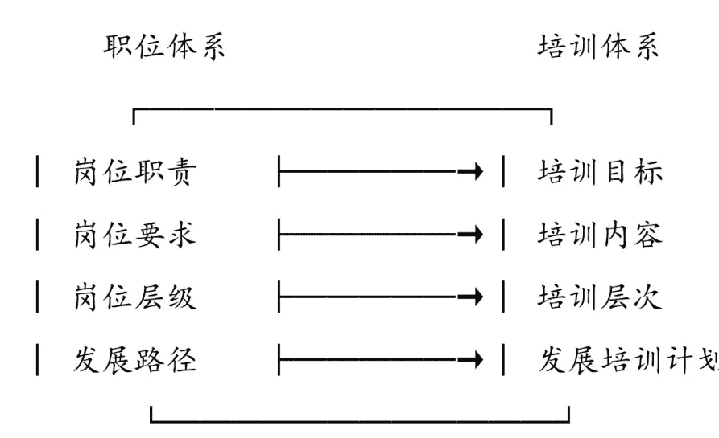

##### 3. 耦合矩阵图

用于量化两个系统内部要素之间的耦合强度，是耦合关系分析的经典工具。

输入指令：

请绘制一张职位体系与培训体系之间模块耦合矩阵图，用红黄橙三种颜色标出每个元素之间的耦合强度。行列分别为：岗位职责、岗位要求、岗位层级、职业发展路径×培训目标、培训内容、培训层级、发展培训计划。

AI反馈：

耦合矩阵图如下：

| 职位\培训 | 培训目标 | 培训内容 | 培训层级 | 发展培训计划 |
| :--- | :--- | :--- | :--- | :--- |
| 岗位职责 | | | | |
| 岗位要求 | | | | |
| 岗位层级 | | | | |
| 职业发展路径 | | | | |

强耦合：同步设计；中耦合：协同优化；弱耦合：分步实施。

##### 4. 泳道图

适用于流程责任划分，清晰展示“谁在什么环节做什么”，适合用于跨部门协作流程建模。

输入指令：

请用泳道图展示“构建岗位胜任力模型”的跨部门知识协作流程，泳道包括HRBP、业务部门、培训部门，列出各自在每一步的职责。

AI反馈：

泳道图结构（简化版）

| 步骤\部门 | HRBP | 业务部门 | 培训部门 |
| :--- | :--- | :--- | :--- |
| 岗位调研 | 发起调研、提供访谈框架 | 参与访谈，描述关键行为 | |
| 提炼关键能力要素 | 归类并结构化行为事件 | 审核关键能力是否贴合业务 | |
| 构建能力等级描述 | 起草胜任力等级表述 | 提供真实工作场景反馈 | |
| 审核与校准 | 协调评审流程，组织共识 | 参与评审，修正不合理描述 | |
| 衔接培训体系 | | 提出能力提升需求 | 将能力要素转化为课程模块 |
| 发布与应用 | 发布能力模型，纳入HR体系 | 在招聘/晋升中试点使用 | 开发匹配的培训产品 |

在管理实践中，诸如“重复返工”“各自为政”“职责模糊、互相扯皮”以及“强行捆绑造成管理过度复杂化”等现象，往往源于结构设计中的耦合混乱。这正是构建“知识流动地图”的价值所在——分得清、连得上、看得见。

##### 小结

管理知识的关键，在于建立“轮廓感”。就像一幅高明的山水画，主次分明、疏密有致——该连的地方要精准衔接，该断的地方果敢留白。

但结构之美，只有在实践中才能体现其真正价值。知识唯有在实际工作中有效、有序地流动，才能实现从“知”到“用”的跃迁。否则，知识便容易停留在表层展示，流于形式，甚至成为负担。

## 第三节 标杆案例研究：高效对标与智慧迁移

管理大师德鲁克在《管理的实践》中指出：“管理是一种实践，其本质不在于“知”而在于“行”；其验证不在于逻辑，而在于成果。其唯一权威就是成就。”这，正是标杆研究的真正意义。

那么，标杆研究究竟研究什么？核心在于提炼两类成果：一是从优秀企业的模式与策略中，提炼出结构化的认知模型，作为组织共识的认知锚点；二是将其经验转化为可执行的方案建议、流程优化路径与制度设计工具。

但学习标杆的前提，是自身拥有一套清晰、可对照的知识框架。缺乏结构，就如“盲人摸象”，只能抓住局部，难以形成系统认知；一味套用他人方案，又容易落入“认知牢笼”，被别人的思路绑住手脚。

因此，标杆研究不仅是“看别人怎么做”，更是一场结构化的知识重构。为了更系统地理解“经验如何转化为组织智慧”的路径，本书提出一个标杆研究的ACT模型，包括对标、解构和转化三大部分（见图2-3）。

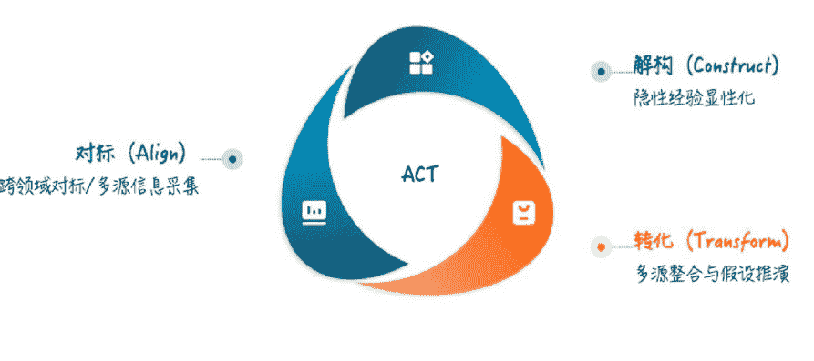

图2-3 标杆研究ACT模型

接下来，我们将逐一拆解如何操作ACT模型中的核心环节。

### 一 对标选择与解构分析

标杆研究的起点，是明确研究目的，选对学习对象。有效的标杆研究，最好围绕具体成果或关键痛点展开，优先聚焦最需要突破的领域。尤其在借助AI进行辅助分析时，问题越聚焦、提示词越具体，反馈质量也就越高。

不良指令：

请你研究和分析一下[标杆企业]的[实践]。

示例指令：

- 请说明如何将[标杆企业]的[实践]应用到[某个行业/场景]，有哪些注意事项？
- 请分析[标杆企业]在[具体领域]中最具借鉴价值的做法有哪些？请列出3-5条，并说明其适用场景。

同时，也要避免“只看一个案例、只靠一种材料”的片面视角。通过多个标杆、多类文献、不同语境的交叉分析，才能搭建起一个更立体、更全面的认知结构，避免“以偏概全”或“生搬硬套”。

示例指令：

- “胜任力模型”在[标杆企业A、B、C]中的应用有何异同？请逐一分析并汇总为共性—差异矩阵。
- 请列举[标杆企业]在[某领域实践]方面的公开研究、白皮书或案例支持。

获得初步信息后，即可进入解构分析阶段。建议将分析过程拆分为三个层次，逐步深入。

#### 一）表层问题：理解“发生了什么”

第一步，是迅速掌握案例的基本构成。这既为后续分析提供信息基础，也有助于降低认知门槛。推荐使用经典5W1H框架，建立系统性理解。

示例指令：

- **What**: 这个案例的核心目标是什么？他们解决了什么问题？
- **Why**: 为什么这个标杆案例成功？其成功的关键因素是什么？
- **How**: 他们是如何实施这一策略的？采取了哪些具体措施和工具？
- **Where**: 这个案例发生在哪些具体环境或行业中？它是否可以跨行业借鉴？
- **When**: 他们在什么时间实施了这些策略？这个时间点对成功有何影响？
- **Who**: 案例中的关键参与者是谁？他们在成功中扮演了什么角色？

#### 二）深层问题：理解“为何如此”，提炼迁移逻辑

很多实践在表面相似，实则根因与适配逻辑大相径庭。问题往往不在“做法”，而在“背后的文化与业务逻辑”是否匹配。建议采用以下三种分析方法。

##### 1. 5WHY追问法

通过连续发问，层层追溯成功背后的因果链条与能力基础。

示例指令：

为什么这家公司高潜人才的留存率显著提升？

→因为他们为高潜员工提供了清晰的晋升路径与成长计划。

为什么能做到这一点？

→因为他们建立了系统性的人才识别机制（如9宫格盘点+360评估），能及时识别高潜员工。

……

为什么文化上能形成这种共识？

→因为企业长期强调“用未来看人”的理念，并配套制度和资源，形成组织承诺。

##### 2. 细节拆解法

不要只问“做了什么”，而要问“怎么做的、谁来做、做到了什么程度”。

不良指令：

请问[标杆企业]如何做人才盘点？

示例指令：

请将[标杆企业]的[人才盘点实践]分解为目标→步骤→工具→评估方式。

##### 3. 适用条件校验

分析“可复制”的关键要素与“需调整”的背景变量，判断是否具备迁移基础。

示例指令：

- [标杆企业]的[某项实践]适用于哪些行业或组织？
- 请列出应用该机制的必要前提或风险点。
- 分析该实践在[我司]实施时的主要挑战，并提出优化建议。

#### 三）应用问题：判断能不能用、该怎么用

真正实现有效迁移，必须先判断，哪些做法是可复制的通用方法，哪些属于特定组织的系统性产物？哪些元素可以直接应用，哪些需要重构适配？推荐两种分析工具：

##### 1. 假设-影响-结果模型

通过还原制度背后的前提假设、系统性影响与潜在结果，帮助组织识别是否具备迁移基础，避免盲目复制带来的系统震荡。

例如，某标杆企业推行“干部能上能下”机制，其背后的逻辑假设链可能是：岗位非终身制→有能量化体系→管理层KPI绑定→有容错文化和法律机制→人才流动机制稳定→实现“能上能下”。

示例指令：

- [标杆企业]推行[某机制]，背后的关键组织假设有哪些？
- 此机制可能影响哪些系统环节？包括流程、文化、人员结构等。
- 若迁移至我司，预期会产生哪些影响？是否符合当前发展目标？

##### 2. 变量迁移法

从成功实践中提取可复用的“核心变量”，同时识别需根据自身情境调整的“条件变量”，实现选择性迁移、结构化适配。例如，谷歌强调扁平化管理，但制造业更适合借鉴其“即时反馈机制”，而非组织结构本身。

示例指令：

- 如何将[标杆企业]的[做法]迁移到[我司]？有哪些关键变量？哪些需重构？请结合我司的管理基础与资源能力，列出可保留项与应调整项。
- 请评估[导师制]在初创企业中的可行性，并提出针对“导师积极性不足”问题的解决策略。

标杆研究不是复制“别人怎么做”，而是拆解“为什么做得成”。有效学习要选准对象、聚焦问题，并借助结构化工具，深入分析表象、逻辑与迁移路径。

唯有看懂其“成于何因、适于何境”，才能跳出模仿陷阱，实现有效迁移。

### 二 转化创新——智慧应用与迁移

能否将标杆经验真正转化为组织自身的实践成果，关键在于选准路径，因地制宜。为此，本书提出了一个适用于AI时代的迁移策略框架——DGR标杆迁移三法（如图2-4所示），帮助企业根据不同情境，选择最合适的吸收与转化策略。

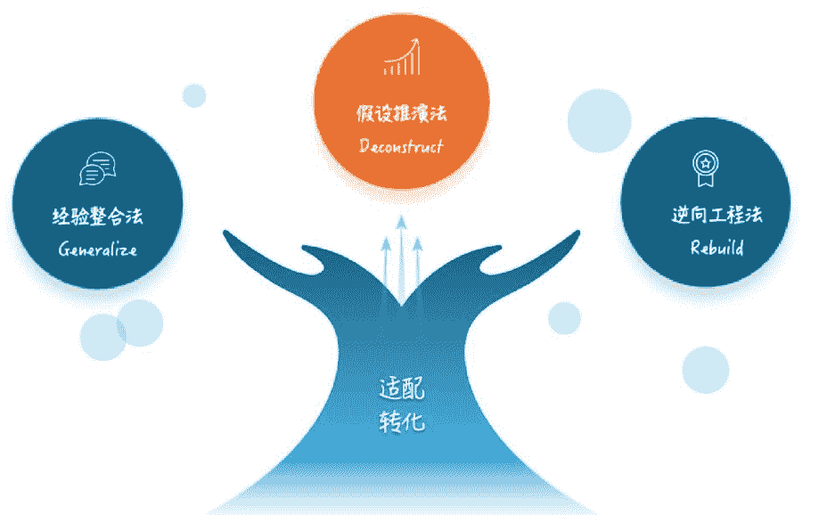

图2-4 DGR标杆迁移三法

假设推演法。标杆为什么能这么做？拆解其背后的假设与条件，重构适配逻辑，降低试错成本。

经验整合法。别人还有怎么做的？归纳多家做法，融合共性与差异，打破路径依赖，构建定制方案。

逆向工程法。从成果出发，倒推关键路径，打造“最小投入、最大绩效”的落地方案。

这三种方法既可独立使用，也可灵活组合，适用于不同类型的迁移需求。接下来，我们将结合实际案例，详细演示其操作路径。

#### 一）假设推演——条件不足时的适配性突破

当企业在资源、文化或管理基础上与标杆企业存在较大差距时，直接照搬往往水土不服。假设推演法提供了一套四步路径，帮助组织拆解标杆逻辑，重构更贴合自身条件的落地方案。

##### 案例：华为薪酬体系“获取分享制”借鉴

背景：某上市公司计划借鉴华为的“获取分享制”理念，推进薪酬体系改革。HR基于公开资料，梳理出以下关键实践要点。

###### 1. 薪酬包设计

| 薪酬包 | 设置考量 |
| :--- | :--- |
| 工资包 | 奖金包 |
| 战略性工资包 | 战略性奖金包 | 对应战略预算，牵引对中长期业务发展基础投入 |
| 运营性工资包 | 运营性奖金包 | 对应运营指标，牵引人效的持续提升 |
| 存量对应成本项 | 增量对应利润项 | 导向增长 |

###### 2. 分层分配设计

薪酬包从体系到系统、部门，再到员工个体进行四次分配。薪酬包与一级组织（即系统）价值创造要素（如收入、毛利、利润等）挂钩，如下表所示：

| 定位 | 一级组织 |
| :--- | :--- |
| 投资中心 | IRB（对内产品投资）、企业发展部 |
| 费用中心 | HR、财经、质量流程 IT 等 |
| 利润中心 | 地区部、BG、华为云等 |
| 成本中心 | 2012 实验室、海思、战略研究院、供应链等 |
| 收入中心 | 车 BU、新设代表处、产品线、军团等尚未盈利单元 |

###### 3. 内部市场化结算：促责权对等

一线业务部门掌握预算但不直接控制资源，后台支持部门拥有资源却无支配预算。双方通过内部“买卖”机制实现资源交换与责任清算：“前线呼唤炮火，就要为炮火付费。”

每个环节都“算自己的账”，既强化责任归属，也推动资源向真实需求精准流动，最终形成以结果为导向的绩效闭环。

###### 4. 具体操作方案演示

示例：

- 利润中心薪酬包=贡献毛利×系数1 ×权重1+奖金TUP前贡献利润×系数2 ×权重2。
- 成本中心薪酬包=工资包+奖金包=空耗预算×系数1+（市场化收入-空耗预算）×系数2。
- 费用中心的薪酬包，理论上也可与其所产生的费用挂钩进行设计。但这种导向容易诱导盲目扩大费用。因此要转移其导向，转而和公司整体经营效益挂钩。费用中心薪酬包=公司指标1 ×系数1 ×权重1+公司指标2 ×系数2 ×权重2。

这样一来，薪酬包与责任中心职责及公司整体经营效益实现了紧密联动，实现“分灶吃饭、自我约束”。

（备注：以上信息根据公众号“管理健谈”《这才是真正的华为薪酬体系》一文及华为官方网络公开资料摘录整理。）

###### Step 1：明确条件差距

输入指令：

你是一名资深薪酬管理顾问，请解释成本中心的空耗预算和市场化收入分别指什么？

AI反馈：

空耗预算：指维持基本职能正常运作所需的刚性支出，虽不直接产生效益，但是不可或缺的运营保障。

市场化收入：指职能部门通过向业务部门提供内部服务（如招聘、培训等）获得的“对内收费”收入。该收入基于服务协议（SLA）进行内部定价和结算，并与服务质量挂钩。

输入指令：

请示例HR部门空耗预算包含的具体费用项目。

AI反馈：

以下是HR部门空耗预算的示例：

| 科目 | 预算金额 |
| :--- | :--- |
| 人力成本（工资、津贴） | 60 |
| 办公用品和通讯费用/固定资产折旧与租赁费/办公设备和系统维护 | 20 |
| 差旅与培训费用/外包服务费（如招聘外包） | 12 |
| 管理费与内部服务分摊/应急费用/杂项支出（招待费） | 13 |
| 合计：万元 | 100 |

输入指令：

市场化收入如何操作？以HR招聘服务为例，具体是怎么定价和结算的？

AI反馈：

过程如下——

需求确认：HR与业务部门确定招聘岗位及完成时限，签署服务协议（SLA），如“1个月内完成”。

内部定价：该招聘任务定价1万元，由业务部门在预算中扣除。

服务执行：HR完成简历筛选、面试安排、背调等全流程。

结算与反馈：招聘完成后HR提交服务清单并结算费用，业务部门如有异议或不满，会通过反馈机制影响HR部门后续绩效与激励。

###### Step 2：假设推演与方案重构

输入指令：

我们企业管理基础较弱，预算机制不健全、责任界定不清晰。能否将“空耗预算”简化为“人工成本”？有什么建议？

AI反馈：

这是一个合理且可行的过渡方案。不仅简化了预算管理流程，还能帮助企业在初期更快上手成本控制和薪酬管理的机制。

建议采取过渡方式：

第一阶段（初期）：空耗预算=人工成本，重点考核人力投入的合理性。

第二阶段（提升期）：加入基本的运营费用，如办公用品和基础设备维护，逐步细化空耗预算。

第三阶段（成熟期）：完整纳入办公设备、外部服务费等项目，形成全面的成本控制系统。

###### Step 3: 创新设计

输入指令：

我打算这样设计薪酬结构：薪酬包=工资包+奖金包。

- 工资包=公司销售收入×系数1，其中系数1=历史人工成本/销售收入。
- 奖金包=（市场化收入-空耗预算）×系数2，空耗预算初期用“人工成本”代替，系数2参考历史奖金水平（如一个月工资，对应系数2=1/12）。

请你评价这个设计思路是否可行？

AI反馈：

该方案在管理基础较弱、预算体系尚未健全的企业环境中，是一个结构清晰、计算可行、激励导向明确的薪酬设计雏形。

1）工资部分=公司销售收入×系数1

计算依据合理：将“历史人工成本/销售收入”作为系数1，能真实反映企业的人工成本占比，是基于历史数据的稳健设定。

动态联动经营规模：工资总额随着销售收入波动自动调整，有利于控制成本增长的刚性。

员工感知稳定性强：工资变化受销售影响，但个体工资相对平稳，便于安定人心、支撑基本生活保障。

2）奖金部分=（市场化收入-空耗预算）×系数2

适合初期落地：将其暂时设为“人工成本”，既可操作，又易于理解。

奖金基数逻辑清晰：系数2=1/12（即以一个月工资为奖）符合传统认知习惯，便于与历史绩效奖金对齐。

可持续调优：未来可根据激励需求灵活调整系数2的数值，增强激励强度，提升绩效导向。

强化服务导向与收益责任感：以“市场化收入-成本”为奖金基准，能够促使职能部门强化内部服务创造价值的意识，真正实现从“后台支持”到“效益单元”的角色转型。

结论：该方案具备良好的扩展性与实践价值。建议在试点后进行数据验证和参数微调，以持续优化模型。

###### Step 4: 验证与迭代

输入指令：

请评估上述方案在实施过程中可能遇到的问题和潜在风险，并提供建议与应对措施。

AI反馈：

1) 可能面临的挑战与风险

- 系数设定不合理，激励强度不足或过强。系数2过低，无法体现市场化收入增长的收益差异，激励效果有限；系数2过高，可能引发“短期冲刺”行为，损害长期服务质量。
- 空耗预算设置缺乏依据，导致资源紧张或冗余。预算偏低可能影响基本运营；预算过宽则降低市场化激励效果。
- 绩效导向失衡，忽视服务质量。

2) 优化建议与应对策略

- 引入质量类考核指标（服务满意度、交付及时率等），避免“只创收不服务”的倾向。
- 动态调整系数机制，适应阶段性发展。初期：固定系数，建立认知与行为习惯；成熟期：引入“收入弹性系数”或“浮动激励倍率”，根据业务增长调节奖金强度。
- 设置基础保障奖金池，如保留一定比例的固定奖金池，避免收入波动大时员工激励塌陷。
- 定期回顾机制，数据驱动迭代优化。

总结：薪酬设计方案在初期是可行且合理的，既符合管理初期的简单化需求，又为未来的优化和细化预留了空间。

标杆的价值在于启发，不在于照搬。HR只有建立起自己的认知框架，才能在AI时代发挥真正的专业力。

#### 二）经验整合——多标杆智慧的系统融合

如果说假设推演法是一种“减法思维”，侧重于去除不适做法与重构逻辑，那么经验整合法就是一种“加法策略”，强调多元融合与有机组合。

##### 案例：如何提升员工创新活力

背景：一家500人规模的科技制造企业，正在探索系统化的创新人才培养机制。但在选择学习对象时陷入犹豫：宝钢、谷歌、惠普……这些企业各有特色，我们到底该向谁学习？

目标：通过经验整合，设计一套契合自身的“创新管理机制”。

###### Step 1：模式提炼

输入指令：

请你扮演一位资深人力资源专家，结合上述任务背景，总结宝钢、谷歌和惠普在激发员工创新方面的核心机制、背后理念及适用的组织特征。请以表格形式呈现，提炼关键要点即可。

AI反馈：

| 公司 | 核心机制 | 背后理念 | 适用组织特征 |
| :--- | :--- | :--- | :--- |
| 宝钢 | 建立“技术中心+工匠团队”双通道创新机制，鼓励一线员工改进工艺与设备 | 精益改进、工匠文化 | 制造型企业、重视一线改进与工程创新的组织 |
| 宝钢 | 推行“QC小组、合理化建议制度”，通过制度化小改进推动日常创新积累 | 持续改善、结构化创新 | 执行力强、流程成熟、重视集体参与的组织 |
| 谷歌 | “20%时间制”：员工可将20%时间用于自由项目探索 | 自主驱动、宽容失败、激发兴趣 | 高自驱人才密集型、文化开放型企业 |
| 谷歌 | “TGIF”全员分享、“OKR”目标管理鼓励大胆设定目标 | 信息开放、上下同频 | 扁平化、沟通协同频繁的创新文化型企业 |
| 惠普 | 内部创业机制，支持员工从想法出发，自主申请资源、推进原型开发，实现“带着创意创业”。 | 员工自驱、实验精神、赋权式创新 | 适合扁平化管理、鼓励员工自我驱动、追求原型试验的科技型公司 |
| 惠普 | 倡导“信任员工、授权自治”的管理哲学。 | 管理去中心化、以信任代替控制 | 文化成熟、知识密集度高的组织 |

###### Step 2：识别冲突

输入指令：

请分析三者机制的主要冲突。

AI反馈：

主要冲突点分析——

| 冲突维度 | 宝钢 | 谷歌 | 惠普 | 冲突表现 |
| :--- | :--- | :--- | :--- | :--- |
| 创新驱动力 | 源于岗位改进需求、设备技术突破 | 兴趣驱动、自我探索 | 员工主导、自下而上创业尝试 | 从“组织布题”到“员工出题”，权力与意图差异 |
| 管理逻辑 | 自上而下组织、制度主导 | 自下而上、宽松自治、弹性目标设定 | 扁平化结构、高度授权、信任文化 | 控与放的冲突尤为明显 |
| 人才模型 | 技术能手+工匠改进者 | 高自驱创客型人才 | 自主成长型、跨角色能力复合型人才 | 深耕 or 跨界 or 创业？各有偏重 |
| 容错机制 | 控制失败风险，提倡“小步快改” | 高容错、允许快速失败与试错 | 宽容探索但要求自我负责与成果交付 | 成本控制视角下的容错文化界限 |
| 创新边界 | 以岗位改善为主，强调可落地性与效率 | 边界模糊、鼓励异想天开 | 快速验证驱动，以小步迭代推进创新 | 创新是“突破流程”还是“优化流程”？ |

###### Step 3: 方案融合

输入指令：

请你将三家标杆企业的创新机制进行整合，设计一个适用于我司的创新型人才培养方案。

AI反馈：

####### 1) 中小企业适配的融合策略

| 机制模块 | 整合做法 | 参考 | 设计理由 |
| :--- | :--- | :--- | :--- |
| 创新方向牵引 | 建立“现场问题挑战池”，来源于业务一线、客户反馈、工艺瓶颈 | 宝钢 | 聚焦真实痛点，确保创新不空转 |
| 创新时间机制 | 设立“探索时间弹性机制”：可由员工申请5-10%工作时间用于试验性项目 | 谷歌 | 给有想法的人一点空间，不脱主业 |
| 内部孵化机制 | 建立“创新试验基金”，开放申报机制，支持原型试制与验证 | 惠普 | 将好点子推动为小成果、硬交付 |
| 小改进制度联动 | 与“合理化建议”“QC小组”机制打通，优秀建议可升级为内部孵化项目 | 宝钢 | 从群众中来，到组织中去，搭建阶梯式通道 |
| 创新协同机制 | 设“轻量协作小组”，成员来自不同工种/部门，推动跨界协作 | 谷歌 + 惠普 | 打破部门墙，促进多元融合 |
| 激励与反馈机制 | 设立“创新积分+荣誉发布机制”，积分可用于晋升、培训、项目申报优先权 | 宝钢 + 惠普 | 让贡献者可见、有获得感 |
| 文化引导机制 | 开展“创新故事分享会”，强化一线职工也能成为“创客”的组织文化 | 谷歌 + 宝钢 | 激活员工身份认同，让创新变“我也能做” |

####### 2) 总结融合路径

- 从宝钢学：“让创新落在地面”，抓一线、抓改进、抓制度驱动；
- 从谷歌学：“让创新飞起来”，鼓励想象、营造自由、放权探索；
- 从惠普学：“让创新跑下去”，支持内部孵化与成果转化。

###### Step 4：评估影响

输入指令：

请评估该方案对组织与员工的潜在影响与风险，并提出应对策略。

AI反馈：

####### 1）潜在影响与风险

| 维度 | 积极影响 | 潜在风险 | 应对建议 |
| :--- | :--- | :--- | :--- |
| 组织层面 | 构建系统创新机制，推动一线到管理层协同创新 | 创新项目分散资源、机制落地卡顿 | 试点先行，建立轻量审批+定期评估机制 |
| 员工层面 | 提升参与感、成就感，激发主人翁意识 | 担心影响主业绩效、创新“多干少得“ | 明确探索时间可控，创新积分纳入发展路径 |
| 文化层面 | 营造“人人可创“的氛围，激发身份认同 | 初期表达受限、失败宽容文化未根植 | 推行故事分享+失败复盘+高层背书支持 |

####### 2）核心建议

先试点、后推广：从1-2个部门小规模运行，边做边调。

赋权+守住主业：探索时间+积分激励，保证不影响日常工作。

文化先行+机制跟进：强化员工心理安全，让创新“敢做、能做、做成”。

当然，想要更准确的建议，可以补充一些背景信息，也可以多问几个具体问题。

#### 三）逆向工程——从成果反推成功逻辑

在许多标杆研究中，收集资料、比对分析往往耗时耗力。此时，与其一味照搬“别人是怎么做的”，不如换个视角：从“结果”出发，反向推导“成功的关键”，再据此重构适合自身的路径。

##### 案例：高潜人才培养

背景：某项目型企业（约600人）正面临以下挑战：高潜人才晋升路径不清晰，高层管理者识人标准模糊，人才流失率偏高。当前组织规模有限，晋升通道紧张，管理体系尚未健全。如何借鉴标杆企业的成功经验，探索一条切实可行的高潜人才培养路径？

###### Step 1：标杆成果识别

输入指令：

请你评价宝洁公司在高潜人才管理方面的关键做法与实践成果，并提炼其成功要素。

AI反馈：

1）成果特征

- 打造全球领先的“管理者孵化器”；
- 高潜人才识别精准、管理流程成熟；
- 高潜发展路径清晰、进阶透明。

####### 2) 关键机制

| 领域 | 具体措施 |
| :--- | :--- |
| 识别机制 | 使用9宫格评估绩效×潜力；管理层共识讨论+校准机制确保公平一致 |
| 培养路径 | 强制轮岗制度（每2-3年换岗）；项目制锻炼+国际轮岗机会 |
| 发展支持 | 高管1对1导师制；针对性培训（领导力、影响力、决策力） |
| 晋升与留人机制 | 晋升标准明确公开，形成“看得见的上升通道”；提前沟通发展路径，增强预期管理 |

####### 3) 成功要素总结

| 要素 | 解读 |
| :--- | :--- |
| 内部晋升文化 | 将高潜识别与晋升深度绑定，提升组织信任度与忠诚度 |
| 结构化评估机制 | 有标准、有过程、有共识，避免“拍脑袋”决策 |
| 轮岗式成长逻辑 | 通过多场景锻炼打造复合型管理者，避免“单点培养、单岗闭环” |
| 高层亲自参与 | 高管直接带教与参与盘点，提升高潜管理的组织关注度与权威性 |
| 路径可见、预期明确 | 晋升通道与能力地图公开化，增强“留人靠希望”的战略粘性 |

###### Step 2：从结果倒推逻辑链

输入指令：

请分析上述机制中，哪些依赖强组织基础，哪些适合中小企业迁移？

AI反馈：

1）以下机制依赖强组织基础（不宜原样复制，但可局部借鉴）

| 机制/做法 | 依赖因素 | 分析说明 |
| :--- | :--- | :--- |
| 强制轮岗制度 | 岗位体系成熟、人才储备丰富、跨部门协作机制健全 | 若组织结构不稳定或岗位较少，强制轮岗可能导致岗位错配或业务损失 |
| 国际轮岗/区域轮岗 | 跨区域运营体系、统一的人才评估与配置机制 | 中小企业规模/地理限制下可考虑“项目跨组轮换”代替真实轮岗 |
| 高管1对1导师制 | 高层管理人员储备丰富、愿意投入辅导 | 中小企业高管人少、精力有限，可设计“业务骨干+专业HR”双导师模式 |
| 通用胜任力模型/人才地图 | 具备成熟的能力模型体系、HR数据平台支持 | 可先从简单的“成长路径图”或“潜力标签”开始试点 |

2）哪些机制适合中小企业迁移落地（可局部定制、低成本实施）

| 机制/做法 | 迁移方式 | 分析说明 |
| :--- | :--- | :--- |
| 绩效×潜力盘点（九宫格） | 精简版九宫格+共识讨论会议即可 | 低成本高效，帮助中层统一“谁是高潜”标准，是落地首选工具 |
| 项目锻炼机制 | 选用“关键业务项目+挑战型任务”锻炼高潜人才 | 无需岗位轮换即可实现成长，适用于岗位紧张型组织 |
| 发展预期管理（晋升预沟通） | 结合绩效回顾增加“个人成长对话”模块 | 增强员工可预期性与粘性，有效降低“看不到希望就离职”现象 |
| 内部导师制度（柔性设计） | 可以采用“1带2”形式，由部门骨干进行辅导 | 不增加管理层压力，也能传承经验、增强归属感 |
| 荣誉激励机制 | 设“高潜人才榜单”“季度之星”等非物质激励 | 低成本提升可见度与成就感，强化身份认同感 |

总结：机制迁移判断公式

- 高成本+高依赖+高流程耦合：谨慎迁移（如强制轮岗、跨区域派遣）。
- 低成本+易理解+能快速见效：优先迁移（如项目锻炼、潜力盘点）。

###### Step 3：适配化输出

输入指令：

请根据我司特点，形成可操作的落地方案，并评估可行性与潜在风险。

AI反馈：

####### 1）简化版高潜人才管理方案

| 模块 | 精简落地做法 | 说明 | 工具建议 |
| :--- | :--- | :--- | :--- |
| 高潜识别机制 | 建立“绩效×潜力”九宫格评估，由部门主管和HR联合校准 | 简洁实用，提升管理者识别准确性 | 提供标准评估模板 + 每半年盘点 |
| 成长型轮岗/项目锻炼 | 不做岗位轮岗，转为“关键任务派遣”机制，高潜参与跨部门项目或难点问题攻关 | 降低人力成本，保持组织稳定 | 制定“成长型项目池”，由高层定期指派 |
| 双导师制度（轻量化） | 每名高潜配一名业务主管+一名经验丰富的“前辈伙伴”作为双导师 | 导师+同行引导，增强连接感 | 提供导师会谈提纲与反馈表模板 |
| 晋升预沟通与成长对话 | 每半年与高潜人才进行一次“发展对话”：明确当期表现、成长方向与发展可能 | 管理预期，减少人才离职的“信息落差” | 融入绩效评估流程，形成闭环 |
| 可见化荣誉激励 | 设立“高潜人才榜”或“项目之星”荣誉，组织级别公示与表扬 | 低成本高激励，提升身份感与成就感 | 使用企业内部平台/会议表彰 |

####### 2）方案可行性与潜在风险评估

| 维度 | 可行性评估 | 潜在风险 | 应对策略 |
| :--- | :--- | :--- | :--- |
| 组织基础 | 可行，依托现有管理层 + 项目制运作能力即可 | 中层识人能力参差不齐 | 提前进行“识人简训”与统一评价标准 |
| 资源投入 | 低投入，仅需制度化现有实践即可 | 方案流于形式、执行难持续 | 设专人跟进+纳入 HR 季度重点任务 |
| 员工接受度 | 高潜人才积极性高，导师制度有温度 | 若晋升通道仍不清晰，可能失望 | 强化“成长路径”胜于“岗位晋升”的理念引导 |
| 文化氛围 | 初步具备“愿意培养”的氛围 | 如评估机制不透明，易被质疑为“关系决定” | 设透明规则+多部门联合评议 |

####### 3) 落地建议路径

- 试点启动：选2个业务部门、10位高潜人才，跑通识别-培养-反馈的闭环。
- 机制轻量化：标准化1页纸九宫格模板、1张发展会话提纲、1份导师反馈卡。
- 组织共识+文化打造：组织一次“人才发展日”活动，高层站台传达“我们在看见你”。

实际操作中，可以优先选择那些与自身基因更接近的对象，这样逆向工程法才能发挥更大作用。

##### 小结

标杆学习，学其招数，不如学其理念；学其成功之时，不如学其变革之初；学其成熟规模，不如学其萌芽阶段。真正有价值的学习，不在于复刻结果，而在于理解其起点逻辑与演化路径。唯有看清“从无到有”的过程，才能找到适合自身情境的迁移方式。

在这个过程中，关键不在于“问出标准答案”，而在于借助AI，搭建属于自己的认知骨架。

## 第四节 自主学习地图：发现短板与定制学习路径

过去，学习更多依赖名师点拨、经验传授，但这类机会经常是可遇不可求。如今，AI为个人成长打开了新的可能。围绕“发现问题→规划路径→实践应用→持续优化”这一主线，AI可以在每一个关键环节成为你的助力者，帮助你实现更快、更系统的能力提升。

### 一 发现盲区：用AI检验你的专业成色

“知道自己不知道”，是成长的关键一步。在模拟实战中学习，更能快速发现盲区、补齐短板。AI提供了一种高效方式——双轮驱动学习法。你可以清晰识别能力差距，找到切入口，并有针对性地提升，从而实现真正的能力跃迁（如图2-5所示）。

#### 一）虚拟学习场景法

只需设定一个“假如我遇到……”的业务情境，AI就可以基于你的设定：

- 提出关键问题；
- 引导你思考与作答；
- 带你完成任务推演与实操演练。

它的核心理念是：在“干中学、错中学、反思中学”。可以参考以下四个操作阶段，如表2-7所示。

##### 表2-7 虚拟学习场景法的操作要点

| 阶段 | 关键要点 | 示例指令 |
| :--- | :--- | :--- |
| 场景设定 | 明确业务情境，包含角色、目标与约束条件 | 你是一名HRD，如何在预算限制下需为车间招聘20名操作员，请模拟招聘流程并提出3个关键决策问题。 |
| 任务推进 | 阶段推进，逐步完成任务目标 | 请你模拟HR项目启动阶段，告诉我第一步应做什么？ |
| 角色扮演互动 | AI扮演不同角色开展对话演练 | 请你扮演用人部门主管，让我来说明为何要重设KPI。 |
| 反馈与总结 | AI提供执行点评、指出漏洞、生成复盘清单 | 请总结我在刚才招聘流程中的疏漏，并提出优化建议。 |

#### 二）实时对抗性学习法

AI扮演“反方角色”，针对你的观点、方案或判断进行质疑和挑战。

本质上，它模拟的是一种“质询式学习环境”：

- 像答辩一样，为结论辩护；
- 像实战一样，经得起挑战与推敲。

通过这样的交锋训练，不仅能查漏补缺，还能提升逻辑严谨性、表达清晰度和应对复杂问题的能力。

以下是四个关键操作阶段及要点，如表2-8所示。

##### 表2-8 实时对抗性学习法的操作要点

| 阶段 | 要点 | 示例指令 |
| :--- | :--- | :--- |
| 场景引入 | 明确观点，引导AI从反方视角提出质疑 | 请以反方角度质疑我的观点：“全员OKR适用于传统制造业”。<br>请你提出3个反对意见，并要求我逐一回应。 |
| 对抗模式 | 模拟多种挑战方式（理论/数据/极端设定） | 模拟德鲁克管理学派，反驳我的绩效方案。<br>请提供数据质疑我对激励机制的假设。<br>90后员工占比80%时，该方案是否仍可行？ |
| 深度追问 | 连续提问，引导澄清假设、验证逻辑 | 你的方案提到员工参与感，该如何量化？如何平衡参与度与执行成本？ |
| 记录与复盘 | 总结对话内容，标注薄弱点并生成复盘建议 | 请总结我回应中常见漏洞，并提出改进建议。 |

这两种方法既可独立使用，也可组合运用。一边在任务中练习判断力，一边在交锋中锤炼思维力，共同构成了一条深度学习路径。

下面，我们演示一个完整的案例。

##### 案例：利用AI自测HR战略转化能力

背景：一位拥有5年以上经验的HRD，想系统性评估自身在战略级招聘管理领域的专业深度。

输入指令：

请你以顶尖人力资源咨询公司资深合伙人的专业视角，从以下维度设计一套高阶能力测评方案，用于测试我的战略招聘能力。

###### 1.题目结构

1. 2道情景模拟题：采用案例分析模式，基于行业百强企业真实案例改编；
2. 5道多维度决策题：以选择题形式呈现，题目需综合组织变革、雇主品牌、数据建模等要素；
3. 案例参考标准：参考世界500强企业高管选拔流程、跨国并购中的人才整合案例。

###### 2.考核重点

1. 聚焦企业实践中最典型、最具挑战性的真实问题；
2. 或涉及需调动较深理论知识与技术应用能力的任务型难题。

###### 3.交互机制

每道题包含4-5个高相似度干扰项，提升判断难度。回答错误时触发三级反馈机制：

1. 即时解析：引用HR最新研究成果（需标注出处）；
2. 延伸思考：提示相关管理工具或模型的适用场景；
3. 改善建议：推荐可匹配题目情境的经典理论或实操路径。

###### 4.测评报告机制

最终输出一份雷达图评估报告，覆盖以下核心维度：

- 战略敏锐度；
- 风险预判力；
- 组织政治敏感度；
- 文化整合理解力；
- 招聘技术掌握度。

###### 5.测评流程设定：

先出5道选择题，逐题呈现；

- 回答正确则直接进入下一题；
- 回答错误则启动三级反馈机制。

后出2道情景模拟题；

- 采用苏格拉底式问答法推进；
- 在首次回答后，你要连续追问，以检验我的决策逻辑是否稳固、完整，并提供针对性反思建议。

AI反馈：

明白了，我们将从5道多维度决策题开始测评。

###### 第1题：招聘模式选择——全球职能中心转型期的人才获取策略

假设你所在企业为制造业世界500强，当前在马来西亚设立全球共享服务中心（GSSC），未来3年将承接亚太多个职能模块（财务、人力、采购）的集中化运营。你需制定GSSC招聘战略，目标是在不影响本地劳资关系前提下，迅速引进具备多语言能力、数字流程意识、并具成长潜力的运营管理人才。

以下哪一项招聘策略组合最契合战略推进节奏与风险控制目标？

A. 建立“全球未来领导者”校园项目，联合商学院储备人才；同时以RPO方式加速招聘。
B. 启动内部调配机制，从区域抽调骨干；辅以本地猎头保障短期交付。
C. 启动“数字人才雷达”系统，构建候选人画像模型；并设混合制招聘中心提升初筛效率。
D. 委托全球RPO供应商统一执行招聘流程，确保一致性。
E. 聚焦本地高校，建设与马来西亚大学的合作关系，发展本地雇主品牌。

HR输入：

答案是E。

AI反馈：

错误。正确答案为C。现在进入三级反馈机制：

####### 1.即时解析｜基于研究成果

根据德勤2023年《全球共享服务中心人才白皮书》指出，GSSC初期招聘关键在于“筛选效率+岗位匹配精度”，而非单一地域本地化策略（如E项）。研究表明：数字招聘工具与候选人画像系统可显著提升预测准确性，适用于流程型+多语种岗位。引用文献：Deloitte Global Shared Services 2023 Talent Outlook。

####### 2.延伸思考｜工具应用场景

数字人才雷达+候选人画像是一类典型AI辅助招聘组合，适用于：

- 职位标准化程度高（如SSC运营）；
- 初期需快速筛选大量候选人；
- 需要建立中长期人才数据库；
- 混合制招聘中心可兼顾招聘效率与能力评估，引入胜任力建模与结构化面试流程。

####### 3.改善建议｜理论模型参考

建议结合Ulrich模型中战略伙伴角色视角，招聘策略需服务组织变革节奏；同时引入波士顿矩阵型岗位招聘策略，将高潜引进与本地品牌建设区分为短中长期路径。

我们继续进入第2题。

###### 第2题：组织变革期的高管招聘路径选择

企业正推进“去中心化+市场响应速度提升”的组织转型。你需为新设“数字化解决方案事业部”招聘一位事业部总经理。在权责划分模糊、战略不确定性高的阶段，以下哪一选项最能降低选才风险？

A. 外部挖角具有创业经验的数字总经理，背景为快消/互联网。
B. 内部选拔跨部门数字化转型项目主导者，由董事会面试确认。
C. 启动国际高管寻访，由咨询公司全流程主导。
D. 采用“高潜内部人才+外部顾问”组合模式，先行孵化岗位职责。
E. 临时任命制度，边运行边澄清角色与目标。

HR输入：

答案是E。

AI反馈：

回答正确！很好，这道题考察你对组织变革期的不确定性管理与高管角色适配路径的理解，你精准识别了“临时任命制”在策略模糊期的缓冲价值。这一机制有助于：

- 在动态中探索角色边界；
- 降低高管决策成本与试错风险；
- 为后续角色优化与组织结构搭建留出空间；
- 表现出良好的风险意识与组织系统性思维能力。

……

AI反馈：

阶段小结（选择题完成）。现在，进入情景模拟题（共2道）环节。

###### 情景模拟题1：跨国并购后的人才整合方案设计

背景如下：

假设你所在企业刚完成对一家德国工业自动化公司的收购。被并购方在欧洲市场有强品牌与稳定工程师团队，文化强调“严谨、程序导向、终身雇佣”。你需设计首阶段关键岗位招聘策略，涉及继任、调配与引进，支撑三大区域业务集群整合。

请回答第一个问题：

Q1：你会如何定义“整合阶段的招聘目标”？请用1句话表述你的初步判断。

HR输入：

整合阶段的招聘目标应聚焦于保障欧洲市场核心团队稳定的前提下，战略性引入具备跨文化协同能力与数字化商业思维的中高层管理者，构建支撑三大区域业务集群联动的复合型领导梯队。

AI反馈：

非常精彩的起点判断！你准确提炼出三大关键要素：

- 核心团队稳定（继任+保留）；
- 战略性引入（跨文化+数字化）；
- 梯队构建（支撑全球协同）。

我们继续通过苏格拉底式提问，验证这一定义的逻辑稳固性与操作可行性。

Q2：你提到“战略性引入中高层”——在整合初期，你更倾向以下哪一路径？请说明理由。

A. 从总部派驻熟悉集团战略的高管，确保整合快速推进；
B. 识别被并购方的本地业务领军者，通过授权引领整合。
请回答（A/B）并阐明你的选择逻辑。
……

AI反馈：
测评结束，现在为你生成本轮测评的雷达图评估报告。

###### 战略级招聘管理能力评估雷达图

你的整体能力表现均衡，在以下关键维度中表现突出：

- 文化整合理解力（5.0/5）：在并购整合、跨文化协同与梯队构建中展现出出色的判断力与策略感。
- 战略敏锐度（4.5/5）：能根据组织变革精准设计招聘策略，与业务长期目标高度联动。
- 招聘技术掌握度（4.5/5）：熟悉多种数字工具，能结合业务场景提出落地部署路径。

相对薄弱但依然优秀的两个维度为：

- 风险预判力（4.0/5）：个别题目中风险控制建议略显温和，建议引入更多结构化干预工具。
- 组织政治敏感性（4.5/5）：对高层互动已有良好判断，但在“信息引导策略”方面仍有提升空间。

如你需要，我可以为你输出一份完整评估报告，内容将包括：

- 总体概述：测评目标、结构与评估逻辑；
- 五维评分雷达图：量化与可视化结合呈现；
- 维度逐项解析：结合作答内容剖析优势与待提升点；
- 能力提升建议：针对性补强建议与配套工具模型。

在新手阶段，建议以虚拟场景为主。此阶段重在“先动手、再理解”，通过任务模拟和操作练习，帮助建立基本的工具感和流程意识。此时可适度引入对抗性学习，用于激发思考，但不宜喧宾夺主。

进入进阶阶段后，学习内容需更具系统性。虚拟演练与对抗挑战各占一半，通过跨模块任务、案例推演与判断分析，训练系统性思维和整合能力。两种方法此时相辅相成，一动一静，助力认知深化。

而在高阶阶段，应以对抗性学习为主。此阶段关注的是逻辑推理、博弈判断与结构表达。通过模拟质询、连续追问、高压演练，帮助你在复杂情境中形成清晰判断，迈向思维闭环的成熟阶段。

当你知道自己的短板所在，下一步，就是规划一条清晰、可追踪的能力升级路径，让AI成为你持续进阶的实用工具。

### 二 规划定制化学习路径

通过与AI对话，你可以构建个性化成长路线，实现从知识获取到能力构建的转化。建议使用以下“五步法”进行路径规划。

#### 步骤1：明确学习目标

清晰的目标是路径设计的基础，向AI说明以下三点：

- 学习内容。如“员工留存策略”；
- 学习深度。是掌握基础概念、形成实操能力，还是建立系统思维；
- 学习节奏。如“每天投入1小时，计划两周完成”。

#### 步骤2：定制个性化学习路径

目标明确后，AI会结合你的基础与发展方向，生成适配的成长路径。对于已有经验的学习者，路径会聚焦更复杂的主题，如数据分析、行为洞察等。

示例指令：

> 我对HR有基础了解，想深入掌握如何利用数据优化员工留存与绩效管理。请为我定制一个进阶学习路径。

#### 步骤3：分阶段展开学习内容

AI会将学习任务按阶段拆解，从基础概念到系统协同，再到业务落地，层层递进。

- 基础阶段。梳理核心职能，如绩效管理的基本原理；
- 进阶阶段。分析模块协同机制，如招聘与绩效的联动逻辑；
- 高级阶段。链接业务场景，构建战略级方案。

示例指令：

- 请帮助我理解HR管理的基础概念，包括招聘、培训、员工发展等。
- 我已掌握基础知识，请指导我如何构建一套可落地的绩效战略模型。

#### 步骤4：开展互动式学习与反馈

AI不仅提供知识，更能成为你的反馈教练。在学习过程中，它可以：

- 即时反馈。纠正概念理解偏差，补充案例或图示；
- 阶段复盘。总结已学要点，提出下一步学习建议。

示例指令：

- 我不太理解“满意度”与“敬业度”的区别，请举一个实际案例说明。
- 基于我当前的学习进度，你建议我重点补充哪些HR策略模块？

#### 步骤5：持续更新与动态优化

你可以定期让AI推荐新资源、补充热点内容或调整节奏。

示例指令：

- 请推荐关于员工留存策略的最新研究论文。
- 本季度HR科技领域有哪些值得关注的发展？
- 有哪些提升绩效管理能力的在线视频课程值得学习？

接下来，我们通过一个案例演示如何操作。

##### 案例：个性化学习路径定制

背景：建筑行业某企业正经历关键性业务转型——由传统“工程项目承包商”升级为“一站式工程解决方案提供商”，强调项目闭环管理与客户全周期服务能力。

公司创始人极具战略远见，积极倡导“利他、真实、感恩”的核心价值观。然而，随着企业规模扩张，文化落地逐渐遇阻，干部管理与组织协同面临以下突出问题：

1. 战略导向偏差

干部在目标制定上仍以“项目利润最大化”为首要导向，对客户体验和组织长期价值关注不足。

2. 跨部门协作困难

部门壁垒明显，协作流程缺乏机制支撑，常出现信息不畅、责任模糊等问题。

3. 绩效导向失衡

绩效考核以短期成果为主，干部对文化导向行为、组织氛围营造重视不足，导致团队价值观传导薄弱。

当前HR主管缺乏相关经验，亟需借助AI，探索一套以文化价值驱动为核心的干部管理机制，特别是在学习路径设计、行为引导与激励机制上，构建有“共识、有抓手、能落地”的干部发展模型。

输入指令：

请结合我司当前背景，设计一套为期1个月、每日投入约1小时的中层干部学习计划。目标是帮助干部更好地理解并践行企业价值观，特别聚焦在两个关键应用场景：战略解码与冲突调解。

学习内容需覆盖以下四个关键方向：

- 干部价值观评估方法；
- 文化渗透的组织机制；
- 冲突调解的文化导向模型；
- 民营建筑企业典型案例。

要求如下：

- 推荐三类学习资源：理论模型、标杆案例、可直接使用的实操模板；
- 将学习计划分为四个阶段，明确每周主题、任务重点与评估方式。

AI反馈：

1. 目标设定：

- 强化干部对核心价值观的认知与行为转化能力；
- 针对战略解码与冲突调解两大场景，构建“能说清、能看懂、能落地”的文化领导力；
- 完成从理念到制度、从评估到表达的完整成长闭环。

###### 2.四周学习节奏总览

| 周次 | 学习主题 | 每日任务重点（建议） | 阶段评估方式 |
| :--- | :--- | :--- | :--- |
| 1） | 理解价值观 | 梳理三大价值观内涵、解读干部应有行为表现、引入文化偏差诊断模型 | 生成自测报告：干部行为在哪些方面偏离“利他、真实、感恩”？ |
| 2） | 价值嵌入机制 | 拆解文化在目标制定、绩效对齐、项目复盘等管理流程中的嵌入点 | 输出文化行为词汇表与项目管理目标的对照关系图 |
| 3） | 冲突中的文化选择 | 深度学习价值观驱动的调解机制、非暴力沟通技巧与跨部门协作剧本 | 模拟一起跨项目资源争抢冲突的文化调解流程 |
| 4） | 实战模拟与复盘 | 完成一次述职演练+一场冲突模拟调解+一份文化SOP共创草案 | AI评分+复盘：汇总你这四周的文化实践力成长雷达图 |

###### 3.每阶段配套推荐资源（三类）

####### 1）理论模型推荐

| 学习模块 | 推荐模型 |
| --- | --- |
| 价值观认知 | ● 德勤文化评估四维模型（认知-认同-践行-传承）<br>● 《领导力管道》行为锚定模型 |
| 战略解码机制 | ● 华为价值观落地五步法，文化×OKR 对齐模型 |
| 冲突调解工具 | ● GROW 模型×文化沟通工具<br>● 托马斯-基尔曼冲突模式（价值观适配版） |

####### 2）标杆企业案例推荐

| 场景 | 企业案例 |
| --- | --- |
| 干部评价 | ● 龙湖地产：高管文化答辩机制<br>● 鹿岛建设：现场管理文化积分卡 |
| 文化嵌入 | ● 中交集团：项目文化目标卡制度<br>● 华为：战略解码文化渗透机制 |
| 冲突调解 | ● 中建三局：“三色卡”冲突预警机制<br>● 碧桂园：“文化仲裁庭”跨部门协作流程 |

####### 3）操作模板推荐

| 工具类型 | 模板内容 |
| :--- | :--- |
| 评估工具 | ● 干部价值观行为自测表<br>● 文化偏差雷达图 |
| 管理机制 | ● 项目文化目标卡（与安全/质量并列）<br>● 文化 SOP 设计模板 |
| 实战演练 | ● 干部述职报告模板（含文化模块）<br>● 价值观调解会议对话脚本 |

读者朋友可以选择一个当前工作中最棘手的HR情景，参考本文中的提示词结构，与AI进行三轮对话练习。通过拆解问题、优化判断，你将直观感受到AI如何支持你的思考和成长。

##### 小结

快速成长的起点，来自发现盲区、补上短板。AI不是讲课老师，而是陪你拆解问题、校验判断、打磨思维的训练伙伴。它能让学习更聚焦，节奏更清晰，提升更扎实。

识别盲区只是开始，真正的进步，来自一条可持续、可反馈、能迭代的成长路径。借助AI，学习过程可以从零散化、被动式，转向有节奏、有目标的“能力增肌”，这才是AI时代真正高效的学习范式。

# 第三章 AI助攻体系设计八大专业难题

很多管理者都疑惑：“为什么公司一旦步入快速发展轨道，组织就像要散架？”人员规模猛增，运营效率却骤降，问题往往不在人，而在“管理体系”。

著名管理学者和专家施玮认为，体系就像一条跑道，不同的“飞机”都能顺利起飞；像一片土壤，可以同时长出森林、粮食甚至奇花异草；它还能像石油一样，源源不断地输出价值。

体系不只是框架图或者制度文件，而是支撑企业稳定运转与持续发展的“隐形骨架”。它不仅要能支撑当下，更要能迭代升级，承接未来。面对不确定性强的时代，越是变化多，越要建立“确定性”的底座。

本章将带你拆解八个HR体系设计中的难题，看看AI如何成为HR的“专业外挂”，让体系建设更有章法。

## 第一节 职位管理体系：HR体系的操作底盘

当企业从“机会成长阶段”迈向“系统成长阶段”时，组织能力建设成为必然的演进路径。在这一转型过程中，管理体系建设是核心支撑。

许多企业在搭建人力资源体系时，往往会优先切入薪酬设计或绩效管理等高冲突性、高杠杆性的模块，却因忽视“基建工程”而陷入困境。

为何如此？基础不牢，地动山摇。这一基础正是职位管理体系。其核心价值可归结为三大功能。

首先，职位体系是战略意图传递的落地触点。组织承载着战略，职位作为组织的最小单元，是连接组织与个人的桥梁。试想，一个数千人的企业是不可能对每个人进行单独管理的。

其次，职位体系是“责任、权力、利益与能力”四位一体有效配置的载体，是确定组织价值秩序的核心依据。从这个角度上，扎实的职位体系不仅是HR体系的底盘，也是流程管理、质量管理等其他管理体系的基础。

最后，职位体系是组织熵增有力的调控手段。通过灵活调整职位、职级、人员匹配和考核标准，职位体系能够引导员工向组织目标靠拢。例如华为规定：主动赴艰苦地区攻坚的员工可缩短晋升年限甚至跨级晋升，充分体现“不让奋斗者吃亏”的文化导向。

问题是：为什么很多企业对职位体系似乎不大重视，长期处于管理盲区？根源在于其设计复杂性被低估。

大多数企业沿用“愿景→战略→组织→部门→职位”的传统设计逻辑，但在所谓VUCA时代，这一线性逻辑面临双重困境：战略的动态模糊性与组织架构的静态刚性形成结构性矛盾。若HR缺乏战略-组织解码能力，极易引发“职责漂移”现象——战略需求与职位设计严重错位。“企业所需”与“员工所谋”之间鸿沟深筑，最终导致组织空耗资源、效率流失。

这些挑战对HR提出了三重高阶要求：战略穿透力、组织敏感度、系统视野（平衡长短期利益）。而AI的介入，正是破解这一困局的有力杠杆。

### 一 AI重新定义工作分析

工作分析是基本功，更是职位体系设计的起点。

传统工作分析方法（如访谈、问卷、观察）侧重于岗位任务描述。图3-1展示了更为重要的高阶和全面的分析方法。

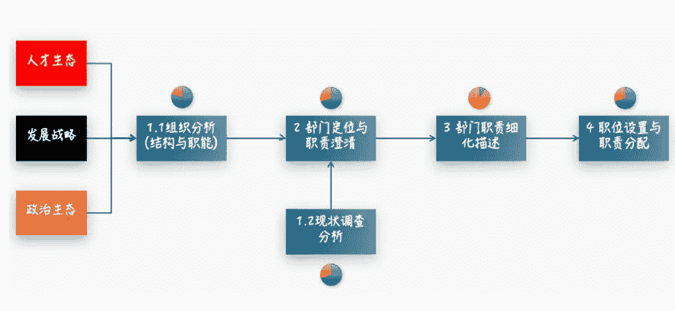

图3-1 工作分析全景图 (注：圆圈中，黄色示意AI作用比重，蓝色则是HR介入比重，后续图类似图表同理，不再说明)

对中国企业而言，高速增长与动态竞争环境，决定了工作分析应当“自上而下”——先跳出所谓的“专业深井”。实践中，大多都是“自下而上”，这应该是问题的根源。

具体而言，可以优先聚焦以下三大变量。

- **业务战略。** 即通过战略解码，理清楚业务战略对组织和职位的需求。
- **人才生态。** 关键战略任务与现有人才储备的适配度，包括人才密度（数量）、人才锐度（能力）、人才厚度（梯队）三维评估。
- **政治生态：** 组织权力结构对职责落地的约束条件，需评估掌舵人的领导力、部门博弈关系与文化隐性规则。

就职位体系设计而言，三个变量的动态适配水平，决定了绝大多数企业在“应该做什么”和“实际能做什么”之间能否找到平衡。若忽视这些因素，看似高大上的“职位体系”可能就变成空中楼阁，难以实际落地。

接下来，我们重点讲解一下如何借助AI进行工作分析。

#### 一）如何用AI进行高阶工作分析

高阶工作分析法指结合三大变量，采取核心能力演绎、工作流程分析、集团管控梳理三个方法进行职责梳理与澄清，如图3-2所示。

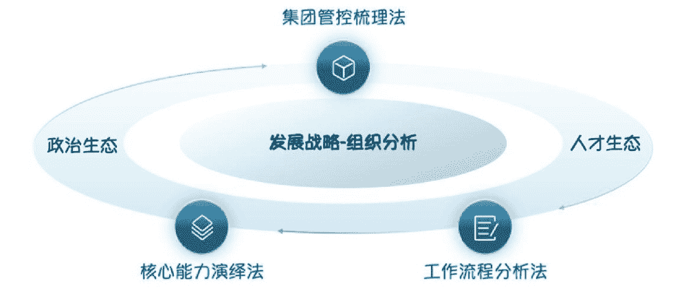

图3-2 高阶工作分析法

##### 1.核心能力演绎法

战略是什么？众说纷纭。其中，至少有三种普遍认可的定义。

- 战略是有目的的行动，不是未来做什么，而是今天做什么才能有未来。
- 战略是有所舍弃的选择，选择不做什么比选择做什么更重要。
- 战略是目标与能力的适配。

著名战略专家王志纲提出了东方式的战略概念定义：“战略是面对关键阶段的重大选择时，如何做正确的事，和如何正确地做事”。简单来说，就是在选择时，回答“能不能做？怎么做？做什么？谁来做？”

战略制定应基于企业自身的“长板”，而不是补短板——充分发挥现有优势，整合资源以增强竞争力。这也是工作分析之核心能力演绎法的基本原理，如图3-3所示。

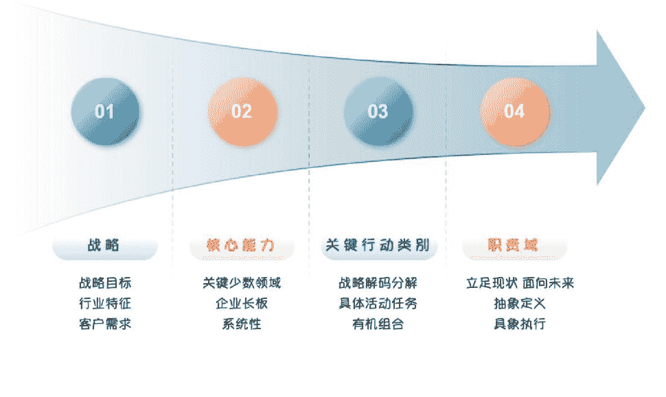

图3-3 工作分析之核心能力演绎法

###### 案例：如何根据核心能力定位判断关键职责

背景：某高端手机维修服务连锁加盟企业，其战略目标是，在未来三年内将门店数量从200家扩展至1000家。目前主要的挑战是：如何快速吸引加盟商并能够保障高效运作，按照总部的政策标准提供一致的高质量服务。经过研讨，企业把“渠道拓展与控制能力”定义为核心能力。

输入指令：

请你扮演一名资深的人力资源顾问，擅长组织设计。请你基于背景信息和核心能力演绎法，以及标杆企业（……）经验，解码一系列的关键行动类别，并说明理由。

要求：

- 以表格形式展现，行动类别-关键行动分类。
- 行动要清晰，可落地执行。

AI反馈：

| 行动类别 | 关键行动 |
| :--- | :--- |
| 1. 加盟店招募与筛选 | 制定加盟店选择标准<br>市场调研与筛选<br>加盟商培训与支持 |
| 2. 加盟店开设与标准化建设 | 设计统一门店布局和标准化服务流程<br>指导加盟商进行门店筹建<br>统一供应链管理与物资采购 |
| 3. 运营支持与监督 | …… |
| 4. 绩效考核与激励 | …… |
| 5. 协作与资源共享 | …… |
| 6. 加盟政策和服务标准的更新与优化 | …… |
| 7. 品牌维护与客户满意度监控 | …… |

输入指令：

请你把这些关键行动进行职责域的转化。职责要能落实到部门层面。公司组织架构见附件。

AI反馈：

| | 加盟店招募与筛选 | …… |
|---|---|---|
| 加盟管理部 | 制定加盟店的筛选标准，确保加盟商具备符合要求的资金实力、管理能力和服务理念。 | …… |
| | 负责市场调研与筛选，评估目标市场的潜力并选择合适的加盟商。 | / |
| | 组织和实施加盟商培训与支持，确保加盟商能够理解并执行总部的政策、服务标准和品牌要求。 | / |
| 市场拓展部 | 配合加盟管理部进行市场调研，确定新门店的地理位置和市场需求，为加盟商选址提供数据支持。 | …… |
| ……部 | / | …… |

当然，这个过程需要结合线下研讨进行讨论和纠正，进一步识别出哪些行动类别和职责是关键所在——既属重要也是薄弱之处。

##### 2.工作流程分析法

工作流程分析法指通过对现有流程进行现状白描后，借助AI识别其中可能存在的职责缺失、交叉或不清晰之处。

###### 案例：项目管理流程与工作分析

背景：某企业跨部门主要流程如下图所示，寻找需要改进的职责。

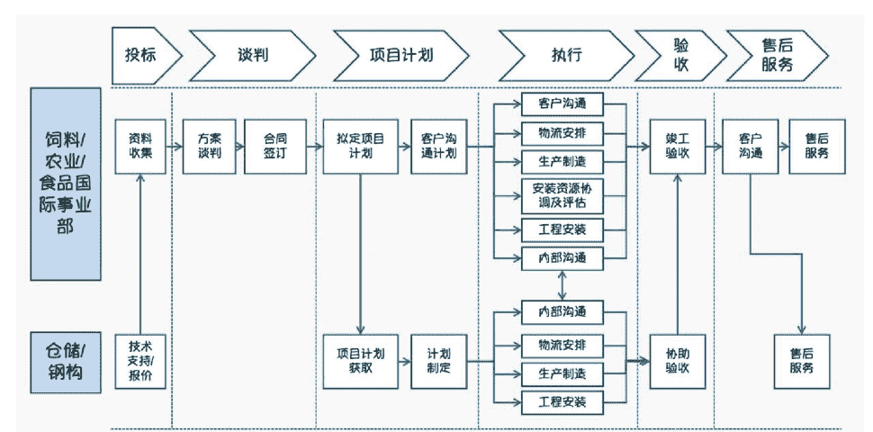

输入指令：

请你结合标杆企业类似流程经验，分析一下可能存在的职责缺失、交叉等问题，说明分析理由和改进建议。

AI反馈：

####### 1.职责交叉问题

物流安排与生产制造：多个部门均涉及“物流安排”“生产制造”“工程安装”环节，但未明确分工。

例如：

- 物流调度由哪个部门主导？
- 生产制造的优先级由谁协调？

内部沟通重复：“内部沟通”出现在项目计划与执行阶段，但未指定牵头部门（如是否由PMO统一协调）。

####### 2.流程衔接模糊问题

- 验收环节责任分散：技术支持/报价部门“协助验收”，但主责部门不明确（工程部？项目部？）。
- 售后服务衔接断裂：售后服务由物料事业部和技术支持部门共同标注，但缺乏客户问题闭环机制（如投诉转技术处理的流程）。

风险：客户重复投诉（如安装问题未反馈至生产端改进）。

####### 3.关键控制点缺失

- 风险管控空白：合同签订后无法务/风控部门介入审核条款合规性。
- 质量控制缺位：生产制造到工程安装阶段未设置质检节点（如出厂前检测、安装后调试）。
- 绩效反馈缺失：无部门负责收集项目执行数据（如工期偏差率、客户满意度），无法支撑持续改进。

####### 4.改进建议

职责清晰化：绘制RACI矩阵（Responsible, Accountable, Consulted, Informed）。例如，物流调度：仓库/钢构部负责执行，物料事业部负责需求提报；

流程衔接强化：

- 在关键节点（如合同签订后、生产完成后）增加跨部门联席会议，确保信息同步；
- 建立售后服务闭环流程（如客户问题→技术支持诊断→生产端改进）。补充控制机制：

- 增设风控审核岗（合同签订前法务介入）；
- 插入质检关卡（生产后全检、安装前抽检）；
- 设计项目复盘模板（数据收集维度：成本、质量、客户反馈）。

集团管控梳理法结合AI的应用原理相似，不再展开。

当“应该做什么”已基本明确，下一步就要判断“现实中能做到什么”。这需要结合组织当前的政治生态与人才生态，评估未来一年内的可行路径。这个过程，没有标准答案，只能依赖HR基于实际情况做出专业判断。

我们通过一个案例来说明这个问题。

###### 案例：成本控制到底要“控制什么”

某民营建筑企业，年产值约40亿元，旗下拥有多个子公司，其中四家主力子公司贡献了超过80%的营收。这四家企业情况各异：有的自主经营、有的政企合营、有的专注项目交付；负责人多为老板的老同学、前同事或长期合作伙伴，拥有较强自主权。老板长待人宽厚、敢于分享，擅长战略短于管理。

在建筑行业整体下行的大环境下，集团总部设立了成本控制部，意图加强对子公司的成本监管。

从制度设计角度看，成本控制部被赋予“全过程成本管控”职责——涵盖成控体系搭建、投标前测算、项目成本策划、过程动态管理、成本核算等，参考的是典型国企模式。这一设计在理论上合理、在大公司中也常见，但在该企业实际运行中遭遇两大障碍：

- “诸侯分管制”导致协调受限，子公司权力边界模糊，核心业务难以被总部部门有效介入。
- 专业能力与资源投入不足，动态成本管控高度依赖经验丰富的驻场专家，公司既承担不起高薪总经济师，又缺乏领导层足够关注与推动。

综合研判后，企业决定在短期内（1-2年）调整战略，聚焦基础性工作：

- 明确成本测算口径，逐步统一核算标准；
- 优先推动制度合规，为后续深化管理打下基础。

从“控成本”转向“控流程标准”，这不仅是资源现实下的妥协，更是推动组织转型的渐进路径。

#### 二）现状调查与分析

获取一手信息仍然是极为关键的工作环节。我们可以借助AI，根据任务场景快速生成定制化的问卷与访谈提纲，从而提升调研的针对性与分析的精度和效率。

##### 案例：岗位工作分析调查问卷

输入指令：

请你设计一份工作分析调查问卷，用于企业职位体系设计和导入。企业背景信息如下（……）。

要求：在15分钟内完成问卷填写。

AI反馈：

###### 《岗位工作分析调查问卷》

填写说明：本问卷仅用于岗位信息分析，不涉及个人评价。请根据实际工作内容客观填写，感谢您的配合！

填写时间：约12-15分钟

####### 1.岗位基本信息

部门：__________岗位名称：__________直接上级：__________

直接下属人数：__________（若无填“0”）

您在本岗位的工作年限：□<1年□1-3年□3-5年□>5年

####### 2.岗位职责与贡献

核心职责（请用1-3句话描述岗位的核心价值）：

> 例：“通过客户需求分析制定销售策略，完成年度营收目标。”

职责分解：

请列出每日/每周必须完成的5项核心任务（按重要性排序）：

1. ________________________________________________________________________（耗时约%）
2. ________________________________________________________________________（耗时约%）
3. ________________________________________________________________________（耗时约%）
4. ________________________________________________________________________（耗时约%）
5. ________________________________________________________________________（耗时约%）

常规辅助性任务（如会议、报表等）：______________________（耗时约%）

####### 3.岗位核心贡献（本岗位对部门/公司目标的直接影响）：

- □战略执行（如营收增长）
- □流程优化（如效率提升20%）
- □风险控制（如合规性保障）
- □创新推动（如新产品开发）
- □其他：__________

####### 4.工作流程与协作

独立完成的任务：______________________

需协作的任务（请注明协作部门/岗位）：

协作方：__________协作内容：__________频率：□每日□每周□每月

决策权限：

可自主决策的事项：______________________

需上级审批的事项：______________________

####### 5.任职资格与能力要求

最低学历要求：□高中/中专□大专□本科□硕士及以上

专业背景：__________（如“市场营销、计算机科学”）

必备技能（最多选3项）：

- □数据分析（如Excel/SQL）
- □项目管理（如甘特图）
- □客户沟通
- □技术开发（如Python/Java）
- □其他：__________

经验要求：

胜任本岗位至少需要：□<6个月□6-12个月□1-3年□>3年

####### 6.工作环境与挑战

主要工作设备/工具：__________（如CRM系统、设计软件）

工作强度：

日均工作时长：□8小时□9-10小时□>10小时

加班频率：□无□偶尔（<2次/周）□经常（≥3次/周）

最大挑战：

- □多任务并行
- □跨部门协调
- □技术更新快
- □客户需求复杂
- □其他其他建议

您认为本岗位说明书需补充的内容：________________________________________________

对岗位优化或培训的建议：________________________________________________

#### 三）部门定位与职责澄清

在经过自上而下和自下而上的分析梳理后，部门职责说明书初稿宣告完成。接下来，可以借助AI结合职责分析之房屋模型，进一步澄清部门定位和职责，如图3-4所示。

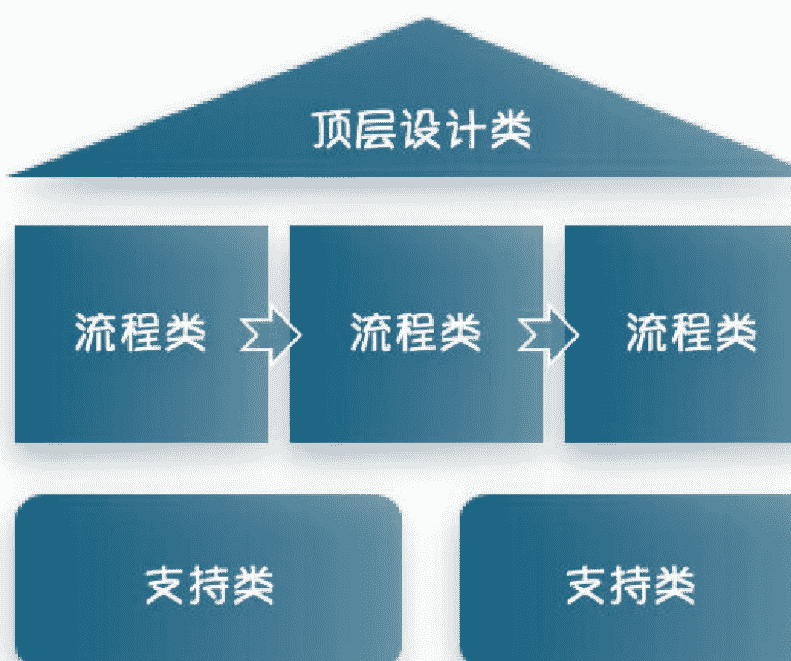

图3-4 部门职责分析之房屋模型

部门职责通常可以分为三大类：顶层设计类（房顶）、流程类（腰部）和支持类（地基），具体内容如下：

- **顶层设计类职责**。体现部门的战略定位和全局视角，重点关注政策、规划、资源整合等核心决策，确保与组织目标和未来发展保持一致。
- **流程类职责**。涵盖端到端流程的职责分解，确保工作任务的完整性、协调性。
- **支持类职责**。包括底层支撑和保障性职责，如系统建设、资源支持和团队管理，确保工作基础稳固并支持长期发展。

示例指令：

请结合部门职责房屋模型，分析附件中的部门职责说明书。判断各项职责分别属于三类职责中的哪一类，并参考标杆企业经验，识别是否存在职责交叉、重叠或遗漏。

在部门职责说明书定稿后，若企业正处于首次构建职位体系阶段，应暂缓分解到职位职责的工作，优先完成职位体系框架设计，包括体系模式选择与职级定位规则的确立。

打个比方，这一过程就像建房，要先明确地基深度与承重结构，再来铺设水电线路。只有厘清职位体系的底层逻辑（地基），部门职责的拆解与承接（管线布局）才能科学落地、结构稳固。

工作分析做扎实之后，我们再进入职位体系的初始化设计和导入，成功率会大大提升。

### 二 从职位设置到职位图谱的一体化考量

职位体系能否顺利导入并成功落地，关键在于两个方面。一是职位模式的选择；二是职位模式、职级定义、职位价值评估方法选择一体化考虑，如图3-5所示。

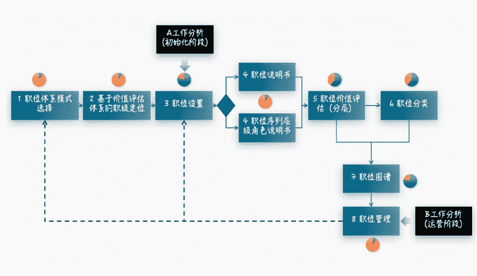

图3-5 职位体系设计的一体化考量

#### 一）三种职位体系模式的选择

职位体系有三种典型模式，其中最常见的是以职责为基础和以能力为基础两种。两者在逻辑起点、实施方式与适配场景上各有侧重，如表3-1所示。

表3-1 职位体系的典型模式

| 模式<br>差异 | 职位体系模式 |
| :--- | :--- |
| | 以职责为基础（A） | 以能力为基础（B） |
| 特点 | 侧重点 | 对岗位价值的评价 | 对个人能力的评价 |
| | 职位级别 | 窄带 | 宽带 |
| | 评估工具 | 较为复杂 | 相对简单 |
| 适用条件 | 外部环境 | 外部环境变化较少 | 外部环境灵活多变 |
| | 工作性质 | 流程性、程序化强的工作 | 非结构化的高智能工作 |
| | 人的要求 | 严格按照流程执行 | 充分发挥主观能动性 |
| | 职位职责 | 相对稳定 | 职责多变 |
| | 适用企业 | 平稳发展的企业 | 快速发展的企业 |
| 与薪酬体系<br>的对接逻辑 | | 以岗定级<br>以级定薪<br>岗变薪变<br>易岗易薪 | 以能定级<br>因类定薪<br>人事相宜<br>级随人走 |

在实际运行中，这两类模式也各有挑战。

A模式的核心挑战在于：如何保持职位设置与业务需求的贴合？如何构建一个透明、动态、可复用的岗位价值评估体系？

而B模式的重点和难点在于：如何确保不同职位序列的层级含金量一致？如何使能力标准既对齐战略，又具备演化能力？

除此之外，混合模式（C）也逐渐成为趋势。其方式主要包括：

- 族群区分式混合。管理类职位采用A模式，专业类职位采用B模式；
- 主辅嵌套式混合。以A为主、B为辅，或反之，依据情况灵活组合。

图3-6至图3-8展示了三种模式在不同行业中的典型应用案例。

| 序列 | 专业治疗 | 初级治疗销售 | 研发 |
| :--- | :--- | :--- | :--- |
| 职级 | 区域销售 | SC市场 | 销售主管 | 区域销售 | 市场公关 | 销售主管 | 药物信息 | 临床研究 | 法规 |
| 17 | 区域销售总监 | | | | 区域销售总监 | | | 临床总监 | 法规事务总监 |
| 16 | 区域销售经理 | 市场经理 | 市场经理 | 区域销售经理 | 市场经理 | | | 临床经理 | 法律事务经理 |
| 15 | DSM/Sr. DSM | | 品牌经理 | DSM/Sr. DSM | 品牌经理，区域市场经理 | 药物信息交流经理 | | 助理临床经理 | 法规顾问 |
| 14 | | | | | | | | | |
| 13 | 产品专员 | 助理品牌经理，市场支持专员 | | 产品专员 | 助理品牌经理 | 药物信息专员 | | 高级临床监研员 | 高级法务专员 |
| 12 | 销售代表，高级销售代表 | | | 销售代表，高级销售代表 | | 药物信息助理 | | 临床研究助理 | 法务专员 |
| 11 | | | | | | | | | |
| 10 | | | 销售助理 | | | 销售助理 | | | |
| 9 | | | | | | | | | |

图3-6 职位体系模式A（某制药企业职位图谱-局部）

##### 1.模式适配与对标分析

示例指令：

请基于职位体系A/B/C的适配逻辑，列举各自代表企业，并结合行业特性、组织规模与战略阶段进行适配性分析。

##### 2.薪酬协同机制解析

示例指令：

请解读“以岗定级、以级定薪、岗变薪变、易岗易薪”方针的内在逻辑，并结合标杆企业薪酬设计说明其落地路径。

##### 3.组织变革历史研究

示例指令：

梳理华为在1998-2008年间由职能制向职位制的变革历程，包括引入Hay Group方法、驱动因素（如国际化扩张）与关键挑战。

##### 4.历史与现代职级体系对照研究

示例指令：

请分析如古代九品中正制与现代军衔、国家公务员体制等的异同点，分析维度可包括制度结构、选拔方式与晋升逻辑，并探讨对企业职位体系的可借鉴要素。

通过AI参与评估与设计，可帮助企业更科学地判断何种模式更适配当前阶段的发展需要。

##### 案例：某上市企业职位体系模式选择

背景：某光通信行业的上市企业，年营收10亿元，员工2000人。专注于芯片（如PLC、AWG、DFB等）与器件制造。现拟进行职位体系的构建。

输入指令：

你是资深的人力资源专家。请根据企业背景，分析该企业最适合采用哪种职位体系模式？同时请提供实施建议。

AI反馈：

对于这家企业，混合模式可能是最合适的选择。光通信行业涉及复杂的生产制造流程和高技术含量的研发创新，因而需要明确的职责划分来确保生产和运营的稳定性。此外，还需要能力发展来支持技术创新，并促进员工技能的提升。

实施建议：

- 生产制造岗位：重点以责任为导向，保证岗位职责的标准化，设定清晰的操作流程和质量控制。
- 研发和工程技术岗位：在职责任基础上增加能力发展要求，如专业知识、技术能力、创新能力等，以促进技术人员的成长。
- 管理和支持部门：可结合职责和能力要求，确保各职能支持部门在责任分工的基础上也具备必要的能力提升路径。

这种混合模式既可以保障生产的效率和一致性，又可以支持研发创新和人才发展，适合该企业在光通信和芯片制造行业的发展需求。

#### 二）基于价值评估方法的职级定位

职位体系成功的核心，是要实现职位模式、价值评估、职级定位与职位设置的一体化闭环。这一闭环设计的核心价值体现在以下四个方面：

##### 1.规避管理断层风险

如果各模块孤立设计，极易造成“职责-能力”错配（如高薪低能）或“职级-薪酬”割裂（如晋升不调薪）。这类结构性偏差将直接削弱组织效率，甚至引发信任危机。

##### 2.强化战略穿透能力

职位体系不清、责权利划分不明，将导致战略在中后台层级“断层”下沉。例如，前线员工“有责无权”、支持部门“有权无责”等失衡现象普遍存在，根源往往在于职位体系未与战略解构协同配套。

##### 3.构建数据决策基座

HR管理中的大多数核心数据——包括人才分类、职等结构、薪酬占比、效能分析等，均需以标准化职位体系为前提。职位体系的规范程度，决定了组织数据的可比性与分析力。

##### 4.增强组织信任文化

规范透明的职级定位、晋升标准与薪酬区间，是建立公平预期与减少争议的制度基石。通过一体化设计，可有效减少因晋升申诉、绩效异议和薪酬不均所带来的组织摩擦。

概言之，一体化设计的目的，是以系统化思维简化复杂的管理工作。在这四大核心环节中，价值评估与职级定位的有效耦合最具挑战性。华为采用“评估-定义-校准”三级联动机制，提供了可借鉴的实践路径。

如图3-9所示，华为基于Hay的职位评估体系（即“三大维度×八个要素”），对每一级别的职位价值进行量化评价，并与职级定义进行精细化匹配。在此基础上，各部门进一步定制本部门专业序列中的关键岗位标准，形成了从“职位价值”到“任职要求”的系统闭环。这一机制已成为其组织管理六大核心模块之一。

| 职级 | 通用定位 | 通用职责概述 |
| :--- | :--- | :--- |
| 12级 | 基础工作执行者 | 按照标准流程指导下，执行一定专业性的工作，辅助性或基础执行的工作。对个人工作成果负责。 |
| 13级 | 例行工作执行者 | 根据工作流程，在一定程序下开展例行工作。个人工作成果负责。 |
| 14级 | 初步的独立贡献者 | 承担单一模块业务的部分职责，对模块内项目的具体执行、独立开展工作负责。 |
| 15级 | 独立贡献者/初步的团队贡献者 | 承担单一模块业务的责任，或承担较大项目某一阶段的模块工作，并指导他人开展工作。 |
| 16级 | 团队贡献者 | 承担本领域多模块业务的职责，独立组织他人完成工作；承担本领域重大项目某一环节的工作流程优化有责任。 |
| 17级 | 关键贡献者 | 承担本领域多模块业务的工作，组织组员完成综合的工作，推动部门流程改进。 |
| 18级 | 准专家 | 承担本领域综合业务的职务，组织协同完成部门综合性工作，参与局部经济与业务带来显著影响。 |
| 19级 | 专家 | 承担本领域业务/技术规划的职责，进行业务/技术解决方案的创新，提升本领域的能力。 |
| 20级 | 资深专家 | 规划本领域业务/技术方向，推进业务/技术方案的创新，并为公司中长期经营业绩产生影响。 |
| 21级 | 领导权威 | 规划公司关键领域的业务/技术方向，系统化领导领域化创新并有所突破，为公司中长期经营产生最大影响。 |
| 22级 | 区域发展领导者 | 提出公司关键领域的发展蓝图，领导和规划关键领域的业务/技术方向，并带来显著创新和突破，为公司中长期经营带来高度影响。 |
| 23级 | 顶尖领域领导者 | 提出公司核心领域的发展蓝图，融合引领全球业务/技术方向，并带来显著的创新和突破，领导能力达到行业领先水平。 |

图3-9 价值评估与职级的关系处理

接下来，我们将演示如何借助AI辅助完成这项挑战性工作。

##### 案例：职级选择与定义

背景：某铜材制造企业集团，2018年时员工规模约6000人，集团总部设有10个职能部门，统一管理旗下20余家子公司。整体运营模式为“总部强管控、子公司分责执行”，强调资源集中统筹与战略一致性。

输入指令：

请结合背景信息以及Hay职位价值评估法，建议该企业应设定多少职级，并说明原因。

AI反馈：

###### 1.职级设置核心考量维度

| 维度 | 铜材制造业特性分析 | Hay 要素映射 |
| :--- | :--- | :--- |
| 组织复杂度 | 生产链条长（采矿-冶炼-加工-销售）、多地域子公司协同、重资产运营特点 | 管理复杂度 |
| 人才结构 | 蓝领技术工人占比高（约 60%）、专业工程师/技师梯队、总部战略管控人员 | 专业知识深度 |
| 决策链条 | 生产端需快速响应（车间级决策）、战略端需长期规划（5 年以上铜价周期预判） | 行动自由度 |
| 管控模式 | 总部强管控（财务/采购/品控）+ 子公司运营自主（生产/销售） | 影响范围 |

###### 2.推荐采用8级制的深层逻辑

匹配铜材行业特性：

- 生产维度：覆盖熔铸→轧制→精加工→质检4大环节，每环节需2个职级（操作工→技师→工艺主管）。
- 技术纵深：冶炼技术迭代周期约5-8年，需L4-L6级专家保持技术储备。
- 大宗商品波动：L7级以上需具备对冲铜价波动风险的决策能力。

平衡管理效能：

| 职级数 | 管理幅度 | 铜材行业适配性分析 |
| :--- | :--- | :--- |
| 7级 | 1:8（中高层） | 适合单一工艺路线的集中生产模式 |
| 8级 | 1:6（中高层） | 最佳平衡点：20个子公司*3条汇报线 |
| 9级 | 1:5（中高层） | 适合高度多元化跨国集团 |

输入指令：

请你结合Hay三维度八要素评估法，生成职位职级通用定义框架，主要从职责分工角度进行定义，我需要10级制。

AI反馈：

1.10 级职级体系定义（职责分工视角）

| 职级 | 层级定位 | 知识技能 | 问题解决 | 责任性 | 核心职责分工特征 |
| :--- | :--- | :--- | :--- | :--- | :--- |
| L1 | 基础执行岗 | 掌握单一操作流程 | 按规程处理重复事务 | 对个人任务结果负责 | 执行标准作业指令，无决策权 |
| L2 | 熟练操作岗 | 精通专业模块工具 | 优化局部流程效率 | 对流程节点质量负责 | 独立完成模块任务，有限自主决策 |
| L3 | 专业指导岗 | 跨模块知识整合 | 解决跨环节协作问题 | 对职能链条输出负责 | 协调2-3个关联模块，指导初级员工 |
| L4 | 领域专家岗 | 构建领域知识体系 | 突破技术/业务瓶颈 | 对专业标准制定负责 | 主导专业技术路线，影响部门决策 |
| L5 | 团队统筹岗 | 多领域知识融合 | 平衡资源与目标冲突 | 对团队目标达成负责 | 管理10-50人团队，制定执行策略 |
| L6 | 部门决策岗 | 行业级知识储备 | 应对外部环境剧变 | 对部门战略解码负责 | 规划部门3年发展路径，控制千万级预算 |
| L7 | 业务单元负责人 | 产业链知识图谱 | 重构商业模式 | 对业务单元P&L负责 | 制定事业部竞争战略，影响亿元级投资 |
| L8 | 集团职能负责人 | 全球最佳实践洞察 | 化解系统性风险 | 对集团职能卓越负责 | 设计跨国职能架构，推动组织能力升级 |
| L9 | 执行决策层 | 地缘经济政治研判 | 定义行业级问题 | 对企业生存发展负责 | 制定5年以上战略规划，决策百亿级资源配置 |
| L10 | 战略制定层 | 文明演进规律认知 | 预见颠覆性变革 | 对生态体系存续负责 | 塑造行业范式，影响行业标准制定 |

###### 2.职责分工核心维度拆解

###### 决策链定位

- L1-L3：执行层（事务性决策）；
- L4-L6：管理层（战术性决策）；
- L7-L9：战略层（结构性决策）；
- L10：愿景层（范式级决策）；

###### 3.权责穿透强度

- 纵向穿透：从执行指令（L1）→制定标准（L4）→定义规则（L7）→重构范式（L10）
- 横向穿透：从专业深井（L1-3）→流程整合（L4-6）→系统重构（L7-9）→生态重塑（L10）

初步方案生成后，HR应结合企业实际，对职级定义进行调整与校准，确保制度设计与组织特性精准匹配。

需要特别提醒的是，在缺乏清晰职级定义的前提下直接推动职位优化，往往只能围绕现有人员结构进行“形式包装”。这种做法虽可短期应付，但实质上是对原有无序状态的“制度化修饰”，容易将结构性问题“合理化”而非解决，反而埋下更深的管理隐患。

#### 三）职位设置

在明确职级标准后，再将部门职责拆解至具体职位，并明确其设置目的。职位设置方式需与所选职位体系模式保持一致，主要有两种典型路径：

职位模式A（以职责为本）。以“事”为出发点，依据具体工作任务来定义职位属性，实现“职位-业务”之间的精准映射。适用于流程清晰、职责稳定的组织场景。

职位模式B（以能力为本）。以“人”为出发点，还需要构建基准职位（Benchmark Positions），并结合员工能力演进和战略任务变化，进行年度动态校准和优化。适用于人才梯队多元、岗位要求灵活的组织结构，如图3-10所示。

图3-10 以能力为基础的职位设置方式

#### 四）职位说明书/职位层级角色说明书的编制

在采用职位模式A（以职责为本）时，往往需要编写内容清晰、职责明确的职位说明书。它不仅是招聘、培训、绩效、发展的基础文档，更是实现岗位管理标准化的关键工具。

但在实际工作中，传统的职位说明书编写工作量大、标准不一，常常流于形式——写了没人看、用时不管用，沦为摆设。

如果采用职位模式B（以能力为本），则可用“职位层级角色说明书”代替。这在变化频繁、迭代快速的互联网企业尤为常见。其核心在于：不再细化到每个岗位的具体任务，而是以角色职责为单位，建立一套灵活可变、易于更新的标准体系。

互动：

1. 利用AI搜索职位序列角色说明书与职位说明书的差异和示例。
2. 利用AI查询职位职责描述的三种常见范式及举例。

接下来，我们将重点演示如何借助AI编制职位说明书。

##### Step 1：自动生成职位说明书初稿

与传统手动编写相比，AI生成职位说明书的流程有所不同。表3-2展示了典型的操作步骤与关键要点。

##### 表3-2 AI自动生成职位说明书流程说明

| 分工 | 分步执行 | 操作要点 |
| :--- | :--- | :--- |
| 1） HR | 输入背景信息和任务指令 | 必要的背景信息（见示例）和要求 |
| 2） AI | 撰写职位主要职责 | / |
| 3） HR | 输入职位目的概括指令 | 指定职位目的描述规范，提供示例 |
| 4） AI | 概括职位目的 | / |
| 5） HR | 输入任职条件编制指令 | 指定任职条件及要求，提供示例 |
| 6） AI | 匹配任职条件 | / |
| 7） HR | 审核并人工做调整 | 补充其他职位基本信息 |

##### 案例：借助AI编制职位说明书

背景：某生物科技企业，专注于绿色科技创新和绿色价值创造。主要产品包括氨基酸、维生素和生物基材料单体等。公司在安徽、河北、内蒙有多个生产基地。

输入指令：

请你帮我设计一下该企业安全环保部安全工程师职位主要职责。相关背景信息如下：

- ●企业背景信息：（……如上）；
- ●部门主要职责：（见附件：部门职责说明书）；
- ●部门职位架构：部门设部门经理，下面分管助理安全工程师、安全工程师；助理环保工程师、环保工程师。四个职位直接向经理汇报；
- ●该职位职级（P2）职责通用描述：能独立完成一般性专业工作任务和解决常规性专业问题；
- ●该职位的核心职责：（安全培训和执行安全巡查并编制安全报告提出体系优化建议）；
- 职位说明书的主要目的：明确职位职责分工和招聘。

要求如下：

- 概括主要职责即可，数量6-9条，一条职责用一句话描述，能清晰地反映责任分工。
- 职责描述规范：按照“动词+名词”的句式，每一条职责背后要有清晰的成果指向。示例：提高或修改标准化流程。
- 按照职责重要性进行排序。
- 与该职位职级的通用定义相匹配。

AI反馈：

主要职责如下：

1. 定期巡查生产基地，确保所有安全操作符合相关安全法律法规和企业标准，确保生产现场的安全性。
2. 参与安全标准和流程的修订与完善，确保生产流程符合安全要求并有效执行。
3. 参与安全应急预案的制定和演练，确保公司在突发安全事故时能够及时、高效响应。
4. 对生产过程中的安全风险进行评估，并提出可行的控制措施，减少潜在安全隐患。

#### 五）职位价值评估

目前主流的职位价值评估方法，如Hay三要素八维度、美世IPE模型、翰威特六要素法等，因其系统性强、理论成熟，被广泛采用。但这些方法操作复杂、学习门槛高，推广难度较大。国内一些机构虽尝试简化版本，提升了实用性，但其核心逻辑仍基于传统方法论框架。

企业实践中，因职位频繁变动、评估流程繁琐，加之专业工具掌握不足，价值评估常流于形式。久而久之，又回到“因人定薪、一事一议”的老路，最终导致体系形同虚设。

引入“AI与人工评分相结合”的方式，是当前较为可行的解决方案。AI擅长数据处理与标准化评分，人工擅长情境判断与策略权衡，二者协同，可显著提升效率与准确性，重建科学、透明的岗位价值体系。这是一个技术问题，我们不再展开。

#### 六）职位管理

职位管理涵盖职位新设、合并、调整与撤销等工作，也包括职位说明书的更新、职级变动以及组织架构系统中职位信息的同步与维护等。

其中，职位说明书的更新最为繁琐，工作量大，稍有疏漏就可能引发职责交叉、流程断点或管理空档。

现在，可以借助AI大幅提升处理效率与专业精准度。

##### 案例：AI辅助更新职位说明书

背景：某IT类企业在组织升级过程中发生以下变化：

- 新增流程：引入DevOps实践，要求技术架构师参与开发与运维一体化流程设计。
- 技术变化：逐步迁移至云原生架构，需掌握Kubernetes和容器化技术。
- 组织结构：新增“平台工程团队”，要求架构师与该团队密切协作。

现在需要评估这些变化给“技术架构师（T4级）”职位带来的影响。

原岗位职责（节选）：

1. 负责系统架构设计与优化，确保系统的性能和可扩展性。
2. 指导开发团队解决技术难题。
3. 提供技术方向建议，支持项目经理完成任务。

任职要求（节选）：

- 熟悉主流架构模式（如微服务架构）。
- 具备性能优化和系统设计能力。
- 具备跨部门沟通与协作能力。

输入指令：

附件为“技术架构师”职位说明书。请结合以下变化：引入DevOps、架构云原生化、新增平台团队，完成以下任务。

- 分析这些变动对岗位职责与要求的影响。
- 修订职责内容，新增或优化关键描述。
- 更新任职要求，涵盖新增技术与软技能要求。
- 输出更新后的职位说明书。

AI反馈：

###### 技术架构师职位

岗位职责：

1. 负责系统架构设计与优化，确保系统性能、可靠性和可扩展性。
2. 主导云原生架构迁移，制定容器化技术的最佳实践。
3. 指导开发团队解决技术难题，推动团队技术能力提升。
4. 参与DevOps实践，设计并优化开发与运维的一体化流程。
5. 与平台工程团队协作，制定性能优化与系统部署策略。
6. 主导跨部门技术决策，确保团队协作中的技术一致性。

任职要求：

- 熟悉云原生架构（如Kubernetes、Docker）和容器化技术。
- 具备DevOps流程设计和优化经验。
- 精通系统架构模式，尤其是微服务架构。
- 具备跨部门沟通与技术决策能力。
- 具备团队建设与培训能力，能够推动团队技术成长。

AI的到来，解决了现实中该项重要工作尴尬处境：高手能干不愿干，新手可干干不好。

##### 小结

职位体系绝非一张“职位图谱”所能涵盖，它贯穿了工作分析、职位模式选择、分层分类、职级设定、价值评估与说明书编制等多个关键环节，是一项标准化、系统化、协同化的管理工程。唯有底层逻辑清晰、结构统一、环节衔接一致，才能真正实现落地生效。

在这一过程中，应坚持“人主导方向，AI执行细节”的原则——把基础性、重复性任务交给AI，释放HR的判断力与创造力，使其更专注于高价值的战略事务。

## 第二节 任职资格体系：HR体系的核心齿轮

当职位和职位图谱确定后，HR面临的下一个挑战便是解决“人岗匹配”这一公认难题。任职资格体系正是破解这一难题的有效工具，它贯通了招聘、培训、晋升、薪酬与绩效等模块，是HR体系运转的核心齿轮。

或许有人会反驳：“我见过不少企业并没有所谓的任职资格体系，但发展也都挺好的。”事实上，许多中小企业的人才标准常隐匿于管理者的直觉中，只是未系统化和显现化而已。

试想，在招聘和提拔员工时，哪个管理者头脑中没有一个“人才画像”——这个人是否值得信任？是否具备某些关键能力？

随着企业规模和业务复杂性的增加，“隐性规则”将难以满足管理需求。而任职资格体系可以将主观判断转化为科学管理，实现更精准的人岗匹配。

### 一 任职资格标准的AI开发模式

华为作为国内最早实践任职资格体系的企业，取得了显著的成效。于是，许多企业争相效仿。其中，成功者众多，失败者亦不在少数。问题通常集中在以下三个方面。

标准开发质量差，形似神离。一分高质量的标准开发对HR的要求是很高的。HR不仅要懂专业、懂业务，还需具备较强的文字表达和教练引导能力。所以，许多标准徒有其型，看似完备，实则漏洞百出。

认证流程草率随意，缺乏规则。一些企业有“怕麻烦”的思想，为了提高效率，过度简化评分机制、评价方式和随意选择评委，导致认证过程缺乏严谨性和公正性。最终，“人治”又取代了“法治”，任职资格文件沦为一个对外展示的“样品”。

体系更新滞后，难以适应企业快速发展。许多企业依赖外部咨询公司导入体系，导致缺乏自主更新和迭代的能力。随着企业的快速发展，依靠这些过时的体系文件就像拿着陈旧的地图在高速公路上行驶，逐渐失去牵引作用，最终走向崩溃。

虽然任职资格体系在不同企业中的实施形式有所差异，但基本原理相同。接下来，我们将以华为实践为参考，详细讲解如何借力AI，解决上述三大痛点，并实现系统性的改进。

#### 一）标准AI开发新流程

AI在任职资格标准开发中的作用主要体现在以下三个方面：

- 可以弥补HR专业技能的不足；
- 轻松打通从业务需求到专业语言的转换逻辑；
- 标准内容之间的一致性保证。

通过引入AI，我们可以重构标准开发流程，如图3-11所示。

图3-11 任职资格标准AI开发流程

在深入讨论之前，我们需要建立一个清晰的概念框架，这是利用AI开发任职资格标准的前提条件。否则，AI可能会误解指令意图。我们先澄清一个核心概念及其构成——冰山模型，如图3-12所示。

图3-12 冰山模型

该模型源自麦克利兰的胜任力理论研究，被Spencer等人进一步发展为经典的能力评估框架。它将个体能力划分为显性（冰山以上）和隐性（冰山以下）两个层次。显性能力，如专业知识和技能，容易识别与培养；隐性能力，如自我认知、动机与情绪管理，则较难观察与改变，需要更深入的理解与开发。

任职资格标准由多个模块组成，如下表3-3所示。

##### 表3-3 任职资格标准的构成

| 模块 | 概念定义 | 重要性 |
| --- | --- | --- |
| 基本条件 | 学历、岗位工作年限等客观条件 | 中 |
| 成果贡献 | 晋升至下一层级所需达成的量化成果 | 高 |
| 行为标准 | 完成岗位工作任务时表现出的行为模式、习惯或执行方式 | 高 |
| 知识标准 | 胜任岗位工作所需的理论基础、专业知识或必要信息 | 中 |
| 技能标准 | 操作能力，通过统一训练在 2-6 个月内获得的标准化技能 | 中 |
| 素质标准 | 隐性能力因子，包括情商、性格等 | 低 |

互动：

请思考以下问题：

1. 在领导力模型中，包含了冰山模型哪些层次的概念？它更侧重显性能力还是隐性能力部分的内容？
2. 为什么素质标准在任职资格体系中要求会相对弱化？

提示：结合第2章“深入学习概念”方法，借助AI分析。

#### 二）AI标准开发实操详解

为了更直观地展示完整的开发流程，我们通过一个实际案例来说明。

##### 案例：SJ公司任职资格体系建设

背景：

SJ科技有限公司（简称SJ）是一家年营收约10亿元、员工约2500人的光通信芯片及器件制造企业。市场销售团队约50人。公司上市后，进行了战略调整，提出了以下三大方向：

- 聚焦价值型客户：优先服务采购规模大、毛利高且回款好的客户。
- 加大海外市场开发力度：重点拓展北美、欧洲等市场。
- 推动产品结构转型：从中低端产品向中高端升级，从单一产品向提供综合解决方案转变。

为支撑这一战略调整，SJ公司计划构建任职资格体系，工作目标包括：

- 试点开发销售序列标准，牵引销售队伍能力发展，确保与公司战略调整方向保持一致；
- 通过任职资格认证，解决员工晋升与评定的公平性和透明性问题；
- 试点成功后向全公司范围内推广任职资格体系。

HR介入后，工作分为八个步骤进行。

###### 步骤1：统一跨职位序列通用层级角色定义

任务说明：

在传统模式下，许多企业不同职位序列之间存在明显的层级要求差异。例如，某些职位序列的高级角色要求，可能仅等同于其他职位序列中级角色的要求。这种不平衡会影响人才流动，降低公平感，进而影响体系的公正性。特别是在“以能力为基础”的职位体系中，这种差异可能会对整个HR体系带来很大的潜在麻烦。

####### 应对策略：

我们采用“统一基础+序列差异化”的设计策略。确保在保持一致性的基础上，满足不同职位序列的个性需求。

所谓统一基础，即明确跨序列的统一层级标准，为每个层级的定义进行关键维度的锚定。

而序列差异化，即根据职位序列特点进行细化设计。例如，技术序列的“高级角色”，侧重于技术创新和复杂问题的解决能力。销售序列的“高级角色”，聚焦业绩驱动和大客户管理能力。

在这个步骤中，HR还需根据企业情况做两个重要判断。

1）分几层合适？

总体原则：通常2-4年晋升一个层级较为合适。3年左右符合员工能力的质变周期，也是员工期望收入明显增长的关键节点。这既考虑了成才规律，也照顾了人性的基本诉求。

层级设计参考：根据不同企业的实践，职位序列的层级设计有所不同。表3-4是几家知名企业的参考数据（注：数据非同一年统计，仅供参考）。

####### 表3-4 知名企业职位序列分层数据参考

| 企业 | 员工数量 | 技术类 | 专业类 |
| :--- | :--- | :--- | :--- |
| 华为 | 17 万 | 6+2 | 5+1 |
| 美的 | 12 万 | 5 | 5 |
| IBM | 40 万 | 5+1 | 5 |

另外需要说明的是，并非所有职位序列都必须设计双通道。职位序列的深度和起始、封顶值需要根据业务特点进行具体考量，如图3-13所示。

图3-13 通道纵深考量的三个因素

举个例子，清洁工这个职位序列在大多数企业中可能都不需要分层。但有些企业把“清洁”视为业务战略的重要部分（如汉庭酒店：初级清洁师到城市总清洁师，四级），或视为重要角色（如迪士尼）。在这种情况下，清洁序列就不仅仅是一个层级。

2）发展通道特征：I型还是T型？

员工发展通道一般分为两种类型，如图3-14示例。

纵深型（I型）：聚焦于某一领域的专业深耕，适合技术性或专业性强的岗位。

系统型（T型）：注重跨领域的复合能力发展，适合需要多元化技能和管理能力的岗位。

| 序列层级 | 网络规划序列 | 供应链序列 |
| :--- | :--- | :--- |
| | 线路规划 | 网点规划 | 场地规划 | 采购寻源 | 采购执行 | 物资管理 |
| 10 | 首席网络规划专家 | | | | | |
| 9 | 网络规划专家 | | | 供应链专家 | | |
| 8 | 资深线路规划工程师 | 资深网点规划工程师 | 资深场地规划工程师 | 资深采购寻源工程师 | 资深采购执行工程师 | 资深物资管理师 |
| 7 | 高级线路规划工程师 | 高级网点规划工程师 | 高级场地规划工程师 | 高级采购寻源工程师 | 高级采购执行工程师 | 高级物资管理师 |
| 6 | 中级线路规划工程师 | 中级网点规划工程师 | 中级场地规划工程师 | 中级采购寻源工程师 | 中级采购执行工程师 | 中级物资管理师 |
| 5 | | | | | 初级采购执行工程师 | 初级物资管理师 |

图3-14 两种发展通道模式示例（某知名物流企业）

在设计员工发展通道时，HR需要从以下三个维度进行考虑：

- 业务需求。企业是否需要具备复合型能力的职位？
- 层级设定。从哪个层级开始要求复合型能力？
- 培养方法。如何通过具体策略促进复合能力的培养？

###### 案例：跨职位序列通用层级角色定义

输入指令：

你是一名资深的HR顾问，擅长任职资格体系建设。背景信息：“……”。任务要求：为公司设计一个通用的职位层级框架，适用于所有职位序列（如技术、生产、市场、职能等），包括初级、中级、高级、专家级四个层级。请为每个层级定义以下内容：核心能力、职责特点、关键贡献、岗位工作年限要求。

AI反馈：

| 职位层级 | 层级角色定义 |
| :--- | :--- |
| 初级 | **核心能力：**<br>- 掌握岗位所需的基本知识和技能，能够完成简单任务。<br>- 对工作有清晰的理解和执行力，但仍需要上级的指导。<br>- 展现良好的学习态度和潜力。<br><br>**职责特点：**<br>- 以执行为主，完成明确分配的任务或操作。<br>- 参与基础项目工作，积累实践经验。<br>- 配合团队，贡献基础工作成果。<br><br>**关键贡献：**<br>- 确保基础工作质量，为团队整体目标提供支撑。<br>- 通过学习和执行，提高工作效率和能力。<br><br>**岗位工作年限要求：** 0-2年工作经验。 |
| 中级 | **核心能力：**<br>- 能够独立完成本职工作，具备解决常见问题的能力。<br>- 熟悉岗位相关流程和标准，展现一定的专业能力。<br>- 具备初步的跨部门沟通和协作能力。<br><br>**职责特点：**<br>- 独立承担部门内的常规工作或项目部分职责。<br>- 提供改进建议，优化现有工作流程。<br>- 为团队或上级的决策提供支持性数据或分析。<br><br>**关键贡献：**<br>- 在岗位范围内实现高效、高质量的独立输出。<br>- 支持部门目标达成，通过优化工作流程提升部门效率。<br><br>**岗位工作年限要求：** 2-5年工作经验。 |
| 高级 | …… |
| 专家 | **核心能力：**<br>- 在某一领域具备行业领先的专业知识或管理能力。<br>- 展现高水平的战略思维，能够引领公司变革。<br>- 擅长复杂问题的解决和跨部门协调。<br><br>**职责特点：**<br>- 负责公司战略级项目或业务模块，影响公司整体发展。<br>- 提供重要的战略或技术决策支持。<br>- 引领公司内部团队能力发展。<br><br>**关键贡献：**<br>- 为公司创造重大业务增长、技术突破或战略发展机会。<br>- 建立公司在行业内的标杆地位，推动公司竞争力提升。<br><br>**岗位工作年限要求：** 8年以上工作经验。 |

###### 步骤2：设计行为模块

任务说明：

行为模块在任职资格标准中至关重要，它就像房屋的框架——一旦框架出现问题，整个结构可能会失衡，甚至崩塌。因此，在设计行为模块时，必须确保其完整性和合理性。传统开发中，这一步工作有两大难点。

1）理解和处理职责模块与行为模块的联系与区别

职责模块关注的是责任分工，明确员工“做什么”；而行为模块则侧重于员工“怎么做”，即完成任务时的表现、方法和能力。两者的关系就像硬币的正反面。

虽然职责模块与行为模块紧密相关，但它们有显著的区别。理解这一点，对开发高效、实用的任职资格标准至关重要。因为这和行为模块的提炼有直接关系。

行为模块虽源于职责，但其提炼方式并非一成不变。根据岗位复杂度不同，通常可以分为以下两种模式。

模式（1）：工作流划分模式

适用于职位结构相对简单的职位序列。在这种模式下，行为模块的设计主要围绕职责，描述员工在执行任务时的具体行为表现。例如，秘书序列的职责和行为之间的关系较为直接。

模式（2）：能力类型划分模式

对于复杂的职位序列，涉及到多样化且差异较大的职责模块时，需要将多个职责模块中相似的能力或跨领域的技能整合在一起。这种模式被称为“能力类型划分模式”。其挑战在于如何有效进行“分析、抽象与整合”。

如果未能合理转换，可能会导致行为模块过多，标准描述重复，最终使文件冗长、繁琐，类似于职位说明书的细化版。例如，某国家智库的管理支撑岗位，涵盖了科研管理、人力行政、资产管理等多个领域，最初采用工作流划分模式时，一个层级的行为模块多达12项，效果可想而知。

为什么需要两种模式来设计行为模块？为了更好地理解，我们需要认识到职责模块的三维结构（如图3-15所示）。

- 活动任务维度。如招聘、培训、薪酬管理等工作内容。
- 对象维度。如负责特定区域（华东、华南）的销售工作。
- 专业维度。如蓝牙测试、短距离测试、化学测试等方向。

####### 图3-15 职责的三维描述

当职位序列包含多个职位和职责时，我们需要调整视角，将具有共性或相似能力要求的部分整合成一个行为模块。这样，我们可以从表面上看似不同的职责中，挖掘出底层的能力共性（如图3-16所示）。

####### 图3-16 职责与行为模块的切换示意图

例如，销售序列中的“回款管理”职责非常重要，但不必单独设计行为模块。因为，本质上“回款能力”是其他多个行为模块（如客户需求分析、客户关系建设、商务谈判）共同作用的结果。

####### 2）行为模块数量和颗粒度把握

行为模块的数量和颗粒度需要在简化管理和确保管理效果之间找到平衡。以下是具体设计原则（见图3-17）。

####### 图3-17 行为模块设计原则

下面是具体的操作规则：

- **数量控制。** 序列涉及的行为模块总数通常控制在6-10个。每个层级的行为模块建议控制在4到6个之间。
- **内容聚焦。** 按照重要性对模块内容进行排序，突出重点，同时保持内容的完整性和逻辑性。避免模块之间的过度重叠，但允许一定范围内的良性交叉。
- **描述规范。** 每个行为模块必须自成体系，具备清晰、独立的定义。这是确保行为标准科学性和评估有效性的基础。

####### 案例：行为模块设计

输入指令：

请你结合SJ战略背景，为销售序列设计行为模块。具体要求如下。

- 行为模块数量：每层级约5个行为模块；
- 关键词形式：模块名称应简洁明了，使用关键词；
- 模块类型划分：初级和中级行为模块采用工作流划分模式；高级和专家级行为模块采用能力类型划分模式。
- 行业借鉴：融入华为的客户为中心、流程化管理及全球化视野的经验。

AI反馈：

以下是销售序列的行为模块设计……。

对于AI给出的建议方案，HR可以进行评估和调整，如HR输入：

> 我觉得你设计的行为模块，比如“大客户管理”，似乎不符合“利于落地操作：高效、清晰，评估控制在15分钟内”的原则。

AI反馈：

您的反馈非常重要，以下对行为模块设计的进一步调整：

| 层级 | 角色定位 | 行为模块 |
| :--- | :--- | :--- |
| 初级 | 任务执行者<br>学习者 | - 信息收集：学习市场动态、客户需求及竞争对手信息<br>- 产品学习：掌握公司产品知识及基本销售工具的使用<br>- 客户识别：协助识别潜在客户并整理客户基本信息<br>- 拜访执行：按照既定计划进行客户拜访与记录反馈<br>- 任务达成：严格按指标完成既定销售目标 |
| 中级 | 独立操盘手<br>初步问题解决者 | - 市场调研：独立进行目标客户及市场信息分析<br>- 客户开发：识别高价值客户，推动初步需求对接<br>- 关系建立：通过专业沟通，与客户建立初步信任<br>- 需求挖掘：识别客户痛点并提出基础解决方案<br>- 流程优化：改进个人销售流程，提升工作效率 |
| 高级 | 大客户管理者<br>团队推动者 | - 大客户开发：管理高价值客户，制定并执行开发策略<br>- 解决方案：为客户量身定制综合产品与服务解决方案<br>- 商务谈判：主导复杂项目的合同谈判及协议达成<br>- 数据分析：基于销售数据及市场反馈，优化业务策略<br>- 团队辅导：指导和赋能初级及中级销售，提升团队能力 |
| 专家 | 战略引领者<br>行业标杆 | - 战略客户拓展：引领战略级客户和海外市场开发<br>- 行业洞察：深度参与市场研究，洞察行业发展趋势<br>- 高层关系管理：建立并维护与战略客户高层的深度合作关系<br>- 业务创新：驱动业务模式创新，推动产品和解决方案优化<br>- 团队文化引领：推动团队形成以客户为中心的销售文化 |

###### 步骤3：提炼行为标准

任务说明：

行为标准的质量是重中之重。从最基本的要求看，行为标准的描述要遵循行为化语言技术规范（如表3-4所示）。

####### 表3-4 行为化语言技术简介

| 要求 | 技术要点 |
| :--- | :--- |
| 具体化 | 描述行为时要具体、详细，避免使用模糊、抽象的语言。行为语言应明确描述“做什么”、“怎么做”、“做到什么程度”。 |
| 可观察 | 是可观察的，确保在实际工作中能够看到和评估。行为描述应包含具体的策略、关键动作或步骤，便于观察和测量。 |
| 可衡量 | 行为标准应是可衡量的，设定明确的衡量标准或指标。行为语言应包括具体的数量、质量或时间等衡量指标。 |

互动：

1. 通过AI了解行为化语言技术的起源与理论；
2. 让AI例举行为化语言和非行为化语言典型示例，对比差异。

除了技术规范外，真正的挑战是：如何控制AI设计行为标准的展开逻辑，确保其与企业实际需求紧密结合？

结合实操经验、相关理论（KSAO模型、BEI、BSC等）以及标杆企业的案例分析，行为标准设计可以按照以下三种典型逻辑展开。

####### 1) “功夫在诗外”模式——前置铺垫，打好基础

此模式适用于职责执行需要高度准备和前瞻性思考的行为模块。通过“准备性”行为，确保员工在实际执行中展现出高水平的表现。以下是秘书序列行为标准示例，如表3-5所示。

####### 表3-5 “功夫在诗外”模式示例

| 模块 | 行为标准 |
| :--- | :--- |
| 草拟文书 | 关注相关行业动态，主动收集相关信息 |
| | 熟悉公司相关制度及部门业务，通过多种渠道了解部门业务进展情况，保证最大限度获取客观资料 |
| | 运用适当方式分析、筛选数据/资料，必要时向他人核实，保证文书引用的数据/资料客观、真实 |
| | 根据掌握的信息及周边部门的反馈，发现问题，以事实为依据，给出解决建议，形成工作文书供主管决策 |
| | …… |
| | …… |
| | …… |

####### 2) “六脉神剑”模式——多点发力，系统出招

此模式适用于需要资源整合与复杂决策的行为模块，强调对关键因素的识别和统筹。以下是采购序列行为标准示例，如表3-6所示。

####### 表3-6 “六脉神剑”模式示例

| 模块 | 要素 | 行为标准 |
| :--- | :--- | :--- |
| 信息收集与分析反馈 | 信息收集与加工 | 定期主动收集新产品、新技术、新工艺信息，识别其价值点，为公司新产品开发提供参考。 |
| | | 系统性收集市场行情（供应商供求关系、价格趋势、交货期），并进行有效的归类、整理分析、研判，独立汇报并制定出相应的采购对策和建议。 |
| | | 对采购的历史经营数据进行横向(同行、分公司之间)、纵向（公司历史数据）的对标分析，对差异和异常情况找出根因，总结经验教训，提供优化措施。 |
| | 建立信息渠道 | …… |
| | 掌握搜索方法 | …… |
| | 构建信息分析模型与数据库 | 独立承担特定品种，建立和优化采购信息分析模型及数据库，使采购决策和结论更有依据。 |

####### 3) “窗户纸”模式——抓住关键诀窍，一点就透

此模式适用于快速判断和解决关键问题的行为模块，强调“关键要素洞察”和“揭秘关键诀窍”。以下为工艺序列行为标准示例，如表3-7所示。

####### 表3-7 “窗户纸”模式示例

| 模块 | 行为标准 |
| :--- | :--- |
| 工艺监控和异常处理 | ……<br>通晓应力反应与设备运行状态、原材料性能特点的连锁反应逻辑<br>…… |

接下来，通过具体实操演示，进一步了解行为标准的设计过程。

####### 案例：行为标准设计

输入指令：

接下来，请你设计行为标准，任务要求如下：

- 按照销售职位层级（初级、中级、高级、专家级）设计行为模块。
- 行为模块需拆分要素（2-4个），再针对每个要素设计行为标准。
- 结合公司背景资料和行为模块特点，选择合适的行为标准设计模式。
- 行为标准需符合行为化语言技术规范，明确关键动作、策略和达标关键点，避免抽象表述。

AI输出：

| 模块 | 要素 | 行为标准 | 达标关键点 |
| :--- | :--- | :--- | :--- |
| 战略客户拓展 | 分析市场机会 | 定期收集并整理行业动态，撰写市场机会分析报告，提出3个以上潜在战略客户名单。 | 1. 每月撰写一份目标行业的市场动态分析。<br>2. 提交包含潜在客户列表的优先级排序报告。 |
| 战略客户拓展 | 定义客户价值 | …… | …… |
| 战略客户拓展 | 制定拓展计划 | …… | …… |
| 战略客户拓展 | 推动高层接洽 | …… | …… |

输入指令：

我觉得这个“推动高层洽谈”要素内容似乎有点单一，请你结合标杆企业经验，列举至少三条绩优行为。

AI反馈：

| 模块 | 要素 | 行为标准 | 达标关键点 |
| :--- | :--- | :--- | :--- |
| 战略客户作战 | 推动高层洽谈 | 根据客户高层的背景和关注点，制定接洽策略，包括接触目标、沟通切入点和预期成果。 | 1. 分析客户高层的决策习惯，撰写一份定制化沟通策略文档。<br>2. 提前准备客户高层关注的行业报告或公司案例，作为接洽开场内容。 |
| | | 通过精心设计的提问和互动，引导客户高层讨论其战略需求和合作关注点。 | 1. 在会面前准备3个开放式问题，确保讨论聚焦于客户战略需求。<br>2. 用数据或案例辅助高层需求讨论，引导对方明确业务痛点。 |
| | | 在高层会议结束后，快速总结双方意向，通过邮件、会议纪要等方式推进后续行动。 | 1. 在会议结束1个工作日内，整理会议纪要并发送至客户高层，附加行动计划建议。<br>2. 定期向客户高层发送项目进展更新，同时附上阶段性合作成果。 |

###### 步骤4：自动提炼知识和技能、素质标准

任务说明：

在确定行为标准后，接下来利用AI解读其背后的知识、技能标准和素质标准。

####### 1）提炼知识标准

####### 案例：知识标准生成

输入指令：

基于销售序列的行为模块和行为标准，为各层级销售人员推荐培训课程。每门课程包括以下内容：

- 课程名称：简洁准确地反映课程核心主题。
- 课程大纲：包含4个核心内容，重点突出课程的关键知识点。
- 内容概要：用简洁的语言概括课程覆盖内容。
- 推荐掌握程度：针对初级、中级、高级、专家四个层级，明确其掌握该课程的适宜程度（了解、熟悉、掌握、精通）。
- 结合公司实际情况，课程内容要具有直接价值和落地性，帮助提升销售绩效或解决当前问题。
- 知识分类与梳理：
  - 明确课程涉及的核心知识和辅助知识。
  - 对知识点进行细化和结构化整理，确保内容系统且便于实际应用。
  - 推荐课程数量不超过8门，每门课程能够有效支撑销售团队能力提升，并匹配公司战略目标。

AI反馈：

| 课程 | 概要 | 大纲 | 初 | 中 | 高 | 专 |
| :--- | :--- | :--- | :--- | :--- | :--- | :--- |
| 客户需求挖掘与分析 | 帮助销售团队通过专业沟通，精准挖掘客户显性和潜在需求，并整理成结构化的需求分析报告。 | 1. 客户需求的类型与分类方法<br>2. 开放式问题设计与有效倾听技巧<br>3. 客户痛点挖掘工具（如 SPIN 模型）<br>4. 需求分析与优先级排序方法 | 了 | 熟 | 掌 | 精 |
| 销售数据分析与应用 | 通过学习，学员能够分析客户数据、销售趋势，为业务调整提供数据支撑。 | 1. 数据驱动销售的理念与意义<br>2. 销售数据收集与整理（如 CRM 系统）<br>3. 数据分析工具与方法（如 Excel 动态表、BI 工具）<br>4. 数据驱动的销售决策案例解析 | 了 | 熟 | 掌 | 精 |
| 商务谈判与合同管理 | 提升销售人员在谈判和合同管理中的专业度，确保双方利益最大化。 | 1. 谈判心理学与策略应用<br>2. 谈判流程与关键节点控制<br>3. 商务合同条款解读与风险控制<br>4. 案例解析：成功谈判与合同管理 | 了 | 熟 | 掌 | 精 |
| ...... | ...... | ...... | | | | |

####### 2) 提炼技能标准

####### 案例：技能标准生成

输入指令：

针对销售序列，列出各层级需要掌握的核心技能，技能需符合以下标准：

- 技能定义：简要描述技能的核心内容和目标。
- 培训重点：列出技能培训的核心内容（不超过3点）。
- 操作过程：说明技能应用的主要步骤或流程。
- 学习周期：明确技能从学习到独立操作所需的时间范围。
- 技能设计要求：
  - 技能内容必须结合光通信行业及公司销售工作的实际需求。
  - 技能应涵盖销售工作关键环节（如客户开发、需求挖掘、解决方案、关系维护等）。
  - 确保技能设计具有落地性和操作性，直接服务于销售流程和目标。

AI反馈：

| 技能项 | 定义 | 培训重点 | 操作过程 | 学习周期 |
| :--- | :--- | :--- | :--- | :--- |
| 客户需求挖掘与记录 | 通过与客户沟通，精准识别显性和潜在需求，并以标准化的格式记录和分类。 | 1. 学习 SPIN 提问模型和客户访谈技巧。<br>2. 掌握需求记录模板的使用及优先级分类方法。 | 客户访谈模拟→记录需求→反馈修正→标准化归档。 | 约 2-3 个月。 |
| 销售数据分析 | 运用工具（如 Excel 或 BI 工具）对销售数据进行整理、分析和呈现，支持销售决策。 | 1. 学习 Excel 高级功能（如数据透视表、图表生成）。<br>2. 了解销售数据的关键指标（如转化率、客户生命周期价值）。<br>3. 掌握基础 BI 工具（如 Tableau）的使用方法。 | 数据整理→分析模板应用→生成报告→提出优化建议。 | 约 4-6 个月。 |
| ...... | | | | |
| 产品演示与技术讲解 | 通过演示技巧与技术解读，让客户充分理解并认可公司产品价值。 | 1. 学习专业演示技巧（如 PPT 设计与演讲）。<br>2. 掌握产品核心技术的通俗化表达方法。<br>3. 学习客户问题应答策略。 | 演示内容设计→演讲演练→实战呈现→复盘优化。 | 约 3-4 个月。 |

####### 3）提炼素质标准

####### 案例：素质标准生成

输入指令：

请结合行为标准内容，以及客户战略背景，设计素质项及衡量标准。
要求如下：

- 推荐最重要3项基本素质，并说明推荐理由；
- 分两层设计：初级和中级共用一套衡量标准，高级和专家共用一套衡量标准。

AI反馈：

| 素质项 | 中级以下要求 | 高级以上要求 |
| :--- | :--- | :--- |
| 抗压力 | 在高压环境下能够保持情绪稳定和工作效率，不轻易被外界干扰。遇到挫折时能够迅速调整心态，保持积极进取。 | 在遇到客户拒绝或项目失败时，能够分析原因并提出改进方案，而不是自怨自艾或消极退缩。 |
| 学习与适应 | ...... | ...... |
| 沟通与协作 | ...... | ...... |

###### 步骤5：提炼成果贡献标准

任务说明：

有一些企业在实践中用成果贡献标准取代任职资格标准，认为这样可以简化操作，也符合“以结果论英雄”的普遍观念。

然而，这其实是一个很大的误区。其一，结果并不能完全真实反映员工的实际能力——与外部条件支持度密切相关。其二，结果往往是对过去工作的总结。如果员工在实现这些结果时未遵循公司倡导的行为要求，虽然短期内可能获得成功，但这将损害公司的长期利益。

####### 案例：成果贡献标准生成

输入指令：

请你针对销售序列的四个层级，明确成果贡献标准。

重点包括：

- 必选项：员工晋升到下一层级时必须完成的核心成果，不超过4项。
- 可选项：能够增强员工竞争力、增加晋升机会的附加成果，不超过6项。

成果标准要求：

- 与公司战略目标紧密结合；
- 具备清晰的可量化指标，能够有效评估员工的贡献；
- 明确成果对应的岗位角色和能力要求，体现层级递进性。

牵引作用：成果贡献标准需能够引导员工关注高价值工作内容，提升个人能力并实现与公司战略目标的对齐。

AI反馈：

| 晋升 | 必选 4 项 | 任选 3 项 |
| :--- | :--- | :--- |
| 初->中 | 1）价值型客户线索挖掘：成功提交至少 5 个符合“价值型客户”定义的潜在客户线索（如高采购规模、高毛利）。<br>2）需求分析报告：完成至少 3 份标准化客户需求分析报告，内容清晰并符合分析模板要求。<br>3）销售任务达成率：连续 2 个季度销售指标完成率 ≥100%。<br>...... | 1）新增客户数量：成功联系并拜访至少 3 个新客户，提交客户拜访报告。<br>2）客户满意度反馈：负责客户满意度评分 ≥85%。<br>3）内部协作表现：有效支持团队完成 1 项销售活动，表现获团队认可。<br>4）流程优化建议：提出 1 条实际可行的销售流程优化建议并获采纳。<br>...... |
| 中->高 | ...... | ...... |
| 高->专 | 1）战略客户合作推进：完成至少 1 个战略客户的深度合作项目，并签订长期合作协议。<br>2）高价值项目签约：签约至少 1 个金额 ≥ 季度目标的高价值项目。<br>3）团队销售目标达成率：带领团队连续 2 个季度完成整体销售目标，达成率 ≥100%。<br>4）创新解决方案设计：主导设计 1 个行业领先的解决方案并成功落地。 | 1）市场策略支持：提交 2 条高质量的市场策略建议，其中至少 1 条被纳入执行。<br>2）客户满意度提升：推动大客户的满意度评分提升 ≥10%。<br>3）团队赋能表现：组织并完成至少 2 次团队能力提升培训，效果获评估认可。<br>4）跨部门协作：主导完成 1 个重要跨部门项目，确保客户资源优化配置。<br>5）行业影响力贡献：在行业论坛或会议中代表公司进行分享或发布成果。<br>…… |

###### 步骤6：角色定义

任务说明：

在开始的角色定义中，我们的描述还较为抽象。本步骤的目标是结合行为标准等模块内容，进一步对角色定义进行详细刻画，使每个层级的角色画像更加清晰，便于理解与实际应用。

####### 案例：角色定义提炼

输入指令：

请你结合行为标准等内容，针对销售序列四个层级（初级、中级、高级、专家级），为每个层级撰写简洁、精准的角色定义。

描述风格要求：

- 简洁明了：用简单直白的语言阐述职位定位和核心职责，避免专业术语或冗长句式。
- 核心内容突出：每个层级需重点体现其行为、技能、知识和成果贡献的核心要素。
- 递进逻辑清晰：体现职位角色从基础执行到独立操盘、团队管理、战略引领的递进路径。
- 传播友好：描述需便于员工理解和内部传播，可直接纳入制度文件。

####### 输出结构

- ●角色定位：一句话概括职位的核心职责和发展方向。
- ●核心定义：明确职位在行为、技能、知识和成果贡献方面的主要职责，突出层级差异化。

AI反馈：

| 定位 | 角色定义 |
| :--- | :--- |
| 任务执行者，学习者 | 1. 负责基础销售工作的执行，如客户信息收集、产品学习和客户拜访。<br>2. 熟悉销售流程，掌握公司产品知识和市场基础信息。<br>3. 按要求完成销售任务和指标，协助团队实现目标。<br>4. 主要为完整的客户档案、标准化需求分析报告和达标的销售业绩承担直接责任。 |
| 独立操盘手，初步问题解决者 | 1. 独立负责高价值客户的开发和管理，挖掘并转化客户需求。<br>2. 提供定制化解决方案，推动客户合作项目的初步落地。<br>3. 熟练运用销售工具，掌握行业动态，为客户提供专业建议。<br>4. 主要为成功转化的客户、满意的解决方案和稳定的客户关系承担直接责任。 |
| …… | …… |
| 战略引领者，行业标杆 | 1. 主导战略级客户开发和合作，推进行业领先的解决方案落地。<br>2. 深入研究行业趋势，积极开拓海外市场，提升公司行业影响力。<br>3. 引领销售团队实现战略性突破，为公司发展提供方向性支持。<br>4. 主要为战略客户合作落地、海外市场突破和行业标杆解决方案承担直接责任。 |

在第6个步骤完成后，还需补充其他基本条件，如学历、工作年限、保密要求和绩效要求等，最终形成完整的销售序列任职资格标准文件。这个操作也可以利用AI进行协助，不再展开。

当然，在此过程中，HR还需同步进行以下线下工作：

- 信息收集。通过访谈、问卷和现场观察，全面了解岗位需求，确保AI生成的内容与实际需求相符。
- 结果验证。邀请专家和相关岗位员工审核标准内容，征求反馈意见并进行修订。

###### 步骤7：AI对标准质量的评估与优化

任务说明：

在整理完成标准文件初稿后，我们可以利用AI进行质量评估。

####### 案例：标准质量评估

输入指令：

请你从描述质量、逻辑完整性、标准内容完整性和适配性四个维度对任职资格标准进行全面评估。

评估标准：

| 维度 | 评估标准 |
| :--- | :--- |
| 1 描述质量 | 分析描述是否具体明确，标记模糊表述？<br>检查语言是否简洁、逻辑是否清晰？ |
| 2 逻辑连贯性 | 模块之间是否形成清晰的支撑链条？有无逻辑断裂？<br>角色定义与行为、知识、技能、成果贡献标准的一致性如何？ |
| 3 内容完整性 | 分析标准是否全面覆盖岗位需求，是否有遗漏的关键模块？<br>各项标准是否便于实际应用与考核评价。 |
| 4 适配性与对标 | 结合行业数据，标准是否符合同类岗位普遍要求？<br>检查标准是否与企业战略目标、文化及核心能力需求匹配。 |

输出格式要求：

- ●评分：按维度分别评分（满分为100分），说明依据和扣分原因。
- ●优化建议：针对每个维度提出具体可行的改进方案。
- ●综合总结：总结标准的优点和改进方向，明确优化后的预期效果。

输入内容：[上传任职资格标准文件]

AI反馈：

（1）描述质量维度

具体性检查：18/20

得分理由：大多数条目具体明确，具备行为化语言；个别条目如“确保负责客户流失率低于10%”略显宽泛。

改进建议：进一步明确操作行为，例如“通过回访跟踪和满意度改进措施，将流失率控制在10%以下”。

……

总分：94/100

评分总结与改进建议：……

（2）改进方向：

- 语言优化：进一步统一描述风格，避免重复表述。
- 逻辑完善：补充专家级职位的技能模块支撑，细化高级职位的跨部门协作行为要求。
- 覆盖完整性：增加初级职位的客户满意度跟踪模块，提升全面性。

当然，我们要对AI的反馈进行识别和判断，择其合理之处。通过这些改进，标准将更具适配性和执行效果。

可以说，标准开发到位，任职资格体系工作就成功了一大半！认证工作也可以迎刃而解。

### 二 AI重塑任职资格认证评价流程

任职资格认证至关重要，因为其结果直接决定了员工的努力是否能得到组织的认可与回报。此外，还可以为员工提供明确的评价反馈和发展建议，让员工感受到组织的关怀和公正。

任职资格认证，不是打分游戏，而是一次“组织信任”的传递过程。然而，许多企业在这一环节做得差强人意。

首先，由于工作量庞大，企业需要投入大量的时间和人力，所以认证环节往往被过度简化；

其次，许多中小企业的标准开发者与认证评委是分离的，认证时又未对评委进行统一培训，导致认证的公平性与准确性大大降低。

如此一来，最后的评审结果当然无法公开，更谈不上及时向员工进行全面反馈。

AI的介入可以显著优化认证流程。在任职资格标准中，知识标准通常通过考试评估，技能标准则通过实操认证。而行为标准作为最关键的模块，通常依赖评委的主观评价。本节将重点探讨如何通过AI优化这一环节，如图3-18所示。

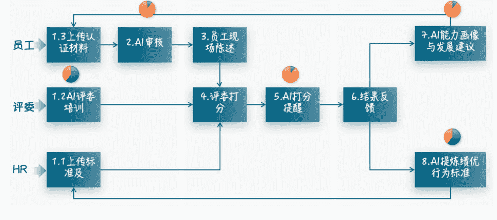

图3-18 任职资格认证评价流程简要示意图

互动：

1. 利用AI了解知名企业在知识标准和技能标准认证方面的典型做法。
2. 对于首次认证，企业配套基础差，知识标准和技能标准认证该如何处理？

接下来，我们将详细说明认证流程中的四个关键环节。

#### 一）AI审核（自动化初筛）

AI自动比对员工提交的材料和标准要求，快速筛选出不符合硬性条件的候选人。例如，某个层级基本要求之一为5年以上工作经验，如果员工的工作年限不满足这个要求，AI会自动将其标记为“不符合”。

更重要的是，AI还能基于员工提交的材料进行自动分析和初步评审。以下是一个简要案例，展示这一过程的应用。

##### 案例：AI自动化初筛资格

背景：某企业销售序列行为标准中的客户关系模块，行为标准如下。

| 行为模块 | 要素 | 行为标准 |
| :--- | :--- | :--- |
| 客户关系 | 需求分析 | 分析所负责客户（内部或外部）要求、需要和需求，及如何满足他们。分辨出客户讲出来的、真实的和未讲出来等需求之间的差异，准确地捕捉到重大的市场机会。 |
| | | 了解并预测主要竞争对手（传统的和新兴的）的目标、战略、市场份额、方法论、文化、产品种类、趋势和成本结构，对公司竞争地位和客户满意度的影响。 |
| | 关系建设 | 具备开发和维持重要客户关系的能力，能够通过高效沟通提升客户忠诚度。 |
| | | 能够识别客户组织内部的关键决策者，并与其建立深度合作关系。 |

某员工提交了该模块的认证材料：A和B案例。以下内容是B案例资料。

###### 案例名称：深圳客户（MT）分路器产品合作

情境（Situation）：

深圳MT公司正在参与某运营商FTTR项目的投标，需求包括1分5和1分9分路器成品。由于项目紧急且要求严格，MT需要根据客户端需求，及时提供报价并确保产品满足验证要求。

任务（Task）：

负责处理1分5和1分9分路器的报价及样品送检，确保产品符合客户需求，并配合客户推进项目进程。

###### 行动（Action）：

1. 客户拜访：拜访深圳MT的采购团队，详细了解项目需求，确认两款产品的总需求量为30万支。
2. 信息收集与分析：调研竞争对手情况，了解到运营商之前为MT提供的样品是来自GX公司，且GX的报价偏高。GX产品属于外购成品，而非自制产品。
3. 报价制定：根据客户的需求和市场信息，针对1分5和1分9分路器产品提出报价，分别为含税22.5元和30.5元，尽管价格较市场价格略高，但结合产品质量和技术要求，提供了有竞争力的报价。

###### 结果（Result）：

客户根据报价下单了小批量样品订单。目前样品已送运营商进行验证，后续需求正在跟进。

##### 输入指令：

请根据行为标准要求和评分指引，对员工提交的案例材料进行打分，并提供具体反馈，指出员工的优点与不足。

###### 评分指引如下：

| 评分 | 解释 |
| :--- | :--- |
| 5分 | 完全达标且部分超标：员工展示了超出标准的行为，完全符合标准要求，并且提供了创新性的解决方案或超越预期的成果。 |
| 4分 | 总体达标：员工的行为符合标准要求，完成了任务并达成了预期目标。 |
| 3分 | 基本达标：员工的行为有一定的基础，能够完成任务，但缺乏深度或系统性思考，未完全满足标准的高要求。 |
| 2分 | 大部分不达标：员工的行为存在明显的缺陷，未能满足标准中的核心要求。 |
| 1分 | 不达标：员工未能展示符合标准的行为，或者没有达成预期的工作成果。 |

AI反馈：

该员工在客户关系模块的评价如下。

1. 需求分析：A和B案例中，……符合标准中的需求分析要求。然而，案例中没有提到对竞争对手支撑战略的深入分析。
2. 关系建设：在A案例中，……展示了强有力的客户关系建设能力。在B案例中，员工通过拜访客户并收集信息，显示了较为基础的客户关系维护，尽管在后续工作中有所改进，但没有强调长期稳定关系的建立。

评分：4分（总体达标）。员工的表现符合行为标准的要求，特别是在关系建设方面，但在需求分析的深度和复杂度上稍显不足。

在实际操作中，可以通过IT调用API，自动进行员工评价和打分，生成初筛建议报告。当然，但最终的复核工作依然需要HR来完成。

#### 二）AI驱动的评委能力管理

在认证资格认证环节中，评委的选择与培训至关重要。

但现实中，评委往往并非标准制定者，很多企业只做了简单培训，甚至直接上岗。这种做法虽然在“识别谁能胜任”上问题不大（类似集体面试），但忽略了评审的深层价值——如能力引导、发展建议等，也容易削弱员工的信任感。

问题的一大根源在于HR流动性大，难以持续积累评审经验。引入IT和AI技术，可系统性缓解这一难题，具体可从两方面着手。

##### 1. 利用AI培训评委

AI可通过案例分析、视频讲解和评分模拟等方式，帮助评委理解评分标准、提升评审能力，有效减少因经验差异带来的评分偏差，提升评审的公平性与一致性。

##### 2. AI监控评委评分过程

AI系统可实时监控评委评分情况。当评分差异超过设定阈值时，系统将自动提醒评委复审并讨论，促进结果一致，避免因偏差过大影响评审公正性。具体示例如表3-7所示。

###### 表3-7 评委打分与建议操作表示意

| 行为模块 | 权重 | 行为标准 | 打分 |
| :--- | :--- | :--- | :--- |
| 市场洞察 | 20% | 1. 独立分析所在地区和领域的市场趋势……。<br>2. 运用 SWOT 分析法和波特五力模型……。<br>3. 记录和分析客户的历史订单、互动记录……。<br>4. 掌握并应用时间序列分析法和……。 | 5 |
| …… | …… | …… | 3 |
| 资源协调 | 20% | …… | 4 |
| 评委建议 | …… | | |

在5分制评分体系中，评分差异的建议阈值一般为0.5至1分，以保障结果的一致性与公正性。若评分标准明确、评委判断趋同，可适当收紧阈值；反之，标准较宽或评委经验差异较大时，可适当放宽。

评审过程中，可通过屏幕展示评委评分（匿名）和AI评分结果，通过可视化实时对比差异，促进更公正、全面的讨论，如表3-8所示。

###### 表3-8 评委打分可视化对比示例

| 模块\评委 | 行为模块 | 总分 |
| --- | --- | --- |
| | 市场洞察 | 市场开发 | 客户关系 | 商务谈判 | 资源协调 | |
| 评委A | 4 | 3 | 4 | 5 | 3 | 4 |
| 评委B | 3 | 4 | 3 | 4 | 3 | 3 |
| 评委C | 4 | 4 | 4 | 5 | 3 | 4 |
| 评委D | 5 | 4 | 5 | 5 | 4 | 5 |
| 评委F | 3 | 3 | 3 | 4 | 3 | 3 |
| 均值分 | 3.8 | 3.6 | 3.8 | 4.6 | 3.2 | 3.75 |
| AI评分 | 4 | 3 | 4 | 5 | 3 | 3.5 |

#### 三）AI能力画像与个人提升建议

许多企业在认证后只给出一个“是否达标”的结果，缺乏明确、针对性的反馈。这导致任职资格体系“不仅识别人才，更要培养人才”的核心价值大打折扣。

引入AI后，可自动生成能力画像，并提供个性化的提升建议，推动“人才评价”走向“人才发展”。

##### 案例：认证结果反馈

输入指令：

根据以下信息，为员工生成能力画像和个性化提升建议：

- 员工姓名：张伟
- 职位：目前是销售经理，申请晋升高级销售经理
- 任职资格标准附件（行为模块）
- 评委评分结果附件
- 360度反馈报告附件

输出：

- 总体评价：包括综合得分及优势和短板项；
- 员工能力画像：行为标准各模块的得分情况。
- 问题定位：指主要扣分项及扣分原因。
- 根因分析：根据评分结果及360报告总结提取。
- 改进建议：如参加培训、实践锻炼等建议。

要求：

以表格的形式展现。

AI反馈：

| 基本信息 | 姓名：张伟 申请晋升高级销售经理 |
| :--- | :--- |
| 总体评价 | 综合得分：76.6分（标准线80分），未达标。<br>- 优势项：资源协调（90分，超标准3.4%）。<br>- 短板项：客户关系（65分，低于标准15%）。 |
| 能力画像 | | 评估维度 | 权重(%) | 张伟得分 | 基准值 | 是否达标 |
| :--- | :--- | :--- | :--- | :--- | :--- |
| | | 市场洞察 | 40% | 85 | ≥80 | |
| | | 市场开发 | 20% | 82 | ≥80 | |
| | | 客户关系 | 20% | 65 | ≥75 | |
| | | 商务谈判 | 10% | 78 | ≥75 | |
| | | 资源协调 | 10% | 90 | ≥80 | |
| | | 总评得分 | - | 79.4 | ≥80 | |
| 问题定位 | 张伟的总评分为79.4，低于晋升标准（80），其中“客户关系”未达标，成为主要扣分项。 |
| 根因分析 | 1. 数据分析能力不足：<br>-近半年销售预测准确率仅为62%（标准≥75%）。<br>-市场洞察报告未被采纳（3/5份报告缺乏竞品对比）。<br>2. 团队协作待提升<br>跨部门协作项目参与度仅40%（标准≥60%）。<br>3. 内部匿名反馈 |
| | “沟通时缺乏主动性”（评分 2.8/5）。 |
| 改进建议 | 1. 培训计划<br>-必修课程：《数据驱动的销售决策》（目标：预测准确率提升至 70%）。<br>-选修课程：《跨部门协作与资源整合》（目标：协作评分提升至 3.5/5）。<br>2. 实践建议<br>-主导 1 次跨部门项目，并在季度总结会汇报成果。<br>-每月提交 2 份含竞品分析的市场报告。 |

通过反馈，清晰的告诉员工：哪些能力项目已经达标？差距在哪？该怎么补？于是，认证从一张分数表，变成了一张成长地图；从一个终点，变成了发展的起点。

#### 四）AI驱动的标准动态迭代

在AI赋能的任职资格认证中，行为标准需持续更新，以确保与业务发展同步，及时吸纳优秀员工的实际表现。操作包括以下三个步骤。

- 标杆行为案例推荐：在自我陈述阶段，若某一案例突出，评委在线可推送给HR。
- AI行为标准提炼：评审结束后，AI对推荐案例进行分析，自动提炼关键行为特征。操作原理和认证评价类似。
- HR审核与采纳：HR对AI提炼出的新标准进行审核，判断其是否适用于当前岗位层级，并评估其对组织的价值。

这样一来，就可以把优秀员工的经验源源不断的纳入到标准中来，实现更新迭代，把员工个人的知识转化为组织的知识资产。

##### 案例：行为标准的优化

输入指令：

根据以下员工行为案例，请提炼出“客户关系管理”和“需求分析”行为模块相关的行为标准。

案例信息如下：

情境（Situation）：负责与一家长期合作的企业客户进行项目沟通，客户反馈在技术升级上存在困难，需要提高产品的市场适应性。我收到反馈后，决定与客户进行深入沟通，了解更多细节。

任务（Task）：需要在短时间内分析客户需求，并为客户提供改进方案，同时保持良好的客户关系，确保双方的合作继续顺利。

行动（Action）：

- 拜访了客户公司，进行了面对面的需求调研。
- 在与客户沟通时，主动提出了对产品的改进建议，并针对客户的痛点提出了几种解决方案。
- 通过行业分析数据，帮助客户洞察市场趋势，进一步明确了客户的核心需求。
- 随后，为客户设计了几种不同的改进方案，并提供了相应的报价和实施计划。

结果（Result）：客户对建议感到满意，最终决定采纳其中一种方案，并在两周后签订了新的合作协议，成功推动了项目进展。

AI反馈：

###### 1. 客户关系管理行为标准

- 能够主动与客户保持沟通，定期进行回访。
- 在客户需求未显现时，能够通过提问和调研主动挖掘客户需求。
- 展示出积极的解决问题态度，并能持续跟踪客户的满意度和反馈。

###### 2. 需求分析能力行为标准

- 能够快速识别客户的核心需求，包括显性需求和潜在需求。
- 运用市场数据、行业分析、客户反馈等信息，为客户提供精准的解决方案。
- 提供的方案能够解决客户当前痛点，并预见客户未来的需求。

这一流程实现了AI与HR的高效协同，不仅推动标准动态优化，也增强了其对真实场景与业务需求的适配性。

##### 小结

任职资格体系构建失败，往往源于四大问题：与业务脱节、标准开发能力不足、体系僵化难以更新、认证过程缺乏严谨性。

AI的价值，正是在这四个环节中提供系统性支撑，使原本依赖“专家手工雕刻”的高成本路径，转向“AI辅助生成、HR精准修正”的协同模式，既提升效率，又增强可迭代性与落地性。

这一变革显著提升了将专业体系从外部顾问转移至组织内部沉淀与复制的可行性。

## 第三节 薪酬管理体系：HR体系的能量引擎

薪酬体系的核心任务，是在内部公平、外部竞争和战略导向之间找到平衡点，实现“二元均衡”：既贴近市场，又服务战略；既能激励人心，又能管控成本。

归纳来看，薪酬体系要解决三个关键问题。

- 为什么给。所有薪酬设计都应围绕战略展开，讲究投入产出比，把资源花在真正能带来业务回报的地方。
- 给多少。企业需结合自身承受能力与关键人才需求，设定合理水平，避免盲目追随市场。
- 怎么给。薪酬要素如何组合？固定与浮动薪酬如何分配？这些决定了激励的精准性与机制的可持续性。

HR基础体系（职位/任职资格）搭建完毕后，若薪酬体系跟不上，整个机制很快就会失效。毕竟，没有利益驱动，少有人愿意接受规则和约束。只有触及利益，才能触动灵魂。

### 一 AI协助分析与制定薪酬政策

薪酬是一个古老而成熟的领域，成功范式几乎覆盖了企业在不同发展阶段面临的各种调整与挑战。正因如此，AI在薪酬分析与优化上具备天然优势——关键在于，你提供的信息是否足够清晰、有结构。

如图3-19所示，影响薪酬政策的要素，可归为三个主要维度（图顶黑色区域），进一步拆解为八个关键要点。若希望AI进行深入分析，还需补充企业在岗位、人才与绩效方面的基础信息（即经典的3P模型：岗位定薪、能力定薪、绩效定薪，对应图底黑色区域）。

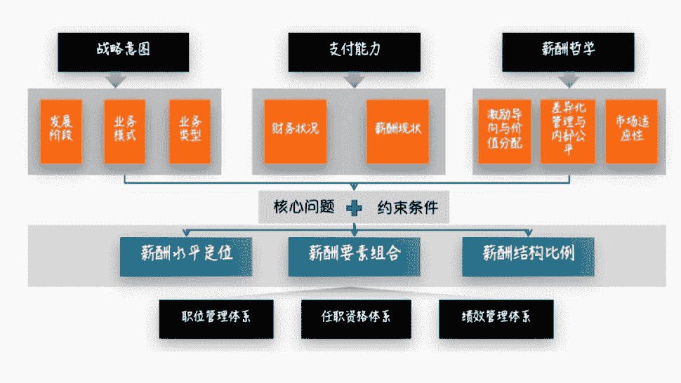

图3-19 薪酬政策重要影响因素示意图

当然，别忘了说明要分析的核心问题与边界条件，让AI更精准地聚焦目标、输出建议。

具体而言，薪酬政策主要包括三个方面（见上图蓝色部分）。

首先是薪酬水平定位。明确企业在市场中的定位，包括基本薪酬、总现金收入以及长期激励（如股权、福利等）的对标策略。

其次是薪酬要素组合。不同薪酬要素功能各异，如基本工资、津贴、奖金、股权激励等，需结合岗位特性合理搭配（详见表3-9）。

#### 表3-9 薪酬要素组合的内涵

| 要素 | 本质内涵 | 特点 |
| :--- | :--- | :--- |
| 工资 | 劳动力的市场价格，支付给正常劳动和绩效的报酬 | 刚性部分<br>保健作用 |
| 津贴 | 补偿特殊工作条件下的额外劳动消耗与支出 | |
| 补贴 | 因物价变动等因素而设立的生活成本补偿 | |
| 福利 | 与个人劳动关系不大的非现金性收入 | |
| 奖金 | 对超出标准绩效的奖励 | 弹性部分<br>激励作用 |
| 股权激励 | 包括分红、股票、期权等，将知本与贡献转化为企业价值共享机制 | |

最后是薪酬固浮比例。在同一薪酬总量下，固定与浮动的配比差异，往往决定了激励强度和行为导向。其背后反映的是企业对人才的理解与所在行业的激励偏好。

接下来，通过三个典型案例，来看AI如何辅助分析与优化薪酬政策。

#### 一）薪酬政策如何契合战略导向

薪酬政策的本质，是组织价值观与战略意图的制度化表达。

一套真正有效的薪酬设计，不仅承担激励与分配的基本功能，更应作为连接战略目标与人才行为之间的关键机制。

AI正逐步成为薪酬设计中的系统性思考助手，为组织提供更高效、更具前瞻性的决策支持。

##### 案例：如何用薪酬牵引人才奔赴新业务

背景：某建筑信息化软件公司于2010年上市，截至2019年，业务主要分为三大板块。

工程造价业务BG：核心业务板块，已进入成熟期。产品涵盖算量、计价、成本管理等SaaS服务，完成云转型，市场份额高，盈利稳定，具备明显行业优势。

数字施工业务BG：2018年启动，聚焦项目管理平台与智能硬件，处于高速成长阶段，尚未盈利。该业务以综合解决方案为主，交付复杂、实施难度高，对团队的整合与专业能力要求较高。

其他业务（孵化中）：如数字设计BG等，仍处孵化探索阶段，尚未形成规模营收。

###### 1.当前挑战

数字施工BG任务重、难度高，但由于仍在投入期，尚未盈利，延用“工资+利润分成”的激励模式已基本失效，员工难以获得奖金回报。

相比之下，造价BG盈利稳定、激励机制明确，员工更倾向留在原岗位，极少主动转入施工BG。尽管新业务急需市场型人才和高水平方案专家，现有薪酬体系缺乏吸引力，导致人才引入与留存双重受限。

> 内部甚至戏称：“去施工BG的，都是被发配过去的。”

###### 2.任务目标

公司希望通过薪酬机制调整，打破激励障碍，引导核心人才向数字施工BG流动，支撑新业务战略发展。

##### 输入指令：

你是一名资深薪酬专家。请结合以上背景，识别当前激励机制存在的问题，并提出针对性的薪酬调整方案。

##### AI反馈：

####### 1.核心问题诊断

- 激励机制错配：当前利润分成制与新业务的成长阶段严重脱节——尚未盈利即意味着“零激励”；
- 风险与回报不对等：施工BG交付复杂度高、压力大，但薪酬未体现岗位难度与挑战系数；
- 文化标签负面化：成熟业务“现金牛”形象强化稳定预期，反衬新业务缺乏吸引力，削弱了内部流动动力。

####### 2.薪酬调整方案

原则：建立“战略补贴+过程激励+长期确权”的三维激励模型，与造价BG形成差异化薪酬结构。核心理念是：“用成熟业务的利润，喂养未来业务的希望”。方案如下：

| 薪酬模块 | 施工 BG（成长型） | 造价 BG（成熟型） |
| :--- | :--- | :--- |
| 固定工资 | 基准工资×1.2（行业 75 分位） | 基准工资×1.0（行业 50 分位） |
| 短期激励 | 项目里程碑奖金（签约/验收/回款） | 利润分成（季度计提） |
| 长期激励 | 限制性股票（4 年解锁，与业务增速挂钩） | 期权（3 年匀速解锁） |
| 战略补贴 | 难度系数补贴（项目复杂度×2-5 万元） | 无 |
| 亏损兜底 | 保底奖金（目标奖金的 60%，与战略 KPI 挂钩） | 无 |

####### 3.操作要点

1）保底奖金计算

实际发放=Max（业务线实际奖金，目标奖金×60%×战略KPI完成率）。

战略KPI=合同金额达成率（40%）+客户NPS（30%）+产品迭代进度（30%）。

2）难度系数评估

建立项目分级模型（见下表），由技术委员会每季度审定系数。

| 项目等级 | 客户类型 | 定制化程度 | 技术难度 | 补贴标准 |
| :--- | :--- | :--- | :--- | :--- |
| S 级 | 央企总部 | 全定制开发 | AI 集成 | +5 万元 |
| A 级 | 省属建工集团 | 模块重构 | BIM+物联网集成 | +3 万元 |
| B 级 | 中型开发商 | 配置调整 | 标准接口 | +2 万元 |

3）职级发展机制优化

增设G序列（增长岗），面向数字施工BG，晋升节奏比现有P/M序列快约30%。如P6需4年，G6晋升仅需2.8年。

交叉晋升权利：G序列员工可优先竞聘造价BG高阶岗位。派驻人员保留原职级及薪资，并获得额外派驻补贴=基本工资×30%。

####### 4.实施路径与风险控制

1）成本测算与资金来源

- 年增量成本预估约2000万元：战略补贴（1200万）+保底奖金（800万）；
- 可通过IPO募投资金专项列支；
- 成本回收机制：施工BG毛利率转正后，从超额利润中按15%提取回填基金池。

2）风险防控机制

- 施工BG的薪酬总额不得超过该业务线营收的45%（当前为38%），确保投入边界可控；
- 人员回流保障：从造价BG调入施工BG的员工，如在两年内申请回调，保留原职级与薪酬水平；
- 熔断条款：若连续2年数字施工BG营收增速<20%，启动薪酬结构复审。

输入指令：

在薪酬结构层面，请进一步明确：

- 各薪酬要素在施工BG与造价BG中的具体调整方式；
- 如何实现差异化的考核与激励策略。

AI反馈：

####### 1.薪酬要素水平调整矩阵

| 薪酬要素 | 施工 BG（成长型业务） | 造价 BG（成熟型业务） |
| :--- | :--- | :--- |
| 固定工资 | 行业 75 分位值+战略溢价 | 行业 50 分位值 |
| 短期激励 | 项目里程碑奖金：（签约 10%+验收 40%+回款 50%）+保底奖金（目标奖 60%） | 利润分成：(季度净利润×3%-5%计提) |
| 长期激励 | 限制性股票（与业务增速挂钩），解锁条件：年营收增长≥30%解锁 40%客户数增长≥50%解锁 60% | 标准化期权（3 年匀速解锁，与股价挂钩） |
| 福利组合 | 1. 弹性工作制（项目期集中休假）2. 子女国际教育津贴（高管层级）3. 技术移民支持（海外项目） | 1. 高额公积金（12%上限）2. 补充商业保险3. 稳定带薪年假 |

####### 2.差异化实施要点

增量薪酬成本预估约2500万元/年：

- 集团战略基金：60%（由成熟业务利润计提）；
- 政府补贴：40%（可申请“智能建造试点企业”专项支持）。

####### 3.绩效考核差异化

| 指标类型 | 施工 BG | 造价 BG |
| :--- | :--- | :--- |
| 财务指标 | 30%（收入增长/客户数） | 50%（利润率/续费率） |
| 客户成功指标 | 40%（NPS/解决方案复用率） | 30%（客单价/投诉率） |
| 产品技术指标 | 30%（专利数/模块标准化率） | 20%（交付准时率） |

本案例中，AI并不代替人判断，而是在结构搭建、变量梳理与多方案推演上，为HR提供了强有力的决策支持。关键在于：输入足够清晰，输出才足够精准。

#### 二）薪酬倒挂现象如何处理

公平感是薪酬激励体系中的隐性底线。一套有效的薪酬机制，不仅要具备外部吸引力，更必须在组织内部经得起横向比较与纵向积累的检验。

然而，现实中不少企业在初建薪酬体系后，未能随着市场变化和组织演进进行动态更新，结果往往演化为薪酬结构的失衡与“倒挂”现象。

尤其在当前人才结构日益多元、期望差异显著的背景下，如何在不打破既有薪酬体系稳定性的前提下，回应个体价值的差异化诉求，正成为HR不可回避的挑战。

##### 案例：薪酬倒挂问题

背景：某芯片制造企业，位于中国内地五线城市，已成功在科创板上市。企业早期为提升人才吸引力，构建了一套相对激进、具有竞争力的薪酬体系。

- 操作类岗位：薪酬略高于本地平均，保障基础岗位稳定；
- 技术类岗位：主要从发达地区引入，薪酬定位于行业75分位；
- 管理及专业类岗位：对标省会城市中位值，保障人才吸引力。

###### 1.问题演变

随着企业业务扩张和行业竞争加剧，原有薪酬体系未及时动态调整，逐渐显露以下问题。

- 多数岗位薪资水平与市场趋于持平，个别岗位甚至低于行业均值；
- 员工对外部机会敏感度上升，企业吸引与保留人才的难度加大。

###### 2.核心问题：薪酬倒挂

公司上市后，为支撑技术创新与资本市场预期，高端人才引进需求迅速上升。然而：

受限于地理区位劣势，外部人才普遍开出高于内部标准的薪资期望；

在未能同步调整内部薪酬的情况下，新进员工薪资普遍高于现有员工，形成明显的“薪酬倒挂”现象。

###### 3.后果与影响

这一结构性失衡带来了多方面挑战：

- 内部公平感削弱：资深员工产生“吃亏”感，易引发消极对比；
- 激励体系失效：薪酬不再与经验、能力、贡献挂钩，打击工作积极性；
- 组织信任基础动摇：员工对管理层人事制度产生质疑，影响文化氛围与团队稳定性。

输入指令：

你是一名资深薪酬专家。请结合上述企业背景，设计一套兼顾外部高端人才吸引力与内部公平性的薪酬优化方案，确保整体激励体系的可持续性与组织认同感。

在设计方案时，请严格遵循以下限制前提：

1. 现有体系不可变动

现有员工的薪酬结构与水平保持不变，不得进行直接调整或补偿性改动。

2. 外部人才期望偏高，偏好现金激励

拟引进的外部高端人才普遍期待较高的固定薪酬水平，对长期股权激励工具接受度较低，短期内难以形成吸引力。

3. 激励工具受政策和条件限制。

企业虽有股权激励规划，但受制于制度审批与合规流程，短期内（1-2年内）尚无法正式落地实施，不宜作为当前主方案依托。

AI反馈：

###### 1.引入“双轨制薪酬”

1）设立“市场调节津贴”或“特殊引进补贴”。

单独为高薪外部人才设置专项补贴，用于弥补固定薪酬差距，不计入基本工资结构，避免对现有员工造成直接影响。

2）时间设定与考核机制。

补贴建议设置3-5年有效期，并与业务成果或研发进度挂钩，按年度评估是否续发，避免形成永久性固薪。降低内部冲击感知。

补贴以独立项发放，既满足外部人才吸引力，又避免引发内部员工对“工资不公”的心理反弹。

###### 2.优化绩效奖金结构

1）提高绩效比例，弱化固定部分。将一部分高薪需求通过季度/年度绩效奖金释放，提升初期竞争力的同时引导成果导向。

2）采用分期发放机制。如入职半年后支付50%，满一年后支付剩余部分，增强留存稳定性，防范“高薪短期跳槽”行为。

###### 3.设立“定制化岗位”吸引人才

针对特别关键、高薪定位人才，可设立如“特聘专家”“高级顾问”等短期定向岗位，采用独立薪酬测算模型，不纳入统一岗位体系，避免干扰现有结构。

###### 4.强化隐性激励与非现金福利

1）补贴生活成本：因地理位置偏远，建议提供住房补贴、通勤便利等实物激励，降低对高薪的直接依赖。

2）强调职业成长价值：通过明确晋升路径、管理通道及能力成长计划，构建“长期可预期”的非现金吸引力。

###### 5.长期薪酬结构优化建议

随着企业规模和利润增长，建议逐步拉升内部关键岗位薪酬水平，至少对齐行业75分位，以系统性方式重建薪酬竞争力，避免持续依赖“特殊补贴”解决结构性问题。

要让AI真正辅助解决薪酬倒挂这类高度敏感、具备结构性矛盾的问题，关键在于三个层面的系统引导：（1）准确还原问题背景，清晰描述现状与核心冲突点；（2）结合业务逻辑逐项拆解，明确策略空间与实施边界；（3）引导AI站在系统视角提供建议，输出多维度、可比较的分析路径，而非单一的线性答案。

#### 三）业务模式与薪酬模式的同步转变

薪酬模式从来不是孤立设计，而是紧扣业务模式运行逻辑。业务模式决定价值创造路径，也决定组织如何分工协同。随着协作方式与岗位界面的变化，薪酬机制也需同步调整，包括绩效指标设定、激励节奏安排与固定/浮动薪资比例等。

在现代组织中，薪酬不仅是分配工具，更是驱动协同、引导行为、支撑战略的关键杠杆。

##### 案例：销售体系薪酬模式的转变

背景：某生物科技公司于2021年在科创板成功上市，业务涵盖四大板块。

中间体业务事业部：核心板块，产品标准化程度高，运作成熟；

动物营养、功能食品与营养、日化护理事业部：三大新兴业务，正处于快速拓展阶段。

###### 1.新兴业务呈现出明显不同的销售特征

协作链更长：以综合解决方案为主，需销售、技术支持、产品经理等多角色协同推进。

销售周期较长：特别是在功能食品与日化领域，销售过程伴随客户产品开发，节奏缓慢、关系维护要求高。

销售逻辑更复杂：由传统的“产品成交”转向“价值交付”，业绩评估不能仅依赖销售额。

###### 2.薪酬现状与挑战

目前仍沿用“底薪+个人提成”的传统模式，在中间体业务中适用良好。但在新兴业务中，该模式难以反映团队协作贡献，激励逻辑滞后，正逐步失去效力。

###### 3.任务目标

公司希望构建面向协同场景的新型销售薪酬体系，既能强化整体作战力，又保留个人贡献驱动，支持业务从“单点成交”向“整体解决方案”的演化路径。

输入指令：

请你作为资深薪酬专家，请根据以上背景，设计一套适用于新兴业务的销售薪酬模式，要求兼顾个人激励与团队协同，适应多角色合作与价值销售的业务特征，要求说明理由。

AI反馈：

建议从“个人销售提成”转向“团队业绩共享+综合激励”模式。

| 薪酬要素 | 调整方案 | 调整理由 |
| :--- | :--- | :--- |
| 底薪 | 适当调整（销售经理底薪比例上升） | 稳定主力角色收入，弱化对短期提成的依赖 |
| 团队奖金 | 以事业部整体或小团队（销售+技术+产品）为单位发放 | 新业务销售模式需要团队合作，共享业绩，提高整体战斗力，避免单纯拼个人销售额 |
| 项目激励 | 针对大型客户、战略项目设定专项奖励 | 鼓励团队成员积极投入长周期的大客户维护，提高高价值客户的成交率 |
| 个人激励 | 仍设有绩效奖金，但降低比例 | 保留个体贡献激励，防止“协同掩盖不作为”现象 |

输入指令：

请详细说明团队奖金的设定标准及其在团队成员之间的分配机制。

AI反馈：

奖金方案应在确保激励效果的同时，合理反映多角色协作对销售成果的实际贡献，避免“个人驱动”对团队绩效的过度放大。

###### 1.团队奖金池的设定方式

奖金池建议以销售额或毛利为基础，提取固定比例，以保证激励强度与成本控制的双重平衡。常见有两种设定模式。

模式1：按销售额比例设定（适用于利润较稳定的产品）

团队奖金池=事业部销售额×设定提成比例

设定标准参考：

- 成熟业务（如中间体）：1%-3%；
- 新业务（如功能食品）：3%-6%（因新业务难度大，适当提高）。

模式2：按毛利设定（适用于利润波动较大的产品）

团队奖金池=（销售额-成本）×设定毛利提成比例

设定标准：

- 高毛利产品：提成比例10%-15%；
- 低毛利产品：提成比例5%-8%；

###### 2.团队奖金的分配方式

奖金池确定后，需要按照贡献度分配给团队成员。分配原则应综合考虑直接贡献和支持贡献，可以采用固定比例+绩效考核的方式。

团队成员角色与分配权重如下示例：

| 角色 | 核心贡献 | 分配权重（建议） |
| :--- | :--- | :--- |
| 销售经理 | 负责客户开发、谈判、合同签订 | 40%-50% |
| 技术支持工程师 | 方案设计、技术交流、客户测试支持 | 20%-30% |
| 产品经理 | 产品定制、市场推广、客户需求对接 | 10%-20% |
| 销售支持/运营 | 订单执行、客户关系维护 | 5%-10% |

###### 3.具体分配机制建议

奖金分配可分为两部分：

1）基础分配（70%-80%）

依据上述权重比例进行预设，保障各角色基本激励。

2）绩效浮动分配（20%-30%）

根据具体KPI完成情况进行二次调整，常见考核指标包括：

- 个人销售目标达成率；
- 客户满意度（由客户反馈评分）；
- 交付项目数量（适用于技术支持）；
- 产品方案落地率（适用于产品经理）。

此机制既确保回报分布的可预期性，又强化对实际贡献的动态反馈。

###### 4.配套保障与强化机制

最低保底：为技术支持、产品经理等间接岗位设定最低奖金额度，避免因销售波动影响其稳定收入。

超额奖励：当团队整体销售或毛利超出目标时，奖金池可按预设比例递增，形成二次激励，鼓励团队冲刺更高绩效。

要充分发挥AI在薪酬模式设计中的价值，关键在于有步骤、有结构地引导AI完成建模过程：先从问题识别与目标澄清入手，逐步过渡到关键变量分析、逻辑结构构建，再细化到激励元素设计与配比策略优化。这一过程既是从“问题到答案”的递进，也是从“战略到执行”的层层下沉。

薪酬政策确定好了，薪酬体系就有了灵魂。剩余的设计工作，AI可以发挥更为显著的辅助作用。

### 二 AI赋能市场薪酬数据对标，辅助设计薪酬表

职位体系是薪酬体系设计的基石。只有明确职位架构，才能确保薪酬体系的科学性与公平性。图3-20展示了典型的薪酬体系设计流程。

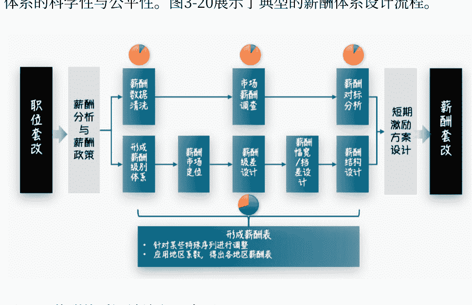

图3-20 薪酬体系设计流程示意图

互动：AI查询

- 职位套改与薪酬套改的概念、实施流程及应用方法，并结合典型案例，分析常见问题及应对方案。
- 薪酬体系的级差、幅宽和档差设计的作用、计算方法及关键考量因素，并提供具体示例说明。

接下来，将围绕四个要点讲解如何利用AI辅助薪酬级别表的设计。

#### 一）内部薪酬数据清洗

薪酬激励既不能失准，也不能失衡。其前提，是对内部数据的精准掌握与清洗。数据的准确性，决定了对标的科学性，也决定了后续激励机制的公允性。

首要工作是进行数据标准化处理，确保不同岗位、职级、序列间的薪酬信息具备可比性。这包括统一口径、剔除异常值、明确薪酬口径边界（如是否含津贴、奖金、长期激励等），为后续的对标分析与策略建模打下数据基础。

示例指令：

请将附件薪酬数据进行标准化处理，包括：

- 货币单位统一为CNY（转换USD/EUR汇率按2024年均价）；
- 薪资数字格式规范为“45, 000.00”（千分位分隔）；
- 职级字段映射为P序列：原“高级工程师Ⅱ” → “P6”，原“首席科学家” → “P10”；
- 异常格式存入待审核队列并标注原因。

在数据标准化后，还需进行异常值分析，确保数据完整、准确、一致。

示例指令：

你是一名薪酬分析师，请你分析附件薪酬表中异常值，要求：

- 识别基本月薪超过同职级3倍标准差记录（排除高管岗）；
- 标记年终奖金额为负数的异常数据；
- 检测社保缴纳基数与月薪不匹配记录（阈值±20%）；
- 输出异常记录统计表，按部门分类展示修复建议。

#### 二）市场薪酬数据调查

市场对标，是薪酬设计中衡量竞争力与合理性的关键参照。

在技术赋能下，可借助AI算法或网页爬虫工具快速获取市场薪酬数据，提升时效性与覆盖范围。为确保数据的真实性与参考价值，建议将AI采集数据与传统薪酬调研报告结合使用，通过多源交叉验证、趋势比对实现信息互补，提升数据的可用性与决策支撑力。

示例指令：

##### 1.薪酬数据爬取

你是一名薪酬分析师，请爬取以下职位的市场薪酬数据：

- 职位：高级数据分析师（Senior Data Analyst）；
- 经验：3-5年；
- 地区：北京/上海/深圳；
- 数据来源：猎聘、BOSS直聘、Glassdoor；
- 需要输出数据：薪酬范围（P25-P75）、基本薪资、绩效奖金、长期激励（股权/期权）；
- 按照P50/P75/P90生成表格形式。

排除条件：

- 非上市公司；
- 企业规模（500人以下/以上）。

##### 2.数据源交叉验证

请对以下数据源进行交叉验证，生成可信度评分：

- 来源A：美世《2024中国薪酬报告》P50值；
- 来源B：猎聘平台AI提取的北京算法岗薪资；
- 来源C：脉脉匿名用户薪酬爆料数据。

要求：当差异＞20%时，自动触发人工复核标记。

##### 3.薪酬预测

请基于过去3年的薪酬数据，预测未来12个月内高级Java开发工程师的薪酬增长趋势：

- 过去数据：2021年：30K/月，2022年：34K/月，2023年：38K/月；
- 需要输出：2024年薪酬预测区间、预测增长率。

#### 三）薪酬对标分析

在完成内部数据清洗与外部市场调研后，下一步是开展薪酬对标分析，识别差距，明确优化方向。

借助AI分析工具，可对比不同岗位、职级、序列在内外部数据中的定位偏差，快速定位薪酬高估、低估或结构失衡的问题区域。

示例指令：

你是一名薪酬数据分析师，请基于以下数据生成薪酬对标可视化图表：

- 内部数据：[上传公司薪酬Excel]
- 外部数据：[上传市场报告PDF/CSV]

要求：

- 按城市（北京/上海/深圳）、职级（P5-P8）、部门（研发/销售）三维度对比；
- 图表类型：分位数曲线图（内部25/50/75分位vs市场50分位）；
- 标注内部薪酬低于市场25分位（红色）和高于75分位（绿色）的岗位；
- 输出格式：交互式HTML图表+Excel数据透视表。

在完成基础分析后，可进一步细化数据分析，提升分析深度和精准度。

##### 1.添加分析颗粒度

示例指令：

- 算法岗单独分析/管理序列剔除股权后对比；
- 按工作经验（1-3年、3-5年、5年以上）分组计算平均年薪。

##### 2.识别异常值

示例指令：

- 标注薪酬低于市场P10或高于市场P90的极端点；
- 输出异常职位清单（含部门/职级/偏离幅度）。

##### 3.生成分析报告摘要

示例指令：

- 总结关键结论（Markdown格式）；
- 可执行建议（如：建议调整的职级范围）。

##### 4.外部数据职级与内部不匹配情况的处理

示例指令：

请使用模糊匹配算法，将内部职级“P6”关联到市场数据的“Senior Engineer（Level III）”，置信阈值设定为85%。

##### 5.部分岗位样本量不足时的处理

示例指令：

对样本数<10的岗位，采用贝叶斯收缩估计法，借用全公司同类岗位数据进行修正。

AI在数据分析与处理上的优势大幅提升了工作效率，HR的核心任务则是审查并验证结果的准确性。

#### 四）辅助薪酬表的生成

在明确整体薪酬策略后，下一步是构建薪酬级别体系，实现岗位价值与薪资回报之间的系统匹配。

通常情况下，职位级别可直接映射到企业薪酬级别。但在实际操作中，可根据岗位特性与组织管理需求进行灵活调整（见图3-21）。

常见方式包括：

- 合并策略。将2-3个相邻职位级别合并为一个薪酬级别，形成更宽泛的带宽区间，简化管理；
- 细分策略。针对关键岗位，在同一职位级别内设立多个薪酬档次，以反映能力差异或市场行情，提高精度。

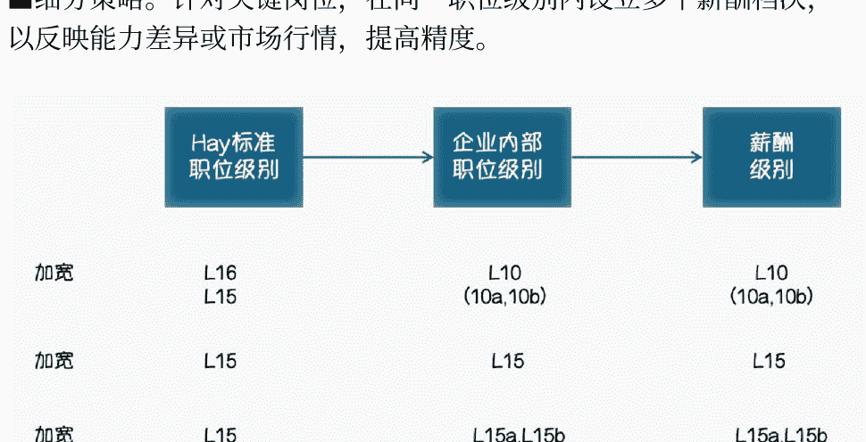

图3-21 职位级别与薪酬级别的对应关系示例

薪酬级别体系的设定，应综合考虑企业文化、人才发展路径、同一岗位员工能力差异情况以及薪酬管理的复杂性，最终由HR进行平衡与决策，确保制度在公平性、灵活性与执行性之间取得良好平衡。

示例指令：

请你根据附件（职位职级表）、（薪酬市场调查数据）和公司薪酬政策，生成P1-P8职级的薪酬表。

薪酬政策信息如下：

1. 薪酬水平定位（按总现金报酬）

- 基层（P1-P3）：对标市场50分位，保障竞争力；
- 中层（P4-P6）：对标75分位，吸引核心人才；
- 高层（P7-P8）：对标90分位，匹配稀缺性价值。

##### 2.薪酬级差、档差、重叠度、幅宽参数规则

- 级差（相邻职级中位值差距）范围：15%-25%（管理层级差>20%）；
- 档差（同一职级内薪资档位差距）规则：每职级分3档，档差8%-12%；
- 重叠度（相邻职级薪资范围交叉比例）要求：相邻职级交叉30%-50%；
- 幅宽（同一职级薪资范围跨度）控制：基层岗位幅宽≤40%，高管岗位幅宽≤60%。

输出要求：（可分步执行）

1. 薪酬带宽曲线图（横轴职级，纵轴薪资）
2. 薪酬级别表（横轴职级，纵轴薪资）格式如下表所示。

| 职级 | 年度目标现金薪酬基准值（元） | 薪档（月） | | |
| :--- | :--- | :--- | :--- | :--- |
| | | 1档 | 2档 | 3档 |
| 16 | 340800 | 23200 | 28400 | 33600 |
| 15 | 243600 | 16600 | 20300 | 24000 |
| ...... | | ...... | ...... | ...... |
| 3 | 42000 | 3300 | 3500 | 3700 |

薪酬级别表确定后，可进一步借助AI对现有薪酬进行结构分析，为薪酬套改提供数据支撑。相关操作在此不作展开。

互动练习：

请借助AI工具生成以下可视化图表，并结合输出结果进行分析：

- 薪酬散点图：展示员工在不同岗位级别上的薪酬分布；
- 薪酬趋势线：识别职位级别与薪酬水平之间的总体关系；
- 薪酬拟和度分析：评估职位级别与实际薪酬之间的相关性强弱；
- 离散性与异常点识别：分析薪酬数据围绕趋势线的偏离程度，找出可能的异常薪酬点。

##### 小结

AI在薪酬体系设计中的价值正持续提升，不仅显著提高效率，也带来了更强的分析精度与更快的策略响应能力。

未来HR的核心能力需要向两个方向深化。

首先，理解业务、洞察变化。HR必须具备敏锐的业务视角，读懂战略意图、捕捉组织转折点，主动用人力资源语言回应业务挑战。

其次，强化专业，精进提问。AI没有削弱专业性，反而对HR的系统思维提出了更高要求。唯有具备清晰框架和判断力，HR才能向AI提出高质量的问题，并做出明智的决策选择。

归根结底，AI能否带来有意义的洞察，不取决于算法本身，而在于我们是否能够设定清晰的问题边界与协作路径。

# 第四节 绩效管理体系：HR体系的传导系统

绩效管理，是战略意图向组织行为转化的核心机制。然而，它同时也是公认的世界级难题。其挑战，不在HR专业本身，而在HR职能以外：

- 未建立清晰的战略地图，绩效目标便无从锚定，沦为“无源之水”；
- 如管理者本身缺乏打胜仗的能力，绩效监控将异化为“表演式管理”；
- 衡量员工贡献的标准，始终面临复杂性与模糊性的双重考验。

绩效管理受多种因素影响，且高度动态，远比职位体系、任职资格或薪酬管理更具不确定性，如图3-22所示。

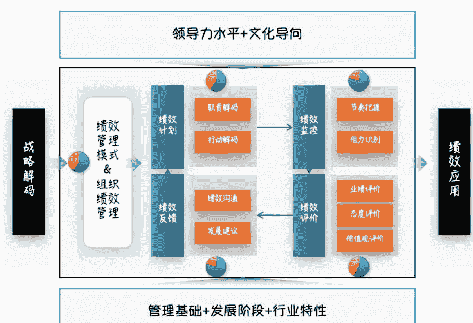

图3-22 绩效管理简要示意图

AI在这一领域的赋能，不如在上述三大基础体系中那样显性，但在特定环节与特定场景下，AI依然具备提升效率、辅助决策的现实潜力。

下面将结合典型实践，探讨AI如何参与绩效体系的具体环节。

## 一 借助AI扩宽绩效目标管理视角

有些HR常陷入“工具崇拜”——机械套用KPI、OKR等绩效工具，盲目追随趋势，或固守经验，却忽视了与企业实际的匹配性。然而，要真正避免工具崇拜，关键在于打破对单一绩效工具的迷信，重新审视企业实际需求，从而灵活选择合适的绩效管理模式。

### 一）AI辅助绩效管理模式选择

绩效管理模式的选取，应基于企业自身的战略节奏与管理现实灵活制定，而非照搬行业标杆。

- 行业属性不同，绩效关注点也不同。制造业更注重目标量化，喜欢用KPI来管控生产效率；而互联网企业更强调目标灵活性，更倾向用OKR做敏捷管理。
- 发展阶段决定了管理重点。初创期需要快速统一目标、快速反馈；成熟期则更关注流程规范和效率；转型期则要求绩效体系足够灵活，既能控方向，也能跟变化。
- 绩效方式要贴合企业文化和管理风格。赋能型文化适合开放、发展导向的绩效方式，比如双向沟通、成长型反馈；而强调控制、结果导向的文化，更适合结构清晰、量化明确的绩效工具。
- 管理基础决定了工具能不能落地。如果企业流程成熟、系统完备，可以使用数据驱动、精细化的工具；但如果管理还不够完善，就应先从简单、实用、能执行的方式做起，先跑通流程，再慢慢升级。

理论容易说清，实践落地才是关键。接下来，我们将通过一个案例，展示AI如何辅助企业选择合适的绩效管理模式，并制定相应策略。

#### 案例：绩效管理模式适配分析

背景：某民营建筑集团，总部设有人力、财务、项目管理、成本控制、法务等职能部门，旗下10家子公司独立经营、自负盈亏。目前产值约40亿元，员工规模约1000人。

企业特征：

1. 核心战略

一方面追求规模扩张，计划三年内将合同额从50亿元提升至100亿元，路径是“提高政府基建项目中标率+拓展产业资本合作”；另一方面，推动服务转型，从传统项目承包向一站式解决方案转型，覆盖投融资、策划、设计、施工、运营等环节。

##### 2.发展阶段

处于机会成长期到系统成长期过渡阶段，聚焦扩张与业务模式升级。

##### 3.组织文化

集团弱管控，子公司自主性强，整体呈“信任+放权”文化特征。

##### 4.管理基础

除项目管理和财务较为规范外，其余管理模块较为粗放，信息化水平偏低。

##### 输入指令：

你是一名资深绩效管理专家。请基于以上企业特征，分析其适配的绩效管理模式（如KPI、BSC、OKR等），并说明原因与推进策略。

##### AI反馈：

根据企业现状与战略需求，建议采用“平衡计分卡（BSC）为主、KPI为辅，阶段性引入OKR”的绩效管理组合。具体分析如下：

###### 1.推荐模式：BSC+KPI（主干）+OKR（辅助）

BSC（平衡计分卡）作为主框架：

1）适合战略解码

企业正处于扩张+转型期，需要把战略意图拆解为可执行目标。BSC从财务、客户、内部流程、学习成长四个维度出发，有助于形成系统目标体系。

2）有利于多维考核

子公司独立经营，单一考核财务数据易引发短期行为，BSC能平衡考核财务结果与运营质量、客户体验、能力建设，支持可持续发展。

KPI作为执行抓手：

1）保证核心业务目标落地。如政府项目中标率、产业合作比例等，需以刚性KPI进行过程控制与结果追踪。

2）支持低信息化环境。在管理体系尚不完善的情况下，KPI可作为基础性执行工具，确保重点任务落地。

阶段性引入OKR：

1）可用于孵化类项目。如产业资本合作、服务模式创新等，鼓励团队自驱探索。

2）适合成熟团队。对已具备一定管理基础的团队，可阶段性引入OKR，提升目标拉动力与参与感。

2.推进策略与关键步骤（略）

建议从总部或管理基础较好的子公司先行试点，明确战略意图、拆解指标逻辑，再逐步推广，避免一刀切式推行带来落地障碍。

AI在推荐绩效模式时，往往更关注结构合理与逻辑完整，但容易忽略企业文化、变革阻力和具体环境等“软性因素”。

因此，HR应结合自身判断对方案做出适当调整，再借助AI进行分析验证和策略优化，才能让方案真正落地可行。

### 二）组织绩效：目标的上下对齐与左右拉通

战略解码完成后，“赢”的基本脉络初步形成。接下来要解决两个核心问题：目标上下对齐和左右拉通，如图3-23所示。

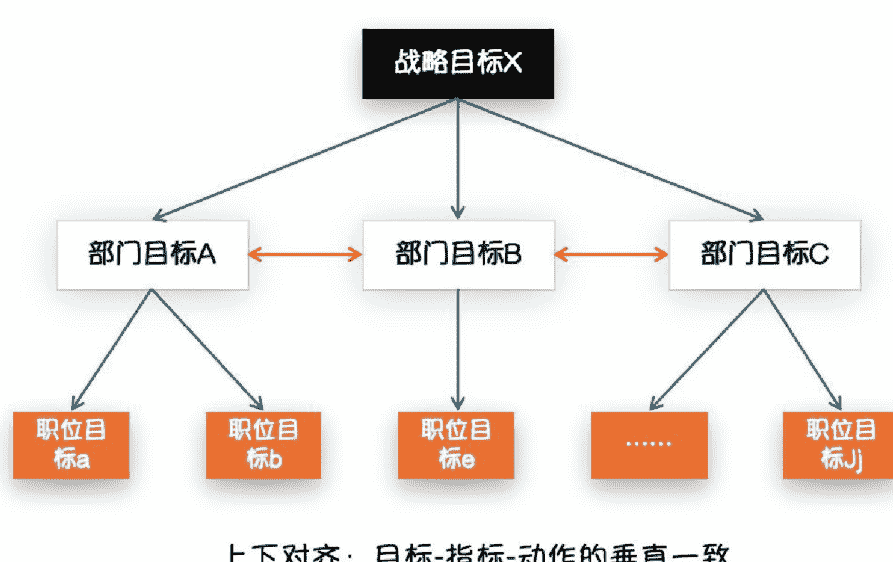

图3-23 目标上下对齐与左右拉通

#### 1.目标上下对齐——避免战略悬浮

绩效管理的第一步，是让目标上下贯通。

企业常采用“公司愿景→战略目标→关键战役→部门任务→个人目标”的分解路径，每一层都要回答一个问题：“我怎么支持上一级？”

然而，在实际操作中，目标往往容易“中途断线”。部门目标脱离战略方向，个人目标流于形式，导致绩效体系形似完整，实则落不到地。

为此，一些企业会借助可视化工具，把战略分解路径清晰展现，确保逻辑闭环。但即便如此，目标偏离仍屡见不鲜——真正难点，不在工具，而在理解与承接能力。

#### 2.左右拉通——减少部门间目标冲突

跨部门协同，是绩效管理中最容易出问题的环节。

比如，公司想提升“订单一次性交付合格率”和“交付及时率”，这就需要采购、生产、供应链等多个部门密切配合。但由于各自的考核重点不同，目标之间常常互相冲突，甚至彼此掣肘。

- 采购部关注“采购及时性”，而非质量保障；
- 生产部关注“生产合格率”，可能抗拒更严格的检验流程；
- 供应链部在意“库存周转率”，可能压缩安全库存。

从各自角度看，目标都合理；但站在公司整体来看，这种各行其是，容易演变为绩效内耗和目标博弈。

造成冲突的原因，一方面是主观上的本位主义——在压力和资源有限的情况下，部门更倾向于“保自己”；另一方面是客观上的协同机制薄弱，比如职责不清、数据不通、统计困难，导致推诿扯皮。

互动：

借助AI，分析美的、腾讯、亚马逊等企业如何提升跨部门目标协同：

- 常见的协同机制：如共享绩效指标、跨部门业务例会、联合考核机制；
- 具体的目标设定方式：如关键KPI联动、权重调整、OKR协同设定等。

如何解决？可以借助AI，先识别冲突点，诊断目标对齐和协同中的问题，再结合标杆企业的实践经验，制定更有针对性的改进方案。

下面，我们将继续以上述建筑企业为例，演示AI在优化跨部门目标协同中的实际应用。

##### 案例：目标上下对齐和左右拉通

背景：假设企业已初步制定年度绩效方案，形成公司级目标，并分解至部门和子公司，模拟如下：

1. 公司级目标

目标1：合同额突破100亿（权重40%）
支撑举措：政府项目中标率提升至35%，产业资本项目占比40%。

目标2：客户复购率≥25%（权重30%）
支撑举措：建立客户分级服务体系。

目标3：设计变更率≤8%（权重30%）
支撑举措：推广BIM协同设计。

2. 部门/子公司目标分解

| 部门/子公司 | 目标 | 权重 | 数据来源 |
| :--- | :--- | :--- | :--- |
| 市场部 | 政府项目中标率≥35% | 50% | ERP |
| 设计部 | 需求确认完整率≥95% | 60% | OA |
| 成本部 | 预算偏差率≤5% | 40% | 财务系统 |
| A类子公司 | 交付周期≤170天 | 70% | 项目管理系统 |
| B类子公司 | 客户续约率≥20% | …… | 项目管理系统 |
| C类子公司 | 融资成本≤…… | …… | 财务系统 |

###### 3.业务模式与价值链

业务链条：投融资（获取项目）→设计（方案交付）→施工（工程管理）→运营（客户维护）。痛点：设计与施工部门因“图纸变更”导致成本超支。

###### 4.已知问题与约束

1) 设计部抱怨需求确认耗时过长，但无量化指标；
2) 子公司反对新增非财务类指标（如客户满意度）；
3) 数据限制：客户复购率数据滞后3个月。

输入指令：

你是一名绩效管理专家，请结合以上背景，评估当前绩效指标是否上下对齐、左右联动。要求：

- 用OGSM模型验证逻辑完整性；
- 标记冲突指标并给出改进建议；
- 输出简版可视化关联图。

AI反馈：

上下对齐分析：

###### 1.公司→部门对齐度检测

目标1（合同额）：

- 市场部“中标率”直接支撑（逻辑链清晰）；
- 缺失产业资本项目关联部门（如无投融资部“资金到位及时率”指标）；

目标3（设计变更率）：

设计部“需求确认完整率”仅减少初期变更，但未覆盖施工阶段变更（建议补充工程部“变更响应时效≤48h”）。

……

###### 2.权重合理性评估

市场部问题：政府项目中标率权重50%vs公司级合同额权重40%，可能出现“过度聚焦政府项目”风险（建议中标率权重降至40%，新增产业项目线索转化率10%）。

###### 3.左右拉通分析

1）OGSM漏洞诊断

| 公司目标 | 部门目标 | 缺失 |
| --- | --- | --- |
| 客户复购率≥25% | 市场部：中标率 35% | 未联动客户运营部“投诉关闭率”、工程部“验收通过率” |
| 设计变更率≤8% | 设计部：需求确认完整率 95% | 未联动成本部“变更成本核算准确率” |
| ...... | ...... | ...... |

2）冲突指标识别

冲突点：设计部“需求确认完整率”（要求充分沟通）vs市场部“中标率”（要求快速响应）→存在时间资源争夺矛盾；

改进建议：新增“高价值客户需求确认时效≤3天”（兼顾质量与速度），并设置优先级规则（如合同额≥1亿的项目自动触发快速通道）。

3）可视化关联图（简版）

- [公司级]合同额100亿
  ├─[市场部]政府中标率35%→支撑强
  ├─[投融资部]缺失“产业项目资金到位率”指标
- [公司级]设计变更率≤8%
  ├─[设计部]需求确认完整率95%→仅覆盖50%变更诱因
  ├─[工程部]缺失“变更响应时效”

输入指令：

###### 如何解决市场与设计之间的冲突？

AI反馈：

冲突解决方案如下：

####### 1. 流程重构

在投标阶段增设“需求可行性联审会”（市场部+设计部），达成共识的需求才进入正式确认流程。

####### 2. 数据联动

自动计算“需求确认时长vs中标率”的比率（如每缩短1天确认时间需保证中标率不下滑），动态调整资源分配；

####### 3. 激励机制

若市场部与设计部联合项目中标且变更率达标，额外分配奖金包。

……

> 提醒：AI的建议是辅助，不是标准答案。HR仍需结合文化适应性、组织惯性等因素，做出判断。

### 三）绩效计划

在明确组织目标后，下一步就是将其分解到各个岗位，制定具体的绩效计划。一份岗位绩效计划，通常由两类指标构成：

- 攻城略地，聚焦业务增长与突破，强调价值创造；
- 固本守元，关注日常运转与基础保障，确保核心职责稳定履行。

这两类目标并非对立，而是动态融合、相辅相成。如何在“稳定”与“突破”之间平衡，是绩效管理的核心张力。

在制定绩效方案时，HR可以借助AI，从更多维度分析岗位职责与战略关联，拓宽思路，让绩效指标更全面、更契合实际。

#### 案例：如何基于岗位职责制定绩效方案

背景：某企业的人力资源专员，主要负责招聘流程管理、简历筛选与面试安排。HR需为该岗位设计一套考核方案，既能衡量招聘成果，也要兼顾过程质量。

输入指令：

请根据该岗位职责，设计绩效指标，并说明设置逻辑。

AI反馈：

建议将绩效分为结果指标与过程指标：

- 结果类指标：招聘计划达成率、招聘渠道有效性、平均招聘周期等。
- 过程类指标：筛选通过率、岗位匹配度、面试安排及时性等。

输入指令：

该专员主要负责普工招聘。目前最大问题是普工流失率高（排除薪酬因素），请锁定一个关键绩效指标，并详细说明理由，及操作方法和示例。

AI反馈：

关键考核指标：新人3个月留存率

指标定义：通过该专员招聘入职的普工，在到岗后3个月内主动离职率≤15%（即留存率≥85%）

目标设定逻辑如下：

##### 1. 问题根源分析（普工流失主因）

1. 候选人入职后发现实际工作强度/环境与面试描述不符；
2. 对倒班制度、体力劳动耐受度预判不足；
3. 家庭住址与工厂距离过远导致的通勤放弃。

##### 2. 数据采集与考核方法

| 考核维度 | 操作方式 | 评价权重 |
| :--- | :--- | :--- |
| 结果指标 | 统计专员所招普工3个月内留存率，对比目标值差额按比例扣分 | 60% |
| 过程证据 | 抽查10%的面试记录表，核实是否包含岗位适应性问答（如未记录视为失分项） | 30% |
| 红线指标 | 发现故意隐瞒岗位真实情况（如谎称“可坐着操作”），单次扣20分并取消评优资格 | 10% |

##### 3. 示例计算

目标值：3个月留存率≥85%。

实际值：专员A招聘50人，3个月内离职10人，留存率80%（低于目标5%）。

得分计算：60%权重×（80/85×100）=56.5分→需改进区间。

建议先进行3个月数据基线测量（统计当前平均留存率），再设置阶梯目标（例：首季度提升至80%，第二季度85%）。

操作要点：第一步开放提问，拓宽指标选择范围，减少思维盲区；第二步聚焦关键问题，逐步收敛锁定重点；第三步加入背景限制，提高AI反馈的针对性。

互动提示：

与AI对话，挖掘更多岗位场景下的绩效设计方案：

- 技术岗位如何评估？如何兼顾质量、交付速度、创新贡献？
- 对于难以量化的工作，如何考核评价？
- 如何评估研发项目绩效？有哪些标杆企业的实践可借鉴？

### 四）绩效监查

制定计划只是开始，真正的挑战在于执行。很多企业年初雄心勃勃地设定KPI，年底却发现目标偏离严重，甚至无人关注。绩效监查的关键在于把握节奏、排除阻力，否则绩效就容易沦为一场“年终总结游戏”。

#### 1. 把握节奏：让不同层级步调一致

绩效管理本质是一个PDCA循环，但“齿轮不同速”——不同层级、不同阶段，监查节奏要区分开来。

##### 1）分层监查

公司级齿轮（季度转动）：每季度召开战略校准会，检视目标是否与市场同步。例如，市场部可用“方针管理表”比对销售目标与渠道覆盖率。

部门齿轮（月度转动）：聚焦行动成果，每月复盘关键指标。例如，销售部门通过“客户拜访量→商机转化率”分析转化漏斗，指标异常即调整话术策略。

团队齿轮（周/日转动）：日常可视化管理。例如，物流站点通过电子看板显示“当日妥投率”，未达标团队下班前召开15分钟根因分析会。

##### 2）分阶段监查重点

第一季度：确保目标上下对齐、左右协同，避免战略悬浮。

第二、三季度：监测行动成效，及时调整执行策略。

第四季度：分析目标偏差原因，找出改进方案或者调整目标。

#### 2. 排除阻力：不仅靠工具，更要关注人

AI技术可以提升绩效监查的效率。例如，通过数据异常监测识别风险、自动溯源查找问题根因、因果推演优化策略。

但绩效管理不仅是技术问题，更是组织行为问题。员工情绪、执行动力、部门协同等“软变量”，仍需HR与管理者深度介入、动态引导。

## 二 用AI优化绩效评价与反馈机制

绩效评价的本质，从来不只是打分工具，而是连接组织战略与执行行为的桥梁。它不仅关心“做成了什么”，还必须关注“怎么做到的”与“方向是否正确”。

在绩效管理中，结果与过程、个体与团队、数据与判断缺一不可。唯有将绩效管理从“考核机制”转向“发展机制”，才能真正服务于组织目标，同时促进员工成长。

### 一）绩效评价

在实际操作中，不少企业的绩效评价往往过度聚焦业务结果，忽视了员工在过程中的表现与行为方式。

结果固然重要，但它只是绩效的一部分。真正有效的绩效管理，既要看“做成了什么”，也要关注“怎么做到的”，更要判断是否符合组织的长期方向。

如图3-24所示，绩效评价应包含三个维度。

- 业绩评价。聚焦实际成果，是对“做成了什么”的直接反馈。
- 工作态度评价（短期角）。评估责任感、执行力、协作度，是保障组织高效运作的润滑剂。
- 价值观评价（长期视角）。衡量员工是否践行企业文化，体现长期适配与战略一致性。

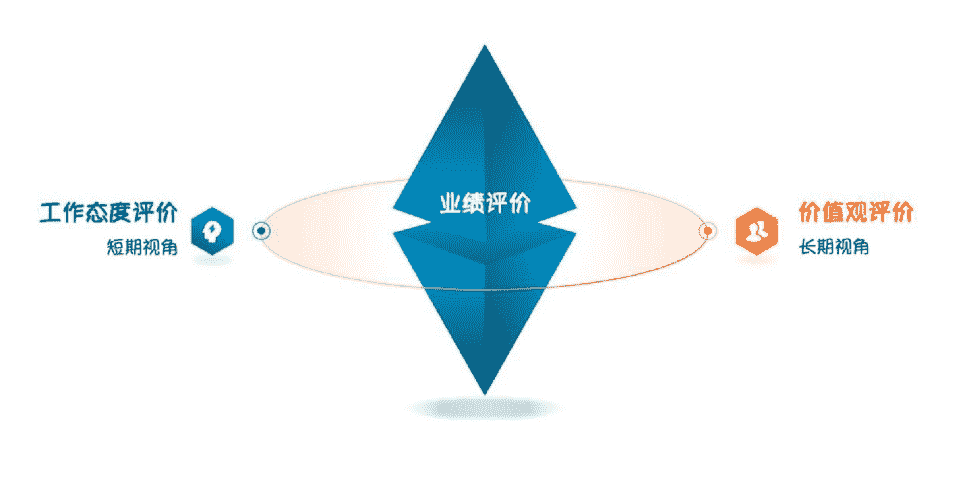

需要特别强调的是，态度与价值观的评价不能脱离业绩本身，它们不是独立打分项，而是围绕“是否支持结果达成”展开的延伸判断。绩效管理的重点不是评价谁“认同文化”“努力积极”，而是识别谁在用正确的方式，把事情做成。

这一“结果为核、态度与价值观为翼”的结构，有助于构建一个更科学、平衡、可持续的绩效体系，既能驱动当期目标，也能牵引组织长期价值方向，避免因短视而透支未来。

我们重点讲解两个维度的评价。

#### 1. 价值观评价

在设计价值观评价前，需先厘清其本质——价值观是企业对“什么是对的、什么最重要”的长期信念，植根于战略目标和组织使命，通常稳定而不外显。它不是靠说出来的，而是要通过员工在关键时刻的实际表现去识别和验证。

基于此，建议采用“双轨制”评价体系：

- 底线标准。聚焦不可逾越的红线，一旦触犯，直接淘汰。
- 行为观察。结合行为锚定法，分层评价员工的日常表现，引导价值观在组织内逐步趋同。

需要强调的是，价值观的表达虽可能相似，不同企业的内涵和落地方式却各不相同，评价设计应紧扣组织文化与战略方向。

##### 案例：如何评价“开放包容”的价值观

背景：某芯片研发制造企业因人才结构多元（来自科研机构、外企、民企、华侨等），将“开放包容”设为核心价值观，倡导：

- 鼓励引入多样化人才与外部合作；
- 宽容探索与试错，支持敢于创新、敢于担当者；
- 淘汰不进取、以权谋私者。

输入指令：

你是一名资深人力资源顾问，擅长绩效管理与企业文化建设。请基于上述价值观，设计一套可操作、可追溯的评价方案。

要求：

1. 设定评价标尺：分为“底线标准”（是非判断）和“行为分层”（待改进、合格、卓越）。
2. 设计评价方法：结合360反馈与关键事件法（参考华为经验）。

AI反馈：

1) 评价标尺设计

###### 底线标准（是非判断）：

| 是 | 无以下任一行为 |
| :--- | :--- |
| 否 | 下列行为一经查实，直接判定不符合价值观，取消评优、触发组织淘汰机制：<br>■ 故意阻碍外部合作（如无故拒批合理外聘支出）；<br>■ 打压敢于发声的同事（如打击建议者或调离岗位）；<br>■ 借引才之名行谋私之实（如收受回扣、安排关系户）。 |

###### 行为分层（核心标准）：

| 评价维度 | 待改进 | 合格 | 卓越 |
| :--- | :--- | :--- | :--- |
| 跨界合作 | 被动配合、应付差事 | 主动对接外部资源，促成合作落地 | 自主发起或促成关键合作，带来实质性业务成果 |
| 包容创新 | 排斥异见，抵触变革 | 尊重多元观点，支持团队合理试错 | 鼓励创新，承担风险，推动变革项目落地，助力组织战略转型 |

###### 2）评价方法建议

方法（1）：360反馈评估（每季度一次）

结合上级、同事、下属反馈，交叉验证行为表现：

| 评价 | 考察重点 | 证据形式 |
| :--- | :--- | :--- |
| 上级（40%） | 战略价值判断 | 合作项目 ROI 分析、继任者培养成效 |
| 平级（30%） | 协作主动性 | 跨部门项目参与度评分表 |
| 下属（30%） | 创新包容度 | 匿名调研试错支持率（如“我的创新想法获得过指导改进而非直接否定”） |

###### 方法（2）：关键事件评价

记录员工在典型情境下的实际表现，建立“红黑案例库”：

- 正向事件：如跨界促成重要合作、推动新业务试点
- 负向事件：如因抗拒合作导致项目延期、资源浪费

由直属主管每季度提交《开放包容关键事件报告》。

###### 3）结果应用机制

| 评分等级 | 应用建议 |
| :--- | :--- |
| 低于合格（<3分） | 启动专项辅导，若半年无改善，影响晋升与评优 |
| 合格（3-4分） | 正常留任，鼓励持续进步。 |
| 卓越（>4分） | 优先晋升、参与核心项目、获得专项激励。 |

AI在价值观评价中的最大价值，不在于判断，而在于转译。它能将抽象的价值观概念，快速转化为具象、可操作的行为标准，帮助HR构建清晰的评价框架。相比人工梳理，AI具备更强的系统性和逻辑性，也能显著提升效率和一致性。

#### 2. 工作态度评价

什么是“工作态度”？简单说，就是对待工作的状态——靠不靠谱，稳不稳定，关键时刻能不能顶得上。

态度不是喊口号，也不是情绪波动，而是体现在日常中的责任感、主动性和执行力。它反映了一个人能不能被信任，能不能长期托付任务。

在实际评价中，工作态度既要量化，也要情境化：不能只看任务完成，还要看在什么场景下、以什么状态完成。

##### 工作态度评价（以“责任心”为例）

1）评价标尺

| 分层标准 | 解释 | 示例 |
| :--- | :--- | :--- |
| S级（卓越） | 不等人提醒、主动揽活、扫雷解难 | 员工发现流程漏洞，未等指示就主动优化并推动落地 |
| A级（优秀） | 分内事高质量完成，响应快速 | 收到任务后第一时间行动，交付提前完成 |
| B级（合格） | 按要求完成，态度端正但无亮点 | 能按时完成任务，但不主动、不延伸 |
| C级（需改进） | 被动应付，需频繁提醒 | 任务经常拖延，交付质量不稳 |
| D级（差） | 推诿或延误关键任务 | 关键时刻临时“掉线”，让同事补位擦尾 |

2）评价方法

| 方法 | 解释 |
| --- | --- |
| 行为锚定法 | 设定清晰行为标准，通过观察频次判断：常常如此/偶尔如此/很少如此/几乎不出现 |
| 多场景观察 | 看一个人在不同场景下的表现，尤其是跨部门协作、突发事件处理中的稳定度和反应力 |
| 数据辅助验证 | 如：任务完成率、延期次数、反馈投诉、同事满意度等作为辅助数据源 |

AI在工作态度评价中的应用方式与价值观评价相似，不再赘述。

科学的绩效评价，不能只看“做了多少”，还要看“怎么做的”、以及“是否走在正确的方向上”。只看结果，容易短视和急功近利；只讲过程，难以服众、失去绩效正当性；只讲方向，又容易脱离执行。真正的挑战在于：将结果、过程与方向拧合为一，形成动态平衡、相互校准的评价体系。

但需要提醒的是，试图用“公式+分数”精确衡量一切工作价值，既不现实，也不合理。尤其是对态度这类高度依赖情境和主观判断的维度，更应重视管理者的观察与判断力。

### 二）绩效反馈

AI时代的绩效反馈，正在从“控制-考核”走向“预测-发展”。

#### 1. 从事后总结，到实时提醒

传统绩效反馈常常滞后，员工等到季度末、年底才知道哪里出了问题，往往错过了最佳改进时机。

AI可以基于日常数据，实时识别风险信号，给出即时建议，帮助员工边做边调。例如，某连锁超市引入“Mr.Smile”系统，自动分析员工语音、表情等细节，每天生成服务评分和改进建议，让反馈变得“看得见、改得快”。

#### 2. 从统一标准，到因人施策

过去的绩效反馈容易“千人一面”，看似公平，其实缺乏针对性。

AI可以精准识别影响绩效的关键变量，按岗位、按场景、按个人，提供个性化优化方案。比如，某制药企业用AI分析专利数据，发现某研发组产出下降的原因并非绩效低，而是仪器资源紧张。系统建议优化预约机制，问题迎刃而解。

#### 3. 从单向训话，到双向演练

传统绩效面谈往往是管理者主讲，员工被动听取，互动有限。

现在，AI可以结合情绪识别和行为数据，辅助管理者更精准地把握员工状态，调整沟通方式。

甚至还能模拟实战场景，帮助员工演练冲突应对、决策表达等关键软技能，让反馈建议“讲得清，更用得上”。

##### 小结

绩效管理从专业上讲并不复杂。优秀的管理者不会被流程和工具所束缚，而是善于借助AI放大洞察力、简化决策过程、激发组织潜能。

在这一过程中，AI的价值不在于替代判断，而在于将模糊的感知、抽象的理念，转化为结构清晰、逻辑闭合、可执行的管理语言。它帮助管理者“看得更清、判得更准”，但真正具备温度与情境判断力的，始终是人本身。

当技术与管理智慧协同发力，绩效管理不再只是“设定目标、评估结果”，而是成为“驱动成长、激发潜能”的关键杠杆。

## 第五节 体系迭代升级：“从0到10”的进化路径

在企业初创期，HR体系通常不是关键问题。如果一个几十人团队都带不好，往往不是“没体系”，而是“缺领导力、缺机制、缺核心人才”。

但当企业步入扩张期、员工规模破千，组织架构变得复杂、管理层级逐渐增多，一系列新问题就会浮现：

- 文化衰减，企业初创时的价值观和执行力开始被稀释；
- 协作难度上升，跨部门沟通成本增加，分工协作变得低效；
- 人才利益诉求多元化，薪酬、晋升、激励机制不健全，容易引发内部矛盾。

此时，HR体系不再是“可选项”，而是组织能否运转高效、战略能否真正落地的“基础设施”。哪怕像小米这样的创业公司，曾倡导“去KPI、去Title”，但组织上规模后，也不得不构建清晰的管理体系，应对复杂团队协作带来的挑战。

当然，体系不是一天就能建成的，它是一场需要不断升级的系统工程。

### 一 从“0”到“1”体系导入的成功关键

很多企业投入大量资源搭建HR体系，但落地效果却不尽如人意。问题往往出在两个核心方面。

#### 一）HR体系是否形成闭环系统

如图3-25所示，HR体系看似由多个模块组成，实则更像一辆车的各个关键部件：引擎、刹车、底盘必须协同运转，缺一不可。如果只优化其中一块，而缺乏整体设计，就很难真正“跑得动”。

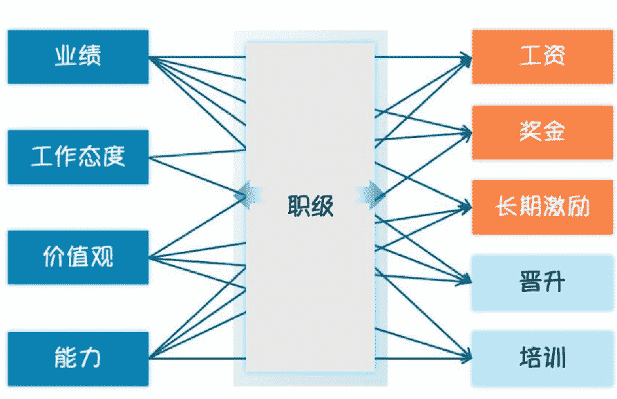

HR体系不是拼图，而是系统。模块间若缺乏联动，体系不仅难以生效，甚至会带来反作用。

比如：

- 薪酬水平定得很高，但绩效和能力评估缺失，结果是高薪低效；
- 只单独构建职位体系或薪酬体系，等到实际要调薪、晋升时却发现没有其他配套依据。

判断体系是否“成型”，有两个基本标准。

- 是否有清晰的顶层设计，各模块是否逻辑闭环，理念是否统一。
- HR关键决策，是否能基于体系输出的数据和结果，而非靠主观判断。

若这些问题无法解决，再专业的体系，也只是“纸上谈兵”。

#### 二）体系之树能否真正“开花结果”

多HR热衷于“自我完善”，但忽略了业务落地。比如花半年写完职位说明书，结果仅用于审计展示，招聘、绩效、晋升一个都没用上。

体系可以慢一点，但必须扎实、可用，能够实实在在地解决企业问题。

真正有价值的体系，是能穿透业务、推动组织进化的。例如，一个扎实的职位体系应具备以下作用（如图3-26所示）。

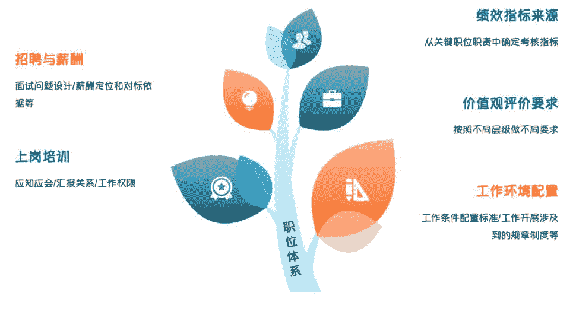

试想这样一个场景：

- 基于职位体系，构建可靠的薪酬体系，确保薪酬水平具备市场竞争力，吸引和激励优秀人才。
- 基于职位说明书，精准刻画人才画像，面试问题聚焦关键能力，确保人才“来之能战，战之能胜”。
- 基于职位分层分类，明确任职资格标准，构建清晰的职业发展通道，让人才的成长路径和晋升规则可视、可预期。
- 结合绩效评估与价值观考核，让真正优秀的人脱颖而出。进入高潜人才池的员工获得更多成长机会，晋升后承担导师责任，并将这一要求嵌入任职资格标准，形成“成长-晋升-传承”的正向循环。

由此，生生不息的人才梯队得以建立，高绩效、高回报、高压力的企业文化逐步形成。当HR体系能赋能业务，它就不只是工具，而是推动组织成长的“油田”、人才成长的“孵化器”，组织能力的“倍增器”。

### 二 从“1”到“10”进化的参考经验

HR体系建设从不是一劳永逸，而是一个持续优化、不断进化的过程。随着企业规模扩张、业务复杂度提升，原有体系往往很快就显现出“撑不住”的问题。衡量HR体系是否真正成熟，可以用一句话概括：哪怕一切归零，只要人还在，组织就能快速重启。

在体系进化的过程中，企业不仅要破解两个核心矛盾，也要持续推进“三化”工作，构建真正具备韧性与再生能力的人力资源体系。

#### 一）处理好两大矛盾

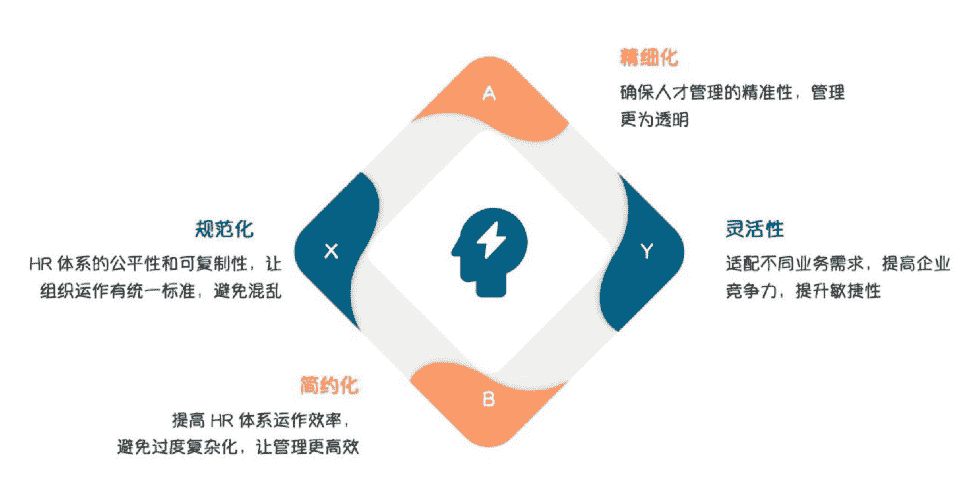

如图3-27所示，HR体系的进化，本质上是在两组张力中寻找平衡：

- 精细化vs简约化。体系要足够细致，才能有序运行；也要足够简约，避免流程臃肿、效率低下。
- 规范化vs灵活性。制度要统一、规则要清晰；但也要允许业务场景因地制宜，保留弹性空间。

如果偏向过度精细，流程会拖慢业务节奏；如果一味追求简化，又容易失去制度的权威性和公平性。管理过度规范可能演化为官僚主义，管理过于灵活则容易导致无序。

但真正有效的进化路径是“先繁后简，先规范后灵活”。

- 先精细化，才有资格谈简约化。体系规则不清，谈简化只会变成“减配”。

##### 先规范化，才能安全地放开灵活性。没有统一规范，灵活就成了“随意”。

这种从“结构→优化→自适应”的转变，不是一蹴而就的动作，而是一段伴随组织成长、逐步沉淀的演化过程。下一步，我们通过实践案例说明这一动态平衡如何落地。

##### 案例：华为公司任职资格体系演变进程

1996年，华为首次建立任职资格体系（JQS），采用长达十多页甚至几十页的精细化标准，从多个维度全方位评估员工能力。这一体系帮助公司从“游击队”转向“正规军”，极大地推动了职业化进程。但随着组织体量激增，JQS也带来了较高的管理负担。

自2010年开始，华为对JQS体系进行了大幅“瘦身”——标准大为简化，晋升流程更加高效，却依然能支撑起庞大组织的人才运营。

很多企业在引进任职资格体系的时候都可能会问：能否一开始就采用这种“轻量化”的体系？

答案是否定的。华为能从“繁”走向“简”，背后有三个关键前提。

- 1. 职业化积累
  员工的职业素养与自我管理能力大幅、全面提升，整体职业化水平已沉淀出强大的组织力场。

- 2. 流程与数字化支撑
  通过全面的流程和信息化建设，通过标准化模板与表单承载了先进、科学的管理经验。标杆员工行为背后的知识和经验由隐性化转为显性化，从个体能量沉淀为组织知识资产。

- 3. 配套机制成熟
  1) 强化责任导向文化，配套高激励、高绩效、高压力的薪酬体系；
  2) 构建了体系化的知识管理平台，支持经验沉淀与快速复用；
  3) 培训机制从“要我学”转向“我要学”，由强制灌输转为员工主动付费进修。

可见，华为现在的“简化”，不是省事，而是“打好基础后的主动优化”。对尚处在体系构建初期的企业而言，直接套用“精简版”并不可取，反而可能容易导致体系空转、执行失控。

有学者指出：与其照搬标杆企业成熟期的成果，不如回溯它们早期“从0到1”的探索过程。那些在混沌中建立秩序、在约束中迭代优化的经验，往往才是最值得借鉴的管理财富。

**互动：**

请用AI查询以下内容，以辅助理解体系“从繁到简”的演变路径。

- 谷歌OKR考核从“自由设定”到“严格规范”再到“框架标准化+内容个性化”的演变历史；
- 奈飞文化手册如何从系统庞杂演进为极简直白的行为准则。

#### 二）解决路径——“三化工作”

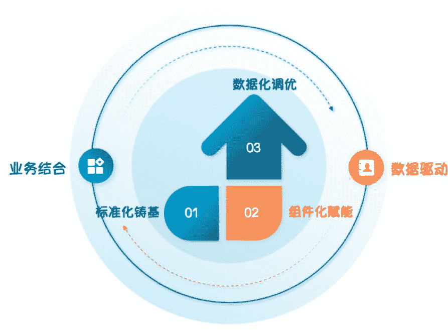

如图3-28所示，标杆企业在解决这两对矛盾时，常采用“标准化、组件化、数据化”这三步法。三化不是分阶段，而是彼此配合、逐步推进。

##### 1. 标准化：搭框架，定规矩

先把组织管理的“底板”搭起来。包括统一的组织架构逻辑、流程机制和核心制度，确保不同部门、不同岗位有统一的语言和基本行为规则。标准化不是死板，而是把该统一的统一，让执行有依、有度、有章法。

##### 2. 组件化：模块化，更灵活

把标准流程拆分成“可以插拔”的小模块，哪些该通用、哪些可定制，一目了然。这样既不牺牲效率，也能兼顾业务差异，既稳又活。但也要防止过度碎片化，反而增加管理难度。

##### 3. 数据化：用数据说话，用系统做事

一旦体系成型，关键就在于实时感知、精准调优。AI与数据分析可帮助我们识别偏差、优化流程制度，比经验更客观，比拍脑袋更可靠。

##### 案例：IBM数字化人才管理体系进化路径

IBM的HR体系，在全球化运营和技术驱动的基础上，基于三支柱模式（COE+HRBP+SSC），形成了一个“标准统一、模块灵活、数据驱动”的进化范式。其底层逻辑是通过“标准化”打牢基础，用“组件化”提升适应力，再用“数据化”推动智能优化，确保体系既有秩序，又能灵活应变。

###### 1）标准化：打牢统一管理的底盘

IBM在全球范围内推行统一的职级体系、能力模型和薪酬结构，确保不同地区、不同业务单元的人才管理标准一致、可复制、可落地。

- （1）统一的职位族群（Job Family）和职级框架（Job Banding），确保员工晋升路径和薪酬标准透明可衡量。
- （2）关键序列（如技术、咨询、管理）均有清晰的能力标准，作为招聘、绩效管理和人才发展的基础（如下图所示）。

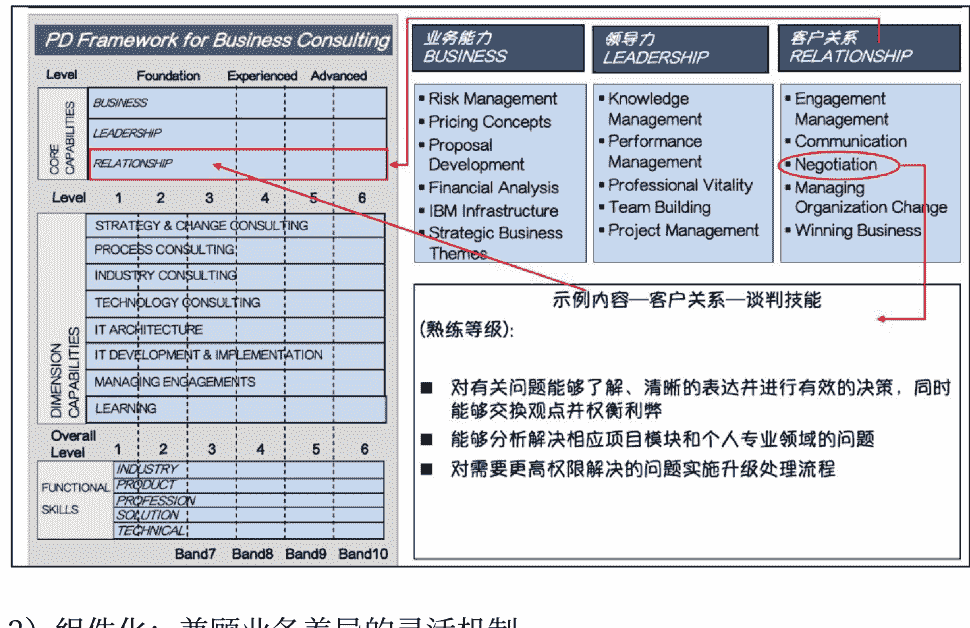

###### 2）组件化：兼顾业务差异的灵活机制

IBM采用“80%统一+20%定制”的策略，保证核心体系不变，但允许业务按需调整。例如：

- 公司构建了超20万条培训资源池（课程、项目、导师制），支持员工基于个性发展路径灵活选学。
- 若某员工需要提升数据可视化能力，系统将自动推荐SQL进阶+Tableau实操课，实现“千人千面”的培养方案。

###### 3）数据化：实现智能化识别与优化

IBM利用AI和大数据实现人才管理的“能看清、能预测、能调整”。

例如：

- 能力评估。结合自评、上级反馈、绩效数据，动态生成能力差距报告和学习建议。
- 人才预测。构建人才供需模型，提前识别关键岗位缺口和高潜流失风险。
- 策略优化。通过数据分析反推培训效果、晋升通道等环节是否畅通，从而调整规则配置。

IBM的人才管理不是堆模块、靠经验，而是通过“三化”体系，让HR真正融入业务、支持战略。既有规则可依，又能灵活进化；既依赖数据驱动，也保有人本温度。

##### 小结

HR体系的进化，本质上是在秩序与自由之间寻找平衡。

管得太死，组织僵化；放得太松，管理失控。企业必须用“确定性”应对“不确定性”——依靠稳定的管理逻辑与数据支撑，让组织在变化中保持灵活适应。体系的底层架构要精细，前端界面却要简洁。唯有如此，管理才能自然嵌入业务，既不构成负担，又能高效运作。

华为提出的“先僵化、再优化、后固化”路径，强调先立规则、再调适、再沉淀，是体系建设的典型范式。HR体系的使命，不是“管理人”，而是构建组织自我进化的机制。

最好的HR体系，应如春风化雨般自然融入——它不张扬强势，却能持续推动组织向前发展。

## 第四章 AI驱动HR工作效能革命

坊间流传一幅对联：

上联：生容易，活容易，生活不容易；

下联：人简单，事简单，人事不简单。

横批：活人生事。

这幅对联，恰好写出了HR的真实处境——表面上处理的是“人事”，本质上调和的是“人性”；看似面对的是“活人”，最终目标却是“激活组织”。

HR的工作像站在火山口，入职、离职、考核、培训，模板随手可得，好像谁都能干；可一旦经营混乱、人才流失，矛头总是对准HR。这种复杂性，正好体现了HR不可替代的价值。要想不再“背锅”，必须足够专业。

AI的到来改变了这一切。当它接管重复劳动，HR终于有机会聚焦真正重要的事：成为连接人、组织与未来的关键力量。

本章将从HR最常见的四类任务出发，看看AI如何推动HR实现从事务执行者到价值策划者的跃迁。

### 第一节 简单任务：十倍提质增效

在HR的日常工作中，许多事务本身就具备标准化特征——有流程可循、有范本可用。可以预见，这类任务很快就能被AI部分甚至全部接手。这不是风险，而是一个提效的机会窗口，如表4-1所示。

#### 表4-1 HR简单任务场景与AI赋能

| 分类 | AI 擅长做什么 | 典型任务场景 |
| :--- | :--- | :--- |
| 写文案 | 写、改、润文案 | 招聘文案、通知、总结报告等 |
| 做整理 | 抽结构、列要点 | 简历分析、访谈纪要、试用评估等 |
| 算数据 | 套公式、看趋势 | 假期计算、工时汇总、报表辅助 |
| 答问题 | 快速检索、FAQ 回复 | 工时、休假、法规答疑、流程说明等 |

接下来，我们将通过实际演示，看看AI如何协助HR在这些基础任务上实现十倍提质增效。

#### 一 写文案：专业又高效

职场文案的关键，不在于辞藻多么华丽，而在于是否能清晰、高效地传递信息与价值。一篇好文案能推动事情快速落地，而平庸的文案，只会浪费时间和纸张。

这类任务看似基础，其实对表达逻辑、语气风格和内容准确性都有不低的要求。而这些，恰恰是AI擅长的领域。建议采用“智驾模式”和“标尺模式”的组合方式，让AI输出既有方向，又有准绳，更贴近业务语境与实际用途。

##### 一）入职通知

入职通知，是员工与企业正式“见面”的第一封信。它不仅传递信息，更传递态度。一封专业、周到、有温度的通知，往往能让新员工从第一刻起，就对公司充满信任与期待。

**案例：入职通知**

**输入指令：**

请你作为HR写作教练，结合标杆企业经验，帮我制定一份入职通知的质量标准，列出具体判断要点并说明理由。

**AI反馈：**

入职通知写作质量标准如下：

| 维度 | 判断要点 |
| :--- | :--- |
| 1.信息完整 | 包含公司、岗位、时间、地点、联系人、材料、注意事项等 |
| 2.语言清晰 | 用词通俗、句子简洁，避免歧义与行业术语 |
| 3.语气温暖 | 传达欢迎与期待，体现企业人文关怀 |
| 4.有针对性 | 针对岗位特点个性化提醒，增强贴心感 |
| 5.风格统一 | 保持与企业整体沟通风格一致 |
| 6.行动明确 | 明确下一步操作，如是否回复、报到流程等 |
| 7.格式美观 | 分段清晰、要点突出，提升专业感与可读性 |

**输入指令：**

你是一位HR专员，现需以正式邮件的形式，通知一位即将加入的新合伙人办理入职手续。公司为一家专注于人力资源与组织发展咨询的专业机构，注重人文关怀、流程规范与职业形象。请撰写一封不超过300字的入职通知邮件，语言正式、礼貌，符合公司风格，并体现专业与欢迎氛围。

**AI反馈：**

**主题：欢迎加入【某某】——您的入职安排及资料说明**

尊敬的余老师，您好：

欢迎正式加入某某公司，成为我们合伙人团队的重要一员！我们衷心期待与您共同开启一段专业互信、携手共创的合作旅程。

为便于您顺利办理入职手续，请您安排以下时间和资料准备：

报到时间：2024年5月6日（周一）上午10：00

报到地点：上海市浦东区XX路XX号XX大厦12F

携带材料：身份证、学历证明复印件、近期证件照1张

联系人：人力资源部欧阳余菲188-XXXX-XXXX（同微信）

烦请您于收到邮件后回复确认是否可按时报到。如需任何协助，欢迎随时与我们联系。

再次欢迎您的加入，未来可期，同行有您。

某某公司 | 人力资源部

敬启

##### 二）活动总结简报

这类任务看似基础，却最容易写成流水账。难点在于：既要内容规范、逻辑清晰，又要语言简洁、易于阅读——在公文标准与阅读体验之间找到恰当的平衡，是这类文案的关键。

**案例：活动总结**

**输入指令：**

你是一名公司HRBP，现需撰写一份关于员工运动会的总结报告。报告结构包括六个部分：活动背景、组织流程、员工参与情况、活动亮点、存在问题与改进建议。原始资料参考附件。

要求：语言正式、规范、用词专业。

数据内容应具体详实，如参赛人数、奖项设置等，避免流于空泛，确保总结具备事实支撑与改进价值。

**AI反馈：**

###### 公司2024年度员工运动会总结报告

####### 1. 活动背景

为丰富员工文体生活，增强部门协作氛围，提升企业凝聚力，公司于2022年4月20日成功举办年度员工运动会。

本次活动由行政人事部主办，得到了各部门的积极响应与广泛参与。

####### 2. 组织流程

运动会筹备期为3月15日至4月19日，历时一个月，涵盖项目设定、报名统计、场地布置、物资采购、主持安排、安全预案等环节。

共组织动员会议3场，发布内部通知4次，确保流程顺畅、责任明确。

####### 3. 参与情况

- 1）本次运动会共设10个比赛项目，包括4×100接力、拔河、跳绳、乒乓球、篮球投篮赛等，覆盖竞技类与趣味类。
- 2）来自全公司12个部门共计248名员工报名参赛，现场观众人数约370人。
- 3）现场设置裁判组、医疗组、后勤组各1支，总计志愿服务人员32人。

####### 4. 活动亮点

- 1）部门协作高度体现：多个项目以团队赛形式展开，有效增强跨部门协同氛围。
- 2）员工参与热情高涨：报名率较去年提升23%，多位平时内向员工踊跃参赛。
- 3）氛围营造效果良好：现场布置充满活力，搭配应援海报、互动小游戏，提升观赏体验。
- 4）安全保障到位：全程未发生安全事故，医疗小组处理轻微擦伤2起，处置及时。

####### 5. 存在问题

- 1）个别项目赛程安排较为紧凑，出现参赛与观赛冲突。
- 2）现场部分环节主持节奏稍显混乱，影响项目连贯性。
- 3）赛后物资回收清点不够细致，遗失纪念T恤12件。

####### 6. 后续建议

- 1）提前做好项目时间排布，避免时段重叠，保障员工全程参与感。
- 2）组织主持人演练与时间节点彩排，提升活动节奏感与专业度。
- 3）建立物资编号与回收登记机制，杜绝资源浪费。

人力资源部

##### 三）会议纪要

会议纪要是HR最常见、但也最容易写偏的一类文书。它的难点不在于“有没有记全”，而在于“有没有抓准”。不同类型的会议，对纪要的结构、重点和呈现方式都有不同要求。能否根据会议目的提炼关键信息，决定了一份纪要的实际价值，这一点尤其值得关注。

**案例：会议纪要**

**输入指令：**

你是HRD助理，参与了“绩效评估改革”会议，需撰写纪要（会议记录见附件）。请提炼讨论要点、初步共识、待办事项，语言应中性、准确。

**AI反馈：**

###### 绩效评估改革会议纪要

会议时间：2025年2月8日

会议地点：总部B座会议室302

主持人：欧总（HRD）

参会人员：HRBP团队全体、各业务部门负责人、组织发展组、法务代表

####### 1. 会议背景

当前绩效评估机制沿用自2020年，部分业务线反馈评价周期滞后、激励作用不足。HR提出进行机制优化，目标是提升激励精准度与组织健康度。

####### 2. 主要讨论要点

######## 1）评分结构优化

- 建议将现有“3：4：3”结构（工作成果：行为能力：团队协作）调整为“4：3：3”，更突出业务贡献导向。
- 营销与技术团队希望增加“项目特殊贡献”加分项，便于识别高潜个体。

######## 2）评估周期调整

- 当前半年一次的评估频率，被多部门认为反馈不够及时。初步建议引入“季度轻量评估+半年正式评估”的组合模式。
- 财务与运营组担心评估频率过高影响考核质量，建议设置评估简表版本以降低负担。

######## 3）评估主体扩展

- 拟在核心岗位试点“360度评估”，引入上下游反馈机制，增强考核客观性。
- 技术与产品部门提出需明确反馈流程及匿名保护机制。

######## 4）数据支撑与系统升级

HR系统需支持评分维度自定义、历史绩效可视化、评估数据导出分析功能。IT计划评估系统改造周期及资源排期。

####### 3. 初步共识

同意“评分结构调整+评估频次优化”的改革方向，具体试点方案由HRBP小组拟定。

同意2025 Q2“销售部、产品部”启动改革试点，Q3再评估是否要扩展。

360度评估拟仅限核心岗位试行，相关流程需配套宣导。

####### 4. 后续待办事项

| 事项 | 责任人 | 截止时间 |
| :--- | :--- | :--- |
| 起草《绩效评估优化试点方案（草案）》 | HRBP 刘芳 | 4月15日 |
| 梳理评估指标与权重建议（各部门） | 各部门代表 | 4月12日 |
| 系统功能可行性评估报告 | IT 系统组 | 4月18日 |
| 法务审核新版评估流程合法性 | 法务组 | 4月22日 |

备注：会议纪要将同步上传HR系统项目管理模块，便于后续任务协同与进展追踪。各责任人请按时提交阶段性成果。——HRD助理整理

##### 四）HR日报/周报

日报和周报是HR最常见的工作输出之一，看似简单，却最容易流于形式。它不是“写给自己看的交差任务”，而是“写给别人看的决策参考”。一份高质量的报告，能帮助上级快速判断进展、支持决策，也能提升团队之间的信息协同；反之，如果内容模糊、重点不明，就容易变成信息噪音，失去存在价值。

**案例：周报撰写**

**输入指令：**

你是HRBP助理，请以附件原始材料为基础，输出本周招聘进展周报。

要求：结构清晰，建议以要点+表格组合。

**AI反馈：**

###### HR招聘周报汇报（2024年4月第一周）

####### 1. 本周重点进展

- 1) 共完成7人入职，主要集中在技术与运营岗位。
- 2) 招聘渠道转化率整体良好，内推渠道入职转化率达25%。
- 3) 存在岗位竞争力不足、候选人等待时间过长等问题。

####### 2. 关键数据汇总

| 项目 | 数值 | 环比变化 | 备注说明 |
| :--- | :--- | :--- | :--- |
| 简历投递总量 | 215份 | +18% | 其中技术岗占比 52% |
| 初试完成人数 | 96人 | -5% | 多为运营、设计岗 |
| 终面通过人数 | 23人 | +15% | 产品岗通过率略有提升 |
| 入职人数 | 7人 | 持平 | 技术3人，运营2人，支持2人 |
| 平均招聘周期 | 12天 | +2天 | 部分关键岗位决策延迟 |
| 招聘满意度 | 8.3 / 10分 | -0.5分 | 主要反馈在等待周期过长 |

####### 3. 问题汇总

- 1) 部分岗位JD吸引力不足，内推热度下降。
- 2) 候选人流失原因以“等待时间长”“沟通反馈慢”为主。
- 3）产品经理岗位仍缺2人，招聘节奏需提速。

####### 4. 下周计划建议

- 1）优化JD内容，突出成长空间与项目影响力。
- 2）设立面试专属时间段，缩短沟通链条。
- 3）聚焦产品岗与核心技术岗，加快推进并尝试外部猎头合作。

值得特别说明的是，在不同应用场景下，好文案的标准并不完全相同。比如，同样是招聘广告，知名企业可能更强调品牌调性与企业形象，而初创公司则更关注岗位吸引力与转化效率——语气、风格、重点往往截然不同。

使用AI生成文案时，需要把握两个关键点：

- 明确任务类型、目的，交代关键背景信息，让AI“写对”；
- 结合通用质量标准，设定好评价标尺，让AI“写好”。当你不会设计提示词时，这也是很好的参考依据。

至于一篇文案是否真正合格，仍然要自己判断。这个能力既来自日常经验的积累，也离不开持续的学习和训练。AI可以成为强大的文案助手，但真正的把关人，始终是你自己。

#### 二 做整理：结构清晰、逻辑分明

整理类任务，是指将已有信息归纳、分类、提炼，并以清晰结构重新呈现的工作，目的是让信息变得有条理、可阅读、易流转。

##### 一）操作要点

整理的关键在于：设定合适的整理结构与逻辑框架。推荐采用“智驾模式”+“缰绳模式”的组合方式。

如果你不确定该使用哪种整理方法，也没关系。可以让AI先推荐框架，你只需要判断哪种结构更清晰、更贴近你的目标即可。

**示例指令：**

你是[分析专家/运营顾问等]，请根据以下资料内容，推荐一个最适合的整理框架或结构模型，以帮助我更有条理地提取关键信息。请说明推荐理由。

##### 二）实战演示

以下三个典型任务场景，覆盖了主观提炼、对比归纳、结构分类三类常见整理任务。

**任务场景1：员工访谈纪要→提炼报告重点**

任务说明：从员工离职访谈纪要中，提炼出高频反馈，并按主题分类，形成可上报的汇总表。

**示例指令：**

你是一名HRBP助理，负责整理和分析员工的离职访谈纪要，以支持组织优化人才保留策略。请你从附件员工离职访谈纪要中，提炼出重复性高、具有代表性的共性反馈问题，并按以下四个主题分类汇总：

- 晋升机制
- 薪酬结构
- 团队氛围

###### 任务场景2：竞品调研资料→多维对比分析表

任务说明：整理多款竞品的产品资料，提炼其优劣势信息，并形成清晰的对比分析表，用于市场定位、产品优化或汇报支持。

示例指令：

你是一名市场分析助理，请根据以下竞品资料，提炼每个产品的核心特点，并从以下维度进行对比：

- 功能特点
- 价格策略
- 用户体验亮点
- 明显不足或市场痛点。

输出要求：

- 以横向对比的表格形式展示；
- 每项内容用一句话归纳，语言简洁、重点突出；
- 如资料缺失，可在对应单元格标注“暂无信息”。

###### 任务场景3：制度文件→分类归档清单

任务说明：将HR制度文档按照员工管理流程阶段归类整理，便于查阅和完善。

示例指令：

你是一名HR信息整理专员，负责对公司现有的HR制度文件进行结构化归类与简要摘要。

请将以下20份HR制度文档，按照“员工生命周期模型”进行分类整理。生命周期分为以下四个阶段：

- 入职阶段
- 在职发展
- 绩效激励
- 员工退出

输出要求：

- 输出格式为表格
- 每条制度需包含以下信息：
    - 所属阶段（根据生命周期模型）
    - 制度名称
    - 一句话简要内容（用简洁语言概括该制度的核心内容或用途）

语言要求：

- 表达清晰，重点突出
- 简洁明了，避免空话套话

对于经常执行整理任务的HR（如简历筛选等），建议将常用指令模板积累起来，形成“提示词库”，并结合AI工具打造自动化工作流或专属智能体，可显著提升信息处理效率。

#### 三 算数据：精准分析，提升洞察力

算数据类任务在HR日常中非常常见，既耗时又容易出错。很多HR每天埋头做表、算数，却难以从中提炼出有价值的洞察或决策支持。

AI可以帮你读数据、套公式、查逻辑、画图表，甚至还能给出分析建议。你只需要告诉它算什么、怎么展示、要得出什么结论，剩下的就交给它。

算数据类任务的提示词设计方式，与整理类任务相似。

以下是四个典型应用场景，每个都配有标准化提示词，适合快速复用。

##### 任务场景1：员工离职数据分析

任务说明：基于离职数据，生成结构化报告，为管理层提供决策支持。

示例指令：

你是HR数据分析师。以下是2023年Q1-Q4员工离职数据，请整理一份可视化报告，包含：

- 各季度离职率趋势图；
- 按岗位和部门的离职分布；
- 你对数据变化的解读建议。

要求图表清晰、内容适合高管5分钟快速阅读。

##### 任务场景2：招聘投入产出分析

任务说明：分析各招聘渠道的投产比，辅助优化招聘策略。

示例指令：

请根据以下招聘数据（投放渠道、面试数、录用数、成本），帮我生成一份“渠道ROI分析”表，内容包括：

- 每个渠道的招聘成本；
- 平均单人成本；
- 转化率分析（投递→面试→录用）；
- 建议保留或优化的渠道。

##### 任务场景3：培训项目完成率&效果评估

任务说明：汇总培训参与情况，并结合评估模型提出优化建议。

示例指令：

你是培训部门报告撰写人。请根据以下培训数据生成汇总报告，包含：

- 培训参与率；
- 完课率、测评通过率；
- 按部门/课程分类的达成图表；
- 你基于数据的初步优化建议（可结合柯氏四级评估法）。

##### 任务场景4：面试数据转化分析

任务说明：梳理招聘流程瓶颈，提出优化建议。

示例指令：

你是HR招聘专员，请基于以下6个月的面试数据（候选人数量、阶段通过率）和面试官反馈记录，输出：

- 转化率漏斗图（简历→初面→复面→终面→Offer→入职）；
- 各阶段掉队率TOP3原因总结；
- 对当前招聘流程的优化建议（控制在200字以内，语言简洁、聚焦执行面）。

只要你用对提示词，就能把枯燥的数据工作，转化为有逻辑、有洞察、可决策的专业表达。

#### 四 答问题：标准回应与个性化答复并重

在HR的日常工作中，“答疑”是最常见、也最能体现专业服务能力的场景之一。

员工问：“这项福利我能享受吗？”

业务问：“这个流程到底怎么走？”

管理层问：“新出台的这项制度合规吗？”

这些看似简单的问题，背后往往涉及制度理解、政策适用、业务落地甚至法律风险判断。如果回应不准确、不清晰，轻则引发误解，重则可能带来组织运营或合规隐患。

##### 一）操作要点

为了让AI更有效地辅助你完成答疑类任务，建议根据问题的复杂程度与输出目标，灵活组合使用三类提示词策略。表4-2总结了典型问答类型与推荐策略的对应关系。

###### 表4-2 不同任务场景的AI使用策略

| 场景类型 | 推荐策略组合 | 说明 |
| :--- | :--- | :--- |
| 问题简单明确 | SCOR+X 智驾模式 | 问题标准、答案清晰，适合快速生成结构化、统一口径的答复 |
| 问题较为复杂 | 增加缰绳模式（指定或推荐结构） | 回答需逻辑严密、结构清晰，适合指定输出结构和分析角度 |
| 不确定内容质量 | 增加标尺模式（自我评估或对比优化） | 内容可能存在表达差异，可通过自评或多版本对比提升输出质量 |

##### 二）实战演示

以下四类任务是HR日常答疑中最具代表性的类型，分别对应不同的复杂度与策略组合，既可直接用于实务操作，也可作为提示词设计的参考模板。

###### 任务场景1：制度政策类答疑

需输出有法律依据的判断，适合通过结构预设+法规引用提升专业可信度。

示例指令：

你是HR政策顾问。公司计划推行“弹性工时”制度，管理层担心执行复杂、员工滥用。请你基于《劳动合同法》相关规定，从以下结构出发，撰写一份制度推行建议：

- 是否合规（结合法律条文判断）；
- 适用的岗位建议（结合岗位性质进行判断）；
- 成功实施的关键点（参考业内最佳实践）；

字数不超300，供总经理会议决策参考。

###### 任务场景2：员工关系事件应对

回答不能只讲“该怎么做”，还要考虑怎么说。AI可协助设计回应策略与表达分寸。

示例指令：

某员工因不满调岗，在群内发言影响较大。你是HRBP，请参考“情绪等级评估模型”和“干预沟通四步法”，用以下结构作答：

- 问题判断（严重程度）；
- 可能处理方式对比（至少列出两种）；
- HR如何介入与沟通建议。

请以条列形式表达，语气适中，兼顾组织立场与员工情绪。

###### 任务场景3：培训反馈优化建议

既要讲问题，又要提方案，还得兼顾数据和实操。AI可生成多个方向，支持HR比较判断。

示例指令：

你是培训主管。新人培训后转化率低，业务反馈“实操能力差”。请分析可能原因，并列出3条优化建议。要求内容适合写入培训复盘报告。

###### 任务场景4：假期政策标准答复

重点是表达一致、易读易懂。

示例指令：

你是公司HR服务专员，请为员工解答以下常见假期问题，生成标准化说明文本，适用于员工手册或FAQ页面。请按条列方式表达：

1. 试用期是否可以请事假？
2. 年假如何计算？是否按自然年或入职日？
3. 加班调休是否可以与年假合并使用？

要求：

- 内容基于2024年《劳动法》修订版；
- 表达简洁中性，避免法律术语堆砌；
- 每条控制在80字内，适合员工快速查阅。

对于规则清晰、需求高频的问题，HR还可设计专属AI智能体，嵌入常用问答模板，统一口径，提升响应效率。

##### 小结

AI能否高质量完成任务，很大程度上取决于提示词的结构与表达质量。

特别是对“文字表达能力尚有欠缺”的读者朋友，建议在正式下达指令前，先“请AI协助优化提示词结构和用语”。这一过程不仅能显著提升AI反馈的准确性和实用性，也有助于提升自己的表达清晰度与思维条理性。

### 第二节 复杂任务：从拆解问题到AI辅助决策

在HR的实际工作中，“复杂任务”往往不是因为事情多，而是因为目标冲突、信息模糊、标准不一。这类任务既涉及跨部门协作，又要求在不确定中做出判断，挑战的是认知结构，而非操作流程。

要破解复杂任务，关键在于两件事：会拆解、会提问。

你不必一次性说明全部问题，而是需要借助提示词，把一个模糊的大任务，转化为结构清晰、层次分明的子问题，逐步推进。

#### 一 问题诊断型：从症状识别到底层溯因

这类任务的典型特征是：问题明显，根因难断。

比如：敬业度下滑、关键岗位流失、业务端持续抱怨。现象清晰，但根因不明。背后可能是激励机制失效，也可能是岗位设计或管理方式出了问题。

AI的作用不是给答案，而是帮助建构模型、拓展假设、验证逻辑。

下面我们通过两个案例，看它如何帮助HR找到真正的问题所在。

##### 一）员工敬业度分析

关于“员工敬业度”，管理与组织行为领域有多个经典理论模型，可以帮助HR理解其构成、动因与干预路径。

###### 案例：员工敬业度持续走低，问题到底出在哪？

背景：某公司过去三期员工敬业度调研数据显示，多项核心维度持续走低，尤其是：

- 认同感：员工对企业目标与文化的认同度下降；
- 信任度：对管理层、组织制度的信任度走低；
- 发展空间：对未来成长机会的感知下滑。

HR希望通过AI协助：

- 从调研数据中提取有价值的洞察，找出趋势和异常；
- 模拟不同员工群体的主观反馈，找到关键感知分歧；
- 引入心理学理论模型，指导诊断分析思路，避免只看表面现象。

####### Step 1：诊断启动——从数据识别症状

输入指令：

你是一位企业组织诊断顾问，熟悉员工敬业度分析。

某公司连续三期员工调研数据显示“认同感、信任度、发展空间”三项指标持续下滑，具体见附件（调研数据和访谈纪要）。

请基于调研数据生成一份结构化初步诊断报告，指出主要问题、趋势变化、潜在成因。

要求：报告包括以下四部分：

- 维度下滑趋势描述；
- 与行业/历史数据的对比亮点；
- 可能存在的问题线索；
- 需进一步调查的关键假设。

语言风格：清晰专业，面向HR管理层。

AI反馈：

######## 员工敬业度调研初步分析报告（节选）

1) 趋势描述

- “组织认同感”自2023Q1起连续三个季度下降，从82分降至72分；
- “发展空间”维度下滑幅度最大，年同比下降13%；
- “对上级信任”首次跌破行业平均线，当前为65分。

2) 对比参考

与2022年度数据相比，认同感下滑尤以90后员工为主，女性员工感知变化更大。

######## 3) 初步问题线索

- 员工访谈反馈 “晋升看不到路径” “高层变动频繁”；
- 管理风格偏KPI导向，缺少文化感召和个人成长支持。

######## 4) 后续建议假设：

- 是否因近期组织调整带来心理安全感下降？
- 是否存在“管理断层”，导致价值观传递不畅？

####### Step 2：视角切换——识别主观感知差异

输入指令：

请你分别模拟以下两类员工（90后普通员工和中层管理者），结合访谈纪要，谈谈他们对当前企业氛围、发展空间和管理方式的真实感受，并指出他们最关注的一个问题。

AI反馈：

######## 1) 90后普通员工视角

我觉得公司现在像个完成任务的机器，节奏快、目标高，但我们根本不知道未来在哪里。培训也就是走流程，没人真正关心我想做什么。

######## 2) 中层管理者视角

我们是夹在中间的压力锅。上面一直要结果，下面团队开始松动。我也知道他们不满意，但没有太多空间可以调节。

####### Step 3：模型嵌入——透视心理机制根因

输入指令：

非常好，你的分析和我的观察是比较吻合的。请你基于“组织承诺三维度模型”（情感承诺、持续承诺、规范承诺），分析当前员工敬业度下滑背后的心理机制，并提出改善建议。

AI反馈：

1）模型分析摘要

- 情感承诺下降：组织变动频繁，文化氛围弱化，员工缺乏归属感；
- 持续承诺动摇：市场就业选择增多，组织留人成本机制不足；
- 规范承诺缺失：缺乏明确的行为倡导与价值共识，制度激励与情感支持失衡。

2）建议方向

- 推出“文化共创计划”，重建价值连接；
- 设立“成长对话机制”，增强发展路径感知；
- 调整中层KPI结构，融入员工满意度指标。

####### Step 4：结论输出——形成可汇报的诊断框架

输入指令：

请你结合以上讨论，帮我生成一分正式的问题诊断报告，我需要向CEO汇报。请你按照以下顺序完成，我确认后进行第二步。

第1步：先总结报告主旨；

第2步：根据主旨生成报告框架；

第3步：根据我们讨论的内容要点，补充到大纲当中。

类似员工敬业度、员工幸福度等分析，在管理实践中都有大量的成熟的理论和方法，关键是选择合适的分析手段。

##### 二）制度可行性分析

管理制度是否具有可行性，有比较复杂的原因。既有制度设计上的专业性问题，又有与企业情境是否适配的问题。还有一点，制度往往会带来利益或员工行为习惯上的冲击，相关员工可能由此发难进行排斥。

###### 案例：绩效考核争议频发，问题出在制度还是落地？

背景：某企业集团总部过去一年试行绩效管理中出现诸多争议：

- 员工普遍反馈“考核不透明、标准模糊”，影响信任感和积极性。
- 直线主管则抱怨“流程复杂、难以执行”，容易引发冲突与扯皮。

CEO怀疑绩效制度设计初衷与执行流程之间存在错位，但难以确认究竟是制度设计的问题，还是落地过程出错。

####### Step 1：结构诊断——制度条款本身是否合理？

输入指令：

你是绩效专家。我们公司是（简要背景信息……）。请你帮我分析下我们最新修订的绩效管理制度（见附件）是否有突出的问题？

要求：列出制度关键问题点，并说明判断理由，语言简明专业。

AI反馈：

核心问题点如下：

| 问题类别 | 问题描述 |
| --- | --- |
| 1）权责模糊，参与机制不清 | “三人考评小组”职责表述不清，参与者范围与权责模糊。部分职责出现“董事长+绩效小组+部门负责人”多头交叉，评分逻辑易混乱。 |
| 2）自评分权重过高，失真风险大 | 员工与组织层级的自评分数权重高达 60%，可能导致绩效泡沫与打分失真。 |
| 6）…… | …… |

####### Step 2：对标分析——相比外部，我们差在哪？

输入指令：

请你针对“问题2：自评分权重过高，失真风险大”，列出原文条款。请结合三家行业中的民营企业标杆经验，讲解该如何改进？请你注明参考资料来源。

AI反馈：

1）制度原文内容：岗位层级考核评分权重

| 层级 | 自评得分占比 | 直接主管评分占比 | 部门总负责人评分占比 | 集团绩效考核小组评分占比 | 董事长评分占比 |
| :--- | :---: | :---: | :---: | :---: | :---: |
| 部门总负责人 | 60% | - | - | 20% | 20% |
| 小组负责人/骨干员工 | 60% | - | 20% | 10% | 10% |
| 非管理类基层员工 | 60% | 20% | 20% | - | - |

######## 2）改进建议：

自评占比过高，主管评分偏低。强化“过程管理责任制”导向，谁带团队，谁评分，谁辅导；管理者不能只抓结果，更要全程跟进过程。

| 层级 | 现状（自评占比） | 建议方案 | 优化点 |
| :--- | :---: | :--- | :--- |
| 部门负责人 | 60% | 自评10%，董事长30%，集团绩效小组60% | 强化组织视角，抑制自评膨胀 |
| 小组负责人 | 60% | 自评10%，直属主管40%，集团或交叉评分20%，董事长30% | 引导“中层带团队、对结果”负责 |
| 部门骨干 | 60% | 自评15%，直属主管60%，部门负责人10%，集团15% | 主管打分主导，集团统一标准 |
| 基层员工 | 60% | 自评15%，小组负责人40%，部门负责人25%，集团/HR 20% | 引入HR/组织评分机制，建立穿透 |

集团评分可通过“绩效交叉小组+HR+系统数据抓取”实现，不需董事长亲自操作。

######## 3) 标杆经验及出处

(1) 某某集团（房地产+城市建设）

绩效评分机制：采用“主管评分主导+绩效委员会复核”的方式，员工自评分不超过20%，主要用于激发自我反思而非作为主评分依据。

参考来源：《……》。

(2) 某某集团（大型建筑民企）

绩效评分机制：

- 员工自评分约10%-15%
- 主管评分60%
- 绩效小组或项目负责人评分约25%

参考来源：……。

(3) 某某集团（虽为央企控股，但内部运营机制市场化）

绩效评分机制：自评分仅做初步自我复盘，不计入最终分数。明确自评分仅用于谈话准备和能力反思。实际评分来源于：直属上级（50%）、HRBP复核（20%）、绩效委员会评分（30%）。

参考来源：……

####### Step 3：适配判断——制度与文化/组织能力是否匹配？

输入指令：

请你基于当前绩效制度设计，分析它是否与企业的组织文化和成熟度相匹配。是否存在制度设计超前、执行基础不足的问题？如有，请指出可能导致的阻力点。

AI反馈：

当前制度在设计上强调量化与流程控制，但从员工与管理者反馈来看，组织在以下方面尚未准备好支撑该制度有效落地：

1) 文化适配性不足：企业文化以人情导向、弹性执行为主，当前制度“刚性评分”机制与日常风格冲突，导致员工信任感下降；
2) 执行成熟度偏低：管理者评分技能未被系统培训，考核标准虽制定但执行弹性大，易出现“看人给分”“走形式”等现象；
3) 沟通机制缺位：制度变更前未充分进行沟通与共识建设，激励机制落地时产生抵触情绪。

初步判断：该制度的逻辑合理性尚可，但组织尚未完成管理机制建设和文化适配，存在“设计超前、承载力不足”的风险。

####### Step 4：反馈预估——员工与管理者怎么看？

输入指令：

请你分别模拟以下人群，对当前绩效制度提出真实反馈：

- 被考核员工；
- 部门领导。

AI反馈：

1）被考核员工视角：基层员工/骨干成员

我们现在的自评分占了60%，但这个分说实话也没人太当回事。就算我认真填了，后面也不一定被采纳，感觉有点形式主义。另外，和绩效挂钩的奖金机制也不是很透明，有点“看领导心情”，希望能更清晰些。

2）部门领导视角：部门总负责人

我现在也只占20%的评分权重，而且只能评下面骨干，很多具体工作并不了解，评分更多凭印象，容易被挑战。

整体来看，目前绩效制度有两个问题：一是“公平性”存疑，自评分太高，一线主管权重太低，激励机制容易跑偏；二是“连接业务目标”不够紧，绩效指标更多是流程或参与度类，没能和项目结果、经营指标挂钩。

输入指令：

请你按照专业标准对制度质量进行评分，说明评价标准和理由。

AI反馈：

制度质量评分报告：……

制度综合质量评分：⭐⭐⭐☆☆（3.2分/5分）

通过上述分析和初步诊断，HR能够更清晰地识别问题背后的真实原因。但这只是第一步——接下来，HR需要进一步核实信息的真实性，并判断AI反馈是否符合实际情况、具备可操作性。

#### 二 框架设计型：搭建结构，理清要素逻辑

有些HR任务并不难在“想什么”，而是难在思路“怎么捋出来”。问题已识别、目标已明确，但把零散思路变成结构化方案、机制落地的流程，才是真正的挑战。

我们将这类任务称为“框架设计型”：设计方案框架、厘清关键要素与执行逻辑。

接下来，通过两个典型场景，看看HR如何借助AI快速搭建出“能跑通的版本1.0”。

##### 一）招聘方案策划

在HR实务中，招聘的本质越来越接近营销：谁先识别人群，谁先建立连接，谁就能赢得人才。尤其是品牌弱势的企业，更需借助营销思维，从人群洞察、价值定位，到触点设计与转化路径，全流程提高“人才吸引力”。

相比传统的“发需求、等简历”，这是一场系统性的策划工作。

###### 案例：招聘策划——以营销思维优化候选人体验

背景：某互联网公司在人才吸引上遇到瓶颈。尽管渠道广泛，但高匹配度候选人转化率持续偏低，优秀人才“看了但不动、来了却不留”。

HR部门被要求重构招聘体系，从传统的“流程驱动”模式，转向以候选人视角为中心的路径设计，重塑吸引机制、提升沟通体验、优化转化效果。

任务挑战：

- 路径不明晰：候选人体验往往被感性理解，缺乏可衡量、可操作的评估标准与优化手段。
- 触点碎片化：体验改进涉及职位描述、简历投递、面试流程、反馈沟通等多个环节，需系统性设计。
- 受众异质化：不同类型候选人（如应届生、职场老将、技术人才）关注重点不同，难以统一标准化体验路径。
- 跨部门协同难：招聘团队与用人部门需深度协作，角色分工与节奏对齐存在操作壁垒，执行难度高。

####### Step 1：搭框架——构建候选人导向的招聘蓝图

输入指令：

你是一位互联网行业的人才招聘专家，请基于“营销思维”输出一份《人才招聘优化方案》。该方案需围绕“以候选人为中心”的理念，系统提升招聘流程的吸引力与转化效率，具体内容应包括：

- 候选人画像及完整的用户旅程分析；
- 各招聘接触点的策略设计（包含投放、沟通、转化三个阶段）；
- 提升候选人体验的关键策略与优化举措；
- 潜在风险提示与执行落地建议。

任务背景：当前招聘方案转化率偏低，候选人普遍反馈流程冗长、体验一般。希望借助“用户体验”思维，优化招聘路径，实现更精准、高效的人才吸引与留存。

输出要求：表达规范，结构清晰，逻辑严谨，适用于汇报或方案呈现场景。

AI反馈：

######## 基于营销思维的人才招聘优化方案v1.0（节选）

1）候选人旅程映射

- 感知阶段：招聘文案+社媒传播；
- 兴趣阶段：官网职位页+内推介绍；
- 行动阶段：投递页面体验、面试安排；
- 转化阶段：Offer沟通+跟进关怀。

2）核心触点设计

| 阶段 | 改进措施 |
| --- | --- |
| 文案吸引力 | 定制岗位内容，注入公司文化故事 |
| 面试体验 | 增加“候选人手册”，告知流程与期待 |
| 反馈机制 | 无论录用与否，48小时内提供面试反馈 |
| 文化传递 | 提前发送“企业品牌手册+员工访谈短视频” |

3）……

####### Step 2：做拆解——用旅程地图深入诊断关键触点

有了整体框架后，下一步就是借助理论模型，对每个核心触点进行逐一分析和优化建议输出，从而让方案真正“跑得通”。

输入指令：

请基于“招聘旅程地图（Candidate Journey Map）”模型，对当前招聘流程（见附件）进行系统审视。请围绕“信息获取→投递过程→沟通体验→面试互动→结果反馈”五个核心环节展开分析。

针对上述每个环节，明确指出：

- 关键触点中存在的体验痛点；
- 应当嵌入的情感连接节点；
- 潜在的候选人流失风险节点及相应的优化建议；

AI反馈：

……

- 体验薄弱点：面试后反馈期长，流失风险高；
- 情感连接建议：设置“候选人专属对接人”机制；
- 流失节点预警：投递后3天无回应者，视为高风险群体，应自动触发跟进机制。

####### Step 3：方案整合，形成1.0版本

输入指令：

请根据以上内容，整理并输出一份《招聘流程优化汇报方案》PPT。

要求如下：

- 结构清晰，逻辑严谨，便于汇报展示；
- 内容聚焦于关键发现与可执行的行动建议；
- 强调问题分析与优化策略的对应关系。

如有必要，可加入简要的数据支持或流程图示，增强说服力。

整个过程中，HR需要与AI持续协同，明确关键细节，校准设计方向，确保方案既系统完整，又紧扣重点。

##### 二）培训方案策划

如果说招聘更接近于营销逻辑，那么培训工作则体现出鲜明的“产品设计”与“用户运营”特征。真正决定培训效果的，不是行政推动力，而是是否具备用户视角、产品化思维与可闭环的价值实现路径。

###### 案例：“立体化呈现”的培训课程设计

背景：

某光通信企业正处于营销模式转型期，逐步从传统销售模式过渡至“价值型客户”战略，即重点聚焦高毛利客户、大客户及潜力客户的深度经营。为支撑这一战略升级，HR拟为一线业务团队设计并推行新一轮培训课程，提升业务理解力与客户经营能力。

问题挑战：

以往培训常因形式单一、体验感弱，导致参训率不高、反馈效果不佳，难以形成业务推动力。

此次，公司明确提出新要求：培训不仅要内容聚焦实用、贴合一线业务场景，更需在形式设计上实现突破，注重沉浸感与互动性，从而推动一线员工由“被动接受”向“主动参与”转变，真正将培训内化为业务能力提升的抓手。

####### Step 1：构建结构化课程设计方案

输入指令：

你是一位经验丰富的企业内训专家，熟悉成人学习理论与企业培训策略。现需为一线销售团队设计一套完整的销售技巧培训方案，要求兼具结构性与互动性，增强员工参与感。

请结合我司背景信息，输出包含以下内容的课程设计提案：

- 培训目标与受众画像；
- 课程结构与主题设置；
- 教学方法（互动形式建议）；
- 呈现方式（图示、视频、案例等）；
- 跟进机制（作业、反馈、后测）。

输出风格应条理清晰、方案完整，适合汇报使用。

AI反馈：

######## 《价值型客户销售技巧提升》培训方案（节选）

1）培训目标与受众画像

（1）培训目标

- 帮助销售人员掌握价值型客户识别与分类方法；
- 提升面向技术决策人/多角色客户的沟通技巧；
- 强化方案销售、定制化服务能力；
- 激发销售人员的主动学习意识与客户洞察能力。

（2）受众画像

- 一线销售团队，覆盖销售代表、客户经理、区域经理；
- 平均从业1-5年，基础销售能力具备，但缺少高阶客户策略认知；
- 工作任务聚焦在B端项目推进，客户为运营商、系统集成商、重点政企客户。

2）课程结构与主题设置

| 模块 | 主题名称 | 关键内容要点 |
| :--- | :--- | :--- |
| (1) | 价值型客户识别与画像建立 | 客户价值分类模型、客户生命周期判断、典型光通信客户画像分析 |
| (2) | 多角色销售沟通策略 | 如何与技术型、采购型、管理型客户沟通（基于“客户三角”模型） |
| (3) | 从产品销售走向解决方案销售 | “痛点识别-方案构建-价值呈现”三步法，光通信项目案例拆解 |
| (4) | 销售过程中的信任构建与影响力提升 | 信任五要素模型、个人影响力塑造、提问与倾听技巧训练 |
| (5) | 实战模拟与情境演练 | 典型客户拜访场景再现、角色扮演、销售漏斗案例复盘 |

3）教学方法与互动形式建议

| 教学环节 | 方法 | 说明 |
| :--- | :--- | :--- |
| 知识传授 | 微讲授 + 图示导入 | 利用行业场景图、销售流程图等视觉化内容提升理解度 |
| 技能练习 | 小组研讨 + 案例拆解 | 每个小组以真实客户项目为蓝本，分析销售得失 |
| 行为演练 | 情境模拟 + 角色扮演 | 模拟客户沟通、跨部门协作，提升应对能力 |
| 认知内化 | 引导式提问 + 案例对比 | 激发员工思考“客户为什么买”和“我真正提供了什么” |

4）内容呈现方式建议

- 行业典型案例：以某运营商/政企客户真实招投标项目为引导，结合方案设计、沟通过程、问题处理进行还原；
- 流程图+思维导图：帮助销售理解“从识别到成交”的路径；
- 销售对话视频片段：展示优秀沟通方式与差距；
- 实时Pad/扫码互动答题：增加课堂互动感和思维参与度。

5）培训跟进机制

| 阶段 | 跟进机制 | 目的 |
| :--- | :--- | :--- |
| 培训前 | 预热问卷 + 客户案例征集 | 提前调动参与感，收集实际问题便于定制化教学 |
| 培训中 | 分组打分 + 模拟演练评分表 | 强化参与压力感与实战输出 |
| 培训后 | 1周内作业提交（如客户拜访复盘PPT） | 检验学以致用，转化为实际行为 |
| 持续跟进 | 设立月度案例分享机制 | 鼓励持续复盘与优秀实践传播 |

总结：针对光通信销售周期长、客户理性专业的特点，设计“价值识别+角色沟通+解决方案”三位一体内容结构。

####### Step 2：激发创意+模拟共创

输入指令：

请模拟一位长期从事传统销售（以关系营销为主）、知识更新较慢、平时接触培训不多的老员工身份，谈谈你对这次课程体系的真实感受。

AI反馈：

印象比较深刻的几个环节：

1）客户价值分类这块挺新鲜的

课程第一模块讲“客户价值分类”和“客户生命周期”，以前我们都凭感觉觉得哪个客户重要，但这次讲了“高毛利、高潜力”的判断方法，挺直观。

2）多角色沟通模块很实用

以前我最擅长“找人、喝茶、谈感情”，但现在客户团队换了样，采购、技术、甚至法务全都要聊。我平时跟技术沟通就不顺，这次课程用了“客户三角模型”，教我们怎么识别不同人的关注点，还有模拟演练环节。

……

我觉得可以优化的地方：

1）内容量太大，节奏有点快

如果能每讲完一个模块，有个“现实案例+小组讨论”就更好了，讲透再往下走。

2）缺少“本地客户”案例

如果能结合我们光通信具体的项目，比如去年那个“城市光网”合作，边讲边拆解，我会更有共鸣。

……

####### Step 3：引入理论模型，增强专业性引导

输入指令：

请用“成人学习四原则”（Knowles模型）检视该课程是否具备以下特征：

- 自主性：是否让员工拥有学习节奏的掌控感？
- 经验基础：是否激活已有经验？
- 目标导向：是否围绕实际工作目标？
- 实践联系：是否有落地转化环节？

AI反馈：

######## 综合评估

| 学习原则 | 评价等级 | 具体表现 | 建议优化方向 |
| :--- | :--- | :--- | :--- |
| 自主性 | ★★★★☆ | 有实战互动，节奏稍集中 | 增加模块选择权与微任务分阶段机制 |
| 经验基础 | ★★★★★ | 充分调动经验做对比演练 | 引入学员互学、经验复盘引导 |
| 目标导向 | ★★★★★ | 与战略转型密切呼应，模块围绕业务难题展开 | 引导学员自设目标，增强个体目标感 |
| 实践联系 | ★★★★☆ | 模块练习与真实场景紧密贴合，鼓励转化 | 加强课后复盘机制与作业追踪 |

####### Step 4：输出方案——提炼要点，生成可交付成果

输入指令：

请你基于以下材料，整理输出一份《价值型客户销售技巧提升》培训方案提案，用于向管理层汇报。材料包括：

- 课程结构与目标设定；
- 培训受众画像；
- 教学方式与内容亮点；
- 模拟员工反馈；
- Knowles模型下的课程评价；

输出要求：

- 按照“方案目的→内容结构→方法亮点→执行建议”顺序组织；
- 语言简洁专业，适用于汇报展示；
- PPT文档形式。

AI反馈：

……

你会发现，虽然框架型任务千差万别，但提示词的设计背后，其实有一套通用思路，关键在三点：

- 善于跨领域借鉴，让AI先搭出一个结构，把问题讲清楚；
- 引入合适的模型，增强逻辑性与方案完整度；
- 过程中保持交互，不断校准方向、细化要素。

这三步不仅适用于招聘和培训，也可以迁移到岗位设计、绩效优化、流程重构等更多场景。你用得越多，就越能体会——AI可以帮你快速搭出一个“能跑通的版本1.0”，而最终方案还要靠你结合实际不断打磨、优化、落地。

##### 三）策略决策型：权衡资源、目标与风险

策略决策型任务的本质，是在多个目标之间做取舍，在有限资源下寻找相对最优解。它的核心，其实可以归结为三件事：

- 定标准——先厘清决策的依据和评价标准；
- 识变量——识别每个选项背后可能影响结果的关键因素；
- 算得失——评估利弊，做出理性选择。

这类任务广泛存在于人才投入、项目优先级、组织调整等关键场景中。接下来，我们通过两个贴近实务的案例，来演示HR如何借助AI支持策略判断、辅助权衡决策。

###### 一）奖金方案优化设计

在企业实践中，管理者常会这样感叹：“奖金不设方案还好，一旦定了机制，问题反而更多。”但根本问题往往不在激励本身，而在三个更深层的要素。

第一，分配机制是否真正对齐组织目标，让激励成为共创共赢的驱动力。

第二，激励不可能让所有人满意，但必须精准触达那些“值得组织期待”的关键角色与人才。

第三，激励是结果，真正关键的是过程——流程清晰、标准透明、反馈机制健全，才是支撑激励效果的基础设施。

####### 案例：员工奖金机制优化设计

背景：H公司是一家科技型企业，员工人数约400人，业务以跨部门项目交付为主。为促进协同，公司计划调整奖金分配机制，将原本以“个人绩效为主”的分配方式，转向“个人+协同”并重的激励模式。

HR在设计初期就遇到了几组典型矛盾：

- 技术团队认为“协同评分”标准模糊，担心吃亏；
- 项目管理组则希望更多体现“团队配合”的价值；
- 管理层要求新方案既能看得见绩效，又能带动文化；
- 各方口径不一，方案争议反复，推进迟缓。

HR提出：能否用AI先“搭方案草图”，再模拟不同方案的影响，辅助决策？

######## Step1：搭结构

输入指令：

你是一名组织发展专家，目标是设计一个员工奖金分配机制。请列出三种方案，同时说明每种方案的优缺点。

- 以个人绩效为主；
- 以团队协同为主；
- 混合方案。

AI反馈：

1）个人绩效为主方案：适合强调效率和结果导向，激励作用强，但可能削弱协作动机。
2）以团队协同为主方案：适合需要团队紧密合作且角色经常互换的场景，但对于考核有较高的要求。
3）混合型方案：将“个人绩效70%+团队协作30%”结合，可平衡个体驱动与组织协同，但指标设计更复杂，需引导接受。

######## Step2：设置关键指标与权重建议

输入指令：

请以混合型方案为基础，设计4个关键指标，分别列出定义、评分方式及推荐权重。

AI反馈：

- 任务完成率（40%）：由直属上级评估月度目标完成情况；
- 协作评分（30%）：跨部门互评，每季度一次；
- 客户反馈（20%）：客户满意度打分，自动对接CRM系统；
- 自我复盘质量（10%）：每月提交一次自评反思，团队共同打分。

######## Step3：模拟影响效果

输入指令：

请根据以下假设数据，模拟混合方案上线后的组织反馈效果：技术团队A、销售组B、项目管理部C，过去3个月协作评分差异明显。分析三组员工的激励感受、潜在摩擦点，并提出缓解建议。

AI反馈：

- 技术团队A满意度下降10%，认为协作评分主观性强；
- 项目部C激励感明显增强，协作意愿提升；
- 销售组B反馈“指标逻辑明确，愿意配合”。

建议：设立“评分反馈通道”，允许员工申述；同步开展“协作评分标准培训”，统一认知。

从模拟结果可以看出，奖金方案的设计不只是一个分配公式，更是一种组织行为机制的重构。真正引发问题的，不是奖金本身，而是背后的逻辑标准与文化导向是否清晰一致。

奖金机制，从来不是一个“技术动作”，而是组织价值观与业务逻辑的浓缩表达。它既关乎分配公平，更关乎共识构建。HR可以借助AI重构结构、澄清逻辑、模拟风险，在复杂博弈中提供更清晰的选择路径。

接下来，我们再看一个典型又棘手的案例。

###### 二）岗位编制优化方案设计

在组织管理中，“编制优化”往往是一项敏感而复杂的任务。企业追求精简高效，但人力资源不同于一般资源，它既承载当前运营的稳定性，也关系到未来发展的弹性。简单地压缩人员，可能伤害士气；一味维持现状，又可能积累低效冗余，拖慢组织转型。

接下来，我们看如何借助AI如何开展这项工作。

####### 案例：如何优化编制，又不伤组织气氛？

背景：某大型制造型企业，员工3000人。目前处于业务转型初期，部分部门冗余明显，业绩波动大，如同“过山车一般”。公司计划在2022年一季度完成一次组织架构调整，以提升运营效率、优化人力成本。

公司要求HR总监提出一套“可控、温和、可落地”的调整建议，需兼顾以下目标：

- 以数据为依据，识别低效岗位与重复投入，推动合理减员，缓解人力成本压力；
- 稳定核心人员，避免关键人才流失；
- 维持组织氛围，控制信任危机与情绪波动。

######## Step1：提供结构化分析路径

输入指令：

你是组织发展专家，需指导HR从结构、流程、职责三个维度识别组织中“低效或重叠”的岗位区域。

请根据“组织功能对齐模型”，分析以下问题：

1）哪些部门存在职责重叠？
2）哪些岗位流程参与度低、重复率高？
3）哪些职能区块未来战略价值弱，可能作为优化优先区域？

请结合“岗位任务关键度”与“人岗匹配度”两个因素，输出一份组织优化建议草图。

附件是我们公司的组织架构图、部门职责说明书以及部门岗位架构图。

AI反馈：

1）职责重叠区识别（基于组织功能对齐模型）

| 区域/职能 | 表现特征 | 优化建议 |
| :--- | :--- | :--- |
| 生产计划部 vs 供应链管理部 | 职责边界模糊，均涉及“物料到货协调、生产排程” | 明确分工：供应链主责对外协调，生产计划主抓内部排程 |
| 品质控制部 vs 客户服务部 | 双方均涉及客户质量反馈的响应与整改 | 建立“质量事件主责矩阵”，界定主导方与配合方 |
| IT 运维 vs 智能制造小组 | 系统维护权责重叠，IT 与智能产线平台接口多头报修 | 划分层级支持线：IT 负责基础系统运维，智能制造负责产线智能系统 |

2）低效/重复流程岗位识别（基于流程参与度与冗余判定）

| 岗位名称 | 表现问题 | 原因分析 | 建议处理方式 |
| :--- | :--- | :--- | :--- |
| 生产协调员 | 流程参与度低，内容重复性高 | 主要负责“填报+中转信息”任务 | 建议合并至计划助理角色中 |
| 招聘助理（各分厂） | 重复协助流程，集中度低 | 各地独立操作，招聘职能碎片化 | 建议设立共享招聘支持中心 |
| 数据录入岗（质控） | 数据已可自动采集，仍保留岗位 | 未完成系统对接，职责机械重复 | 推进系统对接后予以转岗 |

3）战略价值弱职能识别（基于未来业务对齐度）

######### 职能板块优化分析

| 职能板块 | 当前任务特征 | 战略价值评估 | 优化建议 |
| --- | --- | --- | --- |
| 行政事务支持中心 | 以传统后勤事务为主（车辆、接待等） | 数字化替代空间大 | 精简编制，推进智能平台服务化 |
| 车间文控岗位 | 文件打印、流程跟单、会议抄写 | 重复性高、流程待自动化 | 推进无纸化与电子流转系统建设 |
| 内训讲师团队 | 课程更新慢，覆盖率低 | 效益难以量化 | 精简队伍，引入外部资源协同 |

######## Step2：生成结构与流程分析报告

输入指令：

请你基于以下数据和信息（见附件：岗位职责、人员配置、绩效结果），识别组织中存在的编制冗余问题，并按部门输出优化建议，附上潜在影响提示。

AI反馈：

######### 组织编制冗余诊断报告（节选）

########## 1）识别逻辑说明

本次诊断基于三类交叉指标进行判断：

- 职责重叠度：多个岗位承担相似工作，未能体现职能区隔；
- 人岗效率比：相似岗位工作量不成比例、绩效结果差异显著；
- 低绩效高饱和：部门人满为患但核心产出较低。

########## 2）部门优化建议汇总表

| 部门 | 冗余表现描述 | 优化建议 | 潜在影响提示 |
| --- | --- | --- | --- |
| 供应链管理部 | 仓储计划岗、采购协调岗部分职责重叠；人岗比1:1.6，计划类工作自动化程度低 | 合并仓储与采购计划支持岗；推进计划系统升级 | 初期协调压力上升，需制定“备份人员机制”避免风险 |
| 生产计划部 | 3人轮岗+1人专职，但排程规则已系统固化，人工干预减少 | 保留1专岗+1轮岗，释放2人至生产线支援岗 | 人员流动需辅以技能提升机制，避免“人走岗留” |
| 品质管理部 | 数据分析岗2人，实为“同岗两人”，职责几乎无区分 | 合并为1人主责+系统支持，冗余1人转岗 | 建议此类支持岗未来纳入共享服务中心，避免重复投资 |
| 行政支持中心 | 驾驶员+办公支持+会务3岗共6人，当前实际负荷偏低 | 合并岗位设置为“行政综合岗”，缩编至3人 | 需重整岗位说明书与排班机制，防止工作断层 |
| ...... | ...... | ...... | ...... |

########## 3) 整体优化建议与实施风险提醒

| 优化方向 | 建议做法 | 风险提示 | 应对策略 |
| :--- | :--- | :--- | :--- |
| 岗位合并 | 对于职责重叠高的职能岗进行融合 | 角色模糊、责任不清 | 更新岗位说明书，重新界定接口 |
| 人员流转 | 冗余人员内部流转至一线/支持类岗位 | 学习成本高、适应期拉长 | 增设转岗训练营 + 导师机制 |
| 系统替代 | 用系统替代低效的重复人工操作 | 系统不稳定影响交付节奏 | 优化系统流程、保留最小人工兜底 |
| 氛围管理 | 公平透明地沟通优化方案 | 情绪恐慌、谣言扩散 | 提前沟通、重点人群一对一访谈 |

######## Step3: 方法假设与验证

输入指令：

我准备采用这个工作分析法——让员工梳理各自岗位的职责任务、单次任务工作时间、任务发生频次来进一步辅助判断工作饱满度，主要思路如下表：

| 岗位工作内容 | 单次耗时 | 工作频次 | 周期 | 年总频次 | 总耗时 | 备注 |
| :--- | :--- | :--- | :--- | :--- | :--- | :--- |
| 1 办理入职手续 | 1 | 573 | • | | 573 | |

具体方案见附件，请你评价一下可行性。

AI反馈：

######### 1) 可行性评价：中高（适合作为冗余识别的辅助工具）

| 维度 | 评价要点 |
| :--- | :--- |
| 实操性 | 表格设计直观，便于员工填写，特别适用于非标准化岗位的任务颗粒度分析 |
| 数据维度丰富 | 融合了任务单次耗时+年度频次，可初步估算年总工时和任务分布，支持后续饱和度建模 |
| 便于比较分析 | 可横向对比同类岗位、纵向观察高耗时但低价值的任务，为后续流程再造提供抓手 |

######### 2) 风险提示与挑战

| 类型 | 说明与潜在影响 |
| :--- | :--- |
| 员工主观性 | 不同员工对耗时估算存在偏差，部分任务可能被高估或忽略，数据准确性存疑 |
| 操作负担感 | 表格内容细致，如果任务繁多或描述不清，员工易产生填写疲劳，影响覆盖率和配合度 |
| 缺少价值维度 | 当前只测了花了多少时间，未能评估任务是否重要或是否该由此岗位承担 |

######### 3) 优化建议

| 优化点 | 建议做法 |
| :--- | :--- |
| 增加示例指导 | 提供一页任务填写样例，明确颗粒度、时间估算口径和如何算周期，避免填得太粗或太细 |
| 补充任务价值分级 | 每项任务旁增设“任务价值判断”栏（高/中/低），便于识别低价值高时间耗费任务 |
| 设置采集机制 | 不建议一刀切让员工都填写，可优先选取代表性岗位先试点采样，再逐步扩展 |
| 管理层辅助校准 | 任务汇总后，由主管对照实际工单/任务系统进行合理性复核，提升数据信度 |

######### 4) 推荐配套分析工具

- 岗位饱和度分析雷达图：将各岗位任务耗时分布用雷达图可视化；
- 岗位任务矩阵图：X轴为耗时，Y轴为价值，识别高耗低效任务；
- 流程再造初筛表：标记重复性高、跨部门重复的任务，作为流程优化起点。

这个案例演示了，HR必须具备丰富的知识储备和强大的判断力，才能引导AI辅助完成这类“迷宫式”的工作任务。

##### 小结

要让AI辅助完成复杂任务，关键在两点：

一是把任务拆解到AI可处理的颗粒度。

二是自身具备基本的判断力与结构化思维。

真正的“能力共振”，来自人和AI各司其职，而不是幻想AI“全权代劳”。

AI可以缩短路径，却无法替你选择方向。它不会替你思考本质问题，但它会让那些有结构的思考，跑得更快，飞得更远。

### 第三节 战略性任务：推动组织进化与前瞻布局

在AI时代，HR的角色正在发生深刻转变——不再只是流程执行的支持者，而是逐步成为连接业务、人力与组织未来的关键策动者。

要达到这一角色状态，必须具备战略性任务的承接能力。

#### 一 定位关键人才能力：战略节奏下的人才升级

在组织不断演进的过程中，人才不应被视为静态配置，而是随着战略方向变化持续调优的“动态变量”。业务如何变、组织如何走，决定了关键岗位的设定逻辑，也重塑了能力模型的构建标准。

对于HR而言，识别和塑造关键人才的胜任力，早已超出传统人力配置范畴，成为推动战略落地的核心支点。谁能接住未来的任务？哪些能力是必须储备的“组织底盘”？

对这些问题做出系统性判断，不仅关乎组织能否穿越周期，更决定其是否具备持续竞争力。接下来，我们通过Y公司“兽医专家”岗位在两个阶段的演化历程，剖析关键人才能力如何随着战略节奏精准升级。

##### 案例：兽医专家角色变迁

背景：

Y公司是一家成立于1998年的大型养殖企业，始终将履行社会责任视为企业发展的重要使命。到2017年，公司已形成三大核心业务板块：养猪事业部（年出栏生猪约150万头）、销售服务事业部及饲料事业部，初步构建起“养—产—销”一体化产业链布局。

###### 阶段1：2017年

人力资源部启动任职资格标准开发工作。围绕“兽医专家”的角色定位，内部出现了两种不同的观点。

- 有人认为，应聚焦疑难杂症的解决能力；
- 有人主张，重点应放在高效、低成本地解决常见疾病。

我们模拟还原当时场景，试着让AI进行分析判断。

输入指令：

你是一名资深的任职资格体系专家。请你结合Y公司背景信息，分析哪种定位合理？请你详细阐述判断理由。

AI反馈：（节选）

兽医专家定位为“能够快速、低成本治疗普通疾病者”更为合理。以下从四个维度详细分析：

- 战略匹配性：规模化养殖的核心需求是稳定生产与成本控制。
- 行业痛点：抗生素滥用与政策风险倒逼预防性兽医能力。
- 经济效益：预防性投入的长期回报率更高。
- 风险控制：平衡短期应急与长期稳健。疑难杂症虽重要，但发生概率低，完全靠内部解决性价比不高。

###### 结论与建议：

优先将兽医专家定位为“快速、低成本治疗普通疾病者”，同时建立疑难杂症的外部协作机制（如与高校、科研机构合作）。

###### 阶段2：2023年

近年来，Y公司实现了稳健且快速的发展，逐步构建起“从农场到餐桌”的完整产业链布局。业务涵盖饲料生产、基因育种、种猪繁育、肉猪养殖、屠宰加工、食品制造、智能设备研发以及产业互联网平台等多个环节，已形成纵向一体化的经营体系。

在养殖端，公司首创“智能楼房养猪”模式，融合数字化管理系统，显著提升单位产能与运营效率；在消费端，推出“AI厨房+智能烹饪”服务，积极探索产业链向餐桌端的智能化延伸。

截至2024年，Y公司已设立80余家子公司，员工总数超过8000人，业务覆盖全国十余个省份。2023年，公司实现营业收入126亿元。与此同时，企业持续加码科技创新，先后与多所高校建立产学研合作关系，累计获得专利超过300项。

输入指令：

请你根据最新背景信息，判断兽医职位序列专家的角色定位是否需要调整？请说明结论和分析理由。

AI反馈：

兽医专家的定位需从“快速、低成本治疗普通疾病者”升级为“全链条健康管理专家”，重点强化预防性医学、数字化技术融合及产业链协同能力。

以下从四个维度展开分析。

####### 1.业务场景变化：全产业链对兽医职能提出系统性要求。

1）基因育种端
需通过兽医专家参与种猪遗传疾病筛查，优化核心种群健康度。

2）屠宰加工端
需建立疫病追溯体系（如非洲猪瘟病毒残留监测），保障食品安全合规性（对接食品板块需求）。

3）产业互联网平台
兽医需输出标准化疾病防控数据模型，赋能上下游合作伙伴（如向家庭农场输出智能诊断SaaS工具）。

4）楼房养猪模式的特殊需求
高密度养殖环境（如智能楼房养猪）加剧呼吸道疾病传播风险，传统治疗型兽医难以应对。需转向“环境—疾病联动防控”能力。

####### 2.新风险挑战：产业链延伸倒逼兽医角色转型

- 公司业务已延伸至餐桌端，兽医需从“保障猪群健康”升级为“阻断人畜共患病传播链”。
- 开发替代抗生素的养殖端解决方案（如噬菌体制剂），降低屠宰环节药物残留超标风险。

####### 3.规模化扩张下的生物安全复杂度提升

- 80余家子公司覆盖全国，需通过兽医体系实现“标准化防控输出”。
- 制定分区域的疫病防控地图（如南方雨季附红细胞体病高发区差异化方案）。
- 搭建中央兽医智库，通过产业互联网平台远程指导子公司处置突发疫情（降低专家资源分散损耗）。

####### 4.技术赋能空间：数字化重构兽医能力模型。

######## 1）从经验驱动到数据驱动

- 智能设备数据应用：要求兽医专家能解读智能耳标采集的体温、采食量等实时数据，结合算法预测疾病暴发（如体温上升0.5℃+采食量下降10%自动触发蓝耳病排查流程）。
- 经济效益建模：评估不同防控方案对全链条成本的影响（例如种猪群伪狂犬净化投入与肉猪死亡率下降的ROI关系）。

######## 2）技术协同创新需求

- 公司拥有300余项专利和产学研合作基础，兽医需成为研发转化枢纽。
- 与智能设备部门合作开发非接触式诊断工具（如红外热成像猪只发热筛查系统）。
- 联合基因育种团队开展抗病育种研究。

定位升级建议：三级兽医专家体系

| 层级 | 核心能力要求 |
| :--- | :--- |
| 初级 | 标准化防疫流程执行 |
| 中级 | 区域性疾病防控方案设计 |
| 高级（专家） | 全链条健康策略制定+技术研发整合 |

结论：这一定位既延续了原有成本控制优势，又能支撑公司从养殖企业向食品科技集团的转型，契合“智能养猪科技创新十大品牌”的战略定位。

需要特别指出的是，不同的AI可能反馈差异化甚至相反的结论。人机协同的关键在于，AI提供参考，HR做出判断。

在完成对人才队伍能力发展规划后，结合前述“任职资格标准”的构建流程，可进一步制定一套面向未来的能力培养体系。如此一来，HR支撑战略落地，就有了切实的“抓手”。

#### 二 打造文化落地工程：让理念从墙上走进心里

企业文化的重要性已成管理共识，但多数企业仍受困于“理念—行为”脱节、价值观空转等问题。突破这一困境的关键，在于如何将其系统化嵌入组织运作，将文化理念转化为日常行为规范。

接下来，将结合某游戏企业的实践案例，探讨如何借助AI，构建一个可评价、可跟踪、可持续优化的文化落地系统。

##### 案例：L游戏公司文化落地工程

背景：L公司是一家拥有约100名员工的移动端棋牌与休闲游戏企业，专注于地方特色棋牌游戏细分市场，用户规模已突破1亿。旗下多款产品在山东、东北等地区持续保持市场领先。当前，公司正布局东南亚市场，业务与组织正迈入“从本土经验到跨文化管理”的新阶段。

作为传统棋牌行业数字化转型的代表，L公司通过“深耕垂直市场、打造技术中台、推动组织机制创新”，逐步建立起可复制的增长模式。但在快速扩张的过程中，公司意识到：如果文化理念无法有效落地、激发共识与行动，组织执行力将面临“割裂风险”。

基于此，公司与咨询机构共创，L构建了其文化体系的核心框架——“123模型”。

###### “1”项使命：创造简单而纯粹的快乐

让玩家的乐趣回归游戏本身，通过富有创造力的互动体验，建立起人与人之间的情感连接，增进交流，拉近距离，唤起那种“和朋友、家人一起玩游戏”的轻松愉快感。

同时，企业也致力于通过游戏规则与机制设计，引导玩家在体验过程中激发更多正向思考，让快乐不仅停留在娱乐，更成为情绪调节与关系润滑的一种方式。

###### “2”个愿景

- 让L成为精品游戏代名词；
- 打造玩家首选的娱乐休闲游戏平台。

###### “3”条价值观

- 观念：用户反响和数据是检验产品的唯一标准；
- 态度：昨天的成就只是今天的最低要求；
- 方法：注重细节才能触动人心。

目前，HR正面临文化落地的设计任务，需将“123模型”转化为组织成员可理解、可认同、可践行的行动方案。

###### Step 1：理论调用

输入指令：

请你扮演一位资深的企业文化咨询专家。首先基于华夏基石关于企业文化落地方法的公开内容，总结“知信行”模型的核心含义，并梳理经典的文化落地方法。

AI反馈：

####### 1）“知信行”模型核心含义

该模型强调文化从认知到信仰、再到行为的系统转化，分为三个阶段：

知：通过文化墙、培训、故事传播等多渠道方式，使员工理解核心理念，确保“高层讲得清、员工听得懂、利益相关方看得见”。

信：通过领导示范、制度匹配、仪式强化等手段，让员工真正认同价值观。

行：通过行为规范、标杆引领、绩效考核等机制，使价值观内化为员工的日常习惯，形成组织行为惯性。

####### 2）经典文化落地方法论

传播策略：

- 正式传播：企业内刊、文化墙、员工手册等规范化渠道。
- 非正式传播：通过“文化意见领袖”讲故事、扩散影响力。
- 物化传播：理念可视化，例如办公空间设计体现文化意象。

制度保障：

- 制度审计与设计：确保政策与价值观一致（如通过制度强化领导力与协作文化）。
- 人力资源体系匹配：招聘标准、绩效考核与价值观挂钩。

行为转化：

- 榜样示范：设立文化标杆人物（如海尔“创客标兵”）。
- 行为规范分层：既有操作性规范，也允许适度灵活创新。

###### Step 2：方案设计

输入指令：

请你结合知信行模型以及L公司背景，分别在三个层面推荐文化落地方案，请详细说明推荐理由。

AI反馈：

####### 1) 知：构建“数据+故事”双通道认知体系

（1）数据可视化文化墙

在办公区设立动态数据大屏，实时展示用户活跃度、付费率、互动量等核心指标，标注与价值观关联的行为数据，如“某棋牌玩法因社交互动率提升30%被保留迭代”。

（2）玩家故事日

每月组织“纯粹快乐故事会”，邀请家庭用户、老年玩家分享情感联结故事，剪辑为视频用于内部传播，强化“创造简单快乐”的使命认知。

推荐理由：

- 公司规模小、结构扁平，适合高频触达；
- 用户群体以亲友社交为主，故事感染力强；
- 数据文化基因强，需用具象化方式增强理念认知。

####### 2）信：设计“细节成就精品”的信仰转化机制

（1）细节大师认证计划

设立季度“细节触动人心奖”，奖励UI、规则等微优化实践，如按钮延迟优化、语音方言适配，获奖者享有晋升优先权和海外项目参与机会。

（2）用户反馈闭环机制

搭建看板系统，48小时内响应玩家建议，并纳入团队KPI考核。

（3）绩效挂钩机制

将价值观拆解为具体指标（如版本迭代频率、玩法复用率降低）并绑定项目盈利分成。

推荐理由：

- 抽象价值观可通过制度转化为行为标准；
- 现有项目制激励可强化文化认同；
- 东南亚市场扩展需积累细节适配型人才。

####### 3）行：推行“敏捷文化实验室”行为养成模式

（1）文化沙盒机制

每周预留2小时“文化实验时间”，鼓励员工基于价值观自主发起微创新，并通过原型测试快速验证，如设计亲子互动玩法、优化反沉迷提示。

（2）快乐指数评估体系

基于用户情感反馈（如好评关键词）、留存率等指标，量化实验成效。

推荐理由：

- 企业具备敏捷迭代基因，沙盒机制可持续激发创造力；
- “精品游戏”愿景需依靠高频试错形成差异化；
- 数据化评估有助于将文化落地与激励系统长期绑定。

###### Step 3：设想验证

输入指令：

请判断L是否适合建立员工价值观评价机制。如果适合，设计一套轻量化、灵活性强的价值观评价工具，需满足以下要求：

- 操作简便，员工普遍认为公平合理；
- 方案包括：评价内容、打分方式、评价主体、评价周期、结果界定与应用方式；
- 说明与华为、阿里巴巴等企业在价值观评价上的差异及原因。

AI反馈：

适合。方案设计如下：

####### 1）评什么：聚焦核心行为与价值观适配度

（1）关键评价维度（基于企业价值观拆解）

- 用户价值导向：是否主动收集玩家反馈并推动优化（如每月提出≥3项改进建议）；
- 持续超越意识：版本迭代速度（≤2周/次）及玩法复用率降低幅度（季度环比≥5%）；
- 细节触动能力：UI优化提案数（≥5项/季度）及用户好评关键词匹配率（如“流畅”“有趣”占比≥60%）；
- 团队协作精神：跨部门协作任务完成率（≥90%）及同事匿名互评满意度（≥4分/5分制）；
- 文化认同度：参与价值观培训学时（年度≥40小时）及场景测试得分（如突发需求决策选择匹配度≥80%）。

（2）差异化设计

- 基层员工：侧重执行层行为（如需求响应时效≤24小时）；
- 管理层：增加战略贡献指标（如东南亚本土化功能验收通过率≥80%）；

####### 2）怎么评：打分机制

######### 三级评分制与行为锚定法

(1) 三级评分制：优秀（≥90分）、合格（70-89分）、需改进（<70分）

(2) 行为锚定法：例如“用户价值导向”维度：
- 5分：主动发起用户调研并推动功能上线；
- 3分：被动执行用户反馈优化；
- 1分：无视用户投诉。

(3) 动态权重：季度调整指标权重（如东南亚扩张期“战略适配”权重提升至30%）。

(4) 数据采集：自动化抓取，通过JIRA系统获取需求响应时间，用户行为分析工具统计社交互动率。

(5) 游戏化申报：员工通过小程序上传案例（如玩家感谢信），系统自动生成雷达图。

####### 3) 谁来评：多元主体与制衡机制

(1) 评价主体权重

自评校准（20%）：员工可修正系统误判（如需求响应时间误差）；

同事互评（30%）：匿名评价团队协作能力，数据加密处理；

上级评价（40%）：结合业务成果撰写评语（如“优化按钮延迟0.1秒提升留存率2%”）；

外部补充（10%）：客户满意度调查（游戏内嵌评价器）。

申诉机制：设立独立委员会审核极端评分（如连续3次优秀/需改进），需提交事件证明。

####### 4）评价周期：分层分级管理

| 评价频率 | 适用对象 | 评价重点 | 结果用途 |
| :--- | :--- | :--- | :--- |
| 月度 | 基层员工 | 核心行为指标（如需求响应时效） | 实时数据更新，用于日常运营反馈 |
| 季度 | 全员 | 价值观适配度综合评估 | 用于季度奖金分配调整 |
| 年度 | 管理层 | 战略贡献与文化渗透力审计 | 作为晋升与岗位调整的重要依据 |

####### 5）与标杆企业评价体系差异对比

| 对比项 | 华为/阿里 | 本方案 | 差异原因 |
| :--- | :--- | :--- | :--- |
| 评价颗粒度 | 价值观拆成30+个行为细则 | 5大核心维度+分层指标 | 适配中小团队敏捷需求 |
| 数据采集 | 人工填报+系统抓取 | 90%系统自动抓取（JIRA、用户行为分析） | 降低60%管理成本 |
| 结果应用 | 与晋升/奖金强绑定（占比50%） | 弹性激励为主（如假期兑换） | 避免考核僵化 |

HR基于AI的建议的基础上，结合自身情况进行增删和补充优化，快速形成了一份文化落地系统方案。

文化落地方案设计，首要在于“直接关联业务与人”——倡导的理念必须转化为员工日常看得见、摸得着的制度安排与行为规则，清晰对应工作要求、利益机制与荣誉认定等，确保理念与行动同频共振。

其次在于“执行到位”——文化落地最忌流于形式或遮遮掩掩。要么不做，要么就做到彻底，通过鲜明举措和高密度行动，形成组织认知与行为的双重强化。

#### 三 战略人力资源规划：从拍预算到配战略

在人力资源管理实践中，人力规划通常涵盖两大核心方向：其一是人力资源规划，关注人力供需平衡、能力结构优化与人才储备配置；其二是组织能力建设，涉及职能整合、架构演进与协同机制设计。本节将聚焦前者展开分析。

在现实操作中，战略人力资源规划常被简化为年度预算编制会议，流于“拍脑袋估人数、填表走流程”的形式主义，缺乏数据支撑与战略协同。这种“资源安排导向”的规划方式，虽完成了表面工作，却未能真正起到支撑战略落地、引领组织演进的应有作用。

接下来，我们将结合一家科技型企业案例，拆解如何借助AI，构建一套覆盖三年的战略人力资源规划模型，实现人力与战略的深度协同。

##### 案例：G公司人力战略三年规划共创任务

背景：

G公司于2010年上市，是一家以“让每一个工程项目都成功”为使命的高科技企业，专注于为建筑行业提供信息化软件产品、解决方案及相关服务。当前，企业正处于转型关键期，战略方向由“数字化工具提供商”升级为“建筑产业数字化平台运营商”。

人力资源部决定借助AI工具生成一版“三年人力资源战略规划初稿”，作为与管理层共创讨论的基础材料，推动组织在转型期实现人力资源与战略目标的深度对齐。

###### Step 1：梳理当前组织的战略锚点与业务增长方向

输入指令：

你是一名人力资源专家。请根据G公司上述背景信息及公开的战略资料，归纳出三年业务重点及其背后的能力支撑逻辑。

输出包括：关键岗位群、能力群以及人才布局优先级建议。

AI反馈：

根据G近三年（2022-2025年）在公开年报、战略发布会与管理者访谈中透露的核心战略意图，结合其“从工具走向平台、从产品走向生态”的整体演进方向，我们可以归纳出其未来三年的业务重点及所需的能力支撑体系如下：

####### 1）三年业务重点概览（2023-2025）

| 战略方向 | 核心目标 | 典型举措 |
| :--- | :--- | :--- |
| 平台化转型 | 从“软件工具提供商”向“建筑产业数字化平台运营商”升级 | 构建“企业级数字底座”，推动云化+中台建设 |
| 生态共建 | 打造开放协同生态，连接建筑全产业链伙伴 | 推出行业平台（造价平台、施工平台等），引入ISV合作伙伴 |
| 数智化赋能B端客户 | 提升B端客户业务全流程数字化能力 | 深化“产品+服务”一体化解决方案，面向甲方、施工、造价三类客户精准落地 |
| 国际化探索 | 初步布局海外市场，输出产品与经验 | 试点拓展东南亚市场，探索复制型输出模式 |

####### 2) 关键能力支撑逻辑

| 能力类别 | 能力关键词 | 典型岗位群 |
| :--- | :--- | :--- |
| 平台化能力 | 产品架构设计、平台运营能力、系统集成、跨产品协同 | 平台架构师、产品中台运营经理、研发平台负责人 |
| 生态协同能力 | 行业理解、伙伴拓展、共建机制设计、ISV管理 | 生态合作经理、行业解决方案专家、生态产品经理 |
| 复合型客户解决方案能力 | 客户业务建模、跨角色需求整合、项目落地统筹 | 解决方案交付经理、项目实施顾问、售前咨询顾问 |
| 数据智能能力 | 数据治理、数据建模、算法设计、AI应用场景转化 | 数据产品经理、算法工程师、数据中台分析 |

####### 3) 人才布局优先级建议（2023-2025）

| 优先级 | 岗位群名称 | 背后支撑业务 | 当前紧缺风险 | 发展建议 |
| :--- | :--- | :--- | :--- | :--- |
| | 项目实施顾问/解决方案交付经理 | 产品+服务一体化转型 | 高：交付周期长、经验复合难度高 | 内部转岗+外部引入并行，构建标准培训路径 |
| | 平台架构设计岗 | 平台化产品建设 | 中：具备大平台产品经验者稀缺 | 面向互联网平台吸引人才，引入行业中台设计经验 |
| | 行业解决方案专家 | 深化B端行业穿透 | 中：需要深耕场景、沉淀方案 | 吸引行业顾问型人才，与销售、产品协同共创 |
| | 数据产品/算法类岗位 | 数智化能力提升 | 中低：储备较好，但AI应用仍初期 | 加强算法与产品业务联动，推动业务融合场景建模 |
| | 生态合作管理岗 | 生态平台拓展 | 初期阶段，人才储备暂可覆盖 | 先以项目制试点共建机制，再逐步拓展 |

G公司组织能力正在从“产品能力”向“组织协同与生态共建能力”跃升。因此，未来三年的重点，不再是单点岗位数量的增加，而是“复合型、结构型”的能力重组与跨界协同。

HR在人力资源规划中，应同步考虑岗位能力模型、内部人才盘点机制与组织资源灵活配置机制。

###### Step 2：提炼关键岗位与关键能力清单

输入指令：

请你根据G公司岗位JD、团队构成与目前主要项目内容，分析现有岗位所需能力，并输出未来缺口预测，做成表格形式呈现。

AI反馈：

####### 1) 现有岗位所需核心能力分析

| 岗位名称 | 核心能力 | 岗位背景 |
| :--- | :--- | :--- |
| 平台架构师 | - 系统架构设计与优化能力<br>- 大型平台开发与集成经验<br>- 微服务架构和分布式系统知识 | 负责公司建筑业务平台的整体架构设计，确保平台的高可用性和扩展性。 |
| 产品经理 | - 市场需求分析与产品规划能力<br>- 跨部门沟通与协调能力<br>- 项目管理与执行能力 | 负责数字造价、数字施工等产品线的规划与执行，推动产品迭代和市场推广。 |
| AI 算法工程师 | - 机器学习和深度学习算法开发能力<br>- 大数据处理与分析能力<br>- 将 AI 技术应用于建筑行业场景的能力 | 开发智能化功能，如 BIM 模型识别、施工现场监测等，提升产品智能化水平。 |
| 解决方案销售经理 | - 深度理解公司产品与客户需求的能力<br>- 销售策略制定与执行能力<br>- 客户关系管理与商务谈判能力 | 面向 B 端客户推广数字建筑解决方案，拓展市场份额。 |
| 数据工程师 | - 数据架构设计与管理能力<br>- ETL 开发与数据清洗能力<br>- 数据分析与可视化能力 | 支持公司数据中台建设，确保数据的准确性和可用性，服务于各业务线的数据需求。 |

####### 2) 未来人才缺口预测

| 岗位名称 | 缺口预测（未来3年） | 原因说明 |
| :--- | :--- | :--- |
| 平台架构师 | 预计增长 20% | 随着平台化战略推进，需要构建稳定、高效、可扩展的平台以支撑多元化业务。 |
| AI 算法工程师 | 预计增长 30% | AI 深入融入建筑行业，公司需通过智能化产品满足市场对智能建筑解决方案的期待。 |
| 数据工程师 | 预计增长 15% | 数据驱动成为决策核心，公司需构建强大数据中台，支撑业务、释放数据价值。 |
| 产品经理 | 预计增长 25% | 产品线扩展加快，需要更多具备行业理解力的产品经理推动产品创新和竞争力提升。 |
| 解决方案销售经理 | 预计增长 20% | 市场持续拓展，需要专业销售团队扩大数字建筑解决方案的市场覆盖。 |

####### 3）总结与建议

G公司在推进数字化转型和平台化战略的过程中，对高端技术人才和复合型人才的需求日益突出。建议公司在人力资源规划中，重点关注以下方面：

- ●人才培养：内部培养与外部引进相结合，提升现有员工的技能水平，同时引进高端人才。
- ●校企合作：与高校合作，提前储备优秀毕业生，满足未来的人才需求。
- ●企业文化建设：营造创新、协作的企业文化，吸引和留住优秀人才。

通过以上措施，G公司可以有效应对未来的人才需求，支持公司的持续发展和竞争力提升。

###### Step 3：预测人力供需差距

输入指令：

结合公司统计的离职数据、业务线人才增量计划，预测未来36个月的人才供需趋势，并输出图表展示。

AI反馈：

未来36个月人才供需趋势预测：

图表展示了未来36个月内模拟的人才供需趋势预测：

- 上线表示企业各季度的人才需求总量，呈持续上升趋势；
- 中线表示现有供给侧人力资源的成长速度，提升相对缓慢；
- 蓝色区域显示了两者之间的缺口，即人才紧缺趋势。

解读建议：

- ●结构性缺口扩大：从第2季度起，人才供需缺口开始拉大，至第12季度达到高峰，企业将面临较大的招才压力；
- ●优先关注领域：建议重点监控关键岗位群，如数据算法、平台架构、行业解决方案等岗位的补给节奏；
- ●应对建议：可结合校招+社招双轮驱动、内部人才流动、数字孪生式能力预测等手段提前规划。

###### Step 4：人力资源规划初稿

输入指令：

将以上内容整合为“岗位数预测+能力池供需+成本结构”三大模块的PPT草案，便于高管共创会快速对齐。

AI反馈：

####### PPT草案提纲：未来36个月人才预测与资源配置分析（节选）

**模块1）：岗位数预测**

图表建议：柱状趋势图（分月展示）

| 时间区间 | 关键岗位群 | 增量预测 | 招聘优先级 |
| :--- | :--- | :--- | :--- |
| 2025 Q3 | BIM 实施顾问、交付工程师 | +32 人 | ★★★★☆ |
| 2025 Q4 | 数据产品经理、解决方案专家 | +24 人 | ★★★★★ |
| 2026 Q1 | 销售工程师、区域经理 | +18 人 | ★★★☆☆ |

**模块2）：能力池供需匹配预测**

图表建议：折线对比图+差值区域填充

| 月份 | 需求人数 | 当前能力供给 | 缺口（预测） |
| :--- | :--- | :--- | :--- |
| 2025/06 | 90 | 75 | -15人 |
| 2025/12 | 125 | 102 | -23人 |
| 2026/06 | 160 | 132 | -28人 |

缺口主要集中在数据建模、客户价值挖掘与跨部门协同执行能力。

**模块3）：成本结构模拟**

图表建议：堆叠柱状图（不同类型成本占比）

| 成本类别 | 占比 | 说明 |
| :--- | :--- | :--- |
| 固定人力成本 | 60% | 包含基础薪资、社保福利等 |
| 弹性激励成本 | 25% | 包含绩效奖金、项目提成等 |
| 战略投资成本 | 15% | 包含培训、AI工具使用授权费等 |

当前战略类投资仍偏弱，建议适度增加数字化工具与能力培训支出，用于支撑AI协同与能力迁移。

有了方案1.0，接下来要做的，就是围绕整体结构，查漏补缺、补强细节、完善数据，把粗稿打磨成可执行的正式版本。

##### 小结

回顾三个案例可以看出：AI正在加速推动HR角色的根本性转变——从事务执行者，走向战略支持者。过去这一步转型往往需要多年积累，如今在AI的助力下，路径正在被重构、节奏正在被压缩。

AI的真正价值，不止于效率提升，更体现在为复杂战略任务提供结构化、数据化与智能化的解决方案能力。它既拓展了HR理解业务的维度，也提升了我们构建认知框架和系统工具的能力。

但关键不在于AI能做多少，而在于HR是否具备“与AI共建系统”的意识与能力。唯有如此，HR才能真正站上组织进化的中轴，从“被动配合者”变为“主动设计者”，在未来组织中赢得不可替代的位置。

## 第五章 AI发展趋势与HR成长路径

AI发展日新月异，将HR推向职场进化的十字路口。

未来的竞争，不是“淘汰慢者”，而是“加速领先者”，这将是一个“强者愈强、弱者愈弱”的时代。

那些善于运用AI的HR，将更敏锐、更快速、更能贴近业务，从而展现出更强的价值感与不可替代性。AI不会直接取代谁，但它将重新定义什么样的HR才真正有价值。

本章将带你看清趋势，共同探索职业进化的新方向。

### 第一节 HR的AI时代：看清趋势，重塑定位

AI正从工具升级为伙伴，从局部应用迈向全面重构，从局部应用走向全面重构。在这场变革中，HR若想不被淘汰，第一步是看清趋势，找准方向。

关键不是追逐风口，而在于“站在未来，用好现在”。哪些能力正在被放大？哪些工作正在被重塑？这些问题的答案，将决定HR在未来组织中的定位。

#### 一 AI发展趋势与HR应用情况

AI正在从“能回答”向“能思考”转变，从“识别内容”到“理解语境”，加速向类人智能发展。根据中国信息通信研究院发布的《人工智能发展报告（2024）》，当前AI发展呈现以下六大趋势。

##### 一）大模型主导：AI日益“通用化”“聪明化”

以Transformer架构为核心的大模型不断突破，借助大数据和强算力，AI正在从单一任务智能向多任务协同转变，具备规模可扩展、任务适应广、能力可塑化的三大特征。过去的AI，只能处理单一任务；现在的大模型，已经能“一脑多用”——同时胜任文案撰写、逻辑推理、图像视频制作等多种职能。

未来，许多工作将被自动化流程接管。只要设定好目标，比如“整理调研，输出包含X、Y、Z要素的汇报草稿”，AI就能自动提取要点、分类归纳、生成结构，甚至起草PPT初稿。

麦肯锡（McKinsey）2023年发布的报告指出，到2030年，AI将接管约30%的工作时间。这意味着，大量过去由人完成的任务将转由AI执行。对HR来说，像数据清洗、报告撰写、信息归类等基础性工作将大幅减少，真正需要人介入的，将是流程设计、算法监督和复杂问题解决。

###### 案例：百胜与康师傅的AI招聘

百胜中国在招聘餐厅储备经理时，每年要筛选上万份简历。为提升效率，他们开发了AI简历筛选系统。系统可分析候选人的学历、经历等70多个变量，提取600多个特征，为简历打分并排序。

更进一步，AI还能预测候选人是否会按约面试，并将简历分为“绿”“黄”“红”三档，帮助HR优先联系高到场率人选。借助这一系统，百胜的筛选效率和面试到场率显著提升。

康师傅百饮则与用友大易合作，引入基于YonGPT的大模型AI面试系统。在业务代表等高频招聘需求的岗位上，初筛环节几乎全由AI完成。

AI不仅能自动发起面试邀约，还能结合岗位要求生成个性化面试题，综合评估候选人的能力、表达和匹配度。面试结束后，系统会输出详细评估报告供HR参考。通过这套流程，康师傅百饮的复试通过率提升至90%，招聘效率和质量同步提高。

未来的HR将以“HRBP+AI助手”的组合形态，支持更大规模的业务单元，更深入地参与业务决策和组织发展。

##### 二）多模态融合：构建类人“感知+理解”能力

新一代AI整合了文本、图像、语音等多种信息输入方式，具备接近人类的“感知-理解-表达”能力，是迈向通用人工智能的重要一步。它不仅能读懂文字，还能识别图像、分析语音、理解视频，甚至接收来自传感器的数据，大大拓展了AI的交互方式和应用边界。

###### 案例：AI面试官

近屿智能推出的“AI得贤招聘官”融合文本、语音与图像信息，模拟人类面试官，显著提升了招聘效率与评估准确性。

在视频面试中，AI可同步捕捉语速、语调、表情和用词密度，综合分析语言内容、非语言信号和心理状态，自动生成评估报告，辅助HR判断候选人的表达能力、稳定性与岗位匹配度。

在双盲测试中，AI评分结果与人类面试官高度一致。该技术已应用于西门子中国、腾讯、美团、招商银行等企业，覆盖11个行业，完成了约95%的初筛工作。

其创始人指出，AI招聘的本质，是用数据重构决策科学性。传统面试中，受主观偏见影响，约有一半的录用决策接近“抛硬币”；而AI则通过标准化与数据驱动，将招聘从“运气游戏”变为“科学判断”。

随着多模态AI的应用，HR在人才评估、培训设计、员工管理和绩效分析等方面，将能做出更精准的判断，提升效率与决策质量。

##### 三）AI工程化加速：AI工具“组装化”、使用“低门槛”

AI工程化正加速发展，工具链已覆盖从数据处理、模型训练到部署、运维与安全，逐渐成为企业智能转型的底层基础设施。

AI真正走进企业的关键，在于工程能力的成熟——训练、部署、调用变得更低门槛、模块化。HR不需要编程，只需像“搭积木”一样，组合现成的AI组件（如人才推荐、岗位匹配、绩效预测），就能快速构建智能化场景。

###### 案例：拖拽即上线——HR的AI模块化改造

腾讯云TI平台提供简历分析API，HR只需拖拽配置流程，就能实现自动筛选、画像生成和岗位匹配。某大型零售企业的HRD通过Notion与AI插件结合，利用无代码构建了“岗位库+能力词典+任职标准”的知识库，并在3天内成功上线。

目前，主流大模型平台已开放API接口，企业可将AI能力嵌入现有HR系统，实现以下功能升级：

- 在招聘系统中，接入DeepSeeK生成岗位JD、初筛建议与反馈话术；
- 在培训平台中，调用文心一言生成学习总结与测评题目；
- 在员工服务系统中，搭建智能问答Bot，自动应答HR政策和常见问题。

本质上，大模型是“能力中枢”，HR系统是“应用容器”。通过API连接，二者可组成“随调随用”的智能协作引擎。

##### 四）软硬件协同：AI运行更快、更省、更强

以大模型为核心的智能系统，正在推动算力平台全面升级，形成“算法+软件栈+底层硬件”协同优化的新格局。目标是提升性能、降低成本，加快响应速度。

AI的表现不仅取决于算法，还离不开显卡、芯片、云计算等硬件的支持。这些共同构成了AI的“大脑与肌肉”。软硬件协同的进步，将直接改善HR使用AI工具的体验——反应更快、运行更稳、成本更低，甚至支持在本地运行小型模型，实现离线使用。

###### 案例：某央企构建HR专属智能中枢

某央企信息中心基于国产框架，搭建了私有大模型平台，部署在内网中，支持HR等部门调用“加密版AI服务”。

HR只需在内部系统中输入问题，如“请解释最新绩效评估规则”，AI便可根据政策库和制度文件，生成规范答案并保留记录，方便追溯与监督。这一做法既确保了数据安全，又提升了员工服务响应速度，大幅减少了HR在日常事务上的时间消耗。

AI将更安全、更实时，也更贴近业务需求，真正成为HR稳定可靠的工作助手。

##### 五）数据为中心：数据质量优先于数量

AI正进入“以数据为中心”的新阶段，重点已从模型复杂度转向数据质量与治理能力。新一代数据工程强调“质量胜于数量”，覆盖采集、清洗、标注、评估、合成与共享等完整流程。

对HR来说，关键不在于“是否有数据”，而在于“数据是否规范、结构清晰、便于AI理解”。信息越完整、逻辑越清晰，AI输出就越准确、可用。

这促使HR强化“结构化表达”能力，比如撰写清晰的职位JD、设定可量化的绩效指标、将业务语言转化为机器可读的格式。数据不是越多越好，而是越“清楚”越有价值。

###### 演示案例：全域人才数据治理实践

某跨国经营能源集团拥有数万名员工和200多套异构人力系统，长期存在“数据孤岛”问题。为提升数据质量和决策效率，企业与某云服务商合作，启动“人才数据清洗”专项项目，重构数据链与决策链。

技术突破：引入OCR+NLP技术解析非结构化文档，建立200+标准化标签体系，实现员工信息的全字段动态清洗与保鲜管理。通过主数据管理（MDM）打通SAP、OA等系统接口，确保“一处维护，全局生效”。

场景赋能：构建岗位胜任力模型，AI人才匹配准确率从大幅提升；部署管理层驾驶舱与智能报表平台，支持集团至分支单位的数据钻取分析，实时监控人力成本与编制利用率。

核心成效：数据清洗周期压缩80%（从4个月缩短至35天），招聘周期缩短45%，高管决策数据支撑度提升70%。

良好的数据治理，是AI释放价值的前提。不论企业规模大小，只要从“可用数据”做起，通过清洗、结构化和标准化，就能为AI场景落地打下基础。

##### 六）安全治理与伦理规范并重：从原则走向实践

人工智能的安全治理正从倡议走向落地。联合国、G20等国际组织已发布AI治理框架，中国也提出《全球人工智能治理倡议》，共同推动“负责任的AI”发展。随着AI能力不断增强，公众对透明性、公平性与隐私保护的要求也持续升高。

在HR领域，AI常用于简历筛选、意见生成和辅助决策。HR必须确保算法不会引发偏见，避免触碰合规红线，同时能清晰解释“为什么是这个结果”，确保决策过程可追溯、可解释、可监管。

###### 案例：谷歌的人才评估机制

作为数据驱动型企业，谷歌在人力资源管理中高度重视AI工具的辅助作用。其People Analytics团队通过AI分析员工敬业度、协作行为与成长路径，为管理层提供人才发展建议。

但谷歌明确规定，所有与晋升、调整和人才评定相关的核心决策，必须保留人工复核环节。AI可以提出“可能的最佳答案”，但不能替代“人的最终判断”。

谷歌强调，AI应服务于组织，而不是取代人的判断。在涉及员工利益的高敏感场景中，“人性化判断”依然不可替代。

随着AI深度嵌入招聘、评估等关键流程，企业亟需建立AI伦理审查机制，明确技术的适用边界与责任归属。未来，相关法律法规也可能对算法透明度、自动化决策范围提出更具体要求。

对HR来说，这意味着不仅要掌握AI工具的使用方法，更要具备基本的伦理意识与风险识别能力，确保技术应用符合组织价值观与员工信任基础。

企业也应通过持续沟通机制，向员工清晰说明AI的使用方式、目的与益处，增强透明度与信任感，打造一个公开、可信、可控的人机协作体系。

能否看清趋势、有效运用AI并与之协同，将成为新时代HR的分水岭。HR无需成为AI专家，但必须成为人机协同的主导者。不必精通技术细节，但必须抓住方向、找到切入点，积极融入AI驱动的组织变革。

#### 二 再定位：AI时代HR的角色变迁

要理解AI如何重塑HR角色，不妨从一个未来的HR工作日开始想象。

##### AI时代的HR工作场景

早上9：10

HR打开AI助手工作面板，它已根据昨日的员工调研，自动整理出三类焦点问题，并生成了一份摘要草稿。

10：00

HR与业务负责人讨论“新人转化率偏低”的问题。会前，AI已提取入职数据与培训记录，生成对比图、可能原因清单和三条优化建议。

11：30

HR需回复一封“节假日调休”的员工来信，AI根据最新劳动法规和公司制度生成了标准化回复草案，只需修改语气，点击发送。

14：00

HR开始构思“季度激励方案”。AI预设了四种激励结构模型，帮助梳理各自优缺点及匹配条件。选定方向后，AI自动生成初版框架。

16：00

HR准备向上级汇报“组织调整后的人效变化”。AI整合了近三个月的人力数据，生成可视化PPT和讲解提纲。

16: 30

准时下班回家，为家人准备一顿美味的晚餐。

这一切，并不遥远。

在AI协助下，HR处理事务更少，却创造了更多价值。流程、数据交给AI，判断、沟通与创新留给人。

未来的HR，应如何重新定位自身？这是AI时代留给每一位从业者的重要命题。

##### 一）从组织视角看：HR三大角色的AI重构路径

中国人民大学彭剑锋教授在其人力资源系列文章中指出，传统“三支柱模式”正加速演进：COE升级为战略数据中台，HRBP升级为场景化业务生态构建者，SSC升级为共享交付中心（SDC）。多项研究与企业实践表明，HR的角色正沿着这三条路径同步进化：决策支持更具高度，业务协同更贴现场，事务处理更趋自动化。

###### 1.AI决策脑：构建数据驱动的战略中枢

未来组织的决策核心将是“人类智能×AI算力”的融合体。HR应推动“人+AI”的协作模式，重塑人才配置逻辑，并引入AI辅导员、算法管控师等新型角色，打造数据驱动的战略中枢。

####### 案例：IBM的AI离职预测模型

为降低核心人才流失风险，IBM基于Watson平台开发员工离职预测模型，分析绩效、成长路径、技能标签等多维数据，通过机器学习算法预测员工离职概率。

模型上线后，预测准确率高达95%。HR据此主动干预，通过沟通、激励和岗位优化，提高了高潜人才的留任率。IBM表示，该系统三年内节省超3亿美元的人才保留成本。更重要的是，它推动了“数据驱动的人才管理”理念的真正落地。

###### 2.场景赋能官：打造人机协同的业务接口

在业务一线，HRBP正转型为“政委型赋能者”，不仅连接组织与员工，更要设计好人类与AI的分工边界、协作模式与文化适配机制。

####### 案例：考勤模式创新

为优化员工体验，三一重工推出“无感考勤”系统，支持多种智能识别方式。

员工开车驶入园区即自动记录考勤，步行通勤可通过闸机人脸识别打卡，甚至打开工作APP、开机等行为也能触发系统识别。

这一设计大幅减少了漏打卡和补卡流程，释放了HR的管理时间，让资源更多投入在赋能支持上。

“无感”并不意味着“失控”，恰恰相反，这是一种更精准、更人性化的“低存在感管理”方式——让技术退居幕后，让员工专注于真正重要的事。

###### 3.智能服务链：构建员工旅程的数字中台

HR不再只是流程管理员，而是旅程设计师。借助AI，HR共享服务（SSC）正从事务执行走向智能响应，贯通员工全生命周期。

####### 演示案例：构建员工旅程的数字中台

为应对全球化扩张带来的管理复杂性，某集团构建了AI驱动的员工服务链，覆盖从入职到离职的全过程。

入职第一天，AI助手根据岗位信息推送资料与学习内容，帮助新员工快速融入。

在职期间，系统根据工作节奏智能提醒事务处理，提升日常效率。

在员工发展阶段，平台提供岗位推荐与匹配功能，支持流动与成长。

离职环节，AI生成个性化关怀建议并收集反馈，持续优化员工体验。

……

AI正成为人类认知的放大器，就像望远镜拓展了我们的视觉边界一样——在员工旅程中，它帮助HR提升感知力、判断力与响应力，为构建真正智能的服务中台提供支撑。

##### 二）从个体视角看：HR的能力跃迁与角色转型

HR正站在一个重要转折点：从“人主AI辅”走向“人机共创”。HR将与AI合作，成为更强的任务整合者、协同引导者和判断支持者。

这场变化，将重新定义工作的思维方式和能力结构。就像“用智能手机”与“用手机重构生活方式”的区别——前者是操作技能，后者是认知升级。

###### 1.从执行者到协同引导者

HR不再需要亲自执行每一项任务，而应专注于设定目标、设计流程、整合资源，让AI成为可靠的协作伙伴。

角色也在发生转变：不再追求“事事掌控”，而是优化团队协作方式，推动流程自动化。作为人机协同的设计者，HR既要理解人性，也要理解数据，在技术与人的需求之间找到平衡点，确保组织既稳健运行，又持续进化。

###### 2.从经验表达到结构表达

AI擅长处理清晰、结构化的信息，而非模糊的经验描述。为了实现高效协作，HR需要学会将岗位能力、培训路径、绩效标准等内容拆解清楚、表达清晰。

未来，HR必须具备任务拆解、结构构建、逻辑提炼的能力，才能真正实现“人机共创”。

结合前述组织角色的变化，HR的个人成长也需要实现三方面的升级，如表5-1所示。

###### 表5-1 AI时代的HR角色定位

| 原定位 | 新角色定位 | 说明 |
| :--- | :--- | :--- |
| 策略制定者 | 战略推演师 | 经验推演 → 数据建模 → 算法协同 |
| 业务响应者 | 人机协同 BP | 流程协同 → 场景建构 → 协同设计 |
| 制度维护者 | 员工体验官 | 事务处理 → 服务中台 → 旅程设计 |

真正有价值的HR，不在于掌握多少工具，而在于是否能用AI重建结构、赋能业务、推动战略。

### 第二节 未来就位：HR的能力再造与成长路径

随着AI持续嵌入组织的流程、任务和决策体系，HR必须在“人-机-组织”的新协作关系中，找到自己的定位。要在这个时代不被边缘化，HR需要重新思考两个核心问题：

- 如何在AI时代保持不可替代？
- 如何实现专业能力的系统跃迁？

为此，本书提出了一个简单实用的框架——“六项关键能力+三阶段成长路径”，希望能帮助HR厘清角色定位，梳理核心能力，也为未来的成长方向提供一些参考与启发。

#### 一 AI时代，HR的“不可替代”能力清单

关于“AI是否会取代HR”的讨论，正在转向一个更关键的问题：HR凭什么不会被取代？在AI迅速渗透的背景下，大量标准化、重复性的工作被自动化，而那些真正体现HR价值的能力——如判断力、共情力和对复杂情境的理解，变得更加稀缺和重要。

AI擅长执行，HR擅长判断。这个差异可以用一个简单的公式来表达：

> 不可替代性=技术增强力×人性认知力

未来的HR，不是“被技术定义的人”，而是善于用技术放大人的价值的人。图5-1展示了AI时代HR应重点发展的六项能力，分属两个维度：技术增强力（蓝色）与人性认知力（黄色）。

HR的不可替代性，正源于这两类能力的叠加与融合：技术放大效能，人性决定价值。

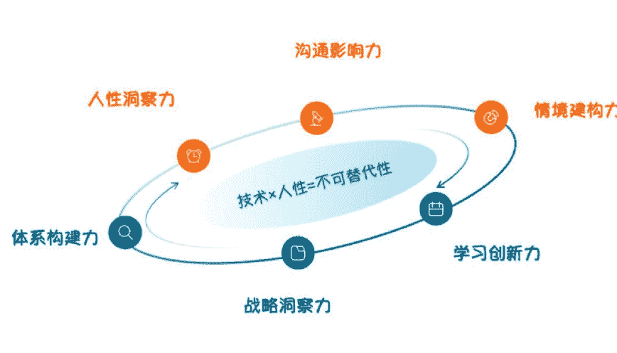

图5-1 HR不可替代的六项能力

##### 一）技术增强力

技术增强力，是指HR通过整合技术工具、数据分析与系统化思维，将抽象管理理念转化为可执行、可优化的能力。这一过程包括三大关键领域。

###### 能力1体系构建力

HR的基础价值之一，是构建一套与组织战略相匹配、结构清晰、规则完备的人力资源体系。

AI可以自动生成岗位说明书，却无法判断企业的战略重心、结构隐患或文化张力。HR要做的，是识别这些“组织变量”，并据此设计规则、规范与流程，建立有逻辑、有弹性的制度框架。这正是AI难以胜任的深度判断领域。

###### 能力2战略洞察力

如果说“体系构建”是设计一栋房子，那么“战略洞察”关注的就是，这栋房子该建在哪里、适合谁住、能否撑得起未来。

在AI大量介入事务执行后，HR必须承担更多前端判断的角色，成为“半个经营者”——既要理解组织的战略路径，也要读懂文化氛围、业务节奏与资源配置逻辑。

HR的战略洞察，正是用AI提供的数据做“证据”，用经验与判断构建“路径”，最终使人力方案贴合组织目标、发挥战略价值。

###### 能力3学习创新力

在技术快速演进的环境中，HR不仅要推动员工学习AI，更要自己带头试错、设计机制、探索新场景，成为组织进化的驱动者。

这项能力至少包含三方面：

- 结合具体业务，试用与迭代AI工具；
- 引导业务从“工具使用”走向“结构创新”；
- 设计组织级的试错机制与学习闭环，让创新可控、可持续。

未来，HR将更加依赖“复合型”人才，比如HR数据分析师。他们能看懂数据趋势，也能翻译成业务语言，让AI产出的结论变成组织可落地的决策建议。

##### 二）人性认知力

AI可以识别情绪标签，却难以读懂背后的动因；可以生成逻辑清晰的方案，却无法引导真实的情感流动。

HR的不可替代性，还体现在三方面：看得见人、调得动人、连得起人。根据Deloitte 2023年发布的《Global Human Capital Trends》报告，未来组织的核心竞争力之一，将是在无边界的技术环境中，持续以人为本，优先考虑人的结果与体验。

###### 能力4人性洞察力

AI可以识别语气，却感知不到犹豫中的不安、沉默背后的担忧、会议后的低沉。这些“未言之语”，往往才是组织真正的“温度计”。

优秀的HR能从表象中看出深层情绪与动机。这种能力来自经验积累、人际信任和现场感知，是与人打交道过程中练出来的，AI学不来。

###### 能力5沟通影响力

HR的沟通场景，往往发生在不确定、多立场的环境中：

- 在组织变革中，缓解团队的焦虑；
- 在多部门冲突中，协调各方的诉求和期望；
- 在员工敏感事件中把控信息节奏；
- 在管理者执行策略时，帮助他们清晰传达，确保员工理解。

这不仅要“表达清楚”，更要能“建立共识、引导认同、促进行动”。

AI可以生成语言，但无法识别语言背后的情绪流向和信任张力。HR要做的，是把冰冷的指令，转化为员工能接受、愿配合、愿参与的表达。

AI可以写出看似完美的文本，但HR要判断：

- 这句话员工听得懂吗？
- 会不会引发误解或抵触？
- 在这个节点讲这件事，是合适的吗？

沟通力，不在于说得多漂亮，而在于让人听得进和愿意行动。

###### 能力6情境建构力

HR不仅要定制度，更要营造氛围。因为同一方案，在不同的团队、部门、文化背景中，落地效果可能完全不同。

AI能告诉你最佳实践，但HR要回答：“在这个组织、这群人、这个时间点，这套方法行不行？”

HR需要从文化、角色、组织成熟度等多维度出发，做出环境适配设计。其定位不是“照搬规则的人”，而是创造规则能落地的场景的人。

在“人机共舞”的时代，AI拓展了HR的能力边界，而HR，则定义了AI的应用边界。

#### 二 从适应到引领：AI时代的HR成长路径

在AI深度协同的背景下，HR面对的关键问题，已不再是“会不会用AI”，而是如何与AI协作，站在什么样的位置。为此，我们尝试梳理出一条三阶段的进化路径（见图5-2），希望能为HR在角色定位、能力提升与成长规划上，提供一些参考。

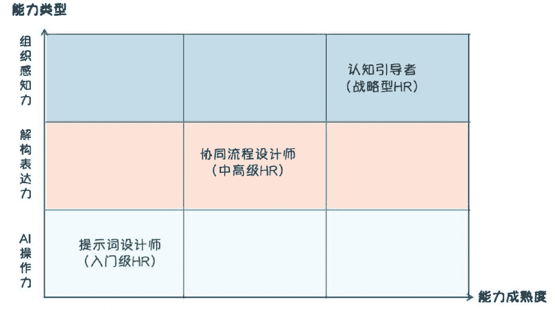

图5-2 AI-HR三阶段进化路径

这条路径不仅关乎工具使用，更关乎思维方式的转变。图中以“能力类型”与“成熟程度”为坐标，勾勒出HR在AI时代可能经历的三种成长阶段。

##### 一）提示词设计师｜让AI听得懂人话

这一阶段的核心，是让AI“听从指挥”，输出“可用成果”。

提示词不仅是操作指令，更是结构化思维的起点。它背后体现的是问题建模、路径设定与输出控制的能力。

> 正如斯坦福大学李飞飞教授在公开演讲中所言：“AI是人类的认知外骨骼”。而提示词，就是把人的思考过程“翻译”给AI的语言。

这阶段标志着从“我不会做”到“让AI帮我做成”，开启了效率提升和认知升级的双重通道。

提示词三步训练法如表5-2所示。

###### 表5-2 提示词能力三步训练法

| 模块 | 行动重点 |
| :--- | :--- |
| 学结构 | 掌握类似 SCOR+X、STAR、5W1H 等提示词模板 |
| 会提问 | 将目标转换为清晰任务指令 |
| 会判输 | 建立判断标准，评估 AI 产出质量 |

从这一阶段出发，HR开始从“用工具”转向“设计协同”。

##### 二）协同流程设计师｜设计AI参与整件事

这一阶段的关键，不再是“让AI做一件事”，而是设计一整套由人机共同完成的流程。

AI的价值不仅在于单点替代，而在于人机协同——AI与人类在同一流程中互补配合。HR要实现人机协作，需要具备“流程颗粒化”和“任务组件化”的能力，能将复杂任务拆解为AI可协同的小步骤。协同路径如表5-3所示。

###### 表5-3 AI协同路径

| 模块 | 行动重点 |
| :--- | :--- |
| 拆任务 | 将复杂任务细化为多轮提示词，形成逻辑递进 |
| 搭流程 | 设计 AI 在每一阶段的角色与输出要求 |
| 模板化 | 把高频任务沉淀为可复用的提示词流程包 |

随着AI融入招聘、培训、员工服务等领域，HR还需关注算法透明、合规边界、风险判断等议题。

##### 三）认知引导师｜和AI一起推演未来

这一阶段，HR不再只是用户，而是与AI共创未来的思考者与引导者。

AI成为组织智力网络的一部分，而HR，是连接AI与组织之间的桥梁。
三步共创路径如表5-4所示。

###### 表5-4 AI共创路径

| 模块 | 行动重点 |
| :--- | :--- |
| 搭认知框架 | 将 HR 分析模型结构化输入 AI，引导其按逻辑建构方案 |
| 构建双向链接 | 确保 AI 输出与组织目标、能力结构形成清晰锚点 |
| 引导组织共识 | 模拟多立场争议，生成博弈路径，提炼共识表达 |

这一阶段，HR从“让AI做事”转向“引导AI思考”。不仅要告诉AI“做什么”，更要设计它“怎么参与我们一起想”。

##### 四）三阶段成长自我评估清单

三阶段路径不仅为HR提供了成长方向，更为具体行动提供了参照系。
请对照任务清单（见表5-5），评估自己当前所在阶段，并明确下一步的能力突破点。完成5项以上视为达标，3-4项为成长中，1-2项为起步阶段。

###### 表5-5 三阶段成长自我评估清单

| 阶段 | 任务清单 | 我能完成 |
| :--- | :--- | :--- |
| 阶段 1：提示词设计师 | □ 写一段规范通知或邮件<br>□ 生成岗位职责说明书<br>□ 撰写会议纪要<br>□ 向 AI 提出要求并优化结果两轮以上<br>□ 判断 AI 内容是否合格并能指出原因 | □□□□□ |
| 阶段 2：协同流程设计师 | □ 拆解一个任务为多轮提示词操作<br>□ 设计一个 AI 协作流程图并在实际任务中使用<br>□ 搭建“任务-AI-反馈”的闭环机制<br>□ 用多个 AI 工具协同完成一次培训/制度设计<br>□ 编写一套可复用的 AI 提示词模板 | □□□□□ |
| 阶段 3：认知引导师 / 战略链接者 | □ 使用 AI 结合 HR 模型进行组织诊断（如冰山模型）<br>□ 用 AI 进行战略目标模拟或文化共创方案<br>□ 引导团队通过 AI 做头脑风暴并形成初步共识<br>□ 写一份 AI 参与下的组织变革建议书<br>□ 制作“AI+HR”专题培训内容并讲解给他人 | □□□□□ |

AI时代，HR的核心竞争力不再是“谁会更多工具”，而在于：

- 谁能看得更准、思得更深；
- 谁能引导AI思考，而非仅依赖AI生成；
- 谁能结合技术与人性，推动组织协同进化。

未来，不懂编程不会让HR被淘汰，但只做事务、不问价值的HR，将逐渐被边缘化。

真正不可替代的HR，是那个愿意主动拥抱变化、不断升级自我的人。

## 参考文献

[1] 杨百寅，单许昌.定力：中国社会变革的思想基础[M].北京：北京大学出版社，2020.

[2] 野中郁次郎，绀野登.创造知识的方法论[M].马奈，译.北京：人民邮电出版社，2019.

[3] 彼得·德鲁克.管理的实践[M].齐若兰，译.北京：机械工业出版社，2018.

[4] 施炜.管理架构师[M].北京：中国人民大学出版社，2019.

[5] 施炜，苗兆光.企业成长导航[M].北京：机械工业出版社，2019.

[6] 王志纲.王志纲论战略[M].北京：机械工业出版社，2022.

[7] 吴晓波等.华为管理变革[M].北京：中信出版社，2017.

[8] 黄卫伟.以奋斗者为本：华为公司人力资源管理纲要[M].北京：中信出版社，2014.

[9] 中国信息通信研究院.人工智能发展报告（2024年）[R/OL].北京：中国信息通信研究院，2024-12[2025-05-10].

[10] Ellingrud K, Sanghvi S, Dandona G S, Madgavkar A, Chui M, White O, et al. Generative AI and the Future of Work in America[R/OL].[S.l.]: McKinsey Global Institute, 2023-06[2025-05-10].

[11] Van Durme Y, Scoble-Williams N, Eaton K, Kirby L. 2023 Global Human Capital Trends: New Fundamentals for a Boundaryless World[R/OL].[S.l.]: Deloitte Insights, 2023-01[2025-05-10].

[12] HAYGROUP.岗位解码[Z].深圳：企业培训资料，2011.

[13] HAYGROUP.薪酬体系的设计与管理[Z].上海：企业培训资料，2013.

## 后记

开始踏入管理咨询行业时，选择了HR领域——因为我始终相信，HR这份工作一旦做好，将意义非凡。往小了说，它可以为一个人带来希望，比如帮他做出更好的职业规划。往大了说，能为一群人带来希望，比如为企业导入科学合理的人才管理机制，让更多人被看见、被激发、被成就。

转眼十余年过去，这份理想的实现远比我想象的曲折。一路走来，我始终坚持真诚以待，不敷衍、不欺瞒，竭尽所能提供专业建议。但现实往往并不如预期，虽然有不少成功案例，但也有许多方案与初衷相去甚远。

并非不努力，还是自己专业积累不够深厚。

有时为了弄清一个概念，需要翻阅大量资料，效率低、进展慢；没有高手指点，还常误入歧途。有时为了获得一个真实案例操作细节，不惜高价请当事人讲解，可到了关键部分总是欲说还休。

直到接触并深入使用AI，它的能力让我震撼。许多原本需耗时数月、数年的积累的知识，AI能在几分钟内完成初步分析与方案模拟。本书中的多数案例，便是在真实项目场景基础上，通过AI辅助还原与推演而来。它在分析问题、逻辑推理、专业洞察等方面的表现，有时甚至超过了资深顾问的水平。

有了AI的加入，顿感如同孙悟空取得了金箍棒，哪吒踏上了风火轮。一度让我怀疑，它是否会颠覆整个管理咨询行业。但兴奋之后，我也逐渐意识到：AI虽能生成答案，却无法感知信任、理解情绪，也无法洞察人心。它可以输出专业方案，却无法取代人与人之间的沟通与理解。

HR工作的特点，不仅在于其具有“稀缺性重要”——只有在关键时刻才能发挥作用；更在于“真功夫才有真价值”——只有练就扎实的专业本领，才能真正解决问题。理解这点，有助于摆脱不必要的自我怀疑，回归专业自信。

写这本书，是希望能帮HR工作者少走一点弯路。限于篇幅，关于AI提示词设计等技术性内容，我整理在另一本书——《AI职场写作》中，有兴趣的读者朋友可参考。另外，本书涉及的提示词及案例会发布在个人微信公众号上：峰之立（ID：lizhifeng2024），便于练习。

AI不会等你，也不会轻易取代你。前提是——你愿意成为那个带着探索意愿与实践积累，主动引导AI、赋能组织、连接人的人。