# 人工智能与人才管理的共进之路

# 起笔前的话

任正非曾把人工智能的冲击比作蒸汽机和内燃机的到来，本质上是生产逻辑和社会结构的再造。工作形态在改写，人才管理职能也不可能置身事外。

这轮技术跃迁的速度远超以往。有的组织已抢占先机尝到红利，有的还在观望或浅尝即止。是否准备好已不再关键，智能化已深度嵌入工作边界并持续重塑。本书不讨论技术强弱，核心在于探讨智能如何让人才工作更有效、更精准。

# 1. 智能已到场，人才职能必须主动响应

人才管理的价值在于读懂人、洞察组织并推动有意义的改变。现实中大量精力被琐碎事务占据，重复性操作挤占了深度思考的时间。有人缺的是时间，有人缺的是方法。

用对方式，智能相当于能力的延伸，也是进阶的助推器。马车夫嘲笑火车的故事不会重演，我们正进入实质性的跃迁。

智能不等同于单纯的工具，它更像一面反光镜，映照出固有习惯，也暴露出能力边界。进入人才领域后，许多惯常做法被拆解重塑。过去依赖经验的判断、手工作业的环节，一旦结构化就可被替代。曾被视为专业壁垒的内容，正变得可复制、可被自动化完成。

# 2. 从被动承接转向主动共创

面对变化，人才职能不能仅做被动接受者，需要升级与智能的协同方式。可做一次小测验，假设要梳理员工离职原因。

做法A：请根据离职访谈帮我分析离职问题。
做法B：你现在是人才分析师，附件是近半年访谈纪要，请从薪酬机制、管理风格、职业发展三个维度提炼共性痛点，以清单形式呈现，便于写入改善报告。

两者输出差距明显。后者结构清晰，可直接支撑决策。问题不在模型能力，而在使用者的方法。

# 3. 智能应用水平正成为职业分水岭

有人已借助智能实现跃迁，有人仍在低效循环。当有人还在让模型写几段文字时，已有人用智能完成绩效洞察、流程再造、报告产出，甚至一人承担原本一个小组的工作。智能不会消灭人才职能，但会淘汰不善用智能的人。这并非危言耸听，而是趋势所致。

差距不只在工具熟练度，更在认知高度、方法体系与思维模式。真正的门槛不是技术，而是结构化思维、任务拆解与判断力。

智能不会让人才职能消失，而是倒逼进化，走向更高阶的专业定位。未来的从业者不仅是操作者，更要成为协作者。人才职能的核心价值始终来自对人性的理解、对组织的洞察，以及人类特有的温度，这是模型无法替代的。

# 4. 读完后你将带走什么

这不是操作智能工具的技术说明书，而是一本面向实战与学习的认知训练指南。目标是帮助你搭建专属的智能时代人才进化框架。

适合人群：
- 被事务性工作拖垮，想用智能解放双手的人才新人；
- 卡在专业瓶颈，希望借助智能重塑体系的中层管理者；
- 推动组织变革，需要把智能融入人才战略的负责人；
- 所有认同人机协同的进化者。

你将掌握：
- 用提示词驱动智能进行有效协作；
- 通过自主学习构建专属的人才知识地图；
- 借助智能搭建四大基础体系；
- 赋能绩效洞察、人才发展、战略规划等实战；
- 重塑能力结构，迈向策略型人才专家。

这不是读完点头的书，而是读完就能落地的书。智能已至，未来不会等待犹豫者。让我们不只是追随变化，而是成为变化的一部分。

# 致谢

向在写作期间给予帮助、启发与支持的所有伙伴致以诚挚谢意。

感谢每一位合作过的客户。虽然每个项目都尽力以诚相待，但受限于能力与经验，未必每次都达到预期，感谢你们给予的机会与包容。

特别感谢金田铜业、扬翔股份、中国信息通信研究院、华恒生物、瑞斯康达、深圳第26届世界大学生运动会组委会、正浩控股、广联达等客户，你们给予的远多于我所回报的。尤其感谢河南仕佳光子科技股份有限公司，董事长葛海泉先生，让我有幸见证一家芯片企业从麦田起步到上市的全过程。在服务期间，葛总给予了我极大的信任与关怀，许多难忘时光留在淇河之畔。

感谢华夏基石彭剑锋老师等业界前辈，他们对管理的热爱与成就始终激励我前行。特别感谢施炜老师，他的教导常让我有“听一席话胜读十年书”的感受，学养深厚、务实坦率。与他相识的岁月是我进步最快的阶段。

感谢邢雷老师、段皎老师多年的陪伴与支持，始终同行，一起承受专业问题的考验，也一起品味被客户认可的喜悦。

感谢识千家马优老师，本书选题的确定离不开她在关键节点的建议与推动，她专业且热心，让我受益良多。

收稿之际，深感写书是抽丝剥茧的过程，也是一次结构化思维与认知升级的自我挑战。十余年咨询经历让我坚信，无论技术如何迭代，管理的本质始终是激发人的潜能，实现组织与个体的共同成长。愿本书汇聚的经验、方法与思考，能为人才从业者的专业成长提供清晰、实用、可行的参考。更期待它能在未来十年二十年，与所有同行者一起见证中国管理实践的创新与突破。

作者 2025年5月20日

# 第一章 提问与判断是人才职能用好智能的起点

人工智能在人才领域的落地，相较于其他管理职能，具备天然的双重基因。

其一，人才方法论具有普遍性。从胜任力建模到薪酬设计，百年管理科学已沉淀出体系化范式与工具。我们要做的是学会激活智能的知识引擎，快速调用全球积累的理论、方法与案例。

其二，人才工作高度情境化。文化特征、组织阶段、人才结构等变量决定了任何标杆方案都可借鉴难复制。这意味着智能不仅是知识搬运工，更要成为定制化的思维伙伴，在通用方法与企业特性之间搭建出真正契合的解法。

因此人才职能是智能最易上手却最难精通的领域。就像人人都有厨房，并不等于人人都能做饭，食材相同，有人只能做出快餐，有人能烹出佳肴。工具相同，差异在于认知方式与使用策略。

## 第一节 用提示词指挥智能

提示词即指令，是人与智能交互的桥梁。表面看只是一句话，实则承载意图表达、任务拆解与逻辑组织。指令清晰，智能才能准确理解；指令模糊，只能猜测。

### 一 为智能设定五类角色

人工智能正逐步具备拟人化特征，可模拟多种视角。你可以让它扮演五种角色：导师、助手、对手、目标受众和创作者。

#### 一）导师：提升认知，处理复杂议题

在需要认知支持的任务中，智能可担任导师角色，协助理解复杂议题、梳理思路。

凭借广阔的知识储备与高速的信息整合能力，智能能系统化组织内容，帮助理清概念脉络、重构逻辑关系、搭建主题框架。其角色类似首席知识官或数字智囊。

设定导师角色的三个要点：
1. 赋予权威人设。输出的语言风格与逻辑深度受角色设定影响显著。设定为资深专家或诺奖得主等高成就身份，有助于提升专业性与结构性。
2. 聚焦认知任务。导师型智能的价值不在于代写，而在于助思。它擅长组织思路、搭建框架、比较路径、解释机制等，适合构建结构而非直接生成终稿。
3. 明确提问方式。适合开放式问题。避免“这对不对”式提问，采用“请解释”“请从三方面分析”等结构化问法，引导系统性推理。

示例指令：
你是数字人才领域的专家。请帮我梳理“智能赋能招聘”的方案结构框架，要求语言通俗清晰、逻辑严谨。

#### 二）助手：执行操作，高效产出

在标准化任务中，智能最适合扮演助手。它执行稳定、响应迅速，能高效完成明确可拆解的事务性工作。

无论是撰写通知、整理清单、生成摘要，还是处理表格数据，智能都能快速上手、批量产出。随着智能体技术发展，智能助手正从被动执行走向主动推进。

设定助手角色的三个要点：
1. 明确任务目标。任务要具体清晰可执行，避免模糊描述。例如“帮我写一篇某主题文章”结果会平淡，而“请写一篇800字的HR某主题推文，口吻亲切、结构清晰”则更具操作性。
2. 规范输出格式。明确输出形式，包括结构要求、语气风格、字数范围、语言种类等。要求越清晰，结果越可控。
3. 提供背景资料。助手型智能不具备理解情境的能力，输入信息越充分，结果越贴合。建议提供背景材料、参考样例或必要说明，减少偏差。

示例指令：
你是我的行政文案助手，请按以下要求撰写一则内部通知：
目标：通知员工“五一”假期安排
材料：5月1日至5日放假，5月6日恢复上班，假期期间注意关闭办公设备
格式：正式通知格式，段落清晰，适合发布在办公系统
语气：正式、简洁
限制：控制在200字以内
如有不清楚请提问，不要自行假设。

#### 三）对手：反向验证，锤炼思维

智能不仅能协助完成任务，也可充当对手，帮助进行假设验证、方案反推与逻辑检视。

在策略制定、方案评估、观点表达等场景中，它能模拟客户、上司、投资人或竞争者，从对立视角提出质疑，暴露盲点，优化推理，增强说服力。

设定对手角色的三个要点：
1. 设定真实身份。指定智能扮演的身份对象及特点，如保守型HRD、资深采购经理、竞争企业负责人等。身份决定视角，视角决定质疑切入点。
2. 指定博弈场景。明确希望挑战的内容，如一项计划、一个判断、一个主张，并告知预设立场，让智能在真实情境下提出合理挑战。
3. 引导反向思考。鼓励智能从可行性、成本、接受度、风险、长期影响等多角度质疑，必要时可引导其持续追问，形成深度交锋。

示例指令：
请扮演一家保守型传统HRD，质疑我提出的“全面引入智能工具改造招聘流程”的建议。我主张全流程智能辅助招聘，请从数据安全、员工接受度、实施成本三个方面提出反对意见，可逐点挑战，若我回应请继续追问，直到逻辑闭环。

#### 四）目标受众：同理洞察，提升共鸣

在内容创作、沟通表达、用户研究等任务中，智能可模拟目标受众视角，对内容进行反应与反馈。

可让其扮演HR总监、00后职场新人，阅读文案、倾听主张、理解方案，并给出“像他们一样”的真实感受与建议。

设定目标受众角色的三个要点：
1. 设定用户身份。清晰指明智能应扮演的人群，如“三年经验HRBP”“注重细节的企业老板”等。身份越具体，反馈越真实。
2. 提供评估对象。将希望智能评估的内容完整提供，确保有充分背景资料进行判断。
3. 引导反馈角度。指定反馈维度，如是否易懂、是否有吸引力、是否有说服力、是否符合预期等。

示例指令：
请你扮演一位985大学毕业生，阅读以下招聘广告文案，并回答三问题：1) 你是否会点击查看？2) 第一印象是什么？3) 你是否愿意了解更多？请说明原因。

#### 五）创作者：共创内容，激发灵感

智能也可以作为创意共创者，擅长命名构思、标题打磨、脚本草拟、文风模仿等任务，尤其适用于从零到一的灵感激发与素材生成。

设定创作者角色的三个要点：
1. 明确创作目标。清楚说明创作内容类型及用途、受众、使用场景，帮助智能把握方向。
2. 提供创作边界。设定风格调性、内容限制、参考素材等，防止跑题或风格偏差。
3. 赋予共创身份。将智能设定为创意搭档，鼓励其主动提供选项、解释思路、尝试不同表达，形成真正共创。

示例指令：
你是我的创意搭档，我们要为一门“智能赋能HR”的在线课程命名。目标：名称简洁有辨识度，面向企业HR，风格专业中带点轻松。请列出10个命名建议，并简要说明命名逻辑。

### 二 提示词设计的四种策略

提示词不仅决定智能能否准确理解意图，更直接影响回应方向、深度与表达效果。指令越清晰，输出越精准。

四种典型模式包括智驾模式、火花模式、缰绳模式和标尺模式。四种模式既可单独使用，也可灵活叠加，形成既能放手生成又能精准收敛的提示词系统。

#### 一）智驾模式：结构化指令

智能最擅长处理问题清晰、目标明确、流程可控的任务。提示词中的智驾模式本质是结构化编程，你给出路线图，它按图索骥，有序输出。

##### 1. RCOR+X指令结构

该结构包含四个核心加可选补充维度。
- R 角色设定。智能应以何种身份思考？
- C 任务背景。任务发生的情境是什么？
- O 目标成果。希望输出什么？
- R 输出要求。在结构、风格、格式上的具体要求。

案例演示：
背景：你是公司HRBP，刚完成一场离职员工访谈。该员工来自销售部门，反馈了晋升机会、绩效公平和工作负荷相关问题。任务是撰写访谈纪要报告，供HRD参考。

结构化指令示例见正文。

##### 2. 哲学三问式指令结构

当任务存在较高不确定性和创造性时，推荐使用哲学三问式指令。

结构：指令=我是谁？角色 + 我从哪里来？问题背景 + 我要到哪里去？目标 + X 约束条件。

#### 二）火花模式：交互触发

智能底层是基于概率预测的语言模型。每一次追问、补充或纠正，都会促使它重新计算回应路径。交互越多元，灵感张力越强。

建议采用多轮交互设计、递进式提问，例如反问型、角色代入型、版本对比型、拆解归类型。

示例指令：
- 如果这个制度注定失败，它最致命的缺陷在哪里？
- 你能反过来用它的对立面来设计一种更高效的流程吗？

让提示词真正产生价值：HR 与 AI 协作的实操手记

想把 AI 变成 HR 的得力助手，关键不在要它直接给结论，而在用合适的问题设计把隐藏的可能性掏出来。你来做取舍与判断，AI 来搭桥铺路。很多时候，真正有价的问题不是为了得到一个答案，而是为了激发出更多值得推敲的方向。

### 火花模式：先发散，再决断

火花模式的价值在于打开思路，而非一锤定音。

##### 2. 角色代入法：站在他人位置扩大认知
示例指令：
- 以 95 后新人的身份阅读这份入职手册，会产生哪些真实想法？
- 若你是工会代表，你会如何质疑这份裁员方案？
- 设想你是管理学家明茨伯格，请对这份组织设计逻辑作出点评。

##### 3. 理论落地法：把抽象模型变为实务
示例指令：
- 把福柯的“规训权力”概念用在员工考核制度设计上会怎样？
- 用系统论的视角解释“离职潮”背后的组织循环机制。
- 将“心理契约破裂”模型转化成三道员工访谈追问。

##### 4. 多版本并列法：提供选项以便比较
示例指令：
- 写出三封风格迥异的入职欢迎邮件，分适配科技型、制造型和金融机构。
- 给出三套 OKR 设定思路，分别侧重激进扩张、稳健落地和员工自驱。
- 依据 AIDA 法则与 FAB 法则各写一版招聘文案，方便横向挑选。

##### 5. 发散收敛法：从想法池到决策点
示例指令：
- 列出五种可能推高员工离职率的因素，并挑出最可能的一项给出针对性建议。
- 先就[主题]给出不少于 20 条灵感，再设计一套便于后续筛选的分类方式。
- 枚举十种员工激励手段，再归入短期激励、长期激励和内在激励三类。

火花模式不求 AI 一口给出标准解，而是把问题空间撑大，你负责筛选与定夺。

#### 三）标尺模式：给生成物一把可执行的质检标尺
模型本身没有判断力，但可以被引导去学会判断。只要把“好内容”的标准讲清楚，它就能按标生成、复核甚至自优化。

示例指令：
- 用结构化面试的评估要点检查这份纪要是否包含关键行为证据。
- 以 HR 合规审计师的身份，从合法性、语言中立性和风险点三维度对员工手册打分。

让模型明白什么是合格，便能减少空话套话。

#### 四）缰绳模式：用成熟认知框架牵引生成
AI 没有世界观，也做不出意义判断，只能被动响应。缰绳模式的核心是用人类已有的认知模型来约束生成路径。

示例指令：
- 运用冰山模型评估面试中候选人透露出的动机特征。
- 以 OKR 逻辑检验这份绩效目标的合理性。
- 以员工生命周期模型为骨架梳理数据分析报告的框架。

每个模型都是经验的压缩包，提示词对准轨道，输出会更可靠。

这四种策略可以组合使用。
例如：快速生成加自动自检；先发散再用框架收束；先出初稿再扩展版本最后按标打分优化。

### 三 学会提问，才有好答案

操作技巧之外，提问能力更关键。常见卡点有三类：起步无门、拆解不清、难以判断可靠度。

#### 一）起步困惑
面对陌生议题或复杂任务，先问元问题来厘清方向。
示例指令：
- 我想完成 XX 任务但毫无头绪，请指导我该如何向你提问。
- 想了解 XX 主题，可从哪些角度切入拆解？
- 若你是 HR 专家，你会建议怎样切入这个议题？

#### 二）拆解无力
核心在于定位自己在思维地图上的位置。GPC 自检法可帮助厘清。

- G Goal：明确目标与认知卡点，是缺信息、缺结构还是价值不明。
- P Positioning：通过不同视角定位问题，理清整体架构。
- C Clarification：用假设句式引导策略生成。

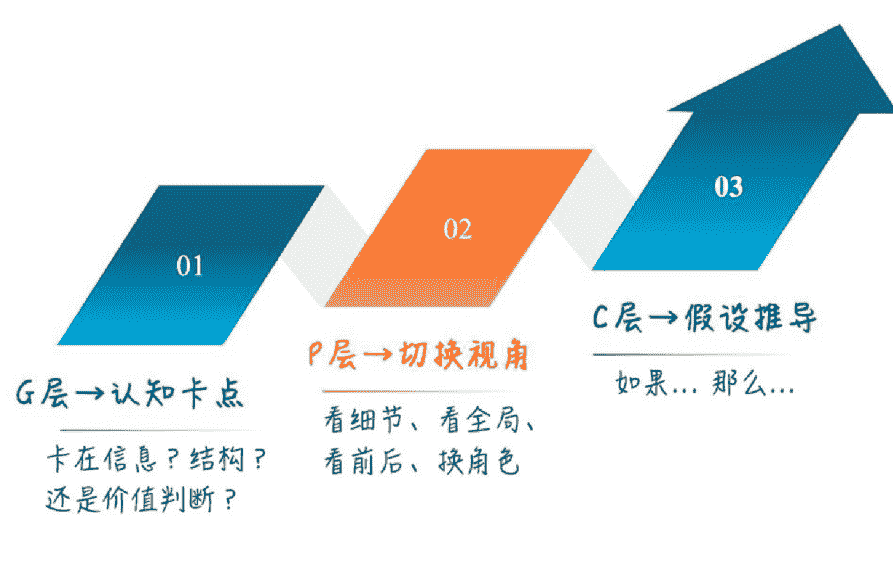

##### 1. Goal：定位认知层级
先判断卡在哪个层面，再找解法。

信息层。事实不足，需要补全背景。
示例指令：
- 要全面理解新员工离职问题，还缺少哪些关键信息？
- 分析离职趋势时常用的核心变量有哪些，我尚未掌握哪些？

结构层。逻辑不清，需要梳理因果。
示例指令：
- 招聘、培训、管理三环节如何共同影响新员工留存？
- 搭建一个影响留存率的因子结构图，标明模块间的关联。

价值层。方向不明，需要权衡意义。
示例指令：
- 这批员工是否值得投入资源保留？长期价值如何？
- 只能选其一，是提升留存还是提高招聘效率？哪个更符合长期利益？

##### 2. Positioning：切换思维视角
1）看细节。聚焦流程微环节找盲点。
- 请梳理该流程中易被忽略的关键细节。
- 反馈环节是否存在模糊或漏洞？

2）看全局。从系统角度判断结构性问题。
- 是否由多环节耦合导致？
- 晋升机制在组织系统中有哪些结构性联动？

3）看前后。引入时间维度。
- 该问题过往是否出现？若不处理未来会产生哪些连锁？
- 过去两年类似问题的演变趋势及未来走向？

4）换角色。提升共情与洞察。
- 模拟 95 后员工，这套考核会引发何种情绪？
- 站在业务主管角度，这份 HR 制度会带来哪些顾虑？

##### 3. Clarification：用假设句式推导策略
1）假设验证型：如果……那么会怎样？
- 若不改培训流程，离职还会持续吗？
- 绩效考核由季度改为月度，会影响满意度吗？

2）极端测试型：把变量推到极限。
- 试用期延长到半年，流失会减少吗？
- 取消所有非核心福利只留工资，稳定性受多大冲击？

3）反向破解型：从最坏情况反推风险。
- 如果我要让离职率再涨 10%，该怎么做？
- 如何设计评分机制让员工对绩效考核极度反感？

#### 三）判断结果是否可靠
关键在于建立质量控制闭环。

##### 1. 自检提问法
让模型回头检查自身输出。
- 请从逻辑性、完整性、事实准确性评估刚才的回答。
- 指出回答中可能存在的错误或盲点。
- 若用于正式场合，建议在哪些方面进一步修改？

##### 2. 对比提问法
生成多版本并自评。
- 在同一要求下再出两个不同风格版本并比较优劣。
- 写出三个开头结尾不同的版本，并说明哪个更适合年轻群体。

##### 3. 优化提问法
对已有初稿做迭代。
- 从执行风险角度检查员工调岗流程，指出阻力与模糊点并改进。
- 模拟普通员工阅读绩效制度，找出易误解表述并给出清晰替代。
- 以高管视角评估培训汇报是否体现 ROI 与战略价值，不足则补充。

### 第二节 人工智能的能力边界

用之前先弄清能做什么、做不了什么。

### 一 主流模型对比：ChatGPT 与 DeepSeek
ChatGPT 更偏生成，擅长自然语言创作与知识整理，如撰写关怀邮件、润色招聘文案、起草文化宣导。但推理路径偏线性，一处出错易连锁偏差，对提示清晰度要求高。

DeepSeek 更偏推理，采用多路径探索与动态筛选，在多变量强因果问题上更稳健，适合拆解流失原因、构建测评报告框架。但幻觉现象更频繁，生成内容易与事实脱节。

两者正在融合：ChatGPT 强化思维链，DeepSeek 优化表达。搭配使用效果更好。

### 二 模型优势与局限
一）三大优势
1. 信息重组力强。能把杂乱纪要提炼成 STAR，把制度拆成流程图。
2. 批量交付效率高。能快速产出多版邮件文案，标准化任务很省力。
3. 视角切换灵活。可模拟新人吐槽、模拟上级回复，适合共情与对抗演练。

二）三处局限
1. 缺乏价值判断。无法理解公平、信任等灰度议题，建议易显机械。
2. 缺乏组织语境感知。难以捕捉企业历史文化与隐性规则，易给出脱离实际的方案。
3. 缺乏情绪与文化敏感。能模仿语气却无法感知伤害点，难以处理信任成本。

AI 是协作者而非替代者。人负责判断与落地，AI 负责支撑与优化。

### 三 警惕幻觉与应对
AI 有问必答，却常“有答必假”。

一）幻觉表现
##### 幻象1：一本正经地胡说八道
自信编造事实，如虚构法规、捏造案例。在法律与制度引用上极危险。

##### 幻象2：迎合用户
1）虚假认同。对高风险点子过度肯定，缺乏刹车。
2）观点偏见强化。反复迎合立场形成偏见循环。可要求提供对立观点。
3）指令曲解。想听缺点却得到一堆优点，是训练偏好导致的说好话倾向。

##### 幻象3：复杂问题降智处理
###### 1）建议肤浅
问如何提升留存，答“提供下午茶”，忽略深层原因。
###### 2）常识错误

让模型来解释航天原理，它很可能吐出“月面上能游泳”这种明显违背物理常识的说法。

###### 3）推理混乱
让它计算“年利率10%、期限5年的贷款总利息”，它可能直接给出“50%”，并且附上一篇条理清楚却全盘错误的推导。部分回答听上去很可信，本质上是模型在相关训练语料不足或推理链条超过能力范围时，靠语言模式拼凑出的假推理。它并不具备真实理解，只是硬凑一个看起来合理的句子。

#### 二）应对之策
要防范模型幻觉，建议建立三类防护手段。

##### 1.源头锚定法
给模型划定发挥边界，防止无依据自由发挥。
- 把时间与法律边界说清楚，比如“请依据20××年《劳动合同法》进行分析”；
- 约束参考来源，比如“仅引用公开出版的××类专著”；
- 要求标明出处与数据来源，方便人工核验。

##### 2.多模型交叉验证
同一问题让不同模型分别作答，例如ChatGPT与DeepSeek，通过对比差异来检验可信度。如有必要，再结合互联网检索与线下查证来确认结论。

##### 3.链式提问法
引导模型逐步展开推理，减少胡乱编造。不要让它直接给出结论，而是先梳理思路。典型做法是：“先列出全部假设，再逐条检验数据是否支撑”。这种结构化、分步推进的提问方式，被认为是最有效的抗幻觉方法之一。

### 特别说明
关于本书后续章节案例与模型生成内容，说明如下：

#### 1.AI生成内容
书中所有模型反馈均由ChatGPT、Kimi和DeepSeek完成。每个问题都让三个模型同时作答，进行“正面交锋”，再择优呈现给读者。

#### 2.内容处理
为提升可读性并控制篇幅，模型生成内容在展示时做了必要编辑。
- 对原始回答进行了删减与格式优化；
- 对语言表达做了适度润色与风格统一。

#### 3.内容性质
本书呈现的案例与模型回应，目的在于展示人机互动效果。文中数据、情境、角色均为模拟设计，不对应任何真实事件或真实个体。

#### 4.立场说明
模型生成内容的观点与建议仅供参考，并不代表作者完全认同。请读者结合自身背景、专业判断与使用场景，审慎评估其适用性与准确性。

# 第二章 AI助力HR知识图谱四件套
信息愈多，知识愈碎。我们常觉得学得越多越迷茫，不是没学，而是学了记不住；不是不知道，而是知道了用不上。症结在于缺少一张清晰的知识地图。

知识地图，是把零散知识点组织成可视、可操作、便于传授的认知结构。这一概念最早由情报学学者布鲁克斯提出，在知识管理与组织学习领域得到广泛认可。它不仅是信息罗列，更是连接主观认知与客观现实的桥梁。

清华大学杨百寅教授认为，完整知识体系应涵盖三类认知：理解本质的理性知识、判断价值的感性知识、把握行动规则的活性知识。三者共同构成认知发展的“三元引力场”。“知识地图四件套”正是基于此出发：从碎片中提炼结构，从跳跃中建立体系。本章将带你构建HR专属的知识框架，打牢认知基础，推动能力升级。

## 第一节 概念结构图：把碎片整合成系统
西方哲学一贯强调“讨论前先界定概念”。亚里士多德将概念定义视为推理前提，笛卡尔、康德也主张知识必须建立在清晰可辨的概念之上，这为科学方法奠定了规范基础。

华杉在公开演讲中指出，中国传统文化恰恰相反：不下精确定义、重逻辑跳跃、偏好类比与隐喻。这种文化惯性深刻影响了HR知识体系的建构方式。

当前国内HR领域大量引入西方知识，但在概念转译上缺乏系统规范，同一概念出现多种解释甚至相互冲突。概念不清会抬高学习与沟通成本，也制约理论落地。管理既是科学也是实践艺术，建立清晰统一的结构化概念体系，是知识管理的基本功，更是实现“知识变能力”的起点。

### 一 五级概念框架梳理HR知识脉络
读了很多书、上过不少课，到实战却不知从何下手；看了标杆案例，到应用时分不清该学什么、怎么学。问题不在于努力不足，而在于缺少一张清晰的概念结构图。

学了用不上的困境，通常源于两类结构性障碍。

首先是学习断层，知行之间存在鸿沟。常见表现有：
- 只知其名，对概念缺乏深度理解。例如知道“绩效管理”，却说不清其本质与内涵。
- 知其重要，却不清任务全貌。例如知道绩效考核重要，却理不清目标设定、评价主体、反馈沟通等关键环节。
- 知其步骤，却无落地路径。例如听说可用KPI加360度评估，却不会设计评分表、确定权重或处理异常情况。

其次是概念污染，混搭学习导致认知失调。同一概念在不同公司、不同讲师口中说法不一，甚至自相矛盾。像“企业文化”“管理”等概念，十个讲师可能给出十种版本。为了标新立异，每个人都想建立自己的话语体系。

更常见的是东拼西凑，逻辑冲突、结构混乱。实际上，每种管理体系的核心概念背后都有文化基因与实践基础。

以“轮岗”为例，概念相同，系统逻辑却截然不同：
- 华为的轮岗基于“组织熵减”与“跨界成长”的战略认知，用来激活组织边界、培养复合人才；
- 西南航空的轮岗建立在“服务授权”与“客户体验”的运营理念上，强调多能工培养与服务连贯性。
概括来看，华为是自上而下的战略工具，西南航空是自下而上的运营手段。只学形式不理解背后的文化与制度配套，就容易“形对了神偏了”。

概念结构地图的价值就在于此，把知识从记住术语，转化为可理解、可迁移、可落地的认知框架，降低学习难度，为实战提供清晰指引，是从“知道”到“做到”的关键。

#### 一）五级概念结构地图
一个高质量的概念体系通常具备四个关键特质，决定了它能否有机生长、持续演化。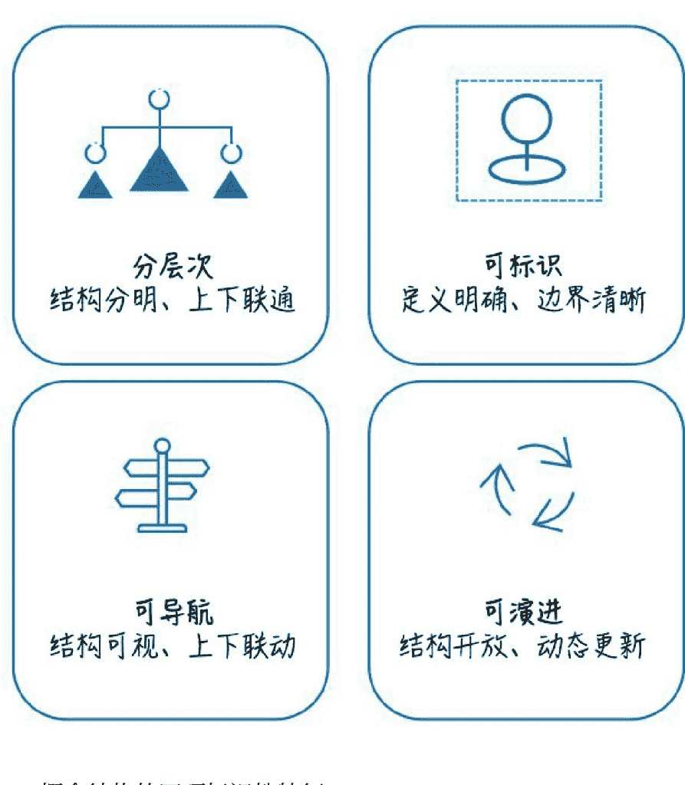

##### 1.分层构建
知识不是简单堆积，而是有依赖、有组织的系统。像一棵树，有主干、枝干与叶片，各层承担不同功能。知识管理的重点不是记住所有内容，而是在需要时能快速定位相关层级。

##### 2.可标识
每个知识点都应是清晰独立、可识别的认知单元，而非模糊的术语堆。可标识的概念至少具备：
- 边界明确，知道“是什么”与“不是什么”；
- 命名规范，便于沟通与管理；
- 结构归属清楚，明白所属模块与层级。
这能避免概念冲突，也为模型检索与迁移打基础。

##### 3.可导航
体系不仅要分得清、标得明，还要找得快、连得上。无论从哪个节点切入，都能快速定位上下文与关联知识。例如处理“员工评分标准”问题，应能从绩效管理模块导航到评分体系设计，再跳转到行为锚定评分法等子模块。

##### 4.可演进
知识体系不是静态文档，而是随情境生长的认知生命体。它应具备吸收新概念、替换旧模块、重组路径的能力，伴随实践不断自我进化。

基于上述分析，本书提出“五级概念结构模型”，用于构建从认知原点到执行动作的清晰层次。

##### 表2-1 五级概念结构体系

| 名称 | 专业术语 | 定义 | HR 领域示例 |
| :--- | :--- | :--- | :--- |
| 元概念 | 理念级知识 | 文化与战略层面的认知起点 | 奋斗者文化 |
| 父概念 | 范畴级知识 | 一级模块或核心知识领域 | 绩效管理、人力资源规划 |
| 子概念 | 子系统级知识 | 构成模块的关键子系统或核心能力维度 | 绩效评估、绩效反馈、绩效改进 |
| 孙概念 | 方法流程级知识 | 可复用的方法、流程与策略 | KPI、BSC、评分体系 |
| 末端概念 | 操作实践级知识 | 个人可直接执行的动作或操作单元 | SMART法则、打分表设计、反馈话术模板 |

#### 二）三个核心层级的解释
我们重点讲元概念、子概念与末端概念。

##### 1.元概念：文化信仰层，组织运行的源代码
元概念是知识体系的逻辑起点，承载组织核心议题的基本立场与价值假设。它体现文化基因与战略取向，为整个概念体系提供方向与判断标准，是最具引导与解释力的认知原点。

元概念不清或与下层冲突，组织行为容易割裂。例如某公司想学丰田的“持续改善”，却缺乏容错机制，基础文化无法承接。

HR领域的元概念通常具备：
- 抽象性，不直接对应操作，通过父概念转译；
- 唯一性，组织通常只有少数元概念，体现独特性；
- 稳定性，具有长期指引性，不随短期战略反复；
- 支配性，处于体系顶端，下层概念必须与其一致。

元概念定方向，父概念承理念，逐层转化为制度与行为。
示例路径：
- 元概念“以奋斗者为本”
- 父概念“绩效管理”
- 子概念“长期激励机制”
- 孙概念“虚拟股票”
- 末端概念“股权激励解锁条件设计”

路径清晰展示了文化如何层层转化为工具与行为。

##### 2.子概念：结构化中枢，连接理念与方法的桥梁
子概念是对父概念进行系统拆解的关键单元，是承上启下的连接层。它不仅说明“做什么”，更呈现“如何理解并组织这件事”的逻辑。

构建时不能堆关键词，要形成清晰路径。常见的五种拆解方式见表2-2：

###### 表2-2 子概念解析的五种路径

| 拆解路径 | 说明 | 适用场景 | 适用示例 |
| :--- | :--- | :--- | :--- |
| 功能路径 | 按职能划分模块 | 职能边界清晰的领域 | 需求分析、渠道管理 |
| 流程路径 | 按时间或事件顺序拆解阶段 | 强流程依赖场景 | 简历筛选→背调→Offer |
| 维度路径 | 按对象、区域或层级分类 | 对象多元复杂 | 社招 vs 校招 |
| 方法路径 | 按常用方法或工具展开 | 技术驱动领域 | KPI法、OKR法 |
| 结果路径 | 按产出物或数据指标分类 | 结果导向领域 | 岗位画像报告、ROI分析 |

子概念拆解建议选择一种主路径以保清晰，进入孙概念阶段可再引入多视角。此外应符合MECE原则，相互独立、完全穷尽。例如“招聘需求分析”下可分为岗位需求分析与团队需求分析，二者互不重叠且完整覆盖父概念内涵。

##### 3.末端概念：最小可执行单元，知识体系的神经末梢
末端概念最贴近工作现场，指可立即执行的动作与操作技术。它们虽小，却是理念落地的关键接口。

如“用OKR做绩效评估”是孙概念，而“如何写好一个KR”“评估周期如何设置”就是末端概念。末端概念既是执行终点，也是进化起点，推动体系持续适配业务。

五级结构不仅是知识骨架，更是认知升级路径。它让你知道知识点在哪，更知道它从哪来、往哪去。有了概念图谱，新机制都能找到接入口与匹配路径，学习从“扫码式吸收”变为“系统级接入”。

#### 三）借助模型建立概念结构地图
人脑构建知识结构存在天然短板：记得住概念却易忘结构；擅长判断却不擅长穷尽拆解；能判断对不对，却常在“怎么开始”上卡壳。

模型的价值不在于给出正确答案，而在于帮你更快厘清该判断什么、先做什么。你给方向，它搭骨架；你判断适配性，它快速分类、拆解并补盲点。

使用前先把五级概念结构模型喂给模型。以“招聘管理”为例操作：

案例：招聘概念体系构建
输入指令：我正在搭建招聘模块概念体系，请结合华为经验生成一个五级概念结构草图，并说明内涵。要求以表格形式呈现概念层级、内容、内涵说明三列。

模型反馈示例：
1.华为招聘管理五级概念结构图谱
| 层级 | 内容 | 说明 |
| :--- | :--- | :--- |
| 元概念 | 以奋斗者为本 × 熵减机制驱动组织活力 | 强调不断引入新鲜血液对抗僵化，激活人才代谢 |
| 父概念 | 招聘管理 | 招聘不仅是HR职责，更是战略人力工作的入口机制 |
| 子概念 | 1.岗位需求澄清机制 2.招聘全流程责任制 3.渠道分层与人才分群 4.专业面试官体系 5.甄选评估与结果闭环 | 强调结构严密、流程闭环、岗位导向清晰、责任到人 |
| 孙概念 | 1.岗位需求澄清→基于编制的岗位画像、关键职责与KPI澄清、主管确认机制 2.面试官体系→认证机制、评估口径标准化、打分责任制 3.渠道管理→编内/编外、校招/社招、推荐/外包分层 | 各子系统的关键方法、标准机制、流程细化 |
| 末端概念 | 1.岗位JD模板撰写 2.主管签字的招聘需求审批单 3.结构化面试问题清单 4.候选人评估打分表 5.渠道ROI月报 6.背调标准模板 | 直接落到一线执行表单、系统或制度动作 |

结构链条示例：奋斗者文化→招聘管理→专业面试官体系→结构化面试标准→评分表+面评话术模板。

你也可以要求模型以层级结构图或思维导图形式输出。例如：“为绩效管理模块生成符合五级概念结构的层级图，展示从元概念到末端概念的层级关系。”

模型输出可节选为：奋斗者（元概念）→绩效管理（父概念）→绩效考核（子概念）→KPI设计（孙概念）→SMART原则（末端概念）→评分比例设置（末端概念）→打分机制（孙概念）→行为锚定评分法定义（末端概念）。

对模型输出存疑时，可用以下提示词快速建立、修正和优化概念地图，如表2-3所示。

##### 表2-3 模型结构构建常用任务与提示词

| 任务目标 | 提示词示例 |
| --- | --- |
| 拆解一个父概念为子概念 | 请基于绩效管理，拆解出5个子概念，要求满足MECE原则，并说明各自关注点。 |
| 比较两个概念是否重叠 | “岗位能力模型”与“胜任力词典”是否属于同一子概念？如何区分？ |
| 补全结构盲区 | 我认为招聘模块包含岗位需求分析、渠道管理，请列出可能遗漏的关键子概念。 |
| 分析标杆实践的底层逻辑 | Google 20%创新时间制度背后的元概念、父概念、子概念可能是什么？ |
| 判断概念迁移可行性 | 将OKR机制引入我司，目前已采用KPI，有哪些冲突与融合点？结构如何调整？ |

建议尝试以“职位管理”与“任职资格”为主题生成概念结构地图，通过调整提示词观察输出差异。

### 二 深入学习核心概念的三种方法
概念定义是认知的起点，决定如何理解、判断、分类与行动。定义模糊，认知不清；定义偏差，行动偏离。

要真正掌握概念，不能停留在记住名字，而要借助科学方法学准、学通、学活。

#### 一）学准：锚定概念的正确定义
学准就是在使用术语时拥有稳定、清晰、场景适配的认知锚点。尤其对抽象性强、解读路径多的核心概念如“职位”与“岗位”“组织能力”“战略”等，否则沟通、设计与执行易出现错位。

为什么学准难？越基础越宏观的概念，定义越多元。以“企业文化”为例，学术界就有十几种表述：Schein的三层模型、Denison的文化特质理论、Hofstede的跨文化维度模型等。各有内在逻辑，关注角度不同。这就带来困惑：选哪个？都要学吗？有没有唯一标准答案？

答案是否定的。我们要判断的是：在特定任务中，哪种定义最有用、最贴合目标？

可借助亚里士多德“目的因”理论区分概念类型：
- 目的性概念：关注“为什么存在”，即意义与价值。例如“市场经济”，亚当·斯密用“看不见的手”定义，强调个体追逐私利时无形推动社会整体利益最大化。
- 必然性概念：关注“如何达成目标”，即实现路径与条件。例如“幸福”，亚里士多德将其定义为通过正义、勇敢、智慧等德性实践所达成的终极人生状态。

这种区分有助于判断概念在使用时更偏向功能目标还是逻辑构成。面对一个概念，不妨先问自己：我要用它做什么？明确动机与目的。

从概念到工具：用大模型把HR术语变成能用的方法

先想清楚一个概念要用来干什么、解决什么问题。每个概念都有它的使用边界和功能指向。过去我们靠个人阅历和抽象推演来分辨，现在可以借助生成式模型的语言拆解与逻辑重组能力，把这种辨析变成系统化的工作。下面用一个真实的HR场景来演示。

案例：给组织能力挑一个合适的表述
背景：HR在搭建组织能力评估工具时发现，学界对这个概念的说法非常多，角度也分歧很大：有的强调流程机制，有的强调人才协同，有的强调战略适应和变革弹性。面对这么多版本，怎么挑出最贴合当前任务的那个？

第一步：快速采集加自动归类
提问思路：请列出六条有影响力的组织能力定义，标注出处，再做分组。

模型的参考回复是：
1. 哈佛商业评论：组织能力是在个体能力基础上整合成的集体能力，能够持续创造价值。
2. 斯坦福大学：组织能力像个人技能，是企业在竞争中持续保持突出表现的特定能力。
3. SEBoK系统工程知识体系：指组织以系统工程方式达成价值与目标的能力。
4. CIO Wiki：指公司有效调配资源特别是人力以获取竞争优势的能力。
5. 迈克尔·波特《竞争战略》：指组织以特定方式整合活动来传递价值的能力。
6. 《组织能力的杨三角》：由人力技能、人力思维模式、人力治理方式三要素构成。

按应用场景可归为：
内部建设类：1、3、4、6；
外部价值创造类：2、5。

第二步：结合任务做适配推荐
提问思路：按目的性或必然性概念的标准，给出最适合评估工具的定义。

模型建议采用杨三角模型：组织能力是人力技能、人力思维模式和人力治理方式三者构成的系统结构。

推荐理由：
结构性强，能作为工具的框架支柱；
可拆解，每个维度都能细化为行为指标和测评点；
沟通成本低，HR、经理和员工容易对齐认知；
落地性好，长期用于企业诊断、评估与组织发展设计。

延伸拆解建议：
人力技能可看专业水平、学习速度、问题解决力；
人力思维模式可看主动程度、责任承担、以终为始；
人力治理方式可看流程支撑、授权机制、跨部门协作效率。
配合李克特量表、行为案例库或模型辅助评分，即可形成完整的测评系统。

概念还能做属性甄别。例如“职位是组织的最小单元”属于必然性概念，它描述的是组织运行的结构底座，是管理与绩效得以展开的前提条件。

二）学通：能往上追根，也能往下执行
概念的真正价值在于打通从理念到执行的全链路。

1. 往上溯源：从表单追问概念原点
用360度绩效反馈表单时，不要只问怎么填，而要问它属于哪个体系、体现什么绩效理念、是否和组织价值观一致。

2. 往下落地：把理念转译为可执行物
理念必须逐步拆成策略、方法、模板、话术。语义记忆和情境记忆结合，才能形成深度理解。

上溯源案例 360度绩效反馈
提问方向：为什么选360度而不是KPI？理论源头是谁？背景和目的是什么？是否契合“效率优先兼顾公平”的文化？
模型可以帮助回溯理论来源和价值逻辑。

下落地案例 绩效目标设定
拆解为五步：明确组织层级战略目标；拆解为部门KPI；转化为岗位目标；与员工协商确认并提供沟通话术；设定考核周期、权重与评价方式。
再进一步追问战略如何拆解到部门KPI，技术难点和操作要点在哪，模型均可展开举例。

只有可溯可落，知识系统才具备解释世界和改造世界的能力。

三）学活：迁移与创造
真正掌握概念的关键是迁移。模型可以充当迁移加速器。

案例：文化概念迁移
企业强调“开放沟通、持续改进”。指令是将其转化为绩效谈话中的行为引导和话术模板。
模型给出方向：
承认不足并邀请反馈：这个季度我在管理方式上也在优化，你觉得哪些地方可以更好？
鼓励改进而非否定：目标没达成，但我看到你做了哪些尝试，我们怎么一起调得更高效？
以成长为导向：这次挑战很典型，我们从中提炼经验模型，下次项目直接复用。
把墙上的口号变成管理者日常可用的对话。

小结
生成式工具正在推动真正的知识平权，获取与应用效率同步提升。对HR来说，成熟的概念体系是认知升级的底座。未来概念化能力比单纯的知识储备更具战略价值。高手不是背诵术语最多的人，而是能定义和重构规则的人。

第二节 知识流动地图：从局部到整体的立体透视

高质量的知识体系像地图也像机器，模块间需轻重分明、逻辑清晰、因果联动，才能闭环落地。

一 主次关系与先后顺序

《大学》说：物有本末，事有终始。知所先后，则近道矣。

一）轻重定位
从静态视角看，HR知识模块可分三类：
牵引模块，提供方向与价值引导，如战略规划、组织文化；
配合模块，承接意图推动落地，如招聘、培训、绩效；
支撑模块，提供结构保障与资源基础，如发展通道、人才盘点。

以人才管理为例，战略是牵引，它决定人才标准与选育用留逻辑。但轻重并非固定，会随企业阶段、发展重点与资源分布动态变化。对初创公司招聘可能是救命的水，对成熟组织领导力发展才是关键。

案例：初创科技企业HR优先级排序
背景：员工约300人，刚盈利，从创业英雄主义转向组织化协作，资源有限需明确先后。

模型建议优先启动六大板块：
1. 组织结构与岗位体系梳理
从人盯人到岗位运行，建立可扩展框架。核心动作：明确部门职责边界、建立岗位说明书与结构图、预设6-12个月扩张路径。
2. 关键人才识别与留用机制
聚焦10-15位核心骨干，设计股权、绩效奖金、项目分红等长期激励，避免盈利期流失。
3. 绩效管理与目标对齐
搭建简版OKR/KPI，形成目标意识与复盘习惯，重点在对齐感而非打分。
4. 招聘系统优化
从凑人到选对人，建立人才画像、结构化面试与候选人池。
5. 文化澄清与内嵌
提炼价值观原型，嵌入招聘、试用、晋升等关键场景，用仪式与故事强化共识。
6. 制度雏形与员工体验
起草入转调离、考勤薪酬等基础制度，建立反馈机制，关注新人融入与跨部门协作。

这提醒我们，盲目花钱做精密体系未必有效，关键是阶段匹配。

二）启动顺序
动态来看，启动顺序的判断在于：先对齐战略，还是先解决痛点，或先夯实基础。

案例：后备干部管理方案
背景：9000人上市铜材集团，高速发展，需系统化梯队。

模型给出“先打地基”的五项基础工作：
1. 明确组织未来画像与战略驱动岗位
关键词：战略对位、场景化。做什么：回答为何储备、未来关键岗在哪、梳理战略岗位地图。为什么：避免平均主义。做法：做战略关键岗位优先级地图。
2. 梳理并规范职级岗位体系
关键词：骨架清晰。做什么：厘清管理与专业双通道。为什么：没有路径，后备无处安放。做法：绘制成长路径图，明确晋升任职条件。
3. 搭建任职资格与胜任力模型
关键词：数据基础。做什么：通用素质+角色胜任力+潜力因子。为什么：避免凭感觉。做法：建3-5级等级描述，做结构化评估。
4. 建立干部画像与盘点机制
关键词：动态管理。做什么：建立能力、绩效、潜力画像，定期盘点。为什么：后备是动态资产池。做法：九宫格或模型辅助动态盘点图。
5. 梳理配套发展机制
关键词：评出来用起来留下来。做什么：轮岗、导师、试岗影子计划。为什么：防止只评不养。
总结：后备干部是战略接力赛，不是选美。

三）判断方法
轻重与顺序可综合三条路径：
1. 战略锚定
以战略优先级锚定核心模块，资源聚焦。局限是战略不清时易失焦。
2. 痛点倒推
从显性问题向上追溯系统根因。优势见效快，局限易头痛医头。
3. 能力评估
评估资源、流程与人员基础，优先可落地模块。优势风险低，局限可能错失窗口。

成熟企业以战略锚定为主，转型企业先痛点倒推，初创企业先能力评估。敢干要配清先后，否则热闹开局难收尾。

二 知识模块的耦合与联动
模块间耦合程度决定整体协同效率。招聘、绩效、薪酬、培训需机制打通、数据互联、语言统一，才能血脉畅通。

一）识别和选择耦合关系
首要任务是判断哪些模块必须联动，哪些可相对独立。

1. 强耦合与弱耦合
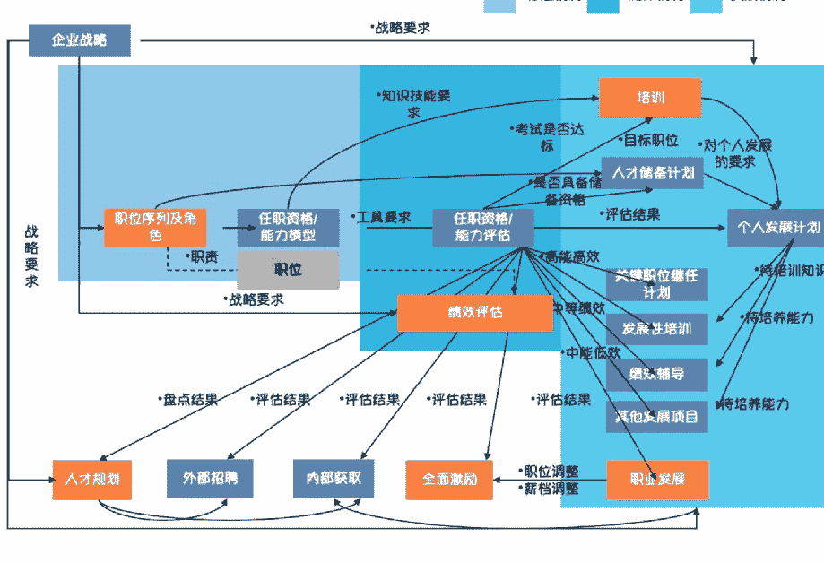
2-2 某企业HR模块耦合与联动图

HR联动：连得准、松得对

从依赖关系的角度看，人力体系内部各模块的配合大体可归为两类形态。

紧密依存型。两个模块彼此牵制，一方变动另一方必然受影响。比如绩效核算与晋升通道就是典型的紧密型，绩效结果既决定晋升机会，也会塑造员工对公平的认知。

松散协同型。联系不紧密，各自运转。比如员工关怀与外部招聘，都作用于人才体验，但业务运行的逻辑独立，平时不必强行同步。

联动路径越多并不等于体系越好，过度铺设连接反而会拉低整体效能。

##### 2. 耦合优化：既要协同，也要留白

模块间若绑定过死，灵活性会被削弱；若完全割裂，闭环能力又会丧失。更稳妥的做法是分层管理：

首先，强化因果链清晰、协同需求高的主干路，如绩效→薪酬→晋升，这是人力体系里最关键的贯通线。

其次，拆掉不必要的逻辑捆绑，减少无谓牵制，换取更高的调整空间与弹性。

不少公司喜欢照搬他人的模块拼图，看起来很完整，实际上耦合逻辑模糊，导致结构冲突、执行打架，最终难以支撑业务。

下面用一个高频场景来体会耦合差异带来的影响。

##### 案例：任职资格认证结果与薪酬调整的耦合关系

背景：很多HR会问，员工通过了任职资格认证，是不是就该同步涨薪。答案不是绝对的，关键在于组织如何定义能力等级与薪酬变动之间的联动规则。

输入指令：

你是一名资深人力资源专家。请基于不同组织实践，总结“任职资格等级认证”与“薪酬调整机制”之间的耦合关系。

要求如下：

- 列出常见耦合模式，并为每种模式命名；
- 每种模式说明：定义、适用背景、关键特点、潜在风险；
- 为每种模式匹配一个真实或典型企业案例；
- 最后用一张表格对比这几种模式的“耦合强度、激励力度、管理弹性、典型风险”。

模型输出：

任职资格等级认证本质上是能力评估或岗位能力模型的落地，它与薪酬调整之间存在多种联动方式。

模式1）刚性绑定型，资格等级等于薪酬等级

定义：任职资格等级直接决定薪酬等级，等级提升必然伴随薪酬调整，通俗说法是评上即涨，评不上就冻结。

适用背景：
- 企业体量大、岗位标准化程度高，例如大型制造、国企；
- 强调体系稳定与激励一致；
- 已有成熟的能力模型和等级评价体系。

特点：
- 薪酬晋升路径清晰，驱动力强；
- 对制度严谨度要求极高，否则易引发争议；
- 高一致性，低灵活性。

案例：
华为的任职资格体系约13级，与薪酬档位强挂钩，职级晋升需严格考核，薪酬随之同步上调，被称为“铁三角”制度，能力-等级-薪酬三者强绑定。

###### 模式2）弹性挂钩型，等级影响薪酬带宽

定义：任职资格等级决定员工所处的薪酬浮动区间，而非与工资一一对应。等级越高，可调空间越大。

适用背景：
- 处于快速发展期，需要平衡激励与管理灵活性；
- 管理层希望保留一定的薪酬操作权；
- 不想让等级认证变成涨薪的通行证。

特点：
- 管理弹性增强，可综合绩效、市场对标等要素；
- 等级提升不等于马上加薪，但会提高加薪概率；
- 激励效果弱于刚性绑定，但风险更可控。

案例：
字节跳动的能力等级与薪酬等级属于半耦合，每一职级对应一组薪酬带宽，晋升后是否调薪取决于绩效和预算，适合迭代快的组织。

###### 模式3）同步参考型，等级作为涨薪决策的辅因

定义：任职资格等级不直接决定薪酬调整，但在涨薪或晋升决策时作为参考维度，主要依据仍是绩效与市场。

适用背景：
- 以绩效文化为主导的企业；
- 任职资格评定尚未完全普及或标准化；
- 薪酬激励机制仍在探索期。

特点：
- 评价更看重当下绩效而非能力储备；
- 避免评审流于形式或证书化；
- 等级提升不强制涨薪，但可作为晋升依据。

案例：
某银行总部薪酬增幅主要依据绩效评分，能力等级则是“晋升岗级”和“竞聘资格”的参考项之一，可理解为评级影响晋升权，不决定薪资值。

###### 模式4）解耦型，认证与薪酬完全分离

定义：任职资格认证与薪酬调整各自独立运行，互不影响。

适用背景：
- 能力评估主要用于培训发展；
- 企业强调“绩效等于回报”而非“能力等于回报”；
- 岗位变动频繁，等级难以稳定映射到薪酬。

特点：
- 保留认证的能力开发导向；
- 薪酬更侧重绩效结果与岗位价值；
- 容易让员工对评审失去期待感。

案例：
初创型互联网企业常用此模式，认证结果主要用于制定学习路径，薪酬由绩效决定，等级只是成长地图，不构成实质激励。

汇总对比表：

| 模式 | 耦合强度 | 激励力度 | 管理弹性 | 风险 |
|---|---|---|---|---|
| 刚性绑定型 | 很高 | 很强 | 低 | 制度失衡风险高 |
| 弹性挂钩型 | 中高 | 中等偏强 | 中高 | 操作不透明可能引发质疑 |
| 同步参考型 | 中 | 中等 | 高 | 激励作用较弱 |
| 解耦型 | 低 | 弱 | 高 | 激励失效、评定价值感低 |

职级体系与薪级体系的联动也是HR的常见痛点。两者一套界定组织身份定位，一套决定收益回报，共同构成人力管理的双支柱。联动方式直接影响公平感知与激励效果，也是薪酬设计里最具挑战的核心议题。看看模型如何解析这个问题，或许能带来新启发。

#### 二）模块耦合的结构可视化

借助AI，可以把隐性关系转化为显性结构，更清晰呈现协同逻辑、辅助推演与断链识别。以下四种可视化方法适用于不同管理场景。

##### 1. 网络图

用于展示模块间的结构性依赖，比如谁依赖谁、谁包含谁。

示例指令：

请基于招聘流程，绘制一张“概念依赖图”，展示从“招聘需求分析”开始，向下展开的关键依赖关系，包括“岗位需求分析”等模块，并标注“依赖”“包含”等逻辑关系。输出成结构清晰的关系图。

模型输出：

```
[招聘需求分析]
    ├──依赖──> [岗位需求分析]
    │           └──包含──> [岗位职责]
    ├──依赖──> [招聘渠道选择] ──依赖──> [广告发布]
    └──依赖──> [简历筛选] ──依赖──> [筛选标准设定]
```

##### 2. 映射图

用于表达两个系统之间的“概念对齐关系”。

输入指令：

请生成一个结构映射图，展示“职位体系”与“培训体系”之间的概念对齐关系，采用箭头结构表示每一项内容的逻辑对应关系。左列为职位体系的要素，右列为对应的培训体系要素，格式类似于结构对齐图或概念映射图。

模型输出：

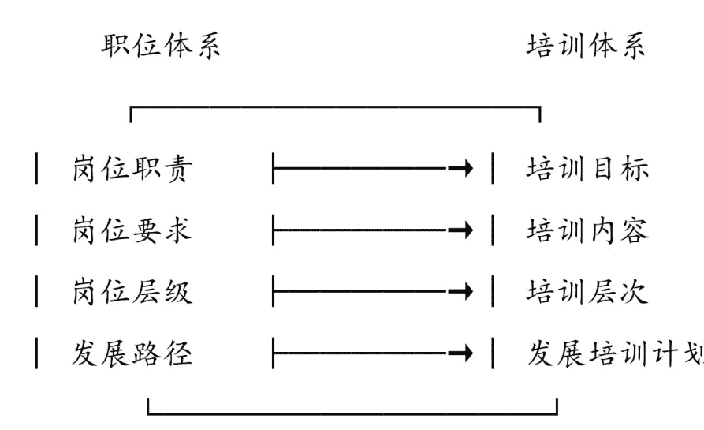

##### 3. 耦合矩阵图

用于量化两个系统内部要素之间的耦合强度，是耦合关系分析的经典工具。

输入指令：

请绘制一张职位体系与培训体系之间模块耦合矩阵图，用红黄橙三种颜色标出每个元素之间的耦合强度。行列分别为：岗位职责、岗位要求、岗位层级、职业发展路径×培训目标、培训内容、培训层级、发展培训计划。

模型输出：

耦合矩阵图如下：

| 职位\培训 | 培训目标 | 培训内容 | 培训层级 | 发展培训计划 |
| :--- | :--- | :--- | :--- | :--- |
| 岗位职责 |  |  |  |  |
| 岗位要求 |  |  |  |  |
| 岗位层级 |  |  |  |  |
| 职业发展路径 |  |  |  |  |

强耦合：同步设计；中耦合：协同优化；弱耦合：分步实施。

##### 4. 泳道图

适用于流程责任划分，清晰展示“谁在什么环节做什么”，适合用于跨部门协作流程建模。

输入指令：

请用泳道图展示“构建岗位胜任力模型”的跨部门知识协作流程，泳道包括HRBP、业务部门、培训部门，列出各自在每一步的职责。

模型输出：

泳道图结构（简化版）

| 步骤\部门 | HRBP | 业务部门 | 培训部门 |
| :--- | :--- | :--- | :--- |
| 岗位调研 | 发起调研、提供访谈框架 | 参与访谈，描述关键行为 |  |
| 提炼关键能力要素 | 归类并结构化行为事件 | 审核关键能力是否贴合业务 |  |
| 构建能力等级描述 | 起草胜任力等级表述 | 提供真实工作场景反馈 |  |
| 审核与校准 | 协调评审流程，组织共识 | 参与评审，修正不合理描述 |  |
| 衔接培训体系 |  | 提出能力提升需求 | 将能力要素转化为课程模块 |
| 发布与应用 | 发布能力模型，纳入HR体系 | 在招聘/晋升中试点使用 | 开发匹配的培训产品 |

实践中，重复返工、各行其是、职责模糊互相推诿，以及强行捆绑导致管理过度复杂，往往源于结构设计中的耦合混乱。这正是构建“知识流动地图”的价值所在，分得清、连得上、看得见。

##### 小结

管理知识的关键在于建立“轮廓感”。就像一幅高明的山水画，主次分明、疏密有致，该连的地方精准衔接，该断的地方果断留白。

但结构之美只有在实践中才能体现真正价值。知识唯有在真实工作中有效、有序流动，才能从“知”到“用”跃迁。否则就会停留在表层展示，成为负担。

## 第三节 标杆案例研究：高效对标与智慧迁移

管理大师德鲁克在《管理的实践》中指出：“管理是一种实践，其本质不在于‘知’而在于‘行’；其验证不在于逻辑，而在于成果。其唯一权威就是成就。”这正是标杆研究的真正意义。

标杆研究的核心产出有两类：一是从优秀企业的模式与策略中提炼结构化认知模型，作为组织共识的认知锚点；二是将其经验转化为可执行的方案建议、流程优化路径与制度设计工具。

学习标杆的前提，是自身拥有一套清晰、可对照的知识框架。缺乏结构，就如“盲人摸象”，只能抓住局部，难以形成系统认知；一味套用他人方案，又容易落入“认知牢笼”，被别人的思路绑住手脚。

因此标杆研究不仅是“看别人怎么做”，更是一场结构化的知识重构。本书提出一个标杆研究的ACT模型，包括对标、解构和转化三大部分（见图2-3）。

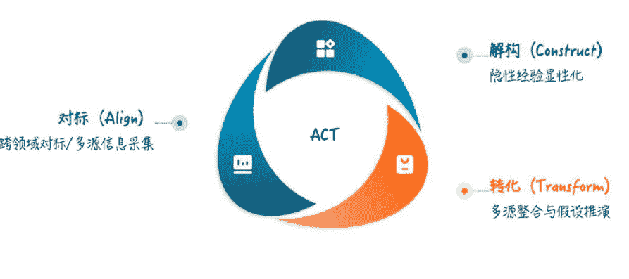

图2-3 标杆研究ACT模型

接下来，我们将逐一拆解如何操作ACT模型中的核心环节。

### 一 对标选择与解构分析

标杆研究的起点，是明确研究目的，选对学习对象。有效的标杆研究，最好围绕具体成果或关键痛点展开，优先聚焦最需要突破的领域。尤其在借助AI进行辅助分析时，问题越聚焦、提示词越具体，反馈质量也就越高。

不良指令：

请你研究和分析一下[标杆企业]的[实践]。

示例指令：

- 请说明如何将[标杆企业]的[实践]应用到[某个行业/场景]，有哪些注意事项？
- 请分析[标杆企业]在[具体领域]中最具借鉴价值的做法有哪些？请列出3-5条，并说明其适用场景。

同时，也要避免“只看一个案例、只靠一种材料”的片面视角。通过多个标杆、多类文献、不同语境的交叉分析，才能搭建起一个更立体、更全面的认知结构，避免“以偏概全”或“生搬硬套”。

示例指令：

- “胜任力模型”在[标杆企业A、B、C]中的应用有何异同？请逐一分析并汇总为共性—差异矩阵。
- 请列举[标杆企业]在[某领域实践]方面的公开研究、白皮书或案例支持。

获得初步信息后，即可进入解构分析阶段。建议将分析过程拆分为三个层次，逐步深入。

#### 一）表层问题：理解“发生了什么”

第一步，是迅速掌握案例的基本构成。这既为后续分析提供信息基础，也有助于降低认知门槛。推荐使用经典5W1H框架，建立系统性理解。

示例指令：

- **What**: 这个案例的核心目标是什么？他们解决了什么问题？
- **Why**: 为什么这个标杆案例成功？其成功的关键因素是什么？
- **How**: 他们是如何实施这一策略的？采取了哪些具体措施和工具？
- **Where**: 这个案例发生在哪些具体环境或行业中？它是否可以跨行业借鉴？
- **When**: 他们在什么时间实施了这些策略？这个时间点对成功有何影响？
- **Who**: 案例中的关键参与者是谁？他们在成功中扮演了什么角色？

#### 二）深层问题：理解“为何如此”，提炼迁移逻辑

很多实践在表面相似，实则根因与适配逻辑大相径庭。问题往往不在“做法”，而在“背后的文化与业务逻辑”是否匹配。建议采用以下三种分析方法。

##### 1. 5WHY追问法

通过连续发问，层层追溯成功背后的因果链条与能力基础。

示例指令：

为什么这家公司高潜人才的留存率显著提升？
→因为他们为高潜员工提供了清晰的晋升路径与成长计划。
为什么能做到这一点？
→因为他们建立了系统性的人才识别机制（如9宫格盘点+360评估），能及时识别高潜员工。
……
为什么文化上能形成这种共识？
→因为企业长期强调“用未来看人”的理念，并配套制度和资源，形成组织承诺。

##### 2. 细节拆解法

不要只问“做了什么”，而要问“怎么做的、谁来做、做到了什么程度”。

不良指令：

请问[标杆企业]如何做人才盘点？

示例指令：

请将[标杆企业]的[人才盘点实践]分解为目标→步骤→工具→评估方式。

##### 3. 适用条件校验

分析“可复制”的关键要素与“需调整”的背景变量，判断是否具备迁移基础。

示例指令：

- [标杆企业]的[某项实践]适用于哪些行业或组织？
- 请列出应用该机制的必要前提或风险点。
- 分析该实践在[我司]实施时的主要挑战，并提出优化建议。

#### 三）应用问题：判断能不能用、该怎么用

真正实现有效迁移，必须先判断，哪些做法是可复制的通用方法，哪些属于特定组织的系统性产物？哪些元素可以直接应用，哪些需要重构适配？推荐两种分析工具：

##### 1. 假设-影响-结果模型

通过还原制度背后的前提假设、系统性影响与潜在结果，帮助组织识别是否具备迁移基础，避免盲目复制带来的系统震荡。

例如，某标杆企业推行“干部能上能下”机制，其背后的逻辑假设链可能是：岗位非终身制→有能量化体系→管理层KPI绑定→有容错文化和法律机制→人才流动机制稳定→实现“能上能下”。

示例指令：

- [标杆企业]推行[某机制]，背后的关键组织假设有哪些？
- 此机制可能影响哪些系统环节？包括流程、文化、人员结构等。
- 若迁移至我司，预期会产生哪些影响？是否符合当前发展目标？

##### 2. 变量迁移法

从成功实践中提取可复用的“核心变量”，同时识别需根据自身情境调整的“条件变量”，实现选择性迁移、结构化适配。例如，谷歌强调扁平化管理，但制造业更适合借鉴其“即时反馈机制”，而非组织结构本身。

示例指令：

- 如何将[标杆企业]的[做法]迁移到[我司]？有哪些关键变量？哪些需重构？请结合我司的管理基础与资源能力，列出可保留项与应调整项。
- 请评估[导师制]在初创企业中的可行性，并提出针对“导师积极性不足”问题的解决策略。

标杆研究不是复制“别人怎么做”，而是拆解“为什么做得成”。有效学习要选准对象、聚焦问题，并借助结构化工具，深入分析表象、逻辑与迁移路径。

唯有看懂其“成于何因、适于何境”，才能跳出模仿陷阱，实现有效迁移。

### 二 转化创新——智慧应用与迁移

能否将标杆经验真正转化为组织自身的实践成果，关键在于选准路径，因地制宜。为此，本书提出了一个适用于AI时代的迁移策略框架——DGR标杆迁移三法（如图2-4所示），帮助企业根据不同情境，选择最合适的吸收与转化策略。

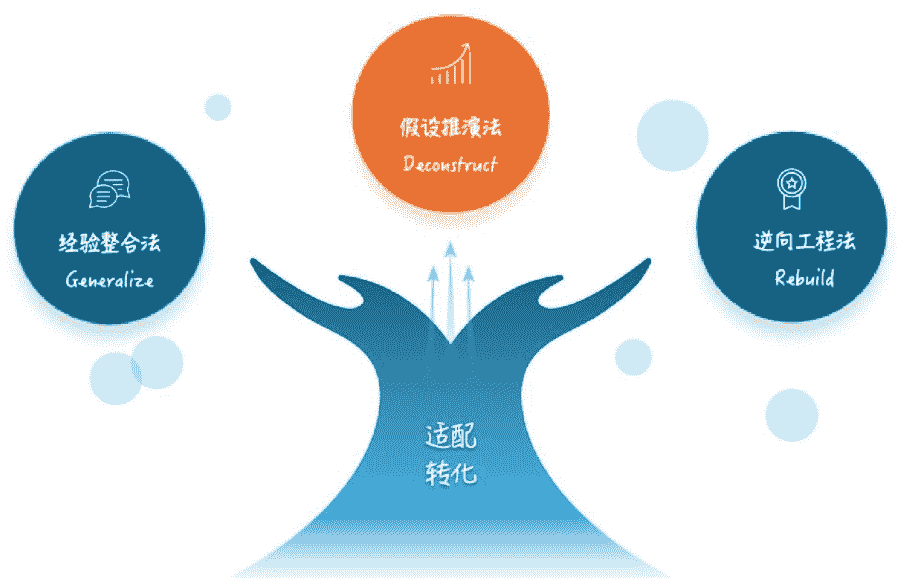

图2-4 DGR标杆迁移三法

假设推演法。标杆为什么能这么做？拆解其背后的假设与条件，重构适配逻辑，降低试错成本。

经验整合法。别人还有怎么做的？归纳多家做法，融合共性与差异，打破路径依赖，构建定制方案。

逆向工程法。从成果出发，倒推关键路径，打造“最小投入、最大绩效”的落地方案。

这三种方法既可独立使用，也可灵活组合，适用于不同类型的迁移需求。接下来，我们将结合实际案例，详细演示其操作路径。

#### 一）假设推演——条件不足时的适配性突破

当企业在资源、文化或管理基础上与标杆企业存在较大差距时，直接照搬往往水土不服。假设推演法提供了一套四步路径，帮助组织拆解标杆逻辑，重构更贴合自身条件的落地方案。

##### 案例：华为薪酬体系“获取分享制”借鉴

背景：某上市公司计划借鉴华为的“获取分享制”理念，推进薪酬体系改革。HR基于公开资料，梳理出以下关键实践要点。

###### 1. 薪酬包设计

| 薪酬包 | 设置考量 |
| :--- | :--- |
| 工资包 | 奖金包 |
| 战略性工资包 | 战略性奖金包 | 对应战略预算，牵引对中长期业务发展基础投入 |
| 运营性工资包 | 运营性奖金包 | 对应运营指标，牵引人效的持续提升 |
| 存量对应成本项 | 增量对应利润项 | 导向增长 |

###### 2. 分层分配设计

薪酬包从体系到系统、部门，再到员工个体进行四次分配。薪酬包与一级组织（即系统）价值创造要素（如收入、毛利、利润等）挂钩，如下表所示：

| 定位 | 一级组织 |
| :--- | :--- |
| 投资中心 | IRB（对内产品投资）、企业发展部 |
| 费用中心 | HR、财经、质量流程 IT 等 |
| 利润中心 | 地区部、BG、华为云等 |
| 成本中心 | 2012 实验室、海思、战略研究院、供应链等 |
| 收入中心 | 车 BU、新设代表处、产品线、军团等尚未盈利单元 |

###### 3. 内部市场化结算：促责权对等

一线业务部门掌握预算但不直接控制资源，后台支持部门拥有资源却无支配预算。双方通过内部“买卖”机制实现资源交换与责任清算：“前线呼唤炮火，就要为炮火付费。”

每个环节都“算自己的账”，既强化责任归属，也推动资源向真实需求精准流动，最终形成以结果为导向的绩效闭环。

###### 4. 具体操作方案演示

示例：

- 利润中心薪酬包=贡献毛利×系数1 ×权重1+奖金TUP前贡献利润×系数2 ×权重2。
- 成本中心薪酬包=工资包+奖金包=空耗预算×系数1+（市场化收入-空耗预算）×系数2。
- 费用中心的薪酬包，理论上也可与其所产生的费用挂钩进行设计。但这种导向容易诱导盲目扩大费用。因此要转移其导向，转而和公司整体经营效益挂钩。费用中心薪酬包=公司指标1 ×系数1 ×权重1+公司指标2 ×系数2 ×权重2。

# 责任与薪酬同步核算，职能部门才能自负盈亏

由此，薪酬总额与各责任单元的边界和公司整体经营结果形成了闭环，真正做到分灶吃饭、自我约束。

（备注：以上信息根据公众号“管理健谈”《这才是真正的华为薪酬体系》一文及华为官方网络公开资料摘录整理。）

###### Step 1：概念厘清

输入指令：

你是一名资深薪酬管理顾问，请解释成本中心的空耗预算和市场化收入分别指什么？

AI答复：

空耗预算：指让基础职能维持日常运转所必须的基础刚性花费，能够直接创造产出的不多，但没有它业务无法运转。

市场化收入：指职能部门把内部服务做成产品，向业务部门收取费用形成的对内结算收入。定价依据服务协议SLA，结算与服务质量挂钩。

输入指令：

请示例HR部门空耗预算包含的具体费用项目。

AI答复：

以下是HR部门空耗预算的示例：

| 科目 | 预算金额 |
| :--- | :--- |
| 人员薪酬 | 60 |
| 办公耗材与通讯/固定资产折旧及租赁/办公设备与系统维护 | 20 |
| 差旅与培训/外包服务费例如招聘外包 | 12 |
| 管理费与内部服务分摊/应急费/杂项例如招待费 | 13 |
| 合计：万元 | 100 |

输入指令：

市场化收入如何操作？以HR招聘服务为例，具体是怎么定价和结算的？

AI答复：

操作流程如下——

需求确认：HR与业务部门敲定招聘岗位与交付时限，签署服务协议SLA，例如1个月内完成。

内部定价：该次招聘服务内部价定为1万元，由业务部门在预算中扣除。

服务执行：HR按约定完成简历筛选、面试安排、背景调查等全流程交付。

结算与反馈：招聘完成后HR提交服务清单办理结算，业务部门若对结果不满意，可通过反馈机制影响HR部门后续绩效与激励分配。

###### Step 2：假设推演与方案重构

输入指令：

我们企业管理基础较弱，预算机制不健全、责任界定不清晰。能否将“空耗预算”简化为“人工成本”？有什么建议？

AI答复：

这是合理且可行的过渡做法。简化口径有助于企业在起步期更快建立成本与薪酬的管控机制。

建议分阶段演进：

第一阶段起步期：空耗预算等同于人工成本，重点关注人力投入的合理性。

第二阶段提升期：在人工成本基础上叠加办公用品与基础设备维护等运营费用，逐步细化空耗口径。

第三阶段成熟期：全面纳入办公设备、外部服务费等科目，形成完整的成本管控体系。

###### Step 3: 创新设计

输入指令：

我打算这样设计薪酬结构：薪酬包=工资包+奖金包。
- 工资包=公司销售收入×系数1，其中系数1=历史人工成本/销售收入。
- 奖金包=（市场化收入-空耗预算）×系数2，空耗预算初期用“人工成本”代替，系数2参考历史奖金水平（如一个月工资，对应系数2=1/12）。
请你评价这个设计思路是否可行？

AI答复：

在管理基础薄弱、预算体系尚未完善的企业中，该方案思路清晰、核算可行、激励方向明确，具备雏形价值。

1）工资部分=公司销售收入×系数1
测算逻辑稳健：以“历史人工成本/销售收入”作为系数1，能真实反映人工成本占比，依托历史数据设定。
与经营规模联动：工资总额随销售收入波动自动调节，有助于遏制成本刚性扩张。
员工感知稳定：工资受销售影响，但个人收入相对平稳，有利于稳定军心、保障基本生活。

2）奖金部分=（市场化收入-空耗预算）×系数2
初期易落地：将空耗预算暂时等同于人工成本，操作简便易懂。
奖金基数清晰：系数2=1/12，即一个月工资作为奖金，符合传统认知，便于与历史绩效奖金衔接。
可持续优化：未来可根据激励需求灵活调整系数2，提升激励强度。
强化服务导向：以“市场化收入-成本”为奖金依据，能推动职能部门由后台支持向效益单元转型。

结论：方案具备良好扩展性与实践价值。建议先试点，再用数据验证并微调参数，持续优化模型。

###### Step 4：验证与迭代

输入指令：

请评估上述方案在实施过程中可能遇到的问题和潜在风险，并提供建议与应对措施。

AI答复：

1) 可能面临的挑战与风险

- 系数设定不当，激励不足或过强。系数2过低，会削弱市场化收入增长的收益体现；系数2过高，可能诱发短期冲刺，损害服务质量。
- 空耗预算依据不足，导致资源紧张或浪费。预算过紧会影响基本运转；预算过松会削弱市场化激励效果。
- 绩效导向失衡，服务质量被忽视。

2) 优化建议与应对策略

- 引入质量类考核指标，如服务满意度、交付及时率，避免只重创收不重服务。
- 动态调整系数，匹配发展阶段。初期固定系数建立认知习惯；成熟期引入收入弹性系数或浮动激励倍率，按业务增长调节奖金强度。
- 设置基础保障奖金池，保留一定比例固定奖金，避免收入波动导致激励塌陷。
- 建立定期复盘机制，以数据驱动迭代优化。

总结：该薪酬设计在初期可行且合理，既满足管理初期的简化需求，也为后续优化预留空间。

标杆的价值在于启发，不在于照搬。HR只有建立自己的认知框架，才能在AI时代发挥真正的专业力。

#### 二）经验整合——多标杆智慧的系统融合

如果说假设推演法是“减法思维”，侧重剔除不适做法与重构逻辑，那么经验整合法就是“加法策略”，强调多元融合与有机组合。

##### 案例：如何提升员工创新活力

背景：一家500人规模的科技制造企业，正在探索系统化的创新人才培养机制。但在选择学习对象时陷入犹豫：宝钢、谷歌、惠普……这些企业各有特色，我们到底该向谁学习？

目标：通过经验整合，设计一套契合自身的“创新管理机制”。

###### Step 1：模式提炼

输入指令：

请你扮演一位资深人力资源专家，结合上述任务背景，总结宝钢、谷歌和惠普在激发员工创新方面的核心机制、背后理念及适用的组织特征。请以表格形式呈现，提炼关键要点即可。

AI答复：

| 公司 | 核心机制 | 背后理念 | 适用组织特征 |
| :--- | :--- | :--- | :--- |
| 宝钢 | 建立“技术中心+工匠团队”双通道创新机制，鼓励一线员工改进工艺与设备 | 精益改进、工匠文化 | 制造型企业、重视一线改进与工程创新的组织 |
| 宝钢 | 推行“QC小组、合理化建议制度”，通过制度化小改进推动日常创新积累 | 持续改善、结构化创新 | 执行力强、流程成熟、重视集体参与的组织 |
| 谷歌 | “20%时间制”：员工可将20%时间用于自由项目探索 | 自主驱动、宽容失败、激发兴趣 | 高自驱人才密集型、文化开放型企业 |
| 谷歌 | “TGIF”全员分享、“OKR”目标管理鼓励大胆设定目标 | 信息开放、上下同频 | 扁平化、沟通协同频繁的创新文化型企业 |
| 惠普 | 内部创业机制，支持员工从想法出发，自主申请资源、推进原型开发，实现“带着创意创业”。 | 员工自驱、实验精神、赋权式创新 | 适合扁平化管理、鼓励员工自我驱动、追求原型试验的科技型公司 |
| 惠普 | 倡导“信任员工、授权自治”的管理哲学。 | 管理去中心化、以信任代替控制 | 文化成熟、知识密集度高的组织 |

###### Step 2：识别冲突

输入指令：

请分析三者机制的主要冲突。

AI答复：

主要冲突点分析——

| 冲突维度 | 宝钢 | 谷歌 | 惠普 | 冲突表现 |
| :--- | :--- | :--- | :--- | :--- |
| 创新驱动力 | 源于岗位改进需求、设备技术突破 | 兴趣驱动、自我探索 | 员工主导、自下而上创业尝试 | 从“组织布题”到“员工出题”，权力与意图差异 |
| 管理逻辑 | 自上而下组织、制度主导 | 自下而上、宽松自治、弹性目标设定 | 扁平化结构、高度授权、信任文化 | 控与放的冲突尤为明显 |
| 人才模型 | 技术能手+工匠改进者 | 高自驱创客型人才 | 自主成长型、跨角色能力复合型人才 | 深耕 or 跨界 or 创业？各有偏重 |
| 容错机制 | 控制失败风险，提倡“小步快改” | 高容错、允许快速失败与试错 | 宽容探索但要求自我负责与成果交付 | 成本控制视角下的容错文化界限 |
| 创新边界 | 以岗位改善为主，强调可落地性与效率 | 边界模糊、鼓励异想天开 | 快速验证驱动，以小步迭代推进创新 | 创新是“突破流程”还是“优化流程”？ |

###### Step 3: 方案融合

输入指令：

请你将三家标杆企业的创新机制进行整合，设计一个适用于我司的创新型人才培养方案。

AI答复：

####### 1) 中小企业适配的融合策略

| 机制模块 | 整合做法 | 参考 | 设计理由 |
| :--- | :--- | :--- | :--- |
| 创新方向牵引 | 建立“现场问题挑战池”，来源于业务一线、客户反馈、工艺瓶颈 | 宝钢 | 聚焦真实痛点，确保创新不空转 |
| 创新时间机制 | 设立“探索时间弹性机制”：可由员工申请5-10%工作时间用于试验性项目 | 谷歌 | 给有想法的人一点空间，不脱主业 |
| 内部孵化机制 | 建立“创新试验基金”，开放申报机制，支持原型试制与验证 | 惠普 | 将好点子推动为小成果、硬交付 |
| 小改进制度联动 | 与“合理化建议”“QC小组”机制打通，优秀建议可升级为内部孵化项目 | 宝钢 | 从群众中来，到组织中去，搭建阶梯式通道 |
| 创新协同机制 | 设“轻量协作小组”，成员来自不同工种/部门，推动跨界协作 | 谷歌 + 惠普 | 打破部门墙，促进多元融合 |
| 激励与反馈机制 | 设立“创新积分+荣誉发布机制”，积分可用于晋升、培训、项目申报优先权 | 宝钢 + 惠普 | 让贡献者可见、有获得感 |
| 文化引导机制 | 开展“创新故事分享会”，强化一线职工也能成为“创客”的组织文化 | 谷歌 + 宝钢 | 激活员工身份认同，让创新变“我也能做” |

####### 2) 总结融合路径

- 从宝钢学：“让创新落在地面”，抓一线、抓改进、抓制度驱动；
- 从谷歌学：“让创新飞起来”，鼓励想象、营造自由、放权探索；
- 从惠普学：“让创新跑下去”，支持内部孵化与成果转化。

###### Step 4：评估影响

输入指令：

请评估该方案对组织与员工的潜在影响与风险，并提出应对策略。

AI答复：

####### 1）潜在影响与风险

| 维度 | 积极影响 | 潜在风险 | 应对建议 |
| :--- | :--- | :--- | :--- |
| 组织层面 | 构建系统创新机制，推动一线到管理层协同创新 | 创新项目分散资源、机制落地卡顿 | 试点先行，建立轻量审批+定期评估机制 |
| 员工层面 | 提升参与感、成就感，激发主人翁意识 | 担心影响主业绩效、创新“多干少得“ | 明确探索时间可控，创新积分纳入发展路径 |
| 文化层面 | 营造“人人可创“的氛围，激发身份认同 | 初期表达受限、失败宽容文化未根植 | 推行故事分享+失败复盘+高层背书支持 |

####### 2）核心建议

先试点、后推广：从1-2个部门小规模运行，边做边调。
赋权+守住主业：探索时间+积分激励，保证不影响日常工作。
文化先行+机制跟进：强化员工心理安全，让创新“敢做、能做、做成”。

当然，想要更准确的建议，可以补充一些背景信息，也可以多问几个具体问题。

#### 三）逆向工程——从成果反推成功逻辑

在许多标杆研究中，收集资料、比对分析往往耗时耗力。此时，与其一味照搬“别人是怎么做的”，不如换个视角：从“结果”出发，反向推导“成功的关键”，再据此重构适合自身的路径。

##### 案例：高潜人才培养

背景：某项目型企业（约600人）正面临以下挑战：高潜人才晋升路径不清晰，高层管理者识人标准模糊，人才流失率偏高。当前组织规模有限，晋升通道紧张，管理体系尚未健全。如何借鉴标杆企业的成功经验，探索一条切实可行的高潜人才培养路径？

###### Step 1：标杆成果识别

输入指令：

请你评价宝洁公司在高潜人才管理方面的关键做法与实践成果，并提炼其成功要素。

AI答复：

1）成果特征

- 打造全球领先的“管理者孵化器”；
- 高潜人才识别精准、管理流程成熟；
- 高潜发展路径清晰、进阶透明。

####### 2) 关键机制

| 领域 | 具体措施 |
| :--- | :--- |
| 识别机制 | 使用9宫格评估绩效×潜力；管理层共识讨论+校准机制确保公平一致 |
| 培养路径 | 强制轮岗制度（每2-3年换岗）；项目制锻炼+国际轮岗机会 |
| 发展支持 | 高管1对1导师制；针对性培训（领导力、影响力、决策力） |
| 晋升与留人机制 | 晋升标准明确公开，形成“看得见的上升通道”；提前沟通发展路径，增强预期管理 |

####### 3) 成功要素总结

| 要素 | 解读 |
| :--- | :--- |
| 内部晋升文化 | 将高潜识别与晋升深度绑定，提升组织信任度与忠诚度 |
| 结构化评估机制 | 有标准、有过程、有共识，避免“拍脑袋”决策 |
| 轮岗式成长逻辑 | 通过多场景锻炼打造复合型管理者，避免“单点培养、单岗闭环” |
| 高层亲自参与 | 高管直接带教与参与盘点，提升高潜管理的组织关注度与权威性 |
| 路径可见、预期明确 | 晋升通道与能力地图公开化，增强“留人靠希望”的战略粘性 |

###### Step 2：从结果倒推逻辑链

输入指令：

请分析上述机制中，哪些依赖强组织基础，哪些适合中小企业迁移？

AI答复：

1）以下机制依赖强组织基础（不宜原样复制，但可局部借鉴）

| 机制/做法 | 依赖因素 | 分析说明 |
| :--- | :--- | :--- |
| 强制轮岗制度 | 岗位体系成熟、人才储备丰富、跨部门协作机制健全 | 若组织结构不稳定或岗位较少，强制轮岗可能导致岗位错配或业务损失 |
| 国际轮岗/区域轮岗 | 跨区域运营体系、统一的人才评估与配置机制 | 中小企业规模/地理限制下可考虑“项目跨组轮换”代替真实轮岗 |
| 高管1对1导师制 | 高层管理人员储备丰富、愿意投入辅导 | 中小企业高管人少、精力有限，可设计“业务骨干+专业HR”双导师模式 |
| 通用胜任力模型/人才地图 | 具备成熟的能力模型体系、HR数据平台支持 | 可先从简单的“成长路径图”或“潜力标签”开始试点 |

2）哪些机制适合中小企业迁移落地（可局部定制、低成本实施）

| 机制/做法 | 迁移方式 | 分析说明 |
| :--- | :--- | :--- |
| 绩效×潜力盘点（九宫格） | 精简版九宫格+共识讨论会议即可 | 低成本高效，帮助中层统一“谁是高潜”标准，是落地首选工具 |
| 项目锻炼机制 | 选用“关键业务项目+挑战型任务”锻炼高潜人才 | 无需岗位轮换即可实现成长，适用于岗位紧张型组织 |
| 发展预期管理（晋升预沟通） | 结合绩效回顾增加“个人成长对话”模块 | 增强员工可预期性与粘性，有效降低“看不到希望就离职”现象 |
| 内部导师制度（柔性设计） | 可以采用“1带2”形式，由部门骨干进行辅导 | 不增加管理层压力，也能传承经验、增强归属感 |
| 荣誉激励机制 | 设“高潜人才榜单”“季度之星”等非物质激励 | 低成本提升可见度与成就感，强化身份认同感 |

总结：机制迁移判断公式

- 高成本+高依赖+高流程耦合：谨慎迁移（如强制轮岗、跨区域派遣）。
- 低成本+易理解+能快速见效：优先迁移（如项目锻炼、潜力盘点）。

###### Step 3：适配化输出

输入指令：

请根据我司特点，形成可操作的落地方案，并评估可行性与潜在风险。

AI答复：

####### 1）简化版高潜人才管理方案

| 模块 | 精简落地做法 | 说明 | 工具建议 |
| :--- | :--- | :--- | :--- |
| 高潜识别机制 | 建立“绩效×潜力”九宫格评估，由部门主管和HR联合校准 | 简洁实用，提升管理者识别准确性 | 提供标准评估模板 + 每半年盘点 |
| 成长型轮岗/项目锻炼 | 不做岗位轮岗，转为“关键任务派遣”机制，高潜参与跨部门项目或难点问题攻关 | 降低人力成本，保持组织稳定 | 制定“成长型项目池”，由高层定期指派 |
| 双导师制度（轻量化） | 每名高潜配一名业务主管+一名经验丰富的“前辈伙伴”作为双导师 | 导师+同行引导，增强连接感 | 提供导师会谈提纲与反馈表模板 |
| 晋升预沟通与成长对话 | 每半年与高潜人才进行一次“发展对话”：明确当期表现、成长方向与发展可能 | 管理预期，减少人才离职的“信息落差” | 融入绩效评估流程，形成闭环 |
| 可见化荣誉激励 | 设立“高潜人才榜”或“项目之星”荣誉，组织级别公示与表扬 | 低成本高激励，提升身份感与成就感 | 使用企业内部平台/会议表彰 |

####### 2）方案可行性与潜在风险评估

| 维度 | 可行性评估 | 潜在风险 | 应对策略 |
| :--- | :--- | :--- | :--- |
| 组织基础 | 可行，依托现有管理层 + 项目制运作能力即可 | 中层识人能力参差不齐 | 提前进行“识人简训”与统一评价标准 |
| 资源投入 | 低投入，仅需制度化现有实践即可 | 方案流于形式、执行难持续 | 设专人跟进+纳入 HR 季度重点任务 |
| 员工接受度 | 高潜人才积极性高，导师制度有温度 | 若晋升通道仍不清晰，可能失望 | 强化“成长路径”胜于“岗位晋升”的理念引导 |
| 文化氛围 | 初步具备“愿意培养”的氛围 | 如评估机制不透明，易被质疑为“关系决定” | 设透明规则+多部门联合评议 |

####### 3) 落地建议路径

- 试点启动：选2个业务部门、10位高潜人才，跑通识别-培养-反馈的闭环。
- 机制轻量化：标准化1页纸九宫格模板、1张发展会话提纲、1份导师反馈卡。
- 组织共识+文化打造：组织一次“人才发展日”活动，高层站台传达“我们在看见你”。

实际操作中，可以优先选择那些与自身基因更接近的对象，这样逆向工程法才能发挥更大作用。

##### 小结

标杆学习，学其招数，不如学其理念；学其成功之时，不如学其变革之初；学其成熟规模，不如学其萌芽阶段。真正有价值的学习，不在于复刻结果，而在于理解其起点逻辑与演化路径。唯有看清“从无到有”的过程，才能找到适合自身情境的迁移方式。

在这个过程中，关键不在于“问出标准答案”，而在于借助AI，搭建属于自己的认知骨架。

## 第四节 绘制自我进阶图谱：找盲区、定航向

过去的成长很大程度上依赖前辈点拨与经验萃取，这种机会可遇不可求。如今生成式工具为个人发展打开了新空间。围绕“找问题—定方向—做实践—再优化”的主线，工具能在每个关键环节提供支撑，让学习更高效、更体系化。

清醒认识自己的边界是进阶的起点。实战模拟比单纯阅读更能暴露缺口。一种双轨进修模式，可以帮助你在任务中练判断、在交锋中练思维，从而实现真正的跃迁。

### 一 专业自检：用模拟验证实战水准

“知道自己不知道”本身就是成长。把学习放进模拟情境，更容易快速暴露缺口并及时补齐。生成式工具提供了一种高效做法——双轨学习，既能识别差距，也能锁定突破口。

#### 一）假设情境法

先设定一个“如果我遇到……”的业务假设，模型即可据此：
- 提出核心追问；
- 引导思考并作答；
- 陪你完成任务推演与实操演练。

核心理念是干中学、错中学、复盘中学。可参考以下四个操作阶段，如表2-7所示。

##### 表2-7 虚拟学习场景法的操作要点

| 阶段 | 关键要点 | 示例指令 |
| :--- | :--- | :--- |
| 情境构建 | 界定业务背景，明确角色、目标与限制条件 | 假设你担任HR总监，预算受限下需为车间招聘20名操作员，请推演招聘流程并提炼三个关键决策问题。 |
| 任务推进 | 分步推进，逐步达成任务目标 | 请模拟HR项目启动阶段，告诉我第一步应做什么？ |
| 角色互动 | 模型扮演不同角色开展对话演练 | 请你扮演用人部门主管，让我来说明为何要重设KPI。 |
| 反馈复盘 | 模型提供执行点评、指出漏洞、生成复盘清单 | 请总结我在刚才招聘流程中的疏漏，并提出优化建议。 |

#### 二）对抗式提问法

模型扮演反方，对你的观点、方案或判断进行质疑与挑战。

本质上，它模拟的是一种质询式学习环境：
- 像答辩一样，为结论辩护；
- 像实战一样，经得起挑战与推敲。

通过交锋训练，不仅能查漏补缺，还能提升逻辑严谨性、表达清晰度和应对复杂问题的能力。

以下是四个关键操作阶段及要点，如表2-8所示。

##### 表2-8 实时对抗性学习法的操作要点

| 阶段 | 要点 | 示例指令 |
| :--- | :--- | :--- |
| 场景引入 | 明确观点，引导模型从反方视角提出质疑 | 请以反方角度质疑我的观点：“全员OKR适用于传统制造业”。请你提出3个反对意见，并要求我逐一回应。 |
| 对抗模式 | 模拟多种挑战方式（理论/数据/极端设定） | 模拟德鲁克管理学派，反驳我的绩效方案。请提供数据质疑我对激励机制的假设。90后员工占比80%时，该方案是否仍可行？ |
| 深度追问 | 连续提问，引导澄清假设、验证逻辑 | 你的方案提到员工参与感，该如何量化？如何平衡参与度与执行成本？ |
| 记录与复盘 | 总结对话内容，标注薄弱点并生成复盘建议 | 请总结我回应中常见漏洞，并提出改进建议。 |

这两种方法既可独立使用，也可组合运用。一边在任务中练习判断力，一边在交锋中锤炼思维力，共同构成了一条深度学习路径。

下面演示一个完整案例。

##### 案例：利用AI自测HR战略转化能力

背景：一位拥有5年以上经验的HR总监，想系统性评估自身在战略级招聘管理领域的专业深度。

输入指令要求模型以顶尖人力资源咨询公司资深合伙人视角，从以下维度设计一套高阶能力测评方案。

题目结构为2道情景模拟题与5道多维度决策题，案例参照世界500强企业高管选拔流程与跨国并购人才整合。考核重点聚焦企业实践中最典型、最具挑战性的真实问题，或涉及需调动较深理论知识与技术应用能力的任务型难题。

交互机制为每道题包含4-5个高相似度干扰项，提升判断难度。答错时触发三级反馈：即时解析引用HR最新研究并标注出处；延伸思考提示相关管理工具或模型的适用场景；改善建议推荐可匹配情境的经典理论或实操路径。

测评报告最终输出一份能力轮廓图，覆盖战略敏锐度、风险预判力、组织政治敏感度、文化整合理解力、招聘技术掌握度。流程先出5道选择题逐题呈现，答对直接进入下一题，答错启动三级反馈；后出2道情景模拟题，采用苏格拉底式问答推进，首次作答后连续追问以检验决策逻辑并提供反思建议。

测评过程显示，第一道关于全球职能中心转型期人才获取策略的题目，正确答案为启动“数字人才雷达”系统并设混合制招聘中心。反馈引用德勤2023年《全球共享服务中心人才白皮书》，指出GSSC初期关键在于筛选效率与岗位匹配精度。延伸思考指出该组合适用于职位标准化程度高的场景。改善建议结合Ulrich模型战略伙伴视角与波士顿矩阵型岗位招聘策略，分短中长期处理高潜引进与本地品牌建设。

第二道关于组织变革期高管招聘路径的选择，正确答案为临时任命制，边运行边澄清角色与目标，有助于在动态中探索边界、降低决策成本与试错风险。

情景模拟题聚焦跨国并购后人才整合，要求定义整合期招聘目标并展开追问。测评最终生成轮廓图，文化整合理解力5.0、战略敏锐度4.5、招聘技术掌握度4.5，风险预判力4.0、组织政治敏感性4.5。

新手阶段建议以虚拟场景为主，先动手再理解，适度引入对抗性学习但不宜喧宾夺主。进阶阶段虚拟演练与对抗挑战各占一半，通过跨模块任务、案例推演与判断分析训练系统性思维。高阶阶段应以对抗性学习为主，通过模拟质询、连续追问、高压演练帮助在复杂情境中形成清晰判断。

当你知道自己的短板所在，下一步就是规划一条清晰、可追踪的能力升级路径，让AI成为持续进阶的实用工具。

### 二 规划定制化学习路径

通过与AI对话，可以构建个性化成长路线，实现从知识获取到能力构建的转化。建议使用以下五阶段流程进行路径规划。

#### 步骤1：明确学习目标
清晰的目标是路径设计的基础，向模型说明学习内容、学习深度、学习节奏三点。

#### 步骤2：定制个性化成长轨迹
目标明确后，模型会结合你的基础与发展方向生成适配的成长路线。对于已有经验的学习者，路径会聚焦更复杂的主题，如数据分析、行为洞察等。

#### 步骤3：分阶段展开学习内容
模型将学习任务按阶段拆解，从基础概念到系统协同，再到业务落地，层层递进。

#### 步骤4：开展互动式学习与反馈
模型不仅提供知识，更能成为反馈教练。即时反馈纠正概念偏差、补充案例；阶段复盘总结要点并提出下一步建议。

#### 步骤5：持续更新与动态优化
可定期让模型推荐新资源、补充热点内容或调整节奏。

##### 案例：个性化学习路径定制

背景：建筑行业某企业正经历关键性业务转型，由传统工程项目承包商升级为一站式工程解决方案提供商，强调项目闭环管理与客户全周期服务能力。公司倡导“利他、真实、感恩”的核心价值，然而随着规模扩张，文化落地受阻，出现战略导向偏差、跨部门协作困难、绩效导向失衡等问题。HR主管亟需借助AI，探索一套以文化价值驱动为核心的干部管理机制。

输入指令要求设计为期1个月、每日投入约1小时的中层干部学习计划，目标是帮助干部更好地理解并践行企业价值观，聚焦战略解码与冲突调解两大场景，覆盖干部价值观评估方法、文化渗透组织机制、冲突调解文化导向模型、民营建筑企业典型案例，并推荐理论模型、标杆案例、实操模板，分四周明确主题、任务与评估方式。

AI反馈的目标设定为强化干部对核心价值的认知与行为转化能力，针对战略解码与冲突调解两大场景，构建能说清、能看懂、能落地的文化领导力，完成从理念到制度的闭环。

###### 四周学习节奏总览

| 周次 | 学习主题 | 每日任务重点 | 阶段评估方式 |
| :--- | :--- | :--- | :--- |
| 1 | 理解价值信念 | 梳理三大价值观内涵、解读干部应有行为表现、引入文化偏差诊断模型 | 生成自测报告：干部行为在哪些方面偏离利他、真实、感恩 |
| 2 | 价值嵌入机制 | 拆解文化在目标制定、绩效对齐、项目复盘等管理流程中的嵌入点 | 输出文化行为词汇表与项目管理目标对照图 |
| 3 | 冲突中的文化选择 | 深度学习价值观驱动的调解机制、非暴力沟通技巧与跨部门协作剧本 | 模拟一次跨项目资源争抢冲突的文化调解流程 |
| 4 | 实战模拟与复盘 | 完成一次述职演练+一场冲突模拟调解+一份文化SOP共创草案 | 系统评分+复盘雷达图 |

配套资源包括理论模型如德勤文化评估四维模型、领导力管道行为锚定模型、华为价值观落地五步法等；标杆案例如龙湖地产高管文化答辩、鹿岛建设现场文化积分卡等；操作模板如干部价值观行为自测表、项目文化目标卡、价值观调解会议对话脚本等。

读者可挑选一个当前工作中最棘手的HR情景，参考本文提示词结构，与AI进行三轮对话练习。通过拆解问题、优化判断，可直观感受到AI如何支撑思考与成长。

##### 小结

快速成长的起点来自发现盲区、补上短板。AI不是讲课老师，而是陪你拆解问题、校验判断、打磨思维的训练伙伴。它能让学习更聚焦，节奏更清晰，提升更扎实。

识别盲区只是开始，真正的进步来自一条可持续、可反馈、可迭代的成长路径。借助AI，学习过程可以从零散被动转向有节奏、有目标的能力增肌，这才是AI时代真正高效的学习范式。

# 第三章 AI赋能体系设计八大专业难题

很多管理者都疑惑：“为什么公司一旦步入快速发展轨道，组织就像要散架？”人员规模猛增，运营效率却骤降，问题往往不在人，而在管理体系。

著名管理学者和专家施玮认为，体系就像一条跑道，不同的飞机都能顺利起飞；像一片土壤，可以同时长出森林、粮食甚至奇花异草；它还能像石油一样，源源不断地输出价值。

# 体系即组织的隐形支架

制度文本和架构图只是表层信号，真正让企业稳定运转并持续进化的，是那些不易被看见的支撑结构。它要扛住当下的经营压力，也要具备自我迭代的能力去应对未来的不确定。外部波动越大，内部越需要一个可靠可信的底座。

本章将梳理HR搭建过程中的八个关键痛点，探讨生成式工具如何充当人力资源的专业插件，让体系建设更结构化、更易落地。

## 第一节 职位管理体系：HR建设的操作底盘

企业从依赖机会和个人冲刺，转向依赖系统和组织能力时，人才体系的基建价值就凸显出来。

很多公司做HR建设时，优先盯上薪酬、绩效这类冲突大、见效快的模块，却忽视了基础工程，最后陷入反复修补的循环。

根因是地基没打牢。地基就是岗位管理体系，其价值可以归纳为三层。

第一，岗位架构是战略落地的触点。战略要在组织内兑现，依赖最小单元的职位把意图传导到人。数千人的组织无法逐个点对点指挥，必须靠岗位承接。

第二，岗位架构是责任、权力、回报与能力匹配的载体，决定组织的价值秩序。扎实的岗位架构不仅是HR的底盘，也为流程、质量等体系提供坐标。

第三，岗位架构是抑制组织熵增的手段。通过动态调整岗位、层级、人员适配与考核标准，能把人引向目标。华为对赴艰苦地区攻坚的员工缩短晋升年限甚至破格晋升，正是对“不让奋斗者吃亏”文化的制度表达。

为何多数企业对岗位架构重视不足，长期处于盲区？核心是低估了设计难度。

传统路径沿用愿景-战略-组织-部门-岗位的线性逻辑，在VUCA环境下会遭遇双重卡点：战略的模糊变动与组织架构的刚性固化冲突。若人力资源缺乏战略到组织的解码能力，就容易出现职责漂移，战略需求与岗位设计脱节，企业要什么和员工能做什么之间出现裂缝，最终资源空转、效率损耗。

这对人力资源提出三重要求：战略穿透、组织敏感、系统平衡。人工智能的加入，正好是破解这一困局的杠杆。

### 一 人工智能重塑工作分析的方法论

工作分析是基本功，也是岗位架构的起点。

传统做法多停留在访谈、问卷、观察，着眼点在任务描述。图3-1呈现的是更高阶、更全面的视角。

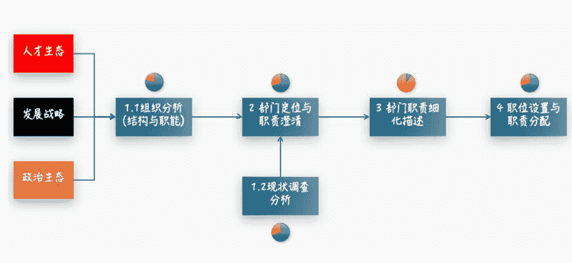

图3-1 工作分析全景图 (注：圆圈中，黄色示意AI作用比重，蓝色则是HR介入比重，后续图类似图表同理，不再说明)

对中国企业而言，处于高速增长与高频竞争中，工作分析应自顶向下，先跳出专业深井。实践中多见自底向上，这正是症结。

建议聚焦三大变量。

- **业务战略。** 通过战略解码，厘清战略对组织与岗位的具体诉求。
- **人才生态。** 关键任务与现有人才的匹配度，需从人才密度、人才锐度、人才厚度三维度评估。
- **政治生态。** 组织权力结构对职责落地的制约，需审视核心决策者的领导力、部门博弈关系与文化潜规则。

岗位架构设计的成败，取决于这三者的动态适配水平。忽视这些，架构再漂亮也难以落地。

下面说明如何借助人工智能做进阶工作分析。

#### 一）借助人工智能做进阶工作分析

进阶工作分析是指结合三大变量，以核心能力演绎、工作流程分析和集团管控梳理三种路径澄清职责，如图3-2。

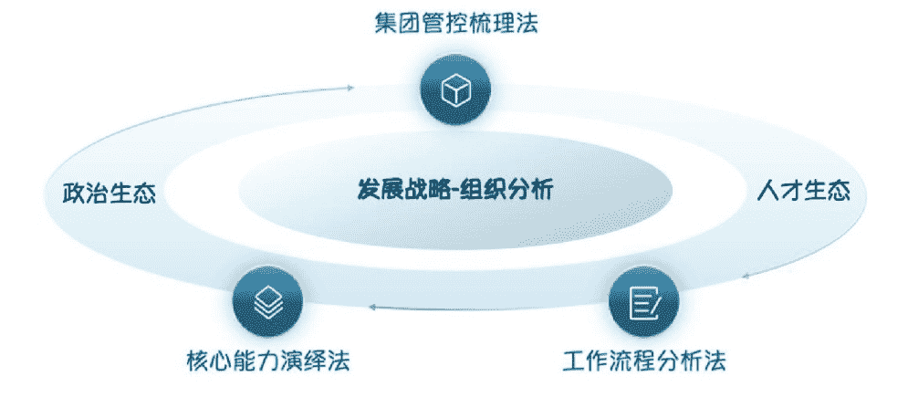

图3-2 高阶工作分析法

##### 1.核心能力演绎法

战略的定义多样，但共识有三点：战略是有目的的行动，是今日选择决定未来；战略是在取舍，是不做什么比做什么更关键；战略是目标与能力的匹配。

王志纲将战略概括为东方式表达：在关键阶段如何做正确的事、如何正确地做事，即回答能不能做、怎么做、做什么、谁来做。

战略建设应立足企业长板而非补短板，这正是核心能力演绎法的原理，如图3-3。

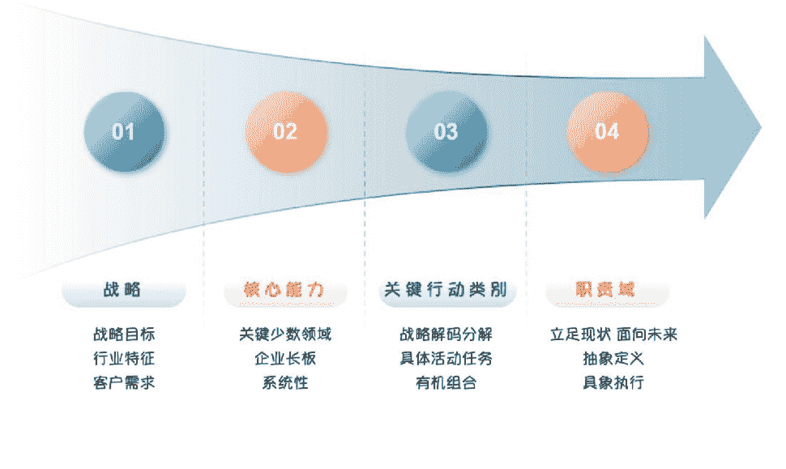

图3-3 工作分析之核心能力演绎法

###### 案例：基于核心能力定位关键职责

背景：某高端手机维修连锁加盟企业，三年内要从200家门店扩张到1000家。核心挑战是快速招募加盟商并保证总部标准的一致执行。经研讨，核心能力界定为渠道拓展与管控能力。

输入指令：

请你扮演资深人力资源顾问，擅长组织设计。基于背景与核心能力演绎法，并参考标杆经验，解码关键行动类别并说明理由。

要求：

- 表格展示，行动类别-关键行动分类。
- 行动清晰、可执行。

示例输出：

| 行动类别 | 关键行动 |
| :--- | :--- |
| 1. 加盟店招募与筛选 | 制定加盟店选择标准<br>市场调研与筛选<br>加盟商培训与支持 |
| 2. 加盟店开设与标准化建设 | 设计统一门店布局和标准化服务流程<br>指导加盟商进行门店筹建<br>统一供应链管理与物资采购 |
| 3. 运营支持与监督 | …… |
| 4. 绩效考核与激励 | …… |
| 5. 协作与资源共享 | …… |
| 6. 加盟政策和服务标准的更新与优化 | …… |
| 7. 品牌维护与客户满意度监控 | …… |

输入指令：

请把这些关键行动转化为职责域，确保能落实到部门。公司架构见附件。

示例输出：

|  | 加盟店招募与筛选 | …… |
|---|---|---|
| 加盟管理部 | 制定加盟店筛选标准，确保加盟商具备符合要求的资金实力、管理能力和服务理念。 | …… |
|  | 负责市场调研与筛选，评估目标市场潜力并选择合适加盟商。 | / |
|  | 组织和实施加盟商培训与支持，确保加盟商理解并执行总部政策、服务标准和品牌要求。 | / |
| 市场拓展部 | 配合加盟管理部进行市场调研，确定新门店地理位置和市场需求，为加盟商选址提供数据支持。 | …… |
| ……部 | / | …… |

此过程仍需线下研讨校正，识别出既重要又薄弱的行动与职责。

##### 2.工作流程分析法

该方法先对现状流程做客观描绘，再借助人工智能识别职责缺失、重叠或模糊之处。

###### 案例：项目管理流程与工作分析

背景：某企业跨部门核心流程如图，寻找改进点。

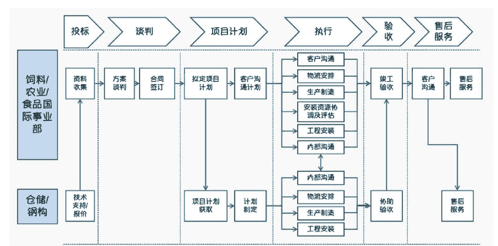

输入指令：

请结合标杆企业类似流程经验，分析可能存在的职责缺失、交叉问题，说明理由并给出改进建议。

示例输出：

####### 1.职责交叉问题

物流安排与生产制造：多部门均涉及“物流安排”“生产制造”“工程安装”，分工不明。

例如：

- 物流调度由谁主导？
- 生产制造优先级由谁协调？

内部沟通重复：“内部沟通”出现在计划与执行阶段，未指定牵头部门，如是否由PMO统一协调。

####### 2.流程衔接模糊问题

- 验收环节责任分散：技术支持/报价部门“协助验收”，主责部门不明。
- 售后服务衔接断裂：售后服务由物料事业部和技术支持共同标注，缺乏客户问题闭环机制。

风险：客户重复投诉，安装问题未反馈至生产端改进。

####### 3.关键控制点缺失

- 风险管控空白：合同签订后未见法务/风控介入审核条款合规性。
- 质量控制缺位：生产制造到工程安装阶段无质检节点。
- 绩效反馈缺失：无部门负责收集项目执行数据，无法支撑持续改进。

####### 4.改进建议

职责清晰化：绘制RACI矩阵。例如物流调度：仓库/钢构部执行，物料事业部需求提报；

流程衔接强化：

- 在关键节点增加跨部门联席会议；
- 建立售后闭环流程。补充控制机制：
- 增设风控审核岗；
- 插入质检关卡；
- 设计项目复盘模板。

集团管控梳理法的应用逻辑与此相近，不再赘述。

明确“应该做什么”后，还需判断“现实中能做到什么”。这要结合政治生态与人才生态，评估一年内的可行路径。没有标准答案，需HR基于实情判断。

###### 案例：成本控制到底要控什么

某民营建筑企业年产值约40亿，下属多家子公司，四家主力贡献超80%营收。各子公司差异大，负责人多为老板亲信，自主权高。老板宽厚、战略强、管理弱。

行业下行期，总部设成本控制部，意图加强子公司成本监管。按制度设计，部门负责全过程成本管控，参考国企模式。理论上合理，实际遇阻：

- “诸侯制”导致协调受限，业务难以被总部有效介入；
- 专业能力与资源不足，动态管控依赖经验丰富的驻场专家，公司难以承担。

权衡后，企业短期调整策略，聚焦基础工作：统一成本测算口径与核算标准，优先推动制度合规，为后续深化管理铺路。

从“控成本”转向“控流程标准”，是在资源约束下的渐进转型路径。

#### 二）现况调研与拆解

一手信息仍是关键。人工智能可按场景快速生成定制化问卷与访谈提纲，提升调研针对性与效率。

##### 案例：岗位工作分析调查问卷

输入指令：

请设计一份工作分析调查问卷，用于岗位架构设计与导入。企业背景见附件。要求15分钟内完成。

示例输出：

###### 《岗位工作分析调查问卷》

填写说明：仅用于岗位信息分析，不涉及个人评价，请客观填写。

填写时间：约12-15分钟

####### 1.岗位基本信息

部门：__________岗位名称：__________直接上级：__________

直接下属人数：__________（无填“0”）

本岗位工作年限：□<1年□1-3年□3-5年□>5年

####### 2.岗位职责与贡献

核心职责（1-3句描述岗位核心价值）：

职责分解：请列出每日/每周必须完成的5项核心任务，按重要性排序：

1. ________________________________________________________________________（耗时约%）

2. ________________________________________________________________________（耗时约%）

3. ________________________________________________________________________（耗时约%）

4. ________________________________________________________________________（耗时约%）

5. ________________________________________________________________________（耗时约%）

常规辅助性任务：______________________（耗时约%）

####### 3.岗位核心贡献

- □战略执行
- □流程优化
- □风险控制
- □创新推动
- □其他：__________

####### 4.工作流程与协作

独立完成的任务：______________________

需协作的任务：协作方__________协作内容__________频率□每日□每周□每月

决策权限：可自主决策事项__________需上级审批事项__________

####### 5.任职资格与能力要求

最低学历：□高中/中专□大专□本科□硕士及以上

专业背景：__________

必备技能（最多3项）：□数据分析□项目管理□客户沟通□技术开发□其他：__________

经验要求：□<6个月□6-12个月□1-3年□>3年

####### 6.工作环境与挑战

主要工具：__________

工作强度：日均时长□8小时□9-10小时□>10小时

加班频率：□无□偶尔□经常

最大挑战：□多任务并行□跨部门协调□技术更新快□客户需求复杂□其他

补充建议：________________________________________________

培训建议：________________________________________________

#### 三）部门定位与职责厘清

自上而下与自下而上的分析完成后，部门职责初稿形成。可借助人工智能结合职责房屋模型进一步厘清定位，如图3-4。

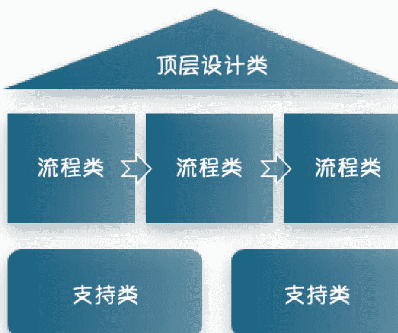

图3-4 部门职责分析之房屋模型

部门职责分三类：顶层设计类即房顶，流程类即腰部，支持类即地基。

- 顶层设计类：体现战略定位与全局视角，侧重政策、规划、资源整合等决策；
- 流程类：涵盖端到端流程分解，保证任务完整与协调；
- 支持类：底层支撑与保障，如系统建设、资源支持、团队管理。

示例指令：

请结合部门职责房屋模型，分析附件职责说明书，归类各项职责，并参考标杆经验识别交叉、重叠或遗漏。

部门职责定稿后，若首次构建岗位架构，应先完成架构框架设计，包括模式选择与职级定位规则，再分解至岗位。类比建房，先定地基与承重，再布水电。

工作分析扎实后，再进入岗位架构初始化与导入，成功率大幅提升。

### 二 从岗位设置到岗位图谱的整体考量

岗位架构能否落地，关键在于模式选择与模式、职级、价值评估方法的一体化考量，如图3-5。

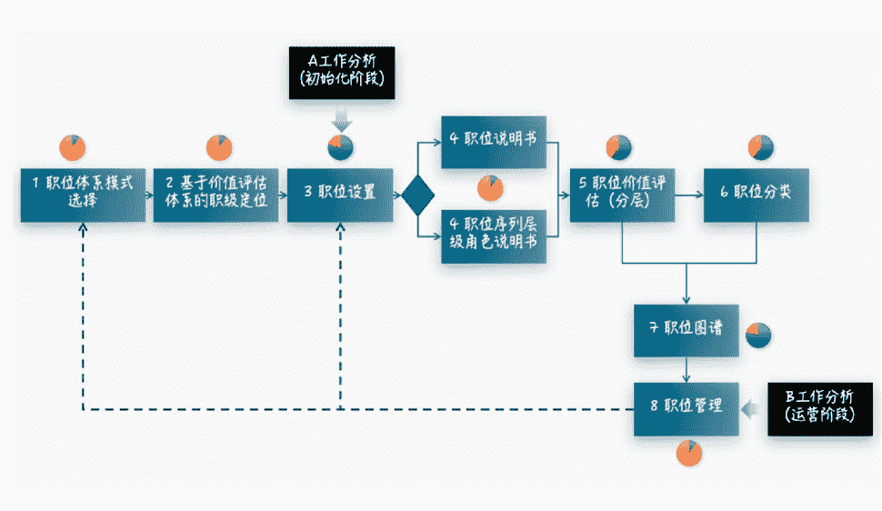

图3-5 职位体系设计的一体化考量

#### 一）三种岗位架构模式的选择

常见模式有以职责为基础和以能力为基础两种，逻辑与适配场景差异明显，如表3-1。

表3-1 职位体系典型模式

| 模式差异 | 职位体系模式 |
| :--- | :--- |
|  | 以职责为基础（A） | 以能力为基础（B） |
| 特点 | 侧重点 | 对岗位价值评价 | 对个人能力评价 |
|  | 职位级别 | 窄带 | 宽带 |
|  | 评估工具 | 较为复杂 | 相对简单 |
| 适用条件 | 外部环境 | 变化较少 | 灵活多变 |
|  | 工作性质 | 流程性、程序化强 | 非结构化高智能 |
|  | 人的要求 | 严格按流程执行 | 发挥主观能动性 |
|  | 职位职责 | 相对稳定 | 职责多变 |
|  | 适用企业 | 稳健发展 | 快速发展 |
| 与薪酬对接逻辑 |  | 以岗定级以级定薪岗变薪变易岗易薪 | 以能定级因类定薪人事相宜级随人走 |

两类模式各有挑战。

A模式挑战：如何保持岗位设置与业务需求贴合？如何构建透明动态的岗位价值评估体系？

B模式难点：如何确保不同序列层级含金量一致？如何让能力标准对齐战略且可演化？

除此之外，混合模式C逐渐流行。其做法包括：

- 族群区分式混合。管理类岗位采用A模式，专业类岗位采用B模式；

职位体系构建的关键闭环

实践中混合搭配是常态，常见做法是让一种思路占据主导，另一种发挥补充作用，再依据组织现状动态调整配比。

图3-6至图3-8呈现了三种思路在不同行业的典型落地。

| 序列 | 专业治疗 | 初级治疗销售 | 研发 |
| :--- | :--- | :--- | :--- |
| 职级 | 区域销售 | SC市场 | 销售主管 | 区域销售 | 市场公关 | 销售主管 | 药物信息 | 临床研究 | 法规 |
| 17 | 区域销售总监 | | | | 区域销售总监 | | | 临床总监 | 法规事务总监 |
| 16 | 区域销售经理 | 市场经理 | 市场经理 | 区域销售经理 | 市场经理 | | | 临床经理 | 法律事务经理 |
| 15 | DSM/Sr. DSM | | 品牌经理 | DSM/Sr. DSM | 品牌经理，区域市场经理 | 药物信息交流经理 | | 助理临床经理 | 法规顾问 |
| 14 | | | | | | | | | |
| 13 | 产品专员 | 助理品牌经理，市场支持专员 | | 产品专员 | 助理品牌经理 | 药物信息专员 | | 高级临床监研员 | 高级法务专员 |
| 12 | 销售代表，高级销售代表 | | | 销售代表，高级销售代表 | | 药物信息助理 | | 临床研究助理 | 法务专员 |
| 11 | | | | | | | | | |
| 10 | | | 销售助理 | | | 销售助理 | | | |
| 9 | | | | | | | | | |

图3-6 职位体系模式A（某制药企业职位图谱-局部）

##### 1.模式适配与对标分析
示例指令：
请依据职位体系A/B/C的适配逻辑，列出各自典型企业，并结合行业特点、规模与战略阶段进行适配性研判。

##### 2.薪酬协同机制解析
示例指令：
请解析“以岗定级、以级定薪、岗变薪变、易岗易薪”原则的内在机理，并结合标杆企业薪酬设计说明落地路径。

##### 3.组织变革历史研究
示例指令：
梳理华为1998-2008年由职能制向职位制的演进，包括引入Hay方法、国际化扩张等驱动因素及关键挑战。

##### 4.历史与现代职级体系对照研究
示例指令：
对比古代九品中正制与现代军衔、国家公务员序列的异同，分析制度结构、选拔方式与晋升逻辑，并提炼可供企业借鉴的要点。

借助AI参与评估与设计，企业能更科学地判断哪种形态更契合当前发展阶段。

#### 案例：某上市企业职位体系模式选择
背景：某光通信行业上市公司，年营收10亿元，员工2000人。主攻芯片如PLC、AWG、DFB等与器件制造，拟搭建职位体系。

输入指令：
你是一位资深人力资源专家。请基于企业背景，分析最适合的职位体系模式，并给出实施建议。

AI反馈：
对该企业而言，混合形态更合适。光通信行业既有复杂制造流程，也有高技术研发需求，需要清晰职责保障生产稳定，也需要能力发展支撑技术创新。

实施建议：
- 生产制造岗位：以责任为导向，强化职责标准化，建立清晰操作流程与质量控制。
- 研发与工程技术岗位：在明确责任基础上叠加能力发展要求，如专业知识、技术水平、创新能力等，助推技术人员成长。
- 管理与支持部门：兼顾职责与能力要求，确保职能部门在分工明确的前提下具备成长通道。

该混合形态既能保障生产效率与一致性，又能支撑研发创新与人才发展，契合企业需求。

#### 二）基于价值评估方法的职级定位

职位体系成功的关键，是实现职位模式、价值评估、职级定位与职位设置的一体化闭环。其价值体现于四方面：

##### 1.规避管理断层风险
若各模块孤立设计，易出现职责-能力错配或职级-薪酬割裂，结构性偏差会削弱组织效能并引发信任危机。

##### 2.强化战略穿透能力
职位体系不清、责权利不明会导致战略在中后台失真。前线有责无权、支持有权无责等失衡，根源在于体系未与战略解构协同。

##### 3.构建数据决策基座
人才分类、职等结构、薪酬占比、效能分析等核心数据，均需以标准化职位体系为前提。体系规范程度决定数据可比性与分析力。

##### 4.增强组织信任文化
规范透明的职级定位、晋升标准与薪酬区间是建立公平预期与减少争议的制度基石。一体化设计可有效降低晋升申诉、绩效异议与薪酬不均带来的摩擦。

一体化设计的目的是以系统思维简化复杂管理。其中价值评估与职级定位的耦合最具挑战。华为的“评估-定义-校准”三级联动机制可供借鉴。

如图3-9所示，华为基于Hay职位评估体系即三大维度×八要素，对各级别职位价值进行量化评价，并与职级定义精细匹配。各部门据此定制专业序列关键岗位标准，形成从职位价值到任职要求的闭环，成为其组织管理的核心模块之一。

| 职级 | 通用定位 | 通用职责概述 |
| :--- | :--- | :--- |
| 12级 | 基础工作执行者 | 按照标准流程指导下，执行一定专业性的工作，辅助性或基础执行的工作。对个人工作成果负责。 |
| 13级 | 例行工作执行者 | 根据工作流程，在一定程序下开展例行工作。个人工作成果负责。 |
| 14级 | 初步的独立贡献者 | 承担单一模块业务的部分职责，对模块内项目的具体执行、独立开展工作负责。 |
| 15级 | 独立贡献者/初步的团队贡献者 | 承担单一模块业务的责任，或承担较大项目某一阶段的模块工作，并指导他人开展工作。 |
| 16级 | 团队贡献者 | 承担本领域多模块业务的职责，独立组织他人完成工作；承担本领域重大项目某一环节的工作流程优化有责任。 |
| 17级 | 关键贡献者 | 承担本领域多模块业务的工作，组织组员完成综合的工作，推动部门流程改进。 |
| 18级 | 准专家 | 承担本领域综合业务的职务，组织协同完成部门综合性工作，参与局部经济与业务带来显著影响。 |
| 19级 | 专家 | 承担本领域业务/技术规划的职责，进行业务/技术解决方案的创新，提升本领域的能力。 |
| 20级 | 资深专家 | 规划本领域业务/技术方向，推进业务/技术方案的创新，并为公司中长期经营业绩产生影响。 |
| 21级 | 领导权威 | 规划公司关键领域的业务/技术方向，系统化领导领域化创新并有所突破，为公司中长期经营产生最大影响。 |
| 22级 | 区域发展领导者 | 提出公司关键领域的发展蓝图，领导和规划关键领域的业务/技术方向，并带来显著创新和突破，为公司中长期经营带来高度影响。 |
| 23级 | 顶尖领域领导者 | 提出公司核心领域的发展蓝图，融合引领全球业务/技术方向，并带来显著的创新和突破，领导能力达到行业领先水平。 |

图3-9 价值评估与职级的关系处理

接下来演示如何借助AI完成这项挑战。

##### 案例：职级选择与定义
背景：某铜材制造集团，2018年员工约6000人，总部设10个职能部门，管控20余家子公司。运营模式为总部强管控、子公司分责执行，强调资源集中与战略一致。

输入指令：
请结合背景及Hay职位价值评估法，建议该企业应设多少职级，并说明原因。

AI反馈：
###### 1.职级设置核心考量维度
| 维度 | 铜材制造业特性分析 | Hay 要素映射 |
| :--- | :--- | :--- |
| 组织复杂度 | 生产链条长、多地域子公司协同、重资产运营 | 管理复杂度 |
| 人才结构 | 蓝领技术工人占比高、专业工程师梯队、总部战略管控 | 专业知识深度 |
| 决策链条 | 生产端需快速响应、战略端需长期规划 | 行动自由度 |
| 管控模式 | 总部强管控+子公司运营自主 | 影响范围 |

###### 2.推荐采用8级制的深层逻辑
匹配行业特性：
- 生产维度：覆盖熔铸→轧制→精加工→质检，每环节需2个职级。
- 技术纵深：冶炼技术迭代约5-8年，需L4-L6级专家储备。
- 大宗商品波动：L7级以上需具备对冲铜价波动决策能力。

平衡管理效能：
| 职级数 | 管理幅度 | 适配性分析 |
| :--- | :--- | :--- |
| 7级 | 1:8 | 适合单一工艺路线集中生产 |
| 8级 | 1:6 | 最佳平衡点：20个子公司*3条汇报线 |
| 9级 | 1:5 | 适合高度多元化跨国集团 |

输入指令：
请结合Hay三维度八要素评估法，生成职位职级通用定义框架，侧重职责分工，我需要10级制。

AI反馈：
1.10 级职级体系定义（职责分工视角）
| 职级 | 层级定位 | 知识技能 | 问题解决 | 责任性 | 核心职责分工特征 |
| :--- | :--- | :--- | :--- | :--- | :--- |
| L1 | 基础执行岗 | 掌握单一操作流程 | 按规程处理重复事务 | 对个人任务结果负责 | 执行标准作业指令，无决策权 |
| L2 | 熟练操作岗 | 精通专业模块工具 | 优化局部流程效率 | 对流程节点质量负责 | 独立完成模块任务，有限自主决策 |
| L3 | 专业指导岗 | 跨模块知识整合 | 解决跨环节协作问题 | 对职能链条输出负责 | 协调2-3个关联模块，指导初级员工 |
| L4 | 领域专家岗 | 构建领域知识体系 | 突破技术/业务瓶颈 | 对专业标准制定负责 | 主导专业技术路线，影响部门决策 |
| L5 | 团队统筹岗 | 多领域知识融合 | 平衡资源与目标冲突 | 对团队目标达成负责 | 管理10-50人团队，制定执行策略 |
| L6 | 部门决策岗 | 行业级知识储备 | 应对外部环境剧变 | 对部门战略解码负责 | 规划部门3年发展路径，控制千万级预算 |
| L7 | 业务单元负责人 | 产业链知识图谱 | 重构商业模式 | 对业务单元P&L负责 | 制定事业部竞争战略，影响亿元级投资 |
| L8 | 集团职能负责人 | 全球最佳实践洞察 | 化解系统性风险 | 对集团职能卓越负责 | 设计跨国职能架构，推动组织能力升级 |
| L9 | 执行决策层 | 地缘经济政治研判 | 定义行业级问题 | 对企业生存发展负责 | 制定5年以上战略规划，决策百亿级资源配置 |
| L10 | 战略制定层 | 文明演进规律认知 | 预见颠覆性变革 | 对生态体系存续负责 | 塑造行业范式，影响行业标准制定 |

###### 2.职责分工核心维度拆解
###### 决策链定位
- L1-L3：执行层；
- L4-L6：管理层；
- L7-L9：战略层；
- L10：愿景层；

###### 3.权责穿透强度
- 纵向：执行指令→制定标准→定义规则→重构范式
- 横向：专业深井→流程整合→系统重构→生态重塑

方案形成后需结合实际校准。缺乏清晰职级定义直接推进优化，往往只是对人员结构的包装，易将结构性问题合理化而埋下隐患。

#### 三）职位设置
层级标准明确后，将部门职责拆解至具体职位并明确设置目的。设置方式需与所选体系模式一致，主要有两种路径：

职位模式A 以职责为本。以事为出发点，依据工作任务定义职位属性，实现职位-业务精准映射。适用于流程清晰、职责稳定的组织。

职位模式B 以能力为本。以人为出发点，需构建基准职位，并结合员工能力演进与战略任务变化进行年度动态校准。适用于人才梯队多元、岗位要求灵活的组织，如图3-10所示。

图3-10 以能力为基础的职位设置方式

#### 四）职位说明书/职位层级角色说明书的编制
采用模式A时需编写职责明确的职位说明书，是招聘、培训、绩效、发展的基础文档。

实际工作中传统编写量大、标准不一，常流于形式。

采用模式B时可用职位层级角色说明书替代，在变化频繁的互联网企业常见。核心是以角色职责为单位，建立灵活可变、易于更新的标准体系。

互动：
1. 利用AI检索职位序列角色说明书与职位说明书的差异和示例。
2. 利用AI查询职位职责描述的三种常见范式及举例。

##### Step 1：自动生成职位说明书初稿
表3-2展示了典型操作步骤。

##### 表3-2 AI自动生成职位说明书流程说明
| 分工 | 分步执行 | 操作要点 |
| :--- | :--- | :--- |
| 1） HR | 输入背景信息和任务指令 | 必要背景信息和要求 |
| 2） AI | 撰写职位主要职责 | / |
| 3） HR | 输入职位目的概括指令 | 指定描述规范，提供示例 |
| 4） AI | 概括职位目的 | / |
| 5） HR | 输入任职条件编制指令 | 指定条件及要求，提供示例 |
| 6） AI | 匹配任职条件 | / |
| 7） HR | 审核并人工调整 | 补充其他基本信息 |

##### 案例：借助AI编制职位说明书
背景：某生物科技企业，专注绿色科技创新。主要产品包括氨基酸、维生素和生物基材料单体。公司在安徽、河北、内蒙古有多基地。

输入指令：
请设计该企业安全环保部安全工程师职位主要职责。背景：部门设经理，下分助理安全工程师、安全工程师、助理环保工程师、环保工程师，四岗直属经理。该职级P2通用描述：能独立完成一般性专业工作任务和解决常规性专业问题；核心职责：安全培训和执行安全巡查并编制安全报告提出体系优化建议；目的：明确职责分工和招聘。要求6-9条，每条一句话，按动词+名词句式，职责重要性排序，与职级定义匹配。

AI反馈：
主要职责：
1. 定期巡查生产基地，确保安全操作符合法规和企业标准，保证现场安全性。
2. 参与安全标准和流程修订与完善，确保生产流程符合安全要求并有效执行。
3. 参与安全应急预案制定和演练，确保突发事故时能及时高效响应。
4. 对生产过程安全风险进行评估，并提出可行控制措施，减少潜在隐患。

#### 五）职位价值评估
主流方法如Hay三要素八维度、美世IPE、翰威特六要素等因系统性强被广泛采用，但操作复杂、门槛高。企业实践中常因流程繁琐流于形式，又回到因人定薪的老路。

引入AI与人工评分结合是可行方案。AI擅长数据处理与标准化评分，人工擅长情境判断，二者协同可提升效率与准确性，重建科学透明的岗位价值体系。

#### 六）职位管理
职位管理涵盖职位新设、合并、调整与撤销，以及说明书更新、职级变动与组织架构信息同步。说明书更新工作量大，易引发职责交叉或管理空档。借助AI可大幅提升效率与精准度。

##### 案例：AI辅助更新职位说明书
背景：某IT企业组织升级：引入DevOps实践，要求技术架构师参与开发与运维一体化设计；迁移至云原生架构，需掌握Kubernetes和容器化技术；新增平台工程团队，要求架构师与该团队密切协作。

原岗位职责节选：
1. 负责系统架构设计与优化，确保系统性能和可扩展性。
2. 指导开发团队解决技术难题。
3. 提供技术方向建议，支持项目经理完成任务。

任职要求节选：
- 熟悉主流架构模式如微服务架构。
- 具备性能优化和系统设计能力。
- 具备跨部门沟通与协作能力。

输入指令：
请结合上述变化，分析对岗位职责与要求的影响，修订职责，更新任职要求，输出更新后说明书。

AI反馈：
###### 技术架构师职位
岗位职责：
1. 负责系统架构设计与优化，确保系统性能、可靠性和可扩展性。

2. 牵头推动业务向云原生方向演进，提炼容器化落地的可复用方法论。

3. 充当研发团队的技术导师，帮助攻克核心难点并带动整体能力水位上行。

4. 全程参与研发运维一体化建设，构建并迭代交付协作机制。

5. 协同平台工程组，共同规划系统性能调优及部署方案。

6. 主导跨团队的技术评审与决策，保持协作过程中技术口径统一。

任职要求：
- 熟悉以 Kubernetes、Docker 为代表的云原生底座及容器化方案。
- 具备 DevOps 流程搭建与持续改进的实战经验。
- 对系统架构有整体认知，微服务实践尤为深入。
- 拥有跨部门沟通、协调及技术裁决的能力。
- 具备团队培养与人才赋能经验，能推动技术梯队成长。

智能化工具的落地，正好缓解了该类工作的现实矛盾：资深人才不愿投入重复事务，新人又常难以胜任。

小结
职位体系绝非一张图谱所能穷尽，它贯穿岗位分析、职位模型选取、分层分类、职级划分、价值评估到说明书编写等多个关键环节，是一项标准化、系统化、协同推进的管理工程。只有底层逻辑清晰、结构统一、各环节衔接顺畅，才能真正实现落地生效。

建议坚持“人定方向、智能体落实细节”的分工原则——把基础性、重复性工作交给智能系统，释放人力资源专业人员的判断力与创造力，使其更聚焦于高价值的战略事务。

## 第二节 人才条件框架：HR运转的驱动部件

职位与职位图谱厘清后，人力资源面临的核心难题是如何实现人才与岗位的精准适配。人才条件框架正是破解该难题的关键抓手，它串联招聘、培养、晋升、薪酬与绩效等模块，是人力资源运转的关键驱动部件。

有人会质疑，部分企业没有显性的人才条件框架也能发展良好。事实上，多数中小企业的人才标准常沉淀在管理者的经验里，并未显性化与系统化。

设想在招聘与提拔时，每个管理者心中都有一份隐形画像：是否值得信任？是否具备关键能力？随着组织规模扩大与业务复杂度提升，依赖隐性规则已难以支撑。人才条件框架能够把主观判断转化为可操作的科学管理，从而实现更精准的人岗适配。

### 一 以智能为支撑构建人才标准的方法

华为是国内较早系统实践人才条件框架的企业，成效明显，因此被广泛借鉴。但在复制过程中成败参半，主要痛点集中在三点。

标准制定质量不高，流于形式。高质量标准对HR要求较高，需兼具专业、业务与表达引导能力，否则标准空有其表，漏洞明显。

评审流程随意，缺乏规则。部分企业为追求效率过度简化评分、评价与评审人选择，严谨性与公正性不足，最终人治取代法治，体系沦为摆设。

框架更新滞后，难以跟上变化。很多企业依赖外部咨询导入后缺乏自主迭代能力，面对快速变化的业务，过时文件如同旧地图，牵引力逐渐丧失。

虽具体做法各有差异，底层原理相通。以下以华为实践为参照，说明如何借助智能系统破解上述三大痛点，实现系统性提升。

#### 一）借助智能重塑标准构建流程

智能系统在标准构建中的价值主要体现在三方面：
- 弥补人力资源专业人员在专业领域的短板；
- 打通业务需求到专业语言的转换；
- 保证标准内容之间的一致性。

引入智能系统后，标准构建流程得以重构，如图3-11所示。

在应用智能系统前，需先建立清晰的概念框架，否则易产生指令误解。核心概念是冰山模型，如图3-12所示。

该模型源自胜任力理论，将个体能力分为显性的上层与隐性的下层。显性能力如专业知识技能，易于识别与培养；隐性能力如自我认知、动机与情绪管理则更难观察，需要深入开发。

人才条件框架由多个模块构成，如表3-3所示。

表3-3 人才条件框架的构成
| 模块 | 概念定义 | 重要性 |
| --- | --- | --- |
| 入职门槛 | 学历、岗位年限等客观条件 | 中 |
| 业绩产出 | 晋升至下一层级需达成的量化结果 | 高 |
| 行为表现 | 完成工作时体现的行为模式与执行方式 | 高 |
| 知识储备 | 胜任岗位所需的理论基础与专业知识 | 中 |
| 技能要求 | 2-6个月内可通过统一训练获得的标准操作能力 | 中 |
| 素质特质 | 隐性能力要素，如情商、性格等 | 低 |

互动：
请思考以下问题：
1. 领导力模型涵盖了冰山模型的哪些层面？更偏重显性还是隐性？
2. 为什么素质特质在人才条件框架中的要求相对弱化？
提示：结合第2章“深入学习概念”方法，借助智能系统进行剖析。

#### 二）智能驱动的标准构建实操

为更直观呈现完整流程，以一个实操案例说明。

案例：某光通信厂商人才条件框架建设
背景：
该光通信芯片及器件制造企业年营收约10亿元，员工约2500人，销售团队约50人。上市后公司提出三大战略方向：聚焦高价值客户，加大海外市场开拓，推动产品结构向中高端及综合解决方案升级。

为支撑战略调整，该公司计划构建人才条件框架，目标包括：
- 试点开发销售序列标准，牵引销售队伍能力与战略保持一致；
- 通过认证提升晋升与评定的公平透明度；
- 试点成功后全公司推广。

人力资源团队介入后工作分为八个步骤。

###### 步骤1：统一跨序列通用层级角色定义
任务说明：
传统模式下，不同序列的层级要求常不一致，例如某序列的高级角色仅相当于另一序列的中级，导致人才流动受阻、公平感下降，尤其在能力导向体系中风险更大。

应对策略：
采用“统一基础+序列差异化”设计。统一基础即为各层级设定跨序列的通用锚点；序列差异化则按序列特点细化，例如技术序列高级角色侧重技术创新与复杂问题解决，销售序列高级角色侧重业绩驱动与大客户管理。

此步骤需判断两点：
1）分几层合适？
原则上每2-4年晋升一层较为合理，约3年对应能力质变与收入增长预期。参考数据见表3-4。

表3-4 知名企业职位序列分层数据参考
| 企业 | 员工数量 | 技术类 | 专业类 |
| :--- | :--- | :--- | :--- |
| 华为 | 17 万 | 6+2 | 5+1 |
| 美的 | 12 万 | 5 | 5 |
| IBM | 40 万 | 5+1 | 5 |

并非所有序列都需要双通道，序列深度、起点与封顶需结合业务考量，如图3-13所示。部分岗位如清洁工在多数企业无需分层，但在特定场景下可设多级。

2）发展通道特征：I型还是T型？
I型为纵深型，专注某一领域深耕，适合技术专业岗；T型为系统型，强调跨领域复合能力，适合管理岗。设计时需考虑业务需求、要求复合能力的层级起点、培养方式等，如图3-14所示。

案例：跨序列通用层级角色定义
输入指令：
你是一名资深人力资源顾问，擅长人才条件框架建设。背景信息：“……”。任务要求：为公司设计适用于所有序列的通用职位层级框架，含初级、中级、高级、专家级四个层级。请为每个层级定义核心能力、职责特点、关键贡献、岗位年限要求。

模型回应：
| 职位层级 | 层级角色定义 |
| :--- | :--- |
| 初级 | 核心能力：掌握基础知识技能，完成简单任务，需上级指导，学习态度好。职责特点：以执行为主，参与基础项目，配合团队。关键贡献：保障基础工作质量，提升效率。岗位工作年限要求：0-2年。 |
| 中级 | 核心能力：可独立完成本职工作，解决常见问题，熟悉流程标准，有初步跨部门协作力。职责特点：独立承担常规工作或项目部分，提出改进建议。关键贡献：岗位内高效高质量输出，支持部门目标。岗位工作年限要求：2-5年。 |
| 高级 | …… |
| 专家 | 核心能力：领域内具备行业领先知识或管理能力，具战略思维，能引领变革，擅长解决复杂问题与跨部门协调。职责特点：负责战略级项目或业务模块，提供关键决策支持，引领团队能力发展。关键贡献：创造重大业务增长、技术突破或战略机会，建立行业标杆。岗位工作年限要求：8年以上。 |

###### 步骤2：设计行为模块
任务说明：
行为模块是标准的框架，一旦失衡整体结构会受影响。传统开发两大难点：
1）区分职责模块与行为模块
职责模块回答“做什么”，行为模块回答“怎么做”。两者互为表里。

提炼方式随岗位复杂度变化：
模式1：工作流划分模式，适用于结构简单的序列，围绕职责描述执行行为。
模式2：能力类型划分模式，适用于职责多样且差异大的序列，将相似能力跨职责整合。挑战在于分析、抽象与整合能力。

职责的三维结构如图3-15：活动任务维度、对象维度、专业维度。如图3-16所示，可从表面不同的职责中提炼底层能力共性。例如销售的回款能力，本质是客户分析、关系建设、商务谈判等多模块共同作用的结果，并非单一行为模块。

2）数量与颗粒度把握
设计原则见图3-17。操作规则：
- 数量控制：序列行为模块总数约6-10个，每层级建议4-6个。
- 内容聚焦：按重要性排序，突出重点，保持逻辑完整，减少过度重叠。
- 描述规范：每个模块自成体系，定义清晰独立。

案例：行为模块设计
输入指令：
请结合该厂商战略背景，为销售序列设计行为模块。要求：每层约5个，关键词命名，初级中级用工作流模式，高级专家用能力类型模式，融合华为客户中心、流程化、全球化经验。

模型回应：
销售序列行为模块设计已给出。HR评估后可进一步优化，例如指出“大客户管理”不符合15分钟内评估原则后，模型调整为：
| 层级 | 角色定位 | 行为模块 |
| :--- | :--- | :--- |
| 初级 | 任务执行者、学习者 | 信息收集、产品学习、客户识别、拜访执行、任务达成 |
| 中级 | 独立操盘手、初步问题解决者 | 市场调研、客户开发、关系建立、需求挖掘、流程优化 |
| 高级 | 大客户管理者、团队推动者 | 大客户开发、解决方案、商务谈判、数据分析、团队辅导 |
| 专家 | 战略引领者、行业标杆 | 战略客户拓展、行业洞察、高层关系管理、业务创新、团队文化引领 |

###### 步骤3：提炼行为标准
任务说明：
行为标准质量至关重要，需遵循行为化语言规范，如表3-4所示。

表3-4 行为化语言技术简介
| 要求 | 技术要点 |
| :--- | :--- |
| 具体化 | 描述“做什么、怎么做、做到什么程度”，避免模糊。 |
| 可观察 | 体现实际工作中可见、可评估的具体策略与关键动作。 |
| 可衡量 | 设定明确的数量、质量或时间指标，便于测量。 |

AI驱动的人才标准构建实操指南

互动练习
1. 用大模型梳理行为化表述的来历与发展脉络；
2. 让模型分别列出行为化与非行为化表述的典型对比例子并做差异拆解。

掌握表述规范只是起点，真正的难点在于如何引导大模型展开推导逻辑，让输出与企业真实业务场景高度咬合。

结合一线复盘、KSAO构成要素、BEI访谈以及BSC等理论工具，并参考标杆企业的落地拆解，行为描述的搭建大致可归为三种展开思路。

####### 1) “功夫在诗外”模式——前置铺垫，打好基础
此路适用于执行环节对准备与前瞻性要求较高的模块，靠前置的准备性表现来支撑后续产出。以秘书序列为例，如表3-5所示。

####### 表3-5 “功夫在诗外”模式示例

| 模块 | 行为描述 |
| :--- | :--- |
| 草拟文书 | 关注行业动向，主动搜集相关情报 |
| | 熟悉公司制度与各部门业务，通过多渠道了解部门进展，力求获取客观材料 |
| | 以恰当方式梳理筛选资料，必要时向他人核对，保证文书引用的信息客观真实 |
| | 基于掌握信息及周边部门反馈发现问题，以事实为依据给出解决建议，形成文书供主管决策 |
| | …… |
| | …… |
| | …… |

####### 2) “六脉神剑”模式——多点发力，系统出招
此路适用于需要资源整合与复杂判断的模块，核心是抓住关键要素并统筹推进。以采购序列为例，如表3-6所示。

####### 表3-6 “六脉神剑”模式示例

| 模块 | 要素 | 行为描述 |
| :--- | :--- | :--- |
| 信息收集与分析反馈 | 信息收集与加工 | 定期主动搜集新品、新技术、新工艺资讯，提炼价值点，为公司新品研发提供参考。 |
| | | 有系统地搜集市场行情，包括供应商供求、价格走势、交期等，进行归类整理与研判，独立汇报并形成采购对策建议。 |
| | | 对历史采购经营数据做横向同行分公司及纵向历史数据的对标，找出差异异常根因，总结经验并提出优化举措。 |
| | 建立信息渠道 | …… |
| | 掌握搜索方法 | …… |
| | 构建信息分析模型与数据库 | 独立负责特定品类，搭建并持续优化采购信息分析模型及数据库，使决策依据更充分。 |

####### 3) “窗户纸”模式——抓住关键诀窍，一点就透
此路适用于快速判断与破解关键问题的模块，强调关键要素洞察。以工艺序列为例，如表3-7所示。

####### 表3-7 “窗户纸”模式示例

| 模块 | 行为描述 |
| :--- | :--- |
| 工艺监控和异常处理 | ……<br>熟知应力变化与设备运行状态、原材料特性之间的连锁逻辑<br>…… |

下面通过实操演示体会行为描述的搭建过程。

####### 案例：行为描述设计
输入指令：
请设计行为描述，要求如下：
- 按销售岗位层级初级、中级、高级、专家级构建行为模块。
- 模块下拆分2-4个要素，并为每个要素撰写行为描述。
- 结合公司背景资料与模块特性，选择合适的设计模式。
- 行为描述须遵循行为化表述规范，明确关键动作、策略与达标要点，避免空泛。

生成结果：
| 模块 | 要素 | 行为描述 | 达标关键点 |
| :--- | :--- | :--- | :--- |
| 战略客户拓展 | 分析市场机会 | 定期汇总行业动态，形成机会分析报告，列出3个以上潜在战略客户。 | 1. 每月输出一份目标行业动态分析。<br>2. 提交经优先级排序的潜在客户清单报告。 |
| 战略客户拓展 | 定义客户价值 | …… | …… |
| 战略客户拓展 | 制定拓展计划 | …… | …… |
| 战略客户拓展 | 推动高层接洽 | …… | …… |

输入指令：
我感觉“推动高层洽谈”要素内容有点单薄，请结合标杆企业经验，补充至少三条高绩效行为。

系统回应：
| 模块 | 要素 | 行为描述 | 达标关键点 |
| :--- | :--- | :--- | :--- |
| 战略客户作战 | 推动高层洽谈 | 依据客户高层的背景与关注点，制定接洽策略，明确接触目标、沟通切入点与预期成果。 | 1. 分析客户高层决策习惯，形成定制化沟通策略文档。<br>2. 提前准备客户高层关注的行业报告或案例作为开场材料。 |
| | | 通过精心设计的问题与互动，引导客户高层讨论其战略诉求与合作关注点。 | 1. 会前准备3个开放式问题，确保讨论聚焦战略需求。<br>2. 用数据或案例支撑讨论，帮助对方明确业务痛点。 |
| | | 会议结束后迅速归纳双方意向，以邮件、纪要等方式推动后续行动。 | 1. 会后1个工作日内发送会议纪要并附行动计划建议。<br>2. 定期向客户高层推送项目进展与阶段性合作成果。 |

###### 步骤4：自动提炼知识与技能、素质标准
任务说明：
行为描述确定后，可利用大模型解析其背后的知识、技能与素质要求。

####### 1）提炼知识标准
####### 案例：知识标准生成
输入指令：
基于销售序列的行为模块与行为描述，为各层级销售人员推荐培训课程。每门课程需包含课程名称、大纲、内容概要、推荐掌握程度，并结合公司实际确保可落地。知识分类需清晰，课程总数不超过8门。

系统回应：
| 课程 | 概要 | 大纲 | 初 | 中 | 高 | 专 |
| :--- | :--- | :--- | :--- | :--- | :--- | :--- |
| 客户需求洞察与分析 | 帮助团队通过专业沟通精准挖掘显性与潜在需求，形成结构化需求分析报告。 | 1. 客户需求类型与分类方法<br>2. 开放式提问与有效倾听技巧<br>3. 痛点挖掘工具如SPIN框架<br>4. 需求分析与优先级排序方法 | 了 | 熟 | 掌 | 精 |
| 销售数据分析与应用 | 学员可分析客户数据与销售趋势，为业务调整提供数据支撑。 | 1. 数据驱动销售理念与意义<br>2. 销售数据收集整理如CRM系统<br>3. 数据分析工具与方法如Excel动态表、商业智能工具<br>4. 数据驱动销售决策案例解析 | 了 | 熟 | 掌 | 精 |
| 商务谈判与合同管理 | 提升谈判与合同管理专业度，实现双方利益最大化。 | 1. 谈判心理学与策略应用<br>2. 谈判流程与关键节点控制<br>3. 商务合同条款解读与风险控制<br>4. 成功谈判与合同管理案例解析 | 了 | 熟 | 掌 | 精 |
| ...... | ...... | ...... | | | | |

####### 2) 提炼技能标准
####### 案例：技能标准生成
输入指令：
针对销售序列列出各层级需掌握的核心技能，要求含技能定义、培训重点、操作流程、学习周期，并结合光通信行业实际需求。

系统回应：
| 技能项 | 定义 | 培训重点 | 操作过程 | 学习周期 |
| :--- | :--- | :--- | :--- | :--- |
| 客户需求挖掘与记录 | 通过沟通精准识别显性与潜在需求，并以标准化格式记录分类。 | 1. 学习SPIN提问框架与客户访谈技巧。<br>2. 掌握需求记录模板及优先级分类方法。 | 客户访谈模拟→需求记录→反馈修正→标准化归档。 | 约2-3个月。 |
| 销售数据分析 | 运用Excel或商业智能工具整理、分析并呈现销售数据，支持决策。 | 1. 学习Excel高级功能如数据透视表、图表生成。<br>2. 了解关键指标如转化率、客户生命周期价值。<br>3. 掌握基础商业智能工具如Tableau使用方法。 | 数据整理→分析模板应用→生成报告→提出优化建议。 | 约4-6个月。 |
| ...... | | | | |
| 产品演示与技术讲解 | 以演示技巧与技术解读让客户充分理解并认可产品价值。 | 1. 学习专业演示技巧如PPT设计与演讲。<br>2. 掌握产品核心技术通俗化表达方法。<br>3. 学习客户问题应答策略。 | 演示内容设计→演讲演练→实战呈现→复盘优化。 | 约3-4个月。 |

####### 3）提炼素质标准
####### 案例：素质标准生成
输入指令：
结合行为描述内容及客户战略背景，设计素质项及衡量标准。推荐3项核心素质，初级与中级共用一套衡量标准，高级与专家共用一套标准。

系统回应：
| 素质项 | 中级以下要求 | 高级以上要求 |
| :--- | :--- | :--- |
| 抗压力 | 在高压环境下保持情绪稳定与工作效率，不易受外界干扰，挫折后能迅速调整心态保持积极。 | 面对客户拒绝或项目失败时能分析原因并提出改进方案，而非自怨或消极。 |
| 学习与适应 | ...... | ...... |
| 沟通与协作 | ...... | ...... |

###### 步骤5：提炼成果贡献标准
任务说明：
部分企业用成果贡献标准替代任职资格标准，认为操作更简便。但这存在误区：其一，结果受外部支持度影响，未必真实反映能力；其二，结果多为过去总结，若过程未遵循倡导行为，短期成功会损害长期利益。

####### 案例：成果贡献标准生成
输入指令：
针对销售序列四个层级明确成果贡献标准。包括必选项晋升时必须完成的4项核心成果，和可选项不超过6项的加分成果。标准需与战略目标结合、可量化、体现层级递进。

系统回应：
| 晋升 | 必选4项 | 任选3项 |
| :--- | :--- | :--- |
| 初->中 | 1）高价值线索获取：成功提交至少5条符合定义的潜在客户线索。<br>2）需求分析报告：完成至少3份标准化客户需求分析报告。<br>3）销售任务达成率：连续2个季度完成率≥100%。<br>...... | 1）新增客户数量：成功拜访3个新客户并提交拜访报告。<br>2）客户满意度反馈：负责客户满意度评分≥85%。<br>3）内部协作表现：有效支持团队完成1项销售活动。<br>4）流程优化建议：提出1条被采纳的可行优化建议。<br>...... |
| 中->高 | ...... | ...... |
| 高->专 | 1）战略客户合作推进：完成至少1个战略客户深度合作项目并签长期协议。<br>2）高价值项目签约：签约≥季度目标金额的高价值项目至少1个。<br>3）团队销售目标达成率：带领团队连续2个季度达成率≥100%。<br>4）创新解决方案设计：主导设计1个行业领先方案并成功落地。 | 1）市场策略支持：提交2条高质量市场策略建议，至少1条被纳入执行。<br>2）客户满意度提升：推动大客户满意度提升≥10%。<br>3）团队赋能表现：组织并完成至少2次团队能力提升培训。<br>4）跨部门协作：主导完成1个重要跨部门项目。<br>5）行业影响力贡献：在行业论坛分享成果。<br>…… |

###### 步骤6：角色定义
任务说明：
在初始角色描述偏抽象的情况下，结合行为描述等模块细化角色画像，提升可理解性与可操作性。

####### 案例：角色定义提炼
输入指令：
结合行为描述等内容，为销售序列初级、中级、高级、专家级四个层级撰写简洁精准的角色定义。要求语言通俗、核心突出、递进清晰、便于传播。

####### 输出结构
- ●角色定位：一句话概括核心职责与发展方向。
- ●核心定义：明确行为、技能、知识、成果贡献的主要职责，突出差异化。

系统回应：
| 定位 | 角色定义 |
| :--- | :--- |
| 任务执行者，学习者 | 1. 负责基础销售执行，如信息收集、产品学习、客户拜访。<br>2. 熟悉销售流程，掌握产品知识与市场基础信息。<br>3. 按要求完成任务与指标，协助团队达成目标。<br>4. 主要承担客户档案完整性、标准化需求分析报告及达标业绩责任。 |
| 独立操盘手，初步问题解决者 | 1. 独立负责高价值客户开发与管理，挖掘转化需求。<br>2. 提供定制化解决方案，推动合作项目初步落地。<br>3. 熟练运用销售工具，掌握行业动态，提供专业建议。<br>4. 主要承担客户转化、解决方案满意度及客户关系稳定责任。 |
| …… | …… |
| 战略引领者，行业标杆 | 1. 主导战略级客户开发与合作，推动行业领先方案落地。<br>2. 深入研究行业趋势，开拓海外市场，提升公司行业影响力。<br>3. 引领销售团队实现战略突破，为公司发展提供方向支撑。<br>4. 主要承担战略客户合作落地、海外市场突破及标杆方案责任。 |

完成角色定义后，还需补充学历、工作年限、保密要求、绩效要求等基础条件，最终形成完整的任职资格文件。该操作同样可借助大模型辅助，不再展开。

线下工作同步开展：
- 信息收集。通过访谈、问卷、现场观察全面掌握岗位需求，确保模型输出与实际一致。
- 结果验证。邀请专家与一线员工审阅标准内容，收集反馈并修订。

###### 步骤7：AI对标准质量的评估与优化
任务说明：
初稿完成后，可利用大模型从描述质量、逻辑完整性、内容完整性、适配性四个维度进行质量评估。

####### 案例：标准质量评估
输入指令：
从描述质量、逻辑连贯性、内容完整性、适配性与对标四个维度对任职资格标准做全面评估。

评估标准：
| 维度 | 评估标准 |
| :--- | :--- |
| 1 描述质量 | 描述是否具体明确，有无模糊表述？语言是否简洁，逻辑是否清晰？ |
| 2 逻辑连贯性 | 模块间是否形成清晰支撑链条？角色定义与行为、知识、技能、成果标准是否一致？ |
| 3 内容完整性 | 标准是否全面覆盖岗位需求，是否存在遗漏关键模块？是否便于应用与考核？ |
| 4 适配性与对标 | 标准是否符合行业普遍要求？是否匹配企业战略、文化及核心能力需求？ |

输出格式要求：
- ●评分：按维度评分并说明依据与扣分原因。
- ●优化建议：针对各维度提出具体改进方案。
- ●综合总结：总结优点与改进方向，明确优化后预期效果。

系统回应：
（1）描述质量维度
具体性检查：18/20
得分理由：多数条目具体明确，具备行为化语言；个别条目如“确保负责客户流失率低于10%”略显宽泛。
改进建议：进一步明确操作行为，例如“通过回访跟踪与满意度改进措施，将流失率控制在10%以下”。
……
总分：94/100
评分总结与改进建议：……
（2）改进方向：
- 语言优化：统一描述风格，避免重复表述。
- 逻辑完善：补充专家级技能模块支撑，细化高级职位跨部门协作行为要求。
- 覆盖完整性：增加初级职位客户满意度跟踪模块，提升全面性。

对大模型反馈需甄别取舍，合理采纳即可提升标准的适配性与执行效果。

可以说，标准开发到位，任职资格体系就成功了一大半，认证工作也将水到渠成。

### 二 AI重塑任职资格认证评价流程
任职资格认证至关重要，其结果直接决定员工努力能否获得组织认可与回报，同时为员工提供明确反馈和发展建议，体现组织的关怀与公正。

# 认证的价值在于信任传递

把任职资格认证只当成一次打分，容易让关乎信任的环节出现偏差。现实中不少组织在这一环的执行并不扎实。

一方面认证工作量大、耗时耗人，流程常常被压缩简化；另一方面在多数中小企业里，起草标准的人和具体执行评审的人属于不同团队，评审前也缺乏统一的校准培训，公平性和准确性因此受损。最终导致评审结论难以公开，员工也很难获得及时、完整的反馈。

引入智能工具可以显著提升认证效率。任职资格中，知识维度通常依靠笔试来判断，技能维度依靠实操来核验，而行为维度作为最核心的部分，长期以来主要依赖专家的主观判断。下面聚焦行为环节的优化路径，如图3-18所示。

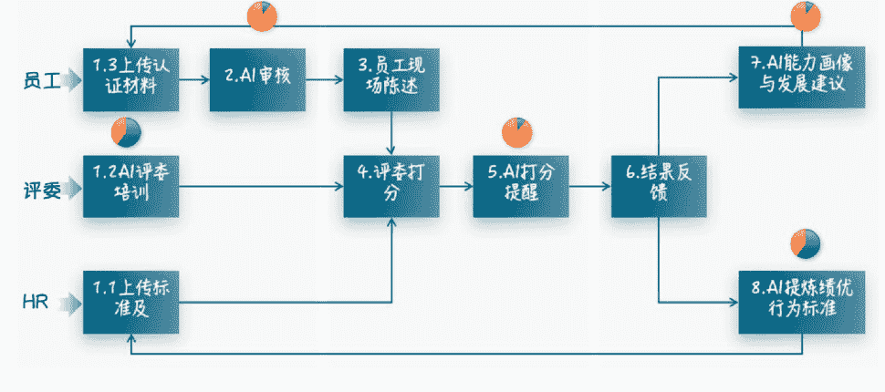

图3-18 任职资格认证评价流程简要示意图

互动：

1. 借助智能系统梳理头部公司在知识、技能类认证上的典型做法。
2. 对于首次开展、配套基础薄弱的企业，知识和技能两类认证应如何安排？

下面展开认证流程中的四个关键节点。

#### 一）AI审核（自动化初筛）

系统会先把员工提交的材料与标准要求进行自动比对，迅速剔除不符合硬性门槛的候选人。例如某层级基本要求工作年限不低于5年，系统就会将其自动标记为不符合。

更重要的是，系统还能基于提交材料完成自动分析并给出初步评议。以下示例说明其应用方式。

##### 案例：AI自动化初筛资格

背景：某企业销售序列行为标准里关于客户关系的模块，行为标准如下。

| 行为模块 | 要素 | 行为标准 |
| :--- | :--- | :--- |
| 客户关系 | 需求分析 | 分析所负责客户（内部或外部）要求、需要和需求，及如何满足他们。分辨出客户讲出来的、真实的和未讲出来等需求之间的差异，准确地捕捉到重大的市场机会。 |
| | | 了解并预测主要竞争对手（传统的和新兴的）的目标、战略、市场份额、方法论、文化、产品种类、趋势和成本结构，对公司竞争地位和客户满意度的影响。 |
| | 关系建设 | 具备开发和维持重要客户关系的能力，能够通过高效沟通提升客户忠诚度。 |
| | | 能够识别客户组织内部的关键决策者，并与其建立深度合作关系。 |

某员工提交该模块的认证材料A与B，B案例资料如下。

###### 案例名称：深圳客户（MT）分路器产品合作

情境（Situation）：

深圳MT公司正参与某运营商FTTR项目的投标，需求涵盖1分5和1分9分路器成品。项目时间紧、要求严，MT需依据客户端要求及时给出报价并确保产品通过验证。

任务（Task）：

负责1分5和1分9分路器的报价与样品送检工作，确保产品符合客户要求，并配合客户推进项目进程。

###### 行动（Action）：

1. 拜访客户：前往深圳MT采购团队沟通，详细了解项目需求，确认两款产品的合计需求量为30万支。
2. 信息收集与分析：调研竞争对手情况，得知运营商此前为MT提供的样品来自GX公司，且GX报价偏高。GX产品为外购成品，并非自制。
3. 报价制定：结合客户需求与市场信息，针对1分5和1分9分路器分别提出含税22.5元和30.5元的报价。价格虽略高于市场，但结合产品质量与技术要求，仍具竞争力。

###### 结果（Result）：

客户据此下单小批量样品订单。样品已送运营商验证，后续需求仍在跟进。

##### 输入指令：

请依据行为标准要求和评分指引，对员工提交的案例材料进行打分，并给出具体反馈，指出优点与不足。

###### 评分指引如下：

| 评分 | 解释 |
| :--- | :--- |
| 5分 | 完全达标且部分超标：员工展示了超出标准的行为，完全符合标准要求，并且提供了创新性的解决方案或超越预期的成果。 |
| 4分 | 总体达标：员工的行为符合标准要求，完成了任务并达成了预期目标。 |
| 3分 | 基本达标：员工的行为有一定的基础，能够完成任务，但缺乏深度或系统性思考，未完全满足标准的高要求。 |
| 2分 | 大部分不达标：员工的行为存在明显的缺陷，未能满足标准中的核心要求。 |
| 1分 | 不达标：员工未能展示符合标准的行为，或者没有达成预期的工作成果。 |

AI反馈：

该员工在客户关系模块的评价如下。

1. 需求分析：A和B案例中……符合标准中的需求分析要求。然而，案例里没有涉及对竞争对手支撑战略的深入剖析。
2. 关系建设：在A案例中……展示了较强的客户关系建设能力。在B案例中，员工通过拜访收集信息，体现了基础的客户关系维护，后续有所改进，但未突出长期稳定关系的建立。

评分：4分（总体达标）。员工表现符合行为标准要求，尤其在关系建设方面，但在需求分析的深度与复杂度上略显不足。

实际操作中，可通过IT调用API自动完成评价打分并生成初筛建议报告，最终复核仍需HR人工完成。

#### 二）AI驱动的评委能力管理

认证环节里评委的选取与培养至关重要。现实中评审者往往不是标准制定者，很多企业仅做简单培训即上岗。这种做法在“判断谁能胜任”上尚可，类似集体面试，但忽略了评审的深层价值——能力引导与发展建议，也容易削弱员工信任感。

根源之一是HR流动频繁，评审经验难以沉淀。引入IT和AI可以系统性缓解，具体可从两方面入手。

##### 1. 利用AI培训评委

AI可通过案例分析、视频讲解和评分模拟等方式，帮助评委理解评分标准、提升评审能力，有效减少因经验差异带来的评分偏差，提升评审的公平性与一致性。

##### 2. AI监控评委评分过程

AI系统可实时监控评委评分情况。当评分差异超过设定阈值时，系统将自动提醒评委复审并讨论，促进结果一致，避免因偏差过大影响评审公正性。具体示例如表3-7所示。

###### 表3-7 评委打分与建议操作表示意

| 行为模块 | 权重 | 行为标准 | 打分 |
| :--- | :--- | :--- | :--- |
| 市场洞察 | 20% | 1. 独立分析所在地区和领域的市场趋势……。<br>2. 运用 SWOT 分析法和波特五力模型……。<br>3. 记录和分析客户的历史订单、互动记录……。<br>4. 掌握并应用时间序列分析法和……。 | 5 |
| …… | …… | …… | 3 |
| 资源协调 | 20% | …… | 4 |
| 评委建议 | …… | | |

在5分制评分体系中，评分差异的建议阈值一般为0.5至1分，以保障结果的一致性与公正性。若评分标准明确、评委判断趋同，可适当收紧阈值；反之，标准较宽或评委经验差异较大时，可适当放宽。

评审过程中，可通过屏幕展示评委评分（匿名）和AI评分结果，通过可视化实时对比差异，促进更公正、全面的讨论，如表3-8所示。

###### 表3-8 评委打分可视化对比示例

| 模块\评委 | 行为模块 | 总分 |
| --- | --- | --- |
| | 市场洞察 | 市场开发 | 客户关系 | 商务谈判 | 资源协调 | |
| 评委A | 4 | 3 | 4 | 5 | 3 | 4 |
| 评委B | 3 | 4 | 3 | 4 | 3 | 3 |
| 评委C | 4 | 4 | 4 | 5 | 3 | 4 |
| 评委D | 5 | 4 | 5 | 5 | 4 | 5 |
| 评委F | 3 | 3 | 3 | 4 | 3 | 3 |
| 均值分 | 3.8 | 3.6 | 3.8 | 4.6 | 3.2 | 3.75 |
| AI评分 | 4 | 3 | 4 | 5 | 3 | 3.5 |

#### 三）AI能力画像与个人提升建议

多数企业在认证后仅给出一个“是否达标”的结论，缺乏明确、针对性的反馈，导致任职资格体系“既识别人才更要培养人才”的核心价值受损。

引入AI后，可自动生成能力画像，并提供个性化的提升建议，推动“人才评价”走向“人才发展”。

##### 案例：认证结果反馈

输入指令：

根据以下信息，为员工生成能力画像和个性化提升建议：

- 员工姓名：张伟
- 职位：目前是销售经理，申请晋升高级销售经理
- 任职资格标准附件（行为模块）
- 评委评分结果附件
- 360度反馈报告附件

输出：

- 总体评价：包括综合得分及优势和短板项；
- 员工能力画像：行为标准各模块的得分情况。
- 问题定位：指主要扣分项及扣分原因。
- 根因分析：根据评分结果及360报告总结提取。
- 改进建议：如参加培训、实践锻炼等建议。

要求：

以表格的形式展现。

AI反馈：

| 基本信息 | 姓名：张伟 申请晋升高级销售经理 |
| :--- | :--- |
| 总体评价 | 综合得分：76.6分（标准线80分），未达标。<br>- 优势项：资源协调（90分，超标准3.4%）。<br>- 短板项：客户关系（65分，低于标准15%）。 |
| 能力画像 | | 评估维度 | 权重(%) | 张伟得分 | 基准值 | 是否达标 |
| :--- | :--- | :--- | :--- | :--- | :--- |
| | | 市场洞察 | 40% | 85 | ≥80 | |
| | | 市场开发 | 20% | 82 | ≥80 | |
| | | 客户关系 | 20% | 65 | ≥75 | |
| | | 商务谈判 | 10% | 78 | ≥75 | |
| | | 资源协调 | 10% | 90 | ≥80 | |
| | | 总评得分 | - | 79.4 | ≥80 | |
| 问题定位 | 张伟的总评分为79.4，低于晋升标准（80），其中“客户关系”未达标，成为主要扣分项。 |
| 根因分析 | 1. 数据分析能力不足：<br>-近半年销售预测准确率仅为62%（标准≥75%）。<br>-市场洞察报告未被采纳（3/5份报告缺乏竞品对比）。<br>2. 团队协作待提升<br>跨部门协作项目参与度仅40%（标准≥60%）。<br>3. 内部匿名反馈 |
| | “沟通时缺乏主动性”（评分 2.8/5）。 |
| 改进建议 | 1. 培训计划<br>-必修课程：《数据驱动的销售决策》（目标：预测准确率提升至 70%）。<br>-选修课程：《跨部门协作与资源整合》（目标：协作评分提升至 3.5/5）。<br>2. 实践建议<br>-主导 1 次跨部门项目，并在季度总结会汇报成果。<br>-每月提交 2 份含竞品分析的市场报告。 |

通过反馈，员工能清晰看到哪些能力已达标、差距在哪、该如何补。认证由此从一张分数表变成一张成长地图，从终点变为起点。

#### 四）AI驱动的标准动态迭代

在AI赋能的任职资格认证中，行为标准需持续更新，以确保与业务发展同步，及时吸纳优秀员工的实际表现。操作包括以下三个步骤。

- 标杆行为案例推荐：在自我陈述阶段，若某一案例突出，评委在线可推送给HR。
- AI行为标准提炼：评审结束后，AI对推荐案例进行分析，自动提炼关键行为特征。操作原理和认证评价类似。
- HR审核与采纳：HR对AI提炼出的新标准进行审核，判断其是否适用于当前岗位层级，并评估其对组织的价值。

这样一来，就可以把优秀员工的经验源源不断的纳入到标准中来，实现更新迭代，把员工个人的知识转化为组织的知识资产。

##### 案例：行为标准的优化

输入指令：

根据以下员工行为案例，请提炼出“客户关系管理”和“需求分析”行为模块相关的行为标准。

案例信息如下：

情境（Situation）：负责与一家长期合作的企业客户进行项目沟通，客户反馈在技术升级上存在困难，需要提高产品的市场适应性。我收到反馈后，决定与客户进行深入沟通，了解更多细节。

任务（Task）：需要在短时间内分析客户需求，并为客户提供改进方案，同时保持良好的客户关系，确保双方的合作继续顺利。

行动（Action）：

- 拜访了客户公司，进行了面对面的需求调研。
- 在与客户沟通时，主动提出了对产品的改进建议，并针对客户的痛点提出了几种解决方案。
- 通过行业分析数据，帮助客户洞察市场趋势，进一步明确了客户的核心需求。
- 随后，为客户设计了几种不同的改进方案，并提供了相应的报价和实施计划。

结果（Result）：客户对建议感到满意，最终决定采纳其中一种方案，并在两周后签订了新的合作协议，成功推动了项目进展。

AI反馈：

###### 1. 客户关系管理行为标准

- 能够主动与客户保持沟通，定期进行回访。
- 在客户需求未显现时，能够通过提问和调研主动挖掘客户需求。
- 展示出积极的解决问题态度，并能持续跟踪客户的满意度和反馈。

###### 2. 需求分析能力行为标准

- 能够快速识别客户的核心需求，包括显性需求和潜在需求。
- 运用市场数据、行业分析、客户反馈等信息，为客户提供精准的解决方案。
- 提供的方案能够解决客户当前痛点，并预见客户未来的需求。

该流程实现了AI与HR的高效协同，不仅推动标准动态优化，也增强了其对真实场景与业务需求的适配性。

##### 小结

任职资格体系构建失败，往往源于四大问题：与业务脱节、标准开发能力不足、体系僵化难以更新、认证过程缺乏严谨性。

AI的价值，正是在这四个环节中提供系统性支撑，使原本依赖“专家手工雕刻”的高成本路径，转向“AI辅助生成、HR精准修正”的协同模式，既提升效率，又增强可迭代性与落地性。

这一变革显著提升了将专业体系从外部顾问转移至组织内部沉淀与复制的可行性。

## 第三节 薪酬管理体系：HR体系的能量引擎

薪酬体系的核心任务，是在内部公平、外部竞争和战略导向之间找到平衡点，实现“二元均衡”：既贴近市场，又服务战略；既能激励人心，又能管控成本。

归纳来看，薪酬体系要解决三个关键问题。

- 为什么给。所有薪酬设计都应围绕战略展开，讲究投入产出比，把资源花在真正能带来业务回报的地方。
- 给多少。企业需结合自身承受能力与关键人才需求，设定合理水平，避免盲目追随市场。
- 怎么给。薪酬要素如何组合？固定与浮动薪酬如何分配？这些决定了激励的精准性与机制的可持续性。

HR基础体系（职位/任职资格）搭建完毕后，若薪酬体系跟不上，整个机制很快就会失效。毕竟，没有利益驱动，少有人愿意接受规则和约束。只有触及利益，才能触动灵魂。

### 一 AI协助分析与制定薪酬政策

薪酬是一个古老而成熟的领域，成功范式几乎覆盖了企业在不同发展阶段面临的各种调整与挑战。正因如此，AI在薪酬分析与优化上具备天然优势——关键在于，你提供的信息是否足够清晰、有结构。

如图3-19所示，影响薪酬政策的要素，可归为三个主要维度（图顶黑色区域），进一步拆解为八个关键要点。若希望AI进行深入分析，还需补充企业在岗位、人才与绩效方面的基础信息（即经典的3P模型：岗位定薪、能力定薪、绩效定薪，对应图底黑色区域）。

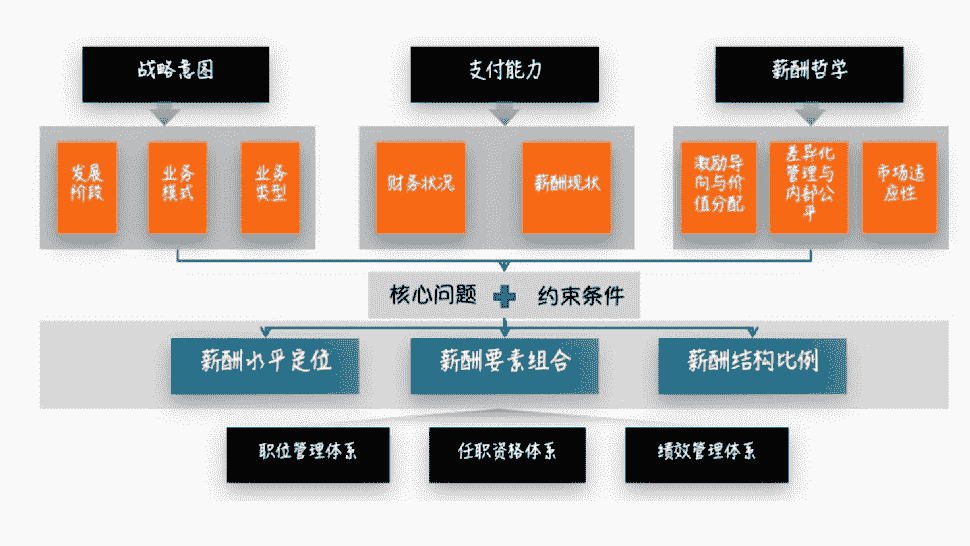

图3-19 薪酬政策重要影响因素示意图

当然，别忘了说明要分析的核心问题与边界条件，让AI更精准地聚焦目标、输出建议。

具体而言，薪酬政策主要包括三个方面（见上图蓝色部分）。

首先是薪酬水平定位。明确企业在市场中的定位，包括基本薪酬、总现金收入以及长期激励（如股权、福利等）的对标策略。

其次是薪酬要素组合。不同薪酬要素功能各异，如基本工资、津贴、奖金、股权激励等，需结合岗位特性合理搭配（详见表3-9）。

#### 表3-9 薪酬要素组合的内涵

| 要素 | 本质内涵 | 特点 |
| :--- | :--- | :--- |
| 工资 | 劳动力的市场价格，支付给正常劳动和绩效的报酬 | 刚性部分<br>保健作用 |
| 津贴 | 补偿特殊工作条件下的额外劳动消耗与支出 | |
| 补贴 | 因物价变动等因素而设立的生活成本补偿 | |
| 福利 | 与个人劳动关系不大的非现金性收入 | |
| 奖金 | 对超出标准绩效的奖励 | 弹性部分<br>激励作用 |
| 股权激励 | 包括分红、股票、期权等，将知本与贡献转化为企业价值共享机制 | |

最后是薪酬固浮比例。在同一薪酬总量下，固定与浮动的配比差异，往往决定了激励强度和行为导向。其背后反映的是企业对人才的理解与所在行业的激励偏好。

接下来，通过三个典型案例，来看AI如何辅助分析与优化薪酬政策。

#### 一）薪酬政策如何契合战略导向

薪酬政策的本质，是组织价值观与战略意图的制度化表达。

一套真正有效的薪酬设计，不仅承担激励与分配的基本功能，更应作为连接战略目标与人才行为之间的关键机制。

AI正逐步成为薪酬设计中的系统性思考助手，为组织提供更高效、更具前瞻性的决策支持。

##### 案例：如何用薪酬牵引人才奔赴新业务

背景：某建筑信息化软件公司于2010年上市，截至2019年，业务主要分为三大板块。

工程造价业务BG：核心业务板块，已进入成熟期。产品涵盖算量、计价、成本管理等SaaS服务，完成云转型，市场份额高，盈利稳定，具备明显行业优势。

数字施工业务BG：2018年启动，聚焦项目管理平台与智能硬件，处于高速成长阶段，尚未盈利。该业务以综合解决方案为主，交付复杂、实施难度高，对团队的整合与专业能力要求较高。

其他业务（孵化中）：如数字设计BG等，仍处孵化探索阶段，尚未形成规模营收。

###### 1.当前挑战

数字施工BG任务重、难度高，但由于仍在投入期，尚未盈利，延用“工资+利润分成”的激励模式已基本失效，员工难以获得奖金回报。

相比之下，造价BG盈利稳定、激励机制明确，员工更倾向留在原岗位，极少主动转入施工BG。尽管新业务急需市场型人才和高水平方案专家，现有薪酬体系缺乏吸引力，导致人才引入与留存双重受限。

> 内部甚至戏称：“去施工BG的，都是被发配过去的。”

###### 2.任务目标

公司希望通过薪酬机制调整，打破激励障碍，引导核心人才向数字施工BG流动，支撑新业务战略发展。

##### 输入指令：

你是一名资深薪酬专家。请结合以上背景，识别当前激励机制存在的问题，并提出针对性的薪酬调整方案。

##### AI反馈：

####### 1.核心问题诊断

- 激励机制错配：当前利润分成制与新业务的成长阶段严重脱节——尚未盈利即意味着“零激励”；
- 风险与回报不对等：施工BG交付复杂度高、压力大，但薪酬未体现岗位难度与挑战系数；

文化标签的负向外溢效应
当成熟板块的“现金牛”形象被反复强化，团队对稳定赛道产生路径依赖，反而稀释了新兴方向的吸引力，内部人才向新业务流动的意愿在走弱。

2.薪酬调整方案
设计思路是构建“战略津贴+过程激励+长期确权”的三维模型，让施工板块与造价板块形成差异化的报酬逻辑。核心主张是用存量业务的利润去孵化未来业务。组合如下：

| 薪酬构成 | 施工事业部（成长型） | 造价事业部（成熟型） |
| :--- | :--- | :--- |
| 固定薪资 | 基准×1.2 行业第75百分位 | 基准×1.0 行业第50百分位 |
| 短期奖酬 | 里程碑奖金 签约/验收/回款 | 利润分成 季度计提 |
| 长期权益 | 限制性股票 4年解锁 与增速挂钩 | 期权 3年匀速解锁 |
| 战略津贴 | 难度津贴 项目复杂度×2-5万元 | 无 |
| 亏损保障 | 保障奖金 目标奖的60% 与战略指标挂钩 | 无 |

3.操作要点
1）保障奖金测算
实际发放额=最大值（业务线实际奖金，目标奖×60%×战略指标达成率）。
战略指标构成：合同达成率40% + 客户NPS30% + 产品迭代进度30%。

2）难度系数评估
建立项目分级模型，由技术委员会每季度复核系数。

| 项目等级 | 客户类型 | 定制化程度 | 技术难度 | 津贴标准 |
| :--- | :--- | :--- | :--- | :--- |
| S级 | 央企总部 | 全定制开发 | AI嵌入 | +5万元 |
| A级 | 省属建工集团 | 模块重构 | BIM+物联网集成 | +3万元 |
| B级 | 中型开发商 | 配置调整 | 标准接口 | +2万元 |

3）职级发展机制优化
新增G序列增长岗，面向数字施工业务，晋升节奏比现有P/M序列快约30%。例如P6需4年，G6约2.8年。
开放交叉流动：G序列人员可优先竞聘造价事业部高阶岗位。外派人员保留原职级与原薪，并享受外派津贴=基本工资×30%。

4.实施路径与风险控制
1）成本测算与资金来源
年增量成本约2000万元，战略津贴1200万，保障奖金800万。可由IPO募集资金专项列支。回收机制为施工板块毛利率转正后，从超额利润中按15%计提回流基金池。

2）风险防控
施工事业部薪酬总额占比上限45%，目前38%，保持投入可控。
人才回流保障：从造价事业部调入施工事业部的员工，两年内申请回调，职级与薪酬维持不变。
熔断条款：若数字施工事业部连续两年营收增速低于20%，启动薪酬结构复审。

输入指令：
在薪酬结构层面，请进一步明确各薪酬要素在施工板块与造价板块中的具体调整方式，以及如何实现差异化的考核与激励策略。

模型输出：

1.薪酬要素分层调整表

| 薪酬要素 | 施工事业部（成长业务） | 造价事业部（成熟业务） |
| :--- | :--- | :--- |
| 固定薪资 | 行业第75百分位+战略溢价 | 行业第50百分位 |
| 短期奖酬 | 里程碑奖金：签约10%+验收40%+回款50% +保障奖金 目标奖60% | 利润分享：季度净利润×3%-5%计提 |
| 长期权益 | 限制性股票 与业务增速挂钩 解锁条件：年营收增长≥30%解锁40% 客户数增长≥50%解锁60% | 标准化期权 3年匀速解锁 与股价挂钩 |
| 福利组合 | 1.弹性工作制 项目期集中休假 2.子女国际教育津贴 高管层级 3.技术移民支持 海外项目 | 1.高额公积金 12%上限 2.补充商业保险 3.稳定带薪年假 |

2.差异化落地要点
增量薪酬成本约2500万/年。集团战略基金承担60%，由成熟业务利润计提；政府补贴承担40%，可申报“智能建造试点企业”专项支持。

3.绩效考核差异化

| 指标类型 | 施工事业部 | 造价事业部 |
| :--- | :--- | :--- |
| 财务类 | 30% 收入增长/客户数 | 50% 利润率/续费率 |
| 客户成功类 | 40% NPS/解决方案复用率 | 30% 客单价/投诉率 |
| 产品技术类 | 30% 专利数/模块标准化率 | 20% 交付准时率 |

本案例说明智能工具不能替代人的判断，但在框架搭建、变量梳理与多方案推演上能为HR提供强支持。关键在于输入越清晰，输出越精准。

#### 二）薪酬倒挂现象如何处理
公平感是薪酬体系的隐性底线。好的机制不仅要对外有吸引力，也要经得起内部横向比较与纵向积累的检验。不少企业体系建成后未动态迭代，市场变化导致结构失衡，出现倒挂。

尤其人才结构多元、期望差异扩大时，如何在不破坏既有稳定性前提下回应个体价值差异，成为核心难题。

##### 案例：倒挂问题
背景：某芯片制造企业位于内地五线城市，已科创板上市。早期为吸引人才构建了相对激进的薪酬体系。
- 操作类岗位：略高于本地均值，保障基础岗稳定；
- 技术类岗位：从发达地区引入，定位行业第75百分位；
- 管理及专业类岗位：对标省会城市中位，保障吸引力。

###### 1. 问题演变
随业务扩张与竞争加剧，原体系未及时调整，显现：
- 多数岗位薪资与市场持平，部分甚至低于行业均值；
- 员工对外机会敏感度提升，留存难度加大。

###### 2. 核心问题：倒挂
上市后为支撑创新与资本预期，高端人才需求骤增。受区位劣势影响，外部人才期望普遍高于内部标准。新进员工薪酬普遍高于在职员工，形成明显倒挂。

###### 3. 后果与影响
- 内部公平受损，资深员工产生吃亏感，易引发负面对比；
- 激励失效，薪酬与经验贡献脱钩，打击积极性；
- 信任基础动摇，员工质疑人事制度，影响文化与团队稳定。

输入指令：
你是一名资深薪酬专家。请结合上述企业背景，设计一套兼顾外部高端人才吸引力与内部公平性的薪酬优化方案，确保激励体系可持续与组织认同。

限制前提：
1. 现有体系不可变动，现有员工薪酬结构与水平保持不变，不得直接调整或补偿性改动。
2. 外部人才期望偏高，偏好现金激励，对长期股权接受度低，短期难以形成吸引力。
3. 股权激励虽有规划，但受审批与合规限制，1-2年内无法落地，不宜作为主方案。

模型输出：

###### 1. 引入“双轨制薪酬”
1）设立“市场调节津贴”或“特殊引进补贴”。为高薪外部人才单独设置专项补贴，弥补固定薪酬差距，不计入基本工资，避免冲击现有员工。
2）时间与考核机制。补贴建议有效期3-5年，与业务成果或研发进度挂钩，按年评估续发，避免固化。独立发放既满足吸引力，又降低内部不公感知。

###### 2. 优化绩效奖金结构
1）提高绩效占比，弱化固定部分。将部分高薪需求置于季度/年度绩效奖金中释放，提升竞争力并强化成果导向。
2）分期发放。如入职半年后支付50%，满一年后支付剩余，强化留存，防范高薪短期跳槽。

###### 3. 设立“定制化岗位”吸引人才
针对关键高薪人才可设“特聘专家”“高级顾问”等短期定向岗位，采用独立薪酬测算模型，不纳入统一岗位序列，避免干扰现有结构。

###### 4. 强化隐性激励与非现金福利
1）补贴生活成本：因地理偏远，提供住房补贴、通勤便利等实物激励，降低对高薪依赖。
2）强调职业成长价值：通过明确晋升路径、管理通道及能力成长计划，构建长期可预期的非现金吸引力。

###### 5. 长期薪酬结构优化建议
随企业规模与利润增长，应逐步拉升内部关键岗位薪酬水平，至少对齐行业第75百分位，以系统方式重建竞争力，避免长期依赖特殊补贴。

要让智能工具真正辅助解决倒挂这类敏感且结构性矛盾的问题，关键在于三层系统引导：准确还原背景与冲突点；结合业务逻辑拆解策略空间与实施边界；引导从系统视角提供多维度可比较的分析路径，而非单一线性答案。

#### 三）业务模式与薪酬模式的同步转变
薪酬模式绝非孤立设计，而是紧扣业务模式的运行逻辑。业务模式决定价值创造路径，也决定组织协同方式。岗位界面变化时，薪酬机制需同步调整，包括绩效指标、激励节奏与固浮比。

在现代组织里，薪酬既是分配工具，也是驱动协同、引导行为、支撑战略的杠杆。

##### 案例：销售体系薪酬模式的转变
背景：某生物科技公司2021年科创板上市，业务涵盖四大板块。
中间体业务事业部：核心板块，产品标准化高、运营成熟；
动物营养、功能食品与营养、日化护理事业部：三大新兴业务，正处快速拓展期。

###### 1. 新兴业务呈现出明显不同的销售特征
协作链更长：以综合解决方案为主，需销售、技术支持、产品经理多角色协同。
销售周期更长：功能食品与日化领域伴随客户产品开发，节奏缓慢、关系维护要求高。
销售逻辑更复杂：从“产品成交”转向“价值交付”，业绩评估不能仅看销售额。

###### 2. 薪酬现状与挑战
目前沿用“底薪+个人提成”传统模式，在中间体业务中适用良好。但在新兴业务中，该模式难以体现团队协作贡献，激励逻辑滞后，正逐步失效。

###### 3. 任务目标
构建面向协同场景的新型销售薪酬体系，强化整体作战力同时保留个人贡献驱动，支持业务从“单点成交”向“整体解决方案”演化。

输入指令：
请你作为资深薪酬专家，请根据以上背景，设计一套适用于新兴业务的销售薪酬模式，要求兼顾个人激励与团队协同，适应多角色合作与价值销售的业务特征，要求说明理由。

模型输出：
建议从“个人销售提成”转向“团队业绩共享+综合激励”模式。

| 薪酬要素 | 调整方案 | 调整理由 |
| :--- | :--- | :--- |
| 底薪 | 适当调整 销售经理底薪比例上升 | 稳定主力角色收入，弱化对短期提成的依赖 |
| 团队奖金 | 以事业部整体或小团队 销售+技术+产品 为单位发放 | 新业务销售模式需要团队合作，共享业绩，提高整体战斗力，避免单纯拼个人销售额 |
| 项目激励 | 针对大型客户、战略项目设定专项奖励 | 鼓励团队成员积极投入长周期的大客户维护，提高高价值客户成交率 |
| 个人激励 | 仍设有绩效奖金，但降低比例 | 保留个体贡献激励，防止协同掩盖不作为现象 |

输入指令：
请详细说明团队奖金的设定标准及其在团队成员之间的分配机制。

模型输出：
奖金方案应在确保激励效果的同时，合理反映多角色协作对销售成果的实际贡献，避免个人驱动对团队绩效的过度放大。

###### 1. 团队奖金池的设定方式
奖金池建议以销售额或毛利为基础提取固定比例，兼顾激励强度与成本控制。常见两种模式。
模式1：按销售额比例设定 适用于利润稳定产品
团队奖金池=事业部销售额×设定提成比例
设定参考：成熟业务如中间体1%-3%；新业务如功能食品3%-6%，难度大适当提高。
模式2：按毛利设定 适用于利润波动产品
团队奖金池= 销售额-成本 ×设定毛利提成比例
高毛利产品提成10%-15%；低毛利产品提成5%-8%。

###### 2. 团队奖金的分配方式
奖金池确定后按贡献度分配，可采用固定比例+绩效考核方式。

| 角色 | 核心贡献 | 分配权重建议 |
| :--- | :--- | :--- |
| 销售经理 | 负责客户开发、谈判、合同签订 | 40%-50% |
| 技术支持工程师 | 方案设计、技术交流、客户测试支持 | 20%-30% |
| 产品经理 | 产品定制、市场推广、客户需求对接 | 10%-20% |
| 销售支持/运营 | 订单执行、客户关系维护 | 5%-10% |

###### 3. 具体分配机制建议
奖金分配分为两部分：
1）基础分配 70%-80%，依据上述权重预设，保障各角色基本激励。
2）绩效浮动分配 20%-30%，根据具体KPI二次调整，常见指标：个人销售目标达成率；客户满意度；交付项目数量；产品方案落地率。
此机制既保证分配可预期，又强化实际贡献动态反馈。

###### 4. 配套保障与强化机制
最低保底：为技术支持、产品经理等间接岗位设定最低奖金额度，避免销售波动影响稳定收入。
超额奖励：团队整体销售或毛利超目标时，奖金池按预设比例递增，形成二次激励，鼓励冲刺更高绩效。

要充分发挥智能工具在薪酬模式设计中的价值，关键在于有步骤有结构地引导完成建模：先问题识别与目标澄清，再关键变量分析、逻辑结构构建，最后细化到激励元素设计与配比策略优化。该过程既是从问题到答案的递进，也是从战略到执行的层层下沉。

薪酬政策确定后，体系才有了灵魂。剩余的设计工作，智能工具可发挥更显著的辅助作用。

### 二 智能赋能市场薪酬数据对标，辅助设计薪酬表
职位体系是薪酬体系设计的基石。只有明确职位架构，才能确保薪酬体系科学与公平。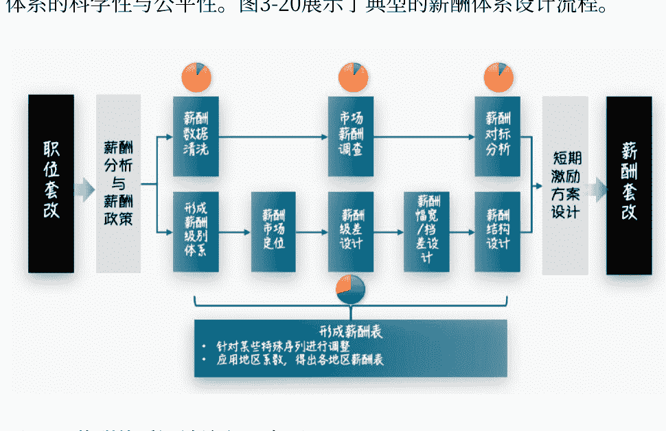
图3-20 薪酬体系设计流程示意图

互动：智能查询
- 职位套改与薪酬套改的概念、实施流程及应用方法，并结合典型案例，分析常见问题及应对方案。
- 薪酬体系的级差、幅宽和档差设计的作用、计算方法及关键考量因素，并提供具体示例说明。

接下来，将围绕四个要点讲解如何利用智能工具辅助薪酬级别表的设计。

#### 一）内部薪酬数据清洗
薪酬激励既不能失准，也不能失衡。其前提是对内部数据的精准掌握与清洗。数据的准确性决定对标科学性，也决定后续激励机制公允性。

首要工作是数据标准化处理，确保不同岗位、职级、序列间薪酬信息具备可比性。包括统一口径、剔除异常值、明确薪酬边界如是否含津贴、奖金、长期激励，为后续对标与策略建模打基础。

示例指令：
请将附件薪酬数据进行标准化处理，包括：
- 货币单位统一为CNY 转换USD/EUR汇率按2024年均价；
- 薪资数字格式规范为“45, 000.00” 千分位分隔；
- 职级字段映射为P序列：原“高级工程师Ⅱ” → “P6”，原“首席科学家” → “P10”；
- 异常格式存入待审核队列并标注原因。

数据标准化后，还需进行异常值分析，确保数据完整、准确、一致。

示例指令：
你是一名薪酬分析师，请你分析附件薪酬表中异常值，要求：
- 识别基本月薪超过同职级3倍标准差记录 排除高管岗；
- 标记年终奖金额为负数的异常数据；
- 检测社保缴纳基数与月薪不匹配记录 阈值±20%；
- 输出异常记录统计表，按部门分类展示修复建议。

#### 二）市场薪酬数据调查
市场对标是薪酬设计衡量竞争力与合理性的关键参照。
技术赋能下，可借助算法或网页爬虫快速获取市场薪酬数据，提升时效性与覆盖范围。为确保真实性与参考价值，建议将智能采集数据与传统薪酬调研报告结合，通过多源交叉验证、趋势比对实现信息互补。

示例指令：

##### 1. 薪酬数据爬取
你是一名薪酬分析师，请爬取以下职位的市场薪酬数据：
- 职位：高级数据分析师 Senior Data Analyst；
- 经验：3-5年；
- 地区：北京/上海/深圳；
- 数据来源：猎聘、BOSS直聘、Glassdoor；
- 需要输出数据：薪酬范围 P25-P75、基本薪资、绩效奖金、长期激励 股权/期权；
- 按照P50/P75/P90生成表格形式。
排除条件：
- 非上市公司；
- 企业规模 500人以下/以上。

##### 2. 数据源交叉验证
请对以下数据源进行交叉验证，生成可信度评分：
- 来源A：美世《2024中国薪酬报告》P50值；
- 来源B：猎聘平台AI提取的北京算法岗薪资；
- 来源C：脉脉匿名用户薪酬爆料数据。
要求：当差异＞20%时，自动触发人工复核标记。

##### 3. 薪酬预测
请基于过去3年的薪酬数据，预测未来12个月内高级Java开发工程师的薪酬增长趋势：
- 过去数据：2021年：30K/月，2022年：34K/月，2023年：38K/月；
- 需要输出：2024年薪酬预测区间、预测增长率。

#### 三）薪酬对标分析
完成内部数据清洗与外部市场调研后，下一步是开展薪酬对标分析，识别差距，明确优化方向。
借助分析工具，可对比不同岗位、职级、序列在内外部数据中的定位偏差，快速定位薪酬高估、低估或结构失衡问题区域。

示例指令：
你是一名薪酬数据分析师，请基于以下数据生成薪酬对标可视化图表：
- 内部数据：[上传公司薪酬Excel]
- 外部数据：[上传市场报告PDF/CSV]
要求：
- 按城市 北京/上海/深圳、职级 P5-P8、部门 研发/销售 三维度对比；
- 图表类型：分位数曲线图 内部25/50/75分位vs市场50分位；

薪酬对标呈现时，常用颜色标记风险区间：内部薪酬落于市场第25百分位以下的岗位标红，落于第75百分位以上的岗位标绿。交付形式通常是可交互的HTML可视化图表，辅以Excel数据透视表做明细留存。

完成初阶对标后，可进一步加深颗粒、提升精度。

##### 1. 细化分析维度
示例指令：
- 将算法序列单独拆解，或对管理序列先剔除股权后再横向比较；
- 按工龄划分为1-3年、3-5年、5年以上三组，分别计算年薪均值。

##### 2. 异常点筛查
示例指令：
- 把薪酬低于市场P10或高于P90的极端样本挑出；
- 形成异常岗位清单，注明部门、职级及偏离幅度。

##### 3. 产出分析摘要
示例指令：
- 以Markdown形式提炼核心结论；
- 给出可执行的建议，例如需要调薪的职级区间。

##### 4. 外部职级与内部口径不一致的处理
示例指令：
请用模糊匹配把内部职级“P6”映射到市场口径“Senior Engineer（Level III）”，置信度门槛设为85%。

##### 5. 样本量较小岗位的处理
示例指令：
当岗位样本数不足10个时，采用贝叶斯收缩估计进行平滑，利用全公司同类岗位信息做校正。

在数据清洗与计算环节，智能体可显著提速，HR的重点在于复核结果是否准确。

#### 四）薪酬表搭建辅助
策略明确后，下一步是构建薪酬分级体系，让岗位价值与薪资回报建立系统对应。

一般情况下，职位等级可直接映射为薪酬等级。实践中会结合岗位特点与组织管理要求做弹性调整，见图3-21。
常见做法有：
- 合并做法。把相邻2-3个职位等级合并为一个薪酬等级，形成更宽的带宽区间，利于管理简化；
- 分拆做法。对关键岗位在同一职位等级内设置多个薪资档次，以反映能力差异或市场行情，提升精细度。

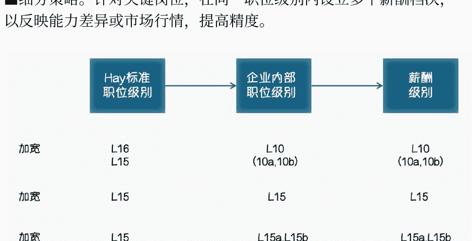

图3-21 职位等级与薪酬等级的对应示例

薪酬等级的设定要综合企业文化、人才成长路径、岗内员工能力差异及薪酬管理的复杂程度，最终由HR做权衡决策，兼顾公平、灵活与可执行。

示例指令：
请依据附件《职位职级表》《薪酬市场调查数据》及公司薪酬政策，生成P1-P8职级的薪酬表。

薪酬政策要点如下：
1. 薪酬定位，按总现金报酬口径
- 基层P1-P3：参照市场中位数，保持竞争力；
- 中层P4-P6：参照市场75%分位点，用于吸引核心人才；
- 高层P7-P8：参照市场90%分位点，匹配稀缺价值。

##### 2. 级差、档差、重叠度、幅宽参数规则
- 级差，即相邻职级中位值的差距，区间15%-25%，管理序列建议>20%；
- 档差，即同一职级内部薪资档位的间隔，每职级设3档，控制在8%-12%；
- 重叠度，即相邻职级薪酬区间交叉比例，要求30%-50%；
- 幅宽，即同一职级薪酬区间跨度，基层岗位≤40%，高管岗位≤60%。

输出要求，可分步执行：
1. 薪酬带宽曲线图，横轴职级、纵轴薪资；
2. 薪酬等级表，横轴职级、纵轴薪资，格式示例如下。

| 职级 | 年度目标现金薪酬基准值（元） | 薪档（月） | | |
| :--- | :--- | :--- | :--- | :--- |
| | | 1档 | 2档 | 3档 |
| 16 | 340800 | 23200 | 28400 | 33600 |
| 15 | 243600 | 16600 | 20300 | 24000 |
| ...... | | ...... | ...... | ...... |
| 3 | 42000 | 3300 | 3500 | 3700 |

薪酬等级确认后，可借助智能体对现有薪酬结构进行诊断，为薪酬套改提供依据，具体操作不再展开。

互动练习：
请用智能体产出并解读以下可视化，并结合结果做分析：
- 薪酬散点图，呈现员工在不同岗位等级上的薪酬分布；
- 薪酬趋势线，刻画等级与薪酬水平的整体关系；
- 薪酬拟合度分析，评估等级与实际薪酬的相关强度；
- 离散性与异常点识别，分析薪酬偏离趋势线的程度，定位异常薪酬点。

##### 小结
智能体在薪酬体系设计中的价值持续上升，既提升效率，也提高分析精度与策略响应速度。

未来HR能力需向两端深化。
首先，理解业务、洞察变化。HR要具备业务敏感度，读懂战略意图、捕捉组织拐点，用人力资源语言回应业务挑战。
其次，强化专业、精进提问。智能体并未削弱专业性，反而对系统思维要求更高。只有具备清晰框架与判断力，才能向智能体提出高质量问题并做出明智决策。

归根到底，智能体能否带来有效洞察，关键不在于算法，而在于我们能否界定清晰的问题边界与协作路径。

# 第四节 绩效管理：战略向行为转化的传导机制
绩效管理是战略意图转化为组织行为的核心机制，也是公认的难题。其难点往往不在HR专业本身，而在HR之外：
- 若缺乏清晰的战略地图，绩效目标便失去锚点；
- 若管理者缺少带队打胜仗的能力，绩效监控容易沦为表演；
- 衡量员工贡献的标准，始终面临复杂与模糊的双重挑战。

绩效管理受多重因素影响，动态性强，不确定性远高于职位体系、任职资格或薪酬管理，如图3-22所示。

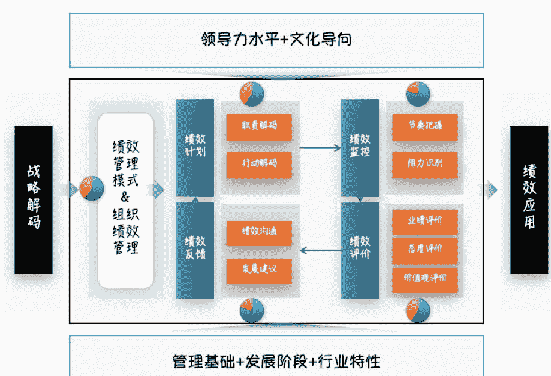

图3-22 绩效管理简要示意图

智能体在该领域的赋能不如基础体系那样直观，但在特定环节与场景中仍能提升效率并辅助决策。

下面结合典型实践，探讨智能体在绩效体系各环节的应用。

## 一 用AI拓宽绩效目标管理视角
部分HR容易陷入工具崇拜，机械套用KPI、OKR等，或盲目追新、固守经验，忽视与企业实际的匹配。要避免工具崇拜，核心是跳出单一工具迷信，重新审视企业真实需求，灵活选择绩效模式。

### 一）智能辅助下的绩效模式选择
绩效模式的选择应基于企业战略节奏与管理现状因地制宜，而非照搬标杆。
- 行业属性决定关注点。制造业重量化管控，偏好KPI；互联网企业重灵活性，更倾向OKR。
- 发展阶段决定管理重点。初创期需快速统一目标与反馈；成熟期关注流程规范与效率；转型期需要绩效体系兼具方向控制与变化适应。
- 绩效方式需贴合文化与风格。赋能型文化适合开放、发展导向的方式，如双向沟通与成长反馈；控制、结果导向文化更适合结构清晰、量化明确的工具。
- 管理基础决定工具落地性。流程成熟、系统完善的企业可采用数据驱动的精细工具；管理尚不完善时应先用简单易行的办法跑通流程再迭代。

理论易懂，落地才是关键。下面通过案例展示智能体如何辅助选模式并制定策略。

#### 案例：绩效管理模式适配分析
背景：某民营建筑集团，总部设人力、财务、项目管理、成本控制、法务等职能，旗下10家子公司独立经营、自负盈亏。产值约40亿元，员工约1000人。

企业特征：
1. 核心战略
一方面追求规模扩张，三年内把合同额从50亿提升至100亿，路径为提高政府基建项目中标率并拓展产业资本合作；另一方面推动服务转型，从传统承包向一站式解决方案转型，覆盖投融资、策划、设计、施工、运营。

##### 2.发展阶段
处在机会成长期向系统成长期过渡，聚焦扩张与商业模式升级。

##### 3.组织文化
集团弱管控、子公司自主性强，整体呈现信任加放权的文化。

##### 4.管理基础
项目管理与财务相对规范，其余模块较为粗放，信息化水平偏低。

输入指令：
你是一名资深绩效管理专家。请结合上述特征，分析其适配的绩效管理模式，如KPI、BSC、OKR等，并说明理由与推进策略。

智能体返回：
建议采用“平衡计分卡为主干、KPI为执行抓手，阶段性引入OKR”的组合。分析如下：
###### 1.推荐模式：BSC主框架+KPI落地+OKR辅助
BSC作为主架构：
1）利于战略解码。企业处于扩张加转型期，需把战略拆解为可执行目标。BSC从财务、客户、内部流程、学习成长四个维度构建系统目标。
2）利于多维考核。子公司独立经营，唯财务考核易致短期行为，BSC可平衡结果与运营质量、客户体验、能力建设。

KPI作为执行抓手：
1）确保核心业务落地，如政府项目中标率、产业合作占比等，需刚性KPI进行过程控制。
2）在信息化不足时，KPI是基础执行工具，保证重点任务兑现。

阶段性引入OKR：
1）用于孵化类项目，如产业资本合作、服务模式创新，鼓励自驱探索。
2）适合管理基础较好的团队阶段性使用，提升目标驱动力与参与感。
2.推进策略与关键步骤略，建议先在总部或管理基础较好的子公司试点，明确战略意图与指标逻辑，再逐步推广，避免一刀切。

智能体在推荐模式时更关注结构合理与逻辑完整，容易忽略文化、变革阻力等软性因素。因此HR需先行调整，再借助智能体验证与优化，才能落地可行。

### 二）组织绩效：目标纵向贯通与横向协同
战略解码后，需解决目标层层贯通与横向协同两大问题，如图3-23所示。

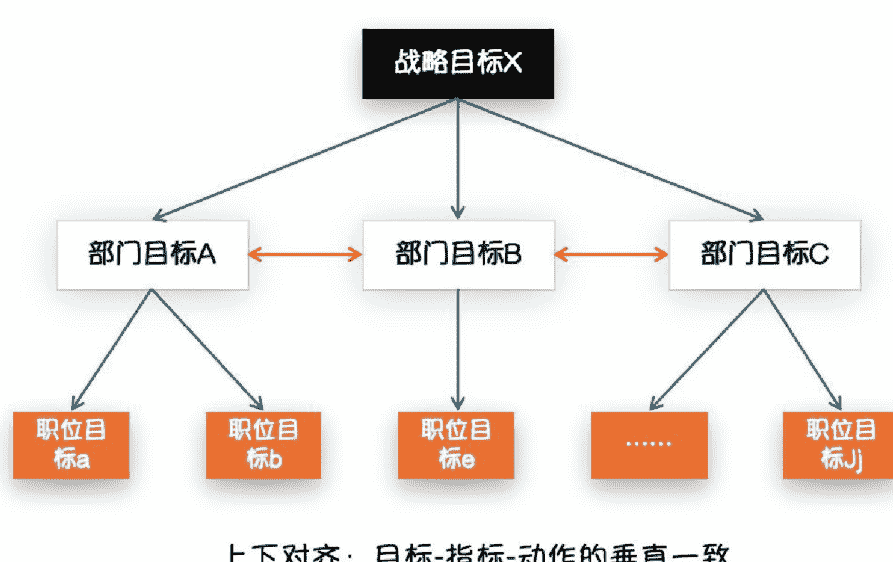

图3-23 目标上下对齐与左右拉通

#### 1.目标纵向贯通——防止战略悬空
绩效管理第一步是让目标层层贯通。常用路径为公司愿景→战略目标→关键战役→部门任务→个人目标，每层需回答“我如何支撑上一级”。

实际中目标易“中途断线”，部门目标偏离战略，个人目标流于形式。借助可视化工具虽能呈现分解路径，但真正难点在理解与承接能力。

#### 2.横向协同——降低跨团队目标冲突
跨部门协同是绩效管理易出问题的环节。如公司同时追求订单一次性交付合格率与交付及时率，需采购、生产、供应链配合，但各部门考核侧重点不同，易产生冲突。
- 采购关注及时性而非质量；
- 生产关注合格率可能抗拒严格检验；
- 供应链关注库存周转可能压减安全库存。

单个目标看似合理，整体则引发内耗。根源在于本位主义与协同机制薄弱，如职责不清、数据不通。

互动：
借助智能体分析美的、腾讯、亚马逊等企业如何提升跨部门协同：
- 常见机制：共享绩效指标、跨部门例会、联合考核；
- 目标设定方式：关键KPI联动、权重调整、OKR协同设定等。

可先用智能体识别冲突点，诊断对齐与协同问题，再结合标杆实践制定改进方案。

下面以建筑企业为例演示应用。

##### 案例：目标贯通与横向协同实操
背景：假设年度绩效方案已初步制定，公司级目标分解至部门与子公司，模拟如下：
1. 公司级目标
目标1：合同额突破100亿，权重40%，支撑举措为政府项目中标率提升至35%、产业资本项目占比40%。
目标2：客户复购率≥25%，权重30%，支撑举措为建立客户分级服务体系。
目标3：设计变更率≤8%，权重30%，支撑举措为推广BIM协同设计。
2. 部门/子公司目标分解
| 部门/子公司 | 目标 | 权重 | 数据来源 |
| :--- | :--- | :--- | :--- |
| 市场团队 | 政府项目中标率≥35% | 50% | ERP |
| 设计团队 | 需求确认完整率≥95% | 60% | OA |
| 成本团队 | 预算偏差率≤5% | 40% | 财务系统 |
| A组子公司 | 交付周期≤170天 | 70% | 项目管理系统 |
| B组子公司 | 客户续约率≥20% | …… | 项目管理系统 |
| C组子公司 | 融资成本≤…… | …… | 财务系统 |

3.业务模式与价值链
链条：投融资→设计→施工→运营。痛点：设计与施工因图纸变更导致成本超支。
4.已知问题与约束
1）设计团队反映需求确认耗时长，但无量化指标；
2）子公司抵触新增非财务指标如客户满意度；
3）数据限制：客户复购率滞后3个月。

输入指令：
你是一名绩效管理专家，请评估当前指标是否自上而下贯通、横向联动。要求用OGSM验证逻辑完整性，标记冲突指标并给出改进建议，输出简版可视化关联图。

智能体返回：
上下对齐分析：
###### 1.公司→部门对齐度检测
目标1合同额：市场团队中标率直接支撑，逻辑清晰；缺失产业资本项目关联部门，如投融资团队资金到位及时率指标。
目标3设计变更率：设计团队需求确认完整率仅能降低初期变更，未覆盖施工阶段变更，建议补充工程团队变更响应时效≤48h。
……
###### 2.权重合理性评估
市场团队问题：政府项目中标率权重50%对比公司级合同额权重40%，易过度聚焦，建议中标率权重降至40%，新增产业项目线索转化率10%。
###### 3.横向协同分析
1）OGSM漏洞诊断
| 公司目标 | 部门目标 | 缺失 |
| --- | --- | --- |
| 客户复购率≥25% | 市场团队：中标率35% | 未联动客户运营团队投诉关闭率、工程团队验收通过率 |
| 设计变更率≤8% | 设计团队：需求确认完整率95% | 未联动成本团队变更成本核算准确率 |
| ...... | ...... | ...... |
2）冲突指标识别
冲突点：设计团队需求确认完整率要求充分沟通 vs 市场团队中标率要求快速响应，存在时间资源争夺。
改进建议：新增高价值客户需求确认时效≤3天，兼顾质量与速度，并设置优先级规则，如合同额≥1亿项目自动进入快速通道。
3）可视化关联图简版
-[公司级]合同额100亿
├─[市场团队]政府中标率35%→支撑强
├─[投融资团队]缺失产业项目资金到位率指标
-[公司级]设计变更率≤8%
├─[设计团队]需求确认完整率95%→仅覆盖50%诱因
├─[工程团队]缺失变更响应时效

输入指令：如何解决市场与设计之间的冲突？
智能体返回：
冲突解决方案如下：
####### 1. 流程重构
投标阶段增设需求可行性联审会，由市场团队与设计团队共同确认，达成共识后进入正式确认流程。
####### 2. 数据联动
自动计算需求确认时长与中标率的比率，如每缩短1天确认时间需保证中标率不下滑，动态调整资源分配。
####### 3. 激励机制
市场团队与设计团队联合项目若中标且变更率达标，额外分配奖金包。
……
> 提醒：智能体建议仅作辅助，HR仍需结合文化适应性与组织惯性判断。

### 三）绩效计划
组织目标明确后，需分解到岗位制定具体绩效计划。岗位计划通常包含两类指标：
- 攻城略地，聚焦业务增长与突破，强调价值创造；
- 固本守元，关注日常运转与基础保障，确保核心职责稳定。
二者动态融合、相辅相成，平衡稳定与突破是核心张力。

制定方案时可借助智能体多维度分析岗位职责与战略关联，拓宽思路。

#### 案例：如何基于岗位职责制定绩效方案
背景：某企业人力资源专员负责招聘流程管理、简历筛选与面试安排。需设计考核方案兼顾招聘成果与过程质量。

输入指令：
请根据岗位职责设计绩效指标并说明设置逻辑。
智能体返回：
建议分为结果指标与过程指标：
- 结果类：招聘计划达成率、招聘渠道有效性、平均招聘周期等。
- 过程类：筛选通过率、岗位匹配度、面试安排及时性等。

输入指令：
该专员主要负责普工招聘，目前最大问题是普工流失率高，排除薪酬因素。请锁定一个关键绩效指标并说明理由、操作方法与示例。
智能体返回：
关键考核指标：新人3个月留存率
指标定义：该专员招聘入职的普工，到岗后3个月内主动离职率≤15%，即留存率≥85%。
目标设定逻辑如下：
##### 1. 问题根源分析
1. 入职后实际工作强度与环境与面试描述不符；
2. 对倒班制度与体力劳动耐受度预判不足；
3. 居住地与工厂距离导致通勤放弃。
##### 2. 数据采集与考核方法
| 考核维度 | 操作方式 | 评价权重 |
| :--- | :--- | :--- |
| 结果指标 | 统计专员所招普工3个月留存率，对比目标值差额按比例扣分 | 60% |
| 过程证据 | 抽查10%面试记录表，核实是否包含岗位适应性问答，未记录视为失分 | 30% |
| 红线指标 | 发现故意隐瞒岗位真实情况，如谎称可坐着操作，单次扣20分并取消评优资格 | 10% |
##### 3. 示例计算
目标值：3个月留存率≥85%。

招聘留存快照：专员A本季度到岗50人，90天内离职10人，保留比例80%，比85%的目标低5个点。

加权计分：该指标权重60%，达成率约94.1%，合计56.5分，落在需改进区间。

改进建议：先用3个月跑出基线数据，摸清当前均值，再采用阶梯设定，如首季目标80%，次季目标85%。

提问策略：
第一步用开放提问拉宽指标池，减少思维盲区；第二步聚焦核心难题逐步收敛，锁定重点；第三步补充背景限制，让AI反馈更具实操性。

延伸对话：
可与AI共探不同岗位的绩效设计思路：
- 技术岗如何兼顾交付质量、节奏与创新贡献的衡量？
- 难以量化的工作如何进行评价？
- 研发项目绩效该如何考核？有哪些标杆做法可参考？

### 四）绩效监查
方案制定只是起点，落地才是考验。很多企业年初定KPI，年末偏差很大且无人跟进。监查成败取决于节奏掌控和阻力清除，否则绩效容易变成年终秀。

#### 1. 把握节奏：让各层步调一致
绩效管理本质是PDCA，但各层转速不同，需差异化设拍。

##### 1）分层监查
公司层季度校准：每季召开战略对齐会，检视目标与市场的契合度。如市场部可用方针表对比销售目标与渠道覆盖。

部门层月度复盘：聚焦行动产出。如销售部以拜访量到商机转化漏斗分析，异常即调整话术。

团队层周日可视化：日常看板管理。如物流站点以电子看板展示当日妥投率，未达标团队下班前开15分钟根因会。

##### 2）分阶段监查重点
第一季度：确保目标上下左右对齐，避免战略悬空。
第二、三季度：跟踪执行效果，及时调整策略。
第四季度：复盘目标偏差原因，形成改进或调整方案。

#### 2. 排除阻力：工具之外重人
AI能提升监查效能，如异常监测、自动溯源、因果推演等。

但绩效不仅是技术问题，更是组织行为问题。情绪、动力、协同等软变量，仍需HR与管理者持续介入引导。

## 二 用AI优化绩效评价与反馈机制
绩效评价的本质是连接战略与行为的桥梁。不仅看结果，还要看做法与方向是否正确。结果与过程、个体与团队、数据与判断缺一不可。从考核转向发展，才能兼顾组织与员工。

### 一）绩效评价
多数企业过度聚焦业务结果，忽视过程行为。
结果重要，但只是整体一部分。有效体系既看产出，也看方式，更看是否契合长期方向。

评价应覆盖三层：
- 成效评价，聚焦实际产出，对“做了什么”反馈。
- 态度评价，短期视角，看责任、执行、协作，是组织运转的润滑剂。
- 价值观评价，长期视角，看是否践行文化，体现战略适配。

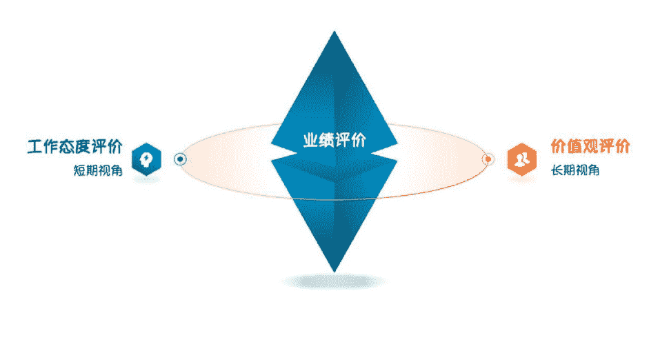
需强调，态度与价值观不能脱离业绩单独打分，它们是围绕“是否助力结果”展开的延伸判断。重点不是谁认同文化、谁更积极，而是谁用正确方式把事做成。
“结果为核、态度价值观为翼”的架构，能让体系更平衡可持续，既驱动当期，也牵引长期。

重点讲两个维度。

#### 1. 价值观评价
设计前要厘清本质：价值观是企业对“何为对的、何为重要的”长期信念，源于战略与使命，相对稳定不显性。它靠关键时刻表现识别验证。

建议双轨制：
- 底线标准，不可触碰的红线，触碰即淘汰。
- 行为观察，借行为锚定分层评价日常表现，引导价值观趋同。

不同公司表述相似，内涵落地各异，设计须贴合自身文化。

案例：如何评价“开放包容”
背景：某芯片研制企业人才多元，将“开放包容”列为核心价值观，要求引入多样人才与外部合作，容忍试错支持创新，淘汰不进取与以权谋私者。

设计要求：
1. 设定标尺：底线是非判断，行为分层为待改进、合格、卓越。
2. 方法：结合360反馈与关键事件法。

AI思路：
1）标尺设计
底线：不阻碍外部合作、不打压发声者、不借引才谋私。查实即取消评优并启动淘汰。
行为分层：
跨界合作：待改进被动配合；合格主动对接促成落地；卓越自发发起并带来实质业务成果。
包容创新：待改进排斥异见；合格尊重多元支持合理试错；卓越鼓励创新承担风险推动变革落地。
2）方法建议
360反馈每季一次。上级40%看战略价值与培养成效，平级30%看协作主动性，下属30%看创新包容度，以项目ROI、跨部门参与度、匿名试错支持率等证据支撑。
关键事件评价：建立正负案例库，主管每季提交《开放包容关键事件报告》，记录促成合作、推动试点等正向事件，以及抗拒合作致延期等负向事件。
3）结果应用
低于合格启动辅导，半年无改善影响晋升评优；合格正常留任；卓越优先晋升并给予激励。
AI在价值观评价中的最大价值是转译，把抽象理念转为可操作行为标准，提升系统性与一致性。

#### 2. 工作态度评价
工作态度即对待工作的状态：靠不靠谱、稳不稳、关键时刻能否扛住。
它不是口号，而是体现在日常的责任感、主动性、执行力。评价既要量化，也要情境化。

以责任心为例：
S级卓越：不待提醒主动揽活扫雷，如发现流程漏洞即主动优化落地。
A级优秀：分内事高质量完成，响应快，交付常提前。
B级合格：按要求完成，态度端正但无亮点。
C级需改进：被动应付，需频繁提醒，任务拖延。
D级差：推诿关键任务，关键时刻掉线。
方法可用行为锚定看出现频率，多场景观察尤其是跨部门协作与突发事件表现，并用任务完成率、延期次数、投诉、同事满意度等数据辅助。
AI在态度评价上的用法与价值观评价类似，不再赘述。

科学评价不能只看数量，还要看方式与方向。只看结果易短视，只讲过程难服众，只讲方向易脱离执行。挑战在于把三者拧成动态平衡。
同时提醒，用公式分数精确衡量一切工作价值不现实。对态度这类强情境强主观维度，管理者观察判断更关键。

### 二）绩效反馈
AI时代反馈正从“控制考核”转向“预测发展”。

#### 1. 从事后总结，到实时提醒
传统反馈滞后，季度末才知问题。AI可基于日常数据实时识别风险信号并给出即时建议。如某连锁超市用“Mr.Smile”系统分析员工语音表情，日生成服务评分与改进点，反馈变得可视可改。

#### 2. 从统一标准，到因人施策
过去反馈千人一面。AI可识别关键变量，按岗位场景个人定制优化方案。如某药企AI分析专利数据，发现研发组产出下降主因是仪器资源紧张，系统建议优化预约机制，问题迎刃而解。

#### 3. 从单向训话，到双向演练
传统面谈多是管理者讲。AI结合情绪识别与行为数据帮助管理者把握员工状态调整沟通，还能模拟冲突应对、决策表达等场景演练，让建议更易落地。

小结
绩效管理并不复杂，优秀管理者善于用AI放大洞察、简化决策、激发潜能。AI不替代判断，而是把模糊感知转化为清晰可执行的语言。看得清判得准靠技术，有温度有情境的判断始终靠人。技术与管理智慧协同，绩效才能从目标设定变为成长驱动。

## 第五节 体系迭代升级：“从0到10”的进化路径
初创期HR体系非关键，几十人带不好多是领导力缺失。但规模破千后，文化稀释、协作成本上升、诉求多元等问题集中显现。此时HR体系是组织运转的基础设施。哪怕小米曾倡导去KPI去Title，规模化后仍需清晰体系应对协作挑战。体系建设是一场持续升级的系统工程。

### 一 从“0”到“1”体系导入的成功关键
很多企业投入资源搭建体系，落地却打折。问题集中在两点。

#### 一）HR体系是否形成闭环系统
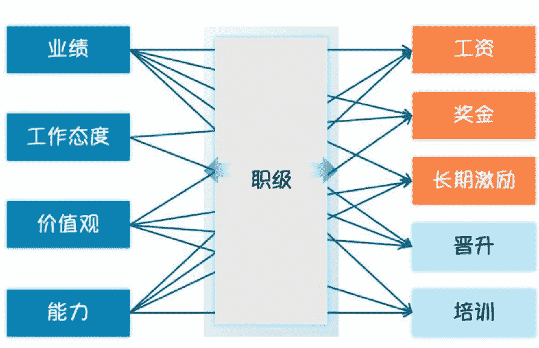
HR体系像汽车，总成部件需协同。只优化一块难以跑动。模块缺乏联动不仅失效，还会反作用。
如薪酬很高但绩效能力评估缺失，导致高薪低效；单独建职位或薪酬体系，调薪晋升时却无依据。
判断成型有两个标准：顶层设计清晰各模块逻辑闭环；关键人事决策能基于体系数据而非主观判断。否则再专业的体系也只是纸上谈兵。

#### 二）体系之树能否真正“开花结果”
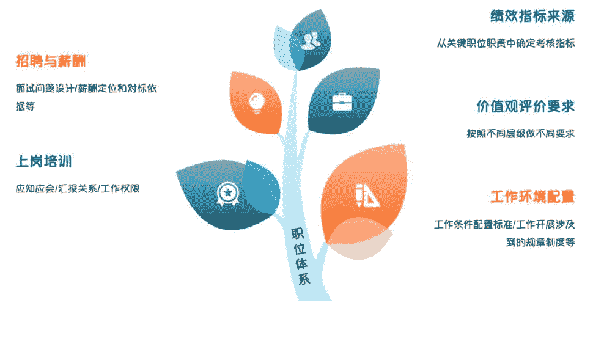
别只做“自我完善”。花半年写职位说明书仅用于审计，招聘绩效晋升都不用，就没有价值。
有价值的体系要穿透业务。如扎实的职位体系能支撑靠谱的薪酬、精准的人才画像、清晰的职业通道，以及绩效与价值观联动的高潜识别与传承闭环，形成成长晋升传承的正向循环。体系才能成为组织成长的油田和孵化器。

### 二 从“1”到“10”进化的参考经验
体系建设不是一劳永逸。可成熟的标志是人还在，组织就能快速重启。进化需要在张力中找平衡，并推进三化工作。

#### 一）处理好两大矛盾
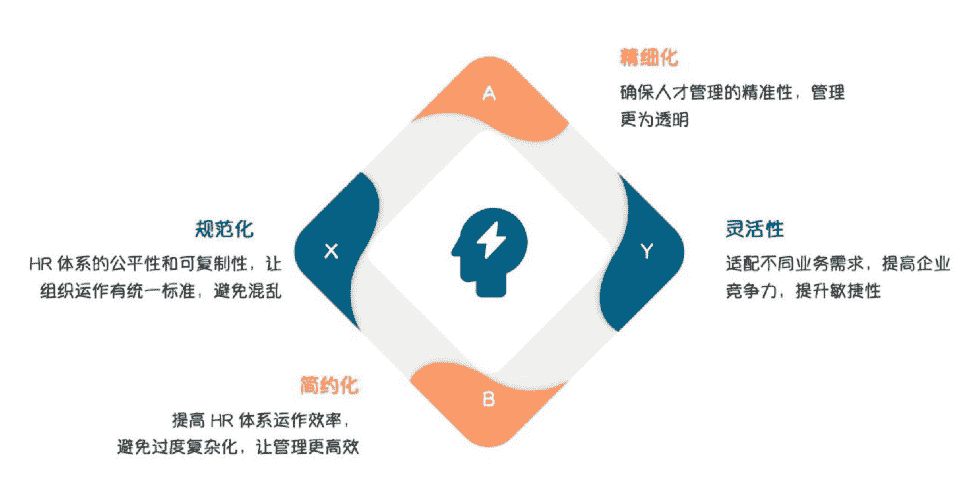
精细化vs简约化：要足够细才能有序，也要足够简避免臃肿。
规范化vs灵活性：制度要统一，场景也要有弹性。
过度精细拖慢节奏，一味简化丧失公平权威；过度规范成官僚，过度灵活则无序。
有效路径是先繁后简、先规范后灵活。先把规则理清才有资格简化，先有统一规范才敢安全放权。

案例：华为任职资格体系演进
1996年华为建立JQS，用十几页甚至几十页标准全方位评估，推动职业化。但规模扩大后负担加重。
2010年后大幅瘦身，标准简化流程提效，仍能支撑人才运营。
很多人问能否直接上轻量化版。答案是否定的。华为能从繁到简，靠三大前提：职业化积累、流程与数字化支撑、配套机制成熟。简化是基础打好后的主动优化，初期直接套简版易导致空转失控。

互动：可借助AI查询OKR从自由到规范再到框架标准化内容个性化的演变，以及奈飞文化手册从庞杂到极简的演进路径，以理解从繁到简的规律。

#### 二）解决路径——“三化工作”
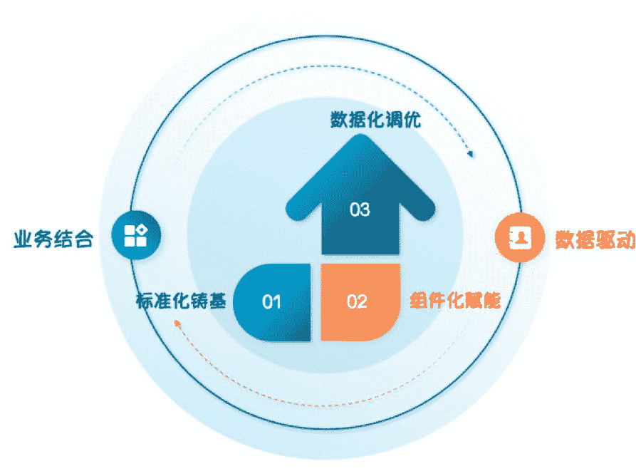

HR进化三步曲：标准化、组件化、数据化如何并行推进

行业头部在化解管理中一端刚性一端柔性、一面统一一面差异的矛盾时，普遍会以标准化、组件化、数据化作为共振手段。三者并非先后分段，而是相互嵌套、螺旋式演进。

##### 1. 标准化：先搭盘、后定法
先把组织管理的地基搭稳。把组织架构思路、核心业务流程、关键制度统一起来，让不同部门、不同岗位说同一种话、按同一基准执行。标准化的意义不在于僵化，而在于把该一致的部分拉齐，让落地有依据、有尺度、有章法。

##### 2. 组件化：拆成可插拔单元，保持弹性
在统一基准之上，将流程拆解成可组合的小模块，哪些必须共用、哪些可以按需定制，一目了然。这样既守住效率底线，又能容纳业务差异，实现稳健与灵活兼得。过度拆分需警惕，反而会带来碎片化和管理成本上升。

##### 3. 数据化：实时感知、用系统驱动
体系跑通后，关键在于实时洞察与精准迭代。借助AI与数据分析捕捉偏差、优化制度，比单纯依赖经验更客观，比拍脑袋更可靠。

##### 案例：IBM人才管理数字化演进路径
IBM的人事职能依托全球化运营与技术驱动，以COE+HRBP+SSC三支柱架构，形成了标准统一、模块灵活、数据驱动的演进范式。底层逻辑是先以标准化夯实基础，再以组件化提升适应性，最后以数据化推动智能优化，使体系既有秩序又能灵活应变。

###### 1）标准化：夯实全球统一管理盘面
IBM在全球推行统一的职级体系、能力模型与薪酬架构，确保不同区域、不同业务单元的人才管理口径一致、可复制、可落地。

- （1）统一的岗位族群Job Family与职级带宽Job Banding，保证晋升路径与薪酬标准透明、可度量。
- （2）技术、咨询、管理等关键序列均有清晰的能力标准，作为招聘、绩效与人才发展的基础（如下图所示）。

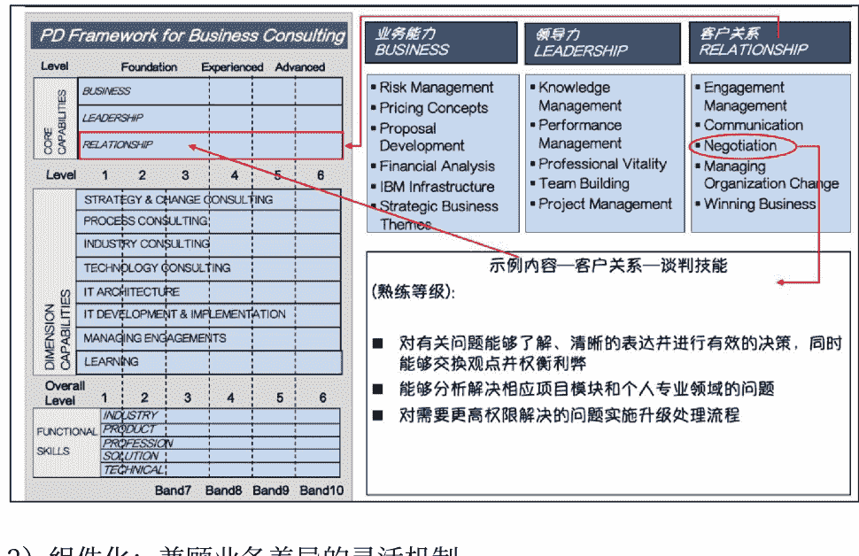

###### 2）组件化：以80%共用+20%定制兼顾差异
IBM采取核心共用、局部可调的做法，保持体系稳定同时允许业务按需微调。例如：

- 公司沉淀了超20万条培训资源库，涵盖课程、项目、导师制，支撑员工按个人发展路径灵活选学。
- 当员工需要提升数据可视化能力时，系统会自动匹配SQL进阶与可视化工具实操课，实现千人千面的培养方案。

###### 3）数据化：人才管理可视化、可预测、可调节
IBM借助AI与大数据让人才管理看得清、能预判、可调整。

例如：
- 能力评估：融合自评、上级反馈与绩效数据，动态生成能力差距报告与学习建议。
- 人才预测：构建供需模型，提前预警关键岗位缺口与高潜流失风险。
- 策略优化：通过数据回溯培训效果、晋升通道畅通度等，进而调整规则配置。

IBM的人才管理不是堆砌模块、靠经验判断，而是通过三化体系让HR真正嵌入业务、支撑战略。既有规则可依，又能持续进化；既以数据驱动，也保留人文温度。

##### 小结
HR体系进化的本质，是在秩序与自由之间寻找平衡点。
管得太死，组织僵化；放得太松，管理失控。企业要用确定性去应对不确定性，依靠稳固的管理逻辑与数据支撑，让组织在变化中保持灵活适应。底层架构需精细，前端体验需简洁。唯有如此，管理才能自然融入业务，不增负担且高效运转。

华为提出的“先僵化、再优化、后固化”路径，强调先立规则、再调适、再沉淀，是体系建设的典型范式。HR的使命不是管理人，而是构建组织自我进化的机制。

最好的人事体系，应如春风化雨般无感融入，不张扬却持续推动组织向前。

## 第四章 AI重塑HR工作效能

坊间流传一副对联，上联写人活世不易，下联写人事不简单，横批“活人生事”。这恰好道出HR的真实处境——表面处理人事，实质调和人性；看似面对活人，目标却是激活组织。

HR常站在火山口，入职、离职、考核、培训，模板触手可及，看似人人能做；一旦经营失序、人才流失，压力首当其冲。这种复杂性也体现了HR不可替代的价值。要想摆脱背锅，必须足够专业。

AI的到来改变了这一切。当重复性工作被接管，HR才有机会聚焦真正重要的事：成为连接人、组织与未来的关键枢纽。

本章将从HR最常见的四类任务切入，观察AI如何推动HR从事务执行者跃升为价值设计者。

### 第一节 简单任务：效率跃升十倍

HR日常中大量工作具备标准化特征，流程可循、范本可用。可以预见，这类任务很快会被AI部分乃至完全承接。这不是风险，而是提效的窗口期，如表4-1所示。

#### 表4-1 人事简单任务场景与AI助力

| 工作类型 | 模型擅长能力 | 典型应用场景 |
| :--- | :--- | :--- |
| 文案撰写 | 撰写、修改、润色 | 招聘文案、通知、总结报告等 |
| 信息梳理 | 抽结构、列要点 | 简历分析、访谈纪要、试用评估等 |
| 数据处理 | 套公式、看趋势 | 假期测算、工时汇总、报表辅助 |
| 问答服务 | 快速检索、FAQ回复 | 工时、休假、法规答疑、流程说明等 |

接下来，通过实操演示，观察AI如何助力HR在基础任务上实现质的提升。

#### 一 文案撰写：专业且高效
职场文案的核心，不在辞藻华丽，而在能否清晰高效地传递信息与价值。好文案能加速落地，平庸文案只会消耗时间。

这类工作对表达逻辑、语调风格与内容准确度要求不低，而这些恰是模型擅长的领域。建议组合使用“智驾模式”与“标尺模式”，让输出既有方向又有准绳，更贴合业务语境。

##### 一）入职通知
入职通知是员工与公司初次见面的信件，既传递信息，也传递态度。一封专业、周到、有温度的通知，能让新员工从第一天起便产生信任与期待。

**案例：入职通知**

**提示：**
请你以HR写作教练身份，结合标杆企业经验，为我制定一份入职通知的质量标准，列出具体评判要点并说明理由。

**模型回复：**
入职通知写作质量标准如下：

| 维度 | 判断要点 |
| :--- | :--- |
| 1.信息完整 | 包含公司、岗位、时间、地点、联系人、材料、注意事项等 |
| 2.语言清晰 | 用词通俗、句式简洁，避免歧义与专业术语 |
| 3.语气温暖 | 传递欢迎与期待，体现人文关怀 |
| 4.有针对性 | 按岗位特点做个性化提醒，增强贴心感 |
| 5.风格统一 | 与企业整体沟通风格保持一致 |
| 6.行动明确 | 明确下一步操作，如是否回复、报到流程等 |
| 7.格式美观 | 分段清晰、要点突出，提升专业感和可读性 |

**提示：**
你是一位人事专员，需以正式邮件形式通知一位即将加入的新合伙人办理入职。公司为一家专注于人力资源和组织发展咨询的专业机构，重视人文关怀、流程规范和职业形象。请撰写不超过300字的入职通知邮件，语言正式礼貌，体现专业和欢迎氛围。

**模型回复：**
**主题：欢迎加入【某某】——您的入职安排及资料说明**

尊敬的余老师，您好：

欢迎正式加入某某公司，成为合伙人团队的重要成员！我们期待和您携手开启专业互信、共创共享的合作旅程。

为便于您顺利办理入职，请按以下安排准备：

报到时间：2024年5月6日（周一）上午10：00
报到地点：上海市浦东区XX路XX号XX大厦12F
携带材料：身份证、学历证明复印件、近期证件照1张
联系人：人事部欧阳余菲188-XXXX-XXXX（同微信）

烦请收到邮件后回复确认是否可按时报到，如需协助请随时联系。

再次欢迎加入，未来可期，同行有您。

某某公司 | 人事部
敬启

##### 二）活动总结简报
活动总结最易写成流水账。难点在于在公文规范与阅读体验之间取得平衡。

**案例：活动总结**

**提示：**
你是一名HRBP，需撰写员工运动会总结报告，结构包括活动背景、组织流程、员工参与情况、活动亮点、存在问题和改进建议。原始资料参考附件。要求语言正式规范、用词专业，数据具体详实，避免空泛。

**模型回复：**
###### 公司2024年度员工运动会总结报告
####### 1. 活动背景
为丰富员工文体生活、增强协作氛围、提升凝聚力，公司于2022年4月20日成功举办年度员工运动会，由行政人事部主办，各部门积极响应。

####### 2. 组织流程
筹备期3月15日至4月19日，涵盖项目设定、报名统计、场地布置、物资采购、主持安排、安全预案等，共组织动员会3场，发布通知4次。

####### 3. 参与情况
- 1）设10个比赛项目，含4×100接力、拔河、跳绳、乒乓球、篮球投篮赛等。
- 2）12个部门共248名员工报名，现场观众约370人。
- 3）裁判、医疗、后勤各1组，志愿服务人员32人。

####### 4. 活动亮点
- 1）部门协作体现明显，团队赛增强跨部门协同。
- 2）参与热情高涨，报名率较去年提升23%。
- 3）氛围营造良好，应援海报和互动小游戏提升体验。
- 4）安全保障到位，未发生事故，医疗组处置轻微擦伤2起。

####### 5. 存在问题
- 1）个别项目赛程紧凑，出现参赛和观赛冲突。
- 2）现场主持节奏稍乱，影响连贯性。
- 3）赛后物资回收清点不细，遗失纪念T恤12件。

####### 6. 后续建议
- 1）提前排布时间，避免时段重叠。
- 2）组织主持演练和彩排，提升节奏和专业度。
- 3）建立物资编号和回收登记机制，减少浪费。

人事部

##### 三）会议纪要
会议纪要的难点不在记全，而在抓准。不同会议对结构和重点要求不同。

**案例：会议纪要**

**提示：**
你是HRD助理，参与了“绩效评估改革”会议，需撰写纪要。会议记录见附件，请提炼讨论要点、初步共识、待办事项，语言中性准确。

**模型回复：**
###### 绩效评估改革会议纪要
会议时间：2025年2月8日
会议地点：总部B座会议室302
主持人：欧总（HRD）
参会人员：HRBP团队全体、各业务部门负责人、组织发展组、法务代表

####### 1. 会议背景
现行绩效评估机制沿用自2020年，部分业务线反馈周期滞后、激励不足。人事提出优化，目标是提升激励精准度和组织健康度。

####### 2. 主要讨论要点
######## 1）评分结构优化
- 建议将“3：4：3”调整为“4：3：3”，更突出业务贡献。
- 营销和技术希望增加“项目特殊贡献”加分项。

######## 2）评估周期调整
- 半年一次反馈不及时，建议“季度轻量评估+半年正式评估”组合。
- 财务和运营担心负担过重，建议设置简表版本。

######## 3）评估主体扩展
- 拟在核心岗位试点360度评估。
- 技术和产品要求明确反馈流程及匿名保护机制。

######## 4）数据支撑和系统升级
系统需支持维度自定义、历史绩效可视化、数据导出分析。IT评估改造周期和资源。

####### 3. 初步共识
同意评分结构调整和频次优化方向，具体方案由HRBP小组起草。
同意2025 Q2在销售部、产品部试点，Q3评估是否扩大。
360度评估仅限核心岗位试行，需配套宣导。

####### 4. 后续待办事项
| 事项 | 责任人 | 截止时间 |
| :--- | :--- | :--- |
| 起草《绩效评估优化试点方案（草案）》 | HRBP 刘芳 | 4月15日 |
| 梳理评估指标和权重建议 | 各部门代表 | 4月12日 |
| 系统功能可行性评估报告 | IT 系统组 | 4月18日 |
| 法务审核新版评估流程合法性 | 法务组 | 4月22日 |

备注：纪要将同步至人事系统项目管理模块，便于协同追踪。各责任人请按时提交。——HRD助理整理

##### 四）人事日报/周报
日报周报看似简单，易流于形式。它是写给他人看的决策参考，而非自用交差。

**案例：周报撰写**

**提示：**
你是HRBP助理，请以附件原始材料为基础，输出本周招聘进展周报。要求结构清晰，建议要点+表格结合。

**模型回复：**
###### 人事招聘周报汇报（2024年4月第一周）
####### 1. 本周重点进展
- 1）共完成7人入职，集中于技术和运营。
- 2）招聘渠道转化良好，内推入职转化率达25%。
- 3）存在岗位竞争力不足、候选人等待时间过长问题。

####### 2. 关键数据汇总
| 项目 | 数值 | 环比变化 | 备注说明 |
| :--- | :--- | :--- | :--- |
| 简历投递总量 | 215份 | +18% | 技术岗占比52% |
| 初试完成人数 | 96人 | -5% | 多为运营、设计岗 |
| 终面通过人数 | 23人 | +15% | 产品岗通过率提升 |
| 入职人数 | 7人 | 持平 | 技术3人、运营2人、支持2人 |
| 平均招聘周期 | 12天 | +2天 | 关键岗位决策延迟 |
| 招聘满意度 | 8.3/10分 | -0.5分 | 反馈等待周期过长 |

####### 3. 问题汇总
- 1）部分岗位JD吸引力不足，内推热度下降。
- 2）候选人流失主因：等待时间长、沟通反馈慢。
- 3）产品经理岗位仍缺2人，需提速。

####### 4. 下周计划建议
- 1）优化JD，突出成长空间和项目影响力。
- 2）设立面试专属时段，缩短沟通链条。
- 3）聚焦产品岗和核心技术岗，尝试外部猎头合作。

不同场景下好文案标准不同。知名企业重品牌调性，初创公司重岗位吸引力。提示模型时需明确任务类型、目的和背景，让模型写对；并以质量标准设标尺，让模型写好。最终把关仍在人手中。

#### 二 做整理：结构清晰、逻辑分明
整理类任务指将信息归纳、分类、提炼并重塑结构的工作，让信息更有序、可读、可流转。

##### 一）操作要点
整理的核心在于选择合适的结构和逻辑框架。推荐“智驾模式”+“缰绳模式”组合。

不确定方法时，可先让模型推荐框架，再判断是否贴合目标。

**示例提示：**
你是[分析专家/运营顾问等]，请根据以下资料内容，推荐一个最适合的整理框架或结构模型，以帮助我更有条理地提取关键信息。请说明推荐理由。

##### 二）实战演示
以下三个场景覆盖主观提炼、对比归纳、结构分类。

**任务场景1：员工访谈纪要→提炼报告重点**
任务说明：从离职访谈纪要中提炼高频反馈，按主题分类形成汇总表。

**示例提示：**
你是一名HRBP助理，负责整理分析员工离职访谈纪要，以支持人才保留策略优化。请从附件纪要中提炼重复性高、具代表性的共性反馈，按晋升机制、薪酬结构、团队氛围分类汇总。

**任务场景2：竞品调研资料→多维对比分析表**
任务说明：整理多款竞品资料，提炼优劣势，形成对比表。

**示例提示：**
你是一名市场分析助理，请根据竞品资料提炼各产品核心特点，从功能特点、价格策略、用户体验亮点、明显不足或市场痛点维度对比。输出要求：横向对比表格，每项一句话归纳，简洁突出；资料缺失标注“暂无信息”。

**任务场景3：制度文件→分类归档清单**
任务说明：将人事制度文档按员工管理流程阶段归类，便于查阅完善。

**示例提示：**
你是一名人事信息整理专员，负责对现有制度文件进行结构化归类和摘要。请将以下20份制度文档按员工生命周期模型分类：入职阶段、在职发展、绩效激励、员工退出。输出表格，包含所属阶段、制度名称、一句话简要内容。语言清晰简洁，避免空话。

HR提效的关键，从把提示词做成工具开始

经常要做资料归类工作的HR，比如果简历初筛这类重复性劳动，值得把高频使用的指令沉淀成自己的指令储备，再借助生成式工具搭建自动化流程或定制助手，处理信息的速度和质量都会明显提升。

#### 三 数据运算：让分析真正支撑决策
人力日常里做表格、算指标几乎每天都在发生，既费时又易出错。很多人埋头制表，却很难把数字变成有价值的洞察和可执行的判断。生成式工具可以帮忙读取表格、套用公式、校验逻辑、生成图表，甚至给出解读建议。只需交代要算什么、怎么呈现、希望得出什么结论，其余交给模型。这类任务的指令写法和整理类任务是相近的。

##### 任务场景1：离职趋势洞察
任务说明：基于离职记录产出结构化报告，为管理层提供决策参考。
示范指令：
请扮演人力数据分析专家。现在拿到2023年一到四季度的离职记录，请输出一份可视化分析报告，包含：
- 各季度离职率走势图；
- 按岗位和部门拆分的离职分布；
- 对数据波动的解读与建议。
要求图表简洁，内容能在5分钟内让高管抓住要点。

##### 任务场景2：招聘渠道投资回报分析
任务说明：评估各渠道投入产出，为招聘策略优化提供依据。
示范指令：
根据提供的招聘数据，含渠道、面试人数、录用人数及花费，请制作渠道投资回报分析表，要求呈现：
- 各渠道整体花费；
- 单人招聘成本；
- 从投递到面试、面试到录用的转化率；
- 建议保留或需要优化的渠道。

##### 任务场景3：培训参与与效果评估
任务说明：汇总培训参与情况，结合评估模型提出优化方案。
示范指令：
请以培训部撰写人身份，依据给出的培训数据形成汇总报告，涵盖：
- 各培训的参与比例；
- 完课率与测评通过率；
- 按部门和课程划分的达成图表；
- 结合柯氏四级评价法的初步优化建议。

##### 任务场景4：面试流程转化分析
任务说明：梳理招聘环节瓶颈并提出改进建议。
示范指令：
请以招聘HR身份，根据近半年面试统计，含候选人数、各环节通过率及面试官反馈，输出：
- 简历筛选到入职的转化漏斗图；
- 各环节流失率前三的归因概括；
- 针对流程的优化建议，控制在200字内，语言精炼聚焦执行。

把枯燥的数字劳动转化为有条理、有洞察、便于决策的专业表达，核心在于指令是否用对。

#### 四 问答：兼顾统一口径与个性化表达
在人力日常里，答疑是最常见也最能体现服务专业度的场景。员工会问福利是否适用，业务会问流程怎么走，管理层会问新制度是否合规。表面简单的问题背后往往涉及制度理解、政策适用、落地执行乃至法律风险。回应不准确、不清晰，不仅易引发误解，严重时还会带来运营或合规隐患。

##### 一）操作要点
为让模型更有效支持问答工作，建议依据问题复杂度与交付目标，灵活组合三种策略。下表汇总了常见问答类型与推荐策略。

###### 表4-2 不同任务场景的工具使用策略

| 场景类型 | 推荐策略组合 | 说明 |
| :--- | :--- | :--- |
| 问题简单明确 | SCOR+X 智驾模式 | 问题标准、答案清晰，适合快速生成结构化、统一口径的答复 |
| 问题较为复杂 | 增加缰绳模式（指定或推荐结构） | 回答需逻辑严密、结构清晰，适合指定输出结构和分析角度 |
| 不确定内容质量 | 增加标尺模式（自我评估或对比优化） | 内容可能存在表达差异，可通过自评或多版本对比提升输出质量 |

##### 二）实战演示
以下四类场景是人力答疑中的典型代表，复杂度各异且对应不同策略组合，可直接套用，也可作为指令设计的参考。

###### 任务场景1：制度政策类答疑
需输出有法律依据的判断，适合通过结构预设+法规引用提升专业可信度。
示范指令：
请扮演HR政策顾问。公司拟推行弹性工时制度，管理层担心落地难度大、易被滥用。请依据《劳动合同法》相关条款，按以下框架撰写推行建议：
- 合规性判断并引用法律依据；
- 适合推行的岗位类型分析；
- 顺利落地的关键要素，参考行业做法。
全文不超过300字，供总经理办公会参考。

###### 任务场景2：员工关系事件应对
回答不能只讲怎么做，还要考虑怎么说。模型可协助设计回应策略与表达分寸。
示范指令：
有员工对调岗不满，并在工作群内公开表达，影响较大。请结合情绪分级评估模型与沟通干预四步法，按以下结构给出建议：
- 事件严重性判断；
- 两种以上处理方案对比；
- HR介入时机与沟通话术建议。
要求条列呈现，语气平衡兼顾公司立场与员工感受。

###### 任务场景3：培训反馈优化建议
既要讲问题，又要提方案，还得兼顾数据和实操。模型可生成多个方向，支持人力比较判断。
示范指令：
请扮演培训主管，新员工培训结束后转化效果不佳，业务侧反馈实操能力不足。请分析原因并提出三条可落地的优化建议，内容需适合放入培训复盘报告。

###### 任务场景4：假期政策标准答复
重点是表达一致、易读易懂。
示范指令：
请以公司HR服务专员身份，为员工解答以下假期常见疑问，输出标准化说明，可用于员工手册或FAQ。按条列回答：
1. 试用期内能否请事假？
2. 年假怎么算？以自然年还是入职日为准？
3. 加班调休能否与年假合并使用？
要求：
- 依据2024年《劳动法》修订版；
- 语言简洁中性，减少专业法条堆砌；
- 每条不超过80字，便于快速查阅。

针对规则明确且高频的咨询，人力可以打造专属AI助手，内置常用问答模板，实现口径统一、回复提速。

小结
模型能否高质量完成任务，关键看指令的结构和表达。尤其是文字功底较弱的读者，下发正式指令前，不妨先让模型帮忙优化指令的框架和用语。这不仅能提升输出的准确性和实用性，也能锻炼自己的表达清晰度和逻辑条理。

### 第二节 复杂任务：从拆解问题到辅助决策
在人力资源实践中，复杂任务往往不是工作量大，而是目标冲突、信息模糊、标准不一。这类任务牵涉跨部门协同，还需要在不确定中做判断，考验的是认知结构，而非操作流程。
要破解复杂任务，关键在于会拆解、会提问。你不必一次性说明全部问题，而是借助指令把模糊的大任务拆成结构清晰、层次分明的子问题，逐步推进。

#### 一 问题诊断型：从症状识别到底层溯因
这类任务的典型特征是：问题明显，根因难断。比如敬业度下滑、关键岗位流失、业务端持续抱怨。现象清晰，但根因不明，可能涉及激励失效、岗位设计或管理方式。
模型的作用不是直接给答案，而是帮助构建分析模型、拓展假设、验证逻辑。

##### 一）员工敬业度分析
关于员工敬业度，管理与组织行为领域有多套经典模型，可帮助理解构成、动因与干预路径。

###### 案例：员工敬业度持续走低，问题到底出在哪？
背景：某公司连续三期敬业度调研显示，多项核心维度持续走低，尤其是认同感、信任度、发展空间。
人力希望模型协助提取洞察、模拟不同群体主观反馈、引入心理学模型指导诊断。

####### Step 1：诊断启动——从数据识别症状
输入指令：
请扮演企业组织诊断顾问，熟悉员工敬业度分析。某公司连续三期员工调研显示“认同感、信任度、发展空间”三项指标持续下滑，具体见附件调研数据和访谈纪要。请基于调研数据生成结构化初步诊断报告，指出主要问题、趋势变化、潜在成因。要求报告包括维度下滑趋势描述、与行业历史数据对比亮点、可能存在的问题线索、需进一步调查的关键假设。语言清晰专业，面向人力管理层。
模型返回：
######## 员工敬业度调研初步分析报告（节选）
1) 趋势描述
- “组织认同感”自2023Q1起连续三个季度下降，从82分降至72分；
- “发展空间”维度下滑幅度最大，年同比下降13%；
- “对上级信任”首次跌破行业平均线，当前为65分。
2) 对比参考
与2022年度数据相比，认同感下滑尤以90后员工为主，女性员工感知变化更大。
######## 3) 初步问题线索
- 员工访谈反馈“晋升看不到路径”“高层变动频繁”；
- 管理风格偏KPI导向，缺少文化感召和个人成长支持。
######## 4) 后续建议假设：
- 是否因近期组织调整带来心理安全感下降？
- 是否存在“管理断层”，导致价值观传递不畅？

####### Step 2：视角切换——识别主观感知差异
输入指令：
请分别模拟90后普通员工和中层管理者，结合访谈纪要，谈谈他们对当前企业氛围、发展空间和管理方式的真实感受，并指出最关注的问题。
模型返回：
######## 1) 90后普通员工视角
我觉得公司现在像个完成任务的机器，节奏快、目标高，但我们根本不知道未来在哪里。培训也就是走流程，没人真正关心我想做什么。
######## 2) 中层管理者视角
我们是夹在中间的压力锅。上面一直要结果，下面团队开始松动。我也知道他们不满意，但没有太多空间可以调节。

####### Step 3：模型嵌入——透视心理机制根因
输入指令：
你的分析和我的观察比较吻合。请基于组织承诺三维度模型，情感承诺、持续承诺、规范承诺，分析当前敬业度下滑背后的心理机制，并提出改善建议。
模型返回：
1）模型分析摘要
- 情感承诺下降：组织变动频繁，文化氛围弱化，员工缺乏归属感；
- 持续承诺动摇：市场就业选择增多，组织留人成本机制不足；
- 规范承诺缺失：缺乏明确的行为倡导与价值共识，制度激励与情感支持失衡。
2）建议方向
- 推出“文化共创计划”，重建价值连接；
- 设立“成长对话机制”，增强发展路径感知；
- 调整中层KPI结构，融入员工满意度指标。

####### Step 4：结论输出——形成可汇报的诊断框架
输入指令：
请结合以上讨论，帮我生成一份正式的问题诊断报告，我需要向CEO汇报。请按以下顺序完成，我确认后进行下一步。第1步先总结报告主旨；第2步根据主旨生成报告框架；第3步把讨论要点补充到大纲中。
类似员工敬业度、员工幸福度等分析，管理实践中有大量成熟理论和方法，关键是选择合适的分析手段。

##### 二）制度可行性分析
管理制度可行性既涉及设计专业性，也涉及情境适配性，还会因利益或习惯冲击引发抵触。

###### 案例：绩效考核争议频发，问题出在制度还是落地？
背景：某企业集团试行绩效管理出现诸多争议。员工反馈考核不透明、标准模糊；直线主管抱怨流程复杂、难执行。CEO怀疑制度设计与执行流程存在错位。

####### Step 1：结构诊断——制度条款本身是否合理？
输入指令：
你是绩效专家。我们公司是简要背景信息。请帮我分析最新修订的绩效管理制度是否有突出问题？要求列出关键问题点并说明判断理由，语言简明专业。
模型返回：
核心问题点如下：
| 问题类别 | 问题描述 |
| --- | --- |
| 1）权责模糊，参与机制不清 | “三人考评小组”职责表述不清，参与者范围与权责模糊。部分职责出现“董事长+绩效小组+部门负责人”多头交叉，评分逻辑易混乱。 |
| 2）自评分权重过高，失真风险大 | 员工与组织层级的自评分数权重高达60%，可能导致绩效泡沫与打分失真。 |
| 6）…… | …… |

####### Step 2：对标分析——相比外部，我们差在哪？
输入指令：
请针对“问题2：自评分权重过高，失真风险大”，列出原文条款。结合三家行业民营企业标杆经验，说明如何改进并注明参考来源。
模型返回：
1）制度原文内容：岗位层级考核评分权重表略。
2）改进建议：自评占比过高，主管评分偏低。强化“过程管理责任制”导向，谁带团队谁评分谁辅导。建议调整权重，强化组织视角，抑制自评膨胀；引导中层对团队结果负责；主管打分主导，集团统一标准。
3) 标杆经验及出处略。

####### Step 3：适配判断——制度与文化/组织能力是否匹配？
输入指令：
请基于当前绩效制度设计，分析它是否与企业组织文化和成熟度相匹配。是否存在制度设计超前、执行基础不足的问题？如有，请指出可能导致的阻力点。
模型返回：
当前制度强调量化与流程控制，但组织在文化适配、执行成熟度、沟通机制方面尚未准备好。文化以人情导向、弹性执行为主，与刚性评分冲突；管理者评分技能缺乏系统培训；制度变更前沟通共识不足。初步判断制度逻辑尚可，但组织承载力不足，存在设计超前风险。

####### Step 4：反馈预估——员工与管理者怎么看？
输入指令：
请分别模拟被考核员工和部门领导，对当前绩效制度提出真实反馈。
模型返回：
1）被考核员工视角：自评分占60%，感觉形式主义，奖金机制不透明，希望更清晰。
2）部门领导视角：评分权重过低，评分凭印象易被挑战。整体问题是公平性存疑，绩效指标与业务目标连接不足。

输入指令：
请按照专业标准对制度质量进行评分，说明评价标准和理由。
模型返回：
制度综合质量评分：⭐⭐⭐☆☆ 3.2分/5分
通过分析人力能更清晰识别问题真实原因，但这只是第一步，接下来还需核实信息真实性并判断模型反馈的可操作性。

#### 二 框架设计型：搭建结构，理清要素逻辑
有些任务难不在想什么，而在如何把思路理清楚。问题已识别、目标已明确，但把零散思路变成结构化方案和可落地的执行流程才是挑战。

##### 一）招聘方案策划
招聘本质越来越接近营销：谁先识别人群、建立连接，谁就能赢得人才。尤其是品牌弱势企业，更需用营销思维全流程提升人才吸引力。

###### 案例：招聘策划——以营销思维优化候选人体验
背景：某互联网公司人才吸引遇瓶颈。渠道虽多，但高匹配度候选人转化率持续偏低，优秀人才“看了不动、来了不留”。
任务挑战：
- 路径不明晰：候选人体验常被感性理解，缺乏可衡量、可操作的评估标准与优化手段。

**AI如何帮HR把招、培、决做到位：三条线的实操复盘**

把人才当用户来经营，是招聘和学习优化的共通底层逻辑。下面以招募优化、学习设计、策略决策三条主线，来看用AI先搭骨架、再做细化、校准模型后落地的完整过程。

### 一、招募体验重塑：用营销视角审视求职者

先说共识痛点。
体验碎片化：岗位说明、简历递交、面试安排、结果告知等环节割裂，需要系统串联。
群体差异化：应届生、资深从业者、技术序列关注重点不一，很难一套流程打通。
协作摩擦高：招聘团队与用人业务配合要求强，职责边界和节奏对齐经常卡壳。

第一步：搭框架——做一份以求职者为中心的人才招募蓝图
输入是以营销方法论输出《人才招募优化方案》，围绕吸引力与转化效率提升，要求覆盖人群画像与完整使用旅程、各接触节点策略、体验提升手段、风险预警与落地建议。背景是现有方案转化偏低，求职者普遍反映流程冗长、感受一般。

AI给出要点：
1）求职旅程拆解
认知期：招募文案与社媒投放；
兴趣期：官网岗位页与内部推荐；
行动期：投递页体验与面试预约；
成交期：offer沟通与后续关怀。
2）关键节点设计
文案吸引力：岗位内容定制化，植入企业文化故事；
面试感受：提供《求职者指南》，明确流程与期待；
反馈机制：无论结果如何，48小时内给出面试反馈；
文化传递：提前发放品牌手册与员工访谈短视频。

第二步：做拆解——用路径图深挖核心节点
基于招募路径图审视信息获取、递交过程、沟通体验、面试互动、结果告知五大环节，逐点标注体验薄弱点、情感连接点与流失风险。

AI诊断要点：
薄弱点在面试后反馈周期过长，流失风险放大；
情感连接建议设置求职者专属对接人机制；
风险预警投递后三天未获回应的群体属高危群体，应自动触发跟进。

第三步：整合方案，形成可汇报的1.0版
要求结构清晰、逻辑自洽，便于展示，聚焦核心发现与可执行动作，突出问题与对策的对应关系，可辅以数据与流程图增强说服力。全程需HR与AI持续校准细节与方向，确保方案完整且贴合重点。

### 二、学习设计：用产品思维驱动行为改变

招聘偏营销，培训更像产品设计与用户运营。效果取决于是否具备用户视角、产品化思路与可闭环的价值实现路径。

案例：立体化呈现的课程设计
背景：某光通信企业正由传统销售转向价值型客户战略，聚焦高毛利、大客户与潜力客户的深度经营，需提升一线业务理解力与客户经营能力。
挑战：过往培训形式单一、沉浸感弱，参与率与反馈不佳，难以形成业务推动力。
新要求：内容贴合一线场景，形式实现突破，强化沉浸与互动，推动员工由被动接受转向主动参与。

第一步：构建结构化课程方案
要求输出目标与人群画像、课程结构、教学方式、呈现方式、跟进机制。

AI提案要点：
学习目标：掌握价值型客户识别与分级、面向技术决策人及多角色客户的沟通技巧、强化方案销售与定制服务、激发主动学习与客户洞察。
人群画像：一线销售代表、客户经理、区域经理，从业1-5年，基础销售能力具备但缺乏高阶客户策略认知，服务运营商、系统集成商、重点政企客户。
课程结构：价值型客户识别与画像建立；多角色销售沟通策略，基于客户三角模型；从产品销售走向解决方案销售，痛点识别-方案构建-价值呈现三步；销售过程中的信任构建与影响力提升；实战模拟与情境演练。
教学与呈现：微讲授加图示导入；小组研讨加案例拆解；情境模拟加角色扮演；引导式提问加案例对比。呈现包括真实招投标案例还原、流程图思维导图、优秀沟通视频片段、Pad扫码互动答题。跟进机制为课前预热问卷与案例征集、课中分组打分与演练评分、课后一周作业提交、月度案例分享机制。

第二步：激发创意加模拟共创
模拟老员工视角反馈：客户价值分级很新鲜，以前凭感觉判断重要程度，现在有高毛利高潜力的判断方法；多角色沟通很实用，客户团队多元化，三角模型帮助识别关注点。
优化建议：内容量较大节奏偏快，建议每模块后加入现实案例讨论；缺少本地项目案例，期望结合“城市光网”等真实项目拆解。

第三步：引入理论模型增强专业性
用成人学习四原则检视：
自主性：互动实战丰富，节奏偏集中，建议增加模块选择权与微任务分段；
经验基础：充分调动经验做对比演练，建议引入学员互学复盘；
目标导向：紧扣战略转型，模块围绕业务难题展开，建议引导学员自设目标；
实践联系：练习贴近真实场景，建议加强课后复盘与作业追踪。

第四步：输出可交付成果
按方案目的→内容结构→方法亮点→执行建议组织语言，形成管理层汇报版PPT。提示词设计通用思路是跨领域借鉴搭结构、引入模型增强逻辑、交互校准细化要素，适用于岗位设计、绩效优化等场景。

### 三、策略决策：资源、目标与风险的权衡

战略决策核心在于定标准、识变量、算得失。

一）奖金机制优化设计
背景：H科技公司约400人，以跨职能项目交付为主，拟由个人绩效为主转向个人加协同并重。
矛盾点：技术团队担忧协同评分标准模糊，项目管理组希望体现团队配合，管理层要求兼顾绩效可见与文化导向。

第一步搭结构
列出三方案：以个人产出为核心，效率导向强激励直接，易削弱协作动机；以团队协作为主，适合紧密协作场景，考核要求高；混合方案个人70%加团队30%，平衡个体驱动与组织协同，指标设计更复杂。

第二步关键指标与权重
任务完成率40%，上级评估月度目标；
协作评分30%，跨职能互评每季度；
客户反馈20%，对接CRM自动评分；
自我复盘质量10%，月度自评反思团队打分。

第三步模拟影响
技术团队满意度下降约10%，认为主观性强；
项目部激励感增强，协作意愿提升；
销售组认可逻辑清晰，配合意愿高。
缓解建议：设立评分反馈通道允许申诉，开展协同评分标准培训统一认知。
结论：奖金机制是组织行为重构，关键在于标准清晰、逻辑一致与文化共识。

二）编制优化方案设计
背景：大型制造企业3000人，转型初期部分部门冗余，业绩波动大，计划2022年一季度完成架构调整，要求可控温和可落地，兼顾降本、稳核心、保氛围。

第一步提供结构化分析路径
职责重叠：生产计划与供应链均涉及物料协调与排程，建议供应链负责对外协调、生产计划负责内部排程；品质与客服均涉及质量反馈，建议建立主责矩阵；IT运维与智能制造权责重叠，建议分层支持。
低效重复岗位：生产协调员以填报中转为多，建议并入计划助理；各地招聘助理碎片化，建议设共享招聘支持中心；质控数据录入岗可自动采集，建议系统对接后转岗。
战略价值弱职能：行政事务支持中心可推进数字化服务化；车间文控岗位推进无纸化流程；内训讲师团队更新慢，建议精简并引入外部资源。

第二步生成结构与流程分析报告
基于岗位职责、人员配置、绩效结果识别冗余，按部门输出优化建议并提示潜在影响，实现数据驱动、以人为本的编制调整。

借助AI可快速搭建能跑通的1.0版本，最终落地仍需结合实际持续打磨优化。

# 组织精简与人机协同实战笔记

**冗余信号**
- 职能边界模糊：多岗在做相似事务，区隔不清晰；
- 人效配比失衡：同类岗位投入与产出不对称，绩效分化明显；
- 人多产出弱：部门编制看似饱满，核心交付却不高。

## 2）部门优化建议汇总表

| 部门 | 冗余表现描述 | 优化建议 | 潜在影响提示 |
| --- | --- | --- | --- |
| 供应链管理部 | 仓储排程岗与采购协同岗存在职能交集，人员配比约1:1.6，计划作业自动化程度偏低 | 将仓储与采购计划支持职能整合；加速计划系统迭代 | 初期协同压力可能上升，需建立备份人力机制防范风险 |
| 生产计划部 | 3人轮岗加1人专职，排产规则已固化于系统，人工干预有限 | 保留1个专岗加1个轮岗，其余2人转岗至产线支援 | 人员调动需配套技能提升，防止岗位空转 |
| 品质管理部 | 数据分析岗配置2人，实际工作量约一人份，职责重合度极高 | 合并为1人主责并以系统赋能，富余人员安排内部转岗 | 建议该类支撑职能未来纳入共享服务中心，避免重复投入 |
| 行政支持中心 | 驾驶、办公、会务共6人，当前使用强度偏低 | 重组为行政综合岗，编制压降至3人 | 需更新岗位职责说明与排班规则，避免服务断层 |
| ...... | ...... | ...... | ...... |

## 3) 整体优化建议与实施风险提醒

| 优化方向 | 建议做法 | 风险提示 | 应对策略 |
| :--- | :--- | :--- | :--- |
| 岗位融合 | 对重叠度高的职能岗位进行整合 | 角色不清、责任模糊 | 修订岗位说明书，重新划定协作边界 |
| 人力再配置 | 将冗余人力内部调配至一线或支撑岗位 | 学习成本高、适应周期长 | 增设转岗培训营并配备导师 |
| 流程自动化 | 用信息化手段替代低效重复的手工操作 | 系统不稳影响交付节奏 | 优化系统流程，保留最小人工兜底 |
| 氛围沟通 | 以公开透明方式沟通优化方案 | 情绪不安、信息失真 | 提前沟通，对重点人群做个别访谈 |

### Step3: 方法假设与验证

输入指令：
拟采用岗位工作分析法，引导员工逐项拆解岗位职责、单次耗时、发生频次，用以辅助判断工作饱满度，思路见下表：

| 岗位工作内容 | 单次耗时 | 工作频次 | 周期 | 年总频次 | 总耗时 | 备注 |
| :--- | :--- | :--- | :--- | :--- | :--- | :--- |
| 1 办理入职手续 | 1 | 573 | • | | 573 | |

具体方案见附件，请评价可行性。

模型输出：

#### 1) 可行性评价：中高，适合作冗余识别的辅助手段

| 维度 | 评价要点 |
| :--- | :--- |
| 实操性 | 表格结构直观，填写门槛低，尤其适合非标岗位的任务颗粒拆解 |
| 数据维度丰富 | 融合单次时长与年频次，可粗算年工时及任务分布，为饱和度建模提供基础 |
| 便于比较分析 | 可横向对照同类岗位，纵向揪出高耗时低价值环节，为流程再造提供抓手 |

#### 2) 风险提示与挑战

| 类型 | 说明与潜在影响 |
| :--- | :--- |
| 员工主观偏差 | 不同人对耗时估计差异大，部分事项易被高估或遗漏，信度受限 |
| 操作负担感 | 表格细化，若任务繁杂或描述不清易产生填写疲劳，影响覆盖与配合 |
| 缺少价值视角 | 仅统计时间投入，未评估事项重要性与岗位归属合理性 |

#### 3) 优化建议

| 优化点 | 建议做法 |
| :--- | :--- |
| 增加示例指引 | 提供一页填写范例，明确颗粒度、估算口径与周期计算方式 |
| 补充价值分级 | 每项旁增设价值判断栏，高/中/低，便于识别高耗时低价值事项 |
| 设置采集节奏 | 不宜全员铺开，先选取代表性岗位试点采样再逐步推广 |
| 管理层校核 | 汇总后由主管对照工单/任务系统复核，提升合理性 |

#### 4) 推荐配套分析工具
- 岗位饱和度雷达图：以雷达图呈现各岗位耗时分布；
- 岗位任务矩阵图：横轴耗时、纵轴价值，定位高耗低效事项；
- 流程再造初筛表：标记高重复、跨部门重复事项作为优化起点。

小结
让智能体参与复杂任务，核心在于两点：一是将问题拆解到可处理的颗粒；二是自身具备判断力与结构化思维。真正的协同是人机各司其职，而非期待全权代劳。智能体可加速路径，却不能替代方向选择。

### 第三节 战略性任务：推动组织进化与前瞻布局

智能时代HR正从流程支持者转向连接业务、人力与组织未来的策动者，必须具备承接战略性任务的能力。

#### 一 定位关键人才能力：战略节奏下的人才升级

人才配置不应静态固化，而应随战略动态调优。识别与塑造关键岗位胜任力，已成为推动战略落地的支点。

##### 案例：兽医专家角色变迁
Y企业成立于1998年，2017年前后已形成养猪、销售服务、饲料三大板块，构建“养-产-销”一体化。2023年后升级为“从农场到餐桌”全链，涵盖饲料、基因育种、种猪繁育、肉猪养殖、屠宰加工、食品制造、智能设备研发及产业互联网平台。截至2024年，子公司超80家，员工超8000人，2023年营收126亿元，专利超300项。

###### 阶段1：2017年
人力启动任职资格开发，关于兽医专家定位出现分歧：聚焦疑难杂症，还是聚焦高效低成本解决常见病。

模型输出节选：更合理的定位是“快速低成本解决常见疾病者”。依据：
- 战略匹配：规模化养殖核心在稳产降本；
- 行业痛点：抗生素滥用与政策风险倒逼预防导向；
- 经济效益：预防性投入长期回报更高；
- 风险控制：疑难杂症发生率低，内部全包性价比不高。

结论与建议：优先定位为快速低成本处理常见病，同时对疑难杂症建立外部协作，如与高校科研机构联动。

###### 阶段2：2023年
业务延伸至餐桌端，智能楼房养猪与数字化运营普及。

模型输出：兽医专家定位应升级为“全链条健康管理专家”，强化预防医学、数字化融合与产业链协同。

1. 业务场景变化
- 基因育种端：参与种猪遗传病筛查，提升核心群健康；
- 屠宰加工端：建立疫病追溯体系，保障食品安全合规；
- 产业互联网平台：输出标准化防控数据模型，赋能上下游；
- 楼房养猪模式：高密度环境加剧呼吸道传播，需环境-疾病联动防控。

2. 新风险挑战
业务触达餐桌，职责从保障猪群健康升级为阻断人畜共患传播链；需研发替代抗生素方案，降低药物残留风险。

3. 规模化扩张下生物安全复杂度提升
80余家子公司全国布局，需实现标准化防控输出、区域化疫病防控图谱、中央兽医智库远程指导。

4. 技术赋能空间
从经验驱动到数据驱动：解读智能耳标体温、采食量等实时数据，结合算法预测疾病；进行经济效益建模。技术协同创新：参与非接触诊断工具研发、抗病育种研究。

定位升级建议：三层兽医专家体系

| 层级 | 核心能力要求 |
| :--- | :--- |
| 初级 | 标准化防疫流程执行 |
| 中级 | 区域性疾病防控方案设计 |
| 高级（专家） | 全链条健康策略制定+技术研发整合 |

结论：该定位既保留成本控制优势，又支撑企业向食品科技集团转型，契合“智能养猪科技创新标杆”战略。

需特别指出，不同模型可能给出差异化结论，人机协同关键在于模型提供参考、HR做出判断。

#### 二 打造文化落地工程：让理念从墙上走进心里

##### 案例：L游戏公司文化落地工程
L企业约100人，专注移动端棋牌休闲，用户破亿，正布局东南亚。文化框架为“123模型”：
“1”项使命：创造简单而纯粹的快乐；
“2”个愿景：成为精品游戏代名词；打造玩家首选娱乐平台；
“3”条价值观：观念-用户反馈与数据是唯一标准；态度-昨日成绩是今日底线；方法-注重细节才能触动人心。

###### Step 1：理论调用
“知信行”模型核心：
知：通过文化墙、培训、故事等渠道实现理念理解；
信：通过领导示范、制度匹配、仪式强化形成认同；
行：通过行为规范、标杆引领、绩效考核内化为习惯。

经典落地方法：正式/非正式/物化传播；制度审计与HR体系匹配；榜样示范与行为规范分层。

###### Step 2：方案设计
知：构建“数据+故事”双通道认知
- 数据可视化文化墙：动态大屏展示用户活跃、付费、互动等指标；
- 玩家故事日：月度收集玩家情感联结故事强化使命认知。

信：设计“细节成就精品”信仰转化机制
- 细节大师认证：季度表彰UI、规则微优化；
- 用户反馈闭环：48小时响应并纳入KPI；
- 绩效挂钩：价值观拆解为可量化指标绑定项目分成。

行：推行“敏捷文化实验室”
- 文化沙盒：每周预留时间做微创新原型测试；
- 快乐指数评估：以用户情感反馈、留存率量化成效。

###### Step 3：设想验证
适合建立员工价值观评价机制。方案要点：

1）评什么：聚焦核心行为与价值观适配度
- 用户价值导向：月度提出≥3项改进建议；
- 持续超越意识：版本迭代≤2周/次，玩法复用率季度降≥5%；
- 细节触动能力：UI优化提案≥5项/季度，好评关键词匹配率≥60%；
- 团队协作精神：跨部门任务完成率≥90%，同事互评≥4分；
- 文化认同度：年度培训≥40小时，情境测试匹配度≥80%。

2）怎么评：打分机制
三级评分制优秀≥90、合格70-89、需改进<70，结合行为锚定、动态权重、系统自动化采集与游戏化申报。

3）谁来评：多元主体与制衡机制
（1）评价主体权重

AI驱动的评估体系与战略人力协同

自我校准的权重设为20%，主要作用是纠正系统判读偏差，比如需求响应时长被误记录。同事互评占30%，以匿名方式评价协作表现，数据全程加密。上级评议占40%，须结合业务实绩撰写具体评语，例如按钮延迟降低0.1秒使留存率提升2%。外部补充占10%，通过游戏内嵌的客户满意度评价器采集。

申诉机制：成立独立评审委员会，对极端评分进行复核，例如连续三次获评优秀或需改进，申请人要提交事件证明。

####### 4）评价周期：分层分级管理

| 评价频率 | 适用对象 | 评价重点 | 结果用途 |
| :--- | :--- | :--- | :--- |
| 月度 | 基层员工 | 核心行为指标（如需求响应时效） | 实时数据更新，用于日常运营反馈 |
| 季度 | 全员 | 价值观适配度综合评估 | 用于季度奖金分配调整 |
| 年度 | 管理层 | 战略贡献与文化渗透力审计 | 作为晋升与岗位调整的重要依据 |

####### 5）与标杆企业评价体系差异对比

| 对比项 | 华为/阿里 | 本方案 | 差异原因 |
| :--- | :--- | :--- | :--- |
| 评价颗粒度 | 价值观拆成30+个行为细则 | 5大核心维度+分层指标 | 适配中小团队敏捷需求 |
| 数据采集 | 人工填报+系统抓取 | 90%系统自动抓取（JIRA、用户行为分析） | 降低60%管理成本 |
| 结果应用 | 与晋升/奖金强绑定（占比50%） | 弹性激励为主（如假期兑换） | 避免考核僵化 |

人力部门在参考智能模型建议后，结合自身业务实际进行增补与优化，快速形成一套文化落地系统。

文化落地设计的首要原则是业务与人的直接挂钩。倡导的理念必须转化为员工看得见、摸得着的制度安排与行为规范，与工作要求、激励机制、荣誉认定形成清晰闭环，实现理念与行动同频。另一关键在于执行彻底。文化建设忌流于形式，要么不做，要么做到位，通过鲜明举措与高频行动，实现组织认知和行为习惯的双重强化。

#### 三 战略人力资源规划：从拍预算到配战略

人力规划在实践中通常包含两条主线：一是人力规划本身，关注供需平衡、能力结构优化与人才储备；二是组织能力建设，涉及职能整合、架构演进与协同机制设计。本节聚焦前者展开。

现实中，战略人力资源规划常被简化为年终预算会，变成拍脑袋定人数、填表走流程的形式主义，缺乏数据支撑与战略联动。这种资源安排导向的方式虽完成了表面工作，却难以真正支撑战略落地与组织发展。

下面结合一家科技企业案例，说明如何借助智能工具构建覆盖三年的战略人力资源规划模型，实现人力与战略的深度协同。

##### 案例：G公司人力战略三年规划共创任务

背景：
G公司2010年上市，定位为“让每一个工程项目都成功”的高科技企业，为建筑行业提供信息化软件、解决方案及服务。当前正处转型关键期，战略从“数字化工具提供商”升级为“建筑产业数字化平台运营商”。

人力资源部利用智能工具生成一份“三年人力资源战略规划初稿”，作为与管理层共创讨论的基础，推动转型期人力与战略目标深度对齐。

###### Step 1：梳理当前组织的战略锚点与业务增长方向

输入指令：
你是一名人力资源专家。请根据G公司上述背景信息及公开的战略资料，归纳出三年业务重点及其背后的能力支撑逻辑。输出包括关键岗位群、能力群以及人才布局优先级建议。

模型输出：
基于G近三年2022-2025年在年报、战略发布会及管理者访谈中透露的核心意图，结合其从工具走向平台、从产品走向生态的演进方向，可归纳出未来三年的业务重点及能力支撑体系如下：

####### 1）三年业务重点概览（2023-2025）

| 战略方向 | 核心目标 | 典型举措 |
| :--- | :--- | :--- |
| 平台化转型 | 从“软件工具提供商”向“建筑产业数字化平台运营商”升级 | 构建“企业级数字底座”，推动云化+中台建设 |
| 生态共建 | 打造开放协同生态，连接建筑全产业链伙伴 | 推出行业平台（造价平台、施工平台等），引入ISV合作伙伴 |
| 数智化赋能B端客户 | 提升B端客户业务全流程数字化能力 | 深化“产品+服务”一体化解决方案，面向甲方、施工、造价三类客户精准落地 |
| 国际化探索 | 初步布局海外市场，输出产品与经验 | 试点拓展东南亚市场，探索复制型输出模式 |

####### 2) 关键能力支撑逻辑

| 能力类别 | 能力关键词 | 典型岗位群 |
| :--- | :--- | :--- |
| 平台化能力 | 产品架构设计、平台运营能力、系统集成、跨产品协同 | 平台架构师、产品中台运营经理、研发平台负责人 |
| 生态协同能力 | 行业理解、伙伴拓展、共建机制设计、ISV管理 | 生态合作经理、行业解决方案专家、生态产品经理 |
| 复合型客户解决方案能力 | 客户业务建模、跨角色需求整合、项目落地统筹 | 解决方案交付经理、项目实施顾问、售前咨询顾问 |
| 数据智能能力 | 数据治理、数据建模、算法设计、AI应用场景转化 | 数据产品经理、算法工程师、数据中台分析 |

####### 3) 人才布局优先级建议（2023-2025）

| 优先级 | 岗位群名称 | 背后支撑业务 | 当前紧缺风险 | 发展建议 |
| :--- | :--- | :--- | :--- | :--- |
|  | 项目实施顾问/解决方案交付经理 | 产品+服务一体化转型 | 高：交付周期长、经验复合难度高 | 内部转岗+外部引入并行，构建标准培训路径 |
|  | 平台架构设计岗 | 平台化产品建设 | 中：具备大平台产品经验者稀缺 | 面向互联网平台吸引人才，引入行业中台设计经验 |
|  | 行业解决方案专家 | 深化B端行业穿透 | 中：需要深耕场景、沉淀方案 | 吸引行业顾问型人才，与销售、产品协同共创 |
|  | 数据产品/算法类岗位 | 数智化能力提升 | 中低：储备较好，但AI应用仍初期 | 加强算法与产品业务联动，推动业务融合场景建模 |
|  | 生态合作管理岗 | 生态平台拓展 | 初期阶段，人才储备暂可覆盖 | 先以项目制试点共建机制，再逐步拓展 |

G公司组织能力正由“产品能力”向“组织协同与生态共建能力”跃升。未来三年的重点不是单点岗位数量增加，而是复合型、结构型的能力重组与跨界协同。HR做人力资源规划时，需同步考虑岗位能力模型、内部人才盘点机制与组织资源灵活配置机制。

###### Step 2：提炼关键岗位与关键能力清单

输入指令：
请你根据G公司岗位JD、团队构成与目前主要项目内容，分析现有岗位所需能力，并输出未来缺口预测，做成表格形式呈现。

模型输出：

####### 1) 现有岗位所需核心能力分析

| 岗位名称 | 核心能力 | 岗位背景 |
| :--- | :--- | :--- |
| 平台架构师 | - 系统架构设计与优化能力<br>- 大型平台开发与集成经验<br>- 微服务架构和分布式系统知识 | 负责公司建筑业务平台的整体架构设计，确保平台的高可用性和扩展性。 |
| 产品经理 | - 市场需求分析与产品规划能力<br>- 跨部门沟通与协调能力<br>- 项目管理与执行能力 | 负责数字造价、数字施工等产品线的规划与执行，推动产品迭代和市场推广。 |
| AI 算法工程师 | - 机器学习和深度学习算法开发能力<br>- 大数据处理与分析能力<br>- 将 AI 技术应用于建筑行业场景的能力 | 开发智能化功能，如 BIM 模型识别、施工现场监测等，提升产品智能化水平。 |
| 解决方案销售经理 | - 深度理解公司产品与客户需求的能力<br>- 销售策略制定与执行能力<br>- 客户关系管理与商务谈判能力 | 面向 B 端客户推广数字建筑解决方案，拓展市场份额。 |
| 数据工程师 | - 数据架构设计与管理能力<br>- ETL 开发与数据清洗能力<br>- 数据分析与可视化能力 | 支持公司数据中台建设，确保数据的准确性和可用性，服务于各业务线的数据需求。 |

####### 2) 未来人才缺口预测

| 岗位名称 | 缺口预测（未来3年） | 原因说明 |
| :--- | :--- | :--- |
| 平台架构师 | 预计增长 20% | 随着平台化战略推进，需要构建稳定、高效、可扩展的平台以支撑多元化业务。 |
| AI 算法工程师 | 预计增长 30% | AI 深入融入建筑行业，公司需通过智能化产品满足市场对智能建筑解决方案的期待。 |
| 数据工程师 | 预计增长 15% | 数据驱动成为决策核心，公司需构建强大数据中台，支撑业务、释放数据价值。 |
| 产品经理 | 预计增长 25% | 产品线扩展加快，需要更多具备行业理解力的产品经理推动产品创新和竞争力提升。 |
| 解决方案销售经理 | 预计增长 20% | 市场持续拓展，需要专业销售团队扩大数字建筑解决方案的市场覆盖。 |

####### 3）总结与建议

G公司在推进数字化转型和平台化战略的过程中，对高端技术人才和复合型人才的需求日益突出。建议公司在人力资源规划中，重点关注以下方面：

- ●人才培养：内部培养与外部引进相结合，提升现有员工的技能水平，同时引进高端人才。
- ●校企合作：与高校合作，提前储备优秀毕业生，满足未来的人才需求。
- ●企业文化建设：营造创新、协作的企业文化，吸引和留住优秀人才。

通过以上措施，G公司可以有效应对未来的人才需求，支持公司的持续发展和竞争力提升。

###### Step 3：预测人力供需差距

输入指令：
结合公司统计的离职数据、业务线人才增量计划，预测未来36个月的人才供需趋势，并输出图表展示。

模型输出：
未来36个月人才供需趋势预测：
图表展示了未来36个月内模拟的人才供需趋势预测：
- 上线表示企业各季度的人才需求总量，呈持续上升趋势；
- 中线表示现有供给侧人力资源的成长速度，提升相对缓慢；
- 蓝色区域显示了两者之间的缺口，即人才紧缺趋势。

解读建议：
- ●结构性缺口扩大：从第2季度起，人才供需缺口开始拉大，至第12季度达到高峰，企业将面临较大的招才压力；
- ●优先关注领域：建议重点监控关键岗位群，如数据算法、平台架构、行业解决方案等岗位的补给节奏；
- ●应对建议：可结合校招+社招双轮驱动、内部人才流动、数字孪生式能力预测等手段提前规划。

###### Step 4：人力资源规划初稿

输入指令：
将以上内容整合为“岗位数预测+能力池供需+成本结构”三大模块的PPT草案，便于高管共创会快速对齐。

模型输出：

####### PPT草案提纲：未来36个月人才预测与资源配置分析（节选）

**模块1）：岗位数预测**
图表建议：柱状趋势图（分月展示）

| 时间区间 | 关键岗位群 | 增量预测 | 招聘优先级 |
| :--- | :--- | :--- | :--- |
| 2025 Q3 | BIM 实施顾问、交付工程师 | +32 人 | ★★★★☆ |
| 2025 Q4 | 数据产品经理、解决方案专家 | +24 人 | ★★★★★ |
| 2026 Q1 | 销售工程师、区域经理 | +18 人 | ★★★☆☆ |

**模块2）：能力池供需匹配预测**
图表建议：折线对比图+差值区域填充

| 月份 | 需求人数 | 当前能力供给 | 缺口（预测） |
| :--- | :--- | :--- | :--- |
| 2025/06 | 90 | 75 | -15人 |
| 2025/12 | 125 | 102 | -23人 |
| 2026/06 | 160 | 132 | -28人 |

缺口主要集中在数据建模、客户价值挖掘与跨部门协同执行能力。

**模块3）：成本结构模拟**
图表建议：堆叠柱状图（不同类型成本占比）

| 成本类别 | 占比 | 说明 |
| :--- | :--- | :--- |
| 固定人力成本 | 60% | 包含基础薪资、社保福利等 |
| 弹性激励成本 | 25% | 包含绩效奖金、项目提成等 |
| 战略投资成本 | 15% | 包含培训、AI工具使用授权费等 |

当前战略类投资仍偏弱，建议适度增加数字化工具与能力培训支出，用于支撑AI协同与能力迁移。

有了方案1.0，接下来要做的，就是围绕整体结构，查漏补缺、补强细节、完善数据，把粗稿打磨成可执行的正式版本。

##### 小结

回顾三个案例可以看出：人工智能正在加速推动HR角色的根本性转变——从事务执行者，走向战略支持者。过去这一步转型往往需要多年积累，如今在智能工具的助力下，路径正在被重构、节奏正在被压缩。

智能工具的真正价值，不止于效率提升，更体现在为复杂战略任务提供结构化、数据化与智能化的解决方案能力。它既拓展了HR理解业务的维度，也提升了我们构建认知框架和系统工具的能力。

但关键不在于工具能做多少，而在于HR是否具备“与智能系统共建”的意识与能力。唯有如此，HR才能真正站上组织进化的中轴，从“被动配合者”变为“主动设计者”，在未来组织中赢得不可替代的位置。

## 第五章 人工智能发展趋势与HR成长路径

人工智能发展日新月异，将HR推向职场进化的十字路口。

未来的竞争，不是“淘汰慢者”，而是“加速领先者”，这将是一个“强者愈强、弱者愈弱”的时代。

那些善于运用人工智能的HR，将更敏锐、更快速、更能贴近业务，从而展现出更强的价值感与不可替代性。人工智能不会直接取代谁，但它将重新定义什么样的HR才真正有价值。

本章将带你看清趋势，共同探索职业进化的新方向。

### 第一节 HR的AI时代：看清趋势，重塑定位

人工智能正从工具升级为伙伴，从局部应用迈向全面重构。在这场变革中，HR若想不被淘汰，第一步是看清趋势，找准方向。

关键不是追逐风口，而在于“站在未来，用好现在”。哪些能力正在被放大？哪些工作正在被重塑？这些问题的答案，将决定HR在未来组织中的定位。

#### 一 人工智能发展趋势与HR应用情况

人工智能正在从“能回答”向“能思考”转变，从“识别内容”到“理解语境”，加速向类人智能发展。根据中国信息通信研究院发布的《人工智能发展报告（2024）》，当前人工智能发展呈现以下六大趋势。

##### 一）大模型主导：智能日益“通用化”“聪明化”

以Transformer架构为核心的大模型不断突破，借助大数据和强算力，人工智能正在从单一任务智能向多任务协同转变，具备规模可扩展、任务适应广、能力可塑化的三大特征。过去的人工智能，只能处理单一任务；现在的大模型，已经能“一脑多用”——同时胜任文案撰写、逻辑推理、图像视频制作等多种职能。

未来，许多工作将被自动化流程接管。只要设定好目标，比如“整理调研，输出包含X、Y、Z要素的汇报草稿”，人工智能就能自动提取要点、分类归纳、生成结构，甚至起草PPT初稿。

麦肯锡2023年发布的报告指出，到2030年，人工智能将接管约30%的工作时间。这意味着，大量过去由人完成的任务将转由人工智能执行。对HR来说，像数据清洗、报告撰写、信息归类等基础性工作将大幅减少，真正需要人介入的，将是流程设计、算法监督和复杂问题解决。

###### 案例：百胜与康师傅的智能招聘

百胜中国在招聘餐厅储备经理时，每年要筛选上万份简历。为提升效率，他们开发了智能简历筛选系统。系统可分析候选人的学历、经历等70多个变量，提取600多个特征，为简历打分并排序。

更进一步，人工智能还能预测候选人是否会按约面试，并将简历分为“绿”“黄”“红”三档，帮助HR优先联系高到场率人选。借助这一系统，百胜的筛选效率和面试到场率显著提升。

康师傅百饮则与用友大易合作，引入基于YonGPT的大模型智能面试系统。在业务代表等高频招聘需求的岗位上，初筛环节几乎全由人工智能完成。

人工智能不仅能自动发起面试邀约，还能结合岗位要求生成个性化面试题，综合评估候选人的能力、表达和匹配度。面试结束后，系统会输出详细评估报告供HR参考。通过这套流程，康师傅百饮的复试通过率提升至90%，招聘效率和质量同步提高。

未来的HR将以“HRBP+智能助手”的组合形态，支持更大规模的业务单元，更深入地参与业务决策和组织发展。

##### 二）多模态融合：构建类人“感知+理解”能力

新一代人工智能整合了文本、图像、语音等多种信息输入方式，具备接近人类的“感知-理解-表达”能力，是迈向通用人工智能的重要一步。它不仅能读懂文字，还能识别图像、分析语音、理解视频，甚至接收来自传感器的数据，大大拓展了人工智能的交互方式和应用边界。

###### 案例：智能面试官

近屿智能推出的“AI得贤招聘官”融合文本、语音与图像信息，模拟人类面试官，显著提升了招聘效率与评估准确性。

在视频面试中，人工智能可同步捕捉语速、语调、表情和用词密度，综合分析语言内容、非语言信号和心理状态，自动生成评估报告，辅助HR判断候选人的表达能力、稳定性与岗位匹配度。

在双盲测试中，人工智能评分结果与人类面试官高度一致。该技术已应用于西门子中国、腾讯、美团、招商银行等企业，覆盖11个行业，完成了约95%的初筛工作。

其创始人指出，人工智能招聘的本质，是用数据重构决策科学性。传统面试中，受主观偏见影响，约有一半的录用决策接近“抛硬币”；而人工智能则通过标准化与数据驱动，将招聘从“运气游戏”变为“科学判断”。

随着多模态人工智能的应用，HR在人才评估、培训设计、员工管理和绩效分析等方面，将能做出更精准的判断，提升效率与决策质量。

##### 三）人工智能工程化加速：工具“组装化”、使用“低门槛”

人工智能工程化正加速发展，工具链已覆盖从数据处理、模型训练到部署、运维与安全，逐渐成为企业智能转型的底层基础设施。

人工智能真正走进企业的关键，在于工程能力的成熟——训练、部署、调用变得更低门槛、模块化。HR不需要编程，只需像“搭积木”一样，组合现成的智能组件（如人才推荐、岗位匹配、绩效预测），就能快速构建智能化场景。

###### 案例：拖拽即上线——HR的智能模块化改造

腾讯云TI平台提供简历分析API，HR只需拖拽配置流程，就能实现自动筛选、画像生成和岗位匹配。某大型零售企业的HRD通过Notion与智能插件结合，利用无代码构建了“岗位库+能力词典+任职标准”的知识库，并在3天内成功上线。

目前，主流大模型平台已开放API接口，企业可将人工智能能力嵌入现有HR系统，实现以下功能升级：
- 在招聘系统中，接入DeepSeek生成岗位JD、初筛建议与反馈话术；
- 在培训平台中，调用文心一言生成学习总结与测评题目；

智能驱动的人事服务升级图谱

在员工自助服务平台里嵌入智能问答后，政策解读与常见咨询能够实现即时自动应答。归根结底，生成式模型提供算力能力，传统人事系统充当应用载体，通过接口对接形成按需调用的智能协作机制。

##### 四）算力与应用协同，推动效能跃升
以生成式模型为核心的智能化进程，正在拉动底层算力平台整体升级，演化为算法、软件栈与硬件基础设施协同优化的新形态。核心目标是提速、降本、稳态。

模型效果不仅取决于算法本身，GPU、专用芯片以及云端算力同样关键，它们共同构成智能系统的大脑与体魄。软硬件协同演进将直接改善人事团队使用工具的体感——响应更灵敏、运行更平稳、成本更友好，甚至能够在本地部署轻量模型实现离线可用。

###### 案例：国有企业打造专属智能中枢
一家中央企业信息中心基于国产技术栈，自建私有模型平台并部署于内网，向人事等部门提供加密版智能服务。

员工在内部门户输入问题，例如“请说明最新绩效考核细则”，系统依托政策库与制度文件生成合规答复并保留日志，便于追溯与监管。该做法既守住数据安全边界，又显著提升服务时效，减少了人事团队在重复性事务上的占用。

智能化将更安全、更实时，也更贴近业务，成为人事团队稳定可靠的助手。

##### 五）以数据质效为先：好数据胜过大数据
生成式技术已进入以数据为驱动的新阶段，关注点从模型规模转向数据质量与治理水平。新一代数据工程强调质优于量，贯穿采集、清洗、标注、评测、合成与共享的全链路。

对人事而言，关键不在于是否拥有海量数据，而在于数据是否规范、结构清晰、易于机器理解。信息越完整、逻辑越通透，产出越可信。

这倒逼人事强化结构化表达能力，例如撰写清晰的岗位说明书、设定可量化的绩效指标、将业务语言转译为机器可读格式。数据价值不靠堆砌，靠清晰。

###### 演示案例：全域人才数据治理实践
一家国际化能源企业拥有数万名员工与两百余套异构人事系统，长期面临数据孤岛。为提升数据质量与决策效率，企业与云服务商合作启动人才数据清洗专项，重塑数据链与决策链。

技术侧：引入OCR结合自然语言处理解析非结构化文档，构建两百余项标准化标签，实现员工信息全字段动态清洗与保鲜；通过主数据管理打通SAP、OA等系统接口，做到一处维护全局生效。

场景侧：构建岗位胜任力模型，人才匹配精度明显提升；部署管理驾驶舱与智能报表平台，支撑集团到分支的钻取分析，实时监控人力成本与编制利用。

核心成效：数据清洗周期从四个月压缩至三十五天，招聘周期缩短45%，高管决策的数据支撑度提升70%。

良好的数据治理是智能价值释放的前提。无论企业规模大小，从可用数据起步，通过清洗、结构化与标准化，就能为场景落地打下基础。

##### 六）安全治理与伦理规范双轮驱动：从倡议到落地
人工智能安全治理正从讨论走向实践。联合国、G20等国际组织已发布治理框架，中国亦提出全球人工智能治理倡议，共同推动负责任发展。随着能力增强，公众对透明、公平与隐私保护的要求持续升高。

在人事场景，智能技术常用于简历筛选、意见生成与辅助决策。必须确保算法不产生偏见、不触碰合规红线，并能够清晰解释结果来源，保证过程可追溯、可解释、可监管。

###### 案例：某互联网巨头的人才评估机制
作为数据驱动型公司，某美国互联网公司在人力管理中高度依赖智能技术辅助。其人才分析团队利用智能技术分析员工敬业度、协作行为与成长路径，为管理层提供人才发展建议。

但公司明确，涉及晋升、调动与人才评定等核心决策必须保留人工复核。智能系统可提供可能的最优解，却不能替代人的最终判断。

该公司强调智能应服务组织而非取代判断；在影响员工利益的高敏感场景，人性化判断仍不可替代。

随着智能技术深入招聘、评估等关键流程，企业亟需建立伦理审查机制，厘清技术边界与责任归属。未来法规或对算法透明度、自动化决策范围提出更具体要求。

对人事团队而言，这意味着既要掌握工具，也要具备伦理意识与风险识别能力，确保应用符合组织价值观与员工信任。

企业还应通过持续沟通，向员工清晰说明智能技术的使用方式、目的与收益，增强透明度与信任，构建公开、可信、可控的协同体系。

能否看清趋势、有效运用并与之协同，将成为新时代人事团队的分水岭。无需成为技术专家，但必须成为协同的主导者。无须精通技术细节，但要把握方向、找到切入点，积极融入智能驱动的组织变革。

#### 二 再定位：智能化时代人事角色迁移
要理解智能技术如何重塑人事，不妨从未来一个工作日想象。

##### 智能化时代的人事工作场景
早上9:10
人事打开智能助理面板，系统已据昨日员工调研自动归纳出三类焦点问题并生成摘要草稿。

10:00
与业务负责人探讨新人转化率偏低。会前智能系统已提取入职数据与培训记录，生成对比图、可能原因清单与三条优化建议。

11:30
需回复节假日调休邮件，智能系统依据最新劳动法规与公司制度生成标准化草案，只需润色语气即可发送。

14:00
构思季度激励方案。智能系统预置四种激励结构模型，梳理优缺点与匹配条件；选定方向后，自动生成初版框架。

16:00
准备向领导汇报组织调整后人效变化。智能系统整合近三个月人力数据，生成可视化PPT与讲解提纲。

16:30
准时下班回家，为家人准备晚餐。

这一切并不遥远。在智能技术协助下，事务减少，价值创造增加。流程与数据交给机器，判断、沟通与创新留给人。

未来的定位问题，是智能化时代留给从业者的核心命题。

##### 一）从组织视角看：人事三大角色重构路径
中国人民大学彭剑锋教授指出，传统三大支柱架构正加速演进：COE升级为战略数据中台，业务伙伴升级为场景化业务生态构建者，共享服务升级为共享交付中心。实践表明，角色正沿三条路径同步进化：决策更具高度，协同更贴现场，事务更趋自动化。

###### 1.智能决策中枢：打造数据驱动的战略核心
未来决策核心是人类智能与算力的融合体。应推动人与智能协同，重塑人才配置逻辑，并引入智能辅导员、算法管控师等新角色，打造数据驱动战略中枢。

####### 案例：国际信息公司的离职预测模型
为降低核心人才流失，某国际信息技术公司基于自研认知平台开发员工离职预测模型，融合绩效、成长路径、技能标签等多维数据，通过机器学习预测离职概率。

上线后预测准确率达95%。据此主动干预，通过沟通、激励与岗位优化，提升高潜人才留任。该公司称系统三年内节省超3亿美元人才保留成本，更推动数据驱动人才管理的理念落地。

###### 2.场景赋能者：构建人与系统协作的业务接口
在业务一线，人事业务伙伴正转向政委型赋能者，不仅连接组织与员工，更要设计人与系统分工边界、协作模式与文化适配机制。

####### 案例：考勤模式创新
为优化体验，一家工程机械制造企业推出无感考勤系统，支持多种智能识别。

员工驾车驶入园区即自动记录，步行可经闸机人脸识别打卡，甚至打开工作APP、开机等行为也能触发识别。

设计大幅减少漏打卡与补卡，释放管理时间，资源更多投入赋能。无感不等于失控，而是更精准、更人性化的低存在感管理，让技术隐于幕后，让员工聚焦核心工作。

###### 3.智能服务链：搭建员工旅程的数字中台
人事不再只是流程管理员，而是旅程设计师。借助智能技术，共享服务正从事务执行走向智能响应，贯通员工全生命周期。

####### 演示案例：构建员工旅程的数字中台
为应对全球化扩张带来的管理复杂性，某集团构建智能驱动的员工服务链，覆盖入职至离职全过程。

入职首日，智能助理按岗位推送资料与学习内容，帮助新人快速融入；
在职期间，系统按工作节奏智能提醒事务，提升日常效率；
发展阶段，平台提供岗位推荐与匹配，支持流动与成长；
离职环节，智能系统生成个性化关怀建议并收集反馈，持续优化体验。

智能技术正成为人类认知的放大器，如同望远镜拓展视觉边界，在员工旅程中提升感知力、判断力与响应力，为智能服务中台提供支撑。

##### 二）从个体视角看：能力跃迁与角色转型
人事正处转折点：从人主系统辅迈向共同创造。将与智能技术协作，成为更强的任务整合者、协同引导者与判断支持者。

这场变化重塑思维方式与能力结构。如用智能手机与用手机重构生活方式之别，前者是操作技能，后者是认知升级。

###### 1.从执行者到协同引导者
不再需要亲力亲为执行每项任务，而应聚焦目标设定、流程设计、资源整合，让智能系统成为可靠协作者。

角色转变为不再追求事事掌控，而是优化协作方式、推动流程自动化。作为协同设计者，既要理解人性，也要理解数据，在技术与人性需求间找到平衡，让组织稳健运行并持续进化。

###### 2.从经验表达到结构表达
智能技术擅长处理清晰、结构化信息，而非模糊经验描述。为实现高效协作，需学会将岗位能力、培训路径、绩效标准等拆解清楚、表达清晰。

未来必须具备任务拆解、结构构建、逻辑提炼能力，才能真正实现共同创造。

结合组织角色变化，个人成长需实现三方面升级，如表5-1所示。

###### 表5-1 智能化时代的人事角色定位

| 原定位 | 新角色定位 | 说明 |
| :--- | :--- | :--- |
| 策略制定者 | 战略推演师 | 经验推演 → 数据建模 → 算法协同 |
| 业务响应者 | 人机协同 BP | 流程协同 → 场景建构 → 协同设计 |
| 制度维护者 | 员工体验官 | 事务处理 → 服务中台 → 旅程设计 |

真正有价值的人事，不在于掌握多少工具，而在于能否用智能技术重建结构、赋能业务、推动战略。

### 第二节 未来就位：能力的再造与成长路径
随着智能技术持续嵌入流程、任务与决策，人事必须在人与系统组织的新协作关系中找到位置。要不被边缘化，需重新思考两大问题：

- 如何在智能化时代保持不可替代？
- 如何实现专业能力的系统跃迁？

为此提出六项关键能力加三阶段成长路径框架，帮助厘清定位、梳理核心能力、指引成长方向。

#### 一 智能化时代的不可替代能力清单
关于智能技术是否会取代人事的讨论，正转向更关键的问题：凭什么不会被取代？在渗透下，标准化重复工作被自动化，而体现价值的能力——判断力、共情力与对复杂情境的理解，变得更稀缺。

智能系统擅长执行，人事擅长判断。可简化为：不可替代性=技术增强力×人性认知力。

未来不是被技术定义的人，而是善于用技术放大人的价值的人。图5-1展示智能化时代应重点发展的六项能力，分属技术增强力与人性认知力。

人事的不可替代性，源于两类能力的叠加融合：技术放大效能，人性决定价值。

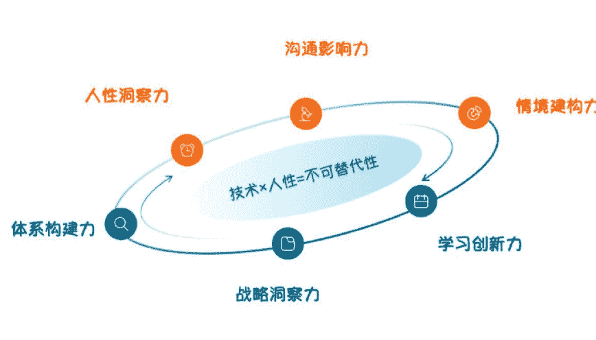

图5-1 人事不可替代的六项能力

##### 一）技术增强力
技术增强力指通过整合技术工具、数据分析与系统化思维，将抽象管理理念转化为可执行、可优化的能力，覆盖三大关键领域。

###### 能力1体系构建力
基础价值之一是构建与组织战略匹配、结构清晰、规则完备的人力资源体系。

智能系统可自动生成岗位说明书，却无法判断企业战略重心、结构隐患或文化张力。要识别这些组织变量，据此设计规则、规范与流程，建立有逻辑、有弹性的制度框架。这是智能系统难以胜任的深度判断。

###### 能力2战略洞察力
若体系构建是设计房子，战略洞察关注房子该建在哪、适合谁、能否支撑未来。

在智能技术介入事务执行后，需承担更多前端判断，成为半个经营者——理解战略路径、读懂文化氛围、业务节奏与资源配置。

战略洞察是用智能技术数据作证据，用经验与判断构建路径，使人力方案贴合组织目标、发挥战略价值。

###### 能力3学习创新力
在技术快速演进中，既要推动员工学习智能技术，更要带头试错、设计机制、探索新场景，成为组织进化驱动者。

该能力包含：结合业务试用迭代工具；引导业务从工具使用走向结构创新；设计组织级试错机制与学习闭环，让创新可控可持续。

未来将更依赖复合型人才，如人事数据分析师。他们能读懂数据趋势，也能翻译成业务语言，让结论变为可落地的决策建议。

##### 二）人性认知力
智能技术可识别情绪标签，却难以读懂背后的动因；可生成逻辑清晰方案，却无法引导真实情感流动。

不可替代性体现于看得见人、调得动人、连得起人。据Deloitte 2023《Global Human Capital Trends》，未来组织核心竞争力之一，是在无边界技术环境中持续以人为本。

###### 能力4人性洞察力
智能技术可识别语气，却感知不到犹豫中的不安、沉默背后的担忧、会议后的低沉。这些未言之语往往是组织的温度计。

优秀者能从表象看深层情绪与动机。这种能力来自经验积累、人际信任与现场感知，是与人打交道中练就，智能系统学不来。

###### 能力5沟通影响力
沟通常发生在不确定、多立场环境：组织变革中缓解焦虑；多部门冲突中协调诉求；员工敏感事件中把控节奏；在管理者执行策略时帮助清晰传达。

这不仅要表达清楚，更要建立共识、引导认同、促进行动。

智能系统能生成语言，却无法识别情绪流向与信任张力。要把冰冷指令转化为员工能接受、愿配合、愿参与的表达。

能否写出看似完美文本，关键在员工听得懂吗？会不会引发误解或抵触？此刻讲此事是否合适？沟通力不在于说得漂亮，而在于让人听得进并愿意行动。

###### 能力6情境建构力
不仅定制度，更要营造氛围。同一方案在不同团队、部门、文化背景落地效果可能迥异。

智能系统能告诉最佳实践，要回答：在这个组织、这群人、这个时间点，这套方法行不行？

需从文化、角色、组织成熟度等多维度出发，做环境适配设计。其定位不是照搬规则，而是创造规则可落地的场景。

在人与系统共舞时代，智能技术拓展能力边界，而人事则定义应用边界。

#### 二 从适应到引领：智能化时代的成长路径
在深度协同背景下，关键问题已不是会不会用智能技术，而是如何协作、站在什么位置。为此梳理出三阶段进化路径。

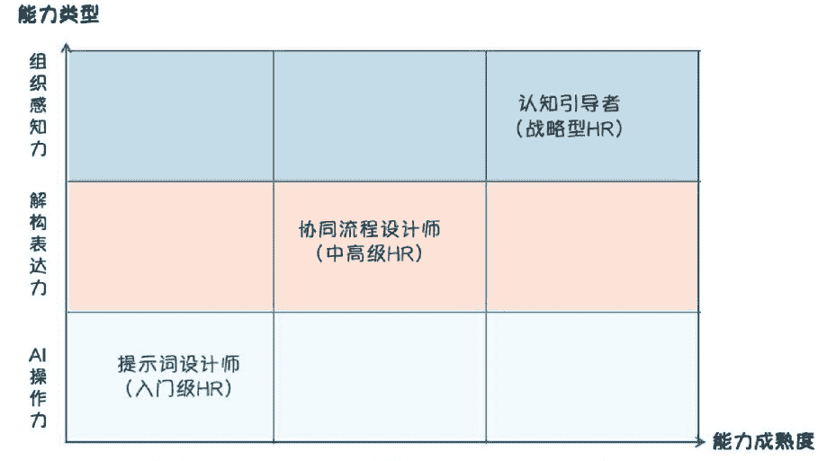

图5-2 人工智能-人事三阶段进化路径

该路径关乎思维方式转变。图中以能力类型与成熟程度为坐标，勾勒可能经历的三种成长阶段。

##### 一）提示词设计师｜让智能系统听懂人话
本阶段核心是让智能系统听从指挥，输出可用成果。

提示词不仅是操作指令，更是结构化思维起点，体现问题建模、路径设定与输出控制能力。

正如斯坦福李飞飞教授所言：人工智能是人类认知外骨骼。提示词就是把人的思考过程翻译给智能系统的语言。

本阶段标志着从我不会做到让智能系统帮我做成，开启效率提升与认知升级双通道。

提示词三步训练法如表5-2所示。

###### 表5-2 提示词能力三步训练法

| 模块 | 行动重点 |
| :--- | :--- |
| 学结构 | 掌握类似 SCOR+X、STAR、5W1H 等提示词模板 |
| 会提问 | 将目标转换为清晰任务指令 |
| 会判输 | 建立判断标准，评估 智能系统产出质量 |

从此阶段出发，开始从用工具转向设计协同。

##### 二）协同流程设计师｜设计智能系统参与整件事
本阶段关键不再是让智能系统做一件事，而是设计整套人与系统共同完成的流程。

价值不仅在于单点替代，更在于协同合作。需具备流程颗粒化与任务组件化能力，将复杂任务拆解为智能系统可协同的小步骤。协同路径如表5-3所示。

###### 表5-3 智能协同路径

| 模块 | 行动重点 |
| :--- | :--- |
| 拆任务 | 将复杂任务细化为多轮提示词，形成逻辑递进 |
| 搭流程 | 设计 智能系统 在每一阶段的角色与输出要求 |
| 模板化 | 把高频任务沉淀为可复用的提示词流程包 |

随着智能系统融入招聘、培训、员工服务，还需关注算法透明、合规边界、风险判断等议题。

##### 三）认知引导师｜与智能系统一起推演未来
本阶段不再只是用户，而是与智能系统共创未来的思考者与引导者。智能系统成为组织智力网络一部分，人事是连接智能系统与组织间的桥梁。

三步共创路径如表5-4所示。

###### 表5-4 智能共创路径

| 模块 | 行动重点 |
| :--- | :--- |
| 搭认知框架 | 将 人事分析模型结构化输入智能系统，引导其按逻辑建构方案 |
| 构建双向链接 | 确保 智能系统输出与组织目标、能力结构形成清晰锚点 |
| 引导组织共识 | 模拟多立场争议，生成博弈路径，提炼共识表达 |

从指令到共思：HR如何让AI一起思考

进入这一阶段，人力资源对智能体的使用方式已经发生位移。团队不再满足于把工作丢给模型去完成，而是要主动塑造模型的思考路径。明确要模型输出什么只是起点，更关键的是设计模型怎样与人共同进入思考的过程。

##### 四）三阶段成长自我评估清单

这套三步进阶框架既指明了发展方向，也给出了可落地的行动参照。

请对照下表任务清单，判断自身所处层级，并明确下一步需突破的能力点。完成5项及以上可视为达标，3至4项属于成长中，1至2项则处于起步期。

###### 表5-5 三阶段成长自我评估清单

| 阶段 | 任务清单 | 我能完成 |
| :--- | :--- | :--- |
| 阶段 1：提示词设计师 | □ 撰写规范的通知或邮件文案<br>□ 产出岗位职责说明书<br>□ 整理并撰写会议纪要<br>□ 向AI提出需求并在两轮以上迭代中优化输出<br>□ 评估AI产出是否达标并说明理由 | □□□□□ |
| 阶段 2：协同流程设计师 | □ 将单一任务拆分为多轮提示进行操作<br>□ 绘制AI协作流程图并在真实任务中应用<br>□ 建立任务-AI-反馈闭环<br>□ 借助多款AI工具协同完成一次培训或制度设计<br>□ 制定可重复使用的AI提示词模板集 | □□□□□ |
| 阶段 3：认知引导师 / 战略链接者 | □ 借助AI结合HR分析模型开展组织诊断，例如冰山模型<br>□ 利用AI进行战略目标推演或文化共创方案设计<br>□ 引导团队借助AI开展头脑风暴并达成初步共识<br>□ 撰写一份有AI参与的组织变革建议<br>□ 开发AI+HR主题培训材料并向他人传授 | □□□□□ |

生成式智能普及后，人力资源的核心壁垒已不再是掌握多少工具，而在于：

- 洞察是否更精准，思考是否更纵深；
- 能否主导模型的推理方向，而非单纯采纳生成结果；
- 能否融合技术逻辑与人文关怀，推动组织共同演化。

展望未来，缺乏编程能力并不会直接导致淘汰，真正会被边缘化的，是只做事务性处理却忽视价值的人力资源从业者。能够持续保持不可替代的，始终是主动拥抱变革并不断升级自身的人。

## 参考文献

[1] 杨百寅，单许昌.定力：中国社会变革的思想基础[M].北京：北京大学出版社，2020.

[2] 野中郁次郎，绀野登.创造知识的方法论[M].马奈，译.北京：人民邮电出版社，2019.

[3] 彼得·德鲁克.管理的实践[M].齐若兰，译.北京：机械工业出版社，2018.

[4] 施炜.管理架构师[M].北京：中国人民大学出版社，2019.

[5] 施炜，苗兆光.企业成长导航[M].北京：机械工业出版社，2019.

[6] 王志纲.王志纲论战略[M].北京：机械工业出版社，2022.

[7] 吴晓波等.华为管理变革[M].北京：中信出版社，2017.

[8] 黄卫伟.以奋斗者为本：华为公司人力资源管理纲要[M].北京：中信出版社，2014.

[9] 中国信息通信研究院.人工智能发展报告（2024年）[R/OL].北京：中国信息通信研究院，2024-12[2025-05-10].

[10] Ellingrud K, Sanghvi S, Dandona G S, Madgavkar A, Chui M, White O, et al. Generative AI and the Future of Work in America[R/OL].[S.l.]: McKinsey Global Institute, 2023-06[2025-05-10].

[11] Van Durme Y, Scoble-Williams N, Eaton K, Kirby L. 2023 Global Human Capital Trends: New Fundamentals for a Boundaryless World[R/OL].[S.l.]: Deloitte Insights, 2023-01[2025-05-10].

[12] HAYGROUP.岗位解码[Z].深圳：企业培训资料，2011.

[13] HAYGROUP.薪酬体系的设计与管理[Z].上海：企业培训资料，2013.

## 后记

当初进入管理咨询，选择了人力资源赛道，是因为我坚信这项工作做深了意义重大。往小处看，能为个体提供清晰的方向感，比如梳理职业规划；往大处看，能为团队带来希望，比如在企业内部建立起科学合理的人才管理机制，让更多人被看见、被激活、被成就。

十多年过去，理想落地的过程比想象中更曲折。我始终坚持真诚对待客户，不敷衍、不隐瞒，力求提供专业的建议。但结果往往不尽如人意，有案例取得不错效果，也有方案偏离了最初设想。

努力程度不应怀疑，更多是专业厚度不够。有些概念需要翻阅大量资料才能厘清，效率低下、容易走弯路。缺少高人指点时，更易陷入误区。为了获取某个案例的实操细节，我愿意付费请当事人讲解，可核心部分总是欲言又止。

直到深度使用人工智能，我才感受到冲击。原本需要数月甚至数年积累的知识，模型能在数分钟内给出初步分析与模拟。本书中的多数案例，都是基于真实项目场景，在模型辅助下还原与推演而来。它在拆解问题、逻辑推演、专业洞察上的表现，有时甚至超过资深顾问。

有了模型加持，感觉像配上了趁手的兵器。但很快我也冷静下来：模型可以产出答案，却感受不到信任，读不懂情绪，也察觉不到人心的微妙。它能给出专业的方案，替代不了人与人之间的对话与理解。

人力资源工作的特殊之处，在于稀缺性与专业性的叠加。价值往往在关键时刻显现，真正解决问题的依靠扎实的专业本领。理解这一点，有助于减少自我怀疑，回归专业自信。

写下此书，希望同行能少走一些弯路。受篇幅限制，关于提示词设计等偏技术的内容，我另整理在《AI职场写作》中，有兴趣可参阅。另外，本书涉及的提示词与案例会同步到我的个人微信公众号峰之立，ID是lizhifeng2024，便于练习。

智能不会为任何人停留，也不会轻易取代任何人。前提是，你愿意以探索的心态和实践的积累去主导模型、赋能组织、连接人心。