# AI 正重写学术写作的规则：从上手到进阶

# 前言

2022 年 11 月底，OpenAI 的 ChatGPT 上线，点燃了全球 AI 热潮。2025 年 1 月 20 日，杭州深度求索推出的 DeepSeek 让国产大模型首次走向世界舞台。短短数年，AI 已从边缘技术演进为规模达 6233 亿美元的产业集群，中国信息通信研究院 2024 年的数据如此显示。因为自然语言处理是 AI 最先取得突破的方向，各类模型工具率先进入知识生产领域，以颠覆性的效率重塑著、学、研的生产方式。

知识是人类对客观世界的认知总和，知识生产作为分析概念的兴起，意味着关注点从“知识是什么”“怎样为真”的本体论和认识论，转向知识背后的社会建构机制——生成条件、权力博弈、历史语境。

这一转向凝结了跨学科的经典洞见。马赫卢普量化研究知识产业，1962；曼海姆在《意识形态与乌托邦》中提出知识社会学，1929；贝格尔与卢克曼阐释社会互动如何建构日常知识，1966；福柯揭示知识与权力的纠缠，1969、1977、1961；吉本斯等人总结 20 世纪中后期的知识生产模式转型，1994；70 年代后兴起的科学知识社会学与科学技术研究通过实验室民族志，证实科学知识的社会属性，拉图尔等人 1979、克诺尔-采蒂娜 1981。综合来看，知识生产力的构成要素包括知识生产者、技术工具、协作网络、制度环境、文化政策。

当 AI 浪潮席卷而来，关键问题是：在如此复杂的体系里，作为工具的 AI 会如何作用于其他要素，特别是在人类研究者身上，以及依托社会结构而生的制度环境、文化政策与协作网络。马克思关于工业革命机器的论述，对今天理解 AI 对科学知识生产的影响仍具启发。

## 一、AI 作为人脑的延伸器官

马克思在《政治经济学批判》中写道，机器是人的产物，是“人的意志驾驭自然的器官”、“人脑的器官”，是对象化的知识力量。机器既是智慧的结晶，也是人的智力与社会关系的物化体现。

新一代智能机器 AI 仍是人类认知与知识体系的外延。自然语言处理、文献检索、逻辑推理、文本生成，本质上都建立在人类思维范式与历史语料之上。主流科学界认为当前 AI 没有主体意识，它只是算法形态凝结的社会智力的符号系统，正如传统机器一样，是人脑的延伸与工具化、程序化的表达。

区别在于 AI 带有“类认知”特征，能自动处理信息并产出合乎语法、逻辑乃至文体的语言。2025 年 4 月，加州大学圣地亚哥分校的研究首次以实证给出 AI 通过标准图灵测试的证据，部分主流模型在特定情境下已能模拟接近人类的智能表现。

语言能力逼近人类，使 AI 迅速从辅助滑向替代创作边界，模糊分工。研究者越来越依赖机器便利，核心思考与写作权被让渡，只保留指令设计与语义复核。知识从人脑流出，经平台、接口、模型流水线拆装重组，成为缺乏原创附加值的产出，人则沦为供养机器的养料，创作者的主体意识与身份被侵蚀。这是典型的知识劳动异化。

## 二、AI 作为劳动者的竞争对手

机器一旦现身就可能与工人对立。马克思指出，劳动资料作为机器出现，便立刻成为工人的竞争者；机器进步带来速度与强度的自然提升，生产使工人就业无保障，机器随时可用更廉价驯服的自然力替代人力。

从机械自动化到电气自动化再到智能自动化，人类不断追求生产率。理想是解放劳动，现实却受私有制制约，解放有限，失业焦虑始终伴随。刘伟兵 2022 年的分析也指出现代异化劳动的根源仍在私有制。

经济学与数据并未显示自动化与失业的简单线性关系，贝森 2019 的研究即提出此论。更贴切的表述是转型而非失业潮。世界经济论坛预计到 2027 年，AI 与自动化将取代 8300 万岗位，同时创造 6900 万个新岗位，净减少 1400 万，约占全球就业 2%。国际货币基金组织近期报告提醒，AI 短期内可能加剧失业，对近 40% 工作产生冲击，尤其高技能岗位；长期看生产率提升与新岗位创造可缓解负面效应，但 5 至 10 年过渡期对职业生涯冲击巨大。

技术重塑工作性质与劳动力结构，最显著的是劳动市场的极化，古斯与曼宁 2007 提出的现象：高低技能端扩张、中等技能萎缩。在知识生产领域，文献检索、数据整理、简单统计等低技能环节已被 AI 高效承接，而需要批判性思维、问题建构与综合分析的高阶能力需求愈发紧迫。具备独立思考、创新研究能力并拥有 AI 素养的研究者，才是难以被替代的主体。

## 三、AI 作为制度化的生产装置

技术史先驱梅尔文·克兰茨伯格提出技术六律，首律为技术非善恶，也非中立。技术本身无道德属性，价值取决于使用方式与情境；更重要的是技术主动介入社会生态，重塑关系与权力结构。

马克思对机器的阶级属性批判更为锋利。机器日益完善后可脱离工人独立运作，成为镇压工人反抗的武器，工厂以有组织的机器体系与兵营式纪律为核心，把工人规训为对象，资本借此实现隐形统治。

当下 AI 不可避免地嵌套进以国家与大企业资本主导、知识产权壁垒化、评价标准功利化、科研劳动关系异化为特征的知识生产关系中，斯劳特与莱斯利 1997、赫勒 1998、苏伯 2012、德隆与米勒 2005、斯蒂芬 2012、张琳等 2024、卢斯蒂格 2006、尚虎平等 2012 的研究均指向此结构。

一方面，大模型、大数据与强算力的竞争需要巨额投入，被少数科技巨头垄断，个体研究者、普通机构与欠发达地区被挤出核心圈。掌握数据与算力的主体借助 AI 加速科研、专利与技术封锁，马太效应加剧。另一方面，科研评价长期功利化与固化，AI 的自我加速特性在“数量为王”体系下被诱导用于追求短期产出，加剧高产低质竞争。标准化、流程化的生产亦使研究者与成果疏离，在异化劳动中难以获得自我认同。

总的来看，AI 强大的自然语言理解与生成能力，使其成为解放知识生产力的有力工具。但工具革新也带来对中低技能劳动的挤压，以及对高阶技能的倒逼。更关键的是，AI 并非中立的进步力量，它在既有社会关系中发挥作用，若依附旧生产关系，其潜能可能加剧分化与异化。只有变革科研知识生产关系，构建共享、公益、协作的新型体系，才能真正释放 AI 生产力。个体层面，重拾生产者主体意识，正确理解、掌握与使用工具，是进入 AI 时代学术大生产的起点。

本书系统梳理 AI 工具在学术写作全流程的应用，既提升效率与质量，也坚守学术伦理。全书分三部分：

第一部分“AI 辅助学术基础”，介绍主流写作工具的优势与局限，探讨应用伦理与规范，帮助建立正确认知。

第二部分“AI 辅助学术写作实践”，围绕选题与方案设计、文献检索与管理、论文写作与修改、数据分析与可视化、投稿与发表等环节，讲解工具使用方法并配以案例与操作指南。

第三部分“AI 辅助学术写作进阶”，聚焦个性化 AI 写作助手的训练、跨学科应用与未来趋势，鼓励读者在夯实基础后探索更具创造性与前瞻性的学术表达。

本书旨在为高校研究生、科研人员与学者提供一套可操作的 AI 辅助学术写作方案，助力在 AI 时代实现更高效、更规范、更有影响力的学术表达。

[5] 人工智能系统首次通过图灵测试[EB/OL].Jones, C.R., & Bergen, B.K. (2025).Large language models pass the Turing test [Preprint].arXiv.https：//arxiv.org/abs/2503.23674.

[6] 马克思恩格斯文集：第5卷[M].北京：人民出版社，2009：495.

[7] 马克思恩格斯文集：第5卷[M].北京：人民出版社，2009：497.

[8] 刘伟兵.人工智能会实现劳动解放吗？[J].马克思主义与现实，2022（2）：126-133.

[9] WEF：新技术将引发未来就业产生重大变化[EB/OL].https：//cn-sec.com/archives/2004004.html.

[10] 马克思恩格斯文集：第5卷[M].北京：人民出版社，2009：501.

[11] 王众威.马克思关于机器的三个隐喻——基于人机关系视角的研究[J].理论月刊，2023（9）：16-22.

[12] Slaughter,S., & Leslie,L.L.(1997).Academic capitalism:Politics,policies,and the entrepreneurial university.

[13] 张琳，曹喆，徐干城.冲出重“唯”：学术资本视域下高校教师评价改革的困境、症结与出路[J].国家教育行政学院学报，2024（7）：12-19.

[14] 尚虎平，惠春华，叶杰.从绩效至上到科研消费主义——我国公共财政资助科研基金中科技观的异化与矫治[J].自然辩证法研究，2012，28（6）：82-86.

# 第一部分
智能写作入门框架

当智能化手段已深度嵌入科研流程与论文撰写时，各种辅助写作的方案正从早期设想变为日常工作的一部分。本部分为读者搭建起使用智能写作的基础认知体系。首章对当下主流的智能方案作系统梳理，涵盖文献整理、内容生成、语言转换、图表呈现乃至代码辅助等能力，并汇总相关社群与协作平台，帮助读者拼凑专属的科研工具箱；次章以辩证视角检视智能方案的双重属性，一方面肯定其提速创作、激发灵感、打破语言壁垒的正面价值，另一方面也指出准确性波动、伦理边界模糊以及可能削弱研究者自身能力的潜在风险；第三章则聚焦智能介入科研所带来的伦理与规范问题，探讨在追求便利的同时如何坚守规范、厘清人机责任、维护健康的学术生态。认知工具、评估效能到规范运用三个递进层面，共同构成数智时代把握学术写作的起点，也帮助研究者在借助智能力量的同时保持批判与主体性。

# 第一章
AI工具全景图

### 本章介绍
本章集中展示目前被广泛采用的智能学术写作方案，涉及文献整理、文本生成、语言互译、语法校对等多个维度。从 EndNote、Zotero 等文献整理软件，到 DeepSeek、ChatGPT、Gemini 等文本生成模型，再到 DeepL、Google Translate 等翻译系统，以及 Grammarly、ProWritingAid 等语言润色工具，都将对其功能特性与适用情境逐一说明。同时介绍 Tableau、Altair、ggplot2 等数据可视化手段，GitHub Copilot、Claude Code、DeepSeek Coder 等智能编程助手，并梳理国内外与智能学术写作相关的社群与协作平台，协助读者构建完整且可扩展的个人学术工具库与资源网络。

### 第一节 文献管理方案：EndNote、Zotero 与 Mendeley 对比
过去研究者多靠手工制作文献卡并抄写书目，既耗时也易出错。20世纪90年代前后，这一状况开始改变。1988年信息服务巨头汤森路透推出 EndNote，将文献库与文字处理软件首次打通，提出文献整理与写作一体化思路，推动学术自动化。2006年出现的开源方案 Zotero 以浏览器插件形态出现，把文献采集从专业数据库拓展到开放网络。2007年由三名博士生创立的 Mendeley 则引入 PDF 元数据解析与学术社交功能，标志文献整理迈向智能化。

EndNote、Zotero、Mendeley 分别代表商业化、开源化、社交化路径，其演进折射出学界对知识管理效率优先、开放共享、网络联结的不同诉求。

#### 一、EndNote：机构化科研的标配方案
作为历史最久的文献整理软件，EndNote 始终与学术建制深度绑定。突出之处在于对 Web of Science 数据库的原生兼容，可直接导入科睿唯安体系的题录，保证期刊缩写、作者全名等元数据符合 SCI/SSCI 规范。在引用格式上，内置超7000种期刊模板，覆盖从《细胞》到《美国社会学评论》等各类风格，并针对医学领域集体作者、姓名缩写等复杂规则提供精细配置。

面向大型团队，EndNote 提供企业级权限管理。负责人可通过 EndNote Web 搭建主库，分配成员编辑权限并保留完整的版本记录。这种机构化特征也体现在定价上，高校站点授权使其在实验室、研究院等组织化场景占据优势。代价是门槛较高、跨平台体验不足，用户在掌握组别管理、术语表配置等高级功能前往往需约20小时学习，且桌面端架构在移动设备上表现有限。

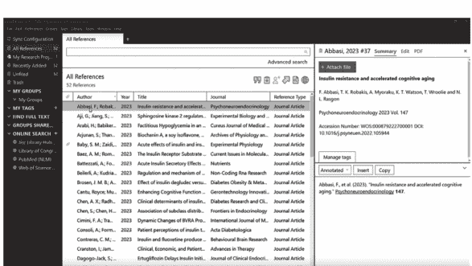

（图片来源：EndNote官方网站）

#### 二、Zotero：开放获取的实践先锋
Zotero 源于美国乔治梅森大学数字人文项目，自诞生起就带着开放获取的基因。其最大突破是把采集范围拓展到整个互联网，包括亚马逊图书、arXiv 预印本乃至普通新闻页面。激活 Zotero Connector 后，系统不仅抓取标准元数据，还能自动下载 PDF 并解析章节结构。这种去中心化获取方式特别适合数字人文、科技政策等跨学科研究，其资料常分散于期刊、报告、白皮书等多种载体。

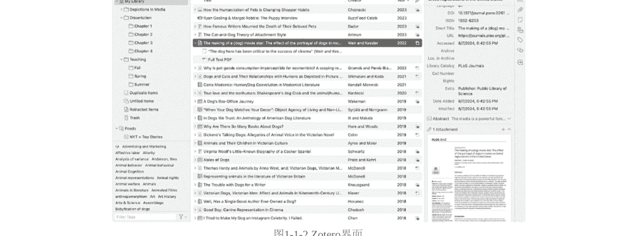

（图片来源：Zotero官方网站）

开源生态让 Zotero 不断扩展。ZotFile 可自动化重命名、迁移 PDF 并同步阅读器；Better BibTeX 实现与 Overleaf 深度集成，支持自动同步库与自定义引用键；Zutilo 则提供额外菜单与快捷键支持个性化流程。由此，Zotero 从单纯整理工具演变为个人知识中枢，可经 API 接入 Notion AI，或用 Markdown 插件生成动态参考文献。高度自由也意味着需要较强技术素养，普通用户需专门学习才能发挥全部潜力。

#### 三、Mendeley：学者社群的数字枢纽
2013年爱思唯尔收购 Mendeley，标志出版巨头布局科研社交网络。Mendeley 把文献整理转化为关系连接器，用户上传论文后，系统解析内容并通过作者识别算法绘制合作者网络，推荐引擎据此推送相关文献与会议信息，有效压缩调研周期。

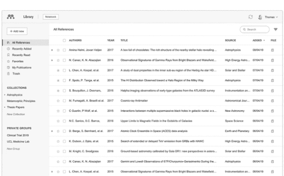

（图片来源：Mendeley官方网站）

协作设计上，Mendeley 首创批注社交化。团队可建私有群组，成员对 PDF 的标注实时同步并显示身份，利于分布式团队讨论。公共群组对所有人开放，可共同添加条目，形成众包知识库。开放性虽利于公开讨论与成果管理，也带来隐私风险，部分敏感研究者更倾向本地化部署。

#### 四、工具选择、伦理风险和未来图景
面对三类方案的功能差异，可用“需求—场景—约束”三维模型决策。首先评估核心需求：以期刊投稿为主者，EndNote 的格式精准性难以替代；侧重知识图谱构建者，Zotero 的扩展性更强；追求学者网络拓展者，Mendeley 更合适。其次考量使用场景：跨机构项目可选用 EndNote 企业版，个人探索适合轻量 Zotero，研究生培养可利用 Mendeley 的指导功能。最后权衡资源约束：预算、编程能力、移动端依赖等都会影响选择。

表1-1-1 文献管理工具选择的比较框架

| 比较维度 | EndNote | Zotero | Mendeley |
| :--- | :--- | :--- | :--- |
| 满足的核心需求 | 引用格式规范性 | 跨设备知识融合 | 学者社群联结 |
| 典型应用场景 | 医学类期刊投稿 | 数字人文领域 | 多学科协同研究 |
| 主要约束条件 | 年度付费许可 | 免费但学习成本较高 | 免费但隐私风险 |

智能正深度介入文献整理，伦理问题日益凸显。三类软件均存在自动生成参考文献出现 DOI 错误、非英语文献元数据提取率偏低、查重算法难以识别概念剽窃等问题。建议在论文方法部分声明工具名称与版本号，对自动生成的文献列表人工复核，并在致谢中标注工具贡献。技术透明是数字时代学术诚信的新基石。

文献整理正在经历第三代智能化变革。EndNote X9 引入的 Manuscript Matcher 可基于个人库智能推荐投稿期刊；Zotero 7 可接入 ChatGPT、DeepSeek 等助手，自动抽取研究问题与方法论关键词。这些创新预示工具正从被动存储转向主动赋能，参与问题生成、方法设计、发表推进与影响预测。研究者的核心能力也在向技术驾驭力与学术判断力的双重迁移发展，人机协同的深度将成为衡量学术生产力的重要标准。

### 第二节 文本生成工具：DeepSeek、ChatGPT和Gemini
大语言模型正重塑学术写作的流程与逻辑。DeepSeek、ChatGPT、Gemini 等 LLM 实现了从检索到生成的跃迁，成为文本生产的核心助力，也引发了关于原创性、知识归属与认知边界的讨论。

技术演进大致经历三阶段：规则驱动的 LaTeX 排版、基于循环神经网络的统计学习摘要、以及以 OpenAI GPT 系列为标志的预训练大模型阶段。当前，DeepSeek 聚焦中文科研场景，ChatGPT 代表通用生成能力，Gemini 则整合搜索引擎提供实时信息。尽管路径各异，三者均依赖注意力机制捕捉深层语义，可辅助完成实验设计描述到理论框架构建的写作任务，同时也带来内容可信度验证的新挑战。

#### 一、DeepSeek：中文语境下的科研写作辅助
DeepSeek 由杭州深度求索研发，以开源属性与深度思考模式在2025年初引发关注。QuestMobile数据显示，DeepSeek-R1 于2025年1月20日发布后，一个月内无广告投放即获1.25亿用户增长[2]。凭借大参数与联网能力，模型被视作“满血联网版”，能在最新资料支持下给出较为精确的回答。


其核心竞争力在于对中文科研语料的专业化处理。先进的自然语言处理技术使其能理解并生成高质量学术文本，在中文语境理解与输出上表现突出，深度思考模式擅长复杂逻辑推理与分析。模型支持多语种科研写作，可为中英文及其他语言论文提供流畅生成，并覆盖全流程辅助：自动生成大纲、撰写初稿、语言润色与语法检查、查重降重等，显著提升效率，让研究者更聚焦内容创新。

局限在于对高度专业化或小众领域，生成文本的深度与准确性可能不足；作为云端工具，敏感数据上传处理也存在安全隐忧。

#### 二、ChatGPT：通用型数字研究助理
ChatGPT 由 OpenAI 基于 GPT 体系开发，本质是提升人类信息收集、整理、计算与分析能力的工具集合。强大的自然语言处理与多模态转化能力使其广泛应用于学术写作。截至2025年2月，OpenAI 已迭代至 GPT-4.5 版本，通过扩充无监督学习提升模式识别与关联能力，交互更自然、知识面更广且意图追踪更精准，“情商”更高，可完成写作、编程与实际问题求解，同时“AI幻觉”发生率有所下降[21]。Deep Research 增强功能可为金融、科学、政策、工程等复杂在线多步研究任务提供支持。

作为业界先行者，ChatGPT 在学术写作中优势明显：快速生成高质量初稿，扩展与补充已有内容，基于海量英及其他语料预训练，在英语写作支持上保持领先，并具备语法、用词、表达优化能力，适合冲刺国际期刊与会议的学者。不足与 DeepSeek 相似，在专业深度、准确性与数据隐私方面仍需警惕。


#### 三、Gemini：基于搜索的实时知识整合者
Google 的 Gemini 前身为 Bard，基于对话优化的 LaMDA 模型构建，2024年起升级为 Gemini 系列。相比传统模型，Gemini 更擅长理解上下文并产出连贯回复，能分解多步推理问题给出阶段性答案。同时整合搜索引擎实时数据与学术数据库，形成动态更新的知识网络，并在跨模态处理上占优：除文字综述外，还可自动关联统计图表、卫星影像、实验视频等多维资料，适合定量与质性融合的研究。

截至2025年3月，Gemini 已更新至 2.5 版本，处理速度与精确度均有提升，并上线 Deep Research，具备代理式研究能力：输入研究主题后自动制定计划、检索资源、推理分析并输出结构化报告。

局限是语言支持优先英语，对高度专业化问题有效性与准确性无法完全保证。


#### 四、工具选择、学术伦理和未来图景

三大生成式AI在学术写作里的分工已经很清晰

从不同切面去比，DeepSeek、ChatGPT、Gemini各有擅长点。核心需求上，DeepSeek在中文语境的理解与产出能力上领先一筹；ChatGPT的发散式建议最能激发灵感；Gemini则靠Google搜索实现最强的实时信息整合，还能同时处理图文多模态。落地场景上，DeepSeek更适合冲刺中文期刊论文的写作；ChatGPT在研究设计与文献综述环节表现更稳；Gemini偏向需要大量配图的 data-driven 研究。在使用限制上，DeepSeek和Gemini都提供免费入口，但DeepSeek因用户规模过大常出现信息过载、响应迟缓的问题；ChatGPT以订阅制为主，个人月费约20美元、团队约200美元，对个人学者来说是笔额外开销。

表1-2-1 文本生成工具选择的比较框架

| 比较维度 | DeepSeek | ChatGPT | Gemini |
| :--- | :--- | :--- | :--- |
| 满足的核心需求 | 中文术语精准性 | 创新思维激发 | 实时数据整合；图文多模态 |
| 典型应用场景 | 中文期刊论文撰写 | 研究设计与综述 | 数据驱动型研究 |
| 主要约束条件 | 免费；信息过载倾向 | 付费；事实性错误风险 | 免费；跨语言能力局限 |

生成式工具的普及正倒逼学界重新讨论原创性的边界。《科学》《自然》等期刊，COPE、ICMJE、STM、泰勒·弗朗西斯、爱思唯尔等出版机构，都各自出台了使用生成式AI的规范。2024年11月28日，复旦大学发布的《复旦大学关于在本科毕业论文（设计）中使用AI工具的规定（试行）》也对本科阶段的使用做了细化。但各家标准不一、判别尺度参差，常常让研究者无所适从，如何在更高层面统一学术伦理的底线，成为当下亟待解决的议题。

面向未来的内容生成工具，学界普遍预判会朝三个方向演进：其一是更聪明的内容生成与打磨，能读懂复杂理论模型与实验设计，输出更合规范的高质量文本；其二是多模态协同，覆盖文本、图表、公式、代码的综合生成；其三是学科自适应，可针对特定领域输出符合规范的文本，并通过迁移学习与微调实现定制化。在此驱动下，学术写作可能形成“人定框架、AI补证、人机共修”的新流程，知识生产的效率与质量阈值将被不断拉升。

### 第三节 翻译工具：DeepL和Google Translate

AI翻译正在一点点抹平学术交流的语言鸿沟。上世纪50年代，美苏两国为军事需求投入机器翻译，目标是英俄科技文件的互译。90年代IBM提出基于词对齐的统计机器翻译模型。2006年Google Translate上线免费翻译服务，掀起一轮统计派热潮。2013年后CNN与RNN被引入，机器翻译进入神经机器翻译时代。

学术翻译对术语一致性、修辞规范性、引文完整性要求更高，这也让工具分化。DeepL与Google Translate分别以精准与覆盖重塑跨语言研究。

#### 一、DeepL：精准传递型的专业翻译工具

DeepL成立于2017年，总部在德国，主打AI驱动的高质量翻译，并向B2B市场开放，目前已有包括爱思唯尔、富士通在内的超2万家企业客户。其神经机器翻译服务支持欧亚大陆33种语言。2023年公司推出写作助手DeepL Write，跻身独角兽。2024年7月，DeepL发布面向翻译与编辑的新一代大语言模型，宣称翻译质量明显提升、编辑次数减少。自测数据显示，其译文受专家青睐程度是Google Translate的1.3倍、ChatGPT-4的1.7倍、微软翻译的2.3倍；达到同等质量，Google Translate需2倍编辑量，ChatGPT-4需3倍。不同于基于公开网络数据的通用模型，DeepL新模型利用过去七年积累的专业语料，聚焦内容创作与翻译。


图1-3-1 DeepL的使用界面

（图片来源：DeepL官方网站）

局限也很明显：仅支持直接输入、复制粘贴及PDF、docx、pptx文本，无法处理图片内容；语种数量远少于Google Translate的240多种，对小语种学术共同体的覆盖不足。

#### 二、Google Translate：普惠服务型的学术翻译工具

Google Translate自2006年起提供免费即时翻译，已覆盖249种语言间的互译，支持字词、句子、网页的任意组合。2022年9月，该服务因使用率原因退出中国大陆，亦影响Chrome内置翻译功能。界面左侧输入、右侧实时呈现结果，悬停可对照原文，并提供朗读、中文拼音、日文罗马字等辅助。2023年3月起网页版加入图片文字翻译，借助Google Lens的AR识别技术，可上传照片或截屏即时译出，在文献速读场景中价值突出，研究者能直接拍摄外文段落获取译文。


图1-3-2 Google Lens Translate的使用界面

（图片来源：https://www.fonearena.com/blog/311727/google-lens-copy-to-computer-text-translation.html）

不足在于质量受语种对影响明显，欧盟语言译英文较好，非同源语言易出错，且在法律、医学等专业术语上准确性偏低。

#### 三、工具选择、学术伦理和未来图景

两者呈现互补。科技文档翻译中DeepL的术语准确性占优；多语言比较或濒危语言文献则依赖Google Translate的广度。编辑量上DeepL更省，适合技术论文与专利；镜头即时翻译则在田野调查中更实用。实践中可采用混合模式：先用Google Translate筛选与速览，再用DeepL精译并结合术语库人工校对。目前两者均可网页免费使用，离线本地处理也有助于敏感数据保密。

表1-3-1 语法检查工具选择的比较框架

| 比较维度 | DeepL | Google Translate |
| :--- | :--- | :--- |
| 满足的核心需求 | 专业术语精准性 | 语言覆盖广度与多语言文献速读 |
| 典型应用场景 | 技术论文与专利翻译 | 镜头即时翻译与田野调查辅助 |
| 主要约束条件 | 小语种支持不足 | 术语失真 |

张霄军等（2021）提出可信赖机器翻译的七项原则：人本性、鲁棒性、私密性、可解释性、公平性、可复现性、可持续性，为学术伦理标准提供了启发。未来翻译生态应走向人机共生，交互为核心，支持多模态与个性化转换，同时强化数据加密与隐私保护，完善法规保障。

### 第四节 语法检查工具：Grammarly和ProWritingAid

AI语法检查已从纠错工具演变为写作协作者。传统规则库方法只能抓显性错误，2010年后深度学习赋能，新一代工具具备语义理解，从单纯纠错转向写作助手。学术场景的核心价值在于降低非母语障碍、维护文本严谨、帮助建立学科写作规范。

Grammarly与ProWritingAid分别代表实时交互与深度诊断两种范式，折射出从语法正确到风格适配、逻辑严谨、规范合一的多维评价转向。

#### 一、Grammarly：实时交互的智能编辑

Grammarly由乌克兰技术团队于2009年在美国创立，总部旧金山，联合创始人Alex Shevchenko与Max Lytvyn。早期聚焦拼写、语法、标点、词汇与句式建议，2017年起融入深度学习并获得大额融资。现可实时解析语法结构，识别时态、词性误用、主谓不一致等，并给出解释与范例，对非母语写作者相当于在线私人教师。AI还能交互式辅助全流程：提示词概述、起草、一键重写、校对清晰度与语气统一。抄袭检测也是重要功能，可识别直接抄袭与改写借鉴。


图1-4-1 Grammarly的使用界面

（图片来源：Grammarly官方网站）

工具已覆盖浏览器插件、文字处理软件与移动端，兼容Google Docs、MS Word、Gmail等学术环境，无需复制粘贴。误判率仍存在，且需持续跟进新词汇与语法演变。

#### 二、ProWritingAid：深度的文本错误诊断

ProWritingAid于2013年成立于伦敦，由Orpheus Technology Ltd运营，创始人Chris Banks原为商业作家。不同于实时模式，其“全面体检”在数秒内评估词汇密度、句式变化、段落连贯性等，并给出改进指引，适合长篇学术写作。当检测到高频词使用时，会提供替代方案；一致性检查覆盖拼写、大小写、连字符等。作为独立软件公司，其强调隐私与知识产权保护，承诺不分享或二次使用用户文本。

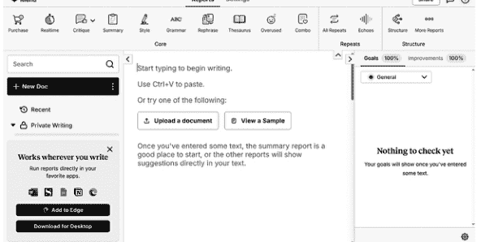

图1-4-2 ProWritingAid使用界面

（图片来源：ProWritingAid官方网站）

#### 三、工具选择、学术伦理和未来图景

表1-4-1 语法检查工具选择的比较框架

| 比较维度 | Grammarly | ProWritingAid |
| :--- | :--- | :--- |
| 满足的核心需求 | 实时交互与跨平台支持 | 深度文本结构与风格分析 |
| 典型应用场景 | 论文初稿撰写与快速修订 | 终稿优化与期刊风格适配 |
| 主要约束条件 | 复杂句式误判风险 | 功能相对有限 |

Grammarly强在实时性与跨平台集成，适合初稿与快速修改；ProWritingAid的深度报告适合终稿打磨与期刊风格适配。自然科学实验类写作偏爱Grammarly的被动语态容忍度，人文学科更受益于ProWritingAid的叙事流分析。跨学科研究者可组合使用：灵感期用Grammarly保持连贯，修改期用ProWritingAid系统优化。成本上两者均有免费版，Grammarly专业版约30美元/月，ProWritingAid专业版约10英镑/月。

与生成式系统相似，语法检查工具在进化到写作辅助阶段后，也面临原创性与隐私困境，上传全文引发泄露与剽窃担忧。未来趋势可能包括：强化内容生成与文本优化，拓展生成式AI边界；提升抄袭检测准确率与规避智能化；加强隐私与产权保护，消除成果泄露顾虑。

### 第五节 其他工具：数据可视化和代码生成工具

除文献管理、文本生成、翻译、语法检查外，AI正渗入数据可视化与代码生成环节，提升学术表达力、沟通效率并减少重复劳动。

#### 一、数据可视化工具

图与码：让科研表达更清晰、更高效

学术交流对把数字转成可视语言的需求在持续攀升。图形化呈现能把抽象指标变成直观画面，既缩短信息传递链路，也降低理解难度。过去几十年，制图手法的演进从手绘板走到自动化流水线。早期以静态图表为主，只求把基础事实表达清楚；近些年趋势明显转向动态与互动。以 Tableau、Python 生态的 Altair、R 语言的 ggplot2 为代表的方案，正在改写科研绘图的传统作业方式。

Tableau 由美国团队打造，2019 年被云计算巨头 Salesforce 收购。它的核心竞争力始终集中在可视化分析上。把数据库、Excel 等多源数据接入后，用户靠拖拽就能快速拼出柱状、折线、饼图等直观图形。免费形态 Tableau Public 允许任何人上传数据集并在线制作交互视图；面向教学的 Tableau Desktop Public Edition 只需简单注册下载，就可用于学习与教学场景。

在 Python 阵营里，Altair 是典型代表。它基于 Vega-Lite 构建，采用声明式语法让绘图流程更顺滑。Vega-Lite 提供了高层描述语言，可直观定义图形的外观与行为。Altair 支持散点、折线、条形、直方等多种形式，也能搭建组合图与多图面板，并内置示例数据集便于快速试画。

R 语言的 ggplot2 提供了基于图层语法的绘图体系，允许用户以声明方式指定数据、美学映射与图形要素，从而灵活生成精美复杂的图表。它弥补了 R 基础绘图函数不一致的短板，把绘图能力推向新高度。分层模块化设计让复杂图形的搭建既灵活又保持代码可读性，可绘制散点、折线、直方、条形与箱线图，并在细节上做定制化调整。

#### 二、代码自动生成工具

早期软件开发中，程序员只能逐行手工编码，耗时且易出错。随后出现的代码模板与片段库等自动化手段，为开发者提供可复用的代码块，减少了重复劳动。深度学习的成熟让代码生成迎来新突破。智能生成工具可依据需求描述或示例代码自动产出高质量代码，不仅能生成基础结构，还可优化改进，大幅提升效率与质量，在科研场景中也有广泛价值。当前代表性方案有 GitHub Copilot、Claude Code 与 DeepSeek-Coder。

2021 年 6 月 29 日，微软与 OpenAI 联合推出编程助手 GitHub Copilot，2022 年 6 月 22 日正式上线。该工具基于 GitHub 及其他网站的开源库，根据上下文自动补全后续代码。支持十几种语言，与 Python、JavaScript、TypeScript、Ruby、Go 等主流语言配合效果突出；还能把注释转为代码，只需写一条描述逻辑的注释，系统即可理解并生成对应功能代码，也能自动填充重复片段。2025 年 2 月 8 日，GitHub Copilot 发布视觉功能，实现图片到代码的秒级转换。

Claude Code 由 Anthropic 开发，是面向自然语言指令的智能编程助手，可直接在终端运行，理解代码库内容，无需复杂配置或额外服务器。其主要能力包括：编辑文件并修复错误；回答代码架构与逻辑问题；执行与修复测试、代码检查等命令；检索 git 历史、解决合并冲突、创建提交与 PR 等。

DeepSeek-Coder 是 DeepSeek 推出的代码大模型，采用免费开源策略。模型支持多种编程语言，擅长调试与数据分析任务，在 HumanEval 等编程基准测试中表现优异，超越 CodeLlama 等开源模型。它在代码补全、生成、解释与纠错方面都很突出，能显著提升编程效率。使用方式便捷，可通过简单 API 调用加载模型并生成代码。

表1-5-1为目前热门AI工具及其主要功能一览表：


| 名称 | 文献管理 | 文本生成 | 语言翻译 | 语法检查 | 可视化 | 编程辅助 | 数据分析 | 查重检测 |
| :--- | :---: | :---: | :---: | :---: | :---: | :---: | :---: | :---: |
| EndNote | √ | × | × | × | × | × | × | × |
| Zotero | √ | × | × | × | × | × | × | × |
| Mendeley | √ | × | × | × | × | × | × | × |
| ChatGPT | × | √ | √ | √ | √ | √ | √ | × |
| DeepSeek | × | √ | √ | √ | × | √ | √ | × |
| Gemini | × | √ | √ | √ | √ | √ | √ | × |
| Claude | × | √ | √ | √ | √ | √ | √ | × |
| Grok | × | √ | √ | √ | √ | √ | √ | × |
| DeepL | × | √ | √ | √ | × | × | × | × |
| Google Translate | × | × | √ | × | × | × | × | × |
| Grammarly | × | √ | × | √ | × | × | × | × |
| ProWritingAid | × | × | × | √ | × | × | × | × |
| Tableau | × | × | × | × | √ | × | × | × |
| Altair (Python) | × | × | × | × | √ | × | × | × |
| ggplot2 (R) | × | × | × | × | √ | × | × | × |
| GitHub Copilot | × | × | × | × | × | √ | × | × |
| CodeWhisperer | × | × | × | × | × | √ | × | × |
| Turnitin | × | × | × | × | × | × | × | √ |
| Copyscape | × | × | × | × | × | × | × | √ |
| NVivo | × | × | × | × | √ | × | √ | × |
| MAXQDA | × | × | × | × | √ | × | √ | × |
| RapidMiner | × | × | × | × | √ | × | √ | × |
| Provails Research | × | × | × | × | √ | × | √ | × |

## 第六节/AI学术写作社群和协作平台

随着智能工具在科研撰写中普及，围绕其形成的社群与协作平台愈发活跃。这些平台既是获取最新动态与撰写技巧的渠道，也是跨区域、跨语言、跨学科合作的重要媒介。参与其中，学者能接触前沿成果、实用资源与同行反馈，在智能时代构建起以技术为纽带的学术共同体。

#### 一、国际平台和社群

国际上多个开放科学平台引领着智能学术撰写的协作范式。Overleaf 是主流在线 LaTeX 撰写平台之一，集成大量 AI 会议模板，如 NeurIPS、ICML、ACL，支持多用户协同编辑与版本管理，还可与 Zotero、Mendeley 等文献管理软件联动，实现文献导入到成稿的无缝衔接。另一个有影响力的平台是 Papers with Code，由 Meta AI 发起，致力于将论文与开源代码配对，并建立基于任务的算法性能对比体系。研究者可在平台上快速查询某领域的 SOTA 结果并下载复现代码，提升实验部分的严谨性。此外，arXiv Sanity Preserver 由 OpenAI 前研究总监 Andrej Karpathy 创建，为 arXiv 论文筛选提供定制化服务。界面简洁，支持按关键词、作者、热度等进行个性化推荐，适合追踪 AI 领域最新动态。

除内容型平台外，实时沟通型社群也成为协作新空间。Academic AI Discord 社群围绕智能学术撰写展开多频道讨论，涵盖 Overleaf 模板、LaTeX 语法、论文润色建议等，支持即时问答与协作编辑。Slack 上的 ML Writing Group 更偏向小组共写，适合熟人网络合作。Telegram 频道如“AI Paper Weekly”推送精选顶会论文摘要及撰写提示，还有专门分享英文句式与语言润色模板的频道，便于移动端随时获取灵感。Reddit 上，r/MachineLearning 用户常分享撰写心得、投稿历程与生成式撰写工具测试结果；r/LaTeX 则长期聚焦排版技术，是 LaTeX 用户解决技术问题的核心社区。

围绕开源项目兴起的社群也在涉足学术撰写工具的开发与讨论。Hugging Face 社区论坛是开源模型交流的活跃地，设有 Research 与 Academic writing with LLMs 等子板块，开发者经常分享基于 Transformers 进行论文生成、摘要自动化或翻译优化的实践。EleutherAI 的 Discord 频道聚集大量 LLM 开发者与 AI 伦理学者，讨论内容从撰写边界、AIGC 可追溯性，到智能工具在学术评审中的潜在影响，是研究撰写伦理的重要入口。

#### 二、中文社群和平台

中文学术环境中的平台与社群以知识分享与投稿经验交流为主。知乎“人工智能”话题区聚集众多 AI 方向科研人员与研究生，讨论撰写技巧、LaTeX 排版、投稿经验与查重降重，形成互动性强的问答生态。

更专业的社区如小木虫论坛，设有 AI 撰写与投稿专栏，是中国大陆硕博士群体集中交流的平台。常见主题包括基金标书模板、SCI 论文语言修改建议及期刊评价动态等，适合系统梳理撰写流程。

AI 研习社以媒体形态发布 AI 工具评测与学术撰写课程，曾多次举办论文复现挑战赛与撰写竞赛，社群活跃度与培训价值较高，适合了解 AI 学术工具生态的用户。

Zotero 中文社区则通过 QQ 群、公众号与用户自建教程构建起以中文用户为核心的支持网络。分享内容涵盖引用样式定制、AI 撰写辅助插件安装使用、引文格式纠错等，是构建文献撰写基础能力的有效补充。

表1-6-1为上述国内外相关平台和社群网络链接一览表：

表1-6-1 AI学术写作相关的国内外平台与社群

| 类型 | 名称 | 链接 |
| :--- | :--- | :--- |
| 国际平台和社群 | Overleaf | https://www.overleaf.com/ |
| | Papers with Code | https://paperswithcode.com |
| | arXiv Sanity Preserver | http://www.arxiv-sanity.com/ |
| | Learn AI Together (Discord) | — |
| | AI Paper Weekly (Telegram) | — |
| | r/MachineLearning (Reddit) | https://www.reddit.com/r/MachineLearning/ |
| | Hugging Face | https://discuss.huggingface.co/ |
| | EleutherAI Discord | https://discord.gg/eleutherai |
| 中文平台和社群 | 知乎——“人工智能”话题 | https://www.zhihu.com/topic/19559424 |
| | 小木虫论坛 | http://muchong.com/bbs/ |
| | AI研习社 | https://www.leiphone.com/ |
| | Zotero中文社区 | https://Zotero-chinese.com/ |

### 本章小结

本章梳理了人工智能在学术撰写中的基础工具体系，覆盖文献管理、文本生成、翻译辅助、语法校对、数据图形化与代码生成等关键环节，呈现主流工具与选择思路，并初步讨论学术伦理与未来走向。同时提供了国内外社群与平台资源指引，帮助读者拓展撰写生态链接，提升工具使用效率与广度。随着技术演进，AI 撰写正从工具层面走向认知支持层面，研究者在掌握功能的同时，更需理解背后的学术逻辑与伦理边界。下一章将进一步探讨 AI 在撰写效率、语言表达与研究创新上的优势与局限，回应 AI 时代学术撰写的新挑战与新机遇。

- [1] DOI 是“数字对象唯一标识符（Digital Object Identifier）”的英文缩写，主要用于对数字资源，如学术论文、数据集等进行永久性标识和定位。
- [2] DeepSeek走进深水区，破局在此一举[EB/OL].https://cj.sina.cn/articles/view/7806337813/1d14b4315019014gzy.
- [3] Introducing GPT-4.5[EB/OL].https://openai.com/index/introducing-gpt-4-5/.
- [4] DeepL推出新一代翻译LLM：译文受青睐度达ChatGPT-4的1.7倍[EB/OL].https://news.qq.com/rain/a/20240718A02S2H00.
- [5] 张霄军，邵璐.构建可信赖机器翻译系统的基本原则——一种基于工程伦理的观点[J].外国语文，2021，37（1）：1-8.

# 第二章 AI工具的优势与局限

### 本章介绍

本章将从理论与实践两个层面，深入分析智能化手段在学术撰写中的关键优势与潜在局限。一方面，ChatGPT、DeepSeek 等内容生成式工具的普及大幅提升了科研效率，帮助研究者拓宽视野与创意边界，并助力初学者快速跨越语言与风格壁垒，增强全球学术舞台的表达能力。但另一方面，这些工具在使用中也暴露出信息准确性不足、学术伦理边界模糊、撰写主体能力退化等问题，对科研生态的健康发展构成无法忽视的威胁与挑战。

### 第一节/AI工具的三重优势

随着智能技术在语言理解与自然语言生成领域的快速发展，各类撰写工具被广泛融入学术研究日常，展现出难以替代的优势。这些优势不仅体现在速度上，更在于激发科研灵感、拓宽思路以及跨越语言障碍带来的深层变革。本节聚焦效率提升、灵感激发与障碍跨越三大维度，结合实际应用梳理智能技术在学术撰写情境中的典型作用与潜在价值。

#### 一、引发科研工作的效率革命

智能辅助工具对科研效率的提升，首先体现在几乎无缝地嵌入传统科研全流程。Khalifa 与 Albadawy（2024）对 PubMed、Embase 与 Google Scholar 中自 2019 年以来发表的数百篇文献进行系统性评估，根据 AI 在学术撰写与研究中的应用相关性，重点关注撰写辅助、语法改进、结构优化等方面，最终筛选出 24 篇核心论文，并据此归纳出 AI 在学术撰写与研究领域的六项核心功能：

- 其一，协助生成研究创想与设计，包括头脑风暴、发现文献空白、形成假设，支持研究规划与设计；
- 其二，改进论文内容与结构，包括文本扩展等撰写辅助，通过大纲与情感基调搭建文本架构，支持视觉与多媒体整合；
- 其三，支持文献综述与整合，包括文献提取与分析、合成述评汇总表；
- 其四，加强数据管理与分析，包括数据集管理、数据分析与阐释；
- 其五，支持编辑、审查与发布，包括文稿润色校对、出版平台与期刊研究及内容定制等发表辅助，以及对评审反馈的支持；
- 其六，协助沟通、展示与伦理合规，包括论文宣讲与演示辅助，以及剽窃检测等伦理诚信合规确认。

上述六项功能几乎覆盖了从创意形成到成果展示的全链路。

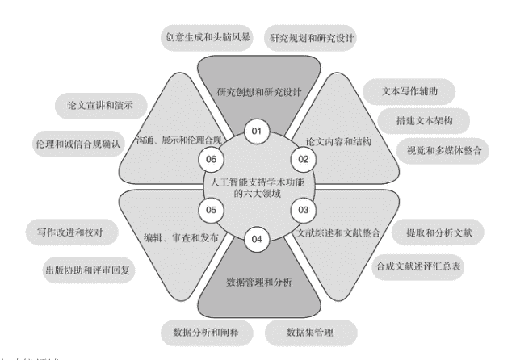

图2-1-1 AI辅助学术的六大功能领域

（图片来源：Khalifa, M., & Albadawy, M. (2024) .Using artificial intelligence in academic writing and research: an essential productivity tool. Computer Methods and Programs in Biomedicine Update , 5.）

科研提速新逻辑：从降本到人机共建

项目周期常以年为单位，核心探索之外还牵扯设备排期、课题统筹、行政后勤以及对外协作等一圈外围事务。智能辅助最直观的价值，是把其中高度程式化且重复的操作剥离出来，例如实验记录、文献归档、进展追踪等，从而压缩圍在外围的人力开销。

生成式系统的快速演进，让效率的提升首先体现在撰写端。过去一篇初稿往往需要数周甚至数月，现在借助现成系统，数分钟就能得到可用的雏形。以对话式助手 ChatGPT 来说明，输入研究主题后即可迅速生成摘要、方法与结论的草案，把从构思到成稿的时间窗口大幅拉短。相关研究已有佐证（如 Al-Sofi, 2024 [2]; Sok和Heng, 2024 [3]; Altmäe 等人, 2023 [4]; Imran和Almusharraf, 2023 [5]）。与此同时，工具链在不断完善，部分平台提供全流程支持，例如 Grammarly 能检查语法、学术用语、句式重复与引用合规，帮助使用者在极短时间内按写作目标调准语气，使表达更为统一。

更深层的变化是工作方式的范式迁移，即人与系统的协同。定制化科研支持成为协同模式的核心亮点。系统可以依据个体的专长、需求与研究方向匹配专门资源与方案，既提升单点效率，也能激发创新与跨学科联想。通过解析研究方向、实验数据与方法，可为使用者提供个性化的解题思路；也能基于兴趣轨迹与过往记录，定期推送相关文献、课程、工具与前沿动态。科研本质上是协作的，系统还能帮助构建个性化学术社交网络，推荐适配的合作对象。借助协同，人能够获得从实验设计到数据分析、从文献推荐到合作机会的端到端深度支持，完成精准定制，在提效的同时点燃研究创意，推动进展。

#### 二、灵感激活：数据驱动与联想推理

思路枯竭、逻辑断裂、思绪紊乱，是科研论文撰写者普遍的痛点。凭借数据驱动、模式识别与算法推理的特性，智能系统为写作过程提供了新空间。

其一，创意产出建立在数据之上。系统能够对海量材料进行分析，提炼规律与模式，从而生成新颖内容，常能挖掘出尚未被充分利用的信息，使其成为创新研究的起点。例如整合实验记录、临床数据、公开数据库等，寻找潜在价值，帮助学者发现新的数据源或提出新的问题与方向。在跨学科整合方面潜力尤为突出，可成为连接不同领域的桥梁（Khalifa和Albadawy, 2024）[6]。它可以整合分析跨学科的知识与数据，揭示领域间的潜在联系。例如在医学领域，系统能把遗传学、生物信息学与药理学的结果结合起来，助力新突破。

其二，系统擅长基于模式识别形成创新联想。它能够在复杂、非线性的数据中捕捉特定规律，这也是其在图像识别、语音识别、自然语言处理中表现突出原因。通过训练模型识别输入特征并据此进行预测与决策，系统为科研提供新的创意来源。模式识别能力可发现数据中的异常值或反常趋势，而异常点常是创新的源头。系统能够自动标记并凸显这些异常，帮助使用者从不寻常的结果中挖掘新创意。

其三，思维路径依赖算法推理。其优势在于通过系统化、逻辑化的计算过程推导出潜在规律、假设与创新方向，减少了常识、情感或直觉带来的个人偏好与社会偏见。同时，系统可构建复杂的仿真模拟环境，用于检验不同创意与假设。例如在社会、物理、气候、生态等领域，可以搭建仿真模型，基于不同输入参数推理出不同结果，帮助使用者验证新理论与实验设计，从而快速发现创意，高效推进研究。

#### 三、破除壁垒：语言、规范与发表

在论文撰写中，因自身能力限制或外部环境影响，研究者常被困于短期难以突破的壁垒，这会影响效率与成果传播。

首要的是语言与表达的障碍。对于以非英语为母语的学者，语言长期是进入国际发表体系的主要门槛。过去十年机器翻译尤其是神经机器翻译的长足进步，正加速打破这一隐形壁垒。Selim (2024)通过访谈与问卷发现，Grammarly和ChatGPT等智能工具对论文撰写技能提升意义重大，认为此类工具是对传统写作技能的宝贵补充，并提出建立动态技术驱动学习环境可增强EFL学生的论文撰写能力[7]。学术论文还有其独特风格，要求简洁、准确、严谨。不熟悉此风格易导致结构不清、表达模糊、逻辑松散。对研究生等学术新人而言，具备学术风格指引与调整功能的写作助手是掌握学术语言的利器。

其次是学术规范与格式的要求。不同期刊对格式要求差异较大，包括引用格式、标题样式、文献列表等，违规可能导致拒稿或需大修，造成时间精力浪费。如文献列表格式就有APA、MLA、GB/T 7714—2015[1]等。正确引用至关重要，手工录入耗时易错，EndNote、Zotero、Mendeley等文献管理工具为此提供便利。

最后是同行评议与出版发表的阻力。面对评审提出的大量修改建议，如何在返修期内有效回应是挑战；消极评审也可能打击信心。Writefull、PaperRater等工具可自动解析评审反馈并给出针对性修改建议。期刊选择同样关键，期刊质量、审稿周期、影响因子等影响投稿成功率。缺乏经验的使用者难以快速锁定合适期刊。出版商提供的期刊推荐工具如爱思唯尔的Journal Finder，可基于摘要、标题、关键词分析数据库相关性，推荐最匹配的期刊，提升命中率。

### 第二节/智能系统使用的三重局限

智能系统为科研撰写带来便利的同时，也暴露出不容忽视的局限。使用者常面临内容真实性不明、引用不规范、责任界限模糊等问题，过度依赖还可能削弱语言表达与批判性思维，导致写作同质化。以下从信息准确、学术伦理与使用依赖三个层面梳理风险与应对思路。

#### 一、幻觉风险与事实准确性

尽管大语言模型在自然语言生成上取得显著进展，“信息幻觉”仍是结构性短板。目前学界尚未形成一致定义（Maleki等人，2024）[8]。“幻觉”一词约在2000年进入该领域，当时在计算机视觉中被视为使低分辨率图像更易用的现象（Baker和Kanade，2000）[9]。Wiseman等人（2017）在高被引论文中指出，当语言模型假定可能性却生成无依据错误内容时即出现幻觉[10]。因此幻觉指文本生成中出现的虚构事实、错误引用、数据拼凑等。

OpenAI 2023年技术报告已明确指出，即便GPT-4在自由生成任务中仍可能产生虚构信息或事实错误[2]。笔者在试用GPT-4.5系列时发现，其对文献作者、年份、期刊等元信息的准确率较高，但在具体论文内容上仍有不少编造。Schneider等人（2025）分析2023—2024年高影响力神经外科期刊的100篇随机论文，发现约20%包含系统生成内容，主张需更严格指南以避免虚假内容混入[11]。瑞典研究人员在谷歌学术发现上百篇疑似系统生成的“垃圾科学”文章，正以更低成本制造传播虚假科学[3]。中文场景亦类似，使用DeepSeek生成文献综述时，叙述逻辑清晰但常拼接年份、模糊作者姓名，甚至虚构文献。

在医学、法律等专业领域，信息错误影响更为严重，可能误导推论并产生伦理法律后果。因此引用系统生成内容时须保持审慎，通过专业数据库人工核验文献信息与内容，确保真实可信可追溯。

#### 二、归责模糊与隐性抄袭困境

系统普及引发关键问题：文本不再完全由人类生成时，责任归谁？据《自然》报道，截至2023年全球逾1万篇论文被撤回，其中9408篇来自欣达维旗下，撤稿原因除同行评审欺诈、论文工厂外，“使用AI”已成为主因之一[4]。《自然》《科学》《细胞》《柳叶刀》《美国医学会杂志》等顶刊均声明AI不具备作者资格，使用者需在稿件中说明。国内期刊亦将隐瞒AIGC使用视为不端。如2023年2月10日《暨南学报》声明：暂不接受大型语言模型单独或联合署名的文章，使用相关工具需单独提出[5]。学界共识是AI无法履行签署伦理声明、回应学术质疑等作者义务，出现不端亦无法追责，故无主体地位，不应署名。

实践中更复杂的则是“隐性剽窃”。多数模型基于海量数据训练，输出时不标注来源，使用者可能有意无意将系统内容当作原创，实则源自已发表或未发表资料，未正确引用即构成隐性剽窃。此类问题也存在于代码与图表。例如系统生成的Python回归分析代码，核心逻辑可能高度近似公开仓库算法，仅变量名与注释被修改，思想实质未变。如何界定原创性，目前尚无统一标准。因此多数出版机构、期刊与高校要求合理披露使用情况。2023年9月20日，中国科学技术信息研究所与爱思唯尔、施普林格·自然、约翰威立共同发布《学术出版中AIGC使用边界指南》，明确使用生成式人工智能直接生成的稿件文字等资料必须披露否则构成学术不端[6]。

#### 三、过度依赖带来的能力消退

除技术与伦理，写作工具的依赖性蔓延是另一隐忧。过度依赖系统进行段落扩写、结构生成乃至引文编排，难免削弱自身语言表达与认知能力。

语言生成模型对惯用词汇与句型的高频使用，易导致内容同质化。高校教学实践中可见，学生借助系统辅助写作的论文语言结构雷同、表达模式趋同，呈现机械拼接风格。Marzuki等人（2023）[12]、Huang和Tan（2023）[13]、Malik等人（2023）[14]的研究均发现过度依赖会限制创造力并降低自主评估写作标准的能力，均强调系统应为辅助而非替代。

批判性思维、决策思维、分析思维是科研与高等教育的关键能力（Soufi和See，2019）[15]。Dwyer（2023）将批判性思维定义为认知能力与倾向的混合，强调求真、系统评估、推理与自我调节等[16]。决策能力对处理复杂信息至关重要（Duhaylungsod和Chavez，2023）[17]；分析思维体现对数据的深度探索与批判解读（Pokkakillath和Suleri，2023）[2]。人工智能正改变人们在研究与教育中批判、决策、分析的方式（Gao等人，2022）[18]。过度依赖会损害这些核心技能，导致批判性思维衰退（Dergaa等人，2023）[19]、决策思维钝化（Duhaylungsod和Chavez，2023）[20]、分析能力下降（Grassini，2023）[21]，滋生认知懒惰。

### 本章小结

当前研究与实践表明，智能工具在提升效率、激发创意、突破壁垒方面作用明显。它们打破了传统个人写作模式，改变了写作者与文本关系，形成人机协同的新型知识生产形态，预示科研生产模式的新方向。然而人机协作需要边界。系统的任务是加速与辅助，而非僭越或取代。无论构思还是论证，有价值的学术创作仍依赖研究者的思辨与问题意识。系统不应腐蚀学术主权，而应成为促进学术解放的工具。正如学界主流观点，“发展人工智能包括发展AI4S本身并不是目的，而是实现人类可持续发展目标的手段……人类必须掌握和驾驭AI4S”[8]。研究者使用系统时，除关注功能差异与性能指标，更应关注其与学术伦理、知识生成机制的关系，从工具使用者转变为技术驾驭者，这也是智能时代提出的新能力要求。

[1] Khalifa,M.,& AlbadaW,M.(2024).Using artificial intelligence in academic writing and research:an essential productivity tool. *Computer Methods and Programs in Biomedicine Update*,5.

[2] Al-Sofi,B.(2024).Artificial intelligence-powered tools and academic writing:to use or not to use ChatGPT. *Saudi Journal of Language Studies*,4(3),145-161.

[3] Sok,S.,& Heng,K.(2024).Chatgpt for education and research:a review of benefits and risks. *SSRN Electronic Journal*.

[4] Altmäe,S.,Sola-Leyva,A.,& Salumets,A.(2023).Artificial intelligence in scientific writing:a friend or a foe?. *Reproductive biomedicine online*,47(1),3-9.

[5] Imran,M.,& Almusharraf,N.(2023).Analyzing the role of chatgpt as a writing assistant at higher education level:a systematic review of the literature. *Contemporary Educational Technology*,15(4).

[6] Khalifa,M.,& AlbadaW,M.(2024).Using artificial intelligence in academic writing and research:an essential productivity tool. *Computer Methods and Programs in Biomedicine Update*,5.

# 第三章 智能写作时代的学术自律新框架

### 本章导读
本单元以模型化写作工具全面进入科研产出链条为切口，探讨其带来的价值冲突与规则再造议题。围绕学术正直这一锚点，梳理在智能辅助快速扩散的情境下，可验证、可公开、可追责、讲尊重等基本诉求如何被改写。结合国内外机构对待智能辅助披露、著录方式、甄别手段等方面的政策动作与实践案例，呈现技术可实现与伦理应然之间的张力。强调效率提升不等于规范松动，主张厘清权利义务归属，构建透明、合规、可信的智能科研生态。

### 第一节 学术操守的意涵与支撑

模型化写作工具的普及正在改写知识生产的流程与逻辑，生成路径、评价方式、协作形态与传播渠道都在位移。工具会迭代，研究之本却未变，正直始终是学术活动的价值底座与制度前提。它维系学界的互信秩序，也决定知识创造者的社会公信。生成类内容全面进入科研实务的当下，更需回望操守要义，在技术可能与伦理期待之间划界，建立适配新生态的治理框架。

#### 一、操守概念的梳理
2009年十部委联合印发的《关于加强我国科研诚信建设的意见》，将学术正直描述为科研人员在活动中倡导求真、实事求是、崇尚创新、开放协作的科学精神，依法依规、坚守职业道德、遵循学界共识的行为规范。2018年中央层面发布的《关于进一步加强科研诚信建设的若干意见》，重申正直是创新之本，并明确企业、事业单位、社会组织等各类主体是建设的第一责任人。2019年《关于进一步弘扬科学家精神加强作风和学风建设的意见》，为建设提供了总体思路。上述表述较为宽泛。

2020年自然科学基金委启动学风建设行动计划，致力营造风清气正的环境。随后编纂的《科研诚信规范手册2023》对概念作了细化，认为学术操守包含两层含义：一是基于诚实原则形成的行为规范体系；二是科研与管理活动中应遵守的职业道德。操守贯穿科研全流程，涉及选题、数据采集与分析、成果署名发表、评审等关键环节。

#### 二、支撑体系的四项支柱
依据国内外主流出版机构与监管部门的规范性文件，学术操守的核心价值可归纳为四类要求：可核验、可公开、能担责、讲尊重。它们共同支撑学术共同体的信任机制，保障知识生产的合法性与社会信任。

##### 1. 可核验性
可核验是研究的底线，数据、记录、分析与结论必须建立在可检验的事实之上。自然科学基金委《科研诚信规范手册2023》明确禁止为特定目的选择性采集、篡改原始数据或进行不当二次加工，也禁止杜撰不存在的数据或凭空编造实验结果。

在智能辅助情境下，模型幻觉是最需警惕的风险。受训练语料局限、生成不确定性、语境理解不足等因素影响，生成类内容常出现信息偏差、失真乃至完全虚构，可能编造看似合理却并不存在的引文、统计结果或图表。若未经人工核验直接采纳，将严重损害结论的可靠性。现阶段主流大模型均存在幻觉问题，难以根除，只能依靠人工交叉验证来保障真实性。

中国科学技术信息研究所、约翰威立、爱思唯尔、IEEE等机构均要求署名者对论文数据严格核查，确保来源准确完整可靠，并强调借助生成类工具辅助撰写的部分必须经署名者本人审阅并承担全部责任，不得出现未经验证的数据或结论。

##### 2. 公开可查性
科研公开意味着研究的方法、数据、分析过程、结果、结论、贡献分配与资助背景等均可公开、可审查、可复现。它是确保科学可信与公正的基础，有助于促进合作、防止造假，并在医学、环境等关乎社会的领域提升公众信任，对财政支持的项目而言，更能保障资金合理使用。

智能系统介入后，公开可查首先体现为如实披露工具使用情况。《学术出版中AIGC使用边界指南》指出，在研究到出版的全链条中，研究者、署名者、同行评审与读者都应明确知晓生成类内容的使用，透明度应涵盖数据透明、底层数据集、来源、处理方法以及知识产权与版权材料的使用情况。指南提供了声明范本：

> 【模板】
> 声明：在本作品的准备过程中，作者使用了[生成类具体工具/服务名称]来[使用目的：如文献调研/数据分析/图表制作等]。使用此工具/服务后，作者根据需要对内容进行了审查和编辑，并对出版物的内容承担全部责任。

图3-1-1 生成类内容使用的声明模板

（资料来源：中国科学技术信息研究所，Elsevier，Springer Nature，Wiley. 学术出版中AIGC使用边界指南[R]. 2023：6。）

##### 3. 可问责性
可问责要求研究者对研究全过程与成果承担完整责任，包括准确性、原创性、合规性与伦理合法性。即便部分环节由智能系统完成，署名者仍须承担全部学术与法律后果。

学界与出版界对人工智能的定位日趋清晰：智能系统不适合作为作者，因其无法独立承担学术责任、参与学术交流，也不具备法律主体资格。约翰威立在2024年修订的伦理准则中明确，署名者必须披露智能工具的使用、说明其作用，并对生成类内容的准确性与合规性负责，智能系统不得署名，所有内容责任由署名者自负。

这意味着研究者不能借助智能系统转移或逃避责任，所有经人或机器生成的内容最终都由署名者承担伦理义务。责任也应延伸至机构层面，部分高校与科研单位已设科研诚信委员会，承担智能辅助研究的合规审查。中科院道德委员会2024年发布的《关于在科研活动中规范使用人工智能技术的诚信提醒》依据全流程诚信管理提出八项注意事项，有助于厘清个人与机构的边界，强化责任机制。

##### 4. 尊重性
尊重性要求在科研中尊重他人成果、尊重研究对象、尊重协作关系、尊重数据与工具的合法使用权限。自然科学基金委《国家自然科学基金科研诚信规范手册2023》提到要尊重合作者的学术观点与价值取向，优先保障参与者的人身安全与健康权益，确保研究的必要性与社会价值，并按规定或协议执行数据的使用权限。

使用智能工具时，尊重性体现为：不将原始资料与数据擅自用于模型训练或二次生成；不让智能系统替代真实作者或用生成类产出冒名顶替；遵守期刊、出版社、基金对智能系统使用的具体政策，履行披露义务；尊重研究对象的隐私，不向第三方智能系统输入敏感个人信息。

随着智能技术与科研活动深度融合，学者借助辅助系统可以在文献整理、论文起草、数据处理等环节提速，但这并不代表模型能够替代人的判断、核验与伦理自律。工具的介入不会让研究者免除对成果的完整问责，反而要求更清晰地划分人机分工，保证产出始终符合既定的学术规范。明确合规运用的范围与触碰学术红线的界限，已成为科研人员需要不断强化的能力。

### 第二节 AIGC的正确使用与披露

生成式内容在学术写作中的渗透加深后，如何说明模型的参与方式、界定责任归属、建立可操作的引用规则，已成为出版与伦理领域必须回应的议题。和传统工具相比，生成模型在文本生成链条中的介入更深，导致权责划分、原创性判断、引证合规等问题的复杂度上升。国际国内的出版机构与伦理组织正集中发布指引，下文先梳理主要政策走向，再介绍APA、MLA、Chicago等主流著录建议，并结合本土实际展望中文语境的发展。

#### 一、AIGC使用政策分析

大语言模型与生成技术在学术写作中的应用加速，各类政策同步成形。大致可归为三类主体：国际伦理组织、国际出版集团与国内科研出版机构。

##### 1. 国外专业学/协会的AIGC使用政策

国际出版伦理委员会、国际医学期刊编辑委员会、美国心理学会等机构已先后推出指引，均明确拒绝把生成模型列为论文署名者。普遍允许在语言润色等非核心环节使用，严禁用于研究设计、数据生成或结果分析，要求在文中透明交代使用过程，并由作者对准确性与合规性承担全部责任；审稿环节亦有限制，禁止将未经授权稿件输入模型。

表3-2-1 国外专业学/协会AIGC使用政策[11]

| 机构 | 相关内容 |
| :--- | :--- |
| 国际出版伦理委员会 | · 生成工具不具备署名资格<br>· 须在材料与方法中如实说明工具类型与运用方式<br>· 撰写人对含生成内容的稿件负全责 |
| 国际医学期刊编辑委员会 | · 模型不得作为作者<br>· 投稿函及稿件中需说明模型使用情况<br>· 作者应核查生成内容的真实性，防止剽窃并保证引用来源准确<br>· 不得引用署名为模型的研究 |
| 世界医学编辑协会 | · ChatGPT类工具不可署名<br>· 使用时须遵循透明原则，说明工具、方法与使用程度<br>· 作者对ChatGPT提供材料的准确性负责，杜绝剽窃、捏造、伪造等行为<br>· 编辑与审稿人使用模型须说明方法并注意保密<br>· 相关机构应为编辑提供AIGC检测工具 |
| 美国心理学会 | · 使用ChatGPT或其他模型需在方法或相应部分说明<br>· 正文先给出提示词，再呈现生成文本，并在参考文献中著录 |
| 英国皇家化学学会 | · 如ChatGPT或LLM不得署名<br>· 如有使用需在实验或致谢部分详述<br>· 作者对文章全部内容包括AIGC承担全部责任 |

##### 2. 国外出版集团/期刊的AIGC使用政策

爱思唯尔、施普林格·自然、约翰威立、IEEE、PLOS等主流机构均已明确立场。通常允许在语言润色、结构调整等非实质性环节运用模型，禁止模型生成或替代实验设计、研究数据和核心观点。多数学术期刊要求投稿时提交模型使用说明，并保留审查AIGC的权利，部分出版社也在研发写作检测机制以配合透明化管理。

表3-2-2 国外出版集团/期刊的AIGC使用政策

| 机构 / 期刊 | 相关内容 |
| :--- | :--- |
| 约翰威立 (Wiley) | · 生成式模型如ChatGPT和LLM不得署名<br>· 如使用需在方法或致谢部分透明详述<br>· 作者对AIGC负完全责任<br>· 使用是否适当由期刊编辑或出版政策负责人最终决定 |
| 爱思唯尔 (Elsevier) | · 仅可用于提升可读性和语言质量，作者须仔细核查正确性<br>· 不得将模型列为作者或合著者<br>· 稿件末尾须声明模型使用情况并对相关内容负责 |
| 《自然》(Nature) | · LLM不得署名<br>· 须在方法或合适部分正确描述生成式模型的使用<br>· 不允许出版模型生成的图像 |
| 《科学》(Science) | · 未经编辑许可不得在论文中使用AIGC，包括模型生成图表<br>· 生成式模型不得署名<br>· 审稿人须自行撰写意见，禁止使用生成式模型 |
| 《美国医学会杂志》(JAMA) | · 非人类模型、语言模型等不具备作者资格<br>· 如使用须在致谢或方法部分说明并对完整性负责<br>· 除正式研究设计外，不鼓励使用AIGC |

##### 3. 国内相关机构与期刊的AIGC使用政策

国家互联网信息办公室、中国科学技术研究所等部门已发布科研诚信与模型应用管理要求，禁止借助模型进行虚假写作、数据伪造或不实引用。部分期刊如《中国科技期刊研究》《图书情报工作》等也在探索披露制度，推动审慎、透明与责任共担的出版实践。

表3-2-3 国内部分科研机构与期刊的AIGC使用政策

| 机构 / 期刊 | 相关内容 |
| :--- | :--- |
| 中国科学技术研究所等 | · 遵循透明问责、质量诚信、隐私安全、公平和可持续发展原则，形成覆盖研究到发表全流程的伦理使用框架<br>· 须充分正确披露AIGC使用情况<br>· AIGC不得署名 |
| 《暨南学报（哲学社会科学版）》 | · 不接受LLM单独或联合署名<br>· 使用过相关工具须单独说明，隐瞒将退稿或撤稿<br>· 引用AIGC文章须提供详细论证 |
| 《中国科技期刊研究》 | · 不接受作者署名含模型工具的稿件<br>· 参考文献中不应出现以模型为作者的论文<br>· 主要内容由AIGC生成视为学术不端<br>· 使用模型须在数据来源、方法设计或结语中说明工具、过程及作用 |
| 《图书情报工作》 | · 不接受署名含模型工具的稿件<br>· 参考文献中不应出现模型为作者的论文<br>· 主要内容由模型生成视为学术不端<br>· 使用模型须在数据来源、方法设计或结语中说明工具、过程及作用 |
| 《天津师范大学学报（基础教育版）》 | · 倡导合理使用新工具<br>· 建议在参考文献或致谢中说明使用生成式模型情况<br>· 加强审稿，抵制学术不端，追求研究的科学性与创新性 |
| 《中国文艺评论》 | · 不接受模型参与署名<br>· 应用限于语言润色、文献检索、数据整理、思路开拓等辅助环节<br>· 投稿须出具模型使用说明并签署承诺书 |

#### 二、AIGC内容的著录建议

##### 1. APA格式下的AIGC著录建议

美国心理学会于2023-2024年更新了AIGC引用指南。APA不把模型生成的文本视为个人通信，因其并非个人主观陈述，而是算法输出，建议按软件引用处理并列入参考文献。以ChatGPT为例，应以OpenAI为作者，标注模型名称及版本，注明为大语言模型并附获取链接。正文中可用括号引注或叙述引注。

```
[1] OpenAI. (2023). ChatGPT (Mar 14 version) [Large language model]. https://chat.openai.com/chat.
```

同时建议在方法或引言部分说明模型使用背景，包括提示词和用途。若内容较长或起关键作用，可将完整对话放附录或在线补充材料并在正文指引。由于生成结果不稳定，APA强调保留原始文本并核查，避免幻觉式引用和虚构文献；模型引用的二手资料也须由作者亲自核实。整体体现出透明披露与学术严谨并重的审慎态度。

##### 2. MLA格式下的AIGC著录建议

美国现代语言协会推荐以“核心要素模板”灵活著录。引用改写或纳入模型生成的文字、图像、数据都应标注，即使仅用于润色翻译也建议在正文、脚注或致谢中说明。MLA不建议把模型视作作者，而是通过来源名称、模型名称、版本、出版方、时间、位置等字段描述参与过程。

例如：
"Describe the symbolism of the green light in the book *The Great Gatsby* by F.Scott Fitzgerald" prompt. ChatGPT, 13 Feb. version, OpenAI, 8 Mar. 2023, chat.OpenAI.com/chat.

其中提示词为来源名称，ChatGPT为模型名称，13 Feb. version为版本，OpenAI为出版方，8 Mar. 2023为生成日期，网址为位置。引用模型生成的创意作品亦可按此模式。MLA同样要求对模型引用的资料进行核实，若未查阅原始来源需注明间接引用或未验证，保持责任透明。

##### 3. 芝加哥格式（Chicago Style）下的AIGC著录建议

芝加哥格式手册最新建议要求明确标识模型来源且不将其视为作者。正式出版物中建议用脚注或尾注补充说明，如：
Text generated by ChatGPT, OpenAI, March 7, 2023, https://chat.openai.com/chat.
若未在正文展示提示语，也可在脚注中补充。若作者对AIGC进行了编辑，如删改文字、润色语义或重组表达，亦应在文中或脚注中注明“内容经过编辑”或“适当调整了语言风格和行文逻辑”。作者-日期体例下可用（ChatGPT，2023）括注。若无法提供公开可访问的对话链接，不宜列入正式参考文献，宜参照个人通信处理，仅在正文或注释中说明。

##### 4. 国内对AIGC的著录建议

国内尚未形成统一的著录规范，部分高校和机构以作者声明或致谢形式披露模型参与，常见做法是在附录或贡献声明页说明使用目的、范围和编辑程度。对具体引用格式、是否列入参考文献仍在探索中。建议遵循诚实披露、谨慎标注原则，参考APA、MLA、Chicago进行适当调整，并主动向期刊或管理部门确认具体要求以降低风险。

### 第三节 AI写作的检测机制与风险意识

生成式模型尤其是大语言模型在学术写作中的普及，让模型写作的可识别性成为热点。建立有效检测机制并提升风险意识，是维护科研诚信的必要举措。

#### 一、AI写作检测的原理和局限性

当前识别方法大致分为两类：基于语言风格与结构的特征检测，以及基于深度学习的分类判别。特征检测利用模型文本的高频词倾向、句式重复、逻辑流畅但深度不足等规律，如“深入探讨”“毋庸置疑”等词出现概率偏高，且缺乏语气变化与个性。分类判别则用SVM、朴素贝叶斯、逻辑回归及深度神经网络等模型，在人类与模型语料上训练以识别差异，部分研究也在探索模型水印技术。

但检测存在明显局限：误判率高。检测指标如困惑度、重复度、突变率也可能出现在规范的人类文本中，法律条文、新闻稿甚至古典文献常被误判。其次，对人机协作文本识别乏力。现实中多为人类主导、模型辅助，多轮提问、润色、重组后产生的文本难以被准确判定，容易被机械贴上高风险标签。因此，检测结果只能作为参考，必须结合人工审核、写作过程追踪、原始草稿比对等多维度判断。

#### 二、AI写作检测的常用平台

【生成内容鉴别与学术风险管控】

保障学术原创与科研诚信始终是学界的重点议题。随着生成式内容快速渗透，国内外信息服务机构纷纷推出面向 AIGC 甄别的平台。现存的主流方案在技术路线、判别精度与适用场景上各有侧重。

##### 1. 知网AIGC检测系统
知网的鉴别方案以结构化、碎片化、知识元化的高质量文献大数据为底座，融合预训练大语言模型的推理逻辑，并叠加知识增强型 AIGC 鉴别技术与多项辅助算法，从语言模式与语义逻辑双路径，由系统对学术文本中的生成痕迹进行快速筛查。该平台依托覆盖面广的学术库与成熟的比对技术，为结果权威性提供支撑。

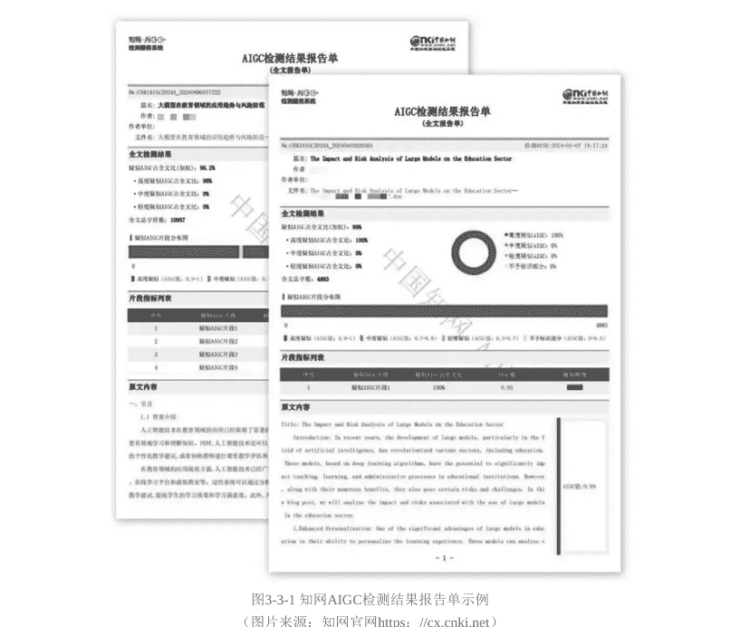

图3-3-1 知网AIGC检测结果报告单示例

（图片来源：知网官网https://cx.cnki.net）

##### 2. 维普AIGC论文检测系统
维普AIGC论文检测系统（https://vpcs.fanyu.com/）在国内高等教育领域应用较为普遍（见图3-3-2）。系统兼容多种文档格式，可对毕业论文、期刊论文、研究报告、项目方案等多类材料进行生成内容排查。其覆盖范围较广，能识别ChatGPT、文心一言、通义千问等国内外主流模型输出。底层采用前沿神经网络识别机制，对人机撰写差异的判断较为精准。此外，该模块已接入维普毕业论文管理系统、作业管理平台及科研诚信管理平台，为教学科研单位提供一体化流程管控与文本筛查服务。

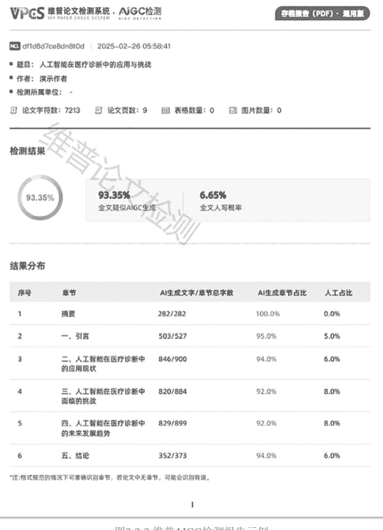

图3-3-2 维普AIGC检测报告示例

（图片来源：维普官网https://vpcs.fanyu.com/）

##### 3. 万方AIGC检测系统
万方AIGC检测系统（https://cx.wanfangdata.com.cn/aigc-check）依托庞大的学术资源库与科研诚信服务平台，提供多版本多维度的生成文本鉴别功能。系统结合深度神经网络模型与语义分析算法，不仅能判定文本是否由模型生成，还可分析段落层面的生成概率并输出结构清晰的报告（见图3-3-3）。平台适用于科研、教学、人事、出版等场景，支持中文、英文及中英混合文本鉴别，服务于个人研究者与机构的合规写作需求。其秉持客观、公正、精准、全面的原则，正成为国内 AIGC 鉴别的重要力量。

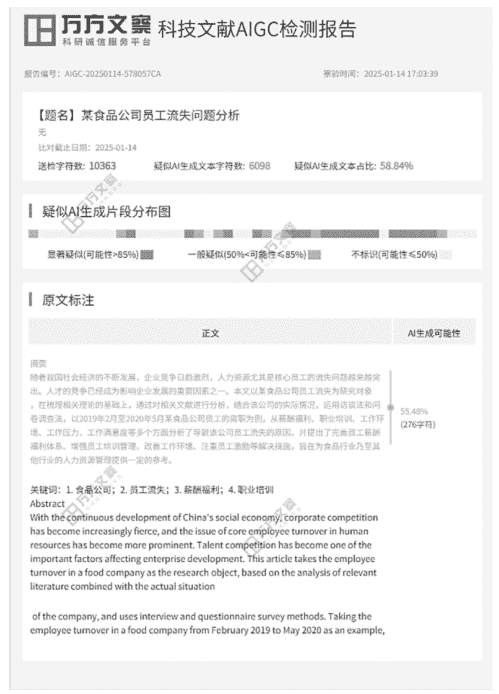

图3-3-3 万方AIGC检测报告示例

（图片来源：万方官网示例http://example.chachongz.com/wfaicheck/）

##### 4. Turnitin AIGC检测系统
在国际层面，Turnitin（https://www.turnitincn.net.cn）是学术不端检测领域影响力较大的平台之一，近年推出了生成内容识别功能（见图3-3-4）。其使用专属识别引擎，可在英文学术写作中检测大语言模型生成的内容，在欧美高校较为普及。检测逻辑主要基于语言流畅性分析、句法结构判断以及对特定模型语言特征的提取，对英文文本中的模型痕迹进行高概率标注。

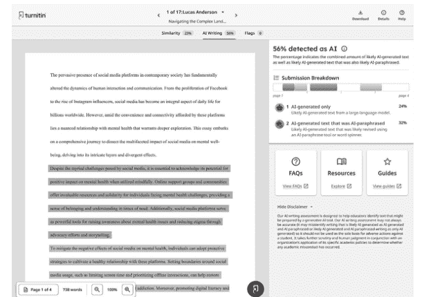

图3-3-4 Turnitin检测结果界面

（图片来源：Turnitin官网示例https://guides.turnitin.com/hc/en-us/articles/22774058814093-AI-writing-detection-in-the-new-enhanced-Similarity-Report）

##### 5. GPTZero AIGC检测系统
另一款国际知名平台是GPTZero（https://gptzero.me/），为专门识别生成内容的轻量工具。它借助突变性、困惑度等自然语言指标，评估文本是否具备人类写作的自然波动，并可通过深度扫描判断句子层面是否存在模型生成可能（见图3-3-5）。该方法在识别ChatGPT类模型输出上优势明显，适用于教育场景的快速初筛，已被部分欧美中小学及大学教师用于作业甄别。

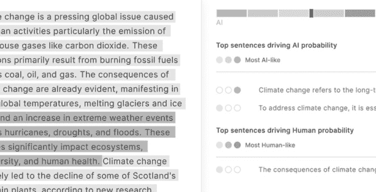

图3-3-5 GPTZero检测结果界面

（图片来源：GPTZero官网https://gptzero.me/）

总体来看，无论是知网、维普、万方等本土系统，还是Turnitin、GPTZero等海外系统，生成内容鉴别技术正向精准化、体系化、多语种兼容方向发展。随着生成式工具持续普及，这些平台将在全球学术诚信维护中发挥更关键作用。

#### 三、提升人工智能辅助写作的风险意识
人工智能辅助在提升效率、拓展表达形式上具有积极价值，但伴随的风险与伦理挑战也不容忽视。尤其是正处于学术训练阶段的研究生和本科生，若缺乏足够敏感度，易陷入技术便利背后的伦理困境。因此，建立对生成式写作潜在风险的系统认知、养成理性使用习惯，已成为构建科研诚信文化的重要环节。

为规范使用，国内多所高校已出台专项规定。例如2024年11月，复旦大学率先发布《关于在本科毕业论文（设计）中使用AI工具的规定（试行）》，明确禁止学生在选题、研究设计、数据分析、核心内容撰写等六个关键环节使用生成式人工智能，违者将面临取消成绩、禁止答辩、撤销学位等严厉处罚，被媒体称为“国内高校首个AI禁令”[16]。西南大学随后在《关于开展2025届本科毕业论文（设计）检测、抽检及答辩工作的通知》中首次明确论文须接受AIGC检测。此外，北京师范大学新闻传播学院、华东师范大学、中国传媒大学、天津科技大学等也相继发布使用指引，要求对AIGC进行标注，或设定文本比例上限，如不超过20%或40%，并纳入毕业审核标准[17]。这些举措体现高校在技术快速发展背景下积极探索监管路径，以维护学术生态的纯净与公平。

在此背景下，个体研究者应及时校准风险意识，在效率与诚信间寻求平衡。

其一，需建立责任归属意识，明确人工智能在科研中的工具属性，将其定位为智能助手而非共同作者，牢记研究者是成果唯一责任主体，需承担学术伦理与法律责任。

其二，需建立规范迭代意识，及时跟踪高校、研究机构与期刊在学术规范上的更新，严格遵守最新要求，合理披露人工智能使用情况，采用规范著录格式，避免无意触碰伦理红线。

其三，需建立工具依赖防范意识，培养批判性思维，不盲目信任模型输出，对信息进行多源交叉验证，让人工智能承担辅助性任务而非核心思考。

其四，需建立主动存证意识，利用技术手段保留科研与写作过程中的人工智能使用痕迹，如保存与系统的对话日志，以备后续核查。

### 本章小结
本章围绕生成式人工智能辅助写作中的学术伦理展开，系统梳理了科研诚信的内涵与原则，强调真实性、透明性、责任性与尊重性是科研活动的基石，并回顾了国内外主流出版机构与学术组织对人工智能使用的政策导向与著录建议。同时揭示了滥用人工智能可能带来的学术不端风险，并介绍了当前主流 AIGC 鉴别工具及其作用。总体而言，生成式人工智能作为科研写作的辅助手段，其价值取决于使用者的伦理判断与责任担当。未来学术写作既要拥抱技术创新，也要坚守规范底线，才能在技术赋能与诚信科研间实现平衡。

[1] 万钢 (2010) .为自主创新营造良好的学术环境[EB/OL].https://www.cas.cn/xw/zjsd/201004/t20100412_2817619.shtml。
[2] 中共中央办公厅国务院办公厅印发《关于进一步加强科研诚信建设的若干意见》 [EB/OL].https://www.gov.cn/zhengce/2018-05/30/content_5294886.htm。
[3] 中共中央办公厅国务院办公厅印发《关于进一步弘扬科学家精神加强作风和学风建设的意见》 [EB/OL].https://www.gov.cn/gongbao/content/2019/content_5404148.htm。
[4] 国家自然科学基金《科研诚信规范手册》编写组.科研诚信规范手册[EB/OL].2023：2。
[5] 国家自然科学基金《科研诚信规范手册》编写组.科研诚信规范手册[EB/OL].2023：7-8。
[6] 中国科学技术信息研究所, Elsevier, Springer Nature, Wiley.学术出版中AIGC使用边界指南[R].2023：5-6。
[7] 中国科学技术信息研究所, Elsevier, Springer Nature, Wiley.学术出版中AIGC使用边界指南[R].2023：2。
[8] Best Practice Guidelines on Research Integrity and Publishing Ethics[EB/OL].https://authorservices.wiley.com/ethics-guidelines/index.html。
[9] 关于在科研活动中规范使用人工智能技术的诚信提醒（中国科学院·2024年） [EB/OL].http://www.cas.cn/dj/gztz/202409/t20240911_7354257.html。
[10] 国家自然科学基金《科研诚信规范手册》编写组.科研诚信规范手册[EB/OL].2023：7-12。
[11] 表3-2-1、表3-2-2和表3-2-3均引用自：洪悦民，王景周.学术期刊出版中人工智能生成内容的使用规范及著录建议[J].编辑学报，2024，36（2）：149-153。本书作者做修改完善。
[12] 如需了解APA格式对ChatGPT等生成式人工智能引用的最新指导，请参阅APA Style Blog官方页面：https://apastyle.apa.org/blog/how-to-cite-chatgpt。
[13] 这里的“个人通信”是指学术稿件的作者对于从私人信件、备忘录、电子通信（电子邮件）、个人访谈或电话交谈等个人通信方式中获得的信息的标注类型。
[14] 如需了解更多MLA格式对生成式人工智能内容引用的具体规定与示例，请见MLA Style Center官网：https://style.mla.org/citing-generative-ai/。
[15] 有关芝加哥格式在AI文本引用方面的建议，请参考The Chicago Manual of Style官方问答页面：https://www.chicagomanualofstyle.org/qanda/data/faq/topics/Documentation/faq0422.html。
[16] 复旦大学发文规范毕业论文AI使用违者或受处分[EB/OL].http://edu.people.com.cn/n1/2024/1201/c1006-40372717.html。
[17] AI代写论文打假！查实或将撤销学位！[EB/OL].https://news.sohu.com/a/865044355_503494。

# 第二部分

AI辅助学术写作实践

本书第二部分将深入探讨AI如何实现对学术研究全流程的赋能。后续将系统拆解科研与学术写作的基本流程——第四章聚焦研究的起点，解析AI在选题构思与方案设计中激发创新、优化路径的作用；第五章深入文献工作，展示AI如何革新文献检索、管理与深度阅读，构建智能化知识网络；第六章切入核心的论文撰写与修改环节，探讨AI在结构规划、内容生成、语言润色及规范性检查等方面的辅助作用；第七章转向实证研究的关键，阐述AI在数据处理、分析建模与结果可视化方面的能力提升；第八章则关注研究成果的转化，介绍AI如何助力研究者高效完成投稿与发表。这五章环环相扣，既描绘了AI融入科研各阶段的实践路径，也揭示了其推动科研范式从传统模式向智能化高效协同演进的变革潜力。

# 第四章

研究选题与方案设计

### 本章介绍
本章聚焦AI在学术写作中选题与方案设计阶段的应用价值，围绕研究方向确定、文献调研、问题构建、方案制定与可行性评估五步，全面梳理AI工具在主题聚焦、趋势洞察、变量识别与方法建议等方面的辅助作用。结合选题评价的五项标准，并以传播学、社会学等实际案例与提示词示范，直观呈现AI在提升选题效率与完善研究设计方面的实践价值。

### 第一节 选题：学术研究的第一道关
马克思曾在《政治经济学批判》（1869）序言中写道，“学术的入口，也是地狱的入口”[1]，这句话既表达了他对科学的敬畏，也形象地揭示了学术研究的不易。作为研究起点，选题环节对研究者而言往往最具挑战。一个选题是否合理、是否具备潜力，不仅决定后续工作能否顺利展开，也在很大程度上影响写作质量、发表成功率以及研究者的学术影响力。随着知识生产方式的变革与学术生态的演进，选题这项原本高度依赖个人阅读思考与导师指导的工作，正在面临信息体量激增与处理复杂度提升的挑战。以下先回答一个根本问题——选题为何困难。

#### 一、选题缺乏问题导向
初入研究者最易陷入的误区是提出宽泛无聚焦的命题，例如“人工智能在科研中的应用”。此类题目看似契合热点、资料易找，实则缺乏明确的研究对象、场景边界与方法限定，难以构成真正的研究问题。那么，何为研究问题？

批判理性主义创始人卡尔·波普尔（Karl Popper，2009）指出，“我们研究的不是学科，而是问题……科学应被视为从问题到问题的不断进步——从问题到更深刻的问题”[11]。Schmidt（2011）认为，自然科学与社会科学研究都是“以问题为导向，或更确切地说，由问题决定”，而问题通常包含“一个非期望的初始状态、期望的目标状态，以及两者转换间的障碍”[2]。这表明问题导向的本质是立足现实实践，而非纯概念思辨。

徐飞（2019）进一步提出，学术研究对象中的理论问题应包括：需要回答的命题；需研究讨论并解决的矛盾与疑难；造成差距的因素；关键或重要之处[3]。这一界定更全面地描述了研究问题的特征，即学科中存在悬而未决的矛盾与疑惑，需要研究者追根溯源的重要议题。以“人工智能在科研中的应用”为例，“将人工智能用于科研会对研究者的学术创新能力产生何种影响”则更符合上述定义。

对研究者而言，问题导向要求其具备问题意识，即“既要从客观实际出发洞察并发现问题、挖掘理论价值，也要具备开展问题研究与解决问题的Hamilton主动能力与科学方法”，它是抽象思维、具象思维、自我反思与批判性思维、理论创新思维及建设性思维的综合体现（盛昭瀚，2019）[4]。这对研究者的综合素质提出很高要求。

#### 二、选题高度同质化
选题同质化是当前学术训练中常被忽视却相当致命的问题。科研考核机制僵化、发表渠道拥挤，导致研究者追逐热点，造成重复。面对考核与发表压力，很多人倾向于选择政策关注或社会流行的热门领域，以提高发表成功率。这种跟风式研究往往缺乏深入的问题意识与创新意义，导致内容空泛、框架雷同、实践价值不足，既削弱原创性，也阻碍对冷门却具潜力的议题的深入探索。

笔者以“AI学术”为关键词，利用中国知网指数检索功能对该领域热点趋势进行分析，观察2018—2025年关注度变化。从图4-1-1可看出，“AI学术”相关中文文献数量与中文关注指数均在2023年后显著上升，2024年达峰值，显示该领域研究近年快速增长。与此同时，“AI学术”外文文献数量及其关注指数虽总体稳步波动，但增幅不及中文明显，说明相较国外，国内学界在该领域的热情更为高涨。但在热情背后，选题同质化的隐忧难以忽视。

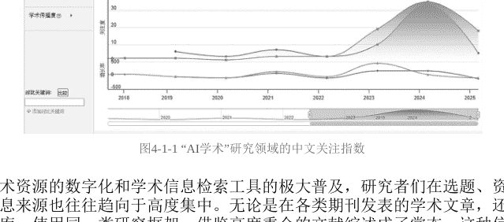

与此同时，数字化与检索工具的普及使研究者在选题、资料收集与综述阶段的信息来源高度集中。期刊文章与硕博士论文中大量出现引用同一数据库、使用相同研究框架、综述文献高度重合的现象。这种信息源同质化演变为主题与内容的趋同，制约了创新活力。此外，高校对青年研究者的训练偏向模板化，研究遵循统一范式与写作路径，进一步造成逻辑与资源使用的结构性趋同。随着人工智能工具在科研辅助中普及，由于训练数据与算法逻辑的相似，基于人工智能形成的选题也易出现高度雷同。若研究者不对备选问题进行深入再加工、文献核查或创造性思考，很可能导致选题与已有研究严重重合，缺乏创新价值。

#### 三、选题缺乏可行性

选题卡在起步阶段，往往不是创意不够，而是可行性在拉响警报。警报通常来自三类结构性问题：方向感缺失、支撑条件不足、能力与方法错位。

方向感缺失最直观的表现是题目张得过大过散，看不出要解决的具体困惑，这背后其实是问题意识不够清晰。另一种情况是所处领域还缺乏稳固的理论底座，找不到可依托的分析模型与学术范式，写作很容易空转。

支撑条件不足主要体现在资料、样本、投入三个缺口。资料层面，需要的文献或数据稀缺、敏感或收费过高，特别是涉及政府内部、企业机密、军工项目或高价历史档案，短期内难以取得。样本层面，研究对象难以接触或基数太小，代表性受限会削弱结论的可信度。投入层面，调研周期过长、需跨地域作业、实验开销过大，整体成本远超承受范围。

能力错位多表现为方法选得过高。采用了作者尚未掌握的复杂技术，或缺少必要的人力配合，执行时就会出现断层。

### 第二节 五维打分法帮你判断题目好坏

在学术实践里，题目的质量很大程度上决定了项目的天花板。为了让判断更系统，可以用一套五项评估视角来审视：学术意义、落地可行、原创亮点、体系完整、规范合规。五项视角覆盖从价值到执行的全链路，有助于立项时做理性取舍。

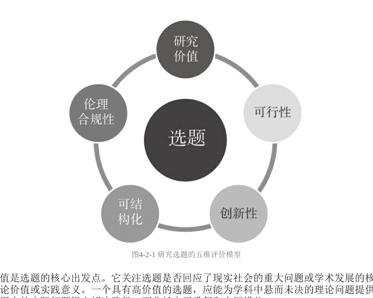

学术意义是起点，要看它能否回应现实社会的紧迫议题或学科的前沿提问，能否形成理论增量或实践指引，而不是简单重复。

落地可行关乎能不能做，涵盖资料是否可得、方法是否匹配、人力时间是否充足。即便意义重大，若样本拿不到、方法学不会、周期拖垮，成果质量也会受损。

原创亮点是科研的活力，要具备新视角、新建构或方法突破，不是无本之木，而是在已有积累上做合理推进，或深挖冷门领域，或做跨学科融合。

体系完整看题目能否拆解为明确的概念、变量及逻辑链，形成完整的研究脉络。边界模糊、逻辑混乱的题目，很难展开，也难以产出高质量成果。

规范合规是底线，必须符合法律及伦理规范，尤其涉及隐私、敏感信息、未成年人或动物实验时，需要保障知情同意及隐私保护，避免学术不端。

#### 一、意义评估：值不值得投入
意义是投入的第一道门槛，既包括对学科体系的推进潜力，也包括与现实议题、政策走向的贴合度。过去主要靠经验，现在借助生成式助手，普通作者也能更快捕捉趋势：

热点追踪与活跃度判断。文献发现平台如 Scite、Elicit、知网研学，可基于输入词生成主题热度图谱、高频用词时间分布，帮助初步判断议题活跃程度。

语义提炼。智能算法能批量聚类摘要与用词，从中提取主流关注点及尚未被充分覆盖的空白，判断议题是否仍有延展空间。

政策与现实联结。通过聚合政策文件、新闻及数据库，助手能提示研究主题与当下社会热点的连接点，提升现实价值评估的精度。

需注意，助手擅长信息整合与趋势识别，却依赖既有公开文献，难以预判学术前沿的未知需求。最终的价值判断，仍需作者对本学科、社会变迁及现实问题的深度理解。

#### 二、落地评估：能否执行
可行性强调现实条件，不仅是个人时间及能力，还包括资料可得性、对象可达性及方法可操作性。很多有意义的课题因执行难度高而被迫放弃。对此，智能助手可提供三类支持：

变量结构识别与框架建议。基于已有成果提取常见变量、测量维度及分析框架，为问卷或模型设计提供起点。

数据源推荐及可获取性判断。通过抓取开放数据库、问卷平台及公共资源，辅助评估课题是否有资料基础，能否以合理成本获取有效样本。

能力匹配预警。当提出结构方程、文本情感识别等高门槛方法时，助手会提示技术难度，并建议更易实现的替代路径，避免方法选得高、能力跟不上。

需要提醒的是，助手的评估多基于理论最优，可能忽略权限限制、伦理审批、资源短缺等现实摩擦。最终权衡仍需结合实际经验、项目资源及个人能力。

#### 三、原创评估：有没有独特视角
原创性是产生影响的关键，重点在于新在何处、如何实现。常见路径包括提出新的变量关系、构建新的分析框架、跨学科融合、采用新方法或聚焦被忽视的人群、区域、情境。助手可辅助：

研究结构快速概览。对主题文献做结构化归纳，呈现主流方法、变量设计及样本类型，判断哪些角度已被覆盖。

争议点提取与盲区识别。利用引用图谱及立场分析功能，能揭示学界争议、未定论分歧或视角空白。

边缘方向推荐。基于联想模型，为宏观主题推荐冷门研究对象或边缘变量，如职业院校学生、老年群体等低关注方向。

助手适合做反向扫描，发现研究缺口及重复风险。但真正的突破仍需作者独立思考及跨领域洞察，无法凭空产生原创思想。

#### 四、体系评估：能否系统展开
体系完整度评估题目能否转化为完整的研究路径，包括清晰的问题陈述、变量界定、研究假设、分析模型及预期结果。若题目只是一个想法，无法落实为框架，就难以支撑合格的学术产出。助手可做到：

结构模板生成及逻辑梳理。输入主题后，助手可辅助生成研究问题、假设、变量、方法、预期结果的逻辑链，帮助理清脉络。

研究类型匹配建议。根据研究目的，助手能推荐适配的类型，如因果模型、比较研究或描述研究，帮助确定策略。

变量与理论对接指导。助手还能提示哪些变量适合挂靠哪些理论模型，提升设计的理论支撑。

在结构化构思阶段，助手能迅速搭建看似合理的框架，但常缺乏对具体语境及方法细节的贴合，存在过度模板化风险。使用者应谨防表面通顺而实际操作困难，仅作参考。

#### 五、合规评估：是否站得住规矩
伦理合规是学术底线，包括对象隐私保护、资料采集合法性、对敏感群体的风险控制。尤其涉及青少年、医疗资料、平台行为分析时，若无合法授权及伦理审批，将严重违反规范。助手可帮助：

风险预警及说明生成。对涉及敏感对象或方法时，自动提出是否取得知情同意的提醒，并协助起草伦理声明初稿。

敏感资料及平台使用规范提示。识别未经授权使用平台资料、采集位置、面部、账号信息等违规点，协助规避隐私风险。

合规写作支持。提供引文规范、资料引用格式、作者贡献声明等模板，确保全流程合规。

助手具备较强风险识别及规范提示功能，有助于新手树立科研道德意识。但提供的伦理建议多为普适模板，难以应对特定领域的深层判断。学术责任最终在作者本人，工具不能替代担责。

### 第三节 用智能助手把兴趣收敛成选题

五维框架提供了系统化的判断标准，但完成选题还需按流程推进：确定方向、文献调研、凝练问题、制定方案、可行性评估。从想做什么到能怎么做，本节聚焦第一步，如何借助智能助手把模糊兴趣快速收敛到学科焦点。

#### 一、把大方向拆成小切口
研究起步时，往往只有模糊兴趣点，如对人工智能、社交媒体文化、社会不平等感兴趣，这太宽泛。借助生成式助手，可通过多轮交互逐步压缩为具体方向。

例如对人工智能在品牌传播中的应用感兴趣，第一轮可问该交叉领域有哪些值得研究的具体主题，助手可能列出生成式AI在广告设计中的应用、算法推荐对品牌偏好的影响、大模型生成品牌调性的可控性等。第二轮选择其中一个追问，算法驱动的个性化推荐对品牌偏好的影响，有哪些尚未充分探讨的子问题，助手会进一步给出回音室效应对长期偏好的非线性影响、个性化与隐私悖论的交互、控制感缺失导致的品牌疏离、不同文化下效果差异等。

每一次追问都是一次思维压缩，对话式追问比单次输出更精准。

常用提示思路：
初步主题压缩：“我想研究[模糊兴趣主题]，可以帮我列出几个具体可研究的方向吗”
子议题细化：“就其中一个方向，请列出5个有变量关系或方法建议的子问题”
结构识别：“这个主题能否转化为研究问题？请补全研究对象、变量及方法”

#### 二、关键词重塑与问题聚焦
进入文献检索时，常卡在表达不准、用词不熟。智能助手在用词再造与问题聚焦方面有明显优势。

助手可快速提供核心用语及其学术表达、方法相关术语、理论或模型名称、相似研究的用词组合等。

以短视频使用对注意力的影响为例，助手可先提取核心用语如注意力持续时间、主要平台、媒体多任务处理、认知负荷；再生成方法相关术语如眼动追踪、问卷调查、实验设计、内容分析；最后在理论层面推荐媒介习惯理论、信息加工理论、认知过载模型等。三层体系可直接用于 CNKI、Web of Science 等平台，也能用于生成检索式或用词共现图谱，提升检索效率。

常用提示类型：
用词生成类：“我正在研究社交媒体使用与青少年心理健康，请帮我列出该主题的核心用语、方法相关词和常用理论词。”
检索语句组合类：“请用 AND/OR 帮我组合一组适用于学术数据库的英文检索语句，主题是大学生使用短视频影响注意力。”
对比分析类：“请对比 media multitasking 与 selective attention 在近五年英文文献中的使用趋势，说明哪个更热。”

TikTok 上瘾常联动的五大高频词

#### 三、跨学科选题的联结方式：语义场比对
做跨界选题是常见诉求，像社会学搭配 AI 伦理、传播学搭配推荐算法等。借助大语言模型进行语义对齐，可以把两门学科的概念、议题和研究路径的交叠部分找出来。下面这张表示范了模型如何揪出跨学科的交汇点：

表4-3-2 AI辅助捕捉跨学科交叉点

| 学科 A | 学科 B | AI 协助发现的交叉点 |

| :--- | :--- | :--- |

| 教育学 | 计算机学 | 教育公平中的算法偏见；AI 写作工具对教学结构的冲击…… |

| 传播学 | 心理学 | 社交媒体对青少年心理健康的影响；媒介使用与自我认同建构…… |

| 社会学 | 技术哲学 | 技术排斥、算法治理、数字鸿沟的社会结构分析…… |

### 第四节 文献调研：借助AI提炼研究缺口与趋势图谱
方向确定后仍不够，关键要回答学界走到哪一步、还有什么空白。文献梳理正是用来回答这个问题的环节。过去靠手工效率低，有了智能支持后，文献汇聚、热点捕捉、空白挖掘与图谱生成都能提速。

#### 一、智能工具下文献调研任务拆解
借助智能系统，调研可以拆成四层——汇聚：快速浏览相关论文；归类：梳理主题和方法；动向判断：看发展走向；空缺查找：找尚未被触及的领域，见表4-4-1。

表4-4-1 不同调研任务下的AI赋能与工具示例

| 调研任务 | AI 赋能 | 工具举例 |

| :--- | :--- | :--- |

| 聚合：快速查阅相关文献 | 自动生成摘要、关键词提取 | Elicit、Research Rabbit |

| 分类：梳理研究主题与方法 | 文献主题聚类、研究方法提取 | Scite、Litmaps |

| 趋势识别：判断发展动态 | 关键词热度追踪、发表年份可视化 | 知网研学、Connected Papers |

| 缺口识别：寻找尚未研究的领域 | 引用网络分析、争议点检测 | Scite、Semantic Scholar |

#### 二、从文献中识别热点集聚带与范式框架
检索时常出现结果泛滥、抓不住核心、读完依旧模糊的困境，容易导致重复、碎片或缺乏框架。智能系统的结构识别能力可以整合关键词、指标和引用关系，帮助研究者快速定位热区与常见范式，从而指引选题和路径设计。

##### 1. 热点集聚带：高发主题的集中地
热点集聚带指一段时期内学界集中投入的主题集合。典型特征是高频词反复出现、核心指标被反复使用、研究路径趋于标准化。

Elicit、Scite、Dimensions、知网等平台可通过词共现、趋势图谱、引用网络，自动绘制主题近年的热度图，帮助判断哪些方向已高度开发，哪些仍有空间。

比如研究“短视频对大学生注意力的作用”时，模型共现分析会发现“TikTok”“attention span”“cognitive fatigue”“media multitasking”等词频繁同现，说明该路径已成热区。若要跟进，就需在指标、样本或方法上做差异化，避免同质化。

##### 2. 范式框架：主流路径的提炼方式
范式框架是某主题下常见的指标逻辑、方法组合和分析框架。很多人不是没内容，而是不会组织。模型可用大规模语义分析、结构抽取和模型推荐给出清晰蓝图，主要包括：

- 研究路径：指标间的因果或关联链，如“媒介使用→情绪波动→行为变化”；
- 方法组合：高频出现的搭配，如“问卷+回归”或“访谈+扎根”；
- 理论框架：主流视角与支撑理论，如“使用与满足”“认知负荷模型”。

以“大学生使用AI写作工具的行为”为例，模型分析二十余篇论文后得到典型模式：
- 研究指标：使用频率、写作焦虑、学习自我效能感等；
- 方法设计：李克特量表问卷+相关回归等统计分析；
- 分析路径：使用动机→使用行为→学业写作表现。

研究者可在此框架上挑选核心指标并补充新指标，实现创新。

#### 三、如何发现文献空缺
找空缺是科研难点，智能工具提供三种路径：

1. 用“支持—反对”结构找争议
Scite的supporting/contradicting/mentioning标签能展示某个假设在学界是否存争议。如“短视频伤注意力”既有支持证据，也有相反的实证。

2. 画共引图谱找边缘议题
用Litmaps、Connected Papers输入一篇核心文献，可生成邻近网络。反复被引的议题是主流，孤岛式议题往往是创新突破口。

3. 让模型提示未被涉及的问题类型
ChatGPT可基于文献描述总结出“本研究未探讨……”“未来可尝试……”等提示。如在大量研究“短视频使用时长”后，模型可能指出“内容偏好”“互动行为”“观看时段”是待开发细分。

#### 四、借助AI辅助高效完成文献调研的提示词示例
1. 研究地图式提示词
示例：“请概括近五年‘[主题]’的代表性研究主题、方法与变量。”
2. 缺口识别类提示词
示例：“关于‘[主题]’的现有文献，哪些变量或研究对象还未被充分讨论？”
3. 研究趋势预测类提示词
示例：“从文献数据看，‘[领域]’未来可能的新方向有哪些？”
4. 文献争议扫描类提示词
示例：“关于‘[变量1]与[变量2]关系’的研究，主要的支持与反对观点分别是什么？”

这些提示词可用于ChatGPT、DeepSeek，也可配合Scite、Semantic Scholar使用。需注意智能手段无法替代价值判断，关键词在不同学科含义不同，结果需结合专业背景筛选。自动综述工具如Elicit、Scispace只能作为初级材料，不能替代系统综述的逻辑深度。

### 第五节 构建问题：从话题到研究框架的转化
文献调研后资料和灵感都有了，关键一步是把信息整合成可操作的研究议题。本节演示如何借助智能工具把兴趣点转化为结构清晰的问题。

#### 一、研究问题的四要素
成熟的研究议题应包含研究对象、核心指标、指标关系、方法路径四要素，见表4-5-1。

表4-5-1 研究问题的四大构成要素

| 构成要素 | 含义 | 示例（以“短视频与大学生注意力”为例） |

| :--- | :--- | :--- |

| 研究对象 | 研究中关注、分析或探讨的特定目标是谁或什么 | 大学生群体 |

| 核心变量 | 研究关注的因素或现象是什么 | TikTok 的使用频率、注意力持续时间 |

| 变量关系 | 因素之间的逻辑关系是什么样的 | TikTok 使用频率如何影响注意力持续时间 |

| 方法路径 | 采用什么方法和手段开展研究 | 实验 + 问卷调查、统计分析 |

#### 二、AI在问题构建中的作用
1. 转译压缩与指标抽取
大模型能把模糊话题转成精炼设问并提取指标组合。如输入“我想研究短视频对学生学习的影响”，模型可输出“本研究探讨学生使用短视频平台的时间与其学习注意力间的关系”。

2. 自动补全模型与逻辑结构
借助提示词让模型补全对象、指标、关系、方法四要素，并提出假设。

3. 结合理论提升深度
模型可推荐理论框架，帮助构建自变量—中介变量—因变量的因果链。

##### 例4-5-1 “短视频对学生学习的影响”的问题建构
研究者问：“我对短视频对学生学习的影响感兴趣，请帮我转化为包含对象、变量与方法的研究问题。”

DeepSeek 给出三种思路：

###### 研究问题 1 ——问卷研究
研究对象：某城市初三学生12～15岁
变量：自变量短视频日均使用时长；因变量数学期末成绩；控制变量性别、家庭经济水平、父母学历、课外补习时间
方法：问卷获取使用数据，收集期末成绩，多元线性回归控制混杂后检验关联
研究问题：在控制社会经济背景下，初中生每日短视频时长与数学成绩有何关系？

###### 研究问题 2 ——实验研究
研究对象：某大学一年级心理学专业学生18～20岁
变量：自变量短视频干预类型知识类vs娱乐类；因变量短时记忆测试前后差值；调节变量多任务处理倾向量表得分
方法：随机分两组分别观看15分钟知识类或娱乐类短视频，前后测数字广度，双因素方差分析检验交互
研究问题：知识类与娱乐类短视频对大学生短时记忆的影响有差异吗？是否受多任务倾向调节？

###### 研究问题 3 ——混合研究
研究对象：某重点高中高二文科班学生16～17岁
变量：核心变量短视频使用模式碎片化vs系统化；结果变量历史深度学习水平概念联结度、批判思维评分；中介变量注意力碎片化程度课堂观察+眼动数据
方法：App日志划分模式，课堂录像编码注意力，论述题评分批判思维，结构方程模型+深度访谈三角验证
研究问题：碎片化短视频使用是否通过注意力分散中介，对高中生历史深度学习产生负面影响？

变量操作化建议：
1. 使用强度可细化为日均次数、单次最长连续时间、主动搜索率等
2. 学习效果测量：客观指标标准化成绩、作业质量；主观指标学习自我效能感、元认知策略问卷
3. 影响机制可加入延迟满足能力、信息加工深度等中介

方法扩展方向：
- 纵向追踪三个月交叉滞后效应
- 神经科学方法EEG检测观看前后的α波变化
- 对比研究短视频内置学习模块vs传统MOOC效果差异

#### 三、从话题到结构模型的提示词模板
表4-5-2所示为实用提示词模板，用于构建结构化研究问题：

表4-5-2 构建结构化研究问题的提示词示例

### 第六节 制定方案：AI协同设计研究计划与方法路径
研究方案传统上靠经验和导师指导，智能出现后正转向人机协同。模型可帮助理清逻辑、排时间表、匹配方法、推荐工具、预设模型，让规划从凭感觉走向结构化。

#### 一、研究设计的核心构成
研究设计是在数据收集前对研究目的、对象、概念界定、方法技术及分析策略的系统规划，是施工蓝图。清晰的设计提升科学性与可执行性，设计不当则导致数据不支持、指标混乱等问题。其要素见表4-6-1。

表4-6-1 研究设计的基本要素

| 构成要素 | 关键问题 | 示例（以“短视频与注意力”研究为例） |

| :--- | :--- | :--- |

| 研究目的 | 要解决什么问题 | 探讨短视频使用是否影响大学生的注意力水平 |

| 研究对象 | 研究中关注、分析或探讨的特定目标是谁或什么 | 某高校大一学生群体 |

| 研究变量 | 关注哪些因素 | 自变量：短视频使用频率；因变量：注意力测验得分 |

| 数据来源 | 数据从何而来 | 问卷调查、课堂观察、认知测试 |

| 研究方法 | 用什么方式获取与分析数据 | 调查研究 + 实验设计；分析方法为相关分析和回归分析 |

| 研究假设/模型 | 是否建立变量之间的关系假设 | 使用频率越高→注意力越低 |

模型在设计阶段不直接给答案，而是帮助理清思路、构建结构、选择方法。可根据主题生成初稿草案，匹配研究方法与测量工具，并预检结构完整性，如变量是否闭环、数据是否可得、假设是否冗余。

#### 二、社会科学常见方法概览
##### 1. 定量研究方法
依赖标准化量表量化概念，用统计揭示变量关系，强调可重复与可比较，适用于假设检验、因果探究与趋势预测。见表4-6-2。

表4-6-2 定量研究方法类型

| 方法类型 | 适用问题类型 | 常见数据来源 | 常用分析工具 | 应用示例 |

| :--- | :--- | :--- | :--- | :--- |

| 问卷调查 | 大样本现象、相关/因果关系等 | 线上问卷、实地问卷 | SPSS、AMOS、Jamovi等 | 研究大学生短视频使用与专注力之间的关联 |

| 实验法 | 因果关系 | 控制实验 | SPSS、R、Python等 | 比较娱乐型与知识型短视频对学习记忆效果的影响 |

| 内容分析 | 媒体文本、平台数据、定量特征统计 | 新闻报道、社交媒体内容 | SPSS、DiVoMiner等 | 分析抖音短视频中关于女性形象的呈现 |

| 二手数据分析 | 大样本现象、相关关系等 | 公共数据、平台开放数据 | Stata、R、Python等 | 利用微博舆情数据分析公众情绪波动趋势 |

##### 2. 定性研究方法
强调理解与阐释，关注个体经验、情境意义与互动过程，通过访谈、观察、文本分析挖掘结构机制与文化逻辑。见表4-6-3。

表4-6-3 定性研究方法类型

| 方法类型 | 适用问题类型 | 常见数据来源 | 常用分析工具 | 应用示例 |

| :--- | :--- | :--- | :--- | :--- |

| 深度访谈 | 理解主观经验、个体动机 | 半结构式访谈记录 | NVivo、ATLAS.ti等 | 访谈高校教师对AI写作工具的态度与适应策略 |

# 研究方法怎么选？AI 协作实操全景

| 研究路径 | 核心关注 | 材料类型 | 分析方式 | 典型应用 |
| 焦点小组 | 多人讨论中的分歧与协商轨迹 | 讨论录音、文字稿 | NVivo 等质性工具 | 探高校学生对算法推荐的接受与排斥张力 |
| 参与观察 | 真实场景下的社会互动 | 实地观察笔记 | 手工编码、ATLAS.ti 等 | 记录社区老年人使用数字平台的学习策略 |
| 文本分析 | 深层语义、价值立场与隐含框架 | 政策文件、媒体稿件、谈话记录等 | RQDA、手工分析等 | 解析主流新闻报道中 AI 发展的话语框架 |

##### 3. 混合研究方法
混合研究把量化测量与质性解释整合起来，既要看变量间的关系强度，也要弄清关联背后的机理。这类设计在复杂社会议题中解释力更强，尤其适合跨层次、跨人群的课题，详见表4-6-4。

表4-6-4 混合研究方法类型

| 应用策略 | 分析逻辑 | 分析工具 | 应用示例 |
| :--- | :--- | :--- | :--- |
| 定性先行 | 先提炼构念再检验关系 | NVivo 等质性分析工具 + SPSS 等定量分析工具 | 先访谈摸清算法厌恶的原因，再用问卷探讨行为意愿与影响因素间的关系 |
| 定量先行 | 先描述现象再探索成因 | SPSS 等定量分析工具 + NVivo 等质性分析工具 | 大样本调查大学生使用 AI 写作工具的方式后，访谈高频用户了解使用动机 |
| 并行式 | 同步采集定性与定量数据 | Dedoose、MAXQDA 等 | 同时分析 TikTok 用户评论的情绪倾向与视频创作者的创作动机 |

需要提醒的是，AI 可以辅助理解、挑选与组织方法结构，但方法选择的最终裁决仍在研究者。分析过程、变量操作化与结果解读都需扎实的理论功底，避免盲目生成即接受。

#### 三、AI 介入的方法设计

##### 1. AI 辅助挑选研究方法
一个合理的方法应同时满足契合问题类型、在研究者能力范围内、适配可得数据三点。AI 通过语义解析与范式匹配，能快速判断问题属于描述、解释、因果推断或预测，并给出方法说明、数据采集建议与实施要点。

输入核心变量后，AI 可推荐适配的测量工具，如标准化量表、里克特题项、访谈提纲，并对不同方法的适用场景、精度需求与资源消耗做简要权衡。对需整合多源资料的选题，还可给出“质性+定量”或“访谈+调查+内容分析”的组合策略，特别适用于机制探索与现象描述并重的社会科学议题。提示词参考：

> “请为‘大学生短视频使用与时间管理能力的关系’拟一份包含研究目的、变量设定、方法建议、样本选择与测量工具推荐的研究方案草案。”

##### 2. AI 辅助量表设计
量表质量直接影响数据效度与结论可信度。传统获取成熟量表需大量文献梳理，AI 可在检索与设计环节提供支持。

第一类是量表检索与推荐。AI 可依据变量名与主题，快速定位成熟量表并给出名称、维度、题项数、信效度指标与文献来源。提示词参考：

> “我研究大学生的‘社交媒体成瘾’，请列出三个常用量表及其维度结构。”

第二类是题项语言生成与翻译辅助。AI 可按维度与测量目标自动生成里克特题项，并按需调节语气、复杂度与文化适配。提示词参考：

> “请就‘媒介时间管理’变量，设计一个含三维度、每维三题的五点中文里克特量表。”

第三类是文献追踪与经典量表推荐。AI 可帮助定位经典版本、中文译本及相关文献，输入关键词与测量对象即可返回数种主流量表建议，并附评分规则与维度划分。

需注意，AI 仅能作为语言与结构设计的辅助，量表开发与信效度检验仍须研究者按规范流程完成。

##### 3. AI 辅助访谈提纲设计
访谈设计的关键是提问的有效性与层级化。访谈不追求标准化答案，重在引导深度信息与真实经验。

AI 可先帮助构建逻辑清晰、语言得体、内容饱满的开放式提纲。提示词参考：

> “我做‘大学生使用短视频平台对其时间管理能力的影响’访谈研究。请据以下信息生成 8~10 个开放式问题，要求覆盖生活习惯到短视频看法，再深入到时间管理的认知与调节行为。研究对象：18~24 岁大学生；研究目的：了解日常短视频使用行为模式、对学习与时间管理的影响及自我认知与调节策略；风格要求：避免封闭式提问，多用‘请描述’‘你怎么看’‘有什么经历’等启发语；语言要求：口语化、有启发性、少用术语；补充：问题需逐步引导，涵盖行为描述、态度认知、影响机制与应对方式。”

其次，AI 可协助搭建访谈结构层级，从破冰到核心再到追问，提升连贯性与回溯逻辑。

表4-6-5 访谈问题的结构层级

| 问题类型 | 示例提问 |
| :--- | :--- |
| 破冰问题 | “你最近使用短视频的频率大概怎样” |
| 核心问题 | “你觉得短视频内容如何影响你的注意力或学习计划” |
| 追问问题 | “关于这一点，你能分享一个印象特别深的经历吗” |

提示词参考：

> “请为‘大学生短视频使用与时间管理研究’的深度访谈列出八个问题，按破冰、核心、追问分类。”

此外，AI 可依据研究对象年龄、背景或文化特征调整语调。面对中学生建议更生活化轻松，专家访谈建议更学术严谨。最终提纲仍需研究者结合目的、样本特征与伦理边界调整，并在试访中迭代优化。

### 第七节 可行性评估：AI 辅助下的选题落地预判

完成兴趣收敛、文献梳理、问题建构与研究设计后，可行性评估不可忽视。可行性涉及数据可得性、方法匹配度、伦理合规性、时间合理性。AI 可将模糊判断结构化，提前演练研究路径，提升决策科学性。

#### 一、AI 辅助下的数据可获得性分析
学术数据分一手与二手。一手数据通过访谈、问卷、实验直接获得，可得性取决于样本可及性与配合意愿；二手数据为已有公开数据，可得性取决于开放度与使用成本。

借助 Elicit 等智能检索工具，可快速摸排主题相关的数据源分布、主流数据库与常用实证数据集，并判断现有数据是否满足研究设计与变量设置，是否存在关键变量缺失、样本偏倚等问题，并提出替代方案。提示词参考：

> “我想研究‘中国网民的短视频观看行为’，有哪些公开数据渠道可获取？既有研究多如何获取数据？”

#### 二、AI 辅助下的技术可行性分析
技术可行性是研究顺利实施的关键，尤其对复杂方法或跨学科课题。AI 可从技术路径、方法选择、技能匹配与资源判断等多维度提供支持。

首先，可评估技术方案合理性与实施难点，判断方法是否匹配目标、数据量是否充足、是否需迁移学习等。其次，可快速梳理替代技术路线，资源受限时推荐轻量化模型或现有 API 工具包。再次，可对照研究者描述的技术工具与编程能力，给出学习建议、教程、开源代码，降低门槛。最后，可评估硬件、软件授权与技术支持的可获取性。提示词参考：

> “我的研究计划使用[某种技术]，所在学校有[哪些条件]和技术人员，实验室有[哪些条件]，请做一份技术可行性评估，是否存在技术障碍？有哪些替代方案？”

#### 三、AI 辅助下的伦理可行性分析
伦理可行性关乎研究合法合规与参与者权益。AI 可基于伦理指南库与案例积累识别风险点，如是否涉及人体受试、敏感信息采集、隐私泄露等，并依据《赫尔辛基宣言》《个人信息保护法》等标准提醒审查要求。

AI 还可建议合规的数据处理策略，如去标识化、差分隐私、最小必要原则等，并对研究的社会伦理影响做初步评估，如算法偏见、刻板印象强化、信息茧房等，提供控制与补救建议。还能梳理伦理审批材料清单与流程，模拟答辩问答。提示词参考：

> “我想用爬虫技术抓取[平台]用户信息研究平台使用黏性，是否涉及学术伦理问题？请做伦理可行性分析并给出合规流程与处理方案。”

#### 四、AI 辅助下的时间可行性分析
时间规划直接影响研究能否按期完成。AI 可依据主题、预期成果、方法与周期要求，生成文献综述、数据收集、实证分析、写作修改等阶段的时间线。

借助 Notion AI 等工具，研究可分解为可操作的小任务，并设定完成节点、优先级与提醒。AI 还可预测数据延迟、伦理审批周期、协作协调等潜在时间风险，建议预留缓冲，提升计划的抗不确定性。

# 第五章 文献检索与管理

### 本章介绍
本章围绕 AI 在文献检索与管理中的实际应用展开，涵盖检索策略优化、核心文献筛选、深度阅读、引用规范化，以及个人文献库与知识图谱构建。第二节至第五节面向单一工具使用，适合入门；第六节面向系统化组织与进阶需求。

### 第一节 文献：学术写作的隐形门槛
文献检索与管理虽在后台，却是研究的起点。从选题定位、理论建构到方法设计与结果解释，均需精准系统的文献支撑。文献综述是对领域现有成果的梳理、评价与整合，用以揭示现状、发现缺口、提供理论基础。

传统叙述性综述依赖研究者主观判断，易产生偏倚。20 世纪 70 年代起，循证医学推动系统性综述取向，以严格透明流程识别、筛选与综合研究，并按 PRISMA 等指南报告。系统性综述包括定性综合与定量综合如 Meta 分析，已扩展至教育、管理、心理等社会科学。

其核心功能为知识整合、方法透明化、研究缺口识别与证据分级。关键步骤包括检索、评估、综合与分析。其中检索看似简单，实为隐形门槛。

信息爆炸使查找成为策略化认知行为，不同数据库分类、入口、术语差异导致检索无果循环。平台门槛也在提高，检索语言、逻辑运算、过滤选项的掌握成为能力要求。

在 AI 工具广泛介入的今天，研究者易依赖模型生成选题、关键词与参考文献，却忽视理论背景理解，导致结果模板化碎片化。模型虽提升初始便捷度，却也放大信息过载，需更强的甄别能力。

### 第二节 关键词生成与检索式优化
高质量关键词决定检索覆盖度与精准度，直接影响后续问题设计与变量提炼。本节围绕关键词提取、逻辑语句构建与数据库适配展开。

#### 一、关键词生成：从主题表达走向语义结构
传统关键词生成依赖直觉，易遗漏。借助大语言模型，研究者可将自然语言主题转化为结构化语义网络，自动补全行为逻辑、现象、数据平台等维度，提升延展性与可操作性。

以“算法推荐与用户信息获取行为”为例，模型可生成分层关键词：
- 核心概念：算法推荐、个性化推送、推荐系统……
- 用户行为：信息获取、选择性接触、平台参与度……
- 研究现象：信息茧房、过滤气泡、回音室效应……
- 数据平台：微博、抖音、知乎、今日头条……

该体系既可用于知网、维普等中文数据库检索式构建，也可为变量界定与问卷条目生成提供结构支撑。提示词参考：

> “我准备研究‘微博平台的算法推荐如何影响用户的信息选择行为’，请帮我列出一组中文关键词，涵盖核心概念、用户行为、认知机制和数据平台四个层面。”

#### 二、检索式构建：把关键词变成可执行逻辑
光有词表检索不到好文章。很多新手不是找不到，而是被海量结果淹没。条目冗余、命中偏离、重复率高，根子在检索逻辑没搭好。把零散的概念组合成结构化查检语句，才是兼顾查全与查准的关键。

大模型可以在词表基础上，按各库语法自动生成布尔检索式，并依据研究目标、平台偏好与语言需求灵活调整字段与组合。以“推荐算法与信息选择”为例，可给出如下示范：

- 中文库如 CNKI：“算法推荐”AND（“信息茧房”OR“过滤气泡”OR“信息获取”）AND（“微博”OR“抖音”）
- 英文库如 Web of Science：（“algorithmic recommendation”OR“recommender systems”）AND（“information cocoon”OR“filter bubble”）AND（“user behavior”OR“information seeking”）AND（Weibo OR TikTok）

这类结构化表达能明显提升命中效率、降低噪音，跨语种检索效果更突出。

在基础生成之外，模型还能在多处提升表达精度。它能识别学科内的同义替换与概念变体，提醒把“选择性暴露”与“选择性接触”一起纳入，避免遗漏。也可提供中英对照表，便于跨库操作。格式层面，可按 ProQuest 的字段限定、Dimensions 的高级筛选参数输出合规写法。更关键的是，模型能根据首轮结果反馈，解析高频术语与空白区，辅助迭代词表，形成检索—判断—优化的闭环。

参考提问：
> “我希望在 CNKI 和 Web of Science 中检索‘算法推荐对用户信息行为影响’的相关文献，请分别生成中文与英文检索式，要求包含同义词扩展与布尔运算。”

### 第三节 文献筛选与推荐

#### 一、模型辅助下锁定高价值论文
检索是起点，挑准论文才决定成文质量。面对热门主题的海量结果，研究者常在精读与泛读之间犹豫。传统教学多靠引用指标与个人经验，模型让筛选更系统、更高效。下面先讲判断标准，再讲使用方式。

##### 1. 何谓高价值文献
高价值并非等于高被引或顶刊。真正有用的文献通常具备：
- 主题贴合度高：研究对象、理论路径或方法设计与本选题贴近，可为变量设定与框架搭建提供直接参考；
- 逻辑清晰：问题提出明确、变量操作规范、分析方法合理，便于借鉴思路；
- 信息密度足：摘要即可读出变量关系、样本背景、流程概要，减少通读负担；
- 来源可靠：发表于权威期刊、专业会议或知名学位库，具备基本学术可信度；
- 迁移潜力强：即使不完全匹配，也具备方法、模型或数据上的可借用价值。

##### 2. 识别流程
模型的核心优势是语义抽取与内容结构分析。借助 ChatGPT、DeepSeek 等工具的自然语言理解模块，研究者可在短时内完成原本需大量精力的快速通透。常见用法包括：
- （1）自动拆解变量与研究骨架
输入标题或摘要，模型可结构化解析研究对象、自变量、因变量及方法路径。例如对“该研究探讨微博平台上算法推荐频率与用户政治极化感知之间的相关性，采用问卷调查与回归分析”，模型能拆出变量逻辑并识别分析技术，进而判断适配度。参考提问：
> “请帮我从以下摘要中识别研究对象、自变量、因变量与研究方法：[文章摘要内容]。”

- （2）价值排序与推荐
传统筛选依赖影响因子、被引量等滞后指标。模型可依据语义相似度、结构匹配度与问题相关性对结果智能排序，优先推荐模型、变量或方法与课题高度契合的文献。参考提问：
> “以下是 20 篇关于‘[研究主题]’的文献摘要，请先逐篇阅读，不需要立刻分析，仅用于后续理解，请逐段学习，并在完成后回复‘学习完毕’；[摘要1]；[摘要2]；…… 基于你刚才阅读的 20 篇文献摘要，请按结构匹配度由高到低排序，并说明每篇排序的理由，如变量高度一致、方法适配、研究对象相似等。”

模型可提供摘要结构化、变量对照、方法匹配等多维支持，但不能全盘采纳。最终确认仍需结合选题、阶段目标与已有认知判断。需注意：模型常难以区分“叙事分析”与“语义网络分析”等方法适配性；对创新性与理论深度的评估仍主要靠人工；推荐结果应回溯知网、Web of Science 等原始记录排查“灌水”文献。模型宜作初筛与线索提供，人机协同提升效率而非替代学术直觉。

#### 二、自动化推荐的边界

##### 1. 来源与有限价值
随着智能搜索增强，研究者常要求生成式模型直接给出文献。但模型的推荐并非实时库检索，而是基于训练语料中标题、作者、摘要的模式识别与重组，本质是记忆加预测而非事实查询。

在合适提示下仍具辅助启发价值：
- （1）领域拓展与主题导航
如问“有哪些与‘信息茧房’相关的研究议题？”，模型可提供“算法偏见”“信息极化”“媒介多样性”等概念，为选题提供语义拓展参考。
- （2）初步构建文献图谱
如问“围绕‘算法推荐的负面影响’有哪些常见研究维度？”，模型可列出“用户认知偏误”“信息过载”“注意力稀释”“平台依赖性”等路径，协助构思关键词与问题框架。

这些输出属于生成建议，可作检索启发或写作参考，不可作为正式引用。

参考提问：
> “我正在研究‘平台算法如何影响用户的信息行为’，请帮我列出五个该议题下常见的研究子领域，并为每个子领域提供一个代表性概念或变量。”

##### 2. 常见误区与风险
生成学术文献时易出现幻觉，标题、作者、期刊看似合理却不存在，常由真实信息拼接而成，易混入综述造成伦理风险。

表5-3-1 归纳了当前使用模型进行文献推荐时的四种典型误区与风险：

**表5-3-1 模型文献推荐的常见误区与风险**

| 常见误区 | 说明 | 风险提醒 |
| :--- | :--- | :--- |
| 直接引用模型给出的条目 | 生成条目中存在相当比例的虚构 | 不建议用于综述或引文注释 |
| 来源库混淆拼接 | 可能把不同数据库信息拼合 | 如把知网题目配上爱思唯尔作者 |
| 过度依赖摘要风格 | 容易依据话题联想而非真实出处 | 需交叉验证是否为真实出版论文 |
| 把推荐当作代表性成果 | 无引用数据支撑，仅基于语言模式判断 | 无法替代高被引加期刊等级的评估标准 |

规避策略：把推荐结果输入 CNKI、Google Scholar 或 Dimensions 等正规库交叉验证；把模型作为关键词生成器使用，提炼被忽略的表达；仅作选题灵感，不作正式写作引用。保持批判性判断才能转化为助力。

### 第四节 文献深度阅读
文献阅读是学术基本功，进步在于消化而非堆砌。很多人止步于标题、摘要或结论，缺乏对理论基础、路径与逻辑的深入把握。借助模型，可实现结构提炼、理论解读、批判引导与灵感触发。

主流平台支持上传 PDF 或 Word，或复制段落进行辅助阅读。例如 ChatGPT 可通过对话框左下角上传文件，也可借助 ScholarAI、ChatPDF 等插件解析全文。


在 DeepSeek 中，可通过对话框右下角插件按钮上传文献或直接输入摘要正文，系统基于语义模型返回结构化结果。


（图片来源：https://chat.deepseek.com/）

#### 一、结构识别：从表层信息到研究骨架
一篇论文的精髓可浓缩为五要素：研究对象、核心问题、理论框架、研究方法、主要结论。模型的语言理解能力可帮助读者迅速把自然语言还原为清晰结构，直击深层逻辑。参考提问：
> “[上传文献文档] 请根据以上论文内容，提取研究五要素：①研究对象；②核心研究问题；③所用理论框架；④研究方法与数据来源；⑤研究主要发现（可分点列出）。”

#### 二、理论解读：把抽象术语转化为可操作构念
阅读常被“信息过载”“社交媒体倦怠”“准社会交往”等术语卡住。模型可通俗解释概念、补充应用场景与测量方式。参考提问：
> “[上传文献文档] 请简要解释论文中出现的‘沉浸理论’和‘知觉负荷’两个概念，并提供一个传播学场景下的应用示例。同时说明其是否可作为研究变量，并简要列出常用测量维度和文献来源。”

#### 三、批判提问：从接受者转变为反思者
深度阅读的标志是能“读出问题”。模型可依据结构、方法与理论匹配程度引导提出思辨问题。参考提问：
> “[上传文献文档] 请基于以上论文，生成三条具有批判性的学术提问，分别聚焦：①理论适配性；②研究方法合理性；③结论的外部效度与适用性。”

#### 四、灵感延伸：由旧研究生成新问题
好文献应激发新选题。模型可辅助分析研究缺口、对象迁移与方法补充。例如把“微博用户的信息茧房”延伸至“视频号用户的推荐信任感”。

### 第五节 文献引用规范
在学术写作中，引用管理虽非核心环节，却是学术规范的地基。高质量论文离不开清晰、统一、可追溯的引用系统。随着模型在文献管理领域的渗透，传统手工流程正向智能整合与语义识别转型。

#### 一、引用规范的意义与常见问题
规范引用体现学术伦理与知识溯源。初学者常遇到：
- 格式混乱：APA、Chicago、MLA、GB/T 要求差异大，仅脚注样式就易导致排版混乱；
- 信息缺失：作者、年份、卷期、页码等核心字段遗漏或错误；
- 重复引用：版本管理混乱导致同一文献多次列出；
- 文献过时：引用滞后削弱前沿性与说服力；
- 人工成本高：整理上百条参考文献易出错。

#### 二、从整理到智能协同引用
EndNote、Zotero、Mendeley 等传统工具侧重录入与格式化。嵌入模型后具备自然语言识别与结构判断，实现写作协同。

的引用格式。图5-5-1 为 Zotero 最受欢迎的各类插件，能够提供诸如翻译、DOI 管理、PDF 预览等丰富的功能。

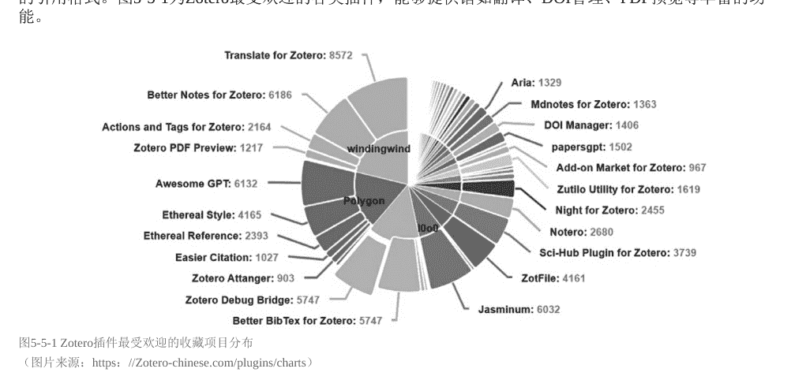

图5-5-1 Zotero 插件最受欢迎的收藏项目分布

（图片来源：https://Zotero-chinese.com/plugins/charts）

生成式模型也可配合文献管理工具生成引用并格式化，同时校对语法与标点。例如在 ChatGPT Pro 激活 Scholar Plugin 后可提示：
> “请检查以下 APA 引用是否存在格式错误，并帮我转换为 Chicago 格式：Smith, J. (2022) .Social Media and Public Opinion.Journal of Media Studies, 21 (3) , 45-67. ”

模型会逐项识别问题，如期刊名未用斜体、作者年份顺序错误等，并返回正确引文，降低审稿风险。

#### 三、质量把关与语义比对
样式切换、条目丢失易导致误差。模型可通过语义比对识别重复引用、格式残缺、出版信息遗漏，并在批量检查中提示风险。对中英混引或非正式来源，模型也具备模糊识别与修正能力。

参考提问：
> “以下参考文献是否有缺失信息？请补全出版年或页码，并统一格式为 APA 第七版。[1]Wang,Y.Social media behavior in crisis.[2]Liu, H. (2021) .数字传播伦理研究.中国新闻传播研究。”

跨平台迁移时，Zotero、EndNote、Mendeley 在数据结构与字段命名上存在差异，易导致元数据丢失。可借助 Better BibTeX 等插件标准化导出为 BibTeX 或 CSL JSON，再用模型做字段比对与语义修复。

参考提问：
> “请检查以下 BibTeX 条目是否完整，并将其转换为 APA 格式，若有缺失字段请予以补全。”

需强调：模型生成的参考文献仍需人工核实真实性与数据库可检索性。大部分模型仍存在引用幻觉，将真实期刊名与虚构标题拼接。因此，数据库核查始终是最终依据。

### 第六节 构建个人文献数据库和知识图谱

#### 一、个人文献数据库和知识图谱

##### 1. 什么是个人文献数据库和知识图谱
个人文献数据库是指研究者基于自身学术兴趣持续整理与归档的文献信息集合。它不仅包含文献本体，如 PDF 文件、出版信息、作者、关键词等元数据，还可扩展摘要、笔记、标签分类、引用关系、研究方法、理论框架等结构化信息。通过 Zotero、Notion、EndNote 等工具，以及模型辅助标注和总结能力的加入，个人文献数据库正从存储工具发展为具备理解能力的动态知识库。

知识图谱是对既有文献整理工作的二次抽象。它的表达方式是图，用节点承载实体信息，用边线标记两者之间的关系，从而形成可计算、可推理的语义网络。核心在于把零碎的记录转化为有结构的关联体。在科研实践中，通过智能手段从论文里抽取关键概念、理论模型、作者间的联系，按实体—关系的方式搭建可视化的认知网络，能够帮助研究者厘清知识间的逻辑关联与演进路径。

##### 2. 个人文献数据库和知识图谱的关系
文献库是图谱落地的素材来源，图谱则是对库内资料进行的语义转译与结构化呈现。通俗讲，前者是原料仓，后者是加工后的结构物。前者强调材料的全面搜集与分类，后者强调理解、连接与认知建构。图谱并非文献库的单纯可视化，而是在智能加持下实现的主动知识建构，使原本分散的信息在宏观结构中获得有序安置。两者构成采集—抽取—关联—演绎的闭环，既为智能写作提供语境支撑，也为学者个人学术成长搭建系统平台。

##### 3. 可使用的相关AI工具
目前支撑个人文献库与知识图谱搭建的软件不少，可按需组合。EndNote、Zotero、Mendeley、Notion 等文献管理程序都支持批量导入元数据、自动生成引文、打标签与写笔记，并可借助插件完成批注抽取与笔记导出，可作为文献库的核心载体。

Obsidian 配合 Zotero 使用、Connected Papers、Research Rabbit 等应用则有助于搭建个性化的知识网络，强化概念间的关联感与结构意识。相比偏向静态存储的数据库，知识图谱更强调认知建构，是深度理解与系统表达的重要支点。

#### 二、建构个人文献数据库
Zotero 以开源、功能丰富、门槛较低著称，备受研究者青睐。以下结合其功能说明个人文献库的搭建路径。

##### 1. 文献采集与导入
Zotero 的浏览器扩展是其最大优势，支持在 Google Scholar、CNKI、PubMed、Web of Science 等主流平台自动抓取文献信息。浏览到目标文章时点一下扩展，Zotero 即可自动保存题名、作者、摘要、刊名等元数据，并在允许时下载 PDF 全文。

- 文件夹体系：按研究主题、论文章节、项目等建立层级结构；
- 标签体系：实现多维度交叉标注，如同一篇文献可同时标记批判研究、跨学科、定性研究，便于后续灵活检索。

为精细化管理，可启用颜色标签，对核心文献、高被引文献、待引用文献等做视觉区分。

##### 3. 笔记撰写与扩展
Zotero 的笔记功能允许为每篇文献单独添加评论、摘要、思考，支持富文本编辑。配合插件可进一步提升效率：

- Zotfile：自动提取 PDF 中的高亮与批注，生成结构化笔记；
- MDNotes：把文献信息与批注导出为 Markdown 文档，便于与 Obsidian 等双链笔记协同；
- Better Notes 可选：在 Zotero 内搭建卡片笔记，实现跨文献引用与卡片级整理。

##### 4. 数据库动态优化与智能检索
Zotero 提供多维度搜索与筛选，支持按作者、题名、关键词、标签、年份等快速定位。通过设置 Saved Searches，可持续追踪特定主题下新进文献。再配合以下工具可增强智能化与图谱化能力：

- Scite：在 Zotero 内展示文献被引语境，便于评估影响力；
- Zotero 与 Connected Papers 联动：可在外部可视化平台快速查看引用网络，识别图谱中的核心节点；
- Zotero 同步 Obsidian/Notion：借助 MDNotes 等插件将笔记系统化输出，与个人知识库联动，构建可视化概念网络。

#### 三、整合式建构知识图谱
在众多知识管理工具中，Obsidian 凭借 Markdown 笔记与强大的双向链接，成为构建个人化知识图谱的理想平台之一。结合 Zotero、ChatGPT、DeepSeek 等大模型，搭建流程如下：

（1）工具准备
准备 Zotero、Obsidian、MDNotes 用于把文献导出为 Markdown 笔记；ChatGPT 或其他大模型；DataView 数据查询、Graph View 可视图谱、Omnisearch 智能检索等 Obsidian 插件可选。

（2）导入文献并初步整理
在 Zotero 中挑选一批核心文献，完成高亮、笔记与标签标注；用 MDNotes 一键导出为 Markdown 样式导入 Obsidian。Obsidian 会为每篇文献生成独立页面，包含题名、作者、笔记、引用等结构信息。

（3）借助AI提取核心知识节点
把文献摘要或全文输入大模型，要求其抽取核心知识节点。示例提示词：

请梳理该文献的核心概念、所用理论模型、研究方法，以及它们与其他理论的关联并列出清单。

将模型输出整理进 Obsidian 页面，例如：

- [自我决定理论]
- [社会建构主义]
- [定性访谈法]

在文献笔记中主动建立链接，如：

该研究主要借助[自我决定理论]展开分析，并采用[定性访谈法]。

##### （4）构建链接与结构化图谱
为每个被链接的概念新建独立页面，整理内容包括：

- 概念定义，可由 AI 提供初稿；
- 核心学者或出处；
- 被哪些文献引用过，建立反向链接；
- 与其他概念的关系。

使用 Obsidian 的 Graph View 查看节点网络，判断哪些概念最核心、哪些知识孤岛需要补足。DataView 插件还能提取与某方法相关的全部文献，形成专题子图谱。

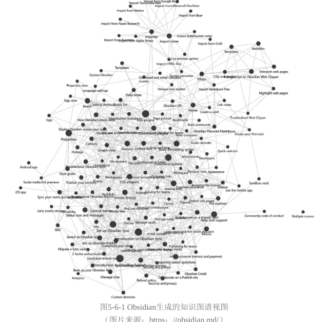

##### （5）动态维护与升级
持续向库中添入新文献，建立新链接。利用 AI 识别图谱结构薄弱区，示例提示词：

请分析我的笔记库中，关于社会支持主题还缺少哪些理论或研究路径？

### 本章小结
本章呈现人工智能如何帮助研究者剔除冗余信息、把握结构逻辑、发现高价值研究并规范引用。在关键词抽取与检索式构建中，智能可弥补经验不足者的策略短板；在文献筛选、推荐与深度阅读中，智能可加速结构识别与灵感生成；在引用管理与格式整理中，智能成为学术规范的智能守门人。结合文献与知识管理工具及大模型的语义抽取能力，研究者能更便捷地构建个人文献库，并在此基础上建立知识图谱。本章也指出 AIGC 的幻觉风险与不可替代性，强调人机协同是文献工作的核心逻辑。人工智能可提升效率、降低成本，但研究者的判断力、方法意识与批判精神，仍是把技术之用转化为学术之质的关键。

[1] 李珏，方平，胡德华.循证医学系统综述来源文献的分析研究[J].中华医学图书情报杂志，2004，13（4）：57-62.
[2] Booth,A.(2016).Systematic approaches to a successful literature review.Sage.
[3] Snyder,H.(2019).Literature review as a research methodology.Journal of Business Research,104,333-339.
[4] Booth,A.(2016).Systematic approaches to a successful literature review.Sage.
[5] Zotero中文社区插件商店：https://zotero-chinese.com/plugins/.

# 第六章 论文写作与修改

### 本章介绍
本章聚焦人工智能在学术论文写作与修改中的实际落地，探讨智能工具如何助力研究者在构思、撰写、修改、定稿各环节提升效率、质量与规范性。具体包括如何借助智能生成清晰写作框架、优化推理逻辑、提升语言表达，以及进行降重与查重等。通过真实案例与高效提示词，带领研究者掌握智能辅助撰写的具体操作，并强调学术表达最终仍依赖研究者自身思维与判断，智能只能作为辅助，绝不能替代研究者成为创作主体。

### 第一节 双向互动模式下的学术写作工作流
人工智能辅助写作普及的今天，若把握不好学术写作的基本逻辑与结构规律，再强的工具也难以产出高质量成果。论文写作既是知识生产的核心环节，也是学术思维的集中体现。单向传播视角下，写作似乎只是从提出问题到收集资料回答问题。但实际上，学术发表是面向同行专家、期刊审稿人等特定群体的双向互动传播，工作流起点不是问题，而是读者，即读者在意什么问题或如何让读者在意我关心的问题。

在以读者为中心的双向互动模式下，学术写作被视作与学术共同体的沟通与对话。研究者先要识别目标读者群体，理解其关注点、理论偏好与知识期待。选题与问题建构阶段要融入回应意识，提出具争议性与现实意义的问题。写作过程中要在结构、语言风格、论证方式上与读者建立对话感，预判质疑并予以回应。论文完成后，还可通过学术会议等平台继续交流反馈，让知识在互动中生长。由此，学术写作不再是封闭表达，而是嵌入学术共同体的持续协商过程（见图6-1-1）。

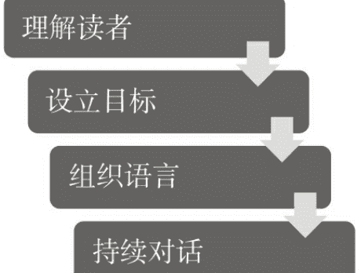

图6-1-1 双向互动模式下的学术写作工作流

#### 一、理解读者
以读者为导向的首要环节是读懂读者。需明确论文面向谁，是本学科专家、跨学科审稿人，还是具有实践背景的政策制定者？不同读者的知识结构、理论偏好、关注焦点各异，这决定了表达方式、论证深度与语言风格。同时要分析目标期刊或平台的写作范式、常见议题与评价标准，把握读者可能的期待视野与潜在质疑。构建读者画像，有助于更有针对性地组织论证，提前建立回应意识，使论文真正进入学术对话。

#### 二、设立目标
在理解读者后，需设立清晰的写作目标，不仅包括研究问题，还涉及影响读者的方式，是挑战主流观点、提出新理论路径，还是填补经验缺口？目标设定要兼顾学术贡献与读者需求的契合度，找到有回应的切入点。同时考虑篇章功能安排。标准论文通常包括引言、文献综述与理论框架、研究设计、数据分析与讨论结论等。在通用模板基础上，要思考核心观点何处提出、重点论证如何分布，以最大化激发读者兴趣与思考。

#### 三、组织语言
组织语言是持续与读者对话的通道。学术写作强调逻辑严谨与文字准确、可读、规范。它并非语言炫技，而是逻辑训练的延伸。写作中易出现主次不清、逻辑跳跃、概念混用、论据薄弱，多源于结构不清晰与逻辑不严。要善用清晰段落与过渡衔接，帮助读者跟进论证。在关键论点处主动引入反方观点或争议，引导思考与对话。可通过摘要、标题、小节导语提前释放关键信息，降低理解成本，增强互动感与回应性。语言风格应恪守文约而事丰原则，反对空泛堆砌与主观臆断。

#### 四、持续对话
学术写作并不止于论文完成，而是进入更广阔学术对话的起点。研究者应把论文置于既有讨论脉络中，通过引用、回应或批判他者观点，表明自身立场与对话位置。发表后可通过会议交流获取进一步评价与补充。互动不仅有助于发现盲区、修正不足，也可能激发新研究创意。

借助智能辅助工具，研究者可更精准高效地推进上述工作流。后续小节将围绕设立目标与组织语言两大核心，探讨如何运用智能工具形成有助于互动对话的论文结构与初稿，并使用准确、风格适配的学术语言。

### 第二节 论文结构构建与初稿撰写
论文结构布局涉及选题拆解、章节组织与逻辑推演。传统训练多依赖模板，初学者从模仿入手。如今大语言模型成熟，研究者可在模板基础上借助人工智能高效实现从结构搭建到段落填充的全流程起草。本节围绕结构生成、初稿起草、逻辑优化展开，并结合提示词示例展示操作。

#### 一、AI辅助构建学术论文逻辑框架
学术论文普遍采用 IMRaD 框架，辅以摘要、参考文献、附录等。不同学科、不同任务对结构要求各异。人工智能的优势在于输入提示词即可生成合理大纲。

#### 二、AI辅助撰写论文各章节草案

##### 1. 引言部分
引言是整篇论文的开场，作用是阐明背景动因、核心问题、研究意义与结构预览。好的引言能说明研究目标与价值，吸引读者继续阅读。示例提示词：

请撰写一段1000字的中文核心期刊学术论文引言草稿，研究主题为微博平台的算法推荐对用户信息选择行为的影响，包括研究背景、问题陈述、研究目的和结构概览。

##### 2. 文献综述部分
文献综述用于交代既有研究概况，展示研究者对领域的掌握，并为问题提出与方案设计提供学理支撑。最终目的是找准研究缺口，为本研究正名。示例提示词：

请根据目前个人知识库中研究主题算法推荐对信息选择的影响下的所有相关文献，生成一段2000字的中文核心期刊学术论文文献综述草稿，突出现有研究的理论视角与不足。

##### 3. 方法部分
方法部分是科研设计的蓝图，关乎技术可行性与结论可信度。核心任务是说明如何分析问题、采用何种数据与分析方法。示例提示词：

请根据[数据]为以下研究生成符合中文核心期刊范式的1000字研究方法描述，主要包括：研究方法和过程：采用问卷调查……；样本：300名微博活跃用户，结构见[数据]……；变量及测量：算法推荐频率、信息获取多样性、自主性评分……。

##### 4. 结果部分
结果部分如实呈现研究发现，不展开解释。结果需以文字、表格或图清晰准确呈现，帮助读者了解数据事实。示例提示词：

请根据以下描述性统计和回归结果，生成一段符合中文核心期刊范式的1000字结果部分文字，变量包括推荐频率、接触多样性、信息信任感。

##### 5. 讨论与结论部分
讨论与结论用于回答研究问题、解释发现含义，连接已有理论与新数据，指出学术与实践价值，并提出局限性与未来方向。示例提示词：

请根据算法推荐频率越高，用户信息选择多样性越低的结果，重点讨论该发现与以往信息茧房相关研究的异同。

### 第三节 语言润色与语法检查
学术论文不仅需要扎实理论与严谨方法，还需要准确、清晰、专业的语言表达。语言质量直接影响读者对可读性、说服力与研究者水平的评价。语法不当、句式混乱、用词不准等细微错误常被作者忽略。传统检查依赖人工编辑或 Word 自带功能，精准度有限。随着自然语言处理发展，集成智能的润色与语法检查工具已成为学术写作不可或缺的助手，可迅速发现并解决语言问题，提升整体质量。

本节围绕智能如何识别修正语法错误、提升语言流畅度与专业性，探讨智能语法检查、句型优化、用词精准化与整体润色，帮助研究者在学术写作中提高规范性与表达清晰度。

#### 一、AI辅助识别和修正语法错误
语法是学术写作最基本的规范。学术论文要求严谨客观，语法错误会严重影响质量，甚至削弱专业可信度。对非母语写作者而言，语法常是最大挑战，智能技术的发展有效缓解了这一困境。

# 学术写作提速路线：从校对到降重实战

过去的校对手段只能捕捉拼写、标点等表面问题，碰到长难句、学术化表达和细微语用偏差时，判断力明显不足。借助深度学习与自然语言理解搭建的智能系统，比如 Grammarly、ProWritingAid、LanguageTool 等，能够给出更细致的分层分析。它们的突出之处在于能结合上下文感知句法结构，自动揪出主谓搭配失调、时态选用不准、冠词遗漏、拼写失误等现象并给出改法；对于结构复杂的长句，也能识别冗余或生硬处，帮助表达更清晰、更契合学术规范。

除专项校对系统外，ChatGPT、DeepSeek 之类的生成式大模型也具备基础的语检能力。遇到措辞拿不准时，用这类模型厘清问题点并学会规范用法非常实用。示范如下：

**例6-3-1 生成式模型语法核查演示**

提问：

请检查这句话的语法并给出修改建议：“Although the experiment is well-designed, but the results are not fully described.”

回复：

这句话的连词使用重复。“Although”已引出让步状语从句，后面再加“but”就多余了。

建议删去“but”。调整后为：“Although the experiment is well-designed, the results are not fully described.”

调整后结构更符合英语习惯，也更简洁。模型的价值不仅在找错，更在于给出基于语境的修复思路，能显著提升外文学术写作的效率与准确度。

#### 二、借助智能提升语言的流畅度与表达精确度

学术写作既要合规，也要追求表述的精准与流畅，尤其在专业领域对准确性要求更高。借助模型可以优化措辞，使语言更清晰、简练、专业。

**1. 句式重塑与转换**

论文写作偏好简明，偏长或过于复杂的句子会拉低可读性。智能语言系统能够拆解句式并提出改进方向。例如把冗长的复合句拆成易懂的短句，对成分堆砌的句子给出更直接的改写方案。下面展示操作情形：

**例6-3-2 生成式模型句式优化示范**

提问：

请优化以下句子：“The article which was written by the research team sought to investigate the link between online learning and academic performance, which has attracted increasing scholarly attention in recent years because of the rapid expansion of digital education.”

回复：

优化结果为：“The article by the research team sought to investigate the link between online learning and academic performance, a topic that has drawn growing scholarly interest in recent years amid the rapid expansion of digital education.”

改动思路：去掉“which was”让表达更紧凑；用“a topic that has drawn growing scholarly interest”替代原句重复的表述，提升流畅度；把“because of the rapid expansion”改为“amid the rapid expansion”，表述更自然。

**2. 专业词汇的恰当使用**

学术语言必须准确传递概念，跨学科写作对词汇一致性要求更高。模型可核查误用并推荐更合适的替代表述，以保证准确与统一。下面展示操作情形：

**例6-3-3 生成式模型术语恰当性核查示范**

提问：

请检查以下句子中的术语使用是否准确：“Social networking sites shape user behavior via various recommendation algorithms, including personalized content feeds that foster echo chambers.”

回复：

该句术语使用规范，符合学术标准。逐项说明如下：

- Social networking sites：使用正确，指社交网络站点，如 Facebook、Instagram 等，是常用学术表述；
- personalized content feeds：准确，指基于用户兴趣行为的个性化内容推送，在社交媒体中广泛应用；
- echo chambers：传播学概念使用恰当，指个体倾向于接触同质信息而回避异质信息，在社交媒体研究中应用广泛。

模型还能判断术语是否契合当前研究语境，若文献中已出现替代词，会给出语境对比建议。

**3. 全文的流畅度与连贯性**

模型不仅能改单句，还能依据全文语境优化结构。能够分析段落间逻辑衔接与过渡句，确保整体脉络顺畅、层次分明。下面展示操作情形：

**例6-3-4 生成式模型文章连贯性优化示范**

提问：

请优化以下段落过渡句：“On the one hand, social media can support mental well-being. On the other hand, overuse may cause harm. Therefore, it is crucial to examine both sides of the argument.”

回复：

优化结果为：“While social media can support users' mental well-being, excessive engagement may produce adverse effects. Given these contrasting outcomes, it is essential to explore both the benefits and harms of social media's impact on mental health.”

优化要点：

- 用“While”整合“On one hand...On the other hand”，更凝练；
- 把“can support”“may cause harm”改为“can support”“produce adverse effects”，语气更精炼；
- “Given these contrasting outcomes”强化衔接，引导读者进入双向讨论。

#### 三、智能辅助校对与润色的实践案例

智能系统既可在初稿阶段发现语言问题，也可在后期修稿时进一步提升表达质量。例如完成初稿后，通过智能编辑实现整体语言升级。

**例6-3-5 生成式模型语法核查与润色示范**

提问：

请检查并修改以下论文段落，确保语法正确并提升语言流畅性：“Social media platforms are being increasingly adopted by individuals to interact with peers and exchange information. However, these platforms have also been connected with negative outcomes. It is important to understand the influence of social media on mental health, as it is increasingly shaping people's well-being.”

回复：

修改后段落为：“Social media platforms are increasingly adopted by individuals to interact with peers and exchange information. However, these platforms have also been linked to negative outcomes. Understanding the influence of social media on mental health is crucial, as it is playing an increasingly significant role in shaping people's well-being.”

修改说明：

- “being increasingly adopted”简化为“increasingly adopted”，表达更简洁；
- “connected with”换成“linked to”，句式更流畅；
- 重组末句，使表述更紧凑、严谨。

### 第四节 论文查重与降重

撰写毕业论文或期刊稿件时，查重与降重是必要环节。维护原创性与学术诚信是研究者的基本责任。传统查重靠比对已有文献识别抄袭或过度引用风险，但在语义重复、换词改序等情形下局限明显。随着智能系统普及，研究者在降重环节可获得强力支持，在降低重复率的同时保持高质量表达。下面介绍借助智能进行查重与降重的方法。

#### 一、理解查重系统的工作机制

国内外主流查重平台包括知网、维普、万方、Turnitin 等。以知网为例，其核心可归纳为六个维度：

1. **字符连续比对机制**
知网一般以13字符连续作为重复判定线，中英文均按连续字符单元检测。中文约6-7字连续重复即被标红。系统借助模糊算法可跨标点识别，即使逗号分隔的短句也可能被判定重复。

2. **语义重构识别能力**
依托自然语言处理进行语义分析，可识别深层逻辑相似。即使换近义词、调语序，仍可能被检出。系统支持跨语种二次转译识别，如中译英再译回中文的改写仍有语义关联风险。

3. **结构敏感性规则**
目录顺序调整等结构变动会影响结果，同一内容换位置可能呈现不同重复标记。系统分章检测，各章独立计算重复率，全文率仍为最终依据。

4. **引用鉴别阈值**
段落引用超过5%阈值，无论是否标注均计入重复率。灰色标注的参考文献须严格按格式，格式错误则转为正文检测。

5. **数据库覆盖范围**
知网比对库含约1200亿条数据指纹，覆盖期刊、专利、会议论文等11类资源，中文学术资源密度高。系统实时收录网络公开数据，包括预印本等。

6. **特殊内容处理**
公式代码采用特征值提取，不同排版的相同算法或被判定重复。表格数据通过数值矩阵比对，调换行列无法规避检测。

了解以上机制后，可更有针对性地进行降重，在不损失学术内容前提下优化表达。

#### 二、降重的核心技巧

掌握原理后，还需具体技巧以高效降重：

**1. 重组句子结构**
调整主语、谓语、宾语顺序或改变句法框架可有效降低相似度，同时提升清晰度。例如“社交媒体的使用改变了信息传播方式，尤其是在青少年群体中”可改写为“青少年群体中的信息传播模式正受到社交媒体的深刻重塑”。

**2. 专业词汇替换**
在语义不变前提下用不同但等价的术语替换重复表达。关键在于准确理解词义并选择恰当同义表述。例如“协同效应”可换成“跨系统耦合作用”，或为高频名词加限定，如“基于某某模型”改为“采用某某框架的多主体交互增效”。替换须保证含义一致，避免语义偏差。

**3. 压缩冗余内容**
冗长表达易导致高重复率。可通过精简句子、删去修饰词与重复信息来压缩。例如“这个技术不仅在该领域的应用取得了非常显著的进展，同时在多个其他领域也有广泛的应用”可简化为“该技术在多个领域内取得显著进展”。

**4. 扩展讨论与引用**
对文献中广泛引用的观点或数据，可通过适当引用相关研究来避免被标记为重复，同时提升学术深度。

#### 三、智能辅助论文降重

为最大化智能作用，需遵循操作流程：

**1. 准备工作**
先进行查重，标出高重复段落集中修改。明确目标重复率、需保留关键词及特定学术表达要求，有助于模型生成符合需求的文本。

**2. 编写高效的提示词**

（1）语义改写
通过改动语法结构与顺序实现降重。示例提示：
> “请重组以下句子结构，使其在语法结构上与原文明显不同，降低重复率，同时保持原意不变：
[输入段落]”

（3）同义词替换
确保替换词义精确。示例提示：
> “请对下列段落中的关键词进行同义词替换，确保意思与原文一致但使用不同词汇以降低重复率：
[输入段落]”

（4）优化逻辑与简化表达
去除修饰、调整段落结构，使表达精炼。示例提示：
> “请对以下段落进行优化，简化表达、理清逻辑、去掉多余修饰，确保简洁并降低重复率：
[输入段落]”

（5）压缩冗余内容
去除重复信息。示例提示：
> “请将以下段落压缩为更简洁形式，去掉不必要的冗余描述，保持核心思想与学术性，并降低重复率：
[输入段落]”

（6）控制字数
对被标记的长段落进行精简。示例提示：
> “请将以下段落缩减至[字数]以内，保证信息完整、原意不变，并降低重复率：
[输入段落]”

### 本章小结

本章梳理了生成式智能在科研论文撰写与润色全链路上的应用场景，涵盖搭建文稿骨架、起草初稿、文字打磨、语法核查，直至降重与查重环节的优化。借助这类技术，学者在不同写作阶段都能获得效率提升与负担减轻。起步时，系统可以迅速输出条理分明的写作框架并参与初稿成型；进入修正阶段，则可借助语言精炼、逻辑梳理与重复度控制来增进成稿品质，保证表达规范并契合学术要求。需要特别强调的是，即便智能手段能提供高效助力，学者的独立判断与学术修养仍是关键所在。智能的价值在于启发思路与提供技术便利，而论文的学理性与最终水准终究取决于研究者本人的思考与剖析。本章凸显人机协作的意义，只有将机器支持与研究者的创造力、批判性思维融合，才能在加速写作的同时守住学术价值与独立性。

[1] Strunk, W. I. (1999). The elements of style (4th ed.). Pearson.

[2] Sollaci, L. B., & Pereira, M. G. (2004). The introduction, methods, results, and discussion (IMRAD) structure: a fifty-year survey. J Med Libr Assoc. 92(3): 364-367.

[3] 知网查重的这些规则及原理你了解吗？[EB/OL]. https://www.cnki.cn/write/903.html.

[4] 怎么看知网查重结果（详细解说）及降重方法[EB/OL]. https://www.cnki.cn/check/1775.html.

# 第七章 数据分析与可视化

### 本章介绍

本节聚焦智能技术在资料分析与图形呈现过程中的落地路径，说明系统怎样助力研究者把预处理、模型搭建到成果展示串联成完整的工作链。涉及范围包括资料清理、变量辨识与自动编码、建模前准备、图形绘制与视觉表达等实践探索与方法更新。凭借自然语言交互，研究者不必陷入繁琐的代码编写，也能得到自动化分析与绘图带来的直观与清晰。随着智能支持的普及，资料分析正由传统手工模式迈向自动化，非技术背景使用者的使用门槛被大幅拉低。后续章节会结合提示词示例与操作案例，展示系统在这些场景中的实际效用。

### 第一节 数据分析与可视化概述

#### 一、数据分析

在科研活动中，资料分析起着连接理论推演与实证验证的枢纽作用，是支撑研究结论、增强论文可信度与科学性的关键环节。尤其在社科领域，学者需要依靠科学的分析方法对问题进行系统探究与有力论证。从取向上看，资料分析大致可分为定性与定量两类。两者在目标、资料形态、技术手段与解释逻辑上各有侧重，又可相互补充，构成混合研究范式。

##### 1. 定性数据分析

定性分析主要服务于“如何”与“为何”的研究问题，不依赖大规模数字资料，而是关注具体情境、意义与个体经验，强调深度理解、过程追踪与理论建构。常用于探索性研究、小样本研究、文化现象研究等，典型材料包括访谈文本、田野观察笔记、政策文件、社交媒体内容等。常见方法有：

- 主题分析：从材料中提炼反复出现的核心主题，用以构建理论概念体系；
- 扎根理论：从田野资料出发，通过开放编码、主轴编码、选择性编码逐步生成新的理论解释；
- 叙事分析：探究个体叙述中的意义建构过程，常用于教育、心理、女性主义等领域。

基本流程包括资料收集、预处理、开放编码、主题抽取、理论建构。研究者需在语义、语境与语用层面反复比对，通过归类、比较与对话式分析，形成概括性与解释力的概念结构。策略上强调分析与解释并行、数据与理论互动，要求保持理论敏感性并避免先入为主。其优势在于能深入复杂现象的内在机制，揭示变量背后的文化逻辑与社会意涵；不足在于主观性较强，解释框架易受价值偏好影响，结论的外推性与研究透明度相对较弱。

##### 2. 定量数据分析

定量分析旨在探究变量间关系强度、变化趋势与因果路径，适用于假设检验、问卷分析、政策评估、模型构建等情境。资料通常来自大样本问卷、实验记录、官方统计库或公开数据集等一手、二手来源。常见方法有：

- 统计分析：描述统计、推断统计、假设检验、回归分析等经典方法；
- 计算方法／机器学习分析：文本挖掘、聚类、分类器、神经网络等，侧重算法与模型构建，适用于大数据场景；
- 社会网络分析：聚焦个体间关系结构与网络模式，适用于组织研究、传播路径、关系强度研究等。

定量分析的优势在于结果具统计意义，过程规范、可重复、逻辑严密。但模型设定、资料质量与变量选择的偏差会影响结论有效性，过度依赖统计显著性也可能掩盖情境复杂性。近年来越来越多学者倡导混合研究法，将定性与定量整合，既保证对现象的深入理解，也保持分析的广度与代表性。实际操作中可先用定性分析识别关键变量与逻辑关系，再以问卷或实验检验；或先用定量分析筛选样本，再辅以深度访谈增强解释力。

#### 二、数据可视化

资料可视化指借助图形、图表、动画等形式，将抽象资料转化为直观易懂的视觉信息的过程。在社会科学研究中，资料结构复杂、维度丰富，纯文本难以全面呈现变量关系。可视化能够更清晰地识别模式、趋势与异常，提升资料说明与学术传播效率。

典型流程包括六步：一是资料准备，涵盖清理、格式统一、缺失值处理与变量转换；二是图表设计，根据问题与资料特征选择表达方式，如条形图、柱状图等；三是图形生成，可通过R、Python等工具绘制；四是视觉优化，调整配色、图例、文字排版；五是结果解释，撰写图注与描述；六是成果整合，将图表嵌入正文、附录或展示平台，与文字形成互补。

常见类型如下：

##### 1. 描述性数据可视化

用于呈现单变量或双变量的基础统计特征，帮助快速把握分布、集中趋势与离散程度。常见形式包括：

- 条形图：对比不同类别变量的数量差异；
- 饼图：展示构成比例，不宜用于类别过多的场景；
- 直方图：展示连续变量的频数分布；
- 折线图：展示时间序列的趋势变化。

##### 2. 比较性与关系可视化

用于变量关系、对比或聚类分析，如：

- 散点图：观察两个连续变量的相关性；
- 箱线图：比较多组别在连续变量上的分布特征及异常值；
- 热力图：以颜色深浅表示数值大小，揭示关联或热点区域。

##### 3. 时间序列与动态可视化

用于呈现趋势与节奏变化，如：

- 多序列折线图：展示多个时间变量的同步变化；
- 面积图：强调累计趋势；
- 动态图表：通过动画展示变量随时间演变，常用于D3.js等大数据平台。

##### 4. 网络与结构可视化

用于社会关系、传播路径或组织机制，如：

- 社会网络图：展示个体或组织间的互动关系；
- 流程图：展示事件、信息或资源流动；
- 层级图：呈现组织结构或概念分类。

##### 5. 地理与空间可视化

用于揭示地理分布特征，如城乡研究、环境分析、人口流动等，常见有：

- 晕色图：用颜色深浅表示区域变量高低；
- 点密度图：以点密集程度展示分布；
- GIS可视化：利用地理信息系统进行多层地图叠加与空间建模。

按使用难度与需求，可分为三类工具：统计软件类如SPSS、Stata，适合基础图表，门槛较低；编程类如R的ggplot2、Shiny，Python的Matplotlib、Seaborn、Plotly，灵活性高、可定制强，适合复杂或交互图表；可视化平台类如Tableau、Power BI，支持拖拽操作，便于快速生成图形与动态仪表板，适合教学、展示与跨部门沟通。此外，Gephi、Cytoscape、ArcGIS、QGIS等在网络与地理空间可视化中应用广泛。目前智能系统正被越来越多地引入资料分析与可视化流程，下文将详细介绍其提升工作成效的方式。

### 第二节 数据预处理与分析建模

大语言模型与资料智能工具的兴起，为资料处理提供了新路径。借助ChatGPT、Pandas AI、DataRobot、Jupyter Copilot等工具，研究者无需精通编程即可完成资料清理、格式规范、变量编码与初步建模，明显降低入门难度并拓宽定量研究的参与面。本节重点讨论智能系统如何协助完成资料预处理与建模任务，包括清理与规范、变量识别与转换、模型选择与构建，并结合提示词帮助读者掌握智能辅助分析方法。

#### 一、AI在数据清洗过程中的核心任务与优势

资料清理是资料分析中重要却易被忽视的环节，指对原始资料中的缺失值、异常值、格式不规范、冗余条目等问题进行处理，使资料达到分析所需的完整性与规范性。传统清理通常需要熟练的编程与资料操作逻辑，使用门槛较高。

清洗任务及AI辅助功能：

表7-2-1 常见数据清洗任务及AI辅助功能一览

| 清洗任务 | AI 辅助能力描述 |
| :--- | :--- |
| 缺失值处理 | 自动定位缺失字段，并推荐填补方案，如均值填充、中位数插值或删除法等 |
| 异常值检测与处理 | 运用统计方法如IQR、Z-score识别异常点，并给出剔除或修正建议 |
| 字段统一与标准化 | 自动规范变量命名、转换资料格式如时间格式统一、修正单位不一致等 |
| 重复项识别与合并 | 识别重复记录并按设定规则如首次填写或最新时间进行合并 |
| 格式转换 | 将字符串转为数值、文本分类转为编码形式，并从文本中抽取关键词等 |

使用大语言模型时的典型提示词：

##### 1. 缺失值处理

> “请帮我检查所上传的Excel表格的缺失情况，并针对每个存在空值的列给出合适的补全建议。相关列为：[年龄]、[媒介接触时长]、[信息信任度]，请结合变量类型和分布特征说明原因。”

##### 2. 异常值识别与处理

> “请基于IQR和Z-score方法对‘社交媒体使用时长’变量进行异常值检测，并列出两种方法下的异常记录。若结果不一致，请评估处理建议并输出剔除前后对比分布图。”

##### 3. 重复数据识别

> “我上传的问卷资料中存在多个记录IP地址相同，请以‘提交时间’字段识别可能的重复答卷，保留最早提交的一条，并输出去重前后的记录数对比与明细变化。”

##### 4. 字段标准化与格式转换

> “请对我上传的Excel资料文件的字段进行标准化，包括将变量名转为小写并用下划线连接多词变量，统一‘日期’字段格式为YYYY-MM-DD，并将‘时长’字段单位从分钟统一换算为小时。”

上述操作均可通过自然语言提示完成，无需掌握编程或统计函数。研究者只需上传Excel等格式文件并明确处理逻辑，智能系统即可解析字段类型、识别资料特征并给出处理策略与结果反馈。

#### 二、变量识别与自动编码

基础清理后，下一步是将原始观测资料转化为分析就绪格式，涉及变量类型判断、结构编码与逻辑一致性。在传统流程中这需要较强的统计认知与编程能力，随着智能增强，研究者可在变量识别、结构转换、类型匹配与异常识别等方面实现半自动化或全自动化处理。

##### 1. 自动识别变量属性

表7-2-2 各类变量测量水平及其特点

| 测量水平 | 定义说明 | 常见统计方法 | 示例变量 |
| :--- | :--- | :--- | :--- |
| 定类 | 用于区分类别，仅表示不同，无大小顺序 | 频数、众数、卡方检验 | 用户性别、媒介平台类型如微博/知乎 |
| 定序 | 具备顺序可比较大小但间距不等 | 中位数、等级相关系数如Spearman | 教育程度、喜爱度排序 |
| 定距 | 数值间距相等，无绝对零点 | 平均数、标准差、皮尔逊相关、t检验 | 媒介信任度评分1~7、新闻兴趣评分1~7 |
| 定比 | 拥有绝对零点，可进行加减乘除运算 | 回归、方差分析等常规统计方法 | 日均社交媒体使用时长、年龄、转发次数 |

智能系统可依据变量取值、上下文描述与历史样式判断测量水平，并给出预处理建议。示例提示词：

> “请分析以下字段的资料类型并推荐转换策略：[性别]、[学历]、[上网时长]、[媒体偏好]。研究目标为探讨媒介使用行为对用户政治极化倾向的影响。”

##### 2. 分类变量自动编码

在多选题、文本标注或定类指标中，智能系统不仅能识别类别属性，还能输出符合建模要求的编码格式。常用方法有：

###### （1）哑变量编码

适用于无顺序的分类选项，如社交平台偏好。每个类别占据一个位置，属于该类记为1，否则为0，适用于线性回归、逻辑回归等模型。

示例提示词：

> “请对分类变量‘媒体使用平台’如微博、知乎、B站、抖音进行哑变量编码，输出格式需满足回归模型输入要求。”

###### （2）标签编码

适用于存在明显顺序关系的选项，如“信息接触频率从不<偶尔<经常<总是”。通过有序数值映射使模型识别等级差异，可用于有序回归等。

示例提示词：

> “请将变量‘信息接触频率从不、偶尔、经常、总是’映射为有序数值，用于有序logit回归模型，并说明编码依据。”

##### 3. 标准化、转换与建模准备

部分数值型变量因分布偏态、值域跨度大而不适合直接建模。表7-2-3汇总了常见处理方式：

表7-2-3 变量变换与标准化策略总览

| 方法名称 | 适用场景 | 操作说明 |
| :--- | :--- | :--- |
| 对数变换 | 变量偏态严重、值域跨度大 | 如抖音直播观看时长分布不均，采用log(x+1)平滑 |
| 标准差标准化 | 不同变量量纲不一致 | 转为距离均值几个标准差的值 |
| 最小-最大标准化 | 值域差异大但无偏态 | 缩放到0到1区间，常用于机器学习输入 |
| 主成分转换 | 多个高度相关变量 | 提取主轴变量，避免共线性 |

示例提示词：

> “我上传的字段包括：[每日抖音直播观看时长]、[信息选择多样性评分]、[信任媒体数]。请检测其分布是否为偏态，并建议是否需要做log变换或标准化处理。”

智能系统不仅能生成代码，还能解读变量含义、判断数学特性、选择合适的编码方式并提出建模前准备建议，从而大幅降低试错成本。

### 第三节 图表生成与可视化表达

无论是论文结果展示、答辩PPT汇报，还是期刊图说摘要，图表的视觉水准直接决定表达的逻辑性与专业度。传统绘图依赖Excel、R、Python等专业软件，不仅要求语法熟练，还需掌握配色、排版、标签控制等细节。在ChatGPT-4o、Plotly、Matplotlib插件、Code Interpreter等智能支持下，研究者可通过自然语言描述生成符合学术标准的图表，实现从写代码到写指令的转变。本节介绍学术研究中最常见的五类图表，包含柱状图、折线图、散点图、箱线图与热力图。每类均附资料结构说明、适用场景、生成提示词范式与可视化示例。

#### 一、柱状图

柱状图适用于比较群体、平台或区域在某一变量上的表现差异，特别适合高低、多少等数值对比问题。以下为借助智能工具绘制柱状图的实例：

##### 例7-3-1 生成式AI工具的柱状图绘制功能使用实例

数据讲故事：让模型把图与结论写成论文语言

先看一个起盘案例。团队做过一次关于社交媒体黏性的问卷，统计了五大平台用户每日平均在线时长，目的在于比较平台间使用强度的差异，并探究这与媒介选择偏好是否存在关联。汇总结果见表7-3-1。

表7-3-1 社交媒体黏性研究数据之各平台日均使用时长

二、折线图
折线最擅长呈现指标随时间的变化轨迹，是时间序列最直观的表现形式，常用于趋势追踪与效果演进。下面给出一个典型操作。

##### 例7-3-2 生成式AI工具的折线图绘制功能使用实例

表7-3-2整理了某群体过去半年的日均使用时长：

表7-3-2 社交媒体黏性研究数据之日均使用时长

| 月份 | 平均使用时长（小时） |
| :--- | :--- |
| 1月 | 2.5 |
| 2月 | 3.0 |
| 3月 | 3.4 |
| 4月 | 3.8 |
| 5月 | 4.1 |
| 6月 | 4.3 |

提示示例：
对照上表作一张折线图，展示过去6个月日均社交媒体使用时长的走势。横向以月份排列，纵向体现平均小时数，给每个点加上数值标签，线条做平滑处理，版式要符合期刊插图要求。

模型返回的图如图7-3-2所示：
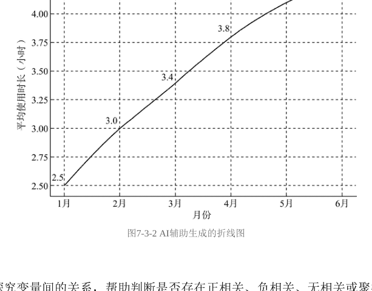

三、散点图
散点主要用来观察两个变量的关联形态，判断是正相关、负相关、零相关还是出现聚类。下面给出用法。

##### 例7-3-3 生成式AI工具的散点图绘制功能使用实例

为分析信息接触多样性与日均使用时长的联系，原始记录见表7-3-3：

表7-3-3 社交媒体黏性研究数据之日均使用时长和信息接触多样性

| 受访者编号 | 日均使用时长（小时） | 信息接触多样性评分（1～10） |
| :---: | :---: | :---: |
| 1 | 3.2 | 8 |
| 2 | 1.5 | 6 |
| 3 | 4.1 | 9 |
| 4 | 2.3 | 5 |
| 5 | 3.8 | 7 |

提示示例：
依据此表绘制散点图，横坐标为日均使用时长小时，纵坐标为多样性评分1到10，叠加趋势线并让各观测点可区分，适合回归前的探索性查看。

模型输出见图7-3-3：
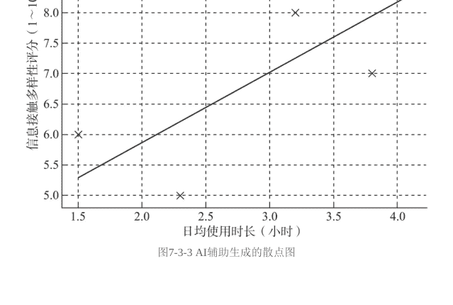

图7-3-3 AI辅助生成的散点图

四、箱线图
箱线图能同时呈现中位区间、离散程度与异常点，在社会科学中常用于分布比较。下面是实操。

##### 例7-3-4 生成式AI工具的箱线图绘制功能使用实例

比较微博、知乎、抖音、B站四个平台的黏性差异，收集的日均时长见表7-3-4：

表7-3-4 社交媒体黏性研究数据之多平台日均使用时长（小时）

| 受访者编号 | 微博 | 知乎 | 抖音 | B站 |
| :--- | :--- | :--- | :--- | :--- |
| 1 | 0.8 | 0.5 | 1.5 | 1.0 |
| 2 | 1.0 | 0.7 | 1.8 | 1.2 |
| 3 | 0.9 | 0.6 | 2.0 | 1.3 |
| 4 | 1.1 | 0.8 | 1.2 | 1.0 |
| 5 | 0.7 | 0.9 | 1.6 | 1.1 |

提示示例：
按上表做箱线图，四平台各一组合，并显示中位数、四分位距与异常值，用以呈现使用习惯的差异与稳定性。

模型输出见图7-3-4：
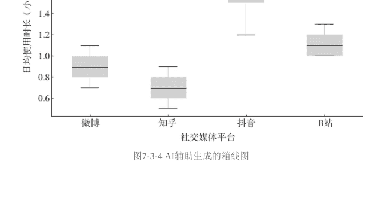

图7-3-4 AI辅助生成的箱线图

五、热力图
热力图适合做多变量配对关系的全景扫描，常在变量筛选或建模前使用。案例如下：

##### 例7-3-5 生成式AI工具的热力图绘制功能使用实例

研究者想看平台信任度、信息接触频率、意见极化倾向三者间的相关结构，系数见表7-3-5：

表7-3-5 社交媒体黏性研究数据之平台信任度、信息接触频率和意见极化程度的两两相关系数

| | 信任度 | 接触频率 | 极化程度 |
|---|---|---|---|
| 信任度 | 1.00 | 0.42 | -0.15 |
| 接触频率 | 0.42 | 1.00 | -0.33 |
| 极化程度 | -0.15 | -0.33 | 1.00 |

提示示例：
绘制热力图呈现三变量的相关系数，用蓝到红的色阶表达负相关到正相关，格内写出数值并配图例，适用于论文中建模前的相关可视化。

模型输出见图7-3-5：
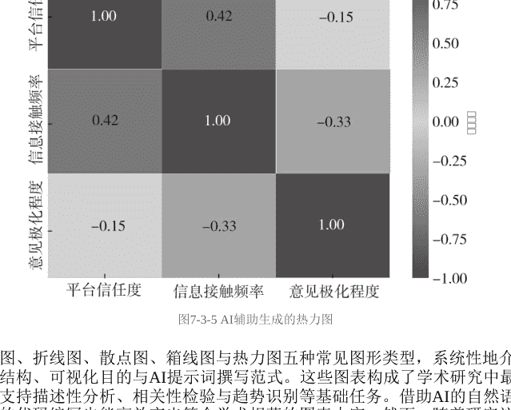

本部分围绕柱状图、折线图、散点图、箱线图、热力图五类常用图，介绍了适用情境、数据形态、可视化目标与提示词写法。这些图构成了学术研究的基础可视化手段，支撑描述、相关与趋势分析。借助大模型的自然语言能力，研究者无需手写代码也能产出规范图表。随着议题与数据复杂度提升，图形生成的空间远不止于此。

### 第四节 数据阐释与结果表述

量化研究的意义在于把数字和图表转化为能回应问题、检验假设并形成理论洞见的学术论述。结果解释与写作既是思想的凝练，也是学术贡献的体现。本节聚焦大模型在结果分析与写作上的三类支持：数值转述、结果与理论的整合、多风格表达。以中介、交互、路径等复杂模型为例说明提示词如何引导生成清晰规范的文本。

#### 一、对统计结果的文字转述

统计跑完后，研究者需要把回归、t检验、方差分析等输出改写成规范段落，这涉及术语准确、逻辑顺序与理论嵌入。GPT-4o、Claude3、Gemini1.5等模型在自然语言与统计知识的结合上已相当成熟，能基于结构化数据生成条理清晰的结果描述，对撰写结果章节、简报或图注都有帮助。下面分描述性与推断性统计说明。

##### 1. 描述性统计和推断性统计

描述性统计用概括指标与图形对数据做系统呈现。核心功能是信息压缩，如均值方差把复杂数据简化；模式识别，如发现分布形态、异常值与集中离散趋势；为后续推断提供基础。离散变量多用频数，连续变量则常用均值中位数等位置指标、方差标准差等离散指标，结合偏度峰度与直方图判断形态。

推断性统计则在总体不可直接观测时，基于样本对总体参数、分布或关系进行估计与概率判断。主要手段包括点估计与区间估计、假设检验如t检验卡方检验、相关分析、回归分析、方差分析等。

##### 2. 对统计结果的语言转述

下面用实例展示转述方式：

###### 例7-4-1 生成式AI工具的统计结果转述功能使用实例1

一项关于媒介接触对政治态度影响的实验，把被试分为过去一个月频繁使用新闻类社交媒体的使用组，和极少接触的非使用组。主要指标是政治兴趣评分1到5分。均值、标准差与t检验见表7-4-1：

表7-4-1 两组在政治兴趣评分上的差异

| | 均值（M） | 标准差（SD） |
|---|---|---|
| 媒体使用组 | 4.2 | 0.8 |
| 非使用组 | 3.6 | 1.0 |
| t检验结果 | t(198) = 3.45, p<0.001 | |

提示词：
请据检验结果写一段符合社科期刊风格的结果描述。保持术语规范，自变量为是否接触媒体有无，因变量为政治兴趣评分1-5分。把统计显著性与研究假设连接起来，适度引入社会心理解释，避免绝对化表述。

模型反馈：
独立样本t检验显示，使用组的政治兴趣均值4.2，标准差0.8，显著高于非使用组的3.6，标准差1.0，差异达到统计显著，t198=3.45，p<0.001。结果支持假设，即媒介接触可能正向影响个体政治兴趣。在信息富集环境下，媒介内容可能通过激发关注与参与意识，间接提升受众的政治关心。

量的独立预测效应。在这一过程中，标准化回归系数β是最主要的评价指标之一，其统计显著性构成了结果论述的核心逻辑。以下为相关使用实例：

###### 例7-4-2 生成式AI工具的统计结果转述功能使用实例2

一项关于媒介信任与信息接触对政治参与影响的研究，以政治参与评分为因变量，考察媒介信任度、信息多样性与年龄。回归结果见表7-4-2：

表7-4-2 政治参与研究的回归分析结果

| 变量 | β 值 | t 值 | p 值 |
|---|---|---|---|
| 媒介信任度 | 0.32 | 4.71 | <0.001 |
| 信息多样性 | 0.27 | 3.89 | 0.002 |
| 年龄 | -0.04 | -0.77 | 0.441 |

提示词：
请根据多元线性回归结果写结果段落。突出显著变量的预测作用，按标准化系数大小排序，对不显著变量说明但不夸大。语言规范，避免绝对因果，适当联系理论框架。

模型反馈：
多元线性回归显示，媒介信任度β=0.32，t=4.71，p<0.001，对政治参与水平有显著正向预测。信息多样性也显著正向β=0.27，t=3.89，p=0.002，提示渠道多元化可能提供更多认知资源与态度激发。这一发现与认知动员模型相符，即参与不仅取决于动机，也受信息环境开放性制约。年龄系数为负β=-0.04，t=-0.77，p=0.441，未达显著，说明在当前样本中年龄对参与倾向的独立预测有限。结果暗示在数字媒介环境下，信息相关因素比传统人口学因素更直接地塑造参与意愿。

#### 二、对统计结果的理论嵌入

学术写作的落点是解释关系的理论意义，而不仅描述现象。需要回答发现如何支持假设、如何与既有文献对话、是否揭示新机制或边界条件。大模型在逻辑衔接与理论嵌入上表现突出，能把经验数据置入理论框架，完成从数值到意义的转化。

##### 1. 对于研究假设的回应

理论对话始于假设。模型可依据假设、统计结果与理论背景生成支持或不支持的表述，并关联既有研究。示例：

###### 例7-4-3 生成式AI工具对研究假设的回应功能使用实例

研究结果支持假设，即信息接触频率与政治极化呈显著正相关β=0.36，p<0.001。这一发现与选择性暴露理论一致，说明高频接触可能让人更多接触立场一致的信息，从而强化原有偏好并提升极化程度。

##### 2. 跨理论的对照与解释

模型还能帮助进行多理论对照，生成与前人研究的异同比较。示例：

###### 例7-4-4 生成式AI工具的对照与解释功能使用实例

提示词：
本研究发现平台信任度对政治表达意愿有正向预测β=0.28，p<0.01。请写一段解释，结合媒介依赖理论与媒介信任研究，并在下方列参考文献。

模型反馈：
结果显示平台信任度对政治表达意愿有显著正向预测β=0.28，p<0.01，信任越高者在平台上表达政治观点的意愿越强。可从媒介依赖理论和媒介信任研究解释。

媒介依赖理论认为个体对媒介的依赖程度决定媒介对社会行为的影响。信任是依赖的重要维度，使用者信任平台时更倾向依赖其获取信息，尤其在政治议题上Ball-Rokeach& DeFleur, 1976。信任越高，对平台传递能力与公正性的认同越强，参与政治讨论的意愿也随之增强。

媒介信任研究指出用户对平台的信任直接影响信息加工与表达行为Flanagin& Metzger, 2000。信任度高的用户更认为平台能传播真实准确信息，因而在政治表达上更积极。本研究进一步证实信任对行为的决定作用，并扩展了媒介信任与政治表达的关联。

参考文献：
Ball-Rokeach,S.J.,&DeFleur,M.L.(1976).A dependency model of mass-media effects. Communication Research ,3(1),3-21.
Flanagin,A.J.,&Metzger,M.J.(2000).Perceptions of Internet information credibility. Journal of Mass Media Ethics ,15(2),50-75.

##### 3. 生成机制解释与路径推断

在路径分析、结构方程或多层模型中，研究者关注效应背后的原因。示例：

###### 例7-4-5 生成式AI工具的机制解释功能使用实例

提示词：
本研究发现信息多样性→政治兴趣β=0.21，p<0.01，请结合认知刺激理论写机制段落，并在下方列参考文献。

研究中信息多样性指个体在社交媒体或其他信息环境中接触到不同立场、来源、内容类型的政治信息。这种多元输入有助于打破认知定式，激发对政治话题的好奇与探索欲，使个体更愿意思考、比较与判断，从而增强对政治议题的关注与兴趣Carpini & Keeter, 1996。因此路径分析中信息多样性对政治兴趣的显著正向影响β=0.21，p<0.01，可被理解为信息环境通过认知刺激机制间接提升了青年群体的政治参与意愿与动机Eveland & Hively, 2009。

参考文献：
Farmer, T.A., & Matlin, M.W. (2019). Cognition. John Wiley & Sons.
Carpini, M.X.D., & Keeter, S. (1996). What Americans Know about Politics and Why It Matters. Yale University Press.
Eveland, Jr. W.P., & Hively, M.H. (2009). Political Discussion Frequency, Network Size, and "Heterogeneity" of Discussion as Predictors of Political Knowledge and Participation. Journal of Communication, 59(2), 205-224. https://doi.org/10.1111/j.1460-2466.2009.01412.x.

#### 三、不同风格的多语体表达

科研成果的传播渠道日益多元，期刊论文、项目申请、教学材料、政策简报、新闻稿等对语气、用词与可读性要求各异。当前大模型已具备较强语体识别与风格迁移能力，可按指令调整表述方式，生成多语体版本。下面为实例：

##### 例7-4-6 生成式AI工具的多语体表达功能使用实例

同一组结果，不同语境怎么讲才抓人

一项关于接触媒介频次对政治关注度影响的检验显示，回归系数β=0.29，p<0.001，说明两者呈显著正向关联。基于这同一个统计结论，撰写者可以根据落地方向挑选表达话术。不同任务标签能引导生成系统在不同场景下输出差异化文本。表7-4-3收录了同一结论在多种写作语境下的示范写法：

表7-4-3 AI在不同写作语境下的输出内容

| 风格类型 | 输出段落（由 ChatGPT 生成） |
| :--- | :--- |
| 学术论文 | 媒介接触频次对政治兴趣的预测作用显著(β=0.29,p<0.001)，印证信息使用强度在政治态度形成中的关键位置。该发现与政治社会化研究提出的媒体效应路径假设一致 |
| 课程教案 | 从数据看，媒体接触越多的群体政治兴趣越高，关联非常清晰。可以理解为媒体参与有助于提升公众对公共事务的关注 |
| 政策建议 | 研究显示，提升公众媒体接触频次可能成为增强政治兴趣的有效干预手段。建议相关部门在青年媒体素养教育中，有针对性地培育多元信息接触习惯 |
| 社交媒体摘要 | 你每天刷社交平台多久？研究说：刷得越多，越关心政治！#信息社会 #政治兴趣 |
| 科研项目申请书 | 本团队前期发现媒体接触频次对政治兴趣存在显著正向预测(β=0.29,p<0.001)，为后续构建“媒体接触—政治认知—参与行为”框架提供了重要依据 |

对照可见，生成系统不仅能替换词句，还能在理解任务上下文后主动重构段落架构、调节因果表述的强度、控制句长与信息密度。这种语体适应能力对多任务研究者很有价值。实现高质量的语体转换，需要把握两点核心做法：

- 1. 明确写作目标并给出使用场景
提示词示例：
> “请把下列统计结果改写成学术论文风格的段落，置于硕士论文结果解释部分，突出理论支撑与实证一致性。”
或：
> “请用教学讲义口吻把这段回归结果写成一段文字，要求通俗易懂，适用于传播学硕士研究生的课堂讲解。”

这种做法要求使用者给出清晰的产出目标与应用情境，模型才能自动调节术语密度、语气强度与可读性。

- 2. 引入上下文线索以触发风格联动
提示词不够具体时，可在输入中加入情境提示。例如：
- “这是为本科生编写的讲义材料……”
- “本文是一份政策咨询简报……”
- “这是项目申请书中研究意义部分……”

模型会据此调取相应语料风格，完成学术、行政、口语化等风格的迁移与嵌套。

#### 四、复杂模型与高级推论
单一相关或回归往往不足以支撑理论解释。研究者常借助中介、调节等复杂模型以及结构方程模型等高级方法，这对结果转述与语言表达提出了更高要求。本节聚焦复杂模型下的生成逻辑与表述方式。

##### 1. 中介效应表达
中介效应指自变量X对因变量Y的影响经中间变量M间接传导。以下为相关使用示例：

###### 例7-4-7 生成式系统在中介效应表达上的使用实例
表7-4-4为政治参与行为研究中的中介模型统计结果：

表7-4-4 政治参与行为研究的中介模型统计结果

| 路径 | 变量间关系 | β 值 | 显著性 |
| :--- | :--- | :--- | :--- |
| X → M | 信息多样性→政治兴趣 | 0.40 | p < 0.001 |
| M → Y | 政治兴趣→政治参与 | 0.35 | p < 0.001 |
| X → Y | 信息多样性→政治参与（直接路径） | 不显著 | p = 0.221 |

研究者输入：
分析中介模型信息多样性X→政治兴趣M→政治参与Y。路径系数X→M=0.40，M→Y=0.35，X→Y不显著p=0.221。判断中介类型、解释机制并说明理论意义。

模型回答：
路径分析表明，信息多样性对政治参与的影响主要通过政治兴趣中介。具体来看，信息多样性显著正向影响政治兴趣β=0.40,p<0.001，政治兴趣又显著预测参与度β=0.35,p<0.001。X对Y的直接路径未达显著，说明政治兴趣在两者间起完全中介作用。该结构揭示了认知动因在媒体接触与参与行为间的桥梁机制，印证了认知—行为路径的间接效应假设。

##### 2. 调节效应表达
调节效应指第三变量W会改变X与Y关系强弱甚至方向。以下为相关实例：

###### 例7-4-8 生成式系统在调节效应表达上的使用实例
表7-4-5为政治极化研究中的调节模型统计结果：

表7-4-5 政治参与行为研究的调节模型统计结果

| 路径关系 | β 值 | 显著性 |
| :--- | :--- | :--- |
| 主效应（媒介使用→政治极化） | 0.22 | p < 0.01 |
| 调节项（性别） | -0.15 | p < 0.05 |

研究者输入：
根据回归结果，媒介使用显著正向影响政治极化β=0.22,p<0.01，性别起负向调节β=-0.15,p<0.05，解释调节含义并说明不同性别下的影响差异。

模型回答：
多元回归显示媒介使用显著正向预测政治极化β=0.22,p<0.01。性别的调节系数显著β=-0.15,p<0.05，表明性别会调节媒介使用与极化的关系。进一步分析显示该效应在男性群体中更强，在女性群体中相对减弱，提示媒体效应存在性别边界条件。

当模型包含交互项时，系统可配合代码绘制斜率图或调节效应图，为解释提供可视化支持。以下为可视化实例：

###### 例7-4-9 生成式系统在交互效应可视化上的使用实例
研究者输入：
请生成一张调节效应图，展示媒介使用对政治极化的预测在不同性别下的差异。X轴为媒介使用，Y轴为极化评分，分别绘制男性与女性的斜率线，标注图例并添加标题。

模型输出图形如图7-4-1所示：

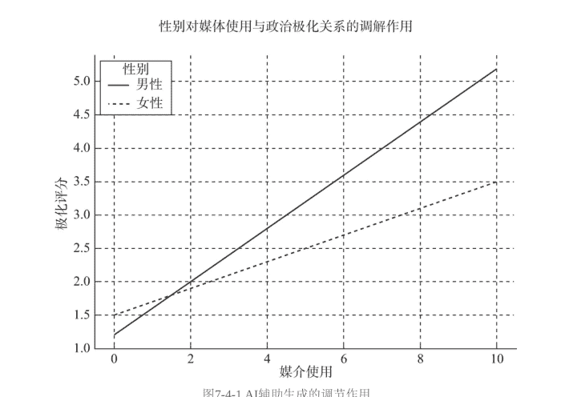

上图呈现了性别对媒体使用与政治极化关系的调节作用。随着媒体使用程度上升，男性群体的政治极化评分增长更快，斜率更大，说明媒体使用对男性的极化倾向影响更强；女性斜率相对平缓，影响程度较低。

##### 3. 路径分析与结构方程
在结构方程或路径分析中，研究者需同时报告多条路径与拟合指数。模型可依据路径结构与拟合指标自动生成完整段落。以下为使用实例：

###### 例7-4-10 生成式系统在路径分析上的使用实例
研究模型统计结果：
- 结构路径：
  - 信息接触→媒介信任度β=0.38,p<0.001
  - 媒介信任度→政治极化β=0.41,p<0.001
  - 信息接触→政治极化β=0.17,p<0.05
- 模型拟合指标：
  - CFI=0.96, RMSEA=0.042, SRMR=0.038

研究者输入：
基于上述结构方程模型生成专业分析段落：1）结构路径信息接触→媒介信任度β=0.38，媒介信任度→政治极化β=0.41，信息接触→政治极化β=0.17；2）模型拟合CFI=0.96，RMSEA=0.042，SRMR=0.038。要求包含拟合评价、直接间接效应解读、中介机制与理论意义。

模型回答：
结构方程模型整体拟合良好，CFI=0.96，RMSEA=0.042，SRMR=0.038，达到常用标准。路径系数显示信息接触既直接影响政治极化β=0.17,p<0.05，也通过媒介信任度间接作用。其中信息接触对媒介信任度影响显著β=0.38,p<0.001，媒介信任度进而正向预测政治极化β=0.41,p<0.001，揭示了媒体变量在政治态度生成中的中介机制。

### 本章小结
本章系统展示了生成式系统在数据处理与可视化中的多元功能，尤其在数据预处理、模型构建与图表生成方面的应用。系统能够协助研究者完成数据清洗、变量转换、标准化等繁琐环节，并提供智能建模与可视化支持，大幅提升分析效率与结果表达效果。借助智能辅助，研究者可将更多精力投向逻辑分析与理论推演。需要强调的是，尽管系统能解放技术劳动，研究者的专业判断与理论阐释仍不可替代，只有系统使用与学术能力结合，才能推动研究创新。

# 第八章 投稿与发表

### 本章介绍
学术成果的发表是科研价值实现的重要体现，也是融入学术共同体的关键路径，但当前投稿流程日益复杂。本章介绍如何借助生成式系统提升投稿与发表环节效率，说明系统在智能匹配目标期刊与会议、辅助撰写投稿文件、分析审稿意见并起草回复等方面的具体应用。同时深入讨论其局限、风险与伦理考量，帮助研究者审慎使用系统，维护学术诚信与规范。

### 第一节 借助系统精准匹配目标期刊
期刊选择在很大程度上决定投稿成败。选对期刊可提高通过率并扩大影响力，选错则可能导致反复退稿。传统筛选依赖经验、人脉或Web of Science、Scopus等平台，对新人门槛较高。大型语言模型如GPT-4o、DeepSeek-R1、Claude 3、Gemini 1.5的普及，使期刊匹配具备智能化、个性化与交互化特征。本节介绍如何借助系统完成论文信息提取、期刊智能匹配、投稿要求解析到策略优化的全流程。

#### 一、智能期刊推荐
不同于关键词匹配，系统可通过语义理解与算法综合分析论文标题、摘要、引言、方法、结论，结合训练数据中的学术知识图谱实现更精准个性化推荐。这种推荐不仅关注主题词，更能理解研究性质、方法论、理论框架与贡献类型，从而匹配研究范畴、方法偏好与理论取向更契合的期刊。以下为使用实例：

##### 例8-1-1 生成式系统在智能期刊推荐上的使用实例
一篇关于社交媒体对青年政治态度影响的定量研究摘要：
> 【摘要】本研究聚焦社交媒体平台算法推荐机制对青年用户政治态度形成的影响。基于456名青年用户的问卷数据，通过多元线性回归与中介效应分析，检验社交媒体使用频率、平台信任度与政治极化倾向的关系。结果显示平台信任度在算法推荐暴露与青年政治极化间起显著中介作用。该发现对理解数字时代政治信息传播具有理论与实践意义。

研究者输入：
请根据研究主题和摘要，推荐五本适合投稿的SSCI传播学或政治学交叉期刊。文章类型为定量实证研究。对每本期刊提供：1）期刊名及官网链接；2）最新影响因子及年份来源；3）大致审稿周期与接收率及来源；4）近期相关代表论文标题。

模型回答：
以下五本期刊适合以“社交媒体算法推荐对青年政治态度影响”为主题的定量实证研究投稿，均重视方法严谨性并欢迎青年学者：

##### 1. Political Communication
官网链接：https://www.tandfonline.com/journals/upcp20
影响因子：6.8 2023年 Clarivate JCR
审稿周期与接收率：平均8～12周；接收率约15%～20%
适配理由：聚焦传播技术与政治行为交叉，是社交媒体、政治极化、算法影响等议题的核心刊，偏好实证研究。
青年友好性：多次刊发青年学者博士成果，倡导方法论质量，常设青年学者专刊。

##### 2. New Media & Society
官网链接：https://journals.sagepub.com/home/nms
影响因子：6.4 2023年
审稿周期与接收率：平均3～4个月；接收率约10%～15%
适配理由：重点研究数字技术、算法推荐、青年数字文化与政治表达，主题高度契合。
青年友好性：鼓励方法多样，量化研究占比较高，设“Editor's Choice”扶持早期研究者。

##### 3. Journal of Computer-Mediated Communication (JCMC)
官网链接：https://academic.oup.com/jcmc
影响因子：5.9 2023年
审稿周期与接收率：通常8～10周；接收率约20%
适配理由：擅长发表基于社交平台数据、算法机制、极化的实证研究，适合结构方程与回归等定量模型。
青年友好性：官方鼓励博士生与青年研究者投稿，强调数据方法透明。

##### 4. Information, Communication & Society
官网链接：https://www.tandfonline.com/journals/rics20
影响因子：5.5 2023年
审稿周期与接收率：3～6个月；接收率约15%
适配理由：关注技术对社会结构与政治动态的影响，近年多聚焦青年极化研究。
青年友好性：强调理论与方法结合，曾设“青年研究议题”专号，对量化实证友好。

##### 5. Social Media + Society
官网链接：https://journals.sagepub.com/home/sms
影响因子：3.9 2023年 Clarivate
审稿周期与接收率：平均6～8周；接收率约25%
适配理由：明确关注社交媒体机制与社会影响，包括青年行为、算法推荐、极化等新兴议题。
青年友好性：支持方法多样，接受SPSS、R、Python等量化研究，鼓励开放数据与代码。

#### 二、局限性与注意事项
使用系统进行期刊会议推荐时须清醒认识局限。首先是数据时效性，期刊影响因子、审稿周期、接收率变化快，系统信息可能滞后。其次是信息源不透明，推荐逻辑多为黑箱，用户难以完全理解。最重要的是，系统推荐仅作初步参考，无法替代人工核实。研究者必须亲自访问期刊官网核查宗旨范围、投稿须知、索引、版面费、截稿日期等，才能最终决策。

### 第二节 借助系统识别相关学术会议
除期刊外，学术会议也是发布成果、获取反馈的重要平台。专门的会议推荐通用系统较少，但部分数据库已整合系统功能。例如IEEE Publication Recommender可同时推荐IEEE旗下期刊与会议。图8-2-1展示其示例界面。

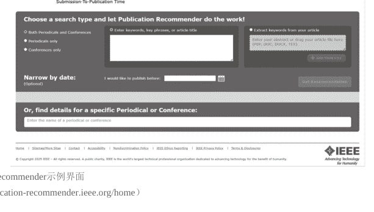

通用系统在会议推荐上覆盖与精度可能不及期刊，但仍可依据研究主题结合网络信息提供潜在线索，用户需后续人工筛选核实。

### 第三节 借助系统处理投稿及回应评审
选定目标期刊后，需准备投稿材料，其中投稿信是与编辑沟通的第一步。稿件返修后，如何专业回应审稿意见撰写返修回复信，也是决定命运的关键。系统可在文书准备中提供辅助，但局限与伦理风险不容忽视。

#### 一、系统辅助撰写投稿信

投稿信与审稿回复，AI 的合理分工边界

投稿信是作者与主编的首次正式接触，用最精炼的语言说明研究在做何事、价值何在、为何适合本刊。一封写得好的信能留下良好第一印象，提升送审概率。实际写作要同时兼顾：礼貌介绍稿件、清晰呈现核心发现及其意义、用充分依据论证与期刊宗旨、版面与读者群的匹配、并附上伦理合规、利益冲突等必要声明。完成高质量的投稿信需要沟通能力、期刊认知和逻辑表达。

大语言模型能在数个环节提供辅助。能按学界惯例快速给出框架；根据摘要、关键词、目标刊物信息生成初稿；润饰表达使其更规范流畅；尝试把论文要点与期刊关注方向关联，辅助论证适配性。让生成结果更可用，关键在于给出明确具体指令，例如：

> “假设你是一位向《[期刊名称]》投稿的研究者，请为题为《[稿件标题]》的论文撰写约300字的投稿函初稿，语气正式。摘要如下：[粘贴摘要]。请突出研究发现 [简述核心发现] 与期刊关注的 [期刊范围] 方向的相关性，强调新颖点 [简述新颖之处] 及对 [目标读者] 的潜在影响。”

> “结合以下简历相关经历 [粘贴相关经验] 与《[期刊名称]》期刊介绍 [粘贴期刊宗旨范围]，为稿件《[稿件标题]》撰写开篇段落，要能抓住主编注意并清晰陈述主要贡献。”

> “请把下面这段投稿信改写得更有底气，并明确说明研究对《[期刊名称]》读者的价值：[粘贴待修改段落]。”

需要强调的是便利不等于万能。模型产出的初稿往往缺乏个性与深度，容易流于模板，难以传达作者对研究的热情、对期刊的理解以及工作的独特性。它无法替代真正的批判性思考去论证研究与期刊定位的深层契合，也无法提供个人经历或成果来支撑论点。更严重的是模型可能误读输入、曲解刊物要求、夸大成果。因此任何模型产出都必须通读并人工修改。

二、审稿意见回应的智能支持

同行评审是学术出版的核心，修改稿的回复信决定稿件能否最终被接受。这一过程挑战大：既要谦虚接受合理批评，又要为研究价值辩护，还要在不同审稿人可能矛盾的意见间寻找平衡。回复信要求作者准确把握每条意见实质，对合理批评承认并说明修改情况，对不认同的观点或误解作出清晰有据的回应，保持专业礼貌建设性的沟通，最终说服主编稿件已达发表标准。该环节耗时费力，对学术沟通能力要求高。

理论上智能工具可提供以下支持：

2.搭建回复骨架
模型可依据逐条回应的原则生成回复信的基础框架或模板。

3.起草初稿
对一些直接、事实性强的意见，如补充细节、澄清术语、修正笔误，模型或能生成初步回复草稿。

4.润色措辞与语气
模型可帮助调整表述，确保语气专业、礼貌、客观，即便表达不同意见时也保持建设性。

5.生成反驳论点
部分工具声称可生成反驳性论点，但在回复审稿场景中风险极高，因为模型缺乏对研究细节和学术背景的深入理解，所产生的反驳往往无效甚至错误。

另外，使用智能工具辅助撰写回复信时，最核心的伦理红线是保密。把未公开的评审意见或修改中的稿件上传到公开第三方系统，尤其是通用 ChatGPT 类模型，严重违反同行评审保密原则，很可能触犯刊物明文规定。这些数据可能被用于模型训练甚至泄露，危及知识产权和发表优先权。即便存在本地部署或机构内安全模型，许多刊物和资助机构如 NIH、NSF 的政策仍明确禁止把评审材料输入任何智能系统。

因此学者应采取极度谨慎的态度。在绝大多数情况下，应避免把评审意见和稿件内容直接输入第三方通用系统处理，应优先人工处理。回复意见高度依赖作者自身对研究的理解、学术判断力和沟通能力，应以本人亲自完成为主。即便使用，也仅限基础性的非核心辅助，例如仅用系统进行语言润色或语法检查，或让系统生成通用模板框架，而绝不能把具体评审意见输入系统以求生成具体回复。作者还必须熟悉并遵守刊物和出版商关于智能系统使用的具体政策。

本章小结
本章梳理了智能系统在学术论文投稿与发表环节的潜在用途，涵盖智能匹配目标刊物、辅助撰写投稿函、协助回应同行评审等。系统凭借强大的文本理解与生成能力，在信息筛选、草稿生成、语言润色等方面可提升效率，对经验不足的学者具有一定辅助价值。然而，系统也存在明显局限与风险，包括信息时效性与准确性问题、算法黑箱、学者过度依赖导致判断力下降，以及把未发表保密信息输入第三方工具带来的严重保密与伦理违规风险。因此，智能系统在学术投稿与发表中只能扮演辅助角色，学者必须保持主体地位，对系统生成或推荐内容进行严格审查核实，在涉及评审意见等机密信息时更应极度谨慎，避免泄露敏感信息。

# 第三部分 AI辅助学术撰写进阶
在学术撰写智能化转型的背景下，智能系统正从通用工具向深度适配学者需求的专属伙伴演进。本部分系统解析智能撰写技术的前沿发展：第九章通过构建定制化知识仓与动态学习机制，阐释如何让智能助手真正理解学者的思维模式与学术风格，成为“数字分身”；第十章聚焦跨学科研究这一知识生产战略高地，解析如何借助智能系统破解术语鸿沟、方法冲突与叙事适配等难题，搭建连接不同学科范式的智能桥梁；第十一章直面通用人工智能体带来的范式变革，在技术快速发展中锚定人类学者的主体坐标，从学术素养重构到人机责任边界，描绘人智与机智协同进化的未来图景。三个章节层层递进，既呈现智能系统重塑学术撰写的技术肌理，也揭示数智时代知识生产者的认知升级路径。

# 第九章 定制化的智能撰写助手

本章介绍
本章主要探讨如何借助智能化技术打造定制化的智能学术撰写助手，以提升撰写效率与质量。首先介绍如何搭建定制化学术知识仓，让学者能够存储与管理与研究相关的文献、数据和撰写素材，确保信息调用精准高效。其次介绍撰写画像分析与语言风格建模，通过深入学习学者的学术撰写目的、习惯与偏好，为定制化撰写提供支撑。最后探讨长期学习与记忆机制的建立，通过结合外挂资料库等手段，使学术助手能够持续学习与更新。

第一节 搭建定制化的学术知识仓
在智能工具日益成为科研与撰写助手的大背景下，搭建学者个人的定制化学术知识仓已成为提升智能撰写助手有效性的重要基础。其重要性源于学术研究的多样性与学者需求的差异性，需要在效率、伦理与普适性之间取得平衡。

一、定制化学术知识仓的概念与特征
定制化学术知识仓是以学者个体为中心，围绕其研究兴趣、知识结构与撰写需求，动态整合并结构化其所掌握学术信息资源的知识管理系统。它不仅是信息存储空间，更是一个具备语义理解、逻辑关联与智能推荐能力的定制化术语境引擎。其核心在于高度契合个人需求的结构与功能设计，与通用平台相比，具有内容相关性高、语义结构清晰、可智能调用、动态可进化四大特点。

首先，内容高度相关是最本质特征。知识仓围绕研究领域、具体方向与个人兴趣构建，收录阅读文献、笔记、写作成果，并聚焦常用理论框架、研究方法与术语体系。以用户为中心的信息组织方式保证了知识精度与实用性，使模型生成文本时可获取最相关背景知识。

其次，语义结构清晰。知识仓通过关键词提取、主题聚类、引用路径分析等技术构建完整的知识图谱，揭示概念间的关联、演变与应用场景。这种结构化组织有助于模型理解学术脉络，也便于学者高效检索复用。

再次，可供模型调用是其智能化体现。深度集成后，知识仓不仅为生成式撰写提供上下文补充，还能实时激发灵感、推荐文献、识别逻辑断点，成为智能学术撰写定制定制的基石，使引言、综述、结论等部分更具逻辑统一性与风格一致性。

最后，动态可进化确保长期活力。随着新资料与新项目的加入，系统可自动标注内容、调整结构、优化主题，实现持续演进，为未知信息保留生长空间，形成与学者共同进化的智能撰写生态。

二、定制化学术知识仓的搭建路径和关键步骤

1. 定制化学术知识仓的搭建路径
目前搭建个人知识仓主要有两种方案。

一种是微调已有大语言模型。通过在 GPT 系列、DeepSeek R1 等模型基础上，结合学者的个人研究资料、文献库与笔记进行微调，使其更精准生成符合领域需求的内容。优点是定制性强、生成高效、独立性强，可离线使用。缺点是技术要求高，需深度学习与自然语言处理能力及大量算力；维护困难，需定期更新；存在数据隐私风险。

另一种是结合大模型与外挂知识仓。通过 API 接口让大模型访问学者的个人知识仓，如文献管理工具、数据库，并在撰写时查询提供相关信息。优点是灵活性高，可随时更新扩展；技术门槛低；信息更精准。缺点是依赖外部资源与网络；可能涉及访问权限或版权问题；集成复杂度与响应速度可能受限。

总体而言，学者可根据自身技术能力、资源状况与定制化需求选择。以下以外挂知识仓为例介绍搭建关键步骤。

2. 搭建定制化学术知识仓的关键步骤
利用外挂知识仓搭建定制化学术知识仓包括本地部署、API 调用、使用一站式工具三种方式。以 DeepSeek 为例，三种方式特点见表9-1-1。

表9-1-1 利用外挂知识仓搭建定制化学术知识仓的三种方式 [1]

| 方式 | 优点 | 缺点 | 适用场景 |
| :--- | :--- | :--- | :--- |
| 本地部署 DeepSeek+ 知识仓 | 无须联网；数据隐私性强；完全免费 | 对配置有一定要求；无法使用 DeepSeek-R1 满血版 | 数据隐私性要求较高的科研项目 |
| API 调用 DeepSeek+ 知识仓 | 可以使用 DeepSeek-R1 满血版；使用便捷；可用大模型较多 | 需要消耗 Tokens，会产生一定费用；仅支持上传本地文件 | 预算充足的科研项目 |
| DeepSeek+ 知识仓一站式工具 | 使用简单；支持 DeepSeek-R1 满血版；一键共享知识仓 | PC 端仅支持上传本地文件；存在数据隐私风险 | 适合无技术支持的学术新人 |

本地部署 DeepSeek 搭建知识仓通常需要 Ollama 和 Anything LLM，具体做法可参考网络教程。一站式工具使用更简便，可通过网络免费平台一键创建个人知识仓并直接对话 DeepSeek-R1 满血版。API 调用做法相对复杂，以下作具体介绍。

通过 API 调用搭建定制化学术知识仓的关键步骤包括：收集与整理学术资源、数据结构化和语义处理、集成数据库与智能工具。

（1）收集与整理学者的个人学术资源
文献是学术研究与智能助手生成内容的核心资源，收集整理是第一步。

资料来源可广泛使用 CNKI、Web of Science、Google Scholar 等权威数据库批量下载核心文献，关注 ResearchGate 等学术平台与期刊推荐捕捉前沿动态，收集会议论文、项目报告、学位论文、预印本等灰色文献丰富维度。

管理工具上，可使用 Zotero、EndNote、Mendeley 等文献管理软件进行主题分类、标签标注，按研究问题、方法、时间等维度建立目录结构，补充作者、年份、DOI、摘要、关键词等元数据，为结构化打基础。

分类与标注方面，文献管理工具支持分类、标注、标签化：标签化可为每篇文献添加关键词、学科领域、研究方法标签；分类与分组可按学科、主题或研究方向组织；笔记与注释可在阅读时添加个人笔记或批注，记录关键观点、实验数据与思考，为后续撰写提供素材。

同步与备份方面，随着文献不断积累，需确保仓的同步与备份。多数工具提供云同步，可实现多设备访问，也可同步至 Obsidian、Notion 等知识管理平台进行可视化连接与二次思考。

自动化引用方面，文献管理工具通常支持与文字处理软件集成，自动插入引用并生成参考文献列表。

（2）数据结构化和语义处理
此步骤将文本转化为模型可理解的结构化数据，并通过语义处理提升可调用性与上下文相关性，可借助自然语言处理工具完成。

文本结构化处理上，可使用 Grobid 等工具自动将 PDF 转为结构化 XML，提取标题、作者、摘要、引用等；用正则表达式或 Python 脚本识别论文标准结构，如引言—方法—结果；抽取引用信息建立引用网络，增强知识关联。

关键词与主题建模上，可采用 KeyBERT、YAKE 等工具自动识别核心概念；采用 LDA 主题建模提取知识仓主线研究方向，辅助分类；建立概念词典与术语统一表，减少歧义，提升语义一致性。

语义增强与向量化上，可利用 Sentence-BERT 等 Embedding 技术将文献片段转为向量，用于语义检索；使用 NER 标注人名、机构、模型、变量等关键信息；使用 T5、BART 等文本摘要算法生成文献概要，提高检索效率。

（3）集成数据库与智能工具
数据完成结构化与语义处理后，最后一步是集成至数据库系统并打通智能撰写工具调用接口，实现语境感知、语义理解与个性响应。

构建本地或云端数据库时，可将结构化文献存入 SQLite、Pinecone、Weaviate、FAISS 等嵌入式或向量数据库，配置关键词、时间、引用网络等索引支持快速检索，并将文献内容按论文结构分块存储，便于模型按需调用。

外挂至 DeepSeek、ChatGPT 等智能工具时，可使用 Lang-Chain、LlamaIndex 等开源框架连接本地知识仓与大语言模型，将文献片段转为向量嵌入，通过语义匹配实现提问—召回—生成的流程，设置检索增强生成架构，让模型在回答时引用知识仓内容，提升上下文贴合度。

动态更新与自动同步的机制，是让知识中枢保持鲜活的关键。按照设定周期从RSS源、数据库接口等渠道抓取新料，完成库内刷新；借助脚本或类AutoGPT的自主代理实现自动归档、向量重建与文本清洗，保持持续演进；再搭配任务型代理，就能落地写作帮手、要点摘要、文献推送等实战用途。

### 第二节 塑造专属学术肖像与表达印记

#### 一、学术肖像与文风模型总览

##### 1. 写作肖像的含义与拆解角度

个性化学术助手的基础，是把研究者的写作肖像与表达印记建模起来。画像概念在产品与营销中常指用户特征标签。此处指从学者既有文本里提炼出的写作习惯、学科归属、常用术语、关注议题与表述偏好等复合特征，帮助系统理解研究者写什么、怎么写。

在学界场景，肖像一般围绕三大核心面展开（见图9-2-1）。

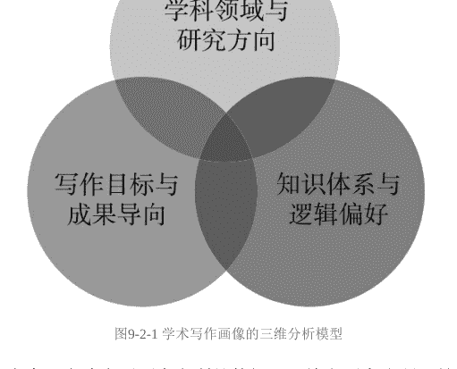

（1）所属学科与研究议题。它决定知识语境与研究主题，是生成内容的基础。准确分辨学科归属、常规课题、方法路径与专业术语，有助于专业对齐。

（2）知识架构与论证偏好。它反映常用的理论框架、引用文献、推理方式与方法论，既影响内容的深广度，也决定文献调用与论证方式的个性化配置。

（3）产出目标与成效指向。它明确输出形态，例如面向中文期刊还是英文期刊，是硕博论文还是政策报告，是偏重理论还是偏重实践，从而引导系统在风格、结构与表达策略上做精细调整。

##### 2. 学术表达风格的常见样态

表达风格是对研究者在句式结构、语气、用词、逻辑表达上的个人痕迹的捕捉与归纳，目的是让系统产出更接近作者本人的表述。模型建立后，系统能更精准地辅助撰写与段落生成，实现高阶定制。

按前述三大肖像维度，可把学术表达风格大致划分为几类，比传统主观印象分类更结构化，也更利于调用。

（1）理论搭建风格。多见于哲学、社会学、文化研究，核心是建立理论体系。语言偏向抽象名词、高阶逻辑与复合句式，强调概念间内在关联，例如“本研究尝试从某某视角对某某理论进行再阐释”。此类写作保持高密度抽象，频繁出现范式、话语、意义结构等关键词。

（2）实证剖析风格。常见于管理学、教育学、心理学，突出逻辑严谨与结构规范，常用中性客观的表述说明研究过程。典型模板如“本研究采用某某方法，数据来自某某样本”“结果显示……达到统计显著”，强调因果分析与方法透明。

（3）政策导向风格。面向现实问题与对策生成，在法学、传播学、公共管理中常见。语言简明有力、结论导向，常使用“应当”“建议”“亟须”等词。段落结构紧凑，突出问题诊断、对策逻辑与政策价值。

（4）技术陈述风格。多见于计算机、工程、医学等技术密集学科，强调实验步骤、系统结构与性能评估，语言高度规范、术语精准，常使用被动语态与流程化表达。写作突出操作步骤、系统指标、图表说明与结论精度。

#### 二、表达印记模型的搭建路径

##### 1. 通用搭建做法

无论肖像标签或偏好风格如何，建立智能体辅助的学术写作表达印记模型都有一些共通做法：

（1）文风采样
第一步是对已有文本做采样分析。研究者可提供代表性样本，如已发表论文、开题报告、片段，通过NLP工具如文本嵌入、语法分析、词频统计提取语言特征，例如常用句式、关键词频率、句长分布、主动被动语态倾向、学术连接词等。可使用spaCy、BERT、TextRazor等做剖析，形成写作语感画像，这一步决定后续生成能否贴合真实风格。

典型提示词：
> “请拆解下面这段文字的写作风格，涵盖语体、句式、用词与语气倾向，归纳成五条特征。”
> “这是我的论文片段，请提取常见句式和关键词，辅助搭建表达风格模型。”

（2）写作偏好记录
在持续使用智能体助手的期间，要记录写作行为与修改偏好，例如保留或删除哪些生成内容、偏好简洁句还是复合句、习惯先给出结论还是先铺垫等。行为数据可通过写作插件、智能编辑器如Notion AI、Zotero插件配合DeepSeek或ChatGPT API采集。把反馈结构化后作为微习惯数据融入语言模型，实现风格的动态学习与精细匹配。

典型提示词：
> “根据我对下面AIGC的修改，判断我更偏好哪种表达，并更新我的写作偏好画像。”
> “请记录我在此次写作中删除与保留的内容，推断我的用语习惯与表达倾向。”

（3）语用微调机制
DeepSeek、ChatGPT等通用大模型能力强但风格偏平均化。可引入轻量微调如LoRA、PEFT，或借助RAG框架把个人语料外挂为上下文进行语用级微调。例如把若干篇过往论文作为few-shot材料，引导智能体学会常用的表达逻辑与术语选择。这种本地语境融合方案省算力、提升拟合度，是定制化助手的核心手段。

典型提示词：
> “请参考以下五篇我的研究论文风格，指导后续写作保持一致。”
> “请把下面生成内容调整为更贴近学术语气/特定期刊风格/我以往使用习惯的表述。”

（4）个性化句式库与表达习惯积累
长期使用可积累高频表达模板，如固定启发句、经典过渡句、常用引文句式等，构建个人句式库与表达模组。素材可存于结构化模板供智能体调用，例如导入理论背景的常用写法、提出研究问题的句型、总结建议的语气控制方式。也可手动增删编辑，使其持续优化，成为写作中的语言助力。

典型提示词：
> “请把我过往文章中常用的过渡句、总结句、研究设计引入语句整理成我的个性化句式库。”
> “我习惯在引出研究问题时用‘然而，已有研究仍存在不足’这类表达，请把类似句式加入我的表达模板。”

##### 2. 搭建流程概览
上述方法在实践中可按以下流程展开（见图9-2-2）：
（1）用户数据输入。上传论文PDF、写作片段、修改痕迹等；用OCR/文本解析器如pdfminer、PyMuPDF提取纯文本。
（2）自然语言特征分析。用spaCy、BERT、GloVe等做句法、词汇、结构分析，提取风格维度如句长、动词密度、语气、语态等。
（3）写作偏好追踪。与Word插件、Notion、Zotero联动，实时记录改写、删除、重写行为，标注反馈以便更新偏好库。
（4）风格微调或语境适配。选择LoRA/RAG微调方案，输入用户语料加模型输出对比，实现样式拟合修正或上下文引导生成。
（5）建立个性化句式库。用户可手动编辑分类存储，或与智能体协同调用，按写作任务插入高频句式。

### 第三节 基于长期学习与记忆的持续定制

#### 一、长期学习与记忆的不足与突破

智能体的长期学习和记忆机制指系统在持续交互中积累行为数据、语言偏好、任务反馈等信息，让后续响应更定制化，并记住过去提供的写作风格、术语、研究兴趣、项目进度等，在后续对话中主动调用，实现前后语境一致与个性延续。

大语言模型生成力强，但缺乏长期记忆，在需要持续互动时尤为明显。缺乏的主要原因有四：
首先是架构设计限制。传统神经网络如Transformer、GPT系列依赖固定长度上下文窗口，只能记住当前输入的短期信息，无法存储调用历史交互内容。
其次是灾难性遗忘。模型在训练中常出现新知识覆盖旧知识的问题，增量学习时难以保留历史信息。
再次是内存管理机制欠缺。传统系统缺乏动态更新存储能力，不能灵活增删改查记忆内容。
最后是计算资源限制。长期记忆需大量存储与计算，多轮对话或长时间数据积累时受硬件算法制约。
研究层面已有尝试，如Kynoch等2023构建具备长期语义记忆的架构，Zhong等2024通过外挂记忆体实现对用户历史交互和个性数据的持续调用。
实践上也有突破。OpenAI宣布自2025年4月11日起，ChatGPT的长期记忆功能“Memory”向除欧洲经济区、英国、瑞士、挪威、冰岛和列支敦士登之外地区的所有ChatGPT Plus和Pro用户推出。长期记忆可实现跨对话记忆，让智能体更像智能管家。据称可能采用类似检索增强生成RAG技术，在生成时参考已保存信息，从而保持连贯性。

#### 二、实现路径与使用注意
对研究者而言，最直接的路径是使用ChatGPT Plus或Pro等具备长期记忆的智能工具及其记忆服务，付费形式，需一定科研经费。也可外挂数据库实现长期学习记忆，操作与前述定制化学术知识库搭建相似，不再赘述。

使用外挂数据库时需注意：
1. 数据安全与隐私保护。首先保护学术数据隐私，研究往往涉及敏感或未公开成果，需确保数据库符合隐私保护和数据安全标准，如加密存储传输。其次确保合规，遵守相关法律法规，数据收集、存储、使用和分享需合规，特别是个人信息和研究数据。
2. 数据质量和有效性。一是保证准确性，避免过时、不相关或错误文献干扰写作和决策。二是定期更新清理，随着新成果出现，需清理无效冗余资料并更新信息，保持数据库最新有效。
3. 定制化与持续优化。建立自我反馈机制，定期评估数据库内容和智能写作助手表现，按学术需求调整内容或定制化优化。坚持实时更新学习，随着研究深入，资料应随进展实时更新。
4. 性能与资源消耗。资源管理上，数据量增长带来存储、计算增加，需有效控制资源使用，避免性能瓶颈。成本控制上，外挂数据库通常需付费，使用云服务时控制规模和使用频率，避免超预算。

### 本章小结
总体来看，通过搭建定制化学术知识库、建立写作画像与表达风格模型、引入长期学习记忆机制，可打造研究者个人专属的定制化学术写作助手，显著提升效率和质量。使用时务必保持谨慎理性，确保资料质量和隐私安全，避免过度依赖智能体建议，始终保持学术思考独立性。随着技术快速发展，研究者也应及时关注工具更新改进，确保助手始终高效、灵活、可持续。

# 第十章 智能驱动的跨学科写作新范式

### 本章介绍
本章聚焦智能体在跨学科学术写作中的应用与赋能潜力。第一节先解析跨学科研究的内涵，指出其已成为解决复杂问题的重要路径，并可借助智能体的智能手段化解其中难题。第二节聚焦智能体在跨学科认知协调方面的支持，包括统一术语、探索理论融合、弥合方法分歧、消除协作障碍等。第三节关注智能体如何提升跨学科写作的智能适配能力，帮助研究满足不同读者需求，突破传统学科分类带来的制度性壁垒。

### 第一节 智能体如何赋能跨学科写作

#### 一、跨学科研究的定义与发展态势
跨学科建立在学科概念之上，是一个复合概念。其出现长期以来象征人类认识走向专业化和系统化，是知识文明进步的体现。但正如福柯1972年所言，学科组织不仅是认知行为，更是政治行为，是权力与制度的产物。19世纪民族国家兴起后，各国建立教育部、科学院等机构，并通过学科目录实现知识生产标准化管理，学科边界随之明晰并固化，一定程度上也限制了问题理解。随着知识生产模式转变，对跨越学科边界的需求日益强烈。

1972年，经济合作与发展组织OECD教育研究与创新中心首次明确提出跨学科定义：“跨学科是两门或以上不同学科的相互联系，从思想简单交流到更大领域内教育与研究的概念、方法、程序、认识论、术语及组织之间的相互联系。”该定义至今仍被广泛沿用。当前理解主要有知识论和组织论两种视角，即跨学科既是参照既有知识体系结构的复合存在，也是新的知识组织形态、协同合作机制及组织发展战略。

吉本斯等人1994年提出知识生产新模式，认为知识生产将从以学科本位、认知驱动的传统模式，转向以应用情境驱动、跨学科、异质性和组织多样性为特征的新模式，即模式2。他们指出，解决复杂问题需要整合来自不同学科甚至非学科来源的理论视角和实践方法，这不仅是多学科合作，更可能在解决问题过程中形成新的临时认知框架，不一定导向新的稳定学科。

跨学科作为全球化趋势，在各国得到广泛实践。世界顶尖高校均在跨学科建设上推进，通过设立跨学科学院、研究中心、学习中心、实验室、研究院等整合教学、科研和社会服务。2024年11月，2025首届泰晤士高等教育跨学科科学排名THE Interdisciplinary Science Rankings发布。前十名中美国高校占七席，麻省理工学院和斯坦福大学分列第一、第二，新加坡国立大学第三，我国的香港大学和复旦大学分别位列第十三位和第十六位。

交叉研究加速升温，写作瓶颈怎么解

近年全球对跨界教学与科研的投入持续加大，多个国家把交叉布局纳入国家发展统筹范畴。我国2025年《政府工作报告》要求优化学科设置与人才培养机制[4]。2020年11月，自然科学基金委设立交叉科学部[5]；2021年1月，国务院学位委员会与教育部发文，将“交叉学科”列为第14个学科门类，首批一级学科为集成电路科学与工程、国家安全学[6]。两院院士增选近年明显向新兴方向倾斜，《2023年度中国科学院院士增选指南》明确为信息科学与技术数理基础、医工融合等领域预留名额[7]。

《自然》刊文指出，自20世纪80年代中期起，论文引文出现明显的跨场域引用增长，以“跨学科”为题名的成果数量同步上升[4]。检索中国知网指数显示，外文相关文献2010年后总体增多，约2020年前后回落；中文文献自2000年起稳步上行，2022年前后增速加快并反超外文。该变化反映出研究热度随时间演进的轨迹与区域差异。

#### 二、跨域学术写作的痛点与智能支持
即便政策与机构重视度提升，从事跨界研究的学者仍面临严峻成长壁垒。Berks等2024年对15万余名生物医学研究者发表轨迹的分析显示，聚焦跨界的青年学者在职业早期较单一领域同行更容易因停发而提前退出。在“不发表就出局”环境下，传统学科本位的评价体系制约了青年跨界者的起步，也凸显产出与写作的难度。

##### 1. 跨域写作的典型难点
对比单一领域写作，跨界写作阻力更集中：
- （1）概念与表达不一致。各专业拥有各自的概念体系与表述惯例，同一词在不同场域内涵迥异，或同一概念说法各异，易致语义混淆与沟通成本上升。
- （2）理论整合难度大。自然科学、社会科学、人文艺术各自形成独立理论脉络，跨界写作需在多重理论间架桥，要求研究者既通晓各域理论，又具备逻辑整合力，否则易流于拼贴。
- （3）研究方法分歧。自然科学与社科在取样、数据处理、因果推断上做法不同，跨界研究须协调量化与质性、实证与思辨，混合方法下设计与呈现更复杂。
- （4）协作摩擦。跨界多为团队作业，成员在语言风格、思维路径与写作习惯上差异明显，易造成沟通不畅。
- （5）受众期待分散。跨界论文读者背景复杂，需兼顾多专业阅读习惯与表达规范，结构与表述稍有失衡便难满足特定读者预期。
- （6）发表制度约束。现有发表体系仍以传统分类为主，跨界稿件投稿常陷入尴尬。评审背景不一，评价标准易分歧，或难以找到匹配审稿人，导致交叉价值被低估。

##### 2. 生成式系统在写作中的作用
上述困境本质是知识生产与流通的协同问题。概念分歧、理论难融、方法差异、协作障碍属于生产端问题，根源在于缺乏统一的生产媒介，对齐认知框架是关键；读者多元与评审困难属消费端问题，既受制度制约，也受生产者对需求理解偏差影响。制度层面需外部优化，理解偏差可从传播环节入手。

生成式系统的价值不在于替代思考，而在于搭建跨界协同的底层设施，为两类问题提供差异化辅助：
（1）生产端强化认知协同
核心矛盾是各专业认知框架难以互通。系统可先构建认知对接机制，利用知识图谱将分散概念编织为动态语义网络，例如自动辨识“弹性”在物理与经济中的内涵差异。其次，基于深度学习的理论接口发现可揭示跨界联系，如“社会网络分析”与“图论”的关联。再者，多模态学习可充当方法桥梁，例如将质性访谈自动编码为可量化模型处理的数据。最后，智能协同平台能实时监测团队概念使用偏差，当工程师谈“算法优化”而伦理学者关注“价值优化”时，系统可提示歧义并提供协商框架。
（2）消费端提升适配能力
研究者可从传播效率与成本优化入手。系统通过语言风格重构与多版本生成，能把同一成果以不同专业可接受的表述呈现，提升理解度。还能识别目标期刊在不同领域下的选题偏好与写作规范，智能推荐刊物并生成定制化投稿文案与格式转换，降低分类僵化带来的发表壁垒，提升可见度与录用率。

生产端的认知协同保障内在严谨，消费端的智能适配提升外在推广，二者互补有助于跨界研究从艰难妥协走向顺畅对话。表10-1-1汇总了主要难点与智能辅助方案。

**表10-1-1 跨域写作难点及智能辅助方案**

| 主要难点 | 智能辅助方案 |
| :--- | :--- |
| **知识生产端** | |
| 概念表述不一致 | 知识图谱推动专业知识系统对接 |
| 理论难融合 | 深度学习挖掘专业间理论关联 |
| 方法差异性 | 多模态学习嫁接方法论体系 |
| 作者协作难 | 协同平台提供跨域协商框架 |
| **知识消费端** | |
| 读者多元 | 语言风格重构与多版本生成降低传播成本 |
| 制度壁垒高 | 投稿辅助系统规避学科制度性壁垒 |

### 第二节 智能支持下的跨域认知协调增强

#### 一、基于概念对接实现专业知识系统互通
随科技发展与国际交流活跃，术语标准化重要性提升。术语是表达专业概念的词或词组，其与普通词的区别在于具有指称与定义功能。术语具有单义性与系统性：单义性指内涵外延固定、意义精确稳定；系统性指使用受所属专业体系制约，需遵循组合规范，只有在术语场内才能实现[8]。

跨界场景下，同一术语在不同专业指向不同概念，如“模型”在数学、计算机、社会科学中的含义各异。多义化破坏单义性，术语脱离原语义场则难以保持规范。研究者常把术语直接移植到另一专业语境，导致不一致与逻辑混乱。主要问题有：
##### 1. 标准不统一，缺少共享体系
各专业术语规范不同，尚未形成兼容的术语库，新兴交叉领域尤为缺乏共识，导致合作写作难以对齐语言标准。
智能系统可通过自然语言处理与知识图谱构建，自动识别多专业文献中相近或等价术语，建立语义映射，辅助构建可互操作的跨域术语体系。语言模型还能对术语上下文进行语义聚类，生成跨域术语解释库，实现对齐与标准化。在写作中，系统可提供术语转换建议与多版本定义，降低沟通成本。
##### 2. 术语滥用与“伪跨界”普遍
部分研究者机械套用他域术语或以术语装饰观点，未能理解其理论背景，导致空转误用，降低研究质量。
系统可利用语义识别与上下文分析帮助精准把握术语含义，避免空泛引用。大模型结合专业语境可校验术语使用是否嵌入目标领域逻辑；借助知识图谱与引用链分析，可判断术语是否建立在真实研究基础之上，筛查伪跨界表达。系统还能提供跨域写作模板与术语使用建议，引导实现实质融合而非形式拼贴。表10-2-1示例：
表10-2-1 术语规范与体系构建的提示词示例
| 应用场景 | 提示词示例 |
| :--- | :--- |
| 文献分析 | “请提取以下专业文献中的关键术语及其定义”“请对比A专业和B专业中关于[术语]的不同含义”“请从这组文献中提取语义相近但术语不同的术语对” |
| 知识图谱与映射 | “请基于以下术语列表构建语义映射关系网络”“请为[术语]在不同专业中的语义构建知识图谱”“请帮我生成一套跨域通用术语表，涵盖A和B两个领域” |
| 标准化建议 | “请判断以下术语中是否存在语义重复或标准不一致的问题，并给出优化建议”“请将以下术语进行分类整理，并推荐每类中最适合作为通用术语的版本” |

#### 二、拓展专业间理论融合路径
Dubin1978年提出完整理论应包含要素、关系、逻辑、边界四部分[61]。Whetten1989年指出，理论贡献最有成效的是逻辑重塑，常需借用他域视角挑战现有原理[7]。跨域研究易产生突破性理论，但融合并不容易。
理论融合指将不同专业的理论、框架、概念与方法有机整合，是在专业边界搭建理解桥梁。难点包括：
##### 1. 范式冲突
各专业基本假设与认知框架可能根本分歧。如经济学“理性人”假设与心理学“有限理性”理论在决策假设上对立，难以统一建构。
智能系统可通过模型对比、数据整合和多维推理辅助。系统可分析不同专业的理论框架、核心假设，自动比对冲突点与共性；借助机器学习构建混合模型，在保留各专业特性的同时探索融合路径；还能基于大规模跨域数据构建自适应框架，推测可协同的理论要素。
##### 2. 解释层级错位
涉及宏观与微观割裂、长期与短期时间尺度差异。社会学关注宏观结构，心理学关注个体行为；经济学偏短期市场反应，生态学偏长期环境变化，不同层级与尺度难以对接。
系统可整合多专业数据与模型，通过多层次多尺度建模连接宏观与微观；利用模拟与预测提供跨时间尺度分析框架，如多维时间序列模型融合短期与长期视角；知识图谱与语义网络还能帮助发现潜在联系，促进统一视角。表10-2-2示例：
表10-2-2 推动理论融合的提示词示例
| 应用场景 | 提示词示例 |
| :--- | :--- |
| 范式冲突 | “对比A专业与B专业中关于[问题/理论]的理论框架，识别两者的主要冲突和潜在共性”“检测A专业与B专业中关于[问题/理论]的假设冲突，提供解决方案”“构建一个结合A专业[理论]和B专业[理论]的跨域融合模型，分析两者的共同理论基础” |
| 解释层级错位 | “构建一个结合长期与短期视角的跨域理论模型，分析[变量]和[变量]的长期与短期影响”“将A专业与B专业的[数据]进行整合，提出如何在一个统一的框架内进行解释”“构建一个分析框架，能够从不同专业收集的数据中提取宏观和微观层面的信息并进行整合” |

#### 三、推动方法论分歧消弭
专业方法差异显著：社科多用质性研究，访谈与案例深挖现象；自然科学偏好量化与可控实验。数据标准不一致也带来冲突，案例研究的情境深度与实验可重复性要求难以统一，影响跨域有效性。
智能系统可提供跨域数据融合，将定量与定性数据整合，利用自然语言处理把质性资料转化为可量化形式；提供自动化数据验证工具，通过算法检测质量与可重复性，确保数据在不同专业标准下适用；自适应学习模型还能根据专业需求调整方法，实现量化与质性、实验与田野调查的协同。

#### 四、辅助扫清作者间协作障碍
跨域写作常为多作者合作，不同背景研究者在问题意识、表达习惯、数据处理上存在差异，导致节奏不同、版本冲突、角色不清、风格不一。远程协作下，知识共享与风格统一更具挑战。
系统可作为智能中介：一是通过语义分析与风格识别实现语言统一与结构优化；二是基于协同编辑平台实时汇总贡献、追踪修改；图10-2-1为论文多人协作平台Overleaf示例。Overleaf基于LaTeX协作编辑，无需安装，支持离线与多设备同步，自动实时预览。三是通过知识图谱辅助术语标准化与概念对齐；四是提供智能分工建议与进度提醒，提升协作效率。

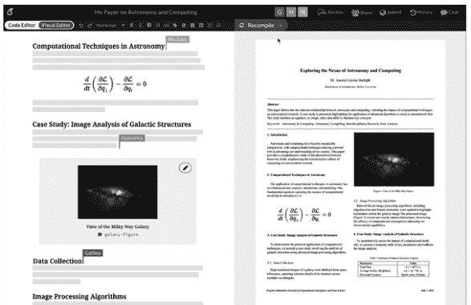

（图片来源：https://www.overleaf.com/）

### 第三节 智能适配提升与多元读者期待

#### 一、满足多元读者群体的期待视野
对比单一领域，跨域研究的目标读者更为多样。不同专业读者对论文结构、术语、理论框架与研究方法存在既定心理预期，即“期待视野”[81]。当论文偏离常规表达时，易被视为不规范或难以理解，降低接受度。

跨界成果要想真正落地，最先撞上的往往是专业共同体的审阅。拥有决定权的群体是各领域的同行把关人，像期刊审稿人、基金评审委员一类。不同学术出身的研究者在认知框架、方法偏好与价值判断上差别很大，交流天然存在隔阂。来自外部学科的理论与方法常因陌生而被质疑是否严谨或相关；若用单一学科的创新标准去评判，也容易低估交叉工作的实际贡献。术语用法和写作习惯不一致，更容易产生理解偏差甚至误判，直接牵动论文能否被接收、项目能否获批。

与此同时，交叉研究多带现实指向，旨在解决社会或产业的真实问题，为决策提供支撑。此时面向的群体就扩展到政策制定者、企业管理者以及大众媒体。对这些读者，学术深度和大众可读性必须兼顾。他们更在意成果对现实的价值、结论是否可操作、以及对问题的响应速度。若表述过度抽象晦涩，知识转化效率和政策影响力都会受损。

正是在这种多元受众的夹缝中，AI更像一个适配器。（1）多风格语言转换：大语言模型能按目标读者自动切换表达，同一成果可输出学术严谨版、政策简报版和科普传播版，提升适配度。（2）语义适配与术语替换：模型可识别论文中的专业表述，结合目标学科或读者背景做术语转换和语义优化，降低误读风险。（3）辅助写作视角平衡：通过训练模型感知不同读者的期待视野，在生成与编辑过程中提示语言偏向，引导作者整合视角实现多元表达。（4）多版本文献摘要与图示输出：自动为不同受众生成摘要与可视化呈现。表10-3-1为不同场景下的提示词示例。

表10-3-1 满足不同读者群体期待视野的提示词示例

| 应用场景 | 提示词示例 |

| :--- | :--- |

| 多风格语言转换 | “将以下学术段落改写为面向政策制定者的通俗表达，保留关键信息但去除过于专业的术语”<br>“请用适合大众媒体传播的语言风格改写下文，并突出研究成果的社会意义” |

| 语义适配与术语替换 | “帮我将这段 A 学科术语翻译成 B 学科研究者也能理解的语言”<br>“请识别并替换段落中的[学科]专有术语，用跨学科读者更容易理解的通用术语或解释说明代替” |

| 辅助写作视角平衡 | “请重新组织这段文字内容，使其在 A 学科和 B 学科两个学科视角下都具备合理性”<br>“请帮助我调整这段论述结构，兼顾 A 学科和 B 学科的关注点，避免学科偏向” |

| 多版本文献摘要与图示输出 | “请为以下论文内容生成三种摘要：面向学术审稿人、面向政策制定者、面向行业从业者”<br>“请将以下研究结果可视化为一张图示，并附文字解释，适合在国际学术会议 PPT 中呈现” |

#### 二、协助规避传统学科的制度壁垒

对单一学科论文，AI已能在期刊推荐、风格适配等方面提供智能发表支持。交叉论文的发表门槛更高，侧重点也随之变化。

首先，目标期刊的筛选更为复杂。单一学科论文的匹配相对直观，AI可依据关键词、方法与主题快速给出建议。交叉论文横跨多个领域，AI必须构建多维匹配模型，既要考虑各学科特征，又要把握论文的交叉点，并参考期刊过往对交叉研究的接纳历史与发展趋势，才能提升推荐的准确性。

其次，对写作风格与结构的适配要求更高。传统学科论文遵循固定规范，AI调整起来较为容易。交叉研究涉及多种语言习惯、分析框架和引用格式，AI需要完成更复杂的风格迁移，按学科特点调整论文结构、用词及引用，并在不同学科间寻求表达平衡。

最后，投稿策略需要更精细化。交叉成果因学科边界模糊易被拒稿，AI可通过数据分析评估期刊的接受历史与交叉发表趋势，提出策略性投稿建议，帮助研究者避开学科壁垒，提升录用概率。表10-3-2为不同场景下的提示词示例。

表10-3-2 协助跨学科研究发表的提示词示例

| 应用场景 | 提示词示例 |

| :--- | :--- |

| 目标期刊识别 | “结合论文中的关键词、研究方法和学科领域，智能推荐期刊，并考虑不同学科领域的发表趋势和接纳度”<br>“根据论文内容分析，提供一份期刊推荐清单，并提供每个期刊的具体选题偏好、审稿周期以及影响因子” |

| 写作风格与结构适配 | “根据论文涉及的多个学科，提供多种写作风格优化建议，确保论文符合[期刊]规范”<br>“优化论文中的引言、方法、讨论等部分的写作结构，使其符合[期刊]的要求” |

| 投稿策略制定 | “分析[期刊]的历史出版情况，评估该期刊是否偏向跨学科研究，并根据预估发表周期制定写作和投稿日程表”<br>“分析[期刊]的审稿标准和接受率，帮助研究者评估论文的接受概率，并为投稿策略提供数据支持” |

### 本章小结

把交叉研究视作跨越社会部门的知识生产活动，从生产与消费两端看，核心痛点在于术语不统一、理论难以融合、方法存在差异、协作困难，以及受众多元与制度壁垒高企。AI可以在术语统一、理论融合、方法整合和协同写作方面提供自动化助力，提升效率、降低整合难度。但AI始终只是辅助工具，研究者仍须保持批判性思维、创新精神和学术独立性，才能维护交叉研究的真实性，避免滑向形式化的伪交叉。

[1] Foucault, M. (1972). *The Archaeology of Knowledge and the Discourse on Language* (A.M. Sheridan Smith, Trans.). New York: Pantheon Books. (Original work published 1969).

[2] Apostel, L. (1972). *Interdisciplinarity: Problems of Teaching and Research in Universities*. Paris: OECD.

[3] Gibbons, M., Limoges, C., Scott, P., et al. (1994). *The new production of knowledge: The dynamics of science and research in contemporary societies*.

[4] Van Noorden, R. (2015). Interdisciplinary research by the numbers. *Nature*, 525 (7569), 306-307.

[5] Berkes, E., Marion, M., Milojević, S., et al. (2024). Slow convergence: Career impediments to interdisciplinary biomedical research. *Proceedings of the National Academy of Sciences*, 121(32), e2402646121.

[6] Dubin, R. (1978) *Theory development*. New York: Free Press.

[7] Whetten, D.A. (1989). What constitutes a theoretical contribution?. *Academy of management review*, 14(4), 490-495.

[8] Jauss, Hans Robert; Elizabeth Benzinger (1970). Literary History as a Challenge to Literary Theory. *New Literary History*. 2(1): 7-37. Viewed 15 March 2013.

[1] 朱丽·汤普森·克莱恩. 跨越边界——知识、学科、学界互涉[M]. 姜智芹译. 南京：南京大学出版社，2005：23+132.

[2] 田贤鹏，张应强. 跨学科研究的历史演变、推进方式和发展趋势[J]. 高等教育研究，2023（2）：51-59.

[3] 首届2025年泰晤士高等教育跨学科科学排名正式揭晓：麻省理工学院位居世界第一[EB/OL]. https：//www.eol.cn/liuxue/redian/yxpm20241121593797.html.

[4] 政府工作报告[EB/OL]. https：//www.gov.cn/yaowen/liebiao/202503/content_7013163.htm.

[5] 交叉科学部简介[EB/OL]. https：//www.nsfc.gov.cn/publish/portal0/tab1333/.

[6] 与哲学、经济学、理学、工学等传统学科并肩——我国新设置“交叉学科”门类[EB/OL]. http：//www.moe.gov.cn/jyb_xwfb/s5147/202101/t20210115_509892.html.

[7] 2023年中国科学院院士增选工作启动[EB/OL]. http：//www.xinhuanet.com/politics/2023-05/31/c_1212194151.htm.

[8] 孟令霞. 从术语学角度看术语翻译[J]. 中国科技翻译，2011，24（2）：28-30+44.

# 第十一章 未来趋势与展望

### 本章介绍

在通用人工智能体加速发展的背景下，学术研究与写作正经历重塑。效率与便捷性显著提升的同时，人类知识生产的主体地位受到冲击，甚至出现学术本体论的危机。提升研究者的AI学术素养，已成为应对这一变局的关键入口。本章先梳理人工智能体的发展趋势及其对学术写作的影响，再聚焦AI学术素养的概念、核心维度与实践提升路径，为构建人机协同的未来学术生态提供参考。

### 第一节 通用人工智能体的发展趋势和影响

#### 一、从嵌入式AI到代理式人工智能体

Agent一词常被解释为代理，也可理解为行动主体。亚里士多德在《尼各马可伦理学》中把人定义为理性行动者，强调意图驱动的自主决策；大卫·休谟在《人性论》中则指出行动的本质是情感主导、理性为辅，隐含了有限理性的观点。由此可见，Agent指向的是一种主动行为能力，而非被动应激。广义上，它既包括人类，也涵盖物理或虚拟世界中具备行动能力的其他实体。

AI Agent即人工智能代理，国内多称智能体。与传统AI不同，它能够自主感知环境、进行决策并执行动作，其核心在于将大语言模型的推理能力与工具调用、长期记忆相结合，实现从思考到行动的跨越，目前正成为技术发展的重要方向。

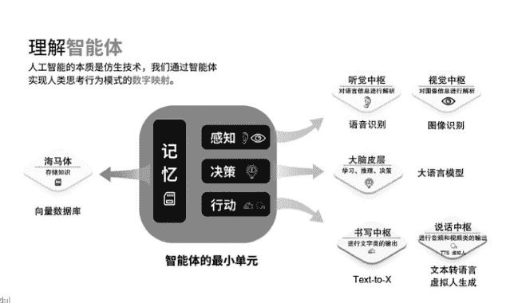

人类使用大模型大致可分为三种设想。嵌入模式把大模型作为后台组件集成到应用里，用户感知不强，任务仍由人主导。副驾驶模式更强调人机协作，模型提供建议但人类仍是主导。三是代理模式，赋予模型高度自主性，能独立拆解任务、规划步骤、调用工具，人类劳动被大量解放。

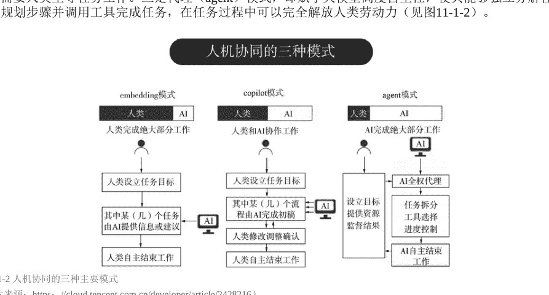

图11-1-2 人机协同的三种主要模式

（图片来源：https://cloud.tencent.com.cn/developer/article/2428216）

目前交互多停留在嵌入或副驾驶阶段，主要靠提示词，人类对提示的清晰度依赖度高。而智能体只需一个目标，就能自主思考、拆解计划、依据反馈自我生成提示，最终达成目标。

以深度访谈为例，模型时代研究者可通过提示词让模型生成提纲和计划，再自行邀约访谈、整理记录。成熟的智能体出现后，只需给出访谈目标，就能自动完成提纲生成、对象筛选邀约、语音访谈记录、材料转写和发现总结的全流程。

据艾媒咨询，全球人工智能体市场2023年约45亿美元，预计2025年飙升至372亿美元，2029年有望突破2407亿美元。2025年3月国内公司“蝴蝶效应”发布通用智能体Manus，引发市场热议。OpenAI、Google、Meta、微软、Anthropic等均在布局通用或垂直代理框架；国内阿里通义、百度文心、智谱清言也在办公、教育、编程等领域加速推进代理功能。

#### 二、作为科研和写作助理的人工智能体

代理式智能体正从对话型AI进化为科研写作中的主动协作者，相较传统工具更具深度与系统性。

首先是主动执行力。传统工具如润色器、翻译器、文献检索或内容生成平台，通常需明确指令后才完成单一操作，缺乏跨任务协同。智能体具备一定自主判断力，能在理解研究目标后自行拆解任务、调用所需工具、组织执行流程。如在撰写论文时，可先协助扩展选题、提取关键词，再自动检索相关文献、搭建知识框架、生成写作大纲，并在写作过程中持续提供语言优化与风格匹配建议，形成完整的协作链条。

其次是多步骤任务处理能力。科研写作周期长、链条复杂。智能体可基于目标与时间节点拆解任务、安排进度、跟踪流程，自动设定文献阅读、数据分析、初稿、投稿等节点，并与Notion、Obsidian、Trello等工具集成，形成动态写作日历。对多课题并行者，它可成为项目助理，实现状态可视化与进度协同。

最后是长期记忆与个性化。传统工具用完即忘，而智能体通过Transformer架构的记忆机制和多样化训练数据，可积累用户的研究偏好、知识结构与写作风格，实现持续性个性化服务，更适合长期项目和写作伙伴角色。

#### 三、通用人工智能体发展带来的冲击

自主能力增强的同时，负面效应也在放大。

首先是学术独立性和创新能力受削弱。智能体能无人工干预生成内容、处理数据、推导结论，使依赖独立思考的学术创作过程模糊。模型基于既有数据和模式，易让研究者困于既有框架，忽视原创与理论突破。过度依赖会削弱自主分析和独立建构知识体系的能力。

其次是信息碎片化与信息茧房强化。智能体能独立搜索、阅读、整理文献，提升效率，但也可能让研究者脱离全文阅读和批判性理解，陷入碎片化认知，丧失全局系统思维。过度依赖二手整理，也会远离田野与实践。基于历史数据和用户偏好的推荐机制，更易形成封闭的信息茧房，限制创新思维。

最后是学术本体论危机加剧。学术创作强调主体性、创新性和独立性，而智能体在这些维度上的增强，是否意味着对人类研究者的压缩？由智能体生成的成果还能否视为个体智慧的体现？高度一致与同质化是否会模糊新知与创新的边界？若知识生成被机器算法主导，学术归属与评判体系将如何调整？这些争议尚未定论，却要求学术研究在意义与评价上与时俱进，避免知识生产的去人性化与去创新化。

### 第二节 学术素养的AI升级之路
#### 一、素养的来龙去脉与智能转向
“素养”最早可考在《汉书·李寻传》与《后汉书·刘表传》，本义指个人日常修养。2003年OECD在PISA中文版把 competency 译为“素养”，让这一概念走向国际化。2005年该组织给出表述：素养是在特定情境中调动心理社会资源以应对复杂需求的能力[5]。

学术素养曾被归纳为六个面向：权威的建构性与情境性、信息创造的过程性、信息的价值属性、研究即探究过程、学术即对话、检索即策略探索[4]。

数字技术渗入科研后，数字学术素养应运而生，Goodfellow 2011、Selwyn 2016等研究把在线协作、数据管理、数字伦理、数字批判意识都纳入其中。随着通用智能体研发加速，培养面向人工智能的学术素养已变得刻不容缓。

#### 二、人工智能学术素养的内核与分型
非营利组织EDUCAUSE于2024年提出教学与学习情境下的AI素养ALTL，概括为四个方面：技术理解，即把握智能系统的基本原理；批判评估，即判断智能工具在教学、研究、管理中的价值并识别偏见与滥用；实践整合，即把智能工具有效嵌入教学科研；伦理自觉，即遵循伦理规范并关注社会影响[7]。

浙江大学人工智能教育教学研究中心在《大学生人工智能素养红皮书（2024版）》中把大学生人工智能素养拆分为体系化知识、构建式能力、创造性价值和人本型伦理四个有机整体，强调知识为基、能力为重、价值为先、伦理为本，四者互促共生[6]。

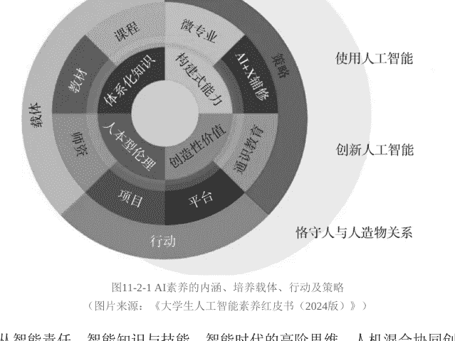
图11-2-1 AI素养的内涵、培养载体、行动及策略
（图片来源：《大学生人工智能素养红皮书（2024版）》）

Li 2022从智能责任、智能知识与技能、智能时代的高阶思维、人机混合协同创新四个维度构建框架。智能责任涵盖智能伦理与智能态度；智能知识与技能涵盖智能意识、智能知识、智能技能；高阶思维涵盖计算思维、数据思维、批判性思维、编程思维；人机混合协同创新涵盖人与智能协同、团队合作与智能创新（见图11-2-2）[8]。

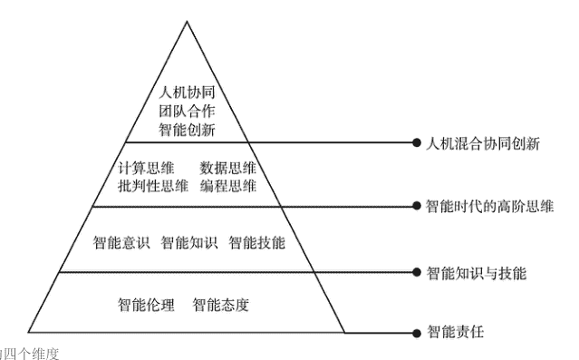
图11-2-2 大学生AI素养的四个维度
（图片来源：Li Jia. (2022) .The Definition and Framework Construction of College Students'Artificial Intelligence Literacy. *Science Innovation*，10（5），157-165）

Markus等人2025年开发并验证了AI能力客观量表AICOS，采用模块化六因子结构，从应用、创建、检测、伦理、生成、理解六个角度综合测量。该量表提供18题简版用于快速测评，也提供51题完整版用于深入测评[9]。

总体看学界已形成初步共识：人工智能学术素养是智能时代研究者必须具备的核心能力，不只是会用工具，更是对工具在学术场域中理解、评判、规范的综合能力。可归纳为三项能力加一项意识，即技术认知、批判性使用、人机协同与学术伦理自觉。其要义见下表：

表11-2-1 人工智能学术素养的四大核心抓手

| 核心抓手 | 核心要义 |
| :--- | :--- |
| 技术认知 | 掌握生成式智能的底层原理、工作机制与边界，能判断适用范围，辨识其在不同学术场景的价值与局限 |
| 批判性使用 | 审慎核查智能工具产出的准确性、偏误与逻辑合理性，保持独立思考，避免技术决定论与盲目依赖 |
| 人机协同 | 合理调配智能助手参与文献检索、写作框架构建、语言润色等环节，形成人类主导、智能配合的协作模式 |
| 伦理自觉 | 清晰把握智能工具参与学术活动的使用规范，遵守署名、引用与原创要求，防止抄袭、伪造、误导等失范行为 |

#### 三、四个抓手推动素养落地
围绕上述四个抓手，分方向展开实践设计。

##### 1. 打造技术认知底座
技术认知是素养提升的前提，不仅要会用，更要懂其机理。

（1）强化基础训练。高校与科研机构可开设通识、专业、交叉、微课等课程，帮助不同层级的学习者理解自然语言处理、机器学习、模型训练与微调等关键概念，并掌握工具实操技能。

（2）借助线上线下资源自主学习。研究机构常举办人工智能与教育、科研、伦理交叉的公开讲座与工作坊，有助于追踪技术与应用的最新动态。大量网络课程亦可提升使用技能，例如OpenAI于2025年4月推出的OpenAI学院提供多项免费学习内容。

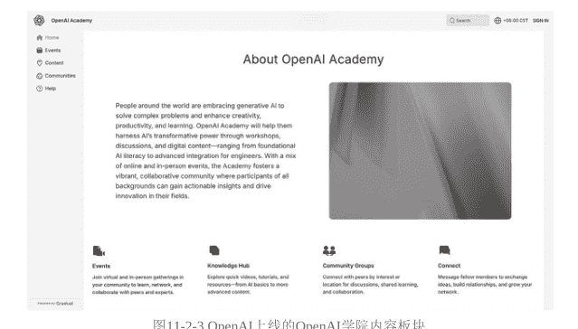
（3）参与开源社区与在线平台。Hugging Face、OpenAI、Kaggle等平台提供模型、工具应用与数据分析的实践资源与项目范例。通过亲手操作模型、撰写指令或参与智能竞赛，可在真实语境中强化认知与应用。

##### 2. 守住学术主体，强化批判性使用
智能写作的便利易诱发依赖，保持批判是维护学术独立的关键。

（1）养成批判视角习惯。将智能产出视为假设、参考或思考起点，而非结论，重视提问与追问而非直接索取答案。

（2）养成交叉验证习惯。对智能系统提供的数据、文献或观点主动溯源、核查出处、检验逻辑，可借助Google Scholar搭配Scite等跨平台实现。

（3）养成对话式使用习惯。通过多轮指令调优，引导系统生成符合研究背景、表达风格与逻辑需求的内容，避免浅层一问一答。

##### 3. 搭建人机协同的研究工作流
智能工具不应替代研究者，而应成为分工明确的协作伙伴。

（1）按任务链设计协作。明确研究设计、逻辑结构由人主导，语法优化、段落生成、图表绘制由智能助力，逐步形成标准化的写作与研究流程。

（2）整合学术工具生态。熟练组合Notion+ChatGPT、Zotero+Elicit、Word+Copilot等增强工具链，提升多环节协同效率。

（3）培养指令设计意识。学会设计有效的提示语，引导系统产出符合学术需求的内容，是实现深度协作的关键素养。

##### 4. 划定伦理边界，树立责任意识
伦理是智能参与学术的根本底线。

（1）熟悉所在机构与期刊的使用政策，明确可介入环节、需标注情形与应规避范围。

（2）明确署名与引用规范。若生成式内容构成论文核心观点，需说明使用方式，避免冒充原创；若仅作辅助，应在致谢或方法部分说明工具种类与用途。

（3）树立负责使用者意识。任何由智能生成的文本、数据或图表，最终责任由使用者承担，必须对产出进行再判断与再验证，确保准确与合规。

总体而言，素养是认知、实践、价值立场的复合体，并不等于单纯的知识或技术，而是强调学习研究者的综合实践能力与价值自觉。人工智能时代提出人工智能学术素养，正是为了强调人在技术助力下如何更有意识地开展学术活动、维护学术伦理并持续适应变革。

### 本章小结
人工智能发展呈现多元化，除通用智能体外，多模态融合与垂直领域精细化也是重要方向。更多智能应用持续拓展其在学术场景的边界。在此背景下，仅靠提升治学素养已难以全面应对智能对科研生态的深层冲击，还需制度建设、科研评价更新、人机协作伦理规范等多维度协同，形成兼顾质量与善用的动态平衡。同时，推动跨学科合作、加强对智能模型可解释性的研究，将是构建人机协同学术生态、应对风险挑战的重点。

学术写作 × AI素养 文献时间线 1963-2025

覆盖六十余年的这批书目，把学术写作训练、AI素养建构、跨学科研究以及知识社会学的关键节点串在一起。来源包括期刊论文、专著、预印本和学位论文，为追踪科研写作与教育变革的脉络提供可回溯的锚点。

[30] Back matter. (1963). *The Public Opinion Quarterly*, 27(1), 167-172. (Page numbers inferred from typical journal structure for “Back Matter” sections)
[31] Belcher, D. (1994). The apprenticeship approach to advanced academic literacy: Graduate students and their mentors. *English for Specific Purposes*, 13(1), 23-34.
[32] Berkes, E., Marion, M.R., Milojević, S., et al. (2024). Slow convergence: Career impediments to interdisciplinary biomedical research. *Proceedings of the National Academy of Sciences*, 121(32), e2402646121.
[33] Bessen, J. (2019). Automation and jobs: When technology boosts employment. *Economic Policy*, 34(100), 589-626.
[34] Booth, A. (2016). *Systematic approaches to a successful literature review*. Sage.
[39] Dubin, R. (1978). *Theory development*. Free Press.
[40] Duhaylungsod, A.V., & Chavez, J.V. (2023). ChatGPT and other AI users: Innovative and creative utilitarian value and mind set shift. *Journal of Namibian Studies: History Politics Culture*, 33, 4367-4378.
[41] Dwyer, C.P. (2023). An evaluative review of barriers to critical thinking in educational and real-world settings. *Journal of Intelligence*, 11(6), 105.
[42] Foucault, M. (1961). *Folie et déraison: Histoire de la folie à l'âge classique*. Plon.
[43] Foucault, M. (1972). *The archaeology of knowledge and the discourse on language* (A.M. Sheridan Smith, Trans.). Pantheon Books.
[44] Foucault, M. (1977). *Discipline and punish*. Pantheon Books.
[45] Foucault, M., & Kremer-Marietti, A. (1969). *L'archéologie du savoir* (Vol. 1). Gallimard.
[46] Gao, C.A., Howard, F.M., Markov, N.S., et al. (2022). *Comparing scientific abstracts generated by ChatGPT to original abstracts using an artificial intelligence output detector, plagiarism detector, and blinded human reviewers*. BioRxiv.
[47] Georgiva, M., Kassorla, M., & Papini, A. (2024). *AI literacy in teaching and learning: A durable framework for higher education*. Stanford Accelerator for Learning, https://acceleratelearning.stanford.edu/publication/ai-literacy-teaching-and-learning-durable-framework-higher-education.
[48] Gibbons, M., Limoges, C., Nowotny, H., et al. (1994). *The new production of knowledge: The dynamics of science and research in contemporary societies*. Sage.
[49] Gibbons, P. (2012). Scaffolding academic language and literacy with school-aged English language learners. *The European Journal of Applied Linguistics and TEFL*, 1(2), 51-65.
[50] Goodfellow, R. (2011). Literacy, literacies and the digital in higher education. *Teaching in Higher Education*, 16(1), 131-144.
[51] Goos, M., & Manning, A. (2007). Lousy and lovely jobs: The rising polarization of work in Britain. *The Review of Economics and Statistics*, 89(1), 118-133.
[52] Grassini, S. (2023). Shaping the future of education: Exploring the potential and consequences of AI and ChatGPT in educational settings. *Education Sciences*, 13(7), 692.
[53] Gustafson, J.M. (1968). The social construction of reality: A treatise in the sociology of knowledge.
[54] Heller, M.A. (1998). The tragedy of the anticommons: Property in the transition from Marx to markets. *Harvard Law Review*, 111(3), 621-688.
[55] Huang, J., & Tan, M. (2023). The role of ChatGPT in scientific communication: Writing better scientific review articles. *American Journal of Cancer Research*, 13(4), 1148-1155.
[56] Imran, M., & Almusharraf, N. (2023). Analyzing the role of ChatGPT as a writing assistant at higher education level: A systematic review of the literature. *Contemporary Educational Technology*, 15(4), ep467.
[57] Jauss, H.R. (1970). Literary history as a challenge to literary theory (E. Benzinger, Trans.). *New Literary History*, 2(1), 7-37.
[58] Khalifa, M., & Albadawy, M. (2024). Using artificial intelligence in academic writing and research: An essential productivity tool. *Computer Methods and Programs in Biomedicine Update*, 5, 100181.
[59] Knorr-Cetina, K.D. (1981). Social and scientific method or what do we make of the distinction between the natural and the social sciences? *Philosophy of the Social Sciences*, 11(3), 335-359.
[60] Kranzberg, M. (1986). Technology and history: "Kranzberg's laws". *Technology and Culture*, 27(3), 544-560.
[61] Kynoch, B., Latapie, H., & van der Sluis, D. (2023). *RecallM: An adaptable memory mechanism with temporal understanding for large language models* (arXiv:2307.02738). arXiv.
[62] Latour, B., Salk, J., & Woolgar, S. (2013). *Laboratory life: The construction of scientific facts*. Princeton University Press.
[63] Li, J. (2022). The definition and framework construction of college students' artificial intelligence literacy. *Science Innovation*, 10(5), 157-165.
[64] Lustig, J. (2006). From art to alienated labor: The degradation of academic work. *Thought & Action*, 22(2), 143-156.
[65] Malik, T., Dwivedi, Y.K., Kshetri, N., et al. (2023). Opinion paper: "So what if ChatGPT wrote it?" Multidisciplinary perspectives on opportunities, challenges and implications of generative conversational AI for research, practice and policy. *International Journal of Information Management*, 71, 102642.
[66] Mannheim, K. (2013). *Ideology and utopia*. Routledge.
[67] Marcus, G. (2022). *Deep learning alone isn't getting us to human-like AI*. MIT Press.
[68] Markus, A., Carolus, A., & Wienrich, C. (2025). *Objective measurement of AI literacy: Development and validation of the AI Competency Objective Scale (AICOS)* (arXiv:2503.12921). arXiv.
[69] Marzuki, M., Widiati, U., Rusdin, D., et al. (2023). The impact of AI writing tools on the content and organization of students' writing: EFL teachers' perspective. *Cogent Education*, 10(2), 2236469.
[70] Pokkakillath, S., & Suleri, J. (2023). ChatGPT and its impact on education. *Research in Hospitality Management*, 13(1), 31-34.
[71] Popper, K.R. (2009). *Vermutungen und Widerlegungen: Das Wachstum der wissenschaftlichen Erkenntnis* (Vol. 10). Mohr Siebeck.
[72] Schmidt, J.C. (2011). What is a problem?: On problem-oriented interdisciplinarity. *Poiesis & Praxis*, 7(4), 249-274.
[73] Schneider, D., Mishra, A., Gluski, J., et al. (2025). Prevalence of Artificial Intelligence-Generated Text in Neurosurgical Publications: Implications for Academic Integrity and Ethical Authorship. *Cureus*, 17(2).
[74] Selim, A.S.M. (2024). The transformative impact of AI-powered tools on academic writing: Perspectives of EFL university students. *International Journal of English Linguistics*, 14(1), 16-33.
[75] Selwyn, N. (2016). *Is technology good for education?* Polity Press.
[76] Slaughter, S., & Leslie, L.L. (1997). *Academic capitalism: Politics, policies, and the entrepreneurial university*. Johns Hopkins University Press.
[77] Snyder, H. (2019). Literature review as a research methodology: An overview and guidelines. *Journal of business research*, 104, 333-339.
[78] Sollaci, L.B., & Pereira, M.G. (2004). The introduction, methods, results, and discussion (IMRAD) structure: A fifty-year survey. *Journal of the Medical Library Association*, 92(3), 364-367.
[79] Soufi, N., & See, B.H. (2019). Does explicit teaching of critical thinking improve critical thinking skills of English language learners in higher education? A critical review of causal evidence. *Studies in Educational Evaluation*, 60, 140-162.
[80] Stephan, P. (2012). *How economics shapes science*. Harvard University Press.
[81] White, E.B., & Strunk, W. (2023). *The elements of style*. Open Road Media.
[82] Suber, P. (2012). *Open access*. MIT Press.
[83] Van Noorden, R. (2015). Interdisciplinary research by the numbers. *Nature*, 525 (7569), 306-307.
[84] Wang, X. (2014). *Personas in the user interface design* [Master's thesis, University of Calgary]. PRISM.
[85] Whetten, D.A. (1989). What constitutes a theoretical contribution? *Academy of Management Review*, 14 (4), 490-495.

[86] Wiley Author Services 于2024年2月2日发布的《Best practice guidelines on research integrity and publishing ethics》。
[87] Wingate, U. 2015年出版的《Academic literacy and student diversity: The case for inclusive practice》，收录于 New Perspectives on Language and Education 系列第42卷，由 Multilingual Matters 出版。