# AI赋能小团队管理：写给管理者的AI使用手册

## 内容提要

现在做小团队管理，最头疼的就是“活多人少”，而AI技术的发展，全面重塑了小团队的管理逻辑，它能给你生成经营方案、高效安排工作，等等。

这本书采用图解的形式进行讲解。全书共10章。第1章至第7章讲解如何用AI知人善任、用AI分析决策、用AI安排工作、用AI沟通协调、用AI激励奖惩、用AI高效开会、用AI培养发展员工；第8章至第10章从三大小团队管理类型——市场销售型、研发创意型、生产制造型视角，讲解如何用AI高效推进工作。不管你是哪种类型的管理者，AI都能帮你做好管理决策，不用懂技术，照着书里的招数去做就可以了。

本书适合小团队管理者、一人公司管理者和自由职业人士阅读。

## 前言
拥抱AI，让团队效能跃升新维度

过去，我们谈管理的时候，总将其视为“一半科学，一半艺术”。管理者像手工作坊里的匠人，既要雕琢目标分解的精度，又要打磨沟通反馈的温度。

可当“00后”员工带着数字化基因涌入职场，当远程办公模糊了工作时空的边界，当市场变化以周为单位迭代时，我们突然发现：传统的管理范式正在遭遇降维打击。

那些曾让我们引以为傲的经验主义，正在显露出危险的裂缝。

- 决策滞后性：依靠月度报表制定策略，就像通过后视镜驾驶智能汽车。
- 执行衰减效应：层层传递的指令到达基层时，早已被信息漏斗过滤得面目全非。
- 创新瓶颈症：管理者深陷于事务性工作，创造力被Excel表格与会议纪要等吃掉。

这不是管理者的能力危机，而是管理工具的代际鸿沟。

## 1.AI带来智能增强型的管理范式

AI正在重构团队管理的底层逻辑，采用AI辅助团队管理，其决策效率、目标达成率、员工满意度等都有明显提升。

（1）决策支持系统：DeepSeek分析市场趋势时，不会因情绪影响判断；文心一言处理百万级员工的行为数据时，不会因疲劳而产生认知偏差。AI让决策从“经验驱动”升级为“数据+算法”的双轮驱动。

（2）事务型工作自动化：如某团队引入AI会议纪要的3个月内，无效会议明显减少，跨部门协作效率显著提升。当重复性事务被AI接管，管理者终于能从“流程监督者”回归“价值创造者”的本质角色。

（3）人才发展新基建：试想这样的场景，新员工入职时，AI根据其性格特质与岗位胜任力模型，自动生成个性化成长路径；与员工进行季度绩效沟通前，系统已模拟5种激励方案的效果。这不是科幻场景，而是正在发生的现实。

## 2.AI不是替代者，而是管理者的“强化外骨骼”

在与众多管理者交流时，我常遇到两种极端认知：要么将AI视为洪水猛兽，担心被机器取代；要么陷入技术崇拜，认为有了AI就万事大吉。这两种认知都忽略了其本质：AI的价值不在于取代，而在于增强。

优秀的管理者不是只会机械地操作AI的人，而是应进化为“人+AI”协作的专家：

- 你负责定义团队的使命，AI将其拆解为可执行的OKR（目标与关键成果）体系。
- 你洞察员工深层需求，AI提供个性化激励方案建议。
- 你把握战略方向，AI评估执行偏差并预警。

在这种协作模式下，管理者从“全能选手”转型为“交响乐团指挥家”，AI则成为各个声部的智能增强器。

> 一位“95后”创业者的观点让我印象深刻：“不会用AI的管理者，就像到了智能手机时代还在用传呼机的人。”

回望过去，那些掉队的企业，往往不是败给竞争对手，而是输给了时代。管理者真正的危机，从来不是AI替代人类，而是会用AI的管理者淘汰不会用AI的管理者。

## 3.构建属于你的AI管理系统

站在人工智能奇点临近的当下，每个管理者都面临这样的选择：是继续用Excel函数计算团队效能，还是让AI实时推演最优解？是花费大把时间核对考勤数据，还是让系统自动生成团队管理优化方案？

我始终相信，真正的管理智慧不在于工具本身，而在于选择工具的勇气与驾驭工具的智慧。当你在本书中看到AI将某类工作的耗时从8小时压缩到8分钟时，不要感到焦虑——这恰恰意味着，你每天多出7个多小时去做其他的事：

- 与核心成员进行深度战略研讨。
- 设计颠覆性的激励机制。
- 思考行业的下一个增长点。

管理的本质始终是“通过他人完成目标”，而AI正在赋予这个目标新的维度，建造让人类智慧绽放得更加灿烂的智能基座。

AI的出现，不是传统管理方式的终点，而是智能管理时代的起点。翻开本书，让我们共同开启这场管理进化之旅吧。

# 第1章
AI+知人善任

在团队管理中，知人善任是打造高效团队的基础。AI技术的融入，为这一传统难题带来了全新的解决方案。从精准定位岗位角色，借助AI分析岗位需求与特点，设计出科学合理的岗位架构；到组建团队时，利用AI强大的数据筛选与匹配能力，甄选出高适配的人才；再到全面评估人才，AI能综合多方面因素给出客观评价；它还能发掘下属潜在优势，让人才在合适的位置发光发热，同时塑造超强团队合力，营造理想团队氛围。在本章中，我们将一同探索 AI如何在知人善任的各个环节发挥关键作用。

## 1.1 精准定位：用AI助力岗位角色设计

问题情景

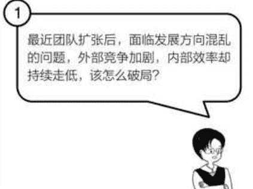

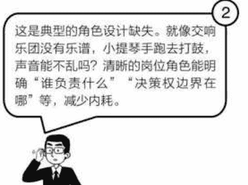

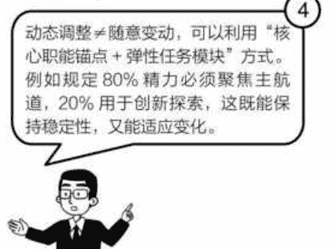

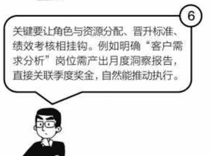

### AI提问框架

通用公式=业务场景定位 + 岗位角色设计目标 + 数据验证需求

#### 业务场景定位

明确岗位角色设计的业务背景与约束条件，为AI提供分析坐标系。帮助AI理解岗位角色设计需适配的业务土壤，避免方案与实际情况脱节。

##### 提问要素

- 行业特性：如研发密集型、客户高触点服务。
- 组织阶段：如初创期、成熟期公司。
- 技术工具：如使用飞书多维表格管理项目、依赖CRM（客户关系管理）系统获客。

#### 角色设计目标

将抽象诉求转化为可量化的设计原则，为AI划定岗位角色设计需解决的问题边界，避免方案泛化。

##### 提问要素

- 期望产出：如缩短客户响应周期30%。
- 协作模式：如需要跨部门虚拟小组、要求单兵作战能力。
- 风险规避：如防止关键岗位人才流失、避免过度依赖某员工等。

#### 数据验证需求

要求AI基于特定数据验证岗位角色合理性，确保设计方案可落地、可测量，而非纸上谈兵。

##### 提问要素

- 历史数据：如过去半年客服工单处理量分布。
- 标杆案例：如竞品研发团队角色分工模型。
- 员工画像：如现有成员技能矩阵、离职人员能力共性分析等。

### 准备资料

| 要点 | 内容 |
|---|---|
| 组织诊断报告 | 含现有岗位说明书、离职面谈记录、跨部门投诉案例等。 |
| 业务流地图 | 标注各环节参与岗位角色、耗时占比及常见卡点等。 |
| 员工能力图谱 | 通过测评或项目复盘得出的技能分布热力图等。 |
| 外部对标素材 | 类似行业头部企业的JD（工作说明书）及薪酬数据等。 |

### 实战案例

#### 业务场景定位

我们是某新消费品牌电商团队，负责天猫/抖音双平台运营，团队25人（含5名实习生）。核心业务指标是直播间GMV（商品交易总额）转化率≥8%，目前达成率仅为6.2%。使用蝉妈妈、有赞等系统，但数据孤岛严重。

#### 角色设计目标

需重新设计三类岗位角色

1. 确保直播脚本与实时流量波动动态匹配（如减少30%硬植入时段掉粉率）。
2. 建立跨平台用户行为分析模型（如识别抖音用户与天猫用户消费决策差异）。
3. 设计实习生培养路径（如3个月内能独立承担基础场控工作）。

#### 数据验证需求

请基于以下信息生成方案

1. 近3个月各时段直播间用户停留时长分布。
2. 竞品头部直播间说话的技巧与福利发放节奏关联性分析。
3. 现有运营团队成员SQL（结构化查询语言）取数能力及Python（计算机编程语言）脚本掌握度测评结果。

#### 需要输出

1. 岗位角色职责清单（含每项工作的输入输出标准）。
2. 协作流程图（标注各环节岗位角色交互节点）。
3. 能力模型升级方案（优先补足“用户行为分析”技能缺口）。

### 注意事项

| 要点 | 内容 |
| :--- | :--- |
| 灰度验证 | 先在小范围试点岗位角色设计，观察 1~2 个迭代周期后再全面推广。 |
| 动态校准 | 每季度根据业务数据调整岗位角色（如大促期间增设“流量应急指挥官”）。 |
| 文化适配 | AI 方案需与团队现有沟通风格匹配（如工程师团队避免过度强调“狼性”文化）。 |
| 伦理审查 | 涉及员工监控类角色设计（如效率稽查员）须提前与法律顾问沟通合规性。 |

## 1.2 组建团队：用AI甄选高适配人才

问题情景

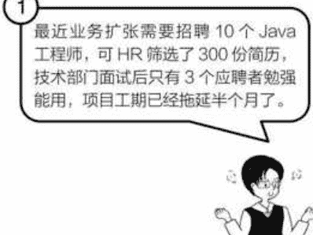

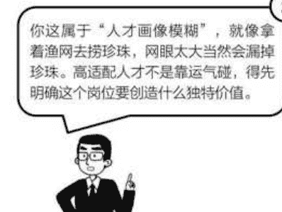

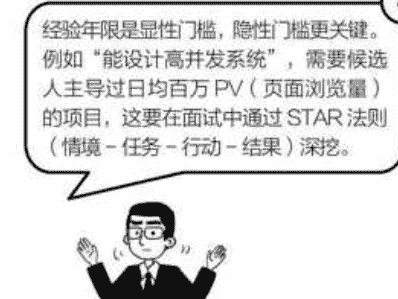

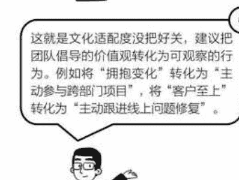

### AI提问框架

通用公式=人才需求定位 + 筛选标准构建 + 评估维度设计

#### 人才需求定位

明确岗位须解决的核心矛盾及对业务的关键影响，帮助AI理解“什么人能创造差异化价值”，避免泛泛筛选。

##### 提问要素

- 岗位类型：如增长黑客、用户研究员。
- 业务场景：如跨境电商供应链优化、医疗AI数据标注。
- 价值锚点：如提升30%复购率、降低20%客诉率。

#### 筛选标准构建

将隐性需求转化为可量化的硬性/软性条件，为AI提供“人才筛选的坐标轴”，提升匹配精度。

##### 提问要素

- 硬性门槛：如主导过千万级项目、持有PMP（项目管理专业人员）认证。
- 软性特质：如复杂问题解决能力、冲突管理能力。
- 文化适配点：如结果导向、扁平化沟通。

#### 评估维度设计

规划如何验证候选人的关键能力，确保AI建议的筛选方式可落地。

##### 提问要素

- 能力测试：如现场设计SQL优化方案、模拟用户访谈。
- 行为面试：如请举例说明你推动过最难落地的项目。
- 数据验证：如提供过往项目收益分析报告。

### 准备资料

| 要点 | 内容 |
|---|---|
| 岗位价值图谱 | 含岗位核心职责、协作关系、决策权限等。 |
| 人才流失分析 | 近半年离职人员的绩效数据、离职面谈记录等。 |
| 业务场景案例 | 3-5个岗位须解决的真实业务难题（如如何提升直播带货转化率）。 |
| 文化行为标准 | 将价值观转化为可观察的行为（如客户至上=主动跟进线上问题修复至闭环）。 |

### 实战案例

#### 人才需求定位

我们是某新能源车企智能驾驶团队，需招聘“感知算法工程师”。该岗位须解决的核心矛盾是“在极端天气下（暴雨/浓雾）提升摄像头感知精度”，直接影响L3（自动辅助驾驶）功能落地。

#### 筛选标准构建

##### 硬性门槛

1. 有量产车型感知算法开发经验。
2. 发表过顶级会议论文。
3. 熟悉Transformer（深度学习模型架构）在点云处理中的应用。

##### 软性特质

1. 能跨领域整合激光雷达与视觉数据。
2. 具备车规级功能安全认证思维。

##### 文化适配点

接受“测试车极端场景路测”的高强度出差。

#### 评估维度设计

请基于以下信息生成方案

1. 技术笔试：给定暴雨场景数据集，要求优化目标检测MAP值（平均精度均值）。
2. 模拟评审：角色扮演向跨部门解释技术方案。
3. 背调重点：核实候选人参与量产项目的具体贡献度。

需要输出

1. 精准人才画像（含行业/企业分布）。
2. 定制化面试题库（含技术面试题与结构化行为面试题）。
3. 竞品公司同类岗位薪酬分位值参考。

注意事项

| 要点 | 内容 |
| :--- | :--- |
| 交叉验证 | AI 推荐的候选人须通过“历史项目复盘报告 + 专家背对背评估”双重验证。 |
| 动态校准 | 每完成 3 次招聘后，根据新员工绩效数据优化筛选模型。 |
| 文化适配 | AI 难以评估“幽默感”“同理心”“人格魅力”等软性特质，须结合结构化行为面试（如请讲述你化解同事矛盾的经历）。 |

## 1.3 全面评估：用AI综合评价人才

问题情景

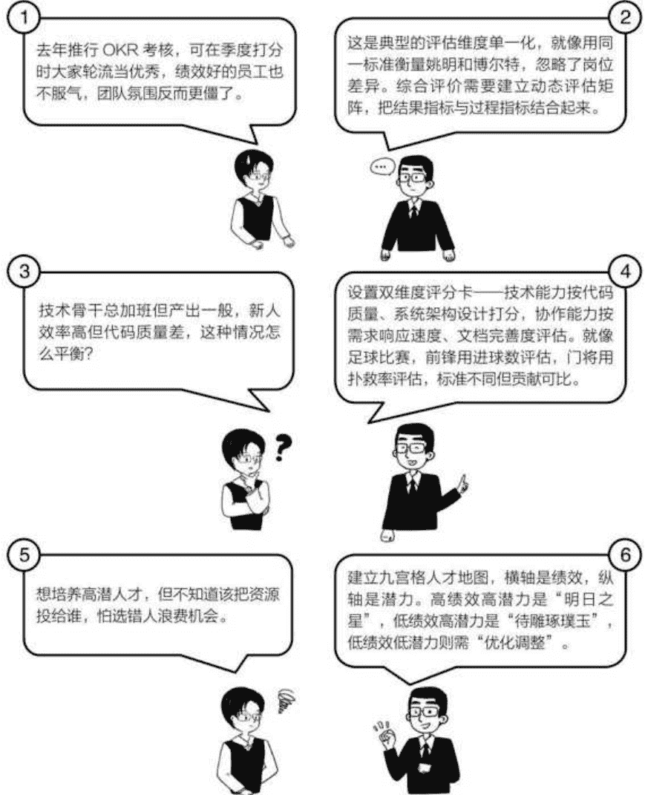

### AI提问框架

通用公式=评估目标定位 + 数据基础构建 + 分析维度设计

#### 评估目标定位

明确评价的核心目的及须解答的关键业务问题，为AI设定分析方向，避免为了评估而评估。

##### 提问要素

- 岗位类型：如研发骨干、销售主管。
- 业务诉求：如识别高潜人才、优化团队结构。
- 决策场景：如晋升评审、资源分配、培训规划。

#### 数据基础构建

提供支撑评价的多源数据输入，确保评价有理有据，减少主观偏差。

##### 提问要素

- 客观数据：如项目交付周期、客户满意度评分。
- 主观数据：如评估反馈、跨部门协作评价。
- 行业标杆：如同类岗位市场薪酬分位值、技能认证标准。

#### 分析维度设计

将抽象评价目标拆解为可量化的具体指标，构建评价坐标系，使人才特征可视化。

##### 提问要素

- 能力维度：如战略思维、用户洞察力。
- 行为维度：如跨部门协作频次、创新提案数量。
- 潜力维度：如学习敏捷度、环境适应力。

### 准备资料

| 要点 | 内容 |
| :--- | :--- |
| 岗位能力模型 | 含胜任力要素及行为描述（如“领导力=成功辅导3名下属晋升”）。 |
| 历史评价数据 | 近2年绩效考核表、项目复盘报告、培训记录。 |
| 业务场景案例 | 3-5个岗位须解决的核心业务难题（如“如何提升App用户留存”）。 |
| 行业对标信息 | 同类岗位人才画像、市场薪酬报告、竞品人才策略等。 |

### 实战案例

#### 评估目标定位

我是某金融科技公司的算法团队负责人，需在30人的团队中识别“技术领军人才”培养对象，目标是未来1年支撑3个AI风控模型落地。

#### 数据基础构建

请你整合以下数据

1. 客观数据：近半年代码提交质量（圈复杂度、注释完整率）及模型上线后的坏账率下降值。
2. 主观数据：技术评审会上的方案创新评分（1~5分）、跨部门协作满意度调研结果。
3. 行业标杆：GitHub（代码托管和协作开发平台）开源项目贡献度。

#### 分析维度设计

请从以下三个维度评估

1. 技术攻坚能力：主导完成复杂项目的数量与难度系数。
2. 技术影响力：在团队内部的知识分享频次、外部技术峰会演讲次数。
3. 业务转化力：开发的算法产生的直接经济价值（如降低多少万元逾期损失）。

#### 需要输出

1. 人才梯队分布图（含“领军人才”“骨干人才”“潜力人才”等）。
2. 每位候选人的能力雷达图（如技术/影响力/转化力）。
3. 定制化培养建议（如须加强从算法到业务落地的转化思维训练）。

### 注意事项

| 要点 | 内容 |
| :--- | :--- |
| 数据清洗 | 剔除偏见数据（如领导主观加分），确保评价的客观性。 |
| 动态校准 | 每半年根据业务变化调整评估维度［如新增 AIGC（生成式人工智能）］。 |
| 人工复核 | 对 AI 识别出的“高潜人才”进行深度面谈，验证其是否具备相关能力。 |
| 反馈闭环 | 将评价结果用于制定个性化发展计划，而非单纯作为奖惩依据。 |

## 1.4 人尽其才：用AI发掘下属潜在优势

问题情景

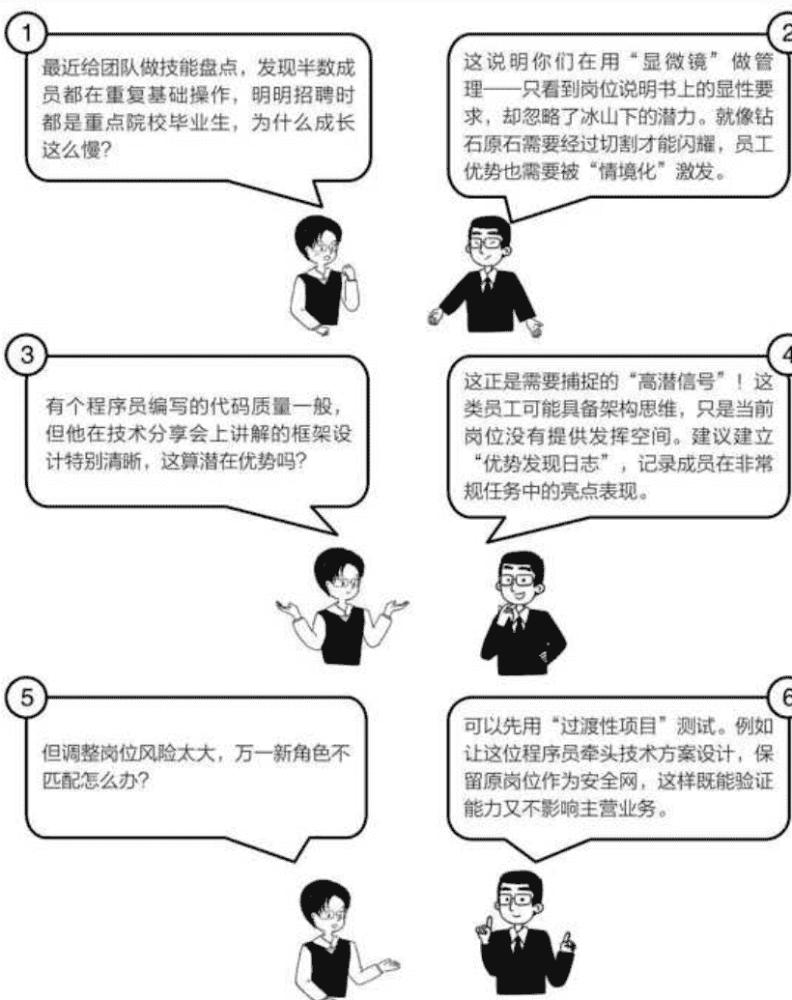

AI提问框架

通用公式=输入员工画像+ 行为数据锚点 + 优势探测方向

#### 输入员工画像

提供被评估者的基础信息与岗位背景，为AI建立分析基准，避免“刻舟求剑”式判断。

##### 提问要素

- 基本信息：如90后/计算机专业/3年经验。
- 当前岗位：如中级Java工程师/负责支付模块开发。
- 职业锚点：如希望转向技术管理岗。

#### 行为数据锚点

列举具体工作中展现潜在能力的行为案例，将抽象评价转化为可量化的事实依据。

##### 提问要素

- 高光时刻：如主导完成跨部门API（应用程序编程接口）对接，提前2周交付。
- 低效场景：如在简单CRUD（增加、读取、更新和删除）功能开发上速度较慢。
- 跨界表现：如业余运营技术自媒体，获5000+关注者。

#### 优势探测方向

明确希望AI挖掘的潜在能力领域，为AI划定探索范围，避免在无关领域发散。

##### 提问要素

- 能力维度：如复杂问题解决能力、创新突破能力。
- 业务场景：如需要能设计分布式系统的架构师。
- 发展阶段：如适合1年内培养的潜力方向。

### 准备资料

| 要点 | 内容 |
| :--- | :--- |
| 工作行为记录 | 关键任务完成过程文档、跨部门协作反馈等。 |
| 能力标签库 | 行业通用技能图谱（如“AI产品经理能力模型”）。 |
| 业务挑战清单 | 当前需突破的能力缺口（如“缺乏智能合约开发经验”）。 |

### 实战案例

#### 输入员工画像

被评估者：王芳，28岁，市场专员，负责公众号运营2年，近期承担短视频策划工作。职业目标：成为用户增长负责人。

#### 行为数据锚点

王芳有如下表现

1. 高光时刻：策划的“用户故事”系列视频平均播放量超5万次，比常规内容高300%。
2. 低效场景：撰写的活动推文转化率持续低于团队均值的15%。
3. 跨界表现：自学掌握A/B测试工具，为投放策略优化提供数据支持。

#### 优势探测方向

请分析

1. 王芳在“用户共情能力”和“数据驱动思维”方面的潜力强度。
2. 其更适合向“用户运营”还是“市场数据分析”方向发展。
3. 建议可快速验证其潜力的试错型任务。

#### 需要输出

1. 潜力雷达图（含创造力、执行力、战略思维等维度评分）。
2. 与目标岗位的能力匹配度分析。
3. 三个低成本试错方案及预期收益。

### 注意事项

| 要点 | 内容 |
| :--- | :--- |
| 动态校准 | 每3个月更新员工行为数据库，避免“刻舟求剑”。 |
| 灰度验证 | AI建议通过“沙盘推演”测试（如模拟新岗位工作场景）。 |
| 伦理边界 | 不分析员工私人社交数据，仅使用工作场景信息。 |
| 情感衔接 | 向员工反馈AI分析结果时，须结合管理者的个人判断。 |
| 失败宽容 | 设置“安全试错区”，对验证失败的情况建立退出机制。 |

## 1.5 协同增效：用AI塑造超强团队合力

问题情景

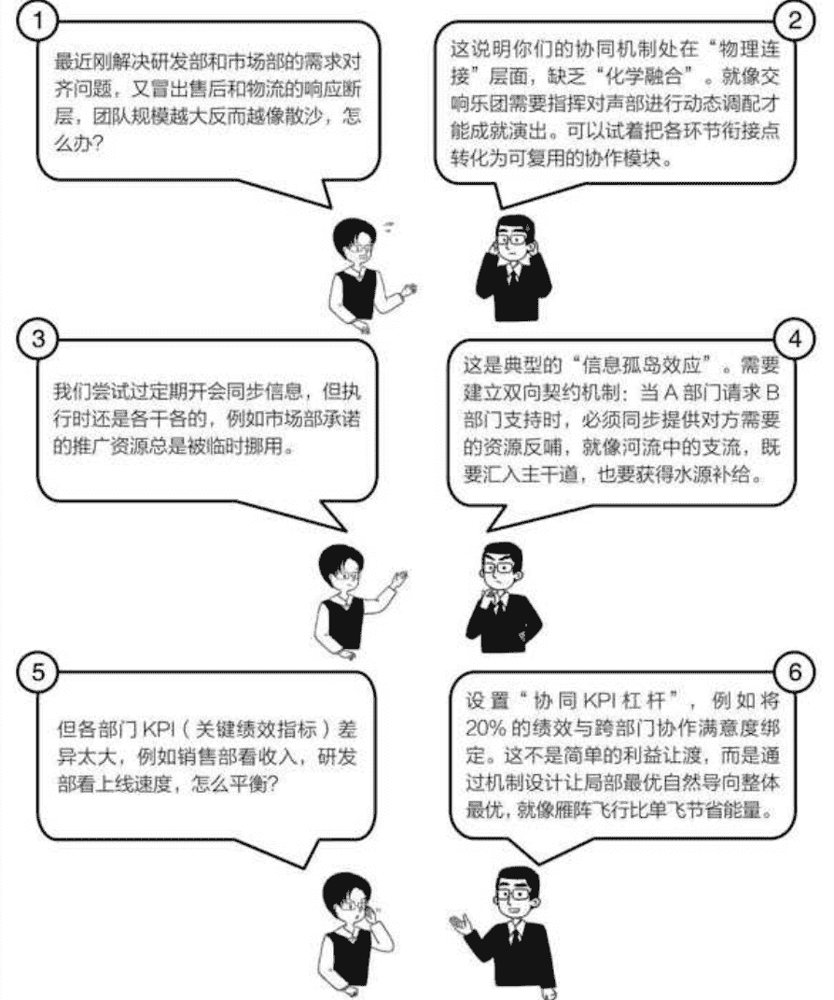

### AI提问框架

通用公式=目标对齐度检测 + 协同障碍扫描 + 优化方案推演

#### 目标对齐度检测

量化各部门目标与整体战略的匹配程度，暴露“目标错位”问题，如研发部过度追求技术先进性而忽略商业化需求。

##### 提问要素

- 战略关键词：如用户增长、降本增效。
- 部门指标拆解：如市场部“新客获取”与销售部“复购率”的联动。
- 资源分配图谱：如预算/人力在各项目的投入比例。

#### 协同障碍扫描

识别跨职能协作中的摩擦点，定位“协作熵增”源头，如发现70%的延期项目是因为需求变更未同步法务团队而发生延期。

##### 提问要素

- 流程断点：如需求从市场部传递到研发部的平均耗时。
- 决策灰区：如跨部门纠纷由谁最终裁决。
- 信息漏斗：如周报中的关键数据缺失比例。

#### 优化方案推演

基于前两个阶段的分析生成可落地的改进建议，将抽象问题转化为具体行动项，如建议每周跨部门同步会议压缩至30分钟。

##### 提问要素

- 机制设计：如建立“需求变更影响评估表”。
- 工具匹配：如引入OKR看板实时追踪对齐度。
- 成本测算：如实施新流程须增加的沟通会议时间。

### 准备资料

| 要点 | 内容 |
| :--- | :--- |
| 协同场景清单 | 列出高频协同场景（如产品发布、客户投诉处理）。 |
| 冲突记录本 | 收集跨部门矛盾案例（含时间、涉及方、具体矛盾）。 |
| 资源流动图 | 标注人力/预算在各环节的流转路径。 |
| 决策日志 | 记录重大决策的参与者、讨论过程及执行结果。 |

### 实战案例

#### 目标对齐度检测

我们是中型企业 SaaS（软件运营服务）服务商，销售部本季度目标是“客户数增长15%”，研发部的目标是“系统稳定性达99.9%”，市场部的目标是“行业报告曝光量5万次”。请你分析如下2点。

1. 三个目标对“提升客户 LTV（生命周期价值）”的总贡献度。
2. 研发目标是否应增加“新功能模块开发”等增长性指标。

#### 协同障碍扫描

近期出现客户团队与产品团队互相推诿：客户反馈功能缺失时，客户团队认为是产品缺陷，产品团队认为是客户需求管理问题。

##### 请帮我

1. 绘制当前客户投诉处理流程图。
2. 识别流程中超过48小时的停滞环节。

#### 优化方案推演

基于上述分析，请帮我

1. 设计跨部门协作 SLA（服务等级协议），明确各环节响应时效。
2. 分析功能使用与客户续约率的关联。
3. 测算实施新机制须增加的沟通成本（如每周联席会议时间）。

#### 需要输出

1. 目标对齐矩阵（标红冲突指标）。
2. 流程优化前后对比图。
3. ROI（投资回报率）预测模型。

### 注意事项

| 要点 | 内容 |
| :--- | :--- |
| 动态校准 | 每季度更新协同数据，避免“分析时效性”偏差。 |
| 灰度验证 | 先在小范围验证 AI 建议（如试点跨部门虚拟小组）。 |
| 文化适配 | 评估建议与现有组织文化的兼容性（如扁平化团队慎用严格层级机制）。 |
| 失败预案 | 当新流程导致效率下降超过 15% 时启动原流程。 |

## 1.6 和谐共赢：用AI营造理想团队氛围

问题情景

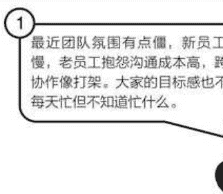

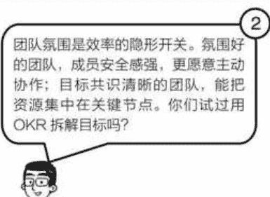

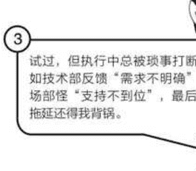

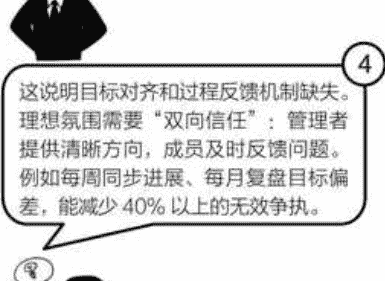

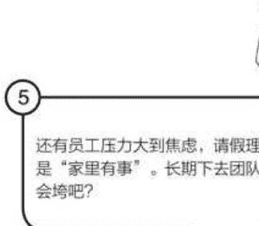

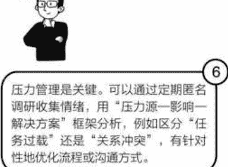

AI提问框架

通用公式=目标定位+氛围痛点+优化方向

#### 目标定位

明确团队当前阶段的核心目标，为AI分析提供锚点，避免AI建议与团队实际脱节。

##### 提问要素

- 业务阶段：如新产品上线初期、季度冲刺期。
- 关键指标：如客户留存率提升15%，项目交付周期缩短30%。
- 团队规模与构成：如20人研发小组，80%为95后。

#### 氛围痛点

描述当前团队氛围的具体问题，要可量化或场景化，帮助AI锁定分析维度，如协作效率或心理安全感。

##### 提问要素

- 沟通障碍：如跨部门邮件往返超5次才能确认需求。
- 目标模糊：如50%成员不清楚季度重点任务。
- 压力状态：如近3个月加班相关投诉增加200%。

#### 优化方向

明确希望通过AI获得的具体支持类型，将抽象问题转化为可执行任务，如将“士气低落”转化为“生成3种压力缓解方案”。

##### 提问要素

- 工具推荐：如自动化协作平台，情绪调研模板。
- 流程优化：如设计目标对齐会议SOP（标准操作程序）。
- 数据洞察：如分析高绩效团队的行为模式。

### 准备资料

| 要点 | 内容 |
| :--- | :--- |
| 团队数据 | 近6个月的绩效分布、离职面谈记录、协作工具使用日志等。 |
| 场景描述 | 具体冲突案例（如“因需求变更未同步导致技术部返工3次”）、高频抱怨关键词。 |
| 外部参考 | 行业标杆团队的氛围建设案例（如“某公司取消绩效考核后的协作模式”）。 |
| 管理诉求 | 优先改善的领域（如“提升跨职能协作”或“优化新生代员工激励”）。 |

### 实战案例

#### 目标定位

我们是一家中型SaaS公司，客户成功团队共15人，负责续费和产品反馈收集。本季度续费率从82%降至75%，客户反馈响应周期延长至72小时（竞品平均48小时），团队 NPS（净推荐值）评分下降20分。

#### 氛围痛点

##### 当前团队氛围的痛点

1. 目标割裂：70%的成员认为“续费指标与个人工作无关”（如客服专注解决问题，未引导复购）。
2. 信息孤岛：使用3套不同的系统记录客户数据，跨部门查询需2~3天。
3. 压力堆积：客户高频投诉导致成员情绪耗竭，近2个月病假率上升35%。

#### 优化方向

##### 请协助我设计

1. 目标对齐方案：将续费指标拆解为各岗位角色的日常行为指标（如客服每次通话后须标记“复购意向”）。
2. 协作提效工具：推荐能整合客户数据的平台，并模拟实施后的响应效率提升值。
3. 压力缓释计划：分析高压力场景（如月末冲刺），生成轮班制或情绪疏导SOP。

### 注意事项

| 要点 | 内容 |
| :--- | :--- |
| 数据校准 | AI 提供的氛围优化建议须与团队实际数据交叉验证，如“推荐减少会议次数”须对比历史会议时长与产出效率。 |
| 文化适配 | AI 可能推荐硅谷式透明管理，但须评估是否与本团队存在文化或习惯冲突。 |
| 动态迭代 | 氛围问题常随业务变化，建议每季度用相同公式重新分析。 |
| 人性兜底 | AI 无法识别成员个体差异，如“内向员工在头脑风暴中沉默”要由管理者主动干预。 |

# 第2章 AI+分析决策

分析决策是团队管理中的核心环节，关乎团队的发展方向与成败。AI凭借其强大的数据处理和分析能力，成为团队管理者分析决策的得力助手。它可以进行全局SWOT分析，帮助管理者清晰了解团队的优势、劣势、机会和威胁；进行5W2H分析，让决策思路更加清晰明确；做波士顿矩阵分析，合理规划业务组合；实施ABC管理优化，提高管理效率；用AI直击问题核心，找到问题的根源，并制定PDCA计划，实现循环精进。接下来，让我们看看AI如何助力团队管理者作出明智的分析决策。

## 2.1 深度洞察：用AI做全局SWOT分析

问题情景

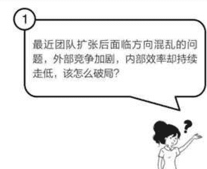

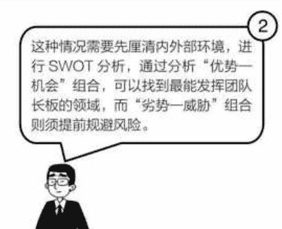

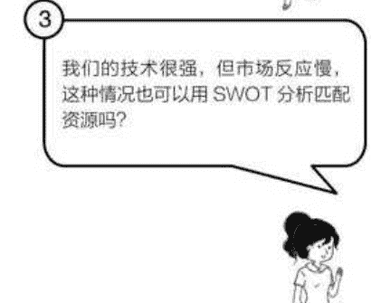

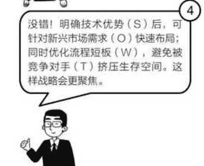

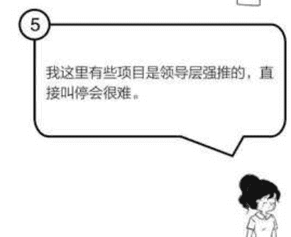

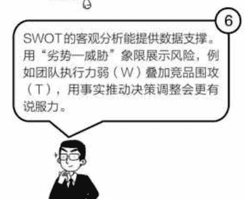

AI提问框架

通用公式=战略背景+决策矛盾+分析维度

#### 战略背景

说明团队当前所处的业务阶段及核心战略目标，帮助AI理解分析的范围和深度，避免“大而全”的无效结论。

##### 提问要素

- 业务定位：如市场领导者、挑战者或细分领域专家。
- 战略周期：如3年规划、年度攻坚。
- 资源约束：资金、人才、技术专利储备。

#### 决策矛盾

明确管理者在战略落地中面临的具体冲突或不确定性，将抽象的战略问题转化为可分析的对比项。

##### 提问要素

- 资源争夺：如研发预算该投A技术还是B产品。
- 风险对冲：如寻求扩张速度与现金流安全的平衡点。
- 认知分歧：部门间对同一机会的评估差异。

#### 分析维度

规定SWOT分析覆盖的领域及数据要求，确保结论具备可操作性。

##### 提问要素

- 内部扫描：如专利数量、员工流失率、OEE（设备综合效率）。
- 外部扫描：如政策风向标、替代品威胁指数、客户需求迁移数据。
- 交叉验证：要求AI利用历史数据预测未来趋势。

### 准备资料

| 要点 | 内容 |
| :--- | :--- |
| 战略档案 | 三年规划书、季度经营分析会纪要等。 |
| 能力清单 | 核心技术专利目录、关键人才技能矩阵、设备产能报告等。 |
| 市场情报 | 行业协会白皮书、竞品发布会实录、客户需求调研原始数据等。 |
| 风险数据 | 近两年危机事件复盘报告、合规审计结果、供应商稳定性评估等。 |
| 财务基准 | 各业务线 ROI 数据、成本结构拆分表、投资回报周期测算模型等。 |

### 实战案例

#### 战略背景

我是某智能家居公司产品总监，负责规划20××年新产品线。当前公司的定位为“中高端全屋智能解决方案商”，技术优势在于自主研发的AI语音交互系统（市场占有率行业前三），但生产依赖代工厂（自有工厂占比仅30%）。年度战略目标为在政策推动的“适老化改造”市场（预计规模200亿元），抢占15%份额。

#### 决策矛盾

##### 当前的矛盾

1. 技术路径冲突。
   - 研发部主张将资源投入“无感化交互”（通过传感器自动识别用户需求），但该技术成熟度仅60%；
   - 销售部担心适老化客户价格敏感度高，所以要求优先开发“高性价比的基础款”。
2. 产能风险。
   - 代工厂近期被曝出劳工纠纷，可能影响新品交付周期。
   - 自建工厂须投入8 000万元，但会占用适老化市场的推广预算。

#### 分析维度

请帮我完成SWOT分析

- 优势（S）：计算AI语音系统的客户复购率。
- 劣势（W）：评估代工厂停工风险对Q4营业收入的影响概率。
- 机会（O）：分析各省适老化政策执行进度，筛选补贴落地最快的5个省份。
- 威胁（T）：监测竞品在低线城市的渠道下沉速度。

### 注意事项

| 要点 | 内容 |
| :--- | :--- |
| 数据时效 | 注意采用当前最新的数据。 |
| 动态校准 | 每月导入最新经营数据修正 SWOT 权重（如新品试销反馈导致技术优势评分变化）。 |
| 人性化适配 | 战略选择须保留“人工否决权”，避免过度依赖数据而忽略组织文化因素。 |
| 成本穿透 | 资源分配方案必须标注执行中的“不可逆决策点”（如工厂奠基后无法撤回投资）。 |

## 2.2 策略导航：用AI引领5W2H分析

问题情景

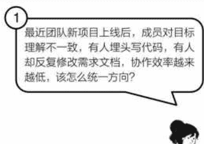

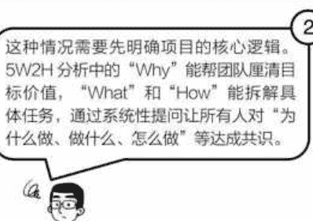

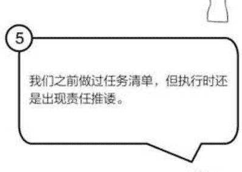

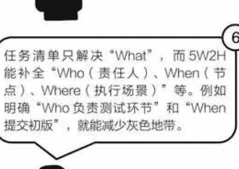

### AI提问框架

通用公式=情境描述+核心矛盾+决策目标

#### 情境描述

对团队现状、业务背景、资源条件的客观陈述，须包含时间、空间、主体等维度，为AI划定分析边界，避免脱离实际的泛化建议。

##### 提问要素

- 团队定位：如部门职能、人员规模。
- 业务阶段：如产品研发期、市场扩张期。
- 关键约束：如预算，技术工具，政策限制。

#### 核心矛盾

要解决冲突点，区分表象与本质（如“目标模糊”是表象，“缺乏Why共识”是本质），帮助AI聚焦关键问题。

##### 提问要素

- 冲突表现：如决策拖延，资源浪费。
- 影响数据：如会议时长增加40%，项目返工率增加25%。
- 已有措施：如已尝试每日站会但无效。

#### 决策目标

期望通过5W2H达成的具体成果，须可量化或可执行，将分析转化为行动方案。

##### 提问要素

- 分析深度：如定位三个主要责任盲区。
- 输出形式：如甘特图、RACI 矩阵（责任分配矩阵）。
- 落地要求：如要适配现有OA（办公自动）系统。

### 准备资料

| 要点 | 内容 |
| :--- | :--- |
| 团队基础档案 | 成员分工表、近三个月项目进度表、会议纪要等。 |
| 问题溯源材料 | 客户投诉记录、内部复盘报告、跨部门协作沟通记录等。 |
| 业务参数 | KPI指标说明、资源分配规则、行业对标数据（如竞品项目周期）等。 |
| 管理者诉求 | 急需优化的环节（如决策流程或资源分配）、可接受的试错成本等。 |

### 实战案例

#### 情境描述

我是某跨境电商公司的运营总监，管理一支15人团队（产品组5人、市场组6人、客服组4人），负责东南亚市场的店铺运营。当前公司主推智能家居产品，但近两个月销售额环比下降了12%，客诉率上升8%。团队使用Trello（工作和家庭场景提高协作和生产力的软件）进行任务管理，但发生了如跨组协作效率低，产品组抱怨市场组需求变动频繁，客服组反馈产品说明书不清晰等问题。

#### 核心矛盾

##### 当前的核心矛盾

1. 目标偏差：市场组为吸引流量频繁修改促销策略（如三天内更换两次促销方案），导致产品组开发进度延误。
2. 责任真空：客户反馈的产品安装问题（占客诉60%）无人牵头解决，客服组与产品组互相推诿。
3. 资源浪费：因需求变更，市场组上月30%的广告素材未投入使用。

#### 决策目标

请通过5W2H框架帮我

1. 分析“需求频繁变更”的根本原因（Why），明确市场策略的决策权归属（Who）。
2. 制定《跨部门需求提交流程》（How），规定需求评估标准（What）和响应时限（When）。
3. 输出客户问题解决方案的责任矩阵（Where涉及哪些环节），并估算所需人力资源费用（How much）。

### 注意事项

| 要点 | 内容 |
|---|---|
| 动态验证 | AI 生成的 5W2H 结论须通过小范围试点（如选择一个项目组）验证可行性。 |
| 权责平衡 | AI 可能过度理性化分工，须结合成员能力差异调整 “Who” 分配。 |
| 数据脱敏 | 涉及销售数据、客户信息时，用 “品类 A” “区域 B” 代替真实名称。 |
| 迭代机制 | 每季度根据业务变化（如新市场拓展）更新 5W2H 分析模型。 |

## 2.3 智慧布局：用AI做波士顿矩阵分析

问题情景

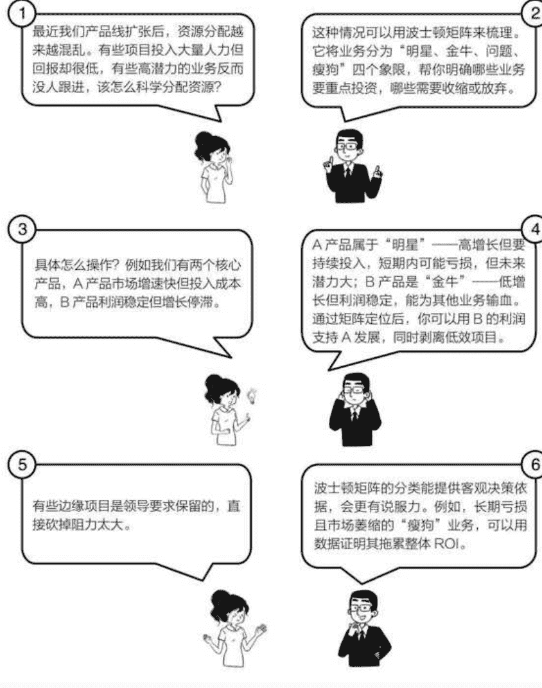

AI提问框架

通用公式=业务全景描述+资源矛盾点+矩阵分析需求

#### 业务全景描述

对团队管理的业务范围、市场环境、资源结构的全面陈述，须包含定量数据支撑，帮助AI理解业务全貌，为矩阵分类提供基础。

##### 提问要素

- 业务分类：如产品线、服务类型、区域市场。
- 市场数据：如增长率、市场份额、利润率。
- 资源分布：如人力、预算、技术投入占比。

#### 资源矛盾点

当前资源分配与业务需求之间的冲突，须明确优先级争议点，聚焦核心矛盾，避免AI偏离关键问题。

##### 提问要素

- 冲突表现：如高潜力项目缺人，低效项目占用50%预算。
- 影响量化：如导致整体ROI下降8%。
- 决策障碍：如管理层对旧业务有情感依赖。

#### 矩阵分析需求

要求AI基于波士顿矩阵框架生成具体任务，须指向资源再分配决策，将理论模型转化为可执行的资源分配方案。

##### 提问要素

- 分类标准：如利润率低于10%视为瘦狗。
- 策略建议：如明星业务须追加多少预算。
- 风险评估：如砍掉某业务对团队士气的潜在影响。

### 准备资料

| 要点 | 内容 |
|---|---|
| 业务数据 | 各产品线/项目近一年的销售额、利润率、市场增长率等。 |
| 资源清单 | 人力投入表、预算分配表、技术/设备使用明细等。 |
| 市场分析 | 行业增长趋势报告、竞品市场份额数据、客户需求调研等。 |
| 管理诉求 | 战略优先级（如“保利润”或“冲规模”）、不可调整的底线（如“必须保留某业务”）等。 |

### 实战案例

#### 业务全景描述

我是某智能家居公司的产品总监，管理5条产品线。

- A.智能锁：年增长率25%，市场份额12%，研发投入占团队总预算的40%。
- B.扫地机器人：年增长率5%，市场份额18%，为公司贡献50%的利润。
- C.智能灯具：年增长率-3%，市场份额4%，长期依赖B产品的利润“输血”。
- D.空气净化器：年增长率30%，市场份额3%，需持续投入市场教育成本。
- E.智能音箱：年增长率-10%，市场份额2%，近两年亏损持续扩大。

#### 资源矛盾点

##### 当前的矛盾点

1. 资源错配：B的利润被A、D大量占用，导致其技术迭代停滞，竞品已推出性价比更高的机型。
2. 战略模糊：管理层要求“同时保增长和利润”，但C、E业务拖累整体ROI（当前仅6%）。
3. 决策阻力：E产品是CEO早期创业项目，团队不敢提议剥离。

#### 矩阵分析需求

请用波士顿矩阵分析

1. 按“市场增长率≥10%、利润率≥15%”的标准，划分5条产品线的矩阵象限。
2. 设计资源再分配方案，并预测调整后的ROI变化。
3. 针对E，提供3种温和优化建议，减少决策阻力。

### 注意事项

| 要点 | 内容 |
|---|---|
| 数据准确性 | 波士顿矩阵依赖真实市场数据，须校准增长率与利润的计算口径。 |
| 动态调整 | 矩阵结果每季度更新，避免因市场变化导致策略失效（如“明星”降级为“问题”）。 |
| 资源限制 | AI 可能忽略非量化资源（如核心团队精力），需要人工补充评估。 |
| 策略适配性 | AI 建议的“砍业务”可能不符合公司文化，须转化为渐进式优化方案（如阶段性收缩）。 |

## 2.4 精准分类：用AI实施ABC管理优化

问题情景

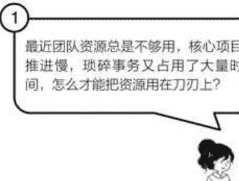

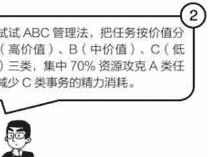

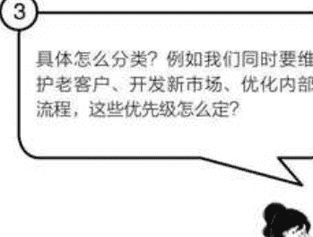

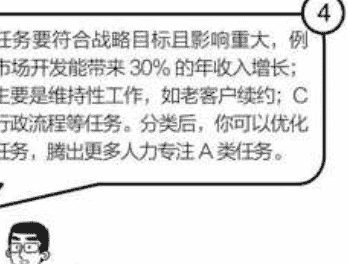

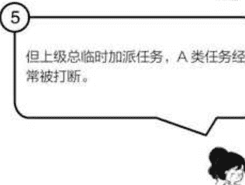

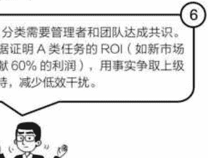

AI提问框架

通用公式=业务背景+资源分配痛点+分类优化需求

#### 业务背景

对团队业务范围、资源现状及目标的客观描述，须包含定量数据，帮助AI理解分类优化的基础逻辑。

##### 提问要素

- 业务类型：如产品研发、客户服务、市场拓展。
- 资源总量：如团队规模、预算、时间。
- 战略目标：如一年内营业收入增长25%。

#### 资源分配痛点

当前资源投入与目标达成之间的错配问题，须量化低效环节，明确优化方向，如将“效率低”转化为“C类任务减少50%人力”。

##### 提问要素

- 问题表现：如60%的时间用于处理报销流程。
- 影响数据：如导致新客户签约量减少15%。
- 主观误区：如“认为所有任务都重要”应转化为“须验证任务与战略的关联度”。

#### 分类优化需求

要求AI基于ABC分类法生成具体的任务，须指向资源再分配决策，将理论转化为可执行的优先级管理方案。

##### 提问要素

- 分类标准：如A类任务须贡献50%以上利润。
- 资源调整方案：如为A类任务追加30%预算。
- 风险评估：如削减C类任务是否影响基础运营。

### 准备资料

| 要点 | 内容 |
| :--- | :--- |
| 任务清单 | 当前所有工作事项列表（含耗时、产出、参与人员）。 |
| 资源消耗表 | 人力、预算、时间在各任务上的分配比例。 |
| 价值评估数据 | 各任务对战略目标的贡献度（如销售额、客户满意度、成本节省）。 |
| 约束条件 | 不可调整的刚性任务（如合规流程）、管理层强制要求保留的事项。 |

### 实战案例

#### 业务背景

我是某电商公司的运营经理，管理一支10人团队，负责200个SKU（存货单位）的库存管理、客户售后及活动策划。公司当前战略是“聚焦高毛利爆品，缩减长尾商品”，但团队60%的时间用于处理低毛利商品（占SKU数量的70%）的售后问题，爆品库存周转率仅2次/月（行业标杆为4次/月），导致仓储成本超出预算的20%。

#### 资源分配痛点

##### 当前的痛点

1. 优先级混乱：低毛利商品SKU售后问题占日均工单量的80%，但贡献利润不足10%。
2. 资源浪费：爆品缺货时，采购部因忙于处理长尾商品补货，平均响应时间长达72小时。
3. 目标偏离：原定每月策划3场爆品促销，实际仅完成1场，因团队精力被琐碎事务分散。

#### 分类优化需求

请用ABC管理法帮我

1. 按“毛利贡献≥30%”“售后工单量≤5%”的标准，将200个SKU分为ABC三类。
2. 设计资源分配方案（如C类商品转为第三方代发）。
3. 预测优化后效果，并列出3个潜在风险。

### 注意事项

| 要点 | 内容 |
| :--- | :--- |
| 分类标准合理性 | AI 可能过度依赖定量数据，须结合定性因素（如战略重要性）调整分类。 |
| 执行可行性 | AI 建议的“外包 C 类商品”须评估供应商能力，避免无效转移风险。 |
| 动态监控 | 每月根据销售数据重新划分 ABC 分类，防止爆品降级为 B 类。 |
| 团队共识 | 向成员清晰传达分类逻辑，减少执行阻力。 |
| 数据安全 | 涉及库存和客户信息时，要模糊具体的 SKU 名称。 |

## 2.5 追根溯源：用AI直击问题核心

问题情景

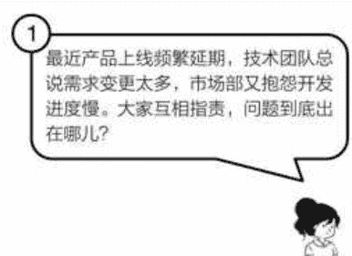

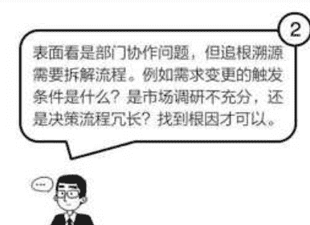

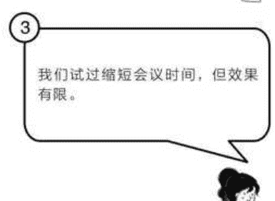

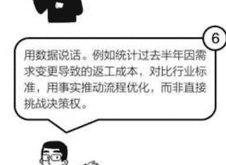

AI提问框架

通用公式=问题全景描述+症状拆解+根因分析需求

#### 问题全景描述

对问题发生场景、涉及主体、关联流程完整陈述，须包含时间线和关键节点，帮助AI构建问题地图，避免遗漏关键环节。

##### 提问要素

- 业务场景：如新产品迭代流程。
- 参与角色：如市场部、技术部、测试组。
- 流程节点：如需求评审、开发、测试、上线。
- 历史数据：如近3次项目周期、变更次数。

#### 症状拆解

将表象问题拆解为可量化的子问题，区分直接症状与潜在影响，如将模糊的“团队效率低”转化为可分析的“需求变更导致返工率增至35%”。

##### 提问要素

- 症状表现：如需求评审会平均耗时4小时。
- 关联影响：如开发周期延长20%。
- 主观归因排除：如“避免技术团队能力不足”改为“须验证需求文档完整性与开发效率的关系”。

#### 根因分析需求

要求AI通过逻辑推演或数据挖掘定位问题根源，并提供验证路径，将问题转化为可执行的改进动作。

##### 提问要素

- 分析方法：如5W2H分析法、鱼骨图法、相关性分析法。
- 验证要求：如须对比历史数据验证假设。
- 决策支持：如按根因优先级排序解决方案。

### 准备资料

| 要点 | 内容 |
|---|---|
| 流程档案 | 项目流程图、会议记录、审批节点文档等。 |
| 量化数据 | 历史项目周期表、需求变更次数统计、返工成本核算等。 |
| 角色反馈 | 各部门匿名调研结果、客户投诉记录、一线员工访谈摘要等。 |
| 对标信息 | 行业平均交付周期、竞品流程优化案例等。 |

### 实战案例

#### 问题全景描述

我是某在线教育公司的产品负责人，管理一支20人的团队（产品组6人、教研组5人、技术组9人）。当前主推的“AI智能题库”项目已延期2个月，原计划3个月上线，现进度仅完成60%。核心流程为：教研组设计题型→产品组整理需求→技术组开发→联合测试。近三次迭代中，需求变更次数从5次增加到12次，技术组抱怨“需求描述模糊”，教研组反诉“开发功能与教育逻辑不符”。

#### 症状拆解

##### 当前问题

1. 需求冲突：教研组提出的“动态难度分层”功能，技术组以“算法复杂度高”为由3次修改方案。
2. 返工率高：测试阶段40%的 BUG（程序错误）源于需求理解偏差，单次修复平均耗时3天。
3. 进度滞后：因需求变更，关键节点（如题库架构搭建）比计划延迟15天，导致产品组工作停滞。

#### 根因分析需求

##### 请帮我

1. 用5W2H分析法定位需求频繁变更的根因。
2. 分析教研组与技术组的沟通记录（附件含会议摘要），识别信息同步断层的关键环节。
3. 提供3套解决方案并按实施难度排序：
   - 短期：制定需求模板（字段包含教学目标、技术约束等）；
   - 中期：设立跨部门“预评审”机制，前置风险排查；
   - 长期：搭建需求管理平台，实时同步变更信息。

### 注意事项

| 要点 | 内容 |
| :--- | :--- |
| 数据校准 | AI 依赖输入数据，需人工核对统计口径（如“返工成本”是否含人力与机会成本）。 |
| 归因克制 | AI 可能过度依赖线性逻辑，要结合实际情况验证（如“需求变更多”未必是根因，可能是流程缺陷的结果）。 |
| 渐进验证 | 优先在小范围试点 AI 建议（如选择一个功能模块试行需求模板），再全面推广。 |
| 伦理风险 | 涉及人员能力评估时，避免直接使用 AI 结论问责，须转化为流程改进机会。 |

## 2.6 循环精进：用AI制定PDCA计划

问题情景

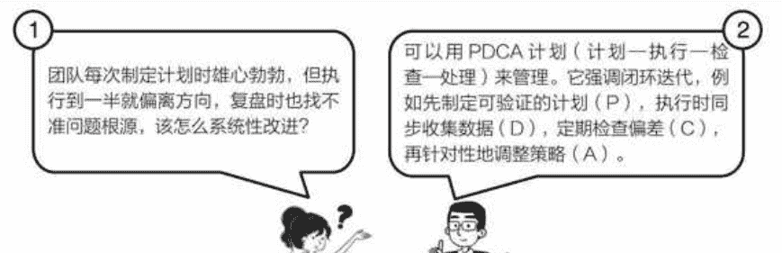

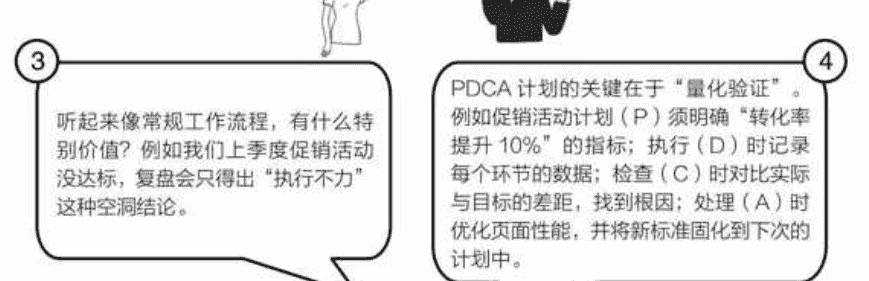

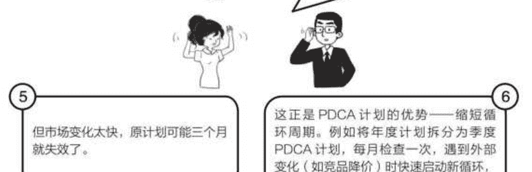

AI提问框架

通用公式=问题场景+执行断点+迭代需求

#### 问题场景

描述需要PDCA计划改进的具体业务场景，包含目标、现状，明确PDCA计划的应用范围，避免对AI泛泛而谈。

##### 提问要素

- 业务类型：如产品研发、客户运营。
- 既定目标：如3个月内用户留存率提升8%。
- 当前进展：如上线2个月用户留存率仅提升3%。

#### 执行断点

PDCA计划中失效的具体环节，须量化关键瓶颈，定位PDCA计划失效的根源。

##### 提问要素

- 计划缺陷：如目标不可拆解、资源分配不合理。
- 执行偏差：如实际执行时未按计划收集数据。
- 检查盲区：如复盘仅关注结果，忽略过程指标。

#### 迭代需求

要求AI基于PDCA计划框架输出的具体改进方案，须包含可落地的闭环设计，将理论模型转化为可操作的改进流程。

##### 提问要素

- 阶段任务：如生成计划阶段的KPI拆解模板。
- 验证机制：如设计执行阶段的数据埋点方案。
- 调整建议：如当检查发现目标偏差≥15%时，触发A阶段的策略重置。

### 准备资料

| 要点 | 内容 |
| :--- | :--- |
| 目标文档 | 当前项目计划书、KPI设定依据及历史完成数据等。 |
| 执行记录 | 任务分派表、进度跟踪表、会议纪要等。 |
| 复盘报告 | 过往问题分析结论、改进措施及效果验证等。 |
| 资源清单 | 可用人力、预算、技术工具明细等。 |
| 约束条件 | 不可调整的底线（如合规要求、管理层硬性指标等）。 |

### 实战案例

#### 问题场景

我是某在线教育公司的用户增长负责人，团队当前核心目标是通过“暑期促销活动”在3个月内将付费用户数从10万人提升至15万人。活动已执行1个月，新增付费用户仅2.1万人（原计划应达4万人），且用户7日留存率从常态45%降至38%。现有措施包括以下内容。

1. 广告投放：抖音/微信朋友圈日均消耗预算2万元。
2. 转化链路：用户点击广告→领取试听课→班主任电话跟进。
3. 数据监控：仅跟踪总付费人数，未拆解各环节转化率。

#### 执行断点

##### 当前的问题

1. 计划缺陷：目标未拆解到具体环节（如试听课领取率）。
2. 执行偏差：班主任因工作量超负荷，有30%的用户未及时跟进。
3. 检查盲区：未分析留存率下降的原因，复盘会仅归咎于“广告投放不足”。

#### 迭代需求

请用PDCA计划框架帮我

1. 计划阶段：拆解“新增5万用户”目标至各环节（如广告点击率应达5%、试听课领取率应为25%、付费转化率应为10%）。
2. 执行阶段：设计数据埋点方案（如记录用户从广告点击到付费的全链路时间节点）。
3. 检查阶段：建立每周数据对比机制，识别偏差环节。
4. 处理阶段：针对电话跟进延迟，提供3种解决方案。

### 注意事项

| 要点 | 内容 |
| :--- | :--- |
| 数据颗粒度 | AI 生成的 PDCA 计划须匹配团队数据采集能力（如中小团队难以监控分钟级响应）。 |
| 循环周期 | 根据业务节奏设定检查频率（如促销活动按周循环，产品研发按月循环）。 |
| 人性化适配 | AI 建议的“优化排班”可能忽略员工情绪，须加入缓冲机制（如单日跟进上限为 50 人）。 |
| 风险预判 | AI 可能低估策略调整的连锁反应（如缩短电话跟进时间可能导致转化率下降）。 |
| 知识沉淀 | 将每个 PDCA 计划的结论归档为团队知识库，供后续循环调用。 |

# 第3章 AI+安排工作

合理的工作安排是团队高效运转的保障。AI在工作安排方面展现出了独特的优势，能够帮助管理者解决诸多难题。它可以协助设定SMART目标，让工作目标更加明确、可衡量、可实现；通过WBS任务分解法，将复杂任务细化成具体可执行的小任务；能生成工作布置文案，让任务传达更加高效清晰；能总结下属工作亮点，为绩效反馈提供依据；能定制反馈成长方案，促进员工成长且评估改进双管齐下，确保工作结果符合预期。本章将详细介绍AI在工作安排中的具体应用。

## 3.1 明确目标：用AI设定SMART目标

问题情景

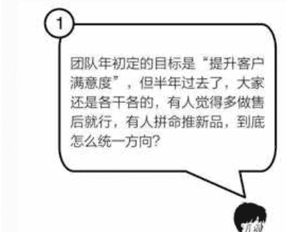

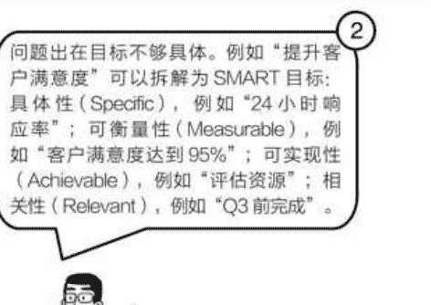

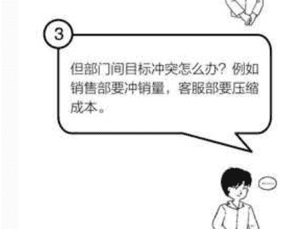

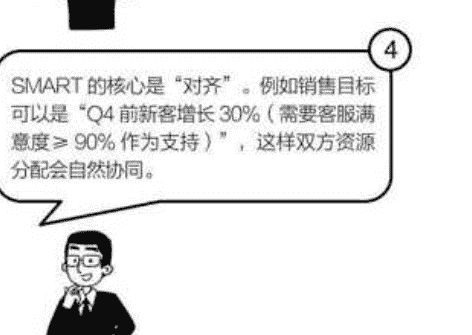

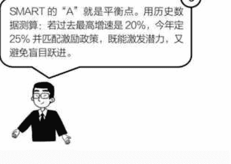

AI提问框架

通用公式=目标现状描述+问题拆解+SMART设定需求

#### 目标现状描述

对当前目标设定方式、执行效果及矛盾点的客观陈述，帮助AI理解目标与现实脱节的症结。

##### 提问要素

- 目标表述：公司战略目标→部门目标→个人KPI。
- 量化差距：如当前客户留存率为70%，目标为90%但无增长路径。
- 执行数据：如目标达成率为65%，资源超支20%。

#### 问题拆解

将模糊、冲突或不可行的目标拆解为具体矛盾点，如将“目标不合理”转化为“目标未拆分到可执行层级”。

##### 提问要素

- 冲突表现：如技术部“降低故障率”与市场部“快速上线”矛盾。
- 归因排除：避免主观猜测，如将“团队执行力差”改为“目标缺乏阶段性里程碑”。

#### SMART设定需求

要求AI基于SMART原则生成或优化目标，并提供验证逻辑，将口号式目标转化为可追踪、可落地的行动指南。

##### 提问要素

- 优化维度：如将“提升质量”改为“Q3前将产品缺陷率从5%降至2%”。
- 对齐要求：如部门目标须支撑公司年营业收入增长25%。
- 风险评估：如目标所需资源是否超出预算上限。

### 准备资料

| 要点 | 内容 |
| :--- | :--- |
| 目标档案 | 公司战略规划、部门年度目标、个人绩效考核表等。 |
| 执行数据 | 历史目标达成率、资源消耗记录、关键障碍复盘报告等。 |
| 关联信息 | 行业平均标准（如客户留存率）、竞品目标公开信息（如新品上线周期）等。 |
| 约束条件 | 预算上限、政策限制（如数据合规要求）、团队能力基线等。 |

### 实战案例

#### 目标现状描述

我是某跨境电商公司的华南区销售总监，管理一支15人的团队（线下渠道8人、线上运营7人）。公司战略要求“全年华南区GMV增长35%”，但当前目标设定仅为“线下增长20%、线上增长30%”，且未明确具体路径。实际执行中，线下团队主攻商超渠道（占GMV的60%），但商超账期长达90天，导致现金流压力较大；线上团队主要依赖促销（毛利率仅为15%），且未激活私域流量（5万粉丝账号月转化率不足1%）。

#### 问题拆解

##### 当前问题

- 1. 目标冲突：线下目标与现金流矛盾，线上目标与利润矛盾。
- 2. 资源错配：线下团队60%的精力用于追账而非拓客，线上广告费占预算的40%，但ROI仅为1:2。
- 3. 缺乏分解：GMV增长目标未拆分到品类（如母婴、家居）和客户层级（新客/老客）。

#### SMART设定需求

##### 请帮我

- 1. 按SMART原则重构目标（如将“线上增长30%”改为“Q4前通过私域运营将粉丝转化率提升至3%，带动母婴品类GMV增长15%”）。
- 2. 设计目标对齐方案（如线下目标增加“商超渠道账期压缩至60天”以支撑现金流）。
- 3. 输出资源匹配清单（如“增加1名私域运营专员”“线下团队应收账款培训课时≥8小时”）。

### 注意事项

| 要点 | 内容 |
| :--- | :--- |
| 数据校准 | AI 依赖输入数据，须验证目标测算逻辑（如“3% 转化率”是否基于粉丝活跃度）。 |
| 动态调整 | 设置目标进度追踪节点（如每月复盘），利用 AI 实时修正偏差。 |
| 人性化平衡 | AI 可能忽略“员工接受度”，须结合激励政策（如将目标达成与奖金阶梯挂钩）。 |
| 风险预判 | AI 建议的目标可能过于理想化，要人工评估突发因素（如供应链中断预案）。 |

## 3.2 行动细化：用AI做WBS任务分解法

问题情景

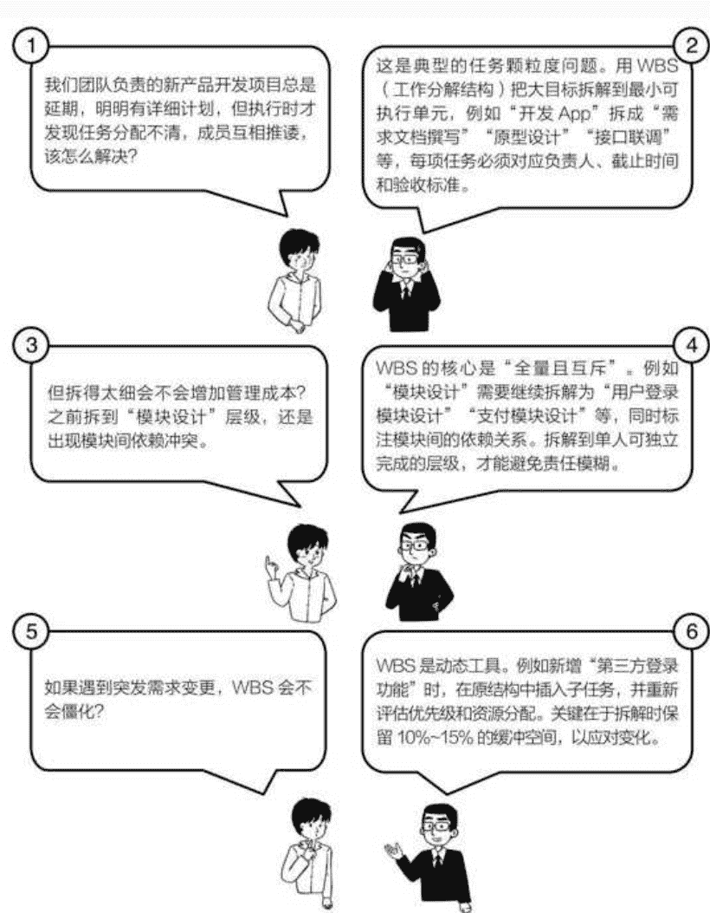

AI提问框架

通用公式=项目目标+分解障碍+分解需求

#### 项目目标

明确需要分解的核心任务，包含最终交付成果、时间周期及关键约束条件，为AI划定任务分解的边界，避免无效发散。

##### 提问要素

- 交付物描述：如上线一款跨境电商App。
- 时间框架：如6个月内完成从立项到上线。
- 资源限制：如预算300万元、现有技术团队15人。

#### 分解障碍

团队在任务拆解过程中遇到的具体问题，须转化为可干预的变量，帮助AI定位拆解过程中的关键淤堵点，如将“进度延迟”转化为“未识别跨部门协作任务”。

##### 提问要素

- 逻辑盲区：如不清楚功能模块间的技术依赖关系。
- 协作难点：如市场部与研发部对需求优先级定义冲突。
- 历史教训：如过往项目因测试覆盖率不足导致返工。

#### 分解需求

要求AI输出具体分解方案类型及细化程度，将抽象目标转化为可执行清单，如从“提升用户体验”拆解出“优化5个关键页面的加载速度”。

##### 提问要素

- 分解层级：如把任务拆解到三级任务。
- 责任绑定：如每项任务须匹配技能标签与责任人。
- 动态机制：如当任务延期超3天时自动触发预警。

### 准备资料

| 要点 | 内容 |
|---|---|
| 项目目标文档 | 立项报告、需求说明书、交付物验收标准等。 |
| 团队能力清单 | 成员技能矩阵、历史任务执行效率数据等。 |
| 风险案例库 | 过往项目延期或失败的任务拆解复盘记录。 |
| 外部参考模板 | 同类项目的 WBS（工作分解结构）案例。 |

### 实战案例

#### 项目目标

我是某智能硬件公司的项目经理，负责一款智能手表的研发项目，需要在9个月内完成量产。核心交付物包括：硬件（支持血氧监测、GPS定位）、配套App（iOS/Android双端）、供应链量产方案。现有资源为：硬件团队8人、软件团队6人、供应链专家2人，预算上限500万元。

#### 分解障碍

##### 当前问题

- 1. 模块耦合度高：硬件团队认为“血氧监测精度”依赖软件算法优化，但算法开发排期未与硬件测试同步。
- 2. 资源冲突：供应链专家同时负责3个项目，关键任务（如元器件选型）可能被延迟。
- 3. 验收标准模糊：管理层要求“用户体验优于竞品”，但未定义具体指标（如App启动速度、血氧数据误差范围）。

#### 分解需求

请用WBS方法帮我

- 1. 将项目拆解为三级任务（如一级任务“硬件开发”→二级任务“传感器模块”→三级任务“血氧传感器精度校准”），并标注任务间的依赖关系。
- 2. 根据团队技能匹配责任人。
- 3. 识别高风险任务（如元器件采购周期超过4周），并设计备选方案（如预选2家供应商）。
- 4. 输出可视化甘特图模板，包含里程碑节点（如第3个月完成原型机测试）。

### 注意事项

| 要点 | 内容 |
| :--- | :--- |
| 数据校准 | AI 依赖输入的任务数据，要人工验证拆解逻辑（如“硬件测试”是否遗漏极端环境场景）。 |
| 任务颗粒度 | 避免过度拆解（如将“撰写邮件”列为独立任务），建议以“单人 2 天内可完成”为最小单元。 |
| 敏捷调整 | AI 生成的 WBS 须预留 10% 灵活时间，用于应对需求变更或资源波动。 |
| 人性化适配 | AI 推荐的任务分配可能不符合成员职业规划（如让擅长编码的工程师负责文档撰写），需要管理者二次调整。 |

## 3.3 高效传达：用AI生成工作布置文案

问题情景

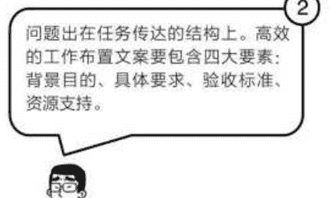

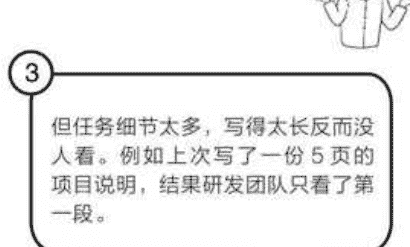

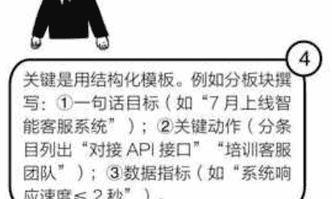

### AI提问框架

通用公式=任务背景+传达难点+文案生成需求

#### 任务背景

描述需传达任务的性质、目标及涉及对象，明确任务的复杂性和重要性，帮助AI判断文案的正式程度、技术深度和情感基调。

##### 提问要素

- 任务类型：如常规运营、紧急项目、跨部门协作。
- 利益相关方：如执行团队、协作部门、管理层。
- 战略关联：如支撑年度客户留存率目标。

#### 传达难点

说明当前传达方式导致的问题或潜在风险，需具体到信息损耗环节，定位需要AI重点优化的表达模块（如复杂流程可视化）。

##### 提问要素

- 认知偏差案例：如80%的成员错误理解“用户增长”指标。
- 信息衰减数据：如邮件传达执行率仅40%，当面沟通达75%。
- 特殊障碍：如远程团队时差、跨专业术语壁垒。

#### 文案生成需求

要求AI输出的具体文案功能及形式，需符合团队执行习惯，如将模糊的“更好传达”转化为可执行的文案设计指令。

##### 提问要素

- 内容维度：如任务分解层级、数据指标颗粒度。
- 呈现形式：如甘特图+文字说明、检查清单+视频教程链接。
- 多版本要求：如管理层汇报版、执行团队操作版。

### 准备资料

| 要点 | 内容 |
| :--- | :--- |
| 任务历史档案 | 过往工作布置文档、执行结果偏差分析报告等。 |
| 团队认知画像 | 成员职责说明书、常见沟通误区记录、成员联系方式。 |
| 沟通渠道数据 | 现有传达方式的效果统计（如企业微信阅读率、邮件回复率）。 |
| 成功案例参考 | 内部/外部高效传达案例（如某项目通过可视化流程图将执行效率提升30%）。 |

### 实战案例

#### 任务背景

我是某智能家居公司的产品运营总监，要向跨部门团队（硬件工程师5人、软件研发7人、市场推广3人）布置“9月上线新一代智能门锁”任务。核心目标包括：①硬件端实现指纹误识率≤0.001%；②软件端接入公司IoT平台并完成压力测试；③市场端在北上广深举办10场线下体验会。公司要求此项目必须与“双十一促销”联动，且管理层要求每周汇报进度。

#### 传达难点

##### 当前的难点

- 1. 信息错位：硬件团队上次将“误识率达标”理解为实验室数据，但实际需兼容极端环境（-15℃~50℃）。
- 2. 协作断层：软件团队未同步硬件开发排期，导致API接口延迟。
- 3. 资源冲突：市场部计划使用的门锁 Demo（演示）机数量与研发测试需求重叠。
- 4. 表达方式不适配：给工程师的邮件中提及“提升用户体验”但未给出具体参数指引。

#### 文案生成需求

##### 请你协助我生成

- 1. 主任务文档：用三层结构表达（战略层：说明与双十一GMV目标的关联；执行层：分部门拆解子任务；数据层：定义各环节验收指标）。
- 2. 可视化附件：硬件-软件联调甘特图（标注跨部门依赖节点）、线下体验会选址逻辑脑图（含人流密度、竞品门店距离等数据）。
- 3. 常见问题手册：预判各部门可能疑问，并提供对接人联系方式。
- 4. 多版本摘要：200字管理层汇报版（强调风险管控与ROI）、500字执行团队版。

### 注意事项

| 要点 | 内容 |
| :--- | :--- |
| 信息准确性核验 | AI 可能混淆专业术语，需人工核对关键参数（如将“误识率”误写为“拒真率”）。 |
| 个性化适配 | 避免直接套用通用模板，需结合企业沟通习惯。 |
| 反馈机制嵌入 | 在 AI 生成的文案中预留反馈入口（如文档末尾添加“疑问收集二维码”）。 |
| 多模态平衡 | 图文占比根据团队特性调整（如研发团队附图比例≥40%，销售团队侧重说话的技巧清单）。 |

## 3.4 汇报精炼：用AI总结下属工作亮点

问题情景

AI提问框架

通用公式=汇报现状+提炼难点+提炼需求

#### 汇报现状

描述当前汇报形式、内容结构及存在的问题，帮助AI理解原始材料的组织方式和缺陷。

##### 提问要素

- 汇报形式：如周报/月报、PPT/文档。
- 内容特点：如文字冗长、数据堆砌、案例缺失。
- 信息源：如KPI数据、项目日志、客户反馈。

#### 提炼难点

明确从原始汇报中提取亮点时遇到的具体障碍，如将“汇报质量差”转化为可干预的问题。

##### 提问要素

- 信息过载：如单份报告含50项任务，仅3项为核心成果。
- 价值模糊：如无法区分常规工作与超额贡献。
- 标准缺失：如缺乏统一的亮点评估维度。

#### 提炼需求

要求AI输出具体提炼方案及交付形式，将“杂乱信息”转化为“决策可用结论”，如从100条任务中提取5个战略级亮点。

##### 提问要素

- 聚焦维度：如技术创新、成本优化、客户价值。
- 呈现逻辑：如按战略贡献-执行难度-复用价值排序。
- 格式要求：如1页总结模板、3分钟汇报技巧。

### 准备资料

| 要点 | 内容 |
|---|---|
| 原始汇报材料 | 员工提交的周报、月报、项目总结文档等。 |
| 绩效评估数据 | KPI完成率、360度反馈、客户评分等。 |
| 业务关联信息 | 团队目标对齐表、公司战略重点说明等。 |
| 历史标杆案例 | 过往被认可的优质汇报案例及提炼逻辑。 |
| 管理者偏好 | 上级关注的优先级（如“成本控制优于速度”）。 |

### 实战案例

#### 汇报现状

我是某电商公司的运营总监，管理一支10人的团队（用户增长组4人、活动策划组3人、数据分析组3人）。团队平均每周提交的汇报文档15页，包含活动落地、数据监控、用户调研等30余项任务，但管理层反馈“看不到核心价值”。

#### 提炼难点

##### 当前的问题

- 1. 信息过载：汇报中70%的内容为执行细节，关键成果被弱化。
- 2. 标准混乱：不同成员对“亮点”的定义不一致（如技术人员认为“代码优化”是重点，业务人员更关注“转化率提升”）。
- 3. 关联缺失：未将个人贡献与公司季度目标“提升复购率”直接挂钩。

#### 提炼需求

##### 请协助我

- 1. 设计一套“亮点提炼框架”，包含三级维度（如一级维度“战略贡献度”→二级维度“创新性/难度”→三级维度“具体指标”）。
- 2. 从最近3个月的汇报中，提取每个成员1~2个核心亮点（如“策划小王：主导会员日活动，使复购率环比提升8%”）。
- 3. 生成可视化模板：一页纸总结（含数据对比图）、3分钟口述重点（用于向上汇报）。

### 注意事项

| 要点 | 内容 |
| --- | --- |
| 数据脱敏 | 员工原始汇报中涉及敏感信息应模糊处理。 |
| 结果验证 | AI 提取的亮点要反向核对绩效数据。 |
| 个性化适配 | 根据成员特质调整说话的技巧。 |
| 动态更新 | 每季度迭代提炼维度，匹配业务重心变化。 |
| 文化兼容 | 避免过度强调“竞争排名”，应保留团队协作类亮点。 |

## 3.5 绩效提升：用AI制定反馈成长方案

问题情景

### AI提问框架

通用公式=绩效现状+反馈障碍+成长需求

#### 绩效现状

描述团队或个人当前的绩效表现，包含量化结果及关键行为特征，为AI提供分析基准，避免脱离实际制定方案。

##### 提问要素

- 绩效数据：如Q2销售达标率应达72%。
- 能力画像：如团队Excel高阶函数使用率不足30%。
- 历史对比：如较去年同期客户满意度下降8%。

#### 反馈障碍

说明现有反馈机制失效的具体环节及影响，定位需要AI突破的关键堵点，如将“员工不行动”转化为“目标与个人发展路径不匹配”。

##### 提问要素

- 反馈盲区：如60%的员工认为反馈未指出具体改进动作。
- 执行阻力：如制定的学习计划与业务高峰期冲突。
- 情绪阻抗：如负面反馈导致3名核心员工离职意向上升。

#### 成长需求

明确期望AI输出的成长方案类型及落地要求，能将抽象的“提升绩效”转化为可执行的AI任务，如从“加强沟通能力”拆解出“每周完成3次客户沟通录音分析”。

##### 提问要素

- 改进维度：如技能提升、流程优化、心态调整。
- 资源约束：如每周最多占用2小时培训时间。
- 验收指标：如3个月内客户投诉率下降至3%。

### 准备资料

| 要点 | 内容 |
|---|---|
| 绩效档案 | 近 6~12 个月 KPI 数据、360 度评估报告、奖惩记录等。 |
| 能力评估 | 岗位胜任力模型、技能测试结果（如销售技巧评分）。 |
| 员工画像 | 职业发展意向调研、学习模式偏好记录（如偏好线上还是线下）。 |
| 资源清单 | 可用培训预算、内部导师名单、外部合作机构目录等。 |
| 行业对标 | 同岗位优秀员工的绩效数据。 |

### 实战案例

#### 绩效现状

我是某跨境电商公司的运营总监，管理一支15人的团队（选品组4人、流量组5人、客服组6人）。核心问题包括：①选品组新品成功率从35%降至22%，滞销库存占比升至18%；②客服组响应速度达标（≤1分钟），但客诉解决率仅68%（竞品达85%）；③流量组ROI从1:5下滑至1:3.8。

#### 反馈障碍

##### 当前的问题

- 1. 目标偏差：选品组沿用“爆款复制”策略，但未察觉目标客群从Z世代转向银发族。
- 2. 能力断层：客服组仅接受标准回复培训，缺乏突发客诉应对技巧（如跨境物流纠纷）。
- 3. 激励失效：流量组绩效奖金与点击量挂钩，导致盲目堆素材而忽视精准投放。
- 4. 反馈延迟：当前月度复盘机制无法捕捉快速变化的市场趋势。

#### 成长需求

##### 请协助我

- 1. 基于上述数据，为每个岗位制定成长方案：
    - 选品组须提升客群洞察能力，要求方案含学习路径、实践任务；
    - 客服组须强化复杂问题处理能力，如设计“客诉情景模拟题库”；
    - 流量组优化投放策略，由AI推荐ROI监控模型。
- 2. 设计反馈跟进机制：包括每周数据看板、双周1对1辅导要点清单。
- 3. 评估资源投入：测算培训成本、预估绩效提升周期。

### 注意事项

| 要点 | 内容 |
| :--- | :--- |
| 数据真实性核验 | AI 可能误读绩效数据关联性（如将“客诉率上升”归因于客服能力而忽略产品质量问题），要人工交叉验证。 |
| 个性化适配 | 避免直接套用通用方案，要结合员工职业阶段（如新人重技能、老员工重创新）。 |
| 情绪管理 | AI 生成的沟通技巧可能过于机械化，应补充同理心表达框架。 |
| 动态调整 | 市场变化可能导致方案失效，应设置季度复盘触发机制。 |
| 长线视角 | AI 可能侧重短期指标提升，需手动加入长期能力规划。 |

## 3.6 结果导向：用AI评估改进双管齐下

问题情景

AI提问框架

通用公式=评估现状+改进障碍+双轨需求

#### 评估现状

描述当前评估体系的构成、数据来源及漏洞，帮助AI定位评估盲区，如发现客户满意度数据缺失。

##### 提问要素

- 评估维度：如质量、效率、成本。
- 数据采集方式：如系统日志、人工填报。
- 冲突焦点：如销售认为转化率是核心，研发坚持稳定性优先。

#### 改进障碍

说明从评估到改进过程中遇到的具体阻力，将“改进难”拆解为可干预做法，如须论证自动化工具对ROI的提升幅度。

##### 提问要素

- 资源限制：如预算、人力、时间。
- 优先级冲突：如“提升交付速度”与“降低故障率”难以兼得。
- 执行惯性：如成员抗拒新流程。

#### 双轨需求

要求AI同时输出评估结论与改进方案，并将两者建立关联性，确保“发现问题-解决问题”闭环。

##### 提问要素

- 评估深度：如根因分析、趋势预测。
- 改进颗粒度：如部门级策略、个人行动清单。
- 验证机制：如A/B测试、模拟推演。

### 准备资料

| 要点 | 内容 |
|---|---|
| 绩效档案 | 历史 KPI 数据、项目验收报告、客户投诉记录等。 |
| 过程记录 | 会议纪要、任务管理系统日志、协作工具沟通记录等。 |
| 资源清单 | 可用预算、技术工具权限、外部合作方能力说明等。 |
| 改进案例 | 过往成功/失败的改进方案及复盘结论。 |
| 战略对齐表 | 公司季度目标、部门核心考核指标等。 |

### 实战案例

#### 评估现状

我是某在线教育公司的用户增长负责人，管理一支8人团队（渠道运营3人、内容生产2人、数据分析3人）。当前采用“新增用户数”“付费转化率”“7日留存率”三大指标评估业绩，但存在以下问题。

1. 渠道运营部通过低价促销拉新，导致用户付费意愿下降（客单价从180元降至120元）。
2. 内容生产部追求爆款选题，但课程完课率仅有35%（行业平均水平为50%）。
3. 数据分析部报告显示“用户流失高峰在注册后第3天”，但未给出可落地的解决方案。

#### 改进障碍

##### 当前的问题

1. 指标割裂：渠道运营为完成拉新KPI牺牲质量，与其他部门目标存在冲突。
2. 数据断层：内容效果评估依赖主观评分，缺乏行为埋点数据。
3. 资源受限：市场预算缩减30%，无法继续补贴获客。
4. 技术瓶颈：现有系统无法实时监控用户生命周期行为。

#### 双轨需求

##### 请协助我

1. 重构评估体系：在现有指标基础上，增加“用户质量系数”（结合付费意愿、学习时长等）。
2. 根因分析：用归因模型定位内容完课率低的前3个因素。
3. 设计低成本改进方案：分别包括短期（1个月）、中期（3个月）和长期（6个月）3个版本。

### 注意事项

| 要点 | 内容 |
| :--- | :--- |
| 指标平衡 | 避免 AI 过度优化单一指标，须设置权重约束。 |
| 可行性过滤 | AI 建议可能超出权限范围（如跨部门系统对接），须标注“需上级审批”类方案。 |
| 渐进验证 | 优先实施投资回报价值更高的改进项，通过小范围试点收集反馈。 |
| 动态校准 | 每季度更新评估模型，例如根据市场变化调整“用户质量系数”算法。 |

# 第4章 AI+沟通协调

沟通协调是团队管理中不可或缺的一部分，良好的沟通能提升团队凝聚力和工作效率。AI在沟通协调方面发挥着重要作用，它可以打造员工谈话提纲，让管理者与员工的对话更有针对性；总结与员工谈话的精髓，快速抓住关键信息；编写回应员工的文案，使回话更加得体恰当；在变动沟通中，AI能助力沟通无阻；在处理冲突或对抗时，能提供有效的解决方案；还能总结合理化建议，汇聚团队智慧。接下来，让我们一起了解AI如何优化团队的沟通协调。

## 4.1 对话有方：用AI打造员工谈话提纲

问题情景

1. 最近和团队成员的沟通越来越吃力，要么谈话跑题，要么员工避重就轻。例如上周找小刘谈项目延误原因，他全程在解释客观原因，最后问题还是没解决。这种低效对话该怎么办？
2. 问题出在谈话缺乏结构化框架。有效的员工谈话需要围绕“事实—影响—行动”三步展开：先明确具体事件（如“项目延期7天”），再分析对团队目标的影响（如“导致客户续约率下降”），最后共同制定改进计划（如“每日晨会同步进度”）。
3. 但有些问题需要引导员工自己反思。例如小王的协作意识差，直接指出怕引发对抗。
4. 这时候要用“提问式引导”。例如问：“你认为跨部门沟通中最耗时的环节是什么？”“如果由你主导，会如何优化流程？”通过问题激发主动性，比直接批评更有效。
5. 有些员工对职业发展迷茫，谈话容易变成空谈理想，该怎么办？
6. 将模糊诉求转化为具体路径。例如员工说“想提升专业能力”，可拆解为“未来半年完成3个认证考试”“主导1个跨部门项目”，并匹配学习资源和实践机会。

### AI提问框架

通用公式=谈话场景+核心障碍+提纲需求

#### 谈话场景

描述谈话发生的具体情境、对象及核心议题，帮助AI定位谈话场景的特殊性，如新人辅导应侧重技能、老员工谈话要关注动机。

##### 提问要素

- 谈话类型：如绩效反馈、职业规划、冲突调解。
- 对象特征：如入职3个月的新人，高绩效但协作差的老员工。
- 背景事件：如连续2个季度业绩未达标，跨部门投诉激增。

#### 核心障碍

说明当前谈话难以推进的关键难点，将“沟通不畅”转化为可干预的问题，如设计非对抗性提问清单。

##### 提问要素

- 信息不对称：如员工隐瞒真实离职意向。
- 情绪阻力：如员工对负面反馈产生防御心理。
- 目标模糊：如职业发展诉求过于空泛。

#### 提纲需求

要求AI输出具体谈话框架及工具，将“谈话准备”转化为可执行的AI任务，如从“员工消极怠工”转化为包含“数据举证+激励方案+检查节点”的完整提纲。

##### 提问要素

- 结构设计：如开场破冰-问题定位-方案共识-跟进机制。
- 表达建议：如如何委婉指出态度问题。
- 辅助工具：如职业兴趣测评量表，项目复盘模板。

### 准备资料

| 要点 | 内容 |
|---|---|
| 员工档案 | 岗位职责、绩效数据、奖惩记录、过往谈话纪要等。 |
| 问题事件 | 具体冲突描述（如项目延误时间线等）。 |
| 团队目标 | 当前季度KPI、战略重点（如提升客户留存率）等。 |
| 员工反馈 | 匿名调研结果、360度评估报告等。 |
| 资源清单 | 可调用的培训课程、激励政策、工具权限等。 |

### 实战案例

#### 谈话场景

我是某互联网公司的产品总监，下周要与核心产品经理小李进行季度绩效谈话，背景如下。

1. 小李负责的A产品迭代延期为2周，导致Q3营业收入减少120万元。
2. 技术团队反馈其需求文档漏洞率上升30%，但小李认为“是技术人员理解能力不足”。
3. 其个人发展诉求为“希望承担更有战略性的工作”，但他当前执行质量不达标。

#### 核心障碍

##### 当前的问题

1. 事实分歧：小李将问题归咎于外部因素（技术、资源），拒绝承认自身问题。
2. 目标冲突：其职业诉求与当前能力不匹配，直接否定可能引发离职风险。
3. 情绪管理：小李曾因负面反馈当场摔门离开，须避免激化矛盾。

#### 提纲需求

请协助我生成谈话提纲

1. 设计“事实对齐”环节：用数据可视化对比需求文档漏洞率变化、延期导致的营业收入的损失。
2. 嵌入引导式提问模板：如“你认为技术团队最常误解的需求点是什么？”“如果重做这次迭代，哪些环节可以优化？”
3. 制定“能力-目标”匹配方案：如若下季度需求文档漏洞率降至5%，可参与战略级项目预研。
4. 提供情绪疏导策略：谈话中插入“优势肯定”。

### 注意事项

| 要点 | 内容 |
| :--- | :--- |
| 事实核查 | AI 可能误读数据关联性（如将营业收入下降完全归因于个人），要人工复核因果逻辑。 |
| 文化适配 | AI 生成的表达方式可能不符合企业沟通风格（如外企相对直白，国企相对委婉），要二次调整。 |
| 备选预案 | 针对“员工激烈反驳”“沉默对抗”等场景，提前准备 2~3 种应对策略。 |
| 法律合规 | 涉及绩效改进计划的谈话，要确保 AI 建议符合劳动法规定。 |

## 4.2 要点提炼：用AI总结与员工谈话的精髓

问题情景

### AI提问框架

通用公式=谈话场景+信息痛点+提炼目标

#### 谈话场景

描述谈话发生的具体情境及参与方特征，帮助AI识别语境特征。例如离职访谈须重点关注情绪信号，而项目复盘须提取流程卡点。

##### 提问要素

- 谈话类型：如绩效面谈、离职挽留、头脑风暴会议。
- 参与角色：如新员工、资深骨干、跨部门成员。
- 沟通形式：如线上聊天、线下笔记。

#### 信息痛点

说明当前信息处理中的具体障碍及潜在风险，定位需要AI破解的难点，如将“员工抱怨沟通不畅”拆解为“需求文档迭代版本超过5次”。

##### 提问要素

- 信息冗余度：如2小时会议仅有20%的有效内容。
- 语义模糊点：如尽快解决缺乏时间量化。
- 矛盾冲突项：如A主张增员，B建议自动化。

#### 提炼目标

明确希望AI输出的结构化成果及使用场景，将原始对话转化为管理工具。

##### 提问要素

- 内容维度：如诉求分类、决策清单、风险预警。
- 呈现形式：如表格、思维导图、摘要报告。
- 应用场景：如薪酬调整依据、培训计划制定。

### 准备资料

| 要点 | 内容 |
|---|---|
| 原始记录 | 谈话录音/文字稿、会议纪要、即时通讯记录（须脱敏）等。 |
| 员工档案 | 岗位说明书、绩效考核历史、项目参与记录等。 |
| 业务背景 | 当前团队目标、重大事件时间线等。 |
| 管理工具 | 现有沟通模板（如一对一问题清单）、历史决策记录等。 |
| 战略文档 | 公司文化价值观说明、年度人才发展计划。 |

### 实战案例

#### 谈话场景

我是某跨境电商公司的研发总监，管理30人技术团队（前端12人、后端10人、测试8人）。近期进行季度绩效面谈，共完成28场一对一沟通（每场60-90分钟），形式为线上会议自动转录文字。团队分布在中国、印度、德国三地，存在时差和文化表达差异。

#### 信息痛点

##### 当前的问题

1. 信息分散：同一问题在多场谈话中出现，但表述方式不同（如德国员工强调“流程规范”，印度员工抱怨“沟通延迟”）。
2. 语义歧义：5名骨干提到“技术债务”，应区分是架构缺陷还是工具不足。
3. 情绪盲区：2名中国员工委婉表达离职倾向，但未在原始记录中显性标记。
4. 行动缺失：跨时区会议讨论的10项改进建议，仅3项明确责任人与时间节点。

#### 提炼目标

##### 请协助我

1. 分类统计高频问题：按技术、流程、发展三大维度聚类。
2. 识别潜在风险：通过情绪词分析定位3名高离职风险人员。
3. 生成决策看板：
   - 短期行动（1个月内），针对最重要的3项共性问题，输出解决方案矩阵；
   - 长期规划，根据15人提到的“技术视野受限”，设计海外技术大会参与计划（预算、名额分配）；
   - 输出可视化报告，用图表展示问题分布、风险等级、资源需求，供管理层汇报使用。

### 注意事项

| 要点 | 内容 |
| :--- | :--- |
| 数据脱敏 | 员工姓名、薪资等敏感信息要替换为编号，聊天记录中的内部项目代号要加密。 |
| 模型偏差 | AI 可能误判文化差异，需要人工校准关键词库。 |
| 上下文补充 | 单独对话片段可能断章取义（如“想转岗”实则为玩笑），须关联较长时间（如 3 个月）沟通记录交叉验证。 |
| 多模态处理 | 录音中的语气停顿、笑声等非文字信息，须标注情绪强度辅助判断。 |

## 4.3 回话艺术：用AI编写回应员工的文案

问题情景

### AI提问框架

通用公式=沟通背景+回应难点+文案需求

#### 沟通背景

描述员工诉求产生的具体场景、对象及诉求内容，帮助AI识别语境差异。如邮件要正式严谨，面谈要兼顾非语言信息。

##### 提问要素

- 诉求类型：如薪资谈判、晋升申请、负面反馈。
- 沟通渠道：如邮件、面谈、全员会议。
- 关联事件：如因项目延期引发抱怨，绩效考核争议。

#### 回应难点

说明管理者在回应时需要解决的核心矛盾，将模糊的“沟通难题”转化为可操作的AI任务，如在拒绝调岗时保持员工的积极性。

##### 提问要素

- 情绪冲突：如员工愤怒、焦虑。
- 利益矛盾：如加薪需求与预算限制。
- 风险规避：如避免法律纠纷或舆情扩散。

#### 文案需求

明确需要AI生成的回应文案类型及具体要求，确保AI输出结果可直接应用，如生成“包含三步解释+两个解决方案”的邮件模板。

##### 提问要素

- 文案形式：如邮件模板、面谈要点、公告文案。
- 核心原则：如维护公司权威性，体现个体关怀。
- 附加要素：如引用绩效数据，加入职业发展建议。

### 准备资料

| 要点 | 内容 |
|---|---|
| 员工信息 | 岗位职责、历史绩效、过往沟通记录等。 |
| 诉求原文 | 员工提出的原始文字或沟通录音摘要等。 |
| 管理政策 | 相关制度文件（如考勤制度、晋升标准等）。 |
| 文化适配 | 企业价值观、内部沟通风格（如扁平化、层级化）等。 |
| 外部参考 | 行业常见回应案例、法律风险提示（如劳动法条款）等。 |

### 实战案例

#### 沟通背景

我是某电商公司的客服团队主管，要回复一名资深客服的加薪申请邮件。该员工的主要诉求如下。

1. 个人业绩连续6个月排名团队前10%，但薪资两年未涨。
2. 威胁“不调薪将考虑外部机会”。
3. 要求月薪增加20%或晋升为组长。
4. 公司现状：今年整体调薪预算冻结，组长岗位暂无空缺。

#### 回应难点

##### 当前的难点

1. 平衡认可与拒绝：应肯定其贡献，但无法满足其主要诉求。
2. 保留核心员工：避免其因失望而离职。
3. 法律合规：要规避“变相承诺”的风险。

#### 文案需求

请生成一封邮件模板

1. 结构采用“感谢贡献-现状解释-替代方案”形式。
   - 引用其接待量、满意度等数据（附：20××年数据表）；
   - 说明公司预算冻结的原因（参考：财报净利润下降30%）。
2. 提供替代激励方案。
   - 短期：批准其参加收费课程“金牌客服实战营”（预算内）；
   - 长期：承诺下一年度Q1优先评估其晋升资格（符合公司制度）；
   - 结尾强调重视的态度：“已申请将你纳入储备干部计划，本周五15:00可详谈。”

### 注意事项

| 要点 | 内容 |
| :--- | :--- |
| 文化适配 | 根据企业风格调整语气（如国企用“经公司研究决定”，创业公司用“咱们团队”）。 |
| 情感补充 | AI文案可能过于理性，需要人工加入“你的意见对我们很重要”等情感表达。 |
| 法律验证 | 涉及制度、承诺的表述要经法务审核（如优先评估≠保证晋升）。 |
| 反馈迭代 | 收集员工对AI生成文案的接受度，优化模型（如员工认为替代方案不够时，应增加弹性福利选项）。 |

## 4.4 平稳变化：用AI助力变动沟通无阻

问题情景

### AI提问框架

通用公式=变动背景+员工阻力+沟通需求

#### 变动背景

描述工作调整的触发因素、调整的内容及影响范围，帮助AI理解变动的必要性与合理性，如将“裁员”转化为“聚焦高毛利业务的结构性优化”。

##### 提问要素

- 变动类型：如组织架构重组、技术栈迁移、跨地域调动。
- 调整对象：如入职3年内的产品经理。
- 战略关联：如为元宇宙业务储备人才。

#### 员工阻力

说明员工对调整产生抵触的原因及已出现的负面迹象，将“员工不满”转化为“可干预的变量”。

##### 提问要素

- 显性表现：如公开反对、效率下降、请假激增。
- 潜在诱因：如技能断层焦虑、人际关系断裂、晋升通道变更。
- 影响数据：如转岗员工周均产出下降40%。

#### 沟通需求

要求AI提供的沟通策略及配套支持方案，将“说服员工”转化为分阶段任务，如生成“30-60-90天沟通计划”和配套表述库。

##### 提问要素

- 信息层级：如公司战略解读、个人发展利弊、团队协作方案。
- 沟通工具：如FAQ（常见问题解答）文档、过渡期绩效算法、心理疏导资源。
- 风险预案：如竞业协议激活条件、知识转移清单。

### 准备资料

| 要点 | 内容 |
|---|---|
| 组织架构图 | 调整前后的部门/岗位变化。 |
| 员工档案 | 受影响人员的技能矩阵、绩效历史、职业规划访谈记录等。 |
| 业务调整说明 | 董事会决议文件、新业务ROI测算报告等。 |
| 沟通历史记录 | 已发生的员工投诉内容、离职面谈摘要等。 |
| 资源清单 | 可调用的培训预算、弹性工作制度、荣誉激励权限等。 |

### 实战案例

#### 变动背景

我是某智能硬件公司的研发副总裁，因公司战略转向AIoT（人工智能物联网），需要在2个月内将深圳硬件团队的30人分拆重组。

1. 15人转入新成立的AI算法部，主攻端侧智能决策模型。
2. 10人并入上海的产品中台，负责硬件标准化模块开发。
3. 5人优化离职。调整依据为近2年绩效排名及技能测评。

#### 员工阻力

##### 当前的挑战

1. 技能焦虑：转入AI算法部的员工中有60%无Python实战经验，担心无法胜任。
2. 地域排斥：7名资深工程师拒绝迁往上海，家庭因素占比85%。
3. 信任危机：73%的员工认为“优化离职名单不透明”。
4. 效率滑坡：重组1周后，需求交付延迟率从12%飙升至45%。

#### 沟通需求

请协助我设计沟通方案

1. 分层沟通库。
   - 针对技能焦虑者：提供“AI技能转换路径图”（如每月8小时带薪学习+认证考试奖金）；
   - 针对地域排斥者：设计“双基地办公”方案（如每月仅有10天在上海办公）；
   - 透明度工具：生成优化名单的决策逻辑可视化看板（如技能匹配度、项目贡献值、学习敏捷性）。
2. 过渡期支持。
   - 制定“结对清单”（如算法专家A辅导硬件工程师B的TensorFlow Lite（轻量级开源机器学习框架）部署）；
   - 输出《30天速效成果清单》。

### 注意事项

| 要点 | 内容 |
|---|---|
| 文化适配 | AI建议的“弹性办公”应符合当地劳动法。 |
| 法律合规 | 优化补偿方案要同步HR法务审核，避免AI误推超过法定标准的方案。 |
| 动态调整 | 每周更新员工反馈数据，训练AI模型优化沟通策略。 |
| 人性化兜底 | AI可能忽略特殊个案（如重病员工），须考虑情感因素。 |

## 4.5 化解矛盾：用AI处理冲突或对抗

问题情景

### AI提问框架

通用公式=冲突背景+矛盾焦点+解决需求

#### 冲突背景

描述冲突发生的场景、涉及方及直接导火索，帮助AI识别冲突的性质，如跨部门目标冲突要协调利益。

##### 提问要素

- 冲突类型：如资源争夺、理念分歧、流程摩擦。
- 参与角色：如部门或个体、资历差异。
- 冲突阶段：如潜伏期、爆发期、僵持期。

#### 矛盾焦点

提炼冲突双方的核心分歧点及潜在影响，将模糊的“关系紧张”转化为可量化的问题。如设计部与研发部因需求变更流程发生争执，导致版本发布延误7天。

##### 提问要素

- 诉求对立：如A要求加人、B要求减预算。
- 情绪烈度：如公开争吵、消极抵抗。
- 关联风险：如导致项目延期、引发人才流失。

#### 解决需求

明确需要AI提供的具体解决方案类型及落地要求，如将“如何让技术部接受新工具”转化为“生成新旧工具对比表，并设计30天过渡期试点计划”。

##### 提问要素

- 分析维度：如利益平衡方案、沟通模板、流程改造建议。
- 数据支持：如引用历史冲突解决案例、对比行业调解周期。
- 产出形式：如冲突调解SOP、责任分工矩阵、风险评估报告。

### 准备资料

| 要点 | 内容 |
|---|---|
| 冲突记录 | 会议纪要、邮件往来等。 |
| 人员档案 | 冲突方的岗位职责、绩效表现、合作历史等。 |
| 业务数据 | 与冲突相关的 KPI 变化（如项目延误天数、客户投诉量）等。 |
| 制度文件 | 现有协作流程、权责划分说明、企业文化准则等。 |
| 外部参考 | 行业冲突管理案例、劳动法相关条款（如涉及劳动争议）等。 |

### 实战案例

#### 冲突背景

我是某在线教育公司的运营总监，近期因课程定价策略引发两大冲突。1.销售部与教研部对抗：销售部要求“买一年送半年”促销，教研部认为这会损害品牌调性（客单价从599元/科，降至399元/科）。2.用户负面反馈激增：已有23%的老客户投诉“付费会员权益缩水”，销售为冲业绩过度承诺，导致客诉量月增45%。

#### 矛盾焦点

##### 当前的问题

- 1.利益失衡：销售部佣金依赖短期成交额，教研部考核长期续费率。
- 2.信任危机：客户投诉中有72%提到“承诺不符”，销售为签单私自修改合同附件。
- 3.决策僵局：高管层意见分裂，CEO倾向销售增长，COO坚持品牌口碑。

#### 解决需求

##### 请协助我

- 1.分析定价冲突的根因，须结合数据。
  - 近半年促销课程续费率（仅为38%，常规课程为65%）。
  - 销售违规操作记录（12人次伪造客户签名）。
- 2.设计双赢方案。
  - 重新划分销售考核指标（如加入客户满意度权重）。
  - 制定《促销承诺白名单》（明确可承诺条款）。
- 3.生成沟通策略。
  - 给CEO的汇报框架：用客户终身价值模型证明过度促销的长期损失。
  - 给销售团队的培训表达：将“不能送”转化为“可赠送××权益”。

### 注意事项

| 要点 | 内容 |
|---|---|
| 情绪识别 | AI 可能低估非文字冲突信号（如沉默抵触），应结合实际情况补充分析。 |
| 权责校准 | AI 建议的流程改造应符合企业审批权限。 |
| 文化适配 | 避免直接套用行业方案（如“狼性文化”公司的冲突策略可能不适用于国企）。 |
| 迭代验证 | 将 AI 生成的调解方案在小范围试点（如 1 个销售小组），根据数据反馈进行优化。 |

## 4.6 汇聚智慧：用AI总结合理化建议

问题情景

AI提问框架

通用公式=建议场景+筛选难点+整合需求

#### 建议场景

描述员工建议的来源、类型及当前管理方式，帮助AI识别建议分布特征，如发现客服团队更关注客户体验类建议。

##### 提问要素

- 收集渠道：如全员会议、匿名系统、部门提案。
- 建议分类：如流程优化、技术创新、福利改善等。
- 参与规模：如研发部占比65%。

#### 筛选难点

说明管理者在评估建议时遇到的核心障碍，将模糊的“难以决策”转化为可量化的分析任务，如建议A的潜在收益与风险概率。

##### 提问要素

- 信息过载：如月度有效建议不足5%。
- 评估偏差：如技术部门低估运营成本。
- 利益冲突：如跨部门资源争夺。
- 数据缺失：如无法量化建议的ROI。

#### 整合需求

明确需要AI提供的分析支持类型及输出形式，将“好建议”转化为“可执行项目”，如生成“建议B的3个月推进计划，包含法务合规审查节点”。

##### 提问要素

- 优先级模型：如成本收益比、实施周期、战略权重。
- 冲突解决方案：如部门协同机制、资源再分配方案。
- 落地路线图：如试点计划、关键里程碑、效果监测指标。

### 准备资料

| 要点 | 内容 |
|---|---|
| 建议数据库 | 员工原始提案文本、提交时间、发起人背景等。 |
| 业务基准数据 | 当前流程效率指标（如审批时长、错误率）、资源约束条件等。 |
| 战略关联文件 | 公司年度 OKR、部门 KPI、竞品动向分析等。 |
| 历史决策案例 | 过往建议采纳记录及实施效果复盘。 |
| 风险评估模板 | 法务/财务的合规红线、风险阈值标准等。 |

### 实战案例

#### 建议场景

我是某连锁零售企业的运营总监，通过企业微信“智慧建议”模块收集员工提案，当前情况如下。

- 1. 每月收到300多条建议，覆盖门店陈列优化、供应链响应、会员运营等类别。
- 2. 一线店员的建议占比68%，但采纳率不足3%（管理层认为“缺乏数据支撑”）。
- 3. 已建立7人评审委员会，但人工评估耗时长达20小时/月，且争议频发。

#### 筛选难点

##### 当前的问题

- 1. 质量参差：76%的建议描述模糊（如“应该优化补货”但无具体方案）。
- 2. 部门博弈：采购部反对“动态库存调配”提案（如担心增加工作量），但该方案可减少30%的滞销品。
- 3. 数据盲区：无法快速验证建议的效果（如“调整货架高度可提升销量”要由门店试点1个月）。

#### 整合需求

##### 请做如下分析

- 1. 智能分类：按“实施成本（低/中/高）”“影响范围（单店/区域/全国）”自动打标签，并识别重复提案。
- 2. 收益预测：结合历史数据，预测某提案可降低多少人力成本。
- 3. 冲突化解：为“采购部和运营部”的争议提案生成妥协方案。
- 4. 实施计划：提供表达模板。

### 注意事项

| 要点 | 内容 |
|---|---|
| 数据交叉验证 | AI 的收益预测需要对比行业数据或报告。 |
| 分级管理 | 敏感建议（如举报类）须单独处理。 |
| 文化适配 | AI 生成的“妥协方案”须符合企业决策风格。 |
| 人工审核 | AI 可能误判创新性提案（如将颠覆式创新归类为“高风险”），应保留专家终审权。 |

# 第5章 AI+激励奖惩

激励奖惩是激发团队成员积极性和创造力的重要手段。AI为团队管理者的激励奖惩工作提供了全新的思路和方法。它可以探寻激励新法门，满足不同员工的需求；做一分钟表扬和批评，让激励和批评更加及时有效；制定奖惩标准，确保公平公正；设计管理制度，为团队管理提供有力保障；还能确保奖金激励到位，合理分配资源。在本章中，我们将深入探讨AI在激励奖惩方面的应用，帮助管理者更好地激发团队活力。

## 5.1 激励有道：用AI探寻激励新法门

问题情景

AI提问框架

通用公式=团队现状+激励缺口+优化需求

#### 团队现状

描述团队构成、业务特性及现有激励措施，帮助AI识别激励设计的适配场景。如销售团队重短期提成，研发团队需长期股权。

##### 提问要素

- 人员结构：如年龄分布、职级比例、岗位类型。
- 业务特性：如项目制/职能制、创新性/执行性。
- 现行激励：如薪酬体系、晋升规则、荣誉机制。

#### 激励缺口

明确当前激励措施未能满足的需求及负面影响，将“员工不积极”转化为具体缺口，如技术骨干因缺乏专利署名权而流失。

##### 提问要素

- 显性问题：如离职率高、创新提案减少。
- 需求错位：如“95后”员工更看重培训而非奖金。
- 数据佐证：如调研显示员工成长空间评分仅为4.2（满分10）。

#### 优化需求

要求AI提供解决方案的类型及落地标准，将“优化激励”拆解为可执行任务。如设计一套研发团队专利积分系统，与晋升评审挂钩。

##### 提问要素

- 分析维度：如需求分层模型、成本收益比测算。
- 创新方向：如社交激励、弹性福利、个性化积分。
- 约束条件：如预算上限、合规限制、文化适配。

### 准备资料

| 要点 | 内容 |
|---|---|
| 员工档案 | 岗位说明书、绩效考核数据、离职原因分析等。 |
| 激励历史 | 过往奖金分配记录、晋升案例、荣誉评选规则等。 |
| 需求调研 | 匿名问卷结果（如职业发展需求排序）、焦点小组访谈摘要等。 |
| 行业参考 | 同赛道企业激励案例、人力资源管理白皮书等。 |
| 战略文件 | 公司未来3年业务规划、关键人才储备目标等。 |

### 实战案例

#### 团队现状

我是某跨境电商公司的运营总监，管理一支45人的团队（用户增长组15人、供应链组20人、客服组10人），负责东南亚市场的店铺运营。现行激励措施为“销售额提成+季度绩效奖金”。

#### 激励缺口

##### 当前的问题

- 1. 需求偏差：用户增长组“90后”员工调研显示，75%的组员认为“学习新工具的机会”比提成更重要；客服组希望增加“情绪补贴”（如每处理50个差评可兑换半天休假）。
- 2. 风险漏洞：未与竞业协议挂钩，导致离职员工加入对手公司。

#### 优化需求

##### 请协助我

- 1. 组合以下信息分析岗位的激励敏感点：
  - 用户增长组：近半年技能培训参与率、创新提案数量；
  - 客服组：差评处理时长、员工压力测评数据。
- 2. 设计分层激励方案：
  - 用户增长组：将新媒体平台广告算法优化成果与“技术专家认证”挂钩，认证者可参与内部课程开发并获分成；
  - 客服组：推出“压力值积分”，根据差评处理量、客户满意度兑换弹性工作时间或心理咨询服务；
  - 供应链组：设立“跨时区协作勋章”，集满5枚可优先申请调至非紧急时区岗位。
- 3.生成风控方案：设置“阶梯式服务期协议”，违约则按比例返还培训费。

### 注意事项

| 要点 | 内容 |
|---|---|
| 隐私合规 | 员工调研数据要进行脱敏处理，避免关联具体的个人信息。 |
| 动态测试 | AI 建议的积分规则应在小范围试点，观察其公平性和参与度。 |
| 文化适配 | 非物质激励须符合团队特性（如“00后”偏好社交荣誉，“70后”看重职称）。 |
| 法律审查 | 竞业条款和服务期协议须经过 HR 与法务审核，避免劳动仲裁风险。 |

## 5.2 赞美有术：用AI做“一分钟表扬”

问题情景

AI提问框架

通用公式=表扬场景+行为特征+输出需求

#### 表扬场景

描述需要实施表扬的具体情境及团队现状，帮助AI识别“在什么场景下用什么方式表扬更有效”。

##### 提问要素

- 团队类型：如销售团队、研发团队。
- 业务阶段：如冲刺期、复盘期、创新探索期。
- 员工特征：如年龄结构、绩效分布、性格类型占比。
- 企业文化：如狼性文化、扁平化管理。

#### 行为特征

提炼需要被表扬的具体行为及其价值点，将“表现好”转化为可分析的维度，如要求AI识别“员工在非KPI指标上的突出贡献”。

##### 提问要素

- 行为类型：如超额完成任务、协同创新、价值观践行。
- 量化贡献：如提前3天交付项目、客户满意度提升8%。
- 隐性价值：如跨部门知识共享、风险预警、流程优化建议。

#### 输出需求

明确需要AI生成的表扬方案类型及形式。

##### 提问要素

- 内容要素：如数据引用、情感表达、目标关联。
- 形式要求：如1分钟表达模板、邮件/会议脚本、可视化卡片。
- 个性化适配：如针对“90后”员工增加趣味化表达，针对高管采用战略视角解读。

### 准备资料

| 要点 | 内容 |
|---|---|
| 员工档案 | 岗位职责、近半年绩效数据、性格测评报告等。 |
| 行为记录 | OKR 完成情况、跨部门协作记录、创新提案库等。 |
| 文化素材 | 企业价值观文本、内部通讯表扬案例等。 |
| 激励工具 | 现有奖励制度、过往成功的表扬案例复盘等。 |
| 场景数据 | 会议频率、沟通渠道使用率（如企业微信/邮件/面谈占比）等。 |

### 实战案例

#### 表扬场景

我是某跨境电商公司的客服总监，管理一支45人的团队（30人在线咨询组，15人电话投诉组），核心数据如下。

- 1. 咨询组：接待量同比增加35%，平均响应速度18秒（行业基准为25秒），但3名TOP员工因压力过大提出调岗。
- 2. 投诉组：纠纷解决率从82%提升至91%，但员工加班时长同比增加40%，离职率升至15%。

#### 行为特征

##### 应重点表扬的行为

- 1. 显性贡献：如咨询组的张××连续20天接待量超500单/天，且满意度保持在98%。
- 2. 隐性贡献：如王××整理的《高频问题QA库》被全组采用，节省新人培训时间50%。

#### 输出需求

##### 请帮我

- 1. 生成“一分钟表扬”模板，包含具体数据（如你在11月6日处理的客户纠纷，避免公司损失2万元）。
- 2. 设计分层激励方案：
  - 对外向型员工：设计包括电子勋章、部门通报表扬的仪式；
  - 对内向型员工：生成带个人成长数据感谢信，由直属上级私发。
- 3. 风险预警：如根据加班时长、工作负荷数据，标注需要额外关怀的高压员工。

### 注意事项

| 要点 | 内容 |
|---|---|
| 数据脱敏 | AI 训练应隐去敏感信息，如用“节省成本 × 万元”代替。 |
| 文化适配 | AI 生成的“趣味化表达”应符合企业调性。 |
| 及时验证 | AI 建议的表扬周期（如每周 2 次）应与业务节奏匹配（避免在审计期安排过多仪式）。 |
| 效果追踪 | 将 AI 生成的表扬方案与员工留存率、工作投入度等数据挂钩，每季度优化模型。 |

## 5.3 批评有方：用AI做“一分钟批评”

问题情景

AI提问框架

通用公式=问题场景+沟通障碍+优化需求

#### 问题场景

描述需要批评的具体事件、涉及人员及业务背景，帮助AI理解批评的紧迫性与严重性层级。

##### 提问要素

- 事件类型：如执行错误、态度问题、跨部门冲突。
- 发生频率：如本月第3次，季度发生率15%。
- 业务关联：如导致项目成本超支10%。

#### 沟通障碍

阐明当前批评方式存在的短板或阻力，将“批评无效”转化为可优化的具体维度，如须将主观评价转化为行为数据。

##### 提问要素

- 情绪对抗：如60%的员工认为反馈过于笼统。
- 归因偏差：如管理者将流程问题归咎于个人能力。
- 文化冲突：如“90后”员工反感公开批评。

#### 优化需求

明确需要AI提供的批评改进方案的类型，将“如何批评”转化为可落地的工具，如生成跨部门协作延误的问责流程图。

##### 提问要素

- 沟通生成：如针对数据错误生成沟通模板。
- 归因分析：如用根因分析判断责任比例。
- 效果预测：如模拟不同批评方式对员工留存率的影响。

### 准备资料

| 要点 | 内容 |
|---|---|
| 问题事件库 | 错误记录表、客户投诉报告、项目复盘文档等。 |
| 沟通过往 | 过往批评邮件、会议纪要、员工反馈调查结果等。 |
| 人员档案 | 员工绩效数据、性格测评报告等。 |
| 流程文件 | 岗位SOP、跨部门协作机制说明等。 |
| 管理红线 | 公司奖惩制度、合规要求清单等。 |

### 实战案例

#### 问题场景

我是某电商公司的客服团队主管，负责管理20名客服（售前8人、售后12人）。近期发现以下问题。

- 1. 售前组的3名员工为冲销售额，承诺“48小时发货”（实际库存仅支持72小时），导致差评率上升30%。
- 2. 售后组在处理“物流破损”投诉时，5天内重复索要相同凭证（如开箱视频），客户满意度降至65%。
- 3. 跨部门协作中，物流部未及时同步库存信息（本月发生12次），但客服组承担了80%的客户抱怨。

#### 沟通障碍

##### 当前的沟通障碍

- 1. 情绪对抗：直接批评售前组“虚假承诺”时，员工辩解“销售压力大”。
- 2. 归因模糊：售后组认为“系统未自动归档客户材料”是主因，拒绝认责。
- 3. 权责不清：客服与物流部互相指责，缺乏客观的责任划分标准。

#### 优化需求

##### 请协助我

- 1. 表述优化：生成针对“过度承诺”的批评模板，包含行为数据、对比标杆、改进工具。
- 2. 流程归因：分析售后重复索证问题，判断主因是“系统缺陷”还是“操作疏漏”。
- 3. 协作机制：设计“物流-客服信息同步SOP”，明确库存更新节点（如每2小时）、滞后处罚规则（如超时1次扣团队绩效分0.5%），并生成责任认定流程图。

### 注意事项

| 要点 | 内容 |
|---|---|
| 文化适配 | AI 生成的表述模板须符合团队的沟通风格。 |
| 反馈校准 | AI 建议的责任比例须通过“三方会议”（如当事人、关联部门、HR）验证。 |
| 情绪监测 | 可以要求 AI 标注可能引发强烈抵触的内容，并做相应替换。 |

## 5.4 规则先行：用AI制定奖惩标准

问题情景

AI提问框架

通用公式=规则现状+失衡问题+重构需求

#### 规则现状

描述当前奖惩机制的设计框架及执行情况，帮助AI识别规则与业务目标的错位点，如销售重短期成单但忽视客户留存。

##### 提问要素

- 制度文本：如现行奖惩条款、考核周期、权重分配。
- 执行数据：如近半年奖励、惩罚人次及原因分布。
- 员工感知：如调研关于“规则公平性”“激励有效性”的评分。

#### 失衡问题

明确现有规则导致的矛盾或负面效应，将“规则失效”转化为可量化的问题，如“客服团队为达标响应时长，敷衍解决率提升至40%”。

##### 提问要素

- 显性冲突：如因规则模糊引发的投诉占比35%。
- 隐性损耗：如高绩效员工因规则不公离职。
- 数据悖论：如惩罚措施实施后，报表差错率下降但创新提案减少50%。

#### 重构需求

要求AI提供规则优化的方向及落地标准，将“优化规则”拆解为AI任务，如对比阶梯式罚款和绩效置换这两种方案对质检合格率的影响。

##### 提问要素

- 设计原则：如强化过程管理，差异化岗位权重。
- 数据依赖：须分析的字段，如客户复购率、项目返工成本。
- 产出形式：如生成奖惩条款草案、模拟规则调整后的ROI变化。

### 准备资料

| 要点 | 内容 |
|---|---|
| 制度文件 | 现行奖惩制度、考核表模板、申诉流程记录等。 |
| 绩效数据 | 个人/团队KPI完成率、质量抽检报告、客户反馈等。 |
| 员工反馈 | 匿名调研中关于规则的吐槽高频词、焦点访谈纪要等。 |
| 行业对标 | 同岗位市场薪酬奖惩结构、标杆企业规则案例等。 |
| 成本报表 | 奖惩措施涉及的财务支出（如奖金池、培训费）。 |

### 实战案例

#### 规则现状

我是某互联网公司的运营总监，管理一支25人的团队（用户增长组8人、活动策划组10人、数据分析组7人）。现行奖惩规则如下。

1. 奖励：超额完成UV（独立访客），增长奖励2000元/人，活动ROI超基准线奖励团队总预算的5%。
2. 惩罚：需求文档延迟提交扣绩效分2分/次，用户投诉涉及人员扣500元/次。

##### 近半年出现如下情况

1. 用户增长组为冲UV引入低质流量，导致次日留存率从45%暴跌至28%。
2. 数据分析组因“怕担责”拒绝尝试新模型，3个项目被搁置。
3. 活动策划组因ROI奖金分配不均，2名核心成员离职。

#### 失衡问题

##### 当前奖励规则表现出的问题

1. 目标冲突：UV奖励未与留存率挂钩，部分成员刷量套利。
2. 风险规避：惩罚条款未区分“探索性失误”和“重复性错误”，从而扼杀创新。
3. 分配矛盾：团队奖金按职级分配，新人贡献度被低估。

#### 重构需求

##### 请协助我

1. 重构奖惩指标：如用户增长组，将奖金拆分为“UV达标基础奖（40%）+ 留存率系数奖（30%）+ 用户满意度附加奖（30%）”。
2. 模拟影响：
   - 预测新规则下奖金成本的波动范围（总成本的增长不超过10%）；
   - 分析“容错机制”对实验项目启动率的影响。
3. 生成配套工具：输出《规则调整沟通库》，包含向老员工解释历史贡献如何折算弹性福利的10种场景应答。

### 注意事项

| 要点 | 内容 |
| :--- | :--- |
| 灰度测试 | AI 生成的规则应在小范围试点（如 1 个小组），观察执行摩擦点。 |
| 文化适配 | 避免直接将互联网“赛马机制”套用到传统制造业。 |
| 动态迭代 | 每季度用 AI 分析规则执行数据，识别新的漏洞。 |
| 法律审查 | 惩罚条款须符合劳动相关法律法规。 |

## 5.5 铁律保障：用AI设计管理制度

问题情景

AI提问框架

通用公式=制度场景+管理痛点+设计需求

#### 制度场景

描述需要设计或优化制度的具体业务场景及团队现状，帮助AI识别制度设计的适配性，避免“一刀切”的方案。

##### 提问要素

- 团队类型：如销售、研发、职能团队。
- 业务特性：如项目制、流水线作业、创意型工作。
- 发展阶段：如扩张期、转型期、稳定期。
- 现存制度：如已有制度文本及执行问题。

#### 管理痛点

明确当前制度缺失或失效导致的具体问题，将抽象问题转化为可量化的设计需求，如需求变更导致30%的项目延期。

##### 提问要素

- 权责问题：如跨部门协作无主责人，审批链条过长。
- 流程漏洞：如需求变更未经评估就直接执行，复盘流于形式。
- 激励偏差：如KPI导致短期行为，价值观考核模糊。

#### 设计需求

说明需要AI生成的制度类型、核心功能及约束条件，如将“降低项目延期率”转化为“设计需求评审的AI预警规则”。

##### 提问要素

- 制度类型：如考核制度、协作机制、风险管控。
- 功能重点：如权责清单、自动化审批流程。
- 约束条件：如合规要求、预算限制、文化禁忌。

### 准备资料

| 要点 | 内容 |
| :--- | :--- |
| 团队档案 | 组织架构图、岗位说明书、绩效考核表等。 |
| 制度痛点 | 员工投诉高频问题、项目延期分析报告、跨部门冲突案例等。 |
| 业务数据 | 项目周期、成本超支率、客户满意度波动曲线等。 |
| 外部约束 | 行业合规文件（如数据安全法）、母公司制度模板等。 |
| 文化素材 | 企业价值观声明、员工调研中关于制度的建议等。 |

### 实战案例

#### 制度场景

我是某跨境电商公司的运营总监，管理一支50人的团队（采购15人、仓储20人、物流15人）。业务特性如下。

1. 采购组须快速响应爆款需求（平均SKU上架周期7天），但库存滞销率高达25%。
2. 仓储组使用自研WMS系统（仓储管理系统），但货品错发率从2%升至5%。
3. 物流组与第三方承运商协作，但因对账流程烦琐（需要6个部门签字），结算延误导致运费成本增加12%。

#### 管理痛点

##### 当前的管理痛点

1. 权责问题：采购组为冲上新速度，跳过“滞销风险评估会”直接下单。
2. 流程漏洞：仓储组未按“ABC分类法”摆放货品，导致拣货效率下降30%。
3. 激励偏差：
   - 采购组KPI仅考核上新数量，而非动销率或毛利率；
   - 仓储组绩效与“错发率”挂钩，但未区分系统漏洞和人为失误。

#### 设计需求

##### 请协助我

1. 优化协同流程：重构物流对账SOP，用RACI矩阵明确财务部（A）、物流组（R）、IT部（C）的权责。
2. 调整考核制度：采购组KPI增加“90天动销率权重（40%）”；仓储组绩效区分“系统故障率”与“人为失误率”，前者由技术部担责。

### 注意事项

| 要点 | 内容 |
|---|---|
| 数据验证 | AI 生成的流程要通过历史数据回测（如用过去 3 个月的数据验证预测准确率）。 |
| 合规审查 | 制度中涉及的审批权限、数据调用必须合法合规。 |
| 文化适配 | AI 建议的考核制度须与团队文化兼容（如狼性团队可保留“末位淘汰制”，而创新团队慎用）。 |
| 迭代机制 | 每季度用“制度健康度指标”（如执行率、投诉率）评估 AI 方案，动态调整。 |

## 5.6 公平分配：用AI确保奖金激励到位

问题情景

AI提问框架

通用公式=分配现状+分配矛盾+优化需求

#### 分配现状

描述当前奖金结构、分配依据及执行效果，帮助AI识别规则与价值创造的偏差。

##### 提问要素

- 分配规则：现有奖金池划分方式（如业绩提成制）。
- 执行数据：近半年奖金分布曲线（如前十名员工获得50%奖金）。
- 评价维度：当前使用的考核指标（如销售额、客户满意度）。

#### 分配矛盾

阐明现有分配方式引发的公平性争议或效率损失，将“不公平感”转化为可优化的问题点。

##### 提问要素

- 显性冲突：如跨部门协作贡献未被量化，导致30%的项目支持者零奖金。
- 隐性损耗：如因分配不公，高潜力员工季度离职率上升15%。
- 数据悖论：如销售冠军的客户投诉率是平均值的3倍，但奖金不受影响。

#### 优化需求

要求AI提供的分配模型优化方向及验证标准，将“如何分配”拆解为AI任务。

##### 提问要素

- 重构原则：如过程与结果并重、岗位差异系数。
- 数据需求：如项目协作记录、客户复购率。
- 产出形式：如生成奖金公式、模拟调整后离职率的变化。

### 准备资料

| 要点 | 内容 |
| :--- | :--- |
| 薪酬结构 | 现行奖金制度文件、历史分配记录等。 |
| 绩效数据 | 个人KPI达成率、项目贡献度报表、协作行为日志等。 |
| 员工反馈 | 匿名调研中关于奖金的不满高频词、离职面谈记录等。 |
| 行业基准 | 同岗位市场薪酬分位值、标杆企业奖金模型案例等。 |

### 实战案例

#### 分配现状

我是某电商公司的客服团队负责人，管理35名客服（售前20人、售后15人）。现行奖金规则如下。

1. 售前客服：按成单金额5%提成，月度前三名额外奖励2000元。
2. 售后客服：按工单处理量计件，每单1.5元，投诉率超过2%扣总奖金的20%。

#### 分配矛盾

##### 奖金分配中的矛盾

1. 目标扭曲：成单提成制导致售前忽视客户质量，售后忽视问题解决。
2. 协作缺失：复杂客诉要跨组协作，但无协作奖励。
3. 新人断层：新员工因资源劣势陷入“低业绩-低奖金-高离职”的恶性循环，离职率达50%。

#### 优化需求

##### 请协助我

##### 1. 重构奖金模型

- 售前组：将提成拆分为“成单金额（40%）+ 客户质量分（30%）+协作分（30%）”，其中客户质量分=复购率×0.7 + 客单价×0.3；
- 售后组：工单奖金=基础处理量×1元 + 问题解决率系数×0.5元 + 协作加分（如转交技术组处理的复杂问题奖3元/单）。

2. 模拟验证：预测新模型下退货率降幅（目标从35%降至20%）、新人留存率提升幅度（目标从50%提至75%）。

3. 生成配套工具：输出《协作积分申报指南》，明确跨组支持工单的录入规范和审核流程。

### 注意事项

| 要点 | 内容 |
| :--- | :--- |
| 动态校准 | 每季度用 AI 分析模型漏洞。 |
| 透明沟通 | 可以将 AI 生成的分配公式转换为可视化图表。 |
| 文化适配 | 避免直接将互联网“狼性算法”照搬到传统服务业，要保留人性化弹性。 |
| 法律合规 | 奖金规则调整须经职工代表大会表决，扣款条款不得违反劳动相关法律法规。 |

# 第6章 AI+高效会议

会议是团队沟通协作的重要方式，但低效的会议往往浪费大量时间和精力。AI的出现，为打造高效会议提供了可能。它可以打造会议高效流程，节省会议时间；设定会议规范指南，明确会议要求；撰写会议发言稿，让发言更加精彩；形成会议纪要，记录会议全貌；总结会议收获，评估会议成果；评判会议成效，为后续会议的改进提供参考。下面，让我们看看AI如何助力团队管理者召开高效会议。

## 6.1 节省时间：用AI打造会议高效流程

问题情景

AI提问框架

## 通用公式=会议场景+痛点拆解+优化需求

#### 会议场景

描述需要优化的会议类型、频率、参与方及当前流程，帮助AI识别不同会议场景的优化方向。如头脑风暴会需要发散，决策会需要收敛。

##### 提问要素

- 会议类型：如决策会、头脑风暴会、进度同步会。
- 参会规模：如跨部门20人、核心成员5人。
- 现有流程：如会前是否发议程、会后有无纪要。
- 工具使用：如腾讯会议、钉钉等。

#### 痛点拆解

明确当前会议流程中的具体问题及量化影响，将模糊的“会议低效”转化为可操作的改进点。

##### 提问要素

- 时间损耗：如平均会议超时30%。
- 决策失效：如行动项完成率仅为40%。
- 参与度低：如50%的参会者中途处理其他工作。

#### 优化需求

说明需要AI提供的解决方案类型及落地标准，将需求转化为AI任务。如将周例会压缩1小时，并确保行动项完成率提升至80%。

##### 提问要素

- 流程重构：如设计议程模板、制定发言规则。
- 工具辅助：如开发AI计时提醒、自动化纪要生成。
- 效果验证：如设定会议ROI指标、决策效率提升目标、时间压缩比例。

### 准备资料

| 要点 | 内容 |
| :--- | :--- |
| 会议档案 | 过往会议纪要、议程模板、行动项追踪表等。 |
| 时间日志 | 团队成员每周会议耗时统计、关键会议时间分配比例等。 |
| 反馈数据 | 匿名调研结果（如哪些会议最冗余）、参会者建议等。 |
| 业务目标 | 当前团队核心任务（如季度产品上线）、需要会议支撑的关键决策等。 |

### 实战案例

#### 会议场景

我是某互联网教育公司的产品负责人，管理一支15人的团队（产品经理4人、教研6人、技术5人）。当前会议情况如下。

1. 决策会：每周三下午2小时，讨论产品功能优先级，但常陷入细节争论，结论落地率仅为50%。
2. 需求评审会：每周五1.5小时，教研组提出需求后，技术组对70%的需求以“排期不足”驳回。
3. 进度同步会：每日晨会15分钟，但50%的成员反馈“信息重复，与自身无关”。

#### 痛点拆解

##### 当前的痛点

1. 决策低效：
   - 周三决策会平均超时40分钟，关键决策延误导致竞品抢先；
   - 会议中40%的结论因执行资源未明确而搁置。
2. 协作断层：
   - 教研组的需求文档缺乏技术可行性评估，会上临时修改导致技术组的抵触；
   - 驳回的需求未记录原因，重复提案占会议时间的30%。
3. 时间浪费：
   - 每日晨会中，60%的内容为个别成员进度汇报，其他人无效旁听；
   - 会后行动项依赖人工跟踪，漏项率高达35%。

#### 优化需求

请帮我

1. 重构决策会、需求评审会、进度同步会的流程。
2. 设计“决策会前置评估表”，要求提案人提前填写“成本收益分析”“资源需求”，未提交者不得上会。

### 注意事项

| 要点 | 内容 |
|---|---|
| 人工审核 | AI 生成的议程须经过审核，以免重要议题被误删。 |
| 文化适配 | AI 工具设计须符合团队习惯。 |
| 渐进优化 | 优先试点会议类型，验证效果后再推广至全员。 |

## 6.2 明确要求：用AI设定会议规范指南

问题情景

AI提问框架

通用公式=会议场景+效率痛点+规范需求

#### 会议场景

描述需要规范的具体会议类型及典型问题，帮助AI识别不同会议的差异化需求，避免“一刀切”的方案。

##### 提问要素

- 会议类别：如晨会、项目复盘会、跨部门协调会。
- 参与规模：如5人内小团队、20人以上团队全员会议。
- 召开频率：如每日站会、月度战略会。
- 现有规则：已有流程及失效环节。

#### 效率痛点

阐明当前会议低效的具体表现及量化影响，将模糊的“会议低效”转化为可优化的指标，如将战略会的人均准备时长从5分钟提升至30分钟。

##### 提问要素

- 时间损耗：如平均会议超时率40%。
- 决策失效：如60%的会议未明确执行人。
- 参与失衡：如70%的发言由3人主导。

#### 规范需求

要求AI生成会议规则的类型及验证标准，将“如何开会”拆解为AI任务。

##### 提问要素

- 规则类型：如议程模板、角色分工机制、会后追踪流程。
- 约束条件：如合规要求，企业文化禁忌。
- 验证指标：如会议决议执行率，员工满意度调研得分。

### 准备资料

| 要点 | 内容 |
| :--- | :--- |
| 会议档案 | 近三个月的会议纪要、议程模板、参与名单等。 |
| 效率数据 | 会议平均时长、超时率、决议执行率统计表等。 |
| 员工反馈 | 匿名调研中关于会议的高频词（如“拖堂”“跑题”等）。 |
| 行业参考 | 同类企业会议管理案例（如亚马逊的“六页纸会议法”）。 |
| 组织特性 | 团队文化、技术条件（如是否具备OA系统）等。 |

### 实战案例

#### 会议场景

我是某互联网公司的产品部总监，管理一支15人的团队（产品经理6人、设计师4人、技术接口5人）。当前会议现状如下。

1. 需求评审会：每周2次，平均时长2.5小时，40%的时间争论技术可行性。
2. 迭代复盘会：每月1次，但80%的结论为“下次改进”，无闭环追踪机制。
3. 跨部门协调会：与运营部召开的资源争夺会常陷入僵局，需要总监级领导介入才能推进。

#### 效率痛点

##### 当前会议的痛点

1. 决策延迟：
   - 需求评审会中，因技术评估不充分，30%的需求会后被开发组驳回；
   - 跨部门会议结论的执行率仅50%，要由二次会议重新确认。
2. 角色混乱：
   - 设计师在评审会中仅被要求“确认UI（用户界面）”，但60%的需求变更未提前告知设计组；
   - 技术接口员常因准备不足而无法当场答复，导致会议中断。
3. 文化冲突：
   - 强制“会前阅读材料”规则引发抵触（执行率不足20%）；
   - 新人因不敢打断资深员工，90%的疑问拖延至会后私下沟通。

#### 规范需求

请帮我

1. 生成分级会议规范模板：设计“轻型评审会”（30分钟，确认需求优先级）和“重型评审会”（90分钟，含技术可行性预评估）。
2. 优化角色机制：在跨部门会议中设置“资源核算员”“冲突调解员”“问题记录员”。

### 注意事项

| 要点 | 内容 |
|---|---|
| 多版筛选 | 可以让 AI 生成多个版本，从中筛选出最满意的版本试用。 |
| 文化适配 | 避免将“硅谷式极简规则”强加于注重人情沟通的团队，可保留 10% 的弹性时间。 |
| 动态迭代 | 每季度用 AI 分析会议规范健康度（如超时率、执行率），淘汰低效条款。 |

## 6.3 发言精彩：用AI撰写会议发言稿

问题情景

AI提问框架

通用公式=发言场景+内容痛点+生成需求

#### 发言场景

明确发言的应用场景、听众角色及核心目标，帮助AI理解发言的基调与边界，如向上汇报须突出数据，全员大会须强化愿景。

##### 提问要素

- 会议类型：如战略宣贯会、项目复盘会、危机公关会。
- 听众画像：如高管、平级部门、一线员工。
- 核心目标：如争取资源、达成共识、提振士气。
- 文化背景：如企业风格是“狼性激进”还是“稳健保守”。

#### 内容痛点

指出当前发言稿存在的具体问题或未达成的效果，将模糊的“发言效果差”转化为可优化项。

##### 提问要素

- 逻辑缺陷：如结构松散，听众抓不住重点。
- 情绪错位：如批评过多引发抵触。
- 执行障碍：如行动指令不清晰，会后无人跟进。

#### 生成需求

说明需要AI输出的内容类型及改进方向，指导AI生成有针对性的方案。

##### 提问要素

- 框架设计：如金字塔结构、故事化叙事。
- 内容强化：如增加竞品对比数据、插入客户痛点案例。
- 表达优化：如将长段落拆分为三步指令。

### 准备资料

| 要点 | 内容 |
| :--- | :--- |
| 会议背景 | 会议议程、核心议题、参会者名单及角色等。 |
| 历史文稿 | 过往发言稿原文、听众反馈记录（如会后执行效果）等。 |
| 数据素材 | 业务核心指标、竞品动态、行业报告摘要等。 |
| 风格参考 | 企业成功案例的发言模板、管理者偏好的表达方式（如是否接受幽默措辞）等。 |

### 实战案例

#### 发言场景

我是某智能硬件公司的市场总监，下周要在季度战略会上向CEO、产品团队及销售团队汇报《智能手环市场破局计划》。会议核心目标是争取200万元预算，用于新渠道的拓展。听众特点如下。

1. CEO：关注ROI和差异化竞争力。
2. 产品团队：对技术细节敏感，易质疑市场需求的真实性。
3. 销售团队：希望明确执行指令，反感抽象概念。

#### 内容痛点

##### 当前的问题

1. 逻辑说服力弱：初版发言稿用“市场潜力大”作为主论点，但缺乏竞品份额对比（当前市占率仅8%，头部品牌占60%）。
2. 数据支撑不足：
   - 预算申请依据仅为行业增长率预测，缺乏试点数据；
   - 未量化新渠道对品牌认知度的提升效果。
3. 行动指令模糊：要求销售团队“加强终端渗透”，但未提供具体执行清单。

#### 生成需求

##### 请协助我

1. 重构发言结构：采用“危机-机会-方案”的框架，开场用市占率差距引发紧迫感，中间插入体验店试点数据证明可行性，结尾拆解预算用途（50万元用于体验道具、100万元用于区域推广、50万元用于销售激励）。
2. 强化对抗性质疑：在“为什么线下”板块，加入与电商的对比数据；针对产品团队的质疑，预埋技术协同点。
3. 生成配套工具：输出《体验店运营清单》（含选址评估模型、转化率监测表）。

### 注意事项

| 要点 | 内容 |
| :--- | :--- |
| 数据核验 | AI 引用的行业数据须与权威报告交叉验证。 |
| 人工润色 | AI 可能过度使用模板，应加入管理者个人叙事。 |
| 合规审查 | 避免泄露未公开的财务数据，预算分配须符合公司审批权限。 |
| 反馈迭代 | 收集会后效果，用于优化 AI 训练模型。 |

## 6.4 记录全貌：用AI形成会议纪要

### 问题情景

### AI提问框架

通用公式=会议场景+记录痛点+生成需求

#### 会议场景

描述需要优化纪要的会议类型、记录方式及核心问题，帮助AI识别不同会议的记录侧重点。

**提问要素**

- 会议性质：如头脑风暴会、决策会、评审会。
- 记录现状：如人工记录、录音转写、无固定模板。
- 参与规模：如小型核心会议、全员大会。
- 信息复杂度：如技术参数讨论、战略方向辩论。

#### 记录痛点

阐明当前会议纪要存在的具体缺陷及负面影响，将“纪要质量差”转化为可量化的改进点，如将行动项遗漏率从20%降至5%。

**提问要素**

- 信息缺失：如50%的待办事项未标注责任人。
- 效率低下：如会后整理耗时占会议总时长的40%。
- 执行脱节：如30%的行动项未被关联至任务系统。

#### 生成需求

说明需要AI实现的优化纪要及验收标准，将需求转化为AI任务。

**提问要素**

- 自动化能力：如语音转写、关键结论提取、任务自动派发。
- 结构化输出：如强制字段填写、模板适配、多版本存档。
- 协同机制：如权限管理、评论批注、版本对比。

### 准备资料

| 要点 | 内容 |
| :--- | :--- |
| 原始纪要样本 | 近期的会议记录文档（含优秀、劣质案例）。 |
| 会议分类清单 | 团队高频会议类型及核心目标（如需求评审会须明确技术方案）。 |
| 执行反馈数据 | 过往行动项完成率统计、因纪要错误引发的纠纷案例等。 |

### 实战案例

#### 会议场景

我是某智能硬件公司的研发总监，管理一支20人的团队（硬件工程师8人、软件工程师7人、测试5人）。当前会议纪要现状如下。

1. 技术方案评审会：每周3次，由项目经理手动记录，但常漏写接口标准（如蓝牙协议版本），导致30%的需求返工。
2. 跨部门协同会：与供应链部门的会议录音长达2小时，人工整理需4小时，且50%的物料交期承诺未同步至ERP系统。
3. 紧急故障复盘会：事故处理结论分散在聊天记录、邮件、白板照片中，无法形成完整报告。

#### 记录痛点

##### 会议纪要的记录痛点

1. 关键信息遗漏：
   - 技术方案评审会中，15%的测试用例覆盖范围未记录，引发测试组与开发组的冲突；
   - 供应链承诺的芯片到货时间偏差超过7天，但因未写入纪要，无法追责。
2. 效率与准确性失衡：
   - 人工记录错误率高达12%（如将“5V/3A”误写为“5A/3V”）；
   - 故障复盘会的信息整合耗时占会议总时间的60%。
3. 执行断层：
   - 40%的BUG（程序错误）修复任务仅停留在纪要文档中；
   - 跨部门会议纪要未自动同步至供应链系统，导致物料延误率增加18%。

#### 生成需求

请协助我

1. 构建结构化的会议纪要模板。
2. 故障复盘会模板整合白板照片、邮件截图、聊天记录，并按时间线生成报告。

### 注意事项

| 要点 | 内容 |
| :--- | :--- |
| 隐私合规 | 涉及专利讨论等保密信息的会议建议关闭 AI 软件的语音转写功能。 |
| 格式适配 | AI 生成的模板须适配企业公文标准（如字体、编号规则、密级标识）。 |
| 人工复核 | 关键决策结论（如产品上市时间）须人工确认。争议性表述（如“暂不处理”和“永久搁置”）须人工标注，避免歧义。 |

## 6.5 评价成果：用AI总结会议收获

### 问题情景

### AI提问框架

通用公式=会议情境+总结痛点+输出需求

#### 会议情境

描述需要总结的会议类型、核心议题及典型问题，帮助AI识别不同会议的总结侧重点，如头脑风暴会要分类整理创意。

**提问要素**

- 会议性质：如决策会、头脑风暴会、复盘会。
- 参与角色：如高管、执行层、外部顾问。
- 讨论焦点：如战略调整、事故归因、资源争夺。
- 现有记录：如原始会议纪要、录音片段、聊天记录。

#### 总结痛点

明确当前会议总结存在的缺陷或未达成的目标，将“总结质量差”转化为可优化指标，如将行动项跟进率从40%提升至80%。

**提问要素**

- 信息分散：如行动项未关联责任人。
- 归因模糊：如责任划分主观性强。
- 执行失效：如后续会议重复讨论同一议题。

#### 输出需求

说明需要AI生成的总结类型及改进方向，将“如何总结”拆解为AI任务。

**提问要素**

- 结构化模板：如“问题-决策-行动”三分法。
- 数据强化：如自动提取会议中的量化指标。
- 追踪工具：如生成甘特图自动关联任务。

### 准备资料

| 要点 | 内容 |
| :--- | :--- |
| 会议原始素材 | 会议纪要、录音/录像文件、聊天记录、投票结果等。 |
| 执行追踪数据 | 过往行动项完成率、逾期原因分析表等。 |
| 业务背景资料 | 关联项目进度表、KPI指标、竞品动态等。 |
| 组织规则 | 企业会议管理规范、敏感信息保密要求（如数据脱敏规则）等。 |

### 实战案例

#### 会议情境

我是某电商公司的运营总监，刚主持完“双十一复盘会”。会议历时3小时，参与方包括物流部、客服部、营销部及3家外包服务商。核心议题为：分析大促期间客户投诉增长20%的原因，并制定改进方案。现有素材包括以下3点。

1. 会议录音文稿（含各部门争论内容）。
2. 客服部整理的投诉分类数据（如物流延迟占45%）。
3. 物流部提供的仓配压力报告（峰值单量超系统承载力30%）。

#### 总结痛点

##### 当前的问题

1. 信息碎片化：
   - 各部门互相推诿，录音中70%的时间为责任归属争论；
   - 外包商提出的“系统接口不稳定”问题未被纳入原始纪要。
2. 行动项模糊：
   - 结论“优化订单预测模型”未明确执行方；
   - “加强客服培训”缺乏验收标准（如应减少多少重复投诉）。
3. 追踪断层：去年同类会议制定的未落实内容，在本次会议上未分析原因。

#### 输出需求

请协助我

1. 结构化归因：
   - 从录音文稿中提取4类投诉的根本原因（如“营销超卖导致爆仓”须关联订单预测误差率数据）；
   - 用“责任-资源”矩阵标注改进项（如“物流部要扩容服务器，但需要财务部审批预算”）。
2. 生成执行清单：将“优化预测模型”拆解为“营销部在7日内提供历史误差数据”。

### 注意事项

| 要点 | 内容 |
| :--- | :--- |
| 事实核验 | AI 提取的结论须与原始记录交叉比对（如“订单预测误差率”须匹配系统后台数据）。 |
| 数据保密 | 涉及外包商敏感信息的会议录音最好不要提供给 AI。 |
| 归因平衡 | 避免 AI 过度依赖定量数据而忽略人性因素（如客服压力大导致响应慢应补充调研）。 |
| 法律合规 | 会议录音处理须符合《中华人民共和国个人信息保护法》。 |

## 6.6 价值评估：用AI评判会议成效

### 问题情景

### AI提问框架

通用公式=会议背景+评估痛点+分析需求

#### 会议背景

描述会议类型、参与方、核心目标及历史数据，帮助AI理解会议场景的特殊性，如高管会议侧重决策质量。

**提问要素**

- 会议性质：如战略决策会、项目复盘会、日常站会。
- 参与角色：如高管、跨部门代表、执行层。
- 核心议题：如制定Q4营销预算，解决客户交付延迟问题。
- 历史成效数据：如过往同类会议的目标达成率、执行偏差度。

#### 评估痛点

明确当前会议成效评判中存在的具体问题，将“会议效果差”转化为可优化维度，如跨部门会议的决策执行偏差度达40%。

**提问要素**

- 指标模糊：如无法量化会议对业务的实际影响。
- 数据分散：如行动项记录在多个文档，难以追踪。
- 反馈延迟：如会后两周才发现执行方向错误。
- 主观偏差：如不同部门对会议结论的理解不一致。

#### 分析需求

说明需要AI提供的评估模型或解决方案，将抽象需求转化为AI可执行任务，如分析过去3个月会议时长与决策价值的相关性并提出优化建议。

**提问要素**

- 评估模型设计：如设计会议ROI计算公式。
- 决策支持输出：如生成可视化报告，对比历史会议成效。

### 准备资料

| 要点 | 内容 |
| :--- | :--- |
| 会议基础资料 | 会议议程、录音/录像、原始纪要、行动项追踪表等。 |
| 成效关联数据 | 会议决策对应的业务结果（如销售额变化、项目进度），执行层反馈（如任务完成率、障碍点记录）等。 |
| 外部参考模板 | 行业会议评估标准、竞品会议管理案例等。 |
| 评估目标定义 | 管理者对会议的核心期待（如缩短决策周期、减少重复会议）等。 |

# 第7章 AI+培养发展员工

团队成员的培养发展是团队持续进步的关键。AI在人才培养方面具有独特的优势，它可以规划职业发展通道，为员工指明发展方向；构建人才培养机制，提供系统的培养方案；制定能力培养清单，有针对性地提升员工的能力；编写培训课程教案，提高培训质量；助力员工成长之路，提供个性化的生涯规划；制定成长评价量表，客观评估员工的成长情况。在本章中，我们将详细介绍AI在团队成员培养发展中的应用。

## 7.1 职业路径：用AI规划职业发展通道

### 问题情景

### AI提问框架

通用公式=团队画像+发展痛点+规划需求

#### 团队画像

描述团队的人员结构、业务方向及现有职业发展体系，帮助AI理解企业人才储备与战略目标的匹配度。

**提问要素**

- 人员构成：如职级分布、关键人才名单。
- 业务战略：如未来3年重点拓展的领域。
- 现有机制：如晋升标准、培训资源、岗位空缺预测。

#### 发展痛点

阐明当前职业路径规划中的具体问题及负面影响，将模糊的“发展问题”转化为可量化的改进方向。

**提问要素**

- 流失数据：如技术岗2年内流失率35%。
- 能力断层：如数据分析岗中级人才缺口有50%。
- 需求错位：如员工期望转岗，但现有体系无适配通道。

#### 规划需求

说明需要AI实现的职业路径优化功能及输出标准，将需求转化为AI任务，如生成技术序列与管理序列的能力对照表。

**提问要素**

- 通道设计：如双轨制模型、横向轮岗规则。
- 能力建模：如关键岗位的胜任力雷达图。
- 动态适配：如根据业务变化自动调整晋升条件。

### 准备资料

| 要点 | 内容 |
| :--- | :--- |
| 员工档案 | 职级信息、绩效记录、个人发展意向调研表等。 |
| 岗位体系 | 现有职级说明书、晋升评审规则、岗位空缺预测表等。 |
| 行业对标 | 同行业典型岗位的职业路径案例、薪酬带宽数据等。 |
| 战略规划 | 未来3年业务方向、技术/管理类人才需求数量等。 |

### 实战案例

#### 团队画像

我是某跨境电商公司的技术总监，管理一支50人的团队。公司未来3年重点布局AI推荐算法和跨境物流系统，但目前职业发展体系存在一些问题。

#### 发展痛点

##### 员工职业发展上的痛点

1. 晋升天花板：
   - 近一年有5名P8工程师因无法晋升而离职，其中3人加入竞争公司后获得P9职级；
   - 现有晋升标准仅考核代码贡献度，忽视架构设计能力。
2. 管理能力断层：
   - 新晋技术经理的团队满意度评分仅为65分（满分100分），主要扣分项为任务分配不均、沟通效率低；
   - 85%的技术经理未接受过预算管理、跨部门谈判等必修课程的培训。
3. 业务适配滞后：如AI算法团队要求新增“机器学习模型合规性评审”能力，但职级标准未同步更新。

#### 规划需求

##### 请帮我

1. 设计双通道模型：
   - 技术序列增设P9职级，明确“主导过1000万级以上用户规模的算法落地项目”等硬性标准；
   - 管理序列新增“预备技术经理”过渡岗，要求完成“技术方案成本评估”“冲突调解模拟”等6项认证。
2. 构建动态能力地图：抓取行业头部公司AI算法岗的招聘JD，提炼10项高频能力要求并匹配课程。
3. 生成个性化职业发展方案：对P7以上工程师进行潜力评估，推荐“深度技术”或“转岗管理”建议，并关联学习清单。

### 注意事项

| 要点 | 内容 |
| :--- | :--- |
| 动态校准 | 每半年用 AI 分析晋升通过率与离职率的关联性，调整职级标准。当业务方向调整时，立即触发岗位能力模型重评估。 |
| 人性平衡 | AI 推荐的发展路径需由人工调整。 |
| 缓冲地带 | 技术/管理双通道转换设置1年“冷冻期”，避免因频繁切换损耗效率。 |

## 7.2 人才引擎：用AI构建人才培养机制

### 问题情景

### AI提问框架

通用公式=人才情境+培养痛点+分析需求

#### 人才情境

描述团队的人员结构、业务目标及能力现状，帮助AI识别人才培养与业务目标的关联性，如新业务需要多少具备AI技能的员工。

**提问要素**

- 团队构成：如新老员工比例、关键岗位空缺率。
- 业务战略：如未来半年要开拓AI客服新业务。
- 能力数据：如绩效评估结果、技能认证通过率。

#### 培养痛点

明确当前人才培养机制中的具体缺陷，将模糊的“培养效果差”转化为可优化指标，如新员工独立上手周期从3个月缩短至6周。

**提问要素**

- 标准化缺失：如师徒制依赖个人经验，无系统化带教流程。
- 供需错位：如培训内容与实战需求脱节。
- 激励不足：如员工认为培训对晋升无实质帮助。
- 追踪失效：如无法量化培训后的能力提升效果。

#### 分析需求

说明需要AI提供的解决方案类型，将需求转化为AI可执行任务。如分析销售团队的业务录音，将前10%员工的沟通模式生成培训案例库。

**提问要素**

- 模型构建：如设计岗位能力矩阵、员工发展路径图。
- 数据挖掘：如从绩效数据中识别高潜员工的特征。
- 方案生成：如推荐个性化学习清单、模拟培训投入产出比。

### 准备资料

| 要点 | 内容 |
| :--- | :--- |
| 团队人才数据 | 员工档案（司龄、绩效、技能证书）、离职原因分析报告等。 |
| 业务需求文档 | 未来1~2年战略规划、新增岗位职责说明书等。 |
| 培训历史记录 | 过往培训课程表、参与率、效果评估表等。 |
| 行业对标信息 | 同行业人才培养案例、前沿学习技术等。 |
| 资源约束条件 | 预算范围、可投入的培训时间上限等。 |

### 实战案例

#### 人才情境

我是某跨境电商公司的运营总监，管理一支25人的团队（5年以上的老员工8人，1年内新人12人，其他为中层），负责欧美市场的店铺运营。公司计划下半年上线直播带货业务，要培养10名具备直播策划、数据分析、跨时区沟通能力的复合型人才。

#### 培养痛点

##### 当前在人才培养上的痛点

1. 能力断层严重：如直播需要的“实时数据调优”能力，仅2名员工达标。
2. 培养资源浪费：如购买的30门线上课程，完课率仅为35%。
3. 成长路径模糊：员工不清楚晋升标准等。

#### 分析需求

##### 请帮我

1. 构建能力模型：
   - 根据直播业务目标，拆解“金牌直播运营”须具备的6项核心能力（如实时互动、多平台流量分析），并设计测评工具；
   - 对比现有团队能力差距，标记应优先补足的3项技能。
2. 设计培养方案：
   - 推荐“721模型”下的混合学习计划（70%实战项目+20%导师辅导+10%课程）；
   - 为老员工定制“新旧技能嫁接”项目（如将货品经验转化为直播选品SOP）。
3. 模拟投入产出：计算不同培养路径的成本（如线上或线下）与预期收益（如直播间转化率提升对GMV的贡献）。

### 注意事项

| 要点 | 内容 |
| :--- | :--- |
| 数据真实性 | 员工能力数据须定期校准（如避免“证书多但实战弱”的失真评价）。 |
| 隐私保护 | 员工个人信息（如绩效排名）须脱敏处理。 |
| 灵活性适配 | AI 生成的标准化方案须保留调整空间。 |
| 人性化平衡 | 避免过度依赖数据而忽视员工的主观诉求。 |
| 效果追踪 | 设定 3 个月、6 个月的培养效果复盘节点，根据业务变化动态优化模型。 |

## 7.3 能力提升：用AI制定能力培养清单

问题情景

AI提问框架

通用公式=团队定位+能力缺口+培养需求

#### 团队定位

描述团队的业务目标、人员结构及现有能力基础，帮助AI理解能力培养的靶向目标，避免“一刀切”的方案。

##### 提问要素

- 业务场景：如跨境电商客服团队。
- 战略重点：如未来半年上线智能客服系统。
- 人员构成：如职级分布、关键岗位名单。
- 现有资源：如已完成的培训课程、认证证书持有率。

#### 能力缺口

明确当前员工能力与业务需求之间的具体差距，将模糊的“能力不足”转化为可改进的维度。

##### 提问要素

- 缺口类型：如技术硬技能不足、协作软技能缺失。
- 量化指标：如50%的客服无法处理跨境退换货纠纷。
- 影响评估：如导致客户满意度下降15%。

#### 培养需求

说明需要AI输出的能力培养方案及落地标准，将需求转化为AI任务。如生成数据工程师的Python自动化技能提升计划，包含学习资料、实战案例及考核标准。

##### 提问要素

- 清单结构：如技能分类（技术/业务/管理）+优先级+学习路径。
- 资源匹配：如推荐内部导师名单。
- 效果验证：如设计能力测评题库。

### 准备资料

| 要点 | 内容 |
| :--- | :--- |
| 岗位能力模型 | 各岗位的胜任力说明书、绩效考核标准等。 |
| 业务目标文件 | 季度/年度KPI、重点项目任务书等。 |
| 能力评估数据 | 员工技能测评结果、历史培训完成率及效果反馈等。 |
| 资源清单 | 现有课程库、外部合作机构、培训预算明细等。 |

### 实战案例

#### 团队定位

我是某智能家居公司的客服总监，管理一支30人的团队（售后技术支持15人、产品咨询10人、VIP客户经理5人），负责处理安装调试、故障维修及客户投诉。公司计划在Q4上线AI语音助手，要求客服团队新增“产品语音交互逻辑调试”等能力。

#### 能力缺口

##### 当前的问题

1. 技术能力不足。
   - 仅20%的售后人员能独立处理IoT（物联网）设备联网故障，平均解决时长长达2小时（行业标准为45分钟），导致客户投诉率增加18%；
   - 90%的客服未接触过NLP（自然语言处理）基础概念，无法理解AI语音助手的训练原理。

2. 数据分析短板。
   - VIP客户经理的Excel技能仅满足基础表格处理，无法完成客户行为聚类分析（如从1000条语音反馈中提炼高频需求）；
   - 现有培训以与顾客的沟通演练为主，近半年仅安排1次Python入门课程，完课率不足30%。

#### 培养需求

##### 请帮我

1. 生成岗位能力清单：
   按岗位拆分能力项，标注紧缺程度（1~5级），并为我关联和推荐学习资源。

2. 设计分层培养方案：
   对能力缺口3级以上的员工，制定“90天冲刺计划”（前30天线上学习、中间30天导师带教、后30天实战项目）；对VIP客户经理推荐“Python数据分析速成路径”。

### 注意事项

| 要点 | 内容 |
| :--- | :--- |
| 数据真实性校准 | AI 依赖的技能测评数据可能存在主观偏差（如员工自评分数虚高），须结合项目实战结果交叉验证。 |
| 个性化适配 | AI 生成的标准化方案须预留调整空间。 |
| 效果追踪机制 | 每季度用 AI 重新扫描能力缺口，动态更新培养清单。 |
| 成本控制 | 优先激活内部资源（如技术总监开发实战案例库），减少外部采购依赖。 |

## 7.4 课程设计：用AI编写培训课程教案

问题情景

AI提问框架

通用公式=培训情境+课程痛点+设计需求

#### 培训情境

描述团队培训目标、受众特征及现有课程体系，让AI理解课程需要解决的具体业务问题，如针对海外市场设计跨文化沟通课程。

##### 提问要素

- 培训对象：如新员工、管理层、技术岗。
- 业务目标：如3个月内将客服响应速度提升30%。
- 现有资源：如历史课程目录、讲师团队能力。
- 时间限制：如在2周内完成课程开发。

#### 课程痛点

明确当前课程内容设计中的具体问题及负面影响，将模糊的“课程质量差”转化为可量化改进点。

##### 提问要素

- 内容脱节：如课程案例与当前产品功能不符。
- 参与度低：如培训完课率不足50%。
- 效果缺失：如员工应用课程知识后业绩无变化。
- 更新滞后：如课程版本仍基于3年前的管理流程。

#### 设计需求

说明需要AI生成的课程设计功能及交付标准，将需求转化为AI任务。如根据近半年客户投诉数据，生成5个售后危机处理案例。

##### 提问要素

- 内容类型：如情景模拟、工具实操、案例拆解。
- 数据支持：如引用内部工单数据、外部行业报告。
- 交付形式：如短视频、互动测试、任务清单。
- 评估机制：如课后测试题、行为改变追踪指标。

### 准备资料

| 要点 | 内容 |
| :--- | :--- |
| 岗位能力模型 | 各岗位的核心技能清单、胜任力评估报告等。 |
| 业务痛点数据 | 近3个月高频问题工单、项目复盘中的失败案例等。 |
| 员工学习反馈 | 过往培训满意度调查、课程建议收集表等。 |
| 行业标杆案例 | 同行业公开课程大纲、前沿培训形式（如游戏化学习）等。 |

### 实战案例

#### 培训情境

我是某跨境电商公司的培训经理，负责200名海外仓运营人员的技能提升。公司计划在半年内将订单处理时效从24小时压缩至12小时，但现有课程体系存在以下问题。

1. 当前课程仍以传统仓储管理为主（如货架编号规则），未覆盖智能分拣系统操作。
2. 员工反馈60%的课程内容与实际工作无关。
3. 新员工上岗后3个月内出错率高达25%，主要问题集中在跨部门协同（如与物流组数据对接）。

#### 课程痛点

##### 课程内容存在的问题

1. 内容滞后性：智能分拣系统已上线半年，但培训仍用旧版操作手册，导致员工要额外花1个月跟岗学习。
2. 形式单一：90%的课程为PPT讲解，完课率从Q1的70%降至Q2的45%。
3. 效果难追踪：如培训后3个月内，分拣错误率仅下降3%（目标为15%）。

#### 设计需求

##### 请帮我

1. 按岗位层级重构课程框架：
   - 新人侧重“系统操作+异常处理SOP”；
   - 资深员工增加“数据驱动决策”模块。
2. 生成实战内容：抓取近半年200条分拣错误日志，提炼前5个问题场景，转化为互动模拟任务。

### 注意事项

| 要点 | 内容 |
| :--- | :--- |
| 内容准确性校验 | AI 生成的工具操作步骤须与 IT 部门确认。 |
| 学习体验适配 | 根据员工设备条件调整交付形式（如网络差的地区提供文字版速查手册）。 |
| 动态更新机制 | 设置课程版本号，每次业务流程变更后让 AI 对课程内容重新设计。 |
| 合规与版权 | AI 引用的外部案例要注明来源，避免侵权风险。涉及公司敏感数据（如客户信息）的课程仅限内网访问。 |

## 7.5 生涯规划：用AI助力员工成长之路

问题情景

AI提问框架

通用公式=员工画像+业务需求+规划目标

#### 员工画像

描述员工的现有能力、职业诉求及发展潜力，帮助AI建立员工多维能力模型，如识别擅长数据分析但缺乏业务视角的技术骨干。

##### 提问要素

- 基础数据：如司龄、绩效结果、技能证书、项目经历。
- 主观诉求：如职业兴趣测评结果、个人发展目标。
- 潜力评估：如学习能力、跨领域适应性、抗压能力等软性指标。

#### 业务需求

明确团队未来1~3年战略对人才能力的要求，将业务目标转化为具体的岗位能力标准。

##### 提问要素

- 战略方向：如拓展AI客服业务。
- 能力缺口：如当前团队缺失的核心能力。
- 资源约束：如可用于培养的预算、时间、导师资源上限。

#### 规划目标

说明需要AI生成的生涯规划方案类型，将抽象需求转化为可落地的AI任务。如为5名高潜员工生成个性化学习路线图，并估算其晋升成功率。

##### 提问要素

- 路径设计：如技术专家转向产品经理的5个能力过渡节点。
- 资源匹配：如推荐内外部培训课程、实战项目、导师人选。
- 风险预判：如预测员工转型失败的概率及备选方案。

### 准备资料

| 要点 | 内容 |
| :--- | :--- |
| 员工档案 | 包括绩效评估、360度反馈、职业倾向测评报告等。 |
| 业务规划文档 | 未来战略目标、新业务岗位说明书、技术迭代计划等。 |
| 培训资源库 | 现有课程目录、合作培训机构清单、内部专家名单等。 |
| 行业对标案例 | 同类公司员工发展路径设计（如华为“之”字型成长模型）。 |

### 实战案例

#### 员工画像

我是某跨境电商公司的HRBP，负责支持50人规模的东南亚市场运营团队。员工构成复杂：30%为3年以上老员工（熟悉本地化运营但缺乏数字化工具使用能力）；40%为1年内新人（擅长TikTok营销但缺乏供应链经验）；剩余的为中层管理者（90%从内部提拔，未接受系统管理培训）。

##### 近期调研显示

65%的员工认为“学习资源与业务需求脱节”。

#### 业务需求

公司计划未来12个月实现

1. 在印尼、菲律宾新建3个本土仓库，需要培养5名精通本地合规、物流调度的供应链经理。
2. 将直播带货GMV占比从15%提升至40%，要求运营团队掌握多平台流量分发、多语种直播等技能。
3. 推行“管理岗轮值制”，每季度由不同主管带领攻坚项目，以提升中层人员的跨部门协作能力。

#### 规划目标

##### 请协助我

1. 能力对齐：对比现有员工能力与目标岗位需求，生成10名高潜员工的“能力迁移可行性报告”。
   识别直播业务急需的3项能力缺口（如小语种互动沟通模板设计），并推荐匹配的课程清单。

2. 路径设计：设计“轮值管理能力评估模型”，包括冲突解决、资源协调等指标的提升方案。

### 注意事项

| 要点 | 内容 |
| :--- | :--- |
| 隐私保护 | 员工个人信息（如绩效排名）须脱敏处理。 |
| 动态迭代 | 每季度更新员工能力数据，避免路径规划与业务脱节。 |
| 人性化平衡 | AI推荐的学习强度须考虑员工的承受力。 |
| 效果追踪 | 设定阶段性验收指标（如3个月内完成直播技巧认证），及时调整规划路径。 |

## 7.6 能力评估：用AI制定成长评价量表

问题情景

AI提问框架

通用公式=岗位定位+评估目标+输出需求

#### 岗位定位

明确待评估岗位的核心职责、能力要求及业务场景，锚定能力评估的基准线，避免通用量表与业务脱节。

##### 提问要素

- 岗位类型：如销售、研发、客服。
- 业务目标：如提升客户复购率、缩短产品交付周期。
- 能力模型：如市场洞察、编程能力、客户关系维护。
- 团队现状：如人员流动率、历史晋升数据。

#### 评估目标

说明需要解决的评估痛点或期望达成的管理目标，将抽象需求转化为具体任务。

##### 提问要素

- 评估场景：如晋升选拔、培训效果验证、人才盘点。
- 量化问题：如30%的员工因沟通问题导致项目返工。
- 优先级需求：如重点评估技术岗的代码规范与创新意识。

#### 输出需求

要求AI输出的量表形式及落地支持，确保输出结果可直接用于管理决策。如生成销售岗位能力评估表，包含客单价提升贡献度、客户流失预警敏感度等10个维度及数据采集模板。

##### 提问要素

- 量表结构：如能力维度+评分标准+数据采集方式。
- 动态调整：如每季度根据业务变化更新权重。
- 配套工具：如自动生成个人能力雷达图。

### 准备资料

| 要点 | 内容 |
| :--- | :--- |
| 岗位说明书 | 各岗位的职责清单、胜任力模型等。 |
| 绩效数据 | 近一年 KPI 完成率、项目复盘报告中的能力短板总结等。 |
| 员工档案 | 培训记录、360 度评估结果、晋升答辩评分表等。 |
| 行业对标 | 同岗位招聘 JD 中的能力要求、薪酬报告中的技能溢价数据等。 |

### 实战案例

#### 岗位定位

我是某电商公司的客服团队负责人，管理一支50人的团队（售前咨询20人、售后支持25人、VIP客户服务5人）。当前的核心业务是保障“双11”期间咨询响应率≥95%、投诉解决时长≤4小时。团队能力模型包括“产品知识熟练度”“情绪管理”等。

#### 评估目标

##### 当前存在的评估痛点

1. 能力差距模糊：
   - 售后团队30%的客诉原因为“问题归类错误”；
   - VIP客服的“需求预判能力”无明确标准，大客户续约率波动高达20%。
2. 新人培养低效：新人上岗3个月后“咨询转化率”仍比老员工低40%，当前仅用“接单量”考核，导致员工为冲量敷衍复杂问题。
3. 晋升争议：上次晋升中有2人因“逻辑思维”评分差0.5分而落选，但该维度缺乏案例举证标准，引发内部质疑。

#### 输出需求

##### 请帮我

1. 生成售后岗位能力量表如下。
   - 维度须包含“故障类型识别准确率”“解决方案复用率”（参考历史工单数据），并设定阈值（如准确率≥90%为达标）；
   - 设计工单抽样检查规则。
2. 开发新人评估工具如下。针对上岗3个月内的新人，设计“模拟客诉处理测试”，按反应速度、解决步骤合理性生成打分量表。

3. 构建优化晋升评分体系：提供举证案例库。

### 注意事项

| 要点 | 内容 |
| :--- | :--- |
| 数据校准 | AI 依赖的绩效数据可能包含偶发因素，须人工剔除数据噪点。 |
| 动态迭代 | 业务变化时，须重新调整量表维度（如增加“实时互动控场能力”），每季度根据量表结果反向优化 AI 训练数据。 |
| 人性化补充 | AI 可能忽略“软性能力”（如团队协作意愿），须结合管理者观察手动加权。 |
| 成本控制 | 优先采用内部可采集的数据，减少外部调研成本。 |

# 第8章 AI+市场销售型团队管理

对于市场销售型团队来说，把握市场机遇、提升销售业绩是核心目标。AI在市场销售型团队管理中发挥着重要作用。它可以捕捉市场机遇，让团队及时了解市场动态；揭秘竞争对手的策略，制定更有针对性的营销方案；打造营销制胜之道，提高营销效果；做营销费用精算分析，合理控制成本；制定业绩激励方案，激发销售人员的积极性；激发内部竞争活力，推动团队不断前进。接下来，让我们一同探索AI如何助力市场销售型团队管理。

## 8.1 市场洞察：用AI捕捉市场机遇

问题情景

AI提问框架

通用公式=市场环境+业务痛点+策略需求

#### 市场环境

描述团队所在行业、客户结构及竞争格局的现状与趋势，为AI划定分析边界。

##### 提问要素

- 行业特征：如消费电子品类的技术迭代周期。
- 客户画像：如年龄、区域、消费习惯分层。
- 竞品动态：如新品发布节奏、渠道策略变化。
- 政策/技术变量：如环保法规升级、AI技术应用。

#### 业务痛点

明确团队在市场竞争中的具体瓶颈或目标缺口，将模糊的“市场反应慢”转化为可量化任务。如竞品上市3天内铺货率达60%，我方仅为25%。

##### 提问要素

- 显性指标：如客户流失率、毛利率。
- 隐性问题：如客户需求变化未被及时捕捉。
- 资源冲突：如预算有限的情况下，新老市场投入矛盾。

#### 策略需求

说明需要AI输出的决策支持类型及落地标准，将需求转化为AI可执行指令。如识别5个高潜力细分市场，测算其所需销售人力配置。

##### 提问要素

- 分析维度：如客户细分、价格敏感度测试。
- 数据要求：如融合电商平台评论、线下门店工单。
- 交付成果：如优先级排序清单、风险收益模拟报告。

### 准备资料

| 要点 | 内容 |
| :--- | :--- |
| 客户数据 | 历史订单记录、客服工单关键词、客户满意度调研等。 |
| 竞品情报 | 公开财报数据、社交媒体营销动作、渠道合作政策等。 |
| 内部运营数据 | 各区域销售转化率、库存周转周期、促销活动 ROI 等。 |
| 行业趋势报告 | 权威机构发布的品类增长预测、技术应用白皮书等。 |

### 实战案例

#### 市场环境

我是某快消品公司的华南大区经理，管理一支30人的销售团队，负责商超、便利店渠道的洗护用品铺货。当前市场环境如下。

1. 核心品类（750ml家庭装洗发水）近半年销售额同比下滑12%，而竞品通过“买大瓶送旅行装”策略实现8%的增长。
2. 便利店渠道出现新变量：年轻消费者偏好200ml便携装，但公司生产线尚未适配小规格包装。
3. 政策层面，广州推行“塑料包装减量30%”新规，现有瓶身设计可能面临整改成本。

#### 业务痛点

##### 当前业务痛点

1. 竞品压制：竞品在便利店渠道的SKU数量比我方多40%，且每月更新2~3款联名包装。
2. 需求错位：30%的线下促销资源浪费在低效门店（日均客流量<100人）。
3. 资源冲突：领导要求下半年重点拓展社区团购，但现有团队中仅3人具备社群运营经验。

#### 策略需求

##### 请帮我

1. 机会挖掘：
   - 分析华南各城市便利店的消费数据，识别3个高潜力细分市场；
   - 根据现有生产线条件，推荐最快落地的包装改进方案。
2. 竞品反制：对比竞品近半年促销活动ROI，提炼其核心策略，设计3种差异化方案。
3. 资源分配：建立“市场优先级-团队能力”矩阵，确定社区团购拓展的阶段性目标（如首月聚焦5个试点小区）。

### 注意事项

| 要点 | 内容 |
| --- | --- |
| 策略弹性 | AI 生成的方案须保留 20% 的灵活预算，以应对突发政策变化。 |
| 地域差异 | 不同市场有不同的特点。 |
| 合规边界 | AI 建议的激进策略须评估行业监管红线与规避法律风险。 |
| 迭代验证 | 每月对比 AI 预测与实际市场变化，修正分析模型参数。 |

## 8.2 竞品分析：用AI揭秘竞争对手策略

问题情景

AI提问框架

通用公式=业务定位+竞品焦点+策略需求

#### 业务定位

明确自身团队的市场定位、核心优势及分析边界，帮助AI锁定分析范围，避免泛泛对比。

##### 提问要素

- 市场角色：如行业地位、主力产品线。
- 目标客户：如细分客群（高端商务人群、下沉市场家庭用户）。
- 资源能力：如渠道覆盖密度、供应链响应速度、数据采集能力。

#### 竞品焦点

明确需要重点研究的竞品类型及分析维度，聚焦分析深度。如针对直接竞品须拆解其爆款产品的用户评价关键词，替代竞品则须研究需求迁移路径。

##### 提问要素

- 竞品类型：如直接竞品、替代竞品、潜在竞品。
- 分析维度：如产品策略、价格体系、渠道布局。
- 数据来源：如社交媒体声量、招聘信息、行业白皮书。

#### 策略需求

说明需要AI输出的策略建议类型及落地标准，将分析结论转化为可落地的战术。如将“竞品私域转化率高”转化为“优化社群分层运营SOP增加一对一专属顾问”。

##### 提问要素

- 分析模型：如4P（产品、价格、渠道、促销）、波特五力。
- 决策支持：如预测竞品下季度促销节点。
- 验证要求：如提供近3年同类策略的成功率数据。

### 准备资料

| 要点 | 内容 |
| :--- | :--- |
| 竞品基础档案 | 竞品官网、产品手册、财报摘要、小程序功能截图等。 |
| 市场动态数据 | 行业报告、第三方平台销售排名、客户调研中的竞品提及率等。 |
| 内部运营记录 | 销售沟通库、促销活动ROI数据、渠道商反馈的竞品政策等。 |
| 竞品公开动作 | 社交媒体内容（广告素材、用户互动）、招聘岗位描述（技术投入方向）、专利/软著申请记录等。 |

### 实战案例

#### 业务定位

我是某国产智能家居品牌华南区销售总监，负责线下经销商体系。主营产品为千元价位的智能门锁、扫地机器人，核心优势是安装、售后响应快（承诺24小时上门）。

#### 竞品焦点

##### 当前的问题

1. 定价狙击：
   - 竞品A促销期间将同配置门锁降至899元（原价1299元），导致我方当月销量下滑40%。
   - 竞品B推出“旧家电折价换新”活动，扫地机器人以旧换新后仅需699元（我方同类产品最低899元）。
2. 渠道蚕食：
   - 竞品C与某卖场签订排他协议，我方被迫退出15家核心门店。
   - 竞品D在抖音布局“探店直播”，引导用户到线下体验店核销优惠券，单场直播引流超500人，而我方仍依赖传统地推。
3. 产品创新：竞品E上新支持声纹识别的门锁，社交媒体话题量超100万次，而我方研发周期需6个月以上，难以快速跟进。

#### 策略需求

##### 请帮我

1. 竞品策略拆解：
   - 分析竞品A/B的定价规律，预测其下一轮促销时间及幅度；
   - 对比竞品C/D的渠道政策，提炼其“门店分级管理标准”。
2. 差异化方案设计：基于我方售后优势，设计方案，并估算成本与溢价空间。
3. 执行路径规划：制定3个月反击计划，首月试点“以旧换新+售后升级”，次月联合卖场推出“智能家居动线设计服务”，第三个月上线抖音直播。

### 注意事项

| 要点 | 内容 |
|---|---|
| 数据可信度 | 竞品数据可能含水分（如直播观看量刷单），须结合第三方工具（如蝉妈妈、生意参谋）交叉验证。 |
| 合规边界 | 从公开与合法渠道获得信息，营销对比内容须符合广告法。 |
| 动态监控 | 根据市场反馈快速迭代策略。 |
| 成本优化 | 优先利用现有资源（如经销商门店改造为直播场景），减少硬件投入。分阶段验证策略有效性，避免一次性投入过高预算。 |

## 8.3 营销方案：用AI打造营销制胜之道

问题情景

AI提问框架

通用公式=业务场景+核心障碍+决策需求

#### 业务场景

描述营销活动所处的行业环境、团队定位及资源条件，帮助AI理解营销动作的约束条件，避免天马行空的建议。

##### 提问要素

- 行业特性：如快消品高频复购。
- 团队角色：如区域销售代理、品牌直营团队。
- 资源禀赋：如预算额度、现有渠道、数据工具。
- 时间范围：如双11大促筹备期。

#### 核心障碍

明确当前营销策略中无法突破的关键问题，须量化矛盾点，将模糊的“效果不好”转化为具体问题。

##### 提问要素

- 数据短板：如无法追踪30%线下客户的行为。
- 效果落差：如广告点击率高于行业均值，但下单转化率低于行业均值的5%。
- 执行瓶颈：如活动策划周期长达2周，错过热点时效。

#### 决策需求

要求AI输出解决方案类型及落地要求，将需求转化为AI可执行的任务。如将“提升复购率”转化为“分析客户流失前3大征兆，并设计定向触达沟通库”。

##### 提问要素

- 分析维度：如客户分群、渠道对比、内容吸引力诊断。
- 策略方向：如低成本裂变方案。
- 可行性验证：如模拟预算100万时不同渠道的ROI。

### 准备资料

| 要点 | 内容 |
| :--- | :--- |
| 营销历史数据 | 近一年活动 ROI、客户转化漏斗、各渠道投入产出比等。 |
| 客户画像 | 包括消费频次、客单价、偏好标签等。 |
| 竞品情报 | 对手的主推产品、促销节奏、内容形式等。 |
| 业务目标 | 如 Q4 销售额提升 20%、新客占比达到 35% 等。 |

### 实战案例

#### 业务场景

我是某家居品牌华南区营销总监，管理一支8人的团队（线上运营3人、线下活动策划5人），负责天猫旗舰店、红星美凯龙门店及微信私域渠道的销售。当前主推新品“智能护眼台灯”，定价399元（竞品同类产品均价350元），20××年双11预算为80万元。团队每月生产10条产品短视频、私域社群覆盖5万用户。

#### 核心障碍

##### 当前的核心障碍

1. 流量成本过高：天猫直通车点击成本从2元涨至3.5元，但加购转化率仅为8%（行业均值为12%）。
2. 卖点不清晰：客户调研显示，40%的用户认为“护眼功能”缺乏权威认证（竞品均有眼科医院背书）。
3. 执行效率低下：
   - 从选题到发布一条短视频需要5天，常错过热点话题；
   - 线下活动签单率仅为10%，但竞品通过“1元锁定设计服务”可达25%。

#### 决策需求

##### 请帮我

1. 优化流量投放策略：对比小红书素人种草（成本约5000元/篇）、抖音千川广告（千人成本30元）、私域老客裂变（奖励10元券）的ROI，推荐预算分配比例。
2. 重塑产品卖点：根据京东/天猫同类商品好评差评关键词，提炼3个差异化宣传方向，以及生成“技术原理可视化”的视频脚本。
3. 提速执行流程：设计“热点话题响应SOP”，将短视频生产周期压缩至3天内（含选题、脚本、拍摄），并为线下活动策划“30秒留客方案”。

### 注意事项

| 要点 | 内容 |
|---|---|
| 数据真实性校验 | AI 依赖的历史数据要确保准确无误。 |
| 合规性审查 | AI 生成的方案须规避《广告法》禁用词。裂变活动规则须符合平台政策。 |
| 资源匹配度评估 | AI 建议的短视频方案若需要专业演员，应评估团队执行能力；优先采用现有工具可降低落地成本。 |
| 敏捷测试机制 | 新策略须小范围测试，再根据数据迭代。 |

## 8.4 投资回报：用AI做营销费用精算分析

问题情景

AI提问框架

通用公式=业务背景+费用痛点+精算需求

#### 业务背景

说明团队所处的市场阶段、营销结构及资源约束，让AI理解业务特性，避免通用化建议，如奢侈品不宜照搬快消品的补贴策略。

##### 提问要素

- 市场定位：如高端品牌或大众市场。
- 渠道布局：如线上/线下占比、主要投放平台。
- 预算规模：如总金额、各项目分配比例。
- 历史基准：如过往ROI均值、最佳实践案例。

#### 费用痛点

明确营销投入与回报失衡的具体表现及影响，将模糊的“效果差”转化为可量化问题，如信息流广告点击率为2%但转化率仅为0.3%。

##### 提问要素

- 低效场景：如某渠道CPC（每点击成本）超过行业均值50%。
- 矛盾冲突：如品牌部和销售部预算争夺。
- 决策盲区：如无法量化社交媒体口碑对销量的贡献。

#### 精算需求

指定需要AI完成的核算任务及决策支持类型，将需求转化为AI指令。如对比抖音与小红书达人投放的LTV，推荐预算调整比例。

##### 提问要素

- 分析维度：如渠道ROI排名、费用敏感度测试。
- 数据要求：如须融合CRM数据、广告平台后台报表。
- 输出标准：如按优先级排序的优化方案、风险预警阈值。

### 准备资料

| 要点 | 内容 |
|---|---|
| 营销数据 | 各渠道投放金额、点击率、转化率、客单价等。 |
| 客户数据 | 新客/老客占比、复购周期、用户分群标签等。 |
| 行业基准 | 同类产品的CPC、行业ROI平均值等。 |
| 资源清单 | 可用预算上限、团队执行能力（如能否支撑直播带货）等。 |
| 战略目标 | 短期销售KPI与长期品牌建设的权重分配。 |

### 实战案例

#### 业务背景

我是某智能家居品牌的营销总监，负责管理年预算5000万元的营销团队，当前业务背景如下。

1. 产品定位中高端市场，客单价3000~8000元，线上渠道占比60%，线下体验店和经销商合作占40%。
2. 近半年营销费用分配为信息流广告占比35%、KOL（关键意见领袖）合作占比25%、线下活动占比20%、SEO（搜索引擎优化）、SEM（搜索引擎营销）占比15%、其他占比5%。
3. 历史最优ROI渠道为京东旗舰店（1:8），最差为地铁广告（1:1.2）。

#### 费用痛点

##### 当前的营销费用痛点

1. 资源浪费：每月20万元线下体验活动经费，带来的销售额不足50万元（ROI 1:2.5）。
2. 目标冲突：
   - 电商部门要求加大促销折扣（满5000减800），但品牌部反对损害调性；
   - 30%预算用于无法追踪效果的传统广告（如机场灯箱）。

#### 精算需求

##### 请帮我

1. 预算重构：设计“品效平衡”方案，例如用5%预算投纪录片植入（品牌向）后再用优惠券追踪销量贡献。
2. 风险管控：模拟价格敏感度：若促销折扣从15%收紧至10%，预测对转化率及毛利润的影响。

### 注意事项

| 要点 | 内容 |
| :--- | :--- |
| 数据质量 | 清洗异常数据，统一统计口径。 |
| 动态调整 | 每月更新行业基准数据，避免参考过时标准。设置弹性预算池（10%~15%），用于快速响应突发机会。 |
| 人机协同 | AI 侧重数据计算，但需由人工判断特殊因素。关键决策要用 AI 报告佐证，减少主观阻力。 |
| 合规边界 | 获取竞品数据的手段和广告投放策略要合法合规。 |
| 结果转化 | 将 AI 输出的专业术语转化为管理层易懂的图表。 |

## 8.5 提成设计：用AI制定业绩激励方案

问题情景

AI提问框架

通用公式=业务模式+痛点拆解+设计需求

#### 业务模式

明确团队的业务类型、销售周期及提成适用场景，帮助AI理解提成设计的基础逻辑。

##### 提问要素

- 销售模式：如直销、渠道分销、线上直播带货。
- 产品结构：如高毛利/低毛利产品占比、战略单品清单。
- 市场阶段：如增量市场（拓新为主）或存量市场（复购为主）。

#### 痛点拆解

提炼当前提成方案失效的具体表现及负面影响，定位问题根源。如“提成仅看销售额”导致业务员忽视利润，须转化为“平衡销售额与毛利率”。

##### 提问要素

- 矛盾点：如销售扎堆成熟区域、客户投诉率上升20%。
- 数据佐证：如TOP3销售离职后带走30%客户”。
- 团队反馈：如调研中“73%的业务员认为考核不公平”。

#### 设计需求

说明需要AI输出的提成方案类型及落地标准，将抽象目标转化为可执行的方案。如将“激活新人”转化为“设计前3个月保底提成+增量阶梯奖励”。

##### 提问要素

- 激励导向：如重点提升新品渗透率。
- 约束条件：如总人力成本占比不超过营收的12%。
- 验证要求：如模拟不同方案对团队收入方差的影响。

### 准备资料

| 要点 | 内容 |
| :--- | :--- |
| 团队数据 | 近1年个人/团队销售额、毛利率、客户留存率等。 |
| 现行提成制度 | 提成计算规则、奖金发放周期、惩罚条款等。 |
| 业务目标 | 下阶段战略重点（如新品推广、区域扩张）。 |
| 竞品参考 | 同行提成方案（可从招聘信息、其他内部渠道获取）。 |
| 成本限制 | 公司对销售团队的总预算上限、合规红线等。 |

### 实战案例

#### 业务模式

我是某教育硬件品牌华北区的销售总监，管理一支20人的直销团队，主要负责向中小学校长推销智能黑板、学生终端等产品。产品毛利分层明显：智能黑板毛利35%（战略产品），学生终端毛利仅15%。当前采用“销售额5%的提成制”。

#### 痛点拆解

##### 当前的问题

1. 战略产品滞销：业务员为冲高销售额，主推低毛利的学生终端，导致智能黑板销量完成率仅为38%。
2. 市场失衡：3名头部销售垄断60%优质学校资源，导致新人因资源不足离职率达50%。
3. 客户流失：因售后跟进不足，智能黑板的客户复购率低于20%（行业平均35%）。

#### 设计需求

##### 请帮我

1. 提成模型重构：
   - 设计“毛利导向+资源平衡”的提成公式，要求智能黑板提成权重高于学生终端，且设置新人资源分配机制；
   - 加入“客户健康度指标”（如续约率）作为提成系数调节因子。
2. 成本测算：
   - 在总人力成本占比不超过10%的前提下，模拟三种提成方案对销售行为的影响；
   - 估算战略产品销量提升至60%所需的激励成本。
3. 过渡方案：制定3个月试点计划：首月培训并同步新规则，次月设置“战略产品专项奖”，第三个月淘汰末位10%并补充新人。

### 注意事项

| 要点 | 内容 |
| :--- | :--- |
| 数据脱敏 | 员工个人业绩数据须模糊处理。竞品方案若涉及商业机密，仅描述逻辑框架而非具体数值。 |
| 灵活性测试 | 进行极端场景验证，如市场突然萎缩，提成方案是否会导致公司过度承压；设置“弹性调节机制”，如每季度根据毛利波动调整提成系数阈值。 |
| 人性化适配 | AI 可能忽略“非金钱激励”，需由人工补充设计。注意老员工的既得利益保护。 |
| 效果监控 | 定义 3-5 个关键指标（如战略产品销量、新人留存率），每月生成效果分析报告；预留 10% 预算作为临时激励备用金。 |

# 第9章
AI+研发创意型团队管理

研发创意型团队需要不断创新和高效协作。AI在研发创意型团队管理中具有独特的价值。它可以划清责、权、利，明确团队成员的职责；随时总结项目动态，让管理者及时掌握项目进展；实施全面项目评审，确保项目质量；助力创新灵感迸发，激发团队创造力；总结讨论宝贵成果，为后续研发提供参考。在本章中，我们将深入了解AI在研发创意型团队管理中的应用。

## 9.1 权责分明：用AI划清责、权、利

问题情景

AI提问框架

通用公式=团队背景+权责痛点+划分需求

#### 团队背景

描述团队的组织架构、业务类型及协作模式，帮助AI识别权责设计的复杂度。如算法团队需要更高自主权，而量产团队要严格遵循流程。

##### 提问要素

- 业务特性：如敏捷开发团队、硬件研发实验室。
- 人员结构：如专家/新人的比例、跨部门协作频率。
- 现行机制：如现有考核制度、决策流程、任务分配规则。

#### 权责痛点

列举因权责不清引发的具体冲突或低效场景，将模糊的“管理混乱”转化为可量化问题。

##### 提问要素

- 冲突事件：如A/B测试结果争议无人担责。
- 数据表现：如跨部门沟通耗时占项目总时长的30%。
- 主观反馈：如65%的员工认为考核指标与实际工作脱节。

#### 划分需求

说明需要AI完成的权责划分任务及落地标准。

##### 提问要素

- 划分维度：如岗位层（产品经理）、项目层（版本迭代）、协作层（跨部门联调）。
- 平衡要求：如专家自主权与流程合规性的平衡。
- 输出形式：如RACI矩阵（谁负责、谁批准、咨询谁、告知谁）、权责说明书模板。
- 作用：将需求转化为AI指令，如“生成芯片研发项目的RACI矩阵，标注各节点决策权归属”。

### 准备资料

## 9.1 权责划分：用AI明确团队分工边界

| 要点 | 内容 |
| :--- | :--- |
| 团队基础信息 | 组织架构图、岗位说明书、项目分工表等。 |
| 冲突案例 | 近半年3-5起典型权责纠纷记录（含过程与结果）。 |
| 流程数据 | 项目各阶段耗时占比、需求变更次数及影响分析等。 |
| 考核体系 | 现行KPI/OKR指标、晋升评审规则等。 |

### 实战案例

#### 团队背景

我是某AI医疗影像公司的研发总监，管理一支35人的团队，包括算法组（12人）、数据组（8人）、临床测试组（10人）、项目管理组（5人）。业务模式为：医院提供标注数据-算法组开发模型-临床组验证效果-项目组推动落地。当前采用扁平化管理。

#### 权责痛点

##### 当前的问题

1.  决策真空：临床测试组反馈“模型参数不符合临床需求”，但算法组以“技术最优”为由拒绝修改。
2.  资源争夺：算法组独占80%GPU（图形处理单元）算力，导致数据组预处理效率低下。
3.  激励错位：算法工程师考核仅看论文发表数，导致量产适配进度延迟。

#### 划分需求

##### 请帮我

1.  权责重构：
    - 设计RACI矩阵，明确从数据标注到模型落地的全流程责任归属；
    - 划分算力资源调度权限。
2.  激励机制：
    - 将“模型落地转化率”纳入算法组考核（权重30%），同时给予其“技术路线选择权”作为补偿；
    - 临床测试组奖金与“问题检出率”“解决方案建议数”挂钩，并赋予其一票否决权。
3.  风险预案：
    - 模拟资源冲突场景，输出优先级决策树；
    - 制定权责争议仲裁机制（如三级申诉流程：组长→总监→CEO）。

### 注意事项

| 要点 | 内容 |
|---|---|
| 数据安全 | 涉及敏感信息须模糊关键字段后再输入 AI。 |
| 文化适配 | AI 可能忽略“技术大牛的影响力”，须人工调整权责分配。 |
| 动态调整 | 每季度根据项目阶段更新 RACI 矩阵。 |
| 权限审查 | 权力分配不得违反公司治理架构。 |

## 9.2 进展追踪：用AI随时总结项目动态

问题情景

AI提问框架

### 通用公式=项目特性+追踪痛点+动态需求

#### 项目特性

描述研发项目的类型、阶段及管理特点，明确AI分析的边界条件。如硬件研发须重点监控供应链风险，而软件项目更关注代码交付进度。

**提问要素**

- 创新类型：突破性创新、渐进式优化。
- 协作复杂度：跨部门协作强度（如设计联动的频率）。
- 资源约束：核心资源瓶颈（如测试设备数量）。

#### 追踪痛点

提炼当前进展追踪失效的具体表现及后果，将抽象问题转化为可量化干预点，如需求文档更新延迟超48小时须优先解决。

**提问要素**

- 进度模糊：如80%的周报用正常推进描述，无具体指标。
- 风险滞后：如技术验证失败导致项目延期2个月，但问题在失败前3周已出现苗头。
- 协作断层：如市场需求变更未及时同步研发，导致3个功能模块返工。

#### 动态需求

要求AI输出进展追踪方案及验证标准，将需求转化为AI可执行的任务，如识别研发流程中3个最常出现的延误环节。

**提问要素**

- 监控维度：如技术风险、资源消耗、外部依赖。
- 预警机制：如当关键路径任务延迟超3天自动触发预警。
- 同步规则：如每日自动生成跨部门待办清单。

### 准备资料

| 要点 | 内容 |
|---|---|
| 项目文档 | 需求说明书、甘特图、风险评估报告等。 |
| 过程数据 | 任务完成率、BUG修复周期、会议纪要高频问题词云等。 |
| 团队信息 | 成员技能矩阵、跨部门对接人清单等。 |
| 外部依赖 | 供应商交付周期、第三方接口开发进度等。 |

### 实战案例

#### 项目特性

我是某AI医疗影像公司的研发总监，负责一款CT影像AI辅助诊断系统的开发。项目分为算法训练（3个月）、临床测试（2个月）、注册申报（1个月）三个阶段，涉及算法组、数据组、合规组和医院合作方。当前处于算法训练末期。

#### 追踪痛点

##### 当前的问题

1.  进度黑洞：算法组汇报“模型优化中”，但未说明准确率提升幅度（目标从85%到92%）、剩余待调参变量数量。
2.  资源挤兑：数据标注团队同时支持3个项目，导致本项目的肺部CT数据标注延误2周。
3.  外部风险：合作医院因伦理审查延迟，临床测试排期尚未确认。

#### 动态需求

##### 请帮我

1.  设计进展看板：按“算法精度-数据标注-外部协同”三个维度生成实时监控指标，如算法组的“每日准确率波动曲线”。
2.  预测风险节点：基于当前数据标注速度（日均100例），预测临床测试启动时间是否延迟，并模拟增加2名标注员对整体进度的影响，且识别外部依赖中的最高风险项。
3.  输出协同方案：
    - 生成跨部门待办清单模板，要求合规组提前1个月对接医院流程，数据组每日同步标注问题；
    - 设计“问题升级机制”，如“当同一任务被3个部门标记为阻塞时，触发管理层会议”。

### 注意事项

| 要点 | 内容 |
| --- | --- |
| 数据颗粒度校准 | AI依赖的任务拆解须细化到“可行动单元”，如将“优化模型”拆为“调整损失函数参数”“增加数据增强策略”等子项。 |
| 指标平衡性 | 硬性指标（如交付时间）与柔性指标（如创新质量）的权重须动态调整，初期探索阶段可设置70%权重给技术突破性。 |
| 风险预测局限性 | AI可能低估突发风险（如核心成员离职），对“低概率高影响”事件单独建立应急沙盘推演。 |
| 迭代机制 | 每月对比AI预测进度与实际偏差，优化监控模型参数。当项目阶段切换（如从开发转向测试）时，重新配置追踪规则。 |

## 9.3 质量评价：用AI实施全面项目评审

问题情景

AI提问框架

### 通用公式=项目背景+评审痛点+优化需求

#### 项目背景

描述团队研发模式、项目类型及当前评审机制的基本信息，帮助AI理解研发流程的复杂度，确保建议贴合实际场景。

**提问要素**

- 团队特性：成员构成、项目规模。
- 研发流程：当前采用的开发方法论、评审节点设置。
- 数据基础：已有评价工具（如BUG管理系统、用户测试报告）。

#### 评审痛点

明确现有质量评价体系失效的具体问题，须量化矛盾点，将笼统的“质量差”转化为可干预的指标，如用户验收通过率低于行业均值20%。

**提问要素**

- 标准模糊：如需求文档与交付成果匹配度低于60%。
- 效率低下：如单次评审会约耗时4小时，执行率仅为30%。
- 创新抑制：如近半年实验性提案减少50%。

#### 优化需求

要求AI输出质量评价优化方向及验证方式，将需求转化为AI可执行的建模任务。

**提问要素**

- 评价模型：如设计技术可行性、商业价值等的权重算法。
- 流程改造：如将结项评审拆分为技术验证、用户盲测、成本审计三个环节。
- 激励机制：如对通过创新评审的项目追加10%资源倾斜。
- 验证需求：如模拟新评审流程对项目周期的影响。

### 准备资料

| 要点 | 内容 |
| :--- | :--- |
| 项目档案 | 近一年立项文档、评审会议纪要、用户验收报告等。 |
| 评价数据 | 现有评审指标得分表（如技术达标率、用户满意度），项目复盘总结等。 |
| 团队特性 | 成员技能分布图（如前端、后端、UI人员占比），创新项目容错政策等。 |
| 外部参考 | 行业质量标准、竞品项目发布周期等。 |

### 实战案例

#### 项目背景

我是某智能硬件公司的研发总监，管理一支30人的团队，分为嵌入式开发组（12人）、算法组（10人）、用户体验组（8人），采用敏捷开发模式，平均每季度交付2~3个新产品模块。当前质量评审仅在需求阶段（产品经理主导）和结项阶段（高管验收）进行，使用Excel记录BUG数量和代码通过率。20xx年上半年交付的4个模块中，3个出现用户操作逻辑混乱、硬件软件兼容性问题，导致客户退货率上升8%。

#### 评审痛点

##### 当前评审的痛点

1.  标准片面：结项评审只关注“无致命BUG”和“代码规范”，但用户反馈“操作步骤比竞品多3步”。
2.  流程缺失：算法组在开发中期自行调整参数，导致硬件组被迫返工，平均项目延期15天。
3.  数据割裂：用户体验组的测试报告与开发组的评审数据未打通，无法定位问题责任方。

#### 优化需求

##### 请帮我

1.  设计多维度评价模型：
    - 从技术指标、用户体验、商业价值三大维度，设计动态权重；
    - 建立“跨组关联指标”。
2.  优化评审流程：
    - 在开发中期增加“跨组兼容性评审会”，生成会议规则；
    - 结项前引入“用户盲测”环节，随机抽取100名种子用户进行72小时体验追踪，生成具体内容。

### 注意事项

| 要点 | 内容 |
| :--- | :--- |
| 数据校准 | AI依赖的历史数据可能存在偏差，需由人工标注关键问题。 |
| 动态权重调整 | 避免固定权重导致僵化，如旺季可临时提升“交付速度”权重，淡季侧重“创新性”。设置权重阈值，当某维度连续3次得分低于60分时触发专项优化。 |
| 平衡效率与严谨性 | 低风险模块采用“快速评审通道”，仅检查核心指标；对高风险模块保留人工复验环节，AI结论仅作参考。 |
| 知识产权保护 | AI生成的创新性建议可能涉及专利空白点，须提前进行合规性筛查；敏感数据须加密后再输入AI系统。 |

## 9.4 创意激发：用AI助力创新灵感迸发

问题情景

AI提问框架

### 通用公式=情境描述+创意瓶颈+激发需求

#### 情境描述

说明团队所处的业务阶段、创新目标及现有资源，帮助AI识别创意的发力方向。

**提问要素**

- 业务类型：如AI算法研发、硬件产品设计。
- 创新阶段：如原始创新（0→1）或迭代优化（1→N）。
- 资源禀赋：如技术专利库、行业数据库、专家网络。

#### 创意瓶颈

描述当前阻碍创意产生的具体问题，须量化或场景化，将模糊的“缺乏创意”转化为可干预的问题。

**提问要素**

- 思维固化表现：如80%提案是对现有功能的微调。
- 信息孤岛证据：如团队年均阅读跨行业报告不足5份。
- 激励失效数据：如创新奖励制度使用率仅为30%。

#### 激发需求

明确需要AI完成的创意激发任务及输出标准，将需求转化为AI指令。如基于新能源汽车电池管理技术，推荐3种可迁移至储能系统的创新方案。

**提问要素**

- 创意类型：如颠覆式创新、组合式创新、流程优化。
- 激发方式：如跨行业案例匹配、技术痛点反向推导。
- 交付要求：如生成20个跨界灵感方向。

### 准备资料

| 要点 | 内容 |
| :--- | :--- |
| 团队创新档案 | 过往3年提案记录、专利列表、失败项目复盘等。 |
| 技术资产清单 | 现有技术栈说明、可调用API接口文档、实验数据样本等。 |
| 行业趋势报告 | 目标市场用户调研、竞品创新动态、跨领域技术突破案例等。 |
| 成员画像 | 核心成员专业领域、学习偏好（如视觉型/逻辑型）等。 |
| 约束条件 | 合规要求（如医疗数据隐私）、预算上限、时间窗口期等。 |

### 实战案例

#### 情境描述

我是某智能家居公司的产品总监，管理一支25人的研发团队（硬件组10人、算法组8人、用户体验组7人），负责智能音箱产品线迭代。当前主要技术资源包括：①自研声学降噪算法（行业前3）；②10万小时用户语音交互数据库；③与科大讯飞的联合实验室资源。

#### 创意瓶颈

##### 当前的创意瓶颈

1.  创新疲软：近半年的提案中，72%集中于“音质提升”“唤醒词优化”等传统方向，缺乏突破性功能。
2.  场景局限：现有方案未响应新兴需求，如银发族“防诈骗语音提醒”。
3.  协作低效：硬件组拒绝采用算法组提议的“情绪识别技术”，认为会增加15%功耗，但未提供替代方案。

#### 激发需求

##### 请帮我

1.  跨界灵感生成：
    - 基于声学技术优势，筛选3个非智能家居领域的创新场景，输出可行性评估矩阵；
    - 模拟老年用户一天的生活轨迹，挖掘5个未被满足的语音交互痛点。
2.  技术融合方案：
    - 推荐情绪识别技术与现有降噪算法的融合路径，须满足“功耗增幅≤5%”的硬约束；
    - 设计“硬件-算法-用户体验”协作流程，包含争议解决机制。
3.  激励机制设计：制定“跨界创新积分制”，积分可兑换研发资源使用权。

### 注意事项

| 要点 | 内容 |
| :--- | :--- |
| 数据验证 | AI 推荐的跨界案例须人工核查技术兼容性。 |
| 人性化补充 | AI 可能忽略“非技术因素”（如老年用户抗拒语音交互的心理障碍）。 |
| 文化适配 | 避免直接推送“激进方案”，优先采用“模块化叠加”降低抵触；为硬件组保留“技术否决权”，但要求同步提交改进建议。 |
| 动态迭代 | 每月更新用户语音数据库的关键词云图，捕捉需求变化；设置创新方案“三阶段验证机制”（概念—原型—试点），分阶段释放资源。 |

## 9.5 结果汇总：用AI总结讨论宝贵成果

问题情景

AI提问框架

### 通用公式=情境描述+当前挑战+分析需求

#### 情境描述

描述团队的项目类型、成果产出场景及现有汇总工具的不足，帮助AI判断信息复杂度和整合难度。

**提问要素**

- 团队特性：如成员角色、项目周期。
- 成果类型：如讨论成果载体（如会议录音、脑暴文档）。
- 现有工具：如已使用的汇总方式（如Excel表格、共享文档）。

#### 当前挑战

明确成果汇总过程中导致信息损失或效率低下的具体问题，将模糊的“汇总难”转化为可干预的指标。

**提问要素**

- 信息分散：如80%的创意散落在不同成员的私人笔记中。
- 成果复用率低：如同类问题解决方案重复讨论3次以上。
- 决策依据不足：如管理层因信息不全否决了20%的提案。

#### 分析需求

要求AI输出成果汇总优化方案及验证标准，将需求转化为AI可执行的任务。

**提问要素**

- 数据整合：如将语音转文字内容与设计稿时间轴对齐。
- 模式识别：如识别高频出现的用户需求关键词。
- 报告生成：如按技术可行性-用户价值矩阵自动分类提案。
- 验证方式：如对比AI汇总与人工汇总的关键结论重合度。

### 准备资料

| 要点 | 内容 |
|---|---|
| 原始讨论记录 | 会议录音/录像、脑暴白板照片、在线协作文档历史版本等。 |
| 项目成果清单 | 已落地方案说明文档、用户测试报告、技术可行性评估表等。 |
| 绩效关联数据 | 提案通过率、方案复用次数、复盘会议时间成本统计等。 |
| 外部情报 | 行业创新案例库、竞品功能迭代日志、用户需求调研原始数据等。 |

### 实战案例

#### 情境描述

我是某智能家居公司的研发总监，管理一支25人的团队（产品组8人、硬件组10人、算法组7人），负责新品模块开发，平均每季度完成3个迭代项目。当前成果汇总依赖人工整理会议纪要，重要讨论内容分散在钉钉群聊、腾讯文档中。20××年有4个潜力方案因信息遗漏未能推进，导致资源浪费约80万元。

#### 当前挑战

##### 当前的挑战

1.  信息孤岛：硬件组的方案修改记录在本地Git仓库（存储项目所有文件及其修改历史的数据库），产品组无法实时同步，导致三次因兼容问题返工。
2.  关键结论模糊：用户提出的“语音控制自定义场景”需求未被明确标注优先级，最终未纳入排期。
3.  复盘效率低下：每次迭代复盘需3名成员耗时2天整理资料，但输出的结论仍被质疑“忽略核心冲突点”。

#### 分析需求

##### 请帮我

1.  智能汇总：抓取钉钉群聊和腾讯文档中的关键词（如“用户建议”），按“问题描述-争议点-决策依据”生成摘要。
2.  建立跨项目知识库：
    - 识别文档中相似技术方案，提示复用机会并标注历史验证结果；
    - 按“开发成本-用户满意度”四象限对未落地提案分类，生成优先级推荐清单。
3.  输出决策支持报告：生成创新机会雷达图，包含技术成熟度、市场需求匹配度、竞品布局对比维度。

### 注意事项

| 要点 | 内容 |
| :--- | :--- |
| 数据清洗前置 | 剔除无效信息（如闲聊记录），定义关键词黑白名单；对口语化表述（如“这个功能可能有点鸡肋”）进行标准化转换。 |
| 多源交叉验证 | AI 提取的结论须与项目里程碑文档、用户投诉工单等对照，防止断章取义；对争议性结论保留多方观点原文链接。 |
| 动态更新机制 | 设置知识库衰减系数（如超过 6 个月未引用的方案降低权重）。 |
| 文化适配设计 | 对习惯自由创作的成员，提供“轻量级汇总模板”（如仅标记核心创意点）。 |

# 第10章 AI+生产制造型团队管理

生产制造型团队注重流程规范、成本控制和风险管理。AI在生产制造型团队管理中能够发挥重要作用。它可以细化作业流程，提高生产效率；打造标准作业程序，确保产品质量；助力现场管理升级，营造良好的生产环境；揪出无效作业步骤，优化生产流程；实现全员成本节约，降低生产成本。接下来，让我们看看AI如何助力生产制造型团队管理。

## 10.1 步骤分解：用AI细化作业流程

### 问题情景

1. 我们产线最近订单量激增，但良品率从95%跌到82%，返工成本每月增加30万元，怎么系统性改进？
2. 这说明流程控制存在断点。生产制造的核心是“将大象装冰箱分三步”——用SOP（标准作业程序）拆解每个工序的动作规范，例如焊接环节的夹具角度偏差超过0.5°时必须停机校准。
3. 但工人总说SOP限制创新，老员工凭经验操作反而效率更高。
4. 步骤分解不是僵化执行，而是建立基准线。例如用“动作时间研究”找出最优路径，经验丰富的工人可以参与优化标准，但关键参数（例如温度、压力）必须锁定。
5. 跨部门协作也常卡壳，例如质检部抱怨生产部未按标准自检，生产部又嫌质检流程太慢。
6. 须建立“工序握手协议”。例如在装配段结束后，增加5分钟快速检测窗口，生产人员用简易工具完成80%的基础检验，质检组只需聚焦20%的关键项，这样流转效率能提升40%。

### AI提问框架

通用公式=产线现状+流程瓶颈+分解需求

#### 产线现状

描述生产体系的基础架构与运行状态，帮助AI理解物理限制，如老旧设备无法支持实时数据采集。

##### 提问要素

- 产线配置：如设备型号、工位数量、自动化程度。
- 产品特性：如生产品类、工艺复杂度。
- 数据基础：如现有MES系统记录、工时统计表、OEE数据。

#### 流程瓶颈

明确制约生产效率或质量的关键环节，将模糊的“效率低”转化为具体靶点，如冲压段换模流程缺少并行作业设计。

##### 提问要素

- 时间黑洞：如换模耗时超行业标准的2倍。
- 质量陷阱：如某工序不良品率达60%。
- 协同断点：如物料配送延迟导致日均停工3小时。

#### 分解需求

要求AI完成的流程拆解任务及输出标准，生成可执行的改善方案。

##### 提问要素

- 颗粒度要求：如分解到工位级、动作级或秒级。
- 优化方向：如时间压缩、质量提升、人机配合。
- 验证方式：如数字孪生模拟、历史数据回溯测试。

### 准备资料

| 要点 | 内容 |
| :--- | :--- |
| 产线基础档案 | 工艺流程图、设备清单、岗位说明书等。 |
| 生产数据 | 过去6个月OEE报表、不良品分类统计、换模时间记录等。 |
| 操作规范 | 现行SOP文档、安全操作指引等。 |
| 外部约束 | 客户验收标准、行业合规要求（如ISO认证条款）等。 |
| 资源清单 | 可调用的技术顾问、预算额度、停机改造时间窗口等。 |

### 实战案例

#### 产线现状

我是某汽车零部件厂生产主管，负责变速箱壳体加工线，该产线包含15个工位（5台CNC数控机床、3台清洗机、2条装配线），日均产能300件。当前数据如下。

1. OEE为68%（行业标杆80%）。
2. 主要缺陷为“孔径偏差”（占总不良品的55%）。
3. 换模平均耗时45分钟（竞品可达25分钟）。

#### 流程瓶颈

##### 当前流程的瓶颈

1. 效率瓶颈：
   - 清洗机与装配线节拍不匹配，每批次积压等待40分钟；
   - CNC机床编程参数依赖技师经验，新员工设置错误率达30%。
2. 质量顽疾：
   - 粗加工的夹具定位精度不足，导致精加工阶段补偿耗时增加；
   - 终检依赖人工目视检查，漏检率为8%。
3. 协同问题：物料配送员未按JIT（准时制）原则补料，导致机床日均待料停工2小时。

#### 分解需求

##### 请帮我拆解工序

1. 将CNC加工流程拆分为17个动作单元，识别3个冗余动作。
2. 设计换模并行流程图（如拆卸旧模具与预热新模具同步进行）。
3. 基于历史数据构建物料需求预测模型。

### 注意事项

| 要点 | 内容 |
| :--- | :--- |
| 数据校准 | AI依赖的OEE数据须排除计划性停机（如设备保养），避免误判瓶颈。 |
| 人工复核 | AI生成的SOP须经资深技师验证；涉及安全规范的内容必须保留人工确认环节。 |
| 接受度管理 | 对经验型员工提供“SOP优化贡献积分”，可兑换技能培训名额；初期保留10%的弹性操作空间（如±2%的参数调节权），避免抵触情绪。 |
| 合规底线 | AI建议的流程压缩不得违反劳动法；涉及工艺专利的方案须提前进行知识产权检索。 |

## 10.2 制定SOP：用AI打造标准作业程序

### 问题情景

（此处为图片，略）

### AI提问框架

通用公式=生产场景+流程痛点+优化需求

#### 生产场景

描述团队的生产模式、设备类型及作业特点，帮助AI判断SOP颗粒度需求，如精密制造须细化到秒级操作。

##### 提问要素

- 产品特性：如精密零件加工、批量快消品制造。
- 产品线复杂度：如自动化程度、工序衔接方式。
- 人员结构：如技工与普工比例、班次安排。

#### 流程痛点

明确当前作业流程中导致效率损失或质量波动的具体问题，将模糊的“效率低”转化为可干预指标，如工序C返工率高达18%。

##### 提问要素

- 标准化缺口：如同一工序的5种操作方式。
- 培训成本：如新员工独立上岗需要72小时。
- 变异因素：如设备参数依赖老师傅经验调整。

#### 优化需求

要求AI输出的SOP优化方向及验证方式，将需求转化为AI任务。如分析200份不良品报告，定位3个最需要标准化的风险点。

##### 提问要素

- 约束条件：如符合ISO9001认证要求。
- 数据来源：如设备传感器日志、质检报告。
- 输出形式：如可视化流程图、AR辅助指引系统。

### 准备资料

| 要点 | 内容 |
| :--- | :--- |
| 作业流程档案 | 现行SOP文档、操作视频、工艺图纸等。 |
| 生产数据 | 各工序工时记录、不良品分类统计、设备报警日志等。 |
| 人员能力矩阵 | 员工技能认证记录、培训考核成绩等。 |
| 行业规范 | 安全生产标准、质量管理体系文件等。 |
| 设备参数 | 机器操作手册、维护保养记录、传感器数据接口说明等。 |

### 实战案例

#### 生产场景

我是某汽车零部件厂的车间主任，管理3条冲压产线（半自动化），主要生产车门铰链。每条产线配备8名工人（含2名调试技工），实行两班倒制。当前使用20××年制定的纸质SOP，但近两年新增了5种型号模具，工人操作差异导致月度不良品数量从500件增至1200件，返工成本增加37万元。

#### 流程痛点

##### 当前的流程痛点

1. 操作混乱：模具更换步骤存在3种不同版本，导致调试时间波动在15~45分钟。
2. 经验依赖：设备压力参数调整全凭技工经验。
3. 更新滞后：工艺变更后平均7天才能更新SOP，期间依赖口头传达导致错误。

#### 优化需求

##### 请帮我

1. 重建SOP框架：
   - 基于近半年500次模具更换记录，提炼最佳操作步骤；
   - 将压力参数计算公式嵌入电子SOP，生成动态调整指南。
   - 在SOP中嵌入故障案例库及处理方案。
2. 验证机制：
   - 模拟新SOP应用后的产能提升（目标是单次换模时间稳定在25±3分钟）；
   - 预测培训周期压缩目标，并制定过渡期双轨运行方案。

### 注意事项

| 要点 | 内容 |
| :--- | :--- |
| 安全优先 | AI生成的步骤须通过EHS（环境健康安全）审查，如涉及高温作业必须保留人工确认环节。 |
| 人机协同 | 保留5%的灵活操作空间（如老员工可申请跳过基础指引，直接查看高级技巧）。 |
| 版本管控 | 设置SOP修改权限分级，避免多人编辑冲突。 |
| 动态迭代 | 每月用产线数据验证SOP有效性。 |
| 文化融合 | 对抵触数字化的老员工，采用“纸质SOP+扫码查看视频详解”的过渡方案。 |

## 10.3 5S管理：用AI助力现场管理升级

### 问题情景

（此处为图片，略）

### AI提问框架

通用公式=现场现状+管理痛点+优化需求

#### 现场现状

描述生产现场的物理环境、现行5S执行水平及管理工具，帮助AI判断改善起点。

##### 提问要素

- 空间布局：如车间面积、功能区划分、设备分布。
- 现存问题：如物料混放率、工具寻找时间、安全隐患数量。
- 管理工具：如现有检查表、奖惩制度、可视化标识系统。

#### 管理痛点

明确5S推行中导致执行失效的核心问题，将笼统的“执行差”转化为可干预指标，如通道堵塞导致日均搬运时间增加2小时。

##### 提问要素

- 标准模糊：如清洁度标准依赖主观判断。
- 监督低效：如每月人工检查仅覆盖20%区域。
- 参与度低：如员工整改响应率不足40%。

#### 优化需求

要求AI输出5S优化方案及验证方式，生成可落地的改善方案。如开发工具定位追踪系统，超时未归位自动提醒责任人。

##### 提问要素

- 智能识别：如AI图像识别技术抓取违规堆放。
- 动态监控：如实时生成区域整洁度热力图。
- 激励设计：如将5S评分与绩效奖金算法挂钩。

### 准备资料

| 要点 | 内容 |
| :--- | :--- |
| 现场基础数据 | 车间平面图、设备定位坐标、物料分类清单等。 |
| 管理记录 | 近3个月5S检查表、安全隐患报告、整改通知单等。 |
| 人员信息 | 班次安排、外包团队合作协议、员工技能档案等。 |
| 技术接口 | 可接入的摄像头型号、MES系统数据权限、移动端推送通道等。 |
| 标杆数据 | 行业5S执行标准、同规模工厂最佳实践案例等。 |

### 实战案例

#### 现场现状

我是某家电配件厂生产经理，管理2个合计8000m²的车间，主要生产电机外壳。当前5S状态如下。

1. 原料区、半成品区、废料区未物理隔离，混放率约25%。
2. 工具柜无定位标识，工人日均寻找工具耗时47分钟。
3. 每周人工抽查10%区域，2023年累计发现安全隐患132起（其中63%为重复问题）。

#### 管理痛点

##### 当前的管理痛点

1. 标准执行难：
   - 夜班为赶产量常将物料堆放在通道，早班要花1小时清理才能开工；
   - 外包保洁团队不熟悉分类规则，误将待用零件当废品处理3次。
2. 监督成本高：
   - 人工检查需3名主管耗时6小时/周，但仍遗漏30%以上问题；
   - 员工对纸质检查表敷衍填写，40%的整改项未附照片证明。
3. 缺乏长效机制：
   - 上月推行“红牌作战”活动后，首周问题下降60%，但次周反弹至原水平；
   - 新员工离职率高达35%，主因包含“工作环境压抑”。

#### 优化需求

##### 请帮我

1. 设计积分奖励算法，如员工每完成1项派发任务可获5分，积分可兑换调休或培训资源。
2. 分析当前问题，如物料违规堆放、设备漏油、通道堵塞等。
3. 开发引导培训系统，新员工上岗首周寻物时间压缩至10分钟。

### 注意事项

| 要点 | 内容 |
| :--- | :--- |
| 数据校准 | AI须区分正常作业暂放（如流转中的托盘）与违规堆放，避免误判；对反光、阴影等干扰因素设置识别容错率（如≤5%误报率）。 |
| 文化适配 | 保留10%的弹性空间（如促销期间临时增加备料区），避免AI过度僵化；每月举办“5S创新提案大赛”，将优秀员工经验反哺AI模型。 |
| 迭代机制 | 当产线布局调整时，及时告知AI调整方案；每季度对比AI建议与人工检查结果差异，修正模型偏差。 |

## 10.4 过程排查：用AI揪出无效作业步骤

### 问题情景

（此处为图片，略）

### AI提问框架

通用公式=产线全景+隐性浪费+根因需求

#### 产线全景

描述生产流程的完整结构和基础数据，帮助AI建立全流程数字孪生模型，识别环节间关联影响。

##### 提问要素

- 流程地图：从原料入库到成品出货的全链路工序。
- 基础指标：各工序标准工时、设备利用率、在制品库存量。
- 数据记录：操作日志、异常事件报告、交接班记录。

#### 隐性浪费

明确非肉眼可见但导致效率损失的环节，将“效率低”转化为具体问题，如包装段因标签打印错误日均停工2小时。

##### 提问要素

- 时间黑洞：如工序间物料积压、设备空转。
- 动作冗余：如重复搬运、过度加工。
- 质量成本：如返工、报废导致的隐形工时消耗。

#### 根因需求

要求AI完成的根本原因追溯及改善方案设计，生成可执行的优化指令，如取消焊接工位二次复检环节，预计日节省3.5人时。

##### 提问要素

- 分析深度：须定位到工序级、动作级或设备参数级。
- 验证方式：A/B测试、历史数据回溯、数字孪生模拟。
- 输出形式：优先级排序、改善成本收益测算。

### 准备资料

| 要点 | 内容 |
| :--- | :--- |
| 生产流程档案 | 工艺流程图、工序说明书、交接标准等。 |
| 时间记录 | 各工位操作时长统计（精确到秒）、设备运行日志等。 |
| 质量数据 | 不良品分类报告、返工记录、客户投诉高频问题等。 |
| 物流信息 | 物料搬运路线图、在制品库存周转天数等。 |
| 人员配置 | 班次安排表、技能矩阵、工时利用率报表等。 |

### 实战案例

#### 产线全景

我是某家电组装厂生产经理，负责空调外机生产线，该生产线包含20个工位（含冲压、焊接、喷涂、组装、检测等），日均产能500台。当前数据如下。

1. 标准工时为8小时/班，实际产出工时为9.2小时/班。
2. 在制品库存高达1200件，超安全库存2倍。
3. 喷涂工序不良率8%（主要缺陷为涂层气泡）。

#### 隐性浪费

##### 当前的问题

1. 时间黑洞：
   - 组装工位因螺丝型号混用，日均停工排查45分钟；
   - 检测工位等待喷涂件冷却，平均闲置率30%。
2. 动作冗余：
   - 搬运工往返仓库取料，单次耗时12分钟；
   - 焊接工位员工同时操作2台设备，日均切换损耗1.2小时。
3. 质量成本：
   - 因涂层气泡返工的空调外机，每台增加人工成本80元；
   - 库存积压导致资金占用成本每月增加15万元。

#### 根因需求

##### 请帮我

1. 根因定位：分析近3个月喷涂参数记录，锁定气泡产生的关键变量组合。
2. 方案设计：设计“焊接-组装”联动防错机制，并测算引入自动冷却装置的ROI。
3. 优先级排序：按成本节省和落地难度对改进措施排序，输出3个月内可完成的TOP3行动计划。

### 注意事项

| 要点 | 内容 |
| :--- | :--- |
| 数据校准 | 人工记录的工时需要用视频分析工具复核，避免主观误差；设备传感器数据须排除异常干扰。 |
| 流程验证 | AI建议的步骤删减须通过小批量试产验证；涉及安全规范的操作必须保留人工确认环节。 |
| 动态迭代 | 每月更新一次无效步骤清单，纳入新出现的变异因素；建立“问题—方案”关联数据库，用于后续AI模型训练。 |
| 人性化落地 | 对因优化导致工作内容变化的员工，提供转岗培训或效率奖金；保留5%的弹性操作空间，避免因过度标准化引发抵触情绪。 |

## 10.5 管控成本：用AI实现全员成本节约

### 问题情景

（此处为图片，略）

### AI提问框架

通用公式=成本结构+浪费场景+优化需求

#### 成本结构

描述团队的成本构成、核算方式及数据颗粒度，帮助AI判断干预优先级，如材料成本占60%则优先优化物料清单。

##### 提问要素

- 成本类型：如直接材料/人工/制造费用占比。
- 核算层级：如按车间/产线/工位分解数据的能力。
- 波动因素：如大宗商品价格、最低工资标准调整。

#### 浪费场景

明确当前生产流程中导致成本超支的具体环节，将模糊的“成本高”转化为可量化指标。

##### 提问要素

- 显性浪费：如废品率、设备空转时长。
- 隐性浪费：如过度库存资金占用、返工工时。
- 行为诱因：如员工为赶产量故意调高参数导致耗能增加。

#### 优化需求

要求AI输出的降本方案及验证路径，生成可执行的改善任务。

##### 提问要素

- 约束条件：如不降低产品抗压强度、符合RoHS（环保合规性）认证。
- 数据接口：如ERP系统订单数据、MES设备日志。
- 输出形式：如耗材动态看板、员工成本贡献度排行榜。

### 准备资料

| 要点 | 内容 |
| :--- | :--- |
| 财务数据 | 近12个月成本明细表、预算执行差异分析等。 |
| 生产记录 | 物料清单、设备OEE报告、工序能耗监测数据等。 |
| 供应链信息 | 供应商报价单、库存周转率、采购合同账期条款等。 |
| 人员数据 | 各岗位绩效考核指标、技能认证证书、合理化建议记录等。 |
| 技术文档 | 工艺流程图、质量检验标准、设备维护保养手册等。 |

### 实战案例

#### 成本结构

我是某电子连接器工厂厂长，管理3条全自动化镀金产线。当前成本结构为直接材料占58%，制造费用占32%，直接人工占10%。

#### 浪费场景

##### 当前存在浪费的场景

1. 材料浪费：
   - 因铜带厚度公差导致边角料率超设计值的1.2倍，月均损耗12吨；
   - 镀金液浓度监测依赖人工取样，配比失误导致3次批量返工（损失74万元）。
2. 能源低效：
   - 非生产时段（如午休）未关闭辅助设备，年浪费电费约28万元；
   - 镀金槽保温层老化，热成像仪显示散热超标区域达15%。
3. 行为漏洞：调试技师为减少报修次数，将设备参数长期设定在安全阈值上限，导致模具磨损加速30%。

#### 优化需求

##### 请帮我

1. 动态基准建模：
   - 基于近3年铜带采购数据，建立价格波动预警模型；
   - 按订单厚度规格生成“理论裁切方案+允许损耗区间”；
2. 智能监控模式：根据电表数据，识别异常耗能模式。

##### 3.行为干预机制：

- 设计参数合规性评分系统：设备设定值越接近理论最优区间，技师绩效系数越高；
- 生成“浪费成本报告”：展示各班组材料/能源消耗排名，前三名获流动红旗。

### 注意事项

| 要点 | 内容 |
|---|---|
| 数据校准 | 原料损耗数据需区分“工艺性损耗”与“管理性损耗”，避免错误归因。 |
| 激励平衡 | 成本节约奖金需与质量指标挂钩。 |
| 留有弹性 | 保留 5% 的弹性预算用于突发情况。 |
| 技术验证 | AI 建议的替代材料需通过测试，能耗优化方案需经电气工程师复核，防止电路过载风险。 |

# DeepSeek赋能小团队管理（随书赠阅）

# 第1章 全面认识Deepseek

在当今数字化与智能化飞速发展的时代，小团队管理者面临诸多挑战。此时，一个强大的工具就显得尤为重要。Deepseek 便是这样一款能为小团队管理带来效率的利器。它究竟有着怎样的奥秘？又该如何高效运用？在运用过程中，又要注意什么？接下来，就让我们一同全面认识Deepseek。

## 1.1 Deepseek是什么

你是否曾感到分身乏术，渴望一个不知疲倦、知识渊博的“超级助手”来分担琐碎事务、提炼关键信息、激发创意，甚至辅助决策？DeepSeek正是这样一个理想的助手。

DeepSeek由深度求索公司研发，是一款基于先进人工智能大语言模型（LLM, Large Language Model）的平台，代表了自然语言处理（NLP, Neuro-Linguistic Programming）技术的前沿成果。对于小团队管理者而言，DeepSeek的核心价值体现在哪里？

### 1 强大的理解与生成能力：沟通与表达的核心引擎

（1）深度理解意图：DeepSeek能精准捕捉你话语背后的核心诉求和上下文含义，无论是描述项目瓶颈、提出管理难题，还是询问如何提高团队周会效率，它都能洞察隐含意图和情感倾向，为有效沟通奠定基础。

（2）流畅精准的信息输出：DeepSeek擅长生成高质量、连贯、符合语境的文本。无论是起草客户邮件、撰写项目进度报告、总结会议记录精华，还是构思团队激励方案，它都能快速、高质量地完成，节省时间精力，提升沟通专业度与效率。

### 2 海量知识库与实时信息整合：移动智库

（1）内置百科知识：DeepSeek的训练数据涵盖互联网上的公开文本、书籍、论文、代码、新闻等，具备广泛领域的知识储备。无论是管理理论、市场趋势、技术术语，还是行业法规政策，它都能快速提供准确、概要性的解释和信息。

（2）文件处理能力：DeepSeek支持上传常见格式文件，能阅读并深入理解文件内容，进行总结、问答、提取关键数据、对比分析等操作。上传竞品分析报告，它提炼核心策略；上传团队成员周报，它自动汇总整体进度和风险点；上传预算表，它快速找出异常数据或进行简单计算，极大解放管理者阅读和处理文档的负担。

### 3 多轮对话与上下文记忆：持续协作关系

（1）长上下文支持：DeepSeek具备强大的上下文记忆能力，能记住前面大量的交流内容，并据此进行连贯的后续回应。这使得与AI的协作不再是碎片化的互动，而是可以围绕复杂管理议题展开多轮探讨、迭代和深化。

（2）持续优化与调整：你可以不断澄清、补充细节、调整方向，DeepSeek会根据新的上下文调整其理解和输出，使结果越来越接近你的真实需求。这对于需要反复推敲的管理方案、计划书、沟通策略等尤为有用。

### 4 任务执行与逻辑推理：从助手到协作者

（1）结构化思维辅助：DeepSeek擅长逻辑推理、结构化分析和问题拆解。你可以让它梳理复杂项目的关键路径、分析决策的潜在利弊、设计团队协作流程，甚至基于基础数据进行初步的趋势预测或风险评估。它能提供清晰的框架、逻辑链条和潜在选项，辅助你做出更明智的判断。

（2）代码能力：对于涉及技术管理、数据分析或希望自动化部分流程的团队，DeepSeek具备理解和生成代码的能力。它可以帮你编写数据处理脚本、解释复杂代码功能、设计自动化流程的伪代码，为技术背景较弱的管理者提供强大的技术杠杆。

### 5 创意激发与灵感源泉：突破思维局限

当团队陷入思维定式，需要新的管理方法、团建点子、营销创意或解决冲突的途径时，DeepSeek可以作为一个绝佳的头脑风暴伙伴。输入初步想法或面临的困境，它能快速生成大量多样化、富有启发性的点子、视角或解决方案，帮助你跳出常规，找到创新的突破口。

作为国产大模型，DeepSeek在中文理解、表达和知识库上具有天然优势，更符合国内管理者的语言习惯和语境需求。而且其响应速度快，体验流畅，对普通用户免费开放，使用门槛低。大模型技术发展日新月异，DeepSeek也在不断迭代升级，未来的能力只会更加强大。

## 1.2 高效使用DeepSeek的5大黄金法则

上一节，我们了解了DeepSeek是什么。然而，要想让它真正成为你管理工作中的超级助手，关键在于掌握高效使用它的方法。以下是高效使用DeepSeek实施小团队管理的五个黄金法则：

### 1 先想清楚再提问

花一分钟厘清核心需求和期望的输出形式，胜过花十分钟修改一份不满意的初稿。提问前，要明确目标，清晰定义任务，避免模糊提问。DeepSeek虽然强大，但它不会读心术。像“该如何管理员工”这样的指令，会让它无所适从，输出结果也往往不尽人意。

你可以采用“任务驱动”提问法，具体描述需求：

- 具体：明确你要它完成的具体任务，比如写邮件、总结会议、分析数据或提供方案。
- 可衡量：定义期望的输出格式或关键指标，如输出一个包含三个关键点的总结，或写一封不超过200字的邮件。
- 可执行：提供必要的背景信息和上下文，因为DeepSeek的知识是静态的，它不了解你团队的独特情况。
- 相关：指明任务的目的和受众，比如这封邮件是发给潜在客户的，目的是介绍核心服务并请求会议。

例如，可以这样问：“请根据以下团队成员本周提交的进度更新（可粘贴或上传文档），撰写一份给项目投资人的周报总结。要求：1.突出项目整体进度（用百分比表示）;2.列出本周完成的关键里程碑；3.清晰说明当前遇到的主要风险（按高、中、低分级）及应对建议；4.下周核心计划；5.语言简洁专业，控制在300字以内。”

### 2 提供充分的背景信息

给DeepSeek的输入（文档、背景、约束）越充分，输出就越精准有效。在提问前或提问中，上传涉及任务的关键文件。

例如，上传会议录音转文字稿，让它提炼核心决议和待办事项；上传多份竞品分析报告，让它交叉对比，提炼出最有价值的3点洞察；上传团队成员提交的KPI数据表（Excel），让它计算达成率、找出异常值、生成可视化建议描述；上传一份冗长的产品需求文档，让它生成一份面向开发团队的简明技术要点清单。

如果无法上传文件，务必在提问时清晰提供关键背景信息，如角色、背景、约束和历史信息。

### 3 迭代对话出精品

不要期望一次提问就得到完美答案。把第一个回复当作初稿，通过多轮对话持续优化，深度挖掘价值。

第一轮：获得初步答案或草案。

第二轮：基于初步结果提供反馈、补充信息、要求调整方向或深化细节。例如，“你提供的团建方案很有创意，但预算有点超了（我们只有人均200元），能否基于现有方案，调整出一个更经济实惠的版本？”

第三轮及以后：继续深化、精炼或转换角度探讨。DeepSeek能记住前面大量的对话内容，确保交流的连贯性。当思路不清晰时，可以通过引导式提问让DeepSeek帮助你梳理。

### 4 用角色扮演与视角切换激发更优方案

DeepSeek可以轻松切换角色，为管理者提供宝贵的外部视角和专家意见。

例如，可以问：“如果你是团队中那位比较内向的技术骨干，你会希望管理者在这次绩效面谈中如何与你沟通？”

也可以让DeepSeek从多角度分析，比如“请分别从财务角度、技术可行性角度和团队能力角度，评估一下这个新功能开发提案（上传提案）的利弊。”

### 5 说清楚格式要求节省时间

明确指定你需要的格式（列表/表格/结构），能极大提升你接收和处理信息的效率。常用高效格式包括：

- （1）要点列表：适用于总结、行动计划、待办事项等。例如，“请用要点列出……”
- （2）表格：适合对比分析、数据呈现、方案优缺点比较。例如，“请将优缺点整理成一个两列的表格。”
- （3）层级结构：用于梳理复杂逻辑、项目分解、思维导图文本版。例如，“请用层级结构（如1., 1.1, 1.1.1）展示这个项目的主要模块和子任务。”

掌握这些高效使用DeepSeek的策略，你将从信息过载中解脱，从文案苦海中脱身，从思维瓶颈中突破，将更多宝贵的时间和精力聚焦于小团队管理中最核心的部分：战略思考、人才培养、关系建设和最终决策等。

## 1.3 使用DeepSeek时需要注意什么

DeepSeek能显著提升小团队的效率。然而在拥抱AI带来的便利时，管理者必须清醒认识到其局限性和潜在风险，并建立使用规范。DeepSeek是超级助手，但不是“万能的神灯”，更不能替代你承担责任。

### 1 信息准确性：警惕“一本正经地胡说八道”

DeepSeek生成的内容并不能保证绝对事实正确。它有时会自信地生成完全错误或虚构的信息、数据、引用甚至法律条款，这种现象被称为“AI幻觉”。对于依赖信息做决策的管理者来说，这是首要的风险。

比如，管理者要求DeepSeek提供特定细分市场的规模、增长率或竞争对手的详细财务数据时，它可能基于过时或拼凑的数据生成看似专业的分析。

或者，涉及劳动法、税务政策、行业监管规定等关键领域时，它可能遗漏关键细节或误解条文，必须咨询专业律师、会计师或查阅官方文件。

为此，使用DeepSeek时需注意以下事项。

（1）关键事实交叉验证：对DeepSeek提供的所有具体事实、数据、引用，尤其是可能影响决策的重要信息，必须通过权威信源进行核实。

（2）明确标注“非权威来源”：在内部使用DeepSeek生成的内容时，清晰标注“信息由AI生成，仅供参考，需进一步核实”。

（3）善用其“解释”而非“断言”能力：更安全的方式是让它解释某个概念或概述可能的选项，而非让它提供确凿的数据或给出确定的结论。

### 2 数据安全与隐私保护：守护团队的数字安全线

使用DeepSeek时，管理者可能因对话内容或上传文件，导致敏感信息泄露，如未公开的商业机密、核心技术细节、核心客户名单、员工个人身份信息、未公开的财务数据等。

为此，使用DeepSeek时需注意以下事项。

（1）严格信息审查：上传任何文件或输入对话前，彻底审查内容，移除或模糊化所有敏感信息。

（2）使用匿名化/泛化数据：在讨论涉及人或具体业务的问题时，使用匿名代号、模糊时间地点、使用概括性描述代替具体细节。

（3）密切关注平台政策：定期查阅DeepSeek官方关于数据隐私和安全的最新声明。

（4）建立使用规范：明确告知团队成员在使用DeepSeek处理工作信息时的安全红线。

### 3 决策责任与过度依赖：AI不能替你“背锅”

管理者是团队决策的最终责任人，不能因为“这是AI的建议”而推卸决策失误的责任。AI擅长逻辑和模式，但难以理解复杂的人际关系、团队氛围、个体情感需求和组织文化价值观。

为此，使用DeepSeek时需注意以下事项。

（1）AI辅助，人类决策：始终牢记，DeepSeek的输出是信息输入、思路启发或草案辅助，而非最终决策。

（2）关注人的因素：在处理涉及人的问题时，AI建议仅能作为参考背景信息，决策的核心必须基于管理者对个体和团队的深入了解和人文关怀。

（3）保持批判性思维：对AI的建议持续问“为什么？”“这个建议的假设前提是什么？”“它考虑了哪些因素，忽略了哪些因素？”“这符合我们的团队价值观吗？”

### 4 偏见与公平性：AI也可能“戴着有色眼镜”

大语言模型的训练数据可能包含社会固有偏见，模型可能在无意中放大或重现这些偏见，影响其输出的公平性。

为此，使用DeepSeek时需注意以下事项。

- （1）警惕偏见信号：仔细审查AI生成的任何涉及人员评价、群体描述或机会分配的文本。
- （2）中立引导：在任务指令中明确要求“使用无偏见的语言”，“确保建议的公平性和包容性”。
- （3）审核校准：对AI在涉及人事或公平性的输出，必须进行严格的人工审核。

### 5 知识产权与版权归属：明晰创作的“所有权”

使用DeepSeek生成大量文本时，其知识产权归属可能不明确，直接使用可能涉及侵权风险或引发内部争议。

为此，使用DeepSeek时需注意以下事项。

- （1）了解平台条款：仔细阅读DeepSeek用户协议中关于生成内容版权归属的条款。
- （2）修改与创新：不要将AI生成内容直接作为最终交付物，进行实质性的修改、编辑、创新性补充。
- （3）谨慎处理：避免让DeepSeek直接总结或改写明确受版权保护的他人作品。

认识到DeepSeek的局限性并规避其潜在风险，并非否定其价值，而是最大化其价值、实现可持续赋能的基础。负责任的管理者懂得在拥抱技术创新时，始终将人的价值、决策的责任和组织的安全放在首位。唯有如此，DeepSeek才能真正成为小团队管理者的有效助手。

# 第2章 DeepSeek提升小团队核心管理效率

效率是小团队管理是关键。在繁忙的日常工作中，繁琐的文档处理、复杂的任务安排以及时间分配不均等问题，常常让管理者头疼不已。Deepseek的出现为解决这些问题提供了新思路。它可以为团队管理者自动化处理文档信息、智能管理任务项目、优化日程安排。

## 2.1 用DeepSeek自动化文档与信息处理

信息处理，已成为小团队管理效率的隐形“黑洞”。管理者宝贵的精力，常常被海量文档的创建、整理、提炼、归档等重复性劳动无情吞噬。而DeepSeek能处理、提炼、生成信息，将你从“文档苦海”中彻底解放。

### 场景一：会议管理自动化——从录音笔到智能秘书

痛点：手动记录耗时费力，易遗漏重点；会后整理纪要痛苦；行动项追踪困难。

你可以这样使用DeepSeek。

#### 1.录音转文字 + 智能纪要

上传会议录音（或直接粘贴语音转文字稿）后，你可以对DeepSeek说：“请根据以下会议录音文字稿，生成一份结构化会议纪要。要求包括：会议主题、日期、参会人员、讨论要点（分项列出）、达成的共识、明确的决策、以及具体的行动项（需包含负责人和截止日期）。对于行动项，请特别标注。”

#### 2.行动项自动追踪表

你可以接着对DeepSeek说：“请将上面会议纪要中的所有行动项单独提取出来，生成一个表格，列包括：行动项描述、负责人、截止日期、当前状态（初始为‘待开始’）。并说明如何后续更新状态。”

#### 3.智能提炼待办事项

对于短会或非正式讨论，可以直接粘贴聊天记录或笔记，然后对DeepSeek说：“请从以下讨论记录中，识别并列出所有需要跟进的具体任务，并尝试建议负责人（如果记录中有提及人名）。”

### 场景二：项目文档处理——让信息随需而现

痛点：需求文档、设计稿等庞杂难查；新人熟悉项目慢；关键变更点难以快速掌握。

你可以这样使用DeepSeek。

#### 1.文档智能问答知识库

在上传项目核心文档（设计稿、技术方案等）。你可以向DeepSeek提问：

> “请解释一下用户注册流程中的手机验证步骤是如何设计的？”

> “查找所有提到‘支付失败回调’的地方，并总结其处理逻辑。”

> “对比V1.2和V1.3版本的需求文档，列出所有新增的功能点。”

#### 2.复杂文档快速摘要

上传一份冗长的市场分析报告或技术白皮书，后，你可以要求DeepSeek:“请为这份文档生成一份摘要，重点包括：研究背景、核心发现、关键数据支撑、主要结论和建议。控制在500字以内。”

#### 3.文档一致性检查

在上传需求文档和测试用例文档后，你可以要求DeepSeek:“请检查这两份文档，是否存在需求描述与测试用例覆盖不一致的地方？列出疑似遗漏或冲突的点。”

### 场景三：高效周报/月报生成——告别“憋报告”的周五

痛点：写周报耗时耗力；内容容易流于形式；难以体现个人/团队价值。

你可以这样使用DeepSeek。

#### 1.周报自动化

团队成员只需在日常记录关键工作（如在任务管理工具中更新状态、在文档里写几句进展）。周五汇总一周零散记录，然后要求DeepSeek:“请根据我本周的工作记录（见下方），帮我生成一份结构化的个人周报。要求包括：本周重点工作完成情况（按项目/任务分点说明成果）、遇到的问题及解决方案/需要的支持、下周核心工作计划。语言简洁专业。”

#### 2.团队周报/月报整合

在收集各成员周报或核心项目进展文档，后你可以要求DeepSeek:“请整合以下团队成员的本周工作摘要（或核心项目文档的关键进展更新），生成一份团队周报/月报。要求：按项目/模块总结整体进展和里程碑达成情况、突出团队亮点成果、汇总存在的主要风险和需要管理层关注的问题、简述下周/下月核心目标。注意整合信息，避免简单堆砌。”

当DeepSeek为你自动化了会议纪要的整理、项目文档的检索、周报月报的生成，你会发现，时间被奇迹般地释放了。DeepSeek能让小团队管理者从“文档管理员”和“信息搬运工”的角色中解脱出来，真正回归到引领者、赋能者、决策者的核心使命上。

## 2.2 用DeepSeek做智能任务与项目管理

传统的项目管理工具（如Excel、看板）解决了记录问题，却未能解决思考和洞察的负担。DeepSeek能主动协助你规划、追踪、预警和优化，让项目管理从被动响应走向主动掌控。

### 场景一：从模糊目标到清晰任务——智能拆解的魔力

痛点：管理者下达任务时描述不清，导致成员理解偏差，执行效率低下。

你可以这样使用DeepSeek。

#### 1.任务指令精炼与结构化

将你的初步想法告诉DeepSeek：“我们计划在Q3上线一个‘用户积分商城’功能，目标是提升用户活跃度和留存。请帮我将这个目标拆解成具体的、可分配给1-2人执行的任务列表。每个任务需要包含：任务描述、期望产出物、建议负责人角色（如前端、后端、产品）、预估工作量（如人天）、关键依赖项（如有）。”

#### 2.复杂任务细化

对于某个具体任务（如设计积分兑换流程），你可以要求DeepSeek：“请将‘设计积分兑换流程’这个任务进一步细化成5~7个更小的、可在一周内完成的子任务。子任务需包含输入、输出和验收标准。”

### 场景二：告别“黑箱”——实时进度追踪与风险预警

痛点：依赖成员主动汇报或手动更新看板，信息滞后；风险常在最后关头爆发。

你可以这样使用DeepSeek。

#### 1.进度报告智能分析

每周收集成员简要进度更新（文字描述即可）。让DeepSeek整合分析：

“以下是团队成员本周的项目进度更新。请：

- （1）总结每个核心任务/模块的当前状态（按计划、有延迟、已完成、受阻）；
- （2）识别出所有报告了‘受阻’或‘有延迟’的任务，并列出具体原因（如依赖未完成、技术难点、资源不足）；

#### 2.关键路径预警

提供项目任务清单及其依赖关系，然后对DeepSeek说：“以下是项目任务清单，包含任务名称、负责人、计划开始/结束日期、前置任务。请：

- （1）识别出项目的关键路径；
- （2）分析关键路径上是否有任务存在延迟风险（对比当前日期和计划日期）；
- （3）如果存在延迟风险，计算该延迟可能对项目最终截止日期的影响天数；
- （4）给出缓解建议（如调整资源、简化范围等）。”

### 场景三：从经验到能力——智能复盘驱动持续成长

痛点：项目结束匆忙收尾，复盘会流于表面，同样错误反复出现。

你可以这样使用DeepSeek。

#### 1.项目复盘报告自动生成

收集项目过程中的关键文档（需求文档、迭代记录、测试报告、上线总结、用户反馈）及团队成员的个人小结，然后对DeepSeek说“请基于以下提供的项目资料和团队成员小结，生成一份结构化项目复盘报告。报告需包含：

- 项目目标达成情况评估；
- （1）主要成果与亮点；
- （2）过程中遇到的核心挑战与应对措施（成功与失败的都要）；
- （3）项目计划与实际执行的偏差分析（时间、成本、范围、质量）；
- （4）提炼出的3~5条最重要的经验教训；
- （5）对未来类似项目的具体改进建议。”

#### 2.知识卡片提炼

要从复盘中提取精华，你可以对DeepSeek说：“请从上面的复盘报告中，提炼出关于‘如何有效管理跨部门依赖’、‘如何避免需求蔓延’这两个主题的3条关键行动建议，用简洁的要点（每条不超过20字）呈现，形成可放入团队知识库的‘知识卡片’。”

DeepSeek为你的小团队项目管理装上智能引擎。让执行清晰可见，让风险提前暴露，让经验持续沉淀。你会发现自己从繁杂的过程监控和信息处理中解放，回归到价值创造和团队引领的本质工作。

## 2.3 用DeepSeek优化日程与时间管理

时间是小团队管理者最稀缺也最易失控的资源。传统日历工具擅长记录，却无法帮你思考和优化时间的价值分配。DeepSeek不仅能理解你的日程、任务和优先级，更能主动分析、规划、提醒和优化，助你从被动应付走向主动掌控，夺回时间主权。

### 场景一：驯服待办——动态优先级排序与计划

痛点：待办清单越来越长，分不清轻重缓急；计划总是被临时任务打断。

你可以这样使用DeepSeek。

#### 1.每日/每周计划智能生成

汇总你的待办事项（来自邮件、聊天记录、任务工具或手动输入）后，可以让DeepSeek帮你规划：“以下是我今天/本周待处理的任务列表（包含任务描述、预估耗时、截止日期、重要性高中低）。请：

- （1）根据截止日期紧迫性、任务重要性和预估耗时，对这些任务进行优先级排序；
- （2）结合我已知的会议日程（[提供今日/本周会议时间段]），建议一个具体的执行时间安排表（将任务分配到会议外的空闲时段），确保重要任务有足够时间块；
- （3）特别标注出哪些任务如果今天/本周无法完成风险最高；
- （4）识别是否有任务可以委托或需要沟通协调才能推进。”

#### 2.突发任务快速评估与插入

当临时任务（如老板紧急邮件）出现时，你可以问DeepSeek：“我当前今日计划如下：[粘贴你的今日计划]。现收到一个紧急任务：‘处理客户XX的重大投诉，需2小时，今天下班前必须完成’。请评估：

- （1）这个新任务的紧急性和重要性等级（与我现有任务相比）；
- （2）它应该插入我现有计划的哪个位置？需要推迟或取消哪些原有任务？
- （3）给出调整后的今日计划建议。”

### 场景二：捍卫时间——识别与保护你的心流时段

痛点：碎片化工作导致效率低下，需要整块时间处理核心工作却总被打断。

你可以这样使用DeepSeek。

#### 1.自动识别专注时间

文字描述你未来几天的日程，然后问DeepSeek:“请分析我未来3天的日历日程，识别出连续空闲超过1.5小时的时间段。在这些时间段中，哪些是上午（精力较好）？哪些相对不容易被打扰（如非团队常规会议时间）？请列出最适合安排深度专注工作的时间窗建议。”

#### 2.“请勿打扰”沟通模板

当需要告知团队你的专注时段时，你可以对DeepSeek 说：“请帮我生成一条发给团队群的简短、友好但明确的消息模板，告知大家我在接下来[时间段]将进行深度工作，关闭通知，如有紧急事务请通过[指定渠道]，我会在[时间段后]统一处理。语气要专业且不失亲切。”

### 场景三：洞察时间——智能时间复盘与优化建议

痛点：感觉忙忙碌碌却成效不高，不清楚时间被哪些事情消耗。

你可以这样使用DeepSeek。

#### 1.周度时间消耗报告

周末，你可以花10分钟记录（或根据日历/时间追踪工具导出文字摘要），并对DeepSeek 说：“请根据我本周的日程记录（会议、任务执行、沟通协调等）的简要描述或分类标签（如：会议、项目A工作、项目B工作、邮件处理、临时沟通、行政事务、学习），帮我做一份时间消耗分析：

- （1）估算各类活动的大致时间占比（%）；
- （2）对比我的核心职责和目标，指出哪些类别耗时明显偏多或偏少？
- （3）识别出可能存在的‘时间黑洞’（如处理低价值邮件耗时过长）；
- （4）基于分析，给出1~3条下周可操作的、具体的时间管理优化建议。”

#### 2.会议效率诊断

你可以提供一周参加的会议列表（会议主题、时长、你的角色），并对DeepSeek 说：“请分析我本周参加的会议：哪些会议是必须由我参加的？哪些会议效率较低（如目标不明确、议而不决、时间过长）？对于低效会议，请给出具体的改进建议（如：可否改为异步沟通？缩短时长？明确议程和决策人？）。”

DeepSeek能帮你找回被浪费的时间，守住最宝贵的时间，用好每一分钟的价值。管理好时间，本质上就是管理好你的注意力、你的能量和你的人生。让DeepSeek助你，从时间的奴隶，蜕变为从容高效的团队领航者。

# 第3章 DeepSeek赋能团队协作与驱动决策

小团队的发展离不开高效的协作与明智的决策。在团队协作中，信息传递的及时性、沟通的顺畅度直接影响着工作进展；而在决策过程中，精准的数据分析、科学的规划制定则是成功的关键。DeepSeek能辅助团队高效沟通与协作，还能在战略规划、目标设定以及员工激励与决策驱动上发挥重要作用。

## 3.1 用DeepSeek促进高效沟通与协作支持

沟通协作的熵增是团队能量内耗源。DeepSeek能理解沟通内容，更能主动提炼、澄清、连接和优化协作流程，让信息流更顺畅，让团队能量聚焦在创造价值本身。

### 场景一：告别信息迷宫——智能聚合与提炼核心信息

痛点：重要决策淹没在群聊中；查找历史讨论耗时费力；新成员难以快速了解背景。

你可以这样使用DeepSeek。

#### 1.群聊关键信息摘要

复制一段冗长的团队群聊讨论（如关于某个需求或问题的讨论），然后问DeepSeek:“请分析以下团队群聊记录，提炼出：讨论的核心议题是什么？达成了哪些关键共识？存在哪些未解决的分歧点？明确了哪些具体的行动项及负责人？输出一份简洁的摘要（不超过300字）。”

#### 2.跨平台信息整合

提供邮件主题、会议纪要片段、文档评论等资料，然后要求DeepSeek:“以下是关于‘XX项目预算调整’的邮件主题行、会议纪要相关段落和文档评论。请整合所有信息，总结出：预算调整的具体金额、调整原因、涉及的部门/项目部分、最终的决策结果、需要跟进的下一步行动。”

### 场景二：降低表达成本——智能撰写与优化沟通内容

痛点：写邮件/消息字斟句酌耗时；表达不清引发误解；跨文化/语言沟通障碍。

你可以这样使用DeepSeek。

#### 1.高效邮件/消息起草

描述你的沟通意图和背景，然后要求DeepSeek：“我需要写一封邮件给技术团队负责人张三。目的是：请求他们评估一个潜在的新技术方案‘方案A’对我们核心系统的影响。背景：我们正在考虑用它优化用户体验，但担心性能和集成风险。需要他们：

- （1）在两周内给出初步可行性评估报告；
- （2）重点分析性能影响和主要风险点；
- （3）如需资源支持请提出。请帮我起草这封邮件，语气专业、清晰、尊重对方时间，包含必要背景和明确要求。”

#### 2.复杂概念/文档通俗化解释

粘贴一段技术性较强或表述复杂的文字，然后问DeepSeek：“请将以下这段关于[XXX技术/流程]的描述，用通俗易懂的语言解释给非技术背景的团队成员（如市场或销售同事）听，避免使用术语，最好用类比或例子说明核心要点。”

#### 3.跨语言沟通助手（翻译+本地化）

需要与海外同事/客户沟通时，可以对DeepSeek说：“请将以下中文信息：[粘贴相关内容]，翻译成专业、礼貌的商业英语邮件/消息。注意符合欧美商务沟通习惯。或者：请将以下英文客户反馈翻译成流畅自然的中文，并提炼其核心诉求和情绪倾向。”

### 场景三：润滑协作流程——智能生成协作模板与引导脚本

痛点：任务交接不清；反馈模糊无效；会议引导不力效率低。

你可以这样使用DeepSeek。

#### 1.标准化任务交接清单

描述交接场景（如A将XX任务移交给B），然后对DeepSeek说：“请生成一份通用的‘任务交接清单’模板。要求包含：任务背景与目标、当前状态与进度、已完成的关键工作及产出物、待完成的下一步及预期产出、关键依赖项与风险提示、相关文档/资源链接、遗留问题清单、交接双方确认签字栏。确保覆盖全面，避免信息遗漏。”

#### 2.结构化反馈模板

当需要给同事提供工作反馈（如设计稿、代码、文档评审）时，可以对DeepSeek说：“请生成一个用于工作反馈（如设计评审、文档建议）的模板。要求：包含‘具体观察/例子’、‘造成的影响/潜在风险’、‘具体的改进建议’、‘优先级（必改/建议/优化）’等字段。鼓励使用客观描述性语言，避免主观评判。”

DeepSeek在沟通协作中的价值，在于移除阻碍高效连接的一切摩擦力和噪音。借助它处理信息流，可以释放团队的心力。让你和团队成员能够更轻松、更清晰、更聚焦地交流想法、解决问题、共创价值。

## 3.2 用DeepSeek辅助战略规划与目标设定

缺乏清晰、共识、可落地的战略与目标是小团队资源浪费和动力涣散的根源。DeepSeek能处理海量信息，更能深度分析、结构化思考、模拟推演，助你将模糊的愿景转化为清晰的路线图，让团队的每一分努力都精准指向共同的目标。

### 场景一：破解方向难题——战略选项生成与评估

痛点：战略方向讨论发散，难以聚焦；选项评估缺乏系统性，靠直觉拍板。

你可以这样使用DeepSeek。

#### 1.战略选项头脑风暴引擎

提供你的核心使命愿景、SWOT分析结果、关键资源约束（预算、人力等）后，问DeepSeek:“基于我们的使命愿景是[简述]、SWOT分析（见上方）、以及核心资源约束（如：团队规模小、预算有限），请为我们未来12~18个月的发展，生成3个具有差异化的潜在战略方向选项。每个选项需包含：

- （1）方向核心描述（1句话）；
- （2）主要发力点与关键行动；
- （3）预期收益与目标客户；
- （4）所需的核心资源投入与主要风险。

要求选项之间具有明显差异性（如深耕现有市场 vs.开拓新区域 vs.产品多元化）。”

#### 2.战略选项评估矩阵

确定2~3个待评估的选项，然后问DeepSeek:“请设计一个评估矩阵，用于对比战略选项A:[简述A]和战略选项B:[简述B]。评估维度需包括：市场吸引力（规模、增速）、与我们能力的匹配度、预期投资回报率潜力、执行难度/风险、与长期愿景的一致性。为每个选项在每个维度上评分（高/中/低）并简述理由。输出为对比表格。”

### 场景二：构建目标金字塔——智能OKR/KPI拆解与对齐

痛点：公司目标难以有效分解到团队和个人；目标设定不合理；部门目标相互冲突。

你可以这样使用DeepSeek。

#### 1.公司级OKR生成初稿

明确战略方向后，问DeepSeek:“基于我们确定的战略方向：[简述方向]，请为公司层面起草一份包含2个Objective（目标）和每个Objective下2~3个Key Results（关键结果）的OKR初稿。要求：

- （1）Objective需鼓舞人心、定性描述‘我们想达成什么’；
- （2）Key Results需严格符合SMART原则（具体、可衡量、可达成、相关、有时限），是Objective达成的关键验证指标；
- （3）注明KR的衡量单位和目标值。”

#### 2.部门/团队OKR对齐拆解

确定公司OKR后，为某个部门（如技术部）制定OKR，可以这样问DeepSeek:“这是公司级的OKR:[粘贴公司OKR]。请为技术部门拆解其应承接和贡献的OKR。要求：

- （1）技术部的Objective需明确支撑公司哪个/哪些Objective？
- （2）技术部的Key Results需是技术团队可控、可直接影响，并能推动公司KR达成的。
- （3）同样确保KR符合SMART原则。

输出技术部OKR草案，并说明其如何支撑公司目标。”

#### 3.个人目标建议

针对某位核心成员（如产品经理），可以这样问DeepSeek:“根据公司OKR:[粘贴相关部分]和产品团队OKR:[粘贴产品团队OKR]，请为产品经理张三生成3~4个季度关键个人业务承诺建议。个人业务承诺应聚焦其核心职责，且直接贡献于团队OKR。每个PBC需包含具体任务、成功标准、完成时限。”

### 场景三：编织落地之网——行动计划与风险预案生成

痛点：目标有了，但具体怎么干不清楚；对潜在风险准备不足。

你可以这样使用DeepSeek。

#### 1.关键举措与里程碑规划

针对一个重要的Objective或KR，可以这样问DeepSeek:“为达成Key Result:‘在第3季度结束前上线新核心功能X，并实现Y%的活跃用户使用率’，请生成一份关键举措与里程碑计划。要求：

- （1）列出必须完成的5~7项关键举措（如：完成功能需求定稿、开发与测试、用户引导方案设计）；
- （2）为每项举措设定负责人（角色）、预计开始/结束时间、所需资源；
- （3）设定3~4个关键里程碑节点及预期完成时间（如：需求冻结日、正式发布日）；
- （4）输出为表格或时间轴形式。”

#### 2.风险识别与应对预案

针对上述计划或整个战略方向，你可以问DeepSeek：“请分析我们制定的‘上线新核心功能X’计划（或战略方向Y），识别出3~5个最可能发生或影响最大的潜在风险（如：关键技术依赖延期、核心成员流失、用户反馈不及预期）。针对每个风险，请建议1~2条具体的、可操作的预防措施和1条应急响应预案。”

在充满不确定性的时代，清晰的战略与坚定的目标是引领小团队穿越迷雾、驶向成功的灯塔。DeepSeek可以为管理者提供强大的信息处理引擎、结构化的思考框架和高效的表达工具。它放大了小团队的思考带宽，让有限的智慧资源聚焦于最核心的价值判断和选择。

## 3.3 用DeepSeek驱动员工激励与协助决策

激励员工和做出公平、明智的人事决策，是管理者的艺术，但也应是科学的实践。DeepSeek能分析数据、洞察模式，更能辅助生成个性化方案、模拟决策影响，让对人的管理，既精准高效，又充满温度。

### 场景一：告别“一刀切”——智能生成个性化激励方案

痛点：激励方式单一（仅加薪或口头表扬），无法满足不同员工需求（认可、成长、自主权、归属感）。

你可以这样使用DeepSeek。

#### 1.员工画像与激励偏好分析

提供员工基本信息（角色、入职时间）、关键贡献、过往反馈、沟通中流露的线索（如提到对学习新技术感兴趣），然后问DeepSeek：

> “请基于以下信息为员工李四生成一份简明的‘激励偏好画像’：
> ·角色：高级开发工程师，入职2年；
> ·近期关键贡献：主导完成了XX核心模块重构，性能提升40%；
> ·过往反馈：在1对1中表达过希望承担更复杂设计任务；在团队分享中表现积极；
> ·其他线索：在聊天中提及对机器学习有兴趣。”

分析其可能的激励因子（如：专业认可、技术挑战、学习成长、自主性）并排序，推测其当前未被满足的核心需求点。输出画像摘要。”

#### 2.定制化激励方案建议

结合画像和公司可用资源，问DeepSeek:“根据李四的激励偏好画像（突出：技术挑战、专业认可、学习成长），以及我们团队可提供的资源（如：预算额度、培训机会、项目自主权、曝光度），请生成3~4条针对李四的、具体可行的近期激励措施建议。例如：

- 提名其参选公司季度技术明星奖（满足认可需求）；
- 分配其负责下一个涉及机器学习的新项目模块（满足挑战与学习需求）；
- 授权其独立设计和决策某个子系统的技术方案（满足自主性需求）；
- 说明每条建议预计能触达的激励因子。”

### 场景二：破解反馈难题——构建建设性沟通桥梁

痛点：绩效反馈空洞（干得不错/需要改进），辅导缺乏具体行动建议，沟通效果差。

你可以这样使用DeepSeek。

#### 1.绩效评价结构化与实例化

提供对员工的原始观察记录（项目表现、关键事件），然后问DeepSeek:“请将我对员工王五的以下零散观察记录：

- 在X项目中，按时交付了负责模块，但代码注释较少，导致后期维护同事理解困难。
- 在团队讨论中能提出想法，但有时打断别人发言。
- 主动帮助新人张三解决了环境配置问题。

转化为一份结构化绩效反馈草稿。要求：

- （1）按维度组织（如：任务执行、技术能力、团队协作）；
- （2）每个评价点包含具体事例（STAR原则：情境、任务、行动、结果）；
- （3）优势与待改进点清晰分离；
- （4）为每个待改进点提供1-2条具体的、可操作的改进建议。”

#### 2.发展性谈话脚本生成

针对某个待改进点（如提升沟通效率），可以对DeepSeek说：“请为我与王五进行一次关于‘提升在团队讨论中的沟通效率’的发展性谈话，设计一份引导脚本。脚本需包含：

- 开场：建立信任，说明目的（基于XX观察，共同探讨提升空间）；
- 探讨环节：引导其自我反思（如：‘你觉得在讨论中如何平衡表达自己和倾听他人？’）+ 分享具体观察（用上面的事例）；
- 共商解决方案：共同讨论1~2条可行的改进策略（如：使用‘发言棒’、先列要点再发言）；
- 制定行动计划：明确具体行动、支持资源、跟进时间；
- 总结与鼓励。”

### 场景三：超越“拍脑袋”——数据驱动人事决策支持

痛点：晋升谁？调薪多少？关键项目给谁做？决策依据模糊，易引发公平性质疑。

你可以这样使用DeepSeek。（高度依赖输入数据的客观性）

#### 1.人才盘点多维视图

收集员工绩效数据（评级）、关键项目贡献（简述）、技能评估结果、360度反馈摘要（脱敏），然后对DeepSeek说：“请基于以下信息（确保数据已脱敏，无个人标识）：

- 员工A：绩效：[等级]，关键贡献：[项目X-主导设计，项目Y-重要支持]，技能：[技能1-精通，技能2-熟练]，反馈：[协作强，需提升文档能力]；
- 员工B：……（类似格式）。

为团队生成一份人才九宫格（或四象限）分析视图草案。维度建议：

- X轴：当前绩效与贡献；
- Y轴：潜力（学习能力、承担更大责任意愿/能力）。

将员工放入相应格子，并简述放置理由（引用输入数据）。注意：此仅为辅助视图，最终判断需管理者综合考量。”

#### 2.晋升/调薪决策辅助报告

针对候选人（如员工A），可以对DeepSeek说：“请整合员工A过去两年的绩效历史、关键项目角色与成果、技能成长轨迹（如新获得认证）、市场同岗位薪酬范围（如知晓）、以及其当前薪酬水平，生成一份用于晋升/调薪讨论的辅助报告。报告需：

## 3. 项目分配影响推演

考虑将重要新项目交给某位员工，可以对DeepSeek说：“分析若将‘新AI项目负责人’角色分配给员工C（而非员工D），可能带来的影响。考虑维度：

- 对C：发展机会、能力匹配度、当前负荷是否过载？
- 对D：潜在失落感、对其发展的影响？
- 对团队：短期效率、长期能力建设、团队氛围？
- 对项目：成功概率、风险点？

列出主要积极影响和潜在风险，为最终决策提供更全面视角。”

DeepSeek让基于数据的科学洞察与充满温度的共情领导得以完美结合。拥抱DeepSeek，让它释放你作为领导者的核心潜能——理解人、关怀人、发展人、凝聚人。让DeepSeek助你打造一个员工敬业、决策科学、充满活力的高绩效团队。