# 小团队管理的人工智能化转型指南

## 内容概览
当下不少小规模团队都卡在活多人不多的困境。智能技术的快速发展正在从根本上改写小组织的运作方式，能够辅助形成经营思路、优化排班安排等。本书以图解为主线共十章。第1章至第7章依次讲人岗适配、决策研判、科学排期、协同沟通、激励奖惩、高效会议、员工成长；第8章至第10章则聚焦市场销售型、研发创意型、生产制造型三类典型业态，阐述如何借助智能手段推进业务。无论管理经验如何，都能支撑关键决策，无需技术基础，照着书中方法即可落地。

适用人群为小团队负责人、一人公司主理人及自由职业者。

## 工具换代的紧迫性
拥抱智能，让效能跃到新区间

过去谈管理，总说它是科学与艺术的结合。管理者像工坊里的匠人，既要打磨目标拆解的精细度，也要经营沟通反馈的温度。

当数字原生的00后涌入职场，当远程协作模糊了时空边界，当市场迭代压缩到以周计时，传统的管理惯性正遭遇降维冲击。

曾经被验证的经验主义开始出现裂缝。

- 决策滞后：用月度报表定战略，像开自动驾驶汽车只看后视镜。
- 执行衰减：指令层层传递，到基层时已被信息漏斗扭曲。
- 创新受阻：管理者被事务缠住，创造力被表格与会纪耗尽。

这并非个人能力不足，而是管理工具出现了代际差。

## 1.智能增强范式正在成型
智能技术正在改写团队管理的底层逻辑。引入辅助后，决策效率、目标达成率、成员满意度等指标均有明显改善。

其一，决策支撑。以DeepSeek梳理市场动向时不受情绪干扰；文心一言处理百万级行为数据时也不易出现疲劳偏差。决策由此从经验主导转向数据与算法双轮驱动。

其二，事务自动化。某团队上线智能会议纪要三个月后，低效会明显减少，跨部门协作流畅度提升。重复劳动被接管后，管理者得以从流程监管回归价值创造。

其三，人才发展新基建。新人入职时，系统可依性格特质与胜任力模型自动生成个性化成长路径；绩效面谈前，已能模拟多种激励方案的效果。这已不是设想，而是正在发生的实践。

## 2.智能助手是外骨骼而非替代者
与大量管理者交流，常出现两种极端：把智能技术视作威胁担心被取代，或盲目崇拜认为有了它万事大吉。两者都偏离了本质：核心价值在于增强而非替代。

优秀的管理者正在进化为“人+智能”协作专家：

- 你确定团队使命，智能工具将其拆分为可执行的OKR体系。
- 你洞察员工深层需求，智能工具给出个性化激励的建议。
- 你掌控战略方向，智能工具评估执行偏差并发出预警。

在此模式下，管理者从“全能选手”转向“乐团指挥”，智能工具充当各声部的增强器。

> 一位95后创业者说：“不会用智能工具的管理者，就像智能手机时代还用传呼机。”

掉队的企业，往往不是输给对手，而是输给时代。真正的风险不是机器替代人，而是会用工具的管理者淘汰不会用工具的管理者。

## 3.为自己搭建智能管理中台
站在人工智能临近奇点的时刻，每个管理者都在做选择：继续用Excel核算效能，还是让智能系统实时推演最优解；继续耗费时间核对考勤，还是让系统自动输出优化方案。

真正的管理智慧在于选择工具的勇气与驾驭能力。当你看到智能把某类工作的耗时从8小时压缩到8分钟时，不必焦虑——这意味着每天多出近7小时去做更有价值的事：

- 与核心成员进行深度战略研讨。
- 设计颠覆性的激励机制。
- 思考行业下一个增长点。

管理本质始终是借助他人达成目标，而智能正在为目标提供新维度，搭建人类智慧更好地绽放的智能底座。

智能不是传统管理的终点，而是智能管理时代的起点。翻开本书，一起开启管理进化的旅程。

# 第1章
智能助力知人善任

在团队管理中，知人善任是构建高效组织的根基。智能技术的加入为这一难题提供了全新解法。借助智能分析岗位需求与特点可科学搭建岗位架构；组建团队时利用其数据筛选与匹配能力甄选高适配人才；全面评估时可综合多维因素给出客观判断；还能挖掘下属潜在优势，让人才在合适位置发挥，同时塑造强团队合力营造理想氛围。本章将探索智能技术在知人善任各环节的关键作用。

## 1.1 精准定位：用智能技术助力岗位角色设计
问题情景

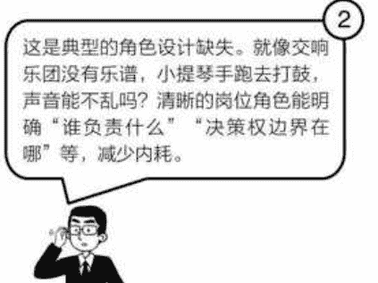

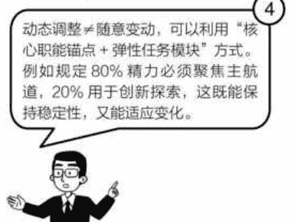

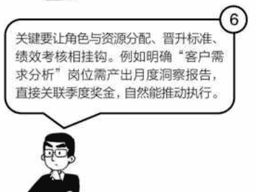

### 提问模型
通用公式=业务场景定位 + 岗位角色设计目标 + 数据验证需求

#### 业务场景定位
明确岗位设计的业务背景与限制条件，为智能工具提供分析坐标。帮助其理解岗位需适配的业务环境，避免方案脱离实际。

##### 提问要点
- 行业特征：如研发密集型、客户高频触达服务。
- 组织阶段：如初创期、成熟期企业。
- 技术工具：如使用飞书多维表格管理项目、依赖CRM系统获客。

#### 角色设计目标
将模糊诉求转化为可量化的设计原则，为智能工具划定岗位设计需解决的问题边界，避免方案泛化。

##### 提问要点
- 预期产出：如缩短客户响应周期30%。
- 协作方式：如需跨部门虚拟小组、要求独立作战能力。
- 风险规避：如防止关键岗位流失、避免过度依赖个体。

#### 数据验证需求
要求智能工具基于特定数据验证岗位合理性，确保设计可落地可衡量，而非纸上谈兵。

##### 提问要点
- 历史数据：如过去半年客服工单处理量分布。
- 标杆案例：如竞品研发团队角色分工模型。
- 员工画像：如现有成员技能矩阵、离职人员能力共性分析等。

### 准备材料

| 要点 | 内容 |
|---|---|
| 组织诊断资料 | 包含现有岗位说明书、离职面谈记录、跨部门投诉案例等。 |
| 业务流程图 | 标注各环节参与角色、耗时占比及常见卡点。 |
| 员工能力图谱 | 通过测评或项目复盘得出的技能分布热力图等。 |
| 外部对标资料 | 同行业头部企业的JD及薪酬数据等。 |

### 实战案例

#### 业务场景定位
我们是某新消费品牌电商团队，负责天猫与抖音双平台运营，团队共25人含5名实习生。核心指标为直播间GMV转化率不低于8%，目前仅6.2%。使用蝉妈妈、有赞等系统，但数据孤岛严重。

#### 角色设计目标
需重新设计三类岗位角色
1. 确保直播脚本与实时流量波动动态匹配，如减少30%硬植入时段掉粉率。
2. 建立跨平台用户行为分析模型，如识别抖音用户与天猫用户消费决策差异。
3. 设计实习生培养路径，如3个月内能独立承担基础场控。

#### 数据验证需求
请基于以下信息生成方案
1. 近3个月各时段直播间用户停留时长分布。
2. 竞品头部直播间话术技巧与福利发放节奏关联性分析。
3. 现有运营团队成员SQL取数能力及Python脚本掌握度测评结果。

#### 输出需求
1. 岗位职责清单，含每项工作的输入输出标准。
2. 协作流程图，标注各环节角色交互节点。
3. 能力模型升级方案，优先补足“用户行为分析”技能缺口。

### 注意事项

| 要点 | 内容 |
| :--- | :--- |
| 灰度验证 | 先在小范围试点岗位设计，观察1~2个迭代周期后再推广。 |
| 动态校准 | 每季度依据业务数据调整岗位角色，如大促期间增设“流量应急指挥”角色。 |
| 文化适配 | 智能方案需与团队现有沟通风格匹配，如工程师团队避免过度强调“狼性”文化。 |
| 伦理审查 | 涉及员工监控类角色设计如效率稽查员，须提前与法务沟通合规性。 |

## 1.2 组建团队：用智能工具甄选高适配人才
问题情景
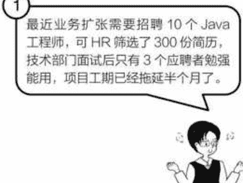

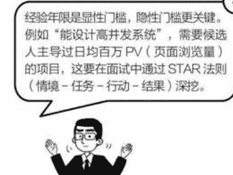

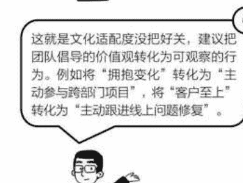

### 提问模型
通用公式=人才需求定位 + 筛选标准构建 + 评估维度设计

#### 人才需求定位
明确岗位需解决的核心矛盾及对业务的关键影响，帮助智能工具理解“谁能创造差异化价值”，避免宽泛筛选。

##### 提问要点
- 岗位类型：如增长黑客、用户研究员。
- 业务场景：如跨境电商供应链优化、医疗AI数据标注。
- 价值锚点：如提升30%复购率、降低20%客诉率。

#### 筛选标准构建
将隐性需求转化为可量化的硬性与软性条件，为智能工具提供人才筛选坐标轴，提升匹配精度。

##### 提问要点
- 硬性门槛：如主导过千万级项目、持有PMP认证。
- 软性特质：如复杂问题解决能力、冲突管理能力。
- 文化契合点：如结果导向、扁平化沟通。

#### 评估维度设计
规划验证候选人关键能力的路径，确保智能工具建议可落地。

##### 提问要点
- 能力测试：如现场设计SQL优化方案、模拟用户访谈。
- 行为面试：如请举例说明你推动过最难落地的项目。
- 数据验证：如提供过往项目收益分析报告。

### 准备材料

| 要点 | 内容 |
|---|---|
| 岗位价值图谱 | 含核心职责、协作关系、决策权限等。 |
| 人才流失分析 | 近半年离职人员的绩效数据、离职面谈记录等。 |
| 业务场景案例 | 3-5个岗位需解决的真实业务难题，如如何提升直播带货转化率。 |
| 文化行为标准 | 将价值观转化为可观察行为，如客户至上=主动跟进线上问题直至闭环。 |

### 实战案例

#### 人才需求定位
我们是某新能源车企智能驾驶团队，需招聘“感知算法工程师”。核心矛盾是极端天气下提升摄像头感知精度，直接影响L3功能落地。

#### 筛选标准构建
硬性门槛
1. 具备量产车型感知算法开发经验。
2. 发表过顶级会议论文。
3. 熟悉Transformer在点云处理中的应用。
软性特质
1. 能跨领域整合激光雷达与视觉数据。
2. 具备车规级功能安全认证思维。
文化契合点
接受“测试车极端场景路测”的高强度出差。

#### 评估维度设计
请基于以下信息生成方案
1. 技术笔试：给定暴雨场景数据集，要求优化目标检测MAP值。
2. 模拟评审：角色扮演向跨部门解释技术方案。
3. 背调重点：核实候选人参与量产项目的具体贡献度。
需要输出
1. 精准人才画像，含行业/企业分布。
2. 定制化面试题库，含技术题与结构化行为题。
3. 竞品公司同类岗位薪酬分位值参考。

注意事项

| 要点 | 内容 |
| :--- | :--- |
| 交叉验证 | 智能工具推荐的候选人须通过“历史项目复盘报告+专家背对背评估”双重验证。 |
| 动态校准 | 每完成3次招聘后，依据新员工绩效数据优化筛选模型。 |
| 文化适配 | 智能工具难以评估“幽默感”“同理心”“人格魅力”等软性特质，须结合结构化行为面试。 |

## 1.3 用智能工具综合评价人才
问题情景
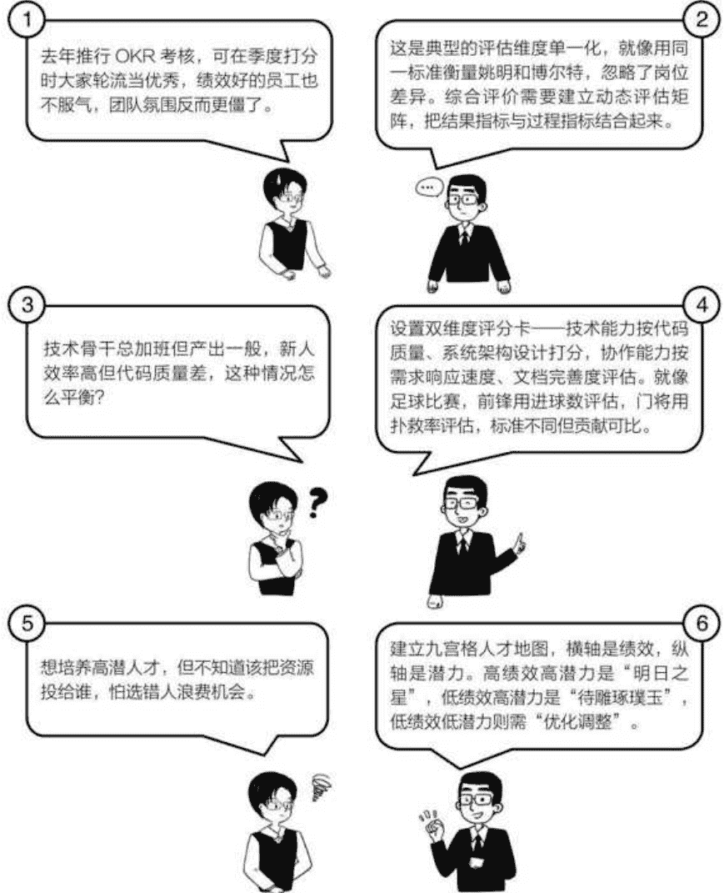

### 提问模型
通用公式=评估目标定位 + 数据基础构建 + 分析维度设计

#### 评估目标定位
明确评价核心目的及需解答的关键业务问题，为智能工具设定分析方向，避免为评而评。

##### 提问要点
- 岗位类型：如研发骨干、销售主管。
- 业务诉求：如识别高潜人才、优化团队结构。
- 决策场景：如晋升评审、资源分配、培训规划。

#### 数据基础构建
提供多源数据输入，确保评价有据可依，减少主观偏差。

##### 提问要点
- 客观数据：如项目交付周期、客户满意度评分。
- 主观数据：如评估反馈、跨部门协作评价。
- 行业标杆：如同类岗位市场薪酬分位值、技能认证标准。

#### 分析维度设计
将抽象评价目标拆解为可量化指标，构建评价坐标系。

##### 提问要点
- 能力维度：如战略思维、用户洞察力。
- 行为维度：如跨部门协作频次、创新提案数量。
- 潜力维度：如学习敏捷度、环境适应力。

### 准备材料

| 要点 | 内容 |
| :--- | :--- |
| 岗位能力模型 | 含胜任力要素及行为描述，如“领导力=成功辅导3名下属晋升”。 |
| 历史评价数据 | 近2年绩效考核表、项目复盘报告、培训记录。 |
| 业务场景案例 | 3-5个岗位需解决的核心难题，如“如何提升App用户留存”。 |
| 行业对标信息 | 同类岗位人才画像、市场薪酬报告、竞品人才策略等。 |

### 实战案例

#### 评估目标定位
我是某金融科技公司算法团队负责人，需在30人团队中识别“技术领军人才”培养对象，目标是未来1年支撑3个AI风控模型落地。

#### 数据基础构建
请整合以下数据
1. 客观数据：近半年代码提交质量，圈复杂度、注释完整率及模型上线后坏账率下降值。
2. 主观数据：技术评审会方案创新评分1~5分、跨部门协作满意度调研结果。
3. 行业标杆：GitHub开源项目贡献度。

#### 分析维度设计
请从三个维度评估
1. 技术攻坚能力：主导完成复杂项目的数量与难度系数。
2. 技术影响力：团队内知识分享频次、外部技术峰会演讲次数。
3. 业务转化力：开发算法产生的直接经济价值，如降低多少万元逾期损失。

#### 需要输出
1. 人才梯队分布图，含“领军人才”“骨干人才”“潜力人才”等。
2. 每位候选人的能力雷达图，如技术/影响力/转化力。
3. 定制化培养建议，如需加强从算法到业务落地的转化思维训练。

### 注意事项

| 要点 | 内容 |
| :--- | :--- |
| 数据清洗 | 剔除偏见数据，如领导主观加分，确保客观性。 |
| 动态校准 | 每半年依据业务变化调整评估维度，如新增AIGC。 |
| 人工复核 | 对智能工具识别出的高潜人才进行深度面谈，验证真实能力。 |
| 反馈闭环 | 将评价结果用于个性化发展计划，而非单纯奖惩依据。 |

## 1.4 用智能工具发掘下属潜在优势
问题情景
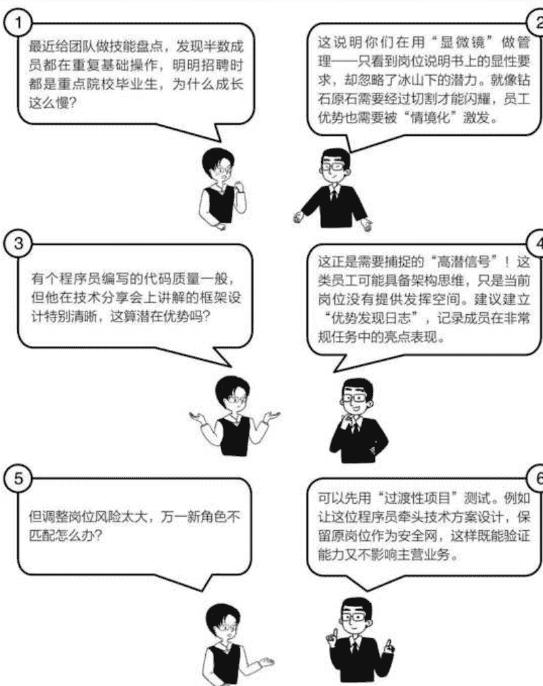

提问模型
通用公式=输入员工画像+ 行为数据锚点 + 优势探测方向

#### 输入员工画像
提供被评估者基础信息与岗位背景，为智能工具建立分析基准，避免刻舟求剑式判断。

##### 提问要点
- 基本信息：如90后/计算机专业/3年经验。
- 当前岗位：如中级Java工程师/负责支付模块开发。
- 职业锚点：如希望转向技术管理岗。

#### 行为数据锚点
列举工作中展现潜在能力的行为案例，将抽象评价转化为可量化事实。

##### 提问要点
- 高光时刻：如主导完成跨部门API对接，提前2周交付。
- 低效场景：如在简单CRUD功能开发上速度较慢。
- 跨界表现：如业余运营技术自媒体，获5000+关注者。

#### 优势探测方向
明确希望智能工具挖掘的潜在能力领域，为其划定探索范围。

##### 提问要点
- 能力维度：如复杂问题解决能力、创新突破能力。
- 业务场景：如需能设计分布式系统的架构师。
- 发展阶段：如适合1年内培养的潜力方向。

### 准备材料

| 要点 | 内容 |
| :--- | :--- |
| 工作行为记录 | 关键任务完成过程文档、跨部门协作反馈等。 |
| 能力标签库 | 行业通用技能图谱，如“AI产品经理能力模型”。 |
| 业务挑战清单 | 当前需突破的能力缺口，如“缺乏智能合约开发经验”。 |

### 实战案例

#### 输入员工画像
被评估者：王芳，28岁，市场专员，负责公众号运营2年，近期承担短视频策划工作。职业目标：成为用户增长负责人。

#### 行为数据锚点
王芳有如下表现
1. 高光时刻：策划的“用户故事”系列视频平均播放量超5万次，比常规内容高300%。
2. 低效场景：撰写的活动推文转化率持续低于团队均值15%。
3. 跨界表现：自学掌握A/B测试工具，为投放策略优化提供数据支持。

#### 优势探测方向
请分析
1. 王芳在“用户共情能力”和“数据驱动思维”方面的潜力强度。

潜力评估与低风险验证

2. 判断成员更偏向用户运营路径还是市场数据分析路径
3. 制定可快速检验潜能的试错型任务

输出要点
1. 多维度潜力雷达图，涵盖创造力、执行力、战略思维等维度的评分
2. 目标岗位所需核心能力与本人现状的匹配度拆解
3. 三套投入可控的试探举措及对应预期回报

注意事项
| 关注点 | 说明 |
| :--- | :--- |
| 数据定期更新 | 建议每季度刷新一次员工行为库，避免用旧画像做判断 |
| 小范围沙盘验证 | 智能体的输出先在沙盘里演练，例如模拟新岗位工作情境 |
| 隐私边界 | 只使用工作场景留下的数据，不触碰个人社交私域 |
| 管理者复核 | 向员工传达智能分析结果时，必须叠加管理者的主观判断 |
| 容错机制 | 预留安全试错空间，为验证失败设计退出路径 |

1.5 协同增效：打造跨部门高配合力
问题情景
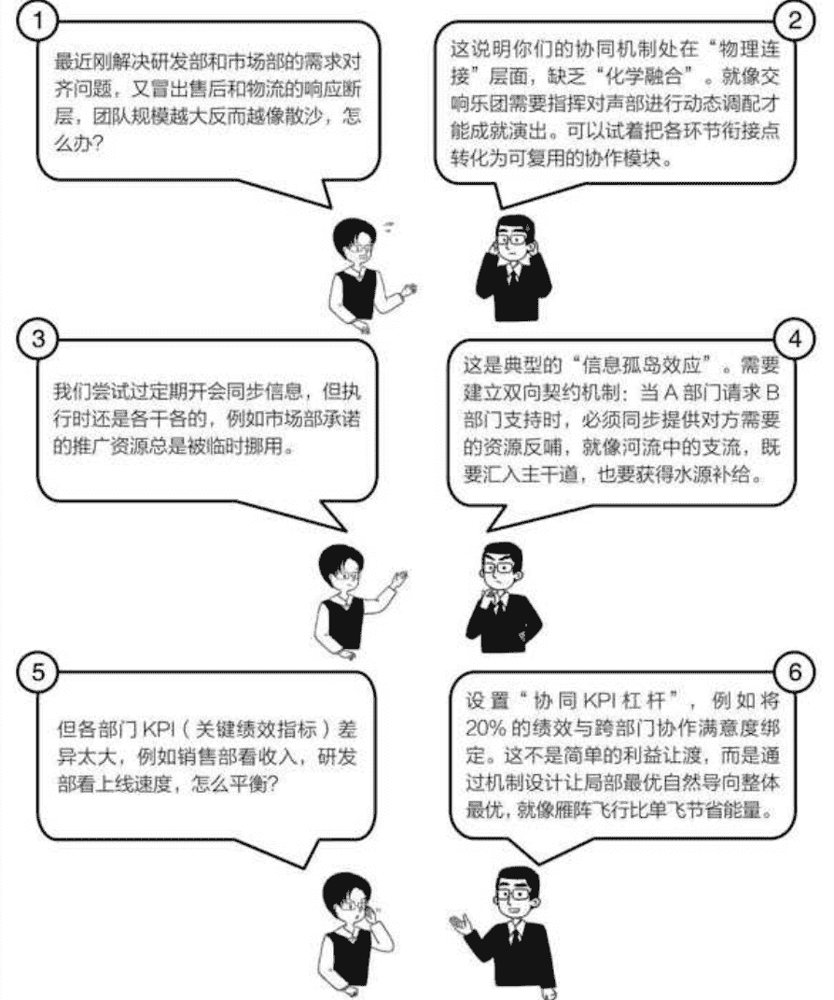

### 智能提问思路
通用公式 = 目标一致性检查 + 协作摩擦扫描 + 优化方案推演

#### 目标一致性检查
量化各部门目标与公司整体战略的贴合程度，揪出目标错位，比如研发过度追求技术领先而忽视商业落地。

##### 提问要点
- 战略关键词：如用户增长、降本增效
- 指标拆解：如市场部新客获取与销售部复购率如何联动
- 资源投向：预算与人力在各项目的占比分布

#### 协作摩擦扫描
找出跨职能协作中的卡点，定位协作熵增来源，比如 70% 的延期项目源于需求变更没同步给法务。

##### 提问要点
- 流程断点：需求从市场部流向研发部平均需要多久
- 决策真空：跨部门争议最终由谁拍板
- 信息损耗：周报里关键数据缺失的大致比例

#### 优化方案推演
基于前两步的洞察给出可落地的改进建议，把抽象问题变成具体行动，比如建议把每周跨部门对齐会压缩到 30 分钟。

##### 提问要点
- 机制设计：例如建立需求变更影响评估表
- 工具选用：例如引入 OKR 看板实时跟踪对齐情况
- 成本测算：新流程实施后需额外增加的沟通时间

### 准备材料
| 关注点 | 说明 |
| :--- | :--- |
| 高频协同场景清单 | 罗列产品发布、客户投诉处理等常见协作场景 |
| 冲突案例簿 | 汇总跨部门矛盾案例，包含时间、涉及方、矛盾点 |
| 资源流动图 | 标记人力与预算在各环节的流转路径 |
| 决策记录 | 记录重大决策的参与人、讨论经过与执行结果 |

### 实战演练
#### 目标一致性检查
我们是一家中型 SaaS 服务商，销售本季度要客户数增长 15%，研发要系统稳定达到 99.9%，市场要行业报告曝光 5 万次。请分析：
1. 这三个目标对提升客户 LTV 的综合贡献
2. 研发目标是否需要加入新功能开发等增长类指标

#### 协作摩擦扫描
近期客户团队与产品团队互相推诿：客户反映功能缺失时，客户侧认为是产品缺陷，产品侧认为是客户需求管理问题。
帮忙：
1. 画出当前客户投诉的处理流程
2. 找出流程中停滞超过 48 小时的环节

#### 优化方案推演
基于以上分析帮忙：
1. 设计跨部门协作 SLA，明确各环节响应时效
2. 分析功能使用情况与客户续约率的关系
3. 估算新机制落地需增加的沟通成本，如每周联席会议时长

#### 需要产出
1. 目标对齐矩阵，冲突指标标红
2. 流程优化前后的对比图
3. 投资回报率预测模型

### 注意事项
| 关注点 | 说明 |
| :--- | :--- |
| 数据时效 | 每季度更新协同数据，避免分析过时 |
| 分步验证 | 先在小范围试点智能建议，例如虚拟跨部门小组 |
| 文化适配 | 评估建议与现有组织文化的契合度，扁平化团队慎用层级化的管控 |
| 失败预案 | 若新流程导致效率下降超 15%，则回滚到原流程 |

1.6 团队氛围：AI 助力营造健康协作环境
问题情景
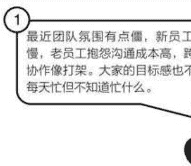
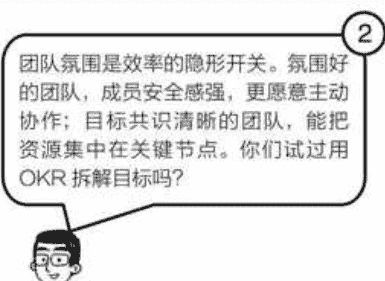

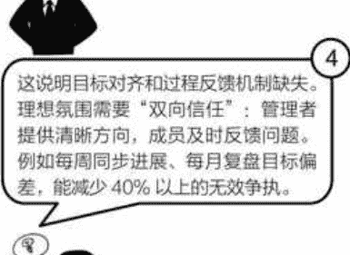
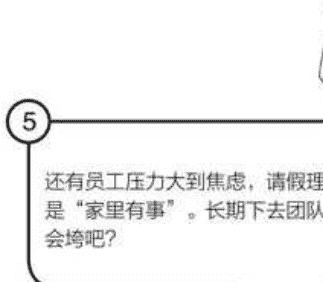
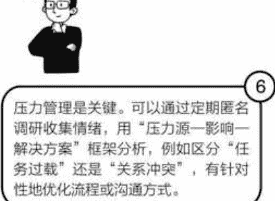

### 智能提问思路
通用公式 = 目标定位 + 氛围痛点 + 优化方向

#### 目标定位
厘清团队当下阶段的核心目标，为智能分析提供锚点，避免建议脱离实际。

##### 提问要点
- 业务阶段：如新品上线初期、季度冲刺期
- 关键指标：如客户留存率提升 15%，项目交付周期缩短 30%
- 团队构成：如 20 人研发组，80% 为 95 后

#### 氛围痛点
描述团队氛围的具体问题，需可量化或场景化，帮助智能体锁定分析维度。

##### 提问要点
- 沟通障碍：如跨部门邮件来回超 5 次才确认需求
- 目标模糊：如 50% 成员不清楚季度重点
- 压力状态：如近 3 个月加班投诉增长 200%

#### 优化方向
明确希望智能体提供哪类具体支持，把抽象问题转化为可执行任务。

##### 提问要点
- 工具推荐：如自动化协作平台、情绪调研模板
- 流程优化：如设计目标对齐会议 SOP
- 数据洞察：如分析高绩效团队的行为模式

### 准备材料
| 关注点 | 说明 |
| :--- | :--- |
| 团队数据 | 近半年绩效分布、离职面谈记录、协作工具使用日志 |
| 场景描述 | 具体冲突案例，如需求变更未同步导致技术返工 3 次、高频抱怨词 |
| 外部参考 | 行业标杆团队的氛围建设案例 |
| 管理诉求 | 优先改善的领域，如跨职能协作或新生代激励 |

### 实战演练
#### 目标定位
我们是一家中型 SaaS 公司，客户成功团队 15 人，负责续费与反馈收集。本季度续费率从 82% 降至 75%，反馈响应周期延长至 72 小时，竞品平均 48 小时，团队 NPS 下降 20 分。

#### 氛围痛点
1. 目标割裂：70% 成员认为续费指标与个人工作无关，客服只解决眼前问题
2. 信息孤岛：使用 3 套系统记录客户数据，跨部门查询需 2~3 天
3. 压力堆积：客户高频投诉导致情绪耗竭，近 2 个月病假率升 35%

#### 优化方向
请协助设计：
1. 目标对齐方案：将续费指标拆解为岗位日常行为，比如客服每次通话后标记复购意向
2. 协作提效工具：推荐可整合客户数据的平台，并模拟实施后的响应效率提升
3. 压力缓释计划：分析高压力场景如月末冲刺，生成轮班或情绪疏导 SOP

### 注意事项
| 关注点 | 说明 |
| :--- | :--- |
| 数据交叉 | 智能建议需与实际数据核对，如减少会议需对比历史时长与产出 |
| 文化适配 | 需评估硅谷式透明管理是否与本团队习惯冲突 |
| 动态迭代 | 氛围问题随业务变化，建议每季度重评一次 |
| 人性兜底 | 智能体无法识别个体差异，如内向员工在头脑风暴沉默，需管理者主动干预 |

# 第2章 AI + 分析决策

分析决策是团队管理的核心，决定发展方向与成败。人工智能通过强大的数据处理与分析能力，成为管理者的好帮手。它可以做全局 SWOT 诊断，清晰把握优劣机会威胁；做 5W2H 分析，让思路更清晰；做波士顿矩阵，合理规划业务组合；做 ABC 管理，提升效率；直击问题根源，制定 PDCA 循环，实现持续改进。

## 2.1 全局洞察：AI 驱动 SWOT 诊断
问题情景
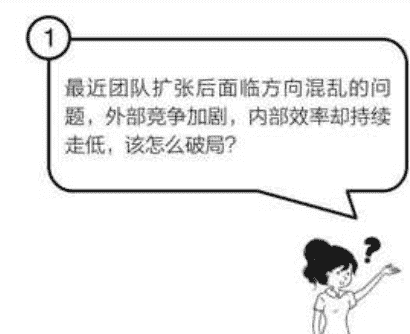
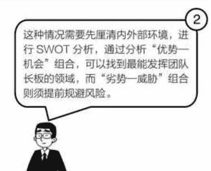
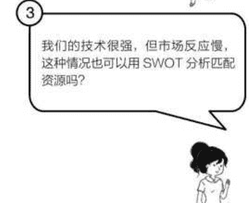
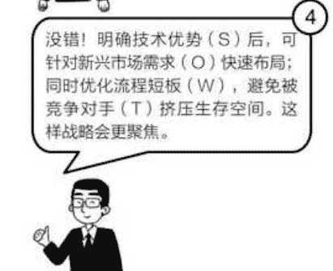
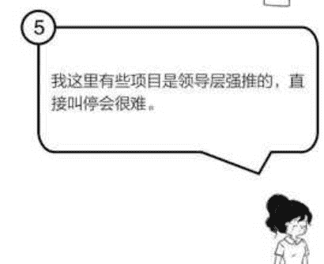
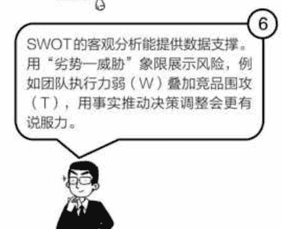

### 智能提问思路
通用公式 = 战略背景 + 决策矛盾 + 分析维度

#### 战略背景
说明团队所处业务阶段与核心战略，帮助智能体明确分析边界，避免泛泛结论。

##### 提问要点
- 业务定位：市场领导者、挑战者或细分专家
- 战略周期：如三年规划、年度攻坚
- 资源限制：资金、人才、技术专利储备

#### 决策矛盾
明确落地中遇到的冲突或不确定性，把抽象战略问题转为可对比项。

##### 提问要点
- 资源争夺：研发预算投向 A 技术还是 B 产品
- 风险权衡：扩张速度与现金流安全的平衡点
- 认知分歧：部门对同一机会的评估差异

#### 分析维度
规定 SWOT 覆盖领域及数据要求，确保结论可操作。

##### 提问要点
- 内部扫描：专利数、员工流失率、设备综合效率
- 外部扫描：政策风向、替代品威胁、客户需求迁移
- 交叉验证：用历史数据预测未来趋势

### 准备材料
| 关注点 | 说明 |
| :--- | :--- |
| 战略档案 | 三年规划、季度经营分析纪要 |
| 能力清单 | 核心专利目录、关键人才技能矩阵、设备产能报告 |
| 市场情报 | 行业白皮书、竞品发布实录、客户需求调研原始数据 |
| 风险数据 | 近两年危机复盘、合规审计、供应商稳定性评估 |
| 财务基准 | 各业务线 ROI、成本结构拆分、投资回收测算模型 |

### 实战演练
#### 战略背景
我是某智能家居公司产品总监，规划 20×× 年新品线。公司定位中高端全屋智能，技术优势是自主研发 AI 语音交互，市占前三，但生产依赖代工，自有工厂仅 30%。年度目标是在适老化改造市场抢占 15% 份额，市场规模约 200 亿元。

#### 决策矛盾
1. 技术路径冲突：研发想投无感化交互，成熟度约 60%；销售担心价格敏感，要求先做高性价比基础款
2. 产能风险：代工厂近期劳工纠纷，可能影响交付；自建工厂需投入 8000 万，会挤占推广预算

#### 分析维度
请完成 SWOT：
- 优势：计算 AI 语音系统的客户复购率
- 劣势：评估代工停工风险对 Q4 营收的影响概率
- 机会：分析各省适老化政策进度，筛选补贴落地最快的 5 省
- 威胁：监测竞品在低线城市的渠道下沉速度

### 注意事项
| 关注点 | 说明 |
| :--- | :--- |
| 数据时效 | 使用最新经营数据 |
| 权重更新 | 每月导入最新数据修正 SWOT 权重 |
| 人工否决 | 战略选择保留人工否决权，避免忽略组织文化 |
| 成本穿透 | 资源方案需标注不可逆决策点，如工厂奠基后无法撤回 |

## 2.2 策略推演：AI 支撑 5W2H 拆解
问题情景
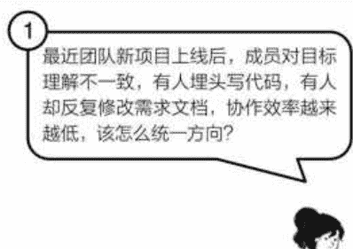
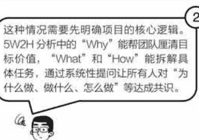

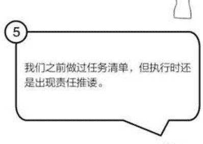
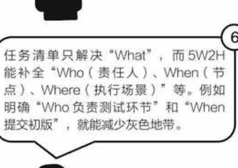

### 智能提问思路
通用公式 = 情境描述 + 核心矛盾 + 决策目标

#### 情境描述
客观陈述现状、业务背景、资源条件，划定分析边界。

##### 提问要点
- 团队定位：职能、规模
- 业务阶段：研发期、扩张期
- 关键限制：预算、工具、政策

#### 核心矛盾
区分表象与本质，帮助智能体聚焦关键问题。

##### 提问要点
- 冲突表现：决策拖延、资源浪费
- 影响数据：会议时长增 40%，项目返工率增 25%
- 已有措施：如已试每日站会但无效

#### 决策目标
期望通过 5W2H 达成的可量化成果。

##### 提问要点
- 分析深度：如定位三个责任盲区
- 输出形式：如甘特图、RACI 矩阵
- 落地要求：适配现有 OA 系统

### 准备材料
| 关注点 | 说明 |
| :--- | :--- |
| 团队基础档案 | 成员分工、近三个月进度表、会议纪要 |
| 问题溯源材料 | 客户投诉、复盘报告、跨部门沟通记录 |
| 业务参数 | KPI 说明、资源分配规则、行业对标数据 |
| 管理诉求 | 急需优化环节、可接受试错成本 |

### 实战演练
#### 情境描述
我是跨境电商运营总监，管理 15 人团队，负责东南亚店铺。主推智能家居，近两月销售额环比降 12%，客诉率升 8%。使用 Trello 管理任务，但出现跨组协作慢、产品组抱怨市场组需求频繁变动、客服反馈说明书不清。

#### 核心矛盾
1. 目标偏差：市场为引流频繁改促销，3 天内换两次方案，导致开发延期
2. 责任真空：客户安装问题占客诉 60%，无人牵头，客服与产品互相推诿
3. 资源浪费：需求变更导致上月 30% 广告素材未使用

#### 决策目标
请用 5W2H 帮助：
1. 分析需求频繁变更的根本原因，明确市场策略决策权归属
2. 制定跨部门需求提交流程，规定评估标准与响应时限
3. 输出客户问题解决方案的责任矩阵，并估算人力费用

### 注意事项
| 关注点 | 说明 |
| :--- | :--- |
| 小范围验证 | 结论需通过试点项目组验证可行性 |
| 权责平衡 | 结合成员能力差异调整 Who 分配 |
| 数据脱敏 | 销售、客户信息用品类 A、区域 B 代替 |
| 定期更新 | 每季度随业务变化更新 5W2H 模型 |

## 2.3 资源布局：AI 辅助 波士顿矩阵
问题情景
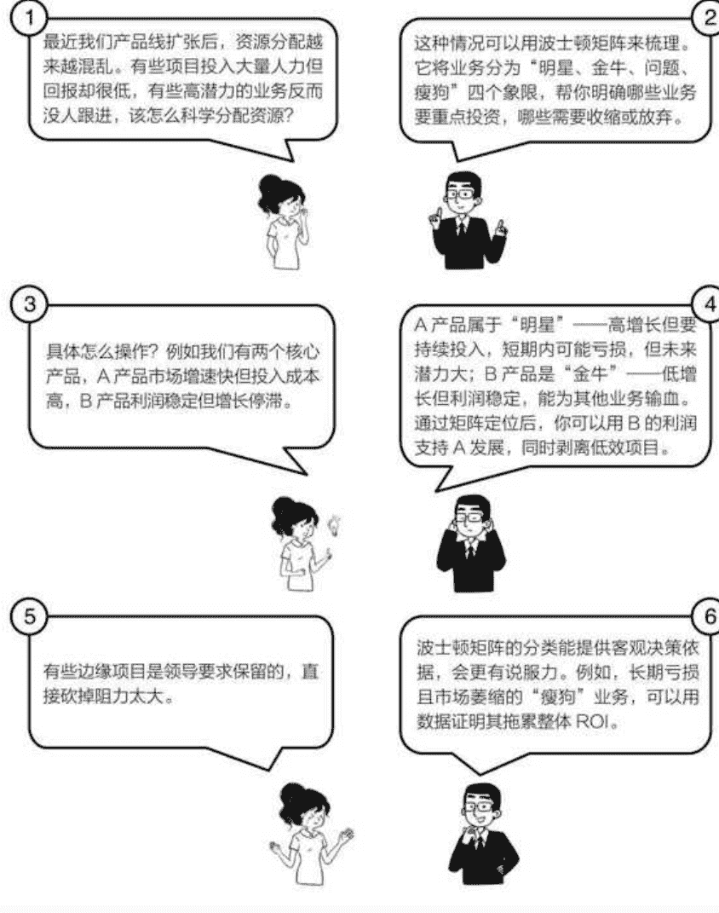

### 智能提问思路
通用公式 = 业务全景描述 + 资源矛盾点 + 矩阵分析需求

#### 业务全景描述
全面陈述业务范围、市场环境、资源结构，需定量数据支撑。

##### 提问要点
- 业务分类：产品线、服务类型、区域市场
- 市场数据：增长率、市占率、利润率
- 资源分布：人力、预算、技术投入占比

#### 资源矛盾点
明确资源分配与需求的冲突，聚焦优先级争议。

##### 提问要点
- 冲突表现：高潜力项目缺人，低效项目占 50% 预算
- 影响量化：整体 ROI 下降 8%
- 决策障碍：管理层对旧业务有情感依赖

#### 矩阵分析需求
基于波士顿矩阵生成具体任务，推动资源再分配。

##### 提问要点
- 分类标准：如利润率低于 10% 视为瘦狗
- 策略建议：明星业务需追加多少预算
- 风险评估：砍掉某业务对团队士气的潜在影响

### 准备材料
| 关注点 | 说明 |
| :--- | :--- |
| 业务数据 | 各产品线近一年销售额、利润率、市场增长率等 |

资源盘点与决策支撑

| 资源盘点表 | 人员投入明细、资金分配情况、设备与技术使用记录等 |
| 市场研判 | 行业增速趋势研究、竞争对手份额数据、客户需求调研等 |
| 管理诉求 | 战略方向如保利润或抢规模、不可触碰的底线如某项业务必须保留等 |

### 实战案例

#### 业务全景
本人担任某智能家居公司产品总监，负责五条产品线。

- A.智能锁：年增速25%，市占率12%，研发费用占部门总预算40%。
- B.扫地机器人：年增速5%，市占率18%，为公司贡献约一半利润。
- C.智能灯具：年增速-3%，市占率4%，长期由B线利润进行输血。
- D.空气净化器：年增速30%，市占率3%，需要持续投入市场教育成本。
- E.智能音箱：年增速-10%，市占率2%，近两年亏损在不断扩大。

#### 资源矛盾
##### 现存冲突
1. 投入错位：B线的盈利被A、D大量占用，导致技术迭代放缓，竞争对手已推出性价比更高的机型。
2. 战略摇摆：管理层要求同时兼顾增长与利润，但C、E拖累整体ROI，当前仅6%。
3. 决策阻力：E产品是CEO早期的创业项目，团队难以提出剥离建议。

#### 矩阵分析诉求
请用波士顿矩阵完成：
1. 以“市场增速≥10%、利润率≥15%”为分界，将五条产品线归入对应象限。
2. 制定资源再配置方案，并测算调整后ROI走向。
3. 针对E业务给出三种温和改善路径，降低推进阻力。

### 注意事项

| 要点 | 说明 |
|---|---|
| 数据准确性 | 波士顿矩阵依赖真实市场数据，需校准增速与利润的口径。 |
| 动态更新 | 矩阵结果应按季度刷新，避免因市场变化导致策略失效，如明星降为问题类。 |
| 资源局限 | AI易忽略非量化资源如核心团队精力，需人工补充评估。 |
| 策略适配 | AI直接建议砍业务可能不符合公司文化，需转化为渐进式优化，如阶段性收缩。 |

## 2.4 优先级管理：用AI落地ABC分级优化

问题情景

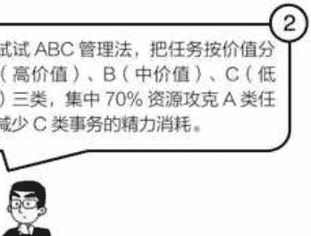
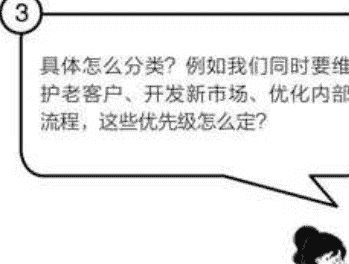
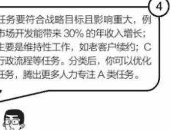
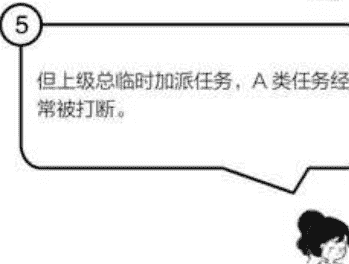
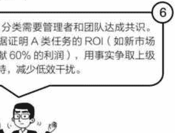

AI提问框架
通用公式=业务背景+资源错配痛点+分级优化诉求

#### 业务背景
对业务范围、资源现状及目标做客观描述，需包含定量数据，帮助AI理解分级逻辑。
##### 提问要素
- 业务类型：如产品研发、客户服务、市场拓展。
- 资源总量：如团队规模、预算、时间。
- 战略目标：如一年内营收增长25%。

#### 资源错配痛点
当前投入与目标之间的错配，需量化低效环节，明确优化方向，如将“C类任务人力减半”。
##### 提问要素
- 问题表现：如60%时间用于报销流程处理。
- 影响数据：如导致新客户签约减少15%。
- 主观误区：如“所有任务都重要”应转为“需验证任务与战略的关联度”。

#### 分级优化诉求
要求AI基于ABC分类法产出具体任务，指向资源再分配决策，将理论转为可执行方案。
##### 提问要素
- 分类标准：如A类任务贡献50%以上利润。
- 资源调整方案：如为A类任务追加30%预算。
- 风险评估：如削减C类任务是否影响基础运营。

### 准备资料

| 要点 | 内容 |
|---|---|
| 任务清单 | 当前所有工作事项（含耗时、产出、参与人员） |
| 资源消耗表 | 人力、预算、时间在各任务上的分配比例 |
| 价值评估数据 | 各任务对战略目标的贡献度（如销售额、客户满意度、成本节约） |
| 约束条件 | 不可调整的刚性任务（如合规流程）、管理层要求保留的事项 |

### 实战案例

#### 业务背景
本人为某电商公司运营经理，管理10人团队，负责200个SKU的库存管理、售后及活动策划。公司战略为“聚焦高毛利爆品，压缩长尾商品”，但团队60%时间处理低毛利商品售后，爆品库存周转仅2次/月，行业标杆为4次/月，导致仓储成本超预算20%。

#### 资源分配痛点
##### 现有痛点
1. 优先级混乱：低毛利SKU售后占日均工单80%，利润贡献不足10%。
2. 资源浪费：爆品缺货时，采购忙于处理长尾补货，平均响应长达72小时。
3. 目标偏离：原定每月策划3场爆品促销，实际仅完成1场，因琐事分散精力。

#### 分类优化需求
请用ABC管理法：
1. 按“毛利贡献≥30%”“售后工单量≤5%”标准，将200个SKU分为ABC三类。
2. 设计资源分配方案，如C类转为第三方代发。
3. 预测优化效果，并列出3个潜在风险。

### 注意事项

| 要点 | 说明 |
|---|---|
| 分类标准合理性 | AI易过度依赖定量，需结合定性因素如战略重要性调整。 |
| 执行可行性 | “外包C类商品”需评估供应商能力，避免无效转移。 |
| 动态监控 | 每月按销售数据重分ABC，防止爆品降级为B类。 |
| 团队共识 | 需清晰传达分类逻辑，减少执行阻力。 |
| 数据安全 | 涉及库存与客户信息时，应模糊SKU名称。 |

## 2.5 根因定位：用AI直击问题核心

问题情景
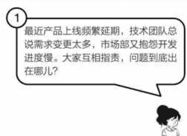
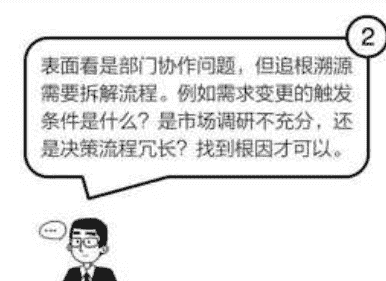

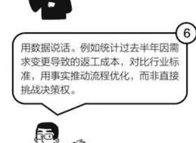

AI提问框架
通用公式=问题全景描述+症状拆解+根因分析需求

#### 问题全景描述
完整陈述问题场景、涉及主体、关联流程，需含时间线与关键节点，帮助AI构建问题地图。
##### 提问要素
- 业务场景：如新品迭代流程。
- 参与角色：如市场部、技术部、测试组。
- 流程节点：如需求评审、开发、测试、上线。
- 历史数据：如近3次项目周期、变更次数。

#### 症状拆解
将表象拆解为可量化子问题，区分直接症状与潜在影响，如将“效率低”转为“需求变更致返工率升至35%”。
##### 提问要素
- 症状表现：如需求评审会平均耗时4小时。
- 关联影响：如开发周期延长20%。
- 主观归因排除：如避免“技术能力不足”，改为“须验证需求文档完整性与开发效率关系”。

#### 根因分析需求
要求AI通过逻辑推演或数据挖掘定位根源，并提供验证路径。
##### 提问要素
- 分析方法：如5W2H、鱼骨图、相关性分析。
- 验证要求：如对比历史数据验证假设。
- 决策支持：如按根因优先级排序解决方案。

### 准备资料

| 要点 | 内容 |
|---|---|
| 流程档案 | 项目流程图、会议记录、审批节点文档等 |
| 量化数据 | 历史周期表、需求变更统计、返工成本核算等 |
| 角色反馈 | 各部门匿名调研、客户投诉、一线访谈摘要等 |
| 对标信息 | 行业平均交付周期、竞品流程优化案例等 |

### 实战案例

#### 问题全景描述
本人为在线教育公司产品负责人，管20人团队。主推“AI智能题库”项目延期2个月，原计划3个月上线，现仅完成60%。流程为教研设计题型→产品整理需求→技术开发→联合测试。近三次迭代中需求变更从5次增至12次，技术抱怨需求描述模糊，教研反诉开发与教育逻辑不符。

#### 症状拆解
##### 当前问题
1. 需求冲突：教研提出的“动态难度分层”功能，技术以“算法复杂度高”为由三次改方案。
2. 返工率高：测试阶段40%BUG源于需求理解偏差，单次修复平均3天。
3. 进度滞后：需求变更致关键节点延迟15天，产品组工作停滞。

#### 根因分析需求
请帮我：
1. 用5W2H定位需求频繁变更根因。
2. 分析教研与技术沟通记录，识别信息同步断层关键环节。
3. 提供3套方案并按实施难度排序：短期制定需求模板；中期设跨部门预评审机制；长期搭建需求管理平台。

### 注意事项

| 要点 | 说明 |
|---|---|
| 数据校准 | AI依赖输入数据，需人工核对口径，如返工成本是否含人力与机会成本。 |
| 归因克制 | AI易过度依赖线性逻辑，需结合实际情况验证。 |
| 渐进验证 | 建议小范围试点后再推广。 |
| 伦理风险 | 涉及人员能力评估时，避免直接问责，需转化为流程改进。 |

## 2.6 持续改进：AI助力PDCA闭环

问题情景
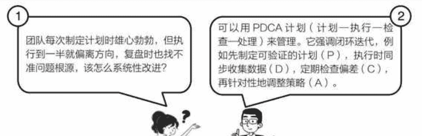
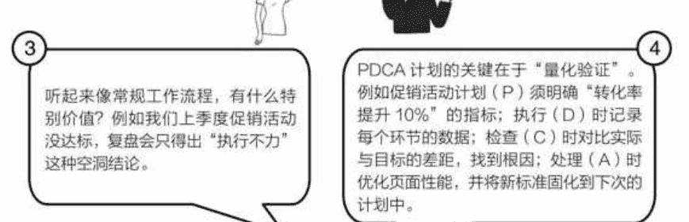
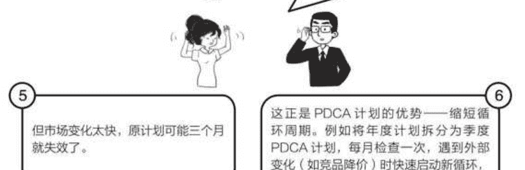

AI提问框架
通用公式=问题场景+执行断点+迭代需求

#### 问题场景
描述需用PDCA改进的业务场景，包含目标、现状，明确应用范围。
##### 提问要素
- 业务类型：如产品研发、客户运营。
- 既定目标：如3个月内用户留存提升8%。
- 当前进展：如上线2个月仅提升3%。

#### 执行断点
PDCA失效的具体环节，需量化瓶颈。
##### 提问要素
- 计划缺陷：如目标不可拆解、资源分配不合理。
- 执行偏差：如未按计划收集数据。
- 检查盲区：如复盘只看结果，忽略过程指标。

#### 迭代需求
要求AI基于PDCA框架输出改进方案，需含可落地闭环。
##### 提问要素
- 阶段任务：如计划阶段的KPI拆解模板。
- 验证机制：如执行阶段的数据埋点方案。
- 调整建议：如偏差≥15%时触发策略重置。

### 准备资料

| 要点 | 内容 |
|---|---|
| 目标文档 | 项目计划书、KPI依据及历史完成数据等 |
| 执行记录 | 任务分派表、进度跟踪表、会议纪要等 |
| 复盘报告 | 过往问题结论、改进措施及效果验证等 |
| 资源清单 | 可用人力、预算、技术工具明细等 |
| 约束条件 | 不可调整底线等 |

### 实战案例

#### 问题场景
本人为在线教育公司用户增长负责人，核心目标是暑期促销3个月内付费用户从10万提至15万。执行1个月新增仅2.1万，原计划应达4万，且7日留存从45%降至38%。

#### 执行断点
##### 当前问题
1. 计划缺陷：目标未拆解到环节。
2. 执行偏差：班主任超负荷，30%用户未及时跟进。
3. 检查盲区：未分析留存下降原因，复盘仅归咎广告不足。

#### 迭代需求
请用PDCA框架：
1. 计划阶段拆解目标至各环节转化率。
2. 执行阶段设计数据埋点方案。
3. 检查阶段建立周度对比机制。
4. 处理阶段针对电话跟进延迟提供3种解决方案。

### 注意事项

| 要点 | 说明 |
|---|---|
| 数据颗粒度 | PDCA计划需匹配团队采集能力。 |
| 循环周期 | 按业务节奏设定检查频率。 |
| 人性化适配 | 建议加入缓冲机制，如单日跟进上限50人。 |
| 风险预判 | 策略调整可能有连锁反应。 |
| 知识沉淀 | 将结论归档为团队知识库。 |

# 第3章 AI+安排工作

合理安排工作是团队高效运转保障。AI可助力设定SMART目标、WBS分解、生成布置文案、总结亮点、定制成长方案。本章介绍AI在工作安排中的具体应用。

## 3.1 目标澄清：AI辅助制定SMART目标

问题情景
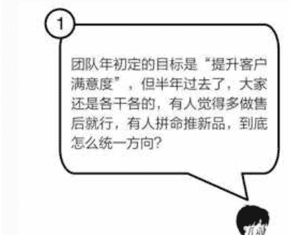
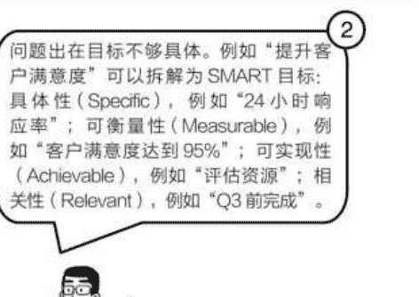
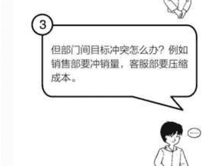
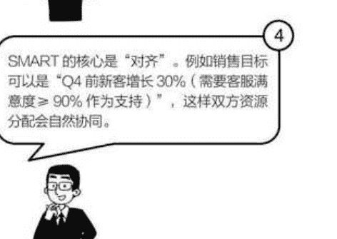

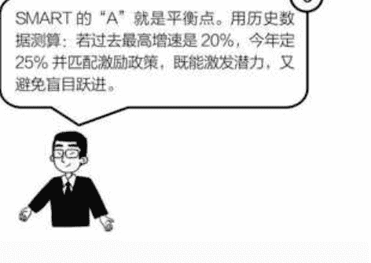

AI提问框架
通用公式=目标现状描述+问题拆解+SMART设定需求

#### 目标现状描述
客观陈述当前目标设定方式、执行效果及矛盾点。
##### 提问要素
- 目标表述：公司战略→部门目标→个人KPI。
- 量化差距：如留存率70%目标90%但无路径。
- 执行数据：如达成率65%，资源超支20%。

#### 问题拆解
将模糊、冲突或不可行目标拆解为具体矛盾点。
##### 提问要素
- 冲突表现：如技术降故障率与市场快上线矛盾。
- 归因排除：避免主观猜测，如将“执行力差”改为“目标缺乏阶段里程碑”。

#### SMART设定需求
要求AI基于SMART原则生成或优化目标并提供验证逻辑。
##### 提问要素
- 优化维度：如将“提升质量”改为“Q3前缺陷率从5%降至2%”。
- 对齐要求：如部门目标支撑公司营收增长25%。
- 风险评估：如所需资源是否超预算上限。

### 准备资料

| 要点 | 内容 |
|---|---|
| 目标档案 | 公司战略规划、部门年度目标、个人绩效表等 |
| 执行数据 | 历史达成率、资源消耗记录、关键障碍复盘等 |
| 关联信息 | 行业平均标准、竞品目标公开信息等 |
| 约束条件 | 预算上限、政策限制、团队能力基线等 |

### 实战案例

#### 目标现状描述
本人为跨境电商华南区销售总监，管15人团队。公司战略要求全年GMV增长35%，但当前目标仅“线下增20%、线上增30%”，未明确路径。线下主攻商超渠道，占GMV60%，账期90天；线上依赖促销，毛利率15%，私域5万粉丝月转化不足1%。

#### 问题拆解
##### 当前问题
- 目标冲突：线下目标与现金流矛盾，线上目标与利润矛盾。
- 资源错配：线下60%精力用于追账，线上广告费占预算40%，ROI仅1:2。
- 缺乏分解：GMV目标未拆至品类和客户层级。

#### SMART设定需求
请按SMART原则重构目标，如将“线上增长30%”改为“Q4前通过私域运营将粉丝转化率提升至3%，带动母婴品类GMV增长15%”。

目标校准与资源配齐

- 把经营层面的意图细化为可落地的单元目标，例如把线下商超渠道的账期压到60天以内，以缓解现金流压力。
- 梳理配套资源清单，例如补充一名私域运营专员、为线下团队安排应收账款专项培训不少于8学时。

### 关键提醒

| 要点 | 内容 |
| :--- | :--- |
| 数据核验 | 模型产出依赖输入质量，需人工复核测算逻辑，例如3%转化率是否建立在粉丝活跃度之上。 |
| 动态复盘 | 提前设立检视节点，例如按月复盘，借助模型快速纠偏。 |
| 人性平衡 | 模型容易忽视落地阻力，需结合激励设计，例如将目标达成与阶梯奖金挂钩。 |
| 风险审视 | 模型给出的指标往往偏乐观，需人工评估外部突发，例如供应链中断的预案。 |

## 3.2 用AI辅助WBS拆解

问题情景
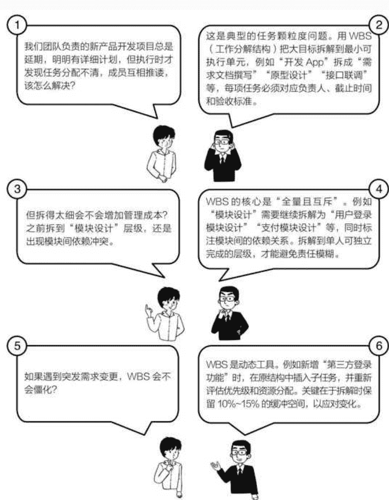

对话结构
建议组合：明确意图 + 指出卡点 + 说明拆解期待

#### 项目目标
界定需要分解的核心工作，包含最终交付物、时间跨度及关键限制，帮助模型划定边界，避免发散。

##### 提问要点
- 交付说明：例如上线一款跨境电商App。
- 时间边界：例如6个月内完成立项到上线。
- 资源边界：例如预算300万元、现有技术团队15人。

#### 分解障碍
把团队拆解时遇到的卡点转为可干预变量，让模型定位瓶颈，例如把“进度拖延”转化为“跨部门协作任务未被识别”。

##### 提问要点
- 逻辑盲区：例如不清楚各功能模块间的技术依赖。
- 协作痛点：例如市场部与研发部对需求优先级定义不一致。
- 历史教训：例如过往项目因测试覆盖不足导致返工。

#### 分解需求
要求模型输出分解方案的类型与细化程度，把抽象目标转为可执行清单，例如把“提升用户体验”拆分为“优化5个核心页面的加载速度”。

##### 提问要点
- 拆解层级：例如拆到三级任务。
- 责任绑定：例如每项任务匹配技能标签与负责人。
- 动态机制：例如任务延期超3天自动触发预警。

### 准备资料

| 要点 | 内容 |
|---|---|
| 项目目标文档 | 立项报告、需求说明书、交付物验收标准等。 |
| 团队能力清单 | 成员技能矩阵、过往任务执行效率数据等。 |
| 风险案例库 | 历史项目延期或失败的任务拆解复盘记录。 |
| 外部参考模板 | 同类项目的WBS工作分解结构案例。 |

### 实战案例

#### 项目目标
某智能硬件公司项目经理负责智能手表研发，需9个月内达成量产。核心交付包括：硬件支持血氧监测与GPS定位、iOS/Android双端配套App、供应链量产方案。资源配置为硬件团队8人、软件团队6人、供应链专家2人，预算上限500万元。

#### 分解障碍
##### 当前问题
- 1. 模块耦合度高：硬件方认为血氧监测精度依赖软件算法优化，但算法开发排期未与硬件测试同步。
- 2. 资源冲突：供应链专家同时兼顾3个项目，关键环节如元器件选型易被延后。
- 3. 验收标准不清：管理层要求用户体验优于竞品，但未给出具体指标，如App启动时长、血氧数据误差范围。

#### 分解需求
请用WBS方法协助
- 1. 将项目拆分为三级任务，如一级“硬件开发”→二级“传感器模块”→三级“血氧传感器精度校准”，并标注任务依赖关系。
- 2. 按团队技能匹配责任人。
- 3. 识别高风险任务，如元器件采购周期超4周，并设计备选方案，如预选2家供应商。
- 4. 输出可视化甘特图模板，包含里程碑，如第3个月完成原型机测试。

### 注意事项

| 要点 | 内容 |
| :--- | :--- |
| 数据核验 | 模型依赖输入的任务数据，需人工验证拆解逻辑，例如硬件测试是否遗漏极端环境场景。 |
| 任务颗粒度 | 避免过度拆解，如把撰写邮件单列，建议最小单元为单人2天内可完成。 |
| 敏捷弹性 | 模型生成的WBS应预留约10%弹性时间，应对需求变更或资源波动。 |
| 人性适配 | 模型推荐的分配可能与成员职业规划冲突，如让擅长编码的工程师写文档，需管理者二次调整。 |

## 3.3 高效传达：用AI生成工作布置文案

问题情景

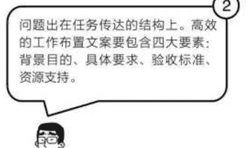
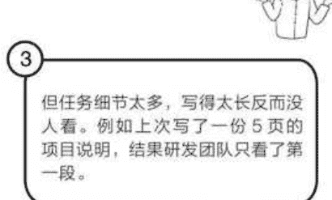
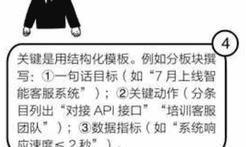

### AI提问框架
建议组合：任务背景 + 传达难点 + 文案生成需求

#### 任务背景
说明任务性质、目标及涉及对象，明确复杂度和重要性，帮助模型判断文案正式度、技术深度和情感基调。

##### 提问要点
- 任务类型：如常规运营、紧急项目、跨部门协作。
- 利益相关方：如执行团队、协作部门、管理层。
- 战略关联：如支撑年度客户留存率目标。

#### 传达难点
指出当前传达方式导致的信息损耗或风险，定位模型需重点优化的表达模块，如复杂流程可视化。

##### 提问要点
- 认知偏差案例：如80%成员误解“用户增长”指标。
- 信息衰减数据：如邮件传达执行率仅40%，面聊达75%。
- 特殊障碍：如远程团队时差、跨专业术语壁垒。

#### 文案生成需求
要求模型输出的具体文案功能与形式，符合团队执行习惯，把“更好传达”转为可执行指令。

##### 提问要点
- 内容维度：如任务分解层级、数据指标颗粒度。
- 呈现形式：如甘特图+文字说明、检查清单+视频教程链接。
- 多版本要求：如管理层汇报版、执行团队操作版。

### 准备资料

| 要点 | 内容 |
|---|---|
| 任务历史档案 | 过往工作布置文档、执行偏差分析报告等。 |
| 团队认知画像 | 成员职责说明、常见沟通误区记录、联系方式。 |
| 沟通渠道数据 | 各传达方式效果统计，如企业微信阅读率、邮件回复率。 |
| 成功案例参考 | 内部/外部高效传达案例，如某项目通过流程图将执行效率提升30%。 |

### 实战案例

#### 任务背景
某智能家居公司产品运营总监向跨部门团队布置“9月上线新一代智能门锁”。团队构成：硬件工程师5人、软件研发7人、市场推广3人。核心目标：①硬件指纹误识率≤0.001%；②软件接入公司IoT平台并完成压力测试；③市场在北上广深举办10场线下体验会。项目需与双十一促销联动，管理层要求每周汇报进度。

#### 传达难点
##### 当前的难点
- 1. 信息错位：硬件团队上次把“误识率达标”理解为实验室数据，实际需适配极端环境-15℃~50℃。
- 2. 协作断层：软件团队未同步硬件排期，导致API接口延迟。
- 3. 资源冲突：市场部Demo机数量与研发测试需求重叠。
- 4. 表达不适配：给工程师的邮件只写“提升用户体验”，未提供具体参数指引。

#### 文案生成需求
##### 请协助生成
- 1. 主任务文档：三层结构，战略层说明与双十一GMV目标关联；执行层分部门拆解子任务；数据层定义各环节验收指标。
- 2. 可视化附件：硬件-软件联调甘特图，标注跨部门依赖节点；线下体验会选址逻辑脑图，含人流密度、竞品门店距离等数据。
- 3. 常见问题手册：预判各部门疑问并附对接人联系方式。
- 4. 多版本摘要：200字管理层汇报版，强调风险管控与ROI；500字执行团队版。

### 注意事项

| 要点 | 内容 |
| :--- | :--- |
| 信息准确性核验 | 模型可能混淆专业术语，需人工核对关键参数，如将误识率误写为拒真率。 |
| 个性化适配 | 避免直接套用通用模板，需结合企业沟通习惯。 |
| 反馈机制嵌入 | 在文案中预留反馈入口，如文档末尾添加疑问收集二维码。 |
| 多模态平衡 | 图文比例按团队特性调整，如研发团队配图≥40%，销售团队侧重话术清单。 |

## 3.4 汇报精炼：用AI总结下属工作亮点

问题情景
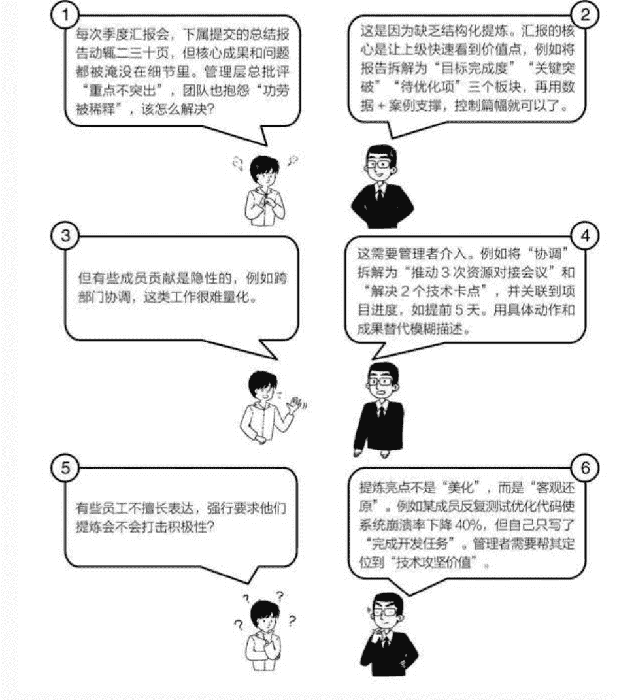

AI提问框架
建议组合：汇报现状 + 提炼难点 + 提炼需求

#### 汇报现状
描述当前汇报形式、内容结构及问题，帮助模型理解原始材料组织方式与缺陷。

##### 提问要点
- 汇报形式：如周报/月报、PPT/文档。
- 内容特点：如文字冗长、数据堆砌、案例缺失。
- 信息源：如KPI数据、项目日志、客户反馈。

#### 提炼难点
明确从原始汇报提取亮点时的具体障碍，把“汇报质量差”转为可干预问题。

##### 提问要点
- 信息过载：如单份报告含50项任务，仅3项为核心成果。
- 价值模糊：如无法区分常规工作与超额贡献。
- 标准缺失：如缺乏统一的亮点评估维度。

#### 提炼需求
要求模型输出具体提炼方案及交付形式，把杂乱信息转为决策可用结论，如从100条任务中提取5个战略级亮点。

##### 提问要点
- 聚焦维度：如技术创新、成本优化、客户价值。
- 呈现逻辑：如按战略贡献-执行难度-复用价值排序。
- 格式要求：如1页总结模板、3分钟汇报要点。

### 准备资料

| 要点 | 内容 |
|---|---|
| 原始汇报材料 | 员工周报、月报、项目总结文档等。 |
| 绩效评估数据 | KPI完成率、360反馈、客户评分等。 |
| 业务关联信息 | 团队目标对齐表、公司战略重点说明等。 |
| 历史标杆案例 | 过往被认可的优质汇报案例及提炼逻辑。 |
| 管理者偏好 | 上级关注优先级，如成本控制优于速度。 |

### 实战案例

#### 汇报现状
某电商公司运营总监管理10人团队，用户增长组4人、活动策划组3人、数据分析组3人。团队每周提交15页汇报，含活动落地、数据监控、用户调研等30余项任务，管理层反馈看不到核心价值。

#### 提炼难点
##### 当前问题
- 1. 信息过载：70%内容为执行细节，关键成果被弱化。
- 2. 标准混乱：成员对亮点定义不一致，技术人员重代码优化，业务人员重转化率提升。
- 3. 关联缺失：个人贡献未与公司季度目标“提升复购率”直接挂钩。

#### 提炼需求
##### 请协助
- 1. 设计“亮点提炼框架”，含三级维度，如一级战略贡献度→二级创新性/难度→三级具体指标。
- 2. 从近3个月汇报中提取每人1~2个核心亮点，如“策划小王：主导会员日活动，使复购率环比提升8%”。
- 3. 生成可视化模板：一页纸总结含数据对比图、3分钟口述要点用于向上汇报。

### 注意事项

| 要点 | 内容 |
| --- | --- |
| 数据脱敏 | 原始汇报涉及敏感信息应模糊处理。 |
| 结果验证 | 模型提取的亮点需反向核对绩效数据。 |
| 个性化适配 | 根据成员特质调整表达技巧。 |
| 动态更新 | 每季度迭代提炼维度，匹配业务重心变化。 |
| 文化兼容 | 避免过度强调竞争排名，应保留团队协作类亮点。 |

## 3.5 绩效提升：用AI制定反馈成长方案

问题情景
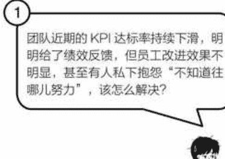
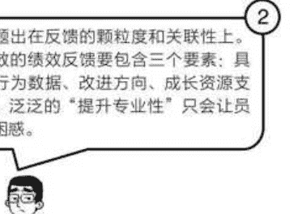
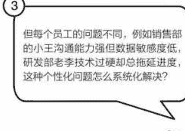
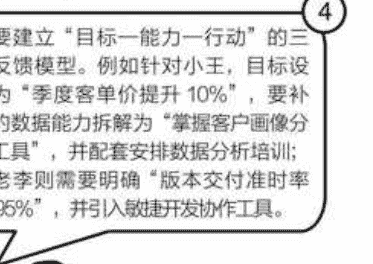

### AI提问框架
建议组合：绩效现状 + 反馈障碍 + 成长需求

#### 绩效现状
描述团队或个人当前绩效表现，含量化结果及行为特征，为模型提供分析基准。

##### 提问要点
- 绩效数据：如Q2销售达标率72%。
- 能力画像：如团队Excel高阶函数使用率不足30%。
- 历史对比：如较去年同期客户满意度下降8%。

#### 反馈障碍
说明现有反馈机制失效环节及影响，定位模型需突破的关键点，如将“员工不行动”转为“目标与个人发展路径不匹配”。

##### 提问要点
- 反馈盲区：如60%员工认为反馈未指出具体改进动作。
- 执行阻力：如学习计划与业务高峰期冲突。
- 情绪阻抗：如负面反馈导致核心员工离职意向上升。

#### 成长需求
明确期望模型输出的成长方案类型及落地要求，把抽象提升转为可执行任务。

##### 提问要点
- 改进维度：如技能提升、流程优化、心态调整。
- 资源约束：如每周最多占用2小时培训时间。
- 验收指标：如3个月内客户投诉率降至3%。

### 准备资料

| 要点 | 内容 |
|---|---|
| 绩效档案 | 近6~12个月KPI数据、360评估、奖惩记录等。 |
| 能力评估 | 岗位胜任力模型、技能测试结果等。 |
| 员工画像 | 职业发展意向调研、学习模式偏好记录等。 |
| 资源清单 | 可用培训预算、内部导师名单、外部合作机构目录等。 |
| 行业对标 | 同岗位优秀员工绩效数据。 |

### 实战案例

#### 绩效现状
某跨境电商运营总监管理15人团队，选品组4人、流量组5人、客服组6人。核心问题：①选品组新品成功率从35%降至22%，滞销库存占比升至18%；②客服响应达标≤1分钟，客诉解决率仅68%，竞品达85%；③流量组ROI从1:5下滑至1:3.8。

#### 反馈障碍
##### 当前问题
- 1. 目标偏差：选品组沿用爆款复制策略，未察觉客群从Z世代转向银发族。
- 2. 能力断层：客服仅接受标准回复培训，缺乏突发客诉应对技巧，如跨境物流纠纷。
- 3. 激励失效：流量组奖金与点击量挂钩，导致盲目堆素材忽视精准投放。
- 4. 反馈延迟：月度复盘无法捕捉快速变化市场趋势。

#### 成长需求
##### 请协助
- 1. 基于数据为各岗位制定成长方案：选品组提升客群洞察能力，含学习路径与实践任务；客服组强化复杂问题处理，设计客诉情景模拟题库；流量组优化投放策略，模型推荐ROI监控模型。
- 2. 设计反馈跟进机制：每周数据看板、双周1对1辅导要点清单。
- 3. 评估资源投入：测算培训成本、预估绩效提升周期。

### 注意事项

| 要点 | 内容 |
| :--- | :--- |
| 数据真实性核验 | 模型可能误读绩效关联性，如将客诉率上升归因于客服能力而忽略产品质量，需人工交叉验证。 |
| 个性化适配 | 避免套用通用方案，需结合员工职业阶段，新人重技能，老员工重创新。 |
| 情绪管理 | 模型生成的沟通技巧可能机械化，应补充同理心表达框架。 |
| 动态调整 | 市场变化可能导致方案失效，应设季度复盘触发机制。 |
| 长线视角 | 模型易侧重短期指标，需手动加入长期能力规划。 |

## 3.6 结果导向：用AI评估改进双管齐下

问题情景

AI提问框架
建议组合：评估现状 + 改进障碍 + 双轨需求

#### 评估现状
描述当前评估体系构成、数据来源及漏洞，帮助模型定位盲区，如客户满意度数据缺失。

##### 提问要点
- 评估维度：如质量、效率、成本。
- 数据采集方式：如系统日志、人工填报。
- 冲突焦点：如销售重转化率，研发重稳定性。

#### 改进障碍
说明从评估到改进的阻力，把“改进难”拆解为可干预做法，如需论证自动化工具对ROI提升幅度。

##### 提问要点
- 资源限制：如预算、人力、时间。
- 优先级冲突：如提升交付速度与降低故障率难以兼得。
- 执行惯性：如成员抗拒新流程。

#### 双轨需求
要求模型同时输出评估结论与改进方案，并建立关联，确保发现问题到解决问题闭环。

##### 提问要点
- 评估深度：如根因分析、趋势预测。
- 改进颗粒度：如部门级策略、个人行动清单。
- 验证机制：如A/B测试、模拟推演。

### 准备资料

| 要点 | 内容 |
|---|---|
| 绩效档案 | 历史KPI数据、项目验收报告、客户投诉记录等。 |
| 过程记录 | 会议纪要、任务系统日志、协作工具沟通记录等。 |
| 资源清单 | 可用预算、技术工具权限、外部合作方能力说明等。 |
| 改进案例 | 过往成功/失败改进方案及复盘结论。 |
| 战略对齐表 | 公司季度目标、部门核心考核指标等。 |

### 实战案例

#### 评估现状

案例背景
某在线教育平台的用户增长负责人管理着一个8人小组，3人负责拉新渠道、2人负责课程内容、3人负责数据分析。现行的绩效考核围绕新客获取量、付费转化水平、7日留存率三项展开，执行中已显现偏差。

1. 拉新团队为达成新增KPI频繁投放低价促销，稀释了用户付费意愿，客单价由180元降至120元。
2. 内容团队过度追逐爆款选题，课程完课率仅35%，明显低于行业平均的50%。
3. 数据团队已识别出注册后第三天为流失峰值，却只停留在现象归纳，未提供可落地的解决建议。

#### 改进瓶颈

##### 现存痛点
1. 指标割裂：拉新侧为完成增量目标牺牲获客质量，与内容、数据侧的目标产生冲突。
2. 数据断层：内容成效评估主要靠主观打分，缺乏用户行为埋点支撑。
3. 资源受限：市场获客预算削减三成，难以继续以补贴换取增长。
4. 技术局限：现有系统不支持用户全生命周期的实时行为监测。

#### 双重需求
##### 请协助
1. 重构评估体系：在保留既有指标前提下，加入用户质量系数，综合付费意愿、学习时长等维度。
2. 根因拆解：借助归因模型，锁定课程完课率偏低的前三大原因。
3. 低成本优化方案：分别给出1个月短期、3个月中期、6个月长期的落地路径。

### 重要提示
| 要点 | 内容 |
| :--- | :--- |
| 指标平衡 | 避免AI对单一指标过度拟合，需为各指标设置权重约束。 |
| 可行性过滤 | AI建议若超出权限范围，如跨部门系统对接，应标注需上级审批。 |
| 渐进验证 | 优先推进投入产出比更高的改进项，通过小范围试点收集反馈。 |
| 动态校准 | 每季度刷新评估模型，按市场变化调整用户质量系数的计算逻辑。 |

# 第4章 AI赋能团队沟通协同

团队协作中沟通效率决定执行成败。AI可协助生成谈话大纲，让管理者对话更有针对性；提炼谈话精华，快速抓住重点；撰写得体回复，提升沟通质感；在组织变动中降低阻力；在冲突场景提供化解思路；并汇总合理化建议，凝聚集体智慧。以下说明AI如何优化沟通效能。

## 4.1 对话框架：用AI生成员工谈话大纲

问题情景
1. 近期与团队成员沟通越发吃力，要么话题跑偏，要么对方以客观原因搪塞。上周与小刘谈项目延期，他全程强调外部困难，问题并未解决，低效对话该如何改善？
2. 核心在于缺少结构化框架。有效的员工谈话可沿事实—影响—行动展开：先明确具体事件，如项目晚交付7天，再分析对组织目标的影响，如影响客户续约，最后共同制定改进计划，如每日晨会同步进度。
3. 部分议题需要员工自我反思，直接点名易引发对抗。若小王协作意识薄弱，可采用提问式引导。
4. 例如询问你认为跨部门协作最耗时的环节是什么？如果由你主导，会怎样优化流程？通过提问激发主动思考，比直接批评更有效。
5. 员工对职业发展迷茫，谈话容易空转，该怎么办？
6. 将模糊诉求拆解为具体路径。如员工表示想提升专业能力，可转化为半年内完成3项认证考试，主导1个跨部门项目，并匹配学习资源与实践机会。

### AI提问框架
通用公式=谈话场景+核心障碍+提纲需求

#### 谈话场景
描述沟通发生的具体情境、对象与议题，帮助AI把握特殊性，如新人辅导侧重技能培养，老员工沟通侧重动机激活。

##### 提问要素
- 谈话类型：如绩效反馈、职业规划、冲突调解。
- 对象特征：如入职3个月的新人，高绩效但协作偏差的老员工。
- 背景事件：如连续两季度业绩不达标，跨部门投诉上升。

#### 核心障碍
说明谈话推进受阻的关键点，将沟通不畅转化为可干预问题，如设计非对抗性提问清单。

##### 提问要素
- 信息不对称：如员工隐瞒真实离职想法。
- 情绪阻力：如对负面反馈产生防御。
- 目标模糊：如职业发展诉求过于空泛。

#### 提纲需求
要求AI输出可执行的话术框架与工具，将准备谈话转化为具体任务。

##### 提问要素
- 结构设计：如破冰开场-问题定位-方案共识-跟进机制。
- 表达建议：如如何委婉指出态度问题。
- 辅助工具：如职业兴趣测评量表、项目复盘模板。

### 准备资料
| 要点 | 内容 |
|---|---|
| 员工档案 | 岗位职责、绩效数据、奖惩记录、过往谈话纪要等。 |
| 问题事件 | 具体冲突描述，如项目延期时间线等。 |
| 团队目标 | 季度KPI、战略重点，如提升客户留存率等。 |
| 员工反馈 | 匿名调研结果、360度评估报告等。 |
| 资源清单 | 可调用的培训课程、激励政策、工具权限等。 |

### 实战案例
#### 谈话场景
某互联网公司产品总监下周需与核心产品经理小李进行季度绩效面谈，背景如下。
1. 小李负责的A产品迭代延期两周，导致Q3营收减少120万元。
2. 技术团队反馈其需求文档漏洞率上升30%，小李归因于技术理解力不足。
3. 个人诉求希望承担更具战略性的工作，但当前执行质量未达标。

#### 核心障碍
##### 当前的问题
1. 事实分歧：小李将责任归于外部，回避自身问题。
2. 目标冲突：职业诉求与现状能力不匹配，直接否认易致离职风险。
3. 情绪管理：小李曾因负面反馈摔门而出，需避免矛盾激化。

#### 提纲需求
请协助生成谈话提纲
1. 设置事实对齐环节：用数据可视化呈现需求文档漏洞率变化与延期造成的营收损失。
2. 嵌入引导式提问：如你认为技术团队最易误解的需求点是什么？若重做此次迭代，可优化哪些环节？
3. 设计能力与目标匹配方案：如下季度漏洞率降至5%可参与战略级项目预研。
4. 提供情绪疏导策略：谈话中加入优势肯定。

### 注意事项
| 要点 | 内容 |
| :--- | :--- |
| 事实核查 | AI可能误读数据关联，需人工复核因果逻辑。 |
| 文化适配 | AI表达可能与企业风格不符，如外企直白、国企委婉，需二次调整。 |
| 备选预案 | 针对激烈反驳或沉默对抗，需准备2至3种应对策略。 |
| 法律合规 | 涉及绩效改进计划的谈话，需确保建议符合劳动法规。 |

## 4.2 要点提炼：借助AI总结谈话精髓

问题情景

### AI提问框架
通用公式=谈话场景+信息痛点+提炼目标

#### 谈话场景
描述沟通发生的具体情境及参与方特征，帮助AI识别语境。例如离职面谈需关注情绪信号，项目复盘需提取流程卡点。

##### 提问要素
- 谈话类型：如绩效面谈、离职挽留、头脑风暴会议。
- 参与角色：如新员工、资深骨干、跨部门成员。
- 沟通形式：如线上聊天、线下笔记。

#### 信息痛点
说明信息处理中的障碍及潜在风险，定位AI需破解的难点。

##### 提问要素
- 信息冗余度：如2小时会议仅20%有效内容。
- 语义模糊点：如尽快解决缺乏时间量化。
- 矛盾冲突项：如A主张增员，B建议自动化。

#### 提炼目标
明确AI输出的结构化成果及使用场景。

##### 提问要素
- 内容维度：如诉求分类、决策清单、风险预警。
- 呈现形式：如表格、思维导图、摘要报告。
- 应用场景：如薪酬调整依据、培训计划制定。

### 准备资料
| 要点 | 内容 |
|---|---|
| 原始记录 | 谈话录音、文字稿、会议纪要、即时通讯记录，需脱敏。 |
| 员工档案 | 岗位说明书、绩效考核历史、项目参与记录等。 |
| 业务背景 | 团队目标、重大事件时间线等。 |
| 管理工具 | 现有沟通模板、历史决策记录等。 |
| 战略文档 | 公司文化价值观、年度人才发展计划。 |

### 实战案例
#### 谈话场景
某跨境电商研发总监管理30人技术团队。近期完成28场季度绩效一对一，每场60-90分钟，线上会议自动转录。团队分布在中国、印度、德国，存在时差与表达差异。

#### 信息痛点
##### 当前的问题
1. 信息分散：同一问题在多场出现，表述不同，如德国员工强调流程规范，印度员工抱怨沟通延迟。
2. 语义歧义：5名骨干提到技术债务，需区分架构缺陷还是工具不足。
3. 情绪盲区：2名中国员工委婉表达离职倾向，未在记录中显性标注。
4. 行动缺失：跨时区会议讨论10项改进建议，仅3项明确责任人与节点。

#### 提炼目标
##### 请协助我
1. 分类统计高频问题，按技术、流程、发展三维度聚类。
2. 识别潜在风险，通过情绪词分析定位3名高离职风险人员。
3. 生成决策看板：短期1个月内针对3项共性问题输出解决方案矩阵；长期针对15人提到的技术视野受限，设计海外技术大会参与计划；输出可视化报告展示问题分布、风险等级、资源需求。

### 注意事项
| 要点 | 内容 |
| :--- | :--- |
| 数据脱敏 | 姓名、薪资等敏感信息替换为编号，内部项目代号加密。 |
| 模型偏差 | AI可能误判文化差异，需人工校准关键词库。 |
| 上下文补充 | 单独片段易断章取义，需关联3个月沟通记录交叉验证。 |
| 多模态处理 | 录音中的语气停顿、笑声等需标注情绪强度辅助判断。 |

## 4.3 回复技巧：借助AI撰写员工沟通文案

问题情景

### AI提问框架
通用公式=沟通背景+回应难点+文案需求

#### 沟通背景
描述诉求产生的场景、对象及内容，帮助AI识别语境差异。

##### 提问要素
- 诉求类型：如薪资谈判、晋升申请、负面反馈。
- 沟通渠道：如邮件、面谈、全员会议。
- 关联事件：如项目延期引发抱怨，绩效考核争议。

#### 回应难点
说明管理者需解决的核心矛盾，将模糊难题转化为AI任务。

##### 提问要素
- 情绪冲突：如员工愤怒、焦虑。
- 利益矛盾：如加薪需求与预算限制。
- 风险规避：如避免法律纠纷或舆情扩散。

#### 文案需求
明确AI生成文案的类型及要求，确保可直接使用。

##### 提问要素
- 文案形式：如邮件模板、面谈要点、公告文案。
- 核心原则：如维护公司权威，体现个体关怀。
- 附加要素：如引用绩效数据，加入职业发展建议。

### 准备资料
| 要点 | 内容 |
|---|---|
| 员工信息 | 岗位职责、历史绩效、过往沟通记录等。 |
| 诉求原文 | 员工原始文字或录音摘要等。 |
| 管理政策 | 相关制度文件，如考勤、晋升标准等。 |
| 文化适配 | 企业价值观、内部沟通风格等。 |
| 外部参考 | 行业常见案例、法律风险提示等。 |

### 实战案例
#### 沟通背景
某电商公司客服团队主管需回复资深客服的加薪申请邮件。诉求如下。
1. 个人业绩连续6个月排名前10%，薪资两年未涨。
2. 威胁不调薪将考虑外部机会。
3. 要求月薪上调20%或晋升组长。
4. 公司现状：年度调薪预算冻结，组长岗位暂无空缺。

#### 回应难点
##### 当前难点
1. 平衡认可与拒绝：肯定贡献但无法满足主要诉求。
2. 保留核心员工：避免因失望离职。
3. 法律合规：规避变相承诺风险。

#### 文案需求
请生成邮件模板
1. 结构为感谢贡献-现状说明-替代方案。引用接待量、满意度数据，说明预算冻结原因如净利润下降30%。
2. 提供替代激励：短期批准参加金牌客服实战营；长期承诺下一年度Q1优先评估晋升资格；结尾表示重视并约谈。

### 注意事项
| 要点 | 内容 |
| :--- | :--- |
| 文化适配 | 根据企业风格调整语气。 |
| 情感补充 | AI文案偏理性，需人工加入情感表达。 |
| 法律验证 | 涉及制度承诺需法务审核。 |
| 反馈迭代 | 收集员工接受度优化模型。 |

## 4.4 平稳过渡：借助AI助力变动沟通

问题情景

### AI提问框架
通用公式=变动背景+员工阻力+沟通需求

#### 变动背景
描述调整的触发因素、内容及影响范围，理解必要性与合理性。

##### 提问要素
- 变动类型：如组织重组、技术栈迁移、跨地域调动。
- 调整对象：如入职3年内的产品经理。
- 战略关联：如为新业务储备人才。

#### 员工阻力
说明抵触原因及已出现的负面迹象。

##### 提问要素
- 显性表现：如公开反对、效率下降、请假增加。
- 潜在诱因：如技能焦虑、人际断裂、晋升通道变化。
- 影响数据：如转岗员工周均产出下降40%。

#### 沟通需求
要求AI提供沟通策略及配套方案。

##### 提问要素
- 信息层级：如战略解读、个人利弊、协作方案。
- 沟通工具：如FAQ文档、过渡期绩效算法、心理疏导资源。
- 风险预案：如竞业协议条件、知识转移清单。

### 准备资料
| 要点 | 内容 |
|---|---|
| 组织架构图 | 调整前后部门岗位变化。 |
| 员工档案 | 受影响人员技能矩阵、绩效历史、职业规划访谈。 |
| 业务调整说明 | 董事会决议、新业务ROI测算等。 |
| 沟通历史记录 | 员工投诉、离职面谈摘要等。 |
| 资源清单 | 培训预算、弹性工作制度、荣誉激励权限等。 |

### 实战案例
#### 变动背景
某智能硬件研发副总裁因战略转向AIoT，需在2个月内重组深圳硬件团队30人。
1. 15人转入新设AI算法部，主攻端侧智能决策。
2. 10人并入上海产品中台，负责硬件标准化。
3. 5人优化离职，依据绩效排名与技能测评。

#### 员工阻力
##### 当前挑战
1. 技能焦虑：转岗60%员工无Python实战经验。
2. 地域排斥：7名资深工程师拒绝调往上海，家庭原因占85%。
3. 信任危机：73%员工认为优化名单不透明。
4. 效率滑坡：重组一周后需求交付延迟率从12%升至45%。

#### 沟通需求
请协助设计沟通方案
1. 分层沟通库：针对技能焦虑提供技能转换路径图；针对地域排斥设计双基地办公方案；用可视化看板呈现优化名单决策逻辑。
2. 过渡期支持：制定结对清单与30天速效成果清单。

### 注意事项
| 要点 | 内容 |
| :--- | :--- |
| 文化适配 | 弹性办公建议需符合当地劳动法。 |
| 法律合规 | 优化补偿方案需HR法务审核。 |
| 动态调整 | 每周更新员工反馈，优化沟通策略。 |
| 人性化兜底 | 关注特殊个案情感因素。 |

## 4.5 化解矛盾：借助AI处理冲突与对抗

问题情景

### AI提问框架
通用公式=冲突背景+矛盾焦点+解决需求

#### 冲突背景
描述冲突场景、涉及方及导火索，识别性质。

##### 提问要素
- 冲突类型：如资源争夺、理念分歧、流程摩擦。
- 参与角色：如部门或个体、资历差异。
- 冲突阶段：如潜伏期、爆发期、僵持期。

#### 矛盾焦点
提炼核心分歧及潜在影响。

##### 提问要素
- 诉求对立：如A要求加人、B要求减预算。
- 情绪烈度：如公开争吵、消极抵抗。

冲突蔓延的代价
一旦处置不当，分歧会拖慢交付节奏，甚至逼走关键人才。

#### 需求拆解
把模糊的求助变成AI可执行的任务类型与验收标准。不要只问“怎样让技术部接受新工具”，而要明确为“产出新旧工具体验对比清单，并给出30天试点推行方案”。

##### 提问要点
- 分析视角：利益平衡思路、沟通话术草案、流程改造建议
- 支撑材料：过往争议处理记录、行业调解周期对照
- 交付形态：争议调解SOP、分工矩阵、风险评估报告

### 资料准备
| 要点 | 内容 |
|---|---|
| 冲突记录 | 会议纪要、邮件往来等原始痕迹 |
| 人员档案 | 冲突双方职责范围、绩效表现、协作历史 |
| 业务数据 | 受影响的KPI波动，如延期天数、客诉数量 |
| 制度文件 | 现行协作流程、权责说明、企业文化准则 |
| 外部参考 | 行业纠纷案例、劳动法相关条款等 |

### 实战案例
#### 冲突背景
某在线教育公司运营负责人近期因定价策略爆发两大矛盾。1.销售与教研对立：销售主张“一年送半年”促销，教研认为会削弱品牌调性，客单价从599元/科降至399元/科。2.用户负面反馈攀升：23%老客投诉会员权益被压缩，因销售为冲业绩过度承诺，月度客诉增长45%。

#### 矛盾焦点
##### 现存问题
- 1.利益错位：销售佣金与短期成交绑定，教研考核侧重长期续费
- 2.信任受损：72%投诉提到“承诺不兑现”，销售为签单私改合同附件
- 3.决策僵持：高层意见分裂，CEO重增长，COO重口碑

#### 解决需求
##### 请协助
- 1.基于数据拆解定价冲突根因
  - 近半年促销课续费率仅38%，常规课为65%
  - 销售违规记录显示12人次伪造客户签名
- 2.构建双赢方案
  - 调整销售考核结构，引入客户满意度权重
  - 制定《促销承诺白名单》，明确可承诺范围
- 3.制定沟通策略
  - 给CEO的汇报框架：用客户终身价值模型说明过度促销的长期损耗
  - 给销售团队的培训话术：将“不能赠送”转化为“可赠送××权益”

### 注意事项
| 要点 | 内容 |
|---|---|
| 情绪识别 | AI易低估非文字信号如沉默抵触，需结合实情补充 |
| 权责校准 | 流程改造建议要符合企业审批权限 |
| 文化适配 | 不宜照搬行业方案，狼性文化策略不一定适合国企 |
| 迭代验证 | 先在小范围试点如1个销售小组，依据数据反馈再优化 |

## 4.6 汇聚智慧：用AI总结合理化建议
问题情境
AI对话模型
通用公式=建议场景+筛选难点+整合需求

#### 建议场景
描述建议来源、类型及管理现状，帮助AI把握建议分布特征，如客服团队更集中于客户体验类建议。

##### 提问要点
- 收集渠道：全员大会、匿名系统、部门提案等
- 建议分类：流程优化、技术创新、福利改善等
- 参与规模：如研发部占比65%

#### 筛选难点
说明管理者在评估时遇到的核心阻力，将“难以抉择”转化为可量化分析任务，如建议A的潜在收益与风险概率。

##### 提问要点
- 信息过载：月度有效建议不足5%
- 评估偏差：技术部门低估运营成本
- 利益冲突：跨部门资源争夺
- 数据缺失：无法量化建议ROI

#### 整合需求
明确AI需提供的分析支持类型及输出形式，把“好建议”变为“可执行项目”，如生成“建议B的3个月推进计划，含法务合规审查节点”。

##### 提问要点
- 优先级模型：成本收益比、实施周期、战略权重
- 冲突化解方案：部门协同机制、资源再分配方案
- 落地路线图：试点计划、关键里程碑、效果监测指标

### 准备资料
| 要点 | 内容 |
|---|---|
| 建议数据库 | 员工原始提案文本、提交时间、发起人背景等 |
| 业务基准数据 | 流程效率指标如审批时长、错误率、资源约束等 |
| 战略关联文件 | 公司年度OKR、部门KPI、竞品动向分析 |
| 历史决策案例 | 过往建议采纳记录及实施复盘 |
| 风险评估模板 | 法务财务合规红线、风险阈值标准 |

### 实战案例
#### 建议场景
某连锁零售企业运营负责人通过企业微信“智慧建议”模块收集提案，现状如下。
- 1.月均收到300多条建议，涉及门店陈列优化、供应链响应、会员运营等
- 2.一线店员建议占比68%，采纳率不足3%，管理层反馈“缺乏数据支撑”
- 3.7人评审委员会人工评估耗时20小时/月，且争议多

#### 筛选难点
##### 现存问题
- 1.质量参差：76%建议描述模糊，如“应该优化补货”无具体方案
- 2.部门博弈：采购部反对“动态库存调配”提案，担心增加工作量，但该方案可减少30%滞销品
- 3.数据盲区：难以快速验证效果，如“调整货架高度可提升销量”需门店试点1个月

#### 整合需求
##### 请做如下分析
- 1.智能分类：按“实施成本低中高”“影响范围单店区域全国”自动打标签，识别重复提案
- 2.收益预测：结合历史数据，预测某提案可降低多少人力成本
- 3.冲突化解：为采购部与运营部争议提案生成妥协方案
- 4.实施计划：提供表达模板

### 注意事项
| 要点 | 内容 |
|---|---|
| 数据交叉验证 | AI收益预测需对照行业数据或报告 |
| 分级管理 | 敏感建议如举报类须单独处理 |
| 文化适配 | 妥协方案须契合企业决策风格 |
| 人工审核 | AI易误判创新性提案，应保留专家终审权 |

# 第5章 AI+激励奖惩

激励奖惩是激发积极性与创造力的关键抓手。AI为管理者提供新思路：挖掘个性化激励方式、实现即时表扬批评、建立公平标准、完善管理制度并确保奖金精准分配。本章聚焦AI在激励奖惩中的应用。

## 5.1 激励有道：用AI探寻激励新法门
问题情境
AI对话模型
通用公式=团队现状+激励缺口+优化需求

#### 团队现状
描述团队构成、业务特性及现有激励措施，帮助AI识别激励设计的适配场景。如销售团队重短期提成，研发团队需长期股权。

##### 提问要点
- 人员结构：年龄分布、职级比例、岗位类型
- 业务特性：项目制/职能制、创新性/执行性
- 现行激励：薪酬体系、晋升规则、荣誉机制

#### 激励缺口
明确当前激励措施未能满足的需求及负面影响，将“员工不积极”转化为具体缺口，如技术骨干因缺乏专利署名权而流失。

##### 提问要点
- 显性问题：离职率高、创新提案减少
- 需求错位：如“95后”员工更看重培训而非奖金
- 数据佐证：调研显示员工成长空间评分仅为4.2（满分10）

#### 优化需求
要求AI提供解决方案的类型及落地标准，将“优化激励”拆解为可执行任务。如设计一套研发团队专利积分系统，与晋升评审挂钩。

##### 提问要点
- 分析维度：需求分层模型、成本收益比测算
- 创新方向：社交激励、弹性福利、个性化积分
- 约束条件：预算上限、合规限制、文化适配

### 准备资料
| 要点 | 内容 |
|---|---|
| 员工档案 | 岗位说明书、绩效考核数据、离职原因分析等 |
| 激励历史 | 过往奖金分配记录、晋升案例、荣誉评选规则等 |
| 需求调研 | 匿名问卷结果、焦点小组访谈摘要等 |
| 行业参考 | 同赛道企业激励案例、人力资源管理白皮书等 |
| 战略文件 | 公司未来3年业务规划、关键人才储备目标等 |

### 实战案例
#### 团队现状
某跨境电商公司运营负责人管理45人团队，用户增长组15人、供应链组20人、客服组10人，负责东南亚店铺运营。现行激励为“销售额提成+季度绩效奖金”。

#### 激励缺口
##### 当前问题
- 1.需求偏差：用户增长组“90后”调研显示75%更在意学习新工具机会；客服组希望增加情绪补贴，如每处理50个差评可兑换半天休假
- 2.风险漏洞：未与竞业协议挂钩，导致离职员工加入对手公司

#### 优化需求
##### 请协助
- 1.组合以下信息分析岗位激励敏感点
  - 用户增长组：近半年技能培训参与率、创新提案数量
  - 客服组：差评处理时长、员工压力测评数据
- 2.设计分层激励方案
  - 用户增长组：将新媒体平台广告算法优化成果与“技术专家认证”挂钩，认证者可参与内部课程开发并获分成
  - 客服组：推出“压力值积分”，根据差评处理量、客户满意度兑换弹性工作时间或心理咨询服务
  - 供应链组：设立“跨时区协作勋章”，集满5枚可优先申请调至非紧急时区岗位
- 3.生成风控方案：设置“阶梯式服务期协议”，违约则按比例返还培训费

### 注意事项
| 要点 | 内容 |
|---|---|
| 隐私合规 | 员工调研数据要进行脱敏处理，避免关联具体个人信息 |
| 动态测试 | AI建议的积分规则应在小范围试点，观察其公平性和参与度 |
| 文化适配 | 非物质激励须符合团队特性，如“00后”偏好社交荣誉，“70后”看重职称 |
| 法律审查 | 竞业条款和服务期协议须经过HR与法务审核，避免劳动仲裁风险 |

## 5.2 赞美有术：用AI做“一分钟表扬”
问题情境
AI对话模型
通用公式=表扬场景+行为特征+输出需求

#### 表扬场景
描述需要实施表扬的具体情境及团队现状，帮助AI识别“在什么场景下用什么方式表扬更有效”。

##### 提问要点
- 团队类型：如销售团队、研发团队
- 业务阶段：如冲刺期、复盘期、创新探索期
- 员工特征：如年龄结构、绩效分布、性格类型占比
- 企业文化：如狼性文化、扁平化管理

#### 行为特征
提炼需要被表扬的具体行为及其价值点，将“表现好”转化为可分析的维度，如要求AI识别“员工在非KPI指标上的突出贡献”。

##### 提问要点
- 行为类型：如超额完成任务、协同创新、价值观践行
- 量化贡献：如提前3天交付项目、客户满意度提升8%
- 隐性价值：如跨部门知识共享、风险预警、流程优化建议

#### 输出需求
明确需要AI生成的表扬方案类型及形式。

##### 提问要点
- 内容要素：如数据引用、情感表达、目标关联
- 形式要求：如1分钟表达模板、邮件/会议脚本、可视化卡片
- 个性化适配：如针对“90后”员工增加趣味化表达，针对高管采用战略视角解读

### 准备资料
| 要点 | 内容 |
|---|---|
| 员工档案 | 岗位职责、近半年绩效数据、性格测评报告等 |
| 行为记录 | OKR完成情况、跨部门协作记录、创新提案库等 |
| 文化素材 | 企业价值观文本、内部通讯表扬案例等 |
| 激励工具 | 现有奖励制度、过往成功的表扬案例复盘等 |
| 场景数据 | 会议频率、沟通渠道使用率等 |

### 实战案例
#### 表扬场景
某跨境电商公司客服总监管理45人团队，30人在线咨询组，15人电话投诉组，核心数据如下。
- 1.咨询组：接待量同比增加35%，平均响应速度18秒，行业基准25秒，但3名TOP员工因压力过大提出调岗
- 2.投诉组：纠纷解决率从82%提升至91%，但员工加班时长同比增加40%，离职率升至15%

#### 行为特征
##### 应重点表扬的行为
- 1.显性贡献：咨询组张××连续20天接待量超500单/天，且满意度保持在98%
- 2.隐性贡献：王××整理的《高频问题QA库》被全组采用，节省新人培训时间50%

#### 输出需求
##### 请帮我
- 1.生成“一分钟表扬”模板，包含具体数据，如“你在11月6日处理的客户纠纷，避免公司损失2万元”
- 2.设计分层激励方案
  - 对外向型员工：设计包括电子勋章、部门通报表扬的仪式
  - 对内向型员工：生成带个人成长数据感谢信，由直属上级私发
- 3.风险预警：如根据加班时长、工作负荷数据，标注需要额外关怀的高压员工

### 注意事项
| 要点 | 内容 |
|---|---|
| 数据脱敏 | AI训练应隐去敏感信息，如用“节省成本×万元”代替 |
| 文化适配 | AI生成的“趣味化表达”应符合企业调性 |
| 及时验证 | AI建议的表扬周期应与业务节奏匹配，避免在审计期安排过多仪式 |
| 效果追踪 | 将AI生成的表扬方案与员工留存率、工作投入度等数据挂钩，每季度优化模型 |

## 5.3 批评有方：用AI做“一分钟批评”
问题情境
AI对话模型
通用公式=问题场景+沟通障碍+优化需求

#### 问题场景
描述需要批评的具体事件、涉及人员及业务背景，帮助AI理解批评的紧迫性与严重性层级。

##### 提问要点
- 事件类型：如执行错误、态度问题、跨部门冲突
- 发生频率：如本月第3次，季度发生率15%
- 业务关联：如导致项目成本超支10%

#### 沟通障碍
阐明当前批评方式存在的短板或阻力，将“批评无效”转化为可优化的具体维度，如须将主观评价转化为行为数据。

##### 提问要点
- 情绪对抗：如60%的员工认为反馈过于笼统
- 归因偏差：如管理者将流程问题归咎于个人能力
- 文化冲突：如“90后”员工反感公开批评

#### 优化需求
明确需要AI提供的批评改进方案的类型，将“如何批评”转化为可落地的工具，如生成跨部门协作延误的问责流程图。

##### 提问要点
- 沟通生成：如针对数据错误生成沟通模板
- 归因分析：如用根因分析判断责任比例
- 效果预测：如模拟不同批评方式对员工留存率的影响

### 准备资料
| 要点 | 内容 |
|---|---|
| 问题事件库 | 错误记录表、客户投诉报告、项目复盘文档等 |
| 沟通过往 | 过往批评邮件、会议纪要、员工反馈调查结果等 |
| 人员档案 | 员工绩效数据、性格测评报告等 |
| 流程文件 | 岗位SOP、跨部门协作机制说明等 |
| 管理红线 | 公司奖惩制度、合规要求清单等 |

### 实战案例
#### 问题场景
某电商公司客服团队主管负责管理20名客服，售前8人、售后12人。近期发现以下问题。
- 1.售前组3名员工为冲销售额，承诺“48小时发货”，实际库存仅支持72小时，导致差评率上升30%
- 2.售后组在处理“物流破损”投诉时，5天内重复索要相同凭证，客户满意度降至65%
- 3.跨部门协作中，物流部未及时同步库存信息，本月发生12次，客服组承担80%客户抱怨

#### 沟通障碍
##### 当前沟通障碍
- 1.情绪对抗：直接批评售前组“虚假承诺”时，员工辩解“销售压力大”
- 2.归因模糊：售后组认为“系统未自动归档客户材料”是主因，拒绝认责
- 3.权责不清：客服与物流部互相指责，缺乏客观的责任划分标准

#### 优化需求
##### 请协助
- 1.表述优化：生成针对“过度承诺”的批评模板，包含行为数据、对比标杆、改进工具
- 2.流程归因：分析售后重复索证问题，判断主因是“系统缺陷”还是“操作疏漏”
- 3.协作机制：设计“物流-客服信息同步SOP”，明确库存更新节点如每2小时、滞后处罚规则如超时1次扣团队绩效分0.5%，并生成责任认定流程图

### 注意事项
| 要点 | 内容 |
|---|---|
| 文化适配 | AI生成的表述模板须符合团队沟通风格 |
| 反馈校准 | AI建议的责任比例须通过“三方会议”验证 |
| 情绪监测 | 可要求AI标注可能引发强烈抵触的内容，并做相应替换 |

## 5.4 规则先行：用AI制定奖惩标准
问题情境
AI对话模型
通用公式=规则现状+失衡问题+重构需求

#### 规则现状
描述当前奖惩机制的设计框架及执行情况，帮助AI识别规则与业务目标的错位点，如销售重短期成单但忽视客户留存。

##### 提问要点
- 制度文本：如现行奖惩条款、考核周期、权重分配
- 执行数据：如近半年奖励、惩罚人次及原因分布
- 员工感知：如调研关于“规则公平性”“激励有效性”的评分

#### 失衡问题
明确现有规则导致的矛盾或负面效应，将“规则失效”转化为可量化的问题，如“客服团队为达标响应时长，敷衍解决率提升至40%”。

##### 提问要点
- 显性冲突：如因规则模糊引发的投诉占比35%
- 隐性损耗：如高绩效员工因规则不公离职
- 数据悖论：如惩罚措施实施后，报表差错率下降但创新提案减少50%

#### 重构需求
要求AI提供规则优化的方向及落地标准，将“优化规则”拆解为AI任务，如对比阶梯式罚款和绩效置换这两种方案对质检合格率的影响。

##### 提问要点
- 设计原则：如强化过程管理，差异化岗位权重
- 数据依赖：须分析的字段，如客户复购率、项目返工成本
- 产出形式：如生成奖惩条款草案、模拟规则调整后的ROI变化

### 准备资料
| 要点 | 内容 |
|---|---|
| 制度文件 | 现行奖惩制度、考核表模板、申诉流程记录等 |
| 绩效数据 | 个人/团队KPI完成率、质量抽检报告、客户反馈等 |
| 员工反馈 | 匿名调研中关于规则的吐槽高频词、焦点访谈纪要等 |

AI驱动管理升级：从规则设计到会谈提效的全景实践

| 行业对标 | 参考同职级薪酬区间、奖惩组合方式及头部企业的规则样例 |
| 成本报表 | 盘点奖惩落地带来的财务消耗，例如奖金池规模、培训投入等 |

### 实战案例

#### 现行规则
本人任某互联网公司运营负责人，管辖25人用户增长中台，分为获客8人、活动10人、数据7人。现行激励与惩戒为：
1. 激励：独立访客超额，人均发放2000元；活动ROI高于基准，团队按总预算5%计奖。
2. 惩戒：需求文档逾期一次扣绩效2分，用户投诉归个人一次罚500元。

##### 近半年暴露的问题
1. 获客组为冲量引入低质流量，次日留存从45%跌至28%。
2. 数据组因怕担责不愿尝试新模型，3个实验被搁置。
3. 活动组对ROI奖金分配不满，流失2名核心成员。

#### 失衡表现
##### 现有激励的弊端
1. 指标冲突：访客奖励未与留存挂钩，出现刷量套利。
2. 扼杀试错：惩戒不区分探索性失误与重复性错误，创新受压。
3. 分配矛盾：奖金向职级倾斜，新人贡献被低估。

#### 重塑诉求
##### 求助方向
1. 指标重构：获客组奖金拆成“UV达成基础40%+留存系数30%+满意度附加30%”。
2. 影响测算：
   - 预估新规则下奖金总成本波动，整体增幅控制在10%以内；
   - 评估容错机制对实验项目启动率的拉动。
3. 配套产出：《规则调整沟通手册》，为老员工解释历史贡献折算弹性福利的10套话术。

### 注意事项
| 要点 | 内容 |
| :--- | :--- |
| 小范围试跑 | 智能模型给出的方案建议先在单组试点，观察落地摩擦 |
| 文化适配 | 不要把互联网赛马文化硬搬到传统制造 |
| 动态迭代 | 每季度用智能模型解析执行数据，持续找漏洞 |
| 法律审查 | 惩戒条款必须符合劳动法规 |

## 5.5 制度共创：借助AI参与规则设计

问题情景
提问模型
通用公式=制度场景+管理痛点+设计需求

#### 制度场景
描述要搭建或优化制度的业务背景与团队现状，帮助智能模型判断适配性，避免千篇一律。

##### 提问要素
- 团队类型：如销售、研发或职能型
- 业务特性：如项目制、流水线或创意作业
- 发展阶段：如扩张期、转型期或稳定期
- 现存制度：已有文本及执行偏差

#### 管理痛点
把制度缺位带来的实际影响具体化，转化为可量化的改进目标，例如需求变更导致项目延期率上升30%。

##### 提问要素
- 权责不清：跨部门协作缺少主责人，审批链过长
- 流程缺口：需求变更未经评估即上线，复盘流于形式
- 激励错位：KPI诱发短期行为，价值观考核模糊

#### 设计需求
明确需要智能模型输出的制度类别、核心功能及限制条件，例如将“降低延期率”转化为“需求评审风险提示规则”。

##### 提问要素
- 制度类型：如绩效考核、协作机制或风险管控
- 功能重点：如权责清单、自动化审批
- 约束条件：如合规边界、预算上限、文化禁忌

### 准备资料
| 要点 | 内容 |
| :--- | :--- |
| 团队档案 | 组织架构、岗位说明书、绩效表等 |
| 制度痛点 | 员工高频投诉、延期分析报告、跨部门冲突案例等 |
| 业务数据 | 项目周期、成本超支率、客户满意度曲线等 |
| 外部约束 | 行业合规文件、母公司制度模板等 |
| 文化素材 | 企业价值观、员工关于制度的建议等 |

### 实战案例
#### 制度场景
本人为某跨境电商运营总监，管50人，采购15人、仓储20人、物流15人。现状：
1. 采购要快速响应爆款，平均新品上线7天，但滞销库存占比25%。
2. 仓储用自研仓库管理系统，货品错发率从2%升到5%。
3. 物流对账需6个部门签字，结算延迟致运费成本增12%。

#### 管理痛点
##### 现存痛点
1. 权责不清：采购为追速度绕过滞销风险评估会直接下单
2. 流程漏洞：仓储未按分层分区存放，拣货效率降30%
3. 激励偏差：
   - 采购KPI只看上新数量，不考核动销或毛利
   - 仓储绩效与错发率挂钩，未区分系统问题与人为失误

#### 设计需求
##### 求助内容
1. 优化协同流程：重构物流对账SOP，用责任分配表明确财务部主责、物流组执行、IT部咨询
2. 调整考核：采购KPI增加90天动销权重40%；仓储绩效拆分为系统故障率由技术部担责、人为失误率由个人承担

### 注意事项
| 要点 | 内容 |
|---|---|
| 数据验证 | 智能模型给出的流程需用历史数据回测，如用近3个月数据检验预测精度 |
| 合规审查 | 审批权限与数据调用必须合法 |
| 文化适配 | 考核建议要与团队文化相容，狼性团队可保留末位淘汰，创新团队则慎用 |
| 迭代机制 | 每季度以执行率、投诉率等健康度指标评估方案并动态调整 |

## 5.6 激励公平：借助AI让奖金更到位

问题情景
提问模型
通用公式=分配现状+分配矛盾+优化需求

#### 分配现状
说明当前奖金结构、分配依据与实际效果，帮助智能模型识别规则与价值创造的偏差。

##### 提问要素
- 分配规则：奖金池划分方式，如提成制
- 执行数据：近半年奖金分布，如前十名占据50%
- 评价维度：现用量化指标，如销售额、满意度

#### 分配矛盾
把公平性质疑或效率损失转化为可优化的具体问题。

##### 提问要素
- 显性冲突：跨部门协作贡献未量化，导致30%支持者无奖
- 隐性损耗：分配不公使高潜员工季度离职率上升15%
- 数据悖论：销售冠军投诉率达均值3倍，奖金却不受影响

#### 优化需求
要求智能模型给出分配模型改进方向及验证标准。

##### 提问要素
- 重构原则：过程与结果并重、岗位差异系数
- 数据需求：协作记录、复购率等
- 产出形式：奖金公式、调整后离职率模拟

### 准备资料
| 要点 | 内容 |
| :--- | :--- |
| 薪酬结构 | 现行奖金文件、历史分配记录 |
| 绩效数据 | 个人KPI达成率、贡献报表、协作日志 |
| 员工反馈 | 匿名调研不满高频词、离职面谈记录等 |
| 行业基准 | 市场薪酬分位、标杆企业奖金模型 |

### 实战案例
#### 分配现状
本人负责某电商客服团队35人，售前20人、售后15人。现行规则：
1. 售前：成单金额5%提成，月度前三另奖2000元
2. 售后：按工单计件，每单1.5元，投诉率超2%扣总奖20%

#### 分配矛盾
##### 奖金矛盾点
1. 目标扭曲：提成驱动售前忽视客户质量，售后忽视解决质量
2. 协作缺失：复杂客诉需跨组配合，却无协作激励
3. 新人断层：新员工因资源劣势陷入低业绩-低奖金-高流失循环，离职率达50%

#### 优化需求
##### 求助事项
1. 重构奖金模型
   - 售前：提成拆分为成单金额40%+客户质量分30%+协作分30%，客户质量分=复购率×0.7+客单价×0.3
   - 售后：工单奖金=基础处理量×1元+问题解决率系数×0.5元+协作加分，复杂问题转交技术组奖励3元/单
2. 模拟验证：预测新模型下退货率由35%降至20%，新人留存率由50%提升至75%
3. 配套工具：输出《协作积分申报指南》，规范跨组支持工单的录入与审核

### 注意事项
| 要点 | 内容 |
| :--- | :--- |
| 动态校准 | 每季度用智能模型排查模型漏洞 |
| 透明沟通 | 可将分配公式可视化展示 |
| 文化适配 | 避免把互联网狼性算法照搬至服务业，保留人性化弹性 |
| 法律合规 | 奖金调整需经职工代表大会审议，扣款不得违反劳动法 |

# 第6章 AI赋能高效会谈

会谈是团队协作的重要载体，但低效会谈会消耗大量精力。借助智能模型可以打造高效流程、制定规范、协助撰写发言稿、生成纪要、复盘成果并评估成效。下面解析智能模型如何支持管理者开好会。

## 6.1 提效工具：用AI打造会谈高效流程

问题情景
提问模型
通用公式=会谈场景+痛点拆解+优化需求

#### 会谈场景
描述会谈类型、频次、参与方及现有流程，帮助智能模型判断优化方向。如头脑风暴重发散，决策会重归纳。

##### 提问要素
- 会谈类型：决策会、头脑风暴会、进度同步会
- 参会规模：跨部门20人或核心5人
- 现有流程：会前是否发议程，会后是否产出纪要
- 工具使用：腾讯会议、钉钉等

#### 痛点拆解
把会谈低效具体化并量化，便于转化为改进点。

##### 提问要素
- 时间损耗：平均超时30%
- 决策失效：行动项完成率仅40%
- 参与度低：50%参会者中途处理他事

#### 优化需求
说明智能模型需提供的方案类型及落地标准，例如将周例会压缩1小时，行动完成率提升至80%。

##### 提问要素
- 流程重构：议程模板、发言规则
- 工具辅助：智能计时提醒、自动纪要
- 效果验证：会谈ROI、决策效率、时间压缩比

### 准备资料
| 要点 | 内容 |
| :--- | :--- |
| 会谈档案 | 历史纪要、议程模板、行动追踪表 |
| 时间日志 | 周会谈时长统计、重点会谈时间占比 |
| 反馈数据 | 匿名调研冗余会谈、参会建议 |
| 业务目标 | 季度核心任务、关键决策需求 |

### 实战案例
#### 会谈场景
本人为某互联网教育产品负责人，带15人团队，含产品经理4人、教研6人、技术5人。现状：
1. 决策会：每周三下午2小时，讨论功能优先级，易陷入细节，落地率仅50%
2. 需求评审会：每周五1.5小时，教研提需求后技术以排期不足驳回70%
3. 进度同步会：每日晨会15分钟，50%成员认为信息重复无关

#### 痛点拆解
##### 当前痛点
1. 决策低效：周三会谈平均超时40分钟，延误导致竞品抢先；40%结论因未明确资源而搁置
2. 协作断层：教研需求文档缺技术可行性评估，会上临时改导致技术抵触；驳回原因未记录，重复提案占会谈时间30%
3. 时间浪费：晨会60%为个别进度汇报，其他人无效旁听；行动项靠人工跟进，漏项率35%

#### 优化需求
请协助
1. 重构决策会、需求评审会、进度同步会流程
2. 设计“决策会前置评估表”，要求提案人提前填写成本收益分析和资源需求，未提交者不得参会

### 注意事项
| 要点 | 内容 |
|---|---|
| 人工审核 | 智能模型生成的议程需人工复核，避免误删重要议题 |
| 文化适配 | 工具设计需符合团队习惯 |
| 渐进优化 | 先试点会谈类型，验证后再推广 |

## 6.2 规范制定：用AI设定会谈标准

问题情景
提问模型
通用公式=会谈场景+效率痛点+规范需求

#### 会谈场景
描述需规范的会谈类型及典型问题，避免一刀切。

##### 提问要素
- 会谈类别：晨会、复盘会、跨部门协调会
- 参与规模：5人小团队或20人以上全员
- 召开频率：每日站会、月度战略会
- 现有规则：已有流程及失效环节

#### 效率痛点
阐明低效表现及量化影响。

##### 提问要素
- 时间损耗：平均超时率40%
- 决策失效：60%会谈未明确执行人
- 参与失衡：70%发言集中于3人

#### 规范需求
要求智能模型生成规则类型及验证标准。

##### 提问要素
- 规则类型：议程模板、角色分工、会后追踪
- 约束条件：合规要求、文化禁忌
- 验证指标：决议执行率、员工满意度

### 准备资料
| 要点 | 内容 |
| :--- | :--- |
| 会谈档案 | 近3个月纪要、议程、参会名单 |
| 效率数据 | 平均时长、超时率、决议执行率 |
| 员工反馈 | 高频词如拖堂、跑题 |
| 行业参考 | 同类企业案例如亚马逊六页纸法 |
| 组织特性 | 团队文化、技术条件 |

### 实战案例
#### 会谈场景
本人为某互联网公司产品部总监，管15人，产品经理6人、设计师4人、技术接口5人。现状：
1. 需求评审会：每周2次，平均2.5小时，40%时间争论技术可行性
2. 迭代复盘会：每月1次，80%结论为下次改进，无闭环
3. 跨部门协调会：与运营资源争夺常僵局，需总监介入

#### 效率痛点
##### 现存痛点
1. 决策延迟：评审会因技术评估不足，30%需求会后被驳回；跨部门结论执行率仅50%，需二次确认
2. 角色混乱：设计师仅被要求确认UI，60%需求变更未提前告知；技术接口准备不足导致会谈中断
3. 文化冲突：强制会前阅读材料执行率不足20%；新人不敢打断资深员工，90%疑问延后私下沟通

#### 规范需求
请协助
1. 生成分级规范：轻型评审会30分钟确认优先级，重型评审会90分钟含技术预评估
2. 优化角色：跨部门会谈设资源核算员、冲突调解员、问题记录员

### 注意事项
| 要点 | 内容 |
|---|---|
| 多版筛选 | 可让智能模型产出多版择优试用 |
| 文化适配 | 避免强加硅谷极简规则，保留10%弹性时间 |
| 动态迭代 | 每季度用智能模型分析规范健康度，淘汰低效条款 |

## 6.3 发言优化：用AI协助撰写发言稿

问题情景
提问模型
通用公式=发言场景+内容痛点+生成需求

#### 发言场景
明确发言场景、听众及目标，确定基调与边界。

##### 提问要素
- 会谈类型：战略宣贯、项目复盘、危机公关
- 听众画像：高管、平级、一线员工
- 核心目标：争取资源、达成共识、提振士气
- 文化背景：狼性激进或稳健保守

#### 内容痛点
指出稿件问题，将“效果差”转化为可优化项。

##### 提问要素
- 逻辑缺陷：结构松散，重点不突出
- 情绪错位：批评过多引发抵触
- 执行障碍：指令不清，会后无人跟进

#### 生成需求
说明输出形式及改进方向。

##### 提问要素
- 框架设计：金字塔结构、故事化叙事
- 内容强化：增加竞品数据、客户痛点案例
- 表达优化：长段落拆分为三步指令

### 准备资料
| 要点 | 内容 |
| :--- | :--- |
| 会谈背景 | 议程、议题、参会者角色 |
| 历史文稿 | 过往发言稿、听众反馈 |
| 数据素材 | 核心指标、竞品动态、行业报告 |
| 风格参考 | 成功案例模板、管理者表达偏好 |

### 实战案例
#### 发言场景
本人为某智能硬件公司市场总监，下周季度战略会向CEO、产品团队、销售团队汇报《智能手环市场破局计划》，目标争取200万元预算拓展新渠道。听众特点：
1. CEO关注ROI与差异化
2. 产品团队敏感技术细节，易质疑需求真实性
3. 销售团队希望明确指令，反感抽象概念

#### 内容痛点
##### 当前问题

【演讲稿诊断与升级】

1. 论证强度不够：初稿把“市场够大”当成主线，却没有做竞争全景对照，本方占有率仅8%，领头品牌已占六成份额。
2. 支撑材料薄弱：
   - 申请预算的依据仅依赖行业增幅预测，没有试点验证；
   - 渠道扩张对品牌认知带来的提升也没有量化呈现。
3. 行动指引不清：要求销售“做强末端渗透”，却没有可落地的步骤清单。

生成需求
请协助完成
1. 重塑表达逻辑：用“危机-机会-方案”推进，开头以占有率差距制造紧迫感，中间用体验店试点数据论证可行，结尾拆分投入：体验道具50万元、区域投放100万元、销售激励50万元。
2. 强化抗辩准备：在“为何做线下”部分补充电商对标数据；针对产品侧的质疑，提前埋下技术协作点。
3. 输出配套工具：提供《体验店运营清单》，包含选址评估模型与转化率追踪表。

注意事项
| 要点 | 内容 |
| :--- | :--- |
| 数据核验 | AI引用的行业数据需与权威报告交叉核对。 |
| 人工润色 | AI易模板化，需加入管理者个人叙事与视角。 |
| 合规审查 | 禁止披露未公开财务数据，预算分配须在公司审批权限内。 |
| 反馈迭代 | 会后收集实际效果，用于优化AI训练模型。 |

## 6.4 会议记录全景化：借助AI生成纪要

### 问题情景

### AI提问框架
通用思路=会议场景+记录痛点+生成需求

#### 会议场景
说明需要提升纪要质量的会议类型、记录方式与核心难点，帮助AI把握不同会议的侧重点。
**提问要素**
- 会议属性：如头脑风暴、决策会、评审会。
- 记录现状：如人工速记、录音转写、无固定模板。
- 参与规模：如小型核心会、全员大会。
- 信息复杂度：如技术参数研讨、战略方向辩论。

#### 记录痛点
把“纪要质量差”转化为可量化的改进点，例如将行动项遗漏率由20%降至5%。
**提问要素**
- 信息缺失：如50%待办未标明责任人。
- 效率低下：如会后整理耗时占会议总时长40%。
- 执行脱节：如30%行动项未关联至任务系统。

#### 生成需求
说明AI需要实现的优化方式与验收标准。
**提问要素**
- 自动化能力：如语音转写、关键结论抽取、任务自动派发。
- 结构化输出：如强制字段填写、模板适配、多版本存档。
- 协同机制：如权限管理、评论批注、版本对比。

### 准备资料
| 要点 | 内容 |
| :--- | :--- |
| 历史纪要样本 | 近期会议记录文档，含优秀与劣质案例。 |
| 会议类型清单 | 团队高频会议类型及核心目标，如需求评审会须明确技术方案。 |
| 执行回溯数据 | 过往行动项完成率统计、因纪要错误引发的纠纷案例。 |

### 实战案例

#### 会议场景
我是某智能硬件公司研发总监，带20人团队，硬件8人、软件7人、测试5人。当前纪要现状：
1. 技术方案评审会每周3次，由项目经理手工记录，常漏写接口标准如蓝牙协议版本，导致30%需求返工。
2. 跨部门协同会与供应链部门的录音长达2小时，人工整理需4小时，且50%物料交期承诺未同步至ERP。
3. 紧急故障复盘会结论散落于聊天记录、邮件、白板照片，无法形成完整报告。

#### 记录痛点

##### 会议纪要的记录痛点
1. 关键信息遗漏：
   - 评审会中15%测试用例覆盖范围未记录，引发测试与开发冲突；
   - 供应链承诺的芯片到货时间偏差超7天，因未写入纪要无法追责。
2. 效率与准确性失衡：
   - 人工记录错误率达12%，如将“5V/3A”误写为“5A/3V”；
   - 故障复盘信息整合耗时占会议总时间60%。
3. 执行断层：
   - 40%BUG修复任务仅停留在纪要文档；
   - 跨部门纪要未自动同步供应链系统，导致物料延误率上升18%。

#### 生成需求
请协助我
1. 构建结构化会议纪要模板。
2. 故障复盘模板需整合白板照片、邮件截图、聊天记录，并按时间线生成报告。

### 注意事项
| 要点 | 内容 |
| :--- | :--- |
| 隐私合规 | 涉及专利讨论等保密会议建议关闭AI语音转写。 |
| 格式适配 | AI生成模板须适配企业公文标准，如字体、编号规则、密级标识。 |
| 人工复核 | 关键决策结论如产品上市时间须人工确认。争议表述如“暂不处理”与“永久搁置”须人工标注，避免歧义。 |

## 6.5 会议复盘：AI提炼会议收获

### 问题情景

### AI提问框架
通用思路=会议情境+总结痛点+输出需求

#### 会议情境
描述需总结的会议类型、核心议题及典型问题。
**提问要素**
- 会议属性：如决策会、头脑风暴会、复盘会。
- 参与角色：如高管、执行层、外部顾问。
- 讨论焦点：如战略调整、事故归因、资源争夺。
- 现有记录：如原始纪要、录音片段、聊天记录。

#### 总结痛点
把“总结质量差”转化为可优化指标，如将行动项跟进率由40%提升至80%。
**提问要素**
- 信息分散：如行动项未关联责任人。
- 归因模糊：如责任划分主观性强。
- 执行失效：如后续会议重复讨论同一议题。

#### 输出需求
**提问要素**
- 结构化模板：如“问题-决策-行动”三分法。
- 数据强化：如自动提取会议中的量化指标。
- 追踪工具：如生成甘特图自动关联任务。

### 准备资料
| 要点 | 内容 |
| :--- | :--- |
| 会议原始素材 | 纪要、录音/录像、聊天记录、投票结果。 |
| 执行追踪数据 | 过往行动项完成率、逾期原因分析表。 |
| 业务背景资料 | 关联项目进度表、KPI指标、竞品动态。 |
| 组织规则 | 企业会议管理规范、敏感信息保密要求如数据脱敏规则。 |

### 实战案例

#### 会议情境
我是某电商公司运营总监，刚主持完“双十一复盘会”。会议3小时，参与物流、客服、营销及3家外包商。核心议题为分析大促期间客户投诉增长20%原因并制定改进方案。素材：
1. 会议录音文字稿，含各部门争论。
2. 客服部投诉分类数据，如物流延迟占45%。
3. 物流部仓配压力报告，峰值单量超出系统承载力30%。

#### 总结痛点

##### 当前的问题
1. 信息碎片化：
   - 各部门互相推诿，录音70%时间为责任归属争论；
   - 外包商提出的“系统接口不稳定”未被纳入原始纪要。
2. 行动项模糊：
   - 结论“优化订单预测模型”未明确执行方；
   - “加强客服培训”缺乏验收标准，如应减少多少重复投诉。
3. 追踪断层：去年同类会议未落实的内容，本次未分析原因。

#### 输出需求
请协助我
1. 结构化归因：
   - 从录音文字稿提取4类投诉根因，如“营销超卖导致爆仓”需关联订单预测误差率数据；
   - 用“责任-资源”矩阵标注改进项，如“物流部需扩容服务器，但需财务部审批预算”。
2. 生成执行清单：将“优化预测模型”拆解为“营销部7日内提供历史误差数据”。

### 注意事项
| 要点 | 内容 |
| :--- | :--- |
| 事实核验 | AI提取结论须与原始记录交叉比对，如“订单预测误差率”须匹配系统后台数据。 |
| 数据保密 | 涉及外包商敏感信息的会议录音最好不提供给AI。 |
| 归因平衡 | 避免AI过度依赖定量数据而忽略人性因素，如客服压力大导致响应慢应补充调研。 |
| 法律合规 | 会议录音处理须符合《中华人民共和国个人信息保护法》。 |

## 6.6 成效评估：AI衡量会议价值

### 问题情景

### AI提问框架
通用思路=会议背景+评估痛点+分析需求

#### 会议背景
**提问要素**
- 会议属性：如战略决策会、项目复盘会、日常站会。
- 参与角色：如高管、跨部门代表、执行层。
- 核心议题：如制定Q4营销预算，解决客户交付延迟。
- 历史成效数据：如过往同类会议目标达成率、执行偏差度。

#### 评估痛点
**提问要素**
- 指标模糊：如无法量化会议对业务的实际影响。
- 数据分散：如行动项记录在多文档，难以追踪。
- 反馈延迟：如会后两周才发现执行方向错误。
- 主观偏差：如不同部门对会议结论理解不一致。

#### 分析需求
**提问要素**
- 评估模型设计：如设计会议ROI计算公式。
- 决策支持输出：如生成可视化报告，对比历史会议成效。

### 准备资料
| 要点 | 内容 |
| :--- | :--- |
| 会议基础资料 | 议程、录音/录像、原始纪要、行动项追踪表。 |
| 成效关联数据 | 会议决策对应的业务结果如销售额变化、项目进度，执行层反馈如任务完成率、障碍记录。 |
| 外部参考模板 | 行业会议评估标准、竞品会议管理案例。 |
| 评估目标定义 | 管理者对会议的核心期待如缩短决策周期、减少重复会议。 |

# 第7章 AI驱动员工成长发展

团队培养是组织持续进化的关键。AI可在职业通道规划、人才培养机制搭建、能力清单制定、课程教案编写、个性化生涯规划、成长评价量表设计等方面提供支持。本章介绍AI在团队培养中的应用。

## 7.1 职业通道：AI规划发展路径

### 问题情景

### AI提问框架
通用思路=团队画像+发展痛点+规划需求

#### 团队画像
**提问要素**
- 人员构成：如职级分布、关键人才名单。
- 业务战略：如未来3年重点拓展领域。
- 现有机制：如晋升标准、培训资源、岗位空缺预测。

#### 发展痛点
**提问要素**
- 流失数据：如技术岗2年内流失率35%。
- 能力断层：如数据分析岗中级人才缺口50%。
- 需求错位：如员工期望转岗，但现有体系无适配通道。

#### 规划需求
**提问要素**
- 通道设计：如双轨制模型、横向轮岗规则。
- 能力建模：如关键岗位胜任力雷达图。
- 动态适配：如根据业务变化自动调整晋升条件。

### 准备资料
| 要点 | 内容 |
| :--- | :--- |
| 员工档案 | 职级信息、绩效记录、个人发展意向调研表。 |
| 岗位体系 | 现有职级说明书、晋升评审规则、岗位空缺预测表。 |
| 行业对标 | 同行业典型岗位职业路径案例、薪酬带宽数据。 |
| 战略规划 | 未来3年业务方向、技术/管理类人才需求数量。 |

### 实战案例

#### 团队画像
我是某跨境电商公司技术总监，管理50人团队。公司未来3年重点布局AI推荐算法和跨境物流系统，但职业发展体系存在问题。

#### 发展痛点

##### 员工职业发展上的痛点
1. 晋升天花板：
   - 近一年5名P8工程师因无法晋升离职，其中3人加入竞争公司后获P9职级；
   - 现有晋升标准仅考核代码贡献度，忽视架构设计能力。
2. 管理能力断层：
   - 新晋技术经理团队满意度仅65分，扣分项为任务分配不均、沟通效率低；
   - 85%技术经理未接受预算管理、跨部门谈判等必修培训。
3. 业务适配滞后：AI算法团队要求新增“机器学习模型合规性评审”能力，但职级标准未同步更新。

#### 规划需求
##### 请帮我
1. 设计双通道模型：
   - 技术序列增设P9职级，明确“主导过1000万级以上用户规模算法落地项目”等硬性标准；
   - 管理序列新增“预备技术经理”过渡岗，要求完成“技术方案成本评估”“冲突调解模拟”等6项认证。
2. 构建动态能力地图：抓取行业头部公司AI算法岗招聘JD，提炼10项高频能力要求并匹配课程。
3. 生成个性化职业发展方案：对P7以上工程师进行潜力评估，推荐“深度技术”或“转岗管理”建议，并关联学习清单。

### 注意事项
| 要点 | 内容 |
| :--- | :--- |
| 动态校准 | 每半年用AI分析晋升通过率与离职率关联性，调整职级标准。业务方向调整时立即触发岗位能力模型重评估。 |
| 人性平衡 | AI推荐路径需人工调整。 |
| 缓冲地带 | 技术/管理双通道转换设置1年“冷冻期”，避免频繁切换损耗效率。 |

## 7.2 培养体系：AI驱动人才引擎

### 问题情景

### AI提问框架
通用思路=人才情境+培养痛点+分析需求

#### 人才情境
**提问要素**
- 团队构成：如新老员工比例、关键岗位空缺率。
- 业务战略：如未来半年要开拓AI客服新业务。
- 能力数据：如绩效评估结果、技能认证通过率。

#### 培养痛点
**提问要素**
- 标准化缺失：如师徒制依赖个人经验，无系统化带教流程。
- 供需错位：如培训内容与实战需求脱节。
- 激励不足：如员工认为培训对晋升无实质帮助。
- 追踪失效：如无法量化培训后能力提升效果。

#### 分析需求
**提问要素**
- 模型构建：如设计岗位能力矩阵、员工发展路径图。
- 数据挖掘：如从绩效数据中识别高潜员工特征。
- 方案生成：如推荐个性化学习清单、模拟培训投入产出比。

### 准备资料
| 要点 | 内容 |
| :--- | :--- |
| 团队人才数据 | 员工档案、离职原因分析报告。 |
| 业务需求文档 | 未来1~2年战略规划、新增岗位职责说明书。 |
| 培训历史记录 | 过往培训课程表、参与率、效果评估表。 |
| 行业对标信息 | 同行业人才培养案例、前沿学习技术。 |
| 资源约束条件 | 预算范围、可投入培训时间上限。 |

### 实战案例

#### 人才情境
我是某跨境电商公司运营总监，管理25人团队，5年以上老员工8人，1年内新人12人，其余为中层，负责欧美市场店铺运营。公司计划下半年上线直播带货业务，需培养10名具备直播策划、数据分析、跨时区沟通能力的复合型人才。

#### 培养痛点

##### 当前在人才培养上的痛点
1. 能力断层严重：直播需要的“实时数据调优”能力，仅2名员工达标。
2. 培养资源浪费：购买的30门线上课程，完课率仅35%。
3. 成长路径模糊：员工不清楚晋升标准。

#### 分析需求
##### 请帮我
1. 构建能力模型：
   - 根据直播业务目标，拆解“金牌直播运营”须具备的6项核心能力如实时互动、多平台流量分析，并设计测评工具；
   - 对比现有团队能力差距，标记应优先补足的3项技能。
2. 设计培养方案：
   - 推荐“721模型”下的混合学习计划，70%实战项目+20%导师辅导+10%课程；
   - 为老员工定制“新旧技能嫁接”项目，如将货品经验转化为直播选品SOP。
3. 模拟投入产出：计算不同培养路径成本如线上或线下，与预期收益如直播间转化率提升对GMV贡献。

### 注意事项
| 要点 | 内容 |
| :--- | :--- |
| 数据真实性 | 员工能力数据须定期校准，如避免“证书多但实战弱”失真。 |
| 隐私保护 | 员工个人信息如绩效排名须脱敏处理。 |
| 灵活性适配 | AI生成标准化方案须保留调整空间。 |
| 人性化平衡 | 避免过度依赖数据而忽视员工主观诉求。 |
| 效果追踪 | 设定3个月、6个月培养效果复盘节点，根据业务变化动态优化模型。 |

## 7.3 精准补能：AI定制能力清单

问题情景

AI提问框架
通用思路=团队定位+能力缺口+培养需求

#### 团队定位
描述团队业务目标、人员结构及现有能力基础，帮助AI理解能力培养靶向目标，避免“一刀切”方案。
##### 提问要素
- 业务场景：如跨境电商客服团队。

- 战略方向：例如未来半年内要上线智能客服平台。
- 团队构成：诸如各职级的分布比例与核心岗位名单。
- 已有积累：像已完结的培训课程、证书持有率等。

#### 能力缺口
把当下员工的实际能力与业务端的真实诉求对照起来，找准具体的落差，把笼统的“能力不够”拆解成可操作的改进维度。

##### 提问要素
- 缺口类别：比如技术硬技能短板、协作软技能空白。
- 量化表现：比如约一半客服处理不了跨境退换货纠纷。
- 影响研判：比如由此导致客户满意度下滑约15个点。

#### 培养需求
明确希望 AI 输出一套可落地的能力提升方案及执行标准，把需求转化为任务。比如为数据工程师制定Python自动化技能提升计划，包含学习材料、实战案例与考核细则。

##### 提问要素
- 清单架构：如按技术/业务/管理划分、标注优先级与学习路径。
- 资源匹配：如推荐合适的内部导师。
- 效果检验：如搭建能力测评题库。

### 准备资料

| 要点 | 内容 |
| :--- | :--- |
| 岗位能力模型 | 各岗位胜任力说明书、绩效考核标准等。 |
| 业务目标文件 | 季度或年度KPI、重点项目任务书等。 |
| 能力评估数据 | 员工技能测评结果、过往培训完成率及效果反馈等。 |
| 资源清单 | 现有课程库、外部合作机构、培训预算明细等。 |

### 实战案例

#### 团队定位
我是某智能家居公司客服总监，管着30人，售后技术支持15人、产品咨询10人、VIP客户经理5人，主要处理安装调试、故障维修与客诉。公司计划Q4上线AI语音助手，团队需要新增产品语音交互逻辑调试等能力。

#### 能力缺口
##### 现状问题
1. 技术层面薄弱。
   - 能独立处理IoT设备联网故障的售后仅20%，平均解决时长2小时，行业基准45分钟，投诉率因此上升18%；
   - 九成客服没接触过NLP基础概念，难以理解语音助手的训练原理。
2. 数据分析短板。
   - VIP客户经理的Excel仅能做基础整理，无法完成客户行为聚类分析，如从1000条语音反馈中提炼高频需求；
   - 半年内培训以沟通演练为主，仅开过1次Python入门，完课率不足30%。

#### 培养需求
##### 请帮我
1. 输出岗位能力清单：按岗位拆分能力项，标注紧缺程度1~5级，并关联推荐学习资源。
2. 设计分层培养方案：对缺口等级≥3的员工制定“90天冲刺计划”，前30天线上学习、中30天导师带教、后30天实战项目；为VIP客户经理推荐“Python数据分析速成路径”。

### 注意事项

| 要点 | 内容 |
| :--- | :--- |
| 数据真实性校准 | AI依赖的技能测评可能存在主观偏差，如自评偏高，需结合实战结果交叉验证。 |
| 个性化适配 | AI生成的标准化方案要预留调整空间。 |
| 效果追踪机制 | 每季度让AI重新扫描能力缺口，动态更新培养清单。 |
| 成本控制 | 优先盘活内部资源，如让技术总监搭建实战案例库，减少外部采购依赖。 |

## 7.4 课程设计：AI驱动培训教案开发
问题情景
AI提问框架
通用公式=培训情境+课程痛点+设计需求

#### 培训情境
说明团队培训目标、受众画像及现有课程体系，让AI明白课程要解决的具体业务问题，如为海外市场定制跨文化沟通课程。

##### 提问要素
- 培训对象：如新人、管理层、技术岗。
- 业务目标：如3个月内把客服响应速度提升30%。
- 现有资源：如历史课程目录、讲师团队能力。
- 时间限制：如2周内完成课程开发。

#### 课程痛点
把课程设计中的具体问题和负面影响说清楚，把模糊的“课程质量差”变为可量化的改进点。

##### 提问要素
- 内容脱节：如案例与当前产品功能不符。
- 参与度低：如完课率不足50%。
- 效果缺失：如学完后业绩无变化。
- 更新滞后：如课程版本仍基于3年前的管理流程。

#### 设计需求
说明需要AI产出的课程设计功能及交付标准，把需求变成AI任务。如根据近半年客户投诉数据生成5个售后危机处理案例。

##### 提问要素
- 内容类型：如情景模拟、工具实操、案例拆解。
- 数据支持：如引用内部工单数据、外部行业报告。
- 交付形式：如短视频、互动测试、任务清单。
- 评估机制：如课后测验题、行为改变追踪指标。

### 准备资料

| 要点 | 内容 |
| :--- | :--- |
| 岗位能力模型 | 各岗位核心技能清单、胜任力评估报告等。 |
| 业务痛点数据 | 近3个月高频问题工单、项目复盘中的失败案例等。 |
| 员工学习反馈 | 过往培训满意度调查、课程建议收集表等。 |
| 行业标杆案例 | 同行业公开课程大纲、前沿培训形式如游戏化学习等。 |

### 实战案例

#### 培训情境
我是某跨境电商公司培训经理，负责200名海外仓运营人员的技能提升。公司希望半年内把订单处理时效从24小时压到12小时，但现有课程体系存在问题。
1. 课程仍以传统仓储管理为主，如货架编号规则，未覆盖智能分拣系统操作。
2. 员工反馈60%的课程内容与实际工作无关。
3. 新员工上岗3个月内出错率高达25%，主要集中在跨部门协同，如与物流组数据对接。

#### 课程痛点
##### 课程内容存在的问题
1. 内容滞后：智能分拣系统已上线半年，培训仍用旧版操作手册，导致员工要额外花1个月跟岗学习。
2. 形式单一：90%的课程为PPT讲解，完课率从Q1的70%降到Q2的45%。
3. 效果难追踪：培训后3个月，分拣错误率仅降3%，目标是15%。

#### 设计需求
##### 请帮我
1. 按岗位层级重构课程框架：
   - 新人侧重“系统操作+异常处理SOP”；
   - 资深员工增加“数据驱动决策”模块。
2. 生成实战内容：抓取近半年200条分拣错误日志，提炼前5个问题场景，转成互动模拟任务。

### 注意事项

| 要点 | 内容 |
| :--- | :--- |
| 内容准确性校验 | AI生成的工具操作步骤需经IT部门确认。 |
| 学习体验适配 | 根据员工设备条件调整交付形式，如网络差地区提供文字版速查手册。 |
| 动态更新机制 | 设课程版本号，业务流程变更后让AI重新设计课程内容。 |
| 合规与版权 | AI引用的外部案例要注明来源，避免侵权。涉及公司敏感数据的课程仅限内网访问。 |

## 7.5 生涯规划：AI助力员工成长路径
问题情景
AI提问框架
通用公式=员工画像+业务需求+规划目标

#### 员工画像
描述员工现有能力、职业诉求和发展潜力，帮助AI建立多维能力模型，如识别擅长数据分析但缺乏业务视角的技术骨干。

##### 提问要素
- 基础数据：如司龄、绩效结果、技能证书、项目经历。
- 主观诉求：如职业兴趣测评结果、个人发展目标。
- 潜力评估：如学习能力、跨领域适应性、抗压能力等软性指标。

#### 业务需求
明确团队未来1~3年战略对人才能力的要求，把业务目标转成具体的岗位能力标准。

##### 提问要素
- 战略方向：如拓展AI客服业务。
- 能力缺口：如团队当前缺失的核心能力。
- 资源约束：如可用于培养的预算、时间、导师资源上限。

#### 规划目标
说明需要AI生成的生涯规划方案类型，把抽象需求变成可落地任务。如为5名高潜员工生成个性化学习路线图并估算晋升成功率。

##### 提问要素
- 路径设计：如技术专家转向产品经理的5个能力过渡节点。
- 资源匹配：如推荐内外部培训课程、实战项目、导师人选。
- 风险预判：如预测员工转型失败概率及备选方案。

### 准备资料

| 要点 | 内容 |
| :--- | :--- |
| 员工档案 | 绩效评估、360度反馈、职业倾向测评报告等。 |
| 业务规划文档 | 未来战略目标、新业务岗位说明书、技术迭代计划等。 |
| 培训资源库 | 现有课程目录、合作培训机构清单、内部专家名单等。 |
| 行业对标案例 | 同类公司员工发展路径设计，如华为“之”字型成长模型。 |

### 实战案例

#### 员工画像
我是某跨境电商公司的HRBP，支持50人规模的东南亚市场运营团队。构成复杂：30%为3年以上老员工，熟悉本地化运营但数字化工具使用弱；40%为1年内新人，擅长TikTok营销但缺乏供应链经验；其余为中层管理者，90%内部提拔，未接受系统管理培训。
近期调研显示65%的员工认为“学习资源与业务需求脱节”。

#### 业务需求
公司计划未来12个月实现
1. 在印尼、菲律宾新建3个本土仓库，需培养5名精通本地合规、物流调度的供应链经理。
2. 将直播带货GMV占比从15%提升至40%，要求运营团队掌握多平台流量分发、多语种直播等技能。
3. 推行“管理岗轮值制”，每季度由不同主管带领攻坚项目，提升中层跨部门协作能力。

#### 规划目标
##### 请协助我
1. 能力对齐：对比现有员工能力与目标岗位需求，生成10名高潜员工的“能力迁移可行性报告”。识别直播业务急需的3项能力缺口，如小语种互动沟通模板设计，并推荐匹配课程清单。
2. 路径设计：设计“轮值管理能力评估模型”，包含冲突解决、资源协调等指标的提升方案。

### 注意事项

| 要点 | 内容 |
| :--- | :--- |
| 隐私保护 | 员工个人信息如绩效排名须脱敏处理。 |
| 动态迭代 | 每季度更新员工能力数据，避免规划与业务脱节。 |
| 人性化平衡 | AI推荐的学习强度需考虑员工承受力。 |
| 效果追踪 | 设定阶段性验收指标，如3个月内完成直播技巧认证，及时调整规划路径。 |

## 7.6 能力评估：AI制定成长评价量表
问题情景
AI提问框架
通用公式=岗位定位+评估目标+输出需求

#### 岗位定位
明确待评估岗位的核心职责、能力要求及业务场景，锚定评估基准，避免通用量表与业务脱节。

##### 提问要素
- 岗位类型：如销售、研发、客服。
- 业务目标：如提升客户复购率、缩短产品交付周期。
- 能力模型：如市场洞察、编程能力、客户关系维护。
- 团队现状：如人员流动率、历史晋升数据。

#### 评估目标
说明要解决的评估痛点或期望达成的管理目标，把抽象需求转成具体任务。

##### 提问要素
- 评估场景：如晋升选拔、培训效果验证、人才盘点。
- 量化问题：如30%员工因沟通问题导致项目返工。
- 优先级需求：如重点评估技术岗的代码规范与创新意识。

#### 输出需求
要求AI输出量表形式及落地支持，确保结果可直接用于管理决策。如生成销售岗位能力评估表，含客单价提升贡献度、客户流失预警敏感度等10个维度及数据采集模板。

##### 提问要素
- 量表结构：如能力维度+评分标准+数据采集方式。
- 动态调整：如每季度根据业务变化更新权重。
- 配套工具：如自动生成个人能力雷达图。

### 准备资料

| 要点 | 内容 |
| :--- | :--- |
| 岗位说明书 | 各岗位职责清单、胜任力模型等。 |
| 绩效数据 | 近一年KPI完成率、项目复盘中的能力短板总结等。 |
| 员工档案 | 培训记录、360度评估结果、晋升答辩评分表等。 |
| 行业对标 | 同岗位招聘JD中的能力要求、薪酬报告中的技能溢价数据等。 |

### 实战案例

#### 岗位定位
我是某电商公司客服团队负责人，管理50人，售前咨询20人、售后支持25人、重要客户服务5人。当前核心业务是保障“双11”期间咨询响应率≥95%、投诉解决时长≤4小时。团队能力模型包括“产品知识熟练度”“情绪管理”等。

#### 评估目标
##### 当前存在的评估痛点
1. 能力差距模糊：
   - 售后团队30%的客诉原因为“问题归类错误”；
   - 重要客服的“需求预判能力”无明确标准，大客户续约率波动高达20%。
2. 新人培养低效：新人上岗3个月后“咨询转化率”仍比老员工低40%，当前仅用“接单量”考核，导致员工为冲量敷衍复杂问题。
3. 晋升争议：上次晋升有2人因“逻辑思维”评分差0.5分落选，但该维度缺乏案例举证标准，引发质疑。

#### 输出需求
##### 请帮我
1. 生成售后岗位能力量表：
   - 维度须包含“故障类型识别准确率”“解决方案复用率”，参考历史工单数据，设定阈值如准确率≥90%为达标；
   - 设计工单抽样检查规则。
2. 开发新人评估工具：针对上岗3个月内新人，设计“模拟客诉处理测试”，按反应速度、解决步骤合理性生成打分量表。
3. 构建优化晋升评分体系：提供举证案例库。

### 注意事项

| 要点 | 内容 |
| :--- | :--- |
| 数据校准 | AI依赖的绩效数据可能包含偶发因素，须人工剔除噪点。 |
| 动态迭代 | 业务变化时须重新调整量表维度，如增加“实时互动控场能力”，每季度根据结果反向优化AI训练数据。 |
| 人性化补充 | AI可能忽略软性能力如团队协作意愿，须结合管理者观察手动加权。 |
| 成本控制 | 优先采用内部可采集数据，减少外部调研成本。 |

# 第8章 AI+市场销售型团队管理
对市场销售型团队而言，把握市场机遇、提升业绩是核心。人工智能可以捕捉市场动态、拆解竞争对手策略、打造营销打法、做费用精算、制定激励方案、激发内部竞争。接下来看人工智能如何赋能销售团队管理。

## 8.1 市场洞察：用AI捕捉市场机遇
问题情景
AI提问框架
通用公式=市场环境+业务痛点+策略需求

#### 市场环境
描述所在行业、客户结构及竞争格局的现状与趋势，为AI划定分析边界。

##### 提问要素
- 行业特征：如消费电子品类技术迭代周期。
- 客户画像：如年龄、区域、消费习惯分层。
- 竞品动态：如新品发布节奏、渠道策略变化。
- 政策/技术变量：如环保法规升级、人工智能技术应用。

#### 业务痛点
明确团队在市场竞争中的具体瓶颈或目标缺口，把模糊的“市场反应慢”变成可量化任务。如竞品上市3天内铺货率达60%，我方仅为25%。

##### 提问要素
- 显性指标：如客户流失率、毛利率。
- 隐性问题：如客户需求变化未被及时捕捉。
- 资源冲突：如预算有限时新老市场投入矛盾。

#### 策略需求
说明需要AI输出的决策支持类型及落地标准，把需求转成AI可执行指令。如识别5个高潜力细分市场，测算所需销售人力配置。

##### 提问要素
- 分析维度：如客户细分、价格敏感度测试。
- 数据要求：如融合电商平台评论、线下门店工单。
- 交付成果：如优先级排序清单、风险收益模拟报告。

### 准备资料

| 要点 | 内容 |
| :--- | :--- |
| 客户数据 | 历史订单记录、客服工单关键词、客户满意度调研等。 |
| 竞品情报 | 公开财报数据、社交媒体营销动作、渠道合作政策等。 |
| 内部运营数据 | 各区域销售转化率、库存周转周期、促销活动ROI等。 |
| 行业趋势报告 | 权威机构发布的品类增长预测、技术应用白皮书等。 |

### 实战案例

#### 市场环境
我是某快消品公司华南大区经理，带30人销售团队，负责商超、便利店渠道洗护用品铺货。现状如下。
1. 核心品类750ml家庭装洗发水近半年销售额同比下滑12%，竞品通过“买大瓶送旅行装”实现8%增长。
2. 便利店渠道出现新变量：年轻消费者偏好200ml便携装，公司产线尚未适配小规格包装。
3. 政策层面，广州推行“塑料包装减量30%”新规，现有瓶身设计可能面临整改成本。

#### 业务痛点
##### 当前业务痛点
1. 竞品压制：竞品在便利店渠道SKU比我方多40%，每月更新2~3款联名包装。
2. 需求错位：30%线下促销资源浪费在低效门店，日均客流量<100人。
3. 资源冲突：领导要求下半年重点拓展社区团购，现有团队仅3人具备社群运营经验。

#### 策略需求
##### 请帮我
1. 机会挖掘：
   - 分析华南各城市便利店消费数据，识别3个高潜力细分市场；
   - 根据现有产线条件，推荐最快落地的包装改进方案。
2. 竞品反制：对比竞品近半年促销活动ROI，提炼核心策略，设计3种差异化方案。
3. 资源分配：建立“市场优先级-团队能力”矩阵，确定社区团购拓展阶段性目标，如首月聚焦5个试点小区。

### 注意事项

| 要点 | 内容 |
| --- | --- |
| 策略弹性 | AI生成方案须保留20%灵活预算，以应对突发政策变化。 |
| 地域差异 | 不同市场有不同特点。 |
| 合规边界 | AI建议的激进策略须评估监管红线与法律风险。 |
| 迭代验证 | 每月对比AI预测与实际市场变化，修正分析模型参数。 |

## 8.2 竞品分析：用AI揭秘竞争对手策略
问题情景

AI提问框架
通用公式=业务定位+竞品焦点+策略需求

#### 业务定位
明确自身团队市场定位、核心优势及分析边界，帮助AI锁定分析范围，避免泛泛对比。

##### 提问要素
- 市场角色：如行业地位、主力产品线。
- 目标客户：如细分客群高端商务人群、下沉市场家庭用户。
- 资源能力：如渠道覆盖密度、供应链响应速度、数据采集能力。

#### 竞品焦点
明确需要重点研究的竞品类型及分析维度，聚焦分析深度。如针对直接竞品须拆解其爆款产品的用户评价关键词，替代竞品则须研究需求迁移路径。

##### 提问要素
- 竞品类型：如直接竞品、替代竞品、潜在竞品。

竞品研判与策略转化框架

- 观察角度：产品打法路径、价格体系构建方式、渠道网络布局形态等。
- 情报采集：社交平台声量变化、招聘信息释放的技术方向、权威行业白皮书等。

#### 策略转化要求
把分析结论转成可执行的打法，并明确验收标准。例如将“对手私域转化效率高”转化为“重塑社群分层运营流程并配备一对一顾问”。

##### 提问要点细化
- 选用模型：4P 模型、波特五力等。
- 支持决策：预判对手下一季度促销窗口与降幅区间。
- 校核要求：提供近三年同类打法的成功比率参考。

### 资料准备清单

- 竞品基础档案：官网介绍、产品手册要点、财报摘要、小程序功能截图。
- 市场动向：行业报告、第三方平台销售排行、调研中竞品被提及比例。
- 内部运营记录：销售沟通库、促销活动投入产出、渠道商反馈的对手政策。
- 对手公开动作：社交媒体广告素材与用户互动、招聘岗位透露的技术投入、专利软著申请轨迹。

### 实战拆解

#### 业务定位说明
本人负责一家国产智能家居品牌的华南地面经销网络，主推千元级智能门锁与扫地机器人，核心优势是装机与售后响应快，承诺 24 小时上门。

#### 竞品压力点

##### 当下困境
1. 价格压力：
   - 对手 A 促销期把同配置门锁从 1299 元压到 899 元，我方当月销量下滑 40%。
   - 对手 B 推出以旧换新，扫地机器人到手仅需 699 元，我方同类最低 899 元。
2. 渠道挤压：
   - 对手 C 与重点卖场签排他，我方被迫退出 15 家核心门店。
   - 对手 D 在抖音做探店直播，引导线下核销券，单场到店超 500 人，我方仍依赖传统地推。
3. 产品迭代：对手 E 上线声纹识别门锁，话题量破 100 万，我方研发周期超过 6 个月，难以快速跟进。

#### 策略诉求

##### 请协助完成
1. 对手策略拆解：
   - 解析对手 A/B 的定价节奏，预测下一轮促销时间与降幅；
   - 对比对手 C/D 的渠道政策，提炼门店分级管理标准。
2. 差异化方案：依托售后优势设计打法，并测算成本与溢价空间。
3. 执行路线：制定 90 天反击计划，首月试点以旧换新+售后升级，次月与卖场联合推出智能家居动线设计服务，第三月启动抖音直播。

### 注意事项
- 数据可信度：对手数据可能注水，如直播观看量需用蝉妈妈、生意参谋等第三方交叉验证。
- 合规边界：信息仅来自公开合法渠道，营销对比需符合广告法。
- 动态监控：按市场反馈快速迭代。
- 成本优化：优先盘活存量资源，如把经销商门店改造成直播场景，降低硬件投入，分阶段验证减少一次性预算压力。

## 8.3 营销方案：AI驱动的营销制胜

问题情景

AI提问结构

通用公式=业务场景+核心障碍+决策需求

#### 业务场景
描述营销活动所处的行业环境、团队定位与资源条件，帮助 AI 规避天马行空的建议。

##### 提问要素
- 行业特征：如快消品复购率高。
- 团队角色：如区域代理、品牌直营。
- 资源条件：预算规模、现有渠道、数据工具。
- 时间节点：如双 11 筹备期。

#### 核心障碍
把“效果不佳”量化为具体矛盾。

##### 提问要素
- 数据盲区：如无法追踪 30% 线下客户行为。
- 效果差距：如广告点击高于行业均值，但下单转化低于行业均值 5 个点。
- 执行瓶颈：如活动策划周期长达 2 周，错过热点。

#### 决策需求
明确 AI 输出的方案类型与落地要求。

##### 提问要素
- 分析维度：如客户分群、渠道对比、内容吸引力诊断。
- 策略方向：如低成本裂变。
- 可行性验证：如模拟 100 万预算下各渠道 ROI。

### 准备资料

- 营销历史数据：近一年活动 ROI、转化漏斗、各渠道投入产出比。
- 客户画像：消费频次、客单价、偏好标签。
- 竞品情报：对手主推产品、促销节奏、内容形式。
- 业务目标：如 Q4 销售额提升 20%、新客占比达 35%。

### 实战案例

#### 业务场景
本人在某家居品牌华南区担任营销负责人，团队 8 人，线上运营 3 人、线下活动 5 人，负责天猫旗舰店、红星美凯龙门店及微信私域。主推新品智能护眼台灯，定价 399 元，竞品均价 350 元。双 11 预算 80 万。团队月产 10 条短视频，私域覆盖 5 万用户。

#### 核心障碍

##### 现有痛点
1. 流量成本上涨：天猫直通车点击成本由 2 元升至 3.5 元，加购转化率仅 8%，行业均值 12%。
2. 卖点弱化：调研显示 40% 用户认为护眼功能缺乏权威背书，竞品多获眼科医院认可。
3. 执行效率低：
   - 短视频从选题到发布需 5 天，常错过热点；
   - 线下活动签单率仅 10%，竞品用“1 元锁定设计服务”可达 25%。

#### 决策需求

##### 请协助
1. 优化投放：对比小红书素人种草约 5000 元/篇、抖音千川千人成本 30 元、私域老客裂变奖励 10 元券的 ROI，给出预算分配建议。
2. 重塑卖点：基于京东/天猫同类好评差评关键词，提炼 3 个差异化宣传方向，并生成技术原理可视化视频脚本。
3. 提速执行：设计热点话题响应 SOP，将短视频生产周期压缩至 3 天，并为线下活动设计 30 秒留客方案。

### 注意事项
- 数据真实性核验：AI 依赖的历史数据需准确。
- 合规审查：方案须规避广告法禁用词，裂变规则须符合平台政策。
- 资源匹配度评估：若短视频需专业演员，需评估团队执行力，优先用现有工具降本。
- 敏捷测试机制：新策略先小范围测试再迭代。

## 8.4 投资回报：AI 精算营销投入产出

问题情景

AI提问结构

通用公式=业务背景+费用痛点+精算需求

#### 业务背景
说明市场阶段、营销结构与资源约束，避免通用化建议。

##### 提问要素
- 市场定位：高端或大众。
- 渠道布局：线上线下占比、核心投放平台。
- 预算规模：总额及各项目分配。
- 历史基准：过往 ROI 均值、最佳实践。

#### 费用痛点
把投入产出失衡量化。

##### 提问要素
- 低效场景：如某渠道 CPC 超行业均值 50%。
- 矛盾冲突：如品牌部与销售部预算争夺。
- 决策盲区：如无法量化社媒口碑对销量的贡献。

#### 精算需求
指定核算任务与决策支持类型。

##### 提问要素
- 分析维度：渠道 ROI 排序、费用敏感度测试。
- 数据要求：融合 CRM 与广告后台报表。
- 输出标准：按优先级排序的优化方案、风险预警阈值。

### 准备资料
- 营销数据：各渠道投放金额、点击率、转化率、客单价。
- 客户数据：新老客占比、复购周期、用户分群标签。
- 行业基准：同类 CPC、行业 ROI 均值。
- 资源清单：预算上限、团队执行能力。
- 战略目标：短期销售 KPI 与长期品牌建设权重。

### 实战案例

#### 业务背景
本人在某智能家居品牌担任营销总监，年预算 5000 万。产品定位中高端，客单价 3000~8000 元，线上 60%、线下体验店+经销商 40%。近半年费用分配：信息流 35%、KOL 合作 25%、线下活动 20%、SEO/SEM 15%、其他 5%。历史最优 ROI 为京东旗舰店 1:8，最差地铁广告 1:1.2。

#### 费用痛点

##### 当前痛点
1. 资源浪费：月 20 万线下体验活动费，销售额不足 50 万，ROI 1:2.5。
2. 目标冲突：电商要求加大促销折扣满 5000 减 800，品牌部担忧损害调性；30% 预算投向无法追踪效果的传统广告如机场灯箱。

#### 精算需求

##### 请协助
1. 预算重构：设计品效平衡方案，如用 5% 预算投纪录片植入做品牌，再用优惠券追踪销量贡献。
2. 风险管控：模拟价格敏感度，若促销折扣从 15% 收紧至 10%，预测转化率及毛利润变化。

### 注意事项
- 数据质量：清洗异常数据，统一统计口径。
- 动态调整：每月更新行业基准，设 10%~15% 弹性预算池应对突发机会。
- 人机协同：AI 负责计算，人工判断特殊因素，关键决策以 AI 报告佐证。
- 合规边界：竞品数据获取与投放策略须合法合规。
- 结果转化：将专业术语转为管理层易懂图表。

## 8.5 提成设计：AI驱动绩效激励

问题情景

AI提问结构

通用公式=业务模式+痛点拆解+设计需求

#### 业务模式
明确业务类型、销售周期与提成适用场景。

##### 提问要素
- 销售模式：直销、渠道分销、直播带货。
- 产品结构：高低毛利占比、战略单品清单。
- 市场阶段：增量拓新或存量复购。

#### 痛点拆解
提炼提成方案失效的具体表现。

##### 提问要素
- 矛盾点：如业务员扎堆成熟区域、客户投诉率上升 20%。
- 数据佐证：如 TOP3 销售离职带走 30% 客户。
- 团队反馈：如 73% 业务员认为考核不公平。

#### 设计需求
说明 AI 输出的方案类型与落地标准。

##### 提问要素
- 激励导向：如提升新品渗透率。
- 约束条件：如人力成本占比不超过营收 12%。
- 验证要求：如模拟不同方案对团队收入方差的影响。

### 准备资料
- 团队数据：近一年个人/团队销售额、毛利率、客户留存率。
- 现行提成制度：计算规则、发放周期、惩罚条款。
- 业务目标：下阶段战略重点如新品推广、区域扩张。
- 竞品参考：同行提成逻辑框架。
- 成本限制：销售团队总预算上限、合规红线。

### 实战案例

#### 业务模式
本人在某教育硬件品牌华北区担任销售总监，管 20 人直销团队，向中小学校推销智能黑板、学生终端。智能黑板毛利 35% 为战略品，学生终端毛利 15%。现行提成为销售额 5%。

#### 痛点拆解

##### 当前问题
1. 战略品滞销：业务员为冲销售额主推低毛利终端，智能黑板完成率仅 38%。
2. 市场失衡：3 名头部销售垄断 60% 优质学校，新人资源不足离职率达 50%。
3. 客户流失：售后跟进不足，智能黑板复购率低于 20%，行业平均 35%。

#### 设计需求

##### 请协助
1. 提成模型重构：
   - 设计毛利导向+资源平衡公式，智能黑板提成权重高于终端，并设新人资源分配机制；
   - 加入客户健康度指标如续约率作为系数调节因子。
2. 成本测算：
   - 在人力成本占比不超过 10% 前提下，模拟三种方案对行为的影响；
   - 估算把战略品销量提升至 60% 所需的激励成本。
3. 过渡方案：3 个月试点，首月培训并同步新规则，次月设战略品专项奖，第三月淘汰末位 10% 并补充新人。

### 注意事项
- 数据脱敏：员工个人业绩须模糊处理，竞品方案仅描述逻辑框架。
- 灵活性测试：验证极端场景如市场萎缩时的承压能力，设每季度弹性调节机制。
- 人性化适配：AI 可能忽略非金钱激励，需人工补充，注意老员工既得利益保护。
- 效果监控：定义 3-5 个关键指标如战略品销量、新人留存率，每月输出分析，预留 10% 预算作临时激励备用。

# 第9章 AI赋能研发创意团队管理

研发创意团队需持续创新并高效协作。AI 可划清责权、实时汇总项目动态、实施全面评审、激发创新灵感、沉淀讨论成果，为后续研发提供参考。

## 9.1 权责梳理：AI厘清责权边界

问题情景

AI提问结构

通用公式=团队背景+权责痛点+划分需求

#### 团队背景
描述组织架构、业务类型与协作模式。

##### 提问要素
- 业务特性：如敏捷开发、硬件研发实验室。
- 人员结构：专家与新人比例、跨部门协作频率。
- 现行机制：考核制度、决策流程、任务分配规则。

#### 权责痛点
列举权责不清导致的冲突或低效。

##### 提问要素
- 冲突事件：如 A/B 测试结果争议无人担责。
- 数据表现：如跨部门沟通耗时占项目总时长 30%。
- 主观反馈：如 65% 员工认为考核指标与实际工作脱节。

#### 划分需求
说明 AI 需完成的划分任务与落地标准。

##### 提问要素
- 划分维度：岗位层、项目层、协作层。
- 平衡要求：专家自主权与流程合规性的平衡。
- 输出形式：RACI 矩阵、权责说明书模板。
- 作用：如“生成芯片研发项目 RACI 矩阵，标注各节点决策权归属”。

### 准备资料
- 团队基础信息：组织架构图、岗位说明书、项目分工表。
- 冲突案例：近半年 3-5 起典型权责纠纷记录。
- 流程数据：各阶段耗时占比、需求变更次数及影响分析。
- 考核体系：现行 KPI/OKR、晋升评审规则。

### 实战案例

#### 团队背景
本人在某 AI 医疗影像公司担任研发总监，管 35 人团队：算法组 12 人、数据组 8 人、临床测试组 10 人、项目管理组 5 人。模式为医院提供标注数据-算法开发模型-临床验证-项目落地。当前扁平化管理。

#### 权责痛点

##### 当前问题
1. 决策真空：临床测试组反馈“模型参数不符合临床需求”，算法组以“技术最优”为由拒绝修改。

2. 算力分配失衡现状
算法组长期占据约八成图形计算资源，数据组在特征预处理环节因此持续排队，整体处理吞吐出现明显下滑。

3. 考核导向单一化
算法工程师的绩效几乎全部绑定论文发表量，面向量产的适配调试被一再后置。

#### 需求拆解
##### 请协助
1. 权责再设计
   - 设计一套覆盖标注到模型上线的责任矩阵，厘清各环节的主导方与配合边界；
   - 重新划分算力调度与分发权限，建立弹性申请与复核机制。
2. 激励机制
   - 将“模型落地转化率”纳入算法组考核，权重30%，并以“技术路线自主决策权”作为对等补偿；
   - 临床测试组奖金与“问题检出率”“解决方案建议数”挂钩，并赋予其一票否决权。
3. 风险预案
   - 对算力冲突等典型场景做沙盘推演，形成分级决策树；
   - 制定权责争议仲裁机制，如三级申诉流程：组长→总监→CEO。

### 注意事项

| 关注点 | 说明 |
|---|---|
| 信息保密 | 涉及敏感信息时，先对关键字段做脱敏后再输入智能体。 |
| 组织文化匹配 | 智能体易忽略技术核心人物的影响力，权责划分需人工校准。 |
| 周期性更新 | 责任分配矩阵须随项目阶段每季度滚动更新。 |
| 授权合规性检查 | 权力分配必须符合公司治理架构，不得越权。 |

## 9.2 进展追踪：实时把握项目动向
场景说明
智能体问询模板
### 通用公式=项目画像+监控盲区+行动指令

#### 项目画像
说明研发的类型、所处阶段及管理特点，限定智能体分析边界。硬件类项目侧重供应链，软件类项目侧重交付节奏。
**需关注要点**
- 创新形态：颠覆式创新或渐进式优化。
- 协作强度：跨部门联动频率。
- 资源瓶颈：核心资源制约，如测试设备数量。

#### 监控盲区
提炼当前进展监控失效的表现及后果，将模糊问题转化为可量化干预点，如需求文档更新滞后超48小时需优先处置。
**需关注要点**
- 进度模糊：如周报80%为正常推进，无量化指标支撑。
- 风险滞后：如技术验证失败导致延期2个月，而苗头早在失败前3周已出现。
- 协作断层：如市场需求变更未及时同步研发，造成多功能模块返工。

#### 行动指令
要求智能体给出追踪方案及验收标准，将需求转化为可执行任务，如识别研发流程中3个最常见的延期环节。
**需关注要点**
- 监控维度：技术风险、资源消耗、外部依赖。
- 预警机制：关键路径任务延迟超3天自动触发告警。
- 同步规则：每日自动生成跨部门待办清单。

### 准备资料

| 资料类型 | 内容 |
|---|---|
| 项目文档 | 需求说明书、甘特图、风险评估报告等。 |
| 过程数据 | 任务完成率、BUG修复周期、会议纪要高频词云等。 |
| 团队信息 | 成员技能矩阵、跨部门对接人清单等。 |
| 外部依赖 | 供应商交付周期、第三方接口开发进度等。 |

### 实战案例

#### 项目画像
本人为某AI医疗影像企业研发总监，负责CT影像AI辅助诊断系统开发。项目分算法训练3个月、临床测试2个月、注册申报1个月，涉及算法组、数据组、合规组及医院合作方，目前处于算法训练收尾期。

#### 监控盲区
##### 现状问题
1. 进度黑洞：算法组仅反馈“模型优化中”，未说明准确率提升幅度，目标从85%提升至92%，剩余待调参变量不明。
2. 资源挤兑：数据标注团队并行支撑3个项目，本项目肺部CT标注延误2周。
3. 外部风险：合作医院伦理审查拖延，临床测试排期未定。

#### 行动指令
##### 请帮我
1. 设计进展看板：按“算法精度-数据标注-外部协同”三维度输出实时指标，如算法组“日准确率波动曲线”。
2. 预测风险节点：基于当前标注速度日均100例，测算临床测试启动是否会延期，并模拟增配2名标注员对整体进度的影响，同时识别外部依赖中最脆弱项。
3. 输出协同方案：
   - 生成跨部门待办模板，要求合规组提前1个月对接医院流程，数据组每日同步标注问题；
   - 设计问题升级机制，如同一任务被3个部门标记阻塞即触发管理层会议。

### 注意事项

| 关注点 | 说明 |
|---|---|
| 任务颗粒度校准 | 智能体所需任务拆解须细化到可行动单元，如将“优化模型”拆为“调整损失函数参数”“增加数据增强策略”。 |
| 指标平衡性 | 硬指标与软指标权重需动态调整，探索期可将技术突破性权重设为70%。 |
| 风险预测局限性 | 智能体易低估突发风险，如核心成员离职，对低概率高影响事件单独做应急沙盘。 |
| 迭代机制 | 每月比对智能体预测与实际偏差以优化模型参数，阶段切换时重新配置追踪规则。 |

## 9.3 质量评价：智能驱动全流程评鉴
场景说明
智能体问询模板
### 通用公式=项目背景+评审痛点+优化需求

#### 项目背景
描述团队研发模式、项目类型及现行评审机制，帮助智能体把握流程复杂度。
**需关注要点**
- 团队构成：人员构成、项目规模。
- 研发流程：采用方法论、评审节点。
- 数据基础：现有评估工具，如BUG系统、用户测试报告。

#### 评审痛点
明确质量评价失效的具体表现，需量化矛盾，如用户验收通过率低于行业均值20%。
**需关注要点**
- 标准模糊：需求文档与交付成果匹配度低于60%。
- 效率低下：单次评审会耗时4小时，执行率仅30%。
- 创新抑制：近半年实验性提案减少50%。

#### 优化需求
要求智能体输出质量评价优化方向及验证方式。
**需关注要点**
- 评价模型：如技术可行性、商业价值权重算法。
- 流程改造：如将结项评审拆分为技术验证、用户盲测、成本审计。
- 激励机制：如通过创新评审的项目追加10%资源倾斜。
- 验证需求：如模拟新流程对项目周期影响。

### 准备资料

| 资料类型 | 内容 |
|---|---|
| 项目档案 | 近一年立项文档、评审纪要、用户验收报告。 |
| 评价数据 | 现有评审指标得分表、项目复盘总结。 |
| 团队特性 | 成员技能分布、创新容错政策。 |
| 外部参考 | 行业质量标准、竞品发布周期。 |

### 实战案例

#### 项目背景
本人管理某智能硬件公司30人团队，含嵌入式12人、算法10人、用户体验8人，采用敏捷模式，每季度交付2-3个模块。现行评审仅在需求阶段和结项阶段，依赖Excel记录BUG数和代码通过率。20xx年上半年交付4个模块，3个出现操作逻辑混乱、软硬件兼容问题，客户退货率上升8%。

#### 评审痛点
##### 当前问题
1. 标准片面：结项评审只看“无致命BUG”“代码规范”，用户反馈操作步骤比竞品多3步被忽略。
2. 流程缺失：算法组中期自行调参，迫使硬件组返工，平均延期15天。
3. 数据割裂：用户体验测试报告与开发评审数据未打通，难以追责。

#### 优化需求
##### 请帮我
1. 设计多维度评价模型：
   - 以技术指标、用户体验、商业价值为三大维度，设计动态权重；
   - 建立跨组关联指标。
2. 优化评审流程：
   - 开发中期增加“跨组兼容性评审会”，并生成会议规则；
   - 结项前引入“用户盲测”，随机抽100名种子用户做72小时体验追踪，生成报告。

### 注意事项

| 关注点 | 说明 |
|---|---|
| 数据校准 | 历史数据可能存在偏差，需人工标注关键问题。 |
| 动态权重调整 | 避免权重固化，旺季可临时提升交付速度权重；某维度连续3次低于60分触发专项优化。 |
| 平衡效率与严谨性 | 低风险模块走快速评审通道，高风险模块保留人工复验，智能体结论仅作参考。 |
| 知识产权保护 | 智能体建议可能触及专利空白，需合规筛查；敏感数据须加密后输入。 |

## 9.4 创意激发：智能点燃创新灵感
场景说明
智能体问询模板
### 通用公式=情境描述+创意瓶颈+激发需求

#### 情境描述
说明业务阶段、创新目标及现有资源，帮助智能体确定发力方向。
**需关注要点**
- 业务类型：如AI算法研发、硬件设计。
- 创新阶段：0→1原始创新或1→N迭代优化。
- 资源禀赋：专利库、行业数据库、专家网络。

#### 创意瓶颈
描述阻碍创意的具体问题，需量化或场景化。
**需关注要点**
- 思维固化：如80%提案为现有功能微调。
- 信息孤岛：如年均阅读跨行业报告不足5份。
- 激励失效：如创新奖励使用率仅30%。

#### 激发需求
明确智能体的创意任务及交付标准。
**需关注要点**
- 创意类型：颠覆式、组合式、流程优化。
- 激发方式：跨行业案例匹配、技术痛点反向推导。
- 交付要求：如输出20个跨界灵感方向。

### 准备资料

| 资料类型 | 内容 |
|---|---|
| 团队创新档案 | 近3年提案记录、专利列表、失败项目复盘。 |
| 技术资产清单 | 技术栈说明、可调用API、实验数据样本等。 |
| 行业趋势报告 | 用户调研、竞品动态、跨领域突破案例等。 |
| 成员画像 | 核心成员专业领域、学习偏好。 |
| 约束条件 | 合规要求、预算上限、时间窗口。 |

### 实战案例

#### 情境描述
本人为智能家居公司产品总监，管理25人团队，负责智能音箱迭代。技术资源包括自研声学降噪算法TOP3、10万小时语音交互数据、与科大讯飞联合实验室。

#### 创意瓶颈
##### 现状
1. 创新疲软：近半年提案72%集中于音质提升、唤醒词优化，缺乏突破。
2. 场景局限：未响应银发族防诈骗语音提醒等新需求。
3. 协作低效：硬件组拒绝采用算法组情绪识别方案，认为功耗增加15%，未给出替代。

#### 激发需求
##### 请帮我
1. 跨界灵感生成：
   - 基于声学优势筛选3个非智能家居场景，输出可行性评估矩阵；
   - 模拟老年用户一日轨迹，挖掘5个未满足语音交互痛点。
2. 技术融合方案：
   - 推荐情绪识别与降噪算法融合路径，满足功耗增幅≤5%约束；
   - 设计硬件-算法-用户体验协作流程，含争议解决机制。
3. 激励机制设计：制定跨界创新积分制，积分可兑换研发资源使用权。

### 注意事项

| 关注点 | 说明 |
|---|---|
| 数据验证 | 跨界案例需人工核查技术兼容性。 |
| 人性化补充 | 智能体易忽略非技术因素，如老年用户抗拒语音交互的心理障碍。 |
| 文化适配 | 避免激进方案，优先模块化叠加；保留硬件组技术否决权，但须同步提交改进建议。 |
| 动态迭代 | 每月更新语音数据库关键词云，捕捉需求变化；创新方案设三阶段验证机制分步释放资源。 |

## 9.5 结果汇总：智能高效归纳会议价值
场景说明
智能体问询模板
### 通用公式=情境描述+当前挑战+分析需求

#### 情境描述
描述项目类型、成果产出场景及现有汇总工具不足，帮助智能体判断整合难度。
**需关注要点**
- 团队特性：成员角色、项目周期。
- 成果类型：会议录音、头脑风暴文档。
- 现有工具：Excel、共享文档。

#### 当前挑战
明确汇总导致的信息损失或效率问题。
**需关注要点**
- 信息分散：如80%创意存于成员私人笔记。
- 成果复用率低：同类方案重复讨论3次以上。
- 决策依据不足：因信息不全管理层否决20%提案。

#### 分析需求
要求智能体输出汇总优化方案及验证标准。
**需关注要点**
- 数据整合：语音转文字与设计稿时间轴对齐。
- 模式识别：识别高频用户需求关键词。
- 报告生成：按技术可行性-用户价值矩阵自动分类提案。
- 验证方式：比对智能体汇总与人工汇总关键结论重合度。

### 准备资料

| 资料类型 | 内容 |
|---|---|
| 原始讨论记录 | 会议录音、脑暴白板照片、协作文档版本。 |
| 项目成果清单 | 落地方案说明、用户测试报告、技术评估表等。 |
| 绩效关联数据 | 提案通过率、方案复用次数、复盘耗时统计等。 |
| 外部情报 | 行业案例库、竞品迭代日志、用户需求原始数据等。 |

### 实战案例

#### 情境描述
本人为智能家居研发总监，管理25人团队，负责新品模块开发，每季度3个迭代。成果汇总依赖人工整理纪要，内容分散在钉钉群聊、腾讯文档。20××年4个潜力方案因信息遗漏未推进，浪费约80万元。

#### 当前挑战
##### 问题
1. 信息孤岛：硬件方案修改记录在本地Git仓库，产品组无法实时同步，三次因兼容返工。
2. 关键结论模糊：“语音控制自定义场景”需求未标注优先级，未排期。
3. 复盘效率低：每次复盘需3人耗时2天，结论仍被质疑忽略核心冲突。

#### 分析需求
##### 请帮我
1. 智能汇总：抓取钉钉和腾讯文档关键词如“用户建议”，按“问题描述-争议点-决策依据”生成摘要。
2. 建立跨项目知识库：
   - 识别文档中相似技术方案，提示复用机会并标注历史验证结果；
   - 按“开发成本-用户满意度”四象限分类未落地提案，生成优先级清单。
3. 输出决策支持报告：生成创新机会雷达图，含技术成熟度、市场需求匹配度、竞品布局。

### 注意事项

| 关注点 | 说明 |
|---|---|
| 数据清洗前置 | 剔除闲聊等无效信息，定义关键词黑白名单；将口语化表述标准化。 |
| 多源交叉验证 | 智能体结论须与里程碑文档、用户投诉工单对照；争议结论保留多方原文链接。 |
| 动态更新机制 | 设置知识库衰减系数，6个月未引用方案降低权重。 |
| 文化适配设计 | 为习惯自由创作的成员提供轻量级汇总模板，仅标记核心创意点。 |

# 第10章 智能赋能生产制造团队管理
生产制造型团队强调流程规范、成本管控与风险管理。智能体可细化作业流程、提升效率、固化标准作业程序、保障质量、升级现场管理、剔除无效作业、推动全员降本。以下为智能体在生产制造管理的应用。

## 10.1 步骤分解：智能助力作业流程精细化

### 问题情景
1. 产线订单激增，良品率从95%跌至82%，月返工成本增加30万元，如何系统改进？
2. 说明流程控制出现断点。生产制造核心是用SOP拆解工序动作规范，例如焊接环节夹具角度偏差超0.5°须停机校准。
3. 但工人认为SOP束缚创新，老员工凭经验操作效率更高。
4. 步骤分解非僵化执行，而是建立基准线。用动作时间研究找最优路径，经验工人可参与优化标准，但关键参数如温度、压力必须锁定。
5. 跨部门协作常卡壳，如质检抱怨生产未自检，生产嫌质检慢。
6. 需建立“工序握手协议”。如装配段结束后增加5分钟快速自检，生产用简易工具完成80%基础检验，质检聚焦20%关键项，流转效率可提升40%。

### 智能问询模板
通用公式=产线现状+流程瓶颈+分解需求

#### 产线现状
描述生产体系架构与运行状态，帮助智能体理解物理限制，如老旧设备无法采集实时数据。
##### 需关注要点
- 产线配置：设备型号、工位数量、自动化程度。
- 产品特性：品类、工艺复杂度。
- 数据基础：MES记录、工时统计、OEE数据。

#### 流程瓶颈
明确制约效率或质量的关键环节，将“效率低”转化为具体靶点，如冲压段换模缺少并行设计。
##### 需关注要点
- 时间黑洞：如换模耗时超行业标准2倍。
- 质量陷阱：如某工序不良率达60%。
- 协同断点：如物料配送延迟导致日均停工3小时。

#### 分解需求
要求智能体完成流程拆解任务及输出标准，生成可执行改善方案。
##### 需关注要点
- 颗粒度要求：工位级、动作级或秒级。
- 优化方向：时间压缩、质量提升、人机配合。
- 验证方式：数字孪生模拟、历史数据回溯测试。

### 准备资料

| 资料类型 | 内容 |

产线体检：先搭好数据底座

信息类别 | 建议归集的材料
产线基础档案 | 流程结构图、设备清单、岗位说明等
运行表现 | 近六个月综合效率报表、缺陷分类统计、换模时长记录等
作业规范 | 现行标准作业文件、安全操作指引等
外部限制 | 客户验收要求、行业合规条款如ISO资质等
可用资源 | 可调用的技术顾问、预算额度、停机改造窗口等

实战拆解案例
产线现状速写
本人负责一家汽车零部件工厂变速箱壳体加工线，共15个工位，含5台CNC数控机床、3台清洗机、2条装配线，日均产量约300件。关键数据如下。
1. 综合装备效率68%，行业标杆在80%左右。
2. 主要缺陷为孔径偏差，占总不合格品约55%。
3. 单次换模平均耗时45分钟，对标企业可做到25分钟左右。

流程卡点
现有流程的阻力点
1. 效率阻力：
   - 清洗工序节拍与装配线不同步，每批次物料等待约40分钟；
   - CNC机床编程参数高度依赖资深技师，新手设定失误率约30%。
2. 品质顽疾：
   - 粗加工夹具定位精度不足，导致精加工阶段需额外补偿；
   - 终检完全依赖人工目视，漏检概率约8%。
3. 协同断层：物料配送未执行准时化原则，机床每日因待料停机约2小时。

需求拆解
请协助拆解工序
1. 将CNC铣削环节拆分为17个动作单元，并筛出其中3个冗余动作。
2. 绘制换模并行作业示意图，例如旧模拆卸与新模预热同步推进。
3. 基于历史消耗数据搭建物料需求预测模型。

操作要点
要点 | 说明
数据校准 | AI所用的综合效率数据需剔除计划性停机如设备保养，避免误判瓶颈
人工复核 | AI产出的标准作业文件必须经资深技师复核，涉及安全规范的内容保留人工确认
接受度管理 | 对经验型员工设立作业指导优化贡献积分，可兑换培训名额；初期保留约10%的操作弹性如参数±2%调节权，降低抵触
合规底线 | AI提出的流程压缩不得违反劳动法，涉及工艺专利的方案需先做知识产权检索

10.2 制定SOP：让AI参与标准作业编写
问题情景
（此处为图片，略）

AI提问框架
通用公式=生产场景+流程痛点+优化需求

生产场景
描述团队的工作方式、设备类型及操作特征，帮助判断作业指导细化粒度，例如精密制造需要细化到秒级动作。

提问要素
- 产品特性：如精密零件加工、批量快消品制造等
- 产线复杂度：自动化程度、工序衔接方式等
- 人员构成：技工与普工比例、班次安排等

流程痛点
聚焦导致效率损失或质量波动的具体问题，把笼统的效率低转化为可干预指标，如某工序返工率达18%。

提问要素
- 标准化缺口：同一工序存在多种操作方式
- 培训成本：新员工独立上岗所需时长
- 变异因素：设备参数依赖老师傅经验调整等

优化需求
明确AI产出方向及验证方式，将需求转化为任务，如分析200份缺陷报告，定位最需标准化的3个风险点。

提问要素
- 约束条件：如需符合ISO9001认证要求
- 数据来源：设备传感器日志、质检报告等
- 产出形式：可视化流程图、AR辅助指引系统等

准备资料
要点 | 内容
作业流程档案 | 现行标准作业文件、操作视频、工艺图纸等
生产数据 | 各工序工时记录、不良品分类汇总、设备报警日志等
人员能力矩阵 | 员工技能认证记录、培训考核成绩等
行业规范 | 安全生产标准、质量管理体系文件等
设备参数 | 机器操作手册、维护保养记录、传感器数据接口说明等

实战案例
作业场景
我任某汽车零部件厂车间主任，管辖3条半自动化冲压线，主要生产车门铰链。每条线配8名工人含2名调试技工，采用两班倒。现用的是20××年制定的纸质作业指导书，近两年新增5种模具型号，操作差异致月度不合格从500件升至1200件，返工成本增加37万元。

流程痛点
当前痛点
1. 操作混乱：模具更换步骤有3种版本，调试时间波动15~45分钟。
2. 经验依赖：设备压力参数调整全靠技工经验。
3. 更新滞后：工艺变更后平均7天才能更新作业指导书，期间靠口头传达易出错。

优化需求
请协助
1. 重建作业指导书框架：
   - 基于近半年500次换模记录提炼最佳步骤；
   - 将压力参数计算公式嵌入电子作业指导书，形成动态调整指南；
   - 在作业指导书中植入故障案例库及处置方案。
2. 验证机制：
   - 模拟新作业指导书应用后的产能提升，目标单次换模稳定在25±3分钟；
   - 预测培训周期压缩目标并制定过渡期双轨运行方案。

操作要点
要点 | 内容
安全优先 | AI产生的步骤须通过EHS审查，涉及高温作业必须保留人工确认环节
人机协同 | 保留约5%灵活操作空间，老员工可申请跳过基础指引直接查看高级技巧
版本管控 | 设置作业指导书修改权限分级，避免多人编辑冲突
动态迭代 | 每月用产线数据验证作业指导书有效性
文化融合 | 对抵触数字化的老员工，采用纸质作业指导书+扫码看视频详解的过渡方式

10.3 5S管理：借助AI实现现场升级
问题情景
（此处为图片，略）

AI提问框架
通用公式=现场现状+管理痛点+优化需求

现场现状
描述生产现场物理环境、现行5S执行水平及管理工具，帮助确定改善起点。

提问要素
- 空间布局：车间面积、功能区划分、设备分布
- 现存问题：物料混放率、找工具耗时、安全隐患数量
- 管理工具：检查表、奖惩制度、可视化标识系统等

管理痛点
把执行差转化为可干预指标，如通道堵塞导致日均搬运时间增加2小时。

提问要素
- 标准模糊：清洁度标准依赖主观判断
- 监督低效：人工检查覆盖率低
- 参与度低：员工整改响应率不足等

优化需求
要求AI产出5S优化方案及验证方式，生成落地改善建议。

提问要素
- 智能识别：AI图像识别抓取违规堆放
- 动态监控：实时生成区域整洁度热力图
- 激励设计：将5S评分与绩效奖金挂钩

准备资料
要点 | 内容
现场基础数据 | 车间平面图、设备定位坐标、物料分类清单等
管理记录 | 近3个月5S检查表、安全隐患报告、整改通知单等
人员信息 | 班次安排、外包团队协议、员工技能档案等
技术接口 | 可接入摄像头型号、MES数据权限、移动端推送通道等
标杆数据 | 行业5S执行标准、同规模工厂最佳实践等

实战案例
现场现状
我管理某家电配件厂8000m²两个车间，主要生产电机外壳。当前5S状况：
1. 原料、半成品、废料区未物理隔离，混放率约25%。
2. 工具柜无定位标识，工人日均找工具耗时47分钟。
3. 每周人工抽查10%区域，2023年累计发现安全隐患132起，其中63%为重复问题。

管理痛点
当前痛点
1. 标准执行难：夜班为赶产量常将物料堆放通道，早班需1小时清理；外包保洁不熟悉分类规则，误将待用零件当废品处理3次。
2. 监督成本高：人工检查需3名主管耗时6小时/周，仍遗漏30%以上问题；员工敷衍填写纸质表，40%整改项无照片证明。
3. 缺乏长效机制：上月推行红牌作战，首周问题降60%，次周反弹至原水平；新员工离职率高达35%，主因含工作环境压抑。

优化需求
请协助
1. 设计积分奖励算法，例如完成派发任务获5分，可兑换调休或培训资源。
2. 分析当前问题，如物料违规堆放、设备漏油、通道堵塞等。
3. 开发引导培训系统，使新员工入职第一周寻物时间压缩至10分钟。

操作要点
要点 | 内容
数据清洗 | AI需区分正常作业暂放如流转托盘与违规堆放，对反光阴影设置识别容错率如≤5%误报率
文化适配 | 保留10%弹性空间如促销期临时备料区，避免过度僵化；每月举办5S创新提案大赛，将优秀经验反哺模型
迭代机制 | 产线布局调整时及时告知AI；每季度对比AI建议与人工检查差异，修正模型偏差

10.4 过程排查：用AI揪出无效作业步骤
问题情景
（此处为图片，略）

AI提问框架
通用公式=产线全景+隐性浪费+根因诉求

产线全景
描述完整流程结构及基础数据，帮助AI构建数字孪生模型识别环节关联。

提问要素
- 流程地图：原料入库到成品出货全链路工序
- 基础指标：各工序标准工时、设备利用率、在制品库存
- 数据记录：操作日志、异常事件报告、交接班记录

隐性浪费
明确肉眼难见但导致效率损失的环节，如包装段标签打印错误日均停工2小时。

提问要素
- 时间黑洞：工序间物料积压、设备空转
- 动作冗余：重复搬运、过度加工
- 质量成本：返工报废导致的隐形工时消耗

根因诉求
要求AI完成根本原因追溯及改善方案设计，生成可执行优化指令。

提问要素
- 分析深度：工序级、动作级或设备参数级
- 验证方式：A/B测试、历史数据回溯、数字孪生模拟
- 产出形式：优先级排序、改善成本收益测算

准备资料
要点 | 内容
生产流程档案 | 工艺流程图、工序说明书、交接标准等
时间记录 | 各工位操作时长统计、设备运行日志等
质量数据 | 缺陷品分类报告、返工记录、客户投诉高频问题等
物流信息 | 物料搬运路线图、在制品库存周转天数等
人员配置 | 班次安排表、技能矩阵、工时利用率报表等

实战案例
产线全景
我负责某家电组装厂空调外机线，含20个工位，涵盖冲压、焊接、喷涂、组装、检测，日均产能500台。现况：
1. 标准工时8小时/班，实际产出工时9.2小时/班。
2. 在制品库存1200件，超出安全库存2倍。
3. 喷涂工序不良率8%，主因涂层气泡。

隐性浪费
当前问题
1. 时间黑洞：组装工位螺丝型号混用，日均停工排查45分钟；检测工位等待喷涂件冷却，平均闲置率30%。
2. 动作冗余：搬运工往返仓库取料单次耗时12分钟；焊接工位员工同时操作2台设备，日均切换损耗1.2小时。
3. 质量成本：涂层气泡返工每台增加人工成本80元；库存积压致资金占用成本每月增15万元。

根因诉求
请协助
1. 根因定位：分析近3个月喷涂参数记录，锁定气泡产生的关键变量组合。
2. 方案设计：设计焊接-组装联动防错机制，并测算引入自动冷却装置的ROI。
3. 优先级排序：按成本节省与落地难度排序，输出3个月内可完成的TOP3行动计划。

操作要点
要点 | 内容
数据清洗 | 人工记录工时需用视频分析复核，避免主观误差；设备传感器数据须排除异常干扰
流程验证 | AI建议的步骤删减须通过小批量试产验证，涉及安全规范须保留人工确认
动态迭代 | 每月更新无效步骤清单，纳入新变异因素；建立问题-方案关联数据库用于模型训练
人性化落地 | 对因优化导致工作内容变化的员工提供转岗培训或效率奖金，保留5%弹性操作空间

10.5 成本管控：用AI推动全员降本
问题情景
（此处为图片，略）

AI提问框架
通用公式=成本结构+浪费场景+优化诉求

成本结构
描述成本构成、核算方式及数据颗粒度，帮助AI判断干预优先级。

提问要素
- 成本类型：直接材料/人工/制造费用占比
- 核算层级：车间/产线/工位分解能力
- 波动因素：大宗商品价格、最低工资标准调整等

浪费场景
明确导致成本超支的具体环节，将成本高转化为可量化指标。

提问要素
- 显性浪费：废品率、设备空转时长
- 隐性浪费：过度库存资金占用、返工工时
- 行为诱因：员工为赶产量调高参数致耗能增加等

优化诉求
要求AI产出降本方案及验证路径，生成可执行改善任务。

提问要素
- 约束条件：不降低产品抗压强度、符合RoHS认证等
- 数据接口：ERP订单数据、MES设备日志等
- 产出形式：耗材动态看板、员工成本贡献排行榜等

准备资料
要点 | 内容
财务数据 | 近12个月成本明细表、预算执行差异分析等
生产记录 | 物料清单、设备OEE报告、工序能耗监测数据等
供应链信息 | 供应商报价单、库存周转率、采购合同账期条款等
人员数据 | 各岗位绩效考核指标、技能认证证书、合理化建议记录等
技术文档 | 工艺流程图、质量检验标准、设备维护保养手册等

实战案例
成本结构
我任某电子连接器工厂厂长，管理3条全自动化镀金线。成本结构：直接材料58%，制造费用32%，直接人工10%。

浪费场景
当前存在浪费的场景
1. 材料浪费：铜带厚度公差导致边角料率超设计值1.2倍，月均损耗12吨；镀金液浓度监测靠人工取样，配比失误致3次批量返工损失74万元。
2. 能源低效：非生产时段未关闭辅助设备，年浪费电费约28万元；镀金槽保温层老化，热成像显示散热超标区达15%。
3. 行为漏洞：调试技师为减少报修，将设备参数长期设在安全阈值上限，导致模具磨损加速30%。

优化诉求
请协助
1. 动态基准建模：基于近3年铜带采购数据建立价格波动预警模型；按订单厚度规格生成理论裁切方案+允许损耗区间。
2. 智能监控模式：根据电表数据识别异常耗能模式。
3. 行为干预机制：设计参数合规性评分系统，设定值越接近理论最优区间技师绩效系数越高；生成浪费成本报告，展示各班组材料/能源消耗排名。

操作要点
要点 | 内容
数据清洗 | 原料损耗需区分工艺性损耗与管理性损耗，避免错误归因
激励平衡 | 成本节约奖金需与质量指标挂钩
留有弹性 | 保留5%弹性预算应对突发情况
技术验证 | AI建议的替代材料需通过测试，能耗优化方案需电气工程师复核，防止电路过载风险

DeepSeek赋能小团队管理（随书赠阅）

第1章 全面认识Deepseek
在数字化与智能化加速的今天，小团队管理者面临诸多挑战。此时一款高效工具显得尤为关键。Deepseek正是能为小团队管理提效的利器。它有何奥秘？如何高效使用？使用时需注意什么？下面一同全面认识Deepseek。

1.1 Deepseek是什么
你是否感到分身乏术，渴望一个永不疲倦、知识渊博的超级助手来分担琐碎事务、提炼关键信息、激发创意甚至辅助决策？DeepSeek正是这样理想的助手。

DeepSeek由深度求索公司研发，是一款基于先进人工智能大语言模型的平台，代表自然语言处理技术的前沿成果。对小团队管理者而言，其核心价值体现在：

1 强大的理解与生成能力：沟通与表达的核心引擎
（1）深度理解意图：DeepSeek能精准捕捉你话语背后的核心诉求和上下文含义，无论描述项目瓶颈、提出管理难题，还是询问如何提升团队周会效率，都能洞察隐含意图与情感倾向，为有效沟通奠定基础。
（2）流畅精准的信息输出：DeepSeek擅长生成高质量、连贯、符合语境的文本。无论起草客户邮件、撰写项目进度报告、提炼会议记录精华，还是构思团队激励方案，都能快速高质量完成，节省时间精力，提升沟通专业度与效率。

2 海量知识库与实时信息整合：移动智库
（1）内置百科知识：DeepSeek的训练数据涵盖互联网公开文本、书籍、论文、代码、新闻等，具备广泛领域知识储备。无论管理理论、市场趋势、技术术语，还是行业法规政策，都能快速提供准确、概要性的解释和信息。

（2）资料解析能力：DeepSeek兼容常见办公文件，导入后可深入解读内容并完成归纳、问答、要点抽取、数据比对等操作。导入竞品分析报告后能提炼关键打法；导入团队周报后可自动汇总整体进展与风险；导入预算表后能定位异常并做基础运算，显著减轻管理者阅读与整理负担。

### 3 多轮协作与长期记忆
（1）大容量上下文：模型可保留大量前期交流记录，基于此给出连贯后续回应，使协作从碎片问答转向围绕复杂管理议题的持续探讨与深化。
（2）渐进式校准：随着补充细节、厘清疑点或调整方向，输出会随新上下文修正，契合度逐步提升，特别适合需要反复打磨的方案、计划与沟通策略。

### 4 结构化拆解与执行支持
（1）思维框架辅助：在逻辑推演、结构化分析与问题拆解上表现突出，可梳理复杂项目的关键路径、评估决策的利弊、设计协作流程，甚至基于基础数据做初步趋势与风险判断，并给出清晰框架、推理链与可选方案，助力更审慎判断。
（2）代码相关能力：对于技术管理、数据分析或流程自动化需求，模型可理解并生成代码，协助编写数据处理脚本、解读复杂代码、搭建自动化流程的伪代码，为技术背景有限的管理者提供额外杠杆。

### 5 创意启发与破局灵感
当团队陷入定式，需要新的管理方法、团建创意、营销点子或冲突解决思路时，模型可作为头脑风暴搭档。输入初步想法或困境，能迅速产出多样且具启发性的建议与视角，帮助跳出常规找到创新突破口。

作为国产大模型，在中文理解、表达与知识覆盖上具备先天优势，更契合国内管理者的语言习惯与语境。响应迅速、体验流畅，对公众免费开放，使用门槛低。技术迭代快速，能力持续增强。

## 1.2 高效使用DeepSeek的五大准则
前文介绍了模型定位。要让其真正成为管理工作的得力助手，关键在用法。以下五条准则可提升使用效率。

### 1 先厘清目标再提问
花少量时间明确核心诉求与期望输出形式，比花费大量时间修改不满意初稿更划算。提问前应明确目标、细化任务，避免泛化指令。模型虽强，不具备读心能力。如“该如何管理员工”这类提问，易得到空泛结果。

建议采用任务驱动提问，具体描述需求：
- 精准：明确期望完成的动作，如写邮件、总结会议、分析数据或提供方案。
- 可衡量：界定输出形态或关键指标，如输出含三点总结，或撰写不超过二百字的邮件。
- 可执行：供给必要背景与上下文，因模型知识静态，无法了解团队独特性。
- 相关：说明任务目的与受众，如邮件发送给潜在客户，旨在介绍核心服务并邀约会谈。

示例：“请依据下方粘贴或导入的团队成员本周进度更新，撰写给项目投资人的周报小结。要求：1.以百分比体现整体进度；2.列出本周关键里程碑；3.明确主要风险，按高、中、低分级并给出应对建议；4.下周核心安排；5.语言简洁专业，控制在三百字内。”

### 2 背景供给要充足
输入越完整，输出越精准。提问时建议导入与任务相关的关键材料。
例如，导入会议录音转文字稿，让其提炼核心决议与待办；导入多份竞品报告，让其交叉比对并提炼三点洞察；导入成员KPI表格，让其计算达成率、找异常值并给出可视化建议；导入冗长的PRD，让其生成面向开发的简明技术要点清单。
无法导入文件时，需在提问中清晰给出角色、背景、限制与历史信息。

### 3 多轮迭代打磨
不必期望一次提问即达完美。将首轮回复视作初稿，通过多轮对话持续优化。
首轮：获取初步答案或草案。
次轮：基于结果反馈、补充信息、要求调整方向或深化细节。如“你给的团建方案很新颖，但人均预算仅两百元，能否在此基础上调整出更经济版本？”
后续：继续深化、精炼或换角度探讨。模型能保留大量历史对话，保证交流连贯。思路不明时，可用引导式提问协助梳理。

### 4 角色扮演换视角
模型可灵活切换角色，为管理者提供外部视角与专家意见。
例如：“假设你是团队中较为内向的技术骨干，期望管理者在绩效面谈中如何沟通？”
也可多角度评估：“请分别从财务、技术可行性与团队能力三个角度，评估这份新功能提案的利弊。”

### 5 明确格式提升效率
指定所需格式能大幅提升信息接收效率。常用高效格式有：
- 要点列表：适合总结、行动计划、待办事项。如“请用要点列出…”
- 表格：适合对比分析、数据呈现、优缺点比较。如“请把优缺点整理成两列表格。”
- 层级结构：适合梳理复杂逻辑、项目分解。如“请用1、1.1、1.1.1的层级展示项目模块与子任务。”

掌握上述策略，可从信息过载与文案消耗中解脱，将时间与精力投向战略思考、人才培养、关系建设与最终决策等核心工作。

## 1.3 使用DeepSeek的五大风险提醒
模型能显著提升小团队效率，但在拥抱便利时，管理者需清醒认识局限与风险，建立使用规范。它是强力助手，不是万能神灯，更不能替代决策责任。

### 1 准确性风险：防范虚构生成
生成内容不保证绝对事实正确。偶尔会自信地编造错误信息、数据、引用甚至法规条款，此为模型幻觉。
例如，要求提供细分市场规模、增长率或竞争对手财务细节时，可能基于过时或拼凑数据生成看似专业的分析；涉及劳动法、税务、监管规定等关键领域时，可能遗漏细节或误读条文，需咨询专业人士或查阅官方文件。
使用时应注意：
（1）关键事实交叉验证：对具体事实、数据、引用尤其是影响决策的信息，必须通过权威来源核实。
（2）明确标注非权威来源：内部使用时清晰标注“信息由AI生成，仅供参考，需进一步核实”。
（3）善用解释而非断言：让其解释概念或概述选项，比提供确凿数据更安全。

### 2 隐私安全：守住数据红线
对话内容或导入文件可能导致敏感信息泄露，如未公开商业机密、技术细节、核心客户名单、员工个人信息、未公开财务数据等。
需注意：
（1）严格信息审查：导入或输入前彻底检查，移除或模糊化敏感内容。
（2）使用匿名化或泛化数据：用代号、模糊时间地点、概括性描述代替具体细节。
（3）关注平台政策：定期查看官方关于隐私与安全的最新声明。
（4）建立使用规范：明确告知团队处理工作信息时的安全红线。

### 3 决策责任：模型不担责
管理者是最终责任人，不能因“这是AI建议”而推卸失误责任。模型擅长模式与逻辑，但难以理解复杂人际关系、团队氛围、个体情感与组织文化。
需注意：
（1）模型辅助，人类决策：输出仅为信息输入、思路启发或草案辅助，非最终决策。
（2）关注人的因素：涉及人的问题，AI建议仅作参考，决策需基于管理者对个体与团队的深入了解与人文关怀。
（3）保持批判思维：持续追问“为什么？”“假设前提是什么？”“考虑了什么，忽略了什么？”“是否符合团队价值观？”

### 4 偏见风险：避免不公平产出
大模型的训练数据可能包含社会偏见，产出可能无意放大这些偏见，影响公平性。
需注意：
- 警惕偏见信号：仔细审查涉及人员评价、群体描述、机会分配的文本。
- 中立引导：在指令中明确要求“使用无偏见语言”“确保建议公平包容”。
- 审核校准：涉及人事或公平性的输出必须进行严格人工审核。

### 5 版权归属：厘清使用边界
大量生成文本时，知识产权归属可能不明，直接使用或有侵权风险。
需注意：
- 了解平台条款：阅读用户协议中关于生成内容版权归属的说明。
- 修改与创新：不要直接把AI内容作为最终交付物，需做实质性修改、编辑与创新补充。
- 谨慎处理：避免让模型直接总结或改写受版权保护的他人作品。

认识局限并规避风险，并非否定价值，而是最大化价值、实现可持续赋能的基础。负责任的管理者会在拥抱技术创新的同时，始终把人的价值、决策责任与组织安全放在首位。

# 第2章 DeepSeek提升小团队核心管理效率
效率是小团队管理的关键。日常繁琐文档、复杂任务安排与时间分配失衡，常让管理者困扰。DeepSeek为此提供新思路，可自动化处理文档信息、智能管理任务项目、优化日程安排。

## 2.1 文档信息处理自动化
资料处理已成为管理效率的隐形黑洞。大量文档创建、整理、提炼、归档的重复劳动吞噬精力。DeepSeek能处理、提炼、生成信息，将你从文档苦海中解放。

### 场景一：会议全流程自动化
痛点：手动记录耗时易遗漏；整理纪要痛苦；行动项追踪困难。
可用方法：
#### 1.录音转文字 + 智能纪要
导入会议录音或粘贴转文字稿后，可说：“请基于以下文字稿生成结构化纪要，包含主题、日期、参会人、讨论要点、分项列出、达成共识、明确决策和具体行动项，行动项需含负责人和截止日期并特别标注。”
#### 2.行动项自动追踪表
接着说：“请把上述纪要中的行动项单独提取成表格，列为行动描述、负责人、截止日期、当前状态，初始状态为待开始，并说明后续更新方式。”
#### 3.智能提炼待办事项
对短会或非正式讨论，粘贴聊天记录或笔记后说：“请从记录中识别所有需跟进的具体任务，并尝试建议负责人，如记录中有人名可提及。”

### 场景二：项目文档处理——信息随需而现
痛点：需求文档、设计稿庞杂难查；新人上手慢；变更点难快速掌握。
可用方法：
#### 1.文档智能问答知识库
导入项目核心文档后可问：
> “用户注册流程中的手机验证步骤是如何设计的？”
> “找出所有提到支付失败回调的地方并总结处理逻辑。”
> “对比V1.2和V1.3需求文档，列出新增功能点。”
#### 2.复杂文档快速摘要
导入市场分析报告或技术白皮书后要求：“请生成摘要，涵盖研究背景、核心发现、关键数据支撑、主要结论和建议，控制在五百字内。”
#### 3.文档一致性检查
导入需求文档和测试用例后要求：“请检查两份文档是否存在描述与覆盖不一致之处，列出疑似遗漏或冲突点。”

### 场景三：高效周报月报生成——告别憋报告的周五
痛点：写周报耗时、流于形式、难以体现价值。
可用方法：
#### 1.周报自动化
成员日常记录关键工作，周五汇总后要求：“请根据我本周工作记录，生成结构化个人周报，包含本周重点工作完成情况分项目说明成果、遇到问题及解决方案或所需支持、下周核心计划，语言简洁专业。”
#### 2.团队周报月报整合
收集各成员周报或项目进展后要求：“请整合以下摘要，生成团队周报。要求按项目模块总结整体进展与里程碑达成、突出亮点成果、汇总主要风险及需管理层关注的问题、简述下周目标，注意整合避免简单堆砌。”

当会议纪要、文档检索、周报月报被自动化，时间将被释放，从文档管理员与信息搬运工角色中解脱，回归引领者、赋能者与决策者的核心使命。

## 2.2 用DeepSeek做智能任务与项目管理
传统工具解决了记录问题，却未能减轻思考与洞察负担。DeepSeek可主动协助规划、追踪、预警与优化，让项目管理从被动响应走向主动掌控。

### 场景一：从模糊目标到清晰任务——智能拆解
痛点：任务描述不清导致理解偏差，执行效率低。
可用方法：
#### 1.任务指令精炼与结构化
说：“我们计划第三季度上线用户积分商城功能，目标提升活跃度与留存。请把目标拆解为一至两人可执行的任务清单，每个任务含描述、期望产出、建议负责人角色、预估工作量、关键依赖。”
#### 2.复杂任务细化
对具体任务说：“请把设计积分兑换流程细化为五到七个可在七天内完成的子任务，含输入、输出与验收标准。”

### 场景二：告别黑箱——实时追踪与风险预警
痛点：依赖主动汇报或手动看板，信息滞后；风险常在收尾爆发。
可用方法：
#### 1.进度报告智能分析
每周收集成员简要更新，让DeepSeek整合分析：
“以下是本周进度更新，请总结每个核心任务当前状态，按计划、有延迟、已完成、受阻分类；识别出受阻或延迟任务并列出具体原因，如依赖未完成、技术难点、资源不足。”
#### 2.关键路径预警
提供任务清单及依赖关系后说：“请识别关键路径；分析关键路径上是否存在延迟风险；若有，计算对最终截止日期的影响天数；给出缓解建议如调整资源或简化范围。”

### 场景三：从经验到能力——智能复盘驱动成长
痛点：项目结束匆忙收尾，复盘流于表面，错误重复出现。
可用方法：
#### 1.项目复盘报告自动生成
收集需求、迭代记录、测试报告、上线总结、用户反馈及成员小结后说：“请基于资料生成结构化复盘报告，包含目标达成评估、主要成果与亮点、核心挑战与应对措施、计划与实际偏差分析、3-5条关键经验教训、对未来项目的改进建议。”
#### 2.知识卡片提炼
说：“请从复盘报告中提炼关于如何有效管理跨部门依赖、如何避免需求蔓延两个主题的三条关键行动建议，每条不超过二十字，形成可入库的知识卡片。”

DeepSeek为项目管理装上智能引擎，让执行清晰可见、风险提前暴露、经验持续沉淀，使你从过程监控中解放，聚焦价值创造与团队引领。

## 2.3 用DeepSeek优化日程与时间管理
时间是管理者最稀缺资源。传统日历擅长记录却无法优化价值分配。DeepSeek可理解日程、任务与优先级，主动分析、规划、提醒与优化，助你从被动应对走向主动掌控。

### 场景一：驯服待办——动态优先级排序与计划
痛点：待办清单冗长，分不清轻重缓急；计划总被临时任务打断。
可用方法：
#### 1.每日每周计划智能生成

# 把时间握在手里：让 DeepSeek 帮你把日程理顺

先把来自邮箱、聊天记录、任务系统和手写便签的待办集中到一处，再交给 DeepSeek 排优先级。可以这样描述需求：这是我今天或本周需要处理的待办，已标明事项说明、预计工时、截止时间以及优先级高、中、低。请协助：
- 依据截止紧迫性、重要程度和所需工时综合排序；
- 参考我已固定的会议安排，在会议之外的空档给出具体的落位方案，让核心事项占据足够长的连续块；
- 指出若今天或本周没有完成后果最严重的几项；
- 判断哪些适合移交他人，哪些需要提前沟通才能推进。

## 突发插单评估与日程再调
当出现老板紧急邮件这类临时事项，例如处理某客户重大投诉需要两小时，今天下班前必须闭环，可以让模型做对比。提问示例：我今天的安排如下：[粘贴今日计划]。现在新增紧急事项：处理客户 XX 重大投诉，需 2 小时，今日下班前完成。请判断：
- 新事项的紧急与重要程度，和现有事项相比如何；
- 最合适的插入位置，原计划哪些需要顺延或取消；
- 给出一版调整后的当日执行建议。

# 守住专注：识别并保护深度工作时段
痛点是工作被切碎，核心活总被打断。

**自动寻找专注窗口**
用文字描述接下来几天的行程，让模型判断：请检查我未来 3 天的日历，找出连续空闲超过 1.5 小时的区间。哪些落在上午精力较好的时段，哪些相对安静不易被打扰，例如非团队常规会议的时间。列出最适合安排深度工作的推荐窗口。

**专注时段告知话术**
需要告知团队进入专注期时，可要求：帮我写一条发到团队群的简短消息，语气友好但明确，说明我在接下来[时间段]进行深度工作会关闭通知，如有紧急事宜请通过[指定渠道]联系，我会在[时间段后]统一处理。保持专业又不失亲和。

# 复盘改进：看清时间流向
痛点是感觉忙碌却产出不高，不清楚时间花在哪。

**一周时间使用盘点**
周末花 10 分钟梳理本周行程或导出时间追踪摘要，让模型分析：基于我本周的日程记录，或按会议、项目 A 工作、项目 B 工作、邮件处理、临时沟通、行政事务、学习等标签分类，请做：
- 各类活动的粗略时间占比；
- 对比我的核心职责和目标，指出哪些类别花费明显偏高或偏低；
- 找出可能存在的“时间吞噬区”，比如低价值邮件占用过长；
- 给出 1 到 3 条下周可直接落地的改进建议。

**会议效能复盘**
提供本周参加的会议清单，含主题、时长、自己角色，让模型判断：分析我这周的会议，哪些必须我亲自出席，哪些效率偏低，比如目标模糊、议而不决、时长过长。针对低效会议，给出具体改进办法，例如能否改为异步沟通、压缩时长、提前明确议程和决策人。

时间管理的本质是管理注意力、能量与人生。借助 DeepSeek 梳理安排、守住专注、复盘改进，就能从被时间追赶的状态，转为从容高效地带领团队前行。

# 第3章 用 DeepSeek 提升团队协作与决策

小团队成长依赖顺畅协作和理性决策。信息是否及时、沟通是否顺畅影响进度，数据是否精准、规划是否科学决定成败。DeepSeek 既能加速信息流转，也能在战略、目标设定及人才激励上提供结构化支持。

## 3.1 DeepSeek 助力高效沟通协作

沟通熵增是团队内耗的来源。DeepSeek 能理解、提炼、澄清并优化协作流程，让信息更通畅、资源聚焦价值创造。

### 场景一：快速汇总核心要点
痛点是关键决策被群聊淹没，历史讨论难找，新人难以快速上手。

#### 1. 群聊要点提炼
复制一段冗长的团队群讨论，让模型总结：请分析以下群聊记录，提炼讨论的核心议题、已达成的主要共识、仍存在的分歧点、确定的具体行动项及负责人，输出不超过 300 字的简洁摘要。

#### 2. 多渠道信息汇总
提供关于“XX 项目预算调整”的邮件主题、会议纪要片段、文档评论，要求：整合这些材料，总结预算调整的具体金额、调整原因、涉及的部门或项目部分、最终决策结果、后续需要跟进的行动。

### 场景二：降低表达成本
痛点是写邮件耗时、表达不清引发误解、跨语言沟通有障碍。

#### 1. 邮件撰写提速
描述沟通目的与背景，要求起草给技术负责人张三的邮件：请求评估新技术方案“方案 A”对核心系统的影响。背景是为优化用户体验但担心性能与集成风险。要求两周内给出初步可行性评估，重点分析性能影响与主要风险，若需资源请提出。语气专业清晰，尊重对方时间，包含必要背景和明确要求。

#### 2. 术语通俗化说明
粘贴技术性强的描述，让模型转译：请用通俗易懂的语言，把下面关于[XXX 技术/流程]的说明讲给非技术背景的同事，比如市场或销售，避免专业术语，必要时用类比或例子说明要点。

#### 3. 跨语言沟通助手
需要与海外同事沟通时，要求：把下面这段中文翻译成专业礼貌的商务英文邮件，注意符合欧美商务习惯。或把下面英文客户反馈译成流畅中文，并提炼核心诉求和情绪倾向。

### 场景三：润滑协作流程
痛点是交接不清、反馈模糊、会议引导不力。

#### 1. 任务移交标准表
描述交接场景，要求生成通用移交清单模板，涵盖任务背景与目标、当前状态与进度、已完成关键工作及交付物、待完成下一步及预期产出、关键依赖与风险提示、相关文档与资源链接、遗留问题清单、双方确认栏，确保信息不遗漏。

#### 2. 反馈框架模板
需要给同事提供工作反馈时，要求生成反馈模板，包含具体观察事例、造成的影响或潜在风险、具体改进建议、优先级划分必改/建议/优化，鼓励客观描述，避免主观评判。

## 3.2 辅助战略规划与目标设定
清晰、可共识、可落地的战略与目标，是避免资源浪费和动力涣散的关键。DeepSeek 能结构化思考、模拟推演，帮助把模糊愿景变为路线图。

### 场景一：战略方向生成与评估
痛点是方向讨论发散、评估靠直觉。

#### 1. 战略方向发散
提供使命愿景、SWOT 结果、资源约束如团队规模小预算有限，要求：基于这些条件，为未来 12 到 18 个月生成 3 个差异化的战略方向。每个选项需包含一句话的核心描述、主要发力点与关键行动、预期收益与目标客户、所需核心资源与主要风险。选项间要有明显差异。

#### 2. 战略方案对比表
确定 2 到 3 个待评估选项后，要求设计评估矩阵，对比市场吸引力、能力匹配度、投资回报潜力、执行难度与风险、与长期愿景一致性。对每个维度打高/中/低分并简述理由，输出对比表格。

### 场景二：目标金字塔构建
痛点是公司目标难分解、目标不合理、部门冲突。

#### 1. 公司 OKR 草案
基于确定的战略方向，要求起草公司层面 2 个 Objective 和每个 Objective 下 2 到 3 个 Key Results。Objective 需鼓舞人心且定性，KR 严格符合 SMART 原则，并注明衡量单位与目标值。

#### 2. 部门 OKR 承接
给出公司 OKR，要求为技术部门拆解承接的 OKR。明确技术部 Objective 支撑公司哪些 Objective，KR 需在技术团队可控范围内并推动公司 KR 达成，保持 SMART，并说明支撑关系。

#### 3. 个人承诺建议
结合公司 OKR 和产品团队 OKR，为产品经理张三生成 3 到 4 个季度个人关键业务承诺建议，聚焦核心职责并直接贡献团队 OKR，每个承诺包含具体任务、成功标准、完成时限。

### 场景三：落地计划与风险预案
痛点是目标不清如何执行、风险准备不足。

#### 1. 行动路线图
针对 Key Result 如“第三季度结束前上线新核心功能 X 并实现 Y% 活跃用户使用率”，要求列出 5 到 7 项关键举措，每项设定负责人角色、预计起止时间、所需资源，并设定 3 到 4 个里程碑节点与完成时间，输出表格或时间轴。

#### 2. 风险排查与对策
要求分析该计划或战略方向，识别 3 到 5 个最可能发生或影响最大的风险，如技术依赖延期、核心成员流失、用户反馈不佳。对每个风险给出 1 到 2 条预防措施和 1 条应急预案。

清晰战略与坚定目标是穿越不确定性的灯塔。DeepSeek 提供信息处理、结构化思考与高效表达，让小团队的智慧集中于核心判断。

## 3.3 驱动员工激励与决策支持
激励与人事决策既是艺术也是科学。DeepSeek 能分析数据、洞察模式，辅助生成个性化方案并模拟决策影响。

### 场景一：个性化激励设计
痛点是激励单一，无法满足不同需求。

#### 1. 激励偏好画像
提供员工信息：角色高级开发工程师入职 2 年，近期主导核心模块重构性能提升 40%，1 对 1 中表达希望承担更复杂设计任务，团队分享积极，聊天中提及对机器学习感兴趣。要求生成简明激励偏好画像，分析可能的激励因子如专业认可、技术挑战、学习成长、自主性并排序，推测未被满足的核心需求。

#### 2. 个性化激励举措
结合画像和可用资源如预算、培训、项目自主权、曝光度，要求给出 3 到 4 条具体可行的近期激励建议，如提名季度技术明星奖、分配机器学习相关模块、授权独立设计子系统方案，并说明每条触达的激励因子。

### 场景二：建设性沟通桥梁
痛点是绩效反馈空洞、辅导缺乏行动建议。

#### 1. 绩效反馈结构化
提供零散观察：X 项目按时交付模块但代码注释少导致维护困难；团队讨论能提想法但有时打断他人；主动帮新人解决环境配置。要求转化为结构化反馈，按任务执行、技术能力、团队协作等维度组织，每个评价点用 STAR 事例支撑，区分优势与待改进，并为每个待改进点提供 1 到 2 条具体可操作建议。

#### 2. 发展对话引导稿
针对提升团队讨论沟通效率，要求设计引导脚本，包含开场建立信任说明目的、探讨环节引导自我反思并分享具体观察、共商 1 到 2 条改进策略、制定行动计划明确动作与支持资源及跟进时间、总结鼓励。

### 场景三：数据驱动人事决策
痛点是晋升、调薪、项目分配依据模糊，易引发公平质疑。

#### 1. 人才分布图
提供脱敏数据如员工 A 绩效等级、关键贡献项目 X 主导设计项目 Y 重要支持、技能精通熟练、反馈协作强需提升文档能力等，要求生成人才九宫格或四象限草案，X 轴当前绩效与贡献，Y 轴潜力。说明放置理由并提示仅作辅助。

#### 2. 晋升薪酬评估报告
整合员工 A 过去两年绩效、关键项目角色与成果、技能成长、市场薪酬范围、当前薪酬，生成用于讨论的辅助报告。

#### 3. 项目分派影响模拟
分析若把新 AI 项目负责人角色分配给员工 C 而非员工 D 带来的影响，考虑对 C 的发展机会与负荷、对 D 的失落感与发展、对团队短期效率与长期能力建设、对项目成功概率与风险，列出积极影响与潜在风险，为决策提供全面视角。

科学洞察与共情领导结合，才能打造敬业、决策科学、充满活力的高绩效团队。DeepSeek 释放领导者核心潜能，让管理既精准高效又有人情味。