# AI驱动的财务尽职调查实操指南

# 内容概览

本书聚焦人工智能在财务尽职调查中的具体落地路径。围绕数据抓取与清洗、异常信号探测、财务指标拆解、关联交易穿透等关键环节，说明自动化与智能化如何提升核查效率和判断质量。书中梳理方法论和可用的工具清单，并通过多组典型案例帮助建立应用认知。视野还延伸至融资、投资等相关场景，呈现智能技术对商业决策的增益。读者借助本书可以理解AI如何强化决策支撑、遏制隐性风险并放大商业价值。

# 前言：效率与洞察的范式转换

数字经济持续演进，财务尽职调查正被深度改写。过去的核查高度依赖手工对账、抽样复核与经验推断，耗时耗力且易受主观偏差牵制。随着AI加入，流程实现自动化、风险捕捉趋于智能化、建模分析走向动态化，调查速度被明显拉升，分析精度与前瞻性也同步打开了财务判断的新边界。

# 一、成书缘起：回应实务痛点

财务尽职调查的重要性毋庸置疑，实操中却存在三类阻力。

**信息过载与效率受限：** 企业财务数据量呈指数级放大，传统手段难以快速提炼有效信号。

**风险排查存在盲区：** 手工核查容易遗漏关联交易、隐性负债等隐蔽问题，判断受个人经验制约明显。

**技术落地难度高：** AI概念繁复，多数学员缺乏系统化学习路径，难转化为可用工作能力。

基于上述现实，本书意图弥合理论与实操鸿沟，将智能技术与尽职调查工作紧密结合。我们期望通过系统梳理可用的场景、方法与工具，帮助从业者摆脱传统局限，获取数字化时代的核心竞争力。

# 二、阅读价值：从认知到落地的闭环

本书围绕“AI如何重塑财务尽职调查”展开，构建从认知到应用的完整体系。

**理论基础与原则框架：** 解析AI为尽调带来的核心增益——提速、提准、降本，并明确技术使用的基本准则，包括独立性、完整性、重要性与合规性，确保技术与专业判断相互配合。

**场景与工具拆解：** 从自动化采集与清洗，到智能风险识别与合规审查，结合自然语言处理、机器学习等技术，讲清AI在数据清洗、异常检测、动态估值等环节的工作逻辑，并给出可直接上手的工具清单与操作指引。

**流程再造与案例演练：** 展示AI如何嵌入项目承接、尽调执行与报告输出全链路，提升资源配置与风险预警能力。以新能源并购、制造业关联交易等实战案例，解析复杂场景下的具体解法。

# 三、内容特点：专业且可落地

本书兼顾深度与可用性，呈现以下特质。

**全生命周期覆盖：** 以“理论—方法—工具—案例”为骨架，形成从基础到进阶的闭环，便于建立底层逻辑并快速实操。

**技术通俗化表达：** 面对AI术语的复杂性，采用“概念解释+场景映射”的方式，把机器学习、自然语言处理等转化为财务问题，帮助非技术背景读者降低理解成本。

**强实操导向：** 以解决真实问题为核心，聚焦工具、可复用的流程与方法。系统梳理主体信息核查、涉诉信息核查、财产信息核查等高频场景，给出工具清单与操作要点与注意事项。模板层面提供工作底稿模板、风险预警指标体系等标准化资产，可直接借用。同时单独设置风险提示与合规指引，明确数据隐私保护、算法可解释性等合规要求，帮助读者在提效的同时管控风险。

**跨领域延展：** 跳出纯财务尽调边界，探讨AI在融资、投资等相关领域的协同价值，助力构建多维分析视角。

AI赋能尽调的时代已经到来，本书希望成为你探索数字化转型的导航工具，在变革中把握机会。

编者

2025年9月

# 第1章 AI对财务尽调的全域影响

在数字化浪潮下，财务尽调正经历根本性改写。过去数月的人工审查，如今被AI以更高速度与精度重新定义——从数据清洗到风险预警，从关联交易挖掘到智能决策支持，AI正在拓宽尽调的边界与价值。本章带你进入变革核心，看如何识破财务陷阱，又如何成为投资决策的智囊。

## 1.1 尽调目标与准则

### 1.1.1 初识财务尽职调查

#### 1. 定义与内涵

财务尽职调查是指投资者、买方或金融机构在并购、股权投资、首次公开募股等交易前，对目标企业财务状况、经营成果及潜在风险进行的系统性排查与分析。核心目标是穿透报表表象，还原真实财务健康度、盈利质量与风险敞口，为交易决策提供依据。

与传统审计相比，尽调更强调商业实质而非单纯合规，二者差异如下表所示。

表1-1 尽调与财务审计比较

| 比较项 | 尽调 | 审计 | 说明 |
| :--- | :--- | :--- | :--- |
| 目的 | 评估目标价值、风险及潜在问题 | 对报表真实性、公允性发表意见 | 尽调侧重决策支持，审计侧重合规验证 |
| 范围 | 全面或专项 | 聚焦报表及相关会计记录 | 尽调范围更广 |
| 依据标准 | 无强制标准，按需定制 | 须遵循会计准则及审计准则 | 审计合规要求更严 |
| 时间跨度 | 通常覆盖3至5年历史，甚至前瞻预测 | 一般针对特定会计年度 | 尽调跨度更大 |
| 方法 | 访谈、行业分析、财务模型、现场考察等 | 抽样检查、函证、重新计算、观察等 | 方法多样性不同 |
| 报告对象 | 委托方 | 股东、监管机构、公众 | 尽调报告通常保密 |
| 结果形式 | 分析性报告含风险提示与建议 | 标准审计意见 | 尽调无固定格式 |
| 责任主体 | 买方或第三方顾问 | 独立注册会计师 | 审计需持证执业 |
| 强制程度 | 自愿行为 | 上市公司等须依法审计 | 审计具有法律强制性 |
| 关键差异 | 交易导向，关注风险与价值 | 合规导向，确保信息真实合规 | 目的导向不同，财务核查部分可能重叠 |

#### 2. 发展历程

财务尽调的演进与重大商业风险事件高度相关，主要阶段如下。

图1-1 财务尽调的主要发展阶段

1938年麦克森·罗宾斯案成为转折点。该公司药材部门通过伪造单据、虚构供应商虚增存货1900万美元，审计机构前身Price Waterhouse仅核查账面，未实地盘点，导致舞弊未被发现。证券交易委员会随后推动改革，要求审计必须包含存货实地盘点与应收账款函证，并强化审计师独立性。该案成为现代尽调体系的起点，并促成美国公认审计准则的建立。

21世纪数字化浪潮中，SAP、Oracle等ERP系统普及，企业财务数据整合效率大幅提升，合并报表时间从数周压缩至数小时。但数据获取加速后，手工分析成为尽调瓶颈。

AI时代的协作模式从人主导转向人机协同。机器学习可快速清洗海量数据。2023年某私募对东南亚电商平台尽调时，AI模型72小时内完成50万条销售数据清洗，异常与重复交易识别准确率达98.7%，并发现4.2%的跨期收入误差，远超人工效率。

自然语言处理技术可自动解析合同，提取关键条款。德勤2022年推出的合同AI工具可精准识别税务、竞业限制等内容，错误率低于2%。某能源并购案中，自然语言处理48小时内分析1200页合同，发现隐藏的地域销售限制条款，帮助买方规避3.4亿美元潜在违约风险。

#### 3. 核心目标

财务尽调在交易周期中扮演财务显微镜角色，目标如表1-2。

表1-2 尽调的目标

| 目标维度 | 关键问题 | AI赋能案例 |
| :--- | :--- | :--- |
| 风险识别 | 是否存在收入虚增、成本隐藏？ | 通过本福特定律发现销售数据异常 |
| 价值评估 | 盈利是否可持续？资产是否高估？ | 算法剔除非经常性收益后指标下调 |
| 决策支持 | 交易价格是否合理？条款如何设计？ | 动态模型模拟协同效应，优化对赌协议 |

#### 4. 尽调边界

技术提升效率，但尽调仍有局限，见表1-3。

表1-3 尽调边界

| 调查维度 | AI与自动化适用场景 | 人工主导场景 | 限制与风险提示 |
| :--- | :--- | :--- | :--- |
| 财务数据验证 | 自动化清洗超五十万笔交易；跨期收入费用匹配；银行流水与账簿比对 | 异常交易动机分析；关联方交易实质判断 | 依赖企业ERP数据质量，系统混乱可能导致错误结论 |
| 合同审查 | NLP自动提取税务条款、竞业限制；大批量合同快速解析 | 商业条款合理性评估；模糊条款法律解释 | 无法完全替代律师对复杂条款的专业判断 |
| 存货资产核查 | 无人机盘点加图像识别；固定资产折旧测算 | 存货减值迹象评估；生物资产公允价值判断 | 需配合实地抽样，难以识别人为篡改标签 |
| 管理层诚信评估 | 舆情分析扫描诉讼与负面新闻 | 管理层访谈交叉验证；商业道德综合判断 | 仅提供辅助信息，最终判断依赖团队经验 |
| 行业政策分析 | 自动抓取监管文件更新 | 政策趋势解读；许可证续期风险预判 | 难以理解政策灰色地带或地方执行差异 |
| 数据合规性 | 自动识别敏感字段 | 数据跨境传输合法性确认 | 不得访问未脱敏原始数据 |
| 现金流预测 | 机器学习模拟多种经营场景 | 对管理层预测的合理性提出挑战 | 模型假设需人工校准，避免过度拟合历史数据 |

### 1.1.2 尽调目的

财务尽调通常有三个核心目的，如图1-2。

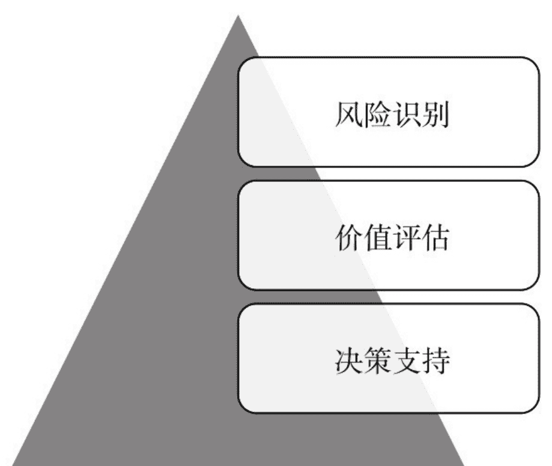

图1-2 财务尽调的目的

风险识别是首要任务，避免交割后踩坑。例如收入虚增、负债隐藏、不合规关联交易等。AI可快速扫描海量数据，捕捉人工易忽略的异常。某次并购中，系统发现目标公司成本率异常下降，后续调查确认是费用延迟确认导致，及时避免了估值错误。

价值评估要求判断企业真实价值，包括数据真实性、盈利可持续性与增长潜力。传统抽样可能遗漏关键信息。AI可全量分析数据，更精准调整估值。某电商尽调中，系统剔除刷单数据后实际收入比报表低15%，直接影响交易价格。

决策支持最终为交易定价、条款设计、投后管理提供依据。AI可模拟不同方案影响。例如收购谈判中，基于历史数据预测协同效应，帮助确定对赌条款。某制造并购由此将支付与未来业绩挂钩，降低投资风险。

财务尽调的核心是找问题、定价值、做决策。AI让过程更快更准，但最终判断仍需商业洞察。

### 1.1.3 尽调基本原则

独立性原则要求保持客观。调查方不得与被查企业存在利益关联，优先采用银行流水、税务报表等第三方凭证，避免仅依赖企业提供资料。

全面性原则要求覆盖资产负债表、利润表、现金流量表及附注，同时关注供应商关系、高管背景等非财务因素对财务数据的潜在影响。

重要性原则要求聚焦大额异常交易，如单笔超过总收入5%的交易。AI可自动标记高风险项目，将人力集中于关键点，提升效率。

谨慎性原则要求判断保守，如估值时采用较高折现率。重要数据需多方验证，如用银行流水核对收入，用客户合同确认销售真实性。

合规性原则要求遵守数据保护法规，对个人隐私信息做脱敏。跨国并购需同时满足多地会计准则与监管要求。

AI应用附加原则包括算法可解释，能说明判断依据。AI负责初筛，最终结论由专业人员作出。模型需持续优化，通过案例反馈提升舞弊识别准确率。

## 1.2 AI赋能尽调的具体表现

### 1.2.1 AI赋能的核心价值

效率革命使调查速度与广度大幅提升。某新能源跨境并购案例中，AI 72小时完成传统团队需两个月的工作，处理五十万笔财务数据。全量分析替代抽样，某零售尽调中发现人工抽样可能遗漏的持续亏损门店。AI可7×24小时运行，实现对标的公司财务状况的实时监控。

精度突破体现在风险识别准确率上。统计显示AI识别财务异常准确率达98%，传统方法约75%。知识图谱可挖掘复杂关联，某制造尽调中发现多层嵌套隐藏的关联交易网络。机器学习具备预测能力，某金融科技案例中AI提前6个月预警现金流危机。

成本优化带来明显节约。某跨国并购项目使用AI后节省2000人工小时，相当于10人团队近3个月工作量。更重要的是规避损失，某私募股权案例中提前发现风险避免1.2亿元投资损失。随着系统复用，边际成本递减，单次尽调平均成本大幅下降。

### 1.2.2 重点应用场景

数据采集与处理实现全面升级。通过智能接口自动对接ERP、银行、税务等30多个数据源，某跨国并购48小时完成原需3周的数据整合。自然语言处理智能清洗在合同审查中关键信息提取准确率达95%，高于人工85%。图像识别用于固定资产盘点，某制造企业通过设备铭牌照片自动匹配台账，盘点效率提升5倍。

风险识别与分析展示强大能力。针对财务粉饰，AI可同时分析收入确认时点、客户集中度、回款周期等多个维度特征，某Pre-IPO项目中发现企业提前确认收入虚增利润23%。长短期记忆模型在现金流预测中6个月平均误差控制在3%以内。合规审查方面，智能系统可匹配5000余条法规条款，某金融机构尽调中识别出12处监管不合规事项。

决策支持提供智能化工具。动态估值模型可实时响应市场变化，某科技并购案例中系统自动调整折现率参数，使估值更贴近市场。基于历史数据训练的对赌协议生成器可智能推荐条款组合，帮助某私募股权机构将谈判周期缩短40%。交互式可视化仪表盘让投资委员会直观把握关键指标，提升决策效率。

### 1.2.3 实施原则

技术落地原则要求AI应用必须贴合业务需求，避免为技术而技术。优先选择成熟度高、可解释性强的算法，如规则引擎辅助的机器学习，而非过度复杂的黑箱。在财务数据清洗中，预设逻辑的异常值检测比深度学习更易审计。同时需确保企业IT基础设施如ERP接口、云计算能力能支撑运行，避免技术脱节。

合规风控原则要求

AI财务尽调：先守规矩 再谈提效

把AI真正用在财务尽职调查上，前提是合规底线不能松。个人信息处理要对齐GDPR等隐私规则，行业监管要满足SEC审计准则等要求，商业伦理同样要坚持。可落地的抓手有三条：入口做自动脱敏，像客户身份证号这类敏感字段进系统前就做遮蔽；决策全流程可追溯，每一步分析逻辑都能回放；保留人工终否决权，例如模型标记的高风险交易必须强制人工复核。以跨境并购为例，即便未授权的个人数据可能对尽调结论有影响，AI也不能直接扫描读取。

#### 3. 人机协同原则
AI和人工的分工要界定清楚。AI适合处理结构化、重复度高的事务，例如合同条款批量抽取；人工聚焦需要专业判断的环节，例如管理层舞弊风险评估。成熟的闭环是AI初筛、人工复核、反馈再优化。德勤的AI尽调工具便体现了这一思路，将识别出的异常交易按风险等级分层，仅把风险最高的前20%推送给分析师，效率据称提升50%以上。

#### 4. 持续优化原则
模型需要动态迭代。历史项目的反馈，尤其是人工纠正过的误判案例，都能用来改进算法。同时要定期在新场景下做验证，比如新兴行业的并购业务，确保模型能力不衰减。

## 1.3 AI在财务尽职调查中的具体应用场景

### 1.3.1 财务数据自动化采集与清洗

#### 1. 数据来源多样化：多渠道汇聚财务信息
财务尽调对数据源的丰富度要求很高。数据既来自企业内部的ERP、CRM，也来自Wind、Bloomberg等外部数据库，以及年报季报、投资者关系网站等公开披露。做制造企业的尽调时，可从ERP拿到采购、生产、销售明细，再用外部数据库补充行业与宏观指标。

自动化获取主要靠API对接和爬虫。API实现系统间直连交换，爬虫则从网页抓取所需内容。例如用API实时获取股市交易数据，用爬虫抓取竞争对手的社交媒体动态。

#### 2. 数据清洗流程：确保数据的准确性和可靠性
数据清洗是尽调的关键环节，通常分三步，如图1-3所示。

图1-3 数据清洗流程的步骤

- 数据去重：剔除重复记录，避免分析偏差。例如财务报告中多次出现的销售数据，清洗时会识别并删除。
- 异常值处理：识别因录入错误或系统故障产生的异常值。例如某月销售额突涨突跌，就需要进一步核实。
- 缺失值填充：对空缺数据采用统计方法或机器学习算法补全。例如成本数据缺失，可用历史均值或预测模型估算。

机器学习在错误数据的识别与纠正上作用明显。通过训练模型捕捉特定数据模式，可自动检测并修正错误，提升效率并减少人工干预。

#### 3. 数据整合与标准化：构建统一的数据平台
不同来源格式的数据需要统一存储，企业一般会建一个统一数据库收纳内部系统和外部源的财务数据。

标准化是保证一致性和可比性的核心，包括格式转换、单位统一、数据分类等。比如把所有货币换算成统一币种，日期统一成同一格式。

ETL工具和数据仓库系统是常用手段，能高效处理海量数据。

### 1.3.2 财务风险智能识别

#### 1. 风险识别模型：工具与原理
风险识别模型是财务风控的必备工具。

- 基于规则的模型：依赖预设规则触发预警。例如负债比例超过阈值就报警。方法直观，响应已知风险快。
- 机器学习模型：从海量数据中学习风险模式。例如从历史数据中发现现金流异常与市场波动的关联，更灵活，能挖掘未知风险。

借助这些模型，尽调人员可更精准地预测潜在财务风险，提前应对。

#### 2. 异常检测技术：捕捉不寻常的财务信号
异常检测能发现财务数据中的反常模式，往往是风险的前兆。

- 本福特定律指出自然数据中首位数字分布不均，1约占30%，9约占4.6%。对比财务数据与该规律，可揪出可能的财务操纵。
- 时间序列分析通过观察数据随时间变化预测趋势。若公司销售额连续数月大幅下滑，可能提示销售策略需要调整或市场环境恶化。

#### 3. 风险预警系统：构建智能防线
预警系统可实时监测财务状况，发现风险即时报警。

- 系统构建：实时采集分析财务数据，结合风险识别模型和异常检测技术自动评估风险等级。
- 工作原理：设定风险指标和阈值，一旦数据越线即自动触发报警通知负责人。
- 实际效果：显著提高风控效率与准确度，让企业能在风险萌芽期介入，减少损失。

### 1.3.3 财务比率与趋势分析

#### 1. 财务比率计算：洞察企业的财务健康
财务比率用简单计算揭示资产、负债、盈利能力等信息。常见比率如表1-4所示。

表1-4 常见财务比率

| 财务比率 | 计算公式 | 指标含义 | 分析要点 | 行业参考标准 |

| :--- | :--- | :--- | :--- | :--- |

| 流动比率 | 流动资产 ÷ 流动负债 | 衡量企业短期偿债能力，反映流动资产覆盖流动负债的能力 | > 2.0：偿债能力强 1.5 ~ 2.0：正常水平 < 1.0：可能存在流动性风险 | 制造业：1.5 ~ 2.0 零售业：1.2 ~ 1.8 |

| 速动比率（酸性测试比率） | （流动资产 - 存货）÷ 流动负债 | 剔除存货后的短期偿债能力指标，更严格反映企业即时变现偿债能力 | > 1.0：安全边际高 < 0.5：短期偿债压力大 | 快消行业：≥ 1.0 房地产：≥ 0.6 |

| 资产负债率 | 总负债 ÷ 总资产 | 评估企业长期财务风险，显示资产中有多少比例由负债支撑 | < 40%：低风险 40% ~ 70%：适中 > 70%：高风险 | 科技企业：< 50% 公用事业：≤ 65% |

AI可自动从报表中抽取数据快速计算，并对历史比率进行趋势和异常分析。

#### 2. 趋势分析方法：洞察财务的过去与未来
趋势分析用于理解变化轨迹并预判方向。常用方法有时间序列分析和回归分析。

- 时间序列分析：观察数据随时间的变化识别趋势。例如公司过去五年销售年增5%，可判断该增速是否可持续。
- 回归分析：确定财务指标与其他变量的关系预测未来值。例如分析广告投入与销售额的关系，预测增投广告带来的销售增长。

AI能处理海量数据，识别复杂关系，给出更精准的财务预测。

#### 3. 可视化工具：让数据“说话”
可视化把复杂数据变成图表，信息一目了然。常见工具如表1-5所示。

表1-5 常见的数据可视化工具

| 可视化工具 | 适用场景 | 核心优势 | 局限性 | 典型案例 |

| :--- | :--- | :--- | :--- | :--- |

| 折线图 | 趋势分析（如收入增长率、股价波动） | 清晰展示时间序列变化趋势 | 数据点过多时易显得杂乱 | 上市公司5年营收趋势分析 |

| 柱状图 | 数据对比（如各季度利润、地区销售额） | 直观比较不同类别数值差异 | 类别超过10组时阅读性下降 | 各分公司年度KPI达标率对比 |

| 饼图 | 占比分析（如市场份额、成本结构） | 快速识别核心组成部分占比 | 超过6个分类时效果急剧恶化 | 企业营销费用构成分解 |

| 仪表盘 | 综合监控（如财务健康度、实时运营） | 多指标集成 + 交互式钻取分析 | 开发成本高，需专业BI工具支持 | 并购项目风险指标实时监控平台 |

可视化能直观呈现比率与趋势结果，帮助决策者快速把握重点。

#### 4. 案例分析：智能财务分析的成功实践
一家科技创业公司在快速扩张中面临激烈竞争。引入AI做财务分析后，系统自动计算流动比率和资产负债率，发现偿债能力在走弱；时间序列分析显示收入增速放缓；回归分析进一步锁定广告支出和市场推广策略是影响收入的关键因素。

据此公司调整营销预算，加大高转化广告渠道投入，并优化产品定价。下一个季度收入回升，财务状况恢复健康。可看出AI通过比率与趋势分析帮助企业在变化的市场中做出精准决策。

### 1.3.4 关联交易与合规审查

#### 1. 关联交易识别：揭开隐藏的交易网络
识别和分类关联交易是尽调核心。关联交易指企业与关联方之间的往来，可能涉及利益输送。AI能更高效地完成识别与分类。

- 数据挖掘技术：分析大量财务数据判断交易双方是否存在关联，例如通过股东结构、管理层信息发现潜在关联交易。
- 风险发现：系统不仅识别关联交易，还能标记价格明显偏离市场的交易为高风险，提醒尽调人员深入审查。

如此可更早防范风险，保证财务数据真实合规。

#### 2. 合规性审查：确保财务数据的合法合规
合规性审查要求财务数据符合法规。AI可自动匹配与验证监管要求。

- 法规匹配：自动识别财务指标并与会计准则、税法等法规对比，例如检查报表是否合规。
- 验证过程：借助机器学习和自然语言处理，自动校验披露信息是否满足监管要求。

企业由此可避免违规操作带来的法律风险。

#### 3. 风险提示与报告：及时预警潜在风险
为帮助企业快速应对风险，AI可生成风险提示报告。

- 报告生成：系统根据识别结果自动形成报告，包含风险类型、等级和应对建议。
- 应用效果：报告让企业迅速行动降低风险。例如发现某关联交易违规风险后，可立即叫停并整改。

# 第2章 AI赋能财务尽职调查基本方法与工具

## 2.1 基本调查方法
尽调方法分基本和非常规两类。基本方法在国内外都常用，主要包括现场调查、搜寻调查、官方调取、通知调查、秘密调查和委托调查。

#### 1. 现场调查
现场调查包括现场交谈和实地考察，因其直观有效且可追溯线索而被广泛使用。现场交谈中调查人员可根据条件选择约见对象，通常覆盖不同部门不同层级的主管。例如查财务可约财务经理、审计主管、HR主管、纳税筹划主管；查市场销售可约公关经理、营销主管、售后一线员工、广告经理。接触越多员工，信息越全面真实。访谈目的在于深入了解企业现状、战略目标和发展思路，同时侧面感知企业文化、员工满意度、管理层控制力，便于评价高管。

实地考察即实地调研，常用观察法、实验法、问卷法，需整理分析后才能形成参考价值。

#### 2. 搜寻调查
搜寻调查多用于政府工作和法律询证，通过有形和无形渠道获取信息。有形渠道包括图像、影音资料，媒介传播效果突出，如报纸杂志、图书、新闻广播、录像录音、微博微信、峰会论坛等。优点是来源广信息量大，缺点是信息分散难系统收集，且权威性参差不齐。

#### 3. 官方调取
我国法律允许当事人无法自行收集证据时向官方申请调取。例如调查企业经营状况，可向人民法院递交调查函，调取市场监管、税务、质检、环保等部门的资料。

#### 4. 通知调查
通知调查较为直接便捷，调查者口头或书面通知被调查人，说明目的和内容，要求其在期限内整理并提交所需信息。

#### 5. 秘密调查
秘密调查在不公开、不被被调查对象知晓的环境下展开，主要通过企业内部人员、外部竞争对手、产业链上下游商业群体取证，获取所需信息。

#### 6. 委托调查
当距离遥远时，可委托第三方机构调查。如调查客户现金和不动产情况，可委托会计师事务所并支付费用。因需签署调查令并审核，委托调查可能存在时效延误。

## 2.2 国内外非常规的调查方法
国内外非常规调查侧重点不同。国内多在被调查主体内部展开，国外更注重外部环境信息收集。

#### 1. 国内的非常规调查方法
- (1) 潜伏调查。将调查人员或外部人员安插进被调查企业内部获取隐秘信息。常见做法是通过应聘进入目标部门，信息获取快但存在被识破或被收买风险。
- (2) 关键人员暗中调查。难以进入企业时，可在投资前锁定被投企业的“关键人物”获取第一手资料。效率高可省时，但关系可能因道德约束破裂，或对方因担心法律后果拒绝配合。
- (3) 相关企业调查。通过产业链上下游企业接触获取关于被调查企业生产销售运营的信息。避免直接内部取证，降低失真风险，运用得当可大幅提升结果全面性和真实性。
- (4) 商请调查。针对隐瞒重大信息、涉嫌欺诈的企业，可根据线索难度商请工商、审计、国资等专业机构调查。需说明原委并做好沟通协作。

#### 2. 国外的非常规调查方法
外围调查在国外案例中常见，通过调查被调查企业外部环境和人员，被动获取内部信息。美国亚利桑那大学雷兹教授倡导的“垃圾研究”即典型例子，认为垃圾不会说谎。日本常磐百货收集主妇丢弃的购物备忘录，亦有公司派员在电梯旁监听公众谈话，或员工假期拍摄日用品。在尽调中，外围调查能补充直接资料无法反映的信息，但加工后的信息主观性较强，真实性需验证。

## 2.3 查询工具
随着计算机和互联网发展，信息透明度大幅提升。过去难以收集整理的信息，现在可通过“点点鼠标”完成。法治社会下，越来越多的信息对公众开放查询。

### 2.3.1 主体信息查询
#### 1. 国家市场监督管理总局“全国企业信用信息公示系统”
该系统于2014年3月1日正式运行，可查询全国企业、农民专业合作社、个体工商户的工商登记基本信息。依据国务院《企业信息公示暂行条例》，市场主体下列信息应在产生之日起20个工作日内公示：（1）注册登记、备案信息，具体包括统一社会信用代码、法定代表人、类型、注册资本、成立日期、住所地、营业期限、经营范围、登记机关、经营状态、投资人信息、公司主要备案高管人员名单、分支机构、清算信息、行政处罚信息等；（2）动产抵押登记信息；（3）股权出质登记信息；（4）行政处罚信息；（5）其他依法应当公示的信息。

年报公开范围与补充披露时限

通过指定公示系统，企业年报需向社会公开。主要内容包括：（1）通讯地址、邮编、联系电话、电子邮箱等联络方式；（2）开业、歇业、清算等存续状态；（3）对外投资设立公司、股权收购等情况；（4）有限责任公司或股份有限公司的股东或发起人认缴出资、实缴出资、出资时点、出资方式；（5）有限责任公司股东股权转让等股权变动；（6）公司官网及开展网络经营的网店名称、网址等；（7）从业人数、资产总额、负债总额、对外担保、所有者权益合计、营业总收入、主营业务收入、利润总额、净利润、纳税总额等经营财务数据。第1至第6项属于强制性对外披露，第7项由企业自主决定是否公开。

除年报外，以下事项自产生之日起20个工作日内亦须通过平台公示：（1）有限责任公司股东或股份有限公司发起人认缴与实缴出资、出资时点、出资方式；（2）有限责任公司股东股权转让等股权变更；（3）行政许可的取得、变更、延续；（4）知识产权出质。

### 2.3.1 企业基础信息查询渠道

##### 1. 全国企业信用信息公示系统
由国家市场监管总局主建的官方企业信息公开入口。收录范围包括登记信息、行政许可信息、行政处罚信息、经营异常信息、受到行政处罚的信息以及法律规定应公开的其他信息。目前部分查询功能已启用，部分模块待各地工商部门配合后分批开放。

##### 2. 各省、市级工商局网站
地方工商门户基本复刻了国家平台的核心内容。若在国家层面未查到所需资料，转向省级或市级官网往往能获得补充线索。

##### 3. 各省、市级信用网
多由地方企业信用体系建设推进办运营，例如北京市企业信用信息网、浙江省企业信用网、信用浙江等。基础信息可直接浏览，更深入的年报、对外投资等数据通常需注册会员。优势在于支持以法定代表人姓名检索关联主体。建议多查地方信用网，如信用浙江整合了工商之外二十多个部门的公示、纳税、企业资质等信息，并提供个人、事业单位、社会组织的信用查询与公示。

##### 4. 全国建筑资质查询系统
涵盖设计、勘察、造价、监理、建筑、房地产开发等资质的检索，适用于核查主体专业资质情况。

### 2.3.2 涉诉信息查询路径

#### 1. 最高人民法院“中国裁判文书网”
根据《最高人民法院关于人民法院在互联网公布裁判文书的规定》，自2014年1月1日起，除涉及国家秘密、个人隐私、未成年人犯罪、调解结案外，其余裁判文书均需上网公开。该平台仅覆盖已进入判决阶段的案件。

#### 2. 各省级高级人民法院网站
2014年前的裁判文书或尚未判决的案件，可通过省级高院官网查询。通常可查部分历史判决书、开庭公告、执行信息、开庭信息等，如北京法院网、浙江法院网。因中国裁判文书网仅收录2014年后已生效判决且依赖地方报送，地方法院官网积累更早，部分国家网无法检索的文书可在地方法院网站找到。

#### 3. 中国法院网
按公告送达规则，被告属外省的案件常在全国性报纸刊登公告，多为《人民法院报》，可据此了解调查对象的诉讼情况。被告属本省的，可在地方法制网站查阅公告，了解其在当地法院的涉诉动态。

#### 4. 人民法院诉讼资产网
可查询全国法院正在执行的拍卖资产，通过拍卖标的侧面推断当事人涉诉情形。

#### 5. 阿里拍卖·司法
司法网拍降低了拍卖成本，越来越多法院将无争议资产移至该平台处置，也可据此侧面获取涉诉信息。目前全国绝大多数法院已接入阿里拍卖·司法。

#### 6. 其他专业库
北大法宝、威科先行、律商网、无讼网、OpenLaw裁判文书网等均有案例收录，部分平台的更新速度甚至快于官方渠道。

### 2.3.3 财产信息查询路径

#### 1. 自然资源部子站中国土地市场网
除自然资源部官网的全国土地抵押、转让、招拍挂信息外，还可查询全国供地计划、出让公告、大型企业购地情况等，无需注册。

#### 2. 国家知识产权局中国专利信息网
收录103个国家和地区组织的专利数据及引文、同族、法律状态等，可查询专利申请人、权利人、代理机构的案件基础信息、审查信息及中国专利公告。检索方式包括常规检索、表格检索、药物专题检索、检索历史、结果浏览、文献浏览、批量下载等。基础检索免费，数据分析功能需注册。数据库自1985年9月10日起覆盖全部中国专利公告，包括：（1）发明公布、发明授权、实用新型专利的著录项目、摘要、摘要附图及其更正及专利单行本；（2）外观设计专利的著录项目、简要说明、指定视图及其更正及全部图形或外观单行本；（3）事务数据。

#### 3. 国家市场监督管理总局中国商标网
可按商品分类查询拟查商标，并查阅注册商标及申请商标信息。商标注册信息查询分为商标相同或近似查询、商标综合查询、商标审查状态查询三类。提示：查询结果仅供参考，正式信息以国家知识产权局商标局出版的《商标公告》为准。

#### 4. 中国版权保护中心
可查询计算机软件著作权登记情况、著作权人、撤销、质押等信息。

#### 5. 企业域名
（1）ICP/IP地址/域名信息备案管理系统。可查询网站名称、域名、首页网址、备案/许可号、IP地址、主办单位等备案信息。
（2）通过万网等域名注册平台输入域名，可看到域名持有人信息及到期时间。

#### 6. 各地住建及房产管理部门网站
针对房地产开发企业，可查询预售许可证、楼盘在售情况、总面积、可售面积、预定面积、已售套数、成交毛坯均价等经营情况。

#### 7. 人民法院诉讼资产网/阿里拍卖·司法
二者也是获取企业财产线索的重要渠道。

#### 8. 中国电子口岸官网
为公众数据中心和交换平台，依托国家电信公网连接工商、税务、海关、外汇、外贸、质检、银行等部门及进出口企业。进出口管理流、资金流、货物流信息集中存放，供跨部门跨地区核查，并为企业提供报关、结付汇核销、出口退税、网上支付等在线服务。

### 2.3.4 投融资信息查询路径

#### 1. 中国人民银行征信中心
可查询企业应收账款质押与转让登记信息，包括质权人名称、登记到期日、担保金额及期限等，亦可查询租赁登记、所有权保留登记、保证金质押登记、存货/仓单登记、农业设施登记、林木所有权抵押登记等。

#### 2. 融资信息相关网站
- （1）中国证监会指定披露平台巨潮资讯网；
- （2）中国外汇交易中心；
- （3）和讯网；
- （4）浙江股权交易中心等地方股权、产权交易中心网站。

### 2.4 AI赋能的新工具与新方法

### 2.4.1 人工智能驱动的财务尽调新工具
智能财务数据分析系统正成为审计人员的数字显微镜。该类系统融合机器学习与可视化，能够自动扫描海量财务数据并识别异常模式。例如某零售企业部署的智能分析系统，每小时处理10万条交易，自动标注价格异常波动与供应商重复付款行为。当某门店生鲜损耗率超出行业均值三倍时，系统即时生成风险报告，提示库存管理漏洞。如图2-1所示，该系统使财务分析效率提升4倍，异常交易识别准确率达92%。

自然语言处理技术赋予计算机阅读理解能力。如图2-2所示，某会计师事务所的NLP系统能够解析合同条款、邮件沟通记录等非结构化文本。核查供应商付款条件时，系统三分钟内完成500页文档关键词检索并标出与标准条款不符的段落。某制造企业借助该工具发现23份采购合同中存在“货到付款”与“预付30%”的条款冲突，避免潜在损失180万元。

人工智能增强的查询工具支持自然语言提问获取洞察。某财务总监输入“过去半年差旅费超预算的部门”，系统即生成动态图表显示销售部门差旅超预算27%。该工具还能关联历史数据，如询问“应收账款账龄超90天客户特征”时，会聚类客户行业、交易频率等维度，揭示高风险客户共性。

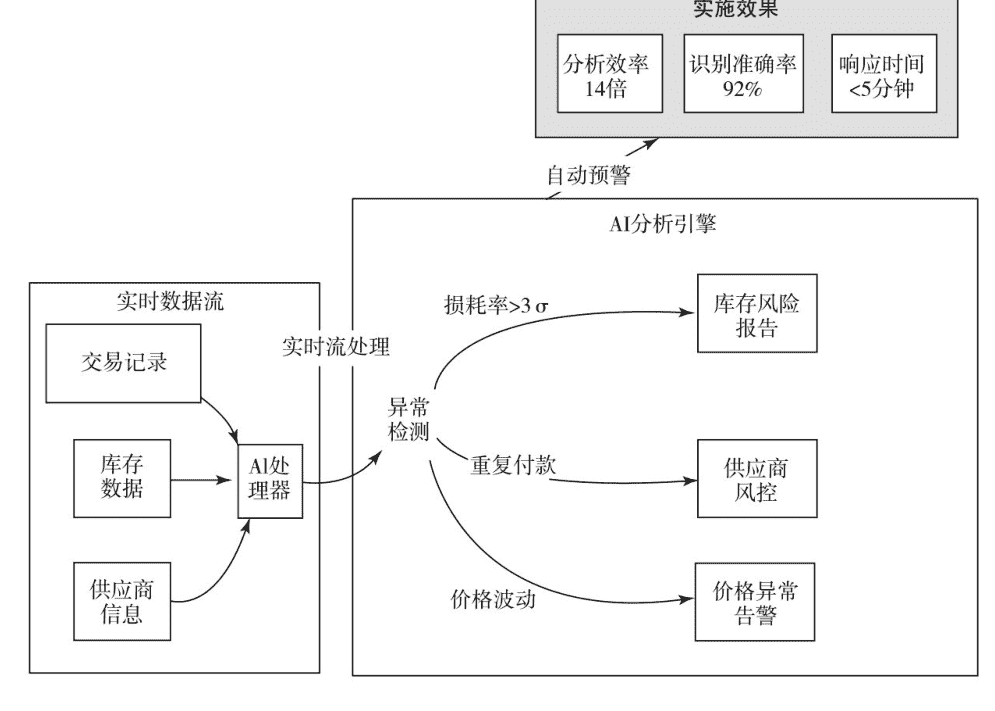

▲图2-1 某零售企业AI的分析系统

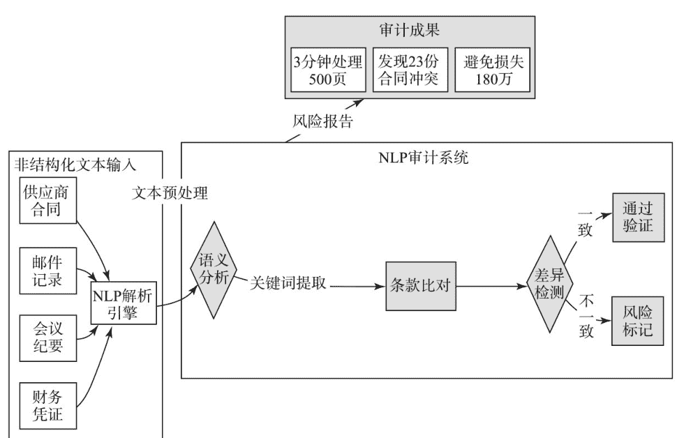

▲图2-2 某会计师事务所的NLP系统

### 2.4.2 人工智能赋能的财务尽调新方法
全量数据审计改变了抽样模式。传统审计类似盲人摸象，仅抽查约10%交易。某汽车零部件企业实施全量审计后，发现传统方法遗漏的32笔小额重复报销，合计86万元。系统比对考勤、发票日期、GPS定位自动识别异常报销模式，如图2-3所示。

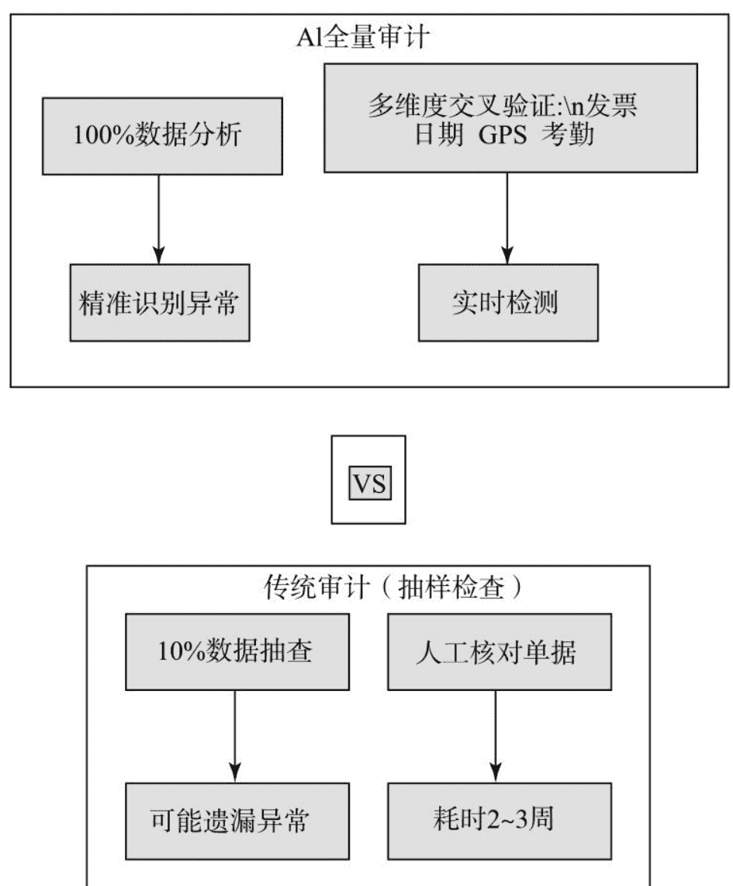

图2-3 汽车零部件企业的NLP系统

动态财务健康监测实现实时预警。如图2-4所示，某上市公司智能监测系统每15分钟分析现金流、应收账款周转率等18项指标。经营活动现金流连续3天低于安全阈值时即触发黄色预警，建议调整付款计划。该系统于2023年提前2个月发现流动性风险，避免债务违约。

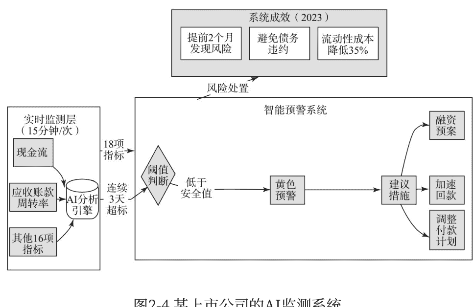

图2-4 某上市公司的AI监测系统

生成式人工智能辅助尽调重塑报告流程。基于自然语言生成技术，系统可整合供应商财报、舆情、历史交易等12类数据源，3分钟内生成结构化风险评估初稿。某跨国银行实践显示，报告撰写时间由8小时压缩至45分钟，关键风险遗漏率由12%降至3%。系统还能自动嵌入可视化看板，如存货周转率异常时自动生成行业对比曲线。金融机构反馈显示，人机协同报告决策采纳率提升65%，人工复核工作量减少70%。

反舞弊智能调查结合暗数据挖掘。某审计团队利用人工智能分析员工行为日志、邮件附件、报销凭证的暗数据，发现采购经理虚构供应商套现。系统通过语义分析识别“加急处理”“私下结算”等异常关键词并关联银行流水，锁定资金流向异常账户。

### 2.4.3 人工智能工具与方法的实施原则
数据质量优先是人工智能有效运行的基础。企业应构建三级数据治理体系：首先用自动化工具去重，如某跨国集团用哈希算法识别重复凭证，日均清理冗余2.3万条；其次执行逻辑校验，如核查会计科目借贷平衡、合同金额与发票一致性，某制造企业据此发现3%账务异常；最后对接第三方数据交叉验证，如海关报关数据匹配贸易合同，使某金融机构客户信息准确率由78%提升至99.2%。某零售企业实施后，模型错误率下降60%，反欺诈规则准确率提升45%，年节省人工复核成本超1200万元。

人机协同强调分工。某会计师事务所实践表明，人工智能适合标准化任务如数据核对，专家则聚焦战略判断。反洗钱调查中，人工智能筛选出200个可疑账户，人类分析师经背景调查剔除误报，最终锁定23个高风险客户。

动态迭代赋予系统数字生命力。某零售企业反欺诈系统采用在线学习，每日吸收最新交易数据更新参数。监测到“虚拟货币洗钱”新手法时，系统通过影子模式对比新旧模型，72小时内完成优化，新型诈骗识别率由68%提升至93%。该机制使欺诈识别率连续12个月保持98.6%以上，累计拦截可疑交易2.3万笔，避免损失超1.8亿元。

合规透明实现监管与效率平衡。欧盟某银行部署智能审计系统时配置可解释模块并采用“决策溯源树”，将模型判断拆解为可验证逻辑链。若拒贷，除提示收入证明模糊、负债率超标等表面原因，还可追溯特征权重，如近半年流水波动率占35%、行业景气指数占28%。自然语言生成自动产出符合GDPR的决策说明，客户投诉率下降42%。监管机构可通过API调取全量决策依据，审计效率提升60%，合规审查一次通过率达99.3%。

# 第3章 AI赋能财务尽职调查流程优化

## 3.1 财务尽职调查的基本流程
按工作时间顺序，财务尽职调查一般分为业务承接与计划阶段、执行程序阶段、报告阶段三个阶段。

### 3.1.1 业务承接和计划阶段
该阶段核心是熟悉投资方战略目标与收购目标，确定尽调重点。需了解投资方组织架构、决策机制、人员配合、资金安排等，同时梳理双方框架协议要点并多轮确认。委托协议须明确尽调标准、调查目标、时间、范围、工作流程、重点领域、预计费用等。涉及数据保密时须签订保密协议，并要求尽调小组成员签署内部保密文件。准备完成后应建立内部文档管理制度，包括文件编号、规范、组织架构图、职责清单、时间管控表、任务分解等，并指定专人负责归档管理。

### 3.1.2 执行尽职调查程序阶段
启动前应向目标公司发函说明委托关系、调查方法如面谈、查阅、实盘等，并一次性告知后续行动内容、时间、分项负责人等。实务做法是提交尽调清单及所需文件清单、提交时间、经办人，并必要时与决策层会谈、发放问卷。随后召开内部或联合澄清会。

执行中工作计划可能调整，需经委托方与目标公司共同批准后实施。资料收集主要来自四条路径：一是目标公司按清单提供财务报表、业务合同、凭证、政府文件等，未明确事项以问卷或会谈补证；二是法律尽调机构提供的工商注册、股东变更、实缴资本等工商信息；三是对办公区、厂房、生产线等实地勘察进行实证核实；四是向客户、供应商、主管部门、税务、司法、房产、技术监督、人行、基本户开户行等外部渠道收集信息。

行动准备阶段，尽调小组应安排信息分析师按调查目的收集外部资料并分类为真实信息、冲突信息、待审核信息、错误信息四类，以利后续推进。分析师应具备行业财务专业背景，按文档规范记录工作日志并每日研讨，保证调查质量。

进入现场执行阶段后，尽调小组、委托方以及目标公司相关人员要搭建起常态化沟通渠道。首轮对齐会的核心议程是对执行方案进行深入研讨，由三方达成共识后作为后续推进的基准。各小组牵头人依据方案和标的的实际情况安排人力与时间，按日例会机制向项目总负责人递交当日工作纪要及底稿资料，确保总负责人实时掌握整体进展。遇到账实不符、报表差错等难以独立处理的棘手问题，牵头人应先与委托业主和标的公司对接人沟通并现场核实，保证程序畅通、信息可靠。这类重大事项须以书面形式报备，以确保凭证合规可追溯。

现场工作收尾前，尽调小组负责人需综合现场记录、信息分析师意见及各小组底稿，一次向标的公司呈交《待办事项清单》。清单里要明确待补资料或待核实的事实要点、补交时限、接收人姓名、最后期限以及逾期不补的后果。

### 3.1.3 财务尽职调查报告阶段
尽调报告的价值在于对标的财务状况做系统性呈现、拆解与横向对比，核心落点是风险确认与揭示。风险确认与揭示既是分析结果也是结论性判断，必须建立在合规底稿之上，报告中所有数据与信息都需有凭证支撑可追溯。交付的尽调报告应包含四大部分：标的背景介绍、主要发现、财务报表分析、并购风险提示。

团队要围绕委托方或投资方的战略目标与投资逻辑，有针对性地呈现本次尽调的重点，包括主要财务事项的内容、成因与演进，以及对投融资并购可能产生的影响；特殊情况下可对核心交易条款提出建议供决策参考。尽调小组可按客户要求对部分内容做增减，但不得影响报告完整性，严禁提供不实信息。初稿撰写时要汇总各小组提交的内容，结合小组间的关联性充分吸收调查成果。结论性意见由各小组负责人共同研讨确定，经充分征询后可采用二审表决。初稿完成后可请第三方进行外部复核，也可由内部各组交叉互审，按质量保证制度对初稿进行复核。初稿基本定稿后，总负责人应按联席会制度向委托方或投资方发函组织一次研讨会，参会人员包括投资方或委托方的财务、业务、法律专业人员，主要研讨结论性意见与风险提示内容，并据此调整初稿，以满足投资策略要求。若结论性意见与客户意见存在分歧，应坚持尽调的独立性与客观性，基于事实全面、完整、清晰地总结工作，以维护客户权益。报告完成后，总负责人还须按文稿管理要求完成各类程序性文件的签收及各次联席会的会议记录，做到有迹可循、有据可查。

报告阶段应建立一套既规范又灵活的报告制度，既能统一报告内容，也能满足不同客户需求。提供报告时须严格遵守委托协议约定的范围，未经委托方书面授权不得向第三方发放。审慎调查报告应明确委托方与受托方所承担的责任边界。

以上即财务尽职调查的基本流程，三个阶段可概括如下图3-1所示。

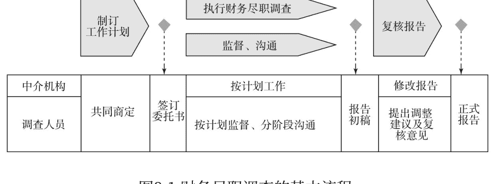

## 3.2 财务尽职调查方法

### 3.2.1 基本方法
1. 审阅：通过查阅财务报表及相关法律、财务、业务资料，识别关键与重大财务要素。
2. 分析性程序：对多渠道获取的资料进行分析以发现异常与重大问题，如趋势分析、结构分析等。
3. 访谈：与企业各层级、各职能人员以及中介机构充分沟通。
4. 小组内部沟通：调查小组成员拥有不同背景与专业知识，相互沟通也是达成调查目的的重要方式。例如财务人员查阅营业执照及验资报告显示注册资本为3600万元，经与律师沟通得知工商登记的注册资本仅为1000万元。又如与业务调查人员沟通应收账款信息、设备利用信息等。

### 3.2.2 补充方法
1. 望：观察生产饱和程度、货物装卸情况、厂区作业秩序、办公区人员工作状态、工位饱和度等。
2. 闻：感知厂区员工工作情绪、办公区卫生整洁程度、各类公示牌、走廊宣传栏更新频率及张贴内容、员工精神面貌等。
3. 问：员工能否清晰表述企业经营发展历史、市场定位、战略匹配度、战略目标的包容度与完成度。
4. 切：分析现金流量结构、现金流量对战略的支持满足度、现金流量弹性。

## 3.3 财务尽职调查资料清单

### 3.3.1 企业设立与沿革资料
1. 企业主文件
设立初期营业执照、载明最近一年年检通过的现行营业执照及历次变更执照；章程及历次修订记录；验资报告、变更注册资本验资证明、向出资人签发的出资证明书及以实物出资的资产评估文件；成立以来历次董事会或高层管理部门重大事项决议；历年经注册会计师审计的财务报告；股本结构图及自成立至最近历次股份变动情况；股份转让及质押说明及相关文件；股东名单、持股情况及变动；董事及高级管理人员持股说明及变动；股份变更工商登记相关文件；合资企业中方为国有资产占用单位时需提供中方投入资产评估报告、国有资产管理部门立项批复、评估结果确认批复或核准备案文件；分支机构营业执照及设立批准文件；国有资产产权登记证；投资人营业执照、章程等组织文件或自然人股东身份证明；《企业名称预先核准通知书》及历次更名核准通知书；国家有关部门给予的补贴或优惠政策批文。
2. 政府及行业主管部门批文
设立时政府及主管机关批文，包括项目建议书及批复、可行性研究报告及批复、审批机关对合资或合作合同和章程的批复、外商投资企业批准证书等；变更注册资本时批文；变更或增加经营范围时批文；政府对合同章程历次变更的批准函；股份变动涉及的全部批准文件；外汇登记证、海关登记证、财政登记证；其他与企业历史有关文件，如兼并重组审批、改制批准及变更登记等。

### 3.3.2 组织架构与经营管理资料
董事会组成情况包括董事长、董事姓名、任期及兼职情况；内部组织结构图及其说明；高层人员名单及简介、人事关系、行业经验、总经理职责范围、总经理及副总经理等高级管理人员名单及选举决议或委派书；所有分支机构名单及与企业关系说明；附属企业名单；企业与下属企业关系说明，包括内部转移价格、盈亏抵销、共用设备、内部租赁安排等；除合资或合作合同和章程外，股东间与企业经营有关的意向书、备忘录、合同或协议；企业运营、产品、生产、出口和服务相关的全部执照、许可、批文和登记备案文件，包括生产许可证、备案证明、外汇账户及外汇交易批准、进出口批准、其他资质证明等；与业务相关的证书及奖项，如高新技术企业认定证书等。

### 3.3.3 资产状况与对外投资资料
1. 企业重大资产状况
资产清单和资产评估文件及证明资产归属文件；股东以实物或其他非现金资产出资的权属证书；企业以分期付款、信贷、租赁方式拥有或使用的全部合同文件；资产抵押清单及相关协议；租赁资产清单及协议；土地、房屋及在建工程资料；设备资料；所有固定资产取得发票统计，包括列示于往来账项、存货、在建工程的发票。
2. 企业对外投资情况
对外投资股权结构图；持有其他企业股份或资产的全部权属证明文件，包括子企业或参股企业章程、验资报告、经最新年检营业执照等；企业与其持股企业经营性与非经营性往来说明及有关文件；长期投资清单及证明持股企业成立时间、运营及筹建情况、持股比例等文件；企业从持股企业获取利润或提供资金担保等情况文件；企业资产结构图及产权关系；其他投资相关文件。

### 3.3.4 土地使用权与房产资料
1. 土地使用权
土地场地使用权证清单，包括证号、位置、取得方式、面积、用途、期限；土地不动产权证、租赁登记证明、抵押登记证明；土地出让、租赁、转让涉及的出让金、租金、转让费和土地使用费付款收据；全部转让土地的批准文件、合同和国有土地使用证；与土地使用权有关的协议和批准文件；土地使用权评估文件；土地使用权的抵押和约束性条款文件。
2. 房产
房屋所有权证清单，包括证号、坐落、面积、用途、所有权人、幢数；房屋所有权及使用权证书或其他证明文件；房屋买卖、租赁协议及租赁登记、业主许可、不动产权证、抵押协议及抵押登记证明；房屋房款或租金支付收据；土地房屋示意图；房产评估文件；房产权利抵押及约束性条款文件；房屋所有权证记载内容与现状一致性确认；在建工程相关建设用地规划许可证、建设工程规划许可证、不动产权证、开工许可证及竣工验收证明。

### 3.3.5 财务状况及重大债权债务资料
开立账户银行清单及贷款合同文件及担保人情况；企业债权总额及清单，包括50万元及以上重大债权明细、欠款方、欠款额、到期日、追讨情况及抵押担保情况，未在账目中披露的债权；企业重大债务清单50万元及以上，包括债权方、到期日、未清偿数额、追讨情况及担保情况，银行或其他金融机构借款合同清单，企业作为担保方尚未解除担保义务的抵押、质押或其他担保协议及主合同及登记文件，未在账目显示的债务详情；债权债务文件清单及相关文件；提供担保总额、清单及文件；设定抵押总额、清单及文件；国外贷款合同文件；国家外汇管理局对企业外汇担保和贷款批文；债权债务争议文件；注册会计师就财务管理制度、会计制度、外汇支出等重大财务问题的函及企业回复；最近三个会计年度经审计财务报告及利润分配和亏损弥补方案；不动产及其他有形或无形资产评估报告；外债登记证、外债签约情况表、外债变动反馈表、对外担保登记书、对外担保反馈表及外汇贷款登记证。

### 3.3.6 合同资料
正在履行的50万元及以上重大合同清单；已履行完毕但存在争议的合同清单；金额、期限、重大事项、履行情况、争议说明及合同副本；租赁、信贷、担保、抵押或赔偿合同及其他财务协议；设施服务合同；代理、经销、专营权、特许或限制性交易合同；含非正常条款合同；分期付款购置资产或重大设备采购合同；保险合同、保单、付款凭证；最近三年前十名交易对象清单及交易情况；一般标准销售采购合同样本；进出口业务文件、进出口代理商名称及合同、产品或原料资料及大致年销售额；最近三年前十大供应商及占比、前十大客户及占比、经销商代理商名单；与同业竞争方签订的定价协议或其他合作协议；战略合作协议清单及合同；最近三年与代工企业签署购销合同清单及典型样本；承包、管理、顾问协议；原材料供应及基础服务协议；与水电气热等公共设施管理部门签订的有效服务协议；运输协议；技术转让、技术合作、技术研究开发、技术服务等合同；现行有效技术许可或技术进出口合同及登记备案文件；知识产权实施、许可、使用、转让协议；保密协议；重大建设建筑合同；收购、合并或出售权益、业务或资产的合同或协议；其他含非正常条款的合同或协议；非正常业务营运中订立的重大合同、协议及意向书、合同管理制度说明及文件。

### 3.3.7 无形资产资料
专利权、非专利技术、商标权、著作权、特许权等无形资产取得文件或资料；企业合并形成的商誉相关资料。

### 3.3.8 业务情况
企业主要产品所属行业国内外情况及发展前景；行业主要竞争对手及市场占有率情况；企业核心技术及竞争优势。

### 3.3.9 税务资料
适用税种、税率及缴纳和欠税情况说明；过去三年纳税或减免税证明情况；适用税务待遇、协定条例、政策声明或通知；税务机关关于过去三年完税证明；过去三年因税务问题受处分处罚情况；享受税收优惠待遇详情及有关批文，以及税制改革对企业税务的影响分析。

### 3.3.10 关联交易与同业竞争资料
企业与其关联企业的关联交易内容、数量和金额；企业为董事或关联方作出的贷款、承诺或担保；任何董事或关联方可享利的企业合同；过去三年与董事或关联方之间资产转让详情；企业向董事、子企业或联营企业贷款或担保详情；过去三年企业与董事及子企业之间资产或财产转让详情。

财务尽调资料清单与AI驱动流程优化全景

(7) 近三年内控股主体与其下属各子公司之间签订的委托、买卖、许可、租赁等各类协议的原件或复印件。
(8) 需出具书面说明，明确发行人、股东及集团内部公司之间是否存在同业竞争情形。
(9) 对预计公司上市后仍将长期延续的关联交易，应作出前瞻性且详细的说明。

### 3.3.11 信息披露资料
(1) 历年的经审计财务报告。
(2) 其他对外信息披露文件。

### 3.3.12 环境合规资料
(1) 环境影响评价报告书或报告表及生态环境主管部门的批复文件。
(2) 以下证照及记录应予备齐：
    ① 排污许可证；
    ② 污染防治设施验收合格证；
    ③ 排污达标证明；
    ④ 定期环境监测报告；
    ⑤ 排污费缴纳凭证；
    ⑥ 大气、噪声、工业固废等申报登记材料，如适用。
(3) 若近三年存在新建改建工程，需提交环评审批文件；已完工项目另需提供环保设施验收意见。
(4) 近三年内若对污染防治设施进行改造或拆除，需附环保主管部门批准及验收文件。
(5) 核查近三年是否因违反环保法规产生或可能产生诉讼、仲裁、行政调查或处罚，如有需提供行政处罚决定书、判决书或裁决书等证明。

### 3.3.13 产品生产与质量资料
(1) 产品质量认证证书，如已取得。
(2) 生产许可证或其他同类许可证明，如有。
(3) 列明生产经营所遵循的强制性及自愿性质量标准和其他生产标准清单，涵盖国际、国内及行业标准。
(4) 确认近三年是否受市场监管或技术监督部门行政处罚，如有需提供处罚文件。
(5) 提供产品工艺流程图，并详述原材料采购到成品出库的全部环节。
(6) 列出主要生产设备清单并说明其主要用途。
(7) 说明产品定价是否受国家或行业政策约束。

### 3.3.14 竞争格局与前景资料
需梳理当前及未来在国内外市场的主要竞争对手清单，并附其基本情况与经营信息。

### 3.3.15 补充尽调资料
(1) 劳动人事管理制度汇编，含薪酬管理、社会保险、劳动合同及内部规章制度。
(2) 社会保险缴纳证明及缴费凭证。
(3) 环保政策执行情况说明及相关批复或处罚文件。
(4) 各类行政处罚决定书，如有。
(5) 集团及下属公司完整架构图，含子公司、分公司、非法人机构、法定代表人及控股持股比例、其他股东信息。
(6) 公司概况资料，含发展历程、重大事项、生产与质量控制制度、管理体系、销售渠道、营销策略、客户结构、定价、采购、研发、培训、产品介绍、公告及评级排行等。
(7) 说明是否加入强制或自愿性行业协会等组织，如是需提供详情及证明。
(8) 在建或拟建主要投资项目资料，含立项批文、意向协议、可行性研究报告及相关合同。
(9) 已知可能对未来业务产生重大影响的待出台政策、法规或其他关键信息。
(10) 近三年经营回顾及未来三年业务、规模、资产拓展计划与可行性分析。
(11) 若股东为企业，需提供营业执照、批文、章程及历次修订、股东协议、董事名录等。
(12) 发行人与直接股东及最终受益所有人之间的股权结构图。

### 3.3.16 财务报表资料
(1) 资产负债表。
(2) 利润表。
(3) 现金流量表。
(4) 所有者权益变动表或股东权益变动表。
(5) 财务报表附注。

## 3.4 智能驱动的财务尽调流程升级

### 3.4.1 承接与规划阶段的赋能
1. 智能客户筛选与风险评估
项目启动初期，智能化手段可在数天内完成原本需3至5天的背景核查：
自然语言画像构建：平台对目标企业的新闻、裁判文书等非结构化信息进行深度解析。某次对新能源企业的筛查中，系统自动捕捉到其供应商高度集中——前五大占比超80%，该风险点在招股说明书中披露不足。
历史案例智能匹配：基于机器学习，系统可把目标企业与往期500个尽调案例进行特征比对。某金融机构收购科技公司时，模型提示标的与过往爆雷案例有7处相似，如研发资本化率异常、关联业务往来占比过高等，从而触发了深入核查。
动态风险评级：融合200余项风险因子，形成A至F六级评级。一次实战中，模型给某零售企业财务粉饰概率打了89分，后经人工复核证实其存在跨期确认收入，涉案金额逾千万。
效率对比见表3-1所示。

### 表3-1 传统人工筛选与智能筛选效率对比

| 考核项 | 人工执行时长 | 智能执行时长 | 提速比例 |
| :--- | :--- | :--- | :--- |
| 客户背景分析 | 72 | 45 | 37.5% |
| 风险评分 | 24 | 15 | 37.5% |
| 历史案例匹配 | 48 | 30 | 37.5% |

2. 自动化项目规划
智能化正把项目计划从经验主导转向数据主导，流程示意见图3-2。

### 图3-2 智能项目规划流程
智能任务分解：输入行业、规模等参数后，系统可自动生成含50～80项标准任务的尽调清单。某跨行业并购项目中，模型生成的WBS与资深经理方案吻合度达92%，耗时由72小时压至45分钟。
资源需求预测：依托历史工时库，系统可预估各任务人力。某跨境尽调中，模型准确预测需3.5名税务专家，与实际配置一致。
动态排程优化：兼顾人员技能矩阵与任务依赖，系统生成最优排程。某项目应用后，尽调周期压缩22%，并避免多名会计师重复处理同一报表的资源浪费。

3. 文档自动预处理
正式启动前，智能手段已完成约60%的基础文档处理：
智能文件分类：某系统可在1小时内完成5000份文件的自动归类，准确率达98%。处理某集团合并报表时，系统自动将36份子公司财报按行业特性分入不同分析池。
完整性智能校验：比对行业标准模板，系统可识别缺失文件。某IPO尽调中，系统发现缺少关键设备采购合同，促使团队提前补件，避免返工。
处理效率提升见表3-2所示。

### 表3-2 文档处理效率提升

| 任务类型 | 人工时长 | 智能时长 | 效率提升 |
| :--- | :--- | :--- | :--- |
| 文件分类 | 8 | 1 | 87.5% |
| 完整性检查 | 6 | 0.5 | 91.7% |
| 数据提取 | 12 | 2 | 83.3% |

### 3.4.2 执行尽调程序阶段的赋能
1. 财务数据分析智能化
传统需2周的财务分析，智能系统可在3天内完成深度挖掘，功能模块见图3-3。

自动化比率计算：某平台可实时计算200余项财务指标并生成动态趋势图。分析某制造业企业时，系统自动标记存货周转率同比下降37%的异常，提示潜在减值风险。
异常交易识别：应用本福特定律检测数据异常。某案例中，系统从20万条费用报销记录里锁定37笔首位数字不符的可疑记录，经查实涉及虚假差旅费报销，金额达85万元。
现金流预测模型：整合宏观经济指标的企业专属预测模型。某零售企业在模型预警库存周转天数将增加45天后，及时调整采购，避免存货减值损失1200万元。

2. 非结构化数据处理
智能化正打开“文件黑箱”，释放非结构化数据价值，流程见图3-4。
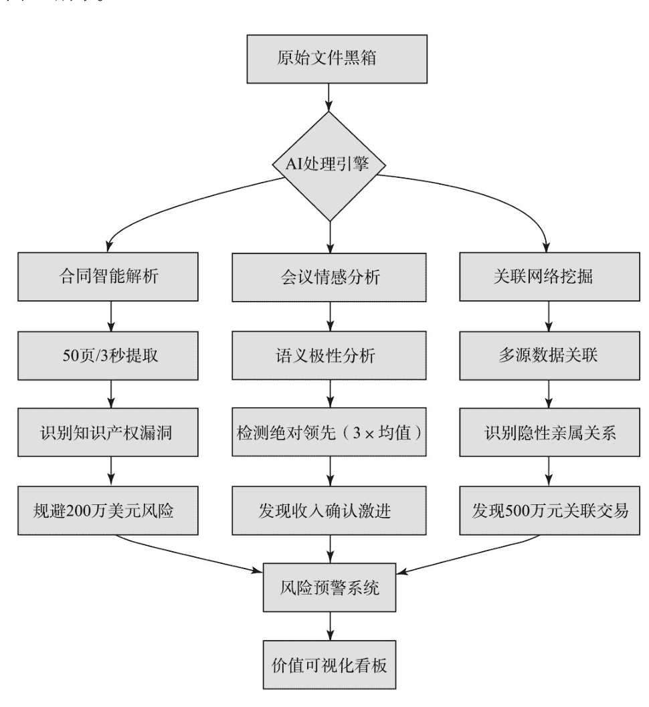
合同条款智能解析：某自然语言处理系统可3秒提取50页合同中的关键条款。并购某科技企业时，系统发现知识产权归属条款存在地域限制漏洞，避免潜在跨境法律风险，涉及赔偿可能达200万美元。
会议纪要情感分析：通过语义极性判断管理层风险偏好。某案例中，系统预警某企业首席财务官在电话会议中过度使用乐观表述，后证实其存在收入确认激进问题。
关联方网络构建：从邮件、通话记录中挖掘隐性关系。某调查发现，某企业财务总监与供应商法定代表人存在亲属关系，该线索未被传统尽调发现，涉及关联业务往来金额达500万元。

3. 实时动态调整机制
智能化使尽调过程具备“自动驾驶”能力。
进度智能监控：实时展示任务完成度热力图。某跨国项目应用后，负责人可随时查看23个并行走访城市的偏差，及时调配资源。
风险预警联动：检测到重大异常时自动升级处理。某案例中，系统发现企业银行存款存在23笔未达账项，立即触发高级别复核，最终发现380万元资金挪用。
资源动态调配：基于工作量预测的智能调度。某项目在应收账款函证耗时超预期时，系统自动从低优先级任务抽调2名人员，确保整体进度。

### 3.4.3 报告阶段的赋能
1. 智能报告生成体系
智能化正在重塑报告生产范式。
可视化自动生成：某系统可将财务数据转化为交互式仪表盘。某跨国企业年报生成时间由15天缩短至3天，图表错误率下降90%。
多语言智能转换：支持中英日等8种语言自动互译，专业术语准确率达95%。某海外并购项目中，模型生成的英文尽调报告通过律所审核，节省翻译成本8万美元。
模板智能适配：根据企业类型自动匹配监管要求。某科创板企业尽调报告生成时，系统自动增加研发投入归集合规性说明模块，避免监管问询。
流程对比见表3-3所示。

### 表3-3 报告生成流程的对比

| 环节 | 人工时长 | 智能时长 | 效率提升 |
| :--- | :--- | :--- | :--- |
| 数据整理 | 20 | 2 | 90% |
| 报告撰写 | 30 | 5 | 83.3% |
| 校对审核 | 15 | 1 | 93.3% |

2. 自动化质控体系
智能化构建起三重质量防线：
数据一致性检查：某系统发现企业合并报表中少数股东损益计算错误，误差380万元，该差异未被传统审计发现。
逻辑矛盾检测：当资产负债表与现金流量表间接法存在1.2%勾稽差异时，系统自动触发预警，避免监管处罚风险。
合规性自动验证：比对最新会计准则与监管要求。某案例中，系统发现企业收入确认时点早于控制权转移节点，涉及调整金额超千万元。
质控架构见图3-5。
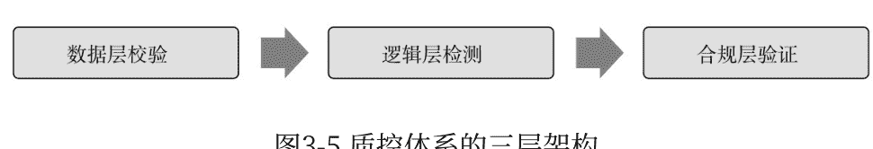
### 图3-5 质控体系的三层架构

3. 智能问答系统
报告使用效率因智能化获得质的飞跃：
摘要自动生成：100页报告可浓缩为3页关键结论，重要风险标注准确率达93%。某投资者使用后，决策时间缩短60%。
问题快速定位：用户询问“关联业务往来风险点”时，系统自动跳转至第17页相关段落，并提示4项需重点关注的合同条款。
假设情景模拟：输入“如果毛利率下降5个百分点”的假设，系统可实时展示对净利润、现金流等指标的级联影响，支持管理层决策。

### 3.4.4 智能赋能的流程优势总结
1. 效率跃升的量化证据
时间成本压缩：全流程耗时由传统平均92天缩短至38天，项目交付速度提升142%。
人力配置优化：初级人员工作量减少60%，专家资源集中用于战略风险研判，人均产出提升3倍。
响应速度提升：临时增加分析维度所需时间由3天降至4小时，客户满意度提高40%。

2. 质量改进的实证数据
分析深度倍增：某系统可处理的数据维度是人工的23倍，发现隐性关联业务往来的概率提升78%。
错误率断崖下降：基础计算错误率由1.2%降至0.03%，复杂判断类错误减少45%。
合规达标率提升：监管问询回复准确率由88%提升至99.2%，避免潜在法律风险。

3. 价值创造的乘数效应
商业洞察增强：某系统通过行业对标，发现客户流失率与应收账款账期存在0.73的相关性，促使企业调整信用政策，坏账率下降22%。
决策支持升级：模型预警的供应商集中度风险，使某企业提前6个月启动供应链重构，避免断供损失4500万元。
知识沉淀加速：系统自动生成的尽调案例库，使新人培训周期由6个月缩短至1.5个月，知识传递效率提升75%。

4. 现实局限与突破路径
技术边界警示：当前智能化对商业实质的理解仍存在局限，如无法判断关联业务往来定价是否公允，这类问题仍需人工介入。
人机协作范式：最佳实践显示，智能化处理数据验证类任务效率是人工的17倍，但在会计估计如减值测试领域仍需专家主导。
伦理风险防控：某案例显示，算法对中小企业的风险评分存在地域偏见，经修正后准确率提升19个百分点，需持续优化算法公平性。
局限与路径矩阵见表3-4。

### 表3-4 技术局限与突破路径矩阵

| 局限领域 | 突破路径 | 进度 |
| --- | --- | --- |
| 商业实质理解 | 行业知识图谱嵌入 | 65% |
| 会计估计判断 | 人机协同决策模型 | 40% |
| 算法公平性 | 偏见检测与修正算法 | 78% |

# 第4章 智能对财务尽职调查内容的变革与赋能

## 4.1 公司基本情况

### 4.1.1 设立与发展历程
1. 设立的合法性
取得公司设立时的政府批准文件、营业执照、公司章程、合资协议、评估报告、审计报告、验资报告、工商登记文件等资料，核查其设立程序、工商注册登记的合法性、真实性。
2. 历史沿革情况
查阅公司历年营业执照、公司章程及历次修改情况、工商登记与工商年检等资料，了解其历史沿革情况。
3. 股东出资情况
- (1) 了解公司名义股东与实际股东是否一致。
- (2) 关注自然人股东在公司的任职情况，以及其亲属在公司的投资、任职情况。
- (3) 查阅股东出资时的验资资料，调查股东的出资是否及时到位，出资方式是否合法，是否存在出资不实、虚假出资、抽逃出资等情况。
- (4) 核查股东是否合法拥有出资资产的产权、出资资产权属是否存在纠纷或潜在纠纷，以及其出资资产的产权过户情况。对以实物、知识产权、土地使用权等非现金资产出资的，应查阅资产评估报告；对以高新技术成果出资入股的，应查阅相关管理部门出具的高新技术成果认定书。
4. 主要股东情况
- (1) 了解股东直接持股和间接持股的情况。
- (2) 了解主要股东的主营业务、股权结构、生产经营等情况；主要股东之间的关联关系或一致行动情况及相关协议；主要股东所持公司股份的质押、冻结和其他限制权利的情况；控股股东和受控股股东、实际控制人支配的股东持有的公司股份重大权属纠纷情况；主要股东和实际控制人最近三年内变化情况或未来潜在变动情况。
- (3) 调查主要股东是否存在影响公司正常经营管理、侵害公司及其他股东的利益、违反相关法律法规等情形。
5. 重大股权变动情况
- (1) 查阅与公司重大股权变动相关的三会文件以及政府批准文件、评估报告、审计报告、验资报告、股权转让协议、工商变更登记文件等，核查公司历次增资、减资、股东变动的合法、合规性。
- (2) 核查公司股本总额、股东结构和实际控制人是否发生重大变动。
6. 重大重组情况
- (1) 了解公司设立后发生的合并、分立、收购或出售资产、资产置换、重大增资或减资、债务重组等重大重组事项。
- (2) 取得重大重组事项三会决议、重组协议文件、政府批准文件、审计报告、评估报告、中介机构专业意见、债权人同意债务转移的相关文件、重组相关的对价支付凭证和资产过户文件等资料。
- (3) 分析重组行为对公司业务、控制权、高管人员、财务状况和经营业绩等方面的影响，判断重组行为是否导致公司主营业务和经营性资产发生实质变化。

### 4.1.2 组织结构、公司治理及内部控制
1. 公司章程
- (1) 查阅公司章程，调查其是否符合《中华人民共和国公司法》《中华人民共和国证券法》及证监会和交易所的有关规定。
- (2) 关注董事会授权情况是否符合规定。
2. 组织结构
- (1) 取得公司内部组织结构图。
- (2) 考察总部与分子公司、董事会、专门委员会、总部职能部门与分子公司内部控制决策的形式、层次、实施和反馈的情况，分析评价公司组织运作的有效性。
- (3) 判断公司组织机构是否健全、清晰，其设置是否体现分工明确、相互制约的治理原则。
3. 三会设立及职责履行
取得公司治理制度规定，包括三会议事规则、董事会专门委员会议事规则、总经理工作制度、内部审计制度等文件资料；核查公司是否依法建立了健全的股东大会、董事会、监事会、独立董事、董事会秘书制度；了解公司董事会、监事会，以及战略、审计、提名、薪酬与考核等专门委员会的设置情况，及公司章程中规定的上述机构和人员依法履行的职责是否完备、明确。
4. 独立性情况
- (1) 查阅公司的相关资料，结合公司的生产、采购和销售记录实地考察其供、产、销系统，调查分析公司是否具有完整的业务流程、独立的生产经营场所以及独立的采购、销售系统，调查分析其对供、产、销系统和下属公司的控制情况。
- (2) 计算公司关联采购额和关联销售额分别占其同期采购总额和销售总额的比例，分析是否存在影响公司独立性的重大或频繁的关联业务往来，判断其业务独立性。

资产与独立性核查要点

核查无形资产如商标、专利、版权、特许经营权，以及房屋、土地使用权、核心生产设备等有形资产，是否持有齐全合法的权属证明并实际受控；同时确认上述无形权利的有效期，排查是否存在法律争议或潜在风险；对大额且长期的其他应收、其他应付、预收款与预付款，追溯其形成原因、交易凭证及资金动向；还要审视是否存在资产被控股股东、实控人或其关联方占用或操控的情形，以此评估资产是否真正独立。

了解高管是否在控股股东或实控人体系内的其他公司兼任除董监外职务，财务人员是否跨企业兼职；核实高管薪酬发放主体，是来自上市公司还是股东系企业；检查员工的招聘、薪酬、社保等人事体系是否独立运行，以判断人员独立性。

检视公司是否拥有专属财务会计部门及独立核算体系，财务制度是否完善且覆盖分支机构；确认财务决策、银行账户开设、纳税申报等是否自主进行，用以判断财务是否独立。

评估公司组织架构是否与控股股东或实控人彻底分离，运行是否独立，是否存在混业经营或合署办公；是否具备机构设置自主权，以此判断机构独立性。

#### 5. 独立董事制度合规性
确认公司是否已设立独立董事制度，并评估其规范性是否达标。
核对独立董事的资格条件与职权设置是否符合监管要求。

#### 6. 业务运营内控有效性
通过访谈业务部门并调阅相关管理制度，梳理业务流程，判断内部控制是否真正落地。
了解公司是否经历过政府或第三方审计，验证审计发现的问题是否已整改完毕。
检查报告期内及上一期业务是否合规，是否存在因违背工商、税务、审计、环保、劳动等法规而受罚的情况及其影响，并确认问题是否已纠正、负面影响是否清除。
对因风控失效引发的损失案例进行追溯，了解经过及对财务业绩的影响，评估相关内控制度的有效性，并复盘应急处置效果与后续改进举措的成效。

#### 7. 会计管理内控评估
检验会计管理是否覆盖全部业务，制定了可操作性强的制度，人员资质与持续培训是否到位，风险控制规则是否健全，岗位是否遵循不相容职务分离，重要会计和系统操作是否授权受控，对账是否定期执行。
综合评价会计管理内控的完备性、合理性与执行效果。

### 4.1.3 同业竞争与关联交易
#### 1. 同业竞争
基于公司、控股股东或实控人及其控制企业的财务报表及主营业务构成，必要时调取生产、库存、销售资料，通过问询、实地走访了解业务范围、性质、客户群体、产品可替代性等，判断是否存在同业竞争，并核查控股股东或实控人是否做出了避免同业竞争的承诺及履行情况。

#### 2. 关联方与关联方关系
通过与高管访谈、咨询中介、查阅股权结构、组织架构、会议纪要及重要合同，按照《公司法》和会计准则识别关联方及关系，并调取工商登记资料备查。
调查高管及核心技术人员是否在关联方任职或领取报酬，是否存在由关联方委派的情况。

#### 3. 关联交易
核查关联交易是否符合法规及公司章程要求，审批程序是否合规。
审视定价依据是否充分，与市场价或第三方价格对比是否公允，是否存在明显利益输送。
测算向关联方销售收入占主营收入比例、向关联方采购额占采购总额比例，分析是否影响经营独立。
测算关联应收、应付款余额占公司应收、应付款总额比例，关注交易真实性与回款风险。
分析关联交易产生的利润占利润总额比重，评估对业绩稳定性的影响。
检查关联交易合同履行情况，有无大额退货及其对财务的影响。
区分偶发与经常性关联交易；对经常性交易分析变动原因、持续性及合同条款可操作性；对偶发性交易分析对当期成果影响、交易目的及对独立经营能力的影响。

### 4.1.4 业务发展目标
#### 1. 发展战略
收集中长期战略文件、董事会纪要、战略委员会纪要、独董意见，判断公司战略是否清晰具体，包括目标、依据、路径及配套行动计划。

#### 2. 经营理念和经营模式
了解并分析经营理念及模式对管理与发展的实际作用。

#### 3. 历年计划执行及实现情况
调阅历年发展规划与年报，检查计划落地情况，评估管理层制订与执行计划的能力。

#### 4. 业务发展目标
获取未来2-3年发展计划及依据，结合行业趋势与竞争格局，通过访谈高管、员工、主要客户与供应商，判断目标与战略一致性。
分析公司在管理、产品、人才、技术、市场、投融资、并购、国际化等维度是否制定具体方案，方案是否匹配目标且可实现。
分析目标实施过程中潜在风险，如过度扩张或投资失当。
评估目标与现有业务关系，若涉及合作，核查合作方及条件。

### 4.1.5 高管人员调查
#### 1. 任职情况及任职资格
通过三会文件及章程了解任职情况，核查任职资格合规性与程序合规性；调查高管间亲属关系；对需监管核准的任职，取得批复文件。

#### 2. 经历及行为操守
通过访谈、履历核查、查询过往上市公司任职记录、咨询主管机构等方式，了解教育背景、专业资历，有无违法违规、不诚信行为、受罚记录或对破产企业负个人责任的情况。
获取与高管签署的协议或承诺，关注其重要承诺及履行情况。

#### 3. 薪酬和兼职情况
调查薪酬方案与股权激励安排。
调查内部外部兼职情况，评估对履职的影响；关注近一年从公司及关联方获得的收入、其他待遇与退休金安排。

#### 4. 报告期内高管人员变动情况
了解期内高管变动经过与原因，是否符合章程与人事制度，股东推荐是否合规，是否存在股东干预董事会或股东大会人事决议情形。

#### 5. 高管人员持股及其他对外投资情况
获取高管声明，核查其及其近亲属直接或间接持股情况、近三年变动、质押或冻结情形。
调查高管其他对外投资，包括标的、持股比例及相关承诺；核查是否存在自营或为他人经营同类业务、利益冲突投资或重大债务负担。

### 4.1.6 风险因素及其他重要事项
#### 1. 风险分析与评价
多渠道掌握行业政策与未来方向。
分析对业绩与持续经营有不利影响的主要因素及影响程度，重大风险单独核查。
评估采购、生产、销售环节经营风险，分析获取经常性收益能力。
调查产品市场前景、行业环境变化、周期、生命周期、市场饱和、过度依赖单一市场、占有率下滑等对经营影响。
调查经营模式变化、业绩波动、原材料价格波动、过度依赖单一原料或产品、经营场所集中分散等影响。
调查内控失效、资金周转差导致的流动性风险、现金流与债务结构风险、减值计提不足、资产价值波动、非经常损益波动、或有事项等风险影响。
调查财税、金融、土地、产业、环保等法规变化带来的风险。
调查自然灾害、安全生产、汇率、外贸、担保、诉讼等可能影响持续经营的因素。

#### 2. 重大合同
核查重大合同真实性与完整性，条款合法性与潜在风险；检查内部合同权限执行情况，评估履约可能性及违约影响。

## 4.2 业务与技术情况
### 4.2.1 行业及竞争概况
#### 1. 行业类别
根据主营业务确定所属行业。

#### 2. 行业宏观政策
收集主管部门规划、法规及规范性文件，了解监管体系与政策走向。

#### 3. 行业概况及竞争情况
了解市场环境、规模、细分、市场化程度、进入壁垒、供需、竞争格局、利润水平及趋势，判断发展前景与有利不利因素，分析主要企业份额与公司竞争地位。

#### 4. 行业经营模式
调查行业技术水平与特点，分析周期性、区域性、季节性特征。
了解行业特有经营模式，主要商业、销售、盈利模式。

#### 5. 行业产品链
分析行业在价值链中位置，评估上下游关联度、发展前景、产品用途、替代趋势，分析上下游变化对本行业的影响。
基于财务资料分析出口业务，出口占比大时调查进口国政策、贸易摩擦及竞争格局，评估出口市场波动影响。

### 4.2.2 采购情况
#### 1. 市场供求
通过采购部门、主要供应商沟通及研究报告，了解主要原材料、辅料及能源动力的供求状况。

#### 2. 采购模式
调研采购模式，结合成本核算单，定量分析原材料、能源价格变动、可替代性、渠道变化对成本影响，判断是否受资源限制。

#### 3. 主要供应商
获取前十名供应商资料，计算近三期采购金额占比，判断是否存在高度依赖，必要时评估备选方案。
获取长期供货合同，分析条款，判断供应与价格稳定性。

#### 4. 采购与生产的衔接
调查采购与生产计划衔接情况及原材料安全库存，关注缺货风险。
计算原材料存货周转天数，判断积压风险，实地核查是否存在残次品。

#### 5. 存货相关制度
通过制度文件及实地检查，了解存货管理制度执行情况，包括验收、保管安全、短少毁损的追责机制。

#### 6. 关联采购
与主要供应商沟通，调查高管、核心技术人员、主要关联方或持股5%以上股东在供应商中权益，判断是否构成关联采购。
若存在重大关联采购，抽查不同时点合同，对比市场公允价，判断定价合理性，排查资金或利润转移。

### 4.2.3 生产情况
#### 1. 生产流程
获取生产流程资料，结合核心技术与关键环节，评估工艺技术在行业中的领先性。

#### 2. 生产能力
获取设计产能与历年产量，与生产部门沟通，分析各环节瓶颈。

#### 3. 主要无形资产
获取专利、非专利技术、土地使用权等明细，分析剩余期限及对经营影响。
获取许可使用合同，关注资产内容、方式、年限、费用及潜在纠纷。
获取特许经营权法律文件，分析取得方式、期限、费用及对持续经营影响。

#### 4. 成本优势分析
查阅历年成本核算单，计算毛利率与贡献毛利占比，与同业对比，分析成本优势劣势。
分析主要产品盈利能力，拆解单位成本变动，测算主要原材料、动力占比，评估价格波动对销售与利润的影响。

#### 5. 生产质量管理
与质量部门沟通，调阅制度，实地检查组织设置与控制执行情况。
获取质监部门文件，核查产品是否符合标准，报告期是否因质量问题受罚。

#### 6. 生产安全管理
调阅安全管理制度与事故处理资料，评估安全隐患及防范措施。
调查历史重大安全事故与处罚，评估对经营的影响。

#### 7. 环保情况
调查生产工艺是否符合环保法规，评估历史与未来环保投入。
现场查看三废排放及污染处理设施运行情况。
调查环保违规受罚记录。

### 4.2.4 销售情况
#### 1. 销售模式及品牌情况
了解销售模式成因与潜在风险。
评估市场认知度、信誉及品牌优势。
调查假冒品情况及打假维权措施。

#### 2. 产品的市场地位
调查产品定位与客户需求稳定性。
收集市场地域分布与占有率，结合排名与竞争对手，分析行业地位。
了解行业定价策略与龙头企业策略，评价公司定价合理性。
调查报告期销售价格变动。
按区域编制销售记录，分析区域局限与地方保护影响。

#### 3. 主要客户
编制主要客户前十名销售额占比及回款情况，判断客户依赖度。
分析回款质量，是否存在以物抵债。
若期末收入异常增长，追查确认凭证，判断是否存在虚增。

#### 4. 关联销售
调查主营及其他业务收入中关联销售占比，关注高管人员和核心技术人员、主要关联方或持有公司5%以上股份的股东在主要客户中所占权益。

- (2) 择取若干时段的关联交易协议开展抽样核验，勾勒价格变动曲线并与同期同品类商品在公开市场的合理价位进行比对；同步追踪协议项下资产的实际交付与终售情况。出现异常时，需测算其对营业收入的扭曲程度，判断定价是否合情合理，并识别大股东是否借助关联交易实现利润转移或资金调拨。

### 4.2.5 技术及研发情况

#### 1. 研发模式和机制
搜集研发治理结构、研发组织架构、激励政策及研发人员履历等资料，复核研发运作方式及研发体系的搭建与运转状态，判断技术创新机制是否健全，能否匹配企业未来成长需求。

#### 2. 技术水平
- (1) 盘点企业持有的专利、非专利技术、许可协议及技术合作协议等，拆解主营产品核心技术的所处层级，评估技术成熟度，并与行业整体水平及演进趋势对照。
- (2) 对对未来经营产生决定性影响的关键技术，要单独聚焦并实施专项核查。

#### 3. 研发潜力
- (1) 获取核心研发成果、在研项目、研发目标等材料，测算历年来研发投入占主营收入的比例、自主知识产权的规模与质量、技术储备状况，对研发综合能力进行评价。
- (2) 如存在合作研发，应取得合作协议等文件，分析成果分配、保密安排等约定。

## 4.3 财务情况

### 4.3.1 财务报告及相关财务资料

#### 1. 财务报告核查及总体评价
- (1) 获取最近两个会计年度及本期资产负债表、利润表及现金流量表。
- (2) 对财务报表及配套资料展开审慎复核并形成整体判断。

#### 2. 合并、分部、参股事项的核查
- (1) 对报表披露的分部信息取得明细并执行必要核查。
- (2) 对纳入合并范围的重要控股子公司财务状况履行充分审慎核查程序。
- (3) 对披露的参股子公司取得最近一年及本期财务报表及审计报告，如有。

#### 3. 存在重要并购事项的特殊核查
如公司近期收购兼并资产或股权，且被收购方资产总额、营业收入或净利润超过收购前公司对应指标20%的，需取得被收购方收购前一年损益表并核查其财务状况。

### 4.3.2 会计政策与会计估计

#### 1. 政策选择
查阅财务资料并与财务人员及审计师沟通，核查会计政策及会计估计的合规性与审慎性。

#### 2. 变更影响
如报告期内存在会计政策或会计估计变更，重点核查变更内容、理由及对财务状况、经营成果的影响。

### 4.3.3 财务比率分析

#### 1. 盈利能力分析
测算各期毛利率、总资产收益率、净资产收益率、每股收益等，分析盈利能力及其变动，拆解母公司与合并报表的利润构成与来源，判断盈利可持续性。

###### 2. 偿债能力分析
测算资产负债率、流动比率、速动比率、利息保障倍数等，结合现金流状况、银行资信、可融资渠道与授信额度、表内负债、表外融资及或有负债，分析各期偿债能力变化及偿债风险。

#### 3. 营运能力分析
测算资产周转率、存货周转率、应收账款周转率等，结合市场走势、行业竞争、企业生产模式与物流管理、销售模式与赊销政策，分析运营效率变化，判断经营风险与持续经营能力。

#### 4. 综合评价
将上述指标与同业可比公司对比，综合研判财务风险与经营风险，判断财务状况是否健康，是否存在影响持续经营的问题。

### 4.3.4 与损益有关的项目

#### 1. 销售收入
- (1) 了解行业收入确认惯例与企业具体标准，判断是否符合准则，是否存在提前、推迟确认或虚增收入。
- (2) 核查期末是否存在突击确认销售，期末已收款项是否存在期后异常流出。
- (3) 分析经营现金净流量增减与收入变动是否匹配，关注经济利益是否真正流入。
- (4) 获取收入按产品、区域构成及变动资料，分析其变动是否与行业与市场同期变化一致。
- (5) 如收入存在季节性，分析对各季度业绩的影响并参照同业，判断收入、成本、费用配比是否合理。
- (6) 获取主要产品报告期价格变动资料，分析价格规律对收入的影响。
- (7) 关注销售模式对收入核算的影响，了解主要经销商的资金实力、网络、销售与回款情况。
- (8) 核查企业销售核算与经销商核算是否存在重大差异。

#### 2. 销售成本与毛利
- (1) 根据生产流程收集业务管理文件，了解各环节成本核算方法与步骤，确认报告期方法是否保持一致。
- (2) 获取主要产品成本明细，了解单位成本构成。单位成本大幅变动时需做因素分析并结合市场与同业判断合理性。
- (3) 对照工艺流程、生产周期与在产品历史数据，分析期末在产品余额合理性，关注是否存在异常积压或应转未转成本。
- (4) 计算报告期利润率指标，分析变化趋势并与同业比较，异常时需多因素分析并重点核查。

#### 3. 期间费用
- (1) 获取销售费用明细，结合行业销售特点、销售方式、操作流程、网络、回款要求、售后承诺等，分析其完整性与合理性。

#### 4. 非经常性损益项目
(1) 获取经注册会计师验证的加权平均净资产收益率与非经常性损益明细，逐项核查合规性，调查来源、依据、凭证及款项真实性、会计处理正确性，分析对其财务与业绩的影响。
(2) 结合业务背景判断重大非经常性损益的合理性与计价公允性。
(3) 计算非经常性损益占当期利润比重，评估相关风险。

### 4.3.5 与资产状况有关的项目

#### 1. 货币资金
(1) 编制或获取货币资金明细表。
(2) 核查报告期内构成及现状，对证券账户核查核算完整性。
(3) 抽查明细账，重点关注大额流入流出，分析业务背景与风险。
(4) 核查大额银行存款真实性。
(5) 分析重大未达账项形成原因及影响。
(6) 关注期初、本期发生额、期末余额。

#### 2. 应收款项
(1) 获取明细表、账龄分析表、主要及逾期债务人名录，分析核查，了解大额形成原因、债务人状况、催收与还款计划。
(2) 抽查单证合同，对账龄长的大额应收款分析业务背景与核算依据，判断收回风险；核查大额预付款原因、时间及采购执行情况；调查应收票据取得、背书、质押、贴现情形及风险。
(3) 结合收款政策、周转率、现金流，分析回款情况，关注应收增幅显著高于收入增幅的风险及对持续经营影响。
(4) 判断坏账准备计提充分性，是否存在盈余管理。
(5) 分析关联往来款性质，是正常经营还是无交易背景占用。

#### 3. 存货
(1) 获取存货明细，核查余额大、周转慢情况，结合生产与结构变动分析大幅波动原因。
(2) 结合原材料特性、生产需求与库存时间，实地抽盘大额存货，确认计价准确性，核查积压或陈旧情况，评估跌价准备方法与计提充分性，测算发出成本计量合理性。

#### 4. 对外投资
(1) 查阅股权投资资料，了解变动；获取被投资公司营业执照、财务报告、投资协议，判断减值准备计提、收益核算准确性，必要时取得审计报告。
(2) 获取股权买卖时的财务报告、审计、评估报告，分析交易公允性与会计处理合理性。
(3) 查阅交易性投资资料，核查会计处理合理性；获取重大委托理财合同与批文，分析合规性。
(4) 获取重大项目投资合同与批文，核查合法有效性，结合进度分析影响与会计处理。
(5) 了解集团内关联投资与间接持股情况。

#### 5. 固定资产
(1) 获取折旧明细与减值准备明细，通过询问与实地观察核查使用状况与在建工程进度，确认使用状态、在建工程结转条件，关注长期停工或闲置资产。
(2) 分析折旧政策稳健性与减值准备计提充分性，测算折旧计提。

#### 6. 无形资产
(1) 对照协议资料，了解重要无形资产取得方式、入账依据、初始金额、摊销年限依据、摊余价值与剩余年限。
(2) 如以评估值入账，重点关注评估结果与会计处理合理性。

#### 7. 投资性房地产
(1) 核查种类与计量模式，成本模式下核查折旧摊销与减值依据，公允价值模式下核查公允价值确定依据和方法。
(2) 了解转换与处置的确认计量方法，判断会计处理是否合理及对经营状况的影响。

#### 8. 银行借款
查阅主要借款资料，了解借款状况、资信评级、是否存在逾期，对逾期债项了解原因与预计还款期。

#### 9. 应付款项
获取明细，了解应付票据真实性、大额应付账款账龄与逾期原因、大额其他应付款与长期应付款内容与背景、大额欠缴税金情况。

#### 10. 对外担保
获取担保资料，测算担保额占净资产、总资产比重；核查决策流程合规性；分析发生损失对生产经营与盈利影响；调查被担保方履约能力与反担保情况。

#### 11. 资产抵押
调查重要资产是否存在抵押质押，分析对正常经营影响。

#### 12. 诉讼及其他
调查是否存在重大仲裁、诉讼及或有事项，分析对其重大影响。

### 4.3.6 现金流量表
(1) 获取现金流量财务资料，全面分析经营、投资、筹资现金流量。
(2) 核查经营活动现金流量及其变动，判断资产流动性、盈利性、偿债能力与风险。
(3) 如经营现金净额持续为负或远低于净利润，需专项核查并判断真实盈利能力与持续经营能力。
(4) 对最近三年经营现金净额编制进行复核测算。

### 4.3.7 税务信息

#### 1. 纳税情况
查阅纳税资料，调查企业及控股子公司税种、税基、税率是否符合法规，是否依法纳税。

#### 2. 税收优惠
获取税收优惠与财政补贴资料，核查是否符合规定；调查来源、归属、用途与会计处理；关注优惠期与未来影响；分析对政策的依赖度及对业绩与财务状况影响。

## 4.4 AI对财务尽职调查内容的赋能

### 4.4.1 在AI驱动的财务数据分析深化
财务数据分析是尽调基础环节，AI技术在该领域已显现出革新性优势。传统手工分析耗时且易遗漏信息，AI凭借智能算法可快速处理海量财务数据，挖掘人眼难以察觉的规律与异常。

数据采集阶段，AI系统可自动对接企业ERP、银行账户及各类财务软件，实时获取最新财务数据。先进的OCR技术能精准识别扫描件与PDF中的财务信息，将非结构化数据转为可分析的结构化数据。例如，某AI系统处理发票数据的准确率已达98%以上，远超人工录入水平。

数据分析层面，机器学习可对企业多年资产负债表、利润表与现金流量表进行纵向比较，自动计算数百项财务指标变化趋势。更重要的是，AI能识别指标间关联关系。比如，营业收入增长但应收账款周转率下降时，系统会自动标记异常，提示收入确认可能存在问题。AI财务数据分析流程如图4-1所示。

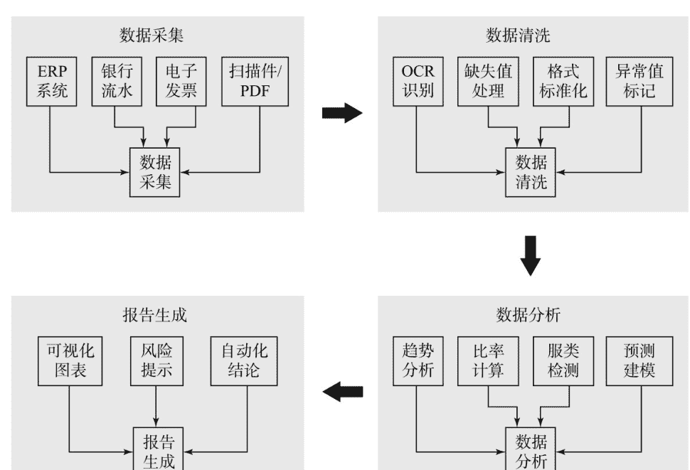
图4-1 AI财务数据分析流程

预测分析是AI另一大优势。通过时间序列与回归模型，AI可预测企业未来12～24个月财务状况。某私募股权基金使用AI预测模型后，被投企业现金流预测准确率提升35%，显著降低投资风险。

### 4.4.2 AI增强的非财务数据整合
现代尽调愈发重视非财务数据作用，这些数据往往能提前揭示潜在风险。AI技术擅长处理分散、非结构化数据，从中提取有价值商业洞察。

客户分析方面，AI可抓取电商平台评论、社交媒体讨论及客户服务记录，通过自然语言处理分析客户满意度变化。例如，某AI系统分析一家零售企业数据时，发现财务表现良好但客户负面评价过去半年增加200%，及时预警市场风险。

供应链风险评估是另一重要场景。AI系统可整合供应商工商信息、海关数据、物流记录等多维信息，构建完整供应链图谱。当重要供应商出现经营异常时，系统会立即发出警报。2023年某知名车企即通过AI系统提前6个月发现关键零部件供应商财务危机，避免停产风险。

非财务数据类型及其分析价值举例如表4-1所示。

表4-1 非财务数据类型及其分析价值举例

| 数据类型 | 数据来源示例 | 智能洞察价值 | 典型应用场景 |
| :--- | :--- | :--- | :--- |
| 客户数据 | 电商平台评价 客服录音 App 用户行为 | • 情感分析识别满意度趋势； • 聚类分析发现客群特征； • 预测客户流失风险 | 品牌价值评估； 收入持续性判断 |
| 供应链数据 | 供应商工商信息 物流跟踪记录 质检报告 | • 图谱分析识别关联交易； • 预警高风险供应商； • 模拟断供影响 | 供应链稳定性评估； 成本控制潜力分析 |
| 市场舆情 | 行业新闻 社交媒体 分析师报告 | • 热点话题追踪； • 竞争态势可视化； • 政策影响量化评分 | 行业前景判断； 商誉减值风险预警 |
| 专利技术 | 专利数据库 研发投入记录 技术论坛 | • 技术路线图构建； • 创新力指数计算； • 技术替代风险预测 | 核心技术估值； 研发效率评估 |
| 人力资源 | 招聘网站数据 员工满意度调查 离职记录 | • 人才竞争力分析； • 关键岗位流失预警； • 团队能力图谱 | 管理层稳定性评估； 人力成本优化空间 |
| ESG 数据 | 环保处罚记录； 社会责任报告； 能源消耗 | • 环境风险评分； • 治理效能矩阵； • 可持续发展指数 | 长期投资价值评估； 合规风险筛查 |

市场舆情监控同样受益于AI技术。通过实时扫描新闻媒体、行业报告与专家评论，AI可评估政策变化、市场竞争等外部因素对企业的影响。某医药企业在IPO前，其AI系统成功识别出即将出台的医保控费政策对其主打产品的潜在影响，为定价策略调整争取宝贵时间。

### 4.4.3 AI在会计政策与舞弊检测中的应用
会计政策选择与财务舞弊是尽调中的高风险领域，AI通过模式识别与异常检测技术，大幅提升发现问题的概率。

在会计政策分析方面，AI系统可自动比对企业不同时期、不同业务板块采用的会计政策，识别可能存在的调节利润迹象。例如，某AI工具分析一家制造业企业时，发现其第四季度突然变更收入确认方式，导致当期利润虚增15%，该发现直接影响最终估值调整。

舞弊检测是AI强项。通过训练含历史舞弊案例的机器学习模型，AI可识别数十种常见财务舞弊模式。典型检测指标包括：应收账款增速异常、毛利率偏离行业平均水平、关联交易未充分披露等。某会计师事务所的AI系统在2023年成功识别出一宗通过虚构海外交易实施的舞弊案，涉及金额达2.3亿元。

常见财务舞弊信号及其AI检测方法如图4-2所示。

特别值得一提的是，AI还能发现传统方法难以察觉的“舞弊网络”。通过分析企业及其关联方的资金流水、合同文本及高管社交关系，AI可描绘出潜在舞弊网络结构。这种整体视角的舞弊风险评估，正在成为尽调新标准。

### 4.4.4 AI赋能税务与合规审查
税务风险可能给企业带来重大损失，AI技术通过智能化税务分析，显著提升尽职调查的全面性与准确性。

税务合规审查的智能化升级

在纳税合规检查环节，智能平台能够把申报数字与经营实质进行交叉验证。以增值税发票链路、银行资金流与物流凭证的勾稽为例，当三者一致性出现缺口时，系统即可定位虚开发票的疑点。曾有一家商贸企业被AI税务平台复核，进项发票与物流单据的对应率仅约七成，经人工深挖最终证实存在虚开发票。

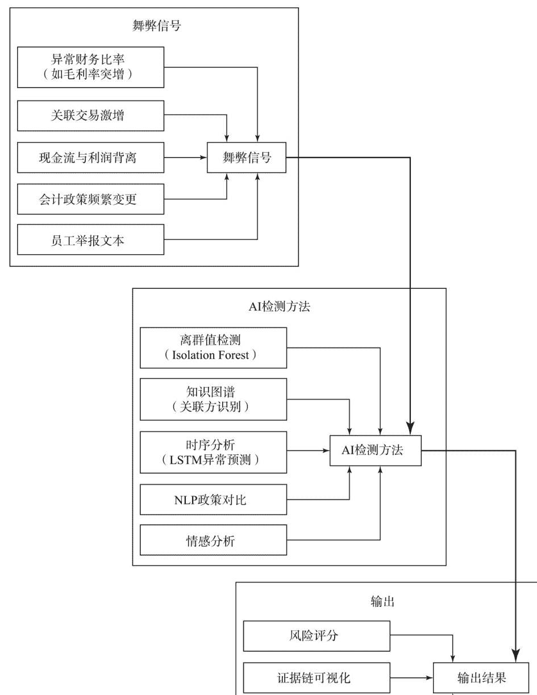

图4-2 常见财务舞弊信号及其AI检测方法

转让定价审查也在被重塑。模型可以自动拆解跨国集团在各税区的利润分布，判断是否符合独立交易原则。结合行业参照值和税务机关案例库进行比对，异常的定价安排会被标记。2023年某跨国公司在华子公司的利润率被AI判定明显低于行业均值，促使其修正了关联交易定价政策。

AI税务审查重点领域及技术方法如表4-2所示。

表4-2 AI税务审查重点领域及技术方法

| 审查重点领域 | AI 技术方法 | 典型应用场景 | 效果指标 |

| :--- | :--- | :--- | :--- |

| 增值税合规性 | 发票 OCR 识别； 进销项匹配算法； 交易网络图谱分析 | 检测虚开发票、阴阳合同； （如发现无真实交易的发票环开） | 识别准确率 > 95%； 审查效率提升 80% |

| 企业所得税调整 | 费用异常检测模型； 行业利润水平比对； 关联交易定价分析 | 识别异常费用列支 （如高管个人消费计入差旅费） | 风险项目覆盖率提升 65% |

| 跨境税收 | BEPS（税基侵蚀）风险模型； 转让定价文档自动生成； 多国税法 NLP 解析 | 评估跨境支付合理性 （如特许权使用费占比异常） | 合规成本降低 40% |

| 税收优惠适用性 | 政策条款匹配引擎； 研发活动 AI 分类器； 资质条件动态核查 | 高新技术企业认定审查 （验证研发费用归集准确性） | 误判率 < 3% |

| 个税与薪酬福利 | 薪酬结构模式识别； 福利发放异常检测； 股权激励税务测算 | 发现私户发薪避税行为 （比对银行流水与个税申报差异） | 抽查覆盖率从 20% → 100% |

| 实时监控与预警 | 税务健康度评分模型； 政策变动影响模拟； 风险仪表盘可视化 | 季度预缴税款风险预警 （如收入增长但税费下降的异常情形） | 风险提前 3 ~ 6 个月预警 |

系统还能持续追踪税制动态并量化税负影响。2023年一家投资机构借助AI平台及时捕捉到研发费用加计扣除政策的调整，帮助旗下被投企业节省数千万元税款。

### 4.4.5 AI对高管与治理调查的辅助

管理团队质量与公司治理水平很大程度上决定长期价值，大数据驱动的智能分析为评估提供了新视角。

在高管背景核查方面，智能系统可同步检索全球数百个公开数据库，涵盖司法记录、监管处罚、媒体报道等，构建完整画像。某PE机构借助AI工具发现拟投企业的CEO三年前曾担任过一家破产企业的董事，该信息在传统尽调中被遗漏。系统还能量化团队多元化程度、专业互补性等软性指标，综合判断整体实力。

治理层面的评估也更立体。通过分析董事会架构、委员会设置、股东表决模式等数据，智能工具可量化治理水平。例如一套公司治理指数显示，独立董事占比不足30%的企业出现重大决策失误的概率高出40%。系统还能识别“一言堂”风险，即大股东或高管掌握不成比例的影响力。

尤其关键的是高管稳定性分析。通过追踪核心高管近五年任职变动，结合行业对标，智能系统可预警关键人才流失。某科技公司在Pre-IPO阶段，智能系统即通过分析CTO过去三年公开言论与公司技术路线存在多处分歧，精准预判该高管上市后离职。

### 4.4.6 AI赋能的综合价值评估

估值是尽调的最终输出，智能系统将财务与非财务信息融合，使估值更精准且具动态性。

传统DCF或PE估值高度依赖有限假设，智能系统则能处理更多变量，构建复杂模型。例如某智能估值系统除财务数据外，还纳入专利数量、客户满意度、品牌影响力等30余项非财务指标，使结果更贴近市场实际。

在风险调整上，智能系统可实时整合宏观经济、行业竞争格局等外部因素，动态校准折现率。2023年一笔并购中，系统在交易期监测到行业政策收紧信号，及时建议下调估值15%，事后证明判断完全吻合市场变化。

并购协同效应的测算更是智能系统的强项。通过模拟业务整合场景，系统可量化成本节约、收入增长等协同效应。某上市公司在筛选收购标的时，利用智能系统对10个潜在标的进行协同模拟，最终选择的标的在合并后如期兑现协同收益。

传统估值与AI估值方法的对比，如表4-3所示。

表4-3 传统估值与AI估值方法的对比

| 对比维度 | 传统估值方法 | AI 赋能估值方法 | 优势对比 |

| :--- | :--- | :--- | :--- |

| 数据基础 | • 历史财务报表数据； • 有限市场数据 | • 实时多源数据（财务/非财务）； • 舆情/供应链等另类数据 | 数据广度 + 300% |

# 第5章 AI对常见财务尽职调查问题的变革与赋能

## 5.1 常见的财务粉饰问题及调查方法

### 5.1.1 虚增资产

核查重点在于应收账款、其他应收款的真实性及坏账计提是否充分，大额待处理财产损溢、长期待摊费用、开办费等是否存在应费用化的情形。重点关注以下科目或行为。

- 存货：通过现场盘点确认实际价值。盘点前应做截止性测试，关注货到单未到、单到货未到情形，核实所有存货是否入账、在途存货是否已处理。
- 固定资产：实地查看现状，并追溯购置原始发票以判断现值。
- 虚构采购：大额采购通常有合同，需核实合同真实合理性，存货入库是否经采购员、仓库保管员及管理层签字，是否有付款记录及运费支付。对无法执行或仅能小额执行的合同应予剔除。

### 5.1.2 隐性负债

隐性负债多体现为股东现金投入，可重点关注以下科目。

- 财务费用：通过应付利息项下线索探寻民间融资可能。
- 其他应付款——股东借款：若该科目股东往来金额大、余额频繁变动且股东外部无其他关联，则具隐性负债特征。
- 资本公积：追踪其来源与流向。

### 5.1.3 抽逃注册资金

抽逃资金常挂靠在其他应收款、应收账款或预付账款。若公司其他应收款或应收账款中股东往来频繁、余额大、账期长且无合理解释，则存在抽逃嫌疑。

### 5.1.4 虚增收入

- 报税收入，通过ABC3000电子申报系统核查真实性，注意剔除关联方交易；非报税收入应核实收入凭证附件真实性，如对方收条、非现金收款记录、运费支付、仓库出库单、询证回函等。大额现金支付不合规应予质疑。
- 虚开增值税发票，多通过增加应收账款实现。若款项长期未收回，则虚开可能性较大。
- 挂靠收入，以代开发票、代收货款方式进行，再将款项支付给对方，常体现在其他应收款或费用报销中，可通过对比业务收入与业务统计核查。

### 5.1.5 隐瞒成本

关注成本核算方法是否恰当，如品种法、分步法、分批法的选用，完工与在产品分配是否合理。商业企业采用毛利率法时应根据期末盘点调整成本，成本结转不应随意。

### 5.1.6 隐瞒费用

融资用报表常低报费用，而纳税申报报表费用相对真实，两者不一致时取较大值更可信。部分费用可能隐藏于其他科目，如业务员提成、客户回扣计入其他应收款，需分类处理。

## 5.2 剥离引发的思考

### 5.2.1 剥离的类型

剥离主要分为两类：一是部分业务从交易范围剔除，二是收购方收购被剥离业务。剥离的主要类型如图5-1所示。

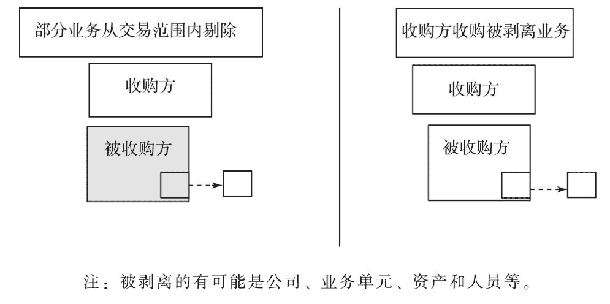

### 5.2.2 剥离带来的问题

剥离带来的问题具体如表5-1所示。

**表5-1 剥离带来的问题**

| 问题 | 具体事项 |

| :--- | :--- |

| 产品开发 | 母公司提供特定系统的技术支持、与母公司共享的生产平台、未来开发能力的潜在限制 |

| 知识产权 | 对知识产权的所有权及使用条款的考虑、对知识产权转移到新公司的限制，对新公司未来潜在的销售目标公司业务所涉及的知识产权使用权条款的限制 |

| 采购和供应 | 目标公司从母公司的涵盖生产及间接支出等方面的集团采购合同中获益；潜在的由于购买力下降而丧失规模经济效益；由母公司提供采购支持；如继续向母公司供应原料或加工，需要和母公司协商供应和加工合同，母公司可能会希望弥补日常管理费用，并要求一定的毛利。因而，原料或加工价格可能高于历史水平。同时，结算条款的改变还影响营运资金 |

| 市场和销售 | 共享全国及区域销售营业部、市场营销活动及客户服务 |

| 基础设施 | 共享销售处、管理处，以及设计，测试生产、物流仓储及其他设施 |

| 后台支持 | （1）母公司向目标公司提供的各种支持，如资金管理，财务（例如固定资产会计处理，应付账款及应收账款，工资，法定报告等），法务及税务 （2）与母公司共享关键系统（如技术、采购、生产和质量、财务等）、基础设施及硬件 （3）某些业务的处理是与母公司签约的第三方完成的 |

| 管理人员借调/派遣 | （1）部分目标公司的管理人员是与母公司签订劳动合同的（因此可能并不需要转入新公司） （2）部分与目标公司签约的员工是服务于其他集团业务的（新公司未必保留这些员工） |

### 5.2.3 实务中剥离调整事项处理的新发展

在以IFRS为基础编制的境外申报报表中反映剥离调整时，可能与境内准则存在差异。我国新准则实施后，改制上市的大型国有企业在境内报表中对剥离调整的处理已逐步趋同IFRS做法。

通常将改制前业务分为三类：拟注入上市公司的核心业务；为核心业务提供后勤支持但不纳入上市范围的非核心业务；与核心业务无关的“办社会”业务。无关业务和非核心业务一般留在存续企业，并在改制基准日由拟上市公司与存续企业签订服务协议，相关关联交易需披露。

IFRS下对剥离的一般处理：

对于无关业务，其资产、负债和损益通常不纳入申报报表，视同在报告期最早期初已剥离。

对于非核心业务，可选择：
(1) 按真实交易和架构变化反映，以重组基准日为界，该日前相关资产负债、收入费用仍在报表内，该日后不再列入，并在报表中按股东收回投资方式处理剥离。
(2) 在整个报告期内均不纳入，视同最早期初已剥离，该方法实务中较少见。

## 5.3 企业价值和价值调整需关注的情况

### 5.3.1 财务数据的准确性

常见调整事项包括收入确认时点提前或延迟、经销商返利完整性、存货管理、研发费用资本化及或有负债。方案为深入了解目标公司产品并细读销售条款。

### 5.3.2 盈利的可持续性

常见调整事项为历史上发生但不可持续的价格成本因素、未来不适用历史的因素、一次性事项如资产处置、大规模融资。方案是在会计调整基础上分析非经常性因素，判断可持续盈利能力。

### 5.3.3 盈利预测

常见问题为预测缺乏历史数据支撑、新项目利润不确定、成本节约假设过于乐观。方案为就重要产品市场前景及关键假设征询行业专家，建议交易中引入股权调整或最低利润保障条款。

### 5.3.4 视同借款事项

财务报表负债通常仅含银行借款、债券等，但估值需考虑更广债务性事项，包括未缴社保、非贸易性应付款、表外事项、或有负债等。方案为关注视同借款项目并与管理层、律师沟通潜在或有负债。

### 5.3.5 卖方在尽职调查过程中是否愿意提供关键性信息

常见问题为目标公司财务信息质量不足或卖方不愿提供关键信息，尤其在买卖双方存在竞争或依存关系时。财务尽调应与交易结构设计、估值模型、购买协议准备紧密结合，发现问题需在估值、结构或保护性条款中体现以保障买方利益。

## 5.4 新三板项目财务尽职调查中的典型问题

### 5.4.1 财务舞弊的问题

拟挂牌企业应具备真实性，管理层需诚信。若尽调中发现严重财务舞弊、业绩造假、资质造假、专利造假等，项目组应及时终止。

### 5.4.2 财务规范的问题

挂牌要求运行规范，财务规范是核心。中小民营企业常存在“有规不依”和“内外不一”两类问题，即凭证报表处理不规范及存在多套账。尽调人员应帮助规范会计工作，使企业认识到财务规范是收益而非成本。

### 5.4.3 关联交易的问题

新三板对收入利润无硬性指标，但要求企业具备独立盈利能力，关联交易不得影响独立性。难以避免的关联交易需价格公允、程序合规并充分披露。若主营业绩严重依赖关联交易，应终止项目。

### 5.4.4 资金占用的问题

主要表现为关联企业间频繁资金往来及企业个人账户混用。挂牌关键在于规范与披露，建立制度并严格执行，杜绝不规范拆借占用，避免后续解释困难。

### 5.4.5 现金采购或现金销售占比较大的问题

现金交易占比高行业的挂牌痛点

市场上现金收付占比靠前的经营主体并不罕见，且多聚拢在涉农、餐饮、以个人客户为主的软硬件服务等赛道里。高频现金往来更多是行业运营惯例与客群结构决定的，并非个例治理失效。一旦进入挂牌辅导期，营收与成本的确认依据、往来链条的可追溯力度，以及外部审计对工作底稿的信任度，就会变成必须正面回应的合规焦点。行业属性可以解释现象存在，但申报合规要求提供可落地执行的处置方案。

实务中，企业首先要把实际情况交代清楚，说明现金采购或现金销售占比高的外部限制与成因。其次主承销机构要帮助拟挂牌主体构建可执行且能逐步压缩现金收付比例的内控机制，并在后续跟踪中确保严格运行。

## 5.5 智能技术重塑财务尽调常见难题

### 5.5.1 用智能手段揪出财报粉饰

财报粉饰指企业通过调整会计政策、虚构业务或隐瞒负债等手法，使报表失真。传统识别主要靠手工研判，效率受限且主观性强。智能技术借助自动化挖掘、异常探测与模式识别，能够大幅提升识别速度与可信度。

#### 1. 跨数据联动分析
系统可同时处理报表等结构化资料与合同、经营讨论等非结构化文本。例如运用自然语言处理从年报中捕捉模糊表述如“可能”“预计”，结合同期财务指标波动标记逻辑冲突。某案例中，模型在复核营收增长时发现其应收账款增速显著超出行业平均水平，顺势追踪往来方交易记录，最终锁定虚构收入的粉饰行为。

#### 2. 自适应异常预警模型
传统做法多使用固定阈值，如资产负债率超过70%即视为风险。机器学习可动态提炼行业特征。以零售业为例，模型基于历史数据掌握季节性收入波动规律，若某季度毛利率偏离预测区间，系统即刻触发警报。实践显示，这类模型对虚增利润的识别准确率较手工做法提升超40%。

#### 3. 图谱技术深挖隐性关联
企业常借助复杂股权或隐性关系进行资金转移。图计算技术可自动构建“主体—股东—供应商”网络，揭示隐蔽控制关系。某已上市主体通过多家空壳主体循环交易虚增营收，系统经股权穿透与流水分析，3天内完成手工需数月的工作量，形成关联网络图谱，如图5-2所示。

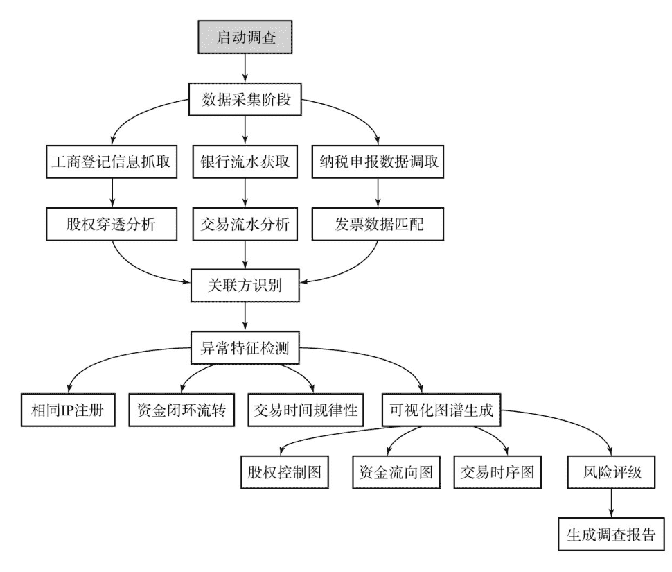

图5-2 AI基于图网络的关联方挖掘流程

#### 4. 实时监控与预警推送
智能系统可对接ERP或税务系统，对科目进行实时监测。例如“销售费用”与“营业收入”变动方向长期背离时，自动推送核查清单。某金融机构应用后，虚假贸易背景的识别周期由两周缩短至1小时。

### 5.5.2 智能监测资金被占用与抽逃风险

#### 1. 资金占用与抽逃的财务风险
资金占用指大股东、关联方或经营层违规占用公司资金导致经营失血；抽逃资金指股东或实际控制人通过隐蔽方式转移资产，损害债权人及小股东利益。两者都可能引发现金流断裂、债务违约及法律风险。传统审计依赖手工抽查流水、合同与往来记录，面对海量数据易遗漏。

#### 2. 异常资金流动的智能识别
通过自动化分析交易数据提升监测效率，主要技术包括：
- 自然语言处理：解析银行流水备注，自动归类资金用途如“采购款”“借款”，并标记“无业务背景”“高频拆借”等异常。
- 机器学习模型：基于历史违规案例训练，识别可疑模式。例如主体反复向同一空壳主体转账，系统结合工商信息判断关联属性并给出风险评分。
- 图数据库分析：构建主体、股东、供应商、客户的资金往来网络，揪出循环交易或资金闭环。

#### 3. 实际应用案例
案例1：关联方资金占用监测
某已上市主体以“预付账款”形式向关联方输送资金，手工审计耗时3周才发现。系统在分析流水时发现近80%预付款流向3家新设且无实质业务的供应商，2小时内生成风险报告。

案例2：股东抽逃注册资本识别
一家初创主体在成立后短期内大额转款至个人账户，模型结合《公司法》关于抽逃出资的规定，比对验资报告与资金流向，自动标记异常并提示进一步核查。

### 5.5.3 关联交易与舞弊的智能识别突破

#### 1. 关联交易与舞弊的风险特征
关联交易指主体与其股东、经营层或关联方之间的商业往来，部分合法但易藏舞弊，如虚增收入、转移定价、资金占用。传统审计靠手工核查合同、流水与股权结构，对复杂架构或跨境交易难以全面覆盖。

#### 2. 异常关联交易的识别方法
主要方法包括：
企业股权图谱分析：利用图数据库自动构建主体、股东、子公司及高管关系网络，识别隐蔽关联方，可穿透多层控股发现实质关联。
交易行为建模：机器学习分析历史交易数据，识别异常模式，如与关联方交易价格长期偏离市场价则标记为异常定价风险。
文本挖掘与合同分析：自然语言处理解析合同条款，校验交易背景合理性。例如系统发现“技术服务费”支付给无资质的关联公司，触发预警。

#### 3. 实际应用案例
案例1：虚构收入识别
某已上市主体通过关联方循环交易虚增营收，传统审计未察觉。系统分析销售合同发现多家客户注册地址相同且金额高度相似，结合工商数据确认关联关系，揭露舞弊。

案例2：异常资金转移监测
一家集团以“借款”名义向高管控制的空壳公司转账，系统通过流水频率、金额及收款方背景分析，识别出交易缺乏合理商业目的并生成风险报告。

### 5.5.4 遏制盈利预测过于乐观

#### 1. 盈利预测激进的本质与风险
盈利预测激进指财务预测中过度乐观，表现为收入增速远高于行业均值、成本费用占比异常偏低。常见于融资、并购或上市，可能导致估值泡沫与投资损失。传统预测依赖历史线性外推与手工经验，客观性不足。

#### 2. 智能预测模型的技术优势
多维度数据整合：同时纳入主体财务、行业趋势、宏观经济等300余个影响因子，避免单一指标偏差。
动态权重调整：机器学习自动识别各因子在不同时期的影响程度，例如疫情期自动上调供应链稳定性权重。
异常值检测：通过离群点分析识别不合理假设，如某制造主体预测次年毛利率骤增15%，系统经行业基准比对后标记预警。

#### 3. 典型应用场景
场景1：IPO盈利预测审核
某拟上市主体预测未来三年收入复合增速达45%，系统分析其行业近十年上市主体的实际增速分布，发现该预测处在行业前2%分位，自动输出合理性分析。

场景2：并购估值复核
在A主体收购B主体的交易中，系统对比B主体预测销售费用率8%与其历史水平12%及同业均值10.5%，识别出费用预测可能被低估，为谈判提供依据。

### 5.5.5 破解尽调信息不透明困局

#### 1. 信息不透明的核心痛点
主要表现为关键财务数据缺失或模糊、跨系统数据格式不统一、非结构化数据占比高。某并购案例显示，分析师约40%工作时间消耗在数据收集与清洗上。

#### 2. 突破信息壁垒的关键路径
（1）智能数据抓取与清洗
依托自然语言处理文档解析引擎自动从扫描件提取表格；机器学习识别不同系统字段映射关系实现自动对齐；异常值检测模型快速定位报表勾稽关系矛盾。
（2）多源数据融合分析
知识图谱整合工商登记、司法判决、舆情等10余维公开数据；预测模型填补缺失数据；区块链存证保障数据溯源真实性。

#### 3. 典型应用场景突破
场景1：跨系统财务数据整合
某集团并购尽调中，系统在72小时内完成对接7种ERP系统、标准化2000余个会计科目并生成统一合并报表，较传统方式节省80%时间。

场景2：非结构化信息挖掘
通过计算机视觉与自然语言处理技术分析董事会决议关键条款变更、供应商合同隐性关联关系、邮件往来风险信号。某案例中发现合同隐藏的对赌条款，避免估值失误。

#### 4. 主流解决方案对比
当前市场典型工具对比，如表5-2所示。

表5-2 当前市场典型人工智能工具对比

| 工具名称 | 核心功能 | 适用场景 |
| --- | --- | --- |
| 德勤 Argus | 跨源数据自动关联 | 跨国并购尽调 |
| 文因互联 | 中文合同智能拆解 | 境内交易审查 |
| Palantir | 端到端数据追踪 | 复杂股权架构分析 |

#### 5. 现存挑战与技术演进
(1) 主要瓶颈：小语种文件解析准确率不足；高度定制化报表处理效率待提升；数据隐私与合规边界把控。
(2) 前沿方向：多模态大模型提升文档理解能力；联邦学习实现数据可用不可见；智能问答系统支持自然语言查询。

# 第6章 人工智能赋能尽调底稿智能化升级

## 6.1 尽职调查工作底稿概述

工作底稿由工作记录与重要资料构成。工作记录用于留存调查过程、内容、方法与结论；重要资料为项目组在调查期间取得或制作的、可证明调查工作并支撑结论的支撑性文件。

底稿要求内容完整、格式规范、记录清晰、结论明确。工作记录至少包括主体名称、调查时间或期间、调查人员、调查日期、调查地点、调查过程、调查内容、方法与结论及其他说明事项。来自主体或第三方并经确认的资料，除注明来源外，调查人员还应实施必要程序并形成相应记录与签字。

底稿可采用纸质、电子或其他介质留存，重要底稿应以纸质保存。非纸质底稿需以可独立保存形式留存。

## 6.2 尽职调查工作底稿的撰写

撰写应包含封面、目录、序言与正文四部分。

### 1. 封面
(1) 体现报告主题、调查时间及各调查人责任分工。
(2) 封面应包括项目名称、调查部门、调查时间、相关调查人员手签。

### 2. 目录
(1) 列出主要标题，通常至三级标题并标明页码。
(2) 报告在5页以下可省略目录。
(3) 附件或表格排在目录末尾。

### 3. 序言
序言一般包括报告目的与范围、报告中使用的简称与定义、尽调方法及限制、所依据文件及情况截止日期、假设、前提承诺、免责限制与声明等。

### 4. 正文
正文需列举尽调过程中获取的信息，对委托事项作出详尽明确的结论。主要涵盖目标主体设立与存续、经营情况、财务概况、资信状况、债权债务、公司治理、对外投资、关联情况、重大争议等。

工作底稿是调查小组形成的完整工作记录，质量体现工作态度。总之，可按尽调各环节实际形成底稿，各记录与资料应统一编号、分隔清晰并保持勾稽关系；交叉引用时应注明索引号，并由调查人员及相关人员签字。工作底稿包括编制底稿、尽调附件、用于阐释结果的表格与文件等。

## 6.3 尽职调查工作底稿常见模板

### 6.3.1 设立与存续

设立与存续相关模板见表6-1至表6-3。

▼表6-1 设立与存续——公司登记基本资料

| 公司名称 | | 调查人 | |
| 调查日期 | | 起止时间 | |
| 调查地点 | | 调查项目 | |
| 调查目的 | 调查目标公司主体是否合法成立 | | |
| 调查内容和方法 | No. | 项目 | 有 | 无 | 调查方法 | 调查过程 | 备注 |
| | 1 | 营业执照（正本及副本） | | | 要求公司提供，去工商行政管理部门查询 | | |
| | 2 | 项目建议书 | | | 要求公司提供、要求目标公司开介绍信去有关部门查询；应将其内容与目标公司实际情况相对照 | | |
| | 3 | 出资协议 | | | 要求公司提供，注意中外合资、合作企业体现为合资、合作合同，股份有限公司体现为发起人协议；应审查其内容是否合法，是否与营业执照、批准登记证书、章程一致 | | |
| | 4 | 章程 | | | 要求公司提供，去工商行政管理部门查询；应审查其内容是否合法，是否与营业执照、批准证书、出资协议一致，特别注意历年公司章程修改情况 | | |
| | 5 | 批准设立的文件 | | | 要求公司提供，去工商行政管理及各有关审批部门查询。外资企业为批准证书 | | |
| | 6 | 法定代表人、董监高任命 | | | 要求公司提供相关资料，通过查阅有关会议文件、公司章程等方法，了解董监高任职情况 | | |
| 调查结论 | | | | | | | |
| 附件目录 | （此项调查所取得的文件或谈话笔录等原始资料直接附在本表格之后，使二者保持关联） | | | | | | |
| 调查人签字 | | | | | | | |

▼表6-2 设立与存续——变更情况

| 公司名称 | 目标公司或其关联公司名称 | 调查人 | |
| :--- | :--- | :--- | :--- |
| 调查日期 | | 起止时间 | |
| 调查地点 | | 调查项目 | 关于登记变更事宜的资料 |
| 调查目的 | | | |
| 调查内容和方法 | No. | 项目 | 有 | 无 | 调查方法 | 调查过程 | 备注 |
| | 1 | 有无增、减资 | | | 要求公司提供，去工商行政管理部门查询注意事项：不要只看变更结果或相关申请表格等工商登记资料，还要关注相关的股东会决议、董事会决议、政府批准、章程修正案或修改后章程、增资验资报告与认缴增资协议、合并等的方案或协议。每个变更的每个环节都过一遍，确认合规 | | |
| | 2 | 有无经营范围变更 | | | | | |
| | 3 | 有无法定代表人变更 | | | | | |
| | 4 | 有无股权变更（股权转让、赠与、继承、被强制性执行等），股权转让协议 | | | | | |
| | 5 | 有无合并、分立、改制、重组等重大变更 | | | | | |
| | 6 | 有无其他登记、备案事项变更 | | | | | |
| 调查结论 | | | | | | | |
| 备注 | | | | | | | |
| 附件目录 | （此项调查所取得的文件或谈话笔录等原始资料直接附在本表格之后，使二者保持关联） | | | | | | |
| 调查人签字 | | | | | | | |

▼表6-3 设立与存续——分支机构

| 公司名称 | | 调查人 | |
| 调查日期 | | 起止时间 | |
| 调查地点 | | 调查项目 | 分支机构 |
| 调查目的 | | | |
| 调查内容和方法 | No. | 项目 | 有 | 无 | 调查方法 | 调查过程 | 备注 |
| | 1 | 分公司营业执照 | | | | | |
| | 2 | 设立分公司的决议或其他批准文件 | | | | | |
| | 3 | 反映分公司营运资金拨付情况的文件 | | | 要求公司提供，去工商行政管理部门查阅相关登记、变更资料 | | |
| | 4 | 分公司负责人及管理团队的任命文件 | | | | | |
| | 5 | 分公司如系他人挂靠，相关的挂靠或承包协议 | | | | | |
| | 6 | 项目部或其他分支机构相关文件 | | | | | |
| 调查结论 | | | | | | | |
| 备注 | | | | | | | |
| 附件目录 | (此项调查所取得的文件或谈话笔录等原始资料直接附在本表格之后，使二者保持关联) | | | | | | |
| 调查人签字 | | | | | | | |

### 6.3.2 股东与股权

股东与股权相关模板见表6-4至表6-6。

▼表6-4 股东与股权——公司股权结构

| 公司名称 | | 调查人 | |
| 调查日期 | | 起止时间 | |
| 调查地点 | | 调查项目 | 公司股权结构 |
| 调查目的 | 什么人设立和运营目标公司 | | |
| 调查内容和方法 | No. | 项目 | 有 | 无 | 调查方法 | 调查过程 | 备注 |
| | 1 | 公司目前的股东名册 | | | 要求公司提供、现场调查核实、走访工商行政管理部门，以及查阅营业执照、公司章程、财务报告及审计报告（如有），相互印证 | | |
| | 2 | 出资证明书 | | | | | |
| | 3 | 股权结构图 | | | | | |
| | 4 | 股东身份资料，包括自然人股东身份证、法人股东营业执照 | | | 对于自然人股东身份证的真假可采用新旧程度观察来辨别，以及到公安部门户籍调查科核实 | | |

# 尽调核查要点归纳

把尽调从流程走查转为风险点排查，下文按表格顺序梳理股东、资本、对外布局、治理、内控、资产、人力、业务等模块的关键核查事项，便于对照落地。

### 股权基础与持有人核查
**架构与属性**
5. 各持有人的持股穿透图，如持有人为法人需追溯至最终受益层级。核查需以企业提交的资料为基础，配合现场访谈复核并至工商登记部门调档，再以营业执照、章程、财务报表、审计意见等资料相互对照。
6. 各持有人股权属性分类，国资与非国资划分。核查路径同上，以工商档案、章程、财报、审计文件交叉核证。
7. 持有人权利的行使现状。核查重心在表决权、经营决策权、分红权等是否真实合规行使。
8. 自然人持有人简历、法人持有人概况。信息尽可能完备，不足之处需补充。

每项形成结论，原始文件或访谈记录作为附件后置并保持对应，由调查人签认。

▼表6-5 股东与股权——股东出资
调查焦点为资本投入情形，比例、方式、时间节点、到位状态及权属清晰度为核心。

1. 各出资方投入比例与金额汇总。核查手段包括征询会计师事务所等中介、询问高管与财务人员、工商档案查询、验资报告核验及资金往来凭证查阅。1至6项可合并呈现。关注资金是否及时足额到位、投入方式合法性、有无不实出资、虚假出资、抽逃资金；非货币出资涉及的房屋、土地、交通工具、商标、专利等产权是否清晰；资产过户是否合规。
2. 各出资方投入方式明细。
3. 各出资方投入期限及分期安排明细。
4. 各出资方实缴状态明细。
5. 各类投入资产移交或过户手续明细。
6. 各类投入资产权属明晰情况明细。
7. 非货币出资是否存在价值短缺情形。
8. 出资方权利行使现状。

附结论、备注、附件清单及调查人签字。

▼表6-6 股东与股权——对外投资
调查焦点为对外布局。

1. 子公司情况。要求标的提供资料并至工商核查，获取营业执照、财务报表、投资协议等，了解被投方经营状况。对需审计的被投方取得审计报告，对重大项目取得投资合同及被投方内部批准文件。
2. 其他关联方情况，指直接或间接持股5%以上或存在实际控制关系的企业。通过人员访谈、咨询中介、查阅企业及控股股东或实际控制人的股权架构与组织架构、重要会议纪要及合同，按公司法及会计准则确认关联关系，并调档查阅关联方工商登记资料。

汇总结论、备注、附件清单及签字。

### 6.3.3 公司治理
公司治理相关模板见表6-7至表6-11。

### 6.3.4 内部管理与经营风险控制
内部管理与经营风险控制相关模板见表6-12至表6-14。

### ▼表6-12 内部管理与经营风险控制——组织结构与规章制度
调查焦点为组织架构与制度体系。

1. 内部组织架构图。与管理层沟通，索取规章制度，必要时查阅历史事件相关文件。
2. 各岗位职责说明。与相关管理人员交流，索取企业正式文件。
3. 制度汇编。了解企业是否建立知识产权等管理与保护机制，有则要求提供。
4. 近三年经营管理说明，涵盖业务、人员、财务变化。要求提供分支机构设立变更文件及对分公司的管控文件。

形成结论、备注、附件清单及签字。

### ▼表6-13 内部管理与经营风险控制——合同管理
调查焦点为合同管理。

1. 买卖、租赁等业务是否均签署书面协议。向经办人员了解，要求提供合同文本、管理制度及凭证，关注制度执行。采用在线审批平台者需查阅系统记录。
2. 合同审批权限及流程是否明确。
3. 签署前是否经法务专员审查。
4. 签署后是否统一归档并做好保密。
5. 合同执行是否明确责任人，确保及时履约。
6. 送货单、收货凭证、委托书、结算单、质量处理协议、发票、付款清单等原件是否保存完整。
7. 违约情形下是否留存补充协议或协商备忘录。

备注：本项仅核查制度是否建立，不评价制度合法性与执行效果。

### ▼表6-14 内部管理与经营风险控制——借贷、担保风险
调查焦点为借贷、担保风险。

1. 借贷、担保是否履行股东会、董事会决策程序及内部规章。与管理层沟通，查阅协议文件，了解借入、借出资金情况。在线审批使用者查阅系统记录。
2. 借贷、担保金额占净资产及总资产的比重。分析发生损失时对生产经营及盈利的影响。

本表侧重风险防范体系，与后续债权债务重大合同调查存在交叉。

说明：印章管理、知识产权管理、劳动管理等其他经营风险在对应表格中体现。

### 6.3.5 资产
资产相关模板见表6-15至表6-17。

### ▼表6-15 资产——不动产
调查焦点为不动产。

1. 不动产名录，要求企业提供，必要时向主管部门核查。
2. 加盖查询章的土地信息表。
3. 不动产权证书。
4. 不动产使用权证书。
5. 不动产共有证书。
6. 其他权利证书，需调取主债权协议、抵押合同及抵押登记文件。
7. 房屋租赁、出租协议。取得租赁协议与登记文件，评估出租房屋是否可解除及解约成本，查阅强制措施文件，判断合法有效性。
8. 司法措施文件。
9. 无偿使用他人土地或房屋情况，说明原因、使用期限，判断是否属于拆迁范围或近期拆迁风险。
10. 房屋是否被拆迁。

仅限企业自有土地使用权、建筑物、工程信息，不含承包等方式取得的资料。

### ▼表6-16 资产——设备及车辆
调查目的为产权、担保、租赁、进口合法性。

1. 设备及车辆名录。要求企业提供，至车辆管理部门核对登记资料。设备需含名称、型号、购入时间、使用地点、原值、使用年限、累计折旧、净值、取得方式；车辆需含行驶证、牌照等，由财务提供发票、付款记录佐证。
2. 设备及车辆取得证明资料。
3. 设备或车辆设定担保的合同及登记证明。
4. 进口设备海关、商检及免税等文书，如报关资料、发票、装箱单。
5. 租赁、出租、免费出借或使用他人设备情况。
6. 是否被查封、冻结等强制措施。
7. 其他相关资料。

### ▼表6-17 资产——在建工程
调查焦点为在建工程。

1. 建设用地规划许可证。要求提供并必要时核查，区分自建取得与权属转移取得，并提供对应文件。
2. 建设工程规划许可证。注意查阅附件，梳理强制招标原因及依据，取得招标文件、中标通知书，取得抵押协议及登记，核查是否放弃或明确有限受偿权约定，确认总包方资质及是否存在转包情形。
3. 建筑施工许可证。
4. 施工单位资质文件。
5. 是否属强制招标项目。
6. 是否开展招投标。
7. 在建工程抵押情况。
8. 优先受偿权是否另有约定。
9. 是否存在总包。
10. 专项竣工验收文件。

仅限自有土地使用权、建筑物、工程信息，不含承包等方式取得资料。

### 6.3.6 人力资源
人力资源相关模板见表6-18和表6-19。

### 6.3.7 业务
业务相关模板见表6-20至表6-23。

### 表6-20 业务——主营业务
调查焦点为主营业务。

1. 主营业务描述。
2. 主营业务是否在登记经营范围内。企业说明并提供文件。
3. 主营业务是否需要行政许可、批准、资质或授权。企业说明并提供文件。
4. 产品或服务是否发生投诉或索赔。取得相关记录与文件。

### 表6-21 业务——主营业务（以房地产项目为例）
调查焦点为主营业务。

1. 企业主营业务总体说明。
2. 项目政府批复文件，包括立项批复、环评批复、投资备案证、用地预审、规划意见书、设计方审定通知、设计批复、用地规划许可、工程规划许可等。
3. 征地拆迁相关文件，如涉及需取得征地拆迁批复、补偿协议、补偿价款支付凭证、公告及方案、拆迁许可证、总结报告。均要求企业提供，必要时向主管部门核查，未能取得需说明原因。
4. 相关部门审批：环保环评、消防设计审核及审批、交通影响评价、人防工程设计审核及施工图备案、文物保护、超限高层防震审批、节能审批、树木伐移、绿化园林审批、矿产资源核查或地质灾害评估批复等。不同项目要求差异，如污水处理特许经营以特许批文及环保要求为主；在建工程参照在建工程资产核查。
5. 项目运营资质，如房地产开发资质或暂定资质。
6. 商品房销售相关文件，如销售预售许可证、合同范本及补充协议、与银行按揭合作协议等。

### 表6-22 业务——主要供应商
调查焦点为主要供应商。

1. 主要供应商清单，含基本情况、合作年限、近三期交易金额。要求企业提供，与采购负责人及业务人员沟通，必要时访谈供应商。关注供应渠道是否过度集中、合作稳定性、股权变动是否导致合作中断或条件恶化、合同中是否存在因股权变动可解除条款。
2. 采购管理是否建立制度及固定模式。

| | 3 | 供应商履约情况和信用评估说明 | | | | | |

| | 4 | 公司股权变化对主要供应商有无影响 | | | | | |

| 调查结论 | | | | | | | |

| 备注 | | | | | | | |

| 附件目录 | | | | | | | |

| 调查人签字 | | | | | | | |

### 表6-23 业务——主要客户和销售渠道状况

| 公司名称 | | 调查人 | |

| 调查日期 | | 起止时间 | |

| 调查地点 | | 调查项目 | 主要客户和销售渠道状况 |

| 调查目的 | | | |

| 调查内容和方法 | No. | 项目 | 有/无 | 调查方法 | 调查过程 | 备注 |

| | 1 | 主要客户或销售渠道清单（含基本情况介绍，特别注明与公司合作期限及近三年交易金额） | | 要求公司提供文件，与销售、市场部门负责人及业务人员沟通，必要时询问主要客户或代理商。如客户或销售渠道很多，可划定一个调查起点金额 | | |

| | 2 | 公司销售管理是否有制度和固定管理模式 | | 注意事项：（1）关注客户或销售渠道是否过于单一，如合作时间过长、交易金额过大；是否一旦失去客户或某销售渠道中断，就会影响公司生产经营；（2）与客户和代理商、销售合作伙伴是否平等、稳定；（3）目标公司股权变化是否会导致客户和销售渠道等停止合作，或者提出更苛刻的合作条件；与供应商合作中是否有股权变动供应合同可解除的约定 | | |

| | 3 | 主要客户和代理商履约情况和信用评估说明 | | | | |

| | 4 | 公司股权变化对主要客户和销售渠道有无影响 | | | | |

| 调查结论 | | | | | | |

| 备注 | | | | | | |

| 附件目录 | | | | | | |

| 调查人签字 | | | | | | |

### 6.3.8 财务与税务

财务与税务的相关模板见表6-24和表6-25。

### 表6-24 财务与税务——财务报表等财务资料

| 公司名称 | | 调查人 | |

| 调查日期 | | 起止时间 | |

| 调查地点 | | 调查项目 | 财务报表等财务资料 |

| 调查目的 | | | |

| 调查内容和方法 | No. | 项目 | 有/无 | 调查方法 | 调查过程 | 备注 |

| | 1 | 最近三年财务报表 | | 要求公司提供，以及查阅会计师事务所审计的情况；走访有关会计师事务所，到工商行政管理部门核实有关情况 | | |

| | 2 | 最近三年会计师事务所审计情况 | | 注意事项：这部分主要是财务人员进行调查和分析，但律师也需要有所了解，主要关注财务管理防范情况，例如财务制度的制定和执行情况，会计、出纳相互监督机制的有效性，是否有算错账的情况及其严重程度 | | |

| | 3 | 公司财务管理制度 | | | | |

| | 4 | 公司财务内控机制 | | | | |

| | 5 | 之前是否有算错账的情况 | | 关注与股东、董监高、员工、重要供应商和客户的相关持股或协议控制关系 | | |

| 调查结论 | | | | | | |

| 备注 | | | | | | |

| 附件目录 | | | | | | |

| 调查人签字 | | | | | | |

### 表6-25 财务与税务——关于银行账户的资料

| 公司名称 | | 调查人 | |

| 调查日期 | | 起止时间 | |

| 调查地点 | | 调查项目 | 关于银行账户的资料 |

| 调查目的 | | | |

| 调查内容和方法 | No. | 项目 | 有/无 | 调查方法 | 调查过程 | 备注 |

| | 1 | 开户许可证 | | 要求公司提供，去相关银行查阅。注意事项：关注网上银行的使用和管理；关注有没有公款私存；关注公司账户与股东或董监高个人账户资金往来；关注多头开户情况；关注各账户与客户或有关方的收款、付款使用频率、使用方式情况；关注各账户相应的财务章、人名章等印鉴的留存、变更情况 | | |

| | | 银行信贷登记咨询系统贷款卡 | | | | |

| | 2 | 银行账户一览表（注明相应的留存印鉴） | | | | |

| | 3 | 网上银行 | | | | |

| | | U盾 | | | | |

| | 4 | 其他账户资料 | | | | |

| 调查结论 | | | | | | |

| 备注 | | | | | | |

| 附件目录 | | | | | | |

| 调查人签字 | | | | | | |

### 6.3.9 争议与处罚

争议与处罚的相关模板见表6-26和表6-27。

### 表6-26 争议与处罚——已解决民事纠纷

| 公司名称 | | 调查人 | |

| 调查日期 | | 起止时间 | |

| 调查地点 | | 调查项目 | 已解决民事纠纷 |

| 调查目的 | | | |

| 调查内容和方法 | No. | 项目 | 有/无 | 调查方法 | 调查过程 | 备注 |

| | 1 | 近三年内发生的已解决的民事纠纷清单（含与公司股东和董监高有关的纠纷，下同） | | 要求公司提供有关司法文书，必要时走访法院、仲裁机构核实有关文书的真实性；档案要完整 | | |

| | 2 | 诉讼案件文件（全部档案） | | 注意事项：这些纠纷是否有遗留问题（例如未执行完）；公司处理这些纠纷的方式是否合理 | | |

| | 3 | 仲裁案件文件（全部档案） | | | | |

| | 4 | 其他已解决纠纷文件（如调解机构或政府部门调解过的纠纷） | | 如进入诉讼程序，则归入诉讼文件档案 | | |

| 调查结论 | | | | | | |

| 备注 | | | | | | |

| 附件目录 | | | | | | |

| 调查人签字 | | | | | | |

### 表6-27 争议与处罚——未决民事纠纷

| 公司名称 | | 调查人 | |

| 调查日期 | | 起止时间 | |

| 调查地点 | | 调查项目 | 未决民事纠纷 |

| 调查目的 | | | |

| 调查内容和方法 | No. | 项目 | 有 | 无 | 调查方法 | 调查过程 | 备注 |

| | 1 | 公司关于未决民事纠纷的书面说明（含与公司股东和董监高有关的纠纷，下同） | | | 要求公司提供有关司法文书，或通过受理案件的法院或仲裁机构查阅相关文件；要求公司承诺的该案件代理律师或公司内部法务人员提供上述纠纷的可能结果及专业律师意见；劳动仲裁如进入诉讼程序，则归入诉讼文件档案 | | |

| | 2 | 诉讼案件文件（全部档案） | | | | | |

| | 3 | 仲裁案件文件（全部档案） | | | | | |

| | 4 | 其他未决纠纷文件（如调解机构或政府部门调解过的纠纷） | | | | | |

| | 5 | 就未决纠纷，是否有和解或其他计划 | | | | | |

| | 6 | 这些纠纷对并购的影响 | | | | | |

| 调查结论 | | | | | | | |

| 备注 | | | | | | | |

| 附件目录 | | | | | | | |

| 调查人签字 | | | | | | | |

## 6.4 AI赋能财务尽职调查工作底稿的智能化变革

### 6.4.1 AI驱动的底稿自动化生成

#### 1. 数据采集与结构化处理

借助自动化手段，财务资料的获取与整理效率明显提升。RPA 机器人可从 ERP、银行对账单等电子系统自动抓取数据，相当于安排了一名不会出错的数据搬运工。纸质合同、流水影像通过 OCR 转为可编辑文本，且能保留表格结构和印章位置。访谈环节利用 ASR 实时转写，避免人工记录偏差。采集后借助 NLP 进行清洗，系统能辨识应收账款与应收票据等易混科目并完成会计科目归集，大幅缩短人工核对耗时。数据采集与结构化处理AI技术示例，如图6-1所示。

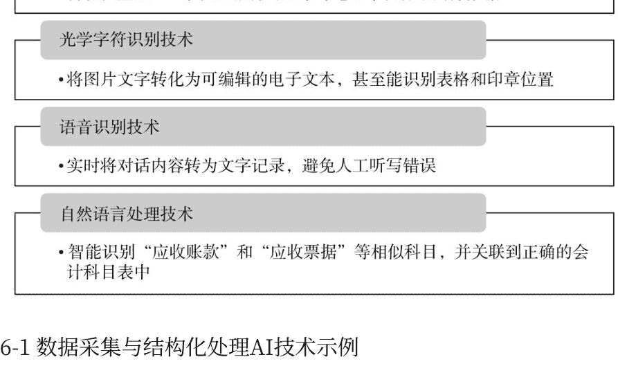

图6-1 数据采集与结构化处理AI技术示例

#### 2. 底稿模板智能生成

平台集成覆盖制造、金融等 300 多个行业的工作底稿模板，形成可复用的模板库。选择制造行业模板时，系统会主动载入固定资产评估所需的折旧年限、残值率等字段，并根据企业实际动态调整。生成阶段，大模型可快速解析报表并自动填表，例如依据应收账款明细自动计算账龄占比并生成分析性文字。用户可随时补充分行业风险提示，修改内容会被记忆以便下次调用。

#### 3. 生成流程优化

生成采用先搭框架后填充内容的分步策略，如图6-2所示。先输出目录与章节标题，再逐步写入数据与结论，类似先打地基再砌墙。在关键节点设置人工复核入口，例如关联交易分析会自动标黄提示补充定价依据，保证专业判断不被替代。系统还会自动追加最新版声明与法律条文，例如在底稿末尾插入保密条款与签名区，版本号随修改自动更新，避免误用旧模板。最终文件可一键导出带水印 PDF，满足审计归档要求。

图6-2 AI分步生成策略

### 6.4.2 AI增强的底稿质量控制

#### 1. 全流程质量保障体系

实时校验像智能安检一样运行。系统会比对合同扫描件金额与电子台账是否一致，发现小数点错位或单位误标如万元误作元会自动标红。跨表勾稽方面，现金流量表与资产负债表的平衡关系会被自动验证，例如净利润加折旧摊销是否等于经营现金流，不匹配时立即预警。存货周转率等指标一旦偏离行业正常区间，系统会结合历史数据与市场环境判断是录入错误还是经营异常，并以可视化图表呈现波动原因。

#### 2. 智能审核机制

通过语义分析比对底稿描述与原始合同条款的一致性。例如风险披露中提及的担保条款，若在附件中找不到对应表述，系统会标记描述缺失。针对潜在风险，系统会综合账龄、客户集中度等指标给出高、中、低三级评级，并生成建议，如建议上调坏账计提比例或提示关联交易占比超阈值，审核报告会自动高亮重点段落，便于人工快速定位。

#### 3. 人机协同修正

平台完整记录人工智能建议与人工决策过程。例如存货估值调整时，同时保留模型提出的按最新市价重估方案和人工最终选择的成本与市价孰低法。每一次修改均生成带时间戳的版本，支持与三个月前原始底稿的差异比对，用色块标注增删。最终底稿会附上置信度评分，如数据校验可信度 98%，帮助使用者判断自动化结果的可靠性。

AI底稿质量控制三层面如图6-3所示。

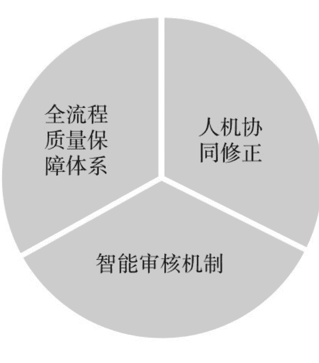

图6-3 AI底稿质量控制层面

### 6.4.3 AI赋能的动态底稿管理

#### 1. 版本智能控制

系统可自动追踪每次修改并识别影响范围，像智能警报器一样提示联动风险。例如税率调整后，自动检查利润表、纳税申报表等关联表格并标记需同步更新的单元格，防止遗漏导致报表错误。每次修改均生成时间水印并通过区块链固化，确保记录不可篡改，审计时可调取历史版本进行差异比对，并以不同颜色标注新增与删除内容。

#### 2. 跨团队协作优化

根据角色自动分配权限，实习生仅能浏览基础数据，项目经理可编辑核心财务指标，形似智能门禁。多人在线协作时支持实时批注，若两人同时修改应收账款数据，系统会弹窗提示冲突并保存两个版本供负责人裁定。所有修改建议与最终决策路径都被记录，形成可视化的操作日志树。

#### 3. 环境适应性管理

内置合规雷达每日抓取财政部、税务总局等官网动态，会计准则变更后 24 小时内更新底稿模板中的计算公式与披露要求。例如 2025 年新租赁准则实施后，经营租赁数据自动迁移到资产负债表对应科目，并生成新旧准则对照说明供复核。

表6-28 AI赋能的动态底稿管理核心功能

| 功能模块 | 技术实现 | 核心功能 |

| :--- | :--- | :--- |

| 版本智能控制 | 区块链时间戳追踪；变更影响分析算法 | • 自动追踪文档修改轨迹； • 识别税率/准则调整引发的数据联动更新范围 |

| 权限动态分配 | RBAC 模型 + 环境感知引擎 | • 实习生仅查看基础数据字段； • 项目经理可编辑核心财务指标； • 审计师锁定敏感区域 |

| 协同冲突解决 | 多版本合并算法；实时批注系统 | • 双人修改冲突弹窗提示； • 自动保存分歧版本； • 操作路径可视化溯源 |

| 合规雷达监测 | 政策文本 NLP 解析；模板自动更新引擎 | • 每日抓取 200 + 政府网站； • 自动识别会计准则变更关键字段； • 24 小时模板迭代 |

| 历史版本审计 | 差异对比可视化工具；热存储分层架构 | • 90 天内任意版本调取； • 红绿颜色标注增删内容； • 冷数据归档成本降低 40% |

### 6.4.4 AI在底稿分析中的深度应用

#### 1. 多维数据洞察

通过构建企业关系图谱，像绘制关系地图一样揭示隐性风险。例如系统能自动分析供应商间的股权关联，发现同一法人控制的多家企业存在循环担保问题。财务指标预测采用类气象预报的 Prophet 算法，利用历史数据建模预测营收增长率，某酒企据此提前 3 个月预判季度销售额波动趋势。

#### 2. 风险智能识别

系统可解读管理层会议录音中的情绪波动，当高管频繁使用“可能”“不确定”等词汇时，自动提升风险等级。在票据审核中，通过扫描发票印章纹理和数字水印，识别出某企业伪造的 2.7 亿元增值税票。该技术使假票识别准确率达 99.8%，远超人工审核。

#### 3. 可视化决策支持

系统自动生成动态分析看板，如用雷达图展示企业偿债能力：某集团借助 Power BI 实时显示流动比率、速动比率等 5 项指标，异常数据自动标红闪烁，管理人员点击即可查看关联合同扫描件。中国科学院研发的 AutoPatent 框架，将专利分析报告生成时间从 2 天压缩至 10 分钟，关键数据遗漏率下降 60%。

AI在底稿分析中的深度应用如图6-4所示。

图6-4 AI在底稿分析中的深度应用

### 6.4.5 AI赋能的底稿归档与复用

#### 1. 智能分类归档

系统像智能图书管理员一样自动整理文件。通过深度学习模型，系统能同时给文档打上多个标签，例如自动识别某份底稿属于“制造业—应收账款审计—高风险”组合标签。对于合同扫描件等非结构化数据，AI 会提取关键信息如签约日期、交易金额，并自动生成索引目录。某投行使用该技术后，文档归类准确率从 78% 提升至 95%。

#### 2. 知识复用引擎

系统内置智能档案员功能，能快速找到相似案例。例如输入“新能源汽车并购尽调”，AI 会通过语义分析检索近三年同行业项目底稿，用颜色标记关键差异点。对于长篇报告，AI 可自动生成 3 行核心结论摘要，某律所借此将案例检索时间从 2 小时缩短至 10 分钟。

#### 3. 云原生存储优化

系统像仓库管理员自动分配存储位置。高频使用的合同模板存放在快速存储区，三年未调阅的会议记录则迁移到低成本存储区，某基金公司借此节省 40% 存储费用。所有数据采用全链路加密，即使云端管理员也无法查看原始内容，某银行使用该技术后通过银保监会数据安全审计。

表6-29 AI赋能的底稿归档与核心功能的对照

| 功能模块 | 技术实现 | 核心功能 |

| :--- | :--- | :--- |

| 智能分类归档 | Transformer 多标签分类 OCR + 知识图谱提取 | • 三维标签体系（行业/业务/风险）； • 非结构化数据关键字段识别； • 自动化索引目录生成 |

| 知识复用引擎 | Embedding 语义检索 T5 模型摘要生成 | • 跨项目案例匹配（近3年同行业）； • 差异点颜色标注； • 长文本3行核心结论提炼 |

| 云原生存储优化 | AWS Glacier 分层存储同态加密技术 | • 冷热数据自动迁移（高频/低频访问）； • 全链路数据加密； • RBAC 权限动态控制 |

# 第7章 如何用AI撰写尽职调查报告

## 7.1 AI撰写尽职调查报告的基础认知

### 7.1.1 AI撰写报告的核心价值

#### 1. 效率革命

效率提升带来撰写速度的质变，人工智能如同不知疲倦的助手，能同时完成资料收集、测算分析与文档生成。例如企业并购尽调中，传统方式需要 3 名会计师花费 3 天整理财务数据，而智能系统只需 3 小时就能输出完整报告。

#### 2. 精准度提升

精准度体现在细节把控上，系统能避免人工操作中常见的数字抄错、公式套错等问题。比如某份财务报表中，人工容易混淆“应付账款”和“预付账款”科目，AI 通过自然语言理解技术准确匹配对应数据，将科目匹配准确率提升到 99.8%，相当于每 1000 条数据只有 2 条需要人工复核。

#### 3. 知识复用

知识复用让企业积累的经验不再沉睡在档案室。某银行客户经理需要撰写中小企业贷款报告时，系统自动推送同行业历史案例、最新监管要求模板，使经验复用率提升 60%，原本需要 3 小时查找资料的工作现在 2 分钟就能完成。

#### 4. 风险控制

# 报告智能化：让风控更早抵达 让产出更快兑现

风控能力给一份研报装上早期预警的意义不言而喻。某集团上线智能化风控体系后，平台自主识别出被尽调对象借助三家空壳主体做关联交易，成功规避了约五千万元的投资损失。背后支撑的是平台内建的四百多条金融风险规则形成的规则库，相当于同时有数百位资深风控人员在线把关。

图7-1概括了智能辅助撰写报告的核心价值。

图7-1 智能撰写报告的核心价值

### 7.1.2 技术实现的底层逻辑

#### 1. 数据层
数据层相当于整座架构的地基，信息汇聚主要依赖三类手段。①OCR被视作智能扫描装置，能把纸质财报转成可计算的电子形态；②API接口充当数据快递角色，可实时拉取工商、征信等官方信息；③爬虫像一张覆盖面广的网络，持续采集行业新闻与政策变动。

#### 2. 算法层
算法层以大模型为中枢。①能自动测算流动比率、资产负债率等五十余项财务指标，某会计师事务所落地后审计报告差错率由3%降至0.5%；②法律条文比对可在很短时间内通读三百页合同，并标出与《民法典》不相符的表述；③语义理解让平台读懂专业表述，比如把“EBITDA增长率”自动转译为“息税折旧前利润变化趋势”。

#### 3. 应用层
应用层把技术转化为可感知的生产力。①WPS/Office插件形同一支智能笔嵌入日常办公，客户经理撰写授信材料时一点即可自动补全工商信息并生成财务分析段落；②修订模式像教师批改作业，用红字提示风险，例如某银行平台发现客户经理把“应收账款周转天数”公式写反并及时纠正；③历史版本比对可回溯三个月内的修改轨迹。

数据层、算法层、应用层技术体系对比如表7-1所示。

表7-1 数据层、算法层、应用层技术体系对比

| 架构层级 | 技术模块 | 核心功能 | 技术支撑 |
| :--- | :--- | :--- | :--- |
| 数据层 | OCR 智能扫描系统 | 纸质文档电子化转换；多语言混合识别 | 图像处理算法 + 深度学习模型 |
| 数据层 | API 数据中台 | 实时调取官方数据；高频次结构化传输 | RESTful 协议 + 分布式调度 |
| 数据层 | 智能爬虫引擎 | 全网动态监控；非结构化数据处理 | 多线程采集 + 语义解析 |
| 算法层 | 财务分析引擎 | 50 + 指标自动化计算；三表联动异常检测 | 财务知识图谱 + 动态校验算法 |
| 算法层 | 法律条款比对系统 | 300 页合同秒级扫描；法规冲突智能标红 | 法律知识图谱 + NLP 语义解析 |
| 算法层 | 专业语义理解模块 | 术语自动转换；上下文关联分析 | Transformer 架构 + 领域微调 |
| 应用层 | 智能办公插件 | 工商信息自动填充；财务段落智能生成 | 智能办公插件、RPA 流程自动化 |
| 应用层 | 智能修订系统 | 公式逻辑校验；风险点红字标注 | 动态校验算法 + 异常模式识别 |
| 应用层 | 版本溯源管理 | 修改记录可视化追踪；数据篡改溯源 | 区块链存证技术 + 操作日志分析 |

### 7.1.3 适用的业务场景分析

#### 1. 标准化场景
标准化场景适合流程重复、模板固定的工作，例如上市公司年报分析。这类材料需要大量数据整理与指标测算，智能工具可像流水线一样自动完成。某证券公司借助智能化手段处理300页IPO申报文件，原本两周的格式调整与数据核对，压缩至3小时产出符合交易所要求的标准文档。小微企业信贷尽调也属此类，平台依据银行预设的20项核心指标如资产负债率、现金流覆盖率自动生成风险评估，客户经理只需复核关键点。

#### 2. 半结构化场景
半结构化场景需要人机协同，例如并购项目的法律合规审查。平台先通过工商接口抓取交易双方股权结构，再借助自然语言技术扫描合同中的对赌条款、竞业限制等内容，生成初步风险清单。但每起案件仍需人工补充特殊条款，例如某跨国并购中律师需手动加入目标所在国反垄断法要求，平台据此重新评估合规风险。该模式可把法务团队工作量削减六成，同时降低漏检关键条款的概率。

#### 3. 创新场景
创新场景依赖平台的实时学习能力，例如ESG投资评估。某基金公司平台每日抓取全球20个国家的环保政策、劳工权益新规，结合企业碳排放数据动态调整评分模型。2024年欧盟发布《可持续金融披露条例》后，平台48小时内完成200家被投企业的ESG报告更新，传统人工方式需要三个月。这类材料要求平台既能处理结构化数据，又能理解“温室气体核算方法修订”等专业政策变化的影响。

AI撰写报告适用的业务场景分析如图7-2所示。

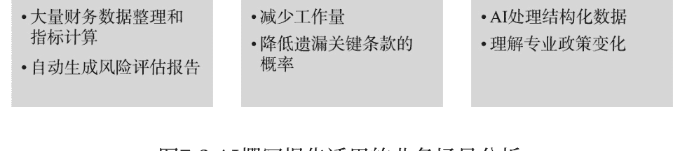

图7-2 AI撰写报告适用的业务场景分析

### 7.1.4 与传统撰写方式的对比

#### 1. 效率维度
传统做法像手工裁缝逐针缝制，投行分析师需从十多个系统导出数据再手工粘贴到Excel测算财务比率，一份并购报告平均耗时40小时。而智能化工具像智能印刷机，3小时即可输出初稿，某私募基金借此把尽调效率提升8倍，抓住稍纵即逝的投资窗口。

#### 2. 准确性方面
人工操作容易出现低级失误，例如某份尽调报告因把“营业收入增长率”公式分母写错，导致估值偏差2亿元。智能平台借助预设的400多条校验规则，如现金流量表与利润表勾稽关系核验，把基础数据错误率从12%降至0.5%。但复杂商业逻辑仍需人工判断，如某平台把企业的合理税务筹划误判为违规，需风控专家二次复核。

#### 3. 知识复用能力
传统模式依赖个人经验，某资深会计师需三年才能熟练掌握科创板IPO审核要点，其经验难以快速复制。智能平台则构建企业级知识库，某律所把20年积累的3000个并购案例转化为知识图谱，新人律师借助系统推荐的历史相似案例，首月即可独立完成基础尽调模块。

#### 4. 风险控制层面
传统方式像事后灭火，某次IPO因未披露关联交易被监管处罚，复盘发现人工核查时漏掉两家间接控股公司。智能平台通过股权穿透算法自动识别出五层控股结构下的关联方，某券商借此把合规风险预警时效从14天缩短至实时监控。但对新兴风险如元宇宙领域的数据合规问题，仍需人工持续更新规则库。

AI与传统撰写方式的对比如图7-3所示。

## 7.2 关键技术与实施路径

### 7.2.1 数据采集与清洗技术

#### 1. 多源数据接入
通过三种方式汇聚数据，如图7-4所示。

图7-4 汇聚数据的三种方式

①行内系统对接如同打通企业“血管”，某银行经由内部数据通道ESB总线实时获取信贷审批记录、客户交易流水，原先跨部门申请的数据现可在10秒内调取；
②外部数据调用像“空中加油”，某证券公司通过企查查API每秒自动获取50家企业的股权变更信息，比人工查询快200倍；
③纸质文档识别技术如同“智能扫描仪”，IDP系统能识别200多种版式的财报，某审计机构借此把100页纸质报表电子化时间从3小时压缩到8分钟，准确率超98%。

#### 2. 结构化处理
①财报科目智能映射功能像“翻译官”，某跨国企业应用新收入准则时，系统自动匹配新旧科目差异项，避免人工换算导致的1.2亿元营收误算；
②合同文本挖掘如同“风险探测仪”，某律所借助智能化手段扫描3000份投资协议，成功识别出12份隐藏对赌条款的合同，其中1份条款可能引发2.3亿元赔偿风险。

#### 3. 质量控制机制
①区块链记录修改痕迹如同不可擦除的日记本，证明数据真实性；
②异常值预警系统像“警报器”，当某食品企业营收增长率突然超过行业均值3倍时，系统立即提示可能存在虚增收入风险，经核查发现其通过关联交易虚报业绩的事实。

### 7.2.2 自然语言处理应用

#### 1. 语义理解
语义理解让平台像“法律翻译官”般读懂专业文本。某银行使用BiLSTM+CRF模型扫描贷款合同，成功识别出“流动比率<1.2”的风险标记并自动标注红色预警，该技术三个月内发现12家企业的偿债能力异常。例如某份企业财报中“应收账款周转率下降但营业收入增长”的异常组合，平台通过语义分析将其标记为潜在财务造假信号。

#### 2. 逻辑推理
逻辑推理如同“法规侦探”，基于RAG框架实现条文关联。某跨国企业并购案中，平台自动比对欧盟GDPR与某省《数据安全条例》，发现隐私数据跨境传输规则冲突，提示需补充签订补充协议。该能力源于知识图谱中预设的5000+法律条文关联关系，相当于为每份报告配备专业法务团队。

#### 3. 文本生成结合
“标准化模板”与“自由创作”并行。①模板引擎像“填空机器人”，自动填入财务数据生成标准化段落，例如某券商平台用预置的20种利润分析模板，3分钟完成300页IPO申报材料的核心章节；②大模型则像“行业分析师”，基于舆情数据撰写自由文本，例如某智能平台根据新能源汽车行业政策变化，生成包含“固态电池技术突破将重塑供应链”的前瞻研判，准确预测3家上游企业股价波动。

自然语言处理的三种应用如图7-5所示。

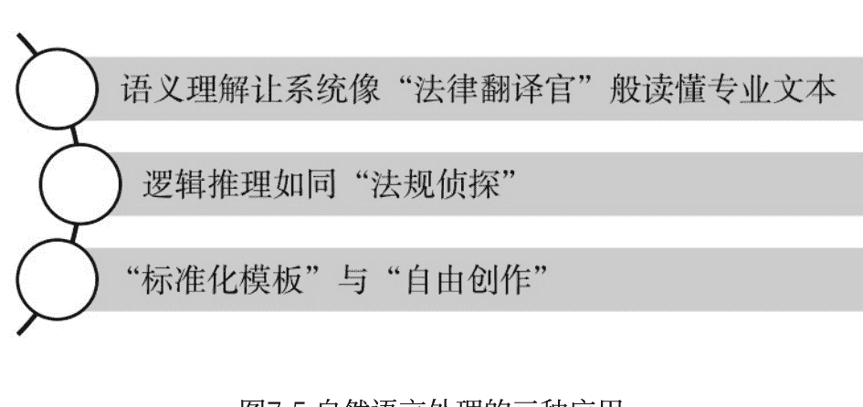

图7-5 自然语言处理的三种应用

### 7.2.3 知识图谱构建方法

#### 1. 本体设计
本体设计如同绘制“企业关系地图”，定义企业、人物、事件等5类核心实体。某私募机构构建的知识图谱中，仅用30秒便展示出某集团通过5层股权结构控制的12家关联公司，而传统人工核查需3天。

#### 2. 关系抽取
关系抽取揭示隐藏的商业网络。①股权穿透功能曾发现某上市公司实际控制人通过海外信托持股，规避信息披露义务；②供应链分析模块追踪到某汽车厂商的二级供应商使用不合规原材料，提前预警召回风险，这些功能依赖对1.2亿条工商数据的深度挖掘。

#### 3. 动态更新
动态更新确保知识库“永不过时”。系统每天自动抓取2000+工商变更记录和100+司法诉讼公告，例如某次更新及时捕获目标公司新增的环保处罚信息，避免2.3亿元并购款误付。

### 7.2.4 机器学习模型训练

#### 1. 监督学习
监督学习让模型“站在巨人肩膀上”。某律所用10万份历史报告训练风险评级模型，新人律师使用该系统后，法律意见书错误率从15%降至3%，效率提升5倍。

#### 2. 无监督学习
无监督学习发现“看不见的关联”。某银行通过客户交易行为聚类，识别出3家表面无关联的企业实际由同一控制人操纵，拦截1.8亿元关联贷款风险。

#### 3. 强化学习
强化学习实现“越用越聪明”。某风控系统根据专家反馈优化贷后管理建议，经过6个月迭代后，不良贷款预测准确率从78%提升至92%。

### 7.2.5 报告生成引擎设计

#### 1. 模块化架构
模块化架构如同“乐高积木”灵活组装。达观智能系统将财务、法律、业务模块独立开发，某券商定制并购报告时，仅需勾选“反垄断审查”“税务筹划”等模块，系统自动组合生成500页专项报告。

#### 2. 个性化配置
个性化配置满足行业特殊需求。银行版报告默认嵌入巴塞尔协议风控指标，PE机构版则强化行业竞争格局分析，某基金公司借此将行业研究报告产能提升8倍。

### 7.2.6 质量控制系统搭建

#### 1. 机器校验
机器校验是“永不疲倦的审计师”。①财务钩稽关系验证曾发现某企业虚增利润1.2亿元，系统通过比对利润表与现金流量表差异自动报警；②法律条文时效性检查每日扫描10万余条法规，某次更新后自动标记63条失效条款。

#### 2. 人机协同
人机协同实现“双重保险”。①可信度评分低于80分的段落强制人工复核，某次智能平台误将合理税务筹划判为违规，经专家复核后纠正；②修订痕迹对比功能用红蓝批注显示智能与人工修改差异，帮助某审计团队3天内完成原本需2周的报告交叉验证。

## 7.3 典型应用场景实操

### 7.3.1 财务尽职调查报告

#### 1. 自动化模块
系统能自动计算EBITDA、流动比率等50多个核心指标，像“财务体检仪”一样快速扫描企业健康状况。例如某制造企业使用三表联动分析功能，发现存货周转天数异常延长，经核查是仓库管理漏洞导致积压，及时止损800万元。异常波动检测功能像“警报器”，某次发现某公司营收增长20%但应收账款周转率下降30%，系统自动标注为“虚增收入风险”，后证实其通过关联交易粉饰业绩。

#### 2. 高阶应用
财务造假预测功能基于Benford定律，曾识别出某企业成本数据人为篡改痕迹，经审计发现其通过虚增原材料采购转移资金。现金流压力测试功能模拟极端情况，某地产集团测试“利率上浮1%”场景时，系统显示其短期偿债缺口扩大至1.2亿元，促使企业提前调整融资结构。财务尽职调查报告的AI应用场景如图7-6所示。

### 自动化模块

- 系统能自动计算EBITDA、流动比率等50多个核心指标

- 异常波动检测功能

### 高阶应用

- 财务造假预测功能

- 现金流压力测试功能模拟极端情况

图7-6 财务尽职调查报告的AI应用场景

### 7.3.2 法律合规性报告

#### 1. 智能审查
合同条款冲突检测功能曾发现某劳动合同中的竞业限制期限超过法定上限，自动提示修改建议。跨境数据传输合规模块像“双轨翻译官”，某跨国企业使用后，可一键生成同时满足欧盟GDPR和中国《网络安全法》的报告，将合规审查时间从2周缩短至3小时。

#### 2. 案例库
关联交易历史判例参考功能，在某医药企业并购案中，系统自动匹配90%相似度的既往案例，提示“需补充境外反垄断审查材料”，避免项目延期。智能NDA生成功能根据合作方类型调整条款，某风投机构用此功能为不同合作伙伴生成20版保密协议，效率提升5倍。

### 7.3.3 业务分析报告

#### 1. 市场洞察
某新能源汽车企业使用行业趋势预测功能，系统结合政策舆情和锂价走势，提前6个月预警电池成本上涨风险，企业据此锁定长期采购协议节省成本1.3亿元。竞争对手动态监控功能每周自动生成SWOT分析，某快消品牌借此发现竞品新品上市延迟，及时抢占市场份额。

#### 2. 客户画像功能
供应链脆弱性评估模块发现某手机厂商70%芯片依赖单一供应商，系统建议引入备选供应商后，在行业缺芯潮中保障了正常生产。ESG表现评级功能对标行业龙头，某化工企业通过系统提示的环保指标差距，投资改造污水处理系统，ESG评级从C级跃升至BBB级。业务分析报告的AI应用场景如图7-7所示。

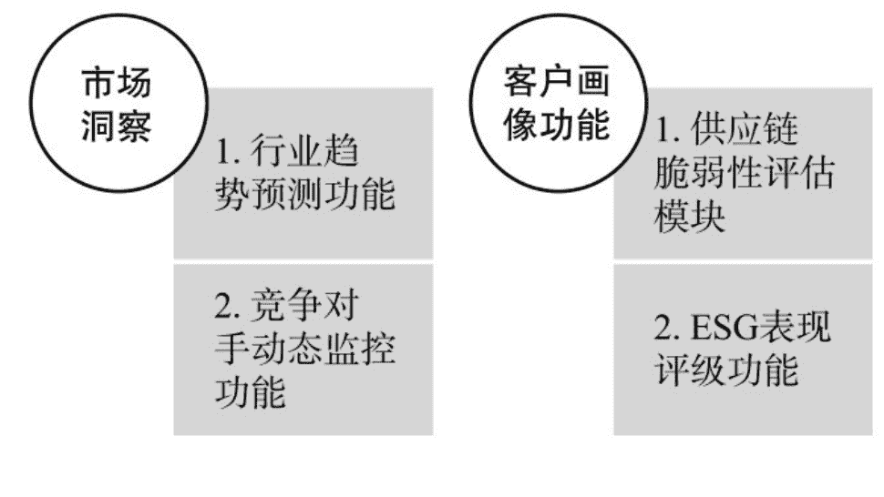

图7-7 业务分析报告的AI应用场景

### 7.3.4 综合评估报告

#### 1. 多维度整合
某私募基金使用风险热力图功能，发现标的公司财务风险低但法律诉讼风险高的“红黄交织”特征，最终放弃投资。智能评分卡功能为某上市公司量化评估出89分的投资价值，关键指标包括研发投入占比、专利数量等20项参数。

#### 2. 决策支持功能
退出方案模拟功能为某Pre-IPO项目测算显示，选择并购退出比等待IPO预期收益高15%，但流动性风险降低40%。敏感性分析功能展示“原材料涨价10%”将导致估值缩水22%，促使投资方增加价格联动条款。

### 7.3.5 行业专项报告

#### 1. 定制化能力满足特殊需求
新能源行业模块内置补贴政策模型，某光伏企业用此测算出政策退坡将影响年度利润8%，提前调整销售策略。生物医药模块的临床试验追踪功能，实时监控某创新药研发进度，在Ⅲ期临床数据异常时提前预警，避免3亿元研发投入损失。

#### 2. 动态知识库实现“智慧传承”
实时接入的行业数据库像“信息捕手”，某券商研究员通过彭博API自动抓取200家科创板企业研发数据，3小时完成原本需1周的手工整理。专家经验数字化功能将资深分析师的投资逻辑转化为200条规则，新人使用系统后项目评估准确率从65%提升至85%。行业专项报告应用场景如图7-8所示。

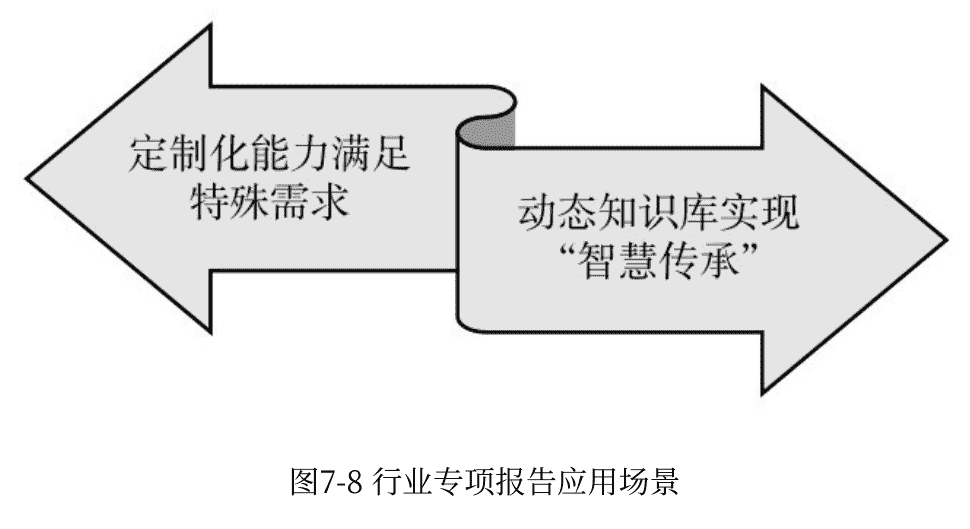

图7-8 行业专项报告应用场景

## 7.4 质量保障与风险控制

### 7.4.1 准确性验证机制

#### 1. 三维数据校验体系
(1) 数据溯源验证：系统通过类似“数字指纹”的技术区块链记录每一条数据的修改痕迹。例如，当企业财务数据被修改时，系统会自动生成永久性记录，包含修改时间、操作人、修改内容等信息，确保数据源头可追溯。这种技术已在碳排放计量等领域应用，解决数据造假问题。

(2) 交叉核验矩阵：通过建立财务数据与业务数据的关联规则，自动验证数据合理性。例如，某商品的销售量增加时，对应的库存减少量、物流发货量必须匹配。这种验证方法参考了银行财报分析中的“收支平衡检查”原理。

(3) 动态校准机制：系统实时监测数据波动并触发预警。例如，当系统预测某月现金流为100万元，但实际数据偏差超过5%即低于95万元或高于105万元时，会自动要求人工复核数据源和计算模型。

三维数据校验体系如图7-9所示。

图7-9 三维数据校验体系

#### 2. 智能复核技术栈
(1) 财务公式自动化验算：系统内置类似“智能计算器”的功能，自动验证报告中的加减乘除、利润率等公式是否正确。例如，某企业报告中“净利润=收入-成本-税费”的公式若被错误修改，系统会立即标红提示。

(2) 上下文语义一致性检查：通过人工智能技术识别文字矛盾。例如，若报告中某段声称“销售额同比增长20%”，但表格数据仅显示10%增长，系统会用红色波浪线标注矛盾点。

(3) 历史数据对比分析：系统自动对比当前数据与过去三年的同期数据。例如，某月库存周转率突然下降50%，系统会标记异常并提示“与历史平均水平差异过大，建议核查采购或销售记录”。

智能复核技术栈的组成如图7-10所示。

图7-10 智能复核技术栈的组成

### 7.4.2 合规性审查要点

#### 1. 智能合规三阶审查

(1) 底层规则层：平台内嵌国家金融监管的主干准则库。典型做法是植入金融监管九大红线，涵盖严禁外泄客户信息、禁止使用虚假贷款材料等要点，相当于给报告装上自启报警装置。一旦文档内容触碰红线，系统会立刻弹出预警，体感接近汽车超速时的鸣响提示。

(2) 行业适配层：依行业特征定制审查逻辑。医疗类报告会重点核查患者隐私保护表述，金融类报告则自动校验反洗钱数据。某银行信贷系统借此，使贷款材料造假比例下降了68%。

(3) 法规刷新层：准则库实现日更，类似手机App后台升级。监管发布新政，例如2025年最新医疗数据管理规范，平台可在24小时内把新规转成审查规则，避免企业沿用过期标准。

智能合规三阶审查如图7-11所示。

图7-11 智能合规三阶审查

#### 2. 风险量化管理工具

(1) 风险灯号看板：用红黄绿灯直观呈现风险层级。例如把客户信息泄露标为红灯高风险，把格式排版错误标为绿灯低风险。

(2) 合规缺口优先级模型：自动测算整改顺序。比如同时检出10处问题，系统会建议先处理可能导致罚款逾百万元的高危项，再改文字性瑕疵，思路与急诊分诊相似，先救重症。

(3) 历史案例联想：自动匹配过往违规先例。某企业财报关联交易数据异常时，系统会即时调出三年前一家上市公司因同类问题被罚380万元的案例，助力审阅人员快速判断。

### 7.4.3 敏感信息处理规范

#### 1. 全流程防护体系

(1) 采集阶段，系统把企业资料划分为三类管控：工商信息如营业执照号、财务数据如银行流水、商业机密如客户名册，相当于给文件贴不同颜色标签。某银行会自动隐藏客户经理录入的法人家庭住址，仅保留办公地址。

(2) 存储环节采用双重保险，文件既使用国家认证的高级密码加密，安全性堪比军用保险箱，又叠加动态水印，若被截图传播，水印会显示操作人姓名与时间，某集团据此揪出违规传播合同的员工。

(3) 共享时系统自动对敏感字段脱敏，例如身份证号显示为“370××1234”、银行卡号替换成“6217××889”，某电商借此日均处理超10万条客户信息且零泄露。

#### 2. 特殊场景处置方案

(1) 跨境传输时，系统像智能海关一样自动比对国内外法规。向欧洲传输时核对欧盟隐私法，如隐藏客户年龄；国内传输时同步校验《网络安全法》，如金融数据须境内备份，某跨国企业借此通过20国数据合规审查。

(2) 与第三方合作时，系统可在3分钟内生成保密协议模板，技术外包合同自动增补研发保密条款，审计服务协议嵌入财务数据使用限制，某律所使用后合同签署效率提升60%。

(3) 发生泄露时启动“1小时黄金救援”：15分钟内锁定泄露账号并冻结文件，45分钟追踪到某员工用私人邮箱转发客户名单，60分钟远程清除外发文件——某医院用此机制将患者数据泄露影响缩小90%。

### 7.4.4 人机协同工作流程

#### 1. 五阶协作模型

(1) 数据采集阶段，系统自动完成约80%的底层工作，如通过扫描仪识别纸质文件文字如营业执照，或抓取公开网站工商信息，相当于配备一名不知疲倦的资料收集员。

(2) 分析环节，人工智能与人工专家共同参与决策。以银行信贷评审为例，系统先列出借款人财务风险点，信贷经理再结合市场经验判断是否放贷，配合方式类似医生结合化验单与临床经验诊断。

(3) 审核环节采用“机器初筛+人工精审”，系统先用红色标出明显格式错误与数据矛盾，如报告中净利润增长率计算错误，人类审核员则聚焦关联交易等复杂问题，某证券公司借此使审核效率翻倍。

(4) 修改阶段系统提供智能建议，如将口语化“赚了钱”改为专业表述“净利润增长”，或自动补全缺失行业数据，像配备24小时待命的写作助手。

(5) 成稿后加盖防伪电子印章存档，所有修改记录永久保存，典型案例进入知识库供新人参考，某集团因此将历史案例利用率提升至80%。人机协同工作五阶协作模型如图7-12所示。

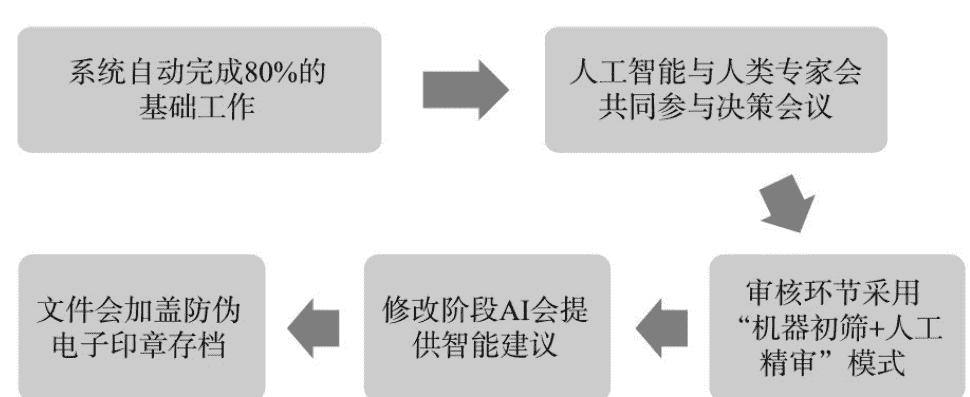

图7-12 人机协同工作五阶协作模型

#### 2. 协同技术平台

(1) 智能版本控制系统让文件修改全程可追溯，每次保存记录操作人及时间，关键版本自动添加时间戳，解决了合同反复修改导致的版本混乱，某企业因此减少90%的版本错误。

(2) 多模态审核看板在一个界面集中展示所有问题，文字表述错误用红框标出，图表单位缺失给出提示，公式计算矛盾则高亮，效果如同给报告做全身CT，某券商曾借此发现饼图数据与文字描述不一致的重大疏漏。

(3) 智能标注系统支持多人协作批注，财务批注显示蓝色，法务批注显示红色，所有意见自动汇总成待办清单，还能快速检索三个月前的修改记录，使跨部门协作时间缩短65%，某项目组用3天完成原本需2周的联合审查。

三大协同技术平台功能结构化对比如表7-2所示。

表7-2 三大协同技术平台功能结构化对比

| 维度 | 核心功能 | 技术支撑 | 实现路径 |

| :--- | :--- | :--- | :--- |

| 智能版本控制系统 | 实现文件全生命周期追踪与版本回溯 | 时间戳算法 + 操作日志管理 + 权限矩阵 | 1. 版本快照自动生成 2. 操作日志实时记录 3. 权限分级控制 |

| 多模态审核看板 | 跨模态数据一致性校验与风险可视化 | NLP 语义解析引擎 + OCR 图文关联技术 + 可视化渲染引擎 | 1. 多源数据接入 2. 异常模式识别 3. 三维可视化引擎构建 |

| 智能标注系统 | 多角色协同批注意见智能整合 | 协同批注引擎 + 颜色编码系统 + 自然语言处理 | 1. 角色权限分配 2. 批注语义解析 3. 智能检索算法部署 |

### 7.4.5 持续优化迭代策略

#### 1. 双环优化机制

(1) 每周“敏捷迭代环”类似团队定期问题诊断会。某银行风控部门每周五下午复盘过去一周误判案例，如把正常转账误判为诈骗，通过对比用户操作记录与系统判断逻辑，发现系统未识别新型诈骗话术。团队据此下周更新关键词库，误判率从5%降至1.2%。

(2) 每季度“战略升级环”相当于系统全面体检。某电商平台每季度重训风险审核模型，2024年第三季度新增《数据安全法》中未成年人保护条款后，系统自动将未满14岁用户订单列为高风险交易，需人工二次确认以避免违规销售。两环配合，前者解决日常小问题，后者应对行业大变化，某保险公司借此将反欺诈模型迭代速度提升3倍。

持续优化迭代策略双环优化机制如图7-13所示。

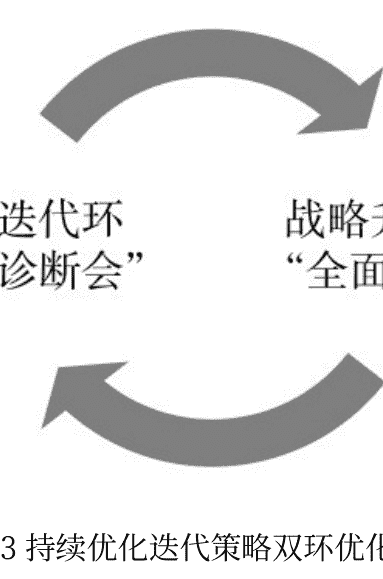

图7-13 持续优化迭代策略双环优化机制

#### 2. 优化工具箱

(1) A/B测试框架相当于方案对比实验室。某物流公司设计两版合同审核模板，A版用红色高亮风险条款，B版用弹窗提示风险等级，1个月真实业务测试显示B版使法务部审核效率提升40%，最终全公司推广。

(2) 根因分析矩阵是问题挖掘利器，结合“5次追问”与鱼骨图。某医疗集团用其分析病历审核错误：首次追问“为何漏诊”发现系统未关联患者历史用药记录；第五次追问到“数据库接口权限设置错误”，最终调整权限层级减少80%数据遗漏。

(3) 知识蒸馏系统像经验复制机，某证券公司把20年工龄合规专家的审核习惯转化为系统规则，如“关联交易金额超净资产5%需重点核查”，原本需3小时人工检查的报表，系统10分钟完成初筛，准确率达92%。三大优化工具结构化对比如表7-3所示。

表7-3 三大优化工具结构化对比

| 维度 | 核心功能 | 技术原理 | 数据验证方法 |

| :--- | :--- | :--- | :--- |

| A/B 测试框架（方案对比实验室） | 通过多版本实验验证最优方案 | 流量分割 + 假设检验、置信区间分析 | 双样本 T 检验（p < 0.05）、置信区间重叠分析 |

| 根因分析矩阵（问题挖掘神器） | 通过系统化追问定位深层问题根源 | 5 Why 分析法 + 鱼骨图可视化、关联矩阵建模 | 帕累托分析（80/20 法则）、故障模式影响分析（FMEA） |

| 知识蒸馏系统（经验复制机） | 将专家经验转化为可执行规则体系 | 规则引擎 + 自然语言处理、决策树算法 | 混淆矩阵评估、ROC 曲线分析 |

### 7.4.6 伦理与法律边界

#### 1. 双重防护网络

(1) 伦理防护上，系统自动为所有AI生成内容打上“AI创作”水印，类似给照片添加拍摄时间，防止虚假信息被误认为人工创作。某新闻平台应用后，用户举报假新闻比例下降68%。同时系统扫描歧视性用语，如自动标出“某地区人素质差”等偏见表述并推荐中性表达，某招聘网站因此性别歧视投诉减少55%。

(2) 法律防护像为企业穿上防弹衣，系统可按行业自动生成18种免责声明模板，如电商平台使用“商品描述AI辅助生成，请以实物为准”提示以避免图文不符纠纷。所有操作记录生成含时间戳和数据指纹的证据链，某金融公司借此成功举证合同纠纷，法庭直接采信电子存证。伦理与法律边界双重防护网络如图7-14所示。

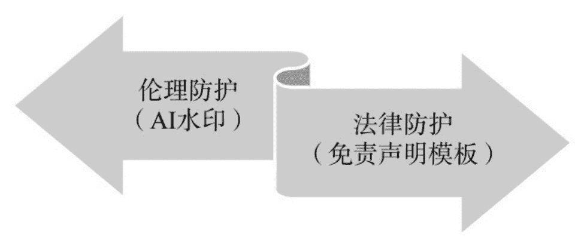

图7-14 伦理与法律边界双重防护网络

#### 2. 争议解决机制

(1) 系统预设三种应急响应模式：技术故障时自动切换备用服务器，如某直播平台断播10秒内恢复；内容争议启动人工复核绿色通道，如某社交平台24小时处理侵权投诉；法律纠纷触发电子证据一键调取。该分级机制使某在线教育平台纠纷解决周期从15天压缩至3天。争议解决机制三种应急响应模式如图7-15所示。

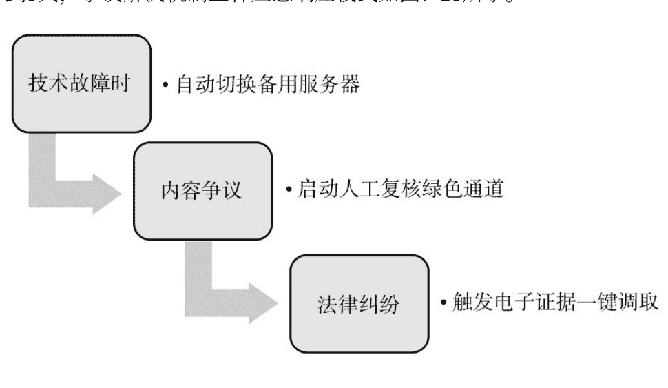

图7-15 争议解决机制三种应急响应模式

(2) 复杂问题时，法律专家、AI工程师与业务主管组成联合工作组。处理AI绘画侵权争议时，技术组解析算法逻辑、法务组比对著作权法条款、业务组评估商业影响，三方协同制定方案，该模式在某短视频平台解决音乐版权争议时调解成功率提升至82%。

(3) 定期开展“模拟法庭演练”，用真实案例测试处置流程。某电商平台模拟测试发现“七天无理由退货”条款被机器人客服误读，提前优化话术后相关投诉减少40%，这种压力测试犹如消防演习，确保真遇纠纷时能迅速有效应对。

# 第8章 AI赋能环境下财务尽职调查综合案例展示

## 8.1 AI全流程赋能的财务尽职调查案例：X科技公司并购项目

### 8.1.1 项目背景与AI启动阶段

#### 1. 行业背景：智能硬件赛道竞争格局与政策环境分析

智能硬件是当前技术创新的核心领域之一，2025年中国市场规模已突破4.26万亿元。竞争格局呈现头部企业主导与新兴企业崛起并存，华为、小米、海康威视等凭借技术积累与生态布局占据主要份额。政策层面，国家通过《中国制造2025》等举措推动产业升级，提供研发补贴、税收优惠，同时强化数据安全与知识产权保护，为并购营造规范市场环境。但行业仍面临核心技术对外依赖、生态碎片化等挑战。

#### 2. 技术选型：AI模型选型决策树（NLP/OCR/机器学习算法组合）

技术选择采用“决策树+复合模型”逻辑，预算编制关键环节如图8-1所示。

(1) 自然语言处理：用于分析并购合同、专利文件等文本，自动抽取关键条款如付款条件、保密义务。在X科技项目中，NLP从800页合同里精准抓取12项核心知识产权归属条款，节省人工筛查时间90%。

(2) 光学字符识别：将扫描版财务报表转为结构化数据，处理效率比人工录入提升80%，某次尽调中系统仅用1小时完成5年财务报告数字化，人工需5天。

(3) 机器学习算法：采用Light GBM模型进行风险预测，可同时处理数值型数据如资产负债率与分类数据如行业类型，训练速度比传统模型快3倍，在X科技案例中模型提前3个月预警供应链风险，准确率达89%。

该组合既能处理非结构化文档，又能快速搭建风险评估模型，契合并购复杂需求。

#### 3. 数据准备

(1) 多源异构数据采集。覆盖三大核心数据源：①财务报表扫描件，通过OCR转换近5年资产负债表、现金流量表；②供应链数据，对接X科技ERP系统，抓取上下游300+供应商交易记录；③专利数据库，整合国家知识产权局与第三方商业数据库，分析52项核心专利法律状态。

(2) 数据清洗流程。建立五层质检机制：①自动识别缺失值并标记；②智能修复矛盾数据如营收与现金流不匹配；③标注特殊交易异常值如单笔超千万元关联交易；④生成数据质量评分报告；⑤人工复核高风险数据点。该流程使数据可用率从68%提升至92%。

(3) 风险预判模型。基于2018—2024年500余个并购案例库构建深度学习预警系统：①输入层整合财务、法务、业务等18类指标；②隐藏层采用长短期记忆网络LSTM捕捉时序特征；③输出层生成红/黄/绿三级风险信号。测试中模型提前识别出X科技3项潜在风险，包括专利侵权纠纷与供应链集中度过高。

多源异构数据整合与风险预警系统构建方案如表8-1所示。

表8-1 多源异构数据整合与风险预警系统构建方案

| 模块名称 | 核心内容 | 技术/方法 | 数据量/范围 |

| :--- | :--- | :--- | :--- |

| 多源异构数据采集 | ①OCR文本识别技术。 ②ERP系统API对接。 ③多源数据库融合技术 | ①近5年报表。 ②300+供应商。 ③52项核心专利 | ①报表转换准确率≥99%。 ②供应商覆盖率100%。 ③专利法律状态更新时延<24h |

| 五层质检机制 | ①缺失值标记。 ②矛盾修复。 ③异常值标注。 ④质量评分。 ⑤人工复核 | ①自动识别算法。 ②智能修复算法。 ③阈值判定规则。 ④评分模型。 ⑤专家复核机制 | 全量数据覆盖 |

| 深度学习预警模型 | ①输入层（18类指标）。 ②隐藏层（LSTM网络）。 ③输出层（三级风险信号） | ①多模态特征融合。 ②时间序列建模。 ③风险分级算法 | 500+并购案例库（2018-2024） |

| 测试验证成果 | 提前识别X科技公司： ①专利侵权纠纷。 ②供应链集中度过高。 ③现金流异常波动 | ①法律文本挖掘。 ②网络拓扑分析。 ③时序模式检测 | 3项高风险预警 12项中风险提示 |

### 8.1.2 AI驱动的尽职调查执行阶段

#### 1. 数据层

(1) 非结构化数据处理。系统通过扫描合同、邮件等文件自动识别关键条款如付款周期、违约责任，并将义务条款整理成可视化表格。在X科技并购中，系统仅用3小时完成1200份合同条款提取，比人工效率提升15倍。

(2) 实时数据监控。系统每日自动抓取银行流水、订单等动态信息，实时调整现金流预测模型。当某月回款率下降5%时，系统自动触发预警并建议调整信用政策，动态监控使现金流预测准确率从78%提升至92%。

#### 2. 分析层

(1) 财务健康度三维评估。系统基于近5年数据从3个维度打分，如图8-2所示：①流动性，计算现金储备能否覆盖6个月运营支出；②盈利性，分析毛利率波动是否超出行业正常范围；③成长性，评估研发投入与市场扩张匹配度。最终生成类似体检报告的分数卡，如流动性B+、盈利性A-，并用红黄绿三色标注风险等级。

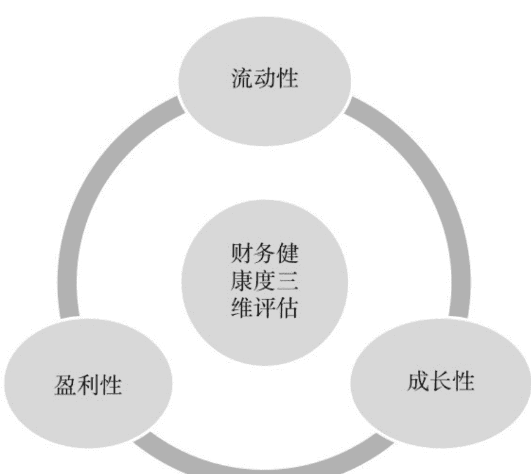

图8-2 财务健康度三维评估法

(2) 关联方穿透分析。通过系统绘制股权关系图，可一键查看X科技所有关联方，如持股超5%的12家子公司，并标注异常交易，如某子公司连续3年向母公司低价供货。系统还能自动识别影子股东等隐蔽关联。

#### 3. 应用层

(1) 风险雷达图。将合规、税务、商誉风险量化为0～100分，以雷达图展示。例如合规风险42分主要因2项专利即将到期；税务风险68分因跨境交易税务筹划存在漏洞；商誉风险55分因收购溢价高于行业均值30%。不同等级对应不同应对策略，高亮区域需优先处理。

(2) 智能问询系统。系统依据尽调进展自动生成问题清单。例如发现存货周转率异常时，系统会推送：①是否因供应链管理失效导致库存积压？②是否存在未披露存货质押情况？这些问题可引导尽调人员重点核查仓库出入库记录。

### 8.1.3 AI辅助的决策支持阶段

#### 1. 并购溢价测算

系统通过“蒙特卡罗模拟”与“敏感性分析”联动测算并购溢价。蒙特卡罗模拟可模拟10万种市场变化场景，如原材料价格波动、政策调整，计算出X科技估值最可能区间如15亿～22亿元。敏感性分析则重点测试关键因素影响，如行业增长率下降1%时估值可能减少3.2%。两者结合后系统生成动态估值区间报告，帮助决策者理解不同风险下的溢价合理性。蒙特卡罗模拟与敏感性分析在并购溢价测算中的联动应用如表8-2所示。

表8-2 蒙特卡洛模拟与敏感性分析在并购溢价测算中的联动应用

| 分析维度 | 蒙特卡洛模拟 | 敏感性分析 |

| :--- | :--- | :--- |

AI尽调全链路实操：从估值模拟到退出决策

估值推演与敏感性研判
估值端并行运行两套逻辑。一套是基于概率分布的情景模拟，用正态与三角分布对十万级市场变动做随机抽样，覆盖原材料价格、政策收紧等冲击，得出估值分布区间及均值、标准差与置信带。另一套是单因素扰动，量化行业增速、折现率等关键参数的边际影响，并以龙卷风图排序敏感度。风险因子分三类十五项，涵盖宏观GDP波动、行业竞争格局与企业成本结构；敏感性聚焦则锁定专利展期、供应链集中度等五到八个核心驱动，并做极端值测试。核心数值显示，估值概率密度峰值在19.3亿元，5%尾部风险价值为14.2亿元；行业增速每下行1%，估值回撤约3.2%；折现率下调0.5%，估值抬升约2.1亿元。

2. 交易结构优化
系统基于历史交易样本与市场规则自动生成三类对赌方案。保守型以营收增速挂钩，未达标时收购对价下调5%；折中型把专利保有量与分期尾款挂钩，每少一项专利尾款扣减0.8%；激进型绑定新品市占率，达标后触发额外奖励。模型会推演各方案未来五年的现金流表现并以红黄绿三色标注风险等级。以标的公司为例，折中方案在风险收益平衡上最优。

3. 退出机制建模
整合多源信息构建智能退出决策模型，如图8-3所示。IPO路径上，除科创板当前68%的过会率外，还量化专利储备底线，例如半导体赛道需15项核心专利，以及连续三年营收复合增速不低于30%的硬性门槛，并接入雪球、东方财富等平台的热词情绪，最终测算三年内上市概率约为45%。股权转让场景采用随机森林对潜在买家库建模，匹配业务协同度，如标的与Y集团在工业物联网领域的82%技术互补，并校验买家资产负债率不高于60%、历史并购溢价中位数28.5%，得出32%的溢价转让概率。
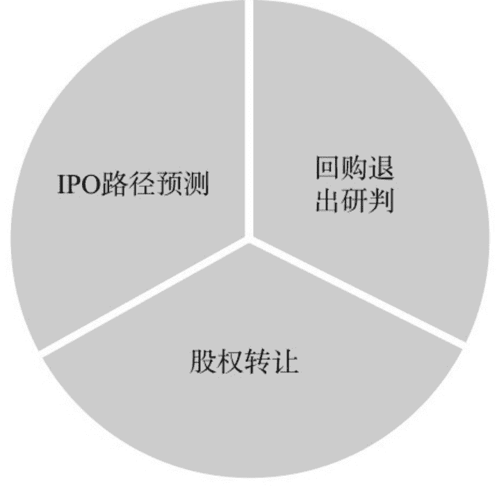
图8-3 AI智能退出决策模型
回购退出研判中，知识图谱追踪大股东质押率，当前26%低于行业均值41%，关联企业现金流覆盖1.8倍等18项信号，形成B+级资金链评分，回购条款触发概率约23%。综合200余个市场信号生成的退出时机热力图指向2026年Q2，届时M2增速有望回升至9.2%、行业β达1.3峰值，叠加百度指数“智能制造”搜索同比增173%，构成十年一遇的窗口。

##8.2 智能尽调报告生成与人机协同全流程
###8.2.1 报告智能生成
####1. 模块化架构：财务、法务、业务三引擎并行
尽调报告由三条智能分析引擎协同产出，如图8-4所示，完成后再合并。财务侧核算现金流时，法务侧同步检视担保条款，业务侧测算市场增速。当业务侧发现营收增长与市场萎缩矛盾时，自动触发财务真实性复核；系统自动关联模块信息，如法务发现的专利纠纷与财务计提的减值准备。

图8-4 AI生成尽职调查报告三大引擎
在标的案例中，系统两分钟内完成交叉验证：财务异常定位到2023年Q4利润率骤降8%，法务关联到同期5份高价原材料采购合同，业务端结合竞争数据验证价格波动合理性。传统方式需3人耗时6小时，自动化流程提效180倍且关联遗漏减少83%。

####2. 动态章节生成：按风险等级自动调节详略
系统依据风险高低自动伸缩报告深度。红色高风险如专利临期，会额外生成3到5页深度内容，包括专利法律状态、剩余年限与续费成本、同类技术替代进度；侵权案例库匹配3起相似失效诉讼及赔偿；应对推演建议提前6个月启动新技术备案。黄色中风险如供应商集中度过高，仅呈现TOP5采购占比图、备选供应商分布地图，并过滤技术细节，只保留两条改进建议：建立备选白名单、设置12个月过渡期分散采购。绿色低风险常规财务指标保留一页概览，含近三年营收增速、净利率、资产负债率折线，波动≤5%的指标自动批注“正常区间”，用三句话概括现金流可支撑约18个月运营等健康度。

智能缩放使平均200页压缩至50到120页，传统删减需3天，自动化生成约12秒。Y医疗尽调中，287页原始材料浓缩为89页，关键风险阅读时长由8分钟降至1.5分钟，按专利有效期≤24个月触发红色预警，确保无遗漏。

####3. 可视化增强
财务指标热力图自动生成，横轴为2021到2025年，纵轴为毛利率、存货周转率等10项核心指标，用红黄绿标注状态。标的公司2023年存货周转率变红，提示需核查库存积压。风险穿透溯源图谱则以可视化方式展示传导链条，如图8-5所示。

图8-5 风险传导链条的可视化图谱
首层为直接风险源，如供应商断供；次层为关联影响，如导致3条产线停产；末层为财务后果，预计单季损失5000万元。图谱支持逐级点击查看合同、交易记录等证据链。

###8.2.2 人机协同优化
####1. 专家干预机制
自动化程度高，但关键假设仍需人工校准。系统初判未来三年收入增速18%，专家基于专利临期经验手动修正为12%，并记录原因。该校准点形成知识库供后续复用，保证数据规律与商业逻辑兼顾。

####2. 版本追溯系统
每次修改自动生成时间轴：初版2025/3/10由模型生成；修订1 2025/3/12 人工调整商誉摊销年限；修订2 2025/3/15 补充跨境税务风险说明。机器修改标蓝，人工修订标红，点击段落可对比历史差异。案例中，版本对比发现模型曾遗漏子公司环保处罚，该漏洞被补入知识库。

####3. 合规性校验
内置动态监管规则库，覆盖证监会、交易所等200余条法规。检测到关联交易占营收35%，超30%预警线，系统红灯预警并调出《上市公司关联交易管理办法》条款，同时提示补充关联方定价公允性证明。实时校验使合规率由78%提升至97%。
人机协同优化尽职调查报告如图8-6所示。
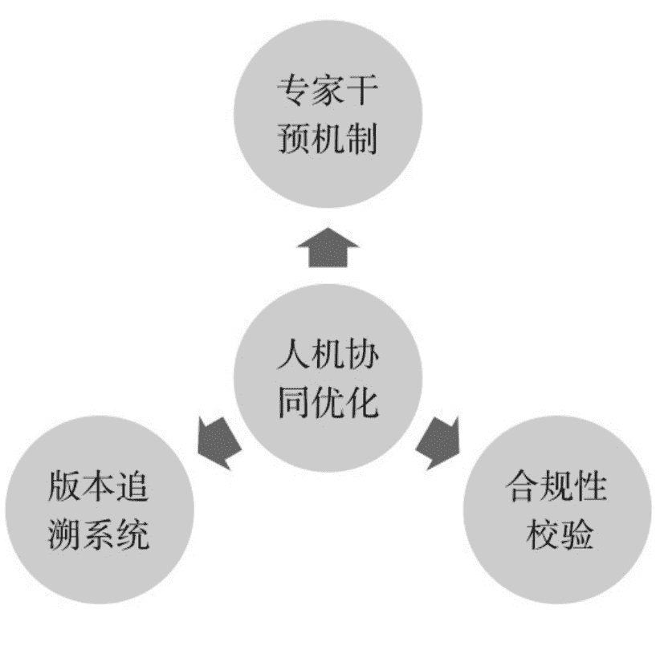
图8-6 人机协同优化尽职调查报告

##8.3 不同场景下智能尽调应用对比
###8.3.1 拟IPO企业尽调
####1. 特殊关注点
持续盈利能力验证模型通过分析近三年订单、产能、市占率等数据模拟盈利情景。某医疗器械企业申报时，模型模拟全国医保覆盖率降5%，预估净利润缩水28%，并与20家可比上市公司毛利率波动对比，验证模式可持续性。关联交易穿透检查自动扫描合同构建关系图谱。某新能源企业10家供应商为实控人亲属控股，系统比价发现3家采购价高于市场均价15%，提示利益输送；追溯资金流向发现“非关联”客户经多层股权嵌套实际关联，交易占比由表面8%修正至23%。

####2. 技术特色
问询函预测与应答预演基于近三年800份IPO问询函做LDA建模，提取研发费用、关联交易等18类高频问题。对某芯片企业，系统预判监管关注研发费用资本化比例，建议对比行业均值35%与企业42%，并准备20项研发项目进度证明，同时模拟问答演练。行业可比公司动态对标实时抓取30家可比公司10类指标。某AI企业研发投入强度25%高于行业18%，但人均专利仅为头部企业1/3，提示研发效率不足；技术路线图预警核心技术或被新一代算法替代，建议加速迭代。系统功能对照见表8-3。

###8.3.2 跨境并购尽调
####1. 技术突破
多币种财务智能转换自动将美元、欧元、人民币报表统一换算，并抓取历史汇率回溯五年数据。某并购中系统发现目标欧元收入因汇率虚增利润，修正后利润降12%，避免误判。国际税务差异矩阵汇编80国税务规则并做红黄绿风险标注。如美国研发抵税40%绿灯，德国增值税退税周期2年红灯，东南亚关税临时调整黄灯。某越南工厂并购中，系统提示环保税计算差异达35%，促成条款重谈。

####2. 风险控制
地缘政治风险指数整合智库数据监测东道国政策变动、历史制裁案例、行业敏感度。芯片并购审查概率是消费品4倍。某中东能源项目预警政策稳定性骤降，建议暂缓交割，三个月后新政出台。跨境资金流动沙盘如图8-7所示，模拟资金出入境全流程。

图8-7 AI模拟资金出入境全流程
对比股权分红、专利费等6种回流方式的税费；预警印尼单笔超500万美元需央行审批等额度限制；当到账周期达120天时，自动生成新加坡中转等备选通道。某车企并购德国企业，传统路径税费27%，优化组合后降至9%。

####3. 效率对比
人工处理多币种报表需2个月，误差超5%；自动化流程3天完成，误差0.3%。某集团因未识别巴西环保税差异被追缴1.2亿元，使用税务矩阵后同类风险被提前规避。

###8.3.3 危机企业重组尽调
####1. 特殊算法
流动性枯竭预警指数基于现金流、短期债务等数据生成。连续3月现金流入低于流出80%且流动比率跌破0.8时变红。X机械厂提前6个月预警应付账款逾期率激增200%，避免断链。资产瑕疵识别图谱自动扫描资产文件可视化标注：产权不清厂房红标、重复抵押设备黄标、关联公司虚增应收灰标。Y化工重组时，1.2亿元存货中40%过期原料以黑块显示。

####2. 处置建议
破产重整价值预测采用双轨评估引擎。清算价值按二手交易平台实时价、仓储与保质期折价测算，Z地产公司清算估值15亿；重生价值融合行业景气、技术升级潜力、去化周期等18维参数，估值28亿，依据含土地增值税递延优惠适用性、在建工程续建成本最优路径。债权人利益平衡模拟器如图8-8所示，对327家债权人画像：银行占62%关注现金回收，供应商28%重持续合作，债券持有人10%要求收益保障。
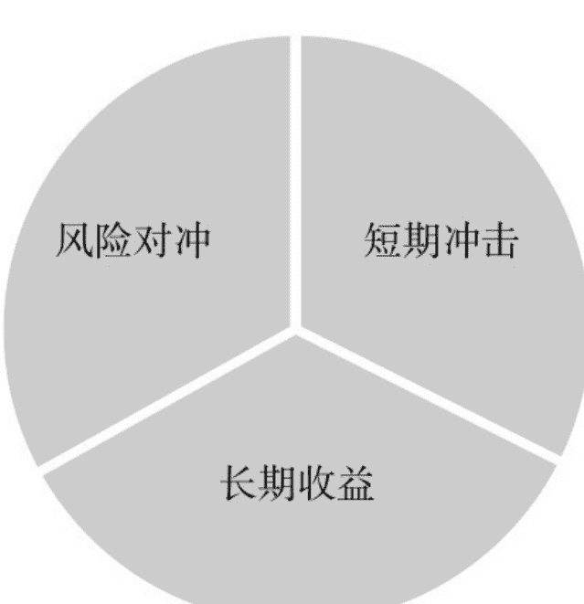
图8-8 债权人利益平衡模拟器
对“50%债转股+3年展期”方案模拟：前两年现金清偿减少9亿，触发8家核心供应商终止风险；第3-5年数字化改造后股权增值带来142%回报；设置股价挂钩现金补偿对冲风险。蒙特卡洛十万次模拟显示80%债权人五年本金回收概率超95%。

##8.4 智能尽调成效评估与经验沉淀
###8.4.1 效率指标
####1. 时间维度
自动化流程将传统周期压缩60%到80%。X科技并购项目传统模式需45天，财务核验25天、法务审查12天、业务尽调8天，合同审查日均50份；自动化模式18天含3天人工复核，OCR+NLP日均处理2000份合同，7×24小时运行，关键条款识别率99.3%。跨境复杂交易压缩率最高达85%，90天缩至13天。

####2. 成本维度
人力与错误率双降，如图8-9所示剪刀差曲线。团队由12人精简至4人，人力成本从48万降至16万；数据录入错误率从3.2%降至0.08%，得益于区块链校验500万条数据交叉验证。单项目支出从82万降至35万，法务核查、数据整理、差旅等重复工作被自动化73%。

图8-9 剪刀差式双降曲线

####3. 质量指标
覆盖度与洞察双提升。合同审查覆盖率从人工抽查65%提升至98%，Y企业重组中从加密会议纪要还原3份抽屉协议，涉及1.2亿隐性债务，并识别债务展期+股权质押复合风险。关联穿透基于图神经网络延伸至第7层嵌套，识别VIE、亲属代持等9类隐蔽形式，某能源集团追溯出供应链融资伪装的2.3亿关联借贷。
AI尽调与传统尽调效能对比详见表8-4。

AI 尽调效率跃迁全景

| 评估维度 | 传统做法痛点 | 智能化应对措施 | 案例实证 |
| :--- | :--- | :--- | :--- |
| 时间表现 | ① 端到端约需45个工作日。 ② 法务人工阅档日均约50份。 ③ 跨境并购常耗时90天 | ① 总周期压到18天左右。 ② OCR 叠加 NLP 日均可处理2000份合同，准确率99.3%。 ③ 时序压缩算法带来约85%的效率跃升 | X科技集团并购：法务审阅由12天降至3天，跨境交易由90天缩至13天 |
| 费用管控 | ① 12人团队月人力成本约48万。 ② 手工录入差错率约3.2%。 ③ 单案均费82万，法务占比35% | ① 精简为4人团队月成本16万，AI训练师与资深专家搭配。 ② 区块链校验500万条数据后差错率降至0.08%。 ③ 自动化替代73%的重复性工作 | 某跨境并购项目：差旅开支削减82%，合同比对效率提升三倍 |
| 质量提升 | ① 合同抽检覆盖约65%。 ② 股权穿透仅到直接持股层。 ③ 关联交易识别限于3类常见形态 | ① 多源抓取实现98%文件覆盖。 ② 图神经网络可穿透7层股权架构。 ③ 可识别9类隐蔽关联交易 | Y集团重组案：揪出1.2亿隐性债务，并识破供应链伪装的2.3亿关联借贷 |

### 8.4.2 风险发现

#### 1. 表外负债智能识别体系

平台借助多维度穿透与结构化解析搭建表外负债智能识别体系，如图8-10所示。

① 明股实债交易识别：NLP 引擎逐条扫描投资协议条款，当捕捉到固定收益约12%且伴随强制回购与股权质押的三重特征时，自动触发负债重分类。某新能源车企对赌安排经解析后，3.2亿元股权回购款被重新确认为带息负债；

② 多层股权穿透：图神经网络追踪境外离岸主体资金流向，某跨境集团通过开曼特殊目的实体叠加四层英属维尔京实体的融资租赁安排被锁定，还原出22亿元隐性应付票据；

③ 担保关联分析：融合工商与信贷记录构建担保图谱，系统发现一家上市公司借助五家供应链企业形成互保闭环，潜在代偿风险高达净资产的180%，并自动输出压力测试报告。核心模块集成债权债务识别模型准确率98.7%，与可解析十二层架构的动态股权穿透引擎配合，使表外负债覆盖率由人工核查的53%提升至91%。

#### 2. 收入确认异常模式库

系统内置约三千条异常规则用于财务造假排查：

① 虚构交易筛查：交叉比对销售合同与物流轨迹，发现某单位20%订单并无实际发货记录；
② 提前确认预警：客户验收周期超出行业均值三倍时自动标红；
③ 毛利率异常监控：监测到某单位毛利率超出同业15个百分点，经核查系收入虚增。

### 8.4.3 知识管理

#### 1. 自我进化机制

（1）错误案例的反向训练

平台从失败尽调项目中自动提炼失误类型并反向优化模型。如某并购因漏识隐性债务致损，系统将案例拆解为合同条款遗漏、关联方穿透不足等十二类标签生成训练集。持续迭代后，同类错误识别率从68%升至94%。企业可自建错误案例库，新项目启动时自动匹配相似风险场景并推送实时预警。

（2）专家经验的结构化沉淀流程

智能体把分散经验转化为可演进的知识资产库，如图8-11所示。

图8-11 可迭代的知识资产库

① 多源数据融合：自动解析Excel批注、邮件沟通记录等，提炼214类经验标签如东南亚市场特殊税务处理，汇总项目执行中的532项修正动作以优化知识树逻辑；
② 知识图谱构建：搭建行业特征—风险类型—应对策略三维网络，覆盖89万节点，通过矛盾规则检测自动标记32类逻辑冲突，例如同一风险被不同专家评级差异；
③ 模板自动生成：依据主体属性输出定制检查清单，科技类单位自动植入知识产权质押风险模块，并动态生成智能标注的风险标签库，如供应商集中度>80%自动关联六类应对方案。

实施效果：某投行将三十年并购经验沉淀为五千条结构化规则，法律尽调模板生成效率提升十五倍。

#### 2. 应用延伸

（1）尽调知识图谱的跨项目迁移

图谱具备复用能力，类似智能复制粘贴：A单位尽调建立的风险检查清单如药品审批流程，可直接套用到B单位，再根据B单位国际业务特性增补海关合规审查等专项检查点。
- ① 核心节点继承：医药行业研发管线评估模型可直接迁移至同类药企；
- ② 动态适配：迁移时自动比对目标主体差异，跨国药企会增补国际专利壁垒分析维度；
- ③ 案例验证：某医疗投资集团将肿瘤药企业图谱迁移至医疗器械领域，复用率65%，尽调周期缩短40%。

（2）行业风险特征库的动态更新

风险库像行业风险雷达一样全天候扫描政策文件、司法判决乃至社交舆情，例如抓取某教育机构跑路的家长投诉，或2024年预制菜添加剂舆情，自动打标新增风险。当细分领域风险指数骤变时，系统会向尽调团队发出警报如重点核查供应商添加剂备案文件。智能实现风险特征实时迭代的路径如图8-12所示。

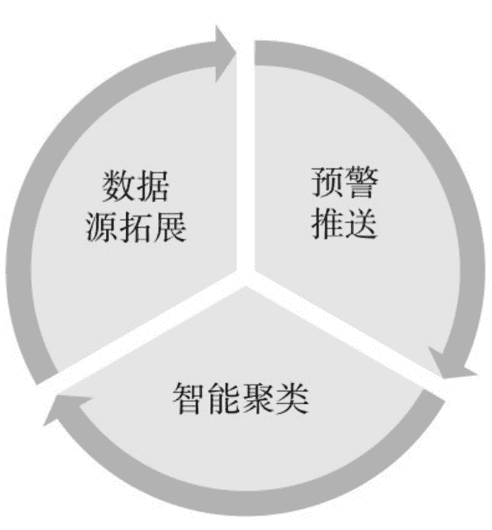

图8-12 AI实现风险特征实时迭代的方式

- ① 数据源扩展：覆盖行业研报、司法判决、社交舆情等三百余渠道；
- ② 智能聚类：自动归类新型风险，如2024年新能源行业的 技术代际风险；
- ③ 预警推送：风险指数突变时触发尽调方案自动调整。

# 第9章 融资类尽职调查

融资类尽调围绕计划或已开展的融资行为展开，对资金提供方与资金用途两端进行客观评估，为融资决策提供依据。

相较于投资类尽调，融资类尽调在国内起步较晚、体系化程度不足，框架与重点尚未形成统一。

## 9.1 融资类业务尽职调查概述

融资尽调是企业外部融资的关键环节。投资机构通过尽调报告全面了解融资方的人员、经营、财务与发展状况，据此作出投资判断。相较于银行贷前调查或发债信用评级，尽调报告更关注项目可持续盈利能力，同时重视团队与前瞻性等要素。随着融资渠道多元化，尽调已扩展至首次公开发行、资产支持证券、融资租赁等领域。商业保理与供应链金融兴起后，融资方式更加多样，每类项目的侧重点各有差异，但核心始终是对未来还款能力的分析。

### 9.1.1 企业的融资方式

从现金流角度看，融资活动是企业生命周期中最核心的资金来源。企业从诞生到衰退始终离不开融资。随着金融市场创新，企业可选择的融资工具不断增多，总体分为股权融资与债权融资。无论哪种方式，资金供需双方的信息对称是融资成功的关键，这凸显了尽职调查的价值。

#### 1. 股权性融资
股权融资指企业出让部分所有权，通过增资引入外部投资者，增加权益资本与现金流，无需支付利息或偿还本金，但需以业绩增长回报股东。可吸引不同风险偏好的投资者在企业不同阶段进入。按发展阶段可分为创始人投资、天使投资、私募股权投资、首次公开募股、股权再融资。

#### 2. 债权性融资
债权融资指企业通过发行债券、抵押、质押等方式与投资者形成债权债务关系获取资金，需支付约定利息并到期还本，可最大化保留发展收益并避免股权稀释。按债务类型可分为银行贷款、债券融资、商业信用及其他融资。

### 9.1.2 融资类业务尽职调查框架

国内经济开放程度提升，融资形式持续丰富。资产支持证券、供应链金融等新模式能满足更多主体的需求。

各融资方式虽不同，但均涉及资金融入方与融出方。融出方在放款前需对融入方进行全面尽调以核实还款能力，并据风险高低调整利率，风险越高利率越高。

融资类业务尽调一般框架如下。

#### 1. 对融资相关主体的尽职调查
调查内容包括：
- (1) 主体基础概况。
- (2) 经营情况。
- (3) 财务状况。
- (4) 资信状况。
- (5) 对外担保情况。

#### 2. 对融资项目的尽职调查
调查内容包括：
- (1) 资金用途及方案。
- (2) 标的介绍及可处置性分析。
- (3) 项目风险防范措施。
- (4) 项目的未来收益。

本章聚焦首次公开发行、融资租赁、债券承销、资产支持证券融资、商业保理、供应链金融等代表性业务，其他融资方式可参照执行。

## 9.2 IPO尽职调查

### 9.2.1 IPO尽职调查概述
首次公开发行股票尽职调查由会计师事务所等中介机构对拟上市公司进行审慎调查，全面了解经营状况、风险与问题，形成针对性意见并督促整改，为上市扫清障碍。拟上市公司因立场局限难以客观自评，财务尽调有助于客观评价内在价值。注册会计师通过风险识别与防范，助力降低投资风险与稳定资本市场。IPO尽调以未来为导向，基于当前财务状况推测持续盈利能力，与历史导向的审计不同。执业中除遵守公司法、证券法等法规外，还需遵循保荐人尽职调查工作准则、首次公开发行股票并上市管理办法等业务规范，并具备扎实的专业判断与细节敏锐度。

### 9.2.2 IPO尽职调查的方法
具体方法根据发行人需求与实际情况协商确定，行业与项目差异存在但核心程序大致相同：
- （1）审阅：审阅工商注册、财务报表、业务文件等资料，判断会计信息合规性，及时发现异常。
- （2）参考外部信息：结合电视、网络、行业刊物、业内人士等外部信息掌握主体及行业情况。
- （3）访谈沟通：与主体各层级人员、关联方、供应商、客户及中介机构沟通，协调进度并相互印证，访谈信息需结合专业经验判断可靠性。
- （4）重新计算：以手工或计算机核对记录与文件数据准确性，涉及销售发票、存货金额、折旧、应纳税额等。
- （5）审核：聚焦重点细节，核对原始凭证、经济合同等证明资料，确保结果真实可靠。
- （6）分析：运用趋势与结构分析，梳理财务与非财务信息关系，重点挖掘业务变化原因并预测持续盈利能力。

### 9.2.3 IPO尽职调查的内容
内容覆盖主体基础概况、业务技术、同业竞争与关联交易、高管、组织结构与内部控制、财务与会计、发展目标、募集资金运用等，核心是判断持续盈利能力、独立法人地位及合法合规性。

第一，持续盈利能力是审核核心。证监会严禁上市后业绩变脸，对保荐机构处罚严格。历史数据可信度也是券商核查重点，发现财务造假且保荐无法自证尽责将承担重大责任。

第二，独立法人地位。要求主体在业务、财务、机构、资产、人员等方面独立于控股股东与实际控制人。

第三，合法合规经营。要求主体及主要股东在申报材料覆盖的前三年内无违法违规、逾期债务、重大诉讼等情形，股权历史沿革清晰。保荐机构需全面核查历史沿革、经营管理、资产产权、诉讼仲裁等，必要时取得行政主管部门无违规证明。

前期调查需主体提供以下资料清单。

#### （一）主体基础概况

##### 1. 基础资料
- (1) 中英文名称、缩写、办公地址、邮编、电话、传真、网址、邮箱等。
- (2) 营业执照。
- (3) 经营许可文件：资质证明、生产许可证、进出口许可等。

##### 2. 历史沿革
- (1) 设立批准文件、发起人协议、出资协议等。
- (2) 历次工商变更的营业执照及登记资料。
- (3) 历次股权变更协议。
- (4) 历次注册资本调整的验资报告、评估报告。
- (5) 自设立以来的历次章程。

##### 3. 控股股东与主要股东或实际控制人基础情况
- (1) 自然人股东姓名及背景。
- (2) 法人控股股东及其他主要股东背景。
- (3) 控股股东下属分公司、子公司、参股、联营企业结构图。
- (4) 控股股东最近一年及一期财务报告。

##### 4. 架构

### 1. 组织架构及股权关系
- (1) 直接或间接控股子公司、参股公司及对财务经营有实质影响的其他下属公司。
- (2) 其他形态对外投资，包括海外投资及有价证券投资。

### 5. 组织机构设置
内部管理架构及主要职能部门隶属关系。

### 6. 员工情况
- (1) 用工方式、人数、学历、年龄分布。
- (2) 社会保障与保险缴纳情况、退休与人事政策、福利政策。
- (3) 近三年劳资纠纷情况。

#### （二）财务状况

##### 1. 最近两年经审计财务报告或报表
- (1) 资产负债表。
- (2) 现金流量表。
- (3) 利润表。
- (4) 其他经审计报表。

##### 2. 重要资产情况
- (1) 开户银行、账号、税务登记号。
- (2) 不动产权证。
- (3) 土地使用权证明。
- (4) 其他资产所有权证明。

##### 3. 借款及对外担保
- (1) 为他人债务提供担保情况及保证合同。
- (2) 借款及银行信贷安排相关协议。

##### 4. 重大合同
履行中或即将履行的标的金额≥500万元的重大合同。

##### 5. 税务情况
- (1) 需缴纳税种、税率等资料。
- (2) 税务登记证明、历年完税证明、最近两年纳税说明。
- (3) 税收优惠及批准文件。
- (4) 近三年税务处罚情况。

#### （三）最近三年重组和产权界定情况
- (1) 重组过程及方案。
- (2) 审计报告、评估报告。
- (3) 法律意见书、董事会股东会决议。
- (4) 股权产权交割凭证。
- (5) 政府批复。

#### （四）高级管理人员与核心技术人员
- (1) 高管范围：董事、监事、总经理、副总经理、财务负责人、技术负责人、董事会秘书。
- (2) 基础情况：姓名、性别、国籍、境外居留权、年龄、学历、职称、任职经历、现任职务及兼职、核心技术人员成果与奖项。
- (3) 董事长、监事会主席、总经理、技术负责人近24个月变动经过及原因。

#### （五）诉讼及行政处罚
- (1) 过去三年诉讼、仲裁结果及对经营影响。
- (2) 现有或预期诉讼、仲裁、行政处罚或其他纠纷。

#### （六）其他资料
- (1) 规章制度。
- (2) 历次股东大会、董事会、监事会决议。
- (3) 历史荣誉、称号及依据。

- (4) 公司的对外宣传资料。

## 9.3 ABS尽职调查全景拆解

资产支持证券化的核心逻辑是把难以快速变现的存量资源提前转化为现金，缓解流动性压力。这一模式提升了资本市场的运转效率，给商业银行和机构投资者带来操作便利与收益回报，因此在国内获得广泛关注。交易链条涉及底层资产池、发起方以及各类协同主体，尽调工作便围绕这三条主线展开。

### 9.3.1 ABS业务总览

伴随产业升级，境内企业积聚了大量存量资源。通过支持证券化方式盘活，可以选取其中现金流稳定部分作为增信来源，帮助企业破解长期存在的资金获取难题。

#### 1. ABS业务定义

ABS即Asset-Backed Securitization，本质是以项目所拥有的资源为依托、以预期收益作担保凭证，通过资本市场发行债券募集资金的融资模式。通俗理解，就是公司把流动性不足但能产生可预见稳定现金流的资源，通过结构重组与信用隔离，用优质部分做增信，由专门载体发行证券在公开市场出售，从而实现融资与流动性提升。

作为一种创新型金融工具，ABS为企业开辟了新的资金通道，成为连接直接融资与间接融资的桥梁。业务具备灵活性强、募集规模可弹性调节、发行时点选择自由、综合成本相对较低且受企业经营波动影响较小的特点。对难以获得银行授信、又无法进入资本市场的企业尤为适用。中小企业在发展阶段、资产结构、自身评级方面存在短板，但经资产剥离与信用补强后即可满足准入门槛，因此资产支持证券化是除传统渠道外更可行的路径。

#### 2. ABS业务分类

国内支持证券化大致可分为两类来源：一是企业及项目型资源，如应收账款、供水供电供气合同、收费公路、运输类应收款。这类资源剥离便捷、数据完备、收益相对平稳，适合规模化运作。二是银行持有资源，主要为住房按揭等个人消费信贷及商业抵押贷款，体量大且持续扩张，支持证券化市场空间广阔。

按不同划分维度可概括为：
- (1) 按底层资源划分。可分为不动产支持证券化、应收账款支持证券化、信贷资产支持证券化、未来收益支持证券化如高速公路通行费、债券组合支持证券化等。
- (2) 按地域划分。可分为境内支持证券化与离岸支持证券化。境内主体借助境内特殊目的载体SPV在国内市场募资；通过境外SPV或结构化投资载体SIV向境外投资者融资则属于离岸模式。
- (3) 按金融属性划分。可分为股权型、债券型与混合型。

尽管历史不长，但产品形态持续演进。最早以银行房贷为支撑的按揭支持证券MBS率先出现；随后以债务抵押债券CDOs统称，细分为贷款抵押债券CLOs、抵押贷款义务债券CMOs、债券抵押债券CBOs等。近年借助信用衍生品还出现了合成CDOs。

#### 3. ABS业务的关键角色

ABS交易依赖一套特殊结构，核心参与方包括原始债务人、发起方、发行主体或特殊目的载体、承销机构、服务机构、受托管理人、投资方、评级机构、增信机构及专业顾问机构，各方分工明确、相互制衡。

- (1) 原始债务人。是与发起方签署债权债务合同中负有还本付息义务的一方，如抵押贷款中的借款人，在交易中仍按原合同履约。
- (2) 发起方。是享有债权的一方，拥有项目资源的项目公司、发放贷款的银行或保险公司等。在支持证券化中，它将待证券化的资源让渡给特殊载体，实现风险与收益的重组，也称发起人。
- (3) 发行主体或特殊目的载体。为发行资产支持证券而设立的独立机构。发起方将资源组合转让给该机构，由其发行证券筹措收购资金。
- (4) 承销机构。销售方式包括包销与代销。包销指承销机构先行购入再对外分销，未售出部分自行承担；代销仅为发行方寻找买家，不承担兜底责任。发行方与承销方需配合确保发行结构符合会计税务等法规要求。
- (5) 服务机构。通常由发行方或其指定的银行承担，职责一是收集合约到期现金流并催收逾期款项，二是代发行方向投资方或受托人支付本息。
- (6) 受托管理人。是交易中不可或缺的角色，主要职责包括代发行方向投资方发行证券、将资源应收款项转付投资方并在必要时进行临时投资、对服务报告进行确认并转交。当服务机构无法履职时，受托管理人可代位行权。
- (7) 投资方。是资产支持证券的最终购买者，目前主要为保险公司、养老基金、退休基金等机构型投资者。
- (8) 评级机构。其主要作用是对拟发行证券的风险收益进行评估并给出信用等级，为投资决策提供依据。国际主流机构除标普、穆迪外还有惠誉、达夫-菲尔普斯等。
- (9) 增信机构。增信是支持证券化关键环节之一，旨在将原本投机级的信用等级提升至投资级，便于融资。增信方可以是政府或类政府机构，也可以是商业机构，核心在于投资者认可度。
- (10) 专业顾问机构。为交易提供业务指导与咨询，如会计师事务所、律师事务所、投行等。

#### 4. ABS业务运作流程

ABS运作大致可分为六个阶段：
第一阶段：组建项目融资专用公司。可称为信托投资公司或信用担保公司，须为独立法人，是开展ABS的前提。
第二阶段：争取高信用评级。由权威评级机构基于项目可行性研究与未来收益预测，授予专用公司AA或AAA级评级。
第三阶段：主办方让渡未来收益权。经合同约定，项目主办方在特许期内将筹资、建设、运营、偿债等权责转移给专用公司。
第四阶段：专用公司发行债券融资。高评级的专用公司发行的债券信用等级较高，易吸引投资者，融资成本通常更低。
第五阶段：建设运营并以收益偿债。专用公司组织项目建设与运营，并以项目收益偿还本息。
第六阶段：特许期届满资产移交。期满后专用公司按约无偿移交资产，主办方收回项目所有权。

### 9.3.2 发起方尽职调查要点

发起方即证券化资源的原始所有者，通常为金融机构或大型工商企业。

调查重点在于：融资项目是否契合行业支持证券化政策导向；业务初评初审是否合规；风险分析与评估方案是否全面；上报资料是否真实深入；行业分析是否合理；法律与财务分析及风险参数取值是否恰当等。

#### 1. 发起方基本信息核查

需核查发起方的概况、沿革、组织架构、控股股东及实际控制人的工商基本情况，形成调查清单。

#### 2. 发起方经营与财务状况核查

通过访谈及审阅最近三年及一期审计报告或财务报表，了解盈利能力、负债水平、现金流稳定性。利用资产负债表、现金流量表、利润表分析关键指标，并与同业横向对比，形成对发展能力、偿债能力与盈利能力的初步判断。报表之外需细看附注，发现关联交易、对外担保及诉讼等潜在风险。

- (1) 行业与经营状况。企业可持续发展高度依赖所处行业。若属朝阳行业，前景较好；若处于低创新、低技术、高耗能、高污染的夕阳行业，发展前景则堪忧。
- (2) 公司治理状况。良好治理有助于降低代理成本与保护投资者权益。调查清单包括：内部组织架构图及职能、董事监事高管名单及身份证明与简历、公司治理制度文件如三会议事规则、董事会专门委员会规则、董事会秘书制度、总经理工作制度、内部审计制度等。

### 9.3.3 其他协同主体的尽职调查

除发起方外，ABS涉及众多协同主体，对其审查体现审慎原则。

#### （一）对担保方的尽职调查

在行业与财务审查基础上，需重点关注是否存在大额对外担保。企业间担保普遍存在，若担保方涉及大量对外担保，即使自身经营尚可，一旦被担保方违约，也可能被拖累。

#### （二）对托管方（托管银行）的尽职调查

- (1) 托管方经营状况与资信水平，含基本介绍、公开财务资料、公开评级资料。
- (2) 托管业务资质批复文件。
- (3) 托管业务相关管理制度、作业流程与风险控制措施。

#### （三）对增信机构的尽职调查

##### 1. 设立及存续情况
- (1) 设立时政府批准文件、营业执照、工商登记资料。
- (2) 发起人协议、创立大会文件或出资协议。
- (3) 设立时公司章程。
- (4) 各次变更的营业执照、备案章程及工商登记文件。

##### 2. 股权架构、组织架构及治理结构
- (1) 股权结构图。
- (2) 最新验资报告。
- (3) 组织架构，包括控股参股子公司及职能部门设置。
- (4) 各职能部门职责说明。
- (5) 公司治理制度，包括三会议事规则、董事会专门委员会规则、董事会秘书制度、总经理工作制度、内部审计制度等。

##### 3. 授信使用与对外担保
- (1) 银行授信合同或协议，母公司口径。
- (2) 内部决策文件、相关批文、对外担保授权文件、担保协议或担保函，母公司口径。

##### 4. 内部控制及管理
- (1) 业务管理制度及审批流程。
- (2) 风险控制制度。
- (3) 是否发生代偿的说明及佐证资料。

#### （四）对重要债务人的尽职调查

- (1) 信贷类或应收账款类底层资产中重要债务人基本情况。单一债务人本金余额占资产池超15%，或债务人及其关联方合计超20%，即为重点。
- (2) 主营业务、行业背景、竞争地位资料。
- (3) 报告期财务状况：①报告期财务报告及审计报告；②经营与偿债能力分析；③对非标审计意见涉及事项及影响的说明；④历史信用表现、征信报告、资信评级报告等。

#### （五）对服务机构的尽职调查

##### 1. 设立及存续情况
- (1) 设立时政府批准文件、营业执照、工商登记。
- (2) 发起人协议、创立大会文件或出资协议。
- (3) 设立时公司章程。
- (4) 各次变更的营业执照、备案章程及工商登记。

##### 2. 主营经营、财务及资信
- (1) 近一年经营情况。
- (2) 近一年财务报告及审计报告。
- (3) 征信报告、资信评级报告等。

##### 3. 与底层资产管理相关业务
- (1) 相关业务资质及法律法规依据。
- (2) 底层资产管理服务制度、业务流程、风控措施。
- (3) 业务开展情况说明。
- (4) 底层资产与自有或受托资产独立性保障措施。

#### （六）对其他重要协同主体的尽职调查

主要针对律师事务所、评级机构、审计机构、评估机构等不直接参与业务的主体。
- (1) 营业执照、公司章程。
- (2) 报告期审计报告。
- (3) 征信报告。
- (4) 资信水平、业务资质、过往经验及可能影响交易的其他因素。

### 9.3.4 底层资产尽职调查要点

底层资产是未来现金流来源，也是投资回报的保障，一旦出现问题将导致重大损失，是尽调核心。

#### （一）底层资产分类

企业支持证券化底层资产分为收益权类与债权类两大类。
收益权类需关注：经营主体收益权的合法合规性，是否具备土地使用权、建设验收文件、安全消防文件等；经营主体稳定性与可替代性；同业竞争可能；收益权是否被抵押。
债权类需关注：发起方合同权利的真实有效合法完整性及自身履约责任；债务人抗辩权对现金流入的影响；是否存在抵押质押等负担；合同可转让性，是否可在债务人不知情下转让，以及第三人主张权。

##### 1. 底层资产法律权属及状态说明

## （一）底层资产相关情况

### 1. 底层资产基本情况
- (1) 形成与存续的真实性及合法性。
- (2) 权属、涉诉、限制与担保负担情况。
- (3) 特定化情况。
- (4) 完整性。

### 2. 底层资产合法性
- (1) 权属证明或运营许可。
- (2) 主要资产构建合同或资金投入凭证、验资报告、工商登记资料、公司章程等。
- (3) 发起方关于是否附带担保负担或权利限制的说明。
- (4) 穿透查询抵押质押登记部门资料，发起方关于是否涉诉的说明。
- (5) 当地法院及中国执行信息公开网查询结果。

### 3. 底层资产可转让性及程序说明
- (1) 发起方关于是否存在禁止转让情形的说明。
- (2) 转让所需批准、登记、通知等程序及文件。
- (3) 转让的完整性。
- (4) 通知义务的履行方式与可行性。
- (5) 转让登记的履行情况。
- (6) 附属权益的处理。

### 4. 底层资产行业分析
- (1) 行业基本情况与竞争地位资料。
- (2) 预测期业务发展战略与规划。

### 5. 底层资产现金流状况
- (1) 期限、账龄及质量说明。
- (2) 历史现金流情况，最近五年。
- (3) 现金流归集、划转程序与路径。

### 6. 未来现金流合理性分析
- (1) 未来现金流入量。
- (2) 未来现金流出量。
- (3) 净覆盖倍数。

### 7. 本期债券相关调查分析
- (1) 风险因素及防范措施，含混同风险。
- (2) 发起方风险自留情况。

### 8. 偿债计划及保障措施
- (1) 发起方确定的偿债计划与资金安排。
- (2) 其他保障措施，包括偿债专户、偿债基金、违约时的处置与赔偿方式。
- (3) 可能影响债券持有人利益的其他承诺。

ABS底层资产与承销租赁保理尽调精要

4. 原始权益人对保障底层资产持续正常生产经营应出具合理且切实可行的支持性承诺。

### 9. 债券类资产
- (1) 债权合同正本。
- (2) 债权清单及各笔账龄分布情况。
- (3) 历史违约记录、还款凭证及相应的银行流水佐证。
- (4) 用于担保的抵质押物价值评估文件。

### 10. 收益权类资产
- (1) 收益权合法性证明材料。
- (2) 与核心客户签署的销售或服务合同。
- (3) 历史回款记录。
- (4) 年度、季度、月度单价、数量或流量统计表。
- (5) 预测期内收入测算的基础资料，含预计单价与预计销量。
- (6) 抵质押物的价值评估报告。

### 11. 基础资产专项审计报告或财务数据
账面价值、折旧情况、营业收入等财务状况信息。

### 12. 基础资产相关管理制度
底层资产补充资料、业务管理规范及风险控制制度等。

### 13. 基础资产重要交易参与人情况
关键交易对手名称、基本概况、交易时间等信息。

#### （二）ABS产品抵质押担保情况
- (1) 抵质押协议文本。
- (2) 担保物基本情况说明。
- (3) 担保物清单，含名称、数量或面积、账面价值与评估价值等信息。
- (4) 担保物权属证明。
- (5) 担保物评估报告，若有。
- (6) 担保物登记、保管及相关法律手续办理情况。
- (7) 担保物发生重大变化时的处置安排。

#### （三）ABS产品决议文件
- (1) 董事会决议。
- (2) 股东大会决议。
- (3) 主管部门批复文件，若有。

## 9.4 债券承销尽职调查

### 9.4.1 债券承销业务总览

#### （一）债券承销业务释义
债券承销是指证券经营机构接受发行人委托办理债券发行，常见模式为代销与包销。代销下承销商负责代理销售，发行期结束后剩余部分退回发行人；包销下承销商按约定全额受让或期满自行购入剩余债券。广义上指投行受客户委托将债券销售给机构投资者与公众投资者以实现融资目的。

#### （二）债券承销方式
实践中主要包括代销、助销、包销、联合承销四种。
- (1) 代销。承销商代理发售，期满后未售债券返还发行人。
- (2) 助销。承销商在承销期结束时对剩余债券出资买入或向发行人提供贷款，以确保融资计划顺利实施。《证券法》将余额包销归入包销范畴。
- (3) 包销。承销商以自有资金购入计划发行债券的全部或部分后再行对外销售，期满未售部分由其自行持有。
- (4) 联合承销。也称承销团，由两个及以上承销商共同受托向市场公开发售某只债券，形成临时性组织。

### 9.4.2 债券承销业务流程

#### 1. 获取承销项目
投行获取业务一般有两条路径。一是直接与发行人洽谈，了解需求后提交发行方案建议，达成一致后签约并牵头组建承销团。二是参与竞争性招标。发行人常以招标择优选主承销商，投行可单独或联合投标，中标后签约并组建团。

#### 2. 组建承销团
辛迪加是指少数企业就销售采购达成一致协议而形成的组织。债券承销团与股票承销团的区别在于成员不一定限于投行，因多国对商业银行参与债券尤其是国债承销分销的限制相对宽松。

#### 3. 执行发行
承销团成立并明确各方职责后进入发行阶段。债券发行与股票发行流程基本相似。

### 9.4.3 债券承销尽职调查要点

#### 1. 发行人基本情况
- (1) 发行人概况：名称、注册地、法定代表人、经营范围、主营业务等。
- (2) 历史沿革与实际控制人。
- (3) 公司治理与内部控制情况。
- (4) 与母公司、子公司等投资关系的完整结构图，标明控股关系、持股比例及其他股东情况，覆盖上下游全部主体。
- (5) 主要子公司清单，含名称、成立时间、注册地址、注册资本、股权结构、企业性质、经营范围、主营业务、最近期财务、是否纳入合并报表。
- (6) 发行人及下属企业主体资格法律文件。
- (7) 当前及历史享受的优惠政策。
- (8) 近两年境内境外投资、出售、收购、兼并、增资减资、合并分立、重大改组或变更情况。

#### 2. 发行人所处行业情况
- (1) 行业基本面调查。
  - ① 行业在国民经济中的地位、发展前景、国家政策、中长期规划。
  - ② 行业主要业务指标市场统计、最新销量调查或统计。
  - ③ 影响行业的主要因素分析。
- (2) 发行人在行业中的定位。
  - ① 与国内同行主要企业的资产规模、市场份额、产品价格、收入、利润、资产回报率等指标对比。
  - ② 与主要竞争对手的成本利润率对比分析。
- (3) 竞争优势分析。
  - ① 地理、人才、劳动力资源优势。
  - ② 规模优势及规模经济效益。
  - ③ 管理与技术优势，经营独特性。
  - ④ 价格、服务质量优势等。
  - ⑤ 品牌及企业文化优势。
  - ⑥ 其他优势，如政策扶持等。

#### 3. 发行人主营业务情况
- (1) 近两年及本期主营业务收入与成本。
- (2) 近两年及本期主营业务收入构成。
- (3) 主要项目情况：近两年及本期已完成重大投资、正在进行或计划投资项目。
- (4) 产品生产或服务流程介绍。
- (5) 特许经营情况。

#### 4. 人事状况
- (1) 职工人数及结构，行政、技术、服务、财务等岗位占比，学历与职称分布，主要人事制度。
- (2) 高级管理人员简介：董事、监事、高管基本信息，任期及委派或选举情况，近两年变动及在发行人及其下属公司资本中的持股。

#### 5. 财务状况
- (1) 未特别说明，近两年财务信息摘自会计师事务所审计报告。
- (2) 财务会计信息披露重点：
  - ① 近两年及本期资产负债表、利润表、现金流量表，合并报表与母公司报表并列；合并范围近三年重大变化需说明变化及影响。
  - ② 近两年及本期主要财务指标。
  - ③ 近两年发生导致主营业务和经营性资产实质性变更的重组，披露重组后各期报表及重组前模拟报表及编制基础。
  - ④ 管理层对近两年及本期财务的简明结论性分析，基于母公司报表说明资产负债结构、现金流、偿债能力、盈利能力及可持续性。
- (3) 可能影响投资者理解财务状况、经营业绩和现金流的信息说明，逾期未还贷款及展期情况。
- (4) 资金管理办法与投资决策程序。

#### 6. 募集资金用途
- (1) 募集资金使用计划。
- (2) 补充流动资金时披露合理性、必要性及对未来经营的影响。
- (3) 偿还银行贷款时提供贷款合同复印件，披露偿还安排及对财务状况的影响。

#### 7. 主要风险与对策
- (1) 行业风险及对策。
- (2) 经营风险，如管理、商标侵权、人力不足、原料供应等及对策。
- (3) 财务风险及对策。
- (4) 政策风险及对策。
- (5) 利率风险及对策。
- (6) 兑付风险及财务风险及对策。
- (7) 投资风险及对策。
- (8) 汇率风险及对策。
- (9) 技术风险、税收优惠政策风险、市场竞争加剧等行业风险及对策。
- (10) 资信风险。近两年资信状况、问题及可能风险。
- (11) 担保或评级风险。担保人资信或担保物现状及重大变化对本息偿还的影响，信用评级变动对投资者的影响。

#### 8. 资信情况
- (1) 主要贷款银行授信情况，提供尚未到期贷款合同。
- (2) 近两年债券发行及偿还情况。
- (3) 近两年流动比率、速动比率、资产负债率、利息保障倍数、贷款偿还率、利息偿付率等指标。

#### 9. 偿债安排
- (1) 发债后未来两年现金流量基本预测表。
- (2) 过去两年现金流量分析。
- (3) 偿债记录、资金来源及具体偿债计划。
- (4) 专项偿债账户：资金来源、提取起止时间、频率、金额、管理方式、监督安排及信息披露。
- (5) 不能按时付息、到期无法兑付或违约时的解决措施。

#### 10. 或有事项及其他重大事项
期末对外担保情况及可能对财务、经营、声誉、业务、前景产生较大影响的未决诉讼或仲裁。
- (1) 受理法院或仲裁机构名称。
- (2) 诉讼或仲裁提起日期。
- (3) 当事人及保理人。
- (4) 起诉或仲裁原因。
- (5) 请求事项。
- (6) 可能处理结果或已生效文书执行情况。

#### 11. 未来发展规划
- (1) 发展战略、目标、未来五年业务规划。
- (2) 所处行业未来三年发展趋势与竞争态势预测。

#### 12. 重要合同及重大诉讼
- (1) 对未来可能产生重大影响的合同。
- (2) 发行人及其母子控股联营公司，董事监事高管，持股5%以上股东作为重大诉讼一方当事人的诉讼事项。

#### 13. 担保人情况
- (1) 担保人基本介绍、最新营业执照副本。
- (2) 担保人最近一年及本期审计报告及财务报表。
- (3) 担保人主要贷款银行资信情况，提供尚未到期贷款合同。
- (4) 累计对外担保金额、余额及占净资产比例。
- (5) 或有偿债情况。
- (6) 偿债能力分析。

## 9.5 融资租赁尽职调查

### 9.5.1 融资租赁概述
融资租赁系出租人按承租人要求及供货人选择出资购入租赁物并出租，承租人分期支付租金，租赁期内所有权归出租人、使用权归承租人。租赁期届满租金付清且义务履行完毕后，若对归属无约定或约定不明，按合同条款或交易习惯确定，仍不能确定的所有权归出租人。

### 9.5.2 业务分类
主要包括简单融资租赁、回租融资租赁、杠杆融资租赁、委托融资租赁、项目融资租赁、国际融资转租赁。
#### 1. 简单融资租赁
承租人指定租赁物，出租人评估风险后出租。租赁期内承租人无所有权但可使用并负责维修保养，出租人不对物件好坏负责，折旧由承租人承担。
#### 2. 回租融资租赁
设备所有者先按市价售予出租人，再以租赁方式租回。优点包括获得资金、提高市场应变能力、节省培训费用等，多用于已使用设备。
#### 3. 杠杆融资租赁
类似银团贷款，用于大型项目融资。由牵头租赁公司成立项目资金管理公司出资不低于总金额20%，其余由银行及社会资金补充，形成杠杆效应。常用于飞机、轮船、通信设备、大型成套设备。
#### 4. 委托融资租赁
资金或设备所有者委托具备资质的非银行金融机构经营。受托人借权经营，电商租赁多采用此模式。
#### 5. 项目融资租赁
以项目自身资产和效益为还款保障，出租人不对承租人其他财产收益追索，租金取决于项目现金流。常用于通信、大型医疗、运输设备及高速公路经营权。
#### 6. 国际融资转租赁
租赁公司先租入租赁物再转租给下游承租人，操作与简单租赁相似，但资金运行不直接涉及最终承租人，可灵活解决跨境法律及操作问题。

### 9.5.3 尽职调查内容
贷前对承租人尽调是风险控制核心。通过货币资金评估内部管理与支付能力，通过存货核实库存积压与管理水平，通过销售与在建工程评估盈利状况，通过银行贷款与担保合同核实借款能力与信誉。具体包括：
- (1) 基本情况。原始权利主体设立存续、主体评级、股权结构、控股股东及实际控制人、组织结构、公司治理与内部控制、内部授权、业务合规性、监管要求满足情况、运营期限、风险控制能力、经营合法合规性。
- (2) 原始权利主体是否系境内外上市公司或其子公司，如是则披露其总资产、营业收入或净资产占上市公司的比重。

## 9.6 商业保理尽职调查

商业保理在我国快速发展但风险突出，2017年《保理司法判例分析研究报告》显示最大风险为欺诈风险占比41.6%，信用风险约20%，故尽调必要。

### 9.6.1 商业保理概述
供应商需资金采购原料、支付人工与运输；采购商希望延长账期、持有更多现金优化营运资本。商业保理在一定程度上平衡双方矛盾，具有天然信用替代机制，用应付账款人信用替代应收账款人信用，有效缓解中小企业融资难，成本更低、审批更快。

#### 1. 商业保理定义
商业保理指供应商将其与采购商基于货物销售或服务合同产生的应收账款转让给保理商，由保理商提供融资、应收账款管理与催收、信用风险管理等综合金融服务的贸易融资工具。其本质是供货商基于商业交易将核心企业信用转化为自身信用以实现应收账款融资。

商业保理更偏向提供一揽子的配套服务，涵盖核查、催收、账务管理、清算、资金支持、担保等，并聚焦于特定行业或细分领域给出更具针对性的方案。在风控侧，它更看重应收账款本身的质量、买方的信用状况与货物品质，而非单纯依赖卖方的资质，理论上可以做到无担保操作并将坏账风险完全移转出去。把应收债权转让给保理公司后，企业能盘活沉淀资金，提升现金流周转效率。

#### 2. 保理业务常见模式与流程
市场上主流的保理玩法基本归为两类，即明保理模式一和暗保理模式二。

模式一以真实贸易为基础，由买卖双方与保理机构三方签署协议确认应收账款转让。

操作路径大致如下：
- ① 卖方采用赊销方式向买方交付货物。
- ② 卖方把赊销形成的结算凭证交给保理公司，作为收购应收款及拨付收购款的依据，保理公司将凭证复印件提交合作银行办理再保理。
- ③ 银行审核单据无误后，把融资款打入保理公司账户。
- ④ 保理公司再把收到的银行款项划至卖方在合作银行开立的账户，作为应收账款的购买价款。
- ⑤ 应收账款到期时，买方直接向保理公司偿付债权本息。

模式二为两方暗保理，保理公司与卖方签署协议受让卖方向买方的应收债权，到期后由卖方回购并偿付保理公司。

此外，部分机构在传统明保理上叠加坏账担保功能，更强调担保属性，因而与再担保公司形成合作，把应收账款风险向外转移。借助再担保增信，业务风险管理更为完善，也为参与方提供了新的协作思路。

### 9.6.2 保理尽调的核心关注维度
#### 1. 基础主体画像
(1) 主体资格。通过调阅被调查方的工商档案、经营许可及设立变更存续记录，判断其是否具备合法经营及从事保理业务的主体条件。
(2) 股权与实际控制人。厘清股东架构与实控链条，有助于识别关联交易与虚假交易风险。保理商需穿透至国有控股主体或自然人实控人层面。
(3) 独立性。涵盖业务、资产、人员、财务及机构五方面独立。独立性缺失时，控股股东或实控人易于通过关联交易转移资产利润，损害债权人利益，因此独立性是保理利益保障的前提。
(4) 公司治理有效性。重点在“三会一层”架构及相关制度的完备与执行情况，良好的治理是各方权益受保护的重要屏障。
（5）信用记录。保理商应多渠道了解交易各方及其董事、监事、高管的个人与企业信用状况。
（6）财务与或有事项。需查阅近期的审计报告与财务报表，验证真实合理性，同时关注对外担保、未决诉讼仲裁等或有风险。
（7）行业与前景。对所处行业及发展趋势的判断，是保理商切入新领域的必修课，也是商业保理区别于银行保理的优势所在。

#### 2. 基础交易真实性核查
虚假交易、关联交易、重复转让或重复质押是保理业务的高频风险，真实性审查是尽调的重中之重。真实性通常通过单据链条判断，关键单据包括商业发票、运输凭证、保险单证、包装文件、原产地证、检验报告、结汇凭证、退税核销资料等，发票审核最为常见。

当前伪造发票已不常见，保理商可向税务机关核验真伪。发票审核除真伪外，还需核对收款方与债权人是否一致、货物描述是否与合同一致、金额是否与合同约定一致。

对运输单据、保险单据等进行交叉核验，能对发票形成补充证明。如核对发货人、收货人、发运时间、货物品名、数量重量等信息，与发票保持一致，进一步佐证交易真实。

#### 3. 应收账款转让合规性
交易真实且债权可让与，是保理业务开展的根本。合规性主要从以下两方面把握。

（1）可让与性。根据《合同法》第79条，除约定或法律禁止外，债权可自由转让。不得转让的典型情形包括：①以特定身份为基础的债权，如抚养费、养老金请求权；②以特定债权人为基础的债权，如工资、伤亡补助金；③从权利不得单独转让。

（2）权利完整性。转让不应仅限于款项本身，还应包含：按法律要求主张费用损失赔偿的权利；债务人破产清算时参与分配的权利；放弃、豁免、展期的权利；从属担保权利；实现债权的实体与程序性权利，包括抗辩权、抵销权、管辖异议、时效抗辩等。

### 9.6.3 保理尽调的方法与执行流程
#### 1. 尽调常用方法
（1）查阅。查阅基础资料是尽调的基础，了解企业基本信息、法律状态、运营与财务情况。
（2）访谈。与管理层、财务、销售等关键岗位人员沟通，全面掌握情况并对资料进行核实。
（3）列席会议。列席股东会、董事会、经营会等，可验证决议真实性与形成过程，并深入了解交易商业目的。
（4）实地调查。现场查看经营管理水平、设备运行、安环情况，直观有效。
（5）信息分析。对收集资料进行归纳分析，提炼核心问题形成结论。
（6）印证。通过外部机构对资料真实性、现场调查结果进行确认。

#### 2. 尽调主要流程
（1）制定工作计划。明确目标、范围、方式、分工、时间与流程。
（2）编制和提交清单。根据交易情况编制尽调清单，要求被调查方按客观真实全面完整原则提供文件，清单编制是流程基础。
(3) 收集文件。督促被调查方按清单提供原件、复印件等，无原件资料需出具说明，复印件需双方核对后加盖印章或签字。
(4) 访谈。在书面审查与初步分析后，编制访谈提纲，有针对性地访谈相关人员。
(5) 形成结论。汇总工作底稿，识别风险，形成调查报告与结论。

### 9.6.4 保理尽调实务常见难点
#### 1. 资料真实完整性难判
尽调结果高度依赖被调查方提供的资料，易出现选择性提供或毁损涂改。常用做法是在现场临时抽取资料进行印证。以整套交易单据抽查为例，应注意：
- (1) 抽查要求在现场临时提出，不得提前告知。
- (2) 单据需覆盖全流程，包括招投标、合同签订、验收等环节。
- (3) 重点审查合同是否存在不利于保理的特殊条款，如禁止转让、抵销条款等。
- (4) 发现差异或不符即刻询问并记录。

#### 2. 未来应收账款的处理
债权让与在已有合同关系且待条件成就或时间届满时产生，可视为具有现实可能而允许转让。若合同关系尚未成立，债权无基础，则将来可能发生的债权不允许转让。从风险角度看，即使有基础合同，未来应收账款的不确定性较大，需谨慎操作。

## 9.7 供应链金融尽职调查
### 9.7.1 供应链金融总览
#### （一）供应链金融的定义
供应链金融（Supply Chain Finance, SCF）既是商业银行信贷业务的专业细分，也是中小企业的重要融资渠道。

其核心是银行为核心企业提供融资、结算、理财等服务，同时为其供应商提供贷款便利，或为分销商提供预付款及存货融资。通俗来说，就是银行把核心企业与上下游串联起来，提供灵活的金融产品与服务。

该定义与传统保理、货押业务相近但有本质区别。保理与货押属于单一贸易融资工具，而供应链金融是在核心企业与银行间达成的、覆盖全链条成员的系统性融资安排。

#### （二）供应链金融的优势
发展迅速的原因在于它既能纾解中小企业融资难，也能延伸银行服务深度。
##### 1. 企业融资新渠道
为中小企业提供替代传统流动资金贷款的方案，通过引入上下游融资便利降低资金需求。赊销在供应链中占比高，导致大量应收账款沉淀，一方面加剧流动性紧张，另一方面凸显应收账款管理与利用的重要性。盘活应收账款成为解决融资难题的关键，如招商银行的应收应付款管理系统与网上国内保理系统，可实现电子化管理与债权转让确认，帮助企业快速获得资金。

##### 2. 银行获客新通路
面向供应链提供一揽子方案可绑定核心企业，形成稳定高端客户群。供应链金融利润更高，且有助于强化客户关系。截至2008年，全球前50大银行中46家已开展供应链融资，其余也在筹划。

银行通过服务整条链条获得更完整及时的信息，信贷风险更低。即便单个企业未达风控标准，只要其与核心企业业务往来稳定，银行即可基于交易授信并促成交易实现。

##### 3. 经济与社会效益突出
借助团购式开发与风险控制创新，中小企业收益成本比改善，呈现规模经济。据统计，美国前1000大企业在2005年通过优化收款、盘活库存与延期支付，减少了720亿美元的流动资金需求。

##### 4. 多流合一
很好地实现了物流、商流、资金流、信息流的融合。

#### （三）供应链金融主要模式
结合中小企业经营周期，主要有三种模式。
##### 1. 动产或权利质押融资模式
以借款人自有货物或权利作质押向银行取得贷款的业务，主要包括存货、仓单、合格证等质押。该模式将“死”资产活化，加速流动性，缓解现金流压力。
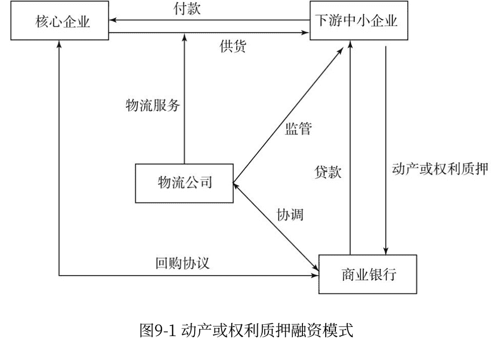
##### 2. 应收账款融资模式
核心大企业资信良好，与银行保持长期信贷关系，在中小企业融资中起反担保作用，无法偿还时承担连带责任。
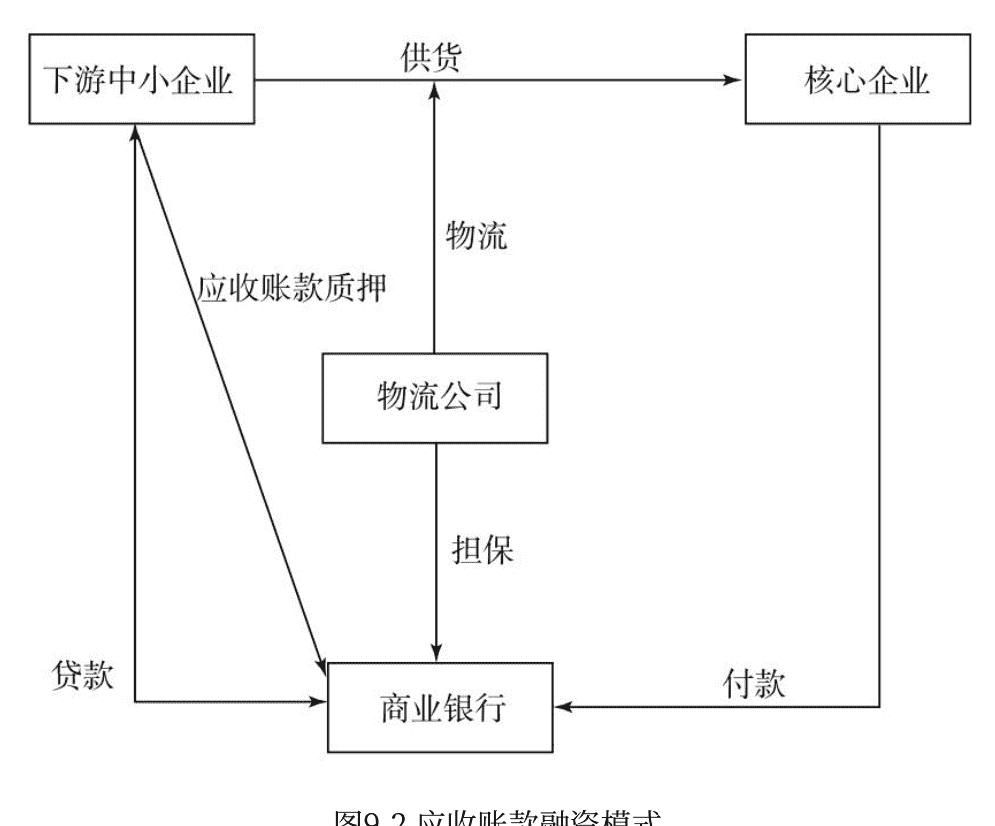
##### 3. 保兑仓融资模式
又称厂商银业务，基于上下游及商品提货权，由生产商、经销商、仓库、银行四方签署协议开展。银行承兑汇票是主要金融工具，实现融资企业杠杆采购与供应商批量销售，降低银行风险。
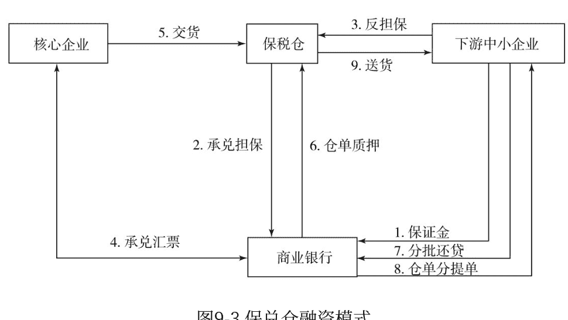

### 9.7.2 供应链金融尽调要点
核心企业的信用调查是尽调关键。
#### （一）核心企业画像
- （1）企业概况：工商登记、沿革、主要股东、管理层、关联企业。
- （2）行业分析：市场容量、竞争格局、监管政策。
- （3）生产经营：产品介绍、产销量、上下游分析、资产状况。
- (4) 财务分析：报表分析、项目余额分析、财务指标分析。
- (5) 资信分析：征信情况、诉讼与被执行信息、荣誉或处罚、舆情。

#### (二) 上下游企业信用状况
需对上下游开展全面尽调，重点关注近两年内是否被认定为失信被执行人、重大税收违法案件当事人、金融严重失信人或存在融资异常行为。

#### (三) 交易背景真实性
审查应基于真实合法的交易活动，需确认涉及的基础合同是否合法有效。可通过访谈核心企业与债务人及网站查询，了解债权人资质。

#### (四) 应收账款法律确权
##### 1. 核查付款条件是否全部满足
（1）货物贸易应收账款。需审查销售合同中关于买方付款的规定，若约定收到货物及发票后付款，则需关注发票及入库单是否已取得。
（2）大型设备制造应收账款。合同多为分阶段付款，需判断制造商是否履行对应阶段义务，如图纸提供、完工程度等，证据不足时可发送确认函。
（3）建筑工程应收账款。付款多以监理报告及总承包商报告为先决条件，需关注报告对时间和金额的确认情况。

##### 2. 核查债权人内部确权制度
对货物类与设备制造类，通常通过合同、发票、订货清单、入库单等证据链结合内部管理制度确认真实性。若证据不全，可向债务人发送询证函确认。反向保理可依据债务人付款确认书、内部审批单及合同付款条件确权。

此外，应收账款金额与付款时间应明确清晰，是尽调重点。

#### （五）债务人抗辩权与抵销权

供应链金融业务里，底层交易的合规是整个风控的基座。基础合同必须合法有效，债权人已按约履行完毕，付款前提已经成就，并且该笔债权不属于预付款性质，同时债务人清偿时不存在可主张的抗辩和抵销空间。

##### 1. 抗辩权
双务合同中常见的抗辩主要包括先履行抗辩、同时履行抗辩和不安抗辩。在供应链融资的实务场景里，先履行抗辩出现频率最高。《民法典》合同编第五百二十六条对此作出规定：互负债务且履行顺序有先后时，先履行一方未履行的，后履行一方有权拒绝对方的履行请求；先履行一方履行的内容不符合约定，后履行一方也有权拒绝相对应的履行。

甄别债务人是否具备抗辩空间，第一步是要核查应收账款对应的基础合同中，是否约定了买方在特定情形下可拒绝付款。例如合同约定交货期内的质量瑕疵、工程未能达到验收标准等，这些情形往往被写入抗辩触发条款。

##### 2. 抵销权
抵销权的来源分为法定和约定两种。《民法典》合同编第五百六十八条规定的法定抵销权，指双方互负到期债务且标的种类品质相同，任一方可将自己债务与对方债务抵销，但法律禁止或合同性质不允许抵销的除外。行使抵销权需向对方发出通知，通知到达时生效，且不得附加条件或期限。第五百六十九条规定的约定抵销权，则指债务标的种类品质不同，但双方协商一致也可抵销。

若基础合同中未明确放弃抵销权，且债权人与债务人另行签署了抵销安排，债务人便可依约行使约定抵销。法定抵销权很难完全规避，除非法律或合同性质禁止，通常做法是在交易文件里前置防范，例如约定资产服务机构或原始权益人将抵销金额等额划入专项计划账户，避免基础资产因抵销而灭失。

当合同文本或直接证据难以查清抵销权行使情况时，可通过访谈、回函确认等方式核实，同时向债务人寄送询证函，或在债权转让通知中明确债务人已放弃抗辩权及抵销权，以夯实债权人的付款请求权。

#### （六）应收账款转让的合法性
核查应收账款转让合法性是首要环节。一般而言，债权转让无需债务人同意，但基础合同另有约定的除外。需要重点审查交易合同中是否存在禁止或限制转让的条款，比如约定“转让需经债务人、担保人书面同意”。如存在此类限制，转让行为需取得债务人、担保人的书面认可函方能生效。

此外，《民法典》合同编第五百四十六条明确，债权人转让权利应当通知债务人，未经通知的转让对债务人不生效。因此债权转让通知不到位，也会导致转让对债务人无约束力。

# 第10章 投资尽调实战方法论

## 10.1 投资类尽职调查概述

投资活动的典型链路包括项目接触、初步判断投资价值、尽职调查、条款设计、决策落地以及后续增值服务与管理，其中尽职调查是风险识别与价值验证的核心环节。

### 10.1.1 企业投资及其程序

#### （一）企业投资
企业投资是用自有资源承担市场风险，以获取资产或权益的经营行为。从投入到产出需要经历完整的运营周期，稍有失误就可能导致亏损。所以企业在评估自身承受能力、研判外部环境、挑选项目时，都必须做到审慎。尽职调查在这个过程中扮演关键校验角色。

按投向划分，企业投资可分为内部投资与外部投资。内部投资是将资金投向企业自身，用于购置生产经营性资产；外部投资则是以现金、实物、无形资产或购买股票债券等方式向外部主体投资。相较内部投资，外部投资信息不对称程度更高，效率与回报也更容易受信息缺口影响。尽职调查正是在信息差面前帮助决策层快速补位的重要工具。

#### （二）投资程序
企业投资通常遵循以下流程。

##### 1. 项目接洽
对项目感兴趣的投资者会与项目负责人会面，初步了解项目背景、团队构成和企业概况。

##### 2. 初步发现投资价值
在接触过程中，投资者会初步捕捉到项目的问题点与亮点，判断是否值得深入。若认为具备投资潜力，便会要求获取更多企业与市场信息，有时还会引入其他潜在投资者共同评估。

##### 3. 尽职调查
当初步沟通顺利后，投资者会进入深度核查阶段。通过尽职调查对目标企业的技术能力、市场潜力、规模体量和管理团队进行系统评估。常用手段包括现场参观、与核心人员访谈、对设备进行价值评估，并与客户、债权人、供应商及前员工等外部相关方沟通，以形成对风险的综合判断。

##### 4. 投资条款设计
尽调结束后，若投资者对前景认可，就会进入估值与形式谈判。企业通常会收到一份条款清单，主要涉及投资金额与作价、公司治理结构安排、清算退出机制等三大核心。这一环节即为投资条款设计。

##### 5. 投资决策
投资者会根据风险收益匹配原则，对未来三到五年进行现金流或收入预测，结合对技术、管理层、经验、经营计划、知识产权等维度的风险评估，选用合适的折现率计算净现值。双方在价值认知上达成一致后签署正式投资协议。

##### 6. 增值服务和管理
投资生效后，投资者成为股东并进入董事会，主要以顾问身份提供经营改进建议，协助物色管理人才，定期追踪经营进展并审查财务分析报告。

### 10.1.2 投资类尽职调查的含义

#### （一）定义
投资类尽职调查是指在与拟投资企业达成初步合作意向后，双方协商一致，对与本次投资相关的事项进行的现场核查与资料分析活动。其目标是让投资者尽可能全面、真实地掌握目标企业的信息。

#### （二）分类
对应企业投资的内部与外部之分，尽职调查也随之区分。但业界常说的投资类尽职调查主要指对外投资尽调。

对外投资通常以现金、实物、无形资产等方式进行，部分企业会借助资本市场工具。本书聚焦的尽调对象为企业对外投资的常用方式，即以非证券化的资源投入以实现对拟投资企业控制或重大影响，分散经营风险并获取经济收益。

### 10.1.3 投资类尽职调查的基本内容

核心维度包括企业基本情况、知识产权状况、融资担保情况、主要客户与供应商情况、潜在诉讼破产风险、重要不动产情况等。

#### （一）公司的基本情况
需确认目标公司在注册地依法设立并存续，是否存在子公司或合资主体。结合财务与业务尽调，若发现本次交易关注的重要资产实际落在子公司或合资公司中，应进一步穿透核查权属。若必要，可要求目标公司在交割前完成权属调整，避免争议。

股权结构是否清晰、未来是否面临稀释风险、股权是否具备完整转让与收益权能，都是关注重点。公司治理层面要看决策流程是否规范，投资完成后投资者是否能在目标公司获得相应话语权与决策权。

#### （二）公司的知识产权情况
需要求目标公司提供完整的知识产权清单，按专利、商标、技术许可、自研软件、域名、专有技术等分类提交。重点审查技术许可安排，包括公司从第三方取得许可，以及公司对外许可自有IP的情况。同时对核心专利与技术标准进行合规审查。知识产权价值评估需与业务尽调结合，必要时引入技术专家对未申请专利的专有技术进行效用评价。

#### （三）公司的融资和担保情况
要核查目标公司是否存在大额融资安排，资产是否被抵押质押。对融资规模、期限与公司资产及现金流的匹配度进行评估，并关注本次投资是否触发融资文件中的控制权变更等条款，导致提前还款压力。

若公司为第三方提供担保，虽不直接产生债务，但在第三方偿债能力不足时可能转化为或有负债。抵押质押信息应通过公司或当地登记机构核查，若担保金额巨大，还需核查担保对象的合法存续、股权结构与经营状况。

#### （四）公司的主要供应商和客户情况
审查供应与销售合同中是否存在对目标公司不利的对赌条款，如采购或供货量确定性承诺、付款条件、质量检验标准等。若条款明显不利，可要求目标公司与交易对手协商修改，以争取更公平安排。

#### （五）公司的潜在诉讼或破产清算情况
通过司法检索系统核查目标公司是否已进入破产程序或存在诉讼记录。潜在诉讼需由律师事务所全面调查历史纠纷、产品服务、合同履约、劳动关系、环保合规及未诉争议，并必要时取得目标公司书面承诺不存在隐性纠纷。

破产风险的判断依赖经营状况综合研判，法律尽调仅能通过检索确认是否已正式申请。若已申请，投资方需据申请类型调整投资方案。

#### （六）公司的重要不动产情况
若目标公司持有重要不动产，需核查权属是完全所有还是仅租赁使用。取得方式、是否按转让或租赁协议约定合理使用、是否存在违约，均需审查。同时关注所在地政府对该不动产的规划限制，以及环境合规要求，如是否需要特定许可或污染防治措施。

## 10.2 天使投资尽职调查

### 10.2.1 天使投资概述
天使投资由个人投资者或非正式风险机构对初创企业进行的前期权益投资，属于非组织化的创业投资形式。资金多来自民间资本，门槛低，投资占比一般在15%左右，2至4年有望回本。美国《证券交易委员会501号条例》和《1993证券法》D条例对合格天使投资人的标准有明确界定，如净资产100万美元、年收入20万美元等。

### 10.2.2 天使投资的特点
天使投资额通常在200万至800万元，投向具备初步商业模式、已有产品雏形并积累核心用户的项目，主要来自天使投资人。其特点包括直接投资、提供资金外更提供资源与专业支持、以个人小额投资为主、考察程序相对简化且时效性强、投向规模小且早期风险高。因而尽职调查必须抓住重点，突出团队、市场环境、产品技术、盈利预测与财务状况四个维度，其中团队是第一优先级。

### 10.2.3 天使投资尽职调查的关注要点
团队与创始人：对小团队可逐一访谈，评估智力、忠诚度、优劣势、协作与管理风格，关注信用记录、未结诉讼及偿债能力。

市场与商业环境：验证产品需求潜力，通过潜在客户访谈与行业专家意见评估市场机会。

产品与技术：从技术、营销人员入手评估研发进展与产品质量，要求功能与交付可实现，并确认知识产权归属。

盈利预测与财务状况：核查已有融资与股权结构，基于资产负债表、利润表与现金流表评估成长能力。

### 10.2.4 天使投资尽职调查的主要内容

初创企业数据不完善，尽调带有较强主观性，需根据发展阶段调整标准。天使阶段重人，因而对人的调查是核心。

#### （一）访谈
包括创始人访谈、核心团队访谈、员工访谈、主要客户访谈、供应商及合作伙伴访谈。

##### 1. 创始人（或CEO）访谈
在正式与非正式场景下分别沟通，观察表达是否一致、是否稳定。了解其长期规划能力、用人风格与领导力，核查经历背景与资源积累，判断是否具备自我认知与自我提升能力。还需了解财务状况、兼职情况及股权安排，评估是否能全身心投入并排除债务风险。

##### 2. 核心团队访谈
核查成员背景、专业能力与学习能力是否匹配企业发展需求。

#### （二）公司业务

##### 1. 产品技术
判断产品属性是刚需、替代品还是奢侈品，解决问题的核心程度。评估市场不可替代性与竞争产品数量。了解客户及行业真实需求是否被满足，产品核心优势与替代品的差异化。考察研发周期与迭代速度，判断技术是否真正自有、团队是否具备持续研发能力。

##### 2. 行业
宏观环境可从政治、经济、人口、社会文化、技术五维度分析。行业竞争可从供应商议价力、购买者议价力、替代品威胁、现有竞争、潜在进入者五方面评估。重点关注行业成长性、政策支持、风险点，以及是否存在龙头或已上市公司。市场占有率反映控制力，预期占有率低于20%通常缺乏足够竞争力。

##### 3. 市场
了解主要营销渠道及效果，是否有拓展空间。评估销售策略成效及提升路径。分析销售成本与获客效率，是否具备低成本获取用户的能力。

投资尽调全流程拆解：从销售到法律的关键自查清单

销售团队与销售环节评估
销售组织的架构和人员专业度是否能支撑业务高效推进，需要先行判断。
对标竞争对手，审视自身销售流程的相对强弱，并明确改进路径。

4. 竞争
盘点目标市场内的竞争版图，明确主要对手，掌握其核心产品线及市场占有情况。
通过现场走访、访谈以及行业协会、共同客户、供应商等第三方渠道，获取竞争方的多维度信息，横向比对各类竞争力，厘清优劣势所在。
评估企业当前是否占据竞争优势，未来能否维持或新增优势，同时识别竞争壁垒的类型、强度以及被对手突破所需的时间窗口。
从规模体量、成本结构、商业模式、经营管理、人才储备等角度，系统梳理企业的核心竞争力来源。

5. 合作伙伴
识别核心客户名单，分析其经营健康度对企业未来生产与采购的传导影响。
统计主要客户的采购金额与数量，测算其占客户整体采购额及企业总产出的比重，判断客户集中或分散程度，评估依赖风险与议价能力。
梳理关键供应商群体，判断其经营状况对企业后续生产与采购的潜在干扰。
量化对主要供应商的采购规模及占比，判断供应集中度，评估供应依存风险与采购议价空间。

融资计划核查
逐项核查资金需求规模与使用用途的合理性。
厘清投后股权结构、拟出让比例、估值水平及定价依据，判断合理性并据此展开谈判。
明确企业希望投资者参与管理的程度，以及是否建立定期报告与资金预算报备机制。
了解预期回报方式与退出安排，涉及并购退出时需展示潜在买方的意向线索。

财务状况

1. 财务管理
复核财务制度的完备性、会计准则的遵循度以及报表完整性与审计情况。
核查税务登记及缴税凭证，判断是否存在合规隐患，是否符合税收优惠条件。
评估财务团队编制、专业能力与岗位职责是否匹配。
深入研读未来三年财务预测的假设与依据，判断业务增长预期与预算的合理性。
查明是否存在历史债务、担保、抵押等或有负债。

2. 财务指标
主营收入及其增速，反映公司规模与成长趋势。
应收账款回收周期，特别是对大客户的账期，判断回款压力与资金链风险。
毛利率即收入扣除直接成本后的占比，直观体现盈利能力。
净利润为扣除成本费用后保留的净收益，反映经营效率与最终盈利质量。
经营活动净现金流量代表经营所产生的现金盈余，是衡量造血能力与资金安全的重要信号。

法律状况
确认法律文件真实有效、管理清晰、归档规范。
核查专利、商标、房产等产权归属是否清晰，是否存在争议或潜在纠纷。
评估生产经营的环保合规性，是否存在搬迁或行政处罚隐患。
核实是否存在历史诉讼或正在进行的诉讼，以及对业务发展的影响程度。

10.3 风险投资尽职调查

10.3.1 风险投资概述
风险投资是指资本实力雄厚的机构，向具备技术专长、市场前景良好但启动资金不足的创业企业提供融资，助力其发展并自担早期失败风险的投资行为。投资人以资金换取股权，期望通过分红或股权转让实现回报。相较天使投资，风险投资规模更大、项目更成熟，因而尽职调查的覆盖面与深度也相应提升。
风险投资的核心是高风险换高回报，退出回收资金后会继续投入具备高风险、高科技、高成长潜力的企业，形成资金循环增值。
投资对象多为创业期的中小企业，尤其偏向高新技术领域，投资周期一般不少于三年，通常以股权形式入股，持股比例多在三成左右。投资人往往深度参与经营并提供增值服务，待企业增值后通过上市、并购或股权转让等方式退出。

10.3.2 风险投资尽职调查技巧
尽职调查清单先行
为避免遗漏，需先编制检查清单，可按公司主体、股东构成、资质许可、盈利业绩及重大合同、固定资产、无形资产、员工薪酬社保及核心人员、违法诉讼等维度分类。财务与法务清单可合并或分设，业务与技术清单通常独立编制。
强调重要性原则
尽调前应明确本次投资最看重的价值点，再将该价值拆解到各维度并纳入清单。若看重团队，则重点核查核心成员履历、劳动合同期限、竞业限制、期权安排；若看重技术壁垒，则核查专利软件权属证明及商业秘密保护措施；若看重用户资源，则核查商标注册证书及用户统计口径与方法。
有效防范风险
尽调需识别商业模式中的潜在风险并前置防范。先判断易发风险，再将诱发因素纳入明细清单。例如数据隐私风险时，核查个人数据使用协议及用户告知充分性；著作权风险时，核查是否符合避风港等免责机制；退款风险时，核查用户协议约定及产品退换机制。

10.3.3 风险投资尽职调查的内容
公司背景调查
1. 公司历史沿革调查
调查目标：了解历史上的重大事件及其对发展路径与企业文化的塑造作用。
调查程序：收集行业管理体制变革资料，评估其对公司的影响；获取历次产品技术改造、管理升级及获奖记录，判断核心竞争力在行业内的变化；调查重大人事变动对公司的影响；审查是否存在重大违法违规及处罚记录并评估影响是否消除。
2. 股东变更情况调查
调查目标：确认股东变更是否合法合规，程序是否规范。
调查程序：编制股本结构变化表，分析历次股权变动原因及影响；核查股东名册及出资比例是否符合规定；追溯实际控制人并评估其业务资产对供产销及竞争力的影响；关注自然人持股、任职及亲属投资情况，警惕代持风险；核查内部职工股、工会持股等情况；调查股份是否因质押或争议被冻结拍卖；获取验资评估审计报告，审查注册资本增减及程序合规性。
3. 公司治理结构调查
调查目标：判断章程及草案合规性，股东会董事会监事会运作实质，以及高管任职变动合法性。
调查程序：查阅会议记录确认章程制定修改程序是否符合公司法；确认治理机构议事规则健全性与合规性；核查历次会议决议，尤其是对外担保、重大投资、融资决策的合规性；确认董事经理是否存在资金挪用、违规担保、自营同业等行为；评估高管激励约束机制对人才稳定与吸引力的影响。
4. 组织结构调查
调查目标：识别可能产生同业竞争与关联交易的关联方，了解组织架构对经营目标实现的影响。
调查程序：绘制集团整体架构图标明各实体联系；绘制公司内部结构图并用实线虚线标示权责信息沟通关系，评估合理性与运行有效性；与管理层沟通获取组织运行的实操信息。
5. 管理团队调查
调查目标：评估主要管理层诚信与匹配能力，了解选聘考核离职程序及激励约束机制影响。
调查程序：获取高管学历从业经历，重点关注行业经验；单独会谈了解企业文化与发展认知；调查近三年关键人员离职原因；核查董事竞业禁止遵守情况；与基层员工交流获取对管理团队与文化落地的直观反馈；审查内部管理制度与经营考核体系落实情况；了解薪酬、股权激励方案及其变动；调查主要管理者兼职情况及对本职工作的干扰。

行业和经营调查
1. 行业及竞争者调查
调查目标：掌握行业现状与前景，评估产品服务在同业中的竞争地位，确认经营合法性。
调查程序：查阅权威机构统计与研究报告，分析行业国内外发展态势及有利不利因素；判断行业是否受宏观调控及定价政策影响；评估行业进入壁垒对核心竞争力的作用；了解行业属性及技术资金劳动依赖程度，研判研发与营销投入需求；判断产品所处生命周期阶段及寿命；结合产业政策研判产品结构及未来调整方向；分析需求驱动因素与市场容量及产能变化；预测产品价格走势；调研可替代产品价格与供应状况及进口冲击；对现有与潜在竞争者进行市场容量、对手数量、份额对比，并从质量价格成本品牌声誉等维度比较；选取5至10家可比上市公司进行多维度对标。
2. 采购环节业务调查
调查目标：掌握供应方市场、采购政策与主要供应商，了解诉讼与关联交易风险。
调查程序：评估供应方市场竞争与进入壁垒；与采购部门及供应商沟通，了解原材料采购受限风险；识别前五大供应商并测算采购占比，判断依赖程度；分析供应商地理距离与运输成本占比；核查供应商考评制度建立情况；了解资金结算及时性及是否存在以物抵债；研判主要原材料供需状况及涨价对成本的影响；评估采购与生产计划衔接情况，识别缺货与积压风险；核查与供应商的重大诉讼或纠纷；判断关联采购定价合理性，排查利润输送或资金转移。
3. 生产环节业务调查
调查目标：了解生产工艺能力实际产量、生产组织与保障、成本结构及质量安全环保合规性。
调查程序：调查生产组织形式，如小批量、大批量、流水线或装配线等。
4. 销售环节业务调查
调查目标：评估营销网络建设与运行、商标权属合规、回款与库存情况、销售业务的诉讼与关联交易。
调查程序：了解分销渠道，自营门店或经销代理模式及控制程度；核查商标注册人信息；确认产品质量是否符合国标或行标，近三年是否受罚；了解假冒伪劣情况与打假力度；获取主要竞争者优势信息与市场份额资料；编制产品收入占比与产销率明细；获取前五大客户销售额占比与回款情况，评估客户基础稳定性与依赖风险，并分析回款及抵债情况；按区域分析销售分布及地方保护影响；核查期末收入异常增长及虚增嫌疑；核查异常大额退货真实性；测算应收账款周转率并评估坏账风险；对集中客户的销售真实性通过合同、发票、出库单、银行回单或函证核实，出口业务则需核查报关单及结汇凭证。

⑬调阅审计团队留存的工作底稿，判断仓库是否沉淀大量残次品、老旧品、滞销品或长期积压品；与审计人员沟通存货跌价准备的计提是否充足；测算最近数个会计年度的产成品周转速度，并与可比同行进行横向对比。
⑭抽取若干份金额重大的销售协议，核查协议中是否存在限制性约定，例如产品须经安装或维修验收、买方享有特定退货权利、或采用代销寄销方式结算。
⑮核查关联销售的真实性与公允性。若关联销售对主营收入贡献度较高，则按不同时点抽取关联销售合同，获取定价信息，梳理价格变动轨迹，并与同期同类产品的市场公允价进行比对。发现异常时需评估对收入的影响，判断定价是否合理，是否存在控股股东借助关联销售进行利益输送或资金转移。

##### 5. 技术与研发调查
（1）调查目标
- ①梳理企业持有的专利及非专利技术范围
- ②摸清研发组织架构、研发人员配置及资金投入情况
- ③掌握正在推进的研发项目清单

（2）调查程序
- ①明确所属行业的职业技术规范，判断是否符合国家或国际标准
- ②分析核心技术的选择逻辑，对比同行技术领先度，关注核心技术是否面临被新技术替代的风险
- ③收集专利及非专利技术的权属文件、登记资料及相关协议，厘清技术清单。追溯技术来源，区分自主研发、股东投入、受让或仅取得使用权。核查企业对相关技术的实际使用权限，排查是否存在重大技术纠纷，确认核心技术是否仍在法律保护期内
- ④核查企业是否建立保密机制，防止与主营产品相关的非专利技术外泄
- ⑤摸清研发机构设置，获取研发人员结构、近年研发支出占营业收入比重等数据
- ⑥核查是否与科研院所开展合作研发，如有则列明合作机构、项目名称、合作模式及进展
- ⑦了解研发人员薪酬安排，包括核心技术人员薪酬水平与国内外主要竞争对手同岗水平的对比；同时了解研发团队近年流失情况，企业是否实施股权激励等激励措施
- ⑧了解新品从立项到上市的全周期，梳理重点研发项目的进展情况，并对各项目对应的市场需求作出描述

#### （三）法律调查
##### 1. 独立性调查
（1）调查目标
核查企业与其实际控制人或关联主体在人员、财务、机构、业务独立性及资产完整性方面的状况

（2）调查程序
- ①核实经营业务是否独立于股东及其关联方。取得股东及关联方营业执照及双方签署的全部业务协议，检查是否存在上下游依赖
- ②核查企业是否具备完整独立的采购、生产、销售体系
  - 先看部门设置，确认采购、生产、销售部门是否与关联方分离，发起人及关联方人员是否存在混岗兼职
  - 再核查全部采购、销售或委托加工协议，确认是否委托关联方执行采购、销售或加工
  - 获取企业的采购、销售账户，检查资金往来是否与关联方账务分离
- ③若采购、生产、销售环节及商标权等短期难以剥离，核查企业是否与控股股东或关联方以合同形式明确权利义务
  - 取得综合服务协议、委托加工协议、委托销售协议、商标许可协议等
  - 检查合同是否清晰界定双方权利义务
- ④核查房产、土地使用权、商标、专利、技术、特许经营权等无形资产权属。取得不动产权证、商标注册证、专利证、特许经营证等，确认所有权与使用权合法性
- ⑤核查房屋、土地使用权租赁情况，租赁是否合法有效。检查权属证明及租赁协议
- ⑥核查主要设备产权归属。查阅固定资产明细，确认权属并核查是否设立抵押
- ⑦判断是否存在产权纠纷或潜在纠纷风险
- ⑧核查企业对主要资产的所有权或使用权行使是否受限，是否存在被担保或权利受限情形
- ⑨核查是否存在混合经营或合署办公现象
- ⑩核查控股股东及政府部门推荐的董事、经理人选是否履行法定程序，董事长是否由主要股东或控股股东法定代表人兼任，高管是否在本企业领取薪酬且未在股东单位兼职
- ⑪核查企业是否按规定建立健全组织架构，与控股股东保持独立
- ⑫核查企业是否设立独立财务会计部门，建立独立核算体系及财务管理制度并覆盖子公司、分公司
- ⑬核查控股股东是否存在违规占用企业资金、资产或资源情形，如有需说明原因
- ⑭核查企业是否独立开户，是否存在与控股股东共用银行账户
- ⑮核查企业是否存在将资金存入控股股东财务公司或结算中心账户的情况
- ⑯核查控股股东财务公司或结算中心账户，核对双方往来账项
- ⑰取得企业与控股股东的税务登记证明，确认是否依法独立纳税
- ⑱与财务人员沟通，核查财务决策制度，判断企业能否自主作出财务决策，是否存在控股股东干预资金使用

##### 2. 同业竞争调查
（1）调查目的
调查企业是否存在同业竞争，并判断是否已采取有效防范措施

（2）调查程序
- ①核查企业与控股股东及其子公司的经营范围是否相同或相近，实际经营中是否构成竞争
- ②如存在或可能存在同业竞争，核查是否采取有效措施
  - 先审查避免同业竞争的协议及决议，判断条款是否损害企业利益
  - 再调查其他防范措施，如通过收购、委托经营将竞争业务纳入企业，或竞争方将业务转让给无关联第三方，或企业主动放弃竞争业务，或竞争方出具具有法律约束力的书面承诺不再开展同业竞争
- ③审阅股东协议、企业章程，检查是否作出避免同业竞争的规定

##### 3. 关联方及关联交易调查
（1）调查目的
- ①评估关联交易是否公允，是否损害企业及其他股东利益
- ②核查关联交易是否履行法定审议程序

（2）调查程序
- ①识别关联方及关联关系。包括可直接或间接控制企业及被企业控制的企业、与企业受同一主体控制的企业、合营、联营企业、主要投资者个人、关键管理人员及其近亲属、受其控制的其他企业。获取主要采购、销售合同，核查交易对手是否属于关联方
- ②调查企业与关联方是否发生商品买卖、资产买卖、劳务提供或接受、代理、租赁、资金拆借、担保抵押、管理合同、研发项目转移、许可协议、关键管理人员报酬等行为
- ③核查关联交易的明细、数量、金额，分析其必要性及对企业的积极影响，测算关联交易占同类业务的比重
- ④评估关联交易定价公允性，是否存在损害企业利益的情况。对照第三方交易价格，分析价格差异原因
- ⑤审查关联交易协议条款是否公允，是否存在侵害企业利益的条款
- ⑥对关联交易增减变化进行评价并分析原因，获取减少关联交易的承诺或措施并评估其可行性
- ⑦了解控股股东及其他关联股东是否要求企业提供担保

##### 4. 诉讼、仲裁或处罚调查
（1）调查目标
- ①核查企业是否存在诉讼、仲裁或行政处罚事项
- ②评估上述事项对财务状况、经营成果、声誉、业务及未来前景的影响

（2）调查程序
- ①调查是否存在可能对企业产生重大影响的诉讼或仲裁事项
- ②如有，调查案件起因、请求、可能结果或已生效文书执行情况，并评估对财务、经营、声誉及前景的潜在影响

#### （四）资产调查
（1）调查目标
核实固定资产、在建工程及无形资产状况

（2）调查程序
- ①了解固定资产规模、类别并核实账面价值
  - a. 获取最近三年及最近一期固定资产、累计折旧账户及减值准备明细，与报表核对
  - b. 调查房屋建筑物成新度及产权归属
  - c. 调查机器设备成新度、技术先进性及产权归属
  - d. 了解是否存在抵押固定资产，并与借款抵押情况核对
  - e. 了解折旧计提方法，并与制造费用明细中折旧项目核对
  - f. 了解固定资产减值准备计提方法，判断计提是否充分
- ②了解在建工程规模、价值及完工程度，评估投产后对生产经营的影响
- ③核实无形资产入账依据及价值合理性
  - a. 获取无形资产清单及权属证明
  - b. 调查各项无形资产来源
  - c. 判断入账及入账价值的合理性
- ④关注与生产密切相关的土地使用权、商标权、专利技术等无形资产权利状况

#### （五）财务调查
##### 1. 销售环节财务调查
（1）调查目标
- ①核实各期主营业务收入、成本、利润真实性
- ②核实销售活动产生的债权债务余额

（2）调查程序
- ①主营业务收入、成本、利润核查
  - 获取最近三年及一期收入、成本、毛利明细，与利润表核对
  - 价格核查：了解主要产品价格目录及近三年变动，收集市场同类产品价格进行对比
  - 单位成本核查：比较各期单位成本变动，变动超过10%需说明原因
  - 销售数量核查：比较各期销量变动，变动超过10%需核实原因
  - 毛利率核查：比较各期毛利率变动，变动超过10%需说明，并与行业平均毛利率对比
  - 主要客户核查：获取主要客户名录，识别其中关联方，对异常客户深入调查
- ②应收票据、应收账款、坏账准备、预收账款核查
  - 获取余额明细，检查大额项目客户是否属于主要客户，异常情况需说明原因
  - 根据结算方式判断账龄是否正常，长期挂账款项需评估可回收性
  - 了解坏账准备计提方法是否变化，依据账龄分析判断计提是否充分。计算应收账款周转率并与同业对比
- ③销售费用核查
  - 计算销售费用变动比率，结合收入变动分析合理性，异常情况需核实

##### 2. 采购与生产环节财务调查
（1）调查目标
- ①了解生产能力利用率及产销比率
- ②核实期末存货价值
- ③核实采购活动产生的债权债务余额
- ④核实期末应付职工薪酬

（2）调查程序
- ①了解最近三年及一期主要产品生产能力、产量、销量，判断生产经营是否正常，计算产销比率
- ②核实各期期末存货价值，为销售成本核实提供依据
- ③核实采购产生的债权债务余额，抽查大额交易的对手是否为主营客户，异常交易需查明原因
- ④核实期末应付职工薪酬余额
- ⑤分析资产负债表中长期待摊费用、待处理财产损溢是否异常，若异常进一步核实

##### 3. 投资环节财务调查
（1）调查目标
- ①核实各期末长期投资余额及减值准备
- ②核实各期投资收益真实性

（2）调查程序
获取最近三年及一期长期股权投资、减值准备及投资收益明细，关注大额或异常投资收益，核查现金分红是否收现是否存在挂账

##### 4. 融资环节财务调查
（1）调查目标
- ①了解债务融资规模及结构
- ②了解权益融资情况

（2）调查程序
- ①获取最近三年及一期短期及长期借款变动及余额，与报表核对
- ②获取应付债券明细，与报表核对
- ③获取财务费用明细，按贷款合同利率复核
- ④获取长期应付款及专项应付款明细，与报表核对
- ⑤获取所有者权益增减变动及余额，与增资、配股及利润分配方案核对

##### 5. 税务调查
（1）调查目标
- ①核查企业执行的税种及税率
- ②核查税收及财政补贴优惠政策的合法性、真实性及有效性
- ③核查企业是否依法纳税

（2）调查程序
- ①查阅税法、营业执照或访谈财务人员，核查企业及控股子公司适用的税种、税基、税率是否符合法规
- ②核查是否涉及进出口业务，核查适用的关税、增值税等税率
- ③如享受增值税减免，核查相关政策文件，判断优惠是否合法合规及优惠期限
- ④如享受所得税减免或其他财政补贴，核查政策的合法性、合规性及期限
- ⑤获取近几年享受的税收优惠及退税金额，判断其属于经常性损益还是非经常性损益，测算对净利润的影响
- ⑥查阅近三年增值税、所得税及其他税种申报表及缴款书，核查是否依法纳税

##### 6. 或有事项调查
（1）调查目标
- ①了解或有事项具体情况
- ②判断其对财务状况、经营成果、声誉、业务及前景的影响

（2）调查程序
- ①核查因诉讼或仲裁可能产生的或有负债
- ②若企业提供售后担保，依据历史经验评估客户索赔可能性
- ③核查为第三方债务提供担保情况，确认担保金额、连带责任、反担保措施，估算或有负债，并确认是否存在为股东及关联方债务提供担保
- ④环境保护或有负债
  - 查阅环保批文，确认是否达标
  - 核查是否存在污染情形
  - 测算可能发生的治理费用或罚金

#### （六）发展规划与财务预测调查
##### 1. 公司发展规划调查
（1）调查目标
了解企业未来几年的发展规划

（2）调查程序
- ①获取企业商业计划书或未来3~5年发展规划，了解发展目标、方向、重点及措施
- ②获取计划投资项目的可行性研究报告，评估其可行性

##### 2. 公司财务预测调查
（1）调查目标
了解企业未来几年的发展目标、规模及增速

（2）调查程序
- ①获取企业商业计划书或未来3~5年财务预测表，了解财务发展目标、规模及增速
- ②以销售为起点，核实各项预测指标的编制依据
- ③结合外部环境，评估各项指标实现的可能性
- ④结合经营管理水平及生产经营条件，判断预测指标的可实现性

## 10.4 私募股权投资尽职调查
### 10.4.1 私募股权投资概述
私募股权投资是指通过非公开募集资金对非上市公司进行权益性投资的一种方式
在交易执行过程中，私募股权投资会同步设计退出机制，通常通过IPO、并购或管理层收购实现收益。简言之，私募股权投资即是投资者甄选高成长性未上市公司进行注资，获取股权比例并推动其成长上市后转让获利
私募股权投资因投向非上市公司流动性较差，被视为长期投资，因此要求高于公开市场的回报。目标企业未上市，股权流通缺乏现成市场，需通过私募渠道完成转让
私募股权投资一般以基金作为募集载体，由专业基金管理公司运作，如凯雷、KKR、黑石、红杉等，它们旗下管理多只私募股权基金。私募股权投资包含Pre-IPO投资，该类投资风险相对较低、回收较快，在企业股票受追捧时可获得较高回报

### 10.4.2 私募股权投资尽职调查特殊关注

对私募股权投资者而言，让被投项目成功完成IPO通常被视为价值释放的最优路径。相比于常规企业的投前核查，PE尽调在覆盖通用风险点的基础上，需要围绕上市合规做专项排查。标的的可持续盈利、关联往来的合规性、历史资本运作的痕迹等，都是一般对外投资审查中并不如此强调的重点。

（1）持续盈利能力。
如果项目规划在约三年周期内冲击资本市场，尽调早期就应判断是否存在硬伤或可能导致上市节奏延后的隐患。机构尤为看重利润质量与扩张潜力。若主板、中小板标的最近三个完整会计年度及当期，或创业板标的最近两个完整会计年度及当期的报表均显示盈利且稳步提升，则可对若干次要瑕疵适当放宽。

（2）关联交易。
监管会重点审视历史关联交易是否必要、定价是否公允、程序是否合规，以及交易频次是否呈下降趋势。关联问题并非挂牌前可突击解决的事项，需要全面梳理，厘清全部关联主体并核查是否存在资金往来。对民营标的，隐藏关联关系尤其需要留意。

（3）同业竞争。
除了控股股东和实际控制人，还需核查持股5%以上或对公司有重大影响的股东是否存在业务重叠。若存在，通常需要出具不竞争承诺。监管对“同业但不竞争”的解释接受度很低，出现同业竞争的常见处置方式为转让股权或收购。

（4）外商投资企业。
外资企业在国内上市本身可行，但若境外母公司从事相同或相近业务，则可能带来潜在同业竞争与独立性瑕疵，进而成为上市障碍。

（5）企业合并。
若标的在挂牌前拟开展收购，投资方需评估该计划是否会影响上市进程。同一控制与非同一控制下的合并，因标的体量在特定财务指标中的占比不同，会导致对上市时点的安排产生差异化影响。

（6）国资程序。
标的若曾从国有企业受让部分资产但未完整履行国资程序，可要求补办流程，补足评估价与原交易价之间的差额损失，并取得国资主管部门出具的无国有资产流失确认函，以避免后续追责风险。若无法补正，则考虑剥离该部分资产。

（7）上市公司出售。
标的若曾从上市公司受让资产，需核查交易是否经过上市公司董事会或股东大会审议，是否构成关联往来；若构成，还需核查交易对方是否系上市公司近期募集资金投入的资产，是否履行回避程序。同时要关注标的是否仍具备再次上市资格。

（8）挂牌前应规范事项。
可在挂牌前完成整改的规范事项包括治理结构、股份代持、出资瑕疵、土地使用手续合规性、税收优惠延续性、股东及董监高任职资格等，但必须同时排查是否存在阻碍上市的重大问题。

### 10.4.3 私募股权投资尽职调查主要内容

PE尽调的整体脉络与风险投资尽调有不少重合，其目的都是帮助投资方加深对标的的认知，弥合信息不对称，合理防范投资风险，实现价值最大化。不同的是，PE尽调的目标更明确，多以上市可行性为评估标准。下面仅对PE尽调的核心模块做选择性介绍，不重复风险投资部分已阐述的内容。

#### （一）公司基本情况
涵盖基础工商资料、发展沿革、控股股东与其他主要股东或实际控制人的基本信息、组织架构、内部机构设置以及员工状况。

#### （二）公司财务状况
##### 1. 公司最近两年经审计的财务报告（如有）或财务报表
- （1）公司的资产负债表。
- （2）公司的现金流量表。
- （3）公司的利润表。
- （4）公司的其他财务报告或报表。
##### 2. 公司重要资产情况
公司重要资产包括土地、房屋、设备（含车辆）等。
- （1）公司开户银行、银行账号等。
- （2）公司所有的房屋产权证明。
- （3）公司所有的不动产权证。
- （4）公司所有的其他形态资产所有权证明。
##### 3. 公司借款以及对外提供的抵押、担保情况
- （1）抵押担保的情况。如有，需提供担保合同。公司为其他企业、事业单位的债务担保。如有，需提供相关协议。
- （2）公司借款与银行间关于销售的信贷安排等。
##### 4. 重大合同
公司正在履行或即将履行的标的金额在人民币500万元以上的重大合同。
##### 5. 税务情况
- （1）公司需要缴纳的税种和税费的资料，依法应缴纳的税种名称、税率等，包括但不限于增值税、所得税等。
- （2）公司税务登记证明、公司历年完税证明和最近两年实际纳税情况说明。
- （3）公司享受的税收优惠及税务部门的批准文件。
- （4）公司最近三年是否受到税务部门处罚。如有，需说明并提供处罚凭证。

#### （三）公司近三年重组和产权界定情况
- （1）重组过程及重组方案。
- （2）相应审计报告、评估报告。
- （3）法律意见书，相关的董事会、股东会决议文件。
- （4）股权、产权交割凭证。
- （5）政府相关批复。

#### （四）公司高级管理人员与核心技术人员
高级管理人员与核心技术人员简历与基本情况。
- （1）高级管理人员指总经理、副总经理、财务负责人、技术负责人和董事会秘书等。
- （2）上述人员的基本情况包括姓名、性别、国籍和是否有在境外的永久居留权，年龄、学历、职称，曾经担任的重要职务及任期，主要工作经历及在企业的现任职务和兼任其他单位的职务，核心技术人员的主要成果及获得的奖项。
- （3）董事长、监事会主席及总经理、技术负责人在最近24个月内变动的经过及原因。

#### （五）诉讼及行政处罚
- （1）公司过去三年中，所发生的诉讼、仲裁以及它们的结果和对公司经营状况的影响。
- （2）公司所涉及的现有或经合理预期可能产生的诉讼、仲裁、行政处罚或其他纠纷的情况。

#### （六）拟投资企业本轮融资及上市计划调查
##### 1. 与本轮融资有关事项调查
拟投资企业与本轮融资有关事项调查，其目标是获知拟投资企业所提出来的与本轮融资有关的事项。通过拟投资企业所提供的商业计划书或与公司领导人交流，获知与本轮融资有关的以下信息。
- （1）本轮融资是股份转让，还是增资扩股，或二者兼而有之。
- （2）企业价值的估计、本轮融资的金额、所占的投资比例。
- （3）拟引入的投资者的数量，对投资者的具体要求，目前已接触过的、有倾向性的投资者。
- （4）募投项目及资金的具体用途。
- （5）本轮融资时间计划。
- （6）融资后的管理制度安排及人事安排。
- （7）信息披露的程度及具体措施。
- （8）拟投资企业能够接受的对赌协议的内容。
- （9）是否有管理层或核心技术人员的股权激励计划及具体内容。
##### 2. 未来上市计划调查
未来上市计划调查的调查目标是获知拟投资企业的上市计划及已做的工作。通过拟投资企业所提供的商业计划书，或与公司领导人交流，获知以下与上市有关的情况。
- （1）上市的时间进度计划。
- （2）上市地点的选择及理由。
- （3）已经接触的、有倾向性的中介机构，是否与其签订意向书或协议，是否已经支付部分款项。

#### （七）其他资料
其他资料包括以下内容：公司规章和管理制度；公司自成立以来历次股东大会、董事会、监事会决议；公司历年来取得的各种荣誉称号及其依据；公司的对外宣传资料；其他中介机构出具的相关分析报告等。

# 第11章 其他常见尽职调查

## 11.1 新三板尽职调查

### 11.1.1 新三板尽职调查概念
新三板尽职调查是基于主办券商视角开展的工作，尽调以有助于投资者作出投资决策为目标，使其有理由相信：①公司符合《全国中小企业股份转让系统业务规则（试行）》规定的挂牌条件；②公开转让说明书中所披露的信息真实、准确和完整。
项目小组的尽职调查可以在注册会计师、律师等外部专业人士意见的基础上进行，如果认为外部专业人士发表意见所基于的工作不够充分，或对专业人士的意见有疑义，项目小组应进行独立调查。

### 11.1.2 新三板尽职调查主要内容和方法

#### 一、业务调查
业务调查主要包括分析公司所处细分行业的情况和风险，调查公司商业模式、经营目标和计划。公司的商业模式是指公司如何使用其拥有的关键资源，通过有效的业务流程，形成一个完整的运行系统，并通过这一运行系统向客户提供产品或服务，满足客户需求并向客户提供价值，从而获得收入、利润和现金流。

##### （一）行业研究
通过搜集与公司所处行业有关的行业研究或报道，与公司管理层交谈，比较市场公开数据，搜集行业主管部门制定的发展规划、行业管理方面的法律法规及规范性文件，以及主办券商内部行业分析师的分析研究等方法，审慎、客观分析公司所处细分行业的基本情况和特有风险（如行业风险、市场风险、政策风险等）。行业研究涉及内容包括但不限于以下方面。
- （1）行业所处的生命周期和行业规模。
- （2）行业与行业上下游的关系（行业价值链的构成）。
- （3）行业的竞争程度及行业壁垒。
- （4）国家对该行业的监管体制和政策扶持或限制，以及产业政策对该行业的影响。
- （5）影响该行业发展的有利和不利因素。

##### （二）公司产品考察
通过与公司管理层交谈、实地考察公司产品或服务、访谈公司客户等方法，调查公司产品或服务及其用途，了解产品种类、功能或服务种类及其满足的客户需求。公司产品考察涉及内容包括但不限于以下方面。
- （1）产品或服务的种类。
- （2）调查每种产品的功能和用途以及特定消费群体，或服务所满足的客户需求及特定消费群体。
- （3）每种产品的技术含量（所应用的关键技术及所达到的技术指标）或服务的质量。
- （4）每种产品或服务是否向消费者提供保障（售后服务等）。
- （5）报告期内各期每种产品或服务的规模，需求状况及其对价格的影响。
- （6）各类产品或服务在公司业务中的重要性，包括在销售收入及利润中的比重，在行业中所占的市场份额和变动趋势。
- （7）公司对提高现有产品或服务质量、增强竞争力等方面将采取的措施以及公司新产品或服务种类的开发计划。

##### （三）关键资源调查
通过实地考察、与管理层交谈、查阅公司主要知识产权文件等方法，结合公司行业特点，调查公司业务所依赖的关键资源。关键资源调查涉及内容包括但不限于以下方面。
- （1）公司独特的、可持续的技术优势（包括分析主要产品或服务的核心技术、可替代性以及核心技术的保护措施等）。
- （2）研发能力和技术储备（包括分析公司的研发机构和研发人员情况、研发费用投入占公司业务收入的比重、自主技术占核心技术的比重等）。
- （3）商标、专利、非专利技术等无形资产的数量、取得情况、实际使用情况、使用期限或保护期、最近一期期末账面价值、存在纠纷情况等。
- （4）取得的业务许可资格或资质情况。
- （5）特许经营权（如有）的取得、期限、费用标准。
- （6）提供产品或服务时所使用主要设备和固定资产的情况。
- （7）公司高级管理人员与核心技术（业务）人员的简要情况，主要包括：姓名、国籍等基本信息；职业经历（参加工作以来的职业及职务情况）；曾经担任的重要职务及任期，现任职务及任期；根据其业务经历、行业或专业背景，评价高级管理人员的经验和能力，整体评价整个管理团队是否有互补性。
- （8）调查公司管理层及核心技术（业务）人员的薪酬，持股情况和激励政策（包括股权激励）。最近两年上述人员的主要变动情况、原因和对公司经营的影响，了解公司为稳定上述人员已采取或拟采取的措施，并评价管理层及核心技术（业务）人员的稳定性。
- （9）公司的员工情况，主要包括：员工人数、年龄和工龄结构、任职分布、学历学位结构、地域分布等。
- （10）其他体现所处行业或业态特征的资源要素。
- （11）在公司所处细分行业中，从公司的技术优势、产品的技术指标或服务的标准要求、研发投入能力和技术储备、专利数量等方面，分析公司与竞争对手及潜在竞争对手之间的优劣势。如果竞争对手的信息不存在，可分析公司与行业平均水平相比的优劣势。

##### （四）公司业务流程调查
通过查阅公司业务制度、实地考察公司经营过程涉及的业务环节、对主要供应商和客户访谈等方法，结合公司行业特点，了解公司关键业务流程。公司业务流程调查涉及内容包括但不限于以下方面。
- （1）供应链及其管理，公司对供应商的依赖程度及存在的经营风险。
- （2）主要产品的生产流程或服务流程、生产工艺、质量控制、安全生产等。
- （3）营销体系，包括销售方式、是否有排他性销售协议等壁垒、市场推广计划、客户管理、公司对客户的依赖程度及存在的风险。
- （4）核心产品或服务的研发流程、周期以及更新换代计划。
- （5）根据产业链分工情况，调查公司是否将营运环节交给利益相关者，如有，阐明其合作关系或商业联盟关系以及风险利益分配机制。
- （6）重要资本投资项目（如规模化生产、重要设备投资等）的投资流程，包括投资决策机制、可行性和投资回报分析等。
- （7）其他体现所处行业或业态特征的业务环节。

##### （五）公司收益情况调查
通过查阅商业合同、走访客户和供应商等方法，结合对公司产品或服务、关键资源和关键业务流程的调查，了解公司如何获得收益。公司收益情况调查涉及内容包括但不限于以下方面。
- （1）收入构成情况，包括产品或服务的规模、定价方式和依据；收入变化情况和影响其变化的原因。
- （2）成本结构及其变动情况和变动原因。
- （3）分析每种产品或服务的毛利率及其变动趋势和变动原因。
- （4）公司的现金流情况，尤其是与经营活动有关的现金流量，即经营活动产生的现金收入是否能抵补有关支出。
- （5）在公司所处的细分行业中，分析比较公司与竞争对手之间在产品或服务分布、成本结构、营销模式和产品或服务毛利率等方面的优劣势，并预估公司在细分行业的发展趋势（主要地区或市场的占有率及其变化）。如果竞争对手的信息不存在，可分析公司与行业平均水平相比的优劣势。

##### （六）公司趋势调查
通过与公司管理层交谈，查阅董事会会议记录、重大业务合同等方法，结合公司所处行业的发展趋势及公司目前所处的发展阶段，了解公司整体发展规划和各个业务板块的中长期发展目标，分析公司经营目标和计划是否与现有商业模式一致，揭示公司业务发展过程中的主要风险（区别一般风险和特殊风险）及风险管理机制。

#### 二、公司治理调查
##### （一）了解“三会”
通过查阅公司章程，了解公司组织结构，查阅股东大会、董事会、监事会（以下简称“三会”）有关文件，调查公司“三会”的建立健全及运行情况，说明上述机构和人员履行职责的情况，关注公司章程和“三会”议事规则是否合法合规、是否建立健全投资者关系管理制度、是否在公司章程中约定纠纷解决机制。

##### （二）董事会对治理机制的评估
公司董事会对公司治理机制进行讨论评估，内容包括现有公司治理机制在给股东提供合适的保护以及保证股东充分行使知情权、参与权、质询权和表决权等权利方面所发挥的作用、所存在的不足及解决方法等。

##### （三）公司治理机制调查
- （1）是否依据有关法律法规和公司章程发布通知并按期召开“三会”；会议文件是否完整，会议记录中时间、地点、出席人数等要件是否齐备，会议文件是否归档保存；会议记录是否正常签署。
- （2）董事会和监事会是否按照有关法律法规和公司章程及时进行换届选举。
- （3）董事会是否参与了公司战略目标的制定，检查其执行情况；董事会对管理层业绩进行评估的机制和执行情况。
- （4）涉及关联董事、关联股东或其他利益相关者应当回避的，公司是否建立了表决权回避制度，检查其执行情况。
- （5）监事会是否正常发挥作用，是否具备切实的监督手段，包括职工代表监事履行职责的情况。
- （6）“三会”决议的实际执行情况，未能执行的会议决议，相关执行者是否向决议机构汇报并说明原因。

##### （四）公司股东调查
- （1）通过查阅公司股权结构图、股东名册、公司重要会议记录、决议以及公司历次股权变动的相关文件，调查公司的股权结构、股东持股比例（包括直接和间接持股比例），以及直接或间接持股是否存在质押或其他有争议的情况，判断公司控股股东及实际控制人。
- （2）通过查阅具有资格的中介机构出具的验资报告、咨询公司律师或法律顾问、询问管理层和会计人员、到工商行政管理部门查询公司注册登记资料，调查公司股东的出资是否及时到位，出资方式是否符合有关法律、法规的规定。通过查阅资产评估报告、询问资产评估机构等方法，对以实物、工业产权、非专利技术、土地使用权等非现金资产出资的，调查所使用的评估方法与评估值的合理性。

##### （五）公司董事、监事调查
调查公司董事、监事的简要情况，主要包括：姓名、国籍及境外居留权、性别、年龄、学历、职称；职业经历（参加工作以来的职业及职务情况）；曾经担任的重要职务及任期；现任职务及任期；本人及其近亲属持有公司股份的情况；是否存在对外投资与公司存在利益冲突的情况。

##### （六）独立性调查
（1）通过查阅公司组织结构文件，结合公司的采购、生产和销售记录考察公司的供、产、销系统，分析公司是否具有完整的业务流程、独立的生产经营场所，以及供应、销售部门和渠道。通过计算公司的关联采购额和关联销售额分别占公司当期采购总额和销售总额的比例，分析是否存在影响公司独立性的重大或频繁的关联方交易，判断公司业务独立性。
（2）通过查阅相关会议记录、资产产权转移合同、资产交接手续和购货合同及发票，确定公司固定资产权属情况。通过查阅不动产权证等权属证明文件，了解公司的房产、土地使用权、专利与非专利技术及其他无形资产的权属情况。关注金额较大、期限较长的其他应收款、其他应付款、预收及预付账款产生的原因及交易记录、资金流向等，判断公司资产独立性。
（3）调查公司最近两年内是否存在资产被控股股东、实际控制人及其控制的其他企业占用，或者为控股股东、实际控制人及其控制的其他企业提供担保的情形。调查公司为防止股东及关联方资金占用或者转移公司资金、资产及其他资源的行为所采取的措施和相应的制度安排。对不存在以上情形的，应取得公司的说明，并根据调查结果判断公司资产独立性。
（4）通过查阅股东单位员工名册及劳务合同、公司工资明细表、公司福利费缴纳凭证，与管理层及员工交谈，取得高级管理人员的书面声明等方法，调查公司高级管理人员从公司关联方领取报酬及其他情况，调查公司员工的劳动、人事、工资报酬以及相应的社会保障是否完全独立管理，判断其人员独立性。
（5）通过与管理层和相关业务人员交谈，查阅公司财务会计制度、银行开户资料、纳税资料等方法，调查公司会计核算体系、财务管理和风险控制等内部管理制度的建立健全情况，并判断公司财务独立性。
（6）通过实地调查、查阅股东大会和董事会决议关于设立相关机构的记录、查阅各机构内部规章制度，了解公司的机构是否与控股股东完全分开且独立运作，是否存在混合经营、合署办公的情形，是否完全拥有机构设置自主权等，判断其机构独立性。

##### （七）同业竞争调查

为判断是否存在同业竞争，需先厘清控股股东与实际控制人及其控制的其他主体的经营边界。可通过访谈实控人、调阅营业执照、在生产销售现场走访等方式，梳理其控制企业的业务版图，再从业务属性、服务客群、产品替代性、市场区隔等角度与标的公司进行对照，判断是否构成相同或相近的经营从而形成同业竞争。对确认存在竞争的情形，应要求公司阐述合理性，并核查其为隔离同业竞争所采取的防范措施及承诺履行情况。

##### （八）政策制定执行情况调查
核查对外担保、重大投资、委托理财、关联交易等重大事项的制度安排以及决策权限与流程，并追溯近两年实际履行的情况，判断决策是否归属股东会、董事会职责，表决是否依照《公司法》及公司章程程序完成，决议是否得到有效落实。获取管理层就上述事项出具的说明及影响评估，评价其合规性与对经营的风险影响是否符合法律法规及公司章程要求。

##### （九）管理层诚信调查
取得管理层签字确认的诚信声明，声明内容至少包括：近两年内是否因违反国家法律、行政法规、部门规章或自律规则受到刑事、民事、行政处罚或纪律处分；是否因涉嫌违法违规正处于调查且未定论；近两年内在现任或曾任公司因重大违法违规受罚中是否负有责任；个人是否存在大额到期债务未清偿；是否存在欺诈或其他不诚实行为。通过中国人民银行征信系统、工商企业信用信息系统等公共渠道，咨询税务、贷款银行及公司律师或法律顾问，查阅相关记录等方式综合评价管理层诚信状况。

#### 三、公司财务调查

##### （一）内部控制五要素调查
围绕控制环境、风险识别与评估、控制活动、信息沟通与反馈、监督与评价五要素，评价内部控制是否健全、合理、有效。通过与管理层和员工交流、查阅规章制度，核查是否建立会计核算、财务管理、风险控制等机制，确保财务报告真实可靠、经营行为合规。控制环境方面，考察董事会是否批准经营战略与重大决策并确定风险承受度，高管是否执行董事会决策，授权与报告关系是否清晰，管理层是否推动员工理解并践行内控。风险识别方面，评价管理层识别并评估对整体目标产生负面影响因素的机制是否有效。控制活动方面，了解业务流程中的授权审批、复核查证、作业规范、岗位分工、制衡机制、应急预防等措施，并抽样测试执行有效性。信息沟通方面，评估是否建立覆盖重要活动的系统，实现内外信息收集整理及畅通传递。监督评价方面，通过访谈内审部门、查阅内部审计与监事会报告，判断监督机制是否发挥作用。

##### （二）财务风险调查
先核查报告期内会计政策与会计估计是否结合业务特点，能否有效抵御公司特有财务风险。听取注册会计师意见，评价现行内控在合规、提升运营效率、保障报表可靠性方面的成效，关注内控缺陷可能引发的风险。依据经审计报表，对最近两年及一期核心指标进行纵向比较，包括毛利率、净资产收益率及扣非后收益率、基本每股收益、稀释每股收益、每股净资产、每股经营现金流净额、母公司口径资产负债率、流动比率、速动比率、应收账款周转率、存货周转率等，一般以合并报表口径计算。由此分析盈利能力、长短期偿债能力、运营能力及现金获取能力，综合评估财务与经营风险。若指标与同业存在明显偏离或异常波动，需重点追查原因。对收入、成本、费用的配比性开展分析复核，观察变动趋势与结构关系，对比同业，判断收入与成本费用、成本费用与资产摊销之间的勾稽是否合理，对异常项目要求管理层说明。

##### （三）应收账款调查
核查应收款项的真实、准确、完整、合理性。结合行业特点与收入状况，评估应收账款余额及变动的合理性，抽查大额项目验证真实性与回收可能性及潜在风险。获取其他应收款明细，分析大额形成原因、真实性与回收风险。核查大额预付款发生时点及采购执行进度，关注应收票据取得、背书、抵押、贴现等带来的风险。分析账龄结构，评估合理性，了解长期未回款原因及应对措施，核查坏账准备计提是否充分。

##### （四）存货调查
核查存货真实、准确、完整、合理。通过查阅明细结合生产周期，分析原材料、在产品、产成品余额结构及变动，实地盘点评估真实性与完整性。分析账龄，识别陈旧存货，核查存货跌价准备计提是否合规充分。

##### （五）公司投资调查
核查投资真实、准确、完整、合理。与管理层沟通投资决策流程及风险控制措施，重点关注高风险项目。查阅股东会、董事会、总经理办公会决议、投资合同、账簿及股权债权凭证，确认长短期投资计价与收益确认是否符合会计准则。关注纳入合并范围子公司的核算方法是否恰当，听取注册会计师意见，评估其财务信息真实性。

##### （六）固定资产与折旧调查
查阅经审计报表并询问会计，核查固定资产计价、折旧方法、使用年限与残值率是否符合准则，实地查看构成及状况。按现行折旧政策重新测算，分析累计折旧占原值比重，判断是否存在淘汰、更新、大修、技术升级需求，评估对其财务与持续经营的影响。关注购建处置是否履行审批、手续是否齐全。

##### （七）无形资产调查
核查无形资产真实、准确、完整、合理。核查计价政策、摊销方法、摊销年限是否合规。通过查阅投资合同、评估报告、权属证明、账簿，评估股东投入无形资产入账价值依据是否充分、来源是否合法；关注购入无形资产交易对手关联关系及定价合理性；关注自行开发无形资产的确认时点与价值是否符合准则。核查处置是否履行审批，对不再产生经济效益的资产是否及时转销。

##### （八）资产减值准备情况调查
核查减值准备真实、准确、完整、合理。了解各项减值计提方法是否合规、依据是否充分、比例是否合理，通过重新计算与分析比对资产质量，判断计提是否匹配。关注减值计提、冲销、转回是否履行审批，方法与比例是否随意变更，金额是否异常，是否存在调节利润情形。

##### （九）历次评估情况调查
查阅董事会决议、资产评估报告，访谈业务人员并必要时咨询评估机构，梳理自成立以来的历次评估。包括评估原因及用途、评估机构与方法、评估前账面值、评估值及增减幅度，对增减变化较大项目说明原因。

##### （十）应付账款调查
核查应付款项真实、准确、完整、合理。结合行业及经营状况评估应付账款余额及变动，抽查大额项目真实性、形成时点及采购执行情况，核查应付票据形成及利息核算风险。分析应付账款及其他应付款账龄，了解长期未付原因及应对措施。

##### （十一）收入调查
核查收入真实、准确、完整、合理。通过询问会计、查阅银行存款、应收账款、收入账簿及销售合同、订单、发货凭证、收款凭证、发票、完税凭证、退货凭证等，判断收入确认政策是否符合准则。核查是否存在虚增、提前或延迟确认收入，分析收入构成及价格、销量等驱动因素变化，判断异常波动原因，关注销售模式对收入确认的影响。

##### （十二）成本调查
核查成本真实、准确、完整、合理。通过查阅生产流程管理文件与财务文件、访谈业务与会计人员，了解成本核算方法及变化，获取主要产品成本明细，分析单位成本构成，结合原材料价格、动力耗用、人工水平等外部因素及同业情况判断合理性，关注成本结转是否及时。

##### （十三）费用调查
核查广告费、研发费用、利息费用等真实、准确、完整、合理。通过合同与付款凭证核查广告费确认时点与金额是否合规，是否存在提前或延迟确认。核查是否存在不当资本化研发费用的情形。查阅资本支出凭证、利息支出凭证、开工证明并实地查看，重新测算利息资本化是否符合准则。对计入损益的利息费用，通过借款合同、资金使用合同及凭证重新计算，关注逾期借款利息、向关联方支付的资金费用等，评估财务费用负担风险及合同有效性与公允性。

##### （十四）非经常性损益调查
核查非经常损益真实、准确、完整、合理。取得明细并测算占比，对占比高的项目查阅法律文件、审批记录、账簿凭证及合同，分析其与主营业务关联度及可持续性，评估对财务状况与经营成果的影响。

##### （十五）股利政策调查
梳理公司近两年股利分配政策与实际执行情况，以及股票公开转让后的股利分配安排。

##### （十六）合并财务报表调查
通过查阅公司及子公司审计报告，结合投资核查，了解股权关系。核查合并范围确定与变动是否合理，会计期间与会计政策是否一致，不一致时的处理是否合规，合并抵销内容与结果是否准确。对纳入合并范围的子公司同步开展调查。

##### （十七）关联方及关联关系调查
确认关联方及关系，说明决策权限、程序、定价机制，评估经常性与偶发性关联交易对财务状况与经营成果的影响。通过访谈、股权组织架构图、会议记录、重要合同确认关联方名单。通过访谈、账簿、合同、律师及会计师意见调查交易是否履行审批、定价是否公允，与独立第三方是否存在较大差异并要求说明原因；统计关联方收入占主营收入比例、采购占比；分析关联方应收应付款余额占比及可收回性；测算关联交易产生的利润占利润总额比例；关注关联方大额销售退回；识别关联关系非关联化、缺乏商业实质或价格异常的交易；评估关联交易的必要性、持续性及规范化安排。

##### （十八）审计意见及事务所变更调查
核查注册会计师对财务报告的审计意见类型。若为带强调事项段的无保留意见，要求董事会、监事会对相关事项的处理作出说明，并评估影响程度与是否已消除。若近两年更换会计师事务所，需调查更换原因、审批程序及前后任事务所的专业意见。

#### 四、公司合法合规调查

##### （一）股权情况调查
查阅设立批准文件、营业执照、章程、工商变更登记资料及年检资料，判断设立及存续合法合规性，核实存续是否满两年。梳理历次股权变动，包括转让协议、价格、评估报告、新股东特殊权利、章程变更及董事会变动情况。

##### （二）公司设立及存续情况调查
重点调查有限责任公司整体变更为股份公司的合规性。查阅改制批准文件、营业执照、章程、工商资料，评估改制合规性；查阅审计报告、验资报告，核实改制是否以变更基准日净资产为依据折合股本且未超过净资产。通过律师意见及董事会、股东会决议，调查近两年主营业务、董事高管是否重大变更，实际控制人是否变更，如有变化评估对持续经营的影响。

##### （三）重大违法违规调查
调查近两年股权变动合规性及股本结构变化。通过律师意见、生效判决书、行政处罚决定书等证据，判断是否存在重大违法违规行为。询问管理层、查阅档案、向税务部门核查，了解是否存在违法违规记录。访谈股东及法定代表人、查阅工商变更资料，确认股份是否存在转让限制，取得关于质押、纠纷或潜在纠纷的书面声明。

##### （四）财产合法性调查
核查主要财产的权属合法性及纠纷风险。查阅房产、土地使用权、商标、专利、版权、特许经营权及主要生产设备的权属凭证与合同，并咨询律师意见，必要时实地核查。重点关注权属凭证完整性、知识产权权利期限，判断是否存在法律纠纷或潜在争议。

##### （五）重大债务调查
调查重大债务的合法有效性，关注正在履行、待履行及已履行但存在潜在纠纷的合同。核查因环保、知识产权、产品质量、劳动安全、人身权等产生的债务，以及大额其他应付款是否源于正常经营并合法合规。

##### （六）纳税合规调查
核查纳税合规性。访谈税务负责人，了解控股子公司适用的税种税率，查阅纳税申报表、缴款书、税务处理决定书或稽查报告，确认纳税是否合规、是否存在欠税及税务处罚。通过查阅税收优惠及财政补贴依据文件，判断享受政策是否合法、真实、有效。

##### （七）环境保护、产品质量、技术标准调查
核查公司在环境保护、产品质量及技术标准方面的合规情况是否满足相关要求。

实地核查时，调研团队通常会与企业高层及业务条线负责人座谈，同时征求外部律师或公司法务的意见，并要求管理层出具书面说明，以判断生产经营是否符合环保法规，是否曾被生态环境监管部门行政处罚。也需核实产品是否达到国家质量技术标准，是否遭到质检部门处罚。

##### （八）其他调查
围绕控股股东、实际控制人、董监高及核心技术业务人员展开访谈，并向公司法律顾问核实，查清是否存在违约赔偿金或诉讼仲裁费用的支出。可实地走访企业注册地法院与仲裁机构，了解企业涉及的重大未决或已决诉讼、仲裁及其他重大或有事项，分析其对经营的潜在影响，并要求管理层就相关事项及影响出具书面确认。

## 11.2 房地产信托尽职调查

### 11.2.1 房地产信托尽职调查概念
房地产信托尽调是指业务人员遵循审慎稳健、实事求是原则，依托实地考察、资料查阅、信息查询等手段，对拟立项房地产信托项目影响业务安全的关键因素进行全面核查，并验证借款人、担保人等交易合作方所提供信息真实性的过程。

为规范房地产信托业务操作，提升尽调工作准确性、有效性与全面性，降低业务风险，有关部门依据《公司法》《信托法》《信托公司管理办法》等制定了《房地产信托业务尽职调查工作指引》。

### 11.2.2 房地产信托尽职调查基本要求
(1) 房地产项目尽调推行小组制，每组不少于2人。成员应具备法律、财务、房地产等专业知识。小组可视需要聘请会计师事务所、律师事务所等中介机构参与。
(2) 小组对拟投资房地产开发项目与合作方资料的验证以现场直接核查为主、间接核查为辅。工作方式包括但不限于现场核查、法律文件审阅、财务凭证核验、函证、谈话笔录、网络检索，以及复核第三方会计师、律师、评估师出具的报告或意见。具体包括：
- ①与合作方管理层即董事、监事及高级管理人员座谈。
- ②调阅工商登记资料、重要会议纪要、核心合同、账簿、审计报告、凭证等。
- ③现场查看重要有形资产。
- ④通过对比、重新测算等方式分析财务数据，识别异常并追溯成因。
- ⑤对合作方相关人员进行询问。
- ⑥与中介机构合作，听取专业判断。
- ⑦以面谈、发函询证方式向客户、债权人、行业主管部门、同业机构及金融机构等第三方核实。
- ⑧借助网络、报刊、广播等渠道查询公开信息。
- ⑨其他可行方式与措施。
(3) 小组应结合合作方及目标项目的特点，对重点风险点聚焦排查。
(4) 尽调过程须留痕，认真记录并由随行人员签字。记录形式包括复印、扫描证照原件及主要资产、现场拍照等。上述资料作为尽调报告附件。
(5) 小组应据实出具尽调报告，报告须载明工作范围与结论。

### 11.2.3 房地产信托尽职调查主要内容和方法

#### （一）交易对手基本情况调查
##### 1. 交易对手设立、变更情况及开发资质调查
小组应调阅设立批文、营业执照、房地产开发资质证、公司章程及历次修正案，核查设立程序、合并分立、工商变更登记、年检、资质等级等，判断设立、存续、变更、经营的合法合规性。资料缺失、不一致或真伪存疑时，应至工商部门核实。

对非企业性质或境外主体，应核查其是否依注册地法律有效设立并持续存续，确认主体资格。如为担保人，还须核查担保资格，必要时可委托当地律师出具法律意见。按注册地法规，还需开展其他合规核查。

##### 2. 交易对手发起人出资情况调查
小组应查阅营业执照、发起协议、验资报告、历次股东会决议、章程修正案、发起人营业执照或身份证明等，核查发起人是否足额出资、出资是否合法、是否存在抽逃资本。如出资不实，应进一步了解原因及是否构成违法违约。如以实物、知识产权、土地使用权等非货币资产出资，应核查产权转移情况，并审阅评估报告，分析产权合法性及评估合理性。

##### 3. 交易对手股权结构、下属企业及股东背景调查
小组应查阅营业执照、历次股东会决议、章程修正案、审计报告等，并访谈金融机构、同业机构、行业主管部门、法定代表人、高管等，核查股权结构、股东名录、出资金额、出资方式、持股比例，下属企业情况及股东背景，了解直接与间接持股。股东背景须追溯至最终股东，了解其持股状况及控制力。若为民营、私营或集体企业，还需关注其创立、发展与经营历史。

##### 4. 交易对手团队及自然人保证人调查
小组应获取实际控制人、核心管理人员即法定代表人、董事长、总经理、财务负责人等或自然人保证人的简历，以及中层管理者素质结构、员工整体概况等资料。对实际控制人、法定代表人或自然人保证人，应通过工商档案、网络、同业机构、行业主管部门等渠道核实身份证明真实性。

#### （二）交易对手经营状况调查
##### 1. 交易对手管理层经营目标、经营理念调查
小组可通过访谈管理层、查阅股东会、董事会、监事会、总经理办公会纪要等方式，了解长短期经营目标、拟采取措施及其对经营财务的影响。考察管理层的经营理念与风险意识，关注关键决策及战略优劣势是否与市场趋势一致，关注管理层行业经验及前瞻性判断能力。

##### 2. 交易对手的项目运营及开发能力调查
小组可通过网络、同业机构、行业主管部门及审计报告等，了解已开发楼盘历史及品牌市场影响，涵盖规模、定位、市场反馈、利润率及知名度、市场份额、美誉度等，以评估项目运营水平及开发能力。

##### 3. 交易对手的资产质量及区域多元化调查
小组可通过访谈管理层、查阅权属资料等方式，了解土地储备情况及构成主营业务收入或投资收益来源的项目情况，关注土地储备及项目的类型、区位、区域优势及增值贬值幅度，并按类别分析投资回报或未来销售前景，评估资产流动性、区域组合有效性及获取优质土地能力。

##### 4. 交易对手的新项目开发及重大投资情况调查
小组可查阅会议纪要、财务报告等，了解新产品新项目开发及重大投资情况，并访谈管理层，了解其对新项目开发的态度、战略是否基于新项目制定、战略是否在过往业绩验证的区域领域内执行，评估投机成分、风险敞口及失败对财务的影响。

##### 5. 交易对手的管理能力调查
小组可通过访谈管理层、查阅会议纪要、财务报告等方式，了解财务集约化管理水平及内控机制，包括重大决策是否充分论证并实现预期、管理层是否团结协作、组织架构是否健全合理、信用管理及业务监控是否完备、战略收益是否高于潜在成本。重点关注是否存在重大决策失误、权力制衡缺失、员工满意度低、资金使用粗放浪费、主要客户违约导致重大财务影响等情形。

##### 6. 交易对手的行业地位调查
小组可通过网络、同业机构、行业主管部门等，了解其开发项目在区域内的竞争位次、排名，以及在区域或全国房地产行业的综合实力排名。

#### （三）交易对手财务状况调查
##### 1. 交易对手的财务数据调查
小组应取得最近三年及一期财务报表，并关注是否经审计、审计机构名称、审计意见类型等。如无法提供审计报告，可视需要安排专项审计。

如审计意见为非标准无保留意见，应要求董事会、监事会对相关事项处理情况作出说明，并关注影响是否重大、是否已消除、公允性问题是否纠正。

近两年更换会计师事务所的，应通过咨询会计人员、查阅会议记录、取得管理层说明等方式了解原因。

对境外设立主体，必要时可聘请当地会计师事务所或其他中介机构进行财务、资产评估、审计。

##### 2. 交易对手的财务指标调查
小组应依据经审计财务报告或最新财务报表，分析主要财务指标，识别财务风险。
- (1) 计算主营业务利润率、净资产收益率、资产负债率、流动比率、速动比率、应收账款周转率和存货周转率等，分析盈利能力、偿债能力及营运能力。若与行业均值偏离较大或指标波动较大，应要求交易对手说明。
- (2) 分析现金及现金等价物净增加额和经营活动现金流量净额，关注经营造血能力及稳定性，评估经营是否正常。
- (3) 取得存货、应收账款、其他应收款明细，结合行业特点分析账龄，评价余额及变动合理性，了解账龄较长存货及款项形成原因及应对措施。
- (4) 取得短期及长期负债明细，查阅借款合同，了解担保条款，查看银行贷款卡信息，分析负债与资产配比及融资后结构与规模，分析负债对经营及现金流的影响。

##### 3. 交易对手关联方交易及非经常性损益调查
小组应查阅审计报告、访谈管理层、查阅股权结构图、组织结构图、重要会议记录及合同等，了解关联方交易及非经常性损益事项、方式途径及对经营影响，对盈利能力作出实质判断。

##### 4. 交易对手资金结构和融资渠道调查
小组应分析现金流入流出结构，包括经营、投资、筹资活动现金流入占比及流出占比，评价融资及销售渠道畅通性及是否存在资金缺口。了解现有资金结构、融资渠道、未来资金需求及融资计划，评估缺口可否解决及融资能力对经营的影响。

##### 5. 交易对手收入调查
小组应分析各类产品或项目近三年收入或投资收益及其占比、主要客户或市场分布，了解收入来源，评估未来收入可靠性及稳定性。

##### 6. 交易对手的重大债务调查
小组应查阅财务报表、审计报告、企业信用信息基础数据库及相关合同、董事会决议等，调查债务状况，重点关注将履行、正在履行及已履行但可能存在潜在纠纷的重大合同合法有效性，判断与关联方是否存在重大债权债务，核实大额其他应收款、其他应付款的合法性及真实性。对对偿债能力及担保能力有重大影响的重大债务事项，应函证核实。

##### 7. 交易对手对外担保的调查
小组应查阅审计报告、企业信用信息基础数据库，访谈法定代表人及授权代表，查阅董事会和股东大会会议记录及担保合同，统计对外担保金额及其占净资产比例。重点关注对偿债或担保能力有重大影响的担保事项，评价履行担保责任的可能性及金额，必要时了解被担保方偿债能力及反担保措施。

#### （四）交易对手法律状况调查
##### 1. 交易对手重大违法违规行为调查
小组应通过访谈法定代表人、高管，查阅档案，向主管部门及公开信息查询等方式，了解违法违规记录。

对法定代表人、高管、自然人保证人，应通过个人征信系统核查不良记录。

##### 2. 交易对手主要资产的合法性调查
小组应查阅财产权属凭证、购置文件等，对房屋、机器设备等实物资产及专利权、特许经营权等无形资产进行权属合法性及完备性核查。对对偿债及担保能力有重大影响的核心资产，应向土地、房产、工商、知识产权等管理部门核实。

##### 3. 交易对手重大诉讼、仲裁及未决诉讼、仲裁情况调查
小组应通过公开信息查询，访谈法定代表人、高管、法务人员、律师或法律顾问，查阅重大合同、董事会会议记录等方式获取已存在及或有诉讼仲裁信息。对可能对偿债或担保能力产生重大影响的事项，应取得律师或法律顾问的专业意见及证据。

#### （五）担保财产的调查
##### 1. 担保财产价值调查
小组可查阅价值评估报告，或必要时委托第三方评估。同时在核查合法性的基础上，了解抵押物、质物是否存在出租、抵押、质押、查封、留置、优先权、限制流通等权利限制，并评估其对担保价值的影响。

##### 2. 担保财产流动性调查
小组可向行业专家或第三方专业机构咨询，判断担保财产稀缺性及流动性，评估市场前景及变现风险。

##### 3. 担保登记及处置方式调查
小组可向登记主管部门、行业专家或律师事务所咨询，了解办理担保登记及处置担保财产的方式、要求、流程及所需时间，评估担保可行性。

### 11.2.4 房地产信托尽职调查工作监督
- (1) 部门领导及其授权人员负责监督和评估尽职调查工作。
- (2) 经批准立项的项目，项目小组提出审议申请时，应同时提交相应阶段的尽职调查报告及底稿文件。
- (3) 部门领导及其授权人员有权要求项目小组对未尽事宜重新或进一步履行尽职调查责任。
- (4) 项目发生重大事项变化，项目小组应及时报告，由部门领导及其授权人员决定是否继续执行。

### 11.2.5 房地产信托尽职调查档案管理
尽职调查工作应形成底稿，内容包括但不限于各种书面记录文件、会议记录、政府批准文件、法律文件、制度文件、财务资料、承诺文件、合同文件、行业调查资料、诉讼等重大事项文件，必须妥善保管。

《尽职调查报告》应与底稿内容完全一致，并以底稿为依据。

表11-1 尽职调查工作底稿
| 项目名称 | | 编号 | |
|---|---|---|---|
| 调查地点 | | 调查时间 | |
| 合作方人员 | | | |
| 调查方法 | | | |
| 调查过程及内容 | | | |
| 调查结论 | | | |
| 其他应说明的事项 | | | |
| 附件 | (尽职调查取得的相关资料，直接附在底稿后) | | |
调查人员：（签字）

## 11.3 公司债券承销业务尽职调查

### 11.3.1 公司债券承销业务尽职调查概念
公司债券承销业务尽职调查是指承销机构及其业务人员勤勉尽责地对发行人进行调查，了解其经营情况、财务状况和偿债能力，并有合理理由确信募集文件真实、准确、完整，以及核查募集文件中与发行条件相关的内容是否符合法律法规及部门规章规定的过程。

为规范承销机构开展公司债券承销业务，推动做好尽职调查工作，中国证券业协会依据《公司债券发行与交易管理办法》《公司债券承销业务规范》等相关规定，制定了《公司债券承销业务尽职调查指引》。法律法规、自律组织另有规定的从其规定。

### 11.3.2 公司债券承销业务尽职调查基本要求
（1）承销机构应建立健全内部控制制度，确保参与尽职调查的业务人员恪守独立、客观、公正原则，具备良好职业道德及专业胜任能力。
（2）尽职调查过程中，对募集文件中无中介机构专业意见支持的内容，承销机构应在获得合理尽职调查材料并综合分析后作出独立判断。
（3）对募集文件中有中介机构专业意见的内容，承销机构应结合尽职调查信息审慎核查。对存疑的，应主动与中介机构协商并要求解释或说明依据；若发现专业意见与尽职调查信息存在重大差异，应调查复核，并可聘请其他中介机构提供专业服务。
（4）尽职调查工作完成后，应撰写尽职调查报告。同时应建立尽职调查工作底稿制度，底稿应真实、准确、完整地反映工作情况。
（5）尽职调查工作底稿及报告应妥善存档，保存期限自公司债券到期或本息全部清偿后不少于五年。

### 11.3.3 公司债券承销业务尽职调查内容和方法

#### 一、基本方法
承销机构开展尽职调查可采用查阅、访谈、列席会议、实地调查、信息分析、印证和讨论等方法。

#### 二、主要内容
公开发行公司债券的，尽职调查内容包括但不限于以下方面。

##### （一）调查发行人基本情况
调查发行人基本情况的主要内容包括但不限于以下方面。

###### 1. 历史沿革、股权结构、控股股东及实际控制人

# 公司债券承销尽调关键脉络拆解

主承销需要对拟发债主体开展闭环式核查，从沿革穿透、股权控制、经营实质、财务质量、信用画像到增信安排，形成可验证的证据链，从而判断发行资格与偿付能力是否经得起推敲。

发行主体基础档案核对
调取拟发债主体的工商登记材料、股权结构图及股东名册，确认设立经过、过去三年实际控制人变动轨迹、重大资产重组事项，以及报告期末前十大股东名单。重组触及资产评估的，需简要审阅评估报告内容。

控制体系穿透
核实控股股东及最终控制人的身份背景与变更过程，并在证监会证券期货市场失信信息公开查询平台、中国人民银行征信中心、国家企业信用信息公示系统、国家税务总局重大税收违法失信案件信息公布栏、中国执行信息公开网等渠道核对诚信记录。穿透需落实到国有最终控股主体或自然人。

若最终控制人为自然人，调查其个人简历、与主要股东的关联关系、直接或间接持有的发行人权益是否存在质押或纠纷，以及该自然人在外部企业的核心投资布局。
若最终控制人为法人，明确法人名称及主要出资人，核查成立时点、注册资本金、主营业务、核心资产结构、最近一年合并财务报表的核心数据并注明是否经审计，以及所持发行人权益的质押或争议情况。

###### 2. 对外重要权益投资情况
梳理拟发债主体对外部的重要权益投资，包含主要子公司及对经营有实质影响的参股公司、合营企业、联营企业，获取其基本资料、主营业务、近一年资产、负债、所有者权益、收入、净利润等关键财务数据，并说明重大增减变动的原因。

###### 3. 经营范围与主营业务概览
核验营业执照及相关业务许可或资质文件，明确拟发债主体从事的核心业务、核心产品或服务用途、所属行业环境、主要竞争格局、经营方针与战略规划。结合行业属性与企业规模，通过访谈等方式把握经营模式，细化采购、生产或服务、销售各环节的操作逻辑。

关注对上下游客户与供应商的依赖度及稳定性。核查报告期内部收入构成、各期核心产品或服务产能、营业收入、产业链上下游变化情况。了解核心产品或服务的产能、产量、销量、收入变动趋势以及原辅料与能源供给变化。

###### 4. 公司治理与内部控制
审阅公司章程、会议纪要、决议文件并咨询法律意见，了解组织架构。核查现任董事、监事、高管的姓名、现任岗位与任期、从业履历、兼职情况、持有发行人权益及债券情况，并校验任职是否符合《公司法》及公司章程。审阅股东会、董事会、监事会议事规则，关注法人治理及相关机构近三年运行情况。

通过制度文件查阅、管理层与员工访谈、审计机构咨询等方式，了解会计核算、财务管理、风险管控、重大事项决策等内部制度的建立与执行效果。

核查发行人与控股股东、实际控制人在业务、资产、人员、财务、机构方面的独立性，梳理关联方、关联关系、关联交易及其决策权限、流程与定价机制，核查过去三年是否存在资金被控股股东、实际控制人及其关联方违规占用，或为其提供担保的情形。

##### （二）财务会计信息核查
###### 1. 核查基本范围
审阅最近三个会计年度及当期的资产负债表、利润表、现金流量表，编制合并报表的需同时审阅合并与母公司报表。若合并范围在近三年发生重大变化，需说明变化情形、原因及影响。对近三年内因重大资产买卖、置换导致主营业务与经营性资产实质变更的发行人，需审阅重组完成后各期报表、重组前一年备考报表及编制基础等。

审阅最近三个会计年度及当期的核心财务指标及管理层关于财务状况的简明结论，分析资产负债结构、现金流状况、偿债能力、近三年盈利表现、未来业务目标及盈利可持续性。

###### 2. 对比分析
对最近三个会计年度及当期的核心会计数据与财务指标进行横向对比，对重大波动进行原因分析。
- 各期营业收入构成及占比，增减变动原因。
- 各期核心费用含研发费用占收入比重及变化趋势。
- 各期重大投资收益及计入当期损益的政府补助情况。
- 各期末核心资产状况及重大变动分析。
- 各期末核心负债状况，对逾期未偿债务说明金额及未按期偿还原因。

分析最近一个会计年度末有息债务总额、债务期限结构、信用融资与担保融资结构，以及发行公司债券后资产负债结构的变化。

###### 3. 会计师意见
会计师对最近三年财务报告出具非标准无保留意见的，需审阅董事会关于相关事项的处理说明，以及会计师及注册会计师的补充意见。

###### 4. 或有信息
核查可能影响投资者理解财务状况、经营业绩与现金流的信息并予以说明。
审阅财务报表附注中的资产负债表日后事项、或有事项及其他重要事项，包括可能对财务状况、经营成果、声誉、业务活动、未来前景产生较大影响的诉讼或仲裁、担保等。
审阅截至募集说明书签署日的资产抵押、质押、担保及其他权利限制安排，以及除此之外具有对抗第三方优先清偿特征的负债。

##### （三）资信状况核查
通过审阅纳税凭证、借款合同与还款凭证、咨询法律顾问、查询证监会证券期货市场失信信息查询平台、中国人民银行征信中心、国家企业信用信息公示系统、国家税务总局重大税收违法失信案件信息公布栏、中国执行信息公开网、中国裁判文书网等方式，了解诚信状况，核查核心贷款银行的授信及使用情况。
了解过去三年与主要客户往来是否存在严重违约。了解过去三年发行的债券、其他债务融资工具的发行与偿还情况，以及本次发行后累计公司债券余额占最近一期净资产的比例。如存在违约或迟延支付本息，应核查处理情况及影响。
重点关注过去三年的流动比率、速动比率、资产负债率、利息保障倍数、贷款偿还率、利息偿付率等指标。

##### （四）债券评级情况核查
核查评级机构出具报告内容并结合尽调结果验证。若发行主体近三年内在境内发行其他债券或债务融资工具进行资信评级且主体评级结果与本次差异，应重点关注。

###### 1. 募集资金用途核查
募集资金用于项目投资、股权投资或收购资产的，应核查拟投资项目、股权投资或拟收购资产基本情况。
涉及立项、土地、环保等审批的，应核查主管部门批准情况。
募集资金用于补充营运资金或偿还银行贷款的，应核查金额及对公司财务状况的影响。

###### 2. 债券增信措施与安排核查
提供保证担保且保证人为法人或其他组织，应审阅保证人资料并核查：
- 基本情况，融资性担保机构需核实业务资质。
- 最近一年及当期财务报告，重点关注净资产、资产负债率、净资产收益率、流动比率、速动比率。
- 诚信状况，含上述公开平台显示记录。
- 累计对外担保余额。
- 累计担保余额占净资产比例。
- 偿债能力分析。

保证人为自然人的，应核查保证人与发行主体的关系、诚信状况、代偿能力、资产受限情况、对外担保情况及可能影响担保权实现的其他信息。
保证人为发行主体控股股东或实际控制人的，还应核查其除发行主体股权外的其他核心资产及权利限制及后续限制安排。

##### （五）担保合同或担保函核查
取得债券担保合同或担保函，核查内容是否包括担保金额、担保期限、担保方式、担保范围、发行人、担保人、债券受托管理人、债券持有人之间的权利义务关系、反担保和共同担保情况、各方约定的其他事项，并就责任条款与担保人确认。

##### （六）抵押或质押担保核查
发行人提供抵押或质押担保的，应审阅比较分析相关资料，了解担保物名称、账面价值、评估值、担保范围，担保物金额与所发行债券面值总额及本息总额的比例，评估、登记、保管及法律手续办理情况，后续登记、保管及重大变化时的安排。同一担保物上已有其他担保的，应核查已担保债务总余额及抵质押顺序。

##### （七）除保证、抵押、质押外的其他增信方式核查
采用限制债务与对外担保规模、对外投资规模、限制向第三方出售或抵押核心资产、设置回售条款、商业保险等商业安排、设立偿债专项基金等其他方式增信的，应核查增信措施具体内容、相关协议主要条款、实现方式、相应风险及手续办理情况。

##### （八）偿债计划及保障措施核查
核查发行人制定的具体偿债计划及保障措施。设置专项偿债账户的，应核查资金来源、提取起止时间、提取额度、提取金额、管理方式、监督安排及信息披露。
核查构成违约的情形、违约责任及承担方式，以及公司债券违约后的诉讼、仲裁或其他争议解决机制。
核查发行人与本次发行相关中介机构及其负责人、高管及经办人员之间是否存在直接或间接股权关系或其他重大利害关系。
核查公司债券发行是否履行法律法规及公司章程规定的内部决策程序。
核查募集文件中与发行条件相关内容是否符合法律法规及部门规章。
查询国家企业信用信息公示系统、中国执行信息公开网、中国裁判文书网及工商、税务、海关、国土、环保、安全生产等主管部门网站，核查发行人过去三年是否存在违法违规及受处罚情况。
对照地方政府融资平台界定标准，结合股东资质、收入来源、承担项目类型、融资用途综合分析，核查发行人是否为地方政府融资平台。如有特定行业主管部门出具监管意见书，应审阅其内容。
根据尽调内容及过程，核查发行人存在的主要风险及应对措施。
遵循重要性原则，核查披露的可能直接或间接影响债券偿付的因素，包括发行人自身、担保或其他增信措施、外部环境、政策等相关风险，并核查针对风险采取的具体措施。
询问管理层，征询审计机构、律师或法律顾问，核查是否存在重大仲裁、诉讼及其他重大事项及或有事项，并分析其对发行人的重大影响。
核查债券持有人会议规则及债券受托管理协议内容是否符合《公司债券发行与交易管理办法》及证监会、相关自律组织业务规则的规定。

### 11.3.4 公司债券承销业务尽职调查工作底稿与尽职调查报告
#### 1. 尽职调查工作底稿
工作底稿应内容完整、格式规范、记录清晰、结论明确，并由调查人员及相关人员签字。应设置索引编号，相互引用时交叉注明索引编号。

#### 2. 尽职调查报告
报告应说明尽调涵盖期间、调查内容、程序与方法、调查结论。对发行条件相关内容是否符合法律法规及部门规章规定、是否建议承销该项目发表明确结论。对非公开发行公司债券，应对是否属于负面清单发表明确意见。调查人员应在报告上签字并加盖公章，注明报告日期。

## 11.4 银行间债券市场非金融企业债务融资工具主承销商尽职调查
### 11.4.1 银行间债券市场非金融企业债务融资工具主承销商尽职调查概念
银行间债券市场非金融企业债务融资工具主承销商尽职调查，是指主承销商及其工作人员遵循勤勉尽责、诚实信用原则，通过有效方法与步骤对企业进行充分核查，掌握发行资格、资产权属、债权债务等法律状态及业务、管理、财务状况，对还款意愿和还款能力做出判断，以合理确信企业注册文件真实性、准确性和完整性的行为。
为规范主承销商尽调行为，提高质量，交易商协会依据中国人民银行《银行间债券市场非金融企业债务融资工具管理办法》及相关自律规则制定《银行间债券市场非金融企业债务融资工具主承销商尽职调查指引》。

### 11.4.2 银行间债券市场非金融企业债务融资工具主承销商尽职调查基本要求
- 按要求对企业进行尽调并撰写尽职调查报告，作为向交易商协会注册的备查文件。
- 制定完善的尽调内部管理制度。
- 遵循勤勉尽责、诚实信用原则，严格遵守职业道德和执业规范，有计划、有组织、有步骤地开展工作，保证质量。
- 制定详细工作计划，包括工作目标、范围、方式、时间、流程、参与人员。
- 组建尽调团队，调查团队主要由总部人员构成，分支机构可协助。

### 11.4.3 银行间债券市场非金融企业债务融资工具主承销商尽职调查内容
内容包括但不限于发行资格、历史沿革、股权结构、控股股东和最终控制人情况、公司治理结构、信息披露能力、经营范围和主营业务情况、财务状况、信用记录核查、或有事项及其他重大事项情况。
主承销商应保持职业怀疑态度，根据企业及行业特点，对影响财务状况和偿债能力的重要事项展开核查。

### 11.4.4 银行间债券市场非金融企业债务融资工具主承销商尽职调查方法
可采用查阅、访谈、列席会议、实地核查、信息分析、印证和讨论等方法。
查阅渠道包括企业提供资料、银行信贷登记咨询系统、工商税务查询系统、公开信息披露媒体、互联网及其他可靠渠道。
访谈指与企业高管及财务、销售、内部控制等部门负责人对话，掌握最新情况并核实资料。
列席会议指列席涉及债务融资工具事宜的股东会、董事会、高管办公会和部门协调会等会议。
实地核查指到核心生产场地或建设工地等业务基地实地核查生产状况、设备运行、库存、管理水平、项目进展和现场人员工作情况。
信息分析指通过各种方法对采集信息进行分析得出结论性意见。
印证指通过与有关机构沟通验证，确认查阅和实地核查结论真实性。
讨论指就尽调中问题和分歧进行讨论，使意见达成一致。

### 11.4.5 银行间债券市场非金融企业债务融资工具主承销商尽职调查工作底稿与尽职调查报告
主承销商应按工作计划搜集资料、充分核查、编写工作底稿并据此撰写尽职调查报告。
报告应层次分明、条理清晰、具体明确，突出重点及结论，充分反映过程和结果，包括计划、步骤、时间、内容及结论性意见。报告应由调查人、审核人、审定人签字。
主承销商应指派专人对已注册企业情况进行跟踪，关注经营和财务状况重大变化并定期或不定期核查。
每期债务融资工具发行前，应撰写补充尽职调查报告，反映注册生效以来发生的重大变化情况。

## 11.5 项目尽职调查
### 11.5.1 项目尽职调查概念
项目尽职调查是公司项目风险管理的重要组成部分，指项目组在正式实施前对项目可行性、可能存在的各种风险及风险控制措施进行的论证、分析和评估工作。

### 11.5.2 项目尽职调查基本要求
- 不允许以“做成项目”为先导的心态开展尽调。
- 充分重视、规范尽调，遵循勤勉尽责、诚实信用原则，严格执行监管机构和公司要求，开辟多渠道获取项目信息和独立第三方证据，以充分理由确信信息真实、准确、完整、及时、相关，形成并妥善保管工作底稿。
- 强调对公司最终控制人诚信状况、经营管理能力、财务状况和法律合规情况进行尽调，充分重视项目自身现金流，客观揭示项目风险、瑕疵及企业与其他权利主体的利益冲突。
- 股权投资类项目必须取得第三方独立财务状况尽调报告、律师尽调报告。

项目尽职调查实战手册：怎么查、查什么、怎么结案

- （5）开展尽职调查时应把线上研判与线下核查结合起来。实践中常使用文件研读、面对面沟通、会议旁听、现场勘验、信息交叉比对、专题研讨、向主管部门及金融机构征询核实、舆情检索、引入独立第三方等多种手段，目的在于全面厘清被查主体的法律属性、面临的法律风险与潜在问题，核实其真实、合法、合规情况，并对获取的信息做量化与质化双重分析。
- （6）不同类别的项目，其尽调的边界、深度与关注重点并不一致。确定具体业务的尽调范围与侧重点时，应坚持审慎原则，与交易性质、复杂程度及公司可承受风险水平相匹配。
- （7）通常法律尽调的底线覆盖交易基础的法律议题、尚待明确的关键事项，以及可能对交易产生重大影响的法律问题。
- （8）公司对特定业务另有细则或要求的，执行中须严格遵循。

### 11.5.3 项目尽职调查组织管理

- （1）部门负责人与项目组负责人对尽调工作共同担负第一责任。启动前项目组需拟定尽调工作计划，明确工作范围、人员分工、时间节点与质量标准。
- （2）从事尽调的人员应具备金融、法律、财务等较为完整的专业素养，接受过相关培训，并在作业中恪守诚信与公正原则。
- （3）取证要避免单一来源，以现场核查为主、间接核查为辅。间接渠道包括但不限于向公司业务条线人员了解情况、听取核心技术人员、技术顾问及一线员工意见、征询外部专家，并向客户、供应商、债权人、行业主管部门、协会、工商、税务、同业等第三方核实。

### 11.5.4 项目尽职调查内容要求

#### 第一部分 业务侧核查
业务侧核查至少应涵盖以下维度。

##### （一）交易对手主体画像
下文以交易对手为企业表述。
- 1. 项目基础信息、来源、客户需求、运作模式、推进进度等
##### 2. 项目关联方画像

关联方包括资金使用方或被投资方、资金运用担保方如保证人、抵押人、质押人、股权投资事务受托管理人或服务商等，需摸清并披露以下信息。
- (1) 基础画像。
企业类型、发展沿革、经营范围与主业、股权结构与集团架构、股东构成、注册资本及验资情况、外部监管体系、组织架构与管理架构、内控机制、历史经营绩效、资信记录、是否出现民间融资、重大亏损、安全事故等重大事项、专项经营资质、高管团队情况、企业战略、经营风格与理念、核心竞争力、行业位次、业绩走势与发展趋势等。
- (2) 非国有交易对手实际控制人画像。
实控人姓名、年龄、性别、国籍、户籍与常住地址、联系方式、直系亲属、工作教育履历，银行与商业信用记录及违约记录，当前负债明细，个人资产清单，第三方对其还款意愿、经营理念、发展规划、管理方式等的评价，含金融机构、政府部门、同业竞争对手、员工等视角，个人健康状况，是否涉及黄赌毒、刑罚、诉讼、纠纷及被调查情形等。设计交易结构与起草法律文件时，应强化对实控人的法律约束。

##### （二）交易对手经营剖析

主要产品及生产基地、各产品核心客户、各品类现有产能及生产设施、近三年经营业绩及未来规划。集团客户应对主要子公司按上述维度展开。

##### （三）交易对手所处行业市场研判

对交易对手所处行业进行研判，多元化经营企业应合理圈定重点行业，按（四）第（3）项要求展开评价。

##### （四）资金拟投项目可行性评估
- （1）项目概览，含背景、前期研究成果、选址、规模、类型、定位、建设年限、建设内容及规模、必要性、建设计划与进度、工艺技术方案与装备水平、主要原辅材料年消耗量、人员配置、施工单位、总投资、资金使用计划与筹措方案、实际到资来源及使用情况、后续资金落实、可行性研究报告、主要技术经济指标、主要产品及市场前景、立项与环评等审批情况、有权部门批复等。
- （2）项目核心产品或服务、生产经营计划及盈利模式。
- （3）行业与产品市场分析。分析项目所在行业与市场，包括国家或地区宏观经济走势、产业整体背景、行业竞争现状与预测、产品产量与价格变动。宏观走势侧重经济周期、行业监管、政策导向；产业背景侧重行业类型、供需矛盾及变化趋势；竞争现状侧重市场类型、竞争对手、替代品、新进入者、供货商与客户及企业应对策略；产量价格侧重产能与价格走势。综合形成行业市场总体判断。
- （4）项目财务测算。基于项目概况与前景，对项目自身现金流进行预测。现金流量表预测中，产品销售现金流入应按产品明细分别测算，销售单价、销售进度、回款进度等关键参数应依据经济环境、行业均值及企业自身实力确定，并在尽调报告中披露参数依据及现金流汇总结果。
- （5）项目可行性判断。基于前述测算，分析资金使用计划合理性、出资比例与能力、项目经济效益，重点关注现金流保障倍数、销售净利率、项目内部收益率。
- （6）项目敏感性分析与压力测试。对影响项目现金流的关键因素进行敏感性分析与压力测试。

##### （五）交易对手及拟合项目主要风险研判

需分析风险类别、核心风险要素、触发条件、发生概率、可能损失及企业现有应对手段。主要类型如下。
###### 1. 市场及政策类风险
通过了解最新宏观调控政策、企业所处行业现状及区域影响，分析生产经营主要风险，如订单量与价格波动、原材料成本上涨、人员流失、安全生产、环保、特许经营资格等。结合资金面、利率与汇率政策变化，评估高杠杆企业、出口型企业的市场风险；结合资本市场表现，评估金融投资类企业的市场风险。
###### 2. 持续经营类风险
了解企业行业属性、市场竞争态势、企业规模，主营业务、经营模式、发展规划、对核心客户及供应商的依赖度及技术优势，结合管理层、业务团队与员工素质，判断主要风险及对未来影响。近两年已发生或未来可能发生经营模式转型的，应重点核查。了解生产安全、产品安全等制度及措施并抽样验证，评价安全生产风险。
###### 3. 财务类风险
依据现金流量测算，识别影响项目现金流的重大因素，如去化速度、售价、回款速度、成本上涨压力、其他融资渠道等，结合企业对策及当前经济形势，分析项目现金流充足性与顺畅性风险。
###### 4. 法律合规类风险
在对交易对手主体、项目、交易涉及具体资产的法律及合规状况进行尽调基础上，结合交易结构设计，识别并量化相关风险。
###### 5. 其他类风险
对项目实施过程中可能出现的其他风险进行识别与度量。

#### 第二部分 财务侧审视
财务侧审查至少应包含以下内容。
##### （一）交易对手内部控制审视

与管理层、主要业务负责人及员工访谈，查阅公司记录、规章制度、风险评估报告、业务流程文件等，听取注册会计师意见，评价现有内控对确保遵守现行法律法规、经营效率效果、财务报告可靠性是否充分，关注内控缺陷可能导致的财务及经营风险。
##### （二）交易对手财务报告分析

原则上至少获取最近三年及本期经审计的完整财务报告，根据注册会计师声誉与报告质量判断是否需另聘会计师出具审计报告。在可信报告基础上，综合运用总量、指标、结构、环比、趋势等分析手段，并与企业实际情况印证，形成整体财务状况评价。至少包括：
###### 1. 基础财务概览
资产总额、负债总额、所有者权益总额、重大负债明细，含银行借款、非金融机构借款、工程款、担保、付款承诺、出资承诺、重大或有负债等，列明债权人、利率、余额、期限、到期日、抵质押措施、还款方式。
###### 2. 偿债能力研判
分析营运资本、流动比率、速动比率、资产负债率、净资产负债率剔除经济利益流出可能性较小的负债、利息保障倍数、现金流量债务比等。对大额债权债务，应走访或函证主要债权债务人，核实真实性及潜在风险。对外担保、对外承诺、可能合同义务等，应通过询问负责人、走访合同方、查阅法律文件分析履约可能性。指标与同业均值偏离较大或会计项目变动异常的，应分析原因并调查。对私募融资、大宗商品供销、金融产品投资等可能签署的大额融资协议、长期购销协议、金融协议，应详细审阅并评估对其财务状况的影响。
###### 3. 资产管理能力研判
分析应收账款周转率、存货周转率、资产周转率等指标，并结合行业特点与业务收入状况，评价应收账款余额及变动合理性，分析应收账款及其他应收款账龄，评价账龄合理性，了解账龄较长款项形成原因及措施，核查坏账准备计提是否充分。指标与同业偏离或变动异常的，应分析原因并调查。
###### 4. 盈利能力研判
分析全年主营业务收入、净利润、息税前利润、利润表结构百分比变动、分产品及总体毛利率、销售利润率、资产利润率、权益净利率。对核心资产或大额无形资产关注溢价情况及是否存在潜在亏损。指标与同业偏离或变动异常的，应分析原因并调查。
###### 5. 现金使用分析
从总量层面分析经营、投资、筹资活动年度活跃程度，及时发现现金流异常动向，分析其对经营及还款能力的影响。分析应兼顾整体净流量、结构及趋势，分析各活动对现金净流量的贡献，重点预测经营活动现金净流量对还款能力的影响及筹资、投资现金流出压力与筹资能力，并与财务报表印证。
###### 6. 非经常性损益分析
计算非经常性损益占利润总额比例，对占比较大的情形，通过查阅法律文件、审批记录、账簿凭证、合同等，核实其真实性、准确性、完整性与合理性，分析与正常经营的关联度及可持续性，判断对其财务状况和经营成果的影响。

#### 第三部分 法律合规核查
法律侧尽调至少应包含以下内容。
##### （一）交易对手法律画像
- （1）调查公司设立及存续状况。查阅设立批准文件、营业执照、公司章程、工商变更登记资料、年度检验等证明其合法设立、有效存续的文件。
- （2）调查公司过往股权变动的合法合规性。查阅设立及股权变动批准文件、验资报告、股东股权凭证，核对股东名册及工商变更资料，作出合法合规判断。
- （3）调查公司股权是否存在转让限制等受限情形。与股东或法定代表人沟通并取得书面声明，确认是否存在质押等限制及股权纠纷或潜在纠纷。查阅工商资料核实受限情形，依据行业政策确认股权转让是否受地方政府特殊限制。
- (4) 调查公司实际控制关系，确认实际控制人及关联方关系。查阅中介机构验资报告，咨询法务人员，询问管理层及会计人员，查询工商登记资料，查阅股权结构图、股东名册、重要会议记录及决议，判断控股股东及实际控制人，确认关联方关系。
- (5) 调查公司近三年是否存在重大违法违规行为。咨询法务，查阅生效判决书、行政处罚决定书等证据性文件，判断是否存在重大违法违规，询问管理层、查阅档案，向税务部门等查询违法违规记录。
- （6）调查实际控制人、法定代表人及高管诚信情况。查询央行征信、企业信用信息系统等公共诚信系统，咨询税务部门、贷款银行等，查阅相关记录，核实是否存在不诚信记录，是否违反行政、民事或刑事法律法规及诉讼情况，分析其对公司的影响并揭示法律风险。
- （7）调查公司治理机制，确认项目所涉重要事项是否履行内部决策与执行程序。咨询法务，查阅公司章程、组织结构、股东会、董事会、监事会文件，与管理层沟通，查阅会议记录及决议，确认是否履行公司法及章程规定程序。
- （8）调查公司主要财产合法性，判断是否存在法律纠纷或潜在纠纷。查阅房产、土地使用权、商标、专利、版权、特许经营权等无形资产及主要生产经营设备权属凭证及合同，听取法务意见，必要时实地查看，重点关注权属凭证完整合法性、权利期限等，判断是否存在纠纷。
- （9）调查公司重大债务情况。与管理层沟通，查阅合同、董事会决议，咨询法务，调查债务状况。重点关注在履约中及已履行完毕但可能存在潜在纠纷的重大合同合法有效性；因环保、知识产权、产品质量、劳动安全、劳动争议等产生的债务；与关联方重大债权债务关系；大额其他应付款是否因正常经营产生且合法。
- （10）调查公司对外担保情况。沟通管理层，咨询法务，查阅股东会、董事会、监事会决议，审查担保合同及合同中担保条款，重点关注董事、经理以公司资产为股东或个人债务提供担保情形，评价担保合法性及履行担保责任可能性对财务状况的影响。
- （11）调查公司纳税情况。询问税务负责人，关注税种税率是否符合法律法规要求，查阅纳税申报表、缴款书、税务处理决定书或稽查报告，关注是否存在欠税及税务处罚。
- （12）调查公司环保及产品质量、技术标准合规性。询问管理层及相关部门，咨询法务，取得书面声明，关注生产经营是否符合环保要求及是否受罚，产品是否符合质量技术标准及是否受罚。
- （13）调查公司是否存在重大诉讼、仲裁及未决事项。询问管理层，咨询法务，取得管理层对重大诉讼仲裁及未决事项情况及其影响的书面声明。
- （14）其他对公司合法存续、估值判断有重大影响的情况。
##### （二）项目法律状况尽调
- （1）项目法律状况尽调旨在查明项目投资主体适格性、立项审批情况及建设进程相关证照取得与行政认可情况，揭示项目建设本身的法律瑕疵与风险。
- （2）国家对拟投资项目有投资主体资格及经营资质要求的，应核查投资主体资格符合性。
- （3）调查项目建设审批情况，判断是否符合产业政策、行业发展规划及区域经济发展规划，是否履行必要审批程序。审批制项目应核查是否取得有权部门对项目建议书、可研报告的批复；核准制项目应核查是否取得核准受理通知书；备案制项目应核查是否完成可研报告或取得中长期发展建设规划批准文件。
- （4）项目拟享受国家或地方优惠扶持政策的，应分析政策变化影响程度及潜在政策风险，核查是否有证明符合政府相关政策的材料。
- （5）调查项目土地使用权合法取得情况及政府土地部门批准文件。
- （6）调查项目环保方案获有权部门批准的落实情况及政府环保部门批准文件。
- （7）调查建设进度相关行政批准许可取得情况，包括安全设施设计批复、施工许可、工程质量监督、消防、竣工验收等，并分析影响。
- （8）其他对项目合规及价值判断有重大影响的事项。
##### （三）资产法律状况尽调
- （1）资产法律状况尽调旨在界定资产法律性质，披露法律瑕疵，揭示附随风险。资产包括债权资产、股权资产、实物资产等。
- （2）债权资产法律尽调涉及债务人主体资格及权利义务承继人、债权效力、担保及担保效力、诉讼时效、债务人财产状况及瑕疵、对偿债能力的影响判断等。
- （3）股权资产法律尽调涉及①股权来源及权属，依据权证、出资凭证、工商登记及变更材料、抵债协议、法院生效文书等判断；②股权是否存在法律瑕疵，重点关注抵押、查封及出资不实等。
- （4）实物资产法律尽调涉及权属及来源、租赁情况、是否存在查封抵押等限制禁止转让瑕疵、是否拖欠税费、权属变更登记风险等。
- （5）其他对实物资产权属、使用、收益产生影响的事项。

### 11.5.5 项目尽职调查结论

尽调负责人应将调查内容及分析结果形成独立尽调报告，报告应对上述内容进行评价并形成结论，以书面形式呈现。
尽调报告至少应包括：
- ①报告主体：《项目尽职调查报告》。

- ② 分报告主要包括《项目法律尽职调查报告》《财务状况尽职调查报告》《资产评估报告》《信用评级报告》以及或有文件，分报告里出现的关键事实、核心数据、主要风险点，一律要在主报告正文里体现。

## 11.6 融资担保业务保前尽职调查

### 11.6.1 融资担保业务保前尽职调查概念
融资担保保前尽调，是指担保公司根据申请人提出的担保申请，指定项目经办人员对申请事项的风险进行审慎核查、全面判断并据实出具结论的活动，文中简称为尽调。

### 11.6.2 融资担保业务保前尽职调查基本要求
尽调要坚持全面、中立、审慎、高效的原则。工作覆盖面是公司开展的全部融资担保业务，流程上贯穿受理、初审、现场核查、评审决策全过程。

### 11.6.3 融资担保业务保前尽职调查工作方法
尽调人员要把现场与非现场结合起来推进，形成书面结论，并对结论的真实性、完整性、有效性负责。主要方式有实地核查、间接核查、分析论证、专家征询。

#### （一）实地调查和间接调查
应以实地为主、间接为辅综合使用。

（1）实地核查是调查人员通过走访、谈话、账务核对等方式直接获取信息。
- ① 现场走访。调查人员要到经营场所、生产车间或施工现场核对固定资产、存货等实物情况，初步判断企业的产能、经营实际状态、工程进度是否与账面及申报材料一致。
- ② 访谈。根据需要与企业管理层、财务、生产、存货管理、销售等负责人交流，了解企业基本情况。谈话时注意倾听并做简要记录，对含糊不清的关键问题要持续追问，留意对方的表情语气，维持轻松和谐的氛围。
- ③ 账务核查。以现金流为线索，结合行业和经营特点展开。判断财务管理制度是否健全、内部控制是否完善有效、会计政策是否合理稳定；必要时查阅报表与账簿，核实账表、账账、账实是否相符；对重点或异常科目及重大交易，要与发票、出库单、发货单、银行入账单等原始凭证核对；对大额异常往来存疑的，向下游企业核实。

（2）间接核查是从第三方获取信息。借助报刊、互联网等公开媒体报道排查负面信息；通过人民银行征信中心查询信用状况与记录；通过工商、房管、土地、税务、法院等行政部门及抵质押登记机构、行业协会等中介机构，了解股权、资产抵质押、诉讼、被执行、行政处罚等不良记录；向上下游客户及竞争对手侧面了解企业实力、生产经营、信用及同业地位。

#### （二）分析论证
在信息完整真实的前提下，运用财务与非财务分析手段，对拟担保业务的必要性、可行性和风险程度进行论证。既要看当下生产经营与财务状况，也要关注未来走势。结合行业特征、资信情况，分析担保资金需求是否合理，预测未来现金流及可能出现的预期风险，并提出防范与控制建议。

#### （三）专家咨询
对关联企业较多、情况复杂的大额担保，可在调查过程中引入相关领域专家提供意见。

### 11.6.4 融资担保业务保前尽职调查工作底稿
要建立工作底稿制度，真实、准确、完整地反映工作过程。底稿至少载明机构名称、调查时点或期间、工作安排、调查人员、调查日期、调查地点、工作过程、调查内容、方法与结论及其他说明事项，并由调查人员及相关人员签字。底稿附上自客户或第三方取得并经确认的材料，注明来源，并形成相应的调查记录与签字。

### 11.6.5 业务经理工作尽职要求
业务经理是担保业务的第一责任人，对尽调全流程负责。

#### 一、项目受理
（1）通过面谈了解企业概况、发展沿革、实际控制人从业背景、原始资本积累过程、创办动因、盈利模式、资产规模、盈利水平、主要客户与供应商、竞争优势、借款用途及偿还来源。
（2）据此判断是否符合受理条件。符合的可商谈初步反担保方案并出具资料清单；暂不符合的应及时合理回复。
（3）应收集的基本材料包括但不限于：
- ① 年检合格营业执照或事业单位法人证书。
- ② 贷款卡。
- ③ 近一年税务部门纳税证明复印件。
- ④ 公司章程、股权证明、工商登记证明等。
- ⑤ 担保资金用途及偿还来源证明，如年度生产经营计划、资金使用计划、购销合同、商务合同、招投标协议等。
- ⑥ 法定代表人及主要股东、财务负责人简历、身份证复印件及银行征信记录。
- ⑦ 上月报表及近两年资产负债表、利润表、现金流量表及编报说明、审计报告附注等。
- ⑧ 企业及主要股东报告期银行融资及对外担保情况；银行对账单及流水。
- ⑨ 与主要上下游企业签订的购销合同、合作协议等。
- ⑩ 项目可行性研究报告、批复文件及工程进度等。
- ⑪ 特殊行业须提供的许可资质，如生产许可证、安全生产许可证、危化品经营使用许可证、危险废物经营许可证、卫生许可证、消防安全许可证、爆炸物品销售许可证、采矿许可证、道路经营许可证、港口岸线使用证、木竹加工许可证、专利权等；质量管理体系、GMP、GSP等认证；成品油仓储零售、建筑施工等经营资质。
- ⑫ 需环保许可的项目须提供环评报告、排污许可证、危险固体废物经营许可证等。

#### 二、项目初审
资料审核要点包括：
##### 1. 非财务基础资料
（1）合规合法性。亲自到银行打印客户及其主要关联方贷款卡详细查询记录；核查产品是否符合产业政策，是否属于限制或淘汰类；生产规模是否达到行业准入要求；环保是否达标并取得生产许可；近三年主要自然人股东或实际控制人出入境记录；查询股权、商标、专利、资产抵质押登记、诉讼、被执行及行政处罚情况并评估影响。关注影响经营的主要因素，如环评与尾矿库、排污、高新技术与核心人员、高危准入与保险、单一产品依赖、新设企业资本金来源与持续出资能力等。
（2）完整有效性。审核资料是否齐全、盖章、已年检、在有效期内、各文件内容是否一致、逻辑是否正确、能否证明主体资格合法。通过工商登记查询核验资料的完整真实有效。

##### 2. 财务基础资料
核查资产负债表、利润表、现金流量表之间的勾稽关系及年度衔接，银行对账单及主要人员资金流水。初步判断财务状况是否与经营相匹配，是否存在多套或虚假报表。重点关注资本金到位真实性及股东变动原因、资本公积变动原因、银行负债规模与经营匹配度及形成原因、应付账款、其他应付款、应收账款、其他应收款的账龄与变动及大额挂账、长期投资项目、固定资产是否闲置。

##### 3. 担保及反担保资料
对反担保人提供的材料审核标准同上，重点是反担保措施是否符合担保法及抵质押登记管理规定，抵押质押物权属是否清晰。

审核中发现漏洞、疑点或需补充核实的，应作为现场调查重点。

#### 三、现场调查
受理后，业务经理会同风险管理经理明确分工，拟定调查提纲，确定时间、对象、内容与重点，做到有的放矢。提纲制定需考虑行业区域特点、经营模式、财务信息、客户供应商特征、信息对接及内部沟通等。

通过内部走访与生产、销售、综合部门负责人交流，关注企业是否正常运行、经营模式、设备利用率、现场规范程度、生产人员素质、土地厂房权属、库存管理及存货真实性、企业周边环境及配套设施。

现场主要内容包括：
##### 1. 非财务因素调查
- （1）人品。考核股东、实际控制人、决策及执行人员的品行、职业经历、价值观、财富观、教育背景、婚姻健康状况、对外投资、诚信度、融资动机、资本金来源、股东关系是否和谐、有无民间融资。
- （2）产品。产品定位与研发、实际及潜在销售、库存变化、核心与非核心产品、市场应变能力、发展前景、竞争优势、盈利能力。
- （3）生产。生产经营是否正常、生产记录是否连续完整、辅助设施运转情况、设备设计与实际产能与销售能力、电费水费缴纳、工资发放、主要客户供应商依赖度。
- （4）行业。产业政策与区域经济政策、区域信用环境、供求关系及趋势、企业在行业排名、市场占有率、竞争优势与前景。
- （5）其他。治理结构、内控财务制度、是否挂靠借牌、是否存在重大诉讼。

##### 2. 资信情况调查
- 开户行及结算情况、账号、月均存款余额、银行评级。
- 近三年全部融资记录含借款、承兑、信用证，重点看不良记录。
- 对外担保记录，不良记录重点关注。
- 近三年纳税记录及完税凭证，可抽查扣款凭证。
- 征信记录，不良记录重点关注。
- 非正规金融渠道融资情况。

##### 3. 财务因素调查
核实报表真实性，通过勾稽关系、审计报告、重点科目复核、大额凭证抽查等方式判断。审核报表勾稽关系，核查历史还贷资金来源是否存在拆借续贷，对偿债能力、营运能力、盈利能力与同业对比，分析资产负债结构合理性及变动原因，预测未来对经营财务的重大影响，评估现金流及还款计划可行性。

##### 4. 担保用途调查
重点核查担保资金是否用于申请企业、是否在营业执照范围内，生产经营计划是否合理、有无真实交易背景、购销合同真实性、融资额度与期限是否匹配经营。普通贸易类客户融资比例宜控制在年销售额15%以内，生产型企业宜控制在35%以内。项目贷款原则上仅限固定资产投入已完成、补充流动资金即可释放产能的项目，需重点分析未来现金流。

##### 5. 反担保措施调查
调查反担保资产权属、存放地点、使用状况、价值、灭失损害风险。保证反担保时，重点调查反担保企业合法性、代偿能力、资信经营资产实力、与客户关联情况。注意抵押物租借风险，防止信贷资金被第三方截夺。

#### 四、项目评审
现场核查后，业务经理需对项目系统梳理，综合分析产品市场竞争力、盈利能力与发展趋势。重点分析担保额度合理性、偿债付息资金来源、反担保措施有效性与可操作性、变现难度、风险防范化解措施，形成调查结论。

认为项目可行的，应撰写《担保业务调查评审报告》。报告须如实反映调查方法、可认定真实资料及依据，对重要数据与问题的确认方式作出判断，分析借款事由、还款来源、资产负债、经营现金流、负责人或主要股东个人信用，并就担保种类、金额、用途、期限、偿还方式、反担保措施提出建议。对无法核实的重要数据或问题，应说明原因并评估风险影响。

### 11.6.6 风险管理经理工作尽职要求
风险管理经理协助业务经理完成尽调，在初审、现场调查、评审环节履行复核、检查、督促职责，对全过程负责。

#### 一、项目初审
对业务经理提交的基础资料进行复核、检查，综合比较找出问题并确定现场调查重点，审核要点与业务经理一致。

#### 二、现场调查
配合业务经理落实提纲，发挥专业优势重点关注财务核查，多角度交叉印证信息，注重大事项核实与同业对比。发现事实不清不全、分析缺陷、资料缺失或重大疑问时，要求客户补充并会同业务经理核实。

#### 三、项目评审
复核《担保业务调查评审报告》及附件，出具独立《担保业务审查意见》，包括重要信息补充、财务数据核实分析结论、同业对比、项目优劣势、重大风险因素评价、反担保有效性评价。评审中关注程序方法合规性、项目合法合规安全性流动性，独立客观公正地提出意见。

### 11.6.7 融资担保业务保前尽职调查工作的评价和问责
（1）担保机构应建立尽调评价制度及问责免责机制，明确各部门岗位职责与尽职要求，对违规风险进行责任认定并处理。
（2）尽调人员在其职责范围内承担履职责任，机构须配备专门人员开展尽调流程评价，判定人员是否尽职以确定是否免责。
（3）评价可采取现场或非现场方式，发现重大违规须立即报告，评价后出具尽调工作评价报告，问题经确认后责令纠正。
（4）尽职认定标准：
- ① 完整有效履行尽调职责。
- ② 严格按规定程序、内容、要求履行尽调。
- ③ 经机构最高管理层认定的其他尽职行为。
（5）未尽职行为处理：
- ① 故意不尽职。如伙同或放任骗取担保，故意损毁项目档案影响追偿或问责。
- ② 严重未尽职。如尽调报告经营情况严重失实，明显风险隐患未识别或未上报，合同协议抵质押凭证无效未识别，抵质押物价值明显低于评估值，丢失毁损重要档案。
- ③ 一般未尽职。如疏忽失误，未完整有效履行调查职责。
- ④ 机构最高管理层认定的其他未尽职行为。