# AI 赋能教师实操手册

# **内容简介**

在生成式人工智能迅猛发展的今天，教育正迎来一场深刻变革。AI 不再是技术领域的专属名词，它正以前所未有的速度融入课堂、教学与管理的每一个环节。本书立足于一线教育实际，围绕备课、授课、管理、研究等多方面，全面展示了 AI 在现代教育中的应用价值与落地方法。

全书收录了 78 个真实可操作的教学与管理场景，涵盖智能教案生成、课件与多媒体素材制作、课堂互动与学情分析、个性化学习计划制订、跨学科内容整合、班级事务与教务管理优化，以及学术研究与个人发展的智能化助力。教师不仅能从本书中找到提升教学效率的具体方法，还能获得创新课堂设计与个性化教学的灵感。

本书内容结构清晰、案例丰富，既适合希望快速掌握 AI 工具的教师，也适合追求教育创新与长远发展的教育工作者。它不仅是一份操作指南，更是一名值得信赖的“智慧助手”，帮助教师释放更多时间，专注于教育的本质，有效激发学生的潜能与创造力。

# **前言**

在生成式人工智能迅猛发展的今天，教育正经历一场深刻而持久的变革。人工智能已不再停留于概念层面，而是深度融入教学的核心场景——从课程设计、课堂实施、学习评估到教育管理与专业发展，其影响力遍及教育实践的全过程。与此同时，面对快速迭代的技术环境与丰富多样的工具生态，广大教育工作者在将人工智能融入日常教学时，仍面临如何实现常态化、系统化、有效落地的共同议题。

本书正是为回应这一现实需求而编写的。我们不采用抽象的技术模型，转而聚焦广大一线教师的真实工作场景，遵循问题导向、工具支撑、操作可行的原则，系统梳理 78 个具有直接实践价值的人工智能应用案例。所有案例均采用统一框架进行阐述：首先界定应用场景与核心痛点，继而推荐当前主流且易用的工具，接着逐步演示具体操作流程并辅以实例，最后提供关键技巧与常见问题解决方案，从而使本书成为一本兼具实用性、指导性与参考性的专业手册。

全书结构依循一线教师的工作逻辑展开。第一章专注于智能生成课程资源，涉及教学资源整合、教案编写、课件和思维导图生成、知识要点梳理、个性化学习计划制订等。第二章进入课堂教学支持场域，展示人工智能在多语言翻译、课堂互动设计、课程讲稿生成、学情分析及课堂互动游戏开发等方面的多样化应用。第 3、4 章分别面向日常班级事务管理与日常教学事务管理，呈现人工智能在班级规则制定、班级群通知撰写、成绩统计分析、家校沟通、学生心理辅导、智能排课、会议纪要排版、招生文案撰写等场景中的增效作用。第五章则延伸至个人发展领域，探讨人工智能在选题立项、论文润色、项目进度管理、职业发展规划、数字人技术应用等场景中的赋能路径。

另外，本书附赠的资源还系统整理了覆盖多学段、多学科、多场景的提示词模板库，涉及知识梳理、跨学科整合、经典诵读视频制作、绘本资源开发、题库构建、作业智能批改、课堂互动设计、班级管理优化、课题研究深化以及教师职业发展等多个维度。你可根据自身学科特点与学生实际需求，对这些提示词模板进行灵活调整与二次创作，从而将生成式人工智能工具转化为适配个人教学风格的智能专业助手。如需获取这些资源，你只需按照本书封底的“读者服务”指引操作即可。

我们希望本书能承担三重使命：对于初步接触人工智能的教育工作者，本书是一份结构清晰的技术应用导航图，能够帮助其跨越初始认知门槛；对于已开展人工智能实践探索的一线教师，本书可作为一部随时查阅的案头工具书，为日常教学创新提供参考；对于学校与教育机构，本书可作为开展教师数字素养培训、组织校本教研活动、构建智慧教育生态的系统化参考资料，进而推动人机协同教育新范式的有效落地。

我们深知，教育是心灵唤醒与生命对话的智慧艺术。人工智能的深度融入，绝非意在取代教师，而是将教师从重复性劳动与事务性负担中解放出来，帮助其真正理解每一个学生，点燃他们思维的火花，并在他们成长的漫长岁月里给予温暖的陪伴。愿这本书能成为你探索人工智能与教育融合之路的忠实伙伴，于教学实践的细微之处积累变革力量，共同照亮面向未来的教育图景。

编 者

2026 年 2 月

**第一章 智能生成课程资源**

本章聚焦人工智能技术在教学资源开发全流程中的应用，系统呈现从基础备课到学科融合的智能化解决方案。通过智能教案设计与编写、多模态课件生成和跨学科知识图谱构建等多个核心场景，详细解析 AI 如何实现教学素材的自动化生产、个性化适配与精准化整合，为教师提供覆盖课前准备、课中实施和课后评估的全链条智能支持。

**1.1 教学资源的整合与优化**

**一、场景介绍**

教学资源的整合与优化是现代教育中的重要环节，旨在帮助教师快速获取优质、多样化的教学材料，包括课件、教案、习题、视频等，以提高备课效率和教学质量。传统的资源收集方式往往耗时费力，且难以保证资源的系统性和适用性。AI 智能技术不仅能根据教师的具体需求，快速检索、筛选和整合各类教学资源，自动匹配课程标准和教学大纲，还能提供个性化的资源推荐，助力教师高效完成备课工作，使得教学准备更加充分和精准。

**二、相关软件介绍**

豆包是字节跳动公司推出的 AI 智能助手平台，基于先进的自然语言处理技术构建。平台内的“教师备课资源库”智能体专门为教育工作者设计，使其能够根据不同学科、年级、教材版本和教学需求，智能检索和推荐相关的教学资源。该智能体具备资源分类整理、版本匹配、质量筛选、个性化推荐等功能，支持课件制作指导、教案模板提供、习题库检索、教学视频推荐等多元化服务。

**三、具体操作流程**

第一步：进入智能体。完成豆包平台注册和登录后进入主页面，在首页“AI 智能体”板块中搜索关键词“备课资源”，从搜索结果中选择用户为“心灵冒险家”构建的“教师备课资源库”智能体并单击进入。

第二步：输入需求与要求。在聊天框中详细说明资源需求，包括学科、年级、教材版本、具体章节或知识点，以及所需资源类型（如课件、教案、习题等）。明确教学目标和学生特点，便于获得更精准的资源推荐。

第三步：获取资源内容。智能体基于输入需求，从资源库中检索匹配的教学材料，生成包含多种资源类型的整合方案，同时提供资源使用建议、教学设计思路等辅助信息。

**四、实际案例**

假设你是小学三年级的一名数学教师，需要准备“分数的初步认识”这一章节的教学资源。

打开豆包的教师备课资源库智能体，如图 1-1 所示。

图 1-1 教师备课资源库智能体入口图示

输入相应的要求，例如：“我需要人教版三年级数学的备课课件。”智能体就会根据需求提供相应的资源整合方案，如图 1-2 所示。后续根据实际要求选择对应的课件。

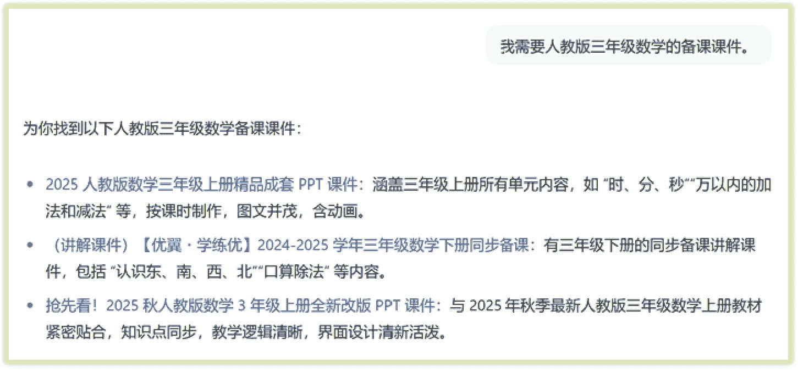

图 1-2 资源获取结果

**五、操作小窍门**

1.明确教材版本和年级：准确说明教材版本、具体年级和学期，确保资源的精准匹配。例如，补充“2023 年最新版人教版三年级上册”等详细信息。

2.细化资源类型需求：在输入需求时，具体说明所需资源类型能让结果更实用。例如“需要包含动画演示的 PPT 课件”“提供分层作业设计”“推荐适合课堂互动的小游戏”等。

3.结合学生特点补充信息：提供班级学生的基本情况，让 AI 的推荐更贴合实际教学。例如，“班级学生数学基础较弱，需要更多直观的教具和趣味性强的教学活动”。

4.明确使用场景要求：在需求中注明资源的具体使用场景，例如，“用于新课导入的 5 分钟小视频”“适合课堂展示的高清图片素材”“便于打印的练习题模板”等。

**六、遇到问题这样解决**

1.版本不匹配或资源过时：重新明确教材版本和出版年份，要求“请提供 2023 年最新版人教版教学资源”。

2.资源质量不符合要求：反馈具体问题。例如“刚才提供的课件过于简单，请提供更详细、互动性更强的教学课件”或“需要更符合小学生认知特点的教学设计”，让 AI 基于反馈优化输出。

3.资源类型不全面：补充具体的资源需求，如“除了课件和教案，还需要课堂小测验题、家长辅导建议、拓展阅读材料”等，帮助 AI 提供更全面的资源整合方案。

**1.2 教案的设计与编写**

**一、场景介绍**

教案的设计与编写是教师日常教学工作的重要组成部分，需要教师深入理解教学目标、精心设计教学活动、合理安排教学进度，这些工作往往要耗费大量时间和精力。在传统的教案设计与编写过程中，教师需要查阅大量教材资料、参考教学大纲、设计教学环节，工作量繁重且容易出现内容不够系统、结构不够完整等问题。AI 技术可以快速分析教学内容和目标，自动生成结构完整、内容丰富的教案，包括教学目标、重难点分析、教学过程设计、板书设计等环节。通过智能匹配教材版本和课程标准，确保生成的教案符合教学要求，同时支持个性化调整，让教师能够在标准化模板的基础上融入个人教学风格，从而大大提升备课效率。

**二、相关软件介绍**

AI 工具：九章智能教案。

软件简介：广东省中小学智慧教育平台（免费）是由广东省教育厅主导建设的智能化教育服务平台，面向全省中小学教师、学生及家长群体，依托云计算与教育大数据分析技术构建。平台全面覆盖基础教育全学段、全学科教学需求，整合粤教版、人教版等主流教材版本资源，提供课程资源库、在线备课系统、智能作业管理、学情监测分析等核心功能，支持教师根据教学进度智能生成个性化教学方案，实现优质教育资源精准推送与教学全过程数字化管理。

**三、具体操作流程**

第一步：进入广东省中小学智慧教育平台，在“人工智能”→“AI 智能体”板块中，选择“九章智能教案”功能进入操作页面。

第二步：设置教学参数。在教案生成页面中，完成所有参数的设置后，依次选择以下关键信息。

●学科学段：选择对应的学科（如语文、数学、英语等）和学段（小学、初中、高中）。

●教材版本：根据实际使用情况选择具体的教材版本和年份。

●单元章节：定位到具体的教学内容。

●课时安排：设定需要生成的课时数量。

第三步：获取与优化教案。系统基于设定参数和内置的教学资源库，自动生成包含教学目标、教学重难点、教学过程等完整要素的教案。生成后可根据个人教学风格和班级实际情况，对教案内容进行个性化调整和优化。

**四、实际案例**

假设你是一名中学数学教师，需要为七年级下册第九章的内容编写教案。

打开图 1-3 所示的九章智能教案的智能体入口。

图 1-3 智能体入口图示

按照图 1-4 设置参数。设置完成后，系统将生成完整的教案，图 1-5 所示为部分教案截图。我们可以将生成的教案导出并保存到本地文件。

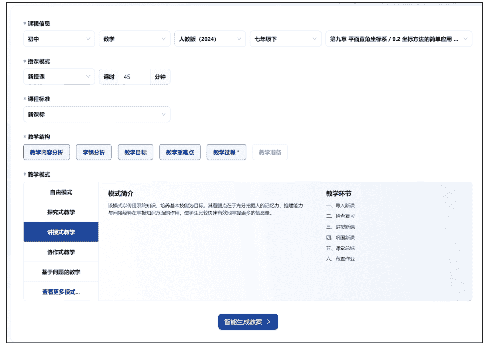

图 1-4 智能体参数设置示例

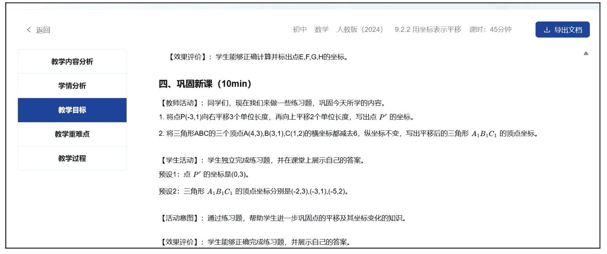

图 1-5 部分教案截图

**五、操作小窍门**

1.精准设置教学参数：在选择教材版本时，要确认年份和版次，不同版本的内容安排可能存在差异。在选择单元章节时，建议精确到具体的知识点，这样生成的教案针对性更强。

2.个性化调整教案内容：获得标准教案后，结合班级学生的实际情况、学习特点等进行调整。比如，对于基础较弱的班级，可增加基础练习；对于接受能力强的班级，可适当增加拓展内容。

**六、遇到问题这样解决**

1.教案内容不符合预期：检查教材版本选择是否准确，确认年份和版次信息；重新审视参数设置，确保学科学段、单元章节选择正确。

2.教案结构不够完整：可分步骤生成，先生成教案框架，再逐一完善各环节；或者在教学模式中选择包含的所有要素，确保生成的教案结构完整。

**1.3 智能生成教学课件**

**一、场景介绍**

课件制作是现代教学中不可缺少的环节，优质的 PPT 课件能够直观呈现教学内容、增强学生理解、提升课堂互动效果。然而，传统的课件制作过程往往耗时费力，教师需要花费大量时间进行素材收集、版面设计、动画制作等工作，且制作出的课件在视觉效果和内容结构方面可能存在不足。

AI 技术可以根据教学主题和内容要求，自动生成结构清晰、设计美观的教学课件，包括封面设计、内容页面布局、图表制作、动画效果等方面。通过智能分析教学内容的逻辑关系，合理安排页面顺序和重点突出，确保课件既符合教学规律，又具有良好的视觉呈现效果，让教师从烦琐的技术操作中解脱出来，专注于教学内容的精心设计。

**二、相关软件介绍**

九章爱学老师版支持多学科、多学段的课件制作需求，内置丰富的教育模板库和素材资源，能够根据不同学科特点和学段认知水平，生成符合教学要求的专业课件。平台具备智能内容分析、自动版面设计、素材匹配、动画生成等核心功能，生成的课件包含完整的教学流程设计、重点知识可视化呈现、互动环节设置等要素。

**三、具体操作流程**

第一步：进入课件生成页面。完成九章爱学老师版平台注册并登录，可选择网页端或手机 App 端访问。在首页“应用”板块中搜索关键词“课件”，从搜索结果的“课件 PPT”功能进入课件生成页面。

第二步：设置课件参数与需求。完成参数设置后，可勾选“深度思考”选项，以获得更丰富的分析内容。

第三步：获取与优化课件。系统基于设定的参数和教学需求，自动生成包含目录、教学内容、总结等完整结构的 PPT 课件。生成后可预览课件效果，根据个人教学风格和班级特点对内容、版面、动画等进行个性化调整和优化。

**四、实际案例**

假设你是小学三年级的一名数学教师，需要为“自然数”单元制作新的教学课件。

进入九章爱学老师版课件 PPT 功能页面，智能体参数填写示例如图 1-6 所示，包括选择学科、学段年级、课件的主题名称和其他要求等。填写完成后单击“深度思考”选项，再单击“一键生成”按钮，系统即可生成完整课件，然后将课件保存到本地进行教学使用。

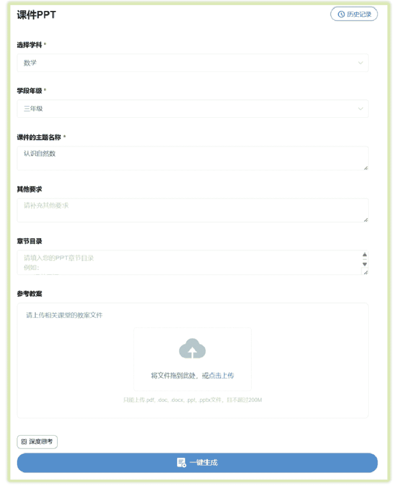

图 1-6 智能体参数填写示例

**五、操作小窍门**

1.精确描述课件主题：避免使用过于笼统的描述，如不要只写“数学”，而要写“二次函数的图像与性质”或“平行四边形的判定与性质”等具体主题。明确的主题描述有助于 AI 准确理解教学需求。

2.明确课件类型与教学环节：在设置中标注课件的具体类型，如“新授课”、“复习课”或“习题讲评课”等，不同类型的课件在内容组织和重点突出方面会有不同的处理方式。

3.充分利用“深度思考”功能：选择该选项后，AI 会进行更深入的内容分析，从而生成更丰富的知识拓展内容、更多样的教学活动设计，以及更详细的重难点解析。

4.详细说明个性化需求：在“其他要求”栏中，可以具体描述期望的课件风格（如“活泼生动”“简洁专业”“图文并茂”）、特殊要求（如“增加实验演示环节”“突出数学建模思想”）等。

**六、遇到问题这样解决**

1.课件内容不符合教学预期：检查主题描述是否准确具体，重新审视学科和学段年级的选择是否正确；在“其他要求”中补充更详细的内容说明，如“适合基础较弱的班级”“需要增加互动环节”“重点突出实际应用”等；可以上传相关的教案或教学大纲作为参考，让 AI 更好地理解具体教学需求。

2.课件结构不够合理：在生成课件前，明确课件的预期页数和主要结构，如“包含导入、新课、练习、总结四个环节”；可以先生成课件大纲，确认结构合理后再生成详细内容；对于结构复杂的内容，建议提供详细的教学流程说明，帮助 AI 更好地组织内容逻辑。

**1.4 文档转课件的智能制作**

**一、场景介绍**

在日常教学工作中，教师往往已经准备了详细的教学文档、教案或讲义，但将这些文字材料转换为视觉化的 PPT 课件需要耗费大量时间和精力。传统的课件制作过程需要教师逐页设计版面、调整格式、插入图片、设置动画等，不仅工作量大，还容易因为技术操作不熟练而影响课件的美观度和专业性。利用 AI 技术，可以智能识别和解析 Word 文档、PDF 等多种格式的教学材料，自动提取核心内容并转换为结构清晰、设计精美的 PPT 课件。通过深度理解文档的逻辑结构和教学要点，AI 能够合理安排页面布局、选择合适的视觉元素、设计符合教学规律的内容呈现方式，让教师从烦琐的格式调整中解放出来，专注于教学内容的优化和课堂互动设计。

**二、相关软件介绍**

夸克 AI 是阿里巴巴旗下智能搜索平台推出的 AI 创作工具集，其具备强大的文档理解能力和丰富的课件模板库，支持多学科、多学段的课件制作需求。平台内置教育专用的设计模板，包括卡通、商务、现代、清新等多种风格，能够根据不同学科特点和教学对象自动匹配合适的视觉风格，生成的课件既保持原文档的教学逻辑，又具备良好的视觉呈现效果。

**三、具体操作流程**

第一步：进入 AI PPT 功能页面。访问夸克官网，在首页“下载”板块中单击“网页版”。完成注册并登录后，在夸克 AI 页面选择“AI PPT”，进入课件制作页面。

第二步：上传文档与设置需求。在课件制作页面上传撰写好的教学文档。上传完成后，补充具体的制作需求，包括课件页数、内容重点、风格偏好、特殊要求等。

第三步：优化与导出课件。系统基于上传的文档和设置需求，自动生成初步的 PPT 课件。用户可对生成的课件进行详细检阅和精细调整。

**四、实际案例**

假设你是一名小学数学教师，已经准备了一份关于“秒的认识”单元的详细教案 Word 文档，现在需要将其转换为课堂教学用的 PPT 课件。

如图 1-7 所示，在首页“下载”板块中单击“网页版”。在图 1-8 所示的夸克 AI 页面中选择“AI PPT”进入课件制作页面。

图 1-7 夸克 AI 的网页版入口

图 1-8 AI PPT 功能入口

如图 1-9 所示，在 AI PPT 功能页面上传准备好的教案文档，然后完善框选部分的细节要求。完成后单击发送按钮（右侧的小箭头图标），即可初步生成 PPT 课件。

图 1-9 参数设置细节

检查初步生成的 PPT，可以对生成的内容进行精细调整，包括对单页面的内容编辑和新增页面等，如图 1-10 所示。

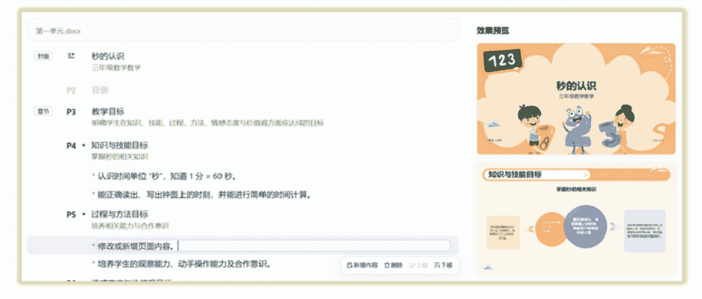

图 1-10 AI 生成的 PPT 的内容细节

如图 1-11 所示，若需调整 PPT 的风格，可单击“更换模板”进行修正。

图 1-11 更换 PPT 模板

在图 1-12 所示的模板中，可根据学科特点选择插画、卡通、商务、清新等不同的风格。

图 1-12 模板风格展示

检查内容无误后，单击图 1-13 所示的“下载 PPT”按钮，可将 PPT 导出到本地使用。

图 1-13 下载 PPT 按钮

**五、操作小窍门**

1.优化原文档结构：上传前确保原文档层次清晰，合理使用标题、副标题、正文等格式层级。建议使用 Word 的样式功能设置标题格式，便于 AI 准确识别内容结构和重要程度。

2.选择合适的页数设置：根据实际课堂时长合理设置页数，一般 40 分钟课堂建议 15～20 页，45 分钟课堂建议 18～25 页。页数过多时会导致节奏过快，页数过少则会导致内容过于简略。

3.明确重点内容的标注：在需求设置中明确标注需要重点突出的知识点、概念或方法，如“重点突出二次函数的图像特征”“详细展示解题步骤”“增加变式练习”等。

4.选择合适的视觉风格：根据学科特点和学生年龄选择合适的模板风格。例如，理科课程推荐商务或现代风格；文科课程宜采用清新或可爱风格；面向低年级学生时，插画或卡通风格效果更佳。

5.充分利用编辑功能：生成初步的课件后，要仔细检查每页内容的准确性和完整性，及时调整不合适的表述，补充必要的图表、公式或案例说明。

**六、遇到问题这样解决**

1.文档上传失败或识别不准确：检查文件格式是否符合要求，推荐使用 Word 的 DOCX 格式，确保文档中的文字流畅、结构清晰；若原文档格式复杂或包含大量图表，建议先整理为纯文字版本再上传。

2.课件风格不符合预期：利用“更换模板”选项尝试不同的设计风格，选择最符合学科特点和个人偏好的模板；在需求中明确描述期望的视觉效果，如“色彩要温和专业”“字体要清晰易读”“版面要简洁大方”。

**1.5 思维导图的自动生成**

**一、场景介绍**

在备课、讲解或教研过程中，教师常常需要对知识结构、教学重难点或读书内容进行结构化梳理。思维导图是一种高效的可视化工具，能够帮助教师提取关键信息、厘清知识逻辑、构建关联模块，从而提升教学的条理性和学生的理解力。

传统的思维导图制作依赖教师手动阅读、提炼和排版，耗时较长，难以在教学节奏紧凑的环境下高效完成。借助 AI 工具，教师可以通过上传一篇文档（如教学设计方案、课程材料、教研总结等），快速自动生成思维导图，并可根据教学需要调整结构、风格与输出格式，从而极大地提升制作效率。

**二、相关软件介绍**

豆包支持教师上传各类文档（如 PDF、Word、TXT 等格式），可智能分析内容层级、识别逻辑结构与关键术语，自动生成符合原文主题的思维导图，输出为图片或富文本格式，广泛适用于教学要点梳理、读书笔记、教学法反思等场景。

**三、具体操作流程**

第一步：注册并登录豆包桌面端。

第二步：上传文档材料。通过拖曳本地文档到豆包聊天框，或单击聊天框左下角的“回形针”图标选择上传的文件，等待豆包完成文档解析。

第三步：输入提示词并生成思维导图。在聊天框中输入提示词“生成思维导图”即可。

**四、实际案例**

假设你是一名语文教师，想给同学们介绍《木偶奇遇记》这本名著（见图 1-14），但由于该作品人物关系复杂、叙事节奏缓慢、细节密度高，导致学生阅读兴趣低。你可以借助思维导图工具，让学生在阅读前大致了解作品。

图 1-14 《木偶奇遇记》名著

打开豆包，上传《木偶奇遇记》电子版，待豆包解析完成后，输入相应的提示词，如“生成思维导图”，如图 1-15 所示。按回车键或单击右下角的发送按钮（右侧小箭头图标），等待豆包阅读并生成思维导图，结果如图 1-16 所示。你可以将生成的思维导图保存为图片格式，用于展示，或以富文本格式导入其他思维导图工具进一步修改。

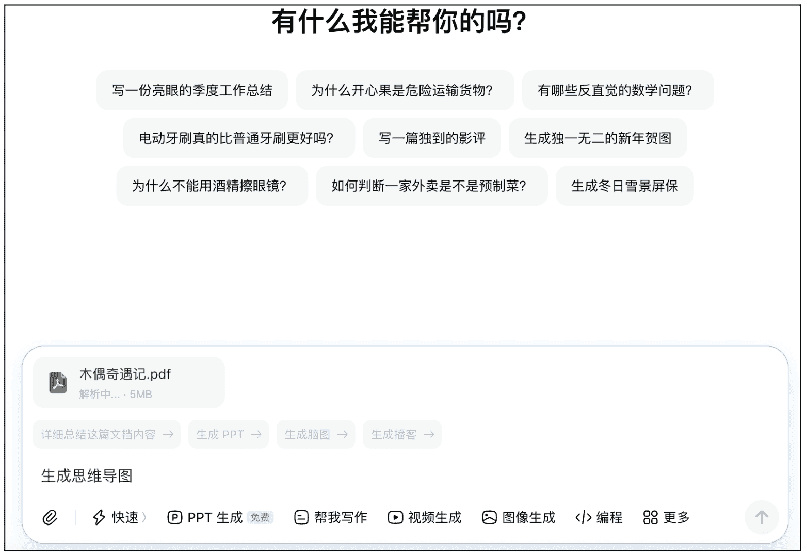

图 1-15 解析文档并输入提示词

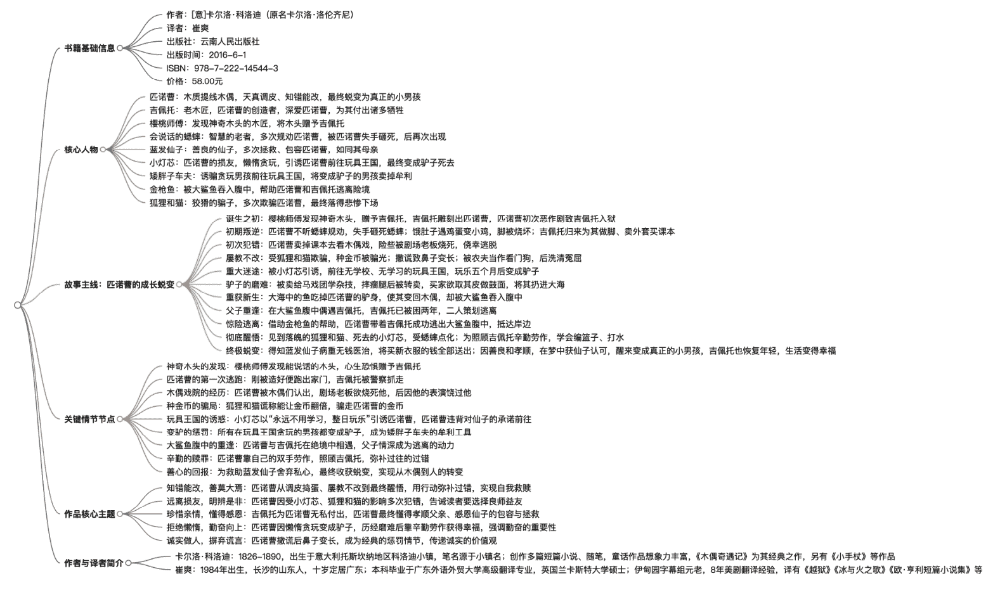

图 1-16 生成的思维导图

**五、操作小窍门**

1.细化思维导图维度：在输入需求时，明确具体的分析维度能让结果更具实用性。例如，补充“故事情景”“核心思想”等，生成更具侧重点的思维导图。

2.结合教学场景补充受众信息：提供班级基本情况（如学生年级等），让生成的思维导图更贴合教学实际。比如“生成思维导图，方便小学二年级学生理解人物脉络”。

**六、遇到问题这样解决**

1.文档上传失败或无法识别：检查文件格式是否符合要求（推荐 PDF、TXT、DOC、DOCX 等格式），若不符合要求，则可先转换为支持的格式，再上传。若文件过大（超过平台限制），则可拆分文档后分次上传。

2.修改思维导图：反馈具体问题，例如“生成的思维导图过于笼统，请再详细一些”，让 AI 基于反馈优化输出，生成新的思维导图，或以富文本格式导出思维导图，结合其他思维导图工具（如 Xmind）进一步编辑。

**1.6 知识要点的梳理与提炼**

**一、场景介绍**

教学材料往往信息量大、内容繁杂，教师在备课、教研、复习、设计等场景中，需要对文献、教案、教材或学生笔记中的关键信息进行提炼整理，形成清晰且结构化的知识要点梳理文稿。

传统做法依赖人工阅读与总结，耗时长且容易遗漏要点。利用 AI 工具，教师可以通过上传原始文档，自动完成主题识别、逻辑分层、知识点提炼与文本重构，从而高效生成结构清晰、语言简练、重点突出的教学要点文档，极大地提升内容处理效率与教学呈现质量。

**二、相关软件介绍**

豆包可基于强大的语言理解与关联能力，快速识别文档结构，提取其中的核心概念与重点知识，并自动生成一篇结构化、段落清晰、语言准确的知识要点梳理文稿。

**三、具体操作流程**

第一步：注册并登录豆包桌面端。

第二步：上传文档材料。通过拖曳本地文档到豆包聊天框，或单击聊天框左下角的“回形针”图标选择上传的文件，等待豆包完成文档解析。

第三步：输入提示词并生成知识要点。在聊天框中输入提示词“详细总结这篇文档内容”即可。

**四、实际案例**

假设你是一名高中语文教师，想要快速判断一本现有的写作类图书是否可以作为教学素材的一部分，因此你需要尽可能高效地获取这本书的大纲和核心内容。

打开豆包，上传《写作高手速成手册》电子版，待豆包解析完成后，输入相应的提示词，例如：“详细总结这篇文档内容”（详细的提示词见本书附赠的资源），如图 1-17 所示。

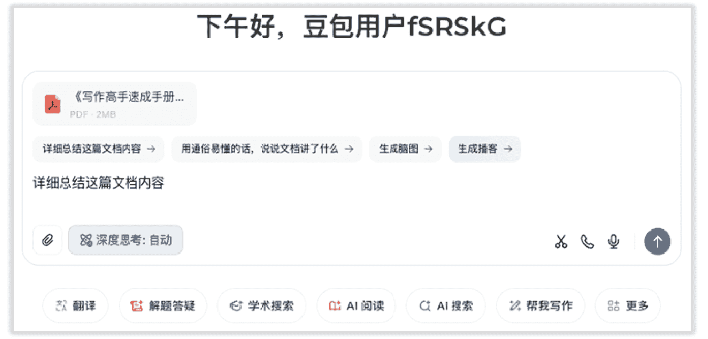

图 1-17 解析文档并输入提示词

按回车键或单击右下角的发送按钮，等待豆包阅读并生成总结，如图 1-18 所示。

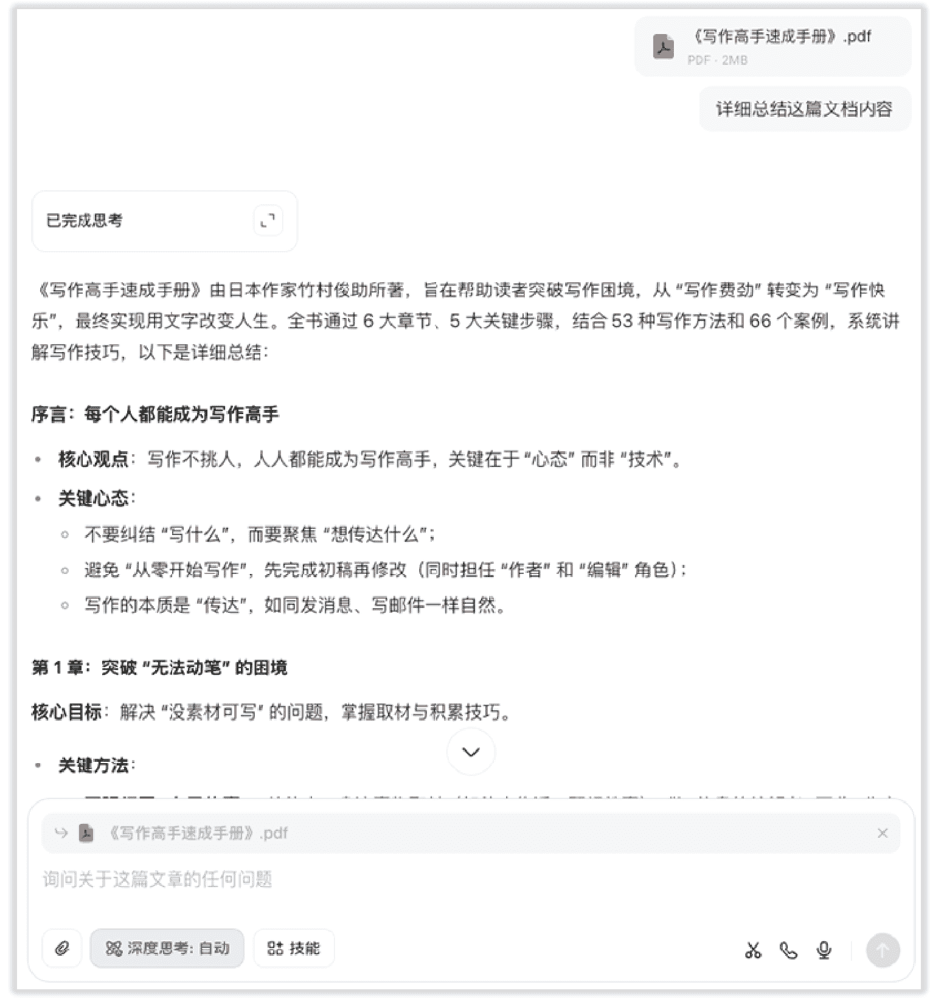

图 1-18 生成的总结内容

接下来可以让豆包更有侧重点地总结文档，例如，输入提示词“这本书中有哪些适合作为高中作文写作教学素材的部分？”豆包将会进一步总结更详细的内容，如图 1-19 所示。

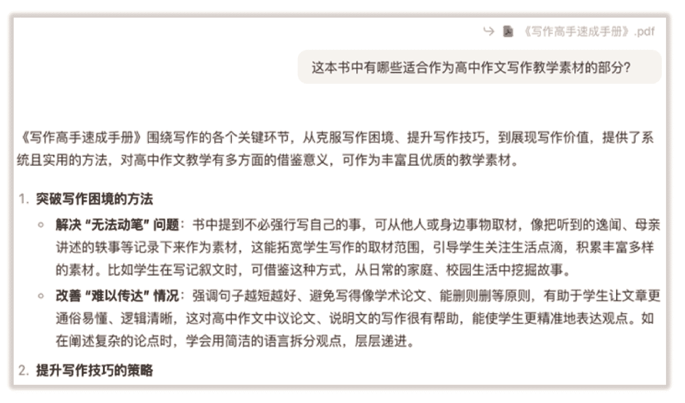

图 1-19 进一步生成的总结内容

**五、操作小窍门**

1.明确表达意图：在输入需求时，明确具体的意图能让结果更具实用性。例如，在提示词中加入“这本书中有哪些适合作为高中作文写作教学素材的部分？”“这本书中有哪些写作案例可以帮助高中生写好作文？”等，帮助豆包更准确地理解需求意图。

2.交互式补充信息：可以在豆包的聊天框中不断补充新的内容，实现对话式的交互。例如，可以输入提示词“请精简以上内容”，避免其生成的内容冗长，无法捕获重点。

**六、遇到问题这样解决**

文档上传失败或无法识别：检查文件格式是否符合要求（推荐 PDF、TXT、DOC、DOCX 等格式），若不符合要求，则可先转换为支持的格式，再上传。若文件过大（超过平台限制），则可拆分文档后分次上传。

**1.7 教学视频素材制作**

**一、场景介绍**

教师在制作课程微课、教学示范视频或线上导学短片时，往往需要快速将文本内容转化为视频形式。传统方式需真人拍摄、配音、剪辑，耗费时间与资源，不适用于高频短视频教学内容。借助 AI 文生视频工具，教师只需输入教学文本脚本，即可自动生成视频素材，包含数字人讲解、情景画面和配套字幕。该方式不仅提升了效率，也增强了视觉与语音同步效果，有助于学生理解和线上传播。

**二、相关软件介绍**

AI 工具：九章古诗词动画。

软件简介：广东省中小学智慧教育平台的九章古诗词动画工具深度融合自然语言理解与图像识别技术，创新性地集成文生视频、图生视频及视频智能续写功能，可基于教学大纲文本或教材插图自动生成电影级高清教学视频，支持微课制作、实验过程模拟、历史场景还原等多模态教学资源创作。该平台依托省级教育云架构，通过智能解析课程标准与教材知识图谱，实现从文字教案到动态视频的跨媒介转化，教师可自由选择视频时长、画风模板与叙事节奏，生成的视频资源自动匹配知识点标注与分层学习建议，全面覆盖课堂演示、课后拓展、跨学科融合等多元化教学场景需求。

**三、具体操作流程**

第一步：进入广东省中小学智慧教育平台，选择“九章古诗词动画”。

第二步：配置生成选项，输入古诗词并发送。

第三步：等待生成结果。

**四、实际案例**

假设你是一名小学语文老师，想在 PPT 中放一段小视频，来帮助同学们理解古诗词中美丽的画面，你可以采用“九章古诗词动画”来生成一段小视频。

打开广东省中小学智慧教育平台，选择“九章古诗词动画”选项，输入相应的古诗名字，例如：“白雪歌送武判官归京”，结果如图 1-20 所示。

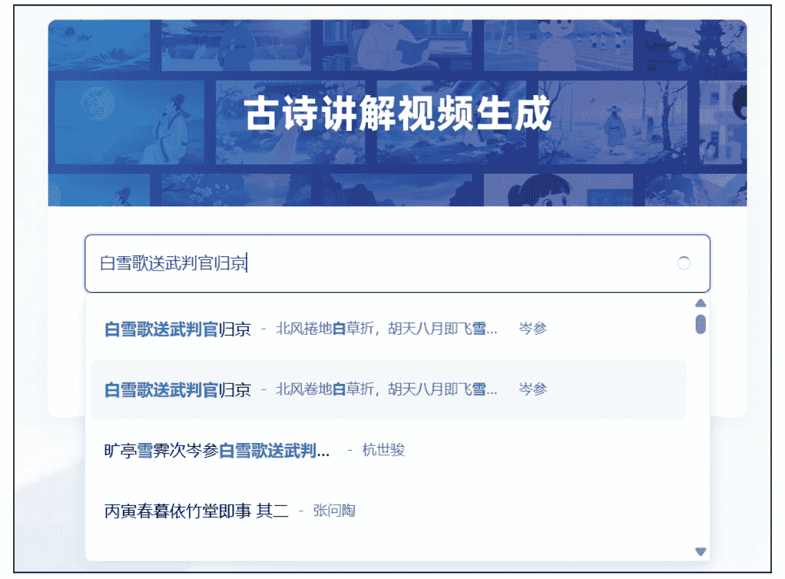

图 1-20 选择配置并输入古诗名字

单击选择对应的古诗，确认无误后单击“制作视频”按钮，如图 1-21 所示。

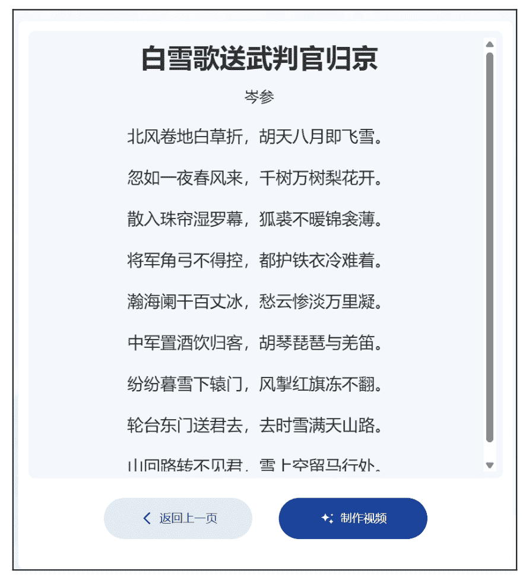

图 1-21 制作古诗视频

视频生成完成后，可以单击预览和下载视频，如图 1-22 所示。

图 1-22 预览古诗视频

**五、操作小窍门**

1.聚焦古诗体裁输入：系统专为古诗教学场景优化，输入时应确保文本为完整的古诗，避免输入文言文片段。建议采用“诗题+作者”组合输入，或直接粘贴教材标准版的诗句，系统将自动识别并匹配教材配套插画风格与注释体系。

2.双重校验古诗版本：选定下拉列表中的古诗后，需重点核验作者的匹配性和诗句的完整性，避免因同名诗作、版本差异或教材错位导致教学内容出现偏差。

**六、遇到问题这样解决**

1.生成视频时间过长：当系统提示“视频生成中”时，建议保持页面开启并耐心等待（通常需 3～5 分钟）。生成时长受视频分辨率、场景复杂度及服务器负载等因素影响。若进度条停滞，则可尝试刷新页面查看实时进度提示，避开教学高峰时段。需特别注意：请勿重复单击“生成”按钮，避免触发系统防刷机制导致生成队列重置。

2.窗口意外关闭：若中途关闭网页或浏览器崩溃，可通过“我的内容”模块检索历史记录，教师可在该界面管理生成的视频内容。

**1.8 教学音频素材制作**

**一、场景介绍**

制作音频素材是音乐创作、影视配乐等领域的核心环节，旨在创作出符合风格定位、情感基调与节奏需求的旋律、音效等，以满足多样化的听觉表达需求。AI 大模型不仅能高效处理海量数据，自动生成风格多样的音乐片段，精准匹配场景所需的情感与节奏，还能依据用户的关键词或偏好，推荐个性化素材方案，从而助力创作者高效产出贴合需求的音乐作品。

**二、相关软件介绍**

SunoAI 的特点包括：AI 智能作曲，依据用户描述的心情或想法，一键生成拥有专业级词曲的完整歌曲；风格融合创造，支持混合流行、摇滚、爵士等多种音乐类型，打造独特的听感；工作室级音质，提供逼真的 AI 人声与乐器音色；智能歌词生成，能创作与用户指定风格高度契合的歌词。

**三、具体操作流程**

第一步：进入 SunoAI。完成平台注册并登录，在主页面中单击左侧导航栏的“创作中心”按钮，跳转至操作页面。

第二步：编写提示词。在操作页面描述期待生成的音乐风格、主题等。

第三步：获取音乐作品。智能体基于提示词内包含的音乐风格、主题等设定，生成一段音乐。

**四、实际案例**

假设你是一名初中班主任，想利用 SunoAI 生成一曲班歌，要求是进行曲风格，主题充满正能量。

打开 SunoAI，输入生成曲目的要求，如图 1-23 所示。输入完成后单击“创作”按钮，生成的曲目如图 1-24 所示。

图 1-23 提示词设定

图 1-24 生成的曲目

用户可单击生成的曲目进入预览页面，如图 1-25 所示，包含歌词内容、预览进度条等。

图 1-25 生成曲目歌词预览

**五、操作小窍门**

1.细化生成维度：在输入需求时，明确具体的歌曲风格、主题等，能让结果更具实用性。例如，补充“进行曲风格”“正能量主题”“班歌风格”等，有助于精准定位需求。

2.进一步编辑歌曲：SunoAI 支持“音质提升”“音乐分离”“音乐剪辑”等进一步的功能，用户可以在生成的曲目上进一步编辑歌曲，从而满足要求。

**六、遇到问题这样解决**

生成的歌曲生硬不自然：输入的提示词要精准，尽可能详细地表达自己对歌曲的需求。

**1.9 跨学科内容的设计与整合**

**一、场景介绍**

传统教育模式往往将各学科知识割裂开来，学生在学习过程中难以建立知识之间的有机联系，缺乏运用多学科知识解决复杂问题的能力。现代教育理念强调培养学生的综合素养和创新思维，这就需要教师能够设计跨学科的教学方案，帮助学生构建完整的知识体系。然而，跨学科教学设计对教师提出了更高的要求，需要教师具备多学科的专业知识，能够发现不同学科之间的内在联系，并创造性地将其整合为有机的教学内容。AI 跨学科整合技术能够基于海量的教育资源和课程标准数据，智能分析不同学科间的知识关联点，自动生成融合度高、逻辑性强的跨学科教学方案。

**二、相关软件介绍**

九章爱学老师版平台内置了完整的课程标准数据库与丰富的教学案例库，支持教师根据具体的教学目标、学生特点及认知规律，灵活选择并创造性地整合多学科内容。该功能高度注重实用性与可操作性，并具备智能优化机制，能依据教师反馈与实际使用效果，持续优化教学方案，从而确保教学内容的科学性与有效性。

**三、具体操作流程**

第一步：进入跨学科设计功能页面。在九章爱学老师版首页“应用”板块中搜索关键词“跨学科”，从搜索结果中选择“跨学科设计”，进入跨学科教学方案设计页面。

第二步：设置教学参数。在功能页面选择对应的年级，随后在“多学科”板块中，根据教学需要勾选 2～4 个相关学科（支持多选）。最后，在“其他要求”栏内补充教学主题、重点内容或任何特殊说明即可。

第三步：生成跨学科教学方案。参数设置完成后，AI 系统将根据所选年级与学科组合，智能解析各学科知识的内在联系，自动生成一份融合度高、结构完整的跨学科教学方案。该方案通常涵盖教学目标、内容安排、活动设计与评价方式等核心要素。

第四步：预览与导出教案。教案生成后，教师可在线预览整体内容，审阅其逻辑合理性与教学适用性。确认无误后，可将教案导出为本地文档，便于后续使用、打印或分享给其他教师。

**四、实际案例**

假设你是一名小学三年级的班主任，希望设计一个融合语文、英语、道德与法治三个学科的跨学科教学方案，主题围绕“友谊与交流”展开，培养学生的语言表达能力和社交情感素养。

在首页“应用”板块中搜索关键词“跨学科”，在搜索结果中单击如图 1-26 所示的“跨学科设计”。

图 1-26 智能体入口

如图 1-27 所示，在页面中选择对应年级，并在“多学科”板块中勾选需整合的学科（支持多选）。完成后单击“一键生成”按钮，系统将基于所选内容（如语文、英语、道德与法治）自动生成聚焦于语言表达与社交情感能力培养的跨学科教学方案。教案生成后可在线预览，确认无误后可导出为多种格式的文档保存至本地，便于后续使用。

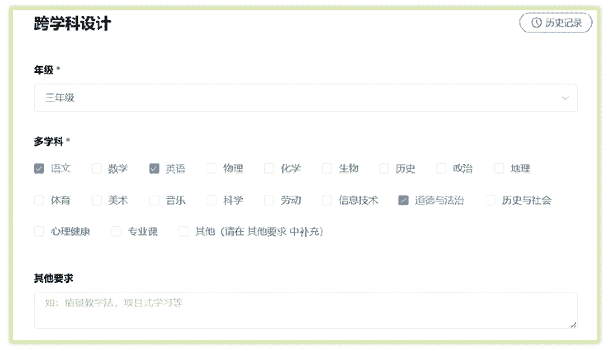

图 1-27 参数设置示例

**五、操作小窍门**

1.选择有逻辑关联的学科组合：在进行学科选择时，要确保所选的多个学科之间存在天然的知识联系或能够围绕共同主题展开。例如，语文、历史、地理可以围绕“文化传承”主题整合；数学、科学、信息技术可以围绕“数据分析”主题融合，避免选择关联性较弱的学科进行生硬拼凑。

2.精准设置年级参数：不同年级学生的认知水平、知识基础和接受能力存在显著差异，准确选择年级能确保生成内容的难度适宜、表达方式恰当。同时要考虑该年级各学科的教学进度，确保整合的知识点都在学生的学习范围内。

3.明确整合主题和核心概念：在“其他要求”栏中详细描述希望整合的主题、核心概念或教学重点，如“以环保为主题，融合科学实验和数学统计”或“围绕传统文化，整合语文阅读和历史知识”。明确的主题有助于 AI 生成更有针对性的方案。

**六、遇到问题这样解决**

1.学科整合度不高或内容割裂：重新审视所选学科的关联性，确保它们之间存在合理的知识交汇点；可以尝试减少学科数量，先从 2 到 3 个关联性较强的学科开始整合。

2.教学内容难度不合适：检查年级设置是否准确，确保与目标学生的实际水平匹配；在要求中补充学生的具体情况，如“学生基础较好，可适当提高难度”或“班级学习能力参差不齐，需要分层设计”；要求调整内容深度，如“请简化理论讲解，增加实践活动”。

3.生成内容与教学实际脱节：补充更多的教学背景信息，如班级规模、学生特点、教学时间安排等；要求结合具体的教学环境，如“适合 40 人班级的大班教学”或“适合 20 人以内的小班精品教学”；明确教学时长和课时安排，如“设计为 2 课时完成”或“分 3 个阶段实施”。

**1.10 教材版本的智能对比与适配**

**一、场景介绍**

当前基础教育领域普遍存在多版本教材并行使用的情况，例如，人教版、苏教版、北师大版等。这些版本在知识结构编排、例题设置和内容拓展方面各有特点，客观上为教学资源整合、课程统一实施，以及教师跨版本备课带来了现实挑战。

在实际教学中，教师通常需要系统比较不同版本的教材在知识点分布、难度梯度和内容组织上的异同，以便灵活调整教学策略。传统的人工比对方式耗时费力，且难以形成系统化的分析结论。此时，AI 工具可发挥重要作用：借助“文生文”技术，能够快速解析多版本教材文本，自动生成差异化的对比报告、内容适配建议或教学衔接方案，从而有效提升教师的备课效率与教学针对性。

**二、相关软件介绍**

豆包可实现跨版本教材的智能对比。教师只需上传相关学科的资料文档（如同一科目不同版本的 PDF 格式文件），系统即可基于其强大的语言理解与关联能力，自动对比差异。

**三、具体操作流程**

第一步：注册并登录豆包桌面端。

第二步：上传同一学科不同版本的文档材料。上传文档材料的方法为：通过拖曳本地文档到豆包聊天框，或单击聊天框左下角的“回形针”图标选择上传的文件，等待豆包完成文档解析。

第三步：输入提示词，进行跨版本差异的对比。

**四、实际案例**

假设你是一名初中历史教师，想对比七年级历史下册“人教版”和“部编版”的差异。

将两个版本教材的 PDF 电子版上传到豆包聊天框，输入提示词“对比这两版教材的差异，并给出教学意见。”，如图 1-28 所示。

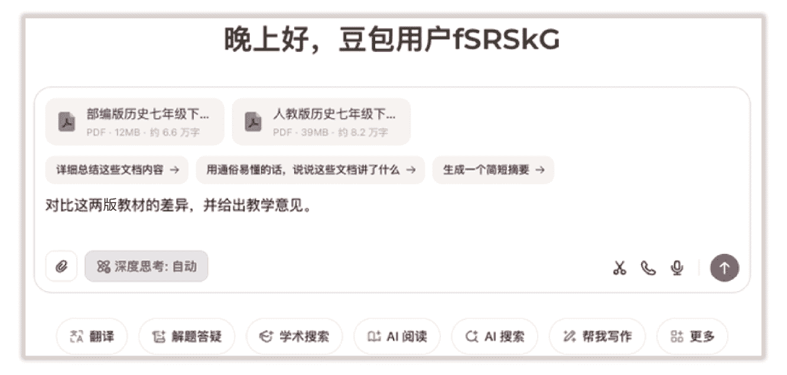

图 1-28 上传不同版本的教材，并输入提示词

按回车键或单击右下角的发送按钮，等待豆包给出差异化的对比分析报告和对应的教学意见，生成的结果如图 1-29 和图 1-30 所示，教师可复制生成内容，进行进一步的格式整理或展示。

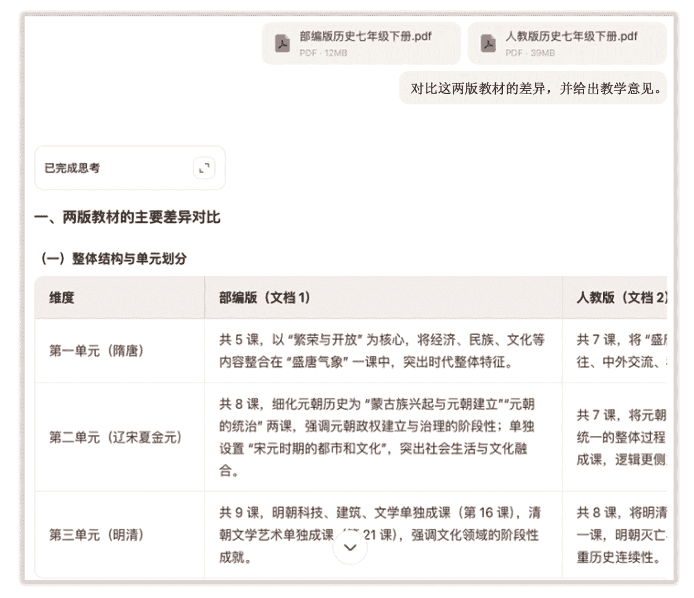

图 1-29 两版教材的差异展示

图 1-30 两版教材的差异总结

**五、操作小窍门**

1.明确表达意图：在输入需求时，明确具体的意图能让生成的结果更具实用性。例如，在提示词中加入更细致的对比要求，如“请重点对比隋唐阶段的教材差异性”等，帮助豆包更准确地理解需求意图。

2.交互式补充信息：可以在豆包聊天框中不断补充新的内容，实现对话式的交互。例如，可以输入提示词“请精简以上内容”，避免其生成内容冗长，无法捕获重点。

**六、遇到问题这样解决**

文档上传失败或无法识别：检查文件格式是否符合要求（推荐 PDF、TXT、DOC、DOCX 等格式），若不符合要求，则可先转换为支持的格式，再上传。若文件过大（超过平台限制），则可拆分文档后分次上传。

**1.11 个性化学习计划的制订**

**一、场景介绍**

传统的教学模式往往采用“一刀切”的方式，忽视了学生个体在学习基础、认知能力、学习节奏和兴趣特点等方面的显著差异。这种统一化的教学方式导致一部分学生“吃不饱”，另一部分学生“跟不上”，无法真正实现因材施教的教育理念。每个学生都有自己的学习特点和发展潜力，需要有针对性的学习指导和个性化的学习路径。然而，为每个学生制订个性化的学习计划是一项复杂而繁重的工作，需要教师深入了解每个学生的学习状况，分析其优势和不足，设计差异化的学习内容和进度安排。在班级规模较大的情况下，教师很难为每个学生提供如此精细的个性化指导，这成为制约教育质量提升的重要因素。AI 智能学习规划技术能够基于学生的学习数据和个人特征，快速生成科学、合理的个性化学习方案。通过智能分析学生的知识掌握情况、学习习惯和时间安排，AI 可以为每个学生量身定制学习路径，包括学习内容的选择、时间的分配、难度的调整和进度的安排。

**二、相关软件介绍**

豆包汇集了众多专业领域的定制化 AI 助手，其中“学习计划表”智能体专注于个性化学习规划，并对此进行了深度优化。该智能体具备强大的学习数据分析与规划生成能力，能够综合考虑学生的基础水平、认知特点、时间安排与学习目标等多维信息，生成科学合理的个性化学习方案。

此外，“学习计划表”智能体还内置了覆盖从小学到高中的完整课程体系与知识图谱，支持各学段、各学科的学习规划需求。它能够精准识别学生的知识薄弱点和能力优势，从而提供更具针对性的学习路径建议。

**三、具体操作流程**

第一步：进入学习计划智能体。打开豆包工具，完成账号注册并登录后进入主页面。在首页“AI 智能体”板块中搜索关键词“学习计划”，从搜索结果中单击用户为“桃子姐姐”构建的“学习计划表”智能体，进入个性化学习规划页面。

第二步：输入学习需求。在智能体聊天框中输入具体的学习需求，包括学科、年级等基本信息，系统会根据输入的基础信息启动相应的学习规划流程。

第三步：完善个人学习情况。智能体会主动询问学生的具体学习情况，包括每日可用学习时间、当前学习基础、薄弱环节、学习目标等关键信息。用户需要详细回答这些问题，为 AI 提供个性化信息。

第四步：获取定制的学习计划。基于收集到的个人信息，AI 智能体将综合分析学生的学习特点和需求，自动生成详细的个性化学习计划，包括学习目标设定、时间安排、内容规划、方法指导等完整的学习方案。

**四、实际案例**

假设你是小学三年级的一名数学教师，学生在数学学习方面遇到困难，基础较为薄弱，希望通过 AI 技术为孩子制订一个科学合理的个性化数学学习计划。

打开豆包工具，完成账号注册并登录后，在首页“AI 智能体”板块中搜索关键词“学习计划”，从搜索结果中单击用户为“桃子姐姐”构建的“学习计划表”智能体，如图 1-31 所示。

图 1-31 智能体入口

在该智能体聊天框中输入提示词“三年级数学”，如图 1-32 所示。

图 1-32 输入提示词

智能体开始询问具体情况，在智能体的提问中完善学习计划的大体情况。比如，输入提示词“我每天用于学习的时间是 3 小时，我现在基础很薄弱，不知道怎么学习。”，AI 将帮你构建完整的学习计划，如图 1-33 所示。

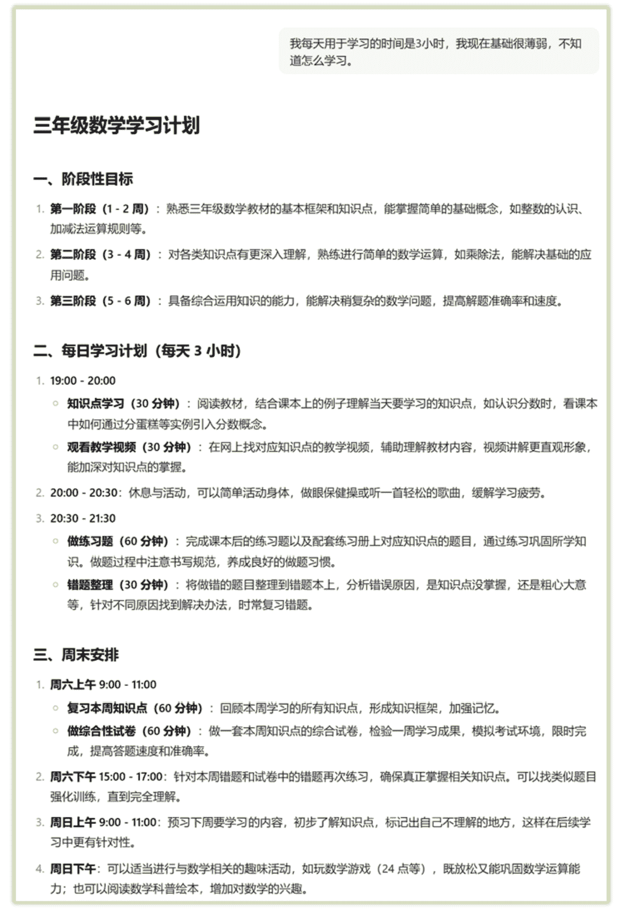

图 1-33 完善详细信息

**五、操作小窍门**

1.详细描述当前学习现状：在与智能体交流时，要具体说明当前掌握的知识点和存在的薄弱环节，避免笼统地表述。例如，不要只说“数学不好”，而要具体说明“乘法口诀熟练，但应用题理解困难，特别是两步计算的题目经常出错”。这样的具体信息有助于 AI 精准定位问题所在。

2.明确设定学习目标：要设定具体、可衡量的短期和长期学习目标，如“希望在一个月内掌握两位数乘法，两个月内能独立完成三年级水平的应用题”。明确的目标有助于 AI 制定更有针对性的学习路径和时间安排。

3.如实说明时间安排和学习条件：准确告知每日可用的学习时间、学习环境、可利用的学习资源等实际情况。例如，“每天晚上 7 到 9 点有 2 小时学习时间，周末上午可以增加 1 小时，家里有基本的学习用具”。这些信息有助于 AI 制订切实可行的学习计划。

**六、遇到问题这样解决**

1.生成的学习计划过于简单或缺乏针对性：在补充信息中详细说明学习基础和具体需求，如“我已经掌握了基础的加减法，需要重点提升乘除法和应用题能力”；要求“制订更详细的分阶段学习计划，包括每周的具体学习内容和练习安排”。

2.学习内容难度不合适：如果内容过难，则可以说“这个难度对我来说太大了，请降低难度，从更基础的内容开始”；如果内容太简单，则可以要求“我的基础比较好，请提供更有挑战性的学习内容和目标”；要求分层设计，如“请提供基础版和提高版两套方案，我可以根据掌握情况选择”。

3.缺少具体操作指导和学习方法：追加要求“请提供每个学习环节的具体操作方法和学习技巧”；要求推荐学习资源，如“请推荐适合的练习册、学习网站或 App”；询问学习方法，如“请详细说明如何进行错题分析和复习巩固”。

**1.12 经典诵读视频的生成**

**一、场景介绍**

传统的古诗词教学主要依靠教师的口头讲解和文字分析，学生往往难以真正理解古诗词中蕴含的深刻意境和情感内涵。古诗词作为中华文化的瑰宝，其语言精练、意境深远，但对现代学生来说，由于时代背景、生活经验和语言环境的差异，理解起来存在较大困难。学生常常只能机械地记忆诗句，无法深入体会诗人的情感世界和诗词所描绘的美妙意境。

传统的教学方法在古诗词意境传达方面存在明显的局限性。教师虽然可以通过语言描述、图片展示等方式帮助学生理解，但这些静态的辅助手段往往难以完全呈现诗词的动态美感和时空变化。古诗词中的“春江花月夜”“大漠孤烟直”“小桥流水人家”等经典意象，仅凭文字描述很难让学生产生身临其境的感受。

AI 视频生成技术能够根据诗词内容自动创建相应的视觉画面，将抽象的文字意境转化为具象的动态影像。通过 AI 生成的古诗意境视频，学生可以在观看过程中直观地感受到诗词所描绘的场景氛围，从而更准确地理解诗人的创作意图和情感表达。这种沉浸式的学习体验不仅能够提高学生的学习兴趣，还能帮助他们建立对古诗词的感性认知，为后续的理性分析和深度理解奠定基础，真正实现古诗词教学从“知其然”到“知其所以然”的转变。

**二、相关软件介绍**

本节介绍的 AI 工具包括：即梦 AI、剪映和豆包。

软件简介：即梦 AI 是字节跳动旗下抖音团队开发的专业 AI 创作工具。该工具集成了先进的深度学习算法和计算机视觉技术，能够实现从文字描述到图片生成，再从图片生成到视频创作的完整创作链条，特别适合教育领域的视觉化内容制作需求。

剪映是字节跳动推出的专业视频编辑软件，以其简单易用的操作页面和强大的编辑功能深受用户喜爱。在古诗词视频制作中，剪映的作用主要体现在内容整合和效果优化方面。教师可以将即梦 AI 生成的多个视频片段在剪映中进行无缝拼接，添加古典音乐背景、插入诗词朗诵音频、设计优雅的字幕效果等。

由于 AI 图像和视频的生成质量在很大程度上取决于提示词的准确性与创意性，因此，豆包承担起了提示词设计与创意策划的角色。它能够帮助教师将古诗词的抽象意境转化为生动、具体的视觉语言，从而为后续的 AI 生成提供高质量的输入内容。

**三、具体操作流程**

第一步：选择并分析古诗词作品意境。挑选适合视频教学的古诗词作品，深入分析其主题思想、意境构成、情感基调与艺术手法，为后续视觉转化奠定内容基础。

第二步：使用豆包进行创意策划。注册并登录豆包后，通过其智能对话功能，输入诗词内容并获取专业的视觉化创作建议，包括分镜头脚本、画面描述、色彩搭配等详细方案，形成完整的创作指导。

第三步：生成静态意境图片。在即梦 AI 平台中，依据豆包提供的画面描述逐句生成对应的意境图片，确保每张图片准确传达诗句的核心意象与氛围。

第四步：制作动态视频片段。将生成的静态图片结合豆包提供的动态效果提示词，转化为具有适当动感的视频片段，增强画面的生动性与表现力。

第五步：剪映后期制作。使用剪映对动态视频片段进行整合编辑，包括顺序拼接、音频添加、字幕制作、特效处理等，形成连贯且完整的教学视频。

第六步：教学应用与效果评估。将成品视频应用于实际的课堂教学，收集学生反馈，评估教学效果，并根据使用情况对视频内容或制作流程进行迭代优化。

**四、实际案例**

假设你是小学五年级的一名语文教师，正在准备刘禹锡《秋词》的教学内容。这首诗以“自古逢秋悲寂寥，我言秋日胜春朝。晴空一鹤排云上，便引诗情到碧霄。”赞颂了秋天的美好，并借仙鹤直冲云霄的描写，表现了作者奋发进取的豪情和豁达乐观的情怀。为了帮助学生更好地理解诗词的意境和情感，你决定制作一个生动的诵读视频教材。

具体操作步骤共有五步，每个步骤内有详细的操作细节，下面将详细讲解。

第一步：打开浏览器，访问即梦 AI 官方网站并完成注册和登录。在主页面导航栏中找到“灵感”选项并单击进入，选择“图片生成”功能模块。在提示词聊天框中，精心构思并输入与古诗相关的详细描述。再从下拉菜单中选择最适合的 AI 生成模型。最后调整图片参数设置，选择 16∶9 或 4∶3 的宽高比（该比例适合后续的视频制作）。

提示词获取方式如下：切换到豆包平台，在聊天框中输入初始提示词“我现在需要用 AI 创作视频，视频内容是刘禹锡的《秋词》，希望以配图朗诵的形式呈现，通过画面辅助理解诗意。制作流程分为两步：先根据文字描述，利用即梦 AI 生成静态图片，再将图片导入剪映制作成动态视频。请为每句古诗设计对应的画面描述提示词。”输入完成后单击“发送”按钮，豆包将自动生成每句古诗对应的画面描述提示词。

第二步：切换回即梦 AI，单击右侧的“生成”按钮，等待图片的生成。如图 1-34 所示，从生成结果中选择最符合诗词意境的图片，作为后续视频创作的首帧。

图 1-34 生成首帧图片

第三步：本步骤是将静态图片转换为动态视频的核心环节，通过 AI 技术赋予古诗意境以动态生命力。此步骤利用即梦 AI 的视频生成功能，基于已创建的意境图片，结合精心设计的提示词，生成能够流畅展现古诗意境变化的视频片段，为最终作品提供基础素材。具体操作步骤如下。

（1）将鼠标光标移动至生成的图片，如图 1-35 所示，在弹出的导航栏中选择“生成视频”按钮。

图 1-35 利用首帧生成视频的入口

（2）在图 1-36 所示的聊天框中输入详细的场景描述提示词，包括古诗原文全文或片段。

图 1-36 输入生成视频的提示词

提示词获取方式如下：

在豆包的聊天框中，首先上传已生成的首帧图片（内容为“自古逢秋悲寂寥”的画面），并输入提示词“好的，我们一句一句处理。目前‘自古逢秋悲寂寥’对应的静态图片已生成，并已上传为参考图。接下来需要将这张图片转化为动态视频，请协助填写‘视频描述’部分，具体要求是：结合参考图内容，描述画面中应呈现的场景和动态效果。”输入完成后单击“发送”按钮，豆包将基于图片内容和您的需求，生成相应的视频画面与动作描述提示词。

（3）切换回即梦 AI，如图 1-37 所示，从下拉框中选择精确的 AI 生成模型。

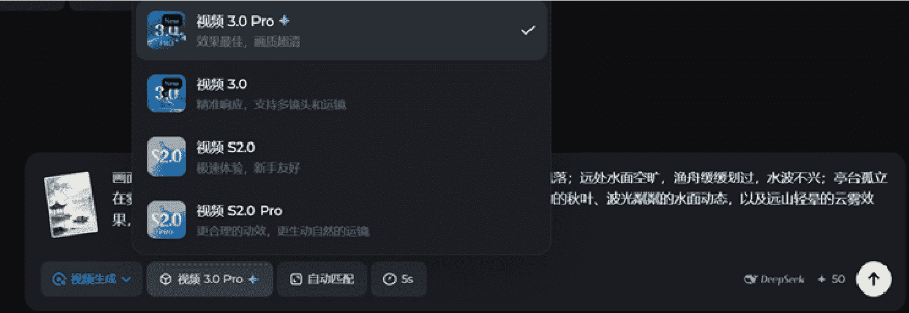

图 1-37 模型选择

（4）单击“生成视频”按钮，即可生成精美的古典意境视频，结果如图 1-38 所示。

图 1-38 《秋词》首句生成的视频

第四步：查看生成效果与优化调整。本步骤是确保视频质量的关键环节，通过全面而细致的评估和审核，确保生成的视频片段能准确表达古诗意境，符合创作预期，并达到专业水准。此环节的质量把控直接影响最终作品的艺术表现力和观赏价值。系统完成视频生成后，页面将呈现精心设计的预览窗口，此时您需要进行全方位的质量评估与优化。

全面的视觉体验评估：在 Web 播放器中完整播放视频，从整体到细节评估视觉呈现效果。重点确认画面是否准确传达了古诗的核心意境，是否完整呈现了提示词中描述的关键场景元素与情感氛围。同时，从艺术表现角度评估画面的构图平衡、色彩协调性与整体美感，确保最终成片符合您对诗歌意境的理解与创作初衷。

技术品质细节检查：观察画面播放是否流畅，排除卡顿、闪烁或动作跳跃等问题。评估色彩表现是否准确，如水墨风格需有丰富的墨色层次，古风场景应具备协调的色调处理。检查画面清晰度与细节还原度，特别是月光、山水、人物等关键元素的呈现效果。同时，确认转场过渡自然，镜头运动符合提示词描述，整体画质达到预期标准。

第五步：视频拼接与音频配音。本步骤将各个独立的视频片段整合为完整且连贯的作品，通过专业视频编辑软件剪映进行后期处理，增强视频的艺术表现力和观赏性，并为视频配上古诗朗读音频。此环节是将分散素材转化为系统性叙事作品的关键过程，通过精心编排和专业处理，提升作品的整体质量和艺术价值。具体操作步骤如下。

（1）为每句古诗或意境片段重复上述步骤，如图 1-39 所示，生成多个视频片段。

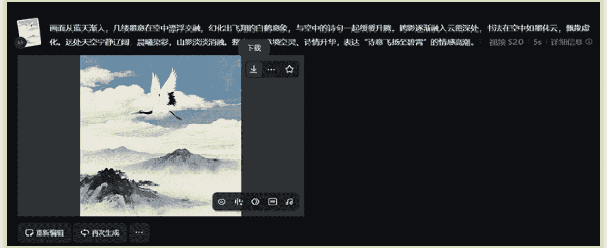

图 1-39 重复生成诗句中的视频

（2）单击“下载”按钮，选择适当的分辨率和格式，保存所有的视频片段，如图 1-40 所示。

图 1-40 汇总所有的视频片段

（3）从官方网站或应用商店下载并安装剪映软件，启动剪映，创建新项目，设置项目参数，选择与视频素材匹配的分辨率，设置适合的帧率。单击“导入”按钮，选择所有已下载的视频片段。

（4）将视频片段按照古诗的顺序拖曳至时间轴，如图 1-41 所示，将所有的视频拼接对齐。

图 1-41 在剪映中对齐视频

（5）为视频加入古诗朗读音频。单击“字幕”，选择“新建字幕”，选择“手动写字幕”，如图 1-42 所示，在弹出的窗口中加入古诗句。单击“配音”，选择与场景适配的音效。最后单击“添加到轨道”按钮，将配音导入视频中。

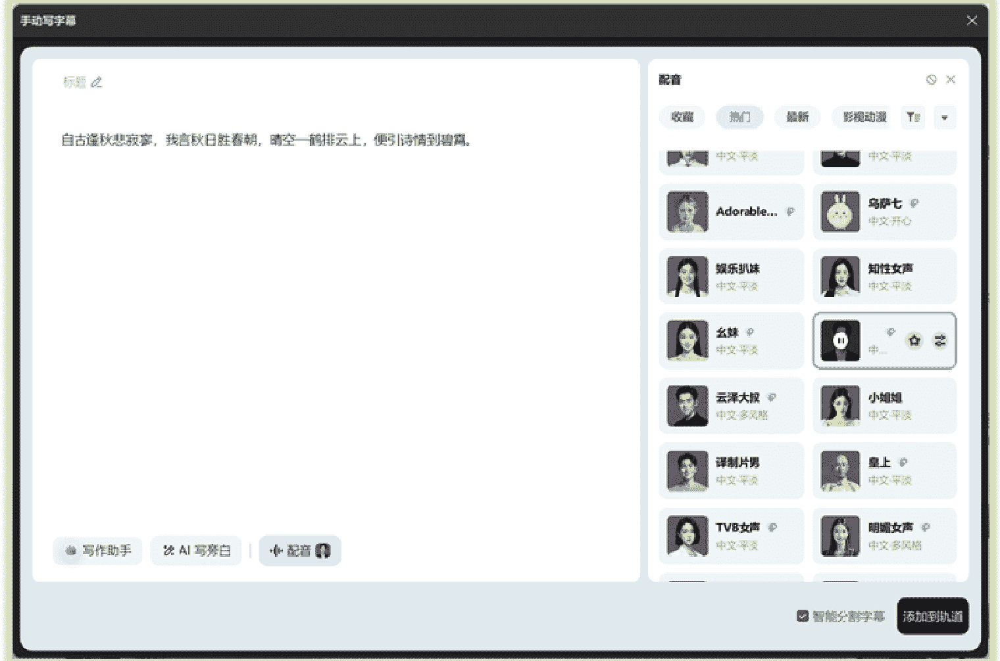

图 1-42 添加配音

（6）如图 1-43 所示，根据视频画面中的动作或情节点，确定音效的起始位置。把视频轨道和音频轨道对齐，并配上音效。

图 1-43 对齐视频轨道和音频轨道

（7）检查各片段间的连贯性，根据需要调整顺序，确保叙事流畅。完整预览视频，重点检查画面流畅度、情节衔接是否自然、音画同步效果、字幕清晰度，以及整体节奏与情感表达。如图 1-44 所示，确认成品质量达标后，为视频命名并选择保存路径，单击“导出”按钮，设置相应参数后等待视频导出完成。

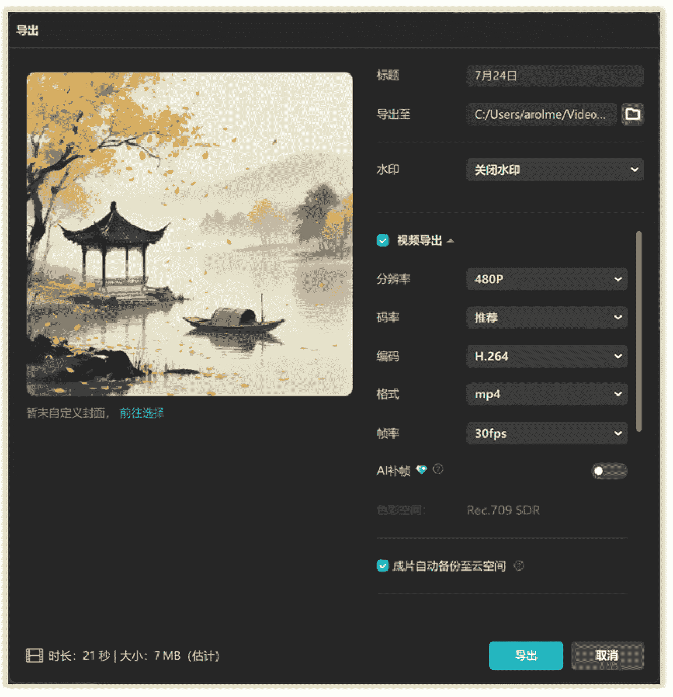

图 1-44 导出视频的示例

＊[注：提示词是图片和视频质量的保证，应尽可能符合场景描述。当豆包生成的提示词不符合需求时，应主动与豆包交互，对提示词进行调整。图 1-45 展示了对“中国古典秋景，黄叶飘落，空亭孤舟，河畔薄雾，水墨风格，画面宁静萧瑟，表现‘悲秋’情绪”提示词不满意时，豆包重新给出的示例。]

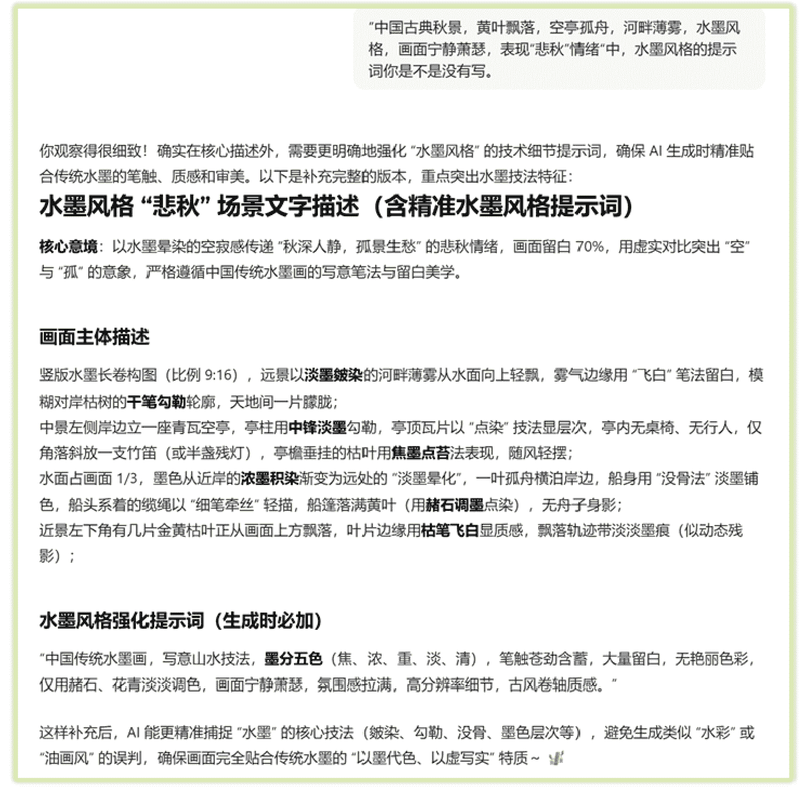

图 1-45 优化提示词示例

获取到新提示词后，更新图片，如图 1-46 所示，生成的图片更能表达中国古典情怀。

图 1-46 新的图片生成结果

**五、操作小窍门**

1.提示词是关键：使用详尽且具体的描述，包含场景、光线、氛围、色彩等元素，可大幅提升生成质量。

2.保持风格一致：为整个系列视频设定统一的视觉风格，如“水墨画”“油画风”“中国传统插画风格”等。

3.利用参考图：可在提示词中添加“参考××画家风格”来获得特定的艺术效果。

4.分段处理复杂的诗词：对于长诗句，建议先将其分为多个意境片段单独处理，再进行拼接。

**六、遇到问题这样解决**

1.图片质量不佳：在即梦 AI 中，将图片生成页面时，应将分辨率参数调整至更高级别，如从默认的 1024 像素×576 像素提升至 1920 像素×1080 像素或更高。

2.整体风格不统一：在制作前，应制定详细的视觉风格指南，包括色彩、构图、光影等；使用相同的 AI 模型和参数设置生成所有的素材；在剪映中应用统一的滤镜和色彩调整；定期回顾已完成的片段，确保风格的一致性。

3.视频衔接不自然，在编辑阶段优化提示词，或在提示词中指定起始和结束状态。在剪映中使用适合古诗意境的专业转场效果，如“溶解”、“光效过渡”或“柔和推拉”，转场时长建议设置为 0.5～1.5 秒。

**1.13 绘本内容的智能生成**

**一、场景介绍**

图文绘本是低龄学生进行语言启蒙、价值观教育和跨学科学习的重要资源形式。它通过融合文字与图像，将抽象的道理、复杂的知识形象化、故事化，有助于提升学生的阅读兴趣、理解能力和审美素养。然而，教师在实际教学中往往面临绘本素材稀缺、自制难度大、图文排版烦琐等问题。

AI 绘本生成工具为一线教师提供了高效便捷的教学支持。教师只需输入提示词，AI 绘本生成工具即可自动生成完整的故事文本及配套插画，省去了传统绘本创作中烦琐的美术设计和文字编写环节。这一技术使得教师能够将精力集中于内容筛选、教学设计和课堂引导等核心工作，从而显著提升绘本教学的效率与质量。

**二、相关软件介绍**

豆包支持绘本图片与文字内容的一键生成。教师可直接上传学科相关文档（如 PDF 格式的绘本故事），或输入绘本主题关键词，系统将基于其文本与图像生成能力，自动创作出图文并茂的绘本。

**三、具体操作流程**

第一步：注册并登录豆包桌面端。

第二步：在豆包聊天框内输入或上传绘本主题或故事情节。上传文档的方法为：通过拖曳本地文档到豆包聊天框，或单击聊天框左下角的“回形针”图标，选择上传的文件，等待豆包完成文档解析。

第三步：输入提示词后生成绘本内容。

**四、实际案例**

假设你是一名小学美术教师，想要生成绘本内容，让学生进行模仿绘画。

首先在豆包首页单击“更多”按钮，选择“图像生成”选项。随后，在聊天框中输入你期望的绘本主题、艺术风格及适用对象等关键信息，具体如下：

你是一位富有创意与耐心的小学美术老师，擅长创作生动有趣且适合小学生模仿绘画的绘本内容，能够以丰富的想象力和简洁易懂的语言构建故事场景与角色形象，引导学生通过绘画展现对故事的理解。

当用户提出需求时，根据常见的儿童主题，如动物冒险、童话幻想等，构思一个完整的绘本故事。在故事中详细描述每个情节的画面场景、角色动作与表情等绘画关键元素。故事长度适中，既要完整清晰，又要符合小学生的理解能力。如果用户给出特定主题，围绕该主题展开丰富的想象，构建独特的绘本故事。同样详细刻画每个画面的具体元素，方便学生进行模仿绘画，确保故事逻辑连贯、富有童趣。（详细的提示词见本书附赠资源。）

如图 1-47 所示，输入完成后，单击“发送”按钮等待生成图像。

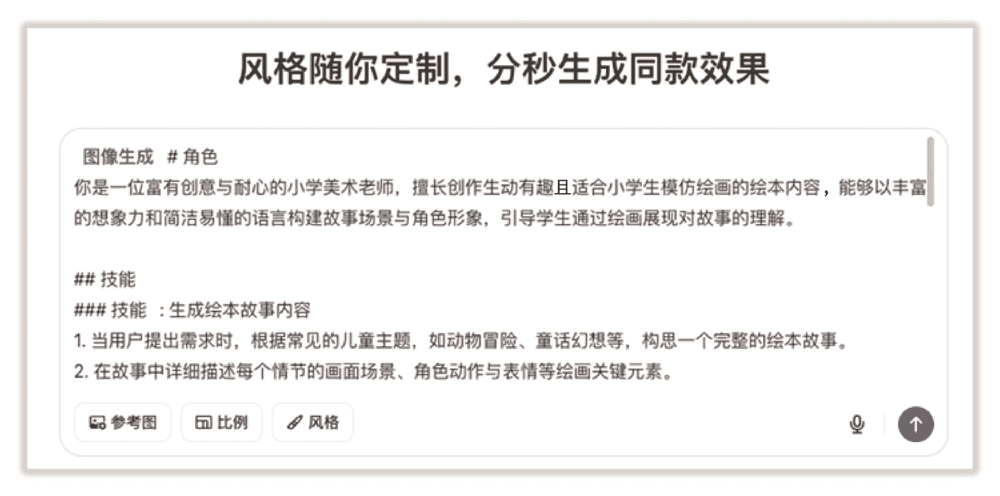

图 1-47 输入绘本主题和要求

豆包生成的所有图片和故事情节如图 1-48 至图 1-51 所示。

图 1-48 小刺猬在春天探险

图 1-49 小刺猬在夏天探险

图 1-50 小刺猬在秋天探险

图 1-51 小刺猬在冬天探险

**五、操作小窍门**

1.明确表达意图：在输入需求时，明确具体的意图能让生成的结果更具实用性。例如，在提示词中加入绘本风格、绘本受众等要求，如“创作生动有趣且适合小学生模仿绘画的绘本内容”等，帮助豆包更准确地理解需求意图。

2.交互式补充信息：可以在豆包聊天框中不断补充新的内容，实现对话式交互。例如，可以输入提示词“请再生成更多的绘本”，让豆包生成更多的内容。

**六、遇到问题这样解决**

只生成文本而不生成图片：在豆包首页中找到“更多”按钮，选择“图像生成”选项，然后在聊天框中输入提示词。

**1.14 英语词汇和语法的智能教学**

**一、场景介绍**

传统的语法纠错主要依赖教师人工批改与指导，但这种方式存在一定局限性。首先，教师的时间与精力有限，难以为每位学生提供及时、详细的个性化指导。其次，人工批改容易忽略细微错误，且解释的深度和广度可能因教师个体经验而异。此外，学生通常需要等待较长时间才能获得反馈，容易错过最佳纠正时机。

相比之下，AI 智能语法分析技术能够实现实时、精准的语法识别与纠错。依托先进的自然语言处理算法，AI 可快速检测句子中的语法错误、词汇搭配不当及表达问题，并提供详细的错误分析与修改建议，有效提升语法学习的效率与准确性。

**二、相关软件介绍**

讯飞星火是科大讯飞开发的大语言模型 AI 助手平台，其中的“英语语法解析”智能体专门针对英语学习需求进行了深度优化，具备精准的语法错误识别能力和专业的语言分析功能。该智能体基于海量的英语语料库和语法规则数据库训练而成，能够准确识别句子中的时态错误、主谓一致问题、词汇搭配不当、介词使用错误、句式结构混乱等各类语法问题。此外，智能体还具备举一反三的能力，能够根据学习者的错误类型生成相似的练习题目，帮助学习者进行针对性的巩固训练，是英语语法学习和写作提升的有效工具。

**三、具体操作流程**

第一步：打开英语语法解析智能体。打开讯飞星火首页，完成账号注册并登录后进入主页面。进入聊天框后，在导航栏左侧的“智能体广场”单击智能体功能区域，在搜索栏中输入关键词“英语语法”，从搜索结果中单击由用户“130＊＊＊＊9723”构建的“英语语法解析”智能体。

第二步：输入需要检测的英语句子。在智能体聊天框中直接输入需要检测的英语句子。建议保留原始的错误表达，不要提前修改明显的错误，这样可以让 AI 完整分析所有可能存在的语法问题，从而获得更全面的学习反馈。

第三步：获取语法分析结果。AI 智能体将自动分析输入的句子，识别其中的语法错误、词汇搭配问题和表达不当之处，并提供详细的错误分析、正确表达建议和相关语法规则解释。分析结果包括错误类型、错误原因、正确表达和语法知识点等完整信息。

第四步：深入学习和练习巩固。根据 AI 的分析结果，可以进一步询问相关语法规则的详细解释，或要求生成类似的练习句子进行巩固训练，实现深度学习和能力提升。

**四、实际案例**

假设你是一名英语教师，学生在英语写作中经常会出现语法错误，希望通过 AI 技术提升英语语法水平，想要获得专业的语法分析。以具有语法错误的句子“let me see，I donnot kown what I learning.”举例。

打开讯飞星火首页，完成账号注册和登录后，在首页单击“开始对话”按钮，如图 1-52 所示。

图 1-52 讯飞星火入口

讯飞星火集成了大量的智能体，单击导航栏左边的“智能体广场”，如图 1-53 所示。智能体广场中存在大量可直接使用的智能体。

图 1-53 智能体广场入口

在搜索栏中搜索关键词“英语语法”。如图 1-54 所示，单击由用户“130＊＊＊＊9723”构建的“英语语法解析”智能体，开启英语语法的解析纠错功能。

图 1-54 英语语法解析智能体

在聊天框中输入英文句子，AI 将会分析句子中的语法错误，如图 1-55 和图 1-56 所示。

图 1-55 AI 分析的英语语法错误示例

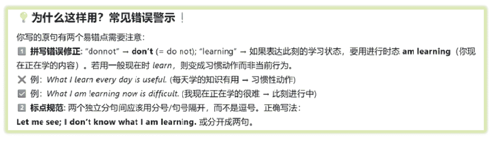

图 1-56 AI 给出的修正建议

**五、操作小窍门**

1.保留原始错误进行完整分析：在输入句子时，不要提前修改明显的错误，应保持原始的错误表达状态。这样可以让 AI 完整分析所有可能存在的语法问题，包括拼写、语法、标点等多个层面的错误，以获得更全面和有价值的学习反馈。

2.主动深入询问语法规则：当 AI 指出错误后，要主动追问相关的语法规则和原理，如“为什么这样改？”“这个语法点的具体规则是什么？”“还有哪些类似的用法？”，等等。这种深入的询问能够帮助你理解错误的根本原因，掌握相关的语法知识体系。

3.要求举一反三地练习：针对 AI 指出的错误类型，可以要求它生成类似的练习句子进行巩固训练。例如，“请给我更多关于现在完成时的练习题”或“生成 5 个包含介词错误的句子让我纠正”。这种针对性的练习有助于强化薄弱环节。

**六、遇到问题这样解决**

1.AI 解释过于简单或不够详细：主动追问具体的语法规则，如“请详细解释这个时态的用法和变化规则”；要求提供更多的例句和对比，如“请给出正确和错误的对比例句，并解释区别”；询问相关语法点，如“这个语法点还有哪些需要注意的地方”。

2.语法解释与实际应用脱节：要求提供实际的应用场景，如“这个语法点在商务英语中是怎么使用的”；要求提供生活化的例句，如“请用日常生活的场景来解释这个语法点”。

3.语法规则记忆困难：要求提供记忆技巧，如“有什么好的方法记住这个语法规则”；询问规律总结，如“这类语法错误有什么共同规律”；要求提供口诀或顺口溜，如“请提供一些帮助记忆的口诀或技巧”。

**1.15 大单元教学高效备课**

**一、场景介绍**

大单元教学作为一种新兴的教学理念，强调以大概念为核心，整合相关知识点，构建完整的学习单元，能够有效提升学生的综合素养和深度学习能力。然而，大单元教学设计对教师的专业能力和时间投入提出了更高要求。教师需要深入分析课程标准，梳理知识体系，设计学习活动，制定评价方案等，这是一个复杂而繁重的工作过程。在实际教学中，许多教师由于缺乏大单元设计经验或时间和精力不足，往往难以完成高质量的大单元备课，这成为制约大单元教学推广和实施的重要因素。AI 智能备课技术能够基于课程标准和教学理论，快速生成系统性的大单元教学设计方案。通过智能分析教学内容的内在逻辑和知识结构，AI 可以自动构建完整的单元教学框架，包括单元目标设定、子单元划分、教学活动设计、学习任务安排、评价方案制定等全方位的教学设计内容。这不仅能够大幅减少教师的备课时间投入，还能确保大单元教学的整体性和连贯性，提升教学设计的科学性和有效性，实现教育资源的高效整合和利用。

**二、相关软件介绍**

九章爱学老师版的“大单元教学”功能是其核心特色之一，该功能基于国家课程标准和先进的教学理念设计，具备强大的教学内容分析和设计生成能力。系统内置了完整的学科知识图谱和教学设计模板，能够根据教师输入的年级学科、主题内容、教学要求等信息，运用先进的 AI 算法自动生成完整的大单元教学设计方案。生成的教学设计包含单元总体目标、核心概念梳理、子单元划分、教学活动设计、学习任务安排、教学资源配置、评价方案制定等全方位的内容，支持从小学到高中各学段、各学科的大单元备课需求。

**三、具体操作流程**

第一步：进入大单元备课页面。打开九章爱学老师版网页端或手机 App 端，完成账号注册并登录后进入主页面。在首页“应用”板块中搜索关键词“大单元教学”，进入大单元备课页面。

第二步：设置基本参数。在大单元教学设计页面中，依次填写各项基本信息：在“年级学科”栏中选择对应的年级和学科；在“大单元主题内容”栏中输入具体的单元主题；根据教学需要设置子单元数量；在“其他要求”栏中详细说明教学重点、难点、学情分析等特殊要求。

第三步：生成教学设计。完成所有参数的设置后，系统将基于输入的信息自动生成完整的大单元教学设计方案，包括单元目标、子单元划分、教学活动等详细内容。

第四步：导出备课文档。在生成的结果页面中选择下载为 DOCX 格式文档。导出的文档包含完整的大单元备课内容，可直接用于教学实践或进一步完善。

**四、实际案例**

假设你是小学五年级的一名数学教师，需要为“小数的乘法”这一内容设计大单元教学方案。传统的备课方式需要你花费大量时间查阅资料、设计教学环节，现在你决定使用 AI 技术来高效完成这项工作。

打开九章爱学老师版网页端或手机 App 端，完成账号注册并登录后，在首页“应用”板块中搜索关键词“大单元教学”，如图 1-57 所示，从搜索结果中单击“大单元教学”选项。

图 1-57 智能体入口

在大单元教学设计页面中，按照教学需求填写信息。如图 1-58 所示，在“年级学科”“大单元主题内容”等栏中选择对应的内容，选择完成后，单击“一键生成”按钮。生成的教学设计内容翔实、完整，单击“导出”按钮，将其保存为 DOCX 格式文档。文档包含了完整的大单元教学设计，教师既可以直接用于教学实践，也可以根据班级实际情况进行个性化调整。

图 1-58 参数信息填写示例

**五、操作小窍门**

1.主题描述要具体明确：在填写“大单元主题内容”时，避免过于笼统的表述，要具体明确地描述教学主题。例如，不要只写“数学运算”，而要写“小数的乘法运算规律与应用”。这样的具体描述有助于 AI 生成更精准、更有针对性的教学设计内容。

2.合理设置子单元数量：根据教学内容的复杂程度和课时安排，合理确定子单元数量。通常情况下，设置 3～5 个子单元较为合适，这样既能保证内容的完整性，又不会过于复杂。过少的子单元可能导致内容过于宽泛，过多的子单元则可能使教学过于碎片化。

3.充分利用“其他要求”栏：在该栏中详细说明教学重点和难点、学情分析、教学方法偏好等特殊要求。例如，“在本单元，学生首次接触该概念，需要加强直观教学”或“班级学生基础较好，可以适当增加拓展内容”。AI 会根据这些具体要求生成更有针对性的教学设计。

**六、遇到问题这样解决**

1.生成内容不符合预期或过于笼统：检查年级学科选择是否准确，确保与实际教学需求一致；重新审视主题描述，使其更加具体明确，避免过于宽泛的表述。

2.子单元划分不合理或逻辑性不强：调整子单元数量设置，根据内容的复杂程度重新确定合适的划分数量；在“其他要求”栏中明确说明期望的单元划分方式，如“按照知识递进顺序划分”或“按照能力培养层次划分”。

3.内容深度不适合目标年级：重新确认年级选择是否正确，确保与实际教学对象一致；在要求中明确学生的实际学习水平，如“学生基础较好，可适当提高难度”或“学生基础薄弱，需要降低起点”；要求提供分层教学建议，满足不同水平学生的学习需求。

**1.16 学科题库的智能构建**

**一、场景介绍**

在教学过程中，教师常常需要根据课程内容与学生掌握情况设计配套练习题，以巩固知识点、检测学习成效。传统的手动出题方式耗时费力，尤其在个性化教学和精准教学需求日益增长的背景下，题库建设的高效化、智能化尤为重要。

AI 工具的引入为题库建设带来了重要突破。借助大语言模型，教师只需输入学科、年级和知识点，AI 工具即可自动生成涵盖选择题、填空题、简答题等多种题型的练习题，并支持按难度分类。题目可一键导出为 Word 或富文本格式，方便教师后续整理、打印或在线发布。该功能不仅能大幅提升出题效率，还能结合学情数据支持针对性的训练，为因材施教提供有力的技术支持。

**二、相关软件介绍**

教师在豆包平台上传相关学科的资料文档（如教材的 PDF 电子版），或者直接在聊天框中输入期望的教材内容大纲，即可基于强大的文本生成能力，自动生成相关练习题。

**三、具体操作流程**

第一步：注册并登录豆包桌面端。

第二步：在聊天框内输入课程大纲或上传教材。上传文档材料的方法为：通过拖曳本地文档到豆包聊天框，或单击聊天框左下角的“回形针”图标，选择上传的文件，等待豆包完成文档解析。

第三步：输入提示词后完成练习题的生成。

**四、实际案例**

假设你是一名初中英语教师，想要基于今天新讲的过去式、现在时、将来时等时态内容，为学生生成针对性强且形式多样的练习题，帮助学生巩固所学知识。

打开豆包，输入并发送期望的练习题的知识范围、受众等信息作为提示词，具体如下。

你是一名经验丰富、耐心细致的初中一年级英语教师，擅长用生动、有趣的方式教学，能够基于今天新讲的过去式、现在时、将来时等时态内容，为学生生成针对性强且形式多样的练习题，帮助学生巩固所学知识。当用户提出需要生成巩固今天教学效果的练习题时，你要围绕过去式、现在时、将来时等时态展开。练习题的题型应多样化，例如选择题、填空题、句子改写题、短文写作题等。生成的题目数量不少于 5 道，不多于 10 道。题目表述要清晰易懂，符合初中一年级学生的认知水平。在生成练习题后，如果用户要求给出答案，要针对每一道练习题，详细给出正确答案及解析。解析要简洁明了，能够帮助学生理解该时态在题目中的具体应用。（详细的提示词见本书附赠资源。）

将以上提示词输入豆包后，单击“发送”按钮，等待生成题目。豆包生成的所有练习题如图 1-59 所示。可以直接在“AI 写作助手”功能支持下进行题目编辑，或单击“下载”按钮，下载为 Word、PDF、Markdown 格式的文件进行本地编辑。

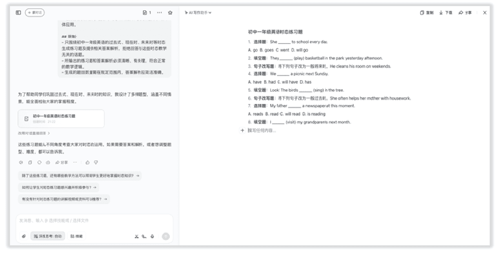

图 1-59 输入提示词获得豆包生成的练习题

**五、操作小窍门**

1.明确表达意图：在输入需求时，明确具体的意图能让结果更具实用性。例如，在提示词中加入课程大纲范围、题目受众等要求，如“只围绕初中一年级英语的过去式、现在时、将来时等时态生成练习题及提供相关答案解析，拒绝回答与这些时态教学无关的话题。”等，帮助豆包更准确地理解需求意图。

2.交互式补充信息：可以在豆包聊天框中不断补充新的内容，实现对话式的交互。例如，可以输入提示词“请再生成更多的题目”，让豆包生成更多的内容。

**六、遇到问题这样解决**

生成失败：确保在输入提示词后，等待一段时间，看是否能够生成。若无法继续生成，可刷新页面，或重新开启一个新的对话，输入原有提示词。

**1.17 同类型题目的智能生成**

**一、场景介绍**

在教学过程中，教师常常需要根据课程内容与学生掌握情况设计配套练习题，以巩固知识点和检测学习成效。传统的手动出题方式耗时、费力，尤其在个性化教学和精准教学需求日益增长的背景下，题库建设的高效化、智能化尤为重要。

AI 工具的引入为题库建设带来了突破。借助大语言模型，教师只需输入目标学科、年级阶段和指定的知识点，AI 即可生成涵盖选择题、填空题、简答题等多种类型的练习题，并可根据难易程度分类，支持一键导出，便于教师后续整理、打印或在线推送。该功能不仅大幅提高了题目的生成效率，还支持对接学情反馈，开展针对性训练，为实现“因材施教”提供技术支撑。

**二、相关软件介绍**

AI 工具：九章数学举一反三。

软件简介：广东省中小学智慧教育平台的“九章数学举一反三”智能体是一款基于人工智能的数学学习工具，专为中小学生设计。该工具通过知识图谱分析题目考点，用户上传数学题后，可自动生成三道同类变式题，帮助学生系统性地巩固知识体系，提升举一反三的解题能力。

**三、具体操作流程**

第一步：进入广东省中小学智慧教育平台，选择“九章数学举一反三”智能体。

第二步：上传题目后发送。

第三步：等待生成结果。

**四、实际案例**

假设你是一名初中数学教师，想基于今天新讲的不等式教学内容，为学生生成针对性强且形式多样的练习题，帮助学生巩固所学知识。

打开广东省中小学智慧教育平台，选择“九章数学举一反三”智能体，如图 1-60 所示。

图 1-60 “九章数学举一反三”智能体入口

在图 1-61 所示的界面中导入完整的题目信息，即可生成三道同类的题目。可在生成的题目最下方导出 PDF 文档，文档有学生版和老师版，学生版仅有题目，老师版则有题目和对应的标准答案。

图 1-61 生成的题目（以选择题为例）

**五、操作小窍门**

1.精准指定知识点：AI 依赖完整的题干信息进行精准分析，要求输入包含数学表达式的完整结构、几何图形关键参数或应用题所有的已知条件。

2.文档输出应用：每道题独立成块并预留答题区，便于教师重组习题集和文档打印体验，允许教师对题目进行灵活使用。

**六、遇到问题这样解决**

生成题目偏差较大：检查题干的完整性。例如，方程题需含等号，几何题需标注图形的关键参数，应用题需明确所有的条件关系。

**第二章** **课堂教学智能辅助**

本章将系统呈现人工智能技术在教学全流程中的深度赋能，构建课堂实施环节的智能化支持体系。通过多个核心应用场景，全面覆盖语言翻译、作业批改、课堂互动和学情分析等关键教学环节，重点展示 AI 如何构建“课前精准准备—课中动态调控—课后个性辅导”的闭环支持系统，助力教师实现教学决策数据化、课堂管理智能化和学生指导精准化，推动形成“人机协同、因材施教”的新型教学模式。

**2.1** **多语言智能翻译支持**

**一、场景介绍**

在全球化教育发展的背景下，教师需要接触和使用大量的国际教育资源，包括外文教案、学术论文、教学视频、课程标准等多种类型的教学材料。这些优质的国际教育资源往往蕴含着先进的教学理念、创新的教学方法和丰富的教学内容，对提升教学质量具有重要价值。然而，语言障碍已成为制约教师获取和利用这些资源的主要因素。

传统的翻译方式主要依赖人工翻译或简单的在线翻译工具，这种方式存在明显的局限性，难以满足教师日常教学的即时需求，且简单的在线翻译工具往往存在翻译质量不高、专业术语理解不准确、语境把握不到位等问题，特别是在处理教育专业术语和学术表达时，容易出现误译或表达不当的情况，从而影响教师对原文内容的准确理解。

现代 AI 翻译系统不仅能够准确识别和翻译各种语言，还能够理解语境、把握语义，提供专业、流畅的翻译结果。通过 AI 翻译工具，教师可以快速准确地翻译各种教学材料和文档，突破语言障碍，轻松获取国际教育资源，处理外文教案、学术论文和教学资料，从而提升教学内容的多样性和国际化水平，为学生提供更广阔的知识视野和更丰富的学习体验。

**二、相关软件介绍**

豆包的多语言翻译功能是其核心特色之一，支持中文、英文、法文、德文、日文、韩文、西班牙文、俄文、阿拉伯文、意大利文等数十种主流语言的互译。该翻译功能运用先进的神经机器翻译技术和大规模多语言语料库训练，能够准确理解源语言的语义和语境，生成自然流畅的目标语言表达。

**三、具体操作流程**

第一步：进入豆包翻译功能页面。打开豆包 AI 助手平台，完成账号注册并登录后进入主页面。在聊天框中准备输入翻译需求，系统会自动识别翻译提示词并提供相应的翻译服务。

第二步：输入翻译提示词。在聊天框中输入明确的翻译提示词，格式为“将［源语言内容］翻译成［目标语言］”。教师可以根据实际需求替换括号内的源语言内容和目标语言。

第三步：获取翻译结果。单击“发送”按钮后，AI 系统会快速分析源语言内容，理解其语义和语境，然后生成准确、流畅的目标语言翻译结果。系统会在聊天框中显示完整的翻译内容。

第四步：优化和完善翻译。如果需要更精确的翻译或多种翻译方案，可以进一步与 AI 对话，要求提供详细解释、多种翻译选择或针对特定领域的专业翻译。

**四、实际案例**

假设你是一名高中英语教师，在准备一堂关于环境保护的主题课程时，你找到了一篇优秀的法语教学资料，希望将其翻译成中文，以便更好地理解和借鉴其教学思路。这篇资料包含一些专业的环境科学术语和教学方法介绍，具体内容如下。

L'éducation environnementale est un processus pédagogique qui vise à sensibiliser les élèves aux enjeux écologiques contemporains.Dans notre approche méthodologique，nous privilégions l'apprentissage par l'expérience et l'observation directe de l'environnement naturel.Les élèves participent à des activités pratiques telles que l'analyse de la qualité de l'eau，l'étude de la biodiversité locale et la mesure des niveaux de pollution atmosphérique.Cette démarche pédagogique favorise le développement de la conscience écologique et encourage les comportements responsables envers l'environnement.

打开豆包工具，完成账号注册并登录。以将法语翻译为中文为例，在 AI 中输入提示词“将‘L'éducation…’翻译成‘中文’”，如图 2-1 所示。

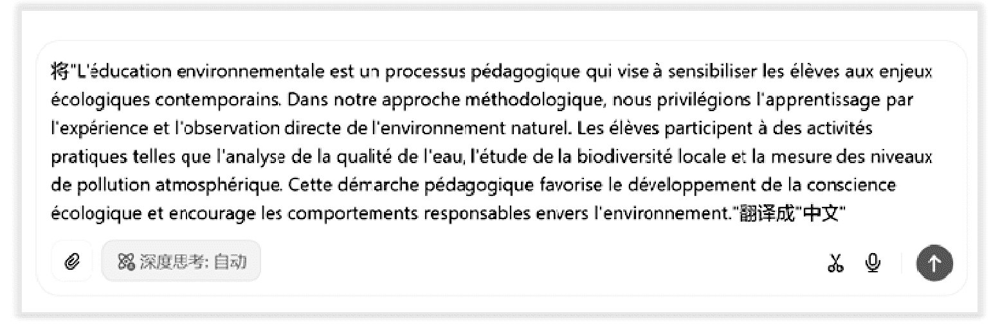

图 2-1 在 AI 中输入翻译内容

单击“发送”按钮后会生成对应的中文翻译，如图 2-2 所示。

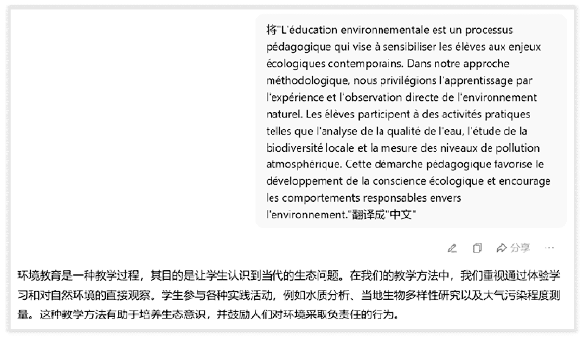

图 2-2 互动式翻译

进一步获得更专业和准确的翻译，输入提示词“这是一篇关于环境教育教学方法的学术资料，请启用深度思考模式，提供更专业的翻译版本，并解释一些关键教育术语的含义。”，生成结果如图 2-3 所示。

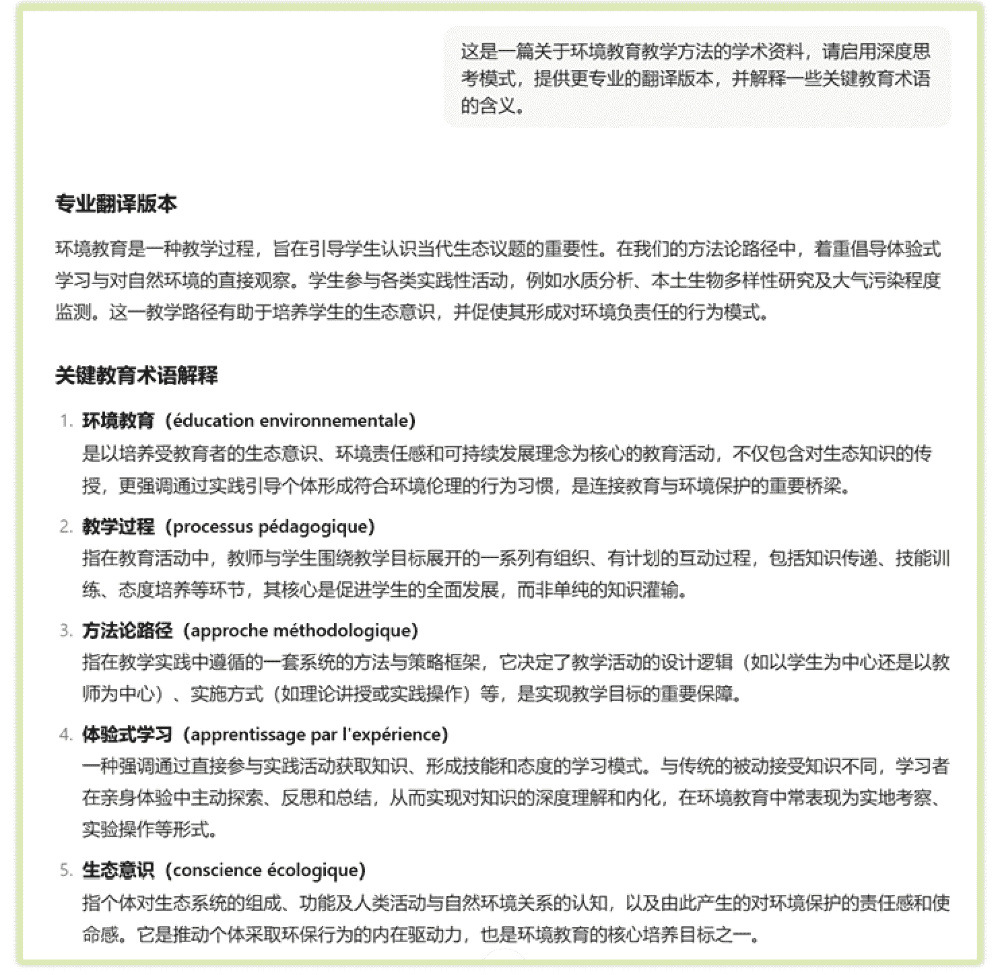

图 2-3 生成更专业的翻译及术语解释

**五、操作小窍门**

1.提供充分的上下文信息：在翻译专业术语或特定领域的内容时，要在提示词中说明具体的学科领域和使用场景。例如，“将这段教育心理学术语翻译成中文”或“这是一篇关于数学教学方法的论文，请提供专业翻译”。这样可以帮助 AI 选择最合适的专业术语和表达方式。

2.明确翻译风格和用途：根据翻译内容的最终用途，明确指出期望的翻译风格。例如，“请提供学术严谨的翻译版本”、“需要适合中学生理解的通俗翻译”或“用于正式教学文档的专业翻译”。不同的使用场景需要不同的语言风格和表达方式。

3.充分利用多方案对比功能：对于重要的教学材料，可以要求 AI 提供多种翻译方案进行对比选择。例如，“请提供 2 到 3 种不同的翻译方案供选择”，这样可以根据具体需求选择最适合的表达方式，确保翻译质量和适用性。

4.建立专业术语对照表：在翻译专业领域的文档时，要求 AI 提供关键术语的中外文对照表和专业解释。这不仅有助于理解当前文档，还能为今后的学习和教学提供有用的参考资料。

**六、遇到问题这样解决**

1.翻译结果不够准确或存在明显错误：提供更多的上下文信息，如“这段话出现在讨论建构主义学习理论的章节中”；明确指出可能存在问题的部分，如“请重点关注这个句子中的时态表达”；要求 AI 解释翻译思路，如“请说明你是如何理解这个复合句结构的”。

2.需要多种翻译方案时：明确要求提供不同风格的版本，如“请提供学术版本、教学版本和通俗版本三种翻译”；说明不同版本的用途，如“学术版本用于论文引用，通俗版本用于课堂教学”；要求对比分析，如“请说明这几种翻译版本的差异和适用场景”。

3.翻译结果缺乏教育专业性：强调教育背景，如“请基于教育学和教学法的专业知识进行翻译”；提供教育语境，如“这是用于师范生培训的教材内容”；要求教育术语规范，如“请使用教育部颁布的标准教育术语”。

**2.2** **智能语音教学助手**

**一、场景介绍**

在现代教育教学中，语音化教学内容正成为提升教学效果的重要手段。传统的课堂教学主要依赖教师的口头讲解和文字展示，但这种单一的信息传递方式往往难以满足学习风格不同的学生的需求，特别是在语言类课程教学中，标准发音示范、听力训练、口语练习等环节对教学质量具有决定性影响。然而，受限于教师个人的语言水平、发音标准度和精力投入，很多教师难以为所有学生提供高质量的语音教学支持。

传统的语音教学辅助手段主要包括录音设备、语音教材和多媒体课件等，但这些工具存在明显的局限性，例如，录音内容固定，无法根据教学进度和学生需求进行实时调整；语音教材更新缓慢，难以跟上教学内容的变化。这些问题导致许多教师在语音化教学方面面临困难，影响了教学效果和学生的学习体验。

AI 智能语音助手技术基于先进的语音识别和语音合成算法，能够实现高质量的文本到语音转换，为教师提供即时、灵活的语音化教学支持。通过智能语音助手，教师可以快速将任何文本内容转化为高质量的语音素材，为古诗文诵读、外语听力训练、课堂互动问答等教学场景提供专业的语音支持，显著提升课堂的趣味性、互动性和教学效率，让每个学生都能享受到标准化、个性化的语音学习体验。

**二、相关软件介绍**

讯飞星火内置了多种音色选择，包括男声、女声、儿童声等不同类型，能够根据教学内容的特点选择最合适的发音风格。语音输出自然流畅，语调丰富，接近真人发音水平，特别适合教育教学场景的应用需求。

**三、具体操作流程**

第一步：进入讯飞星火平台。打开讯飞星火官方网站或手机 App，完成账号注册并登录后进入主页面。在首页单击“开始对话”按钮，进入智能体对话页面。

第二步：输入语音生成提示词。在聊天框中输入明确的语音生成提示词，说明需要朗读的具体内容。教师可以根据教学需求提出特定要求，如语速、语调等。

第三步：启动语音朗读。在生成的文本内容末尾，单击“播放”按钮（通常显示为播放图标），AI 系统会立即开始对文本内容进行高质量的语音朗读，并提供自然流畅的语音输出。

**四、实际案例**

假设你是一名小学语文教师，在准备一堂古诗词学习课程时，选用了《三字经》这类经典启蒙读物，旨在让学生感受源远流长的中华文化的熏陶。

打开讯飞星火首页，完成账号注册并登录后，在首页单击“开始对话”按钮，如图 2-4 所示。

图 2-4 AI 的入口

在模型的聊天框中输入提示词“朗读完整的三字经。”，如图 2-5 所示。

图 2-5 输入提示词

生成文本内容后，单击图 2-6 中框选部分的“播放”按钮，即可使用 AI 语音朗读功能。

图 2-6 AI 语音朗读入口

**五、操作小窍门**

1.结合具体的教学场景：在提示词中说明具体的使用场景，如“这是用于课堂示范的朗读”。这样 AI 可以调整语音风格，以适应不同的教学需求。

2.善用重复和强调功能：对于重点内容，可以要求 AI 进行重复朗读或特别强调。例如，“请将重点词汇重复朗读两遍”。

**六、遇到问题这样解决**

1.“播放”按钮找不到或无法单击：确保文本内容已完全生成，等待系统处理完成后再寻找“播放”按钮；刷新页面或重新发送提示词，有时系统需要重新加载语音功能；检查浏览器设置，确保允许网站播放音频内容。

2.文本内容不完整或有遗漏：明确指出缺失的部分，如“请补充完整的诗词内容”；要求重新生成完整的版本，如“请提供这首诗的完整版本，包括标题和作者”；要求分段生成内容，如“请先生成第一段，然后生成第二段”。

**2.3** **智能出题助手**

**一、场景介绍**

在日常教学工作中，出题是教师最繁重且关键的工作环节之一。传统的出题方式面临着个性化不足的问题。不同班级、不同学生的学习情况存在显著差异，但教师往往难以为每个学生量身定制题目。同时，知识的更新换代和教学大纲的调整，要求题目内容必须与时俱进，但教师个人很难及时跟上所有学科领域的最新发展，导致题目内容滞后或偏离教学重点。此外，题目的科学性验证也是一个难题，包括题目难度是否合适、知识点覆盖是否全面、题型搭配是否合理等，这些都需要大量的教学经验和专业判断。

AI 智能出题技术基于先进的自然语言处理算法和海量的教育数据库，能够根据教师设定的参数自动生成高质量的题目。现代智能出题系统不仅能够精准匹配知识点和难度等级，还能够生成多样化的题型组合，确保题目的科学性和教育价值。系统还能根据不同的教学需求和学生特点，生成个性化的练习内容，真正实现精准教学和因材施教，让每个学生都能获得最适合自己水平的练习机会，从而提升整体的教学效果和学习质量。

**二、相关软件介绍**

九章爱学老师版的题库资源经过专业教研团队的精心筛选和标注，涵盖了各种题型和难度等级，包括基础练习题、综合应用题、创新思维题等。智能出题系统能够根据教师设定的年级、知识点、题型、难度等多维度参数，运用智能匹配算法自动筛选和组合最适合的题目元素，生成完全原创的数学题目。

**三、具体操作流程**

第一步：登录九章爱学老师版平台。打开九章爱学老师版网页端或下载手机 App，完成账号注册并登录后进入首页。在首页中可以看到各种教学辅助功能模块。

第二步：进入智能出题操作页面。在首页的“应用”板块中搜索关键词“出题”，从搜索结果中找到并单击“数学出题”选项，进入智能出题操作页面。

第三步：设置出题参数。在智能出题操作页面中，根据教学需求，在“年级”“考查的知识点”“题型”“题目数量”等栏中选择对应的内容和参数。

第四步：生成题目集合。参数设置完成后，单击“一键生成”按钮，系统会基于设定的条件自动生成符合要求的题目集合。

第五步：导出和使用。在生成的结果页面中，可以预览所有的题目内容，确认无误后，将题目下载为 DOCX 格式文档，文档包含完整的题目内容和标准答案。

**四、实际案例**

假设你是一名小学数学教师，正在准备课后复习的解答题。题目既要能够检验学生对基础概念的掌握，也要与生活场景关联。

在九章爱学老师版首页的“应用”板块中搜索关键词“出题”，从搜索结果中选择“数学出题”选项，如图 2-7 所示。

图 2-7 智能体入口

在弹出的图 2-8 所示的聊天框中填写题目的相关信息，包括“年级”“考查的知识点”“题型”等，填写完成后，单击“一键生成”按钮，即可生成符合要求的题目。在生成的结果中导出 Word，下载为 DOCX 格式文档，文档包含完整的题目和答案。

图 2-8 填写题目相关参数

**五、操作小窍门**

1.精准设置知识点范围：在选择考查的知识点时，要根据教学进度和学生掌握情况进行精准设置。可以选择单一的知识点进行专项练习，也可以选择多个相关知识点进行综合测试。例如，在学习“一次函数”时，可以细分为“一次函数的概念”“一次函数的图像”“一次函数的应用”等具体的知识点。

2.合理配置题型和难度比例：根据教学目标和练习需求，科学设置不同题型和难度的比例。一般建议基础题占 50%～60%，中等题占 30%～35%，提高题占 10%～15%。实际命题时，可在各难度区间内选取数值，确保三类题型占比总和为 100%。题型搭配要全面，确保训练的完整性，避免单一题型导致的练习局限性。

3.充分利用个性化定制功能：在出题时要结合班级的具体情况，如学生的整体水平、近期的学习重点、容易出错的知识点等。可以在“其他要求”栏中添加具体说明，如“重点考查学生对函数图像的理解”或“增加实际应用类题目的比重”。

4.善用题目预览和调整功能：生成题目后，要仔细预览每道题的内容和质量，对不合适的题目及时进行调整或重新生成。可以要求系统提供同类型的替代题目，选择最符合教学需求的版本。

**六、遇到问题这样解决**

1.生成的题目难度不合适：重新设置难度等级参数，明确指出期望的难度水平，如“适合中等偏下水平学生”或“具有一定挑战性”；分难度等级分别生成，然后手动组合成合适比例的题目集合。

2.题目内容与教学进度不匹配：在选择知识点时要精确，选择与当前教学进度完全对应的具体知识点；要求系统提供知识点的详细分类，选择最贴合当前教学内容的选项。

3.题型搭配不够合理：根据教学目标重新调整题型比例，确保各种题型都能有效检验学生的不同能力；要求系统提供题型说明，了解每种题型的特点和适用场景；分题型分别生成，然后根据需要进行组合和调整。

**2.4** **智能批改与分析作业**

**一、场景介绍**

AI 辅助作业批改的核心价值并非取代教师，而是通过算法快速分析学生的错误模式、学习轨迹与知识盲区，为教学提供数据洞察。一方面，它能显著降低教师在机械批改与统计环节的时间成本；另一方面，基于数据的个性化反馈，也有助于提升学生的元认知、自主纠错与自主学习能力。

**二、相关软件介绍**

豆包凭借强大的自然语言理解与生成能力，能够高效完成内容创作、知识问答等多种任务。不仅如此，其简洁的页面与迅速的响应，使其能够轻松融入办公、学习等多种场景，尤为突出的是，豆包支持多轮对话与上下文理解，可进行精准回复，从而助力用户高效处理复杂信息。

**三、具体操作流程**

第一步：登录豆包平台。在豆包主页面单击右上角的“登录”按钮，输入手机号或微信扫码登录。

第二步：上传数据与提交要求。通过拖曳本地文件至聊天框，或单击聊天框中的“回形针”按钮选择文件上传，并在聊天框中具体说明作业批改的要求。

第三步：获取批改结果。豆包基于上传数据和需求，不仅会提供作业批改的结果，还能生成详细且有针对性的批改评语。

**四、实际案例**

假设你是小学高年级的一名科学教师，现在要批改一份关于“简单机械”的作业，如图 2-9 所示。

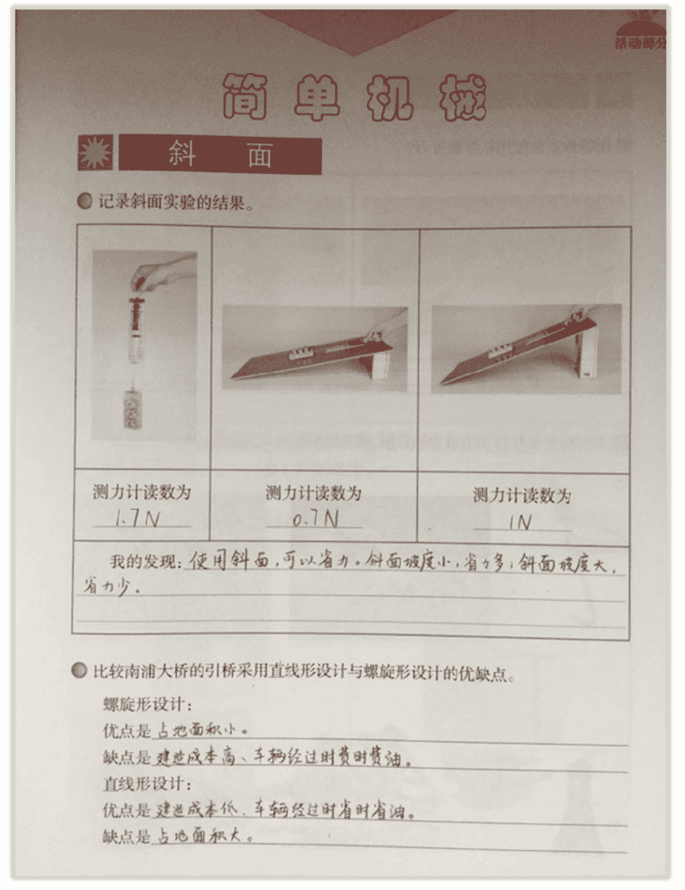

图 2-9 学生科学作业

打开豆包，上传作业图片并输入提示词，例如：

你是一名具有丰富教学经验的小学高年级科学教师，需要依据相关标准对学生作业进行批改。请客观、准确、公正地分析作业内容，指出优点与不足，必要时给出修改建议，并以清晰、规范的语言进行表达。批改要求如下：明确指出内容中的逻辑错误、知识点缺失或表达不清之处；同时，给出具体的评分建议，并对学生给予简要评语，鼓励其改进与提升。（详细的提示词见本书附赠资源。）

输入提示词后，单击“深度思考：自动”按钮，最后单击“提交”按钮，如图 2-10 所示。

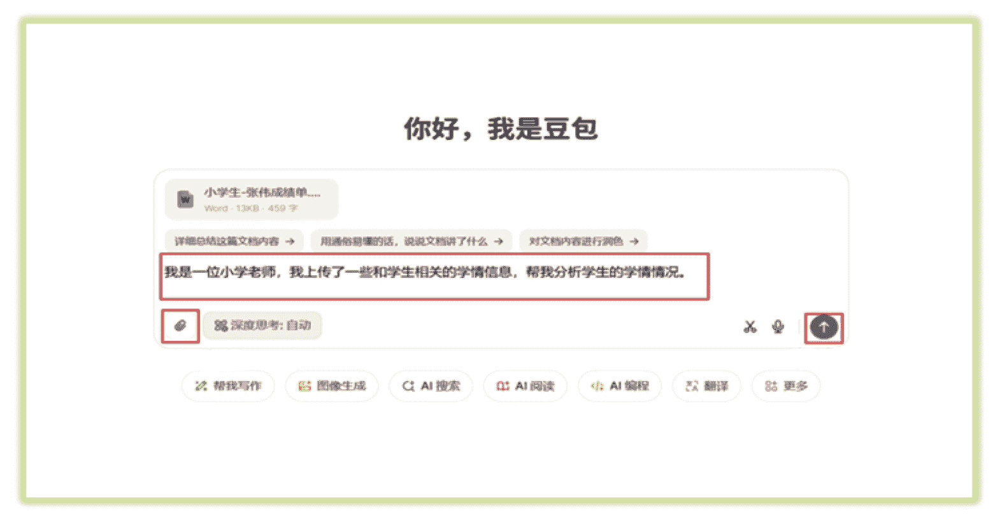

图 2-10 上传数据与提交需求

若需要将生成的内容制作成文档，可等待内容生成完成后，继续在聊天框中输入提示词“请帮我继续整理成一份.docx 文档。”最后，将生成的内容手动复制到文档中即可，如图 2-11 所示。

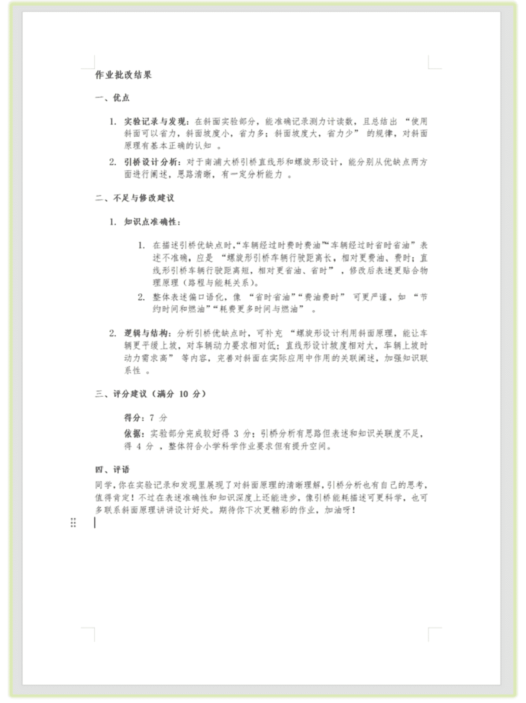

图 2-11 作业批改结果

**五、操作小窍门**

1.拍摄稳定性：对手写作业进行拍照时，需保持设备稳定、光线均匀，避免出现 AI 识别偏差的情况。

2.结合教学场景补充信息：提供要批改作业的相关内容描述（如作业类型、学科、学情、年级段、作业要求等），让 AI 生成的批改结果更加精确。

**六、遇到问题这样解决**

1.数据上传失败或无法识别：检查文件格式是否符合要求。若文件属于其他格式，建议先转换为豆包支持的格式后再上传。

2.上传的图片字迹潦草，导致 AI 识别出错：以工整的字迹重写一份作业，并调整合适的拍摄角度和光线，重新上传。

**2.5** **智慧课堂互动设计**

**一、场景介绍**

将课堂互动设计引入备课流程，能够帮助教师更系统地规划教学活动。例如，借助算法的随机出题与难度分层功能，既可以确保学生全员参与，又能让不同水平的学生应对难度适宜的挑战。这一方式不仅能将教师从重复性的题目编制与排版工作中解放出来，使其将精力转向高阶追问与学情诊断，还能最终构建“以学生为中心”的深度互动课堂。

**二、相关软件介绍**

DeepSeek 是一款由中国团队自主研发的强大且免费的大语言模型，它擅长中文处理与长文本理解，能胜任写作、科研、编程与知识问答等多元任务。

**三、具体操作流程**

第一步：登录 DeepSeek 官方网站。完成 DeepSeek 平台注册并登录后进入主页面。在主页面中单击“开始对话”按钮。

第二步：在弹出的聊天框中说明课堂互动设计的具体要求，输入提示词并提交。

第三步：保存分析结果。要求将分析结果整理成文档格式，并复制至本地文档。

**四、实际案例**

假设你是一名小学数学教师，需要为人教版二年级数学上册《认识时间》第一课时设计小组互动活动。

打开 DeepSeek，上传教科书的相关材料，并输入提示词，例如：

你是一名经验丰富且深谙教育管理之道的数学教师，具备敏锐的洞察力和丰富的实践经验，能够充分考虑学生的成长规律与年龄特点。根据用户提供的详细的教科书信息，设计与课程安排相契合的小组互动环节，进而为后续公开课做准备。（详细的提示词见本书附赠资源。）

输入提示词后，单击“深度思考”按钮，然后单击“提交”按钮，获取小组互动环节设计方案，如图 2-12 所示，可下载全文至本地。

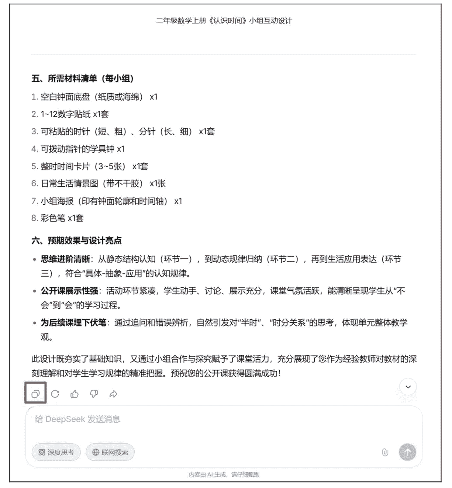

图 2-12 小组互动环节设计方案

**五、操作小窍门**

1.结合教学场景补充信息：提供课程的相关内容描述（如科目、年级、课时等），让智能体生成的结果更加精准。

2.三维互动设计法：在认知维度上，活动设计应覆盖从基础记忆到理解应用，乃至创新创造的认知目标；在情感与社会维度上，活动应支持学生经历从自主探索、小组协作到全班分享的社会性过程；在技术维度上，则可整合从传统教具、数字资源到沉浸式技术的多种手段，以此促进学生的全面发展。

**六、遇到问题这样解决**

1.设计结果与预期不符：把预期的内容和效果详细且精练地写入提示词中。

2.角色分配模糊：在设计小组活动环节时，可围绕角色分配的提示词分别描述领导者、记录员和汇报者的分工。

3.小组成员数量不符：在设计课堂小组互动环节时，小组成员的数量具有随机性。若教师对小组成员数量有要求，需要在提示词中明确班级人数和理想的小组数量。

**2.6** **课程讲稿的设计与生成**

**一、场景介绍**

在日常教学准备过程中，教师编写课堂讲稿是一项耗时且强度高的工作，尤其在面对多门课程、短时间备课或需要更新教学内容时，效率问题尤为突出。通过接入大语言模型，教师只需提供教学目标、课题名称、课程大纲或关键词等信息，智能体即可生成符合要求的讲稿初稿，包括引入语、知识讲解、案例分析、课堂提问、总结提升等关键模块，甚至可根据不同学段或专业需求调整内容深度与表达风格。

**二、相关软件介绍**

豆包通过智能化的知识辅助与学习支持功能，既可以成为学生全天候的学习助手，也能为教师提升教学质量提供有力支撑。

**三、具体操作流程**

第一步：访问豆包官网，完成豆包平台注册并登录。

第二步：在主页面的聊天框中说明课堂讲稿的具体要求，上传相关课堂讲稿材料并输入提示词。

第三步：获取课堂讲稿。豆包基于用户需求，提供相关课堂讲稿。

**四、实际案例**

假设你是小学四年级的一名道德与法治教师，现在需要一份详细的课堂讲稿为公开课做准备，教学内容为人教版四年级道德与法治下册《我们的好朋友》。

打开豆包，输入相应的提示词，例如：

你是一名经验丰富的小学四年级道德与法治教师，具备敏锐的洞察力和丰富的实践经验，能够充分考虑班级实际情况。当用户提出需要获取一份课堂讲稿时，围绕用户所提供的材料生成详细的课堂讲稿。（详细的提示词见本书附赠资源。）

最终生成的部分课堂讲稿如图 2-13 所示。

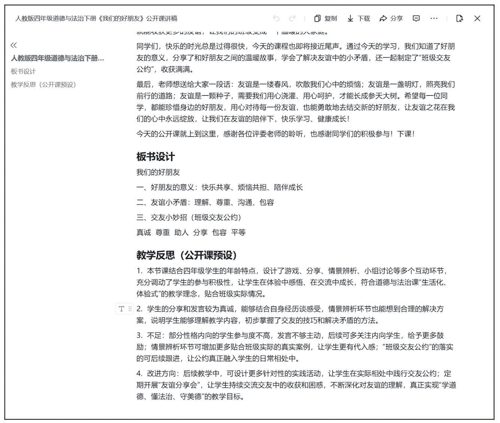

图 2-13 部分课堂讲稿

**五、操作小窍门**

1.增加先验知识：在提示词中加入学生的学情信息，AI 会相应地调整语言难度。

2.注重语气表述：若教师有语气相关的需求，可在聊天框中追加要求，例如，要求课堂讲稿“口语化”、“故事化”或“精准性强”等。

**六、遇到问题这样解决**

1.讲稿的文辞深奥难懂时，可在聊天框中追加符合授课群体学情的限定语句，如“请结合小学四年级学生的日常生活与学习实际，语气替换为小学生浅显易懂的表达”。

2.讲稿的知识深度不足时，可在聊天框中追加相关的限定术语，如“需涉及人际交往礼仪的细节”。

**2.7** **语句排序题的设计与生成**

**一、场景介绍**

在语言教学与阅读训练中，句子重组是一种有效策略。它通过打乱词序，引导学习者分析语法与语义逻辑，以提升其语言运用能力。引入 AI 后，大语言模型能自动完成句法识别与词序重组，在保持语义正确的同时，确保生成的句子可直接用于教学。

**二、相关软件介绍**

豆包通过提供智能化的知识辅助和学习支持，正在成为学生全天候的学习助手和教师提升教学质量的重要工具。

**三、具体操作流程**

第一步：访问豆包官网，完成豆包平台注册并登录。

第二步：在主页面的聊天框中提供需要重组句子的信息。

第三步：获取分析内容。保存结果并整理成文档格式，随后复制至本地文档。

**四、实际案例**

假设你是小学一年级的一名语文教师，现在需要为语文期末考试设计与“句子排序”相关的题目，课文为人教版一年级语文教材《小壁虎借尾巴》。

打开豆包，输入相应的提示词，例如：

你是一名经验丰富且深谙教育管理之道的小学语文教师，具备敏锐的洞察力和丰富的实践经验，能够充分考虑学生的成长规律与年龄特点。根据用户提供的详细教科书信息，现在你需要为一年级语文期末考试设计与句子排序相关的题目。（详细的提示词见本书附赠资源。）

最终生成的部分句子排序题如图 2-14 所示。

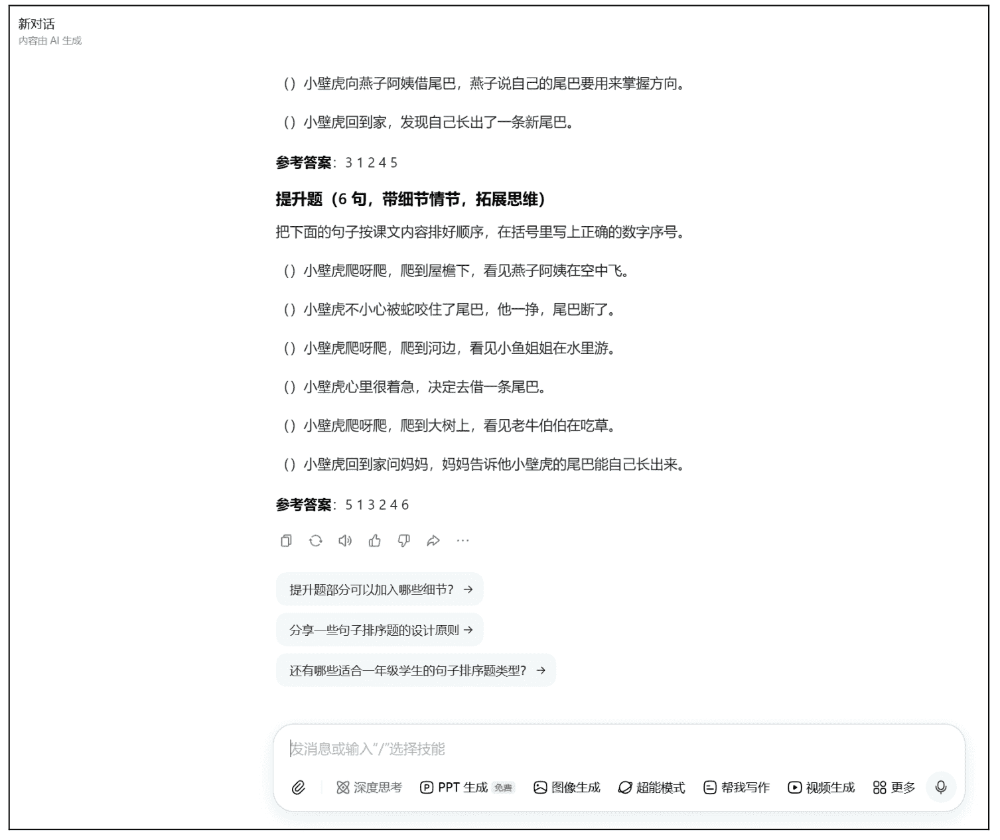

图 2-14 部分句子排序题

**五、操作小窍门**

1.限定提示词：在提示词中说明“请保持专有名词顺序不变”，避免核心信息丢失。

2.独立编号：在输入句子重组信息时，要求“每句独立编号”，有助于后续进行整套练习。

**六、遇到问题这样解决**

1.若聊天框不支持长段落输入，可先将句子按模块进行划分，再进行多轮迭代输入。

2.若句子中的词汇被遗漏或重复，则可在聊天框中追加特定的提示词，并限制“确保所有的词汇都出现且仅出现一次”。

**2.8** **智慧课堂随机点名助手**

**一、场景介绍**

在日常教学过程中，点名是促进参与、检测学习状态与分配互动机会的重要方式。然而，教师在组织课堂讨论、小组发言、课后抽查等环节中，频繁进行随机点名也会占用大量时间。AI 可在导入学生名单后，自动进行随机抽取，并支持多轮、不重复、分组等多种模式。在此基础上，系统还能结合教学场景生成个性化的点名语句或互动提示，以增强课堂氛围。该功能不仅提升了教学效率与参与度，还为教学管理提供了智能化支持。

**二、相关软件介绍**

ClassDojo 是一个通过连接教师、家长与学生来构建积极课堂社区的免费平台。其核心功能始于一套行为管理系统，允许教师通过实时积分反馈（可投影展示）来引导学生行为。此外，平台还提供班级故事分享、课堂工具及社交情感学习资源等一系列特色功能。

**三、具体操作流程**

第一步：打开浏览器，访问 ClassDojo 网站。单击网站右上角的“教师登录”按钮，根据指示进行注册并登录。

第二步：选择学校注册。教师无须经过学校同意，本人自行选择即可。

第三步：创建班级。单击“添加学生”按钮，批量导入学生名单。

第四步：添加完毕后，单击“工具包”按钮，在弹出的页面中单击“随机”按钮，即可实现随机点名的功能。若想对学生进行分组，可继续单击“小组分配器”按钮。

第五步：获取随机点名和小组分配的结果。

**四、实际案例**

假设你是一名小学班主任，现在需要在课上进行随机点名。打开 ClassDojo 网站，注册完毕后，从左边栏中单击“所有班级”按钮，添加新课堂，即可创建属于教师自己的班级。接着单击“添加学生”按钮，批量导入学生名单，如图 2-15 所示。

图 2-15 导入学生名单

添加完毕后，单击如图 2-16 所示的“工具包”按钮，在弹出的页面中单击“随机”按钮，即可实现随机点名的功能，如图 2-17 所示。若想对学生进行分组，可继续单击“小组分配器”按钮，完成学生分组并获取随机点名结果。

图 2-16 工具包功能

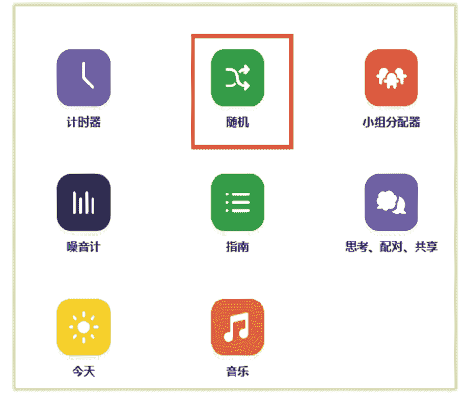

图 2-17 随机功能

**五、操作小窍门**

1.频次分析：每周导出“学生互动频次报表”，有针对性地向沉默者提问或表扬积极参与的同学。

2.自定义点名：可在页面底部单击“选择多个学生”按钮，从而自定义选择多名学生进行回答。

**六、遇到问题这样解决**

1.网页可能偶尔会出现卡顿，多次按回车键刷新页面即可。

2.添加学生时，建议通过上传 Excel 文件来提升学生名单的导入效率。

**2.9** **学生想象力引导助手**

**一、场景介绍**

在语文、美术等学科教学中，激发想象力是培养创造性思维与表达能力的关键。为此，可引入 AI 想象力引导助手。例如，在创意写作或艺术启发活动中，该助手能提供示例，引导学生完成创造性任务，协助他们训练观察、叙事与创造性思维，并能生成可复用的视觉素材，为差异化教学与跨学科项目提供支持。

**二、相关软件介绍**

可灵 AI 是一款专注于视频与图片生成的创作工具，旨在为用户提供高效、高质量的内容生产体验。它不仅支持文生视频、图生视频等核心功能，可生成 1080P 分辨率、最长 3 分钟的高清视频，还具备多图参考、运镜控制与角色一致性保持等特色功能，以满足专业的创作需求。

**三、具体操作流程**

第一步：打开浏览器，访问可灵 AI 网站。单击主页面左下角的“登录”按钮，根据指示注册并登录即可。

第二步：在聊天框中说明具体要求，如图片内容、图片要求等。

第三步：获取生成的图片。可灵 AI 会基于用户的需求，生成优质的图片，从而对学生的想象力进行引导。

**四、实际案例**

假设你是一名小学美术教师，要求学生在课堂上发挥想象力，画出心中童话故事的绚丽情景，引导学生完成美术创作任务。

打开可灵 AI 网站并登录后，在主页面左侧单击“图片生成”按钮，如图 2-18 所示。

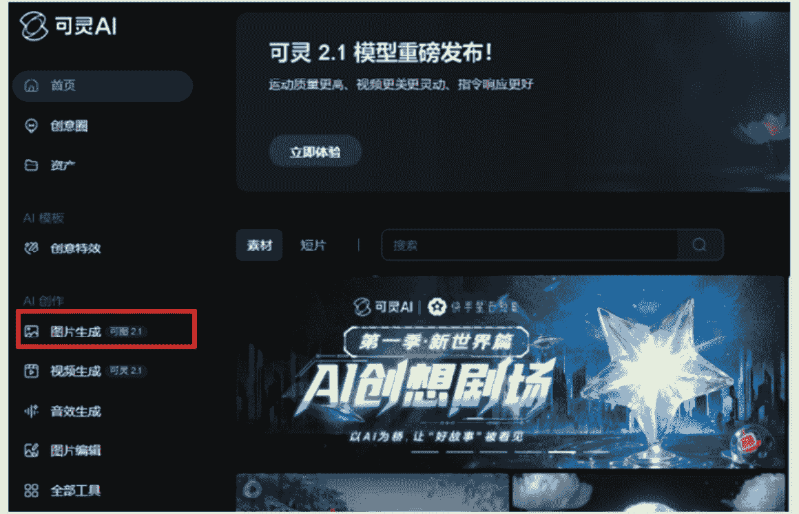

图 2-18 登录主页面

输入相应的提示词，例如：

你是一名经验丰富的小学美术教师，具备敏锐的洞察力和丰富的实践经验，能够充分考虑学生的成长规律与年龄特点。现在需要引导学生发挥想象，描绘这样一幅童话故事画面：“童话般的书本森林，树木由彩色的故事书堆成，书页变成树叶。夜晚的森林里，飞舞着发光的字母萤火虫，像闪烁的小灯笼。远处有翻开的书本小山，溪流是流淌的墨水，充满梦幻色彩”。上述画面为学生提供相关示例，引导学生完成美术创作的任务。（详细的提示词见本书附赠资源。）

提示词输入完成后，单击“立即生成”按钮，如图 2-19 所示，即可生成符合要求的图片，结果如图 2-20 所示，满意后单击“下载”按钮存储图片即可。

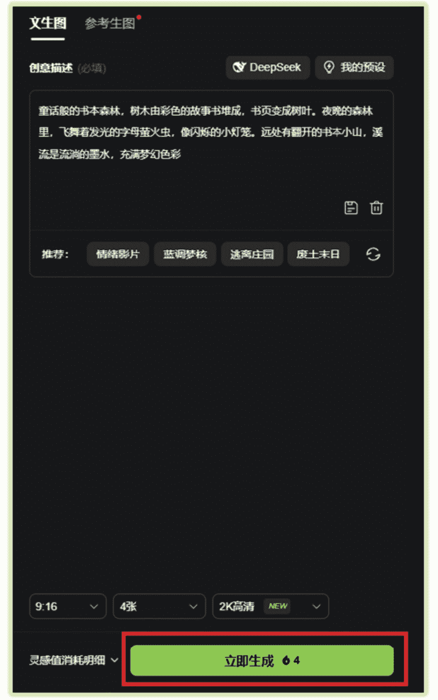

图 2-19 输入提示词

图 2-20 图片生成结果

**五、操作小窍门**

1.优化提示词：可参考“主体+环境+艺术风格+技术参数”结构优化图片和描述画面。

2.艺术情绪引导：在提示词中限定相应的艺术情绪关键词，如“神秘”“欢快”“忧郁”。

**六、遇到问题这样解决**

1.若生成图像模糊，则可在提示词中追加技术细节强化词，如超精细细节、锐化焦点等。

2.若生成图像缺少相关艺术元素，就可在提示词中追加详细描述，如线条、形状、色彩、肌理、空间、形态与明暗等。

**2.10** **智能辅助课堂听写**

**一、场景介绍**

使用 AI 驱动的听写助手进行语言练习，能将枯燥的听写升级为有效的能力培养过程。它不仅能根据学生特点生成个性化的训练内容，还能针对性地提升其听觉信息处理速度与听觉理解能力。这使得语言学习从机械记忆转变为自主探索的沉浸式训练，从而在提升学习效率的同时，真正将学习的主动权交还给学生。

**二、相关软件介绍**

在应用开发层面，阿里云百炼大模型平台为教育机构提供了一站式大模型服务，助力其高效构建智能教学助手、个性化学习引擎等工具。在数字内容创作领域，讯飞智作 AI 配音能提供超 300 种音色与情感化语音合成，极大地提升了教学资源的生产效率。

**三、具体操作流程**

**方法一：讯飞智作**

第一步：访问讯飞智作官方网站。打开浏览器，登录讯飞智作官方网站，在主页面左上角选择“AI 配音”选项，单击“立即制作”按钮进入音频生成页面。

第二步：调整配音参数。将需要转换为音频的文本内容粘贴至页面左侧的聊天框中。根据文本类型（如教育内容、对话等），选取合适的主播音色。同时可通过右侧滑块或选项调整主播的语速和语调，确保音频效果自然流畅。

第三步：生成并导出音频文件。单击页面左上角的“试听”按钮，预览生成的音频效果。若试听效果符合要求，则单击右上角的“生成音频”按钮，在弹出的聊天框中设置好音频文件的名称和输出格式（如 MP3、WAV）后，完成音频文件的下载。

**方法二：阿里云百炼大模型平台**

第一步：访问阿里云百炼大模型平台。打开浏览器，登录阿里云百炼大模型平台。

第二步：启动语音合成模型。登录成功后，在平台主页中部单击“免费体验”按钮进入新页面。在左侧菜单栏中选择“语音模型”选项，单击“语音合成”按钮，选择适合的大模型后，单击“立即体验”按钮，进入音频合成页面。

第三步：语音试听与下载。在合成页面中，先选择所需的音色类型，单击“自定义文字试听”选项。在聊天框中输入或粘贴需要转换的文本内容，单击“开始生成”按钮启动语音生成过程。短暂等待后（注意：页面下方会显示进度条），单击“播放”按钮（三角形图标）试听音频效果。确认无误后，单击右下角的“下载”按钮，即可存储生成的语音文件至本地设备。

**四、实际案例**

假设你是一名高中语文教师，课前需要听写人教版高中语文必修上册第一单元第一课的内容。

**方法一：讯飞智作**

登录讯飞智作官方网站，在主页面的左上角找到“AI 配音”按钮，随后单击“去创作”按钮，如图 2-21 所示。

图 2-21 讯飞智作官方网站

输入要听写的文本内容［人教版高中语文必修上册（2019 年部编版）第一单元第一课］至左侧聊天框中，如图 2-22 所示，并根据文本内容选择对应的主播。同时，可在最右侧调整主播语速、语调，如图 2-23 所示。

图 2-22 输入要听写的内容

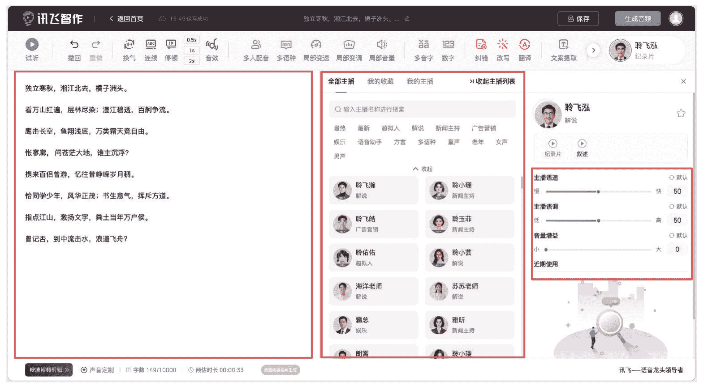

图 2-23 调整配音参数

配音参数调整完成后，单击左上角的“试听”按钮。若试听音频合格，即可单击右上角的“生成音频”按钮，确定“名称”与“格式”后单击“确认”按钮即可，如图 2-24 所示。

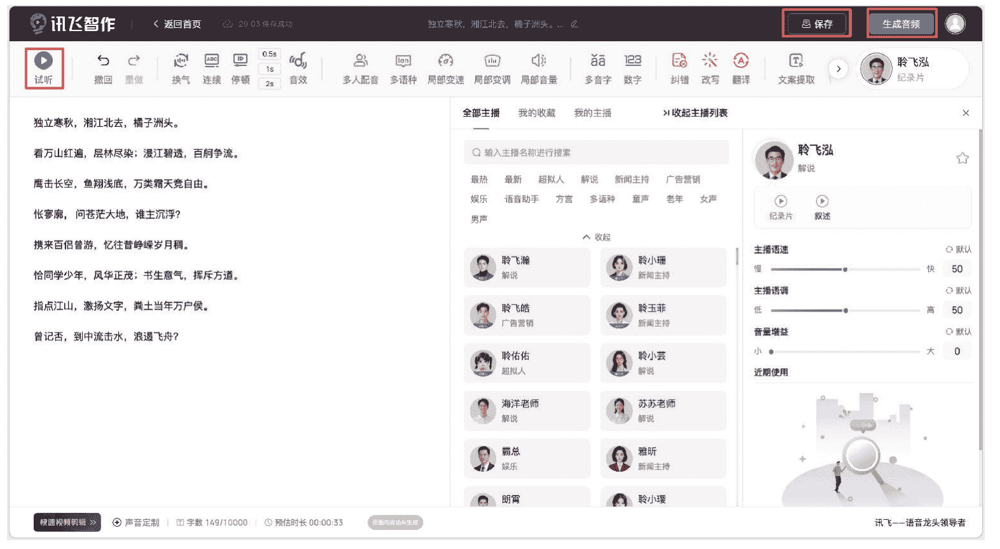

图 2-24 试听与下载音频

**方法二：阿里云百炼大模型平台**

注册并登录阿里云百炼大模型平台，随后单击网页中部的“免费体验”按钮，如图 2-25 所示。在弹出的页面左侧菜单栏中单击“语音模型”，再单击上方“语音合成”按钮，选中一个语音大模型，再单击“文字转语音”按钮，如图 2-26 所示。

图 2-25 注册并登录阿里云百炼大模型平台

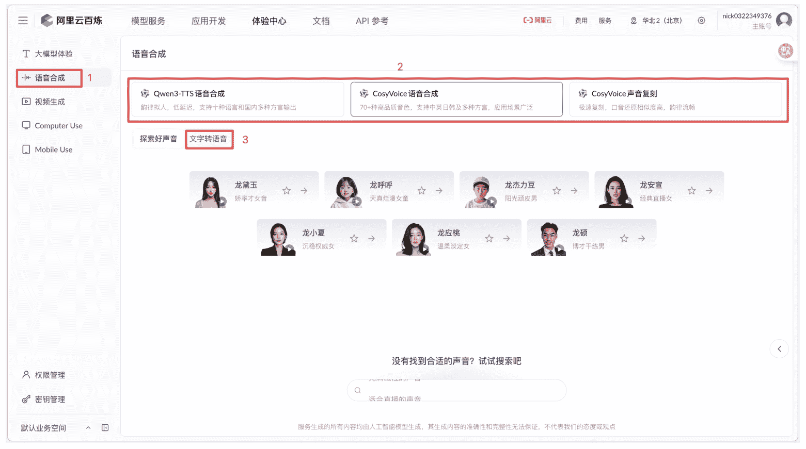

图 2-26 体验语音合成功能

在聊天框中输入要听写的文本内容［人教版高中语文必修上册（2019 年部编版）第一单元第一课］，在右侧调试台选择音色、音量、语速，单击“合成试听”选项，短暂等待后，网页下方会出现一段进度条，单击三角形“播放”按钮进行语音试听，如图 2-27 所示。

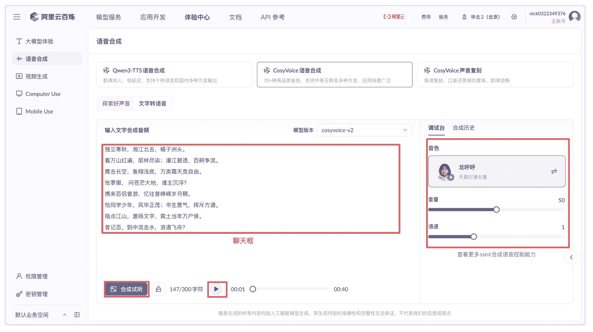

图 2-27 试听与下载语音

**五、操作小窍门**

1.合理调整参数：可切换多位主播进行音频试听，并调整主播的语速、语调，确保音频质量达到最佳效果。

2.丰富音频感情：可通过换气、变速等操作，使得阅读更加自然、富有感情。

**六、遇到问题这样解决**

1.语言与主播需匹配：听写文本内容为汉字时，不应选择外语主播，反之亦然。

2.局部变速异常：使用局部变速操作前，需使用鼠标选择文字后再进行操作。

3.换气变速异常：在使用换气操作前，请将鼠标光标暂停在需要换气的位置节点。

**2.11** **学生激励与表扬话术生成**

**一、场景介绍**

用 AI 驱动的表扬助手可以将空泛的称赞升级为精准的成长激励。它不仅能根据学生的具体行为定制表扬，还能结合不同情境表达恰如其分的欣赏。这种基于具体事实的深度认可，能有效激发学生的内在动机，进而将“我能行”的积极体验转化为坚实的自信，从而让学习动力由外控转为内生，最终将教育的聚光灯真正打在每一个学生的成长上。

**二、相关软件介绍**

DeepSeek 是由中国团队自主研发的大语言模型助手，它不仅免费、功能强大、注重中文，更支持长文本处理。其核心能力在于理解、推理与生成，可广泛应用于写作、科研、编程及知识问答等场景。

即梦 AI 是一款全能型智能助手，具备深度知识问答、多模态交互、高效生产力工具、个性化创作引擎，以及场景化智能体开发五大核心功能，以精准理解和跨场景落地能力驱动个人与企业智能升级。

**三、具体操作流程**

第一步：登录 DeepSeek 官方网站。注册并登录 DeepSeek 平台，在主页面中单击“开始对话”按钮。

第二步：生成表扬话语。输入提示词，然后复制生成的表扬话语内容。

第三步：登录即梦 AI。访问并登录即梦 AI 官方网站。

第四步：生成图片。在即梦 AI 首页中单击“图片生成”按钮，将第二步生成的表扬话语内容输入聊天框中，单击“提交”按钮生成图片，随后下载并保存至本地。

**四、实际案例**

假设你是一名小学班主任，班上有学生遇到了社交焦虑的问题，常常不敢参与班级集体活动。现在，你需要为该学生定制表扬鼓励邀请卡，协助学生增强信心，进而增强其集体归属感与荣誉感。

进入 DeepSeek 官方网站，在聊天框中输入提示词，例如：

你是一名经验丰富且深谙教育管理之道的班主任，具备敏锐的洞察力和丰富的实践经验，能够充分考虑学生的成长规律与年龄特点。当用户提出需要定制表扬鼓励邀请卡时，详细询问学生各类基本信息以及情感状态。根据用户提供的详细信息，为有情绪问题的学生生成表扬话语，进而为后续定制表扬鼓励邀请卡作铺垫。（详细的提示词见本书附赠资源。）

提示词输入完成后单击“提交”按钮，如图 2-28 所示。内容生成完毕后，单击“复制”按钮对内容进行存储，如图 2-29 所示。

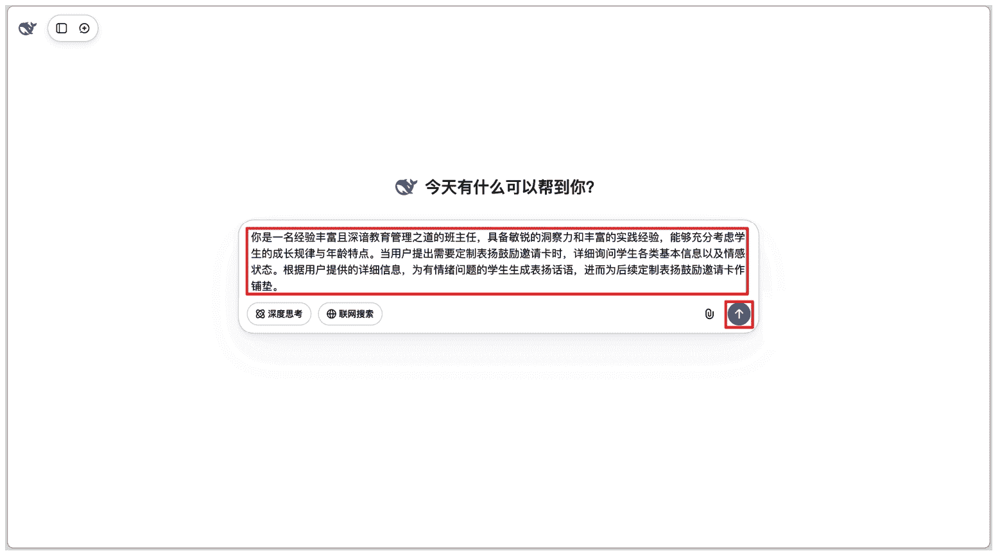

图 2-28 提交提示词

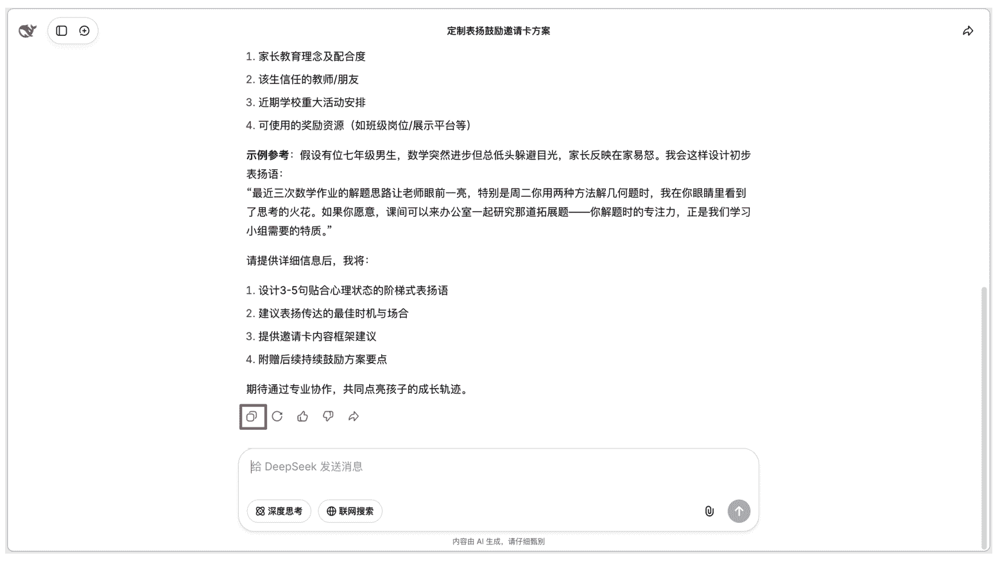

图 2-29 复制生成表扬的话语

登录即梦 AI 官方网站，单击页面下方的“图片生成”按钮，将第二步生成的表扬话语内容作为提示词输入即梦 AI 网站的聊天框中，生成目标为“学生遇到了社交焦虑的问题，躲在书架后偷看同学游戏，老师举着‘一起玩吗’手绘邀请卡”的图片。输入完毕后，单击右下角的白色箭头按钮，即可生成图片。图片的默认格式为 1∶1、高清 2K，文本框左下方可选择生成图片的宽高比例，如图 2-30 所示。

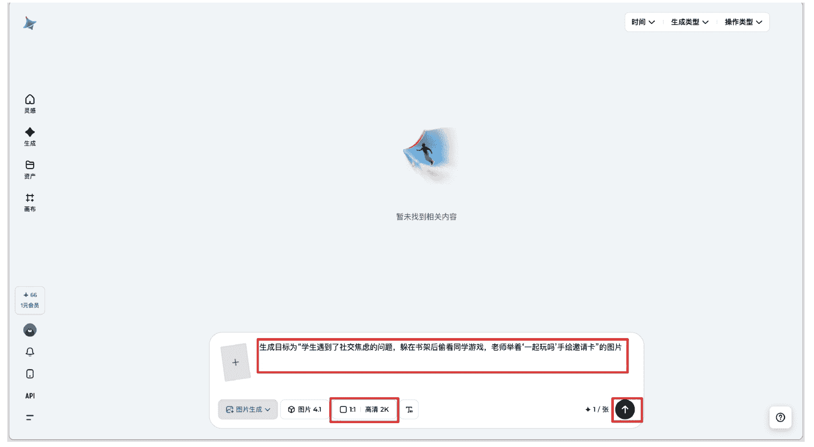

图 2-30 生成图片

图片生成完毕，单击“下载”按钮保存图片，如图 2-31 所示。

图 2-31 下载并保存图片

**五、操作小窍门**

1.优化提示词：可使用 DeepSeek 对提示词进行多次迭代优化，具体操作可重复操作流程的第二步（生成表扬话语）。

2.聚焦图片生成细节：提示词需包含具体的描述，如场景、光线、氛围、色彩等元素，这样可以大幅提升图片的生成质量。

**六、遇到问题这样解决**

1.若遇到表扬话语不精确的问题，文字内容生成质量可能具有一定的随机性，可要求 AI 重复生成内容进行对比，再根据学生的具体情况进行选择。

2.若图片生成效果不佳，如效果不切合实际或实用性低，则可通过提示词优化图片内容的描述，从而达到理想效果；如图片质量不佳，则调整图片长宽比参数以适应不同的场景，灵活修改长宽比参数（如 16∶9 或 1∶1）。

**2.12** **班级新闻播报的设计与生成**

**一、场景介绍**

利用 AI 驱动的班级新闻播报，能为学生打造一个将抽象核心素养转化为可见成果的实践平台。具体而言，这种人机协作模式使信息甄别与创意表达变得真实可感，能有效点燃学生的探索热情。在此过程中，能力培养从知识灌输升级为解决实际问题的综合演练，全面提升了学生驾驭未来的关键能力。更重要的是，这一新颖形式打破了学习壁垒，让每个学生都能自信发声，从而增强了班级归属感。

**二、相关软件介绍**

阿里云百炼大模型平台为教育行业提供了一站式大模型应用开发服务，其核心价值在于帮助教育机构高效构建智能教学助手、个性化学习引擎和智能知识管理工具；通过强大的通义千问等模型能力、便捷的低代码编排工具和安全合规的部署选项，赋能教育者智能备课与出题，实现学生个性化辅导与答疑，助力机构建立专属知识库与问答系统，从而有效提升教学效率、学习体验和教育管理的智能化水平，推动教育数字化转型。

**三、具体操作流程**

第一步：访问阿里云百炼大模型平台。打开浏览器，登录阿里云百炼大模型平台。

第二步：启动语音合成模型。登录成功后，在平台主页中部单击“免费体验”按钮进入新页面，在左侧菜单栏中选择“语音模型”选项，单击上方的“语音合成”按钮，选择适合的大模型后单击“立即体验”按钮，进入音频合成页面。

第三步：完成语音试听与下载。在音频合成页面中，先选择所需的音色类型，单击“自定义文字试听”选项。在聊天框中输入或粘贴需要转换的文本内容，单击“开始生成”按钮启动语音生成过程。等待短暂生成后（注意：页面下方会显示进度条），单击“播放”按钮（三角形图标）试听音频效果。确认无误后，单击右下角的“下载”按钮，即可将生成的语音文件保存到本地设备。

**四、实际案例**

假设你是一名小学班主任，班会前需要总结每周班级新闻，如获奖情况、好人好事、趣味活动等，例如：

本周班级喜讯连连！在学校“童心绘祖国”绘画比赛中，李明同学的《我的家乡》获一等奖，作品将在校园展厅展出。月考成绩出炉，全班平均分较上次提升 5 分，张宇、陈欣等 8 位同学进步显著，数学满分人数比上次多 3 人，值得点赞！周三下午，我们开展了“图书漂流”活动。同学们不仅带来了心爱的图书，互相交换阅读，还分享了读书心得，教室里满是书香和欢笑。希望大家继续努力，让班级更精彩！

现在，你需要生成班级新闻播报，以增强学生班级归属感与自信心。

注册并登录阿里云百炼大模型平台，随后单击网页中部的“免费体验”按钮，如图 2-32 所示。在弹出的页面左侧菜单栏中单击“语音合成”，选中一个语音大模型，再单击“文字转语音”按钮，如图 2-33 所示。

图 2-32 登录阿里云百炼大模型平台

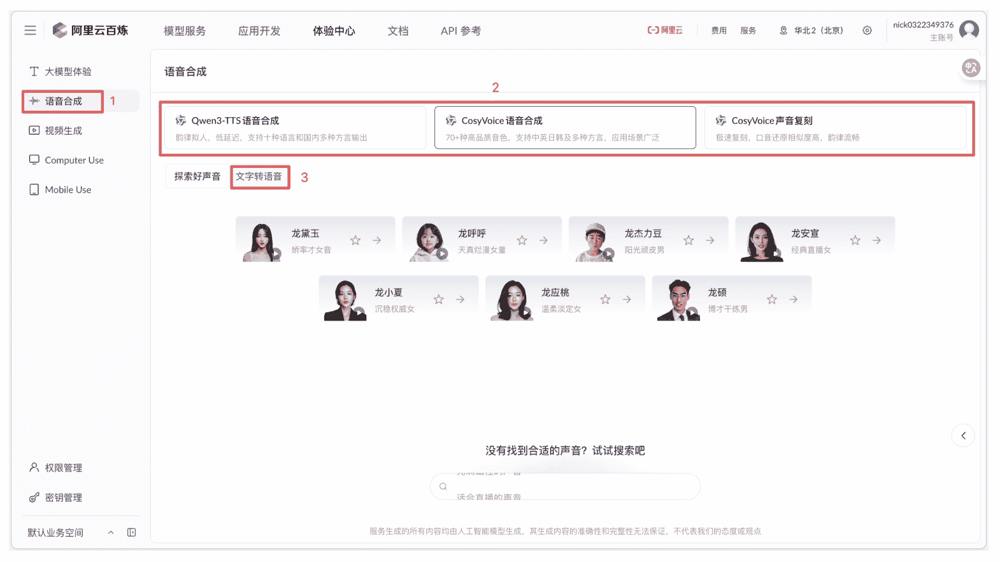

图 2-33 体验语音合成功能

在聊天框中输入班级新闻播报内容，在右侧调试台选择音色、音量、语速，单击“合成试听”选项，短暂等待后，网页下方会出现一段进度条，单击三角形“播放”按钮进行语音试听，如图 2-34 所示。

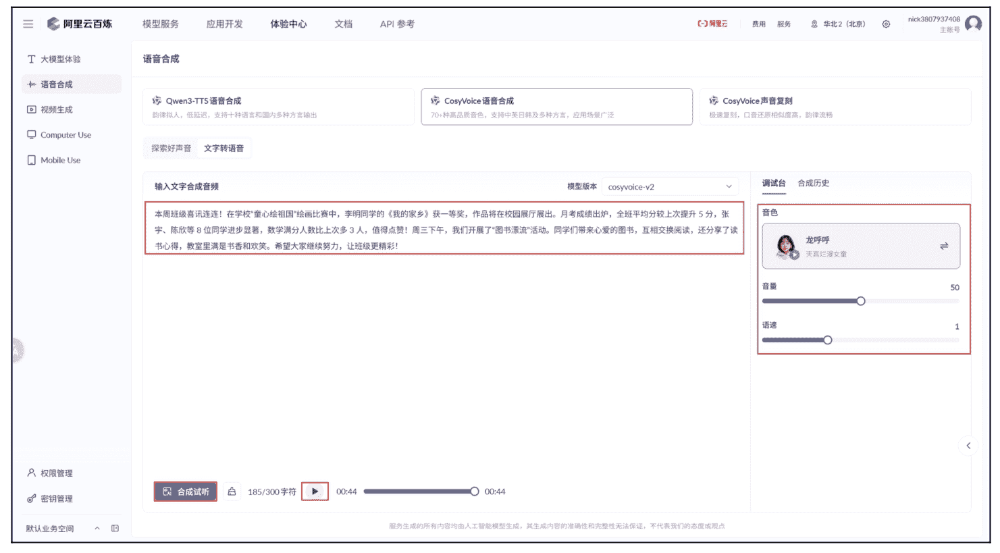

图 2-34 试听与下载音频

**五、操作小窍门**

1.合理调整参数：可切换多位主播进行音频试听，并调整主播的语速、语调，确保音频质量达到最佳效果。

2.预览文本后再生成语音：在输入文本并单击“开始生成”按钮前，仔细检查聊天框中的内容，确保没有语法错误或特殊字符。如果文本有误，则可能导致语音合成效果不佳。教师养成预览习惯有助于减少重新生成的次数，从而节省时间。

**六、遇到问题这样解决**

1.聊天框输入失败：在聊天框中最多可以输入 6000 个字符，若存在较长的文本，就需要对文本进行拆分输入。

2.语音生成过程中断：若生成进度条卡顿或音频未生成，可刷新页面后重新输入文本，或重新检查文本长度是否符合要求。

**2.13** **阳光大课间方案设计**

**一、场景介绍**

在“双减”政策与核心素养导向的教育改革背景下，阳光大课间正从传统的“身体锻炼”升级为“五育融合”的关键场景。在此背景下，AI 互动设计的引入，将其重塑为一个全感官的探索乐园。具体而言，系统能依据学生兴趣生成个性化的挑战任务，使其运动潜能与创新思维在游戏中自然萌发；同时，这种充满吸引力的设置能将大课间从被动休息变为主动发现的成长空间。最终，AI 大课间打破了传统局限，为每个学生提供了展现个性的舞台，让教育在奔跑中悄然发生。

**二、相关软件介绍**

即梦 AI 是一款全能型智能助手，集深度知识问答、多模态交互、高效生产、个性创作与场景化智能体开发（支持 API 定制应用）五大核心能力于一体，致力于以精准的理解与跨场景落地能力，驱动个人与企业实现智能升级。

**三、具体操作流程**

第一步：访问即梦 AI 官方网站。完成即梦 AI 平台注册并登录后进入主页面。

第二步：生成图片。在主页面中单击“图片生成”并输入提示词。可选择修改图片长宽比参数，单击“提交”按钮生成图片，随后下载并保存。

第三步：生成视频。上传第二步下载的图片作为首帧，单击“视频生成”并输入提示词，单击“提交”按钮生成视频，随后下载并保存。

**四、实际案例**

假设你是一名小学体育教师，任职学校的特色为武术和韵律操。现在学校要求每一名教师设计富含学校特色的阳光大课间视频作为校庆活动的宣传案例。

访问并登录即梦 AI 官方网站。单击页面下方的“图片生成”按钮，并在聊天框中输入提示词，例如：

你是一名经验丰富的校本特色活动设计专家，具备敏锐的洞察力和丰富的实践经验，能够充分考虑学校的实际情况，设计出阳光大课间活动演示视频的首帧图片。（详细的提示词见本书附赠资源。）

提示词输入完成后，还可选择修改图片的长宽比参数。最后，单击图 2-35 右侧的“提交”按钮生成图片。

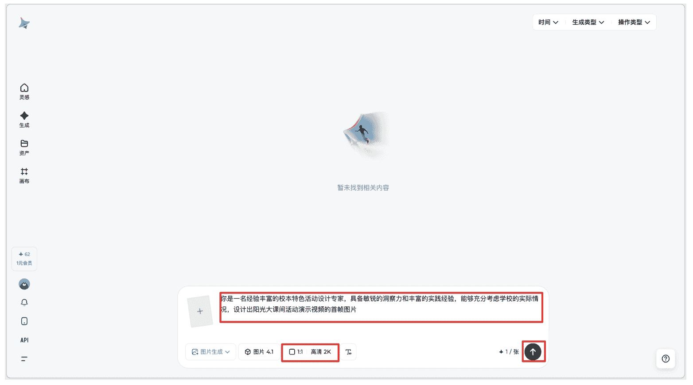

图 2-35 生成图片

生成图片后，单击“下载”按钮，即可将图片保存至本地，如图 2-36 所示。

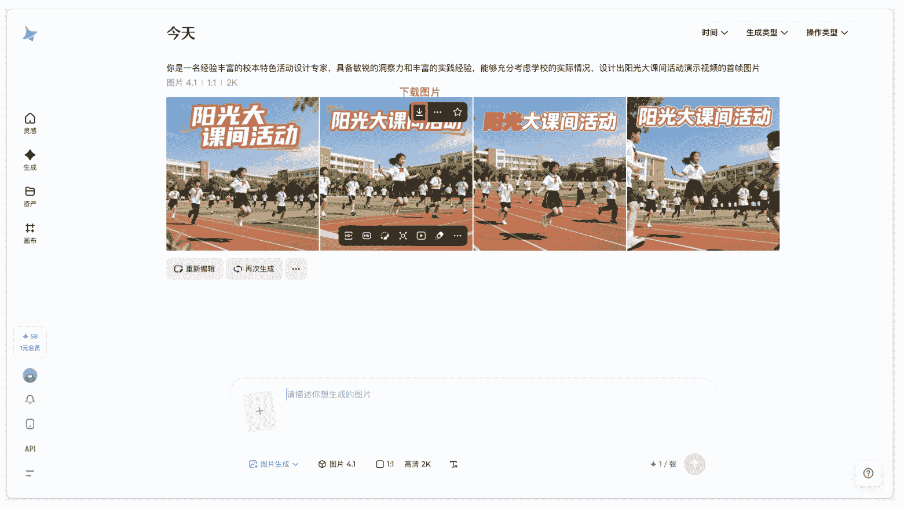

图 2-36 下载图片

基于第一步所生成的武术韵律操图片，单击页面下方的“视频生成”按钮，上传下载好的图片作为首帧，如图 2-37 所示。

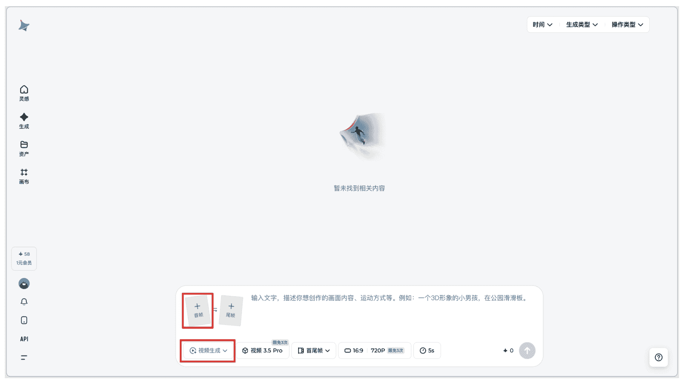

图 2-37 设置视频首帧

在聊天框中粘贴视频提示词，例如：“你是一名经验丰富的校本特色活动设计专家，具备敏锐的洞察力和丰富的实践经验，能够充分考虑学校的实际情况，基于阳光大课间活动的相关图片，设计出全面、合理、可行性强且具有针对性的阳光大课间活动方案的演示视频”（详细的提示词见本书附赠资源），单击“提交”按钮，如图 2-38 所示。视频生成完毕后，单击“下载”按钮，即可将视频保存至本地，如图 2-39 所示。

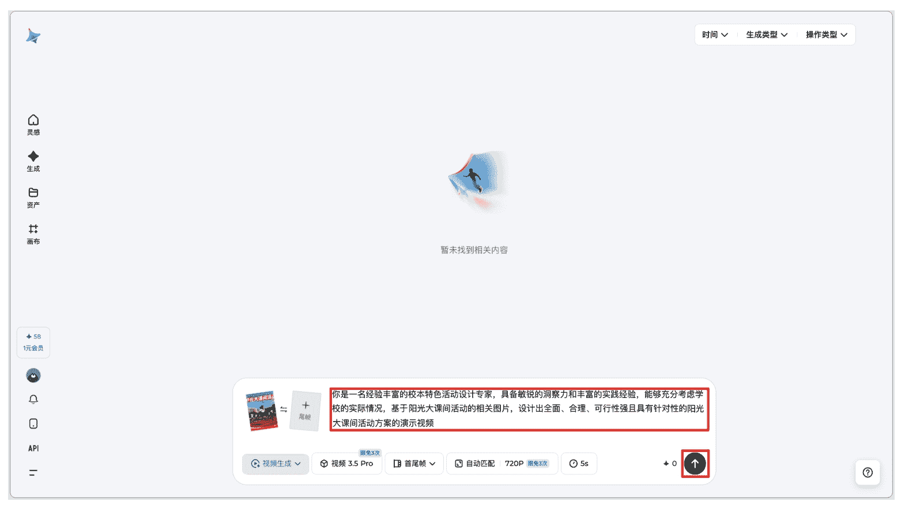

图 2-38 生成视频

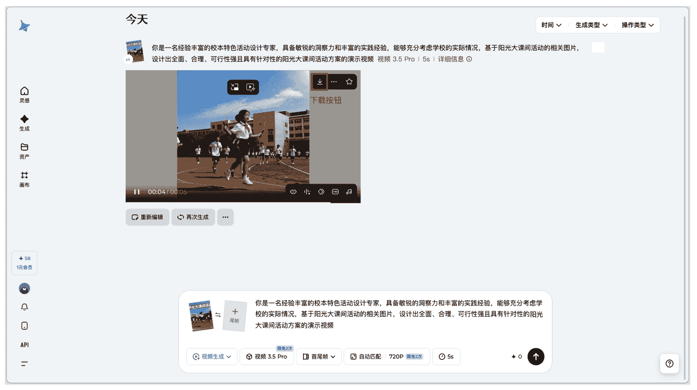

图 2-39 下载视频

**五、操作小窍门**

1.优化提示词：若对生成的图片或视频效果不满意，可在提示词中详细阐述所期望生成的图片或视频的细节，或参考本书附赠资源中的提示词。

2.调整图片长宽比参数以适应不同场景：生成图片时，可灵活修改长宽比参数（如 16∶9 或 1∶1），确保图片适配不同的宣传平台，协助教师在社交媒体发布或打印相关材料，避免生成后再裁剪。

**六、遇到问题这样解决**

1.视频生成不连贯或首帧不匹配：检查提示词是否包含动态描述（如“学生动作序列”）或指定时长（如“五秒左右”），以控制生成视频的长度。

2.视频生成缺乏针对性或不切实际：向 AI 反馈具体问题，例如，“刚才生成的视频不符合学校情况，请结合学校特色，提供更易执行的阳光大课间视频”，让 AI 基于反馈优化输出，帮助 AI 生成更贴合学校实际的建议。

**2.14** **学情的智能分析与诊断**

**一、场景介绍**

AI 赋能的学情分析能深度挖掘并融合学生学习过程的多维数据，实现对个体认知状态、知识薄弱点及潜在学习风险的精准诊断与预测。具体而言，这不仅能支撑教学策略的个性化调整，还能驱动学习资源与路径的智能适配，从而将教育决策从“经验驱动”升级为“数据驱动”。这最终在保障规模效率的同时，促进了每个学生的个性化发展，实现了真正的教育公平。

**二、相关软件介绍**

豆包是一款能同时服务于学生与教师的高效助手。对学生而言，它能即时解答各学科疑问，提供个性化的辅导与学习策略建议，并能快速生成习题与作文素材，辅助学生进行针对性的练习。对教师而言，它可以高效完成教案设计、课件制作、出题及作业批改等任务。此外，其强大的生成能力也为教师备课提供了有力支持。

**三、具体操作流程**

第一步：访问豆包官网。完成豆包平台注册并登录后进入主页面。

第二步：学情分析。在主页面中上传学生信息文档，输入提示词。智能体基于上传数据和需求，从成绩分布、学科强弱、个体差异等多维度分析后，生成包含详细内容的学情分析报告，同时附教学改进建议、学生学习提升方案等。

第三步：保存分析结果。要求将结果整理成文档格式，并复制到本地文档。

**四、实际案例**

假设你是小学四年级（3）班的班主任，期末需要分析每个学生在 2024-2025 学年第二学期的总体表现，进而调整班主任寄语。

注册并登录豆包主页面后，上传如图 2-40 所示的学生成绩单文档，并在聊天框中输入提示词，例如：

你是一名经验丰富的班主任，具备敏锐的洞察力和丰富的实践经验，能够充分考虑班级实际情况。当用户提出需要一份学情分析时，详细询问班级学生的多维度情况，根据用户提供的信息，生成包括详细维度的学情分析报告。（详细的提示词见本书附赠资源。）

图 2-40 学生成绩单

单击“深度思考：自动”按钮，然后单击右下角的“提交”按钮，如图 2-41 所示。

图 2-41 学情分析

若需要将生成的内容制作成一份文档，可在内容生成完毕后，继续在聊天框中输入提示词“请帮我继续整理成一份.docx 文档。”最后，将生成的内容手动复制到文档中即可，如图 2-42 所示。

图 2-42 保存分析结果

**五、操作小窍门**

1.匿名化处理：在上传与学情相关的附件前，注意匿名化处理与学生相关的个人关键信息。

2.上传多维度信息：在上传与学情相关的附件时，建议上传学生多维度的信息，如基本信息（性别、年龄、年级）、成绩、心理状态、家庭情况等，以全面进行学情分析。

**六、遇到问题这样解决**

1.上传附件时，需等待附件上传完毕再提交提示词和附件。

2.生成内容不佳时，可重复操作流程的第二步。同时，可在聊天框中输入提示词，要求重点分析学生的某一方面。

**2.15** **单元学案的智能设计**

**一、场景介绍**

用 AI 驱动的学案设计能够将统一的课程内容转化为个性化的知识导航，为每一位学生规划专属的学习路径。系统基于学生的实时认知节奏，实现精准定位与动态调整，使学习资源与教学策略因人而异、因需而变。单元学习由此从同步推进转变为高效进阶的定制化旅程，显著提升知识掌握效率。在此基础上，AI 学案进一步打通“学—练—评”闭环，推动规模化教学实现真正的因材施教，迈向高质量育人新阶段。

**二、相关软件介绍**

扣子空间是一个 AI 原生应用开发平台，在教育领域赋能教师、学生和管理者轻松构建定制化的智能应用或教学助手。它可快速创建用于智能答疑、自动生成多样化练习题、个性化学习辅导、作业批改、教学资源管理与互动的 Bot，极大地提升了教学效率，并为学生提供随时可用的学习支持和个性化反馈，最终助力实现更高效、互动和个性化的教学体验与终身学习支持。

**三、具体操作流程**

第一步：搜索学案设计工具。在扣子空间平台搜索并选择学案设计工具。

第二步：学案设计。上传相关教学材料，输入提示词。

第三步：保存学案。等待学案设计工具生成完毕，复制学案至本地文档。

**四、实际案例**

假设你是小学三年级的一名数学教师，你目前的教学进度为人教版《加减法》第一课时，现在需要设计一份详细的学案。

进入扣子空间平台，单击左侧导航栏的“作品社区”按钮，在上方搜索框中选择“教学设计”。单击第一个工具“教学设计”按钮，如图 2-43 所示。

图 2-43 搜索学案设计工具

上传人教版《加减法》第一课时相关的教学材料，并输入相应的提示词，例如：

你是一名经验丰富的数学教师，具备敏锐的洞察力和丰富的实践经验，能够充分考虑班级实际情况。当用户提出需要一份单元学案设计时，详细询问班级的学情以及教学情况，根据用户提供的详细信息，提供基于人教版《加减法》第一课时的学案。

如图 2-44 所示，提示词输入完成后单击“提交”按钮。

图 2-44 设计学案

学案生成完毕后，复制生成的内容，并保存到本地文档中，如图 2-45 所示。

图 2-45 保存学案

**五、操作小窍门**

1.优化提示词：教师需根据班级实际情况完善提示词，将更详细的教学目标和学习目标融入提示词中，从而获得质量更高的学案。

2.迭代操作：若对生成的内容不满意或生成的内容不够多，可要求提出修改意见或要求生成更多的相关内容。

**六、遇到问题这样解决**

1.学案未正确生成：由于学案设计工具在首次沟通时会回顾历史对话记录，因此在生成学案时可能不会生成正确的内容。此时只需重复第二步流程，将优化后的提示词作为学案设计工具的提示词再次提交。

2.附件上传失败：附件需确保是 PDF 或 DOCX 格式，否则可能会导致附件上传失败；保证网络状况良好，若因网络不佳而导致附件上传失败，可重复上传；当附件格式与网络状况都没有问题，仍然出现附件上传失败情况时，尝试解除该附件本地占用情况（本地关闭附件），再次上传。

**2.16** **课堂互动游戏的设计与开发**

**一、场景介绍**

AI 赋能课堂互动游戏是将人工智能技术与教学游戏深度融合的创新形式，能将抽象知识点转化为可交互、沉浸式的游戏体验，激发学生的学习兴趣，提升课堂参与度。教师可借助 AI 工具快速生成游戏原型、智能适配学科知识点、动态调整游戏难度，并实时收集学生反馈，以优化教学策略。

**二、相关软件介绍**

AI 工具：飞象老师。

软件简介：飞象老师是猿辅导集团推出的国内首个面向中小学教师群体、专注于教学内容创作的 AI 专业工具，其 AI 教学动画功能具备强大的交互式内容生成能力，支持通过自然语言提示词直接生成可视化教学动画、互动游戏等应用。其核心优势如下。

●零代码开发：教师无须编程基础，通过文字描述，系统即可生成完整的交互式教学动画，支持自定义界面元素、参数调节和实验控制功能。

●学科知识适配：基于猿辅导十余年积累的教育大模型训练，可精准理解学科知识点（如物理公式、数学逻辑、化学反应），并将其转化为动态可视化演示。

●实时交互生成：生成的动画支持即时预览和参数调整（如摆长、质量、重力加速度），并可直接导出 HTML 文件在本地运行。

**三、具体操作流程**

第一步：进入飞象老师平台。打开浏览器，访问飞象老师官网并完成账号注册和登录，进入主页面。

第二步：选择 AI 教学动画功能。在聊天框左侧单击“AI 教学动画”选项，激活教学动画生成模式。

第三步：输入游戏需求。在聊天框中明确角色、学科知识点及游戏形式，游戏形式可以适当补充细节，如界面布局、交互形式和参数调节范围等。

第四步：生成与调试游戏。飞象老师会根据需求自动生成交互式教学动画，页面包含演示区、参数调节区及计算结果显示区。教师可进一步通过对话来修改生成效果。

第五步：导出与使用。调试完成后，单击页面右上方的“下载”按钮，选择 HTML 文件格式下载至本地。在课堂上使用时，教师通过浏览器打开 HTML 文件，即可运行游戏。

**四、实际案例**

在聊天框中输入明确角色、学科知识点及游戏形式的提示词，如图 2-46 所示。（更多科目的提示词样例见本书附赠资源。）

图 2-46 AI 赋能课堂游戏提示词

如图 2-47 所示，飞象老师会根据需求生成交互式教学动画，自动渲染出包含单摆演示区、三组参数滑块（摆长*L*、质量*m*、重力加速度*g*）、周期公式显示区及实验控制按钮的完整页面。拖动参数滑块测试交互逻辑（如调整摆长后动画是否同步变化、周期计算是否准确），记录需优化的细节（如数值范围、提示文字）。若需修改功能，可直接在聊天框中补充提示词（如增加“地球/月球重力切换”按钮或调整配色方案），AI 会自动修改和更新动画。

图 2-47 AI 赋能课堂游戏（物理“单摆实验”）

通过不断修改提示词，可以进一步优化生成效果，对生成的结果满意后，单击图 2-48 中右上角的“下载”按钮，可下载本地可运行的 HTML 文件，供课堂教学或离线环境使用。

图 2-48 下载生成的文件

**五、操作小窍门**

1.精准描述游戏规则：教师在输入需求时，需明确“知识点与游戏机制的关系”，例如，数学“分数运算”可设计为“答对题目解锁关卡”，物理“力的合成”可设计为“拖动箭头改变物体运动轨迹”，让 AI 更精准地匹配教学目标。

2.参数可视化设计：在生成调节功能时，优先选择“滑块、按钮、下拉菜单”等直观的控件，避免生成复杂的聊天框。例如，在化学实验游戏中，用颜色选择器替代“输入溶液浓度数值”，降低学生的操作门槛。

3.预设容错与反馈机制：在需求中加入“错误提示设计”。例如，当学生操作错误时，游戏会自动弹出“提示：摆长需大于 0.5 米哦！”，既引导学生思考，又能提升互动友好度。

**六、遇到问题这样解决**

1.游戏功能与需求不符：检查提示词是否缺少关键信息，可补充“角色（如‘初中生物老师’）+知识点（如‘细胞结构’）+具体交互（如‘点击细胞器显示功能’）”，重新提交细化后的需求。

2.生成的游戏卡顿或显示异常：尝试简化界面元素（如减少动画特效、合并相似按钮），在提示词中注明“优化加载速度，适配课堂投屏设备”。若仍有问题，导出后用浏览器“无痕模式”打开，排除缓存干扰。

3.学科知识点嵌入生硬：在聊天框中输入“将知识点融入游戏规则”，例如，“把光合作用公式作为种植植物的能量来源，阳光值不足时，公式会闪烁提示”，让 AI 重新设计知识与游戏的融合方式。

**2.17** **AI 赋能早读效能提升**

**一、场景介绍**

早读是提升学生语言能力的重要环节，然而传统课堂中的朗读氛围难以量化监测。AI 工具可赋能早读效能提升，通过文心一言的网页工坊功能可快速生成朗读氛围监测应用，实现朗读氛围数据可视化，帮助教师精准掌握早读动态，优化教学管理效率。

**二、相关工具介绍**

文心一言的网页工坊是百度基于文心大模型开发的在线 AI 应用搭建平台，支持通过自然语言描述生成纯前端网页应用，无须编程基础，其核心优势包括：零代码开发、实时预览与调整和离线化运行。

**三、具体操作流程**

第一步：进入网页工坊。在文心一言主页面中单击底部导航栏的“网页工坊”图标，进入 AI 网页生成工具页面。

第二步：输入早读效率提升需求。作为早读教师或班主任，我们的核心诉求在于实时监测学生的朗读声音变化，并将早读氛围以可视化形式呈现。

第三步：生成与调试应用。文心一言会根据需求生成 AI 赋能早读网页代码，自动渲染出交互页面，包含当前氛围指数、音量热力图及历史变化趋势。可进一步通过提示词修改页面展示效果。

第四步：导出与使用。调试完成后，单击页面左上方的“导出”按钮，选择 HTML 文件格式下载至本地。在使用时，通过浏览器打开 HTML 文件即可运行游戏。

**四、实际案例**

假如你是一名班主任，你想了解早读课堂的朗读效能，可以在文心一言的网页工坊页面的聊天框中输入图 2-49 所示的提示词。

图 2-49 AI 赋能早读效能提升提示词

生成后单击预览页面的“允许”按钮开放麦克风权限，朗读测试氛围指数变化，检查气泡颜色和波纹动画是否随音量同步变化，如图 2-50 所示。若对生成的结果不满意，可进一步修改提示词，让 AI 生成不一样的可视化风格。确认无误后下载 HTML 文件并保存至本地，方便早读时快速调用。

图 2-50 AI 赋能早读效能提升检测器

**五、操作小窍门**

1.可视化多样化：生成应用时可以选择多样化的效果，例如，由现在的 3 个功能改为只有当前氛围指数，AI 生成多个不同颜色的气泡，同时让气泡的大小跟随声音的分贝值进行变化。具体的提示词见本书附赠资源。

2.样式统一化：工具采用相同色系（如蓝色主调），保持视觉风格一致，例如，氛围监测的“适中”状态均用蓝色，增强工具的关联性。

**六、遇到问题这样解决**

1.氛围监测无声音响应：先导出为本地 HTML 测试，确认浏览器是否授予麦克风权限（在地址栏左侧单击“锁”图标→“麦克风”，设为“允许”）；若仍无数据，在重新生成时，提示词补充“兼容 Chrome/Edge 浏览器音频 API”。

2.保存问题：保存文件时选择“HTML 格式”，而非“压缩包”；若系统提示“安全警告”，则用鼠标右键单击文件，选择“属性”，勾选“解除锁定”，即可正常运行。

3.多设备兼容性问题：如需在平板或手机上使用，生成时在提示词中添加“响应式布局，支持移动端触屏操作”，确保不同屏幕尺寸下良好的显示效果和操作体验。

**2.18** **习题讲解智能助手**

**一、场景介绍**

习题讲解助手是将人工智能技术与习题教学深度融合的创新教学工具，能够为教师提供高效的教学辅助支持。通过 AI 智能识别和分析技术，教师可以快速获得习题的详细解答步骤、教学重点分析和拓展练习建议，显著提升教学效率和质量。这种教学方式不仅减轻了教师备课和答疑的工作量，还能提供标准化、专业化的解题指导，让习题教学更加精准、有效，实现因材施教和个性化学习的完美结合。

**二、相关软件介绍**

AI 工具：九章爱学。

软件简介：九章爱学 App 具备强大的多学科题目解析能力。其核心优势包括：智能题目识别与多学科支持，支持数学、语文、英语、物理、化学等多学科题目的准确识别和解答，能够通过拍照快速识别题目内容，自动进行文字转换和结构化分析；详细的步骤级讲解与可视化教学，提供完整的解题步骤分解，支持黑板式可视化讲解模式，让抽象的解题过程变得直观易懂，帮助学生理解每一步的逻辑和原理；交互式答疑与个性化指导相结合，支持随时提问功能，学生可以针对任何疑点进行深入询问，AI 提供针对性的解答和拓展说明，实现真正的个性化学习体验。

**三、具体操作流程**

第一步：启动应用与选择学科。打开九章爱学 App，进入主界面后选择需要解答的学科类型（数学、语文、英语、物理、化学），系统默认不需要选择，单击“点击识别题目”按钮开始使用功能。

第二步：拍照识别题目内容。使用拍照功能对准需要解答的习题，确保题目文字清晰完整，系统自动识别题目内容并进行文字转换，生成结构化的题目信息。

第三步：获取详细的讲解与互动答疑。查看 AI 生成的详细解题步骤和分析，可切换到黑板讲解模式观看可视化演示，针对不理解的地方可随时单击提问，获得深入的个性化解答和知识点拓展。

**四、实际案例**

假设王老师在语文课上遇到学生对比较阅读题目理解困难的问题，决定使用九章爱学 App 来提供更详细的解题指导。如图 2-51 所示，王老师打开九章爱学 App，看到了支持多学科解答的功能介绍，包括数学、语文、英语、物理、化学等学科，AI 助手友好地提示“可以帮助解答各学科题目”。

图 2-51 App 功能介绍和多学科支持

如图 2-52 所示，王老师选择使用拍照功能识别题目。系统提示“手机平行纸面，题目放在框内”，并明确支持多学科题目答疑功能。王老师将手机对准学生提问的比较阅读题目进行拍照，确保题目内容完全在识别框内。

图 2-52 拍照识别功能和操作指导

拍照完成后，系统成功识别了关于《儒林外史》和《简·爱》的比较阅读题目，如图 2-53 所示。题目要求学生分析两部作品中女性人物面临婚姻抉择时的“离开”行为。系统不仅完整识别了题目内容，还提供了“解题步骤”功能，并显示“1 对 1 讲解本题”的个性化服务选项，让学生可以获得针对性的指导。

图 2-53 题目识别结果和解题步骤选项

如图 2-54 所示，王老师单击进入黑板讲解模式，系统以可视化的方式展示了详细的解题分析。AI 详细分析了《儒林外史》中沈琼枝的人物形象，包括“拒绝做妾，体现反抗精神与自我意识”等关键特征，并标注了相关情节和启示内容。这种黑板式的讲解模式让复杂的文学分析变得更加清晰、直观。

图 2-54 黑板讲解模式的可视化分析

当学生对某个知识点还有疑问时，可以在底部的聊天框中通过语音继续深入提问，以获得更全面的知识拓展，如图 2-55 所示。

图 2-55 一对一个性化讲解模式

**五、操作小窍门**

1.拍照技巧优化：在拍照时，保持手机与题目平行，确保光线充足，题目文字清晰可见。对于复杂的图表或公式，可以分段拍摄，让系统更准确地识别每一部分的内容。

2.充分利用交互功能：鼓励学生主动使用提问功能，针对解题步骤中的任何疑点进行深入询问。教师可以引导学生从“为什么这样做”到“还有其他方法吗”的递进式提问，培养深度思考能力。

**六、遇到问题这样解决**

1.题目识别不准确：检查拍照角度和光线条件，确保题目文字清晰完整。对于手写题目，尽量保持字迹工整；对于复杂题目，可以尝试分部分拍摄，然后逐一解答。

2.解答内容不够详细：利用随时提问功能进行追问，如“能详细解释这一步的原理吗？”或“这个知识点还有什么相关例题？”，获得更深入的讲解和拓展内容。

3.学科识别错误：在拍照前先选择正确的学科分类，确保 AI 使用相应学科的知识库进行解答。如果识别错误，则可以手动切换学科后重新解答。

**2.19** **观课议课的优化**

**一、场景介绍**

观课议课是教师教研活动的核心环节。在该环节中，教师通过观察课堂、分析教学行为、研讨改进策略，实现专业成长。传统的观课议课依赖人工记录、手写笔记，易遗漏关键信息，且在议课阶段难以快速定位课堂亮点与问题。AI 工具可提供实时记录、智能分析、结构化呈现等支持，不仅提升了记录效率，还为议课提供了数据支撑，让观课议课更聚焦教学本质，推动教研成果高效转化。

**二、相关软件介绍**

通义听悟是阿里巴巴达摩院研发的 AI 音频/视频转写与分析平台，支持实时语音转文字、多语言翻译、长音频无损处理，可精准识别课堂对话、教学提示词及学生发言。其核心优势包括智能章节划分与语音识别优化，支持按教学环节自动分段，准确区分师生发言；要点总结与结构化分析，自动提取课堂重点、学生互动、教学方法等关键信息。

**三、具体操作流程**

第一步：启动录音转写功能。登录通义听悟，根据场景选择“实时录音转写”（现场观课）命令或“上传文件”（录播分析）命令。注意，实时录音需将设备对准讲台，上传文件时需勾选“自动划分章节”选项。

第二步：查看智能分析结果。系统自动生成“小节速览”和“发言内容总结”，单击左侧小节快速定位教学环节，将关键信息添加至“要点回顾”模块进行分类整理。

第三步：生成并导出报告。在“要点回顾”页面查看课堂亮点和问题要点，单击“生成报告”按钮形成结构化分析报告。选择 PDF 或 Word 格式导出，勾选“包含音频片段”选项。

第四步：深度分析与团队议课。将导出的转录文本和要点总结复制到通义千问等 AI 工具中，使用提示词进行深度分析。例如，“基于以下课堂转录内容，从教学目标达成、师生互动效果、教学方法运用等维度进行专业分析，并提出具体的改进建议”。

**四、实际案例**

打开通义听悟 App 或网页端，如图 2-56 所示，单击“首页”中的“开启实时记录”按钮，将设备麦克风对准讲台方向，确保清晰收录师生对话，在录音过程中可实时查看文字转录内容；或者单击“首页”中的“上传音视频”按钮，选择本地存储的课堂录播视频/音频文件（支持 GB 级大文件），单击“开始转写”。

系统自动生成“章节速览”（见图 2-57）按教学环节分段。单击小节可查看“发言总结”（见图 2-58）了解该环节重点。将关键信息添加至“要点回顾”模块（见图 2-59），支持按教师发言、学生互动等维度分类，便于后续使用。

完成内容的整理后，单击“导出”按钮，选择 PDF、Word 等格式，保存到本地，便于后续使用；或者通过“云盘分享”生成链接发送给教研组，支持团队协作编辑。

图 2-56 通义听悟主页面

图 2-57 通义听悟章节速览页面

图 2-58 通义听悟发言总结页面

图 2-59 通义听悟要点回顾页面

这里使用阿里的通义千问模型上传刚才导出的 PDF 或 Word 文件，并输入提示词“基于以下课堂转录内容，从教学目标达成、师生互动效果、教学方法运用等维度进行专业分析，并提出具体改进建议”，如图 2-60 所示，AI 模型会输出详细的课堂内容分析，如图 2-61 所示。

图 2-60 通义千问模型被进一步用于课堂内容分析

图 2-61 输出课堂内容分析

**五、操作小窍门**

1.精准划分课堂角色：在上传文件或开始录音前，在“设置→识别设置”中开启“多角色分离”，输入教师姓名和学生群体标签（如“学生 A”“小组代表”），AI 将自动区分发言主体，避免转录文本混淆。

2.关键词预设强化识别：针对学科术语（如“光合作用”“方程求解”）或教学提示词（如“分组讨论”“限时 5 分钟”），在“我的词库”中添加自定义词汇，提升转写准确率。

3.结合时间轴定位问题：议课时若需回溯具体的教学场景，直接单击报告中的时间戳（如“00：20：15”），系统会自动跳转至对应的录音片段并播放，同步显示该时段的文字记录，实现“音文对照”分析。

**六、遇到问题这样解决**

1.转写质量不佳：检查录音环境噪声，调整设备与音源距离（建议 1～3 米），在“录音设置”中提高“输入音量”的灵敏度。

2.章节划分不准确：在“章节速览”页面手动拖动调整，或上传文件时勾选“按静音时段划分”，让系统智能分段。

3.要点遗漏：手动选中重要的内容并单击“标记为重点”，在“总结设置”中选择“详细模式”，保留更多的教学细节。

**2.20** **长文的深度解读与总结**

**一、场景介绍**

AI 辅助教师深度理解长文是将人工智能技术与教学文本分析深度融合的创新形式，能将冗长、复杂的与教学相关的长文转化为易于理解的关键信息、知识框架和深度解读，帮助教师更高效地把握文本的核心内容，提升教学备课的质量和效率。教师可借助 AI 工具快速分析长文的主旨、结构与知识点关联，一键获取教学建议，并能根据教学需求进行个性化解读与拓展。

**二、相关软件介绍**

Kimi 是一款具备强大文档解读能力的 AI 工具，支持上传多个电子文档进行解析，单个文件大小不超过 100MB，总量不超过 50 个。

其核心优势在于广泛兼容 PDF、DOC、DOCX 等多种格式，并能对文档进行深度分析，精准提炼长文的主旨、结构与知识点关联，从而帮助用户构建清晰的知识体系；提供个性化教学建议，结合教育教学理论为教师提供针对性的教学方法、重难点把握和活动设计建议；智能交互与迭代优化，支持多轮对话调整分析结果，根据教师反馈持续优化解读质量和教学适用性。

**三、具体操作流程**

第一步：文档上传与需求输入。登录 Kimi 平台后，单击“上传文档”按钮选择要分析的长文电子文档。在聊天框中明确解读需求，包括教学目标、解读重点和个性化要求。

第二步：智能分析与结果查看。Kimi 根据需求对长文进行深度分析，生成主旨总结、段落大意、知识点梳理和教学建议等内容。教师查看分析结果，了解文本核心内容和教学方向。

第三步：优化调整与导出应用。如需调整分析结果，可输入修改要求，让 AI 重新分析并优化。满意后单击“分享”按钮，选择合适的格式（文本、DOCX 或图片等格式）导出分析报告，以便直接用于教学备课。

**四、实际案例**

王老师需要为高一学生解读老舍的经典小说《骆驼祥子》选段。上传的文档和输入的需求如图 2-62 所示。

图 2-62 上传的文档和输入的需求

Kimi 分析后，生成包含关键历史背景与事件、可作为“历史人物原型”分析的文学人物、可用于课堂讲解的历史主题、教学建议（历史课堂）等内容，图 2-63 所示为部分智能分析结果展示。

图 2-63 Kimi 对《骆驼祥子》的部分智能分析结果展示

当对分析结果满意后，单击生成的内容下方的“分享”按钮，如图 2-64 所示，选择合适的文件格式（如文本、DOCX、图片等格式），将分析报告保存到本地，方便在教学中使用。

图 2-64 Kimi 的复制和导出功能

**五、操作小窍门**

1.需求描述具体化：输入解读需求时详细描述教学目标、学生年级、解读重点，如“初中历史+关键事件提取+课堂活动设计”，让 AI 更精准地把握教师意图，生成符合教学需求的分析结果。

2.善用多轮对话优化：首次分析结果不理想时，可通过追问进一步细化，如“请深入分析第三段的论证逻辑”“增加与现行教材知识点的关联分析”，逐步完善解读质量。

**六、遇到问题这样解决**

1.分析结果偏离教学需求：检查需求描述是否包含关键信息（学科、年级、教学目标），补充更具体的教学场景要求，如“结合新课标要求”“适配学生认知水平”等关键词重新提交。

2.上传或分析过程失败：确认文档格式兼容性和网络连接稳定性，检查文档大小是否超出限制，必要时压缩文档或分批上传，等待系统恢复后重试。

3.导出格式不符合使用需求：尝试不同的导出格式（PDF 转 DOCX、文本转图片等），或利用对话功能要求 AI 生成特定的格式内容，如“生成可编辑的 PPT 大纲”“制作表格形式的知识点总结”。

**2.21** **课堂辩论的组织与评估**

**一、场景介绍**

AI 赋能课堂辩论是一种创新的教学形式，它通过人工智能技术与辩论活动的深度融合，为学生提供丰富的素材、多元的视角和专业的指导。这不仅能有效激发学生的辩论兴趣与思维活力，还能显著提升他们在课堂中的参与度与表现水平。教师可借助 AI 工具快速收集辩论资料、生成正反方观点，并模拟多元风格的辩手供学生实战演练。在此基础上，AI 能实时评估学生表现，提供针对性的反馈，并根据其水平动态调整辩论难度与节奏，从而构建一个高效的“边辩边学”教学模式。

**二、相关软件介绍**

文心一言具有广泛的知识储备与智能检索的能力，能快速收集各类辩论主题的资料信息，支持联网搜索获取最新的观点和数据，为学生提供充足的辩论素材；多维观点生成与分析，可从不同角度生成正反方辩论观点，提供详细论据阐述和逻辑分析，帮助学生拓展思维视野。

**三、具体操作流程**

第一步：主题确定与资料收集。教师确定辩论主题后，打开文心一言并输入需求，如“请收集关于人工智能是否会取代人类工作的相关资料和正反方观点”，勾选“联网搜索”复选框。AI 会迅速整理相关资料和观点供教师筛选，用户可进一步要求细化论据和详细阐述。

第二步：分组准备与模拟训练。将学生分成正反方小组并分配辩论角色（一辩至四辩）。引导学生利用文心一言进行辩论模拟训练，如“请模拟一场关于××主题的自由辩论，正反方各发言三轮”，让学生熟悉辩论流程并锻炼技巧。

第三步：实战辩论与 AI 评估。按预设规则开展课堂辩论，教师担任主持人角色。辩论结束后，将学生表现通过语音输入文心一言进行评估，AI 从语言表达、逻辑推理、论据运用、团队协作等维度提供评分和改进建议，帮助教师完成教学总结。

**四、实际案例**

张老师为高二学生组织“人工智能是否会取代人类工作”主题辩论，课前需要为学生准备丰富的论据。如图 2-65 所示，张老师在文心一言中输入：“请收集关于人工智能是否会取代人类工作的相关资料和正反方观点”，并勾选“联网搜索”功能。AI 迅速生成了结构化的分析内容，正方观点围绕“人工智能会取代人类工作”展开，提供了技术效率与成本优势的论据。

图 2-65 AI 生成正反方观点和具体论据

当张老师进一步输入“请分析我方观点是否充分，并给出论据”时，AI 展现了深层分析能力，如图 2-66 所示。系统指出，虽然有观点认为“人工智能不会完全取代人类工作，而是推动人机协作与就业结构升级”具有合理性，但需要从论据充分性角度完善。AI 从论据充分性评估的角度，建议分析现有论据的核心支撑，帮助反方观点更加完善和更有说服力。

图 2-66 给出观点是否充分的论据

辩论结束后，张老师利用文心一言的继续对话功能对学生表现进行评估，如图 2-67 所示。通过页面下方的“功能提示”，张老师可以要求 AI 从逻辑严密性、语言表达能力、反应敏捷度等维度评价学生的辩论表现。AI 生成的评估报告不仅指出了学生们在论证结构和数据运用方面的优势，也提出了在情感渲染和互动技巧方面的改进建议，为后续教学提供了有价值的参考，实现了传统教学与智能技术的深度融合。

图 2-67 辩论后利用继续对话功能对学生表现进行评估

**五、操作小窍门**

1.精准描述需求：在使用文心一言时，要尽可能精准地描述需求，明确指出需要的资料类型、观点角度、评估重点等，让 AI 更准确地满足教学目标。

2.引导学生提问：鼓励学生在准备和辩论过程中积极向文心一言提问，培养学生主动思考和解决问题的能力。教师可以提前引导学生思考可能遇到的问题，并让学生带着问题去寻求 AI 的帮助。

3.结合实际调整：虽然文心一言能够提供丰富的资料和专业的建议，但教师要结合学生的实际情况和课堂教学的具体需求进行适当调整，确保辩论活动既符合教学目标，又能激发学生的兴趣和参与度。

**六、遇到问题这样解决**

1.AI 生成资料不够准确：检查提示词是否包含关键信息，补充更详细的要求重新提交。如仍不满意，可更换提问角度，如从“收集资料”改为“分析某个具体观点的论证逻辑”。

2.观点与教学目标偏离：向文心一言明确说明学生年级、课程要求、教学重点，让其重新生成符合教育目标的观点，避免过于复杂或偏离主题的内容。

3.AI 评估与实际有差异：结合教师观察进行综合判断，可向 AI 反馈实际的课堂表现细节，要求重新评估或解释评分依据，形成更全面的学生能力评价。

**2.22** **AI 赋能历史人物再现**

**一、场景介绍**

AI 用于写作教学是将人工智能技术与英语写作教学深度融合的创新教学模式，能够为教师提供从课堂演示到作业批改的全方位支持。通过 AI 写作工具，教师可以快速生成不同类型的英语写作示例、优化学生作文结构，并提供个性化的写作指导，从而显著提升教学效率和质量。学生能够获得更及时、准确的写作反馈，了解自己在语法、词汇和表达方面的问题，并在 AI 的辅助下逐步提高英语写作水平。这种教学方式不仅减轻了教师的批改负担，也提供了标准化、客观化的评价体系，使英语写作教学更加精准有效。

**二、相关软件介绍**

豆包写作平台是功能强大的 AI 写作教学工具套件，包含豆包-帮我写作和豆包爱学两个核心模块。其核心优势包括：智能写作生成与教学演示，豆包-帮我写作支持多种文体创作，能够根据主题快速生成英语范文、提供写作模板和句式优化建议，适合课堂实时演示和教学素材准备；具备专业的英语作文批改功能，能够自动检测语法错误、词汇使用、句式结构等问题，生成详细的批改报告和改进建议。

**三、具体操作流程**

第一步：选择教学场景与对应工具。根据教学需要选择相应的模块：课堂教学演示选择“豆包-帮我写作”功能，作业批改辅助选择“豆包爱学”功能，并进入相应的操作页面。

第二步：输入教学内容或学生作文。课堂教学场景：在豆包写作平台输入写作主题、文体要求、目标受众等信息，生成教学示例和写作指导；在作业批改场景中，将学生的英语作文上传至豆包爱学页面，系统自动进行文本分析。

第三步：获取 AI 分析结果与课堂应用。查看 AI 生成的写作范例或批改报告，在课堂教学中展示 AI 优化过程和写作技巧，在作业批改中查看详细的错误分析和改进建议，为学生提供个性化指导和后续教学规划参考。

**四、实际案例**

张老师需要为高二学生讲授图表作文写作技巧，同时要批改学生提交的英语作文。她使用图 2-68 所示的豆包爱学，首先打开豆包，然后单击“作文批改”按钮，最后通过拍照输入作文。

图 2-68 豆包爱学首页及作文批改

如图 2-69 所示，AI 对学生的图表作文进行了详细分析，识别出 11 处错误，包括对 203 个单词和 10 个句子的全面检查。批改报告显示了具体的语法错误和表达问题，比如“experiences”和“wants to”等词汇使用错误，系统用红色标注出需要修改的部分，并在右上角显示“批改完成”状态。

图 2-69 豆包爱学批改学生图表作文的详细报告

豆包爱学同时支持 5 张图片的批改，通过批改结果，张老师发现学生们在图表描述的数据表达和逻辑连接方面存在共同问题。于是她转向使用豆包-帮我写作来准备课堂教学素材。张老师登录豆包写作平台，选择“帮我写作”按钮功能模块。张老师在聊天框中输入并发送提示词（见图 2-70 左侧），AI 快速生成了标准的图表作文结构，包括开头段的图表介绍、主体段的数据分析，以及结尾段的总结。单击段落左侧的“AI 改写”按钮，可请求 AI 帮忙进行细粒度修改。

图 2-70 豆包-帮我写作平台的功能页面和写作类型选择

结合 AI 批改发现的问题和生成的优秀范例，张老师设计了有针对性的写作练习。学生们通过对比自己的作文和 AI 生成的范例，清楚地看到了差距所在，在后续的写作练习中表现出明显的进步。整个教学过程既有个性化的问题诊断，又有标准化的示例指导，极大地提升了英语写作教学的效果。

**五、操作小窍门**

1.教学场景精准匹配：根据具体的教学目标选择合适的 AI 功能模块，课堂演示用“帮我写作”按钮生成示例和模板，作业批改用“豆包爱学”按钮进行错误诊断，避免因功能混用影响教学效果。

2.批改结果深度解读：利用 AI 批改报告分析学生共性问题，将高频错误知识点整理成教学重点，设计有针对性的课堂练习和讲解内容，实现从个体诊断到集体提升的教学转化。

**六、遇到问题这样解决**

1.AI 批改结果不够准确：检查上传的学生作文格式是否清晰完整，避免手写体或模糊的图片影响识别。对于 AI 误判的部分，结合人工判断进行二次确认，逐步建立 AI 辅助+人工核查的批改流程。

2.生成的写作示例不符合教学要求：在输入需求时补充更详细的要求，如“高中水平+议论文题材+150 词左右+包含具体例证”等关键信息，让 AI 生成更符合实际教学目标的内容。

3.学生过度依赖 AI 工具：引导学生正确使用 AI 辅助写作，强调 AI 是学习工具而非替代方案，设置 AI 使用规范和评价标准，培养学生的独立思考能力和写作能力。

**2.23** **历史人物演绎再现**

**一、场景介绍**

AI 智能体扮演历史人物是一种创新的历史学习与体验方式，能让学习者身临其境地感受历史场景，与历史人物进行互动交流，深入理解历史事件和人物思想。通过与 AI 智能体扮演的历史人物对话，学习者可以提出各种问题，获取更丰富的历史知识，培养历史思维和批判性思维能力。这种方式不仅能增加历史学习的趣味性和吸引力，还能让学生从第一人称视角体验历史，提高学习参与度和知识理解深度。

**二、相关软件介绍**

豆包能够创建具有特定角色和功能的 AI 智能体，其核心优势包括个性化角色定制与深度扮演，支持通过详细的设定描述让 AI 智能体贴近历史人物特点，包括思想观念、语言风格、时代背景等多维度特征。

**三、具体操作流程**

第一步：进入豆包智能体平台。进入豆包主页面后单击“智能体”按钮，进入豆包智能体创建平台。在创建页面中选择“创建 AI 智能体”，开始角色设定。

第二步：创建历史人物角色。输入 AI 智能体名称（如“孔子智能体”），在设定描述中详细填写历史人物信息，包括身份、时代背景、主要思想、性格特点等。设置合适的权限范围，确保 AI 智能体能够访问相关历史的知识领域，单击“创建 AI 智能体”完成角色生成。

第三步：历史对话与深度交流。进入对话页面，向 AI 智能体提出与历史相关的问题，如询问历史人物的思想观点、时代背景、重要决策等。根据回复内容进行深入追问，通过多轮对话加深对历史人物和事件的理解，必要时可提醒 AI 智能体调整语言风格，以更贴近古人的表达。

**四、实际案例**

王老师为初三学生设计“对话孔子”历史体验课，旨在帮助学生深入理解春秋时期的思想文化。如图 2-71 所示，王老师登录豆包智能体平台，单击“AI 智能体”按钮进入创建页面。在创建 AI 智能体页面中，设定一个扮演孔子的智能体角色。

图 2-71 进入豆包智能体平台

如图 2-72 所示，王老师在创建页面中输入名称“孔子智能体”，并在设定描述中详细填写：“春秋时期思想家、教育家，儒家学派创始人，倡导‘仁爱’思想，性格温和、博学多才”。他将权限设置为“公开·所有人可对话”，确保学生都能与这个智能体进行交流。系统根据这些设定信息生成了具有孔子特征的 AI 智能体，包括头像和基本人设。

图 2-72 创建孔子智能体的设定过程

在课堂教学中，学生开始与“孔子智能体”进行对话交流。如图 2-73 所示，当学生问“夫子，您如何看待‘仁爱’思想在现代社会的应用？”时，AI 智能体以孔子的口吻回答：“无论何时，以爱待人，推己及人，首为上善。当今社会，若人人能行仁爱，必能和谐。”学生进一步询问具体的实践方式，孔子智能体引用《论语》中的经典语句进行阐释，展现了深厚的儒家思想底蕴。通过这种对话形式，学生不仅学到了历史知识，更重要的是，体验到了与古代圣贤直接交流的独特感受，激发了对传统文化的浓厚兴趣。

图 2-73 学生与孔子智能体的实际对话场景

**五、操作小窍门**

1.角色设定详细化：创建历史人物时，尽可能详细描述人物的生平事迹、思想观念、语言习惯、时代特色等，如“使用古汉语表达方式”“体现儒家温和品格”等具体特征，让 AI 智能体更贴近历史原型。

2.多角度深度提问：与 AI 智能体交流时，从思想理念、历史事件、个人情感等不同维度提问，如“您对当时政治局势的看法”“您教育弟子的具体方法”等，获取更全面的历史认知。

**六、遇到问题这样解决**

1.回复内容不够准确：检查设定描述是否包含足够的历史人物背景信息，补充完善人物特征和知识要点。重新组织提问的语言，使用更符合历史语境的表达方式进行询问。

2.AI Agent 无响应或反应慢：检查网络连接是否稳定，尝试刷新对话页面或重新进入智能体平台。如果是系统问题，可稍等片刻后重试。

3.语言风格不符合预期：在对话中直接提醒 AI 智能体：“请以古人的语言风格回答”或“请使用更正式的表达方式”。必要时返回创建页面，在设定描述中增加对语言风格的具体要求。

**2.24** **美术画作的智能生成**

**一、场景介绍**

AI 绘画与美术课堂的深度融合，开创了一种创新的教学模式。该模式将教学范畴从传统的手工绘制拓展至数字化创作领域，为学生提供了更丰富的创作灵感与多元的表现形式，有效激发了他们的学习兴趣与创造力。在教学过程中，教师可借助 AI 绘画工具，快速生成不同风格与主题的绘画示例，引导学生观察、分析并学习多样的绘画技巧与艺术风格。学生则能够利用该工具开展创意实践，将自己的构思通过 AI 技术直观呈现，并在这一过程中持续提升审美能力与艺术素养。

**二、相关软件介绍**

豆包-图像生成是一款强大的 AI 绘画工具，具有丰富的功能。其核心优势包括多风格支持与艺术表现，涵盖人像、摄影、中国风、动漫、3D 渲染、水墨画、油画、水彩画、卡通、插画、像素风格等多种风格，能够满足美术课堂多样化教学需求，可以让学生接触不同类型的艺术表现形式。

**三、具体操作流程**

第一步：进入豆包的图像生成页面。打开豆包-图像生成工具完成账号注册和登录，进入主页面后找到图像生成入口，进入 AI 绘画操作页面开始创作。

第二步：输入绘画需求与生成作品。在聊天框中明确绘画主题、风格与具体要求（如“生成一幅以‘校园春色’为主题的水彩画风格作品”）并提交。若希望基于参考图片创作，可上传图片并进行图生图，同时详细描述画面元素、色彩搭配等需求，最后单击发送即可。

第三步：作品调试与精细编辑。查看生成的绘画作品，审视画面效果、元素呈现、色彩组合等。如需调整，可单击图片选择智能编辑功能，或使用区域重绘对指定部分进行修改，AI 将根据新的提示词更新图像，直至得到满意效果。

**四、实际案例**

在美术课上，李老师利用 AI 绘画工具向高一学生展示不同主题的水彩画作品。登录豆包的图像生成平台，在“风格”页面中输入创作需求，如图 2-74 所示。系统开始根据描述生成相应的水彩画作品，生成的作品如图 2-75 所示，整幅作品色调清新，水彩渲染效果自然，完美诠释了春日校园的生机与活力。在作品的上方显示了多种编辑功能选项，如智能编辑、区域重绘、扩图、擦除、变清晰等，为后续的精细调整提供了便利。

图 2-74 登录平台页面并输入需求

图 2-75 AI 生成的水彩画作品展示

如图 2-76 所示，若发现生成的作品中某个学生的动作需要调整，可单击该区域进行局部重绘。例如，在弹出的提示框中输入“多画几只蝴蝶”，AI 就能够智能地识别图像元素并提供相应的修改。通过这种方式，教师可以对画面的任意部分进行精确修改，确保作品完全符合教学需求。

李老师最终完成了作品的调试和编辑，效果如图 2-77 所示。在导出页面中，他可以选择将作品保存为不同格式，同时系统还生成了详细的创作说明文档，包括作品的风格特点、色彩运用、构图要素等分析内容。这不仅为课堂教学提供了丰富的素材，更重要的是，它让学生能够通过 AI 生成的作品学习绘画的技法特点，理解色彩搭配和画面构图的原理，从而激发学生对绘画技法的学习兴趣。

图 2-76 局部重绘和智能编辑功能

图 2-77 最终作品导出和教学应用

**五、操作小窍门**

1.精准描述绘画元素：在输入需求时，尽可能详细地描述绘画中的元素，包括它们的特征、姿态、颜色等，例如，描述“盛开的花朵”时，可以具体说明花朵的种类、颜色和数量，让 AI 更精准地生成符合教学目标的绘画作品。

2.合理运用风格关键词：在选择风格时，除了使用常见的风格名称，还可以结合一些具体的风格特点进行描述，如“复古的中国风”“炫酷的赛博朋克风”，使生成的绘画更具特色。

3.利用图生图的拓展性：可以使用参考图来实现图生图创作，引导学生对参考图片进行分析和思考，然后提出新的创作思路和要求，充分发挥图生图功能的拓展性，培养学生的创新能力。

4.及时保存中间过程：在调试绘画的过程中，若对某一阶段的图像效果满意，应及时保存，以避免因后续调整覆盖当前成果。

**六、遇到问题这样解决**

1.绘画效果与需求不符：检查提示词是否包含关键信息，补充“教学角色+主题内容+风格要求+具体细节”等要素，重新提交详细需求；适当简化复杂的描述，使用更直观的艺术术语。

2.生成过程中卡顿或显示异常：尝试简化绘画需求中的元素和细节，在提示词中注明“优化生成速度，适配课堂展示”。如仍有问题，可重新登录工具或更换网络环境，排除系统缓存干扰。

3.绘画风格表现不突出：在聊天框中输入“强化绘画风格特征”的具体要求，如“加强水彩画的笔触融合效果”“突出油画的厚重质感”等，让 AI 重新调整绘画风格。

**2.25** **科学实验的设计与实践**

**一、场景介绍**

借助国家中小学智慧教育平台的“央馆 AI 科学实验”板块开展教学，是一种将先进技术与科学教育深度融合的创新模式。该板块能为教师提供全方位的教学支持，从实验方案的设计、材料准备，到实验结果的预测与问题排查等，都能给予精准且专业的辅助。教师可以利用其丰富的功能，设计出更具趣味性和探究性的实验课程，引导学生积极参与实验操作，深入理解科学知识，培养学生的科学思维和实践能力。另外，该板块还支持科普剧创作、模拟问答等功能，为项目式教学提供了丰富的资源和多样的形式，有助于提升学生的学习兴趣和课堂参与度，实现高效的科学教学。

**二、相关软件介绍**

国家中小学智慧教育平台的“央馆 AI 科学实验”板块是专门为科学教学打造的综合性工具。其核心优势包括：全面的教学支持功能，提供实验方案设计、实验结果预测、实验材料准备、实验问题排查等全方位功能，能够帮助教师完成从实验设计到实施的全过程指导；多样化的教学形式与资源，支持科普剧创作、模拟问答、项目设计等多种教学模式，能够识别和理解科学图片，提供直观的教学资源辅助；智能化的个性化服务，支持自由问答功能随时解决教学疑问，能够根据不同年级和不同的知识点提供个性化的实验方案，便捷的操作体验适合课堂教学需求。

**三、具体操作流程**

第一步：进入“央馆 AI 科学实验”平台。打开国家中小学智慧教育平台，完成账号登录后，在平台主页面找到“人工智能教育”板块，单击进入后选择“央馆 AI 科学实验”功能，进入操作主页面。

第二步：选择功能模块与输入需求。根据教学需要选择相应的功能，包括实验设计（如方案设计、结果评估、材料准备、问题排查）、科普剧创作、模拟问答、项目设计、图片理解或自由问答。在聊天框中详细描述教学需求，如实验目标、适用年级、重点内容等，选择完成后提交。

第三步：生成教学内容与课堂应用。平台根据需求快速生成相应的教学内容，教师查看后可根据实际情况进行修改和完善。将生成的实验方案、项目设计等内容下载后整理，在课堂教学中按照设计好的方案进行实施，引导学生参与实验操作和项目探究。

**四、实际案例**

王老师准备为小学五年级学生设计一个关于光合作用的科学实验，让学生通过实验观察并了解植物光合作用的条件和过程。王老师登录国家中小学智慧教育平台，进入“央馆 AI 科学实验”页面，如图 2-78 所示。平台的科学教师助手向他介绍了各种功能模块，包括实验方案设计、实验结果评估、实验材料准备、实验问题排查、科普剧创作、模拟问答、项目设计、图片理解和自由问答等选项。

图 2-78 功能模块介绍页面

如图 2-79 所示，王老师单击选择“实验方案设计”模块，准备创建一个以光合作用为主题的实验方案。页面显示了科学教师助手的欢迎信息，说明它可以帮助设计各种实验方案。在快捷提问区可以看到多个预设选项，包括“光合作用”“五年级可用”等快捷标签，这为他提供了输入需求的便捷方式。

图 2-79 项目设计功能和快捷提问选项

王老师在聊天框中输入了具体需求：“我想创作一个实验，主题是光合作用，给五年级学生使用”。如图 2-80 所示，科学教师助手接收到需求后开始生成实验设计方案。系统提供了详细的实验框架，包括实验目的、实验材料、实验步骤、注意事项、预期结果等内容。实验方案设计了通过对比有光照和无光照条件下植物叶片的变化，使用碘液检验淀粉的产生，让学生直观地观察和理解光合作用需要光照这一重要条件。

图 2-80 AI 生成的实验设计方案展示

由于该平台不支持直接导出文件，因此教师需要将 AI 生成的内容手动复制/粘贴至 Word 文档中，以供教学使用。

**五、操作小窍门**

1.需求描述具体化：在输入教学需求时，详细描述教学目标、学生年级、实验重点、时间安排等关键信息，如“针对五年级学生设计植物光合作用实验，重点观察光照条件影响，实验时长 40 分钟”，让平台生成更精准的教学方案。

2.充分利用多功能模块：熟悉平台各项功能的特点，灵活运用图片理解、自由问答等辅助功能获取更多的教学资源。在遇到专业问题时及时使用自由问答功能，以获取专业建议和深度解析。

**六、遇到问题这样解决**

1.生成内容不符合教学需求：检查输入的需求是否包含关键信息，补充“教学目标+知识点+年级特点+具体要求”等详细描述，重新提交完整需求。参考平台提供的示例格式进行规范化输入。

2.平台功能模块操作困难：查看平台提供的操作指南和帮助文档，了解各功能模块的使用方法。如问题持续存在，通过平台客服渠道寻求技术支持和操作指导。

3.教学内容专业深度不足：利用自由问答功能向专业人士咨询相关问题，获取更深入的科学知识和教学建议。参考平台优质教学案例，对生成的内容进行进一步的优化。

**第三章** **智能协同班级日常事务管理**

本章围绕班级日常事务管理，探讨 AI 在“带班育人”中的具体应用路径。通过班级规则制定、开学物品清单、考勤与档案管理、班会策划、家校沟通和心理辅导等多个情境，示范如何借助 AI 工具提升班级管理的规范性与精细化水平，以更好地服务学生。

**3.1** **班级规则的设计与生成**

**一、场景介绍**

在日常教学管理中，教师通常需要为班级制定一套明确、公平且具可执行性的规则。本节将介绍如何借助 AI 工具，根据班级实际情况，快速生成并优化班级规则建议。通过 AI 的辅助，教师不仅能获取有启发性的范例，还能提升制定规则的效率与针对性，为构建良好的班风提供有力支持。

**二、相关软件介绍**

DeepSeek 是由杭州深度求索人工智能基础技术研究有限公司研发的人工智能工具。它基于超大规模语料预训练与持续优化的强化学习框架构建而成，具备较强的自然语言理解与生成能力，能够围绕用户输入进行连贯对话，完成文本撰写、内容润色、语言重组等多种任务。在本节中，教师可以借助 DeepSeek 生成和改写班级规则表述，提高规则设计的效率与规范性。

**三、具体操作流程**

第一步：定义 AI 角色与功能。完成 DeepSeek 平台的注册并登录后进入主页面，单击“深度思考（R1）”和“联网搜索”，开启这两个功能，在聊天框中输入提示词并发送。

第二步：提供班级信息。DeepSeek 会依据提交的提示词自动发起信息请求，按平台提示提供班级相关信息（如学生年龄层次、人数、性格特点等），确保信息准确、完整。

第三步：获取班规内容。DeepSeek 将结合要求和提供的信息进行思考，并提供符合要求的班规草案供参考。

**四、实际案例**

假设你是一名初中班主任，在开学之际，需要为班级制定一份管理制度。

打开 DeepSeek 网页端或手机端 App，输入并发送相应的提示词，例如：

你是一名经验丰富且深谙教育管理之道的班级规则制定专家，具备敏锐的洞察力和丰富的实践经验，能够充分考虑班级实际情况，制定出全面、合理、可行性强且具有针对性的班级管理制度。当用户提出需要一份班级管理制度时，详细询问班级的各类基本信息，例如，班级学生年龄层次、班级人数、学生性格特点、是否有特殊情况（如身体特殊状况、学习特殊需求等）、班级整体学习氛围等。根据用户提供的详细信息，从纪律、学习、卫生、奖惩、社交互动等方面制定细致且全面的班级管理制度。对于每个方面，给出具体、明确且可操作的规则条款。（详细的提示词见本书附赠资源。）

最终生成的结果如图 3-1 所示。

图 3-1 生成班级管理制度定制问卷

**五、操作小窍门**

1.优化提示词质量：提供详尽、具体的描述（如学生平均年龄、理解能力等）能显著提升生成内容的质量。

2.善用“深度思考（R1）”功能：启用该功能后，模型会在进行更深入的思考后生成回答，通常能获得更优质的结果。

3.利用“联网搜索”功能：启用该功能后，模型会根据需要检索网络中的相关信息，结合优质的现有内容进行生成。

4.功能效果对比：可尝试开启/关闭“深度思考（R1）”和“联网搜索”功能，对比不同设置下的生成效果，选择最优组合。

5.迭代优化提示词：如对初次生成的结果不满意，可调整提示词内容并重新发送，直至获得满意的版本。

**六、遇到问题这样解决**

1.提示“服务器繁忙”：尝试切换网络环境（如从 Wi-Fi 切换到移动数据），刷新页面后重试操作。

2.复制生成内容：滚动至页面底部，单击“复制”按钮，即可一键复制生成的所有内容。

3.复制格式问题：若粘贴后格式异常，可使用 Word 的格式刷工具调整格式，或借助 OCR（光学字符识别）工具提取文本内容后再复制。

**3.2** **开学物品清单的智能生成**

**一、场景介绍**

新学期伊始，教师为学生整理一份开学物品清单，能有效保障学生快速适应新学期的学习节奏。借助 AI 工具，教师可以轻松、高效地生成一份涵盖各类必需品的详细清单，这不仅能让学生清晰知晓开学该准备些什么，也能让家长在为孩子筹备物品时更有方向，从而减少学习用品遗漏的情况。

**二、相关软件介绍**

WPS AI 是金山办公基于大语言模型开发的智能办公助手，集成于 WPS 文档、表格、演示文稿及 PDF 等组件中，可通过自然语言处理生成或改写文本内容。它能够快速创建清单、说明文字和简单表格，特别适用于教师在本节中整理并完善开学所需物品清单的工作。

**三、具体操作流程**

第一步：新建智能文档。打开 WPS Office 客户端，单击“新建”按钮，在弹出的菜单中选择“智能文档”。页面跳转后，在“AI 模板”板块的导航栏中单击“教育行业”选项，选择“开学物品清单”模板。

第二步：设置 AI 模板。在页面右侧的参数设置区选择学生的教育阶段，若有个性化需求（如特定物品要求、使用场景限制等），在下方的聊天框中输入具体的描述。

第三步：获取物品清单。完成参数设置后，单击页面下方的“开始生成”按钮启动 AI 生成流程。若对生成结果不满意，可单击“重新生成”按钮让 AI 再次生成，最后单击“完成”按钮即可。

**四、实际案例**

假如你是一名高中班主任，你需要为班上的学生准备一份开学物品清单。首先打开 WPS Office，单击“智能文档”，在 AI 模板的“教育行业”选项下单击“开学物品清单”，如图 3-2 所示。

图 3-2 WPS AI 模板

在如图 3-3 所示的 AI 模板设置页面，在“学生所处的教育阶段”栏中选择“高中”，在“特殊需求（可填‘无’）”栏中输入：“学生高中开学，需参加军训，必备物品是录取通知书”，单击“开始生成”按钮。

图 3-3 WPS AI 模板设置

因版面限制，生成的开学物品清单部分截图如图 3-4 所示。

图 3-4 WPS AI 生成的开学物品清单

**五、操作小窍门**

1.巧用复选框核对：生成的物品清单自带复选框功能，核对物品时可直接勾选已准备的物品，直观标记进度，有效避免遗漏。

2.精准信息提升质量：在特殊需求聊天框中补充开学时间、学校要求、年级特点等细节信息，能让生成的清单更贴合实际需求。

3.智能优化功能：若对生成结果不满意，可单击主页面顶部导航栏的“WPS AI”选项，选择“AI 帮我改”功能，输入具体的修改要求（如“增加军训物品”“精简小学低年级清单”“物品优先级排序”等），系统会自动优化内容。

4.启用“深度思考”功能：单击“WPS AI”选项，选择开启“深度思考”功能。启用后，AI 会进行多轮逻辑梳理，然后生成内容，通常能获得更全面、细致的结果。

5.对比功能效果：尝试开启/关闭“深度思考”功能，对比不同模式下的生成结果，根据需求选择最优设置组合。

6.版本回溯方法：若需查看历史生成版本，单击“WPS AI”选项，在下拉菜单中找到“历史会话”，即可查阅并回溯至之前生成的内容。

**六、遇到问题这样解决**

1.若多次生成效果仍不理想，建议重新调整 AI 模板的基础参数，补充更具体的需求描述后再次尝试生成。

2.若模板加载缓慢或生成失败，可检查网络连接后刷新页面，或关闭 WPS 客户端重新启动操作。

**3.3** **班级群通知一键生成**

**一、场景介绍**

班级群是连接学生、家庭与学校的枢纽，在家校沟通中扮演着不可或缺的角色。教师可通过班级群及时传达学校的各项安排、课程变动与活动详情。AI 工具能辅助教师撰写群通知，不仅能助力教师更高效地组织语言，还能确保信息精准、清晰地传达给家长与学生。

**二、相关软件介绍**

豆包是由字节跳动开发的智能助手，基于大语言模型构建，具备较强的自然语言理解与生成能力。它支持对话式交互，能够根据用户的提示词快速完成文字内容的生成、润色与调整。在本节的应用场景中，教师可借助豆包辅助起草班级群通知，从而提升表达的准确性与语气的得体度。

**三、具体操作流程**

第一步：定义 AI 角色与功能。完成豆包平台的注册与登录后进入主页面。在聊天框内，精准输入用于定义 AI 角色和具体要求的提示词，可勾选“深度思考”选项。

第二步：提供通知信息。豆包在收到用户输入的提示词后，会自动发起信息补充请求，以收集更多的细节，从而完善通知内容所需的关键信息。按照平台的提示，逐项提供通知主题、对象、具体事项、截止时间等信息，确保内容准确、完整。

第三步：获取班级群通知。豆包将根据用户的要求以及提供的信息进行思考（需要开启“深度思考”功能）。生成完成后，豆包会提供一份符合用户要求的班级群通知草案供参考。

**四、实际案例**

假设你是一名初中班主任，日常需要在家校沟通群（如微信群、QQ 群）中频繁发布各类班级通知。现在需要为学校即将举办的运动会写一则班级群通知。

打开豆包，并输入相应的提示词，例如：

你是一名专业且熟悉校园沟通场景的班级群通知撰写助手，擅长用简洁明了、礼貌得体的语言撰写各类通知，能够根据家校沟通的实际需求自动调整语气和措辞风格。当用户希望撰写一则班级群通知时，请详细询问通知的基本要素，例如：通知目的/主题是什么？（如布置作业、通知考试、提醒缴费等）面向对象是谁？（全体家长、学生本人、特定年级或组别）是否需要强调时间、地点、任务要求等关键信息？语气是否需要正式、中性或亲切？是否需要加入提醒、感谢、致歉等礼貌性表达？根据用户输入的内容，自动生成一则结构清晰、语言规范的班级群通知，风格适应家校沟通习惯。必要时提供多种措辞风格供选择，并支持快速修改。现在给我设计一个学校举行运动会的班群通知。（详细的提示词见本书附赠资源。）

输入提示词与要求之后，生成结果如图 3-5 所示。

图 3-5 生成运动会班级群通知

**五、操作小窍门**

1.精细化提示词：在提示词中明确标注通知的紧急程度（如“紧急通知”“温馨提示”）、语言风格（如“正式严谨”“活泼亲切”）等细节，能让生成的内容更贴合场景需求。

2.分场景优化信息：根据通知类型提供针对性的信息，如活动通知需补充时间、地点、参与方式；缴费通知需明确金额、渠道、截止日期，避免因信息缺失导致反复修改。

3.深度思考模式适配：对于复杂的通知（如多事项合并通知、规则说明类通知），建议始终开启“深度思考”功能，系统会自动梳理信息优先级，避免内容混乱。

4.多版本对比生成：同一需求可尝试用不同的提示词表述（如调整信息顺序、增减限制条件），生成多个版本后对比筛选，快速找到最优方案。

5.二次编辑技巧：若对草案结构满意但细节需调整，可直接复制内容后注明修改方向，直至获得满意的版本。

**六、遇到问题这样解决**

1.生成内容偏离需求：检查提示词是否存在模糊表述，例如，将“通知家长”细化为“通知小学三年级学生家长”，避免产生歧义。

2.若多次生成仍不符合预期，可分段提交需求：先让系统生成框架，再逐步补充细节。例如：“请先列出通知的基本结构，确认后填充具体内容”。

3.复制格式问题：若粘贴后格式异常，可使用 Word 的格式刷工具调整格式，或借助 OCR（光学字符识别）工具提取文本内容后复制。

**3.4** **演讲稿的生成与优化**

**一、场景介绍**

演讲稿是教师在不同场合有效表达的一种重要工具。无论是在家长会上分享理念，还是在校园活动中陈述观点，一份精心准备的讲稿都能帮助教师理清逻辑、掌控节奏，从而增强表达的感染力。AI 工具可作为教师的得力助手，教师只需提供场合、目的等关键信息，它便能辅助构思内容、润色语言，使讲稿最终完美契合具体场景的需求。

**二、相关软件介绍**

通义千问是阿里云自主研发的大语言模型，基于大规模语料预训练，具备较强的自然语言理解与生成能力，可支持多轮对话、文本创作与语言优化等任务。教师在准备演讲稿时，可以借助通义千问构思框架，生成初稿或对现有稿件进行润色，使内容结构更清晰、表达更贴合不同演讲场合的需要。

**三、具体操作流程**

第一步：搜索指令。完成通义千问平台的注册与登录后进入主页面。单击“指令中心”按钮，进入指令库页面。在搜索框内输入“演讲稿”等关键词进行检索，系统将展示相关指令列表，选中后即可自动将指令填入聊天框中。

第二步：修改指令。根据实际需求修改指令，补充关键信息，例如，演讲稿的主题、受众、时长、核心观点、语言风格等。完成修改后，单击聊天框右侧的“发送”按钮提交指令。

第三步：获取演讲稿内容。通义千问将基于提交的指令，进行多维度逻辑梳理，生成完成后，系统会推送一份符合要求的演讲稿初稿，供用户参考和进一步调整。

**四、实际案例**

假设你是一名中学班主任，即将在家长会上分享自己的教育理念，并与家长交流观点，阐述你对学生成长的理解、班级管理的思路，以及家庭与学校协作的重要性。

打开通义千问，输入相应的提示词，例如：

你是一名有丰富班主任工作经验、熟悉家校协同的中学教师，擅长在正式场合中用亲切得体的语言向家长传达教育理念，引导家校形成合力。你深谙学生心理和成长规律，能从家庭教育与学校教育协同发展的视角撰写演讲稿。当用户提出撰写家长会演讲稿的需求时，请详细询问以下信息：演讲时长预期（如 3 分钟、5 分钟、10 分钟）；面向的年级阶段（小学、初中、高中）；班级学生的整体情况（如学习水平、性格倾向、班风）；用户希望传达的教育核心理念（如“重视过程”“激发内驱力”“尊重差异”）；是否需要穿插案例、引用、金句等元素增强说服力等。根据用户提供的信息，撰写一篇结构合理、语言贴近家长且富有感染力的演讲稿。

生成的结果如图 3-6 所示。

图 3-6 生成的家长会演讲稿

**五、操作小窍门**

1.提示词设计精准化：在修改提示词时，明确标注演讲稿的应用场景，并补充受众特点，能大幅提升内容的贴合度。

2.组合功能增效：对于时效性强的主题（如科技前沿、社会热点），建议同时开启“深度思考”和“联网搜索”功能，让模型既能深入分析主题内涵，又能结合最新数据或事件增强说服力。

3.结构化提示词输出：若需要特定格式的演讲稿，可在提示词中明确框架要求，例如：“按照‘开场问候—主题引入—分点论述—结尾呼吁’的结构撰写，每部分控制在 100 字左右”。

4.细节补充优化：若发现初次生成的内容不能满足要求，则可补充细节提示词，引导模型有针对性地完善。

5.风格适配调整：通过提示词调整语言风格，快速优化表达效果。

**六、遇到问题这样解决**

1.提示“服务器繁忙”：避免在同一时间段内频繁发送提示词，建议间隔 1 分钟以上再操作，刷新页面后重试操作。若使用网页端，可尝试切换至通义千问 App 端，或清理浏览器缓存后重新登录。

2.生成的内容偏离主题或需求：检查原始的提示词是否存在歧义。若主题复杂，则建议采用分步生成法——先让模型生成演讲稿大纲并确认，再基于确认后的大纲，让其填充具体内容。

3.复制格式问题：复制到 Word 文档后，若段落间距、字体格式混乱，可使用“清除格式”功能后重新设置，或直接套用文档内的“演讲稿模板”样式。

**3.5** **学生档案的智能管理**

**一、场景介绍**

教师管理学生档案是掌握学生成长轨迹、开展个性化教育的基础，能为教学决策和学生发展提供重要依据。AI 工具能自动分类归档信息，支持关键词快速检索，并按时提醒更新。此外，它还能生成学生成长分析报告，帮助教师精准把握学生特点，从而提供更具针对性的教育引导。这既减轻了教师的管理负担，又极大地提升了档案的利用效率。

**二、相关软件介绍**

WPS AI 是嵌入 WPS Office 套件的生成式 AI 工具，能够对文字材料和表格数据进行整理、归纳与总结，自动生成结构清晰的说明性文稿。教师在管理学生档案时，可借助 WPS AI 编写或优化学生成长记录和档案小结，提升整理效率与表述质量。

**三、具体操作流程**

第一步：打开学生档案表。登录 WPS Office 客户端，在本地文件中定位并选择需要进行可视化处理的学生档案表。

第二步：分析学生档案数据。打开学生档案表后，确认档案表的表头是否清晰、数据格式是否规范（无乱码等）。使用 WPS AI 中的“AI 数据分析”功能，在弹出的聊天框中输入具体的提示词，AI 将自动处理并分析数据。

第三步：生成档案可视化图表。保持学生档案表处于打开状态，使用 WPS AI 中的“AI 表格助手”功能，在聊天框中输入可视化需求的提示词，明确图表类型、数据维度及呈现重点，可获得图表的可视化呈现。

第四步：优化与管理图表。查看生成的图表，若对样式、维度或精度不满意，可“重试”或同时补充或调整提示词。确认图表符合需求后，单击图表左上角的“插入至新工作表”按钮，将图表单独保存，便于后续在汇报、分析中直接调用。

第五步：生成分析报告。在“AI 表格助手”聊天框中输入提示词（可补充具体要求），即可生成学生成长分析报告。生成后，单击“分享”命令，再选择“导出为智能文档”，即可将报告导出为云文档，便于存档或分享给家长、同事。

**四、实际案例**

假设你是一名初中语文教师，班级有 10 名学生，相关的学生档案如图 3-7 所示。

图 3-7 学生档案汇总

首先打开 WPS Office 并上传学生档案表，单击“WPS AI”选项，选择快速解读表格内容，输入要求，进行表格数据的分析，分析结果如图 3-8 所示。

图 3-8 生成的学生档案分析结果

在聊天框中输入提示词，进一步分析学生的成长轨迹。例如：“基于当前学生档案数据，生成学生成长分析报告”。WPS AI 会进一步解读学生档案并生成分析报告，结果如图 3-9 所示。如需进一步分析其他内容，也可以在聊天框中提出要求。

图 3-9 生成的学生成长分析报告

**五、操作小窍门**

1.利用动态交互功能：生成图表后，将鼠标光标移动至图表上会产生交互效果（如饼状图自动放大），方便教师进行查看。

2.精准筛选数据范围：在分析特定群体的档案时，先通过表格筛选功能（单击“数据→筛选”）限定范围，再调用 WPS AI 分析，避免无关数据干扰，让结果更聚焦。

3.利用模板快速建档：调用提示词“生成标准化学生档案表格模板，包含基础信息、学业记录、综合素质评价等模块”，将生成的表格保存为模板文件，便于直接复用，提高建档效率。

**六、遇到问题这样解决**

1.AI 分析结果遗漏关键数据：先检查数据区域是否存在隐藏行列或未取消的筛选状态，确保所有的数据可见；随后在提示词中明确指定必须包含的关键字段，强制 AI 将其纳入分析。

2.生成的分析报告内容笼统：细化提示词中的分析维度（如“生成报告时需分‘学业’‘品德’‘体质’三部分，每部分包含具体案例和数据支撑”）。提供参考模板，让 AI 按固定框架填充内容。

**3.6** **学生成绩的统计分析与诊断**

**一、场景介绍**

分析学生成绩是教学的一个重要环节，旨在了解学生的知识掌握情况、发现学习薄弱点，进而调整教学策略。该过程通常需汇总多方面得分、对比差异以发现问题。AI 可快速处理成绩数据，自动生成多维度分析报表，精准定位学生在知识点或题型上的短板，并能推荐针对性的学习建议，从而帮助教师高效、精准地完成分析工作，使教学策略的调整更具方向性。

**二、相关软件介绍**

智谱清言是北京智谱华章科技有限公司推出的生成式 AI 助手，基于智谱自研的中英双语对话模型 ChatGLM 系列，经大规模文本与代码预训练和微调，具备较强的自然语言理解与生成能力。它支持通用问答、多轮对话、写作与代码辅助等多种功能，也能对上传或输入的内容进行整理和总结。

在本节中，教师可借助智谱清言对学生的成绩分析结果进行文字化表述，生成更清晰、易读的分析说明。

**三、具体操作流程**

第一步：进入智能体。完成智谱清言平台注册并登录后进入主页面，单击导航栏中的“数据分析”按钮，跳转至智能体操作页面。

第二步：上传数据与提交要求。通过拖曳本地文件至聊天框或在聊天框中上传文件，同时具体说明分析要求，如成绩统计、对比分析、归因分析等，明确方向和细节。

第三步：获取分析内容。智能体基于上传的数据和需求，从成绩分布、学科强弱、个体差异等多维度分析后，生成包含详细内容的报告，同时附上教学改进建议、学生学习提升方案等。

**四、实际案例**

假设你是一名初中班主任，班级有 10 名学生，他们的成绩如图 3-10 所示。

图 3-10 学生成绩汇总

打开智谱清言数据分析智能体并上传图 3-10 所示的成绩表，随后输入相应的提示词，例如：

你是一名擅长教育数据分析的智能助手，精通中小学成绩管理、统计和个性化诊断，能够帮助教师快速完成成绩处理任务。当用户上传成绩表后（含学生姓名、学号、各科成绩），请执行以下操作：自动计算每科平均分、最高分、最低分、标准差；为每个学生计算总分、平均分、班级排名；识别成绩显著下滑或波动大的学生，并生成简要分析报告；生成成绩分布图、趋势图（如语文平均分变化、总分排名曲线）。若用户提供多次的考试数据，可生成成绩趋势分析报告（含进步/退步分析）；分析结果支持以 Word 或 Excel 格式导出。

生成的结果如图 3-11 所示。

图 3-11 生成成绩分析报告

后续可根据实际需要，对分析结果进行进一步调整，也可要求对数据进行可视化分析等，如图 3-12 所示。

图 3-12 班级成绩可视化

**五、操作小窍门**

1.细化分析维度：在输入需求时，明确具体的分析维度能让结果更具实用性。例如，补充“按题型分析失分情况”“统计各知识点的正确率”“分析多次考试的成绩波动趋势”等，有助于 AI 精准定位问题。

2.结合教学场景补充信息：提供班级基本情况（如学生人数、年级段、近期教学进度等），让 AI 的分析更贴合实际教学。例如，“这是初三年级二班的物理期中成绩，近期刚完成电学单元教学，请重点分析该单元相关试题的得分情况”。

3.明确建议的实用性要求：在需求中注明希望建议的具体方向，例如，“请结合分析结果，为教师提供 3 条可落地的课堂教学调整建议，为学生提供 2 条个性化学习计划建议”，让输出的建议更具可操作性。

4.利用数据可视化需求：若需要直观呈现分析结果，可在提示词中要求“生成成绩分布柱状图”“用表格对比各小组平均分”等，AI 会生成可视化图表或提供生成图表的指导。

**六、遇到问题这样解决**

1.数据上传失败或无法识别：检查文件格式是否符合要求（推荐使用 Excel 的.xlsx 格式或 CSV 格式），若不符合要求，则可先将文件转换为支持的格式，再上传。若文件过大（超过平台限制），则可拆分数据（如按班级、按考试次数拆分）后分次上传分析。

2.建议缺乏针对性或不切实际：反馈具体问题，例如，“刚才的建议过于笼统，请结合本班学生基础较差的特点，提供更基础、易执行的学习建议”，让 AI 基于反馈优化输出。补充更多的教学细节（如学生的学习习惯、教师的教学风格等），帮助 AI 生成更贴合实际的建议。

**3.7** **个性化学生评语的智能生成**

**一、场景介绍**

教师写下的评语是对学生学业进展、作业质量与课堂状态的细致反馈，能让学生清晰了解自身优势与待改进之处。借助 AI 工具撰写评语，可为教师提供高效且规范的反馈方式：AI 可根据学生的具体表现，自动生成贴合其特点的评语，既能节省教师构思和书写的时间，又能确保每名学生获得符合自身情况的建议与激励。

**二、相关软件介绍**

腾讯元宝是腾讯基于混元大模型推出的 AI 助手，它集成了 AI 搜索、AI 总结与 AI 写作等功能，能够根据自然语言的提示词生成和润色各类文本内容。在撰写学生评语时，教师可借助腾讯元宝，依据学生的具体表现生成评语初稿或优化语言表达，从而增强评语的针对性与激励效果，同时有效减轻重复性书写的负担。

**三、具体操作流程**

第一步：定义 AI 角色与功能。完成腾讯元宝平台的注册与登录后，进入主页面。在聊天框中，精准输入用于定义 AI 角色及具体要求的提示词，可开启“深度思考”和“联网搜索”功能，以增强生成评语的深度与丰富度。

第二步：根据提示提供信息。腾讯元宝会依据提交的提示词内容，自动发起信息请求，旨在收集更多的细节来完善后续生成的评语。按照提示提供相关信息，以获得更精准的输出内容。

第三步：获取评语内容。腾讯元宝将根据要求及提供的信息，在开启“深度思考”功能时进行多维度分析，若开启“联网搜索”功能，还可以检索相关教育评价案例等信息。生成完成后，腾讯元宝会提供一份符合要求的学生评语初稿，供教师参考和调整。

**四、实际案例**

假设你是一名初中教师，正在为本学期即将结束的期末评语工作做准备。你的班上有 10 名学生，性格各异、成绩参差不齐、参与度不一。你希望每一名学生都能收到一条既符合其实际表现，又具有激励作用的评语。学生的成绩档案如图 3-13 所示。

图 3-13 学生的成绩档案

打开腾讯元宝并上传学生的成绩档案，输入相应的提示词，例如：

你是一名具有多年教学经验的中学班主任，擅长根据学生的具体学习表现撰写贴切且鼓励性强的个性化评语。你了解学生评语需要兼顾激励与建议，语言应温和诚恳、具有针对性、避免重复和模板化。当用户输入一组学生数据（如姓名、成绩、课堂表现、作业完成情况、性格特点等）后，请根据以下规范生成评语：每条评语长度控制为 80～120 字；先肯定优势，再指出待改进方面，最后以积极建议或鼓励性语言结尾；用词规范、表达诚恳，适合写入期末学生手册或成绩单。若用户上传成绩表，请自动识别学生的亮点与不足，并生成批量评语；如需家长会发言，也可生成精简口头评价版本。（详细的提示词见本书附赠资源。）

输入学生成绩档案，以及相关的提示词后，腾讯元宝的生成结果如图 3-14 所示。

图 3-14 生成的学生评语

**五、操作小窍门**

1.优化提示词的质量：在提供学生信息时，尽量详细具体，例如，不仅可以说明学生的数学成绩好，还可补充“数学解题思路清晰，尤其在几何证明题中能灵活运用辅助线，本学期三次测验均保持在 90 分以上”，让生成的评语更具针对性。

2.结合成长轨迹描述：若了解学生的过往表现，可在信息中补充“相较于上学期，该生在课堂发言积极性上有明显提升”，AI 会结合成长变化撰写评语，体现发展的眼光。

3.善用模型对比优化：分别使用混元模型和 DeepSeek 模型生成评语后，可对比两者在语言风格、内容侧重点上的差异，根据需求融合优长。

**六、遇到问题这样解决**

1.“深度思考”或“联网搜索”功能失效：功能选项是否处于选中状态，若未选中或自动取消，就重新选中后再次发送提示词。若功能持续失效，则可能是网络权限问题，检查设备是否限制了平台的联网功能，解除限制后重试。尝试退出账号后重新登录，或清理平台缓存，修复功能异常。

2.多轮对话后 AI 遗忘历史信息：当进行多轮修改时，在后续的提示词中要简要提及关键信息，如“基于之前提到的该生擅长绘画这一特点，进一步丰富评语中的兴趣爱好部分”，帮助 AI 关联历史内容。若对话轮次过多，则可将核心信息汇总后重新发送完整的提示词，避免信息链断裂。

**3.8** **学生考勤的智能管理**

**一、场景介绍**

教师对学生考勤的管理，是掌握学生到校情况、保障教学秩序的一个重要环节。该环节能让教师清晰地了解哪些学生按时出勤，哪些学生存在迟到、早退或缺勤现象，为后续的教学安排和学生关怀提供依据。而运用 AI 工具管理考勤，能为教师带来高效且精准的考勤管理方式：AI 可快速生成考勤报表、分析考勤数据等，确保考勤信息的准确无误，让教师能更专注于教学工作。

**二、相关软件介绍**

WPS AI 作为 WPS Office 的智能助手，支持在表格中根据自然语言提示词完成数据录入、分类统计和简单分析，并能生成简要的文字说明。用于学生考勤管理时，WPS AI 可以帮助教师快速整理考勤数据、生成统计表和简要分析结果，方便教师后续查看与沟通。

**三、具体操作流程**

第一步：新建智能表格。打开 WPS Office，在新建文件时选择“智能表格”选项。页面加载完成后，单击顶部功能栏中的“AI 快速建表”按钮，启动 AI 表格助手。在 AI 表格助手的聊天框中，输入具体的生成考勤表的提示词，需明确包含核心字段。

第二步：调整考勤表结构。若对生成的考勤表结构不满意，用户可直接在 AI 表格助手聊天框中补充或调整提示词。如需微调单元格或列格式，可将鼠标光标定位至目标位置，通过右键菜单选择“AI 表格助手”功能，输入具体的格式要求，即可完成调整。

第三步：出勤数据分析。完成考勤数据的录入后，在“WPS AI”的下拉菜单中选择“AI 数据分析”，系统会自动推荐常用分析维度，也可在聊天框中自定义分析提示词。

**四、实际案例**

假设你是一名初中班主任，日常需要记录并统计学生的出勤情况，包括出勤、迟到、早退、病假、事假、缺席等类型。

打开 WPS Office，选择“智能表格”→“AI 快速建表”功能模块，输入相关要求，为该班级建立一个用于考勤记录的智能表格，如图 3-15 所示。

图 3-15 WPS AI 智能表格使用示例

输入要求后，WPS AI 将快速生成包含所需字段的智能表格，用户可根据实际需求进一步调整表格样式。生成的学生智能考勤表如图 3-16 所示。

图 3-16 学生智能考勤表

**五、操作小窍门**

1.批量导入基础信息：若需长期使用同一考勤表，可先通过“AI 快速建表”命令生成框架，再用“数据导入”功能（单击“数据”→“导入数据”），将学生姓名、学号等固定信息从已有的 Excel 表导入，避免重复录入。

2.结合条件进行深度筛选：通过 AI 提示词实现精准筛选，例如，“筛选出本月累计迟到 3 次以上的学生，并按迟到总时长排序”“显示每周一缺勤的学生名单及原因”，快速定位需要重点关注的学生。

3.一键生成可视化图表：可在聊天框中直接输入生成图表提示词，AI 会根据数据类型自动选择合适的图表（如出勤率用折线图表示，出勤类型占比用饼图表示），直观呈现考勤趋势。

**六、遇到问题这样解决**

1.生成的考勤表字段不符合需求：若字段缺失或多余，则可向 AI 表格助手发送精确的调整提示词。若对字段逻辑有疑问（如考勤日期范围不合理），则可补充说明场景信息，让 AI 重新生成符合场景的结构。

2.AI 表格助手启动失败或无响应：若双击 Ctrl 键无效，则可尝试通过顶部的“WPS AI”选项手动启动，或关闭表格后重新打开，清除临时缓存。

3.“深度思考”功能启用后分析速度慢：若数据量较大（如全年级考勤数据），则可先通过 AI 筛选出核心分析对象（如“仅分析缺勤次数≥3 次的学生”），减少数据处理量。关闭其他无关软件或 WPS 冗余标签页，释放系统资源，提升 AI 的运行效率。

**3.9** **主题班会方案设计**

**一、场景介绍**

主题班会是促进学生交流、增强班级凝聚力的重要平台，对培养学生的品德与集体意识起着关键作用。教师在策划过程中需要结合学生特点和班级实际情况，确定合适的主题、设计活动环节并筛选配套素材。AI 工具可为此提供有力的支持：它能够根据所选主题推荐相应的活动形式和实施方案，协助教师高效筛选素材，既能节省备课时间，又能丰富班会内容、活跃组织形式，从而全面提升主题班会的吸引力和教育实效。

**二、相关软件介绍**

讯飞星火是科大讯飞开发的认知智能大语言模型，具备文本生成、内容创作与知识问答等能力，可通过对话形式快速产出结构化方案和文字材料。教师在策划主题班会时，可以借助讯飞星火工具构思活动流程、设计互动环节和撰写串词文案，使班会内容更充实、生动。

**三、具体操作流程**

第一步：定义 AI 角色与功能。完成讯飞星火平台的注册与登录后，进入主页面。在聊天框内，精准输入用于定义 AI 角色及具体要求的提示词后发送即可。可开启“深度推理（X1）”和“联网搜索”功能。

第二步：根据提示提供信息。讯飞星火会根据用户提交的提示词，自动发起信息补充请求，以便收集更多细节，从而优化后续生成的内容。按提示补充关键信息，以确保方案符合实际需求。

第三步：获取班会策划案的内容。开启“深度推理（X1）”功能后，模型会分析主题与班级问题的关联性，设计递进式环节；“联网搜索”功能会补充适配素材。生成完成后，系统会推送包含主题、目的、流程、素材清单和应急方案的完整草案，供教师调整或优化。

**四、实际案例**

假设你是一名初中班主任，正在准备为初二（1）班学生开展一次主题班会，聚焦“网络素养教育”，引导学生规范网络行为，增强信息辨识能力，避免学生沉迷于网络。

在讯飞星火主页面中输入相应的提示词，例如：

你是一名熟悉中学生心理与教育规律的班主任，同时具备丰富的德育活动设计经验。请你以“增强网络素养，做文明中学生”为主题，生成一份适合初二学生的主题班会方案，包括班会目标、背景说明、详细流程、活动环节设计、引导问题、互动形式、总结方式等内容，要求逻辑清晰、活动生动、富有教育意义。（详细的提示词见本书附赠资源。）

生成的班会方案如图 3-17 所示。

图 3-17 生成的班会方案

**五、操作小窍门**

1.分龄设计互动形式：在提示词中明确学生年级，让生成的方案适配学生认知水平。低年级多设计角色扮演、动画素材，各环节的时长不宜过长；高年级可增加辩论赛、案例分析等，适当加入数据支撑。

2.多模态素材融合：要求 AI 整合文字、图像、音频等不同形式的素材，以丰富内容的呈现方式。

3.预留“弹性环节”：在提示词中注明包含弹性环节，应对现场突发情况。

4.反向优化方案：若初稿环节平淡，则可要求替换为更具竞争性的形式，并说明调整理由。

**六、遇到问题这样解决**

1.生成方案环节与学生年龄不匹配：在提示词中补充“年龄+认知特点”。若已生成，可发送提示词调整环节形式。

2.推荐素材难以获取或过时：在提示词中要求推荐素材标注来源类型。若素材过时，则可要求替换为指定时间段的权威来源素材。

3.流程时间分配不合理：在提示词中明确总时长及各环节占比。若已生成，则可发送提示词调整各环节时长。

4.主题与班级问题脱节：在提示词中直接关联班级问题。若已生成，可发送提示词调整主题，并结合具体案例设计环节。

**3.10** **班级歌曲的智能生成**

**一、场景介绍**

一键创作班歌是塑造班级文化、增强集体归属感的有效方式，能使班级精神通过旋律与歌词得到生动传递。在创作过程中，要紧扣班级口号与标志性事件，确保歌词简洁易记、旋律朗朗上口，从而引发学生的情感共鸣。AI 工具不仅可以依据班级风格生成歌词方向并匹配合适的曲调节奏，还可以根据反馈调整音高、节奏等细节，快速提供多个版本供选择。这不仅大幅降低了创作门槛，也使班歌更能体现班级特色，成为串联班级回忆与情感的重要纽带。

**二、相关软件介绍**

海绵音乐是由字节跳动推出的 AI 音乐创作平台。用户只需输入一句话作为灵感、提供部分歌词或上传一张图片，平台即可快速生成完整的音乐作品。用户可从国风、摇滚等 20 余种音乐风格中进行选择，并依据活力、怀旧等情感倾向进行个性化定制。该平台覆盖 AI 写词、作曲、编曲全流程，提供“灵感创作”与“自定义创作”两种模式，并针对中文发音优化算法，确保生成的人声吐字清晰、演唱自然流畅。

**三、具体操作流程**

第一步：进入 AI 音乐创作页面。完成海绵音乐平台的注册与登录后进入主页面，单击导航栏中的“创作”按钮，进入音乐创作主页面，默认显示“灵感创作”模式。

第二步：基于班级特色生成班歌。在“灵感创作”聊天框中，详细描述班级特征与创作需求，单击“AI 写词”按钮，系统会基于输入的内容生成一版歌词草稿，包含主歌、副歌结构。生成满意的歌词版本后，单击“设置风格”按钮，从风格库中选择曲风、心情、演唱音色以及人声。确认所有的设置后，单击“生成音乐”按钮，即可生成音乐。

第三步：试听歌曲和优化调整。AI 会在极短的时间内生成三首完整的歌曲，页面将为每首歌曲显示播放按钮与进度条。用户可逐一试听，若对歌词不满意，可直接单击歌词文本进行编辑，或重新使用“AI 写词”功能生成新内容。

第四步：下载与分享作品。选定最终版本后，系统会自动生成配套歌曲封面。单击“下载音频”或“下载视频”按钮，即可将音频或视频保存至本地设备。如需分享，可单击“复制链接”生成分享地址，便于在班级群或家长群中传播；平台也支持将歌词直接导出为视频格式，方便用于班级活动展示。

**四、实际案例**

假如你是一名初中班主任，在初三（3）班毕业季来临之际，决定为班级创作一首专属班歌，为全班学生留下一份独特而有纪念意义的“集体回忆”。

你可以使用海绵音乐来创作一首独一无二的班歌，例如，在注册并登录海绵音乐平台后，使用“创作”功能，输入要求，即可获得三首待定的班歌，如图 3-18 所示。

图 3-18 生成的待定班歌

接下来试听歌曲，根据喜好设计歌曲的风格，对生成的班歌进行优化。如通过“改歌词”或“改音色”功能修改生成的歌曲，如图 3-19 所示。

图 3-19 修改生成的班歌

**五、操作小窍门**

1.融入班级专属记忆：在提示词中加入具体的事件或细节（如“在歌词中提到秋季运动会接力赛夺冠”“副歌部分呼应班级成长树主题”），让 AI 生成的内容更具专属感，增强班级认同感。

2.利用“AI 仿写”功能：若听到心仪的校园歌曲，用户可通过“实验室”中的“AI 仿写”功能上传该歌曲片段，并指示 AI 参考其旋律风格创作新的班歌，从而快速生成符合预期的曲风。

**六、遇到问题这样解决**

1.旋律与歌词节奏不匹配：让 AI 根据现有歌词调整旋律节奏，或手动修改歌词字数（如精简长句、补充短句），再重新生成音乐。

2.生成的歌曲音高不适合演唱：在聊天框中输入调整音乐的提示词（如“降低两个调”“限定在 C 大调范围内”），并可指示 AI“生成适合小学/初中班级合唱的音高，避免音域过高或过低”，确保歌曲适合学生演唱。

**3.11** **班级活动 PPT 制作**

**一、场景介绍**

制作活动 PPT 是教师高效组织教学、清晰呈现内容的一个关键环节，能直观展示活动流程与核心信息。在制作 PPT 时，教师需统筹内容逻辑、页面布局与视觉素材。AI 工具可为此提供有力支持，能基于活动主题推荐版式风格、生成内容框架并匹配图片，从而帮助教师节省设计时间，提升 PPT 的吸引力与教学效果。

**二、相关软件介绍**

Kimi 是由北京月之暗面科技有限公司推出的智能助手，基于混合专家（MoE）架构构建，具备超长文本处理能力，可对大量资料进行有效整理与信息提炼。该工具不仅支持联网检索实时信息，还能够处理用户上传的 PDF、Word 等格式文档，并自动生成内容摘要与提纲，帮助用户快速搭建内容框架。在本节中，教师可借助 Kimi 为活动 PPT 梳理逻辑结构、撰写文字内容并筛选关键信息，从而有效提升课件制作效率。

**三、具体操作流程**

第一步：进入 PPT 助手页面。完成账号注册并登录，进入 Kimi 的主页面，单击导航栏中的“PPT 助手”，进入操作页面。

第二步：提供 PPT 信息。在聊天框中输入活动 PPT 的主题、核心流程、关键信息点等。若有现成的活动脚本、素材清单等，也可以上传本地文档，辅助 AI 精准生成 PPT。

第三步：生成并优化 PPT。在 Kimi 中生成 PPT 后，可直接提出修改意见（如“增加‘互动游戏说明’页”“调整流程顺序”等）。确认后单击“一键生成 PPT”按钮，跳转至模板选择页，可挑选与活动风格匹配的模板。

第四步：生成 PPT 后仍可手动修改文字、调整图片位置。若需要更换整体的风格，则通过“替换模板”按钮重新选择模板，PPT 就会自动适配新格式。调整完成后下载 PPT 至本地即可。

**四、实际案例**

假设语文组教师需要为“语文综合性学习”活动课制作一份结构清晰、内容生动的展示用 PPT，主题为“语文的美”。该 PPT 需用于课堂汇报展示，包含活动主题、过程记录、学生成果及现场互动环节说明。

教师可以使用 Kimi，借助其“PPT 助手”功能，并在聊天框中输入相应的提示词，Kimi 即可生成 PPT 大纲，如图 3-20 所示。

图 3-20 根据提示词生成的其中一页 PPT 大纲

教师也可以通过在 Kimi 中上传编写好的教案并输入要求，让 Kimi 根据教案内容生成 PPT 大纲，如图 3-21 所示。

图 3-21 根据教案生成的 PPT 大纲

单击生成文字末尾处的“一键生成 PPT”按钮，并选择 PPT 风格后，即可生成一份与大纲对应的 PPT，如图 3-22 所示。

图 3-22 生成与大纲对应的 PPT

对于生成的 PPT，可任意替换、更改其中的文字和样式，进一步优化 PPT 内容，最后下载并保存即可。

**五、操作小窍门**

1.精准筛选模板：选择 PPT 模板时，除了利用其中的模板场景和模板风格进行检索，还可关注模板的色彩搭配。例如，低年级活动适合选明快的暖色调，学术类活动则优先选择蓝白、灰白等沉稳色系，以提升视觉与主题的契合度。

2.提前预览与动线设计：生成 PPT 后，除通过放映检查单页效果外，还需模拟学生的观看动线，确保关键信息（如活动流程、规则说明等）位于页面视觉焦点区域，避免被插图或装饰元素干扰；同时应验证页面之间的切换逻辑是否顺畅，可在放映过程中标记需调整顺序的页面，以便后续优化。

3.借助 AI 优化文字表达：若对页面文字的简洁性或感染力不满意，可单击页面右上角的“编辑大纲”按钮进入编辑模式，直接调整文本内容以提升表达效果。

**六、遇到问题这样解决**

1.生成的大纲逻辑混乱：检查输入信息是否缺乏条理，可重新按“活动主题→流程顺序→核心信息”的结构梳理内容后再次提交。

2.模板风格与活动不匹配：若自动推荐的模板不合适，可在模板选择页中通过“场景标签”（如“校园活动”“教学课件”）和“风格筛选”（简约、活泼、正式）精准检索。生成模板后，若发现风格不符，可通过“替换模板”功能重新选择，无须重新制作内容。

**3.12** **班级活动海报的设计与制作**

**一、场景介绍**

制作活动海报是学校宣传活动、吸引学生参与的有效方式，能够直观地展示活动主题、时间及地点等关键信息。在制作过程中，教师需要构思整体设计风格，合理搭配色彩元素，并精准提炼核心内容。AI 工具可为这一过程提供有力支持，它能够根据活动主题推荐海报模板，生成协调的图文组合方案，并协助优化排版细节，从而帮助教师节省设计时间，同时增强作品的视觉吸引力，有效提升活动宣传效果。

**二、相关软件介绍**

豆包是由字节跳动推出的智能助手，具备图像生成功能，能够根据文字描述自动生成相应的画面。用户只需说明主题、风格与主要元素，豆包即可提供多种图像方案，适用于活动海报的背景画面或配图设计。在本节中，教师可借助豆包增强海报的视觉表现力，从而有效提升宣传材料的吸引力。

**三、具体操作流程**

第一步：定义 AI 角色与功能。完成豆包平台的注册与登录后进入主页面，单击聊天框中的“图像生成”选项，进入对应的操作页面。在聊天框中，精准输入用于定义 AI 角色及具体要求的提示词。

第二步：根据提示提供信息。豆包会根据用户提交的提示词内容，自动发起信息补充请求，以便收集更多细节，从而优化后续生成的内容。用户可在聊天框中根据实际需求补充相关信息，同时在页面中选择“比例”和“风格”选项，以匹配海报的展示比例与设计风格需求。

第三步：获取生成的海报。发送提示词后，耐心等待生成结果。生成完成后，若对生成的海报不满意，可以重新生成。获得满意的海报后，下载原图以保存至本地。

**四、实际案例**

假设你是一名体育教师，学校即将举办一年一度的运动会，需要一张主题鲜明、内容清晰、视觉吸引力强的宣传海报，可以借助豆包快速完成一张精美的活动海报。

首先，在豆包主页面下方单击“技能”选项，选择“图像生成”，如图 3-23 所示。

图 3-23 选择豆包中的图像生成功能

接着输入相应的提示词，例如：

帮我设计一张适用于中学运动会的海报，包含标题“青春飞扬，赛场争锋”，时间为 2025 年 10 月 20 日，地点为学校操场，风格热烈、阳光、青春，突出运动精神与团队协作，适合张贴在校园内。

提示词输入完成后，豆包即可按照要求生成一张活动海报，如图 3-24 所示。

图 3-24 生成的活动海报

**五、操作小窍门**

1.利用“区域重绘”功能精准优化：若仅对海报的局部区域（如背景图案或装饰元素）不满意，可单击图片进入编辑界面，选择“区域重绘”功能，使用涂抹工具标出需要修改的部分，并在聊天框中输入具体的调整要求（如“调整色彩饱和度”或“替换为几何图形”），即可实现精准优化，无须重新生成整张海报。

2.使用“扩图”功能拓展画面边界：当需要扩大海报尺寸以添加活动备注或附加说明等内容时，可使用“扩图”功能，系统将依据原图风格自动延伸画面边缘，在保持整体视觉连贯的同时，避免重新设计整体布局。

3.生成视频以便宣传：若需将海报内容转化为动态宣传素材，可单击“生成视频”选项，在聊天框中描述视频的呈现形式（如画面切换节奏、文字动画效果），系统会基于海报元素生成短视频，以丰富宣传形式。

**六、遇到问题这样解决**

1.海报文字模糊或识别困难：在生成海报的提示词中，明确要求“文字清晰可辨，标题字号突出”，以强化文字的呈现标准。若生成的海报文字仍不清晰，可下载图片并使用图片编辑工具中的“文字工具”重新输入内容，以覆盖原有的模糊文字。

2.生成内容与预期偏差较大：检查提示词是否缺少关键信息（如活动受众、风格定位），重新梳理并补充细节后再次提交。若多次生成仍不理想，可拆分需求，先让 AI 生成不同风格的布局草图，选中满意的草图后，再细化提示词生成完整的海报。

**3.13** **班级费用的高效管理**

**一、场景介绍**

班费收支管理是维持班级公共事务有序运行的基础，关系到每名学生的切身权益，要求每一笔收入和支出都必须清晰、透明地被记录。在管理过程中，教师需及时登记收费明细与支出用途，并定期向学生或家长公示。AI 工具能够有效简化这一流程，它可以自动录入收支数据，生成清晰的账目报表，并能设置支出提醒功能，既减少了人工记账可能产生的错误，又提升了班费管理的规范性和透明度，从而帮助教师更高效地处理相关事务。

**二、相关软件介绍**

WPS AI 深度集成于 WPS 表格、文档等组件中，具备强大的表格数据处理能力，能够根据用户的提示词完成数据求和、分类汇总、条件格式设置及简要报表生成等操作。在班费收支管理中，教师可借助 WPS AI 高效记录与核对每笔班费收支明细，形成清晰直观的账目报表，有效提升管理效率和透明度。

**三、具体操作流程**

第一步：新建智能表格。首先，打开 WPS Office 并新建一个智能表格。接着，单击功能栏中的“AI 快速建表”按钮，启动 AI 表格助手。在弹出的聊天框中，输入生成班费收支表的提示词，确保提示词中包含所有的核心字段，然后单击生成。如果已有表格，则可直接用 WPS Office 打开，无须重新创建。

第二步：调整班费收支表。若对生成的班费收支表结构不满意，可直接在 AI 表格助手聊天框中输入调整的提示词。若需微调单个单元格或列的格式，可将鼠标光标定位至目标位置，通过右键菜单选择“AI 表格助手”或双击 Ctrl 键启动 AI 表格助手，并输入具体的调整需求。

第三步：执行基础数据操作。录入收支数据后，用户可选择通过 AI 表格助手自动完成基础操作，以快速获取结果，也可手动操作，即选中目标数据区域后，在“数据”菜单中选择排序、筛选或求和等功能，并结合 AI 表格助手进一步提升处理效率。

第四步：收支数据分析。用户也可在聊天框中输入自定义的分析提示词。建议开启“深度思考”功能（在 AI 数据分析面板中勾选），启用后，模型将结合教育场景逻辑进行多维度分析，并一键生成分析报告。

**四、实际案例**

假设你是某中学某个班的班主任，班级每学期都会有不同的收费项目，如班级活动费、集体活动费、日常用品购买费等。你需要记录每笔收入与支出，并设计班费收支表。

打开 WPS Office 并新建一个智能表格。在 AI 表格助手聊天框中，输入具体的提示词，需明确包含核心字段，例如：“设计一个班费收支表，包含日期、收支类型、金额、用途、经手人、备注”，如图 3-25 所示。

图 3-25 输入提示词

表格生成后，可以直接在 AI 表格助手聊天框中输入调整的提示词，例如：“金额保留两位小数”，如图 3-26 所示。

图 3-26 调整单元格数字格式

完成收支数据的录入后，使用“AI 数据分析”功能分析班费收支数据，可在聊天框中自定义分析提示词，例如：“分析 2025 年班费支出的主要方向和金额”，如图 3-27 所示。

图 3-27 分析班费收支数据

**五、操作小窍门**

1.预设数据录入规范：在生成表格时，可通过 AI 表格助手设置字段约束，从源头避免数据录入错误，从而有效降低后期的核对成本。

2.一键生成可视化图表：向 AI 表格助手输入“生成近三个月班费收支对比柱状图”“按支出用途生成饼图”等提示词，系统会自动选择合适的图表类型并插入表格，直观呈现班费收支趋势，便于公示时快速理解。

3.快速生成公示模板：通过 AI 表格助手生成标准化的公示文本，输入“基于表格数据，生成班费收支公示通知，包含本月总收入、总支出、余额及主要用途”，直接复制用于班级群或公告栏，以简化公示流程。

**六、遇到问题这样解决**

1.生成的收支表字段不符合需求：若字段缺失或多余，可向 AI 表格助手发送精确的调整提示词。若对字段逻辑有疑问，可补充说明场景信息，让 AI 重新生成符合场景的结构。

2.AI 表格助手启动失败或无响应：若快捷键（双击 Ctrl 键）无效，可尝试通过顶部的“WPS AI”选项手动启动或关闭表格后重新打开，清除临时缓存。

**3.14** **安全教育文案设计**

**一、场景介绍**

安全教育宣传是保障学生安全、增强其自我保护意识的重要途径，能让学生掌握各类安全知识和应对技能。在开展安全教育宣传时，教师需结合实际选取合适的内容，采用学生易接受的形式进行普及。在这个过程中，AI 工具可提供助力，它能够根据不同的安全主题推荐案例故事、动画短片等宣传素材，并同步生成通俗易懂的配套文案。这不仅丰富了安全教育的内容形式，也通过生动直观的呈现方式提升了教学效果，从而增强学生的安全意识和防护能力。

**二、相关软件介绍**

讯飞星火是科大讯飞研发的通用大模型，在教育、办公等场景中均可提供文案撰写与素材整理支持。它能够根据给定的主题生成通俗易懂的说明文字，并为宣传海报、课件等提供画面或内容创意。在安全教育宣传中，教师可利用讯飞星火智能体辅助拟定宣传标语、案例介绍等内容，提升宣传材料的可读性与感染力。

**三、具体操作流程**

第一步：选择智能体。进入讯飞星火平台主页面后，单击导航栏中的“智能体广场”。在顶部搜索框中输入与安全教育相关的精准关键词，从结果中选择合适的智能体并单击进入。

第二步：提出问题。在选中的智能体页面聊天框中，详细且清晰地描述宣传需求，内容应包括：明确的安全主题、所需宣传内容的形式、目标受众的具体信息，以及对内容的详略程度、语言风格的要求。确认输入内容无误后提交需求。

第三步：查看回答结果。内容生成完成后，仔细审阅生成的结果，检查其是否符合宣传主题、信息是否准确完整、语言风格是否适配目标受众。若存在需要调整的地方，在聊天框中针对具体问题输入修改提示词，要求 AI 进行二次优化，直至内容符合预期。

第四步：生成配套的科普插图。若宣传需要图像素材辅助，可在智能体页面或平台主菜单中找到“图像生成”功能入口，在图像生成的聊天框中，详细描述所需图像的核心内容。生成的结果若需调整，可通过修改提示词重新生成，或使用平台提供的图像编辑工具进行局部优化。

**四、实际案例**

假设你是一名初中班主任，暑期临近，你需要召开暑期防溺水安全教育主题班会，提高学生的安全意识。

打开讯飞星火平台，进入“智能体广场”，在搜索框中输入“安全教育”等关键词，从结果中选择合适的智能体并单击进入智能体页面，如图 3-28 所示。

图 3-28 搜索智能体

进入“初中生防溺水教育家长会”智能体专属对话页面，在聊天框中清晰地描述宣传需求，如图 3-29 所示。

图 3-29 生成安全教育讲解内容

**五、操作小窍门**

1.精准锚定安全主题：在向智能体提交需求时，需对安全主题进行细化描述，明确具体涉及的风险类型，并补充所需内容的维度，确保 AI 生成的内容聚焦主题，避免泛化。

2.强化内容互动性设计：在需求中明确要求生成具有互动属性的宣传素材，如设计安全知识问答、提供情景判断练习、规划小型互动游戏的规则与流程，以提升学生在宣传过程中的参与度和记忆效果。

3.实现图文逻辑协同：在生成图像时，需确保图像内容与文字宣传点严格对应，在描述词中明确标注需突出的安全要点，并说明图像需配合的文字内容，使图文信息形成互补，增强宣传的直观性与说服力。

4.根据受众需求调整内容深度：针对不同学段的学生，应在需求中明确标注其认知水平。对于低学段学生，应使用具象化的语言描述，避免专业术语，侧重行为规范的直接引导；对于高学段学生，可适当增加原理性解释，引入案例分析，以增强思辨性，从而确保内容难度与学生认知水平相匹配。

**六、遇到问题这样解决**

1.生成的安全知识不准确或存在疏漏：在提交需求时，明确要求内容需符合国家或教育部门发布的官方安全指南，并提示关键信息需标注依据或来源。若发现生成的内容存在错误，需在反馈中具体指出错误点，并要求 AI 依据规范重新生成，说明修正依据，同时手动与权威资料核对，进行二次确认。

2.宣传内容形式单一、吸引力不足：调整需求描述，明确要求多样化的呈现形式，如将安全规则转化为口诀、短句或对话形式，加入场景化的风险模拟描述，设计可操作的小任务。针对低学段学生，可补充加入拟人化表达，增强内容的趣味性。

3.生成内容过于宽泛，缺乏校园场景针对性：在需求中强化校园场景的限定条件，聚焦校园内的安全问题，并提示结合校园日常活动特点分析风险点。要求 AI 针对学校常见的安全隐患，提供具体的预防措施与应急处理方案，提升内容的实用性。

**3.15** **学生心理的疏导与辅导**

**一、场景介绍**

教师对学生进行心理辅导，是守护学生心理健康、助力其积极成长的关键举措，能帮助学生疏导负面情绪、解开心理困惑。在进行心理辅导时，教师需耐心倾听学生心声，精准把握其心理状态，给予恰当引导。AI 工具可提供有效辅助，它不仅能整理常见心理问题的应对策略供教师参考，还能根据学生表现的描述，给出针对性的沟通建议，既为教师提供专业支持，又让辅导更具实效性，从而更好地呵护学生的心灵。

**二、相关软件介绍**

文心一言是百度推出的知识增强大语言模型，它综合了自然语言处理和深度学习等技术，具备较强的文本理解与生成能力，可用于知识问答、内容创作和多轮对话等任务。教师在开展学生心理辅导前，可借助文心一言查阅常见心理问题的应对策略，并生成更为周全、温和的沟通表述，以供参考。

**三、具体操作流程**

第一步：定义 AI 角色与功能。完成文心一言平台注册与登录后，进入对话页面。在聊天框中精准定义“学生心理辅导员”角色，明确核心能力与输出要求。启用“深度思考（X1 Turbo）”和“联网搜索”功能后发送提示词。

第二步：根据提示提供信息。文心一言会依据提交的提示词内容，自动发起信息请求，按照平台的提示提供所需的相关信息，确保信息的准确性和完整性。

第三步：获取心理辅导内容。文心一言将根据提供的信息进行思考，生成内容可能包括学生情绪成因分析、教师可使用的沟通话术、适合学生的具体调节建议等，供教师参考使用。

**四、实际案例**

假设你是一名中学教师，发现班上的小明最近情绪低落，成绩也有所波动。你决定利用 AI 工具对小明进行一次心理辅导，帮助他调整心态，恢复积极学习的动力。

打开文心一言，输入并发送相应的提示词，例如：

你是一名专业且富有耐心的学生心理辅导员，面对学生的心理问题，能给予温暖且有效的建议和引导，帮助学生排解心理困扰，以积极的心态面对学习和生活。当学生倾诉心理困扰时，要耐心倾听，通过询问相关细节，全面了解问题的具体表现、发生频率、对学生日常生活和学习的影响等。对于学生表达模糊的地方，宜采用温和的追问方式，确保准确把握问题本质。根据了解到的学生心理问题情况，结合专业知识和过往经验，分析可能导致该问题的原因，如家庭环境、学习压力、人际关系等因素。将分析出的成因以通俗易懂的语言向学生解释清楚，让学生明白问题产生的根源。（详细的提示词见本书附赠资源。）

针对学生的具体情况，输入补充信息，例如：“小明同学反映他因为最近考试多，学习压力大而睡不好、没精神，我作为老师，可以给他哪些建议？”

查看文心一言给出的个性化建议，如图 3-30 所示。

图 3-30 输出个性化建议

**五、操作小窍门**

1.按年龄细化提示词：在输入信息时明确学生学段，让建议更贴合学生的认知水平。

2.生成“对话模拟”脚本：例如，在提示词中加入“请模拟一段教师与学生的对话，包含 3 轮问答”，帮助教师提前演练沟通节奏，提升临场应对能力。

3.利用“反向提问”验证建议：若对生成内容存疑，可追问“这条建议对‘内向型学生’是否适用？有没有更温和的替代方案？”，让 AI 进一步优化。

4.汇总高频问题规律：若多次处理同类问题（如“考试焦虑”），可让 AI 总结：“请归纳初中生考试焦虑的 3 个常见表现及对应的 1 个快速调节方法”，形成班级共性问题的应对手册。

**六、遇到问题这样解决**

1.生成的建议过于理论化：在提示词中明确要求每条建议需包含具体的操作动作与实施条件，限定表述需要体现可执行性。若已生成内容不符合要求，则补充提示词，要求将建议转化为具体步骤，明确实施场景与方式，强制输出落地性内容。

2.对学生情况判断偏差：提交信息时补充明确的排除项，清晰界定与学生情况无关的因素。若判断已出现偏差，则直接发送纠正信息，清晰说明实际情况，要求 AI 基于修正后的信息重新进行分析判断。

**3.16** **家校沟通智能协同**

**一、场景介绍**

家校沟通是连接学校与家庭的重要桥梁，对协同促进学生全面发展意义重大。教师在与家长进行沟通时，需及时传递学生在校情况，耐心倾听家长诉求，并协同解决教育问题。AI 工具可为家校沟通提供便利，它能协助整理沟通要点、生成规范话术，并提醒教师及时回复消息，从而在提升沟通效率的同时，使互动更顺畅，助力形成教育合力。

**二、相关软件介绍**

豆包是字节跳动开发的智能助手，支持创建不同角色设定的智能体，实现多轮连贯且风格统一的对话。用户可以按照需要为智能体设定沟通语气和关注重点，并在使用过程中持续调整和优化。在本节所涉及的家校沟通场景中，教师可以借助豆包辅助梳理沟通要点、生成示范话术，使表达更规范、礼貌而有温度。

**三、具体操作流程**

第一步：搜索 AI 智能体。完成豆包平台的注册和登录，在智能体发现页面的右上角单击搜索框并输入关键词“家校沟通”，系统会显示相关的智能体列表。

第二步：获取沟通内容。在选中的家校沟通智能体对话页面中，找到底部的聊天框，在聊天框中详细、清晰地描述本次家校沟通的具体情况。智能体生成回复后，仔细阅读内容，检查是否符合沟通需求、表述是否恰当、信息是否完整。若存在需要修改的地方，可在聊天框中针对具体问题进一步输入修改的提示词，使其基于反馈进行二次优化，直至获得满意的沟通内容。

**四、实际案例**

假设你是一名中学班主任，需要在学期结束前向家长汇报班费使用情况，并针对未来的班费支出进行规划，以增强家长对班级管理的信任和支持。

进入豆包平台，搜索与“家校沟通”相关的 AI 智能体，搜索结果如图 3-31 所示。

图 3-31 搜索与“家校沟通”相关的 AI 智能体

选择“家校沟通助手（教师端）”智能体，输入并发送本次家校沟通的具体内容：

请根据以下班费收支情况，生成一段规范的汇报话术，说明本学期班费的收支情况。以下是班费收支情况：在收入方面，收入 1200 元，用途为学期初班费收取，经手人王小明，全班每人 50 元；在支出方面，支出 258 元，用途为购买班级卫生工具（扫把、拖把等工具），经手人李芳；支出 180 元，用途为购买 9 束康乃馨鲜花庆祝教师节，经手人张伟；支出 150 元，用途为购买 4 箱纯净水用于运动会，经手人赵琳；支出 320 元，用途为复印全科重点整理复习资料，经手人周涛。请根据这些数据，生成一段清晰、礼貌、规范的汇报话术，向家长汇报班费收支情况。

智能体生成的沟通内容如图 3-32 所示。

图 3-32 智能体生成的沟通内容

**五、操作小窍门**

1.细化沟通场景与目标：在输入需求时，明确沟通的具体场景，比如是学生成绩进步的表扬、课堂纪律问题的反馈、学校活动的通知，还是针对特定问题的协商。同时说明沟通目标，是希望家长配合改进、告知情况，还是征求意见。

2.生成多种沟通话术版本：对于较为重要或敏感的沟通，可让 AI 生成多种话术版本供选择。教师可以根据家长的性格和沟通时的实际氛围，选择最合适的话术，以提高沟通的成功率。

3.批量创建沟通模板：对于日常性、重复性的沟通，如每周学情反馈、月度活动通知等，可让 AI 生成通用模板。之后只需根据每个学生的具体情况填充内容，以节省时间和精力。

**六、遇到问题这样解决**

1.沟通话术语气不当：若生成的话术存在语气问题，需明确指出问题并调整提示，说明希望沟通的语气特点和用词偏好。也可以提供合适的语气示例，让 AI 参考调整。

2.生成内容与教师个人沟通风格差异较大：在提示中更详细地描述教师个人的沟通风格，包括常用的表达方式、语言特点等。也可以将自己以往的沟通话术作为示例提供给 AI，提示 AI 参考该风格生成内容，逐步让 AI 生成的内容更贴合个人风格。

3.生成内容过于笼统，缺乏具体细节：重新输入需求时，补充更多具体的信息，包括学生的具体行为、事件发生的时间、场景等。若已生成笼统的内容，可进一步提示要求补充具体事例来支撑描述，让内容更生动、具体。

**3.17** **高考志愿个性化填报**

**一、场景介绍**

教师辅助学生填报高考志愿，是帮助学生结合自身成绩、兴趣与未来规划，做出合适选择的关键环节，关乎学生的学业发展走向。在这一过程中，教师需分析历年录取数据，解读政策，并提供个性化建议。在此基础上，AI 工具可发挥辅助作用，它能快速整合院校与专业信息，根据学生情况生成参考方案，并实时更新政策。这既减轻了教师处理信息的压力，也让学生填报更加科学合理，从而更好地规划未来。

**二、相关软件介绍**

百度高考 AI 助手是考生的专属志愿填报智能助手，它整合了 2600 余所高校、1400 多个本专科专业及近 8 年超 700 万条招生数据，通过大数据与大模型进行智能分析，可直观展示志愿预测结果，聚合历年录取与院校概率数据，从而为考生生成量身定制的志愿方案。其“Ai 聊志愿”智能体现已升级，接入文心大模型、DeepSeek-R1 等，支持自然语言对话，能够深度思考并生成详尽的报考建议，助力考生科学决策。

**三、具体操作流程**

第一步：进入 AI 志愿助手并填写基础信息。在百度 App 的搜索栏中输入“AI 志愿助手”，进入工具主页面。按照页面提示，依次准确填写高考所在省份、首选科目（物理 / 历史），可选科目及对应的考试分数（含政策性加分需特别标注）。

第二步：查看并筛选推荐院校。系统会基于提交的信息，自动生成“可冲击”“较稳妥”“可保底”三类院校推荐列表，每类列表包含院校名称、录取概率预估等基础信息。在推荐列表中，单击目标院校名称进入详情页，查看该校的录取预测数据、近三年各批次分数线、当年招生计划、专业设置等详细内容，同时可查看系统根据学生情况匹配的“建议填报专业”。结合学生的专业倾向、地域偏好等因素，从三类推荐中初步筛选出符合需求的院校，标记为重点关注对象。

第三步：创建志愿表并管理志愿项。在页面底部找到“新建志愿表”按钮，单击后按照提示设置志愿表名称。从之前标记的重点关注院校及对应专业中，选择合适的选项添加至志愿表，系统会自动记录添加的院校、专业及志愿顺序。根据“冲、稳、保”的梯度原则，在志愿表编辑页面中，通过拖曳或调整序号的方式，合理排列院校及专业的先后顺序，确保志愿结构符合录取规则。

第四步：AI 智能体辅助决策。在工具主页面中找到“Ai 聊志愿”入口，单击进入 AI 智能体对话页面，该页面支持自然语言交互。在聊天框中输入在志愿填报过程中需要进一步明确的问题，如院校专业实力对比、录取规则解读、未来就业前景分析等。等待 AI 智能体生成回应，根据其提供的详细分析和建议，结合学生实际情况进行参考，进一步优化志愿表内容。

**四、实际案例**

假设你是高三的班主任，需要为学生提供高考志愿填报的建议，可以借助 AI 智能体针对学生的具体情况快速收集相关院校的信息。

进入百度“AI 志愿助手”，填写考生的相关信息，如图 3-33 所示。系统会基于提交的信息，自动生成“可冲击”“较稳妥”“可保底”三类院校推荐列表，如图 3-34 所示。

图 3-33 填写考生的相关信息

图 3-34 院校推荐列表

进入“Ai 聊志愿”AI 智能体对话页面，可以进行个性化提问，优化志愿选择，如“哪些专业未来的就业前景更好？”智能体回答结果如图 3-35 所示。

图 3-35 智能体回答结果

**五、操作小窍门**

1.精准补充学生偏好信息：在使用“Ai 聊志愿”时，除基础分数和科目外，补充学生的专业倾向、地域偏好、未来职业规划等信息，AI 会结合这些维度优化推荐，减少无关选项。

2.利用“冲、稳、保”梯度细化筛选：在查看推荐院校时，可对“可冲击”“较稳妥”“可保底”三类院校分别设置筛选条件，缩小选择范围。同时，注意每类院校的数量配比，保持志愿梯度的合理性。

3.结合“专业优先”或“院校优先”原则调整策略：若学生明确以专业为导向，可在提示中注明“优先匹配专业实力强的院校，即使院校层次稍低”，并让 AI 对比同一专业在不同院校的学科评估结果、课程设置；若侧重院校平台，可要求“推荐院校层次更高的选项，专业在该校属于中等及以上水平”。

4.深入挖掘院校隐性信息：通过“Ai 聊志愿”询问院校细节，如“某高校的某专业是否有校企合作项目”“宿舍条件和地理位置如何”“近两年该专业的保研率”等，这些信息可能未在公开简介中详细说明，却对决策有重要影响。

**六、遇到问题这样解决**

1.推荐院校或专业与学生分数匹配度低：检查输入的分数是否包含政策性加分（如少数民族加分），确保分数信息准确。

2.院校招生计划或专业设置信息滞后：若发现推荐的专业已停招或招生人数与官网不符，可手动核对院校招生网的最新公告，确保信息的真实性。

3.对推荐结果的科学性存疑：可通过“Ai 聊志愿”让 AI 解释推荐依据，再结合本省教育考试院发布的一分一段表、往年录取数据交叉验证，确保推荐结果的可靠性。

**第四章** **日常教学事务高效管理**

本章聚焦教师在校工作中的各类教学事务，探讨 AI 如何为“行政与支持性工作”赋能，内容涵盖智能排课、会议纪要、工作周报、招生文案、数据可视化等典型任务。通过学习，教师能够提高在繁杂教务工作中的信息处理与文档生成效率，从而将更多时间和精力回归到教学与育人本身。

**4.1** **智能排课与课表优化**

**一、场景介绍**

排课是学校教学工作有序开展的基础。教师在排课时需要兼顾课程均衡、教师负荷与场地资源等多重因素，工作颇为烦琐。AI 智能排课为此提供了高效的解决方案，它能依据教学计划、师资情况等数据，自动生成多种排课方案，智能规避时间冲突与资源矛盾，并可根据实际需求灵活调整。这既显著减轻了教师的人工排课压力，又使课程安排更为科学合理，从而保障了教学活动的顺利进行。

**二、相关软件介绍**

通义千问是阿里云推出的大语言模型，能够理解复杂指令、提供方案建议，并可配合智能体框架进行复杂的任务规划。在排课场景下，教师可直接用自然语言向其提出包括课程、时间、资源等在内的排课要求，模型即可辅助其梳理排课思路或生成示例方案，为实际排课操作提供参考。

**三、具体操作流程**

第一步：选择智能体。完成通义千问的注册和登录后进入主页面，单击页面左侧导航栏中的“发现”按钮，进入智能体发现页面，搜索“排课”。在搜索结果中选择契合需求的智能体。

第二步：开始排课。在聊天框中输入清晰的排课要求，智能体会主动请求提供课程名称、教师信息、教室资源、学生班级等相关细节。按照请求逐一提供具体信息后发送给智能体。

第三步：获取排课表内容。排课表生成后，若需调整课程时间、更换授课教师或教室等，可直接在聊天框中输入具体的调整要求并发送，AI 会对排课表进行二次优化。

第四步：生成其他课表。如需生成不同类型或不同时间段的课表，可在聊天框中输入新的提示词并发送，让 AI 工具生成新的课表。若对生成的课表不满意，可随时单击操作页面中的“重新生成”按钮，让 AI 重新生成排课结果。

**四、实际案例**

假设你是一名初中教务老师，现在需要编排某体育教师一周的体育课程表。

打开通义千问，搜索与“排课”相关的智能体，搜索结果如图 4-1 所示。

图 4-1 智能体搜索结果

选择“排课大师”智能体，输入排课要求，如“帮我安排一周的体育课”，智能体会主动请求提供课程名称、教师信息、教室资源、学生班级等相关细节，如图 4-2 所示。

图 4-2 智能体请求提供相关信息

向智能体提供具体的要求，如“该老师教授三个班，每个班每周需要上两节体育课，每节体育课时长为 45 分钟，体育课尽量安排在下午 2：30—5：00”，智能体生成的排课方案如图 4-3 所示。

图 4-3 生成排课方案

**五、操作小窍门**

1.善用历史记录：生成多份课表后，可通过对比历史记录中的不同方案，结合课程连贯性、教师时间分配等因素择优选择。

2.精准设置约束条件：在输入排课需求时，提前明确核心约束条件，如“每周一上午前两节安排数学课程”“张老师每周授课不超过 6 节”等，能让生成结果更贴合实际需求，减少后续调整次数。

3.课表导出与微调：教师生成课表后，可直接复制课表内容到 Excel 表格中，利用 Excel 强大的数据处理功能进行课时调整、格式优化等微调操作，满足个性化的排课需求。

**六、遇到问题这样解决**

1.排课结果出现资源冲突：若生成的课表存在教师时间冲突、教室重复使用等问题，可在提示中明确指出冲突点（如“周三下午第二节，张老师同时被安排在教室 A 和教室 B 授课”），要求 AI 重新检查并优化，同时补充资源使用的优先级（如“优先保证毕业班的教室使用”）。

2.无法生成符合要求的方案：若多次生成后仍无法得到满意的方案，可尝试更换智能体重新操作，或联系通义千问客服反馈问题，提供具体的排课需求和生成结果，寻求技术支持。

3.重复生成相似方案：多次生成课表后发现方案差异度极小，可在新提示中加入“尝试调整课程分布逻辑，如将理科课程集中安排在上午、文科课程安排在下午”等具体的创新要求，或明确指出“避开前三次方案中使用的时间分配模式”，推动智能体生成多样化方案。

**4.2** **会议纪要的整理与排版**

**一、场景介绍**

教师会议纪要的排版是确保内容清晰呈现、便于查阅和执行的重要环节。一份排版良好的会议纪要，需合理划分会议主题、时间、参与人员、议题及决议等板块，做到逻辑清晰、重点突出。AI 工具为此提供了便利，它不仅能自动识别会议内容并完成结构化排版，智能推荐字体与段落格式，还能快速生成目录和重点标注。这既节省了教师手动排版的时间，也使会议纪要更规范、易读，从而有效提升工作效率。

**二、相关软件介绍**

WPS AI 是金山办公推出的智能文档助手，可根据原始内容自动提炼要点、生成提纲，并对段落结构和排版样式提出优化建议。在编写会议纪要时，教师可以借助 WPS AI 调整行文结构和格式，使会议纪要的条理更清晰、版面更规范。

**三、具体操作流程**

第一步：打开文档并对会议纪要进行初步润色。打开 WPS Office 客户端，单击“打开”按钮，选择需要排版的会议纪要文档。单击“WPS AI”选项后勾选“全文润色”复选框，可对文档进行初步润色。

第二步：选择排版文种。打开文档后，单击顶部导航栏中的“WPS AI”选项，单击“AI 排版”按钮，选择“更多模板类型”，进入模板库。在模板分类中找到“党政公文”模板，单击“选择文种”按钮，找到“纪要”模板并单击“开始排版”按钮。

第三步：查看排版。系统自动完成排版后，若排版符合需求，则单击页面底部的“应用到当前文档”，将排版效果应用于原文档；若需调整，则单击“弃用”按钮，即可恢复会议纪要文档原稿，然后调整模板重新生成，直至满意后应用。

**四、实际案例**

假设你是一名实习教师，参与了新学期的教学工作会议，并负责撰写会议纪要。目前，你已经完成了一份会议纪要的初稿。

使用 WPS 打开会议纪要初稿，单击“全文润色”按钮对文稿进行初步润色，结果如图 4-4 所示。

图 4-4 润色后的会议纪要文档

使用 AI 进行排版，选定“纪要”模板后，AI 将自动完成排版工作；可补充填写模板开头信息，结果如图 4-5 所示。

图 4-5 排版后的会议纪要文档

排版后可继续对内容进行优化，如调整文字语气为“更正式”，优化结果如图 4-6 所示。

图 4-6 优化后的会议纪要文档

**五、操作小窍门**

1.直接编辑优化：在预览排版效果时，可直接单击文字区域进行内容修改（如补充遗漏的决议事项、修正参会人员名单），修改后，系统会自动适配当前排版格式，无须二次调整整体布局。

2.提前润色内容：打开会议纪要初稿后，选中全文并单击“全文润色”按钮，根据会议性质选择适配风格，AI 会自动优化表述（如规范术语、调整句式），使内容更贴合会议纪要的语言要求，减少排版后因内容瑕疵导致返工。

**六、遇到问题这样解决**

1.排版格式与预期不符：手动调整板块的优先级，重新排版；若局部格式异常，就用鼠标右键单击目标区域，选择“格式刷”，复制其他规范区域的格式应用至异常处，实现样式的快速统一。

2.润色后内容偏离原意：双击 Ctrl 键启动 WPS AI，在聊天框中写明要求 AI 进行“轻度润色”，减少对核心信息的修改；若润色过度，则单击“撤销”返回上一版本，重新选中需优化的段落进行针对性的润色。

**4.3** **工作周报的智能生成**

**一、场景介绍**

教师撰写工作周报是梳理一周教学工作、总结经验与不足的有效方式，有助于提升工作规划效率。工作周报需涵盖教学进度、学生表现、班级管理等内容，做到条理清晰、重点明确。AI 工具不仅可根据教师输入的零散工作记录，自动整理成规范的周报框架，并推荐合适的表述方式，还能提醒教师遗漏的重要事项。这不仅节省了构思和撰写时间，也让周报内容更全面、结构更合理，便于教师对工作进行复盘与交流。

**二、相关软件介绍**

Kimi 是一款支持长文本处理的 AI 助手，能够理解零散的文字记录，并据此生成条理清晰的总结性内容。它可以帮助用户整理一周的工作要点、归纳重点事项，并对表述方式进行优化，使文本更符合正式文稿的要求。在撰写工作周报时，教师可利用 Kimi 将日常记录快速整理成结构完整的周报初稿。

**三、具体操作流程**

第一步：定义 AI 角色与功能。完成 Kimi 平台的注册与登录后进入主页面。在聊天框内，精准输入用于定义 AI 角色及具体要求的提示词。单击“模型选择”按钮，根据需求选择适配的模型版本后，发送提示词。

第二步：补充工作周报细节信息。AI 会基于提示词发起信息请求，因此，教师需按要求提供具体内容，确保信息准确、完整，确认无误后，单击“发送”按钮提交。

第三步：获取并优化工作周报。初稿生成后，逐板块审阅内容，检查结构是否完整、信息是否准确、表述是否符合风格要求。若需调整，则在聊天框中输入具体的提示词，让 AI 进行二次优化，直至内容符合预期。

**四、实际案例**

假设你是一名中学英语教师，需要撰写一份工作周报。

打开 Kimi，输入以下提示词后发送：

你是一名经验丰富的中学英语教师，能够详细、有条理地撰写工作周报，清晰呈现一周内的教学工作情况、学生表现，以及遇到的问题和解决方案等。当用户要求撰写工作周报时，先询问本周教学的年级、教材章节、重点教学内容等信息。根据用户提供的信息，从教学工作完成情况、学生学习情况（包括课堂表现、作业完成情况等）、教学方法与效果评估、遇到的问题及解决措施、下周工作计划等方面撰写工作周报。（详细的提示词见本书附赠资源。）

生成的结果如图 4-7 所示。

图 4-7 输入提示词后的生成结果

按要求提供信息后，生成工作周报的初稿，如图 4-8 所示。

图 4-8 提供的信息及生成的工作周报初稿

若对生成的内容不满意，可以提出具体的修改和优化要求，例如：“请详细描述下周工作计划”，优化结果如图 4-9 所示。

图 4-9 优化工作周报

**五、操作小窍门**

1.细化提示词要素：输入角色定义时，明确周报的应用场景、必填板块、篇幅要求，让 AI 生成的内容更贴合实际使用需求。

2.固化常用框架：对长期使用的周报，在提示词中固定结构模板，确保生成内容的格式统一，便于长期对比工作进展。

3.精准迭代优化：生成初稿后，针对具体问题发送定向调整提示词，避免重复输入基础信息，提升修改效率。

**六、遇到问题这样解决**

1.内容结构混乱或逻辑断层：重新梳理提示词的结构逻辑，用序号明确板块顺序，让 AI 按指定顺序生成。对混乱的初稿，发送优化行文连贯性的提示词。

2.无法突出工作亮点或个性化经验：在提示词中强调需要突出的创新做法和可复用经验，引导 AI 聚焦具有独特性的内容。若亮点不突出，则发送针对性的提示词，通过具体细节展现工作价值。

**4.4** **招生宣传文案创作**

**一、场景介绍**

教师撰写招生文案是展现学校特色、吸引生源的重要途径之一，能让潜在学生和家长快速了解该校的办学优势与培养理念。在撰写该文案时，需突出教学特色、校园文化、升学成果等核心信息，语言要生动且有感染力。AI 工具可根据学校定位推荐文案风格，生成贴合目标人群的表述，协助教师提炼亮点内容。这不仅能节省构思时间，还能让文案更具吸引力，从而有效提升招生宣传效果。

**二、相关软件介绍**

文心一言是百度自主研发的大语言模型，能够根据给定的背景信息进行多种类型文案的创作，支持多轮迭代、润色与风格调控，并兼顾一定的逻辑性与表达感染力。将其应用于招生文案撰写时，可帮助教师有效提炼办学特色与核心优势，生成更贴合目标群体的宣传文本，从而显著减轻教师在构思与文字润色上的工作压力。

**三、具体操作流程**

第一步：定义招生文案生成角色。完成文心一言平台注册与登录后进入对话页面。在聊天框中精准定义角色，明确核心能力与输出要求。启用“深度思考（X1 Turbo）”和“联网搜索”功能，增强内容的深度与针对性。

第二步：提供招生核心信息。AI 会基于角色定义发起信息请求，需按要求提供学校类型、核心优势、目标群体特征、应用场景等信息，确保信息准确、完整，避免模糊表述。

第三步：获取招生文案内容。初稿生成后，审阅内容，检查是否覆盖核心优势、语言风格是否适配场景、表述是否精准且有吸引力。若需调整，则输入具体的提示词，让 AI 进行二次优化，直至符合预期。

第四步：使用智慧绘图生成招生图像。基于优化后的文案，单击“智慧绘图”功能入口，进入图像生成页面。在聊天框中描述学校的核心特征，明确图像风格与应用场景。提交提示词后，等待图像生成；若需调整，修改提示词后重新生成图像，确保图文风格统一。

**四、实际案例**

假设你是某高中的一名招生宣传教师，中考即将到来，你需要撰写招生宣传文案。

打开文心一言，在其聊天框中精准输入并发送定义的角色，明确核心能力与提示词，例如：

你是一名经验丰富、文笔出色的招生文案撰写专家，擅长用生动、有吸引力且精准的语言，突出学校的优势与特色，为各类学校撰写高质量的招生文案。当用户提出需要帮其学校写一份招生文案时，首先询问学校的类型（如小学、中学、大学、职业学校等）、学校的独特优势（教学资源、师资力量、特色课程、校园文化等）、目标招生群体（年龄范围、生源地域等），以及招生文案的应用场景（官网宣传、线下传单、社交媒体推广等）。根据用户提供的上述信息，创作出一篇富有感染力且能有效吸引目标群体的招生文案。文案需涵盖学校的基本情况介绍、核心优势阐述，以及能为学生带来的成长与发展机遇等内容。（详细的提示词见本书附赠资源。）

智能体给出的回复如图 4-10 所示。

图 4-10 智能体给出的回复

提供招生的核心信息，例如：

核心优势：拥有一系列先进的科技教学设施和丰富的科技教育项目；教师不仅具备扎实的学科知识，还拥有丰富的科技教育经验，其中不乏在科技竞赛指导方面有突出成绩的优秀教师；与多所重点高中建立了良好的合作关系。招生年龄段：12～15 岁学生（小学毕业生及初中插班生）。生源地域：主要面向本市地区，同时也接受少量周边城市对科技教育有浓厚兴趣的学生。

智能体生成的招生文案如图 4-11 所示，后续可根据实际情况与需求进行调整。

图 4-11 智能体生成的招生文案

**五、操作小窍门**

1.参考图的风格校准：在生成宣传图时，单击“上传参考图”，上传符合学校调性的图像，让 AI 贴合参考风格生成宣传图，确保视觉呈现与学校定位一致。

2.生成“对话模拟”脚本：例如，在提示词中加入“请模拟一段教师与学生的对话，包含 3 轮问答”，帮助教师提前演练沟通节奏，提升临场应对能力。

**六、遇到问题这样解决**

1.生成的宣传图与学校特征不符：生成图像的提示词要精确标注学校的核心特征，避免模糊表述。若图像有偏差，则上传校园实景图作为参考图，补充提示词“基于参考图的场景与风格，重新生成符合学校实际的宣传图”。

2.文案结构混乱，重点不突出：重新定义角色时明确文案结构优先级，限定各部分篇幅占比。对混乱的初稿，发送提示词“按‘优势优先级’重排内容，用加粗标题区分各板块，确保每个优势有独立的段落”，优化结构清晰度。

3.多轮优化后仍不符合预期：梳理核心需求，简化提示词，降低 AI 理解提示词的难度。分段生成内容，逐步拼接成完整文案。

**4.5** **教学数据可视化呈现**

**一、场景介绍**

数据可视化是提升教学分析效率、精准把握教学动态的有效手段，能让繁杂的数据变得直观易懂。在操作时，需明确数据维度，选择契合的呈现形式，突出教学重点关注的信息。AI 工具不仅能自动整合分散的教学数据，根据分析需求推荐适配的可视化图表，生成动态交互图方便教师多角度查看，还能智能标注数据异常点并给出可能的原因分析。这既减少了手动处理数据的烦琐，又能让教师快速从数据中发现教学问题、调整教学策略，提升教学针对性与效果。

**二、相关软件介绍**

WPS AI 集成于 WPS 表格和演示等组件中，能够根据用户描述选择合适的图表类型，并自动生成对应的可视化结果，同时配套生成简要文字说明。教师在进行教学数据分析时，可利用 WPS AI 将原始数据快速转换为柱状图、折线图等图表，便于直观展示与解读。

**三、具体操作流程**

第一步：打开数据表。打开 WPS Office 客户端，单击“打开”命令，选择需要进行可视化处理的数据表格。

第二步：使用 AI 表格助手生成可视化图表。单击顶部导航栏中的“WPS AI”选项，在菜单中单击“AI 表格助手”，在聊天框中输入具体的可视化需求提示词。输入完成后发送提示词，AI 将自动处理数据并生成图表。

第三步：查看与优化图表。等待 AI 生成图表后，若对生成的图表不满意，可直接单击“重试”按钮，让 AI 重新生成图表。确认图表符合需求后，单击图表左上角的“插入至新工作表”按钮，将图表单独保存至新工作表中，以便后续查看和编辑。

**四、实际案例**

假设你是一名高三年级组主任，目前你拥有一份高三年级学习情况的统计表，如图 4-12 所示。你希望将其进行可视化处理，以便更直观地查看数据。

图 4-12 高三年级学习情况统计表

启动 AI 表格助手，在其聊天框中输入可视化需求提示词，并启用“深度思考”功能，例如：“阅读表中数据并对数据进行可视化处理，生成多种可视化表格”，结果如图 4-13 所示。

图 4-13 班级纪律与作业完成情况雷达图

单击图片左上角，可以快速插入数据图至新的工作表中进行编辑，如图 4-14 所示。

图 4-14 可视化图的编辑

**五、操作小窍门**

1.迅速切换原数据表：插入至新工作表后，可在页面左下方随时切换回原数据文档。

2.利用动态交互功能：生成图表后，用鼠标将其移动至图表上会产生交互效果（如饼状图自动放大），方便教师进行查看。

3.启动 AI 时选中表格：在启动 WPS AI 时，建议先选中所需操作的表格。这是因为如果仅选中某些单元格，AI 将仅针对这些选中部分进行操作，而无法全面处理整个表格。

**六、遇到问题这样解决**

1.生成的图表与数据不匹配：检查数据格式是否规范（如是否存在合并单元格、空值、文本型数字），整理后重新发送提示词，在提示词中明确指定的数据范围，避免 AI 误读无关内容。

2.图表类型不符合分析需求：向 AI 明确指定图表类型，例如：“必须用散点图展示作业完成时间与测验成绩的相关性”。若不确定哪种图表类型合适，可发送提示词“分析当前数据的特征，推荐最合适的两种图表类型并说明理由”，再选择其一生成。

**第五章** **智慧护航个人发展**

本章聚焦于教师的专业成长与学术发展，旨在展示 AI 在科研全流程与个人职业规划中的赋能作用。我们将通过一系列涵盖选题论证、研究背景与价值提炼、文献查阅、论文写作与润色、项目管理和培训课程推荐等环节的案例，引导教师将 AI 作为高效的科研助手与发展顾问，从而更系统地规划学术路径与职业生涯。

**5.1** **科研项目选题的生成与优化**

**一、场景介绍**

选题立项是科研或项目开展的关键起点，直接决定研究方向的合理性与成果价值。一个好的选题，需结合领域趋势与实际需求，在创新性与可行性之间取得平衡。AI 工具在此过程中可提供有力支持，它不仅能整合海量文献数据，精准分析研究热点与领域空白，还能基于已有研究基础推荐适配的选题方向，同时还能对选题的潜在价值进行预判。这不仅降低了人工筛选的盲目性，还能让选题立项过程更加精准高效，从而为后续研究奠定良好的基础。

**二、相关软件介绍**

腾讯元宝是面向多场景使用的智能助手，支持解析多种格式文档，对海量信息进行检索、筛选与摘要整理，并可据此生成结构化文字内容。围绕选题立项工作，该工具可帮助教师或学生快速了解领域热点和代表性研究成果，梳理相关资料，为形成更有价值和可行性的研究方向提供参考。

**三、具体操作流程**

第一步：定义 AI 角色与功能。完成腾讯元宝平台的注册与登录后进入主页面。在主页面的聊天框内，精准输入用于定义 AI 角色和具体要求的提示词。启用“深度思考”和“联网搜索”功能后提交角色定义的提示词。

第二步：提交选题相关信息。AI 会基于角色定义发起信息请求，用户需按要求提供研究领域或行业范畴、初步的选题方向（若有）、项目预期目标、可用资源限制、目标成果形式等。确认信息无误后，单击“发送”按钮提交。

第三步：获取选题方向推荐与评估。待 AI 生成选题建议后，系统会输出多个备选选题方向。若已有选题初步的想法，可在聊天框中输入具体的选题，AI 会从多维度进行专项评估，并提供优化建议。根据推荐或评估结果，选择合适的选题方向，如需细化，可进一步输入调整的提示词。

第四步：已有选题优化。若已确定具体的选题，就在聊天框中完整输入该选题的内容。明确提出优化需求，接收 AI 反馈的优化建议，结合自身研究目标，对优化建议进行筛选与整合，形成更完善的选题方案；若需进一步调整，则可继续向 AI 提出细化要求。

**四、实际案例**

假设你是一名教师，需要申报一个与人工智能教育相关的课题项目。

打开腾讯元宝，启用“深度思考”和“联网搜索”功能，输入并发送以下提示词：

你是一个专业的选题立项辅助专家，能够从多个维度为用户提供选题立项的思路和建议，帮助用户梳理项目方向。当用户寻求选题立项帮助时，通过提问等方式，详细了解用户所在的领域、项目大致方向、预期目标、资源限制等关键信息。根据用户提供的信息，运用专业知识和过往经验，为用户推荐多个有价值的选题立项方向。如果用户提出某个具体的选题立项想法，应对该选题进行全面评估，包括但不限于市场需求、技术可行性、经济合理性、创新性等方面。给出评估结论，明确该选题是否具有立项价值。如果存在问题，则提出改进建议和方向。（详细的提示词见本书附赠资源。）

生成的结果如图 5-1 所示。

图 5-1 输入提示词后生成的结果

输入选题的相关信息，例如：“类型为：人工智能教育”，结果如图 5-2 所示。

图 5-2 AI 生成的选题建议

在选择好相应的选题后，可以进一步要求 AI 对该选题进行评估，例如：“请对选题方向 2 的课题进行评估”，选题评估结果如图 5-3 所示。

图 5-3 选题评估结果

若已有选题，可直接在聊天框中输入该选题的题目，要求 AI 进行评估或优化。例如：“我的选题为：‘人工智能与教育：个性化学习的公平性挑战’，请进行评估”，如图 5-4 所示。

图 5-4 已有选题的评估

**五、操作小窍门**

1.领域关键词精准化：在提供研究领域信息时，使用细分提示词，并补充领域内的核心问题，让 AI 推荐的选题更聚焦具体痛点，减少泛化内容。

2.历史成果关联化：若有前期研究基础，应在信息中明确说明，引导 AI 推荐与过往成果衔接的选题，提升研究的延续性与可行性。

3.多维度筛选提示词：生成备选选题后，可输入定向筛选提示词，快速聚焦符合核心需求的选项。

4.反向论证验证：对初步确定的选题，要求 AI 进行反向评估，提前识别潜在风险，增强选题的抗风险能力。

**六、遇到问题这样解决**

1.选题可行性评估与实际资源不符：在信息中细化资源限制的具体参数，避免 AI 基于理想化条件评估。若评估结果偏离实际，则发送的提示词应基于具体资源限制重新评估。

2.选题创新性不足：要求 AI 在推荐时明确标注每个选题与现有研究的差异点及创新维度，避免出现同质化内容。补充领域内的经典研究或已有成果，提示 AI 寻找未被覆盖的研究空白。

3.多轮对话后选题方向发散：在新一轮交互中重申核心需求，帮助 AI 缩小分析范围。若选题方向发散严重，就重新发起对话，用简洁的提示词明确核心约束。

4.选题评估缺乏数据支撑：提示 AI 在评估中引用领域内的相关数据支撑结论，并要求标注数据来源。若数据缺失，则补充提示词，要求补充具体的调研数据或参考内容。

**5.2** **研究背景的梳理与总结**

**一、场景介绍**

梳理研究背景是明确研究价值、奠定研究基础的重要环节，能清晰展现研究问题产生的现实语境和理论渊源。在梳理研究背景时，需系统整合相关领域的发展历程、现有成果及存在的不足，把握研究的切入点。AI 能快速检索并汇总大量相关文献和资料，提炼关键信息和核心观点，梳理出清晰的脉络框架。这既节省了人工收集和整理的时间，又让研究背景的呈现更全面、有条理，为研究的深入开展提供有力支撑。

**二、相关软件介绍**

豆包是字节跳动推出的 AI 助手，能够围绕用户提出的问题进行资料梳理、内容汇总与文字生成，在信息查询和内容创作方面表现稳定。它可以根据给定主题，帮助提炼关键概念、整理逻辑结构，并生成初步的背景说明文本。在本节中，教师和学生可用豆包辅助搭建研究背景框架，提升行文的条理性与完整性。

**三、具体操作流程**

第一步：定义 AI 角色与功能。完成豆包平台的注册和登录后进入主页面。在其聊天框内，精准输入用于定义 AI 角色及具体要求的提示词。启用“深度思考”功能后提交角色定义的提示词。

第二步：提供研究课题的信息。AI 会基于角色定义发起信息请求，用户需按要求提供：具体研究课题、所属领域、研究的时间范围、需侧重的维度。确认信息无误后进行提交。

第三步：启用 AI 写作助手。单击聊天框中的“技能”选项，在弹出的菜单中选择“帮我写作”，依次启用“搜索资料”和“文档编辑器”功能。发送第二步提供的研究课题信息后，等待 AI 生成相关内容。若豆包已自动启用 AI 写作助手，则可省略该步骤。

第四步：优化生成内容。AI 会在文档编辑器中自动生成研究背景初稿，内容涵盖领域发展脉络、现有成果与核心问题。单击编辑器顶部的“AI 写作助手”，可选择“全文润色”或“调整长度”。若对局部内容不满意，可选中目标段落，在弹出的菜单中选择“AI 改写”，进行有针对性的润色、扩写、缩写或语气调整，直至内容符合预期。

**四、实际案例**

假设你是一名教师，需要梳理名为“人工智能与教育：个性化学习的公平性挑战”的课题研究背景。

打开豆包，启用“深度思考”功能，输入并发送以下提示词：

你是一名专业的研究背景梳理专家，能够为不同领域的课题提供精准且全面的研究背景分析。你精通各类学科知识体系，熟悉各领域发展动态，具备从海量信息中提炼关键要点的能力，致力于帮助教师深度梳理课题研究背景。当教师提出梳理课题研究背景需求时，详细询问课题主题、所属学科领域（若不清楚，引导教师描述大致方向，以便进行初步判断）、预期研究方向、研究目标等基础信息。若教师之前已提供部分信息，则针对缺失信息询问。依据教师提供的课题信息，在对应学科领域的多种资源中深度搜索。从历史发展、当下现状、未来趋势等方面分析课题研究背景。将搜索分析得到的信息按历史发展、当下现状、未来趋势的逻辑顺序整合，以清晰、简洁、有条理的语言向教师呈现课题研究背景，对复杂概念和观点给出通俗易懂的解释。（详细的提示词见本书附赠资源。）

输入提示词后生成的结果如图 5-5 所示。

图 5-5 输入提示词后生成的结果

根据要求输入课题信息，例如：“我的课题为：‘人工智能与教育：个性化学习的公平性挑战’”，发送信息后，豆包会自动启用 AI 写作助手，并在文档编辑器中生成结果，如图 5-6 所示。

图 5-6 生成研究背景分析报告

单击顶部的 AI 写作助手，可进行全文润色，如图 5-7 所示。

图 5-7 利用 AI 写作助手进行全文润色

**五、操作小窍门**

1.限定信息维度：在提供课题信息时，明确要求 AI 按“时间线+逻辑线”双维度梳理（如“先按年份梳理关键研究成果，再分析成果间的理论传承关系”），让内容既具历史纵深感，又体现逻辑关联性。

2.关联研究目标：补充说明“需结合本课题的研究目标，突出背景中与目标相关的内容”，避免 AI 生成泛化的领域介绍，确保研究背景与后续研究紧密衔接。

3.引用来源标注：在提示词中要求“关键信息需标注来源类型（如‘据××领域综述文献’‘基于××行业报告’）”，增强内容的可信度，同时为后续文献检索提供线索。

**六、遇到问题这样解决**

1.生成内容与课题关联度低：检查课题信息是否模糊，补充课题的核心关键词与研究范围（如“明确课题聚焦于××技术在××场景的应用，而非整个领域”），重新提交需求。若内容泛化，则发送提示词“基于本课题的研究对象，筛选背景中直接相关的信息，删除无关的领域概述”，强制 AI 聚焦核心关联的内容。

2.信息陈旧，未纳入最新研究成果：确认是否启用“搜索资料”功能，若未启用，重新生成时勾选该功能，让 AI 整合最新信息。若存在表述歧义，则选中目标句后输入提示词“用更精准的学术词汇替换××表述，明确其内涵”，提升内容的专业性与清晰度。

**5.3** **研究价值的提炼与优化**

**一、场景介绍**

提炼研究价值是彰显研究意义、吸引关注的核心步骤，能让他人清晰认识到研究在理论或实践层面的独特贡献。研究者在提炼研究价值时，需立足研究内容，紧扣理论发展与现实应用的双重需求，明确需要解决的问题、关键突破及应用前景。AI 可辅助这一过程，它能分析研究内容与相关领域的关联关系，总结潜在的理论创新与实践价值，并通过对比同类研究来突出特色。这一研究方式不仅能让研究价值的提炼过程更精准高效，也能使研究价值的呈现更有说服力，从而帮助研究获得更多的认可。

**二、相关软件介绍**

Kimi 是北京月之暗面科技有限公司推出的智能助手，在学术与研究领域，尤其擅长对长篇论文、项目材料等进行阅读和要点提炼。该助手可基于用户提供的研究内容，辅助梳理研究的问题背景、核心创新点及应用前景，进而整合生成结构清晰、论述完整的价值阐述。本节将展示其在协助研究者高效提炼与精准表述研究价值方面的实用功能。

**三、具体操作流程**

第一步：定义 AI 角色与功能。完成 Kimi 平台的注册与登录后进入主页面。在其聊天框内，精准输入用于定义 AI 角色及具体要求的提示词后发送。

第二步：提供课题信息。AI 会基于角色定义发起信息请求，研究者需按要求提供相关信息，例如：研究课题全称、核心研究内容与方法、关键成果、所属领域及现有研究基础。确认信息无误后提交。

第三步：获取并细化研究价值的内容。待 AI 生成研究价值初稿后，若需聚焦特定角度，则在聊天框中输入细化提示词，让 AI 有针对性地深化内容。审阅生成结果，若有不足，则继续通过多轮对话调整和优化，直至符合预期。

**四、具体案例**

假设你是一名教师，需要探讨名为“人工智能与教育：个性化学习的公平性挑战”的课题研究价值。

打开 Kimi，输入并发送相应的提示词，例如：

你是一名专业的课题研究价值提炼专家，擅长深入剖析各类课题选题，精准提炼其研究价值，能够从不同维度，包括学术意义、社会影响、实践应用等方面，对给定的课题选题进行全面分析，并以清晰、有条理的语言阐述其研究价值。当用户提供一份课题选题时，仔细分析选题内容。从学术创新、理论完善、对相关领域的推动作用等方面挖掘其学术价值。考虑该课题在社会发展、改善民生、解决实际问题等方面可能产生的社会影响和实践应用价值。综合以上分析，以简洁明了、逻辑清晰的语言总结该课题的研究价值。（详细的提示词见本书附赠资源。）

发送提示词后，再根据 AI 要求提供具体信息，例如“课题选题为：‘人工智能与教育：个性化学习的公平性挑战’”，最终生成的价值分析报告如图 5-8 所示。

图 5-8 生成的价值分析报告

查看生成结果，若对结果不满意，可继续通过多轮对话进行提问或优化，如图 5-9 所示，直至符合预期。

图 5-9 对结果不满意后的提问

**五、操作小窍门**

1.锚定创新维度：在提供课题信息时，明确提示 AI 从“方法创新、理论拓展、应用场景突破”等维度提炼价值，避免价值表述泛化。

2.关联现实需求：补充说明研究成果对应的现实问题，引导 AI 将研究价值与实际需求挂钩，以增强说服力。

3.对比凸显独特性：提示 AI 先分析同类研究的局限性，再定位该研究在解决这些局限性上的具体突破。通过对比，突出其不可替代的独特价值。

4.分层聚焦重点：根据研究性质，调整价值维度的侧重点，让价值呈现更贴合研究定位。

**六、遇到问题这样解决**

1.价值表述泛化，缺乏具体支撑：在提示词中明确要求每个价值点需结合研究内容的具体细节展开，避免空泛描述；若已生成泛化内容，则补充提示词，要求为每个价值点补充对应的研究成果细节，说明“如何实现该价值”，增强内容的具体性。

2.对研究成果的价值高估或低估：提供领域内的评价标准，让 AI 基于标准评估价值，避免主观偏差；若存在高估/低估，则发送纠正指令，根据研究成果的实际水平调整价值的表述强度，用更客观的措辞替代极端表述。

**5.4** **课题大纲的智能生成**

**一、场景介绍**

制定课题大纲是课题申报的基础工作，能为申报材料搭建清晰的框架，确保内容完整且逻辑连贯。课题申报人员在制定这类大纲时，需涵盖研究背景、研究目标、研究内容、研究方法、创新点、预期成果等核心板块，合理分配各部分比重。AI 工具不仅能根据课题领域和类型推荐适配的大纲结构，提示各板块需包含的关键要素，还能结合同类优秀申报案例给出优化建议。这既节省了构思框架的时间，又让大纲更具科学性和针对性，为课题申报打下坚实的基础。

**二、相关软件介绍**

DeepSeek 是一款采用 MoE 架构等先进技术设计的开源 AI 大模型，能在保证性能的同时兼顾推理成本与效率。在本节中，用户可利用 DeepSeek 辅助搭建并优化申报大纲的结构，使内容更完整、层次更清晰。

**三、具体操作流程**

第一步：定义 AI 角色与功能。完成 DeepSeek 平台的注册与登录后进入主页面。在主页面的聊天框内，精准输入用于定义大模型角色和具体要求的提示词。启用“深度思考”和“联网搜索”功能后发送提示词。

第二步：根据提示提供信息。AI 会基于角色定义发起信息请求，用户按要求提供相应的信息请求，确认信息无误后，单击“发送”按钮提交。

第三步：获取大纲内容。在 AI 生成大纲初稿的基础上，仔细检查其模块的完整性、逻辑的连贯性，以及与课题的适配性。若生成的大纲初稿需要调整，则可通过输入细化提示词，让 AI 进行二次优化，直至大纲符合预期。

**四、实际案例**

假设你是一名教师，需要制定一个名为“人工智能与教育：个性化学习的公平性挑战”的课题大纲。

打开 DeepSeek 并输入相应的提示词，例如：

你是一名专业的课题大纲规划师，擅长根据给定的选题，为用户制定全面且合理的课题大纲。你具备丰富的学术知识和敏锐的逻辑思维能力，能够精准把握课题核心，以清晰、有条理的方式呈现大纲内容。当用户向你提供课题选题后，深入分析选题的主题和方向。运用专业知识和逻辑思维，围绕选题构建一个全面的课题大纲。大纲应涵盖课题研究的关键方面，包括但不限于研究背景、目的、方法、主要内容、预期成果等。以清晰、层次分明的文本形式呈现大纲内容，每部分用简洁的语言概括核心要点。（详细的提示词见本书附赠资源。）

输入提示词后，你需要根据 AI 要求提供具体信息，例如“课题选题为：‘人工智能与教育：个性化学习的公平性挑战’”，发送后即可生成课题大纲，结果如图 5-10 所示。

图 5-10 生成的课题大纲

查看生成结果，若对生成的结果不满意，可继续通过多轮对话进行提问或调整，如图 5-11 所示，直至符合预期。

图 5-11 对课题大纲进行提问或调整

**五、操作小窍门**

1.适配申报要求：补充课题申报的官方指南要点（如“需包含‘前期研究基础’模块”“成果部分需体现经济效益”），让 AI 生成的大纲能够符合申报要求，减少后期调整成本。

2.快速查看来源：若 AI 生成的内容中引用了其他网站的文章，在相关内容的旁边会附带链接，方便快速查阅原文。

3.多版本对比选择：提示 AI“基于同一课题，生成两个不同侧重点的大纲（如一个侧重理论深度，另一个侧重应用价值）”，通过对比选择最适配申报目标的框架。

4.迭代优化提示词：如对初次生成的结果不满意，可调整提示词内容并重新发送，直至获得满意的版本。

**六、遇到问题这样解决**

1.大纲模块缺失或冗余：检查是否遗漏关键信息（如“未说明需包含‘可行性分析’模块”），补充后重新提交需求；若模块冗余（如“重复设置类似于研究内容的子模块”），则发送提示词“合并××与××模块，保留核心差异点”，精简框架。

2.生成速度慢或框架重复：简化课题信息，聚焦核心要素（如“仅提供课题名称、领域及两个必含模块”），降低模型处理的复杂度。若框架重复，切换“深度思考”和“联网搜索”的启用状态（如关闭“联网搜索”功能，基于内置知识生成），避免输出内容同质化。

**5.5** **参考文献的自动检索与整理**

**一、场景介绍**

查阅参考文献是研究者开展研究的重要前提，能为课题提供理论支撑、借鉴研究方法，避免重复劳动。在查阅文献时，研究者需围绕研究主题筛选权威、前沿的文献，精准提取核心观点和关键数据。AI 不仅能根据研究方向精准检索相关文献，并对文献进行分类整理和内容摘要，还能识别文献间的关联并生成引用建议。这既能节省大量检索和筛选时间，也能让参考文献的使用更高效、精准，从而为研究的深度开展提供有力保障。

**二、相关软件介绍**

豆包是一款面向学习与科研场景的智能助手，其学术搜索功能集成了多种中英文文献数据库，能够根据研究主题实现文献检索与聚合。该助手可对文献的核心观点进行提炼，自动生成包含引用信息的简要报告，并在需要时提供规范的参考文献格式。本节将展示如何利用豆包有效提升文献查找与整理的效率。

**三、具体操作流程**

第一步：启用学术搜索功能。完成豆包平台的注册与登录后进入主页面。单击其聊天框下方的“更多”按钮，选择“学术搜索”模式。

第二步：提交文献检索需求。在学术搜索聊天框中，清晰描述研究主题；若有特定要求（如排除某类低相关的文献），则补充说明，以提升检索精准度。确认需求无误后发送需求。

第三步：获取与筛选文献。等待 AI 检索并返回文献列表，重点关注高引用量、近期发表或与研究主题高度契合的文献；通过文献附带的链接或来源信息，访问原文，以获取完整的内容。

第四步：验证与整理文献。对检索到的文献进行真实性验证，核对标题、作者、来源等信息，确保不存在虚构或错误关联的情况；利用 AI 的文献整理功能，按研究主题、方法或时间对文献分类，生成结构化的文献列表，标注核心观点与引用格式。

**四、实际案例**

假设你是一名教师，需要查阅与课题“人工智能与教育：个性化学习的公平性挑战”相关的参考文献。

打开豆包，进入学术搜索模式后，输入相应的课题信息，例如：“我的课题为：‘人工智能与教育：个性化学习的公平性挑战’，请整理一份与之相关的参考文献”。发送信息后，AI 生成的参考文献如图 5-12 所示。

查看生成的文献列表，通过附带的链接或来源信息，访问原文，以获取完整内容，结果如图 5-13 所示。

图 5-12 AI 生成的参考文献

图 5-13 访问参考文献的原文

**五、操作小窍门**

1.关键词精准组合：使用“核心关键词+限定词”的组合方式（如“人工智能+教育应用+小学阶段”），减少无关文献的干扰，提升检索的精准度。

2.利用文献溯源：对筛选出的高价值文献，通过 AI 获取其“参考文献”与“被引文献”，正向追溯理论源头，逆向拓展最新研究，构建完整的文献脉络。

3.限定文献质量：在检索需求中明确“仅返回核心期刊（如 CSSCI、SCI）文献”或“引用量≥50 次的文献”，聚焦高质量资源，减少低价值文献的筛选成本。

4.动态调整检索策略：若初次的检索结果不理想，可先分析原因，再尝试调整提示词（如替换同义词、增加上位概念）或扩大/缩小时间范围，以优化检索效果。

**六、遇到问题这样解决**

1.文献信息不全或无法获取全文：若文献缺少来源链接，则提示 AI“补充该文献的 DOI 号或完整的来源信息”，通过 DOI 在数据库中手动检索。对无法直接获取的全文，请求 AI“生成该文献的详细摘要及核心观点”，或推荐与主题相近的可获取的文献替代。

2.AI 生成虚构文献（幻觉问题）：检索后逐一验证文献信息，通过数据库输入标题或作者查询，确认文献是否真实存在；重点核对发表时间与期刊是否匹配。若发现虚构文献，则反馈问题并要求 AI 重新检索，同时补充“仅返回可验证的文献”的约束条件。

3.缺少最新文献：明确提示 AI“优先返回近一年发表的文献”，并启用“联网搜索”功能，整合数据库中未及时收录的预印本或会议论文。补充检索“相关领域的最新综述文献”，通过综述的参考文献获取近期的研究成果。

**5.6** **学术论文的润色**

**一、场景介绍**

论文润色是提升论文质量、确保表达精准规范的关键步骤，能让研究成果更清晰、专业地呈现。具体而言，论文润色工作需关注逻辑连贯性、语言准确性及格式规范性，修正语法错误与表述瑕疵。AI 可在此过程中发挥高效的辅助作用，它不仅能快速识别语句不通顺之处，还能给出修改建议，优化段落衔接以增强逻辑性，同时检查语句格式是否符合学术规范。这既节省了人工逐字逐句校对的时间，又使论文在表达上更为严谨，在形式上更为规范，从而有效提升其整体专业性与可读性。

**二、相关软件介绍**

通义千问作为一款先进的大语言模型，在文本理解、生成与深度改写方面表现优异。它能够精准识别语句中的不通顺之处并提供优化建议，同时可根据需求灵活调整行文风格与整体结构。将其应用于论文润色，可有效协助用户检查语法与用词、优化段落衔接，从而显著提升论文表述的规范性、严谨性与可读性。

**三、具体操作流程**

第一步：定义 AI 角色与功能。完成通义千问平台的注册与登录后进入主页面。在其聊天框内，精准输入用于定义 AI 角色及具体要求的提示词后发送。

第二步：上传论文初稿。单击聊天框左侧的“上传”按钮，选择本地论文初稿；或直接复制论文内容后粘贴至聊天框，补充润色要求后发送。

第三步：获取初步润色结果。AI 生成润色结果后，逐段对比原文与润色稿，检查修改是否准确保留原意、是否增强表达精准度，标记需要进一步调整的内容。

第四步：进一步润色。若对初步结果不满意，单击页面左侧的“发现”选项，进入智能体页面，搜索与“润色”相关的专项智能体。将需要重点优化的段落输入专项智能体，以便获取更精准的修改方案；整合各轮优化结果，形成最终版本，并再次核对全文的逻辑与格式规范。

**四、实际案例**

假设你是一名教师，需要对一篇名为“人工智能与教育：个性化学习的公平性挑战”的课题论文进行润色。

打开通义千问，输入以下提示词：

你是一位顶尖的论文润色专家，凭借深厚的学术底蕴和丰富的语言知识储备，能够敏锐地检查论文初稿中的语法、拼写、标点以及格式错误，并给出极具针对性且精准有效的修改建议。同时，你可以运用精湛的文字技巧对论文文本进行全面、深度的润色，显著提升其学术性与专业性。智能检查错误并提出建议，迅速且仔细地研读用户提供的已完成初稿的论文。利用专业的语言分析工具，逐句且精准地检查文本中的语法、拼写、标点和格式错误。针对每一处错误，详细清晰地指出问题所在，并结合学术规范和语言习惯，给出具体且易于理解的修改建议。在完成错误检查和建议提出后，运用先进的语言优化算法和丰富的学术语料库，对论文整体进行全方位、深度的润色。精准运用学术化、专业化的词汇和多样化的表达方式，巧妙优化语句结构，提升论文的整体质量。通过逻辑分析和语义理解，确保润色后的论文逻辑严谨清晰、语言流畅自然，完全符合学术写作规范。（详细的提示词见本书附赠资源。）

输入提示词并上传论文初稿，发送所有的材料，如图 5-14 所示。

图 5-14 输入提示词并上传论文初稿

查看初步润色结果，如图 5-15 所示。

图 5-15 查看初步润色结果

若对结果不满意，可单击页面左侧的“发现”选项，进入智能体页面，搜索与“润色”相关的智能体。选择并单击合适的智能体后进入相应的页面，例如“文本润色大师”，如图 5-16 所示。

图 5-16 搜索并选择与“润色”相关的智能体

将需要重点优化的内容输入智能体，以获取更精准的修改方案。整合各轮优化结果，形成最终版本，如图 5-17 所示。

图 5-17 使用智能体进行论文润色

**五、操作小窍门**

1.明确学科风格：在提示词中注明论文所属学科（如“医学论文需使用客观表述，避免主观判断词”“理工科论文需突出数据与方法的准确性”），让 AI 适配专业表达习惯。

2.聚焦核心模块：针对论文的关键部分（如摘要、研究方法、结论）单独发起润色，补充“摘要需包含研究目的、方法、结果、结论四要素”“结论部分需明确创新点与局限性”等要求，提升重点内容的质量。

3.格式预设规范：提前告知论文的格式要求（如“一级标题用黑体三号，二级标题用楷体四号”“参考文献采用顺序编码制”），让 AI 在润色时同步校准格式，减少后期排版的工作量。

**六、遇到问题这样解决**

1.润色后偏离原意：在提示词中明确“修改需以保留原意为前提，仅优化表达形式”，若已出现偏差，则针对具体段落发送提示词“恢复该句核心意思，仅修正语法与表述冗余”。对易产生歧义的内容，需要补充说明，帮助 AI 准确理解上下文。

2.响应缓慢或文件上传失败：建议将论文拆分并分次上传（如“先传前半部，润色后再传后半部”），以降低单次处理负荷。同时，需确认文件格式与大小，若格式不符，可将其转为支持的格式（如 Word）；若文件过大，则可压缩后重新上传。

**5.7** **教研项目的智能管理**

**一、场景介绍**

项目进度管理是确保教学或科研项目有序、按时完成的重要保障，有助于避免拖延和浪费。管理工作需明确各阶段的任务、时间和负责人，并持续跟踪和调整计划。AI 工具不仅能自动生成任务清单、设置进度提醒、统计进度并生成报表，还能在项目进程管理出现偏差时给出调整建议。这既减轻了教师的手动操作负担，也让项目推进过程更具可控性，从而有效提升任务的完成效率和整体质量。

**二、相关软件介绍**

WPS AI 是一款面向文档与表格场景的智能助手，它能生成计划文稿、整理任务清单，并对进度数据进行汇总分析，且支持多端协同。教师在进行项目进度管理时，可利用 WPS AI 便捷地制作阶段计划表与进度概览，从而更高效地跟踪与调整项目安排。

**三、具体操作流程**

第一步：生成和打开项目进度表。打开 WPS Office，单击“新建”→“智能表格”选项；在弹出的聊天框中单击顶部功能栏中的“AI 快速建表”按钮，在聊天框中输入具体的项目情况。若已有现成表格，就直接使用 WPS 打开，无须重新生成。

第二步：调整项目进度表。生成表格后，若对整体结构不满意，如增减列、调整字段名称等，可在 AI 表格助手聊天框中输入调整的提示词。若要对单个单元格或列进行格式微调，可将鼠标光标定位到目标位置，启动 AI 表格助手，向其输入详细的调整需求，如设置下拉选项内容、调整列宽、修改数据显示格式等，AI 会精准调整格式。

第三步：项目管理分析。选中整个项目进度表数据区域，在 AI 表格助手聊天框中输入分析提示词，AI 将基于数据自动生成分析结果，支持直接插入表格或生成独立的分析页。

第四步：生成时间管理表。在 AI 表格助手的聊天框中输入提示词，发送后即可生成相应的时间管理表。

**四、实际案例**

假设你是一名初中数学教师，现在需要对多个项目进行进度管理。

打开 WPS Office，新建一个智能表格。在 AI 表格助手的聊天框中输入并发送详细的项目情况和项目进度分析要求，如图 5-18 所示。

图 5-18 详细的项目情况和项目进度分析要求

生成的项目进度表如图 5-19 所示，你可以选择撤销或保留。

图 5-19 生成的项目进度表

向 AI 表格助手发送提示词，对表格进行微调，例如：“请删除第 F 列”，如图 5-20 所示。

图 5-20 对表格进行微调

输入具体的提示词，要求 AI 对目前的项目进度进行分析，例如：“标注当前项目中进度滞后的任务，并分析滞后原因。”，发送提示词并获取分析结果，如图 5-21 所示。

图 5-21 标注进度滞后的任务并分析滞后原因

在 AI 表格助手的聊天框中输入提示词，例如：“根据当前项目进度表，生成详细的时间计划表，按周拆分任务，标注关键里程碑节点”，发送后即可生成相应的时间管理表，如图 5-22 所示。

图 5-22 生成的时间管理表

**五、操作小窍门**

预设数据规则：在建表初期，通过 AI 表格助手设置字段约束，可以涵盖数据的取值范围、格式要求、逻辑关系等方面。通过预设数据规则，能够从源头上避免不规范数据的录入，减少后期数据核对和修正的成本。

**六、遇到问题这样解决**

1.AI 表格助手启动失败或无响应：若快捷键（双击 Ctrl 键）无效，可尝试通过页面顶部的“WPS AI”选项手动启动；关闭表格后重新打开，清除临时缓存。

2.生成的表格格式错乱：尝试降低提示词的复杂度，分步骤生成表格（如先建基础框架，再添加字段）；鼠标右键单击表格空白处，选择“AI 表格助手”，单击“自定义提问”，即可调出 AI 表格助手的聊天框。在聊天框中输入提示词，让 AI 自动优化排版。

**5.8** **教师职业发展科学规划**

**一、场景介绍**

职业发展规划是助力教师明确成长方向、实现专业进阶的重要路径，能让教师在教育生涯中持续提升教学能力与综合素养。教师在规划职业发展时，需结合自身优势、教学目标和教育趋势，设定短期与长期发展目标，制定具体的提升措施。AI 不仅能分析教师的教学表现和成长需求，推荐适配的培训课程、教研项目等发展资源，还能根据教育领域的发展动态提出规划建议。这不仅为教师提供了清晰的成长指引，而且让职业发展更具前瞻性，助力教师实现自我价值与教育理想。

**二、相关软件介绍**

讯飞星火是一款认知智能大模型，擅长根据用户信息生成结构清晰的方案与建议，并支持围绕目标进行多轮交流与调整。当应用于教师职业发展规划时，讯飞星火能够帮助教师梳理发展目标、整理提升路径，并生成阶段性的计划草稿，从而为完善个人发展方案提供参考。

**三、具体操作流程**

第一步：选择智能体。完成讯飞星火平台的注册与登录后进入主页面。首先单击“智能体广场”按钮，在页面顶部的搜索框中输入关键词“教师职业规划”，即可筛选出相关智能体。接着，输入详细的提示词以定义其角色与功能，并发送提示词。

第二步：提供相关信息。AI 会依据你提交的提示词内容，自动发起信息问询，以收集教师的基本情况。按照 AI 的提示，提供所需的相关信息。

第三步：获取和优化职业规划内容。智能体接收信息后，会推送一份职业规划草案。若有调整需求，可直接向智能体发出修改提示词，通过多轮交互完善规划。

**四、实际案例**

假设你是一名高中物理教师，目前需要制定个人职业发展规划。

打开讯飞星火并单击“智能体广场”，进入“探索”页面，搜索与“教师职业规划”相关的智能体，如图 5-23 所示。

图 5-23 搜索智能体

单击“职业规划助手”智能体，输入以下提示词并发送：

“你是一名资深的职业发展规划师，擅长根据用户当前的职业状况，为用户量身定制全面且具有前瞻性的职业发展规划。你能够深入分析各行业趋势，并结合用户个人情况，给出合理、实用且易于执行的建议。当用户告知你其目前的职业时，首先询问用户的职业目标、兴趣爱好、优势技能，以及期望发展的时间跨度等相关信息。如果用户主动提及部分信息，可跳过相应的询问步骤。根据用户提供的信息，分析当前职业所在行业的发展趋势，调用搜索工具获取行业动态和前景资料。结合用户的个人情况和行业分析结果，制订一份详细的职业发展规划，规划应包含短期（1～2 年）、中期（3～5 年）和长期（5 年以上）目标，以及为实现这些目标需要采取的具体行动，如学习新技能、获取相关证书、拓展人脉等。”（详细的提示词见本书附赠资源。）

智能体生成的内容如图 5-24 所示。

图 5-24 智能体生成的内容

按照要求提供相关的提示词，例如：“我是一名高中物理老师，外向，岗位为物理学科教师”，发送提示词后生成的结果如图 5-25 所示。

图 5-25 获取职业规划的相关内容

对智能体提出细化需求，直至生成的职业规划内容符合预期，如图 5-26 所示。

图 5-26 智能体提供更细化的内容

**五、操作小窍门**

1.精准描述个人特征：在向智能体提供信息时，尽量量化具体经历（如“主持过两项校级课题”“连续三年获评校级优秀教师”），而非模糊表述（如“有一定教学经验”）。细节越丰富，智能体对个人优势的判断越精准，规划的适配性越强。

2.分阶段聚焦需求：若职业目标较复杂，可分步骤向智能体提问。例如：先询问“初级教师晋升中级的核心条件与准备路径”，待明确短期目标后，再进一步咨询“中级到高级教师阶段的科研能力培养方案”，避免因信息过载导致规划模糊。

3.结合政策动态更新：教育政策调整可能影响职业路径（如新课标的实施对教学能力的新要求），可定期向智能体输入最新的政策关键词（如“2025 年中小学教师职称评审新规”），要求其基于新规优化原有规划，确保建议的时效性。

**六、遇到问题这样解决**

1.生成的规划内容泛化，缺乏针对性：检查是否遗漏关键信息（如未说明任教科目或所在地区），补充后重新提交需求；在提问中增加约束条件，如“结合农村中学教师的资源条件制订规划”，缩小智能体的分析范围。

2.智能体响应缓慢或加载失败：先检查网络连接的稳定性，切换至信号更强的 Wi-Fi 或移动数据；避开平台使用高峰时段（如工作日晚间），选择低峰期操作，以提升响应速度。

**5.9** **个性化培训课程精准推荐**

**一、场景介绍**

给教师推荐合适的培训课程是助力其专业成长、提升教学水平的有效方式，能让教师及时汲取新知识、掌握新技能。在向教师推荐培训课程时，需结合教师的教学科目、短板需求以及教育发展趋势，筛选内容实用、针对性强的课程。AI 不仅能分析教师的教学特点和成长薄弱点，还能精准匹配适配的培训课程，同时整理课程的核心内容和学员评价供参考。这既节省了筛选课程的时间，又让推荐更贴合教师需求，切实促进教师的专业提升。

**二、相关软件介绍**

文心一言是文心大模型家族的重要成员，依托于百度的知识增强与检索增强技术，擅长对文本信息进行归纳提炼，并生成结构清晰的说明性内容。在教师培训课程推荐场景中，它可以协助教师梳理不同课程的主要内容与侧重点，并生成对比性描述，从而为教师筛选适合的培训资源提供参考。

**三、具体操作流程**

第一步：定义 AI 角色与功能。进入文心一言平台，在主页面的聊天框内，精准输入用于定义 AI 角色及具体要求的提示词。启用“思考·自动”功能（启用“AI 深度推理”功能）。

第二步：提供个性化的需求信息。AI 收到提示词后，会主动发起信息问询，以明确教师的具体需求，涉及任教科目及学段、需提升的能力方向、教龄与当前水平、课程形式偏好等方面。按提示逐项提供信息，确保内容具体，避免模糊表述，以便 AI 更精准地理解需求并进行课程推荐。

第三步：获取培训课程内容。AI 结合提示词设定与教师提供的信息，启动联网检索，筛选符合条件的课程，并通过“思考·自动”功能优化推荐课程的逻辑。生成推荐结果后，系统会按预设格式呈现课程列表，包含每门课程的核心优势、适合人群细分及可直接单击的官方链接。

**四、实际案例**

假设你是一名初中物理教师，希望学习一些培训课程，以更新自己的教学知识。

打开文心一言，在其聊天框中输入并发送用于定义 AI 角色及具体要求的提示词，如：

你是一名专业的课程推荐师，擅长根据用户的职业需求，精准推荐合适的线上培训课程，并附上相关链接。你现在面对的用户是一名教师，要为其提供符合教师职业发展和教学提升需求的线上培训课程推荐。当用户请你推荐适合教师的线上培训课程时，首先询问用户具体的教学信息，包括教学科目、执教年级等关键内容，以便精准匹配需求。根据用户提供的这些信息，你需要运用搜索引擎工具广泛搜索相关的课程信息，从搜索结果中筛选出各类与教师教学技能提升、教育理念更新、学科知识拓展等方面相关的优质线上培训课程。针对每一门推荐的课程，详细介绍课程名称、课程主要内容、适合的教师群体，以及提供该课程的官方链接。（详细的提示词见本书附赠资源。）

智能体回复的结果如图 5-27 所示。

图 5-27 智能体回复的结果

向智能体提供个性化的需求信息，如“我执教的科目是物理，执教年级是初一，我的教龄是一年”，智能体即可针对你的具体情况进行培训课程推荐，如图 5-28 所示。

图 5-28 生成培训课程推荐

**五、操作小窍门**

1.利用历史对话迭代推荐：若首次推荐不符合预期，可基于历史对话结果细化需求，或直接指出推荐内容与需求的偏差，让 AI 通过上下文理解并持续优化推荐方向。

2.请求多维度对比表：可要求 AI 以表格形式呈现课程对比，包含课程名称、时长、价格、核心优势、适合人群等列，方便进行横向比较，快速确定最适合的课程。

3.验证课程时效性：虽然 AI 会联网检索，但可以额外要求标注课程最近更新时间或开课周期，确保学习资源的时效性，避免推荐过时的课程内容。

**六、遇到问题这样解决**

1.页面响应缓慢，以致无法操作：尝试切换网络环境（如从 Wi-Fi 切换到移动数据）或刷新页面后重试操作。

2.课程链接无效或过期：告知 AI 链接问题，请求重新提供最新课程链接。告知 AI 补充课程所属平台的名称，自行前往平台搜索课程名称。

**5.10** **教育政策要点解读**

**一、场景介绍**

教育政策是教育生态的基石。教师理解政策摘要后，有助于把握教育发展趋势、明确教学的价值定位。在众多政策中，教师需重点关注推动资源均衡分配的教育公平类政策，以及促进学生全面发展的素质教育类政策。AI 工具可辅助教师解析政策文本、提炼核心要点、结合案例解读并推送更新，从而帮助教师深入理解并有效落实政策，实现教学实践与政策导向的精准对齐。

**二、相关软件介绍**

DeepSeek 是一款综合性的 AI 工具，擅长对长文本进行理解、概括与重组，能够从复杂的材料中提炼要点、生成摘要，并根据需求输出说明性、解读型或分析型文本。凭借其稳定的自然语言处理能力和较高的推理效率，DeepSeek 适用于文档整理、信息检索、知识梳理等多种教学与研究场景。在本节中，教师可以借助 DeepSeek 对教育政策进行提炼与归纳，以便更快地把握核心精神和主要方向。

**三、具体操作流程**

第一步：定义 AI 角色与功能。完成 DeepSeek 平台的注册与登录后进入主页面。在其聊天框内，精准输入用于定义 AI 角色及具体要求的提示词；启用“深度思考 R1”和“联网搜索”功能后发送。

第二步：获取教育政策摘要与解读。DeepSeek 收到提示词后，会按预设规范呈现内容。若需进一步了解某一政策的细节，可直接向 AI 提出补充需求，通过多轮对话获取更详尽的信息。

**四、实际案例**

假设你是一名在教育领域深耕多年的大学老师，现在需要了解最新的教育政策。

打开 DeepSeek，确保“深度思考（R1）”和“联网搜索”功能已开启，输入以下提示词：

你是一名资深的教育政策解读专家，凭借深厚的专业知识和丰富经验，精准提炼并清晰呈现最新教育政策摘要，为教师群体提供全面、易懂且具有深度的政策信息服务。当用户表达了解最新教育政策摘要的需求时，迅速运用搜索工具，精准定位并获取相关权威政策文件。深度研读政策文件内容，运用专业的分析方法，准确提炼出其中的关键要点、核心信息以及政策主旨。以简洁、清晰、有条理的语言，向用户全面呈现教育政策摘要。当用户提出对某一教育政策进行解读的要求时，通过强大的搜索工具，广泛查找涵盖不同视角的相关专业解读资料。对收集到的各种解读信息进行系统整合、深度分析，去伪存真、去粗取精。以教师易于理解和接受的方式，从政策背景、出台目的、具体措施、预期效果等多个维度，进行全面且详细的阐释。（详细的提示词见本书附赠资源。）

发送提示词后，等待并查看 AI 生成的结果，如图 5-29 所示。

图 5-29 获取生成的结果

在阅读政策的过程中可快速查看原文链接，如图 5-30 所示。

图 5-30 查看原文链接

**五、操作小窍门**

1.精准限定政策范围：在提示词中明确政策的时间范围（如“2024—2025 年发布的义务教育政策”）、地域范围（如“浙江省最新职业教育政策”）或领域范围（如“学前教育资源均衡化政策”），可大幅提升 AI 检索的精准度，避免信息冗余。

2.关联教学场景提问：要求 AI 结合具体教学场景解读政策，例如：“请摘要‘双减’政策最新补充文件，并说明对初中数学作业设计的具体要求”，使政策解读更贴近教学实践，便于教师直接应用。

3.请求政策对比分析：如需了解政策的延续性与变化，可要求 AI 对比不同时期的同类政策，例如：“对比 2023 年与 2024 年高中课程改革政策的核心差异”，帮助教师把握政策演进脉络，理解调整背后的逻辑。

4.快速查看原文链接：在 AI 生成的教育政策摘要中，涉及具体政策的内容后会标注数字标识（如①②）。将鼠标光标移动至该数字位置，会自动显示政策原文的官方链接，单击链接，即可跳转至原文页面，便捷查阅完整的政策文件。

**六、遇到问题这样解决**

1.提示“服务器繁忙”：尝试切换网络环境（如从 Wi-Fi 切换到移动数据）或刷新页面后重试操作。

2.政策摘要内容不完整：向 AI 明确指出缺失的信息维度，或缩小政策范围，让 AI 重新梳理内容，确保获取关键信息。

3.政策解读与官方原意有偏差：要求 AI 提供解读依据的官方原文片段，对照原文自行判断；要求其严格按照官方发布的解读口径重新说明，确保信息的权威性。

**5.11** **课题结题报告的智能撰写**

**一、场景介绍**

课题结题报告是系统总结研究、呈现成果的核心文书，也是课题收尾的标志，能让相关方全面了解研究过程、成果与价值。相关人员在撰写该类型的报告时，需涵盖研究背景、目标达成情况、过程详述、成果提炼、问题与改进方向，确保逻辑严谨、数据翔实、结论可靠。AI 可协助梳理数据并进行可视化呈现，推荐报告结构与表述方式，检查报告逻辑与表述问题并提出修改建议，整合文献辅助价值分析。这些功能不仅能减轻撰写人的工作负担，还能提升报告质量，助力课题验收。

**二、相关软件介绍**

百度 AI 搜索基于百度自研大模型，是一款能够理解自然语言、融合多源信息的智能搜索工具。它不仅能为用户提供更贴近需求的答案，还支持对话式连续追问与结果细化，显著提升信息获取效率。在撰写课题结题报告的过程中，用户可借助该工具，快速、准确地查找相关政策文件、研究案例与数据资料，从而为报告内容的完善和价值分析的深化提供有力的信息支持。

**三、具体操作流程**

第一步：进入百度 AI 搜索平台。打开浏览器，在百度搜索栏中输入“百度 AI 搜索”，进入主页面。找到“AI 阅读”功能板块，单击其中的“上传文档”按钮，支持上传在课题研究过程中形成的各类资料（如研究日志、数据报表、中期报告、文献综述等）。文档上传完成后，系统会自动解析内容。此时在聊天框中输入具体的提示词，明确报告撰写的需求。

第二步：生成结题报告框架。若未准备前期文档，可直接单击聊天框上方的“AI 写作”按钮，在弹出的模板库中选择“课题结题报告”相关模板，模板就会自动填充基础的提示词。根据课题实际情况，对模板中的提示词进行个性化修改，补充研究对象、核心方法、关键数据等细节，确认提示词无误后提交。

第三步：获取报告内容。报告生成后，系统会展示完整文本，用户可针对某部分内容，向 AI 发出细化的指令。反复打磨至满意后，完成报告定稿。

**四、实际案例**

假设你是一名教师，需要针对名为“人工智能与教育：个性化学习的公平性挑战”的课题撰写课题结题报告。

打开百度 AI 搜索，上传课题材料后，输入并发送需求，如图 5-31 所示。

图 5-31 上传课题材料并输入需求

查看生成的课题结题报告，如图 5-32 所示。

图 5-32 生成的课题结题报告

进一步向 AI 提出生成的课题结题报告的需求，如图 5-33 所示。

图 5-33 进一步提出需求

若未准备前期文档，可单击“AI 写作”按钮，在模板库中选择与“报告”相关的模板，模板会自动填充基础的提示词。根据实际情况补充细节，确认无误后提交。例如“帮我写一篇主题为‘人工智能与教育：个性化学习的公平性挑战的研究报告’，字数不少于 5000 字。”，如图 5-34 所示。

图 5-34 准备前期文档

**五、操作小窍门**

1.快速获取文档：若你已将课题结题报告迭代为满意的版本，可直接单击“导出”或“下载”按钮，选择 Word 或 PDF 格式，快速获取文档。

2.对比多版本生成结果：对同一课题尝试用不同的提示词表述（如调整侧重点：“侧重理论创新”与“侧重实践应用”），生成多个报告版本，对比各版本的结构逻辑与内容深度，整合优势部分形成最终报告。

**六、遇到问题这样解决**

1.生成内容与课题实际偏差较大：重新上传更完整的课题资料（如研究方案、原始数据、中期检查记录等），在提示词中明确标注“需严格依据上传资料生成内容，不虚构未提及的研究成果”，并补充课题的核心特征（如研究类型、周期、关键节点）。

2.报告缺乏学术深度，表述口语化：在提示词中强调学术规范要求，例如“采用科研报告专业表述，避免口语化词汇”“成果分析部分需结合相关理论进行深度阐释，引用至少两篇核心文献观点”，并可提供一篇同类优质报告作为参考范例。

**5.12** **个性化数字人创建**

**一、场景介绍**

教师创建专属 AI 数字人是教育数字化转型中的一项重要创新，能有效延伸教学服务、增强师生互动的灵活性。在教学中，数字人可于课后为学生答疑解惑、复盘知识点，也可模拟特定的教学场景，辅助教师进行技能演练与能力提升。在创建数字人时，教师需结合自身教学风格与学科特点设计其功能，确保其语言表达与教学逻辑贴近真实情境。同时，还应重视数据安全，合理使用授权素材进行训练。AI 数字人支持持续学习与优化，可根据实际教学反馈迭代升级，使其更好地服务于个性化教学，为教育注入新的活力。

**二、相关软件介绍**

1.即梦 AI 是由字节跳动旗下剪映推出的一站式 AI 创作平台，依托生成对抗网络（GAN）等技术，致力于降低创作门槛。该平台支持文生图、图生图、文生视频等多种功能，用户通过输入提示词，即可生成多样风格的图片或连贯视频。平台提供的智能画布具备局部重绘、扩图等编辑功能，其“对口型”模块可精准匹配人物口型与配音。此外，平台在中文语义理解方面进行了优化，并设有创意社区便于用户交流。免费版用户每日可使用一定积分，适合各类创作者快速实现创意灵感。

2.豆包是字节跳动自主研发的智能助手，依托大语言模型技术，支持自然语言对话、知识问答和多场景文字生成。用户可以围绕特定角色或风格持续与其互动，并逐步调整表达方式和内容侧重点，使之更贴近预期人设。在本节中，教师可基于豆包的对话与文案能力，为专属数字人的语言风格和常用话术提供参考。

**三、具体操作流程**

第一步：创建虚拟数字人形象。首先，完成豆包平台的注册和登录后进入主页面。随后单击“图像生成”→“参考图”选项，上传 1 到 2 张清晰的本人正面照片。接着在聊天框中详细补充数字人生成的要求。最后单击“比例”和“风格”按钮选择图像尺寸和比例后发送。若希望直接使用个人照片，可省略此步骤。

第二步：优化数字人形象。双击生成的数字人图片，在顶部导航栏中选择多种重绘功能，对图片进行详细调整。若整体效果不理想，可单击“重新生成”按钮，并补充更具体的提示词后再次生成。待确认形象符合预期后，单击图片下方的“下载原图”按钮以保存图片。

第三步：录制口播音频。准备与教学相关的文本或其他你希望录制的内容，确保其表述简洁、口语化。随后使用手机录音功能或专业录音设备进行音频录制。

第四步：合成数字人视频。首先，完成即梦 AI 平台的注册与登录后进入主页面。单击顶部的“数字人”选项，在聊天框下方单击“角色”按钮，上传由豆包生成的数字人形象图片或本人图片。接着，单击“音频”按钮，上传已录制好的口播音频。选择生成模式为大师模式、快速模式或基础模式。设置完毕后，上传所有的素材。

第五步：优化并下载数字人视频。视频生成后，单击进入编辑页面，可使用“重新配音”“AI 音效”“AI 配乐”等功能优化（均需消耗积分）。调整满意后，单击“下载”按钮，将视频保存至本地。

**四、实际案例**

假定你是一名小学语文教师，需要创建一个数字人，以便在暑期为学生讲解暑期作业的相关知识点。

打开豆包，单击“图像生成”选项，上传 1 到 2 张清晰的本人正面照片，并补充数字人形象生成的要求。单击“比例”按钮，选择 16∶9，再单击“风格”按钮，选择图片风格为卡通，输入提示词为“要求尽可能保留人物的面部特征”，生成结果如图 5-35 所示。

图 5-35 初步生成的数字人形象

若对图片不满意，可向 AI 提出修改请求，如图 5-36 所示。

图 5-36 对图片进行修改

录制暑期作业知识点讲解音频，并保存至本地。随后，打开即梦 AI，单击“数字人”按钮，上传刚刚生成的数字人形象及已录制完成的音频，最后发送所有的素材。最终生成的数字人口播视频效果如图 5-37 所示。

图 5-37 生成的数字人口播视频

若对数字人视频不满意，可单击视频进入编辑模式，进行重新配音等操作，如图 5-38 所示。若已生成满意的视频，则单击“下载”按钮，将视频保存至本地。

图 5-38 编辑数字人视频

**五、操作小窍门**

1.提升形象辨识度：在上传参考图时，选择包含典型特征的照片（如标志性发型、常用眼镜款式），并在提示词中强调“保留痣、酒窝等面部细节”，让数字人更贴近本人形象，从而增强学生的认同感。

2.生成数字人形象比例：建议选用比例为 16∶9，以便适配后续的视频制作。

3.优化口播匹配效果：在录制音频时，避免停顿过长或语速过快，尽量保持“一句一换气”的自然节奏；若生成的视频口型有偏差，可在即梦 AI 中选择“大师模式”重新生成。

4.减少音频杂音：在录制口播音频时，应确保环境安静，避免录入杂音，从而影响视频生成的效果。

**六、遇到问题这样解决**

1.数字人形象与本人差异大：重新上传更清晰的正面参考图，在提示词中补充“按参考图 1∶1 还原面部比例，发型、五官细节不简化”；使用“区域重绘”功能单独优化差异大的部位（如眼睛形状、脸型）。

2.口型与音频不同步：检查音频格式是否为即梦 AI 支持的类型（优先为 MP3 格式），若格式正确但仍不同步，则尝试使用“重新配音”功能；缩短单段音频长度（建议每段不超过 3 分钟），减少 AI 处理的压力。

3.数字人动作僵硬、不自然：在生成模式中选择“大师模式”功能，增加动作流畅度参数。

**5.13** **创意电子毕业贺卡的生成**

**一、场景介绍**

AI 赋能的电子毕业贺卡兼具科技感与个性化温度，让祝福传递更具有创意与心意。借助 AI 技术，可根据毕业生的照片生成专属形象，并结合其在校经历、兴趣爱好定制祝福语与动态场景。这不仅突破了传统贺卡的形式局限，还能在保留情感浓度的同时，赋予每份祝福独特的个性表达，使之成为承载青春记忆的珍贵载体，让毕业祝福愈发真挚动人。

**二、相关软件介绍**

天工 AI 是由昆仑万维与奇点智源联合研发的全能型智能平台。该平台集成了搜索、创作、解析等多重能力，可智能搜索并聚合信息生成脑图与溯源链接，秒级生成适配多场景的文本内容，支持深度解析大文件并输出可视化摘要，还具备多模态生成能力，可实现绘图、音乐创作等。平台同时开放智能体开发功能，满足企业多样化场景需求，是一款功能全面的智能助手。

**三、具体操作流程**

第一步：定义 AI 角色与功能。完成天工 AI 平台的注册与登录后进入主页面，单击“通用模式”。在聊天框内精准输入用于定义 AI 角色及具体创作要求的提示词后发送。

第二步：提供个性化信息。AI 会依据你提交的提示词内容，自动向你发起信息请求；尽可能提供详细的信息，确保 AI 生成内容的专属感。

第三步：生成并优化电子毕业贺卡。AI 会基于提供的信息调用相应的工具，先生成贺卡文案与视觉设计方案；待设计方案确认后，AI 将合成完整的电子贺卡，并提供两种呈现形式供选择：一是可直接下载的高清图片，二是带有交互效果的网页链接。

**四、实际案例**

假设你是一名初中教师，班级学生即将毕业，此时你需要为每名同学制作一张电子毕业贺卡。

打开天工 AI，单击“通用模式”，输入以下提示词并发送：

你是一名专业的电子毕业贺卡设计师，擅长结合毕业主题元素，为用户精心打造个性化的电子毕业贺卡内容，并能直接制作出电子毕业贺卡。当用户提出制作电子毕业贺卡需求时，先询问用户希望贺卡传达的情感倾向（如温馨、欢快、励志等）、是否有特定回忆或祝福对象等信息。根据用户提供的信息，创作一篇富有感染力的毕业贺卡文案，包含对毕业的感慨、对未来的期许等内容。在生成文案后，根据文案风格和毕业主题，给出一些适合搭配在电子贺卡上的元素建议，例如特定的图片风格（如校园风景、卡通人物等）、色彩搭配、字体风格等。根据生成的文案以及搭配的元素建议，制作出电子毕业贺卡，并提供电子贺卡的展示形式（如图片链接、在线预览链接等）。（详细的提示词见本书附赠资源。）

针对班级中不同学生的特点，输入并发送个性化的提示词，例如：

我是一名教师，我需要为班级的李明同学制作一张电子贺卡。毕业阶段是初中，我希望贺卡是励志型的。李明同学的特点是聪明、喜欢打篮球，拥有远大志向。

查看生成的电子贺卡，如图 5-39 所示。若对电子贺卡不满意，可单击“重新生成”按钮重新生成电子贺卡。

图 5-39 生成的电子贺卡

**五、操作小窍门**

1.使用网页模式：若更偏爱具有动态交互效果的网页贺卡，可在平台首页单击“网页模式”按钮，再输入定制的要求。网页模式支持添加背景音乐、滚动动画、弹窗祝福等功能，适合通过链接分享，让接收者获得沉浸式的体验。

2.使用 PPT 模式：若希望贺卡以 PPT 形式呈现，可切换至“PPT 模式”。在 PPT 模式下，AI 会自动排版图文内容，生成后可导出为 PPTX 格式文件，支持在 WPS、PowerPoint 中进行二次编辑。

**六、遇到问题这样解决**

1.网页模式的贺卡加载缓慢或卡顿：减少动态元素的数量，指示 AI“生成轻量版网页贺卡，优先保证加载速度”；若接收者的设备性能有限，可同步导出静态图片版作为备用。

2.PPT 动画失效：若动画失效，则可以在提示词中明确要求“仅保留淡入/淡出等基础动画”，下载生成的 PPT 后，在 PPT 软件中通过“幻灯片放映”→“设置放映方式”命令，重新设置动画。

3.生成内容与毕业主题有偏差：在提示词中提供 1 到 2 张参考贺卡的风格描述，让 AI 明确创作方向。

**5.14** **职业梦想照的智能生成**

**一、场景介绍**

AI 赋能的职业梦想照为人们勾勒理想的职业形象提供了全新可能，使职业憧憬变得更加具体可感。借助 AI 技术，可基于个人特质与职业倾向生成贴切的职业场景与形象，并能精准调整细节——从服饰风格到神态气质，均能与目标职业特点高度契合。AI 的融入，让职业梦想照突破了想象的局限，在保留个人特色的同时凸显职业特质，成为激励人们追求职业目标的生动载体，也让职业梦想的种子在心中更坚定地扎根生长。

**二、相关软件介绍**

豆包是字节跳动推出的智能助手，其图像生成功能可以根据文字描述生成包含人物、场景和风格设定的图片。用户只需说明职业类型、服饰特点或氛围需求，豆包即可给出相应的图像方案，用于展示理想的职业形象。在本节中，豆包可帮助学生将职业想象转化为可视化画面，丰富职业体验活动的呈现形式。

**三、具体操作流程**

第一步：定义 AI 角色与功能。完成豆包平台的注册与登录后进入主页面。单击“图像生成”选项，在聊天框内精准输入用于定义 AI 角色及具体要求的提示词后发送。

第二步：提供个性化信息。豆包会依据提交的提示词内容，提示上传人物生活照，同时补充关键信息，例如：目标职业、特殊需求等；在页面中单击“比例”和“风格”选项，选择与需求匹配的职业照梦想比例和设计风格。

第三步：获取生成的职业梦想照。发送要求后，若对生成的职业梦想照不满意，可以单击“重新生成”按钮再次生成。获得满意的职业梦想照后，单击“下载原图”按钮，保存图片。

**四、实际案例**

假设你是一名小学班主任，需要为每名同学制作一张职业梦想照。

打开豆包，单击“图像生成”选项，输入并发送以下提示词：

你是一名专业且技艺精湛的图像生成师，擅长根据用户提供的人物生活照，以极高的精准度捕捉人物面部特征的每一处细节，并在此基础上生成符合该人物职业梦想的照片。你对各类职业形象有着深入且独到的理解，能够将其与人物面部特征完美融合。在生成过程中，AI 会最大程度地保留人物的面部特征，尽量不做修改。当用户上传一张人物生活照时，先礼貌询问用户照片中人物的职业梦想是什么。在得知职业梦想后，运用专业的面部分析工具和自身深厚的专业素养，仔细分析照片中的人物面部特征，涵盖五官比例、轮廓、表情等所有细微之处。使用专业且先进的图像生成工具，结合你对该职业形象的透彻理解，生成一张能够生动展现人物实现职业梦想的照片。在生成过程中，务必保留照片中人物的面部特征，仅在必要的地方进行最小程度的修改，以贴合职业梦想场景。将生成的照片以清晰、易于查看的高清格式呈现给用户。（详细的提示词见本书附赠资源。）

输入提示词后生成的结果如图 5-40 所示。

图 5-40 输入提示词后生成的结果

单击“参考图”选项，上传一张学生时期的生活照，并在聊天框中输入其梦想职业，结果如图 5-41 所示。

图 5-41 职业梦想照生成结果

若对生成的图片不满意，可以选择让 AI 重新生成，或者双击图片进入图片编辑区域，如图 5-42 所示，顶部提供了多种修改方式。

图 5-42 修改生成的图片

**五、操作小窍门**

1.细化职业场景描述：在提示词中加入具体的场景细节，增强画面的真实感，例如：“生成‘乡村小学教师’职业梦想照，人物穿着浅蓝色衬衫，手持语文课本，背景为教室讲台，阳光从窗外洒入，黑板上写有古诗词”，让 AI 更精准地还原职业场景的氛围感。

2.利用风格迁移功能：若喜欢某张职业梦想照的风格，可上传该照片作为参考，并在聊天框中输入提示词“参照此图的光影风格与构图，生成目标职业的形象照”，快速实现预期的视觉效果。

3.生成多版本对比：可一次提交包含多个有细微差异的需求，例如“生成同一人物在办公室场景的软件工程师形象照，以及同一人物在户外调试场景的软件工程师形象照”，以便对比不同情境下的职业形象，进而选择最贴近理想预期的版本。

**六、遇到问题这样解决**

1.生成的图像中人物面部特征模糊或失真：重新上传清晰度更高的原始照片，在提示词中强调“优先保证面部清晰，锐化五官细节”。若发型或配饰遮挡面部，可补充提示词“调整发型，露出额头，简化配饰以突出面部”。

2.职业元素与人物融合不自然：在提示词中明确职业服饰的细节要求。若需生成全身照，可补充“调整人物姿态以适配服饰，避免出现褶皱和不贴合的情况”，以便 AI 优化整体效果。