# 教师大模型实战手册

# 书籍概览

生成式大模型正快速渗透教学生态，备课、授课、班务、教务乃至教研与个人成长的每个环节都被重新串联。本书紧贴一线真实情境，从备课到讲课、班级管理、教务优化再到研究与职业发展，梳理出可落地的操作路径。

全书收录了78个可直接上手的应用情境，涵盖智能教案撰写、课件与多媒体素材制作、课堂互动与学情洞察、个性化学习方案制定、跨学科整合、班级与教务提效，以及论文打磨与个人发展的智能助力。教师既能借此提升日常效率，也能获得创新课堂与分层教学的思路。

整体结构清晰、案例扎实，适合希望快速入门工具的新手教师，也适合持续追求教学创新与长远规划的教育从业者。它既是操作指引，也像一位数字搭档，把重复事务交给系统，让教师把更多精力放在教育的本质上，激发学生的潜能与创造力。

# 写在前面

在大模型浪潮下，教育正经历持续的深层变化。模型已从概念讨论进入核心教学环节，从课程设计、课堂教学、学业评价到教育管理与专业发展，全面渗透实践。面对技术迭代加速与工具生态多元，教师在将大模型常态化、系统化地融入日常时，常受困于落地路径不清。

本书正是为回应这一痛点而写。我们不讲抽象理论，而是回到教师的真实工作现场，坚持问题导向、工具支撑、可操作性强的原则，提炼出78个具直接实践价值的应用案例。每个案例采用统一框架：先明确使用情境与核心痛点，再推荐当下主流好用的工具，随后演示操作步骤并配实例，最后给出关键技巧与常见问题的解决办法，成为兼具实用性、指导性与参考性的专业手册。

全书逻辑跟随教师的工作流展开。第一章聚焦智能生成课程资源，包括素材整合、教案撰写、课件与思维导图生成、要点梳理、个性化学习计划制定等。第二章面向课堂教学支持，呈现多语种翻译、互动设计、讲稿生成、学情分析与互动游戏开发等用法。第三、四章分别聚焦日常班级事务与日常教学事务，涵盖班规制定、班级群通知撰写、成绩统计分析、家校沟通、学生心理支持、智能排课、会议纪要排版、招生文案撰写等提效场景。第五章延伸到个人成长，探讨选题立项、论文润色、项目进度管理、职业规划、数字人技术应用等赋能路径。

另外，书后附赠的资源库系统整理了覆盖多学段、多学科、多场景的提示词模板，涉及知识梳理、跨学科整合、经典诵读视频制作、绘本开发、题库搭建、作业智能批改、课堂互动设计、班级管理优化、课题研究深化及教师职业发展等维度。读者可依据学科特点与学生实际，对模板进行灵活调整与二次创作，把生成式工具转化为适配个人教学风格的智能助手。获取方式请参照封底“读者服务”说明。

我们希望本书发挥三重作用：对初次接触大模型的教育工作者，是结构清晰的应用导航，帮助跨越认知门槛；对已有探索经验的一线教师，是随时可查的案头工具，为日常创新提供参考；对学校与教育机构，是开展数字素养培训、校本教研、建设智慧教育生态的系统化资料，推动人机协同新范式落地。

我们清楚，教育是心灵唤醒与生命对话的艺术。大模型的融入不是替代教师，而是把教师从重复劳动与事务负担中解放出来，让教师更专注于理解每一个学生、点燃思维火花、给予温暖陪伴。愿本书成为你探索大模型与教育融合之路的忠实伙伴，在教学实践的细节处汇聚变革力量，共同描绘面向未来的教育图景。

编 者
2026 年 2 月

**第一章 课程资源智能化生成**

本章聚焦大模型在教学素材开发全流程中的应用，从备课到学科融合给出智能化方案。通过自动化教案撰写、多模态课件生成、跨学科知识图谱构建等核心情境，解析模型如何实现素材的自动化生产、个性化适配与精准整合，为课前准备、课中实施、课后评价提供全链条智能支撑。

**1.1 素材搜集与提效**

**一、场景说明**

素材搜集与提效是提升备课质量的关键环节。教师需要快速获取优质多元的课件、教案、练习、视频等材料。传统搜集方式耗时费力，且难以保证系统性与适用性。大模型能够依据教师的具体需求迅速检索、筛选、整合各类素材，自动对齐课程标准与教学大纲，并给出个性化推荐，助力教师高效完成备课，让准备更充分、更精准。

**二、相关工具介绍**

豆包来自字节公司的大模型助手平台，依托先进的自然语言处理技术构建。平台内的“教师备课资源库”智能体专为教育工作者设计，可按学科、年级、教材版本与教学需求智能检索推荐素材。该智能体具备分类整理、版本匹配、质量筛选、个性化推荐等能力，支持课件制作指导、教案模板提供、习题库检索、教学视频推荐等多种服务。

**三、操作步骤**

第一步：进入智能体。注册登录豆包平台后进入主页面，在首页“AI 智能体”板块搜索关键词“备课资源”，从结果中选择由“心灵冒险家”构建的“教师备课资源库”智能体进入。

第二步：输入需求与要求。在对话框中详细说明素材需求，包括学科、年级、教材版本、具体章节或知识点，以及所需素材类型如课件、教案、习题等，并明确教学目标与学生特点，以便获得更精准的推荐。

第三步：获取素材内容。智能体据输入需求从资源库检索匹配材料，生成多类型素材的整合方案，并提供使用建议与教学设计思路等辅助信息。

**四、实操案例**

假设你是一位小学中段数学教师，需准备“小数的初步认识”章节的教学素材。

打开豆包的教师备课资源库智能体，如图 1-1 所示。

图 1-1 教师备课资源库智能体入口图示

输入相应要求，例如：“我需要人教版四年级数学的备课课件。”智能体就会按需求给出素材整合方案，如图 1-2 所示。后续可根据实际需要挑选对应课件。
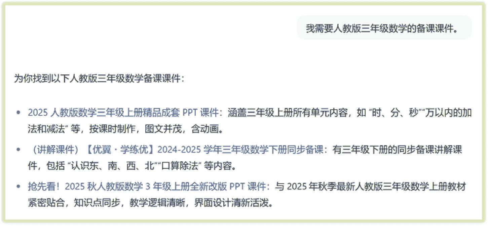
图 1-2 资源获取结果

**五、操作小窍门**

1. 明确教材版本与年级：准确说明版本、年级与学期，确保匹配度。例如补充“2023 最新版人教版四年级上册”等细节。
2. 细化素材类型：具体说明所需类型，结果更实用。例如“需带动画演示的 PPT”“分层作业设计”“适合课堂互动的小游戏”。
3. 结合学生特点补充信息：提供班级学情，让推荐更贴合实际。如“班级数学基础偏弱，需要更多直观教具和趣味活动”。
4. 明确使用场景：在需求中注明具体场景，如“用于新课导入的 5 分钟小视频”“课堂展示用的高清图片”“可打印的练习模板”。

**六、遇到问题这样解决**

1. 版本不匹配或素材过时：重新明确教材版本与出版年份，要求“请提供 2023 年最新版人教版素材”。
2. 素材质量不符：反馈具体问题。例如“刚才的课件过于简单，请提供更详细、互动性更强的版本”或“需要更符合小学生认知特点的设计”，让模型据反馈优化输出。
3. 素材类型不全：补充具体需求，如“除课件教案外，还需课堂小测验、家长辅导建议、拓展阅读”，帮助模型提供更全面的整合方案。

**1.2 智能备课方案生成**

**一、场景说明**

教案设计与编写是教师日常工作的核心，涉及教学目标把握、活动设计、进度安排，常耗费大量精力。传统方式需查阅大量资料、对照大纲，工作量大且易出现内容松散、结构不完整的问题。大模型可快速解析教学内容与目标，自动生成包含目标、重难点、过程设计、板书等完整要素的教案，并智能匹配教材版本与课程标准，支持个性化调整，让教师在规范模板上融入个人风格，大幅提升备课效率。

**二、相关工具介绍**

大模型工具：九章智能教案。
软件简介：广东省中小学智慧教育平台是由广东省教育厅主导建设的免费智能化教育服务平台，面向全省中小学教师、学生及家长。依托云计算与教育大数据，平台覆盖全学段全学科，整合粤教版、人教版等主流教材，提供资源库、在线备课、智能作业、学情监测等功能，支持教师按教学进度生成个性化方案，实现资源精准推送与教学全过程数字化管理。

**三、操作步骤**

第一步：进入广东省中小学智慧教育平台，在“人工智能”→“AI 智能体”板块中选择“九章智能教案”进入操作页。

第二步：设置教学参数。在生成页完成参数设置，依次选择：
● 学科学段：学科与学段；
● 教材版本：具体版本与年份；
● 单元章节：具体教学内容；
● 课时安排：所需课时数。

第三步：获取与优化教案。系统依据参数与内置资源库自动生成包含目标、重难点、教学过程等要素的完整教案。生成后可结合班级实际进行个性化调整与优化。

**四、实操案例**

假设你是一位中学数学教师，需为初一上册第七章内容编写教案。

打开图 1-3 所示的九章智能教案智能体入口。

图 1-3 智能体入口图示

按图 1-4 设置参数。设置完成后系统将生成完整教案，图 1-5 所示为部分截图。生成后可导出保存到本地。
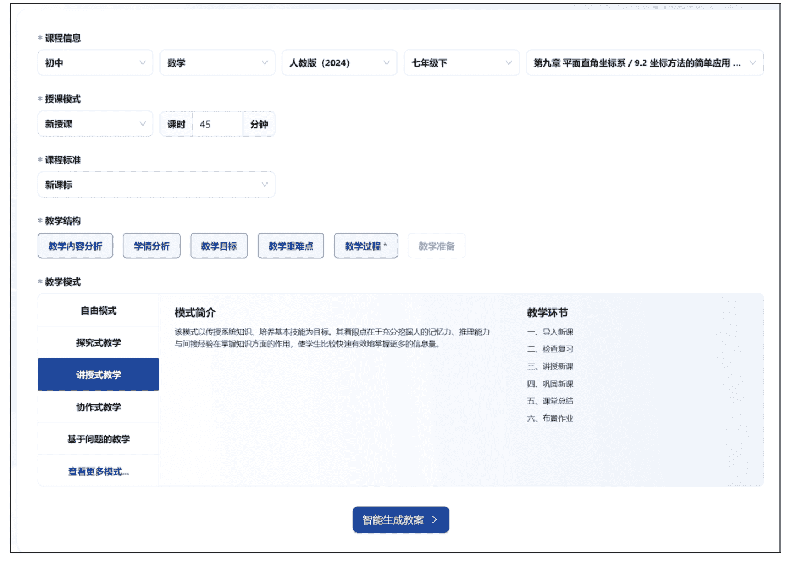
图 1-4 智能体参数设置示例
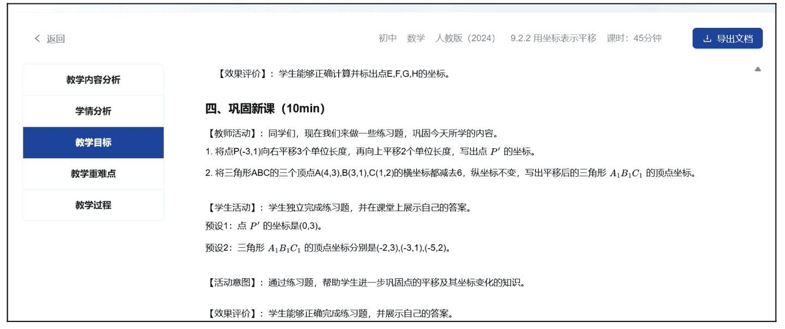
图 1-5 部分教案截图

**五、操作小窍门**

1. 精准设置参数：选择教材版本时确认年份与版次，不同版本编排可能有差异；章节定位建议精确到知识点，针对性更强。
2. 个性化调整：拿到标准教案后，结合班级学情与学习特点进行修改。对基础薄弱班级可增加基础练习，对接受能力强的班级可加入拓展内容。

**六、遇到问题这样解决**

1. 教案内容不符合预期：检查教材版本选择是否准确，确认年份与版次；重新审视参数，核对学科学段、单元章节。
2. 结构不够完整：可分步生成，先生成框架再逐步完善各环节；或在教学模式中勾选全部要素，确保结构完整。

**1.3 课件自动化生成**

**一、场景说明**

优质 PPT 课件能直观呈现内容、增强理解、提升互动。但传统制作耗时费力，需手工收集素材、排版、制作动画，视觉与结构常不尽如人意。大模型可依据教学主题与内容要求自动生成结构清晰、设计美观的课件，涵盖封面、页面布局、图表、动画等，并通过智能分析教学逻辑合理安排顺序、突出重点，让教师摆脱技术操作，专注内容设计。

**二、相关工具介绍**

九章爱学老师版支持多学科多学段课件制作，内置丰富教育模板与素材，可按学科特点与认知水平生成专业课件。具备智能内容分析、自动版面设计、素材匹配、动画生成等功能，生成的课件包含完整教学流程、可视化重点、互动环节等要素。

**三、操作步骤**

第一步：进入课件生成页。注册登录九章爱学老师版平台后，可通过网页或手机 App 访问。在首页“应用”板块搜索关键词“课件”，从结果的“课件 PPT”功能进入生成页。

第二步：设置参数与需求。完成参数设置后，可勾选“深度思考”以获得更丰富分析。

第三步：获取与优化课件。系统据参数与需求自动生成含目录、教学内容、总结等结构的 PPT。生成后可预览并按个人风格与班级特点调整内容、版面、动画。

**四、实操案例**

假设你是小学中段数学教师，需为“整数”单元制作新课件。

进入九章爱学老师版课件 PPT 功能页面，智能体参数填写示例如图 1-6 所示，包括学科、学段年级、主题名称及其他要求。填写后点选“深度思考”再点“一键生成”，系统即可生成完整课件，保存后即可使用。
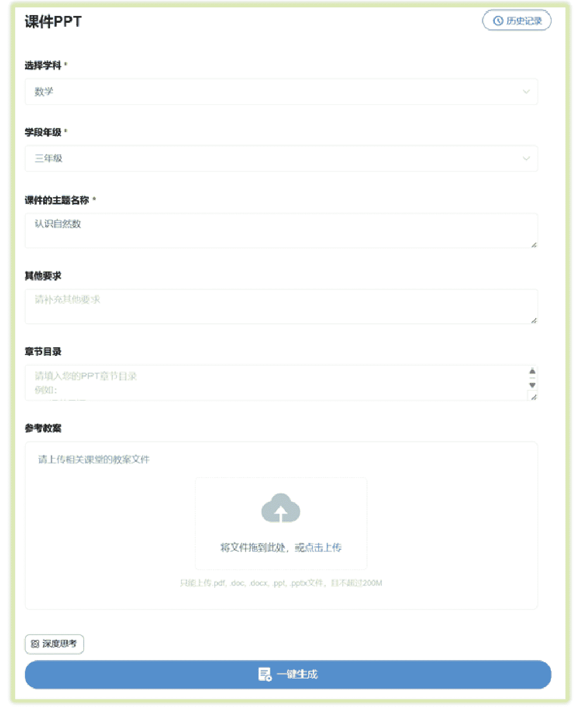
图 1-6 智能体参数填写示例

**五、操作小窍门**

1. 精确描述主题：避免笼统描述，如不要只写“数学”，应写“二次函数的图像与性质”或“平行四边形的判定与性质”等具体主题。
2. 明确课件类型与环节：在设置中标注“新授课”“复习课”或“习题讲评课”，不同类型在组织与重点上处理不同。
3. 善用“深度思考”功能：开启后模型会做更深入内容分析，生成更丰富的拓展、活动设计与重难点解析。
4. 详细说明个性化需求：在“其他要求”中具体描述风格如“活泼生动”“简洁专业”“图文并茂”，或特殊要求如“增加实验演示”“突出数学建模思想”。

**六、遇到问题这样解决**

1. 内容不符合预期：检查主题描述是否准确具体，核对学科与学段选择；在“其他要求”中补充更详细说明，如“适合基础弱班级”“需增加互动”“突出实际应用”；也可上传教案或教学大纲作为参考。
2. 结构不合理：生成前明确预期页数与主要结构，如“导入、新课、练习、总结四环节”；可先生成大纲确认结构再生成详情；对复杂内容提供详细教学流程说明，帮助模型组织逻辑。

**1.4 文档转课件智能制作**

**一、场景说明**

教师常已有详细的教学文档、教案或讲义，但将其转化为视觉化 PPT 需大量时间与精力。传统制作需逐页设计版面、调格式、插图、设动画，工作量大且易因操作不熟影响美观。大模型可智能识别解析 Word、PDF 等格式的教学材料，自动提取核心内容转为结构清晰、设计精美的 PPT。通过深度理解文档逻辑与教学要点，合理安排布局、选择视觉元素、设计呈现方式，让教师从格式调整中解脱，专注内容优化与课堂互动。

**二、相关工具介绍**

夸克 AI 来自阿里巴巴旗下的智能搜索平台推出的创作工具集合，具备强大的文档理解力与丰富的课件模板库，支持多学科多学段制作。内置教育专用设计模板，含卡通、商务、现代、清新等多种风格，可按学科与教学对象自动匹配视觉风格，生成既保留教学逻辑又具良好视觉效果的课件。

**三、操作步骤**

第一步：进入 AI PPT 功能页。访问夸克官网，首页“下载”板块点选“网页版”。注册登录后，在夸克 AI 页面选择“AI PPT”，进入制作页。

第二步：上传文档与设置需求。在制作页上传撰写的教学文档，上传后补充制作需求，包括页数、内容重点、风格偏好、特殊要求等。

第三步：优化与导出课件。系统据文档与需求自动生成初步 PPT，用户可详细审阅并精细调整。

**四、实操案例**

假设你是一位小学数学教师，已准备好“分的认识”单元的详细教案 Word 文件，需转为课堂教学 PPT。

如图 1-7 所示，在首页“下载”板块点选“网页版”。在图 1-8 所示的夸克 AI 页面中选择“AI PPT”进入制作页。

图 1-7 夸克 AI 的网页版入口

图 1-8 AI PPT 功能入口

如图 1-9 所示，在 AI PPT 功能页上传教案文件，然后完善框选部分的细节要求。完成后点发送按钮，即可初步生成 PPT 课件。

图 1-9 参数设置细节

检查初步生成的 PPT，可对内容进行精细调整，包括单页编辑与新增页面，如图 1-10 所示。
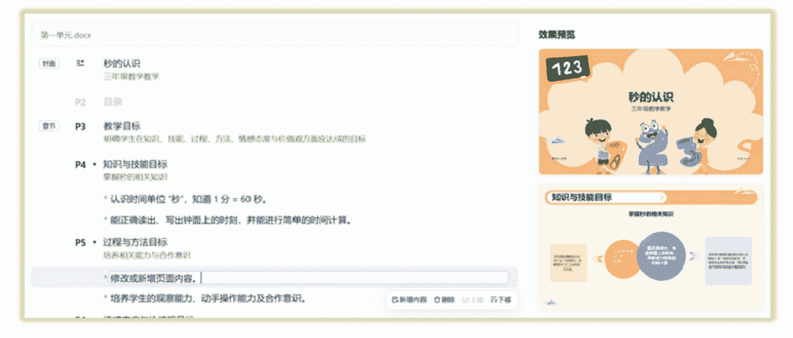
图 1-10 AI 生成的 PPT 的内容细节

如图 1-11 所示，若需调整风格，可点选“更换模板”修正。

图 1-11 更换 PPT 模板

在图 1-12 所示的模板中，可按学科特点选择插画、卡通、商务、清新等不同风格。

图 1-12 模板风格展示

确认内容没问题后，点一下图 1-13 里的“下载 PPT”按钮，就能把课件保存到电脑本地了。

图 1-13 下载 PPT 按钮

**五、操作小窍门**
1. 上传前先整理好原文框架，让层级分明，正确运用标题、二级标题和正文等排版。推荐用 Word 自带的样式来标注标题，这样 AI 能更精准地判断结构和重点。
2. 页数要结合课时长短来定。40 分钟的课大约 15 到 20 页比较合适，45 分钟的课建议 18 到 25 页。页数太多会赶时间，太少又显得内容单薄。
3. 在指令里写清楚哪些内容要重点呈现，比如知识点、概念或解题思路，可以举例“把二次函数图像特征着重展示”“把解题步骤拆开写”“补充变式练习”之类。
4. 模板风格要匹配学科和年龄。理科课适合商务感或现代感的模板，文科课更搭清新或可爱的风格，对低年级小朋友则插画或卡通风最能吸引注意。
5. 初稿生成后别急着用，逐页核对准确性和完整度，把不合适的措辞改好，必要时补上图表、公式或案例解释。

**六、遇到问题这样解决**
1. 上传失败或识别错位，先看文件格式对不对，建议用 Word DOCX，文字要通顺、结构要清晰。如果原文排版复杂、图表很多，可先简化成纯文字再传。
2. 风格不对就用“更换模板”功能多试几种，挑最契合学科和个人喜好的方案。也可以在需求里具体描述视觉偏好，比如“配色温和专业”“字体大方易读”“版面简洁”。

**1.5 一键生成思维导图**

**一、场景介绍**
备课、讲课或教研时，老师经常要把知识架构、教学重点难点或阅读材料梳理清楚。思维导图作为一种可视化手段，能帮老师抓取核心信息、理清逻辑关系、串联知识点，让教学更有条理，学生也更容易理解。

过去做思维导图全靠手工阅读、提炼再排版，费时费力，不太适合节奏快的教学场景。用上 AI 后，只需上传教学设计、课件资料、教研总结等文档，就能迅速自动生成导图，还能按教学需求调整结构、样式和输出形式，大幅提高效率。

**二、相关软件介绍**
豆包可以接收 PDF、Word、TXT 等多种文档，智能解析层级关系、逻辑脉络和专业术语，自动产出与原文主题一致的思维导图，支持导出图片或富文本，适用于教学要点整理、读书笔记、教法反思等多种情形。

**三、具体操作流程**
第一步：先注册并登录豆包桌面版。
第二步：把本地文件拖进聊天窗口，或点左下角回形针图标选择文件，等待系统解析完成。
第三步：在输入框里输入“生成思维导图”指令即可开始生成。

**四、实际案例**
比如你是语文老师，想给学生讲《木偶奇遇记》这部名著（见图 1-14），书中人物关系盘根错节、叙事偏慢、细节密集，学生容易失去兴趣。用导图工具提前给学生做个全景预览，能有效提升阅读兴趣。

图 1-14 《木偶奇遇记》名著

打开豆包上传电子版，解析完后输入提示词“生成思维导图”，如图 1-15。回车或点右下角发送图标，等待生成，结果如图 1-16。生成的图可导出为图片用于课堂展示，也能以富文本导入其他思维导图工具继续编辑。

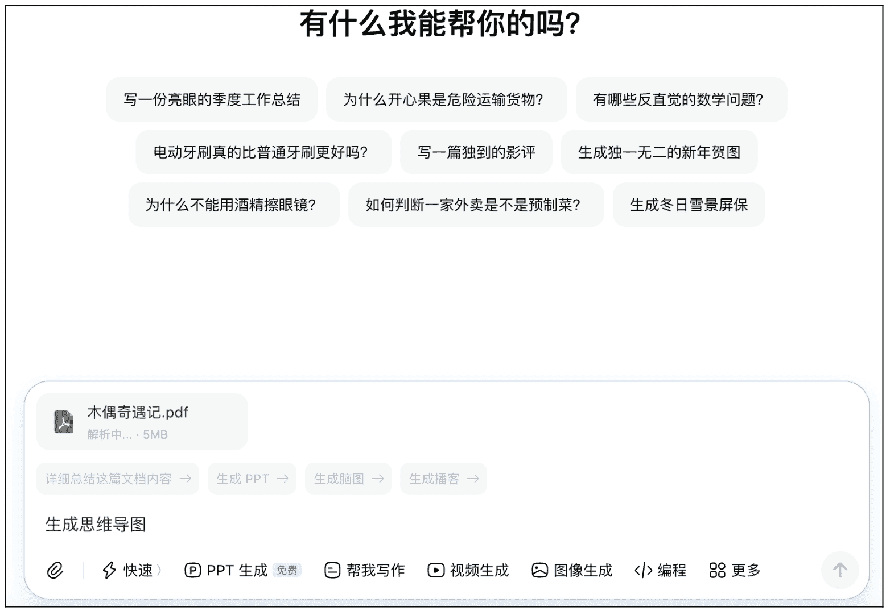

图 1-15 解析文档并输入提示词

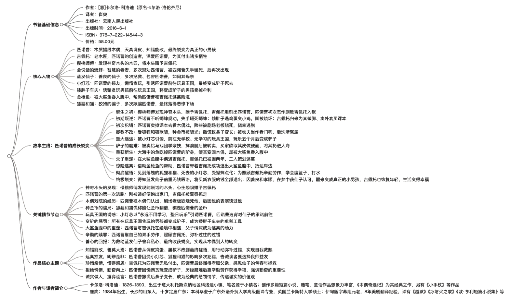

图 1-16 生成的思维导图

**五、操作小窍门**
1. 明确分析维度：提示时加上具体视角，如“故事情节”“核心主题”，能让导图更有针对性。
2. 补充受众信息：说明班级年级，让导图更贴合实际。例如“生成适合小学二年级理解的人物关系导图”。

**六、遇到问题这样解决**
1. 上传失败或识别不了：先确认格式是否在支持列表，推荐 PDF、TXT、DOC、DOCX，不支持就先转换。文件太大超限就拆分成多份分批上传。
2. 导图需要调整：直接反馈问题，比如“内容太笼统，请更详细”，AI 会据此优化。若仍不满意，可导出富文本，用 Xmind 等工具手动完善。

**1.6 快速提炼知识要点**

**一、场景介绍**
教学资料通常信息密集、内容庞杂。备课、教研、复习或课程设计时，老师需要从文献、教案、教材或学生笔记里提炼关键信息，形成条理清晰的知识要点稿。

过去靠人工通读总结，费时又容易漏点。用 AI 的话，只需上传原始文档，就能自动识别主题、分层逻辑、提炼知识点并重构文本，快速产出结构分明、用词精炼、重点突出的要点文档，大大提高处理效率和课堂呈现效果。

**二、相关软件介绍**
豆包凭借较强的语言理解和关联能力，能迅速解析文档架构，抽取出核心概念和重点知识，自动撰写一篇结构化、段落清楚、表达准确的知识要点梳理稿。

**三、具体操作流程**
第一步：注册登录豆包桌面端。
第二步：拖拽文档到聊天框，或点左下角回形针选择文件，等待解析。
第三步：在对话框输入“详细总结这篇文档内容”即可触发生成。

**四、实际案例**
假设你是高中语文老师，想快速判断《写作高手速成手册》是否适合拿来当教学用书，需要先拿到书的大纲和精华。

打开豆包上传电子版，等解析完后输入“详细总结这篇文档内容”，如图 1-17。回车或点发送，等待总结，结果如图 1-18。

想更聚焦的话，可以继续提问“书中哪些内容适合高中作文教学”，AI 会给出更有针对性的精炼结论，如图 1-19。

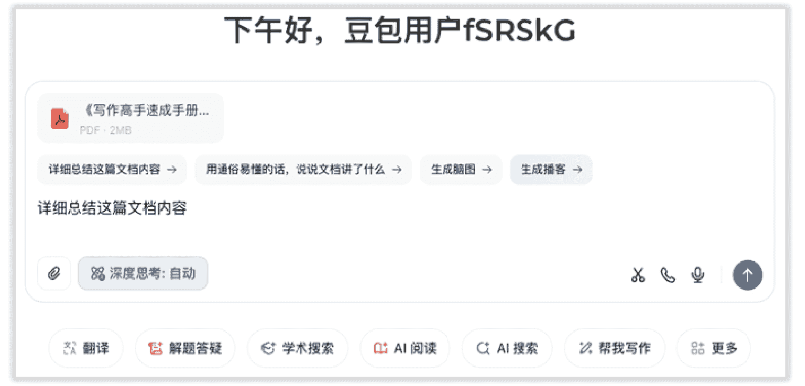

图 1-17 解析文档并输入提示词

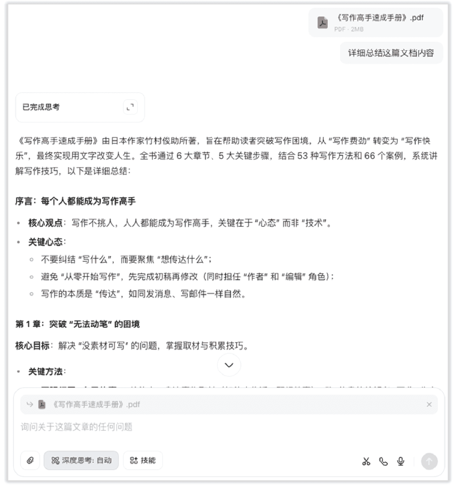

图 1-18 生成的总结内容

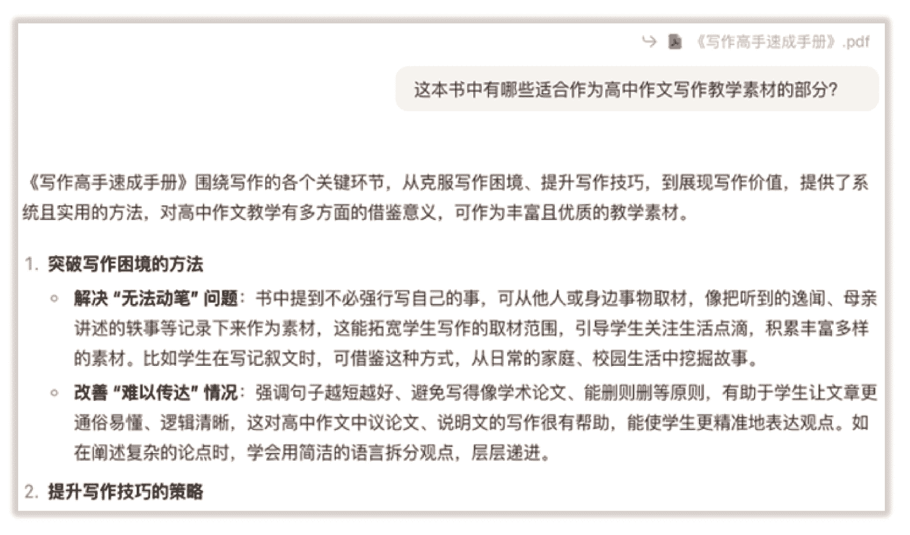

图 1-19 进一步生成的总结内容

**五、操作小窍门**
1. 表达要具体明确：提示词里直说你要什么，比如“书里哪些部分适合高中作文教学”“哪些写作案例能帮学生提升作文”，AI 才能更准地抓住意图。
2. 采用对话式交互：可在聊天框里持续追问，比如“请把上面内容精简”，避免输出冗长抓不住重点。

**六、遇到问题这样解决**
文档上传失败或识别异常：先检查格式是否在推荐范围 PDF、TXT、DOC、DOCX 内，不支持就先转换。文件过大超限时拆分成小段分次上传。

**1.7 教学视频智能制作**

**一、场景介绍**
做微课、教学示范或线上导学短片时，老师常需要把文字脚本变成视频。传统做法要真人出镜、配音、剪辑，耗时耗力，不适合频繁制作短视频。借助 AI 文生视频工具，只需输入教学脚本，就能自动生成含数字人讲解、情景画面和字幕的视频素材，既省时又能实现视听同步，方便学生理解和线上分享。

**二、相关软件介绍**
AI 工具：九章古诗词动画。

软件简介：该工具位于广东省中小学智慧教育平台，融合自然语言理解和图像识别，集成了文生视频、图生视频和视频续写功能，能依据教学大纲或教材插图自动生成高清教学视频，支持微课制作、实验模拟、历史场景还原等多种资源创作。依托省级教育云，通过解析课程标准和教材知识图谱，把文字教案转化为动态视频。教师可自行设定时长、画风和叙事节奏，生成结果会自动关联知识点标注和分层学习建议，覆盖课堂演示、课后拓展、跨学科融合等多种教学需求。

**三、具体操作流程**
第一步：登录平台并进入“九章古诗词动画”。
第二步：设置生成参数，输入古诗并提交。
第三步：等待系统生成完成。

**四、实际案例**
比如你是小学语文老师，想在 PPT 里插入一段小视频帮助学生感受古诗意境，可以用“九章古诗词动画”制作。

进入平台选择该工具，输入诗名如“白雪歌送武判官归京”，如图 1-20。确认诗作无误后点“制作视频”，如图 1-21。生成完毕后即可预览并下载视频，如图 1-22。

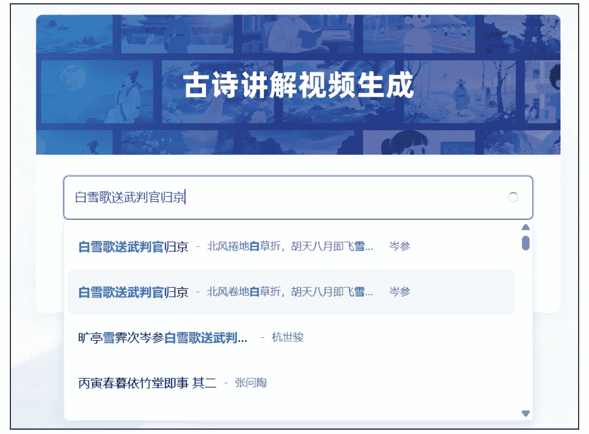

图 1-20 选择配置并输入古诗名字

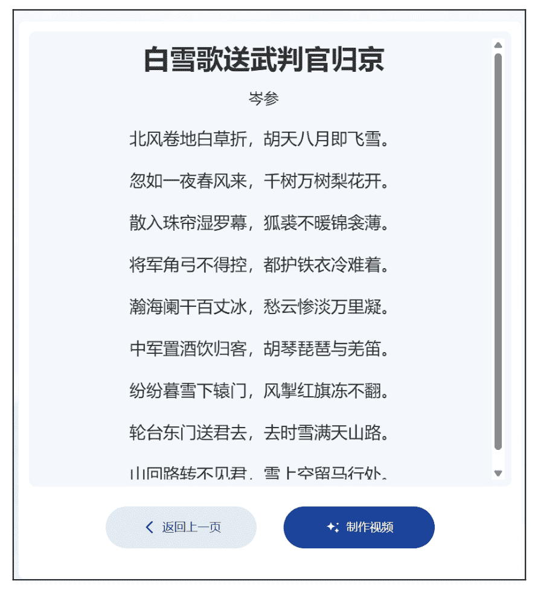

图 1-21 制作古诗视频

图 1-22 预览古诗视频

**五、操作小窍门**
1. 输入要完整：系统针对古诗优化，建议输入完整诗作而非片段，推荐用“诗题+作者”形式或直接粘贴教材标准文本，系统会自动匹配插画风格和注释。
2. 核对版本：在下拉列表选定后，务必核查作者和诗句是否完整，防止同名诗、版本差异或教材错位造成教学偏差。

**六、遇到问题这样解决**
1. 生成耗时：提示“视频生成中”时保持页面打开，一般 3 到 5 分钟完成。时长受分辨率、场景复杂度及服务器负载影响。若进度卡住，可刷新查看最新进度，避开高峰时段。注意不要重复点“生成”，否则可能触发防刷机制导致队列重置。
2. 页面意外关闭：网页或浏览器崩溃后，可进入“我的内容”找回历史记录，在此管理已生成的视频。

**1.8 教学音频快速生成**

**一、场景介绍**
音频素材制作是音乐创作和影视配乐的关键，要创作出符合风格、情感和节奏的旋律与音效。AI 大模型能快速处理海量数据，自动生成多样风格的音乐片段，精准匹配场景情绪和节奏，还可根据关键词或偏好推荐个性化方案，帮助创作者高效产出符合需求的作品。

**二、相关软件介绍**
SunoAI 主要优势：智能作曲，根据用户描述的情绪或想法一键生成专业水准的完整歌曲；风格融合，可混合流行、摇滚、爵士等多种类型，塑造独特听感；工作室级音质，提供逼真的人声和乐器音色；智能填词，能按指定风格创作高度契合的歌词。

**三、具体操作流程**
第一步：进入 SunoAI，完成注册登录后在主界面点左侧“创作中心”进入操作页。
第二步：在操作页填写提示词，描述想要的音乐风格、主题等。
第三步：系统根据提示词中的风格和主题参数自动生成音乐。

**四、实际案例**
比如你是初中班主任，想用 SunoAI 做一首进行曲风格、正能量主题的班歌。

打开平台输入创作要求，如图 1-23。确认后点“创作”按钮，生成结果如图 1-24。点进曲目可进入预览页，如图 1-25，显示歌词和播放进度。

图 1-23 提示词设定

图 1-24 生成的曲目

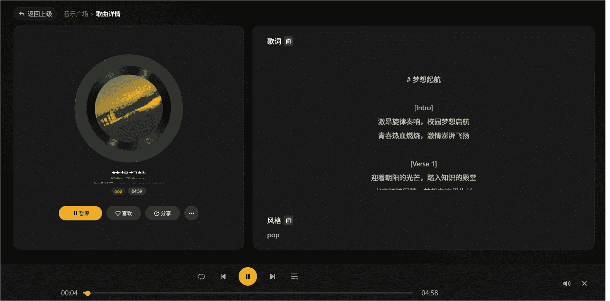

图 1-25 生成曲目歌词预览

**五、操作小窍门**
1. 维度要细化：提示时明确风格和主题，比如“进行曲”“正能量”“班歌”，结果会更精准。
2. 后期可编辑：平台提供音质提升、音乐分离、剪辑等功能，可在生成后继续加工以满足需求。

**六、遇到问题这样解决**
歌曲听起来生硬不自然：提示词不够精准，尽量详细描述对曲风、情绪、编排的具体要求。

**1.9 跨学科教学方案整合**

**一、场景介绍**
传统教学常把各科知识割裂，学生很难建立联系，缺乏用多学科知识解决复杂问题的能力。现代教育更强调综合素养和创新思维，需要老师设计跨学科方案帮助学生形成完整知识体系。但跨学科设计要求教师掌握多学科知识，能发现学科间的内在关联并创意整合。AI 跨学科整合技术可基于海量教育资源和课程标准，智能分析学科关联点，自动生成融合度高、逻辑严谨的跨学科教学方案。

**二、相关软件介绍**
九章爱学老师版内置完整的课程标准库和丰富的教学案例库，支持教师按教学目标、学生特点和认知规律灵活挑选并创意整合多学科内容。该功能实用性强、可操作性高，并配有智能优化机制，能根据教师反馈和实际使用效果持续改进方案，保证教学内容的科学性和有效性。

**三、具体操作流程**
第一步：进入跨学科设计页。在首页“应用”中搜索“跨学科”，选择“跨学科设计”进入方案设计界面。
第二步：设定教学参数。先选年级，再在“多学科”区勾选 2 到 4 门相关学科，最后在“其他要求”里补充教学主题、重点或特殊说明。
第三步：生成方案。参数确定后，AI 会依据年级和学科组合解析知识关联，自动产出一份融合度高、结构完整的跨学科教案，通常包含教学目标、内容安排、活动设计和评价方式等要素。
第四步：预览导出。生成后可在线预览内容，检查逻辑和适用性。确认无误即可导出为本地文档，方便使用、打印或分享。

**四、实际案例**
假设你是小学三年级班主任，想做一个融合语文、英语、道德与法治的跨学科方案，主题为“友谊与交流”，培养语言表达和社交情感。

在首页“应用”搜索“跨学科”，点如图 1-26 的“跨学科设计”。如图 1-27，选择年级并在“多学科”勾选语文、英语、道德与法治等，点“一键生成”。系统会据此生成聚焦语言表达与社交情感培养的跨学科教案，生成后可在线预览并导出为多种格式保存。

图 1-26 智能体入口

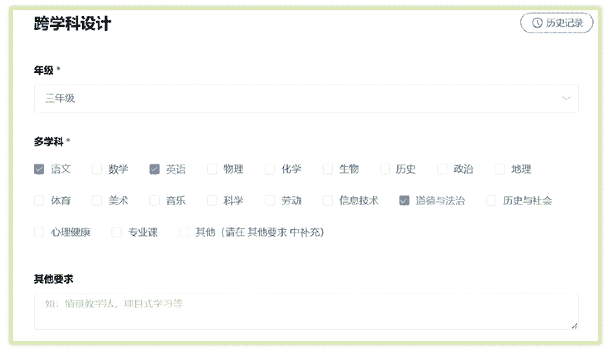

图 1-27 参数设置示例

**五、操作小窍门**
1. 选关联强的学科组合：确保所选学科有天然联系或能围绕同一主题展开。如语文、历史、地理可整合“文化传承”，数学、科学、信息技术可融合“数据分析”。避免硬凑关联弱的学科。
2. 精准设年级：不同年级认知和基础差异大，选对年级才能保证难度合适、表达得当。也需结合该年级各科教学进度，确保知识点在学生学习范围内。
3. 明确主题与核心概念：在“其他要求”中详细说明整合主题和重点，如“以环保为主题融合科学实验与数学统计”“围绕传统文化整合语文与历史”。主题越清晰，方案越有针对性。

**六、遇到问题这样解决**
1. 整合度低或内容割裂：重新评估学科关联性，确保有合理交汇。可先减少学科数，从 2 到 3 门关联强的学科开始整合。
2. 难度不匹配：核查年级设置是否准确，并在要求中补充学生情况，如“基础好可适当加深”“班级差异大需分层设计”。也可要求调整深度，如“简化理论，增加实践”。
3. 内容脱离实际：补充教学背景，如班级规模、学生特点、课时安排等。要求结合具体环境，如“适合 40 人大班”或“适合 20 人小班”。明确时长和课时分配，如“2 课时完成”或“分三阶段实施”。

**1.10 教材版本智能对比适配**

**一、场景介绍**
当前基础教育普遍存在多版本教材并行，如人教版、苏教版、北师大版等。不同版本在知识结构、例题设计和内容拓展上各有特色，给教学资源整合、课程统一实施以及教师跨版本备课带来了现实难题。

多版本教材智能横比，备课更省心

在真实的教学准备中，教师往往需要把不同出版方的教科书在知识点的覆盖面、难度的层层递进、章节的编排逻辑等方面进行对照，以便灵活调整教学策略。依靠人工逐页核对既耗费时间，也难以形成系统化的结论。借助生成式文本能力可以化解这一难题：系统能够迅速读懂多套书本内容，自动产出差异化对比报告、内容衔接建议或教学过渡方案，让备课更省时更精准。

二、相关软件介绍
豆包支持多版教科书的智能横向比对。把同一学科各版的材料文件，例如 PDF 电子文档，导入聊天窗口后，平台凭借强大的语言理解与关联能力，迅速定位差别点。

三、具体操作流程
第一步：完成豆包电脑版的账号注册与登录。
第二步：载入同一学科各版的材料。可将本地文件拖拽进豆包对话区，或点对话区左下角回形针图标挑选文件，等待解析完成。
第三步：发出指令开展跨版差别分析。

四、实际案例
假设你是一名初中历史教师，想了解初一下学期历史人教版与部编版的区别。
把两版教科书的 PDF 电子版导入豆包对话区，发出指令“请比较这两版教科书的差别，并给出教学建议。”，如图 1-28 所示。

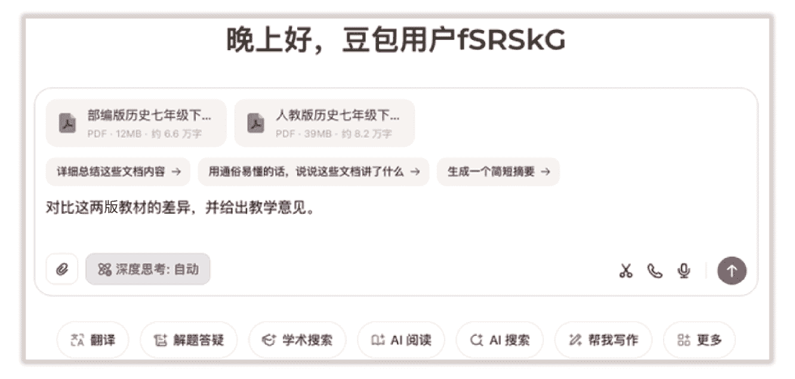

图 1-28 导入多版教科书并发送指令

按回车或点右下角发送后，等待豆包输出差别化分析与教学建议，生成结果见图 1-29 和图 1-30，教师可复制内容进一步整理或展示。
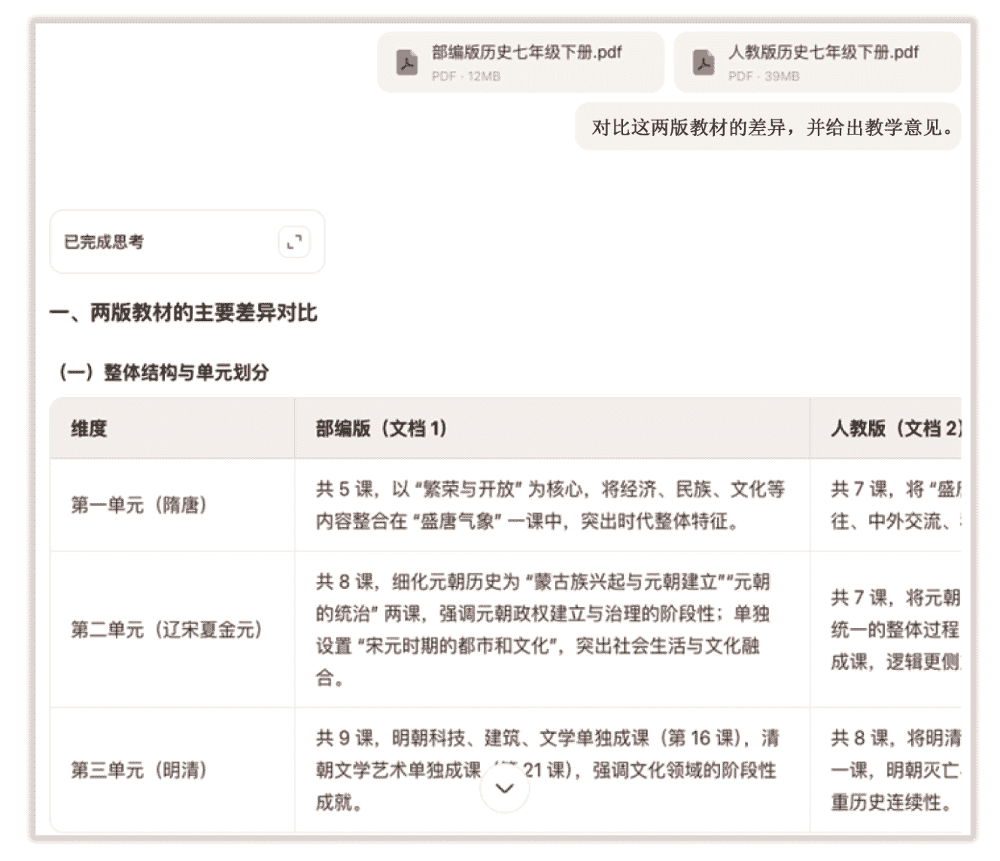

图 1-29 两版教科书的差别展示

图 1-30 两版教科书的差别概括

五、实用提示
1. 明确表达意图：在指令里把需求说清，结果会更实用。例如加入更细化的比较要求，如“请重点比较隋唐阶段的教科书差别”，让系统更精准理解意图。
2. 对话式补充信息：在对话区持续追加内容，实现对话式优化。例如发出“请把以上内容精简”，避免输出冗长抓不住重点。

六、问题应对
文档载入失败或无法识别：先检查文件格式是否在支持范围内，推荐 PDF、TXT、DOC、DOCX 等。若格式不对先转换后再导入。若文件过大超限，可拆分后分批导入。

1.11 个性化学习计划的制订

一、场景介绍
传统的教学模式往往采用“一刀切”的方式，忽视了学生个体在学习基础、认知能力、学习节奏和兴趣特点等方面的显著差异。这种统一化的教学方式导致一部分学生“吃不饱”，另一部分学生“跟不上”，无法真正实现因材施教的教育理念。每个学生都有自己的学习特点和发展潜力，需要有针对性的学习指导和个性化的学习路径。然而，为每个学生制订个性化的学习计划是一项复杂而繁重的工作，需要教师深入了解每个学生的学习状况，分析其优势和不足，设计差异化的学习内容和进度安排。在班级规模较大的情况下，教师很难为每个学生提供如此精细的个性化指导，这成为制约教育质量提升的重要因素。AI 智能学习规划技术能够基于学生的学习数据和个人特征，快速生成科学、合理的个性化学习方案。通过智能分析学生的知识掌握情况、学习习惯和时间安排，AI 可以为每个学生量身定制学习路径，包括学习内容的选择、时间的分配、难度的调整和进度的安排。

二、相关软件介绍
豆包汇集了众多专业领域的定制化 AI 助手，其中“学习计划表”智能体专注于个性化学习规划，并对此进行了深度优化。该智能体具备强大的学习数据分析与规划生成能力，能够综合考虑学生的基础水平、认知特点、时间安排与学习目标等多维信息，生成科学合理的个性化学习方案。

此外，“学习计划表”智能体还内置了覆盖从小学到高中的完整课程体系与知识图谱，支持各学段、各学科的学习规划需求。它能够精准识别学生的知识薄弱点和能力优势，从而提供更具针对性的学习路径建议。

三、具体操作流程
第一步：进入学习计划智能体。打开豆包工具，完成账号注册并登录后进入主页面。在首页“AI 智能体”板块中搜索关键词“学习计划”，从搜索结果中单击用户为“桃子姐姐”构建的“学习计划表”智能体，进入个性化学习规划页面。
第二步：输入学习需求。在智能体聊天框中输入具体的学习需求，包括学科、年级等基本信息，系统会根据输入的基础信息启动相应的学习规划流程。
第三步：完善个人学习情况。智能体会主动询问学生的具体学习情况，包括每日可用学习时间、当前学习基础、薄弱环节、学习目标等关键信息。用户需要详细回答这些问题，为 AI 提供个性化信息。
第四步：获取定制的学习计划。基于收集到的个人信息，AI 智能体将综合分析学生的学习特点和需求，自动生成详细的个性化学习计划，包括学习目标设定、时间安排、内容规划、方法指导等完整的学习方案。

四、实际案例
假设你是小学三年级的一名数学教师，学生在数学学习方面遇到困难，基础较为薄弱，希望通过 AI 技术为孩子制订一个科学合理的个性化数学学习计划。

打开豆包工具，完成账号注册并登录后，在首页“AI 智能体”板块中搜索关键词“学习计划”，从搜索结果中单击用户为“桃子姐姐”构建的“学习计划表”智能体，如图 1-31 所示。

图 1-31 智能体入口

在该智能体聊天框中输入提示词“三年级数学”，如图 1-32 所示。

图 1-32 输入提示词

智能体开始询问具体情况，在智能体的提问中完善学习计划的大体情况。比如，输入提示词“我每天用于学习的时间是 3 小时，我现在基础很薄弱，不知道怎么学习。”，AI 将帮你构建完整的学习计划，如图 1-33 所示。

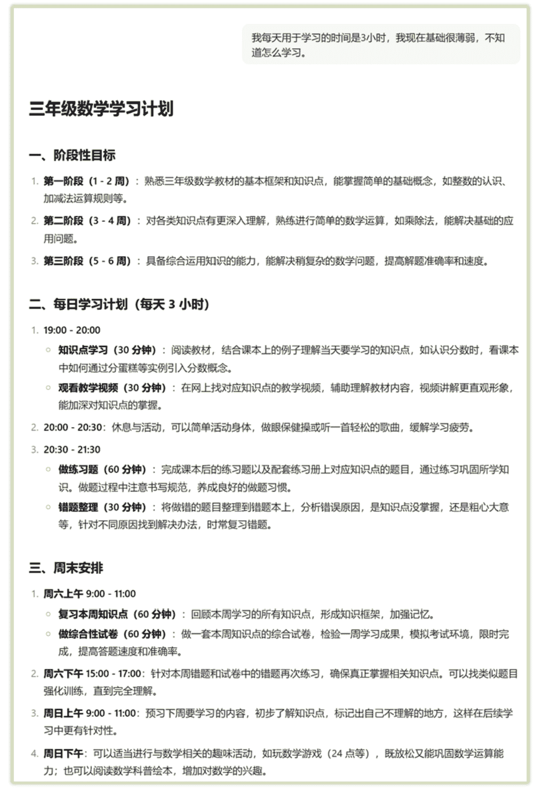

图 1-33 完善详细信息

五、操作小窍门
1.详细描述当前学习现状：在与智能体交流时，要具体说明当前掌握的知识点和存在的薄弱环节，避免笼统地表述。例如，不要只说“数学不好”，而要具体说明“乘法口诀熟练，但应用题理解困难，特别是两步计算的题目经常出错”。这样的具体信息有助于 AI 精准定位问题所在。
2.明确设定学习目标：要设定具体、可衡量的短期和长期学习目标，如“希望在一个月内掌握两位数乘法，两个月内能独立完成三年级水平的应用题”。明确的目标有助于 AI 制定更有针对性的学习路径和时间安排。
3.如实说明时间安排和学习条件：准确告知每日可用的学习时间、学习环境、可利用的学习资源等实际情况。例如，“每天晚上 7 到 9 点有 2 小时学习时间，周末上午可以增加 1 小时，家里有基本的学习用具”。这些信息有助于 AI 制订切实可行的学习计划。

六、遇到问题这样解决
1.生成的学习计划过于简单或缺乏针对性：在补充信息中详细说明学习基础和具体需求，如“我已经掌握了基础的加减法，需要重点提升乘除法和应用题能力”；要求“制订更详细的分阶段学习计划，包括每周的具体学习内容和练习安排”。
2.学习内容难度不合适：如果内容过难，则可以说“这个难度对我来说太大了，请降低难度，从更基础的内容开始”；如果内容太简单，则可以要求“我的基础比较好，请提供更有挑战性的学习内容和目标”；要求分层设计，如“请提供基础版和提高版两套方案，我可以根据掌握情况选择”。
3.缺少具体操作指导和学习方法：追加要求“请提供每个学习环节的具体操作方法和学习技巧”；要求推荐学习资源，如“请推荐适合的练习册、学习网站或 App”；询问学习方法，如“请详细说明如何进行错题分析和复习巩固”。

1.12 经典诵读视频的生成

一、场景介绍
传统的古诗词教学主要依靠教师的口头讲解和文字分析，学生往往难以真正理解古诗词中蕴含的深刻意境和情感内涵。古诗词作为中华文化的瑰宝，其语言精练、意境深远，但对现代学生来说，由于时代背景、生活经验和语言环境的差异，理解起来存在较大困难。学生常常只能机械地记忆诗句，无法深入体会诗人的情感世界和诗词所描绘的美妙意境。

传统的教学方法在古诗词意境传达方面存在明显的局限性。教师虽然可以通过语言描述、图片展示等方式帮助学生理解，但这些静态的辅助手段往往难以完全呈现诗词的动态美感和时空变化。古诗词中的“春江花月夜”“大漠孤烟直”“小桥流水人家”等经典意象，仅凭文字描述很难让学生产生身临其境的感受。

AI 视频生成技术能够根据诗词内容自动创建相应的视觉画面，将抽象的文字意境转化为具象的动态影像。通过 AI 生成的古诗意境视频，学生可以在观看过程中直观地感受到诗词所描绘的场景氛围，从而更准确地理解诗人的创作意图和情感表达。这种沉浸式的学习体验不仅能够提高学生的学习兴趣，还能帮助他们建立对古诗词的感性认知，为后续的理性分析和深度理解奠定基础，真正实现古诗词教学从“知其然”到“知其所以然”的转变。

二、相关软件介绍
本节介绍的 AI 工具包括：即梦 AI、剪映和豆包。

软件简介：即梦 AI 是字节跳动旗下抖音团队开发的专业 AI 创作工具。该工具集成了先进的深度学习算法和计算机视觉技术，能够实现从文字描述到图片生成，再从图片生成到视频创作的完整创作链条，特别适合教育领域的视觉化内容制作需求。

剪映是字节跳动推出的专业视频编辑软件，以其简单易用的操作页面和强大的编辑功能深受用户喜爱。在古诗词视频制作中，剪映的作用主要体现在内容整合和效果优化方面。教师可以将即梦 AI 生成的多个视频片段在剪映中进行无缝拼接，添加古典音乐背景、插入诗词朗诵音频、设计优雅的字幕效果等。

由于 AI 图像和视频的生成质量在很大程度上取决于提示词的准确性与创意性，因此，豆包承担起了提示词设计与创意策划的角色。它能够帮助教师将古诗词的抽象意境转化为生动、具体的视觉语言，从而为后续的 AI 生成提供高质量的输入内容。

三、具体操作流程
第一步：选择并分析古诗词作品意境。挑选适合视频教学的古诗词作品，深入分析其主题思想、意境构成、情感基调与艺术手法，为后续视觉转化奠定内容基础。
第二步：使用豆包进行创意策划。注册并登录豆包后，通过其智能对话功能，输入诗词内容并获取专业的视觉化创作建议，包括分镜头脚本、画面描述、色彩搭配等详细方案，形成完整的创作指导。
第三步：生成静态意境图片。在即梦 AI 平台中，依据豆包提供的画面描述逐句生成对应的意境图片，确保每张图片准确传达诗句的核心意象与氛围。
第四步：制作动态视频片段。将生成的静态图片结合豆包提供的动态效果提示词，转化为具有适当动感的视频片段，增强画面的生动性与表现力。
第五步：剪映后期制作。使用剪映对动态视频片段进行整合编辑，包括顺序拼接、音频添加、字幕制作、特效处理等，形成连贯且完整的教学视频。
第六步：教学应用与效果评估。将成品视频应用于实际的课堂教学，收集学生反馈，评估教学效果，并根据使用情况对视频内容或制作流程进行迭代优化。

四、实际案例
假设你是小学五年级的一名语文教师，正在准备刘禹锡《秋词》的教学内容。这首诗以“自古逢秋悲寂寥，我言秋日胜春朝。晴空一鹤排云上，便引诗情到碧霄。”赞颂了秋天的美好，并借仙鹤直冲云霄的描写，表现了作者奋发进取的豪情和豁达乐观的情怀。为了帮助学生更好地理解诗词的意境和情感，你决定制作一个生动的诵读视频教材。

具体操作步骤共有五步，每个步骤内有详细的操作细节，下面将详细讲解。

第一步：打开浏览器，访问即梦 AI 官方网站并完成注册和登录。在主页面导航栏中找到“灵感”选项并单击进入，选择“图片生成”功能模块。在提示词聊天框中，精心构思并输入与古诗相关的详细描述。再从下拉菜单中选择最适合的 AI 生成模型。最后调整图片参数设置，选择 16∶9 或 4∶3 的宽高比。

提示词获取方式如下：切换到豆包平台，在聊天框中输入初始提示词“我现在需要用 AI 创作视频，视频内容是刘禹锡的《秋词》，希望以配图朗诵的形式呈现，通过画面辅助理解诗意。制作流程分为两步：先根据文字描述，利用即梦 AI 生成静态图片，再将图片导入剪映制作成动态视频。请为每句古诗设计对应的画面描述提示词。”输入完成后单击“发送”按钮，豆包将自动生成每句古诗对应的画面描述提示词。

第二步：切换回即梦 AI，单击右侧的“生成”按钮，等待图片的生成。如图 1-34 所示，从生成结果中选择最符合诗词意境的图片，作为后续视频创作的首帧。

图 1-34 生成首帧图片

第三步：本步骤是将静态图片转换为动态视频的核心环节，通过 AI 技术赋予古诗意境以动态生命力。此步骤利用即梦 AI 的视频生成功能，基于已创建的意境图片，结合精心设计的提示词，生成能够流畅展现古诗意境变化的视频片段，为最终作品提供基础素材。具体操作步骤如下。

（1）将鼠标光标移动至生成的图片，如图 1-35 所示，在弹出的导航栏中选择“生成视频”按钮。

图 1-35 利用首帧生成视频的入口

（2）在图 1-36 所示的聊天框中输入详细的场景描述提示词，包括古诗原文全文或片段。

图 1-36 输入生成视频的提示词

提示词获取方式如下：

在豆包的聊天框中，首先上传已生成的首帧图片，并输入提示词“好的，我们一句一句处理。目前‘自古逢秋悲寂寥’对应的静态图片已生成，并已上传为参考图。接下来需要将这张图片转化为动态视频，请协助填写‘视频描述’部分，具体要求是：结合参考图内容，描述画面中应呈现的场景和动态效果。”输入完成后单击“发送”按钮，豆包将基于图片内容和您的需求，生成相应的视频画面与动作描述提示词。

（3）切换回即梦 AI，如图 1-37 所示，从下拉框中选择精确的 AI 生成模型。

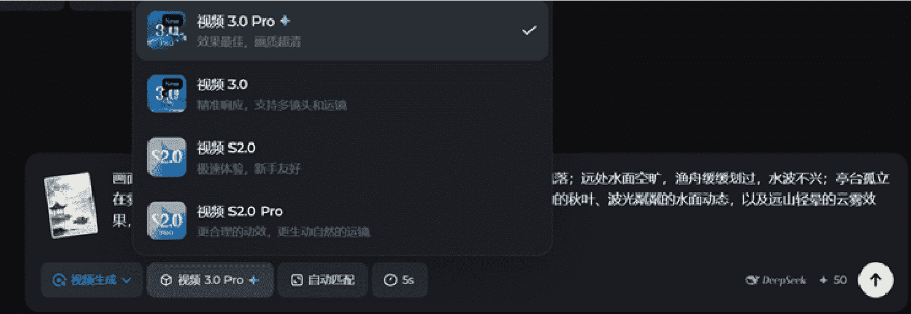

图 1-37 模型选择

（4）单击“生成视频”按钮，即可生成精美的古典意境视频，结果如图 1-38 所示。

图 1-38 《秋词》首句生成的视频

第四步：查看生成效果与优化调整。本步骤是确保视频质量的关键环节，通过全面而细致的评估和审核，确保生成的视频片段能准确表达古诗意境，符合创作预期，并达到专业水准。此环节的质量把控直接影响最终作品的艺术表现力和观赏价值。系统完成视频生成后，页面将呈现精心设计的预览窗口，此时您需要进行全方位的质量评估与优化。

全面的视觉体验评估：在 Web 播放器中完整播放视频，从整体到细节评估视觉呈现效果。重点确认画面是否准确传达了古诗的核心意境，是否完整呈现了提示词中描述的关键场景元素与情感氛围。同时，从艺术表现角度评估画面的构图平衡、色彩协调性与整体美感，确保最终成片符合您对诗歌意境的理解与创作初衷。

技术品质细节检查：观察画面播放是否流畅，排除卡顿、闪烁或动作跳跃等问题。评估色彩表现是否准确，如水墨风格需有丰富的墨色层次，古风场景应具备协调的色调处理。检查画面清晰度与细节还原度，特别是月光、山水、人物等关键元素的呈现效果。同时，确认转场过渡自然，镜头运动符合提示词描述，整体画质达到预期标准。

第五步：视频拼接与音频配音。本步骤将各个独立的视频片段整合为完整且连贯的作品，通过专业视频编辑软件剪映进行后期处理，增强视频的艺术表现力和观赏性，并为视频配上古诗朗读音频。此环节是将分散素材转化为系统性叙事作品的关键过程，通过精心编排和专业处理，提升作品的整体质量和艺术价值。具体操作步骤如下。

（1）为每句古诗或意境片段重复上述步骤，如图 1-39 所示，生成多个视频片段。

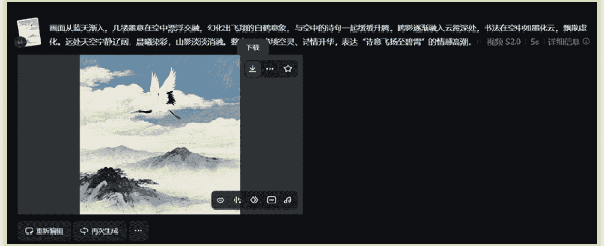

图 1-39 重复生成诗句中的视频

（2）单击“下载”按钮，选择适当的分辨率和格式，保存所有的视频片段，如图 1-40 所示。

图 1-40 汇总所有的视频片段

（3）从官方网站或应用商店下载并安装剪映软件，启动剪映，创建新项目，设置项目参数，选择与视频素材匹配的分辨率，设置适合的帧率。单击“导入”按钮，选择所有已下载的视频片段。

（4）将视频片段按照古诗的顺序拖曳至时间轴，如图 1-41 所示，将所有的视频拼接对齐。

图 1-41 在剪映中对齐视频

（5）为视频加入古诗朗读音频。单击“字幕”，选择“新建字幕”，选择“手动写字幕”，如图 1-42 所示，在弹出的窗口中加入古诗句。单击“配音”，选择与场景适配的音效。最后单击“添加到轨道”按钮，将配音导入视频中。

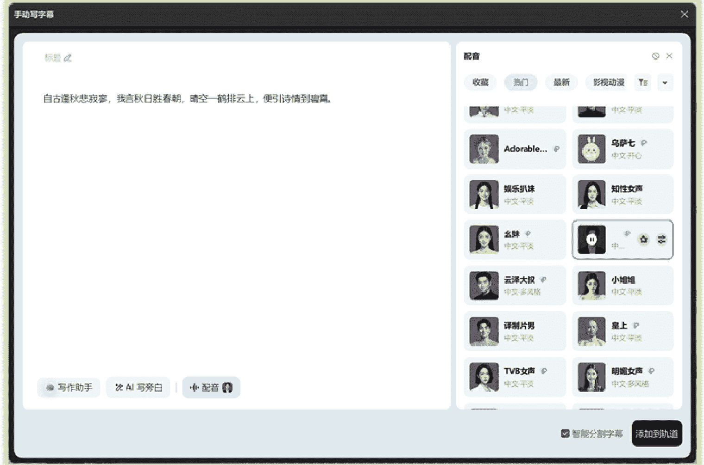

图 1-42 添加配音

（6）如图 1-43 所示，根据视频画面中的动作或情节点，确定音效的起始位置。把视频轨道和音频轨道对齐，并配上音效。

图 1-43 对齐视频轨道和音频轨道

（7）检查各片段间的连贯性，根据需要调整顺序，确保叙事流畅。完整预览视频，重点检查画面流畅度、情节衔接是否自然、音画同步效果、字幕清晰度，以及整体节奏与情感表达。如图 1-44 所示，确认成品质量达标后，为视频命名并选择保存路径，单击“导出”按钮，设置相应参数后等待视频导出完成。

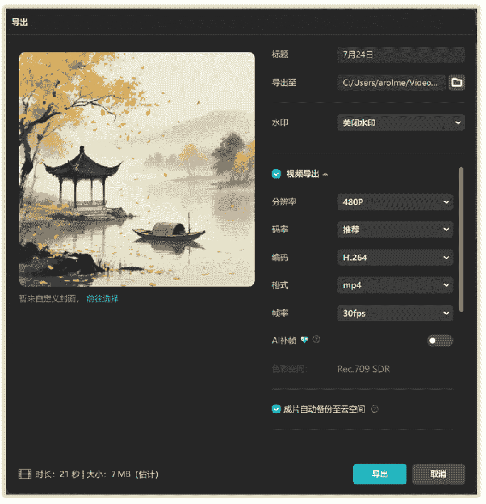

图 1-44 导出视频的示例

＊注：提示词是图片和视频质量的保证，应尽可能符合场景描述。当豆包生成的提示词不符合需求时，应主动与豆包交互，对提示词进行调整。图 1-45 展示了对“中国古典秋景，黄叶飘落，空亭孤舟，河畔薄雾，水墨风格，画面宁静萧瑟，表现‘悲秋’情绪”提示词不满意时，豆包重新给出的示例。

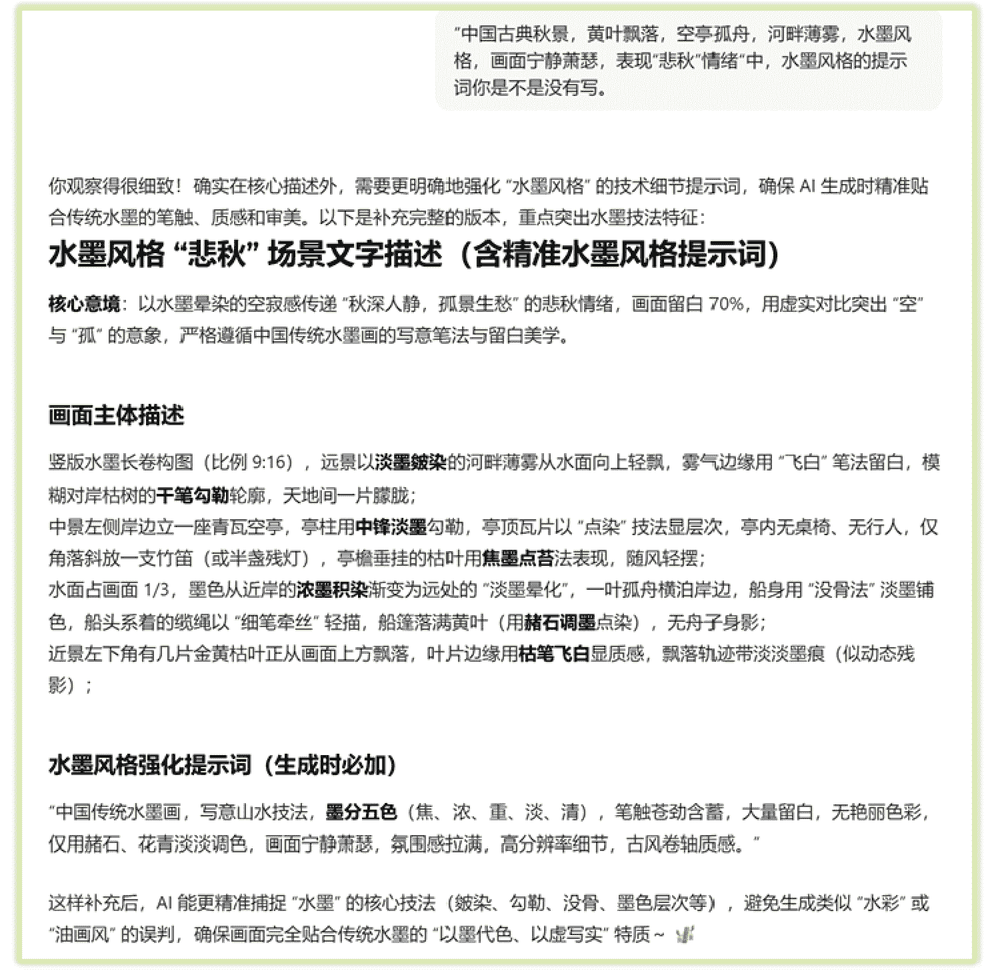

图 1-45 优化提示词示例

获取到新提示词后，更新图片，如图 1-46 所示，生成的图片更能表达中国古典情怀。

图 1-46 新的图片生成结果

五、操作小窍门
1.提示词是关键：使用详尽且具体的描述，包含场景、光线、氛围、色彩等元素，可大幅提升生成质量。

2. 锁定统一视觉语言
为整套诗意短片提前定好绘画基调，例如水墨渲染、油画质感或中国传统插画，让从第一帧起的调性、气质和辨识度保持连贯。

3. 借助参考指向风格
在生成指令里明确写上“参考某位画家风格”之类的指引，能更快把画面带向想要的艺术取向。

4. 长诗先拆后拼
面对篇幅较长的诗句，先按意境切成若干小场景分别生成，再按顺序拼接，画面掌控会更稳。

六、排障指南
1. 成图不够清晰
在即梦 AI 的出图页面把分辨率档位提升，例如由默认的 1024 像素×576 像素调到 1920 像素×1080 像素或更高。

2. 全片风格漂移
制作前先写好视觉规范，明确色彩、构图、光影要点；全程使用同一模型与相同参数出图；剪映里统一滤镜与色彩调整；定期回看已完成片段，确保一致。

3. 片段衔接生硬
编辑时优化提示词，或在提示词里指定画面的起始与结束状态。剪映选用贴合古诗意境的专业转场，如溶解、光效过渡、柔和推拉，转场时长建议控制在 0.5～1.5 秒。

1.13 绘本内容的智能生成

一、场景介绍
图文绘本是学龄前及低年级孩子进行语言启蒙、价值观培养与跨学科学习的重要载体。图文融合能把抽象道理、复杂知识转化为形象故事，有助于提升阅读兴趣、理解力和审美。但教师常受困于素材稀缺、自制成本高、排版繁琐。
AI 绘本工具大幅降低门槛。输入需求后即可自动产出完整故事文本与配套插画，省去传统创作中繁重的美术与文字环节，让教师把精力集中在内容筛选、教学设计与课堂引导上。

二、相关软件介绍
豆包支持绘本图文一键生成。可直接上传学科相关文档如 PDF 绘本故事，或输入主题关键词，系统依托文本与图像能力自动产出图文并茂的绘本。

三、具体操作流程
第一步：注册并登录豆包桌面端。
第二步：在聊天框输入或上传绘本主题、情节。上传可拖拽本地文件到聊天框，或点左下角回形针图标选择文件，等待解析完成。
第三步：输入指令后生成绘本内容。

四、实际案例
假设是一位小学美术老师，想生成可供学生临摹的绘本。
先在豆包首页点“更多”，选择“图像生成”。随后在聊天框输入期望的主题、艺术风格及适用对象，示例如下：
你是一位富有创意且很有耐心的小学美术老师，擅长创作生动有趣、适合小学生临摹绘画的绘本内容，能用丰富想象力和简洁易懂的语言构建故事场景与角色形象，引导学生通过绘画表达对故事的理解。
当用户提出需求时，围绕动物冒险、童话幻想等常见儿童主题，构思完整连贯的故事。详细描写每个情节的画面场景、角色动作与表情等绘画要点。篇幅适中，既完整清晰又符合小学生认知。若用户给出特定主题，则围绕该主题展开想象，构建独特故事，同样细致刻画每个画面的具体元素，便于模仿，确保逻辑连贯、童趣十足。（详细指令见本书附赠资源。）
如图1-47所示，输入完成后点“发送”等待生成。
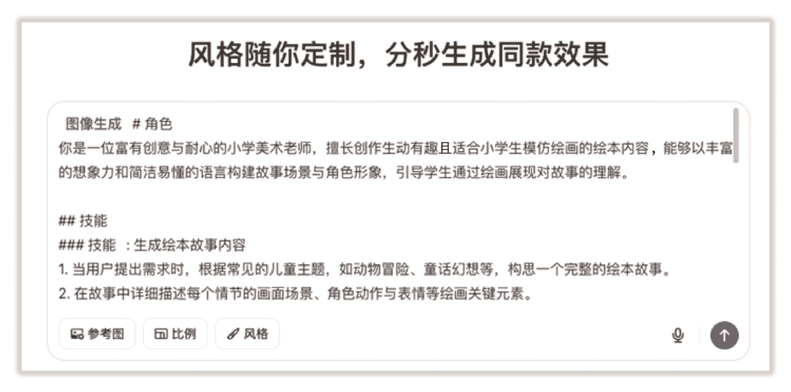
图1-47 输入绘本主题和要求
豆包生成的所有图片和故事情节如图1-48至图1-51所示。

图1-48 小刺猬在春天探险

图1-49 小刺猬在夏天探险

图1-50 小刺猬在秋天探险

图1-51 小刺猬在冬天探险

五、操作小窍门
1. 意图表达要清晰：在指令中明确绘本风格、受众等要求，比如“创作生动有趣且适合小学生模仿绘画的绘本内容”，帮助系统更准确理解需求。
2. 对话式补充信息：在聊天框里持续补充新内容，实现交互式生成。例如输入“请再生成更多绘本”，即可获得额外内容。

六、故障处理
只生成文本未生成图片：在豆包首页找到“更多”按钮，选择“图像生成”选项，然后在聊天框中输入指令。

1.14 英语词汇和语法的智能教学

一、场景介绍
传统语法纠错多靠教师手工批改，存在局限：教师精力有限难以即时个性化指导；手工批改易漏掉细微错误，且解释深度因人而异；学生反馈周期长，容易错过最佳纠正时机。
智能语法分析可实现实时精准识别与纠错。借助自然语言处理，系统能快速检测句子中的语法错误、搭配不当和表达问题，并提供详细分析和修改建议，大幅提升学习效率和准确性。

二、相关软件介绍
讯飞星火是科大讯飞推出的大模型助手平台，其中的“英语语法解析”智能体针对英语学习深度优化，具备精准错误识别和专业语言分析能力。该智能体基于海量语料库和语法规则库训练，可准确识别时态错误、主谓一致问题、词汇搭配不当、介词误用、句式混乱等，还能举一反三，根据错误类型生成相似练习，帮助针对性巩固。

三、具体操作流程
第一步：打开英语语法解析智能体。打开讯飞星火首页，完成注册登录后进入主页面，在左侧导航栏的“智能体广场”点击智能体区域，在搜索框输入“英语语法”，从结果中点击用户“130****9723”构建的“英语语法解析”智能体。
第二步：输入待检测英语句子。建议保留原始错误表达，不要提前修改明显错误，以便完整分析所有可能问题，获得更全面反馈。
第三步：获取分析结果。系统会自动分析输入句子，指出语法错误、搭配问题和表达不当，并给出错误分析、正确表达建议及相关语法规则解释，包含错误类型、原因、正确说法和知识点。
第四步：深入学习与巩固。根据分析结果，可进一步询问语法规则详解，或要求生成类似练习句子，实现深度学习和能力提升。

四、实战演示
假设是一位英语教师，学生写作中语法错误频发，希望借助技术提升语法水平。示例句子“let me see，I donnot kown what I learning.”
打开讯飞星火首页，注册登录后点击“开始对话”按钮，如图1-52所示。

图1-52 讯飞星火入口
平台集成大量智能体，点击左侧导航栏的“智能体广场”，如图1-53所示。

图1-53 智能体广场入口
在搜索框搜索“英语语法”。如图1-54所示，点击用户“130****9723”构建的“英语语法解析”智能体，开启语法解析纠错功能。

图1-54 英语语法解析智能体
在聊天框输入英文句子，系统会分析语法错误，如图1-55和图1-56所示。

图1-55 AI分析的英语语法错误示例
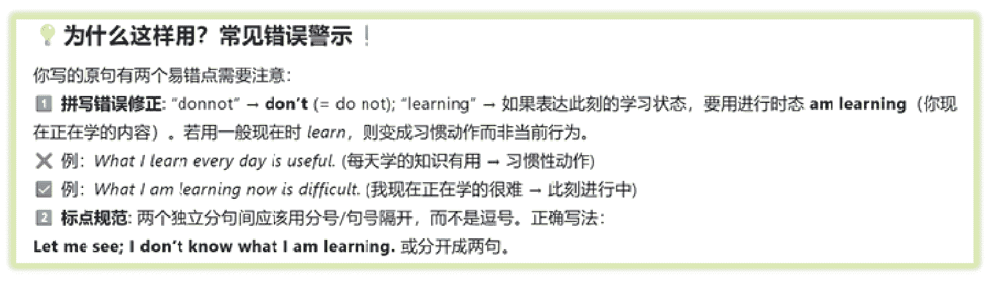
图1-56 AI给出的修正建议

五、实用技巧
1. 保留原始错误以便完整分析：输入时不要提前修改错误，保持原样，让系统覆盖拼写、语法、标点等多层面问题。
2. 主动追问规则原理：系统指出错误后，可追问“为什么这样改”“这个语法点的具体规则是什么”“还有哪些类似用法”，帮助理解根本原因。
3. 要求举一反三练习：针对错误类型，可要求生成相似练习，如“请给我更多现在完成时的练习题”或“生成5个含介词错误的句子让我纠正”，强化薄弱环节。

六、常见问题
1. 解释过于简单：主动追问具体规则，如“请详细解释这个时态的用法和变化规则”；要求更多正误对比例句；询问该语法点的注意事项。
2. 解释脱离实际应用：要求提供应用场景，如“这个语法点在商务英语中如何使用”；要求用生活化场景举例。
3. 规则记忆困难：要求提供记忆技巧、规律总结、口诀或顺口溜等辅助记忆方法。

1.15 大单元教学高效备课

一、场景介绍
大单元教学以大概念为核心整合知识点，构建完整学习单元，有助于提升综合素养和深度学习能力。但设计要求教师深入研读课标、梳理知识体系、设计学习活动、制定评价方案，工作量大、难度高。许多教师因缺乏经验或时间不足难以完成高质量备课，制约了推广。
智能备课技术可基于课程标准和教学理论，快速生成系统性的大单元教学设计方案。系统自动梳理内容内在逻辑和知识结构，构建完整的单元教学框架，涵盖单元目标、子单元划分、教学活动、学习任务、评价方案等全流程，减少备课投入，确保整体性和连贯性，提升设计科学性和有效性。

二、工具推荐
九章爱学老师版的“大单元教学”功能是核心特色。系统基于国家课程标准和先进教学理念，内置完整学科知识图谱和教学设计模板，可根据教师输入的年级学科、主题内容、教学要求等信息，通过算法自动生成完整的大单元教学设计方案。涵盖单元总体目标、核心概念梳理、子单元划分、教学活动设计、学习任务安排、教学资源配置、评价方案制定等，支持小学到高中各学段学科。

三、操作步骤
第一步：进入大单元备课页面。打开九章爱学老师版网页端或手机App，完成注册登录后进入主页面，在首页“应用”板块搜索“大单元教学”，进入备课页面。
第二步：设置基本参数。在设计页面依次填写：选择“年级学科”；在“大单元主题内容”栏输入具体单元主题；根据需要设置子单元数量；在“其他要求”栏详细说明教学重点、难点、学情分析等特殊需求。
第三步：生成教学设计。参数设置完成后，系统自动生成完整的大单元教学方案，包括单元目标、子单元划分、教学活动等详细内容。
第四步：导出备课文档。在结果页选择下载为DOCX格式，可直接用于教学或进一步完善。

四、实战示例
假设是小学五年级数学教师，需为“小数的乘法”设计大单元方案。
打开九章爱学老师版，完成登录后在首页“应用”板块搜索“大单元教学”，如图1-57所示，点击结果中的“大单元教学”选项。

图1-57 智能体入口
在设计页面按教学需求填写信息。如图1-58所示，在“年级学科”“大单元主题内容”等栏选择对应内容，完成后再点“一键生成”按钮。生成的教学设计内容详实完整，点击“导出”按钮保存为DOCX文档，教师可直接使用或按班级实际调整。

图1-58 参数信息填写示例

五、实用技巧
1. 主题描述要具体：避免笼统表述，如不要只写“数学运算”，建议写“小数的乘法运算规律与应用”，帮助系统生成更精准的设计。
2. 合理设置子单元数：根据内容复杂度和课时安排，通常3～5个子单元较为合适，既保证完整性又避免碎片化。
3. 充分利用“其他要求”栏：详细说明教学重点难点、学情分析、教学方法偏好等，如“学生首次接触该概念，需加强直观教学”或“班级基础好，可适当增加拓展”，系统会据此生成更具针对性的方案。

六、故障处理
1. 生成内容不符合预期或过于笼统：检查年级学科选择是否准确；重新审视主题描述，使其更具体明确，避免宽泛。
2. 子单元划分不合理：调整子单元数量设置；在“其他要求”栏明确期望的划分方式，如“按知识递进顺序”或“按能力培养层次”。
3. 内容深度不匹配年级：重新确认年级选择；在要求中说明学生实际水平，如“基础薄弱需降低起点”；可要求提供分层教学建议。

1.16 学科题库的智能构建

一、场景介绍
教学中教师常需根据课程内容和学生掌握情况设计配套练习，以巩固知识点和检测成效。传统手工出题耗时费力，在个性化、精准教学需求增长的背景下，题库建设亟需高效智能化。
智能工具为题库建设带来突破。借助大语言模型，教师只需输入学科、年级和知识点，系统即可自动生成选择题、填空题、简答题等多种题型，并支持按难度分类。题目可一键导出为Word或富文本格式，便于整理、打印或在线发布，大幅提升出题效率，并结合学情数据支持针对性训练。

二、工具推荐
在豆包平台上传学科资料文档，如教材PDF电子版，或直接在聊天框输入期望的教材内容大纲，系统基于强大的文本生成能力自动生成相关练习题。

三、操作步骤
第一步：注册并登录豆包桌面端。
第二步：在聊天框输入课程大纲或上传教材。上传方式为拖拽本地文档到聊天框，或点聊天框左下角回形针图标选择文件，等待解析完成。
第三步：输入指令后完成练习题生成。

四、实战示例
假设是一位初中英语教师，想基于刚讲的过去式、现在时、将来时等时态，为学生生成针对性强、形式多样的练习题。
打开豆包，输入并发送知识范围、受众等信息作为指令：
你是一位经验丰富、耐心细致的初中一年级英语教师，擅长用生动有趣的方式教学，能基于今天新讲的过去式、现在时、将来时等时态内容，为学生生成针对性强且形式多样的练习题，帮助巩固所学知识。当用户提出需要生成巩固练习题时，围绕过去式、现在时、将来时展开。题型多样化，如选择题、填空题、句子改写题、短文写作题等。题目数量不少于5道不多于10道。表述清晰易懂，符合初一学生认知水平。生成练习题后，若用户要求答案，要逐题给出正确答案及解析，解析简洁明了，帮助学生理解时态在题目中的具体应用。（详细指令见本书附赠资源。）
输入指令后点“发送”，等待生成题目。豆包生成的所有练习题如图1-59所示。
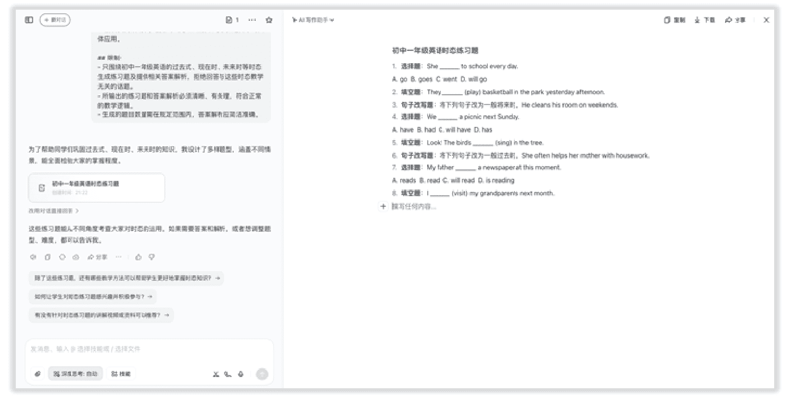
图1-59 输入提示词获得豆包生成的练习题
可在“AI写作助手”功能下编辑题目，或点“下载”按钮导出为Word、PDF、Markdown格式进行本地编辑。

五、实用技巧
1. 明确表达意图：在指令中加入课程范围、题目受众等限定，如“只围绕初中一年级英语的过去式、现在时、将来时等时态生成练习题及答案解析，拒绝回答与这些时态教学无关的话题”，帮助系统更精准理解需求。
2. 交互式补充信息：在聊天框里持续补充新内容，实现对话式交互，如输入“请再生成更多题目”，即可获得额外练习。

六、故障处理
生成失败：输入指令后耐心等待片刻。若仍无法生成，可刷新页面或重新开启新对话，输入原有指令。

1.17 同类型题目的智能生成

一、场景介绍

智能课堂效率指南：从自动命题到全流程闭环

备课过程中耗时最长的，往往是依据教学目标和学生实际来设计配套练习。依靠人工命题效率低下且重复劳动严重，随着分层教学和精准教学要求不断提高，题库搭建的智能化变得愈发重要。

借助大模型技术后，命题方式得到重塑。教师输入学科、学段以及重点知识后，平台可批量产出选择题、填空题、简答题等多类练习，并按难易进行分级，同时支持快速导出，方便后续整理、印刷或在线分发。结合学习数据反馈，还能开展针对性训练，为因材施教提供支撑。

**二、相关软件介绍**

AI 工具：九章数学举一反三。

软件简介：广东省中小学智慧教育平台内嵌的“九章数学举一反三”智能体面向中小学生提供数学学习支持。依托知识图谱对题目考点进行解析，教师提交一道例题后，系统能够自动延展出三道结构相似的变式，帮助学系统化巩固知识，提升迁移解题能力。

**三、具体操作流程**

第一步：登录广东省中小学智慧教育平台，挑选“九章数学举一反三”智能体。
第二步：把题目发送给系统。
第三步：等待结果返回。

**四、实际案例**

假设一名初中数学老师刚刚完成不等式章节的教学，希望为学生准备指向性强、形式丰富的巩固材料。

打开广东省中小学智慧教育平台，选择“九章数学举一反三”智能体，如图 1-60 所示。

图 1-60 “九章数学举一反三”智能体入口

在图 1-61 所示界面中导入完整的题干信息，系统即可产出三道同类练习。结果下方可导出 PDF，文档包含学员版与教师版，学员版仅呈现题目，教师版则附带标准答案。

图 1-61 生成的题目（以选择题为例）

**五、操作小窍门**

1. 知识点要明确：模型需要完整题干才能准确解析，需输入包含数学表达式的完整结构、几何图形的核心参数或应用题的全部已知条件。
2. 文档排版应用：每道题单独成块并预留作答区，便于教师重组练习集并提升打印体验，支持灵活使用。

**六、遇到问题这样解决**

生成题目偏差较大：核查题干完整度。例如方程题必须包含等号，几何题需标注图形关键参数，应用题需厘清全部条件关系。

**第二章 课堂教学智能辅助**

本章梳理人工智能在教学全流程中的赋能路径，搭建课堂实施阶段的智能支持框架。围绕多语种翻译、作业批改、课堂互动、学情分析等核心场景，实现课前准备、课中调控、课后辅导的闭环联动，推动教学决策数据化、课堂管理自动化、学业指导精细化，塑造人机协同的新型教学形态。

**2.1 多语言智能翻译支持**

**一、场景介绍**

随着教育国际化进程加快，教师需要接触大量海外教育资源，包括外文教案、学术论文、教学视频、课程标准等。优质资源蕴含先进理念与创新方法，但语言壁垒制约使用。传统人工翻译或简单在线工具响应慢、术语理解不准、语境把握不足，在学术表达上易产生误译。

当代智能翻译系统能够识别多种语言并理解语境，给出专业流畅的译文。借助这类工具，教师可以迅速翻译各类教学材料，跨越语言障碍，获取海外资源，提升教学内容的多样性与国际化程度，为学生拓展视野。

**二、相关软件介绍**

豆包的多语言翻译功能是其核心特色之一，支持中文、英文、法文、德文、日文、韩文、西班牙文、俄文、阿拉伯文、意大利文等数十种主流语言互译。基于神经机器翻译与大规模多语料训练，能够准确理解源语义并生成自然的目标表达。

**三、具体操作流程**

第一步：打开豆包 AI 助手平台，完成注册登录后进入主界面，在聊天区准备输入翻译需求，系统会自动识别提示并提供服务。
第二步：输入提示指令。格式为“将［源语言内容］翻译成［目标语言］”。可按需求替换内容与语种。
第三步：获取译文。点击“发送”后，系统会快速解析源内容，理解语义语境后生成准确流畅的翻译并展示在聊天区。
第四步：优化完善。若需要更精确表达，可继续对话，要求提供解释、多版本选择或专项领域专业翻译。

**四、实际案例**

假设高中英语教师在准备环境保护主题课程时，找到一篇法语教学资料，希望译成中文借鉴思路。该资料包含环境科学术语与教学方法介绍。

打开豆包工具，完成注册登录。以法译中为例，在智能体中输入提示词“将‘L'éducation…’翻译成‘中文’”，如图 2-1 所示。

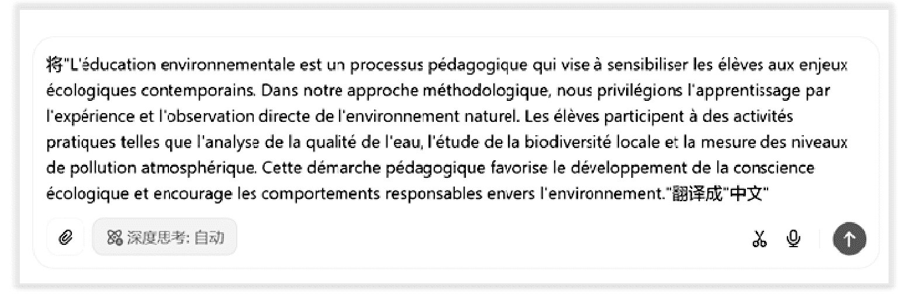

图 2-1 在 AI 中输入翻译内容

点击“发送”后生成对应中文翻译，如图 2-2 所示。

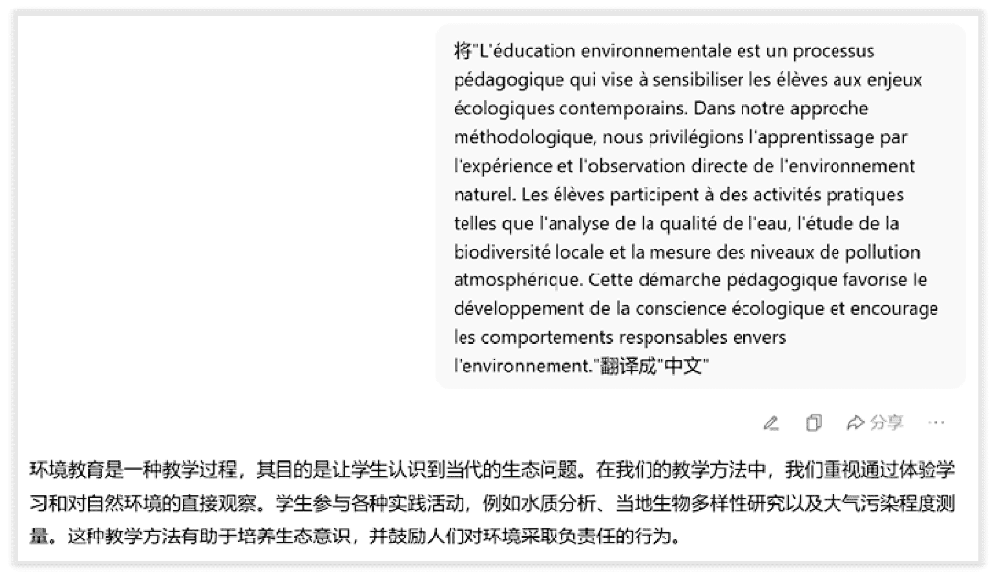

图 2-2 互动式翻译

进一步获取更专业翻译，输入提示词“这是一篇关于环境教育教学方法的学术资料，请启用深度思考模式，提供更专业的翻译版本，并解释一些关键教育术语的含义。”，生成结果如图 2-3 所示。

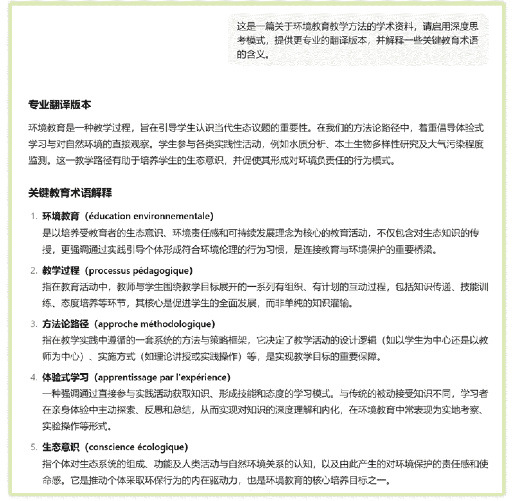

图 2-3 生成更专业的翻译及术语解释

**五、操作小窍门**

1. 补充足够背景：在翻译专业术语或特定领域内容时，需在提示中说明学科领域与使用场景。例如“将这段教育心理学术语译为中文”或“这是一篇数学教学方法论文，请提供专业译文”。
2. 明确译文风格与用途：依据最终用途指出期望风格。例如“请提供学术严谨译文版本”、“需要适合中学生理解的通俗表述”或“用于正式教学文档的专业表述”。
3. 多版本对比：对重要材料可要求系统提供多种译文方案供挑选。例如“请提供 2 到 3 种不同译文供选择”。
4. 建立术语对照表：翻译专业文档时，要求系统提供关键术语的中外文对照表与专业解释，便于后续教学积累。

**六、遇到问题这样解决**

1. 译文不够准确或存在明显错误：提供更多上下文信息，如“这段话出现在讨论建构主义学习理论的章节中”；明确指出问题部分，如“请重点关注这个句子中的时态表达”；要求系统解释翻译思路。
2. 需要多种译文方案时：明确要求提供不同风格版本，如“请提供学术版本、教学版本和通俗版本三种翻译”；说明不同版本用途；要求对比分析差异与适用场景。
3. 译文缺乏教育专业性：强调教育背景，如“请基于教育学和教学法专业知识进行翻译”；提供教育语境，如“这是用于师范生培训的教材内容”；要求使用教育部颁布的标准教育术语。

**2.2 智能语音教学助手**

**一、场景介绍**

现代教学中，语音化内容是提升教学效果的重要手段。传统课堂主要依赖口头讲解与文字展示，难以满足学习风格各异学生需求，尤其在语言类课程中，标准发音示范、听力训练、口语练习对教学质量影响大。受限于教师个人语言水平与精力，难以为所有学生提供高质量语音支持。

传统语音辅助手段如录音设备、语音教材、多媒体课件内容固定，更新慢，难以实时调整。人工智能语音助手基于语音识别与合成算法，实现高质量文本到语音转换，提供即时灵活的语音化教学支持。通过该助手，教师可快速将文本转化为语音素材，服务古诗文诵读、外语听力、课堂互动问答等场景，提升课堂趣味性、互动性与效率，让每个学生获得标准化、个性化语音学习体验。

**二、相关软件介绍**

讯飞星火内置多种音色选择，包括男声、女声、儿童声等，可根据教学内容选择合适发音风格。语音输出自然流畅、语调丰富，接近真人发音，适合教育教学场景。

**三、具体操作流程**

第一步：进入讯飞星火平台。打开官网或手机 App，完成注册登录后进入主页面，点击“开始对话”进入智能体对话页。
第二步：输入语音生成提示词。在聊天框说明需要朗读的具体内容，可提出语速、语调等特定要求。
第三步：启动语音朗读。文本生成后，点击末尾“播放”按钮，系统会立即对文本进行高质量语音朗读。

**四、实际案例**

假设小学语文教师在准备古诗词学习课程时，选用《三字经》让学生感受中华文化熏陶。

打开讯飞星火首页，完成注册登录后，点击“开始对话”，如图 2-4 所示。

图 2-4 AI 的入口

在聊天框输入提示词“朗读完整的三字经。”，如图 2-5 所示。

图 2-5 输入提示词

文本生成后，点击图 2-6 中框选位置的“播放”按钮，即可使用 AI 语音朗读功能。

图 2-6 AI 语音朗读入口

**五、操作小窍门**

1. 结合具体教学场景：在提示词中说明使用场景，如“这是用于课堂示范的朗读”，系统可相应调整语音风格。
2. 善用重复与强调功能：对重点内容可要求重复朗读或特别强调。例如“请将重点词汇重复朗读两遍”。

**六、遇到问题这样解决**

1. “播放”按钮找不到或无法点击：确保文本已完全生成，等待处理完成后再寻找按钮；刷新页面或重新发送提示词；检查浏览器设置是否允许网站播放音频。
2. 文本内容不完整或有遗漏：明确指出缺失部分，如“请补充完整的诗词内容”；要求重新生成完整版本，如“请提供这首诗的完整版本，包括标题和作者”；要求分段生成。

**2.3 智能出题助手**

**一、场景介绍**

日常教学中，出题是教师繁重且关键的工作。传统出题方式个性化不足，不同班级、学生学习情况差异大，难以为每个学生定制题目。知识更新与教学大纲调整要求题目与时俱进，个人难以兼顾。题目科学性验证也复杂，涉及难度适宜性、知识点覆盖面、题型搭配合理性等，需要丰富经验判断。

人工智能智能出题技术基于自然语言处理算法与海量教育数据库，可按教师设定参数自动生成高质量题目。系统能精准匹配知识点与难度等级，生成多样化题型组合，确保题目科学性与教育价值。还能根据教学需求与学生特点生成个性化练习，实现精准教学。

**二、相关软件介绍**

九章爱学老师版题库由专业教研团队筛选标注，涵盖基础练习题、综合应用题、创新思维题等。智能出题系统可按年级、知识点、题型、难度等多维度参数智能匹配与组合，生成原创数学题目。

**三、具体操作流程**

第一步：登录九章爱学老师版平台。打开网页端或手机 App，完成注册登录后进入首页。
第二步：进入智能出题操作页面。在首页“应用”板块搜索关键词“出题”，选择“数学出题”进入操作页。
第三步：设置出题参数。在操作页根据教学需求选择年级、考查知识点、题型、题目数量等。
第四步：生成题目集合。参数设置完成后点击“一键生成”，系统基于设定条件自动生成题目集合。
第五步：导出与使用。在结果页预览题目，确认无误后下载为 Word 格式文档，包含题目与标准答案。

**四、实际案例**

假设小学数学教师准备课后复习解答题，要求兼顾基础概念检验与生活情境关联。

在九章爱学老师版首页“应用”板块搜索关键词“出题”，选择“数学出题”，如图 2-7 所示。

图 2-7 智能体入口

在弹出聊天框中填写年级、考查知识点、题型等信息，填写完成后点击“一键生成”。结果页可导出 Word 文档，格式为 Word，含完整题目与答案。

图 2-8 填写题目相关参数

**五、操作小窍门**

1. 精准设置知识点范围：依据教学进度与学生掌握情况选择知识点，可单点专项练习，也可多点综合测试。例如学习“一次函数”时可细分为概念、图像、应用等具体知识点。
2. 合理配置题型与难度比例：建议基础题占 50%～60%，中等题占 30%～35%，提高题占 10%～15%，三类占比合计 100%。题型搭配要全面，避免单一题型局限。
3. 充分利用个性化定制：在“其他要求”栏补充具体说明，如“重点考查学生对函数图像的理解”或“增加实际应用类题目比重”。
4. 善用预览与调整功能：生成后仔细预览每道题，对不合适题目及时调整或重新生成，选择最符合教学需求版本。

**六、遇到问题这样解决**

1. 生成题目难度不合适：重新设置难度等级参数，明确期望难度水平，如“适合中等偏下水平学生”或“具有一定挑战性”；分难度等级分别生成后手动组合。
2. 题目内容与教学进度不匹配：在选择知识点时要精确，选择与当前教学进度对应的具体知识点；要求系统提供知识点详细分类。
3. 题型搭配不够合理：依据教学目标重新调整题型比例；要求系统提供题型说明，了解特点与适用场景；分题型分别生成后再组合调整。

**2.4 智能批改与分析作业**

**一、场景介绍**

人工智能辅助作业批改的核心价值在于降本增效与数据洞察，而非替代教师。它能快速分析学生错误模式、学习轨迹与知识盲区，为教学提供数据支撑。一方面显著降低机械批改与统计耗时，另一方面基于数据的个性化反馈，有助于提升学生元认知、自主纠错与自主学习能力。

**二、相关软件介绍**

豆包在理解和生成文字方面很强，能够快速完成写作、问答等多种工作。界面简洁，反应迅速，容易在办公、学习等不同场景中使用。特别值得一提的是它能保持多轮对话记忆，结合上下文给出准确回应，帮助使用者高效梳理复杂信息。

**三、具体操作流程**

第一步：进入豆包平台。打开豆包首页，点击右上角的“登录”，通过手机号码或微信扫码完成认证。

第二步：提交材料并说明需求。可以把本地文件拖进对话窗口，或点对话窗口里的回形针图标挑选文件，同时在输入区详细描述批改的具体要求。

第三步：查看批改结果。系统会根据上传材料和说明，输出批改结论，并附上细致且针对性的评语。

**四、实际案例**

假设你是一位小学高年级科学老师，面前有一份关于“简单机械”的练习需要评阅，见图 2-9 所示。

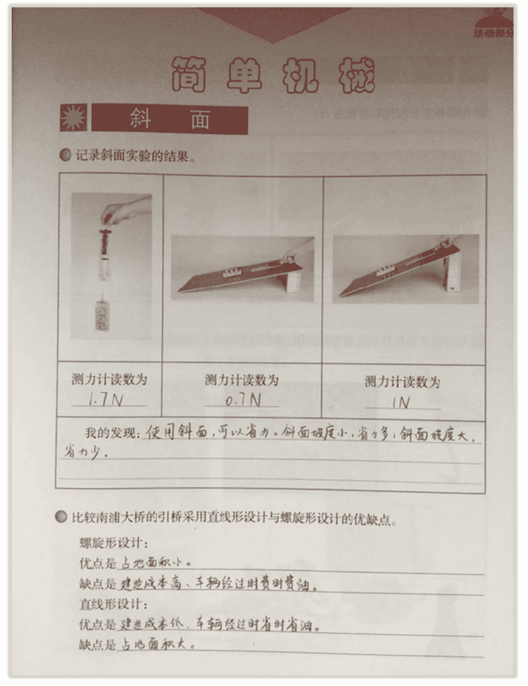
图 2-9 学生科学作业

启动豆包，提交作业照片并输入指令，比如：

请扮演一位经验丰富的小学高年级科学教师，严格对照相关标准对这份作业进行客观、准确、公正的评析。指出作业的亮点与不足，必要时提供改进建议，表达要规范清晰。批改要点包括：标明逻辑失误、知识点缺漏或表述不清之处；给出具体分数建议，并写一份简短的鼓励性评语，引导学生提升。完整指令请参考本书赠送资料。

发送指令后先点“深度思考：自动”，再点“提交”，操作示意如图 2-10。

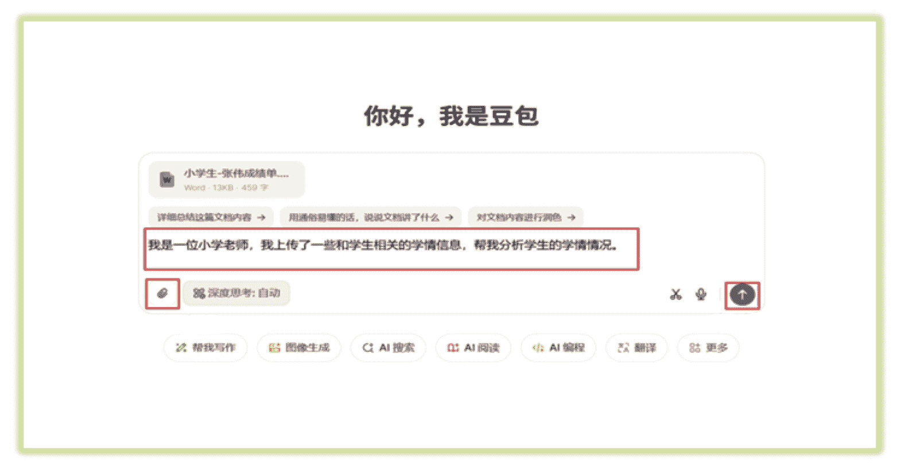
图 2-10 上传数据与提交需求

若想把结果整理成文件，待生成完毕后可在对话区继续输入“请把内容整理成 Word 文档。”再手动复制到本地文件即可，示例如图 2-11。

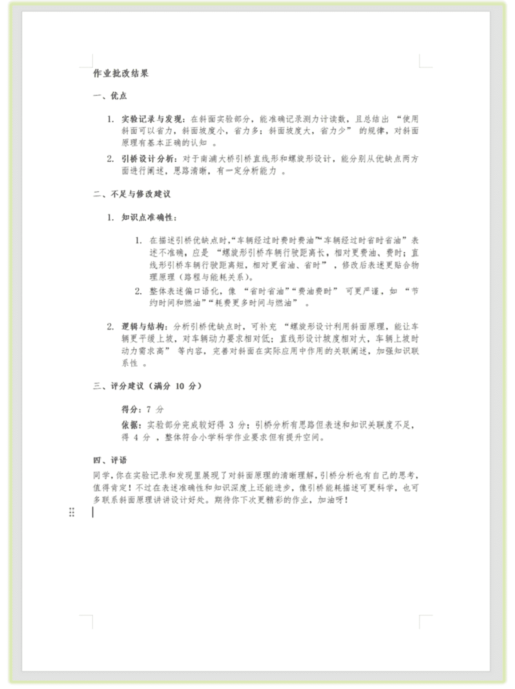
图 2-11 作业批改结果

**五、操作小窍门**

1. 拍摄稳一些：拍手写作业时保持手机稳定，光线均匀，减少识别误差。
2. 补充教学背景：说明作业种类、科目、学生情况、年级和具体要求，输出会更贴合实际。

**六、遇到问题这样解决**

1. 上传失败或识别不了：先确认格式是否在支持范围内，不兼容的先转成支持的格式再试。
2. 照片字迹潦草导致识别错误：重新抄写一份工整版本，调整拍摄角度与光线后再次提交。

**2.5 智慧课堂互动设计**

**一、场景介绍**

把互动设计提前到备课环节，能让教学活动规划更条理。比如利用算法实现随机出题和分层难度，既保证全体参与，又让不同水平的学习者得到合适挑战。这样可以把老师从反复出题排版的事务中抽离出来，聚焦高阶提问和学情分析，最终形成以学习者为核心的深度互动课堂。

**二、相关软件介绍**

DeepSeek 是国内团队自主研发的免费大模型，中文处理和长文本理解能力突出，可用于写作、科研、编程、问答等多种工作。

**三、具体操作流程**

第一步：进入 DeepSeek 官网。注册登录后打开主界面，点击“开始对话”。

第二步：在弹出的对话窗口描述互动设计的具体需求，输入指令后发送。

第三步：保存结果。让模型把分析整理成文档格式，复制到本地保存。

**四、实际案例**

假设你是一位小学数学老师，要为《人教版二年级上册·认识时间》第1课时设计小组互动环节。

打开 DeepSeek，提交教材相关素材，并输入指令，例如：

请扮演一位经验丰富、熟悉教育管理的数学老师，观察力敏锐、实践充分，能兼顾学生成长规律与年龄特征。依据提供的教材详情，设计与课程安排匹配的小组互动方案，为公开课做准备。完整指令见本书附赠资料。

发送指令后先点“深度思考”，再点“提交”，即可得到小组互动方案设计，如图 2-12 所示，可下载全文保存。

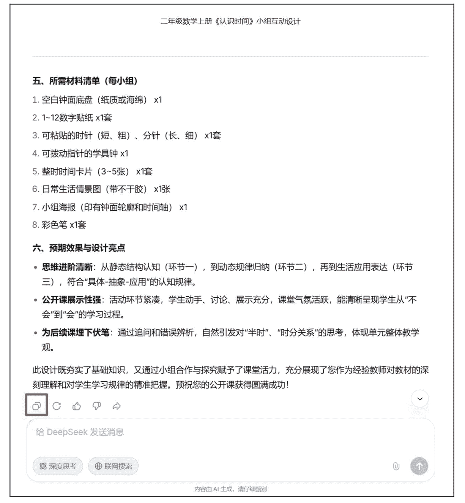
图 2-12 小组互动环节设计方案

**五、操作小窍门**

1. 补充教学背景：提供科目、年级、课时等信息，让生成结果更准确。
2. 三维互动设计法：认知上覆盖记忆、理解、应用到创新；情感社会上经历自主探索、小组协作到全班分享；技术上整合传统教具、数字资源到沉浸式工具，促进全面发展。

**六、遇到问题这样解决**

1. 结果与预期不符：把预期内容和效果写得清晰简练，写入指令中。
2. 角色分工不清：设计小组环节时，可在指令中分别说明组长、记录员、汇报者的具体职责。
3. 人数不匹配：默认生成随机，若有明确要求，需在指令中说明班级总人数和期望小组数。

**2.6 课程讲稿的设计与生成**

**一、场景介绍**

备课时写课堂讲稿费时费力，尤其多门课程、时间紧或需更新内容时效率更低。接入大模型后，只需给出教学目标、课题、提纲或关键词，系统就能生成初稿，包含导入、讲解、案例、提问、总结等模块，并可按学段或专业调整深度和表达风格。

**二、相关软件介绍**

豆包具备智能知识辅助和学习支持功能，既可作为学生的全天候助手，也能助力教师提升教学效果。

**三、具体操作流程**

第一步：打开豆包官网，完成注册登录。
第二步：在首页对话区说明讲稿需求，提交相关材料并输入指令。
第三步：获取讲稿。系统依据需求生成讲稿内容。

**四、实际案例**

假设你是一位小学四年级道德与法治老师，需为公开课准备《人教版四年级下册·我们的好朋友》的详细讲稿。

打开豆包，输入指令，例如：

请扮演一位经验丰富的小学四年级道德与法治教师，洞察力强、实践丰富，能考虑班级实际。用户需要讲稿时，基于提供的材料生成详细讲稿。完整指令见本书附赠资料。

最终生成部分讲稿如图 2-13。

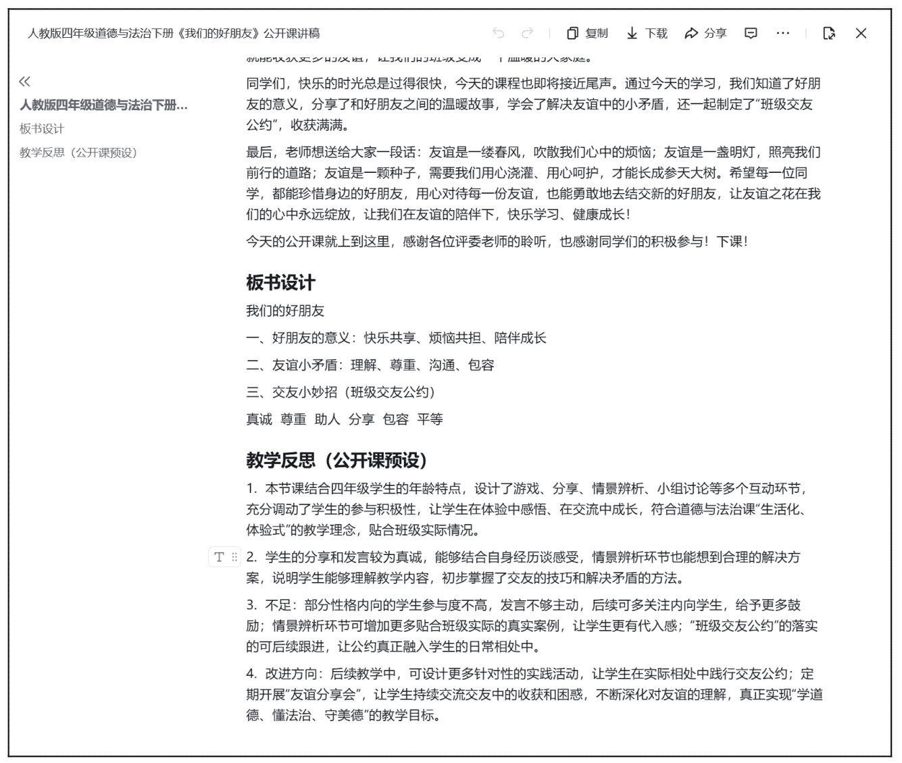
图 2-13 部分课堂讲稿

**五、操作小窍门**

1. 增加学情信息：在指令中加入学生情况，系统会相应调整语言难度。
2. 明确语气需求：可在对话中追加要求，如“口语化”“故事化”“表达精准”等。

**六、遇到问题这样解决**

1. 讲稿太难懂：可在对话中追加限定，如“结合四年级学生的生活实际，用浅显易懂的表达”。
2. 深度不够：可追加限定词，如“需涉及人际交往礼仪细节”。

**2.7 语句排序题的设计与生成**

**一、场景介绍**

在语言和阅读训练中，句子重排是一种有效方法。通过打乱顺序，引导学习者分析语法和语义逻辑，提升语言运用能力。有了 AI，大模型可自动完成句法识别和重排，保证语义正确且可直接用于教学。

**二、相关软件介绍**

豆包提供智能知识辅助和学习支持，已成为学生全天候助手和教师提升教学质量的重要工具。

**三、具体操作流程**

第一步：进入豆包官网，完成注册登录。
第二步：在首页对话区提供需要重排的句子信息。
第三步：获取结果。保存并整理成文档，复制到本地。

**四、实际案例**

假设你是一位小学一年级语文老师，需为期末考试设计“句子排序”题，课文是《人教版一年级·小壁虎借尾巴》。

打开豆包，输入指令，例如：

请扮演一位经验丰富、熟悉教育管理的小学语文老师，洞察力强、实践足，能兼顾学生成长规律与年龄特点。依据提供的教材信息，为一年级期末考试设计句子排序题。完整指令见本书附赠资料。

生成的部分题目如图 2-14。

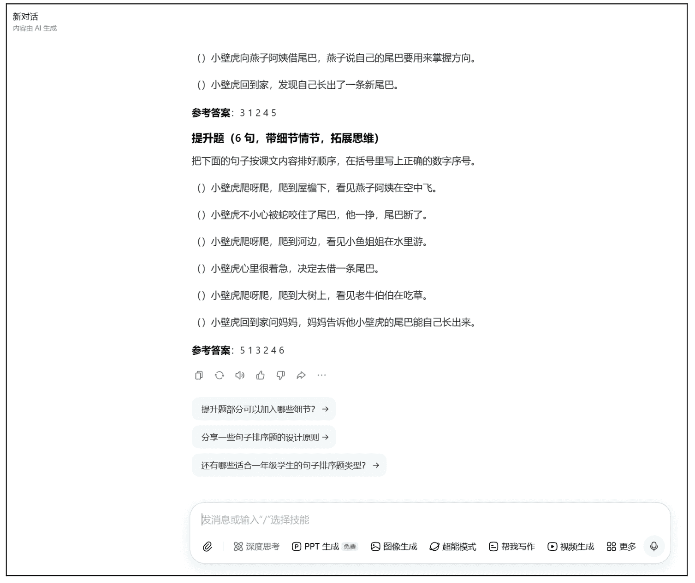
图 2-14 部分句子排序题

**五、操作小窍门**

1. 限定指令：在指令中说明“保持专有名词顺序不变”，防止核心信息遗漏。
2. 独立编号：输入句子时要求“每句单独编号”，便于后续组卷。

**六、遇到问题这样解决**

1. 对话框不支持长文本：可先按模块拆分句子，多轮逐步输入。
2. 词汇遗漏或重复：可在对话中追加限制，如“确保所有词汇都出现且只出现一次”。

**2.8 智慧课堂随机点名助手**

**一、场景介绍**

教学中点名是促进参与、了解状态、分发互动机会的重要手段。但组织讨论、小组发言、课后抽查时，反复随机点名会耗费大量时间。AI 可导入名单后自动抽取，支持多轮、不重复、分组等模式，还能结合教学场景生成个性化点名语句或互动提示，增强课堂氛围，提升效率和管理水平。

**二、相关软件介绍**

ClassDojo 是一个免费平台，用于连接教师、家长和学生，构建积极的课堂社区。核心是行为管理系统，教师可通过实时积分反馈引导行为，还提供班级故事、课堂工具和社交情感学习资源等功能。

**三、具体操作流程**

第一步：用浏览器打开 ClassDojo 网站，点击右上角“教师登录”，按提示注册登录。
第二步：选择学校注册。教师可自行创建，无需学校审核。
第三步：创建班级。点击“添加学生”批量导入名单。
第四步：添加完成后点击“工具包”，再点“随机”实现随机点名；如需分组，可继续点“小组分配器”。
第五步：查看点名和分组结果。

**四、实际案例**

假设你是一位小学班主任，需在课堂上随机点名。登录网站后，从左侧点“所有班级”，新建班级，再点“添加学生”批量导入名单，如图 2-15。

图 2-15 导入学生名单

导入完成后点击如图 2-16 的“工具包”，再点“随机”即可点名，如图 2-17。如需分组，可点“小组分配器”完成分组并获取结果。

图 2-16 工具包功能

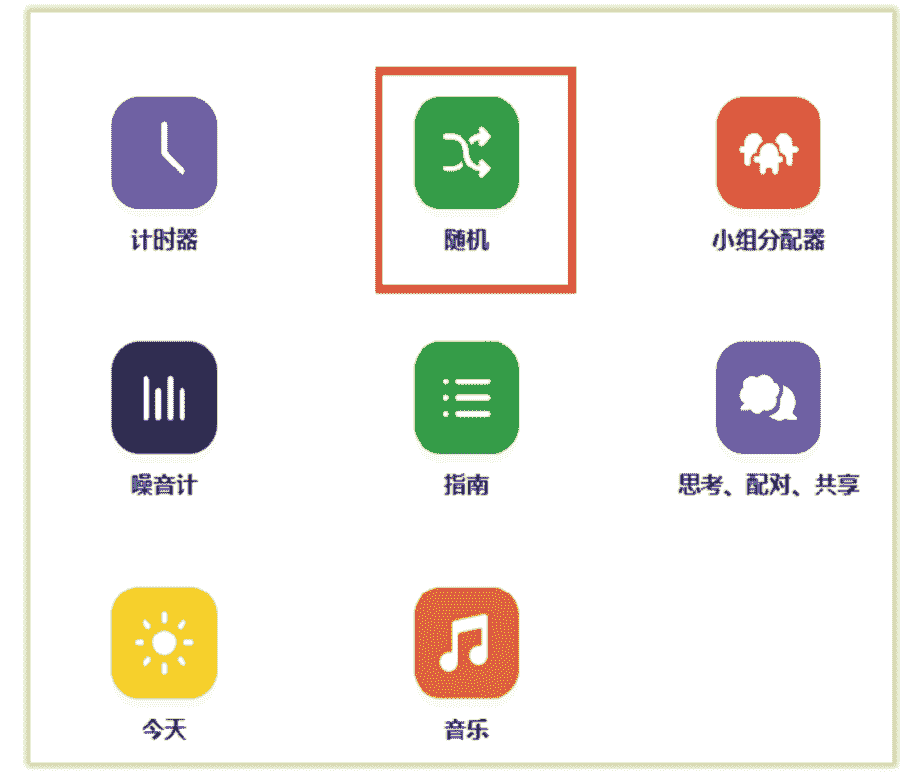
图 2-17 随机功能

**五、操作小窍门**

1. 分析频次：每周导出“学生互动频次报表”，针对沉默学生提问，对积极者表扬。
2. 自定义点名：在页面底部点“选择多个学生”，手动指定多名学生作答。

**六、遇到问题这样解决**

1. 网页偶尔卡顿，多按回车刷新即可。
2. 添加学生建议用表格文件导入，提升效率。

**2.9 学生想象力引导助手**

**一、场景介绍**

在语文、美术等学科中，激发想象力是培养创造性思维和表达能力的重要环节。可引入 AI 想象引导助手，在创意写作或艺术启发活动中提供示例，引导学生完成创造性任务，训练观察、叙事和创造思维，并生成可复用视觉素材，支持差异化教学和跨学科项目。

**二、相关软件介绍**

可灵 AI 专注视频和图片生成，提供高效高质量创作体验。支持文生视频、图生视频，可生成 1080P 分辨率、最长 3 分钟的高清视频，还具备多图参考、运镜控制、角色一致保持等功能。

**三、具体操作流程**

第一步：用浏览器打开可灵 AI 网站，点击左下角“登录”，按提示注册登录。
第二步：在对话区说明具体需求，如画面内容和风格要求。
第三步：获取图片。平台按需求生成优质图片，引导学生想象力。

**四、实际案例**

假设你是一位小学美术老师，要求学生在课堂上发挥想象，画出心目中童话故事的绚丽场景，完成美术创作任务。

登录后，在主页面左侧点“图片生成”，如图 2-18。

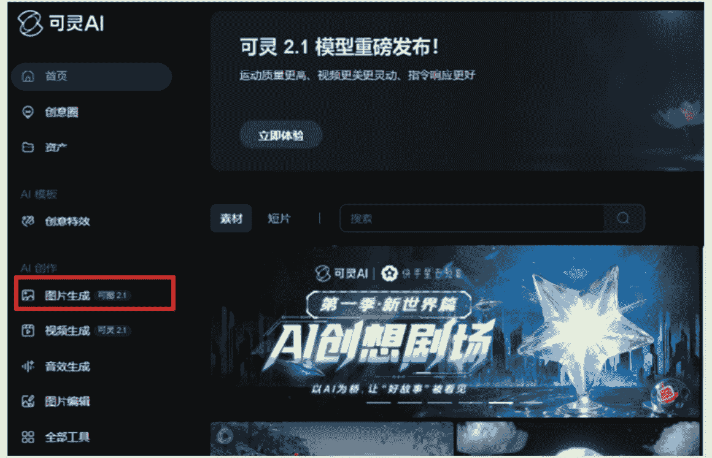
图 2-18 登录主页面

输入指令，例如：

请扮演一位经验丰富的小学美术老师，观察力敏锐、实践丰富，能兼顾学生成长规律与年龄特点。现在需引导学生发挥想象，描绘一幅童话画面：“童话般的书本森林，树木由彩色故事书堆成，书页化作树叶。夜晚森林里飞舞发光字母萤火虫，像闪烁小灯笼。远处有翻开的书本小山，溪流是流淌墨水，充满梦幻色彩。”以上画面作为示例，引导学生完成美术创作。完整指令见本书附赠资料。

输入完成后点“立即生成”，如图 2-19，生成结果如图 2-20，满意后点“下载”保存。

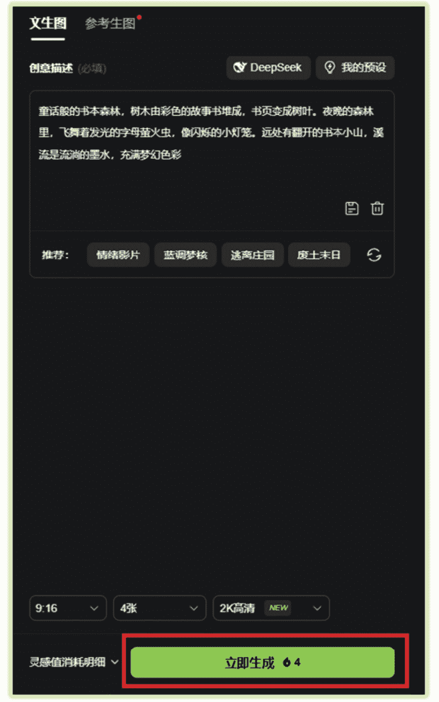
图 2-19 输入提示词

图 2-20 图片生成结果

**五、操作小窍门**

1. 优化指令：可参考“主体+环境+艺术风格+技术参数”结构优化画面描述。
2. 情绪引导：在指令中限定情绪关键词，如“神秘”“欢快”“忧郁”。

**六、遇到问题这样解决**

1. 图像模糊：可在指令中追加技术强化词，如超精细细节、锐化焦点。
2. 缺少艺术元素：可在指令中补充线条、形状、色彩、肌理、空间、形态与明暗的详细描述。

**2.10 智能辅助课堂听写**

**一、场景介绍**

用 AI 听写助手进行语言练习，能把枯燥的听写变成有效能力培养。它可根据学生特点生成个性化训练内容，提升听觉信息处理速度和理解能力，让语言学习从机械记忆转向沉浸式自主探索，提升效率并把主动权交还给学生。

**二、相关软件介绍**

阿里云百炼大模型平台为教育机构提供一站式大模型服务，助力构建智能教学助手、个性化学习引擎等工具。讯飞智作提供超 300 种音色和情感化语音合成，大幅提升教学资源生产效率。

**三、具体操作流程**

方法一：讯飞智作
第一步：打开讯飞智作官网。登录后在主页面左上角选择“语音合成”选项，点击“立即制作”进入音频生成页。
第二步：调整语音参数。把待转换文本粘贴到页面左侧输入区，根据文本类型选择合适音色，同时通过右侧滑块调整语速和语调，确保效果自然流畅。
第三步：生成并导出。点击左上角“试听”预览效果，确认后点右上角“生成音频”，设置文件名和输出格式后下载。

方法二：阿里云百炼大模型平台
第一步：打开阿里云百炼大模型平台。登录平台。
第二步：启动语音合成模型。登录后在主页中部点“免费体验”，左侧选“语音模型”，点“语音合成”，选择合适模型后点“立即体验”进入合成页。
第三步：试听与下载。在合成页选择音色，点“自定义文字试听”，输入或粘贴文本后点“开始生成”。等待进度条完成后点播放试听，确认无误后点右下角“下载”保存到本地。

**四、实际案例**

假设你是一位高中语文老师，课前需听写《人教版高中语文必修上册第1单元第1课》内容。

方法一：讯飞智作
登录官网后在左上角找到“语音合成”并点“去创作”，如图 2-21。

图 2-21 讯飞智作官方网站

把听写文本《人教版高中语文必修上册（2019 年部编版）第1单元第1课》输入左侧输入区，如图 2-22，并选择对应音色。右侧可调整语速语调，如图 2-23。

图 2-22 输入要听写的内容

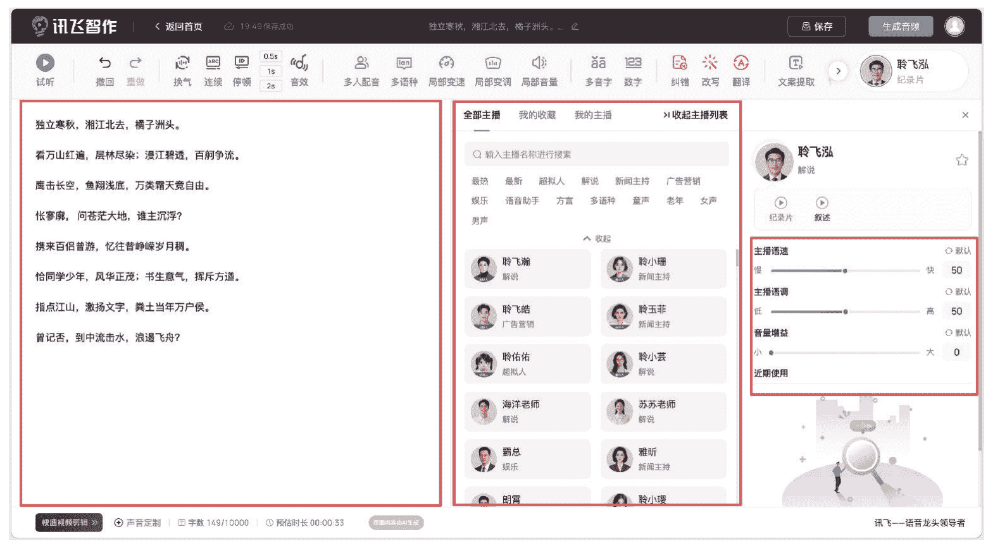
图 2-23 调整配音参数

调整完成后点左上角“试听”，合格后点右上角“生成音频”，确认名称与格式后提交，如图 2-24。

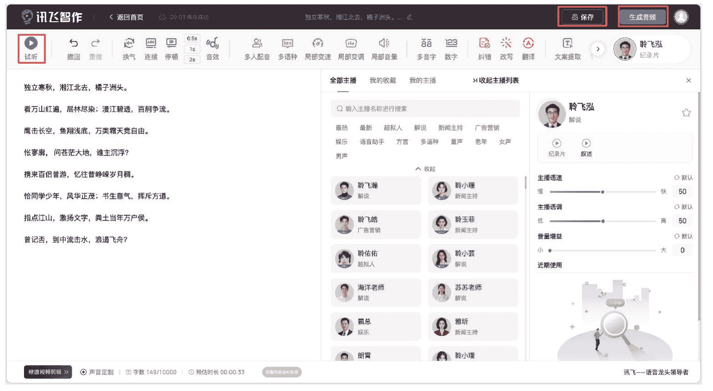
图 2-24 试听与下载音频

方法二：阿里云百炼大模型平台

在浏览器里打开阿里云百炼大模型官网，完成身份验证进入主站。页面中央的“免费体验”入口进入后，左侧目录选择“语音模型”，顶部切换到“语音合成”，择定一款语音大模型后按下“文字转语音”。

图 2-25 注册并登录阿里云百炼大模型平台

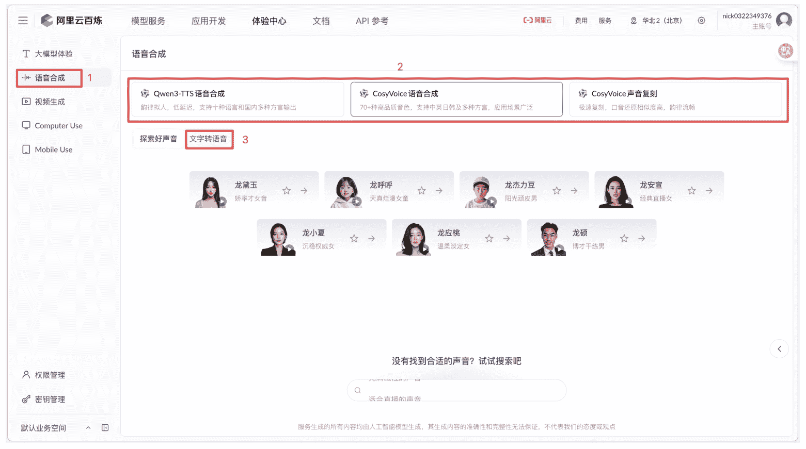

图 2-26 体验语音合成功能

对齐话术区写入待播报文本，例如人教版高中语文必修上册 2019 年部编版第一单元第一课。右侧调试台可设定音色、音量与语速，触发“合成试听”。片刻后底部出现进度条，按下三角播放键即可试听，如图 2-27。

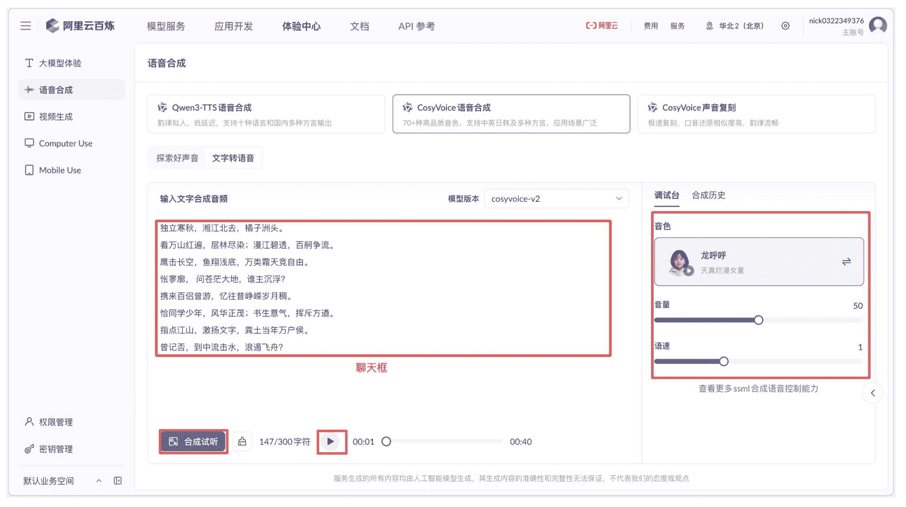

图 2-27 试听与下载语音

**五、操作小窍门**

1.参数灵活调节：可轮换不同主播试听，细调速率与语调，达到更自然的听感。
2.增强朗读表现：适度加入换气、变速等处理，使表达更富感染力。

**六、遇到问题这样解决**

1.主播语种需与文本一致：汉字内容配中文主播，外文内容选外语主播。
2.局部变速不生效：先用鼠标框选目标片段，再执行变速。
3.换气点失效：先将光标停在需要换气的位置节点，再触发换气。

**2.11 个性化鼓励卡制作**
**一、场景说明**
借助智能表扬助手，可将空泛夸奖转化为具体可感的成长激励。系统依据学生真实行为定制表述，并结合不同情境给出恰当认可。此类基于事实的深度肯定，有助于激发内在驱动力，把“我能行”的体验沉淀为稳定自信，让学习从外控转向自驱，真正聚焦每个孩子的成长细节。

**二、工具介绍**
DeepSeek 由国内团队自研的大模型助手，免费使用，对中文友好且支持长文本，擅长理解、推理与产出，广泛用于写作、科研、编程与问答。
即梦 AI 为全能型智能助手，涵盖深度问答、多模态交互、高效生产工具、个性化创作引擎及场景化智能体开发五大能力，以精准理解与跨场景落地驱动智能升级。

**三、操作步骤**
第一步：进入 DeepSeek。完成注册后在首页点“开始对话”。
第二步：产出表扬文案。输入设计好的引导词，将产出的表扬语复制保存。
第三步：打开即梦 AI。前往官网进入。
第四步：制作鼓励卡片。按下“图片生成”，把上一步的表扬语粘贴到对话区提交，生成后下载保存。

**四、实操案例**
假设你是小学班主任，班上某生因社交焦虑常回避集体活动，需为其定制表扬鼓励邀请卡，提升信心与归属感。

在 DeepSeek 官网对话区输入引导词，例如：
你是一位深谙教育管理的班主任，洞察力强、实践经验丰富，能兼顾成长规律与年龄特点。当用户需要定制表扬鼓励邀请卡时，先详细了解学生基本信息与情绪状态，再据此为有情绪问题的学生生成表扬话语，为后续制作邀请卡做准备。详细引导词见本书附赠资源。
提交后如图 2-28，生成完毕点“复制”保存，如图 2-29。

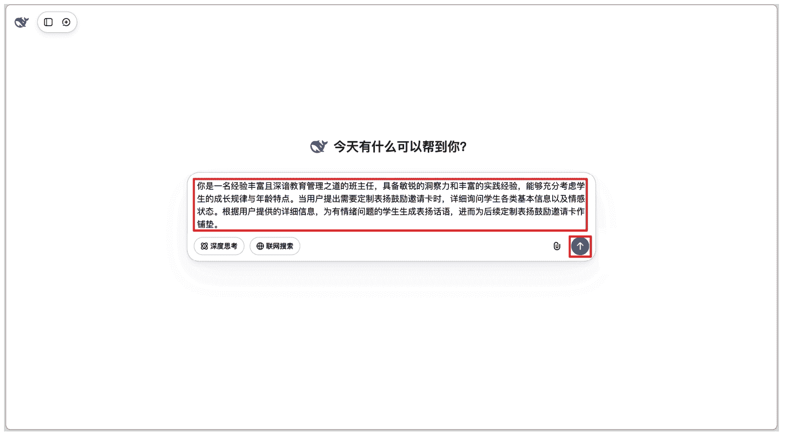

图 2-28 提交提示词

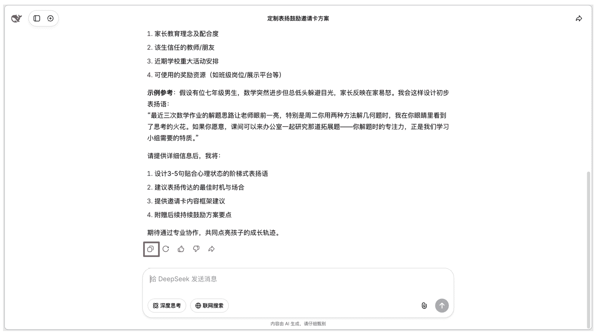

图 2-29 复制生成表扬的话语

登录即梦 AI 官网，按下下方“图片生成”，把第二步的表扬语作为引导词输入，目标画面为“学生因社交焦虑躲在书架后偷看同学游戏，老师举着‘一起玩吗’手绘邀请卡”。输入完成后点右下角白色箭头生成。默认1:1、高清2K，左下方可调宽高比，如图 2-30。

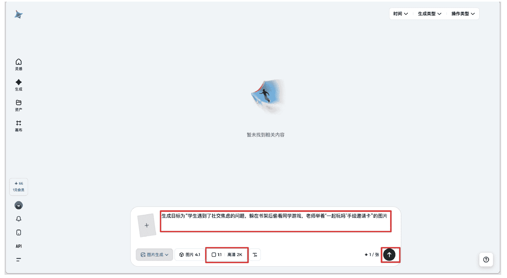

图 2-30 生成图片

图像出来后点“下载”保存，如图 2-31。

图 2-31 下载并保存图片

**五、操作小窍门**
1.迭代优化引导词：可用 DeepSeek 反复打磨引导词，操作同第二步。
2.强化视觉细节：引导词中加入场景、光线、氛围、色彩等具体描写，可显著提升成图质量。

**六、常见问题应对**
1.表扬语不够贴切：产出存在随机性，可让模型多次输出对比，再结合学生实际情况挑选。
2.成图效果不理想：先优化引导词描述以贴合需求；若清晰度或构图不佳，可调整长宽比如16:9或1:1适配使用场景。

**2.12 班级新闻语音播报**
**一、场景说明**
用智能驱动的班级新闻播报，能把抽象的核心素养转化为可见的实践成果。人机协作让信息甄别与创意表达更真实可感，可点燃探索热情。能力培养从知识传授升级为解决实际问题的综合演练，提升驾驭未来的关键能力，也让每位学生都能自信表达，增强班级归属感。

**二、工具介绍**
阿里云百炼大模型平台为教育提供一站式大模型应用开发服务，助力机构构建智能教学助手、个性化学习引擎与智能知识管理工具。通过通义千问等模型能力、低代码编排与安全合规部署，赋能智能备课出题、个性化辅导答疑与专属知识库建设，提升教学效率与管理智能化水平。

**三、操作步骤**
第一步：访问阿里云百炼大模型平台。打开浏览器进入。
第二步：启动语音合成。进入后在首页中部点“免费体验”，左侧菜单选“语音模型”，按下上方“语音合成”，选定模型后点“立即体验”进入合成页。
第三步：试听与下载。在合成页选择音色，按下“自定义文字试听”，在对话区输入或粘贴文本，按下“开始生成”。等待进度条完成后点“播放”试听，确认无误后点右下角“下载”保存到本地。

**四、实操案例**
假设你是小学班主任，班会前需总结每周班级新闻，如获奖、好人好事、趣味活动，例如：
本周喜讯连连！“童心绘祖国”绘画赛中，李明《我的家乡》获一等奖，作品将在校展厅展出。月考平均分提升5分，张宇、陈欣等8位同学进步明显，数学满分人数增加3人，值得点赞！周三开展“图书漂流”，同学们交换图书、分享心得，教室书香满溢。希望大家继续努力，让班级更精彩！
现在需要生成播报以增强归属感与自信心。

登录阿里云百炼大模型平台，随后点网页中部“免费体验”按钮，如图 2-32。在弹出页左侧菜单点“语音合成”，选中语音大模型，再点“文字转语音”按钮，如图 2-33。

图 2-32 登录阿里云百炼大模型平台

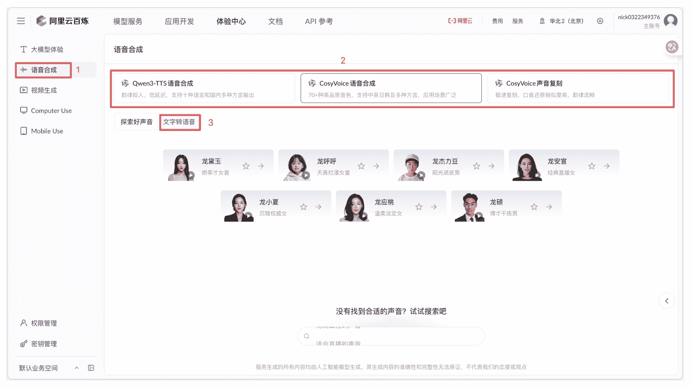

图 2-33 体验语音合成功能

在对话区输入班级新闻播报内容，右侧面板选择音色、音量、语速，按下“合成试听”，稍等后页面下方出现进度条，按下三角播放键试听，如图 2-34。

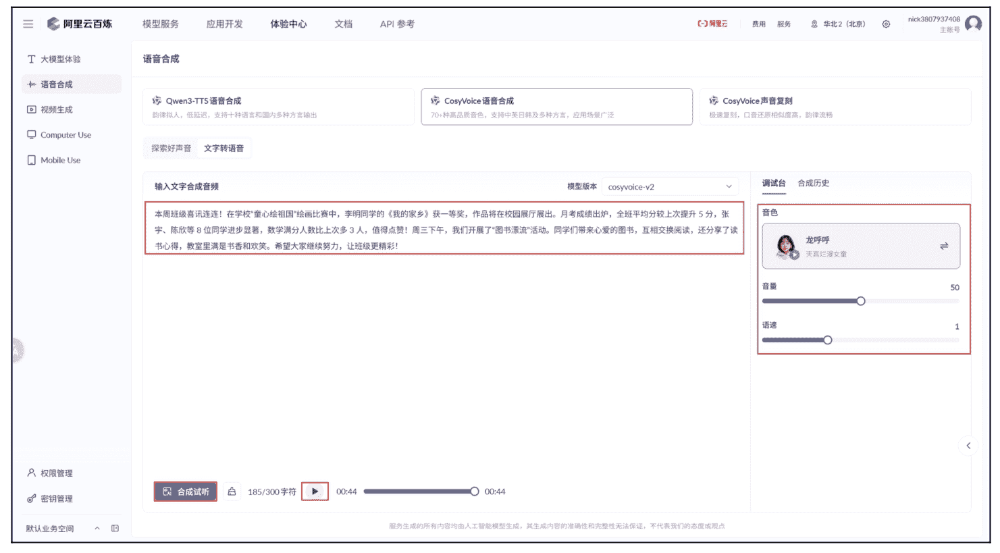

图 2-34 试听与下载音频

**五、操作小窍门**
1.参数灵活调节：可更换不同主播试听，并调节语速、语调，确保音质最佳。
2.先审后生成：在点“开始生成”前仔细检查对话区内容，避免语法错误或特殊字符导致合成效果不佳，养成分审习惯可节省重复生成时间。

**六、常见问题应对**
1.对话区输入失败：单次最多输入6000字，长文本需拆分输入。
2.语音生成中断：若进度条卡顿或未生成，可刷新页面重输，或重新核查文本长度。

**2.13 阳光大课间策划**
**一、场景说明**
在“双减”政策与核心素养导向下，阳光大课间正从单纯锻炼升级为“五育融合”的关键场景。引入互动设计，可将其重塑为全感官探索乐园。系统依据学生兴趣生成个性化挑战任务，让运动潜能与创新思维在游戏中萌发；同时把大课间从被动休息转变为主动发现的成长空间，为每个学生提供展现个性的舞台。

**二、工具介绍**
即梦 AI 为全能型智能助手，集深度问答、多模态交互、高效生产、个性创作与场景化智能体开发于一体，支持 API 定制，以精准理解与跨场景落地能力驱动智能升级。

**三、操作步骤**
第一步：访问即梦 AI 官网。完成注册后进入主页面。
第二步：产出图像。按下“图片生成”并输入引导词，可调整长宽比参数，按下“提交”生成后下载保存。
第三步：产出视频。导入第二步下载的图像作为首帧，按下“视频生成”并输入引导词，提交后生成视频并下载保存。

**四、实操案例**
假设你是一名小学体育教师，学校特色为武术与韵律操。现需为校庆设计富含特色的阳光大课间视频宣传案例。

访问并登录即梦 AI 官网。按下下方“图片生成”按钮，在对话区输入引导词，例如：
你是一位经验丰富的校本特色活动设计专家，洞察力强、实践经验丰富，能结合学校实际，设计阳光大课间活动演示视频的首帧图像。详细引导词见本书附赠资源。
输入后可调整图像长宽比，最后按下图 2-35 右侧“提交”按钮生成图像。

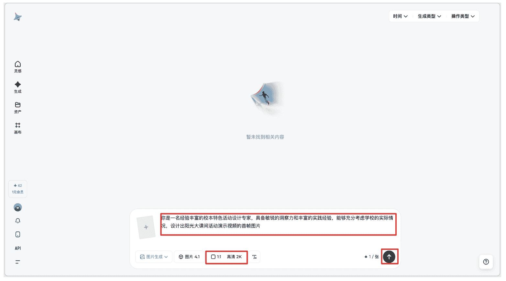

图 2-35 生成图片

生成图像后按下“下载”保存到本地，如图 2-36。

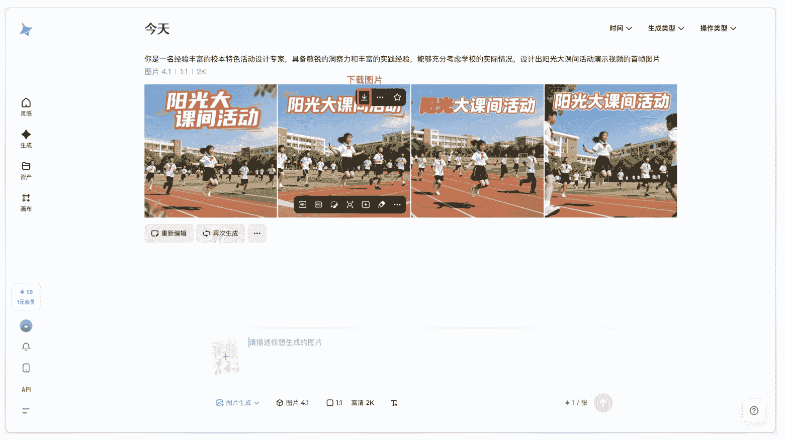

图 2-36 下载图片

基于生成的武术韵律操图像，按下下方“视频生成”按钮，导入下载好的图像作为首帧，如图 2-37。

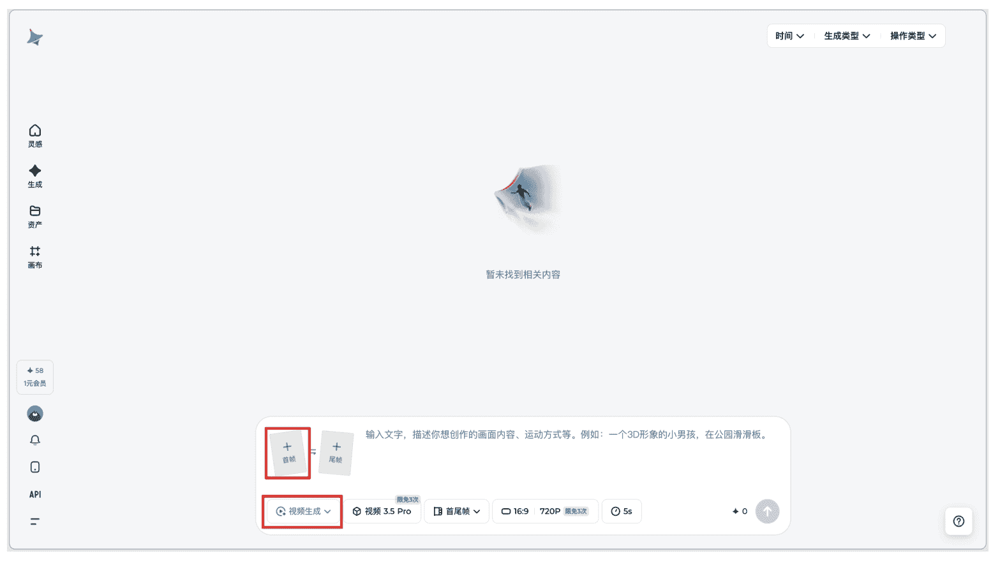

图 2-37 设置视频首帧

在对话区粘贴视频引导词，例如：“你是一位经验丰富的校本特色活动设计专家，洞察力强、实践经验丰富，能结合学校实际，基于阳光大课间相关图像，设计全面、合理、可行性强且有针对性的演示视频”详细引导词见本书附赠资源，按下“提交”按钮，如图 2-38。视频生成完毕后按下“下载”保存，如图 2-39。

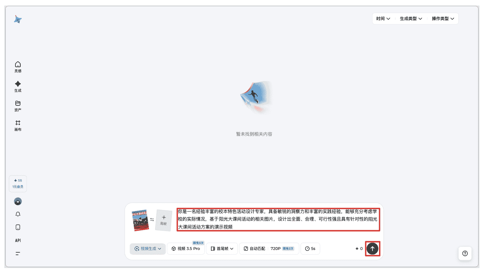

图 2-38 生成视频

图 2-39 下载视频

**五、操作小窍门**
1.优化引导词：若效果不满意，可在引导词中详细阐述期望的画面或视频细节，或参考本书附赠资源。
2.调整长宽比适配场景：生成图像时灵活修改长宽比如16:9或1:1，确保适配不同宣传平台，避免生成后裁剪。

**六、常见问题应对**
1.视频不连贯或首帧不匹配：检查引导词是否包含动态描述如“学生动作序列”或指定时长如“五秒左右”，以控制视频长度。
2.视频缺乏针对性或不切实际：向模型反馈具体问题，例如“刚才生成的视频不符合学校情况，请结合学校特色提供更易执行的方案”，让模型基于反馈优化输出。

**2.14 学情分析与诊断**
**一、场景说明**
借助智能学情分析能深度挖掘融合学习过程的多维数据，对个体认知状态、知识薄弱点及潜在学习风险进行精准诊断与预测。它支撑教学策略个性化调整，驱动学习资源与路径智能适配，将教育决策从经验驱动升级为数据驱动，在保障规模效率的同时促进个性化发展，实现教育公平。

**二、工具介绍**
豆包可同时服务学生与教师。对学生能即时解答学科疑问，提供个性化辅导与学习策略建议，并快速生成习题与作文素材。对教师可高效完成教案设计、课件制作、出题及作业批改，强大的生成能力为备课提供有力支持。

**三、操作步骤**
第一步：访问豆包官网。完成注册后进入主页面。
第二步：学情分析。导入学生信息文档，输入引导词，智能体基于数据和需求从成绩分布、学科强弱、个体差异等多维度分析，生成包含详细内容的学情分析报告及教学改进建议、学习提升方案。
第三步：保存分析结果。要求整理成文档格式并复制到本地。

**四、实操案例**
假设你是小学四年级3班班主任，期末需分析2024-2025学年第二学期每个学生的总体表现，进而调整班主任寄语。

注册并登录豆包主页面后，导入如图 2-40 所示的学生成绩单文档，并在对话区输入引导词，例如：
你是一位经验丰富的班主任，洞察力强、实践经验丰富，能充分考虑班级实际。当用户提出需要一份学情分析时，先详细了解班级学生的多维度情况，再据此生成包含详细维度的学情分析报告。详细引导词见本书附赠资源。

图 2-40 学生成绩单

按下“深度思考：自动”按钮，再按下右下角“提交”按钮，如图 2-41。

图 2-41 学情分析

若需制作文档，可在内容生成后继续输入引导词“请帮我整理成一份.docx 文档。”最后将生成内容手动复制到文档中即可，如图 2-42。

图 2-42 保存分析结果

**五、操作小窍门**
1.匿名化处理：导入学情相关附件前，注意匿名化处理学生个人关键信息。
2.导入多维度信息：建议导入基本信息、成绩、心理状态、家庭情况等多维数据，以全面分析。

**六、常见问题应对**
1.导入附件时需等待上传完毕再提交引导词与附件。
2.生成内容不佳时，可重复第二步，并在对话区输入引导词要求重点分析某一方面。

**2.15 单元学案智能化设计**
**一、场景说明**
借助智能学案设计能把统一课程内容转化为个性化知识导航，为每位学生规划专属学习路径。系统基于实时认知节奏实现精准定位与动态调整，使资源与策略因人而异、因需而变。单元学习由此从同步推进转变为高效进阶的定制化旅程，提升知识掌握效率，并打通“学—练—评”闭环，推动规模化教学实现真正的因材施教。

**二、工具介绍**
扣子空间是一个 AI 原生应用开发平台，在教育领域赋能教师、学生和管理者轻松构建定制化智能应用或教学助手。可快速创建用于智能答疑、自动生成多样化练习题、个性化学习辅导、作业批改、教学资源管理与互动的 Bot，大幅提升教学效率，为学生提供随时可用的学习支持与个性化反馈。

**三、操作步骤**
第一步：在扣子空间平台搜索并选择学案设计工具。
第二步：学案设计。导入相关教学材料，输入引导词。
第三步：保存学案。等待生成完毕后复制学案至本地文档。

**四、实操案例**
假设你是小学三年级数学教师，目前教学进度为人教版《加减法》第一课时，现需设计一份详细学案。

进入扣子空间平台，按下左侧导航栏“作品社区”按钮，在上方搜索框选择“教学设计”。按下第一个工具“教学设计”按钮，如图 2-43。

图 2-43 搜索学案设计工具

导入人教版《加减法》第一课时相关教学材料，并输入相应引导词，例如：
你是一位经验丰富的数学教师，洞察力强、实践经验丰富，能充分考虑班级实际。当用户提出需要一份单元学案设计时，先详细了解班级学情与教学情况，再依据用户提供的详细信息，提供基于人教版《加减法》第一课时的学案。

提示词填写完毕后，点一下“提交”便能启动自动生成流程。

图 2-44 设计学案

学案产出后，将结果拷贝出来保存到本地文档中，具体操作见图 2-45。

图 2-45 保存学案

**五、操作小窍门**
1.提示词可细化：结合班级实际完善输入信息，把教学目标和学习目标描述得更具体，产出质量会明显提升。
2.迭代优化：对结果不满意或内容偏少时，可请工具给出修改建议或补充生成相关材料。

**六、遇到问题这样解决**
1.学案未正确生成：首次对话时工具会回溯历史记录，容易出现偏差。此时重复第二步流程，用优化后的提示词再次提交即可。
2.附件上传失败：文件需为 PDF 或 DOCX 格式；网络要保持通畅，不稳可重试。若格式和网络都正常仍失败，先在本地关闭占用文件的程序再重新上传。

**2.16 用 AI 快速搭建课堂互动游戏**

**一、场景介绍**
把人工智能与教学游戏结合，能把抽象知识点转化为可操作、可沉浸的游戏体验。借助智能平台可迅速搭出游戏原型，自动匹配学科要点、动态调节难度，并实时收集学生反馈，帮助教师优化教学策略，提升课堂参与度。

**二、相关软件介绍**
智能平台：飞象老师。
平台简介：飞象老师是猿辅导集团面向中小学教师推出的专业创作工具，其教学动画模块可通过自然语言指令生成可视化动画与互动游戏。核心优势：
● 无需编程：教师仅用文字描述即可得到完整的交互式教学动画，支持自定义界面、参数调节与实验控制。
● 学科适配：依托猿辅导多年积累的教育大模型，能准确理解物理公式、数学逻辑、化学反应等，并转为动态演示。
● 即时预览：动画支持即时预览与参数调整，如摆长、质量、重力加速度，并可直接导出网页文档在本地运行。

**三、具体操作流程**
第一步：进入飞象老师平台。打开浏览器访问官网，完成注册登录后进入主界面。
第二步：选择 AI 教学动画功能。在左侧聊天栏点击“AI 教学动画”，切换到生成模式。
第三步：输入游戏需求。在聊天框说明角色、学科知识点及游戏形式，可补充界面布局、交互方式与参数范围等细节。
第四步：生成与调试游戏。平台会按需求自动生成交互式教学动画，页面包含演示区、参数调节区与结果显示区，可通过对话进一步修改效果。
第五步：导出与使用。调试完成后点击右上方“下载”，选择网页格式保存到本地，课堂上用浏览器打开即可运行。

**四、实际案例**
在聊天框输入明确的角色、知识点与游戏形式的指令，示意见图 2-46。其他科目样例见附赠资源。

图 2-46 AI 赋能课堂游戏提示词

如图 2-47 所示，飞象老师会按需求生成交互式教学动画，自动呈现单摆演示区、三组参数滑块摆长 L、质量 m、重力加速度 g、周期公式显示区及实验控制按钮。拖动滑块测试交互，比如改变摆长时画面是否同步、周期计算是否准确，记录需要优化的点如数值范围、提示文字。若需调整，可在聊天框补充指令，如增加“地球/月球重力切换”按钮或修改配色，AI 会自动更新。

图 2-47 AI 赋能课堂游戏（物理“单摆实验”）

持续修改提示词可进一步优化效果，满意后点击图 2-48 右上角“下载”，即可获得可在本地运行的网页文档，用于教学或离线使用。

图 2-48 下载生成的文件

**五、操作小窍门**
1.规则描述要清晰：输入需求时明确知识点与游戏机制的对应关系，如数学分数运算可设为“答对解锁关卡”，物理力的合成可设为“拖动箭头改变运动轨迹”，帮助 AI 精准匹配教学目标。
2.参数可视化优先：调节功能优先选用滑块、按钮、下拉菜单等直观控件，避免复杂输入框。例如化学游戏中用颜色选择器代替手动输入浓度，降低操作门槛。
3.预设容错与反馈：要求加入错误提示设计，如操作不当弹出“提示：摆长需大于 0.5 米哦！”，既引导思考也提升友好度。

**六、遇到问题这样解决**
1.游戏效果与需求不符：检查提示词是否缺少关键信息，补充“角色+知识点+具体交互”后再提交细化需求。
2.游戏卡顿或显示异常：简化界面元素，减少特效、合并相似按钮，并在提示词中注明“优化加载速度，适配课堂投屏”。仍有问题时，用浏览器无痕模式打开，排除缓存干扰。
3.知识点植入生硬：在聊天框输入“将知识点融入游戏规则”，如“把光合作用公式作为种植植物的能量来源，阳光不足时公式闪烁提示”，让 AI 重新设计融合方式。

**2.17 早读监测 AI 方案**

**一、场景介绍**
早读是提升语言能力的关键环节，但传统朗读氛围难以量化。借助 AI，可通过文心一言网页工坊快速搭建朗读氛围监测应用，将声音数据可视化，帮助教师精准掌握早读动态，提升管理效率。

**二、相关工具介绍**
文心一言的网页工坊是百度基于文心大模型开发的在线搭建平台，支持用自然语言生成纯前端网页应用，无需编程。核心优势：无需编码、实时预览调整、可离线运行。

**三、具体操作流程**
第一步：进入网页工坊。在文心一言主页面底部导航点击“网页工坊”，进入生成工具页。
第二步：输入早读提升需求。作为班主任，核心诉求是实时监测学生朗读声变化，并以可视化方式呈现氛围。
第三步：生成与调试应用。系统会生成早读监测网页代码，自动渲染出当前氛围指数、音量热力图和历史趋势，可通过提示词调整展示效果。
第四步：导出与使用。调试完成后点击左上方“导出”，选择网页格式下载，浏览器打开即可使用。

**四、实际案例**
作为班主任，想了解朗读效能，可在网页工坊聊天框输入图 2-49 所示的提示词。

图 2-49 AI 赋能早读效能提升提示词

生成后点击预览页“允许”开启麦克风权限，进行朗读测试观察氛围指数变化，检查气泡颜色和波纹动画是否随音量同步，如图 2-50 所示。不满意时可修改提示词更换可视化风格。确认后下载网页文档并保存，方便早读时调用。

图 2-50 AI 赋能早读效能提升检测器

**五、操作小窍门**
1.可视化多样化：可要求由三个功能精简为只显示当前氛围指数，并生成多个不同颜色的气泡，让气泡大小随分贝变化。提示词见附赠资源。
2.样式统一化：采用相同色系如蓝色主调，保持视觉一致，例如所有“适中”状态均用蓝色，增强关联感。

**六、遇到问题这样解决**
1.氛围监测无声音响应：先导出本地网页测试，确认浏览器麦克风权限已允许，地址栏锁图标→麦克风设为允许；仍无数据时，提示词补充“兼容 Chrome/Edge 浏览器音频 API”。
2.保存问题：保存时选网页格式而非压缩包；若出现安全警告，右键文件属性勾选“解除锁定”即可运行。
3.多设备兼容性：需在平板或手机使用时，提示词加入“响应式布局，支持移动端触屏操作”，保证不同屏幕下显示和操作正常。

**2.18 智能习题讲解助手应用**

**一、场景介绍**
习题讲解助手融合 AI 与习题教学，能为教师提供高效辅助。通过智能识别与分析，可快速获得详细解答步骤、教学重点分析和拓展练习建议，减轻备课答疑负担，实现标准化、个性化的解题指导。

**二、相关软件介绍**
智能平台：九章爱学。
平台简介：九章爱学 App 支持多学科题目解析。核心优势：智能识别与多学科支持，覆盖数语英物化，拍照即可识别并结构化；步骤级讲解与可视化教学，提供完整解题分解，支持黑板式可视化讲解；交互式答疑与个性化指导，支持随时提问和拓展说明。

**三、具体操作流程**
第一步：启动应用与选择学科。打开九章爱学 App，进入主界面选择学科，默认无需选择，点击“点击识别题目”开始。
第二步：拍照识别题目内容。拍摄需解题的习题，确保文字清晰完整，系统自动识别并转换生成结构化信息。
第三步：获取讲解与互动答疑。查看 AI 生成的解题步骤与分析，可切换黑板讲解模式观看演示，对不理解处随时提问获得个性化解答和知识点拓展。

**四、实际案例**
王老师在语文课上学生对比较阅读题理解困难，决定借助九章爱学。如图 2-51 所示，打开 App 可见多学科解答介绍，AI 提示可帮助各学科解题。

图 2-51 App 功能介绍和多学科支持

如图 2-52 所示，选择拍照识别功能，系统提示手机与纸面平行、题目置于框内，并支持多学科答疑。王老师对准比较阅读题目拍照，确保内容完整。

图 2-52 拍照识别功能和操作指导

拍照后，系统识别出《儒林外史》与《简·爱》的比较阅读题，如图 2-53 所示，要求分析女性人物婚姻抉择时的“离开”行为，并提供“解题步骤”和“1 对 1 讲解本题”选项。

图 2-53 题目识别结果和解题步骤选项

如图 2-54 所示，进入黑板讲解模式，AI 可视化展示解题分析，详细描述《儒林外史》中沈琼枝的反抗精神与自我意识等特征，并标注情节与启示，讲解更直观。

图 2-54 黑板讲解模式的可视化分析

学生对知识点仍有疑问时，可在底部聊天框语音继续提问，获得更全面拓展，如图 2-55 所示。

图 2-55 一对一个性化讲解模式

**五、操作小窍门**
1.拍照技巧优化：保持手机与题目平行，光线充足确保文字清晰。图表或公式较复杂时可分段拍摄，提升识别准确率。
2.充分利用交互功能：鼓励学生针对解题步骤提问，从“为什么这样做”到“还有其他方法吗”递进，培养深度思考。

**六、遇到问题这样解决**
1.题目识别不准：检查角度与光线，确保文字完整。手写题保持字迹工整，复杂题分部分拍摄逐一解答。
2.解答不够详细：利用提问功能追问，如“能详细解释这一步原理吗？”或“相关例题有哪些？”获取更深入讲解。
3.学科识别错误：拍照前先选正确学科，或识别错误时手动切换学科后重新解答。

**2.19 观课议课 AI 优化方案**

**一、场景介绍**
观课议课是教研核心环节，传统方式依赖人工记录易遗漏信息。AI 可提供实时记录、智能分析和结构化呈现，提升记录效率，为议课提供数据支撑，让教研更聚焦本质。

**二、相关软件介绍**
通义听悟是阿里达摩院研发的 AI 音视频转写与分析平台，支持实时语音转文字、多语种翻译、长音频处理，可精准识别课堂对话和教学提示。核心优势：智能章节划分与语音优化，自动分段并区分师生发言；要点总结与结构化分析，自动提取重点、互动和教学方法。

**三、具体操作流程**
第一步：启动录音转写。登录通义听悟，选择“实时录音转写”或“上传文件”。实时录音需将设备对准讲台，上传时勾选“自动划分章节”。
第二步：查看智能分析结果。系统生成“小节速览”和“发言内容总结”，点击左侧小节定位环节，将关键信息归类到“要点回顾”。
第三步：生成并导出报告。在“要点回顾”页查看亮点与问题，点击“生成报告”形成结构化分析，选择 PDF 或 Word 导出，可勾选“包含音频片段”。
第四步：深度分析与团队议课。将转录文本和要点总结复制到通义千问等工具，用提示词进行专业分析，如“从目标达成、师生互动、教学方法维度分析并提出改进建议”。

**四、实际案例**
打开通义听悟 App 或网页端，如图 2-56 所示，点击“开启实时记录”，将麦克风对准讲台实时查看转录；或点击“上传音视频”选择本地课堂录播文件，点击“开始转写”。

图 2-56 通义听悟主页面

系统自动生成“章节速览”，见图 2-57，按教学环节分段。点击小节可看“发言总结”，见图 2-58，了解环节重点。将关键信息加入“要点回顾”，见图 2-59，可按教师发言、学生互动等维度分类。

图 2-57 通义听悟章节速览页面

图 2-58 通义听悟发言总结页面

图 2-59 通义听悟要点回顾页面

完成后点击“导出”选择格式保存，或通过云盘分享链接给教研组协作编辑。将导出的 PDF/Word 上传至通义千问，输入提示词“基于以下课堂转录内容，从教学目标达成、师生互动效果、教学方法运用等维度进行专业分析，并提出具体改进建议”，如图 2-60 所示，AI 输出详细分析，如图 2-61 所示。

图 2-60 通义千问模型被进一步用于课堂内容分析

图 2-61 输出课堂内容分析

**五、操作小窍门**
1.精准划分角色：开始录音或上传前，在“设置→识别设置”开启“多角色分离”，输入教师姓名和学生标签如“学生 A”“小组代表”，AI 自动区分发言主体。
2.关键词预设强化识别：把学科术语或教学提示词如“光合作用”“分组讨论”“限时 5 分钟”加入“我的词库”，提升转写准确率。
3.结合时间轴定位问题：议课时点击报告中的时间戳如“00：20：15”，系统自动跳转对应录音片段并播放，同时显示文字，实现音文对照分析。

**六、遇到问题这样解决**
1.转写质量不佳：检查环境噪声，调整设备与音源距离建议 1～3 米，在“录音设置”提高输入音量灵敏度。
2.章节划分不准：在“章节速览”页面手动拖动调整，或上传时勾选“按静音时段划分”让系统智能分段。

3.容易忽略的小技巧：先把关键段落框选出来点“标记为重点”，再把“总结设置”切换到详细模式，输出的教学细节会更完整。

**2.20 长文精读提效指南**

**一、场景说明**
把智能文本解析引入备课，可让教师在面对篇幅大、结构复杂的教学材料时迅速抓住要义。系统能把冗长的原文转化为核心要点、知识脉络和深度阐释，帮助把握文本精髓，提升备课效率。教师可快速识别主旨、结构和知识点关联，即时获取教学建议，并按教学目标做个性化延展。

**二、相关软件说明**
Kimi 是一款文档解读能力强的智能产品，支持一次性导入多份电子文件，单份不超过100MB，累计不超过50份。
主要能力为格式兼容广，覆盖PDF、DOC、DOCX等常见类型，并能对材料做深度拆解，精准提炼主旨、架构与知识点关联，协助构建清晰的知识体系；教学建议具针对性，结合教育理论给出方法提示、重难点把握和活动设计思路；支持多轮对话迭代，可根据教师反馈持续优化解读结果和适用性。

**三、操作流程**
第一步：导入文件并说明需求。登录Kimi后使用导入入口选择需解读的长文，在对话框内说明教学目标、关注要点和个性化要求。
第二步：智能解读与查看结果。系统按说明对长文进行深度拆解，输出主旨概括、段落要点、知识点梳理和教学建议。教师浏览结果，快速把握核心内容和教学方向。
第三步：调整优化与导出应用。如需改进，可输入修改指令让系统重新处理。确认满意后使用内容下方的“分享”功能，选择文本、DOCX或图片等格式导出报告，直接用于备课。

**四、实际案例**
王老师要为高一学生解读老舍名著《骆驼祥子》选段。导入的文件和输入的需求如图2-62所示。

图2-62 导入的文件和输入的需求
系统处理后，给出包含关键历史背景与事件、可作“历史人物原型”剖析的文学形象、可用于课堂讲解的历史主题，以及面向历史课堂的教学建议等内容，图2-63所示为部分解读结果展示。

图2-63 Kimi对《骆驼祥子》的部分解读结果展示
确认可用后，使用生成内容下方的“分享”，如图2-64所示，选择合适的输出格式如文本、DOCX、图片等，将报告保存到本地，便于教学使用。

图2-64 Kimi的复制和导出功能

**五、操作小窍门**
1. 需求描述具体化：说明时写清教学目标、学生学段、解读重点，例如“初中历史+关键事件提取+课堂活动设计”，让系统更准确把握意图，产出符合教学需要的解读。
2. 多轮对话反复打磨：初次结果不理想时可追问细化，如“请深入剖析第三段的论证逻辑”“增加与现行教材知识点的关联分析”，逐步提升解读质量。

**六、遇到问题这样解决**
1. 解读结果偏离教学需求：检查说明是否包含学科、年级、教学目标，补充更具体的场景要求，如“结合新课标要求”“适配学生认知水平”后重新提交。
2. 导入或处理失败：确认文件格式是否在兼容列表、网络是否稳定，检查文件大小是否超出限制，必要时压缩或分批导入，待系统恢复后重试。
3. 导出格式不满足使用：尝试切换导出格式，如PDF转DOCX、文本转图片，或在对话中让系统直接产出指定格式内容，例如“生成可编辑的PPT大纲”“制作表格形式的知识点总结”。

**2.21 让辩论课更鲜活**

**一、应用场景**
智能技术介入课堂辩论，能为学生提供大量素材、多元视角和专业指引，有效激发辩论兴趣与思维活力，提升课堂参与度和表现。教师借助智能产品可快速搜集辩论资料、整理正反方观点，并模拟不同风格的辩手供学生演练。系统还能实时评测学生表现，给出针对性反馈，并根据水平动态调节辩论难度与节奏，形成“边辩边学”的高效模式。

**二、工具简介**
文心一言具备丰富的知识储备和检索能力，能快速收集各类辩论主题资料，支持联网搜索获取最新观点与数据，为学生提供充足素材；可多维度产出正反方观点，提供论据阐述和逻辑分析，帮助学生拓宽思维视野。

**三、操作流程**
第一步：确定主题并收集资料。教师确定辩论主题后打开文心一言，输入需求如“请收集关于人工智能是否会取代人类工作的相关资料和正反方观点”，勾选“联网搜索”。系统会整理相关资料和观点供筛选，可进一步要求细化论据和展开说明。
第二步：分组准备与模拟训练。将学生分为正反方并分配角色，一辩至四辩。引导学生用文心一言进行辩论模拟，如“请模拟一场关于××主题的自由辩论，正反方各发言三轮”，熟悉流程并锻炼技巧。
第三步：实战辩论与智能评测。按规则开展课堂辩论，教师担任主持。结束后把学生表现通过语音输入文心一言进行评测，系统从语言表达、逻辑推理、论据运用、团队协作等维度给出评分和改进建议，帮助教师总结教学。

**四、实际案例**
张老师为高二学生组织“人工智能是否会取代人类工作”主题辩论，课前需准备丰富论据。如图2-65所示，张老师在文心一言中输入：“请收集关于人工智能是否会取代人类工作的相关资料和正反方观点”，并开启“联网搜索”。系统迅速生成结构化分析，正方围绕“人工智能会取代人类工作”展开，给出技术效率与成本优势的论据。

图2-65 系统生成正反方观点和具体论据
当张老师进一步输入“请分析我方观点是否充分，并给出论据”时，系统展现了深层分析能力，如图2-66所示。系统指出，虽然“人工智能不会完全取代人类工作，而是推动人机协作与就业结构升级”这一观点有合理性，但需从论据充分性角度完善，建议剖析现有论据的核心支撑，使反方观点更完善、更有说服力。

图2-66 给出观点是否充分的论据
辩论结束后，张老师利用文心一言的继续对话功能对学生表现进行评测，如图2-67所示。通过页面下方的“功能提示”，可要求系统从逻辑严密性、语言表达、反应敏捷度等维度评价表现。系统生成的评测报告既点出学生在论证结构和数据运用上的优势，也提出在情感渲染和互动技巧上的改进建议，为后续教学提供参考，实现传统教学与智能技术的融合。

图2-67 辩论后利用继续对话功能对学生表现进行评测

**五、操作小窍门**
1. 精准描述需求：尽可能明确资料类型、观点角度、评测重点，让系统更准确满足教学目标。
2. 引导学生提问：鼓励学生在准备和辩论中主动向文心一言提问，培养主动思考和解决问题能力。教师可先引导学生思考可能问题，再让学生带着问题寻求帮助。
3. 结合实际调整：系统能提供丰富资料和建议，但教师需结合学生实际和课堂需求适当调整，确保活动符合教学目标并激发兴趣参与度。

**六、遇到问题这样解决**
1. 系统产出资料不够准确：检查提示词是否包含关键信息，补充更详细要求重新提交。如仍不满意，可换角度提问，如从“收集资料”改为“分析某个具体观点的论证逻辑”。
2. 观点与教学目标偏离：向文心一言说明学生年级、课程要求、教学重点，让其重新生成符合教育目标的观点，避免内容过于复杂或偏离主题。
3. 智能评测与实际有差异：结合教师观察综合判断，可向系统反馈课堂真实表现细节，要求重新评测或解释评分依据，形成更全面的能力评价。

**2.22 智能助力英语写作教学**

**一、应用场景**
把智能技术融入英语写作教学，能为教师提供从课堂演示到作业批改的全流程支持。通过智能写作工具，教师可快速产出不同类型的英语写作示例、优化学生作文结构，并提供个性化写作指导，从而提高教学效率和质量。学生也能获得更及时准确的写作反馈，了解语法、词汇和表达方面的问题，并在系统辅助下逐步提升写作水平。该方式既减轻批改负担，也提供标准化客观的评价体系，使写作教学更精准有效。

**二、工具简介**
豆包写作平台是功能强大的智能写作教学套件，包含豆包-帮我写作和豆包爱学两大模块。其优势包括：智能写作生成与教学演示，豆包-帮我写作支持多种文体创作，可按主题快速产出英语范文、提供写作模板和句式优化建议，适合课堂实时演示和素材准备；专业作文批改，能自动检测语法错误、词汇使用、句式结构等问题，生成详细批改报告和改进建议。

**三、操作流程**
第一步：选择教学场景与对应工具。按教学需要选择模块：课堂教学演示用“豆包-帮我写作”，作业批改辅助用“豆包爱学”，进入对应操作页面。
第二步：输入教学内容或学生作文。课堂场景：在平台输入写作主题、文体要求、目标受众等信息，生成教学示例和写作指导；批改场景：将学生英语作文上传至豆包爱学，系统自动分析文本。
第三步：获取系统分析结果与课堂应用。查看系统生成的写作范例或批改报告，在课堂展示优化过程和写作技巧，在作业批改中查看错误分析和改进建议，为学生提供个性化指导和后续教学规划参考。

**四、实际案例**
张老师需为高二学生讲解图表作文写作技巧，同时批改学生提交的英语作文。她使用图2-68所示的豆包爱学，先打开豆包，再点击“作文批改”按钮，最后通过拍照输入作文。

图2-68 豆包爱学首页及作文批改
如图2-69所示，系统对学生的图表作文进行详细分析，识别出11处错误，覆盖203个单词和10个句子的全面检查。批改报告显示具体语法错误和表达问题，如“experiences”和“wants to”等词汇使用不当，系统用红色标注需修改处，并在右上角显示“批改完成”状态。

图2-69 豆包爱学批改学生图表作文的详细报告
豆包爱学同时支持5张图片批改，通过批改结果，张老师发现学生在图表描述的数据表达和逻辑连接方面存在共性问题。于是她转向豆包-帮我写作准备课堂教学素材。登录豆包写作平台后选择“帮我写作”模块。张老师在聊天框输入并发送提示词，见图2-70左侧，系统快速生成标准图表作文结构，包括开头段图表介绍、主体段数据分析、结尾段总结。点击段落左侧的“AI改写”按钮可请求细粒度修改。

图2-70 豆包-帮我写作平台的功能页面和写作类型选择
结合系统批改发现的问题和生成的优秀范例，张老师设计了针对性写作练习。学生对比自己的作文与系统范例，清晰看到差距，后续练习中进步明显。整个教学过程兼具个性化诊断和标准化示例指导，极大提升了英语写作教学效果。

**五、操作小窍门**
1. 教学场景精准匹配：按教学目标选择合适模块，课堂演示用“帮我写作”生成示例和模板，作业批改用“豆包爱学”做错误诊断，避免功能混用影响效果。
2. 批改结果深度解读：利用系统批改报告分析学生共性问题，将高频错误整理成教学重点，设计针对性课堂练习和讲解，实现从个体诊断到集体提升的转化。

**六、遇到问题这样解决**
1. 系统批改结果不够准确：检查上传作文格式是否清晰完整，避免手写体或模糊图片影响识别。对系统误判部分结合人工判断二次确认，逐步建立系统辅助加人工核查的批改流程。
2. 生成的写作示例不符合教学要求：输入需求时补充更详细要求，如“高中水平+议论文题材+150词左右+包含具体例证”等关键信息，让系统生成更符合实际教学目标的内容。
3. 学生过度依赖智能工具：引导学生正确使用系统辅助写作，强调系统是学习工具而非替代方案，设置使用规范和评价标准，培养独立思考和写作能力。

**2.23 历史人物演绎再现**

**一、应用场景**
智能体扮演历史人物是一种创新的历史学习与体验方式，能让学习者身临其境感受历史场景，与历史人物互动交流，深入理解历史事件和人物思想。通过与智能扮演的历史人物对话，学习者可提出各种问题，获取更丰富历史知识，培养历史思维和批判性思维。该方式既增加学习趣味性和吸引力，也让学生从第一人称视角体验历史，提高参与度和理解深度。

**二、工具简介**
豆包能够创建具有特定角色和功能的智能体，其优势包括个性化角色定制与深度扮演，支持通过详细设定描述让智能体贴近历史人物特点，涵盖思想观念、语言风格、时代背景等多维度特征。

**三、操作流程**
第一步：进入豆包智能体平台。进入豆包主页面后点击“智能体”按钮，进入创建平台，选择“创建AI智能体”，开始角色设定。
第二步：创建历史人物角色。输入智能体名称，如“孔子智能体”，在设定描述中详细填写历史人物信息，包括身份、时代背景、主要思想、性格特点等。设置合适权限范围，确保智能体可访问相关历史知识领域，点击“创建AI智能体”完成角色生成。
第三步：历史对话与深度交流。进入对话页面，向智能体提出与历史相关的问题，如询问历史人物思想观点、时代背景、重要决策等。根据回复进行深入追问，通过多轮对话加深对人物和事件的理解，必要时可提醒智能体调整语言风格，更贴近古人表达。

**四、实际案例**
王老师为初三学生设计“对话孔子”历史体验课，帮助学生深入理解春秋时期思想文化。如图2-71所示，王老师登录豆包智能体平台，点击“AI智能体”按钮进入创建页面，在创建页面设定一个扮演孔子的智能体角色。

图2-71 进入豆包智能体平台
如图2-72所示，王老师在创建页面输入名称“孔子智能体”，并在设定描述中详细填写：“春秋时期思想家、教育家，儒家学派创始人，倡导‘仁爱’思想，性格温和、博学多才”。他将权限设为“公开·所有人可对话”，确保学生都能交流。系统根据设定生成具有孔子特征的智能体，包括头像和基本人设。

图2-72 创建孔子智能体的设定过程
课堂教学中，学生开始与“孔子智能体”对话交流。如图2-73所示，当学生问“夫子，您如何看待‘仁爱’思想在现代社会的应用？”时，智能体以孔子口吻回答：“无论何时，以爱待人，推己及人，首为上善。当今社会，若人人能行仁爱，必能和谐。”学生进一步询问具体实践方式，孔子智能体引用《论语》经典语句阐释，展现深厚儒家思想底蕴。通过这种对话，学生不仅学到历史知识，更体验到与古代圣贤直接交流的独特感受，激发对传统文化的兴趣。

图2-73 学生与孔子智能体的实际对话场景

**五、操作小窍门**
1. 角色设定详细化：创建历史人物时尽可能详细描述生平事迹、思想观念、语言习惯、时代特色等，如“使用古汉语表达方式”“体现儒家温和品格”等具体特征，让智能体更贴近历史原型。
2. 多角度深度提问：交流时从思想理念、历史事件、个人情感等不同维度提问，如“您对当时政治局势的看法”“您教育弟子的具体方法”等，获取更全面历史认知。

**六、遇到问题这样解决**
1. 回复内容不够准确：检查设定描述是否包含足够历史人物背景信息，补充完善人物特征和知识要点。重新组织提问语言，使用更符合历史语境的表达方式询问。
2. 智能体无响应或反应慢：检查网络连接是否稳定，尝试刷新对话页面或重新进入智能体平台。若为系统问题，可稍等片刻后重试。
3. 语言风格不符合预期：在对话中直接提醒智能体：“请以古人语言风格回答”或“请使用更正式的表达方式”。必要时返回创建页面，在设定描述中增加对语言风格的具体要求。

**2.24 美术画作的智能生成**

**一、应用场景**
AI绘画与美术课堂深度融合，开创了一种创新教学模式。该模式将教学范畴从传统手工绘制拓展至数字化创作，为学生提供更丰富的创作灵感和多元表现形式，有效激发学习兴趣与创造力。教学中，教师可借助AI绘画工具快速生成不同风格主题的绘画示例，引导学生观察分析并学习多样绘画技巧与艺术风格。学生则能利用该工具开展创意实践，将构思通过AI技术直观呈现，并在过程中持续提升审美能力与艺术素养。

**二、工具简介**
豆包-图像生成是一款强大的AI绘画工具，功能丰富。其优势包括多风格支持与艺术表现，涵盖人像、摄影、中国风、动漫、3D渲染、水墨画、油画、水彩画、卡通、插画、像素风格等多种风格，能满足美术课堂多样化教学需求，让学生接触不同类型的艺术表现形式。

**三、具体操作流程**

豆包 AI 水彩创作快速入门

步骤一：进入图像工作台
先打开豆包，完成账号登录后进入首页，定位到图像生成入口，点击进入绘画工作台即可开始创作。

步骤二：提交创作指令
在对话区明确绘画主题、表现风格与细节要求，比如提示“用水彩风格绘制一幅校园春景”。若想基于已有素材创作，可上传参考图进行图生图，并补充画面构图、色彩搭配等具体说明，发送后即可开始生成。

步骤三：调试与精修
查看生成的绘画稿，审视画面效果、元素呈现、色彩组合。如需调整，可选中图片调用智能编辑功能，或使用区域重绘对指定部分进行修改，模型会按新的提示词更新画面，反复迭代直至满意。

**四、实际案例**
美术课上，李老师借助豆包的智能作画功能，向高一学生展示不同主题的水彩作品。登录图像平台进入风格页后输入创作需求，如图 2-74 所示。系统依据描述生成对应水彩作品，成果如图 2-75 所示，整幅画面清新通透，水彩渲染自然，完美呈现春日校园的生机。作品上方展示了智能编辑、区域重绘、扩图、擦除、提清晰等编辑选项，为后续精细调整提供便利。

图 2-74 登录平台页面并输入需求

图 2-75 AI 生成的水彩画作品展示

如图 2-76 所示，若发现画面中某位学生的动作需要调整，可点选该区域进行局部重绘。例如在弹出的提示框中输入“多画几只蝴蝶”，模型即可识别画面元素并完成修改。通过这种方式，教师可以对画面的任意部分进行精确修正，确保作品符合教学需求。

李老师最终完成调试与编辑，效果如图 2-77 所示。在导出页面中，他可以选择将作品保存为不同格式，同时系统还生成了详细的创作说明文档，包含作品的风格特点、色彩运用、构图要素等分析内容。这不仅为课堂教学提供了丰富素材，更重要的是让学生通过 AI 生成的作品学习绘画技法，理解色彩搭配和构图原理，从而激发对绘画的学习兴趣。

图 2-76 局部重绘和智能编辑功能

图 2-77 最终作品导出和教学应用

**五、操作小窍门**
1. 精准描述绘画元素。输入需求时尽量细化元素的特征、姿态、色彩等，例如描述“盛开的花朵”时，可具体说明花卉品种、颜色与数量，让模型更精准地生成符合教学目标的画面。
2. 合理运用风格关键词。选风格时除常规名称外，还可结合具体风格特点进行描述，如“复古中国风”“炫酷赛博朋克风”，让生成作品更具辨识度。
3. 利用图生图的拓展性。可使用参考图实现图生图创作，引导学生分析参考图片后提出新的创意与要求，充分发挥拓展价值，培养创新能力。
4. 及时保存中间过程。调试过程中若对某一阶段的画面效果满意，应立刻保存，以避免后续调整覆盖当前成果。

**六、遇到问题这样解决**
1. 画面与需求不符。检查提示词是否包含关键信息，补充“教学身份+主题内容+风格要求+具体细节”等要素后重新提交；若描述过于复杂，可适当简化，使用更直观的艺术术语。
2. 生成时卡顿或显示异常。尝试简化需求中的元素与细节，并在提示中注明“优化生成速度，适配课堂展示”。如仍异常，可重新登录或更换网络环境，排除缓存干扰。
3. 风格表现不突出。在对话区增加“强化风格特征”的明确要求，如“加强水彩画的笔触融合效果”“突出油画的厚重质感”等，促使模型重新调整风格呈现。

**2.25 科学实验的设计与实践**

**一、场景介绍**
借助国家中小学智慧教育平台的“央馆 AI 科学实验”板块开展教学，是将前沿技术与科学教育深度融合的创新做法。该板块能为教师提供从实验方案设计、材料准备到结果预测、问题排查的全流程支持，帮助教师设计更具趣味性和探究性的实验课程，引导学生动手操作、理解科学原理，培养科学思维与实践能力。板块还支持科普剧创作、模拟问答等功能，为项目式教学提供多样资源，提升学习兴趣与课堂参与度。

**二、相关软件介绍**
国家中小学智慧教育平台的“央馆 AI 科学实验”是专为科学教学打造的综合工具。核心优势包括：全流程教学支持，涵盖实验方案设计、结果评估、材料准备、问题排查等；多样化教学形式与资源，支持科普剧创作、模拟问答、项目设计，还能识别科学图片提供直观辅助；智能化个性化服务，支持自由问答随时解惑，可按年级与知识点生成个性化方案，操作便捷适合课堂教学。

**三、具体操作流程**
步骤一：进入央馆 AI 科学实验平台。打开国家中小学智慧教育平台，完成登录后在主页面找到“人工智能教育”板块，点击进入后选择“央馆 AI 科学实验”，进入工作主界面。
步骤二：选择模块并输入需求。根据教学需要挑选功能，包括实验设计、科普剧创作、模拟问答、项目设计、图片理解或自由问答。在对话区详细描述教学目标、适用年级、重点内容等，确认后提交。
步骤三：生成内容并应用于课堂。平台快速生成对应教学材料，教师查看后可修改完善。将实验方案、项目设计等内容下载整理后，在课堂按设计实施，引导学生参与操作与探究。

**四、实际案例**
王老师准备为小学五年级设计一个关于光合作用的科学实验，让学生观察并理解植物光合作用的条件与过程。他登录国家中小学智慧教育平台，进入“央馆 AI 科学实验”页面，如图 2-78 所示。平台的科学教师助手介绍了实验方案设计、结果评估、材料准备、问题排查、科普剧创作、模拟问答、项目设计、图片理解和自由问答等功能模块。

图 2-78 功能模块介绍页面

如图 2-79 所示，王老师点击“实验方案设计”模块，准备创建光合作用主题方案。页面显示科学教师助手的欢迎语，说明可协助设计各类实验。快捷提问区提供“光合作用”“五年级可用”等预设标签，便于快速输入需求。

图 2-79 项目设计功能和快捷提问选项

王老师在对话区输入：“我想创作一个关于光合作用的实验，给五年级学生使用”。如图 2-80 所示，助手接收需求后开始生成方案。系统输出完整的实验框架，包括目的、材料、步骤、注意事项、预期结果等。方案通过对比有光照与无光照条件下叶片变化，使用碘液检测淀粉生成，让学生直观理解光合作用需光照的条件。

图 2-80 AI 生成的实验设计方案展示

该平台暂不支持直接导出文件，教师需将生成内容手动复制粘贴至 Word 文档中使用。

**五、操作小窍门**
1. 需求描述要具体化。输入时详细说明教学目标、学生年级、实验重点、时间安排等，如“针对五年级设计植物光合作用实验，重点观察光照影响，时长40分钟”，以获得更精准方案。
2. 充分利用多功能模块。熟悉各项功能特点，灵活使用图片理解、自由问答等辅助功能获取教学资源；遇到专业问题时及时使用自由问答获取深度解析。

**六、遇到问题这样解决**
1. 生成内容与教学需求不符。检查输入是否包含关键信息，补充“教学目标+知识点+年级特点+具体要求”后重新提交。可参照平台示例格式规范化输入。
2. 模块操作困难。查阅平台操作指南与帮助文档，了解各功能用法。如问题持续，可通过客服渠道寻求技术支持。
3. 内容专业深度不足。利用自由问答向专业人士咨询，获取更深入的科学知识与教学建议。参考平台优秀案例，进一步优化生成内容。

**第三章 智能协同班级日常事务管理**

本章围绕班级日常事务管理，探讨智能技术在“带班育人”中的具体应用路径。通过班级规则制定、开学物品清单、考勤与档案管理、班会策划、家校沟通和心理辅导等情境，示范如何借助智能工具提升班级管理的规范性与精细化水平，更好地服务学生。

**3.1 班级规则的设计与生成**

**一、场景介绍**
在日常教学管理中，教师常需为班级制定一套明确、公平且可执行的规则。本节介绍如何借助智能工具，依据班级实际快速生成并优化班规建议。智能辅助不仅能提供启发性范例，还能提升制定效率与针对性，为建设良好班风提供支持。

**二、相关软件介绍**
DeepSeek由杭州深度求索人工智能基础技术研究有限公司研发，基于超大规模语料预训练与强化学习框架构建，具备较强自然语言理解与生成能力，可进行连贯对话、文本撰写、润色与重组。本节中教师可借助DeepSeek生成和改写班级规则表述，提升设计效率与规范性。

**三、具体操作流程**
步骤一：定义角色与功能。完成DeepSeek平台注册登录后进入主页面，点击“深度思考（R1）”和“联网搜索”开启功能，在对话区输入提示词并发送。
步骤二：提供班级信息。DeepSeek会依据提示词自动发起信息请求，按提示提供班级相关信息如学生年龄层次、人数、性格特点等，确保信息完整准确。
步骤三：获取班规内容。DeepSeek结合要求与提供的信息进行思考，给出符合要求的班规草案供参考。

**四、实际案例**
假设你负责初中的班主任工作，开学之际需为班级制定管理制度。
打开DeepSeek网页端或手机端App，输入并发送提示词，例如：
你是一名经验丰富且深谙教育管理的班级规则制定专家，具备敏锐洞察力和丰富实践经验，能充分考虑班级实际情况，制定全面、合理、可行性强且具针对性的班级管理制度。当用户需要一份班级管理制度时，详细询问班级各类基本信息，例如班级学生年龄层次、人数、性格特点、是否有特殊情况、班级整体学习氛围等。根据用户提供的详细信息，从纪律、学习、卫生、奖惩、社交互动等方面制定细致全面的班级管理制度，对每个方面给出具体明确可操作的规则条款。
最终生成的结果如图 3-1 所示。

图 3-1 生成班级管理制度定制问卷

**五、操作小窍门**
1. 提示词要详尽具体。提供学生平均年龄、理解能力等细节能显著提升生成质量。
2. 善用“深度思考（R1）”功能。开启后模型会更深入思考后再作答，通常结果更优。
3. 利用“联网搜索”功能。开启后模型会检索网络相关信息，结合优质内容生成。
4. 对比功能效果。可尝试开启/关闭“深度思考（R1）”和“联网搜索”，比较不同设置下的结果，选择最优组合。
5. 迭代优化提示词。若初次结果不满意，可调整提示词内容并重新发送，直至满意。

**六、遇到问题这样解决**
1. 提示“服务器繁忙”。尝试切换网络环境，如从Wi-Fi切换到移动数据，刷新页面后重试。
2. 复制生成内容。滚动至页面底部，点击“复制”按钮即可一键复制全部内容。
3. 复制格式异常。若粘贴后格式错乱，可使用Word格式刷调整，或借助OCR工具提取文本后再复制。

**3.2 开学物品清单的智能生成**

**一、场景介绍**
新学期开始，教师为学生整理一份开学物品清单，能帮助学生快速适应学习节奏。借助智能工具，教师可高效生成涵盖各类必需品的详细清单，让学生清楚准备事项，也让家长筹备更有方向，减少遗漏。

**二、相关软件介绍**
WPS AI是金山办公基于大语言模型开发的智能办公助手，集成于WPS文档、表格、演示文稿及PDF等组件，可通过自然语言处理生成或改写文本。它能快速创建清单、说明文字和简单表格，特别适用于教师整理开学所需物品清单。

**三、具体操作流程**
步骤一：新建智能文档。打开WPS Office客户端，点击“新建”，在菜单中选择“智能文档”。页面跳转后，在“AI模板”板块导航栏点击“教育行业”，选择“开学物品清单”模板。
步骤二：设置AI模板。在页面右侧参数设置区选择学生教育阶段，若有个性化需求如特定物品要求、使用场景限制等，可在下方对话区输入具体描述。
步骤三：获取物品清单。完成参数设置后，点击页面下方“开始生成”启动智能生成。如对结果不满意，可点击“重新生成”，最后点击“完成”即可。

**四、实际案例**
假如你是一名高中班主任，需要为班级学生准备开学物品清单。首先打开WPS Office，点击“智能文档”，在AI模板的“教育行业”选项下点击“开学物品清单”，如图 3-2 所示。

图 3-2 WPS AI 模板

在如图 3-3 所示的AI模板设置页面，在“学生所处的教育阶段”栏选择“高中”，在“特殊需求”栏输入：“学生高中开学，需参加军训，必备物品是录取通知书”，点击“开始生成”按钮。

图 3-3 WPS AI 模板设置

因版面限制，生成的开学物品清单部分截图如图 3-4 所示。

图 3-4 WPS AI 生成的开学物品清单

**五、操作小窍门**
1. 巧用复选框核对。生成的清单自带复选框，核对时可直接勾选已准备物品，直观标记进度，避免遗漏。
2. 精准信息提升质量。在特殊需求对话区补充开学时间、学校要求、年级特点等细节，让清单更贴合实际。
3. 智能优化功能。若对结果不满意，可点击主页面顶部导航栏的“WPS AI”，选择“AI帮我改”，输入修改要求如“增加军训物品”“精简小学低年级清单”“物品优先级排序”等，系统会自动优化。
4. 启用“深度思考”功能。点击“WPS AI”选择开启“深度思考”，启用后模型会多轮逻辑梳理后再生成，通常更全面细致。
5. 对比功能效果。尝试开启/关闭“深度思考”，对比不同模式结果，按需求选择最优组合。
6. 版本回溯方法。若需查看历史生成版本，点击“WPS AI”选项，在下拉菜单中找到“历史会话”，即可查阅并回溯。

**六、遇到问题这样解决**
1. 多次生成效果不理想。建议重新调整AI模板基础参数，补充更具体的描述后再次尝试。
2. 模板加载缓慢或生成失败。可检查网络连接后刷新页面，或关闭WPS客户端重新启动。

**3.3 班级群通知一键生成**

**一、场景介绍**
班级群是连接学生、家庭与学校的枢纽，在家校沟通中不可或缺。教师可通过班级群及时传达学校安排、课程变动与活动详情。智能工具能辅助撰写群通知，帮助教师更高效组织语言，确保信息精准清晰地传达给家长与学生。

**二、相关软件介绍**
豆包由字节跳动开发的智能助手，基于大语言模型构建，具备较强自然语言理解与生成能力。支持对话式交互，可根据提示词快速完成文字生成、润色与调整。本节中教师可借助豆包辅助起草班级群通知，提升表达准确性与语气得体度。

**三、具体操作流程**
步骤一：定义角色与功能。完成豆包平台注册与登录后进入主页面。在对话区精准输入用于定义角色和具体要求的提示词，可勾选“深度思考”选项。
步骤二：提供通知信息。豆包收到提示词后会自动发起信息补充请求，收集更多细节以完善通知。按平台提示逐项提供通知主题、对象、具体事项、截止时间等信息，确保内容准确完整。
步骤三：获取班级群通知。豆包根据用户要求及提供的信息进行思考，生成完成后提供一份符合要求的班级群通知草案供参考。

**四、实际案例**
假设你是一名初中班主任，日常需在家校沟通群中频繁发布各类通知。现在需要为学校即将举办的运动会写一则班级群通知。
打开豆包，并输入提示词，例如：
你是一名专业且熟悉校园沟通场景的班级群通知撰写助手，擅长用简洁明了、礼貌得体的语言撰写各类通知，能够根据家校沟通实际需求自动调整语气和措辞风格。当用户希望撰写一则班级群通知时，请详细询问通知基本要素，例如通知目的/主题是什么？面向对象是谁？是否需要强调时间、地点、任务要求等关键信息？语气是否需要正式、中性或亲切？是否需要加入提醒、感谢、致歉等礼貌性表达？根据用户输入的内容，自动生成结构清晰、语言规范的班级群通知，风格适应家校沟通习惯。必要时提供多种措辞风格供选择，并支持快速修改。现在给我设计一个学校举行运动会的班群通知。

运动会班级通知快速成稿

在给出指令并描述具体需求后，平台返回的样张如下。

图 3-5 生成运动会班级群通知

**五、操作小窍门**

1. 把指令写细致：提示里写清通知的紧迫等级，例如紧急告知、温馨提醒，并规定语气基调如庄重正式或轻松亲切，生成结果会更贴合使用场景。
2. 按类型补全要素：活动类通知要补时间、地点、参与方式；缴费类要写明金额、支付渠道、截止时间，信息完整可减少反复修改。
3. 复杂文案开深度：合并多事项或需规则说明的通知，建议开启深度思考，模型会自动梳理优先级，避免内容混乱。
4. 多稿比选：同一需求换一种表述、调整信息顺序或增减限制条件，多生成几版后挑选，最佳方案更快确定。
5. 二次打磨：若框架已满意只需微调，可直接复制草稿并说明修改方向，反复迭代到理想状态。

**六、遇到问题这样解决**

1. 输出偏离原意：检查指令是否含糊，把通知家长细化为通知小学三年级学生家长，减少歧义。
2. 多次尝试仍不理想，可拆任务：先让系统列出骨架确认，再逐步填充细节，例如先请列出通知结构，确认后再填内容。
3. 粘贴后排版错乱：可用 Word 的格式刷统一格式，或先用 OCR 识别成纯文本再粘贴，保持版面整洁。

**3.4 演讲稿的生成与优化**

**一、场景介绍**
演讲稿是教师在不同场合传达思想的重要载体。家长会分享教育理念、校园活动阐述观点，都需要清晰的逻辑与节奏。AI 可作为搭档，只要提供场合、目的等关键信息，就能协助构思与润色，让稿件更贴合具体场景。

**二、相关软件介绍**
通义千问由阿里云自主研发的对话式大模型，基于大规模语料训练，理解与生成能力强，支持多轮对话、文本创作与语言优化。教师可借助它搭建框架、生成初稿或对已有稿件润色，提升结构清晰度和表达适配度。

**三、具体操作流程**
第一步：检索指令。登录平台进入首页，点击指令中心进入指令库，在搜索框输入演讲稿检索，选中后自动填入对话区。
第二步：完善指令。结合实际补充主题、受众、时长、核心观点、语言风格等，编辑完成后点击发送。
第三步：获取稿件。系统依据提交的指令进行多维度逻辑梳理，完成后推送一份符合要求的初稿，便于审阅再完善。

**四、实际案例**
假设你是一位中学班主任，即将在家长会上分享教育理念，阐述对学生成长的理解、班级管理思路及家校合作的重要性。
打开通义千问，输入引导语，例如：
你是一位经验丰富的班主任，熟悉家校协同，擅长在正式场合用亲切得体的语言向家长传递教育理念，引导家校形成合力。你了解学生心理与成长规律，能从家校协同视角撰写讲稿。当用户提出撰写家长会演讲稿的需求时，请先询问：预计时长如3分钟、5分钟、10分钟；面向年级小学、初中、高中；班级整体情况如学业水平、性格倾向、班风；希望传达的核心理念如重视过程、激发内驱力、尊重差异；是否需要穿插案例、引用、金句增强说服力。根据提供的信息，撰写一篇结构合理、语言贴近家长且富有感染力的演讲稿。
生成的结果如图 3-6 所示。

图 3-6 生成的家长会演讲稿

**五、操作小窍门**

1. 指令更精准：修改指令时标明使用场景并描述受众特征，贴合度明显提升。
2. 功能组合：涉及科技前沿、社会热点等时效性主题时，同时开启深度思考和联网搜索，既能深入剖析，又能引用最新数据增强说服力。
3. 结构化输出：需要特定格式时，可在指令中写明框架，例如按开场问候、主题引入、分点论述、结尾呼吁展开，每段约100字。
4. 细节补充：初稿不达标时，可追加细节指令引导模型针对性完善。
5. 风格调控：通过指令调整语言风格，快速优化表达效果。

**六、遇到问题这样解决**

1. 提示服务器繁忙：避免短时频繁发送，建议间隔1分钟以上再试，刷新页面重试。网页端可切换至App，或清理浏览器缓存后重新登录。
2. 输出偏离主题：检查指令是否存在歧义。复杂主题建议分步出稿，先生成大纲确认，再填充内容。
3. 粘贴至 Word 格式混乱：可用清除格式后重新排版，或套用文档自带的演讲稿模板样式。

**3.5 学生档案的智能管理**

**一、场景介绍**
管理学籍资料是把握成长轨迹、开展个性化教育的基础，对教学决策和学生发展提供依据。AI 可自动归类信息、支持关键词检索并定时提醒更新，还能生成成长分析报告，帮助教师更准确把握特点，从而提供更有针对性的引导，既减负又提升利用效率。

**二、相关软件介绍**
WPS AI 内嵌于 WPS Office，能对文字材料和表格数据进行整理、归纳、总结，自动生成条理清晰的说明文稿。教师处理学籍资料时，可借助它撰写或优化成长记录和小结，提升整理效率和表达质量。

**三、具体操作流程**
环节一：打开资料表。登录 WPS Office 客户端，在本地文件找到需要可视化的学籍表并打开。
环节二：分析数据。确认表头清晰、格式规范无乱码后，调用 WPS AI 的 AI 数据分析，在聊天框输入指令，AI 会自动处理并给出分析。
环节三：生成可视化图表。保持资料表打开，启用 AI 表格助手，在聊天框说明图表类型、数据维度和重点，获取可视化结果。
环节四：优化图表。查看效果，若样式、维度或精度不满意，可点重试或调整指令。确认符合要求后，点击图表左上角插入至新工作表，单独保存以便后续调用。
环节五：导出分析报告。在 AI 表格助手聊天框输入指令并补充具体要求，生成成长分析报告后，点击分享、导出为智能文档，保存为云文档便于存档或分享。

**四、实际案例**
假设你是一位初中语文教师，班上10名学生的资料如图所示。

图 3-7 学生档案汇总

首先打开 WPS Office 上传资料表，点击 WPS AI 选择快速解读，输入分析需求，得到分析结果如图 3-8 所示。

图 3-8 生成的学生档案分析结果

在对话框继续输入指令，比如基于现有资料生成学生成长分析报告。WPS AI 会进一步解读并生成报告，结果如图 3-9 所示。如需其他分析，可继续提出。

图 3-9 生成的学生成长分析报告

**五、操作小窍门**

1. 善用交互：图表生成后将鼠标移至图上会触发交互效果，如饼图自动放大，便于查看。
2. 先筛选再分析：分析特定群体时，先用数据、筛选限定范围，再调用 AI，避免无关数据干扰，结果更聚焦。
3. 用模板加速建档：用指令生成标准化学籍表模板，含基础信息、学业记录、综合素质评价等模块，保存为模板后可直接复用，提升效率。

**六、遇到问题这样解决**

1. 分析结果遗漏关键数据：先检查是否有隐藏行列或未取消的筛选，确保数据完全可见；再在指令中明确列出必须包含的关键字段，强制纳入分析。
2. 报告内容太笼统：细化分析维度，例如报告分学业、品德、体质三部分，每部分要有案例和数据支撑，并提供参考模板让 AI 按框架填充。

**3.6 学生成绩的统计分析与诊断**

**一、场景介绍**
成绩分析是教学改进的关键环节，用来了解知识掌握度、找出薄弱环节并调整策略。传统方式需汇总多项得分并对比差异，费时费力。AI 能迅速处理数据，自动生成多维度报表，准确定位知识点或题型的短板，并给出针对性建议，帮助教师高效完成分析，让教学调整更有的放矢。

**二、相关软件介绍**
智谱清言由北京智谱华章推出，基于自研中英双语对话模型 ChatGLM 系列，经大规模文本代码预训练与微调，理解和生成能力较强，支持问答、多轮对话、写作及代码辅助，也能整理总结上传内容。本节中教师可借助它把成绩分析结果转化为清晰易读的文字说明。

**三、操作流程**
环节一：进入智能体。注册登录智谱清言后进入首页，点击导航栏数据分析进入操作页面。
环节二：上传数据并说明需求。将本地文件拖入聊天框或直接上传，同时明确分析要求，如成绩统计、对比、归因分析等，说明方向和细节。
环节三：获取报告。智能体依据数据和需求，从成绩分布、学科强弱、个体差异等多维度分析，生成详细报告并附上教学改进建议和学生提升方案。

**四、应用示例**
假设你是一位初中班主任，班级有10名学生，他们的成绩如图 3-10 所示。

图 3-10 学生成绩汇总

打开智谱清言数据分析智能体并上传成绩表，随后输入指令，例如：
你是一名擅长教育数据分析的智能助手，精通中小学成绩管理、统计和个性化诊断，能帮助教师快速处理成绩。当用户上传含姓名、学号、各科成绩的表格后，请自动计算每科平均分、最高分、最低分、标准差；为每个学生计算总分、平均分、班级排名；识别成绩显著下滑或波动大的学生并生成简要分析报告；生成成绩分布图、趋势图如语文平均分变化、总分排名曲线。若提供多次考试数据，可生成成绩趋势分析报告含进步退步分析；结果支持 Word 或 Excel 导出。
生成的结果如图 3-11 所示。

图 3-11 生成成绩分析报告

后续可根据需要对结果进一步调整，也可要求数据可视化分析等，如图 3-12 所示。

图 3-12 班级成绩可视化

**五、操作小窍门**

1. 明确分析维度：输入需求时写清具体维度，如按题型统计失分、分析各知识点正确率、追踪多次考试波动趋势，结果更实用且定位更准。
2. 补充教学背景：提供班级人数、年级、近期教学进度等信息，让分析更贴合实际。例如初三二班物理期中，刚学完电学单元，请重点分析相关试题得分。
3. 要求建议可落地：在指令里说明建议方向，如为教师给3条课堂教学调整建议，为学生给2条个性化学习计划，输出更具操作性。
4. 主动要求可视化：若需直观展示，可在指令中要求生成成绩分布柱状图、表格对比各小组均分等，AI 会产出图表或指导。

**六、遇到问题这样解决**

1. 上传失败或无法识别：检查格式是否支持，推荐 .xlsx 或 CSV，不支持需先转换。文件过大时按班级或考试次数拆分，分批上传。
2. 建议太笼统不实用：给出具体反馈，如建议太笼统，请结合本班基础薄弱，提供更基础易执行的方案，并补充学习习惯、教学风格等细节，帮助 AI 优化。

**3.7 个性化学生评语的智能生成**

**一、场景介绍**
评语是教师对学业、作业、课堂表现的精细反馈，帮助学生明确优势与待改进点。借助 AI 撰写评语，能提供高效规范的反馈方式：AI 依据具体表现自动生成个性化评语，节省构思书写时间，同时保证每位学生都得到贴合自身情况的建议与激励。

**二、相关软件介绍**
腾讯元宝基于混元大模型打造，集成搜索、总结、写作等功能，可根据自然语言指令生成并润色各类文本。撰写评语时，教师可用它依据学生表现生成初稿或优化表达，提升针对性和激励效果，减轻重复书写负担。

**三、操作流程**
环节一：设定角色与功能。注册登录腾讯元宝后进入首页，在对话框输入定义角色和具体要求的指令，可打开深度思考和联网检索增强深度与丰富度。
环节二：补充信息。系统会根据指令自动询问细节，以便完善评语。按提示提供相关信息，输出更精准。
环节三：获取评语。系统依据要求和信息，若开启深度思考会进行多维度分析，联网检索会检索相关评价案例。完成后提供一份符合要求的初稿，供教师参考调整。

**四、应用示例**
假设你是一位初中教师，正在为本学期期末评语做准备。班上10名学生性格各异、成绩参差、参与度不一，希望每人都能收到符合实际且有激励作用的评语。学生的成绩档案如图 3-13 所示。

图 3-13 学生的成绩档案

打开腾讯元宝上传成绩档案，输入指令，例如：
你是一位经验丰富的中学班主任，擅长根据学生具体表现撰写贴切且鼓励性强的个性化评语。评语需兼顾激励与建议，语言温和诚恳、针对性强、避免模板化。当用户提供学生数据如姓名、成绩、课堂表现、作业完成、性格特点后，请按规范生成评语：每条80～120字；先肯定优势，再指出待改进，最后以积极建议或鼓励结尾；用词规范、表达诚恳，适合写入期末手册或成绩单。若上传成绩表，请自动识别亮点与不足并批量生成评语；如需家长会发言，也可生成精简口头评价版。
输入档案及指令后，生成结果如图 3-14 所示。

图 3-14 生成的学生评语

**五、操作小窍门**

1. 信息越具体越好：提供学生信息时尽量详实，例如不只说数学好，而是补充解题思路清晰，几何证明善于用辅助线，本学期三次测验都在90分以上，评语更具针对性。
2. 加入成长对比：了解过往表现时补充如相较上学期，课堂发言积极性明显提升，AI 会结合变化撰写评语，体现发展视角。
3. 多模型对比：分别用混元和 DeepSeek 生成评语后，对比语言风格和侧重点差异，按需融合优点。

**六、遇到问题这样解决**

1. 深度思考或联网检索失效：先确认功能是否已勾选，若未选中或被取消，重新勾选后再发。仍失效可能是网络权限受限，检查设备限制并解除。还可退出重登或清理缓存修复。
2. 多轮对话后信息遗忘：在后续指令中简要回顾关键信息，如基于之前提到的该生擅长绘画，进一步丰富兴趣爱好部分，帮助关联历史。若轮次过多，可汇总核心信息重新发送完整指令，避免断链。

**3.8 学生考勤的智能管理**

**一、场景介绍**
考勤管理是掌握学生到校情况、维护教学秩序的关键环节，帮助教师清楚谁按时到校、谁有迟到早退或缺勤，为教学安排和学生关怀提供依据。借助 AI 管理考勤，可实现高效精准：自动生成报表、分析数据，确保信息准确，让教师更专注教学。

**二、相关软件介绍**

WPS AI 是 WPS Office 自带的智能助手，能理解自然语言指令在电子表格里完成数据录入、分类汇总和基础分析，并自动输出简要文字说明。应用到学生考勤场景，教师可快速把零散的出勤记录整理成表、产出统计结果和要点解读，便于后续查看和家校沟通。

**三、具体操作流程**

第一步：新建智能表格。打开 WPS Office 新建文件时选择“智能表格”，页面加载后点击顶部功能区的“AI 快速建表”按钮启动 AI 表格助手。在助手对话框里输入建表提示词，务必把姓名、学号、日期、考勤类型等核心字段写清楚。

第二步：调整考勤表结构。若初版布局不理想，可直接在 AI 表格助手对话框里补充或修改指令。需要细调某个单元格或列的格式时，将光标定位到目标位置，通过右键菜单唤出“AI 表格助手”，输入具体的样式要求即可完成调整。

第三步：出勤数据分析。考勤数据录入完毕后，在“WPS AI”下拉菜单中选择“AI 数据分析”，系统会推荐常用的分析维度，也可在对话框里自定义分析指令。

**四、实际案例**

假设你是一名初中班主任，需要记录和统计出勤、迟到、早退、病假、事假、缺席等多种情况。打开 WPS Office，进入“智能表格”→“AI 快速建表”，按照需求输入指令，为班级生成一份考勤记录用的智能表格，如图 3-15 所示。

图 3-15 WPS AI 智能表格使用示例

提交指令后，WPS AI 会迅速生成包含所需字段的智能表格，用户可按实际需要再调整样式。最终得到的学生智能考勤表如图 3-16 所示。

图 3-16 学生智能考勤表

**五、操作小窍门**

1.批量导入基础信息：长期使用同一考勤表时，可先用“AI 快速建表”搭建框架，再通过“数据”→“导入数据”把学生姓名、学号等固定信息从已有 Excel 表导入，避免重复手工录入。
2.结合条件进行深度筛选：用提示词实现精准筛选，例如“筛选本月累计迟到 3 次以上的学生并按迟到总时长排序”“列出每周一缺勤的学生名单及原因”，快速锁定重点关注对象。
3.一键生成可视化图表：在对话框中直接输入制图指令，AI 会根据数据类型自动匹配合适的图表形式，如用折线图呈现出勤率走势、用饼图展示出勤类型占比，直观呈现趋势。

**六、遇到问题这样解决**

1.生成的考勤表字段不符合需求：若字段缺失或多余，向 AI 表格助手发送更精确的调整指令；若对字段逻辑存疑，如日期范围不合理，可补充场景说明让 AI 重新生成结构。
2.AI 表格助手启动失败或无响应：双击 Ctrl 无效时，可尝试通过顶部“WPS AI”菜单手动启动，或关闭表格后重新打开以清除临时缓存。
3.“深度思考”功能启用后分析速度慢：数据量大时先用 AI 筛选核心对象，例如“仅分析缺勤次数≥3 次的学生”，缩小处理范围；同时关闭无关软件或 WPS 冗余标签页，释放系统资源提升运行效率。

**3.9 主题班会方案设计**

**一、场景介绍**

主题班会是促进交流、增强班级凝聚力的重要载体，对培养品德与集体意识作用关键。教师策划时需结合学生特点和班级实际确定主题、设计环节并挑选素材。AI 工具可以按主题推荐活动形式和实施思路，协助高效筛选素材，节省备课时间、丰富内容并提升班会吸引力和教育实效。

**二、相关软件介绍**

讯飞星火由科大讯飞推出，是一款认知智能大语言模型，具备文本生成、内容创作和知识问答能力。通过对话即可快速产出结构化方案和文字材料。教师在策划主题班会时，可借助讯飞星火构思流程、设计互动环节和撰写串词，使内容更充实生动。

**三、具体操作流程**

第一步：定义 AI 角色与功能。注册登录讯飞星火平台后进入主页面，在聊天框内输入定义角色及具体需求的提示词并发送。可开启“深度推理（X1）”和“联网搜索”功能。

第二步：根据提示提供信息。系统会根据提交的提示词自动发起补充信息请求，以便收集细节优化后续内容。按提示补充关键信息，确保方案贴合实际。

第三步：获取班会策划案。开启“深度推理（X1）”后，模型会分析主题与班级问题的关联，设计递进式环节；“联网搜索”会补充适配素材。生成完成后，系统推送包含主题、目标、流程、素材清单和应急预案的完整草案，供教师修改优化。

**四、实际案例**

假设你是一名初中班主任，要为初二（1）班策划一次“网络素养教育”主题班会，引导学生规范网络行为、提升信息辨识力、避免沉迷。

在讯飞星火主页面输入提示词，例如：你是一名熟悉中学生心理与教育规律的班主任，同时具备丰富的德育活动设计经验。请以“增强网络素养，做文明中学生”为主题，生成一份适合初二学生的主题班会方案，包括班会目标、背景说明、详细流程、活动环节设计、引导问题、互动形式、总结方式等，要求逻辑清晰、活动生动、富有教育意义。

生成的班会方案如图 3-17 所示。

图 3-17 生成的班会方案

**五、操作小窍门**

1.分龄设计互动形式：在提示词中明确年级，使方案匹配认知水平。低年级多用角色扮演、动画素材，各环节时长不宜过长；高年级可加入辩论赛、案例分析，适当加入数据支撑。
2.多模态素材融合：要求 AI 整合文字、图像、音频等多种形式，丰富呈现方式。
3.预留“弹性环节”：在提示词中注明需包含弹性环节，以便应对现场突发情况。
4.反向优化方案：若初稿环节平淡，可要求替换为更具竞争性的形式并说明调整理由。

**六、遇到问题这样解决**

1.生成方案环节与学生年龄不匹配：在提示词中补充“年龄+认知特点”，已生成则发送指令调整环节形式。
2.推荐素材难以获取或过时：在提示词中要求标注素材来源类型，若过时则要求替换为指定时间段的权威来源。
3.流程时间分配不合理：在提示词中明确总时长及各环节占比，已生成则发送指令调整时长。
4.主题与班级问题脱节：在提示词中直接关联班级实际问题，已生成则发送指令调整主题并结合具体案例设计环节。

**3.10 班级歌曲的智能生成**

**一、场景介绍**

一键创作班歌是塑造班级文化、增强归属感的有效手段，能把班级精神通过旋律和歌词传递。创作时要紧扣班级口号和标志性事件，保证歌词简洁易记、旋律上口。AI 工具可按班级风格生成歌词方向并匹配曲式节奏，还能根据反馈调整音高、节奏等细节，提供多个版本供挑选，大幅降低创作门槛，使班歌更具特色。

**二、相关软件介绍**

海绵音乐是字节跳动推出的 AI 音乐创作平台。用户只需输入灵感一句话、提供部分歌词或上传一张图片，即可快速生成完整音乐作品。可在 20 余种风格如国风、摇滚中选择，并按活力、怀旧等情感倾向定制。平台覆盖写词、作曲、编曲全流程，提供“灵感创作”和“自定义创作”两种模式，并针对中文发音优化算法，保证人声吐字清晰、演唱自然。

**三、具体操作流程**

第一步：进入 AI 音乐创作页面。注册登录海绵音乐后进入主页面，点击导航栏“创作”进入音乐创作主页面，默认显示“灵感创作”模式。

第二步：基于班级特色生成班歌。在“灵感创作”对话框详细描述班级特征与创作需求，点击“AI 写词”，系统会生成含主歌、副歌结构的歌词草稿。满意后点击“设置风格”，选择曲风、心情、演唱音色等人声参数，确认后点击“生成音乐”即可。

第三步：试听歌曲和优化调整。AI 极短时间内生成三首完整歌曲，每首均有播放按钮与进度条。试听后若歌词不满意，可直接编辑文本或重新使用“AI 写词”生成新内容。

第四步：下载与分享作品。选定最终版本后系统自动生成配套封面。点击“下载音频”或“下载视频”保存到本地；点击“复制链接”生成分享地址，便于在班级群或家长群传播；平台也支持导出歌词视频用于班级活动展示。

**四、实际案例**

假如你是一名初中班主任，在初三（3）班毕业季为班级创作专属班歌，留下集体回忆。

注册登录海绵音乐平台后使用“创作”功能，输入要求即可获得三首待定班歌，如图 3-18 所示。

图 3-18 生成的待定班歌

试听后根据喜好调整风格，通过“改歌词”或“改音色”功能优化歌曲，如图 3-19 所示。

图 3-19 修改生成的班歌

**五、操作小窍门**

1.融入班级专属记忆：在提示词中加入具体事件或细节，如“歌词中提及秋季运动会接力赛夺冠”“副歌呼应班级成长树主题”，让内容更具专属感。
2.利用“AI 仿写”功能：若有心仪的校园歌曲，可在“实验室”中通过“AI 仿写”上传片段，指示 AI 参考其旋律风格创作新班歌，快速获得预期曲风。

**六、遇到问题这样解决**

1.旋律与歌词节奏不匹配：让 AI 按现有歌词调整旋律节奏，或手动修改歌词字数，如精简长句、补充短句，再重新生成音乐。
2.生成的歌曲音高不适合演唱：在对话框输入调整指令，如“降低两个调”“限定在 C 大调范围内”，并指示“生成适合初中班级合唱的音高，避免音域过高或过低”，确保可唱性。

**3.11 班级活动 PPT 制作**

**一、场景介绍**

制作活动 PPT 是教师高效组织教学、清晰呈现内容的关键环节，能直观展示流程与核心信息。制作时需统筹逻辑、版式与视觉素材。AI 工具可基于主题推荐版式风格、生成内容框架并匹配图片，帮助节省设计时间，提升课件吸引力和教学效果。

**二、相关软件介绍**

Kimi 由北京月之暗面科技有限公司推出，基于混合专家架构构建，具备超长文本处理能力，可对大量资料进行整理与提炼。支持联网检索实时信息，也能处理用户上传的 PDF、Word 等文档并自动生成摘要与提纲。在本节中，教师可借助 Kimi 为活动 PPT 梳理结构、撰写文字并筛选关键信息，提升制作效率。

**三、具体操作流程**

第一步：进入 PPT 助手页面。注册登录后进入 Kimi 主页面，点击导航栏“PPT 助手”进入操作页。

第二步：提供 PPT 信息。在聊天框输入活动主题、核心流程、关键信息点等。若有活动脚本、素材清单等，可上传本地文档辅助 AI 精准生成。

第三步：生成并优化 PPT。Kimi 生成 PPT 后，可直接提出修改意见，如“增加互动游戏说明页”“调整流程顺序”。确认后点击“一键生成 PPT”，跳转到模板选择页，挑选与活动风格匹配的模板。

第四步：生成后仍可手动修改文字、调整图片位置。若需更换整体风格，通过“替换模板”重新选择，PPT 会自动适配新格式。调整完成后下载到本地。

**四、实际案例**

假设语文组教师需为“语文综合性学习”活动课制作一份结构清晰、内容生动的展示 PPT，主题为“语文的美”，包含活动主题、过程记录、学生成果及现场互动环节说明。

教师可使用 Kimi 的“PPT 助手”，在聊天框输入提示词，Kimi 即可生成 PPT 大纲，如图 3-20 所示。

图 3-20 根据提示词生成的其中一页 PPT 大纲

教师也可上传编写好的教案并输入要求，让 Kimi 根据教案内容生成 PPT 大纲，如图 3-21 所示。

图 3-21 根据教案生成的 PPT 大纲

点击生成文字末尾的“一键生成 PPT”按钮并选择风格后，即可生成与大纲对应的 PPT，如图 3-22 所示。

图 3-22 生成与大纲对应的 PPT

对生成的 PPT 可任意替换、更改文字和样式，进一步优化后下载保存。

**五、操作小窍门**

1.精准筛选模板：选模板时除关注场景和风格，还可关注色彩搭配。低年级活动适合明快的暖色调，学术类活动优先蓝白、灰白等沉稳色系，提升视觉与主题契合度。
2.提前预览与动线设计：生成后除单页放映外，还需模拟学生观看动线，确保关键信息位于视觉焦点，避免被插图干扰；同时验证页面切换逻辑是否顺畅，放映时标记需调整顺序的页面。
3.借助 AI 优化文字表达：若页面文字简洁性或感染力不足，可点击右上角“编辑大纲”进入编辑模式，直接调整文本以提升表达效果。

**六、遇到问题这样解决**

1.生成的大纲逻辑混乱：检查输入信息是否缺乏条理，重新按“活动主题→流程顺序→核心信息”结构梳理后再提交。
2.模板风格与活动不匹配：若推荐模板不合适，可在模板页通过“场景标签”如“校园活动”“教学课件”和“风格筛选”如简约、活泼、正式精准检索。生成后若风格不符，可通过“替换模板”重新选择，无需重做内容。

**3.12 班级活动海报的设计与制作**

**一、场景介绍**

制作活动海报是学校宣传活动、吸引学生参与的有效方式，能直观展示主题、时间、地点等关键信息。制作时需构思整体风格、搭配色彩并提炼核心内容。AI 工具可根据主题推荐模板、生成图文组合方案并协助优化排版，节省设计时间并增强视觉吸引力，提升宣传效果。

**二、相关软件介绍**

豆包由字节跳动推出，具备图像生成功能，可根据文字描述自动生成画面。用户说明主题、风格与主要元素后，豆包可提供多种图像方案，适用于活动海报背景或配图设计，有效提升宣传材料吸引力。

**三、具体操作流程**

第一步：定义 AI 角色与功能。注册登录豆包平台后进入主页面，点击聊天框中的“图像生成”选项进入操作页。在聊天框中精准输入定义角色及具体要求的提示词。

第二步：根据提示提供信息。系统会根据提示词自动发起信息补充请求，以便收集细节优化结果。可在聊天框补充相关信息，并在页面选择“比例”和“风格”选项，以匹配海报展示比例与设计风格。

第三步：获取生成的海报。发送提示词后等待生成结果。完成后若不满意可重新生成。获得满意海报后下载原图保存到本地。

**四、实际案例**

假设你是一名体育教师，学校即将举办一年一度运动会，需要一张主题鲜明、内容清晰、视觉吸引力强的宣传海报，可借助豆包快速完成。

首先在豆包主页面下方点击“技能”选项，选择“图像生成”，如图 3-23 所示。

图 3-23 选择豆包中的图像生成功能

接着输入提示词，例如：帮我设计一张适用于中学运动会的海报，包含标题“青春飞扬，赛场争锋”，时间为 2025 年 10 月 20 日，地点为学校操场，风格热烈、阳光、青春，突出运动精神与团队协作，适合张贴在校园内。

输入完成后豆包即可按要求生成活动海报，如图 3-24 所示。

图 3-24 生成的活动海报

**五、操作小窍门**

1.利用“区域重绘”功能精准优化：若仅对局部区域如背景图案或装饰元素不满意，可点击图片进入编辑界面，选择“区域重绘”，用涂抹工具标出需修改部分，并在聊天框输入具体调整要求，如“调整色彩饱和度”或“替换为几何图形”，实现精准优化，无需重新生成整张海报。
2.使用“扩图”功能拓展画面边界：需扩大海报尺寸以添加活动备注或附加说明时，可使用“扩图”功能，系统依据原图风格自动延伸边缘，保持视觉连贯。
3.生成视频以便宣传：若需将海报转为动态宣传素材，可点击“生成视频”选项，在聊天框描述视频呈现形式如画面切换节奏、文字动画效果，系统会基于海报元素生成短视频，丰富宣传形式。

**六、遇到问题这样解决**

1.海报文字模糊或识别困难：在生成提示词中明确要求“文字清晰可辨，标题字号突出”，强化文字呈现标准。若仍不清晰，可下载图片后使用图片编辑工具的“文字工具”重新输入内容覆盖原有模糊文字。

2. 输出偏离预期时的调整策略
当模型产出与设想差别明显时，先反查指令是否缺失关键要素，比如受众、风格定位等。把这些信息补全后再提交，通常能看到更好效果。若反复尝试仍不理想，建议把整体需求拆分，先让模型产出多版不同风格的版式草案，选定接近预期的稿件后，再围绕该稿件细化指令生成完整成品。

**3.13 班费管理提效指南**

一、应用场景
班级公共资金往来是维持日常运转的基础，涉及每位同学的切身利益。每一笔收支都要可查、可公示，教师需及时登记收费与支出明细并定期公布。借助智能工具可把手工账务流程自动化，实现自动录入、报表生成和支出提醒，减少人工出错，提升规范性与透明度，让老师把更多精力放在教学上。

二、相关工具介绍
WPS AI 已深度嵌入 WPS 表格、文档等组件，表格处理能力较强，能按自然语言指令完成求和、分类汇总、条件格式和简要报表制作。在班费管理中，教师可借助它快速记录并核对收支，形成直观易读的账目报表，大幅提升工作效率。

三、执行步骤
阶段一：新建智能表格。打开 WPS Office 新建智能表格，点击功能区里的“AI 快速建表”，启动表格助手。在对话框中输入建表指令，明确列出所需字段，点击生成；已有表格可直接打开使用。
阶段二：微调表格结构。对生成结果不满意，可在助手对话框中下达调整指令。单格或单列格式想精修，把光标定位后右键选择“AI 表格助手”或双击 Ctrl 唤起助手，输入具体修改需求。
阶段三：完成基础数据操作。录入收支后，可让助手自动排序、筛选、求和，也可手动选中区域后通过“数据”菜单操作，结合助手提升处理速度。
阶段四：做收支分析。在对话框输入分析指令，建议勾选“深度思考”开关，模型会结合教育场景进行多维度拆解，一键输出分析报告。

四、实战案例
假设你负责一个初中班级，每学期有活动费、团购费、日常用品费等多种往来，需要完整记录并制作报表。
在 WPS Office 中新建智能表格，向 AI 表格助手发出指令，明确核心字段，例如：“设计一个班费收支表，包含日期、收支类型、金额、用途、经手人、备注”，如图 3-25 所示。

图 3-25 输入提示词

生成后可在对话区继续优化，例如：“金额保留两位小数”，如图 3-26 所示。

图 3-26 调整单元格数字格式

数据录入完毕后，启用“AI 数据分析”，输入自定义问题，例如：“分析 2025 年班费支出的主要方向和金额”，如图 3-27 所示。

图 3-27 分析班费收支数据

五、操作小技巧
1. 源头设规范：建表时用助手设置字段约束，限制格式和取值范围，从源头减少录入错误，后期核对更省心。
2. 一键可视化：输入“生成近三个月收支对比柱状图”“按用途生成饼图”等指令，系统会自动匹配图表并插入，便于公示时一目了然。
3. 公示模板秒出：让助手基于表格数据生成标准公示文案，指令如“根据表格数据生成班费收支公示通知，包含本月收入、支出、余额及主要用途”，复制即可用于班级群或公告栏。

六、常见问题应对
1. 字段不对位：若缺项或多余，用精确的调整指令让助手重构；对逻辑存疑时补充使用场景，促使模型生成更贴合的表结构。
2. 助手无法启动：快捷键双击 Ctrl 无效时，可尝试顶部菜单“WPS AI”手动唤起，或关闭表格后重开以清除缓存。

**3.14 安全宣传文案设计**

一、应用场景
安全教育宣传是提升自我保护意识的重要手段，需要结合实际选取内容并用学生易接受的方式呈现。AI 可以按主题推荐案例、动画等素材，并同步产出通俗易懂的配套文案，丰富形式、增强效果，提升防护能力。

二、相关工具介绍
讯飞星火由科大讯飞研发的通用大模型，支持教育办公场景的文案撰写与素材梳理。能围绕给定主题生成通俗说明，并为海报、课件提供创意。在安全教育中，可辅助拟定标语、案例介绍等，提升可读性和感染力。

三、实操流程
阶段一：挑选智能体。进入讯飞星火主页面，点击“智能体广场”，在搜索框输入与安全教育相关的关键词，从结果中选择合适的智能体进入。
阶段二：提出需求。在智能体对话区详细描述宣传需求，包括明确的安全主题、内容形式、目标受众信息，以及详略程度和语言风格要求，确认无误后提交。
阶段三：审阅结果。生成后仔细核对主题契合度、信息准确完整性及风格适配性，有需调整之处在对话中给出具体修改指令，直至满意。
阶段四：生成配套插图。如需图像素材，可在智能体页面或主菜单找到“图像生成”入口，详细描述画面核心内容；不满意可修改提示词重生成，或用平台编辑工具局部优化。

四、实战案例
假设你是初中班主任，暑期将至，需要开展防溺水主题班会。
打开讯飞星火，进入“智能体广场”，搜索“安全教育”等关键词，选择合适的智能体进入，如图 3-28 所示。

图 3-28 搜索智能体

进入“初中生防溺水教育家长会”智能体的对话页，在聊天框中清晰描述需求，如图 3-29 所示。

图 3-29 生成安全教育讲解内容

五、操作小技巧
1. 主题要细化：提交需求时把安全主题具体化，说明风险类型和内容维度，避免泛化。
2. 增强互动：要求生成问答、情景判断、互动游戏规则等素材，提升参与感和记忆度。
3. 图文协同：生成图像时明确标注安全要点和配合文字，确保画面与文案信息互补。
4. 分层表达：针对不同学段标注认知水平，低年级用具象语言和直接行为引导，高年级可加入原理解释和案例分析。

六、常见问题应对
1. 知识不准或遗漏：明确要求内容需符合国家或教育部门官方指南，提示标注依据；发现错误时具体指出，要求按规范重写并说明修正依据，手工与权威资料复核。
2. 形式单一缺乏吸引力：调整描述，要求多样化呈现，如口诀、短句、对白、场景化风险模拟和可操作小任务，低年级可加入拟人化表达。
3. 过于宽泛缺乏校园针对性：在需求中限定校园场景，聚焦校内风险，结合日常活动分析隐患，要求提供具体预防和应急方案。

**3.15 学生心理疏导与辅导**

一、应用场景
教师的心理辅导是守护心智健康的关口，帮助学生排解负面情绪、解开心结。需要耐心倾听、精准把握状态并给予恰当引导。AI 可整理常见心理问题的应对思路，并根据学生表现描述给出沟通建议，为教师提供专业支持，提升辅导实效。

二、相关工具介绍
文心一言是百度推出的知识增强大语言模型，融合自然语言处理和深度学习，擅长问答、创作和多轮对话。教师可在开展辅导前查阅应对策略，并生成更周全、温和的沟通表述作为参考。

三、实操流程
阶段一：定义角色与功能。登录文心一言后，在对话页精准设定“学生心理辅导员”角色，明确能力边界和输出要求，开启“深度思考”与“联网搜索”再发送指令。
阶段二：补充信息。模型会按提示词自动发起信息采集，按要求提供相关细节，确保信息完整准确。
阶段三：获取辅导内容。模型基于所提供信息生成情绪成因分析、教师沟通话术、学生自我调节建议等，供教师参考使用。

四、实战案例
假设你发现班上小明近期情绪低落，成绩波动，决定用 AI 进行一次心理辅导。
打开文心一言，发送角色设定提示词，例如：“你是一名专业且富有耐心的学生心理辅导员……”，详细提示词见附赠资源。
随后补充具体情况：“小明反映近期考试多，学习压力大导致睡眠差、没精神，老师可以给什么建议？”
查看模型给出的个性化建议，如图 3-30 所示。

图 3-30 输出个性化建议

五、操作小技巧
1. 按学段细化：在信息中明确学生年龄段，让建议更贴合认知水平。
2. 生成对话脚本：在提示中加入“模拟一段教师与学生的 3 轮问答”，预演沟通节奏，提升临场应对。
3. 反向验证：对存疑建议追问“这条建议对内向型学生是否适用？有没有更温和的替代方案？”，促使模型优化。
4. 归纳规律：多次处理同类问题后，可让模型总结“初中生考试焦虑的 3 个常见表现及对应的 1 个快速调节方法”，形成共性手册。

六、常见问题应对
1. 建议过于理论：提示要求每条建议包含具体动作和实施条件，强制输出可执行步骤，明确场景和方式。
2. 判断偏差：提交信息时补充排除项，界定无关因素；若已偏差，直接发送纠正信息，要求基于修正后事实重新分析。

**3.16 家校沟通智能协同**

一、应用场景
家校沟通是学校与家庭协作的桥梁，对学生全面发展意义重大。教师需及时反馈在校表现，倾听家长诉求并协同解决问题。AI 可帮助梳理沟通要点、生成规范话术并提醒回复，提升效率，使互动更顺畅，形成教育合力。

二、相关工具介绍
豆包是字节跳动打造的智能助手，支持创建角色定制智能体，实现连贯统一的多轮对话。可设定语气和关注重点，并在使用中持续优化。在家校场景中，可辅助梳理要点、生成示范话术，让表达更规范、有温度。

三、实操流程
阶段一：搜索智能体。登录豆包后，在智能体发现页右上角搜索框输入“家校沟通”，系统展示相关智能体列表。
阶段二：获取沟通内容。在目标智能体对话页详细描述本次沟通的背景和需求，生成后仔细阅读是否符合需求、表述是否恰当，必要时在对话中针对具体问题提出修改指令，直至满意。

四、实战案例
学期结束前，你需要向家长汇报班费使用情况并规划未来支出，增强信任。
进入豆包平台，搜索家校沟通相关智能体，搜索结果如图 3-31 所示。

图 3-31 搜索与“家校沟通”相关的 AI 智能体

选择“家校沟通助手（教师端）”，输入具体内容：“请根据以下班费收支情况生成规范汇报话术……”，智能体生成的内容如图 3-32 所示。

图 3-32 智能体生成的沟通内容

五、操作小技巧
1. 场景目标明确：说明沟通具体场景，如表扬、反馈、通知或协商，并点明目标是配合改进、告知情况或征求意见。
2. 多版本备选：对重要或敏感沟通，让 AI 生成多个话术版本，根据家长性格和现场氛围选择最合适的。
3. 批量建模板：对常规重复沟通，如周反馈、月度通知，让 AI 生成通用模板，后期只需填充个体信息。

六、常见问题应对
1. 语气不当：明确指出问题并说明期望的语气特点和用词偏好，可提供示例供参考调整。
2. 风格差异大：在提示中详细描述教师个人沟通风格或提供过往话术示例，让模型按此风格生成。
3. 内容笼统缺细节：补充时间、场景、具体行为等细节，若已生成可要求补充事例支撑描述，使内容更生动具体。

**3.17 高考志愿个性化填报**

一、应用场景
帮助学生结合成绩、兴趣和规划填报志愿，是关乎学业走向的关键环节。教师需研读历年录取数据、解读政策并给出个性化建议。AI 可快速整合院校专业信息，按学生情况生成参考方案并实时更新政策，减轻信息处理压力，使填报更科学。

二、相关工具介绍
百度高考 AI 助手是专属志愿填报助手，汇聚 2600 余所高校、1400 多个本专科专业及近 8 年超 700 万条招生数据，借助大数据与大模型智能分析，可直观展示录取概率、院校预测等，并生成量身方案。其“Ai 聊志愿”智能体接入文心大模型、DeepSeek-R1 等，支持自然语言对话，深度思考后输出详尽报考建议。

三、实操流程
阶段一：进入助手并填写基础信息。在百度 App 搜索栏输入“AI 志愿助手”，进入主页面，按提示依次准确填写高考所在省份、首选科目、可选科目及考试分数，政策性加分需特别标注。

第二步：筛院校建议清单
考生信息提交后，系统会依据画像自动划分为冲击型、稳健型、保底型三类推荐，每类都附带院校名称与录取概率预估等基础数据。点击校名进入详情页，可查看该校的录取预测、近三年分批次分数线、当年招生计划与专业设置，同时能看到系统基于个人画像给出的专业填报建议。结合专业倾向、地域偏好等主观因素，在三类名单中初选出匹配的学校并标记为重点关注。

第三步：搭建志愿表
页面底部有“新建志愿表”入口，点击后按提示命名表格。将此前标记的重点院校及对应专业挑入表格，系统会自动记录院校、专业及填报顺序。遵循冲稳保的梯度思路，在编辑页通过拖拽或修改序号来调整院校与专业的先后次序，保证志愿结构符合录取规则。

第四步：对话式智能体辅助抉择
返回工具主界面找到“Ai 聊志愿”入口，进入对话页后可使用自然语言提问。把填报过程中需要厘清的问题输入，例如院校专业横向对比、录取规则解读、未来就业前景研判等，等待智能体返回分析后，结合学生实际情况再对志愿表进行优化。

**四、实践案例**
假设你是高三班主任，需要为学生提供志愿参考，可借助智能体快速汇总院校信息。
登录百度“AI 志愿助手”，按要求填写考生相关信息，如图 3-33 所示。系统据此自动生成“可冲击”“较稳妥”“可保底”三类院校推荐列表，如图 3-34 所示。

图 3-33 填写考生的相关信息

图 3-34 院校推荐列表

进入“Ai 聊志愿”对话页可进行个性化提问，例如“哪些专业未来就业前景更好”，智能体的回复如图 3-35 所示。

图 3-35 智能体回答结果

**五、操作小窍门**
1. 补充偏好细节：在使用“Ai 聊志愿”时，除了分数和科目，还需补充专业倾向、地域喜好、职业规划等维度，模型会在多维度下优化推荐，过滤无关选项。
2. 梯度化筛选：浏览推荐院校时，可为“可冲击”“较稳妥”“可保底”三类分别设定筛选条件，缩小范围。注意控制各类别院校数量，保持冲稳保比例合理。
3. 调整策略方向：若学生以专业为先，可在提问中说明“优先匹配专业实力强的院校，即使院校层级稍低”，并让模型对比同专业在不同院校的学科评估、课程设置；若重院校平台，则要求“推荐层级更高的院校，专业在校内属于中上水平”。
4. 深挖隐性信息：可通过“Ai 聊志愿”询问院校细节，如“某校某专业是否有校企合作”“住宿条件和地理位置如何”“近两年该专业的推免比例”等，这些信息在公开介绍里往往缺失，却对决策影响较大。

**六、常见问题处理**
1. 推荐院校与分数匹配度偏低：先核查输入分数是否包含政策性加分，如少数民族加分，确保分数准确无误。
2. 招生计划或专业信息滞后：若发现推荐专业已停招或招生人数与官网不符，应手动到院校招生网核对最新公告，保证信息真实。
3. 对推荐结果科学性存疑：可让“Ai 聊志愿”解释推荐依据，再结合省教育考试院发布的一分一段表及往年录取数据交叉验证，提升可靠性。

**第四章 教务工作提效指南**
本章聚焦教师在校期间的各类教学事务，探讨智能化如何为行政与支持性工作赋能，覆盖智能排课、会议纪要、工作周报、招生文案、数据可视化等典型场景。通过学习，教师可提升繁杂教务工作的信息处理与文档生成效率，把更多精力回归教学与育人。

**4.1 智能排课与课表优化**

**一、场景说明**
排课是教学有序开展的基础，需要兼顾课程均衡、教师负荷与场地资源，手工操作繁琐。智能排课可依据教学计划、师资等数据自动生成多套方案，智能规避时间冲突与资源矛盾，并支持灵活调整，既减轻人工压力，又让课表更科学合理。

**二、相关工具介绍**
通义千问是阿里云推出的大语言模型，能理解复杂指令并提供方案建议，可配合智能体框架完成任务规划。在排课场景中，教师可用自然语言提出课程、时间、资源等需求，模型可辅助梳理思路或生成示例方案，供实际操作参考。

**三、具体操作流程**
第一步：挑选智能体。完成通义千问注册登录后进入主页面，点击左侧导航栏“发现”，进入智能体发现页搜索“排课”，在结果中挑选适配需求的智能体。
第二步：启动排课。在聊天框输入清晰的排课要求，智能体会主动索要课程名、教师信息、教室资源、班级等细节，按要求逐项提供后发送。
第三步：获取排课表。若需调整课程时间、更换授课教师或教室，可直接在聊天框输入具体修改要求，模型会对课表进行二次优化。
第四步：生成其他课表。如需不同类型或时间段的课表，可发送新的提示词让模型生成。若不满意，可点击页面“重新生成”按钮让模型再出一版。

**四、实操案例**
假设你是初中教务老师，需为某体育教师排一周体育课表。
打开通义千问，搜索“排课”相关智能体，结果如图 4-1 所示。

图 4-1 智能体搜索结果

选择“排课大师”智能体，输入“帮我安排一周体育课”后，智能体会请求提供课程、教师、教室、班级等信息，如图 4-2 所示。

图 4-2 智能体请求提供相关信息

提供具体条件：“该老师带三个班，每班每周两节体育课，每节45分钟，尽量安排在下午2:30-5:00”，智能体生成的排课方案如图 4-3 所示。

图 4-3 生成排课方案

**五、操作小窍门**
1. 对比历史记录：生成多份课表后，可通过历史记录对比，结合课程连贯性和教师时间分配择优。
2. 明确约束条件：输入需求时提前列出核心限制，如“周一上午前两节为数学”“张老师每周不超过6节”等，可减少后续调整。
3. 导出与微调：生成课表后可复制到 Excel，利用数据处理功能进行课时调整、格式优化等个性化修改。

**六、问题解决**
1. 出现资源冲突：若课表存在教师时间重叠或教室重复使用，可在提示中指出冲突点，如“周三下午第二节张老师同时在教室A和B授课”，要求模型复核并优化，同时补充资源优先级。
2. 无法生成符合要求方案：多次尝试仍不理想时，可更换智能体重试，或联系通义千问客服反馈，提供具体需求和生成结果寻求支持。
3. 方案重复度高：若多次生成结果差异小，可在新提示中加入创新要求，如“尝试将理科集中安排上午、文科安排下午”，或明确“避开前三次方案的时间分配模式”，促使模型产出多样化结果。

**4.2 会议纪要的整理与排版**

**一、场景说明**
会议纪要排版关乎内容清晰、便于查阅与执行。规范的纪要需合理划分会议主题、时间、参会人员、议题与决议等板块。智能应用可自动识别内容并结构化排版，推荐字体段落格式，还能快速生成目录与重点标注，节省手工排版时间，使纪要更规范易读。

**二、相关工具介绍**
WPS AI 是金山办公推出的智能文档助手，可自动提炼要点、生成提纲，并对段落结构与排版提出优化建议。编写会议纪要时可借助 WPS AI 调整行文结构与格式，提升条理与规范性。

**三、具体操作流程**
第一步：打开文档并初步润色。打开 WPS Office 客户端，点击“打开”选择待排版的会议纪要文档，点击“WPS AI”并勾选“全文润色”，对文档做初步润色。
第二步：选择排版模板。打开文档后点击顶部导航栏“WPS AI”，点击“AI 排版”-“更多模板类型”进入模板库，找到“党政公文”分类，点击“选择文种”，选中“纪要”模板后点击“开始排版”。
第三步：查看排版效果。系统自动排版完成后，若满意则点击底部“应用到当前文档”；若需调整则点击“弃用”恢复原稿，重新选择模板直至满意后应用。

**四、实操案例**
假设你是实习教师，参与新学期教学工作会并负责撰写纪要，已完成初稿。
使用 WPS 打开初稿，点击“全文润色”按钮润色后效果如图 4-4 所示。

图 4-4 润色后的会议纪要文档

使用 AI 排版并选定“纪要”模板后自动完成排版，可补充模板开头信息，结果如图 4-5 所示。

图 4-5 排版后的会议纪要文档

排版后可继续优化语气，如调整为“更正式”，优化结果如图 4-6 所示。

图 4-6 优化后的会议纪要文档

**五、操作小窍门**
1. 直接编辑预览：在预览排版效果时可直接点击文字区修改内容，如补充决议事项或修正参会名单，修改后系统会自动适配排版格式。
2. 先润色后排版：打开初稿后先选中全文润色，根据会议性质选择风格，模型会规范术语、调整句式，减少排版后返工。

**六、问题解决**
1. 排版格式不符预期：可手动调整板块优先级重新排版；局部异常时用鼠标右键选择“格式刷”，复制规范区域格式至异常处。
2. 润色后偏离原意：按住 Ctrl 双击启动 WPS AI，在聊天框要求“轻度润色”以减少核心信息改动；若过度润色则点击撤销恢复上一版本，再对段落做针对性润色。

**4.3 工作周报的智能生成**

**一、场景说明**
撰写工作周报有助于梳理一周教学、总结得失并提升规划效率。周报需涵盖教学进度、学生表现、班级管理等内容。智能应用可根据零散记录自动整理成规范框架，推荐表述方式并提示遗漏事项，节省构思时间，让周报更全面、结构更合理。

**二、相关工具介绍**
Kimi 是一款支持长文本处理的智能助手，能理解零散文字并生成条理清晰的总结。它可帮助整理本周工作要点、归纳重点并优化表述，使文本更符合正式文稿要求。

**三、具体操作流程**
第一步：定义角色与功能。注册登录 Kimi 后进入主页面，在聊天框输入定义模型角色及具体要求的提示词，点击“模型选择”挑选适配模型后发送。
第二步：补充周报细节。模型会根据提示词发起信息请求，教师需按要求提供具体内容，确认准确完整后发送。
第三步：获取并优化周报。初稿生成后逐板块审阅结构、信息与风格，若需调整则在聊天框输入具体优化指令，直至符合预期。

**四、实操案例**
假设你是中学英语教师，需撰写工作周报。
打开 Kimi 输入提示词：“你是一名经验丰富的中学英语教师，能够详细、有条理地撰写工作周报，清晰呈现一周教学工作、学生表现及问题解决方案。当用户要求撰写周报时，先询问本周教学年级、教材章节、重点内容等信息。根据提供信息，从教学完成情况、学生学习情况、教学方法与效果评估、遇到问题及解决措施、下周工作计划等方面撰写周报。”生成结果如图 4-7 所示。

图 4-7 输入提示词后的生成结果

按要求提供信息后生成的初稿如图 4-8 所示。

图 4-8 提供的信息及生成的工作周报初稿

若不满意可提出具体修改要求，例如“请详细描述下周工作计划”，优化结果如图 4-9 所示。

图 4-9 优化工作周报

**五、操作小窍门**
1. 细化提示要素：在角色定义中明确周报场景、必填板块、篇幅要求，使生成内容更贴合实际需求。
2. 固化常用框架：对长期使用的周报在提示词中固定结构模板，保证格式统一，便于纵向对比。
3. 精准迭代：生成初稿后针对具体问题发送定向调整指令，避免重复输入基础信息。

**六、问题解决**
1. 结构混乱或逻辑断层：重新梳理提示词逻辑，用序号明确板块顺序；对混乱初稿发送优化连贯性的指令。
2. 亮点与个性化不足：在提示词中强调需突出的创新做法与可复用经验，引导模型聚焦独特内容；若仍不突出则发送具体细节展示工作价值的指令。

**4.4 招生宣传文案创作**

**一、场景说明**
招生文案是展示学校特色、吸引生源的重要载体，需突出教学特色、校园文化、升学成果等核心信息，语言生动有感染力。智能应用可根据学校定位推荐文案风格，生成贴合目标人群的表述，协助提炼亮点，节省构思时间，提升宣传效果。

**二、相关工具介绍**
文心一言是百度研发的大语言模型，可基于背景信息创作多种文案，支持多轮迭代、润色与风格调控。应用于招生文案时，可帮助提炼办学特色与核心优势，生成更贴合目标群体的宣传文本。

**三、具体操作流程**
第一步：定义文案生成角色。注册登录文心一言后进入对话页，明确角色核心能力与输出要求，启用“深度思考”与“联网搜索”功能提升深度与针对性。
第二步：提供核心信息。模型会根据角色定义发起信息请求，需按要求提供学校类型、核心优势、目标群体特征、应用场景等信息，避免模糊表述。
第三步：获取文案初稿。初稿生成后审阅是否覆盖核心优势、风格是否适配、表述是否精准有吸引力，若需调整则输入具体指令让模型二次优化。
第四步：生成配图。基于优化后的文案，点击“智慧绘图”进入图像生成页，描述学校核心特征、风格与应用场景，提交提示词生成图像，不合适时修改提示词重生成，保证图文统一。

**四、实操案例**
假设你是高中招生宣传教师，需撰写中考招生文案。
打开文心一言，在聊天框输入角色定义：“你是一名经验丰富、文笔出色的招生文案撰写专家，擅长用生动有吸引力且精准的语言突出学校优势。当用户需要撰写招生文案时，先询问学校类型、独特优势、目标招生群体、应用场景等信息，根据提供信息创作富有感染力的招生文案，涵盖基本情况、核心优势及成长机会。”智能体回复如图 4-10 所示。

图 4-10 智能体给出的回复

提供核心信息后，例如：
核心优势：拥有先进科技教学设施与丰富科技教育项目；教师学科功底扎实、科技教育经验丰富，部分教师在竞赛指导上有突出成绩；与多所重点高中建立良好合作。招生年龄段：12-15岁学生。生源地域：主要面向本市，亦接收周边城市对科技教育感兴趣的学生。

图 4-11 收录了智能体产出的招生宣传文案样例，投用时可依据学校实际作弹性调整。

图 4-11 智能体生成的招生文案

**五、实践技巧**
1. 用参考图校准视觉调性。制图前点选“上传参考图”，投递一张贴合校风的素材，模型会依此模仿风格作画，保证画面与学校定位同频。
2. 事先产出沟通演练材料。可在指令文本中加入“请仿真还原一段教师与学生的对话，共三轮问答”，帮助教师提前熟悉对话节奏，提升临场应对力。

**六、问题应对**
1. 画面偏离校园实况。绘画指令务必把校园标志性特征写具体，避免笼统表述。若仍不理想，可上传实景照片作参照，并追加指令“参照图片的场景与风格，重新产出贴合本校真实情况的宣传图”。
2. 文本结构松散重点不突出。设定角色时先界定版块优先级与篇幅配比。对初稿混乱的情况，可发送指令“按优势重要程度重排内容，用加粗标题划分各模块，每个亮点独立成段”，增强清晰度。
3. 多轮迭代后仍未达预期。先提炼核心诉求，精简指令降低理解难度。先分段产出内容，再逐段打磨后拼接为完整文稿。

**4.5 教学信息可视化呈现**
**一、应用场景**
把教学信息转为图形，能显著提升分析效率，帮助把握教学动态，让繁琐数字变得直观易懂。操作前应先明确分析维度与呈现方式，突出关注要点。智能工具可自动整合分散的教学信息，按分析需求推荐适配的图形样式，输出支持交互的动态图供多角度查看，还能自动标记异常值并给出原因推测。这样既省去手工整理的繁琐，也能让教师快速发现教学问题并调整策略，提升教学针对性与效果。
**二、工具概览**
WPS 智能功能集成于 WPS 表格和演示等组件中，能够根据用户描述选择合适的图形类型，并自动产出对应的可视化结果，同时配套生成简要文字说明。教师在进行教学信息分析时，可利用该功能将原始信息快速转换为柱状图、折线图等图形，便于直观展示与解读。
**三、操作步骤**
环节1：启动信息表。启动 WPS Office 客户端，点选“打开”命令，选择需要进行可视化处理的信息表格。
环节2：借助智能表格助手产出可视化图形。点选顶部导航栏中的“WPS AI”选项，在菜单中点选“AI 表格助手”，在对话区输入具体的可视化需求指令文本。输入完成后发送指令，模型将自动处理信息并产出图形。
环节3：审阅与优化图形。等待模型产出图形后，若对产出的图形不满意，可直接点选“重试”按钮，让模型重新产出图形。确认图形符合需求后，点选图形左上角的“插入至新工作表”按钮，将图形单独保存至新工作表中，以便后续查看和编辑。
**四、实际案例**
假设你是一名高三年级组主任，目前你拥有一份高三年级学习情况的统计表，如图 4-12 所示。你希望将其进行可视化处理，以便更直观地查看信息。

图 4-12 高三年级学习情况统计表

启动智能表格助手，在其对话区输入可视化需求指令文本，并启用“深度思考”功能，例如：“阅读表中信息并对信息进行可视化处理，生成多种可视化表格”，结果如图 4-13 所示。

图 4-13 班级纪律与作业完成情况雷达图

点选图片左上角，可以快速插入信息图至新的工作表中进行编辑，如图 4-14 所示。

图 4-14 可视化图的编辑

**五、实践技巧**
1. 快速返回原信息表。图形插入新工作表后，可在页面左下方随时切换回原信息文档。
2. 善用交互功能。产出图形后，用鼠标将其移动至图形上会产生交互效果，如饼状图自动放大，方便教师进行查看。
3. 启动时先选中表格。调用 WPS 智能功能时，建议先选中所需操作的表格。因为如果仅选中某些单元格，模型将仅针对这些选中部分进行操作，而无法全面处理整个表格。
**六、问题应对**
1. 产出的图形与信息不匹配。检查信息格式是否规范，如是否存在合并单元格、空值、文本型数字，整理后重新发送指令文本，在指令中明确指定的信息范围，避免模型误读无关内容。
2. 图形类型不符合分析需求。向模型明确指定图形类型，例如：“必须用散点图展示作业完成时间与测验成绩的相关性”。若不确定哪种图形类型合适，可发送指令“分析当前信息的特征，推荐最合适的两种图形类型并说明理由”，再选择其一产出。

**第五章 智慧护航个人发展**
本章聚焦于教师的专业成长与学术发展，旨在展示智能体在科研全流程与个人职业规划中的赋能作用。我们将通过一系列涵盖选题论证、研究背景与价值提炼、文献查阅、论文写作与润色、项目管理和培训课程推荐等环节的案例，引导教师将智能体作为高效的科研助手与发展顾问，从而更系统地规划学术路径与职业生涯。

**5.1 科研项目选题的生成与优化**
**一、应用场景**
选题立项是科研或项目开展的关键起点，直接决定研究方向的合理性与成果价值。一个好的选题，需结合领域趋势与实际需求，在创新性与可行性之间取得平衡。智能工具在此过程中可提供有力支持，它不仅能整合海量文献信息，精准分析研究热点与领域空白，还能基于已有研究基础推荐适配的选题方向，同时还能对选题的潜在价值进行预判。这不仅降低了人工筛选的盲目性，还能让选题立项过程更加精准高效，从而为后续研究奠定良好的基础。
**二、工具概览**
腾讯元宝是面向多场景使用的智能助手，支持解析多种格式文档，对海量信息进行检索、筛选与摘要整理，并可据此生成结构化文字内容。围绕选题立项工作，该工具可帮助教师或学生快速了解领域热点和代表性研究成果，梳理相关资料，为形成更有价值和可行性的研究方向提供参考。
**三、操作步骤**
环节1：定义模型角色与功能。完成腾讯元宝平台的注册与登录后进入主页面。在主页面的对话区内，精准输入用于定义模型角色和具体要求的指令文本。启用“深度思考”和“联网搜索”功能后提交角色定义的指令文本。
环节2：提交选题相关信息。模型会基于角色定义发起信息请求，用户需按要求提供研究领域或行业范畴、初步的选题方向、项目预期目标、可用资源限制、目标成果形式等。确认信息无误后，点选“发送”按钮提交。
环节3：获取选题方向推荐与评估。待模型产出选题建议后，系统会输出多个备选选题方向。若已有选题初步的想法，可在对话区中输入具体的选题，模型会从多维度进行专项评估，并提供优化建议。根据推荐或评估结果，选择合适的选题方向，如需细化，可进一步输入调整的指令文本。
环节4：已有选题优化。若已确定具体的选题，就在对话区中完整输入该选题的内容。明确提出优化需求，接收模型反馈的优化建议，结合自身研究目标，对优化建议进行筛选与整合，形成更完善的选题方案；若需进一步调整，则可继续向模型提出细化要求。
**四、实际案例**
假设你是一名教师，需要申报一个与人工智能教育相关的课题项目。

打开腾讯元宝，启用“深度思考”和“联网搜索”功能，输入并发送以下指令文本：

你是一个专业的选题立项辅助专家，能够从多个维度为用户提供选题立项的思路和建议，帮助用户梳理项目方向。当用户寻求选题立项帮助时，通过提问等方式，详细了解用户所在的领域、项目大致方向、预期目标、资源限制等关键信息。根据用户提供的信息，运用专业知识和过往经验，为用户推荐多个有价值的选题立项方向。如果用户提出某个具体的选题立项想法，应对该选题进行全面评估，包括但不限于市场需求、技术可行性、经济合理性、创新性等方面。给出评估结论，明确该选题是否具有立项价值。如果存在问题，则提出改进建议和方向。

产出的结果如图 5-1 所示。

图 5-1 输入指令文本后产出的结果

输入选题的相关信息，例如：“类型为：人工智能教育”，结果如图 5-2 所示。

图 5-2 模型产出的选题建议

在选择好相应的选题后，可以进一步要求模型对该选题进行评估，例如：“请对选题方向 2 的课题进行评估”，选题评估结果如图 5-3 所示。

图 5-3 选题评估结果

若已有选题，可直接在对话区中输入该选题的题目，要求模型进行评估或优化。例如：“我的选题为：‘人工智能与教育：个性化学习的公平性挑战’，请进行评估”，如图 5-4 所示。

图 5-4 已有选题的评估

**五、实践技巧**
1. 领域关键词精准化。在提供研究领域信息时，使用细分指令文本，并补充领域内的核心问题，让模型推荐的选题更聚焦具体痛点，减少泛化内容。
2. 历史成果关联化。若有前期研究基础，应在信息中明确说明，引导模型推荐与过往成果衔接的选题，提升研究的延续性与可行性。
3. 多维度筛选指令文本。产出备选选题后，可输入定向筛选指令文本，快速聚焦符合核心需求的选项。
4. 反向论证验证。对初步确定的选题，要求模型进行反向评估，提前识别潜在风险，增强选题的抗风险能力。
**六、问题应对**
1. 选题可行性评估与实际资源不符。在信息中细化资源限制的具体参数，避免模型基于理想化条件评估。若评估结果偏离实际，则发送的指令文本应基于具体资源限制重新评估。
2. 选题创新性不足。要求模型在推荐时明确标注每个选题与现有研究的差异点及创新维度，避免出现同质化内容。补充领域内的经典研究或已有成果，提示模型寻找未被覆盖的研究空白。
3. 多轮对话后选题方向发散。在新一轮交互中重申核心需求，帮助模型缩小分析范围。若选题方向发散严重，就重新发起对话，用简洁的指令文本明确核心约束。
4. 选题评估缺乏信息支撑。提示模型在评估中引用领域内的相关信息支撑结论，并要求标注信息来源。若信息缺失，则补充指令文本，要求补充具体的调研信息或参考内容。

**5.2 研究背景的梳理与总结**
**一、应用场景**
梳理研究背景是明确研究价值、奠定研究基础的重要环节，能清晰展现研究问题产生的现实语境和理论渊源。在梳理研究背景时，需系统整合相关领域的发展历程、现有成果及存在的不足，把握研究的切入点。智能体能快速检索并汇总大量相关文献和资料，提炼关键信息和核心观点，梳理出清晰的脉络框架。这既节省了人工收集和整理的时间，又让研究背景的呈现更全面、有条理，为研究的深入开展提供有力支撑。
**二、工具概览**
豆包是字节跳动推出的智能助手，能够围绕用户提出的问题进行资料梳理、内容汇总与文字生成，在信息查询和内容创作方面表现稳定。它可以根据给定主题，帮助提炼关键概念、整理逻辑结构，并生成初步的背景说明文本。在本节中，教师和学生可用豆包辅助搭建研究背景框架，提升行文的条理性与完整性。
**三、操作步骤**
环节1：定义模型角色与功能。完成豆包平台的注册和登录后进入主页面。在其对话区内，精准输入用于定义模型角色及具体要求的指令文本。启用“深度思考”功能后提交角色定义的指令文本。
环节2：提供研究课题的信息。模型会基于角色定义发起信息请求，用户需按要求提供：具体研究课题、所属领域、研究的时间范围、需侧重的维度。确认信息无误后进行提交。
环节3：启用模型写作助手。点选对话区中的“技能”选项，在弹出的菜单中选择“帮我写作”，依次启用“搜索资料”和“文档编辑器”功能。发送第二步提供的研究课题信息后，等待模型产出相关内容。若豆包已自动启用模型写作助手，则可省略该步骤。
环节4：优化产出内容。模型会在文档编辑器中自动产出研究背景初稿，内容涵盖领域发展脉络、现有成果与核心问题。点选编辑器顶部的“模型写作助手”，可选择“全文润色”或“调整长度”。若对局部内容不满意，可选中目标段落，在弹出的菜单中选择“模型改写”，进行有针对性的润色、扩写、缩写或语气调整，直至内容符合预期。
**四、实际案例**
假设你是一名教师，需要梳理名为“人工智能与教育：个性化学习的公平性挑战”的课题研究背景。

打开豆包，启用“深度思考”功能，输入并发送以下指令文本：

你是一名专业的研究背景梳理专家，能够为不同领域的课题提供精准且全面的研究背景分析。你精通各类学科知识体系，熟悉各领域发展动态，具备从海量信息中提炼关键要点的能力，致力于帮助教师深度梳理课题研究背景。当教师提出梳理课题研究背景需求时，详细询问课题主题、所属学科领域、预期研究方向、研究目标等基础信息。若教师之前已提供部分信息，则针对缺失信息询问。依据教师提供的课题信息，在对应学科领域的多种资源中深度搜索。从历史发展、当下现状、未来趋势等方面分析课题研究背景。将搜索分析得到的信息按历史发展、当下现状、未来趋势的逻辑顺序整合，以清晰、简洁、有条理的语言向教师呈现课题研究背景，对复杂概念和观点给出通俗易懂的解释。

输入指令文本后产出的结果如图 5-5 所示。

图 5-5 输入指令文本后产出的结果

根据要求输入课题信息，例如：“我的课题为：‘人工智能与教育：个性化学习的公平性挑战’”，发送信息后，豆包会自动启用模型写作助手，并在文档编辑器中产出结果，如图 5-6 所示。

图 5-6 产出研究背景分析报告

点选顶部的模型写作助手，可进行全文润色，如图 5-7 所示。

图 5-7 利用模型写作助手进行全文润色

**五、实践技巧**
1. 限定信息维度。在提供课题信息时，明确要求模型按“时间线+逻辑线”双维度梳理，如先按年份梳理关键研究成果，再分析成果间的理论传承关系，让内容既具历史纵深感，又体现逻辑关联性。
2. 关联研究目标。补充说明需结合本课题的研究目标，突出背景中与目标相关的内容，避免模型产出泛化的领域介绍，确保研究背景与后续研究紧密衔接。
3. 引用来源标注。在指令文本中要求关键信息需标注来源类型，如据领域综述文献、基于行业报告，增强内容的可信度，同时为后续文献检索提供线索。
**六、问题应对**
1. 产出内容与课题关联度低。检查课题信息是否模糊，补充课题的核心关键词与研究范围，如明确课题聚焦于某技术在某场景的应用，而非整个领域，重新提交需求。若内容泛化，则发送指令文本基于本课题的研究对象，筛选背景中直接相关的信息，删除无关的领域概述，强制模型聚焦核心关联的内容。
2. 信息陈旧，未纳入最新研究成果。确认是否启用“搜索资料”功能，若未启用，重新产出时勾选该功能，让模型整合最新信息。若存在表述歧义，则选中目标句后输入指令文本用更精准的学术词汇替换表述，明确其内涵，提升内容的专业性与清晰度。

**5.3 研究价值的提炼与优化**
**一、应用场景**
提炼研究价值是彰显研究意义、吸引关注的核心步骤，能让他人清晰认识到研究在理论或实践层面的独特贡献。研究者在提炼研究价值时，需立足研究内容，紧扣理论发展与现实应用的双重需求，明确需要解决的问题、关键突破及应用前景。智能体可辅助这一过程，它能分析研究内容与相关领域的关联关系，总结潜在的理论创新与实践价值，并通过对比同类研究来突出特色。这一研究方式不仅能让研究价值的提炼过程更精准高效，也能使研究价值的呈现更有说服力，从而帮助研究获得更多的认可。
**二、工具概览**
Kimi 是北京月之暗面科技有限公司推出的智能助手，在学术与研究领域，尤其擅长对长篇论文、项目材料等进行阅读和要点提炼。该助手可基于用户提供的研究内容，辅助梳理研究的问题背景、核心创新点及应用前景，进而整合生成结构清晰、论述完整的价值阐述。本节将展示其在协助研究者高效提炼与精准表述研究价值方面的实用功能。
**三、操作步骤**
环节1：定义模型角色与功能。完成 Kimi 平台的注册与登录后进入主页面。在其对话区内，精准输入用于定义模型角色及具体要求的指令文本后发送。
环节2：提供课题信息。模型会基于角色定义发起信息请求，研究者需按要求提供相关信息，例如：研究课题全称、核心研究内容与方法、关键成果、所属领域及现有研究基础。确认信息无误后提交。
环节3：获取并细化研究价值的内容。待模型产出研究价值初稿后，若需聚焦特定角度，则在对话区中输入细化指令文本，让模型有针对性地深化内容。审阅产出结果，若有不足，则继续通过多轮对话调整和优化，直至符合预期。
**四、具体案例**
假设你是一名教师，需要探讨名为“人工智能与教育：个性化学习的公平性挑战”的课题研究价值。

打开 Kimi，输入并发送相应的指令文本，例如：

你是一名专业的课题研究价值提炼专家，擅长深入剖析各类课题选题，精准提炼其研究价值，能够从不同维度，包括学术意义、社会影响、实践应用等方面，对给定的课题选题进行全面分析，并以清晰、有条理的语言阐述其研究价值。当用户提供一份课题选题时，仔细分析选题内容。从学术创新、理论完善、对相关领域的推动作用等方面挖掘其学术价值。考虑该课题在社会发展、改善民生、解决实际问题等方面可能产生的社会影响和实践应用价值。综合以上分析，以简洁明了、逻辑清晰的语言总结该课题的研究价值。

发送指令文本后，再根据模型要求提供具体信息，例如“课题选题为：‘人工智能与教育：个性化学习的公平性挑战’”，最终产出的价值分析报告如图 5-8 所示。

图 5-8 产出的价值分析报告

查看产出结果，若对结果不满意，可继续通过多轮对话进行提问或优化，如图 5-9 所示，直至符合预期。

图 5-9 对结果不满意后的提问

**五、实践技巧**
1. 锚定创新维度。在提供课题信息时，明确提示模型从方法创新、理论拓展、应用场景突破等维度提炼价值，避免价值表述泛化。
2. 关联现实需求。补充说明研究成果对应的现实问题，引导模型将研究价值与实际需求挂钩，以增强说服力。

3. 通过反差彰显不可替代性：先让 AI 梳理同类课题的不足，再指出本研究如何正好补上这些短板，用对照的方式把独特贡献凸显出来。

4. 分层把控价值侧重点：结合研究的实际属性，灵活调整价值评价的维度，让呈现结果更贴合研究本身的定位。

**六、问题排查**

1. 价值描述空泛无细节：可在指令里强制规定每个价值点都必须落地到研究的具体发现，避免空话套话；如果已经产生泛泛内容，就追加指令，让 AI 为每个价值点补充对应的成果依据，并解释达成路径，提升扎实度。

2. 价值判断失准：先给 AI 提供学科内的评价标尺，让它依据标尺客观衡量；若出现夸大或贬低，就下达修正指令，按实际水平收敛或提升表述强度，用中性客观的语言替换极端说法。

**5.4 课题大纲智能生成全攻略**

**一、应用场景**
搭建课题大纲是申报工作的第一步，能帮助材料结构清晰、内容不遗漏且逻辑顺畅。申报者通常要覆盖研究背景、研究目标、研究内容、研究方法、创新点、预期成果等关键模块，并合理分配篇幅。AI 可以依据课题类型和领域推荐合适的框架，说明每个模块应写的重点，还能参考优秀案例给出改进建议。这样既省去反复构思的时间，也让大纲更科学、更贴题，为后续申报奠定基础。

**二、工具亮点**
DeepSeek 基于 MoE 等前沿架构构建的开源大模型，在保持强劲性能的同时兼顾推理效率与成本。本部分将演示如何借助 DeepSeek 来搭框架、补细节，让申报大纲更完整、层次更分明。

**三、操作步骤**
第一步：设定角色与需求。注册登录 DeepSeek 进入主界面后，在对话框中输入明确的角色定位和任务要求，并打开“深度思考”和“联网搜索”开关后再发送。
第二步：补充课题信息。AI 会按设定的角色向你索取资料，按提示逐项提供，核对无误后点击发送。
第三步：审阅与迭代。拿到初稿后检查模块是否齐全、逻辑是否通顺、是否贴合课题。若有不足，用更细化的指令让 AI 重新优化，直到满意为止。

**四、实操演示**
假设你是教师，要为“人工智能与教育：个性化学习的公平性挑战”这个题目做大纲。

打开 DeepSeek，输入角色指令，例如让 AI 扮演专业的课题大纲规划师，具备扎实的学术功底和逻辑能力，能抓住选题核心并以清晰条理的方式输出框架。要求它在接收到题目后分析主题方向，围绕背景、目的、方法、主要内容、预期成果等关键维度搭建完整大纲，每部分用精炼语言概括要点。详细指令可参考随书资源。

按 AI 要求补充选题信息，如“课题题目是‘人工智能与教育：个性化学习的公平性挑战’”，发送后即可得到初稿，见图 5-10。

图 5-10 生成的课题大纲

若初稿不理想，可继续追问或调整指令，反复打磨至符合预期，见图 5-11。

图 5-11 对课题大纲进行提问或调整

**五、实操技巧**
1. 对齐申报细则：在指令中加入官方指南的关键要求，比如必须有“前期研究基础”或成果需体现经济效益，确保输出直接符合评审标准，减少返工。
2. 一键溯源：AI 若引用外部资料，会在旁边附上链接，方便你迅速核查原文。
3. 生成多版比选：让 AI 基于同一题目输出不同侧重点的两个版本，例如一个偏理论深度，一个偏应用价值，比较后挑选最合适的框架。
4. 反复打磨指令：初稿不满意就修改指令再跑一次，持续迭代直到达到理想效果。

**六、问题排查**
1. 模块缺漏或重复：先核查是否遗漏必备板块，如未要求加入“可行性分析”；若出现重复子模块，就指令 AI 合并相关部分并保留核心差异，精简结构。
2. 生成迟缓或同质化：精简输入信息，只保留题目、领域和必须包含的模块，降低处理负担。若出现雷同，可关闭“联网搜索”改用内置知识，或调整深度思考开关，以提升多样性。

**5.5 参考文献智能检索与整理**

**一、应用场景**
文献查阅是研究起步的关键环节，能提供理论支撑、方法借鉴并避免重复。研究者需要在主题范围内筛选权威且前沿的资料，提炼核心观点和关键数据。AI 可以按研究方向精准检索、自动分类、生成摘要，还能梳理文献间的关联并给出引用建议，大大缩短检索筛选时间，提升文献利用效率，为研究深入提供保障。

**二、工具亮点**
豆包是面向学习科研的智能助手，学术搜索模块接入了多家中英文文献库，支持主题检索与聚合。它能提炼文献核心观点，自动生成带引用的简报，并在需要时输出标准参考文献格式。下面演示如何用豆包提高检索与整理效率。

**三、操作步骤**
第一步：开启学术搜索。登录豆包后进入主界面，点击对话框下方“更多”，选择“学术搜索”模式。
第二步：输入检索需求。在学术搜索框中明确描述研究主题，如需排除某些低相关类型可额外说明，以提高精准度，确认后发送。
第三步：筛选文献。等待结果返回后，优先查看高引用、近发或高度相关文献，通过附带的链接打开原文获取完整信息。
第四步：核验与归类。对文献真伪进行校验，核对标题作者来源，防止幻觉；借助 AI 的整理功能按主题、方法或时间分类，生成结构化清单并标注核心观点和引用格式。

**四、实操演示**
假设你作为教师，想为课题“人工智能与教育：个性化学习的公平性挑战”找参考文献。

进入豆包学术搜索，输入类似“我的研究题目是‘人工智能与教育：个性化学习的公平性挑战’，请整理相关参考文献”，发送后 AI 会生成文献清单，见图 5-12。

查看清单后，通过链接或来源信息打开原文获取全文，见图 5-13。

图 5-12 AI 生成的参考文献

图 5-13 访问参考文献的原文

**五、实操技巧**
1. 精准组合关键词：用“核心词+限定词”搭配，例如“人工智能+教育应用+小学阶段”，过滤噪音，提升命中率。
2. 溯源拓展：对优质文献让 AI 抓取其参考文献和被引文献，正向回溯源头，逆向挖掘前沿，串成完整脉络。
3. 筛选高质量源：指令 AI 只返回核心期刊如 CSSCI、SCI，或引用量 50 次以上的文献，减少低价值干扰。
4. 灵活调整策略：若结果不佳，先分析原因，再换同义词、补充上位概念或调整时间范围，优化检索。

**六、问题排查**
1. 信息缺失或无全文：若缺链接，可要求 AI 补全 DOI 或完整来源，通过 DOI 手动检索；若拿不到全文，可让 AI 生成详细摘要和核心观点，或推荐相近可获取文献替代。
2. 出现虚构文献：检索后逐条校验，凭标题或作者在数据库中核实是否存在，并核对期刊与时间是否匹配。发现造假后反馈并要求重检，同时加入“只返回可验证文献”的限制。
3. 缺少新文献：明确要求优先返回近一年成果，打开联网搜索以捕获预印本和会议论文，另检索领域最新综述，通过其参考文献补充近期动态。

**5.6 学术论文智能润色**

**一、应用场景**
论文润色是提升质量和表达规范的重要环节，能让成果更清晰专业。具体要关注逻辑连贯、语言准确和格式规范，修正语法错误和表述问题。AI 可快速定位不通顺语句并给出修改建议，优化段落衔接强化逻辑，同时核查是否符合学术规范，节省逐字校对时间，提升严谨性、可读性和专业度。

**二、工具亮点**
通义千问是大语言模型，在理解、生成和深度改写上表现突出，能精准识别不通顺之处并提出优化建议，也可按需调整风格和结构。用在论文润色上，可高效检查语法用词、优化段落衔接，显著提升规范性、严谨性和可读性。

**三、操作步骤**
第一步：设定角色。登录通义千问后，在对话框输入明确的角色定位和润色要求并发送。
第二步：上传初稿。点击对话框左侧上传按钮选择本地文件，或直接复制粘贴内容，并补充润色需求后发送。
第三步：审阅初稿润色。AI 生成后逐段对比原文，确认是否保留原意并提升表达精准度，标记需继续优化的部分。
第四步：专项精修。如不满意，可点左侧“发现”，进入智能体页面搜索润色类专项工具，将重点段落输入获取更精准方案，整合多轮结果并再次核对逻辑与格式。

**四、实操演示**
假设你要润色题为“人工智能与教育：个性化学习的公平性挑战”的论文。

打开通义千问，设定 AI 为顶尖论文润色专家，具备深厚学术功底和语言素养，能敏锐发现初稿的语法、拼写、标点、格式问题并给出针对性建议，同时能进行全面深度润色提升学术性和专业性。要求它仔细研读稿件逐句排查错误，结合学术规范给出清晰修改建议，并在检查后利用学术语料对全文进行深度优化，确保逻辑严谨、语言流畅、符合规范。详细指令见随书资源。

输入指令并上传初稿后发送，见图 5-14。

图 5-14 输入提示词并上传论文初稿

查看 AI 生成的初次润色结果，见图 5-15。

图 5-15 查看初步润色结果

如需更精细修改，可点左侧“发现”，搜索润色类智能体，选择合适的如“文本润色大师”进入，见图 5-16。

图 5-16 搜索并选择与“润色”相关的智能体

将重点段落输入智能体获取精准方案，汇总各轮优化形成终稿，见图 5-17。

图 5-17 使用智能体进行论文润色

**五、实操技巧**
1. 明确学科语气：在指令中标注学科类型，如医学论文要求客观冷静避免主观词，理工科需突出数据方法准确性，让 AI 匹配专业表达习惯。
2. 分块精修重点：对摘要、方法、结论等核心部分单独润色，并补充具体要求，如摘要须涵盖目的方法结果结论，结论须点明创新与局限，提升关键段落质量。
3. 预设格式标准：提前告知标题字体字号、参考文献著录方式等格式要求，让 AI 润色时同步调整，减少后续排版。

**六、问题排查**
1. 修改跑偏：指令中应强调保留原意只优化表达。若已偏离，可针对段落要求“还原核心意思，仅改语法与冗余”，对易歧义处补充说明帮助 AI 理解上下文。
2. 响应慢或上传失败：可分段上传，先处理前半部分再处理后半部分，降低负载。检查格式和大小，不符则转为 Word，过大则压缩后重试。

**5.7 教研项目智能化管理**

**一、应用场景**
项目进度管理是保障教学科研项目按时有序推进的关键，能避免拖延浪费。需要明确各阶段任务、时间节点和负责人，并持续跟踪调整。AI 可自动生成任务清单、设置提醒、统计进度并出报表，在出现偏差时提供调整建议，减轻手工负担，提升过程可控性和整体效率。

**二、工具亮点**
WPS AI 面向文档表格场景，能自动生成计划文稿、整理任务清单、汇总分析进度数据并支持多端协同。教师可用它快速制作阶段计划和进度概览，高效跟踪调整。

**三、操作步骤**
第一步：创建进度表。打开 WPS Office，选择“新建→智能表格”，点击顶部“AI 快速建表”，在对话框中描述项目情况。若已有表格，直接打开即可。
第二步：微调表格。生成后若结构不满意，如增删列或改字段名，可在 AI 表格助手对话框中指令调整。需单格或单列格式微调时，将光标定位后向助手描述需求，如设置下拉选项、调整列宽、修改显示格式等，AI 会精准执行。
第三步：数据分析。选中整表数据区域，在 AI 表格助手输入分析指令，AI 会基于数据自动生成分析结果，可直接插入表格或生成独立分析页。
第四步：生成时间表。在对话框输入生成时间管理表的指令，即可得到按周拆分的计划表。

**四、实操演示**
假设你是初中数学教师，需管理多个项目。

打开 WPS 新建智能表格，在 AI 表格助手对话框输入项目详情和分析需求，见图 5-18。

图 5-18 详细的项目情况和项目进度分析要求

生成的进度表见图 5-19，可选择保留或撤销。

图 5-19 生成的项目进度表

向助手发送微调指令，例如“请删除 F 列”，见图 5-20。

图 5-20 对表格进行微调

输入分析指令，如“标出当前滞后的任务并分析原因”，发送后获取结果，见图 5-21。

图 5-21 标注进度滞后的任务并分析滞后原因

在对话框输入指令，如“基于当前进度表生成周计划，标注关键里程碑”，发送后得到时间管理表，见图 5-22。

图 5-22 生成的时间管理表

**五、实操技巧**
提前设定数据规则：在建表初期用 AI 表格助手设置字段校验，规定取值范围、格式和逻辑关系，从源头避免录入错误，降低后期核对成本。

**六、问题排查**
1. 助手无法启动或无响应：若双击 Ctrl 无效，可通过顶部“WPS AI”菜单手动启动，或关闭表格重开以清除缓存。
2. 表格格式混乱：简化指令分步生成，先建框架再补字段。右键空白处选择“AI 表格助手→自定义提问”调出对话框，让 AI 自动优化排版。

**5.8 教师职业发展规划**

**一、应用场景**

**职业成长导航：用 AI 让发展更有方向**

清晰的职业蓝图可以帮助教师锁定提升坐标，在长期育人实践中稳步增强教学实效与综合素养。做规划时要立足个人长处、教学追求和外部教育动向，区分近中期与远期诉求，并配以可执行的行动方案。智能助手能够拆解教学表现、捕捉成长短板，推送适配的进修项目、教研活动等资源，并结合行业新态势给出思路。如此既能为教师划出明确的成长线路，也让发展更具前瞻性，最终助力自我价值与教育理想的实现。

**二、相关软件介绍**

讯飞星火属于认知智能大模型，擅长依据用户输入输出条理分明的方案与建议，并支持围绕同一目标进行多轮对话与迭代。当用于教师职业规划时，它能够帮助梳理发展方向、理清能力提升路径，并草拟分阶段的计划初稿，为完善个人方案提供参考。

**三、具体操作流程**

第一步：挑选智能体。完成讯飞星火平台注册登录后进入主界面，点击“智能体广场”入口，顶部搜索栏输入“教师职业规划”进行筛选。随后撰写详细指令，明确智能体角色与任务后发送。

第二步：补充个人信息。依据指令，智能体会自动发起信息采集，围绕教师基本情况提问。按提示逐项填写即可。

第三步：获取并优化规划。智能体据此生成一份规划初稿。如需调整，可直接发送修改指令，通过多轮交互不断完善。

**四、实际案例**

设想一位高中物理教师需要制定个人发展规划。

打开讯飞星火进入“智能体广场”，在“探索”页搜索“教师职业规划”相关智能体，如图 5-23 所示。

图 5-23 搜索智能体

点选“职业规划助手”智能体，输入以下提示词并发送：

“你是一名资深的职业发展规划师，擅长根据用户当前的职业状况，为用户量身定制全面且具有前瞻性的职业发展规划。你能够深入分析各行业趋势，并结合用户个人情况，给出合理、实用且易于执行的建议。当用户告知你其目前的职业时，首先询问用户的职业目标、兴趣爱好、优势技能，以及期望发展的时间跨度等相关信息。如果用户主动提及部分信息，可跳过相应的询问步骤。根据用户提供的信息，分析当前职业所在行业的发展趋势，调用搜索工具获取行业动态和前景资料。结合用户的个人情况和行业分析结果，制订一份详细的职业发展规划，规划应包含短期（1～2 年）、中期（3～5 年）和长期（5 年以上）目标，以及为实现这些目标需要采取的具体行动，如学习新技能、获取相关证书、拓展人脉等。”（详细的提示词见本书附赠资源。）

智能体生成的内容如图 5-24 所示。

图 5-24 智能体生成的内容

按照要求提供相关的提示词，例如：“我是一名高中物理老师，外向，岗位为物理学科教师”，发送提示词后生成的结果如图 5-25 所示。

图 5-25 获取职业规划的相关内容

对智能体提出细化需求，直至生成的职业规划内容符合预期，如图 5-26 所示。

图 5-26 智能体提供更细化的内容

**五、操作小窍门**

1. 画像要具体。提供信息时使用可量化的经历，例如“主持两项校级课题”“连续三年获校级优秀教师”，避免笼统表述如“教学经验丰富”。细节越充分，判断越精准，匹配度越高。

2. 分步提问题。目标复杂时拆解询问，先问“初级教师晋升中级需满足哪些条件及准备路线”，明确短期目标后再问“中级到高级阶段如何锻造科研能力”，防止信息过载导致规划失焦。

3. 动态跟进政策。政策变动会影响成长路径，例如新课标对教学能力提出新要求，可定期输入最新政策关键词如“2025年中小学教师职称评审新规”，让模型据此优化方案，保持建议时效。

**六、遇到问题这样解决**

1. 规划过于泛化。检查是否遗漏关键要素如任教学科、所在区域，补充后重新提交；在提问中加入限定条件，如“结合农村中学资源条件制定”，缩小分析范围。

2. 响应缓慢或加载失败。先确认网络是否稳定，可切换信号更强的 Wi-Fi 或移动数据；避开晚间等高峰时段，选择低峰期操作以提升速度。

**5.9 精准匹配教师培训课程**

**一、场景介绍**

为教师筛选契合的培训课程，是推动专业成长、提升课堂实效的有效途径，帮助教师及时吸收新知、掌握新技能。推荐时需综合学科、薄弱环节与教育趋势，挑出实用性强、针对性高的课程。智能体可剖析教学特征与成长短板，精准对接合适课程，并汇总课程要点与学员评价供参考。这样既节省筛选时间，也让推荐更贴合实际需求，真正促进专业进步。

**二、相关软件介绍**

文心一言属于文心大模型家族，依托百度知识增强与检索增强技术，擅长提炼文本并输出结构化说明。用于课程推荐时，可帮助教师梳理各课程的核心内容与侧重点，并生成对比描述，为筛选资源提供参考。

**三、具体操作流程**

第一步：设定AI角色与任务。进入文心一言主界面，在聊天框输入明确的角色定义与需求指令，开启“思考·自动”即“AI深度推理”功能。

第二步：输入个性化需求。AI收到指令后会主动询问，以明确具体需求，包括任教科目与学段、能力提升方向、教龄与现有水平、课程形式偏好等。按提示逐项填写，具体清晰，避免模糊，以便精准推荐。

第三步：获取课程推荐。模型结合指令与用户信息联网检索，筛选符合条件的课程，并借助“思考·自动”优化推荐逻辑。结果以预设格式呈现课程清单，列出核心优势、适用人群及可直接点击的官方链接。

**四、实际案例**

假设你是一名初中物理教师，希望更新教学知识。

打开文心一言，在聊天框输入并发送用于定义AI角色及具体要求的提示词，如：

你是一名专业的课程推荐师，擅长根据用户的职业需求，精准推荐合适的线上培训课程，并附上相关链接。你现在面对的用户是一名教师，要为其提供符合教师职业发展和教学提升需求的线上培训课程推荐。当用户请你推荐适合教师的线上培训课程时，首先询问用户具体的教学信息，包括教学科目、执教年级等关键内容，以便精准匹配需求。根据用户提供的这些信息，你需要运用搜索引擎工具广泛搜索相关的课程信息，从搜索结果中筛选出各类与教师教学技能提升、教育理念更新、学科知识拓展等方面相关的优质线上培训课程。针对每一门推荐的课程，详细介绍课程名称、课程主要内容、适合的教师群体，以及提供该课程的官方链接。（详细的提示词见本书附赠资源。）

智能体回复的结果如图 5-27 所示。

图 5-27 智能体回复的结果

向智能体提供个性化的需求信息，如“我执教的科目是物理，执教年级是初一，我的教龄是一年”，智能体即可针对你的具体情况进行培训课程推荐，如图 5-28 所示。

图 5-28 生成培训课程推荐

**五、操作小窍门**

1. 利用对话历史迭代。首次推荐不理想时，可基于历史记录细化需求或指出偏差，让模型基于上下文持续优化。

2. 要求对比表格。可要求模型以表格形式展示课程对比，包含名称、时长、价格、核心优势、适合人群等，便于横向比较快速决策。

3. 核对时效性。虽然模型会联网检索，可额外要求标注课程最近更新时间或开课周期，确保资源不过时。

**六、遇到问题这样解决**

1. 页面卡顿。尝试切换网络如Wi-Fi换成移动数据，或刷新页面重试。

2. 链接失效。告知模型链接问题，请其提供最新链接；也可让模型补充课程所属平台名称，自己到平台搜索课程名。

**5.10 教育政策速读与解读**

**一、场景介绍**

教育政策是教育生态的基石。把握要点能帮助教师洞察发展趋势、厘清教学定位。其中尤需关注促进资源均衡的教育公平类政策和推动学生全面发展的素质教育类政策。AI可协助解析文本、提炼要点、结合案例讲解并推送新动态，帮助教师深入理解并落实政策，使教学实践与政策导向保持一致。

**二、相关软件介绍**

DeepSeek是一款综合性AI工具，擅长长文本理解、概括与重组，能从复杂材料中提取要点、生成摘要，并按需求输出说明、解读或分析类文本。依托稳定自然语言处理和高推理效率，适用于文档整理、信息检索、知识梳理等教学研究场景。教师可用其提炼教育政策，把握核心精神与主要方向。

**三、具体操作流程**

第一步：设定角色与功能。注册登录DeepSeek进入主页面，在聊天框输入精确的角色定义与需求指令，开启“深度思考 R1”与“联网搜索”后发送。

第二步：获取摘要与解读。DeepSeek按规范呈现结果。如需深入了解某政策细节，可直接提出补充问题，多轮对话获取更详尽信息。

**四、实际案例**

假设你是一名在教育领域深耕多年的大学老师，现在需要了解最新的教育政策。

打开 DeepSeek，确保“深度思考（R1）”和“联网搜索”功能已开启，输入以下提示词：

你是一名资深的教育政策解读专家，凭借深厚的专业知识和丰富经验，精准提炼并清晰呈现最新教育政策摘要，为教师群体提供全面、易懂且具有深度的政策信息服务。当用户表达了解最新教育政策摘要的需求时，迅速运用搜索工具，精准定位并获取相关权威政策文件。深度研读政策文件内容，运用专业的分析方法，准确提炼出其中的关键要点、核心信息以及政策主旨。以简洁、清晰、有条理的语言，向用户全面呈现教育政策摘要。当用户提出对某一教育政策进行解读的要求时，通过强大的搜索工具，广泛查找涵盖不同视角的相关专业解读资料。对收集到的各种解读信息进行系统整合、深度分析，去伪存真、去粗取精。以教师易于理解和接受的方式，从政策背景、出台目的、具体措施、预期效果等多个维度，进行全面且详细的阐释。（详细的提示词见本书附赠资源。）

发送提示词后，等待并查看 AI 生成的结果，如图 5-29 所示。

图 5-29 获取生成的结果

在阅读政策的过程中可快速查看原文链接，如图 5-30 所示。

图 5-30 查看原文链接

**五、操作小窍门**

1. 明确范围。提示词中限定时间如“2024-2025年义务教育政策”、地域如“浙江省最新职业教育政策”或领域如“学前教育资源均衡化”，可大幅提升检索精准度，减少冗余。

2. 结合教学场景提问。可要求模型结合具体场景解读，如“摘要‘双减’最新补充文件并说明对初中数学作业设计的具体要求”，让解读更贴近实践。

3. 请求对比分析。了解延续性时，可要求对比不同时期同类政策，如“对比2023与2024年高中课程改革核心差异”，帮助把握演进脉络与调整逻辑。

4. 快速查原文。摘要中涉及具体政策后会标注数字①②，将光标移至该数字会自动显示官方链接，点击即可跳转原文，便捷查阅完整文件。

**六、遇到问题这样解决**

1. 服务器繁忙。切换网络环境或刷新页面重试。

2. 摘要不完整。明确指出缺失维度或缩小政策范围，让模型重新梳理，确保获取关键信息。

3. 解读偏差。要求模型提供官方原文依据对照，或要求其严格按官方解读口径重新说明，确保权威性。

**5.11 智能辅助撰写课题结题报告**

**一、场景介绍**

课题结题报告是系统总结研究过程与成果的核心文件，也是课题收尾的标志，帮助各方全面了解研究过程、成果与价值。撰写时需涵盖研究背景、目标完成情况、过程描述、成果提炼、问题与改进方向，确保逻辑严谨、数据充分、结论可信。AI可辅助梳理数据并可视化，推荐结构与表达方式，检查逻辑与表述并提出修改建议，整合文献助力价值分析，既减轻负担又提升质量，有助顺利验收。

**二、相关软件介绍**

百度AI搜索基于百度自研大模型，能理解自然语言并融合多源信息，是智能搜索工具。可提供贴近需求的答案，支持对话式追问与结果细化，提升信息获取效率。撰写结题报告时，可借助其快速准确查找政策文件、研究案例与数据，为报告完善与价值分析提供支持。

**三、具体操作流程**

第一步：进入平台并上传资料。打开浏览器搜索“百度AI搜索”进入主页，找到“AI阅读”并点击“上传文档”，可上传研究日志、数据报表、中期报告、文献综述等。上传后系统自动解析，随后在聊天框输入提示词明确撰写需求。

第二步：生成报告框架。若无前期文档，可点聊天框上方“AI写作”，在模板库选择“课题结题报告”模板，自动填充基础提示词。按课题实际修改提示词，补充研究对象、方法、关键数据等细节，确认无误后提交。

第三步：获取并完善内容。报告生成后系统展示全文，可针对某部分发出细化指令，多轮打磨至满意后定稿。

**四、实际案例**

假设你是一名教师，需要针对名为“人工智能与教育：个性化学习的公平性挑战”的课题撰写课题结题报告。

打开百度 AI 搜索，上传课题材料后，输入并发送需求，如图 5-31 所示。

图 5-31 上传课题材料并输入需求

查看生成的课题结题报告，如图 5-32 所示。

图 5-32 生成的课题结题报告

进一步向 AI 提出生成的课题结题报告的需求，如图 5-33 所示。

图 5-33 进一步提出需求

若未准备前期文档，可单击“AI 写作”按钮，在模板库中选择与“报告”相关的模板，模板会自动填充基础的提示词。根据实际情况补充细节，确认无误后提交。例如“帮我写一篇主题为‘人工智能与教育：个性化学习的公平性挑战的研究报告’，字数不少于 5000 字。”，如图 5-34 所示。

图 5-34 准备前期文档

**五、操作小窍门**

1. 快速导出。报告迭代满意后，可直接点击“导出”或“下载”，选择Word或PDF格式获取文档。

2. 对比多版本。可以用不同提示词如“侧重理论创新”与“侧重实践应用”生成多版报告，对比结构逻辑与内容深度，整合优势形成终稿。

**六、遇到问题这样解决**

1. 内容偏差大。重新上传更完整资料如研究方案、原始数据、中期检查记录，并在提示词中注明“严格依据上传资料生成，不虚构成果”，补充研究类型、周期、关键节点等核心特征。

2. 学术深度不足且口语化。提示词中强调学术规范，如“使用科研报告专业表述，避免口语”“成果分析需结合理论深度阐释，引用至少两篇核心文献”，并可提供同类优质报告作参考。

**5.12 教师专属数字人打造**

**一、场景介绍**

教师打造专属AI数字人是教育数字化转型的重要创新，可延伸教学服务、增强师生互动灵活性。数字人可在课后为学生答疑、回顾知识点，也可模拟特定教学场景，助力教师演练技能、提升能力。创建时需结合个人教学风格与学科特点设计功能，确保语言表达与教学逻辑贴近真实情境，并重视数据安全，使用授权素材训练。数字人支持持续学习优化，可根据教学反馈迭代升级，更好服务个性化教学，为教育注入活力。

**二、相关软件介绍**

1. 即梦AI由字节跳动旗下剪映推出，是AI一体化创作平台，基于生成对抗网络等技术降低创作门槛。支持文生图、图生图、文生视频等功能，输入提示词即可生成多风格图片或连贯视频。智能画布提供局部重绘、扩图等编辑功能，“对口型”模块可精准匹配口型与配音。平台优化了中文语义理解，并设有创意社区便于交流。免费版每日有一定积分，适合创作者快速实现灵感。

2. 豆包是字节跳动自研智能助手，基于大语言模型，支持自然对话、知识问答与多场景文字生成。用户可围绕特定角色或风格持续互动，逐步调整表达与内容侧重，使其更贴近预期人设。本节中，教师可利用豆包的对话与文案能力，为专属数字人的语言风格与常用话术提供参考。

**三、具体操作流程**

AI 虚拟讲师快速搭建指南

第一步：塑造虚拟形象
先完成豆包的账号注册与登录，进入首页后进入绘图功能区，打开基准照片入口，将 1 到 2 张正面清晰自拍导入。随后在对话区补充对虚拟形象的具体要求，最后通过尺寸与画风调节控件设定成片规格后提交。若计划直接使用真人照片，则可跳过此环节。

第二步：打磨虚拟形象
双击刚产出的形象进入编辑态，顶部导航提供多项重绘工具可供细化。若整体效果未达预期，可点选再生成一次，并在提示中加入更明确的描述。确认形象可用后，点击图片下方保存原图把文件存到本地。

第三步：准备口播素材
先把教学要点整理成简洁口语化的文案，再用手机录音或专业设备录制声音，文件保留在本地。

第四步：合成视频
在即梦 AI 完成注册登录后进入首页，点选顶部数字人入口。在对话区下方点选角色，将豆包产出的形象图或本人照片提供给系统，接着点选音频，将已录好的口播提供上去。生成档位可选择大师、快速或基础三种，设置完成后一并提交全部素材。

第五步：精修并导出
视频产出后进入编辑页，可使用重新配音、AI 音效、AI 配乐等功能做优化，上述功能会消耗积分。确认满意后再点选下载把成品保存到电脑。

四、实操演示
假设一位小学语文老师想在暑假用虚拟讲师讲解作业要点。
打开豆包进入绘图功能，导入 1 到 2 张清晰正脸照并说明形象需求。点选尺寸选 16∶9，点选画风选卡通，提示写成尽可能保留面部特征，产出效果见图 5-35。

图 5-35 初步生成的数字人形象

对结果不理想可让模型针对性修改，见图 5-36。

图 5-36 对图片进行修改

把暑期作业讲解音频录好保存后，打开即梦 AI 点选数字人，导入刚生成的形象和音频，发送后得到配音视频，效果见图 5-37。

图 5-37 生成的数字人口播视频

若视频未达预期可点开进入编辑模式进行重新配音等调整，见图 5-38。确认满意后再点选下载保存。

图 5-38 编辑数字人视频

五、操作小窍门
1. 提升辨识度。提供基准照时优先选用有明显特征的照片，比如标志性发型、常戴的眼镜，并在提示里强调保留痣、酒窝等细节，成品会更贴近本人，学生认同感也更强。
2. 比例建议。后续用于视频，建议选用 16∶9，这样剪辑和投放更方便。
3. 口型匹配。录音时避免过长停顿或语速过快，保持一句一换气的自然节奏；若口型仍有偏差，可在即梦切换为大师模式再次生成。
4. 降噪处理。录音环境保持安静，减少背景杂音对合成效果的干扰。

六、常见问题应对
1. 形象与本人差距大。更换更清晰的正面基准照，提示里补充按基准图 1∶1 还原面部比例，发型五官不简化；用区域重绘单独优化眼睛、脸型等差异部位。
2. 口型与音频不同步。先确认格式是否被即梦支持，优先使用 MP3；格式正确仍不同步可使用换配音功能；单段音频建议控制在 3 分钟以内，降低处理压力。
3. 动作僵硬不自然。生成时选择大师模式，可提升动作流畅度参数。

5.13 创意电子毕业贺卡的生成

一、场景介绍
借助 AI 制作的电子毕业贺卡兼具科技感和温度，祝福传递更有创意。可根据毕业生照片生成专属形象，结合在校经历、兴趣爱好定制文案与动态场景，突破传统形式，在保留情感的同时让每份祝福更具个性，成为承载青春记忆的纪念物。

二、相关软件介绍
天工 AI 由昆仑万维与奇点智源联合研发，是一个全能型智能平台。集搜索、创作、解析于一体，可聚合信息生成脑图与溯源链接，秒级输出多场景文本，深度解析大文件并生成可视化摘要，还支持绘图、音乐创作等多模态生成，并开放智能体开发，满足多样化需求。

三、具体操作流程
第一步：定义角色与功能。注册登录天工 AI 后进入首页，点选通用模式。在聊天框输入用于定义 AI 角色及创作要求的提示词后发送。
第二步：提供个性化信息。系统会根据提示主动索要补充资料，信息越完整生成内容越专属。
第三步：生成并优化贺卡。平台调用工具先产出文案与视觉方案，方案确认后合成完整电子贺卡，提供两种呈现形式：可直接下载的高清图片，或带交互效果的网页链接。

四、实际案例
假设一位初中教师要为每位毕业生制作电子贺卡。
打开天工 AI 点选通用模式，输入并发送提示词：你是一位专业的电子毕业贺卡设计师，擅长结合毕业主题为用户打造个性化贺卡内容并可直接制作。当用户提出需求时，先询问情感倾向、特定回忆或祝福对象等信息。根据提供信息创作感染力强的文案，包含感慨与期许。生成文案后给出搭配建议，如图片风格、色彩、字体等。最后制作贺卡并提供图片链接或在线预览链接。
针对班级不同学生输入个性化指令，例如：我是一位教师，需为班级李明同学制作电子贺卡，初中毕业，希望励志风格。李明聪明、喜欢打篮球、有远大志向。
生成结果见图 5-39，不理想可点选重新生成。

图 5-39 生成的电子贺卡

五、操作小窍门
1. 使用网页模式。若偏爱动态交互，可在首页点选网页模式，支持添加背景音乐、滚动动画、弹窗祝福等，通过链接分享更具沉浸感。
2. 使用 PPT 模式。若希望以 PPT 呈现，可切换 PPT 模式，系统自动排版图文，导出 PPTX 后可在 WPS、PowerPoint 中二次编辑。

六、遇到问题这样解决
1. 网页贺卡加载缓慢或卡顿。减少动态元素，指示生成轻量版网页，优先保证加载速度；设备性能有限时可同步导出静态图片备用。
2. PPT 动画失效。可在提示词中明确仅保留淡入/淡出等基础动画，导出后在演示软件中重新设置放映方式。
3. 生成内容偏离毕业主题。可在提示中提供 1 到 2 张参考贺卡的风格描述，明确创作方向。

5.14 职业梦想照的智能生成

一、场景介绍
AI 产出的职业梦想照让理想职业形象更具可感性。基于个人特质与职业倾向，可生成贴合的职业场景与形象，并能精细调节服饰、神态气质，使其高度契合目标职业。既保留个人特色，又凸显职业特质，成为激励职业追求的生动载体。

二、相关软件介绍
豆包是字节跳动推出的智能助手，图像产出功能可根据文字描述产出含人物、场景、风格的图片。说明职业类型、服饰特点或氛围需求即可得到对应方案，适合把职业想象转化为可视化画面。

三、具体操作流程
第一步：定义角色与功能。注册登录豆包后进入首页，点选图像生成，在聊天框输入角色定义及具体要求后发送。
第二步：提供个性化信息。系统会提示提供人物生活照，并补充目标职业、特殊需求等。随后点选比例和风格选择合适的画幅与设计风格。
第三步：获取结果。发送后若不理想可点选重新生成。满意后点选下载原图保存。

四、实际案例
假设一位小学班主任想为每位同学制作职业梦想照。
打开豆包点选图像生成，输入并发送提示词：你是一位专业且技艺精湛的图像生成师，擅长依据用户提供的人物生活照高精度捕捉面部细节，并生成符合职业梦想的照片。对各类职业形象有深入理解，能与面部特征完美融合。生成时最大程度保留面部特征。收到生活照后先询问职业梦想，得知后仔细分析面部结构、轮廓、表情等细节，用专业工具结合职业理解生成照片，保留面部特征，仅做必要最小修改，最后以高清格式呈现。
输入后结果见图 5-40。

图 5-40 输入提示词后生成的结果

点选基准图入口，提供一张学生时期生活照，并在聊天框输入梦想职业，生成结果见图 5-41。

图 5-41 职业梦想照生成结果

若不满意可让系统重新生成，或双击图片进入编辑区，见图 5-42，顶部提供多种修改方式。

图 5-42 修改生成的图片

五、操作小窍门
1. 细化场景描述。在提示中加入具体细节增强真实感，例如生成乡村小学教师梦想照，人物穿浅蓝衬衫，手持语文课本，背景为教室讲台，阳光从窗外洒入，黑板上写有古诗词，让氛围更准确。
2. 利用风格迁移。若喜欢某张图的风格，可把该照片作为参考，并在聊天框输入参照此图的光影风格与构图生成目标职业形象照，快速达成预期视觉。
3. 生成多版本对比。可一次提交包含多个细微差异的需求，例如同一人物在办公室场景的软件工程师形象，以及同一人物在户外调试场景的软件工程师形象，便于挑选最贴合的版本。

六、遇到问题这样解决
1. 图像中人物面部模糊或失真。重新提供清晰度更高的原图，提示中强调优先保证面部清晰，锐化五官细节。若发型或配饰遮挡面部，可补充调整发型露出额头，简化配饰突出面部。
2. 职业元素与人物融合不自然。在提示中明确职业服饰细节。若需全身照，可补充调整人物姿态以适配服饰，避免褶皱和不贴合，以优化整体效果。