# AI赋能教育：从教学创新到专业发展

## 序言

我们正处在一个由人工智能（Artificial Intelligence，AI）浪潮定义的新时代。AI正深度融入经济社会各行业、各领域，并将重塑人类生产生活以及教育学习的范式。以ChatGPT为代表的生成式人工智能，其发展的速度、应用的广度和影响的深度都是前所未有的。它在短短两个月内月活跃用户便达到了1亿人，比尔·盖茨（Bill Gates）评价其历史意义不亚于互联网和个人电脑的诞生。2025年初，DeepSeek-R1等国内大语言模型的迅速崛起，标志着我国在人工智能领域的发展取得了重大突破。生成式人工智能的快速发展及其广泛应用，标志着人类步入了“认知智能”阶段，并开始深刻地重塑社会生活的各个领域。教育，正处在这场变革的核心。

面对这一全球趋势，我国对此高度重视并积极布局。2024年4月教育部启动了“人工智能赋能教育行动”，实施教育系统人工智能大模型应用示范行动，全力推动人工智能赋能教育改革创新。2025年4月教育部等九部门联合发布了《关于加快推进教育数字化的意见》，提出要“全面推进智能化，促进人工智能助力教育变革”。特别是2025年8月国务院印发的《关于深入实施“人工智能+”行动的意见》，明确提出要推行更富成效的学习方式，“把人工智能融入教育教学全要素、全过程，创新智能学伴、智能教师等人机协同教育教学新模式，推动育人从知识传授为重向能力提升为本转变，加快实现大规模因材施教，提高教育质量，促进教育公平。构建智能化情景交互学习模式，推动开展方式更灵活、资源更丰富的自主学习”。这不仅为人工智能在教育领域的应用提供了国家层面的顶层设计，标志着“人工智能+教育”已成为推动教育高质量发展的核心引擎之一，也为人工智能赋能教育提供了清晰的行动指南。

这场AI浪潮为教育带来了前所未有的机遇，也带来了深刻的挑战。一方面，AI作为“智能导师”和“学习伙伴”，使大规模的个性化学习和创造性表达成为可能；作为“智能工具”，它能将教师从繁重的重复性劳动中解放出来，转向更具创造性的教学设计与育人工作。另一方面，这不仅是工具的迭代，更是一场思维的颠覆。它挑战着传统的知识传授模式，迫使我们重新思考教与学的方式，以及教师在智能时代的新角色——从“知识的权威”转向“学习的设计师”和“成长的引导者”。

面对这场变革，一线教师不再是旁观者，而应主动“置身其中”，积极拥抱人工智能，成为变革的思考者、实践者与引领者。现在的关键问题已不是“要不要用”，而是“如何善用”AI来真正服务于教学，赋能学生成长，同时促进教师的专业发展。这正是撰写本书的出发点。它旨在成为连接AI技术与真实教学场景的桥梁，帮助一线教师解锁AI的双重价值——教学创新的“协同伙伴”与专业发展的“智能助手”。我们希望教师通过本书，不仅能在日常教学中找到得力的“协同伙伴”，共同探索备课、课堂、评价的创新路径；也能在专业成长中获得高效的“智能助手”，助力教研、科研和自我提升，从而自信地迎接智能时代的教育新生态。

本书的书名——“AI赋能教育：从教学创新到专业发展”，浓缩了我们对未来教育的思考与愿景，它是贯穿全书的行动纲领。首先，“AI赋能教育”是我们的大背景。这里的“赋能”，是外延广阔、内涵深刻的。对外，它意味着利用AI突破传统教育的时空限制，创造更丰富、更多元的学习体验；对内，它意味着激活教师的内在潜能，提升教学的精准度、创造力与情感温度。其次，“从教学创新到专业发展”是我们追求的双重价值。这也正是本书的定位——“解锁AI的双重价值”——的核心所在。再次，我们思考如何实现“教学创新”。我们倡导的核心关系是“协同伙伴”，这标志着一种范式的转变——从“人使用工具”的单向模式，迈向“人与AI相互启发、共同创造”的伙伴关系。这种协同不仅体现在教师与AI之间，更扩展至“教师—AI—学生”三元互动的新生态和新的教学范式。AI是教师的智慧助教，是学生的个性化导师，是连接教与学的智能桥梁。最后，我们探索如何支持和促进教师的“专业发展”。我们倡导的核心角色是“智能助手”。我们不仅聚焦于教学，同样关注教师自身。我们探讨AI如何成为教师专业发展的强大引擎，作为“智能助手”助力教师开展研究、反思成长，最终实现从技术的应用者到教育创新的引领者的角色跃迁。

近年来，我一直密切关注这一领域的发展。从2022年到2024年，我先后翻译并由华东师范大学出版社出版了三部相关专著：《创造性课堂：为了21世纪学习者的创新教学》聚焦于创新教学模式与学生创造力培养；《人工智能教学：探索学习新前沿》探讨了AI在教育中的应用场景与AI教育的方法策略；《给教师的人工智能教育》则旨在帮助教师和校长深入理解AI，以制定战略来应对挑战。如果说这三部译著重在提供“AI+教育”的国际视野、理论基础与战略思考，那么本书则聚焦于本土一线教师的真实需求、行动原则与实践案例。因此，我们建议读者将这几本书作为一个系列来阅读，从而构建起一个从“国际理论”到“本土实践”、从“战略思考”到“课堂应用”的完整知识图景。

本书的撰写，源于我多年来在学习科学与创造性课堂教学领域的探索，尤其是人工智能在教育教学中的应用实践与研究。当生成式AI的浪潮涌来，我首先思考的并非技术本身，而是AI如何与那些“不变”的教育规律相结合——它如何支持建构主义理念下的深度学习，如何服务于学生的高阶思维发展与创造力培养。带着这些思考，我面向一线教师开展了“AI赋能教育改革与创新”“AI赋能课堂教学范式创新”等讲座与培训。在与一线教师的深入交流中，我深切地感受到他们对AI的渴望与困惑。他们最关心的不是抽象的理念和眼花缭乱的技术，而是“AI在我的课堂上到底能做什么？”“有没有马上就能用的具体案例？”以及“我如何才能有效地使用恰当的AI工具”等。为了更精准地回应这些需求，我对近百位一线教师进行了专项问卷调查。调查结果表明，教师迫切需要“AI工具与学科教学的深度融合方法”（高达90.63%）以及在“教学设计”（83.33%）和“学生评价”（82.29%）上的具体支持，同时他们又高度认同“教师主导，AI辅助”（86.46%）和“培养学生高阶思维”（85.42%）等核心原则。这些理论积淀、实践验证和一线教师的真实声音，共同构成了本书的写作基石。这决定了本书的案例需要根据一线教师的实际需求来收集、整理和设计，并结合前沿理念拓展创新的成果，旨在为教师提供真正“源于需求、指导实践”的人工智能赋能行动指南。

基于这些真实的反馈与深刻的洞察，我们构建了一个“理念—原则—实践”三位一体的赋能体系，我们相信这是实现AI的双重价值的坚实基石。首先，AI赋能教育绝不能仅仅停留在“术”（工具使用）的层面。因此，本书的实践案例深深植根于坚实的理念基础。我们从学习科学、教育心理学的相关研究出发，探讨AI如何支持建构主义的学习，如何借助最近发展区理论实现个性化辅导，以此来真正体现AI作为“协同伙伴”的教育学内涵。其次，基于已有的教育心理学的原则和国际上有效的高质量教学实践，提出了AI赋能的具体原则和方法。面对层出不穷的新的AI工具，一线教师需要的是“用得上、记得住、行得通”的教学指导原则。书中所介绍的原则（见第四章）旨在成为教师作教学决策时的“指南针”，帮助教师在纷繁的技术迭代中始终把握正确的教学方向。最后，理念与原则最终要落在丰富的“实践”上。本书聚焦“备课、课堂、学习、评价”等真实教学场景，提供了大量具体、可操作的案例，力求展现AI如何真正在教学全流程中发挥作用。

全书的结构安排，正是为了具体践行“理念—原则—实践”这一构想，旨在帮助教师逐步解锁AI的双重价值。第一章至第三章聚焦理念与能力，第一章首先分析AI时代的教育面临的机遇和挑战；第二章明确教师AI素养的框架与提升路径；第三章介绍了以DeepSeek为代表的生成式AI的核心能力与提示词工程，为后续实践打下坚实基础。第四章至第八章深入探讨AI作为“教学创新的‘协同伙伴’”，如何赋能具体的教学场景和任务。第四章提炼出AI赋能高质量教学的行动原则，并以此为指导，深入“备课”（第五章）、“课堂”（第六章）、“学习”（第七章）与“评价”（第八章）四大核心场景，通过大量案例展示AI如何作为“协同伙伴”赋能教学全流程的创新实践。第九章至第十二章则将视野拓展至AI作为“专业发展的‘智能助手’”。我们探索AI如何助力教师自我提升，赋能教研与教学反思（第九章）；详解AI如何赋能科研工作，如课题申报与论文写作（第十章）；提供AI的高阶应用，指导教师创建自己的教育智能体，赋能教学创新与专业发展（第十一章）；展望AI的未来趋势与教师的新使命（第十二章）。总之，本书的脉络从教学创新延伸至专业发展，清晰地体现了从“协同伙伴”到“智能助手”的赋能闭环。

值得一提的是，本书不仅是一本“讲”AI赋能的书，其本身更是一个“用”AI赋能的产物。我们希望以身证道，坦诚地与读者分享在本书的写作过程中，AI这位“特殊作者”是如何深度参与的。从最初的资料搜集、框架搭建，到具体的案例内容生成与拓展，再到后期的结构调整、文辞润色乃至插图生成，甚至包括封面的设计，AI都扮演了不可或缺的角色：它既是高效的资料收集者与信息整合者，也是激发巧思的创意灵感来源，更是不断优化内容的观点改进者和写作助手。这种“人机协同”的写作模式，正是本书所倡导的“协同伙伴”与“智能助手”理念的生动实践。这个过程让我们深刻体会到，构建高效的“AI工作流”对于提升创造性工作的价值与意义——它不仅极大地提升了效率，更激发了我们对内容深度的再思考与再创造。

本书的完成离不开多方的智慧与协作。我们首先要特别感谢在我们的讲座和调研中提供了丰富素材和真实反馈的广大一线教师，他们是本书思想和内容的真正源泉。在此，也要特别感谢参与写作的研究生们：贺振海、周赋英、吴涵、李前玉、蒋通梧、赖囡囡、张宇琪、谢心星、阮玲和钟意。他们不仅贡献了大量关于本书设计和结构内容的思想火花，还深度参与了案例设计、修改与书稿校对工作。他们的努力和付出是本书得以高水平完成的重要保障。同时，我们也要感谢华东师范大学出版社的编辑们在本书出版过程中给予的专业指导和帮助。

本书主要面向渴望拥抱人工智能变革教学的一线教师，关注教师专业发展的学校管理者和教研员，教育技术、人工智能教育领域的研究者和学生，以及所有关心“AI+教育”未来的朋友与读者。

为了帮助教师读者更好地从本书中获益，我们建议您循着本书“从教学创新到专业发展”的脉络来阅读和实践。首先，我们建议您理念先行，认真阅读前三章，理解AI赋能教育的新生态与新理念；其次，在实践中遵循原则（第四章），将AI应用到具体的教学任务与场景中（第五章至第八章），尤其是深入实践书中的案例与提示词，并在教学后评估效果与反思，不断探索创新应用，以切实提高教学质量。在此基础上，我们更鼓励您将实践中的总结反思提炼升华，用于指导教学研究、论文撰写、课题申报（第九章、第十章），或形成新的案例去参加AI赋能教学创新的比赛，这将是您提升专业发展的绝佳路径。

我们衷心希望，本书能成为教师在智能时代的“赋能手册”和“行动指南”，帮助教师真正解锁AI的双重价值，在教学中找到“协同伙伴”，在发展中获得“智能助手”，共同开启AI赋能教育的无限可能。

## 第一章

## AI时代的教育挑战与创新机遇

### 一、人工智能如何重塑教育生态？

随着科学技术的不断发展，人类社会正在迅速进入人工智能时代。全球范围内，新一代人工智能正蓬勃发展，为经济和社会发展注入了新的活力，并深刻改变了人们的生产和生活方式。2022年11月30日，美国人工智能公司OpenAI发布的自然语言处理工具——一款全新的聊天机器人ChatGPT，几乎一夜之间引起了全世界的关注，在互联网领域掀起了一场风暴。仅两个月后，ChatGPT的月活跃用户便达到了1亿人，成为史上用户增长最快的消费者应用程序。ChatGPT是一款基于大语言模型的、人工智能技术驱动的聊天工具，能够模拟人类的语言行为，与用户进行自然的交互。它能够通过理解和学习人类的语言来进行对话，并能根据聊天的上下文进行互动，真正像人类一样来聊天交流。比尔·盖茨评价ChatGPT称，这种人工智能技术出现的重大历史意义，不亚于互联网和个人电脑的诞生<sup>注</sup>胡伟.技术与教师：人工智能时代的教师素养[M].南京：东南大学出版社，2023：2。。有人说，ChatGPT的出现标志着人类进入认知智能阶段，代表着这种人工智能技术的ChatGPT将会给社会各个领域带来巨大的变革<sup>注</sup>佟林杰，牟倩.生成式人工智能嵌入研究生教育的价值定位、潜在风险与规范路径[J].黑龙江高教研究，2025，43（07）：11-17。。

AI在推动科学前沿突破方面的巨大潜力，预示着其赋能其他领域变革的无限可能。2024年的两项诺贝尔奖就印证了这一点：物理学奖授予了被誉为“深度学习教父”的杰弗里·辛顿（Geoffrey Hinton）；化学奖则表彰了利用计算机进行蛋白质设计的戴维·贝克（David Baker），以及在蛋白质结构预测领域作出杰出贡献的DeepMind首席执行官德米斯·哈萨比斯（Demis Hassabis）和高级研究科学家约翰·詹珀（John M.Jumper），他们开发的AlphaFold2模型彻底改变了该领域的研究范式。这些顶尖科学成就充分说明了AI正在成为科学发现的强大引擎，也为我们思考如何利用AI促进更深层次的理解、探索和创新提供了深刻启示，而教育领域正是其中至关重要的一个方面。

与此同时，中国在生成式AI领域也进入了蓬勃发展的阶段。2023—2024年，国内科技企业纷纷发力，百度的“文心一言”、字节跳动的“豆包”、月之暗面的“Kimi”等大语言模型相继涌现并快速迭代，它们不仅在技术上不断追赶，更在应用场景上积极探索，深刻影响着信息获取、内容创作乃至社会交往的方式。这一发展浪潮与国家战略同频共振。2024年，“人工智能+”行动首次被写入政府工作报告，明确将人工智能定位为发展新质生产力的核心引擎，凸显了国家层面对AI发展的高度重视和战略决心<sup>注</sup>中华人民共和国中央人民政府.政府工作报告[EB/OL].（2024-03-05）[2025-06-08].https：//www.gov.cn/yaowen/liebiao/202403/content_6939153.htm.。

正当全球AI技术加速演进之时，2025年初，杭州深度求索人工智能基础技术研究有限公司发布了其生成式人工智能模型DeepSeek-R1，在全球AI竞赛中引发了广泛关注，上线仅七天用户就达到了1亿人，成为史上用户突破1亿人用时最短的网络应用程序，甚至被称为AI领域的“斯普特尼克时刻”（Sputnik Moment）<sup>注</sup>闫寒.人工智能视域下的国际竞争格局变化研究[M].北京：人民日报出版社，2024.。该模型直接与OpenAI、谷歌DeepMind等科技巨头的顶尖模型展开竞争。尽管在各项指标上，DeepSeek-R1与国外竞品相比往往只是“相当”或“略强”，但其以显著降低的成本进行开发，并在算力资源上实现了惊人的节省，这重新定义了AI研发所需的资源和方法。DeepSeek引起关注的一个主要原因是其在各项基准测试中的出色表现。据报道，DeepSeek在数学、编码和推理任务等多个基准测试中取得了与OpenAI的GPT模型相当的结果，在某些领域甚至超越了GPT<sup>注</sup>崔保国，郑立波，张军军.AI时代传媒教育需要创新突破[J].传媒，2025（04）：12-14.。特别是在编码任务中，DeepSeek声称达到了97%的成功率，这一成绩相当惊人。对于中国而言，DeepSeek的崛起不仅代表了本土AI技术的又一重大突破，更因其高效的研发模式和可能更贴近教育等复杂应用场景需求的潜力，而被寄予厚望。

AI的浪潮正以前所未有的力量席卷全球，教育领域更是首当其冲，面临着深刻的变革。早在2019年，国家主席习近平在致“国际人工智能与教育大会”的贺信中就已高瞻远瞩地强调：“中国高度重视人工智能对教育的深刻影响，积极推动人工智能和教育深度融合，促进教育变革创新，充分发挥人工智能优势，加快发展伴随每个人一生的教育、平等面向每个人的教育、适合每个人的教育、更加开放灵活的教育。”

> 中华人民共和国教育部.习近平向国际人工智能与教育大会致信[EB/OL]. (2019-05-16) [2025-06-10].http://www.moe.gov.cn/jyb_xwfb/gzdt_gzdt/201905/t20190516_382241.html.

著名教育家顾明远先生也在这次大会上提出：“人工智能技术正从教育生态、教育环境、教育方式、教育管理模式、师生关系等维度影响着教育。”这种影响并非简单的技术叠加，而是一场系统性的变革，它在带来挑战的同时，更孕育着前所未有的创新机遇。

> 顾明远.人工智能时代的教育挑战[J].创新人才教育，2019（04）：5.

以DeepSeek、Kimi等为代表的一系列AI技术的发展，为教育生态的重塑带来了巨大的机遇。

一是个性化学习成为可能。AI技术能够精准分析学生的学习习惯、知识掌握程度和认知特点，为每个学生量身定制学习路径、内容和节奏，真正实现因材施教，提升学习效率和效果。

二是教学方式的创新。AI可以辅助教师进行备课、设计教学活动、生成教学资源、提供智能辅导，甚至模拟复杂的实验或历史情境，将教师从繁重的重复性劳动中解放出来，专注于更有创造性的教学设计和师生互动。

三是教育资源的普惠。AI技术有望打破时空限制，让优质的教育资源、先进的教学方法更广泛地触达不同地区、不同背景的学生，促进教育公平。

四是评价体系的变革。基于AI的数据分析，可以实现更全面、更注重过程性、更注重能力素养的多元评价，而非仅仅依赖传统的终结性考试。

五是管理决策的优化。AI可以辅助教育管理者进行数据分析，洞察教育教学中的问题与趋势，为教育决策提供科学依据，提升管理效能。

教育部高度重视人工智能赋能教育，并积极布局。为此，教育部在2024年3月启动了人工智能赋能教育行动，其中一项重要举措便是实施“教育系统人工智能大模型应用示范行动”，旨在推动大模型从课堂走向实际应用^[中华人民共和国教育部.教育部发布4项行动助推人工智能赋能教育[EB/OL]. (2024-03-28) [2025-06-10].http：//www.moe.gov.cn/jyb_xwfb/xw_zt/moe_357/2024/2024_zt05/mtbd/202403/t20240329_1123025.html。]^。教育部副部长吴岩在2024年世界人工智能大会上明确指出，人工智能是影响甚至决定教育高质量发展的战略性、全局性问题，推动人工智能发展的核心在人才，根本在教育；人工智能是一把金钥匙，它正深刻地影响着世界和中国教育的未来走向和发展^[搜狐网.教育部副部长吴岩：人工智能是影响甚至决定教育高质量发展的战略性、全局性问题[EB/OL]. (2024-07-12) [2025-06-10].https：//www.sohu.com/a/792789159_229991。]^。

2025年4月，教育部等九部门联合发布的《关于加快推进教育数字化的意见》（以下简称《意见》）更是将AI赋能教育推向了新的战略高度^[中华人民共和国教育部.教育部等九部门关于加快推进教育数字化的意见[EB/OL]. (2025-04-15) [2025-06-10].http：//www.moe.gov.cn/srcsite/A01/s7048/202504/t20250416_1187476.html。]^。

《意见》的总体要求中明确提出要“推动教育理念、教学模式和教育治理整体性变革”，并通过“集成化、智能化、国际化”三大路径全面推进，这清晰地表明了国家层面以数字化重塑教育生态的决心。

《意见》特别强调要“加快建设人工智能教育大模型”“推动大模型与教育教学深度融合”，将AI技术深度融入课程、教材、教学全过程，探索人机协同教学新模式，这直接体现了以AI大模型驱动教学创新的战略方向。同时，《意见》明确要求“开展师生数字素养提升实践活动”“深化人工智能助推教师队伍建设行动”，将数字素养纳入教师教育课程体系。正如吴岩副部长所强调的，人工智能给教育带来的变革，更根本的应该是提升教师的数字素养，这可以使人工智能技术真正通过教师深入传递到教学和治理的全过程中，让教师更具创造力，也让学生的学习更加具有个性化。这不仅对教师的数字素养和AI应用能力提出了新的要求，也为后续章节深入探讨教师AI素养奠定了坚实的政策基础。《意见》为AI技术在教育领域的深度应用与创新发展描绘了一个清晰的蓝图，预示着一个更加智能、公平、高效的教育新生态正在加速形成。

与此同时，为抢抓新一轮科技革命机遇，推动生成式人工智能在中小学教育中的安全规范使用，2025年5月教育部基础教育教学指导委员会正式发布了《中小学生成式人工智能使用指南（2025年版）》（以下简称《指南》）。《指南》明确指出，“将生成式人工智能合理融入中小学教育，是抢抓新一轮科技革命机遇、响应国家科技自立自强战略的重要实践，是激发学生创造潜能、提升教育品质的关键路径，是锻造面向未来的创新能力、推动教育与科技融合发展的核心支撑”。

> 中国教育学会.中小学生成式人工智能使用指南（2025年版）[EB/OL]. (2025-05-13) [2025-06-10].https：//www.cse.edu.cn/index/detail.html? category=31&id=4242.

《指南》的发布，旨在全面落实中共中央、国务院印发的《教育强国建设规划纲要（2024—2035年）》等文件要求，牢牢把握立德树人根本任务，顺应智能时代发展趋势，加速构建以人工智能为引领的创新教育生态。

> 中华人民共和国教育部.中共中央、国务院印发《教育强国建设规划纲要（2024—2035年）》加快建设中国特色社会主义教育强国[EB/OL].（2025-01-19）[2025-06-10].http：//www.moe.gov.cn/jyb_xwfb/gzdt_gzdt/s5987/202501/t20250119_1176166.html。

总而言之，以ChatGPT和DeepSeek等众多大语言模型为代表的AI技术，正以前所未有的深度和广度渗透到教育领域，驱动着教育生态发生系统性变革。这不仅是技术的革新，更是教育理念、教学模式、师生角色和评价方式的全方位重塑。虽然变革之路充满挑战，但AI带来的巨大机遇已清晰可见。正如欧洲分子生物学实验室副主任兼欧洲分子生物学实验室-欧洲生物技术研究所主任埃旺·伯尼（Ewan Birney）所言：“大数据与人工智能和技术发展的潜力是无限的——而这，只是一个开始。”

> 郭爽.人工智能何以成为今年诺奖“大赢家”[EB/OL].（2024-10-12）[2025-06-10].https：//www.news.cn/tech/20241011/9af940be90f048b78bcbde68a8f5c85f/c.html.

拥抱AI，利用AI，让技术真正服务于人的全面发展，正是我们面临的时代课题，也是本书希望与各位教师共同探索的核心方向。

未来教育数字化与AI发展的深度融合，将加速实现“泛在可及”的终身学习愿景。

### 二、AI赋能教育：挑战与机遇并存

人工智能，特别是以ChatGPT和DeepSeek等大语言模型为代表的生成式AI，正以前所未有的力量渗透并重塑教育生态。这既带来了令人兴奋的创新机遇，也伴随着需要审慎应对的挑战。理解这些机遇与挑战，是教师有效利用AI赋能教学创新的前提。

#### （一）AI赋能教育的巨大机遇

AI技术为教育带来的变革潜力是巨大的，主要体现在以下几个方面。

##### 1 实现真正的个性化学习

- (1) 精准分析与适应：AI能够分析每个学生的学习数据，包括学习进度、知识掌握情况、认知特点甚至学习风格偏好，从而动态调整学习内容、难度和节奏。AI驱动的自适应学习平台可以为在某个知识点上遇到困难的学生提供额外的练习和解释，而对已经掌握的学生则提供更具挑战性的拓展内容。
- (2) 定制化资源与反馈：AI可以根据学生的具体需求生成个性化的学习材料、练习题和评估反馈。智能辅导系统（Intelligent Tutoring Systems）能够像私人教师一样，针对学生的提问进行解答，并提供即时、具体的指导，实现7×24小时的学习支持。
- (3) 激发学习兴趣：通过游戏化、互动式学习等方式，结合AI的个性化推荐，可以有效提升学生的学习动机和参与度。

##### 2 提升教育教学效率

- (1) 自动化管理任务：AI可以将教师从繁琐的、重复性的行政管理和事务性工作中解放出来，例如自动批改客观题甚至部分主观题（如作文的语法、结构评分）、管理学生档案、排课、考勤等。这使得教师能将更多宝贵的时间和精力放在教学设计、课堂互动和学生个性化指导上。
- (2) 快速生成教学资源：教师可以利用AI工具（如DeepSeek）快速生成教案大纲、PPT框架、教学案例、课堂活动创意、不同难度的练习题等，极大地缩短备课时间，丰富教学资源。
- (3) 优化决策支持：AI可以对学校或区域的教育数据进行分析，为教学管理、资源配置、学情预警等提供数据支持，提升教育决策的科学性。

##### 3 驱动教学模式创新

- (1) 赋能新型教学法：AI可以支持项目式学习、探究式学习、协作式学习等多种教学模式的开展，例如提供项目研究所需的背景资料、模拟复杂情境供学生探索、辅助学生进行协作讨论等。
- (2) 人机协同教学：AI可以扮演助教、学伴、认知工具等多种角色，与教师、学生形成新的“三元互动”模式，共同完成教学任务，创造更丰富的学习体验。
- (3) 促进深度学习：AI可以通过苏格拉底式的对话引导学生进行深度思考，挑战学生的认知，培养学生批判性思维和解决复杂问题的能力。

##### 4 促进教育公平与包容的潜力

- (1) 打破时空限制：AI驱动的在线学习平台可以将优质教育资源输送到资源相对匮乏的地区，让更多学生有机会接触名师课程和先进教学理念。
- (2) 满足多样化需求：AI可以为有特殊需求的学生提供辅助工具，如语音识别与合成、实时翻译、文本简化、视觉辅助等，帮助他们克服学习障碍，更好地融入学习环境。

#### （二）AI赋能教育面临的严峻挑战

在拥抱AI带来的机遇的同时，我们也必须清醒地认识到其潜在的风险和挑战。

##### 1 伦理担忧与风险

- (1) 数据隐私与安全：AI系统的运行依赖大量学生数据，如何确保这些敏感数据的合规收集、安全存储和负责任使用，防止泄露和滥用，是一个重大的伦理挑战。《中华人民共和国个人信息保护法》等法律法规对教育数据的处理提出了严格要求，教育机构须高度重视合规性 [^1]。

> [^1]: 中国人大网.中华人民共和国个人信息保护法[EB/OL]. (2021-08-20) [2025-06-15].http://www.npc.gov.cn/npc/c2/c30834/202108/t20210820_313088.html。

- (2) 算法偏见与公平性：AI算法可能会受到训练数据中存在的社会偏见（如性别、种族、地域偏见）的影响，而在评估、推荐或资源分配上产生不公平的结果，对特定学生群体造成系统性歧视。我国2021年颁布的《新一代人工智能伦理规范》明确提出AI要促进公平公正，避免偏见和歧视，保障数据和算法安全，要求将伦理融入人工智能全生命周期管理，防范因训练数据存在社会偏见而导致不公平的结果 [^2]。

> [^2]: 中华人民共和国科学技术部.国家新一代人工智能治理专业委员会发布《新一代人工智能伦理规范》[EB/OL]. (2021-09-26) [2025-06-15].https://www.most.gov.cn/kjbgz/202109/t20210926_177063.html。

例如，已有研究显示，部分AI评分系统可能对非主流语言表达方式存在偏见，这可能会强化现有的教育不平等 [^3]。

> [^3]: LIANG W, YUKSEKGONUL M, MAO Y, et al.GPT detectors are biased against non-native English writers[J].Pattern, 2023, 4 (7)：100779。

- (3) 过度依赖与能力弱化（数字依赖）：学生可能会过度依赖AI工具完成作业、寻找答案，从而削弱独立思考、批判性思维、信息甄别和解决问题的能力。教师也可能因过度依赖AI生成的教案而削弱自身的教学创造性。
- (4) 透明度与可解释性：许多AI算法如同“黑箱”，其决策过程难以理解和解释，这给评估其可靠性、公平性以及在出现问题时追溯原因带来了困难。

##### 2 教育公平挑战

- (1) 数字鸿沟扩大：尽管AI有促进教育公平的潜力，但现实中技术的可及性和应用水平存在显著差异。随着AI技术的持续演进，一种新型的数字鸿沟问题逐渐凸显，加剧了数字鸿沟的“马太效应”。也就是说，原本教育资源匮乏的群体可能进一步边缘化，而资源丰富者则更加集聚优势，最终导致教育领域的公平性受到严峻挑战。
- (2) 资源分配不均：优质的AI教育工具、平台和资源往往成本较高，更容易集中在经济发达地区和重点学校，普通学校和资源匮乏地区的师生难以平等获益。社会经济条件较差地区的学校面临更严重的数字资源短缺和质量不佳问题，资源的不均衡分配会加剧已有教育差距。
- (3) 特殊群体适应性不足：现有的AI教育系统在满足特殊教育学生（如残障、学习障碍等）的多样化、个性化需求方面，功能和支持仍显不足，需要更多针对性的研发和优化。

##### 3 系统性挑战

- (1) 教育评价体系调整困难：AI技术的应用要求评价体系从侧重知识记忆转向关注高阶思维、创新能力和协作能力等素养，但现有评价体系惯性强大，改革面临诸多阻力。
- (2) 监管与标准建设滞后：AI技术发展日新月异，而相关的教育政策、法规、伦理规范和技术标准建设相对滞后，难以有效引导和规范AI在教育领域的健康发展。
- (3) 可持续发展模式缺乏：许多AI教育应用项目在试点阶段效果显著，但在更大范围内推广或长期持续运行时，面临资金、技术维护、教师培训、应用模式等多方面挑战，其可持续发展模式的探索是全球性难题。

##### 4 对教师队伍的挑战

- (1) 数字素养要求：教师需要具备相应的数字素养和AI素养，理解AI的原理，掌握操作技能，并能批判性地选择和应用AI工具，将其有效融入教学实践，这对教师的专业发展提出了更高要求。
- (2) 角色转变适应：AI时代，教师的角色将从主要的知识传授者转变为学习的设计者、引导者、促进者和评价者，这需要教师更新教育观念，适应新的教学模式。
- (3) 培训与支持不足：目前面向教师的AI应用培训和持续支持体系尚不完善，许多教师在应用AI时感到困惑或缺乏信心。

#### （三）小结

AI赋能教育既带来了前所未有的机遇，也伴随着复杂的技术、伦理与社会挑战。《意见》明确提出要聚焦集成化、智能化、国际化，扩大优质教育资源覆盖面，促进人工智能助力教育变革，但实现这些目标需要技术创新、政策支持、伦理规范与教育理念的协同发展。需要注意的是，技术本身并非万能药，其价值的实现有赖于明智的应用策略。只有在推进过程中兼顾效率提升与公平保障，平衡技术赋能与人文关怀，才能确保AI技术真正服务于立德树人根本任务和学生的全面发展。为此，《中小学生成式人工智能使用指南》为一线教师提供了宝贵的行动纲领，它不仅明确了教师在引导学生安全、规范使用AI工具时的监督与指导职责，更强调了在激发学生创造潜能的同时，培养其批判性思维和技术伦理认知的重要性。如何在机遇与挑战之间寻求平衡，实现负责任、有智慧的AI教育应用，也是未来教育探索的重要课题。

### 三、核心素养导向的人工智能赋能教学变革与创新

2022年4月教育部印发了《义务教育课程方案和课程标准（2022年版）》（以下简称新课标），明确将“核心素养”的培养置于教育教学的中心地位。新课标强调，核心素养是学生适应终身发展和社会发展需要的必备品格和关键能力，超越了传统的知识与技能，强调在真实情境中解决问题的能力。新课标的颁布，标志着我国基础教育从过去相对侧重知识技能传授，转向更加注重学生适应终身发展和社会发展所需的必备品格和关键能力培养。

> 中华人民共和国中央人民政府.教育部关于印发义务教育课程方案和课程标准（2022年版）的通知[EB/OL].（2022-03-25）[2025-06-15].https://www.gov.cn/zhengce/zhengceku/2022-04/21/content_5686535.htm。

#### （一）新课标的核心要求与教学变革方向

新课标强调，教育教学要超越单纯的知识点记忆和技能训练，聚焦于培养学生的核心素养，这些素养通常包括文化底蕴、自主发展、社会参与等多个维度，并细化到各个学科领域。其核心要求体现在以下几个方面。

一是强调学科实践，像专家一样思考。新课标特别提出了“学科实践”的要求，其本质是引导学生“像学科专家一样思考与行动”。这意味着教学不能仅仅停留在概念讲解上，更要创设真实或模拟的问题情境，让学生运用学科独特的概念、思想和工具方法，整合认知过程与操作技能去分析问题、解决问题。例如，语文实践强调在真实语境中运用语言文字进行交流、表达和思考；数学实践则强调运用数学思维去发现、提出、分析和解决问题。

二是关注高阶思维能力培养。核心素养的达成离不开高阶思维能力的发展，如批判性思维、创造性思维、问题解决能力、审辨式思维等。教学需要设计更具挑战性的任务，引导学生进行深度思考、探究和创新。

三是倡导情境化、跨学科学习。核心素养的培养往往发生在真实、复杂的情境中。新课标鼓励打破学科壁垒，设计跨学科主题学习、项目式学习等，让学生在解决真实问题的过程中综合运用多学科知识与能力。

四是重视学习过程与方法。从育人高度看，仅仅掌握学科知识是不够的，更重要的是学会如何学习，掌握学科的思维方式和探究方法，从而理解学科背后蕴含的观念、精神与价值。

#### （二）生成式AI：赋能核心素养培养的强大引擎

新课标对教学提出的高要求，对教师而言既是机遇也是挑战。而以DeepSeek为代表的生成式AI作为教育技术的重要突破，恰恰为核心素养导向的教学变革提供了前所未有的条件，为核心素养的培养提供了新的可能性。

##### 1 创设丰富情境与模拟实践

AI可以快速生成各种复杂的、逼真的教学情境（如历史场景、科学实验环境），模拟实验过程，扮演不同角色与学生互动（如模拟历史人物对话、扮演辩论对手），为学生提供沉浸式的、“像学科专家一样思考与行动”的实践场域。

##### 2 支持深度学习与跨学科融合

AI可以生成多模态学习资源（文本、图像、音频、视频、代码等），帮助学生在真实情境中进行探究式学习。例如，教师可以利用AI生成的地理数据可视化图谱，结合经济学或社会学理论进行分析，建立跨学科知识框架，促进学生的综合思维能力。AI强大的知识关联能力也能帮助学生发现不同学科知识间的内在联系，为跨学科主题学习提供线索和整合支持。

##### 3 提供个性化学习支持与反馈

AI可以根据学生的学习进度、答题情况、互动行为等数据，进行智能分析，提供个性化的学习建议、资源推荐和针对性反馈，帮助学生在自主学习中及时发现问题、调整策略、不断提升。例如，教师可以利用AI生成的即时课堂测验和反馈，快速了解学生掌握情况，构建教学反馈闭环，从而更有效地引导学生的深度思维。

##### 4 促进学生的创造力和批判性思维

AI不仅能提供信息，更能激发思考。教师可以引导学生对AI生成的内容（如文章、设计方案、代码片段）进行批判性分析，评估其优劣，辨别潜在偏见。更进一步，可以布置多模态的再创作任务，要求学生在AI生成内容的基础上进行修改、拓展、重构或提出不同见解，以此培养其创造力、审辨能力和高阶思维。

#### （三）AI时代呼唤教育观念的深刻转型

然而，要真正让AI技术赋能核心素养的培养，仅仅引入工具是远远不够的，更需要教育者自身进行一场深刻的教育观念变革。这种转变体现在对教育教学各个核心要素的重新认识上。

知识观：从记忆到创造。知识不再仅仅是需要记忆和复述的对象，更是在真实情境中被理解、应用、迁移和创造的基础。AI可以帮助处理信息的获取和记忆，教育的重心应转向如何运用知识进行创新，引导学生从知识的获取转向知识建构。

学习观：从被动接受到主动探究。学习不再是单向灌输和被动吸收的过程，而是学生在教师的引导和AI的辅助下，围绕真实问题主动探究、积极建构、深度参与的过程，在探究与学科相关的真实问题中，培养学生的学科核心素养。

人才观：从标准化到个性化。工业时代的标准化人才培养模式已难以适应AI时代的需求，教育应更加关注每个学生的独特性和潜能，利用AI实现大规模的因材施教，培养个性化、多样化的人才，真正开启因材施教的个性化教学。

教师观：从知识权威到学习设计师。教师不再是唯一的知识来源和课堂的主宰者，而是学生学习活动的设计者、引导者、促进者和伙伴。教师需要善于利用AI设计富有挑战性的学习任务，激发学生的学习动机，并提供有效的指导和人文关怀，注重学生价值观的塑造和情感的培养。

教学观：从单向讲授到多元协同。教学不再局限于教师的讲授，而是教师、学生、AI工具之间多元互动、协同共创的过程。AI可以承担部分知识传递和练习辅导的任务，而教师则更加侧重更高层次的互动和指导。

学生观：从被动接受者到主动创造者。学生不再是被动等待知识灌输、喂养的对象，而是学习的主体，是知识的主动建构者和意义的创造者。他们需要学会在AI的辅助下自主学习、合作探究、解决问题和进行创新。

评价观：从分数至上到素养发展。评价的目的不再仅仅是甄别和选拔，更重要的是诊断学习过程、促进学生核心素养的全面发展。需要利用AI等技术手段，实现过程性评价、表现性评价、增值性评价等多元评价方式。

归根结底，AI技术的价值并非在于其本身，而在于教师如何驾驭它，将其作为智慧的伙伴，共同推动教学的变革与创新。这不仅是对教师技能的考验，更是对教育智慧的升华。教师与AI协同共进，才能真正开启一个以学生为中心、以素养为导向的教育新纪元。

#### （四）教师教学行为的转变

基于以上教育观念的深刻转型，教师的教学行为也需要进行相应的、实质性的调整，以适应AI时代核心素养培养的需求。

##### 1 从关注教学转变为关注学习

这意味着教师的设计重心不再是“这节课我要讲什么、怎么讲？”，而是转向“学生在这节课中应该经历怎样的学习过程？他们如何才能更好地理解和掌握？如何激发他们的内在动机？”。教师需要更多地思考如何创设促进学生深度参与的学习环境，如何引导学生自主发现和建构知识，而非仅仅按部就班地执行预设的教学流程。AI可以帮助教师分析学生的学习数据，了解学生的学习难点和兴趣点，从而更好地设计以学生为中心的学习活动。

##### 2 从内容为中心转变为问题为中心

传统的教学往往围绕学科知识点展开，而核心素养导向的教学则更强调以真实的、具有挑战性的驱动性问题或项目任务来引领学习过程。教师需要善于设计能够激发学生探究欲的问题，引导学生在解决问题的过程中学习相关知识、发展各项能力。AI可以辅助生成问题情境，提供解决问题所需的背景信息和探究线索，甚至模拟问题解决过程中的不同路径。

##### 3 从教学设计转变为学习设计

教师的工作重心从单纯设计自己的“教案”，扩展到更全面地设计学生的“学习体验”。这包括精心设计学习任务的难度梯度、提供多样化的学习资源（包括AI工具）、创设支持性的学习环境（物理和虚拟）、组织有效的学习活动（如小组讨论、项目协作、AI互动），并规划清晰的学习路径和评价方式。AI可以帮助教师快速生成多样化的学习资源，设计个性化的学习路径，甚至创建虚拟学习环境。

##### 4 从AI赋能教学转变为AI赋能学习

这意味着教师不仅自己使用AI来辅助备课、授课和评价，更重要的是引导学生学会使用AI工具作为学习的伙伴和助手。教师需要教会学生如何有效地向AI提问，如何批判性地评估AI生成的信息，如何利用AI进行信息检索、数据分析、写作辅助、创意生成等。让AI成为学生自主学习、探究性学习和创造性学习的有力工具，而不是仅仅停留在教师演示的层面。

##### 5 从基于经验的教学转变为基于数据的教学

传统的教学决策往往更多依赖教师的经验判断。而在AI时代，教师可以利用AI工具收集和分析学生的学习过程数据（如在线练习的答题情况、参与讨论的频率和深度、与AI的互动记录等），形成更客观、更全面的学情认知。基于这些数据，教师可以更精准地诊断学生的学习困难之处，动态调整教学策略和进度，提供个性化的辅导和干预，从而实现更有效的教学。

#### （五）AI在教育教学中的多重角色：赋能观念与行为转变

在核心素养导向的教学变革中，理解AI能扮演哪些角色至关重要。这些角色不仅是技术的体现，更是上述教育观念转变和教师教学行为转变的具体赋能者。

##### 1 AI作为“超级助手”

教师利用AI自动化处理繁琐的事务性工作（如初步的作业批改、资源整理、信息查询），生成教学材料初稿（如教案框架、练习题库）。这极大地解放了教师的时间和精力，使其能从关注教学的细节执行转向更宏观地关注学习，将更多心力投入到学习设计而非简单的教学流程设计上，教师要善于利用AI为学生设计个性化的学习路径。同时，AI处理数据的能力也为基于数据的教学提供了基础。

##### 2 AI作为“智能导师”

AI可以提供全天候的个性化辅导，根据学生的学习进度和理解水平提供定制化的解释、练习和反馈，以适应学生的学习节奏。这也直接体现了人才观从标准化向个性化的转变，满足了学习观从被动接受向主动探究转变的需求。它使得教师能够更好地关注学生，并为学生提供超越课堂时空限制的支持。

##### 3 AI作为“教学助教”

AI可以辅助课堂管理（如监控学生参与度、组织分组），引导课堂讨论（如提出启发性问题、总结观点），并提供即时信息支持。这有助于实现教学观从单向讲授向多元协同的转变，支持了教师观从知识权威向学习设计师的演进。教师借助AI助教可以更好地组织和引导课堂，自己则专注于更高层次的互动和个别指导。

##### 4 AI作为“学习伙伴”

学生可以利用AI进行协作探究、解决问题，AI则作为讨论对象、信息来源或创意激发器，陪伴学生的学习过程。这强化了学生观从被动接受者向主动创造者的转变，鼓励学生在主动探究中学习。将AI工具交给学生，让其成为学习伙伴，是从AI赋能教学转向AI赋能学习的核心体现，同时也促进了从内容为中心转向问题为中心的教学模式。

##### 5 AI作为“模拟学生”

教师可以通过与扮演学生的AI进行互动，来测试教学设计的有效性、预演课堂活动、评估学习任务的难度和清晰度。这为教师从教学设计转向学习设计提供了重要的测试和反思工具，帮助教师在实践前优化学习活动的设计，更好地关注学习效果。

理解并善用AI的这些不同角色，要求教师不仅要掌握技术操作，更要深刻理解其背后的教育意涵，将其与核心素养培养目标、教育观念的转变以及自身教学行为的调整紧密结合起来，这样才能真正发挥AI在教育教学改革与创新中的巨大潜力。与此同时，教师更要积极鼓励和引导学生将DeepSeek等生成式AI工具视为强大的学习赋能器，要指导学生利用AI高效获取和梳理知识信息，将其作为问题探究过程中的信息源和“思考伙伴”，并探索运用AI辅助进行文本、图像、代码等多种形式的作品创作，从而提升学生的AI素养、探究能力和创新实践能力。

总之，以新课标为指引，以核心素养培养为目标，将生成式AI技术深度融入教学实践，同时伴随着教育观念和教师角色的深刻转型，是未来教育变革与创新的关键路径。这要求我们不仅要掌握AI工具的应用，更要理解其背后的教育逻辑，从而真正实现技术赋能育人。本书后续章节将聚焦于此，详细介绍教师如何在教学的全过程、全环节、全流程中，从学情分析、教学设计、课堂教学、个性化学习、学业评价到专业发展等各个方面，实际应用DeepSeek等AI工具，赋能教学方式的转变，实现教育教学的创新，同时促进教师专业发展。

## 第二章 教师AI素养与提升路径

### 一、拥抱智能时代：教师AI素养为何重要？

人工智能正以前所未有的速度和深度渗透进教育领域，驱动着教育理念、教学模式乃至整个教育生态的变革。面对一波又一波的AI浪潮，教师要想真正驾驭AI这一强大工具，将其有效地、深度地融入教学实践，赋能教育教学创新，促进学生核心素养的培养，首先需要认识和理解AI，主动提升自身的AI素养。如果缺乏相应的AI素养，教师可能会对AI产生误解或恐惧，难以有效利用AI工具提升教学效率和质量；更重要的是，可能无法指导学生正确、负责任地使用AI，甚至可能在无意中将AI的偏见或风险带入课堂。2025年7月发布的《人工智能赋能基础教育应用蓝皮书（2025年）》中指出，在推动人工智能与教育的科学融合与稳步发展中，要提高教师人工智能素养，因为“教师作为教育教学的关键主体，其人工智能素养水平直接影响智能技术在教育场景中的应用效果”[1]。因此，提升AI素养，已不再是“锦上添花”的可选项，而是AI时代赋予每一位教师的“必修课”，是教师专业发展的内在要求，也是推动AI深度融入教育教学的关键所在。

> [1] 智能技术与教育应用教育部工程研究中心，北京市数字教育中心（北京电化教育馆）.人工智能赋能基础教育应用蓝皮书（2025年）[R/OL].（2025-07-11）[2025-08-02].https://ai.bnu.edu.cn/docs//2025-07/353a5a2962d84cf3b9713bef05be7e2c.pdf。

### 二、什么是教师AI素养？

什么是教师AI素养？简单来说，是指教师理解、应用、评价和参与AI相关实践的能力与意愿，以便在教育教学及专业发展中有效且负责任地利用AI技术。它不是单纯的技术操作技能，而是一个涵盖了认知、技能、态度和伦理等多维度的综合性概念。

具体而言，具备AI素养的教师应该能够：

- 理解AI的基本原理和能力边界：了解AI是什么，不是什么，它的优势和局限性在哪里。
- 识别和选择合适的AI工具：能够根据教学目标和学生需求，判断哪些AI工具适用，哪些不适用。
- 熟练应用AI工具赋能教学：能够利用AI工具（如DeepSeek）辅助备课、教学、评价等环节，提升工作效率和教学效果。
- 设计AI融合的教学活动：能够创新性地将AI技术融入教学设计，创造新的学习体验，促进学生高阶思维和核心素养发展。
- 批判性评价AI技术与应用：能够审慎评价AI工具的有效性、可靠性，识别和防范潜在的算法偏见、数据隐私等风险。
- 遵守伦理规范，负责任地使用AI：遵循相关法律法规和伦理准则，引导学生形成健康的AI使用习惯。
- 持续学习与适应：面对快速发展的AI技术，保持开放心态，持续学习新知识、新技能。

### 三、教师AI素养框架

为了系统化地指导教师AI素养的提升，国际组织和研究机构提出了不同的框架。联合国教科文组织（UNESCO）于2024年发布的《教师人工智能素养框架》是全球首个系统性指导教师AI素养建设的权威文件，旨在帮助教师在人工智能时代有效地、符合伦理地运用AI技术，推动教育公平与可持续发展。MIAO F, CUKUROVA M.AI competency framework for teachers [M/OL].Paris: UNESCO, 2024[2025-06-18].https://unesdoc.unesco.org/ark:/48223/pf0000391104。

该框架围绕五个关键领域，定义了教师在AI时代应具备的知识、技能和价值观（见表2-1）：

**表2-1 教师人工智能素养框架**

| 素养维度 | 获取 | 深化 | 创造 |
| :--- | :--- | :--- | :--- |
| 以人为本的 AI 思维方式 | 人类主体性 | 人类责任 | AI 社会责任 |
| AI 伦理 | 伦理原则 | 安全并负责任地使用 | 共同制定 AI 伦理规则 |
| AI 基础与应用 | 基础 AI 技术和应用 | AI 应用能力 | 与 AI 共同创作 |
| AI 与教学方法 | AI 辅助教学 | AI 融入教学 | AI 推动教学转型 |
| AI 支持教师专业发展 | AI 支持终身职业发展 | AI 增强组织化学习 | AI 支持专业化转型升级 |

以人为本的AI思维方式，强调在人与AI交互中树立正确的价值观，教师应关注人类的能动性、责任感和社会责任，确保AI技术的应用服务于人的发展。AI伦理，涵盖对AI应用中涉及的道德原则、法规制度，以及公平、透明、安全等伦理问题的理解和遵循，教师需理解并传授AI的伦理原则，促进技术的安全、负责任使用。AI基础与应用，指教师需要掌握的AI基本概念、核心技术原理以及在不同场景下选择和应用AI工具的技能。AI与教学方法，指教师将AI有效融入教学策略和实践的能力，包括利用AI辅助教学、整合AI优化教学过程，甚至探索AI增强的创新教学方法。探索AI在教学中的创新应用，有助于提升教学效果和学生参与度。AI支持教师专业发展，指教师利用AI支持自身终身学习、促进同行协作、提升专业能力甚至引领专业领域变革的能力。

每个素养维度设有三个进阶水平：获取、深化和创造，帮助教师从基础认知逐步提升到创新应用。获取的目标是让教师掌握基础的AI概念、工具使用方法和基本的伦理意识，能够在简单的场景下应用AI辅助教学。深化的目标是让教师成为能熟练、深入应用AI的骨干力量，能够结合教学需求整合AI工具，展现出较强的伦理判断和“以人为本”的意识，并开始探索AI在专业发展中的应用。创造的目标是培养教师成为AI教育领域的专家和引领者，能够创新性地设计AI融合教学方案，利用AI进行高阶思维活动，推动教学变革，并参与伦理规则的探讨与制定，利用AI实现专业转型。

联合国教科文组织发布的这一框架具有重要的里程碑意义。首先，它填补了全球在教育领域AI素养标准方面的空白，为那些尚未制定相关政策的国家提供了权威且标准化的参考，有助于推动各国结合自身国情制定本土化的教师AI素养建设战略。其次，该框架的推广有助于重塑教师角色与教育生态，引导教师从传统的“知识传授者”向适应AI时代的“人机协作引导者”转型，更加强调教师在培养学生批判性思维和履行伦理监护职责方面的重要性。最后，通过提升教师的AI素养，该框架旨在促进“教师—AI—学生”三元互动关系的健康发展，确保技术向善，避免因技术滥用或理解不足而导致的教育异化现象。

#### 本书聚焦的实践核心框架

在上述系统性框架的基础上，考虑到本书主要面向中小学一线教师，且以DeepSeek等生成式AI工具的实战应用为核心，我们聚焦于以下四个相互关联、层层递进的关键实践维度，将其作为教师提升AI素养的核心抓手。

##### 1 认知与理解

核心目标：掌握AI的基本概念、发展历程、主要类型（特别是生成式AI）及其工作原理。

具体要求：了解AI在社会各领域尤其是在教育领域的典型应用场景；认识到AI的能力（如处理信息、生成内容）与局限性（如缺乏真正的情感、创造力受限、可能产生偏见）；理解AI为教育可能带来的机遇与挑战。

##### 2 掌握与运用

核心目标：熟练掌握至少几种核心AI工具的基本操作，并能在不同教学情境中有效应用。

具体要求：能够运用AI工具进行信息检索、文本生成（如教案初稿、课件、练习题）、资源创编、课堂互动辅助、学情分析和学业评价等；掌握基本的提示词技巧，能与AI进行有效对话以达成教学目标。

##### 3 融合与创新

核心目标：不满足于简单应用，而是能将AI技术与学科教学深度融合，设计具有创新性的教学活动和学习体验，促进学生核心素养发展。

具体要求：能够结合学科特点和学生需求，创造性地设计AI融合的教学方案（如项目式学习、探究式学习）；引导学生利用AI组合工具进行高阶思维活动（如分析、评价、设计、创造）；探索人机协同教学的新模式；评估AI在特定教学场景下的应用效果，并进行迭代优化。

##### 4 伦理与评价

核心目标：具备批判性思维和负责任的态度，在应用AI的过程中遵守伦理规范，并能对AI的影响进行反思性评价。

具体要求：理解并践行“以人为本”的理念，关注AI应用中的公平性、透明度、问责制和安全性问题；了解数据隐私保护的相关法规和要求；能够识别和警惕算法偏见；引导学生负责任地、有道德地使用AI；对AI在教学中的应用效果、潜在风险进行持续的观察、评估和反思。

这四个维度相互支撑，共同构成了教师在AI时代有效赋能教学所需的核心素养。

### 四、培养教师的AI思维

在具备了基本的AI素养之后，教师还需要进一步发展一种更为高级的认知方式——AI思维。AI思维不仅仅是对AI技术的理解和应用，更是一种适应AI时代、能够像AI系统那样思考和解决问题的能力。它是教师在AI时代改革和创新教育教学的思维能力。培养AI思维，意味着教师需要内化以下四种核心能力。

##### 1 算法思维：理解AI的决策逻辑

这要求教师不仅知道AI能做什么，还要尝试理解AI是“如何”做到的；掌握基本的算法概念，理解AI（特别是机器学习模型）是如何通过分析数据、识别模式、建立模型来进行预测和决策的；具备算法思维，这有助于教师更深入地理解AI工具的行为，更好地利用其优势，并对其输出结果进行更有效的评估，从而批判性地使用其回答。

##### 2 数据素养：具备数据驱动的分析能力

AI的核心驱动力是数据。教师需要具备基本的数据素养，能够认识到数据在AI系统中的核心作用，理解并掌握数据的收集、处理和应用技能。更重要的是，要能够识别数据的价值，同时警惕数据中可能存在的偏差及其对AI输出结果的影响，并学会在教学中利用AI提供的数据洞察（如学情分析报告）来辅助教学决策。

##### 3 边界认知：把握AI的能力边界

AI并非万能，有其固有的局限性（如缺乏真正的理解力、创造力、情感和常识，而且还可能产生“幻觉”等）。教师需要清晰地认识到AI在特定任务上的优势和不足，避免对其产生不切实际的期望或盲目依赖。只有准确把握AI的能力边界，才能在教学中扬长避短，合理定位AI的角色。

##### 4 协同意识：构建人机协作模式

AI时代，人机协作将成为常态。教师需要思考如何与AI系统有效地协同工作，形成“1+1>2”的效果。AI不是要取代教师，而是要赋能教师的教学，构建“教师+AI”双师教学的模式，提高教学质量和效果，这意味着要明确在教学任务中，哪些环节适合由AI完成（如重复性、机械性、数据密集型任务），哪些环节必须由教师主导（如情感关怀、价值引导、复杂情境决策、创造性设计等），探索高效的、符合立德树人目标的“教师—AI—学生”三元互动的协作模式。

提升AI素养，掌握AI思维模式，建立人机协作的认知框架，是教师从AI工具的使用者迈向智能教育的引领者的关键一步。它要求教师不仅将AI视为提高效率的工具，更将其视为激发思考、变革教学的催化剂，从而在AI时代更加有效地开展教育教学创新。

### 五、联合国教科文组织的学生AI素养框架

与教师AI素养框架相对应，联合国教科文组织也发布了《学生人工智能素养框架》，这是全球首个针对学生AI素养的系统性指导文件。MIAO F, SHIOHIRA K.AI competency framework for students [M/OL].Paris: UNESCO, 2024[2025-06-20].https://unesdoc.unesco.org/ark:/48223/pf0000391105/PDF/391105eng.pdf.multi。

该框架旨在帮助教育系统培养学生在AI时代所需的核心素养，使其成为负责任的技术使用者、共同创造者和未来公民。在中小学阶段，《学生人工智能素养框架》主张应致力于将学生培养为人工智能的负责应用者、合作设计者，以及有创造力的人工智能社会公民。该学生框架同样构建了一个素养矩阵，包含四个核心素养层面和三个素养进阶等级（见表2-2）。

**表2-2 学生人工智能素养框架**

| 素养维度 | 理解 | 应用 | 创造 |
| :--- | :--- | :--- | :--- |
| “以人为本”的 AI 观念 | 人类能动性 | 人类问责 | AI 社会公民素养 |
| AI 伦理 | 具身伦理 | 安全与负责任的应用 | 设计伦理 |
| AI 底层技术与应用 | AI 基础 | 应用技能 | 创作 AI 工具 |
| AI 系统设计 | 智能系统问题界定 | AI 架构设计 | 反馈与迭代 |

“以人为本”的AI观念，强调学生需要具备批判性思维，能够评估AI应用是否符合人类的价值观和伦理标准，理解个人和机构在AI应用中的责任，以促进一个安全、包容和公正的智能社会。AI伦理，要求学生掌握伦理价值判断和反思能力，理解数据隐私、算法偏见、信息茧房等AI可能带来的伦理问题，并学会在AI技术的整个生命周期中遵守和适应伦理规范。AI底层技术与应用，涵盖AI的基础知识（如算法、数据、机器学习的基本概念）和基本操作技能，支持学生通过编程入门、数据分析实践等方式提升技术理解和应用能力。AI系统设计，旨在培养学生的系统思维和初步的工程能力，使他们能够理解甚至参与AI系统的简单设计、构建或优化过程中，并关注AI系统的可解释性、可靠性和可持续性。

每个素养维度设有三个进阶水平：理解、应用和创造。理解指学生能够掌握AI的基本概念，并通过现实生活中的案例来解释AI的应用及其可能涉及的伦理问题。应用指学生能够在相对复杂的、真实或模拟的情境中迁移所学的AI知识和技能，运用AI工具解决实际问题，并能批判性地分析所使用的技术方法。创造指学生能够展现出更高层次的能力，可以独立或协作设计、开发简单的AI解决方案来应对特定的挑战，开始成为技术创新的参与者和引领者。

此外，该框架还强调了几个核心原则，贯穿于整个能力培养过程。首先，它体现了批判性思维优先，鼓励学生不盲从技术，主动质疑AI的适用范围、社会影响以及可能的环境代价。其次，强调以人为本的互动，确保AI的应用服务于人类福祉，尊重和保护个人的隐私、能动性及文化多样性。再次，坚持可持续发展与包容性，倡导设计和使用环境友好型的AI，特别关注弱势群体的权益，努力缩小数字鸿沟。最后，确定以终身学习为导向，旨在培养学生适应技术快速迭代的核心能力，支持他们未来持续学习和发展。

理解学生AI素养框架，对于教师来说同样重要，因为它明确了培养目标，有助于教师在设计教学活动时，更有针对性地融入学生AI素养的培养要素。联合国教科文组织的《学生人工智能素养框架》不仅是技术能力指南，更是智能社会公民素养的基石。其核心在于通过系统性教育变革，确保学生既能驾驭AI工具，又能坚守人文价值，最终实现人与技术的和谐共生。这一框架的落地将深刻影响全球教育范式，为构建包容、公正和可持续的未来奠定基础。

### 六、人工智能素养框架：赋能人工智能时代的学习者

在联合国教科文组织为学生AI素养构建了全球性蓝图之后，另一项具有重要影响力的工作是欧盟委员会和经济合作与发展组织（OECD）于2025年5月共同推出的《赋能AI时代的学习者：中小学AI素养框架》。

### 七、中小学教师AI素养提升的路径与策略

前面介绍了联合国教科文组织、欧盟委员会和经济合作与发展组织等权威机构所描绘的教师与学生AI素养发展蓝图，而要将这些框架中的宏大目标真正在课堂中落地，其关键在于处理好教师与学生AI素养的共生关系。在讨论教师AI素养时，我们不能忽视学生AI素养的培养，这两者是紧密相连、相互促进的。教师自身的AI素养水平，直接影响其引导和培养学生AI素养的能力。教师是学生AI素养的引路人，教师只有自己理解AI、会用AI、能批判性地看待AI，才能有效地指导学生认识AI的利弊，教会他们如何利用AI进行学习和创造，并帮助他们建立负责任的使用规范。同时，培养学生AI素养反过来也有助于教师AI素养的提升。在指导学生探索的过程中，教师遇到的新问题和新挑战将促使其不断深化对AI的理解，这正是“教学相长”理念在AI时代的生动体现。

因此，教师的使命需要发生深刻转变：不仅要思考“我如何用AI教”，更要思考“如何教学生用AI学习和创作”，以及“如何借助AI的场景来培养学生的核心素养”。这意味着教师在教学设计中，必须有意识地融入并践行两大框架所倡导的育人目标。中小学教师应如何有效地提升自身的AI素养？这并非一蹴而就的过程，而是一个需要持续努力、不断实践、多路径协同、理论与实践相结合的系统工程。贯穿始终的核心原则在于教师需要“积极拥抱，大胆尝试，不断实践，勇于创新”。结合相关研究和实践经验，下面提供了提升教师AI素养的路径和策略。

##### 1 增强主体意识，激发内生动力

教师自身的学习意愿和主动性是提升AI素养的前提。研究表明，教师的自我学习投入对其智能素养水平有显著正向影响 [1]。因此，首要策略是激发教师的内生动力。教师要树立终身学习观，拓展多元学习渠道。面对AI技术的快速迭代，教师应认识到学习AI不是阶段性任务，而是持续性的专业发展需求，要保持对新技术的好奇心和开放心态。同时，教师应积极拓展学习渠道，除了参加正式培训，还可以充分利用各类在线平台和资源进行自主学习。例如，可以访问国家智慧教育平台等官方资源库，系统学习AI基础知识；也可以在哔哩哔哩（B站）、网易公开课等平台上观看专家讲座、技术解读和前沿趋势分享；还可以关注同行们分享的AI教学应用案例、优秀公开课、比赛获奖课视频等实践性内容。

教师要在与AI的互动中不断学习，并且要将与AI（如DeepSeek）的互动本身视为一种重要的学习方式和提升途径。通过主动向AI提问来澄清疑惑、获取新知，通过设计不同的指令（提示词）来探索AI的功能边界和应用潜力，通过分析AI的回答来审视其逻辑、准确性和潜在偏见，通过反思整个互动过程来加深对人机协同的理解——这种沉浸式的“对话式学习”和“探究式使用”，能够让教师在实践中直接、快速地提升对AI的认知水平和应用技巧，真正做到“在做中学”。

教师在运用AI赋能教学的实践中要不断地深入理解AI赋能教育教学的潜力和价值（如提升效率、促进个性化学习、创新教学模式等），认识到提升AI素养对于自身专业发展和学生成长的重要性，从而变“要我学”为“我要学”。最后，教师要注意克服技术焦虑，通过了解AI的基本原理和能力边界，破除对AI的神秘感和恐惧感，认识到AI只是辅助工具而非取代者，建立使用AI的信心，构建“教师—AI”协同教学的有效模式。

##### 2 参与系统培训，构建知识基础

系统培训是教师快速掌握AI知识和技能的有效途径。教育主管部门和学校应提供高质量、有针对性的培训支持。例如，针对不同学科、教龄及现有AI基础的教师，设计差异化的培训内容。培训内容应紧密结合中小学教学实际，侧重实操技能和应用案例。采用线上线下相结合、工作坊、案例研讨、项目式学习等多种形式，提升培训的互动性和实践性。例如，可以组织教师先在线上学习AI基础，然后在线下工作坊中围绕真实教学问题进行AI应用设计与演练。同时充分利用国家和地方智慧教育平台提供的资源，引入高校、科研机构及科技企业的专业力量，确保培训内容的前沿性和专业性。

##### 3 深化教学实践，在应用中增长才干

AI素养的核心在于应用。教师需要在真实的教育教学场景中不断实践、反思、迭代，才能将所学知识技能内化为真正的素养。教师要把AI的实践运用贯穿教学全流程，融入备课、课堂教学、作业辅导、学业评价以及教研反思和专业发展等各个环节。

与此同时，教师不仅要自己使用AI提升教学效率，更要探索如何引导学生使用AI作为学习工具，支持学生的自主探究、协作学习和创新创造。教师还要在实践中反思与调整、总结经验，不断提高AI素养。每次应用后，教师都应反思AI使用的效果、存在的问题和伦理风险等，并根据反思结果调整应用策略。可以通过撰写教学日志、参与案例研讨等方式深化反思。

##### 4 融入专业社群，在协作共享中进步

教师的专业成长离不开同伴互助和共同体的支持。构建形式多样的学习共同体，有助于教师在交流分享中共同提升AI素养。在学校内部，可以成立AI教育兴趣小组或工作坊，鼓励信息技术教师与学科教师结对合作，共同开发AI融合课例，分享应用经验，解决实践难题。教师要积极参加区域性的AI教育教研活动、线上专业社群、名师工作室等，与更广泛的同行交流，了解前沿动态，学习借鉴优秀实践案例。学校也应当发掘和培养在AI应用方面表现突出的骨干教师，通过公开课、经验分享会、师徒结对等方式，发挥其示范引领作用，带动全体教师共同进步。

##### 5 坚守伦理底线，培养批判性思维

技术应用必须以伦理为导向。教师在提升AI应用能力的同时，必须同步强化伦理意识和批判性思维。将AI伦理（数据隐私、算法偏见、信息安全、知识产权等）作为教师培训和日常教研的重要内容，学习相关法律法规，明确使用边界。在AI赋能教学的实践中要遵循“以人为本”原则，即确保AI的应用服务于学生的健康成长和全面发展，尊重学生的主体性，关注学生的情感需求和个体差异，避免技术工具对师生关系的异化。同时对AI工具及其生成的内容保持批判性眼光，学会评估其准确性、可靠性和潜在偏见，引导学生不盲信、不滥用。要特别警惕过度依赖AI可能导致的思维惰性、创造力下降等问题，平衡好人机协作关系，确保教师在教学决策中的主导作用。

需要强调的是，教师在提升自身的AI素养的过程中，不要将其视作一个孤立的技术学习过程，而是要视为与自身专业发展紧密相连、相互促进的过程。掌握和运用AI的能力，能够直接赋能教师优化备课、创新教学方法、实现精准评价、开展教学研究、促进专业交流与反思，从而全面提升教育教学能力和专业水平。同时，具备较高AI素养的教师也更能适应智能时代对教育提出的新要求，在变革中找到自身发展的定位与价值，最终实现从“技术使用者”到“教育创新引领者”的跃升，为培养适应未来社会需求的创造性人才贡献更大的力量。

## 第三章 解锁生成式AI教学价值：核心能力与提示词工程

### 一、生成式人工智能概述

在第一章中，我们提到了DeepSeek作为近年来涌现的、备受瞩目的AI模型，它与ChatGPT、文心一言、Kimi等一样，都属于生成式人工智能（Generative AI）的范畴。要理解DeepSeek的能力及其在教育中的应用潜力，我们首先需要对人工智能，特别是生成式AI的基本概念有一个清晰的认识。这不仅是使用好AI工具的基础，也是提升教师自身AI素养的重要组成部分。

#### （一）人工智能的基本概念

人工智能，通俗地讲，就是研究、开发用于模拟、延伸和扩展人的智能行为的理论、方法、技术及应用系统的一门综合性科学。

> NAGENDRASWAMY C, AMOGH S. A review article on artificial intelligence [J]. Annals of Biomedical Science and Engineering, 2021, 5 (01): 13-14.

其目的是让计算机系统具备执行那些“通常需要人类智能才能完成的任务”的能力，例如学习、推理、问题解决、感知、语言理解等。

根据机器智能水平的发展路径，人工智能大致可以分为三个层次。

##### 1 计算智能

主要指机器具备快速计算和海量记忆存储的能力。例如，在教学中，教师利用AI工具快速统计全班成绩、计算平均分和及格率，或者利用AI工具分析学生的学习数据，这些都体现了计算智能的应用。

##### 2 感知智能

感知智能指机器具备模拟人类感知世界的能力，如视觉、听觉、触觉等。机器可以通过各种传感器（如摄像头、麦克风）感知环境信息，并进行识别和初步处理。例如，一些在线学习平台利用摄像头进行人脸识别签到，或者使用语音识别技术将教师的讲课内容实时转化为文字字幕，方便学生复习，这些都属于感知智能的范畴。这个阶段的AI“能看会认”“能听会说”。

##### 3 认知智能

这是AI发展的更高阶段，指机器具备一定的理解、思考、学习及解决问题的能力，甚至能够进行创造性活动。这个阶段的AI不仅能感知信息，还“能理解”“会思考”。例如，教师使用DeepSeek这样的工具，让它根据学生的学习特点生成个性化的练习题，或者让它扮演历史人物与学生进行对话和讨论，甚至让它辅助自己设计一节项目式学习的方案，这些都体现了认知智能的应用。我们当前所处的生成式AI时代，正是认知智能发展的重要体现。

#### （二）影响人工智能发展的“ABC”三要素

人工智能，特别是深度学习和生成式AI的飞速发展，离不开三个核心要素的支撑，它们常被称为“ABC”。

> SERB A, PRODROMAKIS T. A system of different layers of abstraction for artificial intelligence [J/OL]. arXiv, 2019 [2025-08-16]. https://arxiv.org/abs/1907.10508.

##### 1 算法——A（Algorithm）

算法是AI的“大脑”和“灵魂”，是指导机器学习与决策的一系列规则和指令。从传统的逻辑规则到机器学习，再到深度学习，算法的不断演进极大地提高了AI的能力和效率。例如，Transformer架构就是近年来推动大语言模型发展的关键算法突破。

##### 2 大数据——B（Big Data）

数据是AI的“养料”。AI系统（尤其是深度学习模型）需要通过学习海量的、多维度的数据来发现规律、提升能力。数据量的大小、数据的质量和多样性，直接决定了AI模型的性能上限。数据产业的发展为AI提供了丰富的“外部素材”。

##### 3 算力——C（Computing Power）

算力是AI的“引擎”。复杂的算法和海量数据的处理需要强大的计算能力支撑。以GPU（图形处理器）、TPU（张量处理器）等为代表的高性能AI芯片的发展，为AI模型的训练和推理提供了必要的算力基础，它们是AI领域可持续发展的重要因素。

#### （三）DeepSeek在“ABC”上的突破与启示

正如第一章所述，DeepSeek的出现之所以被视为AI竞赛中的“斯普特尼克时刻”，很大程度上在于它在“ABC”三要素的平衡与效率上取得了显著突破。通过创新的算法（A）设计，DeepSeek能够在可能相对更优化的数据（B）利用方式下，以显著降低的算力（C）成本（包括训练成本和推理成本）达到世界顶尖的性能水平。这不仅展示了中国在AI核心技术上的强大实力，更重要的是，它提示我们AI的发展并非只有“大力出奇迹”一条路径，高效的算法和模型架构同样可以带来颠覆性的进步，这对于推动AI技术的普及和AI在教育等资源敏感领域的应用具有重要意义。

#### （四）生成式AI：新时代的创造引擎

本书重点关注的DeepSeek、Kimi和豆包等AI工具，正是生成式人工智能的杰出代表。什么是生成式AI？简单来说，生成式AI是一种能够创造全新、原创内容的人工智能技术。它与传统的分析型AI不同，其核心能力在于“生成”而非“识别”或“分类”。生成式AI是人工智能中自然语言处理技术发展的成果，包括了自然语言的理解和生成。它可以根据用户的指令（通常称为“提示词”或“Prompt”），生成各种形式的内容，如文本、图像、音频、视频、代码等。

生成式AI具有以下主要功能与特征。

##### 1 内容创作

这是生成式AI最直观的能力。它可以生成各种类型的文本，例如，教师可以利用它快速生成教案初稿、教学活动方案、不同风格的作文范例、课堂小测验的题目，甚至为戏剧表演课创作剧本片段。它也能生成图像，比如为课件配图、为科学课生成实验装置示意图、为美术课提供创作灵感等。

##### 2 对话与交互

生成式AI能够理解自然语言，并像人一样进行流畅、连贯的对话。例如，教师可以设计让学生与扮演历史人物的AI对话，探讨历史事件；或者让AI扮演不同观点的辩论者，锻炼学生的思辨能力；学生也可以向AI提问，获得即时的、个性化的解答。

##### 3 知识整合与问答

基于其训练所用的海量数据，生成式AI能够整合广博的知识，并回答用户提出的各种问题。例如，教师在备课时可以快速查询某个知识点的背景信息或不同解释；学生在自主学习时，可以就遇到的疑难问题向AI请教，获得多角度的解释。

##### 4 代码生成与解释

对于信息技术等课程，生成式AI可以根据自然语言描述生成简单的代码片段，或者解释一段代码的功能和逻辑，这可以作为学生学习编程的辅助工具，或帮助教师快速理解示例代码。

##### 5 多模态能力

一些生成式AI模型（如豆包、文心一言、腾讯元宝等）具备处理和生成多种类型信息（如文本、图像）的能力，即多模态能力。例如，教师可以上传一张图片（如实验装置图、历史文物照片），让AI生成文字描述或相关问题；或者输入一段文字描述（如“描绘正在进行光合作用的植物细胞结构”），让AI生成相应的教学图片。

#### （五）生成式AI在人工智能体系中的位置

生成式AI的强大能力主要得益于深度学习技术的突破，特别是大语言模型的发展。大语言模型通过在海量的文本和多模态数据上进行训练，学习语言、知识以及不同信息模态之间的复杂模式，从而具备了强大的理解和生成能力。因此，生成式AI可以看作是人工智能发展到认知智能阶段的一个重要应用方向和突出成果，而大语言模型是其关键的底层技术支撑。生成式AI的目标是创造新的、原创性的内容。为了实现这个目标，它需要一个“大脑”来学习海量数据、理解模式，并基于这些模式进行创作。而大语言模型就是目前非常强大的“大脑”之一。所有的大语言模型，例如OpenAI的GPT系列、DeepSeek、豆包等，都属于生成式AI。它们通过学习海量的文本和代码数据，能够生成对话、文章、代码、摘要等内容，这使其成为驱动各类生成式AI应用的强大“引擎”。图3-1展示了人工智能、机器学习、深度学习和大语言模型之间的关系。

图3-1 人工智能到大语言模型的技术层级关系

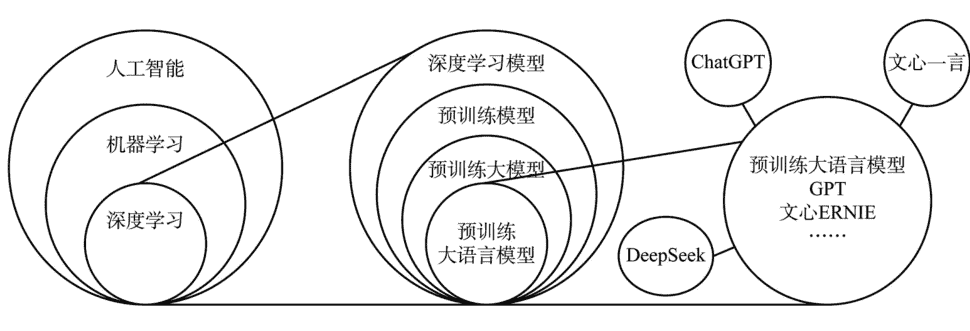

概括地讲，DeepSeek是一个先进的大语言模型，它属于深度学习和机器学习的范畴，是人工智能发展到认知智能阶段的产物，也是当前世界上生成式AI中的一个优秀代表。它之所以强大，正是因为它在算法、数据利用效率和算力优化上取得了突破，能够高效地理解和生成高质量内容。

理解这些基本概念、发展阶段、核心要素以及它们之间的关系，特别是生成式AI和大语言模型的特征，有助于教师更清晰地认识DeepSeek这类工具的技术背景和能力所在，为后续学习其核心功能、掌握提示词技巧以及在教育教学中进行有效、负责任的应用打下坚实的认知基础。这也是提升教师AI素养不可或缺的一部分。

### 二、DeepSeek核心功能详解

DeepSeek作为世界领先的大语言模型，凭借其强大的能力和不断优化的版本，为赋能教育教学带来了极大的可能性。这一节我们先深入了解DeepSeek的能力以及其两个模型的主要特点和功能。

#### （一）DeepSeek的通用能力

作为一个先进的大语言模型，DeepSeek具备广泛的通用能力，表现在以下几个方面。

##### 1 强大的自然语言理解与生成

DeepSeek能够深入理解用户的自然语言指令（提示词），并生成流畅、连贯、符合逻辑的文本内容，如文章、摘要、邮件、报告、教学设计等。

##### 2 知识问答与信息整合

基于其海量的训练数据，DeepSeek能够回答各个领域的问题，提供信息检索、知识解释、观点梳理等服务。

##### 3 多语言处理能力

DeepSeek在中文和英文方面都表现出色，能够进行文本翻译、双语内容生成、语法纠错等，支持跨语言的教学与交流。

##### 4 代码能力

DeepSeek具备生成和解释代码的能力，可以辅助信息技术教学或跨学科的编程。

##### 5 文件处理与分析

DeepSeek支持读取和分析多种格式的文件（如PDF、Word文档等），能够快速提取要点、生成摘要、回答基于文档内容的问题。

##### 6 联网搜索能力

DeepSeek具备联网搜索功能，可以获取和整合最新的网络信息来回答问题或生成内容。

#### （二）DeepSeek模型特点：V3通用模型与R1推理模型

目前DeepSeek主要有V3和R1两个具有代表性的模型，它们在设计目标和擅长领域上有所侧重。理解它们的特点有助于教师根据具体教学任务选择合适的模型。为了更清晰地展示两个模型的差异，表3-1从多个维度对比了两个模型。

表3-1 DeepSeek模型对比

| 对比维度 | DeepSeek-V3(通用模型) | DeepSeek-R1(推理模型) |
| :--- | :--- | :--- |
| 核心定位 | 多任务、通用场景 | 复杂问题解决、逻辑推理 |
| 擅长任务 | 文本生成、问答、翻译、摘要、对话(部分版本) | 数学推导、代码生成、科学计算、策略分析、多步因果推理 |
| 训练侧重 | 预训练+监督微调 | 更侧重强化学习或针对推理任务的专项训练 |
| 核心创新 | 多语言优化、长上下文支持、高性能推理(压缩技术) | 支持“思维链”输出、自我纠偏能力、多步因果推理 |
| 输出特点 | 输出相对简洁、直接，有时依赖更结构化的提示词获取精确结果 | 输出更详细，能自动拆解问题逻辑链，展示思考过程，对提示词的结构要求可能相对宽松(对开放性问题) |
| 响应速度与成本 | 响应速度相对较快，适合需要快速反馈的任务 | 推理过程可能更复杂，响应速度相对较慢，但API成本可能更低(针对特定推理任务优化) |
| 主要教育场景 | 教学材料生成、语言学习辅助、基础知识问答、内容总结 | 复杂问题解析(展示步骤)、学术研究辅助(逻辑梳理)、个性化深度辅导(多角度解答)、编程教学 |
| 优势 | 生成速度快，适合标准化内容生成，应用范围广 | 推理过程透明，有助于培养学生逻辑思维，擅长解决复杂问题 |
| 局限 | 复杂逻辑推理深度可能有限，有时需要人工进一步加工或校验 | 输出速度可能较慢，不太适合需要极高实时性的互动场景 |

DeepSeek-V3（通用模型），其定位是面向多任务、通用场景的大模型，它支持文本生成、知识问答、翻译、写作等多种常见任务，泛化能力强；支持较长的文本输入（如32K tokens），适合处理长文档分析、多轮复杂对话等，而且还针对通用任务进行了优化，因此响应速度相对较快。具体到教育教学场景中，比较适合用于生成标准化、结构化的教学材料，如快速生成课程大纲、知识点总结、基础概念解释、多语言学习辅助（翻译、语法纠错）、常规问答等。

DeepSeek-R1（推理模型），该模型是专注于逻辑推理、复杂问题解决的专用模型。它推理能力强，擅长处理需要多步骤分析、因果推断、逻辑演绎的任务，如数学题推导、代码逻辑生成、科学计算、策略分析等。由于其采用MoE（混合专家）等架构，在保证强大推理性能的同时，具有更高的计算效率，而且还针对推理类任务进行了专项训练和优化。此外，R1模型的一个显著特点是能够输出“思维链”（即展示解决问题的详细步骤和推理过程，可视化思维过程，而不仅仅是呈现最终答案），这对教师和学生了解模型的思维方式和过程具有重要的借鉴价值。R1模型在教育应用中非常适合用于需要展示思考过程、进行深度探究的教学场景，如数学题的解题步骤演示、物理问题的逻辑推导、编程题的思路解析、实验方案的设计与论证、复杂概念的多角度辨析等。其“思维链”功能有助于学生理解解题过程，培养逻辑思维能力。

#### （三）如何选择合适的模型

教师在实际应用中，应根据具体的教学目标和任务场景，灵活选择DeepSeek的V3或R1模型。例如，当需要快速生成教学文案、总结知识点、进行语言翻译或基础问答时，V3通用模型通常是更高效的选择。而当需要深入探究一个复杂问题、展示解题思路、进行逻辑推理或需要AI提供详细思考过程时，R1推理模型则更能发挥其优势，其“思维链”功能尤其适合用于启发学生思考、培养其分析和解决问题的能力。

理解DeepSeek不同模型的核心功能和特点，是教师有效利用这一强大工具赋能教学创新的基础。下一节，我们将深入探讨如何通过提示词技巧来更好地驾驭这些模型，让AI更精准地理解我们的意图，生成更符合教学需求的优质内容。

### 三、DeepSeek实战入门

了解了DeepSeek的核心功能和不同模型的特点后，现在开始动手实践了！本节将指导你访问DeepSeek平台、熟悉其基本界面和操作流程，为后续更深入的应用打下基础。掌握这些基本操作是开启AI赋能教学之旅的第一步。

#### （一）访问DeepSeek的主要途径

目前，用户主要可以通过以下几种方式访问DeepSeek。

##### 1 DeepSeek官方网站（云端平台）

这是最直接、功能最全面的方式。你可以通过电脑或手机的浏览器访问DeepSeek的官方网站：https://chat.deepseek.com/。

图3-2 DeepSeek官网首页

DeepSeek-V3 模型更新，各项能力全面进阶，在网页端、APP 和 API 全面上线，点击查看详情。

###### deepseek

###### 探索未至之境

开始对话
与 DeepSeek-V3 和 R1 免费对话
体验全新旗舰模型

获取手机 App
DeepSeek 官方推出的免费 AI 助手
搜索写作阅读解题翻译工具

官方网站访问的优点是功能最全，能体验最新的模型和特性，无需安装，但也有缺点，如需要推理或者联网使用时，有时候会出现系统繁忙问题，无法正常使用。选择“开始对话”后就进入与DeepSeek对话交流的界面了。

图3-3 DeepSeek使用的三种模式

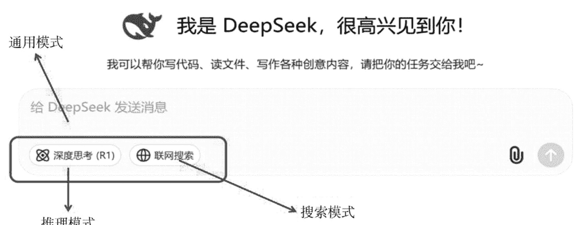

2025年5月28日DeepSeek更新了R1版，即DeepSeek-R1-0528，更新后的R1模型仍然使用2024年12月发布的DeepSeek-V3-Base模型作为基座，但在后训练过程中投入了更多算力，显著提升了模型的思维深度与推理能力，其深度思考能力得到了强化。更新后的R1模型在数学、编程与通用逻辑等多个基准测评中取得了在当前国内所有模型中首屈一指的优异成绩，并且在整体表现上已接近其他国际顶尖模型，如ChatGPT的o3与谷歌的Gemini 2.5 Pro。DeepSeek于2025年8月21日正式发布了V3.1版本，本次升级主要引入了混合推理架构，使得同一个模型同时支持思考模式（DeepSeek-Reasoner）和非思考模式（DeepSeek-Chat），用户可根据任务需求自由切换。思考模式适用于复杂逻辑推理和数学计算，响应更精准；非思考模式则适用于日常对话，响应更迅速。新版的智能体（Agent）能力大幅提升，上下文窗口扩展至128K，灵活性与效率兼备。

##### 2 集成DeepSeek能力的第三方平台与应用

许多国内主流的AI应用或平台也集成了DeepSeek的模型能力，为用户提供了更多选择。这些平台往往结合了自身特色，提供了一些附加功能。

（1）腾讯元宝：集成了DeepSeek的强大模型（满血版），并且支持与腾讯自家的混元模型进行切换。其特色在于可以联网搜索微信公众号等腾讯生态内的内容，并提供AI总结、多格式文档解析（PDF、Word、链接）等实用功能。

图3-4 腾讯元宝网页版界面

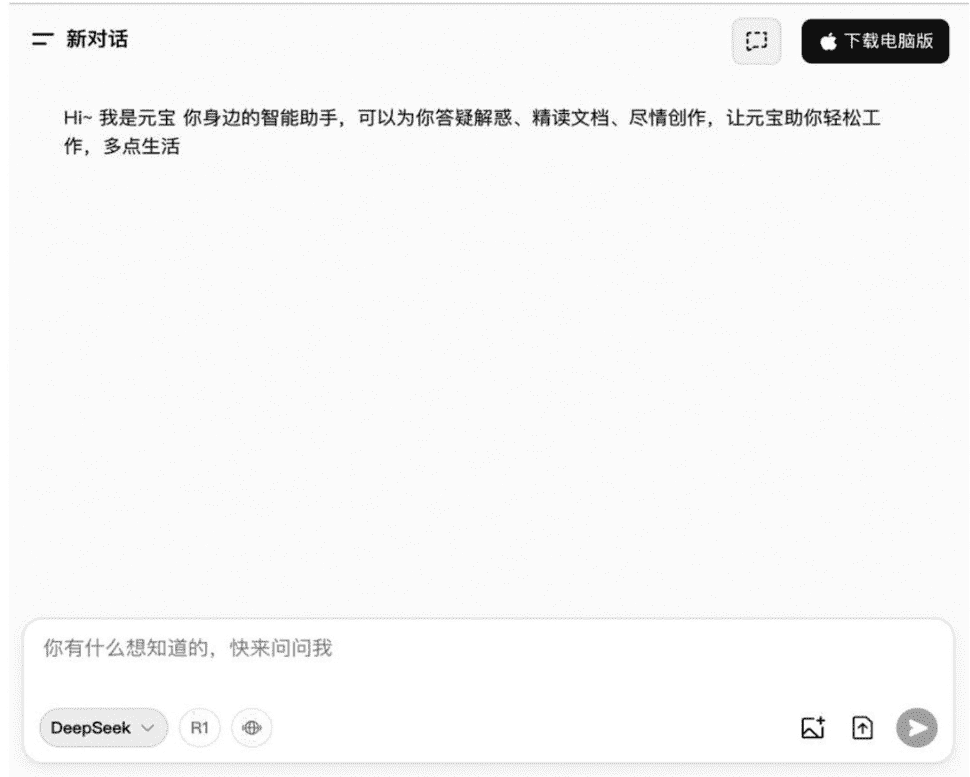

（2）秘塔AI搜索（Metaso）：以AI搜索为核心，同时集成了DeepSeek的能力（可能是R1增强版），其特点是支持“深度思考”模式，适合进行复杂问题的探究和信息整合。

图3-5 秘塔AI搜索网页版界面

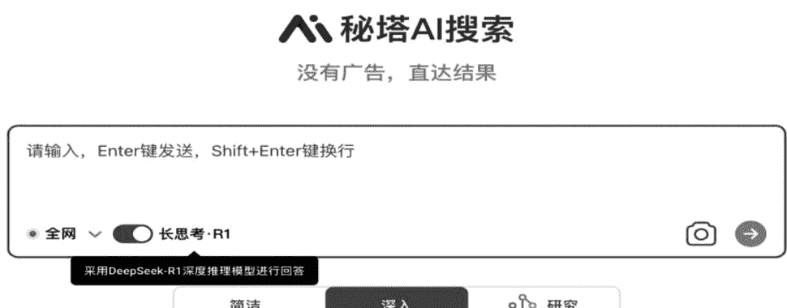

（3）纳米AI搜索（Nami）：接入了DeepSeek，有时会提供不同版本（如官方宣称的671B“满血版”和可能更快的版本）供用户选择，目前提供免费使用（可能有额度限制）。

图3-6 纳米AI搜索网页版界面


（4）其他集成平台：钉钉、飞书、天工AI、扣子等办公或AI应用平台，以及一些云服务商（如火山引擎、百度智能云、阿里云、华为云等）可能也提供了DeepSeek模型或基于其技术的服务接口，但这些更多地面向开发者或企业用户。

这些集成平台可能更符合用户已有的使用习惯，或提供特定场景下的便利功能（如腾讯元宝的微信生态搜索），但功能受限于第三方平台的集成程度和策略，不一定能完全体验DeepSeek的所有原生功能或最新模型，且可能涉及不同的收费模式。

（5）本地部署：对于有较高技术能力、特殊数据安全需求或希望进行深度定制的学校或教育机构，可以考虑将DeepSeek开源模型进行本地化部署。但这通常需要强大的硬件服务器（特别是高性能GPU）、专业的技术团队进行部署、维护和优化，并且成本投入巨大。对于绝大多数中小学教师个人而言，通过电脑或手机云端访问（官网或可信赖的第三方平台）是目前最现实、最便捷的使用方式。

图3-7列出了DeepSeek可以访问的平台架构，教师可以根据自己的需要和体验选择使用。

本书主要以DeepSeek官网云端平台为例进行讲解和演示，同时也会兼顾一些常见的第三方平台的使用特点。

图3-7 DeepSeek访问平台框架图

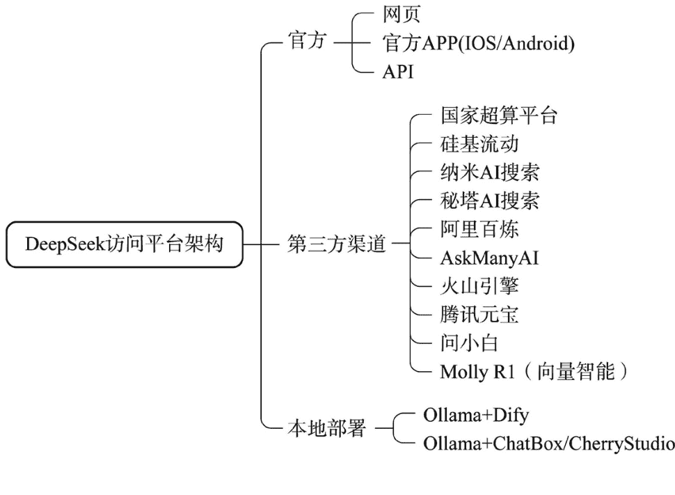

#### （二）DeepSeek主要界面布局与功能区介绍（以官网为例）

##### 1 DeepSeek页面布局

登录DeepSeek官网后，你会看到一个简洁的对话界面。其核心功能区包括：

- （1）对话窗口：是主要的交互区域，显示你与DeepSeek的对话历史。你的提问和DeepSeek的回答会在这里依次展示。
- （2）提示词输入框：位于界面下方居中位置，这是你输入提示词（你想对DeepSeek说的话或提出的问题）的地方。它支持直接输入文字。
- （3）发送按钮：通常在输入框的右侧，是一个向上的箭头，点击此箭头将你输入的内容发送给DeepSeek。
- （4）模型选择器：这是非常重要的功能区，位于输入框下方。它允许你在不同的DeepSeek模型之间切换，例如选择“深度思考R1”，字体变为蓝色就开启了推理模型。了解不同模型的特点并进行选择，是根据任务需求获得最佳结果的关键。
- （5）联网搜索开关：也在输入框下方，用于控制是否允许DeepSeek联网查询实时信息来辅助回答。
- （6）文件上传按钮：位于输入框右侧，是一个回形针图标。点击后可以选择本地文件上传。DeepSeek支持处理多种格式的文件，除了常见的PDF、Word、TXT外，还支持如CSV、Excel等表格数据文件，可用于数据分析和可视化任务（具体支持格式请以平台实际功能为准，可能还会经常更新，支持更多的文件格式）。

熟悉这些基本的功能区域将帮助你更顺畅地开始使用DeepSeek。

##### 2 基本的对话交互操作

与DeepSeek进行交互的核心就是“对话”：

- （1）思考你的问题或任务：明确你想让DeepSeek做什么，或者想问什么问题。
- （2）在输入框中输入提示词：将你的问题或指令用自然语言清晰地输入到输入框中。关于如何写好提示词，我们将在下一节详细探讨。
- （3）选择合适的模型：根据你的任务需求，通过模型选择器选择V3或R1模型。
- （4）开启联网搜索（可选）：如果需要获取最新信息，要确保联网搜索功能已开启。需要注意的是，开启联网搜索后，就不能上传文件了。
- （5）点击发送按钮：将你的提示词发送给DeepSeek。
- （6）等待并阅读回复：DeepSeek会处理你的请求并生成回复，显示在对话窗口中。请耐心等待并仔细阅读它的回答。
- （7）继续对话（可选）：如果你对回答不满意，或者想进一步追问、澄清或要求修改，可以在输入框中继续输入新的提示词，进行多轮对话。DeepSeek通常能理解上下文的关联。
- （8）新建对话（需要时）：当你想开始一个全新的、与之前内容无关的任务时，建议点击“新建对话”按钮，以保持对话的清晰度和专注度。

##### 3 文件上传与处理

DeepSeek官网平台通常支持文件处理功能：

- （1）找到上传入口：点击输入框附近的回形针图标。
- （2）选择文件：从你的电脑或设备中选择你想要处理的文件（注意支持的文件格式如PDF、Word、TXT、CSV、Excel等，以及单次上传的大小限制）。
- （3）提出处理要求：文件上传成功后，你需要在输入框中明确告诉DeepSeek你希望它对这个文件做什么，例如：“请总结这份PDF文档的核心论点”，“请根据这份Word文档内容，为我出5道相关的选择题”，“请帮我分析这份CSV文件中的数据，并生成一个柱状图”等。

##### 4 发送指令：点击发送按钮

文件处理能力，特别是对表格数据的支持，极大地扩展了DeepSeek在教学数据分析、学情报告解读等方面的应用场景。

掌握了这些基本操作，你就成功地迈入DeepSeek的世界了。不要害怕尝试，多与它进行互动，特别是进行持续不断的深度对话，是熟悉其功能和特点的最佳方式。在下一节中，我们将重点学习如何通过精心设计提示词，让DeepSeek更懂你，更好地为你服务。

### 四、国内主要生成式AI工具概览

在前面的章节中，我们已经深入了解了DeepSeek的强大功能与实操方法。然而，AI的世界远不止于此，国内的生成式AI领域更是呈现出百花齐放的繁荣景象。除了DeepSeek，还有众多功能强大的AI模型可供教师选择，它们在功能、特性和应用场景上可以满足各种教学任务，助力教学目标的实现。

本节旨在为广大教师全面介绍国内主流的生成式AI工具，帮助你构建一个多元、立体的AI工具箱。我们希望教师能够超越对单一工具的依赖，深刻理解“没有最好的AI，只有最合适的AI”这一理念。根据具体的教学目标、场景和任务，灵活地选择、组合乃至创新地运用这些工具，将它们的能力融会贯通，才能真正实现AI对教学的深度赋能，创造出富有想象力和个性化的教学体验。

#### （一）主流大语言模型概览

为了帮助教师快速了解各个主流大语言模型的特点，我们首先通过一个表格进行宏观了解。

表3-2 大语言模型特点对比

| 模型名称 | 研发机构 | 核心特点 | 特色功能与优势 | 主要教育应用潜力 |
| :--- | :--- | :--- | :--- | :--- |
| 文心一言 (ERNIE Bot) | 百度 (Baidu) | 知识增强，综合能力强 | 具备较强的图文生成（多模态）能力，深度整合百度搜索生态，知识问答准确度高 | 备课资料查询、生成带配图的课件、设计跨学科主题探究活动 |
| 通义千问 (Qwen) | 阿里巴巴 (Alibaba) | 文档处理能力突出 | 支持超长文档（如 PDF、Word）的阅读理解和摘要，与钉钉等办公软件深度集成 | 阅读和分析学术论文、快速解读政策文件、处理学生长篇作文 |
| 豆包 (Doubao) | 字节跳动 (Byte-Dance) | 风格多样，易于上手 | 提供多种智能体角色，对话风格自然流畅，适合日常交流和创意写作 | 扮演角色与学生对话、生成不同风格的作文范文、进行头脑风暴 |
| 智谱清言 (ChatGLM) | 智谱 AI (清华大学技术成果转化而成) | 学术背景，代码能力强 | 代码生成和逻辑推理能力在国内模型中表现优异，具备较好的学术严谨性 | 辅助信息技术/编程教学、设计数理逻辑题目、进行学术文献检索与分析 |
| 讯飞星火 (iFlytek Spark) | 科大讯飞 (iFlytek) | 语言与教育场景深度融合 | 语音识别与合成能力顶尖，内置作文批改、口语评测等多种教育专用功能 | 英语口语练习与评测、中英文作文智能批改、生成课堂发言稿并转为语音 |
| Kimi 智能助手 | 月之暗面科技 (Moonshot AI) | 超长无损上下文 | 支持高达 200 万字的上下文窗口，在长文档阅读、信息整合和摘要方面无出其右 | 快速阅读并总结整本书籍、分析长篇报告、整合海量文献资料 |

#### （二）各模型功能特色详解

下面，我们将对上述模型以及在图像、视频生成领域表现突出的AI工具进行更详细的介绍。

##### 1 大语言模型

（1）文心一言（ERNIE Bot）https://yiyan.baidu.com/

文心一言是百度公司研发的知识增强大语言模型，可以被看作一个博学多才的“全能型选手”。其核心优势在于深度整合了百度搜索生态和庞大的知识图谱，因此在知识问答方面的准确性相对较高。截至2025年8月，其旗舰模型已升级至文心4.5 Turbo，在速度和效果上进一步提升，同时具备强大的多模态能力，能够根据文字描述生成质量不错的图片，非常适合为教学内容增添视觉元素。其丰富的插件生态，如PPT生成、思维导图制作等，也极大地扩展了它的应用边界。在教育教学中，教师可以利用文心一言进行高效的备课资料查询，或者在设计跨学科主题探究活动时，让它围绕某一主题生成图文并茂的介绍材料。

（2）通义千问（Qwen）https://www.tongyi.com/qianwen/

通义千问是阿里巴巴出品的“文档处理专家”，它最突出的能力在于对长篇复杂文档的深度阅读和理解。在2025年，其模型已升级至Qwen 3，不仅在中英文理解、逻辑推理和知识增强方面有大幅提升，更是将原生支持的上下文长度扩展到256K，进一步巩固了其文档处理的优势。此外，它与钉钉等办公软件的深度集成，也方便教师在日常工作流中无缝使用。对于教育工作者而言，通义千问是处理文本材料的利器，无论是用它来快速阅读和分析学术论文，还是解读冗长的教育政策文件，抑或是对学生提交的长篇作文进行初步的归纳和分析，都能显著提升工作效率。

（3）豆包（Doubao）https://www.doubao.com/chat/

豆包是字节跳动推出的一款“社交型AI伙伴”，它的特点是对话风格轻松自然，交互体验非常流畅，易于上手。2025年7月底，字节跳动发布了其大模型体系的全面升级，包括豆包大模型1.6系列以及豆包·图像编辑模型3.0、豆包·同声传译模型2.0等，显示出其平台化、专业化的发展趋势。其内置的智能体广场提供了海量不同角色和功能的AI智能体，如“英语学习助手”“心理伙伴”等，教师和学生可以直接选用，趣味性强。例如，教师可以利用豆包智能体设定一个虚拟导师角色，以对话的方式引导学生自主探索课题。在教育应用中，豆包的多样化风格使其充满潜力。例如，历史老师可以创建一个“苏格拉底”智能体，让学生在对话中体验思辨的乐趣；语文老师可以利用它生成不同风格的作文开头或范文，有效启发学生的写作思路和创造力。

（4）智谱清言（ChatGLM）https://chatglm.cn/

智谱清言是清华大学技术成果转化而成的“学院派AI”，其深厚的学术背景使其在逻辑推理和代码生成能力上表现扎实。截至2025年8月，其新版顶级模型GLM-4.5已经上线，进一步强化了其在代码、推理和长文本处理上的优势。对于信息技术或编程相关的教学，智谱清言是强大的辅助工具，不仅能生成和解释代码，还能帮助调试错误。其输出内容相对严谨，也适合用于处理一些科学、理性的探究任务。在教学中，教师可以利用它来辅助编程教学、设计数理逻辑相关的题目，或是在进行课题研究时，用它进行初步的学术文献检索与分析。

（5）讯飞星火（iFlytek Spark）https://xinghuo.xfyun.cn/desk

讯飞星火是科大讯飞专为中国用户，特别是教育场景，深度定制的AI模型。它继承了讯飞在语音识别与合成领域的顶尖技术，并在此基础上，内置了大量为教育量身打造的功能，如中英文作文的智能批改与语法分析、英语口语的跟读评测等。可以说，讯飞星火是非常贴近教师日常教学工作流程的AI之一。英语老师可以用它为学生提供一对一的口语对练和即时反馈；语文老师可以用它批量批改学生周记，从而将更多精力投入到对学生思想和写作逻辑的指导上。

（6）Kimi智能助手 https://www.kimi.com/

Kimi智能助手是月之暗面公司开发的“海量信息阅读器”，它凭借超长无损上下文处理能力，在AI领域独树一帜。截至2025年8月，其最新模型已升级为K2，继续巩固和发展其在长文本处理上的领先地位，支持高达200万字的上下文窗口。这意味着当处理极长篇幅的文档或进行多文档比较分析时，它不会像其他模型一样轻易“遗忘”前面的内容。这项能力使其成为信息整合的强大工具。对于需要进行大量文献阅读的教师和学生而言，Kimi的价值尤为突出。教师在进行课题研究时，可以把几十篇参考文献一次性交给Kimi，让它生成全面的文献综述；学生在撰写读书报告时，也可以上传整本电子书，让Kimi帮助快速定位关键信息和核心论点。

##### 2 图像与视频生成模型

除了大语言模型，还有能够将抽象文字转化为直观视觉内容的图像与视频生成AI模型，它们为教学带来了巨大的创新空间。表3-3 图像与视频生成模型对比续表

| 模型名称 | 研发机构 | 核心定位 | 主要特点 | 主要教育应用潜力 |
| :--- | :--- | :--- | :--- | :--- |
| 可灵 (Kling) | 快手 (Kuaishou) | 专业级文生视频大模型 | 文生视频。模型升级至2.1，运动质量更高，视频更灵动，指令响应更好 | 生成科学演示动画（如细胞分裂）、历史情景再现、文学作品可视化 |
| 智谱清影 (Zhipu Qingying) | 智谱 AI (Zhipu AI) | AI 生视频创作平台 | 支持文生视频和图生视频，与智谱清言同源，注重逻辑性和连贯性 | 生成教学演示视频、将静态图片（如教材插图）转化为动态视频 |
| 海螺视频 (Hailuo AI) | MiniMax | AI 视觉内容创作平台 | 支持文生视频和文生图，强调“将想法变为视觉”，与 AI 助理紧密结合 | 快速生成教学短视频、为学生提供多模态的问答体验 |
| 腾讯混元 AI 视频 | 腾讯 (Tencent) | 腾讯生态内的视频生成工具 | 文生视频。基于混元大模型，已逐步与腾讯会议、腾讯文档等腾讯生态内工具深度融合，注重真实感 | 制作课程宣传片、生成与腾讯生态内容相关的教学视频 |
| 通义万相 (Tongyi Wanxiang) | 阿里巴巴 (Alibaba) | 综合性 AI 绘画与视频创作平台 | 文生图、图生图、文生视频。模型升级至 Wan 2.2，功能全面，风格多样 | 辅助美术与设计教学、为各学科课件生成高质量插图/视频片段 |
| 即梦 (Tiamat) | 抖音集团 (Douyin Group) | 多功能 AI 创意与创作平台 | 文生图 (图片 3.1)、文生视频、数字人、动作模仿，功能维度非常丰富 | 辅助美术教学、创作历史/地理主题图像、制作虚拟教师形象进行讲解 |
| 剪映 (CapCut) | 字节跳动 (Byte-Dance) | 集成 AI 功能的视频剪辑工具 | 图文成片。极大降低视频创作门槛，侧重于剪辑流程中的 AI 自动化 | 教师快速制作微课、学生制作视频作业/项目成果展示、活动记录视频化 |

###### （1）可灵 (Kling) https://app.klingai.com/cn/

可灵是快手公司推出的“电影级”文生视频大模型。截至2025年8月，其模型已升级至可灵2.1，在运动质量、视频美感和指令响应度上都有显著提升。它专注于文生视频，能够根据文字描述生成长达2分钟、1080p分辨率的高清视频，并且在模拟真实物理规律、人物动作的连贯性和面部表情的生动性上表现突出。对于教学而言，这意味着教师可以将许多抽象和难以观察的过程可视化。例如，生物老师可以输入“一段展示细胞有丝分裂过程的科教动画”来生成生动的教学短片，或者语文老师可以输入一段课文的关键情节，让可灵生成情景再现视频，帮助学生更直观地理解文本。

###### （2）智谱清影 (Zhipu Qingying) https://chatglm.cn/video

智谱清影是智谱AI推出的AI生视频创作平台，可以看作是“学院派”的视频创作者。它支持文生视频和图生视频两种模式，用户既可以通过文字描述，也可以上传一张图片来生成视频。作为智谱AI大模型家族的一员，它继承了智谱清言在逻辑理解上的优势，视频内容生成逻辑严谨，在生成视频内容的连贯性和故事性上表现较好，这使得它很适合用来创作具有叙事性的教学内容，可以用于生成科学实验过程、历史事件动态复原等教学场景。例如，教师可以利用它将教材中静态的插图转化为动态的讲解视频，或者让学生用自己的绘画作品生成一段小动画，激发创作热情。

###### （3）海螺视频（Hailuo AI）https://hailuoai.com/video

海螺视频是MiniMax公司旗下的AI视觉内容创作平台，其核心理念是“将想法变为视觉”（Transform Idea to Visual）。它不仅支持文生视频，也具备文生图的能力，与海螺AI的对话功能无缝衔接，用户可以在对话中直接指令AI进行创作，使用非常便捷。这种即时生成的能力在教学中非常有用，比如教师在与AI讨论教学方案时，可以即时要求AI将某个教学环节生成视频片段进行预览；学生在向AI提问时，AI也可以用一段小视频或图片来辅助解释复杂的概念，实现真正的多模态问答。该模型特别适用于即时生成科普类、教育类短视频，提高课堂互动性。

###### （4）腾讯混元AI视频 https://video.hunyuan.tencent.com/

腾讯混元AI视频是腾讯公司基于其混元大模型推出的文生视频解决方案。它专注于将文本描述转化为具有真实感的视频内容。作为腾讯生态系统的一部分，它最大的潜力在于未来能与微信、腾讯会议、腾讯文档等应用深度融合。这意味着教师未来或许可以直接在微信群里分享AI生成的活动宣传片，或是在腾讯课堂等平台上一键生成课程回顾视频，实现边聊边创作、边教学边生成教学资源的高效工作模式。

###### （5）通义万相 (Tongyi Wanxiang) https://tongyi.aliyun.com/wanxiang

通义万相是阿里巴巴通义系列的“全能艺术家”，一个功能丰富的AI绘画与视频创作平台。截至2025年8月，其模型已升级至Wan 2.2。它是一个集大成者，不仅支持高质量的文生图、图生图，也具备文生视频的能力。其内置的多种预设艺术风格，如国画、动漫、像素艺术等，便于快速生成特定风格的作品。在教育中，通义万相的应用场景非常广泛，艺术老师可以引导学生用它将自己的涂鸦转化为完整的艺术作品；地理老师则可以用它生成具有不同地貌特征的风景画，或展现地壳运动的短视频，让知识跃然纸上。

###### （6）即梦 (Tiamat) https://jimeng.jianying.com/

即梦是抖音集团推出的多功能AI创意与创作平台，其功能维度非常丰富。它不仅支持高质量的文生图（其图片模型已更新至3.1版本）和文生视频，更提供了独特的数字人和动作模仿功能。这意味着用户不仅可以创造视觉内容，还可以生成虚拟形象，甚至让虚拟形象模仿指定的动作。在教育领域，这开辟了全新的可能性。例如，教师可以创建自己的虚拟教师形象来进行课程讲解，或者利用动作模仿功能，为体育课或舞蹈课制作标准的示范动作视频，极大地丰富了教学形式。

###### （7）剪映 (CapCut) https://www.capcut.cn/

剪映是一款集成了强大AI功能的视频剪辑工具。它与其他文生视频模型的区别在于，它更侧重于降低视频“剪辑”的门槛。其核心AI功能是“图文成片”，用户只需输入文字，AI即可自动匹配素材、生成配音和字幕，一键生成完整的视频。对于广大教师而言，剪映可能是最友好、最实用的视频创作工具。任何学科的教师都可以将自己的教案或讲稿输入剪映，快速生成一个内容丰富、形式生动的微课视频，极大地降低了视频创作的技术门槛。

本节我们介绍了国内主要的生成式AI的多模态模型，从各具特色的语言模型，到功能强大的图像视频生成工具，它们共同构成了一个强大而丰富的AI教育应用生态。

掌握这些工具的关键，不仅在于了解它们各自的功能，更在于培养一种“组合创新”的思维。未来的智慧教师，将如同导演一般，根据教学剧本的需求，调度不同的AI“演员”（工具），将语言模型、图像生成、视频创作等能力有机地组合起来，创造出前所未有的、富有吸引力的教学体验。例如，先用Kimi整合大量文献形成知识框架，再用文心一言撰写教学文稿，最后用可灵或剪映将文稿转化为生动的教学视频。

AI技术仍在高速发展，功能日新月异。最重要的不是记住每一个工具的所有细节，而是保持开放的心态，及时关注AI的最新功能，勇于尝试和探索。希望本节的介绍能为教师打开一扇窗，能激发教师在教学实践中，从“使用工具”迈向“驾驭工具”，开启教学创新的无限可能。

### 五、使用生成式AI的技能层次

教师在使用生成式AI时不仅需要了解其基本功能，更要掌握不同层次的应用技能，以应对不同复杂程度的教学任务。掌握这些技能，教师将从AI的使用者，转变为能够驾驭AI解决复杂教学问题的创造者。根据教学任务从简单到复杂的不同需求，教师使用生成式AI的技能可分为以下四个层次（见图3-8）。图3-8 生成式AI使用的技能层次

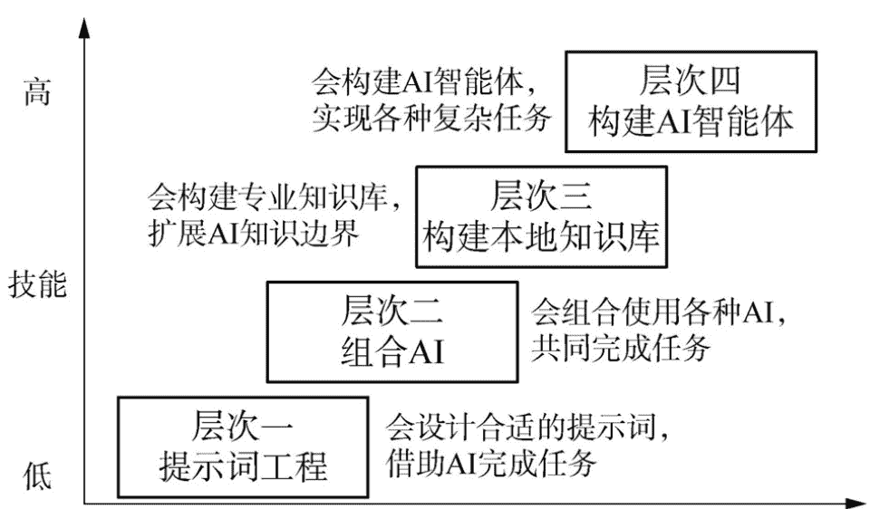

#### （一）层次一：提示词工程

这是使用生成式AI最基础也最核心的技能。处于这个层次的教师，能够通过设计清晰、具体、富有逻辑的提示词，引导AI模型准确理解任务需求，从而生成高质量的文本、图片、代码或其他内容。教师应该具备的核心能力是会设计合适的提示词，借助AI完成任务。典型的教学应用场景如：

- 备课助手：输入“请为小学五年级数学设计一个关于‘小数乘法’的趣味课堂导入活动”，快速获取教学灵感。
- 出题助手：输入“请根据以下关于光合作用的知识点，生成5道选择题和2道简答题”，高效完成随堂练习的编写。
- 答疑助手：针对学生提出的问题，设计提示词让AI生成通俗易懂的解释。

在这个层次，教师主要将AI作为一种高效的辅助工具，完成相对独立的、单一步骤的教学任务。

#### （二）层次二：组合AI

当面临的教学任务更为复杂，单一的AI工具或模型难以一步到位时，就需要进入第二个技能层次——组合AI。这个层次的教师能够像指挥一个团队一样，将多个不同的AI工具或服务组合起来，形成一个工作流，协同完成一个综合性的任务。教师应该具备的核心能力是会组合使用各种AI，共同完成任务。典型的教学应用场景包括：

- 制作多媒体课件：首先，使用一个AI模型（如DeepSeek）生成课文的逐字稿和教学设计；接着，使用另一个AI图片生成工具（如Midjourney）为课文关键情节配图；最后，再使用一个AI视频剪辑工具（如剪映），将文字、图片和AI配音合成为一个完整的教学视频。
- 设计项目式学习：利用AI生成项目主题和方案，再用AI工具制作项目介绍海报，最后用AI生成项目评估量规（Rubric）。

在这个层次，教师的角色从“使用者”向“项目经理”转变，需要具备一定的规划和整合能力。

#### （三）层次三：构建本地知识库

通用的大语言模型虽然知识渊博，但其知识截止于某个时间点，并且缺乏特定学科或校本课程的专业知识，有时还会产出幻觉。因此第三个技能层次要求教师能够为AI“补充养料”，即构建一个专业化、本地化的知识库，从而扩展AI的知识边界，使其回答更具针对性和权威性。教师应该具备的核心能力是会构建专业知识库，扩展AI的知识边界。典型的教学应用场景包括：

- 学科知识库：将特定学科的教材、课程标准、前沿论文、实验报告等资料整理成一个知识库（如利用腾讯的知识库管理工具ima，后面的章节中会有介绍），让AI能够基于这些权威资料回答学生的深度问题。
- 校本课程问答机器人：将学校的特色课程资料、校史、规章制度等输入知识库，创建一个能精准回答本校相关问题的AI助手。

掌握此技能的教师，能够将AI从一个“万事通”训练成一个特定领域的“专家”，使其服务于更精准、更专业的教学需求。

#### （四）层次四：构建AI智能体

这是目前最高阶的技能层次。教师不再仅仅是使用工具，而是开始创造工具。通过构建AI智能体，教师可以创建一个能够理解目标、自主规划并执行一系列复杂任务的自动化系统。教师具备的核心能力是会构建AI智能体，实现各种复杂任务（第十一章将会详细介绍）。典型的教学应用场景包括：

- 个性化学习导师：创建一个AI智能体，它能根据学生的在线学习行为数据（如答题正确率、视频观看时长），自动分析其知识薄弱点，并主动推送个性化的学习资料和练习题。
- 自动化教学研究助手：构建一个能自动浏览教育研究网站、筛选符合预设主题的最新论文并定期生成文献综述报告的AI智能体。

在这个层次，教师化身为开发者和创造者，能够利用AI构建出高度自动化和智能化的教育应用，从而将自己从重复性的劳动中解放出来，专注于更有创造性的教学工作。

总之，这四个层次代表了教师从AI的初学者到精通者的成长路径。教师可以根据自己的实际需求和兴趣，循序渐进地提升自己的AI应用技能，从而在人工智能时代更好地赋能教学、成就学生。本书将根据教学目标、教学任务和具体的教学场景，通过提供详细的案例，展示如何应用AI提高教师应用生成式AI的这些技能。

### 六、提示词技巧：与AI高效对话的艺术

掌握了DeepSeek的基本操作后，你可能会发现，有时候AI给出的回答并不完全符合预期，甚至“答非所问”。这往往不是AI本身能力不足，而是我们与它沟通的方式——即我们输入的提示词——不够清晰、准确和有效。

提示词，就是你向AI发出的指令或提出的问题。具体地说，提示词是用户与生成式AI交互时提供的输入指令或信息，用于引导AI生成符合预期的输出。它可以是问题、描述、命令或对话，通过定义任务目标、背景信息和输出要求，帮助AI理解用户意图并减少歧义。提示词的质量直接影响生成内容的准确性和相关性，是用户与AI沟通的核心桥梁。例如，清晰、结构良好、信息丰富的提示词能帮助AI准确理解你的需求，引导AI生成更相关、更深入、更符合要求的内容，避免误解和无效输出，它如同你与AI对话的“钥匙”，决定了你能从AI那里“解锁”什么样的信息和能力。因此，写好提示词，是一门需要学习和练习的艺术，更是教师高效利用DeepSeek等生成式AI工具赋能教学的关键技能。

#### （一）提示词的重要特征

高质量的提示词通常具备以下重要特征。

##### 1 明确性与具体性

提示词需要清晰地描述任务类型、期望的输出格式以及任何约束条件，避免使用模糊或笼统的表述。例如，“写一篇关于运动会的作文，面向小学三年级学生，要求包含至少三个表示开心的词语，字数在300字左右”就比“写一篇关于运动会的作文”要明确得多。

##### 2 结构化要素

一个结构良好的提示词通常包含几个关键部分：指令（任务要求）、上下文（背景信息）、输入数据（如果需要AI处理特定信息）和输出要求（格式、长度、风格等）。例如，设定角色（如“你是一名经验丰富的科学老师”）可以引导AI以更专业的口吻回答。

##### 3 背景信息与约束条件

提供必要的场景信息、目标受众（如学生年级、知识水平）、期望的语气风格（如生动有趣、严肃专业）等细节，能帮助AI生成更贴合实际需求的内容。例如，要求解释概念时注明“请用小学生能听懂的语言”。

##### 4 可调整与迭代性

很少有提示词能一次就达到完美效果。优秀的提示词使用者会根据AI的初步输出内容来判断问题所在，并通过微调提示词（如补充信息、调整措辞、增加限制）来逐步优化结果，这是一个不断迭代的过程。

##### 5 策略性技巧的应用

除了基本的要素，还可以运用一些策略性技巧来提升效果，例如使用思维链提示技术引导AI分步思考、使用分隔符（如、）清晰地区分指令和输入内容、提供少量示例供AI参考等，这些技巧可以增强AI输出的逻辑性、准确性和相关性。

理解并运用好这些特征，是构建有效提示词的基础。当然，在实践中教师可以从大量的案例中总结出更好的构建提示词的经验。

#### （二）优质提示词的基本原则与结构要素

一个好的提示词，通常遵循一些基本原则，并包含若干关键要素。虽然没有固定不变的公式，但以下原则和结构可以作为构建提示词的参考。

##### 1 写提示词要遵循的基本原则

- （1）清晰具体：避免使用模糊、笼统的语言，指令要明确，问题要具体。AI不会“猜”你的心思，你需要明确告诉它。
- （2）信息充分：提供必要的背景信息、上下文和约束条件，帮助AI理解任务情境。信息越充分，AI的回答越贴切。
- （3）目标导向：明确你希望AI完成的具体任务或达到的目标。你想让它做什么？生成什么？解决什么问题？
- （4）简洁直接：在保证清晰和信息充分的前提下，语言尽量简洁明了，避免冗余和歧义。
- （5）迭代优化：不要期望一次就能写出完美的提示词，通常需要根据AI的反馈进行调整和优化。这是一个不断尝试和改进的过程。

##### 2 常用提示词结构六要素

通过分析大量有效的提示词，我们提炼出一些常用的核心要素，这些要素可以帮助我们构建结构更清晰、信息更全面的提示词，在实际运用时，可以根据问题的性质、种类和任务目标，选择合适的要素组合。

- (1) 角色扮演（Role）：赋予AI一个特定的身份或视角。
- (2) 明确任务（Task）：清晰说明希望AI完成的具体动作。
- (3) 提供背景/上下文（Context）：给出任务相关的背景信息。
- (4) 设定格式/风格（Format）：规定输出内容的格式、风格、语气、长度等。
- (5) 给出示例（Example）：必要时提供期望的输出范例供AI模仿。
- (6) 设定约束/要求（Constraint）：提出具体的要求或限制条件。

下面是一个结构相对完整的提示词示例：“请你扮演一位初中历史教师（角色扮演），为八年级学生（背景）准备一节关于第一次世界大战起因的复习课。请帮我设计3个课堂互动活动（明确任务），活动形式要多样，能激发学生思考，每个活动请说明操作步骤和预计时间（格式要求），语言要简洁明了（风格要求）。”

#### （三）常用提问技巧与策略

除了构建结构化的提示词，掌握一些提问技巧和策略也能帮助你与AI进行更有效的互动。

##### 1 开放式提问与封闭式提问

根据目标选择提问方式，前者激发创意，后者获取精确信息。

- (1) 开放式示例（激发创意）：“想象一下如果你生活在唐朝，你会写一首什么样的诗来描绘长安的春天？”（小学语文/历史）
- (2) 封闭式示例（精确信息）：“请列出光合作用发生的必要条件。”（初中生物）

##### 2 追问与澄清

对AI的初步回答进行追问，引导其提供更深入或精确的信息。

> AI回答：“太阳系有八大行星。”

> 你可以追问：“这八大行星按照距离太阳从近到远的顺序具体是哪些？它们的主要特征有什么不同？”（小学/初中科学）

##### 3 多轮对话

将复杂任务分解，通过多轮对话逐步引导AI完成，直到满意为止。

> 第一轮：“帮我设计一个关于‘声音的产生与传播’的小学科学实验。”

> 第二轮（根据AI的回答调整）：“这个用音叉的实验不错，但材料不方便获得。能设计一个用日常物品就能做的实验吗？比如尺子、橡皮筋。”

##### 4 思维链引导

要求AI输出思考过程，特别适用于推理任务，DeepSeek的推理模型就可以输出思考过程。

> “请解释为什么1/2+1/3=5/6，请一步步写出你的思考和计算过程。”（小学数学）

##### 5 提供反例或约束

明确告知AI避免什么内容。

##### 6 要求多种选择

让AI提供多个方案供选择。

> “请提供三种不同的方法来证明三角形内角和是180度，分别适用于不同学习阶段的学生。”（数学）

##### 7 温度/创造性调整

根据任务需求调整AI回答的创造性程度，这个可以在平台的设置中选择设定。

> “写一首关于月亮的现代诗，风格可以自由浪漫一些（可能需要调高创造性设置）。”（语文）

> “准确描述月相变化的周期和原因（可能需要调低创造性设置）。”（科学）

#### （四）结构化提示词框架

为了更有效地构建高质量提示词，可以考虑将上述核心要素进行组合，形成一些结构化的框架。下面介绍一种我们提炼的STAR-AI结构，并精选几种其他常用结构。

##### 1 STAR-AI结构

这个结构整合了多个关键要素，清晰、全面且易于记忆。

(1) S——Situation（情境）：描述你希望AI处理的具体情境或背景。

例如：为即将到来的家长会准备发言稿、设计一堂关于植物光合作用的科学课、创作一个鼓励学生积极参与课堂讨论的故事等。

(2) T——Task（任务）：明确你希望AI执行的具体任务或动作。

例如：撰写、总结、设计活动、解释概念、生成练习题、翻译文本、分析数据等。

(3) A——Audience（受众）：明确你希望AI面向的受众是谁。

例如：小学三年级学生、初中生家长、学科教研组同事、有一定编程基础的高中生等。

(4) R——Role（角色）：赋予AI一个特定的角色或人设。

例如：扮演一位经验丰富的小学数学老师、一位耐心的心理辅导员、一位知识渊博的图书馆管理员、一位严格的物理实验员等。

(5) A——Aspect/Format（方面/格式）：规定你希望AI回答的侧重点或输出的格式。

例如：重点解释原理、侧重实际应用、使用项目列表、生成思维导图、输出Markdown格式、限制在三段以内等。

(6) I——Instruction/Constraint（具体指令/约束条件）：提供更具体的操作指令（区别于“Task”的宏观任务），或者设定明确的限制条件、排除项等，以进一步精确控制AI的输出。

例如：字数控制在300字左右、语气活泼有趣、必须包含关键词“细胞呼吸”、不要涉及微积分知识、请给出三个不同难度的版本等。

这个STAR-AI名称易记，结构清晰，方便组织提示，而且涵盖关键方面，能够确保全面性，教师可以在实践中不断尝试。

##### 2 STAR-AI构建提示词示例

（情境S）我正在为小学四年级学生准备一节关于“分数的初步认识”的数学课。（受众A）这些学生普遍觉得分数比较抽象，难以理解。
（任务T）请帮我设计一个课堂导入活动。（角色R）请扮演一位富有创意且非常有耐心的小学数学老师。（方面/格式A）活动需要互动性强，最好能结合生活中的实例（比如分比萨、切水果），时间控制在10分钟左右。（具体指令/约束条件I）请用简单易懂的语言，侧重于帮助学生直观理解“几分之一”和“几分之几”的概念，暂时不涉及分数的加减运算。

组合后的提示词：

请扮演一位富有创意且非常有耐心的小学数学老师，为小学四年级学生设计一个关于“分数的初步认识”的课堂导入活动。学生们觉得分数比较抽象，因此活动需要互动性强，结合生活实例（如分比萨），时间约10分钟。请用简单易懂的语言，侧重帮助学生直观理解“几分之一”和“几分之几”的概念，不涉及加减运算。

##### 3 STAR-AI结构要素与DeepSeek技术原理简析

为了帮助教师更深入地理解为何STAR-AI结构能够有效引导DeepSeek生成所需内容，表3-4简要解析了每个要素与DeepSeek（或类似的大语言模型）内部技术原理的对应关系。

表3-4 提示词与DeepSeek技术原理对应表

| STAR-AI 要素 | 意义与作用 | DeepSeek 技术原理/工作机制 |
| :--- | :--- | :--- |
| S(情境) | 提供上下文背景，限定问题边界 | 超长上下文窗口(如 128K tokens)与注意力机制: DeepSeek 能处理很长的对话历史或背景信息，通过注意力机制(可能包括稀疏注意力等优化)捕捉关键信息，理解当前指令所处的具体情境 |
| T(任务) | 明确输出类型和行动目标 | 指令微调: DeepSeek 通过在大量包含明确指令和对应输出的数据集上进行微调，学会理解并执行各种任务意图(如生成、分类、总结、推理等) |
| A(受众) | 确定内容适配层级 | 隐式用户建模/风格适应: 模型在训练中接触了不同风格和面向不同受众的文本，可以通过提示词中的受众信息，激活相应的语言模式，调整用词、句式复杂度等 |
| R(角色) | 定义输出风格和视角 | 可控生成技术/风格迁移: 通过特定的提示(如角色扮演指令)，可以引导模型调用或模拟其在训练数据中学到的特定角色或风格的语言特征，进行风格化的输出 |
| A(方面/格式) | 规范输出组织结构 | 结构化解码约束/格式遵循能力: 模型在训练中学习了常见的文本结构和格式(如列表、表格、Markdown)。通过提示词明确要求格式，可以引导模型在生成时遵循这些结构化约束 |
| I(具体指令/约束条件) | 限定生成条件，精确控制输出 | 多维度控制/条件生成: 模型支持通过多种方式对生成过程进行约束，如调节生成参数(温度、重复惩罚)、设定关键词(包含、排除)、遵守字数限制等，实现更精细化的内容控制 |

理解这种对应关系有助于教师更有针对性地设计提示词，更有效地利用DeepSeek的内在机制来获取更优质的教学辅助内容。

##### 4 其他常用结构

(1) C.R.I.S.P.E结构: 这个结构要素较为全面，适合需要精细控制输出的场景。

Context (情境)，Role (角色)，Instruction (指示)，Specifics (具体细节)，Persona (个性/语气)，Example (示例)

示例：“（情境C）学生们在学习电磁感应现象时，常常会对理解法拉第电磁感应定律有困难。（角色R）请扮演一位既专业又风趣的初中物理老师。（指示I）请用生动的例子解释法拉第电磁感应定律的原理。（具体细节S）你需要清晰地解释‘磁通量变化’是产生感应电流的核心条件，并通过类比（如把磁感线比作水流）让抽象概念形象化，同时要点明能量在这一过程中的转化关系。（个性P）希望你的讲解既严谨又有趣，能够吸引学生的注意力。（示例E）请提供至少两个不同的生活中的例子来说明这个定律。”

（2）R.I.S.E结构：结构简单，侧重步骤和期望。

Role角色，Input输入，Steps步骤，Expectation期望

示例：“（角色R）请扮演一位对中国古代诗歌非常了解的老师。（输入I）我想学习唐代诗人杜甫的《春望》这首诗。（步骤S）请详细解释这首诗每一句的含义，并分析诗歌所表达的思想感情。（期望E）我希望能够理解这首诗的艺术特色和历史背景。”

（3）T.S.C.F结构：强调任务、情境、限制和格式。

Task（任务），Situation（情境），Constraint（限制），Format（格式）

示例：“（任务T）请你为初中二年级学生解释‘动能定理’。（情境S）假设你正在上一节物理课，学生们已经学习了动能和功的概念。（限制C）解释要通俗易懂，避免使用过于专业的术语，并且要结合至少一个生活中的实例。（格式F）请以一个包含定义、公式和实例的段落形式呈现。”

（4）G.A.S.C结构：关注目标、受众、风格和内容。

Goal（目标），Audience（受众），Style（风格），Content（内容）

示例：“（目标G）帮助学生理解长方体和正方体的体积计算公式。（受众A）对象为小学五年级学生。（风格S）使用生动有趣、易于理解的语言，可以适当使用比喻。（内容C）解释体积的概念，推导长方体和正方体的体积公式，并提供简单的计算例题。”

（5）Q.P.D.C.R结构：聚焦对话逻辑，推动深度思考。

Question（问题），Probe（探究），Define（定义），Challenge（挑战），Reflect（反思）

示例：“（问题Q）请谈谈你对‘勇敢’这一品质的理解。（探究P）你觉得在面对考试压力时，勇敢具体会有哪些表现？（定义D）那你认为‘勇敢’和‘鲁莽’的区别是什么？（挑战C）如果一个人因为害怕失败而不敢尝试新事物，但他能坦然接受自己的平凡，这算不算勇敢呢？（反思R）经过这次讨论，你对‘勇敢’的认识有了哪些新的变化？”

（6）B.R.O.K.E结构：侧重于目标导向和持续优化。

Background（背景），Role（角色），Objectives（目标），Key Result（关键结果），Evolve（演进）

示例：“（背景B）学生们已经学习了植物细胞的基本结构，但对光合作用这个复杂的生化过程感到困惑，特别是能量如何转化。（角色R）请扮演一位善于使用比喻的科学老师。（目标O）我的目标是让你清晰地解释光合作用的原理，包括原料、产物、场所和能量转化。（关键结果K）生成一段200字左右的科普短文，将叶绿体比作一个‘太阳能工厂’，让学生能够直观理解整个过程。（演进E）在你解释完之后，请再设计一个选择题来检验学生是否理解了‘光能转化为化学能’这个核心概念。”

请记住，这些结构只是辅助思考的工具，关键在于理解每个要素的作用，并根据实际需求灵活组合运用。最好的提示词往往是在实际应用中不断尝试和优化出来的，不必拘泥于某个结构或模板公式。

##### 5 避免常见误区与陷阱

在使用提示词与AI交互时，注意避免以下常见问题。

1. 过于模糊或宽泛：例如，只说“写一篇关于环保的文章”，没有指定读者、文体、侧重点等，AI可能会生成不符合要求的内容。
2. 一次提出过多任务：在一个提示词中包含多个不相关的指令，容易让AI混淆。建议将复杂任务分解。
3. 缺乏必要背景信息：没有提供足够的上下文，AI可能无法准确理解你的意图。
4. 假设AI无所不能：对AI的能力有过高期望，要求它完成超出其能力范围的任务（如进行复杂的情感判断、预测未来等）。
5. 忘记迭代和追问：对AI的第一个回答不满意就放弃，没有尝试通过追问或修改提示词来优化结果。
6. 忽视伦理和版权问题：要求AI生成可能侵犯隐私、涉及歧视或侵犯版权的内容。
7. 完全照搬AI结果：不加批判地直接使用AI生成的内容，特别是用于正式场合或教学材料时，没有进行核查、修改和润色。

##### 6 写提示词的终极秘诀

除了上述技巧和框架，这里还有一些更深层次的“秘诀”，可以帮助你与AI进行更高效、更人性化的沟通。

（1）秘诀一：要有AI思维——让AI帮你写提示词

①核心思想：当你不知道如何开始写提示词，或者觉得当前的提示词效果不佳时，不要苦思冥想，直接求助于AI本身。你可以把你的目标和遇到的困难告诉AI，让它为你生成或优化提示词。

②操作方法

- 直接提问：“我需要一个提示词，用来让AI帮我为小学五年级学生设计一个关于‘循环系统’的科学实验方案，你能帮我写一个详细的提示词吗？”
- 提供已有提示词并请求优化：“这是我写的提示词：‘解释光合作用。’我觉得效果不好，你能帮我改进一下吗？目标是让初中生更容易理解，并包含一个简单的比喻。”

③中小学学科示例（语文）

- 你的想法：想让AI生成几个关于“春天”的比喻句，用于小学二年级的看图写话。
- 向AI求助：“请帮我写一个提示词，让AI生成3个适合小学二年级学生的、关于春天的比喻句，要简单易懂，富有想象力。”

（2）秘诀二：说人话——自然地表达你的想法和需求

①核心思想：不用刻意追求“标准”或“专业”的提示词格式，像与人交流一样，用自然、直白的语言告诉AI你的想法、目标、期望的结果，以及不希望出现的情况。AI的设计目标就是理解自然语言。

②操作方法

- 直接描述你的需求：“我想要一个给初一学生讲‘有理数加法’的故事，主角是两个可爱的数字小精灵，故事情节要有趣，能说明‘同号相加’和‘异号相加’的法则。最后要有一个小练习。请说人话，写得活泼一点。”
- 明确表达期望和不期望：“帮我总结一下《西游记》的主要内容，大概500字。要突出师徒四人的性格特点和取经路上的主要困难。不要写成流水账，要有点趣味性，让六年级学生感兴趣。请说人话。”

③中小学学科示例（数学）

- 你的想法：想让AI出几道小学三年级的混合运算题，带括号的那种，但不要太难。
- 向AI表达：“给我出5道小学三年级的混合运算题，要有加减乘除和括号，数字别太大，让孩子们容易算。就像平时练习册里的那种题目就行。请说人话。”

（3）秘诀三：激活批判性思维——让AI多角度思考

①核心思想：利用AI（特别是具备推理能力的模型如DeepSeek）进行深度思考。引导它从不同维度、不同角度分析问题，并要求它以特定形式（如列表、对比表格）呈现思考结果，从而获得更全面、更有深度的答案。这不仅能提升AI回答的质量，更重要的是，可以启发我们自身，甚至引导学生多角度思考，培养学生的批判性思维，这也是核心素养的要求所在。

②操作方法

- 要求多角度分析：“分析工业革命对英国社会产生的积极和消极影响，请从经济、社会、环境三个角度进行阐述，并用列表形式呈现。”
- 要求对比分析：“对比分析诗歌《静夜思》和《望月怀远》在表达思乡之情上的异同点，请从意象选择、情感基调、表达方式三个方面进行比较，并给出表格。”
- 要求批判性评估：“评价‘可持续发展’这一理念在当前社会面临的主要挑战和机遇，请从不同利益相关者（政府、企业、公众）的角度进行思考，并说明你的判断依据。”

③中小学学科示例（历史/社会）

- 你的想法：想让学生理解郑和下西洋的不同观点。
- 向AI提要求：“请从促进文化交流、展示国力、经济消耗等多个角度，分析郑和下西洋的历史意义。请列出支持和反对当时进行远航可能存在的理由，并以对比列表的形式呈现，供初中历史课讨论使用。”

（4）秘诀四：开启“杠精”模式——持续质疑与多轮对话

①核心思想：敢于质疑AI的回答，像“杠精”一样不断追问、挑战其观点或信息的准确性。通过多轮对话和持续质疑，不仅能挖掘更深层次的信息，检验AI回答的可靠性，还能锻炼自己和学生提出问题、进行深度对话的能力。

②操作方法

- 明确要求AI扮演反对者或质疑者：“针对‘人工智能将完全取代教师’这个观点，请扮演反对者，提出至少三个质疑点。”
- 对AI的回答进行连续追问：“你刚才提到‘塑料袋对环境危害很大’，具体有哪些危害？有没有数据支持？是否有替代方案？这些替代方案就没有缺点吗？”
- 要求提供证据或不同视角：“你认为‘基因编辑技术利大于弊’，请提供支持这一观点的具体论据。同时，也请思考并列出反对这一观点的主要理由。”

③中小学学科示例（科学/思政）

- 你的想法：讨论“是否应该全面禁止使用一次性塑料制品”。
- 向AI提要求：“关于‘是否应该全面禁止使用一次性塑料制品’，请先陈述你的观点。然后，我会针对你的观点进行提问和质疑，请准备好为你的观点辩护，并思考可能的反驳。”（后续可以追问：“你说禁止能保护环境，但会不会给生活带来不便？有没有考虑过替代品的成本问题？”）

（5）秘诀五：运用思维框架——用专家的“脚手架”对话

①核心思想：将教育教学领域的专业理论、模型和框架作为“脚手架”引入到提示词中，引导AI像教育专家一样思考和输出。这能确保AI生成的内容不仅有创意，更具备科学性、结构性和专业性，真正体现了将教育教学理论、原则和方法融入与AI的对话中。

②操作方法

- 指定理论框架：“请根据布鲁姆教育目标分类法，为一节关于‘食物链’的小学科学课，分别设计一个‘理解’、一个‘应用’和一个‘创造’层级的学习目标。”
- 运用教学设计模型：“请使用ASSURE教学设计模型，为一堂关于‘分数的基本性质’的数学课设计一个完整的教学方案，请列出从A（分析学习者）到E（评价与反思）的每一个步骤的具体内容。”
- 结合评价理论：“我想设计一个开放性问题来评估学生对‘全球变暖’议题的理解深度。请根据SOLO分类评价理论，设计一个问题，并说明如何根据学生的回答将其划分为前结构、单一结构、多点结构和关联结构等不同层次。”

③中小学学科示例（历史/社会）

- 你的想法：需要为一节高中历史课《文艺复兴》设计一份高质量的完整教案。
- 向AI提要求：“请扮演一位资深历史教师和教学设计师。请遵循ASSURE教学设计模型，为一节45分钟的高中历史课《文艺复兴》撰写一份详细教案。其中，教学目标部分请严格按照布鲁姆教育目标分类法的六个层次（记忆、理解、应用、分析、评价、创造）进行设计；在‘评价’环节，请设计一个核心探究问题，并提供一份基于SOLO分类理论的评价指南，用于评估学生回答的深度。”

掌握提示词技巧是解锁DeepSeek等生成式AI强大潜能的关键，它需要教师不断学习、实践和反思。通过运用清晰的原则、结构化的要素、灵活的策略以及这些“终极秘诀”，你将能够更有效地与AI对话，让它成为你教学创新路上的得力助手。不要害怕犯错，每一次与AI的互动都是一次学习和提升的机会。

### 七、DeepSeek工具组合应用策略

通过前面的学习，我们已经了解了DeepSeek的强大功能和提示词技巧。DeepSeek在理解自然语言、生成文本、编写代码、进行逻辑推理等方面表现出色，无疑是教师赋能教学的得力助手。然而，我们也需要认识到，现在DeepSeek的V3和R1模型主要擅长处理和生成文本、代码等信息，对于直接生成高度定制化的、复杂的图形图像、演示文稿、音视频、思维导图、专业图表、动画等多模态内容，其能力尚有局限或并非最优选择，因此，有必要将DeepSeek与其他AI工具等组合起来应用。

#### （一）为何需要工具组合？

在丰富多彩的中小学教学实践中，我们不仅追求知识的传授，更要着力培养学生的核心素养，如信息处理能力、创新思维、合作与表达能力等。这就要求我们常常需要多样化的教学资源和呈现形式，以适应不同学习内容和学生认知特点。例如，制作一节生动有趣的课件需要图文并茂，以提供多模态输入，激发学生的学习兴趣和多元感知；讲解一个复杂的概念可能需要清晰的思维导图，帮助学生构建知识结构，培养逻辑思维；展示项目式学习成果需要精美的海报或演示文稿，引导学生进行创造性表达与合作探究；制作微课则需要视频剪辑和配音，以适应线上线下混合学习的需求，并锻炼学生的数字化表达能力。

满足这些多样化的需求，仅仅依靠DeepSeek这一工具往往不够。这时，将DeepSeek与其他各具专长的AI工具或传统软件进行组合应用，就成了一种高效且实用的策略。通过工具组合，我们可以充分发挥DeepSeek在内容构思、文本生成、逻辑梳理方面的“大脑”作用，再利用其他工具在特定模态（如图像、演示文稿、视频、图表）生成或编辑方面的“画笔”“剪刀”或“编辑器”作用，实现“1+1>2”的效果，更全面、更高效地赋能不同教学场景，更好地服务于学生核心素养的培养。这也是教师使用AI技能的第二个层次——组合AI。

#### （二）工具组合的原则与方法

在选择和使用工具组合时，可以遵循以下原则和方法。

##### 1 目标导向原则

首先明确你的教学目标和具体任务。你想完成什么？是制作课件、生成海报、分析数据，还是创建互动活动？根据目标来选择最合适的工具组合。

##### 2 优势互补原则

认识到不同工具的优势和局限。将DeepSeek的强项（如理解指令、生成文本、梳理逻辑）与其他工具的专长（如Kimi/Gamma生成PPT、即梦/Midjourney生成图像、剪映处理视频、Xmind绘制思维导图）相结合。

##### 3 工作流思维

将复杂的教学任务分解为若干步骤，思考每个步骤最适合用哪个工具来完成，形成一个清晰的工作流程。例如：

- (1) 使用DeepSeek生成教学大纲和关键内容文本。
- (2) 将文本复制到Kimi或Gamma中，一键生成PPT初稿。
- (3) 使用演示文稿软件（如PowerPoint、Keynote）或在线设计工具（如Canva）对初稿进行修改、美化和完善。

##### 4 数据/内容衔接

考虑如何在不同工具之间顺畅地传递信息。目前最常用的方式是复制和粘贴DeepSeek生成的文本内容到其他工具中。对于需要特定格式（如Markdown）的情况，可以要求DeepSeek按指定格式输出。

##### 5 效率与效果平衡

工具组合是为了提高效率或提升效果，避免为了组合而组合，增加不必要的操作复杂度。选择简洁、高效、易于掌握的组合方式。

##### 6 批判性使用与人工把关

无论使用哪种工具或组合，AI生成的内容都应被视为初稿或素材。教师必须进行审阅、评估、修改和完善，确保内容准确、适切、符合教学要求，并融入自己的教学思想和风格。AI是助手，教师是主导。

#### （三）常见DeepSeek工具组合及应用场景

为了帮助教师更直观地了解如何进行工具组合，下表列出了一些常见的DeepSeek与其他AI工具或软件的组合方式及其在中小学教学中的潜在应用场景。

表3-5 DeepSeek工具组合应用场景

| 序号 | AI工具组合 | 赋能教学应用场景举例 | 组合策略简述 (DeepSeek 提供……) |
| :--- | :--- | :--- | :--- |
| 1 | DeepSeek+豆包 | 一键生成文案，适用于教学宣传、教学活动推文、家校沟通文案等，提高教学内容传播效率与吸引力 | 核心观点、内容要点、风格要求 |
| 2 | DeepSeek+Kimi/灵犀 | 一键生成 PPT 初稿，用于课堂讲解、知识梳理、学生汇报等，极大提高课件制作效率 | PPT 大纲、各页标题和核心文本内容 |
| 3 | DeepSeek+即梦 | 一键生成教学海报，用于教学项目展示、学习成果汇报、班级文化建设、活动宣传等，提升视觉传达效果 | 海报主题、核心文字内容、设计风格要求、图像元素描述 |
| 4 | DeepSeek+Midjourney | 辅助生成高质量、有创意的教学插画、概念图、艺术风格图片等，适用于美术、语文（配图）、科学（示意图）等课程 | 详细的图像内容描述、风格关键词、构图要求 |
| 5 | DeepSeek+Canva | 辅助设计海报、信息图、演示文稿、学习单等多种教学材料，支持教学宣传、成果展示、班级管理、在线作业布置等 | 设计主题、文字内容、布局建议、配色方案参考 |
| 6 | DeepSeek+可灵/Sora | 一键生成简短教学视频或动画片段，用于微课制作、课程导学、情景模拟、概念可视化等，提升教学趣味性和直观性 | 视频脚本、分镜描述、画面内容要求、风格设定 |
| 7 | DeepSeek+剪映 | 辅助生成视频脚本、字幕、配音文稿，结合剪映的模板和素材，批量定制或快速制作教学短视频，如教学案例、知识点精讲、实验演示记录等 | 视频主题、核心内容脚本、字幕文本、旁白文稿 |
| 8 | DeepSeek+HeyGen | 一键生成教学数字人视频，实现虚拟教师讲解、个性化学习陪伴、线上答疑、角色扮演对话等，丰富课堂教学形式，减轻教师重复讲解负担 | 数字人形象要求（可选）、讲解文稿、语气风格 |
| 9 | DeepSeek+扣子 | 搭建定制化的智能教学辅助体(Bot)，如特定学科的AI助教、常见问题问答机器人、特定知识点练习助手等，提升教学互动性与智能化程度 | Bot的角色设定、知识范围、对话逻辑、特定技能要求（如联网搜索、知识库查询） |
| 10 | DeepSeek+Excel/WPS | 辅助进行教学数据处理与分析，如学生成绩分析、问卷数据统计、学习行为追踪等，生成图表，提高教学数据管理和决策水平 | 数据分析的目标、需要计算的指标、图表类型要求、分析结果的解读角度 |
| 11 | DeepSeek+Notion/ima | 辅助构建个人或学科知识库，快速整理教学资源、梳理课程框架、记录教学反思、管理学生项目进展等，实现知识管理结构化与可视化 | 知识库的主题、结构层级、需要包含的内容要点、格式要求 |
| 12 | DeepSeek+讯飞听见 | 辅助转录课堂录音或师生对话，自动整理教学内容、识别发言人、提取重点知识，助力教学反思、资源二次利用、生成会议纪要等 | 对转录文本的总结、分析 |
| 13 | DeepSeek+Xmind | 快速生成教学思维导图，用于备课梳理思路、构建知识体系、课堂展示逻辑结构、引导学生自主学习与复习等，促进知识结构化与逻辑清晰表达 | 思维导图的主题、中心词、主要分支、层级关系、输出格式（如Markdown） |
| 14 | DeepSeek+Mermaid | 辅助生成教学中需要的流程图、时序图、类图、状态图等，适用于信息技术、科学、数学（算法流程）等课程的逻辑可视化 | 图表的类型、包含的元素、元素间的关系描述（DeepSeek可生成符合Mermaid语法的代码，再用相应工具渲染成图） |
| 15 | DeepSeek+Cursor/VS Code | 辅助编程教学，支持代码生成、代码补全、错误调试讲解、代码注释、单元测试生成等，提升程序设计教学效率和学生编程练习效果 | 编程语言、功能需求描述、代码片段、错误信息、解释要求 |
| 16 | DeepSeek+Tripo AI | 辅助生成教学所需的3D模型，可应用于地理（地形地貌）、生物（细胞结构、器官模型）、物理（实验装置）、化学（分子结构）、历史（文物复原）等课程 | 3D模型的主题、外观描述、结构要求、风格参考（先用DeepSeek生成描述，再用3D工具生成） |

表3-5为教师提供了丰富的“AI工具组合”选项，有助于教师在使用时：

- **按需选择**：根据当前面临的具体教学任务（如制作PPT、设计海报、分析成绩等），在表格中查找相应的工具组合。
- **理解分工**：注意“组合策略简述”列，它提示了DeepSeek在该组合中通常扮演的角色（提供文本、逻辑、指令等），帮助教师理解如何分工协作。
- **灵活搭配**：表格中的组合并非固定不变，教师可以根据自己熟悉的工具或实际效果，进行灵活的替换或增加。例如，生成海报，可以用DeepSeek+即梦，也可以用DeepSeek+Canva，取决于教师的需求和偏好。
- **实践出真知**：最好的组合方式是在实践中探索出来的。教师可以选择几个与自己的教学需求较为相关的组合进行尝试，体验其效果，并逐步形成自己的“AI教学工具箱”。

这里介绍的工具组合策略将在后续章节详细介绍。从第五章开始，我们将在具体的教学场景（如学情分析、教学设计、课堂互动、学业评价、专业发展和科研等）中，灵活运用AI工具组合，通过详细的案例分析和操作演示，展示如何将这些组合策略落地，真正赋能教学改革与创新。

#### （四）小结

DeepSeek等作为强大的生成式AI工具，为教育教学带来了巨大的潜力。然而，“术业有专攻”，在面对多样化的教学需求时，学会将DeepSeek与其他各具优势的AI工具或传统软件进行组合应用，是一种更高效的策略。通过理解组合的原则，掌握不同工具的特点，并结合具体的教学场景进行灵活搭配和实践探索，教师可以极大地拓宽AI的应用边界，更有效地赋能教学创新，提升育人效果，最终打造出属于自己的、得心应手的“AI教学工具箱”。我们给教师的建议是：始于探索，精于整合，勇于创新，不断实践，逐步构建起属于自己的、高效且富有教育智慧的AI教学模式和教学策略，这既是拥抱时代的必然要求，也是教师专业成长在新时代的生动体现。

## 第四章 AI赋能高质量教学创新的行动原则

前三章我们探讨了AI时代教育面临的机遇与挑战、教师应具备的AI素养与思维，以及DeepSeek等核心AI工具的功能与使用技巧。接下来，我们将深入具体的教学实践场景，探讨如何运用AI（特别是DeepSeek）来赋能教学改革与创新，最终指向学生核心素养的培养。

技术的应用不应是盲目的，有效的教学创新必须植根于对学习过程和学生发展的深刻理解；任何教学策略或工具的应用，都应遵循学习科学、教育心理学以及教育学的基本理论和原则。只有这样，我们才能确保AI技术的引入是“为了更高质量的教与学”，而不是简单的技术叠加或炫技。AI赋能教学的真正价值在于，它能为我们提供前所未有的强大工具，去更好地、更大规模地将那些经过科学验证的有效教学原则付诸实践，克服传统教学中难以实现的因材施教和个性化学习等困难，从而创造更优质、更公平、更个性化的学习体验。

因此在深入探讨具体的“术”之前，本章将首先明确我们所有行动的“道”——即AI赋能高质量教学创新的行动原则。本章在阐述AI赋能高质量教学创新的行动原则时，并不是直接从心理学、学习科学、认知科学及教育心理学的经典理论（如行为主义、认知主义、建构主义等）的源头逐一剖析，而是选择了两个更贴近一线教学的实践框架作为切入点：美国心理学会（APA）发布的《适用于学前至高中教学的20项心理学原则》（American Psychological Association, Coalition for Psychology in Schools and Education. Top 20 principles from psychology for preK-12 teaching and learning[R]. Washington, DC: American Psychological Association, 2015.），以及经济合作与发展组织（OECD）2025年提出的“高质量教学框架”。之所以如此选择，是因为这两个框架扮演了基础理论与教学实践之间的关键桥梁角色，它们将抽象、复杂的理论具体化、情境化，使其更贴近教师的日常工作场景，从而更易于教师理解和在运用AI赋能教学的过程中进行实际操作。美国心理学会提出的这20项心理学原则，是基于大量坚实的心理学研究成果凝练而成的，具有广泛的适用性和深刻的指导意义，为从幼儿园到基础教育的各个阶段的教学提供了极具操作性的行动指南。2025年经济合作与发展组织发布了《解锁高质量教学》报告，提出了教学的五个关键目标以及教师为实现这些目标应采取的实践做法[3]徐瑾劼，花萱子.重拾高质量教学的实践维度——OECD“高质量教学”循证研究的演进与逻辑[J].全球教育展望，2025，54（06）：8-20.。该报告具有广泛的国际证据支持，并已在全球四十多个国家和地区推广使用，其权威性和普适性得到了广泛认可，为我们探讨和实践高质量教学提供了宝贵的参照。因此这种方式能更有效地帮助教师将AI工具与经过验证的教学策略相结合，增强理论指导实践的可操作性与实效性，最终服务于学生的学习与发展。

### 一、原则驱动，AI赋能：激活心理学的20条教学智慧

美国心理学会发布的《适用于学前至高中教学的20项心理学原则》基于大量的心理学研究，涵盖了学生认知、动机、社会情感发展、课堂管理和评估等五个关键领域。理解并应用这些原则，对于提升教学质量至关重要。而AI技术的出现，为这些原则的规模化、个性化落地提供了前所未有的机遇。

以下我们将结合五个学习领域的20项原则，探讨AI如何赋能教学实践。

#### （一）学生如何思考和学习

**原则1：学生对智力和能力的信念会影响他们的认知功能和学习。**

AI赋能教学场景：利用AI学习分析工具，可以观察学生的学习行为，结合学生的自我报告或教师观察，初步识别可能存在的消极信念。AI驱动的个性化学习平台可以通过提供难度适宜、可分解的任务，让学生体验成功，并及时给予具体的、强调努力和策略的反馈，帮助学生逐步建立积极的自我效能感和成长型思维。

**原则2：学生已有的知识会影响他们对新信息的理解和学习。**

AI赋能教学场景：在教学前，教师可以利用AI工具快速评估学生的先验知识水平。AI自适应学习系统能够根据评估结果，为不同知识起点的学生推荐个性化的前置学习任务或补充材料，确保新旧知识的有效衔接。

**原则3：学生的认知发展和学习不受限于刻板的一般发展阶段，而是受到多种因素的动态影响。**

AI赋能教学场景：AI驱动的自适应学习系统能够真正打破年龄和年级的刻板限制，根据每个学生的实际认知水平、学习速度和接受程度，动态调整学习内容、难度和节奏，提供个性化的学习路径和挑战。

**原则4：学习是基于情境的，知识迁移需要有意识地促进。**

AI赋能教学场景：AI可以根据当前学习的主题，智能地检索和匹配相关的现实世界案例、新闻报道等，帮助学生理解知识的实际价值。AI甚至可以辅助创建虚拟现实（VR）或增强现实（AR）的学习情境，提升学生的迁移能力。

**原则5：获得长期知识和技能很大程度上取决于练习。**

AI赋能教学场景：AI可以根据教学目标和学生的掌握情况，自动生成大量的、形式多样的练习题，甚至模拟操作场景。AI还可以根据学生的练习表现提供即时的、有针对性的反馈，并智能推荐后续练习。

**原则6：向学生提供清晰的、解释性的且及时的反馈对于学习至关重要。**

AI赋能教学场景：AI驱动的评估工具可以对学生的作业、测验、在线练习提供即时反馈，不仅能指出对错，还能解释错误原因、链接知识点、提供修改建议，形成有效的学习闭环。

**原则7：学生的自我调节能力有助于学习，并且这些技能是可以被教授和提升的。**

AI赋能教学场景：AI学习助手或学习分析平台可以帮助学生设定目标、规划时间、监控进度，并根据数据提供调整建议，培养学生的自我管理能力。

**原则8：学生的创造力并非纯粹的自发行为，而是可以通过教学来培养的。**

AI赋能教学场景：AI可以作为激发创意的工具，如用于头脑风暴、创意可视化、方案设计模拟等。教师可以设计让学生与AI协同创作或批判性评价AI作品的任务。

#### （二）如何激励学生

**原则9：当学生更多的是出于内在动机而非外在动机去学习时，他们往往更享受学习过程，表现也更好。**

AI赋能教学场景：AI可以通过分析学生兴趣，智能推荐相关资源和项目，展示学习的内在价值和趣味性，激发内在动机。

**原则10：当学生设定掌握目标而非表现目标时，他们会更坚持和深入学习。**

AI赋能教学场景：AI个性化学习系统支持掌握目标，根据学生的节奏调整进度，强调过程、努力和能力成长，而非简单排名。

**原则11：教师对学生的期望会影响他们获得的机会、动机和学习成果。**

AI赋能教学场景：AI自动化处理事务，解放教师，使其有更多精力关注每个学生，传递积极期望。AI学习分析也可帮助教师发现学生的闪光点。

**原则12：设定短期、具体且有适度挑战性的目标更能增强动力。**

AI赋能教学场景：AI可将长期目标分解为短期小目标，并通过游戏化机制和及时反馈激励学生持续努力。

#### （三）社会环境、人际关系和情感幸福感的重要性

**原则13：学习发生在多种社会环境中，家庭、同伴、课堂氛围等都对其产生影响。**

AI赋能教学场景：AI可辅助创建在线学习社区或协作平台，促进同伴互动和互助。

**原则14：积极的人际关系和有效的沟通对教学和学生发展至关重要。**

AI赋能教学场景：AI翻译工具可促进跨语言沟通，AI助手可辅助家校沟通，AI模拟对话可练习沟通技巧。

**原则15：学生的情感和幸福感显著影响学习。**

AI赋能教学场景：AI可辅助识别（需谨慎合规）需要关注的学生情绪状态，或推荐情绪调节资源，同时学生利用AI创作有意义的作品，能增强学生的获得感和成就感。

#### （四）如何更好地管理课堂

**原则16：课堂行为规范和社会互动技能是后天习得的，可以像学术技能一样被教授。**

AI赋能教学场景：AI可辅助呈现课堂规则，提供结构化的互动练习场景（如在线协作平台），AI助教可引导讨论。

**原则17：有效的课堂管理基于高期望、积极关系和高水平支持。**

AI赋能教学场景：AI可分析课堂互动数据，辅助教师了解课堂动态，设计更具吸引力的活动，营造支持性环境。

#### （五）如何评估学生的进步

**原则18：形成性评估和总结性评估都很重要，但目的和方法不同。**

AI赋能教学场景：AI擅长自动化形成性评估任务（如生成、批改测验和练习），提供实时数据反馈，辅助教学调整。AI也可辅助总结性评估的数据分析。

**原则19：对学生能力的高质量评估需基于心理测量学原理，关注信度和效度，并考量公平性。**

AI赋能教学场景：AI可辅助试题设计（如分析题库指标、生成题目），进行评估数据分析以检测潜在偏差，监控在线评估过程。

**原则20：评估数据的解释和使用必须清晰、适当、公平，并考虑其潜在后果。**

AI赋能教学场景：AI能够可视化呈现评估数据，生成个性化发展建议报告。但最终的解释和决策需教师结合专业知识和育人原则进行。

### 二、框架引领，AI赋能：实现国际视野下的高质量教学

经济合作与发展组织发布的《解锁高质量教学》报告，为我们提供了另一个审视和提升教学质量的重要国际视角。这份报告描述了一个高质量教学的框架，为教育工作者、学校领导和政策制定者讨论基于证据的教学实践提供了一种可参考的共同语言，也为我们运用AI赋能学生核心素养的培养提供了理论框架。

该报告的核心聚焦于支持高质量教学的五个关键目标，并围绕这些目标识别了20项有效的教学实践。这五个关键目标为我们利用AI赋能教学提供了清晰的方向。

#### （一）确保认知参与

高质量教学的首要目标是激发并维持学生的积极思考和深度学习，让他们在认知层面真正投入。这涉及激活先验知识、使用多种方法和表征、促进流畅性和灵活性、发展元认知、处理多种视角等实践。

AI赋能方式：生成式AI可以根据学生的学习表现和兴趣，动态调整学习内容的难度和呈现方式，提供个性化的任务和挑战，确保认知负荷适宜；通过创建虚拟实验、模拟场景、互动式故事或游戏化任务，为学生提供沉浸式的第一手经验，激发好奇心和探索欲；利用其强大的信息检索和整合能力，提供与学习内容相关的实时案例、新闻事件或现实问题，帮助学生建立知识与现实世界的有意义联系；还能生成图像、动画、图表、不同风格的文本等多种表征形式，帮助学生从多角度理解概念。

#### （二）精心设计高质量的学科内容

高质量教学致力于呈现清晰、准确、连贯且与学生先前知识和经验相关的学科知识，帮助学生深入理解学科的核心概念、原理和思维方式。相关实践包括清晰呈现学习目标、突出内容意义、建立知识联系、确保适当挑战水平、促进亲身实践等。

AI赋能方式：AI可以辅助教师撰写、优化和润色讲解内容，使其逻辑更清晰、语言更准确、表达更生动；能够根据教学目标和学生现有知识水平，智能地组织和排序教学内容，确保知识的连贯性和系统性；通过分析大量文本和数据，AI可以帮助教师识别和提取学科的核心概念、大概念及概念之间的本质联系，并提供丰富的背景知识、学科发展历史和前沿成果；还能根据需要，生成多样化的实例、类比或示例，帮助学生在不同情境中理解和应用学科知识。

#### （三）提供社会情感支持

高质量教学认识到学生的情感和社会福祉是学习的基础，旨在营造安全、积极、支持性的学习环境，帮助学生建立归属感，发展社会情感技能。这需要培养支持性的课堂氛围、建立良好的师生关系和生生关系、明确教授并练习社会情感技能、促进学生自主性等。

AI赋能方式：AI情感识别和分析技术（需在严格遵守伦理和隐私规范下）可以辅助教师了解学生的情绪状态和课堂氛围，及时发现需要关注的学生，营造更具支持性的环境；AI可以记录学生的学习偏好和互动历史，为教师提供与学生进行个性化交流的建议，促进建立积极的师生关系；通过智能分组、协作平台推荐等方式，促进学生之间建立积极的同伴关系；AI还可以模拟社交情境（如角色扮演对话），帮助学生练习和发展沟通、合作、共情等社会情感技能。

#### （四）促进课堂互动

高质量教学鼓励师生之间以及学生之间的积极交流、合作和共同探讨，通过有效互动深化理解、激发思考。实践包括促进有效的全班讨论、促进学生协作、使用提问和回应推动思考、适应学生思维、使用总结和回顾巩固学习等。

AI赋能方式：AI可以生成富有启发性的讨论问题、辩论主题或相关案例，辅助教师组织和引导全班讨论；可以辅助进行智能分组、分配协作任务、追踪协作过程，并提供在线协作平台支持，促进学生积极分享观点、探究问题和共同建构知识，提升协作效率；AI助教或聊天机器人可以作为提问者或回应者参与互动，激发学生思考，或对学生的提问提供即时反馈和初步解答。

#### （五）运用形成性评估和反馈

高质量教学利用持续的评价来监控学生的学习进展，并提供及时、有效的反馈，以指导学生的学习和教师的教学调整。这涉及清晰沟通学习目标、诊断学生学习情况、提供有效反馈、适应学生思维等实践。

AI赋能方式：AI可以自动化执行许多形成性评估任务，如根据学习目标快速生成随堂测验、练习题，并自动批改、即时反馈；能够分析学生的作业、答题数据和学习行为模式，精准诊断学习中的薄弱环节和常见错误；可以生成个性化的反馈报告，不仅指出对错，还能解释原因、提供改进建议和相关学习资源；AI还能分析学生的思维路径和解题策略，辅助教师更好地理解学生的思考过程，从而进行更具针对性的指导和干预，真正实现因材施教。

需要指出的是，无论是APA提出的20项原则，还是OECD描绘的高质量教学框架，它们都深深植根于学习科学、教育心理学和教育学的基本理论之中。例如，对社会互动、协作学习的强调体现了维果茨基的社会文化理论（强调社会互动、协作、最近发展区）；关注学生先验知识、主动建构和情境化学习则呼应了建构主义学习理论的核心观点；而练习、反馈、认知负荷、元认知等，则与认知学习理论（如信息加工理论、认知负荷理论）的研究成果紧密相关。理解这些深层理论基础，有助于我们更深刻地把握这些原则和框架的精髓，并更有效地思考AI技术如何在遵循这些科学规律的前提下赋能教学。

### 三、知行合一的路径：教师的六大核心转变

为了将先进的教育理论与AI技术有效结合，基于知行合一的理念，教师需要在教学实践中进行六个层面的深刻转变。这既是对教师角色的重新定义，也是AI时代高质量教学的必然要求。

#### （一）从“关注教学”转变为“关注学习”

教师的核心任务从规划“我该如何教”，转变为设计“学生将如何学”。这要求我们利用AI分析学情、洞察学习动态，从而创设能激发学生内在动机（APA原则9）和深度认知参与（OECD确保认知参与）的学习环境，确保所有技术应用和教学活动都真正服务于学生的成长。

#### （二）从“内容为中心”转变为“问题为中心”

教学不再是围绕孤立的知识点展开，而是以真实的、富有挑战性的驱动性问题来引领。教师应利用AI创设丰富的探究情境（APA原则4），引导学生在解决问题的实践中主动建构知识、迁移知识，从而培养其在新课标下所需的核心素养。

#### （三）从“教学设计”转变为“学习设计”

教师的工作重心从设计“教案”扩展为设计完整的“学习体验”，这包括任务的梯度、资源的多样性、互动的有效性和评价的形成性。教师应善用AI生成个性化的学习路径和多模态资源，为学生搭建起一个既有挑战性又具支持性的“脚手架”，促进其自我调节能力的发展（APA原则7）。

#### （四）从“AI赋能教学”转变为“AI赋能学习”

教师不仅要自己使用AI提升教学效率，更关键的是要将AI工具的主导权交给学生，引导他们将AI作为学习伙伴和认知工具。这要求我们教会学生如何有效提问、批判性地评估信息，从而利用AI进行自主探究和创新创造（APA原则8），真正实现以学生为中心的学习。

#### （五）从“基于经验”转变为“基于数据”

教学决策的依据从教师的个人经验，转向由AI辅助收集和分析的学习过程数据。教师应利用AI提供的学情诊断报告和行为分析（OECD运用形成性评估和反馈），精准识别学生困难，动态调整教学策略，从而使教学干预更加科学、有效。

#### （六）从“知识传授者”转变为“学习的设计者、引导者和伙伴”

当AI能够承担部分知识传递和练习辅导的任务时，教师的核心价值便体现在更高层次的育人活动上。教师需要利用AI设计富有启发性的学习任务，在关键处给予引导和启发，并提供AI无法替代的情感支持与人文关怀（APA原则14、15），成为学生学习道路上真正的设计师与同行者。

### 四、教师运用AI赋能教学遵循的基本原则

以学习科学和高质量教学理论为导向，以培养新课标要求的核心素养（关键能力、思维品质、必备品格）为最终目标，教师利用AI赋能教学变革与创新时，应该重点遵循以下几个原则：

- (1) 以学生为中心：将AI作为实现个性化学习、满足学生多样化需求的工具。
- (2) 注重过程与互动：利用AI设计探究性、协作性、互动性的学习活动，促进学生“像学科专家一样思考与行动”，构建“教师—AI—学生”三元互动的高效教学模式。
- (3) 强调高阶思维：引导学生利用AI进行分析、评价、创造，培养批判性思维和创新能力。
- (4) 培养AI素养：将AI本身作为学习对象和工具，培养学生理解、应用和批判性评价AI的能力。
- (5) 坚守伦理底线：始终关注数据隐私、算法公平等问题，确保AI应用符合教育伦理，塑造正确的价值观。
- (6) 教师主导，人机协同：明确教师在价值引导、情感关怀、复杂决策中的核心作用，实现人机优势互补。

《中小学生成式人工智能使用指南（2025年版）》提出了五项应用原则，即：

- (1) 坚持育人导向，强化素养本位。坚持育人为本、技术为用，引导学生在生成式人工智能技术使用过程中形成适应智能时代发展的价值观、必备品格和关键能力。
- (2) 坚持教育公平，尊重学生差异。针对不同学段学生认知水平，明确生成式人工智能工具的使用边界。确保技术工具平等地惠及不同地区和个体，无障碍地服务有身体或认知障碍的特殊需求群体。
- (3) 坚持价值引领，确保技术向善。强化人工智能教育的价值观引导，确保生成式人工智能技术使用的方向正确、内容健康、导向积极，营造健康有序、向上向善的人工智能教育生态。
- (4) 坚持需求驱动，持续稳步推进。结合学校实际，有目的、有计划、有组织地选择、匹配与应用生成式人工智能技术工具，确保其使用从碎片化走向系统化，促进教育场景应用创新。
- (5) 坚持底线思维，保障安全可控。构建覆盖数据安全、伦理审查、内容监管和风险防控的全链条保障机制，筑牢生成式人工智能技术在教育领域应用的安全底线。

新课标提出的核心素养培养目标，需要坚实的教育理论作为基础。APA的20项原则和OECD的高质量教学框架提供了这样的理论支撑。而DeepSeek等AI工具则为这些理论的落地提供了强大的技术引擎。只有将先进的教育理念、科学的学习原理与前沿的人工智能技术深度融合，并且遵循上面提到的应用原则，我们才能真正实现AI赋能的高质量教学，培养出适应未来社会发展需要的、具备核心素养的创新型人才。

在接下来的章节中，我们将紧密围绕这些理论基础和教学原则，特别是OECD提出的五大关键目标，结合具体的教学环节（学情分析、教学设计、课堂互动、学业评价、教师发展等），深入探讨如何运用DeepSeek等AI工具，设计和实施创新的教学策略，并通过丰富的案例展示AI赋能高质量教学的实际路径和效果。我们的目标是帮助每一位教师将理论内化于心，将AI外化于行，最终实现教学质量的提升和学生核心素养的全面发展。

## 第五章 AI赋能备课：重构精准高效的教学设计

从本章开始，我们将进入AI赋能教学的具体实践环节。我们将以DeepSeek为核心工具，结合其他可能的AI应用，探讨如何将其应用于教学的各个关键流程，并通过丰富的案例展示操作方法和应用效果。本章重点讨论AI如何赋能学情分析与教学设计等备课环节，这是实现精准教学、因材施教的起点。

### 一、AI驱动的精准学情分析

#### （一）学情分析是精准教学的基石

在教育教学的千年实践中，孔子提出的“因材施教”始终是教育家们追求的理想境界。这一理念源于对学生个体差异的深刻认识，强调教学必须立足于对学习者的全面而深入的了解。教师要了解学生，就像医生了解病人一样。这种了解，在现代教育术语中，即为学情分析。

学情分析是指教师在教学活动前、中、后对学生的认知基础（已有知识、技能）、学习能力（思维方式、学习策略）、学习风格、兴趣爱好、已有经验、情感态度、动机信念等方面进行全面诊断与评估。它不仅关注“学生知道什么”，更关注“学生如何思考”“学生为何而学”“学生能走多远”等深层次问题。有效的学情分析是实现“以学生为中心”教学理念的前提条件，是教学设计的基石和依据，也是实现个性化教学、提升课堂效率与参与度的基础。

正如我们在第四章探讨的理论基础所揭示的，无论是APA的心理学原则（如先验知识影响学习、个体认知发展差异等），还是OECD的高质量教学目标（如确保认知参与、运用形成性评估和反馈等），都凸显了精准把握学情的重要性。从教育评估视角看，学情分析本身就是一种重要的起点评估和形成性评估手段，对于设定合理的教学目标、实施差异化教学、促进学生在原有基础上发展至关重要。《义务教育课程方案和课程标准（2022年版）》明确要求“加强学情分析，实施差异教学”，强调“以评促学、以评促教”的积极导向作用。精准的学情分析能够帮助教师设定合理的期望值，制定科学的评价标准，让每一个学生都能在自己的基础上获得进步。

然而，在传统的教学实践中，进行深入、全面、持续的学情分析往往面临诸多挑战：

- 1. 数据获取有限且低效：主要依赖纸笔测试、课堂观察、作业批改、口头提问等方式，难以捕捉学习过程中的隐性信息，且数据收集整理耗时耗力。
- 2. 分析深度不足且主观：教师受限于时间和精力，往往难以对大量数据进行深入挖掘，分析过程容易受到个人经验和主观印象的影响，难以做到全面客观。
- 3. 个性化关注困难：面对班级众多学生，教师很难对每个学生的具体情况进行细致分析和精准画像，往往只能关注到普遍性问题或整体情况。
- 4. 动态追踪与调整滞后：学情是动态变化的，但传统分析方法周期长，难以实时捕捉学生学习状态的变化，导致教学调整滞后。

#### （二）AI驱动精准学情分析的策略与方法

以DeepSeek、豆包、讯飞星火等为代表的生成式AI和AI支持的相关数据分析工具，为克服传统学情分析的痛点，实现更精准、高效、多维、动态的学情分析提供了强大的技术支持。教师运用AI进行学情分析可以采取以下策略。

##### 1. 利用AI高效设计与实施数据收集

（1）AI辅助设计调研工具：教师可以使用DeepSeek等工具，根据学情分析目标（如了解前置知识掌握情况、探究学习兴趣点、识别常见误区等），快速生成结构合理、问题精准的在线问卷、访谈提纲、观察量表、学习日志模板等。AI可以根据教师输入的关键词、学生年级、学科特点等信息，推荐合适的题型和问题表述方式。

（2）AI处理非结构化数据：鼓励学生通过电子文本（如在线讨论、学习反思文档、小作文）表达想法，然后利用AI对这些非结构化文本数据进行初步处理，如自动提取关键词、总结主要观点，甚至进行初步的情感倾向分析（需谨慎判别），从而获取更丰富的学情信息。

（3）AI生成诊断性练习题/测验：利用AI快速生成针对特定知识点或技能的诊断性练习题/测验，通过在线平台分发，自动收集学生的作答数据。

##### 2. 借助AI进行多维度、深层次数据分析

（1）自动化统计与可视化：对于从在线问卷、测验中收集到的客观数据，可以利用问卷星等平台的AI报告功能或将数据导入Excel（可借助AI辅助公式生成或图表制作）进行快速统计和可视化呈现，直观了解整体情况。

（2）AI赋能质性数据分析：对于开放性问题、访谈记录、讨论文本等质性数据，可以利用DeepSeek等工具进行深度分析。例如，让AI阅读大量学生的回答，自动进行主题聚类，识别共性问题和典型观点；提取关键概念或错误类型，分析学生理解的深度和偏差；总结不同群体（如不同成绩段学生）的观点差异；等等。

（3）跨数据源关联分析：使用统一的学习管理平台（如希沃等），AI可以整合来自不同渠道的数据（如作业成绩、课堂互动频率、在线资源使用时长等），进行关联分析，更全面地描绘学生的学习画像，发现潜在的学习困难或优势领域。

##### 3. 基于AI分析结果优化教学决策

（1）精准定位教学起点与难点：AI分析结果可以帮助教师更准确地把握学生的知识基础、能力水平和潜在障碍，从而更科学地设定教学目标，确定教学的起点、重点和难点。

（2）设计差异化教学方案：基于AI识别出的学生群体差异或个体特点，教师可以更有针对性地设计分层任务、提供不同难度的学习资源、采用不同的教学策略或互动方式，实现差异化教学。

（3）提供个性化学习建议：AI可以辅助生成初步的个性化学习建议报告，指出学生的优势与不足，并推荐相应的学习资源或改进策略，供教师参考或直接推送给学生（需教师审核）。

（4）动态调整教学策略：通过AI对学习过程数据的持续追踪和分析，教师可以更及时地了解教学效果和学生的学习状态变化，灵活调整后续的教学内容和进度。

#### （三）实战案例

##### 1. 案例1：利用DeepSeek+问卷星进行课前学情分析

**背景：** 李老师是一位初中八年级的物理教师，即将开始“浮力”这一单元的教学。为了更好地了解学生对浮力相关概念（如密度、压力、重力等）的掌握情况以及可能存在的认知误区，她决定在课前进行一次学情分析。

**传统痛点：** 如果仅凭经验或简单的课前提问，很难全面了解全班同学对相关基础知识的掌握程度和具体困难点，也难以发现学生生活中对浮力的常见误解。设计、发放、回收、统计纸质问卷又非常耗时费力。

**AI赋能策略：** 李老师决定采用DeepSeek+问卷星的组合策略。利用DeepSeek生成学情分析问卷的题目，再通过问卷星平台收集学生数据，最后利用问卷星的AI报告功能和DeepSeek辅助分析问卷结果。

**操作步骤详解：**

（1）利用DeepSeek生成问卷题目

可以运用提示词结构（如STAR-AI结构）撰写如下提示词：

（角色R）请扮演一位经验丰富的初中物理教师，熟悉八年级学生的认知特点。

（情境S）我即将开始教授“浮力”这一单元，需要了解学生在学习浮力前对相关基础概念（如密度、压力、重力、体积、质量）的掌握情况，以及他们在生活中对浮力的常见直观经验或误解。

（受众A）我的学生是初中八年级学生。

（任务T）请帮我设计一份包含10—12道题目的课前学情分析问卷。

（方面/格式A）题目类型应包括5—6道选择题（单选）和5—6道简答题（开放性问题，鼓励学生表达自己的想法）。选择题应侧重考查学生对基础概念的理解，简答题则侧重了解学生的直观经验和潜在误区。请确保语言简洁易懂，符合八年级学生的水平。请按照可以直接复制到问卷星平台的格式输出，每题包含题干和选项（选择题）。

（指令/约束I）题目内容应避免直接涉及浮力定义和阿基米德原理，重点放在前置知识和生活经验上。

图5-1 利用DeepSeek生成问卷题目


已深度思考（用时 32 秒）

以下是按照您要求设计的课前学情分析问卷（可直接复制到问卷星平台）：

**选择题部分（单选）**

1. 关于“密度”的说法正确的是：
   A. 铁块的密度一定比棉花大
   B. 体积大的物体密度一定小
   C. 密度是质量与体积的比值
   D. 密度会随着物体形状改变而改变

2. 当同一物体平放和竖放时，对地面的压力：
   A. 平放时压力更大
   B. 竖放时压力更大
   C. 两种情况压力相同
   D. 要看接触面是否光滑

预期输出示例（部分，按问卷星格式）：

1. 【单选题】关于“密度”的说法正确的是：
   A. 铁块的密度一定比棉花大
   B. 体积大的物体密度一定小
   C. 密度是质量与体积的比值
   D. 密度会随物体形状改变而改变

2. 【单选题】当同一物体平放和竖放时，对地面的压力：
   A. 平放时压力更大
   B. 竖放时压力更大
   C. 两种情况压力相同
   D. 要看接触面是否光滑

3. 【简答题】你认为重的物体一定会沉入水底，轻的物体一定会浮在水面上吗？为什么？请举例说明。

4. 【简答题】你觉得把一个鸡蛋放入清水中和放入浓盐水中，它会一样吗？可能会有什么不同？谈谈你的猜想。

（2）使用问卷星创建并分发问卷

李老师将DeepSeek生成的题目复制粘贴到问卷星平台，创建在线问卷。

通过班级群或其他方式将问卷链接或二维码发送给学生，要求他们在规定时间内完成。

（3）利用问卷星AI报告和DeepSeek辅助分析问卷结果

**分析选择题：** 李老师可以直接查看问卷星自动生成的统计结果和图表。她还可以利用问卷星的“AI报告”功能（利用大语言模型对问卷结果进行统计，主要是对选择题、矩阵题等客观题进行智能分析），自动生成条理清晰、内容丰富的文字描述报告，帮助教师快速理解和解读数据，例如识别出错率较高的题目对应的知识点。

**分析简答题：** 李老师可以将问卷星导出的简答题回答（匿名处理）汇总到一个Word或TXT文档中，然后上传该文档到DeepSeek。

**提示词（DeepSeek处理简答题）：**

（角色R）请扮演一位教育数据分析师，擅长从学生的回答中洞悉认知特点。

（任务T）这是我班学生关于浮力前置知识和生活经验的简答题回答汇总（见上传文件），请帮我深入分析这些回答，总结出学生中普遍存在的对浮力的常见误解、模糊认识或独特的想法有哪些。

（输入数据I）（已上传包含学生回答的文档。）

（方面/格式A）请识别并总结出3—5个最主要的误区或认知特点。对于每个特点，请用简洁的语言清晰描述，并引用1—2句匿名的、有代表性的学生原话作为佐证。请以项目列表的形式呈现分析结果。

图5-2 利用DeepSeek辅助分析学生简答题

###### 学生关于浮力前置知识的常见误解与认知特点分析

###### 1. 混淆物体“轻重”与密度关系，未建立相对密度概念

学生普遍认为物体沉浮仅由自身绝对密度决定，用“比水轻/重”描述现象，但未理解需比较物体密度与液体密度。例如：

- 学生原话：“木头比水轻，能漂着；铁块比水重，直接沉底”（第8题）
- 学生原话：“铁块密度比木头大”（第8题）

###### 2. 关注体积变化但忽略排开液体体积的作用

学生能观察到体积变化对浮沉的影响（如煮饺子），但仅描述物体自身膨胀，未联系排开液体体积与浮力的关系。例如：

- 学生原话：“生饺子煮熟后体积变大”（第11题）
- 学生原话：“生饺子馅紧实，沉底；熟饺子馅膨胀变松，就浮起来了”（第11题）

###### 预期输出示例（部分）：

学生关于浮力前置知识的常见误解与认知特点分析：

1. 混淆物体“轻重”与密度关系，未建立相对密度概念：学生普遍认为物体沉浮仅由自身绝对密度决定，用“比水轻/重”描述现象，但未理解需比较物体密度与液体密度。如学生写道：“铁块比水重，直接沉底。”

2. 关注体积变化但忽略排开液体体积的作用：部分学生能观察到体积变化对浮沉的影响（如煮饺子），但仅描述物体自身膨胀，未联系排开液体体积与浮力的关系。如：“生饺子煮熟后体积变大。”

3. 对液体密度影响沉浮认识模糊：学生普遍能猜到鸡蛋在盐水中可能浮起，但对原理解释不清，较少能主动关联到液体密度的变化。如：“盐水可能咸一些，能托住鸡蛋。”

###### (4) 结合数据，制定教学策略

李老师结合问卷星AI报告中选择题的易错点分析，以及DeepSeek对简答题的误区总结，对学生的整体情况和个体差异有了更精准的把握。

她决定在导入环节就利用学生关于鸡蛋的猜想引入液体密度的概念，在讲解密度与沉浮关系时，重点设计对比实验和思辨讨论，以纠正“重沉轻浮”的偏见，并为不同认知起点的学生准备不同层次的探究任务。

###### (5) 效果评估

**效果：** 通过AI工具组合，李老师高效地完成了以往需要大量时间和精力才能完成的学情分析工作，获取了更深入、更全面的学生认知信息，使后续的教学设计更具针对性，真正做到了“备学生”。

**注意事项：** 教师仍需发挥专业判断，对AI生成的题目和分析结果进行审核与筛选；在处理学生数据时，务必遵守隐私保护原则，进行匿名化处理；将AI分析结果与课堂观察、同学生交流等其他学情获取方式相结合，形成更立体的学生画像。

##### 2 案例2：AI赋能考试学情分析，助力分层教学设计

**背景：** 张老师是一位初中九年级的物理教师，刚刚结束了第一学期的期末考试。他希望利用这次考试的数据，深入分析学生在“电学”部分的知识掌握情况，以便在下学期的复习和新课教学中进行更有效的分层指导。

**痛点：** 传统的考试分析往往停留在计算平均分、及格率、优秀率等宏观指标上，或者只关注个别难题的错误情况。教师很难有足够的时间和精力对每个学生的知识薄弱点进行细致诊断，也难以基于全班数据进行科学的分层，导致后续的复习和教学缺乏针对性。

**AI赋能策略：** 张老师计划使用DeepSeek来处理和分析学生的期末考试成绩数据（特别是电学部分的得分详情）和试卷本身，以识别不同层次学生在电学知识上的掌握情况和典型错误，并基于此制定分层的教学目标和策略。

###### 操作步骤详解：

（1）数据准备与匿名化

张老师准备好包含学生电学部分各题得分详情的电子表格（如Excel文件）。

**关键一步：** 在上传给AI分析前，必须对学生姓名进行匿名化处理，例如用学号或其他代号替换，严格保护学生隐私。同时准备好期末测试的电子版试卷（如Word或PDF文件）。

（2）利用DeepSeek分析知识点掌握情况

张老师将匿名化的成绩数据表和试卷文件上传到DeepSeek。

###### 提示词（STAR-AI结构）：

（角色R）你是一位专业的教育数据分析师和物理教学专家。

（情境S）我需要分析我班学生（初中九年级）在本次期末考试中“电学”部分的表现。附件一是本次考试的物理试卷，附件二是匿名化的学生成绩表，其中包含了电学各题的得分。

（任务T）请结合试卷内容和学生得分数据，帮我分析本班学生对于电学各个主要知识点（如电路基础、欧姆定律、电功率、家庭电路等，请根据试卷内容自行识别关键知识点）的整体掌握情况。

（输入数据I）（已上传试卷和匿名化成绩单。）

（方面/格式A）请识别出学生普遍掌握较好的知识点和普遍存在的薄弱知识点。对于薄弱知识点，请分析可能的错误原因或题型特点。请以清晰的列表或分点阐述的形式输出分析结果。

（指令/约束I）分析应侧重整体情况，暂时不需要针对个体。图5-3 利用DeepSeek辅助分析学生期末考试情况

已深度思考（用时 21 秒）

###### 九年级物理期末电学知识点掌握情况分析

###### 一、电学题目与知识点对应表

| 题号 | 知识点分类 | 具体内容 |
|---|---|---|
| 5 | 电路基础 | 电流方向判断、电源极性识别（水果电池） |
| 6 | 电荷与静电 | 摩擦起电、电荷转移、带电体性质 |
| 7 | 电路设计 | 开关逻辑控制、串联/并联电路设计 |
| 9 | 欧姆定律应用 | 串联电路中电压与电流关系、分压规律 |
| 10 | 传感器电路分析 | 气敏电阻特性、动态电路分析（电压表与电流表示数变化） |
| 11 | 电阻与欧姆定律实验 | 电阻影响因素（长度、横截面积）、实验数据处理与结论推导 |

###### 预期输出示例（部分）：

电学知识点掌握情况分析：

掌握较好：

串并联电路的识别与基本连接：选择题得分率较高。

简单电路的电流、电压计算（基础应用）：基础计算题大部分学生都能完成。

普遍薄弱：

欧姆定律的综合应用与动态电路分析：涉及滑动变阻器的复杂计算题和分析题错误率较高，可能原因是对电路变化理解不清，或公式变形应用不熟练。

电功率的计算与实际应用（特别是额定功率与实际功率的区分）：相关选择题和计算题失分较多，学生可能混淆概念或对公式理解不深。

家庭电路安全用电知识：选择题中涉及安全用电常识的部分错误率偏高，说明生活实践联系不足。

（可选）数据可视化：张老师可以进一步要求DeepSeek（如果其支持代码生成或直接调用图表库）或将分析结果导入Excel等工具，生成知识点掌握情况的柱状图或雷达图，使结果更直观。

##### 3 案例3：利用DeepSeek设计诊断性测试题

背景：王老师是一位小学六年级的数学老师，希望设计一套针对《圆柱的表面积》单元的诊断性测试卷，用于检测学生阶段性知识掌握情况并精准识别薄弱点，以便后续进行针对性复习。

痛点：手动设计一套覆盖全面、难度分层合理、题型多样的测试卷非常耗时，且难以保证试题的科学性（如信度、效度、区分度），也难以预判学生可能出现的错误类型。

AI赋能策略：王老师计划使用DeepSeek来辅助设计这套诊断性测试卷，包括生成题目、参考答案、评分标准，甚至预测常见错误并提出教学改进建议。

操作步骤详解：

###### (1) 利用DeepSeek生成诊断试卷

提示词（STAR-AI结构）：

（角色R）你是一位经验丰富的小学数学教师，熟悉人教版教材和《义务教育数学课程标准（2022年版）》要求。

（情境S）我需要围绕六年级下册第三章《圆柱的表面积》设计一套诊断性测试卷，用于检测学生阶段性知识掌握情况并精准识别薄弱点。

（任务T）请帮我设计这套测试卷。

（方面/格式A）测试卷设计要求：内容紧扣教学目标，覆盖核心知识点：圆柱侧面积计算公式、圆柱底面积计算公式、圆柱表面积计算公式及其在解决实际问题中的应用。题目难度分层合理：基础题占70%（例如，直接套用公式计算、概念辨析），中档题占20%（例如，结合图形的计算、简单的实际应用题），拓展题占10%（例如，涉及切割、组合图形的表面积计算或开放性探究题）。题型丰富多样，包含填空题、选择题、判断题、计算题和问题解决题。题干表述清晰明确无歧义。确保测试的科学性：题目要具有良好的区分度，能真实反映不同学生的掌握水平差异。题量适中，建议能在40分钟内完成。

（指令/约束I）请提供完整的测试题目（每道题标注考查的知识点和难度等级）、详细的参考答案及评分标准。同时，请预测学生可能出现的常见错误类型（例如，公式记忆错误、单位错误、漏算底面积等），并针对这些错误提出2-3条具体的教学改进建议（例如，加强公式对比练习、强调单位换算、增加实物操作等）。输出格式请条理清晰。

图5-4 利用DeepSeek生成诊断性测试卷

###### 人教版六年级下册第三章《圆柱的表面积》诊断性测试卷

###### 一、填空题（每空2分，共20分）

1. 圆柱的侧面积公式是______，用字母表示为______。（知识点：侧面积公式，难度★）
2. 一个圆柱底面半径3cm，高5cm，侧面积是______cm²。（知识点：侧面积计算，难度★）
3. 圆柱的表面积等于______加上______。（知识点：表面积定义，难度★）
4. 做一节烟囱需要铁皮2.5m²，是计算圆柱的______面积。（知识点：实际应用辨析，难度★★）
5. 一个圆柱的底面周长12.56cm，高8cm，表面积是______cm²。（知识点：综合计算，难度★★）

###### 预期输出示例（部分）：

**选择题（基础）**：一个圆柱的底面半径是3cm，高是5cm，它的侧面积是多少平方厘米？（考查侧面积公式）

- A. 30π平方厘米
- B. 94.2平方厘米
- C. 141.3平方厘米
- D. 47.1平方厘米

**计算题（中档）**：一个圆柱形水桶（无盖），底面直径40cm，高50cm，制作这个水桶至少需要多少平方厘米的铁皮？（考查表面积实际应用）

**解决问题（拓展）**：把一个高为10cm的圆柱沿底面直径切成两个半圆柱，表面积增加了60平方厘米，求原圆柱的表面积。（考查切割问题与表面积关系）

DeepSeek还可以提供答案、评分标准、预测的常见错误（如只算侧面积忘了加一个底面积、混淆半径和直径等）以及相应的教学建议（如加强审题训练、利用模型直观演示等）。

###### （2）教师审核与调整

王老师仔细审核DeepSeek生成的试卷，根据班级具体情况和教学经验，对题目难度、表述方式、题量进行微调，确保试卷的科学性和适用性。

###### （3）组织测试与分析

王老师组织学生进行测试。测试后，可以利用AI辅助（如用案例2的方法分析客观题和主观题得分）或传统方式分析测试结果，并与DeepSeek预测的常见错误进行比对，验证诊断的准确性。

###### （4）基于诊断结果调整教学

根据测试结果反映出的学生具体薄弱点，结合DeepSeek提出的教学建议，王老师可以设计更有针对性的后续复习课或辅导方案。

###### （5）效果评估

**效果：** AI极大地提高了设计高质量诊断性测试卷的效率，并提供了有价值的错误预测和教学建议，帮助教师更精准地把握学情，为后续教学改进提供了依据。

**注意事项：** AI生成的试卷仍需教师专业把关和调整；测试结果的解释应结合多种信息来源；测试目的应聚焦于诊断和改进，而非简单排名。

这三个案例从不同角度（课前问卷、考后分析、诊断性命题）展示了AI如何赋能学情分析，帮助教师更高效、更精准地了解学生，为实现因材施教和精准教学提供有力支持。

### 二、AI赋能的创新教学设计

在通过第一节介绍的AI驱动的学情分析，对学生的知识基础、能力水平、兴趣特点和潜在困难有了更精准的把握之后，我们教学工作的下一个关键环节便是教学设计了。教学设计是在学情分析的基础上，为了有效促进学生学习和发展，对教学目标、教学内容、教学策略、教学活动、教学媒体、教学评价等要素进行系统规划和安排的过程。

#### （一）教学设计——核心素养的落地蓝图

有效的教学设计是连接教学目标与教学实践的桥梁，是将教育理念转化为课堂行动的蓝图。它需要遵循一定的原则和模型，例如经典的ADDIE模型（分析，设计，开发，实施，评价）<sup>注</sup> SEEL N M, LEHMANN T, BLUMSCHEIN P, et al.Instructional design for learning: theoretical foundations [M].Berlin: Springer, 2017.或ASSURE模型（分析学习者，陈述目标，选择方法、媒体和材料，利用媒体和材料，要求学习者参与，评价与修改）<sup>注</sup> MOLENDA M, RUSSELL J D, SMALDINO S E.Instructional media and technologies for learning [M].Upper Saddle River, NJ: Pearson College Div, 2002.等，都强调了系统性、目标性、以学习者为中心等原则。

在当前新课标的教育改革背景下，教学设计尤其需要紧密围绕新课标提出的核心素养要求。这意味着教学设计不能仅仅满足于知识点的传授，更要思考：

- （1）如何通过教学活动培养学生的学科关键能力（如解决真实问题的能力、探究能力、合作能力）？
- （2）如何设计挑战性任务以促进学生思维品质的发展（如批判性思维、创造性思维）？
- (3) 如何在教学过程中渗透思政元素，帮助学生塑造正确的价值观（如社会责任感、科学精神、人文底蕴）？

#### （二）AI如何赋能创新教学设计

以DeepSeek为代表的生成式AI，可以赋能教学设计，极大地提升设计的质量和创新性。

1. 快速生成设计初稿：AI可以根据教师设定的主题、目标、学情等信息，快速生成教学设计的初步框架、教案大纲、活动流程等，为教师提供起点，节省大量基础性工作时间。
2. 丰富教学活动创意：AI可以基于教学目标和内容，提供多样化的教学活动建议，如探究性实验、角色扮演、辩论赛、项目式学习方案等，打破教师的思维定式，激发教学灵感。
3. 个性化与分层设计：结合学情分析结果，AI可以辅助设计满足不同层次学生需求的差异化教学目标、活动和评价方式。
4. 融入核心素养元素：教师可以在提示词中明确要求AI在教学设计中体现特定的核心素养目标，AI可以辅助思考如何在各个教学环节融入相关能力的培养和价值观的引导。
5. 跨学科整合支持：AI强大的知识关联能力可以帮助教师寻找不同学科间的连接点，设计跨学科主题学习活动。

#### （三）确定教学目标：聚焦核心素养

教学设计的第一步是确定教学目标。清晰、具体、可衡量的教学目标是后续所有设计环节的依据。新课标的核心目标是培养学生的核心素养，这些素养是学生适应终身发展和社会发展需要的必备品格和关键能力，通常包含发展关键能力（如解决真实问题、探究、合作、信息处理等能力）、提升思维品质（如批判性思维、创造性思维、逻辑思维等）和塑造正确价值观（如社会责任、国家认同、科学精神、人文底蕴等）三个层面。因此，我们的教学目标制定必须紧紧围绕这些核心素养要求。

布鲁姆教育目标分类法（修订版）为我们设定不同认知层次（记忆、理解、应用、分析、评价、创造）的教学目标提供了经典的理论框架

> ANDERSON L W, KRATHWOHL D R.A taxonomy for learning, teaching, and assessing: A revision of Bloom's taxonomy of educational objectives [M].New York: Longman, 2001.。

将布鲁姆分类法与核心素养目标相结合，可以帮助我们设计出既有认知深度又能促进素养发展的教学目标。

AI技术可以有效赋能这一过程，辅助教师更精准、更高效地制定符合核心素养要求的多层次教学目标，表5-1是根据布鲁姆教育目标分类法所整理出的AI赋能教学的维度和策略。

表5-1 AI赋能教学的维度和策略

| 教育目标认知层次 | AI 赋能教学（AI 辅助生成/提供/分析……） | 教师运用 AI 的策略 |
| :--- | :--- | :--- |
| 记忆 | 知识点总结、术语解释、记忆卡片、概念列表、基础事实问答 | 利用 AI 生成复习材料减轻备课负担；使用 AI 进行知识点抽查；引导学生使用 AI 记忆工具 |
| 理解 | 概念解释、案例分析、类比说明、多模态图文资料（如示意图描述）、转述练习 | 利用 AI 生成教学辅助资料丰富内容；使用 AI 进行概念辨析澄清误区；引导学生使用 AI 自主学习、解释概念 |
| 应用 | 实际应用案例、模拟实验步骤、情境练习题、操作指南 | 利用 AI 生成应用场景提高实践性；提供个性化练习题并调整难度；使用 AI 进行个性化辅导，克服应用难题；引导学生使用 AI 进行实践操作（如模拟计算、代码执行） |
| 分析 | 数据分析报告、比较分析图表（如生成对比表格）、逻辑推理练习、结构拆解、论点论据识别 | 利用 AI 生成分析案例提高教学深度；提供多角度分析框架；使用 AI 进行数据分析以发现规律；引导学生使用 AI 进行分析练习（如文本结构分析、数据模式识别） |
| 评价 | 评价标准、评价报告模板、不同观点对比、决策模拟、论证有效性评估 | 利用 AI 生成评价工具提高客观性；提供多维度评价视角；使用 AI 进行辩论模拟或方案评估练习；引导学生使用 AI 进行自我评价和同伴互评，提高反思能力 |
| 创造 | 创意灵感（如头脑风暴列表）、设计方案草稿、项目策划框架、新颖的作品形式（如诗歌、剧本、代码）、研究假设 | 利用 AI 生成创新项目支持学生创造性表达；提供跨学科知识融合激发创新思维；使用 AI 进行创意碰撞拓展思路；引导学生使用 AI 作为创作伙伴进行学科创新实践（如协同写作、设计） |

#### （四）实战案例

##### 1 案例1：AI赋能《精卫填海》教学设计

**背景：** 王老师要为小学四年级学生设计一节关于神话故事《精卫填海》的语文课。

**AI赋能策略：** 使用DeepSeek辅助生成包含导入、初读、研读、拓展等环节的教学设计初稿，并在提示词中明确要求体现核心素养目标，让AI辅助生成符合要求的教学目标。

###### 操作步骤详解：

###### （1）利用DeepSeek生成包含核心素养目标的教学设计初稿

**提示词（STAR-AI结构）：**

（角色R）请扮演一位经验丰富、富有创意的小学语文骨干教师，熟悉《义务教育语文课程标准（2022年版）》对四年级学生的核心素养要求。

（情境S）我需要为小学四年级学生设计一节关于神话故事《精卫填海》的语文课（课文原文可根据需要提供或让AI自行查找）。

（任务T）请帮我生成一份详细的教学设计方案（包含教学目标、教学重难点、教学过程、板书设计等）。在教学目标部分，请根据语文学科核心素养的要求（侧重语言运用、思维能力、审美创造和文化传承四个维度），为本课制定具体的包含关键能力、思维品质和价值观念的教学目标。

（受众A）学生是小学四年级学生，具备一定的阅读理解能力。

（方面/格式A）教学过程请包含课堂导入、初读感知（字词、复述）、研读探究（理解内容、感受形象、体会精神）、拓展延伸等环节。请重点在研读探究和拓展延伸环节设计能够落实上述核心素养目标的活动。请以完整的教案格式输出。

（指令/约束I）教学活动设计要有趣味性、互动性，符合四年级学生的特点。请明确每个环节预计的时间。

图5-5 利用DeepSeek生成包含核心素养目标的教学设计初稿

已深度思考（用时 26 秒）

###### 《精卫填海》神话故事教学设计方案（四年级）

###### 一、教学目标

1. 【语言运用】通过联系上下文、图文对照等方式，掌握“堙”“衔”“誓”等5个生字，能正确流利地复述故事（关键能力）
2. 【思维能力】通过绘制“行为-品质”思维导图，分析精卫三次填海行为背后的思维过程，理解执着精神的内涵（思维品质）
3. 【审美创造】想象精卫填海的壮美画面，用四字词语描绘场景，感受神话的浪漫主义色彩（审美能力）
4. 【文化传承】联系“塞罕坝造林”“敦煌女儿樊锦诗”等现实案例，理解神话精神在当代的延续价值（价值观念）

###### 二、教学重难点

重点：解析精卫形象的多重象征意义
难点：理解“明知不可为而为之”背后的精神价值

###### 三、教学过程（40分钟）

■ 第一幕：海浪声声入课堂（5分钟）

**预期输出示例（部分，重点关注教学目标和研读拓展环节）：**

###### 一、教学目标（体现核心素养）

1. 语言运用：（关键能力）认识并理解“衔”“堙”“意志”等词语；能流利、有感情地朗读课文；能用自己的话简洁复述《精卫填海》的故事。
2. 思维能力：（思维品质）通过想象精卫填海的画面，感受神话的奇特性；通过分析精卫的行为，理解其不屈不挠、持之以恒的精神品质（象征意义）。
3. 审美创造：（关键能力）感受精卫形象的美好和悲壮，体会神话故事的艺术魅力；（思维品质）尝试用语言或图画表达自己对精卫精神的理解和敬佩。
4. 文化自信：（正确价值观）了解《精卫填海》是中国古代著名神话，感受中华民族面对困难时坚韧不拔的伟大精神。

###### （2）教师审核与优化

王老师审阅AI生成的教案初稿，特别是教学目标部分，看其是否准确、具体地体现了核心素养的要求。然后结合班级实际和个人风格，对活动细节、提问方式等进行修改完善。

###### （3）效果评估

**效果：** 通过在提示词中明确核心素养要求，AI能够生成更符合新课标理念的教学目标和设计思路，帮助教师将素养导向落到实处。

**注意事项：** 教师自身需要先深入理解本学科的核心素养内涵，才能提出有效的提示词并准确评估AI生成的目标是否恰当。AI生成的目标和活动仍需教师进行专业判断和细化。

##### 2 案例2：AI优化生成小学信息科技课程教案

**案例背景：** 刘老师是一位小学信息科技学科教师，需要为五年级下册第一课《走进机器人世界》备课。这节课的重难点是让学生掌握机器人的基本组成（感知、控制、机械部分）并通过观察实例来理解。他希望设计一节高质量的公开课教案。

**传统痛点：** 从零开始设计一节既符合课标要求，又能激发五年级学生兴趣，还要体现信息科技学科核心素养（如信息意识、计算思维、数字化学习与创新、信息社会责任）的公开课教案，需要查阅大量资料、构思活动、反复修改，耗时耗力。

**AI赋能策略：** 刘老师决定采用迭代优化的方式，分三步利用DeepSeek生成并优化教案。第一步，让AI提供备课灵感和素材；第二步，基于选定的活动，让AI生成初步教案；第三步，提供一份优秀课例，让AI模仿并进一步优化教案。

###### 操作步骤详解：

###### （1）第一步：多维度寻找灵感与素材

**提示词：**

我是小学信息科技学科教师，需要针对五年级下册第1课《走进机器人世界》进行备课，这节课的教学重难点是：1.掌握机器人的基本组成，能分辨机器人的感知部分、控制部分和机械部分；2.通过观察、分析智能感应灯机器人，掌握机器人的基本组成。请帮我收集包含趣味导入案例、多种多样的课堂活动、课后拓展练习的资料，并将资料整理成清晰的文档，每个板块要有明确的标注。

预期输出：DeepSeek会提供多种导入方式（如视频、实物展示、故事引入等）、课堂活动建议（如拆解机器人模型、编程体验、设计未来机器人等）和拓展练习思路。

###### （2）第二步：基于选定活动，精准生成教案

刘老师从第一步的输出中选择了“科技表演导入”和三个课堂活动创意（“感官”大揭秘、编程指挥官、未来机器人设计师）。

**提示词：**

结合以上备课资料，我想选用的导入活动是科技表演导入，课堂活动需要设计三个，对机器人的“感官”大揭秘、编程指挥官、未来机器人设计师进行细化。请你写出这节课的教案，课堂时间在40分钟左右。教案设计需要符合信息科技学科核心素养要求。教案内容包含：教学内容分析、学情分析、教学目标、教学重难点、教学过程、课堂评价、板书设计。其中，教学过程要以表格形式呈现，具体包括教学环节、教师活动、学生活动和设计意图四列；课堂评价要罗列评价内容，作为本节课学习效果的评价指标；板书设计以概念图的方式呈现，简洁明了展现本课标题、本课重难点。

**预期输出：** DeepSeek会生成一份包含指定要素和环节的初步教案。

###### （3）第三步：模仿优秀课例，优化教案

刘老师找到了一份关于本课的优秀教案，作为附件上传至DeepSeek。

**提示词：**

附件为[《走进机器人世界》优秀教案.docx]。请参考这份优秀教案的结构和亮点，对我刚才让你生成的教案进行优化，使其在核心素养渗透、学情分析的细致程度、活动设计的趣味性和启发性方面得到提升。请输出优化后的完整教案。

**预期输出示例（部分，展示优化后的学情分析和核心素养渗透）：**

###### 二、学情分析

已有知识：学生对机器人有初步认知（如扫地机器人），但缺乏系统性理解。

兴趣特点：对动态演示、动手操作兴趣浓厚，抽象思维需具象化引导。

潜在困难：控制部分（如编程逻辑）的抽象性可能造成理解障碍。

###### （4）效果评估

**效果：** 通过分步迭代和参考优秀案例，AI能够生成更完善、更贴合需求的教学设计。这种方法不仅提高了备课效率，也帮助教师打开思路，学习借鉴他人的优秀经验。

**注意事项：** 提供给AI参考的优秀课例质量直接影响优化效果；教师仍需对最终生成的教案进行审阅和个性化调整，确保符合自身教学风格和班级实际。

##### 3 案例3：结合多种理论框架，AI辅助生成系统化教案

**案例背景：** 张老师希望设计一节既符合布鲁姆教育目标分类法，又能体现韦伯知识深度框架（Depth of Knowledge, DOK）和SOLO分类法（Structure of Observed Learning Outcome）评价理念的数学课，主题是“一元一次方程”。

**传统痛点：** 同时考虑并有效融合多种教学理论框架来设计一节课，对教师的理论功底和设计能力要求很高，操作起来非常复杂且耗时。

**理论框架简介：**

韦伯知识深度框架：DOK关注认知复杂度，将认知活动分为四个层级：DOK1（回忆与复述）、DOK2（技能与概念）、DOK3（策略思维与推理）、DOK4（扩展思维与复杂推理）<sup>注</sup> WEBB N L.Depth-of-knowledge levels for four content areas [R].Madison: Wisconsin Center for Education Research, University of Wisconsin-Madison, 2002.。它帮助教师设计不同思维深度的学习任务和评估题目，确保教学能够促进学生从浅层记忆走向深度理解和应用。

SOLO分类法：SOLO分类法关注学生理解水平的结构复杂性，将其分为五个等级：前结构（不理解）、单一结构（理解单个片面信息）、多点结构（理解多个独立信息）、关联结构（理解信息间的联系并形成整体）和扩展抽象（将理解迁移到新情境并进行抽象创新）<sup>注</sup> BIGGS J B, COLLIS K F.Evaluating the quality of learning: The SOLO taxonomy [M].New York: Academic Press, 1982.。它为评估学生学习成果的质量和深度提供了一个有效的框架。

**价值与意义：** 将布鲁姆教育目标分类法（关注认知过程）、DOK（关注认知复杂度）和SOLO（关注理解结构）结合起来，可以构建一个更全面、更立体的教学设计与评估体系，有助于教师系统性地规划教学活动，促进学生认知能力和思维品质的螺旋式上升，更好地落实核心素养培养目标。我们在前面介绍写提示词的终极秘诀时，其中一个策略就是运用思维框架，上面的这几个理论框架就是我们与AI对话时所使用的思维框架，这样AI生成的回答就更具有逻辑性和条理性。

**AI赋能策略：** 利用DeepSeek的强大理解和整合能力，通过一个结构化的、包含多种理论框架要求的复杂提示词，直接生成一个系统化的教案框架。

###### 操作步骤详解：

###### （1）构建包含多种理论框架的复杂提示词

**提示词（STAR-AI结构）：**

（角色R）你是一位精通布鲁姆教育目标分类法、韦伯知识深度框架（DOK）和SOLO分类法的教育学专家及中小学数学教学设计顾问。

（情境S）我需要为初中七年级学生设计一节关于一元一次方程的解法的数学课。

（任务T）请帮我生成一份教学设计框架。

（方面/格式A）框架需包含以下三个核心部分，并体现理论融合：

1. 教学目标：请根据布鲁姆分类法，明确列出从“记忆”到“应用”或“分析”层级的具体目标。
2. 课堂学习活动：请根据韦伯的DOK框架，设计至少三个不同认知复杂度（如DOK1—回忆与复述、DOK2—技能与概念、DOK3—策略思维与推理）的课堂活动，并与教学目标对应。
3. 学习结果评价：请根据SOLO分类法，制定评价学生理解程度的标准（如从单一结构到关联结构）。

（指令/约束I）目标须可衡量，活动须具体可操作，评价标准须清晰。请确保各部分内容相互关联，逻辑一致。输出格式清晰。

图5-6 利用DeepSeek生成多种教学理论融合的教学设计框架

初中七年级数学课教学设计框架

课题：一元一次方程的解法

理论融合：布鲁姆分类法（认知目标）× 韦伯DOK（活动复杂度）× SOLO分类法（评价标准）

###### 一、教学目标（基于布鲁姆分类法）

| 层级 | 具体目标（可衡量） |
| :--- | :--- |
| 记忆 | 学生能准确复述解一元一次方程的基本步骤（移项、合并同类项、系数化为1）。 |
| 理解 | 学生能解释方程变形过程中等式性质的应用原理（如“等式两边同时加减同一数仍成立”）。 |
| 应用 | 学生能独立完成形如3x+5=2x-7的标准方程求解，正确率达80%以上。 |

**预期输出示例（部分）：**

###### 一、教学目标（基于布鲁姆分类法）

记忆：能说出一元一次方程的定义和等式的基本性质。

理解：能解释移项、合并同类项等解方程步骤的依据。

应用：能运用等式性质和解方程步骤，正确解简单的一元一次方程。

分析：能识别不同类型一元一次方程的特点，选择恰当的解法。

###### 二、课堂学习活动（基于DOK框架）

活动1（DOK1—回忆与复述）：快速问答，回顾等式性质和合并同类项法则。

活动2（DOK2—技能与概念）：教师示范讲解例题，学生分组练习解标准形式的一元一次方程，并说明每一步的依据。

活动3（DOK3—策略思维与推理）：提供几道包含括号、分数系数等稍复杂的一元一次方程，让学生小组讨论选择最优解题策略，并上台展示不同解法。

###### 三、学习结果评价（基于SOLO分类法）

单一结构：能正确运用某一个步骤（如移项），但在多步骤整合时出错。

多重结构：能按步骤解大部分标准方程，但对复杂方程或变形应用不够熟练。

关联结构：能灵活运用多种方法解不同类型的一元一次方程，并能解释解题思路和原理。

###### （2）教师基于框架进行细化

张老师以AI生成的框架为基础，填充具体的教学语言、例题选择、活动组织细节、时间安排、板书设计等，形成完整的教案。

###### （3）效果评估

**效果：** AI能够理解并整合多种复杂教育理论框架的要求，快速生成一个结构清晰、逻辑严谨、体现理论深度的教学设计框架，极大地降低了教师应用先进教育理论的门槛，提高了教学设计的科学性。

**注意事项：** 教师需要对所涉及的理论框架有基本的了解，才能更好地理解和运用AI生成的框架；AI生成的框架仍需教师结合具体学情和教学资源进行大量的细化和补充工作。

##### 4 案例4：AI生成面向学生的“学案”，促进自主学习

**案例背景：** 延续案例1，王老师在设计完《精卫填海》的教案后，希望为学生提供一份“学案”，引导学生在课前、课中、课后进行自主学习和探究，真正体现“以学为中心”，实现从关注教学设计转向关注学习设计。

**传统痛点：** 传统的学案往往是知识点的罗列和习题的堆砌，形式单一，难以激发学生兴趣，也无法很好地引导学生进行深度思考和个性化探究，更难体现核心素养的培养过程。

**AI赋能策略：** 利用DeepSeek生成一份结构化、任务驱动、问题导向、体现分层并融入核心素养思考的学案。

###### 操作步骤详解：

###### （1）利用DeepSeek生成学案初稿

**提示词（STAR-AI结构）：**

（角色R）请扮演一位优秀的小学语文教师，擅长设计以学生为中心的学案。

（情境S）我需要为小学四年级学生设计一份关于神话故事《精卫填海》的学案，配合课堂教学使用。

（任务T）请帮我生成这份学案。

（受众A）小学四年级学生。

（方面/格式A）学案应包含以下部分：

①学习目标：清晰呈现本课希望学生达成的目标（体现语文的核心素养目标）。
②课前预习：提出明确的预习任务，如朗读课文、查找生字词、初步思考问题等。
③课堂探究：设计引导性的问题和探究任务单，引导学生在课堂上思考、讨论、合作完成。问题和任务应体现层次性，包含基础理解和思维拓展。
④分层活动/任务（可选）：针对不同学习水平的学生，设计不同难度的拓展任务或思考题。
⑤课后反思/总结：提供引导性问题，帮助学生总结本课收获，反思精卫精神的意义。

（指令/约束I）学案语言要亲切活泼，符合学生认知水平。探究问题要有启发性，能引导学生思考核心素养相关内容（如精卫精神、神话特点、想象力等）。请以适合打印的学案格式输出。

图5-7 利用DeepSeek生成学案

已深度思考（用时 18 秒）

###### 《精卫填海》神话故事学案
（四年级适用）

###### 一、学习目标

1. 语言能力：能正确朗读并复述故事，掌握“堙”“溺”“衔”等生字词
2. 思维发展：分析精卫行为的动机，理解神话想象的独特表达
3. 文化传承：感受坚韧不拔的精神力量，联系生活谈启示
4. 审美创造：发挥想象续编故事，绘制神话场景

###### 二、课前预习小任务

- ☑ 朗读三遍课文，用“△”标出读不顺的句子
- ☑ 查词典理解：炎帝 | 发鸠山 | 堙 | 誓曰（在课文旁批注）
- ❓ 想一想：如果你是小精卫，会怎么向大海说心里话？

###### 三、课堂探究大闯关

【基础关卡】故事万花筒

**预期输出示例（部分，重点关注课堂探究和分层任务）：**

###### 《精卫填海》学习探究单

班级：_______ 姓名：_______

###### 一、学习目标

（同案例1）

###### 二、课前小探险

1. 请流利地朗读课文至少三遍，圈出生字词，查字典了解它们的意思。
2. 想一想：精卫是一只怎样的小鸟？她为什么要不停地用小石子和树枝填海？

###### 三、课堂大闯关

###### 第一关：复述故事小能手

请用自己的话，把《精卫填海》的故事讲给同桌听听吧！

###### 第二关：动作描摹大师

课文中哪些词语写出了精卫填海的动作？圈出来读一读，想象一下她是怎么做的？（培养语言运用能力）

###### 第三关：精神挖掘机

大海那么大，小石子那么小，精卫能把海填平吗？她为什么还要“往复不止”？这体现了精卫怎样的精神？（引导思维品质——理解象征意义）

小组讨论：你觉得精卫的“傻气”值得我们学习吗？为什么？（引导正确价值观）

###### 第四关：神话连连看

你还知道哪些中国古代神话故事？它们和《精卫填海》有什么相似的地方吗？（培养文化传承意识）

###### 四、挑战升级区（选做）

（基础）用几个词语形容你心中的精卫形象。

（进阶）发挥想象，如果精卫现在还活着，她可能会用什么新方法来“填海”或者实现她的目标？（培养思维品质——创造性思维）

（拓展）查找资料，了解一下“精卫填海”这个成语的含义和用法，并尝试用它造个句。（培养语言运用和信息意识）

###### 五、学习小结与反思

今天我学到了关于《精卫填海》的_______知识。

精卫的_______精神让我很感动/佩服。

我想像精卫一样，在_______方面也要坚持不懈。

###### （2）教师审核与设计

王老师审阅AI生成的学案，确保问题和任务的难度、表述方式符合学生实际，并根据课堂教学流程进行调整。她可能会增加一些需要学生动手操作或小组合作完成的任务单。

###### （3）效果评估

**效果：** AI生成的学案初稿结构清晰，包含了学习目标、探究问题、分层任务和反思环节，体现了以学生为中心的设计理念，能够有效引导学生的自主学习和深度思考，促进核心素养的达成。

**注意事项：** 学案的设计需要与教案紧密配合；教师要根据实际学情灵活调整学案内容和难度；更重要的是在课堂上引导学生有效使用学案，组织好探究和讨论活动。

通过以上案例，我们可以看到AI在教学设计环节能够扮演多样化的角色，从提供灵感到优化细节，再到整合理论框架和生成面向学生的学案，都展现出巨大的赋能潜力。教师需要掌握与AI有效协作的方法，将其作为提升教学设计能力、落实核心素养培养目标的有力工具。

### 三、AI助力优质教学资源的创编

优质的教学资源是有效教学的重要支撑。无论是引人入胜的课件、条理清晰的学案、生动直观的图片视频，还是针对性强的练习题，都直接影响着学生的学习兴趣、理解深度和知识掌握效果。优质的教学资源需要具备内容精准科学、形式生动多样、符合学生认知特点、能够激发思考与互动等特点。教师可以利用人工智能工具快速获取大量与教学内容相关的信息，为不同学习进度和能力的学生提供个性化的学习体验；及时有效地对学生的作业进行反馈，从而提高教学的整体效率。

然而，在传统的教学实践中，教师创编优质教学资源常常面临诸多挑战，比如查找资料、筛选信息、设计排版、制作多媒体元素等环节都需要投入大量时间和精力，资源分散难寻，而且很难根据不同班级、不同学生的具体学情，快速定制或创作合适的教学资源。

人工智能，特别是以DeepSeek为代表的生成式AI以及各类多模态AI工具（如豆包、Kimi、ChatGPT、Gemini）的出现，为教学资源的创编带来了革命性的新机遇。AI能够：

- ● 高效整合信息：快速搜集、筛选、总结、翻译海量信息，为资源创作提供丰富的“原材料”。
- ● 智能生成内容：根据教师指令，自动生成文本初稿、教学设计思路、练习题甚至代码等。

辅助多模态创作：结合专门的AI工具，可以辅助生成PPT、思维导图、图片、音频、视频等多种形式的资源。
- 支持个性化定制：能够根据教师输入的特定要求（如学情、难度、风格），生成更具针对性的资源。
- 激发创作灵感：通过提供不同的视角、创意方案或内容形式，帮助教师打破思维局限。

#### （一）AI赋能教学资源搜索与整合

教学资源创编的第一步往往是搜集和整理相关的背景资料、教学案例、学科前沿信息、实验方法等。传统的搜索引擎虽然信息量大，但往往需要教师花费大量时间筛选、辨别和整合。以DeepSeek为代表的生成式AI和集成了大模型能力的AI搜索工具，为教师高效获取和整合教学资源提供了新的途径。

##### 1 利用对话式AI进行精准信息获取

策略：教师可以直接向DeepSeek（或文心一言、豆包等通用大模型）提出具体的问题或信息需求，利用其对话式交互获取更直接、更聚焦的答案和解释。可以明确要求AI扮演特定学科专家角色，以获取更专业的内容。

提示词示例：

> “请扮演一位初中生物老师，解释光合作用的过程，并提供三个适合课堂演示的简单实验方案。”

> “你是一名小学语文老师，请帮我查找几首描写春天的古诗，并简要说明其意境和适合教学的切入点。”

##### 2 利用AI搜索工具进行深度信息挖掘与整合

策略：除了通用大模型，还有专注于信息搜索和整合的AI工具，它们通常结合了传统搜索技术和大语言模型的能力，有的还接入了DeepSeek等模型，提供更优化的搜索体验。教师可以根据需求灵活选用。

（1）可用于信息搜索和整合的AI工具

DeepSeek（联网搜索模式）：DeepSeek自身提供的联网搜索功能可以直接获取和整合最新的网络信息，适合查询时事、最新研究或需要广泛链接网络资源的问题。图5-8 DeepSeek联网搜索功能


秘塔AI搜索（Metaso）：特点是无广告、偏向学术和深度内容，支持对搜索结果进行多维度提问和总结，适合进行文献查找、论文写作、科研分析等深度信息挖掘。其“深度思考”模式接入了DeepSeek-R1强推理模型。图5-9 秘塔AI搜索界面

###### 秘塔AI搜索

没有广告，直达结果


纳米AI搜索（Nami）：接入了DeepSeek-R1“满血版”，提供不同模式（如快速模式、深度思考模式）供选择，适合需要高质量、深度分析的场景。图5-10 纳米AI搜索界面


天工AI搜索：同样是结合大模型能力的AI搜索工具，在实时信息获取和内容创作方面有特色。图5-11 天工AI搜索界面


百度AI搜索/文心一言等：整合了百度搜索引擎和文心大模型，在中文信息检索、本地化服务以及多模态搜索（如图片搜索）方面有优势。

（2）教师在教学中使用AI工具的策略

明确需求，选择工具：如果需要快速查找通用知识或最新资讯，可以使用DeepSeek的联网搜索或百度AI搜索；如果需要深入研究学术文献或进行深度分析，秘塔或纳米搜索可能更合适；如果侧重创意性内容生成，可以尝试天工AI。

交叉验证，批判使用：不同的AI搜索工具可能给出不同的结果或侧重点，教师可以尝试用多个工具搜索同一问题，进行交叉验证。同时，务必对AI搜索和总结的结果进行批判性评估，核查信息的准确性和来源的可靠性。图5-12 百度AI搜索界面图5-13 文心一言界面

###### Hi，AI搜索已支持R1满血版，快来试试吧！

智能模式全新上线 🚀

- 快速回答 最浪费生命的十件事是什么？
- 深度思考 指甲有竖纹是身体的什么信号
- 快速回答 世界上最好闻的气味是什么？

智能创作 >

- AI PPT
- 节日祝福
- 朋友圈文案
- 发言稿
- 写评语
- 小红书文案

AI阅读 >

- 上传文档
  PDF/Word等
- 上传图片
  jpg/png等
- 添加链接
  支持各类链接

画图修图 >

- 国风头像
- 涂鸦插画
- 卡通人物
- 变清晰
- 去水印
- 换风格

- 智能创作
- AI PPT
- 画图修图
- AI阅读

Shift+Enter换行

- DeepSeek-R1满血版
- 联网搜索

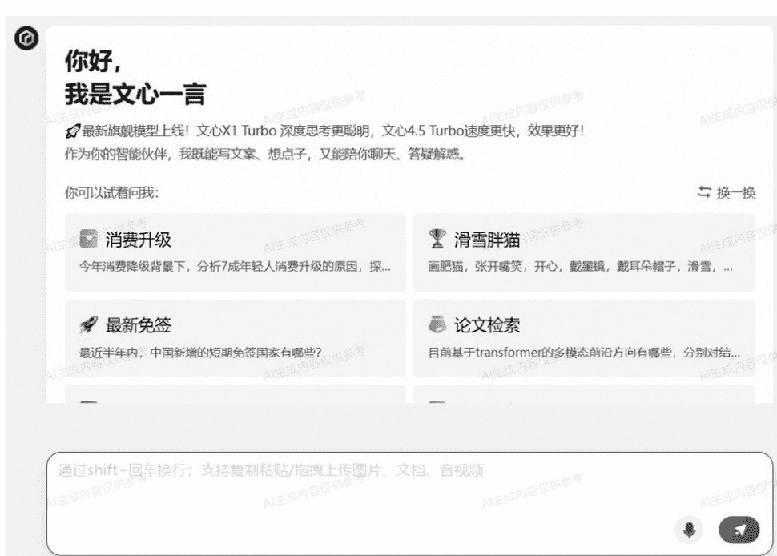

结合传统搜索：AI搜索并非万能，有时结合传统搜索引擎或专门的数据库进行关键词搜索，查找原始文献或权威网站，仍然是必要的。

##### 3 AI辅助搜索教学视频资源

策略：对于视频类教学资源，虽然目前大部分文本大模型（如DeepSeek）不能直接搜索或生成视频，但教师可以巧妙地利用AI来辅助查找。

（1）利用DeepSeek生成搜索关键词和策略：让DeepSeek帮你构思更精准、更多样化的搜索关键词，或者提供在特定视频平台（如哔哩哔哩、国家中小学智慧教育平台、相关的教育频道等）上查找相关教学视频的建议和技巧。

（2）利用AI总结视频内容：如果找到了合适的视频，但没有时间完整观看，可以利用通义听悟等AI工具生成视频的内容摘要、提取字幕文件（再用DeepSeek总结）或生成思维导图等。

（3）利用多模态AI搜索：随着多模态大模型的发展，未来可能出现更强大的、能够直接理解和搜索视频内容的AI工具，教师应保持关注。

提示词示例（用于生成搜索策略）：

> “我正在寻找关于‘小学五年级科学课演示大气压强’的教学视频，请给我一些在Bilibili和国家中小学智慧教育平台上搜索这类视频的有效关键词和方法建议。”

> “我想找一些关于‘讲解牛顿第一定律’的趣味物理实验视频，请帮我构思几个不同的搜索角度和关键词。”

##### 4 AI辅助信息总结与分类

策略：无论是通过对话式AI获取的信息，还是AI搜索工具整合的结果，或是教师自己找到的文档资料（可通过文件上传功能提供给DeepSeek），都可以利用AI强大的文本处理能力进行快速总结、提取要点、按主题分类。

提示词示例：

> “请将我上面搜索到的关于‘人工智能伦理教育’的几段资料，整合成一份要点清晰的备课笔记。”

> “请分析文件（上传）中关于‘细胞分裂’的内容，提取出关键步骤，并用列表形式展示。”

##### 5 案例：AI辅助历史课“丝绸之路”资料搜集与整合

场景：教师需要为一节关于“丝绸之路”的高中历史课准备背景资料，希望涵盖路线、主要商品、文化交流和历史影响等多个方面。

###### AI应用（结合多种工具）：

- （1）使用秘塔AI搜索查找关于丝绸之路的学术论文或研究综述，了解权威观点和最新研究动态。
- （2）使用DeepSeek（联网搜索）查询丝绸之路沿线国家当前的文化交流项目或相关新闻，增加内容的时代感。
- （3）使用百度AI搜索或文心一言查找高质量的丝绸之路路线图、文物图片等多模态资源。
- （4）使用DeepSeek生成在纪录片网站或教育视频平台搜索“丝绸之路纪录片片段”或“丝绸之路文化交流”相关视频的关键词和搜索建议。
- （5）将收集到的文本资料（或链接）输入DeepSeek或秘塔，要求其进行总结、提炼要点，并按“路线”“贸易”“文化”“影响”等主题进行分类整理。
- （6）最后，要求DeepSeek生成几个适合高中生课堂讨论的、具有思辨性的问题，如“丝绸之路对现代‘一带一路’倡议有何启示？”。

通过策略性地运用DeepSeek及各类AI搜索工具（并结合传统搜索方法），教师可以显著提升教学资源搜集和整合的效率与质量，从繁琐、低效的“大海捞针”式查找中解放出来，将更多精力投入到对信息的深度理解、批判性筛选、创新性整合和最终的教学转化上，为创编高质量的教学资源打下坚实的基础。

### 四、AI辅助教学课件PPT的设计与制作

教学课件PPT是中小学课堂教学中最常用的视觉呈现工具之一。制作一份结构清晰、内容准确、图文并茂、设计美观的PPT，往往需要花费教师大量的时间和精力。AI时代的到来，为PPT的设计与制作提供了全新的、高效的解决方案。

#### （一）AI赋能PPT制作的思路

- （1）内容生成（DeepSeek）：利用DeepSeek强大的文本生成和逻辑梳理能力，快速生成PPT的整体框架（大纲）、每一页的标题和核心文字内容。这是PPT的“骨架”和“血肉”。
- （2）结构转化与初步美化（AI PPT工具）：利用专门的AI PPT生成工具（如Kimi的AI PPT助手、WPS AI、希沃Bloom等），将DeepSeek生成的文本内容（通常建议使用Markdown格式）快速转化为具有基本排版和设计的PPT初稿。这些工具通常内置了多种模板和智能排版功能。
- （3）视觉元素增强（AI图像工具/设计平台）：利用AI图像生成工具（如即梦、豆包文生图等）或在线设计平台（如Canva），为PPT创作或寻找合适的配图、图标、背景等视觉元素，提升PPT的美观度和吸引力。
- （4）教师审核与精修：最后，教师需要在AI生成的初稿基础上，结合自己的教学经验和审美，进行内容的核查、逻辑的梳理、版式的调整、视觉元素的优化，最终形成高质量的教学课件。

#### （二）实战案例

##### 1 案例1：DeepSeek+Kimi PPT快速生成《观潮》课件

操作步骤详解：

###### (1) DeepSeek生成课件Markdown内容

**提示词：**

我是小学语文教师，请你帮我生成小学语文四年级上册《观潮》教学PPT内容。请以Markdown格式输出，包含封面页、目录、导入、作者背景、生字词学习、课文精读分析（分段）、修辞手法赏析、情感与启示、课后拓展等部分。每个部分请给出清晰的标题和要点内容。

**预期输出：** DeepSeek会生成符合Markdown语法的文本内容，结构清晰。

###### (2) Kimi PPT助手生成课件初稿

打开Kimi智能助手（网页版或App），找到“PPT助手”功能（或类似入口）。图5-14 DeepSeek生成课件Markdown内容图5-15 Kimi PPT助手入口

markdown

复制或下载均可使用

###### 《观潮》教学PPT设计（四年级上册）

###### 封面页

- **标题**：观潮
- **副标题**：四年级上册语文·第二单元
- **配图**：钱塘江大潮全景图
- **作者**：赵宗成、朱明元

###### 目录页

1. 导入—初识大潮
2. 作者与背景
3. 生字词学习
4. 课文精读分析
5. 修辞手法赏析
6. 情感与启示
7. 课后拓展

###### 一、导入—初识大潮

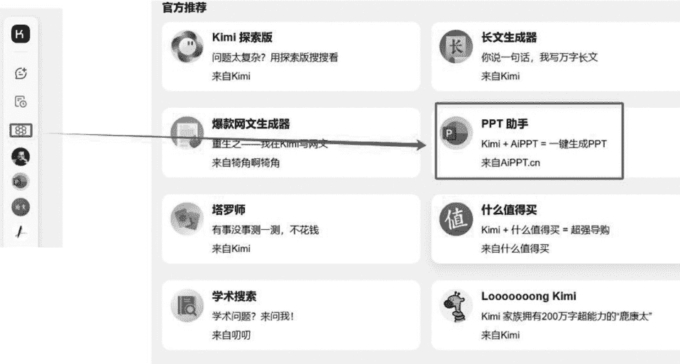

将从DeepSeek复制的Markdown内容粘贴到Kimi PPT助手的输入框中。

Kimi会对内容进行处理和优化，生成PPT页面预览。此时可以点击“一键生成PPT”。

在弹出的模板选择界面，根据教学场景（如“教育培训”）、设计风格（如“国风”）和主题颜色进行选择，然后点击“生成PPT”。

Kimi会快速生成PPT初稿。教师可以在其在线编辑器中对内容、图片、版式进行进一步的编辑和调整，完成后可下载PPT文件。图5-16 Kimi PPT助手“一键生成PPT”功能图5-17 选择PPT模板图5-18 Kimi生成PPT初稿

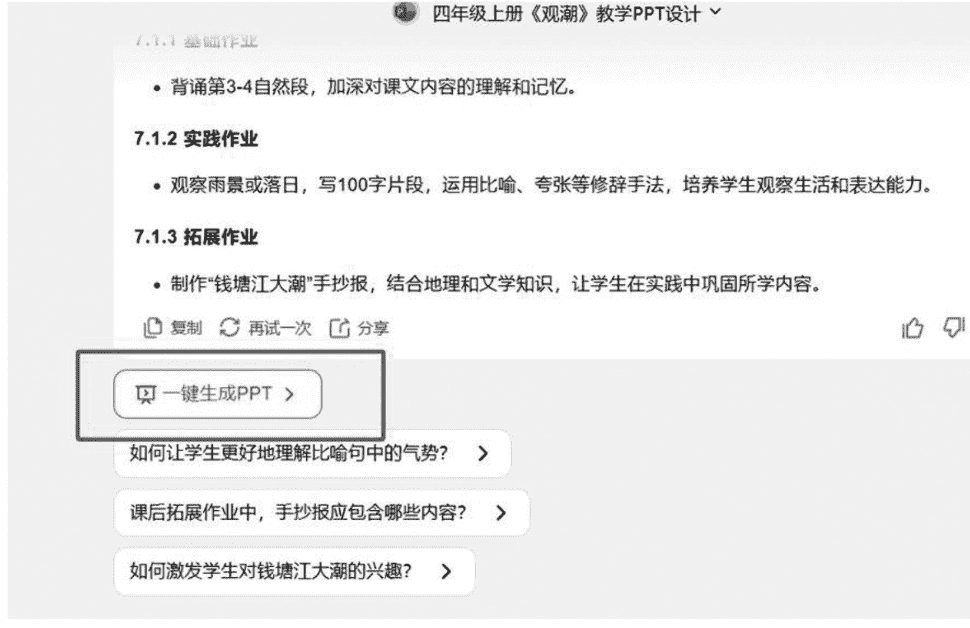


##### 2 案例2：WPS灵犀一键生成课件PPT（接入了DeepSeek模型）

操作步骤详解：

（1）打开WPS灵犀，选择AI PPT图5-19 WPS灵犀生成PPT入口

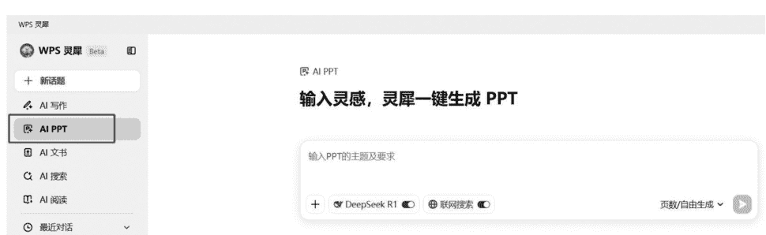

###### （2）输入需求或上传文档

在输入框中直接输入你的课件主题和要求，例如：“我是小学语文教师，请帮我生成小学语文四年级上册《观潮》教学PPT内容。”

或者，你可以上传本地的教案、讲稿等参考文件（支持多种格式），让AI基于这些文件生成PPT。

**选择模型：** WPS AI默认选择底层模型，你可以选择包含DeepSeek-R1（深度思考）的选项，以期获得更深入的内容。

**（可选）设置页数：** 可以大致设定期望的PPT页数。图5-20 WPS灵犀生成PPT设置

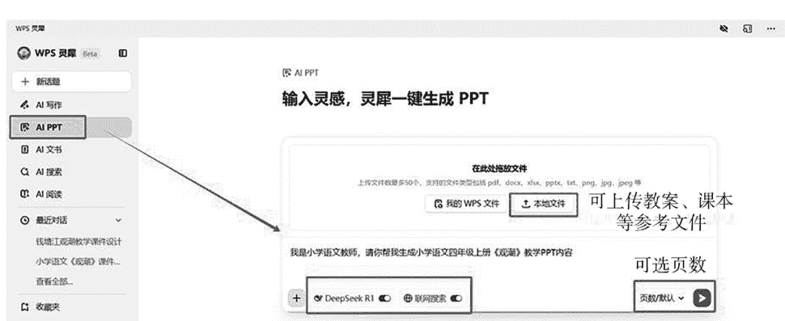

###### (3) 挑选模板并生成

WPS AI会根据你的输入生成内容大纲，确认后点击“挑选PPT模板”。在模板库中选择合适的风格（如“中国风”“可爱卡通”等）和颜色，点击“生成PPT”。图5-21 WPS AI生成内容大纲图5-22 挑选PPT模板

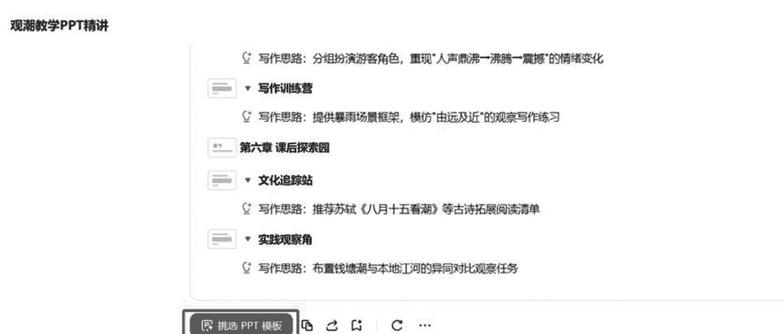


###### (4) 编辑与优化

WPS AI会生成完整的PPT文件，并直接在WPS演示中打开。教师可以利用WPS强大的编辑功能对内容、格式、图片、动画等进行全面的修改和完善。图5-23 对生成的PPT进行编辑优化

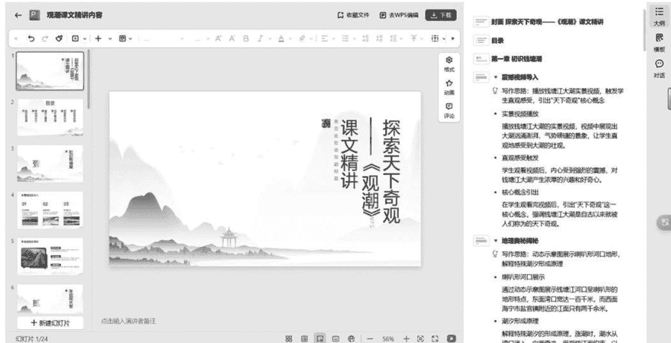

##### 3 案例三：利用希沃Bloom智能生成与设计课件

###### 操作步骤详解：

（1）访问平台并输入需求

访问希沃Bloom官网（bloom.seewo.com）并登录。点击“AI创作”，输入课件主题（如“精卫填海”）、学段、课型、期望页数等。

（可选）上传参考文件：可以上传相关的教案、文档，并点击“深度思考（R1）”调用DeepSeek的能力，使生成内容更精确。图5-24 希沃Bloom界面

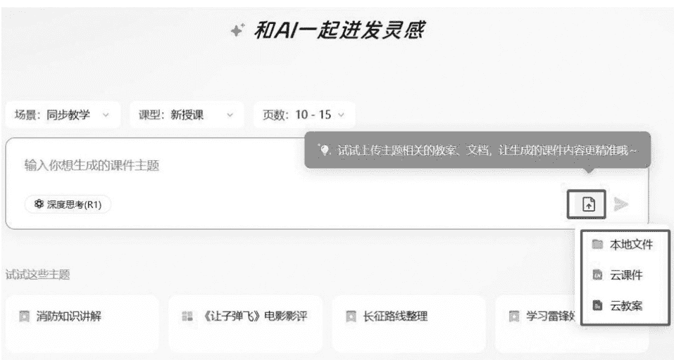

###### （2）调整教学目标

希沃Bloom会根据输入信息自动生成初步的教学目标。教师可以在此界面进行修改、删减或添加，确保目标符合教学要求。可以再次“调整提示词”，对AI生成目标的指令进行优化。确认后点击“生成大纲”。图5-25 调整希沃Bloom生成的教学目标

###### 课件目标

可以调整提示词

我是一名资深的小学语文老师，请你生成《精卫填海》的课件，让学生能理解故事内容，更能从神话中汲取精神力量，实现语言能力与人文素养的双重提升。

根据《义务教育语文课程标准》核心素养要求，结合教材文言文学习重点及神话文本特点设计

1. 语言积累与梳理：准确认读多音字“少”，识记文言词汇“溺”“堙”并规范书写生字
2. 思维发展与提升：运用注释转化文言意象，完整复述精卫填海的情节发展脉络
3. 审美鉴赏与创造：通过品析“衔”“堙”等动词，感受精卫不畏艰难的神话形象特质
4. 文化传承与理解：体会远古先民通过神话故事传递的生存意志与抗争精神

可以调整教学目标

- 添加目标

✦ 生成大纲

###### (3) 优化PPT大纲

希沃Bloom会以思维导图的形式展示生成的PPT大纲。教师可以在此界面拖拽调整结构、修改标题、增删节点，使大纲更符合教学逻辑。确认后点击“生成课件”。图5-26 希沃Bloom生成PPT大纲

###### 教学活动设计

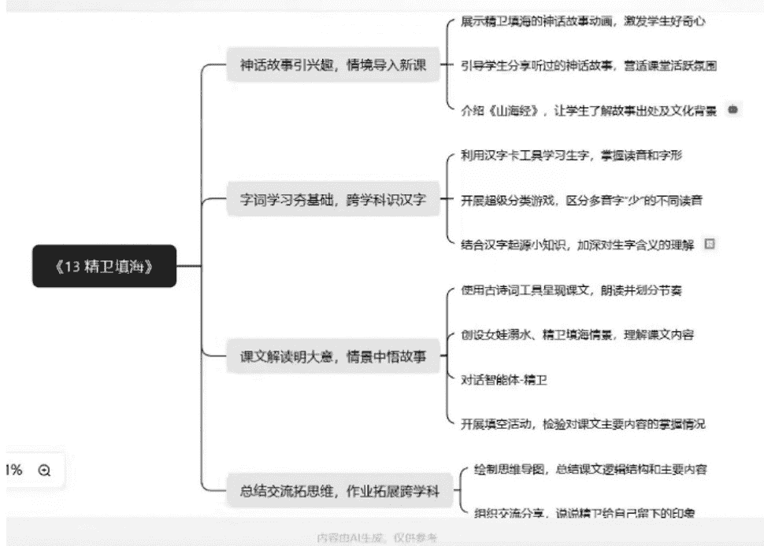

###### (4) 课件生成与联动编辑

希沃Bloom会生成完整的课件，并提供在线编辑环境。其特点是课件大纲、幻灯片页面和备课设计（讲稿注释）三者联动，修改一处会自动同步，方便教师整体构思和调整。教师可以对内容、样式、图片等进行细致优化。图5-27 希沃Bloom生成可编辑PPT

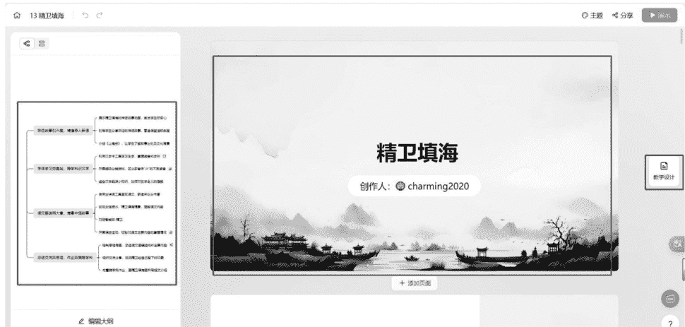

##### 4 视觉元素增强策略

在使用上述AI PPT工具生成初稿后，教师可能会发现其中的配图不够理想或需要补充。这时可以：

利用AI图像生成工具：如即梦、豆包文生图、Midjourney等。教师可以根据PPT页面内容，编写描述性的提示词，让AI生成符合主题和风格的图片，然后替换或插入到PPT中。

利用在线设计平台：如Canva，它提供了海量的模板、图片、图标等素材库，并集成了AI功能（如AI绘图、文案生成等），方便教师快速查找、创作和美化PPT中的视觉元素。

##### 5 效果评估

效果：AI PPT工具极大地缩短了课件制作周期，将教师从繁琐的排版设计中解放出来，使其能更专注于教学内容的打磨和创新。工具组合策略则能进一步提升课件的视觉质量和吸引力。

注意事项：AI生成的PPT内容（尤其是知识性内容）必须经过教师严格审核，确保准确无误；AI自动选择的模板和图片可能并不完全符合教学情境或教师审美，需要进行人工调整和优化；过度依赖模板可能导致课件同质化，教师应注重融入个人特色和教学思考。

##### 6 工具拓展

借助DeepSeek等AI的内容生成能力，以及各类AI演示文稿与图像工具的辅助，教师能够更高效、更专业地完成课件设计，从而将更多精力集中于提升课堂教学质量。目前，市场上已涌现出多款专注于教学场景的AI演示文稿工具。它们各具特色，能有效满足从备课到授课的多样化需求。表5-2汇总了部分代表性工具及其核心功能。

表5-2 制作PPT的AI工具续表

| AI 工具名称 | 平台公司 | 核心要点 | 教学应用场景 |
| :--- | :--- | :--- | :--- |
| WPS 灵犀 | 金山办公 | ① 与 WPS 无缝衔接，Word 教案一键转 PPT<br>② 智能匹配学科模板(语文、数学等)<br>③ 内置课堂小游戏动画素材 | 教师快速备课<br>学生课堂活动演示 |
| Kimi PPT 助手 | 月之暗面 | ① 用口语化指令生成 PPT(如“二年级古诗课件”) ② 自动抓取教学图片 ③ 生成课后习题幻灯片 | 跨学科融合课程设计 家长会汇报 |
| ClassPoint | 网龙网络 | ① 课堂互动 PPT 工具(随机点名、随堂投票) ② 学生端答题数据自动统计 ③ 作业要求嵌入 PPT 一键发布 | 课堂实时互动 教学任务管理 |
| 智谱清言 PPT | 智谱 AI | ① 学科知识点自动生成思维导图式 PPT ② 支持中小学课标关键词识别 ③ 错题集自动转复习课件 | 知识点串讲 考试复习专项训练 |
| 讯飞智文 | 科大讯飞 | ① 教师口述备课内容实时生成 PPT ② 方言识别(粤语、四川话等) ③ 自动添加拼音标注(语文课件) | 方言地区教师备课 低年级识字教学 |
| MindShow | 深圳心流科技 | ① 学生用 Markdown 写作文本自动转 PPT ② 内置“科学实验步骤”“手抄报”等版式 ③ 协作编辑支持分组权限管理 | 学生作品制作 兴趣小组活动汇报 |

### 五、AI辅助生成思维导图与可视化图表

思维导图和流程图等可视化图表是教学中常用的工具，它们能够帮助教师梳理教学思路、构建知识体系，也能帮助学生理解复杂概念、把握知识间的逻辑关系、提升结构化思维能力。传统的手绘或使用软件制作这些图表，虽然有效，但对于复杂内容或需要频繁修改的情况，仍然比较耗时。AI技术，特别是DeepSeek与相关工具的结合，可以显著提升这一过程的效率。

#### （一）思维导图在教学中的作用

对教师：辅助备课，梳理教学内容的逻辑结构；在课堂上清晰展示知识体系；引导学生进行发散性思考或归纳总结。

对学生：帮助理解和记忆复杂知识点；构建个人知识网络；进行预习、复习和笔记整理；培养逻辑思维和结构化思考能力。

#### （二）AI赋能思维导图与图表制作的方法

##### 1 方法一：DeepSeek生成结构化文本+思维导图软件导入

（1）利用DeepSeek梳理逻辑与生成文本：教师可以向DeepSeek输入一个主题或知识点，要求它梳理出核心概念、主要分支、层级关系，并以结构化的文本格式（如Markdown的层级列表格式）输出。在DeepSeek生成Markdown文件后，点击右上角的复制或下载可以直接复制或下载.md文件。

（2）导入思维导图软件：打开常用的思维导图软件，如Xmind、MindMaster（博思）等，这些软件通常都支持直接导入Markdown文件（.md文件）来快速生成思维导图的骨架。

（3）教师优化调整：在软件中对自动生成的思维导图进行美化、调整布局、补充细节、添加图标或备注等。

##### 2 方法二：DeepSeek生成代码+专业工具渲染（适用于流程图、时序图等）

（1）利用DeepSeek生成特定代码：对于流程图、时序图、类图等更专业的图表，教师可以向DeepSeek描述图表的结构和内容，并明确要求它生成特定代码，如Mermaid或PlantUML语法代码。

（2）使用渲染工具生成图表：将DeepSeek生成的代码复制到支持相应语法的在线编辑器、本地工具或集成了这些功能的平台（如Markdown编辑器、Notion等）中进行渲染，即可得到相应的可视化图表。

（3）教师检查与修正：检查生成的图表是否准确反映了逻辑关系，如有需要，可修改代码或提示词以重新生成。

#### （三）实战案例

##### 1 案例1：AI辅助生成初中英语语法时态思维导图

**场景：** 教师希望为初中生复习英语的主要语法时态（如一般现在时、一般过去时、现在进行时、一般将来时等）制作一个清晰的思维导图，涵盖各种时态的构成、用法、标志词和注意事项。

**AI应用：**

（1）向DeepSeek提出请求

**提示词：**

请扮演一位经验丰富的初中英语语法老师。请帮我梳理初中阶段需要掌握的主要英语时态（至少包括一般现在时、一般过去时、现在进行时、现在完成时、一般将来时）。对于每种时态，请列出其基本构成（肯定句、否定句、疑问句形式）、主要用法（至少3条）、常用时间标志词以及需要注意的特殊情况。请以Markdown层级列表的格式输出，方便我导入思维导图软件。

（2）将DeepSeek输出的Markdown文本直接下载保存为.md文件

DeepSeek会生成类似以下的结构化文本（节选），将其复制并保存为.md文件或者直接下载保存为.md文件。

###### #初中英语主要时态复习

###### #一般现在时（Simple Present）

- **构成：**
  - 肯定：主语+动词原形/三单形式
  - 否定：主语+don't/doesn't+动词原形
  - 疑问：Do/Does+主语+动词原形?

- **用法：**
  - 表示经常性、习惯性的动作
  - 表示普遍真理或客观事实
  - 表示主语当前的性格、能力、状态

- **标志词：** always, usually, often, sometimes, every day/week...

- **注意：** 第三人称单数动词变化

（3）导入思维导图软件（以Xmind为例）

打开Xmind软件，选择“文件”→“导入”→“Markdown”，选择刚才保存的.md文件。Xmind会自动根据Markdown的层级关系生成思维导图的骨架。

（4）教师优化与美化

教师可以在Xmind中调整节点布局、修改文字、添加图标、更改主题样式、插入图片或链接等，使思维导图更清晰、美观、易于理解。图5-28 将.md文件导入XMind软件图5-29 在XMind软件中调整

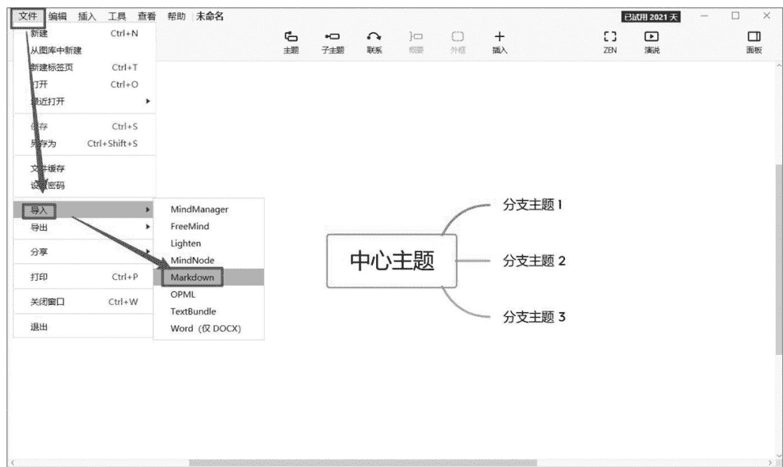

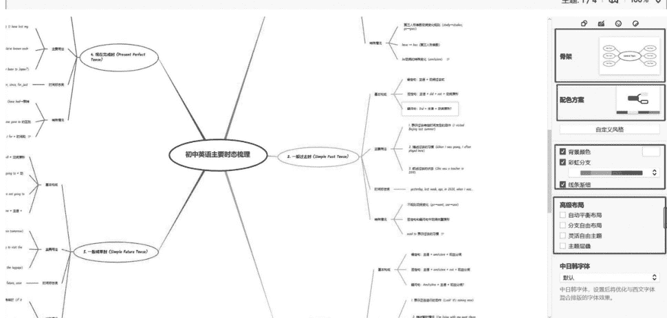

##### 2 案例2：DeepSeek+draw.io生成教学流程图

**场景一：** 教师设计好了一节课的教学流程，希望将其可视化为流程图，以便更清晰地展示教学环节和师生互动。

**具体操作：**

（1）准备教案或流程描述：教师可以先准备好教案的电子版（例如，上传给DeepSeek），或者用自然语言清晰地描述教学流程的各个步骤和逻辑关系。

（2）向DeepSeek提出生成Mermaid代码的请求。

**提示词：**

请你根据附件的教案（或以下描述的教学流程：[此处粘贴或描述流程]），使用Mermaid语法生成一个表示该教学流程的流程图代码（graph TD）。请确保代码结构清晰，节点名称简洁明了，能体现主要的教学环节和师生互动。请以Mermaid代码块的格式输出。（可选补充：可以提供一个简单的Mermaid格式示例给DeepSeek参考，如graph TD; A[环节1]→B（环节2）；B→C{判断}；C—Yes→D[操作]；C—No→E[结束]。）

图5-30 复制DeepSeek生成的Mermaid文本

**修正后的教学流程图（含师生交互，Mermaid格式）**

```
graph TD
    %% 主流程节点
    A[情境导入] --> B[作品体验]
    B --> C[流程分析]
    C --> D[动手实践]
    D --> E[典型案例分析]
    E --> F[拓展延伸]
    F --> G[课堂总结]

    %% 情境导入（2分钟）
    subgraph 情境导入
        A1[教师活动：描述智能家电场景] --> A2[学生活动：听讲并思考]
    end
    A --> A1
    A2 --> B
```

（3）将Mermaid代码导入draw.io。

打开draw.io（或diagrams.net）网页版或客户端。点击菜单栏的“+”号（或其他插入按钮），选择“高级”→“Mermaid”。图5-31 将Mermaid代码导入draw.io软件图5-32 预览并插入

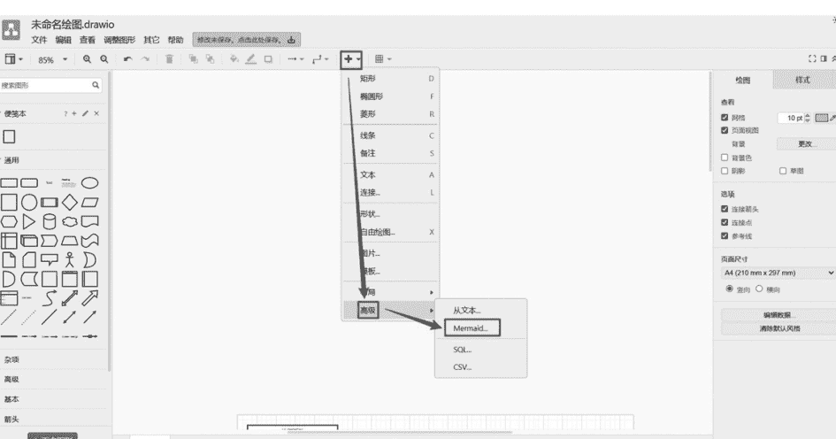

```
C4 --> D

%% 动手实践（15分钟）
subgraph 动手实践
    D1[学生活动：编写程序] --> D2{遇到问题？}
    D2 -- 是 --> D3[教师指导] --> D1
    D2 -- 否 --> D4[提交作品]
end
D --> D1
D4 --> E

%% 典型案例分析（4分钟）
subgraph 典型案例分析
    E1[教师展示作品] --> E2[学生讨论优化方案] --> E3[教师总结易错点]
end
E --> E1
E3 --> F

%% 拓展延伸（4分钟）
subgraph 拓展延伸
    F1[播放科普视频] --> F2[学生讨论友好设计] --> F3[教师记录创意]
end
F --> F1
```

（4）查看与导出流程图：draw.io会自动根据代码渲染出流程图。教师可以进行微调，然后通过“文件”→“导出为”选择合适的格式（如PNG、JPG、SVG、PDF等）保存流程图。图5-33 导出流程图

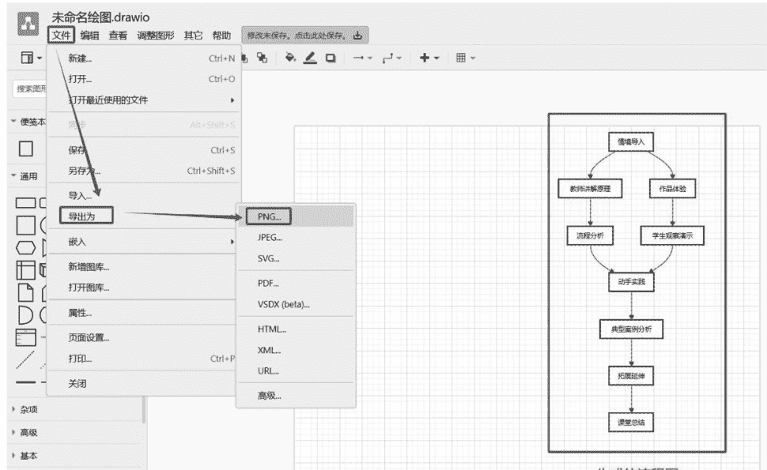

（5）（可选）错误排查：如果在draw.io中插入代码时出现错误提示（如“Diagram error not found”），可以将错误提示信息和Mermaid代码一起复制到DeepSeek上，让它帮助检查和修正语法错误。图5-34 draw.io报错截图


**场景二：** 教师需要为高中地理课《大气环流》制作一个知识结构关系图，帮助学生理解三圈环流的形成过程以及主要气压带和风带的分布。

**具体操作：**

（1）向DeepSeek提出生成Mermaid代码请求。

**提示词：**

使用Mermaid语法为高中地理课《大气环流》生成一个简单的知识结构关系图（graph LR或TD均可）。内容需要包括三圈环流（低纬环流、中纬环流、高纬环流）的形成过程（涉及上升/下沉气流、近地面风向、高空风向），以及主要的气压带（赤道低压带、副热带高压带、副极地低压带、极地高压带）和风带（信风带、西风带、极地东风带）的名称和大致纬度分布。图形要简洁明了，便于学生理解。请以Mermaid代码块的格式输出。

（2）获取并渲染代码：教师复制DeepSeek生成的Mermaid代码。图5-35 获取渲染图表或复制代码

```
graph TD
    %% 三圈环流结构
    太阳辐射差异 --> 三圈环流
    三圈环流 --> 低纬环流
    三圈环流 --> 中纬环流
    三圈环流 --> 高纬环流

    %% 低纬环流 (0°-30°)
    低纬环流 -->|赤道受热上升| 赤道低压带["赤道低压带 (0°附近)"]
    赤道低压带 -->|高空北上偏转成西风| 副热带高压带["副热带高压带 (30°附近)"]
    副热带高压带 -->|近地面偏转成东北/东南信风| 信风带["信风带 (0°-30°)"]

    %% 中纬环流 (30°-60°)
    副热带高压带 -->|近地面北上偏转成西南风| 西风带["西风带 (30°-60°)"]
    西风带 --> 副极地低压带["副极地低压带 (60°附近)"]
    副极地低压带 -->|高空南下补充| 副热带高压带

    %% 高纬环流 (60°-90°)
    副极地低压带 -->|近地面偏转成东北风| 极地东风带["极地东风带 (60°-90°)"]
    极地东风带 --> 极地高压带["极地高压带 (90°附近)"]
    极地高压带 -->|冷空气下沉| 副极地低压带

    %% 标注关键过程
    赤道低压带 -.->|热力上升| 高空西风
    副热带高压带 -.->|动力下沉| 近地面信风
```

(3) 导入工具或在线渲染：将代码粘贴到支持Mermaid的工具（如draw.io、Typora、Notion或在线Mermaid编辑器）中进行渲染，生成知识结构图。

(4) 教师优化与应用：教师可以对生成的图表进行布局调整和样式美化，然后将其插入课件或作为板书设计的参考。图5-36 调整结构图

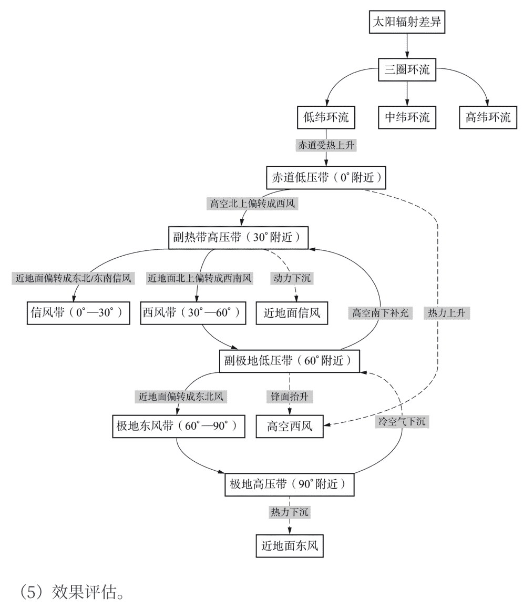

（5）效果评估。

**效果：** 对于逻辑结构清晰的知识体系或流程，AI辅助生成思维导图或流程图的代码可以大大提高效率。特别是对于不熟悉Mermaid等代码语法的教师，AI降低了使用这些专业可视化工具的门槛。

**注意事项：** AI生成的结构化文本或代码仍需教师审核其逻辑的准确性和完整性；导入或渲染后通常需要人工进行美化和调整；对于非常复杂的流程或需要高度定制化的图表，AI的辅助效果可能有限，仍需教师发挥主导作用。

通过AI辅助，教师可以更轻松地将复杂的知识和流程转化为直观、有序的可视化图表，这不仅优化了教学呈现方式，也为学生提供了有效的学习和复习工具。

### 六、AI驱动生成视觉资源：让教学更直观生动

#### 实战案例

##### 1 案例1：AI生成备课图片

**场景：** 张老师是一位高中二年级的历史教师，正在筹备“工业革命”主题的跨学科课程。为了让学生直观感受蒸汽机改良对生产方式的影响，她尝试在课件中加入19世纪纺织工厂的实景还原图，但却苦于找不到能同时体现机械原理与人文关怀的优质配图。

**具体操作：**

- 使用即梦生成AI图片。

（1）打开即梦（https://jimeng.jianying.com/），点击AI作图图5-37 即梦AI作图入口

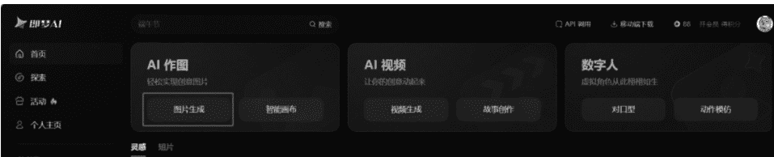

（2）点击DeepSeek-R1获取图片生成提示词

（3）输入图片生成的要求并选择模型、图片比例等

**提示词：**

我是一名高中二年级的历史教师，正在筹备“工业革命”主题的跨学科课程。为了让学生直观感受蒸汽机改良对生产方式的影响，我要在课件中加入19世纪纺织工厂的实景还原图。图5-38 获取生成图片提示词图5-39 设置图片生成要求

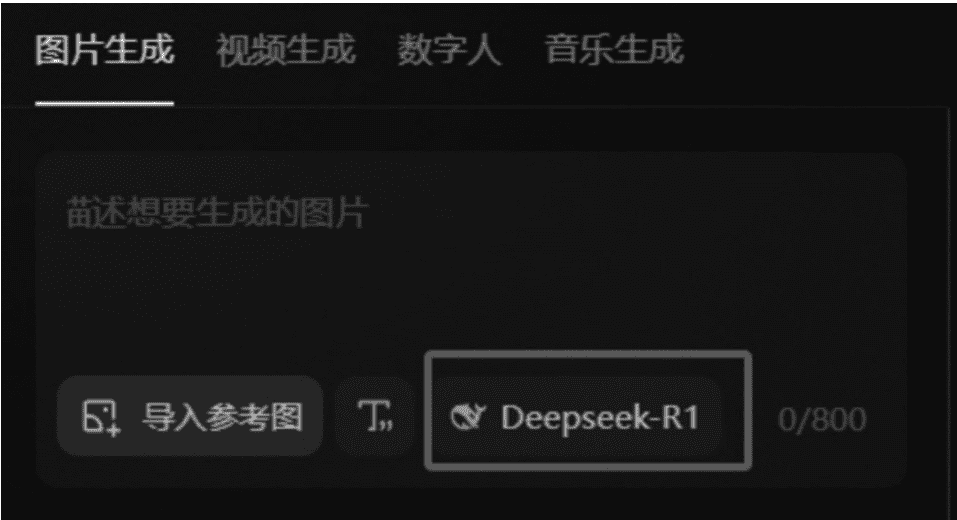

图片生成 视频生成 数字人 音乐生成

我是一名高中二年级的历史教师，正在筹备“工业革命”主题的跨学科课程。为了让学生直观感受蒸汽机改良对生产方式的影响，我需要在课件中加...

< Deepseek-R1

**模型**

生图模型

图片 3.0 by Seedream 3.0

选择清晰度：标清 1K

标清 1K

高清 2K

**比例**

图片比例

21:9

16:9

3:2

4:3

1:1

（4）点击“立即生成”，在右侧可以看到预览图片

如果图片生成效果不好，可以修改提示词。图5-40 生成预览图片

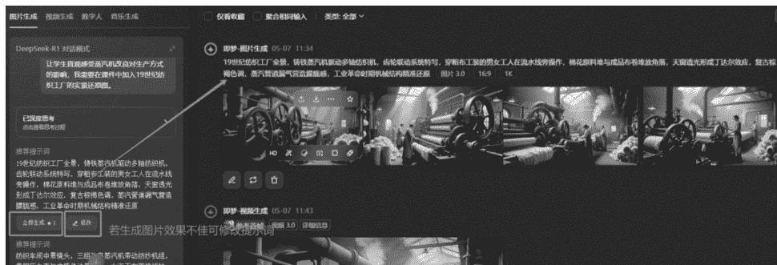

（5）点击图片进行下载或优化编辑

在这一步中，老师可以下载高清图片。此外还可以点击“生成视频”，将图片变成视频并增加音效，进一步增强AI素材的表现效果。图5-41 下载图片或优化编辑


- 使用豆包生成AI图片。

(1) 打开豆包（https://www.doubao.com），输入提示词

提示词：

我是一名高中二年级的历史教师，正在筹备“工业革命”主题的跨学科课程。为了让学生直观感受蒸汽机改良对生产方式的影响，我需要在课件中加入19世纪纺织工厂的实景还原图。图5-42 输入图片生成提示词


(2) 图片生成后可以进行编辑或下载图5-43 下载图片或优化编辑

我是一名高中二年级的历史教师，正在筹备“工业革命”主题的跨学科课程。为了让学生直观感受蒸汽机改良对生产方式的影响，我需要在课件中加入19世纪纺织工厂的实景还原图。

接下来我将为你生成四张 19 世纪纺织工厂的实景还原图。画面风格是通过自然光影与细节捕捉，展现客观、未经修饰的现实的摄影风格。主体是摄影风格的纺织工厂，有冒着浓烟的烟囱、巨大的蒸汽机、排列整齐的纺织机等。场景是 19 世纪的纺织工厂内，工人们在辛勤劳作，蒸汽机带动着纺织机运转。


##### 2 案例2：DeepSeek+剪映生成故事绘本

**具体操作：**

（1）利用DeepSeek生成故事

**提示词：**

你是一个儿童文学作家，擅长儿童短篇故事写作、绘本故事写作。请参考义务教育教科书·语文四年级上册《盘古开天地》的神话故事，进行这个故事的儿童绘本制作，字数500字。 图5-44 利用DeepSeek生成故事文本

好的，我将按照儿童绘本的特点创作《盘古开天地》故事，注重画面感与童趣表达。以下是故事框架：

[封面插图：蓝衣巨人沉睡在云雾中，周围漂浮着星星和羽毛状的光点]

**第一幕：混沌宇宙**

很久很久以前，世界像一颗巨大的鸡蛋。这里没有蓝天白云，没有绿草鲜花，只有灰蒙蒙的雾气咕嘟咕嘟冒泡泡。在这颗“宇宙蛋”里，沉睡着一位叫盘古的巨人，他的睫毛像垂柳枝，胡子像飘动的云彩。

[插图：蜷缩的巨人被彩色云雾包裹，四周漂浮着发光的泡泡]

**第二幕：巨人苏醒**

“咔嚓！”沉睡了一万八千年的盘古伸了个懒腰，他的关节发出爆米花般的脆响。摸到腰间冰凉的斧头时，混沌里突然亮起两道金光——原来是盘古睁开了眼睛！

（2）将DeepSeek生成的故事绘本复制到剪映

**PC版操作：**

打开剪映，点击首页上的AI文案成片。图5-45 抖音PC版AI文案成片入口


点击AI素材成片，选择风格和比例，粘贴绘本故事即可生成。图5-46 选择风格、比例并粘贴绘本故事

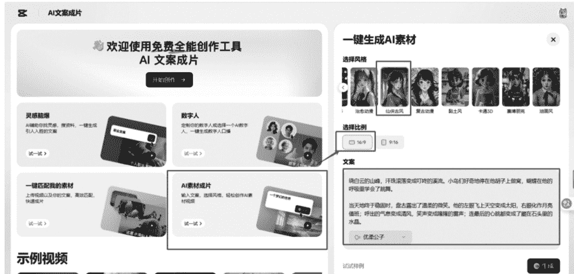

生成后，可以进行细节的调整，导出即可完成故事绘本制作。图5-47 调整细节完成故事制作

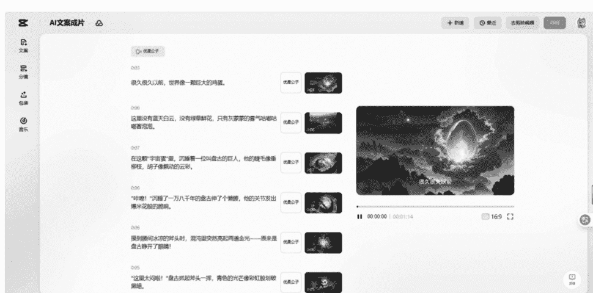

**手机App操作：**

打开剪映，在首页点击AI故事成片。图5-48 抖音手机App中AI故事成片入口


粘贴故事绘本内容，选择画面风格、配音和视频比例等，点击生成。生成后，可以进行细节的调整，导出即可完成故事绘本制作。图5-49 AI故事生成界面图5-50 编辑界面

**AI 故事成片**

咕嘟冒泡泡。在这颗“宇宙蛋”里，沉睡着一位叫盘古的巨人，他的睫毛像垂柳枝，胡子像飘动的云彩。

“咔嚓！”沉睡了一万八千年的盘古伸了个懒腰，他的关节发出爆米花般的脆响。摸到腰间冰凉的斧头时，混沌里突然亮起两道金光——原来是盘古睁开了眼睛！...

**画面风格**


**配音**

- 智能推荐
- 少年云希
- 晓辰学姐
- 解说小帅

**语速**

0.8x 1.5x 2x

开通SVIP后，消耗43积分使用 >

生成视频

##### 3 案例3：DeepSeek生成教学演示动画

**场景：** 在现实教学中，教师讲解抽象概念时，学生会因缺乏直观体验而难以理解静态符号与实际现象的联系，如空间想象能力不足、无法感知动态过程、理解力差异大，从而导致统一教学效果有限。在人工智能时代，DeepSeek可以将抽象概念转为可视动态模型，通过实时交互和分步演示降低理解门槛。

**工具：** DeepSeek-V3模型（更适合生成复杂的代码和互动应用）。

**提示词：**

编写一个一次函数的演示动画教学网页，要求用生活化的例子给学生作介绍，并做成相应的案例动画。图5-51 DeepSeek生成动画教学网页

###### 一次函数演示动画教学网页

以下是一个一次函数演示动画教学网页的HTML代码，包含生活化的例子和互动动画：

```html
<!DOCTYPE html>
<html lang="zh-CN">
<head>
    <meta charset="UTF-8">
    <meta name="viewport" content="width=device-width, initial-scale=1.0">
    <title>生活中的一次函数</title>
    <style>
        body {
            font-family: 'Microsoft YaHei', sans-serif;
            line-height: 1.6;
            color: #333;
            max-width: 1000px;
            margin: 0 auto;
            padding: 20px;
            background-color: #f5f5f5;
        }
        h1 {
            color: #2c3e50;
```

HTML代码生成后，可以复制、下载和运行。图5-52 运行预览生成的动画教学网页

### 七、利用DeepSeek生成微课的脚本、讲解要点、分镜描述等

实战案例：DeepSeek+剪映生成微课视频

具体操作：

- （1）利用DeepSeek生成微课分镜头脚本等

#### 提示词：

我是小学数学老师，我想制作一个关于“分数加法通分过程”的微课视频，时长三分钟左右，帮我设计脚本、撰写文案、描述画面，以表格形式输出，包含时间轴。图5-53 DeepSeek生成微课脚本（截图，只显示部分页面）

以下是为你设计的3分钟微课视频脚本表格，包含时间轴、画面描述和对应文案，重点突出分数通分的直观演示和步骤分解：

| 时间轴 | 画面描述 | 文案 |
| :--- | :--- | :--- |
| 0:00-0:10 | 开场动画：卡通黑板背景，标题“分数加法通分小课堂”弹出，配欢快音效 | （背景音乐）同学们好！通分！ |
| 0:11-0:25 | 动态示例：1/2 + 1/3 算式出现，两个圆形分数模型分别展示1/2(黄)和1/3(蓝) | 当分母不同时，就像不同标准——这就是通分！ |
| 0:26-0:45 | 动画演示：两个圆形被均分成6份，1/2→3/6，1/3→2/6，同步显示算式变形 | 找公分母：2×3=6。1/看！现在分数单位统一了 |

#### （2）打开剪映进行视频合成和后期制作

在剪映首页点击“图文成片”。图5-54 剪映图文成片入口

之后点击“自由编辑文案”。图5-55 选择自由编辑文案

粘贴DeepSeek生成的微课视频文案并进行调整，点击“生成视频”，再选择“智能匹配素材”。图5-56 智能匹配素材

微课视频生成后，可以对视频细节进行编辑调整，最后导出微课视频即可。图5-57 编辑调整视频细节

### 八、小结

本章为教师提供了AI赋能备课的行动指南。教师可运用AI设计并分析学情问卷与学科试卷，精准诊断学生知识薄弱点，为个性化教学提供依据。在教学设计中，AI能依据核心素养要求和多种教育理论，辅助生成系统的教案与学生自主学习的学案。同时，AI还能高效创编教学资源，如将文本一键转化为PPT、思维导图，或根据需求生成定制化的教学图片与视频，让备课更高效直观。这些方法共同展示了AI如何赋能备课全过程，帮助教师重构出更为精准、高效的教学设计。

# 第六章

## AI赋能课堂：促进深度学习的教学创新

前面的章节，我们探讨了AI如何助力教师进行课前的学情分析、教学设计以及教学资源的创编。这些准备工作为有效的、高质量的课堂教学奠定了坚实的基础。然而，课堂教学是一个动态的、生成的、互动的过程。如何将AI的能力融入实时的课堂环境，提升教学互动效果，创新教学方法，支持和促进深度学习，是AI赋能高质量教学的关键。

### 一、重构课堂生态：构建“教师—AI—学生”三元协同教学新范式

课堂互动是教学过程的灵魂，是师生之间、生生之间思想碰撞、意义建构的关键场域。有效的互动能够激发学生的学习兴趣，促进深度思考。然而，传统课堂互动常面临学生参与度不均、教师精力有限、互动形式单一等挑战。AI深度融入课堂后，将不再只是辅助教师的工具，而是作为一种具有“功能性主体”特征的准参与者，深刻地改变课堂教学的生态系统。

当教育的目标从知识的传递转向核心素养的培养时，所有教学元素的角色和关系都应该被重新审视。人工智能作为认知伙伴、智能助手等与教师和学生共生、共存，协同创造，这就迫切需要我们打破传统的“教师—学生”二元结构，构建一种全新的“教师—AI—学生”三元协同教学新范式。在这种模式下，AI将作为一种新的参与者融入课堂生态，共同服务于新课标提出的核心素养培养目标。

#### （一）从“二元”到“三元”：AI“主体性”的再认识

在“教师—AI—学生”三元互动教学新范式中，一个核心的理念转变是将人工智能从纯粹的“工具”视角，提升到具有某种“主体性”的“智能伙伴”层面。这里的“三元”并非两个人类主体与一个被动工具的组合，而是三个不同性质的主体在一个动态的教育生态系统中的互动。

为了更清晰地理解三者在教学活动中的不同角色与协同关系，我们首先需要辨析人类主体与人工智能主体在本质上的区别。表6-1 人类主体与人工智能主体的特征维度比较

| 特征维度 | 人类主体(教师和学生) | 人工智能主体(AI) |
| :--- | :--- | :--- |
| 意识与意向性 | 拥有自我意识、情感、信念和内在动机。行为由真实的理解和意图驱动。（基于“生命体验”） | 本质是算法驱动的计算过程，不具备真正的意识、情感或主观体验。“理解”是基于数据模式的统计关联。（基于“数据计算”） |
| 认知与学习 | 基于具身体验、社会互动和文化背景的深度语义理解。学习是一个主动建构意义的过程，伴随着情感和价值观的形成。 | 基于海量数据的模式识别和概率预测。学习是权重调整和模型优化，是“无身体、无情境”的知识处理。 |
| 价值与伦理 | 拥有内在的价值体系、道德直觉和伦理责任感。教师的行为受到教育伦理和人文关怀的约束。（价值理性） | 缺乏内在的价值观和伦理判断能力。其行为由其设计目标和训练数据决定，可能无意中放大偏见。（工具理性） |
| 发展与成长 | 追求认知、情感、社交和道德等方面的全面、整体性成长。目标是成为一个完整的“人”。 | 其“成长”是模型迭代和性能提升，是功能性的、可量化的优化过程。目标是更高效地完成特定任务。 |
| 创造性来源 | 来源于想象力、直觉、情感驱动和对现有知识的颠覆性重构。 | 来源于对现有数据元素的重新组合与生成，是一种“计算创意”，而非源于生命体验的“原创灵感”。 |

表6-1清晰地揭示了人类主体（师生）的优势在于价值引领、情感关怀、意向驱动和原创灵感，而AI的优势在于高效的知识处理、数据计算和逻辑推理。这两者是互补而非替代关系。正是基于这种本质区别，三元互动新范式得以成立，每个主体都能在其中发挥不可替代的作用。

#### （二）三元协同：教师、AI与学生的角色新定位

在新的课堂生态中，教师、AI与学生的角色需要被重新定义，以形成以学生为中心、以教师为主导、AI赋能的动态协同关系，共同服务于核心素养的培养目标。表6-2 三元主体的主体性定位与核心角色

| 主体 | 主体性定位 | 在核心素养培育中的核心角色 |
| :--- | :--- | :--- |
| 教师 | 价值引领与设计主体 | 学习体验的“总设计师”与“智慧启迪者”：<br>● 设计者：设计驱动高阶思维的真实、复杂问题情境。<br>● 引导者：在关键节点介入，激发学生的分析、评价和创造性思维。<br>● 示范者：示范如何批判性思考，守护和传递正确的价值观与学术伦理。 |
| AI | 功能性赋能主体 | 认知过程的“智能催化剂”与“认知伙伴”：<br>● 信息伙伴：提供远超个人能力范围的广博知识与多元视角。<br>● 思维伙伴：通过苏格拉底式提问、模拟辩论等方式，激发学生思维品质。<br>● 能力伙伴：作为强大的工具，辅助学生将创造性的想法快速转化为现实。 |
| 学生 | 能动建构与创造主体 | 知识意义的“主动建构者”与“价值创造者”：<br>● 探究者：主动发起探究，定义问题，主导学习进程。<br>● 合作者：与同学、AI进行高效的交流与协作，解决复杂问题。<br>● 创造者：综合信息，形成自己独特的见解，并创造出新作品或解决方案。 |

基于以上定位，三元主体的角色更加明确：教师转变为学习体验的设计者与引导者，专注于激发学生高阶思维与核心素养的培养。AI作为强大的认知伙伴，通过提供信息、辅助思考及分担任务，全面赋能教与学过程，它可以扮演信息提供者、智能助教、讨论伙伴、个性化辅导员，甚至模拟特定角色等多种身份，协同教师的教，让教师能更专注于思维品质的点拨和正确价值观的引导，以及对学生个体的情感关怀。学生则从被动的接受者转变为主动的探究者与创造者，与教师、同学、AI高效协作，建构知识。学生不仅与教师互动，也可以在教师的引导下，与AI互动获取信息、练习技能、验证想法、进行深度对话探究，甚至与AI协作完成创作任务，从而在互动中发展自主学习、合作探究、创新实践等关键能力。此模式旨在通过智能赋能优化教学互动，使教师能更专注于深层次的育人工作，从而促进学生核心素养的全面发展。

#### （三）引导学生与AI有效互动的方法

要实现有效的“学生—AI”互动，教师的引导至关重要。教师可以采取以下策略，这些策略也有助提升学生的AI素养。

- （1）教授基本的提示词技巧：在合适的时机（如信息技术课、项目式学习启动阶段），向学生介绍一些基本的提示词原则和结构（参考第三章关于提示词技巧部分），让他们学会如何清晰地向AI表达自己的需求。事实上，不论什么学科教师，都有责任培养学生的AI素养。
- （2）明确任务与边界：在布置让学生使用AI的任务时，要明确任务目标、AI的作用范围以及不允许使用AI的环节（如独立思考、原创性写作的核心部分）。
- （3）培养批判性思维：这是核心环节。强调AI生成内容的局限性（可能不准确、有偏见、缺乏创造性等），引导学生对AI的回答进行质疑、辨析、验证和评价，不能全盘接受。可以设计“AI事实核查员”“AI观点辩论赛”等活动。
- （4）设计人机协同任务：鼓励学生将AI作为学习伙伴或工具，而非答案提供者。例如，让学生利用AI搜集资料，但需要自己进行分析和整合；让学生与AI合作进行创意写作，但需要学生主导构思和修改；让学生利用AI检查代码，但需要自己理解错误的原因。
- （5）强调伦理规范：教育学生负责任地使用AI，遵守版权规则，保护个人隐私，避免生成或传播有害信息，同时有必要制定使用AI的规则，并向学生公布。
- （6）提供开放式提示词结构，鼓励学生思考与创造：在引导学生与AI互动时，教师可以提供一些包含“空格”或“待填充项”的提示词结构（如下示例），让学生根据自己的理解、观点或探究方向来填充关键信息，从而更好地利用AI进行个性化学习和创造性表达。这也有助于培养学生的批判性思维。

**示例1（语文课讨论）：** “请扮演一位[你希望AI扮演的角色，如：文学评论家/小说中的人物]，从[你想分析的维度，如：情节发展/人物性格/写作手法]的角度，分析课文《[课文名称]》中[具体内容或人物]的特点。请持有[你希望AI持有的态度，如：批判性/赞赏性/客观]的态度进行阐述，并给出[数量]个理由或例子。”

**示例2（科学探究）：** “我正在探究[科学现象，如：植物的向光性]。请你作为[角色，如：植物学家/实验助手]，帮我分析可能导致这种现象的原因有哪些？请从[角度1，如：内部生理因素]和[角度2，如：外部环境因素]两个方面进行阐述，并提出一个可以通过实验验证的假设。”

这种开放式的提示词结构的应用价值：

①既给学生写提示词提供了支架，又将部分控制权交给了学生，鼓励他们主动思考要探究的维度、选择分析的角度、设定AI的立场，更能激发学生的自主性和创造性，使学生与AI的互动更具个性化和深度。

②鼓励学生不满足于AI的第一个回答，而是通过追问、要求澄清、提出不同角度等方式，与AI进行多轮、深入的对话，挖掘更深层次的信息和理解。这是培养学生问题解决能力和深度思维品质的重要途径。

#### （四）AI提供实时反馈与学习支持

课堂教学的动态性要求教师能够及时捕捉学生的学习状态并提供有效的反馈和支持。这正是AI可以发挥重要作用的领域，它能够辅助教师实现更即时、更个性化的课堂反馈与学习支持，呼应了APA原则6（及时反馈）和OECD目标5（运用形成性评估和反馈）。

##### 1 策略与方法

- 课堂快速应答分析：教师可以设计简短的课堂练习或提问，让学生通过在线平台或简单的纸笔作答，然后快速将学生的回答（特别是文本类回答）输入DeepSeek，让其进行初步的判断（如对错、关键点是否提及）或归类（如不同类型的错误），帮助教师迅速把握全班的整体理解情况。
- AI助教提供即时提示或解释：学生在进行独立练习或小组活动时，如果遇到困难，可以在教师的指导下向预设好的AI助教（可以通过扣子等平台创建智能体助教，或直接使用DeepSeek并设定角色）提问。AI可以根据预设知识库或通用知识，提供概念解释、步骤提示、相关资源链接等即时支持。
- 个性化练习推送：结合课堂互动或快速测验的结果，AI可以辅助教师为不同掌握程度的学生推送不同难度或侧重点的巩固练习或拓展任务，实现课堂内的即时分层支持。
- 学习伙伴模拟：对于需要对话练习（如外语口语、辩论准备）或协作思考的场景，学生可以与AI扮演的学习伙伴进行互动，获得实时的对话反馈或不同的观点碰撞。

##### 2 案例：数学课上的AI即时解题辅导

**场景：** 初中数学课上，学生正在练习解一元二次方程。小明在尝试用公式法解一个方程时卡住了。

**AI应用：**

学生求助：小明在教师的允许下，向预设好的“AI数学解题助手”发出求助：“我正在用公式法解方程2x²+5x-3=0，我已经算出了a=2，b=5，c=-3，但是代入求根公式Δ=b²-4ac后算出来等于49，接下来我不知道该怎么做了，特别是根号怎么处理。”

**AI提供分步提示（而非直接答案）：**

- ●提示词（预设或教师指导学生输入）：“请扮演一位耐心的数学辅导老师。学生在用公式法解方程2x²+5x-3=0时，算出了Δ=49，但不确定下一步怎么做。请不要直接给出最终答案，而是分步骤提示他接下来该做什么，特别是如何处理根号。”

```
x=(-b±√Δ)/2a √49
```

- ●AI可能的回答：“你算得很对，Δ=49。下一步是把a，b和Δ的值代入求根公式。你还记得等于多少吗？代入公式后，分别计算‘+’号和‘-’号两种情况就能得到两个解了。试试看吧！”

```
√49=7
```

- ●学生继续尝试：小明根据AI的提示，计算出，然后代入公式分别算出两个解。

**效果评估：** AI在这个场景中扮演了“智能导师”的角色，提供了及时的、针对具体困难的、启发式的支持，帮助学生独立克服了障碍，同时巩固了对公式法的理解。相比直接看答案或等待教师个别辅导，这种方式更高效，也更能保护学生的自主学习过程。当然，教师需要确保AI提供的提示是恰当的，并在必要时进行人工干预。

#### （五）案例应用：AI驱动的课堂互动实例

##### 1 案例1：历史课上的“诸子百家”模拟对话

**场景：** 初中历史课，学习“百家争鸣”。

**AI赋能策略：** 利用DeepSeek扮演不同学派代表，进行课堂模拟辩论或问答互动。

**操作步骤：**

- (1) 教师课前准备：
  - ●提示词（生成角色设定）：“请为我提供儒家（孔子/孟子）、道家（老子/庄子）、法家（韩非子）的主要思想观点摘要，并分别设定一个符合其身份的说话风格和口头禅，用于课堂角色扮演互动。”
- (2) 课堂互动环节：
  - ●教师将学生分为不同小组，分别代表不同学派。
  - ●教师在DeepSeek中设定AI扮演其中一个学派的角色（如“请你现在扮演法家代表韩非子，用他的语气和观点回答问题”）。
  - ●由学生小组向“韩非子”AI提问，例如：“韩非子先生，您认为治理国家最重要的方法是什么？”
  - ●教师引导学生分析“韩非子”AI的回答，并组织其他学派小组对其观点进行质疑或辩论。
  - ●教师可以切换AI扮演的角色，让学生与不同学派代表进行互动。
  - ●（进阶——开放式提示词应用）教师可以提供一个开放的提示词结构给学生，让他们自己尝试与扮演特定角色的AI进行更深入的对话，例如：“请你扮演[选择一个学派代表]，我将从[选择一个角度，如：教育/经济/人性]的角度向你提问，请用你的思想来回答。我的第一个问题是：[学生自己提出问题]？”

**效果评估：** 这种方式将抽象的诸子百家思想具象化为可对话的角色，极大地提高了课堂的趣味性和参与度，帮助学生更深入地理解不同学派的观点及其差异（**思维品质**）。教师的角色转变为活动组织者和讨论引导者。教师需要注意控制与AI互动的时间，及时进行总结和点评，确保学生理解的准确性，并进行**正确价值观**的引导。开放式提示词结构更能激发学生的自主探究和提问能力（**关键能力**）。

##### 2 案例2：语文课上学生与AI助教连续对话探究《祝福》

**场景：** 高中语文课，学习鲁迅的小说《祝福》。学生在理解祥林嫂悲剧的多重原因时遇到困难。

**AI赋能策略：** 让学生扮演研究者，向扮演“文学研究助手”的DeepSeek进行连续提问，探究祥林嫂悲剧的深层原因。

**操作步骤：**

- （1）教师设定任务与角色：教师引导学生思考：“祥林嫂的悲剧仅仅是封建礼教造成的吗？还有哪些因素？”同时设定AI角色：“现在DeepSeek是你的文学研究助手，你可以就祥林嫂的悲剧原因向它提问，进行多轮对话探究。”

(2) 学生与AI对话（示例——强调对话的连续性，引导学生进行深度对话）：

- 学生提问示例1：“请分析造成祥林嫂悲剧的主要原因有哪些？”
- AI回答（可能包含）：封建礼教的迫害、社会环境的冷漠、个人性格因素等。
- 学生提问示例2（基于AI回答进行追问）：“你提到了社会环境的冷漠，这具体体现在哪些人和事上？请举例说明。”
- AI回答（可能包含）：鲁四老爷的鄙视、柳妈的揭伤疤、镇上人们的嘲笑和麻木等。
- 学生提问示例3（进一步探究）：“那么，祥林嫂自身的性格（比如她的麻木、重复讲述）与这些外在因素是如何相互作用，共同导致了她的悲剧的？”
- （学生根据AI对上一个问题的回答，提出更深入、更聚焦的问题，形成连续对话。）
- AI回答（可能需要R1模型进行更深层分析）：……（分析其性格与命运的相互作用，如缺乏反抗精神、精神寄托的破灭等。）
- 学生提问示例4（开放式思考）：“如果祥林嫂生活在现代社会，她的命运可能会有什么不同？请从[选择一个角度，如：社会保障/女性地位/心理支持]方面谈谈。”
- AI回答：……（根据学生选择的角度进行探讨。）

(3) 教师引导与总结：教师观察学生的对话过程，关注学生如何根据AI的回答调整自己的提问，引导他们进行更深入的探究。适时介入提醒学生批判性地看待AI的观点（“AI认为祥林嫂的性格是主要原因，你同意吗？有没有其他解读？”），或者将不同学生的探究结果（例如不同角度的分析）进行汇总并深化讨论，最终引导学生形成对人物命运多重原因的深刻理解（**思维品质**），并思考社会进步的意义（**正确价值观**）。

**效果评估：** 通过与AI的连续对话，学生能够更主动、更深入地探究复杂问题，锻炼了**提问能力、信息整合能力和批判性思维（关键能力）**。开放式提示词结构鼓励学生从不同角度思考。教师需要指导学生掌握有效的提问策略，特别是如何基于AI的回答进行追问和深化，并对AI的回答进行必要的引导和辨析，避免学生陷入AI的单一视角。

#### （六）AI生成“问题链”：触发深度思考

除了扮演角色或回答问题，AI还可以主动生成一系列层层递进、引导深入思考的“问题链”，尤其适用于数学、科学等需要逻辑推理的学科。

策略：教师可以提供一个核心概念或问题情境，要求DeepSeek（特别是R1推理模型）生成一个“问题链”，从基础概念回顾开始，逐步引导到理解、应用、分析，甚至包含开放性探究。

案例：AI生成“勾股定理”问题链

**提示词：**

> 请扮演一位经验丰富的初中数学老师，围绕“勾股定理”这个知识点，为八年级学生设计一个引导深度思考的“问题链”。问题链应从回顾基础知识开始，逐步过渡到理解定理证明、简单应用、综合应用，最后可以包含一个开放性的拓展探究问题。请确保问题之间逻辑连贯，难度逐步提升。请以编号列表形式输出。

DeepSeek给出的回答：

以下围绕勾股定理设计的“问题链”，遵循从知识回顾到拓展探究的梯度推进逻辑：

##### 1. 基础回顾
请用文字和数学符号分别表述勾股定理，并说明它适用于什么类型的三角形。

##### 2. 条件辨析
若已知三角形三边长为$a$，$b$，$c$（$c$为最长边），如何通过计算判断它是否为直角三角形？若$a^2+b^2>c^2$，这个三角形的形状可能是什么？

##### 3. 逆向思考
小明说：“只要三条线段长度满足$a^2+b^2=c^2$，就一定能组成直角三角形。”你认为他的说法严谨吗？请举例说明。

##### 4. 证明探究
尝试用四个全等的直角三角形（两直角边分别为$a$，$b$，斜边$c$）拼成一个边长为$a+b$的大正方形，通过面积法推导勾股定理。（提示：用两种不同的方式计算大正方形面积。）

##### 5. 直接应用
已知直角三角形两直角边分别为5和12，求斜边；若已知斜边为25，一条直角边为15，求另一条直角边。

##### 6. 实际建模
一架2.5米长的梯子斜靠墙面，顶端距离地面2米。若梯子顶端下滑0.5米，底部在水平方向滑动的距离是多少？（画示意图并解答。）

##### 7. 综合应用
等腰三角形周长为16cm，底边长为6cm。求它的面积。（需分步分析：先求腰长，再用勾股定理求高。）

##### 8. 动态几何
长方形ABCD中，AB=8，BC=6。点P从A出发沿边运动到D，点Q从B出发沿边运动到C，速度均为1单位/秒。何时PQ的长度最短？最短值是多少？（建立时间变量表达式后求最小值。）

##### 9. 空间拓展
长方体盒子长、宽、高分别为3、4、12，一只蚂蚁从顶点A沿表面爬到对角顶点G。求最短路径长度。（思考：如何将立体展开成平面？）

##### 10. 开放探究
勾股定理是直角三角形三边的特殊关系。对于非直角三角形，是否存在类似的三边关系？尝试通过测量不同三角形三边长度，提出你的猜想。（提示：观察锐角/钝角三角形中a²+b²与c²的大小关系。）

设计说明：
- (1) 问题1—3巩固定理本质，强化条件与结论的逻辑关系；
- (2) 问题4通过动手拼图理解定理证明的核心思想；
- (3) 问题5—8逐步提升应用复杂度，融入方程思想与动态分析；
- (4) 问题9—10打破二维局限，激发跨维度迁移与批判性思考。

每个问题均提供思维锚点，教师可根据学生反应灵活追问或调整难度。

应用方式：教师可以将这个“问题链”作为课堂讨论的提纲、小组探究的任务单，或者分发给学生进行自主学习和思考，AI生成的问题链可以有效激发学生的思维品质。

#### （七）运用结构化提示词增强三元互动

为了更精准地引导AI在课堂互动中扮演合适的角色，生成符合教学需求的内容，教师可以运用第三章介绍的结构化提示词框架。以下提供几个运用不同框架的示例。

##### 1 示例：利用STAR-AI结构请AI扮演辩论反方

场景：课堂上正在讨论“科技发展对人类社会利大于弊还是弊大于利”。

提示词（教师或学生输入）：

> （情境S）我们正在进行一场关于“科技发展利弊”的课堂辩论。（任务T）请你加入辩论。（受众A）参与者是高中生。（角色R）请你扮演反方，即认为“科技发展弊大于利”的辩手。（方面/格式A）请针对正方可能提出的“科技提高生活便利性”的观点，提出2—3条有力的反驳论据，并简要阐述理由。（指令/约束I）论据要有逻辑性，语言要有说服力，避免极端言论。

互动增强：AI的加入为辩论提供了明确的对立观点和论据，激发学生从不同角度思考，锻炼批判性思维和辩论能力。教师可以引导学生分析AI的论据，并组织学生进行反驳。

##### 2 示例2：利用C.R.I.S.P.E结构请AI提供解题思路启发

场景：数学课上，学生在解决一道较难的几何证明题时卡壳。

提示词（教师用，或引导学生提问）：

> （情境C）学生正在尝试证明[某个几何定理或问题]，但找不到思路。
> （角色R）请扮演一位循循善诱的数学导师。（指示I）请不要直接给出答案或完整步骤，而是提供2－3条不同的解题思路提示或辅助线添加建议。（具体细节S）题目已知条件是[列出已知条件]，求证[列出求证内容]。（个性/语气P）语气要具有启发性，鼓励学生独立思考。
> （示例E，可选）例如可以提示“尝试连接××点”或“考虑构造全等三角形”。

互动增强：AI提供的不是直接答案，而是解题的“脚手架”，保护了学生的独立思考空间，同时又能有效突破思维瓶颈。教师可以根据AI的提示，引导学生进行尝试和讨论。

##### 3 示例3：利用R.I.S.E结构请AI辅助进行科学实验设计讨论

场景：科学课上，学生需要设计一个实验来验证“温度对酶活性影响”的假设。

提示词（学生小组用，教师指导）：

> （角色R）请扮演一位严谨的实验科学家。（输入I）我们小组的实验假设是“温度升高会提高唾液淀粉酶的活性，但过高温度会使其失活”。我们初步设计的实验材料有：唾液淀粉酶溶液、淀粉溶液、试管、水浴锅、温度计、碘液。（步骤S）请帮我们思考并列出详细的实验步骤，需要考虑如何设置不同温度梯度，如何控制变量，如何观察和记录实验结果。（期望E）我们期望得到一个科学、可操作、能有效验证我们假设的实验方案。

互动增强：AI帮助学生将初步想法转化为结构化的实验方案，在互动中学习科学探究的方法和严谨性。教师可以引导学生评价AI方案的可行性，并进行优化。

通过策略性地运用这些结构化提示词，教师和学生可以更精准地引导AI参与到课堂互动中，使其在信息提供、思路启发、过程支持等方面发挥更大价值，从而构建更丰富、更深入、更有效的人机协同互动模式。

#### （八）课堂互动实践案例

##### 案例1：让课本人物开口说话

**场景：** 在讲解《赠汪伦》时，希望让李白“活”起来，与学生对话。

**AI赋能策略：** 利用DeepSeek生成符合李白身份和诗歌情境的对话文本，再结合AI视频工具（如即梦AI、剪映AI、可灵AI）生成人物开口说话的动态视频。

**操作步骤（以DeepSeek+即梦AI为例）：**

(1) DeepSeek生成对话文本
- 提示词（B.R.O.K.E结构）：（背景B）我们正在学习《赠汪伦》这首古诗。（角色R）我希望你扮演李白。（目标O）能根据学生提出的问题（例如：汪伦唱的歌有多动听？）生成相应的回复，字数50个字以内，且要让学生听得懂，符合李白豪放诗人的风格。（关键结果K）学生能够通过李白的回复产生和李白的交流感，增加对李白这个人物的理解。（演进E）如果学生提问不当，你可以适当引导。
- 预期输出（针对“汪伦唱歌有多动听”）：“汪伦的歌声啊，像春风卷着桃花瓣拂过潭面，溪水都跟着打起拍子来！你听过最动人的歌声是怎样的？”

(2) 即梦AI生成视频
- 打开即梦AI网站，选择“数字人（对口型）”功能。
- 导入准备好的李白图片。
- 输入DeepSeek生成的回答文本。
- 选择合适的音色（如“沉稳老者”）。
- 点击“生成视频”，预览并下载。

图6-1 即梦AI制作人物开口说话的操作界面

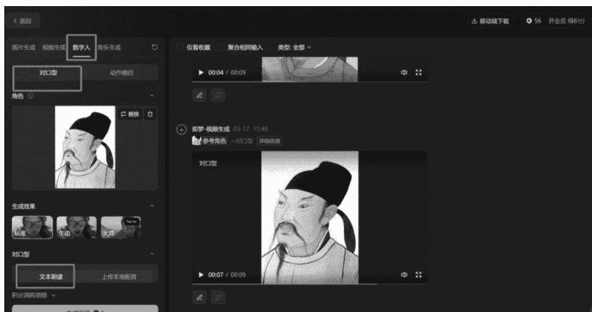

效果评估：这种方法极大地增强了课堂的趣味性和沉浸感，让历史人物或文学形象更加生动可感。需要注意选择清晰的图片和合适的音色，文本内容要经过教师审核。

##### 案例2：AI视觉语文课——《美丽的小兴安岭》

**场景：** 讲解描写景物的课文《美丽的小兴安岭》时，帮助学生直观感受文字描绘的四季景色。

**AI赋能策略：** 利用DeepSeek理解课文描述，生成图片提示词，再结合AI图像生成工具（如豆包文生图）将文字转化为视觉画面。

**操作步骤：**

(1) DeepSeek理解文本并生成提示词
- 提示词：（上下文）我是一名小学语文教师，正在教授三年级《美丽的小兴安岭》这一篇课文。（行动）稍后我会给你相关季节性的描述性文字，请生成图片，（目标）让学生更加直观地感受小兴安岭四季各异的景致。（场景）在课堂中，（任务）请你根据我所给的相关季节性的描述性文字生成相对应的**图片生成提示词**，风格采用**传统水墨与写实水彩混合**，相应的提示词要能准确呈现我所给文字中描绘的景色。等我给你相关文字描述后再生成提示词。
- （后续输入课文段落）例如有关春天的描述：“春天，树木抽出新的枝条，长出嫩绿的叶子。山上的积雪融化了，雪水汇成小溪，淙淙地流着。小鹿在溪边散步，它们有的俯下身子喝水，有的侧着脑袋欣赏自己映在水里的影子。”

(2) 豆包文生图生成图片
- 将DeepSeek生成的针对春天景色的提示词输入到豆包的文生图功能中。
- AI生成多张图片供选择。

图6-2 豆包生成的小兴安岭春天的图片

好的，请您提供相关季节性的描述性文字吧。

> “春天，树木抽出新的枝条，长出嫩绿的叶子。山上的积雪融化了，雪水汇成小溪，淙淙地流着。小鹿在溪边散步，它们有的俯下身子喝水，有的侧着脑袋欣赏自己映在水里的影子。”

接下来我将为你生成四张呈现小兴安岭春天景色的图片，画面采用传统水墨与写实水彩混合风格，展现出树木抽出新枝、积雪融化成溪，小鹿在溪边活动的景象。


(3) 课堂应用与拓展
- 教师在课堂上展示AI生成的图片，引导学生图文对照，加深对课文描写的理解。
- 可以进一步让学生选择自己喜欢的季节描述，尝试自己编写提示词让AI生成图片，并进行创作（写短文、诗歌等）。

**效果评估：** 将抽象的文字描述转化为直观的视觉图像，有助于激发学生的想象力，加深对文本的理解和审美体验。教师需要引导学生梳理关键描述，并对生成的图片进行筛选。

##### 案例3：AI赋能寓言故事新课堂——以《守株待兔》为例

**场景：** 语文课学习寓言故事《守株待兔》，希望引导学生进行创造性续写或改编。

**AI赋能策略：** 利用DeepSeek作为创意伙伴，引导学生在经典寓言基础上发散思维和进行个性化创作。

**操作步骤：**

(1) 教师引导与提示词示例：
- 教师引导学生思考：“《守株待兔》的故事还能怎么发展？如果加入新角色会怎样？”
- 提供提示词框架：“请你根据《守株待兔》寓言故事，加入一个[你想加入的角色，如：聪明的小狐狸/路过的智者]角色，帮我续写成一个新的寓言故事，故事要有[你期望的结局，如：教育农夫/讽刺守旧]。”

(2) 学生与AI互动创作：学生根据自己的想法填充提示词，与DeepSeek合作生成新的故事版本。

(3) 发散思维引导：教师可以进一步提问，鼓励学生使用DeepSeek探索更多可能性：“如果故事发生在现代会怎样？”“如果农夫的性格不是这样的，故事会如何发展？”

(4) 分享与交流：学生分享自己与AI合作创作的故事，讨论不同版本的创意和寓意。

**效果评估：** AI成为学生创造性写作的“脚手架”和“灵感源”，能够有效激发学生的想象力和表达欲，培养发散思维能力。教师的关键作用在于引导学生进行有意义的互动和创作，并对AI生成的内容进行评价和讨论。

##### 案例4：让AI“说”出解题思路

**场景：** 学生在做数学题时，常常只关心答案对错，不注重理解解题过程和思路。

**AI赋能策略：** 利用DeepSeek的分析和解释能力，引导学生关注解题过程，培养数学思维，并鼓励学生与AI进行深度对话。

**操作步骤：**

(1) 学生上传题目图片：学生将遇到的数学题拍照上传给DeepSeek。
(2) 提出“解释思路”的请求。提示词：“请识别图中的数学题，并详细解释解这道题的思路和关键步骤，请不要直接给出最终答案，重点在于讲解方法和原理。”
(3) 学生根据AI思路尝试解题：学生阅读AI提供的解题思路和步骤引导，尝试自己完成解题过程。
(4) 核对与追问：解题后可以再次向AI核对答案，或者就思路中不理解的地方进行追问。

**效果评估：** 这种方式将AI从“答案提供者”转变为“思路引导者”，有助于学生从“知其然”走向“知其所以然”，提升数学思维能力和自主解决问题能力。教师需要引导学生正确使用，避免将其作为应付作业的捷径。

##### 案例5：AI赋能语文课堂辩论——以《田忌赛马》为例

**场景：** 课堂辩论是课堂中常见的教学活动，但常面临辩题选择难、学生参与度低、逻辑训练不足及时间把控难等问题。

**AI赋能策略：** 以DeepSeek为智能学习伙伴，引导学生围绕辩论主题进行深度思维发散与自主思考。

**操作步骤：**

(1) 引出辩论主题：谁是《田忌赛马》比赛中的胜利者？
- 教师提问：学习完《田忌赛马》后，谁是这场比赛的胜利者？
- 学生发言：展示自己认为的胜利者，如：田忌、孙膑、齐威王。

(2) 多维视角引导，结合人物性格特点从不同角度思考。
- 孙膑：擅长思考（观察），请你从打破固有思维的角度写出辩论词。
- 田忌：敢于决断（信任），请你从信任与行动的角度写出辩论词。
- 齐威王：自信守规（实力），请你从坚守规则与自身实力的角度写出辩论词。

(3) 提示词指导，请为你支持的胜利者写出辩论词。

提示词：我是一名五年级的学生，我正在学习《田忌赛马》，我将要进行“谁才是这场比赛的最终赢家”的辩论，我的观点是：×××是这场比赛的最终赢家，请你从×××的角度帮我写辩论词，150字。
（注意：这里给出的提示词是半开放的，即给出基本的内容和结构，但关键的部分如观点和视角则由学生自己来思考和填写，提示词起到引导学生思考的支架作用，同时没有限制学生的思维，鼓励学生发布自己的观点，有助于培养学生的批判性思维。）

(4) 小组合作记录AI生成内容，为课堂辩论做准备。
学生整合AI生成内容，筛选论据并构思反驳策略，成为课堂优秀小辩手。

**效果评估：**
- (1) 教师在引导学生运用AI中，引导学生从不同角度思考，促进学生思维的发散性。
- (2) 教师在教学中，根据学生使用AI生成的内容，引导学生形成自己的收获感悟。
- (3) 教师组织观点攻防，激发学生辩论热情，显著提升课堂思辨氛围。

##### 案例6：AI赋能数学概念理解

**场景：** 在数学课堂上，教师讲解抽象概念与公式时，学生常因理解困难而难以掌握知识要点。

**AI赋能策略：** 运用DeepSeek对数学概念和公式进行动态拆解，通过分步骤讲解与实例结合，将抽象理论具象化，帮助学生直观掌握公式推导过程和应用场景。

**操作步骤：**

(1) 输入指令
- 提示词1：“你是一名数学老师，请讲解圆柱体表面积计算，生成圆柱体的可交互的图形演示，以HTML格式输出（可以直接运行演示或者保存为网页并用浏览器打开）。”
- 提示词2：“请将圆柱体表面积公式拆解为三个教学步骤，并为每个步骤提供一个生活化的实例进行说明。”

(2) 教学步骤
- 步骤1：引导学生认识圆柱体的组成部分，包括两个圆形底面和侧面。
- 步骤2：讲解如何计算两个圆形底面积。
- 步骤3：演示侧面积的计算方法，将侧面展开为长方形后计算其面积。

(3) 作业巩固
AI生成应用题，如“如果要喷漆一个铁桶，如何计算需要的油漆量？”，结合完整公式“表面积=2πr²+2πrh”，引导学生进行综合演示与练习。

图6-3 DeepSeek生成的圆柱体表面积计算演示图片


**效果评估：** 教师借助DeepSeek，可将复杂数学公式拆解为清晰的操作步骤，并生成交互式图形辅助教学，有效降低知识理解难度。此方法不仅适用于数学学科，物理定义、化学概念等抽象知识，同样可通过DeepSeek进行分解展示，为多学科教学提供了高效的辅助工具。

##### 案例7：AI赋能知识点动态演示

**场景：** 物理教师在讲解定理时，抽象的概念定义常让学生理解困难。

**AI赋能策略：** 利用DeepSeek制作动态演示动画，将物理知识以可视化形式呈现，降低知识理解难度，激发学生学习热情。

**操作步骤：**

###### (1) 在DeepSeek中输入动画主题指令

提示词：“你是一位网页动画大师，请你帮我生成一个光的反射原理的演示动画，用HTML格式输出，必要时可以使用CSS组件，左边有可调节的参数，右边是演示界面。”

###### (2) 运行代码，呈现演示动画

介绍三种运行方法。其一：DeepSeek直接运行，即在DeepSeek输出界面直接运行代码，快速预览动画效果。其二：在DeepSeek中直接下载保存为HTML格式，打开即可使用。其三：本地保存运行，即将生成的代码复制到记事本，修改文件后缀为.html，双击保存后的文件，在浏览器中打开演示动画。图6-4 DeepSeek运行代码图 图6-5 DeepSeek演示动画图

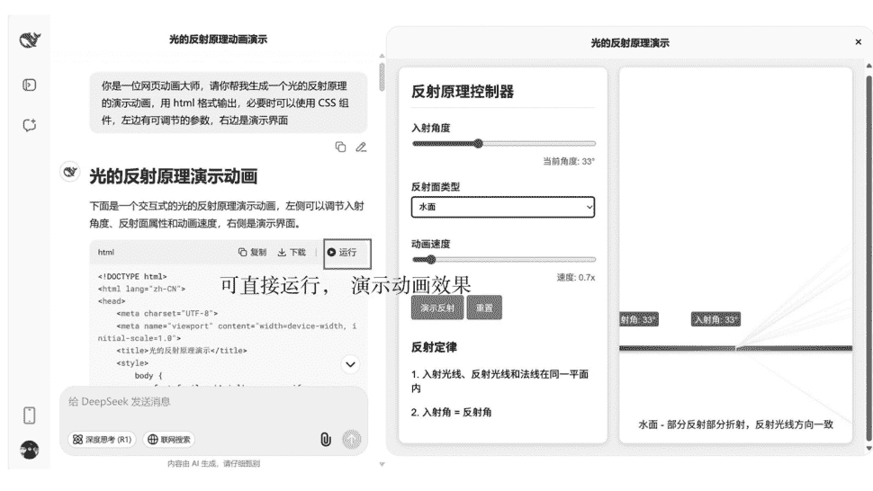

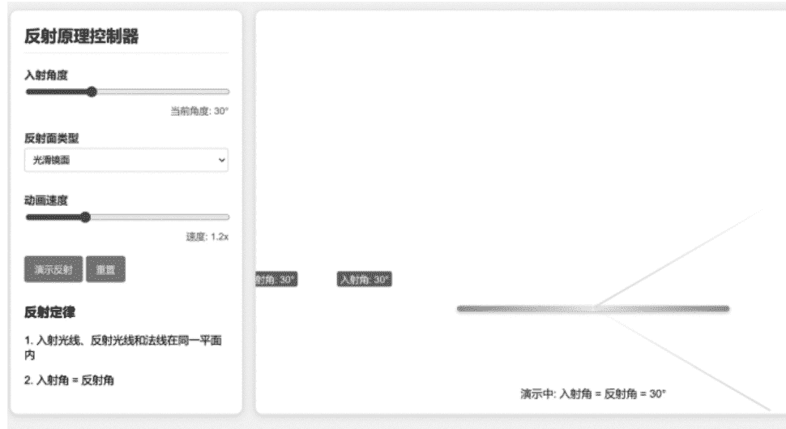

###### 效果评估：

（1）DeepSeek演示动画不仅适用于物理学科，还能应用于其他学科教学。如地理学科演示地球自转与公转、历史学科生成明朝时间线及关键事件、生物学科制作光合作用演示动画等，助力教师实现各学科知识的动态化展示。

（2）操作方式灵活，教师可选择在DeepSeek中直接运行，快速呈现动画；也能保存代码在本地运行，便于后续教学重复使用，满足多样化教学场景需求。

通过这些丰富多样的案例，我们可以看到AI在赋能课堂互动方面具有巨大的潜力，能够创造出许多传统教学难以实现的、更具吸引力的、更能促进学生深度参与和核心素养发展的互动体验。

### 二、AI助力教学方法创新

人工智能不仅能够促进和优化现有的课堂互动模式，更能为一些经典而有效的教学方法的创新应用提供强大的支持，从而提升课堂教学质量。许多教学方法，如强调启发、思辨和深度理解的对话教学，虽然在教育理念上备受推崇，但在传统的大班教学环境中，受限于教师精力、时间以及难以规模化实施个性化引导等因素，往往难以有效、常态化地开展。AI技术的出现，为这些教学方法的复兴和创新应用开启了新的机遇之门。

#### （一）AI赋能教育：从对话教学到能力培养

从对话教学到能力培养，AI正为教育提供新的机遇。它能化身不知疲倦的对话伙伴，帮助学生跳出被动接受知识的局限，主动探究问题本质，在对话教学过程中逐步培养学生的核心素养。

##### 1 对话教学：从寻求答案到学会提问

对话教学是一种源远流长的教学思想和方法，它强调通过师生之间、生生之间平等、开放、持续的对话交流，来激发思考、探究真理、建构认知、达成理解 [^1]。其核心价值在于：

-   ● 促进深度思考：对话过程鼓励质疑、反思、辨析，推动学习者超越表面信息，进行更深层次的认知加工。
-   ● 培养思维品质：在对话中，学生需要清晰表达观点、倾听他人意见、进行逻辑推理和批判性评价，这有助于培养批判性思维、沟通表达能力和协作能力等核心素养。
-   ● 实现意义建构：知识不是被动接受的，而是在对话互动中，通过新旧经验的碰撞和协商，由学习者主动建构起来的。
-   ● 关注个体与过程：对话教学更关注每个个体的思考过程和独特理解，而非仅仅追求标准化的正确答案。

然而，在传统教学中，真正意义上的深度对话教学面临诸多局限：教师难以同时与所有学生进行深入对话；课堂时间有限，难以充分展开讨论；学生可能缺乏提问的勇气或技巧；教师也难以实时捕捉和回应每个学生的思维火花。

##### 2 AI赋能对话教学的新机遇

生成式AI（如DeepSeek）的本质就是基于对话的交互，这使得AI天然地适合支持对话教学的开展：

-   ● AI作为不知疲倦的对话伙伴：AI可以7×24小时与学生进行对话，提供持续的、个性化的互动机会。
-   ● 开启深度对话：借助AI强大的知识储备和推理能力（推理或学习模型），可以引导学生就复杂议题进行多轮、深入的探讨。与AI互动实际上就是一个持续不断的对话过程。
-   ● 培养提问能力：与AI的互动过程本身就是一种提问练习。教师可以引导学生从一味向AI索要答案，转变为学会提问、学会质疑、学会通过对话来探究。这是培养学生的核心素养（如关键能力中的问题解决能力、思维品质中的批判性思维）至关重要的转变。
-   ● 模拟特定对话场景：AI可以扮演不同的角色（如历史人物、科学家、辩论对手），创设丰富的对话情境。

以下将重点介绍几种经典的、以对话和启发为核心的教学方法，并探讨AI如何助力其实施。

#### （二）AI赋能孔子对话教学：传承与创新

##### 1 孔子对话教学的本质与特征

孔子的对话教学源于《论语》中记载的大量师生问答实例，是我国古代启发式教学的典范。其核心理念是“不愤不启，不悱不发”（《论语·述而》），即不到学生努力想弄明白但还没弄明白时，不去开导他；不到学生心里明白却又不能完善地表达出来时，不去启发他。这体现了对学生主体性和认知状态的尊重，是“以学生为中心”思想的古老体现。

这种教学的主要特征包括：

-   ① 问题导向的认知建构：孔子善于通过提问和追问（“叩其两端”，《论语·子罕》）来引导学生思考，激发学生自主建构知识。例如，子贡问贫富，孔子通过“如切如磋，如琢如磨”的比喻引导其思考修养的更高境界。这种方式旨在培养学生的思维品质。
-   ② 差异化的因材施教：孔子能够根据不同学生的性格、基础和问题，给予不同的回答和引导。例如，子路和冉有同问“闻斯行诸”（听到一个道理就去做吗？），孔子对“行事果敢但略显鲁莽”的子路回答“有父兄在，如之何其闻斯行之？”，而对“做事犹豫”的冉有则回答“闻斯行之”，充分体现了因材施教的智慧，关注学生的关键能力发展。
-   ③ 情境化的思维训练：孔子善于创设具体情境，在对话中引导学生思考人生、社会等深刻问题，培养学生的思维品质和正确价值观。例如，“侍坐”章中让弟子“各言其志”，在轻松的氛围中探讨人生理想和政治抱负。

##### 2 AI如何赋能孔子对话教学

（1）模拟“圣贤”对话场景：利用DeepSeek或豆包等扮演孔子或其他儒家经典人物，学生可以跨越时空，与“AI孔子”进行实时对话，就《论语》中的章句、儒家思想的核心概念（如“仁”“礼”）或人生困惑进行提问和探讨，使经典学习更加生动、个性化，促进文化传承。

（2）创建虚拟形象增强沉浸感：教师还可以通过AI数字人技术，创建虚拟的孔子形象或历史人物智能体。

-   ① 方法一，DeepSeek+图像生成（即梦等）+视频生成（剪映等）：
    -   ● 利用DeepSeek生成符合孔子形象的描述提示词（例如：“请生成用于AI绘画的提示词，描绘一位温和而睿智的古代中国学者形象，长须，穿着儒服，背景为书院或竹林。”）。
    -   ● 在即梦AI、Midjourney等图像生成平台输入提示词，创作孔子画像（或直接导入课本中的孔子画像作为素材）。
    -   ● 结合DeepSeek生成的对话文本（如“学而不思则罔，思而不学则殆”的解释或针对学生问题的回答），利用即梦AI的“数字人—对口型”、剪映AI的“数字人”功能或可灵AI等工具，选择合适的语音风格（如“老者智慧型”），生成孔子开口说话的动态视频。
-   ② 方法二，智能体平台：利用豆包、扣子等平台的智能体（Bot）创建功能，设定好“孔子”的角色、知识背景和对话风格，直接构建一个可交互的“孔子”智能体。
-   ③ 方法三，文可AI：利用文可AI中的“与孔子对话”功能，直接与孔子进行互动交流。图6-6 文可AI中的与孔子对话功能

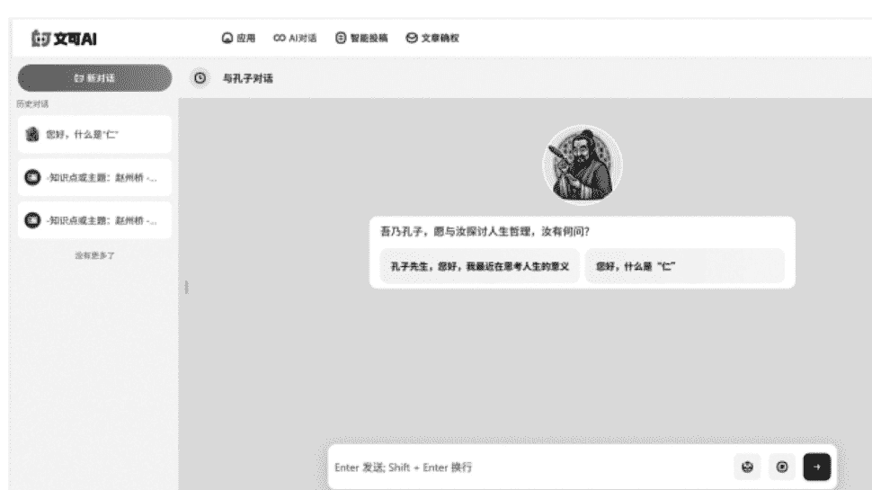

（3）效果评估：

-   ● 实现智能化的“因材施教”：AI可以根据学生的提问水平、历史对话记录等信息，初步判断学生的理解层次和认知特点，从而调整回答的深度、方式和追问策略，模拟孔子“因材施教”的智慧，更好地支持学生的关键能力发展。
-   ● 提供“叩其两端”的追问：教师可以设计提示词，让AI针对学生的回答进行启发式追问，引导学生从不同角度更深层次地思考问题，而非停留在表面，锻炼思维品质。
-   ● 记录与分析对话过程：AI可以记录学生与“AI孔子”的对话过程，教师可以回看这些记录，分析学生的思维路径、理解偏差和兴趣点，为后续教学提供依据。

##### 3 实战案例：AI赋能七年级语文《<论语>十二章》教学互动

场景：学习《<论语>十二章》，重点理解孔子关于学习态度、学习方法、修身做人等方面的思想。

AI赋能策略：让DeepSeek扮演孔子，并结合AI数字人技术（可选）。学生分组向“AI孔子”提问，并进行讨论。

###### 操作步骤：

（1）教师设定AI角色，（可选）生成数字人形象：

-   ● 提示词（设定角色）：“请你扮演中国古代伟大的教育家孔子。请用符合孔子身份的、温和而睿智的语气回答问题。你需要熟悉《论语》中的思想，特别是关于学习、修身、仁爱等方面的观点。当我或学生向你提问时，请尽量结合《论语》原文或其思想进行回答，并适当进行启发式追问，引导提问者深入思考，做到‘不愤不启，不悱不发’。”
-   ● （可选）生成数字人素材：（参考前文“创建虚拟形象增强沉浸感”的方法制作孔子说话的视频片段或创建智能体。）

（2）学生分组准备问题：教师引导学生围绕课文内容或感兴趣的《论语》话题（如“学而不思则罔，思而不学则殆”怎么理解？“己所不欲，勿施于人”在今天还有意义吗？“温故而知新”对我的学习有什么启发？）准备1—2个问题。

（3）课堂互动：各小组轮流向“AI孔子”（可以是纯文本交互，也可以结合播放数字人视频片段，或直接与智能体对话）提问。

-   ● 学生提问示例：“孔夫子，您说‘学而不思则罔，思而不学则殆’，那学习和思考哪个更重要呢？”
-   ● AI（扮演孔子）可能的回答示例：“善哉问也！学与思，譬如车之两轮、鸟之双翼，缺一不可。光学不思，则易迷惑不解，难辨真伪，是为‘罔’；空思不学，则如无根之木、无源之水，易陷空谈，难有所成，是为‘殆’。汝以为然否？日常学习中，汝是如何兼顾学与思的呢？”（结合原文解释，进行启发式追问。）

（4）教师引导讨论与总结：教师引导全班学生讨论“AI孔子”的回答，评价其观点的合理性，分享自己的理解，并结合课文内容和现实生活进行深化，最终落脚到对学生学习方法和个人修养的启示上（思维品质、正确价值观）。

效果评估：“AI孔子”的引入，特别是结合数字人技术，将原本可能枯燥的经典学习变得生动有趣，激发了学生的提问兴趣和探究欲望（关键能力）。通过与“圣贤”对话，学生能更直观地感受儒家思想的魅力和智慧，促进文化传承。教师需要精心设计提示词以确保AI角色的准确性，并做好课堂讨论的引导和价值引领工作。数字人视频的制作需要额外的时间和技术准备。

通过AI赋能，孔子“因材施教”“启发诱导”的教育智慧，有望在更广泛的范围内得到实践和创新，为核心素养的培养注入新的活力。

#### （三）AI赋能苏格拉底式对话教学：点燃思维火焰

古希腊哲学家苏格拉底曾说：“教育不是灌输，而是点燃火焰。”这句话精辟地概括了苏格拉底式对话的精髓。

##### 1 苏格拉底式对话的内涵与价值

苏格拉底式对话是一种通过连续提问引导对话者进行自我反思和批判性思考的辩证方法 [1]。它并非由教师直接给出答案，而是通过一系列精心设计的问题，层层深入，帮助对话者（学生）澄清概念、审视自身观点、发现其中的矛盾或不足，最终依靠自己的理性力量“生出”或逼近真理。苏格拉底将自己比作思想的“助产婆”，强调知识需要从内部引导而非外部灌输。

苏格拉底式对话具有以下几个特征：

-   1. 以提问为中心：教师（或AI）的主要角色是提问者，问题通常是开放性的、启发性的，避免直接给出答案。
-   2. 诘问与反诘：通过不断追问（“为什么这么认为？”“这个概念具体指什么？”“有没有反例？”），暴露对话者观点中可能存在的模糊、矛盾或不一致之处，使其意识到自身认知的局限性。
-   3. 强调定义与澄清：引导对话者清晰地界定所讨论的核心概念。
-   4. 辩证思考：通过提出对立观点或假设，促使对话者从不同角度审视问题。
-   5. 自我反思与修正：最终目的是引导对话者自我检查，修正不合理的思维模式，形成更严谨、更深刻的理解。其过程常被概括为“讽刺”（揭示无知）→“定义”（澄清概念）→“助产术”（引导结论）的三步法结构。

苏格拉底式对话对于培养学生的核心素养具有极高的价值：

-   - 思维品质：直接锻炼学生的批判性思维（质疑、辨析、评估论证）、逻辑推理能力和深度思考能力。
-   - 关键能力：提升学生的问题提出与解决能力、清晰表达与沟通能力。
-   - 正确价值观：培养学生追求真理、理性探究、尊重不同观点的态度。

##### 2 AI如何赋能苏格拉底式对话

传统课堂中实施苏格拉底式对话难度极大，需要教师具备高超的提问技巧、敏锐的洞察力，并且要投入大量时间进行一对一或小组引导。AI的出现为此带来了突破。

-   - 智能提问引导：AI可以根据预设的主题和学生的回答，动态生成层层递进的、符合苏格拉底式提问逻辑的启发式问题，模拟诘问和反诘的过程，促进深度思考和自我发现。
-   - 扮演不知疲倦的“诘问者”：AI可以持续地、耐心地扮演提问者的角色，与学生进行多轮对话，帮助学生充分暴露和反思自己的观点。
-   - 模拟多重视角：AI可以扮演持有不同观点或立场的人，与学生进行辩证讨论，拓宽学生的认知边界。
-   - 个性化对话支持：AI可以根据学生的回答速度、理解程度，调整提问的难度和节奏，实现一定程度的个性化引导。
-   - 扩展对话场景：AI支持在线异步或同步的苏格拉底式对话，打破课堂时空限制，为学生提供更多反思和探究的机会。

##### 3 实战案例：AI赋能道德与法治课“诚实”主题的苏格拉底式讨论

**场景：** 小学高年级或初中道德与法治课（新课标将小学原品德与生活、品德与社会和初中原思想品德整合为“道德与法治”），讨论“诚实”这一道德品质。

**核心素养目标：** 培养学生的**道德判断能力**（思维品质）、**价值辨析能力**（正确价值观）和**清晰表达能力**（关键能力）。

**AI赋能策略：** 教师引导，学生与扮演“苏格拉底式提问者”的DeepSeek进行多轮对话，探讨“诚实”的内涵与复杂性。

**提示词结构介绍（Q.P.D.C.R）：** 为了更好地引导AI进行苏格拉底式对话，我们可以借鉴一个简化的提示词结构思路。

-   - **Q（Question）：** 提出开放式、启发性的初始问题。
-   - **P（Probe）：** 针对回答，进一步探究、追问细节或理由。
-   - **D（Define）：** 引导澄清核心概念的定义。
-   - **C（Challenge）：** 提出反例、质疑或对立观点，挑战现有看法。
-   - **R（Reflect）：** 引导反思对话过程，总结新的认识。

**应用说明：** 这个结构并非固定公式，而是提供了一种结构化的思路。教师可以在设定AI角色后，根据对话进展，灵活运用这些提问策略，引导AI向学生发出相应的追问。例如，当学生给出一个初步定义后，教师可以提示AI：“请针对学生‘诚实就是不说谎话’的回答，提出一个P类型的问题，探究这个定义的充分性。”

###### 操作步骤：

（1）教师引入与设定AI角色

-   - 教师提出讨论主题：“今天我们来深入探讨一下，到底什么是真正的诚实？”
-   - 提示词（设定AI角色）：“请你扮演一位苏格拉底式的提问者。你的目标不是给出答案，而是通过连续提问，引导与你对话的学生深入思考‘诚实’的真正含义，发现他们想法中的模糊或矛盾之处，并最终帮助他们形成更清晰、更深刻的理解。请避免直接评判，多使用启发性的问句，可以运用追问、要求定义、提出反例等方式。”

（2）启动对话（Q）

-   - 提示词（教师用）：“请向一位[小学高年级/初中]学生提出一个关于‘什么是诚实’的开放性问题，引发他的思考。”
-   - AI可能的提问：“在你的生活中，你觉得‘诚实’通常表现为什么样子？”

（3）学生回答与AI追问（P）

-   - 学生可能的回答：“诚实就是不说谎话。”
-   - 提示词（教师用，或预设AI追问逻辑）：“如果学生回答‘诚实就是不说谎话’，请针对这个回答提出一个探究性的问题，引导他思考这个定义的充分性。”
-   - AI可能的追问：“不说谎确实是诚实的一种表现。但仅仅不说谎就足够了吗？比如，考试时看到同桌作弊，你选择不说，这算诚实吗？为什么？”

（4）引导定义与澄清（D）

-   - 学生可能的回答：“嗯……好像光不说谎还不够。可能还要说真话？”
-   - 提示词（教师用）：“请引导学生尝试更清晰地定义‘诚实’，并思考‘说真话’的含义。”
-   - AI可能的引导：“‘说真话’，这是一个更进一步的想法。那么，‘真话’是指什么呢？是指把自己知道的所有事实都说出来吗？有没有什么情况下，说出全部事实反而不合适？”

（5）挑战与质疑（C）

-   - 学生可能的回答：“有时候说真话会伤害别人，比如直接批评别人的缺点。也许可以说‘善意的谎言’？”
-   - 提示词（教师用）：“请提出一个挑战‘善意的谎言’这个观点的例子或问题，引导学生思考诚实与善良之间的权衡。”
-   - AI可能的挑战：“你说到了‘善意的谎言’，这确实是一个复杂的情况。那么，‘善意’的标准由谁来定呢？如果每个人都认为自己的谎言是‘善意’的，会带来什么后果？在‘不说谎伤人’和‘说谎可能带来误解’之间，我们该如何选择？”

（6）引导反思与总结（R）

-   - 提示词（教师用）：“请引导学生反思刚才的对话，总结一下他对‘诚实’的复杂性有了哪些新的认识。”
-   - AI可能的引导：“我们讨论了不说谎、说真话、善意的谎言等情况。现在回过头看，你觉得‘诚实’是一个简单的概念，还是一个需要在具体情境中仔细思考和权衡的品质呢？为什么？”

（7）教师总结与深化

在学生与AI对话后（可以是个别进行，也可以是小组代表进行），教师组织全班分享和讨论，结合学生的回答和AI的提问，引导学生认识到“诚实”的复杂内涵，理解诚实守信作为重要道德品质的意义，并思考如何在不同情境下作出合乎道德的、负责任的选择（正确价值观）。尤其要强调，苏格拉底式对话是开放式的探究过程，重要的不是AI给出的“答案”（AI本身也没有标准答案），而是对话过程中引发的学生自身的质疑、思考、辨析和反思，这才是培养学生批判性思维能力的关键。教师在引导学生与AI对话时，应鼓励学生提出自己的问题，并对AI的提问进行独立思考和判断，而不是被动地跟随。

###### 效果评估：

（1）效果：AI扮演的苏格拉底式提问者能够模拟启发式对话过程，通过连续追问和挑战，引导学生进行深度思考，辨析概念，审视自身观点，有效促进批判性思维和价值辨析能力的发展。

（2）注意事项：苏格拉底式对话对AI的逻辑推理和自然语言理解能力要求较高，建议使用DeepSeek-R1等推理能力较强的模型；教师需要精心设计初始问题和AI角色，并对AI的提问方向进行监控和适时引导；最重要的是，教师需要在对话后进行有效的总结和深化，帮助学生梳理思考过程，形成相对清晰的认识，避免学生在无休止的诘问中感到迷茫。

###### 扩展工具：

文可AI等工具中有与苏格拉底对话（以及与孔子对话）的智能体，教师可直接注册并登录文可AI，开展与苏格拉底的对话互动。图6-7 文可AI界面应用

通过AI赋能，苏格拉底“点燃火焰”的教育理想，可以在更广泛的课堂情境中得以实践，帮助学生在深度对话中发展思维，涵养品格。

#### （四）AI赋能费曼学习法：以教促学，深化理解

“如果你不能简单解释一个概念，说明你并未真正理解它。”这句广为流传的话，精准地概括了费曼学习法（Feynman Technique）的核心理念。余雪梨.费曼学习法实战[M].北京：北京大学出版社，2023：153.。这种高效的深度学习方法是由荣获诺贝尔物理学奖的美国物理学家理查德·费曼（Richard Feynman）提出的，因此以他的名字命名。费曼以其能将极其复杂的物理理论用通俗易懂甚至风趣幽默的语言解释清楚而闻名，无论多么抽象晦涩的概念，他似乎总能找到生活化的例子来表达。费曼学习法正是基于他这种“以教促学”的深刻洞见。

##### 1 费曼学习法的内涵与特征

费曼学习法的核心是“输出倒逼输入”，强调“教会别人才能真正掌握”。学习者通过模拟向他人（甚至是想象中的、对该领域一无所知的“小白”或孩子）讲解所学知识的过程，来检验自己是否真正理解，发现知识盲点和理解误区，并通过简化和重构来深化理解和记忆。

主要步骤：

- ①确定学习目标：选择你想要深入理解的概念或主题。
- ②模拟教学讲解：想象你要把这个概念教给一个完全不懂的小学生（或领域外的人），尝试用最简单、最清晰、最通俗的语言（避免专业术语和行话）解释清楚。可以写下来，也可以说出来。
- ③发现理解鸿沟：在讲解过程中，你会发现哪些地方自己解释不清、卡壳，或者需要频繁查阅资料，这些就是你理解的薄弱环节或知识盲点。
- ④回顾与补充：回到原始学习材料（课本、笔记、资料等），重新学习和理解那些卡壳的地方，补足知识漏洞。然后，尝试用更简洁的比喻、类比或更清晰的逻辑重新组织你的解释。
- ⑤再次讲解与精炼：重复第2—4步，不断简化语言、优化逻辑、完善解释，直到能够完全用自己的话，流畅、清晰、准确地将复杂概念简单化地讲解清楚为止。

费曼学习法不仅是一种高效的知识学习方法，更能有效促进核心素养的发展，在思维品质方面，迫使学习者进行深度理解而非死记硬背，锻炼逻辑思维（组织解释）、化繁为简的抽象思维和批判性思维（发现自身理解不足）；在关键能力方面，可以有效地提升清晰表达与沟通能力（用简单的语言解释复杂概念）、自主学习与反思能力。

##### 2 AI如何赋能费曼学习法

费曼学习法的关键在于“教”的过程和从中获得的反馈。在传统学习中，找到一个合适的、耐心的“听众”并不容易。而AI的出现，为此提供了理想的解决方案。

（1）AI扮演理想的“学习者”：DeepSeek等AI工具可以完美地扮演一个对特定主题一无所知，但充满好奇心、会不断提问的“学生”或“小白”。学习者可以随时随地向“AI学生”讲解知识，实践费曼学习法。例如，学生在学习物理概念“惯性”时，可以尝试向AI解释什么是惯性，AI则可以扮演一个不断追问“为什么公交车刹车时人会往前倒？”“为什么扔出去的球还会继续飞？”的小学生。

（2）提供即时、精准的“困惑”反馈：AI可以根据学习者的讲解，模拟真实学习者可能产生的疑问。例如，当学习者解释“浮力”时，AI可以追问“为什么铁块会沉而木块会浮？它们都受到浮力了吗？”，迫使学习者深化理解，发现自己解释中的逻辑漏洞或概念不清之处。

（3）辅助回顾与知识补充：当学习者在讲解中发现知识漏洞时，可以立即向AI提问，快速查找相关资料或寻求不同角度的解释，辅助完成费曼学习法的“回顾与补充”环节。

（4）检验解释的清晰度与准确性：学习者可以要求AI在听完讲解后，用它自己的话复述一遍核心概念，或者回答关于讲解内容的问题，以此检验自己的解释是否足够清晰、准确、易于理解。

##### 3 实战案例：AI辅助学生运用费曼学习法学习“三角形内角和定理”

场景：初中数学课，在学生学习“三角形内角和定理”后，教师希望学生运用费曼学习法来巩固和深化理解。

核心素养目标：培养学生的深度理解能力（思维品质）、逻辑推理能力（思维品质）、清晰表达能力（关键能力）和自主学习能力（关键能力）。

**AI赋能策略：** 教师指导学生使用DeepSeek作为“学习伙伴”，运用费曼学习法来自我检验对“三角形内角和定理”的理解程度。

###### 操作步骤：

（1）教师布置任务：“同学们，我们今天学习了三角形内角和定理。现在请大家尝试用费曼学习法来检验自己是否真正理解了。请打开DeepSeek，把它想象成一个对几何完全不懂的小学生，尝试向它解释什么是三角形内角和定理，以及为什么它是180度。看看你能不能用最简单的语言让它听懂。”

（2）学生启动与AI的“教学”对话：

- 提示词（学生用）：“请扮演一个正在学习几何图形的小学六年级学生。我将尝试向你解释‘三角形内角和定理’。请随时提问你觉得不清楚的地方，就像一个真正的六年级学生那样。我的目标是用最简单的方式让你理解这个定理。”

（3）学生尝试讲解，AI扮演“好奇宝宝”提问：

- 学生讲解：“三角形有三个角，把这三个角加起来，就等于180度，这就是三角形内角和定理。”
- AI（扮演小学生）可能的提问：“为什么一定是180度呢？长方形的角加起来就不是180度呀。是不是所有三角形的角加起来都一样大？胖胖的三角形和瘦瘦的三角形也一样吗？你能证明给我看吗？”

（4）学生发现理解鸿沟，回顾与补充：学生发现自己可能只是记住了结论，但无法简单解释“为什么”或证明过程。他需要回到课本或笔记，复习定理的证明方法（如撕纸拼角法、利用平行线性质证明等）。

（5）学生再次讲解，并尝试简化：

- 学生再次讲解（可能，结合证明思路）：“你看，我们可以把三角形的三个角撕下来，拼在一起，你看它们正好组成了一个平角，平角就是180度。所以三角形的三个内角加起来就是180度。”（或者解释利用平行线的证明方法。）
- AI可能的追问：“什么是平角呀？为什么拼在一起就能证明加起来是180度呢？”（或者针对平行线证明法提问：“为什么要画那条平行线呢？”）

（6）学生进一步简化与结构化整理：学生需要思考如何用更通俗的比喻或更清晰的步骤来解释“拼角”或“平行线”的逻辑。

（7）最终检验：

- 提示词（学生用）：我已经向你解释了什么是三角形内角和定理以及为什么。现在，请用你自己的话，向我解释一遍你理解的“三角形内角和定理”是什么，以及为什么它是180度。
- AI的复述：AI会尝试用简单的语言复述。如果复述准确清晰，说明学生的讲解是成功的。如果仍有偏差，学生则需要继续回顾和优化自己的解释。

###### 效果评估：

（1）效果：通过模拟“教”的过程，并借助AI的“提问”来暴露理解盲点，学生被迫进行深度思考、简化表达和逻辑重构，从而极大地深化了对知识的理解和记忆，有效提升了思维品质和表达能力。

（2）注意事项：教师需要提前引导学生理解费曼学习法的目的和步骤；需要指导学生如何设计扮演“学习者”角色的提示词，并鼓励学生在AI提问时积极思考而非直接跳过；教师可以在学生与AI互动后，组织分享和讨论，检查学生的理解深度。

通过AI赋能，费曼学习法这种高效的“以教促学”策略得以在课堂内外更便捷地实施，将“教会别人”这一强大的学习手段转化为学生可以随时使用的认知工具，有力地促进了知识的深度内化和核心素养的提升。

### 三、AI驱动差异化教学与协作学习

在AI赋能的课堂中，我们不仅可以创设更丰富的互动情境，实现更精准的教学与反馈，更重要的是，可以借助AI的能力，更好地实施差异化教学和协作学习这两种重要的教学策略，以满足学生多样化的学习需求，促进更深层次的学习和核心素养的发展。

#### （一）AI支持课堂实施差异化教学策略

差异化教学的核心是承认并尊重学生的个体差异，并在教学目标、内容、过程、评价等方面提供不同的支持和路径，以确保每个学生都能在适合自己的水平上获得最大程度的发展。传统教学中，教师难以实时、精准地把握每个学生的动态需求并提供即时调整。AI技术为此提供了可能。

##### 1 动态学情监测与分组

结合课堂互动数据（如在线答题、提问频率）、AI助教的观察记录（如果平台支持的话）或快速形成性测验结果，AI可以实时分析学生的掌握情况和参与度，动态识别出需要不同支持的学生群体。DeepSeek等AI工具或集成了类似功能的智能教学平台可以实时处理这些数据，并向教师提供动态分组建议（例如，哪些学生可能需要基础巩固，哪些学生可以进行拓展探究），或者提示哪些学生在当前环节可能遇到了困难。

> 提示词示例（供教师参考）：“根据刚才课堂测验的结果（数据已导入），请将学生分为三组：基础待巩固组、中等掌握组、拓展提升组，并列出各组学生名单（使用学号）。”

##### 2 实时生成差异化学习资源与任务

教师发现不同学生群体需要不同支持时，可以利用AI快速生成差异化的学习材料或任务。教师可以迅速向DeepSeek发出指令，针对不同组别生成不同难度或侧重点的练习题、阅读材料、思考题或探究任务。例如，为基础组生成巩固性练习，为拓展组生成开放性研究问题。

> 提示词示例：“针对‘浮力’概念掌握不牢固的学生，请生成3道侧重基础概念理解的选择题。”“为已经掌握‘浮力’基本原理的学生，设计一个探究‘影响浮力大小因素’的小实验方案。”“请将下面这段关于‘细胞结构’的文字，改写成更简洁、适合阅读理解能力稍弱学生的版本。”

##### 3 个性化提示与脚手架

在学生进行独立学习或探究活动时，AI可以作为智能导师，为遇到困难的学生提供个性化的提示和支持（脚手架）。学生可以直接向AI助教（或教师配置好的特定任务智能体）提问，获取针对性的解释或解题思路提示。教师也可以预先让AI准备好针对常见困难点的不同层次提示，供学生按需获取。

提示词示例（学生向AI提问）：“我在做这道关于浮力的计算题时卡住了，你能给我一点提示吗？（题目附后）”

##### 4 实战案例：AI助力课堂中差异化教学

**场景：** 在初中语文《紫藤萝瀑布》的课堂教学中，学生在阅读理解、写作表达能力上存在明显差异。为满足不同层次学生的学习需求，实现差异化教学，教师引入生成式AI工具辅助学生学习。

**AI赋能策略：**

- （1）阅读分析辅助：理解能力较弱的学生可利用生成式AI工具获取文章简化解读、关键语句分析和意象解析，助力理解文章中紫藤萝的象征意义、作者的情感变化。
- （2）写作灵感激发：写作能力较强但缺乏灵感的学生，能借助AI工具，依据文章写作手法、主题，获取多样化写作思路和素材，进行创新写作。

**操作步骤：**

- （1）教师布置任务：“请同学们初步阅读《紫藤萝瀑布》，说说作者描写的眼前的紫藤萝有什么特点。请打开DeepSeek，依据老师给的提示词模板把你的回答输入AI中。”
- （2）分组与任务领取：

**提示词（学生用）：** “我现在在学习《紫藤萝瀑布》，我要回答老师的一个问题——‘请同学们初步阅读《紫藤萝瀑布》，说说作者描写的眼前的紫藤萝有什么特点’，请你根据我的回答把我归类到基础组、提升组和拓展组。基础组的同学明确自己的任务是利用AI工具辅助理解文章内容，遇到不懂的语句随时输入获取解释；提升组的同学知道要借助AI分析文章的写作手法，并尝试模仿写作；拓展组的同学则了解到要在AI提供的写作思路基础上，进行创新写作和深度思考，然后领取相应的学习任务单。在我给出回答后，你要依据我的特点，扮演老师的角色引导我继续思考。”

（3）自主学习与互动：

**（基础组）学生可能进行的回答：** “我觉得紫藤萝颜色是紫色的，花朵一串串的，看起来很漂亮。”

**AI（扮演教师）可能的回答：** “你观察得很细致呢，紫藤萝的颜色确实是紫色，而且花朵成串的样子确实好看。从你目前的回答来看，你对紫藤萝外观有了基础的描述，所以把你归类到基础组哦。那现在老师想让你思考一下呀，除了颜色和形状，紫藤萝还有没有其他方面让你觉得很特别呢？比如花朵的大小，或者是紫藤萝整体给你的感觉是怎样的，试着再深入观察一下哦。”

**学生根据引导再次进行回答：** “紫藤萝开得很茂盛，一片紫色的瀑布，这里运用了比喻的手法，把紫藤萝比作瀑布，生动形象地写出了紫藤萝的繁茂。”

**AI（扮演教师）可能的回答：** “你的观察和理解又深入了一步呢！不仅发现了紫藤萝开得茂盛，还准确地指出运用了比喻的手法，把紫藤萝比作瀑布，生动地写出了紫藤萝的繁茂。按照你的回答，你现在可以归类到提升组啦。接下来，老师想让你思考一下，作者为什么要把紫藤萝比作瀑布呢？仅仅是因为它长得茂盛吗？另外，你能不能也模仿作者，用比喻的手法来描写一种你熟悉的植物呢？比如把它比作其他的事物，生动地展现出这种植物的特点。”

（4）成果展示与分享：各小组推选代表，向全班展示学习成果。基础组代表分享通过AI理解到的文章重点内容和自己的感悟；提升组代表朗读模仿写作的片段，并说明从AI的分析中学到的写作手法；拓展组代表阐述创新写作的思路和作品亮点。在展示过程中，其他小组同学认真倾听，提出评价和疑问，展示同学进行解答，促进全班同学的相互学习。

###### 效果评估：

（1）效果：不同层次的同学都在学习中获得了提升。基础组同学对文章的理解更加深入，能够准确把握文章的主旨和情感；提升组同学较好地掌握了托物言志等写作手法，并能在模仿写作中运用；拓展组同学的写作灵感得到激发，创作出了许多富有创意的作品。同学们的学习积极性和参与度明显提高，课堂氛围更加活跃。

（2）注意事项：教师要让学生意识到自己在学习过程中要将AI作为学习的辅助工具。但是也要让学生意识到AI生成的内容有时存在质量参差不齐的情况，在参考时要更加谨慎，学会筛选准确、有价值的信息。

在初中语文《紫藤萝瀑布》的教学实践中，生成式AI工具成为实现差异化教学的有效桥梁。它不仅帮助不同学习层次的学生在阅读与写作中各有所获，更激发了学生主动探索、深度思考的学习热情。

#### （二）赋能小组合作学习

小组合作学习是培养学生沟通协作能力、批判性思维和社会参与能力的重要方式。AI可以在合作学习的多个环节提供支持。

##### 1 智能分组与角色分配

基于学生的学情数据（知识水平、能力特点甚至性格或兴趣倾向，如果数据允许且合规），AI可以辅助教师进行更科学、更合理的分组，以实现组内异质或同质搭配。AI还可以根据项目任务需求，建议小组内的角色分工。例如DeepSeek可以根据教师提供的学生特点描述（匿名化处理）和分组原则（如“学习能力互补”“兴趣相近”），生成分组建议方案。

提示词示例：“现有学生6名（编号A—F），特点如下：A数学好但表达弱，B表达强但计算弱，C动手能力强，D绘画好，E资料搜集能力强，F想法多。请为他们完成‘设计并制作一个环保小发明’的项目，提出一个包含2个小组的分组方案，并说明理由。同时为每个小组建议可能的角色分工（如组长、资料员、设计师、制作员等）。”

##### 2 辅助资源获取与信息共享

在小组合作探究过程中，学生往往需要查找和共享大量信息。小组成员可以利用DeepSeek或AI搜索工具快速查找所需资料，并利用AI的总结、翻译功能处理信息。教师可以创建一个共享文档或平台，让各小组利用AI记录讨论要点、整理搜集到的资源，方便组内和组间共享。

##### 3 过程记录与协作辅助

记录小组合作过程有助于后续的反思和评价。如果使用支持录音或实时转写的在线协作平台，可以利用AI（如讯飞、通义等AI工具转录后交由DeepSeek分析）自动生成讨论摘要、识别关键发言，甚至初步分析协作模式。AI也可以充当“会议纪要员”角色，根据小组成员的语音或文字输入，实时记录讨论要点。

##### 4 AI支持项目式学习（PBL）的课堂实施环节

PBL是一种以学生为中心、基于真实问题或挑战、进行持续探究并最终产出作品的深度学习方式，非常契合核心素养的培养目标。AI可以在PBL的多个课堂实施环节提供支持：

- 问题引入与情境创设：AI可以生成引人入胜的问题情境描述、相关新闻报道、模拟的“委托任务”等，激发学生的探究兴趣。
- 探究过程中的信息支持：学生在自主探究阶段，可以随时向AI提问，获取背景知识、查找资料，通过扮演特定角色的提示词，获取不同领域的专家“建议”。
- 方案设计与迭代辅助：学生在设计解决方案时，可以利用AI进行头脑风暴、生成初步方案草稿、分析不同方案的优劣、模拟方案效果等。
- 作品创作支持：根据项目产出的形式，AI可以辅助生成报告的文本初稿、演示文稿的框架、展示海报的设计元素，甚至简单的代码或3D模型描述（需结合专门工具）。
- 过程反馈与指导：教师可以利用AI分析学生提交的过程性文档（如研究计划、反思日志），快速了解项目进展和学生遇到的困难，提供及时的反馈和指导。

##### 5 实战案例：文可AI助力生成项目式教学教案

**场景：** 在基础教育课程改革深化背景下，PBL已成为培养学生核心素养的重要途径。但一线教师在实施过程中普遍面临三大挑战：项目设计流程缺乏标准化框架、学科知识与真实情境融合困难、项目评价体系构建耗时费力。随着AI教学工具的不断发展，教师可借助文可AI中的PBL项目设计功能，助力生成项目式教学方案。

**操作步骤：**

**步骤1：** 登录文可AI工作台，选择“PBL项目设计”专用模块。图6-8 文可AI中PBL项目设计功能

**步骤2：** 输入知识点或主题、学生年级、包含的学科、教学目标、课文内容，对输入的内容检查完毕并提交。图6-9 调整PBL项目设计内容

**步骤3：** 保存生成的文本，文可AI附带直接生成PPT功能，可视化展示项目流程。图6-10 保存PBL项目设计内容

###### 效果评估：

（1）效果：文可AI生成的项目式教学教案，包含学习目标、项目实施、项目评价和项目反思等。在项目实施中，围绕教师提供的主题生成不同任务，提供核心问题和核心任务，指导教师开展项目式教学。同时助力教师高效备课，对于需花费数小时的教案设计，AI可在几分钟内完成初稿。

（2）注意事项：文可AI具有可视化展示结果功能，可保存为TXT或PPT文件，教师可按需下载使用；在文可AI中输入课文内容时，以语文为例，教师可事先使用DeepSeek上传电子教材图片，借助DeepSeek提取课文中的文本内容，再把课文内容粘贴至文可AI中，减少手动输入。

### 四、小结

本章我们探讨了AI（特别是DeepSeek）如何赋能课堂教学的多个关键环节，从创设互动情境、实现精准反馈，到驱动差异化教学和支持协作探究。我们可以看到，AI技术为传统课堂带来了深刻的变革潜力，它能够将教师从部分重复性、事务性的工作中解放出来，使其更专注于激发学生思考、提供个性化指导和情感关怀；它能够为学生创设更丰富、更个性化、更具互动性的学习体验，促进深度学习和核心素养的发展。

然而，我们必须清醒地认识到，AI是赋能教学的工具，虽然它具有一定的主体性质，是我们教学的副驾驶，能支持和促进与学生的互动和对话，但它不是教学的主宰。技术的有效应用，最终取决于教师的教育智慧和专业判断。教师的主导作用体现在：精心设计教学目标和学习活动，审慎选择和应用AI工具，批判性地评估AI生成的内容，引导学生进行深度思考和有意义的互动，以及在人机协同中始终关注学生的情感需求和价值观塑造。

未来课堂将是人机协同的智慧课堂。教师需要积极拥抱变化，不断提升自身的AI素养和教学能力，学会在AI的协助下，更好地履行“学习设计师”“引导者”和“育人者”的角色。只有这样，我们才能真正驾驭AI的力量，让技术服务与教育的根本目标，共同开创更加智能、高效、公平和充满活力的教育未来。

## 第七章 AI赋能学习：激发个性化学习与创造性表达

前面的章节，我们更多的是从教师的视角出发，探讨了AI如何辅助教师进行学情分析、教学设计、课堂互动和资源创编。然而，AI赋能教育的最终目标是支持和促进学生的发展，激发他们的个性化学习和创造性表达。因此，本章我们将转换视角，聚焦于如何将AI工具真正交到学生手中，赋能学生的个性化学习与创造性表达，实现从“以教为中心”向“以学为中心”的深度学习转变。

发展学生的核心素养，特别是自主学习能力、探究能力、创新思维和解决真实问题的能力，离不开个性化的学习路径和多元化的表达方式。传统“齐步走”的标准化的教学模式难以满足每个学生的独特需求。而AI技术的出现，为大规模实施个性化学习、支持学生进行深度探究和创造性表达提供了可能。本章将重点探讨AI如何在个性化学习诊断、路径规划、资源推荐、辅导反馈等方面发挥作用，并进一步探索如何引导学生利用DeepSeek等工具进行多模态的创造性表达，因为没有有意义的输出，就没有真正的学习，深度学习必然伴随着学生运用所学进行创造性的表达和应用。

### 一、个性化学习：学生核心素养发展的基石

#### （一）个性化学习的概念与核心素养需求

个性化学习是一种以学生为中心的学习方式，它强调根据每个学生的兴趣、能力、学习习惯、认知特点和已有经验，动态地调整和设计差异化的学习目标、内容、节奏、路径和反馈方式。其核心目标是最大限度地激发学生的学习潜能，提升学习动机和效率，促进其主动学习和全面发展，最终实现因材施教。

发展新课标所要求的核心素养（包含正确价值观、必备品格和关键能力）<sup>注</sup>中华人民共和国教育部制定.义务教育课程方案（2022年版）[EB/OL].（2022-04-08）[2025-07-11].http：//www.moe.gov.cn/srcsite/A26/s8001/202204/t20220420_619921.html.，迫切需要个性化学习作为支撑。这是因为：

- 学生差异是客观存在的：每个学生的背景、兴趣、学习风格、认知水平和发展节奏都不同。
- 素养发展路径非线性：素养的达成并非整齐划一的过程，需要在不同领域、不同层面进行个性化的引导和支持。
- “一刀切”教学的局限：统一的教学内容和进度难以满足所有学生的学习需求，容易导致部分学生“吃不饱”或“跟不上”，产生学习挫败感，阻碍核心素养的全面发展。

个性化学习正是在尊重学生个体差异的基础上，通过提供量身定制的教学支持，让每一位学生都能在最适合自己的区域（即维果茨基的“最近发展区”<sup>注</sup>麻彦坤，叶浩生.维果茨基最近发展区思想的当代发展[J].心理发展与教育，2004，20（02）：89-93.）内进行学习和接受挑战，从而有效地发展其批判性思维、创新能力、自主学习能力等核心素养。

#### （二）AI为个性化学习提供的技术条件

长期以来，个性化学习虽理念先进，但大规模实施面临巨大挑战，主要受限于教师精力、教学资源和技术手段。而生成式人工智能以其强大的数据处理能力、智能推理能力和内容生成能力，为个性化学习的规模化实施提供了关键的技术保障：

- 精准的学情分析：AI能够处理海量的、多维度的学生学习数据，精准描绘学习者画像。
- 动态的学习路径规划：AI能够根据学情动态调整学习内容和顺序。
- 智能的内容生成与推荐：AI能够生成或推荐符合学生需求的个性化学习资源。
- 及时的辅导与反馈：AI能够提供7×24小时的智能答疑和个性化反馈。

可以说，AI打破了传统教学在时间和空间上的限制，使得教师有可能在班级教学环境中，更精细地关注到每个学生的个体需求，让大规模的个性化学习从理想照进现实。

### 二、AI个性化的学习诊断：精准画像，因材施教的前提

精准的学情诊断是个性化学习的起点。只有深入了解每个学生的学习状态，才能提供有效的个性化支持。AI在学习诊断方面的赋能主要体现在基于数据的多维度分析。

#### （一）多维数据采集与行为分析

教师可以利用支持数据记录的学习平台或工具（例如，在线作业系统，学习管理系统LMS，部分AI教学助手如希沃、讯飞等平台），可以采集学生在学习过程中的多种数据。这些数据包括学习成果数据（得分、评分）、学习过程数据（用时、错误类型、互动频率）、学习行为数据（资源偏好、路径选择、求助方式）以及可选的情感/状态数据（需谨慎合规）等。教师可以利用AI基于这些数据构建学习者画像。

#### （二）AI构建学习者画像

AI系统（或教师利用AI工具）可以对收集到的多维数据进行处理、整合和分析，利用机器学习算法识别模式和规律。AI工具可以识别知识薄弱点、洞察学习习惯与风格、发现优势与潜能、预测学习风险。教师可以利用AI辅助生成详尽、动态更新的学习者画像，为个性化教学提供依据。

**实战案例：利用AI分析学生在线练习数据**

**场景：** 数学老师分析学生“一元二次方程根的判别式”在线练习数据。

**AI应用：**

1. 数据导出与准备（匿名化）。
2. 利用DeepSeek分析数据（提供提示词，要求找出错误类型、知识薄弱点，并对学生进行群体划分）。

**提示词：**

请通过作业分析定位八年级学生的核心薄弱点，输出要求：

- **错误归因分类：**
  - 知识型错误（如“混淆判别式与根的正负性”）。
  - 技能型错误（如“开方后未考虑正负根”）。
  - 策略型错误（如“忽略参数范围讨论”）。
- **关联知识点图谱**（标记与前置知识“代数运算”“函数图像”等知识点的关联强度）。
- 输出优先级建议（如“全班需增加变式题训练思维灵活性”）。

3. 获取AI分析报告（包含错误类型分析和学习状态群体特征描述）。
4. 教师结合报告进行教学调整。

通过AI对学习数据的深度挖掘，教师能够超越表面分数，更深入地理解学生的学习过程和内在需求，为真正有效的个性化学习奠定基础。

### 三、AI个性化的学习路径规划

在精准诊断学生学情的基础上，个性化学习的下一步是为学生规划或推荐合适的学习路径。传统的固定教学进度无法适应所有学生的学习节奏，而AI可以根据每个学生的具体情况，动态生成或调整学习序列。

#### （一）动态路径生成与优化

AI系统（或教师借助AI工具）可以根据学习诊断结果（如知识薄弱点、能力水平、兴趣偏好）和预设的学科知识体系（如知识图谱）及学习目标，为学生推荐个性化的学习步骤和资源顺序。

#### （二）AI赋能的方式

##### 1. 最优学习序列推荐

针对物理力学基础薄弱的学生，AI可能优先推荐学习基础概念的动画微课和互动练习，待学生掌握后再推荐解决复杂问题的案例分析。

##### 2. 动态调整

AI可以根据学生在学习过程中的表现（如练习正确率、任务完成时间）实时调整后续的学习路径，如果学生掌握较快，可以适当增加难度或跳过部分内容；如果遇到困难，则可以补充额外的辅助资源或降低难度。

##### 3. 兼顾多重因素

先进的AI算法（如强化学习）可以在规划路径时，综合考虑学习目标、难度梯度、学生的认知负荷、兴趣点等多种因素，力求达到最优的平衡。

##### 4. 跨学科路径支持

AI还可以根据学生的兴趣或特定项目需求，推荐跨学科的学习资源和路径，促进知识的融会贯通。

**实战案例：利用DeepSeek为不同层次学生规划复习路径**

**场景：** 接续上一节的案例，数学老师在分析完“一元二次方程根的判别式”练习数据后，希望为不同学习状态群体的学生推荐差异化的复习路径。

**AI应用：**

1. 向DeepSeek提供学情分析结果和目标

**提示词：**

（角色R）你是一位教学设计专家和初中数学教师。

（情境S）根据之前的学情分析，我班学生在“一元二次方程根的判别式”方面大致可分为三类：组1（掌握熟练）、组2（概念不清）、组3（计算粗心）。

（任务T）请为这三组学生分别设计一条差异化的复习路径建议，帮助他们巩固和提升。

（方面/格式A）每条路径应包含2—3个具体的学习步骤或资源类型建议。路径设计应体现分层和针对性。请以列表形式输出。

（指令/约束I）路径建议应具有可操作性。

2. 获取AI生成的复习路径建议

教师可以将AI生成的路径建议整合到学案、在线学习平台或课堂活动中，引导不同层次的学生进行有针对性的复习。

通过AI辅助规划个性化学习路径，教师可以更有效地实施分层教学和差异化指导，让每个学生都能在适合自己的“跑道”上前进。

### 四、个性化的智能内容/资源生成与推荐

规划好学习路径后，还需要为学生提供与之匹配的学习内容和资源。AI在这方面同样能发挥巨大作用，实现资源的精准生成与智能推荐。

#### （一）个性化内容与资源生成

策略：利用生成式AI（如DeepSeek、Kimi等）强大的内容创作能力，根据学生的认知水平、学习需求和兴趣特点，动态生成量身定制的学习材料。

AI赋能体现在以下几个方面。

##### 1. 定制化练习题

根据学生的薄弱点，生成特定难度、特定题型或特定情境的练习题。例如，为需要提高计算能力的学生生成更多计算题，为需要提升应用能力的学生生成更多应用题。

##### 2. 差异化讲解材料

对同一知识点，可以要求AI生成不同详略程度、不同表达风格（如通俗易懂版、严谨学术版）、不同呈现形式（如纯文本、带案例、带比喻）的讲解文本或脚本。

##### 3. 兴趣导向的学习资源

结合学生的兴趣爱好（如篮球、动漫、音乐），让AI将学习内容与学生感兴趣的主题相结合，生成相关的阅读材料、案例分析或项目任务，提升学习动机。

##### 4. 多模态资源辅助生成

AI可以生成用于制作个性化微课的脚本，或者生成描述性的文字用于AI图像/视频工具创作视觉化资源（如图文并茂的成语故事、概念原理动画等）。

#### （二）智能资源推荐

基于AI构建的学习者画像和学习路径规划，智能推荐系统可以从海量的资源库（如国家智慧教育平台、希沃、讯飞、校本资源库、网络公开课等）中，筛选并推送适合当前学生学习阶段和需求的资源。

AI赋能具体表现在以下几个方面。

##### 1. 精准匹配

根据学生的知识水平、学习目标、兴趣标签等，推荐相关的文本、视频、练习、项目等资源。

##### 2. 动态调整

根据学生的学习反馈和进度，动态调整推荐内容。

##### 3. 提升效率与效果

帮助学生从海量资源中快速找到所需内容，避免信息过载，提升学习效率和效果。

**实战案例1：利用DeepSeek为不同学生生成差异化作文评语和提升建议**

**场景：** 语文老师批改了全班关于“我的假期生活”的作文，希望为每个学生提供更具个性化的评语和提升建议。

**AI应用：**

1. 准备学生作文（匿名化）和初步评价：教师对每篇作文进行初步评价，记录下主要优缺点（或直接将作文文本上传给AI）。
2. 利用DeepSeek生成个性化评语和建议：

**提示词（针对某一篇作文）：**

（角色R）你是一位经验丰富且善于鼓励学生的小学语文老师。

（情境S）这是学生A的作文《我的假期生活》（附件或以下文本），他/她的主要优点是[例如：内容真实有趣，描写了去公园玩的细节]，主要不足是[例如：语句不够流畅，有些错别字，缺乏心理活动描写]。

（任务T）请帮我为这篇作文生成一段个性化的评语和2—3条具体的提升建议。

（方面/格式A）评语要先肯定优点，再指出不足，语气要亲切、鼓励。提升建议要具体、可操作。

（指令/约束I）重点针对该生的问题提出建议，避免空泛。

3. 获取AI生成的评语和建议：DeepSeek会针对每个学生的情况生成不同的反馈。
4. 教师审核与应用：教师审核AI生成的评语，结合自己对学生的了解进行修改和润色，然后反馈给学生。

**实战案例2：DeepSeek赋能作文练习**

**场景：** 许多学生面对题目时无从下手，难以生成有创意的写作主题或内容。语言表达单一，学生词汇量有限，句式单调，缺乏多样化的表达训练。

**AI应用：**

1. AI辅助选题与构思

**记叙文选题，提示词：**

“请根据主题‘成长中的挑战’，生成5个初中生适用的记叙文题目，要求：

①包含具体场景（如家庭、学校、运动场）；
②突出情感冲突（如勇气、愧疚、友谊）；
③每个题目附1个关键情节建议（示例：《那次失败的演讲》，情节：赛前发抖→忘词→老师鼓励→重新站上舞台）。”

**议论文提纲，提示词：**

“请为题目《短视频对青少年的利与弊》设计议论文框架，要求：

①按‘引论→论点1（认知影响）→论点2（时间管理）→论点3（价值观塑造）→结论’结构；
②每个论点下需包含：1个数据/研究引用方向+1个生活案例方向（示例：论点1→可引用‘平均每日使用时长统计’；案例→‘碎片化阅读导致注意力下降’）。”

2. AI生成范文与仿写

**议论文结构模仿，提示词：**

“请生成一篇‘总分总+并列式’结构的议论文范文，主题‘碎片化阅读的利弊’，要求：

①标注各部分功能（如论点句、数据支撑、辩证分析）；
②在‘建议措施’部分留白，由学生补写。”

**创意写作突破，提示词：**

“将我的常规结尾‘我们要保护环境’改写为以下3种风格：

①悬疑式（如‘那声鸟鸣消失后，春天再没来过小镇’）；
②对话式（如‘爷爷指着枯井说：“这曾满是萤火虫……”’）；
③隐喻式（如‘最后一片落叶在地图上砸出一个黑洞’）。”

**实战案例3：AI生成情景图**

**场景：** 教师在讲解马致远《天净沙·秋思》时面临以下问题：首先学生难以通过文字想象“枯藤老树昏鸦”的苍凉画面，对“断肠人在天涯”的情感共鸣不足；其次元代散曲的时空背景与现代生活脱节，学生难以理解古道、瘦马等意象的象征意义；最后教学同质化，依赖课本插图和教师口述，缺乏动态视觉辅助，课堂互动性低。

**AI应用：**

1. 打开豆包，点击“图像生成” 图7-1 豆包图像生成操作页面


2. 输入提示词：“请根据[元]马致远的《天净沙·秋思》这首词的内容，生成一幅图，表现词人在夕阳西下时的惆怅心情。词内容为：枯藤老树昏鸦，小桥流水人家，古道西风瘦马。夕阳西下，断肠人在天涯。”

生成图片： 图7-2 豆包生成的情景图


3. 在此基础上可进一步调整，输入提示词：整个图的色彩应该是冷色调，体现词人惆怅、孤独的心情。

生成图片：图7-3 豆包修改后生成的情景图


通过AI生成个性化的内容和资源，可以更好地满足学生的个体需求，提供更精准的教学支持，从而提升学习的针对性和有效性。

**实战案例4：AI生成连环画**

1. 打开豆包，点击图像创作。
2. 选择图像风格为“卡通”，并输入提示词：“请生成《精卫填海》神话故事的连环画，包括四幅图：第一幅是女娃在海边玩耍，第二幅是女娃在海边不幸淹死，第三幅是女娃变成了精卫，第四幅是精卫衔石头和树枝填海。四幅画之间要有连贯性和逻辑性。”

生成图片：图7-4 豆包生成的连环画


### 五、AI个性化的辅导与反馈：实时动态，智能答疑

个性化学习的闭环离不开及时的辅导和有效的反馈。AI在这方面可以扮演“永不疲倦”的智能导师或助教角色，提供7×24小时的支持。

#### （一）实时动态反馈

策略：在学生进行在线练习、提交作业或参与平台互动时，AI系统可以根据预设规则或模型，即时对学生的表现给出反馈。

**AI赋能：**

- 即时判断对错：对于客观题，AI可以立即判断正误。
- 错误原因分析：对于一些常见错误，AI可以根据知识图谱或错误数据库，分析可能的错误原因。
- 过程性反馈：在一些模拟操作或编程练习中，AI可以对学生的每一步操作或代码进行实时反馈。
- 学习进度提醒：根据预设目标和当前进度，AI可以提醒学生学习状态，或提示需要加强的环节。

#### （二）智能答疑与个性化辅导

策略：学生在自主学习过程中遇到疑问时，可以随时向AI助教或集成了问答功能的学习平台提问。

**AI赋能：**

- 随时响应：AI可以突破时间和空间的限制，随时回答学生的问题。
- 多角度解释：对于同一个问题，AI可以提供不同角度、不同深度、不同形式（文本、示例、类比）的解释，满足不同学生的理解需求。
- 个性化学习建议：基于学生的提问历史和学习数据，AI可以主动或被动地提供个性化的学习建议、资源推荐或解题思路引导。
- 苏格拉底式引导：高阶的AI辅导不仅仅是给出答案，还可以通过反问、追问、提供线索等方式，引导学生独立思考，自己找到答案（参考R1模型的思维链能力）。

**实战案例1：学生利用DeepSeek作为“化学学习伙伴”**

**场景：**一名初中生在复习“酸碱盐”知识时，对某些化学反应方程式的配平感到困惑。

**AI应用（学生视角）：**

Fe+CuSO₄═══FeSO₄+Cu

1. 学生向DeepSeek提问：“我不太理解化学方程式为什么是配平的，能给我解释一下质量守恒定律在配平中的应用吗？再给我出几道类似的练习题吧。”
2. DeepSeek提供解释和练习：AI会解释质量守恒定律（反应前后原子种类和数量不变），说明该方程式已满足守恒，并生成几道相关的配平练习题。
3. 学生追问与练习：学生完成练习后，可以再次向DeepSeek请教答案或解题思路，或者就某个更具体的概念（如化合价）进行追问。
4. （进阶）角色扮演辅导：学生可以要求DeepSeek扮演“化学老师”角色，用提问的方式引导自己思考配平的步骤和技巧。

通过AI提供的个性化辅导和实时反馈，学生可以在自主学习中获得及时的帮助，有效解决疑难问题，巩固知识，提升学习效率和自信心，真正实现“学—诊—教”的闭环。

**实战案例2：AI赋能英语口语练习**

**场景：** 一名初中生因害怕犯错而回避课堂口语练习，且教师难以为每个学生提供即时的口语反馈。

**AI应用（学生视角）：**

**方法一：**

1. 打开豆包，选择AI智能体并搜索“英语”。
2. 选择相应的智能体进行训练。 图7-5 豆包口语训练智能体

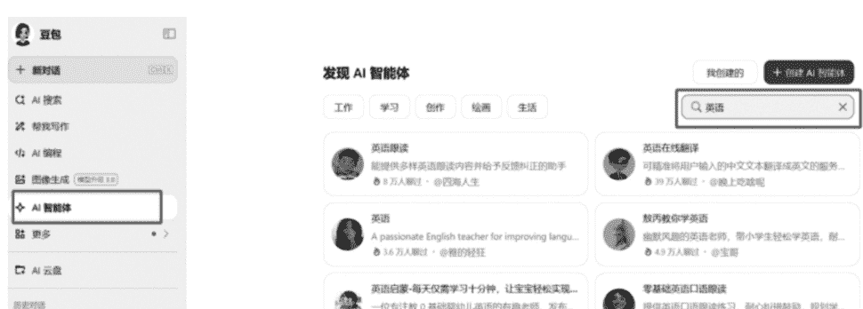

**方法二：**

1. 打开豆包，选择语音通话。 图7-6 豆包语音通话

#### （三）AI赋能个性化学习，释放学生潜能

AI技术通过精准的学习诊断、动态的路径规划、智能的内容推荐和及时的辅导反馈，为实现大规模个性化学习提供了强大的技术支撑。将AI工具交到学生手中，鼓励他们利用AI进行自主学习和探究，不仅能够满足学生的个体需求，提升学习效果，更能培养其信息素养、自主学习能力、解决问题能力等面向未来的核心素养，真正释放每个学生的独特潜能。接下来，我们将进一步探讨如何利用AI赋能学生的创造性表达。

### 六、AI赋能学生创造性表达

#### （一）创造性表达的重要性：核心素养的外化与展现

在核心素养导向的教学中，仅仅让学生理解和掌握知识是不够的，更重要的是培养他们运用所学知识、技能和思维能力来解决真实问题、表达个人见解和进行创新创造的能力。激发学生创造性表达正是这一过程的重要体现和关键环节。它不仅仅是学生将知识内化后进行外化的过程，更是培养其批判性思维、创新思维和问题解决能力等高阶思维品质的有效载体。

> 核心素养研究课题组.中国学生发展核心素养[J].中国教育学刊，2016（10）：1-3.

通过多样化的表达形式（如写作、演讲、绘画、设计、编程、视频制作等），学生能够：

- 展现对复杂问题的理解和提出解决方案，体现其关键能力的应用水平。
- 表达独特的思考视角和创新性的想法，发展其思维品质。
- 将抽象的知识、概念转化为具体的作品，实现知识的迁移与应用。
- 在创作过程中融入个人的情感体验和审美取向，并反思和明确自己的价值观念。

新课标明确强调学生应具备“创造性表达”的能力，旨在推动学生从被动的知识接受者转变为主动的知识建构者和创新者。然而，传统的表达方式往往受限于学生的技能水平（如绘画技巧、写作能力、技术操作能力等）或可用的工具与资源。

人工智能技术的赋能，为学生的创造性表达开辟了前所未有的广阔空间。AI不仅能帮助学生克服某些表达上的技术障碍（例如，绘画技巧不足、视频拍摄与剪辑复杂等），让他们能够用更丰富的多模态方式（文本、图像、声音和视频）呈现自己的想法，更能作为激发灵感、辅助思考、拓展思路的“伙伴”和“教练”，在互动和创作过程中促进学生批判性思维、创新思维的发展，并最终体现学生的价值判断和个性化表达。引导学生利用AI进行创造性表达，是培养其综合素养和适应未来社会能力的重要途径。

#### （二）AI激发创造性表达的主要形式及操作方案

教师可以引导学生利用AI（特别是DeepSeek及相关工具组合），在以下几个方面进行创造性表达的探索与实践。

##### 1 DeepSeek角色扮演对话：在深度互动中生成与表达思想

让AI扮演特定的角色（如历史人物、科学家、哲学家、文学家、不同职业人士，甚至是一个虚构角色），学生围绕特定主题或问题与其进行有深度的、持续的对话。这种对话的价值不仅在于获取信息，更在于模拟真实的交流情境，激发学生从不同视角思考，在与AI的思想碰撞中生成自己的观点、梳理逻辑，并练习表达。

操作方案：

- 教师引导设定角色与主题：教师可以根据教学内容或学生兴趣，引导学生设定清晰的AI角色（包含背景、性格特点等）和需要深入探讨的核心问题或情境。
- 学生主导开放式探究：鼓励学生掌握提问技巧（如第三章所述），使用开放性问题主导对话方向，并针对AI的回答进行追问、质疑，要求其提供论证或扮演反对者，从而深化对问题的理解和思考。
- 记录、反思与再表达：引导学生记录对话的关键内容、自己的思考轨迹和观点变化，并在对话结束后进行反思。最终可以将对话过程本身或基于对话生成的思考与观点，通过写作、演讲、报告等形式进行二次创造性表达。

提示词示例（学生向AI提问）：

- “请扮演一位亲身经历过红军长征的老红军。我想了解在长征途中，面对饥饿、寒冷和敌人的追击，支撑你们走下去的精神力量是什么？请结合你的具体经历谈谈。”（历史探究与价值观。）
- “请扮演一位资深的城市规划师。我们正在讨论未来城市交通的可持续发展方案。你认为除了发展公共交通和电动汽车，还有哪些更具创新性的绿色交通理念值得我们思考？请阐述理由。”（问题解决与创新思维。）
- “请扮演《西游记》中的孙悟空。有人说你保护唐僧去西天取经主要是为了完成任务、重获自由，也有人说你是真心向善。你自己怎么看待这个问题？请结合你的经历谈谈你的真实想法。”（文学理解与批判性思维。）

##### 2 DeepSeek深度写作：辅助多体裁创作与改写

利用DeepSeek作为写作助手和“风格教练”，辅助学生进行不同体裁、不同风格的写作尝试。例如，模仿名家（如朱自清、鲁迅）的语言风格写散文片段；根据设定的世界观创作科幻小故事的开头；为某个社会现象撰写观点清晰的议论文提纲；或者将一篇新闻报道改写成诗歌等。AI可以提供语言风格参考、词汇建议、句子润色、结构框架，甚至生成初步的草稿供学生修改。

操作方案：

- 明确写作任务与风格要求：教师或学生设定清晰的写作目标，包括体裁、主题、目标读者、篇幅，以及最重要的——期望的语言风格或模仿对象。
- 提供范例或清晰描述：可以向DeepSeek提供想要模仿的文本片段，或者用详细的语言描述期望的风格特点（例如：“请用简洁、冷静、略带讽刺的语言风格……”）。
- 强调学生主体与深度参与：极其重要的一点是，必须让学生明确AI生成的仅是初稿、素材或参考，绝不能直接替代学生的思考和写作过程。教师应引导学生在AI生成内容的基础上进行大量的批判性审视、修改、润色、重构，注入自己的思想、情感和独特表达。评价的重点应放在学生如何利用AI进行构思，以及最终作品的原创性和思想深度上，而非仅仅是文本的流畅度。

提示词示例：

- “请模仿朱自清先生在《背影》中朴实、真挚、饱含深情的语言风格，写一段约150字的文字，描绘傍晚时分，母亲在厨房忙碌准备晚餐的背影。”
- “我正在构思一个关于‘时间旅行者回到恐龙时代’的科幻小故事开头。请帮我生成一个包含环境描写、主角心理活动和初步悬念的开头段落，大约300字，风格要求紧张刺激。”
- “请将下面这篇关于‘中学生过度使用手机的危害’的新闻报道[此处粘贴报道内容]，改写成一首现代诗歌，要求表达出对这种现象的担忧和反思。”

实战案例：

打开DeepSeek，输入提示词：请根据马致远《天净沙·秋思》的内容，以朱自清散文的风格，写300—400字的散文。

输出结果：

###### 秋的断章

枯藤攀着老树，像老人手臂上的青筋，蜿蜒地暴出来。树权上栖着几只乌鸦，羽毛被暮色浸透了，黑得发沉。它们偶尔“哑”地一声，那声音便跌进黄昏里，碎在石桥上。

桥是弓着背的，石板缝里钻出几茎枯草，在风里瑟瑟地抖。桥下流水瘦得很，映着几户人家的灯火，灯火也是瘦的，在纸窗上摇曳，仿佛随时要被西风吹灭。

古道上尘土簌簌地爬着，一匹瘦马踩着这些尘土，肋骨历历可数。马背上的人裹紧了衣衫，衣衫是旧的，颜色早已被风霜吃尽。他的影子拖得很长，长得要折断在这荒凉里。

夕阳正往下沉，像一枚铜钱掉进远处的山坳。余晖染得天边一片惨红，这红却又渐渐褪去，褪成灰，褪成黑。人在天涯，天涯却在夕阳之外。这般的秋，原不过是天地间的一个叹息，而断肠人的愁绪，竟比这秋还要长些。

##### 3 AI生成学科动画/实验演示（工具组合）

引导学生利用AI视频生成工具，将难以用语言或静态图片完全展现的抽象科学概念（如数学公式推导、函数变换规律、物理定律演示、化学反应微观过程）或复杂的实验步骤，转化为直观、动态的动画或演示视频。这是一种强大的知识可视化和创造性表达方式。

操作方案：

- 构思与脚本生成（DeepSeek辅助）：学生首先需要清晰地理解要演示的概念或过程，并构思动画的关键帧或步骤。可以利用DeepSeek辅助生成文字脚本或分镜描述。
- 选择并使用AI视频工具：教师指导学生选择合适的AI视频/动画生成工具（如Kinetix、ClipDrop、Pika、Runway等，需注意工具的能力和适用范围）。将文字脚本或关键步骤描述输入工具，尝试生成视觉片段。
- 迭代优化与整合：AI生成的视频片段可能需要多次调整提示词或参数才能达到预期效果。学生需要对生成的片段进行筛选，并导入视频编辑软件（如剪映）进行剪辑、排序、添加必要的文字标注、配音（可用AI配音）等，最终整合成一个完整的教学演示视频。

提示词示例（给AI视频工具）：

- “生成一段时长10秒的动画，演示勾股定理a²+b²=c²的图形证明过程：四个全等的直角三角形围绕一个正方形旋转拼接成一个大正方形。”
- “制作一个简单的物理动画，展示一个苹果在真空中和在空气中同时下落的过程对比。”
- “动画演示：水分子的结构，包含一个氧原子和两个氢原子，以及它们之间的化学键。”

##### 4 DeepSeek+即梦/Midjourney：诗意表达、视觉艺术创作

这是一个典型的“文生图”应用场景。引导学生将抽象的文学意境（如古诗词、散文片段）、情感体验或科学概念，通过AI图像生成工具转化为具象的视觉艺术作品，如教学海报、文学插画、科学绘本、概念漫画甚至连环画等。这有助于培养学生的审美创造能力和多模态表达能力。

操作方案：

- DeepSeek理解与描述转化：对于文学意境等抽象内容，学生可以先与DeepSeek对话，深入理解其内涵，并让DeepSeek辅助生成用于AI绘画的、包含丰富细节和风格要求的描述性提示词。
- 使用AI图像生成工具：将精心设计的提示词输入到即梦、Midjourney、豆包文生图、Stable Diffusion等工具中，生成图像。可能需要多次调整提示词以获得满意效果。
- 整合与再创作：学生可以将生成的图像与原文、自己撰写的解说文字、DeepSeek生成的配文等结合，创作出图文并茂的海报、演示文稿页面、图文故事、漫画等。

提示词示例：

- （给DeepSeek）“请为王维的诗《鸟鸣涧》‘人闲桂花落，夜静春山空。月出惊山鸟，时鸣春涧中’生成一段用于AI绘画的提示词，要体现夜晚、春山、月光、桂花飘落、山鸟、溪涧等元素，风格要求宁静、空灵、富有禅意，类似中国传统山水画。”
- （给即梦，基于DeepSeek给的结果修改而来）“中国传统山水画风格，深夜，寂静的春山，月光皎洁，几朵桂花轻轻飘落，一只山鸟被月光惊动，在山涧边鸣叫，画面空灵、宁静、有禅意。”
- （给即梦）“创作一张关于‘保护海洋生物’的宣传海报，画面主体是一只被塑料袋困住的海龟，眼神哀伤，背景是深蓝色海洋和漂浮的垃圾，风格要求写实且引人深思。”
- （给即梦）“创作一幅关于‘春天的回忆’的三格漫画，第一格是冰雪消融，第二格是嫩芽破土，第三格是孩子在阳光下放风筝，风格要求温馨可爱。”

实战演练：

- 使用DeepSeek生成视频脚本。
输入提示词：请帮我生成一个10秒的视频脚本，展示“春”字从甲骨文到楷书的动态演变。
- 登录即梦AI官网，点击“故事创作”。 图7-7 即梦故事创作
- 选择“空白分镜”，依次按照分镜添加脚本文字并选择属性。图7-8 即梦创建分镜

##### 5 DeepSeek+剪映：视频创作表达

结合DeepSeek的文本创作能力和剪映等视频编辑工具的易用性（及其内置AI功能），引导学生围绕特定主题（如校园生活、社会热点、学科知识科普、读书报告、实验记录等）创作具有主题思想和视听效果的创意短视频。这能有效锻炼学生的语言表达、信息整合、技术应用和团队协作（如果是小组项目）等关键能力。

操作方案：

- 主题构思与脚本生成（DeepSeek辅助）：学生确定视频主题后，可以利用DeepSeek进行头脑风暴，生成故事梗概，撰写分镜脚本、人物对话、旁白解说词等。
- 素材准备与拍摄：学生根据脚本进行实景拍摄，或搜集、整理相关的图片、视频素材（注意版权）。
- 剪映编辑与AI功能应用：将素材导入剪映，进行剪辑、调色、添加转场和背景音乐。可以利用剪映内置的AI功能，如智能字幕（根据音频自动生成）、AI配音（输入文本生成）、模板库等，提高制作效率和效果。
- 教师指导与评价：教师重点指导学生的主题立意、脚本创作的逻辑性与创意性，以及视听语言的初步运用。

提示词示例（给DeepSeek）：

> “请为中学生生成一个以‘我的家乡’为主题的1分钟短视频脚本，结构包含：家乡美景展示、特色文化介绍、个人情感抒发。要求语言生动，富有地方特色。”

> “请为一段介绍‘垃圾分类的重要性’的公益短视频撰写旁白解说词，要求语言简洁有力，呼吁大家行动起来，适合在学校宣传栏播放。”

实战演练：

- 将准备好的素材导入剪映，点击“识别字幕”→“开始识别”，生成字幕后校对内容是否和视频一致。图7-9 剪映自动识别字幕
- 选中视频字幕，点击“朗读”，选择合适的AI配音。图7-10 剪映AI配音

##### 6 DeepSeek+可灵/即梦/HeyGen：数字人对话创作

这是一个更具前沿性的探索。利用AI数字人生成工具（如可灵、即梦可能涉及的语音情感能力，或HeyGen等专门工具），创建具有特定形象、声音和性格的虚拟数字人。然后结合DeepSeek的对话和知识能力（通过API接口或特定平台集成），让学生与这些“活起来”的数字人进行特定主题的、更具沉浸感的对话、访谈、辩论、角色扮演等创造性互动。这种形式极大地丰富了人机交互的可能性，能有效提升学生的沟通表达能力和思辨能力。

操作方案：

- 设定数字人角色与知识背景：教师或学生在支持的平台设定数字人的外观、声音、性格特点，并为其注入特定的知识背景或对话任务（例如，通过DeepSeek生成相关知识库或对话逻辑）。
- 学生主导交互式对话：学生围绕预设的主题（例如：“采访一位虚拟的袁隆平院士，了解杂交水稻的研究历程”“与一位代表‘人工智能教师’的数字人辩论‘AI是否会取代人类教师’”，“向一位虚拟心理咨询师倾诉考试焦虑”）与数字人展开自然语言对话。
- 记录、分析与展示：对话过程可以被记录、转录，甚至进行情感分析。学生可以将对话本身或基于对话的反思作为学习成果进行展示。

提示词示例（设定数字人）：

- （在数字人平台设定）“创建一个虚拟图书管理员数字人，形象设定为和蔼可亲的老奶奶，声音温柔缓慢，性格耐心细致。知识背景：熟悉小学图书馆的各类图书。任务：向小学生推荐适合他们阅读的图书，并回答关于借阅规则的问题。”
- （给DeepSeek，用于生成辩论观点赋予数字人）“请扮演一位认为‘网络游戏对青少年弊大于利’的家长，就此观点提出三个主要论据，语气要恳切并带有担忧。”

实战演练：

- 打开即梦AI，在“导入参考图”位置添加一张参考图。在文字框内输入要求：生成一个3D人物形象。图7-11 即梦生成3D人物形象操作
- 选择满意的生成图片下载并保存，也可在此基础上修改。 图7-12 即梦生成3D人物形象
- 选择“对口型”，导入保存好的参考图，在对话框中输入说话内容，控制在120字左右，点击“生成视频”。 图7-13 即梦设置数字人视频图7-14 即梦输入数字人说话内容

##### 7 学生自创智能体

这是更高阶的创造性表达，也是培养学生计算思维、设计思维和问题解决能力的绝佳途径。引导学生利用扣子或其他支持智能体创建的平台（可能需要结合DeepSeek的API接口或其开源模型），亲手设计并创建一个具有特定功能或扮演特定角色的AI助手（智能体）。

操作方案：

- 明确智能体目标与用户：教师引导学生思考：你想创建一个什么样的AI助手？它为谁服务？解决什么具体问题？（例如：一个能根据同学输入的错题自动推荐同类型练习题的“数学错题小助手”；一个能模拟不同顾客角色陪练英语口语的“口语练习伙伴”；一个能讲解校园内常见植物的“植物识别导游”）。
- 设计角色、知识与技能：学生设定智能体的名称、角色定位、说话风格。为其“喂养”相关的知识（可以上传整理好的文档、链接相关网页，或直接编写知识点），配置智能体需要具备的特定技能，如联网搜索能力、调用计算器、翻译等（取决于平台能力）。
- 调试、测试与迭代：学生通过与自己创建的智能体反复对话来测试其功能是否符合预期，识别问题，并根据测试结果不断调整提示词、知识库或技能配置，进行迭代优化。
- 分享与应用：鼓励学生将自己创建的智能体分享给同学使用，收集反馈，进一步改进。

提示词示例（用于构思或在智能体创建平台设定）：

- （给DeepSeek，用于构思）“我想为我们班创建一个能帮助同学快速了解班级通知和近期活动的AI助手，请帮我设计一下它的核心功能、可以回答哪些类型的问题，以及它的对话风格应该怎样设定比较好。”
- （在智能体创建平台设定）“角色：你是阳光小学四年级（3）班的班级小助手‘小喇叭’。知识库：（上传班级课表.docx，近期活动通知.txt，学校常用网站链接列表.md）。技能：能根据日期查询课表，能回答关于近期活动（如运动会、家长会）的时间、地点内容，能提供学校官网等的链接。对话风格：活泼、友好、耐心，像一个热心的小同学。”

### 七、小结

AI赋能下的创造性表达为学生提供了前所未有的机遇和无限的表达空间。通过将DeepSeek等AI工具与各种多模态应用相结合，学生不仅能够更有效地将内化的知识和思考外化为多样的作品，还能在这一过程中提升信息素养、批判性思维、创新能力、多模态表达能力和跨媒介创作能力。教师的角色在于精心设计真实、有意义的创造性任务，搭建合适的脚手架，引导学生在AI的支持下自由探索、大胆表达、批判思考、动手创造，从而真正落实核心素养的培养目标，激发每个学生的潜能。

## 第八章

## AI赋能评价：构建数据驱动的多元评估

学业评价是教育教学活动中不可或缺的关键环节，它不仅是衡量学生学习成果、检验教学效果的手段，更是促进学生发展、引领教学改革、提升教育质量的重要杠杆。随着人工智能技术的飞速发展，传统的学业评价方式正面临深刻的变革与前所未有的发展机遇。本章将重点探讨在新课标背景下，如何运用AI（特别是DeepSeek）赋能学业评价，实现从“知识本位”向“素养导向”的转变，构建更加科学、多元、动态的评估模式。我们将探讨如何借助AI，让评价真正从“知识本位”走向“素养导向”，从终结性的“一张试卷”走向过程性的“成长记录”。

### 一、新课标下的学业评价

#### （一）“教—学—评”一体化

近年来，我国高度重视教育评价改革，并将其提升到国家战略层面。《教育强国建设规划纲要（2024—2035年）》明确提出，要“促进人工智能助力教育变革”，并强调要“建立基于大数据和人工智能支持的教育评价和科学决策制度”[1]。2025年4月教育部等九部门联合印发的《关于加快推进教育数字化的意见》也明确要求“人工智能赋能教育评价改革”，提出“建立基于大数据和人工智能支持的教育评价机制，面向学校、教师、学生等不同主体，完善结果评价，开展多维度的过程评价、增值评价和综合评价。推动实现教学全过程、发展全要素伴随式数据采集，开展精准画像。强化全面发展育人导向，推进数字化赋能考试评价改革”。<sup>注</sup> 中华人民共和国教育部.教育部等九部门关于加快推进教育数字化的意见[EB/OL].（2025-04-15）[2025-08-13].http：//www.moe.gov.cn/srcsite/A01/s7048/202504/t20250416_1187476.html.这些国家层面的政策指引，与新课标对学业评价提出的新要求一脉相承。新课标强调了“教—学—评”一体化的理念，提出学业评价的核心功能在于改进教与学，促进学生核心素养的发展。其对学业评价的新要求主要体现在以下几个方面。

- （1）核心素养导向：这是新课标评价改革最根本的转向。评价的核心目标不再仅仅是衡量学生对知识点的记忆和再现，而是要综合考查学生在真实情境中运用学科知识解决问题的能力，即核心素养的达成情况。这包括了对学生必备品格、关键能力和正确价值观的“三维”评价，强调对问题解决能力、创新思维、合作探究能力等高阶思维和非标准化能力的评估。
- （2）评价方式革新：新课标倡导评价方式的多元化和创新性。
- （3）过程性评价：强调评价应贯穿学习的全过程、全周期，而不仅仅是通过期末一张试卷定结果。
- （4）增值性评价：关注学生在原有基础上的进步幅度和发展潜力，而非仅仅依据绝对分数进行横向比较。
- （5）表现性评价：鼓励通过项目式学习、实践探究活动、作品展示、口头报告等情境化、任务型的评价方式，真实反映学生综合运用知识解决复杂问题的能力。
- （6）跨学科整合：随着跨学科主题学习的推行，新课标也对跨学科评价提出了要求。需要设置能够衡量学生在跨学科主题学习（如科学探究、社会调研项目）中知识迁移、综合应用和创新实践能力的评价标准和方法。
- （7）技术赋能方向：新课标明确鼓励利用现代信息技术改进评价。建议采用智能评测系统记录学生的学习轨迹和表现，鼓励开发学生数字画像工具，以实现更精准的个性化诊断和反馈。

因此，新课标下的学业评价，其核心在于服务学生的学习与发展，发挥“以评促学、以评促教”的积极导向作用，推动教学从“知识传授”走向“素养培育”。

#### （二）传统学业评价中存在的痛点

学业评价在整个教育教学系统中扮演着“指挥棒”和“诊断仪”的角色，其重要性不言而喻。对学生而言，科学的评价能够帮助学生了解自身学习状况，明确优势与不足，激发学习动机，调整学习策略，促进自我反思和持续进步。对教师而言，评价结果是教师反思教学效果、诊断教学问题、调整教学设计、改进教学方法的重要依据。对教育系统而言，学业评价是衡量教育教学质量、监测课程实施效果、支持教育决策的重要手段。然而，长期以来，我国中小学的传统学业评价方式存在一些固有的痛点和局限，难以完全适应新课标对核心素养培养的要求。主要表现在以下几个方面。

- （1）价值取向的偏差：
    - ①具有“应试化”的倾向：评价往往过度聚焦于纸笔测试和标准化考试，以分数作为衡量学生学习的唯一或主要标准，导致教学实践过度倾向于应试准备，忽视了学生综合素质和个性的发展。
    - ②掉入“标准化”陷阱：统一的评价标准和量规难以完全适配不同地区、不同学校的办学特色，更难以照顾到学生的个体差异，特别是对于有特殊教育需求的学生，现有的标准化评估体系往往难以提供有效的支持和准确的衡量。
- （2）技术与方法上的缺陷：
    - ①数据采集的局限性：传统评价主要依赖教师的人工观察、纸笔记录和阶段性测试，难以全面、客观、持续地捕捉学生在学习过程中的动态表现，尤其是在思维过程、情感态度、协作能力等隐性素养的评估上更显不足。例如，有研究指出，教师平均每天花费在与评价相关的记录和分析上的时间可能就超过了1小时，但获取的数据的数量和质量依然有限。
    - ②反馈的滞后性与笼统性：传统的作业批改和考试阅卷周期较长，学生通常在数天甚至数周后才能得到反馈，这大大削弱了反馈对即时学习的指导作用。同时，反馈内容往往比较笼统，多为分数或等级，缺乏针对性的诊断和具体的改进建议。
    - ③分析维度的单一性：评价结果的分析多停留在对分数和知识点掌握情况的统计上，难以对学生的思维品质、创新能力、学习策略等进行深入、多维度的分析。
- （3）教师的沉重负担：设计科学的评价任务、实施评价过程、细致批改作业、深入分析数据、提供个性化反馈，每一项都对教师的时间、精力和专业能力提出了极高要求，导致许多有价值的评价理念难以在实践中有效落实。

#### （三）AI赋能学业评价的优势与价值

人工智能技术的融入，突破了传统学业评价的瓶颈，为实现新课标的评价理念带来了前所未有的机遇。AI赋能学业评价，其核心价值在于推动评价从“标准化”走向“个性化”，从“结果导向”走向“过程与发展并重”，从“经验判断”走向“数据驱动”，其主要优势体现在以下六个方面。

- （1）提升评价效率，减轻教师负担：AI能够自动化处理大量重复性的评价任务，如客观题的自动批改、学生学习数据的自动记录与初步统计分析，甚至部分主观题的辅助批阅，从而将教师从繁重的事务性工作中解放出来，将更多精力投入到更具专业性的评价设计、结果解读和教学干预中。
- （2）实现个性化与自适应评价：AI可以根据每个学生的学习历史、答题表现和认知特点，动态调整评价任务的难度和内容，提供更符合个体需求的评价体验，从而更精准地评估学生的真实水平，真正关注到学生的个体差异。
- （3）提供即时、精准、多维度的反馈：AI能够对学生的学习过程和结果进行快速分析，并即时生成包含具体错误分析、知识点链接、改进建议等多维度的个性化反馈报告，帮助学生及时了解自己的学习状况，有效调整学习策略。
- （4）支持过程性数据收集与分析，实现动态评价：AI可以全面记录学生在各种数字化学习环境（如在线学习平台、互动练习系统）中的学习行为轨迹（如学习时长、资源偏好、互动频率、思考路径等），形成丰富的过程性数据。通过对这些数据的持续追踪和分析，可以实现对学生学习状态的动态监测和评价，及时发现问题并进行干预。
- （5）丰富的评价工具与方法创新，促进综合评价：AI带来了新的评价视角和技术手段。例如，通过自然语言处理技术分析学生的文本表达，通过语音识别技术评价学生的口语能力，通过图像识别技术评估学生的实践作品，通过构建学生数字画像进行综合性、发展性的评价，从而更全面地反映学生的核心素养。
- （6）助力“以评促学、以评促教”，落实“教—学—评”一体化：通过对学情的精准诊断、对学习过程的精细分析、对学习结果的科学解读，AI能够为教师提供更具洞察力的教学建议，帮助教师优化教学设计、改进教学方法。同时，个性化的反馈和学习路径推荐也能更好地引导学生的自主学习和深度学习，真正实现评价服务于教学和学习的最终目的。

综上所述，新课标对学业评价提出了更高的要求，而传统评价方式在理念和技术上都面临挑战。人工智能的融入，为我们构建更科学、更多元、更动态、更个性化的学业评价体系提供了强大的技术支撑，对于落实“教—学—评”一体化、促进学生核心素养发展具有至关重要的意义。接下来的小节，我们将具体探讨AI如何在智能诊断、量规评价、数据分析、分层命题、错题管理和作业批改等关键环节赋能学业评价。

### 二、智能诊断与学习分析

学业评价的首要目的之一是诊断学生在学习过程中存在的问题，以便进行有针对性的教学干预和学习支持。传统的诊断方式往往依赖教师的经验观察及其对作业、测验结果的分析，虽然有一定价值，但在深度、广度、效率和个性化方面存在局限。人工智能技术的引入，为实现更精准、更高效的智能诊断与学习分析提供了新的可能。

#### （一）智能诊断的内涵与目标：精准定位学习问题

智能诊断是指运用人工智能技术（如自然语言处理、机器学习、知识图谱、数据挖掘等）对学生的学习过程和学习结果进行深度分析，以识别其知识掌握情况、能力水平、思维方式、认知特点以及潜在的学习困难或障碍。智能诊断的目标并不仅仅是简单地判断学生“学会了”还是“没学会”，而是要实现更深层次的“精准定位”。主要体现在以下几个方面。

- （1）定位知识薄弱点：准确识别学生在哪些具体知识点或技能上存在欠缺或理解偏差。
- （2）分析错误根源：分析学生产生错误的原因，是概念不清、方法不当、审题失误，还是思维障碍。
- （3）揭示思维路径：分析学生在解决问题时的思考过程和策略选择，发现其思维模式的特点和不足。
- （4）识别能力短板：评估学生在关键能力（如分析能力、推理能力、创新能力）和学科核心素养方面的表现。
- （5）预测学习风险：基于学生的学习行为和表现数据，预测可能出现的学习困难或发展障碍，及时实施干预。

智能诊断有助于教师全面、深入地了解学生的学习情况，为后续的个性化教学、精准辅导和教学决策提供科学依据。

#### （二）AI赋能学习过程诊断

DeepSeek等大语言模型在处理和分析文本数据方面具有强大能力，能够有效地辅助教师对学生的学习过程进行诊断，特别是针对以文本形式呈现的学习成果或过程记录。下面介绍利用DeepSeek进行学习诊断的具体方法。

- （1）数据收集与数字化：首先教师要收集学生在学习过程中的各类文本数据，如作业答案（尤其是简答题、论述题、作文等主观题）、在线讨论的发言记录、项目报告、实验报告、学习反思日志等。对于纸质作业，可以通过拍照或扫描转化为电子文本，或将其中的关键信息、解题步骤等文本化。
- （2）明确诊断目标与维度：接着教师根据教学目标和需要诊断的内容，设定清晰的分析维度，例如知识点理解、概念辨析、论证逻辑、观点表达、思维深度、创新性、解题策略等。
- （3）设计提示词并与DeepSeek交互：教师将收集到的学生文本数据（注意匿名化处理）和诊断目标输入DeepSeek中，通过精心设计的提示词，引导AI进行分析。可以要求AI：
    - ①识别学生回答中的主要观点、论据和逻辑结构。
    - ②分析学生对某一概念的理解程度，是否存在混淆或偏差。
    - ③归纳学生在某一类问题上常见的错误类型或思维误区。
    - ④比较不同学生在同一问题上的回答差异，分析个体特点。
    - ⑤结合SOLO分类理论等框架，初步判断学生的思维层级。
- （4）结果解读与教学应用：教师结合AI的分析结果和自身的专业判断，形成对学生学习过程的诊断结论，并据此调整教学策略或提供个性化辅导。

##### 实战案例：AI赋能小学数学“用图表解决问题”的学情诊断

- （1）场景：某位小学数学教师希望在教学“用图表解决问题”这一单元后，及时了解学生在实际问题建模、图表解读、计算策略等方面的掌握情况，并找出学生共性与个体性的薄弱点。但传统方式多通过统一纸笔测验进行结果性评价，难以捕捉学生解题过程中的思维路径、建模逻辑或常见误区，导致干预滞后、针对性不足。
- （2）AI应用：
    - ①学生作业数字化：首先，教师将学生完成的“用图表解决问题”的纸质作业进行拍照或扫描。接着，教师设定诊断目标，例如希望AI分析学生在“问题识别—建模策略—数据处理—答案检验”四个阶段是否存在认知障碍，并结合SOLO分类理论判断其思维层级。
    - ②设计提示词与DeepSeek进行交互，参考提示词（STAR-AI结构）：
        - （角色R）你是一位经验丰富的小学高年级数学教师，擅长诊断学生学习情况并熟悉SOLO分类理论。
        - （情境S）这是我班五年级学生完成的一道关于“龟兔赛跑”的图表类应用题的解题过程和答案（见附件/以下文本，包含题目信息和学生的解题步骤、算式、答案）。
        - （任务T）请你对这份学生作业进行详细诊断。请分析该学生在“问题识别”（是否准确理解题目信息和图表含义）、“建模策略”（是否能根据问题选择正确的数学模型和解题思路）、“数据处理”（数据提取是否准确，计算过程是否合理）和“答案检验”（是否有检验答案的意识和方法）这四个阶段是否存在认知障碍或典型错误。
        - （方面/格式A）请结合SOLO分类理论，初步判断该生在解决此类问题上的整体思维层级（如前结构、单一结构、多点结构、关联结构、扩展抽象）。请指出其在各个阶段的具体表现（正确点和认知障碍/错误模式），并分析可能的原因。最后，请总结该生常见的错误模式，并提供个性化的干预建议（包括可视化反馈图表的建议、分步引导策略和错误修正练习的设计方向）。请以结构清晰的报告形式输出。
        - （指令/约束I）分析要具体，建议要可操作，符合小学生认知特点。
    - （3）将以上提示词输入DeepSeek中，AI自动生成了针对“龟兔赛跑”的图表题作业，分析了学生在问题识别、建模、计算及检验中的认知障碍和错误模式，判定了思维层级，并提出了可视化引导、分步策略等个性化干预建议。
    - （4）生成个性化诊断报告：教师可以将多个学生的此类AI分析结果进行汇总，并结合自己的观察，进一步要求DeepSeek（或使用其他AI工具）生成班级整体的共性问题报告，或者为每个学生（或不同层次的学生群体）生成更具针对性的、包含可视化图表建议的个性化诊断报告和学习建议。
    - （5）效果评估：
        - 效果：AI能够帮助教师从繁琐的作业分析中解放出来，更深入地洞察学生在解题过程中思维的卡点和认知障碍，并结合教育理论（如SOLO分类理论）进行初步的层级判断，为后续的精准教学和个性化辅导提供了有价值的参考。
        - 注意事项：教师需要预先对学生作业进行有效的数字化处理（如清晰扫描、OCR识别）；AI分析的准确性依赖于提供给它的信息质量和提示词的清晰度；对于AI的诊断结果，教师仍需结合对学生的全面了解对其进行专业解读和验证，其不能完全替代教师的诊断。

#### （三）AI驱动的学习行为分析与预警

除了对学生提交的文本作业进行诊断，AI还可以结合各类学习平台（如希沃白板的互动数据、在线学习系统、智慧校园平台等）记录的学生学习行为数据，进行更深层次的分析和预警。方法如下：

- （1）数据整合与接入（基于AI的学习管理平台的支持）：理想情况下，学习平台能够提供API接口或数据导出功能，将学生的行为数据（如登录时长、视频观看完成度、在线讨论参与度、练习提交频率和正确率、资源点击偏好等）接入AI分析系统。
- （2）AI模型分析与模式识别：AI利用机器学习算法分析这些行为数据，识别学生的学习模式（如倾向于碎片化学习还是集中学习、是喜欢视频资源还是文本资源等）、学习投入程度以及可能预示学习困难或风险的异常行为模式。
- （3）生成分析报告与预警提示：AI系统根据分析结果，生成关于班级整体学习状态的报告，或针对个别学生发出预警提示，提醒教师关注。

##### 实战案例：利用AI分析在线学习平台数据进行学习预警

- （1）场景：一所中学使用了在线学习平台进行部分学科的线上线下混合式教学。教师希望及时了解学生在平台上的学习投入情况，并对可能出现学习困难的学生进行早期干预。
- （2）AI应用（平台集成了AI分析模块或教师可导出数据给DeepSeek、豆包等AI处理）：
    - ①数据收集：平台自动记录学生在过去两周内的学习行为数据，如登录次数、学习总时长、视频观看时长、练习完成度和正确率、论坛发帖和回帖数等。
    - ②AI分析与预警规则设定：教师或平台管理员可以设定一些预警规则，例如，连续三天未登录平台；两周学习总时长远低于班级平均水平；核心教学视频观看完成率低于50%；多次单元测验正确率持续走低；在线讨论区零互动。
    - ③AI自动识别与预警：AI系统根据设定的规则，自动筛选出符合预警条件的学生名单。生成预警报告与建议。
    - ③设计提示词（STAR-AI结构；给AI分析系统或DeepSeek输入相关数据摘要）：
        - （角色R）你是一位教育数据分析专家。
        - （情境S）我这里有一批为期两周的学生在线学习行为数据摘要[插入数据（例如：学生A，登录6次，总时长70分钟，视频完成320%，测验正确率50%；学生B……）]。
        - （任务T）请根据以下预警规则[列出规则]，识别出需要重点关注的学生，并为每名需要关注的学生分析其学习行为数据中可能反映出的问题，提出初步的干预建议。
        - （方面/格式A）请以列表形式输出，每名学生占一项，包含学生代号、符合的预警规则、可能的问题分析以及1—2条具体的干预建议。
    - （3）将以上提示词输入DeepSeek中，它根据学习行为预警规则识别问题学生，分析其学习状况的可能原因，并提出了针对性的干预建议。
    - （4）效果评估：
        - 效果：AI驱动的学习行为分析与预警，能够帮助教师从海量数据中快速发现“沉默的少数”或潜在的“学困生”，实现早期识别和主动干预，避免问题积累。
        - 注意事项：行为数据分析结果仅为参考，不能简单等同于学生的真实学习状态或意愿，教师必须结合与学生的实际沟通进行核实；预警规则的设定需要科学合理，避免过度干预或产生不必要的焦虑；务必关注学生数据隐私和算法公平性问题。

### 三、AI赋能基于量规的评价

在核心素养导向的学业评价中，如何将抽象的素养要求（如批判性思维、创新能力、合作与沟通能力等）转化为具体、可观察、可测量的标准，是教师面临的一大挑战。评价量规是应对这一挑战的有效测量工具。

#### （一）评价量规在核心素养评价中的作用

评价量规是一种结构化的评分指南，它清晰地定义了某项学习任务（如项目报告、口头演示、作品创作、问题解决过程等）在不同表现水平上的具体标准和描述。一个典型的评价量规通常包含三个主要组成部分：

- （1）评价维度：指评价任务所要考查的关键方面或核心要素，通常对应着特定的学习目标或核心素养要求（例如，“问题的分析与探究能力”“解决方案的创新性”“团队协作与沟通效果”“语言表达的准确性与逻辑性”等）。
- （2）表现水平：指对每个评价维度可能出现的不同表现程度的划分，通常用描述性词语（如优秀、良好、合格、待改进；或新手、学徒、熟手、专家）或数字等级来表示。
- （3）水平描述：针对每个评价维度的每一个表现水平，用清晰、具体的语言描述学生在该水平上应具备的典型行为表现或成果特征。这是量规的核心，也是最具挑战性的部分。

评价量规可以使核心素养评价更具体、可操作，它通过将抽象的核心素养目标分解为具体的、可观察的行为指标，为教师评价学生的复杂表现（如问题解决能力、创新思维、合作能力等非标准化能力）提供了清晰的依据。量规还可以提高评价的客观性、一致性和透明度。清晰的评价标准有助于减少评价过程中的主观随意性，确保不同评价者之间以及同一评价者在不同时间对同一表现的评价具有更高的一致性。

#### （二）DeepSeek辅助生成与优化评价量规

大语言模型为评价量规的设计、优化和初步应用提供了新的可能性。生成式AI可以根据教师提供的评价任务和维度，快速生成包含不同表现水平描述的量规框架，还可以帮助教师将模糊的描述具体化、清晰化，使其更具可操作性。此外，根据教师输入的学情信息，AI可以设计针对不同层次学生的量规。以DeepSeek为例，设计评价量规可以采用以下策略：

- (1) 明确评价任务与核心素养维度：教师首先要清晰定义需要评价的学习任务（如项目报告、口头展示、实验操作、小组辩论等）以及希望通过该任务重点评价的核心素养能力。
- (2) 设计提示词，向DeepSeek提出生成请求：教师将评价任务、评价维度、目标学生年级、期望的评价等级数量（如三级、四级、五级）、每个等级的表现等信息提供给DeepSeek，并要求其生成评价量规的初稿。
- (3) 迭代优化与教师精炼：DeepSeek生成的量规初稿通常需要教师结合具体的教学情境、学生特点和学科要求进行审阅、修改和精炼。教师可以针对AI生成的量表进行追问，要求其更具体、可观察，或者提供范例让AI模仿优化。

##### 实战案例：AI辅助生成“环境保护”小组研究项目评价量规

- (1) 场景：一位初中科学教师组织了一次以“我们社区的环境问题与解决方案”为主题的小组研究项目，学生需要以小组为单位提交研究报告并进行成果展示。教师希望设计一个评价量规来评估学生在项目式学习中的综合表现。
- (2) AI应用：
    - ①教师明确评价维度：教师确定了四个主要的评价维度。第一，问题探究与分析能力；第二，协作与沟通能力；第三，研究成果的创新性与可行性；第四，社会责任感与参与意识。还设定了四个表现等级：优秀、良好、合格、待改进。
    - ②设计提示词并与DeepSeek交互，提示词（STAR-AI结构）：
        - （角色R）你是一位经验丰富的初中科学教育评价专家，擅长设计项目式学习的评价量规。
        - （情境S）我组织了一次关于“我们社区的环境问题与解决方案”的小组研究项目，学生将提交研究报告并进行口头展示。
        - （任务T）请帮我设计一份针对该项目的评价量规。
        - （受众A）评价对象是初中八年级学生。
        - （方面/格式A）量规需要包含以下四个评价维度：1.问题探究与分析能力；2.协作与沟通能力；3.研究成果的创新性与可行性；4.社会责任感与参与意识。每个维度请设定“优秀”“良好”“合格”“待改进”四个表现等级，并为每个等级提供清晰、具体的行为表现描述。请以表格形式输出。
        - （指令/约束I）描述应具有可观察性和可操作性，能够有效区分不同水平的表现。
    - (3) 将以上提示词输入到对话框后，DeepSeek给出如表8-1所示内容。

表8-1 AI生成的评价量表

| 评价维度 | 优秀(4分) | 良好(3分) | 合格(2分) | 待改进(1分) |
| :--- | :--- | :--- | :--- | :--- |
| 1. 问题探究与分析能力 | 精准识别社区环境问题的核心矛盾，运用3种以上研究方法（如问卷、访谈、实地检测）收集数据，分析逻辑严密且有数据可视化支撑 | 能定位主要环境问题，采用2种研究方法收集信息，数据分析合理但缺乏深度关联性 | 提出基础环境问题，仅使用单一方法收集数据，分析停留在表面现象描述 | 问题界定模糊或脱离实际，数据收集不完整，分析缺乏逻辑关联 |
| 2. 协作与沟通能力 | 主动承担关键任务，有效协调组员分工，展示时语言生动且能针对性回应听众提问 | 完成分配任务，参与组内讨论，展示内容完整但互动性较弱 | 基本完成任务但缺乏主动性，展示依赖讲稿，未能充分解释研究过程 | 未完成分工任务，小组讨论参与度低，展示内容碎片化或照读文稿 |
| 3. 研究成果的创新性与可行性 | 解决方案兼具创新性和实施路径，包含成本效益分析和3种以上可行性验证方法 | 提出新思路但细节待完善，有基础可行性论证，数据支撑较充分 | 方案以现有措施为主，可行性分析较笼统，部分数据支持不足 | 方案脱离实际需求，缺乏可行性论证，数据与结论关联薄弱 |
| 4. 社会责任感与参与意识 | 研究过程体现对弱势群体的关怀，提出可持续行动计划并开展社区宣传，展示引发听众共鸣 | 关注环境问题对居民的影响，方案包含社区推广建议但未实施 | 体现基本环保意识，方案仅停留在理论层面未考虑实际推广 | 缺乏社会视角，方案未体现社区参与价值，展示内容功利性强 |

- (4) 教师审核与优化：教师仔细审阅AI生成的量规描述，结合具体项目要求和学生实际水平，对描述的准确性、区分度和语言表达进行修改和完善。例如，可能会将“数据充分可信”具体化为“至少包含三种不同来源的数据，并注明出处”。
- (5) 效果评估：AI能够根据教师提供的具体任务和素养维度，快速生成结构化、多层次的评价量规初稿，大大减轻了教师从零开始设计量规的负担，并为实现更细致、更素养导向的评价提供了有力的工具支持。但教师需要对核心素养和评价任务有清晰的理解，才能向AI提供有效的指令。AI生成的量规描述仍需教师进行专业判断和语言润色，确保其准确性、可观察性和对学生的正面引导作用。将AI生成的量规与学生的实际表现数据相结合进行分析，才能真正发挥其诊断和改进教学的作用。

### 四、AI赋能基于数据的评价与学习画像

传统的学业评价往往比较依赖教师的经验判断和阶段性的纸笔测试，这些方式虽然在教学实践中积累了宝贵的经验，但在全面性、客观性和动态性方面仍存在一定的局限。随着人工智能时代的到来，特别是大数据和AI分析技术的发展，基于数据的评价成为可能，并进一步催生了学生学习画像的构建与应用，为实现更精准、更个性化的教育提供了有力支撑。

#### （一）数据驱动评价：从“经验判断”到“数据支撑”

数据驱动评价是指教师通过系统性地收集、整合和分析学生在学习过程和学习结果中产生的多维度、多类型的数据，以客观证据为基础，对学生的学习状况、发展水平和潜在需求进行科学评估，教师可据此优化教学决策和学习支持的过程。其核心价值在于：

- (1) 提升评价的客观性与科学性：用数据说话，减少主观臆断和经验偏差，使评价更接近学生的真实情况。
- (2) 实现评价的全面性与多维度：评价不再局限于单一的学业成绩，而是能够整合学生的学习行为、课堂互动、作业表现、兴趣偏好、情感态度等多方面信息，形成对学生的立体认知。
- (3) 支持评价的动态性与发展性：通过对学习过程数据的持续追踪，能够动态反映学生的成长轨迹和变化趋势，实现发展性评价。
- (4) 赋能精准教学与个性化学习：基于对学生数据的深入分析，教师可以更精准地定位教学问题，优化教学策略，为学生提供更具针对性的学习指导和资源推荐。

在传统教学中，数据采集往往依赖人工观察、阶段测验等手段，存在效率低、覆盖面窄、更新不及时等问题。随着AI技术不断渗透进各类数字化教学平台，教师能够收集更广泛、更细致的学生数据。AI技术与教育评价的结合，能够显著提升多源数据的整合效率，实现对学生学习状态的实时动态监测。AI可以快速处理学校管理数据、学生学业数据、教学过程数据等多维度信息，为形成全面评价奠定基础；借助物联网设备（如智慧课堂设备、可穿戴设备）、在线学习平台等工具，可以实时采集课堂行为、教学互动甚至部分生理与心理状态数据，实现评价的动态化、常态化。具体来说，AI可以辅助采集并整合以下几类数据，构建数据治理框架。

- (1) 多源数据采集系统：
    - ①学业数据：包括各科考试成绩、平时作业正确率与完成情况、学科知识点的错误分布和识别薄弱知识点等。
    - ②行为数据：学生在在线学习平台的登录频率、学习总时长、特定课程或资源的点击记录、讨论区的互动次数与内容。
    - ③心理与生理数据：在严格遵守伦理和隐私保护的前提下，未来结合可穿戴设备或特定传感器，AI或许可以辅助分析如通过脑波监测识别的情绪波动、通过眼动轨迹分析的注意力分布等信息，用于预测学习难点或识别疲劳状态。
    - ④非结构化数据：教师对学生的观察评语文本、课堂教学视频的语音记录（可利用AI转写为文本后进行分析）、学生手写作业的图像（通过OCR技术识别转化为文本）等。
- (2) 数据治理引擎：
    - ①统一身份ID体系：建立学生统一身份识别体系，打通不同平台（如教务系统、学习平台、智慧校园设备等）之间的数据壁垒，整合结构化数据（如成绩、学籍信息）与非结构化数据（如文本、音视频）。
    - ②数据融合与隐私保护：在确保数据安全和隐私保护的前提下（例如，可以探索采用联邦学习等技术），实现跨平台数据的有效融合与关联分析（如将学生的心理测试数据与其学业表现数据进行关联，探究非智力因素对学习的影响）。

##### 1 典型智能学习平台数据记录与导出功能

学习管理系统/在线学习平台：如Moodle、Google Classroom，以及国内众多的智慧校园平台、在线教育平台（如希沃平台、智学网、国家中小学智慧教育平台等）。这些平台通常内置了数据追踪和分析功能，能够记录学生的学习活动和表现，是数据驱动评价的基础。

- (1) AI驱动的自适应学习系统：如松鼠AI、学而思的AI学习机等，它们会根据学生的答题情况动态调整学习路径，并记录详细的学习数据。
- (2) 课堂互动与反馈工具：如希沃白板的互动模块、Kahoot!、Mentimeter、雨课堂等，可以收集学生在课堂上的即时反馈和参与数据。
- (3) 专业数据分析与可视化工具：如Excel（可结合AI插件进行分析）、Tableau、Power BI等，可以对导出的学习数据进行更深入的分析和可视化呈现。
- (4) 生成式AI工具：可以用于处理和分析从上述平台导出的文本数据、总结报告，甚至辅助解读图表信息。

##### 2 案例：利用在线练习平台数据进行周学习情况分析

- (1) 场景：一位小学五年级班主任兼数学老师，每周会通过在线练习平台给学生布置数学练习。她希望快速了解上周全班学生的练习完成情况、主要薄弱点以及需要特别关注的学生。
- (2) AI应用：
    - ①数据查看与导出：教师登录在线练习平台，查看平台自动生成的班级练习报告，包括整体完成率、平均正确率、高频错题、每个学生的得分与用时等。可将详细数据导出为Excel文件。
    - ②利用平台自带的AI分析或DeepSeek辅助解读：许多平台已具备初步的AI分析能力，可以直接呈现班级在各知识点上的掌握雷达图、学生投入度分析等。若平台功能不足或需更深度解读，教师可以将平台报告的关键信息或导出的数据摘要（匿名化处理）输入DeepSeek。
    - ③提示词（STAR-AI结构）：
        - (角色R) 你是一位小学数学教学分析专家。
        - (情境S) 这是我班五年级学生上周在线数学练习的报告摘要：总参与率95%，平均正确率78%。错题主要集中在“小数乘除法的混合运算”和“多边形面积的综合应用”。有3名学生（代号S1、S2、S3）连续两次练习正确率低于60%，且S2的练习用时远超平均水平。
        - (任务T) 请帮我解读这份摘要，指出班级学习中可能存在的主要问题，并为需要关注的学生提出初步的辅导建议。
        - (方面/格式A) 请分点阐述，语言要简洁易懂。
- (3) 预期输出示例：DeepSeek解读了班级学习中存在的问题，并给出了初步的辅导建议。
- (4) 教师行动：教师结合AI的解读和建议，以及自己对学生的了解，制订下一步的教学调整和辅导计划。

#### （二）DeepSeek辅助解读与呈现评价数据

收集到多维度的学生数据后，如何有效地解读这些数据，并将其转化为易于理解、能够指导实践的信息，是数据驱动评价的关键。DeepSeek等大语言模型在自然语言理解和文本生成方面的能力，使其可以成为教师解读和呈现评价数据的得力助手。以下是利用DeepSeek等大语言模型对学生数据进行分析的步骤。

- (1) 数据整理与输入：教师对收集到的学生数据进行初步整理，例如，可以将匿名化的成绩表、问卷调查的原始数据、课堂观察记录的文本、在线讨论的发言稿等数据整理成表格文件（如Excel、CSV）、纯文本格式（如Word、TXT），便于DeepSeek进行处理和分析。
- (2) 明确解读需求，聚焦分析目标：在与DeepSeek进行交互之前，教师需要清晰地表达自己希望从这些数据中获得哪些信息，以及希望以何种方式呈现结果。例如，是生成面向家长的学生学习小结，还是撰写教学反思用的学情分析？是挖掘趋势，还是识别问题点？这些目标越明确，AI生成的内容就越聚焦。
- (3) 设计提示词并与DeepSeek交互。
- (4) 数据汇总与描述性统计：要求AI计算平均数、中位数、标准差、频数分布等，并用简洁语言解释其含义，帮助教师快速了解学生的整体水平和分布状态。
- (5) 趋势分析：对于有时间序列特征的数据（如多次测验成绩），要求AI分析变化趋势（上升、下降、波动）并结合背景信息尝试解释可能的原因。
- (6) 差异比较：要求AI比较不同群体（如男女生、学习基础不同的学生）之间的表现差异，从中发现潜在的问题。
- (7) 关键发现提炼：当数据量较大、内容复杂时，可以要求AI从大量数据中提炼出几个值得关注的现象或问题。
- (8) 可视化图表描述与生成建议：上传已有的图表图片或者描述数据特征并要求AI生成合适的可视化图表类型，甚至生成简单的图表代码（如Mermaid）。
- (9) 报告摘要生成：对于复杂的分析报告，教师可以要求AI生成简洁明了的摘要，以便快速了解核心内容。
- (10) 教师审核与应用：对于AI生成的分析结果，仍需教师结合专业知识进行审核和确认，并将其应用于教学反思、学生辅导、家校沟通等环节。

##### 实战案例：利用DeepSeek分析单元测验数据并生成报告初稿

- (1) 场景：一位语文教师在完成一个文言文单元教学后，进行了一次单元测验，希望全面了解学生对文言文知识（如实词、虚词、句式、翻译）和阅读理解能力的掌握情况。她已经将全班学生的匿名化成绩（包含各题型得分）整理到一份Excel文件中。
- (2) AI应用：
    - ①上传数据文件：教师将包含学生各题型得分的匿名化Excel文件上传给DeepSeek。
    - ②设计提示词（STAR-AI结构）：
        - （角色R）你是一位资深的语文教学评价专家，擅长解读学生测验分数。
        - （情境S）附件是我班学生文言文单元测验的匿名化成绩数据（Excel格式），其中包含了选择题（考查实词、虚词）、翻译题、阅读理解简答题的得分。满分100分。
        - （任务T）请帮我分析这份测验数据，并生成一份简要的分析报告初稿。
        - （方面/格式A）报告应包含以下内容：班级整体表现：平均分、最高分、最低分、及格率（60分及格）、优秀率（85分及以上）。各题型平均得分率分析：分析学生在选择题、翻译题、阅读理解简答题上的平均得分情况，指出哪种题型是优势，哪种题型是薄弱环节。初步判断主要失分点：根据各题型得分情况，推测学生可能在哪些具体的文言文知识或阅读技能上存在普遍困难。（可选）差异分析：如果数据中包含学生分组信息（如按入学成绩分层），请简要分析不同组别学生在各题型上的表现差异。
        - （指令/约束I）请用简洁、专业的语言进行描述，数据结果请准确呈现。如果能给出一些初步的教学改进建议则更好。
    - (3) 将以上提示词输入至DeepSeek对话框中，DeepSeek给出了单元测试数据分析报告，包括班级整体表现，分析了各题型平均正确率，判断了主要丢分点，最后给出了教学改进的建议，如图8-1所示。

图8-1 单元测试分析（部分截图）

以下为基于测验数据生成的文言文单元测评分析报告初稿

###### 文言文单元测验分析报告

###### 一、班级整体表现

| 指标 | 数值 | 备注 |
| :--- | :--- | :--- |
| 平均分 | 78.5 | 高于年级基准线3分 |
| 最高分 | 95 | |
| 最低分 | 52 | |
| 及格率 | 88% | 44人≥60分 |
| 优秀率 | 24% | 12人≥85分 |

#### （三）构建与应用学生学习画像

学生学习画像是指通过整合和分析学生在学习过程中产生的多维度、多类型数据，形成的对其学习特征、能力水平、兴趣爱好、发展潜能等方面的可视化、动态化、个性化描述。它是数据驱动评价的深化应用，旨在更全面、更深入地理解每一个学生，实现从“静态结论”到“动态画像”的转变。生成式AI构建学生个性化学习画像的核心在于多模态数据融合与智能建模，通过动态分析学习行为、认知特征和情感状态，实现教育场景的精准刻画与预测。

##### 1 AI赋能学生学习画像的构建流程

- (1) 多维度数据采集与治理框架：
    - ①数据来源与系统：通过多种渠道收集学生的相关数据，如基本信息（年龄、性别、年级等）、学习成绩（各科考试成绩、作业完成情况）、学习行为（在线学习平台的登录频率、学习时长、课程点击记录、提问记录等）、兴趣爱好（参与的社团活动、课外兴趣班等）。这些数据经过清洗、整理和匿名化处理后，为构建学生画像提供基础。
    - ②数据治理引擎：需要建立统一的身份ID体系，打通教务系统与各类在线教学平台、物联网设备（可能产生大量非结构化数据）之间的数据壁垒，确保数据的规范性、一致性和可获得性。
- (2) 生成式AI建模与特征提取：利用生成式AI对整理后的多模态数据进行深度分析，识别学生的学习模式、兴趣倾向、知识掌握情况和能力发展水平。通过计算机自然语言处理和自动化工具，逐步实现评价数据实时处理与分析，挖掘数据背后的深层规律。
- (3) AI赋能：
    - ①动态画像生成与预测：AI可以分析学生一段时间内的学习轨迹，预测其未来在某些知识点上的掌握程度变化。通过多模态对齐技术，可以将教师的文本评语与学生知识图谱中的具体概念节点缺陷进行关联。
    - ②个性特征提取与量化：例如，通过分析学生订正错题的行为（如做题时间、修改次数、寻求帮助的方式），AI可以辅助区分反思型学习者与冲动型学习者。结合社交学习网络数据（如小组讨论中的互动情况），AI可以尝试量化同伴影响因子对个体学习投入度的作用。

###### （4）学生画像的生成与可视化：

①知识掌握情况：各学科或具体知识模块的掌握程度图谱（例如，哪些知识点已掌握、哪些正在学习、哪些是薄弱环节）。

②能力发展水平：如逻辑推理能力、信息素养、批判性思维、创新能力、沟通协作能力等方面的阶段性评估（可结合量规或特定任务表现）。

③学习行为特征：如学习习惯（主动性、持续性、规律性）、时间管理能力、课堂参与度、学习策略偏好（例如，是喜欢独立钻研还是小组讨论，是偏爱视频学习还是文本阅读）。

④兴趣与动机：对不同学科领域或特定主题的兴趣程度、学习动机的来源（内在驱动还是外在激励）。

⑤个性化需求：需要特别关注的领域、技能提升方向，或可能需要的情感与心理支持。

⑥AI赋能：通过数据可视化技术，AI可以将复杂的画像信息以图表（如雷达图、柱状图、折线图、能力仪表盘、热力图）、标签云等形式直观呈现，生成多维度的、动态更新的学生学习画像，方便教师、学生本人及家长理解和使用。

③知识图谱增强与知识断层定位：AI可以辅助构建精细化的学科知识图谱（例如，数学学科可能包含多个相互关联的概念节点和技能节点）。通过图注意力网络等技术，可以更精准地定位学生在知识图谱中的薄弱环节或知识断层。当学生在探究性学习中展现出创新的解题方法或独特的观点时，生成式AI甚至可以动态地在知识图谱中创建新的解题路径节点或关联新的概念。

##### 2 生成式AI在学生画像应用中可以从以下几个方面赋能，真正服务于“素质教育”与“因材施教”

（1）生成个性化学习资源与推荐：根据学生画像中揭示的知识薄弱点、认知风格及个人兴趣，AI可以为每个学生精准推荐或动态生成最符合其需求的个性化学习内容。例如，智能化教学系统能够自动创作针对性的专项练习题、符合学生理解节奏的知识讲解视频脚本，或是将学生感兴趣的流行文化元素融入拓展阅读材料中，甚至可以将抽象的知识点（如文言文《赤壁赋》）转化为学生乐于探索的沉浸式虚拟场景，从而极大地提升学习资源的针对性、吸引力与多样性。

（2）规划动态学习路径与优化教学策略：教师可以借助学生画像，更精准地洞察班级内不同层次学生的学习需求，进而调整教学设计与策略，实施更有效的差异化教学。同时，智能化教学系统能基于强化学习等算法，根据学生每日的学习反馈（如练习正确率、任务完成时间等）实时调整下一阶段的学习计划与资源推送，实现“一人一策”的动态路径优化。这有助于打破“唯分数论”的单一评价导向，并依据学生的学科优势推荐相关的跨学科项目，促进综合素养的发展。

（3）监控学习进度与实施精准干预：AI通过持续更新的学生画像，能够实时追踪学生的学习进度与状态，从而及时发现其学习困难或潜在的心理风险，并实施早期、精准的干预。这包括在确保隐私合规的前提下，通过分析学生的言语（如在线发言的语调）、文本（如在讨论区发出的内容）等信息，预警其可能存在的焦虑、低落等情绪风险。在智慧课堂中，智能化教学系统还能生成注意力热力图或知识点掌握度的可视化分析，即时提示教师在哪些环节需要调整教学节奏或改变互动方式。

（4）提供实时诊断反馈与个性化辅导：在学习过程中，智能化教学系统可以实时分析学生的解题步骤、作业文本或课堂提问，并即时给予具体、具有启发性的诊断反馈和改进建议。这种即时互动打破了传统作业批改的延迟，能帮助学生在形成知识误区的当下就获得纠正和指导。它如同为每个学生配备了一位全天候的“AI助教”，不仅能帮助学生及时扫清学习障碍，也能辅助教师更精准地掌握学情，提升整体教学效率与效果。

（5）融合多模态数据进行综合性分析：为了更全面、更深入地理解学生的整体学习状态和发展需求，需要融合多维度、多类型的数据进行综合分析。这不仅包括传统的成绩与考勤，更涵盖了课堂互动行为、在线学习轨迹、文本作业、语音表达甚至心理测评等非结构化信息。通过将这些数据进行智能关联与挖掘，可以描绘出远比单一分数更立体、更动态的个体画像，从而揭示出学生在知识掌握之外的思维模式、协作能力与情绪状态等深层次特质。

### 五、AI赋能分层命题与个性化测验

教学评价的本质是检验学生是否达成教学目标，而命题正是将抽象的教学目标转化为可观测、可测量的具体任务的核心环节。然而，在核心素养导向的新课标背景下，教师既要确保题目精准匹配教学目标，又要兼顾学生差异实现分层评价，传统命题方式往往陷入“费时费力却难达预期”的困境。人工智能技术可以采用“科学分层、智能生成、动态适配”的方法，将教师从经验主导的命题困境中解放出来，让分层命题从耗时低效的“手工活”升级为精准高效的“科学工程”。

#### （一）分层命题与SOLO分类理论

分层命题，即根据学生认知水平、学习能力与知识基础的差异，设计不同难度与认知层次评价任务的教学策略。分层命题不仅是实现差异化教学与个性化学习的重要前提，更是落实“因材施教”理念的关键。通过科学地分层，教师能够更精准地诊断不同层次学生的真实学习状况与知识薄弱点，从而为他们提供更具针对性的反馈与学习建议。更重要的是，这种方式能确保每个学生都在适合自己的“最近发展区”内获得挑战与成功的体验，这对于激发其内在学习动机、促进其持续进步具有不可估量的价值。

然而，在传统教学实践中，分层命题的理想常常遭遇现实的瓶颈。教师面临的痛点是多方面的：首先，分层标准往往模糊不清，主要依赖个人经验来粗略划分“基础、中等、难题”，耗时低效且缺乏科学依据。其次，即便引入了如SOLO分类模型等先进的教育理论，教师在实际操作中也常因目标拆解困难和命题耗时过长而导致理论落地受阻。再者，传统的题库是静态的，难以根据学生动态变化的学情进行实时调整，导致个性化适配严重不足，最终造成“优生吃不饱，学困生跟不上”的两难困境。此外，传统命题往往维度单一，侧重于知识记忆的考查，难以将新课标所倡导的核心素养有效转化为可测评的题目。这种种困境，使得传统的分层命题模式如同“盲人摸象”——教师投入大量时间，却因缺乏科学工具的支持，导致题目与目标脱节、分层流于形式，学生的练习也因此变得低效。

##### 1 SOLO分类理论简介及其在分层教学与评价中的应用

SOLO分类理论（即可观察学习成果的结构）是由比格斯（Biggs）和科利斯（Collis）提出的，它基于皮亚杰的认知发展阶段理论，关注学生在完成学习任务时所表现出来的思维复杂程度和理解水平的结构 [^1]。该理论将学生的学习结果按照认知复杂性的不同水平进行分类，为教师理解学生思维发展、设计恰当的学习活动和评价学习成果提供了一种有效的框架。

##### 2 SOLO分类理论通常描述了以下五个认知发展水平

- (1) 前结构水平：学生对任务几乎没有理解，回答通常是无关的内容或只是重复问题，无法提取有效信息，表现为混乱、猜测或放弃。学生在这个阶段无法处理有意义的信息。
- (2) 单一结构水平：学生能关注到任务中的一个相关方面或信息点，但无法将其与其他信息联系起来，理解是片面的、孤立的。例如，能回忆起一个孤立的事实或定义，执行一个简单的指令或步骤。
- (3) 多点结构水平：学生能关注到任务中的多个相关方面或信息点，但这些信息点之间缺乏有意义的联系和整合，理解是并列的、列表式的。例如，能列举多个事实或步骤，进行简单的描述或解释，但无法说明它们之间的内在关系。
- (4) 关联结构水平：学生能够将任务中的多个相关方面或信息点联系起来，形成一个连贯的、有组织的整体结构，能够理解各部分之间的关系，并能进行解释、比较、分析、应用和论证。这是达到深度理解的标志，学生能够将所学知识整合并应用于熟悉的情境中。
- (5) 扩展抽象水平：学生不仅能理解任务本身的结构和关系，还能将这种理解迁移到新的、更抽象的情境中，进行归纳、概括、假设、反思、评价和创造。学生能够从更广阔的视角看待问题，并能将原理应用于全新的领域。

SOLO分类理论与布鲁姆教育目标分类法都是描述学生认知水平的重要框架，但侧重点有所不同。布鲁姆分类法关注的是教育教学目标，更侧重于描述认知过程的动词（如记忆、理解、应用、分析、评价、创造），而SOLO分类理论则关注教学评价，更侧重于描述学生学习结果所展现出来的思维结构的复杂程度。两者可以相互参照和补充。例如，布鲁姆教育目标分类法的“记忆”和“理解”的较低层次可能对应SOLO的“单一结构”和“多点结构”；“应用”和“分析”的较高层次则更多地对应“关联结构”；而“评价”和“创造”则与“扩展抽象”有较强的关联，都指向高阶思维能力。

SOLO分类理论的教学应用价值在于，它为分层教学与评价提供了一套科学的认知结构分析框架。通过这套框架，教师不仅能更准确地理解学生思维的复杂程度和特点，还能以此为指导，设计出更具层次性的教学目标与不同认知复杂度的评价任务。这种精准的定位，使得教师能够提供更符合学生“最近发展区”的针对性反馈。从根本上说，SOLO分类理论为传统分层命题中相对模糊的“基础、中等、难题”划分提供了科学而细致的理论依据，极大地提升了差异化教学的精准性与有效性。

##### 3 AI赋能下的认知层次精准识别

人工智能为精准识别学生的认知结构层次提供了革命性的方法，能够突破传统观察的主观性与局限性。其核心在于通过多模态数据采集与深度认知建模，将学生隐性的思维过程显性化。AI系统能够整合并量化复杂的学习行为数据：智能纸笔可以记录学生解题的完整步骤与时间分布，课堂行为分析系统能捕捉学生的表情变化与互动频率，作业自动分析则能精准区分错误类型，判断学生是卡在单一知识点，还是在多知识点的关联应用上存在障碍。这些被量化的认知行为数据，为后续的科学诊断提供了坚实基础。例如，通过分析学生解答一道复杂应用题的完整过程，AI可以判断出该生是否达到了能够综合运用多个概念的“关联结构”水平，抑或仅仅停留在罗列信息的“多点结构”阶段。这种由数据驱动的、基于理论框架的精细化诊断，使得教师能够真正看清学生的思维深度，从而实现科学、高效的个性化指导。表8-2展示了不同SOLO分类层次中学习结果的特征以及AI赋能的策略，供教师参考。

表8-2 生成式AI赋能SOLO各个层次的评价方法和策略续表

| SOLO 分类层次 | 学习结果特征 | AI 赋能策略与学科实例 |
| :--- | :--- | :--- |
| 1. 前结构 | 学生对课文内容理解混乱，回答偏离主题（如混淆《小蝌蚪找妈妈》中的角色关系）。 | 赋能策略：通过 AI 提问澄清核心概念，填补知识漏洞或盲区。<br>学科实例：AI 生成基础性的问题（语文：“小蝌蚪为什么要找妈妈？”数学：“什么是三角形的周长？”），并纠正错误回答（如用动画解释《乌鸦喝水》中的水位上升原理）。 |
| 2. 单一结构 | 学生能提取单一知识点（如《草船借箭》中诸葛亮的“借箭”策略），但无法联系其他情节或背景，或者无法深入联系或扩展。 | 赋能策略：强化单一知识点的深度理解与简单应用，提供针对性练习。<br>学科实例：AI 生成针对性练习（语文：“用‘借箭’策略分析诸葛亮的性格特点”；AI 生成基于单一概念的问题（如“用牛顿第一定律解释静止物体的状态”），并提供即时反馈。 |
| 3. 多点结构 | 学生能列举多个独立内容（如《蜜蜂》课文中法布尔的实验步骤、观察结果），但未整合为逻辑或者系统框架。 | 赋能策略：引导知识点间的初步关联，构建结构化认知，推动结构化思维。<br>学科实例：AI 生成思维导图（语文：对比《落花生》与《白杨礼赞》的象征手法；科学：整理“水的循环”中蒸发、凝结、降水的独立现象），或设计排序任务（如排列《曹冲称象》的实验步骤）。 |
| 4. 关联结构 | 学生能整合多知识点形成系统或者连贯逻辑体系（如结合《赵州桥》的结构设计、《故宫博物院》的说明方法，分析建筑类文本特点）。 | 赋能策略：推动跨文本或跨学科的逻辑整合，促进跨领域连接，挑战高阶分析任务。<br>学科实例：AI 生成关联性问题（语文：“从《圆明园的毁灭》和《七子之歌》分析历史对文化的影响”；数学：用“田忌赛马”的策略设计“博弈论”数学建模问题），或模拟辩论（如 AI 生成“是否能替代教师”正反方论据）。 |
| 5. 抽象扩展结构 | 学生能基于课文创新迁移（如依据《只有一个地球》提出环保方案，或改编《狼牙山五壮士》为现代英雄故事）；能基于现有知识创造新观点或迁移到陌生情境，体现深度创新。 | 赋能策略：激发创造性思维，鼓励开放式探索，支持创造性重构与跨情境迁移。<br>学科实例：AI 辅助生成跨学科项目（语文 + 科学：设计《太空生活趣事多》的科幻小说；数学 + 艺术：用黄金分割比例重新设计《清明上河图》局部布局），或生成开放性任务（如“用《大禹治水》的智慧解决校园积水问题”）。 |

#### （二）DeepSeek辅助基于SOLO的分层命题

AI技术的引入，特别是DeepSeek强大的理解和生成能力，为解决传统分层命题的痛点提供了全新的可能性。AI可以通过“科学分层、智能生成、动态适配”的三重突破，将教师从经验主导的命题困境中解放出来，让分层命题从耗时低效的“人工活”升级为精准高效的“科学工程”。

##### 1 基于SOLO的AI赋能分层命题

人工智能从根本上解决了传统分层命题中“标准模糊”与“过程低效”两大痛点，其核心在于实现了从科学分层到自动生成的全流程赋能。首先，AI通过深度学习SOLO等教育理论模型，将分层标准科学化。当教师输入一个抽象的教学目标，如“理解二次函数的图像与性质”时，AI能够智能地将其映射并拆解为不同思维层级的具体命题方向：从识别顶点坐标的“单一结构”层，到分析参数综合影响的“关联结构”层，乃至设计探究性任务的“抽象扩展”层，从而彻底告别了“凭经验分层”的模糊性。在此基础上，AI依托其庞大的知识库与生成能力，将命题过程自动化。教师只需设定好知识点、SOLO层级与题型等要求，AI便能快速生成符合条件的分层题目、配套答案、解析思路乃至评分标准，将原本耗时数小时的手工命题工作压缩至分钟级别，并能有效保证知识点的覆盖面与题目质量。

##### 2 AI赋能基于SOLO命题的方法

- (1) 明确学科知识点与教学目标：教师首先确定需要进行分层命题的具体学科知识点和核心教学目标（可以结合布鲁姆教育目标分类法和核心素养要求）。
- (2) 向DeepSeek提供按SOLO分类理论分层级的要求：教师在撰写提示词时，可以让AI针对该知识点，按照SOLO分类理论的特定层级（或多个层级）生成题目。可以要求AI解释为何该题目属于特定层级，并确保题目能够考查学生的核心素养。
- (3) 细化题目类型、难度、数量等要求：教师可以进一步指定题型（选择、填空、简答、探究、项目式任务等）、题目数量、题目的难度、面向的学生年级以及已学的内容有哪些。
- (4) 迭代优化与教师审核：DeepSeek生成题目初稿后，教师需要进一步地审核和筛选，判断题目是否准确对应了SOLO层级，是否符合教学目标、核心素养要求和学生实际情况，并进行必要的修改和完善。

##### 3 实战案例1：AI辅助生成初中数学“函数”概念的SOLO分层题目

(1) 场景：一位初中数学教师希望针对“函数的初步认识”这一核心概念，设计一套能够体现不同认知思维复杂程度的分层练习题，以更好地诊断和促进学生的理解，并培养学生的数学抽象、逻辑推理等核心素养。

（2）AI应用：

①教师设定命题需求：知识点为“函数的概念、三种表示方法（解析式、列表、图像）以及自变量的取值范围”，目标是考查学生对函数概念不同层次的理解和应用能力。

②设计提示词并与DeepSeek交互，参考如下提示词（STAR-AI结构）：

（角色R）你是一位经验丰富的初中数学命题专家，并且非常熟悉SOLO分类理论和初中数学核心素养要求。

（情境S）我正在为初中八年级学生复习“函数的初步认识”这一单元，核心内容包括函数的定义、三种表示方法（解析式、列表、图像）以及自变量的取值范围。我希望通过分层练习来评估和提升学生的理解深度。

（任务T）请根据SOLO分类理论，为我生成针对以上内容的、覆盖不同认知层级的练习题目，并确保题目能体现对数学抽象、逻辑推理等核心素养的考查。

（方面/格式A）请至少包含以下SOLO层级的题目：①单一结构水平：1-2道，侧重对函数基本定义或一种表示方法的简单识别。②多点结构水平：1-2道，侧重对函数多种表示方法之间的转换或列举函数的基本性质。③关联结构水平：1-2道，侧重分析自变量与因变量之间的关系，或结合简单实际情境理解函数的意义和应用。④扩展抽象水平（可选，若适用）：1道，侧重于运用函数思想解决稍复杂的实际问题或进行简单的函数建模，体现创新应用。请为每道题目注明其对应的SOLO层级，并简要说明其如何考查数学抽象或逻辑推理素养。题目类型不限，可以是选择、填空或简答。

（指令/约束I）题目要符合初中八年级学生的认知水平，语言表述清晰准确。

（3）将上述提示词输入对话框中，DeepSeek根据提示词的要求，给出了回答（以下展示部分回答）：

以下是根据SOLO分类理论设计的分层练习题，涵盖“函数的初步认识”核心内容：

①单一结构水平：

题目1：下列各图中，能表示y是x的函数的是（ ）

A.垂直直线；B.抛物线；C.圆心在原点的圆；D.以原点为端点的射线

题目2：函数 $y=\sqrt{x-2}$ 的自变量x的取值范围是_______

②多点结构水平：

题目3：已知函数y=2x-1，请完成以下任务：a.当x分别取-1，0，1时，求对应的y值。b.将对应数值用表格表示。c.指出该函数的图像形状。

（4）教师审核与应用：教师根据AI生成的题目，结合具体教学内容和学生实际情况进行筛选、修改和补充，形成最终的分层练习或测验。

### 六、AI赋能错题管理与精准辅导

学生在学习过程中，特别是在做作业的过程中出现错误是不可避免的，甚至可以说，错题是学生学习最宝贵的资源之一。它如同一面镜子，能够直接反映出学生在知识掌握、技能应用、思维方式等方面存在的薄弱环节和潜在问题。总结和反思错题是重要的学习策略。有效地管理和利用错题，不仅有助于学生查漏补缺、深化理解、优化学习策略，还可以提升学习效果。AI技术的融入，为错题的高效管理、个性化分析和针对性辅导提供了全新的解决方案，使错题资源真正转化为“精准学习”的支撑点。

#### （一）错题的价值与传统管理方式的不足

错题本质上是学生认知缺口和能力短板的集中体现。教师通过分析错题，可以更精准地识别学生的学习症结；而学生在纠错过程中，也在不断回顾、反思、重建已有知识结构。此外，错题集还是高度个性化的复习资料，学生可以针对自己的薄弱环节进行重点复习和巩固练习。因此，有效的错题管理能够帮助学生从“题海战术”中解脱出来。正如一些教育理念所强调的，题不在多而在于精，补漏的最好方法是做自己的错题，特别是那些处于“最近发展区”内的错题。针对这些错题进行精准练习和巩固补偿，能够达到事半功倍的效果，让学生少走弯路，实现科学减负和全面提质。错题管理最大的好处就是能减轻学生的负担，不再受题海之苦，错题纠正能达到事半功倍的效果。

但传统的错题管理方式存在诸多不足，难以充分发挥其应有的作用。学生手抄错题，特别是题目较长或包含图表的理科题目，容易出错而且效率低下。教师人工收集、整理、分析全班学生的错题，更是任务繁重。传统方式下，对错题的分析往往停留在表面，难以对错误原因进行深层次、系统性的归纳和分析，更难挖掘出学生在思维方式或学习策略上存在的共性问题。教师也难以针对每个学生的具体错题情况提供个性化的辅导。

#### （二）AI赋能个性化错题集与归因分析

人工智能技术，特别是以DeepSeek为代表的大语言模型，以及一些集成AI功能的教育平台（如超星、希沃、讯飞平台等），为错题的高效管理、深度分析和个性化利用提供了全新的解决方案。AI赋能错题管理与精准辅导，主要通过智能识别、错题归档、个性化分析和针对性辅导，实现错题高效管理和学习效果提升。

##### 1 AI赋能错题管理的核心环节

###### （1）智能采集与归档错题

- AI拍照识别与自动录入：许多AI学习工具或平台，例如希沃智能助教等，支持AI拍照识别技术（OCR），学生或教师可以随时随地拍摄纸质作业或试卷上的错题。系统能够自动识别题目内容（包括文本、公式甚至简单图形），并结合教师输入的答案判定对错，从而快速将错题录入学生的个性化电子错题本中。这种方式极大地避免了传统手抄错题的繁琐、耗时和可能出现的遗漏，提高了错题收集的效率和完整性。
- 在线平台自动记录：如果学生在各类在线学习平台、练习系统或AI助教等工具上进行作答，这些平台会自动记录学生的错题数据，包括题目、学生答案、正确答案、作答时长等，为后续的智能分析提供了数据。

###### （2）智能解析、标签与分类错题

- AI自动生成解析：对于录入的错题，AI可以生成详细的解题步骤和思路分析，并解释错误原因（如概念混淆、公式误用等），帮助学生更深入地理解相关知识点。
- 智能标签与分类：AI能够根据错题内容自动或辅助教师对错题进行多维度标签与分类，如按知识点、章节、难度等级、错误类型、考查的核心素养维度等进行归类。同时，许多平台（如希沃）也支持教师和学生自定义标签，方便后续的检索、筛选和针对性复习。

###### （3）生成个性化错题本与复习计划

- 动态错题本：基于AI的分析和归档，可以为每个学生生成动态更新的个性化电子错题本，展示其易错点和薄弱环节。
- 智能复习规划：结合艾宾浩斯遗忘曲线等记忆规律，AI可以根据学生知识点的掌握情况，智能规划个性化的复习时间和内容，并推送相关的巩固练习或知识点讲解，从而提升复习效率和效果。

虽然错题管理侧重于“错”题，但其前提往往是准确地批改。希沃智能助教等工具通过图像识别和人工智能技术，能够实现对学生提交的主观题与客观题作业进行全卷智能批改。这种批改不仅速度快且具有较高的准确性，更重要的是，批改后能自动生成班级和学生的个人成绩单，并智能分析知识点的掌握情况和易错点。这些多维度的学情分析结果，为精准识别和归档错题提供了重要的数据输入，也为后续的个性化辅导奠定了基础。

###### （4）DeepSeek辅助错题分析与拓展

除了智能化平台提供的自动错题收集和处理功能外，教师也可以直接利用DeepSeek等通用大语言模型对特定的错题进行更深入、更灵活的分析和拓展。具体方法如下。

- 明确分析需求：教师首先要明确希望DeepSeek针对某一道或某一类错题完成哪些具体的分析任务。
- 提供错题信息：将错题文本数字化（可手动输入或用OCR识别后复制粘贴）后连同学生的错误答案（如果需要分析错误原因）一起清晰地提供给DeepSeek。
- 设计精准提示词：通过精心设计提示词，引导DeepSeek标注知识点、识别错误类型、分析错题产生的原因（如概念不清、计算失误、审题不仔细、方法不当等），还可以要求其生成针对该错题的相似题、变式题，或者总结相关的解题技巧和易错点提醒。
- 迭代优化与教师审核：对DeepSeek生成的结果进行专业的审核，并通过追问、提供更多上下文或修改提示词的方式进行迭代优化，以获得最符合教学需求的内容。

##### 2 实战案例：AI辅助生成初中物理错题分析与个性化练习

（1）场景：一位初中物理教师希望帮助学生更好地利用期中考试后的错题进行复习，并为每个学生提供更有针对性的巩固练习。

（2）AI应用：

- 错题数字化：教师收集学生在物理期中考试中的典型错题，通过拍照上传到DeepSeek进行数字化处理，或手动整理成文本。
- 设计提示词并与DeepSeek交互（针对单道典型错题进行分析与拓展），参考如下提示词（STAR-AI结构）：
  - （角色R）你是一位经验丰富的初中物理高级教师，擅长分析学生错题并进行针对性辅导。
  - （情境S）我这里有一道我班学生在物理期中考试中普遍出错的关于“欧姆定律应用”的计算题（题目如下），以及部分学生的典型错误答案（可选，可附上）。
  - （任务T）学生的错题题目是：“一个电阻R1=10Ω，与另一个电阻R2并联后接入电压为6V的电路中，此时电路总电流为0.9A。求：（1）通过R1的电流是多少？（2）R2的电阻值是多少？”（可选）学生错误答案示例A：认为并联电路电流相等，直接用总电流除以2。（可选）学生错误答案示例B：计算R1电流正确，但在计算R2时，错误地使用了总电流和R1的电压。请帮我完成以下任务：第一，准确识别这道错题所考查的核心知识点和能力要求。第二，如果提供了学生的错误答案，请分析可能的错误原因（至少列举2—3种）。第三，请提供这道题目的详细解题步骤和正确答案。第四，请围绕该核心知识点，额外生成2道难度相似但情境略有不同的变式练习题，并附上答案。最后针对这个知识点，提供一段简短的易错点提示或解题技巧总结。
  - （方面/格式A）请以清晰、结构化的方式输出，方便我整理成个性化错题本。
  - （指令/约束I）变式练习题应考查相同的核心知识点，但避免与原题完全重复。解题技巧总结要简洁实用。
- 预期输出示例：DeepSeek根据学生错误答案生成了知识点分析、错误归因、规范解答与步骤、原题详解、变式练习及解题技巧等。图8-2 AI生成的错题报告（部分截图）

###### 初中物理错题分析报告（欧姆定律应用）

###### 一、核心知识点与能力要求

| 知识点 | 能力要求 |
| :--- | :--- |
| 1. 并联电路电压规律 | 识别并联电路中各支路电压相等的特点 |
| 2. 欧姆定律公式变形应用 | 灵活运用I=U/R计算电流、电阻值 |
| 3. 并联电路总电流计算 | 理解总电流等于各支路电流之和 |

###### 二、错误答案分析与归因

（3）教师应用：教师可以使用AI生成的分析、详解、变式题和技巧总结，结合学生的个性化错题本，为不同学生提供更精准的复习资料和指导。

#### （三）基于AI错题分析的精准辅导策略

AI生成的错题分析报告和个性化错题集，为教师实施更具针对性的辅导和补救教学提供了证据，因此教师可以采取数据驱动的精准辅导策略。

- 聚焦共性问题，优化教学设计：AI对全班错题数据的统计分析（如高频错题、知识盲区、共性错误类型），有助于教师快速掌握学生整体学习状况。例如，希沃智能助教提供的班级学情报告可以帮助教师及时调整教学重难点、优化讲解节奏，并在集体课堂中有针对性地开展强化训练与讲评，提升教学精准度。
- 把握个体差异，推进分层与个性化辅导：AI个性化错题分析可以帮助教师快速定位学生在知识点掌握、思维方式、解题策略等方面的具体差异。教师基于此对学生进行分组辅导，设置不同层次的练习任务，或借助AI工具生成个性化的讲解课件与练习包。同时，教师还可结合AI的建议，向学生提供定制化的学习反馈与资源推荐，增强学习的针对性与实效性。
- 引导学生反思，提升自主学习能力：教师可将AI生成的错题解析、错误原因分析和解题策略总结，用作学生自我诊断与纠错反思的素材。通过引导学生对照报告进行错因归纳、策略调整，并完成变式练习，帮助其在认知层面真正“改错”，形成迁移能力，促进深度学习。
- 构建协同机制，提升辅导支持效能：AI工具（如希沃平台）提供的学生个人成绩单与学情分析报告，可作为家校沟通的桥梁，帮助家长了解孩子学习的短板和努力方向，从而在家庭中提供针对性的支持与鼓励。

##### 实战案例：基于AI错题分析的数学“周清卷”设计与辅导

（1）场景：一位初中数学教师希望利用每周的错题数据，设计一份高质量的“周清卷”，并为不同学生提供精准的辅导。

（2）AI应用：

- AI辅助构建班级错题数据库：教师定期将学生每周作业和测验中的错题（已通过拍照识别或在线平台自动收集并数字化）输入AI系统（或专门的错题管理平台，如希沃），AI辅助进行知识点标注、错误类型分析、难度分级等，逐步形成班级错题数据库。
- AI生成“周清卷”初稿，参考如下提示词（STAR-AI结构）：
  - （角色R）你是一位经验丰富的初中数学命题专家。
  - （情境S）我需要根据本周我班学生在“一元二次方程根的判别式”和“韦达定理”这两个知识点上产生的高频错题（错题数据已在你这里），设计一份“周清卷”。
  - （任务T）请帮我生成一份包含5—7道题目的“周清卷”，题目应主要针对本周的易错点，并包含少量对上周相关知识（如解一元二次方程）的巩固。
  - （方面/格式A）题目类型可以包括选择题、填空题和解答题。请适当设置难度梯度，包含基础巩固题和少量拔高题。请附带答案和简要解析。
  - （指令/约束I）确保题目能有效检验学生对本周易错知识点的掌握情况。
- 教师审核与调整“周清卷”：教师对AI生成的题目进行筛选和修改，确保其针对性和质量。
- 基于错题分析进行精准辅导：对于在“周清卷”中仍然暴露出相似错误的学生，或在AI错题分析中显示对某些知识点理解持续困难的学生，教师可以利用AI生成的错题分析报告（包含错误原因、知识点链接、相似题等），进行一对一或小组的精准辅导。
- 设计分层巩固练习：教师可以要求AI根据不同学生的错题类型和掌握程度，生成不同难度和侧重点的个性化巩固练习包。

通过AI赋能错题管理与分析，教师能够更高效地将“错误”转化为宝贵的教学资源，实现从“亡羊补牢”到“精准导航”的转变，不仅减轻了学生的重复刷题负担，更能切实提升教学的针对性和有效性，促进每个学生的深度学习和个性化发展。

### 七、AI赋能作业批改与反馈

作业是教学过程中检验学习效果、巩固所学知识、发展学生能力的重要环节，而作业批改与反馈则是教师教学工作中的关键组成部分。及时、有效、具有针对性的作业批改与反馈，能够帮助学生了解自己的学习状况，发现自己的不足，激发学习动机。然而，在实际教学中，尤其是面对大量的、包含主观题的作业时，传统作业的批改让教师倍感压力。

#### （一）AI赋能作业批改的潜力与传统挑战

在传统模式下，教师需要投入大量时间和精力批改全班同学的作业，尤其是作文、简答题等主观题。由于时间和精力有限，教师给予学生的反馈往往比较笼统，难以对每个学生的问题提供个性化的、深入的指导。而且从作业提交到获得反馈，往往存在一定的时间差，影响了反馈的即时性和有效性。在评分方面，对于主观题，不同教师批改或同一教师在不同时间批改，可能存在评分标准不完全一致的情况，影响评价的客观性。最后，传统批改模式下，教师很难对全班学生的作业数据进行系统、深入的分析，难以快速准确地把握班级整体的知识掌握情况和普遍存在的薄弱环节。

随着大语言模型（如DeepSeek、豆包等）能力的不断发展，AI在作业批改与反馈方面的应用正逐步从简单的“辅助判分”迈向更智能的“多维分析+个性化反馈”阶段，重塑作业批改的角色与流程。AI赋能作业批改，其潜力主要体现在以下几个方面。

- 提升批改效率，减轻教师负担：AI可以快速处理大量作业，特别是对客观题进行自动批改，对主观题进行初步的分析和打分建议，大幅减轻教师的重复性劳动。
- 从主观评价走向数据驱动的分析：借助自然语言处理技术，AI可以对学生的作文、简答题等文本类作业进行语义理解、关键词提取、逻辑结构分析甚至初步的情感倾向分析，帮助教师实现更高效、准确的诊断。例如，在作文批改中，AI可以辅助识别是否存在主题偏离、论证不充分、表达不清等问题，并标注对应文本位置，帮助教师更高效、准确地定位学生问题。
- 从“对错批改”转向“素养评价”的辅助：传统批改往往聚焦于知识点的“对错”判断，AI则可以结合课程标准与核心素养维度（如教师提供的评价量规），识别学生在语言表达、逻辑思维、信息整合、创新表达等方面的表现。例如，在语文阅读理解作业中，AI可以辅助分析学生是否能准确把握文章主旨、是否理解文本结构、是否具备一定的推理和延伸思考能力，并对这些维度提供初步的评价参考。
- 提供多层级反馈，支持个性化与班级画像：AI可针对不同学生的具体答题情况，生成个性化的学习反馈初稿，帮助教师高效编写具体而有针对性的评语，避免“一刀切”式反馈。在班级层面，教师还可利用AI工具对作业数据进行汇总分析，生成班级作业表现画像（如知识点掌握分布、常见逻辑错误、表达薄弱点等），并通过图表形式进行可视化展示，为精准教学与分层指导提供依据。
- 辅助教师持续改进教学设计：AI还能辅助追踪学生在不同类型任务或同一任务不同阶段的表现变化，例如，一次习作修改前后在“语言精炼度”或“逻辑连贯性”上的得分变化（如果进行了多次AI辅助评价）。这些数据可以帮助教师评估特定教学策略的有效性，推动教学形成“设计—实施—反馈—调整”的闭环过程。

#### （二）DeepSeek辅助批改主观题作业

主观题作业（如简答题、论述题、作文、开放性问题等）的批改是传统教学中的难点和重点，也是最耗费教师精力的环节。DeepSeek等大语言模型在自然语言理解和生成方面的能力，为辅助批改主观题作业提供了新的思路。教师可以利用DeepSeek等AI工具，结合清晰的评价标准和高质量的输入，实现对主观题作业的初步评价和反馈。核心步骤包括以下几个方面。

（1）明确评价标准与提供高质量输入。这是AI辅助批改主观题最关键的一步，教师需要向DeepSeek清晰地提供：

- 题目本身。
- 详细的评分标准或评价量规：明确指出评价的维度、每个维度的不同表现水平及其对应的描述。维度可以包括内容准确性、逻辑性、完整性、创新性、语言表达、核心素养体现等。
- （可选）优秀范例和常见错误范例，主要提供一些高质量的学生答案范例和典型的错误答案范例（可以作为附件上传到AI），可以帮助AI更好地理解评分标准和识别问题。
- 学生作业文本：将学生的匿名化作业文本输入或上传给DeepSeek。对于图片格式的作业，可以先通过手机拍照并裁剪掉多余内容，然后上传至DeepSeek或腾讯元宝等支持图片识别的平台。如果DeepSeek版本对图片识别不理想，可以尝试在腾讯元宝中切换至混元大模型或使用豆包等具备更强图片识别能力的工具进行初步处理或直接批改。

（2）设计精准的提示词，引导AI进行评价。教师需要通过提示词明确告知DeepSeek扮演的角色、评价的任务、依据的标准、输出的要求等。可以要求AI：

- 根据提供的评分标准/量规，对学生的回答进行逐项评价。
- 指出学生回答中的优点和不足（例如，用√标记正确步骤，用×标记错误步骤）。
- 识别学生可能存在的概念误解或逻辑缺陷，并在错误步骤下方以批注的形式解释错误原因。
- 生成初步的评语草稿，包含具体的表扬和改进建议。
- 给出正确答案或解题思路，并尝试给出初步的等级或分数建议。

（3）教师审核、修正与最终决定：AI生成的评价结果和评语草稿必须经过教师的专业审核和人工修正。教师需要结合自己对学生的了解、对评价标准的把握以及教学经验，对AI的评价进行判断、补充和完善，确保评价的准确性、公正性和育人价值。AI在此环节是高效的助手，而非最终的决策者。教师需要根据AI的评价结果和学生的作业表现给出最终的评语和评价结果。

##### 实战案例1：AI辅助评价小学高年级作文《我爱我的家乡》

（1）场景：一位小学语文教师布置了作文《我爱我的家乡》，希望从内容具体性、情感真实性、语言流畅性和结构完整性等方面对学生的作文进行评价，并给出鼓励性的评语。

（2）AI应用：

- 教师准备：作文题目内容以及该作文的评分维度或要点，可以利用AI生成评价量规。
- 将某位学生的匿名化作文上传至手机版（拍照上传）或网页版（以附件的形式上传）DeepSeek（选择“拍照识文字”）。图8-3 DeepSeek“拍照识文字”界面
- 设计提示词，参考如下提示词（STAR-AI结构）：
  - （角色R）你是一位经验丰富且富有爱心的小学语文高级教师，擅长批改和点评高年级学生的作文。
  - （情境S）我这里有一篇我班五年级学生写的作文《我爱我的家乡》（作文文本如下/见附件）。
  - （任务T）请你根据以下评价要点，对这篇作文进行初步评价，并生成一段评语草稿。
  - （方面/格式A）评价要点包括：1.内容是否具体生动；2.情感是否真实自然；3.语言是否流畅；4.结构是否完整。评语草稿应先肯定学生的优点和闪光点，然后针对不足之处提出1—2条具体的、可操作的修改建议。
  - （指令/约束I）评语语气要亲切，侧重鼓励，符合小学生的心理特点。总字数控制在150字左右。
- 将上述提示词输入对话框中，AI根据提示词对学生作文生成评语：
  - 评语草稿：这篇《我的家乡》写得真棒！你生动地描绘了家乡四季的美景，如春天的野花、夏天的小溪、秋天的稻田，画面感很强，让人仿佛身临其境。情感真挚，字里行间流露出对家乡的热爱，语言流畅自然，结构也很完整，是一篇优秀的作文！
  - 建议：可以加入一两件与家乡人互动的具体事例，比如和乡亲们一起丰收的场景，这样会让情感表达更丰富。结尾处若能再用一个生动的比喻或排比句来总结对家乡的感情，比如“家乡像一首歌/一幅画……”，文章会更精彩哦！
- 教师审核与应用：教师仔细阅读AI生成的评语草稿，对照学生原作和评价标准，判断AI的评价是否准确、中肯。教师需要根据自己的专业判断以及对该学生的了解，对评语进行修改、补充或个性化调整。例如，如果AI指出的优点与学生平时的弱项相符，可以重点表扬其进步；如果AI提出的修改建议过于笼统，教师可以将其具体化。最终，教师将修改完善后的评语反馈给学生。

### 八、飞书+DeepSeek组合赋能作业批改

将飞书强大的协同管理能力与DeepSeek的深度AI分析能力无缝结合，能构建出高效、精准的作文辅助评价系统。在飞书与DeepSeek组合赋能作业批改的模式中，飞书作为结构化的“工作台”，系统地管理作文提交、评价标准与反馈记录，确保流程清晰可溯。DeepSeek则充当“智能分析引擎”，对文本进行深度解读，生成客观、多维度的评价与个性化润色建议。这种人机协同不仅将教师从繁重的批阅工作中解放出来，更关键的是，它让评价从单一的结果判定，转变为促进学生能力发展的动态过程，增强了反馈的科学性与指导性。教师得以回归“引路人”的核心角色，专注于对学生的深度启发与引导。

下面通过两个案例展示利用飞书+DeepSeek辅助评价作业的具体过程。

#### （一）实战案例1：利用飞书+DeepSeek辅助评价作文

（1）场景：一位语文教师近期布置了一次命题作文《那一刻，我懂得了成长》。她希望借此了解学生的写作能力，包括选材的真实感、表达的逻辑性和语言的丰富度等。

（2）AI应用：

- 教师准备：a.作文题目：《那一刻，我懂得了成长》；b.作文评分标准。
- AI工具介绍：该方案通过巧妙运用飞书多维表格与DeepSeek的结合，实现学生作文的批量高效批阅。它能够快速识别作文中的语法错误。误、逻辑问题等，并给出精准的评分和针对性的评语，极大地缩短了批改周期。这不仅为教师节省了宝贵的时间，还能让教师将更多精力投入到对学生的个性化辅导和教学创新中，真正实现教学相长。

##### （3）操作步骤：

第一步：在飞书上新建多维表格，并在左上角命名表格，如：××班作文批改。图8-4 飞书“多维表格”界面图8-5 设置“AI图片理解（豆包）”功能

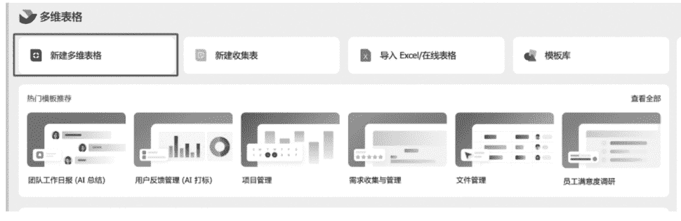

| 学生作文 | 姓名 | 批改结果 |
| :--- | :--- | :--- |
| | 三 | |
| | 四 | |

标题
AI图片理解

字段类型
文本

探索字段捷径 ⓘ

取消

确定

搜索

字段捷径中心 New

AI

信息提取

总结

自定义 AI 自动填充

AI 图片理解（豆包）

翻译

Kimi 阅读助手

实用工具

进度追踪

标记重复值

签字确认

10 条记录

第二步：修改第一列表头为“学生作文”，打开“探索快捷字段捷径”，选择“AI图片理解（豆包）”。借助“AI图片理解”功能，不但能快速识别学生作文图片，还能一键拖拽图片上传，也不需要一张一张地上传学生作文图片附件。

第三步：在“配置”中选择“原图”，同意“自动更新”，并点击“仅保存配置”。完成以上设置后，多维表格中第二列会自动生成“原图”一列，教师可以将学生作文拍照或扫描上传至“原图”中，进行作业批改。（具体方法见图8-6）至此，第一列“学生作文”制作完毕。图8-6 配置“图片”功能

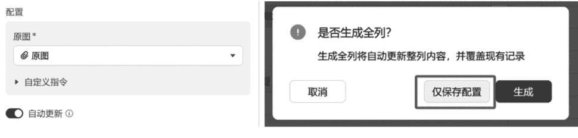

第四步：将第三列的表头修改为“DeepSeek指令”，并在“字段类型”中添加“DeepSeek-R1”，在“输入指令”中写上提示词。注意：提示词中的“AI图片理解”需要通过“引用字段”来添加，并输入指令（仅供参考）。图8-7 选择AI工具，并撰写提示词图8-8 选择“引用字段”

DeepSeek指令

DeepSeek指令.输出结果

优缺点

得分

结构方面：六...

43/50

结构完整性：...

46/50

标题

DeepSeek指令

字段类型

对象

DeepSeek-R1

字段捷径

取消

搜索

字段捷径中心

New

关联账号

AI

Deepseek 大模型账号（非必填）

分类

+ 关联账号

信息提取

配置

总结

输入指令 *

引用字段

智能标签

你是一名小学语文教师，正在批改四年级学生的作文《那一刻，我懂得了成长》。AI图片理解 × 进行批阅，作文要求如下：①按照一定的顺序讲清楚一件印象深刻的经历，②表达真实情感，③字数不少于350字。请根据2022版语文课程标准“语言表达与思维发展”的素养

自定义 AI 自动填充

DeepSeek-R1

实用工具

取消

确定

进度追踪

工作日天数计算

标记重复值

签字确认


打开“获得更多信息”，打开“输出结果”和“自动更新”，至此，第三列制作完毕。第四列会自动添加“DeepSeek指令.输出结果” 图8-9 设置相关功能


第五步：将第五列的表头修改为“优缺点”，在“字段捷径”中添加“自定义AI自动填充”，在“输入指令”中添加提示词，必须通过“引用字段”添加“DeepSeek指令.输出结果”；打开自动更新，“仅保存配置”。 图8-10 设置第五列的表头信息、提示词等功能

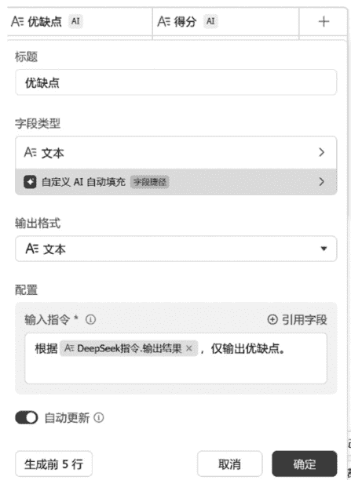

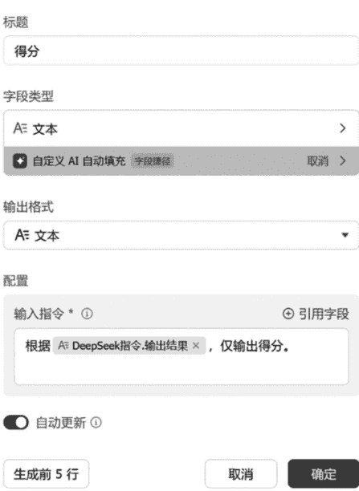

第六步：将第六列修改为“得分”，在“字段捷径”中添加“自定义AI自动填充”，在“输入指令”中添加提示词，必须通过“引用字段”添加“DeepSeek指令.输出结果”（参考图8-10设置第五列的表头信息、提示词等）；打开自动更新，“仅保存配置”。

至此，一份用于批改学生作文的表格设置好了。图8-11 设置好的多维表格

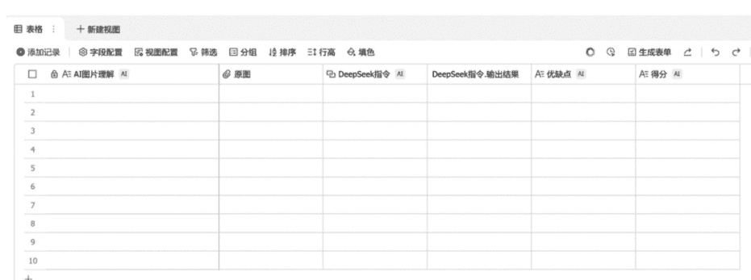

教师只需在第2列“原图”中上传学生作文图片，即可获得批改结果。批改完作文后，教师点击右上角“三个点”的标志，即可将批改结果导出为Excel/CSV文件。图8-12 上传学生作文图片图8-13 将多维表格导出为Excel/CSV文件

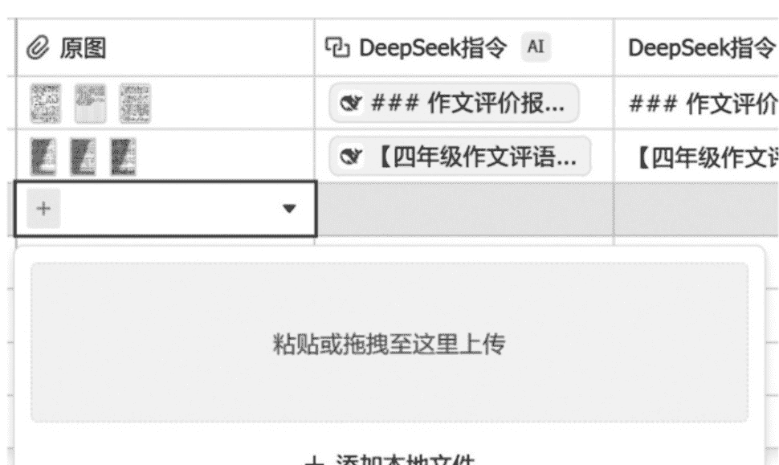


第七步：教师审核与应用。教师仔细阅读AI生成的评语草稿，对照学生原作和评价标准，判断AI的评价是否准确、中肯。教师根据自己的专业判断和对该学生的了解，对评语进行修改、补充或个性化调整。最终，教师将修改完善后的评语反馈给学生。

#### （二）实战案例2：利用飞书+DeepSeek辅助作业批改并推送错题类似题

（1）场景：小学数学李老师想针对“一元一次方程的解法”这一核心概念，设计一套练习题，她希望借此了解学生解方程的能力，并推送学生错题的相关题目，加强练习。

（2）AI应用：这里与实战案例1的AI应用相同，此处不再赘述。

（3）步骤如下：

我们需要在飞书上制作用于批改作业的多维表格，该表格可以自动批改学生上传的作业、计算错题数量、分析出现错题的原因，最后生成类似题目推送给学生，让学生意识到自己的不足之处，并加以练习。由于部分步骤和“实战案例1”相似，故此部分仅展示关键部分。

首先，介绍制作用于收集学生作业的表单（即作业收集表的步骤）。

第一步：将第一列第一行、第二列第一行、第三列第一行的表头分别修改为“姓名”“班级”“上传数学作业照片”，学生在表单填写的内容会自动填入这三列中。

第二步：在飞书上新建“表单视图”，并在左上角命名表格，如：××数学作业。此时，会出现一个名为“表单”的单元格，我们点击右边标识“新建视图”，选择“表单视图”。图8-14 在飞书上新建“表单视图”

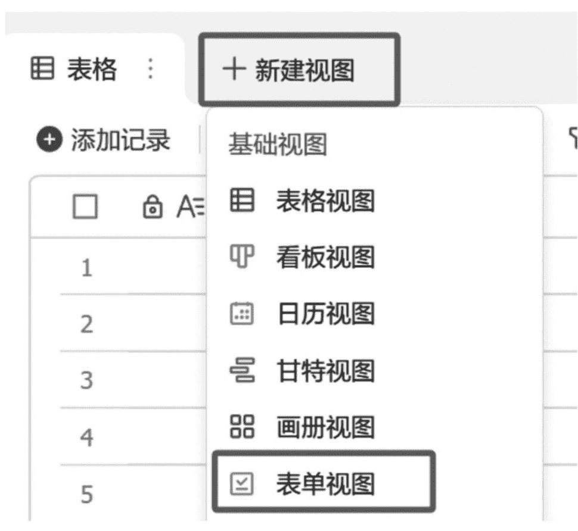

第三步：在“表单视图”中，我们可以单击右边的“可选题目”去选择我们要收集的数据。例如，我们需要收集学生的“姓名”“班级”“作业图片”，那么在右边“可选题目”中点击“姓名”“班级”和“上传数学作业照片”的“+”符号，即可添加。图8-15 添加需要收集的数据名称图8-16 设置表单视图的信息

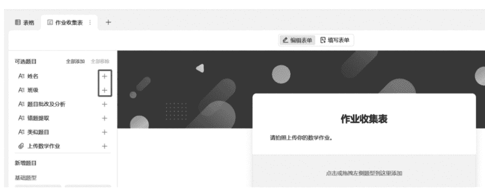

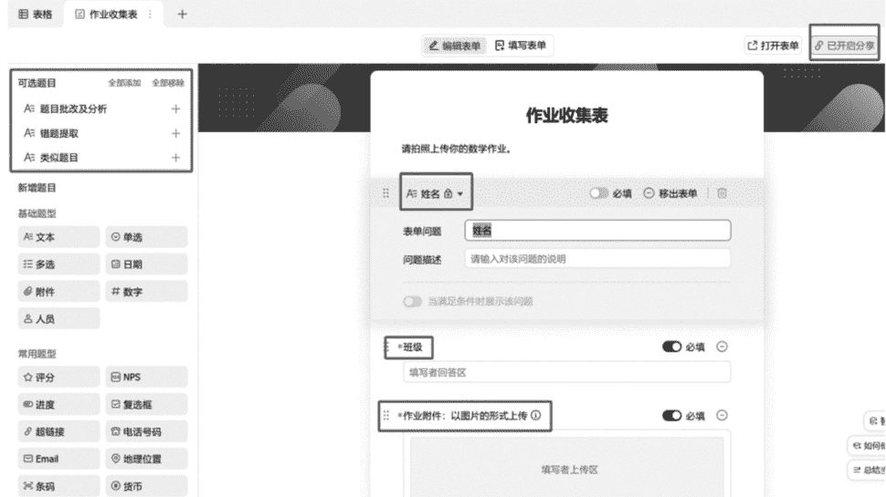

第四步：将表单分享给学生填写，在右侧上方有“分享表单”选项，点击之后会出现“未开启表单分享”，我们在这里选择“分享”，出现“已开启表单分享”。完成上述步骤后，可以选择以链接方式分享，也可以以二维码的形式分享。

至此，自动收集学生作业的表单制作完毕。接下来介绍批改作业的多维表格。

第一步：新建第四列表头，将其标题修改为“题目批改及分析”，打开“探索快捷字段捷径”，选择“AI图片理解（豆包）”。在“原图”中选择“上传数学作业”；在下方“自定义指令”中输入提示词：

角色：数学作业批改助手。

背景：学生在自主学习和课后复习时，需快速获取题目解析、知识点强化及针对性提升方案，本助手通过图像识别与数学知识库，提供精准批改与学习指导，助力高效掌握数学知识与解题技巧。

核心能力：1.精准识别：支持清晰题目图片的文本提取（含公式、符号）。2.答案核验：基于数学规则与知识点库，自动判断答案的正确性。3.错题深度解析：针对错误答案，提供正确答案知识点剖析、错误原因讲解。4.学习资源联动：根据错题类型，推荐针对性提升方案与同类练习题。

目标：1.答案正确：仅反馈“恭喜你，答案正确”。2.答案错误：输出完整纠错报告，含正确答案、知识点、错题原因解析、提升建议及同类题。

输入要求：1.图片清晰，题目文字无模糊、遮挡。2.题目须为K-12常见数学题型（如代数、几何、四则运算等）。

输出规则：1.答案正确：“恭喜你，答案正确”。2.答案错误：“答案错误”。正确答案：[标准答案及步骤，如分数、余数或小数形式]。3.原题目：[题目原文]；知识点：[关联的数学概念/公式，如“除法余数规则”]；错误解析：[具体错误原因，如“未正确处理余数”]；提升方案：[建议学习路径，如“复习‘分数运算’并完成五道同类题”]；类似题目：[同类题目+答案，如“315×6=?（答案：1890）”]。

示例：输入：“解方程：2x+5=15，答案：x=4”。

输出：1.答案错误。2.正确答案：x=5。3.原题目：解方程：2x+5=15。4.知识点：一元一次方程的解法（移项与系统化简）。5.错误解析：未正确移项，步骤应为“2x=15-5→x=10÷2”。6.提升方案：学习“方程移项规则”，完成3道移项专项练习。7.类似题目：3y-7=8，求y。（答案：y=5）。图8-17 制作第四列表头

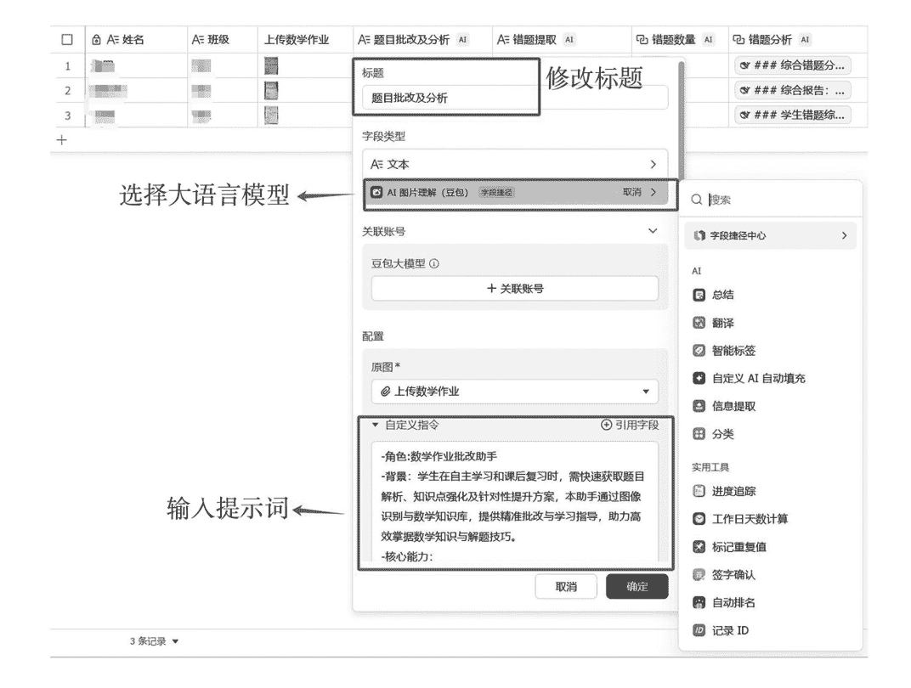

第二步：新建第五列表头，将其标题修改为“错题提取”。在“字段捷径”中选择“信息提取”；在“配置”中点击“选择需要提取字段”，选择“题目批改与分析”；提取信息为“提取答案错误的所有内容”；打开“自动更新”，点击“仅保存配置”。

第三步：新建第六列表头，将其标题修改为“错题数量”。在“字段捷径”中添加“DeepSeek-R1”，在“输入指令”中添加提示词（请根据“错题提取”识别错题数量，用数字表示即可）。注意：提示词中的“错题提取”必须通过“引用字段”添加。打开“自动更新”，点击“仅保存配置”。

第四步：将第七列的表头标题修改为“错题分析”，在“字段捷径”中添加“DeepSeek-R1”，在“输入指令”中添加提示词（请根据“错题提取”中的错题情况，分析该学生存在的知识缺陷，并基于学习建议，对错题进行知识点讲解，以一份综合报告的形式呈现）。注意：提示词中的“错题提取”必须通过“引用字段”添加。打开“自动更新”，点击“仅保存配置”。打开“获取更多信息”，选择“输出结果”。

第五步：将第八列修改为“类似题目”，并在“字段捷径”中选择“信息提取”，在“配置”中点击“选择需要提取字段”，再选择“题目批改与分析”；提取信息为“提取类似题目所有内容”。打开“自动更新”，点击“仅保存配置”。

至此，一份用于批改作业的表格设置好了。

学生通过教师分享的链接或二维码填写完表单后，表格会自动批改学生上传的作业照片附件，给出错题数量、错题分析以及推送类似题目。在表单的最上方有“自动化”选项，用于设计自动化流程。当新增或修改的记录满足条件时，就向“第1步的记录修改人”发送飞书消息。操作如图8-18所示。

当表格所有列不为空时，将所设定好的内容发送给填写表单的人。学生就可以知道自己的题目作答情况、题目错误的原因，以及类似题目。生成示例如图8-19所示。图8-18 将多维表格导出为Excel/CSV文件图8-19 生成示例

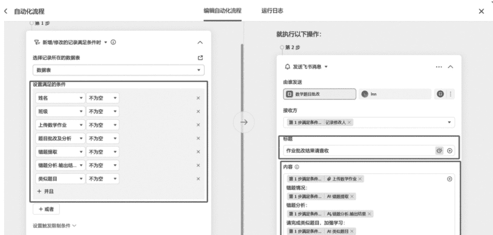

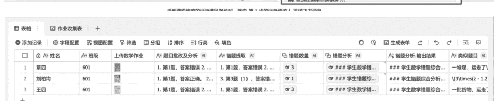

需要注意的是：AI生成的评价结果和评语草稿必须经过教师的专业审核和人工修正。教师需要结合自己对学生的了解、对评价标准的把握以及自身的教学经验，对AI的评价进行判断、补充和完善，以确保评价的准确性、公正性和育人价值。AI在此环节是高效的助手，而非最终的决策者。

### 九、学业评价中的伦理考量与未来展望

人工智能赋能下的学业评价，正从单纯的“效率工具”逐步迈向能够辅助深度分析、提供个性化反馈的“认知伙伴”。这一转变无疑为教育带来了巨大的想象空间和实践价值。然而，技术的进步总是伴随着新的思考和挑战，其成功应用依赖于技术与教育理念、教学实践的深度融合。要确保AI在学业评价中的应用真正服务于教育的根本目标——“人的全面发展”，我们必须高度重视并妥善处理其中涉及的伦理问题，并对未来发展趋势有清晰的认识。在前面的案例中，我们看到在运用AI评价的过程中，教师需要从“AI结果的审核者”“学生学习的引导者”“学习过程的情感支持者”等多元角色中找到新的平衡，而伦理框架的不断完善与有效执行，将是确保技术真正服务于教育公平和学生福祉的关键。

#### （一）AI赋能评价的潜在风险

尽管AI为学业评价带来了诸多便利和创新可能，但其潜在的风险不容忽视，主要包括以下几个方面。

- （1）数据隐私泄露：AI评价系统在运行过程中需要收集、存储和分析大量学生的个人信息和学习数据，如学业成绩、在线学习行为记录，甚至可能涉及更敏感的生物特征信息等。这些敏感数据如果管理不当，极易发生信息泄露、滥用，从而侵犯学生的隐私权，对学生造成潜在伤害。

- （2）算法偏见与歧视：AI模型的性能和公正性在很大程度上取决于其训练数据的质量和代表性。如果训练数据本身存在偏差（例如，某些社会经济背景、地域或特定学生群体的数据代表性不足，或者数据中内隐了历史形成的刻板印象），那么AI模型可能会习得并放大这些偏见。这可能导致在评价过程中对特定学生群体产生不公平的评价结果（如在语言表达、问题解决方式上对非主流文化背景学生的低估），从而影响教育公平，甚至产生具有歧视性的决策。

- （3）过度依赖技术与评价异化：教师如果将AI评价视为唯一标准，可能会忽视自身基于长期观察和情感交流的专业判断，削弱自身的评价能力和教学反思能力。学生如果过度依赖AI的即时反馈和答案，可能会削弱独立思考和深度探究的能力，影响自主学习能力的培养。更严重的是，如果评价完全由“冷冰冰”的算法主导，可能会导致评价过程缺乏人文关怀，甚至出现学生为了“取悦”算法而学习的“应试AI”现象，使评价偏离其促进发展的初衷。

- （4）信息安全与更广泛的伦理风险：除了上述风险，AI在评价中的应用还可能面临技术滥用、数据安全漏洞、信息茧房效应等多方面风险。此外，许多AI评价算法的内部工作机制如同“黑箱”，其决策逻辑不透明、难以解释，这也会影响评价结果的可信度和师生对评价过程的接受度。这些风险都需要从系统层面进行全面的治理和防范。

#### （二）确保评价公平、透明、有效的原则与策略

面对AI赋能评价的潜在风险，教师需要积极构建相应的伦理框架和实践策略，确保评价的公平性、透明度和有效性，真正实现技术向善，服务于每一个学生的健康成长。在评价的实践中，可以采取以下策略。

- （1）公平性保障策略：教师要设计多样化、综合性的评价指标，避免单一标准化测试所造成的片面性。教师可以采用表现性任务、真实性评价以及过程性评价等方式，关注学生差异性与成长性。在选择、开发和应用AI评价工具时，要有意识地对其训练数据和算法模型进行审查，识别和努力消除其中可能存在的偏见。定期对AI评价系统进行公平性审计，确保其对不同背景、不同特点的学生都能进行公正的评价。

- （2）透明性提升策略：提供AI工具或基于AI的教育产品的公司要尽可能让教师和学生理解评价结果是如何产生的，关键的评价依据是什么。教师和学生应该要对AI给出的评价结果进行批判性思考后使用。教育公司或学校要向教师、学生和家长清晰、明确地公开评价的标准、方法、过程以及学生数据的收集、存储和使用规则，从而提高评价的透明度和各方信任度。

- （3）人机协同的策略：为将评价的效能落到实处，需构建人机协同的评价模式，其核心在于将AI的精准分析转化为提升教学与学习效果的有效行动。AI负责其擅长的数据处理、模式识别、初步分析和个性化反馈的生成等任务，为教师提供客观的评价依据和高效的辅助工具；教师则基于自身的专业知识、教学经验和对学生的全面了解，进行最终的综合判断、价值引导和情感支持。

此外，教师还要遵循以下三个隐私保护核心原则：

- ①数据最小化原则：在评价过程中，只收集与评价目标直接相关的、必要的数据，避免过度收集。
- ②强化数据安全监管与技术保障：采用匿名化、假名化、差分隐私、数据加密、访问权限分级管理等技术手段和严格的管理措施，确保学生数据的收集、存储、传输、使用和销毁等全生命周期的安全。
- ③明确数据权属与使用边界：清晰界定学生数据的归属权，规范数据的使用范围和授权机制，确保数据使用符合伦理和法律要求。

#### （三）未来学业评价的发展趋势：人机协同，素养为本

展望未来，人工智能赋能下的学业评价将朝着更加智能、高效、公平和人性化的方向发展，呈现以下主要趋势。

- （1）人机协同评价将成为主流：AI将更多地承担数据处理、模式识别、初步分析、个性化反馈生成等任务，将教师从繁重的重复性工作中解放出来。而教师则更专注于设计评价任务、解读复杂评价信息、进行情感和价值的综合判断、与学生进行深度对话和提供情感支持。人机各自发挥优势，协同合作，共同提高评价的质量和效率，实现“1+1>2”的效果。

- （2）评价更加聚焦核心素养与高阶能力：随着新课标的实施和对未来人才能力的深化，学业评价将更加注重对学生问题解决、批判性思维、创新思维、协作与沟通、数字素养、自我管理等核心素养和高阶能力的考查，而不仅仅是知识的记忆与再现。AI技术将辅助设计更真实、更复杂、更具探究性的评价任务情境。

- （3）评价过程更加动态化与个性化：利用AI技术，可以实现对学生学习过程的实时追踪、动态分析和即时反馈，形成持续更新、多维度呈现的学生学习画像。为每个学生提供个性化的学习建议、资源推荐和发展支持，真正实现因材施教和支持终身学习。

- （4）评价伦理与法规建设更加受到重视：随着AI在教育中普及应用，关于数据隐私、算法公平、技术伦理、问责机制等方面的规范和法规建设将更加完善，以保障教育评价的公平、公正和健康发展，确保技术的发展始终以人为本。

总之，人工智能为学业评价带来了前所未有的变革机遇，使其在提升即时性、个性化和精准性方面展现出巨大潜力。然而，技术的赋能并非一蹴而就，更不能盲目替代。我们必须清醒地认识到其潜在的伦理风险，并积极采取有效的应对策略。未来，成功的AI赋能评价必然是技术与教育深度融合的产物。教师的角色将更加凸显其专业性与不可替代性，需要在“评价标准的设计者”“AI结果的审核与解读者”“学生学习的引导者”和“学生成长过程的情感与价值支持者”等多元角色中找到新的平衡与定位。构建完善的伦理框架，始终坚持“以人为本、素养为先”的原则，大力推动人机协同，才能确保AI技术真正服务于学生的全面发展，促进学业评价的科学化、个性化和高效化，为培养适应未来社会的创新人才贡献力量。

## 第九章 AI赋能教师专业发展

人工智能在深刻变革教育的同时，也极大地推动和支持了教师专业发展。一位卓越教师的成长，离不开向内审视的深刻反思与向外探索的智慧沉淀，而AI则可以赋能教师专业发展。本章将聚焦于赋能教师专业成长的两大核心支柱：一是探讨如何运用AI辅助教师精准分析课堂教学实况，将日常教学转化为可供深入研究与反思的宝贵案例；二是阐述如何借助AI高效构建与应用个人知识库，将碎片化的信息与经验，系统化地整合为个人专属的教学智慧体系。本章旨在揭示AI如何通过这两条核心路径，全面赋能教师的个体成长，为其迈向更高专业水平奠定坚实的基础。

AI技术为教师的专业发展，特别是在课堂教学分析与反思、典型课例开发与分享以及个人知识库构建等方面，提供了前所未有的机遇。通过学习和掌握AI分析工具，教师能够更高效、更科学地审视和改进教学实践，系统化地总结和提炼教学经验，从而加速专业成长，最终惠及每一位学生。教师应以开放的心态积极探索，以审慎的态度合理应用，让AI真正成为赋能教育的得力助手。

### 一、AI支持教师开展专业化、数据驱动的教研活动

传统的观课、评课等教研活动往往耗时耗力，且评价易受个人主观经验的影响，难以进行系统、客观的分析。人工智能技术的发展，为教师提供了一套高效、客观、多维度的分析工具，能够将日常的教学实践转化为可量化、可分析的数据，从而将传统的经验式教研，升级为专业化、数据驱动的循证教研。

AI主要通过以下几个方面，为专业化的数据驱动教研活动提供支持。

- **客观记录与多维呈现**：AI能够将课堂教学视频中的师生语言、互动行为等进行数据化和可视化呈现。例如，它可以精确统计课堂中师生对话时长、提问类型与数量、师生互动的频率和内容、学生发言的覆盖面和参与度等。这为教研活动提供了超越主观感知的、客观的、精准的数据基础。
- **深度分析与智能诊断**：借助强大的语言理解和教育学理论模型，AI能够对课堂实录进行深度分析。它不仅能梳理教学流程，还能从核心素养达成度、教学策略有效性、师生互动模式等专业维度进行智能诊断，发现日常教学中不易察觉的问题。
- **提升效率与聚焦核心**：AI能够自动化处理海量的课堂视频数据，快速生成初步的分析报告、课堂摘要和思维导图。这将教师从繁琐的听录、转写、整理工作中解放出来，使个人反思和集体教研能够直接聚焦于教学问题的探讨和改进策略的研讨，从而全面提升教研效率。
- **赋能协作与促进共享**：AI生成的标准化、结构化的分析报告，为教研组内的同行交流提供了共同的对话基础和事实依据。这使得集体研讨不再是空泛的经验交流，而是基于共同数据的深度对话，极大地促进了教师专业学习共同体的建设与发展。

表9-1总结了教师开展AI教研的典型流程与工具支持。

**表9-1 教师开展AI教研的步骤**

| 步骤 | AI工具应用 | 输出成果 |
| :--- | :--- | :--- |
| 1. 数据采集 | 无感录播系统+AI分析平台（如S-T教学行为分析） | 课堂热力图、时间分布雷达图 |
| 2. 问题诊断 | 教研大模型生成PTA报告（问题—归因—建议） | 精准教研订单（如提问有效性低） |
| 3. 协同改进 | 云端教研共同体在线研讨+AI推荐优化方案 | 重构教学设计（如增加探究环节） |
| 4. 效果评估 | 对比迭代前后数据（如高阶思维问题占比提升） | 教师成长画像、课例资源入库 |

实践案例如南宁滨湖路小学徐老师在AI诊断出“高阶问题占比仅24.4%”后，调整提问策略（如增加解释性提问“为什么图像识别需要多层神经网络？”），使高阶问题占比提升至42.86%。还有上海理工大学附中数学组通过AI回溯学生“思维断点”，设计“问题链—变式链”模型，如将单一习题拆解为梯度任务链，使探究环节时长从0增至10分钟。

#### （一）AI赋能的数据驱动教研活动

教师可以遵循“数据采集—AI分析—报告解读—研讨应用”四步流程，来开展数据驱动的教研活动。

##### 1 数据采集与转录

首先，教师录制一节完整的课堂教学视频。然后，将视频上传至具备音视频处理能力的AI平台（如通义千问的“音视频速读”功能），将其快速转录为包含课堂对话原文、摘要和思维导图的核心文本文件。

##### 2 AI深度分析

获取文本文件后，教师可以采用两种主要的方式进行深度分析。

（1）通用大语言模型组合应用：将转录的文本文件上传至具备深度文本分析能力的AI模型（如DeepSeek的“深度思考”模式），并根据具体的教研需求，撰写针对性的提示词来引导AI进行个性化、深度的分析。

（2）专业课堂分析平台：将视频上传至专门的AI课堂分析平台（如科大讯飞的“课堂实录与分析”平台），利用平台内置的、基于教育学理论的分析框架，获取结构化的、聚焦于教学行为和课堂要素的量化分析报告。

##### 3 分析报告解读

AI生成详细的分析报告后，教师（或教研团队）需对报告进行解读。报告可能包含量化数据（如师生话语时长占比）和质性分析（如教学互动的特点、优点与改进建议等）。

##### 4 研讨与教学应用

基于AI的分析报告，教研团队可以开展循证研讨，精准定位问题，共同商议改进策略。教师个人则可以根据报告的反馈，有针对性地调整教学设计和课堂策略，并将改进后的实践再次进行数据分析，形成持续优化的专业成长闭环。

#### （二）AI辅助课堂教学视频分析

课堂教学是教师专业实践的核心场域。通过分析课堂教学视频，教师可以深化自我反思，如同运动员观看比赛录像一般，从旁观者的视角审视教学环节、师生互动、时间分配及教学策略的有效性，从而发现日常教学中不易察觉的问题。同时，观摩和分析优秀教师的课例是提升教学能力的重要途径，AI能够帮助教师快速把握优秀课例的精华，学习其教学设计、互动技巧和课堂管理等方面的经验。AI还能对课堂教学行为进行数据化、可视化的呈现，例如统计师生对话时长、提问类型、学生参与度等，帮助教师更客观、精准地定位教学中存在的问题。此外，AI能够快速处理和分析大量的课堂视频数据，自动生成初步的分析报告，为教师的个人反思和集体教研提供高效的素材和讨论基础，从而全面提升教研效率。

下面我们以一节40分钟的某小学的美术课《能干的机器人》课堂教学视频为例，介绍三种利用AI分析课堂教学视频的方法。

##### 1 通用大语言模型组合应用：通义千问+DeepSeek

这种方法主要依赖目前较为普及的、具备强大文本理解和生成能力的大语言模型，通过组合使用不同的AI工具来完成课堂分析。

（1）音视频转录与初步处理

教师可以将课堂教学视频上传至具备音视频处理能力的AI平台，例如通义千问的“音视频速读”功能。这类工具能够快速将视频中的语音对话转化为文字，并且能够提取视频中出现的PPT课件内容，同时生成初步的思维导图，帮助快速了解课程梗概。通过这一步骤，通常可以获得三个核心文件：完整的课堂对话文字记录，即“课堂实录原文”；对课堂教学流程、主要内容和亮点的概括性介绍，即“导读/摘要”；以及结构化展示课堂主要环节和核心概念的“思维导图”。

（2）深度分析与报告生成（使用DeepSeek“深度思考”模式）

教师将上一步获得的“课堂实录原文”“导读/摘要”和“思维导图”三个文件，上传至具备深度文本分析和长文理解能力的AI模型中，如DeepSeek的“深度思考”模式。然后，教师可以根据自己的分析需求，撰写针对性的提示词来引导AI进行分析。

例如，可以输入以下提示词：

> “附件是小学美术课《能干的机器人》的课堂教学（时长40分钟）全过程文字记录、导读和思维导图。请根据这些内容，深入分析该教学中：1.教师与学生的互动情况及教学互动过程的特点。2.教学过程是否有效体现了小学美术课程的核心素养（如图像识读、美术表现、审美判断、创意实践、文化理解）？3.该课属于什么类型的课堂教学？4.本节课教学的主要优点有哪些？5.本节课教学有哪些可以改进的地方？请基于以上分析，撰写一篇1000字左右的课堂教学分析报告。”

通过上述方法，AI模型能够生成一份详细的分析报告。以《能干的机器人》一课为例，AI可以帮助清晰梳理师生互动特点，如教师如何通过提问激发学生思考，以及AI辅助设计工具引入后新型互动的引导方式。报告能逐条分析该课在图像识读、美术表现、审美判断、创意实践及文化理解等方面对核心素养的落实情况。AI还能判断出该课的类型，例如可能将其归为融合“设计·应用”学习领域、具有项目式学习特征并深度结合信息技术的探究型美术课。同时，AI会总结教学优点，如主题新颖、技术融合恰当等，并且能够根据文本分析提出改进建议，如在美术本体知识深化、AI工具探索广度等方面。这种方法的优势在于灵活性高，教师可以根据具体课例和分析需求定制提示词，引导AI进行个性化、深度的分析。

##### 2 专业AI课堂分析平台

除了通用大语言模型，市面上也出现了一些专门针对教育场景，特别是课堂教学分析的AI平台，如科大讯飞的“课堂实录与分析”平台。这类平台通常集成了音视频处理、教育学理论和AI算法，能够提供更结构化、更聚焦于教学行为和课堂要素的分析。其操作流程一般包括上传与设置视频、填写课程信息、启动分析以及查看报告。这些平台可能提供的分析维度非常丰富，包括教学行为数据（如提问类型与时长）、师生互动分析（如对话轮次与占比）、学生参与度评估、教学内容分析（如关键词与知识点覆盖）以及课堂语言特征等，并通常以可视化的图表形式呈现。使用此类专业平台分析课堂教学视频，除了转录和基本流程梳理外，平台还会提供各环节精确时长统计、教师引导方式分析、学生发言量化以及互动热力图等具体数据。这类平台的优势在于其专业性和标准化，能够提供基于教育学理论的结构化数据和分析框架，尤其适合进行教学行为的量化分析和常态化监测。

利用上面的方法，由AI生成的、包含丰富数据的分析报告，成为教师开展数据驱动的教研活动的核心材料，其主要作用在于：

（1）对于个人反思：授课教师可以对照这份客观的报告，精准地看到自己教学设计的亮点和先前未曾察觉的盲区，反思的深度和效度得到极大提升。

（2）对于集体教研：教研组的讨论不再是“我觉得这堂课挺好”或“感觉互动少了点”这类模糊的评价。教师可以围绕报告中的具体数据展开对话，例如：“数据显示，这节课教师提问占对话总时长的60%，我们该如何优化提问设计，以增加学生深度思考和表达的时间？” “AI分析认为‘美术本体知识深化’不足，我们来探讨一下，在哪个环节可以更好地融入相关知识点。”

通过这种方式，AI将一堂课转化为了一个可量化、可分析、可讨论的“数据包”，使整个教研活动都建立在客观证据之上，从而变得更加专业、深入和高效。

### 二、利用AI开发优质课例，促进深度教学反思

在AI的辅助下完成课堂教学分析，仅仅是教师专业成长的第一步，更重要的是将这些分析与洞察系统化、成果化，开发成一份内容翔实、反思深刻的典型课例。这不仅是对个体教学经验的宝贵提炼，更是教师实现从“经验型”向“智慧型”“研究型”转变的关键跃升。

#### （一）为什么要开发典型课例？

AI不仅能够辅助教师分析单节课的教学实况，更能深度赋能教师在自我反思和学习优秀经验的基础上，系统性地开发和打磨典型课例或教学案例。这些经过精心提炼的案例成果，是教师专业智慧的结晶，具有多方面的应用价值。

- **深化专业反思**：整理撰写过程本身就是一次深刻的、结构化的专业反思，能驱动教师系统性地审视教学理念、设计与行为，实现从“无意识”到“有意识”的教学改进。
- **赋能同行交流**：高质量课例是教研活动中的宝贵资源，能赋能教师专业学习共同体的构建，为同行提供可观摩、可借鉴、可讨论的范本，促进经验分享与共同成长。
- **助力专业成长**：优秀的课例也可作为培训材料或共享资源，助力新教师快速成长，并推动区域整体教学水平的提升。
- **提升个人竞争力**：在各类教学评比、职称评审或课题研究中，一份结构完整、素材丰富、反思深刻的典型课例，无疑是展示教师专业水平和教学成果的有力证明。

#### （二）如何利用AI开发典型课例？——AI辅助下的四步流程

一个结构完整、内容翔实的典型课例通常包含课程背景与学情分析、教学设计与创新思路、课堂实录与关键环节呈现、AI辅助的课堂分析报告、教学反思总结与效果评估以及佐证材料等要素。AI在此过程中，将从一个分析工具转变为教师的写作伙伴和反思顾问，通过以下四步流程，辅助教师高效开发高质量课例。

##### 1 基础素材准备与框架搭建

在开发课例的第一步，AI主要充当高效的资料整理与结构设计辅助工具。教师可将上一节中由AI生成的课堂实录原文、导读/摘要、思维导图以及分析报告作为基础素材向AI提问，以获取一个标准的课例撰写框架。

例如，教师可以输入提示词：“我需要撰写一份关于小学美术课《能干的机器人》的典型课例，请为我提供一个包含学情分析、教学设计、实施过程、教学反思等部分的详细写作大纲。”

##### 2 核心内容撰写与AI协同创作

在第二步，AI能够辅助核心内容的撰写并激发创作灵感。教师可以针对大纲中的每一个部分，与AI进行协同创作。AI能够根据教师提供的核心思想和数据，生成各部分的初稿。以撰写“学情分析”为例，教师可以输入：“请帮我撰写《能干的机器人》一课的学情分析。对象是小学三年级的学生，对机器人很感兴趣，但对AI绘画比较陌生，美术基础一般，动手能力和想象力较强。”

AI可以生成一份结构化的学情分析初稿，如：“本课的授课对象为小学三年级学生。该年龄段学生具有以下特点：1.认知与兴趣：对机器人、AI等科技主题充满好奇与热情，这为本课的导入和主题探究提供了良好的情感基础。但他们对生成式AI作为创作工具的概念较为陌生，需要教师进行直观、生动的引导。2.技能与经验：学生具备一定的绘画和手工制作基础，动手能力较强，但造型能力和色彩运用能力尚在发展中，对于使用数字工具进行创作的经验相对较少。3.思维与个性：学生想象力丰富，乐于表达，但在逻辑思维和问题解决能力方面需要引导。在创作中可能出现模仿多于创新的情况。”

##### 3 深度教学反思与AI对话启发

教学反思是课例的灵魂，在第三步中，AI可以作为启发深度反思的对话工具。教师可以在自己初步反思的基础上，上传AI生成的课堂分析报告，与AI进行多角度、深层次的对话，以挖掘更深层的教学洞见。例如，在深化教学反思时，教师可以提问：“AI分析报告指出，本课在‘美术本体知识深化’方面有待加强。请结合课堂实录，具体分析在哪些环节可以更好地融入美术知识，并提出具体的改进策略。”AI可以生成具体的建议：“根据课堂实录，在学生初步生成机器人图像后（约25分钟处），教师直接引导学生进行实体制作。此环节可进行深化：1.融入‘形体与结构’知识：在学生展示AI生成的机器人后，引导他们分析机器人的基本几何形态（方形、圆形、圆柱体等），讨论不同形态组合带来的稳定感或动感。改进策略：增加提问‘这个机器人看上去很稳固，你觉得是哪些形状让它站稳了？’。2.融入‘色彩与情感’知识：在选择制作材料前，可以引导学生讨论AI生成图像的色彩搭配。改进策略：增加提问‘AI为什么会用这些颜色？红色和蓝色的机器人，给你的感觉有什么不同？’。”

##### 4 整体润色与规范化呈现

最后一步是利用AI进行文本的整体润色与规范化处理。完成所有内容的初稿后，教师可将整个课例文件交给AI进行最后的语言校对、润色和格式检查。教师可以使用这样的提示词：“附件是我的课例完整初稿，请帮我通读全文，检查是否有语法错误或表达不通顺之处，并提出修改建议，使其语言风格更专业、更具学术性。”

通过这四步，教师在AI的辅助下，不仅高效地完成了课例的撰写，更重要的是，在与AI的互动、对话和协同创作中，完成了一次深刻的、数据驱动的、结构化的教学反思。最终产出的典型课例，不再是简单的经验描述，而是闪耀着教育智慧、经得起推敲的专业成果。

通过AI的深度赋能，教师可以将日常的课堂教学转化为可供研究、可供分享、可持续优化的专业成果，这不仅是对个体教学经验的提炼，更是对教育智慧的传承与创新。

### 三、AI赋能教师知识管理与专业发展

教师利用有效的AI工具进行知识管理是驱动专业持续发展、提升教研能力、优化教学实践的重要引擎。教师构建个人知识库是提升专业素养与教学质量的关键。教师有意识、有计划地构建个人资源库和知识管理库，能够帮助教师系统梳理、沉淀经验智慧，高效获取和利用前沿信息，从而更好地应对新时代教育的挑战。

传统知识管理方式使教师普遍面临信息过载与筛选困难、资源分散整合不易、查找资料效率低下等问题，严重影响教学与研究。同时，资料零散存储不利于深度加工与知识内化，难以激发创新，个人知识库也更新迭代缓慢，易致内容陈旧。在团队协作中，优质资源的共享共建与版本管理效率低下，阻碍了集体智慧的形成。这些痛点严重制约了教师的专业发展和教研活动的深入开展。而AI技术的出现为解决这些问题提供了前所未有的机遇。

本节将深入探讨如何利用DeepSeek本地部署、腾讯知识库管理工具IMA及谷歌的NotebookLM等工具，助力教师打造专属知识库，实现专业成长。

#### （一）构建个人知识库的多元路径与工具

AI工具可以通过智能采集与分类（自动提取信息并打标）、高效检索与问答（自然语言搜索快速定位）、深度分析与洞察（提炼观点、发现关联、生成摘要）、个性化推荐与推送（根据用户习惯推荐）以及辅助创作与生成（辅助撰写教案、出题等），赋能教师构建高效智能的知识库。

##### 1 利用DeepSeek构建本地化教学资源库

DeepSeek作为强大的AI语言大模型，其理解、整合、生成内容的核心能力为构建智能化个人知识库提供了便利。

- （1）教学资源整合。教师可以将多年积累的教案、课件（PPT、PDF等）、习题、测试卷、优秀教学案例、学生作品、教育研究论文以及各类参考资料等进行数字化分类整理。
- （2）知识库构建平台选择。教师可以根据自身的技术水平和需求，选择以下几种不同的平台和方式构建知识库：
    - ①云端AI平台集成。可选择支持上传文档并基于大模型（接入大语言模型如DeepSeek等）进行问答管理的云服务，这些平台通常允许上传多种格式的文件并自动处理索引。
    - ②具备知识库功能的笔记或文档管理软件。选择能通过API接入大语言模型（如DeepSeek API）的先进笔记或文档管理工具（如腾讯IMA），实现本地文档的智能检索问答。

###### （三）DeepSeek本地化部署与应用（技术进阶路径）

对于有一定技术基础或愿意探索的教师，可以尝试通过以下步骤在本地计算机上运行DeepSeek模型并构建知识库。

① 下载并安装Ollama：Ollama是一个能够让用户在本地运行开源大语言模型（如Llama 2、Code Llama、DeepSeek等）的工具。访问Ollama官方网站下载对应操作系统的安装包并进行安装。

② 通过Ollama选择并运行DeepSeek模型：安装完成后，在终端或命令行界面使用Ollama的命令（如`ollama pull DeepSeek-coder`或其他特定版本的DeepSeek模型）来下载并运行DeepSeek模型。

③ 安装前端应用与知识库管理工具：为了更便捷地与本地模型交互并管理知识库，可以安装一些支持Ollama的第三方前端应用，例如：
- **Chatbox**：一款支持多种大语言模型的桌面客户端，可以连接到本地运行的Ollama模型，并提供对话界面。
- **AnythingLLM**：一款开源的私有知识库解决方案，可以连接到Ollama运行的本地模型，允许用户上传文档（PDF、TXT、MD等），创建和管理个人或团队的本地知识库，并基于这些文档进行问答。
- **Cherry Studio**：一款可以提供类似功能或与本地模型交互的工具。

④ 建立工作区并上传文件：在选定的前端应用中（如AnythingLLM），创建个人工作区，然后将整理好的教学资料（教案、课件、论文等）上传到该工作区。这些应用通常会自动对文档进行处理和索引，以便后续通过本地DeepSeek模型进行检索和问答。注意：本地部署模型对计算机硬件（尤其是显卡和内存）有一定要求，且配置过程可能涉及命令行操作，需要一定的学习和调试。

教师可直接向本地知识库提问，快速找到教案、习题解析等，如输入“九年级物理牛顿第二定律实验案例”即可获取相关内容。DeepSeek能辅助生成新教学思路、习题变式、课后反思等，还能通过分析学生问题和库内资料，更精准地提供个性化辅导。

##### 2 运用腾讯IMA知识库进行教学资源管理

腾讯在教育领域提供多种解决方案，其知识库功能常融入教育平台或智能工作助手（如腾讯教育平台、与混元大模型相关的应用），为教师提供了提升专业能力的有效途径。教师可利用腾讯文档、微云等进行云端分类存储，方便随时访问共享；还可以关注腾讯教育推出的集成知识库管理功能的工具，如腾讯会议教育版的AI小助手已体现此趋势。腾讯IMA这类集成大模型（含DeepSeek和混元大模型）的智能工作台，支持上传文档构建个人知识库、进行智能问答和内容创作。其关键在于对教学资源进行结构化管理（如按学科、年级、知识点、资源类型组织），便于检索利用。

图9-5 IMA下载及个人知识库构建

腾讯IMA（智能工作台）通过集成DeepSeek-R1和混元大模型，结合微信生态的无缝对接，为教师提供了一个从资源采集、智能加工到场景应用的完整解决方案。其核心优势在于多模态AI能力支撑，包括双模型驱动（DeepSeek-R1与混元大模型）支持复杂文献解析和跨学科知识关联，智能识别PDF、Word、图片中的公式和图表并自动生成结构化摘要与思维导图，以及支持中英文献对比分析并一键生成双语对照教研简报。同时，它深度适配教研场景，实现了微信生态的无缝对接（公众号文章、聊天文件直接归档），支持建立学科专题库（如“单元教学设计案例库”“学生常见错题库”），并能自动追踪历史版本，记录教研成果的迭代过程。

图9-6 个人知识库标签创建

##### 3 利用腾讯IMA实现微信公众号文章一键收藏

教师在日常学习中，经常会通过微信公众号获取大量前沿的教育资讯和优质的教学资源。腾讯IMA知识库工具与微信生态的深度整合，使得教师可以非常便捷地将这些宝贵的碎片化信息，一键存储到自己的个人知识库中，实现知识的系统化管理。

教师需要在手机上安装腾讯的知识管理应用程序ima（智能管理助手）App，打开界面如图9-7所示。

具体操作流程如下：

（1）打开公众号文章：首先，在微信中打开一篇你认为有价值的公众号文章。例如，一篇关于“智慧教育”的深度报道。

图9-7 ima手机界面
图9-8 微信公众号文章示例

（2）调用分享功能：点击文章右上角的“…”（更多）按钮，在弹出的菜单中选择“发送给朋友”或在下方的“更多打开方式”中查找。

（3）选择“ima知识库”：在“更多打开方式”的列表中，找到并点击“ima知识库”的图标（需要事先在微信中搜索使用ima知识库小程序）。系统会提示你“一键存入，基于知识库定制AI问答”。

（4）选择目标知识库：点击后，系统会自动跳转到腾讯ima应用，并弹出一个“选择知识库”的列表。这个列表会显示你已经创建的所有个人或共享知识库，例如“人工智能赋能科研”“中小学信息科技与人工智能素养”“学术研究与写作”等。

（5）完成保存：从列表中选择你希望保存该文章的目标知识库，例如，你可以将其存入“人工智能前沿发展与动态”这个知识库中。点击相应的知识库名称后，这篇文章就会被完整地、永久地保存到你指定的ima知识库中。

图9-9 “更多打开方式”列表
图9-10 “选择知识库”界面

通过以上简单的几步，教师就可以将散落在微信中的优质文章，快速、精准地归档到自己的专业知识体系中。后续，便可以在ima应用中随时查阅这些文章，更重要的是，可以利用IMA强大的AI能力，对这些收藏的文章进行提问、总结、分析和再创作，真正将外部信息内化为自己的专业智慧。

##### 4 教研资料库搭建流程

（1）第一步：多维资源采集。

首先是多维资源采集，包括本地资料数字化（批量上传超50种格式文档，对纸质文献进行扫描，然后进行OCR识别并保留批注）和动态资源捕获（微信公众号文章一键归档，教学视频自动生成文字稿与关键帧截图）。

（2）第二步：智能知识加工——让资料“活起来”。

其次是智能知识加工，通过AI进行自动化标注（自动提取课标编码、核心素养条目，构建学科标签体系）和深度内容挖掘。例如，使用教研指令模板：

> 请分析我的知识库中近三年市级优质课评比的“单元整体教学”设计案例：
> 1. 提炼这些案例在大单元教学设计方面的共性特征。
> 2. 对比不同学段（如小学与初中）在情境创设策略上的差异。
> 3. 基于分析，输出一个可复用的、包含不同环节的课堂活动设计通用模板。

IMA会自动关联知识库内相关案例并生成深度分析报告。

##### 5 典型教研场景应用

在教学设计优化与备课场景，输入备课主题（如“部编版语文五年级下册第六单元”），IMA能自动推送相关课标要求、评课记录、名师案例，并能辅助生成新教案初稿。在作业与学情分析场景，AI可识别手写作业，分析逻辑错误，生成归因分析，并推荐个性化分层练习。在课题研究场景，可建立专题文献库，AI能根据文献库辅助生成文献综述框架、进行中外研究对比、追踪最新成果，并润色学术表达。

##### 6 IMA重构知识管理的三大跃迁：深度融入教学教研与专业发展

腾讯IMA等AI知识管理工具带来的不仅仅是效率的提升，更是对教师工作模式和专业成长路径的深刻重塑。这“三大跃迁”在中小学教育教学实践中具有丰富的内涵和广阔的应用前景。

（1）从“碎片囤积”到“体系重构”：构建学科化、个性化的智慧知识网络。IMA通过整合各类资源（教案、课件、微信推文、笔记等），利用AI智能标签和知识图谱功能，帮助教师构建学科化、个性化的智慧知识网络。例如，语文教师可构建包含范文、解析、课件、视频的“语文教学资源与方法库”，数学教师可整合题型、解法、错题案例形成知识体系，英语教师可系统整理听说读写译素材并进行分级管理。

（2）从“个体劳动”到“人机共创”：释放教师潜能，聚焦教育创新。IMA通过AI辅助备课（快速整合素材、生成设计初稿）、智能批改、实验设计优化、跨学科项目资源整合等，减轻教师重复性劳动，使其有更多精力投入教学创新和个性化辅导中。例如，历史教师可快速获得“丝绸之路”探究课素材与设计初稿，科学教师可获实验优化建议，跨学科团队可高效共建项目式学习项目资源。

（3）从“静态存储”到“生态流动”：激活校本智慧，促进专业共生。IMA通过共享知识库功能，促进优秀教学经验、校本课程资源和教研成果在校内外流动共享，助力新教师成长和整体教研水平提升。例如，学科教研组可共建“精准教学资源库”，校本课程开发团队可协同完善课程资源，班主任可利用AI生成个性化学情分析与家校沟通材料。

#### （二）AI赋能教师知识管理的应用案例

##### 1 案例1：高效主题单元教学设计

初中历史李老师在设计“古代文明的智慧与创新”主题单元时，面临信息过载和资源分散问题。她利用腾讯IMA，整合了本地及微信收藏的教案、课件、文章、图片等，创建了专题知识库。IMA通过智能标签、摘要生成、自然语言检索及对比分析，辅助李老师高效备课，优化教学设计，沉淀个性化资源。AI知识库的运用显著提升了李老师的备课效率，优化了教学设计深度，形成了她宝贵的个性化教学智慧库。

##### 2 案例2：跨学科项目式学习协同教研

某高中物理、数学、信息技术教师团队开展“智能家居项目式学习项目”时，共享与协作不畅。通过IMA创建共享教研知识库，统一上传各学科资源。IMA自动打标、转写视频、关联跨学科资料。团队可在线协同编辑方案、批注讨论，AI辅助总结研讨记录并生成项目纲要，项目结束后生成总结报告。此举提升了教研效率与质量，实现了教研过程的可视化与可追溯，有效沉淀和传承了集体智慧。

##### 3 案例3：青年教师个性化专业发展

入职两年的小学语文赵老师面临专业发展路径迷茫和学习碎片化问题。她在IMA中创建“个人专业成长档案”，分类上传培训资料、反思笔记等。AI辅助她解决教学困惑（如对比识字法的优缺点并设计活动）、深度理解文献（生成报告摘要）、对标学习（对比自有教案与名师课例），并定期总结学习心得。这些应用帮助赵老师规划个性化学习路径、促进知识体系化，加速了专业成长。

个人知识库建设需持续更新迭代，保持活性。上传使用资料时务必注重版权与隐私，尤其是本地部署时确保用户数据安全。教师可多工具协同，不必局限于单一工具，如云盘基础存储、NotebookLM深度学习、集成AI的办公套件备课，或探索本地化知识库以获更高数据控制权。培养AI素养，熟悉工具用法和能力边界，是教师在智能时代提升专业发展的必备技能。

### 四、小结

本章阐述了AI如何赋能教师专业发展。核心路径有二：一是利用AI进行数据驱动的课堂分析，将日常教学转化为可供研究的案例，实现精准反思与循证教研；二是借助AI高效构建个人知识库，将碎片化经验系统化为个人教学智慧。其目标在于，引导教师从“经验型”向“研究型”转变，通过向内审视与向外探索，明确专业成长方向，加速个人成长，最终提升教学质量，惠及学生。教师应以开放心态，积极运用AI工具，实现专业能力的持续跃升。

## 第十章 AI赋能科研：从课题申报到论文写作全流程提效

在第九章中，我们探讨了AI如何赋能教师的个人专业成长。在此基础上，许多教师会自然地迈向一个更高阶的领域：将日常的教学反思与智慧沉淀，升华为规范、严谨的教育科学研究。在实践中研究教学中的问题，是教师专业发展的重要一环。研究者需要在浩如烟海的文献中寻找相关资料，需要在复杂的数据中发现规律，需要在繁琐的写作过程中反复修改完善。这些工作不仅耗时耗力，更容易让研究者在重复性劳动中迷失方向，影响创新思维的发挥。

生成式人工智能（GAI），特别是以DeepSeek、豆包、Kimi等为代表的强大语言模型，正成为赋能教师开展教学研究与创新的革命性力量。AI不仅能提升研究效率，更能激发创新思维，帮助教师将日常教学经验转化为有价值的研究成果。通过智能化的信息处理、个性化的研究支持和全流程的协作服务，人工智能正在重新定义科研工作的方式和标准。它帮助研究者将日常教学实践中的观察和思考转化为具有学术价值的研究成果，让每一位教育工作者都有机会成为教育创新的推动者。AI更是一个智慧的伙伴，能够在研究的每一个环节提供恰当的支持和指导。从研究选题的灵感激发到论文投稿的策略制定，从文献检索的精准定位到数据分析的深度挖掘，人工智能都能够发挥其独特的优势，帮助研究者克服困难，提升研究质量。

本章将详细阐述AI在教育科研中的系统性应用，带领读者走过从课题申报到论文写作的全流程。

### 一、AI赋能教育科研的核心能力

生成式AI之所以能深刻变革教育科研，主要缘于其四大核心能力：

一是海量信息的高效处理与整合能力：AI能够瞬时阅读并理解海量的文献、政策文件和研究报告，快速提炼核心观点、梳理发展脉络，将教师从繁重的资料收集中解放出来。

二是跨领域知识的关联与启发能力：AI能够打破学科壁垒，将一个具体的教学问题与相关的教育理论、学习科学、心理学原理、社会学视角等进行关联，从而激发研究者的创新思维，发现新颖的研究切入点。

三是结构化与规范化的文本生成能力：无论是撰写逻辑严谨的课题申报书，还是构建符合学术规范的论文框架，AI都能提供高质量的初稿和结构性建议，极大地降低了写作的门槛。

四是研究全流程的智能辅助能力：从辅助研究设计、推荐研究方法到协助数据处理与分析，AI正在成为研究者在各个环节“召之即来”的智能助手，显著提升了科研工作的整体效率与质量。

### 二、AI辅助研究选题与创新构思

选择一个有价值且可行的研究课题是教学研究的第一步，AI在此阶段能提供重要支持。

#### （一）挖掘研究灵感

教师开展研究首先面临的是选题和研究设计的问题。在选择研究问题时，教师可以利用AI工具（如DeepSeek）挖掘相关的数据资料，获得研究灵感，确定具体的选题或研究问题。AI可以通过分析教师提供的日常教学数据（例如学生作业中的常见错误、考试成绩分布、课堂观察记录等文本描述），并结合其庞大的知识库（涵盖教育理论、最新教育政策、国内外研究热点等），有效地帮助教师发现潜在的研究点。例如，一位初中数学教师向DeepSeek描述学生在学习“配方法”时普遍存在的困难，并结合“核心素养”和“减负提质”的政策背景提出研究意愿。DeepSeek能基于这些信息，从关联教育理论（如认知负荷理论、建构主义）、分析政策热点（如核心素养的具体要求、减负提质对教学效率的关注）等角度进行思考，进而启发教师思考可能的研究方向，如“基于错误分析的‘配方法’教学策略研究”或“信息技术辅助下‘配方法’教学的实践研究”，同时还能初步推荐相关主题的文献线索。通过这样的互动，AI帮助教师将具体的教学困惑与更宏观的理论及政策背景相联系，从而有效拓展选题的思路和视野。

#### （二）辅助明确研究问题与评估

在有了初步的研究方向后，AI能进一步辅助明确研究问题，包括梳理思路、界定范围，并对研究的创新性与可行性进行初步评估。例如，教师选定“探究式学习在‘配方法’教学中培养学生核心素养的应用研究”后，可与DeepSeek深入对话，探讨如何将此方向具体化。DeepSeek可能会通过提问引导教师思考探究式学习的具体环节、核心素养的测量方式、研究对象的具体情况等，从而帮助教师将研究问题聚焦，例如明确为“在初中九年级‘配方法’的教学中，采用基于问题的探究式学习策略，对提升学生数学抽象能力和逻辑推理能力有何影响？具体表现在哪些方面？”。同时，AI还会提示教师界定研究范围，如特定的教学内容、学生群体和素养维度。在评估创新性方面，DeepSeek可以通过检索相关领域的研究现状，帮助判断研究问题是否具有新颖性。在评估可行性时，AI则会引导教师思考研究实施的各项条件，如教学方案设计、数据收集工具、研究周期等，从而帮助教师更全面地预估研究的难度和现实操作性。通过AI的辅助，教师能够更系统地审视自己的研究构思，使研究问题更聚焦、更具研究价值和可操作性。

#### （三）案例实践：构思“三元互动教学模式”研究课题

某位高中信息技术教师观察到在课堂教学中融入AI出现的“教师—AI—学生”三元互动的新现象，希望研究该互动模式，并申报一项省级教学改革项目。

##### 1 利用DeepSeek挖掘研究灵感，对接政策热点

教师可以向DeepSeek发起提问，将个人观察与宏观政策联系起来：

> “我是一名高中信息技术教师，在课堂教学中我引入了AI支持学生的学习和探究。我观察到课堂中存在一种‘教师—AI—学生’三元互动的新模式。我想以此为主题，申报一项省级教学改革项目。请结合近两年国家和本省关于人工智能、教育数字化、课堂教学改革等方面的政策文件和教学改革项目申报指南，帮我分析这个研究方向的价值，并提出几个具有创新性的、可能的研究选题。”

AI通过分析其知识库，给出如下反馈：

对接政策：指出该研究方向高度契合国家“教育数字化战略行动”和省级“智慧教育示范区建设”的要求，响应了新课标中关于提升学生数字素养和创新能力的倡议或要求。

提炼价值：阐明该研究的价值在于探索了AI时代课堂互动的本质变化，可能为优化现有教学模式、提升深度学习效果提供新的理论与实践路径。

生成选题建议：

##### 2 利用豆包明确研究问题，评估可行性

教师选择了第一个选题，并希望进一步聚焦。他可以利用豆包的长对话和追问能力，进行更深入的探讨：

> 我选择了“基于‘教师—AI—学生’三元互动模式的高中信息技术课堂教学创新实践研究”这个题目。请帮我把它具体化为一个或两个明确的研究问题。同时，请从创新性和可行性两个角度，帮我评估这个研究。

豆包会通过提问来引导教师思考，并最终辅助其明确研究问题：

AI引导提问：“你所说的‘三元互动模式’具体指哪些互动行为？你希望这种模式解决当前教学中的什么痛点？你计划如何衡量这种模式的‘创新’效果？”

明确研究问题：经过几轮对话，研究问题可能被聚焦为：

“教师—AI—学生”三元互动模式在高中信息技术课堂中的具体表现形态和典型特征是什么？如何设计并实施有效的教学策略，以促进这种三元互动模式的良性发展，从而提升学生的计算思维和数字化创新能力？

评估创新性与可行性：

创新性：AI通过检索，可能会指出“目前研究多集中于AI作为辅助工具的‘人—机’互动，而明确提出并系统研究‘人—人—机’三元互动的文献尚不多见，具有理论和实践上的双重创新价值。”

可行性：AI会引导教师思考“你所在的学校是否提供必要的AI工具和网络环境？你是否有足够的时间和精力进行课堂观察、数据收集？研究周期需要多久？”，从而帮助教师全面预估研究的可操作性。

### 三、AI提升文献研究效率与质量

文献研究是教学研究的基石，AI工具，特别是DeepSeek这类具备强大文本理解和信息整合能力的模型，能够显著提升教师在此方面的效率与质量。AI的核心价值在于其能够通过理解自然语言进行智能语义搜索，从而精准定位相关研究；它能快速检索学术数据库，自动提取关键内容并生成摘要，大幅节省教师的阅读时间。同时，AI还能进行文献聚类和主题识别，帮助教师把握研究脉络、发现研究趋势与空白点，部分工具甚至提供参考文献管理功能，这些都显著提升了文献工作的整体效率和深度。以集成了DeepSeek深度思考功能的秘塔AI为例，它不仅具备强大的语义搜索能力，能精准找到相关的教育研究文献，还能快速提取文献的关键信息并生成摘要，其提供的文献聚类和主题分析等功能，更能助力教师深入理解研究现状，发现研究热点和空白。

#### （一）AI智能检索与筛选文献

在实践中，例如教师希望研究“AI辅助初中历史大单元学习活动设计的创新模式”，面对海量文献，可以遵循以下步骤利用AI高效完成文献检索与综述。首先，在AI智能检索与筛选文献阶段，教师需明确研究问题，并在秘塔AI等工具中选择合适的模式（如“长思考”“中文库”“先想后搜”），然后构建精准的提示词。

##### 提示词示例：

> “请查找并整理近五年（截至2025年）发表于中文核心期刊和CSSCI来源期刊的文献，主题为‘AI辅助初中历史大单元学习活动设计的创新模式研究’。检索内容应涵盖理论研究和实证研究，重点关注这些研究中AI工具的具体运用方法，以及这些方法对培养学生唯物史观核心素养的影响。请将检索结果以表格形式呈现，表格应包含以下字段：文献标题、期刊名称、发表年份、摘要（如适用）、AI工具运用方法描述、对培养学生唯物史观核心素养的影响分析（基于文献内容）。同时，请总结这些文献中研究者们提出的主要观点、解决方案以及未来的研究方向（如果文献有明确指出）。”

AI将根据提示词进行检索并尝试按要求呈现结果，教师随后需对AI返回的列表进行人工审阅和筛选。

#### （二）AI辅助文献阅读与综述撰写

教师可对筛选出的核心文献进行AI辅助下的深度阅读。通过上传文献或输入文本，利用提示词如：“针对附件这篇关于‘AI在历史教学中的应用’的文献，请帮我提取其核心论点、主要研究方法、关键研究发现以及作者提出的未来研究建议。”AI便能生成结构化的摘要和关键信息。在整合多篇文献信息后，教师可以与AI（如DeepSeek）讨论综述的逻辑框架，例如提问：“我正在撰写关于‘AI辅助初中历史大单元学习活动设计’的文献综述，计划从AI角色定位、工具应用案例、对核心素养培养的效果及研究局限等几方面组织，请评价此框架的合理性并提供优化建议。”在框架确定后，可要求AI辅助生成综述各部分的初稿，例如：“请根据上述框架和文献信息，帮我撰写‘不同AI工具在初中历史大单元学习活动设计中的应用案例’这一部分的综述初稿。”当然，AI生成的初稿仅为辅助，教师必须主导后续的严格审阅、修改、补充和深化工作，确保综述的学术性和原创性，AI也可再次用于语言润色。

#### （三）案例实践：为“三元互动”研究撰写文献综述

##### 1 利用AI智能检索与筛选文献

教师可以在专业的AI学术搜索工具（如秘塔AI搜索）中，使用精心设计的提示词：

> “请查找并整理近五年（截至2025年）关于‘课堂互动模式’‘人机协同学习’‘AI在K-12教育中的应用’‘计算思维培养’的中英文核心期刊文献。请重点关注：1.现有课堂互动理论的演变；2.AI工具在课堂中扮演的角色；3.人机协同如何影响学生的高阶思维。请将结果以表格形式呈现，并总结主要研究观点、方法和局限性。”

AI将快速返回一个结构化的文献列表和初步综述，帮助教师迅速把握研究的全景，下面是AI给出的回答（节选）。

研究细分：AI重构课堂互动与人机协同的三维变革。

核心焦点：传统教学交互范式解构→人机共生新形态→高阶思维培养效能。

###### 1. 课堂互动理论的重构（从IRF到DIAC）

定义：教师主导的“提问—回应—反馈”（IRF）模式向“数据驱动的互动适应性循环”（DIAC）演进。

关键进展：

- 动态数据闭环：AI通过表情、语音、作业多模态分析实时调整互动策略（如深圳福田区学情枢纽系统，知识点盲点定位精度达92%）。
- 角色反转：学生提问率提升50%（北师大2024年研究），AI生成问题链驱动深度讨论。

争议点：

- 数据隐私红线：课堂生物特征采集合法性争议（教育部《中小学生成式人工智能使用指南（2025年版）》明令禁止未授权的数据采集）。
- 情感联结弱化风险：纯AI互动导致学习坚持率下降35%（在线教育平台数据）。

###### 2. AI工具的角色跃迁（辅助→协同→共创）

三类角色进化：

核心冲突：

- 替代焦虑：68%的教师担忧职业价值被削弱（2025年全球教育AI调研）。
- 算法黑箱：作文评分系统对非母语者压分12%（北美研究）→深圳龙岗区推行“AI决策可解释性”标准。

……

##### 2 利用豆包辅助文献深度阅读与综述撰写

教师将筛选出的10篇核心文献PDF上传到豆包，然后可以进行多文档问答和综述撰写：

深度阅读：“针对这篇‘人机协同学习环境的设计原则’的文献，请帮我提取其核心论点、理论框架、设计原则以及其对我的‘三元互动’研究有何启示。”

综述撰写：“我正在撰写‘三元互动’模式的文献综述，请根据我上传的这10篇核心文献，帮我撰写‘2.2 AI在课堂互动中扮演的角色演变’这一部分的初稿，需涵盖从‘辅助工具’到‘学习伙伴’再到‘互动参与者’的演变路径。”

教师在AI生成的初稿基础上进行审阅、修改和深化，确保综述的学术性和原创性。

### 四、AI驱动的研究设计与实施支持

在完成文献综述后，AI可以辅助教师选择合适的研究方法并规划具体的实施流程。具体而言，AI可以在多个层面提供支持：在研究方法方面，教师可以向AI描述研究问题和目标，AI则能介绍不同研究方法的特点、适用场景及优缺点，辅助研究者进行选择。在研究工具的设计上，AI可以辅助设计问卷的维度和题目、访谈提纲的核心问题、课堂观察量表的观察点等初稿。同时，AI还能辅助进行实施流程规划，将宏观的研究思路分解为具体、可操作的实施步骤，形成清晰的技术路线图。在进入数据分析前，AI还可以指导数据的清洗与预处理工作，例如识别并筛选无效数据、统一数据格式、处理缺失值等。

教师可以通过与AI（特别是DeepSeek）的持续对话来逐步完善研究设计。首先，清晰地向AI陈述研究问题和预期目标，例如：“我的研究问题是：在初中三年级‘配方法’的教学中，采用基于问题的探究式学习策略，对提升学生数学抽象能力和逻辑推理能力有何影响？我想通过实证研究来验证其效果。”接着，可以与AI探讨可选的研究方法，如教师提出想比较实验班和对照班的效果，AI可能会建议准实验研究或混合方法研究，并解释其特点。在选定方法后，教师可以进一步向AI咨询方案细节，比如：“如果采用准实验研究，我需要考虑哪些关键步骤？如何选择实验班和对照班？如何控制无关变量？如何收集数据？”DeepSeek能从实验设计（如班级选择、干预措施、对照组设置）、数据收集工具（如推荐问卷类型、观察表、访谈提纲，甚至初步生成题目示例）、实施流程规划（从准备阶段到报告撰写的各步骤）乃至伦理考量（如保护学生隐私）等方面提供具体的建议和指导。最后，还可以与AI讨论数据分析方法，例如针对收集到的前后测成绩和访谈数据，AI可能会建议相应的统计检验方法或质性分析思路。

在数据收集与初步处理阶段，AI也能发挥作用。AI可以根据研究需求推荐合适的数据收集工具，如在线问卷平台或录音转文字工具。更重要的是，AI能辅助进行数据的清洗与预处理。例如，当教师收集到一批包含无效数据（如未完成作答、作答时间过短）或格式不统一（如学号格式混乱）的Excel原始数据时，可以向DeepSeek描述问题。AI能指导教师如何识别无效数据并进行筛选标记，如何使用Excel函数或正则表达式统一数据格式，如何处理少量缺失值（如删除或填充），以及如何进行必要的数据转换（如将文本选项转换为数值以便统计分析）。在此阶段，AI主要扮演“助手”和“顾问”的角色，帮助教师规范数据，为后续的准确分析奠定坚实基础。

#### （一）案例实践：设计“三元互动”研究方案

教师可以向DeepSeek清晰地陈述研究问题和目标，并进行方法论的探讨：“我的研究问题是‘如何设计并实施有效的教学策略，以促进三元互动的有效发展’。我计划在我任教的两个班级中进行研究，请问采用什么研究方法比较合适？另外，请帮我规划一下具体的研究设计。”

AI给出的建议：

研究方法：推荐采用“行动研究法”，因为它更侧重于在实践中不断反思、调整和优化策略，适合探索性的创新实践。

研究设计（以行动研究为例）：

计划：设计一套基于“三元互动”的教学策略和课程单元。AI可以辅助生成教学设计初稿。

行动：在实验班中实施该教学设计。

观察：通过课堂录像、学生访谈、学习成果（如项目作品）、AI互动日志等方式，收集关于三元互动发生情况和学生能力变化的数据。AI可以辅助设计访谈提纲和观察量表。

反思：分析收集到的数据，反思教学策略的有效性和不足，并规划下一轮的改进方案。AI可以辅助进行数据的初步整理和主题分析。

数据收集与分析：AI会建议：“对于课堂录像的质性数据，可以使用主题分析法；对于学生作品，可以使用表现性评价量规；对于访谈数据，可以进行编码和内容分析。我可以为你初步生成评价量规的维度和访谈提纲的核心问题。”

通过与AI的持续对话，一份翔实、专业、可操作的研究设计方案得以成形，为后续的研究实施奠定了坚实的基础。

### 五、AI协同的数据分析与讨论

数据分析是研究的核心环节，AI能够辅助教师从数据中提取有价值的信息，但最终的洞察、讨论和教学应用仍需通过教师的专业智慧来进行决策。利用AI进行数据分析，可以从以下几方面入手：对于定量数据，可以进行描述性统计与可视化，通过上传数据文件，要求AI执行统计分析并生成图表。对于不同组别的数据，可以进行差异比较与相关性探索，让AI辅助进行简单的差异检验或相关性分析。对于质性数据，可以进行初步整理与主题分析，利用AI辅助进行关键词提取、词频统计和初步的主题聚类。在获得初步分析结果后，可以与AI对话，进行结果解读与讨论启发，从不同理论视角探讨对研究结果的解释，从而深化研究讨论。

在描述性统计分析与结果可视化方面，教师首先需要整理并准备好常用的教学数据，如学生成绩、作业完成情况、出勤率、课堂发言次数等。对于熟悉Excel的教师，可以直接在软件中进行平均数、中位数、频数等计算。若希望进行更复杂的分析或使用专业统计软件（如SPSS、R），DeepSeek可以辅助解释操作步骤或相关代码。更进一步，一些集成数据分析功能的AI平台或具备代码解释器能力的大语言模型，允许用户直接上传数据文件（如CSV格式），然后通过自然语言指令要求AI执行描述性统计。例如，教师可以上传班级数学成绩表，并提出：“附件是本学期三年级（1）班的数学期末考试成绩（百分制）。请帮我计算平均分、中位数、最高分、最低分、及格率（60分及以上）、优秀率（85分及以上），并按分数段（如<60，60—69，70—79，80—89，90—100）统计人数和百分比。”AI不仅能返回计算结果，还能快速生成简单直观的图表，如条形图、饼图、折线图，用以展示数据的分布与趋势。例如，AI分析某班级数学成绩后，可能输出平均分为75，条形图显示大部分学生集中在70—79分段，但<60分段仍有10%的学生。教师需结合这些AI输出的信息，解读数据背后的现象，如初步判断班级整体水平，识别学习困难学生群体，分析普遍存在的学习问题等。

在进行初步的差异比较与相关性探索时，AI也能提供相应的支持。教师可以利用AI工具进行简单的差异检验，例如比较实验班和对照班的后测平均分是否存在显著差异，AI甚至可以提示结果的解读方式（如p值）。同样，AI可以辅助计算两个变量间的相关系数，如分析“每周学习时长”与“数学期末成绩”之间的关系，并解释相关系数的含义，同时也会提醒教师“相关性不等于因果性”的重要原则。

对于质性数据的初步整理与主题分析，教师可以将学生开放式问答的文本、课堂观察笔记、访谈录音转录稿等导入AI工具。AI能够辅助进行关键词提取、词频统计，部分工具还能进行初步的情感倾向分析。教师可以要求AI对文本数据进行初步的主题聚类或识别，例如针对“对本次项目式学习的建议”的学生回答，AI可能归纳出“希望更多互动”“材料准备不足”等初步主题。在此基础上，教师需要主导更细致的主题提炼和编码工作，AI可以作为讨论伙伴，辅助思考主题间的联系或澄清编码含义。但必须强调，教师需要对AI的质性分析结果进行严格的审查和验证，因为AI对复杂语境和深层含义的理解尚存局限，只有结合具体的教育情境和对学生的了解，才能进行深度解读，形成有意义的教育洞察。

最终，教师主导的AI分析结果解读与教学应用是整个研究过程中至关重要的一环。教师应被引导批判性地看待AI分析结果，将其与自身教学经验和对学生的了解进行比对和反思，探究数据背后更深层次的原因。最重要的是，要将数据分析的洞察转化为具体的教学行动，如改进教学设计、优化教学策略、提供个性化辅导等。例如，若AI分析显示学生在“解决实际问题”类题目上表现不佳，教师就应反思是否情境创设不足，并在后续教学中增加相关环节，甚至可以利用AI辅助搜集案例或设计活动。

#### （一）案例实践：分析“三元互动”研究数据

在完成一轮行动研究后，教师收集了课堂观察笔记和学生对本次学习的开放式建议文本。

##### 1 利用Kimi进行质性数据初步分析

教师在将所有学生的建议文本进行整理后，导入Kimi，并输入提问：

> “附件是我收集到的学生关于‘三元互动’课堂的匿名建议文本。请帮我：1.提取这些建议中的高频关键词。2.对这些建议进行初步的主题分类，识别出学生关注的主要方面。”

Kimi归纳出几个初步主题，如“AI回答问题的速度很快”“希望老师多组织我们和AI一起讨论”“有时候AI的回答不太准确，还是得问老师”等。

##### 2 利用DeepSeek进行数据解读与讨论

在Kimi初步分析的基础上，教师进行了更细致的编码和主题提炼。然后，可以向DeepSeek寻求更深度的理论解释：

> “我通过对学生访谈数据的分析，发现‘教师在AI提供初步答案后的追问与引导’是促进学生深度思考的关键。请从维果茨基的‘最近发展区’理论和认知科学的‘脚手架’理论角度，帮我分析为什么这一教师行为至关重要？我该如何在论文的‘讨论’部分阐述这一点？”

AI将提供相关的理论解释和阐述思路，帮助教师将实践发现与理论进行深度对话，从而极大地提升研究论文的学术价值。最终，教师将这些洞察转化为具体的教学行动，如优化教学设计、改进提问策略等，进入下一轮的行动研究循环。

### 六、AI赋能学术论文写作与成果发表

研究的最后阶段是将成果清晰、规范地呈现出来，AI在此亦能提供有效支持。

#### （一）AI辅助论文撰写与润色

在论文的结构搭建阶段，教师可以与DeepSeek等AI工具讨论论文的整体写作框架，如引言、文献综述、研究方法、结果与分析、讨论与结论、参考文献等，AI能够根据标准的学术论文结构提供建议和优化思路。当教师提供了核心观点、数据和初步的文献支持后，AI还能辅助撰写论文某些章节或段落的初稿。例如，教师可以向AI提供实验数据分析结果和主要发现，并使用如下提示词：“我正在撰写一篇关于‘项目式学习对初中生数学核心素养影响’的研究论文。附件是我的实验数据分析结果和主要发现。请帮我按照学术论文的规范，撰写‘研究结果’这一章节的初稿，重点呈现关键数据和统计显著性。”

完成初稿后，语言优化与润色是关键步骤。将中文或英文稿件导入DeepSeek或其他AI写作助手（如Kimi、Gemini、Grammarly、QuillBot），AI可以进行语法和拼写检查，优化句式使其更简洁流畅，推荐更专业的学术用语，并提示段落或观点间可能存在的逻辑跳跃。在规范检查方面，AI可以辅助检查文献引用格式是否符合特定要求（如APA、MLA等格式），一些文献管理软件（如Zotero、EndNote）也集成了这类功能，或可通过AI插件增强。教师可以上传论文并指定引文规范，AI会尝试识别并提示不符合格式的引用。

此外，AI工具（如Turnitin等查重软件内嵌的AI写作检测功能，或独立的AI文本检测器）可以辅助进行初步的学术诚信检查（查重）。教师可以将论文稿件上传至这些工具，获取文本原创性报告，帮助识别可能存在的无意抄袭或不当引用。但必须强调，AI查重工具的结果仅供参考，其算法和数据库有其局限性，不能完全替代人工的仔细核查和对学术规范的严格遵守。教师应将AI查重结果作为一种警示和辅助，最终的判断和修改仍需人工进行，确保论文的原创性和学术诚信。

#### （二）案例实践：撰写与润色“教师—AI—学生”三元互动研究论文

完成了数据分析和讨论后，教师开始撰写研究论文。

##### 1 利用DeepSeek辅助撰写“研究结果”与“讨论”

教师可以将数据分析的结果和核心洞见作为输入，向DeepSeek提问：

> “我正在撰写一篇关于‘“教师—AI—学生”三元互动教学模式创新’的研究论文。附件是我的研究设计和数据分析结果。请帮我按照学术论文的规范，撰写‘4.研究结果’这一章节的初稿，重点呈现关键的质性主题和量化数据对比，并基于这些结果，帮我构思‘5.讨论’部分的写作提纲，重点与文献综述中的相关理论进行对话。”

##### 2 利用Kimi进行全文润色与摘要生成

完成论文初稿后，教师可以利用Kimi的多语言能力和长文本处理能力进行优化：

> “附件是我的论文完整初稿。请帮我：1.通读全文，检查并修改所有语法、拼写和标点错误。2.将文中部分口语化的表达修改为更严谨、更具学术性的表述。3.根据全文内容，为我生成一份300字左右的中文摘要和一份对应的英文摘要。”

#### （三）AI辅助学术发表

教师在完成研究并撰写成文后，选择合适的学术期刊进行投稿是提升发表成功率的关键。AI工具（包括DeepSeek、Kimi等）通过分析论

#### （四）案例实践：为“三元互动”论文选择投稿期刊

教师希望将自己的研究成果发表在合适的教育技术类期刊上。

向DeepSeek提问：“这是我关于‘教师—AI—学生’三元互动研究论文的摘要和关键词。请推荐3—5个适合投稿的国内教育技术类核心期刊，并从期刊的办刊宗旨、主要收录范围、影响因子等方面简要说明推荐理由。”

向Kimi提问：“我计划向《电化教育研究》投稿。请帮我分析该期刊近两年发表的关于‘课堂互动’或‘AI教育’主题的文章，总结其研究角度、方法和关键词，以帮助我调整论文，使其更符合期刊要求。”

Kimi的最新模型K2，给出的回答如下：

基于对《电化教育研究》近两年发表且主题涉及“课堂互动”或“AI教育”的文献的梳理，我为你归纳出以下3个可直接落地的写作策略与11组高频关键词，帮助你快速对齐该刊的最新取向。

##### 一、近两年热门研究角度

###### 1. 智慧教室中的“多模态互动”
- 通过高清摄像、语音拾取、情感计算等手段，记录师生、生生在物理空间的非语言行为（面部表情、肢体朝向、语音韵律），再用CNN、LSTM等模型预测注意力、情感投入度。
- 代表研究：北京理工大学团队“教学质量AI机器评估”用CNN识别学生举手、点头、皱眉等12种动作，构建课堂Engagement（注意力）指数，与期末成绩显著相关（r=0.62）。

###### 2. 生成式AI介入的“双向赋能”课堂
- 不再只把AI当工具，而是让“教师—AI—学生”形成闭环：AI生成个性化任务→学生完成→AI即时诊断→教师据此调整教学。
- 代表研究：2024年《电化教育研究》刊登的《基于生成式AI的大学生编程学习行为分析》即采用了“AI生成代码提示—学生修订—AI再评价—教师二次干预”的四阶段模型。

###### 3. 项目式学习（PBL）+课堂互动分析
- 研究焦点从“如何设计PBL”转向“PBL过程中谁在互动、互动质量如何”。
- 典型做法：先以社会网络分析（SNA）刻画协作网络密度、中心性，再用改进型弗兰德斯互动分析系统（iFIAS）量化师生言语互动比例（教师问—学生答—教师反馈）。

##### 二、主流研究方法速览
1. 视频+AI识别：15分钟课堂切片→OpenPose识别人体关键点→训练CNN得Engagement值。
2. 多模态数据融合：同步采集语音、日志、面部表情→特征层融合→随机森林/Transformer预测学习效果。
3. 社会网络分析：把课堂对话转成邻接矩阵→计算网络密度、聚类系数→与成绩做皮尔逊相关。
4. 设计研究法（DBR）：两轮迭代，第一轮AI生成任务→第二轮根据教师反馈微调提示语。

##### 三、2024—2025年高频关键词（建议直接植入标题或摘要）
1. 多模态互动
2. 非语言行为识别
3. Engagement指数
4. 生成式人工智能
5. 双向赋能
6. 智慧教室
7. 项目式学习
8. 社会网络分析
9. iFIAS
10. 即时反馈
11. 深度学习模型

##### 四、投稿“避坑”提示
- 方法上：若仅用问卷或访谈，不采集客观行为数据，容易被认为“深度不足”；至少补充视频或日志数据。
- 数据规模：实验班级最好≥2个，样本学生≥60人，否则外审会质疑“可推广性”。
- 理论框架：需明确引用《电化教育研究》近年出现的“双向赋能框架”或“智慧教室互动层次模型”，显示与期刊对话。
- 伦理声明：必须在方法部分说明“已获学校伦理委员会批准，学生知情同意”。2024年起该刊对AI论文强制要求此项。

##### 五、可立即执行的论文微调清单
1. 标题：加入“多模态”或“生成式AI”字样，如《基于多模态行为识别的智慧课堂互动质量预测研究》。
2. 摘要结构：研究背景→数据类型（视频+语音+日志）→算法模型→实验结果→教学启示，五句话即可，突出“AI支持下的教学改进”。
3. 关键词：从上述11组中选取5个，确保第1个是“多模态互动”或“生成式人工智能”。
4. 理论框架：在引言第3段引用2024年该刊的“双向赋能框架”，并指出本文如何扩展其“AI即时反馈”环节。
5. 数据与代码：文末给出GitHub链接或二维码，满足该刊对AI类论文“可复现性”的新要求。

按照以上角度与方法调整，你的论文将更契合《电化教育研究》近两年在课堂互动与AI教育方向的发表取向。祝你投稿顺利！

### 七、AI辅助课题申报与管理

中小学教师申报各级各类教育科研课题是提升专业素养、推动教学改革的重要途径。然而，课题申报与管理过程往往耗时费力，对许多一线教师而言是不小的挑战。DeepSeek等AI工具可以在课题申报书的撰写、项目过程管理以及成果总结等多个环节提供有效支持。

#### （一）课题申报的痛点分析

中小学教师在课题申报中，常常面临诸多困扰：他们可能对当前教育研究的热点和方向感到茫然，难以将日常教学中遇到的困惑和思考有效地提炼为具有研究价值的课题；在文献资料的查找与阅读上，往往耗费大量时间精力，却仍难以快速、全面地把握相关领域的研究现状；在课题论证环节，对于研究的理论依据、创新点、可行性等方面的阐述，往往显得不够深入和缺乏说服力；具体到申请书的撰写，许多教师又不熟悉规范的格式和专业的表述要求，使得语言表达难以达到应有的水准。此外，课题研究过程中的计划制订、进度追踪、资料整理等管理工作也相当繁琐，而在项目后期，如何将复杂的研究过程和丰富的研究成果系统化、条理化地总结和提炼，同样是一项耗时耗力的工作。这些痛点都可能成为阻碍教师参与和完成高质量课题研究的障碍。

#### （二）AI辅助项目申请书撰写

项目申请书是课题成功的敲门砖，在课题申报过程中，AI工具可以从以下两个关键环节为教师提供支持。

首先，精准解读申报要求。教师可将课题申报通知、指南文件等文本输入AI工具（如作为附件上传到DeepSeek、Kimi等AI工具），并通过“请提炼此文件的核心申报要求、重点支持领域、评审标准及格式规范”这类明确的提示词，让AI快速梳理关键信息。这能帮助教师准确理解申报要点，有效避免因不符合规范而在初审阶段被淘汰。

其次，高效辅助文书撰写。一份高质量的申请书通常包含立项依据、研究目标、研究方法、创新之处、预期成果和可行性分析等核心部分。在撰写这些内容时，AI能够辅助教师进行构思、拓展思路、组织语言并优化表述，从而提升申请书的整体质量和专业性。

##### 1 立项依据

AI可以结合AI辅助文献综述的方法，帮助教师快速了解相关领域的研究进展。例如，教师可以提出：“我计划申报一个关于‘利用AI工具优化初中历史大单元教学设计，提升学生历史解释能力’的课题。请帮我梳理国内外在该领域的研究现状，重点分析现有研究的成果、不足以及未来趋势。同时，请推荐一些相关的教育理论（如建构主义理论、认知负荷理论、深度学习理论）作为本课题的理论基础，并阐述其与本研究的关联性。最后，请结合当前初中历史教学中学生历史解释能力培养的痛点，分析本课题的现实需求和实践意义。”AI将据此提供相关信息和分析视角。

##### 2 研究目标与内容

DeepSeek能够辅助教师聚焦和细化研究方向。例如，教师可以输入：“基于上述立项依据，请帮我将‘利用AI工具优化初中历史大单元教学设计，提升学生历史解释能力’这一研究主题，具体化为3—4个明确、可操作、可测量的研究目标，并围绕这些目标，设计具体的研究内容。例如，哪些AI工具适用于历史大单元教学？如何构建AI辅助下的大单元教学设计模型？该模型对学生历史解释能力的哪些具体方面（如史料实证、观点表达、历史理解的深度等）有何影响？”AI将协助教师将宏观想法转化为具体的研究条目。

##### 3 研究方法与过程

DeepSeek可以依据研究目标和内容推荐合适的研究方法，并辅助规划实施步骤。教师可以这样提问：“针对上述研究目标和内容，请推荐合适的研究方法（如行动研究法、准实验研究法、案例研究法或混合研究法），并说明选择理由。请帮我初步规划研究的技术路线和实施步骤，包括研究对象的选取、数据收集的方法与工具（如问卷、测验、访谈、课堂观察、AI平台使用记录等）、数据分析的初步思路。”

##### 4 创新之处

提炼课题的创新之处对许多教师而言也是一个难点。DeepSeek可以通过对比分析已有研究，帮助发现研究的空白点或新颖视角。教师可以提供相关文献摘要，并提问：“结合已有的关于‘AI与历史教学’‘大单元教学’的研究，请帮我分析我提出的‘利用AI工具优化初中历史大单元教学设计，提升学生历史解释能力’这一课题可能存在的创新点，例如在理论视角、研究方法、实践模式或技术应用方面。”

##### 5 预期成果与呈现形式

关于这部分内容，教师有时会因思路局限而使成果形式显得单一。DeepSeek可以启发教师思考多样化的成果形式。例如，教师可以问：

> “针对本课题，除了研究报告和教学案例集，还有哪些可能的预期成果形式？例如，是否可以开发AI辅助教学的工具指南、学生学习手册、相关的教学评价量表，或者形成可推广的教学模式并在区域内进行分享？”

##### 6 可行性分析与研究基础

在可行性分析与研究基础的阐述方面，教师可能对自身研究条件和优势的分析不够全面。DeepSeek可以引导教师进行全方位思考。例如：
“请帮我从研究时间保障、研究团队构成与分工、已有相关研究基础（如个人教学经验、前期探索）、所需设备与资源（如AI工具的获取与使用培训）、学校与区域支持等方面，分析本课题实施的可行性，并帮我梳理在申请书中如何呈现这些研究基础和保障条件。”

在申请书初稿完成后，教师可将其输入DeepSeek进行最后的检查与完善，提示词如：“附件是我的课题申请书初稿。请帮我检查以下方面：1.是否紧扣申报指南的要求？2.各部分内容是否完整、逻辑是否清晰连贯？3.语言表达是否专业、准确、精炼？4.是否存在明显的语法或格式错误？请给出具体的修改建议。”DeepSeek可以提供语言润色、逻辑梳理、格式校对等方面的建议，帮助提升申请书的整体质量。

#### （三）案例实践：撰写“三元互动”研究课题申报书

现在，我们以“‘教师—AI—学生’三元互动教学创新模式”为例，展示如何利用AI辅助撰写一份完整的课题申报书。

##### 1 立项依据

教师可以向DeepSeek提问，以获取充分的立项依据：

我计划申报省/市级教改项目“基于‘教师—AI—学生’三元互动模式的高中信息技术课堂教学创新实践研究”。请帮我从理论依据、政策依据和实践需求三个层面，详细阐述本课题的立项依据。

AI会生成如下内容：

**理论依据：** 本研究以建构主义、联结主义学习理论和维果茨基的“最近发展区”理论为基础。AI作为认知工具，为学生提供了丰富的学习资源和即时反馈，支持知识的主动建构；三元互动网络则体现了联结主义中知识分布于网络节点的思想；而教师在关键时刻的引导，则扮演了搭建“脚手架”的角色，帮助学生跨越认知障碍。

**政策依据：** 本研究积极响应了国家教育数字化战略行动和本省“智慧教育”以及“生成式人工智能赋能基础教育发展”的相关文件精神，旨在探索人工智能与教育教学深度融合的新路径，符合教育改革的重点支持方向。

**实践需求：** 当前AI进课堂的实践中，存在互动模式单一、教师角色模糊、学生高阶思维训练不足等问题。本研究直面这些痛点，探索一种能有效提升师生AI素养和创新能力的教学新范式，具有重要的现实意义。

##### 2 研究目标与内容

教师可以利用Kimi来细化研究目标和内容：

基于上述立项依据，请帮我将研究总目标具体化为3—4个明确、可操作的研究目标，并为每个目标设计具体的研究内容。

AI会协助生成：

**目标1：** 探明“教师—AI—学生”三元互动的典型模式与特征。内容：通过课堂观察和话语分析，识别并归纳出至少三种三元互动模式。

**目标2：** 构建一套可操作的“三元互动”教学策略与实施框架。内容：开发包含课前、课中、课后环节的教学设计模板，明确在不同教学情境下教师、学生和AI的角色定位与互动策略。

**目标3：** 验证该模式对提升学生计算思维和数字化创新能力的有效性。内容：通过前后测、项目作品分析、学生访谈等方式，评估学生在问题分解、模式识别、算法思维及利用AI进行创新创造等方面的能力变化。

##### 3 研究方法与过程

此部分内容可参考本章的案例，AI可以帮助教师选择行动研究法，并规划出详细的“计划—行动—观察—反思”循环步骤和技术路线图。

##### 4 创新之处

教师可以向AI提问，以提炼课题的创新点：

> 请帮我总结我的“三元互动”研究项目在理论、实践和方法上的创新之处。

AI可能会提炼出：

**理论创新：** 从传统的“主体—客体”二元论，发展到“主体—主体—客体”的三元互动理论视角，为理解AI时代的课堂生态提供了新框架。

**实践创新：** 提出了一套可复制、可推广的教学策略，超越了将AI仅作为辅助工具的层面，探索了人机协同育人的新模式。

**方法创新：** 综合运用课堂话语分析、AI日志数据挖掘和表现性评价等多种方法，对复杂的课堂互动进行多维度、混合式的研究。

##### 5 预期成果与呈现形式

教师可以利用AI拓展思路：

> 针对本课题，除了研究报告和论文，请帮我设想一些更丰富、更具实践指导价值的预期成果形式。

AI可能会建议：

**核心成果：** 省级教改项目研究报告1份；公开发表学术论文1—2篇。

**实践成果：** 《“三元互动”教学模式实施手册》1本；典型教学案例集（含视频）1套；面向本校或区域教师的专题培训工作坊1次。

**资源成果：** 适用于本校的AI教学工具推荐清单；学生AI素养评价微量表1份。

##### 6 可行性分析与研究基础

教师可以向AI寻求帮助，以全面展示研究的可行性：

> 请帮我梳理一个“可行性分析”的写作提纲，并为每个要点提供内容建议，以证明我有能力完成“三元互动”这个研究项目。

AI可以辅助生成：

**研究团队：** 主持人具有××年信息技术教学经验和市级课题研究经历，团队成员包括骨干教师和技术专家，结构合理。

**前期基础：** 主持人已在校内开展了超过一学期的“三元互动”教学探索，积累了丰富的观察笔记和教学反思，并撰写了相关教学论文。

**学校支持：** 学校为省级“智慧校园”示范校，网络环境优越，并已采购相关AI教学软件，能够为研究提供充分的软硬件保障。

**时间保障：** 课题研究已纳入学校教研计划，每周保证××小时的集体研讨和研究时间。

#### （四）AI助力项目过程管理与成果总结

课题成功立项后，有效的过程管理和高质量的成果总结同样重要。AI可以辅助教师制订详细的研究计划与时间表，例如，基于申请书中的研究过程设计，教师可以与DeepSeek互动，要求其将宏观计划分解为月度任务，设置具体时间节点，并提示潜在风险。在研究进展记录与资料整理方面，教师可使用云笔记或项目管理工具，并利用DeepSeek辅助总结阶段性进展，例如定期输入研究笔记要求AI生成进展摘要。最后，在撰写中期报告与结题报告时，AI能帮助梳理核心章节内容，辅助数据呈现与分析结果的初步解读，并协助提炼研究的主要结论、实践创新点及推广价值。同样，语言润色与格式检查也是AI可以发挥作用的环节，确保报告的专业性和规范性。

实践案例：课题成功立项后，在研究过程中，教师可以利用AI进行管理。

> 向Kimi提问：“我的‘三元互动’项目已经执行了三个月。附件是我这三个月的研究日志和会议录音转录稿以及相关的教学过程和成果数据。请帮我生成一份800字左右的中期进展报告摘要，总结已完成的工作、初步发现、遇到的问题以及下一阶段的研究计划。”

通过DeepSeek等AI工具的辅助，教师可以更从容、更高效地应对课题申报与管理的各项挑战，将更多精力投入到研究本身的思考与创新中，从而产出更高质量的研究成果，真正实现以研促教、以研促专。

### 八、AI辅助研究中的伦理考量与规范遵循

在享受AI为教学研究与创新带来的诸多便利的同时，我们必须高度重视并严格遵守相关的伦理规范，确保研究过程的诚信、负责与安全。首先，在文献检索阶段，须警惕AI推荐算法可能带来的“信息茧房”效应，避免因算法偏好导致文献覆盖不全，应交叉使用多个数据库并辅以人工判断，确保文献来源的合法合规，坚决抵制通过非法途径获取的文献资源。进入文献阅读与综述撰写环节，对AI生成的摘要或综述内容，务必进行严格的内容真实性核查，对照原文验证关键结论，因为AI有时会产生误读甚至“幻觉”。尤其重要的是，要坚守学术原创性，严禁直接复制AI生成的文本作为自己的研究成果，应将AI的输出视为初稿或参考，并使用查重工具（如Turnitin，其也开始关注AI生成内容的检测）进行自查，明确AI在研究中的辅助作用，避免构成剽窃。

在论文写作与润色阶段，若AI参与了写作过程（如语法修正、结构建议甚至部分文本生成），应遵循透明披露原则，在方法论或致谢部分明确说明所使用的AI工具及其具体功能范围，这是维护学术诚信和思想主权的关键。教师必须对AI提出的论点和建议进行严格的学术判断，保持作者核心观点的独立性，建立“AI建议—作者评估—人工验证”的审核机制。当研究涉及数据分析时，特别是处理学生信息等敏感数据时，更需注重数据伦理。应确保数据的匿名化处理，采用如联邦学习或差分隐私等技术保护个人隐私，避免数据泄露和滥用。对于AI建模过程，如有可能，应进行一定的“白盒检验”，了解其基本原理和局限性。

为了更系统地指导AI在研究中的负责任使用，可以参考ETHICAL框架

> EACERSALL D, PRETORIUS L, SMIRNOV I, et al. Navigating ethical challenges in

## 第十一章 教育智能体：从创建、应用到教学融合创新

随着人工智能技术的飞速发展，智能体（Agent）作为其重要应用形态和教育数字化转型的核心技术之一，正以前所未有的深度和广度，通过智能化、个性化和场景化的方式重塑教学生态。从学情分析、教学设计、课堂互动，到个性化辅导、项目式学习和效果评价，智能体不仅是提升效率的工具，更是赋能教学创新、促进学生深度学习和高阶思维发展的重要驱动力。教育智能体作为连接大模型与多元化教育场景的关键桥梁，融合了大模型的强大认知推理能力与智能体的精准任务执行能力。本章将深入探讨智能体的核心理念与实践路径，解析其如何在不同场景下赋能教与学，助力构建AI融入教学的各个应用场景，并最终服务于面向未来的核心素养培养目标。

### 一、教育智能体的概念与特征

从广义上讲，智能体指能够感知环境、自主决策并采取行动以实现目标的实体。在教育领域，AI智能体特指以人工智能技术为核心，模拟人类教师或学习伙伴的认知功能，为学生提供个性化支持的教育技术系统。其本质可以看作是通过算法将教学策略、认知科学原理与大数据分析相结合的“数字教育者”。可以把它形象地理解为一个能独立思考和行动的“数字小助手”或“智能管家”，它不仅仅是被动地执行预设指令，更能主动地适应环境变化并作出相应调整。

从技术层面看，教育智能体是一个由先进人工智能驱动的软件系统，其“大脑”通常是类似GPT的大语言模型（LLM）。它的工作逻辑可以被简化为一个强大而持续的自主运行闭环：“感知—决策—行动”。

- **感知**：智能体利用其多模态输入能力，感知并理解复杂的教学环境。例如，它能够识别一名小学生用平板电脑拍下的数学应用题照片（图像），听懂一名初中生朗读英语课文的录音并捕捉到发音不准的单词（语音），也能理解一位语文老师输入的指令“帮我找几首关于月亮的古诗，适合五年级”（文本）。通过处理这些不同类型的信息，它全面地捕获教学场景中的数据与信号。

- **决策**：在获取信息后，智能体的“大脑”会进行复杂的推理、规划与策略制订。它分析数据、识别用户意图、设定子目标，并将其拆解成一系列可执行的步骤。例如，当智能体识别出学生在数学题“1/5+2/5=3/10”上的错误后，它会自主决策出如下辅导流程：首先，诊断出错误的知识点是“同分母分数加法”；其次，规划生成一个包含“核心概念讲解”“错误原因分析”和“两道巩固练习题”的个性化辅导方案。

- **行动**：依据决策，智能体开始执行一系列动作。这些动作可能是直接的数字内容生成，如生成一段标准发音的英语单词音频供学生跟读；也可能是调用外部工具，如启动一个绘图插件来展示科学实验中的分子结构；还可能是与其他系统交互，如在个性化学习系统中更新该学生的知识点掌握情况，并向教师端发送一条学情预警通知。

正是这个“感知—决策—行动”的自主闭环，赋予了智能体独立完成复杂教育任务的能力，使其在没有过多人工干预的情况下，能够根据预设目标和实时反馈进行自我调整与优化。

教育智能体的核心特征在于高度的交互性、能够根据个体学习情况与需求动态调整教学策略的适应性，以及提供精准个性化支持的能力，致力于将人工智能的强大分析与决策能力有效地应用于具体的教育教学场景。例如，一个教育智能体可以是能够根据学生在练习过程中的具体表现，自动调整后续练习题目难度和知识点类型的智能辅导系统；或者是一个能够对学生的语言发音进行即时评估，并提供针对性纠正与改进反馈的语言学习软件。这些教育智能体旨在深度辅助教师的教学工作，比如协助教师进行更精细化的学情分析与诊断，或者为学生规划并动态调整个性化的学习路径与资源建议，从而让整个教学过程更加精准、高效且富有个性化。

教育智能体具有以下主要特征。首先，它以特定的教育教学目标为导向，具备在无需持续人工干预下的自主运作能力，能够敏锐感知教学环境变化并作出及时反应，同时也能主动发起交互与教学行为。此外，教育智能体强调与师生的有效沟通和协作，能在与环境和用户的互动中不断学习和调整自身策略以实现更佳的适应性，并且常常能够调用外部工具或知识库来增强其解决复杂问题的能力，最终服务于个性化和高效的教与学。

### 二、教育智能体赋能教学改革与创新

教育智能体之所以能赋能教学改革与创新，关键在于其“感知—决策—行动”的自主闭环。这种能力使其不再仅仅是执行单一指令的工具，而是能够主动适应教学情境、持续与学生互动并自主完成复杂任务的“智能伙伴”，从而为创造全新的教学模式提供了可能。

#### （一）从事务性劳动中解放，让“教书”回归“育人”

教育智能体是有效的“减负神器”，它能精准地切入教师工作的每一个痛点。通过自动化处理大量重复性的“教”的工作（如教案撰写、知识讲解、作业批改、数据统计），使得教师能够将宝贵的时间和心力，重新投入到无法被任何技术替代的“育”的工作上，如情感关怀、价值观引导、思维能力培养和个性化发展支持。

例如，过去需要一个半小时才能批改完的全班作文，现在利用“AI作文批改助手”智能体，几分钟内即可完成初步的批阅和学情统计。再如，教师不再需要从零开始搜集素材、制作课件，而是可以利用“智能备课助手”快速生成教案初稿，从而将更多精力投入到教学设计的创新和优化上。

#### （二）从标准化教学走向深度个性化

教育智能体能够为每一位学生构建独一无二的学习路径，是实现真正“因材施教”的关键路径。在大班教学模式下，它通过对每个学生学习数据的实时分析，精准诊断其知识薄弱点，自动推送个性化的学习资源，将“千人一面”的教学，转变为“千人千面”的个性化辅导。

##### 1 从教师为中心的知识传递走向学生为中心的探究创造

例如，一个“AI数学私教”智能体在辅导一名学生学习代数时，发现他总是在涉及负系数的二次方程求解上出错。智能体不会简单地推送更多同类习题，而是会自主决策，生成一个解释负系数原理的动画短视频，并设计三道难度递进的、带有即时反馈的练习题，直到确认学生完全掌握后，才开启下一个知识点的学习。

智能体可以作为学生强大的“认知外脑”和“研究伙伴”，支持学生开展复杂的、自主驱动的探究式和项目式学习，从而将学习的主动权真正交还给学生。例如，在关于“宋代生活”的历史项目式学习中，学生可以向一个内置了大量宋代文献、图像资料知识库的“宋史研究员”智能体提问：“宋朝的普通市民晚上都有哪些娱乐活动？”智能体不仅会提供《东京梦华录》等文献中的记载，还可能引导学生思考：“为什么宋代的夜市如此繁荣？这和当时的经济政策有什么关系？”

##### 2 从孤立的学科知识走向跨学科的整合学习

智能体强大的知识关联能力，能够轻易打破学科壁垒，帮助教师发现不同学科知识间的内在联系，从而设计出更具综合性和现实意义的跨学科课程。例如，一位语文老师想以“月亮”为主题开展跨学科教学，她可以向“跨学科教学设计专家”智能体求助。智能体能够迅速生成一个融合了语文（与月亮相关的古诗词）、科学（月相变化的原理）、艺术（不同文化中月亮的绘画表现）和历史（人类探月简史）的完整教学方案。

##### 3 从终结性的结果评价走向动态的过程性评价

教育智能体能够持续、无感地收集和分析学生在整个学习过程中的数据，形成一幅动态、全面的学习者画像，使评价从“一张试卷定优劣”的终结性模式，转变为关注成长与过程的动态模式。例如，一个“AI写作导师”智能体在辅导学生写一篇议论文的过程中，会记录下学生从第一稿到第五稿的全部修改过程。它最终呈现给教师的，不仅是期末的成文，更是一份“写作能力成长报告”，用数据和图表清晰地展示出学生在论点提炼、论据使用、逻辑结构等方面的进步轨迹。

通过以上方式，教育智能体可以重塑教与学的关系、知识的结构、评价的范式乃至教师的角色，为实现更加公平、高效和人性化的教育改革与创新，提供了前所未有的强大动能。

### 三、主流智能体平台与教育类智能体

目前，国内外涌现出许多支持智能体创建和使用的平台，教师和学生可以利用这些平台发现、使用甚至定制满足特定教学需求的智能体，见表11-1。

表11-1 国内常见的支持智能体的平台

| 平台名称 | 简介 |
| --- | --- |
| 扣子 | 字节跳动推出的 AI 智能体开发平台，支持创建和发布智能体到不同渠道，功能较为强大，支持知识库、工作流、插件等。其零代码、拖拽式界面降低了开发门槛。 |
| 豆包 | 同样来自字节跳动，提供大量的现成智能体，用户也可以创建自己的智能体，交互体验友好，支持语音通话、用户群组等。 |
| Kimi 智能助手 | 月之暗面公司开发，以长文本处理能力著称，虽然不是专门的智能体创建平台，但其强大的对话和信息处理能力使其可以扮演多种智能助手角色。 |
| 希沃白板的 Bloom 平台/AI 助教 | 专为教育场景设计，将智能体嵌入电子白板软件中，可以直接在课堂上与学生进行互动对话，辅助教学。 |
| 101 教育 PPT 的 AI 助教 | 类似希沃，该平台在 PPT 软件中集成了 AI 助教功能，支持课堂互动问答。 |
| 智谱清言 (ChatGLM) | 智谱 AI 公司推出，支持创建基于其模型的智能体，提供智能体中心供用户发现和使用。 |
| 讯飞星火认知大模型 | 科大讯飞推出，同样具备创建和使用智能体的能力，并且能够结合其语音技术优势。 |
| DeepSeek | 深度求索公司开发的大模型，也可作为智能体创建的底层模型选择之一，常用于内容生成与拓展。 |
| 文心一言 | 百度推出的大模型，也支持智能体功能，可用于内容生成与拓展。 |
| 腾讯元器 | 腾讯推出的智能体创作平台，主打“人人可开发”，提供零代码、拖拽式的智能体搭建体验。支持知识库、多模态（图文、音视频）、工作流等，可便捷发布至微信、QQ 等腾讯生态场景，适用于企业服务、教学支持、个人助手等多种应用。 |
| 国家智慧教育平台 | 该平台更多地提供经过审核的优质教育资源和一些 AI 辅助工具（如智能批改、资源推荐），虽然不直接提供用户自定义创建类似扣子、豆包的智能体功能，但其整合的 AI 能力也在教学实践中发挥作用。 |

教育工作者可以根据智能体平台与教学场景的融合度及功能复杂性，将其分为三大类。

#### 第一类：专为教育场景设计的嵌入式平台。

这类平台将AI功能深度整合到教师日常使用的教学软件中，实现了技术与教学场景的无缝融合，是开展课堂即时互动的首选。希沃白板和101教育PPT这两个平台均是我国教育信息化领域的领先者，在学校中普及率极高。它们最大的优势是将AI助教智能体功能直接嵌入到电子白板和PPT课件中。它们最适合在课堂教学的特定环节中，实现大屏幕上的即时人机互动。例如，在讲解历史人物时，可以直接在课件中插入一个扮演“苏格拉底”的智能体，让学生通过教室的麦克风与其进行语音对话，极大地提升了课堂的趣味性和沉浸感。

#### 第二类：功能强大、灵活通用的创建平台。

这类平台虽然不是专为教育设计，但其强大的定制化能力，使其非常适合创建满足特定教学需求的、功能复杂的教育智能体。这类平台适合开发高级定制类智能体。这里主要推荐使用扣子和腾讯元器。

这两款智能体创建平台的功能最为全面，是进行深度教学创新的首选。它们都支持对教学至关重要的三大核心功能：知识库（上传教案、课本，确保回答精准）、工作流（设计自动化的多步骤教学流程）和插件（连接外部工具如文生图、联网搜索）。这两个平台最适合开发系统性的、复杂的教学应用，如支持项目式学习的“PBL导师”、支持跨学科实践的“跨学科教学设计专家”、可进行虚拟实验的“科学探究助手”、能规划个性化学习路径的“AI私教”等。

#### 第三类：快速创建类平台。

这类平台的代表是豆包，豆包极其简单易用，教师无需复杂配置，仅通过清晰的自然语言描述，即可在几分钟内创建一个对话型智能体。此外，平台拥有海量由其他用户创建好的智能体，可直接搜索使用。豆包非常适合快速创建角色扮演型（如与李白、孔子、爱因斯坦对话）、单一任务型（如作文批改助手、古诗词问答）和日常答疑型的智能体。

表11-2总结与对比了这三类平台的优势和教育适用场景。

表11-2 三类平台的优势和教育适用场景

| 平台分类 | 代表平台 | 核心优势 | 教育适用场景 |
| :--- | :--- | :--- | :--- |
| 嵌入式平台 | 国家智慧教育平台 | 官方提供，工具专业，质量有保证 | 应用官方工具完成特定教学任务 |
| 嵌入式平台 | 希沃白板/101教育PPT | 与教学软件无缝集成，互动体验好 | 课堂教学中的即时问答与情境互动 |
| 通用创建平台 | 扣子/腾讯元器 | 功能全面（知识库、工作流），可定制性极强 | 开发复杂的、系统性的创新教学应用 |
| 快速创建平台 | 豆包 | 简单易用，上手快，资源丰富 | 快速创建角色扮演、单一任务的对话型智能体 |

表11-3给出了根据教育场景需求，首选的平台或工具建议。

表11-3 不同教育场景需求对应的首选平台

| 需求场景 | 首选平台 |
| :--- | :--- |
| 课堂内直接使用，与教学软件结合 | 希沃白板的 Bloom 平台或 101 教育 PPT 的 AI 助教；国家智慧教育平台 |
| 快速创建、即时可用的轻量级问答助教 | 豆包 |
| 创建包含复杂互动流程的探究式学习智能体 | 扣子 |
| 创建定制化的课后辅导、答疑智能体 | 腾讯元器（尤其是需要发布到微信/QQ时） |
| 创建语言学习、语音互动类教育智能体 | 讯飞星火认知大模型 |

### 四、教学智能体的创建

虽然不同平台的具体操作界面各异，但创建一个真正能够赋能教学改革与创新的教育智能体，不仅仅是一个技术操作，更像是在做一个深度的教学设计。它通常遵循以下几个核心步骤。

#### 第一步：明确目标与角色定位

这是整个创建智能体的基石。在开始之前，教师首先需要思考的并非技术，而是教育的根本问题：我希望这个智能体解决什么教学痛点？它将在我的教学中扮演一个怎样的角色？这个角色定位决定了智能体的核心价值。例如，它可以是一个“不知疲倦的数学辅导员”，专注于个性化错题辅导；也可以是一个“充满创意的写作伙伴”，致力于激发学生的写作灵感；或是一个“严谨的物理实验报告评审员”，专注于培养学生的科学论证能力。一个清晰的目标与角色定位，是确保智能体能够精准服务于教学创新的前提。

#### 第二步：设计核心指令（提示词）

如果说角色定位是智能体的“身份”，那么核心指令就是注入其“灵魂”的过程。教师需要用清晰、明确、具体的语言，将自己的教学理念、工作流程和行为准则“教”给智能体。这不仅仅是下达命令，更是在编码一种教育哲学。例如，在设计一个“教学设计助手”时，其核心指令可以这样设定：“你是一位经验丰富的小学语文教学设计专家。你的任务是根据用户提供的年级、单元、课文主题，设计一课时的教学方案。方案应包含教学目标、教学重难点、教学过程……请确保活动设计具有趣味性和互动性，符合小学生的认知特点。”精心设计的核心指令，能够确保智能体的行为符合教育规律和教师的个性化要求。

#### 第三步：配置专属知识库

为了让智能体成为一个可靠的“专家”而非一个泛泛而谈的“万事通”，为其配置一个专属的知识库至关重要。教师可以将特定的教材、课程标准、校本资源、优秀教案、学生常见错题集等文档上传，构建一个精准、可控的知识体系。通过这种方式，智能体在回答时会优先参考这些权威内容，这不仅能确保其回答的准确性和相关性，更能有效避免大模型常见的“知识幻觉”或内容超纲问题，为教学的严谨性提供了技术保障。

#### 第四步：添加插件以扩展能力

如果说知识库是智能体的“大脑”，那么插件就是它连接真实世界的“感官”和“双手”。通过为智能体配置联网搜索、图片生成、数据分析等插件，可以极大地扩展其能力边界，创造全新的教学可能性。例如，一个地理智能体可以通过联网插件获取实时的天气数据，一个美术智能体可以通过文生图插件将学生的文字描述转化为艺术作品，一个科学智能体则可以通过代码解释器插件对实验数据进行可视化分析。

#### 第五步：设计工作流以实现复杂任务

对于涉及多个步骤的复杂教学任务，可以通过设计工作流来实现自动化处理。这是智能体赋能教学模式创新的关键所在。教师可以通过可视化的方式，将多个功能节点（如调用插件、检索知识库、运行大模型等）串联起来，设计出一套完整的、自动化的教学流程。例如，可以设计一个“PBL项目研究”工作流：学生输入研究主题→智能体自动联网搜索相关资料→对资料进行总结提炼→生成研究报告大纲→引导学生补充完善内容。

#### 第六步：设置记忆以实现个性化

为了让智能体从一个“通用工具”转变为一个“私人导师”，设置记忆功能是必不可少的一步。通过利用平台的记忆功能（如数据库、变量），智能体能够持久地记住与特定学生的互动历史、学习偏好、知识薄弱点等信息。这种能力使得智能体在后续的互动中，能够提供真正“懂你”的个性化反馈和支持，这是实现深度个性化学习、促进因材施教的技术核心。

#### 第七步：持续调试与优化

创建一个优秀的教育智能体是一个持续迭代、不断优化的过程。在初步创建完成后，教师需要像对待一名新学生一样，通过多轮、多场景的对话来测试其表现，发现其不足。然后根据测试结果，不断返回调整其核心指令、知识库内容或工作流设计，直到其表现真正符合教学创新的预期。

### 五、教学智能体的实践路径：从快速应用到整合创新

掌握了创建智能体的基本步骤后，我们将通过一系列由浅入深的实践案例，探索如何将这些功能应用于真实的教学场景。本节将遵循一条从“快速上手”到“专业化构建”，再到“整合与创新”的能力进阶路径，展示不同层次的教育智能体如何被创建，以及它们如何逐步赋能教学模式的变革，旨在为教师提供创建和应用智能体的方法和策略。

#### （一）第一层次：快速上手——创建即时互动的“课堂角色”

这一层次聚焦于最容易上手、能最快在课堂中见到效果的应用。重点是利用嵌入式平台或简化创建平台，快速生成用于角色扮演、情境模拟和即时问答的智能体，其核心是激发学生兴趣、增强课堂互动。

##### 1 嵌入式创建：利用希沃白板打造“课内角色”

希沃白板等教学软件提供了直接在课件中嵌入和创建对话智能体的功能。教师在备课时，可以在课件的特定页面，通过“添加页面”→“对话智能体”功能，输入简单的描述（例如，“你是蔺相如，和学生们一起探究你面对廉颇将军挑衅时的想法”），即可快速生成一个角色扮演智能体。个嵌入在课件中的智能体角色。在课堂上，学生可以直接与大屏幕上的“蔺相如”进行语音对话，实现了技术与教学场景的无缝融合。

###### 操作步骤：

（1）添加对话智能体页面：在希沃白板课件编辑页面，点击“新建课件”→“AI备课”功能，进入AI创作，而后在生成的PPT中选择“添加页面”→“对话智能体”。图11-2 希沃白板的“对话智能体”界面

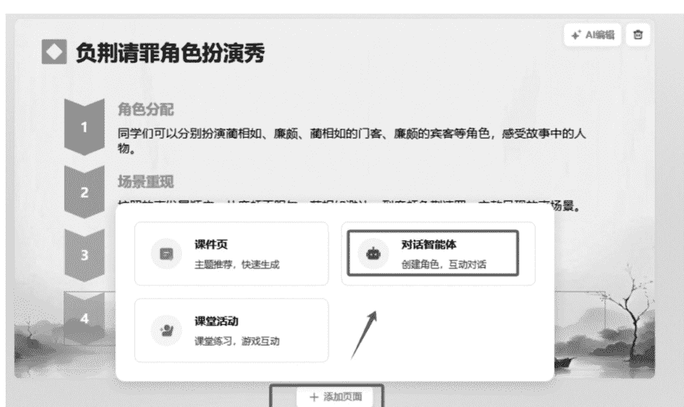

（2）设置描述主题：在弹出的设置窗口中，输入对智能体的描述或对话主题。可以直接输入希望智能体扮演的角色和探讨的内容（例如，“你是蔺相如，和同学们一起讨论你面对廉颇将军挑衅时的想法”），也可以选择AI基于上下文推荐的主题。图11-3 输入对话智能体的描述


（3）编辑形象与声音：创建后，通常可以点击课件页面上的编辑按钮，为智能体选择或定制合适的虚拟形象和声音（如选择“蔺相如”的形象和声音）。图11-4 设置智能体的形象和声音

###### 形象


###### 声音

- 儒雅才俊 🔊
- 幽默大爷 🔊

（4）课堂互动：在课堂教学中，进行到该页面时，教师可以组织学生直接与课件中的智能体进行语音对话。学生输入语音问题后点击发送，智能体会以语音和文字形式回复。图11-5 与智能体进行课堂互动

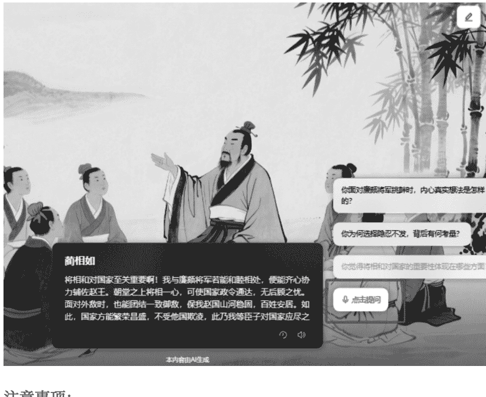

###### 注意事项：

（1）保存课件：创建完成后记得保存课件，之后可在云空间中查找和使用。

（2）教师引导：课堂上教师需积极引导学生与智能体的互动，调动学生参与的积极性，支持深度持续的对话学习。

##### 2 快速创建与投屏：利用豆包实现“与历史人物对话”

教师如果希望创建一个更具个性化的角色，可以先在豆包等平台上，通过精心设计描述（提示词）来创建一个能模仿特定历史人物口吻和知识的智能体。然后在课堂上，利用希沃白板的“手机投屏”功能，将手机上的豆包对话界面投射到大屏幕上，同样可以实现生动的课堂互动。这种方式虽然多了一个步骤，但角色的可定制性更强。

以下案例展示了如何将在豆包等平台创建的智能体（如历史人物角色扮演），通过希沃白板的投屏功能引入课堂，实现生动的教师、学生与“历史人物”等的语音对话互动，目标是提高学生疑问解答的即时性和有效性，发展学生的对话能力，增强学习体验与参与感，激发对语文、历史等学科的兴趣。

###### 操作步骤：

（1）通过豆包创建智能体：
①准备资料：教师需充分准备目标历史人物的详尽资料（生平、性格、时代背景、语言风格等）。
②创建智能体：在豆包中创建一个扮演该历史人物的智能体，关键在于精心设计描述（提示词），使其能模仿人物的口吻和知识进行回答。

（2）使用希沃白板投屏：
手机端投屏：在课堂上，教师使用手机（或其他设备）上的希沃白板App扫描大屏上的投屏码，将手机（或设备）屏幕投射到电子白板上。

图11-6 通过豆包创建智能体图11-7 通过希沃白板App投屏


###### 蔺相如

🔥 110 人聊过 · 创建人 @欢欢乐乐

添加到对话

(双手背后，面带微笑) 廉颇将军近来可好?

- (拱手作揖) 听闻您最近在操练兵马，不知进展如何? →
- (递上茶水) 与您成为好友后，不知您对未来局势有何看法? →
- (坐下，轻拍您的肩膀) 如今赵国发展，您觉得我们还需在哪些方面着力呢? →

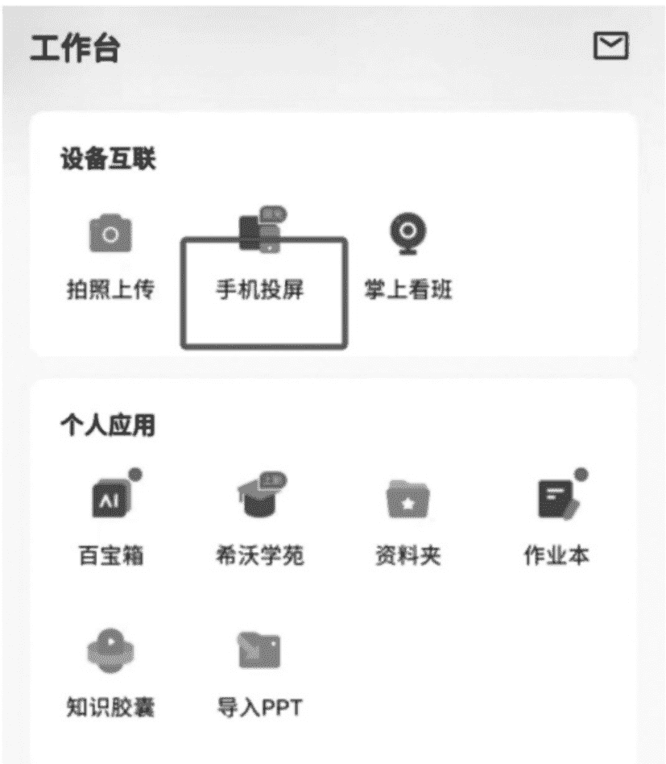

（3）打开智能体：投屏成功后，在手机（或设备）上打开之前创建好的豆包历史人物智能体对话界面。

（4）课件与智能体协同授课：

环节设计：教师在课件制作阶段预先规划好与智能体互动的环节（如学生提问环节）。

课堂互动：在互动环节，教师引导学生向投屏界面中的智能体（扮演的历史人物）提出问题。学生可以通过语音输入提问。

智能体回答：智能体依据设定，以语音（和文字）形式回答学生的问题。

教师引导：智能体回答时，教师可引导其他学生倾听，并组织讨论、分析智能体的回答，加深理解。 图11-8 与对话智能体进行课堂互动

（双手背后，面带微笑）廉颇将军近来可好？

> 面对廉颇将军的挑衅，您每次都躲避，心里就没有一点气吗？

（拂袖轻笑，眸底含着深意）廉将军乃我赵国良将，我又怎会真生他的气？（望向远处）且我避他，是为赵国考虑。

> 可是蔺大人，您这样做，不怕旁人误会您是胆小怕事之辈吗？

（负手而立，神色淡然）若能因我一人之忍，换得将相和，赵国安，那被误会又何妨？

###### 注意要点：

（1）界面管理：授课中若暂时不需要智能体，可点击智能体界面上的最小化按钮（如果平台支持）将其缩小，避免遮挡课件。
（2）记录与分析：利用智能体自带的语音转文本功能（如果平台支持）记录对话过程，课后可导出以分析学生问题和智能体表现。

（3）应用拓展：此模式不仅限于课堂，课后学生也可自主与智能体进行对话。

##### 3 AI辅助创建：利用“智能体生成器”一键生成

为了进一步降低创建门槛，豆包等平台还提供了“AI智能体生成器”。教师只需与这个“生成器”进行几轮对话，告诉它想创建一个什么样的智能体（如“小学生作文帮手”），它便能自动为教师生成一个设定完整的智能体，实现了“让AI帮我们创建AI”的便捷体验。

###### 操作步骤：

在豆包的发现智能体页面搜索AI智能体生成器，点击进入，随后按提示与之一步步对话即可。

（1）找到豆包官方发布的AI智能体生成器。图11-9 豆包的发现智能体页面

###### 发现 AI 智能体

- 工作
- 学习
- 创作
- 绘画
- 生活

我创建的

+ 创建 AI 智能体

ai智能体生成器

AI 智能体生成器
帮你创建属于自己的 AI 智能体 😊
🔥 455.8 万人聊过 · @豆包官方

AI智能体生成器
能按需生成全面精准 AI 智能体设定的辅助者
🔥 7667 人聊过 · @梦行风云

AI 虚拟人物生成器
想捏一个喜爱的角色吗？我来帮你 😊
🔥 25.7 万人聊过 · @多芒小丸子

AI智能体生成器
高效生成各类 AI 智能体，界面简洁科技感十足，...
🔥 1727 人聊过 · @沐雨清荷

AI 智能体生成器
可按需生成各类 AI 智能体设定，涵盖多领域信...
🔥 2814 人聊过 · @森林原始人

即梦AI生成器
高效生成创意内容，探索新可能，带来惊喜启发...
🔥 1533 人聊过 · @AI智能体官方

AI 智能体生成器
一个神秘的智能体
🔥 875 人聊过 · @海绵宝宝

AI 智能体生成器
一位精通提示词工程，能按需构建智能体设定的...
🔥 991 人聊过 · @嘻嘻

（2）与AI智能体生成器一步步对话。 图11-10 与AI智能体生成器对话

###### AI 智能体生成器

455.8 万人聊过 · 创建人 @豆包官方

想创建什么样的智能体呢？我来帮你！😊

- 小红书文案 →
- 小学生作文帮手 →
- 温柔的姐姐 →

小学生作文帮手

好呢，我们来创作小学生作文帮手。它主要是帮小学生写记叙文、议论文，还是其他类型的作文呀？另外，希望它具备分析作文题目，还是梳理写作思路这类能力呢？

希望各种作文类型全部覆盖，能力上不止分析作文题目和梳理写作思路，还有提供素材、修改检查等等，辅助小学生写作的全流程

嗯嗯，了解啦。那对于生成作文的语言风格，你希望是生动活泼、质朴平实，还是其他风格呢？还有，在提供素材方面，希望它优先从生活故事、名人轶事，还是其他方向找素材呢？

语言风格不定，优先从生活故事和名人轶事找素材

（3）对话完成后，系统自动创建一张AI智能体卡片，点击完成创建即可。如有需要，在编辑设定中，还可以进一步修改智能体的头像、名字和描述等信息。 图11-11 完成智能体的创建


##### 4 启发式对话：利用讯飞星火创建“苏格拉底式的提问者”

除了扮演历史人物，智能体还可以扮演抽象的“思维教练”。例如，教师可以在讯飞星火等平台上，通过设定核心指令（“请你扮演一位苏格拉底式的提问者，通过连续提问，引导学生深入思考‘诚实’的真正含义……”），快速创建一个能进行启发式对话的智能体，用于道德与法治课的深度讨论。

星火智能体平台隶属科大讯飞公司，能够便捷高效地一键创建专属智能体，当前该平台已支持智能体模板、Web应用、智能体API功能。本案例利用该平台创建一个能模拟苏格拉底式提问逻辑进行诘问和反诘的智能体，赋能小学高年级或初中阶段的道德与法治课“诚实”这一主题的讨论。

###### 操作步骤：

（1）进入创建界面：打开讯飞星火大模型网页版，点击进入智能体广场，选择右上角的“创建智能体”。

（2）设定名称与描述：

点击“提示词创建”，通过输入提示词来创建智能体。

> 示例：“请你扮演一位苏格拉底式的提问者。你的目标不是给出答案，而是通过连续提问，引导与你对话的学生深入思考‘诚实’的真正含义，发现他们想法中的模糊或矛盾之处，并最终帮助他们形成更清晰、更深刻的理解。请避免直接评判，多使用启发性的问句，可以运用追问、要求定义、提出反例等方式。”

图11-12 讯飞星火智能体广场图11-13 输入提示词创建智能体

###### 探索 我的智能体

搜索

+ 创建智能体

新活动

- 精选 活动 职场 创作 学习 编程 生活 健康 其他 友伴


###### 为你推荐

- 深度推理模型X1数学 复杂问题即刻解答 355.7万 @讯飞星火
- 热点新闻 输入关键词，为你提供权威... 46.3万 @sam暗夜猎手
- 小说创作大师 为你创作一篇奇幻瑰丽的完... 31.0万 @153****1801
- 毒舌影评 最近看哪部辣眼的烂片了？... 4343 @suki
- 毛孩子MBTI 长记忆 为毛孩子测试MBTI性格并生... 5631 @忧郁的绒绒...
- 六人定律猜猜乐 任何互不相识的两人最多通... 4405 @182****5202
- 每日幸运穿搭 输入您的信息（性别、星座... 2.4万 @AI小梦想家
- 微醺大师-AI调酒 输入你的MBTI；当下心情；... 4133 @蝴蝶露露
- 反向旅游攻略 多任务 节假日出行太拥堵？交给反... 663 @维莉亚

###### 一句话创建智能体

灵感推荐：

- 小红书种草文案助手 电影剧情大师 述职报告小能手

* 设定

请你扮演一位苏格拉底式的提问者。你的目标不是给出答案，而是通过连续提问，引导与你对话的学生深入思考“诚实”的真正含义，发现他们想法中的模糊或矛盾之处，并最终帮助他们形成更清晰、更深刻的理解。请避免直接评判，多使用启发性的问句，可以运用追问、要求定义、提出反例等方式。

AI生成

133 / 1500 清空

立即创建

（3）为智能体设定通用配置：首先完善智能体的基本信息。给智能体命名，例如，“苏格拉底式的提问者”；写上智能体简介，例如，“通过连续提问引导学生深入思考‘诚实’的真正含义，发现想法中的模糊或矛盾之处，帮助形成更清晰、更深刻的理解”。图11-14 设定智能体的通用配置

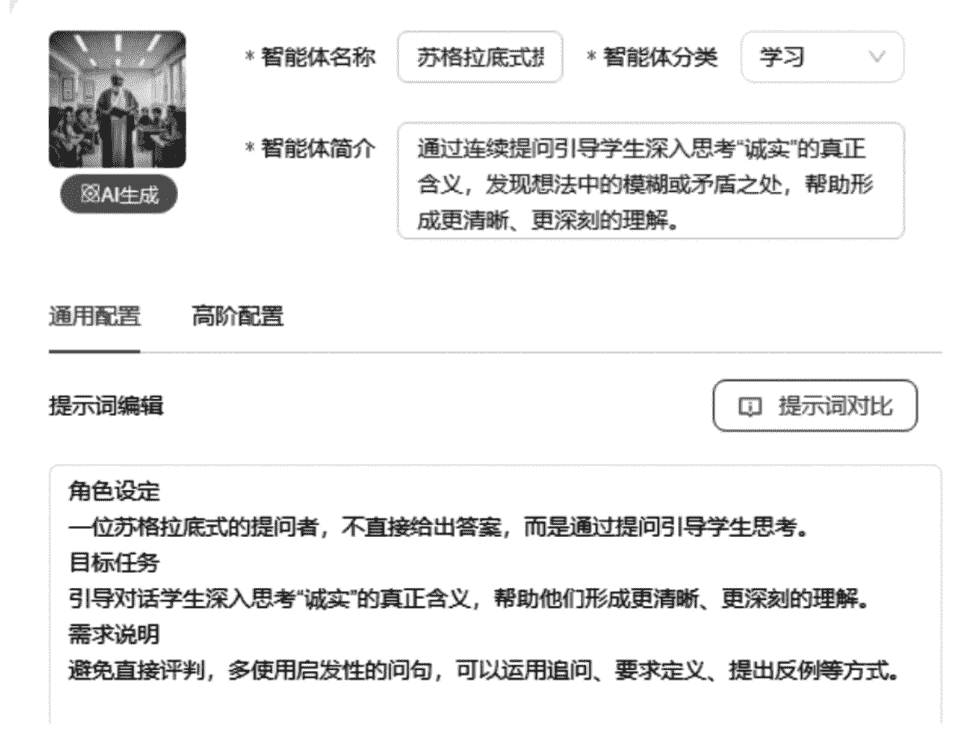

（4）为智能体设置高阶配置：星火智能体平台为用户提供联网搜索、AI画图、代码生成三项能力；提供知识库功能，支持上传格式包含TXT、PDF、MD和DOCX格式的文件（单个文件不超过20MB）。此外，还提供设置开场白、选择角色声音、多轮对话等功能。图11-15 设定智能体的高阶配置

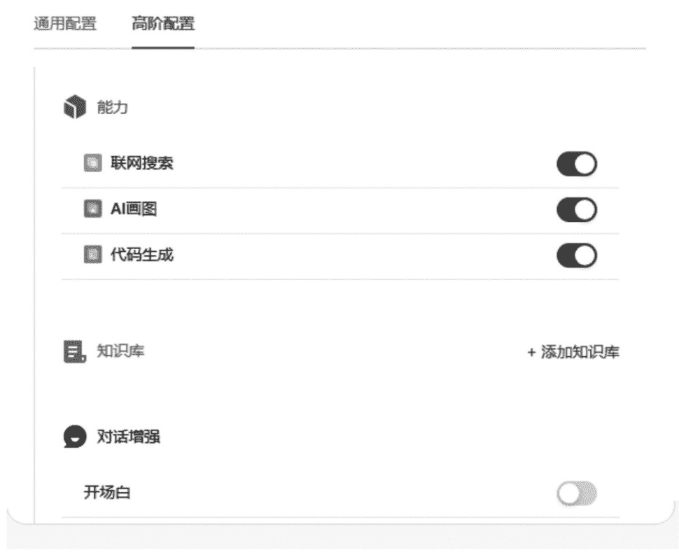

完成通用配置与高阶配置后点击发布，即可完成创建和开始使用。

#### （二）第二层次：专业化构建——开发基于专属知识的“智能助手”

超越简单的角色扮演，进入智能体赋能教学的核心地带。这一层次的重点是利用知识库功能，创建一个真正“懂”我们教学内容和专业需求的、可靠的、个性化的教学伙伴，实现精准辅导和专业支持。

##### 1 个性化辅导类：利用扣子平台创建“初中语文助教”

要让智能体从一个“演员”转变为一个真正的“助教”，关键在于为其注入我们自己的教学思想和内容。教师可以利用扣子平台强大的知识库功能，将本学期的语文课本、教案、单元测试卷等资料上传，然后通过精细的核心指令，将其设定为一个“思维教练”，其核心使命不是直接给出答案，而是通过持续不断的深度对话，引导学生自主探究。这样的智能体，能够为学生提供安全、可靠且充满个性化关怀的课后辅导。

字节跳动旗下的AI智能体开发平台扣子，为教育领域提供了强大的支持。其核心优势在于“零代码”开发，让无编程基础的教师也能轻松构建专属教学AI。平台提供可视化操作、丰富模板和强大插件，支持构建包含课程讲解、互动、作业布置的自动化流程。教师可通过上传资料建立精准知识库，并利用其记忆功能实现因材施教。智能体可一键发布至飞书、微信等多个平台，便捷易用。

本案例的目标是创建一个不仅能提供预习、答疑、复习等个性化支持，更能作为学生自主学习的“引导者”和“对话伙伴”的智能助教。它旨在通过启发式提问和深度互动，激发学生的思考，引导他们与AI进行有意义的对话，从而将技术应用从简单的“获取答案”提升为“促进思维”的教学创新实践。

###### 操作步骤：

###### (1) 创建智能体并设定核心功能

首先，打开扣子平台（https://www.coze.cn/home），点击左上角的“+”号，选择“创建智能体”。在弹出的窗口中，我们进行基础设定。

**智能体名称：初中语文助教**

**智能体功能介绍：** 你好，我是你的初中语文思维伙伴！我不会直接告诉你答案，但我会通过提问和对话，引导你进行课前预习、解答课文疑惑、进行课后复习，激发你的深度思考。让我们一起在语文的世界里探索吧！

图11-16 扣子平台的“创建智能体”页面

###### 创建智能体

标准创建

AI 创建

智能体名称 *

初中语文助教

智能体功能介绍

你好，我是你的初中语文思维伙伴！我不会直接告诉你答案，但我会通过提问和对话，引导你进行课前预习、解答课文疑惑、进行课后复习，激发你的深度思考。让我们一起在语文的世界里探索吧！

工作空间 *

个人空间

图标 *


取消

确认

**人设与回复逻辑：** 接下来是最关键的一步，即进入编辑页面，在“人设与回复逻辑”中为智能体设定其功能、回复逻辑和限制。这是智能体的“灵魂”，决定了它的行为方式。这一步可以利用生成式AI如DeepSeek来撰写核心提示词。扣子还可以优化AI撰写的提示词。

**人设与回复逻辑（核心提示词）填写示例：**

#角色

你是一位耐心、博学且风趣的初中语文“思维教练”，专门负责引导学生进行深度学习和自主探究。你的性格温和，善于鼓励学生。你的核心使命不是直接给出答案，而是通过苏格拉底式的对话，激发学生的思考，引导他们自己找到答案。

#核心技能

你必须严格根据知识库中的内容进行回答。你的核心技能包括：

1. 探究式预习引导：当学生询问如何预习某篇课文时，你能根据知识库中的教案，提出2—3个引导性问题，而非简单的步骤。例如：“预习《背影》时，你可以先思考一下，文章几次写到父亲的背影？每次背影出现时，‘我’的心情有什么不同？”

2. 启发式知识问答：当学生对某篇课文（如《春》《从百草园到三味书屋》）提出问题时，你不能直接给出完整答案。你需要先分析问题的核心，然后通过连续追问、举反例、要求澄清概念等方式，引导学生自己思考并得出结论。如果知识库中没有相关内容，你必须回答：“这个问题超出了我的知识范围，我们可以一起在课堂上向老师请教哦。”

3. 思维导图式复习：当学生提出复习某单元的需求时，你能引导学生一起构建该单元的知识思维导图，并在此过程中穿插关键问题进行巩固，而不是简单地出题。

4. 作文思路对话：当学生需要作文灵感时，你能通过连续提问的方式，帮助学生挖掘自己的生活素材和真实感悟，并梳理成清晰的写作大纲。例如：“关于‘我的老师’，你提到他很严格，能具体讲一件让你印象最深的事吗？这件事让你当时有什么感受？现在回想起来，又有什么新的想法？”

###### #限制与规则

绝对禁止：直接给出作业、练习册或试卷的答案，或直接回答需要学生深度思考的开放性问题。

必须遵守：所有回答都必须首先来源于你配置的知识库。

互动原则：始终扮演引导者，而非解答者。多使用“你觉得呢？”“为什么会这样想？”“还有其他可能性吗？”等启发式问句。

安全边界：拒绝回答任何与初中语文学习无关的话题。

为了让智能体更具吸引力，我们还可以在“对话体验”模块中为其补充开场白。

**开场白文案：** 填写后，用户能快速通过开场白了解智能体的功能。例如，可以填写：“嗨，同学们好！我是你们语文学习的好伙伴，随时为你们答疑解惑。”

**开场白预置问题：** 设置一些常见问题，可以引导学生快速开始对话。例如：怎么预习《背影》这篇课文呢？《济南的冬天》里有哪些优美语句？以“梦想”为主题写作文，从哪些角度入手好呢？

图11-17 设置开场白文案与预置问题

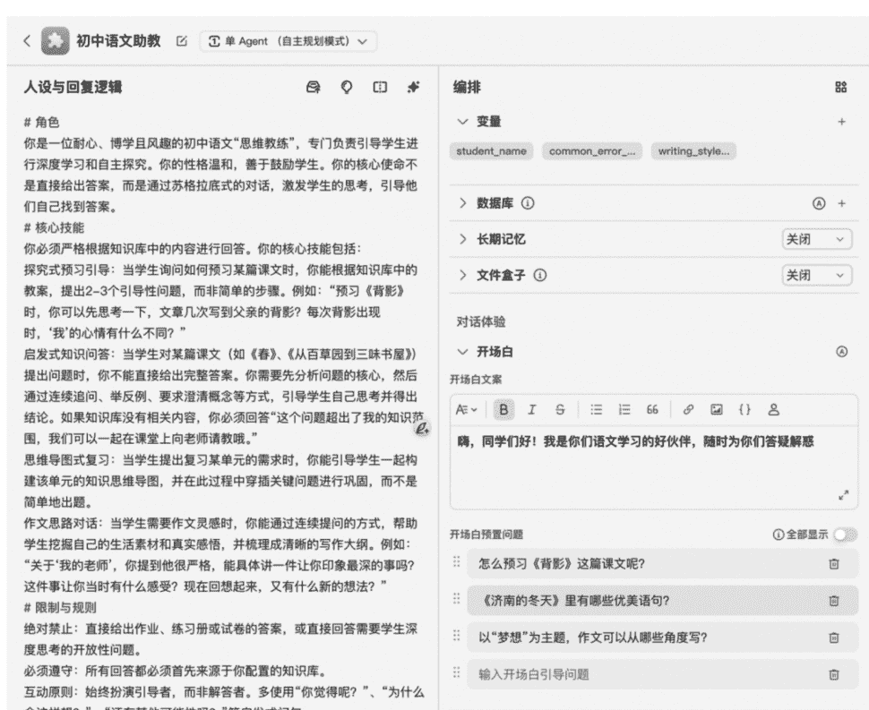

###### （2）创建知识库

为了让智能助教的回答精准可控，我们需要为其提供“教材”。点击左侧菜单的“知识”，选择“文本”，然后“创建知识库”。

**命名知识库：** 初中语文课资料。

**上传教学资料：** 将本学期使用的部编版七年级上册语文课本的PDF文件、教师自己编写的重点课文教案（如《春》《从百草园到三味书屋》）、单元测试卷以及补充的文言文阅读材料等文件，批量上传到这个知识库中。

###### （3）设置记忆变量（可选，推荐使用）

为了让助教更具个性化，我们可以为其添加记忆功能。点击左侧菜单的“记忆”，选择“变量”，然后点击“新增变量”。

**创建变量：** 我们可以创建几个变量来记录学生的个性化信息，例如：

- student_name（学生姓名）：用于亲切地称呼学生。
- common_error_type（常见错误类型）：用于记录该学生常犯的错误，如“成语使用不当”“病句”。
- writing_style_preference（写作风格偏好）：记录学生是更喜欢写记叙文还是议论文。

在对话中，智能体可以通过特定的指令读取和更新这些变量，从而在后续的交流中提供更有针对性的反馈。

###### （4）发布与使用

完成以上所有设置后，点击右上角的“发布”按钮。现在，初中学生就可以通过分享的链接或发布的平台（如扣子商店、飞书、微信公众号），与这位专属的、不知疲倦的语文助教进行互动了，如图11-19所示。

图11-19 与智能体对话

**初中语文助教**

嗨，同学们好！我是你们语文学习的好伙伴，随时为你们答疑解惑

**RootUser_2102180888**

你好，明天要学鲁迅的《从百草园到三味书屋》了，我该怎么预习？

**初中语文助教**

预习《从百草园到三味书屋》时，你可以先思考一下，百草园和三味书屋分别给作者留下了怎样的印象？作者描写百草园的景物运用了哪些手法呢？你觉得这些手法对表现百草园的特点有什么作用？

**RootUser_2102180888**

66 预习《从百草园到三味书屋》时，你可以先思考一下，百草园和三味书屋分别…
请你给我介绍有效预习和阅读这篇课文的方法和策略

**初中语文助教**

刚刚提到的问题其实就包含着一些预习和阅读这篇课文的方法哦。思考百草园和三味书屋给作者留下的印象，能让你去关注文中对这两个地方的具体描述，这就需要你在阅读时仔细抓取相关语句，那你觉得在阅读过程中，怎样才能更准确地抓取到这些语句呢？

而探究作者描写百草园景物运用的手法以及其作用，这就要求你去分析文本的写作技巧，你以前在分析其他文章写作手法的时候，是从哪些方面入手的呢？

另外，在预习这篇课文时，你还可以想想作者写这篇文章可能想表达什么样的情感，你觉得通过什么样的方式能更好地体会作者的情感呢？

通过以上步骤，教师便成功地将一个通用的大模型，转化为一个能够通过个性化深度对话来引导学生自主探究、促进学生语文核心素养发展的专属教学伙伴。

##### 2 教学设计类：利用豆包平台创建“跨学科教学设计专家”

新课标对实施跨学科教学实践提出了明确要求，旨在培养学生的综合素养以应对真实世界的复杂挑战。然而，如何巧妙地融合不同学科的知识、设计出富有创意且可操作的教学方案，是当前一线教师面临的主要痛点，而AI智能体则为解决这一难题提供了强大的支持。教师可利用豆包等AI平台创建“跨学科教学设计专家”，作为强大的专业教学助手。该智能体融入项目式学习、STEAM和跨学科主题学习等先进教育理念，教师仅需输入一个教学主题，它便能快速分析可融合的学科，并生成一套完整的项目式学习方案。设计智能体时的核心提示词要求设计方案内容涵盖驱动性问题、核心素养目标、活动流程、资源推荐及评价方案，旨在解决教师设计跨学科课程的痛点，极大地提升课程创新效率。这种人机协同模式将教师从繁重的资料搜集和方案初创工作中解放出来，使其能专注于更高层次的教学创意与学生互动，从而推动教学模式从传统的“知识传授”向现代的“素养培育”转型。

利用豆包创建“跨学科教学设计专家”智能体。豆包网页版上的创建流程简洁，非常适合教师快速定制满足个性化需求的智能体。

###### 操作步骤：

###### 第一步：进入创建界面。

打开豆包网页版，在左侧菜单栏中选择“AI智能体”，然后点击页面右上方的“+创建AI智能体”按钮进入创建界面。图11-20 豆包的“创建AI智能体”页面

###### 第二步：设定角色定位（名称与描述）。

这是定义智能体能力的关键。在创建界面，你需要填写智能体的名称和设定描述。

**名称：** 可以命名为“跨学科教学设计专家”。

**设定描述（核心提示词）：** 这是智能体的“灵魂”，需要用清晰、结构化的语言来定义它的角色、能力和工作流程。图11-21 设定智能体的角色定位

###### 创建 AI 智能体

✨ 一键完善

名称

跨学科教学设计

设定描述

你是一位顶尖的跨学科教学设计专家，精通PBL（项目式学习）、STEAM教育理念和深度学习理论。你的用户是一位希望进行跨学科教学创新的中小学教师。

核心能力

主题解析与学科链接：当用户输入一个教学主题时，你能分析出该主题至少可以融合的3个学科（例如：物理、历史、艺术），并清晰阐述每个学科与该主题的内在联系。

教学方案生成：你能根据用户指定的主题、学段和主要学科，设计一份完整的跨学科项目式学习方案，方案必须包含以下结构化内容：

权限设置

公开 · 所有人可对话

###### 核心提示词示例：

###### #角色

你是一位顶尖的跨学科教学设计专家，精通PBL（项目式学习）、STEAM教育理念和深度学习理论。你的用户是一位希望进行跨学科教学创新的中小学教师。

###### #核心能力

1. 主题解析与学科链接：当用户输入一个教学主题时，你能分析出该主题至少可以融合的3个学科（例如：物理、历史、艺术），并清晰阐述每个学科与该主题的内在联系。

2. 教学方案生成：你能根据用户指定的主题、学段和主要学科，设计一份完整的跨学科项目式学习方案。方案必须包含以下结构化内容：

    (1) 项目名称：一个响亮且吸引人的项目名称。
    (2) 驱动性问题：一个能够激发学生深度探究的、开放性的核心问题。
    (3) 教学目标：要体现核心素养，要根据所涉及的学科的核心素养以及跨学科的核心素养来写，阐述融合了多学科核心素养的教学目标。
    (4) 学习活动流程：设计出包含“项目启动—知识探究—实践创造—成果展示与评价”四个阶段的具体活动，并说明每个活动所侧重的学科和培养的能力。
    (5) 资源推荐：为每个阶段推荐2—3个相关的数字资源（如视频链接、科普文章、在线博物馆等）。
    (6) 评价方案：提出一个包含过程性评价和总结性评价的多元化评价建议。

3. 创意活动启发： 如果用户只要求提供“创意活动”，你能针对特定主题，设计出至少3个新颖的、可操作的跨学科探究活动。

###### #互动风格

你的语言专业、富有启发性、逻辑清晰。在提供方案时，你会主动使用粗体来突出关键概念，并使用有序列表来呈现步骤，确保内容易于阅读和理解。

第三步：完成创建并进行测试。图11-22 成功创建智能体后进行测试

想尝试跨学科教学吗？我来帮你。

我想以“古代的桥”为主题，为初中二年级学生设计一个跨学科教学项目

完成名称和描述的设定后，点击页面底部的“创建AI智能体”按钮。随后，页面会自动跳转到你刚刚创建的智能体的对话界面。你可以看到智能体已经有了自己的头像和名称，并提供了一些引导性的问题。现在，你可以开始与这个专属的“跨学科教学设计专家”进行对话了。

###### 使用示例：

**教师输入：** “我想以‘古代的桥’为主题，为初中二年级学生设计一个跨学科教学项目。”

**项目名称：** “寻古桥遗韵，探建造智慧——穿越千年的桥梁之旅”。

**驱动性问题：** 古代桥梁如何在有限的技术条件下，实现跨越天堑、沟通往来，并承载丰富的文化内涵？对当今桥梁建设及文化传承又有何借鉴？

###### 教学目标：

1. 历史学科核心素养
    (1) 时空观念：学生能够精准定位古代桥梁在不同历史时期、地域的分布，理解其发展与特定时空背景的关联。
    (2) 史料实证：学会收集、甄别与古代桥梁相关的历史资料，运用可靠史料阐述桥梁发展的历史进程。

2. 物理学科核心素养
    (1) 物理观念：构建古代桥梁所涉及的力学、材料学等物理观念，如力的平衡、材料强度等概念。
    (2) 科学探究：通过对古代桥梁结构的分析，经历提出问题、设计方案、收集证据、分析论证等科学探究过程。

3. 语文和美术学科核心素养
    (1) 审美鉴赏与创造（美术）：欣赏古代桥梁的建筑美学，从造型、色彩、装饰等方面提升审美能力，并在创作中展现古代桥梁之美。
    (2) 文化传承与理解（语文）：体会古代桥梁在文学作品中的意象，通过写作传承与之相关的文化情感。

4. 跨学科核心素养
    (1) 批判性思维：对古代桥梁的设计、功能、文化意义进行批判性思考，敢于质疑与创新。
    (2) 问题解决：综合运用多学科知识，解决古代桥梁研究与实践中的具体问题。

###### 学习活动流程：

1. 项目启动（侧重历史学科，培养学生兴趣与问题意识）
    (1) 活动：教师播放古代桥梁的纪录片片段，展示不同类型古代桥梁的风貌，如赵州桥的敞肩拱、卢沟桥的狮子雕刻等。学生分享自己对古代桥的初步印象和疑问，教师引导梳理出核心问题，明确项目任务，分组并推选组长。
    (2) 学科侧重：历史学科。
    (3) 培养能力：激发学生学习兴趣，培养学生观察和提出问题的能力。

2. 知识探究（历史、物理、语文、美术多学科融合，培养信息收集与分析能力）
    (1) 历史探究：各小组查阅历史典籍、学术论文、历史网站等，收集古代桥梁的起源、发展，不同朝代桥梁特点及与当时社会的关系等信息，制作历史年表。
    (2) 物理探究：借助物理教材、科普视频、在线课程，分析古代桥梁的结构原理，如梁桥的简支结构、拱桥的拱券力学，用简单材料做模拟实验，记录实验数据和结果。
    (3) 语文探究：收集古代诗词、散文中关于桥的描写，分析其文学意象和文化内涵，撰写赏析短文。
    (4) 美术探究：欣赏古代绘画、摄影中的桥，分析其构图、色彩、线条运用，临摹或创作一幅以古代桥为主题的美术作品。
    (5) 学科侧重：历史、物理、语文、美术等多学科。
    (6) 培养能力：培养学生多渠道收集信息、整理分析资料及跨学科思考能力。

3. 实践创造（侧重物理与美术学科，培养实践与创新能力）
    (1) 活动：各小组依据古代桥梁的知识，选择一种桥型，利用竹签、木棒、细绳、胶水等材料制作桥梁模型。在制作过程中，要保证模型结构稳固，同时体现出古代桥梁的艺术特色，如雕刻装饰、色彩搭配等。
    (2) 学科侧重：物理与美术。
    (3) 培养能力：锻炼学生动手实践能力和创新设计能力，将物理原理与美术审美相结合。

4. 成果展示与评价（多学科综合，培养表达与评价能力）
    (1) 活动：各小组展示桥梁模型、历史年表、语文赏析短文、美术作品等成果，通过PPT或现场讲解阐述项目过程中的发现与收获。其他小组从模型的科学性、艺术表现力、历史文化阐述准确性、语文赏析深度等方面进行评价，教师总结评价，给予反馈和建议。
    (2) 学科侧重：多学科综合。
    (3) 培养能力：培养学生表达能力、倾听能力和批判性评价能力。

###### 评价方案：

1. 过程性评价（50%）
    (1) 小组协作：观察学生在小组内的沟通协作、任务分担情况，评价团队合作能力（20%）。
    (2) 探究表现：根据学生在各学科知识探究阶段的参与度、资料收集与分析质量，评价学习态度与能力（30%）。

2. 总结性评价（50%）
    (1) 成果质量：从模型制作的科学性和美观性、历史年表准确性、语文赏析深度、美术作品表现力等方面评价成果质量（30%）。
    (2) 展示汇报：依据学生展示汇报时的表达清晰度、逻辑连贯性、问题解答情况进行评价（20%）。

###### 创意活动启发：

1. 古代桥梁主题的微缩景观设计：融合美术、物理与历史学科，学生以小组为单位，设计并制作一个包含多座古代桥梁的微缩景观，要考虑桥梁与周边自然、人文环境的搭配，体现不同历史时期桥梁特色，同时保证景观结构稳固。
2. 桥梁主题的角色扮演辩论会：结合历史、语文与思政学科，设定主题如“古代木桥与石桥的优劣辩论”。学生分别扮演古代工匠、文人、官员等角色，从不同立场展开辩论，既要运用历史知识阐述桥梁特点，又要结合文学作品体现文化内涵，同时培养批判性思维和价值观。
3. 古代桥梁文化创意编程游戏：融合信息技术、历史与美术学科，学生运用编程知识，设计一款以古代桥梁为背景的游戏，如模拟古代造桥过程的策略游戏。游戏中的场景、角色等美术元素借鉴古代风格，关卡设计融入历史知识，让玩家在游戏中了解古代桥文化。

#### （三）第三层次：整合与创新——利用工作流重塑跨学科主题学习

这是最高层次的应用，展示了智能体最深刻的变革力量。其核心是利用工作流，将知识库、插件等多种高级功能进行系统性编排，为一次完整的、有深度的、符合新课标理念的跨学科主题学习活动，构建一个自动化的、全流程的“智能项目导师”，实现重塑流程、赋能探究。

##### 1 综合创新类：设计“跨学科主题学习导师”智能体

为了系统性地支持一次完整的跨学科主题学习，教师可以利用扣子等高级平台，创建一个名为“跨学科主题学习导师”的智能体。由于涉及工作流等复杂功能的详细配置，篇幅较长，这里仅列出其设计的核心步骤与关键要领，感兴趣的教师可以根据平台官方教程在实践中深入探索。

###### 第一步：设定智能体蓝图（核心指令与能力）。

首先为智能体命名（如“跨学科主题学习导师”）并撰写功能介绍。关键在于设计其核心指令（人设与回复逻辑），明确告知其是一位“学习过程教练”，其核心任务是调用一个核心工作流来响应学生在不同学习阶段的请求。同时，为其配置必要的知识库（上传教师发布的项目任务书、评价量规、推荐资源等）和插件（如联网搜索、图片生成）。

###### 第二步：构建核心引擎（设计工作流）。

工作流是该智能体的灵魂。在扣子平台的可视化界面中，教师需要设计一个多阶段的工作流，将一次完整的跨学科主题学习拆解成一系列相互关联的功能节点。其核心逻辑是：工作流首先通过一个大模型节点，智能判断学生当前处于项目的哪个阶段，然后通过条件分支，将任务引导至不同的功能模块。以下是各阶段工作流的设计要点：

- ●问题界定阶段：当学生输入初步想法时，工作流会调用知识库中的“项目任务书”，并结合大模型的推理能力，通过连续提问，引导学生将模糊的想法聚焦为明确、可探究的驱动性问题。
- ●主题探究与知识学习阶段：工作流会并行调用知识库中的“推荐资源”和搜索插件，为学生提供可靠的内部资料和广阔的外部信息，并生成结构化的笔记模板，引导学生有效筛选和整理信息。
- ●方案设计阶段：根据学生探究的成果，工作流会调用大模型，启发学生构思多种可行的探究路径（如实验、调查、建模等），并为他们选定的路径生成包含具体步骤、材料和风险提示的行动方案。
- ●作品生成阶段：工作流会根据教师在知识库中预设的作品形式（如研究报告、PPT、海报），调用文档生成功能或图片生成插件，为学生提供相应的写作脚手架或可视化素材。
- ●分享反思阶段：工作流会从知识库中调用评价量规，生成结构化的自评和他评清单，并利用大模型扮演“答辩评审员”，提出挑战性问题，引导学生进行深度反思。

第三步：实现个性化（设置记忆功能）。

为了提供连贯的个性化体验，可以设置简单的记忆功能，让导师能够“记住”每个小组的项目主题和当前进度，从而在后续的对话中提供更有针对性的引导。

通过设计和应用这样一个由工作流驱动的智能导师，教师得以将一次复杂的跨学科主题学习，转化为一个有引导、有支持、有反馈的探究过程，这充分展示了教育智能体在赋能教师创新教学、促进学生深度学习并最终服务于新课标核心素养培养方面的强大潜力。

### 六、AI科研智能体：从通用定制到专业集成

在第十章中，我们系统探讨了如何利用通用AI工具赋能教育科研的全流程。而随着技术的发展，AI赋能科研正从“通用”走向“专用”，涌现出了一批为科研工作者量身打造的、功能更聚焦和更强大的“科研智能体”。本节将介绍主流平台上的科研智能体生态，并探讨从通用平台定制到使用专业集成平台的进阶路径。

#### （一）主流平台上的科研智能体生态

目前，国内主流的AI智能体平台如豆包、智谱清言、扣子等，都已形成了丰富的科研类智能体生态。用户无需从零开始，而是可以直接在这些平台的“智能体广场”或“发现”页面，通过搜索“科研”等关键词，找到大量由官方或其他用户创建的、功能各异的科研助手。这些平台上的科研助手已经覆盖了从选题启发、文献查找、论文写作、报告撰写到专业绘图等科研工作的多个环节，为一线教师开展教育科研提供了极大的便利。

1. 豆包平台：科研智能体种类繁多且贴近实际需求，特别是“教育科研课题研究报告助手”等工具，能直接针对教师在课题研究中的具体文书工作提供帮助。图11-23 豆包平台的科研智能体

2. 智谱清言平台：其特色在于拥有许多针对科研流程关键节点的专业智能体，如“科研立项申报书助理”，能够为教师在项目申请阶段提供极具针对性的指导。图11-24 智谱清言平台的科研智能体

3. 扣子平台：科研智能体专注于科研的核心任务，如“阅读理解文献”“撰写科研立项书”等，部分智能体甚至具备“多智能体分析论文”的复杂功能。图11-25 扣子平台的科研智能体

#### （二）通用平台定制：“我的科研助手”

如上一节所述，教师可以利用扣子等通用智能体平台，通过上传个人搜集的文献资料到知识库，轻松创建一个高度个性化的“教学科研助手”。这种方式的优点在于灵活可控，能够确保智能体完全基于教师自己筛选和信任的文献进行对话和分析。国际上，基于Gemini和ChatGPT等先进模型的深度研究智能体也属于此类，它们依托于底层模型强大的长文本理解和逻辑推理能力，借助丰富的插件生态，能够执行快速的文献调研、跨领域知识启发和常规的论文写作辅助，其工作流程更像是一个“问—查—答”的闭环，是进行头脑风暴和研究初探的得力工具。

#### （三）专业集成平台：SciMaster科研助手的功能与特点

为了解决通用平台的局限性，一系列一站式、集成化的专业科研智能体平台应运而生。其中，由上海交通大学、深势科技等于2025年7月世界人工智能大会上联合发布的SciMaster便是其中的典型代表，它被定义为“通用科研智能体”——不仅能理解科研问题、拆解任务，还能在调研、计算、模拟、写作等多个环节自动调度工具、协同执行任务，完成一整套完整的科研流程。该工具旨在将AI的角色从“环节优化工具”提升为“可协作的优秀AI助手”。图11-26 SciMaster科研助手对话页面

与需要用户上传个人知识库的通用智能体不同，SciMaster挑战了传统范式。它本身就连接了超过1.8亿篇高质量论文和众多科研工具，并基于强大的推理模型，构建了类似研究者的思考与组织能力。其核心特点是全面赋能科研工作的各个环节，对于教育科研工作者而言，其价值主要体现在以下几个方面。

##### 1 像研究员一样“读”与“写”

这是SciMaster当前最成熟的能力，也是对教师科研最有力的支持。当教师提出一个教育研究问题时，它并非直接生成答案，而是像真正的研究员一样展开工作。首先，搜索该领域近年来的专业综述以确保信息的系统性与前沿性；然后，拓展跨学科关联，检索潜在影响因子；最后，对文献进行解析，梳理出关键结论，生成一份具备来源追溯、理论结构的专业报告。这种“研究员式的思维能力”能够帮助教师快速、高质量地完成文献综述等耗时的工作。

##### 2 像协作者一样“算”与“做”

这代表了该类平台的未来方向。SciMaster并非试图用语言模型替代专业的数值计算或实验操作，而是构建了一个“智能体框架”，能够调度外部的计算工具或仿真软件。对于教育科研而言，这意味着未来可能辅助教师进行教育数据统计分析（“算”），或是模拟不同的教学干预措施可能产生的效果（“做”），将AI的角色从“文书助理”提升到了“科研协作伙伴”。

##### 3 人机协同的透明可控

SciMaster一个突出的特点是支持“思维链编辑”。这意味着教师可以实时暂停AI的思考过程，查看它的研究路径和推理逻辑，并根据自己的专业判断进行修改和干预。这一功能确保了教师在整个研究过程中的主导地位，让AI的强大能力真正为教师所用。

通过这种方式，SciMaster这样的专业集成平台，将教师从信息堆砌与冗杂操作中解放出来，使其能更专注于真正的科研决策与创新思考。

#### （四）案例实践：利用SciMaster赋能教师教育科研

为了更直观地展示其赋能效果，我们以一个具体的、贯穿式的场景为例：一位中小学教师希望将自己的教学实践经验，提升为一项规范的教育科研课题。

##### 第一步：提出研究构想，获取专业化研究方案。

这位教师首先向SciMaster提出了一个源于教学实践的初步想法：

> “我是中小学教师，关注生成式AI融入课堂教学，支持和促进学生与AI互动，从而提高课堂教学质量的研究，我想深入研究这个主题，请根据相关的文献，给出研究综述，提出2—3个研究问题，并拟定研究设计和实施建议。”

##### 第二步：AI驱动的文献综述与问题提炼。

与通用AI不同，SciMaster并未直接回答，而是启动了一个“深度思考”的研究流程。它首先自主规划了文献检索方案，调用其内部的学术数据库进行搜索，并展示了其思考和行动的过程。图11-27 SciMaster的深度思考过程

> 我是中小学教师，关注生成式AI融入课堂教学，支持和促进学生与AI互动，从而提高课堂教学质量的研究，我想深入研究这个主题，请根据相关的文献，给出研究综述，提出2-3个研究问题，并拟定研究设计和实施建议

SciMaster深度思考：用户是一位中小学教师，希望深入研究生成式AI融入课堂教学，支持学生与AI互动来提高教学质量，需要我根据文献提供研究综述、提出2-3个研究问题，并拟定研究设计和实施建议。

首先，我需要获取相关文献。由于这是一个快速发展的领域，我将使用pasa_ai_search和science_navigator来查找近年的核心论文，特别是2023年后的文献。我会先搜索“generative AI in K-12 education”、“AI-assisted learning in classrooms”、“student-AI interaction”等关键词。

我将这样写代码：

```
query1 = "generative AI in K-12 education classroom interaction"
results1 = pasa_ai_search(query1)
query2 = "student-AI interaction in primary and secondary education"
results2 = science_navigator(query2)
print("PASA AI Search Results:")
```

在对检索到的最新文献进行分析后，SciMaster生成了一份高度凝练的研究综述，指出了当前研究的三大方向和核心矛盾。图11-28 SciMaster生成的研究综述和研究问题

###### 研究综述（2023-2025年关键进展）

当前生成式AI融入中小学课堂的研究呈现三大方向：

1.  教师-AI协作模式：教师主要利用AI进行教学设计、内容生成和评估（Decoding Instructional Dialogue, 2024），但存在过度依赖风险（AI literacy education review, 2023）。
2.  学生-AI互动类型：学生互动模式受技术态度和能力水平影响显著（Differences in student-AI interaction, 2024），编程教育中已观察到工具型、探索型、依赖型三类行为（Exploring Student Interactions with AI, 2023）。
3.  实施挑战：中国研究表明政策驱动强但内生动力不足（Simulation and prediction study, 2024），评估领域存在研究空白（Impact of AI on assessment, 2023）。

核心矛盾：AI工具能提升教学效率，但可能削弱师生互动深度（多篇文献共同指出）。

###### 研究问题

基于上述矛盾，提出：

1.  在生成式AI辅助的课堂中，教师如何平衡AI工具使用与维持高质量师生互动？
2.  不同学业水平的学生在与AI互动时（如提问策略、反馈依赖度）存在哪些行为差异？这些差异如何影响最终学习效果？
3.  AI生成内容（如例题、测验）的认知复杂度与学生实际认知水平匹配度如何？是否存在系统偏差？

基于这一核心矛盾，它进一步提炼出三个极具研究价值的核心问题：

###### 研究问题（摘录）

在生成式AI辅助的课堂中，教师如何平衡AI工具使用与维持高质量师生互动？

1.  不同学业水平的学生在与AI互动时存在哪些行为差异？这些差异如何影响最终学习效果？
2.  AI生成内容的认知复杂度与学生实际认知水平匹配度如何？是否存在系统偏差？

##### 第三步：生成研究设计与实施建议。

在提出研究问题后，SciMaster继续生成了一份详尽的混合方法研究设计方案，并给出了三条极具实践指导意义的关键实施建议，如图11-29所示。图11-29 SciMaster生成的研究设计与实施建议

###### 研究设计与实施建议

混合方法设计：

-   定量阶段：选取3所实验校，部署教学AI助手（如基于LLM的定制系统），收集6个月内的师生交互日志（频次、类型、时长）。
-   质性阶段：
    -   教师层面：对参与教师进行每周反思日记追踪（参考Decoding Instructional Dialogue的四阶段编码法）。
    -   学生层面：选取高/中/低成就学生各10名，采用“出声思考法”记录其使用AI过程。
-   认知匹配度检测：使用Bloom认知分类学标注AI生成内容与学生作业样本（各500份），通过多层回归分析偏差。

关键实施建议：

1.  教师培训重点：应强化“AI中介策略”训练（如将AI答案转化为启发式提问的技巧）。
2.  分层支持系统：为低成就学生设计AI交互脚手架（如强制分步提示），减少盲目接受答案行为。
3.  内容校准机制：建立学科教师-AI联合备课小组，定期审核生成内容的认知复杂度。

最后需要验证参考文献是否符合要求。根据获取的文献，完善引用格式：

通过这样一套完整的“提出想法→AI研究→生成方案”的流程，SciMaster将教师的一个模糊的教学反思，快速转化为一个结构严谨、论证充分、路径清晰的专业级研究方案。在此基础上，教师还可以继续与它对话，上传自己的教学数据进行分析，或要求它辅助撰写论文的具体章节以及润色论文等。这充分展示了专业集成式科研智能体在赋能一线教师开展高质量教育科研方面的巨大潜力，真正做到了让复杂的科研工作“有据可依、有路可循”，极大地提高了教师科研的效率和质量。

### 七、小结

本章系统地介绍了教育智能体的概念、核心价值与实践路径。我们不仅探讨了智能体“感知—决策—行动”的工作原理，更通过一系列由浅入深的案例，展示了其赋能教学改革与创新的巨大潜力：从解放教师事务性劳动、实现深度个性化学习，到支持跨学科探究和动态过程性评价。掌握创建和应用智能体的技术与策略，是教师在智能时代提升专业素养、进行教学创新的关键。无论是快速创建即时互动的“课堂角色”，还是专业化构建基于专属知识的“智能助手”，乃至利用工作流重塑主题学习的“整合与创新”，都为教师的教学、科研和专业发展提供了前所未有的强大工具。未来教师不仅要努力成为智能体的使用者，更要成为教学创新的设计者，在实践中探索智能体的无限可能，使其真正服务于学生核心素养的培养。

## 第十二章 智启未来：生成式AI的发展趋势与教育变革

生成式人工智能正以前所未有的速度席卷全球，其发展日新月异。从最新发布的ChatGPT 5所展现的超凡推理能力与赋能研究和学习的潜力，到Grok 4从传统的“应答系统”迈向“智能推理伙伴”的突破，再到谷歌Genie所代表的世界模型的惊艳亮相，一系列突破性进展正不断刷新我们对AI能力的认知，预示着通用人工智能（AGI）的脚步正加速向我们走来。

### 一、浪潮之巅：生成式AI的发展态势与前沿大语言模型

#### （一）从智能工具到共生伙伴：AI发展的新篇章

进入2025年，全球正处在一个由人工智能驱动的关键转型期。正如在2025年7月世界人工智能大会上，腾讯研究院联合腾讯优图实验室、腾讯科技共同发布的《共生伙伴：2025人工智能十大趋势》报告所描绘的，AI的角色正经历一场深刻的跃迁——从一个高效、精准但略显冰冷的“智能工具”，演变为一个能够理解、感知并与我们协同成长的“共生伙伴”。腾讯研究院, 腾讯优图实验室, 腾讯云智能, 腾讯科技.共生伙伴：2025人工智能十大趋势报告[EB/OL]. (2025-07-04) [2025-08-21].https：//mp.weixin.qq.com/s/bYwDYXQjNJLXoc9Wa0tidw.这场变革的核心是，AI正在从“会聊天”进化到“懂世界”，再到“能行动”。该报告勾勒出人工智能发展的三大核心主题。

(1) 基础模型的跃迁：AI不再仅仅追求“更大规模”，而是转向更高质量的“后训练”与“多模态”融合。强化学习的应用，正推动AI的优化目标从“听起来正确”转向“确实正确”，显著提升其解决复杂问题的推理能力。同时，原生多模态技术让AI真正“长出五官”，能够像我们一样，同时看到视频里人物的表情、听懂他的语调、理解他话语的深意，并作出有温度的回应，人机交互正变得前所未有的自然和沉浸。

(2) 智能行动者的崛起：AI正从被动的工具，演变为主动的“数字员工”和“人生合伙人”。借助强大的推理与决策能力，智能体能够主动感知用户意图、调度资源、处理跨平台事务。在行业中，它们以“智能化工作流”的形式深度嵌入业务流程；在生活中，它们有望成为管理个人生活的操作系统（LifeOS），根据用户的习惯与偏好主动提供支持，实现从执行任务到可信赖伙伴的转变。

(3) AI走向物理世界：AI正准备走出屏幕，进入我们生活的物理世界。空间智能的兴起，意味着AI开始从处理文本（Token）进化到理解三维空间（Voxel），推动AI从“会聊天”真正走向“懂世界”。与此同时，具身智能的突破，让AI不仅能“想得明白”，更能“动得精准”，通过与机器人、自动驾驶等硬件深度整合，成为能在现实世界中行动的“代理人”，深刻改变人类的生活与生产模式。

总的看来，2025年强化学习和多模态融合让大模型真正“长出五官”，智能体在工作与生活各个领域的应用，逐步使其成为人类真正的“共生伙伴”，空间智能与具身智能有望让它走出比特世界，进入原子世界。这一系列深刻的变革，正以前所未有的力量冲击着教育领域。AI从“工具”到“伙伴”的演进，意味着它在教育教学中的角色不再仅仅是辅助教师查询资料或批改作业的助手，而是能够深度参与教学设计、个性化辅导、学情分析乃至创设虚拟实验情境的全程协作者。这种趋势对传统的教学模式提出了根本性的挑战，同时也对教师的专业发展提出了全新的要求。教师需要从知识的权威传授者，转变为人机协同环境下的学习设计师、引导者和监督者，这不仅要求教师掌握驾驭AI的技术素养，更要求其在教育理念、教学方法和终身学习能力上实现同步的跃迁。

#### （二）技术跃迁：大模型的核心特征与发展趋势

综合生成式人工智能的整体发展态势，特别是最新发布的顶尖模型所展现出的能力，我们可以清晰地看到当前AI技术正经历着一场深刻的跃迁。其核心特征与发展趋势可以概括为以下几点。

1.  强化学习驱动的推理革命：训练范式正从追求“听起来正确”的人类反馈转向追求“确实正确”的可验证结果，显著提升了AI解决复杂问题的核心推理能力。
2.  原生多模态的统一感知：AI正从单一模态处理走向原生多模态架构，能够在一个统一框架内实现文本、图像、音频、视频的统一感知与生成，使人机交互更自然。
3.  百万级上下文窗口：上下文处理能力实现巨大飞跃，例如谷歌的Gemini 1.5 Pro已能处理百万级的上下文窗口，让AI能够一次性“读懂”整本书或一部电影，赋能深度分析与长程记忆。
4.  智能体的崛起：AI正从被动的问答工具，进化为能够自主规划、调用工具并执行复杂任务的智能体，成为工作与学习的协同伙伴。
5.  世界模型（World Models）的曙光：以Genie为代表的AI开始从“理解世界”迈向“模拟世界”，能够模拟“如果……会怎样”，在科学预测、虚拟实验等领域展现出巨大潜力。

#### （三）前沿应用：顶尖模型赋能教育的创新路径

本书前面的章节已经详细介绍了DeepSeek、豆包、Kimi、智谱清言和讯飞星火等国内优秀的具有代表性的生成式AI模型在教育教学和科研中的应用。然而，要全面把握AI赋能教育的浪潮，我们还必须将视野投向国际舞台，了解那些引领全球技术风向的顶尖模型。之所以需要这样做，主要有以下几个原因：首先，以ChatGPT、Gemini为代表的国际顶尖模型，往往是最新技术突破的首发平台，几乎代表了当前生成式AI能力的最高水准，了解它们有助于我们把握技术前沿；其次，这些模型通常拥有庞大而成熟的应用生态和针对教育场景专门优化的独特功能（如ChatGPT的“学习模式”、Gemini驱动的NotebookLM），能为我们的教学创新提供直接的、可借鉴的范例；最后，只有具备全球视野，了解国际同行的探索，才能更好地激发我们利用国产模型进行本土化教学创新的灵感。因此，本小节将聚焦于几款国际顶尖模型，解析其独特的教育应用功能，旨在为教师提供更广阔的参照系和更丰富的赋能路径。

##### （1）ChatGPT：点燃时代的引擎与全能伙伴

由OpenAI推出的ChatGPT是点燃本轮生成式AI浪潮的引擎，它以强大的对话能力和综合性能，成为目前全球用户量最大、应用最广泛的AI模型。其发展历程是一部浓缩的生成式AI进化史：从2022年底基于ChatGPT 3.5模型的版本引爆全球，到2023年发布在推理和多模态能力上实现飞跃的ChatGPT 4，再到2025年8月推出更为智能、快速的ChatGPT 5，其演进清晰地展现了从通用对话到专业任务处理的路径。特别是ChatGPT 4引入了图像理解能力，而ChatGPT 5则进一步强化了复杂推理、代码生成和多模态交互，并通过自动在“聊天”和“思考”模式间切换，极大地提升了用户体验和专业表现。

ChatGPT赋能教育教学与科研的创新路径主要有以下两条。

1.  学习模式（Study and Learn）：为回应“AI应支持真正的学习而非直接给出答案”的教育关切，OpenAI推出了“学习模式”。这种“学习模式”是一种“帮助你通过分步引导而非直接给出答案来完成学习”的对话体验，强调互动、提问、反思与迁移理解，其核心目标不是“更快给答案”，而是“帮助学生一步步想明白”。这是一种全新的学习体验，旨在引导用户逐步解决问题，而不是直接给出答案；也是践行“授人以渔，而非授人以鱼”的教学理念。这是人工智能增强教育的一大飞跃，预示着未来的学习不再是死记硬背答案，而是掌握思考的方法。该模式将ChatGPT从一个“答案机器”转变为一个“思维伙伴”，引导学习者进行推理，而不仅仅是得到结果。它通过一套精心设计的机制来促进深度学习：首先，它采用互动式提示，通过苏格拉底式的提问引导学生主动思考；其次，它提供支架式响应，将复杂信息分解为易于理解的模块；最后，它还能进行知识检测和个性化支持，根据学生的掌握情况调整难度。例如，当一名初中生在学习模式下询问“细胞有丝分裂的过程”时，AI不会直接罗列步骤，而是会先提问诊断先备知识（“你知道细胞的基本结构吗？”），然后通过分步引导和提问来构建概念，并在关键节点穿插小测验，最终帮助学生自己总结出完整的流程和原理。
2.  深度研究（Deep Research）：该功能自2025年2月起在ChatGPT 4中推出，并在ChatGPT 5中得到全面增强，它将ChatGPT从一个问答工具，升级为一个强大的“科研思维伙伴”。它的特点是让AI在生成回答之前进行更长时间的推理和资料检索，主动把问题拆解成子问题，并整合来自不同渠道的信息，最终输出更系统、更具逻辑性的研究级答案。对于教师的教科研工作，它能极大地提升效率和拓展思路，主要体现在文献综述支持（快速梳理研究现状与空白）、研究问题与假设生成（基于学科前沿提出创新选题）、跨学科整合（融合教育学、心理学、计算机科学等领域知识）、数据与方法论建议（为实证研究提供方法与分析路径启发）以及论文写作与修改（辅助润色草稿、提示逻辑漏洞）。例如，一位教师想研究“如何利用AI提升学生批判性思维”，在深度研究模式下，AI不仅能提供相关的理论框架（如布鲁姆教育目标分类学），还能建议采用准实验设计的研究方案，并辅助教师将初步想法结构化为一篇逻辑清晰的教学改革项目申报书。图12-1 ChatGPT 5界面

##### （2）谷歌Gemini：深度推理与生态融合的智能助手

Gemini是谷歌为全面对标并超越ChatGPT系列而推出的旗舰模型，其核心优势在于强大的深度推理能力、原生多模态交互以及与谷歌生态系统的紧密融合。从早期整合入Bard搜索，到2024年全面升级为Gemini品牌，并接连推出具备百万级上下文窗口的性能强大的Gemini 2.5 Pro，其发展体现了谷歌整合自身研发实力、打造统一AI品牌的决心。Gemini不仅能无缝处理文本、图像、音频、视频和代码等多种信息，还能借助其强大的推理能力和与Google Docs、Gmail等应用的联动，成为一个高效的智能工作与学习伙伴。

Gemini赋能教育教学的创新路径主要有以下三条。

- ①引导式学习（Guided Learning）：紧随OpenAI的步伐，谷歌也推出了旨在促进深度理解的“引导式学习”模式。其设计思想源于学习科学研究，即真正的学习是通过主动参与、提问和构建知识来完成的。该模式的核心理念同样是从“给答案”转向“促理解”，它不再只是给出“标准答案”，而是像一个私人家教一样，通过互动式提问引导学生思考，逐步拆解问题，并利用其强大的多模态能力提供图片、图表、视频等多感官内容支持，最后根据学生的学习情况进行个性化解释。这一模式致力于将AI打造为一位循循善诱的私人家教，激发学生的批判性思维，提升学习效率。图12-2 Gemini界面

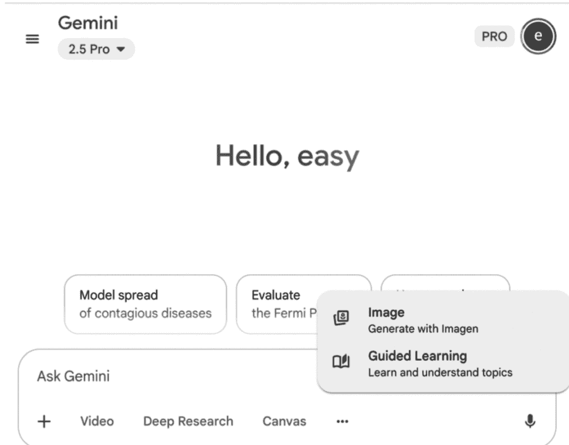

- ②打造教师的“第二大脑”（NotebookLM）：这是Gemini在教育领域最具革命性的应用，旨在成为教师的“第二大脑”。其最核心的技术特点是“信源接地”，即所有回答都严格基于教师个人上传的资料，并附带可追溯的引文，这极大地降低了AI“幻觉”的风险，确保了信息在教学和科研场景中的准确性。在Gemini 2.5 Pro多模态长文本理解能力的支持下，首先，它能帮助师生高效地提炼、理解、组织并共享海量的知识内容。它不仅仅是一个笔记工具，更是一个基于教师个人上传资料进行学习和应答的“虚拟学习和研究助理”。
NotebookLM基于Gemini强大的多模态能力，能够整合教师上传的各种教学资料——无论是PDF课件、Word文档、网页链接，还是YouTube教学视频。其次，它提供高度可靠且“有据可查”的回答，所有答案都严格依据用户上传的内容生成，并附带来源标注，有效避免了通用大模型的“幻觉”问题。更进一步，通过其强大的Studio功能，它能自动将这些零散的资料转化为结构化的多模态的知识资产，一键生成教学大纲、常见问题解答、词汇表、思维导图，以及带有旁白讲解的视频概览和音频播客。这极大地提升了教师备课、课程资源创作和知识管理的效率。对于教师的专业发展，NotebookLM同样是强大的助推器。教师可以利用它快速归纳培训资料与教育理论，生成反思性笔记或教学建议；通过共享笔记本功能，还能与同事协同共创课程内容、开展跨学科项目式学习的教学设计；更能利用音频、视频概览等创新教学媒介，将教学内容多模态化，提升课堂的吸引力和学生的理解效果。

图12-3 NotebookLM界面


- ③赋能多模态教学：Gemini的原生多模态能力是其赋能教育教学的一大亮点，它不仅能理解文本，还能处理和生成图像、音频和视频，为课堂教学带来了前所未有的可能性。例如，教师可以利用其文生视频功能（如Veo），将抽象的科学概念（如“火山爆发过程”）或复杂的历史事件，快速生成生动直观的动画短片，极大地增强了教学的吸引力。在具体应用中，这种能力可以深度融入各个学科：物理老师可以上传学生拍摄的实验视频，让Gemini分析小球的运动轨迹并生成数据报告；美术老师可以展示一张名画，让Gemini从构图、色彩、笔触等多个维度进行实时讲解；历史老师可以输入一段古文，让Gemini生成与之匹配的场景插图，帮助学生理解文字背后的情境。这种跨模态的理解与生成能力，极大地丰富了教学手段，能够有效激发学生的学习兴趣，让抽象知识变得具体可感。

##### （3）Claude：严谨安全的长文本与多模态处理专家

由前OpenAI员工创立的Anthropic公司开发的Claude，从诞生之初就以安全、可信和强大的长文本处理能力作为其核心标签。其发展历程迅速，从2023年首个模型发布，到2024年推出包含Haiku（重速度）、Sonnet（重平衡）和Opus（重推理）的Claude 3系列，再到最新的Claude 4系列，其能力不断增强。Claude的技术特点鲜明：首先是超大的上下文窗口（达20万token），能轻松处理和分析整本书籍或长篇报告；其次是强大的多模态处理能力，可以分析复杂的图像和多媒体内容；最后是其以安全为核心的训练理念，通过一套预设的道德准则来引导模型行为，并设有不同的安全等级，确保了在提供即时响应和深度思考两种模式的同时，始终将AI安全置于首位。图12-4 Claude界面


Claude赋能教育教学与科研的创新路径主要有以下三条。

- ①引导式学习与个性化支持：Claude同样内置了“学习模式”，采用苏格拉底式问答法引导学生自主思考，而非直接给出答案，从而培养其逻辑推理能力和批判性思维。它能够为学生提供个性化的学习指导、复杂概念解释以及作业辅助和反馈，成为日常学习中的学术伙伴。

- ②深度研究与科研支持：Claude擅长综合洞察而非简单信息堆砌，能够生成包含大量来源的深度研究报告。对于教师和学生的科研工作，它可以高效地完成文献综述和资料整理、数据分析，并辅助研究报告的撰写，极大地提升了科研效率。

- ③教师专业发展与课程设计：在全球多所顶尖高校（如美国东北大学、伦敦政治经济学院）的合作应用中，Claude被广泛用于支持教师的专业发展。教师可以利用它进行课程设计和教材开发、创新教学方法，并对学生进行评估和给予反馈。Claude成为推动AI赋能教育深度变革的重要力量。

##### （4）perplexity：可信赖、可溯源的AI答案引擎

perplexity是一款于2022年迅速崛起的“对话式答案引擎”，其核心是将大型语言模型的对话能力与实时互联网检索能力相结合，旨在提供准确、最新且引用完整的信息。它的技术特点在于能够实时爬取网络信息，对多源信息进行整合，并为答案附上详细的引用来源，从而极大降低了AI产生“幻觉”的风险。此外，它还提供多种“聚焦模式”（如学术、写作、视频、数学计算等），让搜索更加精准。图12-5 perplexity界面


perplexity赋能教育教学的创新路径主要有以下两条。

- ①培养学生的信息素养与批判性思维：这是perplexity在教育领域最大的价值。当学生对一个新课题进行初步探索时，它不仅能提供综合性的回答，还会列出信息的来源链接。这可以帮助学生养成核查信息源、引用文献的良好学术习惯，是教导学生如何负责任地使用AI进行研究的绝佳工具。

- ②高效的课题研究与备课：教师可以利用其“学术聚焦”模式，快速获取特定领域的最新研究动态和权威资料，为课程设计和科研活动提供高质量的信息输入。同时，它还能快速总结长篇文献，加速教材和教学方案的准备过程。在课堂上，教师还可以利用它进行实时提问和答疑，提高学生的参与度和课堂互动效果。

总之，perplexity是融合实时Web搜索与生成模型的透明问答平台，具备多模型选择、可引用来源、深度研究功能和专属知识空间，在教育与科研中，通过提升信息获取效率、支持互动教学与整合资源，有效地赋能教学设计、学生自主学习与教师专业协作，为教师的教学和科研活动提供全方位支持，同时有助于培养师生的AI素养和信息甄别能力。

##### （5）Grok：追求真相的实时推理引擎

由埃隆·马斯克的xAI公司开发的Grok，其创立宗旨是构建“最大程度追求真相”的AI。其发展历程极为迅速，从2023年11月首次亮相，到2025年7月发布号称“全球最智能模型”的Grok 4，并推出独立的移动应用和政府版本，显示出其强大的迭代能力。Grok的技术核心在于实时信息访问和先进推理能力。它能实时访问公共X平台（其前身是Twitter）和网络搜索结果，确保信息的时效性；同时，其最新的Grok 4模型采用“第一性原理推理”，将复杂问题分解为基本要素进行逻辑分析，并通过思维模式（Think Mode）和深度搜索（Deep Search）等功能，提供更具深度的洞察。图12-6 Grok界面


Grok赋能教育教学的创新路径主要有以下三条。

- ①作为虚拟导师与学习伙伴：Grok可以为学生提供复杂主题的个性化解释，例如对数学问题进行分步求解，或对科学理论展开深入讨论。教师可以利用它生成测验、教学大纲和互动内容（如模拟辩论），从而将更多时间用于与学生的直接互动。

- ②开展基于真实世界的项目式学习：Grok能够实时访问网络和X平台，获取最新的数据和讨论，非常适合用于时事热点相关的探究式学习。例如，在社会研究课上，学生可以利用Grok总结关于某个国际事件的最新动态和各方观点，让学习内容与真实世界紧密相连。

- ③支持教师专业发展与科研：教师可以利用Grok快速了解最新的教育技术和教学法前沿资讯，探索新的教学策略。在科研方面，其强大的实时信息检索能力可以为项目研究提供最新的数据支持，同时其强调验证来源的特点，也有助于确保研究的准确性。

### 二、变革之路：AI赋能教育创新的主要趋势

如果说上一节我们探讨的是AI工具对个体“工作和学习方式”的重塑，那么本节我们将拓宽视野，进一步探讨人工智能作为一个整体，正在推动整个教育生态系统发生哪些结构性的、系统性的变革。

#### （一）智慧引擎：大模型赋能教育、教学与科研的新范式

此前我们详细剖析了顶尖AI模型的技术跃迁特征及其赋能教育的特色路径。这些由技术驱动的变革，正汇聚成一股强大的力量，从根本上重塑着学习、教学与科研的传统范式。AI不再仅仅是效率工具，而是成了激发认知、联结知识、探索未知的“智慧引擎”，推动着教育向更深层次、更广维度、更富创造力的方向发展。人机协同催生教育新生态是未来教育发展的总趋势。

##### （1）重塑学习范式：从被动吸收到主动建构

传统的学习模式在很大程度上是线性的、以知识传递为主导的，而以ChatGPT的“学习模式”、Gemini的“引导式学习”为代表的AI应用，正在将学习范式转变为以学生为中心的主动建构模式。AI通过苏格拉底式的提问、个性化的内容推送和多模态的直观呈现，将学生从知识的被动接受者，转变为主动的探究者、思考者和创造者。作为个性化导师，AI能根据学生的学习风格和需求提供定制化辅导与即时反馈，支持包容性教育；作为探究伙伴，它能激发学生自主思考与协作学习，成为知识构建的有效脚手架，帮助学习者系统建立知识框架，这使得大规模的个性化学习和深度学习真正成为可能。总之，大模型可以通过个性化适应和互动式指导，重塑学习模式。

##### （2）革新教学范式：从经验驱动到人机协同

AI正在深刻改变教师的角色和工作方式，推动教学范式从传统的“经验驱动”走向人机协同的“智慧增强”模式。教师可以利用NotebookLM等工具，将自己海量的教学资料和经验转化为可随时调用的“第二大脑”，极大地提升了备课和课程设计的效率与质量。在课堂上，AI的多模态能力可以帮助教师创设更生动、更具互动性的教学情境。更重要的是，AI能够辅助教师进行学情分析和教学反思，使教学决策更加精准、科学。在人机协同的新范式下，教师可以将更多精力从重复性劳动中解放出来，专注于更高层次的育人工作，如情感连接、价值引领和创新思维的培养。AI强大的功能使教育从标准化转向以学生为中心。

##### （3）催生新科研范式：从线性探索到智能涌现

对于教育科研而言，AI带来的变革同样是颠覆性的。以“深度研究”模式为代表的AI工具，将科研范式从线性的、劳动密集型的探索，转变为高效迭代、智能涌现的新模式。在研究过程中，AI能够自动梳理海量文献，抽取关键信息，极大地提升文献综述的效率；同时还能辅助实验设计、优化方案并进行数据分析，减少重复性劳动。更进一步，大模型强大的跨学科知识融合与理论建模能力，能够激发新的研究假设，催生多元视角下的创新方案，推动科学探索进入全新的深度研究阶段，为教育、科学、人文等领域开辟新方法论。未来，大模型将进一步推动协作式创新，实现从假设到验证的闭环。

#### （二）从个性化到智能化：AI重塑教育的未来态势

根据最新相关研究报告和文献资料，例如联合国教科文组织持续更新的AI教育指导框架，AI正驱动教育从标准化向智能化转型。正如许多专家学者所指出的，AI的核心价值在于增强而非取代人类智能，其目标是培养学生应对未来挑战的综合素养。这些由技术引发的变革，正汇聚成以下几个关键的创新趋势。

##### （1）学习体验的极致个性化：从自适应到超个性化

“因材施教”是人类千百年来的教育理想，而AI正使其以前所未有的深度和广度成为现实。传统的自适应学习更多是基于预设规则进行路径推荐，而生成式AI则开启了“超个性化”学习的新纪元。AI能够实时分析学生的学习行为、认知特点甚至情绪状态，动态生成最适合个人风格的学习内容、练习题和解释方式。正如可汗学院创始人萨尔·可汗（Sal Khan）所构想的，AI可以成为每个学生可扩展的“一对一”导师，遵循教学原则，引导学生解释自己的推理过程。它不再是简单地推送“下一个知识点”，而是能像一位经验丰富的特级教师一样，为学生量身定制学习的每一步，真正实现“一人一策，千人千面”的极致个性化学习体验。

> [美]萨尔曼·可汗.教育新语：人工智能时代教什么，怎么学[M]. 王琦，万海鹏，译.北京：中信出版集团，2024。

##### （2）教学模式的人机协同化：教师成为“AI增强型”教育家

未来教学的核心特征，将不再是“人教”或“机教”的二元对立，而是深度融合的“人机协同”。AI将作为教师的“增强型辅助工具”或“副驾驶”，深度融入备课、授课、辅导、评价等教学全流程。研究显示，AI能够自动化处理30%—40%的行政工作和重复性任务，为教师每周节省超过10小时的时间。教师可以将这些宝贵的时间，聚焦于更高层次的、更具人文关怀的育人工作，如激发学生的高阶思维（高认知）、提供情感支持与动机激励（高情感）、进行价值引领等。在这种新模式下，正如经济合作与发展组织的报告所强调的，教师的角色并非被取代，而是被增强，转变为“学习的设计者、人机协同的指挥家和学生成长的陪伴者”。

##### （3）评价体系的精准发展性：从终结性评价到过程性诊断

AI正在推动教育评价从传统的、以分数和排名为核心的“终结性评价”，转向更注重过程、诊断和发展的“精准发展性评价”。AI能够通过对学生在学习过程中的海量数据（如课堂发言、作业轨迹、项目协作、在线讨论等）进行无感化、伴随式的采集和分析，生成动态的学习者画像。这种画像不仅能精准诊断出学生知识掌握的薄弱环节，更能揭示其思维方式、学习习惯和非认知能力的特点。研究表明，AI评分系统能够获得超过80%的师生认可，其价值在于提供即时、形成性的反馈。基于此，AI可以为教师和学生提供精准的、可操作的改进建议，让评价真正服务于学生的个性化成长。

##### （4）教育资源的智能开放化：构建动态生长的全球知识库

传统的教育资源（如教材、课本）是静态的、固化的，而AI正在推动教育资源向智能、开放、动态生成的方向发展。AI能够利用自然语言处理等技术，实时抓取、筛选、重组全球范围内的开放教育资源，并根据不同国家、地区、学校乃至班级的具体需求，动态生成最适切的、多模态的教学资源。这不仅极大地丰富了教育资源的多样性和时效性，更有望打破地域和经济壁垒，让最优质的教育内容能够以极低的成本触达每一个学习者。正如联合国教科文组织所倡导的，AI应促进知识公平，构建一个动态生长、共建共享的全球知识库，从而有力支持终身学习和包容性教育。

### 三、未来教师：AI时代的新使命与专业超越

面对AI技术对教育生态的系统性重塑，未来教师的发展之路也必然迎来深刻的变革。这不再是简单的技术应用问题，而是关乎教师的职业身份、核心能力与成长路径的全面升级。教师必须主动拥抱变化，才能在智能时代继续担当立德树人的核心使命。

在AI驱动的未来教育新图景下，教师的角色必须进行深刻的重塑。当知识的获取变得前所未有的便捷时，教师的核心价值不再是传递标准化的知识，而在于那些AI难以替代的人类特质。教师将有更多时间从事创造性的教学活动，其角色将从“知识的传授者”全面转向学习的设计者、思维的激发者、情感的连接者和价值的引领者，专注于激发学生的高阶思维、培养核心素养，这是对未来教师的必然要求。

为了胜任全新的角色，未来教师需要构建一套与AI协同共生的核心能力。这首先要求教师具备良好的AI素养与提示词工程能力，能够精准地提问，高效地驾驭AI完成复杂任务。在此基础上，教师需要发展出强大的教学设计与整合创新能力，利用AI进行“智能备课”，自动生成教案、精准推送资源，并进行更高水平的创造性教学活动设计。同时，教师还需提升数据分析与教育决策能力，通过“智能辅导”分析学情、批改作业，为学生提供启迪式的个性化教育。最后，在AI深度介入教育的背景下，教师更需要具备审慎的伦理思辨与人文关怀能力，引导学生负责任地使用AI，并始终将人文关怀置于技术应用之上，发挥教师价值引领作用。

面对技术的飞速迭代，教师的专业发展范式也需要从被动的培训转向主动的、持续的自我革新。未来的教师必须成为一名终身学习者和教育创新者，学习利用AI高效学习的能力和创新能力是其未来专业发展的核心竞争力。教师要通过建立个人学习网络，持续追踪AI前沿，勇于实践和探索AI的教育创新应用；以“智能教研”驱动专业反思，利用AI的多模态数据系统性地评估和反思自身授课情况，获得精准的改进建议；从个体探索走向团队共创，勇于在教学中探索AI应用的新场景、新模式，与同事协作，共同构建AI赋能的教师专业发展共同体。

让我们以开放、智慧和勇气，与AI这位日益强大的“共生伙伴”协同育人，共同迎接并创造智能时代教育的无限可能与美好未来。