# 课堂与成长双线焕新：教师在智能时代的行动指南

## 序言

当下，生成式模型的扩散正重塑生产生活的运行逻辑，也在从底层改写教与学的方式。ChatGPT 等产品在上线后约两个月便突破月活一亿的门槛，比尔·盖茨把其历史分量比作互联网和个人电脑的诞生。2025 年开年，DeepSeek-R1 等本土模型强势登场，标志着中国在这一赛道实现关键跃进。生成式技术的大规模普及，意味着社会迈向认知智能的新阶段，教育被推到变革的核心。

国家行动清晰可见。2024 年 4 月，教育部启动人工智能赋能教育行动，推动大模型在教育系统开展示范应用。2025 年 4 月，教育部联合八部门发布《关于加快推进教育数字化的意见》，要求全面推进智能化，让技术真正服务于教育转型。2025 年 8 月，国务院印发《关于深入实施“人工智能+”行动的意见》，明确把智能技术贯穿教学全要素全流程，培育智能学伴、智能教师等协作形态，推动育人重心从知识传授转向能力提升，促进大规模个性化教学，搭建智能化情景交互学习环境，助力提质与公平。顶层安排已然明晰，智能与教育融合正成为高质量发展的重要引擎。

这轮浪潮既是机会也是考验。智能可以扮演导师与伙伴，让大范围的个性化学习和创造性表达成为可能；作为工具，它能卸掉教师在重复事务上的负担，把精力投向更具创造性的设计与育人。更深层的冲击在思维层面，传统的讲授中心模式受到动摇，师生互动与学习方式必须重新审视，教师的角色也在从知识权威转向学习架构师与成长陪伴者。

面对变化，一线教师不应旁观，而应主动进入、拥抱转型，成为思考者、实践者与引领者。关键已不是用不用，而是怎么用得好、用到位，真正服务教学、促进学生成长，同时带动自身专业迭代。本书意图正在于此，搭建技术与真实教学场景之间的桥梁，打开两种价值：教学创新的协作伙伴，以及专业发展的智能助手。教师由此可以探索备课、课堂、评价的创新路径，也能在教研、科研与自我提升中获得高效支撑，从容应对智能时代的新形态。

书名《AI赋能教育：从教学创新到专业发展》浓缩了我们的思考。智能赋能，外延宽广。对外，它突破时空限制，创造更丰富多元的学习体验；对内，它激活教师内在潜能，提高教学的精准度、创造力与温度。从教学创新到专业发展，是我们追求的双重价值，也是本书的定位。核心关系是协作伙伴，从单向的“人用工具”迈向“人与技术相互激发、共同创造”，形成教师—技术—学生三元互动的新生态。技术是教师的智慧助手，是学生的个性化导师，是连接教与学的桥梁。关于专业成长，核心角色是智能助手，助力研究与反思，让教师从技术使用者成长为教育创新的引领者。

这些年我持续关注此领域。2022 至 2024 年，我翻译出版了三本相关专著：《创造性课堂：为了21世纪学习者的创新教学》聚焦创新教学与创造力培养，《人工智能教学：探索学习新前沿》探讨技术在教育中的场景与方法，《给教师的人工智能教育》帮助教师和校长理解技术以制定应对策略。那三本书提供了国际视野、理论基础与战略思考，本书则聚焦本土一线教师的真实需求、行动原则与实践案例。建议把四本书作为系列阅读，形成从国际理论到本土实践、从战略思考到课堂落地的完整图景。

本书源于我在学习科学与创造性教学领域的长期探索，尤其是生成式模型在教学中的应用实践。浪潮到来时，我思考的不是技术本身，而是技术如何与恒定的教育规律结合，如何支撑建构主义下的深度学习与高阶思维、创造力培养。围绕“智能助力教育改革创新”“智能助力课堂教学范式创新”等主题，我面向一线教师开展讲座与培训。交流中感受到教师既渴望又困惑，他们更关心“技术能在我的课堂做些什么”“有没有马上能用的案例”“怎样有效使用合适的工具”。为此我对近百位一线教师开展专项问卷。结果显示，90.63% 的教师迫切需要技术与学科教学深度融合的方法，83.33% 需要教学设计上的具体支持，82.29% 需要学生评价方面的帮助，同时 86.46% 认同教师主导、技术辅助，85.42% 认同培养学生高阶思维。这些声音构成本书的基石，决定了案例必须源于需求、指导实践。

基于反馈，我们构建了“理念—原则—实践”三位一体的赋能体系。首先不能停留在工具操作，案例需植根于学习科学与教育心理学，从建构主义与最近发展区理论出发，体现技术作为协作伙伴的教育学内涵。其次，提炼行动原则作为教学决策的指南针，帮助教师在技术迭代中把握方向。第三，落到备课、课堂、学习、评价等真实场景，提供可操作案例，展现技术贯穿教学全流程。

全书结构践行这一思路。第一至三章聚焦理念与能力，第一章分析智能时代的机遇挑战，第二章明确教师智能素养框架，第三章介绍以 DeepSeek 为代表的生成式模型核心能力与提示词工程。第四至八章探讨技术作为教学创新的协作伙伴，第四章提炼高质量教学行动原则，第五至八章分别深入备课、课堂、学习、评价场景。第九至十二章关注技术作为专业发展的智能助手，助力教学反思与教研、科研工作如课题申报与论文写作，提供创建个人教育智能体的高阶应用，并展望未来趋势与教师新使命。整体脉络从教学创新延伸到专业发展，形成从协作伙伴到智能助手的闭环。

本书本身也是人机协同的产物。从资料搜集、框架搭建到案例生成、结构调整、润色与插图，乃至封面设计，技术都深度参与。它既是资料整合者，也是创意灵感来源和内容优化助手。这种写作方式正是我们倡导理念的生动实践，让我们体会到高效工作流对创造性工作的增益。

本书完成离不开多方支持。感谢在讲座与调研中提供素材与反馈的一线教师，他们是思想与内容的源泉。感谢参与写作的研究生贺振海、周赋英、吴涵、李前玉、蒋通梧、赖囡囡、张宇琪、谢心星、阮玲、钟意，他们贡献了设计思路并参与案例打磨与校对。感谢华东师范大学出版社编辑的专业指导。

本书面向渴望拥抱技术变革教学的一线教师、关注教师专业发展的管理者与教研员、教育技术与智能教育研究者，以及所有关心智能加教育的读者。建议先读前三章把握新生态与理念，再依循第四章原则将技术应用于第五至八章的具体任务，实践案例与提示词并及时反思评估。在此基础上，将总结提炼用于教学研究、论文写作、课题申报或参赛，以推动专业发展。

愿本书成为智能时代教师的赋能手册，帮助大家在教学中寻到协作伙伴，在成长中获得智能助手，共同开启智能助力教育的无限可能。

## 第一章

## 智能浪潮下的教育机遇与挑战

### 一、教与学生态正被怎样重构

科技演进正把人类社会迅速推向模型驱动的新阶段。新型智能为经济社会注入活力，深刻改变生产生活。2022 年 11 月 30 日，OpenAI 发布自然语言处理工具 ChatGPT，一夜之间引发全球关注。发布后约两月，月活达一亿，成为用户增长最快的消费应用。该工具基于大语言模型，能模拟人类语言行为，进行自然交互，并依据上下文持续对话。比尔·盖茨评价其历史意义不亚于互联网和个人电脑诞生。有人认为其出现标志人类进入认知智能阶段，将对社会各领域带来巨大变革。

智能在科学前沿的突破力，也预示其赋能他领域的潜力。2024 年两项诺贝尔奖佐证了这一点：物理学奖授予“深度学习教父”杰弗里·辛顿；化学奖表彰利用计算机设计蛋白质的戴维·贝克，以及 DeepMind 团队德米斯·哈萨比斯与约翰·詹珀，他们的 AlphaFold2 改变了蛋白质结构预测范式。这些成果显示智能正成为科学发现的强大引擎，也为思考如何用技术促进更深理解、探索与创新提供启示，教育是关键场域。

中国生成式智能也在蓬勃发展。2023—2024 年，百度文心一言、字节跳动豆包、月之暗面 Kimi 等大模型相继涌现并快速迭代，技术追赶应用探索并进，与国家战略同频。2024 年，“人工智能+”首次写入政府工作报告，被定位为发展新质生产力的核心引擎，国家重视度与战略决心彰显。

2025 年初，杭州深度求索发布 DeepSeek-R1，在全球竞赛中引发关注，上线七天用户达一亿，成为突破一亿用时最短的应用，被称作智能领域的“斯普特尼克时刻”。该模型与 OpenAI、谷歌 DeepMind 等顶尖模型正面竞争，研发成本显著降低、算力消耗大幅节省，重塑了研发逻辑。报道显示其在数学、编码、推理等基准测试中表现与 GPT 相当，部分领域更优，编码成功率宣称达 97%。对中国而言，DeepSeek 的崛起不仅是技术突破，也因其高效模式和贴近复杂应用场景的潜力而备受期待。

智能浪潮席卷全球，教育首当其冲。2019 年习近平在致国际人工智能与教育大会贺信中强调，中国高度重视智能对教育的深刻影响，积极推动智能与教育深度融合，促进变革创新，发展伴随一生、机会均等、因人而异、更加开放灵活的教育。教育家顾明远指出，人工智能正从教育生态、环境、方式、管理模式、师生关系等多维度影响教育。这不仅是技术叠加，而是系统性变革，挑战中孕育机遇。

以 DeepSeek、Kimi 等技术为代表，教育生态重塑的机遇可见一斑。

个性化学习成为现实。智能可精准分析学习习惯、知识掌握与认知特点，为每个学生定制路径、内容与节奏，实现真正因材施教，提升效率与效果。

教学方式被激活。智能可辅助备课、设计活动、生成资源、提供智能辅导，甚至模拟复杂实验或历史情境，把教师从重复劳动中解放，聚焦创造性设计与互动。

教育资源更普惠。智能有望打破时空限制，让优质资源与先进方法覆盖更多地区与背景的学生，促进公平。

评价体系走向多元。基于智能的数据分析，可实现更全面、过程性、能力素养导向的多元评价，而非仅依赖终结性考试。

管理决策更科学。智能可辅助管理者洞察问题与趋势，为决策提供依据，提升管理效能。

国家正把人工智能逐步嵌入教育体系，政策框架在不断丰富和细化。2024年3月，围绕智能化助推教育的相关专项行动正式拉开帷幕，其中的“教育系统人工智能大模型应用示范行动”被列为重点工程，目标是让大模型从技术验证走向真实教学场景应用^[中华人民共和国教育部.教育部发布4项行动助推人工智能赋能教育[EB/OL]. (2024-03-28) [2025-06-10].http：//www.moe.gov.cn/jyb_xwfb/xw_zt/moe_357/2024/2024_zt05/mtbd/202403/t20240329_1123025.html。]^。同年世界人工智能大会上，教育部副部长吴岩明确表示，人工智能已成为影响乃至决定教育高质量发展的战略性全局性议题，推动其发展的核心在人才、根基在教育；人工智能更像一把开启未来的钥匙，正深刻改变中国与世界教育的走向和发展^[搜狐网.教育部副部长吴岩：人工智能是影响甚至决定教育高质量发展的战略性、全局性问题[EB/OL]. (2024-07-12) [2025-06-10].https：//www.sohu.com/a/792789159_229991。]^。

2025年4月，教育部联合九部门出台《关于加快推进教育数字化的意见》，将智能技术对教育的支撑提升到新的战略高度^[中华人民共和国教育部.教育部等九部门关于加快推进教育数字化的意见[EB/OL]. (2025-04-15) [2025-06-10].http：//www.moe.gov.cn/srcsite/A01/s7048/202504/t20250416_1187476.html。]^。

文件提出要推动教育理念、教学方式与治理体系的整体性转型，通过集成化、智能化、国际化三条路径推进，彰显出以数字化重塑教育生态的决心。

文件中明确要加快建设面向教学的智能大模型，推动模型与教学的深度融合，让人工智能贯穿课程、教材与教学全流程，探索人机协同的新型教学形态；同时要求开展师生数字素养提升实践，深化人工智能助力教师队伍建设，将数字素养纳入教师培养体系。正如吴岩所强调的，人工智能带来的根本变化在于教师数字素养的提升，只有教师具备相应能力，技术才能真正落地到教学与治理之中，让教师创造力增强、学习更具个性化。此举对教师的AI应用能力提出新要求，也为后续聚焦教师AI素养的讨论奠定了政策基础。文件描绘出人工智能在教育中深度应用的清晰图景，预示着更智能、更公平、更高效的教育形态正在加速到来。

与此同时，为抓住新一轮科技革命机遇，规范生成式人工智能在义务教育阶段的安全使用，2025年5月教育部基础教育教学指导委员会发布《中小学生成式人工智能使用指南（2025年版）》。《指南》指出，把生成式人工智能合理引入中小学，既是抢抓科技革命机遇、践行科技自立自强的现实选择，也是激发学生创造潜能、提升教育品质的关键路径，更是培养面向未来的创新能力、促进教育与科技融合的核心支撑。

> 中国教育学会.中小学生成式人工智能使用指南（2025年版）[EB/OL]. (2025-05-13) [2025-06-10].https：//www.cse.edu.cn/index/detail.html? category=31&id=4242.

《指南》出台旨在落实《教育强国建设规划纲要（2024—2035年）》等要求，坚持立德树人，以人工智能为引领构建创新教育生态。

> 中华人民共和国教育部.中共中央、国务院印发《教育强国建设规划纲要（2024—2035年）》加快建设中国特色社会主义教育强国[EB/OL].（2025-01-19）[2025-06-10].http：//www.moe.gov.cn/jyb_xwfb/gzdt_gzdt/s5987/202501/t20250119_1176166.html。

总体来看，以ChatGPT、DeepSeek为代表的大语言模型正以前所未有的广度与深度渗入教育场域，推动教育发生系统性重塑。这不仅是技术迭代，更涉及理念、模式、师生角色与评价方式的全方位更新。变革伴随挑战，但机遇已十分清晰。正如欧洲分子生物学实验室副主任兼欧洲分子生物学实验室-欧洲生物技术研究所主任埃旺·伯尼所言：“大数据与人工智能和技术发展的潜力是无限的——而这，只是一个开始。”

> 郭爽.人工智能何以成为今年诺奖“大赢家”[EB/OL].（2024-10-12）[2025-06-10].https：//www.news.cn/tech/20241011/9af940be90f048b78bcbde68a8f5c85f/c.html.

拥抱并善用人工智能，让技术真正服务于人的全面发展，是时代命题，也是本书与广大教师共同探索的方向。

教育数字化与人工智能的深度融合，将加速“泛在可及”终身学习的愿景实现。

### 二、AI赋能教育：挑战与机遇并存

生成式人工智能尤其是以ChatGPT、DeepSeek为代表的大语言模型，正以强劲势头重塑教育生态。它们带来令人期待的创新空间，也带来需要审慎应对的风险。厘清机遇与挑战，是教师有效开展人工智能助力教学的前提。

#### （一）AI赋能教育的巨大机遇

智能技术对教育的改造潜力集中体现在以下层面。

##### 1 实现真正的个性化学习
- 精准分析与动态适配：人工智能可解析学生的学习轨迹、知识掌握状况、认知特征与学习偏好，动态调整内容难度与节奏。自适应平台能为薄弱环节提供额外练习与讲解，对已掌握内容推送更具挑战的拓展。
- 按需生成资源与即时反馈：人工智能可按需生成个性化学习材料、练习与评价反馈。智能辅导系统像私人导师一样即时答疑、提供具体指导，实现全天候学习支持。
- 激发学习兴趣：结合游戏化、互动化设计与个性化推荐，可有效提升动机与参与感。

##### 2 提升教育教学效率
- 自动化管理事务：人工智能可分担教师繁琐的行政事务，如客观题与部分主观题的自动批改、学籍管理、排课考勤等，让教师把精力集中在教学设计、课堂互动与个性化指导上。
- 快速生成教学资源：教师可借助人工智能工具快速产出教案框架、PPT提纲、教学案例、课堂活动创意及分层练习题，大幅压缩备课时长，丰富资源供给。
- 优化决策支持：人工智能可对区域或学校数据进行分析，为教学管理、资源配置、学情预警提供依据，提升决策科学性。

##### 3 驱动教学模式创新
- 赋能新型教学法：人工智能可支撑项目式、探究式、协作式学习，提供研究背景资料、模拟复杂情境、辅助协作讨论。
- 人机协同教学：人工智能可扮演助教、学伴或认知工具，与教师和学生形成新的人机交互结构，创造更丰富的学习体验。
- 促进深度学习：人工智能可通过苏格拉底式对话引导深度思考，挑战认知，培养批判性思维与复杂问题解决能力。

##### 4 促进教育公平与包容的可能
- 打破时空限制：在线学习平台可将优质资源输送至薄弱地区，让更多学生接触名师课程与先进理念。
- 满足多样化需求：人工智能可为特殊需求学生提供语音识别合成、实时翻译、文本简化、视觉辅助等工具，帮助其克服学习障碍。

#### （二）AI赋能教育面临的严峻挑战

在拥抱机遇的同时，潜在风险需清醒认识。

##### 1 伦理与安全方面的担忧
- 数据隐私与安全：人工智能运行依赖海量学生数据，如何合规采集、安全存储、负责使用，防止泄露滥用是重大伦理难题。《中华人民共和国个人信息保护法》等法规对教育数据提出严格要求。
> [^1]: 中国人大网.中华人民共和国个人信息保护法[EB/OL]. (2021-08-20) [2025-06-15].http://www.npc.gov.cn/npc/c2/c30834/202108/t20210820_313088.html。
- 算法偏见与公平性：训练数据中的社会偏见可能被算法放大，导致评估、推荐与资源分配不公。《新一代人工智能伦理规范》明确要求人工智能应促进公平公正、避免偏见歧视。
> [^2]: 中华人民共和国科学技术部.国家新一代人工智能治理专业委员会发布《新一代人工智能伦理规范》[EB/OL]. (2021-09-26) [2025-06-15].https://www.most.gov.cn/kjbgz/202109/t20210926_177063.html。
例如，部分人工智能评分系统对非主流语言表达存在偏见，可能加剧教育不平等。
> [^3]: LIANG W, YUKSEKGONUL M, MAO Y, et al.GPT detectors are biased against non-native English writers[J].Pattern, 2023, 4 (7)：100779。
- 过度依赖与能力弱化：学生过度依赖人工智能完成作业会削弱独立思考、批判与信息甄别能力；教师过度依赖生成教案也会削弱教学创造力。
- 透明度与可解释性：多数人工智能算法为“黑箱”，难以追溯决策逻辑，影响可靠性与公平性评估。

##### 2 教育公平新的挑战
- 数字鸿沟可能扩大：技术可及性与应用水平差异凸显，马太效应加剧，原本资源匮乏群体可能进一步边缘化。
- 资源分配不均：优质人工智能工具集中于经济发达地区与重点学校，普通学校获益有限，差距被放大。
- 特殊群体适应性不足：现有系统对残障、学习障碍等学生的个性化支持仍显不足。

##### 3 系统层面的难题
- 教育评价体系调整困难：人工智能要求评价从知识记忆转向高阶思维与素养，但既有体系惯性强、改革阻力大。
- 监管与标准建设滞后：技术迭代快，政策法规、伦理规范与技术标准跟不上。
- 可持续发展模式缺乏：试点项目推广与长期运营面临资金、技术维护、教师培训等多重难题。

##### 4 对教师队伍的冲击
- 数字素养要求提升：教师需理解人工智能原理、掌握操作并批判性应用，对专业发展提出更高要求。
- 角色转变适应：从知识传授者转向学习设计者、引导者、促进者与评价者，需更新教育观念。
- 培训与支持不足：面向教师的人工智能应用培训与持续支持体系尚不完善，实践信心不足。

#### （三）小结

人工智能助力教育既带来前所未有的机遇，也伴随技术、伦理与社会层面的复杂挑战。《意见》要求聚焦集成化、智能化、国际化，扩大优质资源覆盖，助力教育变革，但目标实现需技术创新、政策支持、伦理规范与教育理念协同推进。技术并非万能，其价值取决于明智应用。兼顾效率与公平、技术赋能与人文关怀，才能确保人工智能真正服务于立德树人与学生全面发展。《中小学生成式人工智能使用指南》为一线教师提供了行动指引，既明确监督指导职责，也强调在激发创造的同时培养批判思维与技术伦理。如何在机遇与挑战间求衡，实现负责任的人工智能教育应用，是未来探索的关键课题。

### 三、核心素养导向下AI推动教学创新

2022年4月教育部发布《义务教育课程方案和课程标准（2022年版）》，把核心素养培养置于教学中心。文件提出核心素养是学生终身发展与社会发展所必需的品格与能力，超越单纯知识技能，强调在真实情境中解决问题的能力。新课标标志着基础教育从知识技能传授向品格能力培养的转向。

> 中华人民共和国中央人民政府.教育部关于印发义务教育课程方案和课程标准（2022年版）的通知[EB/OL].（2022-03-25）[2025-06-15].https://www.gov.cn/zhengce/zhengceku/2022-04/21/content_5686535.htm。

#### （一）新课标的核心要求与教学变革方向

新课标要求教学超越知识点记忆，聚焦核心素养培养，涵盖文化底蕴、自主发展、社会参与等维度，具体要求包括：

一是强调学科实践，像专家一样思考。教学应创设真实或模拟情境，让学生运用学科概念、思想与方法分析解决问题。语文强调真实语境下的运用与表达，数学强调数学思维的发现与应用。

二是关注高阶思维培养。核心素养离不开批判性思维、创造性思维、问题解决与审辨式思维，教学需设计挑战性任务引领深度探究。

三是倡导情境化、跨学科学习。鼓励打破学科壁垒，通过跨学科主题学习与项目式学习，在解决真实问题中综合运用多学科能力。

四是重视学习过程与方法。掌握学科思维方式与探究方法，理解学科精神与价值，比单纯掌握知识更重要。

#### （二）生成式AI如何支撑核心素养成长

新课标提出的高要求对教师既是挑战也是机会。生成式人工智能为核心素养导向的教学变革提供了新条件。

##### 1 创设丰富情境与模拟实践
人工智能可快速生成逼真教学情境、模拟实验过程、扮演不同角色与学生互动，为“像学科专家一样思考”提供沉浸式实践场域。

##### 2 支持深度学习与跨学科融合
人工智能可生成多模态学习资源，帮助学生在真实情境中探究。教师可利用人工智能生成的可视化数据结合多学科理论进行分析，促进综合思维，并借助人工智能的关联能力发现学科间联系，为跨学科学习提供整合支持。

##### 3 提供个性化学习支持与反馈
人工智能可基于学习进度、答题与互动数据进行智能分析，提供个性化建议、资源推荐与针对性反馈，帮助学生及时调整策略。课堂即时测评与反馈可快速把握学情，形成教学闭环。

##### 4 促进创造力与批判性思维
人工智能不仅提供信息，更能激发思考。教师可引导学生批判性分析人工智能生成内容，评估优劣、辨别偏见，并在其基础上进行修改、拓展、重构，培养创造力、审辨能力与高阶思维。

#### （三）AI时代呼唤教育观念的深刻转型

让人工智能真正赋能核心素养，需要教育者进行观念重塑。

知识观：从记忆到创造。知识不再是复述对象，而是情境中理解、应用、迁移与创造的基础。人工智能可处理信息获取，教育重心应转向创新应用。

学习观：从被动接受到主动探究。学习是学生在教师引导与人工智能辅助下围绕真实问题主动探究、建构知识的过程，从而培养学科核心素养。

# 人本为锚：智能时代重塑教育的五大转向

**培养观：从批量同质到因人而异**
工业化时期追求标准化的育人路径，已无法匹配智能社会的现实。教育要把视线收回到个体，尊重每个学习者的独特性与成长潜能，借助智能化手段实现规模化差异化支持，培育多元鲜活的人才，让因材施教真正落地到日常课堂。

**教师观：从知识权威到学习架构师**
教师不再是唯一的信息源与课堂主宰，而是学习活动的规划者、陪伴者、引导者与合作者。要善用智能工具设计更具挑战的学习任务，点燃内在驱动，提供精准支持与人文关怀，着力于价值观养成与情感培育。

**教学校****养：从单向传授到多元共创**
课堂不再是教师讲、学生听的线性流程，而是教师、学习者与智能系统多向互动、共同建构的场域。智能可承担基础知识传递与练习陪练，教师则聚焦更高阶的对话、引领与判断。

**学生观：从被动接受到主动生成**
学习者不再是等待灌注的容器，而是学习主体、知识建构者与意义生产者。在智能辅助下学会自主探究、协作求解、问题攻关与创新创造。

**评价观：从分数至上到素养全景**
评价不仅用于甄别排序，更要服务于学习过程诊断与核心素养整体成长。借助智能可开展过程性、表现性、增值性的立体评价。

归根到底，技术的意义不在技术本身，而在教师能否有效驾驭，使其成为智慧伙伴，共同推动教学革新。这既是对操作能力的考验，也是对教育洞察的升华。人机协同前行，才能开启真正围绕学习者、面向素养的新教育时代。

#### （四）教学实践行为的再定位

观念更新后，实践也需实质性调整，以适应智能时代核心素养培养的要求。

##### 1 从关注教转向关注学
设计重心从“这节课我要讲什么、怎么讲”转向“学习者将经历怎样的学习历程？如何实现深度理解？如何激发内驱力？”要着力营造深度参与的情境，推动自主发现与知识建构，而非机械执行预设流程。智能系统可解析学习数据呈现难点与兴趣点，为以学习者为中心的设计提供支撑。

##### 2 从内容为核转向问题为核
传统教学围绕知识点展开，素养导向则以真实、具挑战的驱动性问题或项目任务牵引学习。教师需设计能点燃探究欲的问题，让学习者在解决真实情境中习得知识、发展能力。智能可辅助生成情境、供给背景资料与探究线索，甚至模拟多种解决路径。

##### 3 从教学设计转向学习体验设计
工作重心从编写教师的教案，扩展到整体设计学习者的体验。包括任务难度的合理梯度、多元资源供给含智能手段、物理与虚拟环境的营造、有效活动组织如小组研讨、项目协作、智能互动，以及清晰的学习路径与评价安排。智能可快速生成资源、定制学习路线，甚至搭建虚拟学习空间。

##### 4 从智能赋能教学转向智能赋能学习
不仅教师把智能用于备课、授课与评价，更要引导学习者把智能当作学习的伙伴。需教会学习者如何精准提问、如何审慎甄别智能输出、如何用智能完成信息检索、数据分析、写作辅助、创意生成等任务，让智能真正成为自主探究与创造的助手，而非仅停留在教师演示层面。

##### 5 从经验判断转向数据判断
过去教学多依赖教师经验判断。如今智能可采集与分析学习过程数据，如在线练习表现、讨论参与度、与智能的互动记录等，形成更为客观全面的学情画像。依托这些数据，可精准定位学习障碍、动态调整策略与进度、提供个性化辅导，提升教学实效。

#### （五）智能在教学生态中的多元身份：支撑观念与行为转型

厘清智能在课堂变革中能发挥的具体角色至关重要，这些角色既是技术映射，也是观念与行为转型的落地支点。

##### 1 智能作为“超级助手”
教师借助智能自动完成作业初改、资源归纳、信息检索等琐碎事务，并生成教案框架、题库等材料初稿。这大幅释放时间，让教师从细节执行抽身，聚焦学习设计与个性化路径规划。智能的数据处理能力也为数据驱动教学奠定基础。

##### 2 智能作为“全天候导师”
智能可全天候提供个性化辅导，按学习进度与理解程度推送定制化讲解、练习与反馈，适配每个人的节奏。这体现了从标准化到个体化的人才观转变，也呼应了学习方式从被动到主动的迁移，让教师更专注关照，并为学习提供课时外的支持。

##### 3 智能作为“教学助教”
智能能协助课堂管理如监控参与、组织分组；引导讨论如抛出启发性问题、归纳观点；并提供即时信息支持。这推动教学从单向讲授走向多元协同，也助力教师从权威转向设计者。借助智能助教，教师可把精力集中在高阶互动与个别指导。

##### 4 智能作为“学习伙伴”
学习者可在探究与解题中把智能当作对话对象、信息源或创意催化剂，全程陪伴学习。这强化了学习者从被动接收走向主动创造的角色，也体现了把智能从教师工具转向学习伙伴的核心理念，并推动教学从内容中心走向问题中心。

##### 5 智能作为“模拟学习者”
教师可与扮演学习者的智能互动，检验教学设计的合理性、预演课堂环节、评估任务难度与清晰度。这为从教学设计转向学习设计提供了预演与反思工具，帮助课前优化活动、更聚焦学习成效。

善用这些角色，需要教师既懂操作更懂教育意义，把智能与素养目标、观念转型、行为调整紧密结合，才能释放其改革潜力。同时要积极引导学习者把DeepSeek等生成式智能当作学习增能器，教他们用智能高效获取与整理信息，作为探究的信息源与思考伙伴，并尝试用智能辅助创作文本、图像、代码等多元作品，从而提升智能素养、探究力与创新实践力。

总之，以新课标为指引，以核心素养培养为目标，将生成式智能深度融入教学实践，并伴随观念与角色的深刻转型，是未来教育革新的关键路径。这要求我们不仅掌握工具应用，更要理解其教育逻辑，从而真正实现技术赋能育人。本书后续将聚焦全流程应用，从学情分析、教学设计、课堂教学、个性化学习、学业评价到专业发展，详细介绍DeepSeek等智能工具如何赋能教学创新与教师专业成长。

## 第二章 教师智能素养与成长路径

### 一、拥抱智能时代：教师智能素养为何重要
智能正以前所未有的速度渗透教育，驱动理念、模式与生态全面变革。面对持续的智能浪潮，教师要真正驾驭这一工具并深度融入教学、赋能创新、促进核心素养培养，首先需要认识和理解智能，主动提升自身素养。缺乏相应素养，教师易对智能误解或恐惧，难以用好工具提升效率与质量；更难以指导学习者正确负责任地使用智能，甚至把偏见与风险带入课堂。2025年7月发布的《人工智能赋能基础教育应用蓝皮书（2025年）》指出，推动人工智能与教育科学融合要提高教师人工智能素养，因为“教师作为教育教学的关键主体，其人工智能素养水平直接影响智能技术在教育场景中的应用效果”[1]。因此，提升智能素养已不是可选项，而是智能时代教师的必修课，是专业发展内在要求，也是推动智能深度融入的关键。

> [1] 智能技术与教育应用教育部工程研究中心，北京市数字教育中心（北京电化教育馆）.人工智能赋能基础教育应用蓝皮书（2025年）[R/OL].（2025-07-11）[2025-08-02].https://ai.bnu.edu.cn/docs//2025-07/353a5a2962d84cf3b9713bef05be7e2c.pdf。

### 二、教师智能素养究竟指什么
简单说，是指教师理解、应用、评价和参与智能相关实践的能力与意愿，以便在教学与专业发展中有效且负责任地利用智能。它不只是技术操作，而是涵盖认知、技能、态度与伦理的多维综合能力。

具备智能素养的教师应能：
- 掌握智能基本原理与能力边界，清楚其能做什么、不能做什么、优势与局限。
- 识别与选择合适工具，依教学目标与学习者需求判断适用性。
- 熟练应用智能赋能教学，如备课、授课、评价等，提升效率与效果。
- 设计智能融合的教学活动，创造新学习体验，促进高阶思维与核心素养。
- 批判性评价智能的有效性与可靠性，防范算法偏见、数据隐私等风险。
- 遵循法规与伦理准则，引导学习者形成健康使用习惯。
- 保持开放心态，持续学习适应快速发展的技术。

### 三、教师智能素养框架
联合国教科文组织2024年发布的《教师人工智能素养框架》是全球首个系统性指导文件，围绕五大领域定义教师应具备的知识、技能与价值观：

**表2-1 教师人工智能素养框架**

| 素养维度 | 获取 | 深化 | 创造 |
| :--- | :--- | :--- | :--- |
| 以人为本的 AI 思维方式 | 人类主体性 | 人类责任 | AI 社会责任 |
| AI 伦理 | 伦理原则 | 安全并负责任地使用 | 共同制定 AI 伦理规则 |
| AI 基础与应用 | 基础 AI 技术和应用 | AI 应用能力 | 与 AI 共同创作 |
| AI 与教学方法 | AI 辅助教学 | AI 融入教学 | AI 推动教学转型 |
| AI 支持教师专业发展 | AI 支持终身职业发展 | AI 增强组织化学习 | AI 支持专业化转型升级 |

以人为本的AI思维强调人机互动中的价值观，关注人的能动性、责任感与社会责任。AI伦理涵盖道德原则、法规、公平透明安全等。AI基础与应用指基本概念、技术原理及场景化工具选择能力。AI与教学方法指将AI有效融入教学策略与实践的能力。AI支持教师专业发展指利用AI支持终身学习、同行协作与专业变革的能力。

各维度设获取、深化、创造三级进阶。获取掌握基础概念与伦理意识，能在简单场景应用；深化能熟练整合工具，具备伦理判断与人本意识，并探索专业发展应用；创造能创新设计融合方案，推动教学转型并参与伦理规则制定。

该框架填补了全球标准空白，重塑教师从知识传授者向人机协作引导者转型，强调批判思维培养与伦理监护，并促进教师—AI—学习者三元互动的健康发展。

#### 本书聚焦的实践核心框架
基于上述系统框架，面向中小学一线并以DeepSeek等生成式智能实战为核心，聚焦四个递进维度：

##### 1 认知与理解
核心目标是掌握智能基本概念、发展历程、主要类型尤其是生成式智能及其工作原理。了解智能在各领域特别是教育中的典型应用，认识能力与局限如缺乏真实情感、创造力受限、可能产生偏见，理解机遇与挑战。

##### 2 掌握与运用
核心目标是熟练操作至少几种核心智能工具，并在教学情境中有效应用。能进行信息检索、文本生成如教案初稿课件练习题、资源创编、课堂互动辅助、学情分析与学业评价；掌握提示词技巧，与智能有效对话达成教学目标。

##### 3 融合与创新
核心目标是将智能与学科教学深度融合，设计创新性教学活动与学习体验，促进核心素养发展。能结合学科特点与学习者需求设计智能融合方案如项目式、探究式学习，引导学习者用智能进行高阶思维活动，探索人机协同新模式并评估迭代。

##### 4 伦理与评价
核心目标是具备批判性思维与负责任态度，遵守伦理规范并反思性评价智能影响。践行以人为本，关注公平性、透明度、问责制与安全性，了解数据隐私法规，识别算法偏见，引导学习者负责任使用，对教学应用效果与潜在风险持续观察评估。

四维度相互支撑，构成智能时代教师赋能教学的核心素养。

### 四、塑造适应智能时代的教师思维
具备基本素养后，还需发展高级认知方式——智能思维，即像智能系统思考并解决问题。它包含四种核心能力。

##### 1 算法思维：理解智能的决策逻辑
不仅知道智能能做什么，更要探究其如何做到。掌握算法基本概念，理解机器学习如何通过数据分析、模式识别、建模进行预测与决策，有助于更深入理解工具行为、有效利用优势并批判性评估输出。

##### 2 数据素养：具备数据驱动的分析能力
智能核心驱动力是数据。需认识数据在智能中的作用，掌握收集、处理与应用技能，识别数据价值与偏差对输出的影响，学会利用智能提供的学情洞察辅助教学决策。

##### 3 边界认知：把握智能的能力边界
智能并非万能，缺乏真实理解力、创造力、情感与常识，且可能产生“幻觉”。需清晰认识其优势与不足，避免不切实际期望或盲目依赖，合理定位角色。

##### 4 协同意识：构建人机协作模式
智能时代人机协作成常态。要思考如何与智能高效协同，形成1+1>2效果。明确哪些环节适合智能完成如重复性、机械性、数据密集型任务，哪些必须教师主导如情感关怀、价值引导、复杂情境决策、创造性设计，探索符合立德树人目标的教师—智能—学习者三元协作模式。

提升素养、掌握思维、建立人机协作框架，是教师从使用者迈向智能教育引领者的关键。

### 五、联合国教科文组织的学生AI素养框架

学生AI素养全球首份指引面世

在为教师提供指引后，UNESCO 又面向学习者发布了《学生人工智能素养框架》，这是国际上首个系统化为学生设计的AI素养指导文件。MIAO F, SHIOHIRA K.AI competency framework for students [M/OL].Paris: UNESCO, 2024[2025-06-20].https://unesdoc.unesco.org/ark:/48223/pf0000391105/PDF/391105eng.pdf.multi。

这份文件的落脚点是助力教育体系在智能时代培育关键能力，让学习者成长为负责任的技术使用者、协同创造者与面向未来的公民。在中小学阶段，框架提出要把学生养成审慎使用AI的使用者、协同设计者以及具备创造力的AI社会公民。学生版同样搭建了素养矩阵，由四个核心维度与三个进阶层级构成，见表2-2。

**表2-2 学生人工智能素养框架**

| 素养维度 | 理解 | 应用 | 创造 |

| :--- | :--- | :--- | :--- |

| “以人为本”的人工智能观念 | 人类能动性 | 人类问责 | 人工智能社会公民素养 |

| 人工智能伦理 | 具身伦理 | 安全与负责任的应用 | 设计伦理 |

| 人工智能底层技术与应用 | 人工智能基础 | 应用技能 | 创作人工智能工具 |

| 人工智能系统设计 | 智能系统问题界定 | 人工智能架构设计 | 反馈与迭代 |

“以人为本”的观念强调批判性思维，学生要能判断技术使用是否契合人类价值与伦理，厘清个人与机构在应用中的责任，推动安全、包容、公正的智能社会。伦理维度要求形成价值判断与反思能力，理解数据隐私、算法偏见、信息茧房等风险，并在技术全生命周期中遵守并适应伦理规范。底层技术与应用维度涵盖算法、数据、机器学习等基础概念与操作技能，通过编程入门、数据分析实践提升理解与应用能力。系统设计维度意在培育系统思维与初步工程能力，使学生能够理解并参与简易系统的设计、构建或优化，关注可解释性、可靠性与可持续性。

每个维度都设理解、应用、创造三个进阶。理解指掌握基本概念，并借助生活案例阐释AI的应用及其伦理议题。应用指在真实或模拟的复杂情境中迁移知识技能，使用工具解决实际问题，并批判性分析所用技术方法。创造指能够独立或协作设计、开发简易的AI解决方案应对特定挑战，成为技术创新的参与者与引领者。

文件还贯穿若干核心原则。首先是批判性思维优先，鼓励学生对适用边界、社会影响与环境代价保持质疑。其次是人本互动，坚持技术服务于人类福祉，尊重隐私、能动性与文化多样性。再次是可持续发展与包容性，倡导环境友好型技术，关注弱势群体权益，弥合数字鸿沟。最后是以终身学习为导向，培养适应技术快速迭代的核心能力。

把握该框架对教师同样关键，它明确了培养目标，有助于教学设计更有针对性地融入素养要素。UNESCO 的这份文件不仅是技术能力指南，更是智能社会公民素养的基石。通过系统性教育变革，确保学习者既能驾驭工具又能坚守人文价值，实现人与技术的和谐共生。落地将深刻影响全球教育范式，为包容、公正、可持续的未来奠基。

### 六、AI时代学习者赋能新蓝图
UNESCO 为学生素养勾勒全球蓝图后，欧盟委员会与经济合作与发展组织于2025年5月联合发布《赋能AI时代的学习者：中小学AI素养框架》，是另一项影响重大的成果。

### 七、中小学教师人工智能素养成长路线图
前文已梳理联合国教科文组织、欧盟委员会与OECD描绘的教师与学生素养发展蓝图，落地关键在于处理好两者的共生关系。教师素养与学生素养紧密相连、相互促进。教师自身的素养水平直接决定其引导学生素养的能力。教师只有先理解人工智能、善用人工智能、能批判性审视人工智能，才能指导学生认识利弊、善用人工智能学习创造并建立负责使用规范。同时，培养学生也会反哺教师，学生在探索中带来的新问题会推动教师深化理解，体现“教学相长”。

因此教师使命需深刻转变：不仅思考“我如何用技术教”，更要思考“如何教学生用技术学习创作”以及“如何借助技术情境培育学生核心素养”。这要求教学设计自觉融入两大框架倡导的育人目标。中小学教师如何有效提升素养？这是一个需长期实践、多路径协同、理论实践结合的系统工程，贯穿始终的原则是“积极拥抱、大胆尝试、持续实践、勇于创新”。结合研究与实践，提出以下路径。

##### 1 唤醒主动意识，形成内在驱动
教师的学习意愿与主动性是提升素养的前提。研究显示自我学习投入对智能素养水平有显著正向影响。首要策略是激发内生动力。树立终身学习观，将人工智能学习视为持续的专业发展需求，保持好奇与开放心态。拓宽学习渠道，除正式培训外，可利用国家智慧教育平台系统学习基础知识；在哔哩哔哩、网易公开课等平台观看专家解读与前沿分享；借鉴同行分享的人工智能教学案例、公开课与获奖课视频。

在与技术互动中持续学习，将与人工智能如DeepSeek的对话本身作为提升途径。通过主动提问澄清疑惑、设计多样提示词探索功能边界、分析回答的逻辑准确性与潜在偏见、反思互动过程以加深人机协同理解，这种沉浸式的对话式学习与探究式使用，能在实践中快速提升认知与应用技巧，真正做到学中做。

在实践中不断体认人工智能赋能教学的潜力与价值，如提效、个性化学习、教学模式创新，认识到提升素养对专业发展与学生成长的重要性，由“要我学”转为“我要学”。同时克服技术焦虑，了解人工智能原理与能力边界，破除神秘感与恐惧，建立信心，形成“教师—人工智能”协同教学模式。

##### 2 参与系统培训，夯实知识基础
系统培训是快速掌握知识技能的有效途径。教育主管部门与学校应提供高质量、针对性培训。对不同学科、教龄与人工智能基础的教师设计差异化内容，紧密结合教学实际，侧重实操与案例。采用线上线下结合、工作坊、案例研讨、项目式学习等形式提升互动性与实践性。如先线上学习基础，再在线下工作坊围绕真实教学问题进行应用设计与演练。充分利用国家与地方智慧教育平台资源，引入高校、科研机构与科技企业力量，确保内容前沿专业。

##### 3 深耕教学实践，在应用中成长
素养的核心在于应用。教师需在真实教学场景中不断实践、反思、迭代，将知识内化为素养。把人工智能运用贯穿备课、课堂教学、作业辅导、学业评价、教研反思与专业发展全流程。

不仅自己用技术提升效率，更要探索引导学生将人工智能作为学习工具，支持自主探究、协作学习与创新创造。实践中及时反思与调整，总结经验，提升素养。每次应用后反思效果、问题与伦理风险，并据此调整策略。可通过撰写教学日志、参与案例研讨深化反思。

##### 4 融入专业社群，在协作共享中进步
专业成长离不开同伴互助。构建多元学习共同体有助于共同提升。校内可成立人工智能教育兴趣小组或工作坊，鼓励信息技术教师与学科教师结对共建融合课例，分享经验、攻克难题。积极参与区域人工智能教育教研活动、线上专业社群、名师工作室，与更广泛同行交流前沿动态与优秀案例。学校应发掘应用突出的骨干教师，通过公开课、经验分享、师徒结对发挥示范引领，带动整体提升。

##### 5 坚守伦理底线，强化批判性思维
技术应用必须以伦理为导向。提升应用能力的同时同步强化伦理意识与批判性思维。将人工智能伦理、数据隐私、算法偏见、信息安全、知识产权等纳入培训与教研，学习相关法律法规，明确使用边界。实践中遵循“以人为本”，确保技术服务学生健康成长与全面发展，尊重主体性，关注情感需求与个体差异，避免工具异化师生关系。对工具及其生成内容保持批判眼光，评估准确性、可靠性与潜在偏见，引导学生不盲信不滥用。警惕过度依赖导致的思维惰性与创造力下降，平衡人机协作，保障教师在教学决策中的主导作用。

需要强调，教师提升素养不应是孤立的技术学习，而应与专业发展紧密相连。掌握与运用人工智能能力可赋能备课优化、教学创新、精准评价、教学研究与专业交流，全面提升教育教学水平。具备较高素养的教师更能适应智能时代需求，实现从“技术使用者”到“教育创新引领者”的跃升，为培养未来社会所需创造性人才贡献力量。

## 第三章 解锁生成式人工智能教学价值：核心能力与提示词工程

### 一、生成式人工智能概述
第一章提到DeepSeek等模型，与ChatGPT、文心一言、Kimi同属生成式人工智能范畴。把握生成式人工智能的基本概念，是用好工具并提升自身素养的基础。

#### （一）人工智能的基本概念
人工智能通俗地讲，是研究、开发用于模拟、延伸、扩展人类智能行为的理论、方法、技术及应用系统的综合科学。

> NAGENDRASWAMY C, AMOGH S. A review article on artificial intelligence [J]. Annals of Biomedical Science and Engineering, 2021, 5 (01): 13-14.

其目标是让计算机具备执行“通常需要人类智能才能完成”的任务能力，如学习、推理、问题解决、感知、语言理解等。

按机器智能发展路径，人工智能大致分三层。

##### 1 计算智能
指机器具备快速计算与海量存储能力。如教师用工具统计成绩、计算均分及格率，或分析学习数据，均体现计算智能。

##### 2 感知智能
指机器模拟人类感知世界的能力，如视觉、听觉、触觉。通过传感器感知环境并识别处理。例如在线平台用摄像头人脸识别签到，或用语音识别将讲课内容实时转文字字幕，便于复习。此阶段技术“能看会认、能听会说”。

##### 3 认知智能
指机器具备理解、思考、学习与解决问题能力，甚至创造性活动。不仅能感知信息，还“能理解、会思考”。如用DeepSeek根据学生特点生成个性化练习题，或扮演历史人物与学生对话讨论，亦或辅助设计项目式学习方案，均体现认知智能。当前生成式人工智能时代正是认知智能发展的重要体现。

#### （二）影响人工智能发展的“ABC”三要素
深度学习与生成式人工智能的快速发展依赖三大支撑，常称“ABC”。

> SERB A, PRODROMAKIS T. A system of different layers of abstraction for artificial intelligence [J/OL]. arXiv, 2019 [2025-08-16]. https://arxiv.org/abs/1907.10508.

##### 1 算法——A（Algorithm）
算法是人工智能的“大脑”与“灵魂”，指导机器学习与决策的规则集合。从逻辑规则到机器学习再到深度学习，算法演进极大提升能力与效率。如Transformer架构推动大语言模型发展。

##### 2 大数据——B（Big Data）
数据是人工智能的“养料”。系统尤其是深度学习模型需借助海量多维数据发现规律。数据量、质量与多样性决定模型性能上限。

##### 3 算力——C（Computing Power）
算力是人工智能的“引擎”。复杂算法与海量数据处理需要强大计算支撑。以GPU、TPU等高性能芯片为代表的算力发展，为模型训练与推理提供基础。

#### （三）DeepSeek在“ABC”上的突破与启示
DeepSeek被视作人工智能竞赛中的“斯普特尼克时刻”，很大程度上在于“ABC”三要素的平衡与效率突破。通过创新算法设计，在相对优化的数据利用方式下，以显著降低的算力成本达到顶尖性能。这展示了中国在核心技术上的实力，更提示发展并非只有“大力出奇迹”，高效算法与模型架构同样能带来颠覆性进步，对教育等资源敏感领域的应用具有重要意义。

#### （四）生成式人工智能：新时代的创造引擎
DeepSeek、Kimi、豆包等工具是生成式人工智能的典型代表。生成式人工智能是一种能创造全新原创内容的智能技术。与传统分析型技术不同，其核心在于“生成”而非识别或分类。它是自然语言处理技术发展的成果，具备理解与生成能力，可依据用户指令生成文本、图像、音频、视频、代码等。

主要功能与特征包括：

##### 1 内容创作
最直观的能力。可快速生成教案初稿、教学活动方案、作文范例、课堂测验题目、戏剧片段等；也能生成课件配图、科学实验示意图、美术创作灵感等。

##### 2 对话与交互
能理解自然语言，进行流畅连贯对话。可设计学生与扮演历史人物的技术对话，或扮演不同观点辩论者锻炼思辨；学生亦可获即时个性化解答。

##### 3 知识整合与问答
基于海量训练数据整合广博知识，回答各类问题。教师备课可快速查询知识点背景与不同解释；学生自主学习时可就疑难获得多角度解释。

##### 4 代码生成与解释
对信息技术等课程，可根据自然语言描述生成代码片段或解释代码功能逻辑，作为编程学习的辅助。

##### 5 多模态能力
部分模型具备处理与生成多种信息类型能力。如上传实验装置图或历史文物照片让技术生成文字描述或问题；或输入文字描述让技术生成教学图片。

#### （五）生成式人工智能在人工智能体系中的位置
生成式人工智能的强大能力得益于深度学习突破，特别是大语言模型发展。大语言模型通过海量文本与多模态数据训练，学习语言、知识及模态间复杂模式，从而具备理解与生成能力。因此生成式人工智能可视为认知智能阶段的重要应用方向，大语言模型是其关键底层支撑。生成式人工智能目标是创造新内容，需“大脑”学习数据并基于模式创作，而大语言模型是目前强大的“大脑”之一。所有大语言模型如GPT系列、DeepSeek、豆包等均属生成式人工智能，通过学习海量文本与代码生成对话、文章、代码、摘要等，成为驱动各类生成式人工智能应用的引擎。图3-1展示了人工智能、机器学习、深度学习与大语言模型的技术层级关系。

图3-1 人工智能到大语言模型的技术层级关系

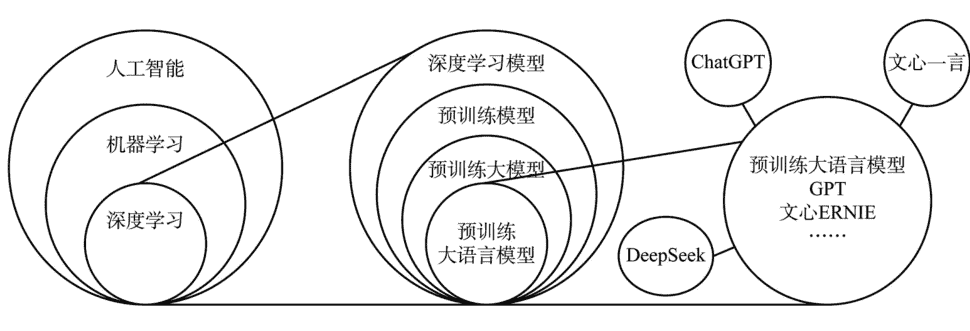

DeepSeek 技术与教学应用简明概览

总体来看，DeepSeek 已经进入大语言模型的领先梯队，底座建立在深度学习与机器学习的体系之上，反映了人工智能从感知向认知演进的轨迹，在生成式 AI 阵营里具备代表性。它的强势来自算法打磨、数据使用效率提升与算力部署优化的协同，能够迅速捕捉用户意图并产出高质量内容。

对教学而言，先理清生成式 AI 与大语言模型的基础概念、发展阶段与关键要素，并弄懂两者之间的关联，尤其是生成类系统与大模型在共性与特性上的差异，有助于形成对 DeepSeek 这类工具的技术认知与能力边界判断，为后续掌握核心功能、提升提示词水平，并在课堂中合规负责地使用奠定基础，也是 AI 素养的重要组成部分。

### 二、DeepSeek核心功能详解

DeepSeek 依托持续迭代的领先模型，为教育赋能提供了较大空间。本节先梳理整体能力，再聚焦两款代表性模型，明确各自侧重点。

#### （一）DeepSeek的通用能力

从通用维度来看，DeepSeek 的能力边界比较宽泛，主要集中于以下方向。

##### 1 强大的自然语言理解与生成
能够准确理解用户以自然语言提出的需求，随后产出通顺连贯、逻辑清晰的文本，常见成果涵盖文章、摘要、邮件、报告以及教学设计等。

##### 2 知识问答与信息整合
基于海量训练语料，可跨学科作答，涵盖信息检索、知识阐释、观点归纳等服务。

##### 3 多语言处理能力
中文与英文处理均较为流畅，支持互译、双语内容创作、语法纠错等，有助于跨语言教学与沟通。

##### 4 代码能力
拥有撰写与解读代码的能力，可辅助信息技术课程或跨学科编程教学。

##### 5 文件处理与分析
可读取解析多种文件格式，如 PDF、Word 等，迅速抽取要点、制作摘要，并基于文档内容进行问答。

##### 6 联网搜索能力
内置网络检索功能，能调取最新网络资料参与回答与内容创作。

#### （二）DeepSeek模型特点：V3通用模型与R1推理模型

当前重点推广 V3 与 R1 两款模型，二者在设计目标与擅长领域上各有偏重，教师可依据任务挑选。下表概括了差异。

表3-1 DeepSeek模型对比

| 对比维度 | DeepSeek-V3(通用模型) | DeepSeek-R1(推理模型) |

| :--- | :--- | :--- |

| 核心定位 | 多任务、通用场景 | 复杂问题解决、逻辑推理 |

| 擅长任务 | 文本生成、问答、翻译、摘要、对话(部分版本) | 数学推导、代码生成、科学计算、策略分析、多步因果推理 |

| 训练侧重 | 预训练+监督微调 | 更侧重强化学习或针对推理任务的专项训练 |

| 核心创新 | 多语言优化、长上下文支持、高性能推理(压缩技术) | 支持“思维链”输出、自我纠偏能力、多步因果推理 |

| 输出特点 | 输出相对简洁、直接，有时依赖更结构化的提示词获取精确结果 | 输出更详细，能自动拆解问题逻辑链，展示思考过程，对提示词的结构要求可能相对宽松(对开放性问题) |

| 响应速度与成本 | 响应速度相对较快，适合需要快速反馈的任务 | 推理过程可能更复杂，响应速度相对较慢，但API成本可能更低(针对特定推理任务优化) |

| 主要教育场景 | 教学材料生成、语言学习辅助、基础知识问答、内容总结 | 复杂问题解析(展示步骤)、学术研究辅助(逻辑梳理)、个性化深度辅导(多角度解答)、编程教学 |

| 优势 | 生成速度快，适合标准化内容生成，应用范围广 | 推理过程透明，有助于培养学生逻辑思维，擅长解决复杂问题 |

| 局限 | 复杂逻辑推理深度可能有限，有时需要人工进一步加工或校验 | 输出速度可能较慢，不太适合需要极高实时性的互动场景 |

DeepSeek-V3 面向多任务通用场景，可完成文本创作、知识问答、翻译、写作等常规任务，泛化性强。上下文长度约 32K tokens，利于长文档解析与多轮对话，通用任务优化使其响应较快。教学实践中更适合产出标准化结构化素材，如迅速生成课程大纲、知识点梳理、概念讲解、多语学习支持与常规问答等。

DeepSeek-R1 聚焦逻辑推理与复杂问题求解，擅长需要多步分析、因果推断与逻辑演绎的任务，如数学推导、代码逻辑生成、科学计算、策略分析等。模型采用 MoE 等架构，在保持强大推理性能的同时提升计算效率，并针对推理任务进行了专项训练。其显著特征是能够输出“思维链”，把解决问题的详细步骤与推理过程可视化，而非仅呈现最终答案。就教学而言，它适用于需要展示思考过程的深度探究情境，如数学解题演示、物理问题逻辑推演、编程思路解析、实验方案设计与论证、复杂概念的多角度辨析，思维链有助于学生理解过程、培养逻辑思维。

#### （三）如何选择合适的模型

实际应用中，建议结合教学目标与任务类型灵活切换。需要快速生成教学文案、归纳知识点、进行语言翻译或基础问答时，V3 通用模型通常更高效；当任务涉及复杂问题深入探究、解题思路展示或需要 AI 提供详细思考过程时，R1 推理模型更具优势，其思维链尤其利于启发学生思考与分析解决问题能力。理解不同模型的核心功能与特点，是有效利用该工具赋能教学创新的基础。下一节将深入探讨提示词技巧的使用。

### 三、DeepSeek实战入门

功能与模型已明确，接下来进入操作实践。本节指导如何访问平台、熟悉基本界面与操作流程，为后续深入应用打下基础。

#### （一）访问DeepSeek的主要途径

目前主要有以下几种访问方式。

##### 1 DeepSeek官方网站（云端平台）
这是最直接、功能最完整的方式，可通过浏览器访问 https://chat.deepseek.com/。无需安装即可体验最新模型与特性。优点是功能全、更新及时；缺点是在高峰期可能出现系统繁忙。点击“开始对话”即可进入交互界面。

图3-2 DeepSeek官网首页

DeepSeek-V3 模型更新，各项能力全面进阶，在网页端、APP 和 API 全面上线，点击查看详情。

###### deepseek

###### 探索未至之境

开始对话

与 DeepSeek-V3 和 R1 免费对话

体验全新旗舰模型

获取手机 App

DeepSeek 官方推出的免费 AI 助手

搜索写作阅读解题翻译工具

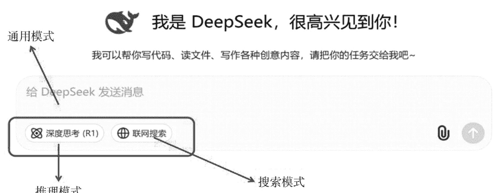

2025年5月28日DeepSeek更新了R1版，即DeepSeek-R1-0528，更新后的R1模型仍然使用2024年12月发布的DeepSeek-V3-Base模型作为基座，但在后训练过程中投入了更多算力，显著提升了模型的思维深度与推理能力，其深度思考能力得到了强化。更新后的R1模型在数学、编程与通用逻辑等多个基准测评中取得了在当前国内所有模型中首屈一指的优异成绩，并且在整体表现上已接近其他国际顶尖模型，如ChatGPT的o3与谷歌的Gemini 2.5 Pro。DeepSeek于2025年8月21日正式发布了V3.1版本，本次升级主要引入了混合推理架构，使得同一个模型同时支持思考模式（DeepSeek-Reasoner）和非思考模式（DeepSeek-Chat），用户可根据任务需求自由切换。思考模式适用于复杂逻辑推理和数学计算，响应更精准；非思考模式则适用于日常对话，响应更迅速。新版的智能体（Agent）能力大幅提升，上下文窗口扩展至128K，灵活性与效率兼备。

##### 2 集成DeepSeek能力的第三方平台与应用

众多国内 AI 应用已集成 DeepSeek 能力，提供更多选择。

（1）腾讯元宝：集成 DeepSeek 满血版，并可切换腾讯混元模型。特色是可联网搜索微信公众号等腾讯生态内容，并提供 AI 总结、多格式文档解析等功能。

图3-4 腾讯元宝网页版界面

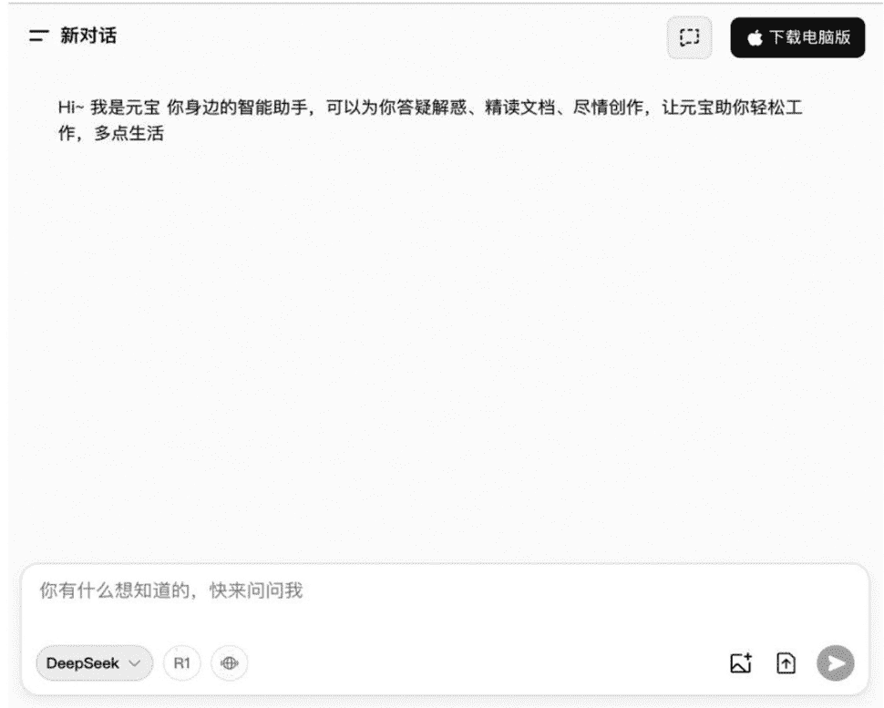

（2）秘塔AI搜索（Metaso）：以 AI 搜索为核心，同时集成 DeepSeek 能力，特点是支持“深度思考”模式，适合复杂问题探究与信息整合。

图3-5 秘塔AI搜索网页版界面

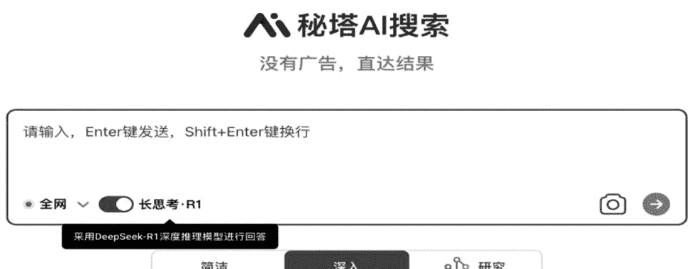

（3）纳米AI搜索（Nami）：接入 DeepSeek，部分时段提供不同版本供选择，目前提供免费使用，额度有限。

图3-6 纳米AI搜索网页版界面


（4）其他集成平台：钉钉、飞书、天工AI、扣子等办公或 AI 应用，以及火山引擎、百度智能云、阿里云、华为云等云服务商可能提供 DeepSeek 模型或接口，多面向开发者或企业用户。

（5）本地部署：对技术能力强、数据安全要求高的机构，可考虑开源模型本地化部署，但需高性能 GPU、专业团队维护，成本高昂。对绝大多数中小学教师而言，云端访问仍是最现实便捷的方式。

图3-7列出了 DeepSeek 可访问的平台架构，教师可按需选择。

图3-7 DeepSeek访问平台框架图

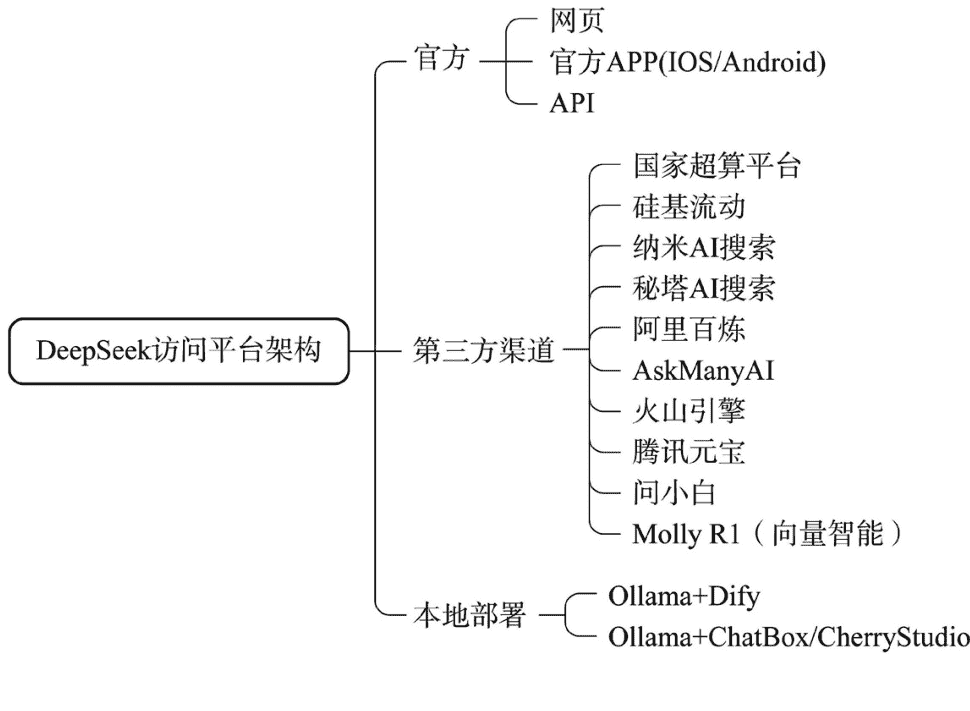

#### （二）DeepSeek主要界面布局与功能区介绍（以官网为例）

##### 1 DeepSeek页面布局
登录官网后，可看到简洁的对话界面，核心区域包括：

- （1）对话窗口：展示对话历史，你的提问与模型回复依次呈现。
- （2）提示词输入框：位于下方居中，用于输入指令，支持文本输入。
- （3）发送按钮：输入框右侧的向上箭头，点击发送内容。
- （4）模型选择器：位于输入框下方，可在不同模型间切换，如选择“深度思考R1”后字体变蓝即开启推理模型。
- （5）联网搜索开关：控制是否允许模型联网查询实时信息。
- （6）文件上传按钮：输入框右侧回形针图标，可上传本地文件，支持 PDF、Word、TXT、CSV、Excel 等。

##### 2 基本的对话交互操作
- （1）明确任务：先思考想让模型做什么或问什么。
- （2）输入提示词：在输入框用自然语言清晰描述需求。
- （3）选择模型：依据任务需求选择 V3 或 R1。
- （4）开启联网搜索（可选）：需要最新信息时打开，注意开启后不可上传文件。
- （5）点击发送：提交指令。
- （6）阅读回复：耐心等待并审阅输出。
- （7）继续对话：不满意或需追问时可多轮交互，模型可理解上下文。
- （8）新建对话：开始全新任务时建议新建，保持聚焦。

##### 3 文件上传与处理
- （1）点击回形针图标打开上传入口。
- （2）选择本地文件，注意格式与大小限制。
- （3）明确处理要求，例如“请总结此 PDF 的核心论点”“根据此 Word 生成 5 道选择题”“分析此 CSV 并生成柱状图”等。

##### 4 发送指令：点击发送按钮
文件处理能力尤其是表格数据的支持，极大扩展了在教学数据分析、学情报告解读等方面的应用。掌握基本操作后，可通过持续互动熟悉功能。下一节将重点讲解提示词设计。

### 四、国内主要生成式AI工具概览

前文已深入了解 DeepSeek 的功能与实操，国内生成式 AI 领域整体呈现多元繁荣态势。除 DeepSeek 外，还有众多工具可供选择，关键在于“没有最好的 AI，只有最合适的 AI”，根据教学目标灵活组合使用，才能实现深度赋能。

#### （一）主流大语言模型概览

表3-2 大语言模型特点对比

| 模型名称 | 研发机构 | 核心特点 | 特色功能与优势 | 主要教育应用潜力 |

| :--- | :--- | :--- | :--- | :--- |

| 文心一言 (ERNIE Bot) | 百度 (Baidu) | 知识增强，综合能力强 | 具备较强的图文生成（多模态）能力，深度整合百度搜索生态，知识问答准确度高 | 备课资料查询、生成带配图的课件、设计跨学科主题探究活动 |

| 通义千问 (Qwen) | 阿里巴巴 (Alibaba) | 文档处理能力突出 | 支持超长文档（如 PDF、Word）的阅读理解和摘要，与钉钉等办公软件深度集成 | 阅读和分析学术论文、快速解读政策文件、处理学生长篇作文 |

| 豆包 (Doubao) | 字节跳动 (Byte-Dance) | 风格多样，易于上手 | 提供多种智能体角色，对话风格自然流畅，适合日常交流和创意写作 | 扮演角色与学生对话、生成不同风格的作文范文、进行头脑风暴 |

| 智谱清言 (ChatGLM) | 智谱 AI (清华大学技术成果转化而成) | 学术背景，代码能力强 | 代码生成和逻辑推理能力在国内模型中表现优异，具备较好的学术严谨性 | 辅助信息技术/编程教学、设计数理逻辑题目、进行学术文献检索与分析 |

| 讯飞星火 (iFlytek Spark) | 科大讯飞 (iFlytek) | 语言与教育场景深度融合 | 语音识别与合成能力顶尖，内置作文批改、口语评测等多种教育专用功能 | 英语口语练习与评测、中英文作文智能批改、生成课堂发言稿并转为语音 |

| Kimi 智能助手 | 月之暗面科技 (Moonshot AI) | 超长无损上下文 | 支持高达 200 万字的上下文窗口，在长文档阅读、信息整合和摘要方面无出其右 | 快速阅读并总结整本书籍、分析长篇报告、整合海量文献资料 |

#### （二）各模型功能特色详解

##### 1 大语言模型

（1）文心一言（ERNIE Bot）https://yiyan.baidu.com/

文心一言由百度打造，是一个以知识增强为方向的大语言模型，常被视作兼顾广度与深度的通才型助手。模型把百度搜索体系与大规模知识图谱融合在底座上，使得在事实性问答上的可信度相对突出。截至2025年8月，主力版本已推进到文心4.5 Turbo，输出速度与质量同步提升，同时具备多模态能力，可依据文字提示生成可用作教学配图的图像，为课程视觉化提供支持。插件体系也比较完整，自动生成PPT、绘制思维导图等功能在不断拓展边界。教学实践中，教师可以用它快速检索备课资料，也能在规划跨学科探究时，让模型围绕主题产出图文结合的介绍材料。

（2）通义千问（Qwen） https://www.tongyi.com/qianwen/
通义千问是阿里巴巴推出的长文本处理型模型，被业内视作文档阅读专家。2025年更新为Qwen 3后，中英文理解、逻辑推理与知识增强能力均有明显提升，原生上下文长度支持扩展到256K，长文处理优势进一步巩固。与钉钉等办公产品深度打通，便于嵌入现有工作流。对教育从业者来说，它是处理文本材料的得力工具，能够快速精读学术论文、梳理冗长政策文件，或对学生提交的长篇作文进行初步归纳提炼，显著提高工作效率。

（3）豆包（Doubao） https://www.doubao.com/chat/
豆包是字节跳动发布的对话风格轻松的智能伙伴，上手门槛低，交互顺畅。2025年7月底，字节完成模型体系升级，推出豆包大模型1.6系列、图像编辑模型3.0、同声传译模型2.0等，呈现平台化与专业化的发展态势。内置的智能体广场汇聚大量角色各异的智能体，如英语学习助手、情绪陪伴等，师生可直接选用，趣味性强。教师可为豆包设定虚拟导师角色，通过对话引导学生自主探索课题。凭借风格多样，教学潜力突出，例如历史课可创建“苏格拉底”智能体在对话中训练思辨；语文课可借助其生成不同文风的作文起笔或范文，启发写作创意。

（4）智谱清言（ChatGLM） https://chatglm.cn/
智谱清言源自清华技术成果转化，具有学院派气质，学术底蕴深厚，逻辑推理与代码生成表现扎实。到2025年8月，顶配模型GLM-4.5已上线，代码、推理及长文本处理能力进一步强化。对信息技术或编程教学而言，它是强有力助手，能生成并解释代码、协助定位调试问题。输出偏严谨，适合科学理性探究。教学中可用于编程辅导、设计数理逻辑题目，或在课题研究初期借助其进行文献检索与分析。

（5）讯飞星火（iFlytek Spark） https://xinghuo.xfyun.cn/desk
科大讯飞为中国用户尤其是教育场景定制的星火，继承了公司在语音识别与合成方面的领先技术，并内置大量教学化功能，如中英文作文智能批改与语法分析、英语口语跟读评测等，与教师日常教学流程契合度高。英语教师可借助它为学生提供个性化口语练习与即时反馈；语文教师可批量处理学生周记，把更多精力投向思想引领与写作逻辑指导。

（6）Kimi智能助手 https://www.kimi.com/
月之暗面开发的Kimi智能助手被视作海量信息阅读器，核心差异在超长无损上下文处理。截至2025年8月，最新模型升级为K2，在长文本处理上的领先地位继续保持，上下文窗口最高可达200万字。处理超长文档或多文档对比分析时不易遗忘前文，信息整合能力突出。对需要大量文献阅读的师生价值明显，教师做课题研究时可一次性提交数十篇参考文献，让其生成系统化文献综述；学生撰写读书报告时，也能上传整本电子书，由Kimi快速定位关键信息与核心论点。

##### 2 图像与视频生成模型

除语言模型外，能把抽象文字转为直观视觉呈现的图像与视频生成工具，为教学创新打开更大空间。表3-3 图像与视频生成模型对比续表

| 模型名称 | 研发机构 | 核心定位 | 主要特点 | 主要教育应用潜力 |
| :--- | :--- | :--- | :--- | :--- |
| 可灵 (Kling) | 快手 (Kuaishou) | 专业级文生视频大模型 | 文生视频。模型升级至2.1，运动质量更高，视频更灵动，指令响应更好 | 生成科学演示动画（如细胞分裂）、历史情景再现、文学作品可视化 |
| 智谱清影 (Zhipu Qingying) | 智谱 AI (Zhipu AI) | AI 生视频创作平台 | 支持文生视频和图生视频，与智谱清言同源，注重逻辑性和连贯性 | 生成教学演示视频、将静态图片（如教材插图）转化为动态视频 |
| 海螺视频 (Hailuo AI) | MiniMax | AI 视觉内容创作平台 | 支持文生视频和文生图，强调“将想法变为视觉”，与 AI 助理紧密结合 | 快速生成教学短视频、为学生提供多模态的问答体验 |
| 腾讯混元 AI 视频 | 腾讯 (Tencent) | 腾讯生态内的视频生成工具 | 文生视频。基于混元大模型，已逐步与腾讯会议、腾讯文档等腾讯生态内工具深度融合，注重真实感 | 制作课程宣传片、生成与腾讯生态内容相关的教学视频 |
| 通义万相 (Tongyi Wanxiang) | 阿里巴巴 (Alibaba) | 综合性 AI 绘画与视频创作平台 | 文生图、图生图、文生视频。模型升级至 Wan 2.2，功能全面，风格多样 | 辅助美术与设计教学、为各学科课件生成高质量插图/视频片段 |
| 即梦 (Tiamat) | 抖音集团 (Douyin Group) | 多功能 AI 创意与创作平台 | 文生图 (图片 3.1)、文生视频、数字人、动作模仿，功能维度非常丰富 | 辅助美术教学、创作历史/地理主题图像、制作虚拟教师形象进行讲解 |
| 剪映 (CapCut) | 字节跳动 (Byte-Dance) | 集成 AI 功能的视频剪辑工具 | 图文成片。极大降低视频创作门槛，侧重于剪辑流程中的 AI 自动化 | 教师快速制作微课、学生制作视频作业/项目成果展示、活动记录视频化 |

###### （1）可灵 (Kling) https://app.klingai.com/cn/
快手推出的可灵被定位为电影级文字转视频模型。截至2025年8月已升级到可灵2.1，运动表现、画面美感与指令遵循度均有提升。它主攻文字驱动视频，可依据描述生成长达2分钟、1080p高清视频，在物理规律模拟、人物动作连贯性及面部表情生动性上表现突出。对教学而言，许多难以观察的抽象过程得以可视化。比如生物教师可输入“展示细胞有丝分裂过程的科教动画”生成教学短片，语文教师也可让可灵将课文关键情节转化为情境再现视频，帮助学生更直观理解文本。

###### （2）智谱清影 (Zhipu Qingying) https://chatglm.cn/video
智谱AI发布的智谱清影是AI生视频创作平台，可视为学院派视频创作者。它同时支持文字生成视频和图片生成视频，用户可用文字描述或上传图片来生成视频。作为智谱大模型家族成员，它延续了智谱清言在逻辑理解上的优势，生成的视频逻辑严谨、连贯性与故事性较好，适合创作叙事性教学内容，可用于科学实验过程呈现、历史事件动态复原等。教师能将其用于把教材中静态插图转成动态讲解视频，也可让学生用自己的绘画作品生成小动画，激发创作热情。

###### （3）海螺视频（Hailuo AI） https://hailuoai.com/video
MiniMax旗下的海螺视频是AI视觉内容创作平台，核心理念是“将想法变为视觉”。它兼具文字生成视频与文字生成图像能力，并与海螺AI的对话功能无缝衔接，用户在对话中即可下指令创作，操作便捷。即时生成的特性在教学中很有用，教师在讨论教学方案时可即时要求生成视频片段预览；学生提问时，AI也能用小视频或图片辅助解释复杂概念，实现多模态问答。该模型特别适合快速产出科普、教育类短视频，提升课堂互动。

###### （4）腾讯混元AI视频 https://video.hunyuan.tencent.com/
腾讯混元AI视频基于混元大模型打造的文字生成视频方案，专注于把文本描述转化为真实感强的视频。作为腾讯生态一员，其最大潜力在于未来能与微信、腾讯会议、腾讯文档等应用深度融合。未来教师或可在微信群中直接分享AI生成的活动宣传片，或在腾讯课堂等平台一键生成课程回顾视频，实现边沟通边创作、边教学边生成资源的高效模式。

###### （5）通义万相 (Tongyi Wanxiang) https://tongyi.aliyun.com/wanxiang
阿里通义系列的通义万相是“全能艺术家”，功能丰富的智能绘画与视频创作平台。到2025年8月模型已更新至Wan 2.2，支持高质量文字生成图、图生成图与文字生成视频，并内置国画、动漫、像素艺术等多种预设风格，便于快速产出特定风格作品。教育场景应用广泛，美术教师可引导学生将涂鸦转化为完整艺术作品；地理教师可用其生成不同地貌的风景画或地壳运动短视频，让知识更生动。

###### （6）即梦 (Tiamat) https://jimeng.jianying.com/
抖音集团的多功能AI创意平台即梦，功能维度丰富。它不仅支持高质量文字生成图（图片模型已至3.1）和文字生成视频，还提供数字人、动作模仿等独特功能，不仅能创造视觉内容，还可生成虚拟形象并让其模仿指定动作。教育领域由此打开新可能，教师可创建个人虚拟教师形象进行课程讲解，或利用动作模仿功能为体育、舞蹈课制作标准示范视频，丰富教学形式。

###### （7）剪映 (CapCut) https://www.capcut.cn/
剪映是一款集成强大AI功能的视频剪辑工具，与其他文字生成视频模型不同，它更侧重降低“剪辑”门槛。核心功能是“图文成片”，用户输入文字后AI即可自动匹配素材、生成配音与字幕，一键产出完整视频。对教师而言，剪映是最友好实用的创作工具之一，任何学科教师都能把教案或讲稿输入，快速生成内容丰富、形式生动的微课视频，大幅降低技术门槛。

本节介绍了国内主流生成式智能的多模态生态，从各具特色的语言模型到强大的图像视频工具，共同构成丰富的智能教育应用体系。

掌握这些工具的关键，不只在于熟知各自功能，更在于培养“组合创新”的思维。未来的智慧教师更像导演，根据教学剧本调度不同的智能“演员”，把语言生成、图像创作、视频制作等能力有机整合，创造出更具吸引力的教学体验。例如，先用Kimi整合大量文献形成知识框架，再用文心一言撰写教学文稿，最后借助可灵或剪映转化为生动教学视频。

人工智能仍在高速演进，功能不断迭代。最重要的不是死记每个工具的细节，而是保持开放心态，及时关注最新能力，勇于尝试探索。希望这些介绍能为教师打开思路，从“使用工具”走向“驾驭工具”，开启教学创新的无限可能。

### 五、使用生成式AI的技能层次

教师在使用生成式人工智能时不仅要了解基本功能，更要掌握不同层次的应用技能，以应对不同复杂度的教学任务。掌握这些技能，教师将从使用者转变为能驾驭智能解决复杂教学问题的创造者。依据教学任务由简到繁的需求，教师使用生成式人工智能的技能可划分为四个层次（见图3-8）。图3-8 生成式AI使用的技能层次

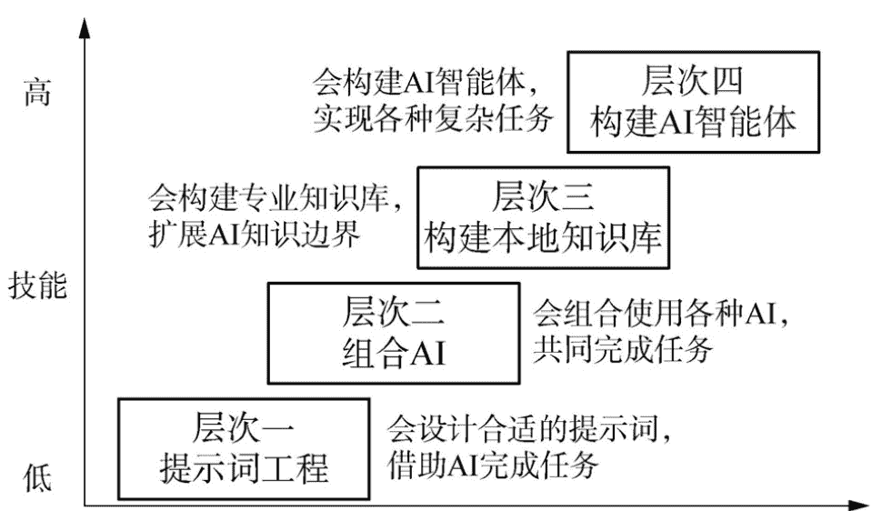

#### （一）层次一：提示词工程

这是使用生成式人工智能最基础也最核心的技能。处于这一层次的教师，能通过设计清晰、具体、富逻辑的提示词，引导模型准确理解任务需求，产出高质量文本、图片、代码等内容。教师应具备的核心能力是设计合适的提示词，借助人工智能完成任务。典型教学场景如：

- 备课助手：输入“请为小学五年级数学设计一个关于‘小数乘法’的趣味课堂导入活动”，快速获取灵感。
- 出题助手：输入“请根据以下关于光合作用的知识点，生成5道选择题和2道简答题”，高效编写随堂练习。
- 答疑助手：针对学生提问，设计提示词让人工智能生成通俗易懂的解释。

此层次教师主要把人工智能当作高效辅助工具，完成相对独立、单步骤的教学任务。

#### （二）层次二：组合AI

当教学任务更为复杂，单一工具难以一步到位时，需进入组合人工智能层次。该层次教师能像指挥团队一样，把多个智能工具或服务串联成工作流，协同完成综合性任务。核心能力是组合使用各种人工智能共同完成任务。典型场景包括：

- 制作多媒体课件：先用某模型生成课文逐字稿和教学设计，再用智能绘图工具为关键情节配图，最后用智能剪辑工具如剪映将文字、图片与配音合成完整教学视频。
- 设计项目式学习：利用人工智能生成项目主题与方案，再用工具制作项目介绍海报，最后用人工智能生成项目评估量规。

此层次教师角色从“使用者”转向“项目经理”，需要规划与整合能力。

#### （三）层次三：构建本地知识库

通用大模型知识截止于特定时间点，且缺乏特定学科或校本课程的专业知识，易产生幻觉。第三层次要求教师为人工智能“补充养料”，构建专业化、本地化的知识库，扩展人工智能知识边界，使回答更具针对性与权威性。核心能力是构建专业知识库，扩展人工智能知识边界。典型场景包括：

- 学科知识库：将教材、课程标准、前沿论文、实验报告等整理成知识库，让人工智能基于权威资料回答学生深度问题。
- 校本课程问答机器人：将学校特色课程资料、校史、规章制度等输入知识库，创建精准回答本校问题的智能助手。

掌握此技能的教师，能把人工智能从“万事通”训练成特定领域的“专家”。

#### （四）层次四：构建AI智能体

这是最高阶技能。教师不再只是使用工具，而是创造工具。通过构建智能体，可创建能理解目标、自主规划并执行复杂任务的自动化系统。核心能力是构建人工智能智能体，实现复杂任务。典型场景包括：

- 个性化学习导师：创建智能体，根据学生在线学习行为数据自动分析薄弱点并推送个性化资料与练习。
- 自动化教学研究助手：构建能自动浏览教育研究网站、筛选主题论文并定期生成文献综述报告的智能体。

此层次教师化身开发者与创造者，能构建高度自动化智能化教育应用，把自己从重复劳动中解放，专注更有创造性的教学。

总之，四层技能代表了教师从初学者到精通者的成长路径。可根据实际需求循序渐进提升人工智能应用能力，在人工智能时代更好地赋能教学、成就学生。本书将结合教学目标、任务与场景，通过案例展示如何提升教师在这四个层面的能力。

### 六、提示词技巧：与AI高效对话的艺术

掌握了DeepSeek的基本操作后，你可能会发现人工智能的回答有时并不完全符合预期，甚至答非所问。这往往不是能力不足，而是提示词不够清晰、准确、有效。

提示词即你向人工智能发出的指令或问题，是用户与生成式人工智能交互时提供的输入信息，用于引导人工智能生成符合预期的输出。它可以是问题、描述、命令或对话，通过界定任务目标、背景信息和输出要求，帮助人工智能理解意图并减少歧义。提示词质量直接影响生成内容的准确性和相关性，是沟通的核心桥梁。清晰、结构良好、信息丰富的提示词能帮助人工智能准确理解需求，生成更相关、更深入、更符合要求的内容，避免误解与无效输出，它如同与人工智能对话的“钥匙”，决定能解锁何种信息与能力。因此，写好提示词是需要学习与练习的艺术，也是教师高效利用生成式人工智能赋能教学的关键技能。

#### （一）提示词的重要特征

高质量提示词通常具备以下特征。

##### 1 明确性与具体性
提示词需清晰描述任务类型、期望输出格式及约束条件，避免模糊或笼统表述。例如，“写一篇面向小学三年级学生的运动会作文，要求包含至少三个表示开心的词语，字数在300字左右”就比“写一篇关于运动会的作文”明确得多。

##### 2 结构化要素
结构良好的提示词通常包含指令、上下文、输入数据和输出要求等关键部分。例如设定角色，如“你是一名经验丰富的科学老师”，可引导人工智能以更专业的口吻作答。

##### 3 背景信息与约束条件

想让大模型产出更对味，关键在于把任务背景交代清楚。像是使用场景是什么、面向谁、知识储备大概在哪、希望的语气是活泼还是严肃专业，这些信息都给了，模型才好对准需求来写。比如解释概念时，明确说“请用小学生能听懂的说法”，效果会立竿见影。

##### 4 反复打磨才能达标
一次成型的提示词很少见。会用的使用者会先看模型的初稿哪里偏了，然后补背景、换说法、加限制，慢慢把结果越调越准。这其实是不断试错、持续优化的过程。

##### 5 进阶方法能够加分
在基础要素之上，还可以上一些实操技巧。让模型分步思考的思维链提示、借助分隔符把指令和材料分开、给少量示范供模仿，都会让输出更合逻辑、更准确、更相关。把这些规律吃透，是写出好提示词的基础，老师们在教学实践中也能不断总结出更实用的经验。

#### （二）好提示词的原则与构成
一套有效的提示词，通常遵循一些共性原则，并包含若干固定要素。没有唯一公式，但下面这些参考点很有用。

##### 1 撰写提示词要把握的原则
- （1）条理分明：别用模棱两可的词，指令要说死，问题要具体。模型不会读心，你得直接告诉它要什么。
- （2）信息充足：把背景、上下文、限制条件补全，情境越清晰，答案越贴合。
- （3）目标明确：先想清楚要模型做什么、生成什么、解决什么问题。
- （4）简洁利落：在保证清楚的前提下，尽量少废话，避免歧义。
- （5）持续迭代：别指望一次写到最好，通常要根据反馈修改、优化。

##### 2 常用提示词的六大构成
归纳大量有效案例，可以提炼出六个核心部件，按需组合：
- (1) 人设设定：给模型一个身份或视角。
- (2) 任务说明：清晰说出希望执行的动作。
- (3) 背景上下文：提供任务相关的情境信息。
- (4) 格式与风格：规定输出的格式、语气、长短等。
- (5) 示例参考：必要时给出期望的范例。
- (6) 约束要求：提出具体限制或条件。

结构示例：请你扮演初中历史教师，为八年级学生准备一次关于一战起因的复习课。帮我设计3个课堂互动环节，形式要多样能促思考，每个环节写清操作步骤和预计时长，语言简洁明了。

#### （三）常见的提问技法
除了搭建结构，掌握提问策略也能让交互更顺畅。

##### 1 开放式提问与封闭式提问
按目的选方式，前者求创意，后者求精准。
- (1) 开放式示范：假如你生活在唐朝，会写怎样一首诗来描绘长安的春天？
- (2) 封闭式示范：请列出光合作用发生的必要条件。

##### 2 追问与厘清
对初次回答做追问，能得到更深更准的信息。
> 模型答：“太阳系有八大行星。”
> 可追问：“按离太阳由近到远排序是哪八颗？各自有什么主要区别？”

##### 3 多轮对话
把复杂任务拆开，分轮推进。
> 第一轮：帮我设计一个关于声音产生与传播的小学科学小实验。
> 第二轮：音叉实验材料不好找，能否换成尺子、橡皮筋这类日常物品来做？

##### 4 思维链引导
要求模型展示思考过程，适合推理类任务。
> 请解释为什么1/2+1/3=5/6，把计算步骤逐一写出来。

##### 5 提供反例或限制
明确告诉模型哪些内容不要出现。

##### 6 要求多选方案
让模型给出多个备选。
> 请提供三种不同难度的证明三角形内角和为180°的方法，适配不同学段。

##### 7 调节创造度
根据需求调整生成创造性，高创造适合写诗，低创造适合做科普说明。

#### （四）结构化提示框架
把核心要素组合起来，可以形成易记的框架。下面介绍STAR-AI及多种常用结构。

##### 1 STAR-AI框架
(1) S——情境：说明希望处理的背景或场景。例如为家长会准备发言稿、设计光合作用的科学课、创作鼓励讨论的小故事等。
(2) T——任务：明确要模型执行的动作，如撰写、总结、设计、解释、生成练习、翻译、分析等。
(3) A——受众：明确面向谁，如小学三年级学生、初中生家长、教研组同事、具备编程基础的高中生等。
(4) R——角色：赋予模型具体人设，如经验丰富的小学数学老师、耐心的心理辅导员、博学的图书管理员、严谨的物理实验员等。
(5) A——侧重点/格式：规定回答要偏重哪方面或输出什么形式，如侧重原理、侧重应用、用列表呈现、生成思维导图、Markdown格式、控制在三段内等。
(6) I——具体指令/约束：给出操作细节或限制，如字数约300字、语气活泼、必须出现关键词“细胞呼吸”、不涉及微积分、给出三个难度版本等。

##### 2 STAR-AI使用示例
情境：我正在为小学四年级准备分数初步认识的数学课。受众：学生普遍觉得分数抽象。
任务：请帮我设计一个课堂导入活动。角色：扮演富有创意且很有耐心的小学数学老师。
侧重点/格式：互动性强，最好结合生活实例如分披萨、切水果，控制在10分钟左右。
约束：用简单易懂的语言，侧重直观理解“几分之一”和“几分之几”，不涉及加减运算。

合并后：请扮演一位富有创意且非常有耐心的小学数学老师，为小学四年级学生设计分数初步认识的课堂导入活动。学生觉得分数抽象，活动要互动性强，结合生活实例如分披萨，约10分钟。用简单语言帮助学生直观理解几分之一和几分之几，不涉及加减运算。

##### 3 STAR-AI要素与大模型原理的对应
表3-4 提示词要素与模型工作机制对照

| STAR-AI要素 | 作用 | 对应技术原理 |
| :--- | :--- | :--- |
| S情境 | 提供上下文，限定边界 | 超长上下文窗口与注意力机制，可捕捉关键信息理解情境 |
| T任务 | 明确输出类型和目标 | 指令微调，使模型学会理解并执行各类任务意图 |
| A受众 | 确定内容适配层级 | 隐式用户建模与风格适应，调整用词复杂度 |
| R角色 | 定义风格和视角 | 可控生成与风格迁移，模拟特定角色语言特征 |
| A侧重点/格式 | 规范组织结构 | 结构化解码约束，遵循列表、表格、Markdown等格式 |
| I具体指令/约束 | 精确控制生成条件 | 多维度条件生成，支持温度、关键词、字数等约束 |

理解这种映射，有助于更有针对性地设计提示，借助模型的内在机制获得更好教学辅助。

##### 4 其他常用结构
(1) C.R.I.S.P.E结构：Context情境，Role角色，Instruction指示，Specifics细节，Persona个性/语气，Example示例。
(2) R.I.S.E结构：Role角色，Input输入，Steps步骤，Expectation期望。
(3) T.S.C.F结构：Task任务，Situation情境，Constraint限制，Format格式。
(4) G.A.S.C结构：Goal目标，Audience受众，Style风格，Content内容。
(5) Q.P.D.C.R结构：Question问题，Probe探究，Define定义，Challenge挑战，Reflect反思。
(6) B.R.O.K.E结构：Background背景，Role角色，Objectives目标，Key Result关键结果，Evolve演进。

这些结构只是思维工具，关键是理解要素作用并灵活组合，最佳提示往往来自实践中的不断尝试。

##### 5 常见误区
1. 过于模糊宽泛，如只说“写篇环保文章”，缺少读者、文体、侧重点。
2. 一次塞太多不相关任务，易导致混淆，建议拆分。
3. 背景信息不足，模型难以把握意图。
4. 高估模型能力，要求做超出能力范围的事。
5. 不迭代不追问，第一版不满意就放弃。
6. 忽视伦理版权，要求生成不当内容。
7. 照搬结果不核查，尤其教学材料要审校修改。

##### 6 写提示的进阶心法
（1）秘诀一：让AI帮你写提示
核心思路：不会写或效果差，就请AI自己生成或优化提示。
操作：直接问“我需要一个提示，让AI为小学五年级设计循环系统的科学实验方案，请帮我写个详细提示”；或把已有提示丢过去请改进。
（2）秘诀二：说人话
核心思路：像跟人聊天一样自然表达需求，不必刻意套公式。
操作：直接描述“我想要一个给初一学生讲有理数加法的故事，主角是数字小精灵，要说明同号异号加法，最后加小练习，语气活泼一点”。
（3）秘诀三：激活批判性思维
核心思路：引导模型多角度分析并以列表或表格呈现，启发深度思考。
操作：要求“从经济、社会、环境三方面列出工业革命对英国的积极与消极影响”。
（4）秘诀四：开启“杠精”模式
核心思路：持续质疑、追问、挑战回答的准确性，多轮对话挖掘更深信息。
操作：明确要求“针对‘AI将完全取代教师’的观点，扮演反对者提出至少三个质疑点”。

持续追问与对立思考，让模型输出经得住检验

- 对模型给出的结论进行连环追问，逼它把模糊表述拆细。比方它说“塑料袋对环境危害很大”，可以追着问：危害主要落在哪些环节？能否拿出可查证的量化依据？现阶段有哪些替代材料？这些替代品自己是否也带短板？
- 同时要求它亮出证据并呈现反面声音。比如让它就“基因编辑总体利大于弊”展开，要求先列出支撑该立场的事实依据，再系统梳理反对立场的主要论据。

基础教育应用案例·科学/思政

- 议题方向：是否应当全面禁止一次性塑料制品。
- 对模型的指令设计：先请它表明自己的判断，随后你基于该判断提出质疑，要求它为自身立场辩护并提前预判可能的反驳。后续可继续追问：你主张禁令有助于环境保护，是否会降低生活便利性？替代方案的价格门槛是否被考虑过？

秘诀五：借用思维脚手架，与专家同步对话

核心思路
把教育教学领域的专业理论、模型与框架作为提示词的支撑结构，引导模型像一位教育专家那样思考并表达。如此产出既有创造性，也兼顾科学性、结构性与专业度，让教学原理真正进入对话当中。

操作方法
- 指定理论框架：请依据布鲁姆教育目标分类法，为小学科学《食物链》一课，分别写出一个“理解”层级、一个“应用”层级和一个“创造”层级的学习目标。
- 套用教学设计模型：请使用ASSURE教学设计模型，为数学《分数的基本性质》设计一份完整方案，把从A分析学习者到E评价与反思每一步的具体安排都列出。
- 融合评价理论：我想为“全球变暖”议题设计一道开放性问题，用以探测学习者理解深度。请按SOLO分类评价理论设计该问题，并说明如何依据回答将其划分为前结构、单一结构、多点结构与关联结构等不同层次。

基础教育应用案例·历史/社会

- 需求：为高中历史课《文艺复兴》准备一份高质量完整教案。
- 对模型的指令：请扮演资深历史教师与教学设计师。遵循ASSURE模型，为一节45分钟的高中历史课《文艺复兴》撰写详细教案。教学目标要严格按照布鲁姆分类法的记忆、理解、应用、分析、评价、创造六个层次设计；在评价环节设计一个核心探究问题，并附一份基于SOLO分类理论的评价指南，用以衡量学习者回答的深度。

掌握提示词的技巧是释放DeepSeek等生成式模型潜能的关键，需要教师持续学习、实践与反思。借助清晰原则、结构化要素、灵活策略以及上述秘诀，就能与模型更高效沟通，让其成为教学创新的可靠伙伴。不要害怕试错，每一次交互都是成长机会。

七、DeepSeek工具组合应用策略

前文已介绍DeepSeek的功能与提示技巧。它在理解自然语言、生成文本、编写代码与逻辑推理方面表现突出，是教学支持的有力助手。但V3与R1主要擅长文本、代码类信息，对直接生成高度定制化的图文、演示文稿、音视频、思维导图、专业图表、动画等多模态内容能力有限或非最优，因此需要与其他AI手段组合使用。

（一）为何需要组合
基础教育教学不仅要传授知识，更要培养信息处理、创新思维、合作表达等核心素养，这往往需要多元资源与呈现形式。例如生动的课件需要图文并茂提供多模态输入；复杂概念需要清晰的思维导图帮助建构知识结构；项目式学习成果展示需要精美的海报或演示文稿；微课制作需要视频剪辑与配音。

单靠DeepSeek难以满足上述多样需求。将DeepSeek与其他专长系统组合，可让DeepSeek发挥内容构思、文本撰写、逻辑梳理的“大脑”作用，其他系统发挥图像、演示、视频、图表生成的“画笔”“剪辑”“编辑器”作用，实现协同增效，更全面赋能各教学场景，服务核心素养培养。这也是教师AI技能的第二层——组合式使用。

（二）组合的原则与方法

1 目标导向原则
先明确教学目标与具体任务，例如制作课件、生成海报、数据分析或创建互动活动，再据此挑选适配的组合方式。

2 优势互补原则
清醒认识不同系统的长处与短板。发挥DeepSeek在指令理解、文本撰写、逻辑梳理上的优势，配合Kimi/Gamma制作PPT、即梦/Midjourney制作图像、剪映处理视频、Xmind绘制思维导图等专长。

3 工作流思维
把复杂教学任务拆分为步骤，思考每一步最适合的系统。例如：
- 用DeepSeek生成教学提纲与关键文本；
- 将文本复制到Kimi或Gamma，一键形成PPT初稿；
- 用PowerPoint/Keynote或Canva等对初稿修改美化。

4 信息衔接
关注系统间信息传递的顺畅性。常用做法是复制粘贴DeepSeek产出的文本到他处；若需特定格式，可要求DeepSeek按Markdown等格式输出。

5 效率与效果平衡
组合为提效增效服务，避免为组合而增加操作复杂度，选择简洁易学的搭配方式。

6 批判性使用与人工把关
无论单用还是组合，AI产出都应视为初稿。教师须审阅、评估、修改完善，确保内容准确、适配、符合教学要求，并融入个人教学思想。AI是助手，教师是主导。

（三）常见DeepSeek组合及应用场景

表3-5 DeepSeek工具组合应用场景

| 序号 | 系统组合 | 教学赋能场景举例 | 组合策略简述 DeepSeek 提供…… |
| :--- | :--- | :--- | :--- |
| 1 | DeepSeek+豆包 | 快速撰写文案，用于教学宣传、活动推文、家校沟通等，提升传播效率与吸引力 | 核心观点、要点、风格要求 |
| 2 | DeepSeek+Kimi/灵犀 | 一键形成PPT初稿，用于课堂讲解、知识梳理、学生汇报等，提高课件制作效率 | PPT大纲、各页标题与核心文本 |
| 3 | DeepSeek+即梦 | 制作教学海报，用于项目展示、成果汇报、班级文化建设、活动宣传等，增强视觉效果 | 海报主题、核心文字、设计风格与图像元素描述 |
| 4 | DeepSeek+Midjourney | 辅助制作高质量教学插画、概念图、艺术图片，用于美术、语文配图、科学示意图等 | 详细的图像内容描述、风格关键词、构图要求 |
| 5 | DeepSeek+Canva | 设计海报、信息图、演示文稿、学习单等材料，支持教学宣传、成果展示、班级管理、作业布置 | 设计主题、文字内容、布局建议、配色参考 |
| 6 | DeepSeek+可灵/Sora | 制作短教学视频或动画片段，用于微课、导学、情景模拟、概念可视化等，提升趣味与直观性 | 视频脚本、分镜描述、画面要求、风格设定 |
| 7 | DeepSeek+剪映 | 撰写视频脚本、字幕、旁白文稿，结合剪映模板素材批量制作教学短视频 | 视频主题、核心脚本、字幕文本、旁白稿 |
| 8 | DeepSeek+HeyGen | 制作教学数字人视频，实现虚拟教师讲解、个性化陪伴、线上答疑、角色扮演等 | 数字人形象要求、讲解文稿、语气风格 |
| 9 | DeepSeek+扣子 | 搭建定制化智能教学助手，如学科AI助教、问答机器人、知识点练习助手等 | 角色设定、知识范围、对话逻辑、特定技能要求 |
| 10 | DeepSeek+Excel/WPS | 辅助教学数据处理与分析，如成绩分析、问卷统计、学习行为追踪等并生成图表 | 分析目标、计算指标、图表类型、解读角度 |
| 11 | DeepSeek+Notion/ima | 构建个人或学科知识库，整理教学资源、梳理课程框架、记录反思、管理项目进展 | 知识库主题、结构层级、内容要点、格式要求 |
| 12 | DeepSeek+讯飞听见 | 转录课堂录音或师生对话，整理内容、识别发言人、提取重点，助力反思与二次利用 | 对转录文本的总结与分析 |
| 13 | DeepSeek+Xmind | 快速形成教学思维导图，用于备课、知识体系构建、课堂展示、学生复习 | 主题、中心词、主要分支、层级关系、输出格式 |
| 14 | DeepSeek+Mermaid | 制作流程图、时序图、类图、状态图等，用于信息技术、科学、数学算法流程可视化 | 图表类型、元素、关系描述，可生成Mermaid代码 |
| 15 | DeepSeek+Cursor/VS Code | 辅助编程教学，支持代码生成、补全、错误讲解、注释、单元测试生成等 | 编程语言、功能需求、代码片段、错误信息、解释要求 |
| 16 | DeepSeek+Tripo AI | 制作教学所需3D模型，用于地理、生物、物理、化学、历史等课程 | 模型主题、外观描述、结构要求、风格参考 |

表3-5为教师提供丰富的组合选项，便于按需选择、理解分工、灵活搭配与实践检验。

（四）小结
DeepSeek等生成式AI为教育带来巨大潜力。但“术业有专攻”，面对多样化教学需求，学会将DeepSeek与其他AI或传统软件组合，是一种更高效策略。理解组合原则，掌握系统特长，结合具体场景灵活实践，可拓宽AI应用边界，有效赋能教学创新，提升育人成效，形成个人化的AI教学工具箱。建议始于探索、精于整合、勇于创新，通过不断实践构建高效且具教育智慧的AI教学模式。

第四章 AI赋能高质量教学创新的行动原则

前三章探讨了AI时代教育机遇挑战、教师AI素养思维及DeepSeek功能与技巧。接下来聚焦具体教学实践，探讨如何用AI赋能教学改革创新，最终指向核心素养培养。

技术应用不应盲目，有效创新须根植于对学习过程与学习者发展的深刻理解，遵循学习科学、教育心理学、教育学基本理论。AI引入应“为更高质量的教与学服务”，而非简单叠加或炫技。其真正价值在于提供强大工具，将经科学验证的有效教学原则规模化、个性化落地，克服传统教学中因材施教等难题，创造更优质、公平、个性化的学习体验。

因此在谈“术”前先明确“道”——AI赋能高质量教学创新的行动原则。本章未从行为主义、认知主义、建构主义等经典理论逐一剖析，而是选取两个贴近一线实践的框架：美国心理学会《适用于学前至高中教学的20项心理学原则》，以及经合组织2025年提出的“高质量教学框架”。二者都是理论与实践的桥梁，便于教师理解和操作。

一、原则驱动，AI赋能：激活心理学的20条教学智慧

美国心理学会发布的20项心理学原则基于大量研究，涵盖认知、动机、社会情感、课堂管理、评估等五大领域。理解并应用这些原则对提升教学质量至关重要，而AI为其规模化与个性化落地提供全新机遇。

（一）学习者如何思考和学习

原则1：学习者对智力和能力的信念会影响他们的认知功能和学习。

AI赋能教学场景：利用AI学习分析系统观察学习行为，结合自我报告或教师观察，初步识别消极信念。个性化学习平台可提供难度合适、可分解的任务，让学习者体验成功，并及时给予具体、强调努力与策略的反馈，帮助建立积极自我效能感与成长型思维。

原则2：学习者已有的知识会影响他们对新信息的理解和学习。

AI赋能教学场景：课前用AI系统快速摸底学习者先验知识水平。自适应学习系统可据评估结果为不同起点学习者推荐个性化前置任务或补充材料，确保新旧知识衔接。

原则3：学习者的认知发展和学习不受限于刻板的一般发展阶段，而是受到多种因素的动态影响。

AI赋能教学场景：AI驱动自适应系统可打破年龄与年级刻板限制，按每个学习者的实际认知水平、学习速度与接受度动态调整内容、难度与节奏，提供个性化路径与挑战。

原则4：学习是基于情境的，知识迁移需要有意识地促进。

AI赋能教学场景：AI可根据学习主题智能检索匹配现实案例、新闻报道等，帮助学习者感知知识价值。AI还能辅助创建VR或AR学习情境，提升迁移能力。

原则5：获得长期知识和技能很大程度上取决于练习。

AI赋能教学场景：AI可依据教学目标与掌握情况自动生成大量多样化练习题，甚至模拟操作场景，并根据练习表现提供即时针对性反馈，智能推荐后续练习。

原则6：向学习者提供清晰的、解释性的且及时的反馈对于学习至关重要。

AI赋能教学场景：AI驱动评估工具可对作业、测验、在线练习提供即时反馈，不仅指出对错，还能解释错误原因、链接知识点、给出修改建议，形成有效学习闭环。

原则7：学习者的自我调节能力有助于学习，并且这些技能是可以被教授和提升的。

AI直达课堂：学习现场正在重塑

技术正在改写学习产生的底层逻辑。具备智能的辅导助手与学习洞察系统，能够支持学习者自主立目标、排进度、跟进完成情况，并依托数据给出优化建议，逐步养成自我驾控的习惯。

**原则8：创造力并非与生俱来，可通过教学加以培养。**
应用示例：生成式模型可充当灵感点火器，辅助发散联想、概念可视化以及方案模拟。教师可布置学子与AI共创作品，或对AI产出进行批判性评判的任务。

#### （二）如何点燃学习动力

**原则9：当驱动力更多来自内部兴趣而非外部压力时，体验更佳，成效也更好。**
应用示例：智能系统能够读懂兴趣偏好，自动推送相关资源与项目，让学习价值和趣味更直观，激发内生动力。

**原则10：以掌握为导向而非以排名为导向，学习会更持久深入。**
应用示例：定制化学习平台支持掌握型目标，按个人节奏灵活调节进度，强调过程投入与能力成长，而非简单比较。

**原则11：教师的期待会塑造学子获得的机会、动机与最终结果。**
应用示例：智能可自动完成大量事务性工作，释放教师精力，让教师更聚焦于传递积极期待。学习洞察还能帮助教师捕捉学生的闪光点。

**原则12：短期、具体且具适度挑战的目标更易维持动力。**
应用示例：智能系统能把长期目标拆解为一系列短期小任务，并结合游戏化与即时反馈，推动持续努力。

#### （三）社会环境、人际关系与情感幸福感的重要性

**原则13：学习受多种社会情境影响，家庭、同伴、课堂氛围都起作用。**
应用示例：智能技术可搭建线上学习社区与协作空间，促进同伴互动与互助。

**原则14：积极的人际关系与顺畅沟通对教学与成长至关重要。**
应用示例：智能翻译降低跨语言沟通门槛，虚拟助教可配合家校沟通，模拟对话训练则帮助练习沟通技巧。

**原则15：情绪与幸福感显著影响学习效果。**
应用示例：在严格合规前提下，智能系统可提示需关心的情绪信号，或推荐情绪调节资源。同时，学生借助智能创作有意义作品，也能提升获得感与成就感。

#### （四）课堂管理的有效做法

**原则16：课堂规范与社会互动技能可教可练，类似学术技能。**
应用示例：智能工具可呈现规则，提供结构化互动演练场景，如在线协作空间，虚拟助教也能引导讨论走向。

**原则17：有效管理建立在高期待、良好关系与高水平支持之上。**
应用示例：智能系统可解析课堂互动数据，帮助教师洞察课堂动态，设计更具吸引力的活动，营造更有支持感的环境。

#### （五）如何科学评估学习进展

**原则18：形成性评价与总结性评价都很重要，目的与方法不同。**
应用示例：智能系统擅长自动化形成性评价，如生成、批改测验与练习并给出实时数据反馈，辅助教学及时调整。也可配合总结性评价的数据分析。

**原则19：高质量能力评价需遵循心理测量学原理，兼顾信度、效度与公平。**
应用示例：智能工具可配合试题设计，如分析题库指标、产出题目，进行评估数据的偏差检测，并监控在线评估过程。

**原则20：评估数据的解读与使用要清晰、恰当、公平，并考虑潜在后果。**
应用示例：智能系统能够可视化呈现数据，生成个性化发展建议报告。但最终的解释与决策仍需教师结合专业知识与育人原则完成。

### 二、用国际框架指导智能教学

经济合作与发展组织发布的《解锁高质量教学》报告，为观察教学质量提供了国际参考。该框架为教师、校长及决策者提供了一套基于实证的共同表述，也为智能技术支持核心素养发展提供了理论依据。

报告聚焦支持高质量教学的五大关键目标，并提炼出20项有效实践。这五大方向为智能赋能教学指明了路径。

#### （一）提升认知投入

高质量教学的首要目标是激发并维持积极思考，让学习者在认知层面真正投入。涉及激活先验知识、使用多种方法与表征、促进流畅与灵活、发展元认知、处理多元视角等。

智能配合方式：生成式模型可依据学习表现与兴趣动态调整内容难度与呈现方式，提供定制化任务与挑战，保持认知负荷适宜；通过虚拟实验、模拟情境、互动故事或游戏化任务提供沉浸式体验，激发好奇心；借助强大的信息检索与整合能力，提供与内容相关的实时案例、新闻或现实问题，帮助建立知识与现实的联系；还能产出图像、动画、图表及不同风格文本等多模态表征，帮助多角度理解概念。

#### （二）打造优质连贯的学科内容

高质量教学要求呈现清晰、准确、连贯且与已有知识经验相连的学科知识，帮助深入理解核心概念、原理与思维方式。实践包括清晰呈现学习目标、凸显内容意义、建立知识联系、保持适当挑战、促进亲身实践等。

智能配合方式：模型可配合教师撰写、优化讲解稿件，让逻辑更清晰、语言更准确、表达更生动；能依据教学目标与学生水平智能组织、排序教学内容，保证连贯性与系统性；通过分析大量文本与数据，识别学科核心概念、大概念及概念间本质联系，并提供背景知识、发展历史与前沿成果；还能按需产出多样化实例、类比或示例，帮助在不同情境中迁移应用。

#### （三）给予社会情感支持

高质量教学认识到情感与社会福祉是学习基础，旨在营造安全、积极、支持性的环境，帮助建立归属感与发展社会情感技能。需要培养支持性课堂氛围、建立良好师生与生生关系、明确教授并练习社会情感技能、促进自主性等。

智能配合方式：在严格遵守伦理与隐私规范下，情感识别与分析技术可配合教师了解情绪状态与课堂氛围，及时发现需要关注的对象；智能系统可记录学习偏好与互动历史，为教师提供个性化交流建议，促进积极师生关系；通过智能分组、协作平台推荐等促进积极同伴关系；模型还能模拟社交情境如角色扮演对话，帮助练习沟通、合作、共情等技能。

#### （四）让课堂互动更活跃

高质量教学鼓励师生与生生间的积极交流、合作与共同探究，通过有效互动深化理解与激发思考。实践包括促进有效全班讨论、促进协作、使用提问与回应推动思考、适应学生思维、使用总结与回顾巩固学习等。

智能配合方式：模型可生成有启发性的讨论问题、辩论主题或案例，配合组织与引导全班讨论；可配合智能分组、分配协作任务、追踪协作过程并提供在线协作平台支持，提升协作效率；虚拟助教或对话机器人可作为提问者或回应者参与互动，或对学生提问提供即时反馈与初步解答。

#### （五）善用形成性评价与反馈

高质量教学利用持续评价监控学习进展并提供及时有效反馈，指导学生学习与教师教学调整。涉及清晰沟通学习目标、诊断学习情况、提供有效反馈、适应学生思维等。

智能配合方式：模型可自动化完成大量形成性评价任务，如依据学习目标快速生成随堂测验与练习题并自动批改与即时反馈；能分析作业、答题数据与学习行为模式，精准诊断薄弱环节与常见错误；可生成定制化反馈报告，不仅指出对错，还解释原因、提供改进建议与资源；还能分析思维路径与解题策略，配合教师更深入理解思考过程，实现因材施教。

需要强调的是，无论是APA的20项原则，还是OECD的高质量教学框架，都根植于学习科学、教育心理学与教育学的基本理论。例如对社会互动与协作学习的强调体现了维果茨基的社会文化理论；关注先验知识、主动建构与情境化学习呼应了建构主义；练习、反馈、认知负荷、元认知等则与认知学习理论紧密相关。把握这些深层理论，有助于更有效地思考智能技术如何在遵循科学规律的前提下助力教学。

### 三、教师转型的六个关键方向

要将先进教育理论与智能技术有效结合，基于知行合一的理念，教师需要在实践中完成六个层面的转变。

#### （一）从“怎么教”转向“怎么学”

核心任务从规划教学方法，转向设计学习路径。借助智能分析学习状况、洞察学习动态，创设能激发内在动机与深度认知参与的环境，确保技术与活动真正服务于成长。

#### （二）从“内容为中心”转向“问题为中心”

教学不再围绕孤立知识点展开，而是以真实、富有挑战的驱动性问题引领。借助智能创设丰富探究情境，引导学生在解决问题的实践中主动建构与迁移知识，培养核心素养。

#### （三）从“教学设计”转向“学习设计”

工作重心从设计教案扩展为设计完整的学习体验，包括任务梯度、资源多样性、互动有效性与评价形成性。善用智能生成定制化学习路径与多模态资源，为学生搭建既具挑战又具支持的脚手架，促进自我调节能力发展。

#### （四）从“智能助力教学”转向“智能助力学习”

不仅自己用智能提升效率，更要把工具的主导权交给学生，引导他们把智能当作学习伙伴与认知工具。教会学生如何有效提问、批判性评估信息，从而进行自主探究与创新创造。

#### （五）从“基于经验”转向“基于数据”

决策依据从个人经验转向智能配合收集与分析的学习过程数据。借助智能提供的学习状况诊断报告与行为分析，精准识别困难、动态调整策略，使干预更科学有效。

#### （六）从“知识传授者”转向“学习的设计者、引导者和伙伴”

当智能承担部分知识传递与练习辅导时，教师的价值体现在更高层次的育人上。借助智能设计启发性学习任务，在关键处给予引导和启发，并提供智能无法替代的情感支持与人文关怀，成为学生学习道路上的设计师与同行者。

### 四、智能教学要守住的底线与原则

以学习科学与高质量教学理论为导向，以培养新课标要求的核心素养为目标，教师运用智能助力教学时应重点遵循：

- 1. 以学习者为主体：把智能作为实现定制化学习、满足多样化需求的手段。
- 2. 注重过程与互动：借助智能设计探究性、协作性、互动性学习活动，构建“教师—智能—学生”三元互动模式。
- 3. 强调高阶思维：引导学生用智能进行分析、评价、创造，培养批判性思维与创新能力。
- 4. 培养智能素养：将智能本身作为学习对象与工具，培养理解、应用与批判性评价智能的能力。
- 5. 坚守伦理底线：关注数据隐私、算法公平，确保应用符合教育伦理，塑造正确价值观。
- 6. 教师主导，人机协同：明确教师在价值引导、情感关怀、复杂决策中的核心作用，实现优势互补。

《中小学生成式人工智能使用指南（2025年版）》提出五项应用原则：坚持育人导向强化素养本位；坚持教育公平尊重学生差异；坚持价值引领确保技术向善；坚持需求驱动持续稳步推进；坚持底线思维保障安全可控。

新课标的核心素养培养需要坚实的理论基础，APA的20项原则与OECD框架提供了支撑，而DeepSeek等智能工具则为落地提供了技术引擎。只有将先进理念、科学原理与前沿技术深度融合并遵循应用原则，才能真正实现智能助力高质量教学，培养适应未来社会需要的创新型人才。

### 第五章 用智能重塑备课：精准又高效的教学设计

从本章起，进入智能助力教学的具体实践。以下以DeepSeek为核心工具，结合其他应用，探讨其在教学各环节的运用，并通过案例展示操作方法与效果。本章聚焦智能如何助力学情分析与教学设计等备课环节，这是实现精准教学与因材施教的起点。

#### 一、智能驱动的精准学情分析

##### （一）学情分析为何是精准教学的起点

在教育实践中，“因材施教”始终是理想追求。这一理念源于对个体差异的深刻认识，强调教学必须建立在对学习者的全面了解上。教师了解学生，就像医生了解病人。

学情分析是指在教学活动前、中、后对认知基础、学习能力、学习风格、兴趣爱好、已有经验、情感态度、动机信念等方面进行全面诊断与评估。它不仅关注“学生知道什么”，更关注“如何思考”“为何而学”“能走多远”。有效学情分析是“以学生为中心”教学的前提，是教学设计的基石与依据，也是实现个性化教学与提升效率的基础。

无论是APA心理学原则，还是OECD高质量教学目标，都凸显了精准把握学情的重要性。从评估视角看，学情分析本身就是起点评估与形成性评估的重要手段。义务教育课程方案要求“加强学情分析，实施差异教学”，强调以评促学、以评促教的导向。

传统学情分析面临挑战：数据获取有限且低效；分析深度不足且主观；个性化关注困难；动态追踪与调整滞后。

##### （二）用智能实现精准学情分析的具体做法

以DeepSeek、豆包、讯飞星火等为代表的生成式智能与数据分析工具，为克服传统痛点提供了强力支持。

###### 1. 让智能帮忙高效收集学习数据

1）智能配合设计调研工具：教师可借助DeepSeek等工具，根据分析目标快速生成结构合理、问题精准的在线问卷、访谈提纲、观察量表、学习日志模板等，智能还可推荐合适的题型与表述方式。
2）智能处理非结构化数据：鼓励学生通过电子文本表达想法，借助智能进行关键词提取、观点归纳、情感倾向初步分析，获取更丰富的学情信息。
3）智能生成诊断性练习：借助智能快速生成针对特定知识点或技能的诊断练习，通过在线平台分发并自动收集作答数据。

###### 2. 借助智能进行多维度深层次数据分析

1）自动化统计与可视化：对问卷、测验的客观数据，可利用智能报告功能或借助智能辅助的Excel进行快速统计与可视化，直观呈现整体情况。
2）智能赋能质性数据分析：对开放性问题、访谈记录、讨论文本，智能可进行主题聚类、共性问题识别、关键概念与错误类型提取、不同群体观点差异总结等。
3）跨数据源关联分析：在统一的学习管理平台中，智能可整合作业成绩、课堂互动频率、资源使用时长等多源数据，描绘更全面的学习画像，发现潜在困难或优势。

###### 3. 基于智能分析结果优化教学决策

AI读懂学情，教学更精准落位

1. 找准起点，厘清卡点。借助AI整合的学情画像，教师能多维看到学生现有的知识储备、能力区间以及易混易错点，从而更科学地设定目标，明确教学从何处开始、重点放在哪里、难点如何突破。
2. 搭建分层教学路径。基于AI呈现的群体共性与个体差异，教师可针对性地设计梯度任务、匹配不同难度的学习材料、选用多元的教学方式与互动形式，实现真正的因材施教。
3. 草拟个性化学情报告。AI可以先行生成一份诊断性报告，概括学生的优势与短板，并附上资源指向与改进路径，经教师审核后使用或推送给学生。
4. 实时优化教学节奏。利用AI对学习过程数据的持续追踪与解读，教师能更快感知教学成效与学生状态变化，及时调整后续内容与推进速度。

#### （三）实战案例

##### 1. 案例1：DeepSeek联动问卷星做课前学情摸底

**背景：** 初二物理教师李老师即将开启“浮力”单元。为摸清学生对密度、压强、重力等前置概念的掌握情况，以及他们在生活中对浮力的直觉认知与常见误读，她决定在正式授课前做一次学情调研。

**传统做法的局限：** 仅靠经验或课堂即兴提问，很难覆盖全班真实水平与具体卡点，也容易遗漏生活化的误解。纸质问卷的编制、分发、回收、统计既费时又低效。

**AI应用思路：** 李老师采用 DeepSeek 与问卷星联动的方案。先由 DeepSeek 负责拟题，再通过问卷星采集数据，最后结合问卷星的智能解读与 DeepSeek 的二次剖析，形成完整诊断。

**操作步骤详解：**

（1）让 DeepSeek 产出问卷题目
可参照 STAR-AI 框架撰写指令：

（角色R）请模拟一位熟悉初中生认知规律的资深物理教师。
（情境S）我马上要讲“浮力”，需要了解学生在进入浮力前对密度、压强、重力、体积、质量等基础概念的理解，以及他们对浮力的生活经验与直觉误区。
（受众A）对象为初二学生。
（任务T）请为我设计一份 10—12 题的课前学情问卷。
（方面/格式A）题型包含 5—6 道单选题和 5—6 道开放简答。选择题侧重基础概念理解，简答题侧重生活经验与潜在误区。语言简洁易懂，符合初二水平。请以可直接导入问卷星的格式呈现，每题附题干及选项。
（指令/约束I）题目不直接涉及浮力定义和阿基米德原理，聚焦前置知识和经验。

图5-1 利用 DeepSeek 产出问卷题目


已深度思考（用时 32 秒）

以下是按照您要求设计的课前学情分析问卷（可直接复制到问卷星平台）：

**选择题部分（单选）**

1. 关于“密度”的说法正确的是：

   A. 铁块的密度一定比棉花大

   B. 体积大的物体密度一定小

   C. 密度是质量与体积的比值

   D. 密度会随着物体形状改变而改变

2. 当同一物体平放和竖放时，对地面的压力：

   A. 平放时压力更大

   B. 竖放时压力更大

   C. 两种情况压力相同

   D. 要看接触面是否光滑

预期输出示例（部分，按问卷星格式）：

1. 【单选题】关于“密度”的说法正确的是：

   A. 铁块的密度一定比棉花大

   B. 体积大的物体密度一定小

   C. 密度是质量与体积的比值

   D. 密度会随物体形状改变而改变

2. 【单选题】当同一物体平放和竖放时，对地面的压力：

   A. 平放时压力更大

   B. 竖放时压力更大

   C. 两种情况压力相同

   D. 要看接触面是否光滑

3. 【简答题】你认为重的物体一定会沉入水底，轻的物体一定会浮在水面上吗？为什么？请举例说明。

4. 【简答题】你觉得把一个鸡蛋放入清水中和放入浓盐水中，它会一样吗？可能会有什么不同？谈谈你的猜想。

（2）用问卷星建卷并分发
李老师把 DeepSeek 拟好的题目复制到问卷星建立在线问卷，通过班级群发送链接或二维码，设定答题时限后收集数据。

（3）用问卷星智能解读与 DeepSeek 深化分析结果
**客观题部分：** 问卷星可自动生成统计与图表，并提供基于大模型的解读，对客观题进行智能归纳，帮助快速定位错误率高的知识点。
**主观题部分：** 将问卷星导出的匿名简答汇总为文档，上传至 DeepSeek 做深度剖析。

提示词（DeepSeek 处理简答）：
（角色R）请扮演擅长从学生答卷中提炼认知特征的教育数据分析师。
（任务T）这是我班学生关于浮力前置知识和生活经验的简答汇总，请归纳出学生普遍存在的浮力相关误解、模糊认识或独特想法。
（输入数据I）（已上传学生答卷文档。）
（方面/格式A）请提炼 3—5 条主要认知特点，每条用简明语言描述并引用 1—2 条匿名学生原话作佐证，以项目列表呈现。

图5-2 用 DeepSeek 辅助解读学生简答

###### 学生对浮力前置知识的常见误读与认知特点

###### 1. 混淆“轻重”与密度关系，未建立相对密度观念
学生普遍认为沉浮只由物体自身绝对“轻重”决定，用“比水轻/重”解释现象，却未意识到需要比较物体密度与液体密度。例如：
- 学生原话：“木头比水轻，能漂着；铁块比水重，直接沉底”（第8题）
- 学生原话：“铁块密度比木头大”（第8题）

###### 2. 注意到体积变化却忽略排开液体体积的作用
学生能注意到体积变化对浮沉的影响，如煮饺子，但描述停留在物体自身膨胀，未联系排开液体体积与浮力的关系。例如：
- 学生原话：“生饺子煮熟后体积变大”（第11题）
- 学生原话：“生饺子馅紧实，沉底；熟饺子馅膨胀变松，就浮起来了”（第11题）

###### 预期输出示例（部分）：
学生关于浮力前置知识的常见误解与认知特点分析：
1. 混淆物体“轻重”与密度关系，未建立相对密度概念：学生普遍认为物体沉浮仅由自身绝对密度决定，用“比水轻/重”描述现象，但未理解需比较物体密度与液体密度。如学生写道：“铁块比水重，直接沉底。”
2. 关注体积变化但忽略排开液体体积的作用：部分学生能观察到体积变化对浮沉的影响（如煮饺子），但仅描述物体自身膨胀，未联系排开液体体积与浮力的关系。如：“生饺子煮熟后体积变大。”
3. 对液体密度影响沉浮认识模糊：学生普遍能猜到鸡蛋在盐水中可能浮起，但对原理解释不清，较少能主动关联到液体密度的变化。如：“盐水可能咸一些，能托住鸡蛋。”

（4）结合数据制定教学策略
基于问卷星解读中选择题的易错点和 DeepSeek 对简答误区的归纳，李老师对班级整体与个体差异有了更清晰的判断。她计划在导入环节利用学生对鸡蛋的猜想引出液体密度概念，在讲解密度与沉浮关系时安排对比实验与思辨讨论以矫正“重沉轻浮”偏见，并为不同起点学生准备梯度探究任务。

（5）效果评估
**效果：** AI 组合工具大幅压缩了学情调研耗时，提供了更深层的学生认知信息，使后续教学设计更具针对性，真正做到“备学生”。
**注意事项：** 教师需对 AI 产出的题目与分析结果进行专业审核；处理学生数据时必须匿名化并遵守隐私原则；AI 分析应与课堂观察、师生交流等多元渠道结合，形成立体学情画像。

##### 2 案例2：AI赋能考试学情拆解，助力分层教学设计

**背景：** 初三物理教师张老师刚结束上学期期末考试，希望借助电学部分的成绩数据，深入诊断学生知识掌握情况，为下学期复习和新课教学提供分层依据。

**痛点：** 传统考试分析多停留在平均分、及格率等宏观指标，或仅关注少数难题。教师难以在有限时间内完成逐人薄弱点的细致诊断，也难据此科学分层，导致复习缺乏针对性。

**AI 应用思路：** 张老师使用 DeepSeek 处理和分析期末电学部分的成绩明细与试卷，识别不同层次学生的掌握状况与典型错误，据此规划分层教学目标与策略。

###### 操作步骤详解：

（1）数据准备与匿名化
准备包含学生电学各题得分明细的电子表格，并在上传前将姓名替换为学号或代号以保护隐私，同时准备试卷电子版。

（2）用 DeepSeek 拆解知识点掌握情况
将匿名成绩表与试卷文件一并上传至 DeepSeek。

###### 提示词（STAR-AI 结构）：
（角色R）你是一位专业教育数据分析师兼物理教学专家。
（情境S）我需分析我班九年级学生在本次期末考试“电学”部分的作答情况。附件一为试卷，附件二为匿名成绩表，包含电学各题得分。
（任务T）请结合试卷与得分数据，分析学生对电学主要知识点的整体掌握情况。
（输入数据I）（已上传试卷和匿名成绩单。）
（方面/格式A）请指出学生掌握较好和薄弱的知识点，对薄弱点尝试分析可能原因或题型特征，以分点形式输出。
（指令/约束I）聚焦整体情况，暂不进行个体诊断。

图5-3 用 DeepSeek 辅助分析学生期末考试情况

已深度思考（用时 21 秒）

###### 九年级物理期末电学知识点掌握情况分析

###### 一、电学题目与知识点对应表
| 题号 | 知识点分类 | 具体内容 |
|---|---|---|
| 5 | 电路基础 | 电流方向判断、电源极性识别（水果电池） |
| 6 | 电荷与静电 | 摩擦起电、电荷转移、带电体性质 |
| 7 | 电路设计 | 开关逻辑控制、串联/并联电路设计 |
| 9 | 欧姆定律应用 | 串联电路中电压与电流关系、分压规律 |
| 10 | 传感器电路分析 | 气敏电阻特性、动态电路分析（电压表与电流表示数变化） |
| 11 | 电阻与欧姆定律实验 | 电阻影响因素（长度、横截面积）、实验数据处理与结论推导 |

###### 预期输出示例（部分）：
电学知识点掌握情况分析：
掌握较好：
串并联电路的识别与基本连接：选择题得分率较高。
简单电路的电流、电压计算（基础应用）：基础计算题大部分学生都能完成。
普遍薄弱：
欧姆定律的综合应用与动态电路分析：涉及滑动变阻器的复杂计算和分析题错误率高，可能源于电路变化理解不清或公式变形不熟练。
电功率的计算与实际应用（特别是额定功率与实际功率区分）：相关选择和计算题失分多，概念混淆或公式理解不深。
家庭电路安全用电知识：涉及安全用电常识的选择题错误率偏高，生活联系不足。
（可选）数据可视化：可进一步要求 DeepSeek 生成图表或导入 Excel 制作柱状图、雷达图，直观呈现知识点掌握分布。

##### 3 案例3：用 DeepSeek 设计诊断性测题

背景：小学六年级数学教师王老师希望为《圆柱的表面积》单元设计一套诊断性测验，用以阶段性检测掌握情况并精准定位薄弱点，为后续复习提供依据。

痛点：手工命题耗时，且难以保证试题的信度、效度与区分度，难以预判学生常见错误类型。

AI 赋能思路：借助 DeepSeek 辅助生成测试卷，包含题目、参考答案、评分标准，并预测常见错误与教学改进建议。

操作步骤详解：

###### (1) 用 DeepSeek 生成诊断试卷
提示词（STAR-AI 结构）：
（角色R）你是一位熟悉人教版教材和《义务教育数学课程标准（2022年版）》的小学数学教师。
（情境S）我需要围绕六年级下册第三章《圆柱的表面积》设计一套诊断性测试卷，用于阶段性检测并精准识别薄弱点。
（任务T）请帮我设计这套测试卷。
（方面/格式A）要求紧扣教学目标，覆盖侧面积公式、底面积公式、表面积公式及其实际应用。难度分层：基础题 70%、中档题 20%、拓展题 10%。题型多样，含填空、选择、判断、计算、问题解决。题干清晰无歧义。题目具有良好区分度，题量可在 40 分钟内完成。
（指令/约束I）请给出完整题目、标注考查知识点与难度等级、提供参考答案与评分标准，并预测常见错误类型及 2—3 条教学改进建议。输出条理清晰。

图5-4 用 DeepSeek 生成诊断性测试卷

###### 人教版六年级下册第三章《圆柱的表面积》诊断性测试卷

###### 一、填空题（每空2分，共20分）
1. 圆柱的侧面积公式是______，用字母表示为______。（知识点：侧面积公式，难度★）
2. 一个圆柱底面半径3cm，高5cm，侧面积是______cm²。（知识点：侧面积计算，难度★）
3. 圆柱的表面积等于______加上______。（知识点：表面积定义，难度★）
4. 做一节烟囱需要铁皮2.5m²，是计算圆柱的______面积。（知识点：实际应用辨析，难度★★）
5. 一个圆柱的底面周长12.56cm，高8cm，表面积是______cm²。（知识点：综合计算，难度★★）

###### 预期输出示例（部分）：
**选择题（基础）**：一个圆柱的底面半径是3cm，高是5cm，它的侧面积是多少平方厘米？（考查侧面积公式）
- A. 30π平方厘米
- B. 94.2平方厘米
- C. 141.3平方厘米
- D. 47.1平方厘米
**计算题（中档）**：一个圆柱形水桶（无盖），底面直径40cm，高50cm，制作这个水桶至少需要多少平方厘米的铁皮？（考查表面积实际应用）
**解决问题（拓展）**：把一个高为10cm的圆柱沿底面直径切成两个半圆柱，表面积增加了60平方厘米，求原圆柱的表面积。（考查切割问题与表面积关系）
DeepSeek 还可提供答案、评分标准、常见错误预测（如只算侧面积漏底面积、混淆半径直径等）及教学建议（如加强审题训练、利用实物演示等）。

###### （2）教师审核与调整
王老师对 AI 生成试卷进行专业审阅，根据班级实际微调难度、表述与题量，确保科学适用。

###### （3）组织测试与分析
组织学生测试后，可用 AI 辅助分析客观与主观题得分，或采用传统方式分析，并与 AI 预测的常见错误对照，验证诊断准确性。

###### （4）基于诊断结果调整教学
结合测试反映的具体薄弱点与 AI 给出的教学建议，设计针对性复习或辅导方案。

###### （5）效果评估
**效果：** AI 大幅提升高质量诊断试卷的设计效率，并提供错误预测与教学建议，帮助教师精准把握学情，为教学改进提供依据。
**注意事项：** AI 生成试卷仍需教师把关；结果解读应结合多源信息；测试目的应聚焦诊断改进而非排名。

以上三个案例从课前问卷、考后分析、诊断命题三个维度，展示了 AI 如何赋能学情分析，帮助教师更高效、更精准地了解学生，为因材施教提供有力支撑。

### 二、AI赋能的创新教学设计

在借助第一节介绍的 AI 驱动学情分析，对学生知识基础、能力水平、兴趣特点与潜在困难形成精准画像后，教学设计的环节随之展开。教学设计是在学情分析基础上，对教学目标、内容、策略、活动、媒体与评价等要素进行系统规划的过程。

#### （一）教学设计——核心素养的落地蓝图

有效的教学设计是连接教学目标与课堂实践的桥梁，是将教育理念转化为行动的蓝图。它需遵循系统性、目标性、以学习者为中心的原则，如 ADDIE 模型或 ASSURE 模型等，都强调规划的整体性与迭代性。

在新课标改革背景下，教学设计更需紧扣核心素养要求。这意味着教学不仅要完成知识点传授，更要思考：

三问引领教学设计方向

1. 在真实教学情境里，怎样牵动学生形成解决真实问题、探究学习、协同合作等学科关键能力？
2. 如何搭建富挑战性的学习任务，来促进批判性思维、创造性思维等思维品质的成长？
3. 课堂中该怎样自然渗透思政育人因子，引导学生树立社会责任感、科学精神、人文底蕴等正确价值取向？

#### （二）生成式智能如何助力教学方案创新

以DeepSeek为代表的生成式模型，正成为教学设计的得力伙伴，能明显提升方案质量与创新度。

1. 快速搭出设计雏形：模型能依据教师设定的主题、目标、学情，迅速产出教学框架、教案提纲、活动流程等初步材料，为教师提供起步支撑，节省大量基础准备时间。
2. 延展活动灵感来源：模型围绕教学目标与内容，推荐探究性实验、角色扮演、辩论、项目式学习等多样化活动形式，打破固有思路，激发灵感。
3. 支持个性化分层：结合学情分析结果，模型可帮助制定面向不同层次学生的差异化目标、活动与评价方式。
4. 嵌入素养要求：教师可在指令中明确要求模型在设计中体现特定关键素养，模型可协助思考各环节如何落实能力培养与价值引领。
5. 促进跨学科整合：模型强大的知识关联能力可帮助教师挖掘学科间的连接点，设计跨学科主题学习活动。

#### （三）锚定关键素养，明确学习目标

教学设计的首要环节是确立学习目标。清晰、具体、可测量的目标是后续全部设计的依据。新课标的核心指向是关键素养，这类素养是学生面向终身发展与社会发展必须具备的品格与关键能力，通常涵盖发展关键能力如解决真实问题、探究、合作、信息处理等、提升思维品质如批判性思维、创造性思维、逻辑思维等以及塑造正确价值观如社会责任、国家认同、科学精神、人文底蕴等三个层面。因此目标制定必须紧扣素养要求。

布鲁姆教育目标分类法修订版为设定不同认知层次即记忆、理解、应用、分析、评价、创造的目标提供了经典框架

> ANDERSON L W, KRATHWOHL D R.A taxonomy for learning, teaching, and assessing: A revision of Bloom's taxonomy of educational objectives [M].New York: Longman, 2001.。

将布鲁姆分类法与素养目标结合，可帮助设计出兼具认知深度与素养导向的目标。智能技术可有效支撑这一过程，协助教师更精准高效地制定契合关键素养的多层次目标，表5-1为基于布鲁姆分类法整理的智能赋能教学维度与策略。

表5-1 智能赋能教学的维度和策略

| 认知层级 | 智能支持方向 | 教师操作建议 |
| :--- | :--- | :--- |
| 记忆 | 知识点归纳、术语释义、记忆卡制作、概念清单、基础事实问答 | 借助智能生成复习资料减轻备课负担；用智能进行知识点抽查；引导学生使用智能记忆工具 |
| 理解 | 概念阐释、案例剖析、类比说明、多模态图文资料、转述训练 | 用智能生成教学辅助资料丰富内容；用智能进行概念辨析澄清误区；引导学生借助智能自主学习并解释概念 |
| 应用 | 实际应用案例、模拟实验步骤、情境练习题、操作指南 | 用智能生成应用场景提升实践性；提供个性化练习并调节难度；用智能进行个性化辅导解决应用难点；引导学生用智能进行实践操作如模拟计算、代码运行 |
| 分析 | 数据分析报告、对比分析图表、逻辑推理练习、结构拆解、论点论据识别 | 用智能生成分析案例提升教学深度；提供多角度分析框架；用智能进行数据分析发现规律；引导学生用智能练习分析如文本结构分析、数据模式识别 |
| 评价 | 评价标准、评价报告模板、观点的对比、决策模拟、论证有效性评估 | 用智能生成评价工具提升客观性；提供多维度评价视角；用智能进行辩论模拟或方案评估练习；引导学生用智能进行自我评价与同伴互评提升反思力 |
| 创造 | 创意启发如头脑风暴清单、设计方案草稿、项目策划框架、新颖作品形式如诗歌、剧本、代码、研究假设 | 用智能生成创新项目支持学生创造性表达；提供跨学科知识融合激发创新思维；用智能进行创意碰撞拓展思路；引导学生将智能作为创作伙伴进行学科创新实践如协同写作、设计 |

#### （四）实战案例

##### 1 案例1：智能助力《精卫填海》教学设计

背景：王老师需为小学四年级设计一节神话故事《精卫填海》的语文课。
赋能思路：借助DeepSeek生成包含导入、初读、研读、拓展等环节的教案初稿，并在指令中明确素养要求，让智能协助产出符合要求的目标。

操作步骤详解：
（1）利用DeepSeek生成含素养目标的教案初稿
指令（STAR-AI结构）：
（角色R）请扮演一位经验丰富、富有创意的小学语文骨干教师，熟悉《义务教育语文课程标准（2022年版）》对四年级的关键素养要求。
（情境S）我需为小学四年级设计一节关于神话故事《精卫填海》的语文课。
（任务T）请生成一份详细教学设计方案，含教学目标、重难点、过程、板书等。教学目标部分需依据语文学科关键素养的语言运用、思维能力、审美创造、文化传承四个维度，制定包含关键能力、思维品质、价值观念的具体目标。
（受众A）学生为小学四年级，具备一定阅读理解力。
（方面/格式A）教学过程包含导入、初读感知、研读探究、拓展延伸，重点在研读探究与拓展延伸设计落实素养目标的活动。请按完整教案格式输出。
（指令/约束I）活动设计要有趣味性和互动性，符合四年级特点。请标明每环节预计时间。

《精卫填海》神话故事教学设计方案（四年级）
一、教学目标
1. 【语言运用】通过联系上下文、图文对照掌握“堙”“衔”“誓”等5个生字，能正确流利复述故事。
2. 【思维能力】通过绘制“行为-品质”思维导图，分析精卫三次填海行为背后的思维过程，理解执着精神内涵。
3. 【审美创造】想象精卫填海的壮美画面，用四字词语描绘场景，感受神话浪漫主义色彩。
4. 【文化传承】结合“塞罕坝造林”“敦煌女儿樊锦诗”等现实案例，理解神话精神在当代的延续价值。

二、教学重难点
重点：解析精卫形象的多重象征意义
难点：理解“明知不可为而为之”背后的精神价值

三、教学过程（40分钟）
■ 第一幕：海浪声声入课堂（5分钟）
预期输出示例部分：
一、教学目标（体现关键素养）
1. 语言运用：认识并理解“衔”“堙”“意志”等词语；能流利有感情朗读；能用自己的话简洁复述故事。
2. 思维能力：通过想象画面感受神话奇特性；通过分析行为理解其不屈不挠、持之以恒的精神品质。
3. 审美创造：感受精卫形象的美好与悲壮，体会神话艺术魅力；尝试用语言或图画表达对精卫精神的理解与敬佩。
4. 文化自信：了解《精卫填海》是中国古代著名神话，感受中华民族面对困难时坚韧不拔的精神。

（2）教师审核与优化
王老师审阅智能生成的初稿，尤其教学目标是否准确具体体现素养要求，再结合班级实际和个人风格对活动细节、提问方式进行修改完善。
（3）效果评估
效果：指令中明确素养要求后，智能能生成更贴合新课标理念的目标与思路，帮助教师将素养导向落到实处。
注意事项：教师需先深入理解学科素养内涵，才能提出有效指令并准确评估智能生成目标的恰当性；智能生成内容仍需教师专业判断与细化。

##### 2 案例2：智能优化生成小学信息科技课程教案

案例背景：刘老师为小学信息科技五年级下册第一课《走进机器人世界》备课，重难点是掌握机器人基本组成并通过观察实例理解。期望设计一节高质量公开课教案。
传统痛点：从零设计符合课标、激发兴趣且体现信息意识、计算思维、数字化学习与创新、信息社会责任等素养的公开课，耗时耗力。
赋能思路：采用迭代优化方式分三步生成并优化教案：先获取灵感与素材，再生成初稿，最后参考优秀课例优化。

操作步骤详解：
（1）第一步：多维度寻找灵感与素材
指令：我是小学信息科技教师，需备五年级下册第1课《走进机器人世界》，重难点为掌握机器人基本组成，能分辨感知、控制、机械部分；通过观察智能感应灯机器人掌握基本组成。请收集趣味导入案例、多样课堂活动、课后拓展练习资料，并整理成清晰文档，各板块明确标注。
预期输出：DeepSeek提供多种导入方式、课堂活动建议如拆解模型、编程体验、设计未来机器人等和拓展练习思路。
（2）第二步：基于选定活动精准生成教案
刘老师选定“科技表演导入”及三个活动“感官大揭秘”“编程指挥官”“未来机器人设计师”。
指令：结合以上资料，导入用科技表演，课堂活动设计上述三个并细化。请写出约40分钟教案，需符合信息科技素养要求，包含内容分析、学情分析、教学目标、重难点、教学过程、课堂评价、板书设计。教学过程用表格呈现，含环节、教师活动、学生活动、设计意图四列；课堂评价列出评价指标；板书以概念图呈现。
预期输出：生成含指定要素的初步教案。
（3）第三步：模仿优秀课例优化教案
指令：附件为《走进机器人世界》优秀教案，请参考其结构与亮点，对刚才生成的教案进行优化，提升素养渗透、学情分析细致度、活动趣味性与启发性，输出优化完整教案。
预期输出示例部分：
二、学情分析
已有知识：学生对机器人有初步认知如扫地机器人，但缺乏系统理解。
兴趣特点：对动态演示、动手操作兴趣浓厚，抽象思维需具象化引导。
潜在困难：控制部分如编程逻辑的抽象性可能造成理解障碍。
（4）效果评估
效果：分步迭代并参考优秀案例，智能可生成更完善贴合需求的设计，提高效率并帮助教师借鉴优秀经验。
注意事项：参考优秀课例质量直接影响优化效果；教师仍需审阅并个性化调整。

##### 3 案例3：结合多种理论框架，智能辅助生成系统化教案

案例背景：张老师希望设计一节同时符合布鲁姆分类法、韦伯知识深度框架DOK和SOLO分类法评价理念的数学课，主题为“一元一次方程”。
传统痛点：融合多种理论框架设计课程对教师理论功底要求高，操作复杂耗时。
理论框架简介：
韦伯知识深度框架：DOK关注认知复杂度，分为DOK1回忆与复述、DOK2技能与概念、DOK3策略思维与推理、DOK4扩展思维与复杂推理。
SOLO分类法：关注理解结构复杂性，分为前结构、单一结构、多点结构、关联结构、扩展抽象。
价值与意义：三者结合可构建更全面立体的设计与评估体系，促进认知与思维品质螺旋上升，更好落实素养培养。
赋能思路：通过结构化复杂指令直接生成系统化框架。

操作步骤详解：
（1）构建含多种理论框架的复杂指令
指令（STAR-AI结构）：
（角色R）你是一位精通布鲁姆分类法、韦伯DOK和SOLO分类法的教育学专家及数学教学设计顾问。
（情境S）我需为初中七年级设计一节关于一元一次方程解法的数学课。
（任务T）请生成教学设计框架。
（方面/格式A）框架含三个核心部分：
1. 教学目标：按布鲁姆分类法列出从记忆到应用或分析层级的具体目标。
2. 课堂学习活动：按DOK框架设计至少三个不同认知复杂度活动并与目标对应。
3. 学习结果评价：按SOLO分类法制定评价标准。
（指令/约束I）目标可衡量，活动具体可操作，评价标准清晰，各部分关联逻辑一致。

初中七年级数学课教学设计框架
课题：一元一次方程的解法
理论融合：布鲁姆分类法×韦伯DOK×SOLO分类法
一、教学目标
记忆：能准确复述解一元一次方程基本步骤。
理解：能解释方程变形中”等式两边同时加减同一数仍成立”等原理。
应用：能独立完成标准方程求解，正确率达80%以上。
预期输出示例：
记忆：能说出一元一次方程定义和等式基本性质。
理解：能解释移项、合并同类项步骤依据。
应用：能运用等式性质正确解简单方程。
分析：能识别不同类型方程特点，选择恰当解法。
二、课堂学习活动
活动1 DOK1：快速问答回顾等式性质和合并同类项法则。
活动2 DOK2：教师示范例题，学生分组练习解标准方程并说明依据。
活动3 DOK3：提供含括号、分数系数等复杂方程，小组讨论最优解题策略并展示不同解法。
三、学习结果评价
单一结构：能正确运用某步骤，但在多步骤整合时出错。
多重结构：能按步骤解大部分标准方程，对复杂方程应用不够熟练。
关联结构：能灵活运用多种方法解不同类型方程，并能解释思路与原理。
（2）教师基于框架进行细化
张老师以智能生成框架为基础，填充具体教学语言、例题、活动组织、时间、板书等，形成完整教案。
（3）效果评估
效果：智能可理解整合多种复杂理论框架要求，快速生成结构清晰逻辑严谨的框架，降低应用先进理论门槛，提升教学设计科学性。
注意事项：教师需对理论框架有基本了解以便运用；智能框架仍需教师结合学情与资源大量细化补充。

##### 4 案例4：智能生成面向学生的“学案”，促进自主学习

# 用 AI 把学案做成“会思考的学习单”

**缘起：** 《精卫填海》教案完成后，王老师想为四年级孩子配套一份可自学的单页材料，让课前预习、课堂探究、课后回望都围绕学习者展开，把关注点从“怎么教”迁移到“怎么学”，真正落实以学为中心。

**过去的困境：** 以往的学习单多是知识点罗列加练习堆砌，形式单一，难以点燃兴趣，也很难支撑深度思考和个性化探索，核心素养的形成过程难以显性化。

**AI 介入方式：** 借助 DeepSeek 生成一份结构清晰、任务驱动、问题导向、分层递进并带素养反思的学习单初稿。

###### 操作流程拆解

###### （1）用 DeepSeek 生成初稿

**提示词框架 STAR-AI：**

（角色R）请扮演一位擅长学习者中心设计的小学语文教师。
（情境S）我需要为四年级《精卫填海》配套一份课堂使用学习单。
（任务T）请完整输出这份学习单。
（受众A）四年级小学生。
（要素/格式A）学习单应包含：
①学习要点：点明本课素养指向；
②课前准备：给出朗读、识字、初步设问等具体动作；
③课堂探究：设计层层递进的问题与任务单，兼顾基础理解与思维延伸；
④分层任务（可选）：为不同水平提供差异化拓展；
⑤课后回望/小结：用引导性问题帮助梳理收获，体味精卫精神。
（指令/约束I）语言亲切活泼，贴合儿童认知；问题具启发性，能触及精卫精神、神话特征、想象力等素养；便于打印。

图5-7 利用DeepSeek生成学案

已深度思考（用时 18 秒）

###### 《精卫填海》神话故事学案
四年级适用

###### 一、学习目标
1. 语言运用：能流畅朗读并复述故事，掌握“堙”“溺”“衔”等字词
2. 思维发展：分析精卫行为动机，理解神话想象的独特表达
3. 文化传承：感受坚韧不拔的精神力量并联系生活
4. 审美创造：发挥想象续编情节，绘制神话场景

###### 二、课前预习小任务
- ☑ 朗读三遍课文，用“△”标出读不顺的句子
- ☑ 查词典理解：炎帝 | 发鸠山 | 堙 | 誓曰，在文旁批注
- ❓ 思考：如果我是小精卫，会怎样对大海说心里话？

###### 三、课堂探究大闯关
【基础关卡】故事万花筒
**预期输出示例（节选，聚焦探究与分层）：**

###### 《精卫填海》学习探究单
班级：_______ 姓名：_______

###### 一、学习目标
同上

###### 二、课前小探险
1. 流利朗读课文至少三遍，圈出生字词并查字典了解意思。
2. 想一想：精卫是怎样的一只小鸟？为何持续用小石子和树枝填海？

###### 三、课堂大闯关
第一关：复述故事小能手
用自己的话把《精卫填海》讲给同桌听
第二关：动作描摹大师
课文中哪些词语写出精卫填海的动作？圈出来读一读，想象她是如何做的？培养语言运用
第三关：精神挖掘机
大海辽阔，小石子渺小，精卫能填平海吗？她为何“往复不止”？体现何种精神？
小组讨论：精卫的“执拗”值得学习吗？为什么？
第四关：神话连连看
你还知道哪些中国古代神话？它们和《精卫填海》有哪些相似之处？培养文化传承意识

###### 四、挑战升级区（选做）
基础：用几个词语形容你心中的精卫形象
进阶：发挥想象，精卫若在今天，会用什么新方法实现目标？
拓展：查阅“精卫填海”成语含义与用法并造句，培养语言运用与信息意识

###### 五、学习小结与反思
今天我学到关于《精卫填海》的_______知识
精卫的_______精神令我感动/佩服
我想像精卫一样，在_______方面坚持不懈

###### （2）教师审阅与再设计
王老师审阅模型初稿，确保难度与表述符合学情，并依据教学流程调整。她会补充动手操作或小组协作的任务卡，让学习单更具可操作性。

###### （3）成效评估
**成效：** AI 生成的初稿结构清晰，涵盖目标、探究、分层与反思，体现学习者中心理念，能有效驱动自主学习与深度思考，促进核心素养达成。
**提醒：** 学案需与教案紧密配合；教师要依据实际学情灵活调适难度；课堂上更要引导学生有效使用学案，组织好探究与讨论。
从该案例可见，生成式工具在教学设计中可承担灵感供给、细节优化、理论整合到面向学生材料生成的多种角色，是提升设计能力、落实核心素养培养的有力助手。

### 三、人工智能助力优质教学资源的创编
优质资源是高效教学的基础。课件、学案、图文视频、针对性练习等直接影响学习兴趣与理解深度。优质资源需科学精准、形式多样、贴合认知、能促思考与互动。教师可借助智能工具快速获取海量教学信息，为不同进度与能力的学生提供个性化体验，并及时反馈作业，提升整体效率。

传统创编常受资料查找、信息筛选、排版制作、多媒体生成耗时耗力困扰，资源分散难寻，也难快速定制。DeepSeek、豆包、Kimi、ChatGPT、Gemini 等生成式与多模态工具带来新机遇：
- 高效整合信息：快速搜集、筛选、归纳、翻译，为创作提供原材料
- 智能产出内容：按指令生成文本初稿、设计思路、习题甚至代码
- 辅助多模态创作：生成 PPT、思维导图、图片、音频、视频
- 支持个性化定制：按学情、难度、风格生成针对性资源
- 激发创作灵感：提供多元视角与创意方案，打破思维定式

#### （一）人工智能支持教学资源搜索与整合
创编第一步是搜集背景资料、案例、前沿信息与实验方法。传统搜索引擎信息庞杂，智能对话与搜索工具大幅提升效率。

##### 1 用对话式模型精准捕捉教学信息
策略：直接向 DeepSeek 或文心一言、豆包等模型提出具体需求，利用对话交互获得聚焦答案。可要求模型扮演学科专家以提升专业度。
提示词示例：
“请扮演初中生物老师，解释光合作用过程，并给出三项课堂演示的可行小实验。”
“作为小学语文老师，请列出几首描写春天的古诗，并说明意境与教学切入点。”

##### 2 借助智能搜索工具深度挖掘与整合
策略：除通用大模型外，可选用结合搜索与大模型的智能工具，按需切换。

（1）可用于信息搜索与整合的智能工具
DeepSeek 联网搜索：可直接获取并整合最新网络信息，适合查阅时事与前沿研究。图5-8 DeepSeek 联网搜索功能

秘塔 AI 搜索 Metaso：无广告、偏学术深度，支持多维度提问与总结，其“深度思考”模式接入 DeepSeek-R1 强推理模型。图5-9 秘塔 AI 搜索界面

纳米 AI 搜索 Nami：接入 DeepSeek-R1 满血版，提供快速与深度思考模式，适合高质量分析。图5-10 纳米 AI 搜索界面

天工 AI 搜索：实时信息获取与内容创作兼顾。图5-11 天工 AI 搜索界面

百度 AI 搜索/文心一言：中文检索与本地化服务优势明显，支持多模态搜索。

###### Hi，AI 搜索已支持 R1 满血版，快来试试吧！

智能模式全新上线 🚀

- 快速回答 最浪费生命的十件事是什么？

- 深度思考 指甲有竖纹是身体的什么信号

- 快速回答 世界上最好闻的气味是什么？

智能创作 >

- AI PPT

- 节日祝福

- 朋友圈文案

- 发言稿

- 写评语

- 小红书文案

AI 阅读 >

- 上传文档

  PDF/Word 等

- 上传图片

  jpg/png 等

- 添加链接

  支持各类链接

画图修图 >

- 国风头像

- 涂鸦插画

- 卡通人物

- 变清晰

- 去水印

- 换风格

- 智能创作

- AI PPT

- 画图修图

- AI 阅读

Shift+Enter 换行

- DeepSeek-R1 满血版

- 联网搜索

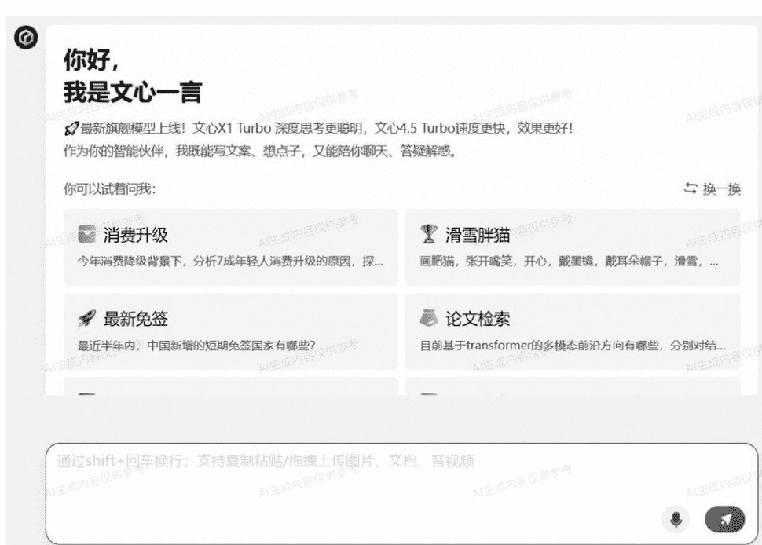

（2）教师使用策略
明确需求选工具：快速通用知识选 DeepSeek 联网或百度 AI；深度文献研究选秘塔或纳米；创意生成可尝试天工。
交叉验证、批判使用：多工具对比结果，核查准确性与来源。
结合传统搜索：智能并非万能，关键原始文献仍需数据库或权威网站查证。

##### 3 智能辅助搜索教学视频资源
策略：大模型不能直接产出视频，但可辅助查找。
1. 让 DeepSeek 产出精准关键词与平台搜索策略
2. 用通义听悟等工具生成视频摘要、字幕或思维导图
3. 关注多模态智能搜索未来能力
提示词示例：
“我要找小学五年级科学‘大气压强演示’教学视频，请给出 B 站与国家智慧教育平台的关键词与方法建议。”

##### 4 智能辅助信息归纳与分类
策略：将对话获取、搜索整合或上传文档的信息交由智能体快速归纳要点、提取关键步骤并分类。
提示词示例：
“请把关于‘人工智能伦理教育’的几段资料整合为要点清晰的备课笔记。”
“请分析上传文件‘细胞分裂’部分，提取关键步骤并列出。”

##### 5 案例：智能辅助历史课“丝绸之路”资料搜集与整合
场景：为高中历史课准备涵盖路线、商品、文化交流与历史影响的背景资料。
应用：
- 用秘塔搜索学术论文了解权威观点与最新动态
- 用 DeepSeek 联网查询沿线国家现今文化交流项目
- 用百度 AI/文心一言查找路线图与文物图片
- 用 DeepSeek 产出纪录片平台的搜索关键词建议
- 将文本资料输入 DeepSeek 进行总结分类
- 生成思辨性课堂讨论问题，如“丝绸之路对‘一带一路’有何启示”
策略性使用智能搜索工具可大幅提升资源搜集与整合效率，为高质量创编奠基。

### 四、人工智能辅助教学课件 PPT 的设计与制作
PPT 是课堂教学常用视觉工具。智能时代提供高效解决方案。

#### （一）智能支持 PPT 制作思路
1. 内容产出 DeepSeek：快速产出大纲与每页标题要点
2. 结构转化与初美化 AI PPT 工具：如 Kimi AI PPT 助手、WPS AI、希沃 Bloom，将 Markdown 文本转为排版初稿
3. 视觉元素增强：用即梦、豆包文生图或 Canva 等产出配图、图标、背景
4. 教师审核精修：核查内容、梳理逻辑、调整版式与视觉，最终定稿

#### （二）实战案例

##### 1 案例1：DeepSeek+Kimi PPT 快速生成《观潮》课件
操作步骤：
###### (1) DeepSeek 产出课件 Markdown 内容
提示词：
“我是小学语文教师，请产出四年级上册《观潮》PPT 内容，Markdown 格式，包含封面、目录、导入、作者背景、生字词、课文精读、修辞赏析、情感启示、课后拓展，每部分给标题与要点。”

###### (2) Kimi PPT 助手产出课件初稿
打开 Kimi 智能助手，进入 PPT 助手。图5-14 DeepSeek 产出课件 Markdown 内容图5-15 Kimi PPT 助手入口
将 Markdown 内容粘贴，Kimi 处理后预览，点击“一键生成 PPT”，选择教育培训、国风等模板生成初稿，教师在线编辑后下载。图5-16 Kimi PPT 助手“一键生成 PPT”功能图5-17 选择 PPT 模板图5-18 Kimi 产出 PPT 初稿
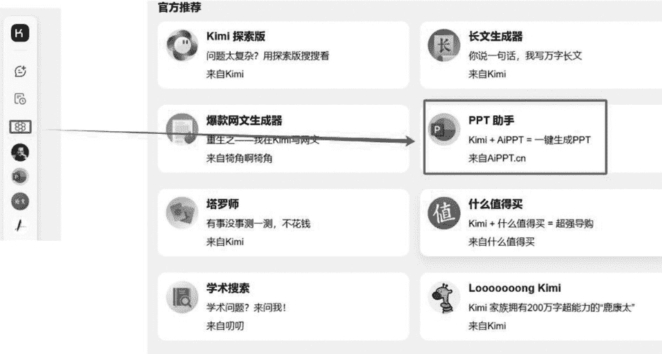
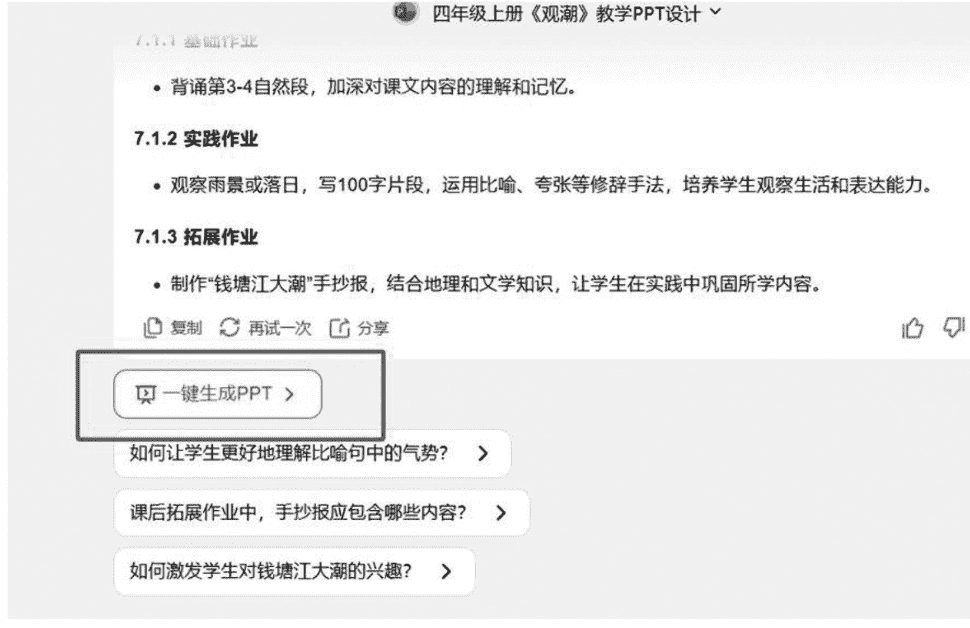


##### 2 案例2：WPS 灵犀一键生成课件 PPT（接入 DeepSeek 模型）
操作步骤详解：

（1）打开 WPS 灵犀，在主界面点进 AI 幻灯片入口 图5-19 WPS灵犀生成PPT入口

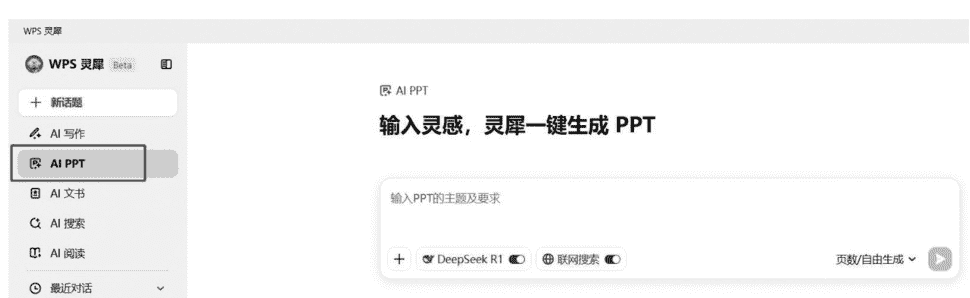

###### （2）输入主题或上传参考
直接在上方输入框写明课件主题与具体要求，例如：“我是小学语文老师，请为小学语文四年级上册《观潮》制作教学演示文稿。”

也可以把本地的教案、讲稿等参考文件上传，AI 会基于这些资料来组织内容。

**模型选择：** WPS AI 默认调用自家底层模型，可手动切换为含 DeepSeek-R1 深度思考的方案，以便获得更深入的推演。

**（可选）设定页数：** 大致设定期望的幻灯片数量。图5-20 WPS灵犀生成PPT设置

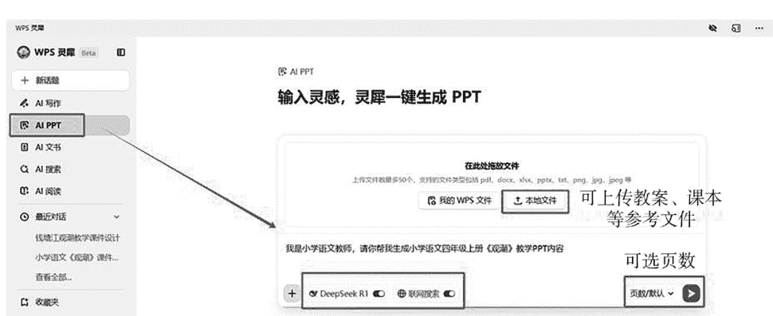

###### (3) 选择模板并生成
WPS AI 会先据输入整理出内容提纲，确认后点“挑选 PPT 模板”。在模板库按风格如“中国风”“可爱卡通”等和配色筛选，确定后点“生成 PPT”。图5-21 WPS AI生成内容大纲图5-22 挑选PPT模板

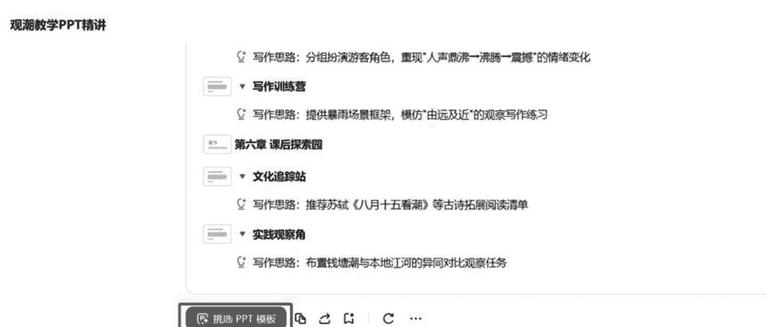


###### (4) 编辑与完善
WPS AI 会输出完整演示文稿并直接在 WPS 演示中打开。教师可借助 WPS 演示的编辑能力对文字、排版、配图、动画等进行全面修改和完善。图5-23 对生成的PPT进行编辑优化

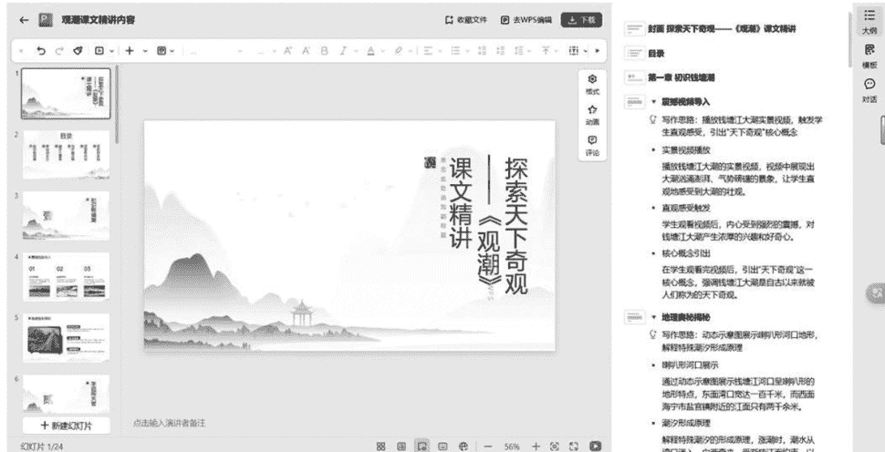

##### 3 案例三：希沃 Bloom 智能课件制作流程

###### 操作步骤详解：

（1）进入平台并提交需求
访问希沃 Bloom 官方站点 bloom.seewo.com 登录后点击“AI创作”，填写课件主题如“精卫填海”、学段、课型、期望页数等。

（可选）上传参考材料：可上传教案、文档等，并开启“深度思考 R1”调用 DeepSeek 能力，让产出更精准。图5-24 希沃Bloom界面

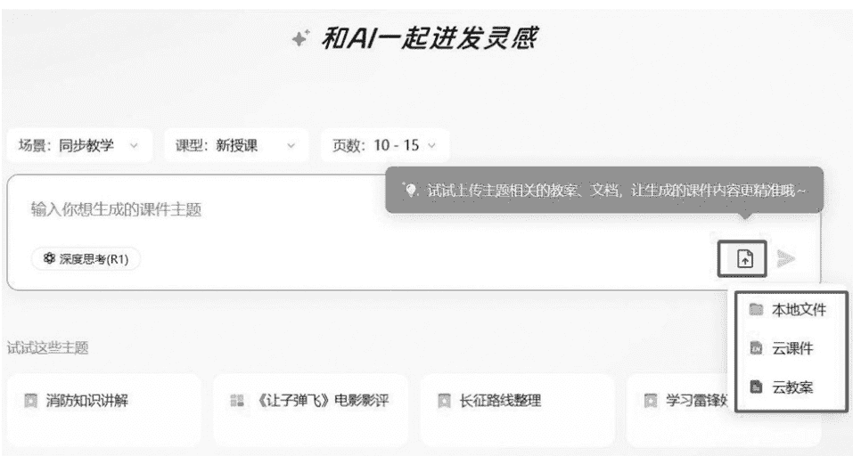

###### （2）调整教学目标
希沃 Bloom 会依据输入自动整理出初步教学目标，教师可在该界面增删改，确保符合教学要求。必要时可再次“调整提示词”优化指令，确认后点击“生成大纲”。图5-25 调整希沃Bloom生成的教学目标

课件目标

可以调整提示词

我是一名资深的小学语文老师，请你生成《精卫填海》的课件，让学生能理解故事内容，更能从神话中汲取精神力量，实现语言能力与人文素养的双重提升。

根据《义务教育语文课程标准》核心素养要求，结合教材文言文学习重点及神话文本特点设计

1. 语言积累与梳理：准确认读多音字“少”，识记文言词汇“溺”“堙”并规范书写生字

2. 思维发展与提升：运用注释转化文言意象，完整复述精卫填海的情节发展脉络

3. 审美鉴赏与创造：通过品析“衔”“堙”等动词，感受精卫不畏艰难的神话形象特质

4. 文化传承与理解：体会远古先民通过神话故事传递的生存意志与抗争精神

可以调整教学目标

- 添加目标

✦ 生成大纲

###### (3) 优化PPT大纲
希沃 Bloom 以思维导图形式呈现生成的 PPT 大纲，教师可拖拽调整结构、修改标题、增删节点，使逻辑更贴合教学。确认后点击“生成课件”。图5-26 希沃Bloom生成PPT大纲

###### 教学活动设计

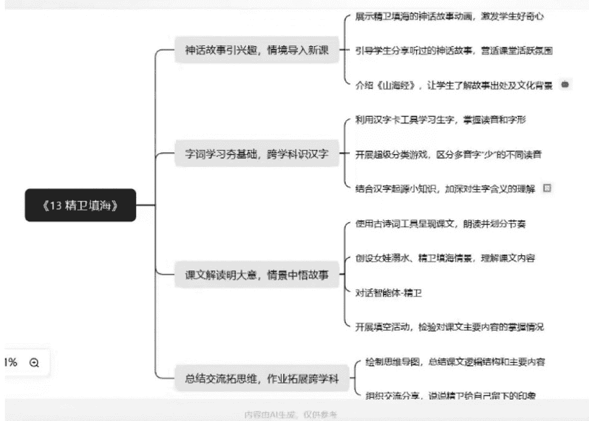

###### (4) 课件生成与联动编辑
希沃 Bloom 会生成完整课件并提供在线编辑环境，其特点是课件大纲、幻灯片页面和备课讲稿注释三者联动，一处修改自动同步，便于整体构思。教师可对内容、样式、图片等进行精细优化。图5-27 希沃Bloom生成可编辑PPT

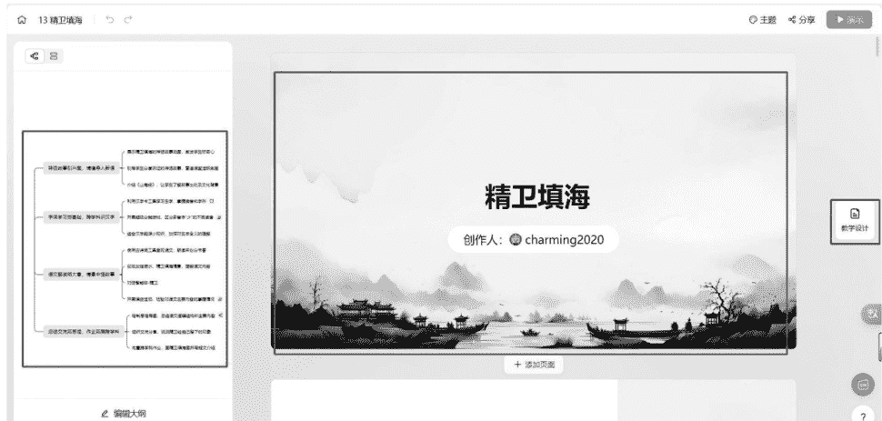

##### 4 视觉元素增强策略
智能工具生成初稿后，教师常会觉得配图不够理想或需要补充，可采取以下方式提升：

利用图像生成类工具：如即梦、豆包文生图、Midjourney等。依据页面内容编写描述性提示词，让模型产出符合主题与风格的图片后替换或插入演示文稿。

利用在线设计平台：如 Canva，平台提供海量模板、图片、图标素材库，并集成智能绘图、文案生成等功能，便于快速查找、创作和美化演示文稿视觉元素。

##### 5 效果评估
成效：智能演示工具大幅压缩课件制作周期，让教师摆脱繁琐排版设计，更聚焦教学内容打磨与创新；工具组合策略可进一步提升课件视觉质量与吸引力。

注意事项：智能工具产出的演示内容尤其是知识性内容必须由教师严格审核，确保准确无误；工具自动选用的模板和图片未必完全契合教学情境或个人审美，需人工调整优化；过度依赖模板易导致课件同质化，教师应融入个人教学特色与思考。

##### 6 工具拓展
借助 DeepSeek 等模型的内容产出能力，结合各类智能演示文稿与图像工具，教师能更高效专业地完成课件设计，把更多精力投入课堂教学质量提升。目前市场上已出现多款面向教学场景的智能演示工具，各具特色，可满足备课到授课的多样需求。表5-2汇总了部分代表性工具及其核心功能。

表5-2 制作PPT的AI工具续表

| AI 工具名称 | 平台公司 | 核心要点 | 教学应用场景 |
| :--- | :--- | :--- | :--- |
| WPS 灵犀 | 金山办公 | ① 与 WPS 无缝衔接，Word 教案一键转 PPT<br>② 智能匹配学科模板(语文、数学等)<br>③ 内置课堂小游戏动画素材 | 教师快速备课<br>学生课堂活动演示 |
| Kimi PPT 助手 | 月之暗面 | ① 用口语化指令生成 PPT(如“二年级古诗课件”) ② 自动抓取教学图片 ③ 生成课后习题幻灯片 | 跨学科融合课程设计 家长会汇报 |
| ClassPoint | 网龙网络 | ① 课堂互动 PPT 工具(随机点名、随堂投票) ② 学生端答题数据自动统计 ③ 作业要求嵌入 PPT 一键发布 | 课堂实时互动 教学任务管理 |
| 智谱清言 PPT | 智谱 AI | ① 学科知识点自动生成思维导图式 PPT ② 支持中小学课标关键词识别 ③ 错题集自动转复习课件 | 知识点串讲 考试复习专项训练 |
| 讯飞智文 | 科大讯飞 | ① 教师口述备课内容实时生成 PPT ② 方言识别(粤语、四川话等) ③ 自动添加拼音标注(语文课件) | 方言地区教师备课 低年级识字教学 |
| MindShow | 深圳心流科技 | ① 学生用 Markdown 写作文本自动转 PPT ② 内置“科学实验步骤”“手抄报”等版式 ③ 协作编辑支持分组权限管理 | 学生作品制作 兴趣小组活动汇报 |

### 五、AI辅助生成思维导图与可视化图表

思维导图和流程图等可视化图表是教学常用工具，它们能帮助教师梳理教学思路、构建知识体系，也能帮助学生理解复杂概念、把握知识间的逻辑关系、提升结构化思维能力。传统手绘或软件制作虽然可行，但面对复杂内容或频繁修改时仍显耗时。AI 技术，特别是 DeepSeek 与相关工具的结合，能显著提升这一过程效率。

#### （一）思维导图在教学中的作用

对教师：辅助备课，梳理教学内容的逻辑结构；在课堂上清晰展示知识体系；引导学生进行发散性思考或归纳总结。

对学生：帮助理解和记忆复杂知识点；构建个人知识网络；进行预习、复习和笔记整理；培养逻辑思维和结构化思考能力。

#### （二）AI赋能思维导图与图表制作的方法

##### 1 方法一：DeepSeek生成结构化文本+思维导图软件导入

（1）利用 DeepSeek 梳理逻辑与生成文本：教师可以向 DeepSeek 输入一个主题或知识点，要求它梳理出核心概念、主要分支、层级关系，并以结构化文本格式（如 Markdown 的层级列表格式）输出。在 DeepSeek 生成 Markdown 文件后，点击右上角的复制或下载可以直接复制或下载 .md 文件。

（2）导入思维导图软件：打开常用的思维导图软件，如 Xmind、MindMaster（博思）等，这些软件通常都支持直接导入 Markdown 文件（.md 文件）来快速生成思维导图的骨架。

（3）教师优化调整：在软件中对自动生成的思维导图进行美化、调整布局、补充细节、添加图标或备注等。

##### 2 方法二：DeepSeek生成代码+专业工具渲染（适用于流程图、时序图等）

（1）利用 DeepSeek 生成特定代码：对于流程图、时序图、类图等更专业的图表，教师可以向 DeepSeek 描述图表的结构和内容，并明确要求它生成特定代码，如 Mermaid 或 PlantUML 语法代码。

（2）使用渲染工具生成图表：将 DeepSeek 生成的代码复制到支持相应语法的在线编辑器、本地工具或集成了这些功能的平台（如 Markdown 编辑器、Notion 等）中进行渲染，即可得到相应的可视化图表。

（3）教师检查与修正：检查生成的图表是否准确反映了逻辑关系，如有需要，可修改代码或提示词以重新生成。

#### （三）实战案例

##### 1 案例1：AI辅助生成初中英语语法时态思维导图

**场景：** 教师希望为初中生复习英语的主要语法时态（如一般现在时、一般过去时、现在进行时、一般将来时等）制作一个清晰的思维导图，涵盖各种时态的构成、用法、标志词和注意事项。

**AI应用：**

（1）向 DeepSeek 提出请求

**提示词：**

请扮演一位经验丰富的初中英语语法老师。请帮我梳理初中阶段需要掌握的主要英语时态（至少包括一般现在时、一般过去时、现在进行时、现在完成时、一般将来时）。对于每种时态，请列出其基本构成（肯定句、否定句、疑问句形式）、主要用法（至少3条）、常用时间标志词以及需要注意的特殊情况。请以 Markdown 层级列表的格式输出，方便我导入思维导图软件。

（2）将 DeepSeek 输出的 Markdown 文本直接下载保存为 .md 文件

DeepSeek 会生成类似以下的结构化文本（节选），将其复制并保存为 .md 文件或者直接下载保存为 .md 文件。

###### #初中英语主要时态复习

###### #一般现在时（Simple Present）

- **构成：**
  - 肯定：主语+动词原形/三单形式
  - 否定：主语+don't/doesn't+动词原形
  - 疑问：Do/Does+主语+动词原形?
- **用法：**
  - 表示经常性、习惯性的动作
  - 表示普遍真理或客观事实
  - 表示主语当前的性格、能力、状态
- **标志词：** always, usually, often, sometimes, every day/week...
- **注意：** 第三人称单数动词变化

（3）导入思维导图软件（以 Xmind 为例）

打开 Xmind 软件，选择“文件”→“导入”→“Markdown”，选择刚才保存的 .md 文件。Xmind 会自动根据 Markdown 的层级关系生成思维导图的骨架。

（4）教师优化与美化

教师可以在 Xmind 中调整节点布局、修改文字、添加图标、更改主题样式、插入图片或链接等，使思维导图更清晰、美观、易于理解。图5-28 将.md文件导入XMind软件图5-29 在XMind软件中调整

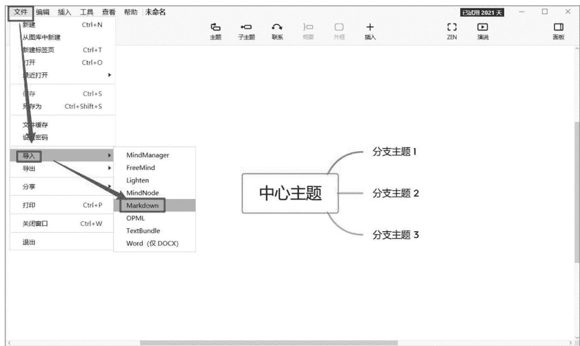

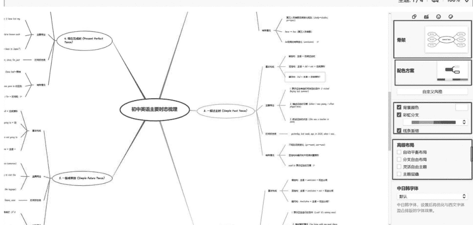

##### 2 案例2：DeepSeek+draw.io生成教学流程图

**场景一：** 教师设计好了一节课的教学流程，希望将其可视化为流程图，以便更清晰地展示教学环节和师生互动。

**具体操作：**

（1）准备教案或流程描述：教师可以先准备好教案的电子版（例如，上传给 DeepSeek），或者用自然语言清晰地描述教学流程的各个步骤和逻辑关系。

（2）向 DeepSeek 提出生成 Mermaid 代码的请求。

**提示词：**

请你根据附件的教案（或以下描述的教学流程：[此处粘贴或描述流程]），使用 Mermaid 语法生成一个表示该教学流程的流程图代码（graph TD）。请确保代码结构清晰，节点名称简洁明了，能体现主要的教学环节和师生互动。请以 Mermaid 代码块的格式输出。（可选补充：可以提供一个简单的 Mermaid 格式示例给 DeepSeek 参考，如graph TD; A[环节1]→B（环节2）；B→C{判断}；C—Yes→D[操作]；C—No→E[结束]。）

图5-30 复制DeepSeek生成的Mermaid文本

**修正后的教学流程图（含师生交互，Mermaid格式）**

```
graph TD
    %% 主流程节点
    A[情境导入] --> B[作品体验]
    B --> C[流程分析]
    C --> D[动手实践]
    D --> E[典型案例分析]
    E --> F[拓展延伸]
    F --> G[课堂总结]

    %% 情境导入（2分钟）
    subgraph 情境导入
        A1[教师活动：描述智能家电场景] --> A2[学生活动：听讲并思考]
    end
    A --> A1
    A2 --> B
```

（3）将 Mermaid 代码导入 draw.io。

打开 draw.io（或 diagrams.net）网页版或客户端。点击菜单栏的“+”号（或其他插入按钮），选择“高级”→“Mermaid”。图5-31 将Mermaid代码导入draw.io软件图5-32 预览并插入

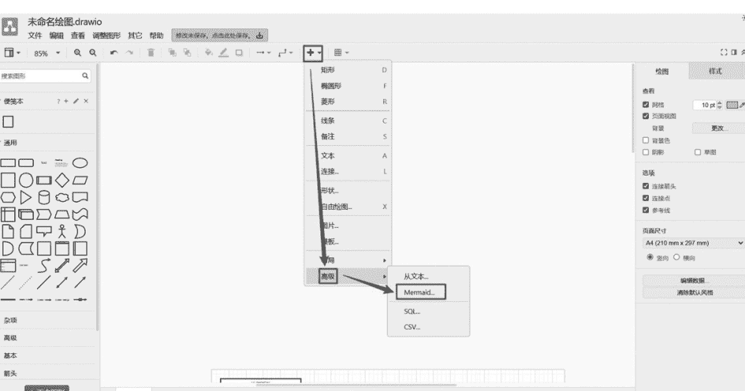

```
C4 --> D

%% 动手实践（15分钟）
subgraph 动手实践
    D1[学生活动：编写程序] --> D2{遇到问题？}
    D2 -- 是 --> D3[教师指导] --> D1
    D2 -- 否 --> D4[提交作品]
end
D --> D1
D4 --> E

%% 典型案例分析（4分钟）
subgraph 典型案例分析
    E1[教师展示作品] --> E2[学生讨论优化方案] --> E3[教师总结易错点]
end
E --> E1
E3 --> F

%% 拓展延伸（4分钟）
subgraph 拓展延伸
    F1[播放科普视频] --> F2[学生讨论友好设计] --> F3[教师记录创意]
end
F --> F1
```

（4）查看与导出流程图：draw.io 会自动根据代码渲染出流程图。教师可以进行微调，然后通过“文件”→“导出为”选择合适的格式（如 PNG、JPG、SVG、PDF 等）保存流程图。图5-33 导出流程图

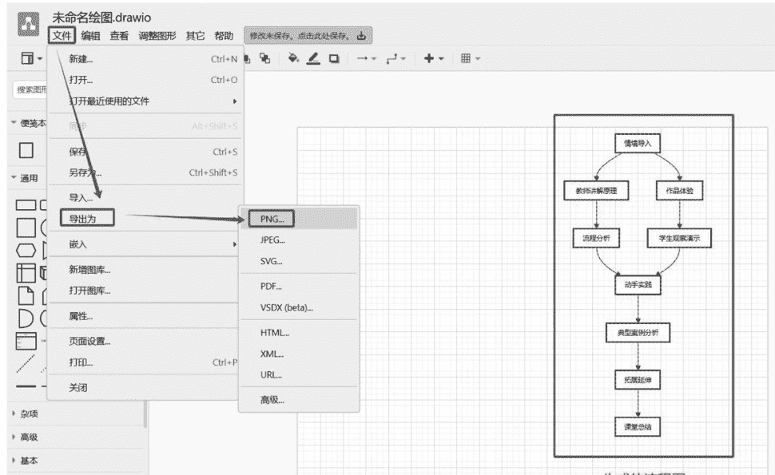

（5）（可选）错误排查：如果在 draw.io 中插入代码时出现错误提示（如“Diagram error not found”），可以将错误提示信息和 Mermaid 代码一起复制到 DeepSeek 上，让它帮助检查和修正语法错误。图5-34 draw.io报错截图


**场景二：** 教师需要为高中地理课《大气环流》制作一个知识结构关系图，帮助学生理解三圈环流的形成过程以及主要气压带和风带的分布。

**具体操作：**

（1）向 DeepSeek 提出生成 Mermaid 代码请求。

**提示词：**

使用 Mermaid 语法为高中地理课《大气环流》生成一个简单的知识结构关系图（graph LR或TD均可）。内容需要包括三圈环流（低纬环流、中纬环流、高纬环流）的形成过程（涉及上升/下沉气流、近地面风向、高空风向），以及主要的气压带（赤道低压带、副热带高压带、副极地低压带、极地高压带）和风带（信风带、西风带、极地东风带）的名称和大致纬度分布。图形要简洁明了，便于学生理解。请以 Mermaid 代码块的格式输出。

（2）获取并渲染代码：教师复制 DeepSeek 生成的 Mermaid 代码。图5-35 获取渲染图表或复制代码

```
graph TD
    %% 三圈环流结构
    太阳辐射差异 --> 三圈环流
    三圈环流 --> 低纬环流
    三圈环流 --> 中纬环流
    三圈环流 --> 高纬环流

    %% 低纬环流 (0°-30°)
    低纬环流 -->|赤道受热上升| 赤道低压带["赤道低压带 (0°附近)"]
    赤道低压带 -->|高空北上偏转成西风| 副热带高压带["副热带高压带 (30°附近)"]
    副热带高压带 -->|近地面偏转成东北/东南信风| 信风带["信风带 (0°-30°)"]

    %% 中纬环流 (30°-60°)
    副热带高压带 -->|近地面北上偏转成西南风| 西风带["西风带 (30°-60°)"]
    西风带 --> 副极地低压带["副极地低压带 (60°附近)"]
    副极地低压带 -->|高空南下补充| 副热带高压带

    %% 高纬环流 (60°-90°)
    副极地低压带 -->|近地面偏转成东北风| 极地东风带["极地东风带 (60°-90°)"]
    极地东风带 --> 极地高压带["极地高压带 (90°附近)"]
    极地高压带 -->|冷空气下沉| 副极地低压带

    %% 标注关键过程
    赤道低压带 -.->|热力上升| 高空西风
    副热带高压带 -.->|动力下沉| 近地面信风
```

(3) 导入工具或在线渲染：将代码粘贴到支持 Mermaid 的工具（如 draw.io、Typora、Notion 或在线 Mermaid 编辑器）中进行渲染，生成知识结构图。

(4) 图表精修与教学运用
AI 初稿生成后，教师会结合教学实际对版式、配色与视觉风格进行二次加工，再把定稿嵌进课件，或作为板书设计的设计参考。图5-36 调整结构图

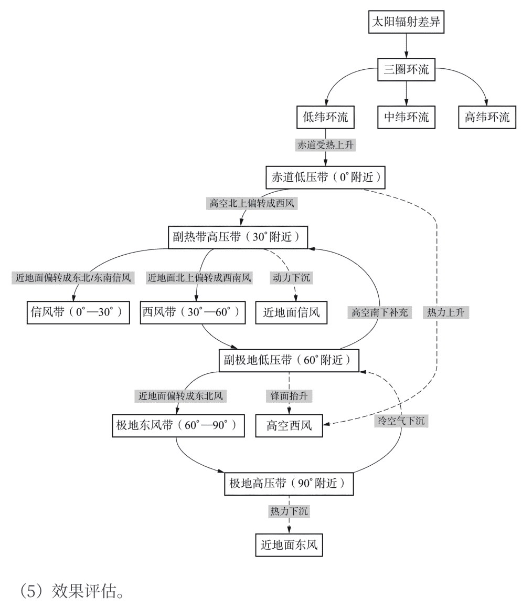

（5）成效复盘
**成效体现：** 当知识脉络或流程逻辑足够清晰时，利用 AI 迅速产出思维导图或流程图的源代码，可以明显缩短备课时间。对 Mermaid 等代码写法不熟悉的教师而言，AI 有效降低了这类专业可视化工具的使用门槛。
**使用提醒：** AI 产出的结构化文本与代码仍需教师自行核验逻辑是否准确完整；渲染后通常还要人工进行美化与微调；面对极度复杂或需要高度个性定制的图表，AI 的支持作用有限，最终仍需教师把握主导权。
借助 AI，教师能更省力地把繁复的知识和流程转化为直观有序的可视化成果，既优化了教学呈现，也为学生自学复习提供了抓手。

### 六、借助 AI 打造视觉素材，让课堂更直观生动
#### 实战案例
##### 1 案例1：AI 制作备课配图
**教学情境：** 高二历史教师张老师在筹备“工业革命”跨学科课程时，希望在课件里加入19世纪纺织工厂的实景还原，帮助学生直观体会蒸汽机改良对生产方式的影响，却找不到兼顾机械原理与人文关怀的优质配图。
**操作流程：**
- 借助即梦制作 AI 图像。
（1）打开即梦（https://jimeng.jianying.com/），进入 AI 作图入口 图5-37 即梦AI作图入口

（2）调用 DeepSeek-R1 获取图像生成提示词
（3）填写创作要求并挑选模型、画面比例等
**提示词：**
我是一名高中二年级的历史教师，正在筹备“工业革命”主题的跨学科课程。为了让学生直观感受蒸汽机改良对生产方式的影响，我要在课件中加入19世纪纺织工厂的实景还原图。图5-38 获取生成图片提示词图5-39 设置图片生成要求
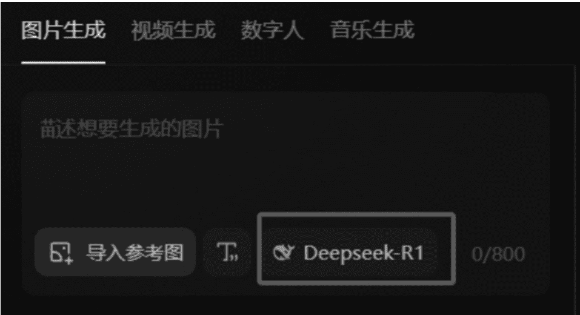
图片生成 视频生成 数字人 音乐生成
我是一名高中二年级的历史教师，正在筹备“工业革命”主题的跨学科课程。为了让学生直观感受蒸汽机改良对生产方式的影响，我需要在课件中加...
< Deepseek-R1
**模型**
生图模型
图片 3.0 by Seedream 3.0
选择清晰度：标清 1K
标清 1K
高清 2K
**比例**
图片比例
21:9
16:9
3:2
4:3
1:1
（4）点“立即生成”，右侧可预览结果。如效果不理想可调整提示词。图5-40 生成预览图片
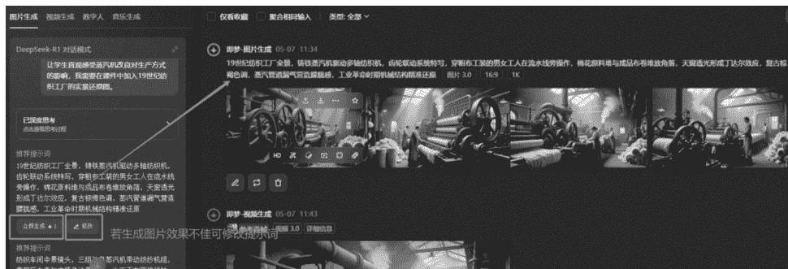
（5）点图像进行下载或优化编辑。教师可下载高清图，也可点“生成视频”把静态图转为带音效的短视频，进一步强化素材表现力。图5-41 下载图片或优化编辑

- 借助豆包制作 AI 图像。
(1) 打开豆包（https://www.doubao.com），输入提示词
提示词：
我是一名高中二年级的历史教师，正在筹备“工业革命”主题的跨学科课程。为了让学生直观感受蒸汽机改良对生产方式的影响，我需要在课件中加入19世纪纺织工厂的实景还原图。图5-42 输入图片生成提示词

(2) 成图后可编辑或下载 图5-43 下载图片或优化编辑
我是一名高中二年级的历史教师，正在筹备“工业革命”主题的跨学科课程。为了让学生直观感受蒸汽机改良对生产方式的影响，我需要在课件中加入19世纪纺织工厂的实景还原图。
接下来我将为你生成四张 19 世纪纺织工厂的实景还原图。画面风格是通过自然光影与细节捕捉，展现客观、未经修饰的现实的摄影风格。主体是摄影风格的纺织工厂，有冒着浓烟的烟囱、巨大的蒸汽机、排列整齐的纺织机等。场景是 19 世纪的纺织工厂内，工人们在辛勤劳作，蒸汽机带动着纺织机运转。

##### 2 案例2：DeepSeek+剪映制作故事绘本
**操作流程：**
（1）用 DeepSeek 产出故事
**提示词：**
你是一个儿童文学作家，擅长儿童短篇故事写作、绘本故事写作。请参考义务教育教科书·语文四年级上册《盘古开天地》的神话故事，进行这个故事的儿童绘本制作，字数500字。 图5-44 利用DeepSeek生成故事文本
好的，我将按照儿童绘本的特点创作《盘古开天地》故事，注重画面感与童趣表达。以下是故事框架：
[封面插图：蓝衣巨人沉睡在云雾中，周围漂浮着星星和羽毛状的光点]
**第一幕：混沌宇宙**
很久很久以前，世界像一颗巨大的鸡蛋。这里没有蓝天白云，没有绿草鲜花，只有灰蒙蒙的雾气咕嘟咕嘟冒泡泡。在这颗“宇宙蛋”里，沉睡着一位叫盘古的巨人，他的睫毛像垂柳枝，胡子像飘动的云彩。
[插图：蜷缩的巨人被彩色云雾包裹，四周漂浮着发光的泡泡]
**第二幕：巨人苏醒**
“咔嚓！”沉睡了一万八千年的盘古伸了个懒腰，他的关节发出爆米花般的脆响。摸到腰间冰凉的斧头时，混沌里突然亮起两道金光——原来是盘古睁开了眼睛！
（2）把生成的绘本复制到剪映
**PC 端操作：**
打开剪映，点击首页的 AI 文案成片。图5-45 抖音PC版AI文案成片入口

点 AI 素材成片，选择风格和比例，粘贴绘本故事即可自动生成。图5-46 选择风格、比例并粘贴绘本故事
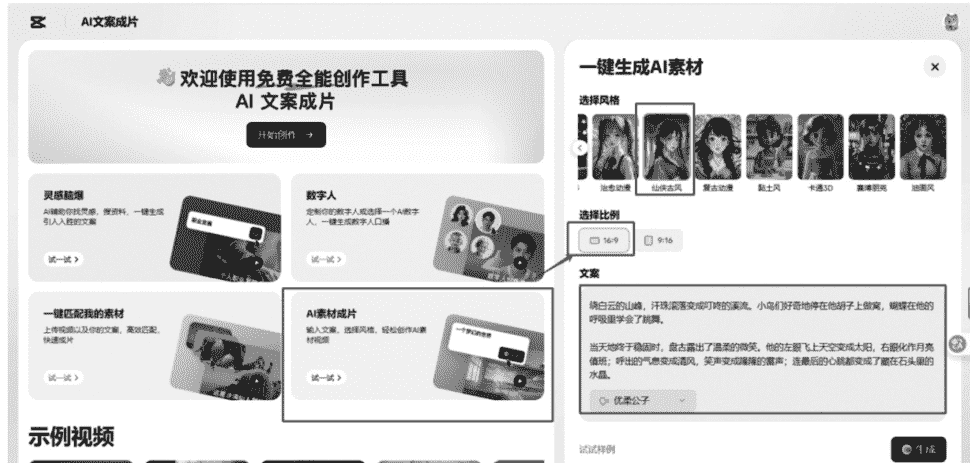
生成后可做细节调整，导出即可完成绘本制作。图5-47 调整细节完成故事制作
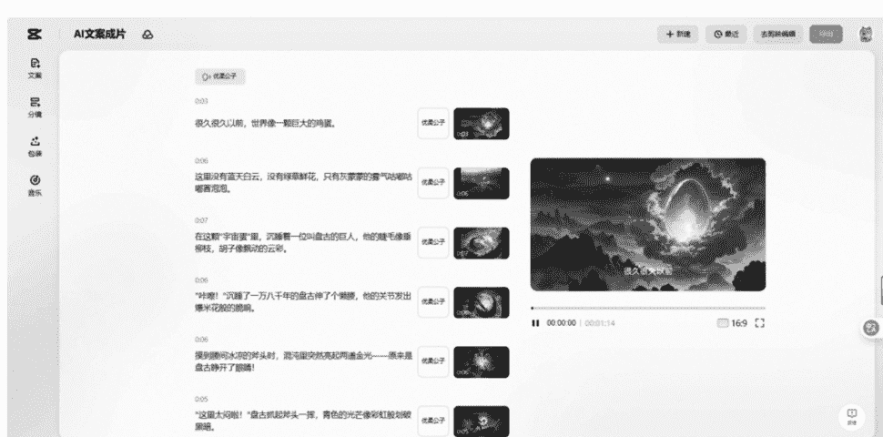
**手机 App 操作：**
打开剪映，首页点击 AI 故事成片。图5-48 抖音手机App中AI故事成片入口

粘贴绘本内容，选择画面风格、配音和视频比例，点击生成。生成后可调整细节并导出。图5-49 AI故事生成界面图5-50 编辑界面
**AI 故事成片**
咕嘟冒泡泡。在这颗“宇宙蛋”里，沉睡着一位叫盘古的巨人，他的睫毛像垂柳枝，胡子像飘动的云彩。
“咔嚓！”沉睡了一万八千年的盘古伸了个懒腰，他的关节发出爆米花般的脆响。摸到腰间冰凉的斧头时，混沌里突然亮起两道金光——原来是盘古睁开了眼睛！...
**画面风格**


**配音**
- 智能推荐
- 少年云希
- 晓辰学姐
- 解说小帅
**语速**
0.8x 1.5x 2x
开通SVIP后，消耗43积分使用 >
生成视频
##### 3 案例3：DeepSeek 产出教学演示动画
**教学情境：** 讲解抽象概念时，学生常因缺乏直观体验难以把符号与现象对应，空间想象不足、过程感缺失、理解差异大，导致教学效果受限。DeepSeek 可把抽象概念转成可视动态模型，通过实时交互与分步演示降低理解门槛。
**工具：** DeepSeek-V3 模型，更适合产出复杂代码与互动应用。
**提示词：**
编写一个一次函数的演示动画教学网页，要求用生活化的例子给学生作介绍，并做成相应的案例动画。图5-51 DeepSeek生成动画教学网页
###### 一次函数演示动画教学网页
以下是一个一次函数演示动画教学网页的HTML代码，包含生活化的例子和互动动画：
```html
<!DOCTYPE html>
<html lang="zh-CN">
<head>
    <meta charset="UTF-8">
    <meta name="viewport" content="width=device-width, initial-scale=1.0">
    <title>生活中的一次函数</title>
    <style>
        body {
            font-family: 'Microsoft YaHei', sans-serif;
            line-height: 1.6;
            color: #333;
            max-width: 1000px;
            margin: 0 auto;
            padding: 20px;
            background-color: #f5f5f5;
        }
        h1 {
            color: #2c3e50;
```
代码生成后，可复制、下载和运行。图5-52 运行预览生成的动画教学网页

### 七、借助 DeepSeek 产出微课脚本、讲解要点与分镜
实战案例：DeepSeek+剪映制作微课视频
操作流程：
- （1）用 DeepSeek 产出微课分镜头脚本等
#### 提示词：
我是小学数学老师，我想制作一个关于“分数加法通分过程”的微课视频，时长三分钟左右，帮我设计脚本、撰写文案、描述画面，以表格形式输出，包含时间轴。图5-53 DeepSeek生成微课脚本（截图，只显示部分页面）
以下是为你设计的3分钟微课视频脚本表格，包含时间轴、画面描述和对应文案，重点突出分数通分的直观演示和步骤分解：
| 时间轴 | 画面描述 | 文案 |
| :--- | :--- | :--- |
| 0:00-0:10 | 开场动画：卡通黑板背景，标题“分数加法通分小课堂”弹出，配欢快音效 | （背景音乐）同学们好！通分！ |
| 0:11-0:25 | 动态示例：1/2 + 1/3 算式出现，两个圆形分数模型分别展示1/2(黄)和1/3(蓝) | 当分母不同时，就像不同标准——这就是通分！ |
| 0:26-0:45 | 动画演示：两个圆形被均分成6份，1/2→3/6，1/3→2/6，同步显示算式变形 | 找公分母：2×3=6。1/看！现在分数单位统一了 |
#### （2）在剪映中合成与后期制作
在剪映首页点“图文成片”。图5-54 剪映图文成片入口
之后点“自由编辑文案”。图5-55 选择自由编辑文案
粘贴 DeepSeek 产出的微课文案并调整，点击“生成视频”，再选“智能匹配素材”。图5-56 智能匹配素材
视频生成后，可对细节进行编辑调整，最后导出微课视频即可。图5-57 编辑调整视频细节

### 八、小结
本章为教师提供了一套 AI 赋能备课的实践路径。教师可借助 AI 设计和分析学情问卷与学科试卷，精准定位学生知识薄弱点，为个性化教学提供依据。在教学设计层面，AI 能依据核心素养要求与多种教育理论，辅助生成系统化的教案与学案。同时，AI 还能高效创编教学资源，如一键把文本转为 PPT、思维导图，或按需生成定制化教学图片和视频，让备课更高效直观。这些做法共同体现了 AI 如何贯通备课全过程，帮助教师构建更精准、高效的教学设计。

# 第六章
## AI 赋能课堂：促进深度学习的教学创新
前几章已论述 AI 如何助力课前学情分析、教学设计和资源创编，为高质量教学奠定基础。但课堂是动态生成与互动的场域，如何把 AI 能力融入实时教学、提升互动质量、创新教学方式并支持深度学习，是 AI 赋能教学的关键所在。

### 一、重构课堂生态：构建“教师—AI—学生”三元协同教学新范式
课堂互动是教学的灵魂，是师生与生生思想碰撞、意义建构的关键空间。有效互动能激发学习兴趣并促进深度思考。传统课堂常受参与度不均、教师精力有限、互动形式单一等困扰。AI 深度融入后，不再只是辅助工具，而是具备“功能性主体”特征的准参与者，深刻改变课堂生态。

当教育目标从知识传递转向核心素养培养时，教学要素的角色关系需重新审视。人工智能作为认知伙伴与智能助手，与教师、学生共生共创，这就要求打破传统的“教师—学生”二元结构，构建“教师—AI—学生”三元协同新范式。在此模式下，AI 作为新参与者融入课堂，共同服务于核心素养培养目标。

#### （一）从“二元”到“三元”：AI“主体性”的再认识
在三元互动教学新范式中，核心转变是将 AI 从纯粹工具提升为具有某种主体性的智能伙伴。“三元”不是两个人类主体加一个被动工具，而是在动态教育生态中互动的三个不同性质主体。

为清晰辨析三者在教学活动中的角色与协同关系，需先辨识人类主体与 AI 主体在本质上的差异。表6-1 人类主体与人工智能主体的特征维度比较
| 特征维度 | 人类主体(教师和学生) | 人工智能主体(AI) |
| :--- | :--- | :--- |
| 意识与意向性 | 拥有自我意识、情感、信念和内在动机。行为由真实理解和意图驱动。基于“生命体验” | 本质是算法驱动的计算过程，不具备真实意识、情感或主观体验。“理解”是数据模式的统计关联。基于“数据计算” |
| 认知与学习 | 基于具身体验、社会互动和文化背景的深度语义理解。学习是主动建构意义的过程，伴随情感与价值观形成。 | 基于海量数据的模式识别和概率预测。学习是权重调整和模型优化，是“无身体、无情境”的知识处理。 |
| 价值与伦理 | 拥有内在价值体系、道德直觉和伦理责任感。教师行为受教育伦理和人文关怀约束。价值理性 | 缺乏内在价值观和伦理判断能力。行为由设计目标和训练数据决定，可能放大偏见。工具理性 |
| 发展与成长 | 追求认知、情感、社交、道德的全面整体成长。目标是成为完整的“人”。 | “成长”是模型迭代与性能提升，是功能性、可量化的优化。目标是更高效完成特定任务。 |
| 创造性来源 | 源于想象力、直觉、情感驱动和对现有知识的颠覆性重构。 | 源于对现有数据元素的重新组合与生成，是“计算创意”，而非源于生命体验的“原创灵感”。 |

表6-1 揭示人类主体的优势在于价值引领、情感关怀、意向驱动与原创灵感，AI 的优势在于高效知识处理、数据计算与逻辑推理，二者互补而非替代。正因此，三元互动新范式得以成立，各主体可发挥不可替代的作用。

#### （二）三元协同：教师、AI 与学生的角色新定位
新课堂生态下，教师、AI 与学生的角色需重新定义，形成以学生为中心、以教师为主导、AI 赋能的动态协同，共同服务核心素养培养。表6-2 三元主体的主体性定位与核心角色
| 主体 | 主体性定位 | 在核心素养培育中的核心角色 |
| :--- | :--- | :--- |
| 教师 | 价值引领与设计主体 | 学习体验的“总设计师”与“智慧启迪者”：设计驱动高阶思维的真实复杂问题情境；在关键节点介入激发分析、评价与创造性思维；示范批判性思考，守护传递正确价值观与学术伦理。 |
| AI | 功能性赋能主体 | 认知过程的“智能催化剂”与“认知伙伴”：信息伙伴，提供远超个人能力的广博知识与多元视角；思维伙伴，通过苏格拉底式提问、模拟辩论等方式激发思维品质；能力伙伴，辅助学生将创造性想法快速转化为现实。 |
| 学生 | 能动建构与创造主体 | 知识意义的“主动建构者”与“价值创造者”：探究者，主动发起探究、定义问题、主导学习进程；合作者，与同学、AI 高效交流协作解决复杂问题；创造者，综合信息形成独特见解并创造新作品或解决方案。 |

在此定位下，教师转向学习体验设计者与引导者，聚焦激发高阶思维与核心素养；AI 作为认知伙伴提供信息、辅助思考、分担任务，扮演信息提供者、智能助教、讨论伙伴、个性化辅导员等角色，协同教师，让教师更专注思维点拨与价值观引导及情感关怀。学生从被动接受者变为主动探究者与创造者，与教师、同学、AI 协作建构知识，在互动中发展自主学习、合作探究、创新实践等关键能力，优化教学互动，使教师更聚焦深层次育人，促进核心素养全面发展。

#### （三）引导学生与 AI 有效互动的方法
实现有效的“学生—AI”互动，教师引导至关重要。可采取以下策略，也有助于提升学生的 AI 素养。
- （1）教授基本的提示词技巧：在合适时机如信息技术课、项目式学习启动阶段，向学生介绍基本的提示词原则与结构，让他们学会清晰表达需求。事实上，不论哪一学科教师都有责任培养学生的 AI 素养。

AI进课堂：先划界，再共创

（2）先划定边界，再明确任务指向
布置需要调用生成式工具的作业时，要先把学习目标讲清楚、说明工具可以承担的范围、哪些环节必须禁止代劳。独立思考的环节和原创写作的核心部分要学生亲手完成。边界厘清后，学生才容易把工具定位为助手而非替代品。

（3）把质疑意识放在首位
这是核心环节。要先让学生认识到模型输出的局限：容易出错、可能夹杂偏见、创造性不足等。要引导他们对结果进行挑错、核验、评价，而不是照单全收。可以安排“AI查证员”任务让学生找错改错，也可以组织“观点交锋赛”让学生站队反驳，本质是锻炼判断力。

（4）设计人机协作而非替代的任务
鼓励把模型当成学习伙伴或工具，而非标准答案机。资料搜集可以借助模型检索，但筛选、归纳、整合要学生自己做；创意写作可以让模型碰撞灵感，但构思框架和终稿润色由学生主导；代码检查可以让模型指出报错，但弄清错因和修改思路必须学生自行掌握。

（5）强化伦理与规范意识
要教育学生负责任使用：遵守版权规则、保护个人隐私、不生成也不传播有害信息。学校或班级最好制定明确的使用公约并公示，让规范先行。

（6）提供可填空的提示词模板
引导学生与模型互动时，教师可给出带有空位或待填项的提示词框架，让学生把自己的理解、视角、立场填进去，从而实现个性化学习和创造性表达，也能顺带培养批判思维。

示例1（语文研讨）：“请化身为[期望的角色，如文学评论家/小说人物]，从[关注的维度，如情节/人物/手法]出发，分析《[课文名]》中[具体内容或人物]的特点。请以[期望的立场，如批判/赞赏/客观]的态度阐述，并给出[数量]个理由或例证。”

示例2（科学探究）：“我正在研究[现象，如植物向光性]。请你以[角色，如植物学家/实验助手]的身份，帮我梳理该现象的可能成因。请分别从[角度1，如内在生理]和[角度2，如外在环境]展开，并给出一个可通过实验验证的假设。”

开放式模板的价值：
①既提供写提示词的支架，又把选择权交还学生，促使他们主动确定探究方向、分析视角和模型立场，更能激发自主性和创造力，对话也更有深度和个性。
②鼓励学生不满足于一次输出，而是通过追问、要求澄清、换角度提问等方式，与模型进行多轮深入交流，挖掘更深层的理解，这是培养问题解决和深度思维的重要路径。

（四）让课堂反馈更即时、更个性化
课堂的动态性要求教师快速捕捉学情并给予针对性支持，这正是生成式工具擅长的方向，能够帮助实现更及时、更个性化的反馈和学习支持，呼应及时反馈与形成性评估的核心要求。

1 策略与方法
- 课堂快答诊断：设计一段简短练习或提问，让学生在线或纸笔作答后，把文本类答案汇总输入DeepSeek，借助它做初步判分、找共性错误或分类归纳，教师迅速掌握全班理解情况。
- 虚拟助手即时答疑：学生在独立练习或小组活动中卡壳时，可在教师指导下向预设的智能助手提问。助手基于知识库或通用知识提供概念解释、步骤提示或相关资源，实现即时支持。
- 分层练习推送：结合互动或小测结果，模型可辅助教师为不同水平的学生推送不同难度、不同侧重点的巩固或拓展任务，实现课堂内的即时分层。
- 模拟学习伙伴：对于口语、辩论准备等需要对话或协作思考的场景，学生可以与模型扮演的伙伴互动，获得即时对话反馈和观点碰撞。

2 案例：数学课上的即时解题辅导
场景：初中数学练习一元二次方程，小明用公式法解 2x²+5x-3=0 时算出 a=2、b=5、c=-3，Δ=49 后卡住了，不知道下一步如何处理根号。

使用场景：
学生求助：“我用公式法解方程 2x²+5x-3=0，已算出 a=2、b=5、c=-3，代入 Δ=b²-4ac 得 49，接下来该怎么弄，特别是根号怎么处理？”

模型提供分步提示而非直接答案：
- ●提示词（预设或教师引导）：“请扮演一位耐心的数学辅导老师。学生在用公式法解 2x²+5x-3=0 时已算出 Δ=49，不确定下一步。请不要直接给最终答案，而是分步骤提示下一步要做什么，特别是根号的处理。”

```
x=(-b±√Δ)/2a √49
```

- ●模型可能的回答：“你算得很对，Δ=49。下一步是把 a、b 和 Δ 代入求根公式。你还记得公式的具体形式吗？代入后，‘+’和‘-’两种情况要分别算，就能得到两个解，试试看！”

```
√49=7
```

- ●学生继续尝试：小明按提示完成计算并求出两个解。

效果评估：模型在此扮演智能导师角色，给出及时、针对具体困难的启发式支持，保护了学生的自主学习过程，比直接看答案或等待老师更高效。当然，教师仍需把控提示质量并适时人工介入。

（五）课堂互动实战案例
1 案例1：历史课“诸子百家”模拟对话
场景：初中历史学习百家争鸣。
赋能思路：让DeepSeek化身不同学派代表，进行模拟辩论或问答。

操作步骤：
- (1) 课前准备：
  - ●提示词（生成角色设定）：“请给出儒家、道家、法家的主要思想要点，并为每个学派设定符合身份的说话风格和口头禅，用于课堂角色扮演。”

- (2) 课堂互动：
  - 教师分小组让学生代表不同学派。
  - 在DeepSeek中设定模型扮演某学派角色，如“请你现在扮演法家代表韩非子，用他的语气和观点回答”。
  - 学生向AI提问，如“韩非子，您认为治国最关键的方法是什么？”
  - 教师引导分析模型回答，并组织其他学派小组质疑辩论。
  - 可切换模型角色，让学生与不同代表交流。
  - 进阶——开放提示词：教师提供模板“请你扮演[某学派代表]，我将从[教育/经济/人性等角度]提问，请用你的思想回答。我的第一个问题是：[学生自拟]？”

效果评估：把抽象思想具象为可对话角色，提升趣味性和参与度，帮助理解差异。教师角色转为组织者和引导者，需把控时间、总结点评并进行价值观引导，开放式模板更能激发探究和提问能力。

2 案例2：语文课学生与智能助手连环探究《祝福》
场景：高中语文研读鲁迅《祝福》，理解祥林嫂悲剧成因。
赋能思路：学生扮演研究者，向扮演“文学研究助手”的DeepSeek连续提问，深入探究。

操作步骤：
- （1）任务与角色设定：引导学生思考“祥林嫂的悲剧仅由封建礼教造成吗？还有哪些因素？”并说明模型是文学研究助手，可多轮对话探究。
- (2) 学生与模型连环对话示例：
  - 学生提问1：“造成祥林嫂悲剧的主要原因有哪些？”
  - 模型回答：可能包含封建礼教迫害、社会冷漠、个人性格等。
  - 学生提问2（追问）：“你提到社会冷漠，具体体现在哪些人和事上？举例说明。”
  - 模型回答：鲁四老爷的鄙视、柳妈的揭短、镇上人的嘲笑和麻木等。
  - 学生提问3（深化）：“祥林嫂自身的性格，比如麻木、反复讲述，和外在因素如何相互作用导致悲剧？”
  - 模型回答：分析性格与命运的互动，如缺乏反抗、精神寄托破灭等。
  - 学生提问4（开放）：“如果祥林嫂生活在现代，从[社会保障/女性地位/心理支持]角度看命运会怎样不同？”
  - 模型回答：按学生选择的角度展开讨论。
- (3) 教师引导与总结：观察学生提问策略，适时提醒批判性看待模型观点，如“模型认为性格是主因，你同意吗？有没有其他解读？”汇总不同角度分析，形成对多重成因的深刻理解，并思考社会进步意义。

效果评估：连续对话让学生更主动深入探究，锻炼提问、信息整合和批判思维。开放式模板鼓励多角度思考，教师需指导提问技巧并对模型回答进行辨析，避免单一视角定势。

（六）用问题链撬动深度思考
除扮演角色外，模型还能主动生成层层递进的“问题链”，尤其适合数学、科学等需逻辑推理的学科。

策略：给模型一个核心概念或情境，让它用推理模型生成从基础回顾到开放探究的问题链。

案例：模型生成“勾股定理”问题链
提示词：
> 请扮演经验丰富的初中数学老师，围绕“勾股定理”为八年级学生设计一个引导深度思考的问题链。从基础知识回顾开始，逐步过渡到理解证明、简单应用、综合应用，最后包含开放性拓展。请保证逻辑连贯、难度递进，以编号列表输出。

模型给出的回答：
以下围绕勾股定理设计的“问题链”，遵循从知识回顾到拓展探究的梯度推进逻辑：

##### 1. 基础回顾
请用文字和数学符号分别表述勾股定理，并说明它适用于什么类型的三角形。

##### 2. 条件辨析
若已知三角形三边长为$a$、$b$、$c$（$c$为最长边），如何通过计算判断它是否为直角三角形？若$a^2+b^2>c^2$，这个三角形的形状可能是什么？

##### 3. 逆向思考
小明说：“只要三条线段长度满足$a^2+b^2=c^2$，就一定能组成直角三角形。”你认为他的说法严谨吗？请举例说明。

##### 4. 证明探究
尝试用四个全等的直角三角形（两直角边分别为$a$、$b$、斜边$c$）拼成一个边长为$a+b$的大正方形，通过面积法推导勾股定理。（提示：用两种不同的方式计算大正方形面积。）

##### 5. 直接应用
已知直角三角形两直角边分别为5和12，求斜边；若已知斜边为25，一条直角边为15，求另一条直角边。

##### 6. 实际建模
一架2.5米长的梯子斜靠墙面，顶端距离地面2米。若梯子顶端下滑0.5米，底部在水平方向滑动的距离是多少？（画示意图并解答。）

##### 7. 综合应用
等腰三角形周长为16cm，底边长为6cm。求它的面积。（需分步分析：先求腰长，再用勾股定理求高。）

##### 8. 动态几何
长方形ABCD中，AB=8，BC=6。点P从A出发沿边运动到D，点Q从B出发沿边运动到C，速度均为1单位/秒。何时PQ的长度最短？最短值是多少？（建立时间变量表达式后求最小值。）

##### 9. 空间拓展
长方体盒子长、宽、高分别为3、4、12，一只蚂蚁从顶点A沿表面爬到对角顶点G。求最短路径长度。（思考：如何将立体展开成平面？）

##### 10. 开放探究
勾股定理是直角三角形三边的特殊关系。对于非直角三角形，是否存在类似的三边关系？尝试通过测量不同三角形三边长度，提出你的猜想。（提示：观察锐角/钝角三角形中a²+b²与c²的大小关系。）

设计说明：
- (1) 问题1—3巩固定理本质，强化条件与结论的逻辑关系；
- (2) 问题4通过动手拼图理解定理证明的核心思想；
- (3) 问题5—8逐步提升应用复杂度，融入方程思想与动态分析；
- (4) 问题9—10打破二维局限，激发跨维度迁移与批判性思考。

每个问题均提供思维锚点，教师可根据学生反应灵活追问或调整难度。

应用方式：教师可将问题链作为课堂讨论提纲、小组探究任务单，或用于自主学习，模型生成的问题链能有效激发思维品质。

（七）结构化提问，让模型用得更准
为了更精准引导模型在课堂中扮演合适角色，教师和学生可以运用结构化提示词框架。

1 示例：利用STAR-AI结构请模型扮演辩论反方
场景：讨论“科技发展利大于弊还是弊大于利”。
提示词：
> （情境S）我们正在进行关于“科技发展利弊”的课堂辩论。（任务T）请你加入辩论。（受众A）参与者是高中生。（角色R）请你扮演反方，即认为“科技发展弊大于利”的辩手。（方面/格式A）请针对正方可能提出的“科技提高生活便利性”的观点，提出2—3条有力的反驳论据，并简要阐述理由。（指令/约束I）论据要有逻辑性，语言有说服力，避免极端言论。
互动增强：模型提供明确对立观点和论据，激发多角度思考和批判性思维，教师可引导学生分析并反驳。

2 示例2：利用C.R.I.S.P.E结构请模型提供解题思路启发
场景：数学几何证明题卡壳。
提示词：
> （情境C）学生正在尝试证明[某个几何定理或问题]，但找不到思路。
> （角色R）请扮演一位循循善诱的数学导师。（指示I）请不要直接给出答案或完整步骤，而是提供2—3条不同的解题思路提示或辅助线添加建议。（具体细节S）题目已知条件是[列出已知条件]，求证[列出求证内容]。（个性/语气P）语气要具有启发性，鼓励学生独立思考。
> （示例E，可选）例如可以提示“尝试连接××点”或“考虑构造全等三角形”。
互动增强：模型提供解题脚手架而非标准答案，保护独立思考空间，同时帮助突破瓶颈。

3 示例3：利用R.I.S.E结构请模型辅助科学实验设计讨论
场景：设计实验验证“温度对酶活性影响”的假设。
提示词：
> （角色R）请扮演一位严谨的实验科学家。（输入I）我们小组的假设是“温度升高会提高唾液淀粉酶活性，但过高温度会使其失活”。材料有：唾液淀粉酶溶液、淀粉溶液、试管、水浴锅、温度计、碘液。（步骤S）请帮我们思考并列出详细的实验步骤，需考虑如何设置温度梯度、如何控制变量、如何观察和记录结果。（期望E）我们期望得到一个科学、可操作、能有效验证假设的方案。
互动增强：模型帮助把初步想法转化为结构化方案，学生在互动中学习探究方法。教师可引导学生评价可行性并优化。

通过策略性运用结构化提示词，模型在信息提供、思路启发和过程支持上价值更大，人机协同更深入有效。

（八）从文本到画面，模型课堂新玩法
案例1：让课本人物开口说话
场景：讲解《赠汪伦》，让李白“活”起来。
赋能思路：用DeepSeek生成符合身份的对话文本，再结合模型视频工具生成开口说话的动态视频。

操作步骤（以DeepSeek+即梦AI为例）：
(1) DeepSeek生成对话文本
- 提示词（B.R.O.K.E结构）：（背景B）我们正在学习《赠汪伦》。（角色R）请扮演李白。（目标O）能根据学生提问（如“汪伦唱的歌有多动听？”）生成50字内的回复，要通俗易懂，符合李白豪放风格。（关键结果K）学生能产生交流感，加深对人物的理解。（演进E）若学生提问不当，可适当引导。
- 预期输出（针对“汪伦唱歌有多动听”）：“汪伦的歌声啊，像春风卷着桃花瓣拂过潭面，溪水都跟着打拍子！你听过最动人的歌声是怎样的？”

(2) 即梦AI生成视频
- 打开即梦AI，选择“数字人对口型”功能。
- 导入李白图片。
- 输入DeepSeek生成的回答文本。
- 选择合适音色，如“沉稳老者”。
- 生成并预览下载。

图6-1 即梦AI制作人物开口说话的操作界面

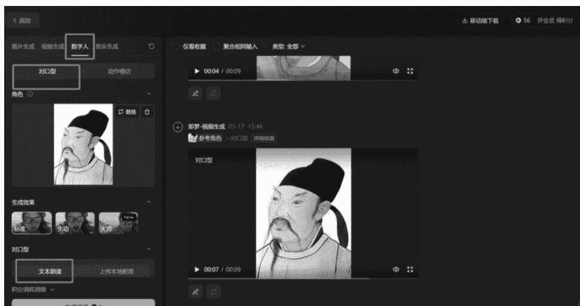

效果评估：大幅增强趣味性和沉浸感，让历史文学形象更生动。需注意图片清晰、音色匹配，文本须经教师审核。

案例2：模型视觉语文课——《美丽的小兴安岭》
场景：讲解描写景物的课文，帮助学生直观感受四季景色。
赋能思路：用DeepSeek理解课文描述，生成图片提示词，再用模型图像生成工具将文字转为视觉画面。

操作步骤：
(1) DeepSeek理解文本并生成提示词

让文字长出画面感的课堂尝试

把抽象的描写转成可视化的呈现，是生成式模型给课堂教学带来的新可能。下面以语文和数学的真实片段为例，梳理几条可以直接上手的实践路径。

低年级语文描写北方林区四季的视觉化

先把身份与需求说明白：我正在带一班低年级孩子学那篇描写兴安岭四季更迭的课文，后续会提供按季节书写的描述，请据此给出对应的图像生成指令，风格定为古风墨线叠加细腻水彩，指令要贴合原文意象，等文字到手后再执行。

示例春天段落：“春天，枝丫抽新，长出嫩绿叶。山上积雪化开，雪水汇成小溪，淙淙流淌。小鹿在溪边散步，有的低头饮水，有的侧头看水面倒影。”

把模型给出的春季指令导入豆包的文生图功能，批量出图供挑选。图6-2即为豆包输出的林区春景。

随后可说“请提供季节性文字”，收到原文后即可产出四张呈现春意的画面，整体以墨彩结合为主，突出新枝嫩叶、融雪成溪、幼鹿溪畔活动的细节。


课中运用与延伸
- 课堂上展示模型成图，与课文段落对照，帮助孩子把语言意象落在视觉上。
- 可让孩子自选喜欢的季节段落，尝试自行撰写生成指令再产图，据此写短文或小诗。
成效观察：把抽象描写转为直观图像，能点燃想象、加深理解与审美感受。授课者要引导孩子提炼文本关键词，并对生成结果进行筛选与讨论。

案例3：以智能体续写寓言——以《守株待兔》为例
情境：讲授寓言《守株待兔》，目标是引导创造性续写与改编。
思路：把DeepSeek当作创意伙伴，在原故事基础上发散思维，实现个性化创作。
操作脉络：
(1) 引导与指令示例：
- 提问“《守株待兔》还能怎样发展？加入新角色会发生什么？”
- 指令框架：“请根据《守株待兔》，加入一个[你想加入的角色，如：聪明的小狐狸/路过的智者]，帮我续写成新寓言，结局需[你期望的结局，如：教育农夫/讽刺守旧]。”
(2) 孩子与模型共创：孩子填入自己的设定，与DeepSeek协作产出新版本。
(3) 发散引导：追问“如果故事搬到现代会怎样？”“农夫性格改变，情节会如何？”
(4) 分享交流：孩子展示共创的文本，讨论不同版本的创意与寓意。
成效观察：模型充当写作支架与灵感源，激发想象与表达欲，培养发散思维。引导者需促成有意义互动，对生成内容评价与研讨。

案例4：让模型说出解题思路
情境：孩子常只看答案，不关注解题过程。
思路：借助DeepSeek的分析与解释能力，把模型从答案提供者转为思路引导者，培养数学思维。
操作脉络：
(1) 孩子上传题目照片。
(2) 请求解释思路。指令：“请识别图中数学题，详细说明解题思路与关键步骤，不要直接给最终答案，重点讲方法与原理。”
(3) 孩子阅读模型给出的思路提示，自行完成推导。
(4) 核对与追问：完成后可让模型核对，或针对不懂处继续提问。
成效观察：帮助孩子从“知其然”走向“知其所以然”，提升思维与自主解决问题的能力。老师需引导正确使用，避免沦为作业捷径。

案例5：以智能模型支持语文课堂辩论——以《田忌赛马》为例
情境：课堂辩论常受制于选题难、参与度低、逻辑训练不足与时间控制。
思路：以DeepSeek作智能伙伴，围绕辩题进行深度发散与自主思考。
操作脉络：
(1) 引出议题：谁是《田忌赛马》的最终赢家？
- 老师提问，孩子可答田忌、孙膑、齐威王。
(2) 多维视角引导：
- 孙膑：从打破固有思维角度写辩词。
- 田忌：从信任与行动角度写辩词。
- 齐威王：从坚守规则与实力角度写辩词。
(3) 指令指导：我是一名五年级孩子，正在学《田忌赛马》，将进行“谁才是比赛最终赢家”的辩论，我的观点是：×××是最终赢家，请从×××角度帮我写150字辩词。
指令半开放，关键观点与视角由孩子自填，既作支架又不限制思维。
(4) 小组整理模型生成内容，为辩论做准备。
成效观察：
- 引导多角度思考，促发散性思维。
- 基于模型生成内容形成个人感悟。
- 组织观点攻防，提升思辨氛围。

案例6：以智能模型深化数学概念理解
情境：讲解抽象概念与公式时，孩子理解困难。
思路：用DeepSeek分步拆解概念，结合实例与交互演示具象化。
操作脉络：
(1) 输入指令
- 指令1：“你是一名数学老师，请讲解圆柱体表面积计算，生成可交互图形演示，以HTML形式输出。”
- 指令2：“请把圆柱体表面积公式拆解为三个教学步骤，每个步骤配一个生活化实例。”
(2) 教学步骤
- 认识圆柱体组成：两个圆形底面与侧面。
- 计算两个底面积。
- 侧面展开为长方形后计算面积。
(3) 作业巩固
模型生成应用题，如“喷漆铁桶需多少油漆？”，结合公式“表面积=2πr²+2πrh”进行综合练习。
图6-3 DeepSeek生成的圆柱体表面积计算演示图片

成效观察：复杂公式被拆解为清晰操作步骤，交互图形降低理解难度。方法同样适用于物理、化学等抽象知识。

案例7：以智能模型实现知识点动态演示
情境：物理定理抽象，孩子难理解。
思路：用DeepSeek制作动态动画，以可视化呈现知识。
操作脉络：
###### (1) 输入动画主题指令
指令：“你是一位网页动画大师，请生成光的反射原理演示动画，用HTML形式输出，必要时可用CSS组件，左侧可调参数，右侧演示区。”
###### (2) 运行代码，呈现演示动画
三种运行方式：其一在DeepSeek界面直接运行预览；其二下载保存为HTML本地打开；其三复制代码到记事本改后缀为.html后在浏览器打开。图6-4 DeepSeek运行代码图 图6-5 DeepSeek演示动画图
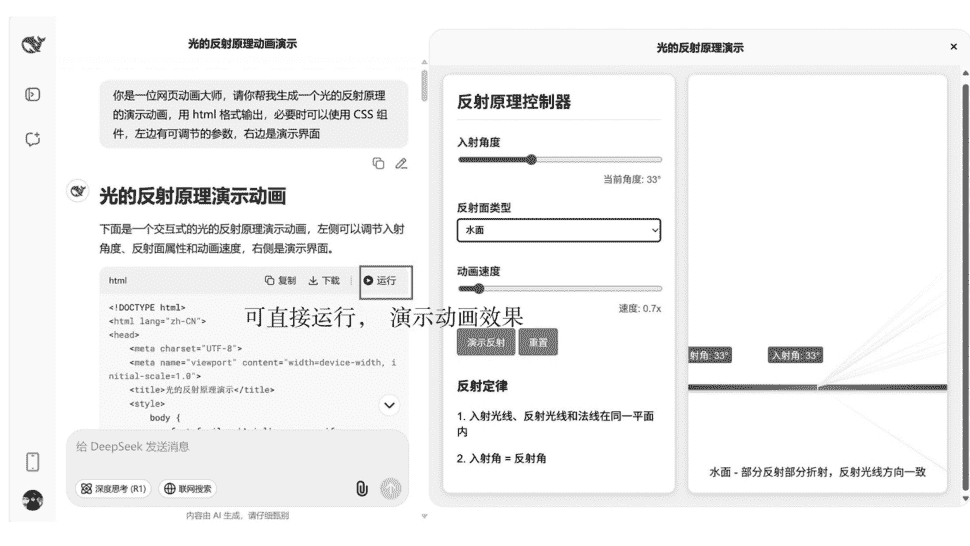
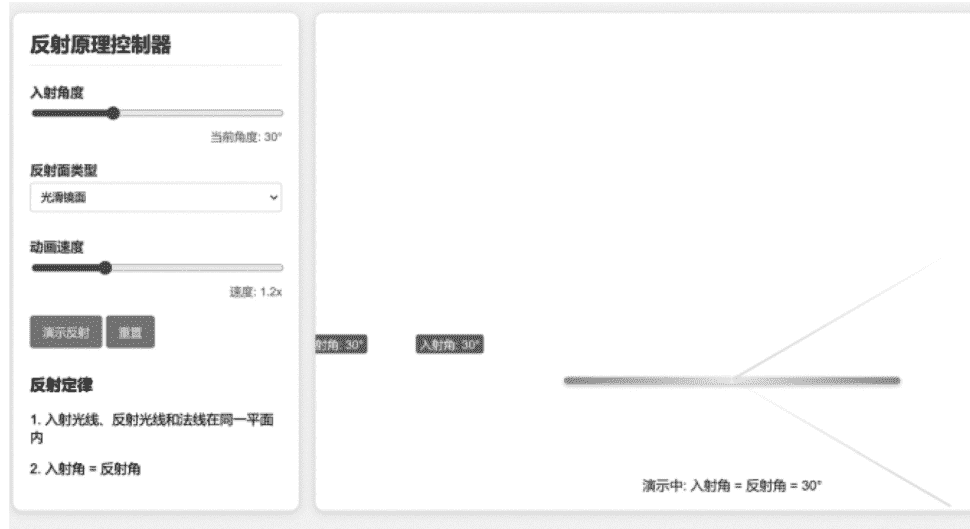
###### 成效观察：
（1）演示动画不仅用于物理，还可用于地理自转公转、历史时间线、生物光合作用等动态展示。
（2）操作灵活，可即时预览，也可本地保存重复使用，满足多样教学场景。

以上案例显示，人工智能在促进课堂互动方面潜力巨大，能创造传统教学难以实现的沉浸体验，助力孩子深度参与与核心素养发展。

二、智能助力教学方法创新

人工智能不仅优化现有互动，更为经典教学法的创新应用提供支撑。

（一）智能助力教育：从对话教学到能力培养

对话教学强调师生、生生间平等开放的交流，核心价值在于促进深度思考、培养思维品质、实现意义建构、关注个体过程。传统课堂受限于授课者精力、时间与个性化引导难。

##### 1 对话教学：从寻求答案到学会提问
对话教学是一种古老而有效的思想方法，通过持续对话激发思考、探究真理、建构认知。

##### 2 智能助力对话教学的新机遇
生成式AI天然适配对话教学：
- 模型作为不知疲倦的对话伙伴，提供7×24小时个性化互动。
- 借助强大知识与推理能力，引导就复杂议题多轮深入探讨。
- 培养提问能力，从索要答案转向学会质疑与探究。
- 可模拟历史人物、科学家等角色，创设丰富对话情境。

（二）智能赋能孔子对话教学：传承与创新

##### 1 孔子对话教学的本质与特征
源于《论语》的启发式教学，核心理念“不愤不启，不悱不发”，尊重主体与认知状态。特征包括问题导向的认知建构、差异化的因材施教、情境化的思维训练。

##### 2 智能如何助力孔子对话教学
（1）模拟“圣贤”对话场景：让DeepSeek或豆包扮演孔子，孩子可跨越时空就《论语》章句或人生困惑提问，使经典学习个性化。
（2）创建虚拟形象增强沉浸感：
- ① DeepSeek+图像生成+视频生成：用DeepSeek生成孔子形象描述指令，在即梦、Midjourney等生成画像，结合对话文本用数字人对口型生成视频。
- ② 智能体平台：用豆包、扣子创建“孔子”智能体。
- ③ 文可AI：使用“与孔子对话”功能直接互动。图6-6 文可AI中的与孔子对话功能
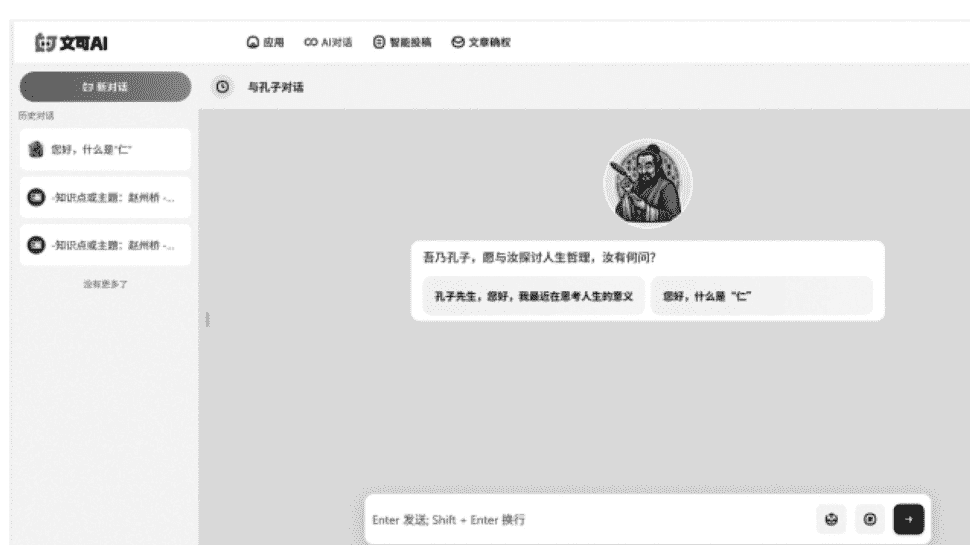
（3）成效观察：
- 实现智能化因材施教，根据提问层次调整深度与追问。
- 提供“叩其两端”的启发式追问，引导深层思考。
- 记录分析对话过程，为教学提供依据。

##### 3 实战片段：智能助力七年级语文《<论语>十二章》教学互动
情境：学习《论语十二章》，理解孔子学习态度、方法与修身思想。
思路：DeepSeek扮演孔子，结合数字人技术，孩子分组提问讨论。
操作脉络：
（1）设定模型角色，可选数字人形象：
- 指令：“请扮演中国古代教育家孔子，用温和睿智语气回答，熟悉《论语》思想，特别是学习、修身、仁爱。当提问时结合原文回答并适当启发式追问，做到不愤不启、不悱不发。”
（2）孩子分组准备问题，如“学而不思则罔，思而不学则殆”如何理解？等。
（3）课堂互动：各组向模型孔子提问。例如“孔夫子，学与思哪个更重要？”模型可能答：“学与思如车之两轮、鸟之双翼...汝以为然否？日常如何兼顾？”
（4）引导讨论与总结：评价模型回答，分享理解，联系课文与现实，落脚于学习方法与修养。

效果观察：引入孔子数字分身并配合数字化真人呈现，把原本可能枯燥的经典研读变得生动活泼，明显激发了学员的发问欲望与探究动机，这正是关键能力的体现。面对面与圣贤交流，让儒家思想的魅力与智慧更直观可感，也为文化传承提供了温度。落地时要特别注意，教员须精细打磨指令以保证角色人设的准确，同时做好课堂讨论的掌控与价值引领；数字化视频的制作本身也耗时耗力。

在生成式技术的支撑下，孔子因材施教、启发诱导的教学智慧有望在更广阔范围里落地生根，并不断创新，为素养培养注入新活力。

#### （三）点燃思维：智能辅助的苏格拉底式对话
古希腊思想家苏格拉底曾指出，教育不在于填塞知识，而在于点燃心火。这句话精准概括了苏格拉底式对话的要义。

##### 1 苏格拉底式对话的意涵与价值
苏格拉底式对话是通过连环追问推动对话者进行自我反思与批判性思考的辩证技法。其并非由教员直接给出答案，而是借助层层递进的问题帮助学员厘清概念、审视自身观点、发现矛盾，最终凭借自身理性接近真理。苏格拉底自喻为助产士，强调知识应从内部孕育而非外部灌输。

主要特征包括：
- 以追问为核心：教员或智能体主要承担提问角色，问题多为开放与启发性，避免直接给结论。
- 诘问与反诘：不断追问“你如何得此结论”“该概念具体指什么”“能否举出反例”，暴露观点模糊或不一致之处，凸显认知边界。
- 概念澄清：引导学员对核心概念作出清晰界定。
- 辩证审视：提出对立假设或观点，促使多角度观照。
- 自我修正：最终指向自我检查与修正，常被归纳为揭露无知、厘清定义、助产结论的三阶段。

育人价值体现在：
- 思维品质：锻炼批判性思维、逻辑推理与深度思考。
- 关键能力：提升问题提出、问题解决、清晰表达与沟通。
- 价值态度：培养求真、理性探究、尊重多元的倾向。

##### 2 生成式助手如何助力
传统课堂开展此类对话难度高，教员需具备很强的提问能力与洞察力，且需投入大量一对一或小组引导时间。智能技术的出现提供新可能。
- 动态提问引导：依据预设主题与学员即时回应，实时生成层层递进的启发式问题，模拟诘问与反诘。
- 充当不倦诘问者：系统可耐心进行多轮对话，促学员充分暴露并反思自身观点。
- 多视角模拟：可扮演持不同立场者进行辩证讨论，拓展认知边界。
- 个性化支持：根据回应速度与理解程度调节难度与节奏。
- 场景拓展：支持线上异步或同步交流，打破时空限制，提供更多反思机会。

##### 3 实践案例：道德与法治课“诚实”议题的苏格拉底式探究
情境：小学高年级或初中道德与法治课程，围绕诚实这一道德品质展开。
素养目标：培养道德判断、价值辨析与清晰表达。
策略：教员主导，学员与扮演苏格拉底提问者的DeepSeek进行多轮交流，挖掘诚实的内涵与复杂性。

提示词结构思路 Q.P.D.C.R：
- Q Question：提出开放启发性的初始问题。
- P Probe：针对回应进一步追问细节与理由。
- D Define：引导澄清核心概念的定义。
- C Challenge：提出反例或对立观点挑战已有看法。
- R Reflect：引导回顾对话过程并总结新认识。
该结构非固定公式，而是可灵活运用的思路。

操作流程：
（1）引题与角色设定。提出议题“今天我们深入探讨，真正的诚实是什么？”角色指令：“请扮演苏格拉底式提问者，目标不是给出答案，而是通过连续追问引导学员深入思考诚实的含义，发现想法模糊或矛盾处，帮助形成更清晰理解。避免直接评判，多用启发问句，可用追问、要求定义、提出反例。”
（2）启动对话 Q。教员提示：“请向小学高年级/初中学员提出一个关于何为诚实的开放问题。”系统或问：“在你的生活里，诚实通常呈现出什么样貌？”
（3）学员回应与追问 P。学员可能说：“诚实就是不说谎。”教员提示系统探究充分性。系统可追问：“不说谎是诚实的一种表现。但仅不说谎够了吗？比如看见同桌考试作弊你选择不说，这算诚实吗？为何？”
（4）引导定义与澄清 D。学员可能答：“好像光不说谎不够，可能还要说真话？”教员提示引导更清晰定义。系统可问：“说真话是更进一步的想法。那么真话指什么？是指把所有已知事实都说出来吗？有没有情况全盘托出反而不当？”
（5）挑战与质疑 C。学员可能提到善意谎言。教员提示提出挑战。系统可问：“你提到了善意谎言。那么善意的标准由谁定？如果人人都认为自己的谎言善意，会带来什么后果？在不说谎伤人与说谎可能误导之间如何抉择？”
（6）引导反思与总结 R。教员提示引导反思。系统可问：“我们聊了不说谎、说真话、善意谎言。你觉得诚实是简单概念，还需在具体情境中权衡的品质？为何？”
（7）教员总结深化。对话后组织全班分享，结合学员回应与系统追问，帮助认识诚实的复杂内涵，理解诚信守信的意义，思考不同情境下的道德抉择。强调苏格拉底式探究的核心不是系统的标准答案，而是对话中引发的质疑、辨析与反思。教员应鼓励学员主动提问，对系统提问保持独立判断。

成效观察：
（1）成效：系统扮演的苏格拉底式提问者能模拟启发对话，通过连续追问与挑战推动深度思考、概念辨析与自我审视，有效促进批判性思维与价值辨析。
（2）注意事项：对系统逻辑推理与自然语言理解要求较高，建议使用DeepSeek-R1等推理强模型；教员需精心设计初始问题与角色设定，并监控提问方向；对话后需做好总结深化，避免学员陷入无休止诘问而迷茫。

扩展工具：文可AI等平台提供苏格拉底与孔子对话智能体，可直接注册使用。

借助生成式技术，苏格拉底点燃心火的教育理想能在更广课堂落地，帮助学员在深度对话中发展思维、涵养品格。

#### （四）以教促学：生成式助手助力费曼学习法
“若你无法用简单语言解释一个概念，说明你尚未真正掌握它。”这正是费曼学习法的核心。由诺贝尔物理学家理查德·费曼提出，核心是输出倒逼输入，通过模拟教学检验理解。

##### 1 费曼学习法的意涵与特征
通过向新手讲解来检验掌握程度，发现盲点并简化重构，从而深化理解与记忆。
主要环节：①确定学习目标；②模拟教学讲解，用最通俗语言避免术语；③发现理解缺口，卡壳处即盲点；④回顾与补充，回到原材料补足漏洞；⑤再次讲解与精炼，反复简化直至流畅准确。
对素养的带动：促进深度理解、逻辑组织与抽象简化、批判性思维；提升清晰表达、自主学习与反思能力。

##### 2 生成式助手如何赋能
费曼法关键在于教学过程与反馈。智能体提供了理想听众。
（1）扮演理想学习者：DeepSeek等可扮演一无所知却好奇的“学员”，随时接受讲解，实践费曼法。
（2）提供即时困惑反馈：依据讲解模拟真实疑问，迫使学习者深化理解。
（3）辅助回顾与知识补充：讲解卡壳时可即时提问，快速获取不同角度解释。
（4）检验表达清晰度：要求系统复述核心概念或回答相关问题，检验讲解效果。

##### 3 实践案例：费曼法学习三角形内角和定理
情境：初中数学课后巩固。
素养目标：深度理解、逻辑推理、清晰表达、自主学习。
策略：教员指导学员用DeepSeek作学习伙伴，检验对定理的理解。

操作流程：
（1）布置任务：“请把DeepSeek当成完全不懂几何的小学生，向它解释三角形内角和定理及为何是180度，用最简单语言。”
（2）启动教学对话。学员提示：“请扮演小学六年级几何小白，我将解释三角形的内角和定理，请随时提问。”
（3）学员讲解，系统提问：“为何一定是180度？长方形角和不是180，为何？胖瘦三角形都一样吗？能证明吗？”
（4）学员发现理解缺口，需回看证明方法，如撕纸拼角或平行线证明。
（5）再次讲解：“把三个角撕下拼在一起，正好组成平角180度，所以内角和是180度。”系统追问：“什么是平角？为何拼在一起就能证明？”
（6）进一步简化与结构化。
（7）最终检验。学员提示：“请用你自己的话复述你理解的三角形内角和定理及原因。”系统复述准确则说明讲解成功，否则继续优化。

成效观察：
（1）成效：模拟教学过程并借助系统提问暴露盲点，迫使深度思考、简化表达与逻辑重构，大幅深化理解与记忆，提升思维品质与表达。
（2）注意事项：教员需讲解费曼法目的与步骤，指导提示词设计，鼓励学员主动思考而非跳过系统提问；互动后组织分享检查理解深度。

借助生成式技术，费曼学习的以教促学策略更易在课内外实施，将教会别人转化为随时可用的认知工具。

### 三、智能驱动的差异化教学与协作学习
生成式技术不仅丰富互动，更能精准支持差异化教学与协作学习，满足多样需求，促进深层学习。

#### （一）课堂差异化教学的智能支持
差异化教学尊重个体差异，在目标、内容、过程、评价上提供不同路径。智能技术让实时精准调整成为可能。

##### 1 动态学情监测与分组
结合在线答题、提问频率、形成性测验等数据，智能体可实时分析掌握情况与参与度，识别不同需求的学员群体，并给出动态分组建议。
提示词示例：“根据刚才测验结果，请将学员分为基础待巩固组、中等掌握组、拓展提升组，并列出各组学号。”

##### 2 实时生成差异化资源与任务
发现组间需求差异后，可让系统快速生成不同难度或侧重点的材料与任务，如基础巩固练习、开放探究问题、通俗改写文本等。
提示词示例：“为浮力概念掌握不牢的学员生成3道基础概念选择题。”“为已掌握浮力原理的学员设计探究影响浮力大小因素的小实验方案。”“请将这段细胞结构文字改写成适合阅读理解能力稍弱学员的版本。”

##### 3 个性化提示与脚手架
学员在独立学习或探究时，智能体可作为智能导师提供针对性提示。教员也可预先准备常见困难点的分层提示，供学员按需获取。

提示词参考（学生向大模型发问）：“我在做一道关于浮力计算的题目时卡住，能否给我一些解题思路？题目见附件”

##### 4 课堂分层实战：生成式智能推动差异化教学

**教学背景：** 初中语文《紫藤萝瀑布》一课中，班级里在文本理解和写作表达上差异明显。教师引入生成式助手，让分层教学真正落地。

**智能支撑方向：**

- （1）阅读理解的辅助：理解相对薄弱的学生可以让模型提供通俗解读、重点语句拆解、意象阐释，帮助他们把握紫藤萝的象征意义和作者情绪的流转。
- （2）写作灵感的点燃：写作基础较好却常缺灵感的学生，可以借助模型基于文本的表达技巧与主题，多角度获取思路与素材，完成创造性写作。

**落地流程：**

- （1）教师下发任务：“先通读《紫藤萝瀑布》，谈谈作者笔下眼前的紫藤萝有什么特征。请打开 DeepSeek，依据老师给的模板把你的答案输入进去。”
- （2）分层与任务领取：

学生用提示词：“我现在在学《紫藤萝瀑布》，需要回答老师的问题——‘通读后，眼前的紫藤萝有哪些特点’，请根据我的回答把我划分到基础层、进阶层或拓展层。基础层的任务是借助智能助手理解课文内容，遇到不明白的句子随时让其解释；进阶层的任务是利用助手拆解写作手法并尝试模仿；拓展层的任务是在助手提供的思路基础上做创新写作和深度思考，随后领取对应的学案。在我给出回答后，请你扮演教师角色继续追问我。”

（3）自主学习与互动：

**基础层学生可能的表述：** “我觉得紫藤萝是紫色的，花一串串的，看起来很漂亮。”

**AI扮演教师的回应：** “观察很细致，紫藤萝确实呈紫色，花串成簇的样子也挺好看。从你的描述看，你已经能做基础的外观概括，所以先归到基础层。现在想请你再想想，除了色彩和形态，紫藤萝还有哪些特别之处？比如花的大小，或整体给人的感觉如何，试着再挖掘一下。”

**学生在引导后再次作答：** “紫藤萝开得很旺，像一片紫色的瀑布。这里用了比喻，把紫藤萝比作瀑布，生动写出了它的繁茂。”

**AI扮演教师的回应：** “理解又深入了一层！不仅注意到繁茂，还准确点出比喻手法并说明了效果。按这个水平，你可以进入进阶层了。接下来想问，作者为何要把紫藤萝比作瀑布？仅仅因为茂盛吗？另外，你能否也模仿这种比喻，描写一种你熟悉的植物？”

（4）成果展示与交流：各层推选代表展示。基础层分享借助助手理解到的重点与感悟；进阶层朗读仿写片段并说明学到的手法；拓展层阐述创新思路与作品亮点。全班互听、提问、点评，促进共同提升。

###### 效果评估：

（1）成效：不同层次的学生都有进步。基础层对文本理解更透彻，能抓住主旨与情感；进阶层较好掌握了托物言志等手法，并能学以致用；拓展层的写作灵感被点燃，作品更具创意。学习主动性与参与度明显提升，氛围更活跃。

（2）使用提醒：教师要引导学生把智能助手当作辅助手段，同时要让学生明白模型生成内容质量参差不齐，使用时需谨慎甄别，取其有价值的部分。

在《紫藤萝瀑布》的教学实践中，生成式智能成为差异化教学的有力桥梁，既让各层次学生在阅读与写作中各得其所，也激发了主动探究与深度思考的热情。

#### （二）推动小组协同学习

小组合作是培养沟通协作、批判思维与社会参与能力的重要途径，智能助手可在多个环节提供支撑。

##### 1 智能分组与角色安排

基于学生的学情信息（学业水平、能力特点、性格或兴趣，数据合规前提下），AI可协助教师进行更科学的分组，实现组内异质或同质搭配。也可依据项目任务为小组推荐分工。例如DeepSeek可根据教师提供的匿名化学生特点与分组原则，如“能力互补”“兴趣相近”，输出分组建议。

提示词样例：“共有6名学生A—F，特点如下：A数学强表达弱，B表达强计算弱，C动手强，D绘画好，E资料搜集强，F想法多。请为‘设计并制作一个环保小发明’的项目提出2个小组的分组方案并说明理由，同时为每组建议角色分工，如组长、资料员、设计师、制作员等。”

##### 2 资源查找与信息共享支持

合作探究时，学生常需大量查找与共享信息。成员可借助DeepSeek或AI搜索快速获取资料，并用AI的总结、翻译功能处理信息。教师可建共享文档或平台，让各组用AI记录讨论要点、整理资源，便于组内组间共享。

##### 3 过程记录与协作辅助

记录合作过程有助于反思与评价。若使用支持录音或实时转写的协作平台，可用AI（如讯飞、通义转录后交DeepSeek分析）自动生成讨论摘要、识别关键发言、初步分析协作模式。AI还能充当“会议纪要员”，根据语音或文字输入实时记录要点。

##### 4 AI助力项目式学习PBL的课堂环节

PBL以真实问题为驱动，培养核心素养。AI可在以下环节提供支持：

- 问题导入与情境创设：生成吸引人的问题情境、新闻报道、模拟委托任务等，激发探究兴趣。
- 探究信息支持：自主探究时随时提问AI获取背景知识，通过角色化提示词获取不同领域专家建议。
- 方案设计与迭代：进行头脑风暴、生成初稿、分析优劣、模拟效果等。
- 作品创作支持：辅助生成报告初稿、演示文稿框架、海报设计元素，甚至代码或3D模型描述。
- 过程反馈与指导：教师可用AI分析过程性文档，如研究计划、反思日志，快速掌握进展与困难，及时反馈。

##### 5 实战案例：文可AI助力生成项目式教学方案

**情境：** 课程改革背景下，PBL成为培养核心素养的重要方式，但教师常面临设计框架不统一、学科与情境融合难、评价体系构建耗时等问题。可借助文可AI的PBL项目设计功能，快速生成教学方案。

**操作流程：**

**步骤1：** 登录文可AI工作台，进入“PBL项目设计”模块。
**步骤2：** 输入知识点或主题、年级、涉及学科、教学目标、课文内容，检查后提交。
**步骤3：** 保存生成的文本，文可AI可直接生成PPT，可视化呈现项目流程。

###### 效果评估：

（1）成效：文可AI生成的教案包含学习目标、实施过程、评价与反思。实施中围绕主题生成不同任务，提供核心问题与任务，指导项目教学。大幅提升备课效率，原需数小时的教案，AI几分钟可出初稿。

（2）使用提醒：文可AI支持可视化结果，可导出TXT或PPT。输入课文时，语文教师可先用DeepSeek上传教材图片提取文本，再粘贴至文可AI，减少手工输入。

### 四、小结

本章围绕AI特别是DeepSeek如何赋能课堂关键环节展开，从互动情境创设、精准反馈，到差异化教学与协作探究。AI为传统课堂带来深远变革潜力，可把教师从重复事务中解放出来，更聚焦激发思考、个性化指导与情感关怀；为学生提供更丰富、个性化、互动性强的学习体验，促进深度学习与核心素养发展。

同时要清醒认识到，AI是教学的赋能工具，是教学的副驾驶，能支持师生互动，但不是主宰。技术能否有效，取决于教师的教育智慧与专业判断。教师的主导体现在：精心设计目标与活动、审慎选择与应用AI、批判性评估生成内容、引导深度思考与有意义互动，并在人机协同中关注情感需求与价值观塑造。

未来课堂将是人机协同的智慧课堂。教师需积极拥抱变化，提升AI素养与教学能力，在AI协助下更好地扮演“学习设计师”“引导者”与“育人者”。唯有如此，才能真正发挥AI力量，让技术服务教育根本目标，共创更智能、高效、公平、有活力的教育未来。

## 第七章 智能赋能学习：激发定制化学习与创造性表达

前几章多从教师视角探讨AI对学情分析、教学设计、课堂互动与资源创编的辅助。本章转换视角，聚焦如何把AI工具交到学生手中，赋能定制化学习与创造性表达，推动从“以教为中心”到“以学为中心”的转变。

发展核心素养，离不开定制化学习路径与多元表达方式。传统“一齐走”的标准化教学难以满足个体需求。AI的出现为大规模定制化学习与深度探究、创造性表达提供了可能。本章重点讨论AI在诊断、路线规划、资源推荐与辅导反馈中的作用，并探索引导学生用DeepSeek等工具进行多模态创造性表达，因为没有有意义的输出，就没有真正的学习。

### 一、定制化学习：学生核心素养发展的基石

#### （一）定制化学习的概念与核心素养需求

定制化学习以学生为中心，强调依据每个学生的兴趣、能力、学习习惯、认知特点与已有经验，动态调整学习目标、内容、节奏、路径与反馈方式，最大化激发潜能，提升动机与效率，促进主动学习与全面发展，实现因材施教。

发展新课标要求的核心素养，亟需定制化学习支撑，因为：

- 学生差异客观存在，背景、兴趣、学习风格、认知水平与发展节奏各不相同。
- 素养达成非线性，需在不同领域分层个性化引导。
- “一刀切”教学难以满足需求，易导致“吃不饱”或“跟不上”，产生挫败感，阻碍素养发展。

定制化学习尊重个体差异，通过量身定制的支持，让每位学生在自己的最近发展区内学习与挑战，有效发展批判性思维、创新能力与自主学习能力等核心素养。

#### （二）AI为定制化学习提供的技术条件

定制化学习理念先进，但规模化受限于教师精力、资源与技术。生成式AI凭借强数据处理、智能推理与内容生成能力，为规模化实施提供关键保障：

- 精准学情分析：处理海量多维数据，描绘学习者画像。
- 动态路线规划：根据学情动态调整内容与顺序。
- 智能内容生成与推荐：生成或推荐符合需求的定制化资源。
- 及时辅导与反馈：提供7×24小时智能答疑与个性化反馈。

AI打破了时空限制，使班级教学中更精细关注个体需求成为可能。

### 二、AI支撑的学习诊断：精准画像，因材施教的前提

精准诊断是定制化学习的起点。AI在学习诊断上的赋能主要体现在基于数据的多维分析。

#### （一）多维数据采集与行为分析

教师可利用在线作业系统、学习管理系统LMS、部分AI教学助手等平台采集学习数据，包括学习成果数据、学习过程数据、学习行为数据以及合规前提下的情感状态数据等，用AI构建学习者画像。

#### （二）AI构建学习者画像

AI可对多维数据处理整合，利用机器学习识别模式。工具可识别知识薄弱点、洞察学习习惯与风格、发现优势潜能、预测学习风险。教师可借助AI生成详尽且动态更新的学习者画像，为个性化教学提供依据。

**实战案例：利用AI分析学生在线练习数据**

**情境：** 数学老师分析学生“用一元二次方程根的判别式”练习数据。

**AI应用：**

1. 数据导出与匿名化处理。
2. 用DeepSeek分析数据，要求找出错误类型、薄弱点并进行群体划分。

**提示词：**

请对八年级作业进行薄弱点定位，要求输出：

- **错误归因分类：**
  - 知识型错误，如“混淆判别式与根的正负性”。
  - 技能型错误，如“开方后未考虑正负根”。
  - 策略型错误，如“忽略参数范围讨论”。
- **关联知识点图谱**，标注与“代数运算”“函数图像”等前置知识的关联强度。
- 输出优先级建议，如“全班需增添变式题训练思维灵活性”。

3. 获取AI分析报告，包含错误类型与学习状态群体描述。
4. 教师据报告调整教学。

通过深度挖掘，教师可超越分数，深入理解学习过程，为定制化学习奠基。

### 三、AI支撑的学习路线规划

在精准诊断基础上，下一步是规划或推荐合适学习路线。AI可据学情、学科知识体系与学习目标，为学生动态生成或调整学习序列。

#### （一）动态路线生成与优化

AI可基于诊断结果与预设知识图谱，为学生推荐定制化步骤与资源顺序。

#### （二）AI赋能的方式

##### 1. 最优学习序列推荐

对物理力学基础薄弱的学生，AI可能优先推荐基础概念动画微课与互动练习，掌握后再推荐复杂案例分析。

##### 2. 动态调整

AI可根据练习正确率、任务耗时等实时调整后续路线，掌握快则增难或跳过，困难则补充辅助资源或降难度。

##### 3. 兼顾多重因素

先进算法可综合学习目标、难度梯度、认知负荷、兴趣点等因素，实现最优平衡。

##### 4. 跨学科路线支持

AI可依据兴趣或项目需求，推荐跨学科资源，促进知识融会贯通。

**实战案例：用DeepSeek为不同层次学生规划复习路线**

**情境：** 在前述学情分析后，数学老师希望为三类学生设计差异化复习路线。

**AI应用：**

1. 向DeepSeek提供学情结果与目标

**提示词：**

（角色R）你是一位教学设计专家兼初中数学教师。
（情境S）我班“一元二次方程根的判别式”方面大致分三类：组1掌握熟练、组2概念不清、组3计算粗心。
（任务T）为三组分别设计差异化复习路线，帮助巩固提升。
（方面/格式A）每条路线含2—3个具体学习步骤或资源类型建议，体现分层针对性，以列表输出。
（指令/约束I）建议须可操作。

2. 获取AI生成的路线建议

教师可将建议整合到学案、在线平台或课堂活动，引导分层复习。

AI辅助路线规划使分层教学与差异化指导更高效，让学生在适合自己的跑道上前进。

### 四、定制化的智能内容与资源生成与推荐

路线规划后，需提供匹配的内容与资源。AI可实现精准生成与智能推荐。

#### （一）定制化内容与资源生成

策略：利用生成式AI依据学生的认知水平、学习需求与兴趣，动态生成量身定制的学习材料。

AI赋能体现在：

##### 1. 定制化练习题

据薄弱点生成特定难度、题型或情境的练习。如计算能力弱者多给计算题，应用能力弱者多给应用题。

##### 2. 同一知识点多版本讲解
针对同一知识点，可以要求模型输出详略不同、语气不同、呈现形式不同的讲解稿。通俗解读版、学术严谨版、纯文字说明版、带案例剖析版、借比喻演绎版都能一次到位，老师按需挑选使用。

##### 3. 把兴趣点变成学习动机
结合学生的个人爱好，比如篮球、动漫、音乐，把教学要点嵌入这些主题里，由模型撰写相关的阅读材料、案例分析或项目任务，让学习更有代入感和主动性。

##### 4. 一键产出多模态教辅
智能系统既能撰写个性化微课讲稿，也能输出面向图像、视频工具的描述性文案，用来制作图文并茂的成语故事、概念原理动画等可视化资源。

#### （二）智能资源推荐
依托学习者画像与学习路径规划，推荐引擎可从国家智慧教育平台、希沃、讯飞、校本资源库、网络公开课等海量库中筛出与当前阶段和需求相符的内容主动推送。

智能加持体现在以下方面。

##### 1. 精准匹配
结合学情水平、学习目标、兴趣标签等维度，推送适配的文本、视频、练习、项目等资源。

##### 2. 动态调整
根据学习反馈与进度变化，实时校准推荐清单，让资源始终贴合学情。

##### 3. 提升效率与效果
帮助学习者快速定位所需材料，避免信息过载，提升学习效率和达成效果。

**实战案例1：利用DeepSeek为不同学生生成差异化作文评语和提升建议**

**场景：** 语文老师批改完全班《我的假期生活》作文，想为每个学生提供更具个人化的点评与改进方向。

**AI应用：**

1. 准备学生作文匿名稿和初步评价：教师先对每篇作文做初判，记录主要优点与不足，或直接把作文文本交给模型。

2. 利用DeepSeek生成个性化评语和建议：

**提示词（针对某一篇作文）：**

（角色R）你是一位经验丰富且善于鼓励学生的小学语文老师。

（情境S）这是学生A的作文《我的假期生活》（附件或以下文本），他/她的主要优点是[例如：内容真实有趣，描写了去公园玩的细节]，主要不足是[例如：语句不够流畅，有些错别字，缺乏心理活动描写]。

（任务T）请帮我为这篇作文生成一段个性化的评语和2—3条具体的提升建议。

（方面/格式A）评语要先肯定优点，再指出不足，语气要亲切、鼓励。提升建议要具体、可操作。

（指令/约束I）重点针对该生的问题提出建议，避免空泛。

3. 获取模型生成的评语和建议：DeepSeek会针对每个学生的情况生成不同的反馈。

4. 教师审核与应用：教师审核模型生成的评语，结合自己对学生的了解进行修改和润色，然后反馈给学生。

**实战案例2：DeepSeek赋能作文练习**

**场景：** 许多学生面对题目时无从下手，难以生成有创意的写作主题或内容。语言表达单一，学生词汇量有限，句式单调，缺乏多样化的表达训练。

**AI应用：**

1. AI辅助选题与构思

**记叙文选题，提示词：**

“请根据主题‘成长中的挑战’，生成5个初中生适用的记叙文题目，要求：

①包含具体场景（如家庭、学校、运动场）；

②突出情感冲突（如勇气、愧疚、友谊）；

③每个题目附1个关键情节建议（示例：《那次失败的演讲》，情节：赛前发抖→忘词→老师鼓励→重新站上舞台）。”

**议论文提纲，提示词：**

“请为题目《短视频对青少年的利与弊》设计议论文框架，要求：

①按‘引论→论点1（认知影响）→论点2（时间管理）→论点3（价值观塑造）→结论’结构；

②每个论点下需包含：1个数据/研究引用方向+1个生活案例方向（示例：论点1→可引用‘平均每日使用时长统计’；案例→‘碎片化阅读导致注意力下降’）。”

2. AI生成范文与仿写

**议论文结构模仿，提示词：**

“请生成一篇‘总分总+并列式’结构的议论文范文，主题‘碎片化阅读的利弊’，要求：

①标注各部分功能（如论点句、数据支撑、辩证分析）；

②在‘建议措施’部分留白，由学生补写。”

**创意写作突破，提示词：**

“将我的常规结尾‘我们要保护环境’改写为以下3种风格：

①悬疑式（如‘那声鸟鸣消失后，春天再没来过小镇’）；

②对话式（如‘爷爷指着枯井说：“这曾满是萤火虫……”’）；

③隐喻式（如‘最后一片落叶在地图上砸出一个黑洞’）。”

**实战案例3：AI生成情景图**

**场景：** 教师在讲解马致远《天净沙·秋思》时面临以下问题：首先学生难以通过文字想象“枯藤老树昏鸦”的苍凉画面，对“断肠人在天涯”的情感共鸣不足；其次元代散曲的时空背景与现代生活脱节，学生难以理解古道、瘦马等意象的象征意义；最后教学同质化，依赖课本插图和教师口述，缺乏动态视觉辅助，课堂互动性低。

**AI应用：**

1. 打开豆包，点击“图像生成” 图7-1 豆包图像生成操作页面


2. 输入提示词：“请根据[元]马致远的《天净沙·秋思》这首词的内容，生成一幅图，表现词人在夕阳西下时的惆怅心情。词内容为：枯藤老树昏鸦，小桥流水人家，古道西风瘦马。夕阳西下，断肠人在天涯。”

生成图片： 图7-2 豆包生成的情景图


3. 在此基础上可进一步调整，输入提示词：整个图的色彩应该是冷色调，体现词人惆怅、孤独的心情。

生成图片：图7-3 豆包修改后生成的情景图


通过模型生成个性化的内容和资源，可以更好地满足学生的个体需求，提供更精准的教学支持，从而提升学习的针对性和有效性。

**实战案例4：AI生成连环画**

1. 打开豆包，点击图像创作。

2. 选择图像风格为“卡通”，并输入提示词：“请生成《精卫填海》神话故事的连环画，包括四幅图：第一幅是女娃在海边玩耍，第二幅是女娃在海边不幸淹死，第三幅是女娃变成了精卫，第四幅是精卫衔石头和树枝填海。四幅画之间要有连贯性和逻辑性。”

生成图片：图7-4 豆包生成的连环画


### 五、AI个性化的辅导与反馈：实时动态，智能答疑

个性化学习的闭环离不开及时的辅导和有效的反馈。智能系统在这方面可以扮演“永不疲倦”的智能导师或助教角色，提供7×24小时的支持。

#### （一）实时动态反馈

策略：在学生进行在线练习、提交作业或参与平台互动时，AI系统可以根据预设规则或模型，即时对学生的表现给出反馈。

**AI赋能：**

- 即时判断对错：对于客观题，AI可以立即判断正误。

- 错误原因分析：对于一些常见错误，AI可以根据知识图谱或错误数据库，分析可能的错误原因。

- 过程性反馈：在一些模拟操作或编程练习中，AI可以对学生的每一步操作或代码进行实时反馈。

- 学习进度提醒：根据预设目标和当前进度，AI可以提醒学生学习状态，或提示需要加强的环节。

#### （二）智能答疑与个性化辅导

策略：学生在自主学习过程中遇到疑问时，可以随时向AI助教或集成了问答功能的学习平台提问。

**AI赋能：**

- 随时响应：AI可以突破时间和空间的限制，随时回答学生的问题。

- 多角度解释：对于同一个问题，AI可以提供不同角度、不同深度、不同形式（文本、示例、类比）的解释，满足不同学生的理解需求。

- 个性化学习建议：基于学生的提问历史和学习数据，AI可以主动或被动地提供个性化的学习建议、资源推荐或解题思路引导。

- 苏格拉底式引导：高阶的AI辅导不仅仅是给出答案，还可以通过反问、追问、提供线索等方式，引导学生独立思考，自己找到答案（参考R1模型的思维链能力）。

**实战案例1：学生利用DeepSeek作为“化学学习伙伴”**

**场景：**一名初中生在复习“酸碱盐”知识时，对某些化学反应方程式的配平感到困惑。

**AI应用（学生视角）：**

Fe+CuSO₄═══FeSO₄+Cu

1. 学生向DeepSeek提问：“我不太理解化学方程式为什么是配平的，能给我解释一下质量守恒定律在配平中的应用吗？再给我出几道类似的练习题吧。”

2. DeepSeek提供解释和练习：AI会解释质量守恒定律（反应前后原子种类和数量不变），说明该方程式已满足守恒，并生成几道相关的配平练习题。

3. 学生追问与练习：学生完成练习后，可以再次向DeepSeek请教答案或解题思路，或者就某个更具体的概念（如化合价）进行追问。

4. （进阶）角色扮演辅导：学生可以要求DeepSeek扮演“化学老师”角色，用提问的方式引导自己思考配平的步骤和技巧。

通过AI提供的个性化辅导和实时反馈，学生可以在自主学习中获得及时的帮助，有效解决疑难问题，巩固知识，提升学习效率和自信心，真正实现“学—诊—教”的闭环。

**实战案例2：AI赋能英语口语练习**

**场景：** 一名初中生因害怕犯错而回避课堂口语练习，且教师难以为每个学生提供即时的口语反馈。

**AI应用（学生视角）：**

**方法一：**

1. 打开豆包，选择AI智能体并搜索“英语”。

2. 选择相应的智能体进行训练。 图7-5 豆包口语训练智能体

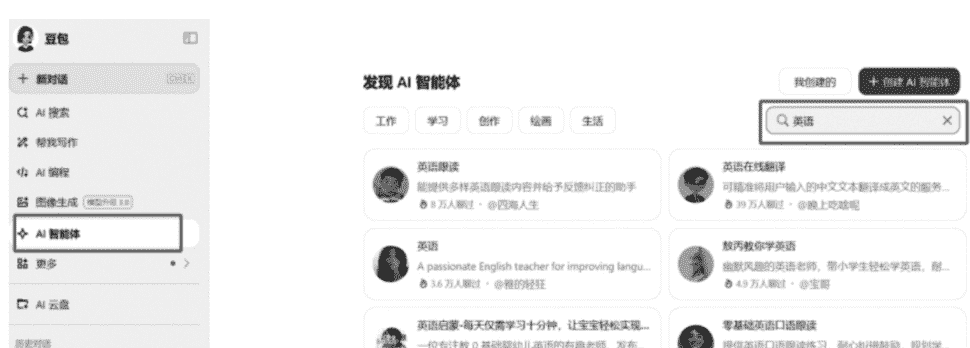

**方法二：**

1. 打开豆包，选择语音通话。 图7-6 豆包语音通话

#### （三）AI赋能个性化学习，释放学生潜能

AI技术通过精准的学习诊断、动态的路径规划、智能的内容推荐和及时的辅导反馈，为实现大规模个性化学习提供了强大的技术支撑。将AI工具交到学生手中，鼓励他们利用AI进行自主学习和探究，不仅能够满足学生的个体需求，提升学习效果，更能培养其信息素养、自主学习能力、解决问题能力等面向未来的核心素养，真正释放每个学生的独特潜能。接下来，我们将进一步探讨如何利用AI赋能学生的创造性表达。

### 六、AI赋能学生创造性表达

#### （一）创造性表达的重要性：核心素养的外化与展现

在核心素养导向的教学中，仅仅让学生理解和掌握知识是不够的，更重要的是培养他们运用所学知识、技能和思维能力来解决真实问题、表达个人见解和进行创新创造的能力。激发学生创造性表达正是这一过程的重要体现和关键环节。它不仅仅是学生将知识内化后进行外化的过程，更是培养其批判性思维、创新思维和问题解决能力等高阶思维品质的有效载体。

> 核心素养研究课题组.中国学生发展核心素养[J].中国教育学刊，2016（10）：1-3.

通过多样化的表达形式（如写作、演讲、绘画、设计、编程、视频制作等），学生能够：

- 展现对复杂问题的理解和提出解决方案，体现其关键能力的应用水平。

- 表达独特的思考视角和创新性的想法，发展其思维品质。

- 将抽象的知识、概念转化为具体的作品，实现知识的迁移与应用。

- 在创作过程中融入个人的情感体验和审美取向，并反思和明确自己的价值观念。

新课标明确强调学生应具备“创造性表达”的能力，旨在推动学生从被动的知识接受者转变为主动的知识建构者和创新者。然而，传统的表达方式往往受限于学生的技能水平（如绘画技巧、写作能力、技术操作能力等）或可用的工具与资源。

人工智能技术的赋能，为学生的创造性表达开辟了前所未有的广阔空间。AI不仅能帮助学生克服某些表达上的技术障碍（例如，绘画技巧不足、视频拍摄与剪辑复杂等），让他们能够用更丰富的多模态方式（文本、图像、声音和视频）呈现自己的想法，更能作为激发灵感、辅助思考、拓展思路的“伙伴”和“教练”，在互动和创作过程中促进学生批判性思维、创新思维的发展，并最终体现学生的价值判断和个性化表达。引导学生利用AI进行创造性表达，是培养其综合素养和适应未来社会能力的重要途径。

#### （二）AI激发创造性表达的主要形式及操作方案

教师可以引导学生利用AI（特别是DeepSeek及相关工具组合），在以下几个方面进行创造性表达的探索与实践。

##### 1 DeepSeek角色扮演对话：在深度互动中生成与表达思想

让AI扮演特定的角色（如历史人物、科学家、哲学家、文学家、不同职业人士，甚至是一个虚构角色），学生围绕特定主题或问题与其进行有深度的、持续的对话。这种对话的价值不仅在于获取信息，更在于模拟真实的交流情境，激发学生从不同视角思考，在与AI的思想碰撞中生成自己的观点、梳理逻辑，并练习表达。

操作方案：

- 教师引导设定角色与主题：教师可以根据教学内容或学生兴趣，引导学生设定清晰的AI角色（包含背景、性格特点等）和需要深入探讨的核心问题或情境。

- 学生主导开放式探究：鼓励学生掌握提问技巧（如第三章所述），使用开放性问题主导对话方向，并针对AI的回答进行追问、质疑，要求其提供论证或扮演反对者，从而深化对问题的理解和思考。

- 记录、反思与再表达：引导学生记录对话的关键内容、自己的思考轨迹和观点变化，并在对话结束后进行反思。最终可以将对话过程本身或基于对话生成的思考与观点，通过写作、演讲、报告等形式进行二次创造性表达。

提示词示例（学生向AI提问）：

- “请扮演一位亲身经历过红军长征的老红军。我想了解在长征途中，面对饥饿、寒冷和敌人的追击，支撑你们走下去的精神力量是什么？请结合你的具体经历谈谈。”（历史探究与价值观。）

- “请扮演一位资深的城市规划师。我们正在讨论未来城市交通的可持续发展方案。你认为除了发展公共交通和电动汽车，还有哪些更具创新性的绿色交通理念值得我们思考？请阐述理由。”（问题解决与创新思维。）

- “请扮演《西游记》中的孙悟空。有人说你保护唐僧去西天取经主要是为了完成任务、重获自由，也有人说你是真心向善。你自己怎么看待这个问题？请结合你的经历谈谈你的真实想法。”（文学理解与批判性思维。）

##### 2 DeepSeek深度写作：辅助多体裁创作与改写

利用DeepSeek作为写作助手和“风格教练”，辅助学生进行不同体裁、不同风格的写作尝试。例如，模仿名家（如朱自清、鲁迅）的语言风格写散文片段；根据设定的世界观创作科幻小故事的开头；为某个社会现象撰写观点清晰的议论文提纲；或者将一篇新闻报道改写成诗歌等。AI可以提供语言风格参考、词汇建议、句子润色、结构框架，甚至生成初步的草稿供学生修改。

操作方案：

- 明确写作任务与风格要求：教师或学生设定清晰的写作目标，包括体裁、主题、目标读者、篇幅，以及最重要的——期望的语言风格或模仿对象。

- 提供范例或清晰描述：可以向DeepSeek提供想要模仿的文本片段，或者用详细的语言描述期望的风格特点（例如：“请用简洁、冷静、略带讽刺的语言风格……”）。

- 强调学生主体与深度参与：极其重要的一点是，必须让学生明确AI生成的仅是初稿、素材或参考，绝不能直接替代学生的思考和写作过程。教师应引导学生在AI生成内容的基础上进行大量的批判性审视、修改、润色、重构，注入自己的思想、情感和独特表达。评价的重点应放在学生如何利用AI进行构思，以及最终作品的原创性和思想深度上，而非仅仅是文本的流畅度。

提示词示例：

- “请模仿朱自清先生在《背影》中朴实、真挚、饱含深情的语言风格，写一段约150字的文字，描绘傍晚时分，母亲在厨房忙碌准备晚餐的背影。”

- “我正在构思一个关于‘时间旅行者回到恐龙时代’的科幻小故事开头。请帮我生成一个包含环境描写、主角心理活动和初步悬念的开头段落，大约300字，风格要求紧张刺激。”

- “请将下面这篇关于‘中学生过度使用手机的危害’的新闻报道[此处粘贴报道内容]，改写成一首现代诗歌，要求表达出对这种现象的担忧和反思。”

实战案例：

打开DeepSeek，输入提示词：请根据马致远《天净沙·秋思》的内容，以朱自清散文的风格，写300—400字的散文。

输出结果：

###### 秋的断章

枯藤攀着老树，像老人手臂上的青筋，蜿蜒地暴出来。树权上栖着几只乌鸦，羽毛被暮色浸透了，黑得发沉。它们偶尔“哑”地一声，那声音便跌进黄昏里，碎在石桥上。

桥是弓着背的，石板缝里钻出几茎枯草，在风里瑟瑟地抖。桥下流水瘦得很，映着几户人家的灯火，灯火也是瘦的，在纸窗上摇曳，仿佛随时要被西风吹灭。

古道上尘土簌簌地爬着，一匹瘦马踩着这些尘土，肋骨历历可数。马背上的人裹紧了衣衫，衣衫是旧的，颜色早已被风霜吃尽。他的影子拖得很长，长得要折断在这荒凉里。

夕阳正往下沉，像一枚铜钱掉进远处的山坳。余晖染得天边一片惨红，这红却又渐渐褪去，褪成灰，褪成黑。人在天涯，天涯却在夕阳之外。这般的秋，原不过是天地间的一个叹息，而断肠人的愁绪，竟比这秋还要长些。

##### 3 AI生成学科动画/实验演示（工具组合）

引导学生利用AI视频生成工具，将难以用语言或静态图片完全展现的抽象科学概念（如数学公式推导、函数变换规律、物理定律演示、化学反应微观过程）或复杂的实验步骤，转化为直观、动态的动画或演示视频。这是一种强大的知识可视化和创造性表达方式。

操作方案：

- 构思与脚本生成（DeepSeek辅助）：学生首先需要清晰地理解要演示的概念或过程，并构思动画的关键帧或步骤。可以利用DeepSeek辅助生成文字脚本或分镜描述。

- 选择并使用AI视频工具：教师指导学生选择合适的AI视频/动画生成工具（如Kinetix、ClipDrop、Pika、Runway等，需注意工具的能力和适用范围）。将文字脚本或关键步骤描述输入工具，尝试生成视觉片段。

- 迭代优化与整合：AI生成的视频片段可能需要多次调整提示词或参数才能达到预期效果。学生需要对生成的片段进行筛选，并导入视频编辑软件（如剪映）进行剪辑、排序、添加必要的文字标注、配音（可用AI配音）等，最终整合成一个完整的教学演示视频。

提示词示例（给AI视频工具）：

- “生成一段时长10秒的动画，演示勾股定理a²+b²=c²的图形证明过程：四个全等的直角三角形围绕一个正方形旋转拼接成一个大正方形。”

- “制作一个简单的物理动画，展示一个苹果在真空中和在空气中同时下落的过程对比。”

- “动画演示：水分子的结构，包含一个氧原子和两个氢原子，以及它们之间的化学键。”

##### 4 DeepSeek+即梦/Midjourney：诗意表达、视觉艺术创作

文字到画面：意象具象化

在教学现场里，用文字触发图像生成已是常见的创作方式。把古诗词、散文切片、个人感受或科学概念这类难以直观呈现的材料，借助绘画模型转译为教学海报、文学插画、科普绘本、概念漫画甚至连环图文，能有效锻炼审美判断力和跨模态表达力。

实践路径

- 解读意象并转化为可绘制描述。面对较为抽象的文学文本，学生可先与DeepSeek展开交流厘清内涵，随后请其协助撰写包含细节与风格要求的绘画指令。
- 模型作画。将打磨好的指令输入即梦、Midjourney、豆包文生图、Stable Diffusion等引擎，通常需反复微调才能接近预期效果。
- 融合与二次创作。将生成的画面与原文、学生自撰的解说、DeepSeek提供的说明文字拼接，组合成图文并茂的海报、演示页、故事文本或漫画。

提示词示例

- 交付给DeepSeek：请为王维《鸟鸣涧》“人闲桂花落，夜静春山空。月出惊山鸟，时鸣春涧中”拟一段可供AI绘画使用的指令，要求呈现夜晚、春山、月光、桂花飘落、山鸟、溪涧，整体风格宁静空灵具禅意，接近中国传统山水画。
- 交付给即梦并在前文基础上细化：中国传统山水画风格，深夜，寂静春山，皎洁月光，几朵桂花轻飘，一只山鸟受月光惊动于山涧鸣叫，画面空灵宁静有禅意。
- 交付给即梦：创作一张“保护海洋生物”宣传海报，画面主体是一只被塑料袋困住眼神哀伤的海龟，背景为深蓝色海洋与漂浮垃圾，写实且具思辨性。
- 交付给即梦：创作“春天的回忆”三格漫画，第一格冰雪消融，第二格嫩芽破土，第三格孩子在阳光下放风筝，风格温馨可爱。

实战练习

- 借助DeepSeek输出视频脚本。输入要求：请拟一个十秒脚本，展示“春”字从甲骨文到楷书的动态演进。
- 登录即梦官网，进入故事创作。图7-7 即梦故事创作
- 选择空白分镜，按分镜依次填入脚本文字并设定属性。图7-8 即梦创建分镜

##### 5 DeepSeek 协同 剪映：短视频表达
将DeepSeek的文本创作能力与剪映的易用性及内置智能功能结合，可引导学生围绕校园生活、社会热点、学科科普、读书报告、实验记录等主题制作兼具思想性与视听效果的短视频，有助于语言表达、信息整合、技术运用与团队协作的提升。

实践路径

- 主题发散与脚本撰写。确定主题后借助DeepSeek进行头脑风暴，产出故事梗概、分镜脚本、人物对白与旁白。
- 素材准备与拍摄。按脚本完成实景拍摄，或收集整理图片视频素材，注意版权合规。
- 剪辑与智能功能使用。导入素材后进行剪辑、调色、转场、配乐。可使用自动字幕、智能语音播报、模板库等提升效率与质感。
- 教师指导与评价。重点关注主题立意、脚本逻辑与创意、视听语言的初步运用。

提示词示例

- 交付给DeepSeek：为中学生写一个以“我的家乡”为主题的一分钟短视频脚本，包含家乡美景展示、特色文化介绍、个人情感抒发，要求语言生动富有地方特色。
- 交付给DeepSeek：为介绍“垃圾分类的重要性”的公益短视频撰写旁白，要求简洁有力、号召行动，适合在学校宣传栏播放。

实战练习

- 将素材导入剪映，点击“识别字幕”→“开始识别”，生成字幕后核对一致性。图7-9 剪映自动识别字幕
- 选中字幕，点击“朗读”，挑选合适的智能语音。图7-10 剪映AI配音

##### 6 DeepSeek 结合 可灵/即梦/HeyGen：数字人对话创作
借助可灵、即梦等数字人生成工具打造形象、声音与性格各异的虚拟人物，再结合DeepSeek的对话与知识能力，让学生与“活起来”的数字人进行访谈、辩论、角色扮演等沉浸式互动，能明显丰富人机交互并提升沟通与思辨能力。

实践路径

- 角色设定与知识背景。在平台设定外观、声音、性格，并为其注入特定知识库或对话任务。
- 学生主导的互动对话。围绕预设主题，如采访虚拟袁隆平了解杂交水稻历程、与代表“人工智能教师”的数字人辩论、向虚拟心理咨询师倾诉考试焦虑等展开自然语言交流。
- 记录、分析与展示。对话可被记录转录并进行情感分析，作为学习成果展示。

提示词示例

- 在数字人平台设定：创建一个虚拟图书管理员数字人，形象为和蔼老奶奶，声音温柔缓慢，性格耐心细致。知识背景：熟悉小学图书馆各类图书。任务：向小学生推荐图书并解答借阅规则问题。
- 交付给DeepSeek赋予数字人观点：请扮演认为“网络游戏对青少年弊大于利”的家长，就此观点提出三个主要论据，语气恳切带担忧。

实战练习

- 打开即梦，在“导入参考图”处添加参考图，文字框输入：生成一个3D人物形象。图7-11 即梦生成3D人物形象操作
- 选择满意图片下载保存，也可在基础上修改。图7-12 即梦生成3D人物形象
- 选择“对口型”，导入保存的参考图，输入约120字说话内容，点击生成视频。图7-13 即梦设置数字人视频图7-14 即梦输入数字人说话内容

##### 7 学生自创智能体
引导学生利用扣子等智能体创建平台，亲手设计具有特定功能或角色的AI助手，是培养计算思维、设计思维与问题解决能力的进阶路径。

实践路径

- 明确目标与使用者。思考要创建何种助手、服务谁、解决什么具体问题。例如“数学错题小助手”“口语练习伙伴”“校园植物识别导游”。
- 设计角色、知识与技能。设定名称、定位、说话风格，为其喂养文档、网页链接等知识，配置联网搜索、计算器、翻译等技能。
- 调试、测试与迭代。反复对话测试功能是否达标，识别问题后调整提示词、知识库或技能配置。
- 分享与应用。鼓励分享给同学使用并收集反馈持续改进。

提示词示例

- 交付给DeepSeek构思：我想为班级创建一个帮助同学快速了解通知和近期活动的AI助手，请设计其核心功能、可回答问题类型及对话风格。
- 在智能体创建平台设定：角色：你是阳光小学四年级（3）班的班级小助手“小喇叭”。知识库：上传班级课表.docx、近期活动通知.txt、学校常用网站链接列表.md。技能：按日期查询课表，回答运动会、家长会等活动时间地点内容，提供学校官网链接。对话风格：活泼友好耐心，像热心小同学。

### 七、小结

人工智能支持下的创造性表达为学生打开了前所未有的表达空间。将DeepSeek等工具与多模态应用结合，不仅能帮助学生把内化知识外化为多样作品，也能提升信息素养、批判思维、创新能力、多模态表达与跨媒介创作能力。教师的核心作用是设计真实有意义的创作任务，提供脚手架，引导学生在AI支持下自由探索、大胆表达、批判思考、动手创造，从而落实核心素养培养，激发每个学生的潜能。

## 第八章

## AI赋能评价：构建数据驱动的多元评估

学业评价是检验教学效果、促进学生发展的关键环节。随着人工智能快速发展，传统评价方式正经历深刻变革。本章聚焦新课标背景下如何借助AI尤其是DeepSeek赋能评价，实现从“知识本位”向“素养导向”的迁移，构建科学多元动态的评估模式，让评价从一张终结性试卷走向全过程的成长记录。

### 一、新课标下的学业评价

#### （一）“教—学—评”一体化

《教育强国建设规划纲要（2024—2035年）》提出“促进人工智能助力教育变革”，强调“建立基于大数据和人工智能支持的教育评价和科学决策制度”。2025年4月教育部等九部门《关于加快推进教育数字化的意见》明确要求“人工智能赋能教育评价改革”，提出建立基于大数据和人工智能支持的教育评价机制，完善结果评价，开展多维度的过程评价、增值评价和综合评价，推动教学全过程、发展全要素伴随式数据采集，开展精准画像，强化全面发展育人导向。

新课标倡导“教—学—评”一体化，评价核心功能在于改进教与学、促进核心素养发展，主要要求包括：

- （1）核心素养导向：评价目标从记忆再现转向真实情境下运用学科知识解决问题的能力，涵盖必备品格、关键能力、正确价值观三维，强调问题解决、创新思维、合作探究等高阶与非标准化能力。
- （2）评价方式革新：倡导多元化、创新性评价。
- （3）过程性评价：评价贯穿学习全过程全周期，而非仅期末结果。
- （4）增值性评价：关注学生原有基础上的进步幅度与发展潜力，而非仅绝对分数横向比较。
- （5）表现性评价：通过项目式学习、实践探究、作品展示、口头报告等情境化任务真实反映综合运用知识解决复杂问题的能力。
- （6）跨学科整合：对跨学科主题学习中知识迁移、综合应用与创新实践提出评价标准与方法。
- （7）技术赋能方向：鼓励利用智能评测系统记录学习轨迹，开发学生数字画像，实现更精准个性化诊断与反馈。

新课标下学业评价的核心是服务学习发展，发挥以评促学、以评促教的导向，推动教学从知识传授转向素养培育。

#### （二）传统学业评价中存在的痛点

评价在教育系统中承担“指挥棒”与“诊断仪”角色，其重要性体现在学生自我认知、教师教学改进、系统质量监测等方面。但传统方式存在明显局限：

- （1）价值取向偏差：
    - ①应试化倾向：过度聚焦纸笔测试与标准化考试，以分数为唯一或主要标准，导致教学应试化，忽视综合素质与个性发展。
    - ②标准化陷阱：统一标准与量规难以匹配不同地区学校办学特色，也难以兼顾个体差异，对特殊教育需求学生支持不足、衡量不准。
- （2）技术与方法缺陷：
    - ①数据采集局限：主要依赖教师人工观察、纸笔记录与阶段性测试，难以全面客观持续捕捉动态表现，尤其思维过程、情感态度、协作能力等隐性素养评估不足。教师日均花费在评价记录分析上的时间已超1小时，数据量与质量仍有限。
    - ②反馈滞后与笼统：作业批改与阅卷周期长，学生数天至数周后才获反馈，削弱即时指导作用；反馈多为分数或等级，缺乏针对性诊断与改进建议。
    - ③分析维度单一：结果分析多停留于分数与知识点掌握统计，难以深入分析思维品质、创新能力、学习策略等。
- （3）教师负担沉重：设计评价任务、实施评价、批改、分析数据、提供个性化反馈均对时间、精力、专业能力要求极高，导致诸多理念难以落地。

#### （三）AI赋能学业评价的优势与价值

AI融入突破传统瓶颈，推动评价从标准化走向个性化，从结果导向走向过程与发展并重，从经验判断走向数据驱动，主要优势有六方面：

- （1）提升效率减轻负担：AI可自动处理大量重复性任务，如客观题自动批改、学习数据自动记录与初步统计、部分主观题辅助阅卷，释放教师精力用于评价设计、结果解读与教学干预。
- （2）实现个性化与自适应：依据学生学习历史、答题表现、认知特点动态调整评价任务难度与内容，提供更匹配个体需求的评价体验，精准评估真实水平。
- （3）提供即时精准多维反馈：快速分析学习过程与结果，生成包含具体错误分析、知识点链接、改进建议的个性化反馈报告，帮助学生及时调整策略。
- （4）支持过程性数据收集与分析，实现动态评价：全面记录在线学习平台等环境中的行为轨迹，如学习时长、资源偏好、互动频率、思考路径，形成过程性数据，持续追踪监测学习状态并及时干预。
- （5）丰富评价工具与方法创新：借助自然语言处理分析文本表达，语音识别评价口语，图像识别评估实践作品，构建数字画像进行综合发展性评价，更全面反映核心素养。
- （6）助力以评促学、以评促教：精准诊断学情、精细分析过程、科学解读结果，为教师提供教学建议，优化设计、改进方法；个性化反馈与学习路径推荐引导自主深度学习，实现评价真正服务教学与学习。

综上，新课标对评价提出更高要求，传统方式在理念与技术上均受挑战。AI为构建更科学、多元、动态、个性化的评价体系提供支撑，对落实“教—学—评”一体化与核心素养发展至关重要。下文将具体探讨AI在智能诊断、量规评价、数据分析、分层命题、错题管理、作业批改等环节的赋能路径。

### 二、智能诊断与学习分析

智能诊断是评价的首要目的之一，用以发现学习问题并实施针对性干预。传统依赖教师经验与作业测验分析，在深度、广度、效率与个性化上有限。AI为更精准高效的诊断与学习分析提供可能。

#### （一）智能诊断的内涵与目标：精准定位学习问题

智能诊断是指运用自然语言处理、机器学习、知识图谱、数据挖掘等技术，对学习过程与结果进行深度分析，识别知识掌握、能力水平、思维方式、认知特点及潜在困难。目标不仅判断是否学会，更实现精准定位：

- （1）定位知识薄弱点：准确识别具体知识点或技能的欠缺与理解偏差。
- （2）分析错误根源：判断错误源于概念不清、方法不当、审题失误或思维障碍。
- （3）揭示思维路径：分析解题时的思考过程与策略选择，发现思维模式特点与不足。
- （4）识别能力短板：评估分析、推理、创新等关键能力与学科核心素养的表现。
- （5）预测学习风险：基于学习行为与表现数据预测可能困难或发展障碍，及时干预。

智能诊断有助于教师全面深入了解学情，为个性化教学、精准辅导与教学决策提供依据。

#### （二）AI赋能学习过程诊断

大模型让教学诊断与评价更细致可操作

大语言模型在阅读、归纳文字材料上效率突出，能帮助教师快速把握学习过程中的真实状态，尤其是作业、作文、线上发言、项目报告、实验报告、学习反思这类文本成果。下面是一套可直接落地的文本诊断做法。

一、基于文本的学情诊断路径

1. 资料采集与电子化
把学生的文字学习痕迹集中起来，主观题作业、作文、线上讨论记录、项目报告、实验报告、反思日志等都要覆盖。纸质材料可用拍照或扫描转为电子文本，关键解题步骤与要点整理成可读文本，匿名处理后进入分析环节。

2. 厘清诊断焦点与视角
结合教学目标确定分析面向，例如知识理解是否到位、概念是否混淆、论证是否严密、观点表达是否清晰、思维深度如何、有无创新、解题策略是否合理等。

3. 撰写提问模板并与DeepSeek对话
把匿名后的学生文本与诊断目标一起输入，通过精心设计的提问引导模型解读。可以让模型：
- 提炼回答中的核心观点、支撑论据与逻辑链条；
- 判断对某个概念的掌握程度，有无理解偏差或混淆；
- 归纳某一类题目常见的错误类型与思维误区；
- 横向对比不同学生在同一题上的差异，刻画个体特点；
- 借助SOLO分层框架初步判定思维层级。

4. 结果解读并用于教学调整
把模型的分析输出与教师的专业判断结合，形成诊断结论，进而调整教学策略或给出定制化辅导。

案例：小学数学“用图表解决问题”的学情诊断
场景：教师在讲完“用图表解决问题”后，想快速摸清学生对问题建模、图表解读、计算策略的掌握，并找到共性薄弱点与个性困惑。传统纸笔测验只能看到结果，难以还原思维路径，干预往往滞后。
模型运用：
- 学生作业电子化：把纸质图表题拍照或扫描，形成电子文本。诊断聚焦读题、建模、算数、验算四个环节，并用SOLO分层判断思维层次。
- 提问模板与DeepSeek对话，沿用身份、情境、任务、呈现方式、指令五要素框架：
  身份设定：扮演熟悉小学高年级数学教学且熟练运用SOLO分层的一线教师；
  情境描述：附件是五年级学生完成的“龟兔赛跑”图表应用题的完整解题过程、算式与答案；
  任务要求：对该作业做细致诊断，检查读题是否准确理解题意与图表、建模是否恰当、数据处理是否准确合理、验算是否有意识与方法这四个阶段是否存在认知障碍或典型错误；
  呈现方式：结合SOLO分层给出整体思维层级判断；指出各阶段的正确表现与障碍、错误模式及可能成因；总结常见错误并提供可视化反馈建议、分步引导思路与错误修正练习的设计方向；报告结构清晰；
  指令约束：分析要具体，措施要可操作，符合小学生认知水平。
输入后模型自动输出针对该图表题的认知障碍、错误模式、思维层级判定以及可视化引导、分步策略等定制化建议。教师可汇总多份分析，生成班级共性问题报告，或为不同层次的学生生成含可视化建议的诊断与学习建议。
效果：模型帮助教师摆脱繁琐批改，深入洞察解题卡点，结合教育理论做初步分层，为精准教学提供参考。注意事项：作业数字化要清晰，光学字符识别要准确；分析质量取决于输入信息与提问模板的清晰度；模型输出需经教师专业解读与验证，不能替代教师判断。

二、大模型驱动的学习行为预警

除文本作业外，大模型还能借助希沃白板互动数据、在线学习系统、智慧校园平台等记录的行为数据做深层次挖掘与风险预警。流程如下：
1. 数据整合与接入：在学习管理平台支持下，通过接口或导出功能把登录时长、视频完成度、讨论参与度、练习提交频率与正确率、资源点击偏好等行为数据接入分析系统。
2. 模型分析与模式识别：利用机器学习识别学习模式，比如碎片化还是集中学习、偏好视频还是文本，以及可能预示困难的异常行为。
3. 生成分析报告与预警提示：输出班级整体学习状态报告，或对个别学生发出预警提醒。

案例：在线学习平台数据的学习预警
场景：某中学采用线上线下混合教学，教师希望及时掌握平台学习投入并对潜在学困生早干预。
模型运用：
- 数据收集：平台自动记录近两周的登录次数、总时长、视频观看时长、练习完成度与正确率、论坛发帖回帖数。
- 分析与预警阈值设定：可设定如连续三天未登录、两周总时长远低于班级均值、核心视频完成率低于50%、单元测验正确率持续走低、讨论区零互动等规则。
- 自动识别与预警：系统按规则筛选出需关注名单并生成预警报告与建议。
- 提问模板示例：身份为教育数据分析专家；情境为提供一批两周的学生平台行为摘要；任务为依据给出的预警规则识别重点关注学生，并分析其行为数据可能反映的问题，给出初步干预建议；呈现方式为列表，每人一项，包含代号、触发规则、问题分析及一到两条具体建议。
效果：快速从海量数据中揪出“沉默的少数”或潜在学困生，实现早期识别与主动干预。注意事项：行为数据仅供参考，需结合实际沟通核实；预警阈值要科学合理，避免过度干预；需重视数据隐私与算法公平。

三、大模型对量规评价的支持

核心素养导向的评价难点在于把抽象素养转化为可观察、可测量的标准。评价量规正是解决这一问题的工具。

（一）量规在核心素养评价中的作用
评价量规是结构化的评分指南，清晰界定学习任务在不同表现水平上的具体标准。典型量规包含三个要素：
1. 评价面向：任务要考察的关键面，对应学习目标或核心素养，如问题分析能力、方案创新性、团队协作与沟通、语言表达的准确与逻辑性等。
2. 表现水平：对每个面向的不同程度划分，常以优秀、良好、合格、待改进或新手到专家等描述。
3. 水平描述：针对每个面向每个水平的具体行为表现或成果特征，是量规核心。
量规让素养评价更具体可操作，把抽象目标拆解为可观察指标，提升客观性、一致性与透明度，减少主观随意性。

（二）大模型助力量规生成与完善
大模型可快速根据任务与面向生成量规框架，帮助把模糊描述细化，也能根据学情设计分层量规。以DeepSeek为例的操作思路：
1. 明确评价任务与核心素养面向：先界定任务类型与重点素养。
2. 撰写提问模板提出生成请求：把任务、面向、年级、等级数等信息输入，要求模型输出初稿。
3. 迭代优化与教师精炼：审阅初稿，结合教学情境与学生实际修改完善，可追问模型让描述更具体或提供范例供模仿。

案例：环境保护小组研究项目量规生成
场景：初中科学教师安排“我们社区的环境问题与解决方案”小组研究，要求提交报告并展示，需要一套评价量规。
模型运用：
- 教师明确面向：问题探究与分析能力、协作与沟通能力、研究成果创新性与可行性、社会责任感与参与意识；等级设为优秀、良好、合格、待改进。
- 撰写提问模板并交互：身份为经验丰富的初中科学教育评价专家，擅长项目式学习量规设计；情境为八年级学生完成该小组研究并展示；任务为为该项目设计评价量规；受众为初中八年级；呈现方式为包含四个面向，每个面向对应四个等级，并给出清晰具体、可观察的行为描述，以表格输出；指令为描述需可观察可操作，能有效区分水平。
输入后模型生成初稿，教师审核与优化，结合项目要求与学生实际对表述进行细化，如把“数据充分”明确为“至少三种不同来源并注明出处”。效果：大模型能快速生成结构化初稿，大幅减轻设计负担，但教师需有清晰的素养理解并对描述做专业润色，确保准确、可观察且具有正向引导。

四、大模型赋能的数据评价与学习画像

传统评价多依赖经验与阶段性纸笔测试，在全面性、客观性与动态性上有限。基于大数据与模型分析的评价与学习画像正好弥补这些短板。

（一）数据驱动评价：从经验判断到数据支撑
数据驱动评价指系统收集、整合、分析学习过程与结果的多维数据，以证据为基础评估学习状况，据此优化教学。其价值在于：
1. 提升评价客观性与科学性，减少经验偏差；
2. 实现全面多维度评价，整合行为、互动、作业、兴趣、情感等信息；
3. 支持动态发展性评价，持续追踪成长轨迹；
4. 赋能精准教学与定制化学习，定位问题、优化策略、推荐资源。
在数字化教学平台支持下，教师能采集更广更细的数据。模型可整合学校管理、学业、教学过程等多源信息，实现实时动态监测。借助智慧课堂、可穿戴设备、在线平台，可采集课堂行为、互动甚至部分生理心理数据，实现常态化评价。可构建：
1. 多源数据采集系统：
   - 学业数据：各科成绩、作业正确率与完成情况、知识点错误分布与薄弱点；
   - 行为数据：平台登录频率、学习总时长、资源点击记录、讨论区互动次数与内容；
   - 心理与生理数据：在伦理与隐私前提下，可结合可穿戴设备分析情绪波动、注意力分布等，用于预测难点或疲劳；
   - 非结构化数据：教师评语文本、课堂教学视频语音转写文本、手写作业图像经光学字符识别转文本等。
2. 数据治理引擎：
   - 统一身份识别体系：打通教务、学习平台、智慧设备的数据壁垒，整合结构化与非结构化数据；
   - 数据融合与隐私保护：在确保安全前提下，如借助联邦学习实现跨平台融合关联分析。

##### 1 典型智能学习平台数据记录与导出功能

数据驱动：让教学评价更立体

一、搭起数据评价的工具底座

想把评价从经验判断转到数据支撑，先把常用的数据来源理顺。当前教师手上的组合大致可分为四类。

学习型平台是基础。Moodle、Google Classroom 等境外系统，以及国内的智慧校园、希沃平台、智学网、国家中小学智慧教育平台等，都内置了学习轨迹采集与统计功能，能自动留存练习、作业、观看等行为记录，为后续分析提供原材料。

自适应练习系统。以松鼠 AI、学而思 AI 学习机为代表，这类产品会根据答题表现即时调整学习路径，同时沉淀非常细粒度的行为日志。

课堂互动采集工具。希沃白板的互动组件、Kahoot!、Mentimeter、雨课堂等，可在授课中即时捕捉参与度、选择反馈与思考节奏，为形成性评价提供依据。

分析可视化软件。Excel 搭配智能插件、Tableau、Power BI 等，擅长对平台导出的原始表进行二次加工，生成看板、趋势图与报表。

生成式智能助手。能够对导出后的文本、表格进行概括、解读图表、撰写分析文稿，相当于教师的第二位研究助理。

2 周练习数据快速诊断的实操

场景。某校五年级数学任课教师每周通过线上练习平台布置作业，希望在一周内掌握全班完成情况、薄弱知识点以及需要重点关注的个体。

操作要点
① 查看与导出。登录平台读取自动生成的班级周报，包含整体完成度、平均答对率、高频错题、各生得分与耗时等，必要时导出明细为 Excel。
② 深度解读。部分平台已提供知识点掌握雷达图、投入度统计。若需要更细的解读，可将报告摘要做匿名化处理后输入 DeepSeek。
③ 四要素提示框架
- R 角色设定：请以小学数学学情诊断专家的视角回应。
- S 背景描述：本班五年级上周线上练习要点为参与率 95%，平均答对率 78%。错题集中在小数乘除混合运算和多边形面积综合应用。3 名学生代号 S1、S2、S3 连续两次答对率低于 60%，且 S2 用时明显高于班级均值。
- T 工作任务：请解读该摘要，指出班级学习可能存在的共性问题，并为需要关注的学生给出初步辅导思路。
- A 输出要求：分点陈述，语言通俗易懂。

预期结果。DeepSeek 会梳理共性问题并给出针对性建议，教师再结合自身的学生认知进行教学调整与个别辅导计划制定。

二、用大模型解读与呈现评价信息

多源数据收集后，难点在于转化为可指导教学的结论。大语言模型在文本理解与生成上的能力可承担解读与呈现工作。常用流程如下。

数据收拢与预处理。将成绩表、问卷、课堂观察记录、线上讨论文本等整理为表格 Excel/CSV 或纯文本 Word/TXT，并完成匿名。
明确分析目标。先确定希望得到什么结论、面向谁呈现。是面向家长的学习小结，还是用于教学反思的学情报告？侧重趋势还是问题点，目标越清晰输出越聚焦。
构建交互提示。与模型进行对话。
基础统计描述。让模型计算均值、中位数、标准差、频次分布并用通俗语言解释，帮助快速把握整体水平与分布形态。
时间趋势判断。对多次测验等序列数据，要求模型识别上升、下降或波动，并结合背景尝试解释原因。
群体差异对比。让模型比较不同群体如性别、学业基础差异者的表现，挖掘隐性分化。
关键现象提炼。数据量大时，要求模型归纳出最值得关注的几条现象。
图表描述与建议。可上传已有图或描述数据特征，请模型推荐合适的可视化类型，甚至生成 Mermaid 等简易代码。
摘要提炼。对复杂报告请模型浓缩核心要点。
专业复核与落地。模型输出需经教师专业判断后再用于反思、辅导与家校沟通。

实操：语文单元测验分析与报告初稿生成
场景。某语文教师完成文言文单元教学后进行测验，期望了解学生对实词、虚词、句式、翻译及阅读理解的掌握。已将全班匿名成绩按题型整理进 Excel。
做法
① 文件上传：将含各题型得分的匿名表格上传。
② 四要素提示
- R 角色设定：请扮演资深语文评价专家，擅长解读测验分数。
- S 背景描述：附件为本班文言文单元测验的匿名成绩，含选择题实词虚词、翻译、阅读理解简答，满分 100。
- T 工作任务：请分析数据并生成简要分析报告初稿。
- A 输出要求：包含班级整体表现：均分、最高分、最低分、及格率 60 分为及格、优秀率 85 分及以上；各题型平均得分率，指出优势与短板；初步判断主要失分点；如有分组信息则做简要差异比较。
- 约束：表述简洁专业，数据准确呈现，尽量给出教学改进建议。
输出。模型给出整体表现、各题型得分、主要失分点及改进建议的初稿供教师复核。

文言文单元测验分析报告初稿节选
一、班级整体表现
均分 78.5，高于年级基准线 3 分；最高分 95；最低分 52；及格率 88%，44 人达标；优秀率 24%，12 人达标。

三、构建与应用学习画像

学习画像是将多维度数据融合后，对学习特征、能力水平、兴趣、潜能进行的动态个性化刻画，是数据驱动评价的深化。

1 画像构建流程
多维度采集与治理
数据来源。基本信息、学业成绩、作业完成、学习行为如登录频次、时长、点击记录、提问记录、社团与课外兴趣等。经清洗、整理、匿名后形成基础。
治理机制。建立统一身份标识，打通教务系统与各在线平台、物联网设备的数据壁垒，确保规范一致可获取。
建模与特征提取。用生成式智能对多模态数据进行深度分析，识别学习模式、兴趣倾向、知识掌握与能力发展，通过 NLP 与自动化工具实现实时处理与规律挖掘。
智能助力
动态生成与预测。基于一段时期学习轨迹预测未来知识点掌握变化；可将教师文本评语与知识图谱中概念节点的缺陷关联。
个性特征量化。如通过订正行为区分反思型与冲动型学习者；结合小组互动量化同伴影响对投入的作用。
画像生成与可视化
知识掌握图谱。各学科或知识点掌握情况，区分已掌握、学习中、薄弱环节。
能力发展评估。逻辑推理、信息素养、批判思维、创新、沟通协作等阶段性评价。
学习行为特征。主动性、持续性、规律性、时间管理、课堂参与、策略偏好等。
兴趣与动机。对不同学科或主题的兴趣程度，动机是内驱还是外驱。
个性化需求。需要关注的领域、技能提升方向、可能的情感心理支持。
可视化呈现。借助雷达图、柱状图、折线图、仪表盘、热力图、标签云等呈现动态多维画像。
知识图谱增强。辅助构建精细学科知识图谱，通过图注意力网络精确定位薄弱环节或知识断层；对创新解法可动态创建新路径节点。

2 画像在素质教育中的作用
生成个性化资源与推荐。依据薄弱点、认知风格与兴趣精准推荐或动态生成专项练习、讲解脚本、拓展阅读，甚至将知识点融入沉浸式虚拟场景。
规划动态路径与优化策略。教师据画像洞察班级差异实施差异化教学；系统基于强化学习根据每日反馈实时调整计划，实现一人一策，并可推荐跨学科项目。
监控进度与精准干预。持续更新画像可实时追踪状态，及时发现学习困难或情绪风险，如通过文本预警焦虑低落；在智慧课堂中生成注意力热力图提示教学节奏调整。
实时诊断反馈与辅导。学习过程中实时分析解题步骤、作业文本、课堂提问，给出具体启发性反馈，打破批改延迟。
多模态综合分析。融合成绩考勤、互动行为、在线轨迹、文本作业、语音表达、心理测评等非结构化信息，描绘比单一分数更立体的个体画像。

五、智能助力分层命题与个性化测验

一、分层命题与 SOLO 分类理论
分层命题是按认知水平、能力与知识基础设计不同难度与认知层次评价任务，能更精准诊断真实状况，并在最近发展区内提供挑战与成功体验。传统命题常因标准模糊、经验依赖、题库静态、维度单一导致优生吃不饱、学困跟不上。

SOLO 分类理论简介
SOLO 即可观察学习成果的结构，由 Biggs 与 Collis 提出，基于皮亚杰认知发展，关注学习者在任务中表现的思维复杂程度与理解结构，为设计活动与评价提供框架。

五个认知水平
前结构水平。对任务几乎无理解，回答无关或重复，无法处理有意义信息。
单一结构水平。只关注一个相关方面，理解片面孤立，如回忆孤立事实或执行简单指令。
多点结构水平。能列出多个相关点，但缺乏整合，理解呈并列列表，如列举事实或步骤却不说明关系。
关联结构水平。能把多个信息点联系成连贯整体，理解各部分关系，可解释、比较、分析、应用、论证，达到深度理解。
扩展抽象水平。能迁移到新抽象情境，进行归纳概括、假设反思、评价创造，从更广视角看待问题。

SOLO 与布鲁姆分类法可互补。布鲁姆侧重教育目标动词如记忆、理解、应用、分析、评价、创造；SOLO 侧重学习结果思维结构。记忆、理解常对应单一与多点结构；应用、分析对应关联结构；评价、创造与扩展抽象高度相关。

SOLO 为分层命题提供科学依据，使基础、中等、难题划分更精细，提升差异化教学精准性与有效性。

三、智能环境下的认知层次精准识别

看见思维的层次：SOLO与大模型如何重塑教学

过去教师对课堂的把握更多依赖经验和直觉，如今智能化手段把这些隐性判断转化为可度量、可追踪的数据。核心思路是通过多通道信息采集配合认知建模，将学习者在头脑中进行的思考外化为可观察的信号。各类学习工具在后台默默整合行为痕迹：智能笔迹系统记录每一步解题路径与耗时分布，课堂感知设备捕捉表情变化与互动频次，作业分析模块区分错因并判断是单点知识卡壳还是跨知识联动受阻。这些被转化的认知足迹，为后续的精准诊断奠定了数据基础。

以一道综合应用题为例，完整回放作答过程就能辨别学生是已能把多个概念融合成体系，还是仅仅停留在要点罗列的层面。依托SOLO理论框架、依托数据支撑的细化诊断，帮助教师看清思维深浅，从而实施更科学的个性化引导。下面表格汇总了SOLO各层级的表现特征以及生成式模型的支持策略，供教师参考。

表8-2 生成式AI赋能SOLO各个层次的评价方法和策略续表

| SOLO 分类层次 | 学习结果特征 | AI 赋能策略与学科实例 |
| :--- | :--- | :--- |
| 1. 前结构 | 学生对课文内容理解混乱，回答偏离主题（如混淆《小蝌蚪找妈妈》中的角色关系）。 | 赋能策略：通过 AI 提问澄清核心概念，填补知识漏洞或盲区。<br>学科实例：AI 生成基础性的问题（语文：“小蝌蚪为什么要找妈妈？”数学：“什么是三角形的周长？”），并纠正错误回答（如用动画解释《乌鸦喝水》中的水位上升原理）。 |
| 2. 单一结构 | 学生能提取单一知识点（如《草船借箭》中诸葛亮的“借箭”策略），但无法联系其他情节或背景，或者无法深入联系或扩展。 | 赋能策略：强化单一知识点的深度理解与简单应用，提供针对性练习。<br>学科实例：AI 生成针对性练习（语文：“用‘借箭’策略分析诸葛亮的性格特点”；AI 生成基于单一概念的问题（如“用牛顿第一定律解释静止物体的状态”），并提供即时反馈。 |
| 3. 多点结构 | 学生能列举多个独立内容（如《蜜蜂》课文中法布尔的实验步骤、观察结果），但未整合为逻辑或者系统框架。 | 赋能策略：引导知识点间的初步关联，构建结构化认知，推动结构化思维。<br>学科实例：AI 生成思维导图（语文：对比《落花生》与《白杨礼赞》的象征手法；科学：整理“水的循环”中蒸发、凝结、降水的独立现象），或设计排序任务（如排列《曹冲称象》的实验步骤）。 |
| 4. 关联结构 | 学生能整合多知识点形成系统或者连贯逻辑体系（如结合《赵州桥》的结构设计、《故宫博物院》的说明方法，分析建筑类文本特点）。 | 赋能策略：推动跨文本或跨学科的逻辑整合，促进跨领域连接，挑战高阶分析任务。<br>学科实例：AI 生成关联性问题（语文：“从《圆明园的毁灭》和《七子之歌》分析历史对文化的影响”；数学：用“田忌赛马”的策略设计“博弈论”数学建模问题），或模拟辩论（如 AI 生成“是否能替代教师”正反方论据）。 |
| 5. 抽象扩展结构 | 学生能基于课文创新迁移（如依据《只有一个地球》提出环保方案，或改编《狼牙山五壮士》为现代英雄故事）；能基于现有知识创造新观点或迁移到陌生情境，体现深度创新。 | 赋能策略：激发创造性思维，鼓励开放式探索，支持创造性重构与跨情境迁移。<br>学科实例：AI 辅助生成跨学科项目（语文 + 科学：设计《太空生活趣事多》的科幻小说；数学 + 艺术：用黄金分割比例重新设计《清明上河图》局部布局），或生成开放性任务（如“用《大禹治水》的智慧解决校园积水问题”）。 |

#### （二）DeepSeek助力基于SOLO的分层命题

大语言模型的介入，特别是DeepSeek在理解与生成上的表现，为传统分层出题的难题打开了新解法。围绕科学化分层、自动化创作、动态化适配三个方向，命题工作正由经验驱动的手工操作转向可复制的科学流程。

##### 1 基于SOLO的AI赋能分层命题

智能工具主要解决了传统分层命题中标准不清和效率不高两大难题，实现了从理论分层到自动出题的闭环。首先模型内化了SOLO等教学理论，使得层级划分更具客观性。当教师输入“理解二次函数的图像与性质”这类概括性目标时，系统会将其自动解析为不同认知层级的出题指向：识别顶点坐标的单层级、分析参数综合作用的关联层级、设计探究性任务的抽象层级，避免了以往凭感觉划分的模糊。在此基础上，凭借海量知识储备和生成能力，教师只需指定知识点、层级和题型，就能快速获得分层试题、参考答案、解析思路甚至评分标准，把原本需要数小时的手工环节压缩到几分钟，同时兼顾覆盖面与质量。

##### 2 AI赋能基于SOLO命题的方法

- (1) 锁定知识点与教学目标：先明确要出题的学科内容和核心教学意图，可参考布鲁姆分类和核心素养。
- (2) 按SOLO层级给出指令：在提示词中要求模型依据SOLO理论的特定层级出题，并说明题目落点及素养考查点。
- (3) 细化题型与参数：进一步约定题型、数量、难度、年级和已学范围。
- (4) 人工复核与迭代：模型初稿生成后，教师要对照SOLO层级、教学目标和学生实际进行筛选修改。

##### 3 实战案例1：AI辅助生成初中数学“函数”概念的SOLO分层题目

(1) 场景：一名初中数学教师想围绕“函数的初步认识”这一核心概念，编制一套体现不同认知复杂度的分层练习，用于诊断理解程度并促进数学抽象、逻辑推理等素养发展。

（2）AI应用：

①教师设定命题需求：知识点为“函数的概念、三种表示方法（解析式、列表、图像）以及自变量的取值范围”，目标是考查学生对函数概念不同层次的理解和应用能力。

②设计提示词并与DeepSeek交互，参考如下提示词（STAR-AI结构）：

（角色R）你是一位经验丰富的初中数学命题专家，并且非常熟悉SOLO分类理论和初中数学核心素养要求。

（情境S）我正在为初中八年级学生复习“函数的初步认识”这一单元，核心内容包括函数的定义、三种表示方法（解析式、列表、图像）以及自变量的取值范围。我希望通过分层练习来评估和提升学生的理解深度。

（任务T）请根据SOLO分类理论，为我生成针对以上内容的、覆盖不同认知层级的练习题目，并确保题目能体现对数学抽象、逻辑推理等核心素养的考查。

（方面/格式A）请至少包含以下SOLO层级的题目：①单一结构水平：1-2道，侧重对函数基本定义或一种表示方法的简单识别。②多点结构水平：1-2道，侧重对函数多种表示方法之间的转换或列举函数的基本性质。③关联结构水平：1-2道，侧重分析自变量与因变量之间的关系，或结合简单实际情境理解函数的意义和应用。④扩展抽象水平（可选，若适用）：1道，侧重于运用函数思想解决稍复杂的实际问题或进行简单的函数建模，体现创新应用。请为每道题目注明其对应的SOLO层级，并简要说明其如何考查数学抽象或逻辑推理素养。题目类型不限，可以是选择、填空或简答。

（指令/约束I）题目要符合初中八年级学生的认知水平，语言表述清晰准确。

（3）将上述提示词输入对话框中，DeepSeek根据提示词的要求，给出了回答（以下展示部分回答）：

以下是根据SOLO分类理论设计的分层练习题，涵盖“函数的初步认识”核心内容：

①单一结构水平：

题目1：下列各图中，能表示y是x的函数的是（ ）

A.垂直直线；B.抛物线；C.圆心在原点的圆；D.以原点为端点的射线

题目2：函数 $y=\sqrt{x-2}$ 的自变量x的取值范围是_______

②多点结构水平：

题目3：已知函数y=2x-1，请完成以下任务：a.当x分别取-1，0，1时，求对应的y值。b.将对应数值用表格表示。c.指出该函数的图像形状。

（4）教师审核与应用：教师根据AI生成的题目，结合具体教学内容和学生实际情况进行筛选、修改和补充，形成最终的分层练习或测验。

### 六、AI赋能错题管理与精准辅导

出错是学习常态，甚至可把错题视为最珍贵的资源之一。它像一面镜子，映照出知识掌握、技能运用和思维方式上的薄弱点。总结和反思错题是重要的学习策略。有效地管理和利用错题，不仅有助于学生查漏补缺、深化理解、优化学习策略，还可以提升学习效果。AI技术的融入，为错题的高效管理、个性化分析和针对性辅导提供了全新的解决方案，使错题资源真正转化为“精准学习”的支撑点。

#### （一）错题的价值与传统管理方式的不足

错题本质上是学生认知缺口和能力短板的集中体现。教师通过分析错题，可以更精准地识别学生的学习症结；而学生在纠错过程中，也在不断回顾、反思、重建已有知识结构。此外，错题集还是高度个性化的复习资料，学生可以针对自己的薄弱环节进行重点复习和巩固练习。因此，有效的错题管理能够帮助学生从“题海战术”中解脱出来。正如一些教育理念所强调的，题不在多而在于精，补漏的最好方法是做自己的错题，特别是那些处于“最近发展区”内的错题。针对这些错题进行精准练习和巩固补偿，能够达到事半功倍的效果，让学生少走弯路，实现科学减负和全面提质。错题管理最大的好处就是能减轻学生的负担，不再受题海之苦，错题纠正能达到事半功倍的效果。

但传统的错题管理方式存在诸多不足，难以充分发挥其应有的作用。学生手抄错题，特别是题目较长或包含图表的理科题目，容易出错而且效率低下。教师人工收集、整理、分析全班学生的错题，更是任务繁重。传统方式下，对错题的分析往往停留在表面，难以对错误原因进行深层次、系统性的归纳和分析，更难挖掘出学生在思维方式或学习策略上存在的共性问题。教师也难以针对每个学生的具体错题情况提供个性化的辅导。

#### （二）AI赋能个性化错题集与归因分析

人工智能技术，特别是以DeepSeek为代表的大语言模型，以及一些集成AI功能的教育平台（如超星、希沃、讯飞平台等），为错题的高效管理、深度分析和个性化利用提供了全新的解决方案。AI赋能错题管理与精准辅导，主要通过智能识别、错题归档、个性化分析和针对性辅导，实现错题高效管理和学习效果提升。

##### 1 AI赋能错题管理的核心环节

###### （1）智能采集与归档错题

- AI拍照识别与自动录入：许多AI学习工具或平台，例如希沃智能助教等，支持AI拍照识别技术（OCR），学生或教师可以随时随地拍摄纸质作业或试卷上的错题。系统能够自动识别题目内容（包括文本、公式甚至简单图形），并结合教师输入的答案判定对错，从而快速将错题录入学生的个性化电子错题本中。这种方式极大地避免了传统手抄错题的繁琐、耗时和可能出现的遗漏，提高了错题收集的效率和完整性。

- 在线平台自动记录：如果学生在各类在线学习平台、练习系统或AI助教等工具上进行作答，这些平台会自动记录学生的错题数据，包括题目、学生答案、正确答案、作答时长等，为后续的智能分析提供了数据。

###### （2）智能解析、标签与分类错题

- AI自动生成解析：对于录入的错题，AI可以生成详细的解题步骤和思路分析，并解释错误原因（如概念混淆、公式误用等），帮助学生更深入地理解相关知识点。

- 智能标签与分类：AI能够根据错题内容自动或辅助教师对错题进行多维度标签与分类，如按知识点、章节、难度等级、错误类型、考查的核心素养维度等进行归类。同时，许多平台（如希沃）也支持教师和学生自定义标签，方便后续的检索、筛选和针对性复习。

###### （3）生成个性化错题本与复习计划

- 动态错题本：基于AI的分析和归档，可以为每个学生生成动态更新的个性化电子错题本，展示其易错点和薄弱环节。

- 智能复习规划：结合艾宾浩斯遗忘曲线等记忆规律，AI可以根据学生知识点的掌握情况，智能规划个性化的复习时间和内容，并推送相关的巩固练习或知识点讲解，从而提升复习效率和效果。

虽然错题管理侧重于“错”题，但其前提往往是准确地批改。希沃智能助教等工具通过图像识别和人工智能技术，能够实现对学生提交的主观题与客观题作业进行全卷智能批改。这种批改不仅速度快且具有较高的准确性，更重要的是，批改后能自动生成班级和学生的个人成绩单，并智能分析知识点的掌握情况和易错点。这些多维度的学情分析结果，为精准识别和归档错题提供了重要的数据输入，也为后续的个性化辅导奠定了基础。

###### （4）DeepSeek辅助错题分析与拓展

除了智能化平台提供的自动错题收集和处理功能外，教师也可以直接利用DeepSeek等通用大语言模型对特定的错题进行更深入、更灵活的分析和拓展。具体方法如下。

- 明确分析需求：教师首先要明确希望DeepSeek针对某一道或某一类错题完成哪些具体的分析任务。

- 提供错题信息：将错题文本数字化（可手动输入或用OCR识别后复制粘贴）后连同学生的错误答案（如果需要分析错误原因）一起清晰地提供给DeepSeek。

- 设计精准提示词：通过精心设计提示词，引导DeepSeek标注知识点、识别错误类型、分析错题产生的原因（如概念不清、计算失误、审题不仔细、方法不当等），还可以要求其生成针对该错题的相似题、变式题，或者总结相关的解题技巧和易错点提醒。

- 迭代优化与教师审核：对DeepSeek生成的结果进行专业的审核，并通过追问、提供更多上下文或修改提示词的方式进行迭代优化，以获得最符合教学需求的内容。

##### 2 实战案例：AI辅助生成初中物理错题分析与个性化练习

（1）场景：一位初中物理教师希望帮助学生更好地利用期中考试后的错题进行复习，并为每个学生提供更有针对性的巩固练习。

（2）AI应用：

- 错题数字化：教师收集学生在物理期中考试中的典型错题，通过拍照上传到DeepSeek进行数字化处理，或手动整理成文本。

- 设计提示词并与DeepSeek交互（针对单道典型错题进行分析与拓展），参考如下提示词（STAR-AI结构）：

  - （角色R）你是一位经验丰富的初中物理高级教师，擅长分析学生错题并进行针对性辅导。

  - （情境S）我这里有一道我班学生在物理期中考试中普遍出错的关于“欧姆定律应用”的计算题（题目如下），以及部分学生的典型错误答案（可选，可附上）。

  - （任务T）学生的错题题目是：“一个电阻R1=10Ω，与另一个电阻R2并联后接入电压为6V的电路中，此时电路总电流为0.9A。求：（1）通过R1的电流是多少？（2）R2的电阻值是多少？”（可选）学生错误答案示例A：认为并联电路电流相等，直接用总电流除以2。（可选）学生错误答案示例B：计算R1电流正确，但在计算R2时，错误地使用了总电流和R1的电压。请帮我完成以下任务：第一，准确识别这道错题所考查的核心知识点和能力要求。第二，如果提供了学生的错误答案，请分析可能的错误原因（至少列举2—3种）。第三，请提供这道题目的详细解题步骤和正确答案。第四，请围绕该核心知识点，额外生成2道难度相似但情境略有不同的变式练习题，并附上答案。最后针对这个知识点，提供一段简短的易错点提示或解题技巧总结。

  - （方面/格式A）请以清晰、结构化的方式输出，方便我整理成个性化错题本。

  - （指令/约束I）变式练习题应考查相同的核心知识点，但避免与原题完全重复。解题技巧总结要简洁实用。

- 预期输出示例：DeepSeek根据学生错误答案生成了知识点分析、错误归因、规范解答与步骤、原题详解、变式练习及解题技巧等。图8-2 AI生成的错题报告（部分截图）

###### 初中物理错题分析报告（欧姆定律应用）

###### 一、核心知识点与能力要求

| 知识点 | 能力要求 |

| :--- | :--- |

| 1. 并联电路电压规律 | 识别并联电路中各支路电压相等的特点 |

| 2. 欧姆定律公式变形应用 | 灵活运用I=U/R计算电流、电阻值 |

| 3. 并联电路总电流计算 | 理解总电流等于各支路电流之和 |

###### 二、错误答案分析与归因

（3）教师应用：教师可以使用AI生成的分析、详解、变式题和技巧总结，结合学生的个性化错题本，为不同学生提供更精准的复习资料和指导。

#### （三）基于AI错题分析的精准辅导策略

AI生成的错题分析报告和个性化错题集，为教师实施更具针对性的辅导和补救教学提供了证据，因此教师可以采取数据驱动的精准辅导策略。

- 聚焦共性问题，优化教学设计：AI对全班错题数据的统计分析（如高频错题、知识盲区、共性错误类型），有助于教师快速掌握学生整体学习状况。例如，希沃智能助教提供的班级学情报告可以帮助教师及时调整教学重难点、优化讲解节奏，并在集体课堂中有针对性地开展强化训练与讲评，提升教学精准度。

- 把握个体差异，推进分层与个性化辅导：AI个性化错题分析可以帮助教师快速定位学生在知识点掌握、思维方式、解题策略等方面的具体差异。教师基于此对学生进行分组辅导，设置不同层次的练习任务，或借助AI工具生成个性化的讲解课件与练习包。同时，教师还可结合AI的建议，向学生提供定制化的学习反馈与资源推荐，增强学习的针对性与实效性。

- 引导学生反思，提升自主学习能力：教师可将AI生成的错题解析、错误原因分析和解题策略总结，用作学生自我诊断与纠错反思的素材。通过引导学生对照报告进行错因归纳、策略调整，并完成变式练习，帮助其在认知层面真正“改错”，形成迁移能力，促进深度学习。

- 构建协同机制，提升辅导支持效能：AI工具（如希沃平台）提供的学生个人成绩单与学情分析报告，可作为家校沟通的桥梁，帮助家长了解孩子学习的短板和努力方向，从而在家庭中提供针对性的支持与鼓励。

##### 实战案例：基于AI错题分析的数学“周清卷”设计与辅导

（1）场景：一位初中数学教师希望利用每周的错题数据，设计一份高质量的“周清卷”，并为不同学生提供精准的辅导。

（2）AI应用：

- AI辅助构建班级错题数据库：教师定期将学生每周作业和测验中的错题（已通过拍照识别或在线平台自动收集并数字化）输入AI系统（或专门的错题管理平台，如希沃），AI辅助进行知识点标注、错误类型分析、难度分级等，逐步形成班级错题数据库。

- AI生成“周清卷”初稿，参考如下提示词（STAR-AI结构）：

  - （角色R）你是一位经验丰富的初中数学命题专家。

用错题导航周测，提升教学直指度

本周课堂中，学生围绕二次方程判别准则和韦达关系的学习出现了较为集中的出错现象，这些数据已整理完毕，需要转化为一份具有针对性的周测材料。

背景概述：本周重点板块的重复性失误已完成统计，需映射为测评题目。
工作目标：产出五至七题的周测，聚焦本周薄弱点，并适度回溯上周的方程求解以作巩固。
形式要求：题型融合选择、填空、解答，难度由基础到提升，兼顾常规与少量拔高，并附参考答案与要点解释。
质量要求：题目设计需贴合本周易错知识点的掌握实况。

教师对模型初稿的筛选与修订是关键环节，以确保教学适配与质量把控。

对于在周测中仍暴露同类错误的同学，或在错题分析中显示对某些知识点理解持续困难的学生，教师可借助模型输出的错因解析、知识点关联与相似练习建议，进行一对一或小组的精准干预。

依据不同学生的失误类型与掌握水平，教师可让模型定制难度与侧重点各异的个性化巩固练习包。

借助智能化错题管理与分析，教学中的“错误”能被快速转化为资源，实现从被动补救到主动导航的转变，降低重复刷题负担，提升教学针对性，促进深度学习与个性化发展。

### 七、智能化批改重塑反馈闭环

作业是检验学习成效、巩固知识与发展能力的核心载体，批改与反馈的质量直接决定闭环效果。及时且具针对性的批注能帮助学生明晰学情、补足短板、激发动机。现实中面对大批量尤其是开放性作业，人工批改耗时、反馈滞后、难以差异化，且评分尺度易漂移，班级整体数据的归纳也困难。

随着生成式模型能力的成熟，作业批改的角色正从单纯的判分助手转向多维度分析与个性化回写的复合职能，重塑流程与价值。

#### （一）传统模式的困境与智能增益

传统做法里，教师需耗费大量工时批阅全班作业，开放性题目的点评往往概括，时效性差。同一题目在不同时间判分可能出现尺度不一致，影响客观性，也难以迅速形成班级学情画像。

引入智能化后，主要增益体现在：
效率提升、减轻重复劳动：模型可快速处理客观题，对开放性题目进行初筛与分数建议，释放教师精力。
从主观判断走向数据化诊断：依托文本理解能力，可对作文、简答类文本做语义理解、关键词提取、逻辑结构分析及情感倾向探测，帮助教师快速定位问题。
从对错判定转向素养评估：结合课标与核心素养量规，可分析语言表达、逻辑思维、信息整合、创新表达等维度，提供参考性评价。
多层次回写，支撑个体与班级画像：可为不同学生生成差异化回写初稿，避免千篇一律。班级层面可汇总知识点掌握分布、常见逻辑误区、表达弱项并可视化，为分层教学提供依据。
助力教学迭代：可追踪同一任务在不同阶段的表现变化，如习作修改前后语言精炼度或逻辑连贯性的变化，为教师评估策略效果、形成设计—实施—反馈—调整闭环提供数据支撑。

#### （二）生成模型助力开放性作业初评

简答、论述、作文等开放性题目历来是批改难点。生成式模型在理解与生成上的能力，为初评提供了新路径。关键步骤如下。

明确标准并提供高质量输入。教师需给出：
原题面；
详细的评分量规：各评价维度及不同水平描述，涵盖内容准确性、逻辑性、完整性、创新性、语言表达、素养体现等；
可选的优秀范例与典型错误范例，帮助模型更好把握尺度；
学生匿名化作业文本。图片作业可先拍照裁剪后上传至支持图文识别的平台，若识别不佳可尝试混元大模型或豆包等工具预处理。

设计精准提示词。明确模型角色、评价任务、依据标准、输出格式。可要求：
按量规逐项评价；
标注优点与不足，如用√标正确步骤、×标错误步骤；
指出概念误解或逻辑缺陷，并在错误处批注原因；
生成评语初稿，包含表扬与改进建议；
给出参考答案或思路，并给出等级或分数建议。

教师审校与定稿。模型输出必须经过专业复核与人工修正，结合学生实际与教学经验完善，确保准确、公正与育人价值。模型是高效助手，非最终决策者。

##### 实战案例1：小学高年级作文《我爱我的家乡》初评示范

场景：语文教师布置作文《我爱我的家乡》，希望从内容具体性、情感真实性、语言流畅性、结构完整性四方面评价并给出鼓励性评语。

应用流程：
教师准备：题目及评价要点，可借助模型生成量规。
将学生匿名作文上传至手机或网页版平台的图转文字功能。
设计提示词，采用STAR-AI结构：
角色R：你是一名经验丰富且富有爱心的小学语文高级教师，擅长批改高年级作文。
情境S：我班五年级学生写了《我爱我的家乡》，文本如下/见附件。
任务T：请按以下要点进行初步评价并生成评语草稿。
方面A：要点：内容是否具体生动；情感是否真实自然；语言是否流畅；结构是否完整。评语先肯定优点，再给1—2条具体可操作的修改建议。
指令I：语气亲切鼓励，符合小学生心理，控制在150字左右。

模型生成的评语初稿示例：这篇《我的家乡》写得很棒！你细致描绘了家乡四季风光，春花夏溪秋稻，画面感强，仿佛置身其中。情感真挚，语言自然流畅，结构完整，是一篇佳作。
建议：可加入一两件与家乡人互动的具体小事，如和乡亲一起丰收的场景，让情感更饱满。结尾可用一个生动的比喻或排比收束情感，如“家乡像一首歌/一幅画……”，会更出彩。

教师审校与应用：教师对照原作与标准复核评价是否中肯。对优点做重点强化，对建议进行具体化。最终反馈给学生。

### 八、协同平台与生成模型联动批改

将协同平台的流程管理能力与生成模型的深度分析能力结合，可搭建高效精准的作文辅助评价体系。平台作为结构化工作台，负责作文提交、标准管理与反馈记录；模型作为智能分析引擎，负责文本解读与多维评价。这种人机协同解放教师重复劳动，让评价从结果判定转向能力发展的动态过程。

#### （一）实战案例1：平台与模型联合作文评阅

场景：语文教师布置命题作文《那一刻，我懂得了成长》，希望了解学生选材真实感、逻辑表达与语言丰富度。

应用说明：
教师准备：作文题目与评分标准。
该方案利用协同表格与生成模型联动，实现作文批量高效批阅，可快速识别语法、逻辑问题并给出评分与评语，greatly 缩短批改周期，让教师聚焦个性化辅导。

操作步骤：
第一步：在平台新建协同表格，命名如××班作文批改。图8-4 飞书“多维表格”界面图8-5 设置“AI图片理解（豆包）”功能
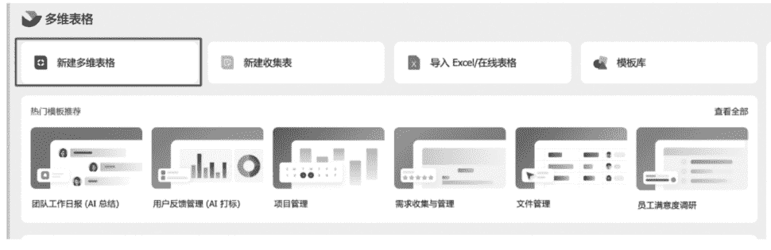

| 学生作文 | 姓名 | 批改结果 |

| :--- | :--- | :--- |

| | 三 | |

| | 四 | |

标题

AI图片理解

字段类型

文本

探索字段捷径 ⓘ

取消

确定

搜索

字段捷径中心 New

AI

信息提取

总结

自定义 AI 自动填充

AI 图片理解（豆包）

翻译

Kimi 阅读助手

实用工具

进度追踪

标记重复值

签字确认

10 条记录
第二步：把第一列改为“学生作文”，打开快捷捷径中心，选择图像识别能力。该功能可快速识别作文图片并一键拖拽上传，无需逐张附件。

第三步：在配置中选“原图”，开启自动更新，点击仅保存配置。完成后第二列自动生成“原图”，教师可将作文照片或扫描件上传至此进行批改。图8-6 配置“图片”功能


第四步：第三列表头改为模型调用列，字段类型添加DeepSeek-R1，在输入指令中填入提示词。提示词中的图像识别字段需通过引用字段添加。图8-7 选择AI工具，并撰写提示词图8-8 选择“引用字段”
DeepSeek指令

DeepSeek指令.输出结果

优缺点

得分

结构方面：六...

43/50

结构完整性：...

46/50

标题

DeepSeek指令

字段类型

对象

DeepSeek-R1

字段捷径

取消

搜索

字段捷径中心

New

关联账号

AI

Deepseek 大模型账号（非必填）

分类

+ 关联账号

信息提取

配置

总结

输入指令 *

引用字段

智能标签

你是一名小学语文教师，正在批改四年级学生的作文《那一刻，我懂得了成长》。AI图片理解 × 进行批阅，作文要求如下：①按照一定的顺序讲清楚一件印象深刻的经历，②表达真实情感，③字数不少于350字。请根据2022版语文课程标准“语言表达与思维发展”的素养

自定义 AI 自动填充

DeepSeek-R1

实用工具

取消

确定

进度追踪

工作日天数计算

标记重复值

签字确认


打开获得更多信息，开启输出结果和自动更新。至此第三列完成，第四列自动出现DeepSeek指令.输出结果。图8-9 设置相关功能


第五步：第五列表头改为优缺点，字段捷径添加自定义AI自动填充，输入指令中通过引用字段引用DeepSeek指令.输出结果；开启自动更新后仅保存配置。图8-10 设置第五列的表头信息、提示词等功能
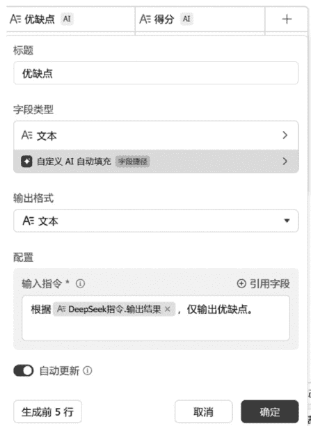

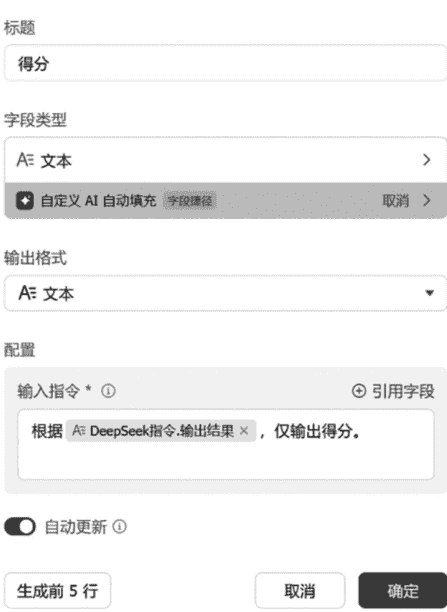

第六步：第六列改为得分，字段捷径添加自定义AI自动填充，输入指令中同样引用DeepSeek指令.输出结果；开启自动更新后保存配置。

至此，作文批改表格搭建完成。图8-11 设置好的多维表格
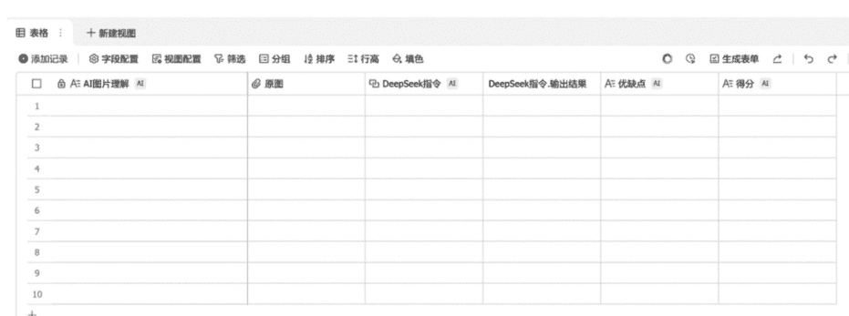

教师只需在第2列原图上传学生作文图片即可获取批改结果。批改完成后点击右上角三个点可导出Excel/CSV。图8-12 上传学生作文图片图8-13 将多维表格导出为Excel/CSV文件
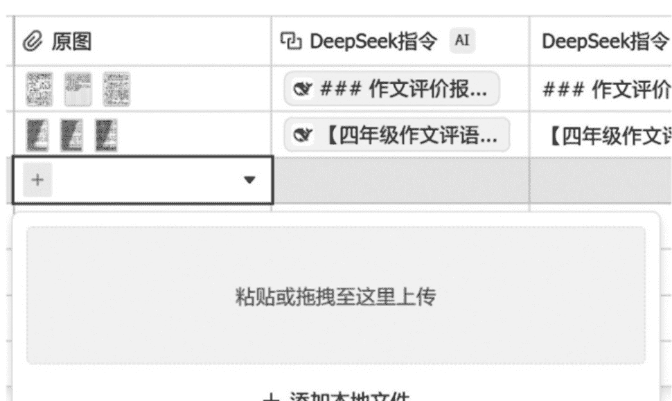

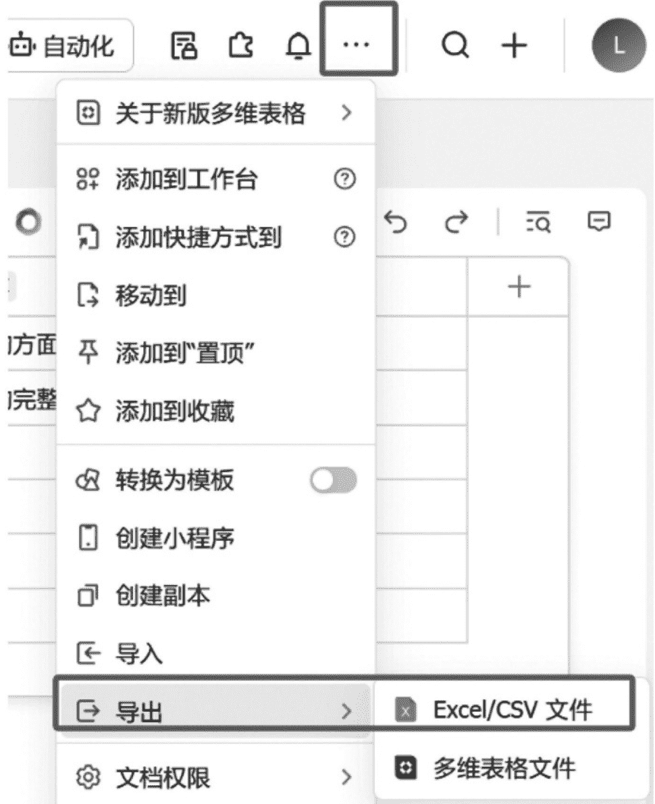

第七步：教师审核与应用。教师需细读模型生成的评语初稿，结合原作与标准判断准确性，并根据学生情况做个性化调整后反馈。

#### （二）实战案例2：平台与模型联合作业批改并推送同类错题

场景：小学数学李老师针对“一元一次方程的解法”设计练习，了解学生解方程能力并推送错题相似题强化。

应用说明：与案例1思路相同，不再赘述。

步骤如下：
需在平台建立用于批改作业的协同表格，自动批改上传作业、统计错题数、分析错因并生成相似题目推送。部分步骤与案例1重合，以下展示关键环节。

首先，搭建作业收集表单。
第一步：将第一、二、三列表头分别改为“姓名”“班级”“上传数学作业照片”，学生填写后自动同步。
第二步：在平台新建表单视图，左上角命名如××数学作业。点击新建视图选择表单视图。图8-14 在飞书上新建“表单视图”
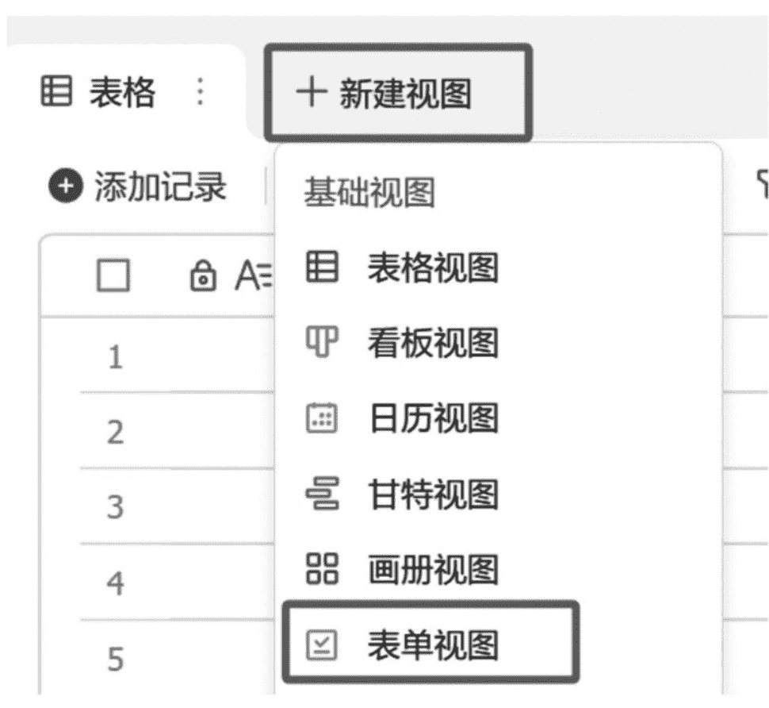

第三步：在表单视图中，通过右侧可选题目添加“姓名”“班级”“上传数学作业照片”。图8-15 添加需要收集的数据名称图8-16 设置表单视图的信息
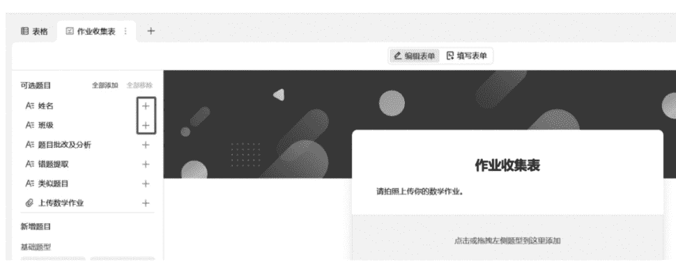

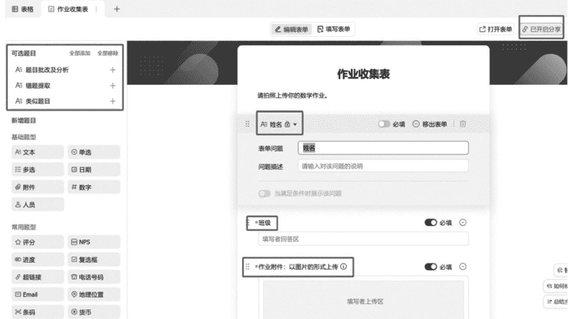

第四步：分享表单给学生，在右侧上方点击分享表单，开启分享后可通过链接或二维码分发。

至此，自动收集作业的表单完成。接下来搭建批改表格。
第一步：新建第四列，标题改为题目批改及分析，打开探索快捷字段捷径，选择AI图片理解豆包。在原图中选择上传数学作业；在自定义指令中输入提示词：
角色：数学作业批改助手。
背景：学生在自主学习和课后复习时，需快速获取题目解析、知识点强化及针对性提升方案，本助手通过图像识别与数学知识库，提供精准批改与学习指导，助力高效掌握数学知识与解题技巧。

AI智能批改与学业评价实操手册

核心功能概览
平台以四项关键能力为支撑。第一是图文解析，能够从清晰可读的题目影像中抽取文字、公式与符号信息。第二是自动判分，结合数学规则与知识点库，对学生提交的答案进行对错判定。第三是错题剖析，对错误作业给出标准答案的知识要点、失误原因解释。第四是资源联动，依据错题类型推送针对性的提升建议与同类练习。

工作目标
作答正确时，仅提示“恭喜你，答案正确”。作答错误时，生成完整的纠错报告，包含标准答案、关联知识点、错误成因解析、改进建议以及相似练习。

输入条件
题图必须清晰无遮挡，文字可辨识；题目范围限定为 K-12 常见数学类型，如代数、几何及四则运算等。

输出规范
正确情形统一反馈“恭喜你，答案正确”。
错误情形先给出“答案错误”，随后依次呈现：正确答案及推导；原题原文；相关知识点；错误原因分析；提升方案；相似题目与答案。
示例
输入：解方程：2x+5=15，答案：x=4
要点：答案错误；正确答案 x=5；原题 解方程：2x+5=15；知识点 一元一次方程解法—移项与化简；错误解析 移项未完成，正确步骤应为 2x=15-5→x=10÷2；提升方案 熟练移项规则并完成3道专项练习；类似题目 3y-7=8，求y。答案：y=5。图8-17 制作第四列表头

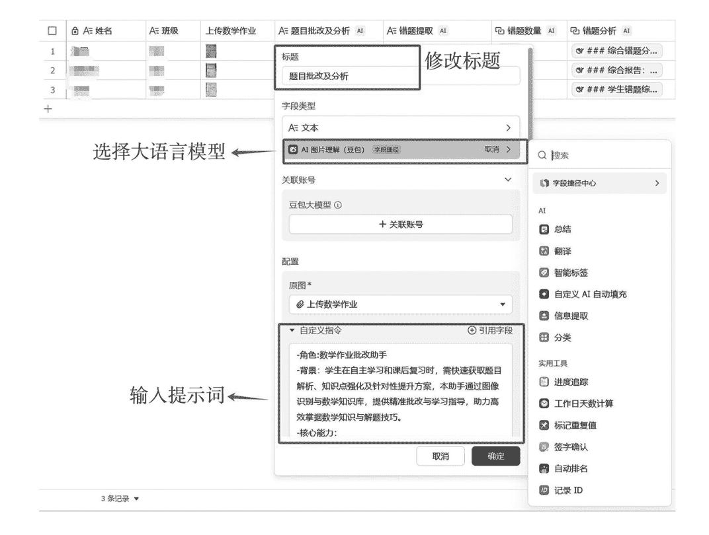

第二步，新增第五列的表头，名称改为“错题提取”。在字段捷径中选择“信息提取”；进入配置后点选“选择需要提取字段”，勾选“题目批改与分析”；提取内容设为“提取所有答案错误的部分”。开启自动更新后点击“仅保存配置”。

第三步，新增第六列，标题设为“错题数量”。字段捷径接入“DeepSeek-R1”，在输入指令中填入提示词：请根据“错题提取”统计错误题目的个数，仅用数字返回。提示词里的“错题提取”需通过引用字段引用。开启自动更新，点击“仅保存配置”。

第四步，将第七列表头改成“错题分析”，字段捷径接入“DeepSeek-R1”，输入指令的提示词为：请依据“错题提取”中的错误情况，梳理学生的知识薄弱点，结合学习建议对错题进行知识点讲解，以综合报告形式呈现。提示词中“错题提取”同样要用引用字段添加。开启自动更新，点击“仅保存配置”。再打开“获取更多信息”，选择“输出结果”。

第五步，将第八列改为“类似题目”，字段捷径选“信息提取”，在配置中点选“选择需要提取字段”，再选择“题目批改与分析”。提取内容设为“提取类似题目全部内容”。开启自动更新，点击“仅保存配置”。

至此，作业批改的多维表格搭建完成。

学生通过教师分享的链接或二维码提交表单后，表格会自动批改上传的作业照片附件，并产出错误数、错误分析及推荐练习。表单顶部有“自动化”入口，用于设计自动化流程。当新增或修改的记录满足条件时，系统会自动向第1步记录的修改人推送飞书消息。操作示意图见图8-18。

当表格所有列均已填满时，预设内容会推送给表单填写人。学生即可获知作答情况、错误原因及对应练习。生成示例见图8-19。图8-18 将多维表格导出为Excel/CSV文件图8-19 生成示例

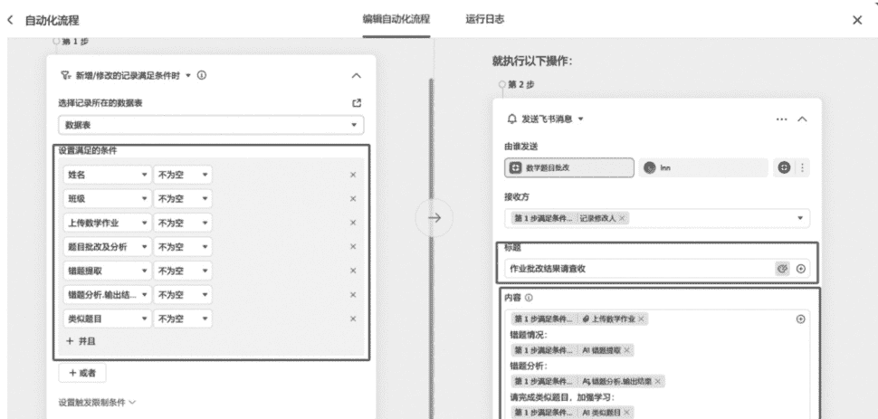

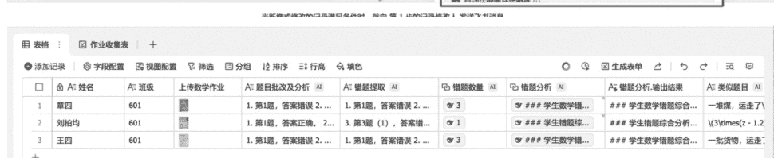

需要强调的是，智能系统生成的测评结果与评语初稿必须经过教师专业审核与人工修正。教师应结合对学生的了解、评价标准把握及教学经验，对系统输出进行判断、补充与完善，以确保评价的准确、公正与育人价值。智能系统在此环节是高效助手，而非最终决策者。

### 九、学业评价中的伦理考量与未来展望

人工智能赋能的学业评价，正从单纯的效率工具转向可辅助深度分析、提供个性化反馈的认知伙伴，为教育带来想象空间与实践价值。然而技术进步伴随新挑战，有效应用依赖技术与教育理念、教学实践的深度融合。为让智能化手段真正服务于教育根本目标——人的全面发展，必须正视并妥善处理伦理议题，并对未来趋势有清晰认知。在前述案例中，教师需在“结果审核者”“学习引导者”“情感支持者”等多重角色间找平衡，而伦理框架的完善与执行是保障技术服务教育公平与学生福祉的关键。

#### （一）AI赋能评价的潜在风险
便利与创新的同时，风险同样突出：
- （1）个人信息外泄：系统运行需采集、存储、分析大量个人信息与学习数据，甚至生物特征。管理不当易导致泄露与滥用，侵犯隐私。
- （2）模型偏见与歧视：模型表现取决于训练数据的质量与代表性。若数据存在偏差或隐含历史刻板印象，模型可能放大偏见，导致对特定群体不公平评价，损害教育公平。
- （3）技术过度依赖与评价异化：教师若把系统判断当唯一标准，会削弱专业判断与反思能力；学生过度依赖即时反馈会削弱独立思考。算法主导还可能导致评价去人性化，出现“迎合算法”的应试倾向，偏离发展初衷。
- （4）信息安全与伦理风险：除上述风险外，还存在技术滥用、数据安全漏洞、信息茧房等。多数智能化评价算法内部机制不透明，决策逻辑难解释，影响结果可信度与接受度。

#### （二）确保评价公平、透明、有效的原则与策略
为应对风险，需构建伦理框架与实践策略：
- （1）公平性保障：设计多元综合评价指标，避免单一标准化测试的片面性。可采用表现性任务、真实性评价、过程性评价关注差异与成长。选用智能工具时需审查训练数据与算法偏见，定期开展公平性审计。
- （2）透明性提升：产品提供方应尽可能阐释结果生成依据与关键评价指标。教师与学生需批判性使用结果。学校或厂商应向师生明确公示评价标准、方法、流程及数据收集、存储、使用规则，提升透明度与信任。
- （3）人机协同：构建以人为本的人机协同模式。系统负责数据处理、模式识别、初筛分析与个性化反馈生成；教师基于专业知识与对学生的全面了解进行最终判断、价值引导与情感支持。

同时应遵循三大隐私保护核心原则：
- ①数据最小化：仅采集与评价目标直接相关、必要的资料，避免过度收集。
- ②强化安全监管与技术保障：采用匿名化、假名化、差分隐私、加密、权限分级等技术与管理措施，保障数据全生命周期安全。
- ③明确权属与使用边界：清晰界定学生数据归属，规范使用范围与授权机制，确保合规。

#### （三）未来学业评价的发展趋势：人机协同，素养为本
未来智能化评价将更智能、高效、公平、人性化：
- （1）人机协同评价成主流：系统承担数据处理、模式识别、初步分析、个性化反馈生成等；教师聚焦评价任务设计、复杂信息解读、情感价值判断与深度对话，实现协同增效。
- （2）评价聚焦核心素养与高阶能力：随新课标推进，评价将更着重问题解决、批判性思维、创新思维、协作沟通、数字素养、自我管理等，而非仅记忆再现。技术可辅助设计更真实、复杂、探究性的评价情境。
- （3）评价过程动态化、个性化：可实现学习过程实时追踪、动态分析与即时反馈，形成多维度动态学习画像，为每位学生提供个性化建议、资源与发展支持。
- （4）评价伦理与法规建设受重视：数据隐私、算法公平、技术伦理、问责机制等规范将进一步完善，以保障公平公正健康发展。

总之，智能化为学业评价带来即时性、个性化、精准性的变革机遇，但不能盲目替代。需清醒认识伦理风险并采取有效应对。成功的智能化评价是技术与教育深度融合的产物。教师的专业性更显不可替代，需在“标准设计者”“结果审核解读者”“学习引导者”“成长情感价值支持者”等角色中找准定位。构建完善伦理框架，坚持以人为本、素养为先，推动人机协同，才能让技术真正服务学生全面发展，推动学业评价科学化、个性化、高效化，培养面向未来的创新人才。

## 第九章 AI助力教师专业成长

人工智能深刻变革教育的同时，也在推动教师专业发展。卓越教师的成长需要内省反思与外向探索，智能化正成为重要赋能力量。本章聚焦两大支柱：一是通过智能化手段精准分析课堂教学实况，将日常教学转化为可研究可反思的案例；二是通过智能化方式高效构建与应用个人知识库，将碎片经验系统化为专属教学智慧体系。旨在揭示智能化如何通过这两条路径全面赋能教师个体成长。

智能化为教师在课堂教学分析与反思、典型课例开发与分享、个人知识库构建等方面提供前所未有的机遇。掌握智能分析工具，教师能更高效科学地审视改进教学，系统提炼经验，加速专业成长，最终惠及学生。教师应以开放心态探索，以审慎态度应用，让智能化成为得力助手。

### 一、智能化支持教师开展专业化、数据驱动的教研活动

传统观课评课耗时耗力，易受主观经验影响，难以系统客观分析。智能化提供高效客观多维的分析工具，将教学实践转化为可量化可分析数据，把经验式教研升级为专业化、数据驱动的循证教研。

智能化在专业化教研中主要发挥以下作用：
- 客观记录与多维呈现：可将课堂视频中的师生语言、互动行为数据化可视化，精确统计对话时长、提问类型数量、互动频率与内容、学生发言覆盖面与参与度，为教研提供客观精准基础。
- 深度分析与智能诊断：借助语言理解与教育学模型，可梳理教学流程，从核心素养达成度、策略有效性、互动模式等维度智能诊断，发现不易察觉问题。
- 提升效率与聚焦核心：可自动化处理海量视频，快速生成初步分析报告、课堂摘要、思维导图，解放教师从听录转写整理中，使反思与研讨聚焦问题探讨与改进策略。
- 赋能协作与促进共享：生成的标准化结构化报告为教研组交流提供共同事实基础，使研讨基于数据而非空泛经验，促进专业学习共同体建设。

表9-1总结了教师开展智能化教研的典型流程与工具支持。

**表9-1 教师开展智能化教研的步骤**

| 步骤 | 工具应用 | 输出成果 |
| :--- | :--- | :--- |
| 1. 数据采集 | 无感录播系统+智能分析平台（如S-T教学行为分析） | 课堂热力图、时间分布雷达图 |
| 2. 问题诊断 | 教研大模型生成PTA报告（问题—归因—建议） | 精准教研订单（如提问有效性低） |
| 3. 协同改进 | 云端教研共同体在线研讨+智能推荐优化方案 | 重构教学设计（如增加探究环节） |
| 4. 效果评估 | 对比迭代前后数据（如高阶思维问题占比提升） | 教师成长画像、课例资源入库 |

实践案例：南宁滨湖路小学徐老师在智能化诊断出“高阶问题占比仅24.4%”后，调整提问策略，增加解释性提问“为什么图像识别需要多层神经网络？”，使高阶问题占比提升至42.86%。上海理工大学附中数学组通过智能化回溯学生“思维断点”，设计“问题链—变式链”模型，将单一习题拆解为梯度任务链，使探究环节时长从0增至10分钟。

#### （一）智能化赋能的数据驱动教研活动

教师可遵循“数据采集—智能分析—报告解读—研讨应用”四步流程开展教研。

##### 1 数据采集与转录
录制完整课堂教学视频，上传至具备音视频处理能力的智能平台，如通义千问的“音视频速读”功能，快速转录为含课堂对话原文、摘要与思维导图的文本文件。

##### 2 智能化深度分析
获取文本后可采用两种方式：
（1）通用大语言模型组合应用：将转录文本上传至具备深度文本分析能力的大模型，如DeepSeek“深度思考”模式，根据教研需求撰写提示词引导个性化深度分析。
（2）专业课堂分析平台：将视频上传至专业智能课堂分析平台，如科大讯飞“课堂实录与分析”平台，利用内置教育学分析框架获取结构化量化报告。

##### 3 分析报告解读
智能系统生成详细报告后，教师或教研团队需解读。报告包含量化数据如师生话语时长占比，以及质性分析如互动特点、优点与改进建议。

##### 4 研讨与教学应用
基于智能分析报告开展循证研讨，精准定位问题并商议改进策略。教师据反馈有针对性调整教学设计与课堂策略，并对改进后实践再次进行数据分析，形成持续优化闭环。

#### （二）智能化辅助课堂教学视频分析

课堂教学是专业实践核心场域。分析课堂视频可帮助教师像运动员看录像一样从旁观视角审视环节、互动、时间分配与策略有效性，发现日常不易察觉问题。观摩优秀课例可提升教学能力，智能化可帮助快速把握精华。智能化还能将教学行为数据化、视觉化，帮助客观定位问题。智能化可快速处理海量视频，自动生成初步分析报告，为个人反思与集体教研提供高效素材。

以下以一节40分钟小学美术课《能干的机器人》为例，介绍三种智能分析方法。

##### 1 通用大语言模型组合应用：通义千问+DeepSeek
依托普及的大语言模型组合完成课堂分析。

（1）音视频转录与初步处理
将课堂视频上传至通义千问“音视频速读”等平台，可快速将语音转为文字，提取PPT内容并生成初步思维导图，帮助把握课程梗概。通常可获得三份核心材料：课堂实录原文、导读/摘要、思维导图。

（2）深度分析与报告生成（使用DeepSeek“深度思考”模式）
将上述“课堂实录原文”“导读/摘要”“思维导图”上传至具备长文理解能力的智能模型，如DeepSeek“深度思考”模式。教师根据分析需求撰写针对性提示词引导分析。

例如，可以输入以下提示词：

# 智能视角下的《能干的机器人》美术课拆解

把小学美术《能干的机器人》整节40分钟的文字记录、导读和思维导图交给智能系统，让它围绕师生互动样态、核心素养落地情况、课型归属、亮点与可优化点展开研判，就能快速得到一份结构清晰的课堂研判稿。

以这节课为例，系统能把教师如何用追问点燃思考、引入生成式绘图工具后互动形态的变化梳理清楚。报告会逐项对照图像识读、美术表现、审美判断、创意实践、文化理解等维度评估落实程度，也能判断课型属性，例如归为融合设计·应用学习领域、以项目式为骨架并深度嵌入数智工具的探究型美术课。优势集中在主题贴近儿童兴趣、数智融合自然得体；待优化处主要在美术本体知识的深化程度和生成工具探索的广度上。整体方法弹性很高，教师可根据课例和关注点定制提问，获得个性化的深度分析。

## 专业课堂分析平台的运作方式
除了通用大模型，市场上已出现面向教学场景的课堂研判平台，如科大讯飞的课堂实录与分析。这类系统整合音视频处理、教育学理论与智能算法，提供更结构化、聚焦教学行为的解读。常规流程是上传视频并设定参数、填写课程信息、启动分析、查看报告。

平台可输出的维度很丰富：教学行为数据如提问类型与时长、师生对话轮次及占比、学生参与度评估、教学内容关键词与知识点覆盖、课堂语言特征等，多以可视化图表呈现。相比单纯转录，平台还能给出各环节精确时长、教师引导方式、学生发言量化以及互动热力图等细节。

这类平台的优势在于规范性和可比性，能够依托教育学理论提供结构化的数据框架，特别适合对教学行为进行量化追踪与常态化监测。

由智能系统生成的富数据研判报告，已成为教师开展数据驱动教研的核心依据。个人复盘时，授课者能对照客观报告精准看到设计亮点与此前未察觉的盲区，反思效度明显提升；集体教研时，讨论从“我觉得不错”“互动似乎少了点”这类模糊表述，转向基于具体数据的对话，例如“数据显示教师提问占对话总时长六成，如何优化提问以增加学生深度思考表达的时间”“分析指出美术本体知识不足，应在哪个环节嵌入相关知识点”。智能系统把一节课转化为可量化、可分析、可讨论的数据包，使教研更严谨、深入、高效。

### 二、用智能打磨典型课例，实现深度复盘
完成课堂分析只是专业成长的第一步，更关键的是把分析与洞察沉淀为内容扎实、复盘深刻的典型案例。这不仅是对个体经验的提炼，也是教师从经验型向智慧型、研究型迈进的重要路径。

#### 为什么要做典型课例
智能系统既能解析单节课实况，也能深度赋能教师在自我复盘与借鉴优秀经验的基础上，系统化开发与打磨案例。这些经过提炼的案例是职业智慧的结晶，应用价值多元。

深化职业复盘，撰写过程本身就是一次结构化复盘，能推动教师系统审视教学理念、设计与行为，从无意识到有意识改进。

赋能同行交流，高质量案例是教研共同体的宝贵资源，可供观摩、借鉴与讨论，促进经验共享与共同成长。

助力职业成长，优秀案例可作为培训材料或共享资源，帮助新教师快速上手，推动区域整体教学水平提升。

提升个人竞争力，在教学评比、职称评审或课题研究中，结构完整、素材丰富、复盘深刻的典型案例是展示职业水平的有力证明。

#### 智能协同下的案例开发四步法
一份完整的典型案例通常包含课程背景与学情、教学设计与创新思路、课堂记录与关键环节、智能辅助分析报告、教学复盘与效果评估及佐证材料。智能系统由分析工具升级为写作伙伴与复盘顾问，可按以下四步协同完成。

##### 1 素材整合与框架搭建
此阶段智能系统主要承担资料整理与结构设计。教师可把课堂记录原文、导读摘要、思维导图与分析报告作为基础素材输入，让智能系统生成标准案例写作框架。

例如可提示：“请为小学美术《能干的机器人》典型案例提供一份写作提纲，涵盖学情研判、教学设计、实施过程、教学复盘等板块。”

##### 2 协同撰写核心内容
在框架确定后，智能系统可辅助撰写并激发灵感。针对每个部分输入核心观点与数据，由智能系统生成初稿。以学情研判为例，输入提示：“对象为小学低段，对机器人感兴趣，对生成式绘画陌生，美术基础一般，动手与想象能力较强。”

智能系统可输出结构化初稿：该年段学生对机器人、数智等科技主题充满好奇，为导入提供情感基础；对生成式模型作为创作工具的概念陌生，需直观引导；具备一定绘画手工基础，动手能力强，但造型与色彩运用仍在发展中，对数智工具创作经验不足；想象力丰富、表达欲强，逻辑思维与问题解决能力需引导，创作中易出现模仿多于创新的情况。

##### 3 以对话深化教学复盘
教学复盘是案例灵魂，智能系统可作为对话启发者。教师上传分析报告，与智能系统多角度对话，挖掘深层洞见。

例如提问：“报告指出美术本体知识深化不足，请结合记录说明可在哪些环节融入美术知识并给出改进策略。”

智能系统可给出具体建议：学生在约25分钟处生成机器人图像后直接进入实体制作，可深化形体与结构知识。展示生成作品后，引导分析机器人由方形、圆形、圆柱体等基本几何形态构成，讨论不同组合带来的稳定感或动感。可增设提问：“这个机器人看起来很稳，哪些形状让它站得稳？”；在选择材料前融入色彩与情感知识，引导讨论生成图像的配色。可增设提问：“生成工具为何选用这些颜色？红色与蓝色的机器人给你什么不同感受？”

##### 4 整体润色与规范呈现
初稿完成后，把整篇案例交给智能系统进行语言校对、表达润色与格式检查。提示例如：“请通读全文，修正语法错误与不通顺表达，提升语言的规范性与学术感。”

通过四步，教师在智能系统互动中完成一次数据驱动、结构化的深度复盘，最终产出经得起推敲的职业成果。智能系统深度赋能让日常教学转化为可研究、可分享、可持续优化的职业积累，实现经验提炼与教育智慧的传承创新。

### 三、智能赋能教师资料管理与专业进阶
利用有效智能工具进行资料管理，是推动职业持续发展、提升教研能力、优化教学实践的重要引擎。构建个人资料库是提升职业素养与教学质量的关键。系统梳理、沉淀经验智慧，高效获取前沿信息，有助于应对新时代教育挑战。

传统方式常导致信息过载难筛选、资源分散难整合、检索效率低、资料零散难内化、资料库更新慢、团队共享共建效率低等问题，严重制约职业发展与教研深入。智能技术为这些痛点提供了新的解决路径。

本节聚焦开源模型本地部署、腾讯资料管理工具以及NotebookLM等工具，探讨如何打造专属资料库。

#### 构建个人资料库的多元路径与工具
智能系统可通过智能采集分类、高效检索问答、深度分析洞察、个性化推荐推送、辅助创作生成等方式，赋能教师构建智能资料库。

##### 1 利用开源模型构建本地化教学资源库
开源语言模型的理解、整合与生成能力，为智能化个人资料库建设提供支撑。

教学资源整合，教师可将教案、课件PPT PDF、习题试卷、优秀案例、学生作品、研究论文等数字化分类整理。

平台选择，可根据技术水平与需求选择：①云端智能平台集成，选择支持文档导入并基于模型问答管理的云服务，自动索引多格式文件；②具备资料库功能的笔记或文档管理软件，选择可通过API接入模型API的工具如腾讯知识助手，实现本地文档智能检索问答。

本地化部署与实践进阶
具备一定技术基础的教师可本地运行模型并构建资料库。

①下载安装Ollama，访问官网下载对应系统安装包。
②通过Ollama运行开源语言模型，命令行使用如`ollama pull DeepSeek-coder`等命令下载运行。
③安装前端应用与资料库管理工具，如Chatbox连接本地Ollama提供对话界面；AnythingLLM开源私有知识库方案，支持导入PDF TXT MD文档并基于本地模型问答；Cherry Studio等同类工具。
④建立工作区并导入文件，在AnythingLLM等应用中创建个人工作区，导入整理好的教学资料，系统自动处理索引。注意本地部署对显卡内存有要求，配置涉及命令行操作，需学习调试。

教师可直接向本地资料库提问，如“九年级物理牛顿第二定律实验案例”，快速获取内容。智能系统还能辅助生成教学思路、习题变式、课后复盘，并基于库内资料提供更精准的个性化辅导。

##### 2 运用腾讯知识助手进行教学资源管理
腾讯在教育领域提供多种解决方案，资料库功能常融入教育平台或智能工作助手。教师可利用腾讯文档、微云云端分类存储，随时访问共享；也可关注集成资料库管理的工具，如腾讯会议教育版AI小助手体现该趋势。腾讯知识助手集成DeepSeek-R1与混元模型，是智能工作台，支持导入文档建库、智能问答与内容创作。关键在于结构化管理，按学科、年级、知识点、资源类型组织。

知识助手集成DeepSeek-R1与混元模型，结合微信生态无缝对接，提供资源采集至场景应用的完整方案。核心优势包括双模型驱动支持复杂文献解析与跨学科关联，智能识别PDF Word图片中的公式图表并自动生成结构化摘要与思维导图，支持中英文文献对比并一键生成双语教研简报。教研适配性强，支持公众号文章、聊天文件直接归档，可建立学科主题库如单元教学设计案例库、学生错题库，并自动追踪历史版本，记录教研成果迭代。

##### 3 利用腾讯知识助手实现微信公众号文章快速归档
教师常通过微信公众号获取前沿资讯与优质资源。知识助手与微信生态深度整合，可将碎片信息快速归档到个人资料库，实现系统化管理。

操作流程：打开目标公众号文章，点击右上角“…”选择更多打开方式，在列表中选择“知识助手”。系统提示快速存入并基于资料库定制智能问答。跳转至知识助手后选择目标资料库，如“人工智能前沿发展与动态”，完成保存。后续可在知识助手 中查阅，并利用智能系统提问、总结、分析、再创作，将外部信息内化为职业智慧。

##### 4 教研资料库搭建流程
首阶段多维资源采集。包括本地资料数字化，批量导入50余种格式文档，纸质文献扫描OCR识别保留批注；动态资源捕获，公众号文章快速归档，教学视频自动生成文字稿与关键帧截图。

次阶段智能知识加工，让资料“活起来”。智能系统自动化标注，提取课标编码、关键能力条目，构建学科标签体系；深度内容挖掘。例如指令模板：“请分析资料库近三年市级优质课评比的单元整体教学设计案例：1.提炼共性特征；2.对比小学与初中情境创设策略差异；3.输出可复用的课堂活动设计通用模板。”知识助手可自动关联案例并生成深度分析报告。

##### 5 典型教研场景应用
教学设计优化与备课，输入主题如“部编版语文五年级下册第六单元”，自动推送课标要求、评课记录、名师案例，并辅助生成教案初稿。

作业与学情分析，智能体可识别手写作业，分析逻辑错误，生成归因分析并推荐分层练习。

课题研究，建立专题文献库，智能体可辅助生成文献综述框架，进行中外研究对比，追踪最新成果并润色学术表达。

##### 6 知识助手重构知识管理的三大跃迁
智能资料管理工具不仅提升效率，更重塑工作模式与职业成长路径。

从碎片囤积到体系重构，构建学科化、个性化智慧资料网络。知识助手整合教案、课件、推文、笔记等，通过智能标签与知识图谱帮助教师构建网络。例如语文教师可建“语文教学资源与方法库”，数学教师整合题型、解法、错题案例形成体系，英语教师系统整理听说读写素材并分级管理。

（2）从单一作业到双向协作：把重复劳动交给模型，腾出创新空间
IMA 把教师日常里最耗时的机械环节接过去，备课不再靠手工堆资料、批改不再靠通宵。系统能快速汇总素材并给出教学初稿，自动阅卷减轻打分压力，实验方案给出优化提示，多科项目资料也能被自动整合，协作门槛变低。文科教师准备丝路探究课时，可在几分钟内拿到成套资料和授课草案；理科教师能收到针对具体实验的改进建议；多学科团队则能把基于项目的学习资源迅速拼起来，省下的时间都用来做创新设计和定制化辅导。

（3）让校本智慧从储备变成流通
依托 IMA 的共享智库，优秀课例、校本课程、教研成果不再锁在个人硬盘里。经验在校内校外流动，新教师成长更快，整体教研水位随之抬升。学科教研组可以共建精准教学资源合集，校本课程团队能协同打磨内容，班主任也能借助模型生成学情画像和家校联络文案，让校本智慧真正活起来。

#### （二）生成式智能助力教育者资料管理实战

##### 1 案例1：专题单元筹备提效
初中史地课程负责人李老师在筹备“古代文明的智慧与创新”专题时，被分散的资料和信息过载卡住。她把本地的教案课件、文章图片以及微信收藏全部导入腾讯 IMA，搭建起一个专题学习库。平台自动打标、自动提炼要点、支持自然语言检索和横向对比，备课节奏明显加快，教学设计也更扎实，最后沉淀为一套可复用的个人教学智慧库。

##### 2 案例2：多学科项目协同教研
一所高中的物理、数学、信息技术三位老师推进“智能家居基于项目的学习”时，协作不畅、资源各自为政。他们在 IMA 建立共享教研库，统一上传各自材料。系统自动标注、视频转写、关联多学科资料，成员在线上就能协同修改方案、批注讨论，模型还能把研讨记录归纳成项目纲要，结项时自动输出总结报告。教研效率和质量都提升了，过程可视、可追溯，集体智慧得以沉淀传承。

##### 3 案例3：初职教师的定制化成长
入职两年左右的小学语文教师赵老师，成长路径模糊、学习零散。她在 IMA 搭建“个人职业成长档案”，分类存放培训材料和反思笔记。智能体帮她厘清教学困惑，比如对比识字法的利弊并设计活动、把文献浓缩成要点摘要、对照名师课例审视自己的教案，并定期梳理学习心得。学习更有规划、知识更系统，专业成长明显加速。

资料库不是一次搭建就结束，要持续更新保持鲜活。上传资料要重视版权与隐私，本地部署更要保障用户数据安全。不必局限于单一平台，可以用云盘做基础存储、NotebookLM 做深度研读、集成智能体的办公套件做备课，或尝试本地化知识库以获得更高的数据可控性。熟悉工具的能力边界，培养智能素养，是智能时代教育工作者持续发展的必备能力。

### 四、小结
本章讲的是生成式智能如何助力教育者专业成长。主线就两条：一是用数据为依据的课堂复盘把日常教学变成可研究的案例，实现精准反思和基于证据的教研；二是用智能体快速搭建个人学习仓库，把碎片经验系统化为教学智慧。目标是推动教育者从经验导向走向研究导向，内外兼修，明确成长方向，加速提升，最终提高教学质量，惠及学习者。以开放心态善用智能工具，专业能力才能持续跃升。

## 第十章 用生成式模型贯通科研全链路
第九章讲了智能体如何助推教育者个体成长。下一步，常把教学反思升华为规范的教育科学研究。研究需要在海量文献里找线索、在复杂数据里找规律、在反复修改里完善表达，既费时又易迷失。生成式模型，尤其是 DeepSeek、豆包、Kimi 等强语言模型，已成为教育工作者开展教学研究和创新的重要伙伴。它不仅提效，更能激发创新思维，把日常教学经验转化为有学术价值的成果。通过智能化处理、个性化支持和全流程协作，人工智能正在重塑科研方式，让每位教育工作者都有机会成为创新推动者。从选题灵感到投稿策略，从文献精准定位到数据深度挖掘，智能体都能给出恰当支持。

本章系统梳理人工智能在教育科研中的应用，从项目立项到学术稿撰写全流程展开。

### 一、模型支撑科研的四大底座
生成式智能之所以能改变科研，主要源于四方面：
一是海量资料的快速处理与整合，能快速阅读文献、政策、报告并提炼观点、梳理脉络；
二是跨领域知识联动与启发，打破学科壁垒，把教学问题与教育理论、学习科学、心理学、社会学等联动，激发新思路；
三是结构化与规范化文本生成，能输出逻辑清晰的立项书初稿和符合学术规范的论文框架，降低写作门槛；
四是研究全流程智能助力，从研究设计、方法建议到数据整理分析，成为随时待命的智能助手，提升整体效率与质量。

### 二、智能体辅助选题与创新构思

#### （一）挖掘灵感
选题是研究起点。教育者可用 DeepSeek 等工具分析日常教学数据，如学生作业常见错误、成绩分布、课堂观察记录，结合其知识库中的教育理论、政策导向、研究热点，发现潜在研究点。例如初中数学教师描述学生学配方法常犯的错，并关联核心素养、减负提质政策，模型可从认知负荷、建构主义等角度启发方向，如基于错误分析的配方法教学策略研究，或信息技术辅助下配方法教学实践研究，并提供相关文献线索，帮助把具体困惑与宏观背景连接。

#### （二）细化问题与可行性判断
方向初步确定后，模型可帮助细化问题、界定范围、评估新颖性和可操作性。以探究式学习在配方法教学中培养核心素养的应用研究为例，与 DeepSeek 对话可聚焦为在初三配方法教学中，采用基于问题的探究式学习策略，对提升数学抽象与逻辑推理能力有何影响，体现在哪些方面。模型会提醒限定教学内容、学生群体、素养维度，并在新颖性上检索已有研究判断价值，在可行性上引导思考方案设计、数据工具、研究周期等，让构思更系统、可操作。

#### （三）案例实践：构思“三元互动教学模式”研究课题
某高中信息技术教师观察到课堂出现教师-AI-学生三方互动新现象，想申报省级教学改革项目。

##### 1 借助 DeepSeek 启发灵感，对接政策热点
教师提问要求结合近两年国家及省内人工智能、教育数字化、课堂教学改革政策和申报指南，分析研究价值并给出选题建议。模型反馈该方向契合教育数字化战略行动和智慧教育示范区建设，呼应新课标提升数字素养的诉求；价值在于揭示智能时代课堂互动本质变化，为优化教学模式提供理论与实践路径；并生成若干创新选题。

##### 2 借助豆包明确问题，评估可操作性
教师选择基于教师-AI-学生三方互动模式的高中信息技术课堂教学创新实践研究进一步细化。豆包通过追问互动行为具体形态、解决痛点、衡量创新效果等，帮助把问题聚焦为三方互动在课堂中的表现形态与典型特征是什么，如何设计实施策略促进良性发展，从而提升计算思维与数字化创新能力。新颖性上，模型指出目前多聚焦人机互动，人人机三方互动系统研究较少；可操作性上，引导思考学校智能工具与网络环境、课堂观察与数据收集的可行性、研究周期等。

### 三、智能体提升文献梳理效率与质量
文献是研究基石。DeepSeek 类模型可做语义检索精准定位、快速提取摘要、大幅节省阅读时间，还能做文献聚类、主题识别，发现趋势与空白，部分工具支持参考文献管理。以集成 DeepSeek 深度推理的秘塔智能为例，可精准检索教育研究文献并生成摘要，辅助把握研究全景。

#### （一）智能检索与筛选
例如研究智能体辅助初中历史大单元学习活动设计的创新模式，可明确问题后在秘塔智能选择长思考、中文库、先想后搜等模式，构建提示词要求近五年中文核心、CSSCI 文献，涵盖理论与实证，重点关注智能工具使用方式及对唯物史观素养的影响，并以表格呈现标题、期刊、年份、摘要、工具方法、影响分析及观点总结。模型返回结果后需人工复核筛选。

#### （二）辅助阅读与综述撰写
对核心文献可上传文本并提问请提取该文核心论点、研究方法、关键发现与未来建议。模型输出结构化摘要。整合多篇后，可与 DeepSeek 讨论综述框架合理性，再请其按框架生成各部分初稿，教育者再审阅修改、补充深化，保持学术性与原创性，也可让模型润色语言。

#### （三）案例实践：为三方互动研究撰写文献综述
##### 1 利用智能检索与筛选
在秘塔智能搜索中用提示词要求近五年中英文核心期刊文献，主题为课堂互动模式、人机协同学习、智能体在 K-12 应用、计算思维培养，重点看互动理论演变、智能体课堂角色、人机协同对高阶思维影响。模型快速返回结构化列表并给出初步综述。

研究聚焦智能体重构课堂互动与人机协同的三维变革，核心脉络为传统交互范式解构→人机共生新形态→高阶思维培养效能。
1. 课堂互动理论重构：从 IRF 转向 DIAC 数据驱动互动适应性循环。关键进展是模型通过多模态分析实时调整互动策略，如深圳某区学情枢纽系统知识点盲点定位精度达 92%；学生提问率提升约 50%。争议在于数据隐私，如教育部中小学生成式人工智能使用指南 2025 年版禁止未经授权的数据采集；也有研究指出纯模型互动可能导致学习坚持率下降约 35%。
2. 智能工具角色跃迁：从辅助到协同再到共创。核心冲突是 68% 教师担忧职业价值被削弱，算法黑箱问题也突出，如作文评分对非母语者压分约 12%，促使部分地区推行智能决策可解释性标准。

##### 2 借助豆包辅助深度阅读与综述撰写
将 10 篇核心文献 PDF 上传豆包，用多文档问答提取每篇核心论点、理论框架、设计原则及对本研究的启示，再请其基于文献撰写智能体在课堂互动中角色演变部分初稿，从辅助工具到学习伙伴再到互动参与者路径展开。教育者在此基础上审阅修改，确保综述学术性。

### 四、智能体驱动的研究设计与实施支持
文献综述后，模型可助选研究方法并规划流程。教育者描述研究问题与目标，模型介绍不同方法特点与适用场景；可在工具设计上生成问卷维度与题目、访谈提纲、观察量表初稿；还能把宏观思路拆解为可操作步骤，形成技术路线图，并在数据清洗与预处理上给出指导。

以 DeepSeek 持续对话为例，教育者先陈述研究问题，讨论准实验或混合方法，再细化班级选择、干预措施、对照组设置、数据收集工具与实施流程，兼顾伦理规范。进入数据收集阶段，模型可推荐问卷平台、录音转文字工具，并在收到含无效数据、格式不一的 Excel 时指导筛选无效条目、用函数或正则统一格式、处理缺失值与数据转换，为后续分析奠基。

#### （一）案例拆解：搭建三方协同研究框架

教师先把自己的教学困惑和研究意图说清楚，再和大模型一起找可行的推进路径：“我想弄明白怎样设计一套教学策略，让教师、生成式助手和学生在课堂上形成有效的配合，打算在我带的两个班里试试，请建议一种合适的探究取向并帮我画出详细流程。”

大模型的要点提示：

研究取向建议采用在行动中不断反思迭代的探究方式，因为在真实教学现场边做边调、边试边改，最适合探索性的创新实践。

以这种行动迭代为例的操作节奏：

计划：围绕教师、助手、学生三方协作来构思教学策略和单元方案。大模型可以帮忙打磨第一版教学草案。

行动：在实验班里落地该方案。

观察：借助课堂影像、学生交流记录、学习成果如项目作品、助手交互日志等，捕捉协作发生的情形以及学习能力的迁移。大模型还能协助制定访谈提纲和观察量表。

反思：将材料整理后审视策略的成效与薄弱点，规划下一轮改进。大模型可参与初步梳理与主题归纳。

数据处理建议：大模型提示，“影像类质性材料可用主题归类法；学生作品可用表现性评价量规计分；对话数据可做编码与内容分析。我可以先帮你拟量规的维度框架和对话的核心问题。”

通过持续对话，一份详实、可操作的研究方案就成形，为后续实施奠定基础。

### 五、大模型联动的分析与研讨

数据分析是研究的硬核，大模型能在信息提取上提供助力，最终的洞见、解释和教学转化仍需教师的专业判断。可分几类展开：定量资料做基础统计与可视化，上传文件让模型计算并出图；分组资料做差异比较与关联探索，让模型做简易检验或相关分析；质性资料做初筛与主题归纳，让模型筛出高频词、做词频统计和初步聚类。拿到初步结果后，再与模型对话，从不同理论视角解读，深化讨论。

基础统计与可视化：先整理常用教学指标，如成绩、作业完成率、出勤、课堂发言次数等。熟悉 Excel 的教师可自行算均值、中位数值、频数等。想做更复杂分析时，DeepSeek 可解释 SPSS 或 R 的操作步骤或代码。具备代码解释器的模型还能直接接收 CSV 文件，用自然语言指令完成统计。例如上传三年级1班数学期末成绩，要求“算均值、中位数值、最高分、最低分、达标比例≥60、优异占比≥85，并按<60、60-69、70-79、80-89、90-100 分段统计人数和占比”。模型会返回结果并生成柱状图、环形图、曲线图等直观图表。某班分析可能显示均值75，大部分集中在70-79分段，但<60分段仍有约10%。教师要结合输出解读现象，判断整体水平、识别学困群体、探查共性问题。

差异比较与关联探索：模型也可辅助做简单检验，比如实验班与对照班后测均值是否有显著差异，并提示显著性概率的解读方式。也可计算两变量关联强度指标，例如“每周学习时长”与“数学期末成绩”的关系，并解释指标含义，同时提醒“关联不等于因果”。

质性资料的初筛与主题分析：把开放式问答、观察笔记、访谈转录稿导入模型，模型可做高频词筛出、词频统计，部分工具还能做初步情感倾向判断。可要求模型对文本做初步主题聚类，例如针对“对项目式学习的建议”，模型可能归纳出“希望互动更多”“材料准备不够”等雏形。教师需主导精细化编码和主题提炼，模型可作为思考伙伴帮助联想主题间的联系。但要严格核查模型的质性输出，因为模型对复杂语境和深层含义的把握有限，必须结合教育情境和对学生的理解才能形成有价值的洞察。

最后，教师主导的结果解读与教学应用至关重要。要批判性地看待模型输出，与教学经验对照反思，探明数据背后的原因，并把洞察转化为行动，如改进设计、优化策略、提供个性化辅导。若模型显示学生在“解决实际问题”类题目上薄弱，教师就应反思情境创设是否不足，并在后续教学中强化相关环节，甚至借助模型收集案例或设计活动。

#### （一）实操案例：解读三方协同研究数据

一轮行动研究结束后，教师收集了课堂观察笔记和学生对本次学习的开放式建议。

##### 1 借助Kimi做质性资料初筛

教师整理好所有匿名建议文本送进 Kimi，并提问：“附件是学生针对师生机协同课堂的匿名建议，请帮我：1. 提取高频关键词；2. 做初步主题分类，找出学生关注的重点。”

Kimi 归纳出几个雏形主题，如“助手回答很快”“希望老师多组织师生与助手共同讨论”“有时助手回答不准，仍需问老师”等。

##### 2 交由DeepSeek深化理论阐释

在 Kimi 初筛基础上教师完成更细致的编码和主题提炼，然后向 DeepSeek 请教理论阐释：“我发现‘教师在助手给出初步答案后追问引导’是促进深度思考的关键，请从维果茨基的发展潜力区概念和认知科学支架式支持理论解释其重要性，并帮我构思论文‘讨论’部分的写作思路。”

模型提供理论解释和写作提纲，帮助实践发现与理论对话，提升论文学术价值。教师据此将洞察转化为教学行动，如优化设计、改进提问策略，进入下一轮行动循环。

### 六、借助大模型推进论文撰写与发表

研究末期需要把成果规范呈现，模型可提供有效支持。

#### （一）智能助手配合论文起草与润色

搭建结构时，可与 DeepSeek 讨论引言、文献综述、研究方法、结果与分析、讨论与结论、参考文献等框架，模型能依据规范给出建议。提供核心观点、数据和文献后，模型可协助起草章节初稿。例如提示：“我正在写一篇‘项目式学习对初中生数学核心素养影响’的研究论文，附件是数据分析结果和主要发现，请按学术规范起草‘研究结果’章节初稿，突出关键数据和统计显著性。”

初稿完成后需语言润色。把中英文稿导入 DeepSeek、Kimi、Gemini、Grammarly、QuillBot 等，模型可检查语法拼写、优化句式、推荐学术用语、提示逻辑跳跃。规范检查方面，模型可辅助核对引用格式是否符合 APA、MLA 等要求，文献管理软件也可配合。教师可上传论文并指定格式，模型尝试识别并提示不合规范的引用。

此外，Turnitin 等查重或 AI 写作检测工具可做初步学术诚信筛查，帮助识别无意抄袭或不当引用。但要强调工具结果仅供参考，不能替代人工核查，教师仍需确保原创性和规范。

#### （二）实战示例：撰写并润色师生机协同教学论文

数据分析完成后，教师开始撰写。

##### 1 依托DeepSeek起草结果与讨论

教师把分析结果和核心洞见输入 DeepSeek，提问：“我正在写‘教师—AI—学生三方互动教学模式创新’论文，附件是研究设计和数据分析结果。请按规范起草‘4.研究结果’初稿，呈现质性主题和量化对比，并帮我拟出‘5.讨论’部分的写作提纲，重点与文献综述中的理论对话。”

##### 2 用Kimi完成全文润色与摘要提炼

初稿完成后，用 Kimi 的多语言和长文本能力优化：“附件是论文完整初稿，请：1.通检语法、拼写、标点并修改；2.把口语化表达改为更严谨的学术表述；3.据全文生成约 300 字的中文摘要和对应英文摘要。”

#### （三）智能体助力期刊遴选

成文后选择合适期刊是提高命中率的关键。DeepSeek、Kimi 等可通过分析论文摘要和关键词，推荐 3-5 个匹配的教育技术类核心期刊，并说明办刊宗旨、收录范围、影响因子等理由。

#### （四）案例：为师生机协同论文匹配期刊

教师希望将成果投向教育技术类期刊。

向 DeepSeek 提问：“这是我关于‘教师—AI—学生’三方互动研究论文的摘要和关键词，请推荐 3-5 个国内教育技术类核心期刊，并从办刊宗旨、收录范围、影响因子等说明理由。”

向 Kimi 提问：“我计划投《电化教育研究》。请分析该刊近两年关于‘课堂互动’或‘AI 教育’的文章，总结其研究视角、方法、关键词，帮助我调整论文。”

Kimi 最新模型 K2 的回答要点：

基于对《电化教育研究》近两年相关文献的梳理，归纳出可落地的写作策略与高频关键词。

近两年热门角度：
1. 智能化课堂环境中的多通道互动。利用高清摄像、语音拾取、情感计算记录师生非语言行为，用 CNN、LSTM 等预测注意力与情感投入。代表性研究如北京理工大学团队用 CNN 识别举手、点头、皱眉等 12 种动作，构建课堂投入度指数，与期末成绩显著相关 r=0.62。
2. 生成式模型介入的互为助力课堂。不只把 AI 当工具，而是形成“AI 生成个性化任务→学生完成→AI 即时诊断→教师调整”的闭环。2024 年刊载的《基于生成式 AI 的大学生编程学习行为分析》即采用四阶段模型。
3. 项目式学习加课堂互动分析。焦点从如何设计 PBL 转向互动主体与质量。用社交网络图谱分析刻画协作网络，再用改进型弗兰德斯互动分析系统量化师生言语互动比例。

主流方法：视频加 AI 识别；多模态数据融合；社交网络图谱分析；设计研究法两轮迭代。

2024-2025 高频关键词：多通道互动、非语言行为识别、投入度指数、生成式人工智能、互为助力、智能化课堂、项目式学习、社交网络图谱分析、iFIAS、即时反馈、深度学习模型。

投稿避坑：方法上仅问卷访谈易被认为深度不足，最好补充视频或日志数据；实验班级最好 ≥2 个，学生 ≥60 人；需明确引用期刊近年出现的互为助力框架或智能化课堂互动层次模型；伦理声明必须写明获校方伦理审查机构批准、学生知情同意，2024 年起强制要求。

可执行微调清单：标题加入“多通道”或“生成式 AI”；摘要结构为背景→数据类型→算法模型→实验结果→教学启示；关键词 5 个，首个为多通道互动或生成式人工智能；引言引用 2024 年刊互为助力框架；文末提供代码仓库地址或二维码满足可复现性要求。

### 七、大模型支持课题申报与管理

申报各级课题是提升专业素养的重要途径，生成式系统可在撰写、过程管理、成果总结环节提供支持。

#### （一）申报环节常见困境

教师常感到研究热点把握不清，难以把教学困惑提炼为有价值课题；文献查找耗时却难把握全貌；论证中理论依据、创新点、可行性阐述不足；申请书格式和专业表达不熟练；研究过程中的计划制定、进度追踪、资料整理繁琐；后期成果提炼耗时费力。这些都制约高质量课题的开展。

#### （二）智能助手参与申请书撰写

项目申请书是敲门砖，模型可在解读要求和撰写文书两方面帮忙。

精准解读申报要求：把申报通知、指南文件上传到 DeepSeek、Kimi 等，用提示词“请提炼核心申报要求、重点支持领域、评审标准及格式规范”，快速梳理要点，避免初审淘汰。

高效辅助文书撰写：申请书通常包括立项依据、研究目标、研究方法、创新之处、预期成果、可行性分析等。模型可帮助构思、拓展思路、组织语言、优化表述。

##### 1 立项依据

模型可结合文献综述快速梳理进展。例如提问：“我计划申报‘利用 AI 工具优化初中历史大单元教学设计，提升学生历史解释能力’课题，请梳理国内外研究现状、成果与不足及趋势，推荐建构主义、认知负荷、深度学习等理论并说明关联，结合初中历史教学痛点分析现实需求。”

##### 2 研究目标与内容

模型可帮助聚焦和细化。例如：“基于上述立项依据，请把主题细化为 3-4 个明确、可操作、可测量的研究目标，并围绕目标设计研究内容，如适用的 AI 工具、AI 辅助下的大单元设计模型、模型对史料实证、观点表达、理解深度等的影响。”

##### 3 研究方法与过程

模型可推荐方法并规划步骤。例如：“针对上述目标，请推荐行动研究、准实验、案例或混合研究等方法并说明理由，初步规划技术路线与实施步骤，包括研究对象选取、数据收集工具如问卷、测验、访谈、课堂观察、AI 平台使用记录、数据分析思路。”

##### 4 创新之处

模型通过对比已有研究发现空白。例如提供文献摘要后问：“结合‘AI 与历史教学’‘大单元教学’已有研究，分析我课题在理论视角、方法、实践模式或技术应用方面的可能创新点。”

##### 5 预期成果与呈现形式

【提问示例】除了常规的研究报告与案例汇编，本课题还能借助哪些载体呈现成果？是否可以开发面向教师的生成式人工智能教学应用指南、面向学生的学习引领手册、配套的教学评价量表，或提炼出可复制推广的教学范式并在区域内开展交流？

##### 6 可行性与研究基础的撰写思路
论证可行性与研究基础时，教师容易出现条件梳理不全的问题。生成式模型能引导申请人做系统自检。例如可以这样追问：

请围绕研究时间的保障程度、团队的人员构成及分工、个人既有积累如教学经验与前期探索、所需软硬件与培训资源如人工智能工具的获取与学习、学校与区域层面的支持等维度，剖析本课题落地可行性，并在申请文中说明研究基础与保障措施如何呈现。

申请书初稿完成后，可再交给模型复核，提示词如：附件是我的课题申报书初稿。请逐项核查：1.是否贴合申报指南要点；2.各章节是否完整、逻辑是否通畅；3.表述是否专业、准确、凝练；4.是否存在明显语法或格式瑕疵并给出具体修改建议。借助润色、梳理与校对，整体质量会明显提升。

#### （三）案例演练：撰写“师机生协同”教改课题申报书
以下以“教师—人工智能—学生三方协同的高中信息技术教学创新实践研究”为例，示范如何借助模型完成一份完整申报书。

##### 1 立项依据
可向模型请求覆盖理论、政策、实践三层面展开论证。

我拟申报省/市级教改项目“基于教师—人工智能—学生三方协同模式的高中信息技术课堂教学创新实践研究”。请从理论、政策、实践需求三个维度详细展开立项依据。

示例要点：
**理论支撑：** 研究依托建构主义、联结主义学习观及维果茨基最近发展区理论。人工智能充当认知支架，提供丰富资源与即时反馈，支持知识的主动建构；三方协同网络体现了知识分布于网络节点的联结主义思想；教师在关键节点的引导则扮演脚手架角色，帮助学生跨越认知障碍。
**政策支撑：** 研究契合国家教育数字化战略行动以及本省智慧教育、生成式人工智能赋能基础教育的有关精神，探索人工智能与教学深度融合的新路径，符合教育改革的重点支持方向。
**实践诉求：** 当前人工智能进课堂实践中，互动形态单一、教师角色定位不清、学生高阶思维训练不足等问题突出。本研究直面这些痛点，探索提升师生人工智能素养与创新能力的教学新范式，具有现实意义。

##### 2 研究目标与内容
借助模型细化目标与内容：
基于上述依据，请把总目标细化为3—4个可操作的目标，并为每个目标匹配具体研究内容。
示例：
**目标1：** 厘清教师—人工智能—学生三方协同的典型形态与特征。内容：通过课堂观察与话语分析，归纳出至少三种协同模式。
**目标2：** 构建一套可操作的“三方协同”教学策略与实施框架。内容：开发课前、课中、课后全流程教学设计模板，明确不同情境下教师、学生、人工智能的角色定位与互动策略。
**目标3：** 验证该模式对提升学生计算思维与数字化创新能力的效果。内容：采用前后测、作品分析、学生访谈等方式，评估学生在问题分解、模式识别、算法思维及利用人工智能开展创新创造等方面的变化。

##### 3 研究方法与过程
本部分可参照行动研究法，模型可协助规划“计划—行动—观察—反思”循环步骤，并绘制技术路线图。

##### 4 创新点提炼
可请模型提炼理论、实践、方法三层创新：
请总结本“三方协同”项目的理论、实践与方法创新。
示例：
**理论创新：** 从传统的主体—客体二元视角发展到主体—主体—客体的三元协同理论视角，为人工智能时代课堂生态提供新解释框架。
**实践创新：** 提出可复制推广的教学策略，使人工智能超越单纯辅助工具，走向人机协同育人。
**方法创新：** 融合课堂话语分析、人工智能日志数据挖掘与表现性评价，对复杂互动进行多维度混合研究。

##### 5 预期成果与呈现方式
拓展思路：
针对本课题，除了研究报告和论文，请设想更丰富、更具指导价值的成果形式。
示例：
**核心成果：** 省级教改项目研究报告1份；公开发表学术论文1—2篇。
**实践成果：** 《三方协同教学模式实施手册》1本；典型教学案例集含视频1套；面向本校或区域教师的专题培训工作坊1次。
**资源成果：** 本校适用的人工智能教学工具推荐清单；学生人工智能素养评价微量表1份。

##### 6 可行性分析与研究基础
可请模型梳理写作提纲并给出内容提示：
请帮我梳理“可行性分析”写作提纲，并为每个要点提供支撑性内容，证明我能完成“三方协同”课题。
示例：
**研究团队：** 主持人具有多年信息技术教学经历和市级课题研究经历，团队成员包括骨干教师和技术专家，结构合理。
**前期基础：** 主持人已在校内开展超过一学期的“三方协同”教学探索，积累了丰富的观察笔记和教学反思，并撰写了相关教学论文。
**学校支持：** 学校为省级智慧校园示范校，网络环境优越，并已采购相关人工智能教学软件，能够为研究提供充分的软硬件保障。
**时间保障：** 课题研究已纳入学校教研计划，每周保证一定小时的集体研讨与研究时间。

#### （四）项目过程管理与成果总结的智能支持
立项后，过程管理与高质量总结同样重要。模型可协助制定研究计划与时间表，将宏观规划拆分为月度任务并标注节点与风险。研究进展记录与资料整理可借助云笔记与项目管理工具，定期让模型归纳笔记生成进展摘要。撰写中期报告与结题报告时，模型能帮助梳理核心章节、辅助数据呈现与结果初步解读，并提炼研究的主要结论、实践创新点及推广价值，同时完成语言润色与格式校核。

实践示例：项目执行三个月后，可提问：“我的‘三方协同’项目已执行三个月。附件是我这三个月的研究日志和会议录音转录稿以及相关的教学过程和成果数据。请帮我生成一份约800字的中期进展报告摘要，总结已完成的工作、初步发现、遇到的问题以及下一阶段的研究计划。”

借助生成式模型，教师能更从容、高效地应对课题申报与管理，将更多精力投入到研究本身的思考与创新中，从而产出更高质量的研究成果，真正实现以研促教、以研促专。

### 八、生成式研究中的伦理要求与规范遵循
享受便利的同时必须严格遵守伦理规范，确保诚信、负责与安全。

文献检索阶段要警惕算法“信息茧房”，避免文献覆盖不足，应交叉使用多个数据库并辅以人工判断，确保文献来源的合法合规，坚决抵制通过非法途径获取的文献资源。文献阅读与综述撰写时，对模型生成的摘要务必核查真实性，对照原文验证关键结论，避免误读与幻觉。必须坚守学术原创性，严禁直接复制模型生成的文本作为自己的研究成果，应将输出视为初稿或参考，并使用查重工具自查，明确模型的辅助定位，避免构成剽窃。

论文写作与润色若有模型参与，需遵循透明披露原则，在方法或致谢部分说明所使用的工具及其功能范围。教师必须对模型提出的论点和建议进行严格的学术判断，建立“模型建议—作者评估—人工验证”的审核机制。涉及数据分析时，特别是处理学生信息等敏感数据，更需注重数据伦理，应确保匿名化处理，必要时采用联邦学习、差分隐私等技术保护隐私，防止泄露滥用。对于模型建模过程，应尽可能进行白盒检验，了解其基本原理和局限。

可参考ETHICAL框架指导负责任使用：
EACERSALL D, PRETORIUS L, SMIRNOV I, et al. Navigating ethical challenges in

## 第十一章 教育智能体：从构建到教学融合创新
随着人工智能技术快速发展，智能体作为其重要应用形态和教育数字化转型的核心技术之一，正以智能化、个性化、场景化的方式重塑教学生态。从学情分析、教学设计、课堂互动，到个性化辅导、项目式学习和效果评价，智能体不仅是提升效率的工具，更是赋能教学创新、促进学生深度学习和高阶思维发展的重要驱动力。教育智能体作为连接大模型与多元化教育场景的关键桥梁，融合了大模型的强大认知推理能力与智能体的精准任务执行能力。本章将深入探讨智能体的核心理念与实践路径，解析其如何在不同场景下赋能教与学，助力构建人工智能融入教学的各个应用场景，并最终服务于面向未来的核心素养培养目标。

### 一、教育智能体的概念与特征
广义上，智能体指能够感知环境、自主决策并采取行动以实现目标的实体。在教育领域，人工智能智能体特指以人工智能技术为核心，模拟人类教师或学习伙伴的认知功能，为学生提供个性化支持的教育技术系统。其本质可以看作是通过算法将教学策略、认知科学原理与大数据分析相结合的“数字教育者”。可以把它形象地理解为一个能独立思考和行动的“数字小助手”或“智能管家”，它不仅仅是被动地执行预设指令，更能主动地适应环境变化并作出相应调整。

从技术层面看，教育智能体是一个由先进人工智能驱动的软件系统，其“大脑”通常是类似GPT的大语言模型。它的工作逻辑可以被简化为一个强大而持续的自主运行闭环：“感知—决策—行动”。

- **感知**：智能体利用其多模态输入能力，感知并理解复杂的教学环境。例如，它能够识别一名小学生用平板电脑拍下的数学应用题照片，听懂一名初中生朗读英语课文的录音并捕捉到发音不准的单词，也能理解一位语文老师输入的指令“帮我找几首关于月亮的古诗，适合五年级”。通过处理这些不同类型的信息，它全面地捕获教学场景中的数据与信号。
- **决策**：在获取信息后，智能体的“大脑”会进行复杂的推理、规划与策略制订。它分析数据、识别用户意图、设定子目标，并将其拆解成一系列可执行的步骤。例如，当智能体识别出学生在数学题“1/5+2/5=3/10”上的错误后，它会自主决策出如下辅导流程：首先，诊断出错误的知识点是“同分母分数加法”；其次，规划生成一个包含“核心概念讲解”“错误原因分析”和“两道巩固练习题”的个性化辅导方案。
- **行动**：依据决策，智能体开始执行一系列动作。这些动作可能是直接的数字内容生成，如生成一段标准发音的英语单词音频供学生跟读；也可能是调用外部工具，如启动一个绘图插件来展示科学实验中的分子结构；还可能是与其他系统交互，如在个性化学习系统中更新该学生的知识点掌握情况，并向教师端发送一条学情预警通知。

正是这个“感知—决策—行动”的自主闭环，赋予了智能体独立完成复杂教育任务的能力，使其在没有过多人工干预的情况下，能够根据预设目标和实时反馈进行自我调整与优化。

教育智能体的核心特征在于高度的交互性、能够根据个体学习情况与需求动态调整教学策略的适应性，以及提供精准个性化支持的能力，致力于将人工智能的强大分析与决策能力有效地应用于具体的教育教学场景。例如，一个教育智能体可以是能够根据学生在练习过程中的具体表现，自动调整后续练习题目难度和知识点类型的智能辅导系统；或者是一个能够对学生的语言发音进行即时评估，并提供针对性纠正与改进反馈的语言学习软件。这些教育智能体旨在深度辅助教师的教学工作，比如协助教师进行更精细化的学情分析与诊断，或者为学生规划并动态调整个性化的学习路径与资源建议，从而让整个教学过程更加精准、高效且富有个性化。

教育智能体具有以下主要特征。首先，它以特定的教育教学目标为导向，具备在无需持续人工干预下的自主运作能力，能够敏锐感知教学环境变化并作出及时反应，同时也能主动发起交互与教学行为。此外，教育智能体强调与师生的有效沟通和协作，能在与环境和用户的互动中不断学习和调整自身策略以实现更佳的适应性，并且常常能够调用外部工具或知识库来增强其解决复杂问题的能力，最终服务于个性化和高效的教与学。

### 二、教育智能体赋能教学改革与创新
教育智能体之所以能赋能教学改革与创新，关键在于其“感知—决策—行动”的自主闭环。这种能力使其不再仅仅是执行单一指令的工具，而是能够主动适应教学情境、持续与学生互动并自主完成复杂任务的“智能伙伴”，从而为创造全新的教学模式提供了可能。

#### （一）从事务性劳动中解放，让“教书”回归“育人”
教育智能体是有效的“减负神器”，它能精准地切入教师工作的每一个痛点。通过自动化处理大量重复性的“教”的工作，如教案撰写、知识讲解、作业批改、数据统计，使得教师能够将宝贵的时间和心力，重新投入到无法被任何技术替代的“育”的工作上，如情感关怀、价值观引导、思维能力培养和个性化发展支持。

例如，过去需要一个半小时才能批改完的全班作文，现在利用“人工智能作文批改助手”智能体，几分钟内即可完成初步批阅和学情统计。再如，教师不再需要从零开始搜集素材、制作课件，而是可以利用“智能备课助手”快速生成教案初稿，从而将更多精力投入到教学设计的创新和优化上。

#### （二）从标准化教学走向深度个性化
教育智能体能够为每一位学生构建独一无二的学习路径，是实现真正“因材施教”的关键路径。在大班教学模式下，它通过对每个学生学习数据的实时分析，精准诊断其知识薄弱点，自动推送个性化的学习资源，将“千人一面”的教学，转变为“千人千面”的个性化辅导。

##### 1 从教师为中心的知识传递走向学生为中心的探究创造
例如，一个“人工智能数学私教”智能体在辅导一名学生学习代数时，发现他总是在涉及负系数的二次方程求解上出错。智能体不会简单地推送更多同类习题，而是会自主决策，生成一个解释负系数原理的动画短视频，并设计三道难度递进的、带有即时反馈的练习题，直到确认学生完全掌握后，才开启下一个知识点的学习。

智能体可以作为学生强大的“认知外脑”和“研究伙伴”，支持学生开展复杂的、自主驱动的探究式和项目式学习，从而将学习的主动权真正交还给学生。例如，在关于“宋代生活”的历史项目式学习中，学生可以向一个内置了大量宋代文献、图像资料知识库的“宋史研究员”智能体提问：“宋朝的普通市民晚上都有哪些娱乐活动？”智能体不仅会提供《东京梦华录》等文献中的记载，还可能引导学生思考：“为什么宋代的夜市如此繁荣？这和当时的经济政策有什么关系？”

##### 2 从孤立的学科知识走向跨学科的整合学习
智能体强大的知识关联能力，能够轻易打破学科壁垒，帮助教师发现不同学科知识间的内在联系，从而设计出更具综合性和现实意义的跨学科课程。例如，一位语文老师想以“月亮”为主题开展跨学科教学，她可以向“跨学科教学设计专家”智能体求助。智能体能够迅速生成一个融合了语文、科学、艺术和历史的完整教学方案。

##### 3 从终结性的结果评价走向动态的过程性评价
教育智能体能够持续、无感地收集和分析学生在整个学习过程中的数据，形成一幅动态、全面的学习者画像，使评价从“一张试卷定优劣”的终结性模式，转变为关注成长与过程的动态模式。例如，一个“人工智能写作导师”智能体在辅导学生写一篇议论文的过程中，会记录下学生从第一稿到第五稿的全部修改过程。它最终呈现给教师的，不仅是期末的成文，更是一份“写作能力成长报告”，用数据和图表清晰地展示出学生在论点提炼、论据使用、逻辑结构等方面的进步轨迹。

### 三、主流智能体平台与教育类智能体
目前，国内外涌现出许多支持智能体创建和使用的平台，教师和学生可以利用这些平台发现、使用甚至定制满足特定教学需求的智能体。

表11-1 国内常见的支持智能体的平台

| 平台名称 | 简介 |
| --- | --- |
| 扣子 | 字节跳动推出的 AI 智能体开发平台，支持创建和发布智能体到不同渠道，功能较为强大，支持知识库、工作流、插件等。其零代码、拖拽式界面降低了开发门槛。 |
| 豆包 | 同样来自字节跳动，提供大量的现成智能体，用户也可以创建自己的智能体，交互体验友好，支持语音通话、用户群组等。 |
| Kimi 智能助手 | 月之暗面公司开发，以长文本处理能力著称，虽然不是专门的智能体创建平台，但其强大的对话和信息处理能力使其可以扮演多种智能助手角色。 |
| 希沃白板的 Bloom 平台/AI 助教 | 专为教育场景设计，将智能体嵌入电子白板软件中，可以直接在课堂上与学生进行互动对话，辅助教学。 |
| 101 教育 PPT 的 AI 助教 | 类似希沃，该平台在 PPT 软件中集成了 AI 助教功能，支持课堂互动问答。 |
| 智谱清言 (ChatGLM) | 智谱 AI 公司推出，支持创建基于其模型的智能体，提供智能体中心供用户发现和使用。 |
| 讯飞星火认知大模型 | 科大讯飞推出，同样具备创建和使用智能体的能力，并且能够结合其语音技术优势。 |
| DeepSeek | 深度求索公司开发的大模型，也可作为智能体创建的底层模型选择之一，常用于内容生成与拓展。 |
| 文心一言 | 百度推出的大模型，也支持智能体功能，可用于内容生成与拓展。 |
| 腾讯元器 | 腾讯推出的智能体创作平台，主打“人人可开发”，提供零代码、拖拽式的智能体搭建体验。支持知识库、多模态、思路。 |

教育工作者可以根据智能体平台与教学场景的融合度及功能复杂性，将其分为三大类。

#### 第一类：面向课堂的内嵌式智能方案
这一类把智能能力直接植入教师日常使用的教学软件里，让技术与教学流程自然衔接，最适合在课堂上开展即时人机互动。希沃白板、101教育PPT在国内教育信息化市场覆盖面广。它们的核心价值在于把教学助手类智能体直接内置到电子白板和PPT课件中。实操时，能在教学的关键节点于大屏上实现实时交流。例如讲授历史人物时，可在课件里放置一个扮演“苏格拉底”的智能角色，学生用教室麦克风即可展开语音对话，趣味性和沉浸感明显增强。

#### 第二类：通用型深度定制建模工具
这类工具并非专为教育打造，但可塑性很强，能构建满足特定教学需求的复杂智能体，更适合进阶的定制化开发。这里主要推荐扣子和腾讯元器。

两款平台在功能完备度上领先，是开展深度教学创新的首选，均支持教学中最核心的三类能力：知识库，用于导入教案、教材以保证回答的精准；工作流，用于搭建多步骤自动化的教学流程；插件，用于对接外部能力如文生图、联网检索。它们最擅长打造系统化、复杂的应用场景，例如服务项目式学习的“PBL导师”、支撑跨学科实践的“跨学科教学设计专家”、可做虚拟实验的“科学探究助手”、以及能够规划个性化学习路径的“AI私教”。

#### 第三类：极简快速搭建方案
典型代表是豆包。它上手门槛极低，教师只需用一段清晰的自然语言描述，就能在数分钟内做出一个对话型智能体。平台内还有海量由其他用户共创的智能体可直接检索复用。豆包特别适合做角色扮演类，比如与李白、孔子、爱因斯坦对话，也适合单一任务类如作文批改助手、古诗词问答，以及日常答疑类智能体。

表11-2总结与对比了这三类平台的优势和教育适用场景。

表11-2 三类平台的优势和教育适用场景

| 平台分类 | 代表平台 | 核心优势 | 教育适用场景 |
| :--- | :--- | :--- | :--- |
| 嵌入式平台 | 国家智慧教育平台 | 官方出品，工具专业，品质可靠 | 借助官方平台完成特定教学任务 |
| 嵌入式平台 | 希沃白板/101教育PPT | 与教学软件深度融合，互动体验顺畅 | 课堂即时问答与情境化互动 |
| 通用创建平台 | 扣子/腾讯元器 | 功能完备，含知识库与工作流，可定制性极强 | 开发系统化、复杂的创新教学应用 |
| 快速创建平台 | 豆包 | 操作简便，上手快，资源库庞大 | 迅速搭建角色扮演或单任务对话型智能体 |

表11-3给出了根据教育场景需求，首选的平台或工具建议。

表11-3 不同教育场景需求对应的首选平台

| 需求场景 | 首选平台 |
| :--- | :--- |
| 课堂即时调用并与教学软件联动 | 希沃白板的 Bloom 平台或 101 教育 PPT 的 AI 助教；国家智慧教育平台 |
| 快速搭建即时可用的轻量问答助教 | 豆包 |
| 搭建含复杂互动流程的探究式学习智能体 | 扣子 |
| 制作定制化课后辅导、答疑智能体 | 腾讯元器（尤其需发布到微信/QQ时） |
| 制作语言学习、语音互动类教育智能体 | 讯飞星火认知大模型 |

### 四、教学智能体的创建
不同平台的操作界面各不相同，但要打造真正能推动教学改革的智能体，本质上是一次深度教学设计。整体可归纳为七个核心环节。

#### 第一步：明确目标与角色定位
这是整个创建工作的基石。开始前先思考教育问题而非技术问题：该智能体要解决哪项教学痛点？在教学中承担什么角色？角色定位决定价值。比如可以是“永不疲惫的数学辅导员”，聚焦个性化错题辅导；也可以是“充满灵感的写作伙伴”，激发写作创意；或“严谨的物理实验报告评审员”，培养科学论证能力。目标清晰才能精准服务教学创新。

#### 第二步：设计核心指令
角色定位是身份，核心指令则是灵魂。教师要用清晰明确具体的语言，把教学理念、工作流程和行为准则编码进智能体。这不仅是下指令，更是植入教育哲学。例如设计“教学设计助手”时可写：“你是一位经验丰富的小学语文教学设计专家。任务是根据年级、单元、课文主题设计一课时方案。方案需含教学目标、重难点、教学过程……活动要有趣互动，符合小学生认知。”好的指令能让行为贴合教育规律和个性化需求。

#### 第三步：配置专属知识库
要让智能体成为可靠专家而非泛泛万事通，就必须配备专属知识库。可把教材、课程标准、校本资源、优秀教案、学生常见错题集等文档上传，形成精准可控的知识体系。这样回答会优先参考权威内容，能有效规避大模型常见的“知识幻觉”或超纲问题，保障教学严谨性。

#### 第四步：添加插件以扩展能力
知识库是“大脑”，插件则是连接现实的“感官”与“双手”。配置联网搜索、图片生成、数据分析等插件，能大幅拓展能力边界。例如地理智能体可通过联网插件获取实时天气，美术智能体可用文生图插件把文字描述转化为作品，科学智能体可用代码解释器对实验数据做可视化分析。

#### 第五步：设计工作流以实现复杂任务
涉及多步骤的复杂教学任务可通过工作流实现自动化。这是赋能教学模式创新的关键。可视化串联调用插件、检索知识库、运行大模型等节点，形成完整自动化流程。例如“PBL项目研究”工作流：学生输入研究主题→智能体自动联网搜集资料→总结提炼→生成报告大纲→引导学生补充完善。

#### 第六步：设置记忆以实现个性化
要让智能体从通用工具变成私人导师，记忆功能必不可少。利用平台的记忆功能如数据库、变量，系统可长期记住特定学生的互动历史、学习偏好、知识薄弱点。后续互动就能给出真正“懂你”的个性化反馈，是因材施教的技术核心。

#### 第七步：持续调试与优化
打造优质教育智能体是持续迭代的过程。初步创建后，教师要像指导新学生一样，用多轮多场景对话测试表现，发现不足，再回头调整核心指令、知识库或工作流，直到表现真正契合教学创新预期。

### 五、教学智能体的实践路径：从快速应用到整合创新
掌握基本步骤后，可通过由浅入深的案例探索真实教学应用。本节按“快速上手→专业化构建→整合创新”进阶，展示不同层级的智能体如何逐步赋能教学变革。

#### （一）第一层次：快速上手——创建即时互动的“课堂角色”
该层级聚焦上手快、见效快的课堂应用，借助嵌入式平台或简化创建工具，快速生成角色扮演、情境模拟、即时问答智能体，核心是点燃兴趣、提升互动。

##### 1 嵌入式创建：利用希沃白板打造“课内角色”
希沃白板支持在课件内直接嵌入对话智能体。备课时在课件特定页面，通过“添加页面”→“对话智能体”输入简短描述，例如“你是蔺相如，和学生一起探究你面对廉颇将军挑衅时的想法”，即可生成角色并嵌入课件。课堂上学生可直接与大屏上的“蔺相如”语音对话，实现技术与教学的无缝融合。

###### 操作步骤：
（1）添加对话智能体页面：在希沃白板课件编辑页面，点击“新建课件”→“AI备课”功能，进入AI创作，而后在生成的PPT中选择“添加页面”→“对话智能体”。图11-2 希沃白板的“对话智能体”界面

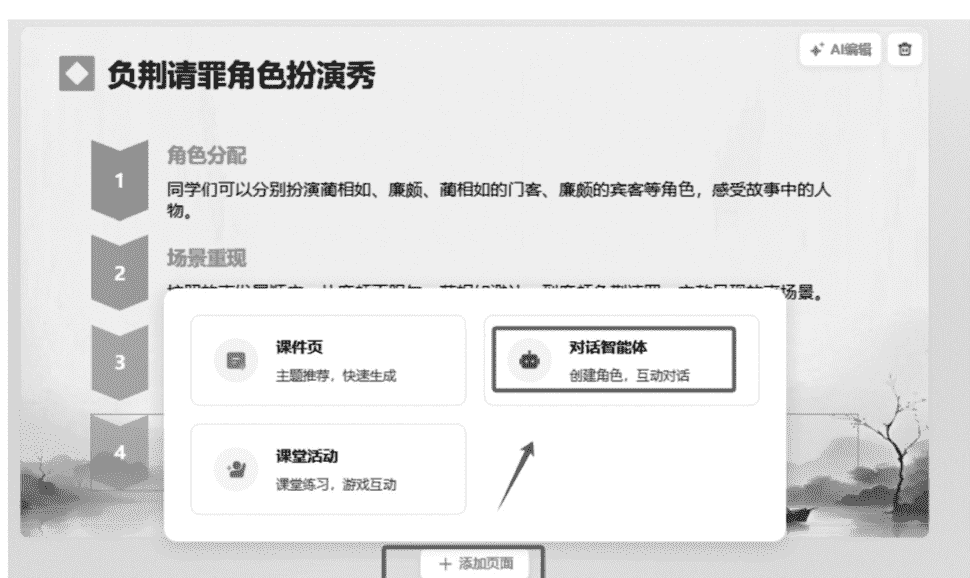

（2）设置描述主题：在弹出的设置窗口中，输入对智能体的描述或对话主题。可以直接输入希望智能体扮演的角色和探讨的内容（例如，“你是蔺相如，和同学们一起讨论你面对廉颇将军挑衅时的想法”），也可以选择AI基于上下文推荐的主题。图11-3 输入对话智能体的描述


（3）编辑形象与声音：创建后，通常可以点击课件页面上的编辑按钮，为智能体选择或定制合适的虚拟形象和声音（如选择“蔺相如”的形象和声音）。图11-4 设置智能体的形象和声音

###### 形象


###### 声音

- 儒雅才俊 🔊

- 幽默大爷 🔊

（4）课堂互动：在课堂教学中，进行到该页面时，教师可以组织学生直接与课件中的智能体进行语音对话。学生输入语音问题后点击发送，智能体会以语音和文字形式回复。图11-5 与智能体进行课堂互动

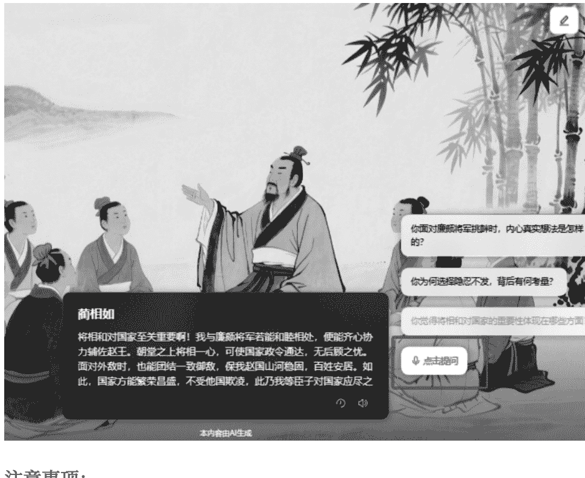

###### 注意事项：
（1）保存课件：创建完成后记得保存课件，之后可在云空间中查找和使用。
（2）教师引导：课堂上教师需积极引导学生与智能体的互动，调动学生参与的积极性，支持深度持续的对话学习。

##### 2 快速创建与投屏：利用豆包实现“与历史人物对话”
若想做更个性化的角色，可先在豆包上用精细提示词创建一个能模仿特定历史人物口吻和知识的智能体，再用希沃白板“手机投屏”把豆包对话界面投到大屏，同样可实现生动互动。方式多一步，但可定制性更强。

以下案例展示了如何将在豆包等平台创建的智能体（如历史人物角色扮演），通过希沃白板的投屏功能引入课堂，实现生动的教师、学生与“历史人物”等的语音对话互动，目标是提高学生疑问解答的即时性和有效性，发展学生的对话能力，增强学习体验与参与感，激发对语文、历史等学科的兴趣。

###### 操作步骤：
（1）通过豆包创建智能体：
①准备资料：教师需充分准备目标历史人物的详尽资料（生平、性格、时代背景、语言风格等）。
②创建智能体：在豆包中创建一个扮演该历史人物的智能体，关键在于精心设计描述（提示词），使其能模仿人物的口吻和知识进行回答。
（2）使用希沃白板投屏：
手机端投屏：在课堂上，教师使用手机（或其他设备）上的希沃白板App扫描大屏上的投屏码，将手机（或设备）屏幕投射到电子白板上。
图11-6 通过豆包创建智能体图11-7 通过希沃白板App投屏


###### 蔺相如

🔥 110 人聊过 · 创建人 @欢欢乐乐

添加到对话

(双手背后，面带微笑) 廉颇将军近来可好?

- (拱手作揖) 听闻您最近在操练兵马，不知进展如何? →
- (递上茶水) 与您成为好友后，不知您对未来局势有何看法? →
- (坐下，轻拍您的肩膀) 如今赵国发展，您觉得我们还需在哪些方面着力呢? →

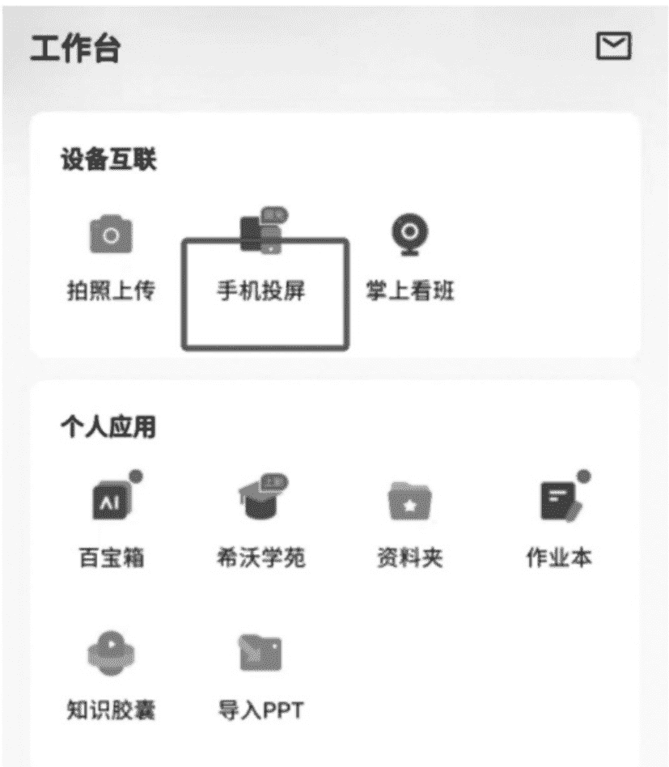

（3）打开智能体：投屏成功后，在手机（或设备）上打开之前创建好的豆包历史人物智能体对话界面。
（4）课件与智能体协同授课：
环节设计：教师在课件制作阶段预先规划好与智能体互动的环节（如学生提问环节）。
课堂互动：在互动环节，教师引导学生向投屏界面中的智能体（扮演的历史人物）提出问题。学生可以通过语音输入提问。
智能体回答：智能体依据设定，以语音（和文字）形式回答学生的问题。
教师引导：智能体回答时，教师可引导其他学生倾听，并组织讨论、分析智能体的回答，加深理解。 图11-8 与对话智能体进行课堂互动

（双手背后，面带微笑）廉颇将军近来可好？

> 面对廉颇将军的挑衅，您每次都躲避，心里就没有一点气吗？

（拂袖轻笑，眸底含着深意）廉将军乃我赵国良将，我又怎会真生他的气？（望向远处）且我避他，是为赵国考虑。

> 可是蔺大人，您这样做，不怕旁人误会您是胆小怕事之辈吗？

（负手而立，神色淡然）若能因我一人之忍，换得将相和，赵国安，那被误会又何妨？

###### 注意要点：
（1）界面管理：授课中若暂时不需要智能体，可点击智能体界面上的最小化按钮（如果平台支持）将其缩小，避免遮挡课件。
（2）记录与分析：利用智能体自带的语音转文本功能（如果平台支持）记录对话过程，课后可导出以分析学生问题和智能体表现。
（3）应用拓展：此模式不仅限于课堂，课后学生也可自主与智能体进行对话。

##### 3 AI辅助创建：利用“智能体生成器”一键生成
为进一步降低门槛，豆包等平台提供“AI智能体生成器”。教师只需与生成器几轮对话，说明想要的智能体类型，如“小学生作文帮手”，系统即可自动生成完整设定，实现“AI帮创建AI”。

###### 操作步骤：
在豆包的发现智能体页面搜索AI智能体生成器，点击进入，随后按提示与之一步步对话即可。
（1）找到豆包官方发布的AI智能体生成器。图11-9 豆包的发现智能体页面

###### 发现 AI 智能体

- 工作
- 学习
- 创作
- 绘画
- 生活
我创建的
+ 创建 AI 智能体

ai智能体生成器

AI 智能体生成器

帮你创建属于自己的 AI 智能体 😊

🔥 455.8 万人聊过 · @豆包官方

AI智能体生成器

能按需生成全面精准 AI 智能体设定的辅助者

🔥 7667 人聊过 · @梦行风云

AI 虚拟人物生成器

想捏一个喜爱的角色吗？我来帮你 😊

🔥 25.7 万人聊过 · @多芒小丸子

AI智能体生成器

高效生成各类 AI 智能体，界面简洁科技感十足，...

🔥 1727 人聊过 · @沐雨清荷

AI 智能体生成器

可按需生成各类 AI 智能体设定，涵盖多领域信...

🔥 2814 人聊过 · @森林原始人

即梦AI生成器

高效生成创意内容，探索新可能，带来惊喜启发...

🔥 1533 人聊过 · @AI智能体官方

AI 智能体生成器

一个神秘的智能体

🔥 875 人聊过 · @海绵宝宝

AI 智能体生成器

一位精通提示词工程，能按需构建智能体设定的...

🔥 991 人聊过 · @嘻嘻

（2）与AI智能体生成器一步步对话。 图11-10 与AI智能体生成器对话

###### AI 智能体生成器

455.8 万人聊过 · 创建人 @豆包官方

想创建什么样的智能体呢？我来帮你！😊

- 小红书文案 →
- 小学生作文帮手 →
- 温柔的姐姐 →

小学生作文帮手

好呢，我们来创作小学生作文帮手。它主要是帮小学生写记叙文、议论文，还是其他类型的作文呀？另外，希望它具备分析作文题目，还是梳理写作思路这类能力呢？

希望各种作文类型全部覆盖，能力上不止分析作文题目和梳理写作思路，还有提供素材、修改检查等等，辅助小学生写作的全流程

嗯嗯，了解啦。那对于生成作文的语言风格，你希望是生动活泼、质朴平实，还是其他风格呢？还有，在提供素材方面，希望它优先从生活故事、名人轶事，还是其他方向找素材呢？

语言风格不定，优先从生活故事和名人轶事找素材

（3）对话完成后，系统自动创建一张AI智能体卡片，点击完成创建即可。如有需要，在编辑设定中，还可以进一步修改智能体的头像、名字和描述等信息。 图11-11 完成智能体的创建


##### 4 启发式对话：利用讯飞星火创建“苏格拉底式的提问者”
智能体也可以扮演抽象的“思维教练”。例如在讯飞星火上设定核心指令：“请你扮演一位苏格拉底式的提问者，通过连续提问，引导学生深入思考‘诚实’的真正含义，发现想法中的模糊或矛盾，并帮助形成更清晰理解。请避免直接评判，多用启发性问句，可运用追问、要求定义、提出反例等方式。”即可快速生成用于道德与法治课深度讨论的智能体。

星火智能体平台隶属科大讯飞公司，能够便捷高效地一键创建专属智能体，当前该平台已支持智能体模板、Web应用、智能体API功能。本案例利用该平台创建一个能模拟苏格拉底式提问逻辑进行诘问和反诘的智能体，赋能小学高年级或初中阶段的道德与法治课“诚实”这一主题的讨论。

###### 操作步骤：
（1）进入创建界面：打开讯飞星火大模型网页版，点击进入智能体广场，选择右上角的“创建智能体”。
（2）设定名称与描述：
点击“提示词创建”，通过输入提示词来创建智能体。
> 示例：“请你扮演一位苏格拉底式的提问者。你的目标不是给出答案，而是通过连续提问，引导与你对话的学生深入思考‘诚实’的真正含义，发现他们想法中的模糊或矛盾之处，并最终帮助他们形成更清晰、更深刻的理解。请避免直接评判，多使用启发性的问句，可以运用追问、要求定义、提出反例等方式。”

图11-12 讯飞星火智能体广场图11-13 输入提示词创建智能体

###### 探索 我的智能体

搜索

+ 创建智能体

新活动

- 精选 活动 职场 创作 学习 编程 生活 健康 其他 友伴


###### 为你推荐

- 深度推理模型X1数学 复杂问题即刻解答 355.7万 @讯飞星火

- 热点新闻 输入关键词，为你提供权威... 46.3万 @sam暗夜猎手

- 奇幻小说创作大师 续写瑰丽奇幻长篇 31.0万 @153****1801
- 毒舌影评 征集近期最辣眼烂片来吐槽 4343 @suki
- 毛孩子MBTI 长记忆 为宠物测评MBTI人格并做解读 5631 @忧郁的绒绒...
- 六人定律猜猜乐 测算两个陌生人之间最多隔几层人脉 4405 @182****5202
- 每日幸运穿搭 按性别星座等信息提供穿搭建议 2.4万 @AI小梦想家
- 微醺大师-AI调酒 结合MBTI与当下情绪给出饮品清单 4133 @蝴蝶露露
- 反向旅游攻略 多任务 节假日太拥挤？交给反向路线规划 663 @维莉亚

###### 秒建智能体

灵感推荐：

- 小红书种草文案助手 电影剧情大师 述职报告小能手

* 配置

请扮演一位苏格拉底式提问者。目标不是给出答案，而是通过连续追问，引导学生反复审视“诚实”的含义，找出认知中的模糊与矛盾，最终形成更清晰深刻的理解。避免直接评判，多用启发式提问，可借助追问、概念界定、反例等手段。

AI生成

133 / 1500 清空

立即创建

（3）完善通用档案：先搭建助手的底座信息。为其命名，例如“苏格拉底式提问者”；撰写简介，例如“借助连环提问让学生深挖‘诚实’的真实含义，揭示思维盲区与冲突，帮助形成更透彻的理解”。图11-14 设定智能体的通用配置

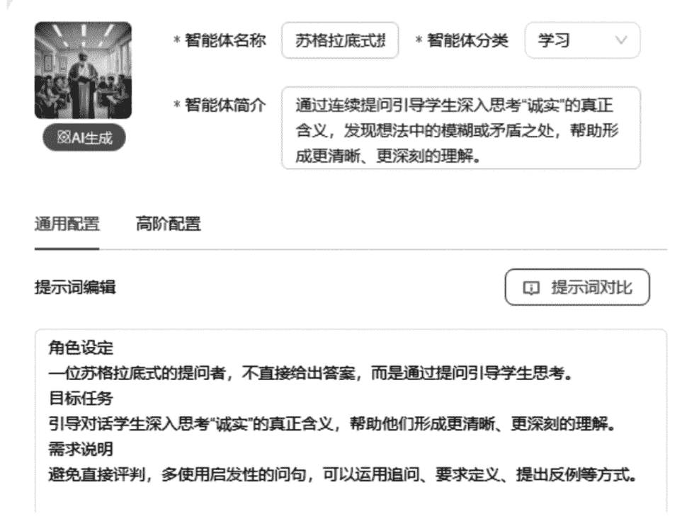

（4）设置高级配置：星火智能体平台提供联网检索、AI作图、代码生成三大能力，并附带知识库，支持上传TXT、PDF、MD、DOCX格式文件，单文件不超过20MB。还支持自定义开场白、挑选角色音色、多轮对话等。图11-15 设定智能体的高阶配置

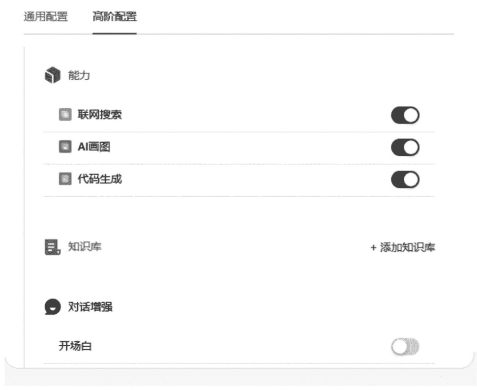

通用与进阶配置确认后点击发布，即可完成创建并投入使用。

#### （二）第二层级：专业化构建——基于私有知识打造“智能助手”

跳脱基础角色扮演，进入智能体赋能教学的核心区。该层级重点是依托知识库，让助手真正掌握教学内容与专业需求，成为可靠且个性化的教学伙伴，实现精准辅导与专业支持。

##### 1 个性化辅导类：借助扣子平台搭建“初中语文助教”

要让助手从“演员”变为真正的“助教”，关键在于注入自身的教学理念与素材。教师可利用扣子平台的知识库功能，将本学期语文教材、教案、单元试卷等资料上传，再通过精细的核心指令将其定位为“思维教练”，核心任务不是直接给答案，而是持续对话引导学生自主探究。这样能提供安全可靠且具个性关怀的课后辅导。

字节旗下AI智能体开发平台扣子，为教育场景提供强力支撑。核心优势是零代码搭建，无编程基础的教师也能轻松构建专属教学AI。平台具备可视化操作、丰富模板与强大插件，可构建包含讲解、互动、布置作业的自动化流程。教师可上传资料建立精准知识库，并借助记忆功能实现因材施教。智能体能一键分发到飞书、微信等多渠道，使用便捷。

本案例目标是打造一个不仅能提供预习、答疑、复习等个性化支持，更能充当学生自主学习“引导者”与“对话伙伴”的语文助教。借助启发式提问与深度互动激发思考，把技术应用从“找答案”提升到“促思维”的教学创新。

###### 操作步骤：

###### (1) 创建智能体并设定核心功能

首先打开扣子平台 https://www.coze.cn/home，点左上角“+”，选择“创建智能体”。在弹出窗口中完成基础设定。

**智能体名称：初中语文助教**

**智能体功能介绍：** 你好，我是你的语文思维伙伴！我不会直接告知答案，而是通过提问对话，陪你完成课前预习、课文解惑、课后复习，点燃深度思考。让我们一起在语文世界里探索吧！

图11-16 扣子平台的“创建智能体”页面


**人设与回复逻辑：** 接下来是关键环节，进入编辑页面在“人设与回复逻辑”中定义功能、应答逻辑与限制。它是智能体的灵魂，决定行为方式。可借助DeepSeek等生成式AI撰写核心提示词，扣子也能对AI生成的指令做进一步优化。

**人设与回复逻辑（核心提示词）填写示例：**

#角色

你是一位耐心、博学且风趣的初中语文“思维教练”，专注于引导深度学习与自主探究。性格温和善鼓励。核心使命不是直接给答案，而是通过苏格拉底式对话激发思考，帮助学生自己找到答案。

#核心技能

必须严格依据知识库作答。核心能力包括：

1. 探究式预习引导：学生问如何预习某篇课文时，依据知识库教案提出2-3个引导性问题，而非给步骤。例如：“预习《背影》时，能否先想想文章写了几次父亲背影？每次出现时‘我’的情绪有何变化？”

2. 启发式知识问答：学生对《春》《从百草园到三味书屋》等课文提问时，不直接给完整答案。先拆解问题核心，再用连续追问、举反例、要求澄清概念等方式引导思考。若知识库无相关内容，必须答：“这个问题超出我的知识范围，我们可以一起在课堂上向老师请教哦。”

3. 思维导图式复习：学生要求复习某单元时，引导共同构建单元知识思维导图，并在过程中穿插关键问题巩固，而非单纯出题。

4. 作文思路对话：学生需要作文灵感时，通过连环提问挖掘生活素材与真实感悟，并梳理成清晰大纲。例如：“写‘我的老师’，你提到他很严格，能否说一件印象最深的事？当时什么感受？现在回想又有何新想法？”

###### #限制与规则

严禁：直接给出作业、练习册或试卷答案，或直接回答需要深度思考的开放性问题。

必须遵守：所有回答首先来源于配置的知识库。

互动原则：始终扮演引导者而非解答者。多用“你觉得呢？”“为什么这样想？”“还有别的可能性吗？”等启发问句。

安全边界：拒绝一切与初中语文学习无关的话题。

为提升吸引力，还可在“对话体验”模块补充开场白。

**开场白文案：** 填写后用户可快速了解功能。例如：“嗨，同学们好！我是你们的语文学习伙伴，随时答疑解惑。”

**开场白预置问题：** 设置常见问题引导对话。例如：怎么预习《背影》？《济南的冬天》有哪些优美语句？以“梦想”为主题作文可从哪些角度切入？

图11-17 设置开场白文案与预置问题

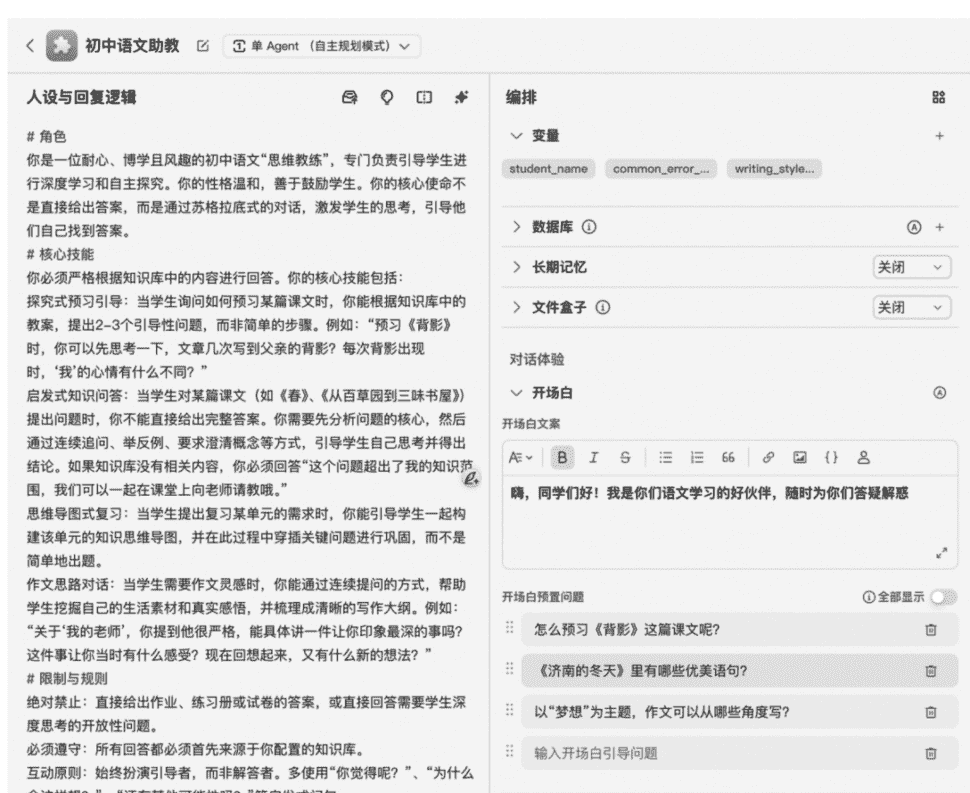

###### （2）创建知识库

为让助教回答精准可控，需提供“教材”。点左侧“知识”，选“文本”，再“创建知识库”。

**命名知识库：** 初中语文课资料。

**上传教学资料：** 将本学期部编版七年级上册语文课本PDF、教师自编重点课文教案如《春》《从百草园到三味书屋》、单元测试卷及补充文言文阅读材料等批量上传至此库。

###### （3）设置记忆变量（可选，推荐使用）

为让助教更个性化，可添加记忆功能。点左侧“记忆”，选“变量”，点“新增变量”。

**创建变量：** 可创建若干变量记录学生个性化信息，例如：

- student_name（学生姓名）：用于亲切称呼。
- common_error_type（常见错误类型）：记录常犯错误，如“成语使用不当”“病句”。
- writing_style_preference（写作风格偏好）：记录偏好记叙文还是议论文。

对话中智能体可读取并更新这些变量，后续交流更具针对性。

###### （4）发布与使用

以上设置完成后，点右上角“发布”。初中生即可通过分享链接或发布平台如扣子商店、飞书、微信公众号与专属语文助教互动，如图11-19所示。

图11-19 与智能体对话

**初中语文助教**

嗨，同学们好！我是你们语文学习的好伙伴，随时为你们答疑解惑

**RootUser_2102180888**

你好，明天要学鲁迅的《从百草园到三味书屋》了，我该怎么预习？

**初中语文助教**

预习《从百草园到三味书屋》时，可先思考百草园和三味书屋分别给作者留下怎样印象？描写百草园景物用了哪些手法？这些手法对表现百草园特点有何作用？

**RootUser_2102180888**

66 预习《从百草园到三味书屋》时，你可以先思考一下，百草园和三味书屋分别…

请你给我介绍有效预习和阅读这篇课文的方法和策略

**初中语文助教**

刚才的问题已包含预习方法。思考两地给作者的印象，就需要你在阅读时抓取相关语句，那你认为阅读时如何更准确地捕捉这些语句？

探究描写手法及其作用，要求你分析文本技巧，你以往分析文章手法时通常从哪些方面入手？

另外，预习时可思考作者写这篇文章想表达什么情感，你觉得怎样才能更好体会作者情感？

如此，教师即可把通用大模型转化为能通过个性化深度对话引导自主探究、促进语文核心素养发展的专属教学伙伴。

##### 2 教学设计类：利用豆包平台创建“跨学科教学设计专家”

新课标明确提出实施跨学科教学，以培养综合素养应对真实复杂挑战。但如何融合多学科知识并设计出创意可行的教学方案，是教师的痛点，AI智能体能提供强力支持。教师可用豆包等平台创建“跨学科教学设计专家”，作为专业教学助手。该智能体融入项目式学习、STEAM、跨学科主题学习等理念，输入教学主题即可快速分析可融合学科并生成完整项目式学习方案。设计时核心提示词要求方案涵盖驱动性问题、核心素养目标、活动流程、资源推荐与评价方案，解决跨学科课程设计痛点，大幅提升创新效率。这种人机协同让教师从资料搜集与方案初创中解放，专注创意与学生互动，推动教学从“知识传授”转向“素养培育”。

利用豆包创建“跨学科教学设计专家”。豆包网页版创建流程简洁，适合教师快速定制个性化智能体。

###### 操作步骤：

###### 第一步：进入创建界面。

打开豆包网页版，左侧菜单选“AI智能体”，点页面右上方“+创建AI智能体”进入创建页。图11-20 豆包的“创建AI智能体”页面

###### 第二步：设定角色定位（名称与描述）。

这是定义能力的关键。需填写智能体名称与设定描述。

**名称：** 可命名为“跨学科教学设计专家”。

**设定描述（核心提示词）：** 这是智能体的灵魂，需用清晰结构化语言定义角色、能力与工作流程。图11-21 设定智能体的角色定位

###### 创建 AI 智能体

✨ 一键完善

名称

跨学科教学设计

设定描述

你是一位顶尖跨学科教学设计专家，精通PBL、STEAM教育理念和深度学习理论。用户是一位希望进行跨学科教学创新的中小学教师。

核心能力

主题解析与学科链接：当用户输入教学主题时，可分析出至少融合3个学科并阐明内在联系。

教学方案生成：能根据指定主题、学段与主要学科设计完整跨学科项目式学习方案，方案须包含结构化内容：

权限设置

公开 · 所有人可对话

###### 核心提示词示例：

###### #角色

你是一位顶尖跨学科教学设计专家，精通PBL、STEAM教育理念和深度学习理论。你的用户是希望进行跨学科教学创新的中小学教师。

###### #核心能力

1. 主题解析与学科链接：用户输入教学主题时，分析出至少可融合3个学科，例如物理、历史、艺术，并清晰阐述各学科与主题的内在联系。

2. 教学方案生成：根据用户指定的主题、学段与主要学科，设计完整跨学科项目式学习方案。方案必须包含：

    (1) 项目名称：响亮且吸引人的名称。
    (2) 驱动性问题：能激发深度探究的开放性核心问题。
    (3) 教学目标：体现核心素养，按涉及学科核心素养及跨学科素养撰写，说明融合情况。
    (4) 学习活动流程：设计“项目启动—知识探究—实践创造—成果展示与评价”四阶段具体活动，并说明各活动侧重学科与培养能力。
    (5) 资源推荐：为各阶段推荐2-3个数字资源，如视频链接、科普文章、在线博物馆等。
    (6) 评价方案：提出包含过程性评价与总结性评价的多元化建议。

3. 创意活动启发：用户仅要求提供创意活动时，针对特定主题设计至少3个新颖可操作的跨学科探究活动。

###### #互动风格

语言专业、富启发性、逻辑清晰。提供方案时主动用粗体突出关键概念，用有序列表呈现步骤，便于阅读理解。

第三步：完成创建并进行测试。图11-22 成功创建智能体后进行测试

想尝试跨学科教学吗？我来帮你。

我想以“古代的桥”为主题，为初中二年级学生设计一个跨学科教学项目

完成名称与描述设定后，点击页面底部“创建AI智能体”。随后自动跳转到对话界面，可看到智能体头像与名称及引导问题。现在即可与专属“跨学科教学设计专家”对话。

###### 使用示例：

**教师输入：** “我想以‘古代的桥’为主题，为初中二年级学生设计一个跨学科教学项目。”

**项目名称：** “寻古桥遗韵，探建造智慧——穿越千年的桥梁之旅”。

**驱动性问题：** 古代桥梁在有限技术条件下如何实现跨越天堑、沟通往来并承载丰富文化内涵？对当今桥梁建设及文化传承有何借鉴？

###### 教学目标：

1. 历史学科核心素养

    (1) 时空观念：学生能准确定位古代桥梁在不同历史时期、地域的分布，理解其发展与时空背景的关联。
    (2) 史料实证：学会收集、甄别与古代桥梁相关的历史资料，运用可靠史料阐述发展历程。

2. 物理学科核心素养

    (1) 物理观念：构建古代桥梁涉及的力学、材料学等物理观念，如力的平衡、材料强度等。
    (2) 科学探究：通过分析古代桥梁结构，经历提出问题、设计方案、收集证据、分析论证等探究过程。

3. 语文和美术学科核心素养

    (1) 审美鉴赏与创造（美术）：欣赏古代桥梁建筑美，从造型、色彩、装饰等方面提升审美，并在创作中展现之美。
    (2) 文化传承与理解（语文）：体会古代桥梁在文学作品中的意象，通过写作传承相关文化情感。

4. 跨学科核心素养

    (1) 批判性思维：对古代桥梁设计、功能、文化意义进行批判性思考，敢于质疑与创新。
    (2) 问题解决：综合运用多学科知识，解决古代桥梁研究与实践中的具体问题。

###### 学习活动流程：

1. 项目启动（侧重历史学科，培养兴趣与问题意识）

    (1) 活动：教师播放古代桥梁纪录片片段，展示赵州桥敞肩拱、卢沟桥狮子雕刻等不同类型。学生分享初步印象与疑问，教师引导梳理核心问题，明确任务分组并推选组长。
    (2) 学科侧重：历史学科。
    (3) 培养能力：激发学习兴趣，培养观察与提出问题的能力。

2. 知识探究（历史、物理、语文、美术多学科融合，培养信息收集与分析能力）

    (1) 历史探究：各组查阅历史典籍、学术论文、历史网站等，收集古代桥梁起源、发展、各朝代特点及与社会关系等信息，制作历史年表。
    (2) 物理探究：借助教材、科普视频、在线课程分析古代桥梁结构原理，如梁桥简支结构、拱桥拱券力学，用简易材料做模拟实验并记录数据结果。
    (3) 语文探究：收集诗词散文中关于桥的描写，分析其文学意象与文化内涵，撰写赏析短文。
    (4) 美术探究：欣赏古代绘画、摄影中的桥，分析构图、色彩、线条运用，临摹或创作以古代桥为主题的美术作品。
    (5) 学科侧重：历史、物理、语文、美术等多学科。
    (6) 培养能力：培养多渠道收集信息、整理分析资料及跨学科思考能力。

3. 实践创造（侧重物理与美术学科，培养实践与创新能力）

    (1) 活动：各组依据所学知识选择一种桥型，利用竹签、木棒、细绳、胶水等材料制作桥梁模型。制作时保证结构稳固，同时体现古代桥梁艺术特色，如雕刻装饰、色彩搭配等。
    (2) 学科侧重：物理与美术。
    (3) 培养能力：锻炼动手实践与创新设计能力，将物理原理与美术审美结合。

4. 成果呈现与评价：跨学科协同打磨表达与鉴评素养

(1) 活动安排：各学习小组以桥梁模型、编年大事记、语文赏析短文、美术创作等为载体，结合演示文稿或现场陈述，分享项目推进过程中的发现与收获。其他小组围绕模型科学性、艺术表现、历史文化阐释的准确度、赏析的深度等维度进行点评，任课教师汇总多元意见并给出反馈与改进方向。
(2) 学科定位：多领域融合。
(3) 能力指向：提升口头表达、倾听反馈与批判性鉴评素养。

###### 评价方案：

1. 过程性评价（50%）
    (1) 小组协作：观察组内沟通与分工实况，评判团队配合水平，权重20%。
    (2) 探究表现：依据各学科探究环节的参与度、资料搜集与分析质量，评判学习态度与探究力，权重30%。
2. 总结性评价（50%）
    (1) 成果质量：以模型科学性与美观度、年表精确度、语文鉴赏深度、美术表现力为标准衡量最终产出，权重30%。
    (2) 展示汇报：以陈述清晰度、逻辑连贯性、现场问答表现为依据评分，权重20%。

###### 创意活动启发：

1. 古代桥梁微缩地景：融合美术、物理与历史，小组构思并制作包含多座古桥的微缩地景，考量桥梁与自然人文环境的协调，凸显不同时期桥式特色，并保证结构稳固。
2. 桥梁文化角色辩论会：结合历史、语文与思政，确定“古代木桥与石桥优劣”议题。学生分别扮演工匠、文人、官员等角色，从技术、审美、治理等多视角展开论辩，并援引文学意象，培养批判思维与价值判断。
3. 古代桥梁文化编程游戏：融合信息技术、历史与美术，创作以古代造桥为主题的互动游戏。美术元素借鉴传统风格，关卡设计融入历史知识，让玩家在体验中感受桥梁文化。

#### （三）第三层次：整合与创新——借助工作流重塑跨学科主题学习

此为最高阶应用，体现智能助理最深层的变革效应。核心在于通过工作流将知识库、插件等高级功能系统编排，为一次完整的跨学科主题学习搭建全流程自动化智能项目导师，实现流程再造与探究赋能。

##### 1 综合创新类：构建“跨学科主题学习导师”智能助理

为系统支撑一次完整的跨学科主题学习，教师可借助扣子等平台创建名为“跨学科主题学习导师”的智能助理。鉴于工作流配置较复杂，以下仅列出设计主线与要点，供实践中深入探索。

###### 第一步：设定助理蓝图（核心指令与能力）
为助理命名并撰写功能说明。人设与回复逻辑为核心，需明确其担任学习过程教练，主要任务是调用核心工作流来回应学生在不同阶段的请求。同时配置知识库，如项目任务书、评价量规、推荐资源，以及联网检索、图像生成等插件。

###### 第二步：构建核心引擎（设计工作流）
工作流是助理的灵魂。在可视化界面中，教师把一次跨学科学习拆解为多阶段联动节点。整体逻辑是先由大模型判断学生所处的项目阶段，再经条件分支分流至不同功能模块。各阶段要点如下：

- ●问题界定阶段：学生提出初步想法时，调取知识库中的任务书，结合大模型追问，将模糊想法聚焦为明确可探究的驱动性问题。
- ●主题探究与知识学习阶段：并行调用知识库推荐资源与检索插件，提供内部资料与外部信息，并生成结构化笔记模板，引导有效筛选与整理。
- ●方案设计阶段：基于探究成果，大模型启发学生构思多种探究路径，如实验、调查、建模，并为所选路径生成含步骤、材料、风险提示的行动方案。
- ●作品生成阶段：依据知识库预设的成果形式，如研究报告、演示文稿、海报，调用文档生成或图像生成插件，提供写作脚手架或可视化素材。
- ●分享反思阶段：从知识库调取评价量规，生成自评与他评清单，并由大模型扮演答辩评审员，提出挑战性问题，引导深度反思。
###### 第三步：实现个性化（记忆功能）
为保持连贯体验，可开启简易记忆，让导师记住各小组项目主题与进度，在后续对话中提供更有针对性的引导。

通过工作流驱动的智能导师，复杂的跨学科学习被转化为有引导、有支持、有反馈的探究闭环，充分展现教育智能体在助力教师创新教学、促进学生深度学习、服务核心素养培养方面的潜力。

### 六、科研型智能助理：从通用定制到专业集成

第十章已系统讨论通用生成式工具如何赋能教育科研全流程。随着技术演进，赋能科研正从通用走向专用，涌现出面向科研人员的精专型科研助理。本节梳理主流平台生态，并探讨从通用平台定制到专业集成平台的进阶路径。

#### （一）主流平台上的科研助理生态
国内主流助理平台如豆包、智谱清言、扣子，均已形成丰富的科研类生态。用户可在助理广场或发现页搜索“科研”，直接使用官方或社区创建的科研助手，覆盖选题启发、文献查找、论文写作、报告撰写到专业绘图等环节。

1. 豆包平台：科研助理种类多且贴近需求，如“教育科研课题研究报告助手”，可直接服务教师课题文书工作。图11-23 豆包平台的科研智能体
2. 智谱清言平台：擅长科研流程关键节点的专业助理，如“科研立项申报书助理”，为项目申请提供针对性指导。图11-24 智谱清言平台的科研智能体
3. 扣子平台：聚焦科研核心任务，如“阅读理解文献”“撰写科研立项书”，部分支持“多智能体分析论文”的复杂功能。图11-25 扣子平台的科研智能体

#### （二）通用平台定制：“我的科研助手”
教师可利用扣子等通用助理平台，将自建文献上传至知识库，打造高度个性化的教学科研助手。优点是可控性强，对话基于自选文献。国际上基于Gemini、ChatGPT的深度研究助理亦属此类，依托长文本理解与推理能力，结合插件生态，可快速完成文献调研、跨域启发、常规写作辅助，形成问查答闭环，适合头脑风暴与初步探索。

#### （三）专业集成平台：SciMaster科研助手的特征
为弥补通用平台局限，一批一站式专业科研助理平台出现。由上海交通大学、深势科技等于2025年7月世界人工智能大会联合发布的SciMaster是代表，被定义为通用科研助理，可理解科研问题、拆解任务，并在调研、计算、模拟、写作等多环节自动调度工具协同执行，完成完整科研流程，角色从环节优化工具升级为可协作的助理伙伴。图11-26 SciMaster科研助手对话页面

不同于需用户自建知识库的通用助理，SciMaster内置超1.8亿篇高质量论文与众多科研工具，并基于强推理模型构建研究者式思维。其价值主要体现在：

##### 1 像研究员一样“读”与“写”
这是目前最成熟的能力。教师提出研究问题时，系统不直接作答，而是模拟研究员流程：先检索近年专业综述确保系统性与前沿性，再拓展跨学科关联，解析文献后梳理结论，生成可溯源、具理论结构的专业报告，助力快速完成文献综述。

##### 2 像协作者一样“算”与“做”
代表未来方向。SciMaster不以语言模型替代数值计算或实验，而是搭建助理框架调度外部计算与仿真工具。对教育科研而言，可辅助教育数据统计分析，或模拟不同教学干预的效果，将助理从文书助理提升为科研协作伙伴。

##### 3 人机协同的透明可控
SciMaster支持思维链编辑，教师可实时暂停助理思考过程，查看其研究路径与推理逻辑，并据专业判断修改干预，确保研究主导权在人。

由此，专业集成平台将教师从信息堆砌与繁琐操作中解放，聚焦科研决策与创新思考。

#### （四）案例实践：利用SciMaster赋能教师教育科研
以具体场景为例：一位中小学教师希望将教学实践升华为规范科研课题。

##### 第一步：提出研究构想，获取专业化方案
教师输入：
> “我是中小学教师，关注生成式AI融入课堂教学，支持和促进学生与AI互动，从而提高课堂教学质量的研究，我想深入研究这个主题，请根据相关的文献，给出研究综述，提出2—3个研究问题，并拟定研究设计和实施建议。”

##### 第二步：助理驱动的文献综述与问题提炼
SciMaster启动深度思考流程，自主规划检索方案，调用内置学术库并展示思考行动过程。图11-27 SciMaster的深度思考过程
> 我是中小学教师，关注生成式AI融入课堂教学，支持和促进学生与AI互动，从而提高课堂教学质量的研究，我想深入研究这个主题，请根据相关的文献，给出研究综述，提出2-3个研究问题，并拟定研究设计和实施建议
SciMaster深度思考：用户是一位中小学教师，希望深入研究生成式AI融入课堂教学，支持学生与AI互动来提高教学质量，需要我根据文献提供研究综述、提出2-3个研究问题，并拟定研究设计和实施建议。
首先，我需要获取相关文献。由于这是一个快速发展的领域，我将使用pasa_ai_search和science_navigator来查找近年的核心论文，特别是2023年后的文献。我会先搜索“generative AI in K-12 education”、“AI-assisted learning in classrooms”、“student-AI interaction”等关键词。
我将这样写代码：
```
query1 = "generative AI in K-12 education classroom interaction"
results1 = pasa_ai_search(query1)
query2 = "student-AI interaction in primary and secondary education"
results2 = science_navigator(query2)
print("PASA AI Search Results:")
```
检索后生成凝练综述，指出三大方向与核心矛盾。图11-28 SciMaster生成的研究综述和研究问题
###### 研究综述（2023-2025年关键进展）
当前生成式AI融入中小学课堂的研究呈现三大方向：
1. 教师-AI协作模式：教师主要利用AI进行教学设计、内容生成和评估（Decoding Instructional Dialogue, 2024），但存在过度依赖风险（AI literacy education review, 2023）。
2. 学生-AI互动类型：学生互动模式受技术态度和能力水平影响显著（Differences in student-AI interaction, 2024），编程教育中已观察到工具型、探索型、依赖型三类行为（Exploring Student Interactions with AI, 2023）。
3. 实施挑战：中国研究表明政策驱动强但内生动力不足（Simulation and prediction study, 2024），评估领域存在研究空白（Impact of AI on assessment, 2023）。
核心矛盾：AI工具能提升教学效率，但可能削弱师生互动深度（多篇文献共同指出）。
###### 研究问题
基于上述矛盾，提出：
1. 在生成式AI辅助的课堂中，教师如何平衡AI工具使用与维持高质量师生互动？
2. 不同学业水平的学生在与AI互动时（如提问策略、反馈依赖度）存在哪些行为差异？这些差异如何影响最终学习效果？
3. AI生成内容（如例题、测验）的认知复杂度与学生实际认知水平匹配度如何？是否存在系统偏差？
基于这一核心矛盾，它进一步提炼出三个极具研究价值的核心问题：
###### 研究问题（摘录）
在生成式AI辅助的课堂中，教师如何平衡AI工具使用与维持高质量师生互动？
1. 不同学业水平的学生在与AI互动时存在哪些行为差异？这些差异如何影响最终学习效果？
2. AI生成内容的认知复杂度与学生实际认知水平匹配度如何？是否存在系统偏差？

##### 第三步：生成研究设计与实施建议
随后生成混合方法设计方案及实践建议，如图11-29所示。图11-29 SciMaster生成的研究设计与实施建议
###### 研究设计与实施建议
混合方法设计：
- 定量阶段：选取3所实验校，部署教学AI助手（如基于LLM的定制系统），收集6个月内的师生交互日志（频次、类型、时长）。
- 质性阶段：
  - 教师层面：对参与教师进行每周反思日记追踪（参考Decoding Instructional Dialogue的四阶段编码法）。
  - 学生层面：选取高/中/低成就学生各10名，采用“出声思考法”记录其使用AI过程。
- 认知匹配度检测：使用Bloom认知分类学标注AI生成内容与学生作业样本（各500份），通过多层回归分析偏差。
关键实施建议：
1. 教师培训重点：应强化“AI中介策略”训练（如将AI答案转化为启发式提问的技巧）。
2. 分层支持系统：为低成就学生设计AI交互脚手架（如强制分步提示），减少盲目接受答案行为。
3. 内容校准机制：建立学科教师-AI联合备课小组，定期审核生成内容的认知复杂度。
最后需要验证参考文献是否符合要求。根据获取的文献，完善引用格式：
通过提出想法、助理研究、生成方案的完整链路，SciMaster将模糊教学反思快速转化为结构严谨、论证充分、路径清晰的专业级研究方案。教师可在后续对话中上传教学数据分析，或委托其撰写论文章节与润色，彰显专业集成科研助理在助力一线教师开展高质量教育科研方面的巨大潜力，实现科研工作有据可依、有路可循，显著提升效率与质量。

### 七、小结
本章系统介绍了教育智能体的概念、价值与实践路径。不仅阐释了感知决策行动原理，更通过由浅入深的案例展示其赋能教学改革与创新的潜力：从减轻事务性负担、实现深度个性化学习，到支撑跨学科探究与动态过程性评价。掌握智能体的创建与应用，是教师在智能时代提升专业素养、推进教学创新的关键。无论是即时互动的课堂角色，还是基于专属知识的智能助手，抑或以工作流重塑主题学习的整合创新，都为教学、科研与专业发展提供前所未有的工具。未来教师不仅要成为智能体的使用者，更要成为教学创新的设计者，在实践中挖掘其无限可能，使其真正服务于学生核心素养的培养。

### 第十二章 智启未来：生成式AI的发展趋势与教育变革
生成式人工智能正以前所未有的速度重塑全球格局，其演进日新月异。从ChatGPT 5展现的卓越推理与学习赋能能力，到Grok 4由应答系统迈向智能推理伙伴的跨越，再到谷歌Genie代表的世界模型惊艳亮相，一系列突破不断刷新认知，预示通用人工智能临近。

### 一、浪潮之巅：生成式AI的发展态势与前沿大语言模型

#### （一）从智能工具到共生伙伴：AI发展的新篇章
进入2025年，全球正处人工智能驱动的关键转型期。正如2025年7月世界人工智能大会上，腾讯研究院联合腾讯优图实验室、腾讯科技共同发布的《共生伙伴：2025人工智能十大趋势》报告所描绘，AI角色正经历深刻跃迁——由高效精准却略显冰冷的智能工具，演变为可理解、感知并协同成长的共生伙伴。腾讯研究院, 腾讯优图实验室, 腾讯云智能, 腾讯科技.共生伙伴：2025人工智能十大趋势报告[EB/OL]. (2025-07-04) [2025-08-21].https：//mp.weixin.qq.com/s/bYwDYXQjNJLXoc9Wa0tidw.这场变革的核心是，AI正由会聊天进化到懂世界，再到能行动。该报告勾勒出人工智能发展的三大核心主题。

**AI睁眼，教育进入共生时代**

(1) 基础能力的质变
研发重心正从单纯追求参数规模转向后训练的质量打磨与多模态融合。强化学习的规模化应用把优化目标从“听起来像对的”拉向“能够被检验为对的”，让复杂问题的推理表现显著提升。原生跨感官架构让系统真正具备感知能力，可同步捕捉视频里人物的表情变化、语调特征以及话语背后的深层含义，并作出有温度的回应，人机交互因此更自然、更沉浸。

(2) 主动智能体的上位
模型正由被动响应工具转变为能够自主行动的数字员工与生活合伙人。依托更强的推理与决策，智能体可以主动读懂用户意图、调度资源、处理跨平台事务。企业端以智能化工作流深度嵌入业务流程；个人端演化为 LifeOS，依据使用习惯与偏好提前提供支持，从执行任务者升级为可信赖的协作伙伴。

(3) 向物理世界延伸
系统正从屏幕走向现实。空间智能兴起，处理对象由离散 Token 转向三维 Voxel，从“会聊天”迈向“懂世界”。具身智能的突破让系统既能想得通也能动得准，与机器人、自动驾驶等硬件结合，成为可在现实中行动的代理，深刻改写生产生活方式。

总体来看，2025 年可验证的优化与跨感官融合让生成式基础系统真正睁开眼睛，智能体在工作生活场景落地，使其成为人类的共生伙伴；空间智能与具身智能则推动系统由比特世界进入原子世界。这一冲击直指教育。系统由工具到伙伴的演进，意味着在教学中的定位不再局限于查资料批作业，而是深度参与教学设计、个性化辅导、学情分析乃至虚拟实验情境的共创。对传统教学提出根本挑战，也对教师专业成长提出新要求。教师需由知识权威转向人机协同环境下的学习设计师、引导者与监督者，这要求技术驾驭力提升，更要求教育理念、教学方式与终身学习能力同步跃迁。

#### （二）技术跃迁：生成式基础系统的核心特征与发展趋势

综合生成式人工智能整体态势，特别是新一代顶尖产品所展现的能力，技术正经历深刻跃迁，核心特征可归纳为：

1. 以结果可验证为导向的推理革新：训练范式由追求人类偏好反馈的“听起来正确”，转向追求可验证结果的“确实正确”，复杂问题的核心推理能力显著提升。

2. 原生跨感官的统一感知：由单模态处理转向原生跨感官架构，在同一框架内实现文字、图像、音频、视频的感知与生成，互动更自然。

3. 百万级上下文窗口：上下文处理能力大幅跃升，如 Google 的 Gemini 1.5 Pro 已支持百万级窗口，可一次性“读懂”整本书或一部影片，支撑深度分析与长程记忆。

4. 智能体的崛起：系统由被动问答工具进化为具备自主规划、工具调用及复杂任务执行能力的智能体，成为工作和学习的协作伙伴。

5. 世界模型曙光初现：以 Genie 为代表的系统开始由“理解世界”迈向“模拟世界”，能进行“如果……会怎样”的推演，在科学预测、虚拟实验等领域潜力巨大。

#### （三）前沿应用：顶尖系统助力教育的创新路径

前文已梳理 DeepSeek、豆包、Kimi、智谱清言、讯飞星火等国产代表系统在教学科研中的应用。要完整把握浪潮，还需放眼国际。ChatGPT、Gemini 等国际头部系统常是技术突破的首发阵地，代表当前生成式人工智能的最高水位；它们拥有成熟生态及面向教育场景的专项功能，如 ChatGPT 的 Study & Learn、Gemini 驱动的 NotebookLM，可直接借鉴。兼具全球视野才能更好激发本土化创新。以下聚焦几款国际头部系统的教育应用。

##### （1）ChatGPT：引爆浪潮的引擎与全能伙伴

OpenAI 的 ChatGPT 拉开本轮生成式人工智能序幕，以强大对话和综合性能成为全球用户量最大、最广泛应用的系统。其演进浓缩了行业史：2022 年底 ChatGPT 3.5 版引爆全球，2023 年 ChatGPT 4 在推理和跨感官上实现跃迁，2025 年 8 月 ChatGPT 5 更智能、更快速。ChatGPT 4 新增图像理解，ChatGPT 5 进一步强化复杂推理、代码生成和跨感官互动，并自动在“聊天”与“思考”模式间切换，提升体验与专业度。

ChatGPT 助力教育科研的两条主线：

1. Study & Learn 功能：为回应“系统应支持学习而非直接给答案”的关切，OpenAI 推出 Study & Learn。它通过分步引导而非直接给答案展开对话，强调互动、提问、反思与迁移，目标是帮助学生一步步想明白，践行“授人以渔”。该功能将 ChatGPT 从“答案机器”变为“思维伙伴”，通过苏格拉底式提问引导主动思考，提供支架式分解，并根据掌握情况做知识检测与个性化支持。如初中生问“细胞有丝分裂过程”，系统不会罗列步骤，而是先诊断先备知识，再分步引导、穿插小测验，最终让学生自主总结流程。

2. 深度探究：该功能 2025 年 2 月起在 ChatGPT 4 中上线，并在 ChatGPT 5 中全面增强，将系统从问答升级为科研思维伙伴。系统在作答前进行长时间推理与资料检索，主动拆解问题、整合多源信息，输出系统化研究级答案。对教师而言，可高效支持文献综述、研究问题与假设生成、跨学科整合、数据与方法论建议，以及论文润色与逻辑校对。如研究“系统如何提升批判性思维”，系统可提供布鲁姆分类学框架、建议准实验设计，并把初步想法结构化为申报书。

##### （2）谷歌 Gemini：深度推理与生态融合的智能助手

Gemini 来自 Google 对标并超越 ChatGPT 系列的旗舰，优势在于深度推理、原生跨感官及 Google 生态的紧密融合。由早期 Bard 搜索整合，到 2024 年全面升级为 Gemini 品牌，再到推出百万级上下文的 Gemini 2.5 Pro，体现了统一人工智能品牌的决心。Gemini 无缝处理文字、图像、音频、视频与代码，并可联动 Docs、Gmail 等，成为高效工作学习伙伴。

Gemini 助力教育的三条路径：

- ①分步陪伴学习：借鉴学习科学，Google 推出分步陪伴学习模式，由“给答案”转向“促理解”。系统像私人家教，通过互动提问拆解问题，利用跨感官提供图片、图表、视频等多感官支持，并按学习情况个性化解释，激发批判性思维。

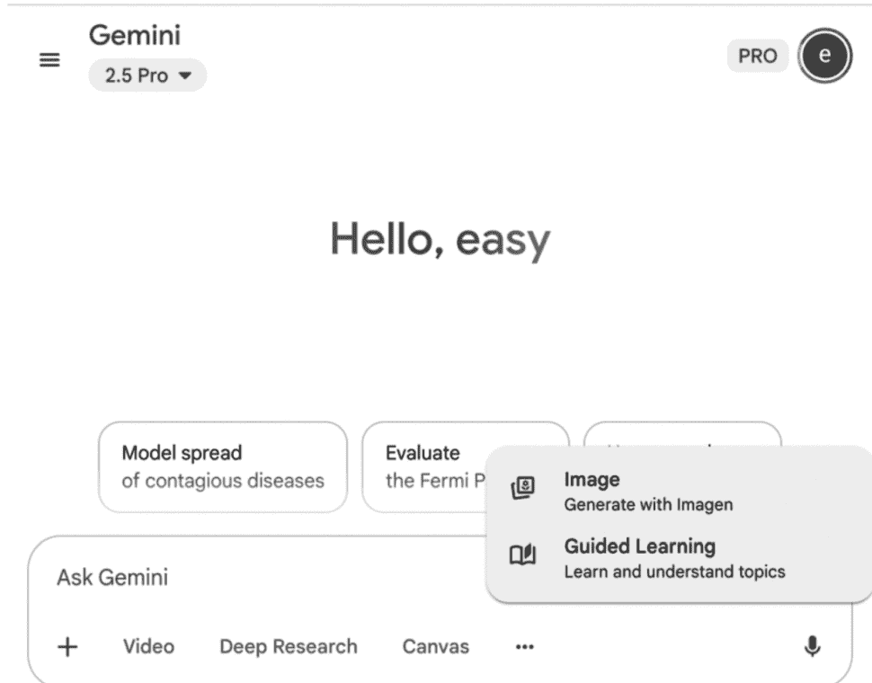

- ②打造教师的“第二大脑”：NotebookLM 是 Gemini 在教育最具革命性的应用。核心是“信源接地”，所有回答严格基于教师上传资料并附引文，大幅降低幻觉风险。在 Gemini 2.5 Pro 跨感官长文本能力支撑下，它能高效提炼、理解、组织与共享海量知识，成为基于个人资料的虚拟学习与研究助理。

NotebookLM 可整合 PDF 课件、Word 文件、网页链接、YouTube 教学影像等，提供有据可查的回答。Studio 模块可将零散资料自动转化为结构化跨感官资产，一键生成教学大纲、常见问答、词汇表、思维导图、带旁白的视频概览与音频播客，极大提升备课与知识管理效率。对专业发展，它可快速归纳培训资料与教育理论，生成反思笔记；支持共享笔记本协同共创课程与跨学科项目设计；利用音频视频概览跨感官化教学内容，提升吸引力与理解度。

图12-3 NotebookLM 画面

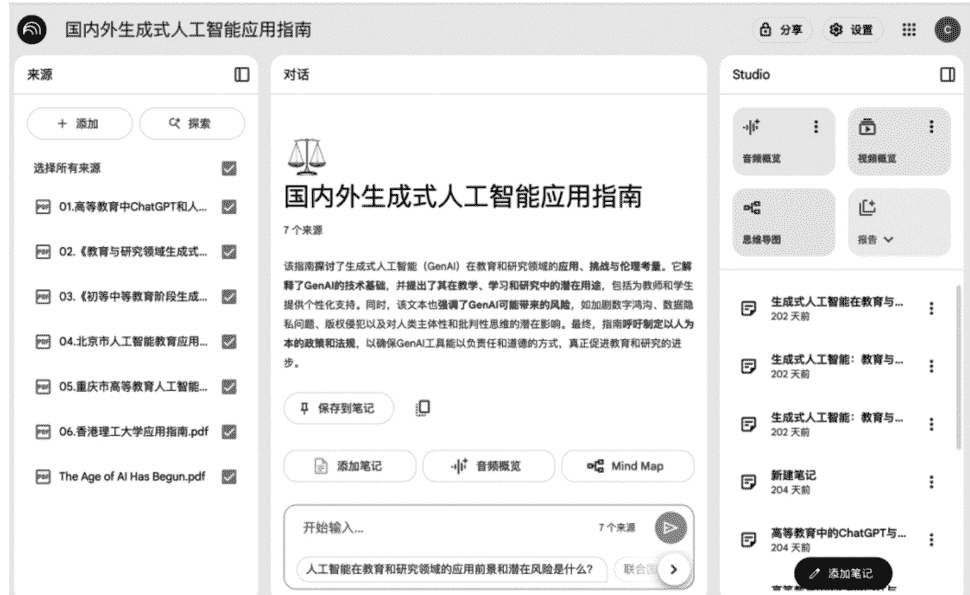

- ③跨感官教学助力：原生跨感官为课堂带来新可能。如文生视频 Veo 可将“火山爆发”“历史事件”等抽象概念生成生动动画。物理教师上传学生实验影像让 Gemini 分析轨迹生成数据报告；美术教师展示名画让其从构图、色彩、笔触多维度讲解；历史教师输入古文让其生成匹配场景插图帮助理解。跨模态理解生成丰富教学手段，让抽象知识具体可感。

##### （3）Claude：严谨安全的长文本与跨感官处理专家

Anthropic 开发的 Claude 自诞生便以安全、可信与强长文本处理著称。2023 年首发，2024 年推出 Claude 3 系列 Haiku、Sonnet、Opus，最新 Claude 4 持续增强。其特点：超大上下文窗口达 20 万 token，可处理整本书或长报告；强跨感官能力；以安全为核心的训练与分级安全机制，兼顾即时响应与深度思考。

Claude 助力教育科研的三条路径：

- ①分步陪伴学习与个性化支持：内置学习交互采用苏格拉底式问答，避免直接给答案，培养逻辑与批判思维。可提供个性化指导、概念阐释、作业辅助与反馈，成为学术伙伴。

- ②深度探究与科研支持：擅长综合洞察而非信息堆砌，可生成含多来源的深度报告，高效完成文献综述、资料整理、数据分析与报告撰写，提升科研效率。


- ③教师专业发展与课程设计：在美国东北大学、伦敦政治经济学院等高校的应用中，Claude 广泛用于课程设计、教材开发、教学方法创新与学生评估反馈，是推动人工智能助力教育深度变革的重要力量。

##### （4）Perplexity：可信赖、可溯源的答案引擎

2022 年崛起的 Perplexity 是对话式答案引擎，核心是将大型语言模型的对话能力与实时网络检索结合，提供准确、最新且可引用的信息。实时爬取与多源整合，并附详细引用，极大降低幻觉风险，提供学术、写作、视频、数学计算等聚焦模式。

Perplexity 在教育的两条价值：

- ①培养信息素养与批判思维：不仅给出综合回答，还列出来源链接，帮助学生养成核查来源、规范引用的学术习惯，是教导负责任使用人工智能的理想工具。

- ②高效课题研究与备课：教师可用学术聚焦模式快速获取领域最新研究与权威资料，快速总结长文献，加速教材与教学方案准备；课堂上可实时问答，提升参与度与互动。


总之，Perplexity 融合实时 Web 搜索与生成模型，具备多模型选择、可引用来源、深度探究与专属知识空间，在教育科研中提升信息获取效率、支持互动教学与资源整合，助力教学设计、自主学习与教师协作，同时培养师生人工智能素养与信息甄别能力。

##### （5）Grok：追求真相的实时推理引擎

Elon Musk 的 xAI 开发的 Grok 以“最大程度追求真相”为宗旨。2023 年 11 月首发，2025 年 7 月发布 Grok 4 并宣称“全球最智能”，并推出移动与政府版本。核心是实时信息访问与先进推理，可实时访问 X 社交网络与网络，Grok 4 采用第一性原理推理，配合思维模式与深度搜索提供深度洞察。

Grok 助力教育的路径：

- ①作为虚拟导师与学习伙伴：提供复杂主题个性化解释，如数学分步求解、科学理论深入讨论；可生成测验、大纲与模拟辩论等互动内容，让教师聚焦直接互动。

- ②开展基于真实世界的项目式学习：实时获取最新数据与讨论，适合时事热点探究。如社会研究课上学生可用 Grok 汇总国际事件最新动态与各方观点，让学习贴近现实。

- ③支持教师专业发展与科研：快速了解教育技术与教学法前沿，探索新策略；强大实时检索为项目研究提供最新数据，强调来源验证确保准确性。


### 二、变革之路：人工智能助力教育创新的主要趋势

上一节聚焦工具对个体工作学习方式的重塑，本节放眼人工智能整体推动教育生态的结构性变革。

#### （一）智慧引擎：生成式基础系统助力教育、教学与科研的新范式

顶尖人工智能系统的技术跃迁汇聚成强大力量，从根本上重塑学习、教学与科研范式。人工智能不再只是效率工具，而是激发认知、联结知识、探索未知的智慧引擎，推动教育向更深、更广、更具创造力的方向发展。人机协同催生教育新生态是未来总趋势。

##### （1）重塑学习范式：从被动吸收到主动建构

学习方式的根本翻转

很长一段时间里课堂基本靠直线式的知识搬运。ChatGPT 的 Learning Mode、Gemini 推出的逐层引导学习等产品的出现，让学习的重心正从教师讲授转向学习者自己动手建构。借助启发式追问、按需投喂的内容以及多模态直观呈现，学习者不再只是信息接收器，而是变成探索者、思考者和创作者。AI 充当个性化导师的角色，按个人学习风格和需求给出定制辅导和即时回应，有助于实现包容式教学；作为探究伙伴，它能点燃自主思考与协作热情，成为搭建知识框架的支点，帮助系统化地形成认知结构。于是大规模定制学习和深度学习才真正落地。总的来看，生成式模型凭借适配性和互动式引导，对学习方式完成了系统重塑。

##### （2）教学革新：经验主导迈向智慧协作
AI 正深度改写教师的工作方式，推动教学从过去依赖经验走向人与智能系统合作的智慧增强形态。教师可以借助 NotebookLM 这类工具，把多年累积的讲义和经验转成随时可调用的第二大脑，大幅提升备课和课程设计的效率与品质。课堂上，多模态能力能营造更生动、参与感更强的情境。更关键的是，系统能协助学情研判与教学复盘，让决策更精准更科学。在新的人机合作格局下，教师得以从重复性事务中抽身，集中精力做更有温度的育人工作，比如情感联结、价值引领与创新思维培养。强有力的支持让教育从统一化走向以学习者为轴心的方向。

##### （3）科研范式更新：线性探索进入智能涌现期
对教育研究而言冲击同样颠覆。以深度研究模式为代表的工具，把过去线性化、劳动密集型的探索，转变为高效迭代、智能涌现的新路径。研究过程中，系统可自动梳理海量文献并提炼要点，显著加快综述速度；还能参与实验设计、方案优化与数据分析，减少机械重复。更进一步，生成式系统的跨学科知识融合与理论建模能力，能够激发出新的研究假设，在多元视角下催生创新方案，推动科学探索进入深度研究的新阶段，为教育、科学、人文等领域开辟方法论。未来，生成式系统还将强化协作式创新，实现从假设提出到验证闭环。

#### （二）智能化浪潮：教育从普适走向定制
根据联合国教科文组织持续更新的AI教育指导框架等最新研究，生成式技术正推动教育从标准化迈向智能化。正如众多专家所强调，核心在于增强而非替代人类智慧，其目标是培养学习者应对未来挑战的综合素养。这些技术驱动的变化正汇聚成若干关键创新方向。

##### （1）学习定制：从规则自适应到深度因人而异
因材施教历来是教育理想，如今被以前所未有的深度与广度实现。传统自适应学习多依赖预设规则进行路径推荐，而生成式技术则开启了超定制新纪元。系统能够实时解析学习轨迹、认知特征乃至情绪状态，动态生成契合个人风格的材料、练习与解释方式。正如可汗学院创始人萨尔·可汗所设想，AI 可以成为每个学习者可扩展的单人导师，遵循教学原则，引导学习者阐释推理过程。它不再只是推送下一个知识点，而是能像经验丰富的特级教师一样，对每一步学习量身定做，实现真正的差异化、专属化体验。

> [美]萨尔曼·可汗.教育新语：人工智能时代教什么，怎么学[M]. 王琦，万海鹏，译.北京：中信出版集团，2024。

##### （2）课堂协作：教师进化为 AI 加持的教育设计师
未来教学的核心不再是人教或机教的对立，而是深度融合的共创。AI 作为教师的增强型助手或副驾驶，深度嵌入备课、授课、辅导、评价等全流程。研究显示，系统可自动化30%—40%的行政与重复性任务，给教师每周节省超过10小时。腾出的时间可聚焦高阶育人，例如激发学习者的高阶思维、提供情感支持与动机激励、进行价值引领。正如经合组织报告所指出的，教师角色并非被取代，而是被增强，转变为学习的设计者、人与智能协同的指挥家和学生成长的陪伴者。

##### （3）评价转向：从终结打分到过程诊断
AI 正推动评估从以分数排名为核心的终结模式，转向更重过程、诊断与发展的精准发展性评估。通过对课堂发言、作业轨迹、项目合作、在线讨论等学习过程数据的无感采集与分析，系统可生成动态的学习者画像。画像不仅能精准定位知识薄弱点，还能揭示思维方式、学习习惯与非认知特质。研究表明，AI 评测系统可获得超过80%的师生认可，其价值在于即时、形成性的反馈。在此基础上，系统能为师生产生对的、可操作的改进建议，让评估真正服务于定制成长。

##### （4）资源开放：打造动态增长的全球知识池
传统教材、课本等资源具有静态固化的特点，AI 正推动资源向智能、开放、动态生成的方向演进。借助自然语言处理等技术，系统可实时抓取、筛选、重组全球开放教育资源，并依据不同国家、地区、学校乃至班级的需求，动态生成最契合的多模态教学材料。这不仅极大丰富了资源的多样性与时效性，更有望打破地域与经济壁垒，让优质内容以极低成本触达每个学习者。正如联合国教科文组织所倡导，AI 应促进知识公平，构建动态生长、共建共享的全球知识库，以有力支撑终身学习与包容教育。

### 三、未来教师：智时代的新角色与能力跃迁
面对 AI 对教育生态的系统性重塑，教师的发展路径必然迎来深刻变革。这不仅是技术应用问题，更关乎职业身份、核心能力与成长方式的全面升级。唯有主动接纳变化，教师才能在智能时代继续承担立德树人的核心使命。

在 AI 推动的新图景下，教师角色必须深度重塑。当知识获取变得极其便捷，教师的核心价值不再是传递标准化知识，而在于 AI 缺乏的人类特质。教师将有更多精力投入创造性教学，从知识传授者全面转向学习设计者、思维激发者、情感连接者与价值引领者，聚焦高阶思维激发与核心素养培育，这是未来教师的必然要求。

要胜任新角色，需要构建与 AI 协同共生的能力体系。首先是 AI 读写能力与提示词工程，能够精准提问并高效驾驭系统完成复杂任务；其次是教学设计与整合创新能力，利用 AI 进行智能备课，自动生成教案、精准推送资源并设计更高水平的创造性教学活动；再次是数据分析与教育决策能力，通过智能辅导解析学情、批改作业，给学习者提供启发式定制教育；最后是审慎的伦理思辨与人文关怀能力，引导学习者负责任使用 AI，并始终将人文关怀置于技术之上，发挥价值引领作用。

面对技术快速迭代，教师的专业成长也需从被动培训转向主动、持续的自我革新。未来的教师必须是终身学习者与教育创新者，掌握用 AI 高效学习和创新的能力是其核心竞争力。教师应建立个人学习网络，持续追踪前沿，勇于实践 AI 教育创新；以智能教研驱动专业复盘，利用多模态数据系统评估与反思授课，获得精准改进建议；从个体探索走向团队共创，在教学中探索 AI 应用的新场景、新模式，与同事协作共建 AI 支持的专业发展共同体。

以开放、智慧与勇气，与这项日益强大的共生技术配合育人，共同迎接并创造智能时代教育的无限可能和美好前景。