# AI赋能研发数字化转型：技术驱动和范式重构

# **PREFACE**

# **丛书前言**

当今世界正经历百年未有之大变局。国家综合实力由工业保障，工业发展由工业软件驱动。工业软件正在重塑工业巨人之魂。

习近平总书记在 2021 年 5 月 28 日召开的两院院士大会、中国科协第十次全国代表大会上发表了重要讲话：“科技攻关要坚持问题导向，奔着最紧急、最紧迫的问题去。要从国家急迫需要和长远需求出发，在石油天然气、基础原材料、高端芯片、工业软件、农作物种子、科学试验用仪器设备、化学制剂等方面关键核心技术上全力攻坚，加快突破一批药品、医疗器械、医用设备、疫苗等领域关键核心技术。”

国家最高领导人将工业软件定位于“最紧急、最紧迫的问题”，是“国家急迫需要和长远需求”的关键核心技术，史无前例，开国首次，彰显了国家对工业软件的高度重视。机械工业出版社此次领衔组织出版这套“工业软件丛书”，秉持系统性、专业性、全局性、先进性的原则，开展工业软件生态研究，探索工业软件发展规律，反映工业软件全面信息，汇总工业软件应用成果，助力产业数字化转型。本丛书是以实际行动落实国家意志的重要举措，意义深远，作用重大，正当其时。

本丛书分为产业研究与生态建设、技术与产品、支撑环境三大类。

在工业软件的产业研究与生态建设大类中，列入了工业技术软件化专项研究、工业软件发展生态环境研究、工业软件分类研究、工业软件质量与可靠性测试、工业软件的标准和规范研究等内容，希望从顶层设计的角度让读者清晰地知晓，在工业软件的技术与产品之外，还有很多制约工业软件发展的生态因素。例如，工业软件的可靠性、安全性测试，还没有引起业界足够的重视，但是当工业软件越来越多地进入各种工业品中，成为“软零件”“软装备”之后，工业软件的可靠性、安全性对各种工业品的影响将越来越重要，甚至是“一票否决”。至于制约工业软件发展的政策、制度、环境，以及工业技术的积累等基础性的问题，就更值得认真研究。

工业软件的技术与产品大类是一个生机勃勃、不断发展演进的庞大家族。据不完全统计，工业软件有近 2 万种 ^(¹)。面对如此庞大的工业软件家族，如何对其进行“小样本、大视野、深探底”的表述，是一个巨大的挑战。就连“工业软件”术语本身，也是在最初没有定义的情况下，伴随着工业软件的不断发展而逐渐产生的，形成了一个“用于工业过程的所有软件”的基本共识。如何准确地论述工业软件，从范畴上说，要从国家统计局所定义的“工业门类” ^(²)出发，把应用在矿业、制造业、能源业这三大门类中的所有软件都囊括进来，而不能仅把目光放在制造业一个门类上；从分类上说，既要顾及现有分类（如 CAX、MES 等），也要着眼于未来可能的新分类（如工研软件、工管软件等）；从架构上说，既要顾及传统架构（如 ISA95）的软件，也要考虑基于云架构的订阅式软件（如 SaaS）；从所有权上说，既要考虑商用软件，也要考虑自用软件（In-house Software）；等等。本丛书力争做到从不同的维度和视角，对各种形态的工业软件都能有所展现，勾勒出一幅工业软件的中国版图，尽管这种展现与勾勒很可能是粗线条的。

工业软件的支撑环境是一个不可缺失的重要内容。无论是数据库、云技术、材料属性库、图形引擎、过程语言，还是工业操作系统等，都是支撑各种形态的工业软件实现其功能的基础性的“数字底座”。基础不牢，地动山摇，遑论自主，更无可控。没有强大的工业软件所需要的运行支撑环境，就没有强大的工业软件。因此，工业软件的“数字底座”是一项必须涉及的重要内容。

长期以来，“缺芯少魂”一直困扰着中国企业及产业高质量发展。特别是从 2018 年以来，强加在很多中国企业头上的贸易摩擦展现了令人眼花缭乱的“花式断供”，仅芯片断供或许就能导致某些企业停产。芯片断供尚有应对措施来减少损失，但是工业软件断供则可直接阉割企业的设计和生产能力。没有工业软件这个基础性的数字化工具和软装备，就没有工业品的设计和生产，社会可能停摆，企业可能断命，绝大多数先进设备可能变成废铜烂铁。工业软件对工业的发展具有不可替代、不可或缺、不可估量的支撑、提振与杠杆放大作用，已经日益为全社会所切身感受和深刻认知。

本丛书的面世，或将揭开蒙在工业软件头上的神秘面纱，厘清工业软件的发展规律。更重要的是，本丛书将会激励中国的工业软件从业者充分发挥“可上九天揽月，可下五洋捉鳖”的想象力、执行力和战斗力，让每一行代码、每一段程序，都谱写出最新、最硬核的时代篇章，让中国的工业软件产业就此整体发力，急速前行，攻坚克难，携手创新，使我国尽快屹立于全球工业软件强国之林。

# 丛书编委会

2021 年 8 月

# **FOREWORD**

# **序一**

通读由施战备、刘强、刘丽兰合著的《AI 赋能研发数字化转型：技术驱动和范式重构》一书，我感到了这本书的厚重、前瞻与价值。

说其“厚重”，是指本书内容的底蕴厚重。全书讨论了六个重大的主题：企业数字化转型模式、AI 技术演进、AI 在制造业发展中的作用、研发范式的跃迁、企业研发的数字化重构、AI 赋能的研发范式跃迁及转型路线图。这六个主题都是关乎当前和今后很长一个时期产业和企业发展的重点问题。在本书中，作者能透过繁复的表象看到本质与规律，对这些问题的阐述系统透彻。比如，作者对制造业数字化转型能否成功的阐述：“制造业数字化转型绝不是简单的技术堆砌，也没有任何捷径。它需要企业管理者‘十年磨一剑’的战略定力，将数字化融入企业的血液，成为推动企业成长的基因。”这样的观点，若没有长期积累、透彻观察与科学分析，很难得出。“台上一分钟，台下十年功”，对于本书讨论的主题，十年功可是远远不够的。

说其“前瞻”，是指本书直击企业发展与企业数字化转型面临的前沿课题：研发与 AI 的关系。研发是一个企业竞争力的核心要素，AI 是辅助研发的工具，这两者如何结合好是当前许多企业遇到的难题。传统的产品研制模式，长期以来受制于职能壁垒、数据断链、流程僵化等诸多弊病，研发周期长、成本高昂、创新效率不足，已成为制约我们迈向全球价值链高端产品的“卡脖子”环节。要实现从制造大国到制造强国的转变，我们亟须一场从底层逻辑到顶层设计、从技术工具到范式理念的深刻变革。本书前五章对此做了铺垫，后三章对这个问题给出了系统的、可操作的建议。

说其“价值”，是指本书提出的一系列重要结论和实践方法，为专业读者和整个业界带来了深刻的启示。作者坦言，我们目睹过太多“技术狂热”与“落地困境”之间的巨大落差，大量制造企业盲目跟从，产生了一系列失败案例。作者在回顾 AI 技术及其在制造业应用的发展历程后，认为企业决策者也需要回答“生成式 AI 是机遇还是陷阱”及“企业当前的数字化成熟度是否适合全面应用生成式 AI”等问题，并对成熟度和适用性给出了系统性的解释。

对于 AI 驱动的研发范式转型，AI 的使用要将传统串行、经验驱动的研发范式，转变为并行、数据驱动、人机协同的新范式。它将推动我们从依赖工程师个人经验的“匠人模式”，走向依赖数据智能和协同创新的“智慧研发”模式。

本书结合制造业的实际需求，分析了 AI 赋能的研发数字化转型和创新应用场景，如基于虚拟数字原型的“设计-仿真-测试”协同、基于 MBD 的制造信息流、参数驱动的制造数字主线等。

作者基于多年的行业实践和经验积累，总结出“数字化转型四层驱动模型”，从数据治理、能力沉淀、流程贯通、智能应用四个层级逐级突破，并对各层级的形成路径进行了系统的阐述。

作者认为，AI 在制造业的成功部署与价值实现，高度依赖数据、算法和算力这三大核心要素的协同与突破，其中数据占据着核心地位。数据是 AI 的基础。缺乏足够的高质量数据，AI 模型将如同无源之水，难以发挥应有的效能。更值得强调的是，“AI 应被视为赋能人类的工具，而非完全替代，特别是在应对突发中断和不确定性时，人类的经验和智慧仍不可或缺。人类的监督和领域知识在整个 AI 生命周期中扮演着关键角色。

在制造业“人工智能+”和“数转智改”的大潮中，本书的问世无疑是一个亮点；希望它的价值在企业的创新实践中得到充分发挥。

是以为序。

杨学山

# **FOREWORD** **序二**

AI 技术浪潮席卷全球，正以前所未有的深度和广度重塑着千行百业。作为一名长期深耕于制造业数字化领域的工程科技工作者，我见证了这一宏大变革的演进。应邀为《AI 赋能研发数字化转型：技术驱动和范式重构》一书作序，我深感荣幸。初读此书，即为其系统性、前瞻性与实践性而倍感振奋。

在我国制造业转型升级的关键时期，我们面临全球的激烈竞争和日益复杂的市场需求。传统制造业的研发范式，长期以来囿于职能壁垒、数据断链、流程僵化等结构性顽疾。研发与制造、设计与仿真、生产与服务之间存在难以逾越的鸿沟，这导致了产品开发周期长、成本居高不下、创新效率低下，最终削弱了企业的核心竞争力。过去依赖逆向工程或仿制，虽能快速追赶，却难以产生原始创新。今天，AI 的融入绝非简单的工具升级，而是一场旨在从根本上改变产品开发理念、重塑企业价值创造模式的深刻革命。作者深刻洞察了这一历史性痛点，旗帜鲜明地提出，AI 正在从根本上推动研发范式数字化转型，使企业能够从“自底向上”的经验驱动转向“自顶向下”的需求驱动，实现以需求为牵引的正向协同设计。

本书的核心亮点在于超越了以技术为中心的传统视角，构建了一个全面且协调的、AI 驱动的四维进阶框架（以下简称框架），为企业提供了一套务实且具有前瞻性的转型指南，避免盲目投资与局部优化。

第一，在战略层面，框架指明了 AI 赋能研发数字化转型的方向：把宏大的“AI 优先”愿景拆解为具体、可量化且可验证的 ROI ^(³)业务目标。这要求企业高管层不仅是技术的采纳者，而且是变革的战略设计师，确保 AI 的投入能够直接贡献于降低劣质质量成本（CoPQ）、缩短产品上市时间（TTM）等核心业务指标。

第二，业务架构作为框架的核心，既描绘了企业运营蓝图，也明确了 AI 赋能研发数字化转型的载体。本书深入阐述了业务架构如何从“能力在线”这一零散的职能数字化基础，逐步演进为“以价值为中心的业务流程整合”，最终实现“端到端业务在线——价值流闭环的完美呈现”。这一过程通过构建贯穿订单到交付（OTD）、研发、制造等核心价值流的“数字主线”，打破组织壁垒和数据断链，实现全业务流程的无缝连接与智能化协同。

第三，为制造企业量身打造的平台化 AI 技术架构，为 AI 能力落地提供了坚实底座。该架构由数据架构、应用架构、技术基础设施三层构成，旨在将 AI 能力封装并以服务化的形式提供，从而保障 AI 能力和应用的逐步进阶。

第四，AI 赋能下的研发数字化转型和创新应用场景，描绘了一幅令人振奋的未来图景。例如，AI 驱动的需求获取，将“客户声音”转化为可量化的设计指标；AI 赋能的“设计-仿真-测试”协同，利用虚拟数字原型和 AI 仿真缩短研发周期，降低试错成本；基于 MBD 的制造信息流，将三维模型中的设计意图无缝传递到制造端；参数驱动的制造数字主线，通过 AI 对实时生产数据进行分析，实现从工艺参数到设备参数的精确控制，构建自动化的质量闭环回路；质量数字主线的构建，将设计质量、工艺质量、制造质量与服务质量数据全面打通，实现全生命周期的质量追溯与持续优化。这些实践无疑将成为企业深化数字化转型和进行智能化升级的宝贵参考。

殊为难得的是本书的前瞻性，例如对 AI 智能体（AI Agent）的详细介绍。AI Agent 被视为人工智能应用的重要趋势。2025 年甚至被认为是 AI Agent 元年。未来，每家企业都将运行各种各样的 Agent。然而，目前绝大多数工程领域的学者和企业人士对 AI Agent 的认识尚处在较为模糊的概念阶段。本书不仅阐述了 AI Agent 的定义、特征与核心组件等，还详细介绍了 AI Agent 的通用设计模式（反思模式、工具使用模式、推理模式、规划模式）、多 Agent 系统、开发框架及最佳实践等。毫无疑问，对于想入门或着手进行 AI Agent 实践的读者而言，这是一本极佳的参考书。

总而言之，本书为制造业的数字化转型提供了一份宝贵的指南。它不仅描绘了 AI 驱动智能研发的美好蓝图，更指明了实现这一蓝图的关键路径、技术框架和组织保障。我相信，无论是制造业的高管、研发工程师，制造领域的学者，还是政策制定者，都能从中获得深刻启示。在此，我郑重推荐本书，期望它成为推动中国制造业高质量发展与研发范式重构的重要文献。

是以为序。

李培根

# **FOREWORD**

# **序三**

世界变化快，数字世界变化尤其快。2025 年，全球 AI 大模型头部企业之间，你追我赶、此消彼长、极速迭代，展开了一场关乎企运乃至国运的技术竞赛，或者说是一场数字世界中没有硝烟的赛博战争 ^(⁴)。

如果说 AI 领域的各路“英雄好汉”正在无形擂台上各展十八般武艺，这实属常态，因为这是他们的安身立命之本。让人颇感意外的是，本书作者深耕工业领域一线，站在工业软件高地，写出了这本论述“AI 如何赋能企业研发数字化转型”的厚重专著，这样的精品著作是很少见的。

本书是一部面向制造企业、聚焦“AI 如何重构研发范式”的实战方法论著作。全书以一个平台化 AI 分层架构、两类 AI（LLM 和智能体）技术、三要素（数据、算法、算力）协同、四层（底座、能量、业务、应用）数字化转型驱动模型、五阶研发范式跃迁，搭建了一条宏观上简洁明了、微观上全景适用的从战略规划到落地实施的完整路径，系统回答了“生成式 AI 究竟是制造业的机遇还是陷阱”这一核心命题，擘画了一幅可落地、可度量、可迭代的“一二三四五”行动地图。

1）一个平台化 AI 分层架构。作者提出“制造业 AI 栈”必须细致分层，即分为基础设施层（CPU、GPU、云边混合）、数据/知识层（数字主线+知识图谱）、模型服务层（机理模型与 LLM 混合部署）、Agent 编排层（流程自动化+多 Agent 协作）、AI 应用层（角色 APP），并给出每层的“买、改、建”决策矩阵和具体做法，避免陷入因幻想一蹴而就而龙困于野的窘境。

2）两类 AI（LLM 和智能体）技术。LLM 重新定义了人类对“智能”的理解，它不仅是技术的突破，而且是一场认知范式的革命——从依赖人工规则的“模仿智能”迈向基于海量数据与自学习的“泛化智能”；把 Agent 拆成“感知-推理-记忆-工具-规划”工程化的“五巧板”，把“多 Agent 编排”分解为三种架构（中心化、去中心化、层级化）实现，可映射到汽车、医药、装备三大行业的组织模式。熟用这两类 AI 技术将颠覆产品研发范式。

3）三要素（数据、算法、算力）协同。AI 重塑制造业的核心驱动力，源于数据、算法与算力三要素的协同进化，这与企业转型的内生动力形成结构性共振，构建了“数据语境化+算法复合化+算力分级化”的协同新范式：①数据层面依托数字主线，将工业软件的异构数据转化为蕴含“设计意图”的高质量语料；②算法层面构建“LLM+知识图谱+强化学习”的复合架构，取代单一垂域模型，实现优势互补；③算力层面采用多级蒸馏技术，将千亿级参数模型压缩适配至车间工控机，实现云、边、端 AI 能力的无缝贯通。

4）四层（底座、能量、业务、应用）数字化转型驱动模型。作者把数字化转型的作用机理拆解为“数字底座→数字能力→数字业务→数字应用”四层，通过一条数字主线上风驰电掣的数据流，实现上下左右全方位贯通，真正达到“用单一来源数据提效”的转型目标。粗略统计，“解耦”一词在书中出现数十次，详细阐述了“数据→模型→服务”逐层解耦的要点，业务颗粒度大小可调，由企业的业务战略决定。

5）五阶研发范式跃迁。作者引用前人定义，把人类研发史分为“试验驱动→理论驱动→计算驱动→数据驱动→AI 驱动”五级进阶范式，指出每一次进阶都伴随着“知识载体”更替（经验→公式→代码→数据→模型），并提出了“A I 驱动范式”的三大标志：①认知权从人转向“人+模型”；②流程从“设计→验证”的线性串行转变为“生成反思”的多次循环；③知识形态从静态文档转变为可演化的参数。该“A I 驱动范式”的思想贯穿全书各章节。

我认识第一作者施战备先生十多年，知道他在工业软件领域二十多年耕耘不辍，对 PLM 与 CAX 有独到且深入的见解。五年前，我曾为他主笔的《数物融合：工业互联网重构数字企业》一书作序。这次欣然见到他的第二本著作，笔力更加稳健，底蕴愈发深厚，撰写愈加入微，见解更趋高阶，预测更具前瞻性。

不夸张地说，作者将“理工男的螺丝刀”“战略家的望远镜”和“预言家的水晶球”合三为一，为读者绘制了一幅制造业的星际航图。作者既能把 Transformer、RAG、LoRA 这些硬核技术剖成“七步成诗”的操作清单，又能把企业战略、组织变革、财务 ROI 这些顶层难题绘成“七星拱斗”的指路罗盘。更难能可贵的是，全书每一页都在用数据、案例和可解耦、可重构的“代码”，为读者探路、踩坑、试错、算账。作者把“生成式 AI”从营销热词变成了车间里的热风温度传感器，把“多智能体（多 Agent）”从遥不可及变成了在研发阶段信手拈来的智能助手，把“数字化转型”从 PPT 里的宏大叙事变成了工程师随时能攀爬的“脚手架”——这不仅是知行合一的结果、技术跨界的胜利，更是思想对现实的超越，因为本书体现了“先进”不再傲慢，“未来”可提前交货，“智能体”深入人心。

AI 融入制造业，并非是简单的工具升级，更是一场旨在从根本上改变产品开发理念、重塑企业价值创造模式的深刻革命。本书把“生成式 AI 如何落地制造业”这一出“十年大剧”，拆解为“一二三四五”的甘特图，总结为“模型即研发语言、Agent 即数字员工、数据语境化即治理”三句通俗话语，为制造企业从“经验驱动”“理论驱动”跃迁到“AI 驱动”的高阶数字化转型提供了可复制的工程化“剧本”。剩下的，就是大家共同赏析，一起“演出”。

是以为序。

赵敏

# **PREFACE**

**前言**[2025]

年春天，DeepSeek 引发的 AI 技术浪潮正以摧枯拉朽之势席卷整个制造业。这家成立仅两年的中国科技企业，凭借 671 亿参数的 R1 推理模型和仅需同类模型 1/18 的训练成本优势，正在打破大语言模型的“算力桎梏”，使中小制造企业首次能够轻松跨越本地化部署大语言模型的算力门槛。这不仅消除了制造企业应用生成式 AI 引发的数据安全和 IP 保护的顾虑，同时也为制造业的智能化转型升级带来了新的契机。仅仅几个月时间，很多企业纷纷宣称已经部署了满血版 DeepSeek，DeepSeek 在企业内部的各个业务领域呈现出百花齐放的应用态势。

作为制造业数字化从业者，我们目睹过太多“技术狂热”与“落地困境”之间的巨大落差：几年前，中台概念精准地切中了制造业数据孤岛难题，加上阿里巴巴“中台战略”的成功转型，致使大量制造企业罔顾现实而盲目跟风，最终导致了一系列失败案例。制造业数字化转型绝不是简单的技术堆砌，也没有任何捷径。它需要企业管理者“十年磨一剑”的战略定力，将数字化融入企业的血液，成为推动企业成长的基因。当前生成式 AI 这股热潮背后，制造企业决策者正面临更深层的战略抉择：生成式 AI 是机遇还是陷阱？应积极拥抱还是静观其变？企业当前的数字化成熟度是否适合全面应用生成式 AI？生成式 AI 如何与企业的业务进行深度融合，而不是仅文本类的浅层应用？生成式 AI 与企业当前正在推进的数字化转型有何关联？两者如何深度融合？等等。

本书将为读者一一解答上述问题，我们需要先从当前制造业所经历的研发范式、数字化转型等底层逻辑说起。唯有厘清了这些变革背后的深层脉络，我们才能透过纷繁复杂的技术表象，找到真正适合企业的落地路径。希望本书能成为一张清晰的导航图，在不确定的变革洪流中，助您打造可持续的研发竞争优势。让我们由此出发，共同开启这场从认知升级到实践落地的探索之旅。

# **引言**

# **数字革命正在重塑研发创新力**

据世界经济合作与发展组织（OECD）2023 年的统计数据，全球研发投入正以 7.2%的年均增速增长。国家统计局发布的《2023 年全国科技经费投入统计公报》显示，2023 年我国研究与试验发展（R&D）经费投入总量突破 3.3 万亿元，同比增长 8.4%。然而，传统研发范式的边际效益持续衰减，原因主要有以下两点：一是产品复杂度增加与经验驱动研发范式的冲突，导致大量研发资源被消耗在物理样机开发与后期验证环节；二是信息孤岛导致跨部门创新协作的隐性成本持续增长。

自从 2023 年 OpenAI 推出生成式 AI 以来，生成式 AI 点燃了制造业的创新热情。麦肯锡在《生成式 AI 在医药研发中的应用》报告（2023 年）中指出，生成式 AI 可把早期药物分子设计周期缩短至传统方式的 1/10 到 1/20。特斯拉则借助 AI 驱动的数字原型技术，构建高精度仿真模型，在虚拟环境中模拟碰撞场景，可替代 90%以上的物理试验，把单车碰撞试验成本从 1 亿～2 亿美元，降至 500 万～1000 万美元，降幅超 90%。

由此可见，全球研发领域正经历着一场 AI 驱动的研发范式跃迁。据麦肯锡测算，AI 驱动的数字化转型可使研发效率提升 35%～50%，错误率降低 60%～80%，产品上市周期缩短 20%～40%。与此同时，AI 技术渗透率每提高 10%，研发效率平均提升 18%～24%。这场范式跃迁不仅是技术升级，更是研发范式的根本性重构，其深远影响堪比工业革命时期蒸汽机对生产方式的改造。

# **第一章**

**研发范式的五阶跃迁**[1998]

年，吉姆·格雷（Jim Gray）因他在数据库与事务处理研究及系统实现方面的开创性贡献而获得图灵奖。2007 年，他提出了科学研究的四种范式理论，即试验驱动范式、理论驱动范式、计算驱动范式和数据驱动范式。这一理论深刻揭示了科学方法论从“以人为主”到“人机协同”的演进逻辑，并在多学科交叉研究中被广泛引用和拓展。

从爱迪生实验室的 1600 余次白炽灯材料试验，到波音 707 客机研发中空气动力学方程的首次系统性应用，人类研发史经历了从试验到理论计算的多次范式转变。随着基于冯·诺依曼架构的电子计算机问世，以及有限元分析方法的成熟，计算机开始替代人力完成复杂系统的数字模拟，如空气动力学计算、机体结构应力分析与载荷分布计算等，这标志着计算驱动时代的到来。

进入 21 世纪，制造企业逐步构建以 CAD/CAE、PLM 为主的数字化研发体系，数据成为企业的核心资产。以消除信息孤岛、打破组织壁垒、重构端到端数字化业务为核心目标的数字化转型由此受到了业界的高度重视。智能制造和工业互联网热潮进一步加速了企业转型升级，自此迈入了数据驱动的研发范式时代。

如今，AI 驱动的第五范式（AI for Engineering）正颠覆传统的产品研发范式：产品研发不再受限于固化的研发流程或经验知识，而是利用 AI 技术将多学科的海量数据与知识进行融合，快速发现潜在规律，助力企业实现产品创新。AI 驱动的第五范式已经在创新药研发、生成式 3D 设计等领域得到应用。

## **1.1 试验驱动范式**

试验驱动范式指通过大量的物理试验不断试错，实现新产品/新技术的发明和创新，其典型特征是手工制造与试错法主导。爱迪生发明工厂——“门洛帕克实验室”即为代表。他在白炽灯研发过程中历经 1600 余次灯丝试验，耗时 14 个月，耗资 4 万美元（折合现值约 120 万美元），其中试验支出占研发总成本的 72%。同样，莱特兄弟发明首架飞机前也历经多达 1200 次的风洞试验，成功率不足 5%。在试验过程中，他们测试了各种不同形状和角度的机翼模型，测量了模型在不同条件下的升力和阻力数据。这些试验数据被详细记录下来，用于改进飞机机翼的设计。然而，当产品复杂度突破特定临界值（如 DFMEA ^(⁵)评估中风险优先系数（RPN）≥126）时，传统试验范式的研发成本呈指数级增长。这是由于零件结构、设计方案、工艺参数等多维度耦合关系超出了经验驱动设计优化的能力范围，因此导致参数调整效率骤降。在这一研发范式下，60%以上的资源被消耗在物理样机开发和后期试验验证环节（如材料试制、工艺调试、装配测试等）。

即便今日，试验验证依然是新产品研发中不可或缺的环节，通过制造物理样机来完成各种试验验证工作。譬如，在现代民航客机研发中，波音、空客公司通常制造 1～3 架物理样机，用于关键子系统（如引擎、航电、起落架）的工程验证及适航认证所需的各种强制测试和极限测试（如失速、极寒、紧急操作等）。在中国商飞 C919 的研制过程中则制造了 6 架试验样机（含 1 架静力试验机），数量超出常规，主要原因是其国产化技术路线复杂度高，需逐步验证自主供应链的可靠性。

## **1.2 理论驱动范式**

随着计算数学、控制论和信息论等理论的成熟发展，研究者得以将大量的试验结果抽象为数学模型，进而用这些模型指导产品的研发创新，以降低试错成本，提升研发效率。这种范式称为理论驱动范式，其核心是通过数学建模和理论推演将自然规律转化为可用于工程设计的确定性规则。牛顿经典力学、麦克斯韦电磁学、爱因斯坦相对论和量子力学等经典物理学理论体系的建立，推动了产品研发范式由试验驱动范式向理论驱动范式的演进，即设计-试验的迭代模式，实现了理论指导下的高效研发范式。

纳维-斯托克斯方程（Navier-Stokes Equations，N-S 方程）是一组描述粘性流体运动的偏微分方程，由法国物理学家克劳德-路易·纳维和英国数学家乔治·斯托克斯在 19 世纪提出，其核心作用在于精准模拟空气流动的复杂力学行为。波音在 707 机型的研发中，首次将 N-S 方程引入气动优化流程，即在物理样机制造前，通过求解 N-S 方程，模拟空气在机翼表面的流动形态，计算不同翼型（如后掠角、弯度、厚度）的升力系数（CL）和阻力系数（CD），筛选出最优设计参数。重复上述计算，可快速评估数百种翼型方案，淘汰 80%以上的低效设计，仅保留最优候选方案进入风洞试验。仅此一项改进，就能减少 30%的风洞试验次数，节省数千万美元研发成本，并将设计周期缩短约 18 个月。

波音 707 的问世标志着 N-S 方程的应用实现了从理论数学向工程实践的跨越。借助流体力学模型部分取代部分物理试验，不仅降低了研发成本，更揭示了复杂流动现象的深层规律，为现代航空技术的指数级发展提供了核心方法论。这一案例至今仍是工程学教科书中“理论驱动范式”的经典范例。

理论驱动范式是以科学理论为核心一套研究与实践框架，强调通过既定的理论体系指导问题分析、设计决策和验证过程。其要义在于锚定理论基础，将理论作为研究起点，设定情境化的问题边界，再经严谨推演与试验验证，完成产品创新或开发。正是这一范式，使研发（R&D）和工程设计成为产品开发中不可或缺的环节，并确立了工程设计团队在产品研发型企业的核心地位。然而，复杂产品的运行机理往往难以被现有理论框架完全简化或归纳。采用既有理论框架下的产品设计与必要的试验验证相结合的模式，并从中不断提炼和优化理论体系，是当时企业的折中之选。

## **1.3 计算驱动范式**

如上所述，传统试验和理论驱动范式难以处理高维度、非线性或动态复杂的系统，“理论不足，实验来补”是当时的无奈之举。而计算驱动范式正好弥补了理论与实践之间的鸿沟。计算驱动范式以计算机为核心，借助数值模拟、算法优化与可视化等，在虚拟环境中模拟、仿真理论模型，以验证其正确性或者优化试验设计。

冯·诺依曼架构与现代电子计算机的诞生，彻底改变了计算机科学的发展轨迹。在产品设计领域，CAD（计算机辅助设计）和 CAE（计算机辅助工程）的问世无疑是最重要的技术变革之一，强力推动了企业研发流程的变革与数字化转型。CAD 把手工绘图升级为数字化建模，使设计师在面对复杂产品时能够借助自顶向下等策略，高效、精确地表达传统手段难以刻画的几何与结构，并实现跨专业、跨团队的协同设计。CAE 是对 CAD 的延伸，涵盖了从设计验证到性能优化的整个过程。CAE 利用计算机技术，将有限元分析（FEM）、流体动力学（CFD）、多体动力学（MBD）等方法作为其核心求解器，用于工程问题的仿真、分析和优化。CAE 是现代工程设计和开发的核心工具之一，广泛应用于工程机械、航空航天、汽车、电子和建筑等领域，其核心目标是在产品设计阶段通过数字化仿真和分析来优化产品设计，提高产品性能，从而部分或全部替代物理样机和物理试验，最终降低成本并缩短开发周期。

NASTRAN（NASA Structural Analysis）是一款具有里程碑意义的有限元分析软件，由 NASA（美国国家航空航天局）于 20 世纪 60 年代开发。它是最早实现商业化的有限元分析软件之一，至今仍在航空航天、汽车、机械等领域广泛应用。传统方法已无力应对航天器在发射、飞行与着陆全过程中的复杂结构计算，NASA 需要一种高效工具来评估复杂结构的强度，以确保任务安全，遂于 1969 年推出基于有限元方法的计算机程序——NASTRAN。凭借高精度与高可靠性，NASTRAN 迅速成为航空航天领域的标准工具，随后拓展至汽车、机械、建筑等行业，功能也从结构分析延伸至热、流体及优化设计等多物理场。它的诞生不仅推动了 CAE 技术，也标志着产品研发正式迈入计算驱动范式——从“设计-试验”走向“设计—仿真—试验”。

自 NASTRAN 后，ANSYS、ABAQUS、Altair OptiStruct 等通用 CAE 软件相继诞生；与此同时，一批专业 CAE 软件也相继问世。这些专业工具凭借高度聚焦的专业化功能满足细分行业的高精度要求，例如，专注于金属成形与切削仿真的 DEFORM，以及支持湍流、多相流和化学反应模拟的 CFD 工具 Fluent 等。

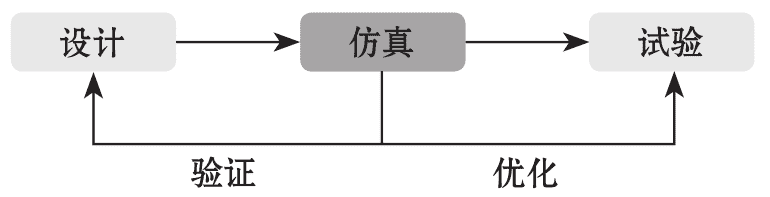

图 1-1 计算驱动范式：设计—仿真—试验

计算驱动范式与理论驱动范式最大的差别在于计算驱动范式应用了计算机技术（CAE 是其中典型代表）进行产品仿真、分析和优化，如图 1-1 所示。除了 CAE 工具，数字化仿真/分析通常涉及复杂的数学模型、大规模数据处理和高性能计算，这些都高度依赖高性能计算资源（包括 CPU、GPU 和存储设备等）。随着硬件技术、软件算法、并行计算、云计算等的发展，仿真分析也从局部、单维度的简单场景拓展到整机、多物理场耦合的复杂高精度场景。

以电动汽车的动力电池包为例，研发团队在开发过程中需要跨学科整合电化学、热力学、流体力学和固体力学等模型，既要解决充放电（电化学反应）过程中因化学热导致电池内部温度不均匀而引发的热失控问题，又要解决在疲劳振动或碰撞挤压下产生的结构应力变化而引发的电池安全问题，还要借助电化学、热力学和力学等的耦合模型预测电池老化衰减趋势，评估电池健康状态等。同样，芯片的纳米级工艺仿真、发动机的热应力仿真等也是多物理场耦合的典型场景。

综上所述，有限元方法从离散化思想的萌芽到成为工程仿真的核心工具，体现了数学理论与工程需求的双向驱动，已成为计算驱动范式的重要基础。未来，有限元方法与人工智能和多尺度物理场的融合将拓展更广阔的应用场景。

## **1.4 数据驱动范式**

现代企业的组织架构可追溯至亚当·斯密的分工理论，早期通过专业化分工提升效率，但因企业规模扩张而产生的部门目标割裂、责权不清的问题日益突出。同时，企业内的早期信息化建设缺乏整体规划和统一标准，各部门选用异构系统，数据格式与接口互不兼容，形成数据孤岛，使产品开发流程在各环节脱节甚至断裂。这一现象映射到计算驱动范式的“设计—仿真—试验”三大环节：它们各自采用独立系统且数据格式不一，彼此孤立。设计端用 CAD 工具（PTC Creo、Dassault CATIA、Siemens NX）创建三维模型；仿真端须先完成格式转换，再将模型导入 CAE 软件（如 ANSYS）进行前处理与分析，但会产生数据冗余和一致性问题。同时，仿真模型与实物标定脱节，试验与仿真分别进行，试验结果无法实时回传修正仿真模型，形成“单向流程”而非双向闭环。

面对日益复杂的装备系统（如航空航天、重型装备），系统生命周期各阶段及价值链各环节之间的跨领域协作愈发关键。IBM、麦肯锡、微软等企业由此提出并推广“数字化转型”，旨在用数字化手段破解效率瓶颈、流程割裂、数据孤岛和决策滞后等顽疾。数字化转型的核心价值在于把数据转化为生产要素，构建覆盖产品与业务的全价值链数据流，推动企业从“经验驱动”走向“数据驱动”，进而实现研发范式与商业模式的升级。由此，数字化转型标志着企业正式迈入数据驱动的研发范式时代。

数据驱动范式的本质是以数据为核心生产要素，通过数据采集、建模与分析，实现业务优化和决策支持，而非依赖经验或直觉。其核心特征是数据实时性和闭环反馈。数据驱动范式是数字化转型的核心引擎，高度依赖企业的数字化成熟度而呈现明显的阶段特征。按技术成熟度与应用深度，数据驱动范式可划分为初级阶段（数据支撑决策）与高级阶段（数据驱动执行），两者在应用模式、技术架构及业务价值上差异显著。数据支撑决策阶段以数据辅助、人工决策为主，聚焦局部优化，尚未形成闭环反馈机制。以工程变更为例，大部分企业往往耗费巨资让设计变更高效落地到工艺、制造与供应链环节，最终只能通过聚合来自设计、工艺和制造环节的变更数据，生成各种 BI 报表来展示变更的执行状态，再靠人工制定改进策略。而数据驱动执行则是由数据直接触发自动化决策，实现实时闭环与跨域协同，其前提是产品数据流形成闭环。目前，大部分制造企业正处于从“数据支撑”向“数据驱动”跃迁的关键期，突破口在于打破组织壁垒与数据孤岛。

随着互联网和移动技术的迅猛发展，互联网电商在“双 11”等购物节展现的海量数据处理能力，让“数据治理+中台”迅速成为制造业数字化部门的战略焦点。有些企业已专门设立首席数据官（CDO），统筹数据资产治理与价值变现。然而，不少企业陷入“脱离业务的纯治理”误区。制造业数据类型繁杂——结构化/非结构化、时序/非时序、三维几何/二维图纸/技术文档，还有多源异构数据（如 PLM 的文档、数模、BOM、工艺、变更，以及 ERP 的订单、计划、物料、多视图 BOM 与配置变更、零部件与供应商库存的关联等），它们彼此间的逻辑关系错综复杂。脱离业务的治理终将沦为“为治理而治理”的技术表演，使企业深陷数据泥潭。这就像医生治病只治标不治本一样，只解决病人的表象问题（如脓肿、发烧等），以缓解暂时的疼痛，而不解决问题的根源（如炎症），最终使病人苦不堪言，甚至错过了最佳的治疗时间。因此，数据治理的成功不在于建了多少数据湖、多少数据字典，而在于产生数据的源头，即研、产、供、销、服等业务是否得到了有效的数字化治理。

旨在消除制造企业内外的“数据孤岛”，打造跨组织、跨系统连续数据流的“数字主线（Digital Thread）”技术，开始被引入企业的数字化架构中。数字主线与数据治理/数据中台的根本区别在于数字主线是从业务出发的，以实现端到端的业务应用为最终目标。数字主线在统一的技术和模型架构基础上，面向产品生命周期、全价值链构建持续、闭环的产品数据流，可实现跨系统、跨领域数据的无缝链接与可追溯性，以支撑端到端的业务应用。数字主线最先由美国空军（USAF）与洛克希德·马丁公司在 2003 年联合研制 F-35 闪电 II 战斗机期间提出。该项目首次利用数字主线技术打通三维 CAD 设计数据与 CNC 数控设备，大幅提升了设计制造协作效率。2013 年，美国空军在“全球地平线”科技规划文件中正式提出“数字主线”概念，并将其定义为颠覆性技术之一。随着工业互联网的兴起，数字主线开始在制造业获到广泛认可，并将数据流从数字产品阶段（研发）延伸到物理产品阶段（即制造、供应链及售后服务等），形成完整的闭环。全球三大工业软件巨头之一的 PTC 公司率先把“基于模型的闭环数字主线”理念纳入产品战略（见图 1-2），并依托其工业互联网平台 ThingWorx 开始在制造业大力推广及应用。

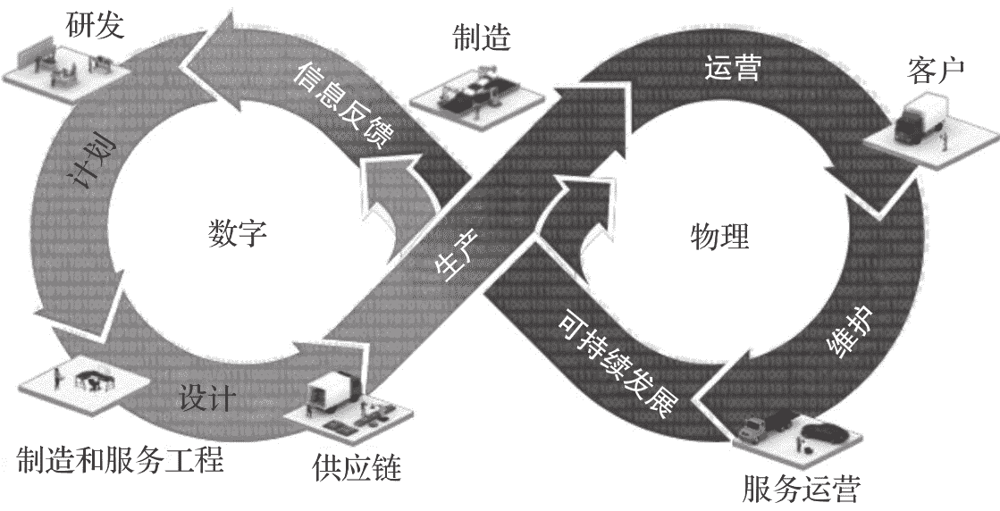

图 1-2 基于模型的闭环数字主线理论 ^(⁶)

维斯塔斯（VESTAS）是全球领先的风机制造商，致力于“2040 年实现零碳风机”的可持续发展目标。通过与 PTC 合作，它以 PLM（产品生命周期管理）为核心打造了覆盖设计、制造、服务的闭环数字主线，整合了 CAD（计算机辅助设计）、PLM、材料科学等多领域数据，实现了跨系统协同，构建了“产品设计—材料循环—客户价值”的全链条数字化体系和全流程闭环追溯机制。维斯塔斯工程研发团队借助数据驱动的设计优化，成功将研发周期缩短 25%，并将材料回收率提升至 90%。在服务端，该团队还利用数字主线预测设备维护需求，使设备故障停机率降低 30%。维斯塔斯的实践基于完整的数字主线实现数据驱动，是当前最系统、最具借鉴价值的标杆案例，为制造业提供了一个从战略到落地的范式。

时至今日，数据驱动范式在制造业的应用已经覆盖了研发、制造、供应链、售后服务等全链条，可显著提升企业的运营效率与竞争力。然而，企业可通过战略规划、技术投入和生态合作克服数据质量、技术适配、组织变革等挑战，实现可持续转型。企业需以业务为引导，以数字主线为基础，通过业务转型与组织变革的双重突破，实现从“数据支撑”到“数据驱动”的跨越式升级，最终在数字化转型中赢得差异化竞争优势。数据驱动范式如图 1-3 所示。

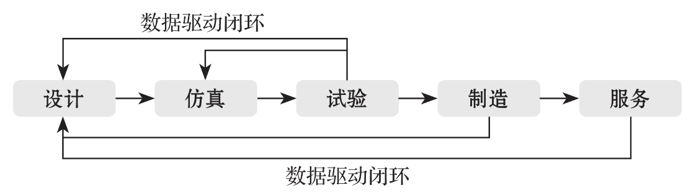

图 1-3 数据驱动范式

## **1.5 AI 驱动范式**

早在 20 世纪 60 年代，制造商就开始在工业机器人和基础自动化领域应用人工智能（AI）技术。早期的 AI 主要用于对高度重复的人工任务进行自动化，例如装配、零件处理和分类等，从而提高生产率和效率。20 世纪 80 年代开始兴起的专家系统是当时 AI 在制造业最具代表性的应用之一，其本质是一种基于规则的知识库系统，通过模拟人类专家的决策逻辑来解决特定领域的复杂问题。十几年来，AI 取得了惊人的跨越式发展，其在制造业的应用也取得了巨大的进展。AI 在制造业的规模化应用大致经历了以下三个阶段。

1.初期阶段：自动化和基础感知（2010 年代之前）

AI 在制造业的初期应用以规则驱动和有限数据分析为核心，主要作为人类决策的辅助工具。这一阶段依托专家系统和简单算法（如逻辑回归、决策树），主要解决重复性高、规则明确的生产问题。例如，基于机器视觉的自动化质检系统可替代人工目检，识别电子元件表面的划痕等缺陷；基于固定规则的生产排程系统能够优化资源分配。然而，此类技术依赖人工预设规则，灵活性不足，难以应对设备参数突变或供应链波动等复杂动态环境，且数据利用率低，尚未形成数据闭环优化能力。

2.发展阶段：数据驱动的智能化（2010 年代初—2020 年代初）

2013 年，德国在汉诺威工业博览会上正式提出工业 4.0 概念，随后在制造业掀起了一波智能化转型升级的浪潮。同时，随着机器学习算法和工业物联网（IIoT）技术的成熟，AI 开始与制造业务流程深度集成。传感器数据与生产系统的实时联动，推动了预测性维护（如西门子通过振动数据分析预测电动机故障）与供应链动态优化（如 AI 算法结合需求波动调整库存水平）等场景的落地。此阶段的技术特点体现为数据驱动的模型训练（如随机森林、支持向量机），并尝试跨系统整合（如 MES 与 ERP 数据打通）。然而，模型泛化能力仍受限，需针对不同产线进行定制化开发，且复杂决策（如设备维修策略调整）仍需人工干预，尚未实现全链条智能化。

3.深化阶段：全链条智能化（2022 年至今）

以深度学习、生成式 AI（GenAI）和数字孪生技术为代表，AI 逐步成为制造业的核心驱动力。例如，生成式设计工具（如 CREO 生成式设计）通过给定的设计约束和参数，自动生成面向不同加工模式的零部件设计方案；数字孪生平台可实时映射物理工厂，模拟生产执行和运营，并支持预测性设备维护；大模型技术甚至参与代码生成与工艺优化（如半导体制造中的缺陷根因分析，进而优化工艺参数和设备参数）。此阶段，AI 已实现跨领域协同决策，具备自主学习与动态适应能力，但面临数据安全、伦理责任（如算法偏见）及高算力成本等挑战，技术落地仍需与组织变革深度绑定。这一阶段的转折点是 2022 年 11 月 30 日 OpenAI 发布的人机对话式通用大语言模型 ChatGPT，标志着 AI 进入可交互时代。2025 年 1 月 20 日 DeepSeek R1 发布，其免费开源、推理能力强、可本地部署等特性，瞬间引爆了制造业应用 AI 的热情。因此，2025 年将会成为“制造业 AI 元年”。

当前，制造业数字化正面临着严峻的挑战，即爆发式增长的海量离散数据和日趋复杂的产品系统已经远超人类经验和计算能力的边界。随着生成式 AI 技术的突破，以 ChatGPT 和 DeepSeek 为代表的大语言模型（LLM）正在重塑制造业的核心逻辑，推动行业从传统经验驱动向“数据—算法—生态”协同驱动的第五范式跃迁，即 AI 驱动范式。AI 驱动范式的核心在于以人工智能技术为驱动力，通过数据与模型的深度融合，实现产品和业务的智能化、自动化和人机协同，加速制造业转型升级。数据驱动范式与 AI 驱动范式虽然均以数据为基础，但两者的核心逻辑和技术实现存在显著差异。AI 驱动范式通过智能化决策、动态适应能力和人机协同机制，突破了传统数据驱动的局限性，实现了从“被动分析”到“生成式决策”的跨越。以下是二者的关键差异及 AI 驱动范式的核心特征。

**●从静态规则到动态自主决策**。数据驱动依赖预设规则和静态模型（如回归分析、布尔运算），需人工定义数据关联性（如“温度升高 5%则触发报警”）。AI 驱动则通过深度学习、强化学习（如 DQN 算法）等进行动态建模，自动挖掘数据隐含规律，实时生成优化策略（如预测设备故障并自主调整维护计划）。在复杂场景下（如供应链中断），能够自主决策，无须人工干预，直接生成多目标优化方案（如重新分配产能并切换物流路径）。

案例：特斯拉工厂的 AI 系统在芯片短缺时，自动调整车辆配置参数并重编程生产线，减少停工损失。

**●从有限分析到跨模态融合**。数据驱动主要处理结构化数据（如传感器数值、订单量），分析维度单一（如仅基于历史销量预测库存）。而 AI 驱动则通过多模态融合技术整合文本（如设备维护文档）、图像（如质检照片）、声音（如设备异响）等多源数据，构建全局认知（如通过设备异响、振动数据、故障现场等来判断故障类型），还能利用大语言模型，根据实际采集的工况数据（如经常发生故障的零部件所承受的疲劳应力、振动等）生成关键零部件的新设计方案（如 AI 生成零件设计并进行仿真验证）。

**●从经验依赖到持续进化**。数据驱动的模型更新依赖人工重新训练（如按淡旺季更新库存预测模型），无法实时适应环境变化。AI 驱动的模型更新可通过增量学习、迁移学习实现模型自进化（如新设备接入后，AI 自动适配其数据特征），并能将执行结果实时反馈至系统，动态修正决策偏差（如质检误判案例自动加入训练集优化模型）。

**●从辅助决策到人机共生**。数据驱动仍然以人的决策为主，数据分析结果仅提供参考（如系统基于库存消耗数据预警“库存不足”，补货量仍由人工决定）。而 AI 驱动在分析后提供可解释建议：当预测到库存不足时，AI 会结合库存策略及后续生产计划，给出推荐补货量；人员在此基础上进行价值判断（权衡库存成本与满足率），并通过语音、增强现实等工具实现双向交互协作（新增或调整采购计划、比对不同采购策略等）。

**●从局部优化到全局重构**。数据驱动聚焦单一环节优化（如提升某台设备的 OEE），缺乏跨系统协同。AI 驱动则打通设计、生产、服务等环节，实现全链路协同与全局最优（如根据实时订单调整设计参数与排产计划），并支持生态级创新（如汽车主机厂与电池供应商联合训练缺陷预测模型），推动跨企业协作共享 AI 模型。

由表 1-1 可见，AI 驱动范式并非数据驱动的简单升级，而是通过“AI 智能体—人类—环境”的三元互动，重新定义制造业的价值创造逻辑。

**表 1-1 数据驱动范式和 AI 驱动范式的差异对比**

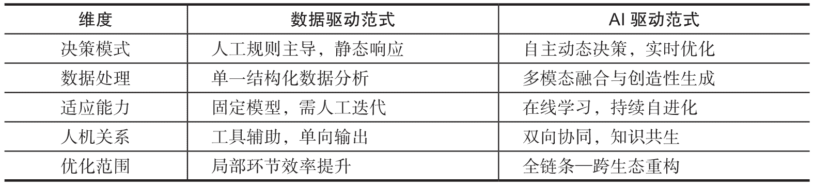

AI 驱动范式标志着产品研发从“人类主导”迈向“人机共生”的新时代，其通过数据与智能技术的深度融合，解决了传统方法的效率瓶颈与复杂性难题。当然，AI 驱动范式目前正处于萌芽期，制造企业还需要克服数据、技术、成本、人才和战略五个维度的挑战，甚至大部分企业仍需补齐数字化基础。只有多维度协同攻坚，才能推动 AI 对制造业的赋能从“局部试点”迈向“全链贯通”，真正释放制造业智能化的长期价值。

# **第二章**

# **AI 技术演进：从规则驱动到生成智能**

## **2.1** **AI 发展简史：四次浪潮**

人工智能是计算机科学的一个分支，旨在研究和开发可以模拟、扩展或增强人类智能的系统。它涉及多种技术和方法，包括机器学习、深度学习、自然语言处理（NLP）、计算机视觉、专家系统等。在人类科技史上，人工智能的进化轨迹犹如一部浓缩的文明史诗。从 20 世纪中期图灵提出著名的“图灵测试”这一哲学思辨，到 ChatGPT 引发全球认知革命，AI 技术经历了四次浪潮：规则驱动的符号主义 AI、知识驱动的专家系统、数据驱动的深度学习、人机共生的认知智能。这场持续 70 余年的技术长征，不仅重塑了机器理解世界的方式，更在深层次上改变了人类与技术共生的关系。

1.第一次浪潮（20 世纪 50 年代—70 年代）：规则驱动的符号主义 AI

图灵被认为是人工智能的奠基人之一。1936 年，他提出了图灵机的概念，这是计算机科学和 AI 理论的核心。1950 年，图灵提出了著名的图灵测试，即通过测试机器是否能够模仿人类的思维行为来评估机器是否具有“智能”。1956 年，在达特茅斯会议上首次提出了人工智能的概念，并确立了 AI 研究的正式目标：使机器能够模拟人类智能。这标志着人工智能正式成为一个学科。

这时期的 AI 被称为符号主义（Symbolism），即通过明确的逻辑关系和形式化规则来模拟人类思维解决问题。研究者将智能简化为符号操作，开发出基于谓词逻辑的推理系统，如 1966 年的聊天机器人 ELIZA 通过模式匹配实现简单对话。这一阶段的 AI 如同“精确的数学家”，在封闭规则系统中表现出色，但面对现实世界的模糊性和复杂性时举步维艰，甚至无法解决异或（XOR）等基础非线性问题，最终因无法突破知识表示瓶颈而陷入第一次 AI 寒冬。

2.第二次浪潮（20 世纪 80 年代—90 年代）：知识驱动的专家系统

在规则驱动的符号主义 AI 框架下，人工智能转向知识工程范式，试图将人类专家经验通过系统化编码来模拟专家决策过程。这一时期，由斯坦福大学团队开发的 MYCIN 医疗诊断系统（1976 年）旨在帮助医生诊断和治疗由细菌引起的感染性疾病，使用 450 条医学规则和确信因子算法，以 69%的准确率判断血液感染病原体，超越当时人类医生 55%的平均水平。虽然 MYCIN 在实验室测试中表现出色，但因其复杂性和缺乏透明度，没有在临床实践中广泛使用。由卡内基梅隆大学（CMU）于 1980 年为美国数字设备公司（DEC）开发的 XCON（全称 eXpert CONfigurer）专家系统，旨在解决 VAX 系列计算机硬件配置的复杂性问题，是 20 世纪 80 年代人工智能领域最具代表性的商业化应用之一，标志着专家系统从实验室走向工业界的里程碑。XCON 基于规则系统，包含超过 2500 条配置规则，涵盖 DEC 公司所有硬件组件的技术参数、兼容性约束及优化策略，配置计算机订单的准确率达 95%以上，每年节省 2500 万美元成本 ^(⁷)。

专家系统的核心架构由三部分组成：知识库（人工编写的 IF-THEN 规则）、推理引擎（前向/后向链式推理）和人机接口（用户界面）。其运作逻辑如同“机械大脑中的图书馆管理员”，通过遍历规则库实现决策过程。但这一范式很快遭遇双重困境：知识获取瓶颈（如在开发 XCON 的过程中大规模投入知识工程师，来构建和持续维护知识库）和规则库膨胀悖论（系统规模超过 1 万条规则后，维护成本呈指数级增长，如日本第五代计算机计划耗资 4 亿多美元，却因规则冲突率激增而失败）。1997 年，IBM 深蓝击败国际象棋冠军卡斯帕罗夫成为专家系统最后的辉煌，但面对现实世界中动态、模糊的复杂问题，专家系统暴露出致命缺陷—人类隐性知识（Tacit Knowledge）无法被完全形式化编码，最终为深度学习的崛起埋下伏笔。

3.第三次浪潮（21 世纪初—10 年代）：数据驱动的深度学习

在算力革命（GPU 并行计算）与数据爆炸（互联网催生 ZB 级数据）的双重推动下，人工智能迎来连接主义（Connectionism）的复兴。连接主义的核心是通过数据学习来模拟人类大脑的工作方式，依赖于神经网络技术。神经网络通过多层非线性变换，自动从原始数据中提取抽象特征，取代了手工设计特征的局限。2012 年，辛顿（Geoffrey Hinton）团队开发的 AlexNet 模型在 ImageNet 竞赛中通过卷积神经网络（CNN）大幅提升了图像识别准确率（比传统方法提升了约 41%），标志着深度学习正式崛起。自此之后，深度学习成为主流技术，广泛应用于计算机视觉、语音识别、自然语言处理等领域。2016 年，谷歌 DeepMind 的 AlphaGo 结合深度强化学习击败围棋世界冠军李世石，证明 AI 在复杂策略空间的探索能力。

这一时期的 AI 技术演进呈现以下三大特征。

**●架构创新**。架构创新指从全连接网络（MLP）到卷积网络（CNN）的视觉革命，再到循环网络（LSTM）的时序建模，最终由 Transformer 的统一注意力机制实现多模态融合。

**●规模激增**。规模激增指模型参数量从 AlexNet 的 6000 万激增至 GPT-3 的 1750 亿，涌现出上下文学习等智能行为。

**●工业化渗透**。从 21 世纪 10 年代开始，AI 技术在工业领域进入了规模化应用阶段，在研、产、供、销、服等各领域都有广泛的应用场景，如机器视觉检测、工艺优化、质量追溯与过程控制、预测性维护等。以机器视觉为例，机器视觉在质量控制和缺陷检测中的应用效果显著，可将检验准确率提升至 99.5%以上，且大幅提升效率。根据 Frost& Sullivan、iiMedia Research（艾媒咨询）的分析数据，2016 年，中国计算机视觉行业的市场规模为 11.4 亿元，到 2020 年市场规模达到 406.3 亿元，年均复合增长率达 144.3%。

然而，深度学习仍受限于数据饥渴症（如训练 AlexNet 需 120 万标注图像）与黑箱困境（模型决策缺乏可解释性），为生成式智能的进化预留了空间。

4.第四次浪潮（21 世纪 10 年代至今）：人机共生的认知智能

以 Transformer 架构为核心的大模型实现了文本生成能力的飞跃，2022 年，ChatGPT 的发布标志着生成式 AI（GenAI）进入实用化阶段。生成式 AI 基于算法、模型和规则生成文本、图像、声音、视频、代码等多样化内容，其核心在于通过数据训练模拟事物内在规律，实现自主创造新内容。与传统 AI 的分析功能不同，生成式 AI 不仅处理输入数据，还能生成具有逻辑性和连贯性的原创内容。第四次浪潮以人机协作的认知革命为核心，其本质是智能技术从“感知智能”（如图像识别）向“认知智能”（如逻辑推理）的范式突破，重构了人类与机器的互动关系，并将在社会、经济、伦理等层面引发深远变革。

这一浪潮是由以下三大关键突破而驱动的。

**●大语言模型（LLM）的涌现能力**。大语言模型（LLM）的涌现能力（Emergent Ability），特指当模型规模（参数量、数据量、算力）达到某一临界值时，模型突然表现出的超出训练目标的复杂能力。研究发现，当 LLM 的参数量突破千亿级后，模型突然具备逻辑推理、代码生成等能力。2023 年发布的 GPT-4，参数量达 1.8 万亿，通过思维链（Chain-of-Thought）和指令微调（Instruction Tuning），在复杂逻辑任务中的表现显著提升，其数学推理能力较 GPT-3 提升 40%。GPT-4 在 2023 年的美国统一律师资格考试（UBE）中，平均得分率为 75%，高于人类考生的平均得分率 68%，排名超过 90%的考生 ^(⁸)。

**●多模态统一建模**。2017 年，Google 团队提出的 Transformer 模型彻底改变了自然语言处理（NLP）领域。其核心创新在于自注意力机制（Self-Attention Mechanism），允许模型在编码和解码过程中并行处理序列数据，打破了序列建模的时空限制，极大地提升了数据训练效率，从而支撑起千亿参数模型的训练。2021 年，OpenAI 发布的 CLIP 将分别来自文本编码器（Transformer）和图像编码器（ResNet 或 ViT）的文本及图像映射到同一向量空间，通过对比学习，实现跨模态语义对齐。2022 年，Stability AI 发布的 Stable Diffusion 是一款开源 AI 绘画生成工具，通过多模态数据训练，可在文本描述的引导下生成高分辨率图像或视频。CLIP 与 Stable Diffusion 分别代表了跨模态理解与生成技术的里程碑，两者的结合不仅重塑了创意产业的工作流程，也为生成式 AI 的发展提供了多模态协同的范本。

**●具身智能（Embodied** **AI）**。具身智能（Embodied AI）强调智能体通过物理实体（如机器人、无人机）与环境动态交互，实现感知、决策与行动的一体化闭环。生成式 AI 的多模态感知和自主决策能力，正在重塑具身智能的技术边界与应用场景。例如，结合视觉、触觉和语音的生成式 AI 模型，机器人可通过模拟环境交互数据预训练动作策略，从而在真实场景中快速适应复杂地形或操作环境。2024 年，特斯拉发布的 Optimus 机器人首次在十个手指中集成了高精度触觉传感器，能够感知物体的形状、硬度及操作力度。基于 FSD 芯片的多模态视觉系统（RGB-D 摄像头+激光雷达）可实时构建 3D 环境模型，识别零件位置与姿态。通过触觉反馈与视觉系统的结合，机器人可实现对复杂装配任务的适应性调整，如螺丝拧紧力度的动态控制等。融合生成式 AI 的具身智能正推动制造业从“机械执行”向“人机共融”跃迁，其技术突破已渗透至柔性制造、精密装配、物流协同等核心场景。

认知智能革命正在重定义创造力的归属。当 AI 生成内容（AIGC）占据全球数据流量的 10%（IDC 预测 2025 年）时，人类与机器协同进化的新范式已然开启。第四次浪潮的本质是认知权的再分配——人类从“决策者”转变为“协作者”，机器从“执行者”进化为“思考者”。

## **2.2** **机器学习：从理论到实践的全面解析**

机器学习是人工智能的核心分支，也是现代人工智能的基石。它的核心在于通过算法使计算机系统从数据中自动学习规律，并基于学习结果做出预测或决策。机器学习的本质是通过数据训练模型，使计算机能够从海量信息中提取规律、预测结果或生成内容，从而模拟人类的学习能力。这种模式突破了传统符号主义 AI 对人工编码规则的依赖，成为现代 AI 发展的主流路线。

机器学习的五大核心要素是数据、特征、模型、损失函数、优化算法，它们构成了其从数据到决策的完整闭环。

●数据作为基石，数据提供了模型学习的原始素材，既包含结构化信息（如传感器读数），也涵盖非结构化内容（如图像和文本）。

●特征是数据的精炼表达，通过特征工程将原始信息转换为机器可理解的量化指标，直接影响模型对数据规律的捕捉能力。

●模型作为核心载体，本质上是建立输入与输出映射关系的数学函数。从简单的线性回归到复杂的深度神经网络，不同模型对应不同层次的问题抽象。

●损失函数承担着“监督者”的角色，通过量化预测结果与真实值的偏差（如均方误差、交叉熵），为模型优化提供明确方向。

●优化算法（如梯度下降）如同智能导航系统，通过迭代调整模型参数，在解空间中寻找损失最小的最优路径。

这五大要素环环相扣：数据经特征提取后输入模型，模型输出经损失函数评估后，由优化算法驱动参数更新，最终形成从“数据输入”到“智能输出”的完整认知链条。其中，特征工程是传统机器学习的核心环节，通过数据预处理、特征构建与选择等方法，将原始数据转换为模型可理解的高质量特征。其核心目标是增强数据的信息密度，解决噪声、冗余、缺失等问题，从而提升模型的泛化能力与可解释性。以某汽车零部件检测系统为例，该系统建立了 327 个特征维度，包括几何特征、纹理特征、频域特征等，用于从多维度全面检测零部件质量。

根据特征工程的不同方式，机器学习可分为监督学习、无监督学习和强化学习。

**●监督学习**。监督学习通过带标签（Label）的数据训练模型，让该模型能够从输入特征（Feature）中预测与输出标签的映射关系，最终实现对新数据的预测或分类。其核心目标是构建一个模型，能够对未知数据做出准确预测。监督学习的关键特征在于训练数据包含明确的“正确答案”（标签），模型通过不断调整参数以最小化预测结果与真实标签的差异。

监督学习最典型的应用是分类任务和回归分析。分类任务是指将输入数据划分到预定义的有限类别中，包括二分类和多分类等。例如，在质量缺陷分类应用中，通过预先训练的模型识别缺陷特征，可自动根据检测结果将质量缺陷进行分类。而回归分析可预测连续数值输出的监督学习问题，其目标是建立输入特征与连续目标变量之间的映射关系。例如，在备件需求预测中，可基于历史数据（如备件消耗记录、设备运行状态等）和影响因素（如设备故障率、季节变动、生产周期等），来预测未来备件需求，进而优化库存策略。

**●无监督学习**。无监督学习是从未标注数据中发现隐藏的模式或关系的机器学习范式。它的核心目标是通过算法自主探索数据的内在规律，而非依赖预定义的标签。无监督学习的关键挑战在于：如何在缺乏明确监督信号的情况下，揭示数据分布的本质特征。

与监督学习不同，无监督学习的数据集仅包含输入特征，而无须预设输出标签，这使得其更适用于探索性数据分析与未知模式的挖掘，也为工业场景中标注数据稀缺、模式未知的复杂问题提供了高效的解决方案。无监督学习在工业缺陷检测、设备健康管理等方面有广泛应用。例如，在设备健康管理中，无监督学习通过分析设备运行数据中的异常波动（如振动、温度变化），实现早期故障预警与维护决策优化；在无监督学习缺陷检测中，无监督学习的核心优势在于无需缺陷样本库，仅依赖正常样本即可识别异常缺陷，尤其适用于良品率高、缺陷类型未知的场景，如 PCB 板焊点虚焊、半导体晶圆表面微裂纹、芯片封装气泡等缺陷检测。

**●强化学习**。强化学习（Reinforcement Learning，RL）是机器学习的重要范式，它通过智能体与环境的动态交互，以最大化累积奖励为目标，学习最优决策策略。强化学习的本质是“试错学习”，智能体通过行动后的奖励或惩罚信号调整策略，无须依赖标注数据。在 ChatGPT、DeepSeek 等的人机对话界面中，通过对回答的结果“喜欢”或“不喜欢”来进行反馈激励，进而迭代优化，得到最佳答案，这就是一个典型的强化学习应用。

强化学习通过智能体与环境的交互，为工业场景中的复杂决策问题提供了自适应优化方案，在生产调度与流程优化、质量控制与缺陷检测、设备健康管理与预测性维护等领域有广泛应用。强化学习可基于实时订单、设备状态和供应链波动情况等构建决策模型，通过智能体学习在不同状态下（如设备故障、原材料延迟）选择最优调度动作，从而动态优化生产排程，提升产能利用率。

## **2.3** **深度学习：神经网络的革命性突破**

深度学习是机器学习的子集，以深度神经网络为核心，模拟人脑神经元结构进行特征自动学习。深度学习作为人工智能领域的一次重大革命，其核心在于多层神经网络的突破性发展。它不仅能够让计算机“看见”图像、“听懂”语言，还能从海量数据中自主提炼规律，甚至创造出全新的内容。正如诺贝尔物理学奖得主霍普菲尔德和欣顿所证明的，人工神经网络通过模拟生物神经元结构，构建了 AI 的物质底座。

### **2.3.1** **深度学习的跨越式发展**

我们用三个关键阶段来解析深度学习如何从实验室走向现实应用。

1.早期神经网络：从“简单模仿”到“自我纠错”

20 世纪 40 年代，科学家受生物神经元启发，提出了最早的神经网络模型——感知机（Perceptron）。这种模型过于简单，无法学习多层次特征，缺乏有效的训练方法，且受限于当时的计算机性能，难以处理大规模数据。因此，只能处理简单的线性分类问题（如判断一张图片是否包含垂直线条），无法解决更复杂的任务（如识别手写数字）。

直到 1986 年反向传播（Backpropagation，BP）算法的提出，让神经网络首次具备了“自我纠错”能力。这一算法通过计算预测结果与真实值的误差，逐层调整神经元之间的连接权重，使神经网络能够逐步优化。例如，训练一个识别猫狗的神经网络时，算法会不断调整各层参数，直到输出结果与真实标签一致。

2.深度学习的爆发：三大关键突破

深度学习的真正崛起始于 2012 年，以下三大技术要素的成熟共同推动了这场革命。

**●算力飞跃：GPU 的算力革命**。传统 CPU 无法满足神经网络的海量计算需求，而 NVIDIA 的图形处理器（GPU）原本用于游戏图形渲染，但研究者发现其并行计算能力恰好适配神经网络矩阵运算，从而为深度学习插上了翅膀。例如，训练一个早期模型可能需要数月，而采用 GPU 可将其缩短至几天。

**●算法创新：突破深度限制**。传统的深度神经网络通过堆叠层数提升性能，但存在梯度消失、训练效率低等问题。以 2012 年 AlexNet 在 ImageNet 图像识别竞赛中的革命性表现为起点，深度学习通过多层卷积神经网络（CNN）首次实现端到端的特征自动提取（如边缘→纹理→物体部件），关键创新包括 ReLU 激活函数缓解梯度消失、Dropout 正则化抑制过拟合等。随后，算法创新向多维度延伸，包括深度强化学习突破、网络深度突破、Transformer 自注意力机制等。这些算法创新让深度学习模型既有深度又提高了效率。

**●大数据时代：海量“燃料”的供给**。据国际数据公司（IDC）的统计显示，2016 年的全球数据产生量为 16.1ZB，而 2024 年这一数字为 159.2ZB，年复合增长率约为 33%。这些数据大部分为图像、文本数据，为模型训练提供了充足的“学习素材”。研究发现，数据量每增加 10 倍，模型性能的提升就远超算法优化。

3.历史性突破：三大里程碑事件

**●AlexNet：点燃深度学习革命（2012 年）**。2012 年，多伦多大学团队凭借 AlexNet 在 ImageNet 图像识别竞赛中一战成名，将错误率从传统方法的 26%骤降至 15.3%，标志着深度学习时代的开启。其核心创新在于 GPU 加速训练（双 GTX 580 显卡并行计算）和 Dropout 正则化技术（随机屏蔽神经元，防止过拟合），首次证明深层网络可高效处理海量数据。这一突破不仅终结了手工设计特征的统治地位，更催生了“端到端学习”范式，使得工业质检、人脸识别等领域自此全面转向神经网络，全球 AI 论文数量在此后五年激增 300%。

**●AlphaGo：人工智能的“出圈时刻”（2016 年）**。DeepMind 的 AlphaGo 以 4‥1 击败围棋世界冠军李世石，展示了深度强化学习的战略推演能力。其核心技术融合了策略网络（预测落子位置）、价值网络（评估棋局优劣）和蒙特卡洛树搜索（模拟未来数百步可能性），在 361 个点的围棋棋盘上探索了远超宇宙原子总数（约 10⁸⁰）的可能性空间。这场人机对决不仅让公众首次直观感受到 AI 的创造力（如“神之一手”第 37 步），更推动深度强化学习在机器人控制、金融交易等领域的应用。例如，谷歌数据中心通过类似的技术优化冷却系统，实现节能效率提升 30%，年节电超 1 亿度 ^(⁹)。

**●Transformer：统一架构的诞生（2017 年）**。谷歌团队提出的 Transformer 架构，凭借自注意力机制彻底革新序列建模。该机制允许模型并行处理所有输入位置的关系（如翻译时同步关联“猫”与“cat”），替代了 RNN 的串行计算模式，训练速度提升 9 倍。其衍生模型，如 BERT（自然语言理解）、ViT（图像分类）和 DALL·E（文本生成图像）实现了多模态统一。例如，医疗领域用 ViT 分析 CT 片时，模型可同时读取影像报告文本，将肺癌诊断准确率从 89%提升至 98.9% ^(¹⁰)。如今，Transformer 已成为 GPT、LLaMA 等大模型的基石，开启了“预训练+微调”的 AI 工业化生产时代。

### **2.3.2** **深度学习的核心原理：像剥洋葱一样理解世界**

1.层次化特征学习：逐层抽象，逼近本质

深度学习的核心能力源于其分层处理数据的机制，如同剥洋葱般逐层解析信息的本质。这里以图像识别为例。

**●基础层（边缘检测）**。神经网络的基础层像“视觉侦察兵”，专注于捕捉像素级的简单特征，比如垂直线、水平线或斜线。这些特征对应图像中的物体边缘，类似于人眼初次扫视画面时注意到的轮廓。

**●中间层（部件组合）**。随着网络层次加深，模型将低层特征组合成更复杂的结构。例如，在识别汽车的场景中，第二层可能将线条组合成圆形（车轮）或矩形（车窗），第三层进一步整合为“车门”“车灯”等部件。

**●高层（语义理解）**。最深层的神经元负责综合所有局部信息，形成全局认知。这时，网络不仅能判断图中是否有车，还能区分车型（SUV/轿车），甚至推测车辆状态（行驶中/静止）。

**●工业案例**。特斯拉自动驾驶系统通过 8 个摄像头捕捉道路画面，基础层网络识别车道线和交通标志，中间层判断车辆与行人的相对位置，高层综合决策是否变道或刹车，全程无须人工定义规则。

2.端到端学习：从原始数据到智能决策的“直通车”

传统机器学习需要“人工设计特征+训练模型”两步走，而深度学习则实现了从原始输入到最终输出的无缝衔接。

**●传统流程的断裂**。以工业质检为例，工程师需先设计特征（如缺陷面积、纹理对比度），再用 SVM 等算法分类。这不仅耗时（特征设计占项目 70%的时间），且难以处理复杂缺陷（如微裂纹）。

**●深度学习的革新**。端到端模型直接接收原始图像，通过卷积层自动提取特征，全连接层直接输出缺陷分类结果。例如，某手机屏幕检测系统中，ResNet-50 模型将传统人工设计特征方法的漏检率从 7%降至 0.3%，检测速度提升 20 倍。

由此，深度学习充分体现了其端到端学习的核心优势，包括：①减少人工干预，无须领域专家设计特征，降低技术门槛；②捕捉隐性规律，模型能发现人类难以描述的特征（如缺陷的微观纹理分布）；③跨场景泛化，同一模型稍加调整，即可用于不同产品线的质检。

3.从“知其然”到“知其所以然”：打开 AI 的“黑箱”

深度学习的“黑箱”特性曾饱受质疑，但可解释性技术的突破正让 AI 决策变得透明。

**●因果推理增强**：最新研究通过嵌入物理定律（如能量守恒定律）约束模型输出。例如，在预测飞机油耗时，模型若给出“油耗为负”的违背物理常识的结果，系统会自动纠错并追溯错误源头。

**●注意力机制可视化**：在机器翻译场景中，Transformer 模型会生成“注意力权重热力图”。例如，当翻译“我爱人工智能”为“I love AI”时，模型会显示“爱”与“love”、“人工”与“AI”的强关联，揭示其跨语言映射逻辑。

**●Grad-CAM 热力图**：在医疗影像诊断中，这项技术能高亮显示模型判断肺炎的关键区域（如肺部毛玻璃影）。医生可直观验证 AI 是否关注合理区域，而非被无关噪声误导。

深度学习的三大原理共同构建了机器的“认知体系”：层次化特征学习让 AI 像人类一样从细节到整体理解世界，端到端学习将复杂流程简化为“输入-输出”的智能管道；而可解释性技术则像给 AI 装上“思维导图”，使其决策过程可追溯、可验证。

这种“类人”又“超人”的能力，正在重塑工业、医疗、科研等领域的知识发现方式。当 AI 通过层层抽象从 X 光片中识别出早期肿瘤时，当它从海量数据中总结出人类未知的材料合成规律时，我们看到的不仅是技术的进步，更是人类认知边界的又一次重大突破。

### **2.3.3** **改变世界的力量：三大应用领域**

得益于算法创新、算力提升与大数据支撑，深度学习已经逐渐渗透至工业质检、医疗影像诊断、新材料发现等工业场景，标志着深度学习从实验室研究迈向大规模产业落地的成熟阶段。其主要应用领域如下。

1.计算机视觉：让机器拥有“火眼金睛”

计算机视觉通过卷积神经网络（CNN）自动提取图像的局部特征（如边缘、纹理），结合池化层降维和全连接层分类，实现端到端的视觉理解。卷积神经网络（CNN）如同视觉侦察兵，逐层解析图像中的边缘、纹理和语义信息，赋予机器“看懂”世界的能力。在工业领域，特斯拉工厂的视觉质检系统能以 2000 件/h 的速度检测零件缺陷，漏检率低于 0.01%，远超人类质检员的效率和精度（人工检测速度约为 300 件/h，漏检率为 5%～10%）。在消费端，支付宝刷脸支付技术的误识率仅百万分之一，背后是模型对五官特征的毫米级定位能力。更深远的影响在于医疗——AI 诊断糖尿病视网膜病变的准确率已达 97%，在偏远地区弥补了专业眼科医生的短缺。计算机视觉在人脸识别、工业质检、自动驾驶、医学影响分析等领域的应用广泛。

2.自然语言处理：打破巴别塔的语言壁垒

Transformer 架构的突破让机器真正理解人类语言。谷歌翻译支持 133 种语言互译，质量接近专业译者，其核心是捕捉上下文关系的自注意力机制。在内容创作领域，GPT-3 能根据关键词生成逻辑连贯的新闻稿、诗歌甚至代码，美国某报社已用其自动生成体育赛事简讯。更具革命性的是跨语言交流：Zoom 的实时字幕翻译让跨国会议无须人工翻译，字幕延迟小于 0.3s。但挑战犹存，模型可能生成带偏见的内容，因此 Meta 等公司正研发“价值观对齐”技术，过滤有害信息。

3.科学发现：AI 成为科研“加速器”

AI for Science（AI4S）是深度学习与传统科学研究的深度融合，通过数据驱动、模型优化和跨学科协作，解决高维计算、复杂系统模拟等传统科研难题。AI4S 正在重定义科学研究的范式，其核心在于利用深度学习、强化学习等 AI 技术，加速科学发现与技术创新，如在材料设计、生命科学、量子物理等领域的突破性应用。DeepMind 公司的 AlphaFold 2 破解了困扰生物学 50 年的“蛋白质折叠问题”，预测出 2 亿多种蛋白质结构（占已知蛋白质的 98%），精度达原子级别，使艾滋病疫苗研发周期缩短 3 年 ^(¹¹)。在新材料领域，美国劳伦斯伯克利国家实验室推出的自动化材料合成实验室 A-Lab，为未来实验室提供了一个新模式：将人工智能和机器人技术相结合。这种模式不仅提高了新材料的发现速度，还能为研究人员提供有关材料合成可能性的宝贵数据库。*Nature*在 2023 年发表的一篇论文显示，研究人员基于 A-Lab 进行无机粉末固态合成试验，连续运行了 17 天，就从 58 种目标中实现了 41 种新的化合物，包括各种氧化物和磷酸盐 ^(¹²)。这些突破证明，AI 不仅是工具，更是拓展人类认知边界的“共研伙伴”。

## **2.4** **大语言模型：认知智能的范式革命**

大语言模型（Large Language Model，LLM）是一种基于深度学习的自然语言处理技术，其核心是通过海量文本数据训练出的超大规模神经网络模型，具备理解、生成和推理人类语言的能力。比较典型的大语言模型如 ChatGPT、DeepSeek、通义千问等。大语言模型正在重新定义人类对“智能”的理解，它们不仅是技术的突破，更是一场认知范式的革命：从依赖人工规则的“模仿智能”，迈向基于海量数据与自学习的“泛化智能”。这种变革在技术架构、认知能力、应用场景和伦理挑战中均有深刻体现。

### **2.4.1** **技术架构革命：从“教机器思考”到“让机器自己思考”**

早期 AI 系统（如专家系统）依赖人工编写规则，比如教计算机“如何翻译句子”或“如何诊断疾病”。这种模式如同教孩子背答案，一旦遇到规则外的场景（如网络新词或罕见病症），系统就会“死机”。这是传统 AI 自诞生以来所长期面临的困境。

而 2017 年提出的 Transformer 这一颠覆性架构，为 AI 技术迎来了新的契机。它的“自注意力机制”让模型能像人类一样，同时关注一句话中的所有词，而非逐字处理。例如，看到“苹果股价上涨”，模型会同时关联“公司”和“水果”两种含义，再通过上下文选择正确解释。

LLM 采用“预训练+微调”模式，即先通过互联网规模量级的文本（如数千亿单词）进行预训练学习语言规律，类似于人类“博览群书”，再针对特定任务（如写诗或编程）进行微调。这种“通才+专才”模式大幅降低了开发成本。GPT-3 训练时“读过”几乎整个英文互联网，因此能生成流畅的新闻稿，甚至能够模仿莎士比亚的文风写十四行诗，而开发者无须专门教它文学知识。

Transformer 架构已成为 AI 技术演进的“操作系统级创新”，其价值不仅体现在性能突破上（如 ChatGPT-4o 的多模态生成效率较早期模型提升了 300%），更通过开放模块化设计推动生态创新，即从混合专家（Mixture of Experts，MoE）模型的算力优化，到因果推理的可解释性增强，持续扩展人工智能的应用边界。

### **2.4.2** **认知能力跃迁：从“鹦鹉学舌”到“思维涌现”**

过去的语言模型像“高级复读机”，只能在训练过的任务中表现良好。例如，一个被训练用于翻译英文到中文的模型，无法直接回答数学问题。

与传统的模型相比，LLM 具备如下“超能力”。

**●零样本学习（Zero-Shot** **Learning）**。LLM 模型在没有接触过特定类别训练样本的情况下，通过已有知识推理，实现对未知类别的识别或任务处理。比如让 LLM 将一段文字改写成小红书风格，它就能直接生成合理结果，无须额外训练。

**●思维链（Chain-of-Thought）**。一种通过分步推理来解决复杂问题的技术，模拟人类将问题拆解为逻辑关联的子步骤并逐步推导的思考过程。其核心目标是提升 LLM 在复杂任务中的推理能力与可解释性，尤其适用于数学、逻辑推理等需要多步分析的任务。譬如，当被问“小明有 5 个苹果，吃了 2 个又买了 3 个，现在有几个？”时，LLM 会逐步输出：“5-2=3→3+3=6”，展示出类人的推理过程。

**●跨模态融合**。GPT-4 等模型开始整合文本、图像、音频、视频等多模态信息，通过互补性信息提升模型的综合感知与推理能力，模拟人类多感官协同认知的能力。例如，给 LLM 一张冰箱照片，它能推测家庭人口结构，甚至推荐菜谱。

这些能力并非程序员预先设计的，而是模型参数超过千亿规模后“涌现”出的特性。这种“整体行为突变”源于诺贝尔奖得主 Philip Anderson 提出的“多即不同（More is Different）”理论，即系统复杂性突破临界点后，宏观层面会呈现无法从微观推导的新性质 ^(¹³)。就像无数蚂蚁个体能“涌现”出复杂的蚁群智能，LLM 通过海量神经元连接自发形成了高阶认知能力。

### **2.4.3** **应用场景重构：从“辅助工具”到“数字神经系统”**

大语言模型（LLM）正在突破“辅助工具”的定位，逐步演变为支撑企业运转的“数字神经系统”。这种转变不仅体现在效率提升方面，更在于对产业逻辑、知识传播和公共治理的底层重构，其影响深度堪比电力或互联网的普及。

1.产品研发：从经验驱动到 AI 驱动

LLM 正深刻重构产品研发生命周期，从需求分析、开发测试到用户体验优化，形成“效率革命+创新驱动”的双重范式。

**●研发流程重构（效率革命）**。传统研发遵循“需求-设计-开发-测试”的线性链条，环节割裂、迭代缓慢，而基于数字主线的智能协同模式通过 AI 打通全流程工具链：需求阶段，LLM 自动生成用户需求与功能原型；开发阶段，利用 AI 深度融合知识图谱和产品开发流程实现智能产品设计及多专业在线协同；仿真试验阶段，通过 AI 构建虚拟产品原型，从而实现“零”物理样机（虚拟试验替代物理试验）；运维环节，利用 AI 构建数字孪生系统，预测产品故障和潜在风险。各环节数据实时回流至产品数字主线，驱动跨团队并行协作，可以有效提升设计协作效率，缩短产品上市周期，真正实现 AI 驱动的产品研发流程重构。

**●产品设计优化（创新驱动）**。产品设计正经历从经验驱动到 AI 驱动的范式转变：传统设计高度依赖专家经验、主观判断与历史数据，容易受认知偏差和静态思维的局限；而 AI 驱动的新模式通过用户画像分析、多模态物联网传感器融合分析、多物理场虚拟试验等技术手段，结合机器学习，对海量用户数据进行深度挖掘，精准识别真实需求与体验断点，实现功能迭代的定量验证和动态调优。这种基于实时反馈的闭环迭代机制，不仅使产品决策更具客观性和预见性，还能通过个性化推荐算法持续提升用户体验，最终构建起以数据为燃料、以智能算法为引擎的持续创新优化体系，显著提升产品的市场竞争力和用户满意度。

2.生产流程的重塑：从“人力替代”到“价值创造”

**●人机协作**。特斯拉 Optimus 机器人结合 LLM 与多模态感知，可实现从“接收指令”到“自主决策”的跨越。这一技术融合不仅提升了任务泛化能力，还推动了具身智能在工业与家庭场景的深度应用。在工厂场景中，Optimus 通过 LLM 解析“电池分拣”任务，自主优化抓取路径和分拣顺序，日均积累千条动作数据以用于模型迭代。工人还可以通过自然语言指挥机器人，大大缩短操作培训时间。

**●智能排产**。LLM 通过聚合订单数据（ERP 系统）、设备状态（IoT 传感器）、市场动态（新闻/社交媒体）、物流信息（GPS 追踪）等多源异构数据，实时捕捉供应链波动信号。例如，可通过分析全球供应商交货延迟率、海关清关时间异常等指标触发芯片短缺预警，实时调整生产计划，从而有效缩短交货周期。LLM 还可以通过多目标优化算法模型，结合混合优化引擎，实现多目标动态平衡，如：①交期优先，采用启发式算法（如遗传算法）快速插入紧急订单，通过工序拆分释放瓶颈产能；②成本最优，结合运筹学模型（如混合整数规划）计算最小化换线成本、仓储成本的排产序列；③柔性平衡，预留 15%～30%的缓冲产能应对突发波动（如设备故障），通过数字孪生模拟验证调整方案可行性。

3.企业软件：从“功能菜单”到“智能工作流”

传统企业软件长期依赖菜单式交互和固定功能模块，而生成式 AI 与产品开发过程的深度融合，正在重构企业软件的底层逻辑。这种变革不仅体现在交互方式的升级上，更实现了从“工具辅助”到“认知协作”的跃迁。

**●交互方式的重构**。传统 ERP、PLM 等系统依赖复杂的菜单导航，用户需记忆功能路径。LLM 通过自然语言交互，将操作转化为“意图—执行”模式。例如，用户输入“生成上月生产质量问题分析报表”，系统会自动调用数据接口、进行分析并生成可视化报告。可以预见，在不久的将来，大部分企业级工业软件都会推出 AI Chat 功能，不但可以实时推送基于角色和设计上下文的专家知识，还可以自动执行数据查询、任务校验、合规审查等工作，大大简化操作过程，提升工作效率。

**●流程引擎的智能化升级**。传统工作流依赖预设规则（如 BPMN 标准），而智能工作流则通过“机器学习+智能体”双引擎，引入动态决策节点，实现流程自动化。例如，根据生产过程中的检测结果，自动分析质量根因、创建问题报告和更改建议，并根据问题根因自动推送给相关的设计师或工艺员以执行后续改进措施。

**●知识融合与决策增强**。企业软件正经历从“流程自动化”到“智能决策”的跃迁。知识融合与决策增强技术通过整合多源异构数据、构建动态知识网络、嵌入智能推理引擎等，重塑企业核心业务流程与决策优化模式。从技术层构建“数据服务—知识图谱—决策引擎”的递进式架构，从业务层重塑“分析-决策-执行”的闭环流程，将知识图谱与业务流程深度绑定，帮助企业构建“超级大脑”。例如，基于企业采购策略和供应链知识图谱，构建智能供应链的动态决策优化模型，实现供应链各环节的即时调整与资源再配置，以应对市场需求波动、突发事件及资源约束等复杂场景。

4.消费电子：从“触控交互”到“对话即服务”

消费电子正在面临从触控到对话的交互变革，其本质是从“功能载体”向“认知伙伴”的进化。这场变革以生成式 AI、多模态感知和实时交互技术为核心。目前，技术底座（LLM+多模态感知）与商业逻辑（服务化订阅）均已成熟。2025 年将成为规模化落地元年，应用场景将渗透至智能家居、智能终端、服务机器人等核心领域。在智能家居场景，一句“我困了”就会联动关闭灯光、调低空调并启动睡眠监测；在智能终端场景，对手机说“把上周拍的宝宝视频做成生日 vlog，配《生日快乐》背景音乐”，AI 就会自动完成剪辑、配乐并分享至社交平台；服务机器人则从工具进化为情感伙伴，通过搭载多模态情感模型（Multimodal Emotion Model，MEM），进行实时情感感知与个性化对话，成为陪伴老人和儿童的情绪抚慰助手。

正如 CES 2025 揭示的趋势：未来消费电子的价值不再取决于硬件参数，而在于其构建情感连接与提供认知服务的能力。

以上仅列举了与制造业相关的部分重构场景，实际应用远远不止于此。这场重构的本质，是 LLM 将人类积累千年的知识转换为可编程、可调用的“智能操作系统”。当电力照亮物理世界时，LLM 正在点亮认知世界的每一个角落，其终极形态或许不是替代人类，而是成为文明延续的“体外大脑”。

### **2.4.4** **暗礁与灯塔：伦理挑战与未来方向**

人工智能的快速发展在推动社会进步的同时，也面临着深刻的伦理挑战。这些挑战既是技术演进的“暗礁”，也是指引未来方向的“灯塔”。

1.伦理挑战的核心暗礁

**●隐私与数据安全**。AI 依赖海量数据训练，但个人敏感信息（如医疗记录、位置轨迹等）的收集与使用缺乏透明监管，暗藏泄露风险。例如，某健康监测 App 因漏洞导致百万用户的生理数据被非法交易，引发隐私信任崩塌，甚至催生“数据黑市”。

**●算法偏见与社会公平**。训练数据中的历史偏见被 AI 放大，导致系统性歧视。某银行信贷模型对少数族裔申请者的通过率低于 15%，只因其历史数据中隐含区域经济差异 ^(¹⁴)；华盛顿大学 2024 年的一项研究发现，采用三种最先进的大语言模型对简历进行排名时均存在明显的种族、性别和交叉偏见，在相同条件下，男性候选人通过 AI 初筛的概率比女性高 41% ^(¹⁵)。

**●责任归属与透明度缺失**。AI 决策过程的“黑箱”特性，使责任界定成难题，即难以界定是算法缺陷、数据偏差还是用户误用。某医疗 AI 应用误诊癌症却无法追溯关键判断依据，患者索赔无门，暴露可解释性技术的迫切需求。

**●就业冲击与经济鸿沟**。据高盛预测，2030 年全球 20%的岗位（约 3 亿个）将受 AI 冲击 ^(¹⁶)，重复性高、规则明确的白领岗位首当其冲。同时，技术垄断与区域资源分配失衡正形成“双向强化”的恶性循环，加剧全球及区域经济鸿沟。以生成式 AI 为代表的先进技术资源高度集中于少数科技巨头和发达国家，例如，全球 70%的云端算力被谷歌、微软等五大科技企业控制，而 85%的 AI 核心专利由全球前 20%的企业掌握，形成技术壁垒与数据霸权。这种失衡进一步反映在就业市场，高技能劳动力通过“人机协作”提升生产率，而欠发达地区的低技能岗位因 AI 替代会加速消失，形成“技术寡头”与“数字难民”的阶层分化。

**●技术滥用与安全失控**。深度伪造（Deepfake）可伪造政客演讲，煽动暴乱；自主武器系统可绕过人类授权发动攻击；AI 生成虚假学术论文，污染科研体系。技术双刃剑效应已在恶意使用中显现，威胁社会稳定与人类文明底线。

2.面向未来的治理灯塔

面向未来的 AI 治理需构建多维度协同框架，以动态平衡技术创新与伦理安全为核心，融合全球共识与差异化路径，最终形成既能防范深度伪造等安全威胁又能激发负责任创新的“治理灯塔”。

**●法律与监管框架**。欧盟推出了全球首部全面监管人工智能的法规——《人工智能法案》，并于 2024 年 8 月 1 日正式生效。该法规按风险分级严控 AI 应用，禁止社会评分与实时人脸识别滥用，设立千万欧元级罚款，倒逼企业合规；中国推出算法备案制，要求推荐系统公开基础逻辑，用户可拒绝对其画像的“数字囚笼”。

**●技术伦理嵌入**。可解释 AI（XAI）通过可视化热力图揭示医疗诊断模型关注区域，医生可追溯判断依据；联邦学习技术让多家医院联合训练癌症预测模型，数据“可用不可见”，隐私泄露风险降低 90%，推动跨机构知识共享。

**●跨学科共治生态**。新加坡 AI 伦理咨询委员会融合法律、伦理与技术专家，对自动驾驶事故责任提出“算法贡献度”评估模型；德国工会与企业合建“人机协作培训中心”，工人学习 AI 运维技能，制造业转型失业率下降至 2.3%。

**●全球化协同治理**。联合国教科文组织制定《AI 伦理全球指南》，建立跨境数据流通“白名单”机制，发展中国家可合规获取气候预测等公益模型；MIT 与非洲高校共建“低功耗 AI 实验室”，本地化训练疟疾检测模型，准确率超 95%。

**●可持续价值导向**。绿色 AI 利用蒸馏技术将千亿参数模型压缩至 1/10 规模，训练能耗降低 76%。微软 Azure 承诺 2030 年实现 AI 业务碳中和；印度“AI 普惠计划”为盲人开发声纹导航系统，日均服务超 50 万人次，技术红利首次覆盖弱势群体。

大语言模型带来的不仅是技术升级，更是认知范式的颠覆。它们证明，智能可以通过数据驱动自发涌现，而非必须依赖人类预设规则。这种变革正在重塑教育、医疗、科研等社会根基，但也带来前所未有的伦理挑战。正如印刷术催生文艺复兴、蒸汽机引发工业革命，LLM 或将开启一个“人机共生”的新纪元：在这里，人类不再是唯一的智能主体，而与 AI 共同进化。如何驾驭这场革命，将是 21 世纪重大的文明课题。

## **2.5** **技术关联与协同进化**

机器学习（ML）、深度学习（DL）与大语言模型（LLM）是人工智能发展的三个阶段，它们如同“进化树”上的分支，既层层递进，又相互融合。如图 2-1 所示，深度学习和大语言模型都属于机器学习的范畴，深度学习是利用深度神经网络来进行机器学习的一种方法，而大语言模型则是基于 Transformer 架构的预训练深度学习模型。三者之间的协同进化不仅推动了技术能力的跃升，更重新定义了人与机器的协作模式。

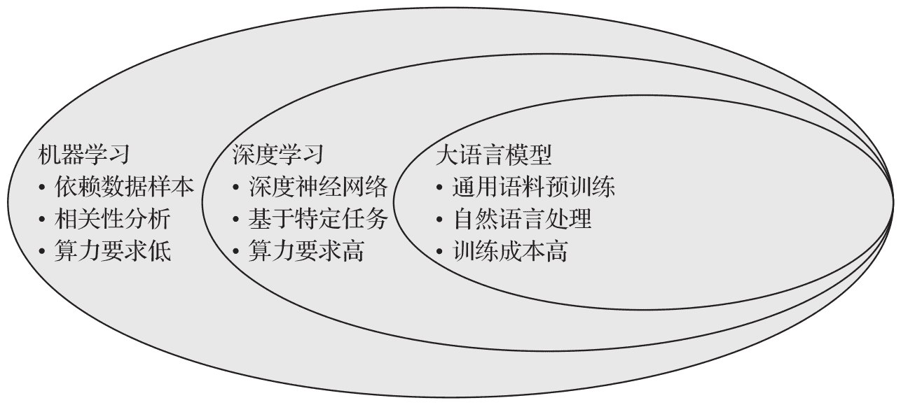

图 2-1 机器学习、深度学习和大语言模型的关系

制造业真正大规模应用 AI 技术始于机器学习。工业 4.0、智能制造和工业互联网的兴起为机器学习的规模化应用提供了肥沃的数据土壤。其极低的算力要求和基于特征的相关性分析在生产制造及服务运维中大有用武之地，成效显著。而深度学习通过多层神经网络自动提取数据特征，解决了传统机器学习的“特征工程”（即样本数据）难题。同时，深度学习可以通过模拟人脑神经网络[如卷积神经网络（CNN）、循环神经网络（RNN）等]，处理高维非结构化数据（包括图像、语音、文本、视频等）。深度学习的算力要求相对较高，且计算过程比较耗时，主要应用于大型科研项目，在制造业应用场景相对受限。以战胜李世石的 AlphaGo Lee 为例，其分布式架构采用了 1202 个 CPU 和 176 个 GPU，单次对弈电费高达数千美元。鉴于此，人们开始提出了预训练模型（Pre-trained Model），即通过在大规模数据集上预先训练获得通用知识，再通过微调（Fine-tuning）适配到具体任务。这大幅降低了深度学习对数据训练和算力的门槛，也催生了今天的大语言预训练模型[简称大语言模型（LLM）]。大语言模型通过预训练成为一个合格的“大学生”，具备了基本的科学知识，再步入企业，通过实习来微调成为一名“行业专家”。

机器学习、深度学习与大语言模型构成了一条从基础理论到规模化应用的技术链。三者的协同进化既体现了算法、数据和算力的相互促进，也揭示了技术发展与社会需求的双向驱动。未来，这一技术生态将在多模态融合、伦理治理和能源效率等方向持续突破，推动人工智能从工具性智能向通用人工智能（Artificial General Intelligence，AGI）迈进。

# **第三章 数字化转型的底层逻辑：四层驱动模型**

## **3.1 数字化转型的概念及提出背景**

企业数字化转型的概念最早由 IBM 公司在 2012 年提出，其核心强调通过应用数字技术重塑客户价值主张、增强客户交互与协作。数字化转型的本质是通过技术工具与组织变革的深度融合，解决传统企业效率、协同、决策与创新的底层问题。其核心价值在于将数据转换为生产要素，推动企业从“经验驱动”范式向“数据驱动”范式的跃迁，最终实现商业模式的可持续迭代。

20 世纪后期，随着计算机和信息技术的普及应用，制造业开始大规模引入企业级信息系统，如产品数据管理系统（PDM/PLM）、企业资源计划管理系统（ERP）、生产执行系统（MES）等。这些系统承载了企业内不同业务领域的核心数据和业务，我们称之为数据源系统（System of Record）。随着企业信息化进程的持续推进，企业内部会建立越来越多的数据源系统，随之而来的困扰是一个又一个烟囱式信息孤岛。这些信息孤岛加上传统的功能型组织壁垒，使得产品数据和业务流程在不同的业务环节中被分散割裂，成为当前企业转型升级的主要瓶颈。

数字化转型就是在此背景下提出来的。数字化转型的核心在于解决传统企业面临的数据孤岛问题，以及由此引发的效率瓶颈、业务模式僵化与决策滞后等问题，具体表现为以下四方面。

1.打破数据孤岛，实现全链条协同

传统企业的各部门数据割裂，数字化转型通过建立统一的产品数字主线，打通研发、生产、售后等环节的数据壁垒，提升上下游之间的协同效率。在打造数字主线的过程中，纵向集成与横向贯通是两大核心逻辑，分别聚焦企业内部效率提升和产业链协同能力构建，共同推动企业从“数据孤岛”迈向“全域互联”。纵向集成以企业内部的垂直穿透为核心目标，通过打通管理层（ERP、PLM 等）、执行层（MES、MOM 等）与设备层（SCADA、PLC 等）的系统壁垒，实现数据从战略决策到生产执行的端到端流动。而横向贯通则强调跨部门/组织的横向拓展，通过连接上下游业务环节，实现以订单驱动的研发、制造、供应链等全链条数据协同。

2.优化业务流程，凸显竞争优势

通过数字化技术（如大数据分析、人工智能等）重构研发流程和管理模式，从而提升产品质量，缩短产品上市周期，降低研制成本等。制造企业的业务流程重构不仅是技术驱动的变革，更是一场涉及战略、组织、技术和文化的系统性革新，需以数字化战略为锚点，以自顶向下（从顶层设计到核心价值流程）的方法论为引导，通过“战略-组织-技术-文化”四维联动，推动从局部优化到全局变革的跃迁。其核心目标不仅是提质降本增效，更是构建面向未来的敏捷型、差异化竞争优势。

3.从经验驱动转向数据驱动决策

在 VUCA（易变、不确定、复杂、模糊）时代，数据驱动决策成为企业敏捷应对变化的“数字神经系统”。从经验驱动转向数据驱动决策，本质是通过工业物联网、AI 与大数据技术，将碎片化经验转化为可量化、可迭代的智能知识网络。而消除数据孤岛和组织壁垒，构建面向产品全生命周期全价值链的数字主线是实现数据驱动的前提和基础。通过知识图谱与实时数据的融合，企业将构建“自感知-自决策-自优化”的智能中枢，在产业链协同中重塑竞争力。可以预见，掌握工业数据主权与知识网络的企业，将主导下一代制造业价值链的重塑。

4.客户需求升级与业务模式转型

从制造业数字化转型的视角来看，客户需求升级与业务模式转型之间存在紧密的互动关系。客户需求的个性化、服务化及快速响应等倒逼企业重构业务流程，驱动企业转向个性化定制、柔性化制造、服务化延伸与生态协同，从而实现从“以产品为中心”向“以客户为中心”的转型升级。而数字化转型则为业务模式转型和创新提供了技术支撑和实现路径。通过数字化技术（如工业互联网、大数据、云计算等）重构生产流程、供应链及商业模式，形成“需求牵引-技术赋能-模式迭代”的闭环。

## **3.2 企业数字化转型历程：从流程效率到业务转型**

数字化转型自提出以来，经历了两个阶段，我们称之为数字化转型 1.0（DX 1.0）和 2.0（DX 2.0）。如图 3-1 所示，企业数字化转型从 1.0 到 2.0 的演进，本质是从局部流程优化向全局业务重塑的跃迁，其核心逻辑可概括为“效率驱动→数据驱动→价值驱动”的螺旋式升级。

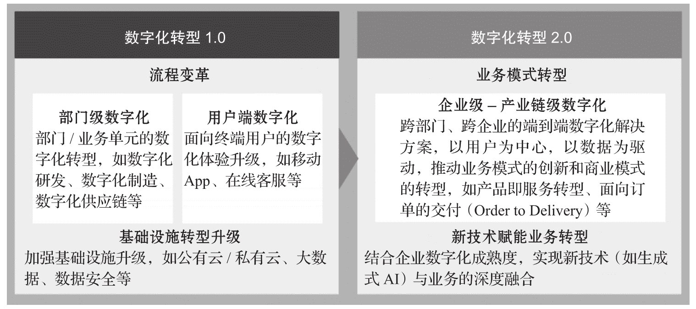

图 3-1 数字化转型从 1.0 到 2.0

数字化转型 1.0 是企业开展数字化转型的初级阶段，缺乏专业且富有经验的数字化团队，尚未形成全面的数字化战略，主要以部门级、局部试点为主。这一阶段数字化转型的重点是在部门级范围内通过数字化技术与流程优化解决信息孤岛问题，实现端到端业务协同，从而提升流程效率，降低运营成本。其核心特征在于以部门为单位的业务流贯通，而非企业级全局数字化体系建设，本质是通过局部流程数字化为后续的全价值链协同奠定基础。譬如，很多装备制造企业开始在研发域推动模块化设计，通过解耦复杂系统、标准化接口与灵活重组，构建基于模块的多专业协同体系，以及支持用户定制的产品配置模式，从而大大提升设计重用率，缩短开发周期，降低成本。对电子高科企业而言，这一阶段往往会通过构建主数据管理系统（MDM），实现从部门到企业范围内物料基础数据的统一治理。例如，采购部门通过 MDM 平台统一物料编码、供应商信息，消除采购与仓储系统的数据冲突，确保采购订单与库存数据的实时一致。由此可见，这一阶段的数字化建设以部门级业务流程优化和在线化为主，尚未触及业务模式创新。数字化转型 1.0 阶段以 IT 基础设施架构的转型升级与基础数据采集为主，如通过技术升级、部署部门级的数字化系统，来实现工具效率提升或业务能力扩展。

随着数字化转型的持续推进，企业管理层逐渐发现部门级数字化转型的弊端，即部门思维，其结果是打造新一轮的数据孤岛。与此同时，国际地缘政治冲突、贸易壁垒升级、供应链中断等宏观形势正在加剧制造业成本压力和供应链体系重塑风险，进而威胁到企业现有的商业模式。为了在新常态中生存和发展，企业除了优化成本之外，还必须采用数字化思维重塑企业价值链，以敏捷响应国际形势和市场需求的变化，推动商业模式的转型升级，实现持续的业务增长。因此，我们正在见证数字化转型 2.0 时代，技术应用的重点转向通过商业模式创新实现业务增长。

数字化转型 2.0 阶段标志着企业从局部效率优化迈向业务战略驱动的系统性、全局价值重塑，其核心是通过数据驱动、技术融合与生态协同重构业务流程、组织架构及商业模式，形成以客户为中心、以数据为驱动的智能生态体系。这一阶段的关键在于以业务需求为牵引，打破传统组织壁垒，实现全价值链的智能化与敏捷化。与数字化转型 1.0 相比，数字化转型 2.0 阶段体现了以下几个特征。

1.技术架构：从传统 IT 到云原生与智能化

**●1.0 阶段**。以传统 IT 架构（物理服务器、专用数据库和本地化部署等）为基础，聚焦信息化与流程自动化，技术应用多为单点工具型（如基础数据分析）。

**●2.0 阶段**。技术架构向云原生、微服务、容器化等灵活架构迁移，支持高扩展性与敏捷迭代。例如，利用工业云平台的开放技术架构，整合云计算、AI、物联网等数字化技术，为企业打造一套智能化的闭环数字系统。同时，低代码开发降低了技术门槛，业务部门可快速搭建应用，加速创新落地。

2.价值导向：从效率优化到战略重塑

**●1.0 阶段**。数字化集中于单个部门或流程（如财务系统、生产自动化），目标是提升效率与标准化流程。但这种“部门思维”往往忽略了一点：数字化转型是一项系统工程，其核心在于将企业价值链的各环节视为动态联动的有机整体，而非孤立的局部改造。以模块化设计为例，很多企业只在研发域内推进模块化设计，而忽略了工艺、制造、采购和售后服务等业务环节，导致“模块”走出研发部门就要被拆散，不但没有起到降本提效的作用，反而极大地增加了工艺、制造等部门的工作负荷。由此可见，1.0 阶段并没有解决数据孤岛与组织壁垒问题，业务模式也未发生本质变化。

**●2.0 阶段**。以业务战略为主导，立足于企业全局，自顶而下制定完整的数字化蓝图，重构数字化价值体系，从而实现全链条的敏捷响应与价值共创。华为的数字化转型 2.0 阶段始于 2016 年，明确数字化转型需服务于“构建万物互联的智能世界”的愿景，其核心目标是围绕“ROADS 体验”（实时、按需、全在线、自助、社交化）重构业务逻辑，将数字化定位为企业级战略，而非单纯的技术升级 ^(¹⁷)。在研发域，华为基于 IPD（Integrated Product Development）流程，成立了包括 IPMT、PMT、PDT、TDT 等在内的跨层级、跨专业的矩阵式研发团队，打破了部门壁垒，实现并行开发，实现了市场与产品、战略与执行、经营与管理、开发与支持的目标对齐和职能协同。这一阶段的核心以业务战略为导向，通过技术与业务深度融合打破组织壁垒，驱动业务模式创新。

3.数据驱动：从局部统计到全链路闭环

**●1.0 阶段**。数据沉淀于相互隔离的业务系统中，主要依赖系统之间的点对点集成来实现上下游数据的传递，虽然引入了企业数据总线或数据中台等类似的技术，却依然无法实现数据驱动的业务闭环，关键在于尚未实现端到端的价值链整合。

**●2.0 阶段**。数据成为核心生产要素，面向产品生命周期构建持续、动态的产品数据流，实现跨部门、跨企业的数据无缝流动，实现全价值链（如研发、制造、供应链、服务等）的数字化贯通。华为的集成供应链（Integrated Supply Chain，ISC）服务变革是其数字化转型 2.0 阶段的标志性实践，通过端到端的业务流程重构（包括计划、订单、物流等）与数字化技术的深度融合，提升了整体资源配置效率，实现了供应链效率的跨越式提升 ^(¹⁸)。美的通过工业互联网平台实现 C2M（Customer-to-Manufacturer）柔性制造，成功从传统的“以产定销”模式转型为需求驱动的“以销定产”敏捷模式，其核心在于打通了研发、生产、供应链等价值链环节，实现订单从客户需求到生产交付的端到端透明化管理 ^(¹⁹)。

4.组织文化：从职能型到敏捷型组织

**●1.0 阶段**。传统金字塔型组织是一种静态、孤立、结构化的层级结构，主要以稳定性为设计目标，决策权沿着层级结构向下流动，最强大的治理机构位于顶层（即最高团队）。它通过线性规划和控制来运作，从而为股东获取价值。这种骨干结构虽然坚固，但往往僵化 ^(²⁰)。在数字化转型 1.0 阶段，企业依然以传统的金字塔型、层级制组织架构为主，通过专业化分工来设定职能部门。各部门独立运作，缺乏整体战略协同，跨部门协作需通过流程和逐级管控实现，导致出现效率低、响应慢、创新受限等问题。

**●2.0 阶段**。敏捷型组织（兼顾稳定性和活力）是由团队组成的网络，其文化以人为本，以技术赋能，在快速学习和快速决策的周期中运作，并以明确的共同目标为指导，即为所有利益相关者共同创造价值，如图 3-2 所示。这种敏捷运营模式能够快速地效地重构战略、结构、流程、人员和技术，以创造价值和保护价值。因此，敏捷型组织在稳定性的基础上增加了速度和适应性，从而在动荡、不确定、复杂和模糊（VUCA）的环境中创造关键的竞争优势。数字化转型 2.0 阶段的核心目标是要实现业务战略重构，而敏捷型组织变革是实现这一转型的核心支撑和保障，从而增强跨部门协作与快速响应市场变化的能力。

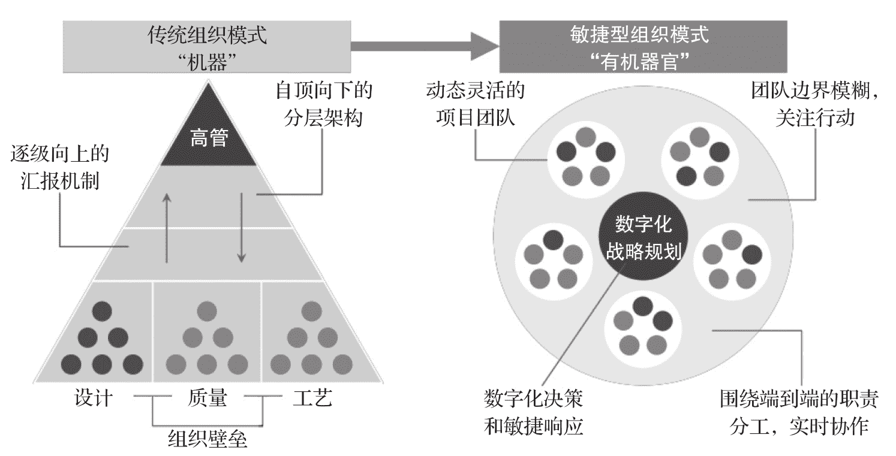

图 3-2 传统金字塔型组织到敏捷型组织模式

## **3.3 数字化转型四层驱动模型：构建企业全价值链的数字竞争力**

在数字化转型的浪潮中，众多企业虽积极投入资源，却常陷入“投入大、见效慢”的困境。数据孤岛林立、跨部门协作低效、技术与业务“两张皮”、敏捷响应能力不足等问题，成为阻碍转型的核心挑战。例如，某传统制造企业斥巨资引入 ERP 与 MES 系统，但因研发、生产、供应链数据未打通，导致需求变更需要人工跨系统传递，订单交付周期不降反增；还有一些企业虽部署了工业互联网系统和解决方案，却因缺乏统一数据标准与分析能力，海量的设备运行数据无法转化为工艺优化决策。这些现象揭示了一个本质问题：数字化转型绝非局部技术堆砌，而需以系统性框架重构企业全价值链。

在此背景下，笔者基于多年的行业实践和经验积累，总结出了“数字化转型四层驱动模型”，如图 3-3 所示。该模型从数据治理、能力沉淀、流程贯通、智能应用四个层级逐级突破，为企业提供从战略规划到落地实施的完整路径。下面结合典型场景，解析如何通过四层模型破解转型困局，实现从“被动适应”到“主动引领”的跨越。

1.第一层：数字底座层——打破数据孤岛，筑牢转型基石

数字底座层需要从根本上解决企业转型过程中面临的困局，即数据孤岛和流程割裂问题，在不改变企业现有 IT 系统格局的前提下，实现孤岛式系统与前端业务之间的无缝衔接。数字底座层是数字化转型的底层支撑，其核心目标是通过全域数据贯通与标准化产品数据要素管理，构建企业级的数字资产体系。

2.第二层：数字能力层——沉淀核心能力，激活组织敏捷性

数字能力层是要解决部门能力碎片化，难以快速响应市场需求的问题。通过数字能力层，一方面解决多专业、跨部门协同设计效率问题，另一方面也通过在线化来沉淀设计知识和过程数据，为后续的业务在线和 AI 应用夯实数据基础。

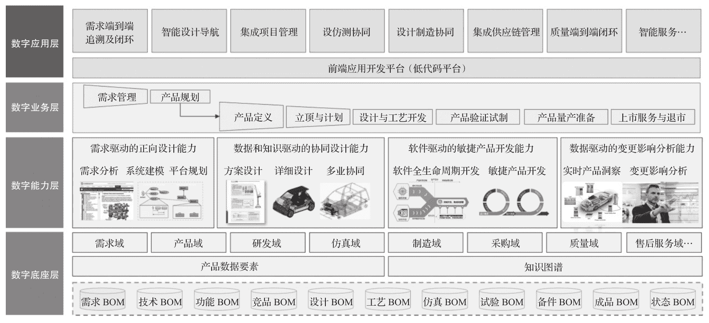

图 3-3 数字化转型四层驱动模型

3.第三层：数字业务层——贯通端到端流程，释放业务价值

数字业务层是在数字能力的基础上，进一步贯通跨部门业务流，实现由点到面的跃迁，从而极大地释放数字化带来的整体业务价值。例如，通过需求、设计和仿真能力的在线，就可以实现需求驱动的设计仿真协同，以及需求端到端追溯和闭环管理。同时，端到端的业务在线能够沉淀和积累更多更优质的业务数据和知识，为 AI 智能应用开辟了无限广阔的空间。

4.第四层：数字应用层——赋能智能决策，驱动持续创新

数字应用层将彻底改变工程师的工作界面，摆脱传统工业软件界面复杂、操作烦琐、频繁切换多个系统等的约束，采用基于角色的 App 应用，紧密绑定设计上下文，以“所见即所得”、一步到位、简单易用的方式呈现在其眼前。

在数字化转型实践中，许多企业都陷入了“技术驱动”的误区，过度追求先进工具而忽视业务本质的需求，最终导致转型效果有限，且难以持续。数字化转型四层驱动模型的核心逻辑在于“以业务为主，以技术为辅”，即业务战略决定转型方向，技术作为实现目标的工具。该模型通过逐层递进的架构设计，确保技术与业务深度融合，最终服务于企业价值创造。

后面我们将对该四层模型进行深度剖析，并探讨具体的实践路径。

### **3.3.1 数字底座层：夯实数据驱动的基石**

在制造业数字化转型中，产品数据要素是贯穿产品生命周期（设计、制造、服务等）和全价值链（客户、供应链、财务、运营等）的核心载体，是企业构建敏捷响应能力与持续创新的核心资产。其本质是通过数据标准化、贯通与复用，构建以产品为中心的数字底座，支撑企业从需求到交付、从数字到物理的无缝协同。基于“数字底座层”架构，企业可实现产品数据的全链路管理，驱动效率提升与模式创新。

1.产品数据要素的范畴及定义

产品数据要素是产品从概念设计到退市后回收生命周期中产生的所有关键数据的集合，是贯彻产品生命周期的数字化脉络，是实现产品全价值链的透明化、协同化与智能化管理的基础。产品在生命周期的不同阶段具有不同的数据要素，如从用户使用角度来看，产品的数据要素以产品功能及运行工况为主，而在产品设计阶段，则以产品需求、BOM、设计数据等为主。我们需要分别梳理产品在各阶段的数据要素，然后将不同阶段的产品数据要素有机衔接起来，从而形成一张完整的产品数据脉络图。以产品为核心的数字化底座如图 3-4 所示。产品数据要素就像人体的血管脉络一样，决定了所能承载的“血液”（即数据和业务）流量和速率。下面以概念设计阶段为例说明产品数据要素的具体内容。

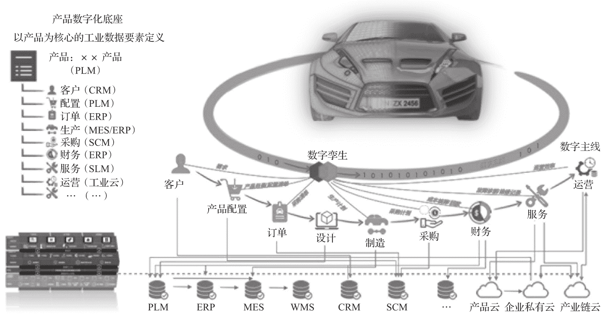

图 3-4 以产品为核心的数字化底座

产品概念设计阶段是连接市场与技术的桥梁，其核心目标是将客户需求转化为可执行的设计输入，形成兼具竞争力与可落地性的产品方案，确保产品开发始终以用户价值为导向。这一阶段的数据要素覆盖从需求捕获到概念验证的全流程，需满足结构化、可追溯、动态更新三大特性。以下是该阶段数据要素的详细分类与定义。

**●产品需求包**：包括功能清单、性能指标、用户体验要求等。

**●市场趋势分析**：包括行业报告、技术路线图、政策法规（如汽车行业的功能安全法规、网络/数据安全法规等）。

**●竞品功能对标**：包括拆解后的竞品功能、技术参数、用户评价，生成的 SWOT 分析矩阵。

**●技术可行性评估**：技术可行性分析报告、关键技术路线。

**●成本与资源约束**：包括预估的研发投入、供应链能力、合规风险（如环保材料认证）。

**●产品概念模型**：包括产品功能模型、产品原型设计等。

**●技术方案数据**：包括产品总体架构、总体技术方案、早期 BOM 清单、产品总布置模型、整机外形数模等。

**●商业价值论证**：包括成本收益模型（预估研发成本、生产成本、市场定价与 ROI 等）、技术风险和市场风险以及应对预案。

2.数字底座解耦及分层逻辑

产品生命周期（需求→设计→制造→服务）与全价值链（供应链→生产→渠道→用户）的数据要素存在多源异构、耦合度高、动态性强等特征，需通过体系化治理实现数据资产化。为降低复杂度，需对数字底座进行分层解耦，并制定相应的治理策略，如图 3-5 所示。

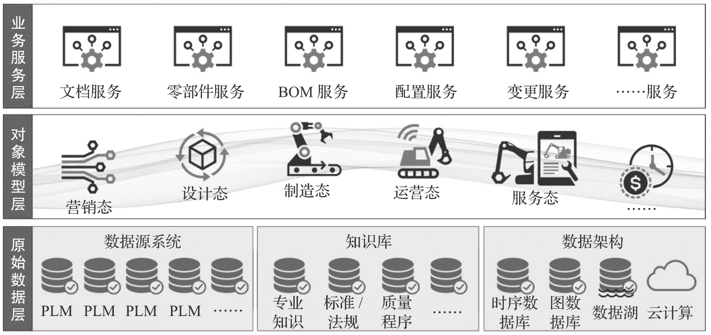

图 3-5 数字底座解耦及分层逻辑

（1）原始数据层（数据层）

**●定义**：原始数据层指企业内存在大量的数据源系统（如 PLM、ERP 等），以及标准/法规、质量程序等各种知识库。

**●功能**：当企业数据规模达到一定程度后，还需构建统一的数据架构（如数据湖）来统一存储多源异构的原始数据（如结构化数据、非结构化数据、时序数据等），支持生命周期各阶段（设计态、制造态、运营态等）和全价值链各环节（供应链、生产、用户等）的数据采集与沉淀。

**●解耦策略**：利用物理解耦，通过数据湖（如 Hadoop、云存储）集中存储原始数据，与上层业务逻辑分离，避免数据冗余和直接依赖。

**●动态适配**：支持灵活接入不同业务态（如营销态、服务态）的实时或批量数据，通过标准化元数据管理实现动态扩展。

**●治理重点**：数据接入规范、元数据管理、数据安全与生命周期管理。

（2）对象模型层（逻辑抽象层）

**●定义**：对象模型层主要对原始数据进行抽象、建模和标准化，形成企业级统一数据模型（如领域对象、实体关系模型），消除业务语义差异，支撑跨价值链的数据一致性。

**●逻辑解耦**：通过对象建模工具将产品数据要素转化为业务可理解的逻辑对象，实现业务逻辑与数据之间的解耦，从而屏蔽底层数据源的异构性。

**●服务化封装**：提供标准化的数据服务接口，供上层按需调用，避免业务层直接访问原始数据。

**●治理重点**：数据模型标准化、主数据管理、数据关联追溯。

（3）业务服务层（应用支持层）

**●定义**：业务服务层基于对象模型层提供的数据能力，快速构建面向业务场景的微服务（如 BOM 服务、产品配置服务等），支持全价值链的敏捷创新。

**●功能解耦**：通过模块化服务设计（如微服务架构），将业务功能拆分为独立服务，减少跨服务依赖。

**●动态编排**：结合业务态（如设计态→制造态）需求，灵活组合数据服务与业务逻辑，支持快速响应变化。

**●治理重点**：服务接口标准化、业务场景适配、服务监控与性能优化。

通过上述分层解耦思路，可以大大降低数字底座的复杂度，并可基于此制定灵活、分阶段的建设规划和治理策略。具体价值体现如下。

1）降低复杂度：通过分层隔离数据存储、逻辑抽象与业务应用，减少各环节的耦合依赖。

2）提升灵活性：支持多业务态（如设计态、服务态）独立演进，适应动态业务需求。

3）增强数据资产化能力：通过标准化治理（元数据、模型、服务接口），实现数据跨生命周期和价值链的高效流通与复用。

4）加速创新：业务服务层可快速调用底层数据能力，支持业务敏捷创新，缩短新场景（如用户画像、智能预测）的开发周期。

通过这一架构，企业能够在复杂的数据环境中实现“数据-模型-服务”的逐层解耦，为数字化转型提供坚实的底座支撑。

3.数字主线：数字底座核心技术架构

数字主线作为数字化转型的核心技术架构，其本质是通过标准化、集成化、智能化等技术手段，将分散在研发、制造、供应链、服务等环节的数据孤岛连接为有机整体，打造横跨全价值链的动态数据流，推动企业实现从经验驱动向数据驱动的转型。从数字底座的分层维度来看，数字主线涵盖了对象模型层和业务服务层，而数据治理则侧重于原始数据层。

作为企业打造数字底座的核心技术路径，与数据治理相比，数字主线具有以下特征。

**●目标定位：动态协同与静态规则**。数字主线以实时数据流驱动端到端业务协同，其核心是“用数据提效”。而数据治理聚焦于数据的规范化管理，包括数据质量、安全、元数据、主数据等模块，目标是建立统一的数据标准与治理体系，确保数据的准确性、一致性和合规性。简而言之，数据治理以标准化规则保障数据质量与安全。

**●覆盖边界：产品生命线与企业数据域**。数字主线以产品为中心，聚焦产品生命周期，构建纵向贯通的数据脉络。而数据治理则覆盖企业全域数据资产（包括营销、财务、客户等），建立横向统一的管理框架。

**●技术逻辑：流式互联与分层管控**。数字主线是“数据流+业务流”的网状连接框架，依赖实时数据流驱动业务协同和敏捷响应。而数据治理则通过主数据管理、元数据目录与权限分层，确保数据规范可控。

**●价值重心：敏捷创新力与风险防御力**。数字主线旨在将碎片化的业务环节串联为高效协同的网络，赋能快速迭代、闭环优化等业务创新，从而为企业创造增量价值。而数据治理旨在提升数据一致性，规避数据错误，降低合规风险，以守护数据安全。

由此可见，产品数字主线是“用数据”的工具，解决“如何让数据流动并创造价值”的问题。而数据治理则是“管数据”的规则，解决“如何让数据可信且合规”的问题。两者互补共生，而非替代关系。无数据治理的数字主线，可能会因数据质量低下而沦为“垃圾管道”；无数字主线的数据治理，可能会因无法赋能业务而成为“纸上规则”，最终深陷“数据泥潭”而难以自拔。企业需以数据治理筑基、以数字主线为脉，方可实现“数据可信、价值可期”的数字化转型目标。

数字主线的构建是数字底座的核心技术工程，实现时需系统化推进以下三大核心能力，确保数据从源头到终端的全链路贯通。

（1）数据标准化与模型定义：构建统一的数据语言

数据标准化是数字主线的基础，其核心在于消除跨系统、跨部门的数据异构性。

企业需首先制定全局数据标准，如统一物料清单（BOM）的结构与编码规则。在汽车行业，VDA 标准被广泛采用，确保主机厂与供应商使用同一套零部件编码体系，避免因数据歧义导致的供应链混乱；类似的行业编码标准还有民用航空的 ATA100、能源电力行业的 RDS-PP 等。

其次，还需要为每个阶段的 BOM 对象定义元数据模型，用于明确每个对象所需包含的元数据信息，包括每个数据字段的定义、来源及更新规则等，如定义“设计 BOM”必须包含材料规格、公差范围等关键属性。

最后，需要通过对象化、模型化的方式进行全局数据建模，并建立各阶段数据模型之间的关联，以保证数据标准和规范与产品业务深度融合。可借助企业架构工具（如 EA 等）规划模型架构和数据流程图，以直观展示从需求到服务的全链路数据交互逻辑，为后续的系统集成奠定基础。图 3-6 所示为以产品为核心的数字化底座，这里以“产品需求—设计模型—制造模型—产线模型”过程为例，展示了全局数据模型与元数据模型及相互之间的逻辑关联（仅供示意，实际情况比图示要复杂得多）。

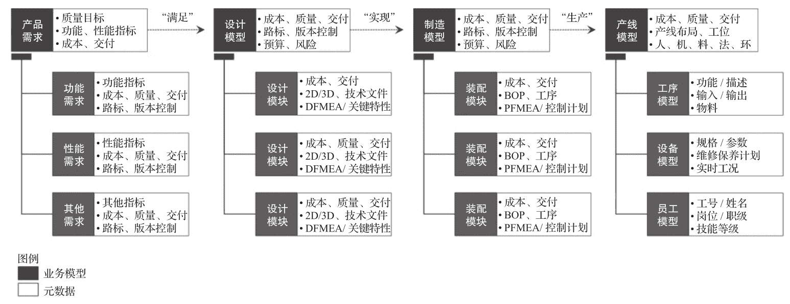

图 3-6 以产品为核心的数字化底座

在数字主线的构建中，实现模型与数据的解耦是确保数字主线灵活性、可维护性和可扩展性的关键，确保模型“一次定义，全局复用”。同时，数据独立于具体业务模型而存在，也能确保数字主线模型不受底层数据源系统更新迭代的影响。

（2）系统贯通与数据聚合：打破数据孤岛

在完成企业级数据标准化体系建设后，系统集成已成为破解异构系统协同困境的关键命题。传统集成模式主要存在两种范式：基于 API 的点对点直连集成与中间件驱动的集中式集成。然而，在数字化转型深入推进的背景下，这两种模式均难以支撑数字主线所要求的全要素连接与动态协同能力。数字主线作为贯穿产品生命周期的数据流通管道，其核心价值在于实现业务流、数据流与价值流的三流合一，这对集成架构提出了更高要求。

为突破传统集成模式的局限，建议构建具备以下特征的低代码数字主线平台。

**●模型驱动架构**：承载全局数据模型及模型间的关联逻辑，形成统一语义层。

**●多源接入能力**：向下兼容 PLM、ERP、MES 等核心业务系统，以及物理设备（如产线设备、智能产品等）的数据接入，支持实时数据调用。

**●服务化输出**：向上通过标准化服务接口（如 REST、GraphQL）向业务应用提供聚合数据服务。

在此，工业互联网平台因其特有的技术优势成为理想载体。

**●**支持 OSLC（生命周期协作开放服务）等国际标准接口协议。

**●**提供低代码/无代码开发环境，降低技术门槛。

**●**具备 OT/IT 融合能力，可同时接入业务系统与物理设备。

在系统适配层面需实施以下分级策略。

**●即插即用层**：符合 OSLC 规范或提供 RESTful API 的系统（如 Windchill、SAP S/4 HANA 等）可直接接入。

**●适配改造层**：对遗留系统（Legacy System），需开发专用连接器来实现协议转换。

**●架构迁移层**：建议将关键业务逐步迁移至微服务架构平台，采用 Spring Cloud 等框架重构核心功能模块。

该演进路径既能满足当前集成需求，又能为企业架构的持续演进预留技术空间。通过分层解耦与渐进式改造，最终实现从“数据孤岛”到“数字生态”的跨越式转型。

（3）实时数据流构建：从静态到动态的跃迁

作为数字主线的核心价值实现环节，实时数据流构建旨在突破传统离散式数据管理的桎梏，通过建立持续流动的数据价值链，实现从静态记录到动态智能的根本性跃迁。本阶段重点解决产品生命周期中的“数据时延”问题，其关键价值体现在以下维度。

**●决策响应提速**：将数据反馈周期从“天级”压缩至“秒级”。

**●闭环优化加速**：建立“设计-验证-迭代”的持续集成环（CI Loop）。

**●跨域协同增效**：打破专业壁垒，实现多学科实时协同（MSE）。

通过观察数字化转型实践发现，数据流缺失引发的效率损失呈现系统性特征。

**●需求变更传导滞后**：客户需求或市场反馈无法实时同步至设计团队，导致产品偏离用户预期或偏离市场动态。

**●设计验证反馈迟滞**：传统模式下，设计完成后需手动提交仿真测试任务，仿真测试结果需数天甚至数周才能反馈，造成研发周期非线性延长。

**●跨团队协同低效**：机械、电子、软件等专业团队使用独立工具，数据交换依赖人工导出及导入，版本混乱，风险高。

现代流处理技术栈（如 Apache Flink 和 Apache Kafka 等）为实时数据流构建提供了核心支撑。

**●Apache Flink**：作为有状态流式计算引擎，支持海量数据的高吞吐传输，可对海量数据流进行实时清洗、转换与分析。

**●Apache Kafka**：构建分布式事件流平台，提供可扩展的事件驱动型消息传递基础架构，确保接收持续的实时事件流（如需求变更、设计变更等），形成企业级数据神经系统。

**●动态数据网格（Data Mesh）**：Kai Waehner 等提出基于 Kafka 架构，通过跨域数据语义对齐，可建立去中心化可治理的实时数据网络，进而实现企业跨域实时流数据交换 ^(²¹)，如图 3-7 所示。

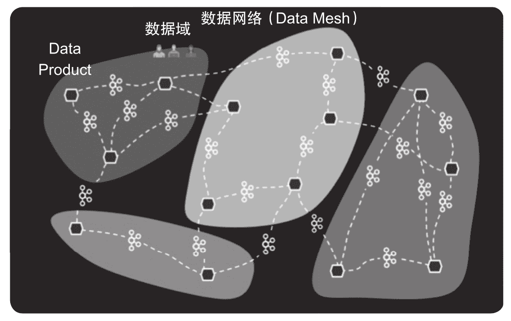

图 3-7 动态数据网格（Data Mesh）示例

基于这一技术路径，可帮助企业构建动态、网状的数字主线，进一步实现企业级业务的自动化，如订单变更事件触发产品设计变更，进而驱动供应链系统重新计算采购计划，确保资源动态优化等。

4.数字底座层的数据架构

数据是企业的命脉，是企业数字化转型最终要解决的核心问题。没有高质量、易于访问的数据，任何 AI 智能应用都将是无源之水。因此，构建一个能够支持敏捷开放和智能分析的数据基础架构至关重要。当前主流的数据架构模式包括云计算、数据中台、数据湖等，它们各有侧重，但目标都是更好地服务于上层应用。

（1）云计算：弹性可扩展的骨干

云计算为数字底座提供了必不可少的弹性计算能力和海量存储资源。它支持云原生架构，包括微服务、服务治理、消息中间件、数据库中间件和安全网关等关键模块，构成了数字底座的“安全融合云底座”。这一云底座的设计理念强调兼容历史系统、融入当前的信创（信息技术应用创新）需求，并具备面向未来的可进化能力。例如，华为的数字平台便以云为基础（支持公有云、私有云和混合云部署），并遵循“同架构、同 API、同体验、同服务、同生态”的“5 同”原则，以实现多云环境下的应用一致性和高效部署 ^(²²)。基于云打造现代数据战略，可以利用云的弹性，按照业务变化及时响应业务对数据存取的需求，已经成为企业现代数据资产管理、数据变现的目标 ^(²³)。云计算平台在实现人工智能辅助的数据治理方面也扮演着关键角色，能够提供自动化的数据清理、分类和保护能力。

云计算之所以成为现代数字底座事实上的标准基础设施层，在于其固有的可扩展性、弹性及服务化的特性，这与数字底座对敏捷性和可扩展性的要求高度契合。然而，企业在构建基于云的数字底座时，也面临着管理混合云、多云环境的复杂性。因此，数字底座需要具备先进的管理和编排能力，以应对兼容历史遗留系统和整合不同云环境带来的挑战。

（2）大数据技术：驾驭数据洪流以获取洞察

大数据技术是处理海量、多源异构数据的核心。它是数字底座“一体化技术平台”的重要组成部分。大数据技术栈的关键功能覆盖了数据采集、数据处理（包括清洗、抽取、转换）、数据存储（如数据仓库、数据湖）及数据分析等全链路环节。它能够高效处理结构化、半结构化乃至非结构化数据，并通常采用分布式架构以应对海量数据的挑战。大数据技术已广泛应用于智慧城市、智能制造、现代物流、电子商务等众多领域。

大数据技术在数字底座中的重要性，不仅体现在处理数据的“量”上，更在于应对数据“种类”的多样性和数据“速度”的实时性。现代数字应用产生的数据类型日益复杂，从传统的结构化数据到文本、图像、音视频等非结构化数据，以及来自物联网设备的实时流数据，都对数字底座的数据处理能力提出了极高要求。因此，数字底座必须集成强大的数据工程能力，如流处理引擎和灵活的数据湖存储方案，才能对原始数据进行有效的清洗、转换和提炼，使其成为可供分析和应用的高质量数据资产。

5.数据中台：加速数据服务与价值实现

数据中台是实现数据资产化和价值变现的核心组件。它通过对海量数据进行统一的采集、计算、存储、加工，并建立统一的标准和口径，将原始数据转化为标准化的数据资产和服务，进而为上层业务应用和决策分析提供高效支撑。数据中台通常位于数据底座（负责数据的采集、存储和基础处理）之上，扮演着承上启下的关键角色。

数据中台的关键价值在于它充当了原始数据资产与业务应用之间的桥梁，将经过治理和整合的数据封装成易于消费的数据服务及能力（如 API 服务、标签服务、分析引擎等），从而加速了数据价值向上层业务传递的速度。同时，数据中台通过推行统一的数据标准和构建可复用的数据资产及服务，有效打破了企业内部的数据壁垒，提升了数据的一致性和可信度，为更可靠的分析和决策奠定了基础。

6.数据湖与现代数据仓库：存储、管理和访问多样化数据资产

数据湖技术为存储海量的原始格式数据提供了灵活的解决方案，它能够容纳结构化数据、半结构化数据乃至图像、音视频等非结构化数据，这对于处理来自物联网、社交媒体等渠道的爆炸式增长的异构数据至关重要。传统的数据仓库则更侧重于存储和管理经过清洗及转换的结构化数据，以支持商业智能和报表分析。现代数据管理的趋势是融合两者的优势，形成所谓的“湖仓一体（Lakehouse）”架构，既保留数据湖的灵活性和可扩展性，又具备数据仓库的强管理和高性能特性。

数据湖和湖仓一体架构的兴起，反映了数字底座在数据管理层面应对数据多样性和复杂性的迫切需求。数据湖的“读时模式”（Schema-on-Read）特性允许快速接入各类原始数据，无须预先定义严格的表结构，这极大地提升了数据采集的敏捷性。而数据仓库的“写时模式”（Schema-on-Write）则为结构化分析提供了性能和治理保障。湖仓一体架构正试图在敏捷性、灵活性与性能、治理之间取得平衡，以更务实的方式满足现代数字底座对多样化数据管理的需求。

这些技术并非孤立发展的，而是相互依存、深度融合的，共同构成了现代数字底座的强大技术内核。它们的协同效应使得数字底座能够有效地应对日益复杂的数据挑战，并为上层应用的创新提供源源不断的动力。

7.数据治理、安全与质量

一个技术先进的数字底座若缺乏有效的治理、可靠的安全保障和高质量的数据，则其价值将大打折扣。因此，以下三个方面是确保数字底座成功实施并持续发挥效能的关键成功因素。

（1）建立全面的数据治理框架

数据治理是对数据资产进行管理和控制的一系列原则、政策、标准、流程和职责的集合，其目标是确保数据的合规性、安全性、质量和业务价值。一个有效的数据治理框架能够帮助组织清晰地定义数据相关方针，明确角色与职责，并确保数据在整个生命周期内得到妥善管理。国际数据管理协会（DAMA）发布的《数据管理知识体系指南》（DAMA-DMBOK）为数据管理和治理提供了全面的行业实践标准和方法论 ^(²⁴)。

数据治理的实施模式可以根据企业的具体情况选择，如“自下而上”，侧重于数据架构的梳理和建设，逐层向上治理数据直至应用层，这种模式通常适用于数据基础较好、技术驱动型的大型企业或政府机构；也可以是“自上而下”，以明确的业务应用需求为导向，聚焦于解决特定业务领域的数据问题，这种模式的切入点相对简单，有助于在实践中逐步提升企业整体的数据认知和治理水平 ^(²⁵)。自上而下的模式是基于明确数据应用驱动的数据治理，相较于自下而上的模式，组织的协同性要求会更高，需要业务部门、数据部门配合实现，但整体以业务需求为主，对数据治理的水平要求一般。由于数据治理具有周期长、任务重、见效难等特点，在构建数字底座的过程中，笔者建议采用自上而下的治理模式，即以业务应用驱动数据治理。无论采用何种模式，数据治理都不应是一次性的项目，而是一个持续的、动态调整的过程，需要随着数据环境、业务需求和法规政策的变化而不断演进。

成功的数字治理框架需要在控制与赋能之间取得平衡。它不仅需要通过建立必要的管控机制来保障数据质量、安全和合规，更需要通过提供自助服务工具、清晰的数据目录和便捷的数据访问方式，来赋能业务用户更方便地查找、理解和使用可信数据，从而支持业务创新和价值创造。

（2）确保数据安全、隐私与合规

数据安全是数据治理的核心组成部分，也是数字底座稳定运行的基石。这不仅包括保护数据免遭未经授权的访问、泄露、篡改和破坏，还包括确保数据处理活动符合相关的法律法规要求，如中国的《个人信息保护法》（PIPL）、欧盟的《通用数据保护条例》（GDPR）等。

根据 PIPL 等法规的要求，企业在数字底座建设和运营过程中，必须严格履行个人信息保护义务。这包括在数据收集和跨境传输前获得用户的明确同意，进行必要的安全评估，采取充分的技术和管理措施来防范潜在风险。在技术措施方面，应广泛应用数据加密、访问控制、身份认证、入侵检测与防御、安全审计等手段。同时，还需要建立完善的数据泄露应急响应机制，确保发生安全事件时能够及时有效地应对。

纵观过去 30 年，中国企业出海经历了从产品出海到品牌出海、供应链出海的过程。科特勒咨询指出，这不仅是因为国内产品结构性过剩，更是中国企业寻求持续增长的必然结果，是中国优秀企业的强大核心能力和创新商业模式在全球市场价值外溢的结果 ^(²⁶)。数据跨境传输成为出海企业生产经营过程中不可或缺的一环。企业必须重视数据跨境传输过程中的隐私保护和合规问题，否则不仅要面临高额的合规成本，而且还会有概率被拒绝出境。根据欧盟 GDPR 的规定，若企业未依法采取完善的保障措施进行跨境数据传输，则可能面临高达 2000 万欧元或相当于公司全球年营业额 4%的罚款风险。据统计，从 2018 年正式实施到 2025 年 3 月，欧盟成员国根据 GDPR 针对与个人数据处理相关的违规行为发起了 2560 起罚款，罚款总额达到 56.5 亿欧元 ^(²⁷)。

安全和隐私保护不应是数字底座建成后的附加功能，而必须在设计之初就融入整体架构之中，即遵循“安全内生”和“隐私保障”的原则。随着数据共享和协作需求的日益增长，隐私计算技术（PET）正成为数字底座中愈发重要的组成部分。这些技术，如联邦学习、多方安全计算、同态加密等，能够在保护数据隐私的前提下实现数据的联合分析和价值挖掘。隐私计算技术并非孤立存在的，需要与数字底座的其他能力（如强大的数据处理和存储能力）协同工作，共同解决数据效用与隐私保护之间的平衡难题。

（3）实施主动的数据质量管理策略

高质量的数据是数据驱动决策和智能化应用的基础。如果输入的数据存在错误、不一致或缺失，那么基于这些数据产生的分析结果和决策建议也将是不可靠的，甚至可能产生误导。因此，主动的数据质量管理是数字底座建设不可或缺的一环。

数据治理框架本身包含了设定数据准确性和一致性标准及流程的内容。现代化的数字底座越来越多地引入人工智能辅助的数据治理工具，例如，利用 AI 算法自动进行数据清洗、校验和纠错，以提升数据质量。数据质量管理正从传统的事后被动清理，转向贯穿数据生命周期的主动式管理。这意味着需要在数据产生的源头、数据采集、数据集成、数据存储和数据应用的各个环节都嵌入质量控制的机制和检查点。这种主动的、全流程的质量管理方式，比仅仅在数据仓库或数据湖中进行集中清洗更为高效和彻底。

此外，数据质量并非仅是 IT 部门或数据管理团队的责任，它需要数据生产者、数据消费者和数据管理者等组织内所有相关方的共同参与和努力。业务部门通常最了解数据的业务含义和质量标准，他们的参与对于识别和解决数据质量问题至关重要。数字底座应提供相应的工具和流程，以支持这种跨部门的协作，共同维护数据资产的质量。

### **3.3.2 数字能力层：构建敏捷协同的核心能力**

数字能力层是支撑企业快速响应市场需求、实现跨团队高效协作的核心技术架构。其核心目标是基于数字底座提供的数据链路，将各专业领域的开发流程和业务逻辑抽象成可复用的数字能力模型，整合研发工具链，支撑企业实现高效协同、敏捷响应与持续创新。数字能力层的具体功能如下。

**●能力沉淀**：将设计过程和业务逻辑（如设计规则、工艺参数）封装为标准化、可复用的数字化能力服务（如微服务等）。这里的数字能力包括面向特定业务领域的特定设计能力和多专业在线协同能力。前者如变压器线圈的参数化设计能力；后者如为商用车增加自动紧急刹车（Autonomous Emergency Braking，AEB）功能，需新增控制模块（ECU）、测距模块和制动模块，需要机电软多专业在线协同来共同完成设计验证。

**●工具链集成**：通过整合产品设计、仿真验证、多学科协同等工具，构建覆盖“需求-设计-仿真-试验”全流程的数字化闭环。

**●数据驱动**：通过实时智能分析，替代人工经验决策，提升研发效率与精准度，并为未来的 AI 应用沉淀业务和数据基础。

1.数字化研发能力体系

数字化研发能力是指企业通过数字技术（如大数据、云计算、AI、数字孪生等）重构产品研发流程，实现从需求分析、设计仿真到测试验证的在线化、模型化和集成化协同的能力。在数字化转型的背景下，传统研发范式因工具割裂、数据孤岛与流程断层等问题，面临效率与创新的双重瓶颈。这是迄今为止研发数字化转型面临的最大挑战，无论是从三维模型角度提出的基于模型产品定义（Model-Based Definition，MBD）到基于模型企业（Model-Based Enterprise，MBE），还是从系统工程角度提出的基于模型系统工程（Model-Based System Engineering，MBSE）到数字工程（Digital Engineering），都无法全面解决数字化研发能力体系问题。

MBD 是一种以三维数字化模型为核心载体，全面承载产品几何、工艺、公差、材料等全要素信息的定义方法，彻底取代传统以二维图纸为中心的研发范式，实现产品信息从设计到工艺的一致性定义，并无歧义地传递至制造和检验环节。而 MBE 是一种以模型为核心的企业运营模式，通过将产品生命周期的数据、流程和协作统一到三维模型中，实现设计、工艺与企业其他业务环节（如供应链、质量、运维等）的高度集成与协同，减少人为错误和返工。

MBSE 是系统工程的一种方法论，强调用系统模型（而非传统文档）描述系统的需求、架构、行为和验证过程。通过统一建模语言（如 SysML）构建系统模型，实现跨学科协同和需求可追溯性。而数字工程是更广泛的战略框架，利用 MBSE 的模型基础，通过数字化技术（数字孪生、大数据、AI、云计算等）整合产品生命周期数据，构建从设计到运维的数字主线，实现流程优化与决策支持的整体框架。美国国防部在 2018 年发布的《数字工程战略》中将数字工程明确定义为“基于模型和数据驱动的生命周期集成方法”。其中，数字工件（Digital Artifact）是产品在数字工程各个环节之间进行数据交换的数字化载体，它从不同视角提供产品数据，以便向利益相关者展示数据、信息和知识的可视化、交流和交付 ^(²⁸)。

由上可见，无论是 MBD/MBE，还是 MBSE/数字工程，都希望通过模型化产品定义，以支撑在数字环境中实现产品数据在各业务环节间的无缝流转。然而，MBD/MBE 仅考虑将设计、制造和检验等信息定义到产品三维模型以传递到下游业务环节，无法支持多专业高效在线协同；而 MBSE/数字工程对国内企业而言为时尚早，其原因在于我国复杂装备制造业早年以“逆向工程”为主，近几年才逐步转向正向设计和系统工程，在系统设计领域基础薄弱，缺乏沉淀。此外，对于消费电子等高科技行业，新产品研制周期短、迭代快，是否适用 MBSE 尚在两可之间。

因此，数字主线技术是现阶段企业进行模型化产品定义的最佳路径，既兼顾了企业当前数字化建设的成果（包括系统和数据），又能通过定义统一元数据模型，实现跨系统、跨领域语义模型和标准规范（包括 MBD/MBE、MBSE 等）的对齐。在此基础上，再通过研发数字化能力的解耦与重构，打破传统研发流程中高度耦合的“黑箱”模式，通过模块化拆分、服务化重组和智能化增强，构建灵活可扩展的数字化研发能力体系，从而实现研发资源的弹性配置与创新能力的动态进化，应对产品复杂度攀升与市场需求快速变化的双重挑战。

2.数字化研发能力解耦：从刚性架构到模块化服务

研发流程的解耦通过多层级能力拆分，打破传统研发体系的刚性耦合结构，实现灵活性与效率的提升，具体可从以下五个维度展开。

**●业务逻辑层解耦**。业务逻辑层解耦聚焦研发流程中的需求管理、设计、仿真、测试等核心环节的独立性重构。通过领域驱动设计（Domain-Driven Design，DDD）划分清晰的限界上下文（Bounded Context），将复杂产品开发过程分解为高内聚、低耦合的功能模块。此举可使功能模块独立迭代，大幅降低多团队协同的复杂度。机械产品（如智能机器人、高端装备）通常涉及多学科耦合（如机械、电子、软件等），DDD 的限界上下文可将复杂系统按功能或学科划分为独立模块，例如：传动系统（如伺服驱动、行星齿轮减速机）作为独立上下文，定义其接口与交互规则；将控制系统（如无刷电机驱动算法）作为另一上下文，聚焦精准控制逻辑。这种划分可避免设计冲突，伺服系统闭环控制逻辑与机械传动的物理特性通过明确定义的接口进行协同。

**●业务流程层解耦**。为适配多机型产品的差异化需求，还需要进一步将领域级功能模块系统性解构为若干标准化、组件化设计能力单元，如将需求管理模块分解为原始需求收集、系统需求分解、功能需求验证等。每个能力单元均需明确定义三要素：①输入及输出规范，建立统一的数据接口与交付物标准；②设计工具链，集成设计建模、仿真计算等数字化工具；③方法论体系，固化经验驱动的设计仿真规则（如拓扑优化算法、冲突检测逻辑等）和设计方法（如模块化设计方法等）。

**●数据层解耦**。针对设计数据、工艺数据、试验数据等的割裂问题，构建基于统一标准（如 STEP 等）的产品数据模型，实现跨系统数据语义对齐。通过上文提及的数字主线技术架构，将分散在不同业务系统的数据，如 PLM 中的 CAD 模型、SDM 系统中的仿真分析报告、TDM 系统中的试验数据集等信息转化为可流通的“数据资产”。某动力电池企业通过解耦电芯材料研发数据与结构设计模型，使试验数据实时驱动 CAE 参数优化，缩短约 40%的验证周期。

**●工具层解耦**。工具层解耦是数字化研发能力重构的核心环节，其本质是通过接口标准化、服务轻量化和能力开放化，将传统“黑箱式”工具链拆解为可灵活组合的模块化服务，从而突破工具壁垒，释放数据价值。大型商业化工业软件都在推进这一技术架构升级，使工具能力按需调用，避免“全家桶”式软件的冗余成本。例如 ANSYS 开放 Granta MI 材料库接口，允许企业将选材逻辑嵌入自研设计系统中。对于本土化或自研的业务系统，则需要考虑类似的服务化改造或技术架构升级。

**●组织层解耦**。组织层解耦是数字化研发转型中最复杂的维度，其核心是通过数字化手段打破传统研发组织的物理边界、职能壁垒与层级隔阂，重构“跨部门、跨企业、跨地域”的协同网络，实现资源弹性配置与知识高效流动。这一过程不仅依赖技术工具升级，更需要组织文化与治理模式的重塑。空客 A350 研发中，法、德、英、西四国团队基于 PTC Windchill 平台并行开展机翼、舱段、航电等设计，数据变更实时同步至统一数字样机，大幅减少传统物理样机迭代次数。这种“逻辑集中、物理分散”的研发组织模式，使全球研发资源可弹性调度，大幅提升人力利用率。

表 3-1 总结了五大维度解耦的对象和技术路径。

**表 3-1 数字化研发能力的解耦维度、解耦对象及技术路径**

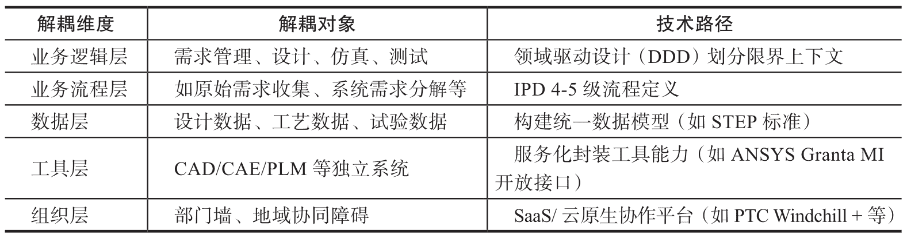

3.数字化研发能力重构：基于数字底座的敏捷重组

基于数字底座的敏捷重组，是数字化研发能力从“解耦”到“重构”的关键跃迁。其核心在于通过微服务架构、业务流程编排等技术手段，将解耦后的模块化设计能力重新编织为灵活、动态的研发网络，实现资源的按需调度与能力的持续进化。这一过程不仅需要技术架构的革新，更依赖于组织模式与商业逻辑的重构。

在企业数字化业务蓝图框架下，数字化能力建模和重构是推动企业实现战略转型和价值重塑的核心过程。该过程遵循业务（B）、流程（P）、组织（O）和技术（T）四大体系，可被清晰地划分为三个紧密相连的阶段：能力架构、能力建模和能力部署，如图 3-8 所示。这三个阶段构成了一个持续的迭代优化闭环，旨在将企业战略转化为可执行的数字化能力，并最终实现业务的全面转型。

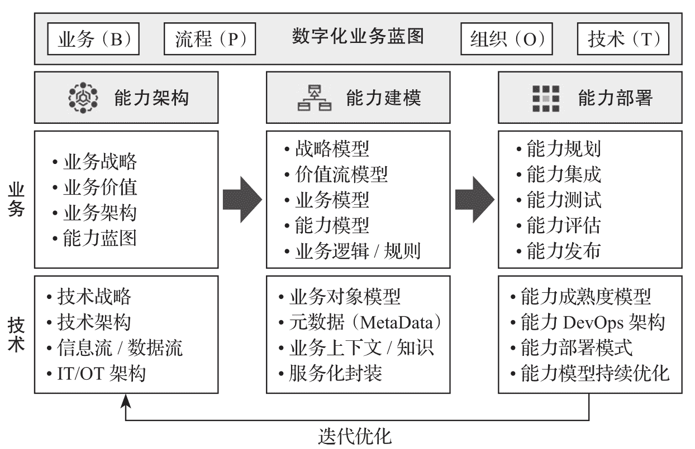

图 3-8 数字化能力建模的三个阶段

（1）能力架构（Capability Architecture）

能力架构是数字化能力建模和重构的起点，其核心是将企业的宏观战略与技术蓝图进行对接，形成可落地的能力规划。

**●业务驱动与战略对齐**：此阶段始于业务战略，通过战略模型和价值流模型的构建来定义企业的业务价值。这确保了能力建设的起点是基于清晰的业务目标和客户价值的，而非单纯的技术需求。

**●技术支撑与架构设计**：与业务战略相对应，此阶段也包括制定技术战略，并构建技术架构，明确信息流/数据流和 IT/OT 架构。这为能力建设提供了坚实的技术底座，确保能力的可行性和可扩展性。

**●能力蓝图构建**：最终，通过业务和技术的融合，形成一份清晰的能力蓝图，指明了企业需要构建哪些数字化能力以支撑其业务战略。

（2）能力建模（Capability Modeling）

此阶段是能力架构的具象化，其核心是将能力蓝图中的抽象概念转化为可操作、可封装的数字化模型。

**●模型构建与业务逻辑**：这一阶段通过能力建模工作，将业务需求转化为具体的模型。这包括构建业务逻辑/规则和业务对象模型，用于定义能力的具体功能和行为。

**●知识与元数据封装**：元数据（MetaData）在这一阶段被定义，以提供业务上下文和知识，使得能力模型不仅包含逻辑，还具备可理解性。

**●服务化封装与集成**：完成建模后，将这些能力以服务化封装的形式进行抽象，使其可以被其他系统或流程调用及进行能力集成。这为能力的重用和互操作性奠定了基础。

**●构建模块化能力组件库**：通过上述的能力建模和服务封装技术，对企业数字能力蓝图规划的核心能力进行抽象提炼后，形成模块化的数字化能力组件库。这些能力组件将设计知识、工程经验、计算逻辑、设计参数等封装为可复用的标准化模块，实现从需求到交付的全链路敏捷创新。具体表现为如下特征。

**●动态配置**：设计能力模块支持动态配置和参数化输入，以支持不同场景下的设计要求。如参数化设计能力，可通过变量定义模块的几何尺寸、材料属性、性能参数（如齿轮模数、电机功率），支持按需生成变体。

**●设计规则/约束**：将材料选型、公差匹配、工艺约束、计算公式（如强度校核公式）等经验转化为可执行的设计规则和计算逻辑，嵌入设计能力组件中，确保生成方案符合工程要求。

**●知识沉淀**：将设计知识/经验、历史案例、失效模式、优化策略等封装到能力组件中，并提供开放的接口以便持续迭代优化。

（3）能力部署（Capability Deployment）

此阶段是将建模完成并服务化封装的能力，通过规划、集成、测试和发布，在企业中落地应用。

**●规划与验证**：这一阶段首先进行能力规划、能力集成和能力测试，以确保新能力的功能、性能和稳定性符合要求。

**●部署与发布**：验证通过后，进行能力发布。部署模式可能采用能力 DevOps 架构和能力部署模式，以支持快速、可靠的部署和持续交付。

**●评估与持续优化**：能力部署后，还需进行能力评估，并启动能力模型，持续优化流程，以适应业务和技术的不断变化，确保能力能够持续地创造价值。

这三个阶段在迭代优化的框架下持续进行，共同推动了企业数字化能力的建设和提升，为实现数字化业务蓝图提供了明确的路径。

4.研发能力跃迁：从离线设计到在线设计

当前，多数制造企业仍深陷“分段式研发”的传统范式：其核心特征表现为 PDM/PLM 系统仅作为设计成果的归档工具和审批流程的电子看板，而真实的设计创作过程（如三维模型设计、结构拓扑优化、校核计算等）仍囿于离散的桌面工具与线下协作模式。这种割裂状态导致以下三大典型症结。

**●协同黑箱化**：总体设计与分系统开发间存在“数据真空带”，机械、电子、软件团队依赖会议与文档传递信息，变更响应常延迟数日乃至数周。

**●知识碎片化**：工程师的隐性经验难以沉淀为可复用的设计规则。某汽车零部件企业统计显示，30%的设计错误源于重复发生的历史设计缺陷。

**●验证后置化**：70%以上的设计缺陷在物理样机阶段才被发现，此时会急剧增加试错成本，影响产品交付周期，如某航天企业因管路干涉问题导致项目返工成本超千万。

究其原因，无外乎数字化流程断点、工具链异构，以及组织惯性阻力等因素。

在数字化研发体系进程中，通过上文所述的系统性解耦与重构，传统设计能力正在发生根本性变革。这种变革的本质在于构建模块化的数字设计组件与智能化的知识服务体系的双螺旋结构。

**●设计能力模块化**：将复杂设计流程拆解为可独立迭代的数字化单元，形成即插即用的能力矩阵。

**●知识资产图谱化**：通过数字主线将离散经验转化为系统化知识图谱，构建包含设计规则库、失效模式库、最优实践库等基于上下文的设计经验库。

这一变革的必然结果是设计模式的在线化重构，即设计师从依赖个体经验转向调用在线化的智能设计系统。其主要表现为以下技术特征。

●**设计活动数据化**：每个设计决策、仿真验证、工程变更均沉淀为结构化数据资产。

●**知识服务自动化**：系统基于上下文自动推送关联知识（如历史相似设计案例、材料兼容性规则、强度校核公式等）。

●**设计协同敏捷化**：通过网络技术、实时数据流与智能工具链等，彻底颠覆传统本地化、孤岛式的设计模式，实现全流程的敏捷响应与高效协同。

●**创新闭环智能化**：通过机器学习构建数据驱动的“设计-验证-优化”闭环迭代模式，为未来端到端的智能业务应用夯实基础。

最终，这种在线化设计生态将形成持续进化的设计数据资产，其价值密度随使用频次呈指数增长，标志着企业研发体系从”经验驱动”向”数据智能驱动”的跨越式转型。

产品研发范式从离线设计（本地工具、结果管理）转向在线设计（网络协同、实时迭代），意味着制造业从封闭式创新向开放式、敏捷化创新的根本性变革，也是研发数字化转型的核心标志。从技术维度，SaaS 工业软件在保证企业 IP 和数据安全的前提下为在线设计提供了全新的解决思路。如 PTC 公司于 2023 年正式发布 SaaS 版 CREO+，通过在本地 CREO 版本的基础上安装一个插件，就可以实现与跨地域团队共享同一设计环境，实时在线进行协同设计 ^(²⁹)。

表 3-2 列举了离线设计和在线设计的对比分析。

**表 3-2 离线设计和在线设计的对比分析**

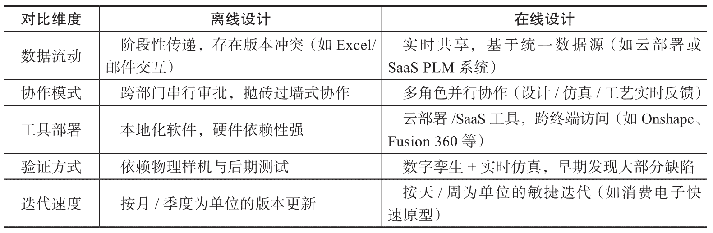

### **3.3.3 数字业务层：业务流程的端到端贯通**

数字业务层是制造业数字化转型的“中枢神经系统”，其核心目标是，基于数字主线和数字能力，构建全链路业务贯通能力与智能决策引擎，实现从市场需求洞察到产品交付服务的端到端数字化闭环。这一层级的构建标志着企业从局部优化迈向全局协同，从流程自动化升级为认知智能化。

1.能力在线与业务在线

如前文所述，能力在线是指通过技术手段将企业核心研发能力标准化、结构化，形成可复用、可扩展的数字化能力模块，实现企业数字化转型的初级阶段，往往呈现出多点化、局部化的特征。能力在线也指企业核心知识与专业技能的数字化沉淀与共享。能力在线往往依托于各类数字化平台，从纵向维度实现“业务能力→业务数据/知识→数字工具链”的整合。然而，能力在线在早期阶段的显著特点是分散性和局部性，即各个业务部门或业务单元可能会独立地将其某些能力从线下迁移到线上，但这些在线能力之间未能实现有效的整合与协同，尚未形成支撑整个企业核心业务流程的合力。这种从分散到整合的过程，正是从能力在线向业务在线演进的关键。

相较于能力在线侧重于特定功能的数字化，业务在线则代表了企业数字化转型的更高阶形态。业务在线的核心在于将企业端到端的价值链流程、核心业务运营及内外部协同过程等整合于线上，形成一个高效、敏捷、数据驱动的数字化业务体系。这不仅可将现有业务流程简单地搬到线上，而且会由此产生并沉淀海量数据资源，为数据资产化和智能化应用奠定基础，更意味着对业务模式、运营模式乃至商业模式的深度变革。业务在线要求企业对研、产、供、销、服等关键领域的业务活动以及跨领域业务活动之间的逻辑关联有清晰明确的定义，并在此基础上实现业务一体化、在线化，以及端到端贯通，从而赋能业务变革与创新。这需要打破跨部门、跨层级、跨区域的组织壁垒、信息孤岛和流程断点，实现有效的沟通、共享和协作。

因此，从能力在线到业务在线的转型，是一个由点到面、由局部到整体、由功能使能到业务驱动的演进过程。它要求企业不仅要关注单点能力的数字化，更要着眼于如何通过战略性的整合，将这些在线能力编织成一张能够支撑整个业务体系高效运转的数字化网络。如图 3-9 所示，企业需要从战略层面，根据各领域数字化的优先级以及各领域之间的内在逻辑，制定从能力在线到业务在线的转型路径。以供应链管理为例，企业首先需要实现物料的分类、分级管理；其次需要实现物料的归一化管理，即解决一物多码（同一个物料对应多个供应商编码）、一码多物（同一个编码对应多个不同物料）问题；最后需要考虑供应商的认证、评级和优选。在此基础之上，再来考虑集成供应链，即供应链整体业务在线，以及与上下游业务环节之间的端到端贯通，从而提升供应链的柔性和敏捷性，例如，可根据市场需求波动，驱动供应链采购策略和库存策略的调整。

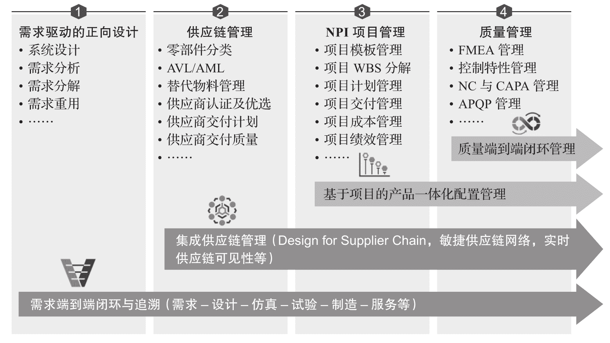

图 3-9 从能力在线到业务在线

表 3-3 给出了能力在线和业务在线的对比分析。

**表 3-3 能力在线与业务在线的对比分析**

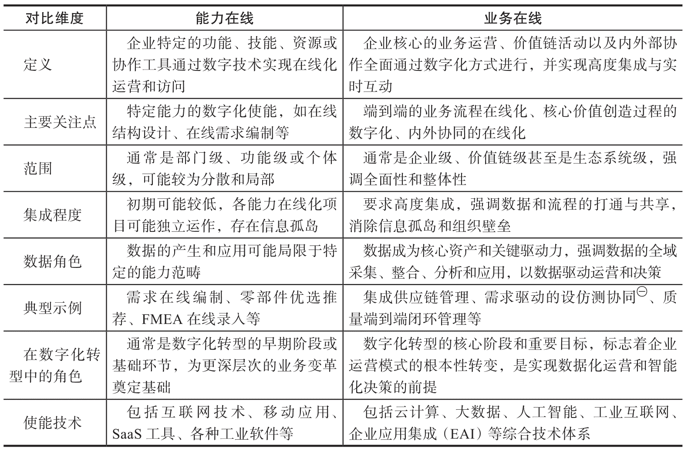

㊀指“设计-仿真-测试”协同。

总而言之，业务在线是企业数字化成熟度的重要标志，是企业实现端到端价值链数字化和智能化的核心。企业通过能力在线与业务在线的深度融合，将构建“数字基因+智能神经网络”的新型竞争力，意味着其核心价值创造过程已经深度融入数字世界，能够更敏捷地响应市场变化，更高效地配置资源，并基于数据洞察驱动持续创新。

2.能力在线到业务在线的跃迁：纵向集成与横向贯通

从能力在线向业务在线的转型之旅中，纵向集成与横向贯通扮演着至关重要的角色。它们如同构建企业数字化大厦的钢筋铁骨，确保了信息流、业务流和价值流在企业内外顺畅流转与高效协同。理解这两种集成方式的内涵、目标及其相互关系，对于企业制定和实施有效的数字化战略至关重要。

（1）纵向集成：催化深度业务功能在线化

在制造环节，纵向集成（Vertical Integration，VI）是指通过打通从车间设备层（如传感器、PLC）、制造执行层（MES）到企业资源规划层（ERP）乃至更高级的商业智能（BI）和产品全生命周期管理（PLM）系统，企业能够实现生产数据的实时采集、传输、分析与反馈，从而优化生产调度，提升设备利用率，保证产品质量，缩短交付周期。在企业数字化转型的背景下，纵向集成更多地指向企业特定业务领域或产品全生命周期各阶段内不同层级、不同业务环节之间数据与流程的深度整合与打通，从而实现自上而下和自下而上的双向信息流动，是实现精细化管理和快速响应市场变化的基础。在研发阶段，不仅要提升研发工具的数字化水平，还要加强研发团队内部以及与其他相关部门的协同效率。这种纵向集成旨在提升每一个价值链环节的“深度”和“专业度”，是企业实现数字化能力封装和在线的关键，即通过内部资源的整合与优化配置，重构企业的数字化研发与管理能力，从而大幅提升运营效率和决策准确度。

（2）横向贯通：构建端到端“业务在线”的骨干网络

横向贯通（Horizontal Interconnection/Integration，HI），有时也称横向集成，是企业数字化转型中与纵向集成相辅相成的另一关键策略。它主要指在同一运营层面或价值链的不同阶段之间，以及企业与外部合作伙伴（如供应商、客户等）之间，实现系统、流程和数据的连接与打通。如果说纵向集成关注的是“深度”和“专业度”，那么横向贯通则更侧重于“广度”和“协同度”，旨在构建端到端的无缝运营体系和价值网络。在企业内部，横向贯通的目标是打破部门墙和信息孤岛。在企业外部，横向贯通则延伸至整个供应链和商业生态系统。因此，横向贯通不仅是简单的系统对接，而且在更深层次上要求业务流程的重塑和协同机制的建立。综上所述，横向贯通是企业实现“业务在线”和构建敏捷、高效运营体系的关键。它通过连接内外部的各个节点，形成一个协同运作的整体，为企业提供了更广阔的视野和更强的市场适应能力。

（3）从能力在线迈向业务在线

纵向集成与横向贯通并非相互独立的数字化转型策略，而是紧密交织、相互依存、协同增效的两个维度。企业若想构建全面、高效的数字化业务体系，实现真正的业务在线，就必须将这两种集成方式有机地结合起来，形成一个既有深度又有广度、既能精细管控又能广泛协同的数字化神经网络。实现业务在线并非一蹴而就的，它依赖于企业在数字化转型过程中对各项在线能力的战略性整合。纵向集成与横向贯通作为两大核心整合策略，分别从不同维度推动企业从孤立的能力在线迈向全面协同的业务在线。

业务在线并非空中楼阁，它的实现离不开企业在数字化转型早期阶段所构建的各项数字化能力。从能力在线到业务在线的演进，是一个架构性的跃迁，其中，纵向集成与横向贯通扮演着“织网者”的角色，将先前可能孤立、分散的在线能力有机地编织起来，形成一个能够支撑核心业务流程高效运转的、协同的数字化网络，如图 3-10 所示。

（4）敏捷流程重组与业务编排

敏捷流程重组与业务编排是数字化研发体系落地的核心操作层，其目标是通过动态流程建模、智能规则引擎和跨系统协同，将传统固化的串行流程转化为可实时调整、敏捷优化的协同网络。基于产品设计目标（如电动化、低成本），从设计能力组件库中动态调用所需能力单元，以积木式重组方式重构产品开发流程，并赋以设计上下文进行实例化。设计能力组件化封装与重构如图 3-11 所示。例如，针对新能源工程装备机型开发，可快速组合电池布局优化、热管理仿真等模块，形成专属设计链路。该方法不仅可实现跨项目知识复用，而且能够通过灵活编排缩短 30%以上的迭代周期。

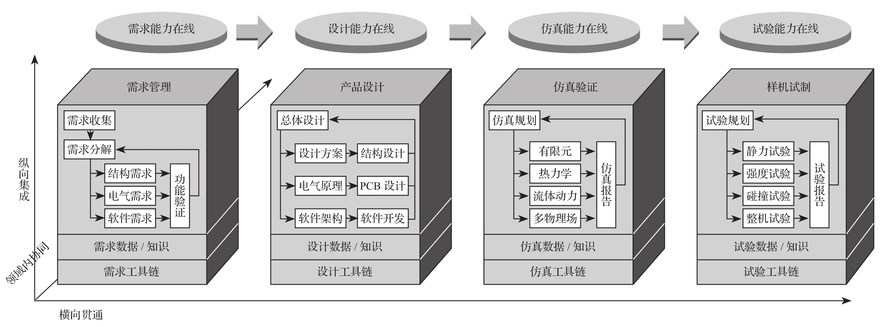

图 3-10 纵向集成与横向通贯

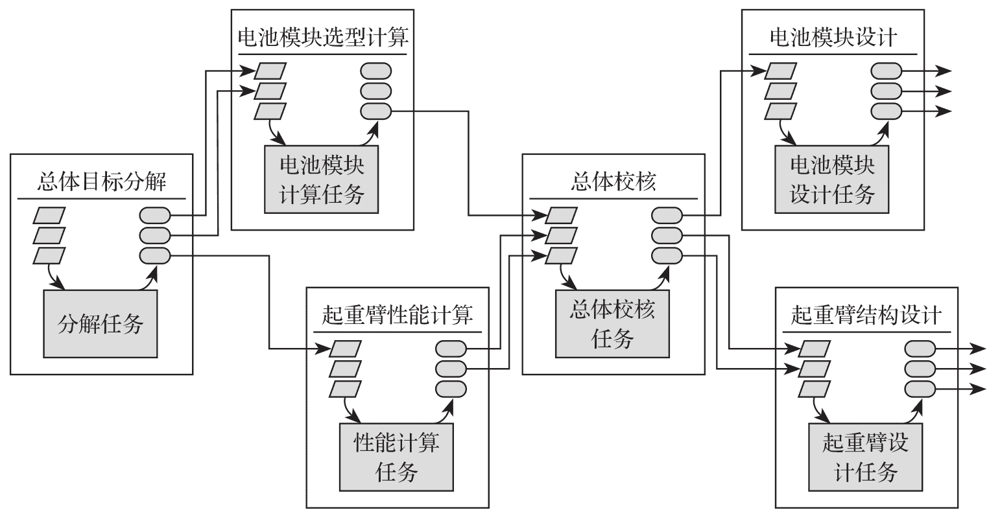

图 3-11 设计能力组件化封装与重构

敏捷业务编排通常需要具备如下核心能力。

**●低代码流程引擎**：通过低代码流程引擎工具，将组件库中的设计能力抽象为可视化节点（如需求评审、校核计算等），用户可通过拖动配置流程分支与触发条件。

**●智能规则引擎**：根据设计上下文，调用相应的设计规则和计算逻辑，如图 3-11 中的起重臂性能计算任务，就需要基于选定材料和预定义的额定载荷进行相应的应力分析和结构强度计算。

**●跨系统协同编排**：通过 API 网关集成异构系统（CAD、CAE、PLM 等），实现跨工具链自动化触发。基于 Kafka 等消息中间件，实现跨部门事件实时响应。

**●流程自动化**：自动根据规则进行任务分配、审批路径和通知，减少人工干预，加速决策闭环，如支持动态节点、会签、加签等复杂流程操作。

毕马威与阿里云研究院提出的数智化转型“五部曲”模型 ^(³⁰)也清晰地揭示了这种递进关系：“触点数字化”为企业奠定了技术和数据采集的基础能力，这些能力是“能力在线”的具体体现。在此基础上，企业进入“业务在线化”阶段，其核心正是通过业务能力在线的方式帮助企业完成业务流程的数字化和业务价值的提升。这意味着，企业利用已经在线化的基础设施能力（如云计算资源）、数据触点能力（如市场洞察能力、产品设计能力）以及特定的知识/技能能力（如在线沉淀的知识库等），通过有效的集成和编排，来支撑端到端业务流程的在线化运作。同样，企业要实现业务在线，组织自身的数字化程度和在线化水平也必须达到一定程度，即“组织在线”“能力在线”“协同在线”是业务在线的重要前提。

从能力在线向业务在线的演进过程中，纵向集成与横向贯通的作用至关重要。

**●纵向集成**将特定价值链条上相关的在线能力串联起来，形成深度的业务功能。例如，在产品研发场景下，从零部件供应链的供货能力，到机电软等多专业协同设计能力，再到整机综合集成和仿真验证能力，通过纵向集成，这些独立的在线能力被整合为一个高效的产品设计体系。

**●横向贯通**则将不同业务领域或价值链环节的在线能力连接起来，实现跨域协同。例如，客户关系管理系统（CRM）中的客户数据能力在线、供应链管理系统（SCM）中的订单履约能力在线、产品全生命周期管理系统（PLM）中的产品配置能力在线，以及财务系统中的在线支付与结算能力，通过以订单驱动的端到端横向贯通，可以共同支撑起一个完整的“从订单到回款”的在线业务流程。

因此，企业从能力在线迈向业务在线的“旅程”，可以看作一个通过集成不断提升能力组合层次和范围的过程。最初可能是点状的、孤立的能力在线；随着纵向集成的深化，这些能力在特定业务领域内形成功能强大的在线解决方案；随着横向贯通的拓展，不同领域的在线解决方案被连接起来，形成覆盖企业核心运营的、一体化的业务在线。在这个意义上，集成如同企业的数字化“神经系统”，将各种在线的“器官”（能力）连接成一个有机的“身体”（业务在线的企业），使其能够作为一个整体高效运作，并与外部生态互联互动。

3.未来展望：从业务在线到智能创新

随着人工智能（AI）、工业互联网（IIoT）和云计算等颠覆性技术的飞速发展与深度融合，企业集成的内涵、方式及战略价值正在经历深刻的变革。这些技术不仅为纵向集成和横向贯通提供了前所未有的能力支撑，也催生了如超自动化、数字孪生、智能升级和平台生态等的新型商业模式与运营范式，预示着业务在线将迈向更高级的智能化、自主化阶段。

（1）AI、IIoT 和云计算：增强企业深度集成

AI、IIoT 和云计算不再仅仅是辅助工具，而是正在成为企业集成战略的核心驱动力，从根本上重塑数据的产生、流动、处理和应用方式。

**●人工智能（AI）**：AI 在企业集成中的作用日益凸显。首先，通过机器学习，AI 可以自动完成复杂的数据映射、转换和验证，从而提高集成效率和准确性。其次，AI 强大的分析和预测能力，可以对纵向和横向集成的海量数据进行深度挖掘，提取有价值的洞察，支持更智能的业务决策和流程优化。例如，AI 可以分析供应链各环节的数据，预测潜在风险（如地缘政治引发的断链风险），并优化库存和物流。此外，AI 正在从被动地消费集成数据，转向主动参与集成治理，如通过智能 API 管理和 AI 驱动的数据质量监控等方式进行。AI 对纵向集成（如通过预测性维护优化生产线）和横向贯通（如通过供应链风险预测优化库存和物流）都能产生深远影响，因为它能够实时监控和调整关键流程。

**●工业互联网（IIoT）**：智能互联设备（如产线设备、智能产品等）的广泛部署，使得物理世界的状态和过程能够被实时、精细地数字化，产生了海量的、多样化的数据源。这些数据为企业集成提供了前所未有的广度和深度。一方面，设备数据通过纵向集成，从设备端汇聚到边缘计算节点或云平台，实现对物理资产和生产过程的实时监控、远程控制和优化。另一方面，不同设备、系统和应用之间的数据共享与协同（横向贯通），构成了各种智能场景（如数据驱动仿真、智能服务、智能制造等）的基础。IIoT 数据流的有效集成是实现数字孪生、预测性维护等高级应用的前提。

**●云计算（Cloud Computing）**：云计算平台已成为现代企业集成的首选基础设施和赋能平台。云提供了高度可扩展、灵活、按需付费的计算和存储资源，能够有效承载大规模集成带来的数据处理和存储压力。更重要的是，主流云服务商提供了丰富的集成平台即服务（iPaaS）、API 管理、数据湖/数据仓库、物联网平台、AI/ML 服务等，极大地简化了集成方案的构建、部署和运维，降低了企业集成的门槛和成本。云原生架构和技术（如微服务、容器化）也促进了更敏捷、更具弹性的集成模式的发展，有助于打破传统数据孤岛，实现云上应用、本地系统以及合作伙伴应用之间的便捷连接。

AI、IIoT 和云计算的融合，正在催生一个“万物互联、数据驱动、AI 赋能”的企业集成新范式。在这个范式下，数据从产生（IIoT）、汇聚处理（云）到价值提炼（AI）形成闭环，为企业实现更深层次的纵向集成（如从智能产品到智能决策）和更广泛的横向贯通（如连接物理世界与数字世界、连接企业内部与外部生态）提供了强大的技术引擎。例如，通过“增强互联网”（Enhanced Internet）技术，结合 AI 进行智能路由优化，结合 IoT 实现万物互联，能够为企业在线业务提供更高效、更可靠的连接基础 ^(³¹)。

（2）新兴趋势：超自动化、自主系统、数字孪生

在 AI、IIoT 和云计算等技术的共同推动下，企业集成正朝着更高级、更智能化的方向演进，催生了一系列引人注目的新兴趋势，其中超自动化、自主系统和数字孪生尤为突出。这些趋势不仅代表了“业务在线”的深化，也预示着企业运营模式的未来。

**●超自动化（Hyper-automation）**：超自动化是指将多种技术[包括机器人流程自动化（Robotic Process Automation，RPA）、人工智能、机器学习、集成平台即服务（iPaaS）、事件驱动架构（Event Driven Architecture，EDA）、业务流程管理 BPM 等]组合起来，以协同方式自动化尽可能多的业务和 IT 流程 ^(³²)。它不仅是单个任务的自动化，而且是追求端到端流程的、覆盖更广范围的、更智能的自动化。强大的企业集成是实现超自动化的基石，因为复杂的端到端流程自动化必然涉及多个异构系统、数据源和应用之间的数据交换与协同。超自动化通过集成各种自动化工具和智能技术，能够显著提升运营效率，降低成本，减少人工错误，并使员工能够专注于更具战略价值的工作。这标志着业务在线正从简单的流程在线化，向流程的智能化、自动化在线运营升级。

**●自主系统（Autonomous Systems），特别是自主供应链（Autonomous Supply Chains）**：随着 AI 和深度集成的成熟，企业运营系统正逐步具备更强的自主决策和自我优化能力。自主供应链是其中的一个典型代表，它旨在通过 AI、IIoT、数字孪生等技术，实现供应链各环节（如需求预测、库存管理、生产计划、物流调度、风险应对等）在最小化人工干预的情况下，自主感知、分析、决策、执行和学习优化。埃森哲指出，实现自主供应链需要：一个强大的数字核心，支持数据的无缝流动和实时决策；一个智能体架构（Agentic Architecture），融合 AI 和 ML，使系统能够学习、适应和自主决策；以及业务流程的彻底重塑和数据的全面统一 ^(³³)。世界经济论坛等机构认为，实现这一愿景需要分阶段推进，从数字化基础建设，到集成智能的自适应系统，最终迈向自主运营 ^(³⁴)。这代表了业务在线的终极形态之一：不仅业务在线，而且业务能够在线自主运行和持续进化。

**●数字孪生（Digital Twins）**：数字孪生是物理对象、流程或系统的动态数字化映射，它通过集成来自物理世界的实时数据（主要通过物联网传感器采集），利用仿真、分析和 AI 技术，对物理实体的状态、行为和性能进行监控、诊断、预测和优化。数字孪生的构建和有效运作高度依赖于深度的数据集成：既包括从物理资产到数字模型的纵向数据集成（如传感器数据、运行参数、维护记录等），也包括数字孪生模型与其他企业系统（如 PLM、ERP、MES）及其他相关数字孪生之间的横向信息贯通。AI 的融入使得数字孪生具备了更强的预测能力（如预测性维护）、优化能力（如生产流程优化）乃至一定的自主决策能力。数字孪生正在制造业、智慧城市、医疗健康、能源等多个领域展现出巨大的应用潜力，它为企业提供了一个在虚拟世界中模拟、仿真、试验和优化物理运营的强大工具，是实现精细化管理和智能化升级的重要手段。

这些新兴趋势共同指向一个未来：企业运营将更加数据驱动、智能自主、虚实融合。而这一切的实现，都离不开一个高度集成、信息畅通的数字底座，即通过有效的纵向集成与横向贯通所构建的、真正意义上的业务在线平台。

4.新前沿：智能化升级及其与集成的关系

智能化升级（Intelligent Upgrading）是企业在实现业务在线并具备了坚实的集成基础之后，向更高阶数字化形态演进的关键一步。它指的是系统性地将人工智能（AI）、大数据分析、机器学习等智能技术深度融入企业运营的各个方面，推动企业从“连接的运营”迈向“认知的运营”“智慧的运营”。智能化升级的目标是使企业具备更强的洞察力、预测力、自主决策能力和持续学习优化能力，从而在根本上提升运营效率、创新能力和市场竞争力。纵向集成与横向贯通所构建的全面业务在线是实现智能化升级的必要前提。没有高质量、实时、全面的集成数据作为“燃料”，AI 算法和智能模型就如同无源之水、无本之木。

**●数据基础**：智能化升级依赖于对海量、多源、异构数据的分析和学习。横向贯通确保了来自企业各个业务环节（如研、产、供、销、服）以及外部生态伙伴的数据能够被有效汇聚和共享，形成企业级乃至生态级的数据湖或数据中枢。纵向集成则保证了从底层操作执行层到上层管理系统的数据能够完整、准确地上传，为 AI 应用提供了精细化的训练数据和实时输入。

**●流程基础**：智能化升级往往意味着对现有业务流程的智能化改造，如引入 AI 进行智能设计、智能排产、智能质检等。这些智能应用需要嵌入具体的业务流程中，并与相关系统进行交互。横向贯通确保了跨部门、跨系统的流程能够顺畅衔接，为 AI 应用提供了端到端的执行环境。纵向集成则保证了 AI 决策能够有效地传递到执行层面，并获取执行结果的反馈，形成决策与执行的闭环。

**●能力基础**：智能化升级不是孤立的技术应用，而是企业整体能力的提升。它要求企业不仅具备应用 AI 技术的能力，还需要具备数据治理能力、模型管理能力及将 AI 洞察转化为业务行动的能力。这些能力的构建，离不开先前在实现业务在线的过程中通过纵向集成和横向贯通所沉淀下来的数据资产、标准化流程和协同机制。

因此，智能化升级可以被视为业务在线的自然延伸和高级阶段。在业务在线实现了企业运营的数字化、网络化和集成化之后，智能化升级则在此基础上注入“智慧”的元素，使企业运营更加敏捷、精准和高效。例如，通过对设计、工艺、生产现场和库存数据的关联分析，可以实现设计变更影响分析，并智能推荐变更方案；通过对集成供应链数据的智能分析，企业可以实现更精准的需求预测和库存优化；通过对生产过程数据的智能监控和分析，可以实现预测性维护和质量的持续改进。

总而言之，智能化升级是企业数字化转型的高级目标，它建立在坚实的集成基础之上，通过构建开放的 AI 平台架构，将 AI 嵌入企业的各个业务环节中，使其更智能、更自主。企业只有通过有效的纵向集成和横向贯通，实现全面的业务在线，才能为智能化升级提供充足的数据养料和顺畅的流程载体，最终迈向智慧企业。

### **3.3.4 数字应用层：赋能业务创新的智能工具**

数字应用层，即企业所依赖的软件和应用程序集合，构成了企业与客户互动、管理内部运营以及驱动创新的主要界面。在传统意义上，静态的软件应用正在迅速演变为一个动态的、智能化的生态系统。智能工具，特别是那些融合了人工智能（AI）、机器学习（ML）和高级自动化技术的工具，正在极大地增强数字应用层的能力，使其从被动的支持系统转变为主动的商业创新引擎。这些工具不仅实现了流程自动化，更重要的是，它们赋予企业更深层次的洞察力，支持个性化体验的创建，并催生了全新的价值创造形式。企业运营和协作实时化、数字化的能力在线和业务在线理念，正是通过这一数字应用层得以实现和升华的。一个值得深思的现象是，数字应用层本身正在重塑“创新”的定义。创新不再仅局限于新产品的推出，而是扩展到涵盖新颖的流程、独特的客户互动模式以及数据驱动的战略决策，所有这一切都由智能应用所驱动和赋能。企业若要充分利用智能应用层的创新潜力，则必须经历从“能力在线”（即特定功能的数字化）到“业务在线”（即端到端运营的数字化）的关键演进路径。缺乏坚实的数字化基础和在线化的业务流程，智能工具将会因缺乏必要的数据和连接性而难以发挥其巨大的创新作用。许多数字化转型举措未能达到预期投资回报（ROI）的一个关键原因，便是未能成功实现这一基础性的转变。因此，企业在当今竞争格局中的地位，越来越取决于其构建和部署一个高效、智能的数字应用层的能力。这一层面正迅速成为企业核心的差异化优势和战略制高点。

1.解构现代企业架构中的数字应用层

数字应用层是现代企业架构的核心组成部分，其战略重要性日益凸显。理解其定义、构成要素以及与业务创新的关系，对于企业制定有效的数字化转型战略至关重要。

（1）数字应用层的定义、范围与战略重要性

数字应用层基于统一开放的底层技术架构，通过定义一系列的业务规则和逻辑，以明确企业的应用程序组合、它们之间的集成方式，以及这些数字技术资产如何支持业务流程和服务的交付。这不仅是软件应用的简单集合，更是一项战略性资产，直接支撑着企业核心能力的实现和运营的有效执行。数字应用层作为企业与最终用户（包括客户和内部员工）直接交互的界面，在价值传递过程中扮演着至关重要的角色。从战略层面看，数字应用层的重要性已经从传统的后台支持功能，转变为驱动业务战略和塑造竞争优势的核心力量。尤其当数字应用层被注入智能后，其作用更为突出。过去，数字应用主要服务于既有的业务流程；而在数字化转型的浪潮下，数字技术已深度融入企业战略中。嵌入应用中的智能工具能够主动识别潜在的商业机会或风险，从而反过来塑造和引导战略方向，而非仅被动执行。这种角色的转变，要求企业在顶层设计时就充分考虑应用层的智能化和创新潜力。

（2）数字应用层策略与定位

行业分析机构为理解和管理数字应用层提供了宝贵的框架及见解。

Gartner 的步速分层应用策略（Pace-Layered Application Strategy）是一种广受认可的方法论，它根据应用在组织中的角色及其支持业务变革、差异化和创新的能力，将应用程序分为三个层面：记录型系统（Systems of Record）或数据源系统、差异化系统（Systems of Differentiation）和创新型系统（Systems of Innovation） ^(³⁵)。

**●记录型系统**：支持核心交易处理，管理关键主数据，是企业核心数据的源头，如 PLM、ERP 等。这类系统变更频率低，通常涉及成熟的流程和监管要求。它们为业务运营提供稳定性，是创新活动的坚实基础。

**●差异化系统**：支持企业独特的业务流程或行业特定的能力，承载企业数字能力和数字业务的系统就属于此。这类系统的生命周期中等，需要频繁配置以适应业务实践或客户需求的变化，是企业建立竞争优势的关键。

**●创新型系统**：为应对新的业务需求或机遇而快速构建的新型、试验性应用，也即数字应用层系统。这类系统的生命周期短，常利用新技术，采用敏捷迭代的方式。它们是智能工具快速原型设计和部署的主要场所，直接驱动业务创新。

Gartner 的步速分层应用策略强调，不同层面的应用需要采用差异化的 IT 治理和变更管理流程。通过对“创新型系统”采用更宽松的治理，企业可以鼓励敏捷创新并快速试错，同时确保“记录型系统”的稳定性和可靠性。这种平衡对于智能工具（如 AI/ML）驱动的业务创新至关重要。

Forrester 的现代应用开发（Modern Application Development，MAD）服务则强调了应用开发本身向更敏捷、更现代化的方向演进 ^(³⁶)。MAD 服务融合了数字化转型、产品工程和应用现代化等理念，特别突出了敏捷开发（Agile）、开发运维一体化（DevOps）、微服务架构和云服务等在构建响应迅速、灵活的应用层方面的重要性。Forrester 指出，MAD 服务的独特之处在于，其不仅能利用最新技术交付现代化应用，更能提升企业现代化应用的定制开发能力，加速企业数字化转型。这种双重焦点对于构建和维护一个能够持续集成智能工具并支持创新的应用层至关重要。

在企业架构中，稳定可靠的“记录型系统”与敏捷迭代的“创新型系统”之间存在一种内在的张力。前者要求严格的控制和稳定性，后者则需要高度的灵活性和迭代速度。如果企业架构过于僵化（过度关注记录型系统），创新就会受到抑制；反之，如果过于松散（过度关注创新型系统），核心业务的稳定性则可能面临风险。因此，有效的企业架构必须能够管理这种张力，例如通过采用双模 IT 或自适应架构方法，以同时保障运营的可靠性和创新的敏捷性。数字应用层的设计和治理，已不再仅仅是 IT 部门的职责，而是直接影响企业适应性、创新能力和整体竞争力的关键战略议题，值得企业最高管理层的高度关注。企业选择何种架构框架（如步速分层模型），实际上反映了其在创新与稳定之间的战略权衡。

2.核心组件及其与业务能力的相互作用

数字应用层的核心组件包括应用组合、集成架构、用户界面与用户体验。这些核心组件共同构成了数字应用层，它们之间的相互作用和协同对于支撑业务能力、实现业务流程、驱动业务创新至关重要。一个设计良好、管理得当、集成顺畅且用户体验优秀的数字应用层是企业在数字化时代取得成功的关键基础。

（1）应用组合（Application Portfolio）

**●定义与范围**：应用组合是企业内使用的所有应用程序的集合，涵盖了从支持核心交易处理和管理关键主数据的“记录型系统”（如 ERP、PLM），到支持企业独特流程或行业特定能力的“差异化系统”，再到为应对新业务需求或机遇而快速构建的“创新型系统”。这包括了商业化软件（COTS）和定制开发的应用程序。

**●战略重要性**：有效的应用组合管理不仅仅是 IT 资产盘点，更是确保 IT 资源与业务优先级对齐的关键手段。它直接支撑业务能力的实现和业务流程的自动化与高效执行。通过理解业务能力需求，架构师可以识别必要的应用，制定最优的应用组合策略，在满足功能需求的前提下尽量保证应用的开放性和可扩展性。

**●管理与优化**：应用组合管理涉及对应用程序整个生命周期的管理，包括从规划、开发到部署、维护和最终退役。清晰的应用组合视图有助于识别冗余、重叠和低效的应用，从而优化 IT 投资，降低成本，提高资源利用率。Gartner 的步速分层应用策略建议对不同层级的应用（记录型、差异化型、创新型）采用差异化的治理和变更管理流程，以平衡稳定性和敏捷性。

（2）集成架构（Integration Architecture）

**●定义与范围**：集成架构定义了应用组合中的不同应用程序之间如何连接、通信和交换数据。它涉及集成模式的选择[如点对点、中心辐射式、企业服务总线（ESB）、事件驱动等]、API（应用程序编程接口）的设计与管理、消息传递系统以及数据格式的规范，旨在确保系统间的互操作性和无缝的数据流动。这里讨论的集成架构与数字底座层中提及的集成接口并不冲突，集成架构解决的是如何通过多个系统组合来实现基于角色的前端应用问题，最终实现还得依赖于各个系统所开放的集成接口。

**●对智能工具的重要性**：这对于依赖多样化数据源的智能工具（如 AI/ML 应用）尤为关键。AI 系统需要访问和整合来自不同系统的数据才能发挥作用，例如，AI 驱动的集成供应链应用可能需要整合市场、研发、制造和库存等数据，才能提供全面的供应链洞察。没有有效的集成架构，数据孤岛将严重制约 AI 应用的潜力，因此数字底座中提及的数字主线就显得尤为重要。

**●现代集成策略**：现代集成策略越来越倾向于采用 API 优先的方法和微服务架构。API 作为标准化的连接器，极大地提高了灵活性和可重用性。云平台（特别是 iPaaS）也为企业集成提供了强大的支持。

（3）用户界面（UI）与用户体验（UX）

**●定义与范围**：用户界面（UI）是用户与应用程序直接交互的媒介，包括屏幕、页面、按钮、图标等视觉元素和交互控件。用户体验（UX）则是一个更广泛的概念，涵盖了用户在使用应用程序过程中的整体感受，包括易用性、效率、满意度和情感反应。

**●设计原则**：现代应用开发高度强调以用户为中心的设计（UCD）。核心原则包括：从一开始就让用户参与进来，理解他们的需求和痛点；设计过程具有代入感和同理心；采用敏捷迭代设计方法，不断通过原型和用户测试收集反馈并进行优化；遵循简洁、直观的设计基础等。

**●AI 赋能**：人工智能正越来越多地被用于提升 UI 的个性化和易用性，从而改善 UX。例如：①个性化界面，AI 可以根据用户的行为、偏好和历史数据，动态调整 UI 布局、内容展示和功能推荐，提供千人千面的体验；②智能交互，AI 驱动的聊天机器人和虚拟助手提供自然语言交互界面，简化用户操作，提供 7×24h 支持；③预测性 UI，AI 可以预测用户的下一步操作或需求，并提前呈现相关信息或功能，提升操作效率。

3.赋能业务创新：应用层如何驱动业务转型

智能应用不仅是现有业务流程的数字化延伸，更是驱动企业实现根本性转型的强大引擎。通过将智能注入数字应用层，企业能够在产品开发、客户体验、商业模式乃至运营效率等多个维度上实现突破性创新，并最终实现全面的“业务在线”。

（1）加速产品开发与缩短创新周期

在快速变化的市场中，产品迭代的速度直接关系到企业的竞争力。智能应用正以前所未有的方式加速产品开发和创新周期。

**●自动化与效率提升**：敏捷应用可以显著加速产品开发生命周期，通过将诸如市场分析、项目管控、统计分析等耗时任务实现自动化，使开发团队能够更专注于高价值的创造性工作。

**●数据驱动设计与创新**：利用数字主线技术，将测试、用户使用等阶段的产品数据与研发过程有机衔接起来，形成数据驱动的设计仿真。这一范式正展现出巨大潜力，能加速产品迭代优化和辅助创新。例如，当产品运行异常时（如工作温度超出阈值），可基于实时收集的工况数据进行仿真验证，以快速找到问题根因（如散热器设计方案缺陷），并进行设计优化。

**●敏捷与迭代**：在进行前端应用程序规划时，结合敏捷开发方法（如 Scrum 等），将复杂的开发任务分解为可管理的迭代单元，促进团队对市场需求的快速响应。迭代原型开发，辅以 3D 打印等快速原型技术，能够快速验证概念并收集早期反馈，从而缩短产品从概念到市场的时间。

（2）实现卓越运营：效率、生产力与业务在线

将智能融入日常运营是提升效率、降低成本、实现业务在线的关键。

**●智能流程自动化提升效率**：智能自动化（Intelligent Automation，IA）结合 AI、业务流程管理（BPM）和机器人流程自动化（Robotic Process Automation，RPA），能够简化流程，降低成本，提高准确率。智能自动化利用人工智能来优化以前无法仅通过传统流程自动化实现的复杂业务流程。例如，在从线索到回款（Leads to Cash，LTC）的流程（寻找潜在商机并将其转化为销售订单，并进行交付，直到财务回款）中，销售人员可以使用智能流程自动化根据结构化数据（如用户需求、产品配置等）和非结构化数据（如扫描的历史合同文本等）生成销售配置方案。

**●实现业务在线**：业务在线意味着企业的核心运营和协作活动都实时在线进行，这需要一个集成的数字应用层来管理从客户互动到后端流程的方方面面。

**●知识沉淀和知识驱动**：业务在线过程通过数字化手段将企业运营的各个环节转化为可追踪、可分析的数据流。这一过程天然具备知识沉淀的三大核心要素，即数据资产化、流程显性化、协作网络化。通过数字应用层推进各个领域业务的在线化，将知识管理从“事后归档”升级为“实时生成”，并通过将知识与设计上下文进行有机衔接，来构建面向产品全生命周期的企业知识图谱，为后续的知识驱动和产品创新奠定基础。

（3）革新客户体验与互动模式

在以客户为中心的时代，提供卓越且个性化的客户体验是企业成功的关键。智能应用正通过多种方式革新客户体验和互动模式。

**●深度个性化**：数据驱动的个性化引擎能够分析用户行为、偏好和历史数据，提供高度定制化的内容、产品推荐和互动体验。在工业控制领域，产品种类复杂多样且高度定制，个性化推荐引擎能够根据用户的应用场景、特定需求、历史数据等来智能推荐最佳产品配置组合。

**●全天候智能客服**：智能聊天机器人和虚拟助手提供 7×24h 的即时支持，解答客户疑问，引导用户完成操作，提升服务效率和客户满意度。

尽管如此，由数字应用驱动的业务创新并非简单的线性过程，而是一个持续反馈、迭代优化的循环。例如，通过数据驱动的客户体验，应用会产生更多、更高质量的数据；这些数据反过来又为研发创新应用提供了更丰富的“养料”，使其能够更精准地改进产品和服务，并进一步提升运营效率。这种良性循环是企业持续创新的关键。而业务在线作为一种基础状态，为这些多样化的创新活动提供了必要条件和土壤。如果企业的核心流程依然停留在离线状态，数据就无法被有效捕获和利用，数字应用也就无从发挥其变革性的力量。这凸显了一个关键的依赖关系：业务在线是智能创新的基石。

综上所述，数字应用层正在将业务创新的范围从渐进式改进扩展到对价值主张和运营模式的根本性重塑。那些未能拥抱这一趋势的企业，将在成本、体验和速度等各个维度的竞争中面临越来越大的压力。

4.构建数字应用层的技术架构

构建一个能够有效支持和驱动业务创新的智能数字应用层，需要坚实且灵活的架构作为支撑。这不仅涉及数据基础的构建，还包括云计算能力的运用、系统集成策略的选择以及 API 优先的设计理念。这些架构要务共同决定了企业能否充分发挥智能工具的潜力。

（1）云赋能：利用 IaaS、PaaS 和 SaaS 支持数字应用

云计算为数字应用提供了成本效益高、敏捷、可扩展的基础，并使得企业能够便捷地获取数据分析、AI 等先进技术。不同的云服务模式对数字应用层的构建和运营有着直接影响。

**●基础设施即服务（IaaS）**：提供对计算、存储、网络等基础设施的最高控制权和按需扩展的能力。客户负责管理操作系统、中间件、应用程序和数据。

**●平台即服务（PaaS）**：提供开发、部署和管理应用程序所需的硬件和软件资源。云服务商管理基础设施和操作系统，客户则专注于代码、数据和应用本身。PaaS 通过简化环境设置和提供预构建工具/API，从而显著加速 AI/ML 应用的开发和部署。

**●软件即服务（SaaS）**：提供完整的、基于云的应用程序，服务商管理所有底层细节。AI 驱动的 SaaS 应用（AI-SaaS）能够增强个性化、自动化、预测分析和安全性 ^(³⁷)。

PaaS 和 AI-SaaS 模式的兴起，正在降低企业应用复杂 AI 能力的门槛，使那些不具备深厚 AI 研发团队的企业也能快速将智能融入其应用层，这极大地推动了 AI 技术的普及和深化应用。

（2）集成策略：“纵向集成”与“横向贯通”赋能业务应用

有效的集成是实现能力在线和业务在线并支持智能应用的基础。这包括企业内部不同层级系统和流程的“纵向集成”，以及企业价值链上下游（包括与其外部伙伴和客户之间）流程与数据的“横向贯通”。

有效的纵向集成（如将车间数据与 ERP 系统连接）和横向贯通（如与供应商共享需求预测）是创建智能应用所需的丰富、互联数据流的基础。当这些集成使得特定的业务能力（如研发、制造、服务）能够以数字化、可互操作的方式在线提供时，“能力在线”就得以实现，并构成了智能应用运行和创新的基础。

在智能应用层的语境下，“纵向集成”和“横向贯通”的内涵已超越了传统的物理供应链或 IT 系统连接。它们更多指的是数据和控制信号在不同智能层级之间的无缝流动（纵向，如从传感器数据到 AI 洞察，再到自动化执行），以及在不同智能能力之间的协同运作（横向，如整合来自市场需求预测和供应链优化的洞察）。

（3）API 优先设计：赋能微服务与智能工具的模块化和互操作性

API（应用程序编程接口）优先的设计方法论，强调在软件开发之初就优先设计和构建 API，将 API 视为软件的核心构建模块，而非事后添加的功能。

**●核心价值**：API 优先能够提升开发者体验，改进软件质量，提高生产力，促进团队协作，并实现一致的治理和安全策略，最终加速产品上市时间。

**●OpenAPI 规范的角色**：OpenAPI 规范通过提供机器可读的 API 契约，简化了 API 的发布和管理，能够自动生成文档，改善互操作性，并支持自动化测试和安全防护 ^(³⁸)。

API 优先的设计方法非常适用于微服务架构，因为它确保了系统的模块化和可重用性。数字应用通常也依赖 API 来访问数据和暴露其功能。API 优先战略对于构建一个可组合的、敏捷的智能应用层至关重要。它使得各个数字应用（通常以微服务的形式存在）能够独立开发、部署和扩展，同时确保它们之间能够通过定义良好的 API 进行无缝通信和数据交换，这对于复杂的 AI 驱动工作流至关重要。

总而言之，构建面向智能的架构需要一个整体性的方法，同时考虑数据战略、云战略、集成战略和 API 战略。这些并非孤立的决策，而是现代创新驱动型企业架构中紧密交织的组成部分。若未能有效协同这些要素，那么企业可能会陷入数字“漂绿”（Greenwashing） ^(³⁹)的境地，即部署了先进智能的数字工具，却没有能够使其有效发挥作用的基础架构。

5.现代智能应用的基本特征

现代智能应用不仅是传统软件功能的增强，而且它们在设计理念、核心能力和运行方式上都展现出与以往显著不同的特征。这些特征共同构成了智能应用的基础，使其能够有效地驱动业务创新。

（1）以 AI/ML 为核心：驱动预测、适应与生成能力

人工智能（AI）和机器学习（ML）是现代智能应用的“大脑”和“引擎”。应用不再仅仅是被动地处理预设指令和数据，而是能够主动地从数据中学习，并基于学习结果展现出预测、适应和生成等高级能力。

**●预测能力**：通过分析历史数据和实时模式，智能应用能够预测未来趋势和事件。例如，在生产制造过程中，预测性维护应用通过分析设备传感器数据，预测潜在故障，从而提前安排维护操作，避免意外停机。在集成供应链领域，根据用户历史订单的季节性趋势及在手订单的排产计划，可以预测下季度的采购需求。

**●适应能力**：智能应用能够根据环境变化或新的数据输入调整其行为和输出。例如，智能供应链管理系统可以根据实时的市场需求波动和物流状况，动态调整库存和运输计划。

**●生成能力**：生成式 AI 的兴起赋予了应用创造新内容和解决方案的能力。例如，智能设计工具可以辅助生成新的产品设计方案。

（2）以用户为中心的设计：确保直观且有价值的用户体验

尽管技术日新月异，但最终衡量应用成功与否的关键在于其能否为用户提供直观、便捷且富有价值的体验。现代智能应用高度强调以用户为中心的设计（User-Centered Design，UCD）原则。

**●深度理解用户**：UCD 原则要求从项目伊始就深入理解目标用户的需求、行为模式和痛点。这通常通过用户调研、用户画像、可用性测试等方法实现。

**●迭代设计与反馈**：设计过程是迭代的，需要不断收集用户反馈，并据此优化应用功能和交互流程。

**●可用性与可访问性**：应用必须易于上手和使用，同时要考虑不同用户的可访问性需求，确保所有用户都能顺畅使用。

**●个性化体验**：AI/ML 技术使得应用能够根据个体用户的偏好和历史行为提供高度个性化的内容和服务，从而提升用户满意度和参与度。

（3）实时响应能力：即时处理数据并交付洞察

在快节奏的商业环境中，实时性成为智能应用不可或缺的特征。应用需要能够即时捕获、处理和分析流式数据，并迅速将洞察结果反馈给用户或触发相应的业务动作。这对于实时运营监控、动态个性化推荐等场景至关重要。

（4）可扩展性与高性能：满足动态的企业需求

企业级智能应用必须具备良好的可扩展性和高性能，以应对日益增长的数据量、用户并发访问以及复杂的计算需求，同时不能出现性能瓶颈。云基础设施（IaaS、PaaS）为应用的动态资源分配和负载均衡提供了坚实基础，保障了智能应用在不同规模和负载下的稳定运行。

（5）强大的安全性与隐私保护：保障数据并确保合乎道德的 AI

随着数据成为核心资产以及 AI 能力的增强，安全和隐私保护成为智能应用的重中之重。

**●数据安全**：必须实施强大的数据加密技术、访问控制机制（如基于角色的访问控制、多因素认证）以及安全的数据处理规范，以保护数据在存储、传输和使用过程中的安全。

**●AI 特定风险防护**：需要防范针对 AI 系统的特有攻击，如对抗性攻击（Adver-sarial Attacks）、数据投毒（Data Poisoning）和模型反演（Model Inversion）等 ^(⁴⁰)。

**●隐私合规与伦理**：应用设计和数据处理必须遵守相关的隐私保护法规（如 GDPR、CCPA），并建立可审计的追踪机制，确保 AI 的开发和使用符合伦理规范。

（6）API 优先架构：构建专业应用生态的前提

API 优先的架构不仅是构建智能应用层的基础，也是现代智能应用自身的一个关键特征。智能应用通常由一系列通过定义良好的 API 进行通信的微服务或模块化组件构成，这增强了应用的灵活性、可重用性和可维护性。这些特征并非孤立存在的，而是相互关联、相互支撑的。例如，一个实时运营监控系统（体现实时响应性）必然需要可扩展的云基础设施（体现可扩展性）来快速处理大量的企业运营数据，并运用 AI/ML 核心能力（体现 AI/ML 核心）进行精准预测，同时其分析结果需要以用户友好的方式呈现给监控人员（体现用户中心），并且整个过程必须保障敏感财务数据的安全（体现安全性）。这充分说明了这些特征之间的内在联系和协同作用。其中，API 优先的特征对于在分布式智能应用环境中实现其他许多特征起着基础性的赋能作用。它促进了模块化，这是实现可扩展性、AI 组件独立开发以及集成专业安全工具的关键。智能应用很少是单一的庞然大物，它们更像是由专业服务（如推荐引擎、分析引擎、质量服务、成本核算等）组成的生态系统。API 正是这些服务之间有效互操作的契约，使得整个应用能够实现可扩展、可维护和自适应。

研究表明，人工智能与机器学习、高级自动化、实时数据分析以及对话式 AI 等智能工具，正深度融入应用层的各个方面，从根本上改变了企业与数据、流程、客户乃至整个商业生态系统的互动方式。无论是通过预测分析优化决策，以及借助生成式 AI 革新创造过程，还是利用智能自动化实现卓越运营，其最终目标均指向更敏捷、更高效、更以客户为中心的价值创造。

然而，通往智能应用层驱动的业务创新之路并非坦途。企业必须正视并有效应对数据孤岛、技术集成复杂性、组织文化变革阻力、AI 技能鸿沟以及日益严峻的伦理与安全挑战。这要求企业不仅要关注技术本身的引进，更要致力于构建与之相适应的数据治理体系、灵活的企业架构、持续学习的组织文化以及负责任的 AI 伦理框架。

展望未来，Agentic AI 的兴起、超个性化体验的深化、可组合企业架构的普及以及数字孪生应用的拓展，预示着智能应用层将朝着更高程度的自主性、个性化和集成化方向发展。这不仅对企业的技术能力提出了更高要求，也对其战略远见、组织韧性和变革决心构成了深刻考验。

因此，对于致力于在数字时代保持领先的企业而言，战略性地投资、构建和持续优化其智能数字应用层，已成为一项刻不容缓的要务。这需要企业高层具备清晰的愿景，制定统一的数据和 AI 战略，拥抱 API 优先和可组合的架构思维，充分利用云计算的赋能力量，大力培养 AI 素养和数据驱动文化，并始终将伦理 AI 和负责任的创新置于核心地位。唯有如此，企业才能真正掌控智能应用层这一强大的创新引擎，在日新月异的商业竞争中行稳致远，最终实现可持续的增长与繁荣。

## **3.4 数字化转型战略：应对挑战与衡量成功**

实现从能力在线到业务在线的转型，并通过纵向集成与横向贯通构建高效协同的数字化企业，是一项复杂的系统工程。企业在这一过程中必然会面临来自技术、组织、管理等多个层面的挑战。同时，为了确保转型方向的正确性和投入的有效性，建立科学的衡量指标体系也至关重要。

### **3.4.1 实施挑战和突破路径**

1.技术层面的关键挑战

企业在推进纵向集成与横向贯通，以及实现业务在线的过程中，面临着诸多技术层面的挑战。这些挑战往往相互交织，需要系统性的解决方案。

**●遗留系统集成**：大量企业仍依赖于陈旧的、孤立的历史遗留系统。这些系统架构落后、缺乏标准接口、文档不全，将其与现代化应用和平台（如云、数字主线等）进行集成，技术难度大、成本高、风险高。

**●数据孤岛与数据治理**：数据分散在不同的业务系统和部门中，形成数据孤岛，标准不一，质量参差不齐，难以实现有效的共享和利用。建立统一的数据治理体系，明确数据标准、元数据管理、数据质量控制、数据安全与隐私保护等，是集成的前提，但实施起来极为复杂。例如，缺乏清晰的数据所有权和责任界定，会导致数据治理难以落地。

**●数据映射与一致性**：不同系统间的数据模型、格式、命名规范各异，在集成过程中需要进行复杂的数据映射和转换，以确保数据在不同系统间流转时的一致性和准确性，避免数据丢失或损坏。

**●互操作性与标准缺乏**：尤其是在跨企业、跨行业的横向贯通中，缺乏统一的行业标准和接口规范，会使得不同系统间的互操作性成为巨大挑战。这不仅增加了集成成本，也限制了生态协同的广度和深度。

**●集成平台的复杂性与可扩展性**：无论是传统的 ESB 架构，还是现代的微服务、API 网关、iPaaS 等，都需要精心设计和管理，以应对日益增长的集成需求和数据流量。错误的技术选型或架构设计可能会导致性能瓶颈、维护困难和扩展性不足等问题。

**●安全性与合规性**：集成意味着数据在更多系统和节点间流动，增加了数据泄露、未授权访问等安全风险。确保集成过程和集成后系统的安全性，满足 GDPR 等合规要求，是一项持续的挑战。

**●新兴技术的融合挑战**：将 AI、IoT、数字孪生等新技术融入现有业务流程和 IT 架构，并实现与遗留系统及其他新系统的有效集成，对企业的技术能力和架构设计提出了更高要求。

2.组织与管理层面的挑战

**●变革阻力与文化冲突**：数字化转型和深度集成往往伴随着业务流程的重塑、部门职责的调整甚至组织架构的变革，这不可避免地会触动既有利益格局，引发员工的抵触情绪和对未知的恐惧。在企业并购或跨部门协作中，不同团队间的文化差异也可能成为整合的障碍。

**●缺乏数字化技能与人才**：成功的数字化集成和运营需要具备跨领域知识（如业务、数据、技术）的复合型人才。然而，市场上此类人才短缺，企业内部员工的数字素养和技能也往往不足，难以适应新的工作方式和技术工具。

**●战略与愿景的模糊或错位**：缺乏清晰、统一的数字化转型愿景和战略规划，或者 IT 战略与业务战略脱节，会导致集成项目目标不清、重点不明，难以获得持续的资源投入和高层支持。

**●领导力与治理机制的缺失**：强有力的领导层支持、跨部门的协同治理机制以及清晰的权责分工，是推动复杂集成项目和组织变革的关键。若缺乏这些，则项目很容易陷入困境。

**●流程重塑的复杂性**：集成不仅是技术对接，更核心的是业务流程的优化和再造。识别核心流程，分析瓶颈，设计新的协同流程，并确保新流程得到有效执行，是一项艰巨的管理任务。

**●投资回报（ROI）的不确定性与成本压力**：深度集成和数字化转型通常需要巨大的前期投入，但其商业价值和投资回报往往滞后，且难以在短期内清晰量化，这使得企业在决策时面临压力，也可能导致项目因预算不足而中途受阻。

**●维持敏捷性与灵活性的平衡**：过度追求紧密和刚性的集成，有时反而会降低组织的灵活性和对市场变化的快速响应能力。如何在实现深度整合的同时保持架构和运营的敏捷性，是一个需要仔细权衡的难题。例如，ESB 虽然促进了集成，但也可能因其中心化和复杂性成为敏捷性的瓶颈。

这些技术与组织挑战的叠加，使得从能力在线到业务在线的转型之路充满“荆棘”。企业需要充分认识这些挑战，并制定有针对性的应对策略，才能确保转型成功。例如，遗留系统的技术挑战往往与组织内部对旧有工作模式的依赖和变革的抵触情绪（组织挑战）相伴相生。有效的数据治理（组织与流程层面）是应对复杂集成数据环境（技术层面）的关键。表 3-4 就上述挑战给出了对纵向集成和横向贯通的影响分析，以及对应的缓解策略。

**表 3-4 实施挑战与应对策略**

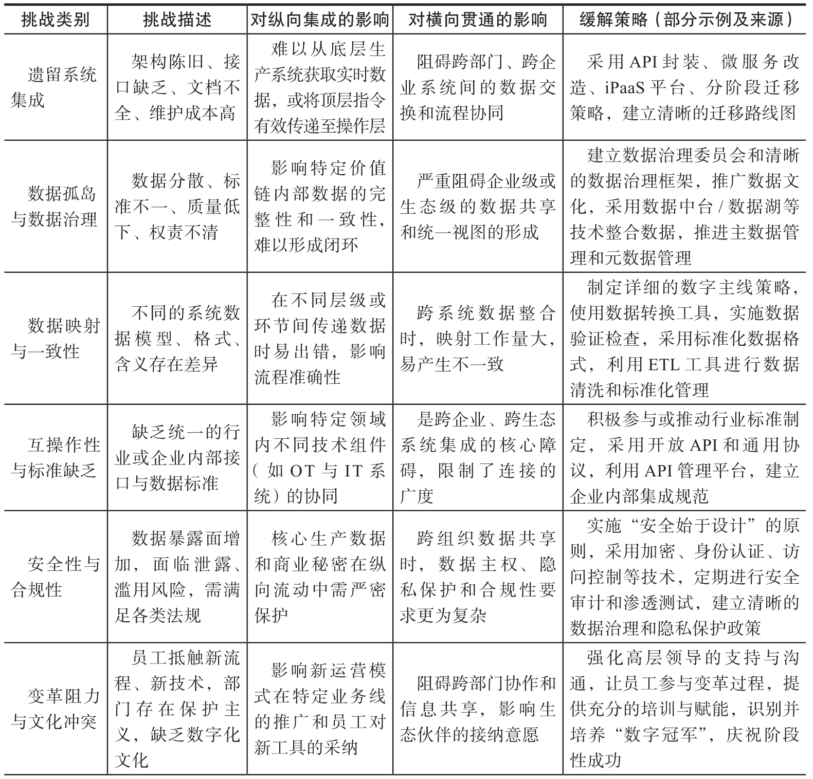

（续）

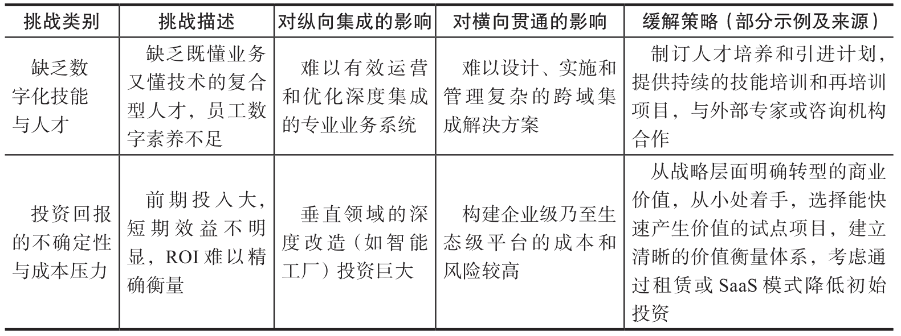

### **3.4.2 衡量成功：以关键绩效指标为驱动**

为了有效评估从能力在线到业务在线的转型成果，以及纵向集成和横向贯通项目的实施效果，企业需要建立一套全面、多维度的关键绩效指标（KPI）体系。这套体系不仅应关注财务和运营效率的提升，还应涵盖客户体验、组织能力和数据质量等多个方面，从而为持续优化和战略调整提供数据支持。

1.衡量能力在线的 KPI

当企业致力于将特定能力在线化时，KPI 应聚焦于这些能力的可用性、使用效率和用户接纳度。

**●用户采纳率（User Adoption Rate）**：衡量新上线的在线工具、平台或能力的活跃用户比例及使用频率。

**●技能熟练度（Skill Proficiency）**：通过考核、认证或任务完成质量评估员工对在线能力的掌握程度。

**●系统正常运行时间/可用性（System Uptime/Availability）**：确保在线能力所依赖的系统稳定、可靠。

**●任务完成效率（Task Completion Efficiency）**：设计任务的完成效率，包括准确率、平均处理时长等，可以形成与线下任务的完成效率的对比。

**●平台特定指标（Platform-Specific Metrics）**：如快速设计平台的产品设计周期、零部件重用率等。

2.衡量业务在线的 KPI

在企业迈向业务在线的过程中，KPI 需要反映整体业务运营的在线化程度和由此带来的商业价值。

（1）客户体验类

**●客户满意度（CSAT）**：表示客户对公司特定产品或服务的满意度。这一指标是衡量客户体验率的直接方法，它考虑了个人与企业之间的特定互动 ^(⁴¹)。

**●净推荐值（NPS）**：客户推荐产品或服务的可能性，将其作为关系指标来评估整体客户忠诚度和满意度。

**●客户生命周期价值（CLV）**：又称客户终身价值，指企业预期能从一个客户那里得到的收益总和。

**●客户流失率（Churn Rate）**：是顾客流失的定量表述，用来衡量在一个特定时间段里流失的顾客数目和总共顾客数目的比例。

**●数字渠道互动率（Digital Engagement Level）**：企业通过数字渠道与客户建立联系、互动和关系的程度，它涵盖了一系列技术和平台，使企业能够与目标受众互动并产生共鸣。

（2）运营效率类

**●流程周期时间缩短**：如订单处理时间、产品上市时间等。

**●自动化率**：已自动化事件的百分比。例如，在从订单到交付的业务在线流程中，已有 30%的节点实现了自动化（如自动从用户合同中提取产品需求等），无须人工干预。

**●运营成本降低**：在线化带来的自动化和效率提升所节省的成本。

**●新产品/服务上市速度（Time-to-Market）**：指产品从构思到可供销售所需的时间长度。产品上市时间至关重要，因为它可以让用户先于竞争对手进入市场并增加销售额、利润和市场份额。

**●其他业务 KPI**：与在线业务紧密相关的 KPI，如与供应链相关的库存周转率提升、订单满足率提高、物流成本降低等。

普华永道（PwC）指出，成功的业务在线需要从客户互动、资源管理、智慧洞察、智能生产四个维度进行衡量，并给出相应的衡量指标 ^(⁴²)。

3.衡量集成项目（纵向集成与横向贯通）有效性的 KPI

集成项目的 KPI 应直接反映连接的质量、数据流的顺畅性以及由此带来的协同效应。

**●数据质量与一致性提升**：例如，跨系统数据不一致率的降低，数据准确性、完整性的提升。

**●信息孤岛减少程度**：可以通过评估数据共享范围和可访问性来衡量。

**●流程自动化率与效率提升**：集成后，流程和数据断点减少的比例、手动操作减少的比例、端到端流程处理时间的缩短等。

**●互操作性评分**：可以基于标准符合度、接口调用成功率等设定。

**●项目投资回报率（ROI）**：指投资后收入的收益与成本之间的百分比率，用于评估项目投资的效率或盈利能力。

**●跨职能/跨企业协作效率**：如协同项目完成率、伙伴满意度等。

**●特定于纵向集成的 KPI**：如生产效率提升、产品不良率降低、设备综合效率（OEE）提升、从设计到生产的周期缩短、供应商绩效评分提升等。

**●特定于横向贯通的 KPI**：如订单全流程可视化程度、跨产品供应链成本透视、跨部门流程断点减少的数量、设计-仿真-测试在线协同效率等。

企业在设定 KPI 时，应确保其与战略目标紧密相关（SMART 原则），并建立持续的监测、评估和反馈机制，以便及时调整转型策略和集成方案。一个平衡的 KPI 组合，既要包含结果性指标（如收入、利润），也要包含过程性指标（如流程效率、采纳率），才能全面反映数字化转型的真实进展和成效。

### **3.4.3 最佳实践与经验教训**

通过分析国内外行业领导者在数字化转型（特别是推进纵向集成与横向贯通以实现业务在线）过程中的实践，可以提炼出一系列宝贵的成功要素、战略方法、经验教训以及需要规避的陷阱。

1.成功要素与战略方法

**●顶层设计，战略引领**。领先企业无一例外地展现出高层领导对数字化转型的坚定决心和清晰的战略愿景。可将数字化转型纳入企业级战略，与业务目标（如提质、降本、创新等）进行深度绑定。建议成立专项组，由 CTO 或 CDO 牵头，联合业务、IT、数据部门，制定 3～5 年的实施路线图。

**●场景驱动，分步实施**。建议从高价值场景切入，优先选择痛点明确、ROI 高的场景，快速验证价值。例如，对消费电子企业而言，供应链优化场景能有效减少物料种类和供应商数量，降低采购成本和呆滞库存，从而推动在数字底座中构建供应链相关基础数据模型和数字链路。

**●以客户为中心，驱动价值创造**。将客户需求和体验设置为转型的核心是普遍的成功策略。企业需通过数据驱动洞察、客户体验优化、组织保障执行的三位一体策略，将客户需求转化为持续创新的动力，最终在数字化竞争中占据制高点。

**●分阶段、迭代式的转型路径**。大型复杂的数字化转型往往采用分阶段、逐步推进的方式。在具体建设的过程中，建议采用“小步快跑，迭代推进”的策略。采用 MVP（最小可行产品）模式，分阶段扩展功能，避免“大而全”的初期投入。

**●统一的数字化平台架构**。领先企业普遍重视构建统一的数字底座和强大的数据处理能力。数字主线理念，即沉淀共享数据能力和业务能力，在这些实践中均有体现，是实现高效集成和能力复用的关键。

在核心技术（如 PLM/ERP 系统、数字主线等）上，建议选择专业的解决方案供应商，并联合生态伙伴，保证技术架构的稳定性和高可用性。

在通用技术（如前端应用架构等）上，建议选择开放技术栈，优先支持云原生、微服务、低代码等技术架构，降低长期成本。

**●开放合作，构建生态系统**。数字化转型不是闭门造车。领先企业积极地通过战略合作、投资并购以及平台开放等方式整合外部资源，构建共生共赢的商业生态。

**●组织文化与人才的同步转型**。技术变革必须伴随组织文化和人才能力的相应变革。培养数据文化，推行“数据驱动决策”理念，将数据质量、使用效率纳入部门 KPI。组建“业务+技术+数据”融合团队，打破部门壁垒，支持敏捷协作。有效的变革管理策略，如加强沟通、高层垂范、解决员工顾虑、提供培训、庆祝阶段性成果等，对于克服转型阻力至关重要。

2.经验教训与需要规避的陷阱

**●避免技术驱动而非业务价值驱动**：单纯追求新技术的应用，而忽视其与业务战略的结合和对实际业务问题的解决，容易导致转型偏离方向，投入及产出会不成正比。

**●警惕“烟囱式”建设的延续**：即使采用了新技术，如果缺乏顶层规划和统一标准，那么也仍可能在新的技术栈上形成新的“数据孤岛”或“应用孤岛”，未能真正实现横向贯通和纵向集成。

**●数据治理的滞后**：在快速推进系统集成和数据汇聚的过程中，如果忽视数据质量、数据标准、数据安全和隐私保护等数据治理工作，那么将会为后续的数据分析和智能应用埋下隐患。

**●低估组织变革的难度**：技术转型相对容易，但组织文化、员工习惯、部门利益的调整往往更为艰难。若缺乏系统性的变革管理和持续的沟通引导，那么转型很容易半途而废。

**●一次性项目而非持续演进**：数字化转型是一个持续优化和迭代的过程，而非一次性的项目交付。企业需要建立持续学习、持续改进的机制，以适应不断变化的市场和技术环境。

综上所述，行业领导者的实践表明，成功的数字化转型和业务在线的实践，是战略、技术、组织、文化多方面协同作用的结果。通过借鉴其成功经验，规避常见陷阱，企业可以更有效地规划和执行自身的转型路径。

# **第四章**

# **AI 与数字化转型：三要素协同与垂域[1]创新**

全球制造业正经历一场数字化转型浪潮，这不只是数字技术的简单应用，更是企业发展理念、组织文化、业务模式乃至盈利模式的根本性变革。企业纷纷将数字化转型置于战略核心，旨在通过全方位的数字化变革提升运营效率、降低成本、增强客户体验，最终获得可持续的竞争优势。德勤咨询指出，数字化转型的终极目标是打造数字企业——一个利用技术持续发展其商业模式所有方面（包括其产品、客户互动以及运营等）的组织 ^(⁴³)，这清晰地揭示了转型的持续性与全面性。

在这一浪潮中，人工智能（AI）已然从最初的辅助工具演变为引领制造业变革的核心力量。机器学习、深度学习、计算机视觉、大语言模型等 AI 技术正广泛应用于制造业的研发设计、生产制造、质量管控、供应链协同乃至经营管理等各个环节。根据中国信息通信研究院的统计，以判别式 AI 为主的小模型在生产制造领域的渗透率高达 57% ^(⁴⁴)。这表明，制造业数字化转型已超越单纯的技术升级范畴，演变为一场深刻的业务与战略变革，AI 在其中扮演着从赋能到引领的关键角色。AI 不再只是提升效率的工具，而是重塑价值链，创新商业模式，乃至定义未来制造业竞争格局的战略要素。

## **4.1 AI 与企业数字化转型**

### **4.1.1 制造业数字化转型的内涵与目标**

制造业数字化转型的核心目标是多元且动态演进的。初期，企业可能更侧重于通过数字化手段提升内部运营效率和降低成本。例如，企业引入企业级 PLM 系统和先进的 CAE 仿真工具，优化设计流程并显著提升设计效率。然而，随着转型的深入，目标逐渐向以客户为中心、以数据驱动的价值创造和模式创新拓展。这体现在以下几个方面。

**●增强客户体验与个性化服务**：利用大数据分析和 AI 技术，企业能够更精准地洞察客户需求，提供个性化的产品和服务，从而提高客户满意度和忠诚度。例如，通过 AI 驱动的 CRM 系统实现客户行为分析和精准营销，并驱动 PLM 系统实现定制需求开发和产品配置，或利用增材制造技术实现大规模定制。

**●驱动业务模式创新和价值创造**：数字化转型不仅可优化现有业务，更重要的是催生新的商业模式和价值增长点。例如，从传统的产品销售转向提供“产品+服务”的整体解决方案，或者构建平台化的生态体系，整合产业链上下游资源，共同为客户创造价值。

**●提升企业敏捷性和韧性**：在快速变化的市场环境中，数字化能力赋予企业更强的敏捷性和韧性，使其能够快速响应市场需求变化，抵御外部风险，并抓住新的发展机遇。例如，在当前关税壁垒、贸易纠纷等新常态下，利用 AI 算法评估全球供应商的合规性、成本、交付能力，动态构建多区域、多层级供应网络，快速响应原产地规则变化，规避相应合规风险。

制造业数字化转型的核心目标正从单纯的降本增效，向以客户为中心、以数据驱动的价值创造和模式创新演进。这种转变的背后，是企业对市场竞争格局和价值创造逻辑的深刻理解。过去，企业可能更多地关注内部生产效率的提升，而现在，则更加注重如何通过数字化手段更好地理解和服务客户，如何在整个价值链中创造新的价值点，以及如何构建更具弹性和适应性的商业生态。在这一过程中，AI 凭借强大的数据分析、模式识别与预测能力，以及个性化服务优势，成为实现上述更高层次目标的关键赋能技术。例如，AI 可以通过分析用户数据和市场趋势，帮助企业精准定位用户需求，从而驱动产品创新和个性化定制；AI 也可以通过优化供应链网络和生产调度，增强整个价值链的协同效率和响应速度。

### **4.1.2 制造业数字化转型的关键阶段与演进路径**

制造业的数字化转型并非是一蹴而就的，而是一个循序渐进、分阶段、多层次的演进过程。企业需要根据自身的基础、行业特点与战略目标，选择合适的转型路径。

国内研究普遍认为，中国制造业的数字化转型大致遵循从“点”到“线”，再到“面”，最终形成“圈（生态圈）”的发展路径 ^(⁴⁵)。

**●点（Point）**：这个阶段的重点是单一业务单元（如仿真）或单一设备/工序的数字化和自动化。例如，引入数控机床、机器人进行自动化生产，或者对某一特定生产环节进行数据采集和监控。

**●线（Line）**：在点的基础上，将数字化应用扩展到整个生产线或特定的业务流程。例如，实现整条生产线的自动化控制和数据追溯，或者对研发设计流程、供应链管理流程进行数字化改造和优化。这一阶段的典型特征是“能力在线”的实现。

**●面（Surface）**：这个阶段强调企业内部跨部门、跨系统的数据集成和业务协同，目标是打通信息孤岛，实现企业运营的集成化和规范化发展。这一阶段的典型特征是端到端“业务在线”的实现。

**●圈（Circle）**：这是数字化转型的高级阶段，企业不再局限于内部优化，而是积极构建或融入产业生态系统，实现产业链的上下游企业间的协同研发、智能生产、敏捷服务和价值共享。

国际咨询机构也提出了类似的阶段性模型。例如，德勤的数字化转型方法论以其数字化成熟度模型（Digital Maturity Model，DMM）为核心工具。该模型旨在全面评估组织在五个核心业务维度的数字化能力，这五个维度分别是客户（Customer）、战略（Strategy）、技术（Technology）、运营（Operations）以及组织与文化（Organization and Culture）。这五个核心维度进一步细分为 28 个子维度和 179 项独立的评估标准 ^(⁴⁶)。基于 DMM 的评估结果，德勤将企业的数字化转型过程明确划分为三个主要阶段：畅想（Imagine）、交付（Deliver）和运营（Run）。同时，企业在数字化成熟度的阶梯上，会经历从初生期（Nascent）、萌芽期（Emerging）、连通期（Connected）到多触点融合期（Multi-Moment）的演进。埃森哲（Accenture）提出的全面企业重塑（Total Enterprise Reinvention） ^(⁴⁷)和波士顿咨询公司（BCG）的数字化战略路线图 ^(⁴⁸)等也都给出了各自的数字化转型阶段性模型，将关注点从有限的项目执行转向了全面且持续的变革，为企业制定从“单点数字化”到“数字企业”的转型路径。

尽管不同模型的划分方式和侧重点有所不同，但它们共同揭示了制造业数字化转型是一个由浅入深、由点及面、逐步深化和扩展的过程。其中，“能力在线”和“业务在线”是承上启下的关键环节，为后续的智能化升级和生态协同奠定了坚实基础。如前文所述，“能力在线”是指将企业自身的核心能力（如设计能力、制造能力、服务能力等）进行数字化封装、模块化、服务化，并通过平台向内部或外部提供。而“业务在线”则是在“能力在线”的基础上强调企业核心业务流程的线上化和数字化，通过纵向集成和横向贯通，实现研、产、供、销、服等环节的在线管理和端到端贯通。这使得企业能够实时掌握运营状态，并为数据分析和决策提供基础。“能力在线”与“业务在线”相互促进，是企业从内部优化走向外部协同、从信息化走向智能化的必经之路。毕马威（KPMG）提出的“五音”数智化加速器模型也将“业务在线化”置于“触点数字化”之后和“运营数据化”之前，清晰地体现了其在整个转型过程中的承接作用。

### **4.1.3 AI 在制造业数字化转型中的驱动作用**

人工智能以其独特的自我学习、自主决策、模式识别和预测分析等能力，正在深刻地改变制造业数字化转型的内涵和外延，成为推动制造业实现从“制造”向“智造”跨越的核心驱动力。AI 技术能够引发传统制造企业组织属性的重大变化，其自我学习、自主性、强化性和适应性等特性，为制造业带来了前所未有的发展机遇。

企业数字化转型为 AI 筑基，它构建了 AI 应用所需的数据基础设施和生态系统。而 AI 是企业数字化转型的加速器和倍增器。AI 利用数字化转型的数据基础提供智能解决方案、优化流程并推动创新，从而显著加快企业数字化转型的步伐并深化其影响。AI 与企业数字化转型的深度融合，正在重塑企业价值创造的底层逻辑。这种融合的本质是数据、算法、算力三要素的协同进化，与企业数字化转型驱动力形成结构性共振。AI 与数字化转型之间的内在关联如图 4-1 所示。

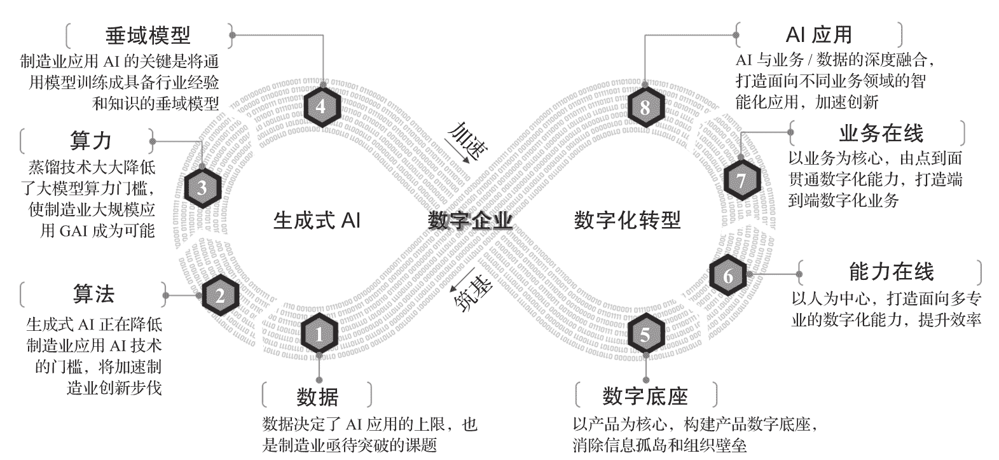

图 4-1 AI 与数字化转型之间的内在关联

下文将从数字化转型驱动力与 AI 三要素的关联维度展开深度解析。

首先，企业数字化转型为人工智能的落地和价值最大化奠定了基础，这涉及以下几个关键方面。

**●以数据为核心**：数据是决定人工智能应用能力上限的关键输入。因此，以数据采集、管理和利用为核心的数字化转型是重要的前提。

**●数字底座建设**：企业需要构建以产品为中心的数字底座，打破信息孤岛和组织壁垒。

**●能力在线**：企业核心能力的模块化、服务化，实现知识沉淀和过程数据的在线化。

**●业务在线**：通过连接各种数字化能力，实现端到端的数字化业务运营，以及全过程业务数据的在线可追溯。

其次，企业一旦构建数字底座，就可利用人工智能增强和加速数字化转型进程。

**●降低技术应用门槛（算法）**：生成式人工智能（GAI）等技术的发展显著降低了企业使用人工智能技术并加快创新步伐的门槛。

**●计算成本效率（算力）**：蒸馏技术等有助于降低大模型所需的算力成本，从而实现 GAI 在各行业的大规模私有化部署。

**●垂直领域模型**：人工智能应用成功的关键（如在制造业），在于能够训练通用人工智能模型，使其具备行业特定知识和经验。

**●智能应用与创新**：人工智能与数据和业务流程的深度融合，使企业能够创建针对不同业务领域的智能应用，从而加速创新。

在制造业的数字化转型浪潮中，AI 正扮演着核心引擎的角色。AI 已成为数字化转型的基石，它赋予企业分析海量数据、自动化复杂任务以及提供个性化体验的能力。波士顿咨询（BCG）的相关研究表明，在过去的三年中，AI 领军企业的收入增长比整体平均水平高出 50% ^(⁴⁹)。AI 在制造业的战略价值体现在优化生产流程，最大化运营效率，减少生产错误，提升产品质量，赋能员工以及实现卓越的运营等多个方面。AI 可帮助企业实现“更多、更好、更快”的生产目标，从而获得显著的竞争优势。麦肯锡预测，从企业用例来看，AI 的长期机遇在于能够带来高达 4.4 万亿美元的生产效率增长的潜力 ^(⁵⁰)。

AI 的变革潜力远不止自动化。它具有自动化认知功能，其影响力有望超越历史上的任何一项重大创新。AI 不仅是提升企业运营效率的工具，而且是驱动战略决策、重塑竞争格局的关键力量。AI 在数据分析、趋势预测与决策优化方面的能力可深入影响企业的核心业务与战略规划。AI 的巨大预期经济收益进一步凸显了其战略重要性，因此，AI 应用已成为企业在数字化时代脱颖而出的关键差异化因素。

简而言之，在 AI 时代，企业竞争已从单一的产品维度拓展为数字化能力的全面较量。成功转型者将赢得定义未来产业规则的话语权，进而形成“数据驱动创新—智能创造价值—生态赋能增长”的正向循环。

## **4.2 AI 三要素突破：制造企业的数据攻坚战**

数据（Data）、算法（Algorithm）和算力（Computing Power）被公认为支撑人工智能发展的三大基石，它们相互依存，共同构成 AI 强大能力的内核。形象地说，数据是“燃料”，算法是“引擎”，算力是“加速器”。AI 在制造业的成功部署与价值实现，取决于这三大要素的协同突破与闭环迭代。

### **4.2.1 数据要素：制造业攻坚战的核心战场**

在数字化转型的宏伟蓝图中，数据无疑占据着核心地位。数据是 AI 的基础。缺乏足够的高质量数据，AI 模型将成为无米之炊，难以发挥应有的效能。制造企业在日常运营中会产生海量的、多维度的异构数据，涵盖设计数模、图纸文档、工艺参数、生产物流等各个方面。这些数据是训练 AI 模型、实现精准决策的宝贵资源。

然而，制造企业在驾驭数据的过程中，面临着一场艰苦卓绝的“数据攻坚战”，其关键挑战如下。

**●数据质量与完整性**：数据的准确性、一致性、完整性以及是否存在错误或缺失，直接影响 AI 模型的性能和可靠性。据统计，为 42%的制造商将数据可访问性和质量视为生成式 AI 应用的主要障碍之一 ^(⁵¹)。

**●数据可访问性与数据孤岛**：数据往往滞留于架构落后的遗留系统中或分散在不同的部门“孤岛”之中，难以形成统一的数据视图，阻碍了数据的综合分析和利用。缺乏清晰、统一的数据架构是制造企业普遍面临的难题。

**●数据量与多样性（多模态数据）**：如何有效管理和处理来自不同来源的海量、多样化数据（如结构化/非结构化数据、3D 模型、2D 图纸、文本、图像及传感器实时数据等），对企业的技术能力提出了极高要求。

**●数据安全与隐私保护**：在数据采集、传输、存储和应用的过程中，确保企业敏感数据（如设计数据、工艺参数、客户信息）的安全，并遵守日益严格的数据法规（如 GDPR、CCPA 等），是企业必须高度重视的环节。

**●数据治理**：许多企业缺乏明确的数据治理框架，不能规范数据管理、使用标准以及 AI 伦理等关键问题。

为了打赢这场“数据攻坚战”，制造企业需要采取一系列战略举措，具体如下。

**●制定全面的数据战略**：明确数据战略目标，对现有数据系统进行审计，识别数据缺口和冗余。

**●构建数据治理框架**：建立清晰的角色、职责和政策体系，确保数据质量、安全和合规性。这包括数据标注、语义数据管理和元数据的主动利用等。

**●应用数据集成平台与技术**：整合来自不同系统（如 PLM、MES、ERP、IoT、SCADA 等）的数据源。AI 技术本身也可以用于自动化数据集成、清洗和标准化过程。

**●建设现代化数据架构**：实施可扩展、可维护的数据架构，包括上下文感知的数据管道、向量数据库和知识图谱等，以满足 AI 应用的需求。同时，积极考虑采用基于云计算的解决方案，以获得更好的可扩展性和灵活性，以及 AI 新技术的可用性和初期投入。

**●满足 RAG 与多模态数据需求**：针对检索增强生成（RAG）等新兴应用，需要优化数据分块和检索方法，并有效管理多样化的数据格式。

由此可见，数字化转型四层驱动架构对企业打赢这场数据攻坚战尤为关键。四层架构不但为企业 AI 的大规模应用夯实了数据基础，同时也从业务架构、技术架构和数据架构等维度充分保障了 AI 技术与企业业务的深度融合，进而充分发挥 AI 在产品和业务创新的核心价值。

### **4.2.2 算法创新：从机器学习到复合式 AI**

将数据转化为可行动的智能算法是 AI 的核心引擎，负责处理数据、识别模式、进行预测并驱动自动化任务。AI 算法的种类繁多，包括机器学习（监督学习、非监督学习、强化学习）以及基于深度神经网络的深度学习自然语言处理（NLP）、计算机视觉和生成式 AI 等。监督学习利用标注数据进行预测或分类。非监督学习则在未标注的数据中发现隐藏的模式（如聚类）。强化学习通过试错来学习最优策略。而深度学习则通过模仿人脑的层次化信息处理机制，自动从数据中发现特征和规律。更高级的 AI 算法模型，如大语言模型和生成式 AI，则能够执行更复杂的任务，如辅助产品设计、工艺参数优化，甚至生成新的设计方案。这些不同的算法支撑着 AI 在各个领域的应用能力，例如，预测性分析依赖机器学习模型，个性化推荐利用协同过滤或深度学习算法，自动化流程借助 RPA 和机器学习，智能搜索应用 LLM 和信息检索技术，而生成式设计则利用特定算法制定新的设计方案。

算法的选择和优化直接决定了 AI 应用的性能和效果。根据具体的业务问题选择合适的 AI 模型（如传统的机器学习、深度学习、LLM 等）对制造企业至关重要。这需要深入理解不同算法的复杂性、数据需求和计算资源消耗等。在实际的 AI 应用中，往往需要整合不同 AI 技术的优势，弥补单一技术的局限性，从而提升整体性能、适应性和智能化水平，我们称之为复合式 AI（Composite AI），即通过结合多种 AI 技术、模型或方法，形成一个协同工作的智能系统，以应对单一 AI 模型难以解决的多层面挑战。复合式 AI 通过整合不同 AI 技术的优势，能够实现更精准的预测、更智能的决策和更高效的自动化，从而提升整体运营效率、产品质量和创新能力。制造业日益增长的复杂性和丰富的数据为复合式 AI 的应用提供了广阔的舞台，使其成为推动产业智能化升级的关键驱动力。例如，在自动驾驶需求分析和系统设计场景中，可通过 LLM 分析用户论坛与投诉数据，提取用户迫切期待的自动驾驶功能（如“雨天制动距离过长”）。再结合知识图谱中的交通法规与事故案例，构建高风险测试场景（如“行人突然横穿湿滑路面”）。然后，在虚拟环境中使用强化学习训练决策模型，动态调整制动策略，同步验证多传感器融合（激光雷达+摄像头+毫米波雷达等）的可靠性。上述场景中，用到了 LLM、知识图谱、强化学习等 AI 算法模型。

随着 AI 模型在制造业的广泛部署，建立强大的 MLOps（Machine Learning Operations，机器学习运维）平台成为必然趋势。MLOps 指 AI 模型部署、管理和版本控制的自动化及标准化，并持续监控、维护和优化其性能，来确保 AI 模型在生产环境中的稳定性、可靠性、可扩展性和持续价值。一个典型的 MLOps 包含以下阶段：数据工程、模型开发与训练、模型验证与测试、模型部署、模型监控与运维，以及模型再训练与迭代。

### **4.2.3 算力支撑：本地部署与云计算的两难之境**

AI 技术，特别是深度学习和大语言模型（LLM），需要海量的计算资源支撑。当前主流的生成式 AI 模型，尤其是那些表现出色的 LLM，通常包含数十亿甚至数万亿的参数。这使得它们在训练和推理（即实际应用）时都需要海量的计算资源，包括高端 GPU 集群和大量的内存。在制造业场景中，生成式 AI 可能需要处理和分析大量的实时传感器数据、生产日志、设计文档、供应链信息等。这些数据的预处理、特征提取以及与模型的交互也对算力提出了高要求。

在应用 AI 的过程中，如何最大限度地保障数据安全，降低泄露风险，始终是企业非常关心的问题。因此，在面对本地化部署和云部署的抉择时，大部分企业会优先考虑本地化部署。同时，企业也不得不面临本地化部署的诸多挑战。

**●成本**：在本地购置和维护足以运行 LLM 的高性能计算集群，对许多制造企业而言是一笔巨大的投资。

**●空间与环境**：部署这样的计算设施还需要相应的物理空间、电力供应和散热条件，这在一些企业环境中可能难以满足。

**●专业团队**：管理和优化这些高性能计算资源也需要专业的 IT 和 AI 运维团队。

模型蒸馏（Model Distillation）等模型压缩技术为制造业本地化部署带来了新的契机。模型蒸馏是一种将大型、复杂的“教师模型”（通常是高性能的 LLM）的知识迁移到小型、更高效的“学生模型”的技术。学生模型通过学习教师模型的输出（如预测的概率分布）或中间表示，在保持较高性能的同时，大幅缩小模型尺寸和计算需求。蒸馏技术可带来以下契机。

**●降低算力门槛**：经过蒸馏的 LLM 参数量显著减少，推理速度更快，对计算资源的需求也大幅降低。这使得在算力有限的本地服务器甚至边缘设备上部署 LLM 成为可能。

**●实现本地化部署以保障数据隐私**：对于许多制造企业而言，数据安全和隐私至关重要。将 LLM 部署在本地，可以避免将敏感数据传输到云端，从而更好地保护商业机密和知识产权。蒸馏技术使得这种本地化部署在经济和技术上更具可行性。

**●低延迟应用**：在某些制造场景中，如实时质量控制或机器人协同等场景，对 AI 模型的响应速度有极高要求。小型化的模型通常具有更低的推理延迟，能够满足这些实时性需求。

**●成本效益**：减少对昂贵云端计算资源的依赖，以及降低本地硬件的投入，可以显著降低 LLM 应用的总体拥有成本。

**●定制化与领域适应性**：虽然教师模型可能是在通用数据上训练的，但蒸馏过程可以结合特定制造领域的数据进行微调，使得学生模型能更好地适应特定场景的需求。

尽管如此，算力需求和专业运维团队依然是制造企业应用 AI 的主要门槛，尤其是在如何构建面向大规模应用和持续优化的 AI 技术架构方面。

综上所述，对于制造企业而言，选择生成式 AI 的部署模式：本地化部署还是云部署，是关键的战略决策，涉及成本、安全性、性能、合规性以及企业自身的技术能力等多个方面。没有绝对的最佳选择，而应根据企业的具体需求和情况进行权衡。对于拥有高度敏感数据、对延迟有极致要求且具备一定技术实力和预算的制造企业，本地化部署可能更受青睐。对于希望快速启动生成式 AI 项目、初期投入有限、对可扩展性要求高且对数据敏感性相对较低的企业，云部署是更便捷、高效的选择。或者采用兼顾两者优势的混合部署模式，即利用云端强大的算力进行数据处理和模型训练，将训练好的、经过蒸馏技术优化的小型化模型部署到本地服务器或边缘设备上，以处理实时数据并进行推理，从而确保数据安全和低延迟。

### **4.2.4 协同策略：优化数据、算法与算力的相互作用**

数据、算法和算力基础设施三者紧密相连、相互依存，共同构成了 AI 能力的基石。数据是算法的燃料。没有高质量、大规模的数据，算法无法有效学习和优化。算法是驱动智能的核心，负责从数据中提取价值，但其运行离不开强大的算力基础设施支撑。而算力基础设施则负责高效地存储、管理和处理数据，并为算法提供运行环境。它们中任何一个的短板都会制约 AI 整体能力的发挥。这种三位一体的协同作用，是实现高级 AI 应用、推动数字化转型向纵深发展的关键。

同时，AI 首先是赋能人类的工具，而非完全替代，特别是在应对突发中断和不确定性时，人类的经验和智慧仍不可或缺。这种协同理念也体现在数据、算法、算力三要素的互动中，人类的监督和领域知识在整个 AI 生命周期中都扮演着关键角色。

制造业的“数据攻坚战”并不只是追求数据的数量，其更深层次的挑战在于实现来自 IT 系统和 OT 系统的异构数据的情境化与集成。尽管企业拥有海量数据，但如果这些数据分散在不同的系统中，缺乏统一的上下文和关联性，那么其价值将大打折扣。数据治理的薄弱和数据质量的低下，会直接导致 AI 模型的不可靠，进而可能侵蚀整个 AI 投资的价值，甚至引发严重的事件或财务风险。数据质量决定了制造企业应用 AI 的上限，数据问题会导致 AI 模型不准确，提高“机器幻觉”的风险。上述风险形成了一条清晰的因果链：劣质数据→不可靠的 AI→缺乏信任/应用受阻→投资浪费/负面影响。在制造业，AI 的错误决策可能直接影响企业的研制过程和生产安全，这一问题的影响尤为突出。

由上可知，无论原始数据多么庞大，只有在被有效整合并赋予特定业务流程的上下文信息后，才能真正发挥其价值。数字化转型四层驱动架构系统性地解决了信息孤岛和数据集成问题，并通过能力在线和业务在线为 AI 应用构建了“情境化数据管道”。这再一次证明：数字化转型是企业大规模应用 AI 的前提和基础，是企业迈向智能化的必经之路。

AI 模型的复杂性不断提升（如生成式 AI 和多模态），对数据、算法和算力这三大要素的要求也随之“水涨船高”。这意味着需要更多样化、更高质量的数据，更复杂的算法，以及更强大的计算能力。这预示着，随着 AI 能力的增强，掌握这三大要素的门槛也在提高。若企业仍被困于基础数据整合，将更难驾驭先进的 AI 技术，进而拉大与先行者的差距。

因此，“三要素突破”并非一劳永逸的成就，而是一项持续的战略任务。随着 AI 技术的不断发展，制造商必须持续投入并调整其数据战略、算法能力（通过自主研发、购买或合作）以及计算基础设施，以保持竞争力。这种三要素之间的协同作用是动态的，需要企业不断地进行优化和平衡。

## **4.3 垂域 AI 模型：从通用 LLM 到工业大脑的进化**

随着人工智能技术的飞速发展，通用大语言模型（LLM）展现出强大的自然语言理解和生成能力，并在各行各业掀起了应用热潮。然而，当这些通用模型直接应用于复杂的工业制造领域时，其局限性愈发突出。制造业对 AI 的需求不只是通用的文本处理，更需要深度融合行业知识，理解特定工艺，并能解决实际生产问题的垂域（Domain-specific）AI 模型。本节将探讨通用 LLM 在工业应用中的不足，介绍通过提示词工程（Prompt Engineering）、检索增强生成（Retrieval Augmented Generation，RAG）和微调（Fine-tuning）等技术构建面向制造业的垂域 AI 模型的方法，以及企业在构建垂域模型过程中具体技术的选择策略。

### **4.3.1 从通用模型到垂域模型：行业应用的必然选择**

通用 LLM 的出现，标志着人工智能领域的一大飞跃。这些模型通常基于 Transformer 架构，并在海量的、多样化的文本数据上进行预训练，在摘要总结、技术协助、数据结构化、内容生成以及信息检索等多种任务上展现出卓越的灵活性。它们能够处理和生成类似人类的文本，回答问题，翻译语言，甚至编写代码。

然而，通用 LLM 的“通用性”在面对特定工业领域的复杂需求时，也暴露了其固有的局限性。这些局限性主要体现在以下几个方面。

**●计算资源瓶颈**：通用 LLM 通常具有固定的处理 Token 的数量上限，这在处理冗长的工业文档或复杂的多轮交互时，易导致性能瓶颈或无法有效处理。

**●机器幻觉与不准确性**：在工业应用中，信息的准确性至关重要。通用 LLM 在处理其未曾学习过或不熟悉的信息时，可能会产生误导性甚至完全虚构的内容（即“机器幻觉”）。这种不确定性对于需要高度精确的工业决策而言是不可接受的。

**●知识更新的局限性**：通用 LLM 在预训练完成后，其知识库通常是静态的，无法自动获取新的信息或适应快速变化的工业流程与标准，除非进行重新训练或通过特定机制进行增强。这对于动态发展的工业环境而言是一个显著的缺陷。

**●缺乏长期记忆与上下文持久性**：通用 LLM 在进行交互时，往往将每次对话视为独立的事件，缺乏对特定工业流程或设备历史知识的长期记忆和上下文关联能力。

**●复杂推理与领域特定细微差别的处理能力不足**：工业场景往往需要复杂的多步骤推理和对领域特定术语、隐晦知识的深刻理解。通用 LLM 在这些方面的表现不佳，它们更多的是基于模式匹配和统计概率进行工作，而非真正地理解。

**●训练集外数据处理的无力**：通用 LLM 无法准确处理其训练数据之外的信息，如实时的工业运营数据或企业内部的专有知识。

在工业应用中，对 LLM 的评估标准也更为严苛，通常包括连贯性、准确性、相关性、清晰度和效率等多个维度。通用 LLM 在准确性和相关性方面，往往难以满足特定工业任务的高标准。任何错误或不精确的信息都可能导致重大的经济损失、运营中断甚至安全事故。因此，制造业对具备深度领域理解和高精度的垂域 AI 模型的需求日益迫切。

垂直领域模型（Vertical Domain Models，VDM）应运而生。这些模型通过在特定行业的专业数据集上进行训练或微调，能够深入理解特定领域的术语、上下文、产品数据和行业规范。这种专业化带来了显著的性能提升、更高的相关性与更强的可控性。垂域模型的应用涵盖模型知识库的定制、对特定上下文的理解增强，以及执行需专家级领域知识的任务（如精确诊断、合规检查或复杂运营决策）。垂域模型的优势包括提高效率、通过优化工作流程降低成本、提升准确性、增强上下文理解能力、在受控环境中处理敏感数据以加强数据保护，以及最大限度地减少机器幻觉现象。

从通用 LLM 向垂直领域模型的演进，本质上是由通用模型的广泛适用性与特定工业应用对深度、精细化和高可靠性智能的迫切需求之间的矛盾所驱动的。通用 LLM 虽然功能多样，但其通用性也带来了机器幻觉、缺乏特定知识以及在细分领域的复杂推理能力不足等问题。工业领域的高风险性、专业术语的复杂性和对精确性的极致要求，使得通用 LLM 在性能和可靠性方面难以满足需求，从而催生了针对特定场景定制的垂域模型。

此外，垂直化不只是为了追求更高的准确性，更是为了建立信任和保障安全。在涉及关键基础设施或人身安全的工业环境中，通用 LLM 的“黑箱”特性和潜在的不可靠性是无法被人们接受的。垂域模型通过在经过筛选的、与领域相关的受控数据集上进行训练，并通常结合可解释性机制，建立更高的信任度，确保更安全地运营。能否遵循行业规范、法规和安全协议，已成为推动垂域应用的关键。其意义已超越单纯的准确性提升，触及了信任和安全这一根本性问题。如在汽车开发过程中，基于 ISO 26262 功能安全标准构建合规审查垂域 AI 模型，以实现自动化合规审查和风险评估，避免人为错误，提高效率。

### **4.3.2 构建垂域模型：方法论与数据策略**

构建高效的垂域 LLM，其核心在于坚实的数据基础和恰当的专业化技术。这一过程始于明确的目标定义，贯穿于细致的数据处理，最终通过先进的 AI 技术实现模型的深度领域适配。

1.数据基础：领域特定语料库的收集、管理与预处理

构建垂域 LLM 的第一步是奠定坚实的数据基础。这需要明确模型的目标和应用场景，进而指导数据的收集、筛选和处理策略。

（1）定义目标与应用场景

在启动任何垂域 LLM 项目之前，必须清晰地界定模型预期实现的功能，如是用于汽车功能安全合规审查，还是面向工程师的元器件优选推荐？明确主要应用场景、成功标准，以及诸如响应时间、隐私保护等约束条件和评估指标至关重要。这些初始定义将指导后续所有的数据策略和模型开发步骤。

（2）数据需求与管理策略

**●收集领域特定语料库**：关键在于识别并收集能够反映目标领域语言特征、专业术语、标准规范、业务流程及推理逻辑等的高价值文本数据。这包括企业内部的产品文档、质量程序、开发流程等具体资料，以增强模型的专业性。

**●质量优先于数量**：一个规模较小但高度相关的、纯净的数据集远比一个庞大但充满噪声的数据集更为有效。在质量优先的前提下，仍须确保数据规模足以覆盖目标场景，否则可能因覆盖不足而引发偏见或幻觉。

**●数据清洗**：这是一个至关重要的环节，目标是获得一个纯净、无噪声的数据集，以加速训练并提升模型泛化能力。具体步骤如下。①去除噪声，修正错误（如 OCR 识别错误），处理缺失值（例如，使用 K 近邻插补或中位数/均值插补）。②数据去重：采用字面精确匹配去重、MinHash 和 LSH（近似重复）、基于句子嵌入的语义去重以及 Facebook AI 相似性搜索库（FAISS，Facebook AI Similarity Search）的相似性检测等技术，以避免模型偏见并确保训练样本的多样性。③文本标准化：如 JSON 和 XML 可用于精确提取包含丰富元数据的结构化数据，而纯文本统一使用 UTF-8 编码等；执行多语言检测，并统一行尾符和空白字符的使用。

**●人工参与的数据标签**：领域专家（SME）的参与不可或缺。他们可以为数据打标签（如为整车需求条目进行标记分类并适用合规条款），创建用于监督微调的数据集，并审查和修正模型输出以形成反馈闭环，从而提高模型在关键领域的准确性和可信度。

**●利用合成数据与数据增强**：当真实数据有限时，可以利用 RAG 驱动的问答对生成、释义、摘要和问题改写生成工具等方法来生成额外的训练样本。但须由领域专家抽样核查合成数据的语义正确性及与领域的一致性，确保其能增强数据集，而非污染数据集。

**●隐私与合规性考量**：在处理敏感数据时需格外谨慎，尤其是在金融、保险和医疗等受严格监管的领域。措施包括对个人身份信息进行匿名化或脱敏处理，确保所有数据源均获得法律许可，并对数据集进行版本控制以便审计。

**●持续的数据更新**：行业在不断发展，模型也需要随之进化。应定期更新检索语料库或训练数据，纳入新的报告、法规和行业趋势。

2.预处理流程

数据清洗和去重完成后，下一步是文本预处理和分词（Tokenization），将文本转换为 LLM 能够有效使用的格式。

**●基本文本处理**：指规范化和标准化内容。这可以确保用户的输入保持一致，并准备好进行进一步处理。具体内容如下。①大小写规范化：转换为统一大小写以简化文本，缩小词汇量。②标点符号处理：标准化或移除标点以确保 Token 的一致性。③词形简化：使用词干提取进行快速处理，或使用词形还原获得更符合上下文的结果，以减少词汇变体。

**●分词（Tokenization）**：将文本切分为模型可处理的单元（词元）。对于 LLM，子词分词法（Subword Tokenization）是首选方法，它的划分粒度介于词和字符之间，能在词汇量管理和处理罕见词之间取得平衡。常用的子词分词法包括：①字节对编码（BPE），合并频繁出现的字符对；②文字片段，用“##”前缀标记子词；③一元语法，根据损失修剪词汇；④句子片段，跨语言工作，无须预处理。

**●专业文本处理**：当处理特定领域文本或多语言文本时，标准方法可能不够用。应使用词典处理技术术语，考虑缩略语和首字母缩写词，并保留数值和度量单位。使用特定语言的模型来准确识别多语言数据集，确保 LLM 能够处理专业领域或多样化的数据。

对于特定领域，如医疗或技术领域，构建领域特定的分词器至关重要，以确保专业术语不被错误切分，从而保留其完整语义。

**●特征工程**：应用领域知识，从文本中识别出有意义的模式，从而有效使用文本数据。行业特定的语义特征可能涉及构建自定义分类体系或采用专门的嵌入技术，即通过将文本转换为模型可以理解的数字格式。

**●构建高效预处理管道**：高效的预处理管道依赖于模块化设计、可扩展性和顺畅集成。在处理大规模数据集时，应采用批处理、流处理和数据分区等策略，并结合列式存储、压缩和负载均衡等技术提升性能。对管道进行自动化健全性检查，并结合专家反馈，是持续改进的关键。

3.核心垂域化技术：提示词工程、RAG 与模型微调

在构建垂域 LLM 模型时，通常推荐采用三种技术，即提示词工程、检索增强生成（RAG）和模型微调。

（1）提示词工程（Prompt Engineering）：引导模型行为与任务适应

提示词工程（也称为提示工程）被认为是无须修改模型架构或进行重新训练，从通用 LLM 中提取领域特定知识的最快捷方法 ^(⁵²)。它通过精心设计问题或指令（即“提示词”），来引导模型生成符合特定领域需求的输出。

提示词工程包括如下核心特征。

**●指令式提示**：使用清晰、直接的命令，如“总结这段文字”。

**●少样本学习（Few-Shot Learning）**：在提示中提供少量示例，向模型演示期望的输入及输出关系。

**●思维链提示（Chain-of-Thought Prompting）**：鼓励模型进行逐步推理，以生成结构化、逻辑化的响应，这对于需要复杂分析的工业场景尤为重要。

**●领域上下文注入**：在提示中直接包含相关的领域特定信息，例如，“为传统商用车增加一个 AEB（主动刹车）功能，需要做哪些产品功能调整”。

**●角色扮演提示**：为模型设定特定角色（如“你是一位资深制造工程师”），以影响其回答问题的视角和风格。

提示词工程的主要优点在于其资源需求低（无须模型再训练）、任务适应性强（通过修改提示即可快速调整以处理不同任务）以及高效性（以最少的配置即可获得相关结果）。

提示词工程的实施是一个迭代的过程，需要根据模型先前输出的响应不断调整和优化提示的内容、结构和措辞，以找到能够引导模型产生所需输出的最佳格式。值得注意的是，即使是 RAG 系统，也需要精确的提示词工程来确保正确检索数据，并指导 LLM 如何使用这些数据。

（2）检索增强生成（Retrieval Augmented Generation，RAG）：访问动态与专有知识

RAG 是一种在生成响应之前，通过参考权威的外部知识库（可以是专有的、实时的行业数据）来优化 LLM 输出的技术，而无须对 LLM 本身进行重新训练。RAG 能有效解决 LLM 在知识鸿沟、信息过时和幻觉等方面的局限性，通过将模型的回答“锚定”在事实性的、最新的领域特定数据上，来显著提升答案的准确性、可控性和相关性。

RAG 的工作过程如下。

1）外部数据创建/索引：将领域特定的文档（来自 API、数据库、知识库等）进行处理（如分块），然后使用嵌入模型将其转换为数值化表示，并存储在向量数据库中，形成一个 LLM 可理解的知识库。

2）检索：当用户提出查询时，查询本身也被转换为嵌入向量，然后在向量数据库中基于语义相似性检索最相关的文档片段。

3）增强与生成：将检索到的相关文档作为上下文信息，与原始用户提示一起提供给 LLM，LLM 基于这些增强的输入生成最终的、更具信息量的响应。

4）持续数据更新：为保证信息的时效性，外部知识库需要定期或实时更新。

为了进一步提升检索质量，高级 RAG 技术从预检索（优化数据索引、颗粒度、元数据）、检索（微调嵌入模型）和后检索（重排序、提示压缩）等环节进行优化。模块化 RAG 通过增强功能模块（如搜索模块、记忆模块、微调检索器）提供了更大的灵活性。

RAG 的有效性高度依赖于搜索引擎的质量、文档预处理策略、嵌入模型的选择以及分块算法的优劣。此外，由于 LLM 的非确定性，因此评估 RAG 应用的性能也可能较为困难，需要持续监控和调整。

（3）模型微调（Fine-Tuning）：实现深度知识注入

模型微调是指在一个预训练好的 LLM 基础上，使用一个规模较小的、领域特定的数据集对其进行进一步训练，以调整模型参数，使其在该特定领域表现更佳。这是一个监督学习过程，通常使用标注好的样本数据（如“提示-响应”对）进行。

模型微调的基本流程如下。

1）明确目标和选择预训练模型。

①定义任务/领域数据：首先需要明确微调的目标，也就是说，是为了进行特定类型的文本生成（如产品创意、产品需求）、特定领域的问答（如操作指导、故障诊断），还是基于特定采购策略智能推荐器件，或者基于 ISO 26262 标准实现汽车安全合规性自动审查。

②选择合适的预训练 LLM：根据任务需求、预算、可用的计算资源以及模型的性能选择一个合适的预训练模型。

③选择模型规模：更大的模型通常能力更强，但也需要更多的计算资源进行微调和推理。

④选择开源或闭源模型：开源模型（如 DeepSeek、Llama 系列、BERT、GPT-2 等）提供了更大的灵活性和控制权，而闭源模型（如 OpenAI 的 GPT 系列通过 API 提供微调）则可能更易于上手，但定制性较低。

⑤设置模型特性：某些模型可能在特定能力上表现更好（例如，有些模型对代码的理解能力更强）。

2）准备和处理微调数据集。这是微调过程中至关重要的一步，数据集的质量直接影响微调效果。

①数据收集：收集与目标任务或领域高度相关的数据。数据的质量（准确性、相关性、一致性）比数量重要，尽管一定的数量也是必要的。

②数据清洗：数据清洗包括去除噪声数据、不相关信息、重复项，修正错误（如拼写/语法错误），处理敏感信息（如数据脱敏）等。

③数据格式化：数据格式化指将数据转换成模型微调所需的特定格式。常见的格式包括提示-完成对（例如，输入是一个问题，输出是答案；输入是一段文本的开头，输出是续写等）、指令-输出对（例如，指令是“将以下英文翻译成中文”，输出是对应的中文翻译）、对话格式（对于聊天机器人，可能是多轮对话的记录）。

④选择文本分类格式：文本后跟对应的标签。

⑤数据增强：如果数据量不足，则可以考虑使用回译、同义词替换等方法进行数据增强，但需谨慎，避免引入噪声。

⑥数据集划分：将数据集划分为训练集（用于训练模型，调整模型参数）、验证集（用于在训练过程中监控模型性能，调整超参数，防止过拟合）和测试集（用于在微调完成后，评估模型的最终泛化能力。这个数据集不应在训练或验证阶段被模型“看到”）。

3）配置微调环境和参数

①硬件资源：LLM 微调通常需要强大的 GPU（如 NVIDIA A100、H100）和足够的内存。

②软件框架：选择合适的深度学习框架（如 PyTorch、TensorFlow）和 LLM 微调库（如 Parameter-Efficient Fine-Tuning，PEFT）。

③超参数设置包括：

**●学习率**：控制模型参数更新的幅度。对于微调，通常使用比预训练更小的学习率。

**●批次大小**：一次训练迭代中使用的样本数量，受限于 GPU 和内存。

**●训练轮次**：整个训练数据集被模型学习的次数。过多的轮次可能导致过拟合。

**●优化器**：用于调整模型的内部参数（权重和偏置），以最小化模型的损失函数。可以把它想象成一个导航系统，引导模型在复杂的“参数空间”中找到能够最好地完成特定任务的“最佳位置”。

**●权重衰减**：一种正则化技术，防止过拟合。

**●梯度累积**：当批次大小受限时，可以通过累积多个小批次的梯度来模拟大批次训练。

4）执行微调训练

①加载预训练模型和分词器（Tokenizer）：加载选定的预训练 LLM 的权重和其对应的分词器。分词器负责将文本转换成模型可以理解的数字序列（Tokens）。

②执行训练循环包括：

**●**模型在训练集上进行迭代训练。

**●**在前向传播（Forward Propagation）中，模型根据输入数据生成预测。

**●**计算损失函数（Loss Function，如交叉熵损失）来衡量预测与真实标签之间的差异。

**●**通过反向传播（Backward Propagation）计算梯度。

**●**优化器根据梯度更新模型权重。

③监控与验证包括：

**●**在每个训练轮次或一定步数后，在验证集上评估模型性能（如损失、准确率、困惑度 Perplexity、BLEU、ROUGE 等特定任务指标）。

**●**监控训练过程中的损失曲线，判断模型是否收敛、过拟合或欠拟合。

**●**根据验证集表现调整超参数。

④保存模型检查点：定期保存模型的权重，以便在训练中断时快速恢复，并保留在验证集中表现最好的模型版本中。

5）评估微调后的模型

①定量评估：在测试数据集上使用与任务相关的客观指标进行评估。

②定性评估：人工审查模型生成的样本，判断其流畅性、相关性、准确性和是否符合预期风格。对于某些任务（如产品创意），人工评估尤为重要。

③与基线模型对比：将微调后的模型与预训练模型（未微调）或其他基线方法进行比较。

微调往往是一个迭代的过程。根据评估结果，可能需要：

**●**调整超参数。

**●**改进数据集（增加数据、清洗数据、调整格式）。

**●**尝试不同的预训练模型。

**●**尝试更高级的微调技术。

6）部署与持续优化

微调完成后，模型可以被部署到实际应用中。部署后还需要持续监控其性能，并在必要时进行重新微调或持续优化。

从微调参数规模的维度来看，有以下两种模型微调技术路径。

**●全参数微调（Full Parameter Fine-Tuning，FPFT）**：更新模型的所有参数，计算资源消耗大，但通常能带来最佳性能。

**●参数高效微调（Parameter-Efficient Fine-Tuning，PEFT）**：仅更新模型参数的一小部分，显著减少了计算和数据需求，并有助于缓解 FFT 的灾难性遗忘问题（即用特定训练数据微调时，可能会丢失先前获得的知识，并在先前学习的任务上性能显著下降）。

从训练数据的来源、训练方法维度来看，主要有以下几种模型微调技术路径。

**●监督微调（Supervised Fine-Tuning，SFT）**：提供针对目标任务定制的带标签数据进行训练。

**●指令微调（Instruction Fine-Tuning，IFT）**：使用包含指令和期望输出的样本进行训练，使模型学会遵循特定指令。

**●基于人类反馈的强化学习（Reinforcement Learning from Human Feedback，RLHF）**：根据领域专家的反馈对模型进行优化，使其输出更符合真实世界的决策偏好和标准。

由于全参数微调对计算资源的要求很高，且易引发灾难性遗忘问题，因此近年来参数高效微调（PEFT）技术变得非常流行。该技术旨在通过仅微调模型的一小部分参数或引入少量额外参数来实现高效微调，同时保持或接近全参数微调的性能。PEFT 技术显著降低了微调的硬件门槛，使得在消费级 GPU 上微调大型模型成为可能。

常见的 PEFT 方法如下。

**●LoRA（Low-Rank Adaptation）**：通过冻结模型原始权重，在模型的某些层（通常是注意力层）注入可训练的低秩矩阵来实现模型行为的微调。LoRA 将模型参数转换为低秩维度，从而减少可训练参数的数量，在保留模型原有性能的基础上，有效降低计算和资源需求 ^(⁵³)。

**●QLoRA**：LoRA（8 位精度）的扩展版本，将权重参数量化为 4 位精度，进一步降低显存消耗。

**●Adapter Tuning**：在预训练模型的层之间插入小型的、可训练的“适配器”模块。

**●Prompt Tuning / P-Tuning**：冻结整个 LLM，只学习与输入拼接的、可训练的软提示（Soft Prompt）嵌入。

**●Prefix Tuning**：类似于 Prompt Tuning，但在注意力机制的每一层都添加可训练的前缀。

总之，模型微调是一个涉及数据准备、模型选择、训练、评估和迭代的系统工程。微调过程相对复杂，高度依赖于高质量的数据和合理的微调技术，可能会导致过拟合或丢失部分预训练阶段学到的通用知识。PEFT 技术的出现进一步推动了 LLM 在各种特定场景下的应用。

4.垂域模型构建策略

构建垂域模型并不总是需要从零开始的。利用现有的、经过预训练的开源模型作为起点，然后进行 RAG 或微调，通常比从零构建全新的 LLM 更快、更经济。

（1）基础模型架构选择

通用 LLM 和垂域 LLM 通常都依赖于 Transformer 架构。通用 LLM 为了捕捉广泛的语言模式，其参数规模往往非常庞大（如数百亿甚至数千亿）。垂域 LLM 也可以是大模型，但也存在一些通过对较小规模的模型进行精细微调而产生的成功案例，这些模型专注于特定的目标数据。

在选择基础模型时，必须仔细评估其训练数据的构成、输出质量、在相关基准测试上的表现以及潜在的安全风险。同时，还需要考虑数据隐私法规以及特定领域语言知识被“污染”的可能性。

（2）垂域化技术选择

可以构建一个决策流程图或决策树，根据可用数据的规模与质量、对动态知识更新的需求、对模型可解释性的要求以及算力/成本预算等因素，来辅助选择合适的通用 LLM 和定制化技术。

如上文介绍，模型垂域化技术主要包括提示词工程、RAG 和模型微调，它们各有优缺点，具体如表 4-1 所示。

**表 4-1 提示词工程、RAG 和模型微调对比分析**

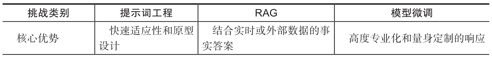

（续）

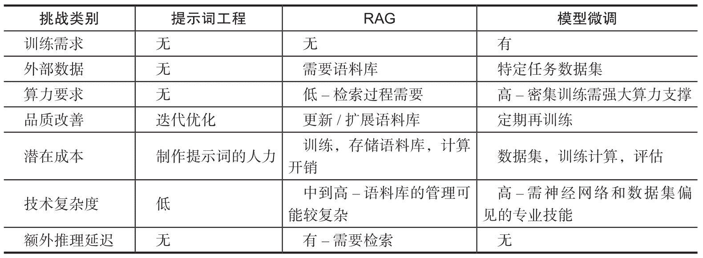

下面举一个形象的例子来进一步说明三者的区别。

通用大模型就像一个刚刚完成大学本科基础课程的大学生，已经学完了高等数学、通用物理和化学等课程，但还没有学习专业课程（如自动化专业的自动控制理论）。这样的学生只能解决通用理论问题，却不擅长解答专业领域的问题，例如，根据用户的需求规格，从成本、交付周期两个维度分析，给出最佳的产品配置建议。

**●提示词工程**：可以将其视为向学生提供一系列指导其回答问题的提示。如“请用你所学到的电磁学知识，回答风电机组的发电原理”，学生可以根据提示词调整自己的答案，但他们掌握的知识并没有改变。

**●RAG**：为学生提供一本专业书籍，如自动控制理论，然后进行开卷考试。考试过程中，学生可以根据问题浏览书籍进行回答。在答案中可引用书中的章节，以确保答案的准确性。

**●微调**：为学生提供同样的书籍，但是要求学生自学，并进行闭卷考试。考试过程中，学生只能依靠内化的知识进行答题。学生可能错误地回答问题，且可能无法准确地提供参考资料。

在项目实践中，RAG 因其灵活性、回答的溯源性、快速开发周期和可解释性而通常更具优势；提示词工程则适用于资源需求低、任务适应性要求高的场景；而当拥有大规模、高质量的静态数据集，并且需要模型深度理解领域特定语言时，微调则是更佳选择。在某些情况下，结合微调和 RAG 的混合方法可能达到最优效果，例如，当存在一个庞大的静态知识库，同时又需要处理动态信息流的场景。

### **4.3.3 工业大脑：制造业 AI 的终极目标**

随着垂域 LLM 技术的成熟，一个更为宏大的概念——“工业大脑”（Industrial Brain）或称“数字大脑”（Digital Brain）、“认知平台”（Cognitive Platform）开始浮现。它代表了工业智能化的更高阶段，旨在通过集成多种先进技术，实现对整个工业价值链的深度洞察和智能管控。

工业大脑通常依托于工业云平台，综合运用人工智能（特别是 LLM）、大数据分析、云计算和物联网（IoT）等技术，以连接并智能化地管理企业的各个业务环节，乃止整个产业链。其核心目标是通过深度数据挖掘实现价值转化，推动产业升级与创新，最终促成高效、智能和可持续的工业发展模式。可以将其理解为一个集成的“智能中枢”。

埃森哲（Accenture）将类似的“认知数字大脑”描述为一种自主的 AI 能力，它将工作流程和价值链直接嵌入系统中，使其能够以更高的自主性进行理解和行动 ^(⁵⁴)。O9 提出的“数字大脑”则是一个知识驱动的集成分析、规划和决策平台 ^(⁵⁵)。它整合了来自市场、需求、供应、营收和财务等多个领域的数据和知识，利用实时市场洞察、机器学习/人工智能驱动的预测、营收分析与规划、供应链分析与控制塔以及数字化集成业务规划（IBP）等高价值应用，旨在实现更精准的预测、优化的资源配置、高效的跨部门协作和更明智的业务决策。

在中国，工业大脑的概念是伴随着全球工业 4.0 和智能制造的浪潮同步发展的，各级政府和科技企业对工业大脑在制造业的建设及推广功不可没。例如，阿里云的 ET 工业大脑、华为的 FusionPlant、腾讯云的 WeMake 等，都在不断迭代和完善其功能。许多地方政府也推出了区域性或行业性的“工业大脑”建设计划。以阿里云为代表的领先科技企业率先将其产品化，将工业大脑定义为基于阿里云大数据的一体化计算平台，对企业系统数据、工厂设备数据、传感器数据、人员管理数据等多方工业企业数据进行汇集，同时借助图像/视频识别、机器学习和人工智能算法，来激活海量数据价值，是为解决工业智能制造的核心问题而打造的数据智能产品，可加速推动工业新基建建设 ^(⁵⁶)。这一定义强调了数据聚合、AI 算法以及解决工业核心痛点的目标，为市场理解工业大脑提供了具象化的参考。

更广泛地看，工业大脑被理解为一个数据驱动的智能系统，它整合工业企业从研发、制造、供应链到交付运营过程中产生的海量数据，利用先进的分析和智能算法，实现对业务链全过程的深度洞察、精准预测和优化控制，最终提升整体运营效率和企业竞争力。这种解决方案的特性决定了其并非标准化的单一产品，而是根据不同行业、不同企业的具体痛点和需求进行定制化构建的系统性工程。

工业大脑的构建并非一蹴而就的，而是制造业智能化逐步演进的目标。它从最初针对特定问题的 AI 应用（如面向设计师的器件优选推荐或面向采购员的采购需求预测等）出发，逐步发展成为一个能够连接、学习并优化整个价值链的生态系统。这个生态系统能够感知、推理、决策并在整个制造企业范围内采取行动，其运作方式类似于生物大脑协调复杂有机体。它能够整合来自工程技术（ET）、运营技术（OT）和信息技术（IT）的异构数据，通过多模型协同和智能体编排，实现端到端的智能流程和持续的自我优化。

从发展阶段来看，尽管市场规模可观，但工业大脑，特别是涉及人工智能大模型深度融合的应用，目前仍处于探索的早期阶段。企业在数据采集、存储、处理、分析及资产化方面已取得一定进展，为更高级的智能应用奠定了基础，但真正意义上的“大脑”级智能决策系统仍在不断演进中。当前，企业迫切需要解决的是制造业 AI 技术架构及应用场景问题。

### **4.3.4 构建垂域模型的最佳实践**

构建成功的垂直领域 LLM 应遵循以下最佳实践。

**●明确目标**：清晰定义模型的任务、目标用户和成功评价指标。

**●数据为王**：优先保证领域特定数据的高质量、高相关性和纯净性。

**●专家参与**：在数据标注、模型训练和模型评估等环节充分引入领域专家的知识及经验。

**●分阶段垂域化**：建议先从提示词工程和 RAG 入手，实现快速知识注入和应用验证，再根据需要考虑投入资源进行微调。

**●审慎选择基础模型**：基于任务需求和评估标准，选择合适的预训练大模型作为起点。

**●精细调整超参数**：在微调过程中，仔细设定和优化学习率、批次大小等超参数。

**●严格评估**：对照基准和真实应用场景，全面评估模型的性能。

**●关注安全与伦理**：主动应对数据隐私、模型偏见和伦理风险。

**●持续迭代**：制订模型持续监控、维护和知识更新的计划。

**●面向 Agent（智能体）系统**：若构建基于 LLM 的智能体，则需精心设计业务逻辑，集成 API 接口，并对其行为进行充分验证。

领域特定数据的质量、相关性及其战略管理，对于创建真正有效的垂域模型而言，其重要性甚至超过模型规模或算法本身的复杂性。整个构建过程始于明确的目标和应用场景，这直接决定了后续的数据需求。实践中，“数据质量优于数量”的原则被反复强调，细致的数据清洗和预处理是不可或缺的环节。即便是 RAG 这样的技术，其效果也严重依赖于外部知识库的质量。同样，微调也需要高质量的标注数据作为支撑。这些都凸显了垂域 LLM 的“智能”主要源于其所接触和学习的专业化数据。

“提示、增强、微调”这一路径为模型垂域化提供了一个务实且可扩展的策略。从低成本、快速见效的提示词工程开始，到利用 RAG 在不重新训练模型的情况下整合专有或动态数据，再到通过微调实现最深层次的领域适配，这一渐进过程允许企业在每个阶段都能获得价值，并根据实际效果决定是否投入更多资源进行更深层次的专业化。图 4-2 所示是模型垂域化技术演进路径，这是一种迭代开发、风险可控、资源优化的演进路径。

然而，选择何种专业化技术或技术组合并非一成不变的，而是一个多因素权衡的决策过程。提示词工程、RAG 和微调各有其优缺点和适用场景。例如，RAG 在处理动态更新的信息方面表现出色，而微调则更适合于将静态的核心领域语言和推理模式深度嵌入模型。如果数据稀缺但实时性要求高，则 RAG 结合提示词工程可能是比微调更好的选择。反之，如果需要在稳定的知识基础上使模型输出风格深度适应特定的行业规范，微调则更为合适。这表明，企业需要根据具体的工业应用场景、数据可获得性、知识领域的动态性以及自身资源限制进行细致的评估和决策，而非简单遵循固定的技术序列。

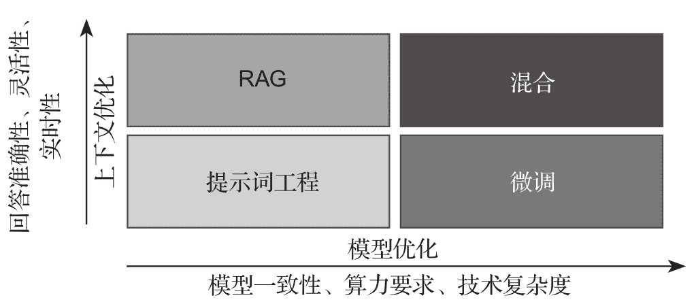

图 4-2 模型垂域化技术演进路径 ^(⁵⁷)

## **4.4 制造业 AI 技术架构**

随着 AI 技术在制造业的深入应用，选择和构建合适的技术架构成为企业成功的关键。本节将对几种主流或新兴的 AI 相关技术架构进行比较分析，包括复合式 AI、模型上下文协议（MCP）以及边云协同架构，旨在为制造企业提供架构选型的战略参考。

### **4.4.1 复合式 AI：多模型融合技术**

制造业环境通常涉及海量异构数据、动态变化的生产条件以及对高精度和高可靠性的严苛要求，单一 AI 模型往往难以全面应对这些挑战。复合式 AI 通过整合机器学习（ML）、计算机视觉（CV）、大语言模型（LLM）、机器人流程自动化（RPA）及 AI 智能体（AI Agent）等，形成一个协同、内聚的智能系统，以应对单一 AI 模型难以解决的多层面挑战。制造业日益增长的复杂性和丰富的数据为复合式 AI 的应用提供了广阔的舞台，使其成为推动产业智能化升级的关键驱动力。

在复合式 AI 架构中，任务被智能地分配给最适合处理它们的 AI 组件，从而降低了单个组件的认知负荷，并提升了系统的整体性能。复合式 AI 具有下列核心优势。

**●效率**：通过任务分解和并行处理，或利用资源需求较低的专用模型，复合式 AI 能够提升整体性能和准确性，并加快任务完成速度。

**●模块化与灵活性**：其组件化、模块化特性使得单个组件可以独立更新或替换，而无须对整个系统进行大规模改造。

**●专业化**：针对特定任务定制的 AI 组件在垂直领域的性能要优于单一的通用模型。

**●多功能性**：复合式 AI 能够适应多样化的应用场景；结合 RAG 等技术，可以进一步扩展 LLM 的能力边界。

**●可控性与可信度**：复合式 AI 可以通过控制 LLM 等核心模型的输入和过滤其输出，使系统行为更加可预测和可解释，从而增强用户对 AI 系统的信任。

制造业涉及多样化的任务和数据类型，单一的、庞大的 AI 模型不太可能在所有这些方面都表现出色。复合式 AI 架构天然适合复杂的制造环境，它们允许集成各类最优秀的 AI 组件（如用于视觉的 CNN、用于时间序列的 RNN、用于文本的 LLM）以解决不同类型、不同专业领域的复杂问题。C³AN 框架为构建此类系统提供了一种结构化方法，增加了针对领域特定知识的定制化和针对实际部署的紧凑性等关键层面，并特别强调了对制造业至关重要的可信度和领域特异性，使得这些架构模式在为制造业创建整体 AI 解决方案方面具有高度的相关性和显著优势 ^(⁵⁸)。

在制造业中，复合式 AI 可应用于需要处理多种数据类型（如模型、图纸、文本、视频和传感器数据等）的复杂质量控制场景、集成化的产品设计流程优化以及结合不同分析模型的高级预测性维护等方面。例如，利用生成式 AI 优化复合材料结构设计，便是一个典型的复合式 AI 应用。展望未来，制造业复合式 AI 正朝着构建“工业大脑”或“认知数字大脑”的方向演进。这预示着一个由数据驱动、具备自主学习、自我优化能力，并深度融合人类智慧的智能制造新范式即将到来。

### **4.4.2 模型上下文协议：标准化 AI 模型交互**

模型上下文协议（Model Context Protocol，MCP）是一种开放标准，由 Anthropic 公司于 2024 年 11 月推出，致力于解决 AI 模型在访问和利用外部信息时面临的集成碎片化和效率低下等问题。MCP 旨在规范化 AI 模型（特别是 LLM）与外部服务（如工具、系统等）、数据源之间的通用接口。用户可以把它想象成 AI 应用的“USB-C”接口，目标是实现结构化、安全且一致的 API 调用，从而简化 AI 系统与外部世界的交互。

MCP 定义了一套通用的通信协议、数据格式和规则，为 AI 模型的部署应用带来了以下好处。

**●简化集成**：开发者不再需要为每个 AI 模型和外部工具的组合创建定制化的集成方案。MCP 提供了一个统一的协议，使得 AI 系统可以更轻松地连接到多样化的数据源和工具。

**●提升模型表现**：通过标准化的上下文信息交换，AI 模型能够获取更准确、更相关的外部数据，从而生成更高质量的回复，执行更广泛的任务。

**●增强互操作性**：MCP 是一个模型无关的开放标准，促进了不同 AI 平台和工具之间的兼容性和协同工作。

**●安全可控**：协议设计中考虑了数据安全和访问权限控制，确保在与外部系统交互时的安全性。用户对数据共享和操作拥有明确的控制权。

MCP 采用客户端-服务器架构，其工作原理如下。

**●MCP 服务器**：这些服务器负责连接到具体的数据源或工具系统。它们将这些外部系统的能力按照 MCP 规范以 API 形式暴露出来，供 MCP 客户端调用。服务器可以提供以三种核心功能，分别是：①资源，可供 MCP 客户端调用的上下文数据，通常不执行计算或操作；②工具，允许 MCP 客户端调用的 API 或者函数，从而进行特定的计算或操作；③提示（Prompts），提供可复用的模板化消息和工作流，方便用户与 AI 模型进行特定类型的交互。

**●MCP 客户端**：这些客户端通常集成在宿主应用（如 AI 助手、Agent 应用、聊天机器人等）中。客户端负责与 MCP 服务器建立连接、发现服务器提供的资源、工具、提示，并根据 AI 模型或用户的需求向服务器发起请求和接收响应。

**●通信协议**：MCP 基于 JSON-RPC 2.0 消息格式进行通信，这是一种轻量级的远程过程调用协议，使用 JSON 作为数据交换格式。连接是状态化的，支持在连接生命周期内进行多次请求和响应，并且允许客户端和服务器之间进行能力协商。

尽管 MCP 尚处于萌芽阶段，但其一发布就被许多业内人士视为推动 AI Agent 发展的关键一步。通过标准化的方式实现 AI 与外部世界的交互，MCP 有望在以下方面发挥作用。①加速 AI 应用的开发和部署：降低集成复杂性，使开发者能更专注于核心业务逻辑；②确保跨系统和服务交互的一致性：通过统一的 MCP 实现跨工具、系统之间的数据交互和业务整合，便于实现价值链端到端的复杂 AI 应用；③赋能更高级别的自主 AI Agent：MCP 服务器可以提供参数化的提示模板，这使得通过提示链构建复杂的、多步骤的 AI Agent 工作流成为可能，从而增强了 Agent 系统的规划和执行能力；④构建更开放、更具协作性的 AI 生态系统：鼓励不同的厂商和开发者共同构建和分享 MCP 兼容的工具及服务。

总而言之，模型上下文协议（MCP）旨在通过一个开放和标准化的框架，彻底改变 AI 模型与外部数据和工具的交互方式，为构建更强大、更实用、更易于集成的多 AI Agent 平台铺平道路。

### **4.4.3 边云协同架构：制造业 AI 部署策略**

在制造业数字化转型浪潮中，AI 应用正从概念验证走向规模化部署。然而，制造场景的复杂性、数据的多样性与实时性要求，以及对安全和成本的考量，往往使得单一的云端或边缘端 AI 部署方案难以满足所有需求。因此，边云协同架构作为一种灵活、高效且可扩展的 AI 部署策略，在制造业中获得了广泛关注与认可。

边云协同架构的核心思想是，将计算和数据存储在边缘设备和云平台之间进行智能分配和协同处理。这种架构充分利用了边缘计算的低延迟、高带宽、数据隐私保护等优势，以及云计算的强大算力、海量存储、模型训练与集中管理等能力，实现了二者的优势互补。

在制造业 AI 部署中，边云协同架构具体体现在以下几个方面。

1.数据处理与预处理的协同

**●边缘端**：部署在研发、制造、供应链等不同业务领域的边缘节点（如 PLM 等数据源系统、生产终端、嵌入式设备等）负责实时采集来自不同业务环节的海量数据。这些数据可以在边缘端进行初步的清洗、过滤、聚合、特征提取等预处理操作，减少了上传到云端的数据量，降低了网络带宽压力和传输延迟。而对于 PLM 等业务系统数据，进行能力在线和业务在线等改造升级后，无须进行数据预处理，可直接利用系统提供的数据 API 服务上传到云端。

**●云端**：云平台负责存储和处理来自多个边缘节点的海量数据，进行更复杂的分析、数据挖掘和知识图谱构建。云端可以汇聚不同业务领域的数据，进行全局性的数据分析和洞察。

2.AI 模型训练与推理的协同

**●云端**：通常利用云平台强大的计算资源（如 GPU 集群）进行复杂的 AI 模型训练和优化。专业人员可以在云端利用海量数据训练出高精度的模型，并通过模型管理平台进行版本控制和迭代。

**●边缘端**：训练好的 AI 模型可以被部署到边缘节点上进行实时推理。这使得 AI 应用能够快速响应现场需求，如智能设计导航、产品需求异常检测、设备故障预测等。边缘推理降低了对网络连接的依赖，保证了 AI 应用的连续性和实时性。

**●模型优化与更新**：云端可以根据边缘端上传的推理结果和新增数据，对模型进行持续学习和优化，并将更新后的模型下发到边缘节点，形成一个闭环的迭代提升过程。联邦学习等技术也可以在边云协同架构下应用，在保护数据隐私的前提下，利用各边缘节点的本地数据进行模型联合训练，并将其训练得到的模型更新内容（通常是模型参数的改变量或梯度，而非整个模型或原始数据）发送回云端。云端使用特定的聚合算法将这些更新融合成一个新的、改进的全局模型。

3.应用部署与管理的协同

**●云端**：作为集中管理和控制中心，云平台负责 AI 应用的统一部署、监控、运维和升级。开发人员可以通过云平台远程管理分布在不同地理位置的边缘节点和应用。

**●边缘端**：运行具体的 AI 应用，执行实时的决策和控制任务。边缘节点需要具备一定的自主运行能力，在与云端连接中断的情况下，仍能保证核心功能的正常运转。

4.安全与可靠性的协同

**●边缘端**：本地数据处理有助于保护敏感生产数据的隐私和安全，减少数据泄露的风险。边缘计算的实时性也有助于快速响应安全事件。

**●云端**：提供全面的安全防护机制，保障云端数据的安全。同时，云端可以对边缘节点的安全状态进行监控和管理，及时发现和处理安全漏洞。通过冗余设计和备份机制，确保整个系统的可靠性。

由此可见，制造业 AI 部署采用边云协同架构具有明显的优势，包括如下方面。

**●低延迟与高效率**：边缘端实时处理数据和执行推理，满足制造过程对毫秒级响应的需求。

**●带宽优化与成本降低**：在边缘端进行数据预处理，减少上传到云端的数据量，节省网络带宽成本。

**●数据隐私与安全增强**：敏感数据在本地处理，降低数据泄露风险。当然，有些企业会选择私有云来保护敏感数据和 IP，其成本自然也会更高。

**●高可用性与可靠性**：即使在网络连接不稳定的情况下，边缘节点仍能保持一定程度的自主运行。

**●灵活扩展与集中管理**：云平台提供强大的计算和存储能力，支持业务的灵活扩展；同时，可以对海量边缘节点进行集中管理和维护。

然而，当前制造企业在实施边云协同架构时，会面临一定的挑战，包括以下方面。

**●边缘节点的管理与维护**：大量分散的边缘节点给管理和维护带来挑战。因此，企业需要根据数据量、地域等信息来设立边缘节点，尽量减少边缘节点的数量。

**●边云之间的数据一致性与协同效率**：在制造业等场景中，边缘设备和云平台需要紧密配合，共同完成复杂的 AI 任务。需要设计高效的数据同步和任务协同机制（如统一的任务编排平台、异步处理与事件驱动架构等）。

**●边缘计算资源的限制**：边缘节点的计算能力和存储能力相对有限，需要进行模型轻量化（如蒸馏）和优化等处理。

**●网络连接的稳定性与安全性**：边云之间的网络连接是关键，需要保证其稳定性和安全性。

**●技术标准与生态系统的成熟度**：边云协同涉及多种技术和厂商，需要考虑标准兼容性和生态系统的支持。

总而言之，边云协同架构为制造业 AI 的规模化部署提供了一种行之有效的策略。它通过有机结合边缘计算和云计算的优势，能够更好地满足制造业对实时性、可靠性、安全性和成本效益的综合要求，加速 AI 技术在制造各环节的深度融合与价值创造，是推动制造业向智能化、柔性化和高效化转型的重要技术支撑。

### **4.4.4 制造业 AI 架构战略性选择**

在制造业的智能化转型中，选择正确的 AI 架构是决定项目成功乃至企业未来竞争力的关键战略决策。这不仅涉及技术选型，更关乎如何将 AI 深度融入业务流程，实现数据驱动的决策和持续创新。当前，边云协同架构已成为主流趋势，而新兴的模型上下文协议（MCP）和复合式 AI 理念则为架构设计带来了新的战略考量和可能性。

边云协同架构制造业 AI 部署的战略性基础，旨在平衡实时性、数据处理、成本和可管理性。边云协同为复合式 AI 提供了理想的部署环境，允许不同的 AI 组件根据其资源需求和实时性要求部署在最合适的位置（边缘或云）。而 MCP 可以在边云之间以及边缘、云端内部的 AI 模型与企业各业务系统/工具之间提供标准化的交互方式，简化协同复杂度。

然而，MCP 尚处于发展初期，其在制造业的普及程度和标准成熟度有待观察。可选择支持或兼容 MCP 的 AI 平台和工具，或在内部系统接口设计时考虑 MCP 的原则。同样，复合式 AI 需要强大的 MLOps（机器学习运维）能力来管理和编排多个 AI 组件的生命周期。组件间的接口设计、数据流转和协同机制需要精心规划，MCP 在此可以发挥作用。如何有效地评估和优化整个 AI 复合系统的性能也是一个挑战。

一个理想的、具有前瞻性的制造业 AI 架构战略应包括以下内容。

**●以边云协同为基础**：搭建灵活、可伸缩的计算和数据处理基础设施。

**●拥抱复合式 AI 理念**：鼓励模块化设计，通过组合不同的 AI 能力解决复杂的制造问题，避免单一技术路径依赖。

**●关注并逐步引入 MCP 等标准化协议**：致力于提升 AI 模型与现有 IT/OT 系统的集成效率和互操作性，降低 AI 应用门槛。

**●强化数据治理与 MLOps**：确保数据质量、安全合规，并高效管理 AI 模型的生命周期，特别是对于复合式 AI 中的众多组件。

**●聚焦业务价值**：所有架构选择都应服务于具体的业务目标，如提升效率、降低成本、改进质量、增强韧性或创造新价值。

**●保持开放和与时俱进**：技术在快速发展，架构需要具备持续学习和适应新技术、新模式的能力。

通过战略性地整合边云协同架构的部署优势、MCP 的集成潜力以及复合式 AI 的组件化构建理念，制造企业可以构建出更强大、更灵活、更易于管理和扩展的 AI 系统，从而在激烈的市场竞争中占据领先地位。

[1[]](#chapter13.xhtml_chapter13.xhtml_BA5670E53C9E124589BF4EA882B24206B6)垂直领域。

# **第五章**

# **AI Agent：从工具到合作伙伴的跃迁**

## **5.1 AI Agent 的定义及核心特征**

AI Agent（智能体）这一概念的起源并非源于单一的某个时刻或某个人，而是一个跨越了计算机科学、控制论、哲学和心理学等多个领域、逐步演化而成的思想结晶。其思想根源可以追溯到 20 世纪中期，与 AI 概念的诞生紧密相连。20 世纪 80 年代，Agent 和多 Agent 系统（Multi-Agent System，MAS）作为一个独立且活跃的研究领域开始进入兴盛时期，典型的包括迈克尔·伍尔德里奇（Michael Wooldridge）等人发表的一系列论文和出版的著作 ^(⁵⁹)。

AI Agent 是一种能够感知其所处环境、进行自主决策并采取行动以实现特定目标的智能体。这些 Agent 被设计为在没有人为干预或仅需最少干预的情况下运行。与主要用于生成内容（如文本、图像等）的生成式 AI 不同，AI Agent 的核心在于其能够独立做出判断并采取一系列行动以达成目标，表现出类似“代理人”或“智能体”的行为特征。

大语言模型（LLM）的发展极大地推动了 AI Agent 的进步，因为它们为智能体提供了强大的自然语言理解、推理和生成能力，使其能够更好地理解任务、规划步骤并与外部工具和环境进行交互。

AI Agent 具有如下核心特征。

**●自主性**：AI Agent 的核心特征是其独立操作、自主决策并执行任务的能力，无须持续地人工干预。在研发领域，这种自主性对于探索广阔的设计空间或管理长时间运行的试验至关重要。

**●学习与适应性**：AI Agent 能够从新的数据、交互和结果中学习，持续改进其性能，并适应不断变化的项目需求。这对于迭代式的研发过程至关重要。

**●推理和决策能力**：AI Agent 能够将复杂的目标分解为一系列可执行的步骤，并根据当前情况和可用资源进行推理决策。

**●目标导向**：AI Agent 被设计用来实现一个或多个预设或动态生成的目标，并主动为实现这些目标而工作。

**●工具使用**：AI Agent 能够利用外部工具或服务（如搜索引擎、计算器、代码解释器、特定领域的 API）来扩展其能力范围，完成仅靠自身模型无法完成的任务。

**●感知与环境交互**：AI Agent 能够感知其所处的数字或物理环境（如通过 API、传感器数据、文本输入），并能通过行动（如调用 API、执行代码、控制机器人）来影响环境。

自主性、学习能力和工具使用能力的结合，使得 AI Agent 特别适合应对产品研发过程中固有的迭代性和不可预测性，使其能够比传统 AI 或单纯的人类研究人员更有效地驾驭复杂的问题空间。制造业对 AI Agent 的定义正在从执行特定任务的工具，演变为更全面的、自主的“合作伙伴”或“数字化研发团队成员”，它们能够为端到端的研发活动做出贡献。正如一些研究指出的，AI Agent 正在执行复杂的研发工作流程 ^(⁶⁰)，可显著提升设计迭代效率。这种转变的驱动力在于研发活动的日益复杂化和数据量的爆炸式增长，使得单纯依靠人力的方法效率低下。

这种向 AI Agent 的转变，意味着人类与 AI 系统交互方式的根本性改变，即从直接指令转变为目标/任务委托和过程监督。传统 AI 通常需要针对特定任务进行显式编程或监督学习，而 AI Agent 则能够解释意图，评估选项并自行执行决策，并且可以基于目标而非仅明确指令后自主行动。这种从明确指令到基于目标的自主性过渡，表明了一种更深层次的伙伴关系，而非简单的工具使用。其“几乎无须人工参与即可直接采取行动”的能力进一步印证了这一点。

## **5.2 Agentic AI 与生成式 AI 的区别**

在讨论 AI Agent 时，区分其与 Agentic AI（智能体 AI）、生成式 AI 等概念非常重要。

生成式 AI 的核心功能是基于学习到的模式创建新的内容，如设计方案、文本、代码等。AI Agent 则是利用 AI（现代 Agent 通常以生成式 AI 作为其核心组成部分）来自主做出决策并采取行动以达成特定目标。单个 Agent 专注于特定任务或目标的执行，如同作战能力超强的单兵。然而，复杂任务往往需要多兵种协同作战才能完成。因此，我们开始进入了 Agentic AI 时代，即一个复杂的多 Agent AI 系统，其中的多个 AI Agent 分别扮演不同的角色，它们之间相互沟通、协调、分配任务，共同完成一个宏大的目标 ^(⁶¹)。

生成式 AI 以生成文本内容为主，不执行任何操作；而 Agentic AI 则可以通过使用各种工具来执行各种操作，以完成复杂的目标任务。以动力电池电芯研发场景为例，生成式 AI 可能提出一种新的材料配方设计方案，但仅停留在理论层面；而 Agentic AI 系统则通过获取该设计方案，确定材料合成路径，模拟其性能参数，甚至启动实验验证，从而帮助企业找到一套切实可行的新材料合成方案。

表 5-1 列出了生成式 AI 与 Agentic AI 的区别。

**表 5-1 生成式 AI 与 Agentic AI 的区别**

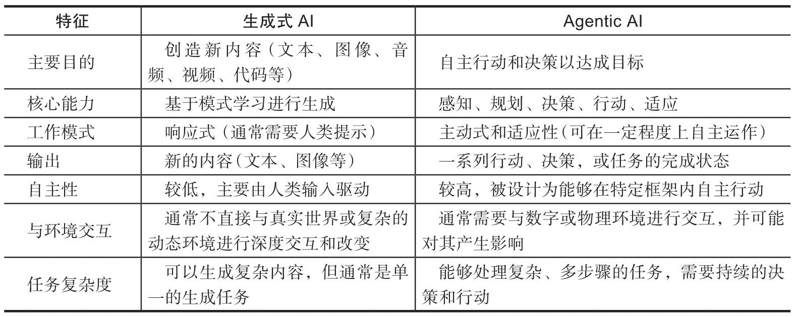

举一个通俗易懂的例子来进一步理解生成式 AI 与 Agentic AI 的区别。如果要为团队采购下午茶，分别是 5 杯咖啡和 5 杯奶茶，则生成式 AI 只能告诉用户如何通过美团或饿了么等外卖 App 来订购。而 Agentic AI 则会将采购下午茶分解为一系列的任务，调用外卖 App 分别购买 5 杯咖啡和 5 杯奶茶，输入配送地址，完成支付等一系列操作。最后 5 杯咖啡和 5 杯奶茶就会送到团队成员的面前。

在制造业，真正的能力飞跃来自于 Agentic AI 与生成式 AI 及其他 AI 工具的协同作用。Agentic AI 负责编排这些工具，以驱动从概念产生到验证的整个创新流程。生成式 AI 提供了创造性的火花（如新的设计方案），而 Agentic AI 则提供了自主执行和决策的框架，以测试、改进和验证这些创新成果。这种结合使得研发过程的端到端自动化程度远超任一技术单独所能达到的水平。

## **5.3 AI Agent 的核心组件**

AI Agent 的有效运行依赖于一系列精心设计的核心组件，这些组件协同工作，赋予系统自主行动的能力。在制造业的特定背景下，组件的功能和交互对于实现智能化和自动化至关重要。

**●感知模块**：该模块负责处理来自各种输入源（如物联网传感器、各种业务系统）的数据，以解释所处环境的状态。它利用计算机视觉（CV）分析图像和视频（如识别产品缺陷、监控机器状态），利用自然语言处理（NLP）理解文本指令或报告。在制造业中，这意味着能够理解设备的当前状态、产品的物理特性，甚至解释操作员的语音指令或书面工单。

**●推理引擎**：这是 Agent 的“大脑”，负责分析感知模块收集的信息，并基于算法、推理模型和知识库做出决策。它运用逻辑推理、概率模型和启发式方法来解决问题。例如，在制造业中，推理引擎可以分析设计变更对产品成本或交期的影响，推断产品质量问题的根因，或者基于实时数据预测供应链风险。

**●学习机制**：该组件使 Agent 能够通过经验学习并随时间推移改进其性能和决策能力。它通常包含监督学习（从标注数据中学习）、无监督学习（从未标注数据中发现模式）和强化学习（通过与环境交互并获得奖励或惩罚来学习）等多种方法。反馈回路用于模型的实时或定期优化。在制造业中，这使得 Agent 能够从过去的生产过程中学习以优化工艺参数和设备参数，或者从过去的器件推荐记录中分析用户的设计风格和选用策略，从而优化个性化推荐算法。

**●执行模块**：该模块负责执行推理引擎做出的决策，通过物理动作（如控制机械臂执行操作、调整设备参数）或数字动作（如根据变更影响分析结果向 PLM 发起一系列变更请求、根据供应链断链风险在 SRM 系统中执行应对策略）来实现。它包含控制机制和执行框架，以确保任务高效、一致地执行。在多 Agent 系统中，行动模块还负责与其他 Agent 协调动作。

**●记忆与知识库**：Agent 需要存储和检索信息以支持其操作。这包括过去的交互记录、学习到的经验、预定义的规则以及特定领域的知识（如工艺参数、材料特性、安全规程等）。知识库可以采用符号结构（如结构化数据库）进行基于规则的推理，也可以采用神经表示（如向量数据库）进行 AI 驱动的模式识别和深度学习模型中的快速检索。这对于在复杂制造场景中实现情境理解和保持一致的性能至关重要。

**●通信接口**：该组件允许 Agent 与用户、IT/OT 系统（如 PLM、ERP、MES 系统）或其他的 AI Agent 进行交互。交互方式可以包括 API 调用、自然语言处理以及标准化的通信协议。这对于将 AI Agent 无缝集成到更广泛的企业 IT/OT 环境中至关重要。

推理引擎的有效性直接取决于感知模块提供的数据质量和丰富性，以及记忆/知识库中存储的情境信息的完备性。如果感知数据有误或知识库缺乏关键信息，那么无论推理算法多么复杂，推理引擎都将在不正确或不完整的前提下运行，从而导致在执行过程中做出次优或错误的决策。这凸显了数据质量和全面知识表示的极端重要性。

## **5.4 AI Agent 的通用设计模式**

近年来，AI Agent 能力的显著提升，主要得益于 LLM 的突破性进展。LLM 作为 Agent 的“大脑”或“主控制器”，为其提供了理解复杂输入、进行高级推理与规划、可靠使用外部工具以及从错误中恢复的基础能力。反思、工具使用、推理和规划，被认为是基于 LLM 的 AI Agent 的核心能力，对于 AI Agent 实现自主决策、采取行动并协调任务至关重要，使其能够从简单的任务执行迈向复杂的、多步骤的问题解决。反思与规划、工具使用和多智能体协作一样，是定义下一波 AI 进展的关键设计模式，在当前和未来的 AI 发展格局中将占据着核心地位。

### **5.4.1 反思**

AI Agent 的反思代表了 AI 应用领域的一项重大进步，它超越了单纯的任务执行，使 AI 系统能够进行自我分析和改进。从根本上讲，反思赋予 AI Agent 批判性地评估自身表现、理解其决策路径、找出薄弱环节，并随后调整方法以随时间增强自身能力的能力。反思机制明确引入了自我纠正和动态适应的能力。如果没有反思机制，AI Agent 则倾向于重复错误，并且无法在没有进行直接外部再训练或手动重编程的情况下提高性能。相比之下，反思建立了一个内部反馈循环，使 Agent 能够根据自身的性能评估动态地调整其策略和行动，如图 5-1 所示。这种机制对于 AI Agent 在动态、不确定和部分可观察的真实世界环境中有效且稳健地运行至关重要，因为在这些环境中，静态的预编程规则是远远不够的。它标志着 AI 正朝着更强大、更通用、能够不断从自身经验中学习和进化的系统迈进，就像人类专家随着时间推移不断磨练技能一样。

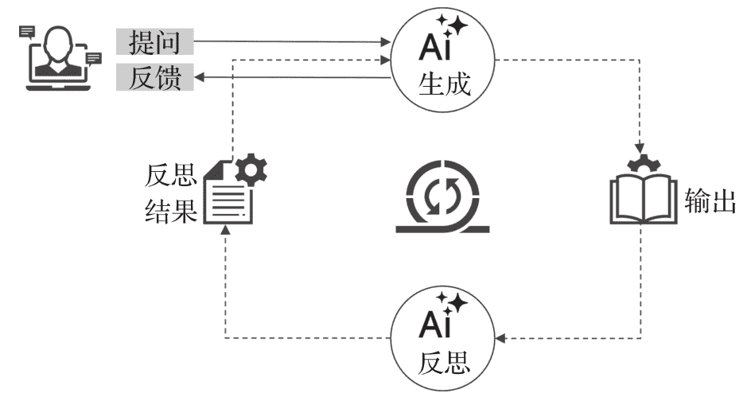

图 5-1 AI Agent 的反思机制

反思的实现通常始于 Agent 生成一个初始解决方案或响应，之后触发反思机制来评估和完善这个输出。一种常见的方法是 Agent 通过向自身提出特定的、预定义的问题来进行严格的自我评估，如“这个响应准确吗”“有没有更好的方法”或“这个输出中的逻辑通不通”等。反思使得 Agent 能够清晰地阐述其行动的理由，从而系统地审查过程和生成的输出。

在反思过程中，通常会借助记忆系统，以跟踪多次迭代中的决策和反思。短期记忆（Short-Term Memory，STM）保留瞬时上下文数据，用于即时任务的执行，从而避免在单个任务会话中重复错误。而长期记忆（Long-Term Memory，LTM）则系统地积累长期知识，归档中间推理轨迹并将其合成为可重用工具或经验库，以供未来在不同的交互中进行改进。

反思机制的复杂程度与 Agent 实现元学习（Meta-Learning，即学习如何高效学习的能力）直接相关。初级的反思可能只能识别表层错误。整合记忆允许 Agent 在长时间内从过去的错误中学习，从而实现“长期学习”，这使得 Agent 获得了改进其基本学习策略的深刻能力。一个真正先进的反思 AI Agent 不仅能纠正错误，还能积极改进其底层的解决问题策略，从而可以发现新的问题解决方法，并大大增强适应性。

反思不仅能够促进新问题解决方法的发现，还能够提高 AI 系统的可解释性和可信度。可解释性的增强有助于建立信任，这在制造业领域至关重要，因为理解 AI 做出决策的“原因”有助于准确定位问题所在，并确定如何优化整体业务流程。这凸显了反思不仅是提高 Agent 性能的内部机制，而且是一种能产生重大外部影响的能力。

反思机制存在着一定的局限性，包括反思过程需要消耗额外的计算资源，同时会影响 Agent 的实时性和效率。另外，过度反思会陷入无限的反思循环，而反馈偏差则会强化 Agent 的不良行为。这些都需要在 Agent 的开发过程中进行持续迭代优化。

### **5.4.2 工具使用**

工具使用是基于 LLM AI Agent 的一项关键能力，使其能够与外部环境交互，并有效克服其预训练数据固有的局限性。工具被定义为 AI Agent 可以利用的功能或外部资源，以与其环境交互并显著增强其能力。这种功能使得 Agent 能够通过调用外部计算程序、检索网络信息、访问数据库/知识库、调用外部系统 API，甚至控制物理环境中的机械臂等，来执行复杂任务。至关重要的是，工具使用将 Agent 的操作范围扩展到其原生的文本生成能力或 LLM 本身的内在功能之外。

工具使用将 LLM 从复杂的文本生成器转变为可操作的真实世界 Agent，弥补了语言理解与实际执行之间的鸿沟。LLM 在生成流畅且与上下文相关的文本方面表现出色，但往往难以处理需要结构化推理或超越其训练数据的真实世界交互任务。相比之下，工具使 Agent 能够执行具体操作，如数据检索、复杂计算和流程自动化，如图 5-2 所示。如果没有使用工具的能力，则 LLM 智能体将仅限于其内部知识库和推理能力，使其成为一个强大但孤立的智能。工具提供了与“真实世界”交互的关键接口——允许访问外部数据源、计算引擎和业务系统。这种能力标志着从“理解型 AI”到“行动型 AI”的根本性转变。因此，工具使用能力正推动 AI Agent 成为企业应用 AI 的通用范式。其核心架构以 LLM 为神经中枢，利用其强大的自然语言交互能力构建 Agent 与用户的前端界面。同时，Agent 凭借工具调用能力，驱动企业内部的各类业务系统和工具高效运作，如同大脑指挥四肢百骸。

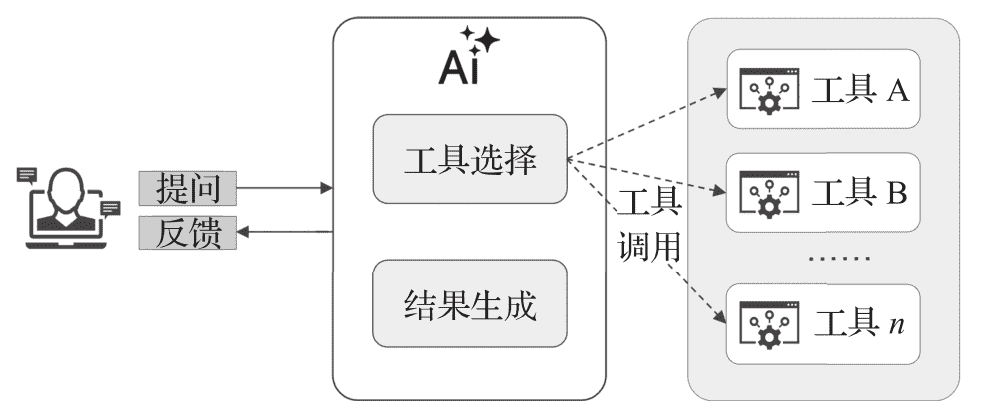

图 5-2 AI Agent 的使用工具能力

有效的工具使用要求 Agent 首先理解哪些工具可用，然后根据当前任务上下文选择合适的工具，管理潜在的错误（例如，如果工具调用失败，则重新安排，并处理失败的 API 调用），最终交付有意义的结果。工具使用主要有以下两种形式。

**●函数调用**：通过函数调用外部工具的能力，对于 Agent 提供实时、基于上下文的准确响应至关重要。这个复杂的过程涉及几个子任务：意图识别（理解用户的目标）、函数选择（选择正确的工具）、参数-值对映射（正确格式化工具的输入）、函数执行（调用工具）和响应生成（解释工具的输出并形成用户友好的答案）。函数调用发生在 LLM 推理引擎或 Agent 框架的内部执行环境中，速度快且直接。

**●API 交互**：通过标准化的 API（如 RESTful、GraphQL 等）或定制化接口，调用外部系统、服务或数据源。API 交互解决的是系统间集成和互操作的问题，使 Agent 能够将 LLM 的思考和规划能力转化为对企业“四肢百骸”（即各类业务系统与流程）的实际驱动力，是构建实用、高效企业级 Agent 的关键技术基础。

工具使用的有效性高度依赖于工具文档，即将非结构化 API 文档转换为 LLM 可解析的标准化模式描述（如 JSON Schema），使 Agent 能自主理解工具的功能、输入参数、输出结构和错误类型等。如果工具文档模糊、不完整或不准确，那么 AI Agent 将不可避免地难以正确选择合适的工具或配置其参数，从而导致错误、性能降级甚至系统故障。然而，企业内现有的工具或系统基本都经历了很多年的建设历程，并非针对 LLM 的使用而定制的。由此可见，为企业内的所有系统或工具编制一份理想的工具文档供 LLM 调用是一项艰巨的任务。况且，这些工具系统随着时间推移和应用深入，会面临持续的功能调整或升级优化，这很有可能导致人工维护的工具文档失效。中国人民大学高瓴人工智能学院的研究团队提出了一种新的 DRAFT 框架，旨在通过分析 LLM 与外部工具交互产生的反馈和试验来动态完善工具文档，以弥补 LLM 和工具之间的理解差距 ^(⁶²)。这表明工具使用不是一种静态能力，而是一种需要持续完善的演进能力。同时，这也强调了工具使用架构中强大反馈机制的关键重要性，以实现这种动态适应和改进。

从静态的、预定义的工具使用向动态的、学习型工具使用的转变是高级 Agent 自主性的关键指标，它由交互和反馈的迭代学习驱动。早期的或简单的工具使用通常依赖于明确的编程或基本的、固定的提示，这种方式无法适用于新的或未经明确训练的工具。而更高级的和灵活的工具使用是通过复杂的学习机制实现的，如零样本提示、微调、强化学习和自训练等。学习机制，特别是强化学习和自训练，使 Agent 能够通过持续的试错、结果观察和反馈来发现最佳的工具使用策略。这种高级能力对于在高度动态和不可预测的环境中运行的 Agent 至关重要。

工具使用固然极大地扩展了 Agent 与外部系统的协作能力，同时也带来了显著的安全风险，包括潜在的数据泄露、未经授权的访问和敏感信息的滥用。因此，数据收集和使用过程的透明度至关重要。建议在执行 API 调用时，尽量调用业务系统官方发布的 API，且严格遵循各业务系统内的数据访问和用户权限控制策略，而非类似超级管理员角色。

### **5.4.3 推理**

推理是 AI Agent 内部的一项基础的认知过程，它涉及运用逻辑和现有信息来得出结论、进行推断并有效解决问题。它充当“推理引擎”，驱动并赋能 Agent 工作流中的关键规划和工具使用阶段。推理的核心在于将数据以机器可处理和理解的结构化形式表示，然后将逻辑规则应用于这种表示，以得出有充分依据的决策。这个复杂的过程是 AI 系统实现自主决策的关键。

推理是 Agent 行为背后的“智能”，它使 Agent 能够超越简单的规则遵循，进行推断并解决复杂问题，成为驱动 Agent 工作流的“大脑”或“引擎”。如果没有强大的推理能力，那么 AI Agent 将仅限于执行预定义的响应或简单的反射行为。推理能够处理新信息、应用复杂的逻辑规则并得出新见解，从而能够处理未明确编程的情况，如图 5-3 所示。这种能力正是使 Agent 能够“思考”和“决策”，而不仅是对刺激做出反应的原因，这对于实现高级人工智能至关重要。

除了常规的条件推理和启发式推理外，还有两种常用的高级推理范式，即 ReAct 和 ReWOO。

**●ReAct（Reason+Act，推理与行动）**：采用“思考-行动-观察”循环，用于逐步解决问题和迭代改进响应。它生成推理轨迹（类似于思维链），根据推理采取行动，观察行动结果，更新上下文，然后重复该循环。ReAct 在自然语言任务中表现良好，并提高了透明度。以供应链断链风险分析 Agent 为例，ReAct 推理模型首先会基于企业现有的供应链体系推理潜在断链风险，然后利用工具使用能力查询供应商数据库和交付记录（如交期、质量变化趋势、风险事件等），观察分析结果，之后对风险应对计划（如寻找替代供应商等）进行推理，最后将结果推送给供应链负责人以进行进一步决策。

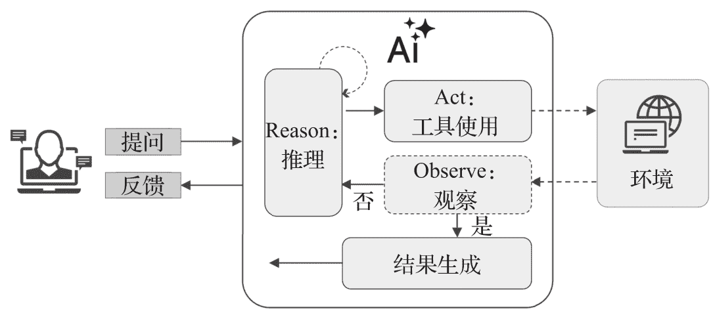

图 5-3 AI Agent 的推理能力

**●ReWOO（Reasoning WithOut Observation，无观察推理）**：与 ReAct 不同，ReWOO 移除了观察步骤，而是采用预先规划。它包含三个模块：规划器（任务分解）、执行器（使用工具提供证据）和解决器（综合所有子任务得出结论）。ReWOO 在某些自然语言处理（NLP）基准测试中优于 ReAct，并且结构更清晰，旨在通过预先规划来提高迭代效率。但添加过多工具或在上下文有限的情况下可能会降低性能。

ReAct 的“思考-行动-观察”循环会由于迭代规划的特性，其 Token 消耗更高，延迟更长。然而，这种持续的反馈对动态调整和不可预见的情况具有更大的适应性。相比之下，ReWOO 的预先规划可以实现更低的 Token 消耗和更快的执行速度，尤其是在并行执行的情况下。但这以牺牲适应性为代价，如果预先规划遇到意外问题，则可能难以调整。在 Agent 设计过程中需要做出权衡，选择取决于问题领域的可预测性以及对错误和速度的容忍度。总而言之，对于路径不明确的开放式、探索性任务，ReAct 的适应性更佳。对于明确定义、结构化且效率至关重要的任务，ReWOO 可能更合适。

推理模式包含以下两个核心组件。

**●知识库**：这是 AI Agent 理解和处理信息的详细知识地图。它旨在以机器可处理和理解的结构化形式表示数据，从而为 Agent 提供进行逻辑推理和有效解决问题所需的基础信息，包括知识图谱、知识本体、语义网络和其他知识表示模型。

**●推理引擎**：这是 Agent 推理系统的“大脑”，它由训练有素的机器学习模型提供支持。推理引擎实现解决问题所需的逻辑和推理方法，用于分析知识库中的数据并得出有充分依据的决策。

知识库与推理引擎紧密协作，共同驱动 AI Agent 的决策过程。知识库也与 AI Agent 的记忆系统相关联。例如，在长期记忆中，知识检索（如 RAG、GraphRAG）将外部知识库整合到生成过程中，以扩展可访问的信息，这可以被视为知识库的一种应用形式。现代 Agent 也常结合向量数据库进行语义搜索，以及结合知识图谱进行结构化推理，这些都属于知识库的范畴。

推理模式使得 AI Agent 具备了高度复杂和不确定环境问题的解决机制，但同时也带来了额外的计算开销和架构复杂性，并存在诸如无限循环（ReAct）和性能下降（ReWOO）等的挑战。复杂推理的发展需要精心设计的架构来管理这些复杂性。

### **5.4.4 规划**

规划是 AI Agent 的一项核心能力，它专注于将较大、较复杂的问题分解为多个更小、更易于管理的子任务，可以有效地管理这些任务的执行，并确保根据任务结果持续改进或调整计划。该过程是迭代的，并依赖于结构化的流程，以确保 Agent 能够根据需要调整其计划，并在每次迭代中更接近期望目标，如图 5-4 所示。对于复杂目标而言，规划是必不可少的步骤；而对于简单任务，Agent 可以迭代地反思其响应并改进它们，而无须规划后续步骤。

规划模式通常是有效工具使用和多 Agent 协作的前提。通过将复杂目标分解为子任务，系统可以识别每个子任务所需的适当工具或专门子 Agent。

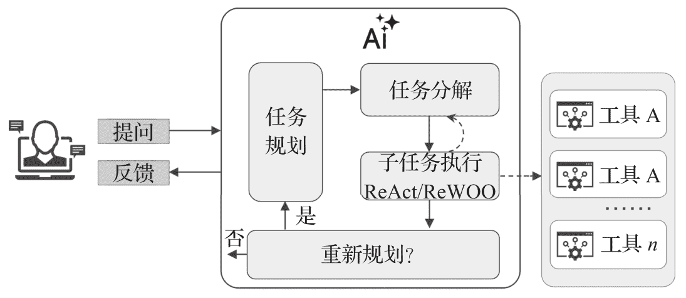

图 5-4 AI Agent 的规划能力

Agent 规划过程如下。

**1）任务规划**：这个初始阶段，Agent 会解释提示并制订总体计划，确定计划如何解决该问题，包括高层目标和执行策略。规划不会像 ReAct 那样直接深入逐步推理和工具使用中，而是会先退一步，为任务制订一个高级计划或执行路线图。

**2）任务分解**：规划的核心机制之一是将复杂目标分解为更小、更易于执行的任务，从而使 Agent 能够以有针对性的步骤开展工作。这可以采取两种形式：单路径链式分解，即 Agent 将计划设计为一系列子任务并按顺序串行解决它们；或多路径树状扩展，即使用树而非链，允许多个并行推理路径和带反馈的回溯。

**3）子任务执行**：子任务执行负责完成上一步生成的每个任务。每个子任务都使用预定义的推理方法（如 ReAct 或 ReWOO）和工具执行。一旦任务完成，子任务 Agent 就会返回任务结果，并将其发送回规划循环。

**4）重新规划**：重新规划阶段评估任务结果以确定是否需要进行任何调整。如果任务执行没有达到预期结果，那么系统将重新规划并可能修改任务或策略。这种反馈回路允许 Agent 迭代学习和改进其方法，使其更能适应不断变化的需求或意外结果。

**5）迭代**：这一部分是连接生成任务和重新计划的循环。它标志着该过程的迭代性质，其中 Agent 不断地重新评估和调整其方法，直到取得令人满意的结果。

在复杂任务的规划过程中，Agent 需要一种连贯的、结构化的“思考”过程以制定明确的策略和计划。思维链（Chain-of-Thought，CoT）及其衍生变体恰恰提供了核心的解决思路。

**●思维链（Chain-of-Thought，CoT）**：思维链是最基础的规划模式，它让 Agent 模仿人类的逐步推理过程。当 Agent 接收到一个任务时，它会生成一个“一步接一步”的计划。这个计划是线性的，没有分支，也无须做出权衡或决策。它主要用于增强 Agent 对任务的理解和逻辑的连贯性，确保每一步都建立在前一步的基础上。

**●思维树（Tree-of-Thought，ToT）**：思维树是一种更高级的规划模式。面对一个决策点，Agent 会主动生成多个并行的候选计划（树的分支）。然后通过一个评估模块对这些分支进行打分或进行前瞻性思考，最后选择最有希望的一条路径继续深入。这极大地增强了 Agent 的策略性和鲁棒性。如果一条路走不通，那么 Agent 可以回溯到上一个节点，尝试另一个分支，而不是直接宣告失败。

**●思维图（Graph-of-Thought，GoT）**：思维图是最高级的网络化规划模式，它将规划过程从树状结构解放出来，变成一个动态的网络。思维图允许思考节点之间进行任意复杂的交互，这使得 Agent 能够处理那些没有固定流程、需要不断整合信息和迭代优化的顶级复杂任务。

规划模式利用规划、任务生成、执行和重新规划的结构化循环，确保 Agent 能够自主地朝着复杂的目标努力。该模式允许 Agent 根据任务结果调整其方法，从而增强其适应性，使其能够稳健地响应动态环境或不断变化的目标。如图 5-5 所示，规划模式与 ReAct 模式最大的差异在于，规划模式提前确定所有必要的步骤，并且不太可能偏离目标；而 ReAct 模式可能最终也会找到答案，但在此过程中可能会蜿蜒曲折或重复工作，因为它每次只能执行一个动作。由此可见，任务越复杂，Agent 就越需要一个详细的执行计划，通过细分任务和设定目标，使得 Agent 可以获得对问题的整体看法。

规划对于目标导向的自主性和复杂任务的执行至关重要，但其有效性受到环境不确定性和当前 AI 模型在长期战略思维方面固有局限性的制约。在高度不确定的环境中（经典规划假设失效），其有效性会显著降低。这揭示了一个关键问题：尽管 Agent 具备强大的规划能力，但其战略远见和对高度动态、不可预测的真实世界场景的适应性仍在发展中。因此，Agent 在执行复杂任务的规划过程中，人类监督依然不可或缺。

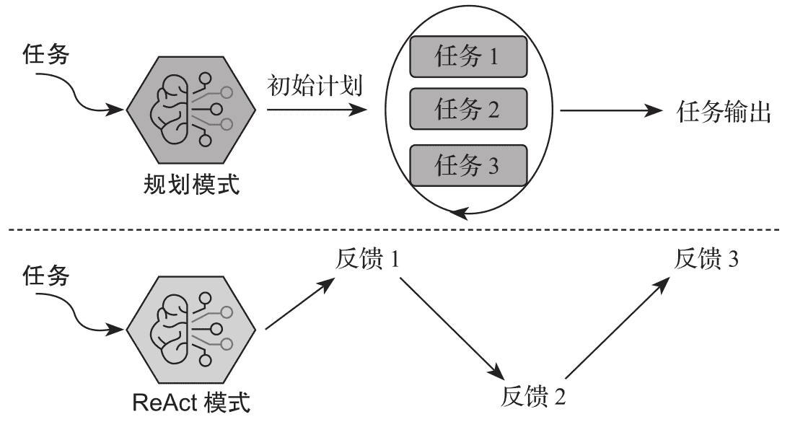

图 5-5 规划模式与 ReAct 模式对比

AI Agent 的真正力量并非来自孤立的能力，而是来自反思、使用工具、推理和规划的无缝、循环整合，从而形成动态、自适应的工作流，如图 5-6 所示。这四大范式并非独立存在的，而是构成了一个连贯的动态系统。整个过程是循环的：推理指导规划，规划导致行动（通常会使用工具），而反思则评估这些行动，并将结果反馈以完善未来的推理和规划。这种持续的反馈循环正是实现复杂动态环境中适应性、自我纠正和强大性能的关键。同时，记忆系统（包括短期记忆和长期记忆）在所有范式中都至关重要，它为推理保持上下文，存储过去的行动和反思，并为规划和工具使用提供相关信息。这种集成方式推动 Agent 迈向更全面的智能系统。

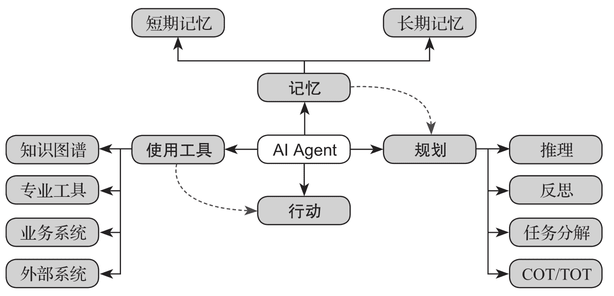

图 5-6 AI Agent 的核心设计模式及其关联

## **5.5 多 Agent 系统**

多 Agent 系统（Multi-Agent System，MAS）是一个经久不衰的计算范式和研究领域，其核心思想是构建一个由多个自主 Agent 组成的 AI 系统，通过多个 Agent 之间的协调或协作，来解决单个实体无法应对的复杂问题。我们可以将 MAS 想象成一个“人造的智能社会”。它的研究重点在于如何建立一个高效的“社会体系”，让其中的每个“公民”（Agent）能够通过分工协作，达成宏伟的集体目标。

传统的 MAS 更多的是基于规则和符号逻辑，而 Agentic AI 里的每个 Agent 都拥有 LLM 带来的强大推理、规划和自然语言交互能力。因此，与传统的 MAS 相比，Agentic AI 可以被视为 MAS 理论框架在当前技术水平（尤其是 LLM 技术）下的一个强大的、现代化的实现。它不仅包含了 MAS 的核心思想，即通过多 Agent 协作解决单一 Agent 无法完成的复杂问题，还通过引入 LLM 极大地增强了每个“个体”的能力和整个“群体”的协同效率，使其从理论走向了更广阔的实际应用。

### **5.5.1 多 Agent 系统的核心支柱**

一个系统之所以能被称为 MAS，通常建立在三个核心支柱之上。

1.多 Agent

MAS 由多个在共享环境中自主交互的 Agent 组成，每个 Agent 都具有以下特征。

**●自主性**：这是最基本的特征。每个 Agent 都拥有自己的控制权，能够独立地感知环境并做出决策，而无须被外部直接操控。自主性指其在没有持续的人工干预或直接指令下独立运作、自主决策以达成目标的能力。自主性使得智能体能够在动态和不可预测的环境中有效运作。

**●局部视角**：每个 Agent 通常只能感知到环境的一部分，其信息和知识是有限的、不完整的，都基于其自身的局部感知和信息进行决策。没有任何一个 Agent 拥有对系统全局状态的完整视图。

**●异构性**：系统中的 Agent 可以是多种多样的。它们可以拥有不同的目标、知识、能力和角色。例如，现场服务 MAS 中有故障诊断 Agent、服务派单 Agent 以及维修记录检索 Agent 等。

**●目标驱动**：每个 Agent 都有其内在的目标或动机，其所有行为都围绕着实现这些目标展开。

2.环境

**●共享环境**：所有 Agent 都存在于一个共享的环境中，这个环境是它们赖以生存、感知和行动的平台。

**●交互媒介**：环境不仅是舞台，也是 Agent 之间进行间接通信的媒介。例如，一个 Agent 在环境中留下执行记录，其他 Agent 感知到这个变化后会调整自己的行为，这就像蚂蚁通过化学物质进行交流一样。

**●动态性**：环境本身可能是动态变化的，这要求 Agent 必须具备适应能力。

3.交互

这是 MAS 的灵魂所在，也是其与单 Agent 系统最根本的区别。Agent 之间的交互机制是 MAS 研究的核心，主要包括以下内容。

**●通信**：Agent 之间直接交换信息。这需要定义一套通信语言和协议，明确消息的格式和含义。在 MAS 的早期发展中，研究者借鉴语言学中的言语行为理论，开发了多种智能体通信语言（Agent Communication Languages，ACL），其中最著名的两个是知识查询与操作语言（Knowledge Query Manipulation Language，KQML）和由智能物理体基金会（FIPA）制定的 FIPA-ACL。随着技术的演进，特别是面向 LLM 的 Agent 系统的兴起，新的通信协议正在被开发出来。例如，Agent2Agent（A2A）协议旨在为异构 Agent 提供一个标准的交互语言。

**●协作**：当多个 Agent 的目标一致或相关时，它们需要协调彼此的行动以避免冲突、共享资源并高效地达成共同目标。合约网协议（Contract Net Protocol，CNP）是一个基础性的、用于任务分配和分布式问题求解的协议。

**●协商**：当 Agent 之间存在利益冲突时，它们需要通过协商达成一个各方都能接受的协议。这在资源分配、任务承包等场景中至关重要。

**●竞争**：在零和或负和博弈中，Agent 会为了最大化自身利益而与其他 Agent 竞争，如在拍卖或市场竞争环境中。

### **5.5.2 多 Agent 系统编排与协作模式**

根据系统控制方式和信息流向的不同，基于 LLM 的多 Agent 协作架构如图 5-7 所示。

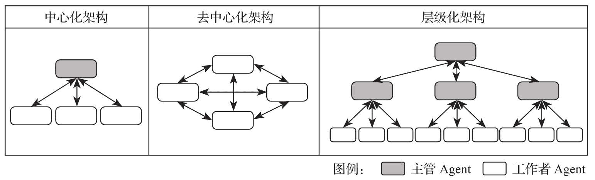

图 5-7 多 Agent 系统协作架构

1.中心化（主管/编排器）架构

这是目前最常见和最直观的一种模式。在该架构中，一个单一的主管（Supervisor）Agent 或编排（Orchestrator）Agent 负责管理整个工作流程。主管 Agent 接收用户的高级任务，将其分解为多个子任务，然后将这些子任务分配给专门的工作者（Worker）Agent 执行。所有工作者 Agent 都将执行结果返回给主管 Agent，由主管 Agent 进行汇总、综合，并生成最终的输出。

这种模式有以下两种常见的变体。

**●主管即路由器（Supervisor-as-Router）**：主管的主要职责是决策流程，即决定在每个步骤之后应该调用哪个工作者 Agent，从而引导对话或任务的流向。

**●主管即工具调用者（Supervisor-as-Tool-Caller）**：在这种变体中，每个工作者 Agent 被封装成一个工具，并暴露给主管。主管利用 LLM 强大的工具调用能力来选择并调用最合适的工具 Agent。

这种架构的优点是控制力强、工作流程清晰，并且相对容易调试。然而，其缺点也同样明显：主管节点容易成为系统的单点故障和性能瓶颈。

2.去中心化（点对点）架构

在这种模式中，系统不存在任何中央控制权威。所有 Agent 都是平等的“对等体”（Peers），它们直接相互通信和交互。系统的协调行为是通过 Agent 之间的局部互动和预先商定的协议自发“涌现”出来的，而非来自顶层的命令。这种架构在追求鲁棒性、自组织能力以及不希望有任何单一实体掌握控制权的场景中非常普遍，例如区块链和生产现场机器人之间的协作。

去中心化架构的主要优点是极高的容错性（没有单点故障）、可扩展性和对动态环境的适应能力。但其挑战也十分巨大：实现有效的全局协调非常困难，并且调试那些不可预测的涌现行为是出了名的棘手问题。

3.层级化架构

层级化架构可以看作中心化模式的扩展，它将 Agent 组织成一个多层次的、类似金字塔的指挥链。一个顶层的 Agent 负责制定最高级别的战略和规划，然后将任务委派给多个中层的经理 Agent。每个经理 Agent 会再进一步分解任务，并协调其下属的一组底层工作者 Agent 来完成具体的执行工作。

层级化架构清晰地定义了指挥和控制链，但仍然可以在每个层级内部允许局部自主决策，从而在一定程度上结合了中心化控制的有序性和去中心化执行的灵活性。层级化架构非常适合处理那些极其复杂、涉及多个不同领域且可以被清晰分解的任务。它的模块化设计使得系统具有良好的可扩展性。然而，多层级的结构也可能引入显著的通信开销和一定的系统僵化性。

在实践中，许多系统采用的是混合模式。例如，一个系统可能设有一个总体的主管来协调主要流程，但允许在特定的专业子团队内部进行点对点的自由通信。像 LangGraph 这样的框架，允许开发者创建自定义的复杂工作流，其中部分流程是确定性的，而另一部分则由 Agent 动态决定。

### **5.5.3 多 Agent 系统应用挑战及趋势分析**

在人工智能领域，LLM 与 MAS 的融合，已成为当前最具活力和变革潜力的前沿方向。这种结合不再是理论探讨，而是催生了众多令人瞩目的应用，并在持续重塑我们对自动化、协作和复杂问题解决的认知。

尽管前景广阔，但基于 LLM 的 MAS 仍面临以下诸多挑战。

**●一致性与幻觉问题**：如何确保多个 Agent 在长期、复杂的协作中保持逻辑一致性，并减少由 LLM 本身的“机器幻觉”带来的错误，是目前最大的技术难题。在软件开发中可能只是一个需要调试的 Bug，但在制造业中可能导致物理设备的损坏或安全事故。其非确定性的输出与制造业所要求的 100%可靠性形成尖锐矛盾。

**●成本与效率**：运行一个由多个大型 LLM 驱动的系统成本高昂，每一次 Agent 间的交互都意味着大量的计算资源消耗。如何优化模型、降低成本是商业化落地的关键。

**●评估与调试的复杂性**：评估一个 MAS 的整体性能远比评估单个模型要复杂。当系统出错时，要追溯到是哪个智能体、在哪一轮对话中出了问题，调试难度极大。

**●可控性与安全性**：如何确保这些高度自主的 Agent 组合始终在人类设定的安全和道德框架内运行，防止出现不可预见的、有害的集体行为，是一个亟待解决的问题。

鉴于此，当前制造业中成熟且广泛部署的 AI Agent 应用以单 Agent 为主。基于 LLM 的、真正意义上的 MAS 正处于从“实验室”走向“试验场”的萌芽阶段，在数字孪生、机器人协作和复杂诊断等领域进行积极的探索和验证，但尚未出现大规模、商业化成功的标杆案例。

可以预见，随着 LLM 变得更小、更快、更可靠，并且具备更强的多模态理解能力，基于 LLM 的 MAS 将首先在非实时、高价值的规划和优化环节（如仿真和设计）找到突破口，然后逐步渗透到对实时性和安全性要求稍低的辅助生产环节（如物流和监控），最终迈向核心的生产控制环节，真正实现高度自主化和柔性化的智能工厂。

## **5.6 AI Agent 开发框架及最佳实践**

从理论和架构蓝图走向实际应用，企业需要强大的工具来简化基于 LLM 的 AI Agent 系统的构建过程。随着这一领域的蓬勃发展，一系列开源框架应运而生，它们提供了不同层次的抽象和功能，以满足多样化的开发需求。这些 Agent 开发框架却各有千秋，选择合适的开发框架是启动一个 AI Agent 项目的关键决策之一，因为它将深刻影响项目的开发效率、可扩展性和最终的系统性能。本部分将对当前主流的框架，即 LangChain 的 LangGraph、微软的 AutoGen、CrewAI 及 LlamaIndex 等，进行深入的比较分析。

### **5.6.1 Agent 开发框架**

AI Agent 开发框架对 Agent 的核心组件提供了不同层次的抽象，以简化对状态、记忆、工具和 LLM 调用的复杂编排，使开发者能够专注于应用逻辑本身。

1.LangChain 与 LangGraph：通用编排器

LangChain 是目前应用最广泛的框架之一，它允许开发人员通过将记忆、工具和大语言模型等组件链接成连贯的工作流来构建智能应用程序 ^(⁶³)。LangChain 是一个高度模块化的框架，通过链接（Chaining）模型、提示和工具等组件来构建 Agent。它拥有庞大的集成生态系统，原生支持各种 LLM（包括本地部署的 LLM）以及丰富的工具生态，如 Google 搜索、SQL、Python 执行、API 等。

LangGraph 作为 LangChain 的扩展，将工作流建模为显式的、有状态的图（节点和边），图中的每个节点都代表一个工作流步骤，边定义信息流向（Python 函数），可以是条件分支，也可以是固定转换。相比 LangChain 原有的线性链式结构，LangGraph 为复杂的、循环的和有条件的逻辑提供了更强的控制力。因此，LangGraph 更适合需要条件判断、复杂的分支逻辑、错误处理或并行执行的复杂工作流。

LangChain 支持如 ReAct 这样的 Agent 循环。LangGraph 则通过将 Agent 间的协作和任务交接表示为状态图中的显式转换，实现了比自由对话更复杂、更可控的多 Agent 系统。

（1）LangChain 与 LangGraph 的核心价值及优势

**●功能强大与生态广泛**：提供极其丰富的功能，拥有业界最广泛的工具和平台集成生态。

**●稳健的流程编排**：专为复杂工作流设计，提供稳健、可控、可调试的编排能力。

**●卓越的可观测性**：其配套的 LangSmith 平台提供了强大的追踪和监控功能，显著提升系统可见性。

（2）潜在的挑战与问题

**●学习曲线陡峭**：框架本身相对复杂和庞大，学习成本较高。

**●API 稳定性风险**：API 的快速迭代可能导致向下兼容性问题，增加维护负担。

**●抽象层级考量**：部分开发者认为其抽象层级较深，对缺乏软件工程经验的开发者，可能会影响使用体验。

2.AutoGen：以对话为中心的多 Agent 框架

AutoGen 是由微软研究院开发的一个功能强大的开源框架，其核心理念是将多 Agent 协作建模为一场“对话” ^(⁶⁴)。用户可以定义多个角色的 Agent（如规划师、开发人员或审阅者），它们会相互“交谈”以完成复杂任务。AutoGen 的设计模式以对话为中心——任务被建模为 Agent（如用户和助手 Agent）之间的对话，而不是明确的工作流。它简化了 Agent 的开发和工作流编排，实现了协作、工具使用、代码执行和人机交互的无缝集成。AutoGen Studio 提供了用于快速原型设计的低代码界面。

AutoGen 的核心是促进“可对话 Agent”（Conversable Agent）的创建。这些 Agent 是可定制的，能够使用自然语言相互交互。可以为这些 Agent 配置特定的角色、能力和指令，使它们能够以协调的方式协同工作，以实现共同的目标。

AutoGen 的关键概念与特性介绍如下。

**●可对话 Agent（Conversable Agent）**：AutoGen 的基本构建块是能够发送和接收消息的 Agent。这些 Agent 可以有以下不同的类型。①助理 Agent（AssistantAgent）：通常扮演“AI 助手”角色，使用 LLM 进行推理和生成回复，不能直接执行代码或使用工具。②用户 Agnet（UserProxyAgent）：代表“用户”或“执行者”角色，负责实际执行由 AssistantAgent 建议的代码或函数调用，并将执行结果反馈给对话，它可以决定何时终止对话或请求人工输入。③群聊管理器（GroupChatManager）：用于管理多个 Agent 之间的群组对话，负责编排它们的对话和发言顺序。

**●可定制性与可扩展性**：开发人员对 Agent 的行为有高度的控制权。他们可以自定义其系统消息，定义其终止条件，并将其与外部工具和数据源集成。

**●代码执行**：AutoGen 的一个关键特性是其 Agent 能够编写和执行代码。这对于需要进行数据分析、软件开发或与外部 API 交互的任务特别有用。

AutoGen 的工作流程通常始于一个用户定义的任务。用户与一个主要 Agent（通常是 UserProxyAgent）发起对话。然后，该 Agent 与一个或多个 AssistantAgent 进行交互，每个 Agent 都具有专门的角色（如规划师、开发人员或审阅者等）。这些 Agent 相互“交谈”，交换信息以分解问题、提出解决方案、编写和调试代码，并迭代地完善工作，直到任务完成。对话历史为解决问题的过程提供了透明的记录。

AutoGen 支持高度灵活的对话模式，非常适合为那些解决方案路径不确定的复杂、动态多 Agent 交互进行原型设计。同时，AutoGen 拥有微软研究院的强大支持，以及与 Azure 生态系统的紧密集成，使其得到广泛应用。相比基于图的框架，AutoGen 提供的显式控制较少。如果没有恰当的约束，那么对话模型可能会陷入无限循环。

AutoGen 的灵活性使其适用于广泛的应用场景，包括以下方面。

**●复杂问题解答**：回答需要多步骤推理和信息检索的问题。

**●自动化代码生成与调试**：以协作方式创建和排查软件问题。

**●内容创作**：利用不同 Agent 的专业技能生成创意和技术内容。

**●数据分析与可视化**：自动化分析数据和创建富有洞察力的可视化图表的过程。

**●工作流程自动化**：自动化涉及多个步骤和决策点的复杂业务流程。从本质上讲，AutoGen 提供了一个强大的框架，它超越了与 LLM 的单次提示交互，进入了一个协作式 AI 的新范式。在这个范式中，多个 AI Agent 可以协同工作，以解决更宏大、更复杂的问题。

3.CrewAI：基于角色的协作框架

CrewAI 是另一个新兴的多 Agent 协作框架 ^(⁶⁵)，与 AutoGen 类似，但设计理念和架构有显著差异。CrewAI 是基于 LangChain 构建的一个开源 Python 框架，它专注于结构化任务编排和角色驱动的团队协作，目标是让开发者更高效地构建自动化团队工作流。这种方法超越了 LLM 的单次提示交互，转向了一种更动态、模仿人类团队的多 Agent 系统。

CrewAI 的核心建立在“角色扮演”的概念之上。每个 Agent 都被赋予了一个独特的角色、一个要实现的目标和一个背景故事，这引导了它在“工作组（Crew）”中的行为和专业领域。这种专业化分工能够实现更有效的劳动分工，将复杂问题分解并交由具备最相关技能的 Agent 来处理，如图 5-8 所示。该框架因其直观、面向流程的设计而备受赞誉，使得开发人员能够相对直接地定义和自动化结构化的工作流程。

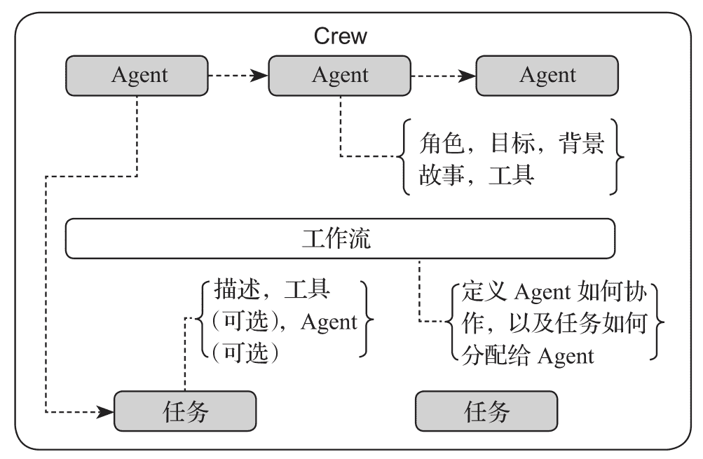

图 5-8 CrewAI 核心组件

CrewAI 的架构围绕以下四个基本组件构建。

**●工作组（Crew）**：工作组将一组 Agent 和一系列任务汇集在一起。它定义了整体流程，并管理 Agent 之间的协作以实现最终目标。工作组负责编排整个工作流程。

**●Agent**：独立的、自主的工作单元，旨在执行特定任务、做出决策并与系统中的其他 Agent 动态交互。每个 Agent 都配置了特定的角色、要达成的目标、提供上下文的背景故事以及一组可供其使用的工具。

**●任务**：Agent 负责执行的具体任务或职责。它包括对工作的详细描述、预期输出以及负责执行该任务的 Agent。每个任务通常会被分解为子任务，这些子任务可能需要专用工具或访问特定资源。任务是工作组工作流程的基石。

**●工具**：工具是 Agent 用来执行任务的功能或能力。这些工具的类型丰富，可以是简单的实用程序，也可以是能够与外部 API、数据库或本地文件进行更复杂集成的功能模块。CrewAI 允许使用自定义构建的工具，以及来自像 LangChain 这样的库中大量预先存在的工具。

虽然 CrewAI 和微软的 AutoGen 都是用于多 Agent 系统的框架，但它们的设计理念不同，适用于不同类型的问题。AutoGen 是面向对话的，依赖灵活的对话模式（如群聊、顺序聊天）来驱动协作。而 CrewAI 是面向流程的，采用预定义的流程（如顺序、层级）来管理任务执行。当用户知道如何解决一个问题并希望自动化该过程时，使用 CrewAI；当用户不知道如何解决问题并希望由一个 AI 专家团队来找出解决方案时，就使用 AutoGen。

CrewAI 具有如下优势。

**●**非常直观，上手简单，仅需少量代码即可搭建一个多 Agent 系统。

**●**基于角色的方法非常自然地契合许多业务工作流。

CrewAI 的局限性如下。

**●**在处理高度复杂或非标准工作流时可能缺乏灵活性，难以定制。

**●**与 LangChain 相比，CrewAI 还不够成熟，且对于简单任务的资源消耗较大。

CrewAI 非常适合各种可以分解为一系列专业步骤的任务，具体如下。

**●内容创作**：自动化研究主题、撰写博客文章，然后据此生成社交媒体帖子的全过程。

**●市场研究**：部署一个工作组来收集竞争对手的数据、分析市场趋势，并编制一份全面的报告。

**●自动化电子邮件营销**：创建 Agent，根据客户定制电子邮件内容并发送个性化消息。

**●软件开发**：使用一个 Agent 编写特定功能的代码，使用第二个 Agent 为其编写测试，使用第三个 Agent 审查和调试代码。

通过为基于角色的 Agent 协作提供一个清晰而强大的框架，CrewAI 使开发人员能够构建出能够高效处理复杂、多步骤任务的先进自主 AI 系统。

4.其他 Agent 框架

除了上述三个 Agent 框架外，还有以下几个流行的 Agent 框架。

**●Semantic Kernel**：由微软创建的一个开源软件开发工具包（SDK），用于将 AI Agent 嵌入企业软件的编排框架，支持插件、记忆和规划。它与.NET 开发环境高度兼容，非常适合企业内业务系统或工具等结构化系统中的确定性 Agent 应用。

**●SmolAgents（Hugging Face）**：一个试验性的、极简主义的 Python 框架，旨在探索 AI Agent 从单个详细的提示（Prompt）生成完整代码库的潜力。该框架的运作原则是“以简为美”，目标是用非常少量且易于理解的代码来实现复杂的软件生成。

**●LlamaIndex（起初叫 GPTIndex）**：一个功能强大的开源数据框架，旨在将自定义数据源连接到 LLM，是现代 RAG 架构的基石。它提供了摄取、构建和访问私有数据或领域特定数据的核心工具，使开发者能够构建功能更强大、知识更丰富的 Agent。LlamaIndex 通常会与其他 Agent 框架结合使用，如在一个更广泛的 LangChain Agent 中利用 LlamaIndex 卓越的数据索引和检索能力。

**●OpenAI Agents SDK（又名 Swarm）**：一个全新的开源 Python 框架，旨在简化复杂 AI Agent 的创建。该 SDK 标志着 OpenAI 在鼓励开发者构建 Agent 应用方面的一次重大演进，与之前的 Assistants API 相比，它提供了一种更直接、更灵活的方法。OpenAI Agents SDK 遵循“少即是多”（Less is More）的理念。它提供了一套轻量级但功能强大的工具，使用 Python 作为主要的“黏合剂”，而不是依赖于繁重的抽象，从而给予开发者更多的控制权。此 SDK 的主要目标是支持开发能够代表用户进行推理、规划和使用工具来完成复杂、多步骤任务的自主 AI 系统。

表 5-2 给出了几个 Agent 框架的对比分析。

**表 5-2 几个 Agent 框架的对比分析**

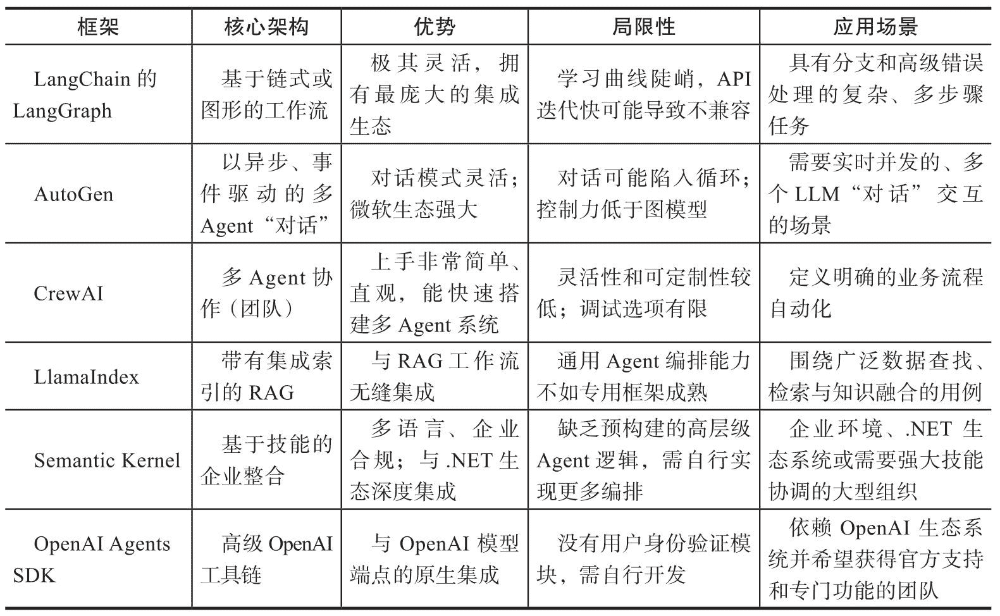

Agent 框架的激增表明，目前尚不存在一个适用于所有应用场景的通用框架。每个框架都有其独特的优势和侧重点，如模块化设计、多 Agent 协作、知识管理、企业集成能力或低代码支持等。这种多样性源于现实世界 AI Agent 应用日益增长的复杂性与多样化需求。同时需要指出的是，基于 LLM 的 Agent 框架主要在 ChatGPT 发布后才迎来蓬勃发展，大多数仍处于早期快速发展阶段，其能力也在持续迭代优化。因此，框架的选择不仅是一个技术决策，而且是一项战略决策，需综合考虑项目的具体需求、所需的控制粒度、现有技术栈以及长期可扩展性目标。这也凸显了行业正朝着专业化工具方向发展的趋势，而非寻求“一刀切”的通用方案。

### **5.6.2 Agent 开发的挑战及最佳实践**

随着 LLM 能力的飞跃，能够自主理解、规划并执行复杂任务的 AI Agent 正迅速成为制造企业开发 AI 应用的重点。然而，从一个简单的想法到一个健壮、可靠且高效的 AI Agent，企业需要克服一系列独特的挑战。本小节将探讨 AI Agent 开发面临的主要挑战，并提供相应的最佳实践等内容。

1.Agent 开发面临的主要挑战

（1）规划与任务分解的脆弱性

AI Agent 的核心是其规划能力，即将一个模糊的用户目标分解为一系列具体、可执行的步骤。然而，这个过程非常脆弱，主要表现如下。

**●长链条任务失败**：在需要多步骤推理的任务中，任何一步的微小错误或逻辑偏差都可能导致整个任务链的失败。

**●对提示词的过度敏感**：Agent 的规划能力极度依赖于初始指令的质量。一个措辞不佳的提示可能让 Agent 完全偏离方向。

**●缺乏常识**：模型可能无法理解隐含的约束或常识，导致规划出的路径在理论上可行，但在现实世界中毫无意义或效率低下。

（2）工具使用与环境交互的不可靠性

Agent 通过使用工具（如 API 调用、数据库查询、代码执行等）来与外部世界互动。这种交互充满了不确定性，主要表现如下。

**●API 错误处理**：外部 API 可能会失败、返回非预期格式的数据或超时。Agent 需要能够从容地处理这些错误，并进行重试或选择替代方案，但这种恢复能力很难构建。

**●幻觉与误用**：模型可能会“幻觉”出工具的参数或功能，或者在不合适的场景下误用工具。

**●状态管理**：在与有状态的环境（如客服会话、数据库事务）交互时，Agent 很难精确追踪和管理状态，容易导致操作混乱。

（3）安全、成本与性能的失控风险

自主性是 Agent 的强大之处，也是其危险所在。一个失控的 Agent 可能带来严重后果，主要如下。

**●安全漏洞**：如果 Agent 能够执行代码或访问敏感 API，那么它可能被恶意利用，用于执行破坏性操作（如删除文件、泄露数据）。因此，构建坚固的“护栏”至关重要。

**●成本失控**：复杂的任务可能导致 Agent 陷入昂贵的循环中，无休止地调用付费 LLM API 或其他云服务，迅速耗尽预算。

**●性能瓶颈**：连续的、同步的 LLM 调用会产生显著的延迟，使得 Agent 的响应速度缓慢，影响用户体验。

2.测试、调试与可观察性的困难

AI Agent 具有非确定性，传统的软件测试方法不再完全适用。

**●不可复现的错误**：同一个输入在两次不同的运行中可能产生完全不同的行为和结果，使得复现和修复 Bug 变得异常困难。

**●黑盒问题**：很难直观地理解 Agent 为什么会做出某个特定的决策或选择某个特定的工具。其内部的“思考过程”往往是一个黑盒。

**●评估标准模糊**：如何定义一个 Agent 任务“成功”了？除了最终结果，还需要评估其效率、成本和路径的合理性，而这些指标很难量化。

3.Agent 开发最佳实践

（1）采用模块化和分层设计

不要试图构建一个无所不能的单一“巨型 Agent”。将复杂系统分解为更小、更专注的 Agent 团队，这种方式使系统在扩展到多 Agent、处理更新以及实现长期投资回报率方面更具可行性。最佳实践建议如下。

**●使用“经理-专家”模式**：设立一个主管 Agent 或编排 Agent，负责规划和任务分发。然后，创建多个专家 Agent，每个 Agent 都只负责一项具体的、定义明确的任务（如“数据库查询专家”“任务审核专家”等）。CrewAI 和 OpenAI Agents SDK 的 Handoff 功能非常适合这种模式。

**●模块化和可复用性**：设计时采用模块化设计理念，使 Agent 的各个组件（如感知模块、记忆单元、推理引擎、行动模块、日志记录等）能够独立演进。

**●分离思考与行动**：将 Agent 的“思考”（规划、推理）和“行动”（执行工具）阶段明确分开，这使得在执行破坏性操作前可以加入审查和确认步骤。

（2）强化工具的设计与管理

对 Agent 中的工具使用进行严格权限管控，因为任何工具（包括代码执行）的误操作都可能对企业造成巨大的灾难（如删除数据、设置工艺参数等）。最佳实践建议如下。

**●明确的函数签名和文档**：为每个工具编写非常清晰的函数签名和详细的文档字符串。LLM 会利用这些信息来决定如何使用工具，文档越清晰，误用的可能性越低。

**●内置重试与错误处理**：在工具的原生代码中实现健壮的错误处理逻辑（如指数退避重试、备用方案），而不是期望 LLM 自行解决这些底层问题。

**●权限与范围控制**：为每个 Agent 提供其完成任务所需的最小权限工具集。一个只负责数据分析的 Agent 不应该有权限调用发送邮件的 API。

（3）建立严格的护栏与监控系统

在赋予 Agent 自主权的同时，必须用严格的规则将其“束缚”。最佳实践建议如下。

**●设置资源限制**：强制执行最大迭代次数、单个任务的最长运行时间以及严格的 API 调用预算。一旦超出限制，就会立即终止任务并发出警报。

**●引入“人类在环”（Human-in-the-Loop）**：对于高风险或高成本的操作（如执行代码、向客户发送消息、写入数据库），强制要求人类用户进行审批。

**●利用追踪工具**：使用如 LangSmith、OpenAI Agents SDK 内置的 Tracing 或类似工具来可视化 Agent 的完整决策链。这对于调试和理解 Agent 行为至关重要。

（4）分阶段进行测试与评估

拥抱 AI 的不确定性，采用现代化的测试策略。最佳实践建议如下。

**●单元测试工具**：对 Agent 使用的每一个原生函数（工具）进行传统的单元测试，确保其功能的确定性和可靠性。

**●评估驱动开发**：创建一个包含多种场景的评估数据集。在开发过程中，持续运行评估，将 Agent 的输出与“黄金标准”答案进行比较，并追踪成本、延迟等关键指标。

**●模拟与红队演练**：在部署到生产环境之前，在安全的沙盒环境中进行模拟。邀请团队成员（或专门的“红队”）尝试用各种方式“欺骗”或“破坏”Agent，以发现潜在的漏洞和边际效应。

构建 AI Agent 是一个充满挑战但潜力巨大的领域。成功的关键在于放弃将其视为传统软件的观念，转而采用一种结合了软件工程严谨性与对 AI 不确定性深刻理解的混合方法。通过模块化设计、强化工具、建立护栏并采用现代化的测试方法，企业可以更自信地驾驭这一激动人心的新技术。

# **第六章 研发数字化重构：平台化 AI 分层架构**

AI 已不再是研发领域遥不可及的未来概念，而是驱动当今变革的核心力量。它正从根本上重构研发数字化体系，推动其从孤立的工具集演变为集成化、智能化的生态系统。这场变革的本质并非仅是引入新工具，而是对整个研发业务流程和运营模式的深度重构。传统研发体系在速度、成本控制和复杂性管理方面面临诸多瓶颈，而 AI，特别是其在数据处理、模式识别和自动化方面的能力，为解决这些痛点提供了强有力的手段。因此，利用 AI 重构研发体系已成为企业获取竞争优势的战略要务。

## **6.1 传统研发范式解构**

为了理解即将到来的变革的深刻性，必须首先剖析支撑了过去几十年制造业的传统研发体系框架。这个框架以产品生命周期管理（PLM）为核心，虽然它让混乱的产品开发过程变得有条理，但其固有的线性、文档中心的特性，在当今这个超竞争、非线性的市场环境中，已逐渐成为创新的桎梏。

### **6.1.1 PLM 系统的发展历程**

PLM 系统的演进是一个从单一工具到综合性战略平台的历程，其发展与制造业的需求、技术的进步紧密相连。如图 6-1 所示，PLM 系统的发展历程可以划分为四个核心阶段。

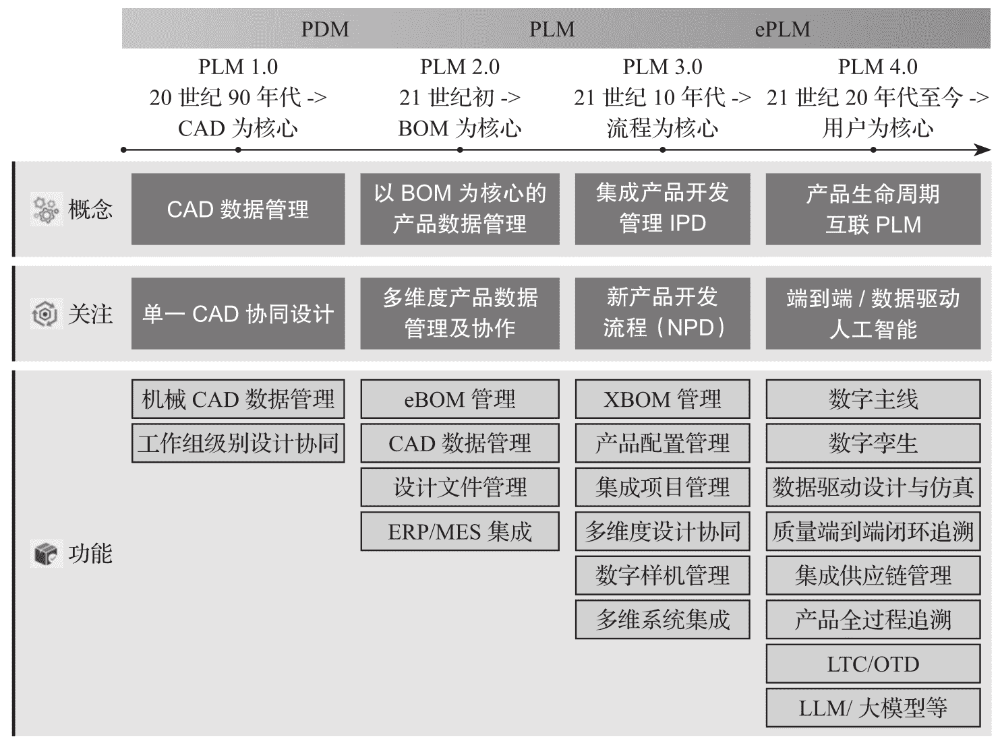

图 6-1 PLM 系统的发展历程

（1）PLM 1.0：以 CAD 为核心的 PDM 时代（20 世纪 90 年代）

20 世纪 60—70 年代，为解决复杂产品的设计问题，三维计算机辅助设计（CAD）软件应运而生。比较典型的代表有洛克希德马丁公司的 CADAM、麦道公司的 UG 等。然而，当时缺乏对 CAD 图纸的统一数据管理，导致文件分散、版本混乱。为解决大型 CAD 文件管理问题，独立于 CAD 的产品数据管理（PDM）系统——PLM 的前身于 20 世纪 90 年代面世。这一时期，比较典型的 PDM 系统有 SDRC 的 Metaphase（后被 UGS 收购）、PTC 的 Windchill 等。

这一阶段的核心概念是 CAD 数据管理。其主要目标是解决在产品设计过程中日益增多的计算机辅助设计（CAD）图纸的版本控制和协同问题。因此，它的关注点非常明确，即实现单一 CAD 环境下的数据管理和协同设计。

此阶段的功能主要局限于管理机械 CAD 数据，并支持工作组级别的设计协同。它更像一个数字化的图纸档案库，确保设计团队内部能够使用正确版本的文件，避免协同工作中的冲突。

（2）PLM 2.0：以 BOM 为核心的 PLM 时代（21 世纪初）

进入 21 世纪，随着产品复杂度的提升，管理的重心从单一的图纸文件扩展到了整个产品结构。自此，正式步入了 PLM 时代。

这一阶段，PLM 系统的核心理念转变为以物料清单（BOM）为核心的产品数据管理。关注点也从单一学科的协同，扩展到多维度产品数据的管理及协作。产品不再仅仅是机械零件的集合，电子和软件部分变得越来越重要。

这一时期，PLM 在功能上实现了质的飞跃。除了继续管理 CAD 数据和设计文件外，系统开始对设计 BOM（eBOM）进行有效管理。更关键的是，它开始与企业的核心运营系统[如企业资源计划系统（ERP）和制造执行系统（MES）]进行集成，试图打通设计与制造之间的数据流。

（3）PLM 3.0：以流程为核心的集成时代（21 世纪 10 年代）

以 BOM 为核心的产品数据得到有效管控后，企业开始将关注焦点从数据管理转向业务流程再造，以解决流程断点和隔离的问题，从而提升研发效率。PLM 系统真正演变为一个企业级的战略平台，其管理范围超越了数据本身，开始与研发流程进行深度融合。

这一时期的 PLM 核心理念是集成产品开发（Integrated Product Development，IPD），关注的焦点是优化整个新产品开发（NPD）流程。企业的目标不再仅仅是管理数据，而是要提升整个产品开发项目的效率和成功率。

PLM 功能变得更为丰富和深入。BOM 管理开始从 eBOM 向 XBOM 演变，即以 eBOM 为核心逐渐向制造 BOM（mBOM）和服务 BOM（sBOM）等延伸，从而将 PLM 涵盖的业务领域从研发延伸到了制造、供应链和售后服务等。同时，引入了产品配置管理、集成项目管理和数字样机管理等高级功能，以满足产品生命周期中不同业务领域的需求。它加强了跨机械、电子、软件等多维度的设计协同，并实现了与企业内更多系统的集成，形成了一个相对完整的研发协作平台。

（4）PLM 4.0：以用户为核心的智能互联时代（21 世纪 20 年代至今）

当前，PLM 正在向一个更广泛、更智能的生态系统——企业级 PLM 系统（Enterprise PLM，ePLM）演进，即通过一套集成的 PLM 解决方案，将产品从概念、设计、制造、运营、服务直至报废的整个生命周期中所涉及的人员、流程、数据和系统进行统一管理。企业级 PLM 强调的是跨部门、跨地域、贯穿整个价值链的协同与整合，其核心价值在于打破部门壁垒，实现跨职能协同，并确保数据一致性、可追溯性与合规性，从而支撑复杂产品的高效创新与全球化协作。

这一时期，PLM 的核心理念是数字主线（Digital Thread）与数字孪生（Digital Twin），即以 PLM 为骨干系统构建数字主线，打通从概念、设计、制造、服务到报废的完整价值链，实现业务端到端/数据驱动，并为构建精准、动态的数字孪生提供数据基础和模型支撑。

产品全过程追溯已经成为企业级 PLM 不可或缺的核心能力。这一阶段的功能包括数据驱动设计与仿真、集成供应链管理、质量端到端闭环追溯等。同时，企业级 PLM 不仅管理产品数据，还开始管理用户需求和使用体验数据，并越来越多地集成可持续性指标，帮助企业进行绿色设计、碳足迹分析和合规分析等。通过融合 LLM 等前沿 AI 技术，PLM 将从一个“记录系统”转变为一个能够提供预测性洞察和智能建议的“决策系统”，为 AI 驱动的研发范式跃迁提供支撑。

总而言之，PLM 系统的发展历程清晰地反映了制造业从管理静态图纸，到管理产品结构，再到优化研发流程，最终迈向构建一个由数据和 AI 驱动的全生命周期创新生态系统的演进路径。

### **6.1.2 传统研发范式的局限性**

传统的研发数字化系统，尽管在过去几十年中为企业的信息化建设做出了贡献，但在面对日益增长的研发复杂性和数据洪流时，其固有的局限性日益凸显。这些局限性主要体现在以下几个方面。

1.数据与知识孤岛

传统的研发工具，如 PLM、ERP 和 MES 系统，以及早期的计算机辅助工程（CAE）仿真工具，往往独立运作，导致数据分散存储在不同的系统中，形成了信息孤岛。同时，电子表格等形式仍在研发团队中普遍使用，这虽然提供了灵活性，但也导致了大量非结构化数据的产生，使得系统性地构建和利用组织知识变得异常困难。这种数据和知识的割裂状态，极大地阻碍了跨部门、跨学科的协同创新和知识的有效复用，难以形成对研发项目的整体性、系统性认知。

2.碎片化的业务流程

碎片化的业务流程，指的是一个本应完整、顺畅、端到端的业务流（如“从订单到交付”），被人为地分割成一系列互不相连、协调不畅的独立环节。这些环节往往散落在不同的部门、不同的 IT 系统甚至不同的地理位置中。造成这种碎片化现状的根源，主要来自三个层面。首先是组织上的“部门墙”，即各职能部门优先考虑自身 KPI 而非整体流程效率。其次是技术上的“系统墙”，即历史原因导致的大量异构 IT 系统缺乏统一规划和有效集成。最后是管理上的“责任墙”，即普遍缺乏能够对一个完整业务流程（如“从订单到交付”）负总责的端到端流程负责人，导致部门间的协作与交接效率低下。

这种碎片化直接带来了一系列严重的负面影响，持续侵蚀企业的竞争力。最直接的是运营效率低下和成本高昂，大量资源被浪费在数据的重复输入、错误的修正和部门间的协调沟通上。更深远的影响是创新速度缓慢、市场响应迟钝，过长的研发周期和决策流程使企业难以适应快速变化的市场。最终，这一切都将导致产品质量风险增加、客户满意度下降以及企业整体盈利能力和竞争力的削弱。

3.瀑布式产品开发模式

瀑布式产品开发模式是一种线性的、序列化的项目管理方法。它将整个产品开发过程划分为一系列固定且独立的阶段。一个阶段完成后，下一个阶段才能开始。瀑布式产品开发模式最致命的缺点在于其缺乏灵活性。它严格的线性顺序使其难以应对开发过程中的任何需求变更，导致项目僵化、对市场变化的反应迟钝。同时，由于用户直到项目末期才能看到最终产品，反馈周期过长，极易造成产品与实际需求脱节。这种模式还将绝大部分风险都后置到了测试阶段，一旦早期需求或设计存在缺陷，修复成本就将呈指数级增长，最终导致交付周期长、价值兑现慢以及高昂的失败成本。

这与前面讨论的碎片化业务流程密切相关。瀑布式产品开发模式各阶段的交接点，都是一个潜在的“断点”。如果交接依赖不完善的文档或沟通，则极易产生信息丢失和误解，从而加剧流程的碎片化。

传统产品研发范式在结构清晰、需求稳定、复杂性较低的项目中仍有其用武之地。然而，在当今这个追求速度、灵活性和持续创新的时代，其固有的线性、僵化特质使其在面对规模化扩张和系统性的复杂挑战时显得力不从心。这正是敏捷（Agile）、DevOps 等现代研发范式应运而生并大行其道的核心原因，它们通过迭代、增量、持续反馈和跨职能协作，为企业提供了在不确定环境中驾驭复杂性、实现可扩展性增长的有效路径。

4.可扩展性与复杂性瓶颈

现代产品，从智能手机、电动汽车到物联网家居，其内部复杂度的攀升速度已远超想象。这种指数级的增长，正以前所未有的力量，猛烈冲击传统的产品研发范式。传统研发流程中那些曾经被视为优点的线性、固化和文档驱动的特点，在今天高度复杂的“系统之系统”（System of Systems）面前，已经演变成了致命的枷锁。

要理解传统范式的“失灵”，首先要看清现代产品复杂度的来源，它主要由三大引擎驱动。

**●软件定义一切**：软件已经成为现代产品的核心与灵魂。一辆现代汽车的代码量可达数亿行，远超飞机和操作系统。产品的功能不再由固定的硬件决定，而是通过软件的迭代和更新来不断演进和增强。这使得产品从一个静态的“成品”变成了一个动态的、持续演进的“服务”。

**●万物互联的系统性耦合**：任何一个智能产品都不再是孤岛。它需要与云端、其他设备、移动应用乃至第三方生态系统进行实时的数据交换和协同工作。这种复杂的连接性带来了系统层级的指数级增长，一个节点的变更可能引发整个网络的连锁反应，形成了牵一发而动全身的网状依赖。

**●用户期望的无限延伸**：消费者期待产品不仅功能强大，还要具备无缝的个性化体验、持续的功能更新和高度的智能化。这种对体验的极致追求，迫使企业必须在产品中集成人工智能、大数据分析等前沿技术，进一步推高了技术的深度和复杂度。

随着研发项目的深入，数据的体量和维度急剧膨胀，问题的复杂度也随之呈指数级增长。传统研发工具和方法在处理如此大规模、高维度、高复杂度的数据时往往显得力不从心，其可扩展性和处理能力均面临严峻挑战。

5.创新周期缓慢与高昂成本

传统研发范式中的“单一事实来源”本质上是静态的记录档案，其核心价值在于忠实追溯“过去如何决策”，却无法智能化引导“未来应如何决策”。它更接近于被动存储知识的图书馆，而非能主动思考、提供洞见的研发伙伴。该体系通过严格的阶段门控、审批流程与变更控制来规避风险，虽保障了规范性，却在根本上抑制了颠覆性创新所需的快速探索与迭代能力。

上述局限直接引发以下两大后果。

**●创新周期持续延长**：产品从概念到上市的流程耗时过长，弱化企业对市场变化的响应敏捷性。

**●研发成本不断攀升**：重复性劳动、资源分配低效及错误决策导致的延期，共同推高开发总成本。

究其根本，传统系统的症结不仅在于自动化缺失，更在于其智能综合能力的匮乏——无法动态整合海量异构信息及主动优化研发创新的路径。这种以工具为中心、被动响应的研发范式，已难以匹配科技革命与产业变革的新需求。

## **6.2 研发范式变革势在必行**

### **6.2.1 内忧外患：我国制造业发展态势**

制造业作为国民经济的支柱，其研发能力的强弱直接决定了国家工业体系的竞争力和安全性。然而，长期以来，中国制造业的研发体系在传统范式的束缚下，正面临着内外交困的系统性危机。这一危机不仅限制了企业的盈利能力和创新活力，更在深层次上威胁到整个产业链的安全与自主可控。

1.外部挑战：地缘政治紧张与全球贸易保护主义抬头

地缘政治的紧张，特别是中美之间的贸易和技术战，对中国制造业构成了最直接的外部压力。美国对中国商品征收高额关税，并计划进一步提高税率，这不仅直接增加了中国商品的出口成本，也加剧了全球贸易关系的不确定性。这种贸易摩擦已从单纯的关税战演变为全面的全球供应链重构。

与此同时，全球贸易保护主义情绪正在升温。欧盟、印度、巴西等国家和地区也开始对来自中国的商品采取反倾销、反补贴等贸易救济措施，以保护本国产业免受低价产品的冲击。尤其是在电动汽车、太阳能电池板等绿色科技领域，中国的产业政策和出口扩张正与欧美等国扶持本土产业的努力（如美国的《通胀削减法案》和欧盟的《欧洲绿色协议》）发生直接碰撞，导致贸易摩擦加剧。

更深层次的挑战来自技术领域的“脱钩”。美国对中国实施了严格的先进技术出口管制，特别是在半导体、人工智能芯片等关键领域，旨在限制中国的技术进步。尽管这些措施在一定程度上刺激了中国的自主创新和自给自足的决心，但也确实给高科技制造业的发展带来了短期阻碍。

2.内部挑战：产能过剩与激烈的价格战

在内部，中国制造业面临着由结构性失衡引发的严峻挑战。随着房地产行业的降温，中国经济增长的引擎愈发依赖制造业。政府通过补贴、低息贷款等产业政策大力扶持制造业，导致投资持续涌入，但国内消费需求却未能同步增长。

这种供需失衡造成了严重的产能过剩。大量产品无法被国内市场消化，只能转向出口，进一步加剧了与贸易伙伴的紧张关系。过剩的产能导致了国内市场残酷的价格战。尤其在汽车、光伏、风电等行业，厂商为了争夺市场份额而大幅降价，严重挤压了企业的利润空间。持续的降价和通缩压力，使得企业盈利能力下降，一些制造商甚至被迫亏本抢占市场份额，这无疑会影响其进行长期研发和技术升级的投入能力。此外，劳动力和运营成本的持续上升也削弱了中国制造业传统的成本优势。

3.供应链重构：“中国+1”战略下的复杂博弈

面对地缘政治风险和成本上升，许多公司开始加入了出海行列，推行“中国+1”战略，即在中国之外建立替代生产基地以实现供应链多元化，越南、印度、墨西哥等国成为热门选择。

然而，完全“去中国化”的供应链重构过程缓慢且充满挑战。中国拥有全球最完整、最高效的产业生态系统，成熟的基础设施和庞大的高技能人才库，这些优势是其他国家在短期内难以复制的。因此，尽管一些最终组装环节被转移出去，但许多替代工厂在很大程度上仍然依赖从中国出口的零部件和原材料。更有意思的是，许多中国制造商也在海外设厂，以规避关税壁垒，这使得供应链的“去中国化”变得更为复杂。

综上所述，中国制造业正处在一个关键的转型期。外部的地缘政治压力和贸易壁垒，与内部的产能过剩、价格战和成本上升交织在一起，形成了一个极具挑战性的发展环境。未来的出路在于能否成功实现产业升级，从依赖规模和成本优势转向依靠技术创新和品牌价值，同时有效提振国内需求，以构建一个更具韧性和可持续性的发展新格局。

### **6.2.2 修炼内功：研发范式跃迁正当时**

在当前地缘政治紧张加剧、全球供应链深度重构、国内市场同质化竞争激化、价格战持续升级的宏观背景下，中国制造企业若固守传统产品研制模式，则必将陷入发展困境。

因此，回归价值创造本源，聚焦核心能力建设（“修炼内功”），并以“研发范式战略转型”为核心突破口，已不仅是明智之选，更是企业穿越周期、实现可持续发展的唯一路径。究其根本，传统研发范式的结构性缺陷在于：正向研发能力的系统性缺失与研发流程的僵化低效，会导致产品创新乏力，从而深陷同质化竞争的泥潭。

1.转型动因：旧路径难以为继

**●外部环境高度不可控**：地缘政治冲突、贸易壁垒高筑、核心技术封锁等外部压力构成企业无法规避的系统性风险。依赖外部市场复苏或政策松绑，无异于将企业命运置于高度不确定性的外部变量之上，风险巨大。

**●内部价格战恶性循环**：在产能过剩与需求疲软的双重挤压下，仅凭成本领先与规模优势发动的价格战，必然演变为一场多败俱伤的消耗战。其后果是持续侵蚀企业利润，扼杀研发投入与再投资能力，最终导致产业链整体价值贬损与竞争力衰退。突破此困局的关键，在于跳出低维竞争逻辑，构建差异化优势。

2.修炼内功：从“逆向工程”到“正向研发”的能力跃迁

中国制造业企业，尤其是装备制造业，长期存在的根本性软肋是正向研发能力的缺失。这正是导致其在创新中频繁陷入被动，并最终在内部过度竞争和外部打压下举步维艰的深层根源。

正向研发是一个“从 0 到 1”的创造过程。它始于对市场需求、用户痛点和未来趋势的深刻洞察，基于基础科学、材料学、工程学等第一性原理进行产品架构设计、分析和仿真验证等，最终形成一个全新的、自主可控的产品。然而，我国制造业长期以来的研发范式主要依赖于模仿和逆向工程，即始于一个竞争对手的先进产品，通过对其进行拆解、测绘、分析和模仿，试图复制其功能和形态。在过往数十年“以市场换技术”的快速追赶战略下，逆向工程作为一种策略性捷径，曾有效助力企业实现“从无到有”的突破，此为其历史价值所在。然若长期依赖此路径，则无异于饮鸩止渴。这必将使企业陷入“被动追赶→技术失能→生存受制”的恶性循环。最终不仅失去市场竞争力，更在地缘政治冲突中将自身置于生死存亡的风险中。

正向研发已从商业竞争选项，蜕变为企业生存的战略必需品。“修炼内功”的核心也正在于此，即重塑企业正向研发能力，系统性地提升企业核心价值创造力。

3.实现路径：以研发范式跃迁为战略加速器

研发范式跃迁，即从逆向工程向正向研发跃迁、由流程驱动向数据与 AI 驱动升级，是破解当前困局、赋能核心能力建设的关键战略杠杆与效能倍增器。此转型绝非局部工具迭代，而是一场贯穿研发方法论、流程体系、组织架构与技术底座的全维度重构。AI 等数字化技术将作为核心使能器，系统支撑企业完成这场转型，驱动研发范式实现层级跃迁。其战略价值具体体现为三大转型支柱。

**●从成本竞争转向技术壁垒构建**：打造以核心技术专利、独有工艺壁垒和卓越产品性能为核心的“护城河”，使竞争对手难以通过简单的价格策略进行模仿与超越。

**●从市场跟随转向需求引领**：超越对现有市场的被动响应与仿制改进，通过前瞻性研发，创造新品类、定义新赛道、激发新需求，掌握市场主导权。

**●从单一产品转向综合解决方案输出**：深度整合硬件、软件与服务，为客户交付高附加值的一体化解决方案，增强客户黏性，建立长期稳定的战略合作关系。

综上所述，我国制造业的传统研发范式已逼近历史性拐点。其非但难以驱动增长，反成禁锢企业突破困局的沉重枷锁。欲打破“低利润→低研发投入→低竞争力→更低利润”的“死亡螺旋”，唯一的出路在于进行一场持续、彻底的研发范式革命。

## **6.3 AI 驱动的研发范式：技术与架构**

要实现从传统范式向 AI 驱动研发范式的跃迁，绝非单一技术的应用，而是需要一个由核心技术引擎和坚实基础架构共同组成的协同体系。这个体系并非从 0 开始的，而是基于企业多年的数字化能力和数字化业务建设之上，将 AI 深度嵌入产品研发流程，从根本上改变产品创新的方法、流程和迭代方式。

### **6.3.1 制造企业应用 AI 的两大技术路径**

当前，制造企业在 AI 落地实践中必然会面临的一个战略抉择，即选用业务系统（如 CAD/CAE、PLM、ERP 等）内置的 AI 解决方案，抑或企业自建的面向全业务链的 AI 平台。在此，我们将这两条路径进行深入的对比分析，以便企业决策者制定符合自身情况的 AI 战略。

1.嵌入式 AI：业务系统内置的 AI 解决方案

时至今日，PTC、西门子、达索、SAP、Ansys 等全球领先的工业软件巨头都已明确宣布其 AI 产品战略，在其成熟的企业级业务系统（如 CAD、PLM、ERP、MES、CAE 等）中，直接嵌入和集成 AI 功能模块，我们称之为嵌入式 AI。其核心特征是“开箱即用”和“场景高度聚焦”。用户无须进行复杂的独立 AI 开发或系统集成，即可在熟悉的软件环境中直接调用这些 AI 能力，因为它们已与既有的业务功能深度耦合。这些 AI 模块并非通用工具，而是精确瞄准其宿主系统所覆盖的特定业务痛点，例如：在 CAD/PLM 中用于生成式设计、拓扑优化和可制造性分析（DFM）；在 CAE 中驱动 AI 增强仿真以实现实时反馈；在 ERP/SCM 中赋能需求预测和供应链风险预警；在 MES/MOM 中应用于智能排产、视觉质检和设备预测性维护等。

这种路径显著降低了企业应用 AI 的技术门槛和实施复杂度，让 AI 能力如同软件本身的标准功能一样，直接服务于特定业务场景的效率提升与智能化转型。

嵌入式 AI 的具体优势如下。

**●部署门槛低，见效快**：无须组建庞大的 AI 算法团队，可快速在特定业务点上验证 AI 的价值，易快速见效。

**●专业领域知识深厚**：工业软件供应商将自身几十年的最佳实践和行业知识（Know-How）融入 AI 模型，解决方案通常比较成熟、可靠和安全。

**●数据天然整合**：AI 模型可以直接利用系统内已经存在的数据，无须进行复杂、跨系统的数据打通和语义解析等工作。

**●运维成本可控**：AI 模型的维护、升级和迭代由软件供应商负责，企业自身负担较轻。

然而，嵌入式 AI 也存在明显的劣势，具体如下。

**●SaaS 化部署与商业 LLM 绑定**：工业软件巨头普遍采取 SaaS 化部署与商业 LLM 绑定的双轨策略：一方面，基于全球化与规模化需求，通过 SaaS 化部署模式实现 AI 模型与 AI 服务的敏捷迭代；另一方面，为确保数据安全性与系统可靠性，优先采用微软 Copilot 等商用大语言模型平台作为底层架构。嵌入式 AI 的常见部署架构如图 6-2 所示。相比之下，本地化部署及第三方 LLM 平台支持未被列入战略优先级，不作为其重点开发方向。

**●灵活性与定制化能力差**：企业通常无法修改底层 AI 模型，难以解决自身特有的、非标准的业务问题。AI 能力被“锁定”在供应商提供的功能范围内。

**●数据与智能的“新孤岛”**：PLM 中的 AI 无法轻易利用 ERP 中的数据，反之亦然。智能被禁锢在各个业务系统的“围墙”内，无法实现全局、跨业务链的优化。

**●供应商依赖与绑定**：企业的 AI 能力发展路径被供应商的“技术路线图”所限制，缺乏自主性。

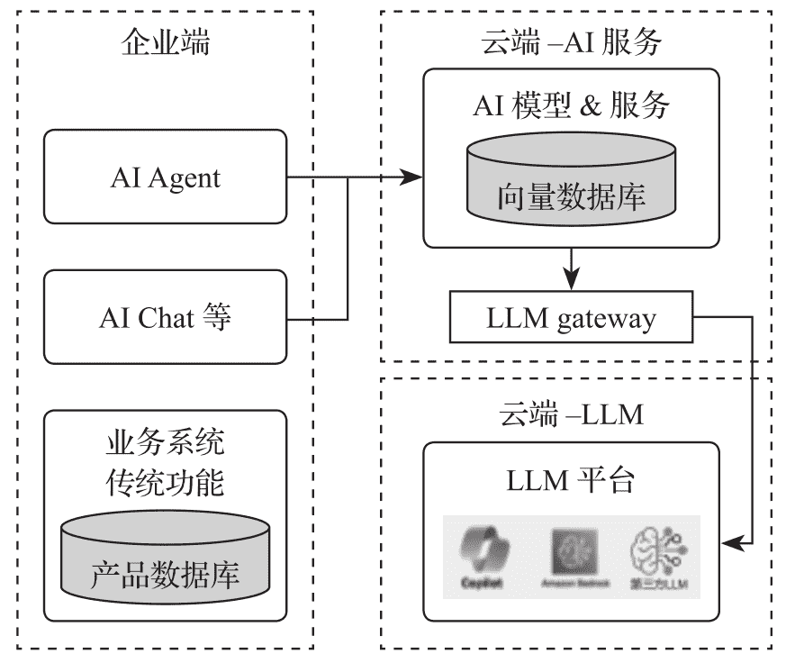

图 6-2 嵌入式 AI 的常见部署架构

嵌入式 AI 尤其适合以下三类企业。

**●AI 应用初探者**：希望以“小步快跑、快速试错”方式启动智能化转型。

**●数字化基础薄弱者**：需优先解决局部业务痛点而非全局改造。

**●非技术驱动型组织**：期待聚焦主营业务，避免消耗资源自建算法与软件体系。

这类企业通过工业软件供应商预置的 AI 模块，能以轻量化方式获得开箱即用的场景化智能能力，无须在底层技术和数据架构上深度投入。

2.平台化 AI：企业自建的面向全业务链的 AI 平台

平台化 AI 是指企业作为主体，整合内外部技术资源，构建一个统一的、服务于整个企业数据和业务链的 AI 基础设施平台。这个平台能够打通、汇聚来自不同业务系统（PLM、ERP、MES、CRM 等）的数据，实现端到端业务的贯通，并在此基础上自主开发、训练和部署定制化的 AI 应用。

平台化 AI 的核心特征体现为以下三层协同架构。

**●全域数据整合中枢**：通过构建企业级数字主线平台，打破信息孤岛，实现数据“一次汇聚、全局调用”，支撑端到端业务的洞察和决策优化。

**●AI 能力服务化引擎**：将计算机视觉、自然语言处理、预测分析等通用 AI 能力封装为标准服务（如 API），支撑跨部门按需调用。

**●自主应用创新平台**：赋能企业基于自身核心业务需求，开发定制化 AI 应用，解决嵌入式 AI 无法覆盖的深度场景和个性化需求。

平台化 AI 架构以数据贯通为基础、以 AI 能力服务化为枢纽、以场景创新为出口，使企业能够系统性沉淀 AI 资产，快速响应差异化业务挑战，实现从标准化智能到深度定制的跃迁。

平台化 AI 具有如下优势。

**●极高的灵活性与自主权**：企业可以自由选择最先进的开源模型或技术框架，开发完全定制化的解决方案，解决最关键的战略性问题。

**●打破数据孤岛，实现全局智能**：能够实现跨领域的“端到端”优化，例如，将售后市场的用户反馈数据直接用于下一代产品的设计优化，实现数据驱动的产品创新。

**●构建核心数字资产与护城河**：本地化部署已成为制造企业应用 AI 的刚性需求，其核心价值在于双重保障：既支撑基于通用大模型的垂域模型微调，又切实保障企业核心数据资产与知识产权安全。自建的 AI 平台及其承载的数据和定制模型，将成为企业独有的、竞争对手难以模仿的核心数字资产和战略壁垒。

**●长期拥有，成本可能更低**：虽然初期投入巨大，但长期来看，避免了对多家供应商支付高昂的 AI 模块许可费。

然而，企业构建可规模化落地的 AI 平台，面临技术、组织和风控等多重核心挑战，具体如下。

**●周期长，投入大**：平台的构建是一个复杂的系统工程，需庞大的资金和时间成本，且短期内难以看到直接的业务回报，对管理层的战略耐心和决心是巨大考验。

**●技术能力断层**：既懂工业场景又掌握 AI 工程化的复合型人才稀缺。

**●数据治理困境**：原始数据分散割裂、质量参差不齐，需系统性整合清洗。

**●组织变革阻力**：传统业务流程与 AI 驱动的敏捷模式存在根本性冲突。

**●技术与管理风险高**：自建平台存在失败的风险，且后续的平台运维、模型迭代和安全保障对企业自身的技术和管理能力要求极高。

平台化 AI 解决方案适用企业的核心特征可概括为：具备雄厚资金与顶尖技术人才储备的行业头部企业，在完成初步数字化转型并确立数据核心资产地位的基础上，将 AI 能力视为长期战略竞争力，致力于通过自主可控的 AI 平台实现个性化场景的颠覆式创新与行业壁垒构建。

3.战略选择：分步演进、融合共生

对于绝大多数制造企业而言，这两条路径并非完全对立的，而更像是一个企业 AI 能力成熟度不断演进的两个阶段——从嵌入式 AI 的轻量化场景切入，到平台化 AI 的体系性构建，本质是企业数据资产沉淀、技术能力升级与战略认知深化的阶梯式跃迁过程。

（1）第一阶段：嵌入式 AI 快速入门

从工业软件系统内置的 AI 解决方案入手，选择 1～2 个投资回报率最高、最迫切的业务场景进行试点。这一阶段的核心目标如下。

**●价值快速验证**：3～6 个月内实现可量化的效率提升（例如，通过采用 PLM 中的器件智能推荐功能，降低约 15%的零部件种类）。

**●能力原始积累**：沉淀场景数据集，培育团队 AI 工程化基础认知。

**●组织破冰攻坚**：打破组织惯性、建立共识，为日后资源更为密集的平台化 AI 阶段铺平道路。

这一阶段的核心使命是：快速验证 AI 价值，积累实践经验，培养团队的“AI 体验”，并为更宏大的 AI 战略争取内部支持和资源。

这一阶段容易陷入“试点炼狱”的陷阱。成功的试点项目因缺乏系统集成、统一的数据基础设施和更宏大的战略愿景而无法规模化推广。许多 AI 项目甚至从未进入实际生产部署阶段。

（2）第二阶段：集成与平台筑基

在嵌入式 AI 实现局部场景验证后，企业积累初步实施经验并形成成功案例。伴随着 AI 认知深化与战略升级，重心逐步向平台化 AI 体系迁移，旨在实现规模化应用、深度定制和差异化战略。此阶段的核心任务如下。

**●启动数据主线战略**：实现端到端业务在线，为平台 AI 应用夯实数据基础。

**●组建种子 AI 团队**：制定平台化 AI 架构和技术路线，攻克 1～2 个关键业务场景的“个性化需求”。

**●制定 AI 治理框架**：确立数据标准与 AI 模型生命周期管理（MLOps）机制。

这一阶段为平台化 AI 跃迁奠定“数据-人才-机制”三位一体的基础架构，完成从工具应用到能力资产的认知升维。

（3）第三阶段：规模化应用与能力构建（自建阶段）

在此阶段，平台化的 AI 架构已具雏形，AI 被正式提升至企业核心战略层面。企业不再满足于单点应用，而是前瞻性地在全集团范围内推广 AI 解决方案，并致力于开发高度垂域化、定制化的模型以获取差异化竞争优势。这一阶段的核心特征如下。

**●实现路径**：以“自主研发”为核心。企业已沉淀出强大的内部 AI 团队，具备全栈式的模型开发、部署与运维能力。即便借助云基础设施，核心算法与模型仍为企业专有，以保障技术护城河。

**●数据基石**：成熟的 MLOps 体系与数字主线平台已全面落地，实现了从数据准备到模型迭代的生命周期自动化管理。数据在此阶段被视为企业的顶级战略资产。企业通过自建智算中心或大规模调度云端算力，为 AI 创新提供澎湃动力。

**●组织形态**：AI 能力已从集中的中心化团队，演变为分布式的“网状赋能”结构。AI 专家被深度整合进各业务单元，与业务人员组成跨职能团队，协同解决一线问题。高瞻远瞩的顶层支持与鼓励创新的企业文化，是这一模式成功的关键。

在此阶段，AI 应用场景开始由单点应用转向业务链端到端赋能。

**●业务流程优化**：将传统僵化的业务流程转变为由数据驱动的动态、智能化体系，以提升效率和创新。

**●智能决策支持**：通过打通数据壁垒，构建全景式视图，AI 能够洞察全局，预测瓶颈，并提供协同优化建议，从而实现业务模式的根本性变革。

**●能力沉淀复用**：打造企业级“AI 中台”，将通用 AI 能力以服务形式提供给全公司，避免重复造轮。

这一阶段的核心挑战在于变革管理与文化重塑。当 AI 深度渗透业务流程，员工的角色和工作方式将发生根本性变革，这可能引发组织惯性和员工抵触。因此，挑战的重心已从技术攻坚转向组织文化与人员的平稳转型。

（4）第四阶段：核心平台主导的混合 AI 生态

企业自研 AI 平台晋升为创新核心引擎，承载关乎核心竞争力的定制化智能应用（如工艺参数智能优化）；同时持续采用工业软件嵌入式 AI 模块，高效处理标准化场景（如 PLM 中的变更影响分析、ERP 中的用户需求预测等）。最终形成“自主平台+商用模块”的混合 AI 生态，实现以下三方面的目标。

**●战略层**：通过自主平台保障关键技术控制权与创新壁垒。

**●执行层**：借助商用模块降低常规业务智能化成本。

**●架构层**：建立 AI 网关，实现内外 AI 能力动态编排。

这一阶段的核心特征如下。

**●实现路径**：创新成为这一阶段的核心路径。此时，企业已成为 AI 驱动价值的创造者，甚至有能力将其平台和解决方案输出给其所在生态系统中的其他伙伴。

**●基础设施**：AI 和数据已无缝融入每一个决策流程中。企业能够娴熟地运用 AI Agent、MCP 等前沿技术，以实现高度自主化的运营。

**●组织形态**：整个组织都具备了 AI 素养。AI 不再是一个独立的职能部门，而是公司 DNA 中不可分割的一部分。组织变得高度敏捷和自适应，其结构旨在最大化地激发创新。

以自建的平台化 AI 架构为基础，实现自研 AI 模型和商用 AI 模块的有机融合，既保证了战略自主和创新突破，又兼顾了效率与成本，实现企业整体 AI 能力的价值最大化。平台化 AI 与嵌入式 AI 共融共生的混合 AI 生态如图 6-3 所示。此时，企业的焦点开始转向持续的自我颠覆和塑造行业未来，从而在瞬息万变的技术浪潮中保持领先地位。

企业在成熟度阶梯上的攀升并非总是一帆风顺的线性过程。现实情况远比模型所描绘的更为复杂，企业可能会在某个阶段停滞不前，而外部的冲击也可能迫使企业后退甚至实现跳跃式发展。例如，“试点炼狱”的概念表明，大量企业被困在第一阶段，无法将成功的单点方案实现规模化应用。同样，从第二阶段向第三阶段过渡时所面临的变革管理挑战，可能使企业的转型停滞数年。反之，重大的外部事件，如全球供应链中断，也可能成为强大的催化剂，迫使企业出于生存需要而迅速投资于供应链可视化和预测能力，从而在某些方面实现跨越式发展。因此，这个成熟度模型应被视为一张导航地图，而非一份严格的时间表。企业的进阶取决于其能否成功跨越不同阶段之间的关键“鸿沟”（无论是技术、组织还是文化）。

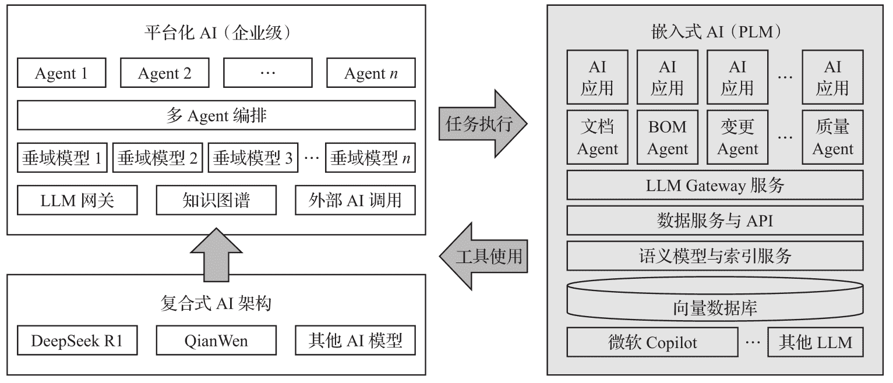

图 6-3 平台化 AI 与嵌入式 AI 共融共生的混合 AI 生态

### **6.3.2 平台化 AI 分层架构**

实现由传统研发范式向 AI 驱动范式的跨越，关键在于构建一个统一的、平台化的 AI 基础设施。这种平台化方法超越了零散的“点式解决方案”，旨在打造一个能够感知、分析、决策并执行的整体智能系统，成为现代数字企业的“中枢神经系统”。必须以开放性、可扩展性和安全性为核心设计原则，将来自物理世界（OT）和数字世界（IT）的数据、模型及应用无缝集成。本小节将围绕一个统一的参考架构展开，深入剖析每一层的核心功能与技术架构，为企业构建下一代数字化研发体系提供清晰的蓝图。

一个设计精良的制造业 AI 平台架构必须遵循三个核心原则，以应对工业环境的复杂性和动态性。

**●可扩展性**：制造业产生的数据量是巨大的，并且随着更多业务系统的接入而呈指数级增长。AI 平台必须能够处理不断增长的数据量和日益复杂的模型，无论是本地部署、公有云还是私有云。

**●模块化**：平台应由独立的、可解耦的组件构成。这种模块化设计允许对系统的特定部分进行独立的更新、替换或扩展，而不会对整个系统造成干扰。例如，可以升级或更换数据处理模块而不影响正在运行的供应链风险预测模型。这大大提高了系统的灵活性、可靠性和维护性。

**●互操作性**：平台必须能够与多种不同的业务系统和数据库无缝集成及交换数据。在制造业中，这意味着要打破信息技术（IT）和运营技术（OT）之间的壁垒，实现 PLM、ERP、MES 和 SCADA 等系统之间的数据自由流动。

选择实施平台化架构，而非部署零散的 AI 工具，本身就代表了一种战略决策。它标志着企业从解决孤立问题转向构建一种覆盖全企业、可应用于任何流程的、可复用的“智能能力”。这不仅是技术的升级，更是业务体系的根本性变革。

为了系统性地理解和构建复杂的制造业 AI 平台，笔者综合了多种行业和学术界的架构模型，提炼并提出了一个专为制造业研发领域场景定制的、全面的五层统一参考架构，平台化 AI 分层架构如图 6-4 所示。该架构不仅是一个技术蓝图，更是一个战略框架，它清晰地划分了不同技术领域的职责，确保了各组件间的协同工作。

**●基础设施层**：提供可扩展的计算、存储和网络资源，以及部署在这些硬件设施上的通用 LLM 模型或其他 AI 模型（如深度学习算法模型等）。该层是整个 AI 架构的物理和虚拟化底座，为上层的数据处理、模型训练与应用运行提供必要的硬件和环境支持。部署模式可以是云端部署、本地部署或混合模式。

**●数据/知识层**：这一层负责整合和管理企业在产品生命周期过程中产生的海量、多源异构数据，并将其转化为可供 AI 模型利用的知识。通过集成 PLM（产品数据）、ERP（经营数据）、MES（制造执行数据）及 CRM（客户数据）等多源异构系统，构建全域数据融合引擎。依托统一语义模型（如 ISA-95 标准），将分散的数据进行整合，形成标准化的数据资产。

在此基础上，建立企业知识图谱，沉淀行业知识和企业经验，为 AI 应用提供更深层次的洞察。

**●模型服务层**：这一层将多样化的 AI 能力封装成服务，并对模型的开发、部署和维护等整个生命周期进行系统化管理，以支撑上层丰富的 AI 应用。该层是 AI 平台的“大脑”，提供核心的智能分析、预测、识别和生成能力。它既包括通用的基础模型（如 DeepSeek R1、通义千问等 LLM），也包括针对特定制造领域或任务进行微调和优化的领域专用模型。同时，基于 MLOps 的核心理念对 AI 模型从开发到维护的全过程统一管理，确保模型在整个制造业 AI 平台中的高效开发、可靠部署和持续优化。

**●Agent 编排层**：这一层是实现复杂 AI 应用的关键，它负责协调多个 AI 模型及 Agent 的交互与协作流程。该层通过任务分解、Agent 分配、通信及协调机制，使多个独立的 AI Agent 能够高效协同，从而解决单一模型无法应对的复杂制造问题。在此架构中，Agent 的编排和管理依托于一个多 Agent 管理平台，是实现 Agent 规划、推理和工具使用等核心能力的枢纽。通过对 Agent 编排和多 Agent 协作，平台能够赋能从需求、设计到供应链和工艺等的各个业务环节，为不同领域的工程师提供智能化支持。

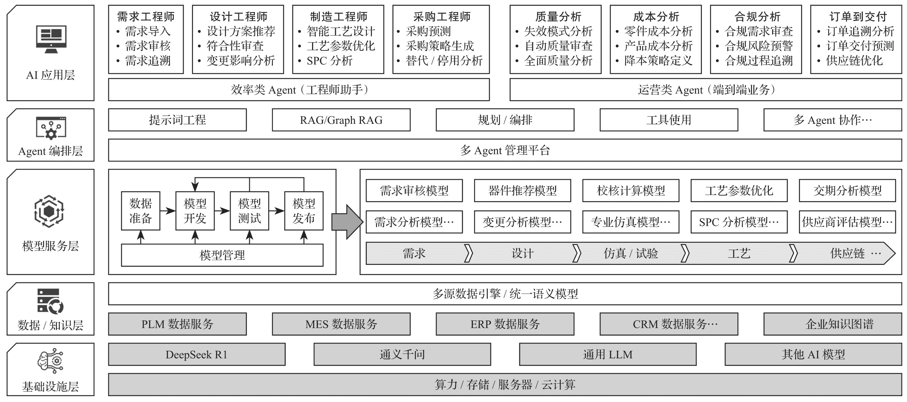

图 6-4 平台化 AI 分层构架

**●AI 应用层**：这是 AI 平台价值的最终体现，通过用户友好的界面（如自然语言对话界面、基于角色 App 等）向最终用户（如设计工程师、软件工程师、质量工程师、管理人员等）交付 AI 驱动的洞察、决策支持和自动化功能。从用户角色维度，AI Agent 可分为两大类，即面向专业工程师的效率类 Agent 和面向管理层的运营类 Agent。效率类 Agent 的核心价值在于增强和辅助专业工程师，通过自动化和智能化手段，提升其在特定、垂直领域的效率和工作质量。这类 Agent 更注重于单个职能域或专业流程的深度优化。而运营类 Agent 的核心价值在于提供跨业务、跨组织的端到端洞察和协同，支持战略层和管理层的宏观决策。这类 Agent 更注重于打通全流程，解决系统性和结构性的难题。

这种分层架构实现了技术与业务的充分解耦，允许不同领域的专业团队（如基础设施、IT、数据工程、数据科学和应用开发团队等）并行工作，同时通过标准化的接口确保互操作性。在制造业这样一个技术栈极其广泛的环境中，这种模块化的组织方式是应对巨大复杂性管理、实现规模化部署的唯一可行路径。它将一个庞大到令人望而生畏的系统工程问题，分解为一系列可管理、可定义、可交付的子问题。同时，也使得系统能够灵活集成不同组件，支持各组件独立扩展，并能适应不断变化的业务需求和技术进步。

更进一步，该架构正日益呈现出“双向”智能流动的特征。数据和洞察不仅从执行层向管理层流动以进行大规模分析，智能决策和控制指令也从管理层反向流回执行层，即通过对产品开发过程的实时洞察和决策分析，实现对关键任务节点的实时干预和主动控制，以及时纠偏，避免方向性错误。这种从“事后纠错”到“主动控制”的闭环反馈，是实现 AI 驱动的智能化研发范式的标志，也是该分层架构的核心价值所在。

## **6.4 基础设施层：数字企业的物理底座**

该层是整个平台的物理和逻辑基石，提供所有上层服务所需的计算、存储和网络资源。在制造业中，这一层的核心挑战与标志性特征是实现 IT/OT 的安全、可靠融合。

### **6.4.1 硬件基础架构**

为制造业 AI 平台选择硬件基础设施，是一个需要在性能、成本、可扩展性和安全性之间进行精确权衡的战略决策。其核心目标是为 AI 模型的训练和推理提供稳定、高效且经济的运行环境。下面介绍关键的选择标准和依据。

1.算力

算力是 AI 平台的大脑，是训练复杂深度学习模型和处理海量数据的引擎，其选择直接决定了模型开发和运行的效率。算力通常包括用于通用计算的中央处理器（CPU）、用于并行处理和加速模型训练的图形处理器（GPU），以及针对特定 AI 工作负载（如神经网络计算）进行优化的张量处理单元（TPU）。具体的算力需求应该由专业的 AI 架构团队评估得出，取决于 AI 模型的复杂度（如模型参数、神经网络深度等）、模型微调训练强度（如微调频率、数据吞吐量、收敛速度等），以及场景约束（如实时性、能效比、部署环境）等。

高算力场景主要分为 AI 训练和 AI 推理两种。

**●AI 训练**：此过程涉及在海量数据上训练复杂的神经网络，需要极高的并行计算能力。GPU，特别是像 NVIDIA A100/H100 系列这样的高端张量核心（Tensor Core）GPU，是当前的市场标准。选择时需考虑其浮点运算能力、显存大小和多 GPU 互联技术，这些都直接影响训练速度和能处理的模型规模。

**●AI 推理**：这是将训练好的模型部署到实际应用中的过程，更注重低延迟、高吞吐量和能效比。虽然 GPU 也适用于推理，但根据场景，有时也会选择更具成本效益的专用 AI 加速芯片（ASIC）、FPGA（现场可编程门阵列），甚至是具备 AI 加速指令集的现代 CPU。

尽管 GPU 是主角，但强大的 CPU 同样重要。它负责数据预处理、任务调度、系统管理和处理模型中无法被 GPU 加速的部分。选择时需关注其核心数、主频和内存带宽。

2.数据存储

制造业 AI 平台需要处理海量的结构化（如 BOM、三维模型、仿真/试验数据集等）数据和非结构化（如设计图册、技术文档等）数据，以及生产过程中的时序数据，对存储系统的要求极高。AI 平台需要能够快速访问大规模数据集的高速存储解决方案，以最大限度地减少数据检索延迟，支持模型训练和推理流程中的高吞吐量数据需求。

**●高性能存储层**：为了在模型训练时避免 I/O 瓶颈，需要一个高速存储层为 GPU 提供充足的数据吞吐。基于 NVMe 协议的固态硬盘（SSD）和全闪存阵列是理想选择，它们能提供超低延迟和极高的数据读写速度。

**●大容量存储层**：对于存储原始数据集和归档数据，可以采用成本效益更高的存储方案，如大容量 SSD 或 HDD，构建分层存储策略。

**●可扩展性与架构**：应选择支持横向扩展的存储架构，如分布式文件系统或对象存储，确保随着数据量的增长能够平滑扩容。

3.网络与连接

高速网络是连接计算和存储资源的“神经系统”，在分布式训练中尤为关键。

**●高带宽、低延迟网络**：在多服务器、多 GPU 的分布式训练环境中，节点间的数据交换极为频繁。需要采用 InfiniBand 或高速以太网（如 100/200/400 GbE），并支持 RDMA（远程直接内存访问）技术，以最小化通信延迟，确保 GPU 集群的计算效率。

**●连接工厂现场**：平台需要与工厂的 OT（运营技术）网络建立安全连接，以获取实时的设备和传感器数据。这要求网络架构具备良好的融合能力和安全隔离机制。

总之，制造业 AI 平台的硬件选择并非单一方案，而是一个根据具体业务目标、应用负载和预算限制动态组合的混合策略。

### **6.4.2 部署模式**

硬件部署在云端、本地数据中心还是进行混合部署，取决于应用的具体需求。

**●云端（Cloud）部署**：云端部署模式（包括公有云和私有云）提供了几乎无限的可扩展性、灵活的按需付费模式以及丰富的托管 AI 服务，从而降低了启动成本和 IT 维护负担，适合需要海量算力进行突发性模型训练的场景，其关键考量在于数据传输带宽、成本和数据隐私安全。相比较而言，私有云是一个更好的选择，兼顾弹性扩展、维护成本与隐私安全等多方面的考量。

**●本地数据中心（On-Premise）**：优势在于对数据有完全的控制权，安全性高，对于处理核心敏感数据和知识产权的企业至关重要。长期来看，对于持续高负载的场景可能更具成本效益。本地数据中心的前期投入大，需要专业的运维团队。

**●混合（Hybrid）部署**：结合了本地数据中心和云端的优势，已成为制造业 AI 平台的标准架构。这种模式将需要大规模计算和存储的非实时任务（如模型训练）放在云端，而将实时、低延迟的模型推理和决策任务保留在本地数据中心，从而最大化整个平台的效能和投资回报率。

值得注意的是，AI 基础设施的巨大能源消耗是一个日益严峻的挑战。数据中心，特别是用于 AI 优化的数据中心，其电力需求正在急剧增长。据预测，到 2030 年，中国的数据中心就可能消耗高达 4.8%的全国电力 ^(⁶⁶)。因此，在基础设施设计之初就必须将可持续性（如采用节能硬件和优化冷却方案）作为核心考量因素。

### **6.4.3 LLM 平台选择**

为制造业 AI 平台选择 LLM 是一个多维度的决策过程，需要综合考量技术、成本、安全和应用场景等多个因素。下面是选择 LLM 时的主要标准和依据。

1.模型性能与能力

这是评估模型能否满足制造业特定需求的根本依据。

**●领域知识与准确性**：模型需要理解制造业的专业术语、流程和物理原理。例如，它是否能准确解析技术图纸的文字标注、理解 PLM 系统中的 BOM 结构或工艺参数？对于需要高精度的任务，如工艺参数优化等，模型的准确性至关重要。

**●多模态处理能力**：制造业数据不仅限于文本，还包括 CAD 图纸、三维模型、图片等。因此，具备能够处理和关联文本、图像、三维模型等多种信息类型的多模态 LLM 会更具优势。

**●推理与逻辑能力**：复杂的制造业问题，如产品质量的根因分析、研制计划的动态调整等，会要求 LLM 具备强大的逻辑推理和规划能力。

**●性能基准**：通过在特定的制造业任务（如技术问答、需求生成、数据分析）上进行基准测试，可以量化比较不同模型的表现。

2.适应性与定制化

通用大模型需要经过适配才能在专业领域发挥最大价值。

**●微调的灵活性**：平台应选择能支持使用企业自有数据进行微调的模型。这能让模型学习企业特有的产品知识、工艺规范和历史数据，提高其在特定场景下的表现。

**●检索增强生成的兼容性**：模型与 RAG 架构的结合能力至关重要。通过连接企业内部的知识库（如设计手册、质量程序、供应商信息等），RAG 可以为 LLM 提供实时、准确的上下文信息，减少“机器幻觉”，确保输出的专业性和准确性。

**●开源与闭源**：①开源模型（如 DeepSeek、Llama 系列），能够提供更高的定制化自由度和数据控制权，允许企业在本地部署，从而更好地保护数据隐私和知识产权，但需要企业投入更多的资源进行维护和优化。②闭源模型（如 GPT 系列），通常在通用能力上表现优异，并提供成熟的 API，开发集成速度快，但其定制化能力有限，且数据需要通过 API 传输，可能引发数据安全顾虑。

3.成本效益

成本是决定 AI 平台能否规模化应用并实现商业价值的关键。

**●训练与微调成本**：训练一个模型或对其进行深度微调需要巨大的计算资源，成本高昂。

**●推理成本**：这是模型在日常应用中持续产生的费用。模型的规模、响应速度和调用频率直接影响推理成本。在满足性能需求的前提下，选择推理成本更低的模型是理性的选择。

**●部署与维护成本**：部署模式（如云端部署与本地数据中心）和所需的硬件设施（如 GPU）也是重要的成本考量因素。

4.安全、合规与可信赖性

制造业涉及大量核心知识产权和敏感生产数据，安全性是不可逾越的红线。

**●数据隐私与安全**：模型的部署方式是否能保证企业数据不出域？对于选择闭源 API 服务的模型，需要严格评估其数据使用和隐私保护政策。本地数据中心部署的开源模型在这方面具有天然优势。

**●可解释性与可追溯性**：模型的决策过程是否可以被理解和追溯？当 AI 辅助进行关键决策（如工艺参数调整、质量判定）时，能够解释其判断依据是建立信任和进行风险控制的必要条件。

**●合规性**：模型及其应用需符合所在行业和国家的数据安全法规及标准。

5.集成与可扩展性

AI 平台需要与企业现有的 IT 架构无缝集成。

**●API 与生态系统**：模型是否提供稳定、易于集成的 API？其周边的工具链和开发者社区是否成熟？能否为平台开发提供便利？

**●部署灵活性**：模型是否支持在云端、本地数据中心或边缘设备上部署？对于需要实时响应的生产现场应用（如设备端的智能监控），边缘部署能力尤为重要。

**●可扩展性**：随着应用范围的扩大和数据量的增加，模型服务架构需要能够平滑地扩展，以应对更高的并发请求和更大的计算压力。

从上述五个维度，我们对常见的 DeepSeek R1、通义千问（Qwen 2）、ChatGPT、Llama 大模型进行了比较，如表 6-1 所示。由于这些模型发展迅速，表 6-1 中的信息仅基于截止 2025 年上半年的普遍认知。

对于制造业 AI 平台，理想的策略并非“四选一”，而是根据以下不同的应用场景进行组合。

**●对于核心研发、需要处理高度机密数据且追求极致定制的场景**：Llama 具有开源和可私有化部署的特性，是保障数据安全的最佳选择。

**●对于需要强大的中文处理能力和与云服务深度集成的场景**：通义千问依托阿里云的生态和对中文的优化，优势明显。

**●对于需要顶级编程和科学计算能力的应用**：DeepSeek R1 提供的专用模型和高性价比 API 是极具吸引力的选择。

**●对于需要快速集成、追求最强通用能力和成熟多模态交互的应用，且数据合规性允许的场景**：ChatGPT 依然是快速验证和构建原型的首选。

总之，制造业 AI 平台在选择 LLM 时，不会盲目追求单一的模型，而是会根据具体的应用场景，在性能、成本、安全和适应性之间寻求最佳平衡。通常会采用“模型矩阵”的策略，即一个平台内可能同时使用多个模型，为不同的任务匹配最合适的 LLM，如采用通义千问作为与客户交互的通用问答，而采用 DeepSeek 来分析技术文档的专业模型、材料配方生成模型和验证模型等。

**表 6-1 常见 LLM 比较**

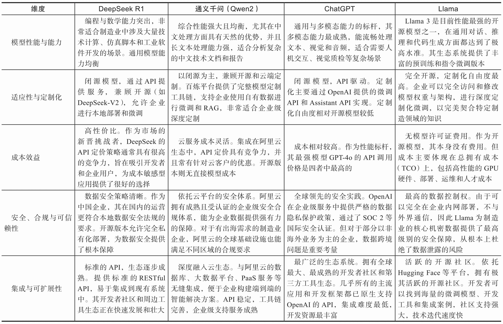

## **6.5 数据/知识层：工业数据与知识中枢**

在任何现代 AI 或数据平台架构中，数据/知识层都是承上启下的核心中枢。它位于底层的基础设施（如服务器、云平台）之上，并在上层的 AI 模型与应用之下。其根本任务是将企业内外部原始、分散、异构的数据，转化为高质量、可信赖、易于理解和使用的知识资产，为上层智能应用提供“燃料”和“智慧”。

### **6.5.1 系统集成与数据聚合**

大多数企业都已经拥有与各种研发相关的 IT 系统，如 PLM、ALM、SDM、TDM、ERP、CRM 等。AI 能力的引入并非要完全取代这些系统，而是要与之有效集成，利用现有系统中的宝贵数据和流程。从更广泛的行业实践来看，要实现 AI 平台与企业现有业务系统的有效集成，通常需要一个系统性的、多层次的策略，可归纳为以下几个关键步骤。

1.建立稳定可靠的连接与数据通路

根据业务系统的类型和实时性要求，会采用不同的集成策略，包括以下内容。

**●API 集成**：对于提供现代 API（如 RESTful API）的系统，这是首选方式。通过 API 可以实现对数据的实时或准实时调用，并能执行创建、读取、更新、删除等操作。

**●数据库直连**：对于一些老旧系统或需要进行大批量数据抽取的场景，可以通过 JDBC/ODBC 等方式直接连接其后台数据库，定期抽取数据。

**●消息队列/事件总线**：针对 MES 这类需要高实时性的系统，常采用事件驱动的集成方式。例如，当 MES 中的某个工序完成或设备发生告警时，会立即发布一个事件到消息队列（如 Kafka），AI 平台订阅这些事件并实时做出反应。

**●文件交换**：对于一些批处理任务，仍然会使用传统的文件交换方式，如通过 FTP 或共享文件夹定时交换 CSV、XML 等格式的数据文件。

2.构建统一的数据汇聚与处理中心

数据连接上之后，不能直接使用，必须进行集中处理和治理。湖仓一体库和向量数据库在一个成熟的 AI 平台中扮演着不同且互补的角色，数据通常会根据其特性和用途，分别进入两者或在两者之间流动。

**●数据湖仓/湖仓一体库**：湖仓一体库是企业数据的主力存储和分析中心。集成后的数据，尤其是来自 PLM、ERP、MES 等系统的结构化、半结构化和非结构化数据，通过 ETL（抽取、转换、加载）或 ELT（抽取、加载、转换）过程，对数据进行清洗、去重、转换和整合，形成标准化的数据资产，存入数据湖仓中。

数据湖仓作为企业的单一可信数据源，可对所有数据进行统一的存储、管理、治理和权限控制，为机器学习模型提供经过清洗和整合的高质量训练数据集。

**●向量数据库**：这是专为 AI 时代设计的语义搜索引擎。它不直接存储原始数据，而是存储从数据中提取出的数学表征——向量（Embeddings，或者 Vectors）。向量数据库是数据的“语义索引”，负责理解和关联非结构化数据背后的含义。其中：①相似性搜索的核心功能是进行超高速的向量相似度计算。例如，找到“与这张有缺陷的产品图片最相似的十张图片”或找到“与这段技术描述最相关的设计文档”。②检索增强生成（RAG）：这是 LLM 应用的关键。当用户提问时，系统先将问题转换为向量，在向量数据库中检索最相关的知识片段（如从知识库、技术手册、历史问答中找到的段落），然后将这些片段作为上下文喂给 LLM，生成更精准、更可靠的答案。

在一个典型的制造业 AI 平台中，数据流示意图如图 6-5 所示。

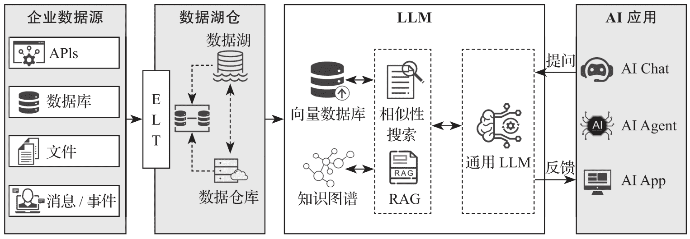

图 6-5 AI 平台数据流示意图

**●数据汇入数据湖仓**：来自 PLM、ERP、MES 等系统的数据经过集成和清洗后，统一存入湖仓一体库。

**●数据向量化**：系统会选取数据湖仓中具有丰富语义信息的非结构化或半结构化数据（如产品描述、设计文档、技术手册、设备维修日志、质量报告等），通过 Embedding 模型将其转换为向量。

**●向量存入向量数据库**：这些生成的向量，连同指向数据湖仓中原始数据位置的索引（ID），被存入向量数据库。

**●AI 应用调用**：当一个 AI 应用需要进行语义搜索或 RAG 时，它会查询向量数据库，找到最相关的内容 ID。然后，它会根据这些 ID，回到湖仓一体库中提取完整的、原始的数据记录，以供进一步处理或呈现给用户。

由上可见，数据首先进入湖仓一体库进行统一管理和分析，其中需要进行语义理解和相似性搜索的部分，其“向量化身”会被存入向量数据库。两者协同工作，共同构成了现代 AI 平台强大的数据底座。

3.实现数据的语义统一与知识化

这是实现有效集成的核心，让 AI 能够真正“理解”数据。

统一语义模型就像是为企业的所有数据建立了一本通用的“字典”和一套“语法规则”，它屏蔽了底层业务系统的复杂性和差异性，使得数据在整个企业内可以无歧义地、一致地流动和被理解，是数据驱动决策和 AI 应用成功的关键基石。

因为不同的业务系统是为不同的目的设计的，所以它们描述同一个业务对象的方式天然存在差异，即数据不一致，包括命名不一致、格式不一致、单位不一致和定义不一致等。譬如，在 PLM 系统中，一个零件可能被称为“Part Number”；在 ERP 系统中，它可能被称为“Material Code”；而在 MES 中，它又可能被称为“Component ID”。但它们指向的是同一个物理实体。又如，PLM 中的“产品 BOM”是指工程设计结构，而 ERP 中的“产品 BOM”可能是订单或生产结构，两者的范围和细节都不同。如果不解决这些问题，那么 AI 平台分析得出的结论将是混乱甚至错误的。

**●主数据管理（MDM）**：建立企业级的“黄金标准”，对核心业务实体（如产品、物料、客户、供应商等）进行统一定义和编码，解决跨系统的数据不一致问题。

**●构建统一语义模型**：为每一个核心业务实体都创建唯一的、标准的、全企业通用的数据模型。将来自各个源系统（PLM、ERP 等）的数据字段映射到标准模型上，并定义转换逻辑。以零部件编号为例，建立如下映射关系：PLM.Part Number→Master Part ID；ERP.Material Code→Master Part ID。

当数据从源系统流入 AI 平台时，会经过这个“语义模型层”进行自动化的清洗、映射和转换，确保进入平台后续流程的数据都是一致的和标准的。构建知识图谱是指将治理好的数据（特别是主数据）及其间的业务关系，构建为知识图谱的过程。例如，知识图谱可以清晰地表达：某款产品上的某个零件（来自 PLM）由哪个供应商（来自 ERP）提供，用在哪几个生产批次（来自 MES），交付给哪个客户（来自 ERP 和 CRM）。

4.实现双向集成与价值闭环

最高效的集成是双向的。AI 平台不仅从业务系统“读取”数据进行分析，还要能将分析的结果和决策“写回”到业务系统中去，形成闭环。

**●读取与分析**：AI 平台从 PLM、ERP 等系统读取数据，进行预测性维护、供应链风险分析、工艺参数优化等。

**●写回与执行**：AI 平台将优化后的工艺参数通过 API 写回 MES 执行；将预测出的采购需求自动在 ERP 中生成采购建议单；将设计变更的影响分析报告自动附在 PLM 的变更流程中。

通过以上 4 个步骤，制造业 AI 平台能够与企业的现有系统深度融合，这不仅仅是简单的数据拉通，更是实现了数据到知识、知识到智能决策、决策再反哺业务的完整价值链。

### **6.5.2 知识图谱构建**

知识图谱（Knowledge Graphs，KG）是数据/知识层的升华环节，它让数据开口说话，揭示数据之间的深层联系。知识图谱将分散的数据转化为相互关联的知识网络，使得 AI 模型能够更好地理解业务逻辑和实体关系，从而为上层的 AI 应用（如需求追溯、变更影响分析等）提供高质量的数据基础。在 AI 赋能的研发体系中，知识图谱作为一种关键的知识表示和管理技术，扮演着连接数据、信息和智能的桥梁角色，为实现更深层次的研发洞察和创新提供了结构化基础。

1.研发知识图谱解构

制造业的研发环境天然地被一个庞大而割裂的数据源系统所定义。这些数据源包括 CAD、CAE、PLM、ALM、ERP、SDM（仿真数据管理系统）、TDM（测试数据管理系统）以及数十年来积累的遗留系统。这种现象造成了普遍的“数据孤岛”，使得获取产品生命周期的整体视图几乎成为一项不可能完成的任务。

这种数据割裂直接导致了显著的效率低下：重复的设计工作、难以追溯的需求变更、薄弱的质量控制以及对市场变化的迟缓响应。正如研究所揭示的，作为“工业知识结晶”的工业软件至关重要，但其产生的数据却常常被困在各自的系统中。因此，核心挑战在于如何有效整合这些异构的数据源。

为了应对这一挑战，数字主线的愿景应运而生。它代表了一种理想状态——在整个产品生命周期中实现信息无缝、集成的流动。知识图谱正是实现这一数字主线的核心使能技术，它通过提供一个语义层，将原本孤立的数据连接成一个有意义的整体。

知识图谱由一系列基础构件组成，它们共同描绘出研发领域的知识网络。

**●实体（Entities）**：这是研发世界中的“名词”，代表着具体或抽象的对象，如一种特定的材料（如钛合金 Ti-6Al-4V）、一项制造工艺（如 3D 打印中的选择性激光熔化工艺）、一个产品部件（如涡轮叶片#77-B）、一条设计需求（如疲劳寿命＞10000 次循环）、一份测试结果、一个仿真模型，或是一位工程师。

**●关系（Relations）**：这是连接实体的“动词”，用于形成结构化的事实，如（‘涡轮叶片#77-B ’-由……制成-‘Ti-6Al-4V ’）、（‘选择性激光熔化’-是……的一种-‘增材制造工艺’）、（‘工程师张三’-是……领域的专家-‘计算流体动力学’）。

**●三元组（Triple）**：知识图谱的基本单位是“实体-关系-实体”或“主语-谓语-宾语”构成的三元组，它构成了一个简单、机器可读的事实陈述。这种图结构能够表示传统关系型数据库无法捕捉的复杂网络化知识。

构建知识图谱的关键在于其分层架构，它将概念模型与实例数据清晰地分离开来，这是其强大功能的核心。

**●数据层（Data Layer）**：这是由具体实例构成的庞大、繁杂的图。它包含数百万甚至数十亿个三元组，代表了特定的产品、材料、工艺、测试结果及其相互之间的具体关系。这是知识的“事实基础”。

**●模式层（Schema Layer）**：这是研发领域的抽象蓝图或概念模型，定义了该领域的“规则”。它规定了知识图谱中允许存在的实体类型（如材料、工艺、部件）、这些实体可以拥有的属性（如材料具有密度属性），以及它们之间可以建立的关系类型（如部件可以通过……工艺制造）。模式层为数据层提供了结构和约束。

模式层通常通过本体（Ontology）来进行形式化定义。本体是对共享概念的形式化、显式化规范说明。简而言之，它是知识图谱的“根本大法”，为知识库定义了统一的词汇表和规则体系。

在制造业研发这样复杂的领域中，构建本体是必不可少的步骤。它解决了语义模糊性的核心问题。例如，“应力”一词可以指机械应力（单位 MPa），或者指热应力。本体为每个概念都提供了唯一的标识符和精确的定义，确保了来自不同系统（如 CAD、CAE）的数据在集成时不会产生混淆，从而实现真正的互操作性。本体的构建可以采用自顶向下的方式，由领域专家定义概念；也可以采用自底向上的方式，从数据中自动发现模式。在实践中，混合方法通常是最佳选择。空客公司的研究展示了如何利用 BFO 等顶层本体和 IOF-Core 等领域本体作为起点，为飞机装配等具体应用构建专用的本体 ^(⁶⁷)。

知识图谱的双层架构是其区别于传统数据库的关键。数据层提供了海量的原始事实，但由本体驱动的模式层才是将这些数据转化为智能、可计算知识的关键。没有一个健壮的本体，知识图谱仅是一个图数据库；拥有了本体，它才能成为一个能够进行推理的“认知引擎”。研发数据的复杂性和术语的模糊性要求必须有一种方式来统一语义。本体提供了这种形式化的、无歧义的、机器可读的“词典”和“规则手册”。它定义了什么是材料、它有什么属性，以及它如何与工艺关联。因此，构建制造业研发知识图谱最关键的第一步，并非是数据采集，而是由领域专家和知识工程师共同协作来开发一个全面的领域本体。

2.研发知识图谱构建过程

传统上，构建知识图谱需要知识工程师手动定义实体、关系，并编写复杂的规则（如正则表达式）以从海量文档中抽取信息，这个过程非常缓慢、昂贵且难以扩展。LLM 的强大的自然语言理解能力和 RAG 的精准信息检索能力相结合，可以颠覆这一流程，实现知识图谱的自动化构建。整个过程可以分为以下几个阶段。

（1）战略定义与本体建模

知识图谱的构建必须始于业务目标，而非技术本身。这意味着首先要定义一系列“能力问题”，即知识图谱最终必须能够为研发工程师和管理者解答关键问题，如“哪些替代材料能够承受 500°C 的高温、蠕变率低于 2%，并且由欧洲供应商提供”。

基于这些能力问题，领域专家与知识工程师合作构建初始的领域本体（模式层），识别出核心的实体、关系和属性。博世 ^(⁶⁸)和空客的案例表明，这是一个涉及与工程师和管理者进行多轮研讨的迭代过程。这一步骤对于有效管理制造业领域的复杂性至关重要。

**●需求分析**：明确知识图谱的应用场景，如需求合规、参数化设计、材料设计等。应用场景决定了图谱需要包含哪些知识。

**●范围界定**：定义图谱的知识边界。例如，一个制造业知识图谱可能包含“产品”“零件”“材料”“供应商”“设备”“工艺”等核心概念，但不需要包含“娱乐明星”的信息。

**●本体构建**：这是知识图谱的骨架或蓝图。在这一步，知识工程师会定义图谱中包含的实体、属性以及实体之间可能存在的关系。例如，定义“公司”和“产品”是两种实体类型，它们之间存在“生产”这种关系。

（2）多源数据集成与知识获取

此阶段的目标是收集构建图谱所需的原始数据。数据来源通常是多样化的。

**●结构化数据**：通常来自企业内部的业务系统（如 ERP、PLM 等）、关系型数据库等。这是最直接、质量最高的数据源。

**●半结构化数据**：如网页中的表格、JSON、XML 文件、电子表格、百科类网站等。

**●非结构化数据**：这是占比最大的也是最难处理的数据，如 PDF 格式的设计方案、专利文献、科学论文、设备维护日志等。

数据的获取可以通过多种工具和连接器完成。对于结构化数据，可以采用 API 集成或直接映射（如 RDB2RDF）的方式。对于非结构化数据，则需要依赖下一阶段详述的自然语言处理技术。

（3）自动化知识抽取

此阶段的核心任务是将非结构化和半结构化数据转化为结构化的三元组，这是自然语言处理（NLP）技术在知识图谱构建中的核心应用。

**●实体识别**：LLM 可以直接从设计方案、设计规范、质量程序等文本中识别出关键的业务实体，如材料名称、工艺参数、设备 ID 和公司名称等。

**●关系抽取**：识别这些实体之间的语义关系。例如，从设计程序文件中抽取出“涡轮叶片”，可采用“Ti-6Al-4V”材料制造这一语义关系。实现方式多种多样，具体如下。①基于规则/模式匹配：对于格式高度规范的文档（如规格表）非常有效。②传统机器学习：在标注语料上训练有监督或无监督模型来识别关系。③深度学习：利用 CNN、RNN、Transformers 等先进模型，自动学习文本特征，处理复杂的语言现象。

**●属性抽取**：提取实体的自身属性。例如，从一份材料数据表中抽取出的材料“Ti-6Al-4V”具有“高强度重量比”属性。

**●事件抽取**：识别更复杂的动态信息，如一个“质量故障”，并抽取出其关联的故障现象、特征、涉及部件和因果关系等要素。

（4）知识融合与验证

经过抽取后，知识仍然是零散的，可能存在大量冗余、冲突或不完整。知识融合的目标是创建一个统一、干净、连贯的知识库。

**●实体链接/消歧**：将文本中提及的实体（如“博世”）链接到知识图谱中唯一且正确的实体对象上。它解决了同名异义（如“捷豹”是汽车品牌还是动物）和异名同义（如“大众”“VW”“Volkswagen AG”指向同一家公司）的问题。

**●知识合并**：整合来自不同数据源的关于同一个实体的知识，解决在模式层和数据层可能出现的冲突。例如，将来源于 PLM 的“零件 A-123”的设计信息，以及来源于 ERP 的“物料号 123”的库存/成本等信息进行合并处理，融合后这个实体的信息就更完整了。

**●关系归一化**：LLM 能理解“供应商是”“提供者为”“由……供应”等不同说法，并将它们都归一化为标准的“hasSupplier”关系。

**●质量评估**：引入“人在回路”（Human-in-the-loop）的流程来验证抽取知识的准确性。这包括人工审核和修正，通常会采用主动学习策略，优先将系统最不确定的抽取结果呈现给领域专家进行审核，以消解冲突和冗余。这对于保证工程应用所要求的知识可靠性至关重要。

（5）知识推理与发现

在这一阶段，知识图谱从一个静态的事实存储库，转变为一个能够产生新洞察的“推理引擎”。

**●演绎推理**：利用在本体中定义的规则来推断出新的、隐含的知识。例如，如果知识图谱已知：

1）部件 A 由材料 X 制成；

2）材料 X 是一种金属；

3）所有金属都导电。

那么系统可以自动推断出部件 A 是导电的，即使这一事实从未被显式地录入。

**●归纳推理（链接预测）**：利用图机器学习技术（如知识图谱嵌入，Knowledge Graph Embedding，KGE）来预测缺失的链接或发现潜在的新关系。例如，基于新材料与图谱中其他已成功应用材料的相似性，推荐其可能适用于某个特定的应用场景。

（6）RAG 驱动的迭代验证与增强

这是让知识图谱“活起来”并持续进化的关键，也是 RAG 技术发挥核心作用的地方。

**●知识应用与验证**：知识图谱一旦初步建成，就可以接入上层应用或 RAG 系统给企业员工使用，如智能问答系统、搜索引擎、推荐系统等。例如，一个工程师可以通过自然语言提问：“适用于制造涡轮叶片的材料有哪些？”在应用过程中，工程师可以根据查询结果反馈答案的准确性，从而增强图谱中相关知识的置信度。同时，也可以发现图谱中缺失或错误的知识，从而进行补充和修正，形成一个良性循环。

**●知识更新与迭代**：知识是动态变化的，因此需要建立一个持续更新的机制，定期从数据源获取新知识，并重复执行知识抽取、融合、验证的流程。通过这种迭代更新，知识图谱不再是一个静态的数据库，而是一个在与用户交互中不断自我完善和成长的“知识智能体”。

如图 6-6 所示，制造业知识图谱的构建并非线性的、一次性完成的项目，而是一个持续的、循环往复的过程。它是一个集知识抽取、融合、推理和人工反馈于一体的迭代循环。通过这个循环，企业的集体知识得以逐步丰富和完善。在这个过程中，LLM 负责从海量数据中自动化地“开采”知识，而 RAG 则提供了一个高效的应用和验证渠道，让真实业务需求驱动知识图谱的精准构建和持续迭代。

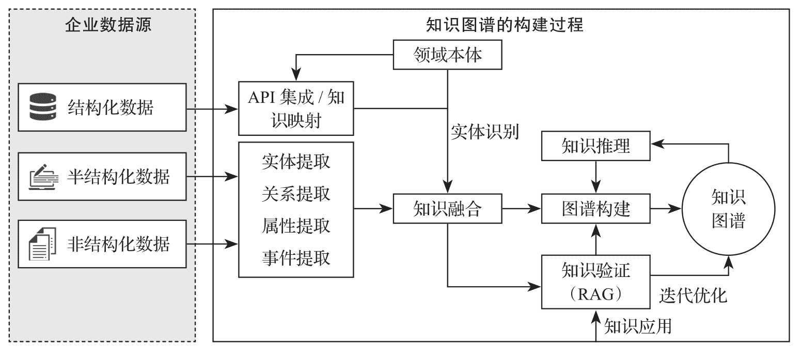

图 6-6 知识图谱的构建过程

3.图数据库引擎分析

对于存储和查询高度关联的研发数据，原生图数据库相比传统关系型数据库具有天然优势。其“无索引邻接”（Index-free Adjacency）特性使得在数据关系遍历上极为高效，这对于供应链追溯或设计变更影响分析等任务尤为关键。

以下是对主流图数据库的比较分析，重点关注对制造业至关重要的指标。

**●Neo4j**：作为成熟的、用户友好的图数据库，非常适合于启动项目和处理中小型图模型。它使用 Cypher 查询语言。然而，在处理超大规模、分布式图时，其性能和可扩展性会面临挑战。

**●TigerGraph**：一款专为大规模并行处理（MPP）设计的高性能、分布式原生图数据库。在针对大规模、深链接（如超过 10 跳）分析的基准测试中，其性能通常远超竞争对手。它非常适合企业级的欺诈检测、供应链优化和复杂分析场景，使用 GSQL 查询语言。

**●JanusGraph**：一个开源、高可扩展的分布式图数据库，支持多种存储后端（如 Cassandra、HBase）。它提供了极大的灵活性，但需要更多的技术投入来进行部署和维护，使用 Gremlin 查询语言。

**●云原生选项（Amazon Neptune、Azure Cosmos DB）**：由云服务商提供的全托管服务，与各自的云生态系统深度集成。例如，Neptune 同时支持属性图（Gremlin、openCypher）和 RDF（SPARQL），具有很强的通用性。

与知识图谱的交互方式决定了其最终价值能否被用户有效获取。

**●形式化查询语言**：①SPARQL 是 W3C 为 RDF 图制定的标准查询语言 ^(⁶⁹)，功能强大且标准化，但语法较为烦琐；②Cypher/GQL 是声明式的、采用“ASCII-art”风格的查询语言（如（person）-->（city）），对许多开发者而言更为直观。Cypher 源于 Neo4j，而 GQL 是新兴的 ISO 标准 ^(⁷⁰)。

**●迈向自然语言接口**：其最终目标是让工程师能够用日常语言提问。这需要一个“语义搜索”或“智能问答”层，将自然语言问题自动翻译成形式化的图查询语句（如 SPARQL）。这是知识图谱的核心应用场景之一，也是 LLM 与知识图谱融合的重点。

图数据库的选择是一项具有长期影响的关键架构决策。它是在易用性/成熟度（Neo4j）、原生性能/可扩展性（TigerGraph）和开源灵活性/复杂性（JanusGraph）之间的权衡。表 6-2 给出了主流图数据库的对比分析。对于大型制造企业而言，深层分析的性能和可扩展性至关重要。一个典型的制造业研发知识图谱将是庞大、复杂且需要深度多跳查询的（例如，“查找所有使用了某供应商的零部件的产品，而该供应商的母公司在过去 5 年内涉及过召回事件”）。基准测试表明，对于此类深链接查询，TigerGraph 这样的 MPP 架构比单机或优化不足的分布式模型快几个数量级。尽管 Neo4j 对于初期项目非常友好，但一个着眼于未来的企业级系统必须建立在一个能够应对未来规模和复杂性而不会遭遇性能瓶颈的平台上。因此，图数据库的选择决策应基于概念验证（PoC），用第一阶段识别出的最高价值、最复杂的“能力问题”来对候选数据库进行压力测试。

**表 6-2 主流图数据库的对比分析**

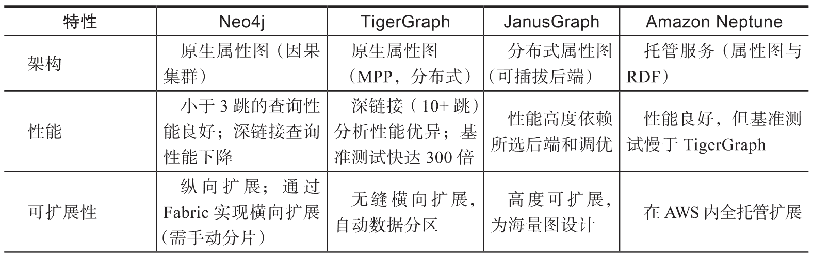

（续）

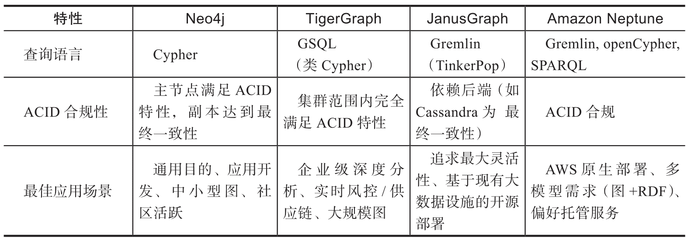

总之，数据/知识层是企业实现数据驱动和智能化转型的基石。一个构建良好的数据/知识层，能够打破数据孤岛，确保数据质量，沉淀业务知识，并最终赋能上层的 AI 模型和应用，使其能够做出更精准、更智能的决策。没有这一层，AI 应用就如同空中楼阁，难以发挥真正的价值。

## **6.6 模型服务层：工业机理的算法载体**

模型服务层是现代机器学习和 AI 平台架构中的核心组件，它扮演着 AI 能力调度中心的角色。其根本任务是将在开发环境中训练好的 AI 模型，转化为稳定、高效、可管理、可被上层业务应用便捷调用的在线服务。没有这一层，模型就只是一个存在于实验室里的静态文件，无法产生实际业务价值。

### **6.6.1 模型开发框架与协作环境**

模型服务层必须为 AI 开发团队提供一个高效、协作的模型开发环境。这通常包括以下内容。

**●模型开发框架**：指企业为规范化、标准化、高效化 AI 模型生产过程而建立的一整套工具、流程与最佳实践。它像一条“模型的工业化流水线”，无缝支持业界主流的机器学习框架，如 TensorFlow 和 PyTorch，以及常用的编程语言 Python。这确保了企业可以利用最广泛的开源工具和社区资源。

**●协作开发环境**：为 AI 开发团队提供的、集成了上述开发框架的统一工作空间，旨在通过提供交互式集成开发环境、深度集成的 Git 版本控制、共享的计算与数据资源池，以及中央模型注册表和知识库来打破单兵作战模式。该环境利用容器化技术确保了开发、测试与生产环境的一致性，最终提升了团队的协作效率、资源利用率以及模型开发的可复现性。

在模型开发框架层面，TensorFlow 和 PyTorch 是当今业界两大主导性的深度学习框架。

TensorFlow 由 Google Brain 开发，于 2015 年发布，旨在处理可扩展的生产级机器学习工作流程 ^(⁷¹)。它源于 DistBelief 等内部工具，现已成为企业环境中的首选平台。TensorFlow 的最大优势在于拥有一个成熟、强大且端到端的生产部署生态系统。TensorFlow 的核心组件包括：①TensorFlow Extended（TFX），提供了一个完整的、用于部署生产级 ML 管道的平台；②TensorFlow Serving，专为生产环境设计的高性能模型伺服系统；③TensorFlow Lite，用于在边缘和移动设备上部署模型，这对在机器端直接运行 AI 至关重要；④TensorBoard，强大的可视化工具，帮助开发者理解和调试模型训练过程。

TensorFlow 一直被认为是更适合大规模生产部署的选择。

PyTorch 是由 Meta（前 Facebook）的人工智能研究实验室（FAIR）于 2016 年推出的 ^(⁷²)，以 Torch（基于 Lua 的库）的概念为基础，但利用 Python 来提高可访问性和易用性。其优势在于灵活性、与 Python 语言的深度融合以及在学术研究界的统治地位。其核心优势如下。

**●动态计算图**：使得模型的构建和调试过程更加直观和灵活，尤其适合复杂的模型结构。

**●强大的生态系统**：与 Python 数据科学生态无缝集成，并且是 Hugging Face Transformers 等前沿 NLP 和生成式 AI 库的首选框架。

**●TorchScript 与 ONNX**：提供了将模型导出为高性能、可部署格式的机制，弥补了其在生产部署方面的早期短板。

**●压力测试**：使用最复杂的“能力问题”来对候选数据库进行压力测试。

表 6-3 列出了 TensorFlow 与 PyTorch 的对比分析。

**表 6-3 TensorFlow 与 PyTorch 的对比分析**

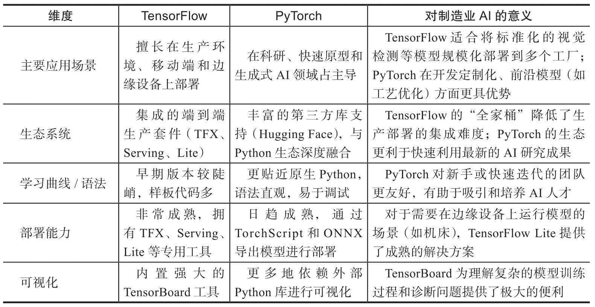

近年来，两大框架相互借鉴，功能差距逐渐缩小。例如，TensorFlow 引入了动态执行模式，而 PyTorch 也加强了其生产部署工具。因此，今天的选择更多地取决于团队的技术栈、生态系统偏好和具体的应用场景，而非根本性的能力差异。

总体而言，模型开发框架提供了“方法论和工具集”，而协作开发环境则提供了“工作空间和资源支持”。两者共同构成了模型服务层中至关重要的“开发域”，确保 AI 模型能够以一种工业级的、可信赖的、高效协作的方式被创造出来，然后无缝地交由服务层的“运维域”进行部署和管理。

### **6.6.2 模型的部署与服务化**

模型的部署与服务化是将一个训练好的、静态的模型，转变为一个能够产生持续业务价值的、动态的在线服务。这是一个将数据科学成果产品化的关键工程阶段。

1.统一的服务接口

为使用不同框架（如 TensorFlow、PyTorch 等）训练出的模型提供统一的 API 网关，即将模型封装为可被调用的服务接口（通常是 RESTful API）。这样做的好处是实现了模型与业务应用的解耦，上层应用无须关心模型的内部实现，只需按照标准格式发送请求即可获得预测结果。

根据业务场景对实时性的不同要求，通常有以下三种主流的部署模式。

（1）实时/在线推理

**●应用场景**：需要即时获得预测结果的场景，如人脸识别、机器视觉质量检测、实时推荐等。

**●工作方式**：模型被加载到服务器内存中，通过一个持久化的 API 端点随时等待请求。单个请求的响应速度（延迟）是关键衡量指标。

（2）批量推理

**●应用场景**：对海量数据进行周期性、非实时的处理，如每日用户画像更新、每周销售预测、每月客户分群等。

**●工作方式**：通过一个定时任务（如每晚执行）来启动，模型一次性处理一大批数据，并将预测结果存入数据库或文件系统。在此模式下，处理数据的总时长和效率（吞吐量）比单次延迟更重要。

（3）边缘部署

**●应用场景**：在需要超低延迟、网络不稳定或注重数据隐私的终端设备上运行模型，如智能工厂的摄像头质检、自动驾驶汽车的环境感知、现场维修的智能服务终端等。

**●工作方式**：需要对模型进行轻量化处理，然后部署到物联网设备、手机等资源受限的硬件上，直接在数据产生的源头进行计算。

实现上述功能，离不开现代化的基础设施和技术，包括以下内容。

**●容器化**：将模型及其所有依赖（库、配置）打包成一个标准的、可移植的容器镜像。这解决了“在我的机器上能跑”的环境不一致问题。

**●容器编排**：自动化地管理、扩展和调度成百上千的模型服务容器。Kubernetes 能够实现服务的自动扩缩容、故障自愈和负载均衡，是当前大规模部署 AI 服务的行业标准。

2.模型服务框架

模型服务框架是构建在 Kubernetes 之上的专用框架，为模型服务提供了更高级的功能，如开箱即用的部署模式、多模型编排、解释性等，进一步简化了部署流程。

模型的部署与服务化是一个系统性的工程，它综合运用多种部署模式、更新的策略和底层技术，将模型从一个算法产出，转变为一个可被企业依赖的、高可用、可扩展且易于管理的 AI 服务，是实现 AI 价值闭环的“最后一公里”。

### **6.6.3 模型的生命周期管理与治理**

模型不是一次性的产物，需要对其整个生命周期进行有效管理。这部分功能通常由 MLOps（机器学习运维）平台来支撑。

1.MLOps 的核心特征

MLOps 是将 DevOps 原则应用于 AI 领域的实践体系，是一套融合了机器学习（ML）、软件开发（Dev）和 IT 运维（Ops）的最佳实践，旨在解决机器学习模型从开发到生产环境部署的生命周期管理问题。MLOps 的核心是解决 AI 应用中普遍存在的“试点困境”，即数据科学家在孤立的试验环境中开发出的模型，往往难以在复杂的生产环境中成功部署、稳定运行和持续维护。在制造业中，这意味着一个模型不仅要在测试环境上表现良好，更要能在 7×24h 运行的生产环境里，面对真实、嘈杂的数据，持续不断地创造价值。

MLOps 的实践之所以比传统 DevOps 更复杂，是因为它需要同时管理三个动态变化的实体：代码（Code）、模型（Model）和数据（Data）。传统 DevOps 主要关注代码的生命周期管理。但在 MLOps 中，这三者相互交织、相互影响：数据的变化（如增加新的参数点）可能要求模型重新训练，即便算法代码未变；算法代码的更新也需要重新训练模型；而模型本身作为一个二进制产物，也需要被版本化管理和控制。这种独特的“三体问题”，正是 MLOps 引入“持续训练（CT）”等新概念的原因，也解释了为何企业不能简单地将现有 CI/CD 工具直接套用在 AI 项目上，而必须构建一个能够理解并自动化这个复杂三元生命周期的专属 MLOps 平台。

MLOps 的核心在于持续性，它将 AI 模型的生命周期变成一个自动化的、不断迭代优化的闭环。

**●持续集成（CI）**：不仅自动化代码的构建和测试，更重要的是自动化数据和模型的验证。确保新的数据或模型版本不会破坏现有系统的稳定性。

**●持续交付（CD）**：自动化地将通过测试的、训练好的模型打包并部署为可供调用的预测服务。

**●持续训练（CT）**：这是 MLOps 区别于传统 DevOps 的关键。由于企业研发/制造环境是动态变化的（如更换零件、调整工艺、设备老化等），模型的性能会随着时间推移而下降（即“模型漂移”或“数据漂移”）。CT 机制能够监控模型表现，一旦发现性能下降，就自动触发再训练流程，使用最新的数据更新模型，确保其预测的准确性。

**●持续监控（CM）**：实时监控模型的在线性能（如预测延迟、吞吐量）、预测结果的准确性、输入数据的质量以及模型对业务 KPI 的实际影响。

为了支撑这个闭环，MLOps 平台通常包含一些核心组件，如用于统一管理和复用模型特征的特征库、用于对模型进行版本控制和治理的模型注册中心，以及用于记录和比较所有模型训练过程的试验跟踪系统。

2.模型部署策略

**●A/B 测试**：支持同时部署多个模型版本（如新旧两个版本），将部分流量分配给新模型，通过对比其在线性能来决定是否全面上线。

**●蓝绿部署/金丝雀发布**：支持平滑、低风险地进行模型更新，先将新模型部署到一小部分服务器（金丝雀）上，验证无误后再逐步推广到全量。

**●安全与合规**：提供精细的权限控制，确保只有授权的应用或用户才能调用模型服务。同时记录所有调用日志，满足审计和合规要求。

3.开源 MLOps 工具分析

在开源 MLOps 领域，Kubeflow 和 MLflow 是两个非常著名也是常被比较的工具。它们代表了两种不同的实现哲学，其选择直接影响到平台的复杂度和团队的工作方式。

**●Kubeflow**：是一个构建在 Kubernetes 之上的、全面的、端到端的 ML 平台 ^(⁷³)。它的核心优势在于强大的编排能力和可扩展性。Kubeflow 允许用户定义和执行复杂的多步 ML 工作流，并能充分利用 Kubernetes 的资源调度和弹性伸缩能力，非常适合大规模、计算密集型的任务，如分布式训练和大规模超参数调优。

然而，它的缺点也同样明显，即具有极高的复杂性。部署和维护一个完整的 Kubeflow 环境需要深厚的 Kubernetes 专业知识，学习曲线陡峭，对于没有专门平台团队的组织来说是一个巨大的挑战。

**●MLflow**：是一个相对轻量级的平台，其核心功能集中在试验跟踪、模型打包和模型注册 ^(⁷⁴)上。它的设计理念是与开发者现有的工具和流程松散耦合，而不是提供一个包罗万象的基础设施。这使得 MLflow 非常容易上手和集成，数据科学家只需在他们的代码中加入几行日志记录代码，就可以开始跟踪试验。它的弱点在于其自身的编排能力有限，通常需要与其他工具（如 Airflow 或 Kubeflow）结合使用来构建完整的端到端管道。

在制造业的实际应用中，选择哪种工具取决于组织的成熟度和需求规模。一个刚起步的团队，专注于为单一生产线开发第一个预测性维护模型，可能会从 MLflow 的简单性中获益匪浅。而一个大型跨国制造企业，希望为其全球所有的业务部门或工厂构建一个统一的、可扩展的 AI 平台，此时更需要 Kubeflow 提供强大的编排和基础设施管理能力。

值得注意的是，许多成熟的 MLOps 实践最终会走向一种混合模式：利用 Kubeflow 作为底层的、强大的管道编排引擎来执行任务，同时利用 MLflow 作为上层的、用户友好的界面来跟踪试验和管理模型资产。这种方式结合了两者的优点，是构建企业级 MLOps 平台的理想策略。特别是对于需要大量 GPU 资源的 LLM 应用，Kubeflow 在硬件资源管理方面的原生优势变得尤为重要。

MLOps 并非一个可选的“附加项”，而是成熟制造业 AI 平台的核心能力。它将 AI 从一种手工艺式的探索，转变为一种可重复、可度量、可扩展的工业化生产过程。没有 MLOps，企业将无法跨越从“原型验证”到“规模化应用”之间的鸿沟，AI 投资的回报也将遥遥无期。

### **6.6.4 模型性能监控与优化**

模型上线后，其表现需要被持续监控，以确保其服务质量和预测效果。

**●服务性能监控**：实时监控模型的运行状态，包括以下几方面。①延迟，每次预测请求的响应时间；②吞吐量：单位时间内能够处理的请求数量；③错误率：服务调用失败的比例；④资源利用率：CPU/GPU 的使用情况、内存占用等。

**●模型效果监控**：①数据漂移（Data Drift），监控线上实际接收到的数据分布是否与训练时的数据分布发生显著变化。②概念漂移（Concept Drift），监控数据特征与预测目标之间的关系是否发生变化（例如，新技术更新迭代后，市场需求发生了变化）。③模型衰退（Model Decay），当发生漂移时，模型的预测准确率会下降。通过持续监控模型在线上的预测准确率、召回率等指标，可以判断模型是否需要重新训练。④自动优化，根据性能监控数据，平台可以进行自动化操作，如自动扩缩容（根据流量大小增减服务器实例）、自动触发模型再训练（当检测到显著的性能衰退时）等。

总而言之，模型服务层是一个复杂的系统工程，它将数据科学的产出（模型）与软件工程的纪律（运维、监控、治理）相结合，是连接 AI 研发与业务应用之间至关重要的“最后一公里”，也是实现 AI 规模化、可靠化、产业化落地的核心基础设施。

## **6.7 Agent 编排层：任务协同与流程自动化**

Agent 编排层是平台中 AI 编排能力的核心组成部分，位于模型服务层之上。它依托于一个多 Agent 管理平台，其主要作用是组织和协调多个 AI Agent 进行协作。通过对 Agent 进行有效的编排，使得它们能够协同利用各种工具（如调用 PLM、ERP 等系统的数据服务），以完成复杂的 AI 应用任务，如变更影响分析或工艺参数优化等。

Agent 编排层是实现制造业复合式 AI 系统的关键，它好比一个“AI 项目经理”或“交响乐指挥家”。其核心任务是协调和管理多个具有不同专长和工具的 AI Agent，让它们能够协同工作、分配任务、构建工作流，并解决冲突，以确保能够无缝地共同解决跨领域、多步骤的复杂问题。

Agent 编排层是连接单个 Agent 能力与宏观业务目标的桥梁。它将一系列独立的、专用的 Agent（例如，负责数据分析的 Agent、负责流程控制的 Agent、负责客户沟通的 Agent）整合为一个有凝聚力的、高性能的系统。它超越了简单的 Agent 间的聊天或消息传递，提供了一套完整的机制来规划、执行和监控复杂的多阶段工作流。正是 Agent 编排层的出现，才使得构建能够应对制造业等领域系统性挑战的、真正智能的应用成为可能，为组合多个专业 Agent 以形成整体解决方案提供了可行的框架。

多 Agent 系统（MAS）是实现这一切的枢纽，它提供了 Agent 运行所需的一切基础能力，我们在第五章已经有详尽的介绍，这里不再赘述。

### **6.7.1 Agent 编排的核心：工作流管理**

Agent 工作流关注的是如何设计、执行、监控和优化由多个 AI Agent 协作完成的复杂任务流程。一个完整的 Agent 工作流管理系统通常包含以下几个核心部分。

1.工作流设计与定义

这是工作流的起点，即规划作战方案。

**●可视化编排器**：提供一个拖动式的界面，允许开发者或业务分析师通过连接不同的“功能节点”来定义一个工作流的模板。每个节点都可以是一个 Agent、一个特定的工具调用，或是一个逻辑判断（如 if/else）。

**●代码化定义**：也支持通过代码（如 Python）来定义工作流。这种方式更灵活，并且易于进行版本控制，是更专业的实践。

**●Agent 与工具注册表**：系统需要一个中央注册表，用于管理所有可用的 Agent 及其能力（即它们能调用哪些工具/API）。这就像一个“技能库”，供工作流设计时选用。

2.计划与调度引擎

这是工作流的大脑，负责在运行时将一个抽象的目标转化为具体的执行计划。

**●动态规划**：与传统工作流的静态路径不同，Agent 工作流的计划引擎会根据用户的具体请求，从工作流模板出发，动态地生成一个执行计划。这个计划通常是一个有向无环图（DAG），明确了任务的执行顺序和依赖关系。

**●资源调度**：根据任务的需要和优先级，智能地分配计算资源（CPU/GPU），并决定何时启动 Agent。

3.执行引擎

这是工作流的心脏，负责驱动整个流程的运转。

**●任务执行**：按照计划的顺序，一步步地调用相应的 Agent 或执行指定的任务。

**●工具调用**：当 Agent 需要与外部系统交互时，执行引擎会安全地调用已注册的工具（API），并将结果返回给 Agent。

**●并发与并行处理**：对于计划中没有依赖关系的多个任务，执行引擎能够并行处理，以最大化效率。

4.状态管理器

这是工作流的记忆中心，负责跟踪和记录整个流程的上下文信息。

**●状态跟踪**：跟踪记录每个任务的实时状态（如等待中、运行中、已完成、已失败）。

**●中间结果传递**：为 Agent 之间的协作提供一个共享工作区。前一个 Agent 执行任务的输出结果会保存在这里，供后一个 Agent 作为输入使用。这确保了信息在整个工作流中的顺畅流转。

5.监控与日志记录

这是确保工作流稳定、透明和可追溯的仪表盘。

**●实时监控仪表盘**：可视化地展示当前所有正在运行的工作流实例，以及每个实例的执行进度和状态。

**●详细日志**：记录 Agent 的每一步思考过程、每一个决策、每一次工具调用及其返回结果。这对于调试失败的工作流至关重要。

**●性能分析**：统计工作流的平均执行时间、成功率、资源消耗以及各个环节的瓶颈，为后续的优化提供数据支持。

一个先进的 Agent 工作流管理系统还会包含以下方面。

**●人机协作接口**：在工作流的关键节点设置“暂停”点，等待人类进行审批、确认或提供额外信息，实现人机高效协作。

**●异常处理与自愈机制**：定义当某个步骤失败时的重试逻辑、回滚策略或替代方案（例如，如果 A 方案的 API 超时，则自动切换到 B 方案的 API），提升工作流的健壮性。

Agent 工作流管理提供了一整套从设计、执行到监控的完整工具链，它将 Agent 编排这一抽象理念，落地为具体、可见、可管理、可优化的工程化实践，是构建企业级复杂 AI 应用不可或缺的基础设施。

常用的 Agent 工作流管理工具生态正迅速发展，其核心由 LangChain 这类提供模块化构建块的基础开发框架所主导，它为构建 AI Agent 奠定了事实标准。在其之上，涌现出更专注于多 Agent 协作的专业框架：微软 AutoGen 擅长构建可通过对话解决问题的“AI 群聊”，而 CrewAI 则让定义和编排角色扮演的“AI 小队”变得更加直观。与此同时，LlamaIndex 在构建能与复杂数据源深度交互的“数据 Agent”方面表现卓越。为降低使用门槛，Flowise AI 等可视化平台将这些强大的代码框架封装成拖动式节点，让非程序员也能快速搭建和部署 Agent 工作流，共同推动着 AI 从单一模型向协同解决问题的多 Agent 体系演进。

### **6.7.2 基于 Agent 的业务流程自动化**

Agent 编排与传统的工作流都是为了自动化和管理多步骤流程，但它们在核心思想、灵活性和智能程度上有着本质的区别。

简单来说，传统工作流是“按图施工”的装配线，而 Agent 编排是“按目标指挥”的特种部队。

表 6-4 从几个关键维度进行了详细对比。

**表 6-4 传统工作流与 Agent 编排对比分析**

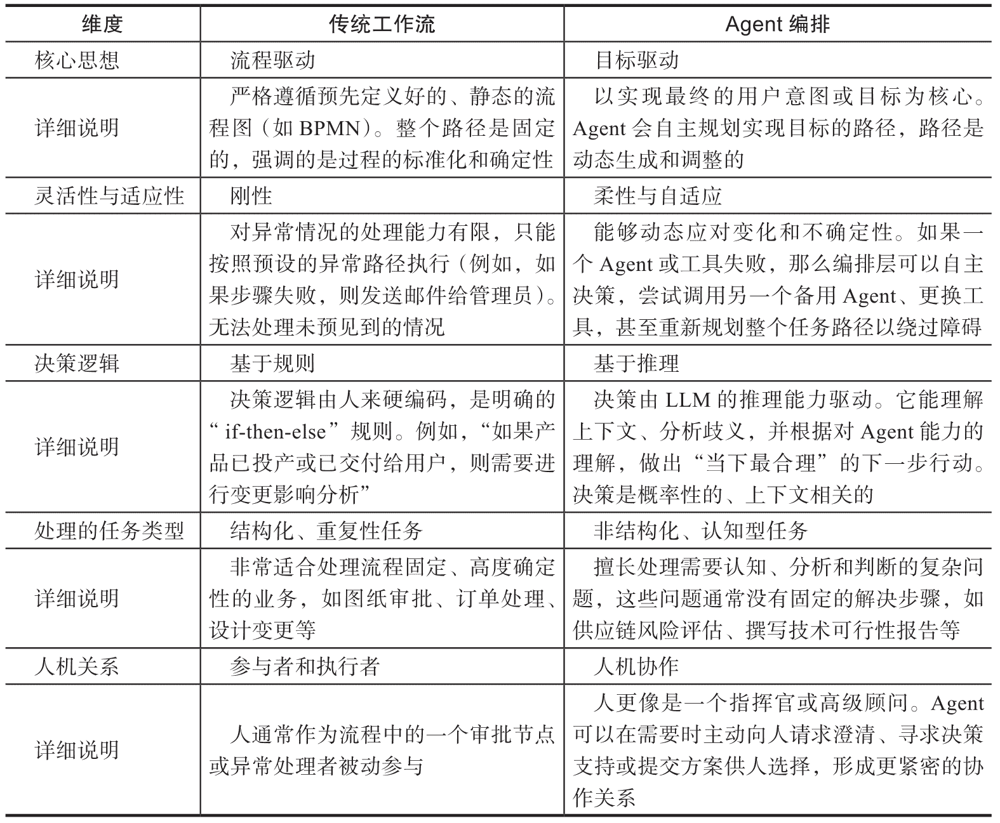

然而，当前 LLM 在制造业流程自动化应用中仍然面临着巨大的挑战和潜在风险，即推理准确率与流程复杂度的负相关性。这表明，在追求自动化和智能化转型的过程中，我们不能简单地将控制权完全交给 AI Agent 的自动推理，而必须构建一个基于顶层流程框架的人机协同、优化迭代的新模式。

1.核心挑战：AI 推理准确率与复杂流程的矛盾

目前，基于 LLM 的 Agent 推理的准确率能达到 95%左右，但当流程超过十步后，我们会发现其准确率将降低到不到 60%（即 95%¹⁰）。这揭示了 LLM 在处理复杂、多步骤、逻辑严密的工业流程时的“长尾问题”和“黑箱”特性。对于制造业而言，任何微小的误差都可能导致劣质质量成本（CoPQ）的急剧上升，甚至引发安全事故，因此对准确性的要求是极其致命的。

2.解决方案：顶层流程框架下的优化与迭代

AI 推理准确率与复杂流程矛盾的解决之道并非放弃 AI，而是在一个坚实的顶层流程框架的基础上，实现 AI Agent 的嵌入式、辅助式应用。这要求我们从以下几个方面进行优化和迭代。

（1）顶层流程框架规划：构建智能化的“业务蓝图”

这一模式首先要求企业进行顶层的业务架构规划，构建一个清晰的业务蓝图。这包括对端到端的业务价值流进行深入解构和建模，例如，将复杂的 OTD 流程拆解为多个可控、可验证的子流程。同时，通过平台化 AI 架构构建统一的数据基础和数字主线来作为“事实骨架”，确保 AI Agent 在流程的每一步都能访问到可信、单一事实来源的数据。这一框架不仅解决了传统研发中数据断链的问题，也为 AI Agent 提供了稳固的运行环境。

（2）业务流程解耦：实现智能与个性化

在顶层流程框架的指导下，AI Agent 的应用将从通用的、不可靠的自动推理，转变为基于特定场景和领域的智能优化及个性化调整。

**●业务流程解耦**：我们将复杂的端到端流程分解为多个可控、可验证的子流程，每个子流程都由一个高度优化的场景化、领域驱动的 Agent 来处理。例如，在产品研发中，一个 Agent 可以专注于生成式设计，提供多种设计方案；另一个 Agent 则专注于结构化需求的自动生成。这种方式显著降低了单个 Agent 的推理复杂度，提高了准确率。

**●人机协同的优化模式**：在高风险、高复杂度的环节，AI Agent 的角色应被定位为智能助手，而非完全的自动决策者。它提供基于领域真知的建议和预测（如代理建模），但最终决策权仍由具备专业知识和经验的人类工程师把控。

**●迭代优化与持续进化**：这一模式通过建立后向通道和迭代优化引擎，将 Agent 的推理结果与实际的业务数据进行比对。AI Agent 的持续学习和优化，将使得其准确率随着时间的推移而逐步提升。这种模式将实现产品研发过程的持续创新和 AI 增强的创新引擎的范式跃迁。

总结来说，Agent 编排层通过任务分解、Agent 分配、计划执行、通信管理和结果合成，将一系列独立的 AI 工具和专家模型，组织成一个能够自主规划、协同作战的“AI 团队”。这使得 AI 平台能够从执行“单点指令”的工具，升级为解决“端到端复杂流程”的智能解决方案。

## **6.8 AI 应用层：场景价值的实现终端**

这一层是整个分层架构的最顶层，也是 AI 平台价值的最终体现。它直接面向最终用户（如工程师、采购员、管理者、客户等），将底层复杂的模型、数据和算力，封装成解决具体业务问题的、易于使用的软件功能或应用，并深度融入业务流程，从而创造可衡量的商业价值。

### **6.8.1 AI 应用的主要形态与分类**

根据 AI 应用的功能和与用户的交互模式，AI 应用通常可以分为以下几类。

1.交互式 AI 助手/AI Chat

这类应用是 AI 平台能力的集大成者，它提供了一个统一的、对话式的入口，让用户可以通过自然语言与企业的所有数据、系统和 AI 能力进行交互。它不仅是一个问答机器人，而且还是一个能够理解复杂意图、执行多步任务并与用户协同工作的“数字同事”或“领域专家副驾驶（Copilot）”。

传统 Chatbot 通常被设计用来回答预设范围内的常见问题（FAQ），其交互是一问一答式的，无法处理范围外或复杂的请求。而交互式 AI 助手则是任务和目标的完成者。用户可以提出一个高层次的目标，AI 助手会自主地进行规划、调用工具并整合信息，最终完成任务。

交互式 AI 助手是 AI 技术在企业应用中的终极形态之一。它通过一个极其简单自然的对话界面，将底层复杂的数据/知识层、模型服务层和 Agent 编排层的能力整合并交付给最终用户。它正在重新定义人与企业软件的交互方式，将过去的“人适应软件”转变为“软件适应人”，极大地降低了获取信息和执行任务的门槛，从而赋能每一位知识工作者。

在研发环节，它作为设计副驾驶，通过跨系统调用 PLM、质量数据库实现复杂查询（如关联零件与维修记录）；在生产现场，化身运维顾问，实时分析 MES 与设备数据定位效率瓶颈（如精准诊断 OEE 下降根源）；在供应链领域，担任风险分析师，整合地缘政治、气象信息、SRM 及 ERP 数据，以预测供应风险并制定应急方案；还可以化身为复杂工业软件的操作指导员，结合软件功能和操作手册，基于设计上下文，指导设计师一步一步完成复杂的设计任务。

交互式 AI 助手的核心价值在于将碎片化工业数据转化为主动决策能力，通过自然语言交互实现“人类提问-AI 执行-结果洞察”的闭环，推动制造业从经验驱动向数据智能驱动的范式跃迁。

2.内容生成类 AI 应用

这类应用的核心是创造而非分析。与从现有数据中提取洞察信息或进行预测的分析型 AI 不同，内容生成类 AI 应用能够基于学习到的模式和知识，创造出全新的、符合特定要求的内容。这些内容可以是文本、代码、图像、音频、视频，甚至是三维模型和分子结构。

内容生成类 AI 应用主要包括以下三种形态。

**●智能创作助手**：作为人类专家的“副驾驶”或“灵感激发器”，辅助完成创造性工作，极大地提升效率和质量。

**●内容生成引擎**：根据指令，端到端地、自动化地生成所需内容。

**●合成数据生成器**：根据指令输入，创造出逼真的数据，用于训练其他 AI 模型或进行仿真测试。

内容生成类 AI 应用正在成为制造业数字化转型中最具颠覆性的力量之一。它不仅能通过自动化提升效率，更能通过“创造”能力，在产品创新、工艺优化和知识传承等核心领域，为企业带来前所未有的想象空间和竞争优势。在产品设计端，它通过创成式设计突破人类想象力边界，自动生成最优结构方案，并为 CAE 仿真软件自动编写分析脚本；在生产环节，智能生成图文工艺规程，并通过合成数据解决质检样本稀缺难题；在营销服务领域，动态生成个性化技术文档与客户定制内容；在运维培训中，实时生成故障维修指南并创造虚拟培训场景。这一技术将制造业核心环节从”经验驱动”升级为”数据创生驱动”，使 AI 从辅助工具进化为创新引擎，实现全价值链的智能再造。

3.流程自动化应用

流程自动化的核心目标是利用 AI 技术，将过去需要人工执行的重复性的、基于规则的，尤其是需要一定认知判断的业务流程，进行端到端的自动化，从而大幅提升效率、降低成本、减少人为错误，并将人力解放出来来从事更具创造性和战略性的工作。

4.智能决策支持系统

智能决策支持系统的核心目标不是替代人类做决策，而是通过提供深刻的洞察、精准的预测和科学的建议来增强人类专家的决策能力，帮助他们更快、更准、更全面地做出高质量的决策。

智能决策支持系统通常表现为智能驾驶舱、高级分析平台或推荐引擎。它们能够整合海量数据，利用 AI 模型发现数据中的模式、预测未来趋势，并以可视化的方式呈现给用户。例如，一个制造业的“供应链风险驾驶舱”，它能实时分析全球新闻、物流数据和供应商信息，预测某个零件可能出现的断供风险，并以高亮和预警的形式提醒采购经理。

### **6.8.2 AI 应用层的关键设计原则**

一个成功的 AI 应用，不仅要有强大的 AI 内核，而且需要进行优秀的产品设计。

1.以用户为中心

在 AI Agent 的设计中，以用户为中心是一个核心原则。这不仅意味着 Agent 需要理解用户的需求，而且要求其设计能无缝融入用户的工作流程和习惯，真正成为用户的智能伙伴。

**●理解用户角色与场景**：AI Agent 的设计必须从用户的角度出发，深入理解其角色、职责和工作场景。例如，面向专业工程师的“效率类 Agent”侧重于自动化和增强其在特定领域的专业任务，如设计优化或数据分析。而面向管理层的“运营类 Agent”则更注重提供跨组织、端到端的宏观洞察和决策支持。

**●人机协同与信任构建**：以用户为中心的设计要求 Agent 不应是取代用户的“自动决策者”，而应是辅助用户的“智能助手”。特别是面对复杂、高风险的工业流程时，AI Agent 的推理准确率可能受限。因此，Agent 需要提供透明且可解释的推理过程，让用户能够理解其建议，并最终做出可靠的决策，从而构建人机之间的信任。

**●无缝集成与流程优化**：一个优秀的用户中心 AI Agent 能够无缝集成到用户现有的工作流程和工具中，减少用户的学习成本和操作负担。Agent 的设计旨在消除流程中的摩擦和低效环节，提升端到端的业务流程效率，而不是引入新的复杂性。

由此可见，AI Agent 设计中的以用户为中心，是确保技术能够真正服务于人、赋能于人的核心思想，也是实现 AI 在企业中成功落地与转型的关键。

2.可解释性与可信赖性

针对 AI 的“黑箱”问题，需要引入可解释 AI（XAI）技术，使得 AI Agent 的推理过程和结果变得透明和可追溯，以建立用户的信任。这对于制造业的质量追溯和合规性审查至关重要。例如，之所以推荐 B 供应商，是因为数据显示其过去一年的准时交付率最高。

3.场景化与领域驱动

应用必须深入具体的业务场景，使用该领域用户的专业语言，解决该领域的特定问题。场景化意味着将 AI Agent 的应用范围限定在特定、边界清晰、任务明确的业务场景中。通过将一个复杂的端到端业务流程（如 OTD）分解为多个可控的、独立的子任务，每个任务都由一个高度优化的场景化 Agent 来处理，可以显著提高整体准确率和可靠性。领域驱动意味着 Agent 的智能必须根植于深厚的、专业的行业知识。这为 Agent 提供了可信的“事实骨架”，有效避免了 LLM 的“幻觉”问题，确保推理的准确性和权威性。通过将复杂的业务流程分解为可控的子任务，并用深厚的领域知识武装 Agent，我们可以有效规避 AI 推理准确率不足的风险，将 AI Agent 从一个不稳定的“魔法”，转换为一个在特定领域高效、可靠的智能助手。

4.构建迭代优化引擎

即使是低准确率的 Agent，其输出也不是无用的。通过建立后向通道和迭代优化引擎，我们可以将 Agent 的推理结果与实际的业务数据进行比对，将误差信息回传给 AI 模型进行持续学习和优化。这使得 Agent 的准确率能够随着时间的推移而逐步提升，最终达到可信赖的水平。

总结来说，AI 应用层是连接尖端 AI 技术与实际业务需求的桥梁。它的核心挑战在于，如何将底层模型强大的“认知智能”，巧妙地封装成能够无缝融入用户工作流、真正解决问题并创造价值的“产品智能”。

# **第七章**

# **研发范式跃迁：AI 赋能的全链路变革**

传统的制造业研发范式，是一种线性推进、阶段彼此割裂且高度依赖个人经验与隐性知识的流程。它如同层级化的军事指挥链，从市场需求、详细设计、仿真测试到生产导入，指令需逐级传递，环节间存在明显的壁垒和信息损耗。而 AI 的深度融入，正将这一范式重构为智能化的作战指挥中心——通过数据实时贯通、模型驱动的高效协同与智能动态决策，实现全链路的敏捷协同与闭环优化。在 AI 驱动的研发范式下，AI 不再仅仅是单一环节的辅助工具，而是作为关键驱动力，贯穿于产品从概念到发布的整个生命周期，引领着一场全链路的研发范式转型。这场变革的核心在于将 AI 技术与系统工程、软硬件工程、敏捷开发等领域深度融合，实现更高效、更智能、更协同的创新过程。

## **7.1 AI 赋能的研发范式跃迁**

基于前述的平台化 AI 分层架构，我们需要重新审视传统的企业研发范式。该架构不再是提供零散的“点状”工具，而是从根本上重塑了研发的流程、方法和协作模式，推动其向更智能、更高效的范式跃迁。

### **7.1.1 AI 赋能的研发范式跃迁：流程重塑、方法升级和协作变革**

具体而言，研发范式跃迁体现在以下几个方面。

1.流程重塑：从线性割裂到闭环整合

传统的研发流程往往是分段、线性的，例如从需求管理到系统工程，再到具体的软硬件及结构设计，环节之间存在重重壁垒，信息传递效率低下，导致返工和大量资源浪费。

新的 AI 赋能范式则打破了这些壁垒，通过构建高度协同和一体化闭环的研发流程体系，将产品规划、开发、验证、制造乃至供应链形成动态、迭代的闭环。

**●设计与制造的深度协同**：在产品开发过程中，设计部门与制造部门之间建立了超越传统串行流程的紧密、实时、双向的合作关系。这种协同旨在打破两部门间的“信息孤岛”和“职责边界”，确保产品在设计之初就充分考虑其可制造性、成本效益和生产效率，从而缩短上市时间，降低生产成本，提升产品质量并加速创新。AI 驱动的智能工艺规划可实时根据设计优化制造流程，确保设计意图的精确落地。

**●设计与服务工程的融合**：AI 使服务性设计（Design for Serviceability）和可维护性设计（Design for Maintainability）成为可能。通过分析历史服务数据和客户反馈，AI 能将产品在生命周期中的服务需求和用户体验痛点反向反馈到产品设计阶段，确保产品从源头就具备更好的可服务性，并优化用户生命周期体验。

**●一体化闭环管理**：AI 作为连接所有环节的“神经中枢”，整合产品从市场需求、概念、设计、仿真、制造、交付、运营到服务的生命周期数据。通过实时数据采集和分析，AI 能够驱动智能反馈闭环，举例如下。①质量合规闭环：制造和服务中的质量问题及缺陷，通过 AI 分析后，能以结构化的洞察形式迅速反馈给设计团队以进行迭代改进。同时，AI 能实时监控设计和生产过程是否符合最新的法律法规及行业标准，并自动预警和辅助纠正，确保全程合规。②性能数据优化：产品在实际运行中的性能数据，经过 AI 分析后，可用于优化未来设计，或通过数字孪生（Digital Twin）技术进行预测性维护和远程优化。

2.方法升级：从经验驱动到数据智能

传统的研发在很大程度上依赖于工程师和科学家的经验、直觉和反复的物理试验。

现在，AI 架构通过对全链路数据的分析，使研发范式从这种经验驱动转向了数据智能驱动，为每一个阶段提供智能支持，主要表现在以下几方面。

**●海量数据洞察与知识提炼**：AI 能够聚合和分析来自研发各个阶段的海量异构数据，包括市场需求、设计参数、仿真结果、制造过程数据、产品运行数据、服务反馈，乃至非结构化的文档、报告及日志。通过机器学习、自然语言处理等技术，AI 能从中挖掘出隐藏的模式、趋势和因果关系，提炼出有价值的知识和洞察，这是人类专家难以在同等时间内全面完成的。

**●设计过程自动化与智能化**：在产品设计阶段，通过集成 AI、数据分析、自动化工具和先进的计算技术，实现设计任务的自动化、设计决策的智能化，以及设计流程的优化与加速。其目标是提升设计效率，降低成本，优化产品性能，加速创新并更好地满足用户需求。例如，在需求设计阶段，自动识别用户痛点和潜在需求，并将其转化为结构化的设计输入；在详细设计阶段，根据产品性能要求、成本、环境影响和制造工艺，智能推荐最合适的材料，并预测其在特定应用中的表现；在测试阶段，通过 AI 实现整车集成测试的自动化与智能化等。

**●预测性研发**：AI 不再仅仅是分析过去，更重要的是预测未来。无论是预测潜在的市场需求、设计缺陷、制造瓶颈，还是服务故障，AI 都能提供前瞻性的指引，让研发从被动响应变为主动预测和预防。

3.协作变革：从部门协同到价值链端到端协同

传统的部门协同模式侧重于企业内部各职能部门之间的协作，如研发、生产、销售、营销和客户服务。这种模式虽然在一定程度上提升了内部效率，但存在以下局限性。

**●信息孤岛**：各部门往往拥有独立的系统和数据，导致信息传递不畅，难以形成统一的产品/客户视图。

**●流程僵化**：部门间的协作通常通过固定的工作流和审批链完成，缺乏灵活性，难以快速响应市场变化。

**●职能边界**：各部门只关注本部门 KPI，容易产生各自为政的心态，忽视跨部门的整体优化。

**●被动响应**：问题因部门壁垒难以早期暴露，往往在部门间流转后才被发现，导致效率低下与成本增加。

AI 赋能的平台化架构则构建了一个统一的数字化底座，助力企业贯通内部壁垒、融合外部生态，以数据为脉络，以技术为引擎，打造高度透明、实时响应、价值共创的智能协同体系。这种深度协同机制将显著提升市场响应敏捷性与资源整合效能，最终为客户提供前所未有的价值和体验。其本质在于构建以数据流驱动、价值创造为核心的协同网络，实现端到端动态优化与全链路可视化。

### **7.1.2 AI 赋能的研发范式跃迁的本质：Agent 调用设计能力**

AI 赋能研发范式跃迁的本质，在于 AI Agent 能够调用多少设计能力，以及这些能力的调用是何种程度的自动化和智能化。这不仅仅是工具的升级，而是在一个顶层流程架构的支撑下，通过 AI Agent 的编排和协作，实现从传统研发到 AI 增强的创新引擎的根本性转变。

1.顶层流程架构规划

研发范式跃迁的基础在于顶层流程架构规划，它为 AI Agent 的应用提供了清晰的“业务蓝图”。这一架构规划遵循业务（B）、组织（O）、流程（P）和技术（T）四大体系，旨在将企业战略与技术蓝图进行对接。

**●数字化能力建模**：参考第三章介绍的数字能力层构建的设计能力组件库，通过能力架构、能力建模和能力部署三个步骤，将抽象的业务需求转化为可封装、可调用的数字化能力。

**●平台化 AI 与数字主线**：建立平台化 AI 架构，为 AI Agent 提供统一的技术底座。同时，构建贯穿研发全流程的数字主线，确保设计、制造和质量各阶段数据成为可信的“单一事实来源”。这为 AI Agent 提供了准确、完整的数据支持，有效规避了其在复杂流程中推理准确率下降的风险。

2.创新研发范式

在顶层流程框架的指导下，AI Agent 能够以全新的方式重构研发流程，实现从串行及经验驱动到并行及数据驱动的范式跃迁。

AI Agent 的核心价值在于其作为“能力编排者”，能够根据任务需求，在研发能力中心和研发知识图谱中动态调用各种设计能力，这也是平台化 AI 与制造业业务深度融合的关键标志。这些能力包括但不限于以下几方面。

**●需求设计能力**：将客户需求转化为可量化的、结构化的设计指标。

**●结构设计能力**：自动化校核计算、方案设计和静力仿真等任务，大大缩短了传统的人工设计周期。

**●仿真与试验能力**：AI Agent 能够执行如应力分析或回转支承选型计算等复杂仿真任务，并生成相应的测试方案和测试大纲。

**●人机协同与智能优化**：这种新范式并非完全自动化的，而是一种人机协同的模式。AI Agent 作为专业工程师的“智能助手”，提供基于领域知识的建议和预测，而最终的决策和责任仍由人类专家把控。这既利用了 AI 的高效，又确保了流程的可靠性。

AI 赋能的研发范式跃迁如图 7-1 所示。

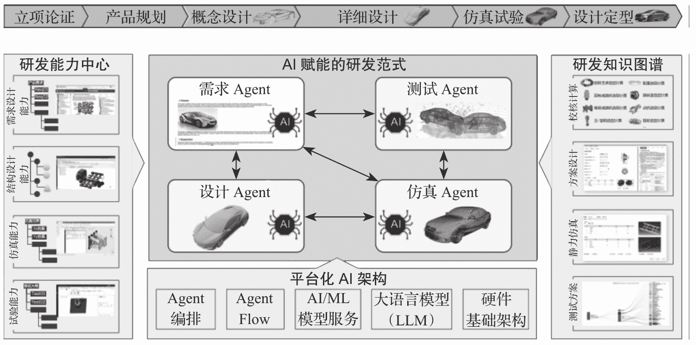

图 7-1 AI 赋能的研发范式跃迁

3.端到端解决方案

通过 Agent 编排，AI Agent 将原本分散、割裂的研发环节无缝连接起来，形成一个端到端的解决方案，覆盖从产品规划到设计定型的全生命周期。例如，需求 Agent 首先将产品需求转化为数字化的设计任务。随后，设计 Agent 根据任务自动进行方案设计，并驱动仿真 Agent 进行相应的静力仿真和校核计算。这种无缝衔接的自动化流程，将传统研发流程中不同阶段之间的时间和信息损失降至最低。在实际企业应用案例中，需求 Agent 还会细分为不同的 Agent，如需求导入 Agent、需求审核 Agent 等。

这一模式实现了从“自底向上”的经验驱动转向“自顶向下”的需求驱动正向设计，最终将企业战略愿景转化为可验证的商业价值，真正实现了产品研发过程的创新和范式跃迁。这种创新转型将颠覆传统的产品研发范式，打破其固有的职能壁垒、数据断链、流程僵化等结构性顽疾，具体体现为如下几个方面。

（1）数据流驱动的多专业实时协同与决策

在复杂的项目或产品开发中，不同专业领域（如机械设计、电气工程、软件工程、制造工程、仿真分析、试验验证等）的团队成员，通过共享和利用统一的、实时的、高流动性的数据流，实现跨专业、无缝的并行工作和智能决策。这种协同模式旨在打破传统专业壁垒，让所有相关方都能够基于最新、最准确的统一产品数据视图，进行高效的实时协同和智能决策，提升整体协作效率和创新能力。数据流驱动的多专业实时协同与决策的具体体现如下。

**●需求驱动的正向协同设计**：这是一种以客户和市场需求为核心的贯穿产品开发全生命周期的综合性设计方法。它强调在产品设计伊始就深入理解、分析并集成用户、市场和业务的真实需求，并以此为导向，驱动所有设计决策、跨专业团队协作以及后续的制造、服务等环节，形成一个高度集成、实时反馈和持续优化的产品研发体系。

**●软件驱动的敏捷产品开发**：这是一种将敏捷开发原则和实践，应用于同时涉及软件和硬件的产品开发过程中的方法论。传统上，硬件开发以其固有的物理约束（如漫长的制造周期、高昂的修改成本和复杂的供应链）而显得缓慢且不灵活，与软件的快速迭代形成鲜明对比。然而，通过将软件作为核心驱动力，并辅以先进技术和协同策略，敏捷性正逐渐渗透到硬件产品开发的各个阶段，旨在加速创新、降低风险并提升市场响应速度。

**●基于统一虚拟原型的设仿测协同**：核心在于构建产品的虚拟数字原型，设计师、仿真工程师和测试工程师围绕此原型进行实时、并行的工作。设计变更实时反映在虚拟原型上，并立即进行仿真验证，减少物理原型的依赖，加速迭代。AI 技术将进一步加速模型前处理和仿真计算，预测产品性能，发现潜在缺陷和优化设计等。

（2）跨部门、端到端价值链协同

这是指企业内部各职能部门与外部合作伙伴（如供应商、客户、经销商、服务提供商等）之间，超越传统的信息和职能壁垒，实现从产品或服务规划到最终交付、使用乃至生命周期结束的整个价值创造过程中，信息、流程和决策的无缝衔接与高效合作。AI Agent 通过其强大的编排能力，将原本分散的研发活动整合成一个完整的、端到端的解决方案。这使得产品研发过程成为一个高度集成的智能闭环，从最初的产品规划到最终的设计定型，每一个环节都实现了自动化和智能化赋能。这种端到端的整合，不仅提高了效率，也为持续优化和创新提供了基础，最终将传统的产品研发模式，彻底转变为 AI 增强的创新引擎，具体体现在如下几方面。

**●订单到交付（Order to Delivery，OTD）**：OTD 是指从客户下订单的那一刻起，直到产品或服务最终交付给客户的整个流程。这是一个涵盖销售、订单、设计、生产、采购和客户服务等多个环节的复杂链条。AI 正全面革新从订单到交付的复杂流程，通过自动化数据处理及智能工作流来大幅提升效率，如自动识别订单信息，加速采购审批。它凭借强大的预测与决策优化能力来精准预测需求，实时监测供应链风险，并通过数据驱动的智能决策来平衡供需，显著降低运营成本。同时，AI 也极大提升了客户体验，提供实时订单追踪、交付预测以及个性化主动沟通，最终实现更快的交付速度。

**●集成供应链协同**：企业与关键供应商之间，超越传统的交易关系，建立基于信任、透明和共同目标的长期战略伙伴关系。这种协同不仅停留在采购层面，而且还涵盖了从产品设计、研发、生产、质量控制、物流到售后服务等整个价值链的深度合作。其核心在于通过信息共享、流程整合和联合决策，实现双方互利共赢，共同优化整体供应链绩效。

**●客户共创与参与**：客户不再仅仅是产品的消费者，而是通过参与产品设计、提供使用反馈、分享个性化需求等方式，成为价值创造链条中的重要一环。

4.共享价值与共赢模式

这是一种超越传统零和博弈思维的协作理念，它强调在商业合作中，所有的参与方通过共同努力，不仅能为自身创造经济利益，还能为整个生态系统、客户乃至社会带来更广泛的价值。这种模式的核心在于建立信任、透明和互惠互利的关系，确保所有贡献者都能从合作中获得合理的回报，从而促进长期、可持续的共同发展，具体体现在以下几方面。

**●共同创新**：鼓励各方在产品设计、技术研发、流程优化等方面贡献专业知识和资源，共同推动创新。例如，供应商在产品设计早期介入，提供可制造性建议。

**●端到端优化**：关注整个价值链的效率和效益最大化，而非单个环节的局部优化。通过数据共享和流程整合，消除浪费，提升整体效率。

**●资源共享与能力互补**：各方贡献其核心能力、技术、数据或市场资源，实现优势互补，创造超出个体能力的总价值。

^()

当然，这种模式需要一系列强大而完善的保障机制作为支撑，以确保所有参与方都能够建立并维持信任，公平地贡献与分配价值，有效应对风险，并最终实现可持续的共同发展。工业数据空间（Industrial Data Space，IDS） ^()就是一个由治理框架定义的虚拟数据空间，旨在为工业领域中的不同参与方（如企业、供应商、客户、科研机构等）之间提供一个安全、可信且标准化的数据交换和共享环境。这已经超出了本书讨论的范畴，读者如果有兴趣，可参考引文链接进一步了解详情。

总之，基于该 AI 架构的研发新范式，是一个以知识图谱为数据底座，以 Agent 智能协同为执行引擎，以场景化应用为价值出口的闭环体系。它将研发从一个线性的、依赖个人英雄主义的模式，转变为一个并行的、数据驱动的、人机协作的、持续学习和优化的智能创新模式。

基于上述思路，笔者系统地重新审视了产品开发过程，以系统工程的“V”模型为基础梳理了九大创新场景，AI 赋能的创新研发范式如图 7-2 所示。这并不是完整的视图，而仅仅是从个人角度提炼出来的有代表性的场景。由于篇幅关系，本章将选择其中的五大场景来展开讨论，希望能为各位读者提供一些借鉴或思考。鉴于制造业细分行业差异显著，所述场景在不同的领域可能存在差异，敬请读者注意甄别。

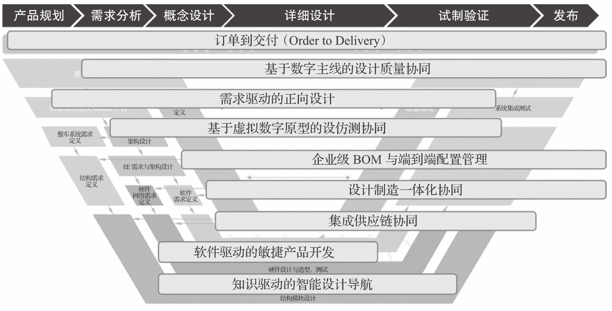

图 7-2 AI 赋能的创新研发范式

## **7.2 需求驱动的正向设计**

### **7.2.1 范式概述：现状与挑战**

在当今全球化、竞争白热化和技术飞速迭代的市场环境中，复杂产品、系统与服务的开发面临着前所未有的挑战。传统的、以文档为中心的、部门壁垒森严的线性工程模式已愈发难以应对动态变化的市场需求、指数级增长的系统复杂性以及对成本和周期的严苛控制。研究表明，导致项目延期、超支乃至失败的根本原因，在于如何精确、高效地将市场或用户需求转化为功能完备且可靠的系统，这一转化过程正是产品开发的核心难点与矛盾所在。在此背景下，需求驱动的正向设计——这一先进工程范式应运而生。该范式并非单一、固化的方法论，而是对三种核心理念的系统性整合：以全面、动态的需求分析为驱动力，以从概念到实现的正向设计为逻辑主线，以跨学科、跨组织的协同工作为基本模式。

需求驱动的正向设计是工程领域的一次根本性转变——从分散、静态的流程转向集成、动态的生态系统。这一转变的核心在于将需求工程（Requirement Engineering，RE）作为技术引擎，它用统一的、权威的数字模型取代了传统分散且易于过时的文档，从而为整个产品生命周期提供了单一事实来源。

实现这一范式需要强大的技术生态系统作为支撑。ALM（Application Lifecycle Management，应用生命周期管理）系统通过对需求的捕获、分析、规范、验证、跟踪等全面管理，确保产品开发从一开始就“做正确的事”，即满足了真正的用户和业务需求。而 PLM 系统构成了企业的数字主干，通过两者的整合，构建一个统一的、以客户需求为驱动的、可追溯的管理体系，确保软硬件开发在同一语境下协同推进。在此基础上，数字主线贯穿始终，连接着各个阶段的数字模型，最终催生出产品的终极形态——数字孪生（Digital Twin）。数字孪生不仅是物理实体的虚拟镜像，更是集成了实时运营数据的动态仿真平台，能够实现对产品性能的预测、分析与优化，从而颠覆传统的设计、制造与运维模式。

然而，向这一新范式的转型并非坦途。其面临的最大挑战并非技术本身，而是深刻的组织与文化惯性。这包括对传统工作流程的依赖、跨部门协作的壁垒、领导层支持的缺失、专业技能的短缺以及工具链集成的高昂成本。克服这些障碍需要企业采取系统性的变革策略，包括明确的顶层设计、分阶段的成熟度提升计划、对人员的持续投资以及对组织架构和商业模式的根本性重塑。

展望未来，AI 和混合现实（XR）等新兴技术将进一步加速这一范式的演进。AI 增强的系统工程（AI4MBSE）将实现模型创建与分析的自动化和智能化，而沉浸式协同技术将彻底改变人与数字模型的交互方式。最终，这一系列变革将推动系统工程学科本身向着 INCOSE《系统工程 2035 愿景》所描绘的更智能、更集成、更具影响力的方向发展。

### **7.2.2 范式解构：填补需求与设计的鸿沟**

在瞬息万变的市场环境下，产品开发不再是线性、孤立的活动，而是一场复杂而精密的系统工程。传统上，企业可能依赖逆向工程——一种“自底向上”的方法，从现有产品（无论是自身开发的还是竞争对手的）出发，通过分析物理设计、系统构成和功能，最终推导出其实现的需求，其应用层次从单纯仿制到基于现有产品改进不等。这种模式虽然能快速复制或改进现有产品，但其固有的局限性在于难以实现颠覆性创新，且易受限于既有框架。

然而，真正具有竞争力的企业正积极转向以正向设计为主导的开发范式，这也是企业从仿制转向创新的必由之路。正向设计是一种“自顶向下”的方法，它始于对市场和客户“原始需求”的深刻理解与定义。从这些需求出发，通过功能分解、系统综合，逐步构建详细设计，并最终进行工艺试制与产品验收，正向设计与逆向工程的对比分析如图 7-3 所示。这种模式更强调“基于需求设计”与“基于功能分析”的创新性。在整个正向设计过程中，验证活动贯穿始终，从部件验证到系统集成、系统验证，直至最终的产品确认。

在当今复杂的产品开发环境中，从逆向工程向正向设计的转型已成为企业追求创新和市场领先的必然选择。这一转型的核心和关键在于系统设计能力，即从“理解机理”到“创新机理”的转变，这要求企业具备多年的产品研发积淀和专业的系统工程师团队，以弥补如下能力鸿沟。

**●需求驱动与系统综合**：正向设计以“需求定义”为起点，通过“功能分解”来细化需求，最终通过“系统综合 ^()”将这些功能模块整合为一套完整的系统架构。这一过程不再是简单地模仿现有产品的部件，而是要求从更高维度理解用户痛点和业务目标，并将抽象的需求转化为可实现的系统功能和结构。强大的系统设计能力确保了从宏观需求到微观设计的逻辑严谨性和可追溯性。

**●复杂性管理**：现代产品往往是高度集成的软硬件系统。系统设计方法能够以结构化的方式管理这种复杂性，通过分层、模块化和接口定义，将庞大的系统分解为更易于管理的模块。这对于正向设计至关重要，因为它在产品尚未物理制造前，就需要清晰地定义所有组件及其相互之间的接口。

**●跨专业协同的桥梁**：正向设计需要机械、电气、软件、供应链、制造等多个专业团队的紧密协作。系统设计能力提供了一个通用的语言和框架（如 SysML），使得不同专业背景的工程师能够在一个统一的系统模型上进行沟通、分析和决策，确保各部分的兼容性和整体性能。这与逆向工程中可能只专注于单一部件或功能的分析形成鲜明对比。

**●早期验证与风险规避**：系统设计允许在详细设计阶段之前，通过模型和仿真对系统功能和行为进行早期验证。这包括部件验证、系统集成和系统验证。这种前置的验证能力在正向设计中尤为重要，因为它能显著降低后期物理试制与试验确认阶段的风险及成本，避免了逆向工程中“造出来再发现问题”的被动局面。

**●驱动创新与价值创造**：正向设计的目标是“创新”。系统设计能力使得企业能够跳出现有产品的框架，从根本需求出发，重新思考和设计产品架构，从而实现功能上的突破和性能上的优化，创造更高的客户价值。

因此，从逆向工程向正向设计的转型，并非仅仅是工具或流程的变化，更是核心能力的跃升。这种跃升体现在企业能否从全局视角出发，驾驭复杂系统，将抽象需求转化为具体的、可实现的创新产品，而这正是强大系统设计能力的精髓所在。

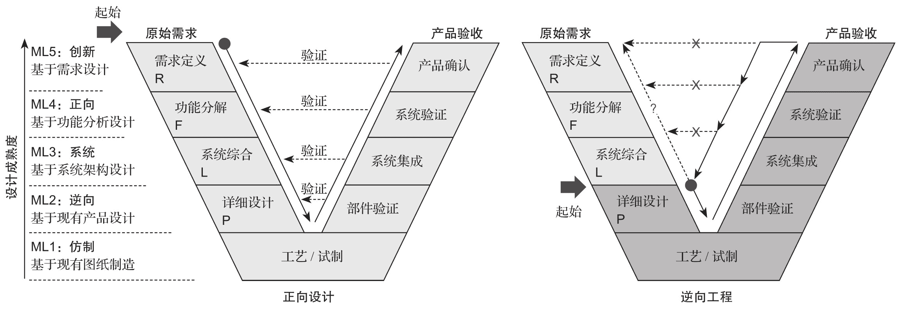

图 7-3 正向设计与逆向工程的对比析分

### **7.2.3 范式重构：需求驱动的端到端追溯**

需求工程（Requirements Engineering，RE）是一门系统化的学科，专注于捕获、分析、规范、验证和管理软件系统或产品从最初构思到最终部署及维护的生命周期过程中的用户需求和系统需求。它是任何成功软件或系统开发项目的起点和核心，确保所构建的产品能够真正满足用户、业务和市场的实际需求。

在现代产品开发中，特别是涉及软硬一体化的复杂系统开发，需求工程的挑战性和重要性日益凸显。这不仅体现在单个环节的效率提升方面，更在于实现全链条的无缝协同与透明管理。其中，从需求管理的“能力在线”到需求端到端追溯的“业务在线”的演进，是衡量企业数字化成熟度的关键标志。

1.能力在线：需求管理能力

需求工程的核心活动构成了一个严谨的流程，旨在将模糊的想法转化为精确的规格说明。

**●需求获取**：这是整个流程的起点，也是最富挑战性的一环。它的目标是从各种需求来源（如市场分析、用户合同、现有文档等）中识别、抽取和开发新的创新性需求。常用的技术包括访谈、工作坊、问卷调查和文档分析等，旨在深入理解用户的真实意图和隐性知识，形成产品原始需求（OR）。

**●需求分析**：获取到的原始需求往往是模糊、不完整甚至相互矛盾的。需求分析阶段旨在澄清这些需求，识别它们之间的依赖关系和潜在冲突。同时，需要与各专业系统工程师沟通，权衡利弊，解决冲突，最终就需求的优先级和范围达成共识，从而形成产品的初始需求（IR）。这一阶段的目标是确保需求的清晰性、一致性和可行性。

**●需求分解**：此活动旨在将经过分析和确认的需求以结构化的方式记录下来，形成需求规格说明书。传统上，这主要通过自然语言编写的文本文档完成，这种方式虽然易于理解，但也埋下了模糊性和不一致性的隐患。在此基础上，系统架构师需要对需求规格进行进一步的系统设计和分析，得出具体、可测试的系统功能和非功能性需求，即系统需求（SR）。系统需求描述了系统应该如何实现初始需求，包括功能、性能、安全、可用性等方面。架构设计在此基础上将系统需求映射为模块与接口，为后续详细设计和实现奠定基础。

**●需求验证与确认**：验证（Verification）旨在确保需求规格被正确、完整地定义和实现（“保证过程的正确性”），而确认（Validation）则可确保最终产品满足用户的真实需求和期望（“保证结果的正确性”）。这一活动通过评审、原型设计、仿真试验等方式进行，以保证开发出来的产品既符合规范，又满足用户的需求，最终交付高质量的产品。

**●需求变更管理**：需求在整个项目生命周期中是不断变化的，这是产品开发无法回避的现实。需求管理活动负责系统地控制这些变更，评估变更带来的影响，并确保所有变更都得到妥善处理，维持项目的一致性和可追溯性。

这些活动并非严格的线性序列，而是一个迭代、协作的过程。

在这个阶段，虽然需求管理的核心活动（如获取、分析、验证和管理）已经可以在线进行，但更多的是工具层面能力的在线化，信息流和业务流可能仍存在断点，协同效率有待提升。需求可能还停留在“列表”或“文档”的状态，缺乏与其他业务环节的深度连接和自动触发机制。

2.业务在线：需求端到端追溯

需求端到端追溯的“业务在线”则代表着更高层次的数字化和智能化，它将需求作为核心驱动力，贯穿于产品从概念到交付乃至生命周期结束的所有业务环节，实现真正的价值链协同与透明。这不仅仅是工具的在线化，更是业务流程和决策的在线化和智能化。

实现“业务在线”的关键在于以下几方面。

（1）需求作为“单一事实来源”的全面集成

需求不再仅仅是需求管理部门的“文件”，而是通过 ALM 系统，特别是与 PLM 系统整合后，成为产品生命周期的“单一事实来源”。这意味着：

**●与设计深度关联**：每个设计决策、每个功能模块都能清晰地追溯到其所满足的特定需求。在需求驱动的正向设计中，设计过程直接从明确的需求出发，并通过基于模型的系统设计工具将需求转化为具体的产品功能和架构。

**●与制造工艺链接**：需求信息被传递到制造环节，确保产品在生产过程中符合设计要求，并可追溯到初始需求。

**●与测试用例绑定**：测试用例直接与需求关联，确保所有需求都得到充分验证，实现设仿测一体化协同，并通过虚拟数字原型在早期进行验证（在后续章节详细描述）。

**●与服务和用户反馈互通**：产品在实际使用中的性能、用户行为、服务反馈等数据能够通过 IoT 平台与 CRM 系统接口实现数据回流，并与初始需求进行比对，驱动需求和产品的持续优化。

（2）端到端的可追溯性与透明化

ALM 系统能够将需求与设计、代码、测试用例、缺陷和发布版本等所有开发工件连接起来，形成一个完整的追溯链。这意味着，从最初的“原始需求”到最终的“产品验收”，所有环节都被打通。当一个缺陷被发现时，开发人员可迅速追溯该缺陷影响了哪些测试，又与哪些部件或代码相关，最终对应到哪个需求没有被满足。

（3）数据流驱动的实时协同与智能决策

需求作为核心数据流，驱动着多专业团队的实时协同。任何需求变更或与需求相关的设计、制造、服务环节的更新，都能通过数据流驱动的机制实时同步给所有相关方。AI 技术在此发挥着关键作用，例如，AI 可以评估需求变更对项目范围、进度和成本的影响，提供智能决策支持。

（4）一体化闭环管理

需求的端到端追溯，最终实现的是产品生命周期的一体化闭环管理。从市场洞察、需求定义、正向设计、仿真测试、制造，到最终的订单到交付（OTD）、售后服务和产品迭代，所有环节形成一个相互反馈、持续优化的闭环。需求是这个闭环的起点和持续驱动力，确保产品始终“做正确的事”并不断优化。

从需求管理的“能力在线”到需求端到端追溯的“业务在线”，反映了企业在数字化转型中的深化。它标志着企业从仅将工具搬到线上，转变为将需求作为核心业务驱动力，通过高度集成、数据流驱动的平台，实现跨部门、跨价值链的真正协同与智能决策。这种转型不仅提升了效率，降低了风险，更关键的是，它使得企业能够更精准、更敏捷地响应市场和客户需求，持续创新，并最终交付更高价值的产品。在此过程中，企业不断积淀正向设计经验和系统设计能力，培养创新的文化理念，从而真正实现向“需求驱动的正向设计”这一创新范式的转型。

### **7.2.4 AI 赋能：从需求驱动到以用户为中心的价值创新**

需求驱动的正向设计范式虽然在理论上是完备的，但在实践中，需求分析、系统设计等方法论都因其对专业技能的高要求和巨大的人力投入而被认为过“重”，难以在追求速度的产品开发过程中大规模推广。这正是 AI，特别是企业级平台化 AI 框架，发挥其颠覆性作用的领域。AI 并非要取代这个框架，而是要成为其“催化剂”和“加速器”，通过智能自动化，将这些严谨但烦琐的方法论转变为高效、可扩展的现代化工作流。下面将详细阐述 AI 如何在需求驱动设计的各个环节中赋能。

1.AI 赋能需求设计

AI 技术，特别是基于 LLM 的自然语言处理能力，正在系统性地重塑需求工程的每一个环节，将大量原本依赖人工的、高认知负荷任务的自动化。

**●AI 驱动的需求获取**：指利用 AI 技术，自动化和智能化地从各种数据源中发现、收集、分析和提炼用户及系统需求的过程。它旨在克服传统需求获取方法（如访谈、问卷）的局限性，如耗时、成本高、易受主观性影响以及难以处理海量非结构化数据等问题，从而更全面、精准、高效地捕获到真实的用户和业务需求。AI 工具能够自动处理这些数据，利用 LLM 模型从 PDF、图片、语音等数据中提取关键实体、意图和需求陈述。例如，对于汽车行业 Tier 1 供应商来说，AI 可以自动从来自不同主机厂、不同格式的需求文档（通常是 PDF 文件）中提取出结构化、分层级的需求条目，包括文字、指标参数和图片等。这不仅极大地缩短了需求获取的周期，还能够从海量数据中发掘出需求工程师可能忽略的模式和洞见。

**●结构化需求重用和自动生成**：从模糊的业务目标到可供开发团队执行的精确规格，中间存在巨大的鸿沟。利用 AI 技术，在产品开发过程中实现需求资产化 ^()、标准化和智能化管理，可大幅提升需求工程的效率、质量和一致性，并促进跨项目、跨产品线的知识共享与复用。

AI 赋能的结构化需求自动生成，通过自然语言处理和深度文本理解，将非结构化或半结构化的原始需求自动转换为符合预定义规范的结构化需求文档或模型元素。AI 能够进行语义解析、意图识别、实体与关系提取，并结合知识图谱进行智能填充和分类，甚至评估生成的需求质量并检测冲突。这显著提升了需求编制的效率和准确性，为后续的需求驱动的正向设计奠定坚实的基础，并支撑产品生命周期的自动化与智能化管理。

结构化需求的重用，则通过将需求以及关联的设计、仿真和试验数据视为可复用资产，能从历史需求库中智能检索与推荐相关模块，并基于设计输入给出相应的修改建议。这不仅提高了需求分解和规范化的效率与一致性，还能加速产品上市，并确保需求质量，是知识沉淀与传承的重要途径。

**●AI 驱动的需求分析和审查**：需求分析的核心挑战在于处理自然语言的模糊性。AI 工具在这方面展现出了超越人类的能力。通过在大量技术文档和需求规范上进行训练，AI 模型可以识别出需求描述中的模糊词汇，如“大约”“通常”“高效”等模糊表达，以及不一致的术语、逻辑矛盾以及不完整的陈述。一些先进的工具甚至可以依据 INCOSE 等行业标准对需求质量进行打分和评估，并提供具体的修改建议。这使得需求评审从一种主观的、基于经验的活动，转变为一种客观的、数据驱动的质量保证过程。目前，PTC 公司于 2025 年 4 月发布的 Codebeamer AI Beta 版本已经支持上述功能。

**●AI 辅助的验证与优先级排序**：确保需求被正确理解和实现是验证活动的核心。AI 可以通过从需求描述中自动生成测试用例和测试场景，来保障测试的覆盖率和完整性，确保每一个功能点和业务规则都得到了验证。在需求优先级排序方面，AI 可以分析需求之间的依赖关系、评估其对业务价值的贡献度、预测实现复杂度和潜在风险，从而为产品负责人提供数据支持，做出更明智的排序决策。

2.AI 赋能的系统建模与设计

AI 的影响力不止于需求阶段，它正进一步渗透到系统架构和设计领域，加速从“文本”到“模型”的转换。

**●从文本到模型**：这是生成式 AI 最具潜力的应用之一。新兴的 AI 工具已经能够解析自然语言描述的需求文档，并自动生成相应的 UML 或 SysML 图表，如类图、序列图、活动图或系统架构的块定义图 ^()。这意味着架构师不再需要从零开始手动绘制模型，而是可以在 AI 生成的基础上进行修改和完善，从而将工作重心从“绘图”转移到更高层次的“设计思考”。

**●架构决策支持**：系统架构设计充满了权衡。面对一系列功能性和非功能性的需求，AI 可以作为一个智能的“架构顾问”。通过分析需求，特别是性能、可扩展性、安全性和成本等约束，AI 可以推荐合适的架构风格（如微服务、事件驱动架构）、技术栈，甚至可以评估不同设计方案的优劣 ^()。虽然最终决策仍需人类架构师做出，但 AI 提供的分析和建议极大地拓宽了决策的信息基础。

**●模拟与分析**：在编写任何代码或开展详细设计工作之前，对系统设计模型进行模拟和分析，可以提前发现潜在的性能瓶颈、逻辑错误和资源冲突。AI 可以与仿真驱动的设计平台结合，通过机器学习模型预测系统在不同负载下的行为，或者自动生成复杂的测试场景来对模型进行压力测试，从而在设计阶段就验证架构的稳健性 ^()。

3.AI 赋能需求端到端追溯

利用 AI 技术，自动化和智能化地在产品或系统开发生命周期中，建立、维护和分析从原始需求到最终产品交付及运行的完整、双向的可追溯链条。这从根本上解决了传统可追溯性的困境，即在复杂的产品开发中，有效管理海量需求信息、频繁变更以及跨专业协同等挑战。这确保了在整个产品开发过程中，始终符合需求与合规性要求，并显著加速决策流程，全面提升产品质量。

**●追溯链接的自动创建**：利用 NLP 和信息检索技术，AI 系统可以“阅读”并理解不同类型的设计交付。它能够识别出产品规划文档中的业务目标、需求规格中的功能点、UML 模型中的类和方法、代码库中的函数以及测试计划中的测试用例，并自动在它们之间建立语义上的链接 ^()。例如，AI 可以识别出“用户必须使用密码登录系统”这一需求，分别与 UML 类图中的 UserAuthenticationController 形成《satisfy》关系、与测试用例 TC-001: ValidLogin 形成《verify》关系，并自动创建上述两类关联链接。

**●动态的可追溯性维护**：这在产品开发过程中至关重要，它能有效应对需求和设计的频繁变更。当需求被修改时，AI 驱动的端到端追溯框架能够实时监控并立即识别出所有受影响的下游设计输出，如零部件、软件代码和测试用例等。系统会同时向相关人员发出警报，从而实现实时的变更影响分析。这种能力使可追溯性从一个静态的快照，演变为一个与项目同步演化的动态系统，确保了信息的及时更新和协同效率。

**●可追溯性验证与差距分析**：一个完整的可追溯性图谱本身就是宝贵的数据资产。AI 可以对需求的完整性和满足度进行审核，自动发现“孤儿需求”（未被实现或满足的需求）或“镀金功能”（没有需求来源的设计元素），从而帮助团队识别范围蔓延，确保每一份开发投入都直接服务于明确的业务需求。

在平台化 AI 架构的审视下，“需求驱动的正向协同设计”不再仅仅是一个线性的、从需求到设计的 V 模型流程，它变成了一个由 AI 驱动的、网状的、实时协同的智能化体系。AI 平台作为核心，确保了从最源头的“原始需求定义”到最终产品验证的每一个环节都数据同源、逻辑清晰、高效协同，从而真正实现了跨越系统工程、软件工程、硬件工程和结构工程的深度融合与范式转型。

综上所述，需求管理的能力在线更多地意味着将需求管理工具搬到线上，实现了需求的数字化管理。而需求-设计-验证的端到端业务在线则代表着将需求提升为驱动产品开发全价值链的核心引擎。它使得需求信息能够无缝、实时地在所有业务环节中流动和被利用，实现数据流驱动的实时协同与决策。这不仅极大提升了需求管理的效率和准确性，更重要的是，它确保了产品开发始终围绕着客户和市场的真实需求，实现了真正的需求驱动的正向设计。通过 AI 赋能的端到端追溯，企业能够更清晰地洞察产品现状，更敏捷地应对变化，最终交付高质量、高价值且具有竞争力的产品。

## **7.3 软件驱动的敏捷产品开发**

21 世纪 20 年代，全球工业界面临着一场根本性的变革，其深刻程度不亚于一个世纪前的流水线生产。这场变革的核心驱动力并非来自机械工程的突破，而是源于软件的无所不在。产品，尤其是那些曾经由精密机械和电子硬件定义的复杂系统，正在被软件重新定义。本节旨在深入剖析这一趋势，并在平台化 AI 架构的基础上，重新审视“软件驱动的敏捷产品开发”这一研发范式。

### **7.3.1 范式概述：软件定义时代的趋势与挑战**

“软件定义”已从一个前沿概念演变为塑造产业格局的决定性力量。它标志着产品价值创造逻辑的根本性转变，即价值重心从物理实体向数字化的功能与服务迁移。

1.软件定义范式的内涵

软件定义产品（Software-Defined Product，SDP）是指产品的核心功能、差异化能力、用户体验乃至其未来的演进方向，主要由软件来定义和驱动，而非仅由硬件特性决定。硬件更多地扮演一个可编程、可配置、支持软件运行的平台角色，而软件则赋予产品生命力、智能化和持续迭代的能力。

在这一范式下，汽车行业成为最具代表性的变革先锋。软件定义汽车（Software-Defined Vehicle，SDV）的出现，正在将汽车从一个高度集成的机电终端，转变为一个智能化、可扩展、可持续迭代升级的移动电子终端。正如智能手机颠覆了功能手机，SDV 通过软件更新来不断演进和提升功能，其本质已不再是一台简单的交通工具，而是一个承载服务的移动计算平台。

2.价值创造的根本性转移

这场范式转移最直观的体现是产品成本结构的剧烈变化。行业分析普遍预测，软件在整车成本中的占比将发生戏剧性的“价值倒置”。普华永道在《打造软件驱动的汽车企业》报告中指出，软件将成为现代车辆差异化竞争的核心，而软件的开发成本，将在未来十年内增长 83% ^()。据麦肯锡分析，2023 年软件约占整车成本的 15%，预计到 2030 年，这一比例将飙升至 60% ^()。

这种成本结构的转变并非简单的此消彼长，它揭示了一个更深层次的现实：硬件正在逐渐标准化和商品化，而软件则成为实现品牌差异化、提升用户感知价值的核心。在 SDV 时代，汽车的豪华感、驾驶乐趣、未来科技感等品牌特质，都将通过软件驱动的体验来定义和交付。硬件的角色转变为一个稳定、可靠且功能超前预埋的平台，其目的是在产品的整个生命周期内，更好地服务于软件的持续迭代和功能释放。

3.商业模式转型：从一次性销售到持续价值交付

软件定义产品最深远的影响在于其对传统商业模式的颠覆。一次性的产品销售模式正在被一个可持续的、服务驱动的商业模式所取代。通过 OTA 技术（Over-the-Air）进行的软件更新，制造商能够在产品售出后，依然能为其增加新功能、修复缺陷、提升性能。

这催生了全新的商业机会，如按需付费的功能、订阅服务以及类似应用商店的车载生态系统。这些模式能够创造出在产品初始销售之后持续产生的、高利润率的经常性收入流，从而极大地延长和重塑了产品的生命周期价值。它不再是一个在售出那一刻价值就开始衰减的静态、折旧的资产，而是一个能够不断演化、持续为用户和企业创造新价值的动态服务平台。这种从“交易”到“关系”的转变，是软件定义时代最核心的商业逻辑变革。

尽管软件定义产品描绘了一幅激动人心的未来图景，但通往这一未来的道路上布满了荆棘。企业在转型过程中面临着来自法规、技术和组织层面的三重严峻挑战。这些挑战并非孤立存在的，而是相互交织的，共同构成了企业必须穿越的“转型峡谷”。

（1）敏捷与合规的平衡

软件的快速迭代特性与传统行业审慎、缓慢的法规制定流程之间形成了尖锐的矛盾。尤其在汽车、航空、医疗设备等与安全相关的领域，法规的更新速度远远跟不上技术的演进步伐。这导致了一个碎片化的、模糊不清的、因地域而异的合规环境。例如，针对自动驾驶等高级功能，全球范围内缺乏统一的联邦级监管框架，这极大地延缓了技术的商业化进程，并增加了安全风险。

随着智能网联技术的深入应用，产品和系统变得前所未有的互联互通，这在带来巨大便利和功能创新的同时，也引发了新的合规问题，尤其是围绕数据安全和网络安全的挑战。智能网联产品（如智能汽车、物联网设备、智能家居）在运行过程中会产生、收集和传输海量数据，包括用户个人信息、行为数据、设备运行状态、环境数据等。这些数据的安全和隐私保护变得尤为关键。它们通过网络连接上传到云端进行存储和管理，使得它们面临比传统 IT 系统更多的网络攻击面，甚至造成严重的安全事故和经济损失。应对这些新的合规问题，需要企业在产品开发、部署和运营的生命周期中，将数据安全和网络安全作为核心考量，包括建立完善的安全管理体系、全面的合规性审计和认证等。

这在产品开发中形成了一对看似矛盾的挑战，即敏捷与合规之间的取舍。

**●敏捷的快速迭代与合规的严格规范**：敏捷推崇快速迭代，而合规要求严谨的文档、审批和验证，这可能被视为减缓开发速度。

**●敏捷的“足够好”与合规的“零容忍”**：敏捷可能倾向于最小化文档和流程，而合规要求全面、详尽的审计追踪。

**●敏捷的灵活性与合规的固定标准**：敏捷强调适应变化，而合规往往基于固定的法律法规。

然而，在智能网联时代，这种“取舍”并非零和博弈，而是需要寻找一个平衡点，实现“敏捷合规”。

（2）技术与架构的历史包袱

技术层面的挑战同样艰巨。对于拥有大量存量产品和生产设施的传统制造商而言，将其改造为“软件定义”的模式是一项浩大的工程。这不仅需要对硬件进行升级，而且需要对整个产品架构进行重构，以实现软硬件的解耦。

管理软件与物理组件之间的复杂交互是一大难题。这些系统必须高度可靠，并且往往需要满足严格的功能安全认证（如 ISO 26262）。此外，管理跨越多代硬件平台的软件变体、确保软件生命周期的完整性（从开发、集成到测试和维护），其复杂性呈指数级增长，进一步减缓了开发速度。

（3）组织与人才挑战

然而，最根本、最难以逾越的障碍，往往来自于组织内部和人才本身。传统的制造业组织架构通常是按照专业领域划分的职能孤岛，例如，机械、电子、软件等部门各自为政。这种结构天然地阻碍了软件定义产品所必需的跨学科协作。当企业试图将敏捷开发等软件实践嫁接到这种孤岛式的组织上时，往往会陷入“敏捷闹剧”的窘境——表面上使用了敏捷的术语和形式，但内核仍然是传统的、顺序的瀑布式思维模式。

这种组织惯性背后，是更深层次的“价值倒置”问题。当产品的核心价值从硬件转移到软件时，整个组织的文化、流程和权力结构都必须随之调整。硬件部门需要从主导者转变为服务者，为软件的未来发展提供平台支持。软件部门则需要承担起定义产品核心体验的重任。这种深刻的变革必然会触及既有利益格局，引发巨大的内部阻力。

与组织变革相伴相生的是严峻的人才挑战。市场极度缺乏能够跨越软件、硬件、系统工程等多学科领域的复合型人才。企业不仅难以招聘到这样的人才，内部培养也面临着巨大困难，因为传统的职业发展路径和培训体系都是围绕单一学科设计的。人才的短缺和知识共享机制的缺乏，最终成为制约整个生态系统发展的关键瓶颈。

这些挑战共同构成了一个复杂的系统性问题。它们并非独立存在的，而是由“价值倒置”这一根本性转变所引发的一系列连锁反应。企业若仅仅着眼于解决某个单一症状，例如招聘更多的软件工程师或购买新的工具，而没有从根本上重塑其组织架构、开发流程和价值理念，那么其转型注定收效甚微，甚至可能以失败告终。只有深刻理解并系统性地应对这一系列挑战，企业才能成功跨越转型峡谷，真正拥抱软件定义产品的未来。

### **7.3.2 范式解构：从软件敏捷到硬件敏捷**

当企业认识到软件驱动的必要性后，一个常见的误区是试图将源于纯数字世界的软件敏捷方法论直接、粗暴地复制到包含物理实体的硬件开发中。这种“拿来主义”往往会导致水土不服，甚至适得其反。要真正实现硬件的敏捷，首先必须深刻解构软件敏捷与硬件开发的本质差异，并在此基础上，构建一套适应物理世界规律的敏捷开发体系。

1.敏捷开发的四大核心要素

敏捷开发是一种以人为本、适应性强、迭代递增的软件开发方法论，其核心在于“小步快跑”与“持续迭代”，通过短周期的开发冲刺（Sprint）、快速原型验证和频繁的用户反馈，实现产品的快速演进。它不同于传统的瀑布模型，更加强调团队的协作、客户的参与以及对变化的适应。以下是敏捷开发通常被认为的四大核心要素。

（1）跨职能团队的自主协作

敏捷开发强调组建小型、自组织、跨职能的团队。这意味着团队成员拥有完成产品开发所需的所有技能（如开发、测试、设计、产品管理等），无须依赖外部部门或层层审批。团队被赋予高度的自主权，可以自行决定最佳的工作方式、工具和技术栈，只要能达到其设定的目标。这种自主性激发了团队的责任感、主人翁精神和创新活力，能够快速做出决策并响应变化，提升了整体响应速度和创新效率。

（2）迭代开发与快速交付

敏捷开发将整个产品开发过程分解为一系列短而固定的迭代周期（通常为 1～4 周），每个周期结束时都交付可工作的、有价值的产品增量，即 MVP（Minimum Viable Product，最小可行产品）。这种“小步快跑”的方式允许团队频繁地将产品推向市场或交付给客户，尽早获取真实反馈，从而降低风险、加速上市时间，并确保产品始终在正确的方向上前进。

（3）数据驱动的持续反馈

敏捷开发高度重视从产品发布和运营中获取的真实数据及用户反馈。团队通过收集用户行为、性能指标、客户评论等数据，进行深入分析。这些数据洞察是驱动产品持续改进和下一次迭代方向的关键。通过这种数据流驱动的模式，产品能够更好地适应市场和用户需求的变化，实现一体化闭环管理下的优化。

（4）透明化沟通与知识共享

敏捷强调团队内部以及与客户、利益相关者之间高频率、开放和透明的沟通。日常站会、冲刺评审会议、复盘会议等都是为了确保信息流畅，及时发现并解决问题。知识共享是敏捷文化的重要组成部分。团队成员之间应积极开展经验交流、实现技能互补、共同学习成长，确保产品开发的知识和最佳实践能够有效传承和复用。这有助于打破信息孤岛，促进跨专业协同。

这四大核心要素共同构成了敏捷开发灵活、高效的框架，使其能够有效应对复杂产品的开发挑战，尤其是在软件定义产品和智能网联时代，其重要性日益凸显。

2.硬件敏捷与软件敏捷的差异分析

敏捷宣言诞生于软件开发领域，其核心价值观和原则深深植根于软件代码的可塑性。然而，硬件的世界遵循的是物理定律，这构成了两者之间最根本的二分法。

软件与硬件在敏捷实践的语境下，存在着以下本质性的区别。

**●可塑性与变更成本**：软件是“软”的，具有极高的可塑性，修改一行代码的成本相对较低。而硬件是“硬”的，一旦模具开启、芯片流片或电路板制造完成，任何物理上的改动都意味着高昂的成本和巨大的时间延迟。你无法像“重构”代码一样“重构”一块钢板。

**●开发成本曲线**：软件开发的成本在整个周期内相对平稳。而硬件开发的成本曲线则截然不同，在接近制造和量产的后期阶段，成本会急剧攀升。这使得硬件开发在前期必须进行更详尽的架构设计，以避免后期的高昂变更。

**●核心约束**：硬件开发深受两大物理世界约束的困扰，即采购前置时间和制造成本。漫长的零部件采购周期和昂贵的原型制造成本，从根本上改变了硬件开发的规划与执行方式。而软件开发中几乎不存在这两个问题。

**●团队构成**：软件团队的技能相对同质化，主要围绕软件工程师、测试工程师、产品经理等角色。而硬件开发则是一个高度非同质化的工作，需要机械、电子、光学、材料、供应链、制造、检验等截然不同的专业技能紧密协作。这种复杂性对沟通和协作提出了指数级的挑战。

尽管存在上述巨大差异，但软件和硬件开发共享一个至关重要的点，这也是敏捷方法得以在硬件领域应用的核心前提：无论开发过程多么复杂，其工作都可以被分解为大量的、微小的、可测试的交付物。

对于软件而言，这个交付物通常是一个可运行、可为用户提供价值的功能增量。而对于硬件，早期的交付物可能并非一个终端用户可用的功能，但它可以是一个通过了仿真验证的模块、一个完成了单元测试的电路板，或是一个验证了关键设计假设的子系统原型。正是这种将复杂问题分解为可独立验证的小块的能力，为在硬件开发中引入迭代和增量的敏捷思想打开了大门。

### **7.3.3 范式重构：硬件敏捷开发体系**

理解了硬件敏捷与软件敏捷的本质差异后，我们不能简单照搬软件敏捷的框架，而应提炼其核心思想，并结合硬件开发的实际情况，形成一套专属的硬件敏捷开发体系。

1.向左转型：基于虚拟数字原型的硬件敏捷

在汽车行业研发领域，“向左转型”（Shift Left）已经成为一个核心理念和重要趋势。其基本思想是，将传统上位于研发和产品生命周期后期的活动，尤其是在物理样机阶段的活动，有意识、有策略地前移到物理样机前的数字阶段。其本质是尽量通过基于虚拟数字原型的仿真和虚拟试验来替代物理样机阶段的各种验证活动。在这种趋势下，产品（包含硬件）的敏捷开发才能得以实现，其核心在于利用虚拟化技术克服传统硬件开发的物理约束，并与敏捷软件开发的原则深度融合。这驱动了硬件开发由传统串行的、瀑布式开发模式转向敏捷开发模式，有效提升了产品研发过程的并行协同效率，并缩短了硬件结构的迭代周期。向左转型和向右转型如图 7-4 所示。

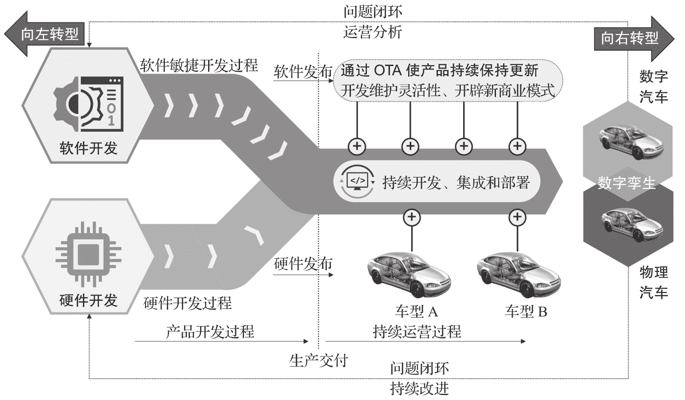

图 7-4 向左转型和向右转型

在硬件开发中，模块化与 MVP 是相辅相成的两个关键概念，它们共同驱动了硬件开发的敏捷化，并有效克服了传统硬件开发中的物理约束。

模块化是一种设计原则，它将复杂的产品系统分解为独立、可互换、具有标准接口的模块。每个模块都负责特定的功能，可以独立开发、测试、制造和升级。这与软件定义产品的理念高度契合，硬件更多地扮演一个可编程、可配置的平台角色，通过模块化来实现功能和差异化。

MVP 则是一种产品开发策略，旨在以最小的投入、最快的速度交付包含最基本功能集的产品，以验证其核心理念并获取用户反馈。硬件模块化是实现硬件 MVP 的关键使能者，它为敏捷开发提供了必要的灵活性和效率。

**●模块化功能或结构解耦**：硬件敏捷开发通常会基于硬件结构的模块化设计，以便在迭代时仅更换或升级单一模块，而非整个产品。这使得跨专业团队能够专注于开发实现核心功能的最少模块组合。这直接契合了 MVP“最小化”的核心原则，避免了必须开发完整产品才能进行验证的困境。

**●加速原型制造与迭代**：为了加速迭代，硬件敏捷开发采取向左转型的策略，通过基于虚拟数字原型的仿真和虚拟试验来替代昂贵且耗时的物理样机阶段的活动。这使得硬件团队能够在数字世界中以类似软件的速度进行设计、仿真和验证，再制造出物理 MVP。这使得硬件 MVP 的迭代周期从数月缩短至数周。

**●支持并行开发与协同**：不同的跨职能团队可以并行开发不同的模块，通过定义清晰的接口规范来确保最终集成时的兼容性。这与敏捷开发中跨职能团队的自主协作原则高度一致。

**●降低风险**：通过将产品分解为模块，团队可以在早期集中资源验证最关键、风险最高的模块，及时调整方向，避免在错误的设计上投入过多资源。

MVP 作为产品策略，充分利用了模块化的设计优势。这种优势在“平台化战略”中得到了集中体现：在软件驱动的敏捷产品开发中，硬件 MVP 可以是一个通用的、模块化的硬件平台，而不同的软件 MVP 则在此平台上运行。这使得软件功能可以独立于硬件快速迭代，实现了“软件定义产品”的愿景。

综上所述，硬件模块化为 MVP 策略在硬件领域的实施提供了坚实的工程基础。它通过解耦产品功能与物理结构，使得硬件的迭代和快速交付成为可能，从而将敏捷开发的理念从软件领域成功地扩展到硬件领域。两者结合，使得企业能够更快速地响应市场、更高效地验证创新，并以更低的成本和风险交付具有持续竞争力的产品。

2.向右转型：以用户为中心的敏捷迭代

在产品开发领域，“向右转型”（Shift Right）是指将关注点和活动从产品发布前的研发阶段，扩展到产品发布后的运营和用户生命周期阶段。这是一种以用户为中心的敏捷迭代策略，旨在通过持续收集和分析真实世界中的用户数据和反馈，驱动产品的持续优化与创新。

向右转型的核心理念如下。

**●以 MVP 为起点的持续迭代**：向右转型将 MVP 视为探索市场的起点，而非终点。团队以最小投入快速发布一个 MVP，以用户为中心来验证、反馈和迭代。产品发布后，真正的敏捷迭代才开始。团队通过短周期、小步快跑的方式，不断向用户交付新功能并持续改进。

**●数据驱动的持续反馈**：敏捷开发高度重视从产品发布和运营中获取的真实数据及用户反馈。向右转型正是通过建立强大的反馈机制来实现这一原则的。利用 AI 技术，特别是数据流驱动的实时协同与决策，企业可以收集并分析产品在实际使用中产生的海量数据，包括用户行为、性能指标、故障日志和客户服务记录等。这些数据洞察被作为新的需求输入，回流到研发环节，驱动下一次迭代的方向。

**●软件定义产品与 OTA 更新**：软件定义产品的理念是向右转型的关键技术支撑。产品的功能和差异化主要由软件定义，硬件则作为可编程的平台。这使得企业可以通过 OTA 更新的方式，在产品交付后快速部署新的软件功能、修复缺陷、优化性能，而无须进行物理召回。这极大地增强了产品的生命力和敏捷性。

向右转型是以用户为中心的敏捷迭代策略，它强调在产品上市后，通过数据驱动的持续反馈和软件快速迭代，实现产品的不断进化。在软件定义产品和 AI 赋能的加持下，这种模式使得企业能够更贴近用户、更敏捷地响应市场变化，从而在激烈的竞争中获得持续的竞争优势。

3.向左转型与向右转型的有机融合

“向右转型”并非独立于“向左转型”而存在，两者是现代研发范式跃迁的两个侧面。向左转型关注在产品发布前，通过将质量合规审查、仿真试验、可制造性等活动前移到设计早期，实现高效且高质量的研发。向右转型则关注在产品发布后，通过持续的用户反馈和敏捷迭代，实现产品的持续演进和价值增长。

一个成熟的研发体系会整合两者，构建一个从“向左”到“向右”的一体化闭环体系。AI 赋能的需求端到端追溯是连接这个闭环的纽带，它将运营数据和客户反馈与最初的需求进行比对，驱动整个产品生命周期的持续优化。

### **7.3.4 AI 赋能敏捷产品开发**

AI 正在以前所未有的方式赋能敏捷产品开发，它将敏捷的核心要素与智能化的能力深度融合，从根本上提升了产品研发的效率、质量和创新能力。敏捷开发以其跨职能团队的自主协作、迭代开发与快速交付、数据驱动的持续反馈、透明化沟通与知识共享四大核心要素，与 AI 技术形成了强大的协同效应。

1.赋能跨职能团队的自主协作

**●协同的基础——单一数据源**：AI 作为底层技术，能够整合来自设计、制造、销售、服务等环节的异构数据，构建统一的数据流驱动平台。这使得跨职能团队能够基于“单一事实来源”进行协同，打破了传统的信息孤岛。

**●智能协同与决策**：在基于模型的系统设计中，AI 辅助模型构建、验证和分析，使得不同专业的工程师能够在一个统一的系统模型上高效沟通和协作。AI 通过赋予虚拟数字原型以强大的仿真、分析和协同能力，使得软件和硬件团队能够在同一个数字环境中高效并行工作，实现了软硬件开发的深度协同，这正是软件驱动的敏捷产品开发模式的核心体现。

2.加速迭代开发与快速交付

**●“向左转型”与虚拟化**：AI 驱动的向左转型策略，通过基于虚拟数字原型的仿真和虚拟试验来替代物理样机阶段的活动。这使得硬件开发获得了类似软件的快速迭代能力。AI 利用代理模型（Surrogate Model）或降阶模型（ROM）等技术，将复杂的仿真计算时间从数小时甚至数天大幅缩短至秒级 ^([![Zelin Xu, Jie Ren, Yupu Zhang, et al. A Fast AI Surrogate for Coastal Ocean Circulation Models. arXiv: 2410.14952v1[cs.LG]19 Oct 2024\. https://arxiv.org/html/2410.14952v1.](EPUB/images/image_059.png)](#chapter16_split_000.xhtml_footnote-20-141))。这使得硬件团队能够以类似软件开发的速度，快速验证各自的设计方案并评估其集成后的性能。AI 还能够自动分析仿真结果，识别软硬件接口的潜在冲突或性能瓶颈，并提供优化建议。

**●MVP 的智能实现**：AI 赋能硬件的 MVP 定义原则，如在软件驱动的敏捷产品开发中，硬件 MVP 可以是一个简单的平台，由软件驱动核心功能，通过 AI 加速的虚拟测试来验证，以最低成本和最快速度交付。

3.强化数据驱动的持续反馈

**●“向右转型”与运营数据**：AI 驱动的向右转型策略，强调在产品发布后，通过收集和分析真实用户数据来驱动迭代。在软件定义产品的理念下，AI 能通过 IoT 技术收集海量运营数据，并从中提炼有价值的洞察。

**●一体化闭环管理**：AI 将这些运营数据、客户反馈和故障信息智能回传至研发端，指导设计与服务工程协同，形成从需求、设计到服务再到优化的一体化闭环管理。

4.提升透明化沟通与知识共享

**●智能需求管理与追溯**：AI 赋能的需求端到端追溯，通过 NLP 技术自动建立并维护需求与设计、数模/代码、测试之间的关联，确保了信息的透明化和一致性。AI 还能通过结构化需求的自动生成和重用，将知识沉淀为可复用的资产，提升团队沟通效率。

**●自动化报告与洞察**：AI 可以自动化生成各种项目状态、进度和质量报告，提供可视化的仪表板，帮助团队和管理层快速洞察项目健康状况。

总而言之，AI 赋能敏捷产品开发，是将敏捷的理念与 AI 的强大能力深度融合，构建了一个高度智能、实时协同、数据驱动且持续优化的研发新范式。它不仅在技术层面实现了研发流程的自动化和智能化，更在管理层面打破了传统壁垒，实现了跨职能、跨部门乃至跨企业的生态互联，使企业能够更快速、更精准、更具创新力地应对市场挑战，最终在激烈的竞争中获得持续的竞争优势。

## **7.4 基于虚拟数字原型的设仿测协同**

### **7.4.1 传统范式：协同现状与固有局限**

在探讨未来工程协同模式的革命性潜力之前，必须首先对当前占据主导地位但日益显得力不从心的传统范式进行一次彻底的审视。这种传统的、以线性流程为特征的设仿测协同工作流，不仅在效率上存在瓶颈，而且其根本性的结构缺陷使其在面对现代“系统之系统”（System-of-Systems）产品的复杂性时，已然走到了范式革命的临界点。

1.割裂的线性接力：“抛砖过墙式”工作流

传统的产品研发流程在本质上是一种线性的、阶段性的接力赛。其典型路径为设计、仿真和测试。这个流程始于设计部门，设计工程师利用 CAD 工具创建产品的几何模型，并进行初步的设计审查和验证（如干涉检查）。完成之后，这个产品数据包被“扔过墙”，移交给仿真部门。仿真工程师接收几何数据，进行网格划分、设定边界条件等一系列转换操作，以验证设计的性能。最后，经过多轮仿真迭代的方案被送往制造和测试部门，通过制造物理样机进行物理测试来最终确认产品是否满足要求。

这种工作模式的每一个环节都高度专业化，但环节之间却存在着明显的壁垒。设计团队、仿真工程师和测试工程师往往使用不同的工具集、操作不同的数据集，甚至对产品需求的理解也存在偏差。一旦发生设计变更，就可能会导致仿真工程师前功尽弃，从零开始。这种模式在处理相对简单的机械产品时尚可应付，但在今天，产品本身已经演变为一个由机械、电子、电气、网络和软件等多个领域紧密耦合的复杂系统，这种“抛砖过墙式”的协作方式显然已经难以为继。

2.孤岛间的壁垒：数据断裂与语义鸿沟

传统范式最核心的弊病在于数据和信息的断裂。当设计数据从一个环节传递到下一个环节时，丢失的不仅仅是数据本身，更是数据背后蕴含的设计意图、约束条件和上下文信息。

这种断裂在实践中表现为巨大的“语义鸿沟”。CAD 模型本质上是一个几何表达，它描述了产品的“形状”，但并未完整承载其“功能”“性能”或“行为”。当 CAE 工程师接收到这个几何模型时，他们必须进行大量的“翻译”工作：将几何特征转化为物理世界的载荷、约束和材料属性。这个过程高度依赖工程师的经验，极易引入错误和偏差。同样，当物理测试结果出炉后，如何将物理世界的观测数据（如应力、振动、温度）精确地关联回数字仿真模型和最初的设计意图，同样是一个巨大的挑战。现有的方法论并未支持领域间的深度集成，导致工程师只能通过手动的、点对点的方式尝试跨领域协同。这种手动的、基于文档报告的反馈循环，效率低下且信息损失严重。

3.后期发现的高昂代价

这种线性流程将最大的风险累积到了最后阶段。在物理样机测试环节发现的设计缺陷，其修复成本是呈指数级增长的。一个在概念设计阶段只需修改几行代码或调整一个参数就能解决的问题，到了物理测试阶段，可能意味着模具报废、供应链重组和数月甚至数年的项目延期。

物理样机本身就是一种昂贵且缺乏灵活性的验证手段。制造一台汽车原型或一架飞机样机需要巨大的时间和金钱投入。一旦制成，想要探索不同的设计方案（“what-if”场景分析）几乎是不可能的。这种模式从根本上扼杀了创新，因为它惩罚了在后期进行探索和修改的尝试，迫使团队在信息最不完整的项目初期就做出关键性的、几乎不可逆转的设计决策。

4.临界点：现代产品复杂性呼唤新范式

当今的尖端产品，无论是电动汽车、高铁动车、工程装备，还是航空航天装备，其复杂性都已经发生了质变。它们不再是单一的机械产品，而是由硬件、软件、网络和算法共同定义的、高度集成的系统。例如，在先进驾驶辅助系统（ADAS）功能的开发中，一个软件算法的微小调整都可能引发系统性连锁反应，如传感器误检/漏检导致的 AEB 误触发、控制决策逻辑调整导致车辆动力学响应突变，或者因未检测到算法输出异常（如方向盘转角突跳）而导致的转向失控等。

这种非线性的、跨领域的复杂性，是传统线性工作流无法管理的。它将一个高度关联的复杂系统网络问题，错误地简化为一个线性的、顺序化的流水线任务。在这种模式下，跨领域的依赖关系和潜在冲突直到最终集成测试时才会暴露，而那时往往为时已晚。因此，传统范式的根本问题已不再是效率低下，而是其结构本身在面对现代工程挑战时带来了不可接受的、系统性的失败风险。因此，传统范式本身，已成为创新的桎梏和风险的源头。

### **7.4.2 范式解构：设仿测的角色裂痕**

为了深刻理解新范式为何是必然选择，我们需要对传统设仿测协同模式的三个核心支柱进行解构，揭示它们各自的角色定位以及彼此之间存在的阻碍真正协同的深层裂痕。这些裂痕并非简单的工具接口问题，而是源于不同工程学科在语言、模型和世界观的本质差异。

1.设计：以 CAD 为中心的几何世界观

在传统范式中，产品研发的起点和核心是 CAD。设计工程师的使命是创造和定义产品的三维几何形态。他们的工作成果——CAD 模型，是后续所有工程活动的出发点。这个模型精确地描述了零件的形状、装配关系和尺寸公差。

然而，这种以几何为中心的视角存在一个根本性的局限：CAD 模型在很大程度上是一个静态的几何容器，缺乏对行为、功能和性能的描述。它能够解答“其几何形态如何”的问题，却难以阐明“其预期功能为何”或“其在特定工况下的行为表现如何”。设计意图、性能需求、功能逻辑等关键信息，往往以非结构化的文档、注释或工程师个人经验的形式，游离于核心几何模型之外。这便构成了贯穿整个研发流程的首要且最为基础性的语义断层。

2.仿真：通向物理试验的关卡

CAE 及其相关计算、校核工具，在传统流程中通常扮演着“下游验证者”的角色。当设计方案基本定型后，仿真工程师的任务是验证这个“既成事实”的设计是否能够满足功能和性能要求。这个过程是被动响应式的。

仿真工程师需对 CAD 几何执行“几何清理”与“理想化”操作，移除对分析结果影响的可忽略的细微特征（如圆角、小孔等），随后通过网格划分将其离散化为有限元（FEA）或有限体积（FVM）模型。该过程通常高度依赖工程师的专业知识与经验，且不同的工程师对简化边界的判断可能存在差异，进而导致分析结果的差异性。更为关键的是，传统仿真的核心职能定位于验证性分析（如该设计是否满足失效阈值），而非探索性优化（如如何构造满足特定性能目标的最优设计）。这一局限使得仿真在主动指导设计创新方面的价值远未释放。

3.测试：作为最终裁决者的物理样机

物理测试是传统研发流程中的“终极真理”。无论数字模型如何预测，最终的裁决权都掌握在“物理样机”和“试验台架”手中。通过对真实产品的测试，工程师可以获得最可信的性能数据，验证产品是否满足所有的设计要求。

然而，物理测试作为“最终仲裁者”的角色，也伴随着显而易见的弊端。首先是其高昂的成本和漫长的周期，这在前面已有论述。其次，物理测试发生在研发周期的最末端，此时进行颠覆性的设计修改几乎是不可能的。最后，物理世界和数字世界之间存在着难以逾越的鸿沟。将物理测试中观察到的现象（如某个特定位置的疲劳裂纹）精确地溯源回数字模型中的特定参数或设计决策，是一项极具挑战性的任务。测试数据往往以报告和数据表的形式存在，难以被直接、自动地反馈到下一轮的设计和仿真模型中，从而形成一个闭环的、持续改进的流程。

4.翻译过程中的裂痕：价值的流失之处

传统设仿测协同的本质，是一个依赖于“人工翻译”的断裂过程。价值在这些翻译的裂痕中不断流失。

**●设计到仿真的裂痕**：从描述“形状”的 CAD 几何，到描述“物理”的 CAE 网格模型的翻译，这是一个以手动为主的、经验驱动的、充满不确定性的过程。设计意图在此处被稀释。

**●仿真到测试的裂痕**：仿真结果与物理测试数据的关联是一大难题。边界条件的理想化、材料模型的差异、环境因素的忽略，都可能导致仿真与现实的偏差。如何弥合这一偏差，依赖于工程师的经验判断。

**●测试到设计的裂痕**：将物理测试的失败教训或成功经验反馈回设计模型以指导下一代产品的改进。这个过程往往是非正式的、基于文档的以及缺乏直接关联和可追溯的模型驱动链路。

综上所述，传统范式的根本问题在于，这三个环节使用了三种不同的“语言”。设计说的是“几何语言”，仿真说的是“数学物理方程语言”，而测试说的是“物理现象语言”。在传统范式下，我们依赖于昂贵、易错且不可靠的“人类翻译官”（即各个领域的工程师）在这些语言之间进行转换。新范式的核心目标是创造一种所有学科都能理解和共同参与的统一语言。这种语言，就是“模型”。

### **7.4.3 范式重构：以虚拟数字原型为协同核心**

面对传统范式的结构性困境，一场深刻的范式重构势在必行。这场重构的核心是摒弃以几何文件为中心的线性流程，转向以一个统一、动态、多物理场的“虚拟数字原型”（Virtual Digital Prototype，VDP）为协同核心的迭代式研发范式。这一新范式以基于模型的系统工程（MBSE）为语义基础，以数字主线为数据脉络，旨在从根本上弥合设仿测之间的裂痕。

1.语义基石：基于模型的系统工程（MBSE）

在复杂的产品开发中，基于模型的系统工程（Model-Based Systems Engineering，MBSE）是构建和实现虚拟数字原型的统一语言和核心方法。它提供了一种规范化、形式化的系统开发途径，将传统上分散在文档中的系统信息，集中到图形化的模型中，从而为跨专业、跨生命周期阶段的协同提供了坚实的基础。这个模型不再仅仅包含几何信息，而是完整地描述了系统的需求、功能、行为、逻辑架构和物理组件等，并建立了它们之间明确的、可追溯的联系。这些模型描述了系统“做什么”“如何做”以及各部分如何协作，并作为虚拟数字原型中行为逻辑和系统架构的体现。

MBSE 通过以下机制，成为构建虚拟数字原型的“统一语言”。

**●标准化建模语言**：MBSE 采用形式化、标准化的建模语言，最典型的是 SysML（系统建模语言）。SysML 提供了一套图形化的符号和规则，用于描述系统的功能、行为、结构和参数。这使得不同专业背景的工程师能够使用同一种“语言”来表达和理解系统的各个方面，消除了自然语言的模糊性，提高了沟通效率。

**●模型作为信息的核心载体**：在 MBSE 中，系统模型不仅仅是文档的补充，而是系统信息的单一真实来源（Single Source of Truth）。所有关于系统的需求、功能、架构、行为、接口等信息都存储在模型中。这个中心化的模型数据构成了虚拟数字原型的核心骨架，使得产品在数字世界中的副本具有精确性和完整性。

**●多视图与多层次抽象**：MBSE 允许从不同的抽象层次和多个视图来描述系统，以满足不同利益相关方的需求。例如，高层视图描述业务需求和系统整体功能，而低层视图则细化到具体的物理组件和软件功能模块。这种分层和多视图能力，使得复杂的系统能够被分解、管理和理解，而所有视图都源自同一个基础模型，确保了内部一致性。

**●促进跨专业协同与集成**：模型成为跨职能团队沟通的通用语言。机械工程师可以通过模型理解软件的功能需求，软件工程师可以通过模型查看硬件接口规范。MBSE 工具与 CAD、CAE、ALM、PLM 等其他工程工具的集成，使得模型数据能够无缝地在不同专业工具链之间流转。这为数据流驱动的多专业实时协同提供了技术基础。

**●模型验证与分析**：形式化模型具有更高的精确性，MBSE 工具能够对模型进行一致性检查、完整性分析和错误检测，从而在设计早期发现潜在问题。部分模型可以直接进行仿真，模拟系统行为，验证设计是否满足需求。

中国探月工程的实践为 MBSE 的应用提供了绝佳的范例。面对极端复杂的系统工程挑战，探月工程构建了基于模型的并行协同论证框架。该框架包含四大要素：协同团队、协同论证环境、系统模型体系和标准规范。其系统模型体系覆盖了任务、环境、场景、功能、物理、成本、可靠性等多个维度，通过统一的模型将需求分析、概念架构定义和方案设计等活动紧密联系起来，实现了设计、仿真和验证的并行协同工作 ^()。这套方法论为任何希望通过 MBSE 管理复杂性的企业提供了蓝图。商业化的 MBSE 解决方案则提供了实现这一蓝图的工具，支持系统模型仿真、跨部门协同建模和多学科联合仿真等核心功能。

2.核心载体：虚拟数字原型（VDP）的浮现

虚拟数字原型（VDP）是新范式的核心载体，它是“数字孪生”（Digital Twin）概念的深化和前移。传统的数字孪生通常被理解为物理资产在运行阶段的数字镜像，主要用于监控和预测性维护。虚拟数字原型不仅仅是一个三维模型，更是一个包含了产品从几何形状到行为逻辑等所有关键信息的动态、多维数字资产。

虚拟数字原型的核心在于其全面性和动态性。全面性超越了单纯的 CAD 模型，集成了多种类型的数据和信息，包括：①几何信息：产品的三维形状、尺寸公差和装配关系等；②材料属性：构成产品的各种零部件的物理、化学特性，如密度、强度、导热性等；③质量信息：质量要求、关键件、关键特性、控制计划、DFMEA、PFMEA ^()等；④物理模型：描述产品在不同工况下物理行为的数学模型，如结构力学、流体力学、热力学、电磁学等仿真模型；⑤行为逻辑：控制产品功能的软件代码、固件、控制算法和系统逻辑等；⑥生产工艺信息：制造工艺、装配流程、公差要求、检验要求等。在产品开发过程中，虚拟数字原型是一个“活”的实体，随着设计迭代、仿真验证和物理测试数据的反馈而不断更新和完善。它能够模拟产品在不同场景下的运行状态，预测其性能和行为。

虚拟数字原型是现代产品开发特别是向左转型策略和软件驱动的敏捷产品开发模式的核心。它主要通过以下方式发挥作用。

（1）替代物理样机活动

这是虚拟数字原型最直接的应用。在产品尚未实体制造出来之前，团队可以在虚拟环境中进行各种“试验”。

**●设计验证与优化**：进行结构分析、流体动力学、热管理等各种虚拟仿真测试，以验证设计性能、发现潜在缺陷、预测产品行为。这显著减少了对昂贵物理原型的依赖，避免了后期高昂的返工成本。

**●性能预测与评估**：利用代理模型和降阶模型技术，可以快速预测复杂设计的性能指标，如强度、热传导、流体阻力等，从而大幅缩短性能验证周期。

**●软硬件协同测试**：在软件驱动的敏捷产品开发模式下，即使物理硬件原型尚未成熟，软件团队也可以在虚拟数字原型上进行软件开发、测试和验证，实现软硬件的并行化开发和早期集成测试。

（2）实现设仿测一体化协同

虚拟数字原型是设计、仿真和测试三个阶段的中心枢纽。

**●**设计师基于数字原型进行设计更新或更改。

**●**仿真工程师利用数字原型进行性能模拟。

**●**测试工程师根据数字原型生成测试用例，进行虚拟试验，并通过物理测试数据对数字原型进行校准和优化。

这个过程通过数据流驱动实现紧密闭环，每一次迭代都在虚拟环境中快速进行。

（3）促进多专业实时协同

虚拟数字原型为机械、电气、软件等不同的专业团队提供了一个统一的、可视化的协同平台。所有团队成员都可以在同一个最新的数字模型上工作，共享信息，并实时发现设计冲突和集成问题。

（4）支持生命周期管理

虚拟数字原型可用于开发阶段。当产品投入实际运行后，它会与物理产品连接，成为真正的数字孪生，接收来自传感器的实时数据，主要用于以下方面。

**●预测性维护**：预测设备故障，进行预防性维护。

**●性能优化**：持续监控和优化产品性能。

**●反馈设计**：收集的产品运营和用户反馈数据会反哺数字原型和原始设计，驱动产品的持续改进和新产品研发。

宝马、雷诺和戴姆勒等全球领先的整车企业开始引入虚拟数字原型技术，并已经在产品研发过程中实践应用。宝马集团通过将虚拟数字原型作为核心，实现了敏捷产品迭代开发。宝马集团从概念阶段便构建一个包含功能信息和几何信息的“工程主结构”，作为产品的数字副本，并在其中进行迭代配置和前端加载。这个数字原型能进行多体动力学、碰撞、空气动力学等多种复杂仿真分析，以此替代物理样机的部分活动，从而实现更早期的集成，加速产品成熟度并提升开发效率，如图 7-5 所示。通过无缝数据管理和自动化工程数据服务，宝马确保了工程师在整个开发周期中都能基于一致的数字原型进行高效协同，这正是“向左转型”在汽车研发领域的具体实践。这种应用不仅提升了研发效率和产品质量，也体现了宝马在数字化转型方面的深入探索，预示着未来的产品开发将更加依赖虚拟环境中的高保真仿真和数据驱动的决策。

图 7-5 宝马汽车：基于虚拟数字原型的设仿测协同 ^()

同样，戴姆勒集团正通过基于数字原型的设仿测协同，深度革新其硬件与软件开发流程。这一革新的核心在于构建硬件（涵盖机械、电气/电子、生产、售后等）和软件（包括车身、驾驶、辅助、远程信息处理等）的数字原型，并通过基于数字主线的流程贯通实现二者的无缝集成。这种统一的数字原型应用，使得戴姆勒能够大幅减少 30%的物理硬件需求，并确保首个物理原型（Pro1）达到客户交付状态，从而显著加速了产品开发进程。这种方法不仅将整车开发周期缩短了 12 个月，还促进了软件的敏捷迭代，例如，每三个月推出新功能，24h 内完成软件原型，并能在 30min 内通过 OTA 更新。这充分体现了“硬件依然存在，但将由软件驱动”的理念。最终，戴姆勒实现了透明、以数据为中心、数字一致且快速的产品开发过程，显著提升了市场响应速度和产品交付质量 ^()。

由此可见，虚拟数字原型使得在数字世界中“制造”和“测试”成千上万辆虚拟汽车成为可能，这是传统的物理试验所无法企及的。

3.数字主线：虚拟数字原型的技术基础

在现代产品开发中，虚拟数字原型是产品在数字世界中精确、全面的虚拟副本，而数字主线则是构建和驱动这一数字原型的“骨骼”和“血液”，二者共同在设仿测协同中发挥着不可或缺的作用和巨大价值。数字主线是一种数据连续性架构，它将产品生命周期中所有相关的信息（从最初的客户需求、系统模型、多领域设计数据、仿真模型与结果、物理测试数据，直至最终产品在役的运行数据）全部连接成一个可追溯、可查询、可分析的数字网络。

数字主线正是那个将虚拟数字原型的各个方面及其与设仿测流程中的所有数据连接起来的集成化、双向互联的数据流。它解决了传统模式下信息孤岛、数据不一致和追溯困难的问题。

**●构建和维护“单一事实来源”的虚拟数字原型**：数字主线是确保虚拟数字原型作为“单一事实来源”的关键技术基础。它将所有与虚拟数字原型相关的数据（如 CAD 模型、仿真设置、仿真结果、测试数据、软件代码、需求等）进行集成和管理，确保数据的一致性和准确性。这避免了因数据版本不一致或信息断裂而导致的错误和返工，使设计师、仿真工程师和测试工程师能够始终基于最新、最可靠的数字原型数据进行协同工作。

**●驱动设仿测流程中的实时数据流与自动化反馈**：数字主线是设仿测流程中数据流动的“高速公路”。当设计师在 CAD 中修改虚拟数字原型的几何信息或参数时，这些变更会通过数字主线自动传递给仿真工具，实时更新仿真模型。仿真结果也能即时反馈给设计师，让他们看到设计修改对性能的影响。这种自动化、实时的反馈机制，极大地加速了设计-仿真-优化的循环，使得团队能够以类似软件的速度进行硬件迭代，实现了向左转型，将问题发现前置。

**●强化端到端的可追溯性**：数字主线将虚拟数字原型上的每个元素与需求、设计决策、仿真结果、测试用例和物理测试数据等所有相关工件进行数字链接。这使得整个设仿测协同过程变得完全透明和可追溯。工程师可以清晰地追溯某个仿真预测的偏差是否与设计参数有关，或者某个物理测试的失败是否指向虚拟原型中的特定设计问题。这不仅有助于快速定位和解决问题，也极大地便利了产品合规性审计和质量管理。

4.“左移”革命：仿真驱动设计

以虚拟数字原型为核心，仿真的角色发生了根本性的转变。它不再是下游的验证关卡，而是向左移动，成为在概念设计阶段就发挥主导作用的驱动力。仿真驱动设计是一种在产品设计流程中将仿真分析前置并深度融入设计环节的方法。它旨在改变传统上“先设计后仿真”的串行模式，实现设计师在进行设计决策时，就能够实时获得仿真反馈，从而在设计早期发现问题、优化方案，并加速产品开发。

与传统的串行仿真范式相比，仿真驱动设计具有显著的优势和特点。

**●设计与仿真并行化**：将仿真工具集成到设计环境中，设计师在创建或修改模型时，就能实时或近实时地运行仿真分析。

**●实时反馈与迭代**：设计师可以即时看到设计修改对性能的影响，并根据仿真结果快速迭代优化设计。

**●赋能设计师**：让设计师具备初步的仿真能力，而不仅仅是仿真工程师的专属。

**●在早期发现问题**：显著提升在设计阶段发现潜在缺陷的能力，大幅降低后期修改成本。

PTC Creo 和 Ansys 仿真能力的无缝整合是仿真驱动设计理念的典型实践及强大体现。它旨在为设计师提供一个集成化的、实时反馈的仿真驱动设计解决方案，加速产品创新。PTC 已将 Ansys 仿真求解器和技术集成到三维设计软件 Creo 中，打造出两款截然不同的产品。第一款产品是 Creo Simulation Live，它为设计工程师提供即时静态结构、热、模态和流体动力学设计指导，通过实时模拟提供即时反馈，打破了传统的、耗时的设计流程。第二款产品 Creo Ansys Simulation 是一款易于使用、功能齐全的高保真模拟工具，它利用 Ansys 的高级模拟功能直接在 Creo 中进行热、结构和模态分析 ^()。

### **7.4.4 AI 赋能：设仿测协同的数据驱动变革**

如果说以虚拟数字原型为核心的重构范式为现代工程协同搭建了新的骨架，那么平台化的 AI 架构则是为这副骨架注入灵魂的智慧内核。AI 不再是孤立的点状技术，而是作为一种系统性的赋能力量，深度融入设仿测（即设计、仿真、测试）全流程，将整个研发体系从“模型驱动”推向“数据与模型双驱动”的更高阶形态。

1.AI 赋能设计：生成式设计的兴起

AI 对设计环节的赋能，正从“优化”走向“生成”。传统的拓扑优化等技术在既定概念下寻找最优解，而生成式设计（Generative Design）则是一种颠覆性的创造过程。工程师不再是绘制几何图形，而是定义一个“问题空间”，包括功能需求、性能目标（如最小重量、最大刚度）、材料选项、制造成本和工艺约束（如铸造、3D 打印）等。随后，AI 算法会自主地探索数以万计甚至百万计的设计可能性，生成人类工程师可能从未想象过的、高度优化的、形态有机的解决方案。

在航空航天和汽车领域，生成式设计已被广泛用于创造极致轻量化且性能卓越的零部件，如飞机的机翼、支架和发动机部件。PTC 将生成式设计能力与 CREO 深度融合，设计师在 CREO 设计界面中就可以定义设计约束和参数。基于这些目标和约束，AI 算法会自动探索巨大的设计可能性空间，生成满足所有条件的几何形状。同时，还能考虑多种制造工艺的限制（如 3D 打印，铸造等），确保生成的设计方案不仅在性能上是最优的，而且在实际生产中也是可行的 ^()。西门子的平台级生成式设计能力则可以根据车辆的逻辑功能定义和物理空间约束进行自动综合，生成相应的电气线束和网络拓扑结构 ^()。这从根本上改变了工程师的角色——从一个几何模型的“绘制者”，转变为产品设计的“创新者”。

2.AI 赋能仿真：降阶模型与代理模型的威力

这是 AI 赋能工程协同中技术含量最高、影响最深远的领域之一。高保真度的物理仿真，如有限元分析（FEA）和计算流体动力学（CFD），虽然精确，但其计算成本极为高昂，一次仿真可能需要数小时甚至数天，这使得它们无法用于需要快速迭代的系统级分析或实时交互。

降阶建模（Reduced-Order Modeling，ROM）或称代理建模（Surrogate Modeling），正是为了解决这一瓶颈而产生的。降阶建模是一种基于物理或模型驱动的方法。它通过数学或数值技术，直接简化原始复杂模型的底层物理方程或其离散化形式，从而在保持关键物理行为的前提下，大幅减少模型的自由度。而代理模型则是一种数据驱动的方法，它不需要了解原始模型的内部物理机制或方程，而是纯粹从采样的输入/输出数据中学习规律，来构建一个计算成本较低的近似函数，以预测新的输入条件下的输出结果。

其核心流程如下。

**●数据生成**：通过试验设计（DoE）等方法，系统性地运行一系列高保真仿真，生成一个覆盖设计空间的高质量输入/输出数据集。

**●模型训练**：利用机器学习或深度学习算法对这个数据集进行训练，学习并拟合输入与输出之间的复杂非线性关系。

**●模型部署**：训练完成的 AI 模型，即代理模型，是一个轻量级的、数据驱动的数学函数。它能够以接近实时的速度，在可接受的精度范围内，预测出高保真模型的仿真结果，而其计算成本仅为后者的千分之一甚至更低。

降阶模型和代理模型的出现，显著降低了仿真技术的应用门槛，使其从专家专属工具转变为广泛可用的工程决策资源。它使得非仿真专家（如设计工程师、系统工程师）也能够在虚拟数字原型中进行实时的、“所见即所得”的性能评估。每一次设计参数的调整，对系统性能的影响几乎可以瞬时反馈。这对于实现真正的仿真驱动设计、进行大规模的设计空间探索，以及构建能够实时响应的数字孪生至关重要。

3.AI 赋能测试：从诊断到预测的飞跃

AI 同样在重塑测试与验证的内涵，使其从一个研发末端的验证活动，转变为一个贯穿生命周期的、持续的预测与洞察过程。

**●智能虚拟测试**：对于自动驾驶等极端复杂的系统，穷尽所有测试场景在物理世界中是不可能的。AI 可以被用来智能地生成海量的、高价值的虚拟测试场景，自动探索系统的边缘工况和潜在失效模式，从而在虚拟数字原型中实现比物理测试更全面、更高效的验证覆盖。

**●智能故障诊断**：当测试中出现故障时，AI 模型可以通过分析大量的仿真和物理测试数据，快速、准确地定位故障的根本原因。此外，可解释性 AI（XAI）技术的应用，有助于工程师理解 AI 的诊断逻辑，建立对模型的信任。

**●预测性维护与健康管理**：这是 AI 在测试领域应用的终极形态。通过将部署在物理产品上的物联网传感器采集的实时运行数据，持续反馈给产品的性能数字孪生（由虚拟数字原型演变而来），AI 算法可以对数据进行实时分析，预测设备未来的健康状态和潜在故障。这使得维护从被动的故障维修或定期保养，转变为主动的、基于实际状态的预测性维护，从而最大化产品的可靠性和正常运行时间，降低生命周期成本。

上海大学的刘丽兰教授团队与航天某院联合开发的空间站某关键机构的数字孪生平台，实现了试验与研发范式的协同创新。其核心在于构建该机构框体、分离推杆弹簧和对接锁系、钢丝绳等关键部件的高保真、多物理场耦合的数字孪生模型，涵盖几何、材料、温度和多体动力学特性，并通过地面传感器数据以及在轨遥测数据实现模型驱动与校正。在此虚拟环境中，可并行设置温度、载荷等工况条件，再现传统地面以及在轨的多参数对接试验流程。这种方法可实现虚拟试验与物理试验的毫秒级同步响应，并在首次实体样机试验前完成 90%的工况验证。经过多轮迭代后，孪生仿真与实测数据的最大偏差稳定收敛于 3%以内，模型充分满足替代传统地面试验的精度要求，有效替代了大部分地面物理试验。最终，该方法实现了试验数据的全程透明化与验证流程的数字化一致性，同步提高了型号任务交付效率，并显著提升了航天器高密度发射任务的保障能力 ^([![王昭，徐子锋，高增桂，等.数据与知识融合驱动的空间对接机构数字孪生试验[J].上海航天（中英文），2025,42(02):144-156+176.DOI:10.19328/j.cnki.2096-8655.2025.02.014。](EPUB/images/image_059.png)](#chapter16_split_001.xhtml_footnote-20-379))。

综上所述，基于虚拟数字原型的设仿测协同这一范式重构不仅仅是技术工具的升级，更是一场深刻的文化和组织变革。它要求企业打破传统的、基于学科的部门墙（如结构、电气、软件、仿真、测试等），转向以系统为中心的、跨职能的敏捷组织架构。在旧模式下，机械工程师负责 CAD 模型，仿真工程师负责 CAE 模型，职责边界清晰。而在新范式下，虚拟数字原型是一个共享的、共同创造的核心资产。电气工程师修改线束布局，其变更必须能实时反映在结构工程师的三维环境中，而系统工程师则需要能立即仿真这一变更对整车散热性能的影响。这种级别的实时、深度协同，对传统的组织架构、工作流程和绩效考核体系提出了严峻的挑战。因此，任何希望拥抱虚拟数字原型的企业都必须认识到，技术平台的引入和组织流程的再造必须同步进行，二者缺一不可。这正是数字化转型中最关键也是最艰难的一步。在此过程中，AI 会作为一种系统性的赋能力量，促进虚拟数字原型、数字主线与设仿测业务的深度融合，加速这一范式的跃迁和价值重塑进程。

## **7.5 设计制造一体化协同**

### **7.5.1 范式变迁：现状与系统性挑战**

在深入探讨未来之前，必须对当前主导制造业的范式进行一次彻底的审视。当前，设计制造一体化协同已成为工业界追求效率、质量和创新的核心目标。在数字化转型和工业 4.0 的推动下，越来越多的企业认识到打破设计与制造间壁垒的重要性。然而，尽管理念深入人心，但实现真正意义上的一体化协同仍面临诸多问题与挑战。经过将近十年的智能制造升级改造后，当前的制造业普遍陷入了一种“数据富矿，价值贫瘠”的悖论，即拥有海量数据却难以转化为驱动决策的智能。尽管数字化工具已得到广泛应用，但其底层逻辑仍大多植根于一个世纪前的思想。这种传统范式，本质上是一个由割裂的信息孤岛和僵化的顺序交付流程组成的体系。其核心缺陷在于，它不再适应现代制造业对敏捷性、复杂性和极致优化的需求，其固有的低效率、数据损耗和优化缺失，已成为企业发展的关键瓶颈。

1.实践现状：从信息孤岛到脆弱的系统集成

设计制造一体化的演进历程，本质上是一部信息流对抗物理与组织壁垒的历史。最初，企业内部各职能部门（如设计、工艺、制造）如同独立的“信息孤岛”，依赖于纸质图纸和人工传递信息，形成了效率低下且错误频发的“翻墙式”协作模式。这种模式下，设计部门完成设计后，将图纸“扔过墙”给工艺和制造部门，后者在发现问题时，信息反馈链路漫长而曲折，导致了返工和延误。

为了打破这些壁垒，行业开始引入一系列计算机辅助技术。计算机辅助设计（CAD）、计算机辅助工艺规划（CAPP）和计算机辅助制造（CAM）等工具的出现，极大地提升了各单点环节的效率。然而，这些系统在初期同样是孤立的，数据无法顺畅流转，信息需要重复输入，从而大大降低了信息系统的效率。这一阶段的挑战促使行业寻求更高层次的整合，其核心目标是构建一条贯穿产品生命周期的数字主线，以缩短开发周期、减少错误并有效管理日益增加的产品复杂性。

PLM 系统的出现，被视为实现这一目标的关键一步。PLM 旨在成为管理产品相关数据的战略性业务方法，作为一个中央数据枢纽，整合从概念设计到生产维护的全部信息。典型的集成架构，如“CAD/ PLM/ERP/MES”模式，试图将所有的关键系统连接起来，形成一个统一的信息化平台。理论上，PLM 系统应确保所有利益相关者都能访问到唯一、准确的数据源，从而实现协同工作。

然而，实践表明，这种以某个核心系统（无论是 PLM 还是 MES）为中心的集成模式，虽然打破了部门间的壁垒，却也可能形成新的、更为集中的信息壁垒和流程刚性。集成往往是通过点对点的接口实现的，这些接口脆弱、维护成本高，并且难以适应快速变化的业务需求。因此，尽管我们已经从完全孤立的筒仓迈向了系统互联，但当前的集成状态更像是一种“脆弱的联邦”，而非一个无缝协作的有机整体。信息流虽然得以建立，但其顺畅性、准确性和实时性仍远未达到理想状态。

2.玻璃天花板：数字主线中的持续性挑战

尽管行业在系统集成方面投入了数十年的努力和巨额投资，但真正无缝、智能的协同仍然遥不可及。当前范式所面临的挑战根深蒂固，它们共同构成了一道“玻璃天花板”，限制了企业向更高层次的卓越运营迈进。这些挑战可以从技术、流程和组织三个维度进行剖析。

（1）技术性数据壁垒

技术层面的障碍是集成中最直观也是最顽固的痛点，其核心在于系统间的互操作性问题。

**●数据转译与信息丢失**：不同的软件供应商采用的专有文件格式和迥异的数据结构，是信息流动的首要障碍。当数据从 CAD 系统转换到 CAE 或 CAM 系统时，往往会发生关键设计信息的丢失或失真。即便是 STEP 和 IGES 等标准化文件格式，也未能完全解决问题。一个尤为深刻的例子是，在传递包含产品制造信息（PMI）的模型时，即便是通过 STEP 标准，其结果也往往只是一个仅具视觉意义的简化线框表达，这种表示仅适合人类阅读，却无法被下游的自动化程序（如 CAM、CMM）所解析利用。这暴露了当前集成在“语义互操作性”层面的根本失败——系统能够传递几何形状，却无法准确传递其背后的制造意图和约束。

**●同步化差异**：在一个系统中进行的实时更新（例如，在 CAD 中修改一个关键尺寸）往往无法准确、及时地传播到所有相关系统中。这会导致生产部门可能还在使用过时的设计参数进行加工，或者仿真分析基于的是一个已经废弃的版本，从而引发严重的质量问题和资源浪费。这种同步延迟使得所谓的“数字主线”名不副实，它更像是一系列静态快照的集合，而非一条动态流淌的信息流。

（2）流程和以人为中心的障碍

技术壁垒直接导致了流程层面的摩擦和对人工干预的过度依赖，这些人为环节是错误和低效的主要来源。

**●耗时的人工数据再录入**：系统间的“数据鸿沟”迫使工程师们进行大量重复性的手动数据录入工作。例如，人工将 EBOM 重构成 MBOM，或者重复为不同订单的产品编制零件工艺和装配工艺。这个过程不仅极其耗时，占用了工程师本该应用于创新的宝贵时间，而且极易引入人为错误和数据不一致性，为整个项目埋下隐患。

**●易出错的数据交接**：从设计到制造的数据交接环节是错误的重灾区。当工艺工程师或 CNC 编程员需要基于 2D 图纸或非语义化的 3D 模型来重新解读设计意图时，误解在所难免。不完整或不准确的信息被传递到下游，直接导致生产延误、昂贵的返工，甚至整个生产计划被打乱。

**●脱节的工作流与信息孤岛**：上述问题的综合结果便是一个碎片化的工作流程。团队在各自的系统中孤立工作，数据分散且未经集中管理，导致沟通不畅和决策困难。即便所有系统都连接到了一个中央 PLM，但如果数据的语义上下文在传递过程中丢失，各团队仍会基于自身对数据的“解读”开展工作，新的信息孤岛由此产生。

3.组织与战略性障碍

技术和流程上的挑战，最终反映为组织和战略层面的变革阻力。

**●系统与思维定势**：许多企业仍在使用陈旧的遗留系统，将其适配到现代化的集成标准中是一项艰巨的任务。更深层次的阻力来自于思维定势。例如，全面推行基于模型定义（MBD），不仅仅是更换软件，它要求整个组织进行一场深刻的“组织和流程变革”，培养新的技能，并从根本上摆脱对 2D 图纸的依赖。这种变革往往会遭到习惯于传统工作模式的员工的抵制，尤其是那些在车间解读 2D 图纸的、经验丰富的制造工程师。

**●实施复杂性与用户采纳度**：PLM 等大型企业系统的实施本身就极其复杂，企业需要应对海量数据的迁移和管理，并确保最终用户的采纳度。这通常需要详尽的实施规划、全面的培训和持续的支持，任何一个环节的缺失都可能导致项目失败或效果大打折扣。

归根结底，这些持续存在的挑战并非孤立的技术缺陷或管理疏漏，它们共同指向了一个更深层次的结论：当前以“连接系统”为核心的集成范式已经达到了其架构的极限。这种范式在设计之初，其目标是管理文件和数据对象，通过接口在不同系统之间传递。然而，它在根本上忽略了信息最重要的部分——连接这些数据对象的、可被机器理解的设计意图和上下文。一个公差标注不仅是一个数字，而且还蕴含了对特定制造工艺能力的要求、一个预设的检验方法以及一项关键的功能需求。在当前范式下，这些隐性的、丰富的语义信息在跨越系统边界时被剥离，需要工程师在每个环节进行手动重新解读和再创造。这正是导致信息失真、流程断裂和效率瓶颈的根源。因此，要突破这层“玻璃天花板”，我们需要的是一种全新的、能够原生理解和传递语义意图的设计制造协同范式。

### **7.5.2 范式解构：设计制造协同的本质**

要打破旧范式的桎梏，就必须回归第一性原理，解构设计制造协同的本质。真正的协同，并非简单地将不同的软件系统用接口连接起来，而是要建立一个单一、连续、权威的信息价值流，确保从设计到现实的每一个环节，信息都保持着绝对的保真度和语义的完整性。这个新范式的基石，是基于模型定义（MBD）的；而其动脉，则是贯穿始终的、以参数驱动的数字主线。

1.协同基石：基于 MBD 的制造信息流

MBD 是实现设计制造一体化的技术革命和语言革新。它的核心思想是，彻底抛弃以 2D 图纸为核心的沟通方式，将一个集成的 3D 模型作为设计、工艺、制造、检验等所有环节的唯一依据。

MBD 不仅仅是将 2D 图纸上的信息搬到 3D 模型中，其本质是创建一个内容极其丰富的 MBD 数据集。这个数据集将产品的所有相关信息，包括但不限于几何定义、产品制造信息（PMI，如尺寸、公差、形位公差、表面粗糙度、镀覆要求）、材料、属性、管理信息、设计意图和制造技术说明等，全部以结构化、语义化的方式，直接附加在 3D 模型上。

通过这种方式，3D 模型从一个单纯的“几何表示”，升维为产品的“完整数字化定义”。它带来了以下几个根本性的转变。

**●唯一真实源**：MBD 模型成为产品生命周期中统一的数据源，消除了因多版本、多格式数据共存而导致的不一致性。它保证了设计和制造流程中数据的唯一性，从源头上杜绝了信息失真。

**●计算机可读性**：MBD 数据集中包含的所有 PMI 信息都是计算机可以自动读取和解析的，这为下游的自动化制造奠定了基础。CAM 软件可以直接读取 MBD 模型中的公差和表面要求，自动生成包含这些约束的数控代码；CMM（三坐标测量仪）检测软件可以自动生成检测程序，极大地提升了自动化水平和准确率。

**●无歧义沟通**：3D 模型及其标注能更准确、直观地反映设计意图，通过高亮等方式提示信息接收方关注重点，减少了因 2D 视图转换带来的歧义。

传统上，MBD 被狭隘地理解为仅仅在 CAD 模型上标注尺寸、公差和注释等 PMI，以替代 2D 工程图纸。然而，MBD 的真正价值和挑战在于它所驱动的流程和管理体系的根本性变革。它要求企业从根本上重新思考和重构其产品开发、制造和质量管理流程。

基于 MBD 的制造信息流是实现设计制造一体化协同的坚实基石。它通过将所有的产品和制造信息直接嵌入 3D 模型中，解决了传统信息流的痛点，实现了设计与制造的无缝衔接、制造过程的智能化和自动化。在数字主线的支撑下，MBD 所构建的制造信息流，将确保制造过程的准确性、效率和质量，从而驱动企业在智能制造时代实现更高效、更高质量的产品交付。

2.协同动脉：以 BOM 为中心的物料数据流

在实现设计制造一体化协同的过程中，如果说 MBD 是承载信息的“血液细胞”，那么 BOM 就是输送这些细胞的“大动脉”。它不仅定义了产品的构成（“制造什么”），而且承载了从设计到交付的生命周期中，物料信息的流转、协同与决策的基础。以 BOM 为中心的物料数据流，旨在确保所有利益相关方都能基于最新、最准确的物料信息进行高效协作。

在产品开发和制造过程中，EBOM、MBOM 和 BOP（Bill of Process，工艺流程清单）是三个核心概念，它们分别代表了产品在不同阶段的构成和制造方式，共同构成了从设计到生产的数字主线。理解它们的定义及差异对于实现设计制造一体化协同至关重要。

（1）EBOM（Engineering Bill of Material，工程物料清单）

EBOM 是由设计或研发部门创建和维护的物料清单。它详细描述了产品的设计构成，侧重于功能关系和设计意图。EBOM 通常基于 CAD 模型，反映产品的功能模块、组件及其层级关系。通常包含零件编号、名称、数量、版本、材料等信息，也可能包含虚拟零件或概念性组件，反映设计过程中的迭代或替代方案。同时，通过与 CAD 工具的集成，可以实现 MBD 信息（如控制特性、制造信息等）的结构化管理。EBOM 是产品设计阶段开展产品设计、工程分析、仿真验证、多专业协同等工作的基础，主要由 PLM 系统进行管理。

（2）MBOM（Manufacturing Bill of Material，制造物料清单）

MBOM 是由制造或工艺部门根据 EBOM 转化而来的，用于指导产品在制造过程中按什么结构去装配，分别需要什么物料。它在 EBOM 的基础上增加了与生产过程直接相关的信息，侧重于物料的构成和消耗。MBOM 通常包含生产过程中实际需要消耗的所有零部件和原材料，包括毛坯件、半成品、包装材料、损耗件等。

MBOM 结构通常反映制造过程的装配顺序和层级，与 EBOM 的功能结构有所不同。通常情况下，EBOM 通过层级结构将功能模块、组件、子系统、系统等逐级组合而成，而 MBOM 会将 EBOM 底层的功能模块进行重新组合以形成制造装配单元，然后按装配单元的装配顺序进行组织管理。因此，MBOM 结构会根据制造工艺、设备、产线和供应商情况进行相应的调整。MBOM 是进行计划排产、物料采购、成本估算、生产过程控制等工作的前提和基础，通常在 PLM 和 ERP 系统中管理。

（3）BOP（Bill of Process，工艺流程清单）

BOP 是对制造某个产品或部件所需的所有制造过程、操作步骤、所需资源和遵循标准的结构化分层描述。BOP 与 MBOM 密切关联，它直接描述产品是如何被制造出来的，BOP 中的每个工艺步骤都会消耗 MBOM 中定义的物料。

BOP 由如下关键信息组成。

**●工序/工步**：制造产品所需的所有主要工序或操作（如装配、焊接、喷涂、检验等）。

**●工序顺序**：这些工序所必须遵循的先后顺序。

**●所需资源**：完成每个工序所需的设备、工具、夹具、人力（技能要求）以及对应的物料。

**●工艺参数**：某些关键工序的参数或设定值。

**●时间定额**：完成每个工序所需的工时。

**●质量控制点**：每个工序涉及的检验和质量标准。

BOP 是生产现场执行装配或进行作业的依据，由制造工程或工艺部门创建和维护，通常在 PLM 系统中编制和管理，并发布到 MES 中执行。

表 7-1 从多个维度对 EBOM、MBOM 和 BOP 进行了对比分析。

**表 7-1 EBOM、MBOM 和 BOP 的对比分析**

EBOM、MBOM 和 BOP 在数字主线的支撑下，共同构成了实现设计制造一体化协同的关键数据流。数字主线将这三种信息无缝连接，确保数据在不同的环节间实时、连续流动，实现生命周期的可追溯性和协同优化。

3.参数传递及依赖关系

要真正解构协同的本质，就必须清晰地映射出设计制造过程中不同信息参数之间的内在依赖关系。这种关系链构成了设计制造一体化协同和决策的基础。我们可以将其划分为以下三个核心参数集。

**●设计参数**：这是信息流的源头，是产品的功能和性能定义。它完全封装在 MBD 模型中，包括以下几方面的信息。①几何特征：产品的形状、结构、装配关系。②材料规格：所用材料的牌号、性能指标。③性能需求：强度、刚度、耐用性、轻量化目标等。④产品制造信息（PMI）：几何尺寸与公差、表面处理要求等。这些信息直接定义了产品的验收标准。

**●工艺参数**：是指在特定的制造或生产过程中，为了达到预期产品质量、性能和生产效率，需要进行控制和优化的变量。这些参数直接描述了材料/产品在加工过程中所需经历的条件。工艺参数是 BOP 和工艺规程的核心组成部分，可指导操作人员如何精确执行任务。这一参数集完全由设计参数派生而来，旨在将设计意图转化为具体的制造工艺。工艺参数具体如下。①加工方法，是采用铸造、锻造、切削加工还是增材制造。②加工设备，根据几何特征和材料选择最合适的设备和工具。③加工路径，CAM 软件根据 MBD 模型生成的具体执行路径。④加工参数，不同的加工工艺有不同的加工参数，如机加工艺的切削速度、进给率、切削深度等，焊接工艺的焊丝材料、焊接电流、焊接速度等，喷涂工艺的喷涂厚度、喷涂速度、烘干温度等。这些参数直接影响加工效率、成本和最终质量。⑤装配顺序：定义零部件的装配流程。

**●设备参数**：指用于执行制造过程的机器、工具或设备自身的设定、状态和特性。这些参数通常是操作者或设备管理人员在设备层面进行调整和监控的，它们间接影响或决定了工艺参数的实现。设备参数具体如下。①设备能力与约束：特定设备的加工范围、精度等级、转速上限、可用刀具库等。②设定参数值：根据工艺加工参数而相应设定的设备参数值，具体值可能根据设备、环境条件或具体产线而有所不同。③设备实时状态：通过 IoT 传感器采集的设备当前运行状态，如主轴负载、振动、温度等。这些数据结合质量检测数据，是进行工艺参数和设备参数迭代优化的关键。④环境参数：车间的温度、湿度等。⑤质量检测数据：来自 CMM、视觉检测系统等的实时测量结果。

为进一步说明三者之间的关联，我们以汽车白车身 MIG/MAG 自动焊接参数为例展开说明。

如图 7-6 所示，设计参数、工艺参数和设备参数存在如下逻辑关系。

**●设计参数驱动工艺参数的选择**：如果设计参数要求焊缝具有高强度和特定的几何尺寸（如 3mm 焊脚），则直接决定了工艺工程师需要选择何种焊接工艺（MIG/MAG），并设定相应的工艺参数（如 120A 电流、20V 电压、80cm/min 速度）才能达到所需的熔深和熔宽。

**●设备参数支撑工艺参数的实现**：工艺参数是通过调整设备参数来实现和控制的。例如，为了达到 120A 的“焊接电流”（工艺参数），需要在焊机控制面板上设置相应的“电流输出档位”（设备参数）。机器人的“运动程序”（设备参数）必须精确地按照焊缝的“位置和长度”（设计参数）来规划，以确保“焊接速度”和“焊枪角度”（工艺参数）的一致性。

**●工艺参数实现设计意图并影响产品质量**：在正确的设备参数设定下，精准控制的工艺参数确保了金属的正确熔化、填充和凝固，从而形成符合设计参数要求的焊缝，最终达到所需的强度和外观质量。如果“焊接速度”（工艺参数）过快，则可能导致熔深不足，无法满足“强度要求”（设计参数）。如果“气体流量”（工艺参数）不足，则可能导致产生气孔，影响焊缝质量。

由此可见，真正的设计制造一体化，意味着这三个参数集不再是孤立的、由不同的团队在不同阶段分别处理的变量。它们构成了一个紧密耦合、相互关联的系统。设计参数的任何微小变动，都必须能够自动地、实时地向下传递，并根据工艺和设备参数集进行可行性与最优性的评估。反之，设备运行中出现的任何偏差或质量反馈，也必须能够向上追溯，影响工艺参数的调整，甚至触发设计参数的优化。这种参数间的强关联和双向传导，正是下一代制造范式的核心逻辑。

图 7-6 汽车白车身 MIG/MAG 自动焊接参数示例

### **7.5.3 范式重构：数据驱动的闭环协同流程**

在解构了设计制造协同的本质并确立了 MBD 作为数据基石之后，现在需要构建一个全新的、能够克服当前范式局限性的操作模型。这个新范式的核心思想是，将设计制造过程视为一个动态的、可控制的系统，而非一系列静态的、串行的任务。其实现路径是构建一个基于参数的闭环迭代优化系统。本部分将详细阐述这一新范式的两大支柱：模块化分层的工艺规划架构，以及贯穿始终的“参数主线”——一条将设计意图转化为物理行动并实现反馈控制的数字神经系统。

1.模块化分层的工艺规划架构

传统的工艺规划过程往往是一个庞大而僵化的过程，试图一次性为整个零件或产品生成详尽的制造指令。这种“单体式”的方法缺乏灵活性，难以适应设计变更、生产扰动或多工厂协同的复杂场景。为了支持动态优化，新范式的架构必须是灵活且可重构的。模块化工艺规划正是实现这一目标的关键。

模块化的核心思想是将复杂的工艺规划任务，按照决策的层级和范围，分解为一系列相对独立但又相互关联的子模块。这种分层的架构，使得系统能够在不同粒度上进行规划和调整，从而极大地提升了灵活性和响应速度。一个典型的分层工艺规划架构可以分为以下四个层级。

（1）第一层：策略工艺层

这是产品级或平台级工艺的顶层规划，其从宏观层面关注制造策略、产线布局、产能规划和大部段级的装配流程，以匹配企业的核心制造能力、自制或外包策略、全球多工厂产能布局等。这一层是对装配过程和制造能力的最高级别的抽象，不涉及具体的零部件编号、尺寸或加工参数，而是关注以下核心要素。

**●装配过程的抽象**：它定义了产品从原材料到最终产品的主要制造阶段和高层级的工艺流程，例如，风机整体装配过程规划定义为塔筒分段制造→机舱组装→轮毂组装→电气系统集成→叶片成型→模块化运输→现场吊装→现场调试与并网等。它抽象出产品在工厂内或现场将经历的大的装配顺序和流程节点，而不深入每个螺栓如何拧紧的细节。

**●制造能力的抽象**：这一层涉及对企业整体制造能力的规划和利用。它考虑工厂布局、产能分配、主要生产区域，以及所需具备的关键工艺能力，如大型部件的焊接、涂装、叶片成型等。它不关心具体设备的参数，而是抽象出“我们需要具备哪些核心制造能力才能生产这类产品”。

通过这种抽象，策略工艺层为后续更细致的工艺规划提供了顶层指导和框架，确保所有细节层面的工艺规划都与企业的整体生产战略和能力相一致。

（2）第二层：多工厂/系统级工艺规划

在模块化分层的工艺规划架构中，多工厂/系统级工艺规划是在战略层的指导下，面向复杂产品在多方案、多产线（或多工厂）环境下进行协同规划的核心层级。在这一层级中，装配单元的定义至关重要，它代表了产品在制造过程中由多个零部件或子组件在特定工序或产线中进行组装的逻辑模块化实体。它通常对应于产品 MBOM 的某个子装配层级，是物理产品从散件到整机的中间状态。装配单元的定义考量了功能完整性、制造独立性、接口标准化以及物流运输的便利性。

通过装配单元与设计模型的组合映射，才使得模块化工艺规划真正成为可能。装配单元使得企业能够将复杂的制造任务分解为可独立规划和分配的模块，是实现多工厂/多产线协同规划的基础。模块化工艺规划的关键在于建立装配单元与设计模型中的功能模块之间的精确、可追溯的映射关系。当设计模型中的某个功能模块发生变更时，通过这种组合映射，能够立即识别出受影响的装配单元及其相关的工艺规划。反之，某个装配单元的工艺优化也能反馈到设计模型中。与模块化设计类似，装配单元通过与整机产品工艺解耦，真正实现了基于模块的、数据驱动的设计制造并行协同。这一层的主要特点和关注点如下。

**●面向多方案规划**：①设计变型与配置管理：针对同一产品族的多种设计变型（如不同的兆瓦级别或客户指定供应商等），可以定义通用或可配置的装配单元，对核心装配单元进行适应性规划。这与虚拟数字原型在设计阶段支持多方案探索相呼应。②工艺路径选择：对于某些部件，可能存在多种可行的制造工艺（如焊接可以是激光焊或 MIG/MAG 焊）。这一层会根据成本、质量、产能等因素，规划并选择最优的工艺路径。

**●面向多产线规划**：①工厂/产线能力分配：一个大型的企业集团会拥有多个工厂或多条生产线，它们可能分布在不同的地理位置，或拥有不同的专业化能力和产能。装配单元的定义使得企业能够根据不同工厂的专业化能力和产能，将不同的装配单元任务进行合理分配。②工艺协同与接口管理：清晰的装配单元定义及其接口规范，促进了不同工厂或产线之间在物料、半成品流转和质量控制方面的协同。这涉及清晰地定义接口规范，确保不同工厂或产线生产的组件能够无缝组装。

由此可见，装配单元与设计模型的组合映射是实现模块化工艺规划的核心。它将产品在“设计域”的模块化结构与在“制造域”的模块化装配实体紧密关联起来，使得工艺规划能够基于设计意图进行精确分解和高效组织。

（3）第三层：单元级工艺规划

单元级工艺规划是承接第二层定义的装配单元，并为其规划详细的 BOP，定义其内部的每一个具体工序，制定出可执行的、包含详细参数和指导的工艺规程。这一层是产品设计意图转化为实际制造操作的关键环节。

这一层的主要特点和关注点如下。

**●工序分解与步骤细化**：将装配单元的整体制造过程分解为具体的生产线或工作单元上的操作。例如，如果第二层定义了“机舱总成组装”这一装配单元的 BOP，那么第三层就会细化到“主轴承安装”“齿轮箱与发电机集成”等具体的工序。

**●详细工艺规程的制定**：这是这一层的主要产出物。针对装配单元内的每一个具体工序，生成详细的工艺规程。

**●精确的工艺参数定义**：工艺规程中会明确规定该工序的关键工艺参数（如拧紧扭矩、焊接电流、涂层厚度、固化温度），以及使用的工具、夹具、检验方法和质量标准。

**●操作指导性**：工艺规程以分步指南的形式呈现，可能包含图示、图片、视频等多媒体内容，确保操作人员能够精确无误地执行任务。

**●与设计模型（MBD）和 MBOM 的深度关联**：BOP 中的每一个步骤和参数，都可追溯到产品设计模型（MBD）中的相应特征和设计参数，以及 MBOM 中消耗的物料。

这一层将第二层装配单元的概要工序，细化为可执行的、包含具体工艺参数和设备参数的详细工艺规程。这直接指导车间生产，确保制造过程的标准化、一致性和质量稳定性。它是数字主线承载核心制造执行信息的重要环节，并与 MBD、MBOM 紧密关联，确保设计意图向制造操作的精确转化。这一层的工艺规划结果是 MES 向操作人员下达生产指令、进行生产控制的基础。

（4）第四层：资源/设备级工艺规划

这一层是整个工艺规划体系的最底层，也是最贴近物理制造执行的层面。这一层的主要任务是将第三层定义的所有工序细节和工艺参数，转化为可直接由机器设备识别和执行的指令，并进行实时的生产数据采集。

这一层的主要特点和关注点如下。

**●面向具体生产设备**：这一层关注将工序级的工艺规程进一步细化到具体的生产设备、工具、夹具和自动化系统（如机器人、数控机床、点胶机、检测设备）。考虑的是设备的型号、特性、控制器类型、精度和接口，以确保指令的兼容性和执行的准确性。

**●设备参数的精确设置与编程**：①生成设备程序：核心是根据第三层定义的详细工艺规程和工艺参数，生成可直接加载到设备控制器中的程序，如数控机床的 G 代码、工业机器人的运动程序、自动化测试设备的程序。②设备参数的精细化设定：确保设备自身的设定，如主轴转速、进给轴速度上限、加热元件功率、机器人运动速度、加速度、定位精度、传感器校准值等，能够精确地实现所要求的工艺参数。③传感器与执行器配置：定义并配置用于监控工艺过程和产品质量的传感器，以及用于执行操作的执行器。

**●实时数据采集与监控**：①IoT 连接：这一层是物联网（IoT）技术的主要应用场景。通过传感器和设备接口，实时采集生产过程中的各种数据，包括设备状态数据、实际工艺参数数据，以及在线检测的产品状态数据等。②数据传输：将采集到的实时数据传输到 MES、SCADA 系统或云平台，为更高层级的监控、分析和决策提供依据。

**●与 MBOM 的最终关联**：这一层与 MBOM 中最底层的物料和设备资源直接关联，确保具体的生产指令和数据采集都能够追溯到对应的物料和设备。

这种模块化分层的工艺规划架构是一种系统化管理复杂产品制造过程的方法论，它将工艺流程从抽象到具体划分为四个层次，并强调各层级间的模块化、标准化和协同。它允许企业在应对变化时，只调整受影响的模块，而无须推倒重来，从而为实现动态的、闭环的优化提供必要的架构基础。因此，这种架构不仅提升了工艺规划效率、柔性和一致性，而且促进了与设计、制造执行的深度协同。

2.参数主线

如果说模块化工艺规划是新范式的大脑，那么参数主线就是其遍布全身的、连接感知与行动的“数字神经系统”。它是一条动态的信息流，承载着一系列关键参数，将抽象的设计意图一步步解码、转化为具体的设备级参数，并通过传感器采集物理世界的反馈，形成一个完整的、可迭代的闭环。这条主线彻底改变了传统参数作为被动历史记录的角色，使其成为一个主动的、实时的控制系统。

（1）从 MBD 到机器可读的意图

MBD 模型是参数主线的源头。主线的第一步，就是从这个富含信息的模型中，自动提取语义化的 PMI。这些 PMI，如几何尺寸与公差定义的形位公差、表面粗糙度要求、硬度范围等，构成了产品的控制特性（Control Characteristic，CC）。它们是设计意图的量化表达，是下游所有制造和检测活动的最终目标。

然而，如前所述，实现 PMI 的语义化提取和传递是当前集成范式的一大痛点。要让参数主线真正发挥作用，必须采用先进的数据转译和解析工具，如通过 PLM 系统与 CAD 工具的深度集成。这些工具不能仅仅满足于读取 PMI 的文本内容和几何关联，更要能够理解其内在的语法和语义。例如，它需要能解析出一个复杂的形位公差标注中包含的基准参照系、公差带类型和数值，并将其转化为下游 CAM 或 CMM 软件可以直接利用的结构化数据。只有这样，设计意图才能无损、无歧义地进入下一环节。

（2）控制的级联：从工艺参数到设备参数

在获取了机器可读的控制特性后，参数主线就开始了一段“解码”的旅程，通过一系列系统的级联，将高级目标层层分解为底层指令。

数字主线作为集成化的、双向互联的数据流，为参数驱动的制造提供了基础架构。它将所有参数信息进行无缝连接和管理。

**●设计阶段**：从 MBD 模型精确提取机器可读的控制特性，如焊缝几何形状、材料类型、强度要求等，作为数字主线的起点。

**●工艺规划阶段**：前述分层规划的第二层（多工厂/系统级）根据设计参数定义可供不同工厂或生产线执行的宏观工艺策略和装配单元级的工艺方案。第三层（单元级）则将这些高层工艺要求和设计参数细化为具体的工艺规程，精确定义了各个工序的工艺参数。例如，指定焊接电流（如 120A）、焊接电压（如 20V）、焊接速度（如 80cm/min）、扭矩（如 300Nm）等。这正是设计参数向工艺参数转化的核心环节。

**●生产执行阶段**：第四层（资源/设备级）负责将第三层定义的工艺参数转化为可直接由机器设备识别和执行的设备参数。例如，焊机控制面板上的设定值或机器人程序中的运动指令。

通过上述方式，建立了一套从高层设计意图到底层设备执行的控制级联，从而实现了参数驱动的闭环回路。

### **7.5.4 AI 赋能：设计工艺迭代优化的引擎**

至此，参数驱动的信息流完成了从意图到执行的“前向通路”。新范式的革命性在于，它建立了一条同样重要的“后向通路”，从而构成一个完整的、智能的闭环控制系统。在参数驱动的设计制造数字主线中，后向通道是实现迭代优化引擎的关键所在，它负责将产品在实际制造和运行中产生的现场检测结果和设备实时参数，智能地反馈回设计、工艺和设备参数的设定环节，从而驱动整个产品生命周期的持续改进。

1.后向通道的本质：从执行到学习与优化

传统上，制造流程是单向的：设计指导工艺，工艺指导设备执行。然而，物理世界的复杂性和不确定性意味着实际执行总会与理想规划存在偏差。后向通道的本质就是将这些偏差、问题和实际表现转化为宝贵的学习经验，并用于优化未来的规划。它将制造过程从单纯的“执行者”转变为“学习者”和“优化者”。

2.后向通道的数据来源

后向通道的数据主要来源于制造现场的实时监控和检测。

**●现场检测结果**。

①产品质量数据：对最终产品或半成品进行的各种质量检测结果，如尺寸精度、表面缺陷、强度测试、功能测试、公差分析等。

②在线/离线检测：可以是生产线上的自动化在线检测数据，也可以是抽样进行实验室分析的离线检测数据，如焊缝的 X 光检测结果、注塑件的尺寸测量报告、电子产品的性能测试数据。

**●设备实时参数**。

①实时工况数据：通过物联网（IoT）技术，实时采集设备在运行过程中产生的各种数据，如设备的运行状态、能耗、振动、温度、压力等。

②实际工艺参数：实时监控设备输出的实际工艺参数，如实际焊接电流、电压、速度，实际注塑熔体温度等，这些数据反映了材料实际经历的加工条件。

3.AI 赋能后向通道：驱动迭代优化

基于前述的平台化 AI 架构，驱动后向通道实现智能化的核心引擎，它将海量数据转化为可操作的洞察，并自动化反馈流程。

**●数据采集与预处理**：AI 自动化地从 IoT 传感器、检测设备、MES 等采集、清洗、整合异构数据，为后续分析奠定基础。

**●智能偏差识别与预警**：AI 实时分析现场检测结果和设备参数，自动识别与目标值或历史模式的偏差（如焊缝气孔率异常升高、注塑件缩水率超标）。一旦发现异常，AI 就立即发出预警。

**●根因分析（RCA）**：这是 AI 在后向通道中最具价值的应用之一。当检测结果不符合要求时，AI 能够进行以下操作。

①追溯关联：利用数字主线连接的端到端可追溯性，AI 能快速追溯产品缺陷与制造过程中实际的工艺参数、设备参数，甚至是上游的设计参数之间的关联。

②模式识别：通过对历史数据和缺陷模式的学习，AI 能够识别导致特定缺陷的参数组合或设备状态，快速定位问题的根本原因。例如，AI 发现某类焊缝缺陷总是与特定批次的焊丝和某个机器人轴的振动异常同时发生。

**●优化建议与自动化调优**。这是实现需求驱动的正向设计中“一体化闭环管理”的关键环节。

①设备参数调优：对于可控的偏差，AI 能够根据实时反馈，自动微调设备参数（如机器人焊接速度微调、焊机输出功率自适应调整等），以保持工艺参数的稳定性，实现闭环控制。

②工艺参数优化：对于更深层次的问题，AI 会根据根因分析的结果，向工艺规划阶段（第二层和第三层）提供优化建议，如调整焊接工艺参数（如电流、电压、送丝速度），甚至建议更新 BOP 或工艺规程。

③设计参数迭代：如果发现问题根源在于设计参数（如焊缝几何形状不合理而导致应力集中），那么 AI 会将洞察反馈给设计部门，从而推动设计优化和迭代。

4.驱动设计制造流程的迭代优化

后向通道的最终目标是驱动产品和制造流程的持续迭代优化，具体如下。

**●产品迭代优化**：从现场收集的产品性能和质量数据，结合用户反馈，为设计参数的迭代提供依据，推动产品功能的改进和缺陷的修正。

**●工艺优化**：根据实际生产数据对工艺参数进行持续调整和优化，确保生产效率、质量和成本的最优平衡。

**●设备性能提升**：通过对设备参数的监控和优化，提升设备利用率和稳定性，甚至指导新设备的采购或现有设备的改造。

简而言之，AI 赋能的后向通道将制造现场转化为一个巨大的“学习实验室”，通过精确的数据反馈和智能分析，使得设计、工艺和设备参数能够形成一个强大的迭代优化引擎，持续提升产品的竞争力和制造的智能化水平。

## **7.6 基于数字主线的设计质量协同**

传统的质量管理模式，因其固有的组织、流程与数据壁垒，已陷入一种被动、割裂且成本高昂的“脆弱范式”。这种范式不仅导致了巨大的质量损失，更严重的是，它通过持续的救火行为，对企业的创新能力施加了沉重的枷锁，从根本上扼杀了企业的长期竞争力。

为了打破这一困局，本节提出了一种全新的、基于两大核心支柱的质量管理新范式：质量数字主线与平台化 AI 架构。这不再是对现有流程的修补，而是一场彻底的数字化原生重构。

通过构建一条贯穿产品生命周期的质量数字主线，将从客户需求（质量目标）、设计意图、工艺规划、过程控制（控制计划、SPC）到售后反馈的每一个环节无缝串联，形成一个单一、可信、实时的质量数据源。平台化 AI 则作为这一全新体系的智能引擎，将质量数字主线上的各种数据转化为洞察、预测与行动，实现从被动响应到主动预防的根本性转变。

### **7.6.1 范式概述：当前质量管理面临的挑战与困境**

在深入探讨未来之前，我们亟须对当前的现实进行一次冷静而深刻的剖析。现代制造业的质量管理体系，虽历经数十年的演进，但其核心范式并未发生根本性改变。它依然根植于一系列线性、割裂的流程和分散的数据系统之上，陷入了一种“脆弱范式”的困境。这种范式在面对日益增长的产品复杂性、市场需求的多样化以及全球化的竞争压力时，显得愈发力不从心，其内在的脆弱性正在成为企业发展和创新的巨大阻碍。

1.孤岛效应：当前范式的问题根源

质量问题的根源，往往不在于单一环节的疏忽，而在于系统性的脱节。这种脱节具体表现为三种相互关联、相互加剧的孤岛形态，它们共同构成了传统质量管理范式的结构性缺陷。

**●组织孤岛**：在典型的制造企业中，设计、制造、采购和质量等部门往往作为独立的职能部门各自运作。每个部门都有其自身的 KPI 和优先事项，跨部门的沟通与协作往往受限于正式的会议和烦琐的流程。这种根植于层级化组织结构和部门本位主义的孤岛文化，导致了信息的囤积而非共享。质量部门疲于奔命地进行末端检验，而设计部门则可能对制造过程中的实际约束知之甚少。这种组织上的割裂，使得一个本应协同作战的价值链，变成了一场效率低下的“接力赛”。

**●流程孤岛**：质量管理流程本身被设计成一系列离散、单向的审查环节，而非一个并行的、协同的工作流。从设计 DFMEA 到工艺 PFMEA 和控制计划的传递，就是一个典型的失败点。这个关键的转换过程，本应是将设计风险转化为制造控制措施的核心环节，但在现实中，它往往依赖于非正式的会议、邮件沟通和人工传递的文档，缺乏系统性的追溯和保证。设计工程师做出的变更，无法自动、准确地传递给下游的制造工程师，这直接导致了产品质量下降和上市时间延误等一系列问题。整个流程缺乏一个统一的、端到端的视角，每个环节都只关心自己的“一亩三分地”。

**●数据与技术孤岛**：这种组织和流程上的割裂，最终固化在企业的信息系统架构中。不同的团队使用着功能各异、互不兼容的系统，如 PLM、QMS、ERP、MES 等。这些系统各自为政，形成了大量相互隔离的数据池和业务流。其直接后果是严重的数据冗余、格式不一、标准不一等，导致企业无法形成对产品和质量的单一可信数据源，使得任何形式的全面分析和数据驱动决策都举步维艰。更糟糕的是，许多企业仍在使用过时的 IT 基础设施，这些传统系统根本无法与现代化的数据分析和 AI 工具进行有效集成，成了数字化转型的技术瓶颈。

2.CoPQ 高企：被动式质量的高昂代价

产品质量成本是指企业为确保产品符合质量要求，以及因未能符合质量要求而产生的所有费用。它是衡量企业质量管理体系有效性的重要指标，通常被分为两大类：优质质量成本（Cost of Good Quality，CoGQ）和劣质质量成本（Cost of Poor Quality，CoPQ）。

**●优质质量成本**：是企业在预防缺陷发生和评估产品质量上所投入的成本。这些是“一次就把事情做对”的成本。它包括以下两种。

①预防成本：这是在缺陷发生之前投入的，旨在从源头上避免问题的成本，如质量培训、质量管理体系建设、质量规划、供应商质量管理、防错设计等。

②鉴定/评估成本：这是为了衡量、评估和控制产品是否符合质量标准所发生的成本，如产品检验、测试与试验、质量审计、计量设备校准维护、过程控制等。

**●劣质质量成本**：这是由于产品或服务未能满足客户需求或质量标准而产生的成本。它包括以下两种。

①内部失败成本：产品出厂前发现的缺陷所造成的损失，如废品、返工、停机等。

②外部失败成本：产品交付给客户后发现缺陷所产生的成本，如保修索赔、产品召回、客户投诉处理，甚至是法律诉讼等。

美国质量协会（ASQ）的一项研究表明，对于运营良好的公司，CoPQ 通常占销售收入的 10%～15%；而对于存在问题的公司，这一成本可能高达企业总运营成本的 40% ^()。研究和行业实践普遍表明，CoPQ 在总体质量成本中占据了绝大部分比例，有时甚至高达 80%以上。这意味着，企业在产品或服务出现缺陷后，用于弥补损失、返工、处理投诉、赔偿召回的成本，远超其在预防和评估阶段的投入。

这种居高不下的 CoPQ，正是许多企业推行质量管理改进、实施“向左转型”策略（即在早期发现并解决问题），并投资于 AI 赋能的端到端质量管理的重要驱动力。通过前期的投入来预防缺陷，将 CoPQ 转换为 CoGQ，能够带来更显著的经济效益和竞争优势。

3.质量数据链的断裂：微观分析

为了更清晰地理解传统范式的脆弱性，我们需要深入其核心流程，审视那些关键的“断裂点”。

**●DFMEA-PFMEA 之间的鸿沟**：这是整个质量链条中最关键、最普遍的断裂点。DFMEA 中识别出的、对产品功能和安全至关重要的“关键特性”，本应被系统地、无损地传递到 PFMEA 中，并转化为具体的制造过程控制点。但在现实中，这一传递过程往往是手动的、不可追溯的。DFMEA 和 PFMEA 分别被当作两个独立的文档来处理，它们之间的关联依赖于跨部门会议的纪要和工程师的个人经验，极易出现遗漏和误解。这种断裂意味着，设计阶段对风险的深刻理解，在进入制造环节时已经“信息衰减”，为后续的质量问题埋下了隐患。

这种长期存在的鸿沟，表面上看是流程或沟通问题，但其根源在于数据模型的失败。企业试图用会议和文档来弥补这个缺陷，是因为其底层的 IT 系统缺乏一个共享的、关联的质量数据模型。一个设计失效模式（DFMEA）和一个过程失效模式（PFMEA）并非两个孤立的实体，它们本质上是同一个风险因果链上的不同节点。传统系统将它们存储在两个独立的文档里，而不是一个统一的、具有内在关联的“风险对象”中。正是这种数据架构上的先天不足，导致了 DFMEA 和 PFMEA 之间难以逾越的鸿沟，这个问题已经困扰了制造业数十年。

**●静态的控制计划（Control Plan）**：这本应是指导车间质量控制活动的动态纲领性文件。然而在实践中，它常常沦为一份“一次性编写”的静态文档。它与作为其输入来源的 PFMEA 之间缺乏动态链接，更不用说与来自车间的 SPC（统计过程控制）实时数据进行联动。当 PFMEA 更新时，控制计划往往不能同步更新；当 SPC 显示过程异常时，控制计划也无法提供动态的指导。这使得控制计划从一个本应发挥核心作用的操作工具，异化为一个仅为了满足审计要求的合规性产物。

**●人的因素**：整个传统质量体系高度依赖于少数专家的经验和知识，无论是进行 FMEA 分析，还是开展根本原因调查（RCA）。这种依赖是不可扩展的，容易引入个人偏见，并造成严重的关键人员依赖风险。一旦专家离职，其宝贵的知识和经验便随之流失。与此同时，企业普遍面临着员工技能断层的问题，一线员工和工程师缺乏将数字化系统与实际生产工作相结合的专业知识，这使得即使引入了新的技术工具，也难以发挥其应有的价值。

### **7.6.2 范式解构：合规与质量的本质**

要构建一个稳健而高效的新范式，我们必须首先回归本源，深刻理解现代质量管理体系的核心理念和工具。

在现代质量管理体系（QMS）中，特别是在汽车等对质量和安全要求极高的行业（如 IATF 16949），APQP、FMEA、CP（控制计划）、MSA、SPC 和 PPAP 是六大核心质量工具，它们共同构成了一个严谨、预防性、系统化的质量管理流程，旨在确保产品从概念到生产再到交付的全生命周期质量。

1.APQP（Advanced Product Quality Planning，产品质量先期策划）

APQP 是一种结构化的方法，用于定义和建立确保产品满足客户要求所需的所有步骤。它是一个产品开发和质量规划的框架，指导团队从产品概念到生产发布的全过程。它将产品开发分为五个阶段：策划与定义、产品设计与开发、过程设计与开发、产品与过程确认、反馈与行动。APQP 是整个产品质量策划的顶层框架和驱动者。它通过跨职能团队的协作，确保质量在早期被策划和建立，避免后期问题，实现“策划质量”。

APQP 的五个阶段通常是循序渐进的，但在敏捷开发背景下，它们可以迭代进行，而非严格地遵循瀑布式模式。

（1）阶段一：策划与定义

此阶段旨在理解客户和市场需求，定义项目范围和质量目标，确保产品“做正确的事”。该阶段的主要工作包括深入分析客户需求，制定业务和质量目标，并组建跨职能团队，其交付物[如客户声音（VOC）文档和产品质量目标]直接作为设计团队的输入。

（2）阶段二：产品设计与开发

本阶段将客户需求转化为具体的产品设计规范，通过绘制 CAD 模型、构建 EBOM 并定义设计参数来实现。其核心工作包括识别潜在失效模式及影响（DFMEA），并通过仿真和虚拟试验验证设计可行性，其结果直接反馈给设计团队进行迭代优化，与设计部门实现深度协同。

（3）阶段三：过程设计与开发

此阶段旨在规划和开发制造产品所需的生产过程和控制方法，确保产品能够被稳定、高效地生产出来。该阶段的主要工作包括开发过程流程图、识别制造过程中潜在的失效模式及其影响（PFMEA），并制订 CP（控制计划），同时将 EBOM 转化为 MBOM 并定义详细的 BOP，这些都与设计部门保持双向反馈和协同。

（4）阶段四：产品与过程确认

本阶段的目标是验证生产过程是否具备稳定大批量生产合格产品的能力，并确保产品最终符合所有的客户要求。该阶段的主要工作包括进行试生产运行，并实施 MSA（测量系统分析）和 SPC（统计过程控制）以验证过程稳定性；最终准备并提交 PPAP（生产件批准过程）文件，设计部门在此阶段参与最终的产品验证与确认。

（5）阶段五：反馈与行动

此阶段旨在产品发布后，持续监控产品和过程的质量表现，从经验中学习并进行持续改进。该阶段的主要工作包括持续监控生产过程、收集客户反馈和分析产品缺陷，并通过质量数字主线的后向通道将这些数据回流给设计部门，驱动产品和设计的持续优化，实现向右转型和降低劣质质量成本（CoPQ）。

2.FMEA（Failure Mode and Effects Analysis，失效模式与影响分析）

FMEA 是一种系统化的、定性的风险评估工具，用于识别产品或过程潜在的失效模式，评估其可能的影响，并确定风险优先级，以便采取预防措施。FMEA 分为设计 FMEA（DFMEA）和过程 FMEA（PFMEA）。FMEA 的核心作用是预测和预防潜在问题。它在 APQP 的产品设计与开发阶段进行 DFMEA，在过程设计与开发阶段进行 PFMEA，识别风险并驱动设计优化和过程控制计划的制订。

（1）DFMEA 与 EBOM 之间的关联

DFMEA 主要针对产品设计阶段的潜在失效模式进行分析。DFMEA 的分析对象通常是 EBOM 中定义的产品、子系统或组件。

DFMEA 会逐一分析 EBOM 中定义的每个零件、组件或功能模块，识别它们可能出现的失效模式（如断裂、泄露、性能下降等），以及这些失效对产品功能和客户可能造成的影响。

DFMEA 的结果（如高风险的失效模式）直接反馈给设计部门，驱动产品设计优化，如修改 EBOM 中零件的材料、尺寸、结构或功能定义，以降低失效风险。DFMEA 还用于识别产品设计中的关键特性（如关键尺寸、材料特性），这些特性需要在后续制造和检验中得到特殊控制。

（2）PFMEA 与 MBOM/BOP 的关联

PFMEA 主要针对制造过程阶段的潜在失效模式进行分析。PFMEA 的分析对象是 BOP 中定义的每一个工艺步骤，以及在这些步骤中涉及的 MBOM 中的物料、设备和人员。PFMEA 会识别在某个工艺步骤中可能发生的失效模式（如焊接不牢、装配错误、零件遗漏等），并分析其对产品质量、生产效率和安全的影响。

PFMEA 的结果直接用于制订控制计划（CP），明确生产现场如何控制关键工艺参数（如焊接电流、扭矩）和产品特性，以预防和检测不合格品。

3.CP（Control Plan，控制计划）

CP 是描述控制制造过程和产品质量所需的所有控制方法及措施的文档。它是从 DFMEA 和 PFMEA 的结果中推导出来的，特别是那些被 FMEA 识别为高风险的特性和过程。

CP 指导生产现场如何控制关键特性和过程，以确保产品质量符合要求。它明确了对产品和过程特性的测量方法、抽样频率、控制方法、反应计划等。CP 在 APQP 的过程设计与开发阶段制订，并在产品与过程确认阶段实施。

4.MSA（Measurement System Analysis，测量系统分析）

MSA 是一组试验和统计技术，用于评估测量系统本身的性能，包括其精确度（如偏差、稳定性、线性等）和精密度（如重复性、再现性等）。

MSA 的核心目的是确保测量数据的可靠性和准确性。它是 SPC 和 PPAP 的前置条件及基础。只有测量系统是可靠的，我们才能相信通过它收集到的数据，并以此数据来控制过程或判断产品合格性。

5.SPC（Statistical Process Control，统计过程控制）

SPC 是一种利用统计方法对生产过程进行实时监控和控制的技术。它通过控制图（如 Xbar-R 图、P 图等）来识别过程的变异是否处于统计受控状态，以防止不合格品的产生。

SPC 的核心作用是监控和维持过程的稳定性与受控性，实现预防缺陷的发生。它在 APQP 的产品与过程确认阶段实施，并依赖通过 MSA 验证的可靠测量系统。

6.PPAP（Production Part Approval Process，生产件批准过程）

PPAP 是一套标准化文件提交要求，用于在批量生产前，供应商向客户证明其生产过程能够始终如一地生产出满足客户要求的产品。

PPAP 的核心目的是最终验证和批准供应商（或内部产线）的生产能力及产品质量。它是 APQP 的最后一个阶段——产品与过程确认的重要交付物和最终里程碑。PPAP 文件包中包含了 FMEA、MSA、SPC 等工具的实施结果，可全面证明生产过程的成熟度和产品合格性。

这六大工具共同构成了一个闭环的、预防性的质量管理体系，如图 7-7 所示。

APQP 是总体的策划框架，统领全局。FMEA 在 APQP 各阶段识别设计和过程风险，并指导控制措施。控制计划（CP）将 FMEA 识别的风险转化为生产现场的具体控制方法。MSA 确保所有测量数据的可靠性，为后续数据分析提供基础。SPC 基于可靠测量数据，实时监控生产过程，确保其稳定受控。PPAP 则作为所有前期努力的最终汇总和验证，证明产品和过程具备批量生产的批准条件。而 SPC 中发现的过程失控、PPAP 中暴露出的潜在问题、以及产品上市后的质量反馈，都会反馈回 FMEA 进行修订，甚至驱动 APQP 流程的改进和未来新产品设计的优化，实现质量的持续改进。

图 7-7 现代质量管理体系的六大工具以及逻辑关联

通过这个体系，质量管理从“事后检验”转向“事前预防”和“全过程控制”，并利用数字主线实现数据互联互通，借助 AI 赋能实现智能分析和迭代优化，从而有效降低劣质质量成本（CoPQ），提升产品质量和市场竞争力。

### **7.6.3 范式重构：基于数字主线的设计质量协同**

在解构了传统范式的弊端并确立了新范式的理论基础之后，本小节将详细阐述如何进行“范式重构”。我们将构建一条清晰、连贯、可执行的质量数字主线，它将产品质量从一个模糊的目标，转化为一系列相互关联、数据驱动、闭环迭代的数字化活动。这条主线是新范式的技术与流程蓝图，其最终目标是实现一种全新的质量管理范式，即“一体化主动质量”。该范式以“发布即合规”为核心要求。

1.端到端的质量数据流

质量数字主线是一种集成化的数据流，它贯穿产品生命周期（包括规划、设计、制造、验证、运营和服务），旨在将所有质量相关数据和活动与产品研发过程无缝连接，实现信息共享、端到端可追溯和智能分析。它打破了传统的信息孤岛，为企业构建了一个从质量规划到质量监控的闭环管理体系。质量数字主线示例如图 7-8 所示。

以下将从质量规划、设计质量、工艺质量、首件检验和质量控制五个维度（见图 7-8），展开描述质量数字主线的作用。

（1）质量目标：质量之旅的起点

在产品开发的最前端，质量数字主线通过整合多源信息，确保质量规划的准确性与前瞻性。在新的范式中，客户需求、法规标准（如 ISO 26262）、行业规范以及企业内部的可靠性目标，不再是分散在 Word 文档或 PDF 中的静态文本，而是被转化为需求分解结构（RBS），并借此明确设计目标和质量目标。这为整个质量过程提供了可追溯、可验证的源头。这些信息在数字主线上流转，成为 APQP 第一阶段（策划与定义）的核心输入，以确保所有后续质量活动都围绕明确目标展开。通过早期介入，数字主线支撑向左转型理念，将质量考量前置，从而降低后期风险和成本。

图 7-8 质量数字主线示例

（2）设计质量：DFMEA 主动风险识别

在产品设计阶段，设计团队基于已结构化的需求、质量目标和系统设计方案，开展 DFMEA 分析。这个过程旨在系统性地识别产品在设计阶段可能存在的潜在失效模式、其对最终用户可能产生的后果，以及导致这些失效的潜在原因，并确定其严重度、发生度和探测度，从而评估风险优先级。DFMEA 分析的结果，特别是那些具有高严重度或高风险优先级（RPN）的失效模式，会直接识别出设计关键特性（DKC）。DKC 是产品设计中对功能、性能、安全、法规或后续制造有显著影响的关键参数或特性，如汽车制动盘的厚度、焊缝的强度要求、电池组的容量等。DFMEA 确保了在设计阶段就充分识别和控制这些影响产品质量和安全的根本性设计要素。这些特性不再仅仅是图纸上的一个符号，而是被系统管理的、带有特定风险等级的数据对象，等待着被传递到下游。数字主线会建立设计目标与 DFMEA、质量目标与 DKC，以及 DFMEA/DKC 与 EBOM 和 MBD 模型之间的逻辑关联，确保设计参数和产品构成信息的完整性及一致性。

（3）工艺质量：连接 DFMEA 与 PFMEA

这是新范式中由技术赋能的革命性一步。在传统模式下，该环节是信息传递的鸿沟；而在新范式中，该环节则具备了无缝的数字延续能力。在工艺设计阶段，DFMEA 以及定义的设计关键特性（DKC），被系统自动地、程序化地传递给工艺工程师进行 PFMEA 分析。为了确保产品的 DKC 能够被稳定、可靠地实现，PFMEA 就会以此为输入，分析制造过程中可能影响这些 DKC 实现的潜在失效模式。PFMEA 分析的结果就是 PKC，即在制造过程中必须控制的关键参数或特性，以确保 DKC 的达成。例如，在自动焊接过程中，通过设定焊接电流、焊接电压、焊接速度、保护气体流量等参数值（PKC），来确保焊缝的强度要求（DKC）。这就建立了一个牢固的、可追溯的、自动化的数字链接，从根本上解决了 DFMEA 到 PFMEA 之间数据断链的问题。

（4）动态的控制计划：从风险到可执行的控制

在新范式中，控制计划的生成方式发生了根本性的变化。它不再是一个需要手动填写的静态文档，而是由系统基于 PFMEA 的分析结果自动生成的动态结构化对象集，能够实时响应、自我调整并与制造过程紧密同步。其核心在于构建一条从风险识别到可执行控制的无缝路径，确保产品质量在复杂、多变的生产环境中始终受控。在 PFMEA 中，任何一个被判定为高风险且指定了控制措施的 PKC 项，都会在控制计划中自动生成一个对应的条目。这个条目详细规定了需要控制的产品/过程特性、规格和公差、使用的测量设备、抽样频率和样本量、控制方法（如使用 X-Bar R 图等），以及一旦失控所需采取的应对计划。

在新范式中，动态控制计划被集成在质量数字主线中，与 FMEA、KC、BOM、BOP、工艺规程等对象紧密链接，实现质量数据链的实时、在线同步，任何一方的修改都会即时反映在数据链的上下游各个环节，彻底解决了质量数据断链和不一致的问题。

（5）从控制计划到 SPC：现场实时监控与闭环

最终，这条数据流延伸到了工厂车间。控制计划中的控制方法和参数（主要针对 PKC）进一步细化为可直接加载到设备的设备参数。例如，PFMEA 识别出“焊接电流不稳定”是风险，控制计划规定“焊接电流 120A±5A”，设备执行层面则通过调整焊机输出功率（设备参数）来实现。SPC 是控制计划在生产现场的具体执行和验证手段。它将控制计划中规定的理论控制措施，转化为生产现场的实时监控活动，通过对关键特性数据的持续采集和分析，确保过程的稳定性和可预测性，从而有效预防不合格品的产生。

在新范式中，控制计划与 SPC 之间形成了一种紧密的协同和闭环机制，确保了质量管理的持续优化。控制计划指导 SPC 的实施，而 SPC 通过实时过程监控验证控制计划的有效性。在质量数字主线的支撑下，控制计划中定义的监控要求能够自动驱动 MES 和 IoT 设备进行数据采集，并将这些数据实时供给 SPC 进行分析。AI 技术进一步强化了这种协同，它不仅辅助控制计划的优化和 SPC 控制阈值的设定，还能实时监控 SPC 数据，识别异常并进行根本原因分析，从而驱动控制计划的动态更新和持续改进，形成一个不断学习和优化的闭环系统。

2.一体化、主动式的质量新范式

这条端到端的质量数字主线，不仅是单向的数据传递，而且还构建了一个持续学习和改进的闭环系统，从而催生了一种全新的质量管理范式。

（1）基于质量数字主线的双向闭环

当 SPC 系统在车间检测到过程异常、质检部门记录了不合格品（Non-Conformance，NC）、客服部门收到了客户投诉和退货（Return Merchandise Authorizations，RMA），或对供应商提出了纠正措施要求（Supplier Corrective Action Request，SCAR）时，这些信息都会被实时录入 QMS 或 PLM 系统中。基于质量数字主线，这些质量事件会自动与导致问题的具体零件、序列号、生产批次、工艺步骤乃至源头的 FMEA 风险条目建立链接。系统可以自动触发一个标准的 CAPA（Corrective And Preventive Actions，纠正和预防措施）流程，其核心是进行根因分析。在质量数字主线的支撑下，AI 技术能够利用端到端可追溯性，快速追溯问题至相关的设计参数、工艺参数、设备参数以及 MBOM/BOP 中的具体环节。这从根本上解决了传统追溯的困境。

根因分析的洞察直接驱动优化建议和决策。这些建议通过数字主线的后向通道反馈到前端，具体包括以下几方面。

**●FMEA 更新**：如果发现新的失效模式或原因，就会驱动 DFMEA 和 PFMEA 的更新，以反映新的失效模式、更准确的风险评估和更有效的预防措施。

**●控制计划更新**：控制计划会根据新的风险评估和根因分析结果进行动态调整，优化控制方法和参数。

**●设计参数/MBD 模型更新**：如果问题源于设计缺陷，那么设计部门会收到反馈，推动设计参数和 MBD 模型的迭代优化，甚至影响新产品开发。

**●工艺参数/工艺规程/BOP 更新**：工艺部门会根据反馈调整工艺参数，更新 BOP 和工艺规程。

**●设备参数/自动化控制程序更新**：必要时，甚至会更新底层的设备参数和自动化控制程序，以实现更精准的制造控制。

这个双向质量闭环，由质量数字主线和 AI 赋能作为核心驱动力，实现了从现场问题到源头控制的迭代优化引擎，如图 7-9 所示。它使得企业能够持续学习及改进产品和制造过程，有效降低劣质质量成本（CoPQ），提升产品质量和市场竞争力。

图 7-9 双向质量闭环

（2）发布即质量合规

这是新范式所追求的战略目标。当质量通过一条集成的、闭环的数字主线进行管理时，它就不再是一个需要在生产线末端通过检验筛选出来的属性。质量，已经成为产品开发和制造过程本身的一个内在属性。产品的每一个关键特性，都可以在数字主线中找到其从需求到设计风险分析，再到过程风险控制，最后到实际生产监控的完整、可追溯的证据链。

这种范式的转变，使得质量文件（如 FMEA、控制计划）的本质发生了根本性的变化。它们从静态的合规性产物，演变成了动态的、可执行的控制对象。一份 FMEA 不再仅仅是为了应付审核而存在的电子表格，它变成了一个能够主动配置下游流程的风险模型。一份控制计划也不再是服务器上的一份 PDF 或 Excel 文件，它成了工厂感知和控制系统的动态配置脚本。当 FMEA 中识别出一个新的高风险项时，它触发的不仅是文档的版本更新，而且是一系列连锁的数字反应：控制计划对象被自动更新，进而向车间的 SPC 终端推送新的测量任务和控制阈值。这些曾经的文档，已经成为制造控制系统中活跃的、有生命的智能体。

这种转变从根本上重新定义了质量专业人员的角色。他们的工作重心从扮演审计员、检验员和救火队员，转变为质量系统架构师或风险建模分析师。他们的首要任务不再是识别已经发生的缺陷，而是设计、管理和持续改进那个能够从源头上防止缺陷发生的、由数据驱动的自动化系统。他们需要分析 AI 模型的输出，识别系统性的改进机会，并不断优化作为企业核心知识资产的风险模型。这意味着质量团队不再仅仅是流程的监督者，而是企业质量智能的构建者和守护者。这种质量智能如今被编码在数字平台之中，而不再仅仅存在于少数专家的头脑里。这对于企业的人才招聘、培训体系和组织设计都将产生深远的影响。

最终，对标准的符合性（如 IATF 16949、ISO 13485、ISO26262 等）不再需要通过堆积如山的纸质文件来证明，而是通过这条清晰、完整、不可篡改的数字主线来自然呈现。产品在诞生之时，就已自然合规。它的发布，只是对一个从始至终都处于受控状态的、高质量的开发与制造过程的最终确认。

### **7.6.4 AI 赋能端到端设计质量协同**

如果说质量数字主线为新范式构建了坚实的骨架，那么 AI 就是注入其中的神经系统和大脑。AI 并非简单的锦上添花，而是使整个质量体系从“互联”走向“智能”的核心催化剂。它赋予了质量数字主线预测、适应乃至自主优化的能力，将质量管理推向一个前所未有的高度。

为了系统性地展示 AI 在质量领域的应用潜力，表 7-2 所示为质量 AI 应用组合，为企业领导者提供了一份战略性的技术菜单。它将抽象的 AI 技术分解为具体的、能够解决特定业务问题的应用，并明确了其所需的数据基础和预期带来的价值。

**表 7-2 质量 AI 应用组合**

1.增强风险分析：预测性 FMEA

AI 的介入，将 FMEA 从一项静态的、依赖专家讨论的活动，转变为一个动态的、由数据驱动的风险评估过程。

**●自动化的失效模式发现**：传统的 FMEA 高度依赖团队成员的经验和记忆，这往往会导致一些不常见但后果严重的失效模式被忽略。AI，特别是自然语言处理技术，能够自动地分析海量的非结构化文本数据，如历史维修日志、客户投诉邮件、保修索赔报告和现场服务记录，从中挖掘、聚类并提炼出历史上真实发生过的失效模式，作为对专家团队的有力补充和提醒。

**●数据驱动的风险排序**：在传统 FMEA 中，对失效的发生率和探测度的打分，往往基于团队成员的主观判断和投票，这引入了很大的不确定性。机器学习模型可以通过分析历史数据和实时传感器流，来预测特定失效模式发生的概率，或者评估现有检测手段的真实有效性，从而为风险优先级（RPN）或行动优先级（AP）的计算提供更客观、更具说服力的数据支持。

**●持续学习与迭代**：在新范式中，FMEA 不再是一份在项目初期完成便束之高阁的文档。它成了一个动态的风险模型。当闭环反馈系统（如 CAPA）中出现新的失效数据时，这些数据可以被用来重新训练和验证 FMEA 的预测模型，使其预测能力随着时间的推移而不断增强，实现知识的持续积累和迭代。

2.超越“5W”：根因分析

这是 AI 在质量管理领域最具变革性的应用之一。传统的根因分析方法，如“5W”或鱼骨图，虽然结构化，但往往止步于表层原因，并且极易将相关性误判为因果性。

**●因果 AI 发现真正根源**：因果 AI 是一系列旨在从数据中发掘真实因果关系，而非仅仅是统计相关性的高级技术。通过构建因果图，结合领域知识（如工艺流程）和观测数据，因果 AI 能够在数百个相关变量中辨别出究竟是哪几个变量对最终的质量结果具有直接的、根本性的推动作用。

**●可解释 AI（XAI）建立信任**：AI 模型仅仅找到原因是不够的，它必须能让人类专家理解其推理过程。可解释 AI 技术能够清晰地展示出模型做出判断的依据，如“原材料的含碳量是影响强度的最关键因素”。这种透明度对于建立人机之间的信任、验证分析结果的合理性以及指导后续的纠正行动至关重要。

3.自适应控制计划：从静态规则到动态编排

这是 AI 驱动的质量控制最具前瞻性的愿景，它将控制计划从一份静态的规则手册，变成一个动态的、智能的指挥系统。

**●动态参数调整**：AI 系统可以实时监控来自 SPC 的过程数据，并结合大量的上下文信息，如环境温湿度、原材料批次特性、设备当前健康状况等。基于这些全局信息，AI 可以预测在标准工艺参数下，产品质量可能会出现漂移。此时，它可以在缺陷发生前，主动地、精细地调整过程设定点（如轻微提高加热温度或减慢传送带速度），或临时性地收紧控制阈值，以确保产品质量的稳定。

**●闭环 AI 优化**：闭环 AI 优化系统的目标不仅包括维持质量在规格范围内，而且包括在满足所有质量和安全约束的前提下，持续地优化运营的经济目标（如最大化产量、最小化能耗等）。它将整个工厂视为一个整体进行优化，实时平衡上下游单元之间的矛盾，将控制计划提升为一个自主的、以价值为导向的优化引擎。

4.智能统计过程控制（AI-SPC）

AI 为诞生已百年的传统 SPC 注入了新的活力，主要体现在以下两个方面。

**●预测性异常检测**：传统的 SPC 控制图是被动的，它们在过程已经偏离控制阈值（即问题已经发生）之后才会发出警报。而基于深度学习的模型，能够学习时间序列数据中复杂的、非线性的、微妙的模式。这些模式往往是过程即将失控的前兆。AI-SPC 能够识别这些前兆，从而在缺陷产品被制造出来之前就发出预测性警报。在半导体制造等高精度行业，AI-SPC 已被证明可以将误报率降低超过 40%，并将平均检测时间缩短超过 30% ^()。

**●自动化模式识别**：传统 SPC 需要操作员或工程师具备解读控制图上各种非自然模式（如趋势、周期、偏移）的经验。AI 可以自动完成这项工作，不仅能识别出这些模式，还能将其分类，并根据历史数据关联到最有可能的几种根本原因上，从而极大地减轻了一线人员的认知负担，并加快了响应速度。

这一范式的最终演进，将超越自适应控制，迈向自动纠错、不断进化的智能制造系统。在这个系统中，AI 不仅能预测和预防失效，还能在无人干预的情况下自主诊断问题，并启动纠正措施。设想这样一个场景：AI-SPC 模型预测到某个参数即将在 5min 后超出控制限；该预测立刻触发一个实时的因果 RCA 模型，该模型结合当前的传感器数据流，在几秒钟内诊断出最可能的根本原因是“上游 X 阀门的压力出现瞬时浪涌”；系统自动从知识库中匹配到对应的纠正措施，并向控制器发出指令，例如“在浪涌期间，短暂调整下游泵的转速以缓冲压力”；整个过程在几秒钟内完成，质量缺陷被消弭于无形。人类操作员可能只是在屏幕上收到一条信息：“已检测到潜在异常，系统已自动纠正，过程稳定。”这就是自主智能质量系统的真谛，也是智慧工厂的终极形态。

# **第八章**

# **AI 赋能的研发转型路线图：四维进阶框架**

本章旨在深入阐明 AI 为制造业研发领域带来的革命性变革深度，这种变革不仅限于技术层面，更是研发范式、协同模式和管理体系的根本性重塑。报告将构建一个整体性框架来分析这一转型，强调成功的关键在于采纳一种协调的多维度方法，即超越传统上仅关注技术本身的视角，转向更广泛的组织、流程和数据协同层面，以实现研发效率、质量与创新的全面跃升。

## **8.1** **成熟度模型与四维进阶框架**

### **8.1.1** **范式跃迁：从传统研发到 AI 增强的创新引擎**

在当前数字化、智能化的浪潮中，传统研发范式的局限性日益凸显：组织壁垒、数据断链、流程僵化等结构性顽疾深植于企业基因，使得产品开发效率低下、创新受阻。然而，平台化 AI 架构的崛起正驱动着研发范式发生根本性转变，将传统的研发部门重塑为高度智能、持续迭代的创新引擎。

平台化 AI 架构的核心在于将 AI 能力封装为可复用、可扩展的服务模块，构建统一的 AI 基础设施和工具集，并整合异构数据源，形成“单一事实来源”的数据基础。在这一架构下，AI 不仅是辅助工具，而且是研发流程的“智能大脑”和“加速器”，实现了从“理解如何工作”到“构建产品运作机制”的质的飞跃。

1.从被动响应到主动预测与持续优化：AI 赋能“双向转型”

传统的研发范式往往在问题发生后才被动响应，而 AI 则通过向左转型（Shift Left）和向右转型（Shift Right），实现了研发过程的预防性与持续性优化。

“向左转型”：风险前置与源头质量提升，诸如前述的智能需求洞察、AI 驱动的设仿测协同、早期合规和质量保障等。

“向右转型”：运营反馈与产品迭代，如前述的数据驱动的持续反馈、质量一体化闭环管理等。

2.从隔离职能到生态互联：AI 驱动的协同变革

传统的职能壁垒和数据断链导致研发流程碎片化，但 AI 正通过构建数字主线和端到端协同来克服这些挑战，实现从部门协同到生态互联的深刻变革。具体而言，AI 赋能基于 MBD 的制造信息流实现设计意图向制造的精准传递，并通过参数驱动的制造数字主线实现对设计、工艺、设备参数的精确转化与控制，深化设计制造一体化。同时，AI 还通过将 EBOM、MBOM、BOP 在数字主线中无缝关联，驱动以 BOM 为中心的物料数据流，并拓展至集成供应商协同，实现跨部门、跨企业的深度协同。此外，质量数字主线作为集成的骨干，连接所有质量工具与流程，确保设计参数、工艺参数、设备参数等数据端到端、无缝共享，驱动基于数据流的实时协同。尤其是在软件定义产品的趋势下，AI 支持软件驱动的敏捷产品开发，通过虚拟数字原型实现软硬件团队的并行工作，以及基于需求的 ALM 与 PLM 整合，从而提升整体研发敏捷性。

3.从人工决策到数据智能驱动：AI 增强的创新引擎

AI 将研发从传统的经验和直觉驱动，根本性地转变为数据驱动的智能引擎，实现了决策的智能化和流程的自动化。通过对海量多源数据进行深度分析，AI 能提供智能洞察、精准预测（如需求预测和故障预测等）及优化建议，赋能研发团队做出更明智、科学的决策。同时，AI 自动化了大量重复性任务，如结构化需求的自动生成与重用、仿真模型设置和报告生成、结构化控制计划的自动生成等，极大地提升了流程效率，使研发人员能专注于创新。这种能力在质量数字主线中形成参数驱动的闭环回路，AI 通过智能分析现场检测结果和设备实时参数，持续学习并驱动设计-工艺-设备参数的迭代优化，从而实现真正的产品和工艺持续改进与创新。

在平台化 AI 架构的基础上，制造业研发的转型是必然且深刻的，它将传统研发转变为一个 AI 增强的创新引擎。这不仅实现了向左转型和向右转型的全面落地，更通过数字主线连接所有要素，打破组织壁垒，实现端到端的协同、数据驱动的决策、流程的自动化和持续优化。最终将帮助企业在激烈的市场竞争中，更快、更准、更优地交付创新产品，持续降低劣质质量成本，并增强面对复杂合规挑战（如敏捷与合规的取舍）的韧性。

### **8.1.2** **AI 成熟度模型：从试点到全面转型**

AI 成熟度模型是一种框架，它描述了组织在采用和整合 AI 技术方面的渐进式发展路径。它帮助企业评估当前 AI 应用水平，识别差距，并规划从零散的试点项目到 AI 深度融入核心业务和战略的完整转型路线图。这一转型旨在将传统的研发部门重塑为高度智能、持续迭代的创新引擎。

Gartner 提出的 AI 成熟度模型是一个广为业界所认可的模型，它指出企业在采纳和整合 AI 技术方面通常会经历五个渐进式阶段 ^(⁷⁵)。该模型不仅描述了 AI 应用深度的提升，而且反映了组织能力、数据管理和战略思维的同步演进，最终将传统研发部门重塑为高度智能、持续迭代的创新引擎。

1.Level 1：Aware（认知阶段）

在此阶段，组织刚刚开始认识到 AI 的潜力和潜在用例。关注点在于学习和教育组织成员，并初步了解数据质量和治理的重要性。AI 项目通常是小规模的、概念验证（POC）性质的尝试，且彼此独立，呈散点状。

该阶段企业面临的挑战在于：存在大量“数据孤岛”，难以实现规模化和标准化；缺乏明确的 AI 战略和治理框架；人才和技术储备不足。

2.Level 2：Experiment（试点阶段）

这一阶段，企业开始更结构化地进行 AI 试验，启动有明确目标的试点项目。重点在于构建内部 AI 能力和培养人才，并在特定领域取得早期成功。或建立初步的 AI 项目管理流程，开始构建有限的数据基础设施，并对一些通用 AI 模型进行标准化。AI 应用依然主要集中在效率提升和成本优化方面，如流程自动化、知识问答和推荐等。

该阶段，企业面临的挑战在于：难以将试点项目扩展到更广范围；数据集成仍是主要障碍；缺乏跨部门的协同机制；文化上对 AI 的接受度不一，可能遇到组织内部的变革阻力。

3.Level 3：Engage（业务融合阶段）

AI 应用开始超越孤立的试验验证，被视为核心业务流程的一部分，逐步融入特定的业务流程和现有系统。组织开始建立 AI 治理框架，并促进跨职能团队在 AI 项目上进行协作。此阶段，企业开始关注 AI 项目的可衡量投资回报率。

此时，企业可能开始尝试实现数据流驱动的实时协同，初步打通不同业务环节的数据链。例如，在设计制造一体化中，AI 开始赋能从设计到工艺规划的初步协同；虚拟数字原型等概念开始被引入，AI 在仿真中发挥加速作用。

该阶段，企业面临的挑战包括：复杂系统集成和互操作性仍是难题；需要更深入的组织变革和跨职能团队协作；平台化 AI 架构的引入，需要更专业的 AI 工程师和技术架构团队。

4.Level 4：Operate（规模化运营阶段）

AI 解决方案已在生产环境中规模化部署，并开始提供切实的业务价值。企业建立了成熟的 MLOps 管理机制，能够对 AI 模型进行部署、监控和持续优化。AI 成果深度集成到决策过程中，成为日常运营和驱动创新的关键引擎。

此时，平台化 AI 架构已初步成型，企业能够更有效地实施向左转型和向右转型策略。企业开始考虑应对 AI 伦理、治理、数据隐私与安全等高阶合规挑战。

5.Level 5：Transform（战略转型阶段）

AI 已深度嵌入组织的战略、文化和所有核心运营中。AI 成为核心竞争优势的来源，驱动新的商业模式和颠覆性创新。企业不仅利用 AI 实现内部运营的全面智能化，还通过 AI 能力赋能合作伙伴，构建创新生态系统，甚至将 AI 能力作为产品或服务对外输出，引领行业发展。企业文化深度融合 AI 思维，形成持续创新和颠覆的基因。

在此阶段，企业已构建完整的数字主线，实现了端到端的数据流和可追溯性。AI 增强的创新引擎全面运作，通过参数驱动的闭环回路，实现产品和工艺的持续迭代优化。企业能够充分发挥软件驱动的敏捷产品开发的潜力，并实现智能生态互联。

总而言之，AI 成熟度模型描述了企业从零散的 AI 试验到 AI 驱动的全面战略转型过程，其核心是构建统一的数据基础、平台化 AI 能力，打通端到端流程，实现人机协同，并最终将 AI 转化为持续的创新引擎和竞争优势。

AI 成熟度模型的价值在于，它为企业提供了一个结构化的框架，用于评估自身当前所处的位置，识别能力差距，设定明确可行的目标，并据此制定清晰的进阶路线图。它使抽象的转型规划变得具体且可执行。

### **8.1.3** **四维进阶框架：为研发范式跃迁保驾护航**

麦肯锡 2021 年的一项研究指出，高达 70%的数字化转型项目以失败告终 ^(⁷⁶)，其根本原因往往在于视野局限于技术、缺乏整体性框架，或是低估了文化与组织的壁垒。将 AI 实施的责任完全推给 IT 部门是一种注定失败的做法，因为它忽视了转型需要的是根本性的业务流程和文化变革，而这必须由最高管理层亲自领导和推进。

同样，企业在基于 AI 成熟度模型推进 AI 驱动的研发范式跃迁时，需要建立协同的多维进阶框架。战略、人才与组织、业务架构、技术架构构成的“四维框架”，正是确保 AI 能力从局部应用向全面转型稳步进阶的核心支撑。

1.战略：指引 AI 转型的灯塔

明确 AI 在企业中的愿景、目标和路线图，将其与整体业务战略深度融合，这包括识别高价值的 AI 用例、确定 AI 投资的优先级、设定可衡量的里程碑，并为不同的 AI 成熟度阶段（从“认知”到“转型”）设定清晰的发展路径。

战略从顶层设计上保证 AI 投入的有效性和方向性。在初期，战略可能关注小范围的试点成功；随着 AI 成熟度的提高，战略将指引 AI 成为核心竞争优势和新商业模式的驱动力，如实现 AI 增强的创新引擎。

2.人才与组织：变革的核心驱动力

建立支持 AI 发展的组织结构、人才能力和文化，这包括培养 AI 技术人才（如数据科学家、机器学习工程师等）、AI 管理人才（如 AI 产品经理、AI 项目经理等），以及提升全员的 AI 素养。同时，需要打破传统的职能壁垒，建立支持 AI 协同的跨职能团队和敏捷文化。

人才是 AI 能力落地的核心。初期，可能招聘少量 AI 专家；随着 AI 成熟度的进阶，需要建立 AI 卓越中心，推动内部人才转型，并培养全体员工的 AI 思维。组织架构也需从孤立部门转向支持生态互联的扁平化和柔性化，确保 AI 驱动的协同设计和制造流程能有效落地。

3.业务架构：AI 价值实现的载体

重新设计和优化核心业务流程及系统，以最大化 AI 的应用价值，这包括识别 AI 能够自动化、优化和智能化的业务场景，并将 AI 能力无缝嵌入端到端的业务流程中。例如，在订单到交付（OTD）的流程中，AI 需要集成到销售、研发、计划、采购、生产和物流等环节。

业务架构承载了 AI 的实际价值。初期可能专注于某个流程点的优化；随着进阶，AI 将驱动业务流程的根本性变革，实现流程僵化到流程智能化的转变。例如，通过 AI 赋能质量端到端闭环，实现预测性 FMEA，自适应控制计划和智能 SPC 分析等。

4.技术架构：AI 能力的坚实底座

构建支持 AI 应用开发、部署、运行和管理的 IT 基础设施及工具体系，这包括云计算、大数据平台、AI 平台（提供模块化 AI 服务）、模型管理和 AI 部署（MLOps）等。其关键在于实现数据的集成与流动，构建数字主线。

技术架构是 AI 能力的坚实底座。初期可能依赖单一工具或云服务；随着进阶，需要构建强大的平台化 AI 架构，打通数据断链，实现质量数字主线、设计制造数字主线等端到端数据流动，并支持参数驱动的设计-制造/质量一体化迭代优化引擎。

这四个维度并非孤立的步骤，而是协同发展的相互依存的支柱。战略指引方向，人才与组织是变革的驱动力，业务架构是 AI 价值的体现载体，而技术架构则是 AI 能力实现的坚实底座。任何一个维度的滞后都会成为转型的瓶颈。例如，一个先进的技术平台若没有相应的人才策略和组织结构调整来支撑，那么其潜力将无法释放。同样，一个宏大的 AI 战略若没有清晰的业务架构来落地，那么也终将沦为空谈。只有在这些维度上同步推进，企业才能成功地从 AI 的临时应用迈向全面转型，真正实现 AI 增强的创新引擎，并在复杂多变的商业环境中保持领先地位。

## **8.2** **企业战略：构建 AI 优先的基石**

本部分将深入阐述 AI 驱动研发转型所必需的关键战略要素。这超越了将 AI 仅视为工具的层面，而是将其定位为企业战略的核心驱动力。这要求自上而下的领导力、健全的治理体系以及对风险的清醒认知和有效管理。

### **8.2.1** **定义 AI 优先的企业战略**

“AI 优先”（AI-First）的企业战略，超越了单纯的技术采纳，它定义了一种将 AI 视为企业核心竞争力、战略核心和增长引擎的全新思维模式和发展路径。

传统的技术采纳思维往往意味着将 AI 作为一种工具，解决特定的、孤立的痛点问题，如实现某个流程的自动化，或为某类决策提供数据和分析支持。这通常停留在 AI 成熟度模型的“认知”或“试验探索”阶段。

然而，“AI 优先”的企业战略则意味着以下几方面的内容。

**●战略核心与顶层设计**：AI 不再是 IT 部门或某个业务线的辅助工具，而是被提升到企业级的战略高度，成为指导所有业务决策和产品开发方向的核心战略驱动力。它旨在重新定义企业的价值主张、竞争优势和市场定位。

**●数据中心化与智能决策**：企业将数据视为核心资产，并构建统一的数字主线和平台化 AI 架构。AI 被用来对海量异构数据进行深度分析，提供洞察、预测和优化建议，从而驱动更明智、更科学的业务决策，实现从依赖经验和直觉到数据智能驱动的转变。

**●产品与服务的重塑**：AI 是创新引擎，它驱动产品从“硬件定义”向“软件定义”转变，并支持需求驱动的正向协同设计。AI 不仅赋能产品功能的智能化，更重塑产品交付、服务（如预测性维护）和客户体验的方式，创造新的商业模式。

**●组织与流程的全面转型**：采纳“AI 优先”战略需要打破传统的组织壁垒和流程僵化。它要求培养 AI 人才、构建跨职能团队、重塑业务流程，并将 AI 无缝嵌入端到端的价值流中。

**●生态系统与持续进化**：AI 被用于加强与供应商、客户及其他合作伙伴的生态互联，实现集成供应链协同。企业通过 AI 驱动的迭代优化引擎和一体化闭环管理，确保 AI 能力和交付产品持续进化，保持领先地位。

简而言之，“AI 优先”策略意味着 AI 是企业战略的基石，它超越了单纯的技术工具属性，成为贯穿产品、流程、组织和生态的驱动力，旨在实现全面的数字化和智能化转型，从而构建持续的竞争优势。

### **8.2.2** **领导力与负责任 AI 治理**

在当前数字化和 AI 赋能的深度变革中，高管层在引领变革与设立道德护栏方面发挥着不可替代的核心作用。

1.引领变革：战略指引与组织重塑

高管层是企业转型的战略设计师和最高推手。他们需要从以下几方面着手。

**●制定清晰的 AI 战略与愿景**：高管层必须定义“AI 优先”的企业战略，将 AI 视为核心竞争力而非简单的工具，并将其与整体业务战略深度融合。这包括识别高价值用例、设定可衡量目标和清晰的路线图。

**●驱动组织与文化转型**：AI 转型不仅是技术问题，更是组织与流程的全面重塑。高管层需要打破传统的职能壁垒和部门孤岛，推动建立跨职能团队和敏捷文化。他们必须积极倡导变革，克服文化惯性，确保“人才与组织”维度能够适应 AI 发展。

**●资源投入与风险承担**：高管层需承诺并投入必要的资源（如资金、人力、时间）来支持 AI 建设。同时，他们也需承担转型过程中可能出现的风险，并展现出对变革的坚定决心。

**●促进生态互联**：高管层应从战略层面推动企业与外部供应商、客户及其他伙伴的“生态互联”，促进集成供应链协同。

2.设立道德护栏：确保 AI 的负责任应用

随着 AI 技术的强大和普及，其潜在的伦理、治理和合规风险也日益凸显。高管层在设立道德护栏方面承担着最终责任。

**●建立 AI 治理框架**：高管层需要建立健全的 AI 治理框架和标准，包括数据治理、模型透明性、算法公平性、数据隐私和安全等。这需要明确 AI 应用的伦理原则、决策流程和问责机制，确保 AI 的开发和部署是负责任的，这对制造业尤为重要。

**●确保合规性保障**：面对日益严格的全球数据安全和网络安全法规（如 GDPR、《数据安全法》《个人信息保护法》等），高管层必须确保企业在 AI 应用中严格遵守法律法规和行业标准，避免因不合规而带来的巨额罚款、法律诉讼和声誉损失。这包括推动隐私设计和“合规左移”理念的落实。

**●风险管理与问责**：高管层需建立 AI 风险管理体系，识别、评估和缓解 AI 应用可能带来的技术、伦理和社会风险。同时，明确 AI 决策的问责主体，避免黑箱操作引发的信任危机。

**●塑造负责任的 AI 文化**：高管层通过言行和决策，塑造企业内部的负责任 AI 文化，鼓励员工在 AI 开发和应用中考虑伦理及合规因素，确保技术发展与社会价值相符。

综上所述，高管层在 AI 驱动的变革中扮演着不可或缺的双重角色：既是推动企业实现全面数字化和智能化的战略领航者，又是确保 AI 应用符合道德伦理和法律法规的最终守护者。他们的积极参与和正确指引，是企业成功转型及可持续发展的根本保障。

### **8.2.3** **企业战略落地：从愿景到价值实现**

在企业追求数字化和 AI 转型的过程中，从愿景到价值的转化是高管层面临的核心挑战。战略目标往往是宏大且富有远见的（愿景），但如何将其转化为具体、可量化并最终能够验证其投资回报（ROI）的价值，需要一套系统性的方法和工具。

1.“愿景”与“价值”之间的鸿沟

**●愿景的抽象性**：企业的战略愿景（如“成为行业领导者”“实现高质量发展”“构建 AI 优先的企业”）往往是抽象的，难以直接衡量。

**●价值的具象性**：投资回报（ROI）则要求具体的财务或运营指标，如成本节约、营收增长、效率提升、市场份额扩大等。

**●缺乏有效连接**：传统的组织壁垒、数据断链和流程僵化，使得高层战略与基层执行、投资产出之间缺乏清晰、可追溯的连接。

2.将战略目标转化为可验证 ROI 的关键机制

要实现从愿景到价值的转化，需要一个贯穿战略、业务、技术和度量维度的系统性框架。

（1）明确战略目标与可量化指标

明确战略目标与可量化指标是企业在 AI 驱动的研发范式跃迁中，将高层抽象战略愿景转化为可验证投资回报的首要且最关键的一步。它构成了从愿景到价值转化的逻辑起点，确保所有的后续行动都能够被有效衡量和评估。

要实现可验证的价值，必须将抽象化的愿景分解为具体的、可执行的、有时限的战略目标。每个战略目标都必须是可衡量的，这意味着需要为它们设定明确的、量化的关键绩效指标（KPI）。这些 KPI 将作为衡量战略目标达成程度的“度量衡”。例如，将“提升质量”细化为“降低 20%的 CoPQ”或“减少 15%的外部失败成本”。

（2）识别 AI 赋能的价值流

**●价值流映射**：识别 AI 将如何直接作用于核心业务流程（如需求驱动的正向设计、设计质量协同、设计制造协同、集成供应链等），并分析其带来的价值点（如效率提升、质量提升、成本降低、缩短上市周期等），并建立其与战略目标以及对应的 KPI 之间的映射。

**●用例与投资对齐**：将 AI 投资与特定的高价值用例对齐，明确每个 AI 应用预期带来的业务效益和投资回报。

（3）构建数据驱动的 KPI 度量与反馈体系

在平台化 AI 架构中构建各类 KPI 计算与分析模块，是实现企业数据驱动决策的关键一环。这种架构旨在将分散的 KPI 计算逻辑和分析规则进行标准化、集中管理，并以服务化的形式共享和发布，从而解决传统 KPI 管理中存在的计算不一致、效率低下和难以复用等问题。

**●模块化与标准化**：在平台化 AI 架构下，KPI 的计算逻辑被封装为独立的、可重用的计算模块或服务。这些模块遵循统一的数据输入/输出标准，确保计算过程的规范性和一致性。采用中心化知识库存储和管理所有 KPI 的定义、计算逻辑、数据来源、计算规则和业务背景等信息，包括从高层战略 KPI 到操作层 KPI 的层级关系。

**●AI 赋能的分析能力**：这些模块不仅包含基础的计算逻辑，还可以集成 AI 赋能的分析功能。例如，AI 可以对 KPI 进行趋势预测、异常检测、因子分析、根因追溯等。这使得 KPI 度量从简单的数值呈现，提升为深层洞察和优化建议。

**●服务化封装与调用**：将 KPI 的计算和分析功能通过标准的 API 进行封装及发布。这意味着，企业内部的任何应用系统、业务部门或 BI 工具，都可以通过调用这些 API 来获取所需的 KPI 数据或执行相关分析，而无须重复开发计算逻辑。在不同的 AI 用例实施过程中，可以快速引入和计算该用例的 KPI，进而得出相应的投资回报以及对战略目标的贡献度。

**●版本控制与治理**：对 KPI 的计算逻辑和规则进行严格的版本控制及治理，确保任何修改都有记录，并且能够追溯。这有助于维护 KPI 定义的权威性和准确性，避免不同的部门对同一 KPI 有不同的理解和计算方式。

通过明确可量化指标、打通数据流、实现 AI 驱动的实时分析和闭环反馈，企业才能够将抽象的战略愿景转化为实实在在的业务价值，并持续优化投资回报。

## **8.3** **人才与组织：构建人机协作的新架构**

在 AI 驱动的研发范式跃迁中，人才与组织作为四维进阶架构中的关键一环，其所必须经历的变革，是确保 AI 能力和应用能够从临时应用逐步进阶到全面跃迁的核心。这场跃迁直指企业“基因”深处的组织结构、人才能力和文化，以构建一个以人机协同为核心的新结构。

### **8.3.1** **组织结构的重塑：打破壁垒，走向柔性协同**

传统的研发组织结构往往是职能化的，存在深厚的职能壁垒和信息孤岛，导致研发流程碎片化，难以实现高效协同。AI 的引入要求组织进行根本性重塑。

**●AI 卓越中心（AI** **CoE）**：这是一个企业内部集中化的跨职能专业单位，旨在加速并规模化推进人工智能能力的建设、应用与治理。它不仅是技术部门，而且是 AI 战略落地的核心推动者和知识枢纽，负责制定“AI 优先”的企业战略并将其转化为可量化的投资回报。AI CoE 通过建立 AI 治理框架、培养人才、推广平台化 AI 架构和最佳实践，帮助企业将 AI 应用从零散的临时应用逐步提升至全面转型的战略高度，推动研发流程实现“向左转型”和“向右转型”。

**●从职能部门到跨职能团队**：敏捷开发强调组建小而精、自组织、跨职能的团队。这些团队应整合机械、电子、软件、工艺、仿真和测试等多元专业人才，共同负责产品从概念到交付的端到端开发。这种模式能够打破部门间的“推诿”现象，促进高效协同。

**●从层级化到扁平化、柔性化**：为适应 AI 驱动的快速迭代和变化，组织需要减少不必要的层级，下放决策权，赋予团队更高的自主性。这使得团队能够快速响应市场变化和 AI 分析出的新洞察。

**●从内部导向到生态互联**：组织结构需支持与外部伙伴（如供应商、客户、合作伙伴等）的深度协作，实现生态互联。例如，在集成供应链协同中，AI 赋能的平台可使企业能够与供应商无缝协作，共同优化。

### **8.3.2** **人才能力的转型：适应人机协作的新模式**

AI 的到来并非简单取代人工，而是改变了人所需具备的核心能力，推动人才从执行者向更高价值的管理者、协作者和创新者转型。

**●AI 成为“智能助手”和“协作伙伴”**：AI 不再仅仅是工具，更是研发人员的智能助手或协作伙伴。例如，AI 辅助设计师进行生成式设计，帮助工程师加速仿真验证，辅助分析师进行需求洞察。人机协作将成为未来新型的、占据主动地位的协作模式。

**●从执行者到管理者/监督者**：人类角色将从执行重复性任务转向管理 AI 系统、解释 AI 结果、解决复杂问题和做出最终决策。

**●AI 素养成为通用技能**：所有员工，特别是研发人员，需要具备基本的 AI 素养，理解 AI 的工作原理、能力边界和应用潜力，学会与 AI 工具高效协作。

**●数据思维与分析能力强化**：随着 AI 驱动的、基于数字主线的实时协同成为常态，所有研发人员都需要具备更强的数据分析能力，能够理解 KPI 计算与对比分析的数据，并利用数据洞察指导决策。

**●高级认知与软技能凸显**：主要表现在以下几方面。①创造力与创新思维：AI 实现了重复性任务的自动化，解放了研发人员的精力，使其能够专注于更具创造性的工作，如概念构思、新产品定义；②批判性思维与问题解决：面对 AI 的输出和建议，人类需要运用批判性思维进行判断、验证，并解决 AI 无法处理的复杂、非结构化问题；③跨领域协作与沟通：在跨职能团队中，有效的沟通和跨领域知识融合变得至关重要；④伦理与风险意识：尤其在 AI 应用中，员工需要具备 AI 伦理和风险意识，理解数据安全、隐私保护和算法公平性等合规挑战。

### **8.3.3** **文化理念的变革：拥抱敏捷与持续学习**

在 AI 驱动的研发范式跃迁过程中，仅仅依靠技术工具和组织结构的调整是不够的。深层次的变革必须触及企业文化的核心，即推动员工和领导层拥抱敏捷与持续学习的文化理念。这种文化理念的变革，是确保 AI 能力和应用能够从临时逐步进阶到全面跃迁的关键软实力。

1.从瀑布式思维到敏捷文化的转变

传统的研发范式往往是线性的、僵化的瀑布式流程。然而，AI 驱动的研发要求更快的响应速度和适应性。

**●从流程优先到个体与互动优先**：敏捷文化强调人与人之间的高效沟通和协作，而非僵化地遵循既定流程和工具。这促进了跨职能团队的自主协作。

**●从详尽文档到可工作产品**：敏捷更注重快速交付有价值的、可工作的成果（如 MVP），通过真实反馈驱动迭代，而非在初期投入大量时间编写详尽但可能过时的文档。

**●从遵循计划到响应变化**：在 AI 快速迭代和市场需求多变的背景下，计划具有高度不确定性。敏捷文化鼓励团队拥抱变化，快速适应新的需求和挑战，而不是死板地遵循预先制订的详细计划。

2.构建持续学习的文化基因

AI 技术的快速发展和应用场景的不断演进，要求组织具备强大的持续学习能力。

**●从一次性学习到终身学习**：AI 技术栈和应用模式更新迅速，员工需要不断更新知识和技能，适应 AI 驱动的新工作模式和工具。

**●从避免犯错到快速学习**：鼓励团队进行 MVP 式的快速迭代和试错，将失败视为宝贵的学习和改进机会。这种文化通过数据驱动的持续反馈，将产品和流程的优化转化为一个不断学习和适应的迭代优化引擎。

**●知识共享与复用**：数字主线和平台化 AI 架构可以沉淀及管理知识资产。而文化则要鼓励员工积极共享经验、技能和最佳实践，促进知识在组织内的流动和复用。

3.领导力与治理的推动作用

如前所述，高管层在文化理念变革中扮演着至关重要的角色。

**●战略引领与文化塑造**：高管层需要制定清晰的 AI 战略，并将其与组织文化转型战略紧密结合。他们通过言行和决策，倡导并树立敏捷、开放、信任和持续学习的文化价值观。

**●设立道德护栏**：在推动 AI 技术发展的同时，领导层需要设立并强化 AI 伦理和治理的道德护栏。这包括确保 AI 应用的公平性、透明性和安全性，从而在企业内部建立对 AI 的信任，并确保负责任地创新文化。

总而言之，构建人机协同的新结构是企业在 AI 时代实现全面转型的核心任务。它要求企业在人才培养、组织重塑和文化建设方面进行深层次变革，将 AI 从单一工具提升为与人类协作的智能伙伴。通过这种新结构，企业能够充分发挥 AI 的效率优势和人类的创造智慧，共同驱动研发创新，提升运营效率，最终实现从临时应用到战略转型的 AI 成熟度跃升。

## **8.4** **业务架构：从能力在线到业务在线**

在 AI 引领的颠覆性变革时代，企业若想成功地将宏伟的战略愿景转化为切实的市场价值，就必须拥有一种能够系统性连接战略与执行的规程。业务架构正是扮演这一关键角色的核心规程。它不仅是一系列图表或模型，更是一套严谨的方法论，为企业提供了一个全面、多维度的运营视图。本部分将深入阐释业务架构的核心概念，明确其作为企业数字化蓝图的核心价值，并探讨在 AI 时代，这一蓝图如何被赋予前所未有的智能。

### **8.4.1** **定义业务架构：连接战略与执行的桥梁**

业务架构的核心使命是搭建一座坚实的桥梁，连接企业战略与日常运营执行。它并非孤立的技术规划，而是一门跨学科的实践，旨在通过对企业能力的整体性、多维度视图（包括能力、端到端价值交付、信息和组织结构）的描绘，确保企业的战术需求与战略目标高度一致。在缺乏有效业务架构的情况下，企业的战略投资和转型举措往往是零散的、缺乏协调性的，决策过程充满了不确定性。业务架构通过提供清晰的蓝图，确保每一项投资和变革都能追溯到其背后的战略驱动力，从而使 IT 和业务变革的价值显性化。

这一规程被形象地称为企业的“数字化蓝图”。这份蓝图为组织内部的所有利益相关者，包括从高层管理者到项目执行团队，都提供了一个共同的理解框架和沟通语言。它清晰地描绘了企业“做什么”（能力）、“如何做”（流程）、“如何组织”（组织结构）以及“如何实现价值”（价值流）。这种共享的、整体的视角，对于在复杂的企业环境中实现高效协作、精准决策和资源优化至关重要。

在实践中，业务架构常常被视为企业战略执行中“缺失的中间环节”。许多企业拥有宏大的战略，也执行了大量的项目，但两者之间缺乏有效的转换机制。业务架构正是填补了这一空白，它将高阶的战略意图，如“提升客户体验”或“进入新市场”，系统地分解为一系列可执行、可衡量的跨部门变革举措，业务架构是连接战略与执行的桥梁，如图 8-1 所示。它确保了对人员、流程和技术的投资都服务于同一个战略目标，从而极大地提升了战略落地的成功率和效率。

一个完整的业务架构蓝图由几个相互关联的核心领域（或称视图）构成，它们共同描绘了企业的全貌。

**●能力**：能力定义了企业“能做什么”，是企业核心本领的高度抽象和稳定表达，独立于具体的组织架构、流程或技术实现。例如，“需求管理”“在线设计”或“供应链管理”等都是典型的业务能力。它们是企业战略规划的基石，因为战略的实现最终依赖于企业具备或发展哪些核心能力。

图 8-1 业务架构是连接战略与执行的桥梁

**●价值流**：价值流描述了企业“如何为客户创造价值”。它是一系列端到端的活动序列，由某个利益相关者（通常是客户）的需求触发，并最终为其交付可感知的价值。例如，“订单到交付”就是典型的价值流。价值流通过编排和调用不同的业务能力来完成其各个阶段的活动，它提供了一个以客户为中心的、跨越内部职能部门的运营视角。

**●信息**：信息视图捕获了对业务至关重要的核心信息概念和数据对象，并定义了它们在不同能力和价值流之间流转、组织和使用的规则。在数字化时代，数据已成为企业的核心资产，信息架构确保了数据流的顺畅、一致和安全，是数据治理和实现数字主线的基础。

**●组织**：组织视图描绘了业务能力、价值流与企业正式组织结构之间的映射关系，包括部门、团队、角色和职责的划分。它确保了企业的组织设计能够有效地支撑其战略意图和价值创造过程，避免因组织壁垒而导致的流程割裂和效率低下。

这四个核心领域共同构成了一个稳定而全面的企业模型，为战略分析、影响评估和转型规划提供了坚实的基础。在企业业务架构领域，存在多个成熟的框架来指导业务架构的实践，如 TOGAF、Zachman、BIZBOK 等。鉴于篇幅关系，本书不再赘述，读者可自行查阅。企业可根据自身的目标和成熟度选择合适的工具。

### **8.4.2** **价值流：数字主线的核心载体**

如果说业务架构为企业绘制了静态的“蓝图”，那么业务价值流则描绘了企业动态的“血脉”。它是企业运营的核心，是从客户视角出发的，组织和衡量一切活动的根本原则。在 AI 驱动的转型中，价值流不仅是打破传统职能壁垒、实现客户中心化的关键，而且是承载数字主线信息流的天然载体。

1.必然趋势：从职能驱动到价值流驱动

价值流是指向内部或外部客户交付产品、服务或体验所必需的一系列活动。它是一个端到端的序列，始于客户需求，终于客户价值的实现。以“订单到交付”为例，这个价值流始于销售订单，经研发、工艺、采购、制造等多个传统职能部门生产出满足订单需求的产品，最后通过物流交付给用户。围绕价值流进行组织，意味着打破原有的部门墙，组建跨职能团队，团队成员共同对整个价值流的最终成果负责。这种模式的转变带来了根本性的优势。

**●客户中心化**：所有活动都围绕着为客户创造价值这一共同目标展开，而非内部部门的 KPI。

**●消除浪费**：端到端的视角使得流程中的等待、交接、返工等不增值环节一目了然，为持续改进和精益运营提供了基础。

**●提升敏捷性**：跨职能团队拥有更高的自主权和更短的沟通路径，能够更快地对市场变化和客户反馈做出反应。

**●促进协作**：共同的目标和责任感打破了传统的部门墙，营造了协同作战的文化。

从职能驱动到价值流驱动，不仅是组织结构的调整，而且是一次深刻的运营哲学变革。它将企业的视角从“由内向外”转变为“由外向内”，是构建真正以客户为中心的敏捷企业的前提。

2.厘清架构层次：能力、价值流与流程的关系

在业务架构的实践中，正确区分能力、价值流和流程这三个概念至关重要，它们的混淆是导致架构混乱的常见原因。

**●能力（What）**：能力是企业所拥有的、相对稳定的“本领”，通常用名词或动名词短语表示，如“FMEA 分析”“模块化设计”。它们是构成企业运营的基础构件。

**●价值流（How-Strategic** **View）**：价值流是战略层面的“如何做”，它从利益相关者的视角出发，描述了价值创造的高阶序列。价值流本身不关心具体的操作步骤，而是聚焦于每个阶段为最终结果贡献了什么价值。

**●流程（How-Operational** **View）**：流程是操作层面的“如何做”，它详细描述了为实现某个特定目标（如完成价值流的一个阶段，或执行一项能力）所采取的具体步骤、决策和活动。流程比价值流的粒度更细，更关注执行的细节。

三者之间的关系可以这样理解：价值流编排能力以创造价值，而流程是实现这一编排的具体执行路径。一个“订单到交付”价值流，可能包含“接收订单”“订单配置”“订单制造”“订单交付”等阶段。每个阶段都需要调用一系列能力，如“订单管理能力”“个性化定制能力”“项目概算能力”和“工艺配置能力”。而每个能力背后，又由一个或多个详细的业务流程来支撑，例如，“个性化定制”能力可能由“用户选配流程”“个性化需求开发流程”“订单 BOM 配置流程”等构成。

将能力映射到价值流的各个阶段，是一项核心的业务架构分析活动。它能帮助企业清晰地识别出哪些能力对于关键价值的交付至关重要，从而为投资决策、资源分配和流程优化指明方向。

3.价值流：为数字主线注入生命力

价值流是承载数字主线的理想骨架。数字主线中的数据，如果脱离了业务上下文，就只是一堆孤立的数字。而价值流提供了从创意到设计，从生产到运维，再到服务和回收的完整业务情境。例如，一个零件的材料数据（数字主线的一部分）本身的意义有限，但当它被置于“采购-生产-交付”的价值流中时，就能驱动从供应商选择、工艺参数设定到碳排放控制的全程优化。因此，可以说，价值流为数字主线赋予了业务意义和生命力。

综上所述，价值流不仅是重塑组织、实现客户中心化的结构性工具，更是承载数据、驱动智能运营的动态载体。从职能孤岛向价值流的转变，是企业迈向 AI 驱动范式的必然选择。这一转变将企业的关注点从内部的条块分割转向了外部的价值创造，为数字主线的贯穿和 AI 能力的注入提供了坚实的基础。

### **8.4.3** **业务架构转型：从能力在线到端到端业务在线**

在 AI 驱动的研发范式跃迁中，业务架构的演进并非一蹴而就的，而是一个分阶段、逐步深化的成熟过程。这个过程可以概括为从“能力在线”发展到“端到端业务在线”（即价值流）的“旅程”。这是一个从能力数字化、到流程整合、再到整个价值流整合的过程，从而实现企业原生数字化和自主运营的质变。

1.阶段一：“能力在线”——智能级数字化的基础

“能力在线”是企业数字化转型的初始阶段。其核心特征是将企业内部各个独立的业务功能或能力，通过技术手段实现数字化和在线化。

在这个阶段，企业关注的焦点是提升单个职能部门的效率。典型的例子包括：设计部门采用 PDM 系统管理产品设计数据、质量部门采用 QMS 管理质量数据和流程等。这些举措使得特定的业务“能力”可以在线上执行。

尽管这些能力实现了“在线”，但它们通常仍然深植于传统的职能孤岛结构中，相互之间缺乏有效的整合。技术上，这一阶段多采用针对特定问题的点状解决方案、部门级应用软件和基础的在线工具。数据和流程被困在各自的部门系统内，形成了新的数据孤岛。

此阶段为企业奠定了数字化的基础，在部门内部提升了效率和便捷性。然而，其价值是局部的。当客户或业务流程需要跨越多个在线能力时，体验往往是断裂的和不一致的。因为这些“能力在线”可能分属不同部门，背后没有统一的流程和数据支撑。

2.阶段二：转型期——以价值为中心的业务流程整合

从“能力在线”迈向下一阶段，是整个转型过程中最艰难也是最关键的一步。它要求企业进行一场深刻的业务流程变革，挑战的不仅是技术，更是根深蒂固的组织结构和文化惯性。

此阶段，企业不再满足于单个职能的数字化（即“能力在线”阶段），而是开始将离散的、数字化的职能能力连接起来，进行跨部门、跨系统的业务流程整合。其核心驱动力是围绕业务价值流进行优化，而非仅仅关注技术实现或局部效率。

（1）从孤立职能到跨部门业务流程整合

**●打破组织壁垒与数据断链**：这一阶段的重点是克服传统流程中深植于企业基因的组织壁垒和数据断链。企业开始系统性地重塑业务流程，将过去孤立的职能部门连接起来，形成端到端的业务流程。

**●构建数字主线**：数字主线的建设是实现流程整合的关键基础设施。它作为集成化的数据骨干，可确保所有相关数据（如订单信息、生产计划、物料 BOM、质量数据）在不同系统和部门间无缝流动及共享，形成“单一事实来源”。

（2）以业务价值流为中心进行优化

**●识别并优化端到端价值流**：企业将视角从局部流程点转向识别和优化贯穿客户“旅程”的整个业务价值流，如创意到设计、设计到制造、订单到交付流程等。此阶段的优化不再是简单的流程自动化，而是对整个价值流中痛点和瓶颈的深度洞察。

**●AI 辅助流程重塑与价值提升**：AI 在这一阶段开始发挥更重要的作用。例如，AI 能对 KPI 进行计算与分析，帮助识别价值流中的低效环节。AI 驱动的需求预测和智能排产，开始将散点的数字化能力整合到更长的业务流程中，优化供需平衡。

（3）构建基础的协同与反馈机制

**●数据流驱动的协同**：流程整合的基础是数据流的畅通。例如，当订单状态更新时，信息能够通过数字主线自动传递给设计和生产部门，实现基础的数据流驱动的实时协同。

**●初步的反馈闭环**：虽然可能尚未达到 AI 原生的迭代优化引擎水平，但企业开始建立更有效的反馈机制，将下游的执行数据和客户反馈回流到上游流程，进行初步的分析和改进。

这一阶段是业务架构成熟度模型中的关键一步，标志着企业从单一职能的数字化向以价值为中心的跨部门业务流程整合迈进。通过打破组织壁垒、构建数字主线，并初步实现数据流驱动的协同与反馈，企业为端到端业务在线的运营模式奠定坚实基础。

3.阶段三：端到端业务在线——价值流的完美呈现

价值流的完美呈现意味着企业能够掌握产品从概念到交付再到服务的整个价值创造过程，并获得一个统一、实时、透明且能够自我优化的视图。它超越了简单的流程整合，而是将业务流程中的所有关键数据和活动进行深度整合与智能化驱动，从而构建一个自我学习、持续进化的闭环系统。

（1）端到端的全流程视图与实时洞察

**●全价值链可视化**：这一阶段的业务架构，实现了订单到交付、产品研发、供应链、售后服务等核心业务价值流的全流程可视化。它克服了因组织壁垒和数据断链而造成的传统“信息黑洞”。

**●数字主线网络**：这种完美呈现的基础是一系列数字主线的构建，这些数字主线相互连接，形成一个集成化的、跨企业、跨价值链的数据流网络，使得信息、流程和决策能够在整个价值创造网络中无缝流动和协同，从而构建一个更具韧性、更高效的智能生态系统。

（2）AI 驱动的流程优化与智能决策

**●AI 原生的运营模式**：价值流的完美呈现不再是静态图表，而是数据流驱动的实时协同的基础。AI 作为智能引擎，主动参与到业务流程的每一个决策点中。例如，在 OTD 流程中，AI 驱动订单校验、需求预测、订单配置生成、生产计划排产及客户服务的自动化响应，实现端到端的智能化管理。

**●参数驱动的闭环**：在设计制造领域，业务在线意味着参数驱动的制造数字主线的落地。它将设计参数、工艺参数、设备参数进行精确转化与控制，并在数字主线上实现端到端的可追溯性，使得任何环节的偏差都可以在价值流视图中被清晰呈现。

**●迭代优化引擎**：这一阶段的反馈闭环已达到最高成熟度。AI 将产品在运营、制造及市场中的实际数据和客户反馈，智能地回流到研发和业务流程中，驱动迭代优化引擎，实现产品设计的持续改进和向右转型。

（3）价值流完美呈现的业务价值

**●卓越运营与效率提升**：实现业务流程的自动化、智能化和预测性优化，大幅提升运营效率，降低劣质质量成本（CoPQ），优化资源配置。

**●增强敏捷性与市场响应**：业务流程的柔性化和 AI 的实时洞察，使企业能够更快速地响应市场变化和客户需求，缩短产品上市时间（TTM），抢占市场先机。

**●提升客户体验与价值**：提供个性化、主动性的服务，并通过对客户反馈的智能分析驱动产品持续优化，增强客户忠诚度。

**●促进跨职能协同**：共同的、实时的数据视图打破了部门间的信息壁垒，促进了跨职能团队的沟通和协作，将局部优化转变为以价值流为中心的全局优化。

这一阶段标志着企业 AI 成熟度模型的最终目标达成，确保 AI 投资能够转化为清晰、可验证的商业价值。

## **8.5** **技术架构：平台化的 AI 引擎**

技术架构的演进并非孤立的技术迭代，而是对业务需求变化的直接响应。在制造业，从传统架构向面向 AI 的现代化架构转型，是一条从僵化、封闭的孤岛走向灵活、开放的生态系统的必由之路。这条路径清晰地揭示了技术局限性如何直接导致业务瓶颈，以及新一代架构如何为 AI 驱动的研发范式奠定基础。

### **8.5.1** **传统架构的局限：单体应用与信息孤岛**

传统制造业的 IT 架构普遍由一系列单体式应用构成。在这种架构中，一个应用的所有功能模块，如用户界面、业务逻辑和数据访问层，都被紧密地耦合在一个单一、不可分割的单元中进行开发和部署。在企业发展的初期，或对于小型项目和概念验证（POC）而言，单体架构因其开发和部署过程相对简单而备受青睐。

然而，随着业务规模的扩大和复杂性的增加，单体架构的弊端日益凸显，成为阻碍企业敏捷性和创新能力的主要技术瓶颈。其核心问题在于“紧耦合”和“整体性”。任何微小的功能更新或错误修复，都可能需要对整个庞大的代码库进行重新编译、测试和部署，这使得系统迭代周期漫长且风险极高。

这种架构模式直接催生了制造业中普遍存在的“信息孤岛”问题。企业为了满足不同部门的专业需求，通常会部署来自不同供应商的最佳单点解决方案。这些系统各自为政，每一个都可能是一个庞大的单体应用，它们之间缺乏有效的集成机制，导致关键数据被禁锢在各自的“筒仓”中。

这种系统和数据的割裂对研发活动造成了严重影响。研发人员无法获得从设计、仿真、工艺、生产到售后的完整数据视图，导致决策依赖于不完整的信息和个人经验。企业内部低效的工作流、部门间的协作壁垒、以及对全局运营状况的可见性缺失，都成为常态。一项调查显示，普通企业平均拥有约 900 个不同的应用程序，但其中只有 28%是相互集成的，这为信息孤岛的形成提供了温床 ^(⁷⁷)。

从更深层次分析，信息孤岛并非简单的系统集成不足的问题，而是传统单体架构模式的必然产物。企业部署 PLM、ERP、MES 等系统时，这些系统本身就是按照功能深度而非互操作性优先的原则设计的单体。其内部的紧耦合特性使得跨系统的深度集成变得异常脆弱和昂贵，往往只能依赖于点对点的定制开发。这种技术上的集成摩擦力，直接导致了业务职能上的壁垒（如设计部门与制造部门的脱节），最终外化为数据层面的孤岛。因此，在不改变底层单体架构的前提下，任何试图仅通过增加集成工具来解决数据孤岛问题的尝试，都注定是治标不治本的，真正的解决方案必须从架构层面入手。

### **8.5.2** **现代化之路：微服务与云原生架构的崛起**

为了打破单体架构的桎梏，现代软件工程思想催生了微服务与云原生架构。这不仅是一次技术升级，更是一场思想革命，旨在将敏捷性、弹性和可扩展性深植于技术基因之中。

微服务架构的核心思想是将一个庞大的单体应用拆解为一组小型的、松散耦合的服务集合。每个微服务都围绕一项独立的业务功能构建，拥有自己的代码库、数据存储和技术栈，并可以被独立地开发、测试、部署、扩展和升级。服务之间通过轻量级的、标准化的 API（如 RESTful API）或事件驱动机制进行通信。这种架构模式为复杂的制造业应用带来了前所未有的灵活性。例如，一个 PLM 平台可以由需求管理服务、BOM 配置服务、工艺规划服务和数据分析服务等多个微服务组成。当需要升级 BOM 配置规则和算法时，开发团队只需更新并重新部署 BOM 配置服务即可，而无须触及平台的其他部分，极大地降低了变更风险并缩短了发布周期。

云原生架构则是在微服务思想的基础上，进一步充分利用云计算模型优势的必然结果。它不仅将应用搬上云端，而且为云环境量身打造。云原生架构通常包含微服务、容器化（如 Docker）、服务网格（Service Mesh）和声明式 API 等关键技术，并通过 DevOps 文化和持续交付（CI/CD）流程来支撑。其核心价值在于，将应用的非功能性需求，如高可用性、弹性伸缩、故障恢复等，从业务代码中剥离出来，交由底层的云平台（PaaS）来保障。这使得研发团队可以从烦琐的基础设施管理中解放出来，更专注于实现业务逻辑和算法创新，从而显著提升开发效率和系统稳定性。

对于制造业研发而言，微服务与云原生架构的价值是多维度的。

**●技术异构性**：研发团队可以为每个微服务选择最适合的技术栈，例如使用 Python 进行机器学习模型开发，使用高性能计算语言进行仿真分析，而无须在整个平台范围内强制统一技术选型，从而最大化技术效能。

**●敏捷性与快速试错**：新功能的开发和验证可以快速迭代。一个试验性的新算法可以被封装成一个新的微服务，与现有系统并行测试，如果失败，则可以迅速迭代更新，而不会对核心研发流程产生灾难性影响。

**●弹性与资源效率**：计算密集型的研发任务（如大规模仿真或模型训练）对应的微服务，可以根据需求在云端动态、独立地扩展计算资源，任务结束后再自动缩减，从而实现成本的最优化。

### **8.5.3** **面向 AI 的架构特征：数据驱动与智能原生**

当技术架构的现代化进程与人工智能的浪潮交汇时，一种全新的、面向 AI 的架构范式应运而生。这种架构的核心特征是从传统的“以应用为中心”转变为“以数据为中心”。在传统架构中，PLM、ERP 等应用是主角，数据是其运行的副产品。而在 AI 原生架构中，统一、高质量的数据资产是核心，应用和 AI 模型则是消费这些数据的服务。

一个真正面向 AI 的架构，必须将 AI 的三大核心要素（即数据、算法和算力）视为架构设计中的一等公民。这意味着架构必须具备以下原生特征。

**●统一且可访问的数据基础**：架构的首要任务是彻底打破数据孤岛，通过数据湖、数据仓库或更先进的数据网格（Data Mesh）等技术，构建一个逻辑上或物理上统一的数据平台。这确保了 AI 模型能够访问到全面、完整、跨领域的数据集来进行训练，而不是基于片面、割裂的数据，从而从根本上提升模型的准确性和可靠性。

**●弹性与异构的算力供给**：AI 工作负载对计算资源的需求是多样且动态的。模型训练，特别是深度学习模型，往往需要大量的 GPU 或专用的 AI 芯片；而模型推理则可能部署在云端、边缘设备甚至终端上。面向 AI 的架构必须能够通过虚拟化、容器化和集群管理技术（如 Kubernetes），灵活地调度和管理这些异构的计算资源，实现算力的按需分配和弹性伸缩。

**●内嵌的模型生命周期管理**：AI 模型的价值实现并非止于训练完成，而是贯穿于从数据准备、模型开发、训练、验证、部署、监控到再训练的整个闭环。因此，面向 AI 的架构必须原生集成模型运营（MLOps）的能力，将 AI 的研发和运营流程工程化、自动化，确保 AI 应用能够被规模化、高质量、可持续地交付和维护。

综上所述，制造业的技术架构变迁是一场深刻的研发范式跃迁。它从解决单体架构带来的业务敏捷性问题出发，通过微服务和云原生实现了技术现代化，并最终演进为以数据为核心、原生支持 AI 生命周期的智能架构。这一演进路径，为制造业从根本上重塑其研发能力，实现 AI 赋能的研发范式跃迁，铺平了坚实的技术道路。

### **8.5.4** **平台化 AI 架构建设战略**

从打破传统单体架构的束缚，到通过数字主线和数字孪生实现从能力在线到业务在线的业务模式升维，再到构建一个分层、开放、智能的平台化 AI 架构，技术演进的每一步都与业务价值的提升紧密相连。一个现代化的技术架构不再是支持业务的成本中心，而是驱动业务创新、创造核心竞争力的战略性资产。

为了在这一转型浪潮中占据有利地位，制造企业应采纳以下战略建议。

**●优先构建数字主线，打通价值链**：将打通 PLM、ERP、MES 等核心系统之间的数据流作为首要任务。实现端到端的数据连续性是迈向业务在线的第一步，也是后续所有高级分析和 AI 应用的基础。制造企业应优先选择能够提供跨系统数据追溯和高效变更管理的集成方案。

**●树立“平台化思维”，摒弃“烟囱式建设”**：在进行技术投资时，应从购买孤立的应用系统，转向构建一个统一的、可演进的平台。这个平台应提供通用的数据服务、AI 服务和运营服务，赋能上层的业务应用快速创新。评估技术方案时，应将开放性、API 友好性和生态系统兼容性作为关键考量指标。

**●将 MLOps 作为核心工程能力进行投入**：必须认识到，AI 的规模化应用是一个工程问题，而非纯粹的算法问题。企业应将 MLOps 视为与软件工程同等重要的核心能力来建设，投入资源来培养相关人才，建立标准化的模型开发、部署和运维流程。这能确保 AI 项目从“一次性试验”转变为可持续创造价值的“可靠产品”。

**●采取分阶段、价值驱动的实施路径**：架构的全面转型是一项长期而复杂的工程。企业应避免“大爆炸”式的变革，而是采取分阶段、迭代演进的策略。企业可以从能够产生最快、最明显业务回报的用例入手，遵循从数据采集到数字主线贯通再到数字孪生应用的逻辑递进路径，通过一个个成功的“小闭环”来积累经验、验证价值，并为更大范围的架构转型建立信心及激发动力。

**●前瞻性地规划数据主权与安全架构**：在全球化运营和数据法规日趋严格的背景下，企业必须从一开始就将数据主权和安全保护纳入架构设计，应主动了解并遵循各运营地的数据法规，采用加密、访问控制、数据脱敏等技术手段保护知识产权和敏感数据。对于有志参与未来产业数据生态的企业，应关注并研究 Gaia-X ^(⁷⁸)、可信数据空间 ^(⁷⁹)等联邦式数据空间框架，确保自身技术架构具备未来参与协作的兼容性。

总之，AI 赋能的研发范式跃迁是一场深刻的变革，而技术架构是这场变革的引擎和底盘。只有构建了坚实、现代化的技术基础，制造企业才能在这条充满机遇与挑战的道路上行稳致远，真正释放 AI 的巨大潜力，重塑其在全球竞争格局中的领导地位。

## **8.6** **研发范式跃迁路径：分阶段实施路线图**

本节旨在为企业提供一份全面、分阶段的转型路线图，指导其从脆弱的传统研发范式逐步演进为 AI 赋能的创新范式。本路线图以 Gartner 的 AI 成熟度模型为核心框架，规划了一条从初步认知到彻底重塑商业模式的清晰路径，为企业领导层提供一份高阶的、可操作的指南，以驾驭这场复杂的变革之旅。

成功的 AI 驱动的研发转型并非单纯的技术项目，而是横跨战略、人才与组织、业务、技术四大关键维度的同步演进。企业从“能力在线”迈向“业务在线”的征程，是通过这四大维度在五个不同成熟度阶段的协同发展来实现的。转型最常见的失败模式源于四大维度之间的发展失衡，例如，在技术上进行了先进投资，却忽视了数据治理和人才培养的并行发展。

表 8-1 所示为研发范式跃迁路线图概览，给出了整个转型之旅的战略锚点，高度概括了各阶段的核心目标。

**表 8-1** **研发范式跃迁路线图概览**

（续）

### **8.6.1** **认知阶段：战略的基石**

在认知阶段，企业的目标是从对 AI 的模糊、被动认知，转向主动的战略性探索。此阶段的成功与否，直接决定了后续转型的方向和效率。

1.战略

此阶段尚未定义清晰的 AI 战略，主要目标是从由热点驱动的零散讨论，转向定义清晰的 AI 愿景。

**●对齐业务目标**：AI 转型的首要问题不是“我们能用 AI 做什么？”，而是“我们当前最大的业务挑战是什么？AI 能在哪里提供帮助？”。必须将 AI 探索与企业的核心战略目标紧密结合，确保未来的投入能够解决真实问题。

**●建立高层共识**：组织高管层和董事会级别的研讨会，旨在建立对 AI 潜力和风险的基本共识，并形成统一的沟通语言。这有助于获得后续转型所需的关键支持。

**●定义 AI 愿景声明**：制定一份初步的、高阶的“AI 愿景声明”，清晰阐述组织希望通过 AI 创造的战略性影响。这份声明将成为后续所有 AI 活动的基本遵循。

2.人才与组织

此阶段的核心目标是通过营造具有探索性的文化氛围，识别出早期的 AI 拥护者。

**●识别并赋能“拥护者”**：在组织内部寻找那些对技术充满好奇、乐于尝试新事物的“技术先锋”或“拥护者”。这些人将构成未来 AI 核心团队的雏形，是推动变革的宝贵内部力量。

**●普及 AI 素养**：通过举办午餐分享会、提供在线学习课程、分享行业成功案例等方式，在组织范围内普及 AI 基础知识。此举旨在揭开 AI 的神秘面纱，消除员工因不了解而产生的恐惧和抵触情绪。

**●初步技能评估**：开始从宏观层面评估组织内部的 AI 技能差距，为未来的人才战略规划提供初步依据。

3.业务（研发流程）

从业务层面，需要识别出能够应用 AI 的、具有高价值的潜在机会点。

**●绘制价值流图**：详细梳理现有的研发价值链或产品开发生命周期，识别出其中存在大量摩擦、重复劳动和人工干预的环节。这些环节是 AI 介入的潜在高价值区域。

**●头脑风暴用例**：围绕“我们每天做哪些决策？”和“我们拥有哪些数据？”这两个核心问题，展开用例的头脑风暴。研究表明，寻找合适的应用场景是低成熟度组织面临的首要障碍。

**●聚焦速赢**：优先选择那些风险低、见效快、影响力大的速赢项目，以此建立组织信心和变革动力。例如，利用 AI 自动转录和总结需求访谈会议纪要，就是一个典型的应用场景。

4.技术

评估技术基础的准备情况，并全面了解数据资产的现状。

**●开展数据普查**：全面盘点企业拥有哪些数据、它们存储在哪里，以及当前的质量和可访问性如何。数据可用性和质量是处于所有成熟度阶段的组织都面临的核心挑战。

**●评估基础设施**：对现有的云计算和计算资源进行初步评估，识别承载未来 AI 工作负载可能存在的主要短板。

**●建立治理意识**：开始理解数据治理的基本原则，认识到其对 AI 成功的重要性，即便此时尚未制定正式的治理策略。这对应数据治理成熟度模型的“无意识”或“意识”阶段 ^(⁸⁰)。

此阶段的一个普遍误区是过早地进行技术采购。在战略方向和业务问题尚未明确之前，任何技术投资都可能是盲目的。低成熟度组织往往有“想法”但没有“战略”，并且难以找到合适的应用场景。成功的 AI 采纳始于对业务实践的探索和对战略目标的理解。因此，认知阶段的关键工作完全是非技术性的：业务分析、战略规划和文化预热。资源投入的重点应该是用于组织探索和学习的人员时间，而非购买软件许可或硬件。

### **8.6.2** **试点阶段：从试验到价值验证**

进入试点阶段，企业开始将认知阶段的想法付诸实践。此阶段的核心目标是通过小范围、有明确目标的试点项目，验证 AI 在特定场景下的商业价值，为后续的大规模投入提供依据。

1.战略

从宽泛的愿景转向一套正式的、用于验证 AI 价值的流程和标准。

**●建立项目筛选机制**：设立一个正式的试点项目申请和治理流程，从商业价值和技术可行性两个维度进行综合考量，对所有 AI 试点项目进行优先级排序。

**●定义成功标准**：在每个试点项目启动前，都必须明确其成功标准和关键绩效指标（KPI）。需要区分“过程指标”（如减少设计员在某项任务上的时间）和“产出指标”（如该设计员的交付质量），同时也要区分“趋势性 ROI”（如缩短产品上市周期）和“已实现 ROI”（如直接的财务收益）。

**●从清晰的假设开始**：每个试点项目都应始于一个清晰的假设，例如“通过引入 AI 代码助手，我们可以将初级开发人员的代码审查通过率提高 15%”。这为后续的价值衡量提供了明确的基准。

2.人才与组织

将认知阶段萌发的自发热情，固化为正式的团队结构。

**●组建“火花团队”**：成立一个集中的“AI 火花团队”或正式的实践社区（Community of Practice，CoP），将对 AI 感兴趣的关键利益相关者聚集起来，专注于执行高优先级的试点项目。这是未来 AI 卓越中心的前身。

**●采用中心化模式**：在此早期阶段，团队结构通常是中心化的。这有助于集中宝贵的专家资源，快速建立基础能力，统一标准，并有效控制早期试验的风险。

**●初步定义角色**：开始定义 AI 相关的初步角色，在初期可能一人身兼数职（例如，数据科学家兼机器学习工程师）。

3.业务（研发流程）

在产品开发的关键环节开展有针对性的试点工作，以展示 AI 的实际价值。

**●需求阶段试点**：试点使用自然语言处理（NLP）工具，挖掘客户支持日志、产品评论和会议记录，自动提取用户需求和痛点。尝试使用 AI 根据高层级的业务目标生成初步的用户故事。

**●开发阶段试点**：向一个试点开发团队引入 AI 代码助手（如 GitHub Copilot），并量化其在生成样板代码、单元测试和技术文档方面的生产力提升效果。或者在 CAD 中引入生成式设计助手，验证其在特定结构或场景中的设计效果，如减重、简化结构、设计效率等。

**●测试阶段试点**：试点使用生成式 AI，根据需求文档或现有代码逻辑自动生成测试用例，旨在提升对边缘场景的覆盖率，这些场景往往是人工测试容易忽略的。

4.技术

构建一个能够安全、可靠地支持试点项目的最小化可行技术环境。

**●建立沙盒环境**：搭建独立的沙盒开发环境，允许团队在不影响生产系统的前提下安全地进行试验和探索。

**●启动 MLOps** **Level** **0/1**：开始实施初步的机器学习运营（MLOps）。此阶段的重点是引入版本控制来管理代码和模型，并开始追踪试验过程，即使只是通过共享电子表格或基础工具。目标是打破过去的数据科学家交付一个“黑盒模型”后便无人维护的局面。

**●构建初步数据管道**：为试点项目搭建专用的、一次性的数据管道，这是向可管理的数据流程迈出的第一步。

**●记录数据血缘**：开始为试点项目所用的数据集记录其来源和处理过程（即数据血缘），为建立数据的可信度和可追溯性打下基础。

试点阶段是一场与组织耐心赛跑的价值证明竞赛。成功与否不仅取决于技术试验是否成功，更关键的是能否通过严谨的项目筛选和价值衡量，快速展示出令人信服的成果。高成熟度组织之所以能够成功，一个显著特征就是它们能够基于商业价值来选择项目，并量化其收益。因此，此阶段最关键的不是技术流水线，而是“价值流水线”：一个用于筛选、管理和衡量试点项目的严谨体系，确保它们能产出可量化、可沟通的成果。一个技术上再完美、但未能解决优先业务问题的模型，在此阶段就是一个失败品。

### **8.6.3** **业务融合阶段：研发 AI 能力的工业化**

当企业成功验证了 AI 的价值并积累了初步经验后，便进入了业务融合阶段。此阶段的核心目标是将经过验证的 AI 能力从零散的试点项目，转变为标准化的、可重复的、可扩展的工业化生产能力，并将其深度融入日常的研发流程中。

1.战略

将 AI 正式确立为研发组织内一项有战略规划、有专项资金、有系统化管理的核心职能。

**●制定正式路线图**：基于试点阶段的成功经验，制定并发布一份正式的、多年期的 AI 战略路线图。该路线图需明确各项 AI 计划、时间表、负责人和关键绩效指标（KPI）。

**●确保专项预算**：获得由高层管理者支持的、独立的 AI 专项预算，彻底摆脱过去依赖单个项目临时拨款的模式。这是 AI 被视为战略性投资的关键标志。

**●实施 ROI 追踪框架**：建立一套正式的 AI 投资回报率（ROI）追踪框架，该框架应能全面衡量直接影响（如成本节约、收入增加）和间接收益（如效率提升、创新能力增强）。实施该框架的前提是，在项目启动前建立清晰的绩效基准，以便进行前后对比。

2.人才与组织

建立一个权威的 AI 卓越中心，并启动面向全企业的系统性技能提升计划。

**●成立 AI 卓越中心**：将“火花团队”升级为正式的 AI 卓越中心。AI 卓越中心的核心职责是：集中专家资源，制定全公司的 AI 技术标准和最佳实践，实施 AI 治理框架，并推动整体 AI 战略的落地。

**●推动系统性培训**：由 AI 卓越中心主导，设计并推广结构化的 AI 培训项目，目标是提升整个研发组织的 AI 技能水平，实现从“AI 扫盲”到“AI 流畅应用”的转变。

**●定义职业路径**：明确 AI 相关岗位的职责和职业发展路径，如机器学习工程师、AI 产品经理、数据科学家等，为吸引和留住关键人才提供制度保障。

3.业务（研发流程）

将已验证的 AI 能力深度集成到产品开发流程中，使其成为所有开发人员的日常工具。

**●从“能力在线”到“业务流程整合”**：核心是超越单个职能部门的数字化（“能力在线”），开始将离散的、数字化的职能能力连接起来，进行跨部门、跨系统的业务流程整合。

**●以价值流为中心进行优化**：企业将视角从局部效率点转向识别和优化贯穿客户旅程的整个业务价值流，如订单到交付（OTD）流程或产品研发流程。AI 在这一阶段开始发挥重要作用，例如，AI 能对 KPI 进行计算与分析，帮助识别价值流中的低效环节，并通过需求预测和智能排产，将散点的数字化能力整合到更长的业务流程中。

**●构建基础的协同与反馈机制**：建立支撑业务流程整合的协同与反馈机制，开始引入数字主线理念，成为流程整合的关键基础设施。

4.技术

构建一个可扩展、可复用、受治理的 AI 技术底座。

**●迈向 MLOps** **Level** **2/3**：实施自动化的模型训练流水线、集中的模型注册中心和自动化的模型部署流程。这确保了模型训练过程的可复现性，并使模型发布变得低摩擦、高效率。

**●建立正式的数据治理体系**：实施正式的数据治理计划，明确数据所有权，制定数据质量标准，推行元数据管理和建立严格的访问控制策略。这对应数据治理成熟度的“反应式”和“主动式”阶段。

**●构建可复用组件库**：创建一个包含特征库、容器化环境、模型模板等在内的可复用组件库，以加速新 AI 解决方案的开发和部署。

**●统一 AI 平台与基础设施**：部署统一的 AI 平台，以确保技术栈的一致性、简化管理并有效控制成本。

业务融合阶段是整个转型过程中最重大的文化和流程变革期。这一阶段，AI 不再仅仅是少数专家的工作，而是开始成为每一位研发人员工作中不可或缺的一部分。这种转变要求企业在变革管理上进行巨大投入。从试点走向全企业推广，意味着要改变成百上千名工程师的日常工作习惯。这不仅需要提供工具，更需要标准化工作流程，提供大规模培训，并清晰地传达变革背后的“为什么”。CoE 的建立和 ROI 框架的实施，正是为了驱动和支撑这一艰难的转型过程。因此，业务融合阶段的预算必须将相当大的份额分配给变革管理、培训和沟通，而不仅仅是技术本身。忽视这些“软性”投资，是导致许多 AI 项目在成功试点后无法规模化的主要原因。最终目标是实现全组织的广泛接纳，让员工将 AI 视为增强自身能力的强大工具，而非威胁。

### **8.6.4** **规模化阶段：体系化 AI 以构筑竞争优势**

当 AI 能力在企业内部实现工业化生产后，转型的焦点从内部效率提升转向创造外部市场价值。规模化阶段的目标是让 AI 成为企业核心竞争力的有机组成部分，系统性地驱动业务增长和产品创新。

1.战略

将 AI 从内部优化的工具，转变为驱动外部市场影响和新收入来源的引擎。

**●从项目到产品组合的转变**：AI 工作的重心从交付一次性的、孤立的项目，转变为管理一个由 AI 驱动的“产品组合”。其核心理念是持续创造价值，并根据客户需求和技术发展不断迭代。

**●AI 战略融入企业战略**：AI 战略不再是 IT 或研发部门的附属策略，而是被直接整合进公司的核心业务战略中。AI 不再仅仅是“支持”业务，而是成为驱动竞争优势和开辟新收入来源的关键力量。

**●驱动颠覆式创新**：主动利用 AI 探索和创造全新的产品与服务，而不仅仅是优化现有业务。这是企业开始利用 AI 扭转研发生产力下降的标志，通过 AI 生成更多、更快、更多样化的创新想法。

2.人才与组织

将 AI 专业能力广泛分布到业务一线，以激发边缘创新。

**●演进为“中心辐射型”组织**：将集中的 CoE 模式，演进为“中心辐射型”或“中心-分支”模式。组织的“中心”（Hub）负责维护核心平台、制定治理策略和进行前沿研究；而分布在各个业务单元的“分支”则由嵌入式的 AI 专家组成，他们直接向业务负责人汇报，确保 AI 应用与业务需求紧密结合。

**●从流畅到精通的技能升级**：人才发展的重点从培养 AI 的流畅使用者转变为培养深度专家，目标是让所有开发者都具备当今高级开发人员的技能，能够与 AI 协作，进行复杂的系统设计和技术决策。

**●培育“人机协作”文化**：积极倡导和培育“人+AI”的协作文化，将高效利用 AI 工具的能力视为一项核心职业素养，并鼓励人类专家与 AI 系统进行协同创新。

3.业务（研发流程）

实现一个完全由 AI 增强的产品开发流程，从而根本性地加速整个研发周期并提升创新质量。在业务层面，这意味着企业已基本完成了从“能力在线”到“业务流程整合”的转变，并正在迈向“端到端业务在线——价值流的完美呈现”这一最终目标。

**●全价值链可视化**：业务架构实现了从订单到交付（OTD）、产品研发、供应链等核心业务价值流的全流程可视化。

**●数字主线深度应用**：数字主线作为集成化的数据骨干被深度应用，以确保所有相关数据（如客户订单、BOM、质量数据等）在不同的系统间无缝流动，并作为“单一事实来源”支撑所有决策。

**●AI 驱动的流程优化与智能决策**：AI 作为智能引擎，主动参与到业务流程的每一个决策点中。例如，在 OTD 流程中，AI 驱动订单校验、需求预测、生产计划排产、物流路径优化以及客户服务的自动化响应，实现端到端的智能化管理。

4.技术

建成一个高度自动化、高弹性且完全可观测的 MLOps 和数据生态系统。

**●进阶至 MLOps** **Level** **4**：实现模型生命周期的完全自动化，包括集成的 A/B 测试部署、基于生产性能监控数据的自动漂移检测，以及自动触发模型再训练的闭环系统。

**●建立成熟的主动式数据治理**：实施成熟且主动的数据治理框架，包括自动化的数据质量监控、端到端的数据血缘追踪，以及与 AI 生命周期深度集成的、强大的安全和隐私保护控制。

**●落地成熟的 AI 治理框架**：企业应落地成熟的 AI 治理框架，建立正式的 AI 治理体系，涵盖模型风险管理、偏见检测、可解释性标准和伦理审查流程。此时，外部安全威胁成为高成熟度组织面临的首要挑战。

**●支持多模态基础模型**：技术平台需具备支持多模态基础模型的能力，使得 AI 能够综合处理和理解来自文本、图像、代码和结构化数据等多种来源的信息，从而产生更深刻的洞察。

在规模化阶段，组织结构向“中心辐射型”的转变是规模化 AI 价值的最关键的驱动力。纯粹的中心化模式在此阶段会成为创新的瓶颈。规模化阶段的战略目标是在所有的新产品开发过程中嵌入 AI，并创建一个由 AI 驱动的服务组合。这要求具备对每个产品线和业务单元的深度领域知识。一个集中的 CoE 虽然擅长制定标准，但缺乏对每个产品团队具体、细微的业务背景的理解，无法成为创新的唯一来源。而“中心-分支”模式通过将 AI 人才（分支）直接嵌入业务单元，让他们与拥有领域知识的产品经理和工程师共同制定解决方案，从而解决了这一问题。这种结构既保证了中心化的治理和效率（由“中心”确保平台安全和合规），又实现了去中心化的、与业务紧密结合的创新（由“分支”驱动应用落地）。没有这种组织重构，CoE 最终会沦为“机动救火队”，企业在广泛的业务领域内创造 AI 价值的能力将停滞不前。

### **8.6.5** **跃迁阶段：AI 成为研发引擎**

跃迁阶段是 AI 成熟度的顶峰，企业不再仅仅是使用 AI，而是以“AI 原生”的方式进行思考和运作。AI 从一个强大的工具，转变为驱动整个研发乃至商业体系运转的核心引擎。

1.战略

通过持续的、由 AI 驱动的创新，重新定义自身业务乃至整个行业。

**●颠覆商业模式**：根本性地利用 AI 颠覆现有商业模式并创造新模式。

**●战略合一**：AI 战略与企业战略完全融为一体，密不可分。所有重大的战略规划都以 AI 为核心进行。

**●价值主张重塑**：商业模式可能从销售产品或服务，转向以信息、洞察和智能化决策能力为增值点的混合模式。定价模式也可能从基于成本投入转向基于价值产出。

2.人才与组织

培育一种无处不在的“人+AI”协作文化，AI 被视为真正的团队成员和合作伙伴。

**●液态化组织结构**：组织结构变得高度灵活和去中心化。自主的、跨职能的团队与 AI Agent 紧密协作，共同完成业务目标。

**●人类价值重定义**：在这个新范式中，人类最宝贵的核心技能不再是重复性执行，而是战略思维、创造性问题解决能力、深厚的领域专长，以及有效引导和与 AI 系统协作的能力。

**●极致的试验文化**：激进的试验成为常态。AI 使得企业能够以极低的成本和极快的速度测试各种大胆、新颖的想法，从而加速创新。

3.业务（研发流程）

全面采纳一种全新的、AI 原生的开发范式，其在速度、创新性和质量上都实现了根本性的飞跃。

**●实施 AI 驱动的开发生命周期（AI-DLC）**：采纳由谷歌、AWS 等领先企业开创的 AI-DLC 模式 ^(⁸¹)。在这种模式下，AI 主导工作流程：它负责创建计划、生成代码和测试、管理部署，而人类则在关键决策点提供上下文、进行验证和监督。

**●AI** **Agent 成为核心**：AI Agent 成为研发流程的核心。它们不再仅仅是工具，而是能够执行复杂任务的自主系统，例如，将一个高级别的业务需求，通过调用搜索、代码生成、测试等多种工具，自主转化为一个完全部署好的微服务。

**●开发者角色升维**：人类的角色从“执行者”转变为“审查者、引导者和创新者”。由于 AI 处理了大量的常规实现工作，因此开发者可以将更多的时间投入更高价值的活动中，如战略规划、系统架构设计和探索复杂的创新解决方案。

4.技术

建立一个智能化的、自我优化的、具备高弹性的技术生态系统。

**●实现 MLOps** **Level** **4/5（完全 MLOps/持续改进）**：系统不仅是全自动化的，而且接近于一个零停机、自愈的理想状态。生产环境的性能指标能够自动触发模型的改进和再训练循环，形成闭环。

**●打造“AI 工厂”**：AI 基础设施演变为一个高效的“AI 工厂”，专为大规模、高效率地生产和管理成千上万个模型而设计 ^(⁸²)。

**●AI 管理 AI（AIOps 或自监督运维）**：AI 被用来管理 AI 自身的基础设施。例如，利用 AI 来优化模型训练的云资源分配，或者预测并主动规避基础设施的潜在故障。

**●构建“数据飞轮”**：建立一个“数据飞轮”（Data Flywheel）系统 ^(⁸³)。模型在生产环境中运行所产生的洞察和数据，被自动反馈回来，用于识别模型的不足之处，并合成新的高质量训练数据，进而由领域专家抽样审核，确保合成数据符合业务语境，从而形成一个持续自我强化的良性循环。

战略转型阶段并非一个终点，而是一种全新的运营状态。它标志着研发领域人机关系的根本性颠覆。在之前的所有阶段，人类是工具的主导者：开发者使用代码助手，工程师指导生成式设计。然而，来自谷歌、AWS 和百度的案例揭示了一种新范式：AI 主导工作流，创建计划并执行任务，同时向人类寻求关键的上下文和验证。这种关系发生了逆转。人类不再是常规任务的主要执行者，其角色任务被提升到提供战略背景、做出关键判断和专注于 AI 无法完成的创造性构想。因此，要达到转型阶段，就需要深刻的理念和文化转变。其目标不是让开发者的编码速度快 10 倍，而是将他们从烦琐的编码中解放出来，成为战略和创新能力比之前强 10 倍的思想家。这正是端到端价值流的终极体现。

### **8.6.6** **贯穿全程的成功要素：治理与价值衡量**

在整个 AI 转型的旅程中有两大要素，即治理和价值衡量，它们必须与 AI 成熟度同步演进。它们如同核反应堆中的“控制棒”，确保转型过程既能稳步推进，又不会失控或偏离方向。

1.治理的演进使命：一个动态框架

AI 治理绝非一次性的制度建设，而是一种必须与组织 AI 成熟度共同成长的动态能力。

**●第一/二阶段（认知/试点）**：治理应是轻量级的，重点在于风险识别、伦理意识培训和建立基本的 AI 使用原则。目标是在不扼杀创新的前提下，引导安全的试验。

**●第三阶段（业务融合）**：治理走向正规化。在这一阶段，建立一个强大的数据治理框架至关重要，其核心是确保数据质量、厘清数据血缘和实施访问控制。同时，需要建立初步的 AI 治理策略，如模型验证和文档化标准。

**●第四/五阶段（规模化/跃迁）**：治理升级为一种复杂的、主动的、技术赋能的职能。这包括成立正式的 AI 伦理委员会，部署自动化的工具来检测模型偏见和性能漂移，制定严格的模型可解释性标准，并进行持续监控以确保符合不断变化的法规要求。治理的角色从“守门人”转变为负责任、可规模化 AI 的“赋能者”。

2.价值衡量的分阶段框架

对 AI 投资回报（ROI）的衡量方式，也必须随着组织的成熟而演变。

**●第一/二阶段（认知/试点）**：ROI 主要是“趋势性”或学习性的。衡量指标侧重于技术可行性验证、团队知识增长和流程改进假设的证实。目标是为进一步的探索提供合理性依据。

**●第三阶段（业务融合）**：ROI 转为“已实现”的、可量化的效率收益。衡量指标包括开发周期缩短、运营成本降低、单位生产力提升和产品缺陷率下降等。

**●第四/五阶段（规模化/跃迁）**：ROI 的衡量上升到战略层面。衡量指标聚焦于对业务的根本性影响，如创造新的收入流、市场份额的增长、客户满意度的提升，以及由 AI 催生的新产品或新商业模式所带来的经济价值。

治理和价值衡量体系的成熟度若与组织的 AI 成熟度不匹配，那么转型将面临巨大的风险。如果在试验性的第二阶段就施加第四阶段的重度自动化治理，那么创新将被扼杀在萌芽状态。反之，如果在规模化的第四阶段仍沿用第二阶段的轻量级非正式治理，则可能导致有偏见的模型被大规模部署，从而引发严重的合规、声誉和客户伤害风险。同样，在试点阶段就要求战略性的收入回报是不切实际的，而在转型阶段仍只关注效率指标则会错失 AI 带来的真正战略价值。因此，领导者必须将治理和价值衡量体系的成熟度管理，作为转型战略的核心组成部分，主动规划其演进路径。

# **未来展望**

企业端到端的原生业务在线是企业数字化转型的理想目标状态。在这个阶段，整个企业作为一个无缝、集成、智能的数字化实体进行运营。它不再是简单地将线下业务搬到线上，而是让端到端的业务流程本身就是原生数字化、数据驱动且日益自主化的。

1.组织数字孪生（DTO）：虚拟数字企业

DTO（Digital Twin of an Organization）是企业“数字化蓝图”的终极体现。它是一个动态的、与物理世界实时同步的、整个组织的虚拟软件模型，将企业的流程、系统、数据、人员和资产连接成一个有机的整体 ^(⁸⁴)。

**●从静态到动态**：DTO 超越了传统的静态架构图，创建了一个“活的”、可交互的组织镜像。

**●模拟与优化**：企业可以在 DTO 中进行高保真的模拟，测试战略决策（如调整定价、重组供应链）对整个系统的影响，在不干扰现实运营的情况下，识别风险、优化端到端价值流，并找到最佳实践。

2.智能体 AI（Agentic AI）：自主运营的引擎

如果说 DTO 是虚拟的组织世界，那么智能体 AI（Agentic AI）就是在这个世界中自主工作的“员工”。它们是具有主动性、目标驱动的 AI 系统，能够理解高阶指令，能够自主规划，并能够执行复杂的、跨系统的多步骤业务流程，而无须或只需极少的人工干预。

**●超越自动化**：传统 RPA 是被动执行预设规则，而智能体 AI 是主动解决问题。

**●重塑流程**：麦肯锡（McKinsey）的研究指出，智能体 AI 通过五种方式重塑业务流程 ^(⁸⁵)。①加速：并行处理任务，消除任务之间的延迟等待。②自适应：根据实时数据动态调整流程，包括重新调整任务顺序，重新分配优先级，或在异常情况下引发故障之前进行标记。③个性化：根据用户个人资料或行为，定制交互体验，优化决策逻辑，动态调整流程，从而最大限度地提高满意度和成果。④弹性：根据工作量变化、业务季节性波动实时扩展或收缩工作负荷。⑤韧性：自动绕开中断和故障，确保流程持续运行。

**●原生的业务在线**：这代表了端到端业务在线的最高境界——企业的核心价值流不再仅仅由人类员工使用数字化工具来管理，而是由一个相互协作的智能体 AI 网格（Agentic AI Mesh）来自主执行、自我优化和持续学习。

最终，企业将演变为可组合企业（Composable Enterprise） ^(⁸⁶)。其技术架构建立在模块化、API 优先的封装业务能力之上，为 DTO 和智能体 AI 网络提供了必要的敏捷性及灵活性，使得企业能够像搭积木一样快速组合和重构业务流程，以应对永无止境的市场变化。

# **结语**

在 AI 技术浪潮的推动下，制造业研发领域正经历一场前所未有的深刻范式跃迁，其变革深度已远远超越了单纯的技术采纳范畴。传统的研发范式，因其深植于企业基因的组织壁垒、数据断链和流程僵化等结构性顽疾，已在日益复杂的市场竞争中举步维艰。然而，基于平台化 AI 架构的崛起，正驱动着研发范式发生根本性重塑，将传统研发部门重塑为高度智能、持续迭代的创新引擎。

这场转型并非单一维度的技术升级，而是涵盖了战略、人才与组织、业务、技术的四维进阶框架。AI 作为核心驱动力，贯穿于产品生命周期的每个阶段：它实现了向左转型，通过智能需求洞察与基于虚拟数字原型的设仿测协同，将质量与风险管理前置，大幅提升了研发效率和产品成熟度；同时，它也驱动了向右转型，通过对运营数据的深度分析，实现产品和服务的持续迭代与优化。在这一过程中，企业构建的数字主线网络作为集成化的数据骨干，确保了所有设计参数、工艺参数、设备参数、检测结果等数据能够端到端、无缝流动和实时共享，从根本上解决了传统研发中信息孤岛和碎片化的问题。

最终，这种由 AI 赋能的研发范式跃迁，不仅意味着在“软件定义产品”的趋势下，软硬件开发实现敏捷协同，更重要的是，它通过参数驱动的闭环回路，实现设计—工艺—设备参数的迭代优化，赋予制造过程自我学习、自我完善的能力。这种从部门协同到生态互联的转变，通过集成供应链协同、以 BOM 为中心的物料数据流（并与工艺 BOM、设备 BOM 同步，形成完整的数据链）等，实现了跨企业、跨职能的深度协同与价值共创。高管层作为战略领航者和道德护栏的守护者，通过构建人机协同新结构和将战略目标转化为可验证的投资回报，共同驱动企业在 AI 成熟度模型中向更高阶迈进。这不仅会显著降低质量不良成本（CoPQ）、加速产品上市时间（TTM）并提升产品质量，而且是企业在激烈的市场竞争中构建持久竞争优势和实现可持续高质量发展的必然选择。

* * *

1.  1.  林雪萍的“工业软件 无尽的边疆：写在十四五专项之前”，可见 https://mp.weixin.qq.com/s/Y_Rq3yJTE1ahma30iV0JJQ。↩︎
2.  1.  参考《国民经济行业分类》（GB/T 4754—2017）。↩︎
3.  1.  Return on Investmet，投资回报。↩︎
4.  1.  国家或组织间在网络空间展开的攻防对抗。↩︎
5.  1.  DFMEA 的英文全称是 Design Failure Mode and Effects Analysis，即设计失效模式及影响分析。↩︎
6.  1.  PTC 公司官网，Why Companies Must Prioritize Digital Thread，https://www.ptc.com/en/resources/corporate/whitepaper/why-companies-must-prioritize-digital-thread。↩︎
7.  1.  Virginia E. Barker, et. Expert systems for configuration at Digital: XCON and beyond. Communications of the ACM(CACM), Volume 32, Issue 3, Pages 298-318\. https://doi.org/10.1145/62065.62067.↩︎
8.  1.  Daniel Martin Katz, Michael James Bommarito, Shang Gao, Pablo Arredondo: GPT-4 passes the bar exam. SSRN Electron. J. (2023).↩︎
9.  1.  Jawahir Alshamsi, et al. Google Data Center Efficiency Best Practices. 10.13140/RG.2.2.21679.82083(2019).↩︎
10.  1.  Sajjad Saleem, et.al. An Integrated Deep Learning Framework Leveraging NASNet and Vision Transformer with MixProcessing for Accurate and Precise Diagnosis of Lung Diseases, arXiv: 2502.20570.↩︎
11.  1.  John Jumper, Richard Evans, Alexander Pritzel. et al. Highly accurate protein structure prediction with AlphaFold. Nature 596, 583-589(2021). https://doi.org/10.1038/s41586-021-03819-2.↩︎
12.  1.  Nathan J. Szymanski, Brandon Rendy, Yifan Fei. et al. An autonomous laboratory for the accelerated synthesis of novel materials. Nature 624, 86-91(2023). https://doi.org/10.1038/s41586-023-06734-w.↩︎
13.  1.  Philip Warren Anderson, More Is Different. Science, 177(4047): 393-396, 1972\. DOI: 10.1126/science.177.4047.393.↩︎
14.  1.  Fair Housing Center. (2022). Cleveland's Housing Disparities: A Study of Racial Inequities in Lending.↩︎
15.  1.  Stefan Milne. AI tools show biases in ranking job applicants' names according to perceived race and gender. UW News(2024).↩︎
16.  1.  Goldman Sachs, https://www.goldmansachs.com/insights/articles/generative-ai-could-raise-global-gdp-by-7-percent(2023,4).↩︎
17.  1.  华为公司企业架构与变革管理部，《华为数字化转型之道》，机械工业出版社（2022）。↩︎
18.  1.  袁建东，供应铁军：华为供应链的变革、模式和方法，机械工业出版社。↩︎
19.  1.  魏晓刚等，美的集团：数智驱动卓越运营，企业管理（2025 年第 2 期）。↩︎
20.  1.  McKinsey Agile Tribe. The five trademarks of agile organizations, Mckinsey(2017).↩︎
21.  1.  Kai Waehner. Streaming Data Exchange with Kafka and a Data Mesh in Motion, 2021.↩︎
22.  1.  阎力大，华为数字平台构建数字中国底座成为数字世界内核，ICT 新视界，2019-04（No.24），粤内登字 B 第 13154 号。↩︎
23.  1.  埃森哲，亚马逊云科技，云筑底座数创价值，2022。↩︎
24.  1.  DAMA International. 2017\. DAMA-DMBOK: Data Management Body of Knowledge(2ndedition). Technics Publications, Basking Ridge, New Jersey.↩︎
25.  1.  袋鼠云，数据治理行业实践白皮书，2023。↩︎
26.  1.  曹虎等著，溢出：新质生产力浪潮下中国企业出海营销战略，深圳出版社，ISBN 978-7-5507-4172-0。↩︎
27.  1.  CMS, GDPR Enforcement Tracker Report 2025.↩︎
28.  1.  Kevin Mac G. Adams, Irfan Ibrahim, Steven Krahn. Engineering Systems with Standards and Digital Models:Development of a 15288-SysML Grid. Systems 2024, 12, 276\. https://doi.org/10.3390/systems12080276.↩︎
29.  1.  袁建东，供应铁军：华为供应链的变革、模式和方法，机械工业出版社。↩︎
30.  1.  毕马威，阿里云研究中心，《共奏数智华美乐章：2020 消费品生态全链路数智化转型白皮书》。↩︎
31.  1.  Expereo, The future of Enhanced Internet: Trends and predictions, 2025.↩︎
32.  1.  Jitterbit, The Ultimate Guide to Hyperautomation for 2025.↩︎
33.  1.  Accenture, Next-gen supply chain: from automation to full autonomy, 2025.↩︎
34.  1.  The World Economic Forum，Harnessing AI technology to build autonomous supply chains, 2025.↩︎
35.  1.  Gartner, Accelerating Innovation by Adopting a Pace-Layered Application Strategy, 2012.↩︎
36.  1.  Forrester, Announcing The Forrester Wave™:Modern Application Development Services, Q1 2025.↩︎
37.  1.  Google Cloud, PaaS vs IaaS vs SaaS: What's the difference?↩︎
38.  1.  Google Cloud, PaaS vs IaaS vs SaaS: What's the difference?↩︎
39.  1.  世界经济论坛，什么是“漂绿”行为？↩︎
40.  1.  Carlos Lyons, Safeguarding Innovation: An Enterprise Guide to AI Security.↩︎
41.  1.  Teaganne Finn，IBM，客户满意度（CSAT）及其计算方法。↩︎
42.  1.  思略特，新形势下，企业如何进行数字化转型（2020）。↩︎
43.  1.  Deloitte, Wired Magazine, Digital transformation: A PRIMER.↩︎
44.  1.  中国信息通信研究院，《工业智能白皮书（2022）》。↩︎
45.  1.  头豹研究，2021 年中国制造业数字化转型白皮书。↩︎
46.  1.  Deloitte, Digital Maturity Model, 2018.↩︎
47.  1.  Accenture, Total Enterprise Reinvention: The strategy that leads to a new performance frontier, 2023.↩︎
48.  1.  BCG, Digital Strategy Roadmap and Planning for Transformation.↩︎
49.  1.  BCG, Where's the Valuein AI?(2024).↩︎
50.  1.  McKinsey, The economic potential of generative AI: The next productivity frontier(2023).↩︎
51.  1.  Infomatica, CDO Insights 2024: Charting a Course to AI Readiness.↩︎
52.  1.  Arsalan Mosenia, Domain-specific AI apps: A three-step design pattern for specializing LLMs|Google Cloud Blog(2024).↩︎
53.  1.  Venkatesh Balavadhani Parthasarathy, The Ultimate Guide to Fine-Tuning LLMs from Basics to Breakthroughs: An Exhaustive Review of Technologies, Research, Best Practices, Applied Research Challenges and Opportunities.↩︎
54.  1.  Maya Derrick, Accenture's Cognitive Digital Brains and Four Key AI Trends.↩︎
55.  1.  O9 Digital Brain, https://o9solutions.com/digital-brain.↩︎
56.  1.  阿里云，https://www.aliyun.com/product/ai/brainindustrial。↩︎
57.  1.  图片参考自：Monisha Manoharan et, Tailoring large language models for specific energy domains, SLB。↩︎
58.  1.  Amit Sheth, Kaushik Roy, Revathy Venkataramanan, Venkatesan Nadimuthu. AI Institute, University of South Carolina, C3AN: Custom, Compact and Composite AI Systems-ANeuroSymbolic Approach: 4th-Generation Evolution of Intelligent Systems.↩︎
59.  1.  Michael Wooldridge et al. Intelligent Agents:Theory and Practice.↩︎
60.  1.  Mourad Gridach, Jay Nanavati, Khaldoun Zine El Abidine, Lenon Mendes&Christina Mack, Agentic AI for Scientific Discovery: A Survey of Progress, Challenges, and Future Directions. https://arxiv.org/html/2503.08979v1.↩︎
61.  1.  Ranjan Sapkota, Konstantinos I. Roumeliotis, Manoj Karkee. AI Agents vs. Agentic AI: A Conceptual Taxonomy, Applications and Challenges. arXiv: 2505.10468.↩︎
62.  1.  Changle Qu, Sunhao Dai, Xiaochi Wei, et al. From Exploration to Mastery: Enabling LLMs to Master Tools via Self-Driven Interactions, https://arxiv.org/html/2410.08197v2(2025).↩︎
63.  1.  LangChain 官网，https://www.langchain.com/。↩︎
64.  1.  微软 AutoGen 官网，https://www.microsoft.com/en-us/research/project/autogen/。↩︎
65.  1.  CrewAI 官网，https://www.crewai.com/。↩︎
66.  1.  王永真，唐豪，魏一鸣，等.中国数据中心综合能耗及其灵活性预测.北京理工大学学报（社会科学版），2025，27（2）：12-18. DOI: 10.15918/j.jbitss1009-3370.2025.7124。↩︎
67.  1.  Zheng Xiaochen, Ma Yongsheng, Li Pengfei, et al. (2021). Development of an Application Ontology for Knowledge Management to Support Aircraft Assembly System Design.↩︎
68.  1.  Elem Güzel Kalaycı, Ghislain Atemezing, Xiao wang zhang, et al. (2020). Semantic Integration of Bosch Manufacturing Data Using Virtual Knowledge Graphs.↩︎
69.  1.  W3C, SPARQL 1.1 Query Language. https://www.w3.org/TR/sparql11-query/.↩︎
70.  1.  TigerGrapher, Graph Databases Buyer's Guide. https://info. tigergraph.com/buyers-guide.↩︎
71.  1.  TensorFlow 官网，https://www.tensorflow. org/。↩︎
72.  1.  PyTorch 官网，https://pytorch.org/。↩︎
73.  1.  Kubeflow, https://www.kubeflow.org/.↩︎
74.  1.  Kubeflow, https://www.kubeflow.org/.↩︎
75.  1.  Gartner, The CIO's Guide to Artificial Intelligence, https://www.gartner.com/smarterwithgartner/the-cios-guide-to-artificial-intelligence.↩︎
76.  1.  Mckinsey, Perspectives on transformation, https://www.mckinsey.com/capabilities/transformation/our-insights/perspectives-on-transformation.↩︎
77.  1.  ZDNet, 800 IT leaders share insights on the state of digital transformation. https://www.zdnet.com/article/800-it-leaders-identified-their-top-digital-transformation-challenges/.↩︎
78.  1.  Gaia-X 官网，https://gaia-x.eu/。↩︎
79.  1.  国家数据局，https://www.nda.gov.cn/sjj/ywpd/szkjyjcss/0430/20250430181352183912672_pc.html。↩︎
80.  1.  Forrest Brown, Data Governance Maturity Models: A Complete Guide. https://profisee.com/blog/data-governance-maturity-model/.↩︎
81.  1.  AWS, AI-Driven Development Life Cycle: Reimagining Software Engineering. https://aws.amazon.com/blogs/devops/ai-driven-development-life-cycle/.↩︎
82.  1.  Detecon, AI Operating Models: Transforming Challenges into Opportunities. https://ai-and-beyond. detecon.com/ai-operating-models-transforming-challenges-into-opportunities/.↩︎
83.  1.  NVIDIA, Data Flywheel. https://www.nvidia.com/en-eu/glossary/data-flywheel/#:～:text=A%20data%20flywheel%20is%20a,videos%2C%20tables%2C%20and%20graphs.↩︎
84.  1.  Tor Inge Vasshus, 5 Tips on Creating a Digital Twin for Your Organization. https://corporater.com/blog/5-tips-on-creating-a-digital-twin-for-your-organization/.↩︎
85.  1.  McKinsey, Seizing the agentic AI advantage. https://www.mckinsey.com/capabilities/quantumblack/our-insights/seizing-the-agentic-ai-advantage.↩︎
86.  1.  Kazyna Turdibayeva, The Composable Enterprise: Building Modular Process Components. https://www.processmaker.com/blog/the-composable-enterprise/.↩︎