# AI牵引研发重塑：技术驱动下的范式迭代

# PREFACE
# 出版按语

当下正处大变局之中，一国综合竞争力根基于工业实力，而工业的跃迁又受制于专业软件的成熟度，专业软件正在改写产业领军者的核心气质。

2021年5月28日，国家最高领导人在两院院士大会暨科协十次代表大会上强调，科技攻关要突出问题导向，直面最紧迫课题，要立足国家当前与长远需求，在油气、基础原材料、高端芯片、产业软件、种业、科研仪器、化工制剂等关键领域集中攻坚，加快药品、医疗器械、医用设备、疫苗等领域的核心技术突破。

把产业软件置于最紧迫、最核心的技术位置，是开创性定位，彰显了国家对该领域的高度关注。机械工业出版社牵头编纂本套工业软件丛书，坚持系统性、专业性、整体性、前瞻性的工作原则，开展生态研究、规律探析、全景呈现与成果汇聚，服务产业数智升级。丛书的面世是落实国家意志的实际举措，意义重大，时机恰当。

整套书分为产业研究与生态构建、技术与产品、支撑底座三大板块。

产业研究与生态构建板块收录了技术软件化专项、发展生态研究、分类研究、质量可靠性测试、标准规范研究等内容，意在从顶层设计视角揭示技术之外制约发展的因素。例如，可靠性与安全性测试长期关注不足，但随着软件以软部件、软装备形态深度嵌入各类工业品，其可靠与安全对产品的影响将愈发关键，甚至成为一票否决项。政策、制度、环境及工业技术积累等基础议题更值得深入探讨。

技术与产品板块是一个活力十足、持续演进的大家族，据不完全统计相关品类接近两万种。如何以小样本、大视野、深挖掘的方式进行表述，是巨大挑战。连“产业软件”这一表述本身，也是伴随实践逐步凝练出的共识。准确描述需以国家统计局的工业门类为依据，将应用于矿业、制造、能源三大领域的所有软件纳入范畴，而非局限于制造；分类上既要兼顾CAX、MES等既有体系，也要面向工研软件、工管软件等未来形态；架构上既关注ISA95等传统架构，也关注云订阅式SaaS模式；产权上既有商用产品，也有企业自研内嵌系统。本套书力求多角度展现中国产业软件全貌，虽为粗线条勾勒，却力求覆盖。

支撑底座是不可或缺的数字基础。数据库、云服务、材料属性库、图形引擎、流程语言、工业操作系统等，都是各类软件发挥功能的基石。底座不牢，无以自立，更谈不上可控。没有强有力的运行支撑，就没有强有力的产业软件。

长期以来缺芯少魂制约中国企业高质量发展。自2018年起，贸易摩擦演变为多样的断供压力，芯片断供尚可对冲，而产业软件断供则直接剥夺企业的设计与制造能力。缺少这一基础性数字化工具与软装备，工业品无法被设计与制造，社会或停摆，企业或致命，先进设备或沦为废铁。产业软件对工业发展的支撑、提振与杠杆放大效应，已被全社会切身感知。

本套书的问世有望揭开产业软件的神秘面纱，厘清发展规律，并激励从业者发挥上九天揽月、下五洋捉鳖的想象力与执行力，让每一行代码、每一段程序都书写时代新篇，推动中国产业软件整体发力，攻坚克难，携手创新，早日跻身全球第一梯队。

编委会
2021年8月

# FOREWORD
# 序一

拜读施战备、刘强、刘丽兰合著的《AI赋能研发数字化转型：技术驱动和范式重构》，厚重、前瞻与价值感扑面而来。

厚重在于底蕴。全书围绕六大议题展开：企业数字化转型模式、AI技术演进、AI在制造领域的作用、研发范式的跃迁、研发数字化重构、AI赋能的研发范式跃迁及转型路线图。这些皆关乎当下与未来较长周期的产业与企业核心议题。作者能穿透表象把握本质与规律，论述系统透彻。如言制造数字化转型绝非简单堆砌，也无捷径，需管理者怀十年磨一剑的定力，将数智融入企业血脉，成为成长基因。此等见解非长期积累与科学分析难以得来。

前瞻在于直面研发与AI结合的前沿难题。研发是企业竞争力的核心，AI是研发的赋能手段，二者如何融合是当下诸多企业的痛点。传统产品研制长期受职能壁垒、数据断链、流程僵化困扰，研发周期长、成本高、创新效率不足，已成为制约迈向全球价值链高端的瓶颈。要从制造大国迈向制造强国，必须实现从底层逻辑到顶层设计、从工具到范式的深刻变革。本书前五章作铺垫，后三章给出系统可操作的建议。

价值在于重要结论与实践方法。作者指出，企业常出现技术狂热与落地困境的巨大落差，盲目跟风导致失败案例频出。回顾AI技术及其在制造领域应用历程后，决策者需审视生成式AI是机遇抑或陷阱、当前数字化成熟度是否适合全面应用等议题，并对成熟度与适用性作出系统解释。

关于AI驱动的研发范式转型，核心是将传统串行、经验驱动的模式，转变为并行、数据驱动、人机协同的新模式，从依赖工程师个人经验的匠人模式，迈向依赖数据智能与协同创新的智慧研发模式。

书中结合制造实际，分析了AI赋能的研发数字化转型场景：基于虚拟数字原型的设计-仿真-测试协同、基于MBD的制造信息流、参数驱动的制造数字主线等。

作者总结出数字化转型四层驱动模型，分数据治理、能力沉淀、流程贯通、智能应用四个层面逐级突破，并系统阐述各层形成路径。

作者认为AI在制造领域的价值实现高度依赖数据、算法、算力协同，其中数据居核心。数据是AI之本，缺乏高质量数据，模型如无源之水。更需强调的是，AI应被视为赋能人类的工具，而非完全替代，尤其在突发中断与不确定情境下，人类经验与智慧不可或缺，人类监督与领域知识在全生命周期中发挥关键作用。

在AI加与数转智改浪潮中，本书出现令人瞩目，期待其价值在创新实践中充分释放。

是以为序。
杨学山

# FOREWORD
# 序二

AI技术浪潮席卷全球，以深度与广度重塑各行各业。作为长期深耕制造数字化的工程科技工作者，我见证了这场变革的演进。受邀为《AI赋能研发数字化转型：技术驱动和范式重构》作序，深感荣幸。初读即为其系统性、前瞻性与实践性振奋。

我国制造转型升级的关键期，面临激烈竞争与复杂需求。传统研发范式长期受职能壁垒、数据断链、流程僵化等结构性痼疾困扰，研发与制造、设计与仿真、生产与服务难以打通，导致开发周期长、成本高、创新效率低，削弱核心竞争力。过去靠逆向工程或仿制虽能追赶，却难生原始创新。如今AI的融入不是工具升级，而是从根本上改变产品开发理念、重塑价值创造模式的深刻革命。作者敏锐指出AI正在推动研发范式数字化转型，企业应从自底向上经验驱动转向自顶向下需求驱动，实现以需求牵引的正向协同设计。

本书亮点在于超越技术中心主义，构建了一套全面协调的AI驱动四维进阶框架，为企业提供务实前瞻的转型指南。

其一，战略层面，框架要求把宏大的AI优先愿景拆解为具体、可量化、可验证的ROI业务目标。企业高管既是技术采纳者，更是变革战略设计师，确保投入能直接贡献于降低劣质质量成本CoPQ、缩短产品上市时间TTM等核心指标。

其二，业务架构是框架核心，既描绘运营蓝图，也明确转型载体。书中阐述业务架构如何从能力在线这一零散职能数字化基础，演进为以价值为中心的业务流程整合，最终实现端到端业务在线、价值流闭闭环。过程依托贯穿订单到交付OTD、研发、制造等核心价值流的数字主线，打破组织壁垒与数据断链，实现全流程无缝连接与智能协同。

其三，平台化AI技术架构为制造企业量身打造，由数据架构、应用架构、技术基础设施三层构成，将AI能力封装为服务，保障能力与应用的阶梯式进阶。

其四，AI赋能的研发数字化转型与创新应用场景描绘出令人鼓舞的图景：AI驱动的需求获取将客户声音转化为可量化设计指标；AI赋能的设计-仿真-测试协同借助虚拟数字原型与AI仿真缩短周期、降低试错成本；基于MBD的制造信息流实现设计意图无缝传递；参数驱动的制造数字主线通过AI实时分析生产数据，实现工艺参数到设备参数的精密控制，构建自动化质量闭环；质量数字主线打通设计、工艺、制造、服务质量数据，实现全生命周期追溯与持续优化。

尤为难得的是对AI智能体AI Agent的前瞻性介绍。2025年或被视为AI智能体元年，未来企业将运行各类智能体。但工程领域对智能体认知尚模糊。本书不仅阐释其定义、特征与核心组件，还详细介绍通用设计模式如反思模式、工具使用模式、推理模式、规划模式，多智能体系统、开发框架及最佳实践，对入门者极具参考价值。

总之，本书为制造数字化转型提供了宝贵指南，既描绘智能研发蓝图，也指明关键路径、技术框架与组织保障。无论高管、研发工程师、学者或政策制定者，均可从中获得启示。

是以为序。
李培根

# FOREWORD
# 序三

世界变化迅疾，数字世界变化尤甚。2025年，全球AI大模型头部企业你追我赶、此消彼长，展开关乎企运乃至国运的技术竞赛，亦是一场无硝烟的赛博战争。

若AI各路高手各显神通属常态，令人意外的是，本书作者深耕工业一线，立足工业软件高地，写下论述AI如何赋能企业研发数字化转型的厚重专著，实属精品。

本书面向制造企业，聚焦AI重构研发范式的实战方法论。以一个平台化AI分层架构、两类AI技术、三要素协同、四层数字化转型驱动模型、五阶研发范式跃迁，搭建从战略规划到落地实施的完整路径，系统回答生成式AI对制造业究竟是机遇还是陷阱，绘就一二三四五行动地图。

1）一个平台化AI分层架构。作者提出制造AI栈需精细分层：基础设施层CPU/GPU/云边混合、数据/知识层数字主线加知识图谱、模型服务层机理模型与大语言模型混合部署、智能体编排层流程自动化加多智能体协作、AI应用层角色APP，并给出各层买改建决策矩阵，避免一蹴而就之困。

2）两类AI技术，即大语言模型与智能体。大语言模型不仅是技术突破，更是认知范式革命，从依赖人工规则的模仿智能迈向基于海量数据自学习的泛化智能；智能体被拆解为感知-推理-记忆-工具-规划的五巧板，多智能体编排可分为中心化、去中心化、层级化三种架构，可映射至汽车、医药、装备等行业组织模式。熟练运用将颠覆研发范式。

3）三要素数据、算法、算力协同。核心驱动力源于三者共进化，形成数据语境化、算法复合化、算力分级化新范式：数据层面依托数字主线将异构数据转化为蕴含设计意图的高质量语料；算法层面构建大语言模型加知识图谱加强化学习的复合架构，取代单一垂域模型；算力层面采用多级蒸馏技术，将千亿参数模型压缩适配车间工控机，实现云边端无缝贯通。

4）四层数字化转型驱动模型。作者将作用机理拆解为数字底座、数字能力、数字业务、数字应用四层，通过数字主线上数据流实现全方位贯通，达成单一来源数据提效目标。书中对数据、模型、服务逐层解耦反复论述，业务颗粒度可随企业战略调节。

5）五阶研发范式跃迁。作者引述前人分期，将研发史划分为试验驱动、理论驱动、计算驱动、数据驱动、AI驱动五级进阶，每次进阶伴随知识载体更替：经验、公式、代码、数据、模型。AI驱动范式三大标志为：认知权从人转向人加模型；流程从设计到验证的线性串行转为生成反思的多次循环；知识形态从静态文档变为可演化参数。该思想贯穿全书。

我认识第一作者施战备十余年，深知其二十余年深耕工业软件，对PLM与CAX见解独到。五年前曾为其《数物融合：工业互联网重构数字企业》作序。此次新作笔力更稳、底蕴更厚、入微更深、前瞻性更强。

不夸张地说，作者融汇了理工男的螺丝刀、战略家的望远镜与预言家的水晶球，为读者绘制制造业星际航图。既能把Transformer、RAG、LoRA等硬核技术拆解为七步成诗的操作清单，又能把战略、组织变革、财务ROI等顶层难题绘成指路罗盘。全书以数据、案例、可解耦可重构的代码为读者探路，把生成式AI从营销热词变为车间传感器，把多智能体从遥不可及变为研发助手，把数字化转型从PPT叙事变为工程师可攀爬的脚手架。

AI融入制造并非工具升级，而是改变产品开发理念、重塑价值创造模式的深刻革命。本书将生成式AI如何落地制造拆解为一二三四五的甘特图，提炼为模型即研发语言、智能体即数字员工、数据语境化即治理三句箴言，为制造企业从经验驱动跃迁至AI驱动提供可复制的工程剧本。余下即共同赏析、一起演出。

是以为序。
赵敏

# PREFACE
# 前言 2025

2025年春天，DeepSeek掀起的AI技术浪潮正以摧枯拉朽之势席卷制造。这家成立仅两年的中国科技企业，凭借671亿参数的R1推理模型及仅需同类模型1/18训练成本的优势，打破大语言模型的算力桎梏，使中小制造企业首次能够轻松跨越本地化部署大语言模型的算力门槛。这不仅消除了制造企业应用生成式AI引发的数据安全与知识产权保护顾虑，也为制造业智能化转型升级带来新契机。短短数月间，多家企业宣称已部署满血版DeepSeek，应用场景在企业内部百花齐放。

长期在制造业数字化现场摸爬滚打的人，都清楚技术的高热度与落地时的尴尬往往相距甚远。数年前中台叙事精准击中了工业数据割裂的痛点，再加上阿里巴巴中台转型的示范效应，让一大批制造企业不顾自身规模与场景盲目跟进，最终换来一串典型的失败案例。数字化转型绝非堆砌工具，没有什么捷径可抄，它要求经营层保持十年磨一剑的战略定力，把数字能力真正沉淀进组织运行的血脉，成为驱动企业持续成长的内生基因。

此刻生成式人工智能的声音被推向顶点，制造企业的决策者被迫面对更本质的判断：这项技术是新机遇抑或新陷阱？该果断押注还是审慎观察？当下的数字化成熟度是否足以承载大规模应用？如何走出只生成文本的浅层玩法，实现与核心业务的深度耦合？生成式人工智能与正在推进的数字化升级究竟是什么关系，又该如何协同？类似的拷问层出不穷。

本书希望逐一给出回应。我们先回到制造业正在经历的研发模式更迭与数字化升级的底层逻辑，把变革脉络理清，才能穿透技术表象的喧嚣，锁定真正可落地的路径。希望它能成为一张清晰的航图，在不确定性中助你打造可持续的研发竞争优势。让我们从认知升级出发，一步步走向实践。

# 引言
# 研发创新被数字浪潮重塑

据经合组织 OECD 2023 年数据，全球研发投入保持约 7.2% 的年均增速。国家统计局发布的《2023 年全国科技经费投入统计公报》显示，2023 年我国研究与试验发展经费总量超过 3.3 万亿元，同比增长 8.4%。钱更多了，但传统研发范式的边际回报却在持续走低。症结大致两点：产品复杂度飙升与依赖经验的研发方式产生剧烈摩擦，大量资源被锁在物理试制与后期验证；信息孤岛推高跨部门协同的隐性成本，创新效率被不断侵蚀。

自 2023 年 OpenAI 推出生成式人工智能以来，制造业的创新预期被再次点燃。麦肯锡在《生成式 AI 在医药研发中的应用》报告中指出，该技术可将早期药物分子设计周期压缩到传统方法的十分之一到二十分之一。特斯拉借助 AI 驱动的数字原型，搭建高精度仿真环境，在虚拟空间完成碰撞模拟，可替代九成以上实体试验，将单车碰撞试验费用从 1 亿至 2 亿美元降至 500 万至 1000 万美元，降幅超过 90%。

由此可见，全球研发正经历一场 AI 主导的范式跃迁。麦肯锡测算，AI 驱动的数字化转型可使研发效率提升 35% 至 50%，失误率下降 60% 至 80%，产品上市时间缩短 20% 至 40%。与此同时，AI 技术渗透率每提升 10 个百分点，研发效率平均提高 18% 至 24%。这场跃迁不仅是工具的迭代，更是研发逻辑的根本重写，其影响堪比工业革命时期蒸汽机对生产方式的改造。

# 第一章
**研发范式五次跃迁**

1998 年，吉姆·格雷因在数据库与事务处理领域的开创性贡献获图灵奖。2007 年他提出科学研究的四种研究范式：试验驱动、理论驱动、计算驱动与数据驱动。该框架揭示了从以人为本到人机协同的方法论演进，并在跨学科研究中被广泛借鉴。

从爱迪生实验室 1600 多次白炽灯灯丝实验，到波音 707 研发中空气动力学方程的首次系统应用，人类研发史不断在试验与理论计算间切换。随着冯·诺依曼架构计算机诞生与有限元方法成熟，数字模拟开始取代大量人工计算，空气动力学、结构应力、载荷分布等复杂问题能在虚拟环境中求解，计算驱动时代由此开启。

进入 21 世纪，CAD、CAE、PLM 逐步搭建起数字化研发体系，数据成为核心资产。以消除信息壁垒、打通组织隔阂、重塑端到端业务为目标的数字化升级成为行业共识。智能制造与工业互联网浪潮进一步推动企业迈入以数据为动力的研发阶段。

当下，AI for Engineering 正颠覆既有产品研发方式：不再受限于固定流程或经验知识，而是把多学科海量数据与知识通过 AI 融合，快速挖掘规律，推动产品创新。该范式已在创新药研发、生成式 3D 设计等领域落地。

## 1.1 试验驱动范式

试验驱动范式依靠大量物理试验试错来催生新产品或新技术，手工制造与试错法是其典型特征。爱迪生“门洛帕克实验室”是经典样本。他在白炽灯研发中经历 1600 多次灯丝试验，用时 14 个月，花费 4 万美元，按现值约 120 万美元，其中试验开支占研发总成本的 72%。莱特兄弟在造出首架飞机前进行约 1200 次风洞试验，成功率不足 5%，并通过详尽记录升力阻力数据迭代机翼设计。

当产品复杂度突破阈值，例如 DFMEA 评估中风险优先数 RPN≥126 时，传统试验范式的成本呈指数级上升。零件结构、设计方案、工艺参数等多维耦合超出经验优化能力，参数调整效率骤降。此范式下，超过六成资源被消耗在物理样机开发与后期验证，如材料试制、工艺调试、装配测试等。

即便在今天，试验验证仍不可或缺。现代民航客机研发中，波音、空客通常制造 1 至 3 架实体样机，用于关键子系统工程验证与适航认证的强制测试与极限测试。商飞 C919 研制期间制造了 6 架试验样机（含 1 架静力试验机），数量高于常规，因国产化技术路线复杂，需逐级验证自主供应链可靠性。

## 1.2 理论驱动范式

计算数学、控制论、信息论日渐成熟，研究者能把试验结果抽象为数学模型，用模型指导研发以降低试错成本，这就是理论驱动范式，其核心是用数学建模与理论推演把自然规律转化为工程可用的确定性规则。牛顿力学、麦克斯韦电磁学、爱因斯坦相对论与量子力学等理论体系的建立，推动研发从试验驱动转向理论驱动，形成设计-试验迭代的高效模式。

纳维-斯托克斯方程由法国物理学家克劳德-路易·纳维与英国数学家乔治·斯托克斯在 19 世纪提出，是描述粘性流体运动的偏微分方程组，可精准模拟空气流动力学行为。波音在 707 研发中首次把 N-S 方程引入气动优化，在造样机前通过求解方程模拟机翼表面气流，计算不同翼型的升力系数 CL 与阻力系数 CD，快速筛选数百种方案，淘汰八成以上低效设计，仅保留最优候选进入风洞。这一举措减少约 30% 的风洞次数，节省数千万美元成本，设计周期缩短约 18 个月。

波音 707 的诞生标志着 N-S 方程从理论走向工程应用。借助流体力学模型部分替代物理试验，不仅降本增效，更揭示了复杂流动规律，为现代航空发展提供方法论。此案例至今仍是工程学教材中理论驱动范式的经典。

理论驱动范式以科学理论为锚，通过既定体系指导分析、决策与验证，以理论为起点设定问题边界，再经推演与试验完成创新。它确立了 R&D 和工程设计在研发型企业的核心地位。但复杂产品的运行机理往往难以被现有理论完全涵盖，实践中常采用理论设计与必要试验相结合的方式，并在迭代中不断完善理论。

## 1.3 计算驱动范式

传统试验与理论驱动难以应对高维、非线性、动态复杂系统，“理论不足实验补”的局限由此显现。计算驱动范式以计算机为核心，借助数值模拟、算法优化与可视化在虚拟环境中仿真验证理论模型并优化试验设计。

冯·诺依曼架构与电子计算机的出现改写了计算机科学轨迹。在产品设计领域，CAD 与 CAE 的诞生是关键变革。CAD 把手工绘图升级为数字化建模，支持自顶向下等策略，高效表达复杂几何与结构，实现跨专业协同。CAE 在 CAD 基础上覆盖设计验证到性能优化，利用有限元分析 FEM、计算流体力学 CFD、多体动力学 MBD 等求解器进行仿真分析，目标是在设计阶段用数字化手段替代或减少物理样机与试验，降低成本、缩短周期。

NASTRAN 由 NASA 于 20 世纪 60 年代开发，是里程碑式的有限元分析软件，最早实现商业化，至今仍在航空航天、汽车等领域应用。1969 年，NASA 为评估航天器发射、飞行与着陆全过程的复杂结构强度，推出基于有限元的计算机程序 NASTRAN。其高精度与高可靠性使其成为航空航天标准工具，后扩展至热、流体、多物理场优化。它的出现标志产品研发从“设计-试验”走向“设计—仿真—试验”。

随后 ANSYS、ABAQUS、Altair OptiStruct 等通用 CAE 软件相继涌现，同时 DEFORM 等金属成形与切削仿真工具、Fluent 等湍流与化学反应模拟工具等专业软件满足细分需求。

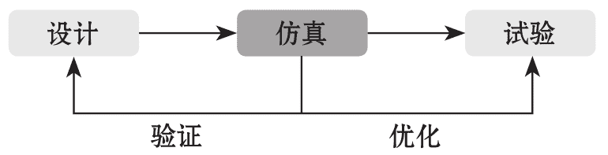
图 1-1 计算驱动范式：设计—仿真—试验

计算驱动范式与理论驱动范式的本质区别在于引入了计算机技术进行仿真分析。除了 CAE，数字化仿真涉及复杂数学模型、大规模数据处理与高性能计算。随着硬件、算法、并行计算与云计算发展，仿真从局部单维度扩展到整机多物理场耦合。

以电动汽车动力电池包为例，研发需整合电化学、热力学、流体力学、固体力学模型，解决充放电过程中的热失控、振动碰撞下的结构应力、以及老化衰减与健康状态预测等多重问题。芯片纳米工艺仿真、发动机热应力仿真也是多物理场耦合的典型场景。

总体看，有限元方法体现了数学理论与工程需求的双向驱动，是计算驱动范式的基础。未来有限元与 AI 及多尺度物理场的融合将打开更广阔空间。

## 1.4 数据驱动范式

企业组织架构可追溯至亚当·斯密分工理论，规模扩张带来部门目标割裂、责权不清。同时早期信息化建设缺乏统一规划，各部门选用异构系统，数据格式与接口不兼容，形成数据孤岛，导致产品开发流程断裂。映射到“设计—仿真—试验”环节：设计端用 CAD 工具如 PTC Creo、Dassault CATIA、Siemens NX 创建三维模型；仿真端需格式转换后导入 CAE 软件如 ANSYS 进行分析，产生冗余与一致性问题；试验与仿真各自进行，结果无法实时回传，形成单向流程而非闭环。

IBM、麦肯锡、微软等提出数字化转型，用数字化手段破解效率瓶颈、流程割裂、数据孤岛与决策滞后。核心价值在于把数据变为生产要素，构建覆盖产品与业务全价值链的数据流，推动企业从经验驱动走向数据驱动，实现研发范式与商业模式升级。

数据驱动范式的本质是以数据为核心生产要素，通过采集、建模、分析实现业务优化与决策支持。核心特征是数据实时性与闭环反馈。该范式高度依赖数字化成熟度，呈现阶段特征。可分为数据支撑决策的初级阶段与数据驱动执行的进阶阶段。以工程变更为例，多数企业花费巨资推动变更落地到工艺、制造、供应链，最终仅靠聚合变更数据生成 BI 报表，人工制定改进策略。而数据驱动执行则由数据直接触发自动化决策，实现实时闭环与跨域协同，前提是产品数据流形成闭环。目前多数制造企业正处于从支撑到驱动的跃迁期，关键在打破组织壁垒与数据孤岛。

互联网与移动技术的发展让双 11 等海量数据处理能力引发关注，“数据治理+中台”迅速成为制造业数字化焦点，部分企业设立首席数据官 CDO 统筹数据资产。但不少企业陷入脱离业务的纯治理误区。制造业数据类型繁杂，包含结构化、非结构化、时序、非时序、三维几何、二维图纸、技术文档，以及 PLM 与 ERP 的多源异构数据，逻辑关系错综复杂。脱离业务的治理易沦为技术表演，企业深陷数据泥潭，如同只治标不治本。数据治理的成败不在于建多少数据湖或数据字典，而在于研、产、供、销、服等业务是否得到有效数字化治理。

为消除内外数据孤岛，数字主线 Digital Thread 被引入架构。它区别于数据中台，以业务应用为最终目标，在统一技术与模型架构下，面向产品全生命周期与全价值链构建持续闭环的产品数据流，实现跨系统、跨领域无缝链接与可追溯。数字主线由美国空军 USAF 与洛克希德·马丁在 2003 年 F-35 闪电 II 战斗机项目中提出，首次打通三维 CAD 与 CNC 数控数据，提升设计制造协作效率。2013 年美国空军在“全球地平线”规划中正式将其列为颠覆性技术。随着工业互联网兴起，数字主线将数据流延伸至物理产品阶段，形成完整闭环。PTC 将基于模型的闭环数字主线纳入战略，并依托工业互联网平台 ThingWorx 推广。

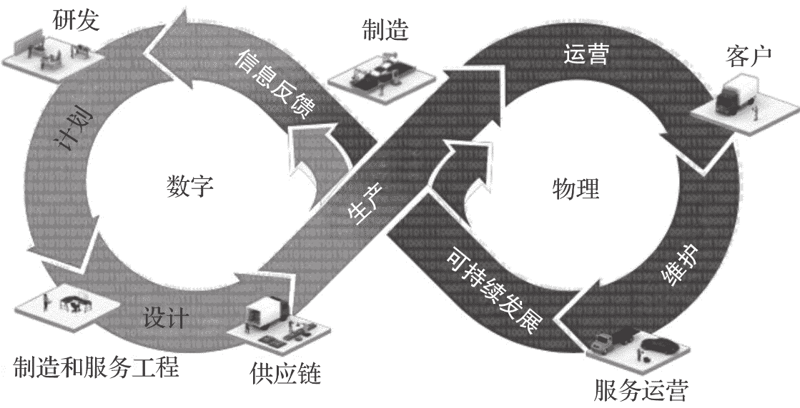
图 1-2 基于模型的闭环数字主线理论 ^(⁶)

全球风机制造商维斯塔斯 VESTAS 与 PTC 合作，以 PLM 为核心打造覆盖设计、制造、服务的闭环数字主线，整合 CAD、PLM、材料科学等多领域数据，实现跨系统协同，构建产品设计—材料循环—客户价值的全链条数字化体系与全流程追溯。借助数据驱动设计优化，研发周期缩短 25%，材料回收率提升至 90%；服务端利用数字主线预测维护需求，设备故障停机率降低 30%。该案例是当前最系统、最具借鉴价值的标杆。

时至今日，数据驱动范式已覆盖研发、制造、供应链、售后服务全链条，可显著提升运营效率与竞争力。企业需通过战略规划、技术投入与生态合作克服数据质量、技术适配、组织变革等挑战，以业务为导向、以数字主线为基础，通过业务与组织双重变革实现从数据支撑到数据驱动的跨越。

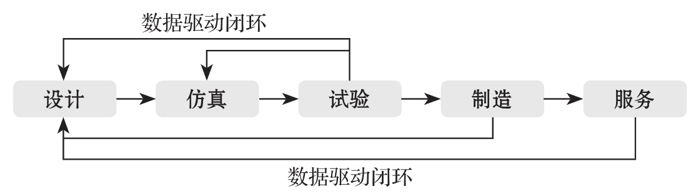
图 1-3 数据驱动范式

## 1.5 AI 驱动范式

六十年代开始，制造商把早期 AI 用到工业机器人和基础自动化上，处理装配、零件搬运、分拣这类高重复度的人工任务，核心目标是提高生产率和效率。八十年代兴起的专家系统是当时最具代表性的形态，本质是基于规则的知识库，通过模拟人类专家的决策逻辑来解决特定领域的复杂问题。此后数十年技术跨越，AI 在制造侧的渗透不断加深，规模化应用大致可分为三个阶段。

阶段一 规则自动化与初级感知 约 2010 年前
这一阶段以规则驱动和有限数据分析为主，更多是作为人的决策辅助。技术底座是专家系统与简单的统计模型如逻辑回归、决策树，主要解决重复率高、规则明确的生产问题。比如基于机器视觉的自动质检可替代人工目检，识别电子元器件表面的划痕；基于固定规则的排程系统可优化资源分配。但系统高度依赖人工预置规则，灵活性不足，面对设备参数突变或供应链波动时应对乏力，数据利用率低，也尚未形成结果回流再优化的闭环。

阶段二 数据驱动的智能化 约 2010 年初至 2020 年初
2013 年德国汉诺威工业博览会提出工业 4.0，带动制造业智能化改造浪潮。随着机器学习与工业物联网成熟，AI 开始深度嵌入业务流程。传感器实时数据与生产系统联动，推动了预测性维护与供应链动态优化落地，例如西门子利用振动数据预测电动机故障，算法结合需求波动实时调整库存水平。技术特征是随机森林、支持向量机等模型的训练，并尝试打通 MES、ERP 等系统的数据孤岛。局限是模型泛化能力有限，往往需针对单条产线定制开发，像设备维修策略这类复杂决策仍需人工拍板，未实现全链条智能。

阶段三 全链路智能化 2022 年至今
以深度神经网络、生成式 AI 与数字孪生为代表，AI 逐步成为制造的核心驱动。以 CREO 生成式设计为例，可在给定约束下自动产出适配不同加工方式的零部件方案；数字孪生平台能实时映射物理工厂，模拟运营并支持预测性维护；大模型还能参与代码生成与工艺优化，如半导体制造中的缺陷根因分析进而微调工艺与设备参数。这一阶段具备跨域协同、自学习与动态适应能力，但也面临数据安全、算法偏见、高算力成本等挑战，落地必须与组织变革同步。

关键拐点是 2022 年 11 月 30 日 OpenAI 发布可对话的通用大语言模型 ChatGPT，标志 AI 进入可交互时代。2025 年 1 月 20 日 DeepSeek R1 发布，免费开源、推理强、可本地部署的特点迅速点燃制造界热情，业内普遍将 2025 视作制造侧 AI 的爆发起点。

当前数字化面临的瓶颈是海量离散数据与日益复杂的产品系统已超出个人经验与计算能力的边界。生成式 AI 突破后，以 ChatGPT、DeepSeek 为代表的大语言模型重塑制造逻辑，推动行业从传统经验驱动转向数据-算法-生态协同驱动的第五范式，即 AI 驱动范式。其核心是以智能为引擎，通过数据与模型的深度融合，实现产品与业务的智能化、自动化与人机协同，加速转型升级。

数据驱动与 AI 驱动都以数据为基础，但逻辑与实现差异显著。AI 驱动通过智能化判断、动态适应与人机协作，突破了传统数据驱动的局限，从被动分析走向生成式决策。主要分野如下：

从预设规则到自主动态决策。传统方式依赖预设规则与静态模型，需要人工定义关联关系。AI 驱动借助深度学习、强化学习进行动态建模，自动挖掘数据隐含规律并实时生成优化策略，例如预测设备故障后自主调整维护计划，供应链中断时可自行重排产能并切换物流路径。特斯拉工厂在芯片短缺时，AI 系统自动修改车型配置并重编程产线，减少了停工损失。

从单一分析到多源融合。传统做法多处理结构化数据，维度单一。AI 驱动可整合文本、图像、声音等多源信息形成全局认知，例如结合设备异响、振动数据与现场影像判断故障类型，并能利用大语言模型基于工况数据生成关键零部件新设计方案并仿真验证。

从经验依赖到持续自进化。传统模型更新需人工重新训练，难以及时响应变化。AI 驱动可通过增量学习、迁移学习实现自进化，新设备接入后自动适配数据特征，并将执行结果实时回流修正偏差，如质检误判案例自动进入训练集优化模型。

从辅助决策到人机共生。传统分析结果仅供参考，补货量仍由人决定。AI 驱动在给出分析的同时提供可解释建议与具体数值，人员在此基础上做价值权衡，并通过语音、增强现实等工具实现双向协作，方便新增或对比采购策略。

从局部优化到全局重构。传统思路聚焦单环节，如提升某台设备的综合效率。AI 驱动打通设计、生产、服务等环节，实现全链路协同与整体最优，并支持生态级创新，如主机厂与电池供应商联合训练缺陷预测模型。

由表 1-1 可见，AI 驱动范式并非数据驱动的简单升级，而是通过“AI 智能体—人类—环境”的三元互动重新定义制造价值创造方式。

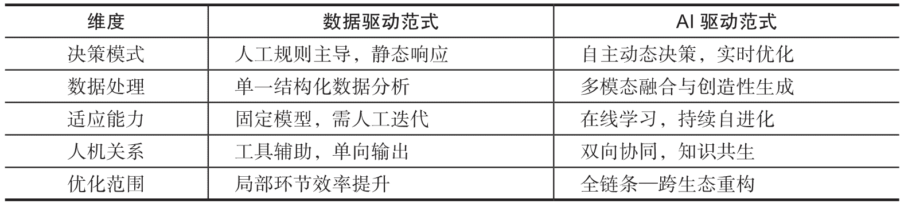

AI 驱动范式标志着研发从人类主导迈向人机共生，通过数据与智能深度融合解决效率瓶颈与复杂性难题。目前仍处萌芽期，企业需要在数据、技术、成本、人才、战略五个维度协同突破，且多数企业数字化基础仍需补齐。只有多维攻坚，赋能才能从局部试点走向全链贯通，释放长期价值。

# 第二章
# AI 进化史：从规则到生成

## 2.1 AI 四次浪潮回顾
AI 是研究和开发能模拟、扩展或增强人类智能的计算机科学分支，涵盖机器学习、深度学习、自然语言处理、计算机视觉、专家系统等。从图灵提出图灵测试的哲学思辨，到 ChatGPT 引发全球认知讨论，七十年间经历了四次浪潮：符号主义规则驱动、知识驱动专家系统、数据驱动深度学习、人机共生认知智能。这场演进重塑了机器理解世界的方式，也改变了人机关系。

1. 第一次浪潮 20 世纪 50 年代至 70 年代 规则驱动的符号主义
图灵被视为奠基人之一，1936 年提出图灵机，1950 年提出图灵测试，1956 年达特茅斯会议确立 AI 学科。此阶段靠明确逻辑与形式化规则模拟思维，代表作是 1966 年的聊天机器人 ELIZA。像数学家在封闭规则里精准，却难以应对现实的模糊与复杂，甚至无法解决 XOR 这类基础非线性问题，因知识表示瓶颈陷入第一次寒冬。

2. 第二次浪潮 20 世纪 80 年代至 90 年代 知识驱动的专家系统
在符号框架下转向知识工程，把专家经验系统化编码。1976 年斯坦福团队的 MYCIN 医疗诊断系统用 450 条规则和确信因子，判断血液感染病原体准确率达 69%，高于当时医生平均 55%，因复杂且透明度不足未规模化临床。1980 年卡内基梅隆为 DEC 开发的 XCON 配置专家系统是 80 年代最具代表性的商业化里程碑，含超 2500 条规则覆盖硬件参数、兼容性与优化策略，订单配置准确率超 95%，年节约约 2500 万美元。

架构由知识库、推理引擎、人机接口组成，像图书馆管理员遍历规则。该范式很快遭遇困境：知识获取瓶颈需大量知识工程师维护；规则库膨胀后维护成本指数增长，日本第五代计算机计划耗资 4 亿多美元因规则冲突失败。1997 年 IBM 深蓝击败卡斯帕罗夫是最后高光，但人类隐性知识难以完全形式化，为深度学习埋下伏笔。

3. 第三次浪潮 21 世纪初至 10 年代 数据驱动的深度学习
GPU 并行算力与互联网数据爆炸推动连接主义复兴。神经网络自动从原始数据提取抽象特征，摆脱手工特征设计。2012 年 Hinton 团队的 AlexNet 在 ImageNet 用卷积神经网络把图像识别准确率提升约 41%，标志深度学习崛起。此后广泛应用于视觉、语音、自然语言处理。2016 年 DeepMind 的 AlphaGo 结合深度强化学习击败围棋世界冠军李世石，证明复杂策略探索能力。

特征有三：架构从全连接 MLP 到 CNN 再到 LSTM，最后由 Transformer 的统一注意力实现多模态融合；规模从 AlexNet 的 6000 万参数激增至 GPT-3 的 1750 亿，涌现上下文学习；工业化渗透研产供销服，机器视觉质检准确率可达 99.5% 以上。据分析，2016 年中国计算机视觉市场 11.4 亿元，2020 年达 406.3 亿元，年均复合增长率 144.3%。局限在于数据饥渴与黑箱可解释性差。

4. 第四次浪潮 21 世纪 10 年代至今 人机共生的认知智能
以 Transformer 为核心的大模型推动文本生成飞跃，2022 年 ChatGPT 发布标志生成式 AI 进入实用化。生成式 AI 通过训练模拟规律，创造文本、图像、声音、视频、代码等内容，从分析转向创造。以人机协作认知革命为核心，本质是智能从感知智能向认知智能的跃迁。

驱动有三：大语言模型的涌现能力，参数、数据、算力达临界后出现推理、代码生成等新能力。2023 年发布的 GPT-4 通过思维链与指令微调，数学推理能力较 GPT-3 提升 40%，在 2023 年美国律师资格考试平均得分 75%，高于人类平均 68%，排名超过 90% 考生。

多模态统一建模：2017 年 Google 团队提出的 Transformer 自注意力机制让编解码并行，打破时空限制。2021 年 OpenAI 的 CLIP 把文本与图像映射同一向量空间实现跨模态对齐。2022 年 Stability AI 的 Stable Diffusion 可在文本引导下生成高清图像视频。两者代表理解与生成里程碑。

具身智能强调智能体通过机器人、无人机等实体与环境动态交互，实现感知、决策、行动闭环。生成式 AI 的多模态感知与自主决策重塑边界。2024 年特斯拉发布的 Optimus 手部集成高精度触觉传感器，可感知形状、硬度、操作力度。基于 FSD 芯片的多模态视觉系统实时构建 3D 环境模型识别零件位姿，触觉与视觉结合实现螺丝拧紧力度的动态控制。融合生成式 AI 的具身智能推动制造从机械执行向人机共融跃迁，渗透柔性制造、精密装配、物流协同。

认知革命重定义创造力归属，据预测 2025 年 AIGC 将占全球数据流量约 10%，人类从决策者变为协作者，机器从执行者进化为思考者。

## 2.2 机器学习解析：五大要素
机器学习是人工智能的核心分支，通过算法使系统从数据自动学习规律并进行预测或决策。其本质是让计算机从海量信息中提取规律模拟人类学习，摆脱人工编码规则依赖。

五大要素构成闭环：数据是基石，提供结构化如传感器读数和非结构化如图像文本素材；特征是精炼表达，通过特征工程把原始信息转为机器可理解的量化指标，影响规律捕捉能力；模型是核心载体，是输入输出映射的数学函数，从线性回归到深度神经网络对应不同抽象层次；损失函数起监督作用，用均方误差、交叉熵等量化预测与真实偏差，为优化提供方向；优化算法如梯度下降则像智能导航，通过迭代调整参数在解空间寻找损失最小的最优路径。

认知闭环：数据如何长成决策

整个认知链条是环环相扣的闭环。原始数据先过特征抽取进入模型，模型给出结果后由损失函数打分，优化器据此刷新参数，最后把“数据进来、智能出来”的回路跑通。传统机器学习里最吃重的就是特征工作，通过清洗、构造、挑选等手段把粗糙的表征提炼成模型能读的高质量信号。目的在于提高信息浓度，压制噪声、冗余、缺失带来的干扰，进而提升泛化与可解释能力。汽车零部件检测就是一个典型，项目里搭建了327维的表征体系，兼顾几何、纹理、频域等多角度，从多维度对部件质量做全面筛查。

按数据的用法，学习范式大致分三类。

**●有监督式学习**。用带标签的样本训练模型，让它学会输入到输出的映射，进而对新样本做预测或分类。目标是让模型对未知数据给出靠谱判断，关键在于训练集自带标准答案，模型不断调参缩小预测值与真实标签的差距。落地常见两类任务。分类把样本归入预设的有限类别，比如质量缺陷分级借助预训练模型识别缺陷特征后自动归类。回归则预测连续数值，比如备件需求预测基于历史消耗、设备运行状态、故障率、季节波动、生产周期等要素推算未来需求，用来优化库存。

**●无监督式学习**。在没有标注的数据里自主挖掘隐藏结构与关联，核心是让算法自行探索数据的内在规律。最大难点是在缺乏显式监督信号时揭示分布本质。数据集只有输入表征，不预设输出，这让它很适合探索性分析与未知模式挖掘，在标注稀缺、规律未知的工业场景里价值突出。工业缺陷检测与设备健康管理是典型方向。设备健康管理通过分析振动、温度等运行数据的异常波动实现早期预警与维护决策优化。无监督缺陷检测的最大优势是不需要缺陷样本库，仅靠正常样本即可识别异常，适用于良品率高、缺陷类型未知的场景，如PCB板焊点虚焊、半导体晶圆表面微裂纹、芯片封装气泡等。

**●强化式学习**。智能体与环境持续交互，以累积奖励最大化为目标的决策学习范式，本质是试错式学习，依据行动后的奖励或惩罚信号调整策略，无需标注数据。ChatGPT、DeepSeek等对话界面里用户对回答的“喜欢”“不喜欢”反馈就是典型优化。工业侧，强化式学习为生产调度、流程优化、质量控制、设备预测性维护等复杂决策提供自适应方案。例如基于实时订单、设备状态、供应链波动构建决策模型，智能体在设备故障、原材料延迟等不同状态下选择最优调度动作，动态优化排程，提升产能利用率。

## 2.3 深度学习：以神经网络为核心的认知跃迁
深度学习属于机器学习分支，以深层神经网络为核心模拟人脑神经元，实现表征的自动学习。它是人工智能的一次重大革新，多层网络的突破让计算机不仅能“看图”“听声”，还能从海量数据中自主提炼规律并创造内容。诺贝尔物理学奖得主霍普菲尔德与欣顿的研究证实，人工神经网络通过仿生结构为AI奠定了物质基础。

### 2.3.1 深度学习从实验室到产业的三段跃迁
发展轨迹可用三个阶段概括。

1.早期神经网络：从简单模仿到自我纠错
20世纪40年代受生物神经元启发出现的感知机，结构过于简单，难以学习多层表征，也缺乏有效训练手段，在当时算力限制下只能处理线性分类，如判断图像是否含垂直线条，却无法识别手写数字。直到1986年反向传播算法诞生，神经网络才具备自我纠错能力，通过计算预测与真实值的误差逐层调整权重，逐步收敛。例如训练猫狗识别网络时，算法会不断修正各层参数直至输出与标签一致。

2.深度学习的爆发：三大关键推动力
真正爆发始于2012年，三大要素成熟共同推动革命。
**●算力跃迁：图形处理器的并行革命**。CPU难以满足神经网络的海量计算，NVIDIA GPU原本用于游戏渲染，其并行能力恰好适配矩阵运算。例如早期模型训练需数月，换上GPU后可压缩至数天。
**●算法创新：突破深度瓶颈**。传统深网堆叠层数虽提升性能，却受梯度消失、训练效率低困扰。2012年AlexNet在ImageNet竞赛中以多层卷积网络实现端到端自动表征提取，从边缘到纹理再到物体部件，关键创新包括ReLU缓解梯度消失、随机失活抑制过拟合。后续创新向强化学习、网络深度、Transformer自注意力等方向延伸，让模型既深且高效。
**●大数据供给：海量燃料**。据IDC统计，全球数据产生量从2016年的16.1ZB增至2024年的159.2ZB，年均复合增长率约33%。图像、文本等数据为训练提供充足素材，研究表明数据量增10倍带来的性能提升常超过算法优化。

3.历史性突破：三大里程碑
**●AlexNet 点燃革命2012年**。多伦多大学团队凭借AlexNet将ImageNet错误率从26%降到15.3%，标志深度学习时代开启。核心在于GPU加速训练与随机失活正则化，首次证明深层网络可高效处理海量数据，打破手工特征主导格局，推动工业质检、人脸识别转向端到端学习，五年内全球AI论文数量激增300%。
**●AlphaGo AI出圈2016年**。DeepMind的AlphaGo以4比1战胜世界冠军李世石，展现深度强化学习的战略推演力。策略网络、价值网络与蒙特卡洛树搜索结合，在361点棋盘上探索远超宇宙原子总数约10⁸⁰的可能性空间。“神之一手”第37步让公众直观感受到AI创造力。此后技术在机器人控制、金融交易等领域落地，例如谷歌数据中心借此优化制冷，节能效率提升30%，年节电超1亿度。
**●Transformer 统一架构诞生2017年**。谷歌提出的Transformer以自注意力机制革新序列建模，能并行处理输入各位置关系，替代RNN串行模式，训练速度提升约9倍。其衍生模型BERT、ViT、DALL·E实现多模态统一。例如医疗中ViT分析CT时可同步读取影像报告，肺癌诊断准确率从89%提升至98.9%。如今Transformer已成为GPT、LLaMA等大模型的基石，开启预训练加微调的工业化生产时代。

### 2.3.2 深度学习的工作逻辑：分层、贯通、可解释
1.分层表征学习：像剥洋葱一样逼近本质
深度学习通过分层处理逐层抽象，以图像识别为例。
**●基础层边缘检测**。底层神经元像视觉侦察兵，捕捉像素级简单表征如竖线、横线、斜线，对应图像轮廓。
**●中间层部件组合**。网络加深后低层表征组合成更复杂结构，识别汽车时第二层可能把线条合成圆形车轮、矩形车窗，第三层进一步整合为车门、车灯等部件。
**●高层语义理解**。最深层综合局部信息形成全局认知，不仅判断图中是否有车，还能区分SUV与轿车，甚至推断行驶或静止状态。
**●工业案例**。特斯拉自动驾驶用8个摄像头捕捉画面，底层识别车道线与交通标志，中层判断车辆与行人相对位置，高层决策变道或刹车，全程无需人工规则定义。

2.端到端学习：从原始输入到决策的直通车
传统机器学习需先人工设计表征再训练模型，而深度学习实现从原始数据到最终输出的无缝衔接。
**●传统断裂**。工业质检中工程师需先设计缺陷面积、纹理对比度等表征，再用SVM分类，表征设计常占项目70%时间，且难以处理微裂纹等复杂缺陷。
**●深度革新**。端到端模型直接接收原始图像，卷积层自动提取表征，全连接层直接输出分类结果。例如某手机屏幕检测系统使用ResNet-50，将人工表征法的漏检率从7%降至0.3%，检测速度提升20倍。
其优势体现在：减少人工干预，降低技术门槛；捕捉隐性规律，发现人类难以描述的微观纹理分布；跨场景泛化，同一模型小幅调整即可适配不同产线。

3.从知其然到知其所以然：打开黑箱
可解释性技术让AI决策更透明。
**●因果增强**。最新研究嵌入物理定律约束输出，如预测飞机油耗时，若模型给出负油耗等违背常识结果，系统会自动纠错并追溯源头。
**●注意力可视化**。机器翻译中Transformer会生成注意力权重热力图，例如翻译“我爱人工智能”为“I love AI”时，可清晰看到“爱”与“love”、“人工”与“AI”的强关联，揭示跨语言映射逻辑。
**●Grad-CAM热力图**。医疗影像诊断中可高亮模型判断肺炎的关键区域如肺部毛玻璃影，医生能直观验证AI是否关注合理区域。
分层学习让AI如人类般从细节到整体理解世界，端到端学习把复杂流程简化为输入输出管道，可解释性则为决策提供可追溯的思维导图，共同构成机器认知体系。

### 2.3.3 深度学习重塑的三大前沿战场
得益于算法、算力与数据，深度学习已从实验室走向工业质检、医疗影像、新材料等大规模落地。
1.计算机视觉：让机器拥有火眼金睛
卷积神经网络自动提取边缘、纹理等局部表征，结合池化降维与全连接分类，实现端到端视觉理解。特斯拉工厂视觉质检系统以2000件/小时速度检测零件缺陷，漏检率低于0.01%，远超人工300件/小时、漏检率5%~10%。消费端支付宝刷脸支付误识率仅百万分之一，背后是毫米级五官定位。医疗上AI诊断糖尿病视网膜病变准确率达97%，缓解偏远地区医生短缺。

2.自然语言处理：打破语言壁垒
Transformer突破让机器真正理解语言。谷歌翻译覆盖133种语言互译，质量接近专业译者。GPT-3可根据关键词生成新闻稿、诗歌、代码，美国某报社已用于自动生成体育简讯。Zoom实时字幕翻译让跨国会议几乎无延迟，字幕延迟小于0.3秒。挑战在于模型可能生成偏见内容，Meta等公司正推进价值观对齐技术。

3.科学发现：AI成为科研加速器
AI4S即深度学习与传统科研融合，通过数据驱动与跨学科协作解决高维计算、复杂系统模拟难题。DeepMind AlphaFold2破解困扰生物学50年的蛋白质折叠问题，预测2亿多种蛋白质结构，精度达原子级，使艾滋病疫苗研发周期缩短3年。美国劳伦斯伯克利国家实验室的A-Lab自动化材料合成平台结合AI与机器人，Nature2023年论文显示其17天运行实现58个目标中的41种新化合物，包括多种氧化物与磷酸盐。这些突破证明AI不仅是工具，更是拓展人类认知的共研伙伴。

## 2.4 大语言模型：从规则模仿到泛化智能的跃迁
大语言模型是一种基于深度学习的自然语言处理技术，通过海量文本训练超大规模神经网络，具备理解、生成与推理人类语言能力。ChatGPT、DeepSeek、通义千问是典型代表。LLM重新定义“智能”：从依赖人工规则的模仿智能迈向基于海量数据与自学习的泛化智能，变革体现在架构、认知、应用与伦理层面。

### 2.4.1 架构革命：由教思考到自思考
早期专家系统依赖人工编写规则，如手写翻译或诊断规则，像教孩子背答案，遇到网络新词或罕见病症即失效。
2017年Transformer的自注意力机制带来转折，模型能同时关注一句中所有词的关联，例如看到“苹果股价上涨”会并联公司与水果含义，再通过上下文抉择。
LLM采用预训练加微调：先在大规模互联网文本上学习语言规律，类似博览群书，再针对写作、编程等任务微调，实现通才与专才兼备。GPT-3训练时“读过”近乎整个英文互联网，能生成流畅新闻稿并模仿莎士比亚十四行诗，无需单独教学。
Transformer已成为操作系统级创新，不仅带来ChatGPT-4o多模态生成效率提升300%等性能突破，也通过模块化设计推动混合专家MoE算力优化与因果推理可解释性增强等生态创新。

### 2.4.2 认知跃迁：从鹦鹉学舌到思维涌现
传统语言模型像高级复读机，只能在训练任务上表现。
LLM具备三大超能力。
**●零样本学习**。模型在未见特定类别样本时仍能推理，例如让模型把一段文字改写成小红书风格，可直接生成合理结果，无需额外训练。
**●思维链**。通过分步推理解决复杂问题，模拟人类把问题拆解为逻辑子步骤再推导，提升复杂任务推理与可解释性。例如问“小明有5个苹果，吃了2个又买了3个，现在有几个？”模型会逐步输出“5-2=3→3+3=6”。
**●跨模态融合**。GPT-4等模型整合文本、图像、音频、视频信息，模拟多感官协同认知。例如给一张冰箱照片，模型可推测家庭人口结构并推荐菜谱。

这些能力并非开发者事先硬编码的结果，而是在参数规模跨越千亿级别后自然涌现的现象。这种宏观跃迁契合了诺贝尔奖得主菲利普·安德森提出的“多即不同”论，即复杂系统一旦越过临界点，整体便会表现出微观层面无法推导出的新属性 ^(¹³)。正如蚂蚁个体自组织出蚁群智慧，LLM 在庞大连接中自行生成了高阶认知能力。

### 2.4.3 应用重塑：从工具到企业数智中枢

大语言模型正突破单一助手角色，逐渐成为企业运行的数智神经网络。这种变革远超出效率提升，触及产业逻辑、知识传播与公共治理的底层架构，其影响可比肩电力或互联网普及。

1. 产品研发：由经验主导转向智能主导
LLM 系统性重构研发全周期，形成提效与创新双轮驱动。

**●流程重塑带来提效**。传统研发沿需求-设计-开发-测试线性推进，环节割裂迭代缓慢。依托数智主线的协同模式打通全链工具链：需求环节，LLM 自动生成用户需求与功能原型；开发环节，结合知识图谱与研发流程实现智能设计与跨专业协同；仿真环节，利用 AI 构建虚拟原型，实现零物理样机，虚拟试验替代实物试验；运维环节，通过数字孪生预测故障与风险。各环节数据实时汇回产品数字主线，推动跨团队并行协作，提升设计协同效率并缩短上市周期。

**●设计优化带来创新**。传统设计依赖专家经验、主观判断与历史数据，易受认知偏差与固化思维限制。新范式借助用户画像分析、多模态物联网数据融合、多物理场虚拟试验等手段，结合机器学习深度挖掘海量用户数据，精准捕捉真实需求与体验断点，实现功能迭代的量化验证与动态优化。实时反馈闭环使决策更客观前瞻，并通过个性化推荐持续改善体验，最终形成以数据为燃料、以智能算法为引擎的持续优化体系，提升市场竞争力与用户满意度。

2. 生产流程再造：从人力替代到价值创造

**●人机协作**。特斯拉 Optimus 融合 LLM 与多模态感知，实现从接受指令到自主决策的跨越，提升任务泛化能力，推动具身智能在工业与家庭场景落地。工厂里，Optimus 解析“电池分拣”任务后自主优化抓取路径与分拣顺序，日均积累数千条动作数据用于模型迭代；工人可用自然语言指挥机器人，大幅缩短操作培训时间。

**●智能排产**。LLM 聚合 ERP 订单、IoT 设备状态、新闻社媒市场动态、GPS 物流等多源异构数据，实时捕捉供应链波动信号。例如分析全球供应商交货延迟率、海关清关时间异常等指标触发芯片短缺预警，实时调整生产计划，缩短交货周期。配合多目标优化算法，可实现：①交期优先，采用启发式遗传算法快速插入紧急订单，通过工序拆分释放瓶颈产能；②成本最优，结合运筹学混合整数规划计算最小换线与仓储成本的排产序列；③柔性平衡，预留 15%～30% 缓冲产能应对突发波动，并通过数字孪生验证调整方案可行性。

3. 企业软件：从菜单功能到智能工作流

传统 ERP、PLM 依赖复杂菜单导航，用户需记忆功能路径。生成式 AI 与产品开发深度融合重塑底层逻辑，从工具辅助迈向认知协作。

**●交互方式重构**。LLM 通过自然语言交互实现意图到执行的模式。例如用户输入“生成上月生产质量问题分析报表”，系统自动调用数据接口、完成分析并输出可视化报告。未来大部分工业级软件将推出 AI Chat，按角色与设计上下文实时推送专家知识，并自动执行数据查询、任务校验、合规审查等工作，大幅简化操作、提升效率。

**●流程引擎智能化升级**。传统工作流依赖预设规则如 BPMN 标准，智能工作流引入机器学习与智能体双引擎，实现动态决策节点。例如依据生产检测结果自动分析质量根因、创建问题报告与变更建议，并按根因自动推送给相关设计师或工艺员执行改进。

**●知识融合与决策增强**。企业软件正从流程自动化迈向智能决策。通过整合多源异构数据、构建动态知识网络、嵌入智能推理引擎，重塑核心业务流程与决策优化。技术层构建“数据服务—知识图谱—决策引擎”递进架构，业务层重塑“分析-决策-执行”闭环，将知识图谱与业务流程深度绑定，打造超级大脑。例如基于采购策略与供应链知识图谱构建智能供应链动态决策优化模型，实现各环节即时调整与资源再配置，应对市场需求波动、突发事件与资源约束。

4. 消费电子：从触控交互到对话即服务

交互从触控转向对话，本质是功能载体向认知伙伴的进化。核心驱动为生成式 AI、多模态感知与实时交互，技术底座与服务化订阅商业模式已成熟，2025 年成为规模化落地元年，渗透智能家居、智能终端、服务机器人等领域。在智能家居场景，一句“我困了”即可联动关闭灯光、调低空调并启动睡眠监测；在智能终端场景，对手机说“把上周拍的宝宝视频做成生日 vlog，配《生日快乐》背景音乐”，AI 自动完成剪辑、配乐并分享至社交平台；服务机器人搭载多模态情感模型 MEM，实现实时情感感知与个性化对话，成为陪伴老人与儿童的情绪抚慰助手。

正如 CES 2025 所揭示，未来消费电子的价值不再取决于硬件参数，而在于构建情感连接与提供认知服务的能力。

总体而言，这场重构的本质是 LLM 将人类千年积累的知识转化为可编程、可调用的智能操作系统。当电力点亮物理世界时，LLM 正点亮认知世界的每个角落，其终极形态或许并非替代人类，而是成为文明延续的体外大脑。

### 2.4.4 暗礁与灯塔：伦理挑战与未来方向

人工智能快速发展推动社会进步的同时，也面临深刻伦理挑战，既是技术演进的暗礁，也是指引方向的灯塔。

1. 伦理挑战的核心暗礁

**●隐私与数据安全**。AI 依赖海量数据训练，个人敏感信息如医疗记录、位置轨迹的收集使用缺乏透明监管，暗藏泄露风险。例如某健康监测 App 因漏洞导致百万用户生理数据被非法交易，引发隐私信任崩塌，甚至催生数据黑市。

**●算法偏见与社会公平**。训练数据中的历史偏见被放大，导致系统性歧视。某银行信贷模型对少数族裔申请者通过率低于 15%，源于历史数据隐含区域经济差异 ^(¹⁴)；华盛顿大学 2024 年研究发现，采用三种最先进大语言模型对简历进行排名时均存在明显种族、性别及交叉偏见，相同条件下男性候选人 AI 初筛通过率比女性高 41% ^(¹⁵)。

**●责任归属与透明度缺失**。AI 决策过程的黑箱特性使责任界定成难题，难以区分算法缺陷、数据偏差还是用户误用。某医疗 AI 应用误诊癌症却无法追溯关键判断依据，患者索赔无门，凸显可解释性技术需求迫切。

**●就业冲击与经济鸿沟**。据高盛预测，2030 年全球 20% 岗位约 3 亿个将受 AI 冲击 ^(¹⁶)，重复性高、规则明确的白领岗位首当其冲。同时技术垄断与区域资源分配失衡形成双向强化恶性循环，加剧经济鸿沟。例如全球 70% 云端算力被谷歌、微软等五大科技企业控制，85% AI 核心专利由全球前 20% 企业掌握，形成技术壁垒与数据霸权。高技能劳动力借助人机协作提升生产率，而欠发达地区低技能岗位因替代加速消失，形成技术寡头与数字难民分化。

**●技术滥用与安全失控**。深度伪造可伪造政客演讲煽动暴乱；自主武器系统可绕过人类授权发动攻击；AI 生成虚假学术论文污染科研体系。技术双刃剑效应已显现，威胁社会稳定与人类文明底线。

2. 面向未来的治理灯塔

面向未来 AI 治理需构建多维度协同框架，以动态平衡技术创新与伦理安全为核心。

**●法律与监管框架**。欧盟推出全球首部全面监管人工智能法规——《人工智能法案》，2024 年 8 月 1 日正式生效，按风险分级严控 AI 应用，禁止社会评分与实时人脸识别滥用，设立千万欧元级罚款倒逼企业合规；中国推出算法备案制，要求推荐系统公开基础逻辑，用户可拒绝对其画像的数字囚笼。

**●技术伦理嵌入**。可解释 AI 通过可视化热力图揭示医疗诊断模型关注区域，医生可追溯判断依据；联邦学习技术让多家医院联合训练癌症预测模型，数据可用不可见，隐私泄露风险降低 90%，推动跨机构知识共享。

**●跨学科共治生态**。新加坡 AI 伦理咨询委员会融合法律、伦理、技术专家，对自动驾驶事故责任提出算法贡献度评估模型；德国工会与企业共建人机协作培训中心，工人学习 AI 运维技能，制造业转型失业率降至 2.3%。

**●全球化协同治理**。联合国教科文组织制定《AI 伦理全球指南》，建立跨境数据流通白名单机制，发展中国家可合规获取气候预测等公益模型；MIT 与非洲高校共建低功耗 AI 实验室，本地化训练疟疾检测模型，准确率超 95%。

**●可持续价值导向**。绿色 AI 利用蒸馏技术将千亿参数模型压缩至 1/10 规模，训练能耗降低 76%。微软 Azure 承诺 2030 年实现 AI 业务碳中和；印度 AI 普惠计划为盲人开发声纹导航系统，日均服务超 50 万人次，技术红利首次覆盖弱势群体。

大语言模型带来的不仅是技术升级，更是认知范式颠覆。智能可通过数据驱动自发涌现，而非必须依赖人类预设规则。此变革正重塑教育、医疗、科研等社会根基，也带来前所未有伦理挑战。正如印刷术催生文艺复兴、蒸汽机引发工业革命，LLM 或将开启人机共生新纪元：人类不再是唯一智能主体，而与 AI 共同进化。如何驾驭这场革命，将是 21 世纪重大文明课题。

## 2.5 技术关联与协同进化

机器学习、深度学习与大语言模型是人工智能发展的三个阶段，如同进化树上分支，既层层递进又相互融合。如图 2-1 所示，深度学习和大语言模型都属于机器学习范畴，深度学习是利用深度神经网络进行机器学习的方法，而大语言模型则是基于 Transformer 架构的预训练深度学习模型。三者协同进化不仅推动技术能力跃升，更重新定义人与机器协作模式。

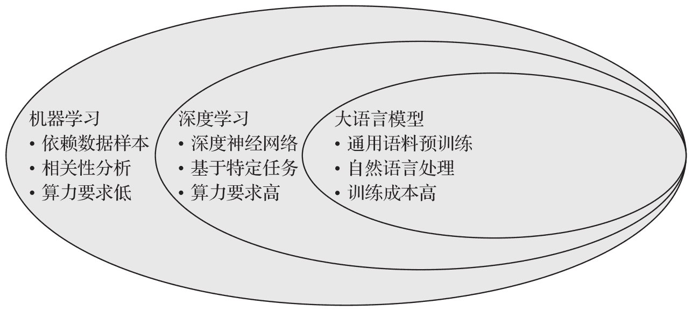
图 2-1 机器学习、深度学习和大语言模型的关系

制造业真正大规模应用 AI 技术始于机器学习。工业 4.0、智能制造与工业互联网的兴起为其规模化提供数据土壤，低算力需求与基于特征的相关性分析在生产制造与服务运维中成效显著。而深度学习通过多层神经网络自动提取数据特征，解决了传统机器学习的特征工程难题。同时，可模拟人脑神经网络如 CNN、RNN，处理图像、语音、文本、视频等高维非结构化数据。深度学习算力需求较高、计算耗时，主要应用于大型科研项目。以战胜李世石的 AlphaGo Lee 为例，其分布式架构采用 1202 个 CPU 与 176 个 GPU，单次对弈电费高达数千美元。

在此背景下提出预训练模型思想：先在大规模数据集上预训练获取通用知识，再通过微调适配具体任务，大幅降低深度学习对数据与算力的门槛，也催生了大语言预训练模型。LLM 经预训练成为具备基础科学知识的“大学生”，再进入企业实习微调，成为“行业专家”。

机器学习、深度学习与大语言模型构成从基础理论到规模化应用的技术链。三者协同进化体现算法、数据、算力的相互促进，也揭示技术发展与社会需求双向驱动。未来该生态将在多模态融合、伦理治理、能源效率等方向持续突破，推动人工智能从工具性智能迈向通用人工智能 AGI。

# 第三章 数字化转型的底层逻辑：四层驱动模型

## 3.1 数字化转型的概念及提出背景

企业数字化转型概念最早由 IBM 公司于 2012 年提出，核心强调通过应用数字技术重塑客户价值主张、增强客户交互与协作。其本质是通过技术工具与组织变革深度融合，解决传统企业效率、协同、决策与创新的底层问题。核心价值在于将数据转化为生产要素，推动企业从经验驱动向数据驱动跃迁，最终实现商业模式可持续迭代。

20 世纪后期，随着计算机与信息技术普及，制造业大规模引入 PDM/PLM、ERP、MES 等企业级信息系统，这些承载核心数据与业务的系统被称为数据源系统。随着信息化推进，企业不断新增数据源系统，形成一个又一个烟囱式信息孤岛。叠加传统职能型组织壁垒，产品数据与业务流程在不同环节被分散割裂，成为转型升级主要瓶颈。

数字化转型正是在此背景下提出，核心在于破解数据孤岛及由此引发的效率瓶颈、业务模式僵化与决策滞后，具体体现为：

1. 打破数据孤岛，实现全链条协同
传统各部门数据割裂，转型通过建立统一产品数字主线，打通研发、生产、售后等环节数据壁垒，提升上下游协同效率。打造数字主线的两大逻辑为纵向集成与横向贯通。纵向集成聚焦企业内部垂直穿透，打通管理层 ERP/PLM、执行层 MES/MOM、设备层 SCADA/PLC，实现从战略决策到生产执行的端到端数据流动。横向贯通强调跨部门/组织横向拓展，连接上下游业务环节，实现以订单驱动的研发、制造、供应链全链条数据协同。

2. 优化业务流程，凸显竞争优势
借助大数据分析、人工智能等技术重构研发流程与管理模式，提升产品质量、缩短上市周期、降低研制成本。制造企业的流程重构是战略、组织、技术、文化的系统性革新，需以数字化战略为锚点，以自顶向下方法论为引导，通过战略-组织-技术-文化四维联动，推动从局部优化到全局变革。核心目标不仅是提质降本增效，更是构建面向未来的敏捷型、差异化竞争优势。

3. 从经验驱动转向数据驱动决策
在 VUCA 时代，数据驱动决策成为企业敏捷应对变化的数字神经系统。转向数据驱动本质是通过工业物联网、AI 与大数据，将碎片化经验转化为可量化、可迭代的智能知识网络。消除数据孤岛与组织壁垒，构建面向产品全生命周期全价值链数字主线，是实现数据驱动的前提与基础。通过知识图谱与实时数据融合，企业可构建自感知-自决策-自优化智能中枢，在产业链协同中重塑竞争力。掌握工业数据主权与知识网络的企业，将主导下一代制造业价值链重塑。

4. 客户需求升级与业务模式转型
从制造业视角看，客户需求升级与业务模式转型紧密互动。客户对个性化、服务化、快速响应的需求倒逼企业重构流程，推动向个性化定制、柔性制造、服务延伸与生态协同转型，实现从以产品为中心到以客户为中心的升级。而数字化转型为业务模式创新提供技术支撑与实现路径。通过工业互联网、大数据、云计算重构生产、供应链及商业模式，形成需求牵引-技术赋能-模式迭代闭环。

## 3.2 企业数字化转型历程：从流程效率到业务转型

数字化转型自提出以来经历 DX 1.0 与 DX 2.0 两个阶段。如图 3-1 所示，企业数字化转型从 1.0 到 2.0 的演进，本质是从局部流程优化向全局业务重塑的跃迁，核心逻辑可概括为效率驱动→数据驱动→价值驱动的螺旋式升级。

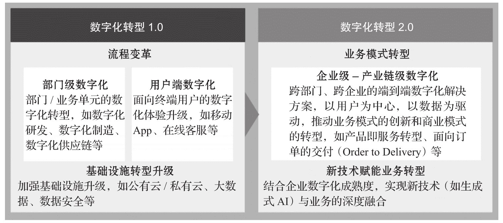
图 3-1 数字化转型从 1.0 到 2.0

数智进阶路线：1.0打基座 2.0定胜负

公司迈入数智化初期的模样常被称作 1.0。此时数智团队薄弱、整体蓝图还未成型，动作多是各部门各自试点。工作重心放在本部门内部，用技术手段和流程再造把信息壁垒拆掉，让业务环节串起来，提升处理效率、压缩运营开销。思路是先把单一部门的业务盘通，而不是一口吃下全公司级架构，实质是用局部流程的数字化为后续全链协同探路。

比如不少装备制造厂商先从研发侧做起模块化设计，借助解耦复杂系统、统一接口规范、灵活重组，形成跨专业协作的模块体系，并适配用户定制化配置，设计复用率随之上行、研发周期缩短、成本下降。电子高科类公司则常以核心数据治理为抓手，实现物料基础信息的统一管控。采购借助 MDM 平台统一物料编码和供应商信息，消除采购与仓储系统间的数据冲突，让订单与库存保持实时一致。可见 1.0 的建设重心在部门流程的在线化和优化，还未触及商业模式创新。这一阶段更偏向 IT 基础设施的升级和基础数据的采集，通过上线部门级数字化系统提升工具效能或扩展业务能力。

随着试点推进，管理层逐渐看到部门化转型的副作用——部门思维又造出新的信息孤岛。与此同时，地缘政治冲突加剧、贸易壁垒抬头、供应链频繁中断，制造业成本压力放大，传统商业模式受冲击。仅靠降本已难以维系，必须以数字化思维重塑价值链，用敏捷方式应对外部变化和市场需求，推动商业模式的升级，实现持续增长。这正是 2.0 兴起的背景，技术应用的重心从提效转向以商业模式创新驱动增长。

数字化 2.0 标志着公司由局部优化走向以战略为牵引的全局价值重塑，核心是通过数据驱动、技术融合和生态协同重构流程、组织与商业模式，形成围绕客户需求、以数据为驱动的智能生态。相较 1.0，2.0 呈现以下差异。

1.技术底座：由传统 IT 走向弹性云与智能化
●1.0 阶段。以物理服务器、专用数据库、本地化部署为主的传统 IT 为底座，聚焦信息化与流程自动化，技术多为单点工具，如基础数据分析。
●2.0 阶段。架构向云原生、微服务、容器化等灵活形态迁移，具备高扩展性和敏捷迭代能力。例如借助工业云平台的开放架构整合云计算、AI、物联网，构建智能化闭环系统。低代码开发降低了门槛，让业务部门能快速搭建应用，加速创新落地。

2.价值取向：由效率优化转向战略重塑
●1.0 阶段。数字化集中于单一部门或流程，如财务系统、生产自动化，目标是提升效率与流程标准化。但部门思维容易忽略系统性，数字化本应把价值链各环节看作动态联动的有机整体。以模块化设计为例，多数公司仅在研发内部推进，工艺、制造、采购、售后未跟上，导致模块出研发即被拆散，不仅未降本增效，反而增加下工序负担。可见 1.0 未解决信息壁垒与组织壁垒，商业模式也未质变。
●2.0 阶段。以业务战略统领，自上而下制定整体数字化蓝图，重构价值体系，实现全链条敏捷响应与价值共创。华为的 2.0 转型始于 2016 年，服务于“构建万物互联的智能世界”愿景，核心围绕“ROADS 体验”即实时、按需、全在线、自助、社交化重构业务逻辑，将数字化定位为公司级战略而非技术升级^(¹⁷)。在研发侧，华为基于 IPD 流程组建 IPMT、PMT、PDT、TDT 等跨层级跨专业的矩阵式团队，打破部门壁垒，实现并行开发，让市场与产品、战略与执行、经营与管理、开发与支持保持对齐协同。该阶段以战略为导向，通过技术与业务深度融合打破壁垒，驱动商业模式创新。

3.数据使用：由局部统计走向全链路闭环
●1.0 阶段。数据沉淀在相互隔离的业务系统，依赖点对点集成传递上下游数据。即便引入数据总线或数据中台，也因缺乏端到端价值链整合，难以形成数据驱动的业务闭环。
●2.0 阶段。数据成为核心生产要素，面向产品全生命周期构建持续动态的产品数据流，实现跨部门、跨公司的无缝流动，贯通研发、制造、供应链、服务等全价值链。华为的集成供应链 ISC 服务变革是 2.0 的标志性实践，通过端到端流程重构与数字化深度融合，提升资源配置效率，实现供应链效率跃升^(¹⁸)。美的借助工业互联网平台实现 C2M 柔性制造，从“以产定销”转向需求驱动的“以销定产”，核心在于打通研发、生产、供应链，实现订单从客户需求到交付的端到端透明管理^(¹⁹)。

4.组织形态：由职能型走向敏捷型组织
●1.0 阶段。公司多沿用金字塔型层级结构，决策自上而下、以稳定性为目标，通过线性规划和管控创造价值。结构虽稳固却易僵化。转型 1.0 下仍以传统层级架构为主，部门独立运作、缺乏整体协同，跨部门协作依赖流程和逐级审批，效率低、响应慢、创新受限。
●2.0 阶段。敏捷型组织是兼顾稳定与活力的团队网络，文化以人为本、以技术赋能，在快速学习与快速决策的节奏中运行，以共同目标为导向，为所有利益相关方创造价值。这种模式能在 VUCA 环境中实现战略、结构、流程、人员和技术的快速重构，从而获得竞争优势。组织变革是 2.0 实现业务战略重塑的核心支撑，能增强跨部门协作与市场响应能力。

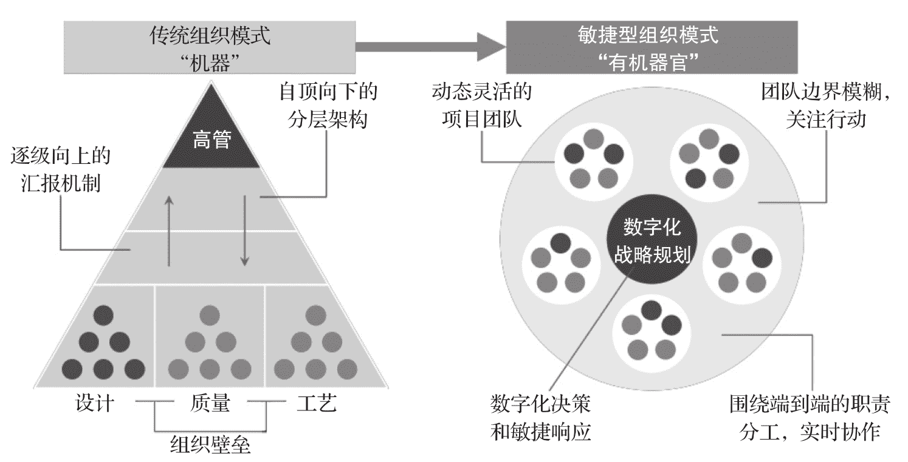

图 3-2 传统金字塔型组织到敏捷型组织模式

## 3.3 四层驱动模型：打造全价值链数字竞争力

在转型浪潮中，不少公司投入巨大却收效缓慢。信息壁垒丛生、跨部门协作低效、技术与业务脱节、敏捷响应不足，成为核心掣肘。例如某传统制造企业重金上 ERP 与 MES，因研发、生产、供应链数据未打通，需求变更仍需手工跨系统传递，交付周期不降反增；也有企业部署了工业互联网，却因缺乏统一数据规范与分析能力，海量设备数据无法转化为工艺优化决策。这些现象说明，数字化转型并非技术堆砌，而需以系统框架重构全价值链。

基于长期行业实践，总结出“数字化转型四层驱动模型”，如图 3-3 所示。该模型按数据治理、能力沉淀、流程贯通、智能应用四个层级逐级突破，为公司提供从战略到落地的完整路径。

1.第一层：数字底座层——打破信息壁垒，筑牢转型基石
数字底座层要解决信息壁垒与流程割裂的根本问题，在不颠覆现有 IT 格局的前提下实现孤岛系统与前端业务的无缝衔接。其目标是通过全域数据贯通与标准化产品数据要素管理，构建公司级数字资产体系。

2.第二层：数字能力层——沉淀核心能力，激活组织敏捷性
数字能力层解决部门能力碎片化、响应市场慢的问题。一方面提升多专业跨部门协同设计效率，另一方面通过在线化沉淀设计知识与过程数据，为后续业务在线和人工智能应用储备数据基础。

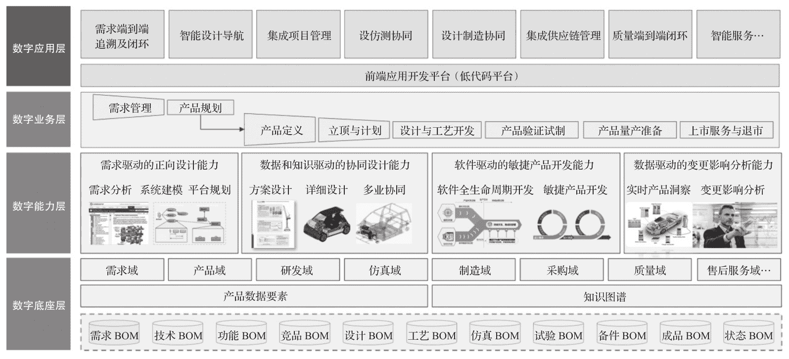

图 3-3 数字化转型四层驱动模型

3.第三层：数字业务层——贯通端到端流程，释放业务价值
在数字能力基础上进一步打通跨部门业务流，由点到面释放整体价值。例如需求、设计、仿真在线化后可实现需求驱动的设计仿真协同，以及端到端追溯与闭环管理。业务在线化也沉淀更多优质业务数据与知识，为人工智能应用提供空间。

4.第四层：数字应用层——赋能智能决策，驱动持续创新
数字应用层改变工程师的工作界面，摆脱传统工业软件复杂、操作繁琐、系统切换频繁的束缚，采用基于角色的 App 应用，紧密绑定设计上下文，以“所见即所得”、一步到位、简单易用的方式呈现。

实践中不少公司陷入“技术驱动”误区，过度追求工具而忽视业务本质，导致转型效果有限且难以持续。四层驱动模型的核心逻辑是“业务为主、技术为辅”，业务战略决定方向，技术作为实现手段。通过逐层递进确保技术与业务深度融合，服务于价值创造。

### 3.3.1 数字底座层：筑牢数据驱动基础

在制造业数字化转型中，产品数据要素贯穿产品生命周期与全价值链，是公司构建敏捷响应与持续创新的核心资产。其本质是通过数据标准化、贯通与复用，构建以产品为中心的数字底座，支撑需求到交付、数字到物理的无缝协同。基于数字底座层架构，公司可实现产品数据全链路管理，驱动效率提升与模式创新。

1.产品数据要素的范畴及定义
产品数据要素指产品从概念设计到退市回收全生命周期产生的所有关键数据集合，是数字化脉络的载体，也是实现全价值链透明、协同与智能管理的基础。不同阶段数据要素各异，用户侧关注功能与运行工况，设计阶段关注需求、BOM、设计数据等。将各阶段要素有机衔接，形成完整脉络图。以产品为核心的数字化底座如图 3-4 所示。产品数据要素如同血管，决定数据与业务的流量和速率。以概念设计阶段为例：

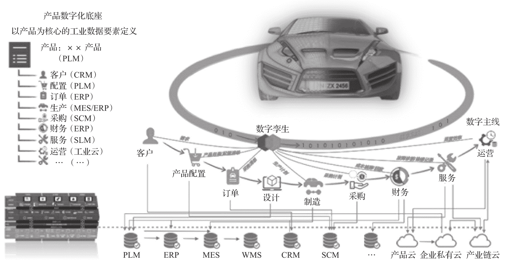

图 3-4 以产品为核心的数字化底座

概念设计是连接市场与技术的桥梁，目标是将客户需求转化为可执行设计输入，形成兼具竞争力与落地性的方案，需满足结构化、可追溯、动态更新。数据要素包括：

●产品需求包：功能清单、性能指标、用户体验要求等。
●市场趋势分析：行业报告、技术路线图、政策法规如汽车功能安全与网络数据安全法规等。
●竞品功能对标：竞品拆解后的功能、技术参数、用户评价及 SWOT 分析矩阵。
●技术可行性评估：技术可行性分析报告、关键技术路线。
●成本与资源约束：研发投入预估、供应链能力、合规风险如环保材料认证。
●产品概念模型：功能模型、产品原型设计等。
●技术方案数据：总体架构、总体技术方案、早期 BOM 清单、总布置模型、整机外形数模等。
●商业价值论证：成本收益模型、研发成本、生产成本、市场定价与 ROI、技术与市场风险及应对预案。

2.数字底座解耦及分层逻辑
产品生命周期与全价值链数据要素存在多源异构、耦合度高、动态性强等特点，需通过体系化治理实现数据资产化。为降低复杂度，需进行分层解耦并制定治理策略，如图 3-5 所示。

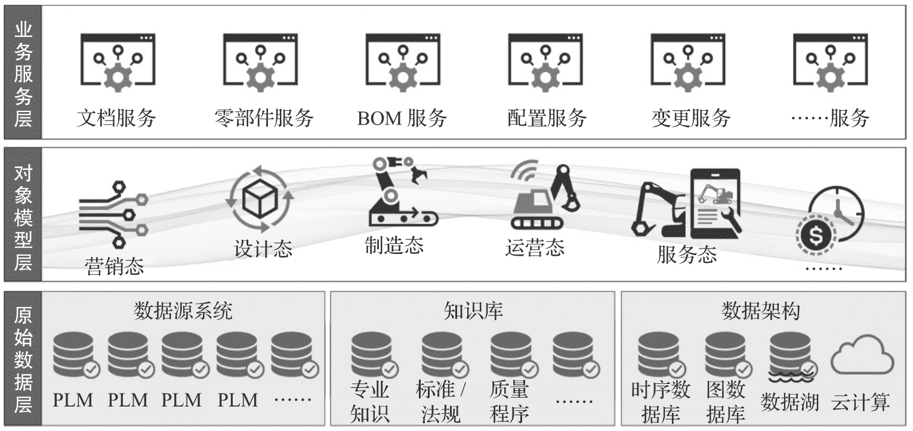

图 3-5 数字底座解耦及分层逻辑

（1）原始数据层（数据层）
●定义：公司内部各类数据源系统如 PLM、ERP，以及标准法规、质量程序等知识库。
●功能：数据规模达到一定程度后，需构建统一数据架构如数据湖，统一存储多源异构原始数据，支撑各生命周期阶段与价值链环节的数据采集沉淀。
●解耦策略：利用物理解耦，通过数据湖集中存储原始数据，与上层业务逻辑分离，避免冗余和硬依赖。
●动态适配：支持不同业务态的实时或批量数据接入，通过标准化元数据管理实现动态扩展。
●治理重点：数据接入规范、元数据管理、数据安全与生命周期管理。

（2）对象模型层（逻辑抽象层）
●定义：对原始数据进行抽象、建模、标准化，形成公司级统一数据模型，消除业务语义差异，支撑跨价值链数据一致性。
●逻辑解耦：通过对象建模工具将产品数据要素转化为业务可理解的逻辑对象，实现业务逻辑与数据解耦，屏蔽底层异构性。
●服务化封装：提供标准化数据服务接口供上层按需调用，避免业务层直接访问原始数据。
●治理重点：数据模型标准化、主数据管理、数据关联追溯。

（3）业务服务层（应用支持层）
●定义：基于对象模型层能力，快速构建面向业务场景的微服务如 BOM 服务、产品配置服务，支撑全价值链敏捷创新。
●功能解耦：通过模块化服务设计如微服务架构，将业务功能拆分为独立服务，减少跨服务依赖。
●动态编排：结合设计态向制造态等需求，灵活组合数据服务与业务逻辑，快速响应变化。
●治理重点：服务接口标准化、业务场景适配、服务监控与性能优化。

分层解耦可降低复杂度、提升灵活性、增强数据资产化能力并加速创新，业务服务层可快速调用底层数据能力，缩短新场景开发周期。

3.数字主线：数字底座核心技术架构
数字主线是数字化转型的核心技术架构，通过标准化、集成化、智能化手段将研发、制造、供应链、服务等环节的数据孤岛连接为整体，形成横跨全价值链的动态数据流，推动公司从经验驱动转向数据驱动。从分层看，数字主线覆盖对象模型层与业务服务层，而数据治理侧重原始数据层。

与数据治理相比，数字主线具有以下特征。
●目标定位：动态协同与静态规则。数字主线以实时数据流驱动端到端业务协同，核心是“用数据提效”。数据治理聚焦数据规范化管理，包括质量、安全、元数据、主数据，目标是建立统一标准与治理体系，确保数据准确、一致、合规。数据治理以标准化规则保障质量与安全。
●覆盖边界：产品生命线与公司数据域。数字主线以产品为中心，聚焦产品生命周期，构建纵向数据脉络。数据治理覆盖公司全域数据资产，建立横向统一管理框架。
●技术逻辑：流式互联与分层管控。数字主线是数据流与业务流的网状连接框架，依赖实时数据流驱动协同与敏捷响应。数据治理通过主数据、元数据目录与权限分层确保数据规范可控。
●价值重心：敏捷创新力与风险防御力。数字主线将碎片化环节串联为高效协同网络，赋能快速迭代与闭环优化，创造增量价值。数据治理提升数据一致性，降低错误与合规风险，守护数据安全。

由此可见，产品数字主线是“用数据”的工具，解决数据如何流动并创造价值的问题；数据治理是“管数据”的规则，解决数据如何可信且合规的问题。二者互补共生。无治理的主线易成垃圾管道，无主线的治理易成纸面规则。公司需以治理筑基、以主线为脉，方能实现数据可信、价值可期。

数字主线构建需系统推进三大核心能力，确保数据全链路贯通。
（1）数据标准化与模型定义：构建统一的数据语言
数据标准化是数字主线基础，核心在于消除跨系统跨部门数据异构性。公司需先制定全局数据标准，如统一 BOM 结构与编码规则。在汽车行业，VDA 标准被广泛采用，确保主机厂与供应商使用同一零部件编码体系，避免供应链混乱；类似标准还有民用航空的 ATA100、能源电力行业的 RDS-PP 等。

数字主线与底座搭建关键要点

下一步要为不同生命周期阶段的BOM实体分别制定元数据模型，明确每个实体需携带的信息项、字段释义、数据来源与更新规则。以设计BOM为例，应预先定义材质规格、公差范围等关键属性。

再以对象化、模型化的方式完成全局建模，并把各阶段模型相互关联，使数据规范与业务场景深度融合。可借助企业架构工具EA绘制架构与流程图，直观呈现从需求到服务的全链路数据交互，为后续系统集成打基础。图 3-6 所示为以产品为核心的数字化底座，这里以“产品需求—设计模型—制造模型—产线模型”为例，展示了全局数据模型、元数据模型及彼此间的逻辑关联，仅作示意，真实情况更为复杂。

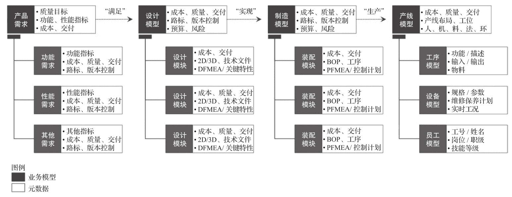

图 3-6 以产品为核心的数字化底座

在主线搭建中，模型与数据的解耦是保障灵活性、可维护性和可扩展性的关键，实现模型一次定义多处复用。数据独立于具体业务模型存在，也能避免主线受底层数据源系统迭代的影响。

（2）系统互联与数据汇聚：打破数据孤岛

完成企业级数据规范化建设后，系统集成成为解决异构系统协同难题的关键。传统做法多为API点对点直连和中间件主导的集中式集成，在转型深入后，这两种方式都难以支撑主线要求的全要素联通与动态协同。作为贯穿产品全生命周期的流通通道，数字主线的价值在于实现业务流、数据流与价值流的三流合一，对集成架构提出更高要求。

为突破传统局限，建议搭建具备以下特征的低代码主线平台。

**●模型驱动架构**：承载全局数据模型及关联逻辑，形成统一语义层。
**●多源接入能力**：向下兼容PLM、ERP、MES等核心业务系统，以及产线设备、智能产品等物理设备的数据接入，支持实时调用。
**●服务化输出**：向上通过REST、GraphQL等标准服务接口向业务应用提供聚合数据服务。

工业互联网平台凭借技术优势成为理想载体。

**●**支持OSLC等生命周期协作开放服务国际标准接口协议。
**●**提供低代码/无代码开发环境，降低技术门槛。
**●**具备OT/IT融合能力，可同时接入业务系统与物理设备。

适配层面建议分级推进。

**●即插即用层**：符合OSLC规范或提供RESTful API的系统，如Windchill、SAP S/4 HANA等，可直接接入。
**●适配改造层**：针对遗留系统，需开发专用连接器实现协议转换。
**●架构迁移层**：建议将关键业务逐步迁移至微服务架构平台，采用Spring Cloud等框架重构核心模块。

该演进路径既满足当前集成需求，也为企业架构持续演进预留技术空间。通过分层解耦与渐进改造，最终实现从数据孤岛到数字生态的跨越。

（3）实时数据流构建：从静态记录到动态智能

作为主线价值落地的核心环节，实时数据流构建旨在打破传统离散式数据管理的束缚，通过建立持续流动的数据价值链，实现从静态记录到动态智能的跃迁。本阶段重点解决产品生命周期中的数据时延问题，关键价值体现在：

**●决策响应提速**：将反馈周期从天级压缩至秒级。
**●闭环优化加速**：建立“设计-验证-迭代”的持续集成环CI Loop。
**●跨域协同增效**：打破专业壁垒，实现多学科实时协同MSE。

实践中，数据流缺失带来的效率损失具有系统性特征。

**●需求变更传导滞后**：客户需求或市场反馈无法实时同步至设计团队，导致产品偏离用户预期或市场动态。
**●设计验证反馈迟滞**：传统模式下设计完成后需手工提交仿真任务，结果需数天甚至数周才能返回，造成研发周期非线性延长。
**●跨团队协同低效**：机械、电子、软件等团队使用独立工具，数据交换依赖人工导出导入，易出现版本混乱与风险。

现代流处理技术栈为实时数据流提供核心支撑。

**●Apache Flink**：作为有状态流式计算引擎，支持海量数据高吞吐传输，可对数据流进行实时清洗、转换与分析。
**●Apache Kafka**：构建分布式事件流平台，提供可扩展的事件驱动消息传递基础架构，确保持续接收实时事件流如需求变更、设计变更等，形成企业级数据神经系统。
**●动态数据网格Data Mesh**：Kai Waehner等提出基于Kafka架构，通过跨域数据语义对齐，可建立去中心化可治理的实时数据网络，实现企业跨域实时流数据交换 ^(²¹)，如图 3-7 所示。

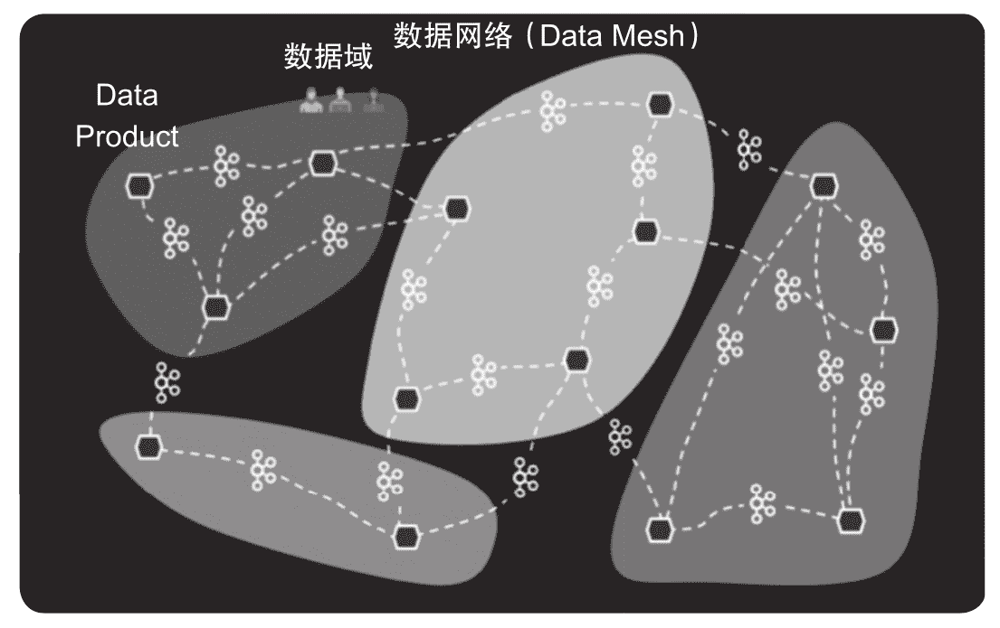

图 3-7 动态数据网格（Data Mesh）示例

基于此技术路径，可帮助企业构建动态网状的主线，实现业务自动化，如订单变更事件触发产品设计变更，进而驱动供应链系统重新计算采购计划，确保资源动态优化。

4.数据底座架构：支撑敏捷智能的基础

数据是企业命脉，是数字化转型要解决的核心问题。没有高质量、易访问的数据，任何AI应用都将无源之水。构建支撑敏捷开放和智能分析的基础架构至关重要。当前主流模式包括云计算、数据中台、数据湖等，各有侧重，目标都是更好地服务上层应用。

（1）云计算：弹性扩展的核心底座

云计算为底座提供弹性计算和海量存储资源。支持云原生架构，包括微服务、服务治理、消息中间件、数据库中间件和安全网关等关键模块，构成数字底座的“安全融合云底座”。设计理念强调兼容历史系统、融入信创需求，并具备可进化能力。例如华为数字平台以云为基础，支持公有云、私有云和混合云部署，并遵循“同架构、同API、同体验、同服务、同生态”的“5同”原则，实现多云环境下应用一致性和高效部署 ^(²²)。基于云构建现代数据战略，可利用云弹性按需响应数据存取需求，已成为企业数据资产管理与变现目标 ^(²³)。云平台也在人工智能辅助数据治理中扮演关键角色，提供自动化数据清理、分类和保护能力。

云计算之所以成为事实标准，在于其可扩展性、弹性及服务化特性，与底座对敏捷性和可扩展性的要求高度契合。然而，企业在构建云底座时仍面临管理混合云、多云复杂性的挑战，因此底座需具备先进的管理和编排能力，以应对兼容历史系统和整合不同云环境的难题。

（2）大数据技术：驾驭数据洪流获取洞察

大数据技术是处理海量多源异构数据的核心，是“一体化技术平台”的重要组成部分。关键功能覆盖数据采集、清洗抽取转换、存储如数据仓库、数据湖及数据分析全链路，可高效处理结构化、半结构化及非结构化数据，通常采用分布式架构应对海量挑战，已广泛应用于智慧城市、智能制造、现代物流、电子商务等领域。

大数据在底座中的价值不仅在于“量”，更在于应对数据“种类”多样性和“速度”实时性。现代数字应用产生的数据类型日益复杂，从传统结构化到文本、图像、音视频非结构化，以及物联网实时流数据，都对数据处理能力提出极高要求。因此底座必须集成强大的数据工程能力，如流处理引擎和灵活的数据湖存储，才能将原始数据清洗、转换、提炼为可供分析和应用的高质量数据资产。

5.数据中台：加速数据服务与价值实现

数据中台是实现数据资产化和价值变现的核心组件。通过统一采集、计算、存储、加工海量数据并建立统一标准口径，将原始数据转化为标准化数据资产和服务，为上层业务应用和决策分析提供高效支撑。数据中台通常位于数据底座之上，扮演承上启下角色。

其关键价值在于充当原始数据资产与业务应用的桥梁，将经治理整合的数据封装为易消费的数据服务和能力如API服务、标签服务、分析引擎等，加速数据价值向业务传递。同时，数据中台通过推行统一标准和构建可复用数据资产及服务，有效打破内部数据壁垒，提升数据一致性和可信度，为可靠分析决策奠定基础。

6.数据湖与现代数据仓库：存储管理访问多样化数据资产

数据湖技术为存储海量原始格式数据提供灵活方案，可容纳结构化、半结构化及图像、音视频等非结构化数据，对处理来自物联网、社交媒体等渠道的异构数据至关重要。传统数据仓库更侧重存储管理经清洗转换的结构化数据以支持商业智能和报表分析。现代趋势是融合两者优势，形成“湖仓一体Lakehouse”架构，既保留数据湖的灵活性和可扩展性，又具备数据仓库的强管理和高性能特性。

数据湖和湖仓一体的兴起，反映了底座在数据管理层面应对多样性和复杂性的迫切需求。数据湖的“读时模式Schema-on-Read”允许快速接入各类原始数据，无需预先定义严格表结构，大幅提升采集敏捷性。而数据仓库的“写时模式Schema-on-Write”为结构化分析提供性能和治理保障。湖仓一体正试图在敏捷性灵活性与性能治理之间取得平衡，更务实地满足现代底座对多样化数据管理的需求。

这些技术并非孤立发展，而是相互依存、深度融合，共同构成现代底座的技术内核，其协同效应使底座能有效应对复杂数据挑战，为上层应用创新提供动力。

7.数据治理、安全与质量

技术先进的底座若缺乏有效治理、可靠安全保障和高质量数据，价值将大打折扣。以下三方面是确保成功实施并持续发挥效能的关键。

（1）建立全面的数据治理框架

数据治理是对数据资产进行管理和控制的一系列原则、政策、标准、流程和职责集合，目标是确保数据的合规性、安全、质量和业务价值。有效框架帮助组织清晰定义治理方针，明确角色职责，确保数据在全生命周期得到妥善管理。国际数据管理协会DAMA发布的《数据管理知识体系指南》DAMA-DMBOK为数据管理和治理提供全面行业实践标准和方法论 ^(²⁴)。

实施模式可根据企业情况选择，如“自下而上”侧重数据架构梳理，逐层向上治理至应用层，适用于数据基础较好、技术驱动型的大型企业或政府机构；也可“自上而下”以明确业务应用需求为导向，聚焦特定业务领域数据问题，切入点相对简单，有助于实践中逐步提升整体数据认知和治理水平 ^(²⁵)。自上而下模式以业务应用驱动，协同性要求更高，需业务与数据部门配合，但整体以业务需求为主。数据治理具有周期长、任务重、见效难的特点，构建底座过程中建议采用自上而下模式，即以业务应用驱动数据治理。无论何种模式，数据治理都应是持续动态调整过程，需随数据环境、业务需求和法规政策变化而演进。

成功的治理需要在控制与赋能间取得平衡。既要通过管控机制保障数据质量、安全和合规，也要通过自助服务工具、清晰数据目录和便捷访问方式，赋能业务用户更方便查找、理解和使用可信数据，支持业务创新与价值创造。

（2）确保数据安全、隐私与合规

数据安全是数据治理核心组成部分，也是底座稳定运行的基石。不仅要保护数据免遭未授权访问、泄露、篡改和破坏，还要确保数据处理活动符合法律法规要求，如中国《个人信息保护法》PIPL、欧盟《通用数据保护条例》GDPR等。

根据PIPL等法规，企业在底座建设和运营中必须严格履行个人信息保护义务，包括收集和跨境传输前获得用户明确同意，进行必要安全评估，采取充分技术和管理措施防范风险。技术层面应广泛应用数据加密、访问控制、身份认证、入侵检测与防御、安全审计等手段，并建立完善数据泄露应急响应机制，确保事件发生时能及时有效应对。

过去30年中国企业出海经历从产品出海到品牌出海、供应链出海。科特勒咨询指出，这不仅因国内产品结构性过剩，更是中国企业寻求持续增长的必然结果，是中国优秀企业核心能力和创新商业模式在全球市场价值外溢的结果 ^(²⁶)。数据跨境传输已成为出海企业生产经营不可或缺的一环。企业必须重视跨境传输中的隐私保护和合规，否则不仅面临高额合规成本，还可能被拒绝出境。根据欧盟GDPR，若企业未依法采取完善保障措施进行跨境数据传输，可能面临高达2000万欧元或相当于公司全球年营业额4%的罚款风险。据统计，从2018年正式实施到2025年3月，欧盟成员国根据GDPR针对个人数据处理违规行为发起2560起罚款，罚款总额达到56.5亿欧元 ^(²⁷)。

安全和隐私保护不应是建成后的附加功能，而必须在设计之初就融入整体架构，即遵循“安全内生”和“隐私保障”原则。随着数据共享与协作需求增长，隐私计算技术PET正成为底座重要组成部分。这些技术如联邦学习、多方安全计算、同态加密等，能在保护数据隐私前提下实现联合分析和价值挖掘。隐私计算需与底座其他能力协同工作，共同解决数据效用与隐私保护的平衡难题。

（3）实施主动的数据质量管理策略

高质量数据是数据驱动决策和智能化应用的基础。若输入数据存在错误、不一致或缺失，基于其产生的分析结果和决策建议也将不可靠，甚至误导。因此主动的数据质量管理是底座建设不可或缺的一环。

数据治理框架本身包含设定数据准确性和一致性标准及流程的内容。现代化底座越来越多引入人工智能辅助数据治理工具，例如利用AI算法自动进行数据清洗、校验和纠错，提升数据质量。数据质量管理正从传统事后被动清理，转向贯穿数据生命周期的主动式管理。这意味着需在数据产生源头、采集、集成、存储和应用各环节嵌入质量控制机制和检查点。这种主动全流程质量管理方式，比仅在数据仓库或数据湖集中清洗更为高效彻底。

此外，数据质量并非仅是IT部门或数据管理团队责任，需要数据生产者、数据消费者和数据管理者等组织内所有相关方共同参与。业务部门最了解数据业务含义和质量标准，其参与对识别和解决质量问题至关重要。底座应提供相应工具和流程，支持跨部门协作，共同维护数据资产质量。

### 3.3.2 数字能力层：构建敏捷协同的核心能力

数字能力层是支撑企业快速响应市场需求、实现跨团队高效协作的核心技术架构。其核心目标是基于底座提供的数据链路，将各专业领域开发流程和业务逻辑抽象为可复用数字能力模型，整合研发工具链，支撑企业实现高效协同、敏捷响应与持续创新。具体功能如下。

**●能力沉淀**：将设计过程和业务逻辑如设计规则、工艺参数封装为标准化、可复用数字化能力服务如微服务等。这里的数字能力包括面向特定业务领域的特定设计能力和多专业在线协同能力。前者如变压器线圈的参数化设计能力；后者如为商用车增加自动紧急刹车AEB功能，需新增控制模块ECU、测距模块和制动模块，需要机电软多专业在线协同共同完成设计验证。
**●工具链集成**：通过整合产品设计、仿真验证、多学科协同等工具，构建覆盖“需求-设计-仿真-试验”全流程的数字化闭环。
**●数据驱动**：通过实时智能分析，替代人工经验决策，提升研发效率与精准度，并为未来AI应用沉淀业务和数据基础。

1.数字化研发能力体系

数字化研发能力是指企业通过数字技术如大数据、云计算、AI、数字孪生等重构产品研发流程，实现从需求分析、设计仿真到测试验证的在线化、模型化和集成化协同的能力。在数字化转型背景下，传统研发范式因工具割裂、数据孤岛与流程断层等问题，面临效率与创新的双重瓶颈。这是迄今为止研发数字化转型面临的最大挑战，无论是从三维模型角度提出的基于模型产品定义MBD到基于模型企业MBE，还是从系统工程角度提出的基于模型系统工程MBSE到数字工程，都无法全面解决数字化研发能力体系问题。

MBD是一种以三维数字化模型为核心载体，全面承载产品几何、工艺、公差、材料等全要素信息的定义方法，彻底取代传统以二维图纸为中心的研发范式，实现产品信息从设计到工艺的一致性定义，并无歧义地传递至制造和检验环节。而MBE是一种以模型为核心的企业运营模式，通过将产品生命周期的数据、流程和协作统一到三维模型中，实现设计、工艺与企业其他业务环节如供应链、质量、运维等的高度集成与协同，减少人为错误和返工。

MBSE是系统工程的一种方法论，强调用系统模型而非传统文档描述系统的需求、架构、行为和验证过程。通过统一建模语言如SysML构建系统模型，实现跨学科协同和需求可追溯性。而数字工程是更广泛的战略框架，利用MBSE的模型基础，通过数字化技术如数字孪生、大数据、AI、云计算等整合产品生命周期数据，构建从设计到运维的数字主线，实现流程优化与决策支持的整体框架。美国国防部在2018年发布的《数字工程战略》中将数字工程明确定义为“基于模型和数据驱动的生命周期集成方法”。其中，数字工件Digital Artifact是产品在数字工程各个环节之间进行数据交换的数字化载体，它从不同视角提供产品数据，以便向利益相关者展示数据、信息和知识的可视化、交流和交付 ^(²⁸)。

**模型定义怎么选？先把数据主线跑通**

总体来看，MBD/MBE 与 MBSE/数字工程 的共同追求都是用模型来固化产品定义，让信息在数字环境里跨环节流动。MBD/MBE 主要是把设计、制造、检验等内容绑定到三维模型上往下游推送，并不支持多专业并行协同。MBSE/数字工程 对国内企业来说节奏偏快，复杂装备制造过去长期依赖逆向起步，正向设计和系统工程的沉淀近几年才起步，底子薄；即便在新品周期极短、迭代极密的消费电子，MBSE 到底适不适合，业内仍在观望。

在这种现实下，数字主线是当前推进模型化产品定义最落地的抓手。它既能承接企业已有的系统与数据积累，又能通过统一的元数据模型实现跨系统、跨领域的语义与规范对齐，MBD/MBE 与 MBSE 都可以纳入同一框架。在此基础上对研发数字化能力做解耦与重塑，打破传统流程中高度耦合的黑箱，用模块化拆分、服务化重组和智能化增强搭建可扩展的能力体系，让研发资源能弹性调配、创新能力能动态演进，以应对产品复杂度上升和市场需求加速变化的双重压力。

2. 研发拆解：从刚性架构到模块化服务

研发流程的解耦本质是分层拆解能力，打破传统体系的刚性耦合，提升灵活与效率，可从五个层面展开。

**业务规则层拆分**。聚焦需求管理、设计、仿真、试验等核心环节的独立重塑。借用领域驱动设计划分清晰的边界上下文，把复杂产品开发拆成高内聚低耦合的功能模块，模块可独立演进，降低多团队协同摩擦。以智能机器人、高端装备为例，机械、电子、软件交织严重。通过边界上下文可按功能或学科切分，比如把伺服驱动、行星减速等传动部分作为一个独立上下文，明确接口与交互规则；把无刷电机驱动算法等控制部分作为另一个上下文，聚焦精细控制。接口明确后，闭环控制逻辑与机械物理特性即可协同而不冲突。

**流程单元层拆分**。为适配多机型差异化，需要把领域级功能模块进一步拆成标准化、可复用的设计能力单元。例如需求管理可拆为原始需求收集、系统需求细化、功能需求验证等。每个单元应明确三项内容：①输入输出规范，建立统一的数据接口与交付物标准；②设计工具链，集成建模、仿真计算等数字化工具；③方法论体系，固化经验驱动的仿真规则，如拓扑优化、冲突检测，以及模块化设计方法等。

**数据层面拆分**。设计数据、工艺数据、试验数据常各自为政。构建基于 STEP 等统一标准的产品数据模型，实现跨系统语义对齐。依托数据主线架构，把分散在 PLM 中的 CAD 模型、SDM 中的仿真分析报告、TDM 中的试验数据集转化为可流通的数据资产。某动力电池厂商将电芯材料研发数据与结构设计模型解耦，试验数据实时回灌驱动 CAE 参数优化，验证周期缩短约四成。

**工具层面拆分**。这是能力重构的关键。核心是通过接口标准化、服务轻量化、能力开放化，把传统黑箱工具链拆解为可灵活组合的模块化服务，打破工具壁垒释放数据价值。主流工业软件均在推进该架构，按需调用能力，避免全家桶冗余成本。例如 ANSYS 对 Granta MI 材料库接口开放，企业可将选材逻辑嵌入自研设计系统。针对本土或自研系统，也需做服务化改造与架构升级。

**组织层面拆分**。这是转型中最复杂的一环。核心是通过数字化手段打破物理边界、职能壁垒与层级隔阂，重构跨部门、跨企业、跨地域的协同网络，实现资源弹性配置与知识高效流动，技术升级之外需同步重塑文化与治理。空客 A350 研发中，法、德、英、西四国团队借助 PTC Windchill 平台并行开展机翼、舱段、航电设计，变更实时同步到统一数字样机，大幅减少物理样机迭代。这种逻辑集中物理分散的模式使全球研发资源可弹性调度，人力利用率显著提升。

表 3-1 总结了五大维度解耦的对象和技术路径。

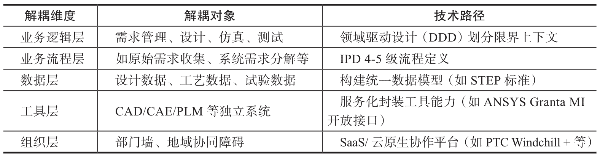

3. 数字化研发能力重构：基于数智底座的敏捷重组

从拆解到重塑的跃迁依赖数智底座上的敏捷重组。利用微服务架构、流程编排等手段，把已拆分的模块化能力重新编织为灵活动态的研发网络，实现按需调度与持续进化。这既是技术架构革新，也是组织模式与商业逻辑的重塑。

在企业数字化业务蓝图框架下，能力建模与重构是战略转型的核心。围绕战略、流程、组织、技术四大体系，可分为三个衔接阶段：能力架构、能力建模、能力部署，形成持续迭代闭环，把战略转化为可执行能力。

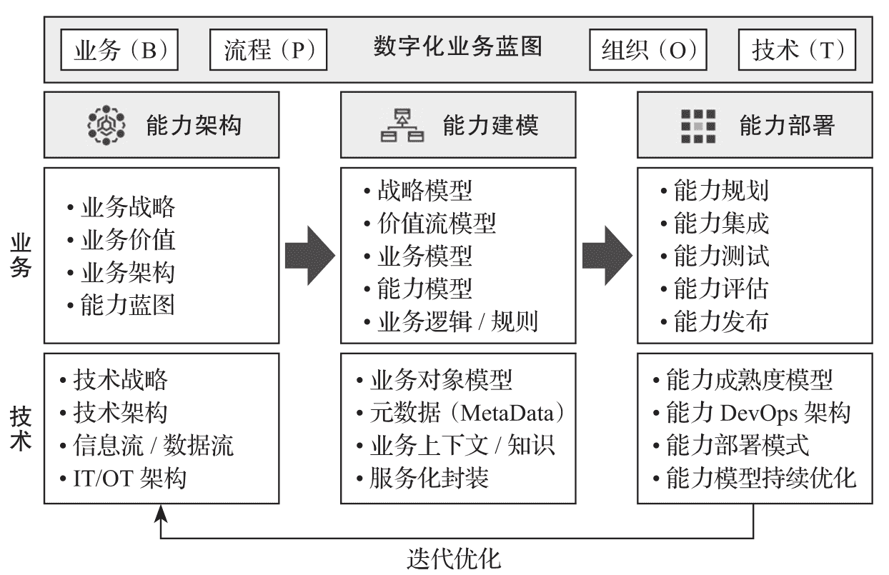

图 3-8 数字化能力建模的三个阶段

（1）能力架构

能力架构是起点，负责把宏观战略与技术蓝图对齐，形成可落地规划。

**经营驱动与战略对齐**：从经营战略出发，借助战略模型与价值流模型定义业务价值，确保能力建设始于清晰的目标与客户价值，而非单纯技术诉求。

**技术支撑与架构设计**：同步制定技术战略，构建技术架构，明确信息流、数据流及 IT/OT 架构，为能力提供可扩展底座。

**能力蓝图构建**：经营与技术融合后，形成清晰能力蓝图，明确企业需要构建哪些数字化能力来支撑战略。

（2）能力建模

把能力蓝图的抽象概念转化为可操作、可封装的数字化模型。

**模型构建与规则**：把需求转化为具体模型，构建业务逻辑规则与对象模型，定义功能与行为。

**知识与元数据封装**：定义元数据以提供业务上下文与知识，让能力模型具备可理解性。

**服务化封装与集成**：将能力以服务形式抽象，使其可被其他系统或流程调用，实现复用与互操作。

**构建模块化能力组件库**：提炼核心能力，形成模块化数字化组件库，封装设计知识、工程经验、计算逻辑、设计参数，实现从需求到交付的全链路敏捷创新，具体表现为：

**动态配置**：设计模块支持动态配置与参数化输入，适配不同场景。如参数化设计能力可通过变量定义几何尺寸、材料属性、性能参数，如齿轮模数、电机功率，按需生成变体。

**设计规则与约束**：把材料选型、公差匹配、工艺约束、计算公式如强度校核等经验转化为可执行规则与计算逻辑，内嵌组件中，确保输出符合工程要求。

**知识沉淀**：把设计经验、历史案例、失效模式、优化策略等封装进组件，提供开放接口以持续迭代优化。

（3）能力部署

把建模并封装好的能力落地。

**规划与验证**：进行能力规划、集成与测试，确保功能、性能、稳定性达标。

**部署与发布**：验证通过后发布，采用能力 DevOps 架构与部署模式，支持快速可靠交付。

**评估与持续优化**：部署后持续评估，启动能力模型迭代，适应经营与技术变化，确保持续创造价值。

三个阶段在迭代框架下持续运行，推动数字化能力建设，为数智业务蓝图提供路径。

4. 研发能力跃迁：从离线到在线

当前多数制造企业仍陷于分段式研发范式。PDM/PLM 仅作为成果归档库与电子审批看板，真正的设计创作如三维建模、结构拓扑优化、校核计算仍依赖离散桌面工具与线下协作。割裂带来三大典型问题。

**协同黑箱化**：总体设计与分系统开发间存在数据真空带，机械、电子、软件团队靠会议和文档传递信息，变更响应常拖数日甚至数周。

**知识碎片化**：工程师隐性经验难以沉淀为可复用规则。某汽车零部件企业统计，30% 设计错误源于历史缺陷重复。

**验证后置化**：70% 以上设计缺陷要到物理样机阶段才暴露，试错成本激增。某航天企业因管路干涉导致项目返工成本超千万。

根源在于流程断点、工具链异构与组织惯性。

经过系统性拆解与重塑，传统设计能力正在发生根本变化。核心是构建模块化数字设计组件与智能化知识服务体系的双螺旋。

**设计能力模块化**：把复杂设计流程拆成可独立迭代的数字化单元，形成即插即用的能力矩阵。

**知识资产图谱化**：借助数据主线把离散经验转化为系统化知识图谱，沉淀设计规则库、失效模式库、最优实践库等上下文经验库。

结果是设计模式的在线化重构，设计师从依赖个人经验转向调用在线智能设计系统，主要特征：

**设计活动数据化**：每个决策、仿真验证、工程变更均沉淀为结构化数据资产。

**知识服务自动化**：系统基于上下文自动推送关联知识，如历史相似案例、材料兼容性规则、强度校核公式等。

**设计协同敏捷化**：依托网络技术、实时数据流与智能工具链，打破本地孤岛，实现全流程敏捷响应与高效协同。

**创新闭环智能化**：以机器学习构建数据驱动的设计-验证-优化闭环，为端到端智能业务应用夯实基础。

在线化设计生态会形成持续进化的设计数据资产，价值密度随使用频次指数增长，企业研发体系从经验驱动迈向数据智能驱动。

研发范式从离线设计、本地工具、结果管理转向在线设计、网络协同、实时迭代，意味着从封闭式创新向开放式敏捷创新的根本转变，也是研发数字化转型的核心标志。SaaS 工业软件在保障企业 IP 与数据安全前提下提供新思路。PTC 于 2023 年发布 SaaS 版 CREO+，在本地 CREO 基础上加装插件即可实现跨地域团队共享同一设计环境，实时协同设计。

表 3-2 列举了离线设计和在线设计的对比分析。

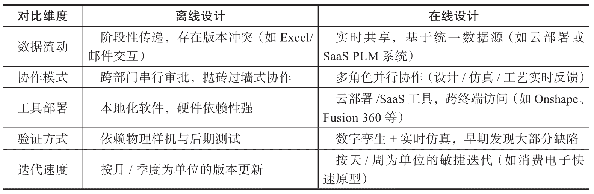

### 3.3.3 数字业务层：业务流程的端到端贯通

数字业务层是制造业数字化转型的中枢神经，目标是基于数据主线和数字能力构建全链路业务贯通能力与智能决策引擎，实现从市场需求洞察到产品交付服务的端到端数字化闭环。它标志着企业从局部优化迈向全局协同，从流程自动化升级为认知智能化。

1. 能力上网与业务贯通

能力上网是通过技术手段把核心研发能力标准化、结构化，形成可复用可扩展的数字化模块，是转型的初级阶段，多呈现多点化、局部化特征。也指企业核心知识与专业技能的数字化沉淀与共享。早期能力上网分散、局部，各部门独立把部分能力搬到线上，却未形成有效整合协同。

业务贯通则是更高阶形态。核心是把企业端到端价值链流程、核心运营及内外部协同过程整合到线上，形成高效敏捷数据驱动的数字化业务体系。这不仅是把流程搬线上，更会产生并沉淀海量数据，为资产化与智能化奠基，也意味着业务模式、运营模式乃至商业模式的深度变革。业务贯通要求对研、产、供、销、服等关键领域及跨领域逻辑关联有清晰定义，实现一体化、在线化、端到端贯通，赋能变革与创新，需打破跨部门、跨层级、跨区域的壁垒、孤岛与断点。

从能力上网到业务贯通，是由点到面、由局部到整体、由功能使能到业务驱动的演进。企业需战略性整合在线能力，编织成支撑业务体系高效运转的数字化网络。以供应链为例，先实现物料分类分级管理，再实现物料归一化管理，解决一物多码、一码多物问题，随后进行供应商认证评级优选，最后集成供应链实现整体业务在线并与上下游端到端贯通，提升柔性与敏捷性。

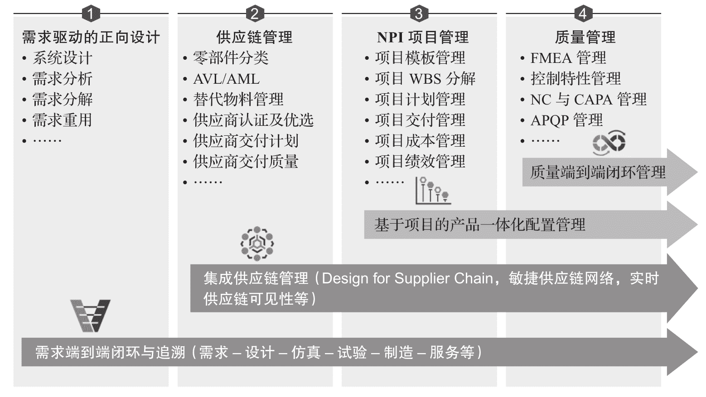

图 3-9 从能力在线到业务在线

表 3-3 给出了能力在线与业务在线的对比分析。

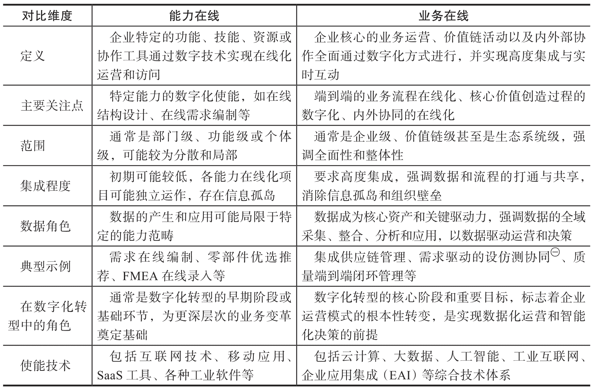

㊀指“设计-仿真-测试”协同。

总之，业务贯通是数字化成熟度的重要标志，是实现端到端价值链数字化和智能化的核心。通过能力上网与业务贯通深度融合，企业构建“数字基因+智能神经网络”的新型竞争力，核心价值创造深度融入数字世界，能更敏捷响应市场、更高效配置资源，并以数据洞察驱动持续创新。

2. 能力上网到业务贯通的跃迁：纵向集成与横向贯通

纵向集成与横向贯通是构建企业数字化大厦的钢筋铁骨，保证信息流、业务流、价值流顺畅流转。

（1）纵向集成：催化深度业务功能在线化

纵向集成指打通从车间设备层传感器、PLC，到制造执行层 MES，再到 ERP 乃至 BI、PLM 系统，实现生产数据实时采集、传输、分析与反馈，优化调度、提升设备利用率、保证质量、缩短交付。在研发阶段，纵向集成不仅提升工具数字化水平，更加强团队内部及跨部门协同效率。它提升每个价值链环节的深度与专业度，是能力封装与在线化的关键，通过内部资源整合与优化，重构数字化研发与管理能力，大幅提升运营效率与决策准确度。

（2）横向贯通：构建端到端“业务在线”的骨干网络

横向贯通指在同一运营层面或价值链不同阶段，以及企业与外部合作伙伴之间，实现系统、流程、数据的连接与打通。它侧重广度与协同度，构建端到端无缝运营体系。内部目标是打破部门墙与信息孤岛，外部则延伸至供应链与商业生态。横向贯通不仅是系统对接，更要求流程重塑和协同机制建立，是实现业务在线与敏捷高效运营的关键。

（3）从能力上网迈向业务贯通

纵向集成与横向贯通相互依存、协同增效。企业构建全面高效数字化业务体系、实现真正业务在线，必须有机结合两者，形成既有深度又有广度、既能精细管控又能广泛协同的数字化神经网络。业务在线是渐进过程，依赖对各项在线能力的战略性整合，纵向集成与横向贯通从不同维度推动企业从孤立能力在线走向全面协同的业务在线。

端到端业务数字化绝非无中生有，而是企业在数智化起步阶段所沉淀的各类在线能力在更高层的聚合显现。从单点能力上网到整体运营上网，本质是一次架构层面的跃迁，其中纵向打通与横向连通起到了编织的作用，把此前分散孤立的在线能力串联成支撑核心流程高效协同的数字化网络，如图 3-10 所示。

（4）敏捷流程重组与业务编排

敏捷流程重组与业务编排是数字化研发体系落地落地的操作层。目标是通过动态建模、智能规则与跨系统协作，将传统刚性串行作业改造成可实时调整、持续优化的协同网络。以产品设计目标例如电动化、低成本为牵引，从设计能力组件库按需调取能力单元，以积木化方式重构研发路径，并结合设计上下文完成实例化。设计能力的组件化封装与重构如图 3-11 所示。以新能源工程装备机型开发为例，可迅速拼装电池布局优化、热管理仿真等模块，形成专属设计链路。该做法既能跨项目复用经验，也可通过灵活编排把迭代周期压缩三成以上。

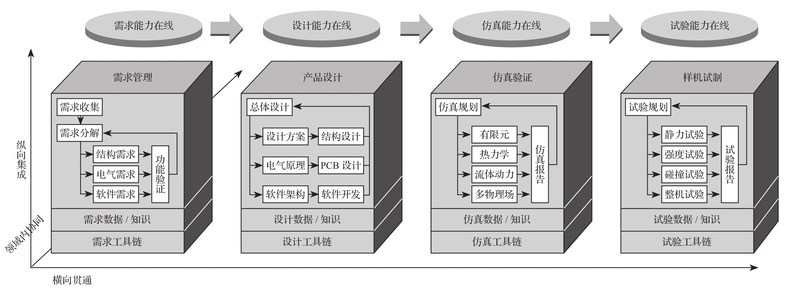

图 3-10 纵向集成与横向通贯

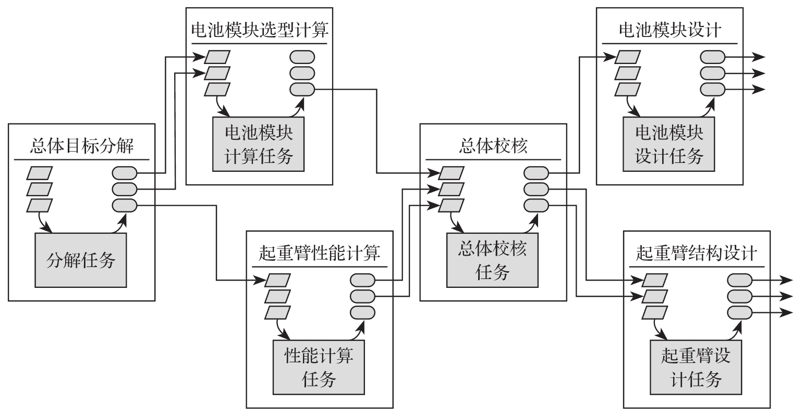

图 3-11 设计能力组件化封装与重构

敏捷编排通常依赖以下支撑。

●低代码流程引擎：借助低代码工具把组件库中的设计能力抽象为可视化节点，例如需求评审、校核计算等，业务人员可拖拽配置分支与触发条件。
●智能规则引擎：基于设计上下文调用相应规则与计算逻辑，如图 3-11 中的起重臂性能计算任务，需要依据所选材料与预设额定载荷进行应力分析及结构强度核算。
●跨系统协同编排：通过 API 网关联通 CAD、CAE、PLM 等异构系统，实现跨工具链自动化触发；借助 Kafka 等消息中间件完成跨部门事件实时响应。
●流程自动化：按规则自动完成任务分派、审批路径与通知，减少人工干预，加速决策闭环，并支持动态节点、会签、加签等复杂操作。

毕马威与阿里云研究院提出的数智化转型五步模型清晰呈现递进关系：“触点数字化”为企业奠定技术与数据采集基础，这正是能力上网的体现。在此基础上进入“业务上网”阶段，核心是通过在线化业务能力推动流程数字化与价值提升。即企业依托已在线的基础设施能力如云计算资源、数据触点能力如市场洞察与产品设计能力，以及沉淀的知识技能能力如在线知识库，通过有效集成与编排驱动端到端业务在线运行。同时要实现业务上网，组织自身的数字化程度与在线化水平必须达标，“组织在线”“能力在线”“协同在线”是业务上网的重要前提。

从能力上网到业务上网的演进中，纵向整合与横向贯穿的作用极为关键。

●纵向整合把价值链上关联的在线能力串联成深度业务功能。以产品研发为例，从零部件供应链的供货能力，到机电软多专业协同设计能力，再到整机综合集成与仿真验证能力，经纵向整合形成高效的产品设计体系。
●横向贯穿则把不同业务域或价值链环节的在线能力连通以实现跨域协同。例如 CRM 中的客户数据能力在线、SCM 中的订单履约能力在线、PLM 中的产品配置能力在线、财务系统的在线支付与结算能力，以订单驱动的端到端横向贯通，就能共同支撑起完整的“从订单到回款”在线流程。

因此，企业由能力上网迈向业务上网的过程，本质是借助集成持续提升能力组合的层次与广度。起初多为点状、孤立的能力上网，随纵向整合深化形成特定领域的在线解决方案，随横向贯穿拓展则让不同域的解决方案彼此连接，形成覆盖核心运营的一体化业务上网。在此意义上，集成如同企业的数字神经系统，将各在线器官即能力连接成有机整体，使企业作为整体高效运作并与外部生态联动。

3.未来展望：从全链路运营走向智能创新

随 AI、工业物联网与云计算等颠覆性技术深度融合，企业集成的内涵、方式与战略价值正在重塑。这些技术不仅为垂直贯通与水平联通提供全新支撑，也催生超自动化、数字孪生、智能升级与平台生态等新模式，预示业务上网将迈向更智能、更自主的阶段。

（1）AI、IIoT 和云计算：增强企业深度集成

人工智能、工业物联网与云计算已从辅助工具变为集成战略的核心驱动，从根本上重塑数据的产生、流动、处理与应用。

●人工智能：在集成中日益重要。机器学习可自动完成复杂的数据映射、转换与校验，提升集成效率与准确度；其分析预测能力可对纵向与横向集成的海量数据深度挖掘，为更智能决策与流程优化提供洞察。例如人工智能能分析供应链各环节数据，预判地缘政治引发的断链风险并优化库存物流。此外人工智能正从被动消费集成数据转向主动治理，例如智能 API 管理与人工智能驱动的数据质量监控。人工智能对纵向集成如预测性维护优化产线、横向贯穿如供应链风险预测优化库存与物流均产生深远影响，实现关键流程实时监控与动态调整。
●工业物联网：智能互联设备的普及使物理世界状态与过程可被实时精细数字化，形成海量多样化数据源。为集成提供前所未有的广度与深度。一方面设备数据经纵向整合汇聚至边缘节点或云平台，实现物理资产与生产过程实时监控、远程控制与优化；另一方面设备、系统与应用间的数据共享与协同构成智能场景基础。工业物联网数据流有效集成是数字孪生、预测性维护等高级应用的前提。
●云计算：云平台已成为现代集成首选的基础设施与赋能平台，提供高弹性、灵活、按需付费的算力存储，承载大规模集成的数据压力。主流云服务商提供的 iPaaS、API 管理、数据湖/仓库、物联网平台、AI/ML 服务等，极大简化集成方案的构建与运维，降低门槛与成本。云原生技术如微服务、容器化推动更敏捷弹性集成，打破传统数据孤岛，便捷连接云上应用、本地系统与合作伙伴。

三者融合正催生“万物互联、数据驱动、AI 赋能”的新范式。数据从工业物联网产生，经云汇聚处理，由人工智能提炼价值形成闭环，为更深纵向整合与更广横向贯穿提供技术引擎。例如通过“增强互联网”技术，结合人工智能智能路由优化与物联网万物互联，为企业在线业务提供更高效可靠的连接基础 ^(³¹)。

（2）新兴趋势：超自动化、自主系统、数字孪生

在 AI、工业物联网与云的支持下，企业集成正向更高级智能化演进，超自动化、自主系统与数字孪生尤为突出。

●超自动化：指把机器人流程自动化、人工智能、机器学习、iPaaS、事件驱动架构、业务流程管理等技术组合起来，以协同方式自动化尽可能多的业务与 IT 流程 ^(³²)。它追求端到端、覆盖更广、更智能的自动化。强大集成是超自动化的基石，复杂端到端自动化必然涉及多异构系统、数据源与应用间的数据交换与协同。超自动化可显著提升运营效率、降本减错，让员工聚焦战略工作，标志着业务上网从流程在线化向智能自动化在线运营升级。
●自主系统，尤其是自主供应链：随 AI 与深度集成成熟，运营系统具备更强自主决策与自优化能力。自主供应链通过 AI、工业物联网、数字孪生等技术，实现需求预测、库存管理、生产计划、物流调度、风险应对等环节在最小人工干预下自主感知、分析、决策、执行与学习优化。埃森哲指出实现需强大数字核心支持数据无缝流动与实时决策、融合 AI 与机器学习的智能体架构、以及流程彻底重塑与数据全面统一 ^(³³)。世界经济论坛等认为需分阶段推进，从数字化基础到集成自适应系统再到自主运营 ^(³⁴)。这代表业务上网的终极形态之一：业务不仅在线，且能在线自主运行与持续进化。
●数字孪生：是物理对象、流程或系统的动态数字映射，通过物联网传感器实时数据、仿真、分析与 AI 技术，对实体状态、行为与性能进行监控、诊断、预测与优化。其构建高度依赖深度数据集成：纵向从物理资产到数字模型的数据集成，横向与 PLM、ERP、MES 等系统及其他孪生间的贯通。AI 融入增强预测、优化乃至自主决策能力，正于制造、智慧城市、医疗、能源等领域释放潜力，为精细化管理与智能化升级提供虚拟试验场。

这些趋势共同指向未来：运营更数据驱动、智能自主、虚实融合，而这一切离不开高度集成、信息畅通的数字底座，即以纵向整合与横向贯穿构建的真正业务上网平台。

4.新前沿：智能化升级及其与集成的关系

智能化升级是企业在实现业务上网、具备坚实集成基础后向更高阶形态演进的关键一步。它系统性地把 AI、大数据分析、机器学习等智能技术融入运营各环节，推动企业从“连接的运营”迈向“认知的运营”“智慧的运营”。目标是增强洞察、预测、自主决策与持续学习优化能力，提升效率、创新与竞争力。纵向整合与横向贯穿构建的全面业务上网是智能化升级的必要前提。缺乏高质量实时全面集成数据，AI 算法便无源之水。

●数据基础：智能化升级依赖海量多源异构数据分析。横向贯穿确保研产供销服及外部生态数据有效汇聚共享，形成企业级乃至生态级数据湖或数据中枢；纵向整合保证底层执行到上层管理的数据完整准确上传，为 AI 应用提供精细训练数据与实时输入。
●流程基础：智能化升级意味着流程智能化改造，如引入 AI 智能设计、智能排产、智能质检。横向贯穿确保跨部门跨系统流程顺畅衔接，为 AI 提供端到端执行环境；纵向整合保证 AI 决策能有效下达到执行层并获取反馈，形成决策与执行的闭环。
●能力基础：智能化升级是整体能力提升，需要应用 AI 的能力，也需数据治理、模型管理及将洞察转化为行动的能力。这些能力的构建离不开业务上网过程中沉淀的数据资产、标准化流程与协同机制。

因此智能化升级是业务上网的自然延伸。在业务上网实现运营数字化、网络化、集成化后，智能化升级注入“智慧”元素，让运营更敏捷精准高效。例如关联分析设计、工艺、现场与库存数据实现设计变更影响分析并智能推荐方案；集成供应链数据智能分析实现精准需求预测与库存优化；生产过程数据智能监控实现预测性维护与质量持续改进。

总之智能化升级是数字化转型的高度目标，建立在坚实集成基础之上，通过开放 AI 平台架构把 AI 嵌入各业务环节，使其更智能自主。企业唯有以有效纵向整合与横向贯穿实现全面业务上网，才能为智能化升级提供数据养料与流程载体，最终迈向智慧企业。

### 3.3.4 数字应用层：赋能业务创新的智能工具

数字应用层即企业所依赖的软件与应用集合，构成与客户互动、管理内部运营、驱动创新的主要界面。静态软件正演变为动态智能生态系统。融合 AI、机器学习与高级自动化的智能工具极大增强数字应用层能力，使其从被动支撑转为主动创新引擎。不仅实现自动化，更提供深层洞察、个性化体验与全新价值创造。企业运营与协作实时数字化的能力上网与业务上网理念，正通过这一层面实现与升华。值得注意的是，数字应用层正在重塑“创新”定义，创新已扩展至流程、新颖客户互动模式与数据驱动战略决策，均由智能应用驱动。企业要释放智能应用层的创新潜力，必须经历从“能力上网”到“业务上网”的关键演进。缺乏坚实数字化基础与在线化流程，智能工具将因数据与连接不足而难以发挥作用。许多转型未达预期 ROI 的关键原因正是未能完成这一基础转变。因此企业地位越来越取决于构建与部署高效智能数字应用层的能力，它正成为核心差异化优势与战略制高点。

1.解构现代企业架构中的数字应用层

数字应用层是现代企业架构核心，其战略重要性日益凸显。

（1）数字应用层的定义、范围与战略重要性

数字应用层基于统一开放底层架构，通过业务规则与逻辑明确应用组合、集成方式及数字技术资产如何支撑流程与服务交付。这不仅是软件集合，更是战略资产，直接支撑核心能力与运营执行。作为企业与最终用户直接交互界面，它在价值传递中扮演关键角色。战略层面，其重要性已从后台支持转向驱动战略与塑造竞争优势。尤其注入智能后作用更为突出。过去应用主要服务既有流程，如今数字技术深度融入战略，嵌入应用的智能工具能主动识别商业机会或风险，反向塑造战略方向而非被动执行。这种角色转变要求顶层设计充分考虑应用层的智能化与创新潜力。

（2）数字应用层策略与定位

行业分析机构为理解与管理数字应用层提供框架。

Gartner 的步速分层应用策略根据应用角色及其支持业务变革与创新的能力，将应用分为三层：记录型系统或数据源系统、差异化系统与创新型系统 ^(³⁵)。

●记录型系统：支撑核心交易处理，管理关键主数据，是核心数据源，如 PLM、ERP。变更频率低，涉及成熟流程与监管要求，为业务提供稳定性，是创新的坚实基础。
●差异化系统：支撑企业独特业务流程或行业特定能力，承载数字能力与数字业务。此类系统生命周期中等，需频繁配置以适应业务实践或客户需求变化，是竞争优势关键。
●创新型系统：为应对新需求或机遇而快速构建的新型试验性应用，即数字应用层系统。生命周期短，常利用新技术，采用敏捷迭代，是智能工具快速原型与部署的主要场所，直接驱动业务创新。

步速分层策略强调不同层面需差异化治理与变更管理。对创新型系统采用更宽松治理可鼓励敏捷创新与快速试错，同时确保记录型系统稳定可靠。这种平衡对 AI/机器学习驱动的业务创新至关重要。

数字应用层：让智能真正跑起来的中枢

Forrester 在 Modern Application Development 视角下指出，应用开发正朝着更敏捷、更现代的路径演进 ^(³⁶)。MAD 把数字化转型、产品工程与应用现代化揉在一起，特别点明敏捷开发、DevOps、微服务、云服务对构建反应快、弹性足的应用层的关键作用。Forrester 认为 MAD 的价值不只是用新技术推出新应用，更在于持续强化企业自主塑造现代应用的能力，从而推动数智化进程。兼具交付与造血的双重导向，才是让智能工具不断内嵌、让创新持续发生的根基。

企业内部，保守稳健的记录型系统与快速试错的创新型系统长期拉扯。前者追求严控与稳定，后者追求灵活与迭代。过度偏向记录型，组织会变得迟缓；过度偏向创新型，核心经营的稳健性又会受损。有效的架构必须管理这种张力，比如双模 IT 或自适应架构，同时守住运营可靠性与创新敏捷性。数字应用层的规划与治理早已超出 IT 范围，它直接决定组织的应变力、创造力与市场地位，需要最高管理层亲自过问。选用步速分层模型这类框架，本质上是企业在创新与稳定之间做的战略取舍。

2.核心组件及其与业务能力的相互作用

数字应用层的骨架由应用资产群、集成格局、界面与体验构成。三者协同运转，共同支撑能力落地、流程跑通与新业务孵化。设计合理、管理精细、联通顺畅且体验突出的应用层，是数字化竞争的基座。

（1）应用组合
**范围界定**：应用组合是组织内部全部在用系统的集合，涵盖负责核心交易与主数据管理的记录型系统如 ERP、PLM，承载差异化能力的差异化系统，以及为新机会快速搭建的创新型系统。既包含 COTS，也包含自研定制。
**战略价值**：价值远不止盘点，它是把 IT 投入与经营取向对齐的核心抓手。通过洞察能力需求，架构师能判断保留、替换或新建，在满足功能前提下追求更高的开放与扩展。
**管控优化**：覆盖规划、开发、部署、运维到退役的全周期。清晰的视图有助于识别重复、冗余与低效资产，从而优化投入、降本提效。Gartner 步速分层建议对记录型、差异化、创新型实施差异化管控与变更流程，以平衡稳健与敏捷。

（2）集成架构
**范围界定**：集成架构回答应用群内部如何互联、通信与交换数据，涉及点对点、星型、ESB、事件驱动等模式选择，以及 API 设计管理、消息机制与数据格式规范，确保互操作与数据无缝流动。它与底座层的接口并不冲突，而是聚焦多系统组合支撑角色化前端落地。
**对智能工具的意义**：对依赖多源数据的智能应用尤为关键。AI 要融合不同系统的信息才能发挥作用，比如 AI 驱动的集成供应链需同时整合市场、研发、制造、库存才能给出全局洞察。缺有效集成，数据孤岛会严重削弱 AI 潜力，数字主线价值由此凸显。
**现代趋势**：集成正加速走向 API First 与微服务。API 成为标准化连接器，大幅提升灵活性与复用性。尤其是 iPaaS 等云平台，为企业集成提供强支撑。

（3）用户界面与用户体验
**范围界定**：UI 是用户直接触达应用的界面元素，包括页面、控件、图标等视觉与交互部分；UX 是使用过程中的整体感受，涵盖易用性、效率、满意度与情感反应。
**设计取向**：现代开发高度推崇以用户为中心的设计 UCD。核心是启动即引入用户参与、理解需求与痛点；设计保持共情与代入；采用敏捷迭代，通过原型与测试持续收集反馈并优化；坚持简洁直观的基础规范。
**AI 赋能**：个性化界面可依行为、偏好与历史数据动态调整布局与推荐；智能交互通过聊天机器人与虚拟助手提供自然语言对话，实现 7×24 小时支持；预测性 UI 能预判下一步操作，提前呈现信息，提升效率。

3.赋能业务创新：应用层如何驱动业务转型

智能应用不再只是流程的数字化延伸，而是推动根本性转型的引擎。将智能注入应用层，能在产品研发、客户体验、商业模式与运营效率多维度形成突破，最终实现全面在线。

（1）加速产品开发与缩短创新周期
**自动化与效率**：敏捷应用可明显压缩生命周期，将市场分析、项目管控、统计分析等重复工作自动化，让团队聚焦高价值创造。
**数据驱动设计**：借助数字主线，把测试、使用阶段的产品数据与研发过程打通，形成数据驱动仿真。例如产品运行异常时，可基于实时工况数据仿真复现，快速定位散热器设计缺陷等根因并优化。
**敏捷迭代**：前端规划采用 Scrum 等方式，把复杂任务拆成可控迭代，促进快速响应市场。结合 3D 打印等快速原型，能迅速验证概念、获取早期反馈，缩短概念到上市周期。

（2）实现卓越运营：效率、生产力与业务在线
**智能流程自动化**：智能自动化 IA 融合 AI、BPM 与 RPA，能简化流程、降低成本、提升准确率。它利用 AI 解决传统自动化难以覆盖的复杂业务。例如在线索到回款流程中，可基于结构化数据与非结构化合同文本自动生成销售配置方案。
**业务在线**：指核心运营与协作实时在线进行，依赖集成数字应用层打通客户互动到后端流程全链路。
**知识沉淀与驱动**：业务在线把运营环节转化为可追踪、可分析的数据流，具备数据资产化、流程显性化、协作网络化三大特征。通过应用层推动在线化，知识管理从事后归档升级为实时生成，并与设计上下文结合，构建产品全生命周期的企业知识图谱，为知识驱动创新奠基。

（3）革新客户体验与互动模式
**深度个性化**：数据驱动的个性化引擎可分析行为与偏好，提供定制化内容与推荐。在工业控制等高度定制领域，可依据应用场景与历史数据智能推荐最优配置组合。
**全天候智能客服**：聊天机器人与虚拟助手提供全天候即时支持，解答疑问、引导操作，提升服务效率与满意度。

业务创新并非线性推进，而是持续反馈与迭代的循环。体验优化产生更多高质量数据，数据反哺研发创新，形成良性闭环。业务在线是这一循环的基础土壤，若核心流程仍离线，数据无法捕获，数字应用的变革力量就无从施展。简言之，业务在线是智能创新的基石。

总体来看，数字应用层正把创新从渐进式改进推向价值主张与运营模式的根本重塑。忽视这一趋势的组织，终将在成本、体验与速度上承受更大压力。

4.构建数字应用层的技术架构

要让智能数字应用层真正驱动业务，需要坚实且灵活的架构支撑，涉及数据、云、集成与 API 等多重设计，这些选择共同决定智能工具能否落地见效。

（1）云赋能：利用 IaaS、PaaS 和 SaaS 支持数字应用
云为数字应用提供高性价比、敏捷、可扩展的基础，并让分析、AI 等能力触手可及。
**基础设施即服务 IaaS**：提供计算、存储、网络等基础设施的最高控制权和弹性扩展能力，用户负责操作系统及上层应用。
**平台即服务 PaaS**：提供开发、部署、管理的完整资源环境，厂商负责底层，客户专注代码与数据。PaaS 通过预置工具和 API 大幅加快 AI/ML 应用上线。
**软件即服务 SaaS**：提供完整的云端应用，厂商负责全部底层。AI-SaaS 应用可强化个性化、自动化、预测与安全 ^(³⁷)。
PaaS 与 AI-SaaS 的普及降低了复杂 AI 的门槛，让缺乏深厚研发团队的组织也能快速把智能融入应用层，推动 AI 广泛落地。

（2）集成策略：“纵向集成”与“横向贯通”赋能业务应用
集成是能力在线和业务在线的前提，包含组织内部层级间的纵向集成，以及与上下游伙伴客户的横向贯通。
把车间数据接入 ERP，或与供应商共享需求预测，都是构建丰富互联数据流的基础。当集成让研发、制造、服务等能力以数字化、可互操作的方式在线交付时，能力在线得以实现。
在智能应用语境下，纵向集成更强调传感器数据到 AI 洞察再到自动化执行的信号闭环，横向贯通则强调市场预测、供应链优化等能力的协同。

（3）API 优先设计：赋能微服务与智能工具的模块化和互操作性
API 优先强调在开发伊始即设计 API，将其视为核心构建模块，而非事后补丁。
**核心价值**：提升开发者体验与软件质量，提高生产力，促进协作，实现统一治理与安全，最终加速上市。
**OpenAPI 规范的角色**：OpenAPI 提供机器可读的契约，简化发布管理，自动生成文档，提升互操作性，并支持自动化测试与安全防护 ^(³⁸)。
API 优先与微服务天然契合，确保系统模块化、可复用。数字应用依赖 API 访问数据并暴露能力，API 优先战略让微服务可独立开发部署，同时通过规范接口实现无缝协作，这对复杂 AI 工作流尤为关键。
总之，面向智能的架构需要数据战略、云战略、集成战略和 API 战略协同推进。这些并非孤立决策，而是创新驱动型组织架构的有机整体。缺乏协同，企业容易陷入数字“漂绿” ^(³⁹)，即部署了智能工具却无基础架构支撑其真正发挥作用。

5.现代智能应用的基本特征

现代智能应用在设计理念与运行方式上已与传统软件显著不同，其特征相互支撑，共同构成驱动创新的基础。

（1）以 AI/ML 为核心：驱动预测、适应与生成能力
AI 与 ML 是智能应用的大脑与引擎，应用可主动学习并展现预测、适应、生成等高级能力。
**预测能力**：基于历史与实时模式预测未来事件，如预测性维护通过传感器数据提前预警故障，集成供应链可依据订单季节性预测采购需求。
**适应能力**：根据环境变化或新数据动态调整行为，如智能供应链系统可实时调整库存与运输计划。
**生成能力**：生成式 AI 让应用能创造新内容与方案，如智能设计工具辅助生成产品方案。

（2）以用户为中心的设计：确保直观且有价值的用户体验
成功标准最终取决于用户体验。现代应用高度遵循用户中心设计 UCD。
**深度理解用户**：从项目伊始通过调研、画像、可用性测试洞察需求与痛点。
**迭代设计与反馈**：设计持续迭代，不断据反馈优化功能与交互。
**可用性与可访问性**：易上手且兼顾不同用户的可访问需求。
**个性化体验**：AI/ML 实现基于个体偏好的内容与服务定制，提升满意度与参与度。

（3）实时响应能力：即时处理数据并交付洞察
实时性成为刚需，应用需即时捕获、处理与分析流数据，并迅速反馈洞察或触发动作，对运营监控与动态推荐至关重要。

（4）可扩展性与高性能：满足动态组织需求
企业级应用必须应对数据量增长、并发访问与复杂计算，云基础设施 IaaS、PaaS 提供动态资源分配与负载均衡，保障稳定运行。

（5）强大的安全性与隐私保护：保障数据并确保合乎道德的 AI
数据与 AI 能力提升使安全隐私成为重中之重。
**数据安全**：强加密、基于角色访问控制、多因素认证等措施保障数据全生命周期安全。
**AI 特定风险防护**：防范对抗性攻击、数据投毒、模型反演等 AI 专属威胁 ^(⁴⁰)。
**隐私合规与伦理**：遵循 GDPR、CCPA 等法规，建立可审计追踪，确保 AI 开发使用合乎伦理。

（6）API 优先架构：构建专业应用生态的前提
API 优先不仅是构建层的基石，也是智能应用自身的关键特征。应用由通过规范 API 通信的微服务或模块构成，增强灵活、可维护性。
这些特征相互关联。以实时运营监控为例，它需要可扩展云基建处理海量数据，结合 AI/ML 进行精准预测，以用户友好的方式呈现，同时保障财务数据安全。API 优先在此类分布式环境中起基础赋能作用，促进模块化，从而支撑可扩展性、AI 组件独立开发及专业安全工具集成。智能应用更像是推荐引擎、分析引擎、质量服务、成本核算等专业服务的生态，API 正是这些服务互操作的契约，让整体系统可扩展、可维护、可自适应。

# 智能应用层：从后台走到业务一线

近期研究显示，机器学习、流程自动化、实时流式分析、对话式交互等智能能力正全面渗透到应用层各个触点，重塑了企业与数据、流程、客户以及商业生态的连接方式。借助预测性分析优化决策、依靠生成式 AI 改写内容与创意流程、凭借智能自动化提升运营水位，企业的终极追求是更敏捷、更高效、更贴近用户的价值交付。

这条由智能应用层牵引的创新之路并非坦途。信息割裂、系统耦合难度上升、组织惯性、人才缺口以及伦理合规压力同时存在。真正落地的关键不在于堆砌单点新技术，而在于同步完善数据治理、搭建具备弹性伸缩能力的企业架构、培育持续学习型组织氛围，并建立负责任的人工智能伦理准则。

展望下一步，自主代理式 AI 的普及、体验个性化的加深、模块化组合架构的推广以及数字孪生场景的扩张，合力指向智能应用层向更高自主、更强定制、更深融合演进的方向。这对技术底座提出新要求，也对战略洞察力、组织韧性与变革决心构成系统性考验。

因此，有志于数字时代保持领先的企业，必须把智能数字应用层的战略投入、建设与持续迭代提到议程前列。需要高层形成清晰愿景，统一数据与 AI 布局，拥抱 API 优先与可组合架构思路，充分发挥云的赋能效应，大力提升全员 AI 素养与数据驱动意识，并始终将伦理 AI 置于核心。只有如此，才能真正驾驭这一创新引擎，在瞬息万变的环境中行稳致远，实现可持续增长。

## 3.4 数字化转型战略：卡点与评估

从能力上云到业务真正在线，并依托纵向贯通与横向协同打造高效数字化企业，本质上是一场牵动技术、组织与管理的系统工程。过程中必然遭遇多维度阻力，同时为确保方向正确、投入有效，必须构建科学的衡量体系。

### 3.4.1 推进瓶颈与破解思路
1. 技术端常见卡点
在推动纵向贯通、横向打通与业务在线化过程中，企业会遇到相互交织的技术难题，需要系统化应对。

**●历史系统融合**：大量企业仍在使用陈旧且相互隔离的老系统，架构落后、接口非标、文档缺失，与云平台、数字主线等新体系对接难度大、成本高、风险高。
**●信息割裂与治理缺位**：数据散落在各业务系统与部门，标准不一、质量参差，难以共享利用。构建统一的数据治理体系，明确标准、元数据管理、质量管控、安全与隐私保护，是集成的先决条件，但落地难度极大。如数据权属与责任不清，会导致治理流于形式。
**●数据映射与一致性保障**：不同系统的数据模型、格式、命名规则各异，集成时需进行繁复的映射与转换，否则易导致流转失真或丢失。
**●互联互通与标准缺失**：跨企业、跨行业的横向协作中，若缺乏统一行业标准与接口规范，系统间互联互通将成为瓶颈，既抬高集成成本，也限制生态协同广度。
**●集成平台的复杂性与扩展性**：无论是传统 ESB，还是现代微服务、API 网关、iPaaS，都需要精细设计与运维。选型或架构失误容易引发性能瓶颈、维护困难与扩展受限。
**●安全与合规风险**：集成放大了数据流动范围，也放大了泄露与未授权访问风险。确保集成前后系统安全，满足 GDPR 等合规要求，是持续挑战。
**●新技术融合难度**：将 AI、IoT、数字孪生等新技术嵌入现有业务与 IT 架构，并与既有系统有效衔接，对技术能力与架构设计提出更高要求。

2. 组织与管理侧的难点
**●变革阻力与文化冲突**：深度集成往往伴随流程再造、职责调整甚至架构重塑，容易触动既有利益格局，引发抵触与恐惧。并购或跨部门协作中，文化差异也易成为整合障碍。
**●数智技能与人才短缺**：集成与运营需要业务、数据、技术复合型人才，市场供给不足，内部数字素养也常滞后。
**●战略与愿景偏差**：缺乏统一清晰的转型愿景，或 IT 战略与业务战略脱节，会导致项目目标模糊、资源分散、缺少高层持续支持。
**●领导力与治理机制不足**：跨部门协同治理、明确权责分工与强有力领导，是推动复杂集成与组织变革的关键，缺失则项目易陷入停滞。
**●流程再造复杂**：集成不仅是技术对接，更是业务流程的优化再造。识别核心流程、消除瓶颈、设计协同新流程并推动落地，管理难度极大。
**●投资回报不确定与成本压力**：深度集成投入巨大，而商业价值往往滞后且难以短期量化，易造成决策压力与预算中断。
**●敏捷性与整合度的权衡**：过度追求刚性紧密集成可能削弱组织灵活性与市场响应速度。如何在深度整合中保留架构与运营的敏捷性，需要审慎平衡。例如 ESB 虽提升集成度，也可能因中心化而成为敏捷瓶颈。

技术与组织的挑战叠加，使得从能力在线到业务在线的转型充满荆棘。例如老系统的技术难题常与组织对旧工作方式的依赖相伴相生；有效的数据治理是应对复杂集成数据环境的关键。表 3-4 对上述挑战在纵向集成与横向贯通中的影响及缓释策略进行了梳理。

表 3-4 实施挑战与应对策略
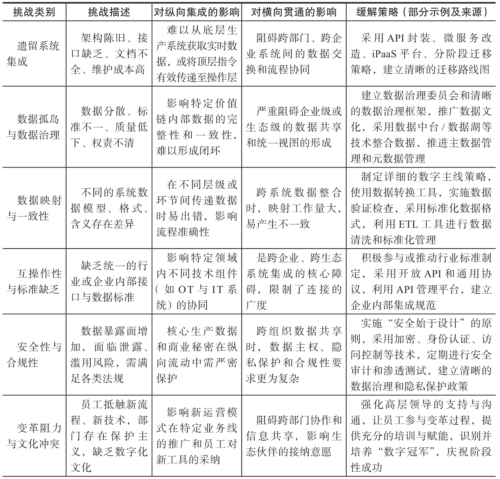

（续）

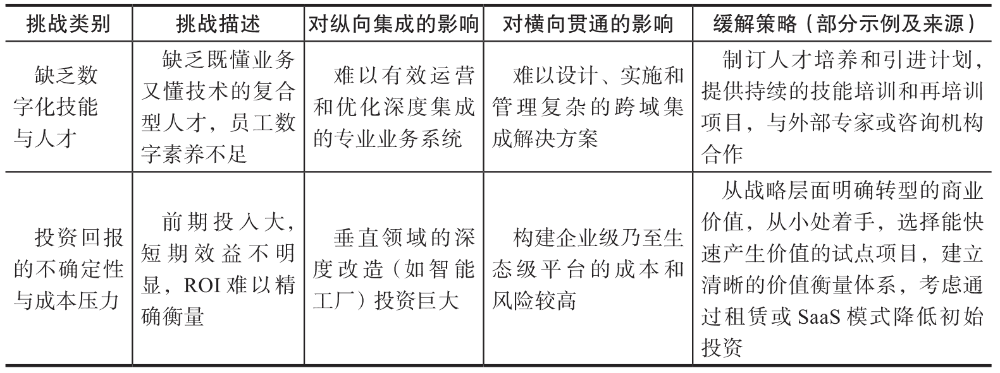

### 3.4.2 以 KPI 驱动的成效评估
为衡量从能力在线到业务在线的转型成果，以及纵向集成与横向贯通的效果，企业需要构建全面多维的 KPI 体系，覆盖财务效率、客户体验、组织能力与数据质量，为持续优化提供依据。

1. 能力在线的衡量指标
聚焦上线能力的可用性、使用效率与用户接受度。
**●使用渗透率**：在线工具、平台的活跃用户占比及使用频次。
**●技能熟练度**：通过考核、认证或任务完成质量评估员工对在线能力的掌握。
**●系统正常运行时间/可用性**：保障支撑系统的稳定可靠。
**●任务完成效率**：设计任务的准确率、平均处理时长等，并可与线下模式对比。
**●平台特定指标**：如快速设计平台的产品设计周期、零部件复用率等。

2. 业务在线的衡量指标
反映整体业务在线化程度及商业价值。
（1）客户体验类
**●客户满意度**：顾客对特定产品或服务的满意度，是衡量客户体验的直接方式 ^(⁴¹)。
**●净推荐值**：衡量客户推荐意愿，用以评估整体忠诚度与满意度。
**●客户生命周期价值**：企业预期从单个客户获取的总收益。
**●客户流失率**：特定周期内流失客户占总客户的比例。
**●数字渠道互动率**：企业通过数字渠道与客户建立互动的广度与深度。

（2）运营效率类
**●流程周期时间缩短**：订单处理时间、产品上市时间等。
**●自动化率**：已实现自动化的流程节点比例。
**●运营成本降低**：在线化带来的自动化与效率提升节省。
**●新产品/服务上市速度**：从构思到可售的时间，影响先发优势与市场份额。
**●其他业务 KPI**：如库存周转率提升、订单满足率提高、物流成本下降等。

普华永道指出，成功的业务在线需从客户互动、资源管理、智慧洞察、智能生产四个维度衡量并配套指标 ^(⁴²)。

3. 集成项目有效性的衡量指标
直指连接质量、数据流畅性与协同效应。
**●数据质量与一致性提升**：跨系统数据不一致率下降、准确性与完整性改善。
**●信息壁垒减少程度**：通过数据共享范围与可访问性评估。
**●流程自动化率与效率提升**：端到端流程处理时间缩短、手动操作减少比例。
**●互操作性评分**：基于标准符合度、接口调用成功率设定。
**●项目投资回报率**：评估投入产出效率。
**●跨职能/跨企业协作效率**：协同项目完成率、伙伴满意度等。
**●纵向集成的特定 KPI**：生产效率提升、产品不良率下降、设备综合效率 OEE 提升、设计到生产周期缩短、供应商绩效改善等。
**●横向贯通的特定 KPI**：订单全流程可视化程度、跨产品供应链成本透视能力、跨部门流程断点减少数量、设计-仿真-测试在线协同效率等。

KPI 设计应遵循 SMART 原则，与战略目标紧密挂钩，并建立持续监测、评估、反馈机制。结果性指标与过程性指标并重，才能全面反映转型真实进展。

### 3.4.3 最佳实践与经验教训
1. 成功要素与方法
**●顶层设计，战略引领**。领先企业均体现高层对转型的坚定决心与清晰愿景，将其纳入企业级战略，与提质降本创新目标绑定。建议设立专项组，由 CTO/CDO 牵头，联合业务、IT、数据部门制定 3-5 年路线图。
**●场景驱动，分步验证**。从价值高、痛点明确、ROI 好的场景切入，快速验证价值后推广。
**●客户为中心创造价值**。以客户需求与体验为核心，通过数据洞察、体验优化、组织保障三位一体策略驱动持续创新。
**●分阶段迭代推进**。采用“小步快跑、迭代推进”，以 MVP 模式分阶段扩展功能，避免大而全的初期投入。
**●统一数字化平台架构**。重视数字底座与数据处理能力，沉淀共享数据与业务能力，实现高效集成与能力复用。核心技术选专业方案商，通用技术优先开放技术栈、云原生、微服务、低代码。
**●开放合作构建生态**。通过战略合作、投资并购与平台开放整合外部资源，形成共生生态。
**●组织文化与人才同步转型**。培养数据文化，将数据质量与使用效率纳入部门 KPI；组建业务+技术+数据融合团队；强化变革管理，提升沟通、培训与激励。

2. 需规避的陷阱
**●技术驱动而非业务价值驱动**：盲目追新技术而脱离业务问题，投入产出失衡。
**●“烟囱式”建设延续**：缺乏顶层规划与统一标准，新技术栈上仍会形成新壁垒。
**●数据治理滞后**：忽视数据质量、标准、安全与隐私，会为后续分析与智能应用埋雷。
**●低估组织变革难度**：技术转型相对容易，文化、习惯与利益调整更为艰难，缺乏系统变革管理易导致半途而废。
**●一次性项目思维**：数字化是持续演进过程，需建立持续学习与改进机制以适应市场与技术变化。

总体来看，成功的转型是战略、技术、组织、文化协同作用的结果，借鉴经验、规避陷阱才能更有效规划执行。

# 第四章
# AI 与数字化转型：三要素协同与垂域创新
全球制造业正经历深刻的数字化转型浪潮，其本质远不止技术应用，而是发展理念、组织文化、业务模式与盈利模式的根本性重塑。企业将数字化置于战略核心，以提升运营效率、降低成本、增强客户体验，获取可持续竞争优势。德勤指出，数字化转型的终极目标是打造数字企业，即以技术持续进化商业模式的组织 ^(⁴³)，凸显转型的持续性与全面性。

在此浪潮中，人工智能已从辅助工具演变为引领制造业变革的核心力量。机器学习、深度学习、计算机视觉、大语言模型等正广泛应用于研发设计、生产制造、质量管控、供应链协同及经营管理。根据中国信通院统计，以判别式 AI 为主的小模型在生产制造领域的渗透率达 57% ^(⁴⁴)。这表明制造业数字化已超越单纯升级，成为深刻的业务与战略变革，AI 在其中扮演从赋能到引领的关键角色，重塑价值链、创新商业模式、定义竞争格局。

## 4.1 AI 与企业数字化转型
### 4.1.1 制造业数字化转型的内涵与目标
制造业数字化转型的目标呈现多元且动态演进特征。初期多聚焦内部运营效率提升与成本降低，如引入企业级 PLM 系统与 CAE 仿真工具优化设计流程。随着深入，目标转向以客户为中心、以数据驱动的价值创造与模式创新，具体表现为：

**●增强客户体验与个性化服务**：借助大数据与 AI 精准洞察需求，提供个性化产品与服务，提升满意度与忠诚度。例如 AI 驱动的 CRM 实现行为分析与精准营销，驱动 PLM 实现定制开发，或依托增材制造实现大规模定制。
**●驱动业务模式创新与价值创造**：不仅优化现有业务，更催生新商业模式与增长点，如从产品销售转向“产品+服务”整体解决方案，或构建平台生态整合产业链上下游资源。
**●提升敏捷性与韧性**：数字化能力使企业能快速响应市场变化、抵御外部风险、把握新机遇。例如在关税壁垒加剧背景下，利用 AI 评估全球供应商合规性、成本、交付能力，动态构建多区域供应网络，快速应对原产地规则变化。

转型目标正从降本增效迈向以客户为中心的数据驱动价值创造，背后是对竞争格局与价值逻辑的深刻认知。AI 凭借强大的数据分析、模式识别、预测与个性化服务能力，成为实现更高层次目标的关键赋能技术。

### 4.1.2 制造业数字化转型的关键阶段与演进路径
制造业数字化转型并非一蹴而就，而是循序渐进、分阶段、多层次的演进过程。企业需结合自身基础、行业特征与战略目标选择适配路径。

# 制造数智化升级：从点到圈的进阶地图

国内学界普遍的共识是，中国制造企业的数字化演进大致走的是先单点突破，再连线成带，随后铺面整合，最后形成生态协同的路线 ^(⁴⁵)。

**· 点**。这一阶段集中在单个业务单元、单一设备或一道工序上做数字化与自动化改造。比如引入数控设备、部署机器人完成重复性操作，或对特定生产节点实施数据采集与实时监控。

**· 线**。在单点验证有效后，把数字化手段往整条产线或特定业务链条上延伸。典型表现是全线自动化调控与生产过程可追溯，以及研发设计、供应链等流程的再造与提速。此阶段的核心特征常被概括为“能力实现在线”。

**· 面**。视野抬升到企业内部跨部门、跨系统的信息贯通与业务协同，目的是打破信息孤岛，推动运营标准化与一体化。此阶段的标志是端到端的“业务实现在线”。

**· 圈**。进入高阶阶段，企业跳出自身边界，主动构建或融入产业生态，让上下游在研发协同、智能制造、敏捷服务与价值分配上深度联动，达成共生。

国际咨询机构的框架思路相近。德勤以数字化成熟度模型 Digital Maturity Model 为抓手，从客户、战略、技术、运营、组织与文化五大核心视角展开评估，其下拆解为 28 个子维度与 179 项评估细则 ^(⁴⁶)。据此，德勤把转型历程划分为畅想 Imagine、交付 Deliver、运营 Run 三个阶段；成熟度阶梯则依次经历初生 Nascent、萌芽 Emerging、连通 Connected，直至多触点融合 Multi-Moment。埃森哲提出的全面企业重塑 Total Enterprise Reinvention ^(⁴⁷) 与波士顿咨询的数字化战略路线图 ^(⁴⁸) 也强调，从零散项目落地转向持续整体变革，从单点数智化走向原生数字企业。

口径不同，结论一致：制造数智化是一个由浅入深、从局部到整体的渐进过程。“能力在线”与“业务在线”是承上启下的关键枢纽。能力在线的本质，是把设计、制造、服务等核心能耐进行数字化封装、模块化与服务化，通过平台对内对外供给。业务在线则在此基础上，让核心业务流程实现线上运转与全链贯通，通过纵向集成与横向打通，使研产供销服实现在线管控与端到端流转，实时呈现运营态势，为决策提供依据。二者相互促进，是从内部优化迈向外部协同、从信息化迈向智能化的必经之路。毕马威的“五音”数智加速器模型也把业务在线化置于触点数字化之后、运营数据化之前，凸显其过渡作用。

### 4.1.3 AI 如何驱动制造数字化转型

凭借自我学习、自主判断、模式识别与预测分析等特性，人工智能正在重塑制造数智化的内涵与边界，成为推动“制造”向“智造”跨越的核心动力。其学习性、自主性、强化性与适应性，正在改变传统制造企业的组织属性。

数字化转型为人工智能奠定了数据底座与应用生态，而人工智能反过来充当转型的放大器与加速器。依托转型沉淀的数据资产，AI 能够给出智能解法、优化流程、催生新业态，从而加快转型节奏并放大成效。二者深度融合重塑了价值创造的底层逻辑，本质上是数据、算法、算力三要素的协同演化，与转型驱动力形成结构性共振。AI 与数字化转型之间的内在关联如图 4-1 所示。

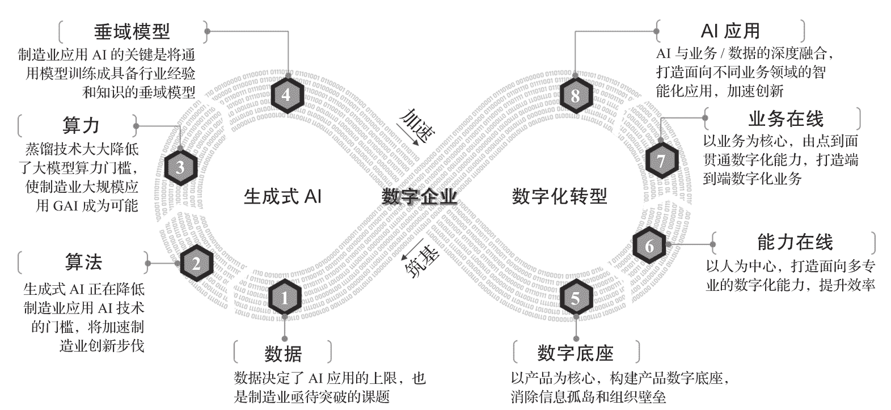

图 4-1 AI 与数字化转型之间的内在关联

下文围绕驱动力与 AI 三要素的关联展开解析。

首先，数字化为 AI 的落地与价值释放提供前提。

**· 以数据为原点**。AI 应用能力的上限取决于输入数据的质量与规模，以采集、管理、利用为核心的数据化实践是前提。
**· 数字底座搭建**。需要构建以产品为中心的数字底座，打破信息孤岛与组织壁垒。
**· 能力上云**。实现核心能力的模块化与服务化，推动经验沉淀与过程数据的在线化。
**· 业务上云**。通过串联各类数字化能力，实现端到端数字化运营与全流程业务数据的可追溯。

其次，底座成型后 AI 反向强化转型：

**· 应用门槛降低**。生成式人工智能等技术的发展显著降低了企业使用 AI 并加快创新的难度。
**· 算力成本改善**。蒸馏技术等手段有助于降低大模型算力开销，推动 GAI 在行业实现大规模私有化部署。
**· 垂直领域模型**。在制造场景，成功的关键在于把通用模型训练成具备行业知识与经验的垂直模型。
**· 智能应用孵化**。AI 与数据、业务流程深度融合，可衍生面向不同业务域的智能应用，加速创新闭环。

在当前浪潮中，AI 扮演引擎角色，已成为转型的基石，赋能企业处理海量信息、自动化复杂作业、提供个性化体验。波士顿咨询研究显示，过去三年 AI 领军企业的收入增速比整体均值高出 50% ^(⁴⁹)。其战略价值体现在流程优化、效率最大化、差错减少、品质提升、员工赋能与运营卓越等层面，帮助企业实现“更多、更好、更快”的生产目标。麦肯锡预计，AI 在企业场景的长期机会可带来高达 4.4 万亿美元的生产效率增益潜力 ^(⁵⁰)。

AI 的变革远不止自动化。其认知自动化能力有望超越以往任何重大创新。AI 既是提效工具，也是驱动战略决策、重塑竞争格局的关键力量。其在数据分析、趋势预判与决策优化上的作用正深入影响核心业务与战略规划。巨大的预期经济回报凸显其战略地位，使 AI 应用成为数字化时代的核心差异化要素。

总体而言，AI 时代的竞争已从单一产品比拼转向数字化能力的全面较量。成功转型的企业将掌握定义产业规则的话语权，形成“数据驱动创新—智能创造价值—生态赋能增长”的正向循环。

## 4.2 AI 三大要素攻坚：制造企业的数据战役

数据、算法、算力被视为支撑人工智能的三大支柱，彼此依存。形象比喻，数据像燃料，算法像引擎，算力像加速器。AI 在制造领域的落地成效，取决于三者协同突破与闭环迭代。

### 4.2.1 数据是攻坚主战场

在数智化蓝图中，数据处于核心位置。数据是 AI 的基础，缺乏高质量数据，模型无法发挥。制造企业日常产生海量异构数据，涵盖设计数模、图纸文档、工艺参数、生产物流等，是训练模型与精准决策的宝贵资源。

但驾驭数据是一场艰难攻坚，主要挑战包括：

**· 质量与完整性**。准确性、一致性、完整性及缺失错误直接影响模型性能与可靠度。据统计，42% 的制造商将数据可访问性与质量视为生成式 AI 应用的主要瓶颈 ^(⁵¹)。
**· 可达性与数据孤岛**。数据常滞留于老旧遗留系统或分散于部门孤岛，难以形成统一视图，阻碍综合分析。缺乏清晰统一的数据架构是普遍难题。
**· 规模与多样性**。如何治理来自不同源头的海量多模态数据，如结构化/非结构化数据、3D 模型、2D 图纸、文本、图像及传感器实时数据，对技术能力要求极高。
**· 安全与合规**。在采集、传输、存储、应用全链路保障设计数据、工艺参数、客户信息等敏感数据安全，并符合 GDPR、CCPA 等法规，是必须重视的环节。
**· 数据治理**。多数企业缺乏明确的数据治理体系，难以规范数据管理、使用标准及 AI 伦理。

赢得攻坚战需要系统举措：

**· 制定整体数据战略**。明确目标，审计现有系统，识别缺口与冗余。
**· 构建治理框架**。建立清晰角色、职责与政策体系，保障质量、安全与合规，涵盖数据标注、语义管理与元数据主动利用。
**· 应用集成平台与技术**。整合 PLM、MES、ERP、IoT、SCADA 等数据源，AI 本身也可自动化集成、清洗、标准化。
**· 建设现代化架构**。实施可扩展、可维护架构，包括上下文感知数据管道、向量数据库、知识图谱等，满足 AI 需求，并积极考虑云计算带来的弹性与灵活性。
**· 满足 RAG 与多模态需求**。针对检索增强生成等新兴应用，优化分块与检索方法，有效管理多样化格式。

四层驱动架构对打赢数据攻坚战至关重要。它为 AI 大规模应用夯实数据基础，并在业务、技术、数据架构维度保障 AI 与业务深度融合，充分发挥 AI 在产品与业务创新中的核心价值。

### 4.2.2 算法创新：从机器学习到复合式 AI

把数据转化为可行动智能的算法是核心引擎，负责处理数据、识别模式、预测并驱动自动化。算法种类丰富，包括监督学习、非监督学习、强化学习，以及基于深度神经网络的深度学习、自然语言处理、计算机视觉和生成式 AI 等。监督学习依托标注数据做预测分类，非监督学习在无标注数据中发现隐藏模式，强化学习通过试错学习最优策略，深度学习则模仿人脑层级处理自动发现特征规律。更高阶的大语言模型和生成式 AI 可执行更复杂任务，如辅助产品设计、工艺参数优化甚至生成新设计方案。

算法选择与优化直接决定应用效果。需根据具体业务问题挑选合适的模型，深入理解其复杂性、数据需求与计算资源消耗。实践中常需整合多种 AI 技术优势，弥补单一技术局限，形成复合式 AI Composite AI，即结合多种技术、模型或方法协同工作，应对单一模型难以解决的多层面挑战。复合式 AI 可实现更精准预测、更智能决策与更高效自动化，提升运营效率、产品质量与创新能力。制造业日益复杂的场景与丰富数据为复合式 AI 提供广阔空间。

伴随模型广泛部署，构建强大的 MLOps 平台成为必然。MLOps 指 AI 模型部署、管理、版本控制的自动化与标准化，并持续监控、维护、优化性能，保障生产环境中的稳定性、可靠性、可扩展性与持续价值。典型流程包括数据工程、模型开发与训练、验证与测试、部署、监控与运维、再训练与迭代。

### 4.2.3 算力支撑：本地部署与云计算的两难之境

AI 尤其是深度学习与大语言模型需要海量算力。主流生成式 AI 模型参数常达数十亿甚至数万亿，训练与推理均需高端 GPU 集群与大量内存。制造场景中，GAI 需处理大量实时传感器数据、生产日志、设计文档、供应链信息，预处理、特征提取与模型交互对算力要求极高。

应用 AI 时，如何最大限度保障数据安全、降低泄露风险是企业关注重点。因此在本地与云端部署抉择上，多数企业优先本地化，同时面临成本、空间环境、专业团队等挑战。

**· 成本**。购置与维护可运行 LLM 的高性能集群投入巨大。
**· 空间与环境**。部署需物理空间、电力、散热条件，部分企业难以满足。
**· 专业团队**。管理与优化高性能资源需专业的 IT 与 AI 运维队伍。

模型蒸馏等压缩技术为本地化部署带来契机。蒸馏即把大型复杂“教师模型”的知识迁移到小型高效“学生模型”，在保持较高性能的同时大幅缩小尺寸与算力需求。其带来的机会包括：

**· 降低算力门槛**。蒸馏后参数显著减少、推理更快，使本地服务器或边缘设备部署成为可能。
**· 保障数据隐私的本地部署**。本地部署避免敏感数据外传，更好保护商业机密与知识产权，蒸馏使其经济与技术上更可行。
**· 低延迟应用**。在实时质量控制、机器人协同等场景，小型模型更低的推理延迟能满足实时性要求。
**· 成本效益**。减少对昂贵云资源的依赖与本地硬件投入，降低总拥有成本。
**· 定制化与领域适应**。蒸馏过程可结合特定制造数据微调，使学生模型更好适配场景需求。

即便如此，算力需求与专业运维仍是主要门槛，尤其在构建面向大规模应用与持续优化的 AI 技术架构方面。

总体来看，生成式 AI 的部署模式选择是战略决策，需权衡成本、安全、性能、合规与自身技术能力。没有绝对最优解，需据具体需求审慎权衡。对数据高度敏感、对延迟要求极致且具备技术实力与预算的企业，本地部署更受青睐；希望快速启动、初期投入有限、追求可扩展性且数据敏感度相对较低的企业，云部署更便捷高效；亦可采用混合模式，用云端强大算力完成数据处理与模型训练，再将经蒸馏优化的小模型部署至本地或边缘设备处理实时数据与推理，兼顾安全与低延迟。

### 4.2.4 协同策略：优化数据、算法与算力的相互作用

数据、算法、算力基础设施紧密相连。数据是算法的燃料，算法是智能核心，需算力支撑。算力负责高效存储、管理、处理数据并提供运行环境。任一环节短板都会制约整体能力，三者协同是实现高级应用、推动转型纵深发展的关键。

AI 首先是赋能人类工具而非完全替代，尤其在突发中断与不确定性面前，人类经验与智慧不可或缺。这种协同理念也在三要素互动中体现，人类监督与领域知识贯穿 AI 全生命周期。

制造业的数据攻坚不仅是追求数量，更在于实现 IT 与 OT 系统异构数据的情境化与集成。数据若分散、缺乏统一上下文，价值大打折扣。薄弱的数据治理与低质量数据会直接导致模型不可靠，侵蚀 AI 投资价值，甚至引发事故或财务风险。数据质量决定 AI 应用上限，数据问题导致模型不准并提高“机器幻觉”风险，形成清晰因果链：劣质数据→不可靠 AI→信任缺失/应用受阻→投资浪费/负面影响。在制造业，AI 错误决策可能直接影响研制过程与生产安全，影响尤为突出。

数据本身再庞大，若没有被整合进业务流程并赋予场景意义，难以释放价值。数字化转型所采用的四层驱动架构，能够系统性地拆解信息孤岛、打通跨系统流通，并在算力上云与业务实时在线的支撑下，为人工智能搭建具备情境感知的通道。这再次印证，数字化是企业将AI规模化落地的基础，也是迈向智能化的必经路径。

生成式与多模态技术的推进，使得模型体系日趋复杂，对训练素材、算法设计与算力供给的需求同步攀升。这意味着需要更丰富且质量更高的样本、更精细的算法，以及更充裕的计算支撑。可以预见，随着AI能力增强，掌控这三类资源所需的门槛也在提高。若企业仍卡在基础数据拼接阶段，就更难驾驭前沿技术，与领先者拉开差距。

因此，三类资源的建设并非一次性达标，而是一项长期战略动作。随技术迭代，制造企业必须持续校准数据策略、强化算法能力，可自研也可通过采购或合作，同时升级计算底座，以维持竞争态势。三者的配合是动态演进的，需要持续优化与平衡。

## **4.3 通用大模型向工业大脑演进**

泛用大语言模型凭借出色的自然语言理解与生成，在各行业引发热潮。但直接搬到复杂制造场景时局限明显。制造业要的不仅是文本处理，而是能深度融合专业知识、读懂工艺细节、解决真实生产问题的行业定制智能。接下来先梳理泛用大模型在工业落地的短板，再说明如何借助提示工程、RAG与微调等手段构建面向制造的专业模型，以及技术选型的思考框架。

### **4.3.1 为何必须从通用走向垂域**

泛用大模型的出现是人工智能的重要跃进。多数模型以Transformer为底座，在海量文本上预训练，在摘要、协助创作、结构化、信息检索等任务上灵活度高，能拟人化表达、问答、翻译、代码生成。

面对特定工业需求时，泛用性暴露出固有缺陷，主要有：

● 处理长度受限：大多数模型有固定的Token上限，面对冗长的工业文档或多轮对话时易衰减或截断。
● 幻觉与偏差风险：工业场景对精确性要求极高，模型在不熟悉领域易产生误导性或虚构内容，这在精密决策中无法接受。
● 知识滞后：预训练后知识库基本冻结，无法自动吸收新法规、新工艺，除非重训或借助外部增强。
● 缺乏长期记忆：交互常被视为独立事件，难以建立对特定流程、设备历史的持续关联。
● 推理与细节把握不足：工业应用常需多步逻辑推理和对专业术语、隐性知识的深度理解，泛用模型更多依赖模式匹配。
● 域外数据适应差：实时运营数据、企业私有知识等训练外信息难以准确解析。

工业对大模型的评判更严苛，涵盖连贯、精确、相关、清晰与效率。泛用模型在精确与相关上难以达标，任何偏差都可能引发经济损失、停产甚至安全事故。因此具备深度领域理解与高精度的专业模型需求日益迫切。

垂直领域模型正是在此背景下形成。通过在行业专业语料上训练或微调，模型能深入理解术语、情境、产品信息与规范，从而提升性能、相关性与可控性。典型使用包括知识库定制、情境理解增强，以及执行精确定位、合规审查、复杂运营决策等专家级任务。优势在于提效降本、提升精确度、强化情境理解、在受控环境中处理敏感数据以加强信息保护，并最大程度压制幻觉。

从泛用模型向专业模型的演进，本质是泛用模型的广泛适用性与工业对深度、精细化、高可靠智能的强需求之间的矛盾所驱动。泛用模型功能多样，却伴随幻觉、知识缺失、细分领域推理不足等问题。工业高风险、术语复杂、对精确性苛求，倒逼定制化方案的产生。

垂直化不仅关乎精确度提升，更是信任与安全的构建。涉及关键基础设施或人身安全场景中，泛用模型的黑箱特性与不可靠性难以被接受。专业模型依托筛选后的领域受控数据训练，并常结合可解释性机制，建立更高的可信度与更安全的运行。是否符合行业规范、法规与安全协议，已成为落地的关键，其意义已超出精确性，触及信任与安全根本问题。如汽车开发中基于功能安全标准构建合规审查专业模型，实现自动化审查与风险评估，降低人为失误并提升效率。

### **4.3.2 垂域建模的关键步骤与数据打法**

构建高效的专业大模型，核心在于扎实的数据底座与恰当的专业化技术。从目标明确开始，经细致数据处理，最终借助先进AI技术实现深度领域适配。

1.数据底座：领域语料的采集、管理与净化
构建专业模型首先要打好数据基础。先明确目标与场景，再指导采集、筛选与处理。

（1）界定目标与应用场景
启动项目前必须明确模型要实现的功能，例如是汽车功能安全合规审查，还是面向工程师的元器件优选推荐。要清晰主要场景、成功标准，以及响应时延、隐私保护等约束与评估指标。这些初始定义将牵引后续数据策略与开发步骤。

（2）数据需求与管理策略
● 采集领域语料：甄别并收集能够反映目标领域语言特征、专业术语、标准规范、业务流程及推理逻辑的高价值文本，包括企业内部产品文档、质量体系、开发流程等资料。
● 质量优先于规模：小而精、纯净的相关数据集，远胜庞大嘈杂的数据集。在保证质量前提下仍需规模覆盖目标场景，否则易引发偏见或幻觉。
● 数据净化：获取纯净无噪声集，加速训练并提升泛化能力。包括①去噪纠错，如修正OCR错误，处理缺失值，可采用KNN插补或中位数均值插补；②剔除重复：字面精确匹配、MinHash与LSH近似重复、基于句子嵌入的语义去重、借助FAISS等相似性检测，避免偏见并保证样本多样性；③文本标准化：JSON、XML用于提取带丰富元数据的结构化数据，纯文本统一UTF-8编码，执行多语言检测，统一行尾符与空白字符。
● 专家参与标注：领域专家不可或缺，可为数据打标签、构建监督微调数据集，审查修正模型输出形成反馈闭环，提升关键领域精确性与可信度。
● 合成数据与增强：真实数据有限时，可用RAG驱动的问答对生成、释义、摘要、问题改写等方法扩增样本。合成数据需由专家抽样核查语义正确性与领域一致性，避免污染数据集。
● 隐私与合规：处理敏感数据需谨慎，尤其金融、医疗等强监管领域。对个人身份信息进行匿名化或脱敏，确保数据源合法授权，对数据集做版本控制以便审计。
● 持续更新：行业在变，模型需随之进化。应定期更新检索库或训练数据，纳入新报告、法规、行业趋势。

2.预处理流程
净化去重后进入文本预处理与切分词元，将文本转为模型可用格式。

● 基础文本处理：规范化与标准化内容，保证输入一致。①大小写规范化：统一大小写缩小词汇量；②标点处理：标准化或移除以保证Token一致性；③词形简化：词干提取快速处理，或词形还原保留更多情境语义。
● 切分词元：文本切分为模型可处理的单元。对大模型，子词切分是首选，能在词汇量与罕见词处理间平衡。常用方法：①字节对编码BPE，合并高频字符对；②WordPiece，用“##”前缀标记子词；③Unigram，按损失修剪词表；④SentencePiece，跨语言友好，无需预处理。
● 专业文本处理：标准方法对特定领域或多语言文本常不够用。应采用词典处理术语，兼顾缩略语与首字母缩写，保留数值与度量单位。用特定语言模型准确识别多语言数据。对医疗、技术等领域，构建领域专用切分器至关重要，避免专业术语被错误切分而丢失语义。
● 特征工程：借助领域知识从文本中识别有意义模式。行业特定语义特征可通过自定义分类体系或专用嵌入技术实现，即把文本转为模型可理解的数字表示。
● 高效预处理管道：依赖模块化设计、可扩展性与顺畅集成。大规模数据处理采用批处理、流处理与数据分片，配合列式存储、压缩、负载均衡提升性能。结合自动化健康检查与专家反馈持续改进。

3.核心专业化技术：提示工程、RAG与微调

构建专业模型通常推荐三类手段：提示工程、检索增强生成RAG、模型微调。

（1）提示工程：引导行为与任务适配
提示工程被认为是无需改动模型架构或重训，即可从泛用模型中提取领域知识的最快路径。通过精心设计问题或指令引导输出。

核心特征包括：
● 指令式提示：清晰直接命令，如“总结这段文字”。
● 少样本学习：在提示中提供少量示例演示期望输入输出关系。
● 思维链提示：鼓励分步推理，生成结构化逻辑响应，对工业复杂分析尤为重要。
● 领域情境注入：在提示中直接带入领域信息，例如“为传统商用车增加AEB主动刹车，需要哪些产品功能调整”。
● 角色扮演提示：设定角色如“你是一位资深制造工程师”，影响回答视角与风格。

优点是资源需求低、任务适应强、配置少即可见效。实施是迭代过程，需根据输出不断调整提示内容、结构与措辞。即使是RAG系统，也需要精准提示词来确保正确检索并指导模型使用数据。

（2）检索增强生成：接入动态与私有知识
RAG在生成响应前，参考权威外部知识库——专有或实时的行业数据——优化模型输出，无需重训。可有效缓解知识鸿沟、信息过时与幻觉问题，将回答锚定在事实性、最新的领域数据上，提升精确性、可控性与相关性。

工作流程：
1）外部数据创建/索引：对领域文档分块，用嵌入模型转为数值表示，存入向量数据库形成知识库。
2）检索：用户查询转为嵌入向量，在向量库中按语义相似度检索最相关片段。
3）增强与生成：将检索片段作为情境与原始提示一起输入模型，生成更具信息量的响应。
4）持续更新：为保证时效，外部知识库需定期或实时更新。

高级RAG从预检索、检索、后检索三环节优化，模块化RAG提供搜索、记忆、微调检索器等模块以提高灵活性。效果高度依赖搜索引擎质量、文档预处理策略、嵌入模型选择与分块算法。因模型非确定性，性能评估需持续监控与调整。

（3）模型微调：深度知识注入
模型微调是在预训练模型基础上，用规模较小但领域相关的标注数据进一步训练，调整参数以在特定领域表现更佳。通常为监督学习，使用“提示-响应”对等数据。

基本流程：
1）明确目标与选择预训练模型
①定义任务/领域数据：如特定文本生成、领域问答、智能器件推荐，或基于安全标准的汽车合规自动审查。
②选择适合的预训练模型：依据任务需求、预算、算力与性能。
③选择模型规模：更大模型能力更强但需更多算力。
④开源或闭源：开源如DeepSeek、Llama、BERT、GPT-2灵活可控，闭源如OpenAI GPT系列API微调上手快但定制性有限。
⑤设置模型特性：有的模型在代码理解等特定能力上更强。

2）准备与处理微调数据集
①数据收集：与任务高度相关，质量优于数量，但需一定规模。
②数据净化：去噪、去不相关信息、去重复、纠错、脱敏。
③数据格式化：转为模型所需格式，常见有提示-完成对、指令-输出对、对话格式、文本分类标签。
④数据增强：数据不足时可用回译、同义词替换等，需谨慎避免引入噪声。
⑤数据集划分：训练集用于调参，验证集用于监控过拟合调超参，测试集用于评估泛化能力，不在训练验证中暴露。

3）配置微调环境与参数
①硬件资源：通常需要强GPU如英伟达A100、H100及充足内存。
②软件框架：如PyTorch、TensorFlow及PEFT等微调库。
③超参数：学习率通常比预训练更小；批次大小受GPU内存限制；训练轮次过多易过拟合；优化器引导参数空间寻优；权重衰减作正则化；梯度累积可模拟大批次。

4）执行微调训练
①加载预训练模型与切分器：权重与Tokenizer负责将文本转为数字序列。
②训练循环：模型在训练集迭代，前向传播生成预测，计算损失如交叉熵，反向传播计算梯度，优化器更新权重。
③监控与验证包括：

**微调落地与垂域化操作要点**

训练推进阶段，建议每完成一个训练轮次或设定步长后，用独立的验证数据对模型做一次体检，常用的观测指标有损失值、准确率、困惑度 Perplexity，以及 BLEU、ROUGE 等贴合任务的评价。

同时要观察训练损失的变化轨迹，判断是否已收敛，以及是否出现过拟合或欠拟合倾向。超参数的调整应以验证集上的表现作为依据。

④ 检查点保存：按固定频率备份权重，一方面便于中断后快速恢复，另一方面可保留验证效果最佳的版本。

5）微调后模型的评估

① 定量评估：在未参与训练的测试集上，采用任务对应的客观指标进行量化打分。
② 定性评估：人工抽样检视生成样本，评估流畅度、相关性、准确性及风格契合度，对创意类任务尤为关键。
③ 基线对比：将微调后的结果与未微调的预训练模型或其他参考方法做横向比较。

微调本质上是迭代循环，评估反馈后通常需要：

**●** 重新设定超参数。
**●** 优化训练数据，扩充规模、清洗噪声或统一格式。
**●** 更换预训练基座。
**●** 尝试更高级的微调手段。

6）部署与持续优化

微调完成后模型可投入使用。上线后需持续跟踪运行表现，必要时进行再微调或持续改进。

从可调参数规模看，常见两条路线。

**● 全参数微调 Full Parameter Fine-Tuning，FPFT**：更新全部参数，算力开销大，但性能上限通常最高。
**● 参数高效微调 Parameter-Efficient Fine-Tuning，PEFT**：仅更新极小比例参数，大幅降低算力与数据需求，同时能在一定程度上缓解全量微调带来的灾难性遗忘，即适配特定数据后原有知识被冲刷、在旧任务上退化。

从数据来源与训练方式看，典型做法有：

**● 监督微调 Supervised Fine-Tuning，SFT**：使用为目标任务定制的带标注数据训练。
**● 指令微调 Instruction Fine-Tuning，IFT**：使用包含指令与期望输出的样本训练，让模型学会遵循指令。
**● 基于人类反馈的强化学习 Reinforcement Learning from Human Feedback，RLHF**：依据领域专家的反馈优化，让输出更贴合真实世界的偏好与标准。

由于全量微调算力要求高且易引发遗忘，近年参数高效微调更受关注。其思路是通过只更新极小部分参数或额外引入少量参数，在接近全量效果下完成适配，硬件门槛大幅下降，甚至可在消费级 GPU 上完成大模型适配。

常见的 PEFT 方案如下。

**● LoRA Low-Rank Adaptation**：冻结原始权重，在部分层通常是注意力层注入可训练的低秩矩阵，把参数投射到低秩空间，减少可训练量，同时保留原有能力 ^(⁵³)。
**● QLoRA**：LoRA 的 8 位精度延伸形态，将权重量化至 4 位，进一步压缩显存占用。
**● Adapter Tuning**：在预训练模型的层间插入小型可训练的适配器模块。
**● Prompt Tuning / P-Tuning**：整体冻结大模型，仅学习与输入拼接的可训练软提示嵌入。
**● Prefix Tuning**：与 Prompt Tuning 类似，但在注意力机制的每一层都加入可训练前缀。

总体来看，微调覆盖数据准备、模型选择、训练、评估与迭代，是一个系统工程，对高质量数据与合适的微调技术依赖度高，容易出现过拟合或削弱预训练获得的通用能力。PEFT 的兴起进一步推动了大语言模型在细分场景的落地。

4.垂域模型构建策略

构建垂域模型未必需要从零开始。以现有开源预训练模型为起点，再结合检索增强或微调，往往比自建全新 LLM 更省时省钱。

（1）基础模型架构选择

通用 LLM 与垂域 LLM 大多基于 Transformer 架构。通用模型为覆盖广泛语言规律，参数规模常达数百亿至数千亿。垂域模型可以是大型模型，也可以是小规模模型经精细微调后取得成功的案例。

选定基座时需综合评估其训练数据的构成、输出质量、在相关基准上的表现、潜在安全风险，同时兼顾数据隐私法规以及领域专业知识被污染的可能。

（2）垂域化技术选择

可搭建决策图或决策树，依据可用数据规模与质量、对动态知识更新的需求、可解释性要求、算力成本预算等维度，辅助挑选合适的通用 LLM 与定制化技术。

如前所述，模型垂域化主要技术包括提示词工程、检索增强生成和模型微调，三者优劣各异，具体见表 4-1 所示。

**表 4-1 提示词工程、RAG 和模型微调对比分析**

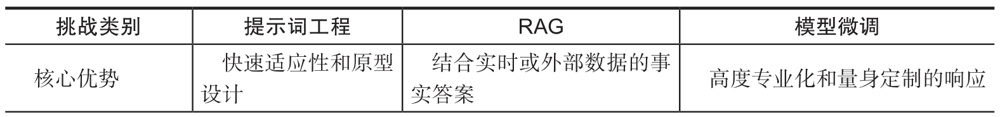

（续）

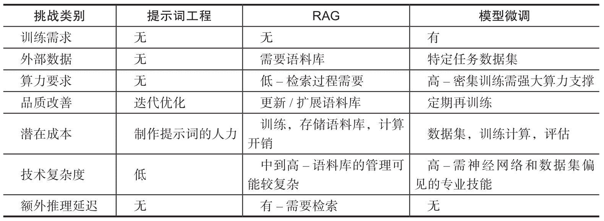

下面用一个形象的例子说明差别。

通用大模型好比刚完成大学本科通识的大学生，已学过高等数学、物理、化学等基础课程，但尚未修读专业课，比如自动控制理论。它能处理通用问题，却难以给出专业的配置建议，例如基于成本与交付周期给出最优产品方案。

**● 提示词工程**：相当于给学生提供一套答题提示，如“请用所学电磁学知识解释风电机组发电原理”。学生会按提示组织答案，但知识本身并未改变。
**● RAG**：相当于给学生一本专业书籍如自动控制理论，开卷应答。学生可在作答时查阅书籍，并在答案中引用章节，以保证准确性。
**● 微调**：相当于让学生自学同一本书，然后闭卷考试。学生只能依靠内化知识作答，可能出现错误，也难以提供出处。

实践中，RAG 因灵活性强、可溯源、开发周期短、可解释性好，通常更具优势；提示词工程适合资源受限、任务适配要求高的场景；当手握大规模高质量静态数据，且需要模型深度理解领域语言时，微调更为合适。部分场景下，微调与 RAG 的混合方案效果最佳，比如既有庞大静态知识库，又需处理动态信息流的情况。

### 4.3.3 工业大脑：制造业 AI 的终极目标

随着垂域 LLM 成熟，“工业大脑”或“数字大脑”“认知平台”等概念逐步浮现。它代表工业智能化的更高形态，力求通过整合多种先进技术，对整条工业价值链实现深度洞察与智能管控。

工业大脑通常依托工业云平台，融合人工智能尤其是大语言模型、大数据分析、云计算与物联网 IoT 等，实现对企业各业务环节乃至全产业链的连接与智能化管理。核心目标是用深度数据挖掘实现价值转化，推动产业升级与创新，最终形成高效、智能、可持续的工业发展模式，可视为一个集成的智能中枢。

埃森哲把类似的“认知数字大脑”描述为一种自主 AI 能力，把工作流程和价值链直接内嵌系统，使其以更高自主性理解与行动 ^(⁵⁴)。O9 提出的“数字大脑”是一个知识驱动的集成分析、规划与决策平台 ^(⁵⁵)。它整合市场、需求、供应、营收、财务等多域数据与知识，借助实时洞察、机器学习驱动预测、营收分析与规划、供应链分析与控制塔、数字化集成业务规划 IBP 等高价值应用，追求更精准预测、更优资源配置、跨部门协同与更明智决策。

在中国，工业大脑伴随工业 4.0 与智能制造浪潮同步发展。阿里云 ET 工业大脑、华为 FusionPlant、腾讯云 WeMake 等产品持续迭代，地方政府也推出区域或行业工业大脑建设计划。以阿里云为例，其定义工业大脑为基于大数据的统一计算平台，汇聚企业系统、设备、传感器、人员管理等多源数据，结合图像视频识别、机器学习与 AI 算法激活数据价值，解决工业智能制造核心问题，加速工业新基建 ^(⁵⁶)。这一定义突出了数据聚合、AI 算法与解决痛点的目标。

更广义地看，工业大脑是一个数据驱动的智能系统，整合研发、制造、供应链到交付运营全流程产生的数据，用先进分析与智能算法实现全链路洞察、精准预测与优化控制，提升整体运营效率与竞争力。其本质并非标准化单一产品，而是按行业与企业痛点定制构建的系统工程。

工业大脑的建设是一个渐进过程。它从针对特定问题的 AI 应用，如器件优选推荐、采购需求预测等起步，逐步演化为连接、学习并优化价值链的生态系统，能够感知、推理、决策并在企业范围内行动，运作方式类似生物大脑协调机体。它融合工程技术 ET、运营技术 OT 与信息技术 IT 的异构数据，通过多模型协同与智能体编排，实现端到端智能流程与持续自优化。

从发展阶段看，尽管市场规模可观，工业大脑尤其是深度融合大模型的阶段仍处探索早期。企业在数据采集、存储、处理、分析、资产化方面已有积累，为高级智能应用打下基础，但真正的大脑级智能决策系统仍在演进。当前紧迫问题是制造业 AI 技术架构与应用场景的落地。

### 4.3.4 构建垂域模型的最佳实践

构建成功的垂直领域 LLM 可遵循以下实践。

**● 明确目标**：清晰界定任务、目标用户与成功评价指标。
**● 数据为王**：优先保证领域数据的质量、相关性与纯净度。
**● 专家参与**：在标注、训练、评估环节引入领域专家。
**● 分阶段垂域化**：先用提示词工程与 RAG 实现快速注入与验证，再视需要投入微调。
**● 审慎选择基础模型**：基于任务需求与评估标准挑选合适的预训练模型作为起点。
**● 精细调整超参数**：在微调中仔细优化学习率、批次大小等。
**● 严格评估**：对照基准与真实场景全面评估性能。
**● 关注安全与伦理**：应对数据隐私、模型偏见与伦理风险。
**● 持续迭代**：建立监测、维护与知识更新机制。
**● 面向 Agent 智能体系统**：构建 LLM 智能体时需精心设计业务逻辑、集成 API 并充分验证行为。

领域特定数据的质量、相关性与战略管理，对垂域模型的实效影响往往超过模型规模或算法复杂度。整个过程始于明确目标与场景，这决定数据需求。实践中“质量重于数量”被反复强调，细致清洗与预处理不可或缺。即便是 RAG，其效果也高度依赖外部知识库质量；微调也需要高质量标注数据支撑。这凸显垂域 LLM 的“智能”主要来自其所学的专业化数据。

“提示、增强、微调”提供了一条务实可扩展的专业化路径。从低成本的提示词工程，到用 RAG 在不重训模型的情况下整合专有或动态数据，再到用微调实现最深层次领域适配，企业可在每个阶段都获取价值，并根据效果决定是否追加投入。图 4-2 所示为模型垂域化技术演进路径，属于迭代开发、风险可控、资源优化的模式。

技术选择并非固定序列，而是多因素权衡。RAG 在动态信息更新上表现优异，微调更适合把静态核心领域语言与推理模式深度嵌入模型。若数据稀缺但实时性要求高，提示词工程结合 RAG 可能优于微调；反之，若需在稳定知识基础上让输出风格深度贴合行业规范，微调更合适。这要求企业基于具体工业场景、数据可得性、知识动态性与资源限制做精细决策，而非照搬固定流程。

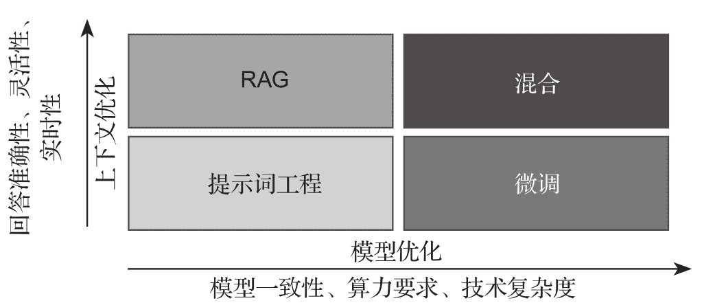

图 4-2 模型垂域化技术演进路径 ^(⁵⁷)

## 4.4 制造业 AI 技术架构

随着 AI 在制造业深入应用，选型与构建合适架构成为关键。本节对比几种主流或新兴架构，包括复合式 AI、模型上下文协议 MCP 以及边云协同架构，为制造企业提供架构选型参考。

### 4.4.1 复合式 AI：多模型融合技术

制造环境面临海量异构数据、动态生产条件以及高精度高可靠要求，单一模型难以全覆盖。复合式 AI 整合机器学习 ML、计算机视觉 CV、大语言模型 LLM、机器人流程自动化 RPA 与 AI 智能体等，形成协同内聚的智能系统，应对单一模型无法解决的多层面挑战。制造业日益增长的复杂性与丰富数据为复合式 AI 提供了广阔空间，使其成为推动智能化升级的关键驱动。

在复合式 AI 架构中，任务被智能分配给最适配的组件，降低单体认知负荷，提升整体性能。其核心优势如下。

**● 效率**：通过任务分解与并行处理，或借助资源需求更低的专用模型，提升整体性能与准确性，缩短完成时间。
**● 模块化与灵活性**：组件化设计允许单独更新或替换，无需大规模改造整体系统。
**● 专业化**：针对特定任务定制的 AI 组件在垂直领域表现优于单一通用模型。
**● 多功能性**：可适配多样化场景，结合 RAG 等技术进一步扩展 LLM 能力边界。
**● 可控性与可信度**：可通过控制核心模型的输入与过滤输出，使系统行为更可预测可解释，增强用户信任。

单一庞大模型难以在制造业多样任务与数据类型上全面胜出。复合式 AI 允许集成各类最优组件，如用于视觉的 CNN、用于时序的 RNN、用于文本的 LLM，解决不同专业领域的复杂问题。C³AN 框架为此类系统构建提供结构化方法，增加领域定制与部署紧凑性等关键层面，并强调制造业至关重要的可信度与领域特异性 ^(⁵⁸)。

在制造中，复合式 AI 可用于处理模型、图纸、文本、视频、传感器等多源数据的复杂质量控制、产品设计流程优化、结合多分析模型的高级预测性维护等。例如，用生成式 AI 优化复合材料结构设计即是典型应用。未来，制造业复合式 AI 正向“工业大脑”或“认知数字大脑”演进，预示数据驱动、具备自主学习与自优化能力并深度融合人类智慧的智能制造新范式到来。

### 4.4.2 模型上下文协议：标准化 AI 模型交互

模型上下文协议 Model Context Protocol，MCP 是由 Anthropic 于 2024 年 11 月推出的开放标准，旨在解决 AI 模型访问外部信息时集成碎片化与效率低下的问题。MCP 规范化 AI 模型尤其是 LLM 与外部服务、数据源之间的通用接口，可被视作 AI 应用的“USB-C”接口，实现结构化、安全且一致的 API 调用，简化 AI 系统与外部世界的交互。

MCP 定义通用通信协议、数据格式与规则，为部署应用带来以下好处。

**● 简化集成**：开发者无需为每种模型与工具组合定制集成方案，统一协议让 AI 系统更易连接多样化数据源与工具。
**● 提升模型表现**：标准化上下文交换使模型获取更准确相关外部数据，从而生成更高质量回复并执行更广任务。
**● 增强互操作性**：作为模型无关的开放标准，促进不同 AI 平台与工具间的兼容与协同。
**● 安全可控**：协议设计考虑数据安全与访问权限控制，用户对数据共享与操作有明确控制权。

MCP 采用客户端-服务器架构。

**● MCP 服务器**：连接具体数据源或工具系统，按 MCP 规范将其能力以 API 形式暴露给客户端。服务器可提供三种核心功能：① 资源，供客户端调用的上下文数据，通常不执行计算或操作；② 工具，允许客户端调用的 API 或函数，进行特定计算或操作；③ 提示 Prompts，提供可复用的模板化消息与工作流，便于用户与 AI 模型进行特定类型交互。

**MCP：统一 AI 外部联动的对话标准**

**● MCP 客户端**：这类组件一般嵌入在主程序里，例如大模型助手、智能体应用或会话机器人。它们负责发起与 MCP 服务端的连接，探知服务端所暴露的资源、工具与提示模板，并依据模型意图或用户指令完成调用与回传。

**● 通信协议**：消息承载基于 JSON-RPC 2.0，是一个轻量级的远程调用规范，以 JSON 封装数据。连接保持有状态，可在同一会话中多次往返请求，并支持双向能力协商。

MCP 仍处起步阶段，但业界普遍视其为推动智能体进化的关键抓手。借助统一的交互规范把 AI 与外部世界打通，可带来四方面效应。① 缩短 AI 应用的研发与上线周期：集成复杂度下降，开发者能聚焦业务本身；② 保障跨系统协作的一致性：以统一规范实现工具、系统间的数据流通与业务整合，支撑端到端的复杂应用；③ 增强高阶自主能力的智能体：服务端可提供参数化提示模板，便于以提示链搭建多步工作流，提升规划与执行力；④ 催生更开放协作的 AI 生态：鼓励厂商与开发者共同构建并共享兼容的工具与服务。

总体来看，模型上下文协议的意图是通过开放标准化的框架，重塑 AI 模型与外部数据、工具的协作方式，为打造更强、更实用、更易集成的多智能体平台奠基。

### **4.4.3 边缘云协同：工业场景 AI 规模化落地思路**

工业数字化进入深水区，AI 正由试点走向规模投放。生产现场复杂、数据异构且对实时性要求高，再加上安全与成本制约，单一云端或纯边缘方案难以兼顾。边缘云协同凭借灵活性、高效性与可扩展性，成为行业普遍关注的落地思路。

协同的本质是把计算与存储在边缘设备与云平台间做智能分工，既发挥边缘低时延、高带宽、数据不出厂的优势，也借助云端强算力、海量存储、模型训练与集中管控的能力，形成互补。

在工厂场景的具体呈现可归纳为四类分工。

1. 数据采集与预处理的分工
**● 边缘侧**：部署在研发、生产、供应链等业务节点的边缘设备，如 PLM 数据源、产线终端、嵌入式装置等，实时采集各环节的海量数据。数据可在本地完成清洗、过滤、聚合、特征抽取等初级处理，减少上云量，缓解带宽压力与传输时延。对 PLM 等系统经能力在线与业务在线改造后，可直接通过数据 API 上送云端，无需额外预处理。
**● 云侧**：汇聚多节点数据进行集中存储与深度分析，开展挖掘与知识图谱构建，实现跨业务域的全局洞察。

2. 模型训练与推理的分工
**● 云侧**：依托 GPU 集群等强算力完成复杂模型的训练与调优，专业团队在云上基于海量数据打磨高精度模型，并通过模型管理平台实现版本控制与迭代。
**● 边缘侧**：将训练好的模型下沉到边缘节点执行实时推理，支撑智能设计导航、需求异常检测、设备故障预测等现场应用，降低对网络的依赖，保证连续性与实时性。
**● 优化与更新闭环**：云端可依据边缘回传的推理结果与新增数据进行持续学习与优化，并把更新后的模型推送回边缘，形成闭环迭代。联邦学习等技术亦可在该架构下运行，在不上传原始数据的前提下利用各节点本地数据联合训练，仅回传参数改变量或梯度，云端聚合后生成新的全局模型。

3. 应用部署与管理的分工
**● 云侧**：作为集中管控中心，负责应用的统一部署、监控、运维与升级，开发者可远程管理分布各地边缘节点与应用。
**● 边缘侧**：承载具体的 AI 应用，执行实时决策与控制，具备一定自主运行能力，在与云端网络中断时仍能维持核心功能。

4. 安全与可靠性的分工
**● 边缘侧**：本地化处理降低敏感生产数据外泄风险，实时性也有助于快速响应安全事件。
**● 云侧**：提供整体安全防护，监控边缘节点安全状态并及时处置漏洞，借助冗余设计与备份提升系统整体可靠性。

综合来看，工厂采用边缘云协同具备明显优势。**● 低时延高效率**：边缘实时处理满足毫秒级响应需求。**● 带宽优化降成本**：边缘预处理减少上传数据量，节省网络成本。**● 数据隐私与安全增强**：敏感数据就地处理降低泄露风险，部分企业也会选择私有云进一步保护核心 IP，成本相应提升。**● 高可用与可靠性**：网络不稳时边缘仍可自主运行。**● 灵活扩展与集中管理**：云端提供强算储支撑业务扩展，同时实现对大量边缘节点的集中运维。

落地过程中也面临挑战。**● 边缘节点的管理与维护**：节点分散导致运维复杂，需按数据量、地域等因素合理规划节点数量。**● 边云数据一致性与协同效率**：需高效的数据同步与任务编排机制，如统一编排平台、异步处理与事件驱动架构。**● 边缘算力限制**：边缘计算与存储能力有限，需进行模型轻量化与蒸馏等优化。**● 网络连接的稳定性与安全性**：边云链路是关键，必须保障稳定与安全。**● 技术标准与生态成熟度**：涉及多技术多厂商，需考虑兼容性与生态支持。

总体来看，边缘云协同为工业 AI 规模化提供了一条可行路径，通过有机融合边缘与云的优势，更好满足实时性、可靠性、安全性和成本效益的综合需求，加速 AI 在制造各环节的深度融合，是推动向智能化、柔性化、高效化转型的关键支撑。

### **4.4.4 工业 AI 架构的战略取舍**

在智能化转型中，AI 架构的选择直接决定项目成败与企业竞争力。这不仅是技术选型，更是把 AI 深度嵌入业务流程、实现数据驱动决策与持续创新的战略问题。目前边缘云协同已成主流，而 MCP 与复合式 AI 则带来新的架构考量。

边缘云协同为复合式 AI 提供了理想的承载环境，允许不同组件按资源需求与实时性要求灵活部署在边缘或云端。MCP 则能在边云之间以及边缘、云内模型与企业 IT/OT 系统之间提供标准化交互，降低协同复杂度。

不过 MCP 仍处发展初期，在工业领域的普及度和标准成熟度有待观察，可优先选择支持或兼容 MCP 的平台，或在系统接口设计时遵循 MCP 原则。复合式 AI 还需强大的 MLOps 能力来编排多个组件的生命周期，接口设计、数据流转与协同机制需精细规划，MCP 可在其中发挥作用，评估与优化整体系统性能也是难题。

一个前瞻性的工业 AI 架构战略应包含以下要点。
**● 以边缘云协同为底座**：搭建灵活可伸缩的算力与数据处理底座。
**● 拥抱复合式 AI 理念**：提倡模块化设计，通过组合多种 AI 能力解决复杂制造问题，避免单一路径依赖。
**● 关注并逐步引入 MCP 等标准化协议**：提升模型与现有 IT/OT 系统的集成效率与互操作性，降低应用门槛。
**● 强化数据治理与 MLOps**：保障数据质量、安全合规，高效管理模型全生命周期，尤其在复合式 AI 中对众多组件的管控。
**● 聚焦业务价值**：所有架构决策应服务于提升效率、降低成本、改善质量、增强韧性或创造新价值等具体目标。
**● 保持开放与与时俱进**：技术快速演进，架构需具备持续学习与适应新技术新模式的能力。

通过战略性整合边缘云协同的部署优势、MCP 的集成潜力以及复合式 AI 的组件化思路，企业可构建更强大、更灵活、更易管控扩展的 AI 系统，在市场竞争中占据先机。

# **第五章**
# **AI Agent：从工具到合作伙伴的跃迁**

## **5.1 AI Agent 的定义及核心特征**

AI Agent 概念并非一蹴而就，而是计算机科学、控制论、哲学与心理学长期交汇演进的产物。其雏形可追溯至 20 世纪中期 AI 诞生时期，80 年代 Agent 与多 Agent 系统作为独立研究方向进入繁荣期，Michael Wooldridge 等学者的成果具有代表性 ^(⁵⁹)。

AI Agent 是一种能够感知环境、自主决策并采取行动以达成特定目标的智能体，可在极少或无需人工干预下运行。与只负责生成内容的生成式 AI 不同，Agent 的核心在于独立判断并执行一系列行动，呈现出“代理人”式的行为特征。

大语言模型的发展极大推动了 Agent 的进步，为其提供了强大的语言理解、推理与生成能力，使其能更好理解任务、规划步骤并与外部工具交互。

AI Agent 的核心特征包括。
**● 自主性**：可独立操作、自主决策并执行任务，无需持续人工干预，在研发场景中对探索设计空间或长时间试验尤为关键。
**● 学习与适应性**：从新数据、交互与结果中学习，不断提升性能并适应变化的需求，契合迭代式研发。
**● 推理与决策能力**：能把复杂目标拆解为可执行步骤，并基于当前情境与资源进行推理决策。
**● 目标导向**：围绕预设或动态生成目标主动工作。
**● 工具使用**：可调用搜索引擎、计算器、代码解释器、领域 API 等外部工具，扩展自身能力边界。
**● 感知与环境交互**：通过 API、传感器、文本输入感知数字或物理环境，并通过调用 API、执行代码、控制机器人等方式影响环境。

自主性、学习力与工具使用的结合，使 Agent 特别适合研发中迭代与不确定性强的场景。工业领域对 Agent 的定位正从执行特定任务的工具，转向更全面的自主“合作伙伴”或数字化研发团队成员，可为端到端研发贡献价值。正如已有研究指出，Agent 正在承担复杂的研发流程 ^(⁶⁰)，显著提升设计迭代效率。

这也意味着人机交互方式的根本转变：从直接指令转向目标委托与过程监督。传统 AI 往往需显式编程或监督学习，而 Agent 能解读意图、评估选项并自行决策，可基于目标而非仅指令自主行动，体现出更深层次的伙伴关系，而非单纯工具使用。其“几乎无需人工参与即可行动”的能力进一步印证了这一转变。

## **5.2 Agentic AI 与生成式 AI 的区别**

厘清 AI Agent、Agentic AI 与生成式 AI 的差异很重要。

生成式 AI 的核心是基于学习模式创造新内容，如方案、文本、代码。AI Agent 则利用 AI 自主决策并采取行动以达成目标。单个 Agent 专注于特定任务的执行，如同精锐单兵。而复杂任务往往需要多兵种协同，因此出现了 Agentic AI 时代，即由多个 AI Agent 组成的多 Agent 系统，各自承担不同角色，相互沟通、协调、分工，共同完成宏大目标 ^(⁶¹)。

生成式 AI 只生成内容，不执行操作；Agentic AI 则可借助各类工具完成复杂目标。以动力电池电芯研发为例，生成式 AI 可能会给出一种新材料配方设想，但仅停留在理论层面；Agentic AI 系统则会据此确定合成路径、模拟性能参数、启动实验验证，帮助企业找到可落地的合成方案。

表 5-1 生成式 AI 与 Agentic AI 的区别
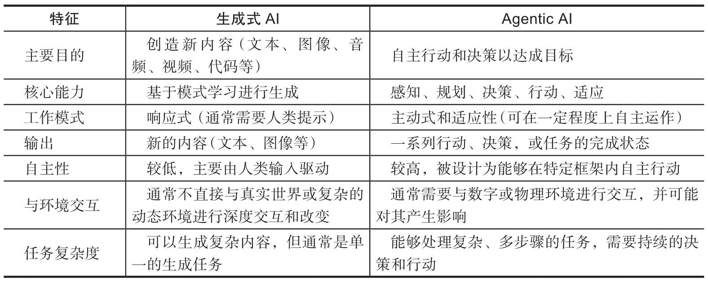

更通俗的例子是团队下午茶采购：要 5 杯咖啡和 5 杯奶茶。生成式 AI 只能告诉你怎么在美团或饿了么上下单。而 Agentic AI 会把任务拆解，调用外卖 App 分别下单、填写地址、完成支付，最后把饮品送到团队面前。

在工业领域，真正的跃迁来自 Agentic AI 与生成式 AI 及其他工具的协同。Agentic AI 负责编排工具，驱动从概念到验证的全流程。生成式 AI 提供创造性灵感，而 Agentic AI 提供自主执行与决策框架，用于测试、改进与验证创新。这种结合使研发端到端自动化程度远超单一技术。

## **5.3 AI Agent 的核心组件**

Agent 的有效运转依赖于协同工作的核心模块，在工业背景下各模块功能与交互尤为关键。

**● 感知模块**：处理来自物联网传感器、业务系统等多元输入，解释环境状态。借助计算机视觉分析图像视频识别缺陷、监控设备状态，借助自然语言处理理解指令或报告，相当于理解设备状态、产品特性及操作员语音或工单的能力。

**● 推理引擎**：Agent 的“大脑”，分析感知信息并基于算法、推理模型与知识库做出决策。运用逻辑、概率模型与启发式方法解决问题，如评估设计变更对成本与交期影响、推断质量根因、预测供应链风险。

**● 学习机制**：使 Agent 通过经验不断改进性能与决策。通常包含监督学习、无监督学习与强化学习，并通过反馈回路实现实时或定期优化。在制造中，可从历史生产学习优化工艺与设备参数，或从历史推荐记录中洞察用户设计风格以优化个性化推荐。

**● 执行模块**：落实推理引擎的决策，通过物理动作如控制机械臂、调节设备参数，或数字动作如向 PLM 发起变更请求、在 SRM 中执行应对策略。包含控制机制与执行框架以确保高效一致，多种 Agent 场景下还负责与其他 Agent 协调动作。

**● 记忆与知识库**：存储与检索支撑运行的信息，包括交互记录、学习经验、预定义规则及领域知识如工艺参数、材料特性、安全规程。知识库可采用结构化数据库进行规则推理，也可采用向量数据库进行 AI 驱动的模式识别与检索，对复杂制造场景的情境理解与一致性表现至关重要。

**● 通信接口**：实现 Agent 与用户、IT/OT 系统如 PLM、ERP、MES，或其他 AI Agent 的交互。方式包括 API 调用、自然语言处理及标准化通信协议，是 Agent 无缝融入企业 IT/OT 环境的关键。

推理系统能否跑得靠谱，关键看两头供料够不够好。一头是感知模块送来的数据质量与丰富度，另一头是记忆与知识库里沉淀的情境信息是否完备。感知结果出错或知识库缺了核心要素，推理算法再精妙也会在站不住脚的前提上运转，最终在执行时给出次优甚至错误的选择。这正说明数据质量与完整知识表征的重要性到了极点。

## **5.4 AI Agent 核心设计范式**

近年 Agent 能力的跃升，背后主要是大语言模型的突破。LLM 充当 Agent 的大脑与总控，支撑起理解复杂输入、做高级推理与规划、稳定调用外部工具、从失误中恢复等基础。反思、工具调用、推理、规划被视为以 LLM 为底座的智能体核心能力，是实现自主决策、行动执行与任务协同的关键，也从单步执行迈向多步复杂问题求解。这些能力与反思、规划、工具使用及多智能体协作一起，构成了下一波 AI 进展的核心设计思路，并在当下与未来的发展版图中占据主导。

### **5.4.1 反思**

反思让 Agent 超越了单纯执行任务的层面，具备自我审视与进化的能力。本质上，它赋予系统以批判视角审视自身表现、梳理决策路径、定位短板并据此调整方法的能力，随着时间推移不断提升自身水平。反思机制引入了自我纠正与动态适应的回路。缺少它，Agent 容易重复犯错，且没有外部再训练或人工重写就难以提升。相比之下，反思构建了内部反馈闭环，Agent 能依据对自己表现的评估实时调参与调行动，如图 5-1 所示。这种闭环对于在动态、不确定、部分可观察的真实场景中可靠运行至关重要，静态规则已无力应对。它标志着 AI 正走向更强、更通用、能从自身经验持续学习进化的系统，像人类专家一样不断打磨技能。

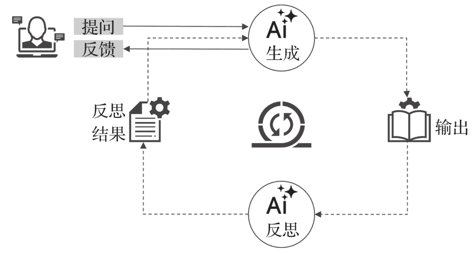

图 5-1 AI Agent 的反思机制

通常，反思从 Agent 先产出一个初稿或响应开始，随后触发评估与完善流程。常见做法是让 Agent 用一套预设问题对自己做自我拷问，例如“这个答案是否准确”“有没有更好的做法”“逻辑是否自洽”。反思使 Agent 能把行动理由讲清楚，从而系统化地复盘流程与输出。

反思过程离不开记忆系统来追踪多次迭代的决策与思考。短期记忆保留即时上下文，供当前任务使用，避免在同一次会话里重复踩坑。长期记忆则累积知识，归档中间推理轨迹并提炼成可复用的工具或经验，供后续交互调用。

反思的深度与 Agent 是否具备元学习即学如何学习的能力直接相关。初级反思只能抓表面错误。结合记忆后，Agent 能在长时间尺度上从过往失误中学习，实现长期学习，进而改进其基础学习策略。真正先进的反思型 Agent 不止于纠错，还能主动优化底层解题策略，发现新解法并大幅增强适应力。

反思还能提升系统的可解释性与可信度。可解释性有助于建立信任，在制造等行业尤为关键，因为明白“为什么这样决策”才能准确定位问题、优化业务流程。可见反思既是提升性能的内在机制，也是产生外部价值的能力。

反思也有代价。反思本身消耗额外算力，会影响实时性与效率；过度反思可能陷入无限循环，反馈偏差则会固化不良行为。这需要在开发中持续迭代优化。

### **5.4.2 工具使用**

工具使用是基于 LLM 的 Agent 关键能力，让它能与外部环境交互，弥补预训练数据固有的局限。工具指 Agent 可调用的功能或外部资源，用来与环境互动并放大能力。借此，Agent 能调用计算程序、检索网络信息、访问数据库与知识库、调用系统 API，甚至操控物理机械臂，完成复杂任务。工具使用把 Agent 的边界从原生文本生成拓展到了更广的操作空间。

它把 LLM 从高级文本生成器转变为可落地的真实世界 Agent，填补了语言理解与实际执行的鸿沟。LLM 能写出流畅贴合上下文的文本，但在需要结构化推理或超出训练数据的真实交互上常显不足。工具则让 Agent 执行数据检索、复杂计算、流程自动化等具体动作，如图 5-2 所示。没有工具，LLM Agent 只能困在内部知识与推理里，成为强大却孤立的智能。工具提供了连通“真实世界”的接口，能触达外部数据源、计算引擎与业务系统，标志着从理解型 AI 到行动型 AI 的转变。因此工具使用正推动 Agent 成为企业级 AI 应用的通用范式。架构上以 LLM 为神经中枢，前端负责与用户自然交互；后端靠工具调用驱动企业内部业务系统高效运转，如同大脑指挥四肢。

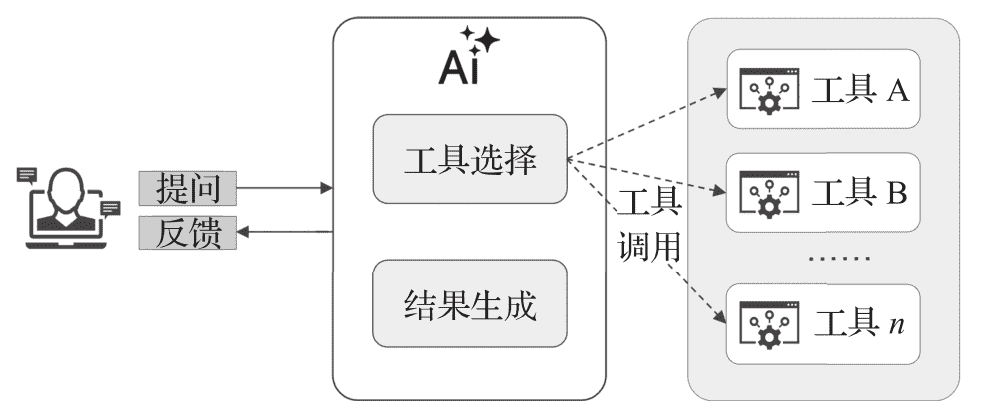

图 5-2 AI Agent 的使用工具能力

有效使用工具要求 Agent 先弄清有哪些工具可用，再结合任务上下文选对工具，并处理调用失败、重试等异常，最后给出有意义的结果。工具使用主要分两种。

●函数调用：通过函数调用外部工具，是实现实时、上下文相关的准确响应的关键。流程包含意图识别、函数挑选、参数映射、函数执行与响应生成。调用通常在 LLM 推理引擎或 Agent 框架的内部环境完成，速度快、路径短。

●API 交互：通过 RESTful、GraphQL 等标准化接口或定制化接口调用外部系统与数据源。API 交互解决系统间集成与互操作问题，把 LLM 的思考与规划转化为对企业各业务系统与流程的实际驱动，是构建实用高效企业级 Agent 的技术基石。

工具使用的成效高度依赖工具文档，即把非结构化 API 文档转成 LLM 可解析的标准模式描述如 JSON Schema，让 Agent 自主理解功能、输入、输出与错误类型。若文档模糊、不全或不准，Agent 难以选对工具或填对参数，导致错误、性能下降甚至系统故障。企业既有系统多是多年演进而来，并非为 LLM 设计。为所有系统准备理想的文档难度极大，且系统会持续迭代，导致人工维护的文档迅速失效。中国人民大学高瓴人工智能学院团队提出的 DRAFT 框架，通过分析 LLM 与外部工具交互的反馈与试验来动态完善文档，以缩小理解差距。可见工具使用不是静态能力，而是需要持续演进的能力，也凸显了反馈机制在动态适应中的关键作用。

从静态预定义工具使用向动态学习型工具使用的转变，是高级 Agent 自主性的重要指标，由交互与反馈的迭代学习驱动。早期工具使用依赖明确编程或固定提示，难以应对新工具。更灵活的方式借助零样本提示、微调、强化学习、自训练等学习机制。尤其是强化学习与自训练，让 Agent 通过试错、观察结果与反馈不断找到最佳工具使用策略，这对高度动态不可预测的场景至关重要。

工具使用扩展了协作边界，也带来明显安全风险，如数据泄露、未授权访问、敏感信息滥用。数据收集与使用的透明度至关重要。建议调用官方发布的业务 API，严格遵循各系统的数据访问与权限策略，避免以近似超级管理员的方式操作。

### **5.4.3 推理**

推理是 Agent 内部的基础认知过程，通过逻辑与已有信息得出结论与推断，解决实际问题。它是“推理引擎”，驱动工作流中的规划与工具使用环节。核心在于把数据表征为机器可处理的结构化形式，再把逻辑规则作用于其上，形成有据可循的决策。这一过程是自主决策的关键支撑。

推理是 Agent 行为背后的“智能”，让它超越规则跟随，实现推断与复杂问题求解，成为工作流的“大脑”。缺乏强推理，Agent 只能做预设响应或简单反射。推理能处理新信息、应用复杂规则、产出新见解，从而应对未被显式编程的情境，如图 5-3 所示。正因如此，Agent 才能“思考”和“决策”，而非仅对刺激反应，这是迈向高级智能的基础。

除常规条件推理与启发式推理外，ReAct 与 ReWOO 是两种常用的高级范式。

●ReAct（Reason+Act，推理与行动）：采用“思考-行动-观察”循环，逐步求解并迭代改进。它生成类似思维链的推理轨迹，按推理行动、观察结果并更新上下文后重复。以供应链断链风险分析 Agent 为例，ReAct 会先基于现有供应链推理风险点，再调用工具查询供应商数据库与交付记录，观察分析结果后推理应对方案，最后推送给负责人决策。

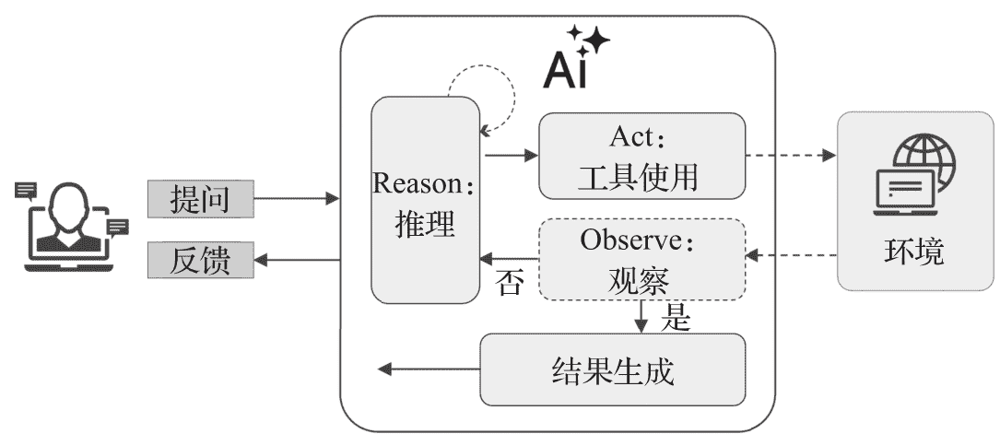

图 5-3 AI Agent 的推理能力

●ReWOO（Reasoning WithOut Observation，无观察推理）：去掉观察步骤，采用先规划后执行。它由规划器分解任务、执行器调用工具取证、解决器综合结论组成。ReWOO 在部分 NLP 基准上表现更好，结构更清晰，能通过预先规划提升迭代效率，但在工具增多或上下文受限时可能下降。

ReAct 因迭代规划消耗 Token 更多、延迟更高，但持续反馈带来更强动态适应与不可预见问题的容错。ReWOO 因预规划实现更低 Token 消耗与更快执行，尤其适合并行，但牺牲了适应性，预判错误不易纠正。设计时需权衡问题可预测性与对速度、错误容忍度的要求。开放探索类任务更适合 ReAct，结构化且效率敏感的任务 ReWOO 更具优势。

推理模式包含两个核心组件。

●知识库：Agent 理解与处理信息的知识地图，以机器可处理的结构化形式承载数据，为逻辑推理提供基础，涵盖知识图谱、本体、语义网络等表示模型。

●推理引擎：推理系统的“大脑”，由训练好的机器学习模型支撑，实现分析知识库数据、得出可靠决策所需的逻辑与推理方法。

知识库与推理引擎协同驱动决策。知识库也与记忆系统关联，如长期记忆中 RAG、GraphRAG 把外部知识库整合进生成过程，可视为知识库的应用。现代 Agent 常结合向量库做语义搜索，结合知识图谱做结构化推理。

推理模式赋予 Agent 在高度复杂不确定环境中求解的能力，同时带来算力与架构复杂性提升，并存在 ReAct 的无限循环、ReWOO 的性能下降等挑战，需要精细架构来管理。

### **5.4.4 规划**

规划是 Agent 的核心能力，把大而复杂的目标拆解为更小可管理的子任务，有效组织执行，并在结果反馈下持续改进或调整计划。该过程迭代且结构化，使 Agent 能按需调整方案并逐步逼近目标，如图 5-4 所示。对复杂目标规划不可或缺；对简单任务，Agent 可迭代反思响应而无需显式规划。

规划通常是有效工具使用与多 Agent 协作的前提。把复杂目标分解后，可为每个子任务匹配合适工具或专用子 Agent。

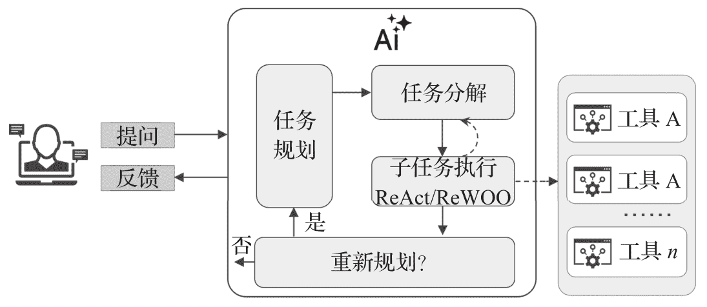

图 5-4 AI Agent 的规划能力

Agent 的规划流程大致如下。

1）任务规划：初始阶段解释提示并制定总体方案，明确高层目标与执行策略。不同于 ReAct 直接进入逐步推理与工具调用，规划先退一步制定高层路线图。

2）任务分解：把复杂目标拆成更易执行的子任务。可采用单路径链式分解，按序串行解决；也可采用多路径树状扩展，支持并行推理与带反馈回溯。

3）子任务执行：完成分解后的每个任务，使用 ReAct 或 ReWOO 等预定义推理方法与工具执行。完成后把结果交回规划循环。

4）重新规划：评估执行结果是否达标，如未达预期则修改任务或策略。反馈回路让 Agent 迭代学习、适应变化或意外结果。

5）迭代：连接生成任务与重新规划的循环，Agent 不断重新评估与调整，直至结果可接受。

复杂规划需要连贯的结构化思考。思维链及其变体提供了思路。

●思维链 Chain-of-Thought：最基础的规划模式，模仿人类逐步推理，生成线性计划，无分支与权衡，增强理解与逻辑连贯性。

●思维树 Tree-of-Thought：更高级的模式，面对决策点生成多个候选计划分支，经评估打分或前瞻后择优深入。提升策略性与鲁棒性，失败时可回溯尝试其他分支。

●思维图 Graph-of-Thought：最高级的网络化规划，节点间可任意交互，适合无固定流程、需不断整合信息与迭代优化的顶级复杂任务。

规划模式以结构化循环确保 Agent 自主逼近复杂目标，并根据结果调整方法，增强适应性与鲁棒性。如图 5-5 所示，规划模式与 ReAct 的关键差异在于，规划事先确定所有步骤，偏离目标的可能性小；而 ReAct 可能最终得到答案，但在过程中易绕路或重复，因每次只能执行一个动作。任务越复杂，越需要详实的执行计划以获得整体视野。

规划对目标导向的自主性与复杂任务执行至关重要，但其有效性受环境不确定性与当前模型在长期战略思维上的局限制约。在高度不确定环境中经典规划假设失效时效果显著下降。可见尽管 Agent 规划能力强，其战略远见与对高度动态真实场景的适应仍在发展中，执行复杂规划时人类监督仍不可或缺。

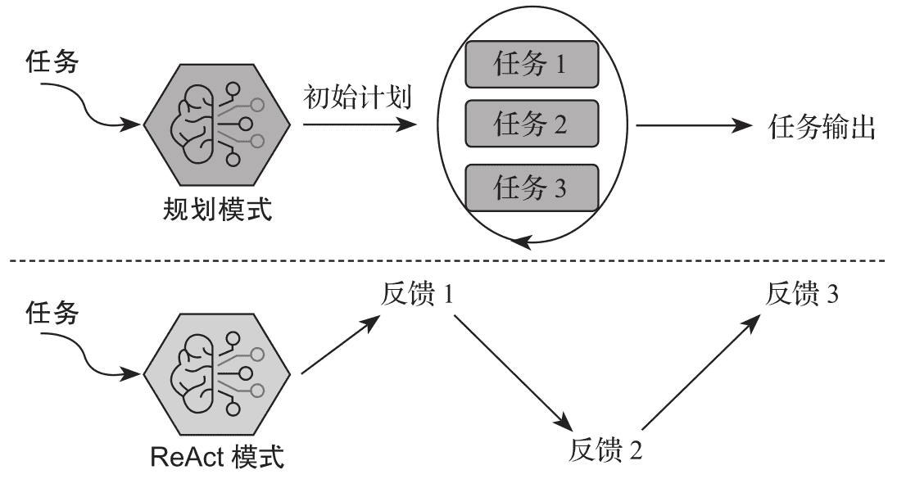

图 5-5 规划模式与 ReAct 模式对比

Agent 真正的竞争力并不在单个能力的强弱，而在于推理、规划、工具调用与自我反思被打造成一个无缝循环的闭环，进而形成能自进化、动态适配的工作流，这一机制在图 5-6 中得到直观呈现。反思、工具、推理、规划四者并非孤立模块，而是相互咬合构成一个有机动态系统。典型运行轨迹是：推理先行给出思路，思路转化为具体计划，计划执行时常借助外部工具落地，随后反思对结果进行评判并把经验回流到后续的推理与规划里。这种持续的反馈回路，是在复杂多变场景中获得适应性、自我纠正能力和稳定表现的关键。贯穿始终的还有记忆系统，兼顾短期缓存与长期沉淀，它为推理保留上下文、归档过往行动与反思结论，并为规划决策和工具调用提供相关参照。正是这种深度集成，让智能体向更完整、更自主的智能系统迈进。

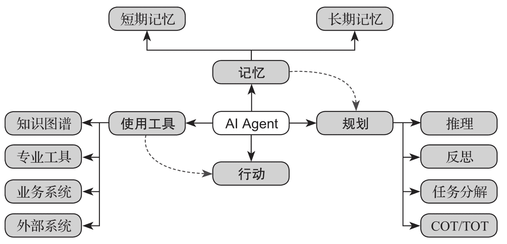

图 5-6 Agent 四大范式联动图

## **5.5 多智能体系统**

多 Agent 系统是一个源远流长的计算范式，核心在于由多个具备自主性的 Agent 共同组成一个 AI 体系，通过彼此协调或协作来攻克单一实体难以处理的复杂难题。可以把 MAS 视作一座人造的智能社会，研究的重点是如何构建一套高效的社会运行机制，让每个“社会成员”在分工协作中达成宏大的集体目标。

传统 MAS 多以规则和符号逻辑为基础，而 Agentic AI 中的每个 Agent 都内建了 LLM 带来的强推理、强规划与自然语言交互能力。相较传统范式，Agentic AI 可看作是 MAS 理论在当下技术水平尤其是 LLM 时代的现代化升级。它既保留了多 Agent 协作解决单 Agent 无力承担的复杂问题的核心理念，又借助 LLM 显著提升了个体能力与群体协同效率，使其从学术概念走向大规模实际落地。

### **5.5.1 MAS 三大支柱**

一个系统要称得上 MAS，通常依赖三根支柱。

1. 多 Agent
MAS 由多个在共享空间里自主互动的 Agent 构成，每个 Agent 都具备：
**●自主性**：最基本特质。Agent 拥有自己的决策权，能独立感知环境并做出选择，不依赖持续的人工指令即可运行，这让其在不可预测环境中保持有效运作。
**●局部视角**：每个 Agent 只能看到环境的部分面貌，信息与知识都是有限且不完整的，决策建立在自身感知之上，没有谁能掌握全局全貌。
**●异构性**：Agent 类型多样，可拥有不同目标、知识、能力与角色，例如现场服务场景中的故障诊断 Agent、派单 Agent、维修记录检索 Agent。
**●目标驱动**：每个 Agent 都有内在目标或动机，行为始终围绕目标实现展开。

2. 环境
**●共享环境**：所有 Agent 栖身于同一个环境中，这是感知与行动的舞台。
**●交互媒介**：环境不仅是舞台，也是间接沟通的载体。Agent 在环境中留下执行痕迹，其他 Agent 感知变化后调整行为，类似蚂蚁用信息素交流。
**●动态性**：环境本身可能随时变化，Agent 必须具备适应能力。

3. 交互
这是 MAS 的灵魂，也是与单 Agent 的根本区别。交互机制主要包括：
**●通信**：Agent 间直接交换信息，需要统一的通信语言与协议。早期研究催生了 KQML 与 FIPA-ACL 等智能体通信语言；面向 LLM 的新体系中，Agent2Agent（A2A）协议正被提出为异构 Agent 提供标准交互语言。
**●协作**：目标一致或相关时，Agent 需协调行动避免冲突、共享资源以高效达成共同目标，合约网协议 Contract Net Protocol（CNP）是经典的任务分配与分布式求解协议。
**●协商**：利益冲突时通过谈判达成可接受方案，常见于资源分配与任务承揽。
**●竞争**：在零和或负和博弈中，Agent 为最大化自身利益而竞争，如拍卖与市场场景。

### **5.5.2 多智能体协作架构模式**

按控制方式与信息流向划分，基于 LLM 的多 Agent 协作架构如图 5-7 所示。

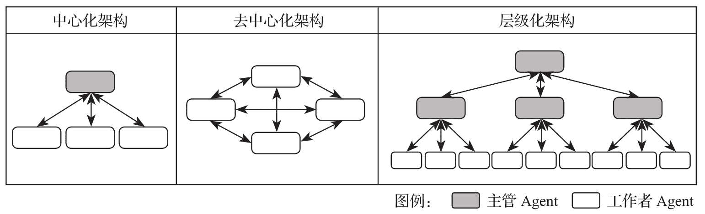

图 5-7 多 Agent 协作架构概览

1. 中心化 主管编排架构
当前最常见也最直观的模式。由单一的 Supervisor Agent 或 Orchestrator Agent 统筹流程，接收用户的高阶任务后拆解为子任务，分发给专门的 Worker Agent 执行，执行结果再汇总回主管进行整合输出。

常见变体：
**●主管即路由器**：主管主要负责流程决策，决定下一步调用哪个 Worker，从而引导任务流向。
**●主管即工具调用者**：每个 Worker 被封装成工具暴露给主管，主管凭借 LLM 的工具调用能力挑选并调用合适 Agent。

优点是控制力强、流程清晰、调试相对容易；缺点是主管易成单点故障与性能瓶颈。

2. 去中心化 点对点架构
系统内无中央权威，所有 Agent 均为对等 Peers，直接互通互动。整体协调行为由局部互动与预设协议自发涌现，而非自上而下命令。在追求鲁棒性、自组织、不希望单点掌控的场景中广泛应用，如区块链与生产现场机器人协作。

优点是容错率高、无单点、可扩展且对动态环境适应强；挑战在于全局协调困难，且涌现行为的调试 notoriously 棘手。

3. 层级化架构
中心化模式的延伸，将 Agent 组织成金字塔式指挥链。顶层制定战略并下放任务，中层经理进一步分解并协调下属底层执行者。保留了中心化有序性，也允许各层局部自主决策，兼具灵活与可控。

适合高度复杂、可清晰拆解的多领域任务，模块化带来良好可扩展性；但层级增多会带来通信开销与一定僵化。

实践中多为混合模式，例如总流程由主管协调，内部专业子团队则允许点对点自由通信。LangGraph 等框架便支持部分确定性流程与部分动态由 Agent 自决的复杂工作流。

### **5.5.3 多智能体落地挑战与发展趋势**

LLM 与 MAS 的融合已成为前沿最具活力的方向，催生了大量应用并重塑自动化与协作的认知。

当前主要挑战：
**●一致性与幻觉**：在长期复杂协作中保持逻辑一致并抑制 LLM 幻觉是最大难题。软件领域或只是 Bug，制造业则可能导致设备损坏或安全事故，与 100% 可靠性的工业要求形成尖锐矛盾。
**●成本与效率**：多大型 LLM 驱动的系统运行成本高昂，每次交互都消耗大量算力，如何降本增效是商业化关键。
**●评估与调试复杂**：系统级性能评估远难于单模型评估，出错时难以追溯是哪一个智能体在哪一轮对话失误。
**●可控性与安全性**：需确保高度自主的 Agent 组合始终在人类设定的安全与伦理框架内运行，防止有害的集体行为出现。

因此当下制造业成熟部署的以单 Agent 为主。真正意义上的基于 LLM 的 MAS 仍处从实验室走向试验场的萌芽期，在数字孪生、机器人协作、复杂诊断等领域积极验证，尚未出现大规模商业化标杆。

展望未来，随着 LLM 更小更快更可靠且多模态能力增强，基于 LLM 的 MAS 或先在非实时高价值规划优化环节，如仿真与设计，取得突破；随后渗入对实时性与安全性要求稍低的辅助生产环节，如物流与监控；最终迈向核心生产控制，实现高度自主、柔性的智能工厂。

## **5.6 Agent 开发框架与实践指南**

从蓝图到落地，企业需要强大的工具来简化基于 LLM 的 Agent 系统构建。开源框架迅速发展，提供不同抽象层级，选择合适的框架直接影响开发效率、可扩展性与最终性能。下面对 LangChain 的 LangGraph、微软 AutoGen、CrewAI 等主流方案进行对比梳理。

### **5.6.1 主流框架概览**

AI Agent 开发框架对状态、记忆、工具与 LLM 调用的编排提供不同层次抽象，帮助开发者聚焦业务逻辑。

1. LangChain 与 LangGraph 通用编排器
LangChain 是应用最广的框架之一，允许开发者将记忆、工具与大语言模型链接成连贯工作流。它高度模块化，集成生态庞大，原生支持多类 LLM 包括本地部署模型，并接入大量工具如搜索、SQL、Python 执行与各类 API。

LangGraph 作为其扩展，把工作流建模为显式有状态图，节点代表步骤，边定义信息流向，可支持条件分支与循环。相比 LangChain 早期线性 Chain，LangGraph 对复杂条件、分支、错误处理与并行执行提供更强可控性。LangChain 支持 ReAct 循环，LangGraph 则通过状态图显式转换实现更可控的多 Agent 协作。

核心价值：
**●功能强大与生态广泛**：工具与平台集成覆盖面广。
**●稳健流程编排**：为复杂工作流提供可控可调试能力。
**●卓越可观测性**：LangSmith 提供追踪与监控，提升系统可见性。

潜在挑战：
**●学习成本高**：框架庞大，上手难度较大。
**●API 迭代风险**：快速更新可能带来兼容性与维护压力。
**●抽象层级**：对缺乏软件工程经验者可能不友好。

2. AutoGen 以对话为中心的多 Agent 框架
由微软研究院开源，核心理念是把多 Agent 协作建模为一场对话。用户可定义不同角色的 Agent，如规划师、开发员、审阅者，通过自然语言相互“交谈”完成复杂任务。设计以对话为中心而非显式工作流，简化开发与编排，支持协作、工具使用、代码执行与人机交互的无缝融合，AutoGen Studio 提供低代码原型界面。

核心概念：
**●可对话 Agent**：可发送接收消息的构建块，包含 AssistantAgent、UserProxyAgent、GroupChatManager 等。
**●可定制与可扩展**：可自定义系统提示、终止条件并接入外部工具与数据源。
**●代码执行**：Agent 可编写并执行代码，适用于数据分析、开发、API 交互场景。

运行流程通常从用户任务发起，UserProxyAgent 与多个 AssistantAgent 交互，各司其职逐步分解问题、产出方案、编写调试代码直至收敛。对话历史完整记录问题解决过程。

AutoGen 对话模式灵活，适合不确定性高的复杂动态协作原型设计，背后有微软与 Azure 生态支持。相比图模型框架显式控制较弱，若约束不当易陷入无限循环。

典型场景包括复杂问答、自动化代码生成与调试、内容创作、数据分析可视化、工作流自动化等。

3. CrewAI 基于角色的协作框架
CrewAI 是基于 LangChain 构建的开源 Python 框架，聚焦结构化任务编排与角色驱动团队协作，目标是高效构建自动化团队工作流。它从单次提示交互走向更动态、类人团队的多 Agent 系统。

核心是角色扮演。每个 Agent 被赋予独特角色、目标与背景故事，引导其在工作组 Crew 中的行为与专业领域，实现有效分工，将复杂问题分解给最相关技能的 Agent。

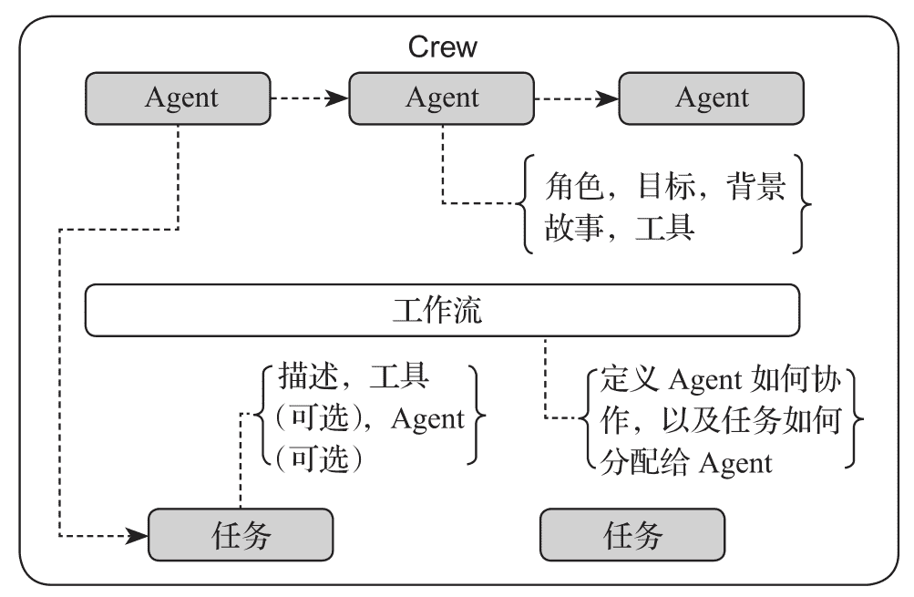

图 5-8 CrewAI 核心组件

架构围绕四个基本组件构建。
**●工作组 Crew**：聚合一组 Agent 与一系列任务，定义整体流程并管理协作以实现最终目标，负责编排整个工作流。

**多智能体架构拆解与研发落地洞察**

**智能体核心三要素概览**

• 智能体：可在系统内部自主运行的工作单元，负责完成既定工作、做出判断并与其他单元实时联动。每个单元会配置角色定位、目标设定、背景叙事以及可调用的工具集合。

• 任务：智能体承担的具体职责，包含工作细化说明、预期交付物与执行主体。任务往往会被拆分为子任务，部分子任务需要专用工具或特定资源支撑，任务是多智能体协作流程的基础。

• 工具：智能体执行任务时使用的功能能力，形态差异很大，从基础实用程序到可对接外部接口、数据库或本地文件的复合模块都有。CrewAI 既支持自行开发工具，也兼容 LangChain 生态中的大量现成工具。

CrewAI 与微软 AutoGen 都能搭建多智能体系统，但设计思路不同。AutoGen 更偏对话驱动，依赖群聊、顺序聊天等灵活对话形式推动协作；CrewAI 更偏流程驱动，通过预设的顺序、层级等流程来管控任务推进。若使用者已经明确问题解决路径并希望固化自动化，CrewAI 更契合；若使用者对解法不确定，希望由 AI 专家团队自行探索答案，则更适合 AutoGen。

CrewAI 的优势在于
• 上手门槛低，体验直观，少量代码即可搭建多智能体协作原型。
• 角色化设计与大量业务流程高度契合，阅读感接近团队分工安排。

CrewAI 的局限在于
• 面对高度复杂或非常规的工作流时可塑性不足，定制难度较大。
• 相比 LangChain，成熟度仍在追赶，对简单任务的资源消耗偏高。

CrewAI 擅长的场景通常可拆分为一系列专业步骤，例如
• 内容创作：自动调研主题、撰写文章，再据此产出社交媒体素材。
• 市场研究：组建工作组采集竞品数据、解析市场动向并汇总报告。
• 自动化邮件营销：由智能体依据客户画像定制邮件内容并发送个性化信息。
• 软件开发：一个智能体写功能代码，第二个负责单元测试，第三个进行评审与调试。

通过为基于角色的智能体协作提供清晰而强劲的框架，CrewAI 让开发者能搭建处理复杂多步任务的高效自主系统。

4.其他智能体框架

除了前述方案，业内还有几类常用选择。

• Semantic Kernel：微软打造的开源 SDK，用来将 AI 智能体编排进企业软件，支持插件、记忆与规划能力。与 .NET 生态兼容度高，适合企业内部业务系统或工具类结构化场景中的确定性应用。

• SmolAgents（Hugging Face）：实验性的极简 Python 框架，探索用单一详细 Prompt 生成完整代码库的可能性。遵循“以简为美”原则，目标是以极少且易懂的代码实现复杂软件生成。

• LlamaIndex（原 GPTIndex）：开源数据框架，专注把自定义数据源接入大语言模型，是现代 RAG 架构的核心。它提供数据摄取、构建与访问私有或领域数据的能力，开发者常将其与 LangChain 等智能体框架结合使用，利用其出色的数据索引与检索能力。

• OpenAI Agents SDK（曾称 Swarm）：全新开源 Python 框架，旨在简化复杂智能体的构建。相较 Assistants API，它提供更直接灵活的方式。SDK 贯彻“少即是多”理念，以轻量工具集配合 Python 作为黏合剂，给予开发者更大控制权，目标是支持代表用户进行推理、规划与工具使用的自主系统，完成多步骤复杂任务。

表 5-2 给出了几个智能体框架的对比分析。

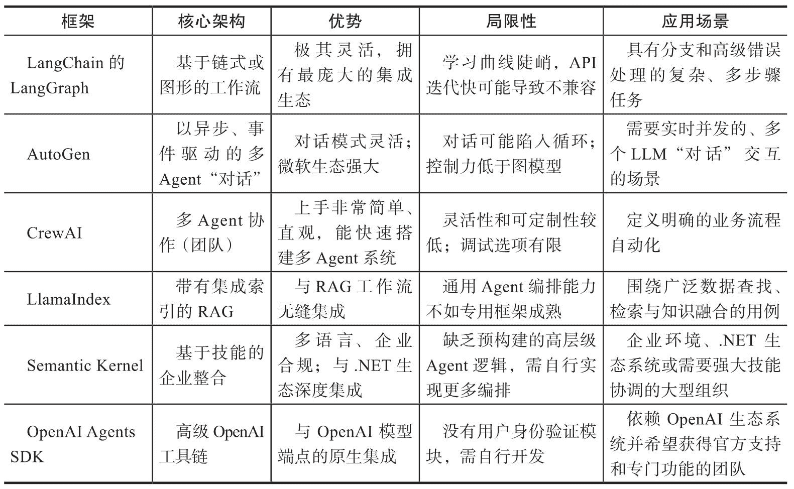

智能体框架快速增多说明目前还没有“一招通吃”的通用方案。每个方案在模块化、多智能体协作、知识管理、企业集成或低代码支持等方面各有侧重。这种多样化源于真实 AI 智能体应用需求愈发复杂。需要指出的是，基于大语言模型的智能体框架多在 ChatGPT 之后才密集发展，多数仍处早期快速迭代阶段。因此选型既是技术决策，也是战略决策，需综合项目需求、控制粒度、现有技术栈与长期扩展目标，并非追求统一的通用解法。

### 5.6.2 智能体开发痛点与实践建议

随着大语言模型能力跃升，能自主理解、规划并执行复杂任务的 AI 智能体成为制造企业构建 AI 应用的重点。但从想法到可用的系统，仍需跨越诸多挑战。

1.智能体开发面临的主要挑战

（1）规划与任务分解的易碎性

智能体的核心在于将模糊目标拆解为可执行步骤，而该过程非常脆弱，主要体现为
• 长链条任务易崩溃：多步推理中，任一步出现细微错误都可能导致整条链失效。
• 对初始指令极度敏感：规划能力高度依赖提示质量，表述不当易导致偏离。
• 常识缺失：模型可能产出理论可行但现实中不可行或效率低下的路径。

（2）工具使用与环境互动的不稳定

通过 API 调用、数据库查询、代码执行等工具与外部世界互动，充满不确定性
• API 错误处理：外部接口可能失败、返回异常格式或超时，智能体需要重试或切换方案，恢复能力难建。
• 幻觉与误用：模型可能编造参数或功能，或在错误场景下调用工具。
• 状态管理：在有状态环境如客服会话、数据库事务中，智能体难以精确跟踪状态，易造成混乱。

（3）安全、成本与性能失控风险

自主性带来风险，主要包括
• 安全漏洞：若可执行代码或访问敏感接口，可能被用于破坏性操作，必须设置坚固护栏。
• 成本失控：复杂任务易陷入昂贵循环，不停调用付费大模型 API 或云服务，迅速耗尽预算。
• 性能瓶颈：连续同步的大模型调用产生明显延迟，影响体验。

2.测试、调试与可观察性的困难

AI 智能体具有随机性，传统测试方法难以完全适用。
• 难以复现的错误：相同输入在不同运行中可能产生不同行为，复现修复困难。
• 黑盒问题：难以直观看出智能体为何做某决策或选某工具，内部思考过程不透明。
• 评估标准模糊：除最终结果外，还需评估效率、成本与路径合理性，量化难度大。

3.智能体开发最佳实践

（1）采用模块化与分层设计

避免制造无所不能的“巨型智能体”，将系统拆分为更小、更专注的智能体团队，提升扩展与长期回报的可行性。建议
• 使用“经理-专家”模式：设一名主管或编排智能体负责规划与分发，多个专家智能体各司其职。CrewAI 与 OpenAI Agents SDK 的交接机制很适合此模式。
• 模块化与可复用：让感知、记忆、推理、行动、日志等组件可独立演进。
• 分离思考与行动：明确划分规划推理阶段与工具执行阶段，执行破坏性操作前可加入人工复核。

（2）强化工具的设计与管理

严格管控工具权限，误操作可能造成严重后果。建议
• 明确的函数签名和文档：为每个工具写清晰签名与详细说明，大模型据此决策，使用越准确误用越少。
• 内置重试与错误处理：在工具原生代码中实现指数退避重试、备选方案，而非依赖大模型自行解决。
• 权限与范围控制：为每个智能体只授予完成任务所需最小权限。

（3）建立严格的护栏与监控系统

在赋予自主权的同时设限。建议
• 设置资源限制：强制最大迭代次数、单任务最长运行时间、API 调用预算，超限即终止并告警。
• 引入人在回路：对高风险高成本操作如代码执行、对外发送消息、数据库写入强制人工审批。
• 利用追踪工具：使用 LangSmith、OpenAI Agents SDK 内置 Tracing 等可视化完整决策链，便于调试与理解。

（4）分阶段进行测试与评估

拥抱随机性，采用现代化测试策略。建议
• 单元测试工具：对每个原生工具函数做传统单元测试，保证确定性。
• 评估驱动开发：建立多场景评估集，持续比对输出与黄金标准，追踪成本、延迟等指标。
• 模拟与红队演练：在沙盒中模拟运行，邀请团队或红队尝试“欺骗”智能体，发现边界漏洞。

构建 AI 智能体是挑战与潜力并存的领域。关键在于摆脱传统软件思维，采用兼顾工程严谨性与对 AI 随机性深刻理解的混合方法，通过模块化、强化工具、建立护栏与现代化测试，企业能更稳健地驾驭这项技术。

# 第六章 研发数字化重构：平台化 AI 分层架构

AI 已不再是研发领域的遥远概念，而是驱动变革的核心力量。它正把研发数字化从分散工具集合推向集成化、智能化的生态系统。变革本质是流程与运营模式的重塑，而非简单替换工具。传统研发在速度、成本控制与复杂性管理上受限，而 AI 在数据处理、模式识别与自动化方面的能力恰好能补齐短板，推动研发体系重构成为竞争优势的战略要务。

## 6.1 传统研发范式解构

要理解变革的深度，需先剖析支撑过去几十年制造业的传统研发体系。该体系以产品生命周期管理为核心，虽让混乱的开发过程变得有序，但其线性、文档中心的特性在当今超竞争市场中已成为创新桎梏。

### 6.1.1 PLM 系统的发展历程

PLM 演进是从单一工具到综合战略平台的过程，与制造业需求与技术进步紧密相关。如图 6-1 所示，可划分为四个阶段。

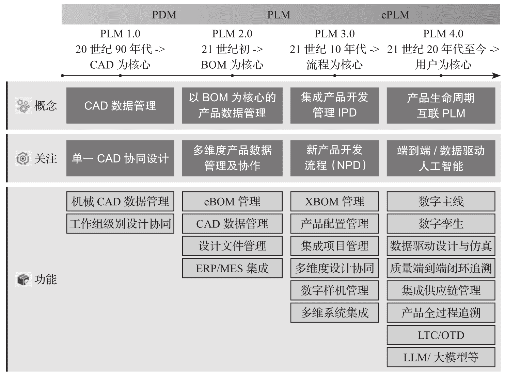

图 6-1 PLM 系统的发展历程

（1）PLM 1.0：CAD 驱动的 PDM 时代（20 世纪 90 年代）

20 世纪 60—70 年代，三维 CAD 软件诞生，如洛克希德马丁的 CADAM、麦道的 UG 等。但缺乏图纸统一管理，导致文件分散版本混乱。为解决大型 CAD 文件管理问题，20 世纪 90 年代出现独立于 CAD 的 PDM 系统，即 PLM 前身。代表有 SDRC 的 Metaphase、PTC 的 Windchill。

核心概念是 CAD 数据管理，目标是解决设计过程中 CAD 图纸的版本控制与协同。关注点为单一 CAD 环境下的数据管理与协同设计。功能局限于机械 CAD 数据管理与工作组级设计协同，类似于数字图纸档案库。

（2）PLM 2.0：围绕 BOM 的 PLM 时代（21 世纪初）

随着产品复杂度提升，管理重心从图纸扩展到产品结构，进入 PLM 时代。

核心理念转向以物料清单为核心的产品数据管理，关注点从单一学科协同扩展到多维度产品数据协作。产品不再仅是机械件集合，电子与软件比重上升。

功能实现跃升。除管理 CAD 数据与设计文件外，开始有效管理设计 BOM，并与 ERP、MES 等核心运营系统集成，打通设计与制造数据流。

（3）PLM 3.0：流程导向的整合时代（21 世纪 10 年代）

在产品数据受控后，企业聚焦流程再造解决断点与隔离，PLM 演变为企业级战略平台，管理范围超越数据，与研发流程深度融合。

核心理念是集成产品开发，焦点是优化新产品开发流程，提升项目效率与成功率。

功能更为丰富。BOM 管理从 eBOM 向 XBOM 演变，延伸至制造 BOM 与服务 BOM，将业务覆盖到制造、供应链与售后。引入产品配置管理、集成项目管理、数字样机管理等高级功能，并加强跨机械、电子、软件协同，形成相对完整的研发协作平台。

（4）PLM 4.0：用户导向的智能互联时代（21 世纪 20 年代至今）

PLM 正向企业级 PLM 演进，通过集成方案将产品从概念到报废全生命周期的人员、流程、数据与系统统一管理。强调跨部门、跨地域、价值链协同，确保数据一致性、可追溯性与合规性。

核心理念为数字主线与数字孪生，以 PLM 为骨干构建数字主线，打通概念、设计、制造、服务到报废的完整链条，为精准动态数字孪生提供数据与模型支撑。

产品全过程追溯成为核心能力。该阶段功能包括数据驱动设计与仿真、集成供应链管理、质量端到端闭环追溯等。企业级 PLM 不仅管理产品数据，还开始管理用户需求与体验数据，并集成可持续性指标，支持绿色设计、碳足迹分析与合规分析。融合大语言模型等前沿 AI 技术，PLM 将从记录系统转变为提供预测性洞察与智能建议的决策系统，为 AI 驱动研发范式跃迁提供支撑。

总体看，PLM 发展反映了制造业从管理静态图纸，到管理产品结构，再到优化研发流程，最终迈向数据与 AI 驱动全生命周期创新生态的演进。

### 6.1.2 传统研发范式的局限性

传统研发数字化系统虽推动信息化，但在研发复杂度与数据洪流面前，固有局限日益凸显，主要体现在

1.数据与知识孤岛

传统研发体系里，PLM、ERP、MES 甚至早期的 CAE 工具各自为政，数据沉在不同的系统里，拼不出完整视图。研发团队里电子表格依然是日常，灵活归灵活，却堆出了大量非结构化信息，让组织知识难以系统化沉淀、复用。知识与数据的割裂，让跨部门、跨专业的协同创新受阻，也让团队看不清研发项目的整体图景。

2. 流程碎片化侵蚀效率
端到端的业务，本该顺滑连贯，却被切成多个互不打通的环节，分散在不同部门、不同系统、甚至不同地域。根源集中在三堵墙：组织层面各部门只看自家 KPI，流程整体被牺牲；技术层面历史遗留的异构系统缺乏统一集成；管理层面缺少对完整业务流负总责的端到端 owner，交接自然低效。

后果是连锁反应。显性的是运营低效、成本高企，重复录入、返工修错、跨部门对齐消耗大量资源。隐性的是创新变慢、市场响应钝化，研发与决策周期被拉长。最终产品质量风险上升、客户满意度下滑，企业盈利与竞争力被持续削弱。

3. 瀑布式开发的僵化陷阱
瀑布式把产品研发按固定顺序切阶段，前一关不结束，后一关不能开。致命伤是缺乏弹性，需求一变整个计划就失稳，市场变化难以快速跟上。用户要到项目收尾才能见到成果，反馈周期极长，产品容易偏离真实需求。风险也被大量后置到测试，早期设计缺陷的修复成本会指数级飙升，交付慢、价值兑现慢、失败成本高。

它与流程碎片化互为因果。瀑布各阶段的交接处天然就是断点，一旦依赖不完整的文档或口头交代，信息丢失与误解就会加剧碎片。

传统瀑布在需求清晰、结构稳定、复杂度低的项目里仍能发挥作用。但在当下追求速度、灵活与持续创新的环境里，线性僵化的特质已无法应对规模扩张与系统性复杂挑战。迭代、增量、持续反馈、跨职能协作的敏捷、DevOps 等新范式，正是为此而兴。

4. 复杂性与可扩展性瓶颈
智能手机、电动汽车、物联网家居的复杂度增速远超想象。过去被视作优点线性、固化、文档驱动的传统做法，在“系统之系统”面前成了枷锁。

复杂度由三股力量推升。软件定义一切，现代汽车代码量达数亿行，远超飞机与操作系统，产品从静态成品变成持续演进的服务。万物互联带来系统耦合，一个智能设备要与云、终端、应用、第三方生态实时协同，牵一发而动全身。用户期望也在无限外延，要求无缝个性化、持续更新、高度智能，倒逼 AI、大数据等技术深度嵌入。

研发深入后数据体量与维度急剧膨胀，问题复杂度指数级增长。传统工具和方法在处理大规模、高维度、高复杂场景时捉襟见肘，可扩展性与处理能力均告吃紧。

5. 慢创新与高成本的恶性循环
传统研发的“单一事实来源”本质上是静态档案，长于追溯过去如何决策，却不擅前瞻未来该如何决策，更像图书馆而非可思考的研发伙伴。严格的阶段门控、审批与变更控制虽保规范，却扼杀了颠覆性创新需要的快速试错与迭代。

两大后果随之而来。创新周期被拉长，从概念到上市耗时过久，市场敏捷性受损。研发成本不断攀升，重复劳动、资源错配、误判导致延期共同推高总投入。根本症结不在自动化不足，而在智能整合能力缺失，难以动态融合海量异构信息并主动优化创新路径。这种以工具为中心、被动响应的范式，已无法匹配科技革命与产业变革的需求。

6.2 研发范式变革势在必行

6.2.1 制造业内外困境叠加
研发能力决定工业体系的竞争力与安全。长期受传统范式束缚，我国制造业研发体系正面临内外交困。

外部压力方面，地缘政治紧张与贸易保护抬头。美方加征关税、推进供应链重构，直接抬高出口成本并放大不确定性。欧、印、巴等也对中国商品发起反倾销、反补贴，电动汽车、光伏等绿色科技正面碰撞美国《通胀削减法案》与欧盟《绿色协议》。技术脱钩更趋严苛，半导体、AI 芯片等关键领域出口管制短期内抑制高科技制造发展。

内部挑战方面，产能过剩与价格战激烈。地产降温后制造业成为稳增长抓手，政策驱动投资持续涌入，国内消费跟不上，供需失衡导致大量产能外溢。汽车、光伏、风电等行业陷入价格厮杀，利润被挤压，长期研发投入受损。人力与运营成本上升，更削弱了传统成本优势。

供应链重构上，“中国+1”成为主流，越南、印度、墨西哥获青睐。但中国完整高效的产业生态、成熟配套与人才储备短期难复制。部分组装外移后仍高度依赖中国零部件与原材料，而中国制造商为规避关税也在海外设厂，使“去中国化”愈发复杂。总体来看，外部壁垒与内部失衡交织，产业必须从规模成本转向技术创新与品牌价值，并激活内需以构建韧性可持续格局。

6.2.2 内功修炼，研发跃迁正当时
在地缘政治加剧、供应链重构、同质化竞争与价格战升级的背景下，固守传统研制模式必陷困境。回归价值创造、以研发范式战略转型为突破口，已是穿越周期、实现可持续发展的关键。

转型动因在于旧路径难续。外部环境不可控，地缘冲突、贸易壁垒、技术封锁构成系统性风险，寄望外部松绑风险极大。内部价格战形成恶性循环，产能过剩叠加需求疲软，成本领先的消耗战侵蚀利润、扼杀再投资，最终拖累全链价值与竞争力。

修炼内功的核心是能力跃迁，从逆向工程走向正向研发。长期以来装备制造等领域正向研发能力薄弱，创新被动。逆向工程通过拆解仿制实现“从无到有”，在追赶期有其历史价值，长期依赖却导致被动追赶、技术失能、生存受制。正向研发是从市场需求、用户痛点、未来趋势出发，依托第一性原理进行架构设计、分析与仿真验证，形成自主可控产品，已从竞争选项变为生存必需。

实现路径是以研发范式跃迁为加速器，从逆向到正向、从流程驱动到数据与AI驱动，重构方法论、流程、组织与技术底座。AI 作为核心使能器，支撑层级跃迁。其价值体现在三点：以核心专利、独有工艺与卓越性能构建技术壁垒；以前瞻研发创造新品类、定义新赛道，从跟随转向引领；以硬件、软件与服务一体化交付高附加值解决方案，提升客户粘性。

传统研发范式已逼近拐点，难以驱动增长反而成为枷锁。打破低利润—低投入—低竞争力—更低利润的死亡螺旋，需要一场持续彻底的研发范式革命。

6.3 AI驱动的研发新范式

6.3.1 企业AI落地的两条路线
从传统向AI驱动跃迁并非单一技术堆砌，而是技术引擎与基础架构协同的体系建设，在既有数字化能力之上深度嵌入AI，改变创新方法、流程与迭代方式。

当前企业面临两条路径选择。

嵌入式AI 指工业软件厂商在CAD、PLM、ERP、MES、CAE 等系统中内置AI模块。特征是开箱即用、场景聚焦，用户无需另行开发即可在熟悉环境中调用。典型场景包括CAD/PLM的生成式设计、拓扑优化、可制造性分析；CAE的AI增强仿真实时反馈；ERP/SCM的需求预测与供应链风险预警；MES/MOM的智能排产、视觉质检与设备预测性维护。

优势在于部署门槛低见效快、专业知识深厚、数据天然在系统内整合、运维由厂商承担。劣势在于多采用SaaS部署并绑定商业大模型，本地化与第三方LLM支持非优先；灵活性与定制化弱，能力被锁定在厂商功能范围内；智能被困于各业务系统围墙内，难以全局优化；企业对AI演进路径依赖供应商。

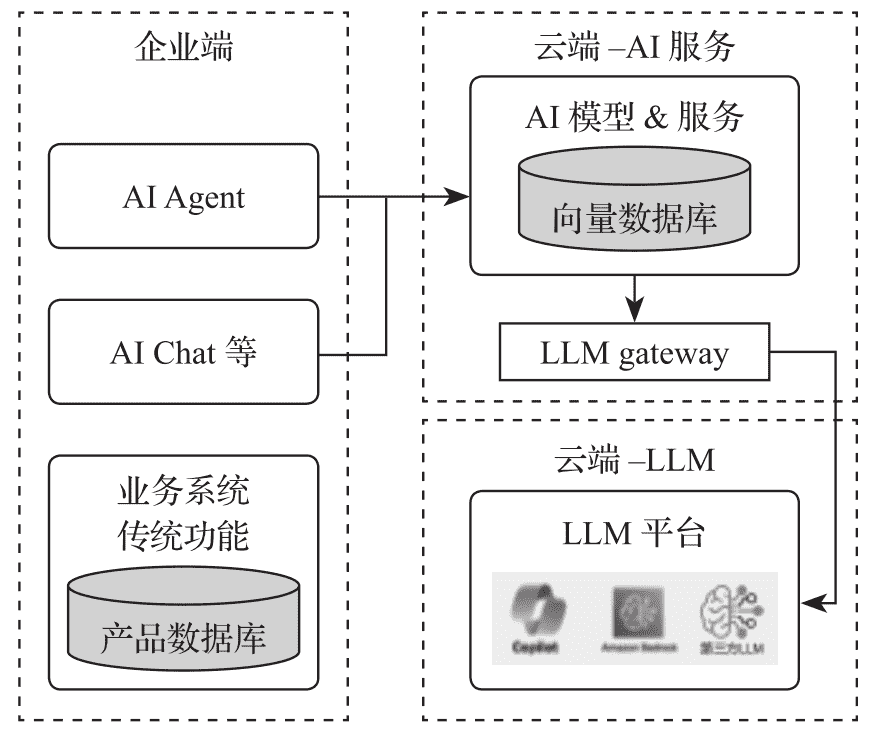

图 6-2 嵌入式AI的常见部署架构

该路线适合AI初探、数字化基础薄弱、希望轻量快速验证的组织。

平台化AI 则是企业自建面向全业务链的AI基础设施，打通PLM、ERP、MES、CRM等数据，实现端到端贯通，并自主开发训练部署定制化应用。其架构分三层：全域数据整合中枢，构建数字主线实现一次汇聚全局调用；AI能力服务化引擎，将视觉、NLP、预测分析等封装为API供跨部门调用；自主应用创新平台，支撑企业解决嵌入式AI覆盖不到的深度个性化场景。

优势是灵活性高、可自主选型开源模型解决战略问题；打破数据孤岛实现端到端优化，如售后反馈直接回流产品设计；本地化部署保障垂域模型微调与核心数据知识产权安全，形成难以复制的数字资产；长期看可降低多厂商许可成本。代价是初期投入大。

从成本竞争到技术壁垒、从市场跟随到需求引领、从单一产品到综合解决方案，研发范式的跃迁正在重塑制造业的胜负手。

**自建AI平台，多数企业败在起步认知**

要把AI做成可复制、可放大的平台能力，并不是堆算力、招人就能解决。真正卡住企业的，是技术、组织、风控交织的系统性难题。

**●投入回报周期难平衡**：搭建平台属于典型的系统工程，前期资金和时间投入巨大，短期内很难看到明确业务收益，对高层的战略耐心是严峻考验。
**●复合人才严重缺口**：既懂产线工艺与工业逻辑，又能落地AI工程化的复合型人才极其稀缺，能力断层直接拖慢进度。
**●数据底座混乱**：原始数据分散在各系统，质量参差不齐，缺乏统一清洗、治理和融合机制，难以形成可用资产。
**●流程变革阻力大**：传统线性的业务习惯与AI驱动的敏捷协作模式存在本质冲突，组织惯性成为隐形拦路虎。
**●自建风险与运维压力**：平台失败成本高，后续的运维、模型迭代、安全合规对企业的技术和管理成熟度要求极高。

能走通平台化路线的企业，通常具备三个前提：资金实力雄厚且拥有顶尖AI人才储备的行业龙头，已完成初步数字化并把数据确立为核心资产，将自主可控的AI平台视为长期战略壁垒，并以此推动个性化场景的颠覆式创新。

3.战略选择：分步演进、融合共生

对绝大多数制造企业来说，嵌入式AI与平台化AI并非非此即彼，而是能力成熟度递进的两段旅程。先用轻量化的嵌入式方案验证价值，再逐步沉淀数据、技术与认知，最终走向体系化平台，是典型的阶梯式跃迁。

（1）第一阶段：嵌入式AI快速入门

从工业软件自带的AI功能切入，挑选1-2个回报最快、痛点最强的业务场景做试点。
这一阶段的重点是：
**●快速验证价值**：3到6个月内拿到可量化的效率提升，比如PLM中的智能器件推荐把零部件种类压缩约15%。
**●原始能力积累**：沉淀场景数据集，团队初步建立AI工程化意识。
**●破冰建立共识**：打破部门壁垒，为后续资源密集型投入铺路。

核心使命是先尝到甜头、积累经验、培育AI体验，进而争取内部支持。风险在于陷入“试点炼狱”：单点成功因缺乏统一数据底座和系统集成，无法规模化复制，甚至停留在演示阶段。

（2）第二阶段：集成与平台筑基

在局部验证成功后，企业会进入重心转移期，将目光从单点工具转向体系能力。
**●启动数据主线战略**：推动业务端到端在线，为平台应用打牢数据基础。
**●组建种子AI队伍**：明确平台架构与技术路线，攻克1-2个关键业务的差异化需求。
**●建立AI治理框架**：统一数据标准，落地MLOps模型全生命周期管理。

此阶段实质是搭建“数据-人才-机制”三位一体的基础，完成从工具使用到能力资产的认知升级。

（3）第三阶段：规模化应用与能力构建（自建阶段）

平台雏形已现，AI上升为企业核心战略。企业开始在集团范围内推广，并追求高垂域化、定制化模型以形成差异化优势。
**●实现路径**：以自主研发为主。内部已具备全栈模型开发、部署与运维能力，即使依托公有云，核心算法仍掌握在企业手中。
**●数据基石**：MLOps体系和数字主线平台全面运行，数据准备到迭代实现自动化管理。数据被视作顶级战略资产，并通过自建智算中心或弹性调度云算力支撑创新。
**●组织形态**：AI从集中式中心演变为分布式网状赋能。各业务单元配备AI专家，与业务人员组成跨职能小组协同解决问题，顶层支持与创新文化是关键。

应用从单点走向链条赋能。
**●流程再造**：把僵化的流程变为数据驱动的动态智能体系。
**●决策智能化**：打通数据壁垒形成全景视图，实现预测瓶颈和协同优化建议。
**●能力复用**：打造企业级AI中台，将通用能力服务化，避免重复建设。

此时主要挑战从技术转向变革管理与文化重塑，员工角色变化易引发抵触。

（4）第四阶段：核心平台主导的混合AI生态

自研平台成为创新引擎，承载工艺参数智能优化等核心竞争力场景；同时继续引入工业软件嵌入式AI模块处理标准化任务，如PLM变更影响分析、ERP需求预测等。形成“自主平台+商用模块”的混合生态，实现：
**●战略层**：自主平台保障关键技术控制与创新壁垒。
**●执行层**：商用模块降低常规业务智能化成本。
**●架构层**：以AI网关实现内外AI能力的动态编排。

特征上，创新成为主线，企业甚至可将平台输出给生态伙伴。AI与数据已融入每个决策环节，AI Agent、MCP等前沿技术被娴熟运用，组织整体具备AI素养，AI不再是独立部门而是公司基因。焦点转向持续自我颠覆和塑造行业未来。

成熟度攀升并非直线。企业可能在某阶段卡住，也可能因外部冲击而跳跃。比如大量企业困在第一阶段无法规模化；从第二到第三阶段的组织变革可能拖数年。但供应链中断等事件也可能倒逼企业快速投资可视化与预测能力，实现跨越。因此成熟度模型是导航图，不是时间表，关键在于跨越技术、组织、文化的鸿沟。

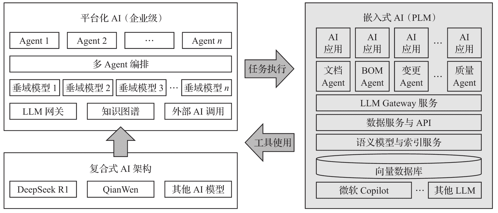

图 6-3 平台化AI与嵌入式AI共融共生的混合AI生态

### 6.3.2 平台化AI分层架构

从点状AI工具到平台化智能系统，本质是从解决孤立问题转向构建可复用、可覆盖全企业的智能能力，需要开放、可扩展、安全为原则的统一基础设施，把OT与IT数据、模型、应用无缝整合。

一个面向制造业的AI平台设计需遵循三原则。
**●可扩展性**：能承载海量数据与复杂模型，支持本地、公有云、私有云弹性调度。
**●模块化**：各组件可独立更新替换，如升级数据处理模块不影响供应链预测模型运行，提升灵活性和可靠性。
**●互操作性**：与PLM、ERP、MES、SCADA等系统无缝对接，打破IT与OT壁垒，实现数据自由流动。

综合业界实践，提出面向制造业研发的五层参考架构。
**●基础设施层**：提供计算、存储、网络资源及通用大模型或深度学习模型，是整个架构的物理与虚拟底座，支持云端、本地或混合部署。
**●数据/知识层**：整合产品生命周期各环节的多源异构数据，通过统一语义模型如ISA-95进行融合，形成标准化资产，并构建企业知识图谱沉淀行业经验。
**●模型服务层**：将各类AI能力封装为服务，对全生命周期进行管理，是平台的智能大脑。既包含通用基础大模型，也包括针对制造场景微调的专用模型，并依托MLOps实现高效开发、可靠部署与持续优化。
**●Agent编排层**：协调多个模型与Agent协同，负责任务分解、分配与通信。依托多Agent管理平台实现规划、推理与工具使用，赋能需求、设计、供应链、工艺等环节。
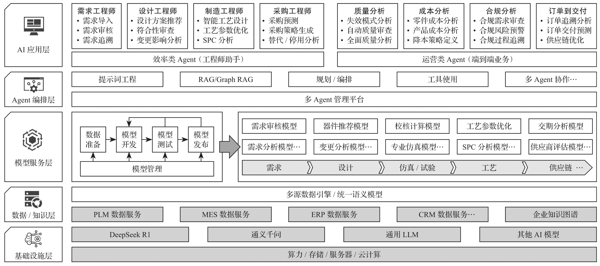

图 6-4 平台化AI分层构架
**●AI应用层**：通过自然语言交互、角色化App等界面向设计、质量、管理等角色交付洞察与自动化能力。分为面向工程师的效率类Agent，侧重单职能深度优化；和面向管理层的运营类Agent，侧重跨组织端到端洞察与协同决策。

分层实现了技术与业务解耦，支持多团队并行协作。架构还呈现双向智能流动：洞察向上汇聚决策，决策指令向下实时干预，从事后纠错转向主动控制，这是智能化研发范式的标志。

## 6.4 基础设施层：数字企业的物理底座

该层是平台的物理与逻辑基石，核心挑战在于实现IT/OT的安全可靠融合。

### 6.4.1 硬件基础架构

硬件选型需要在性能、成本、可扩展性与安全性间权衡。
1.算力
算力决定模型开发效率。CPU负责通用计算与调度，GPU提供并行加速，TPU等专用单元针对特定负载优化。
**●AI训练**：海量数据训练复杂神经网络需极高并行能力，NVIDIA A100/H100等高端Tensor Core GPU为主流，需关注算力、显存与多卡互联。
**●AI推理**：更看重低延迟、高吞吐与能效，GPU仍常用，部分场景选用ASIC、FPGA或AI指令集CPU更具性价比。

2.数据存储
需同时处理结构化与非结构化及时序数据。
**●高性能层**：NVMe SSD与全闪存阵列避免训练时I/O瓶颈，提供超低延迟。
**●大容量层**：大容量SSD或HDD做分层存储，兼顾成本。
**●架构**：分布式文件系统或对象存储支持横向扩展。

3.网络与连接
高速网络是计算与存储的神经系统。
**●高带宽低延迟**：分布式训练需InfiniBand或100/200/400GbE配合RDMA，减少通信延迟。
**●现场连接**：需与工厂OT网络安全对接，具备融合与隔离能力。

部署模式上，云端部署提供弹性扩展与按需付费，适合突发性训练，但需关注带宽与数据安全；本地数据中心自主可控、安全性高，适合核心敏感数据，初期投入与运维成本高；混合部署已成主流，非实时训练放云端，实时推理与决策保留本地，实现效能与投资回报最大化。

AI算力带来的电耗压力已经从“关注”变成“警报”。尤其是为模型训练和推理量身打造的算力中心，需求增速远超一般业务。公开推演显示，到2030年，中国的算力设施或将占据全国用电的4.8% ^(⁶⁶)。因此节能必须前置——在规划蓝图阶段就选低功耗硬件、部署先进制冷，而不是等投产后再打补丁。

### 6.4.3 制造业选型指南：LLM 怎么挑
给工厂挑选大模型，不是比参数大小，而是要把技术、投入、安全和落地场景一起算进账。实操中常参考的五大视角如下。

1. 模型硬实力
是否能真正在产线语言里“听懂”。
● 行业认知与精细度：能否读懂图纸标注、解析PLM里的BOM结构、理解工艺参数的物理含义。对工艺优化这类高精度任务，失误容忍度极低。
● 跨模态融合：工厂数据不只是文本，还有CAD图、三维模型、现场照片。能把文字、图像、3D信息联动的模型更实用。
● 推理与规划：根因分析、研制排程动态调整等难题，需要扎实的逻辑链和行动规划。
● 实测对比：在技术问答、需求生成、数据分析等制造类任务上跑分，用量化结果横向判断。

2. 适配与定制空间
通用模型要经过“本地化”才有价值。
● 微调弹性：是否支持用自有数据做精细化微调，让模型学会企业特有的产品谱系、工艺规范与历史经验。
● 检索增强兼容度：能否无缝接上RAG。通过对接内部手册、质量程序、供应商资料，给模型实时上下文，压制幻觉，提升专业可信。
● 开源与闭源权衡：① 开源系如DeepSeek、Llama系列，可控性强，支持私有化部署，对数据保密与知识产权更友好，但运维优化要自担。② 闭源系如GPT系列，通用表现稳、接口成熟、启动快，但定制空间有限，数据经外部通道传输存在合规顾虑。

3. 投入产出比
规模化要算总账。
● 训练微调费用：从零训练或深度微调算力消耗惊人。
● 推理开销：日常调用的持续成本，受模型体量、响应速度、调用频次影响。性能满足前提下，选更经济的推理方案更合理。
● 部署运维开销：云上还是本地机房、是否依赖GPU集群，都是长期负担。

4. 安全合规与可信
制造业数据含核心IP与敏感运营信息，安全是底线。
● 隐私边界：部署形式能否实现数据不出域。选用闭源API时需审慎评估其数据处理与隐私条款。开源本地化部署在隔离性上更占优。
● 可解释与可追溯：当模型参与工艺参数调整、质量判定等要害决策时，必须能给出依据，这是建立信任与风控的前提。
● 法规遵循：模型与应用必须符合当地行业和国家的数据安全标准。

5. 集成与扩展
能否无缝嵌入现有IT底座。
● 接口与生态：是否提供稳定易用的API，周边工具与开发者社区是否成熟。
● 部署灵活性：是否支持公有云、私有云或边缘节点。对产线实时监控等场景，边缘能力尤为关键。
● 弹性扩展：业务扩大、数据增长时，服务架构能否平滑扩容应对更高并发与计算需求。

综合这五个维度，我们对DeepSeek R1、通义千问Qwen 2、ChatGPT、Llama等主流模型做了对照，如表6-1所示。因为迭代很快，下面的认知仅反映2025年上半年市场共识。

对工厂而言，理想策略不是单选，而是场景化组合。
● 核心研发、数据高度敏感且需深度定制：Llama凭借开源与私有化特性，成为数据安全的首选。
● 需强中文理解并与云生态深度联动：通义千问依托阿里云底座与中文优化，优势明显。
● 追求顶级编程与科学计算：DeepSeek R1的专用模型与高性价比接口极具吸引力。
● 追求快速验证、最强通用能力与成熟多模态交互，且合规允许：ChatGPT仍是原型构建的首选。

整体来看，选型要围绕场景在表现、成本、安全与适配度之间取舍。常见做法是构建“模型矩阵”，同一套平台内并行多模型，按任务匹配。举例：用通义千问做面向客户的通用问答，用DeepSeek处理技术文档解析、材料配方生成与验证等专业链路。

表6-1 常见LLM比较
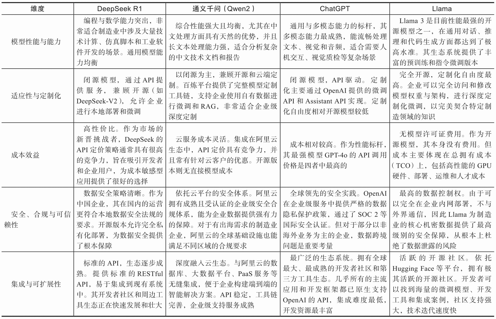

## 6.5 数据知识层：工业智能的枢纽
在现代智能平台里，数据与知识层处于承上启下的位置。位于基础算力与上层模型之间，核心职责是把企业内外分散异构的原始信息，炼成高质量、可信、易用的知识资产，为上层应用供能。

### 6.5.1 跨系统打通与数据汇聚
企业通常已部署PLM、ALM、SDM、TDM、ERP、CRM等研发类系统。引入AI不是推倒重来，而是通过集成盘活存量。实践中一般分四步走。

1. 打通稳定可靠的数据通道
按系统特点与实时性要求选择方案。
● 接口对接：对提供RESTful等现代接口的系统，这是主选，可实现实时或准实时CRUD。
● 直连数据库：老旧系统或需批量抽取时，可通过JDBC/ODBC直连后台，定期拉数。
● 消息队列/事件总线：对MES等强实时场景，采用事件驱动。工序完成或设备报警时，立即发布事件到Kafka等队列，平台订阅后即时响应。
● 文件交换：批处理仍在使用FTP或共享目录定时交换CSV、XML等文件。

2. 搭建统一汇聚与治理中心
打通后不能直接用，需集中治理。湖仓一体与向量库在成熟平台里互补，数据会按用途在两者间流动。
● 湖仓一体：企业数据的主存与分析中心。来自PLM、ERP、MES等结构化、半结构化和非结构化信息，经ETL/ELT清洗、去重、转换、整合后入仓，形成标准资产。湖仓作为单一可信源，统一存储、治理与权限，为机器学习提供干净训练集。
● 向量库：面向语义检索的专用引擎。不存原文，而是存向量表征。① 相似检索依赖超高速向量相似计算，如找出与缺陷品图片最像的样本，或匹配最相关的设计文档。② 检索增强生成是LLM落地的关键。提问先转向量，在向量库检索相关片段，再作为上下文输入LLM，输出更准更稳。

典型流转如图6-5所示。
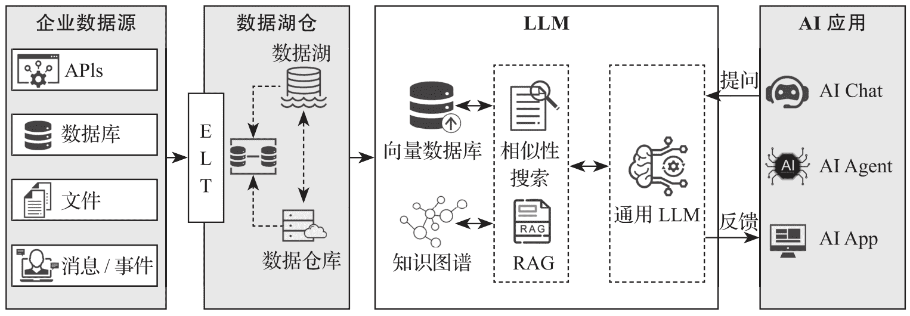
图6-5 AI平台数据流示意图
● 汇入湖仓：PLM、ERP、MES等数据经集成清洗后统一进入湖仓一体。
● 向量化：挑选湖仓中语义丰富的信息，如产品描述、设计文档、技术手册、维修日志、质量报告，用Embedding模型转为向量。
● 写入向量库：向量连同指向湖仓原数据的ID一并存入向量库。
● 应用调用：做语义搜索或RAG时，先查向量库得相关ID，再回湖仓取完整记录供后续处理。

可见数据先入湖仓统一管理，语义理解与相似搜索所需的“向量镜像”存入向量库，二者协同构成平台的数据底座。

3. 实现语义统一与知识化
让AI真正“读懂”数据是集成的核心。统一语义模型相当于企业数据的通用词典与语法，屏蔽底层系统差异，使信息在全企无歧义流动，是决策与智能的前提。

不同系统因设计目标不同，对同一对象的描述天然不一致，表现为命名、格式、单位、定义差异。如零件在PLM叫Part Number，在ERP叫Material Code，在MES叫Component ID，实指同一实体。PLM的BOM指工程结构，ERP的BOM可能是订单或生产结构。不解决这些，AI结论会混乱甚至错误。
● 主数据管理MDM：为产品、物料、客户、供应商等核心实体建立企业级黄金标准，统一定义与编码，消除跨系统差异。
● 统一语义模型构建：为每个核心实体创建标准全企通用的模型，把各源系统字段映射到标准模型并定义转换逻辑。如PLM.Part Number→Master Part ID；ERP.Material Code→Master Part ID。数据流入时经语义层自动清洗映射，保证后续流程数据一致。

在此基础上构建知识图谱，可把治理后的数据与业务关系结构化。例如清晰表达：某产品的某个零件由哪家供应商提供，用在哪几个生产批次，交付给哪个客户。

4. 双向集成与价值闭环
高效集成必须是双向的。平台既读取业务系统数据做分析，也把结果写回形成闭环。
● 读取与分析：从PLM、ERP等读取数据做预测性维护、供应链风险分析、工艺参数优化。
● 写回与执行：把优化后的工艺参数通过接口写回MES执行；把预测的采购需求自动在ERP生成建议单；把设计变更影响分析自动附在PLM变更流程中。

按以上四步，制造智能平台能与现有系统深度融合，实现数据到知识、知识到决策、决策反哺业务的完整链路。

### 6.5.2 知识图谱怎么搭
知识图谱是数据层的升华，让数据开口说话，揭示深层关联。它把离散数据转为关联网络，帮助模型更好理解业务逻辑与实体关系，为需求追溯、变更影响分析等提供高质量基础。在研发体系中，它是连接数据、信息与智能的桥梁。

1. 研发知识图谱拆解
制造业研发面临庞大割裂的数据源：CAD、CAE、PLM、ALM、ERP、SDM、TDM及大量遗留系统，形成普遍的数据孤岛，难以获得全生命周期视图。

数据割裂导致设计重复、需求变更难追、质量控制薄弱、对市场反应迟缓。工业软件是知识结晶，但其产生的数据常被困在各自系统。核心挑战是整合异构源。

数字主线的愿景是产品全生命周期信息无缝流动，知识图谱是实现该愿景的关键使能技术，通过语义层把孤立数据连成有意义整体。

知识图谱由实体、关系、三元组构成。
● 实体：研发世界的“名词”，如钛合金Ti-6Al-4V、3D打印中的选择性激光熔化工艺、涡轮叶片#77-B、疲劳寿命>10000次循环的需求、测试结果、仿真模型或工程师。
● 关系：连接实体的“动词”，如“涡轮叶片#77-B由Ti-6Al-4V制成”、“选择性激光熔化是增材制造工艺的一种”、“工程师张三是计算流体动力学专家”。
● 三元组：实体-关系-实体构成的基本单元，是机器可读的事实陈述，图结构能表达传统关系库难以捕捉的网状知识。

构建的关键在于分层架构。
● 数据层：由具体实例构成的大图，含数百万甚至上百亿三元组，是知识的事实基础。
● 模式层：研发领域的抽象蓝图，定义允许的实体类型、属性、关系类型，为数据层提供结构与约束。模式层常通过本体形式化。

本体是对共享概念的形式化规范，是知识图谱的“根本大法”，定义统一词汇表与规则。制造业研发复杂、术语模糊，必须靠本体实现语义统一与互操作。例如“应力”可能指机械应力MPa，也可能指热应力，本体为每个概念提供唯一标识与精确定义，避免CAD、CAE数据集成时混淆。本体构建可自顶向下由专家定义，也可自底向上从数据发现，实践中混合最好。空客的研究展示了利用BFO等顶层本体和IOF-Core等领域本体为飞机装配构建专用本体的做法 ^(⁶⁷)。

双层架构是知识图谱区别于传统数据库的关键。数据层提供海量事实，本体驱动的模式层才把数据转化为智能可计算知识。没有健壮本体，图只是数据库；有了本体，它才能成为可推理的认知引擎。研发数据的复杂性要求形式化词典与规则手册，本体提供了这种机器可读的语义统一。

2. 研发知识图谱构建流程
传统做法需知识工程师手工定义实体关系并写规则抽取，缓慢昂贵难扩展。LLM的自然语言理解与RAG的精准检索结合，可颠覆流程，实现自动化构建。整体可分为若干阶段。

（1）战略定义与本体建模
构建必须始于业务目标而非技术。首先定义“能力问题”，即知识图谱必须能回答的关键问题，如“哪些替代材料能承受500°C高温、蠕变率低于2%，并且由欧洲供应商提供”。

制造智能的基座：知识图谱构建与模型服务落地

在真实业务暴露的能力缺口面前，领域专家通常会与知识工程师配合，先为行业打造一套初始的领域本体，也就是模式层，在这一层厘清关键实体、关系以及属性。博世 ^(⁶⁸) 与空客的实践表明，这一环节本质上是多轮研讨的反复校准，需要不断与工程师和管理者对齐确认。只有把基础打牢，才能有效驾驭制造业的复杂性。

**●需求分析**：先弄清图谱要解决的具体业务场景，例如合规核查、参数化设计、材料设计等。场景明确之后，才能决定图谱需要容纳哪些知识。
**●范围界定**：划定知识边界。以制造行业为例，图谱可以涵盖“产品”“零件”“材料”“供应商”“设备”“工艺”等核心概念，而无须纳入“娱乐明星”等无关内容。
**●本体构建**：相当于图谱的骨架与蓝图。知识工程师在此定义图谱包含的实体类型、属性以及实体之间可能的关系。例如将“公司”与“产品”设为两类实体，并规定二者之间存在“生产”的关系。

（2）多源数据集成与知识获取

本阶段的目的是收集搭建图谱所需的原始素材，来源往往呈现多样化。

**●结构化数据**：通常来自企业内部业务系统如 ERP、PLM 等，或关系型数据库。这是路径最直接、质量最高的数据来源。
**●半结构化数据**：诸如网页表格、JSON、XML 文件、电子表格、百科类站点等。
**●非结构化数据**：占比最大也最难处理，典型形式包括 PDF 设计方案、专利文献、科研论文、设备维护日志等。

数据获取可借助多种工具与连接器完成。对结构化数据，可采用 API 集成或直接映射如 RDB2RDF。对非结构化数据，则需要借助下一阶段所说的自然语言处理技术进行转化。

（3）自动化知识抽取

核心任务是将非结构化和半结构化内容转化为可读的三元组，这是自然语言处理在图谱构建中的关键应用。

**●实体识别**：大语言模型能够直接从设计方案、设计规范、质量程序等文本中识别出关键业务实体，如材料名称、工艺参数、设备编号、企业名称等。
**●关系抽取**：识别实体间的语义联系。例如从设计文件里抽取出“涡轮叶片”由“Ti-6Al-4V”材料制造的关系。具体实现方式多样：①基于规则/模式匹配，对格式高度规范的文档如规格表非常有效；②传统机器学习，在标注语料上训练有监督或无监督模型识别关系；③深度学习，利用 CNN、RNN、Transformers 等模型自动学习文本特征，处理复杂语言现象。
**●属性抽取**：提取实体的固有属性。例如从材料数据表中抽取材料“Ti-6Al-4V”具有“高强度重量比”的属性。
**●事件抽取**：捕捉更复杂的动态信息，如“质量故障”事件，并抽取出故障表现、特征、涉及部件及因果关系等要素。

（4）知识融合与验证

抽取后的知识往往零散，存在冗余、冲突或不完整。融合的目的是形成统一、干净、连贯的知识库。

**●实体链接/消歧**：把文本中提及的实体如“博世”映射到图谱中唯一正确的实体对象上。解决同名异义，如“捷豹”指汽车品牌还是动物，以及异名同义，如“大众”“VW”“Volkswagen AG”指向同一家公司。
**●知识合并**：整合来自不同数据源的关于同一实体的信息，化解模式层与数据层可能出现的冲突。例如把 PLM 中零件 A-123 的设计信息与 ERP 中物料号 123 的库存、成本信息合并，使实体信息更完整。
**●关系归一化**：大模型能理解“供应商是”“提供者为”“由……供应”等不同表述，并统一归一为标准关系如“hasSupplier”。
**●质量评估**：引入“人在回路”机制验证抽取结果的准确性，包含人工审核与修正，通常采用主动学习策略，优先把系统不确定的抽取结果推送给领域专家审核，以消除冲突与冗余。这对工程应用要求的知识可靠性至关重要。

（5）知识推理与发现

此阶段图谱从静态事实库转变为能够产生新洞察的推理引擎。

**●演绎推理**：基于本体中定义的规则推导出隐含的新知识。例如已知：①部件 A 由材料 X 制成；②材料 X 属于金属；③所有金属都导电。系统即可自动推断部件 A 具有导电性，即使该事实未被显式录入。
**●归纳推理（链接预测）**：借助图机器学习技术如知识图谱嵌入 Knowledge Graph Embedding，KGE，来预测缺失链接或发现潜在新关系。例如依据新材料与图谱中已有成功应用材料的相似性，推荐其可能适用的应用场景。

（6）RAG 驱动的迭代验证与增强

这是让图谱“活起来”并持续进化的关键，也是 RAG 技术发挥核心作用之处。

**●知识应用与验证**：图谱初步成型后，可接入上层应用或 RAG 系统供员工使用，如智能问答、搜索引擎、推荐系统等。例如工程师用自然语言提问：“制造涡轮叶片可用的材料有哪些？”使用过程中，工程师可反馈答案准确性，从而提升图谱中相关知识的置信度；同时能发现图谱的缺失或错误，进行补充修正，形成良性循环。
**●知识更新与迭代**：知识会随时间变化，需要建立持续更新机制，定期从数据源获取新知识并重复抽取、融合、验证流程。通过这种迭代，图谱不再是静态数据库，而是一个在用户交互中不断自我完善的知识智能体。

如图 6-6 所示，制造业知识图谱构建并非一次性线性项目，而是一个持续循环过程，融合知识抽取、融合、推理和人工反馈。通过循环，企业集体知识得以逐步丰富完善。在此过程中，LLM 负责从海量数据中自动化开采知识，RAG 则提供高效应用与验证通道，让真实业务需求驱动图谱精准构建与持续迭代。

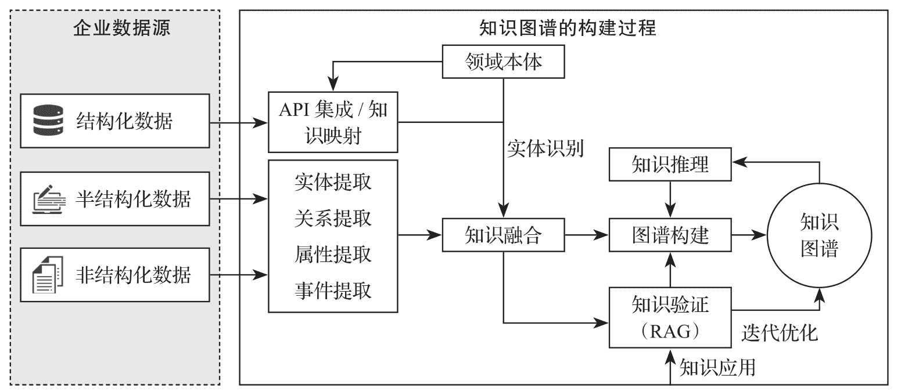

图 6-6 知识图谱的构建过程

3.图数据库引擎分析

在存储和查询高度关联的研发数据时，原生图数据库相比传统关系型数据库具有天然优势。其无索引邻接特性使关系遍历效率极高，这对供应链追溯或设计变更影响分析等场景尤为关键。

以下对主流图数据库进行比较，聚焦制造业关注的核心指标。

**●Neo4j**：成熟易用，适合项目启动和中小规模图模型，采用 Cypher 查询语言。但在超大规模分布式场景下，性能与可扩展性会受限。
**●TigerGraph**：为大规模并行处理 MPP 设计的高性能分布式原生图数据库。在大规模深层链接分析如超过 10 跳的基准测试中表现通常领先，适用于企业级欺诈检测、供应链优化、复杂分析，使用 GSQL 查询语言。
**●JanusGraph**：开源、高可扩展的分布式图数据库，支持多种存储后端如 Cassandra、HBase。灵活性强，但部署维护投入较大，使用 Gremlin 查询语言。
**●云原生选项（Amazon Neptune、Azure Cosmos DB）**：全托管服务，与云生态深度集成。例如 Neptune 同时支持属性图 Gremlin、openCypher 和 RDF SPARQL，具有较强通用性。

与知识图谱的交互方式决定其价值能否被有效获取。

**●形式化查询语言**：①SPARQL 是 W3C 为 RDF 图制定的标准查询语言 ^(⁶⁹)，功能强大标准化但语法繁琐；②Cypher/GQL 为声明式、采用 ASCII-art 风格的查询语言，如（person）-->（city），对开发者更直观。Cypher 源于 Neo4j，GQL 为新兴 ISO 标准 ^(⁷⁰)。
**●迈向自然语言接口**：终极目标是让工程师用日常语言提问。需通过语义搜索或智能问答层，将自然语言自动翻译为形式化图查询如 SPARQL。这是知识图谱核心应用场景，也是 LLM 与图谱融合重点。

图数据库选择是影响长远的关键架构决策，需在易用性/成熟度 Neo4j、原生性能/可扩展性 TigerGraph、开源灵活性/复杂性 JanusGraph 之间权衡。表 6-2 给出了主流图数据库对比。对于大型制造企业，深层分析性能和可扩展性至关重要。一个典型研发知识图谱庞大、复杂且需深度多跳查询，例如查找所有使用某供应商零部件的产品，而该供应商母公司在过去 5 年内涉及召回事件。基准测试显示，对此类深链接查询，TigerGraph 这类 MPP 架构比单机或分布式不足模型快数个数量级。尽管 Neo4j 对初期项目友好，但面向未来企业级系统需建立在可应对未来规模与复杂性而不出现性能瓶颈平台上。因此，选择应基于概念验证 PoC，用第一阶段识别出的最高价值、最复杂能力问题对候选数据库进行压力测试。

**表 6-2 主流图数据库的对比分析**

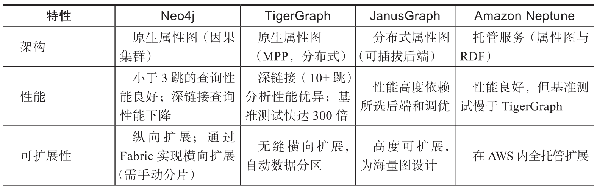

（续）

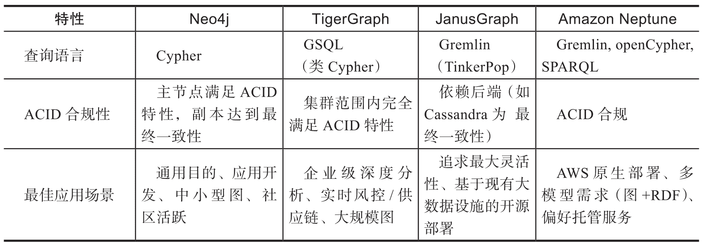

总之，数据/知识层是企业实现数据驱动和智能化转型的基石。良好的数据/知识层能够打破数据孤岛、保障数据质量、沉淀业务知识，并赋能上层 AI 模型与应用，使其做出更精准智能决策。缺少这一层，AI 应用如同空中楼阁，难以发挥真正价值。

## 6.6 模型服务层：工业机理的算法载体

模型服务层是现代机器学习与 AI 平台架构的核心组件，扮演 AI 能力调度中心的角色。其根本任务是将开发环境中训练好的 AI 模型转化为稳定、高效、可管理、可被上层业务便捷调用的在线服务。没有这一层，模型仅是实验室里的静态文件，无法产生业务价值。

### 6.6.1 模型开发框架与协作环境

模型服务层需为 AI 开发团队提供高效协作开发环境，通常包括以下内容。

**●模型开发框架**：指为规范化、标准化、高效化 AI 模型生产而建立的工具、流程与最佳实践集合。它像模型的工业化流水线，无缝支持 TensorFlow、PyTorch 等主流机器学习框架及 Python 语言，确保企业能利用广泛开源工具与社区资源。
**●协作开发环境**：为团队提供统一工作空间，集成交互式 IDE、深度集成 Git 版本控制、共享计算与数据资源池、中央模型注册表与知识库，打破单兵作战模式。借助容器化技术保证开发、测试、生产环境一致，提升协作效率、资源利用率与模型可复现性。

在模型开发框架层面，TensorFlow 与 PyTorch 是当今两大主导框架。

TensorFlow 由 Google Brain 开发，2015 年发布，面向可扩展生产级机器学习工作流 ^(⁷¹)。其最大优势是成熟强大的端到端生产部署生态。核心组件包括：①TensorFlow Extended TFX，提供生产级 ML 管道平台；②TensorFlow Serving，专为生产环境设计的高性能模型服务系统；③TensorFlow Lite，用于边缘与移动设备部署，对机器端 AI 至关重要；④TensorBoard，强大的可视化工具帮助理解与调试训练过程。TensorFlow 一直被视为更适合大规模生产部署的选择。

PyTorch 由 Meta 前 Facebook 人工智能研究实验室 FAIR 于 2016 年推出 ^(⁷²)，以 Torch 概念为基础但使用 Python 提升可访问性。其优势在于灵活性、与 Python 深度融合及在学术研究统治地位。核心优势如下。

**●动态计算图**：模型构建与调试更直观灵活，适合复杂结构。
**●强大的生态系统**：与 Python 数据科学生态无缝集成，是 Hugging Face Transformers 等前沿 NLP 与生成式 AI 库首选框架。
**●TorchScript 与 ONNX**：提供将模型导出为高性能可部署格式的机制，弥补早期生产部署短板。
**●压力测试**：使用最复杂的“能力问题”来对候选数据库进行压力测试。

表 6-3 列出了 TensorFlow 与 PyTorch 的对比分析。

**表 6-3 TensorFlow 与 PyTorch 的对比分析**

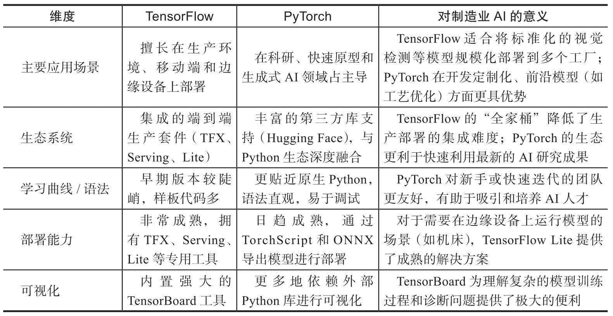

近年来两大框架相互借鉴，差距逐渐缩小。例如 TensorFlow 引入动态执行，PyTorch 也加强生产部署工具。今天选择更多取决于团队技术栈、生态偏好和具体应用场景，而非根本能力差异。

总体而言，模型开发框架提供方法论和工具集，协作开发环境提供工作空间和资源支持。两者共同构成模型服务层中至关重要开发域，确保 AI 模型以工业级、可信赖、高效协作方式被创造，再无缝交由服务层运维域部署管理。

### 6.6.2 模型的部署与服务化

模型的部署与服务化是将训练好静态模型转变为持续产生业务价值动态在线服务，是数据科学成果产品化的关键工程阶段。

1.统一的服务接口

为不同框架如 TensorFlow、PyTorch 等训练模型提供统一 API 网关，将模型封装为可调用服务接口，通常为 RESTful API。这样实现模型与业务应用解耦，上层应用无需关心内部实现，按标准格式请求即可获得预测结果。

根据实时性要求，通常有三种主流部署模式。

（1）实时/在线推理
**●应用场景**：需即时获得预测结果，如人脸识别、机器视觉质检、实时推荐等。
**●工作方式**：模型加载到服务器内存，通过持久化 API 端点随时响应请求。单次请求响应速度即延迟为关键指标。

（2）批量推理
**●应用场景**：对海量数据进行周期性非实时处理，如每日用户画像更新、每周销售预测、每月客户分群等。
**●工作方式**：通过定时任务如每晚执行启动，模型一次性处理大批量数据，结果写入数据库或文件系统。处理总时长和吞吐量比单次延迟更重要。

（3）边缘部署
**●应用场景**：需超低延迟、网络不稳定或注重数据隐私终端设备，如智能工厂摄像头质检、自动驾驶环境感知、现场维修智能终端等。
**●工作方式**：需对模型轻量化处理后部署到物联网设备、手机等资源受限硬件，在数据产生源头直接计算。

实现上述功能，离不开现代化基础设施和技术。

**●容器化**：将模型及其依赖打包成标准可移植容器镜像，解决“在我的机器能跑”环境不一致问题。
**●容器编排**：自动化管理、扩展和调度成百上千模型服务容器。Kubernetes 能实现服务自动扩缩容、故障自愈和负载均衡，是大规模部署 AI 服务行业标准。

2.模型服务框架

模型服务框架构建于 Kubernetes 之上，为模型服务提供更高级功能，如开箱即用部署模式、多模型编排、可解释性等，进一步简化部署流程。

模型的部署与服务化是系统性工程，综合运用多种部署模式、更新策略和底层技术，将模型从算法产出转变为企业可依赖高可用、可扩展、易管理 AI 服务，是实现 AI 价值闭环的最后一公里。

### 6.6.3 模型的生命周期管理与治理

模型并非一次性产物，需对其全生命周期进行有效管理，这部分通常由 MLOps 平台支撑。

1.MLOps 的核心特征

MLOps 是将 DevOps 原则应用于 AI 领域实践体系，融合机器学习 ML、软件开发 Dev 和 IT 运维 Ops 最佳实践，旨在解决模型从开发到生产部署生命周期管理问题。MLOps 核心是解决 AI 应用普遍存在的试点困境，即数据科学家在孤立试验环境开发模型难以在复杂生产环境中成功部署、稳定运行和持续维护。在制造业，这意味着模型不仅要在测试表现良好，更要在 7×24h 生产环境中面对真实嘈杂数据持续创造价值。

MLOps 实践比传统 DevOps 更复杂，因其需同时管理三个动态实体：代码 Code、模型 Model 和数据 Data。传统 DevOps 主要关注代码生命周期。但在 MLOps 中，三者相互交织：数据变化可能要求模型重训，即便代码未变；代码更新需要重训模型；模型本身作为二进制产物需版本化管理。这种独特三体问题正是 MLOps 引入持续训练 CT 等新概念原因，也解释了为何不能简单套用现有 CI/CD 工具，而必须构建能理解并自动化复杂三元生命周期专属 MLOps 平台。

MLOps 核心在于持续性，将 AI 模型生命周期变成自动化的不断迭代优化闭环。

**●持续集成 CI**：不仅自动化代码构建测试，更重要的是自动化数据和模型验证，确保新数据或模型版本不破坏现有系统稳定性。
**●持续交付 CD**：自动化地将通过测试训练好的模型打包并部署为可供调用预测服务。

**制造智能化落地的底座**

**闭环再学习**：传统 DevOps 关注代码与部署，对模型在产线上的衰减缺乏覆盖。零件更换、工艺微调、设备老化都会导致预测效果下滑，即常说的性能退化。MLOps 的特有做法是建立自学习闭环，平台持续追踪线上表现，一经捕捉到衰减信号就自动触发再建模，用最新采集的样本刷新模型，保持决策精度。

**在线观测**：模型投产后需全景可见。运行面要看单次预测耗时、并发承载力；结果面要看准确度；同时要审视输入样本质量，以及对业务 KPI 的实际拉动。

支撑该闭环的平台通常配备三大基座：统一沉淀特征供复用的特征仓库、负责版本与治理的模型注册台、记录并对比每次建模全流程的实验追踪系统。

2. 模型上线策略

**A/B 实验**：可并行投放新旧版本，按比例分流真实流量，通过在线表现对比来决定是否全量切换。

**蓝绿切换/金丝雀渐进**：先把新版本推向极小范围节点做试运行，确认稳定后再逐步扩散，降低变更风险。

**安全与合规**：通过细粒度权限确保仅授权应用或人员可调用服务，所有调用行为完整留痕，满足审计要求。

3. 开源工具选型

在开源生态里，Kubeflow 与 MLflow 是两条常被对比的路线，体现了不同的建设哲学。

**Kubeflow**：基于 Kubernetes 的端到端机器学习平台 ^(⁷³)。优势在于强编排与弹性伸缩，能定义执行复杂的多步工作流，充分利用 K8s 的资源调度与自动扩缩，非常适合分布式训练、超大规模超参数搜索等重计算场景。代价是系统复杂度高，完整环境的部署维护需要扎实的容器编排经验，学习门槛陡峭，对平台团队要求很高。

**MLflow**：走轻量路线，核心聚焦实验追踪、模型打包与模型登记 ^(⁷⁴)。设计理念是松散耦合，与开发者现有工具链友好共存，只需在代码中加入少量日志即可开始追踪实验，上手迅速。短板在于自身编排能力有限，通常需要 Airflow 或 Kubeflow 等来补齐端到端流水线。

在制造场景下选型取决于成熟度与规模。初创团队为单条产线做首个预测性维护模型，MLflow 的简洁更有吸引力；跨国制造集团要为全球工厂搭建统一可扩展的智能平台，则更需要 Kubeflow 的编排与基础设施管控能力。实践中常见混合架构：以 Kubeflow 承担底层任务编排，以 MLflow 负责上层的实验记录与模型资产管理。尤其在 GPU 需求较大的大模型应用中，Kubeflow 在硬件资源调度上的原生优势更为突出。

MLOps 并非可选项，而是成熟制造型智能平台的核心底座。它把人工智能从手工探索转变为可重复、可度量、可规模化的工业化流程，没有这层能力，企业难以跨越原型验证到规模化落地的鸿沟。

### 6.6.4 模型表现追踪与优化

模型上线后，服务质量与预测效果需要持续守护。

**服务面观测**：实时查看运行状态，包括①响应耗时，即单次预测的耗时；②并发承载力，单位时间内可处理的请求数；③失败率，调用异常的比例；④资源占用，CPU/GPU 使用与内存消耗等。

**模型效果观测**：①输入分布偏移，线上样本分布与训练分布是否显著偏离；②关联关系变化，特征与目标的关联是否变化，例如技术迭代后市场需求改变；③能力退化，一旦出现偏移，准确率、召回率等指标会下滑，需据此判断是否触发再建模；④自动化优化，基于观测信号自动扩缩容应对流量波动，并在检测到明显衰退时自动触发再学习。

总体来看，模型服务层是把数据科学产出与软件工程纪律结合的关键环节，串联模型、运维、观测、治理，形成从研发到业务应用的最后环节，是实现规模化、可靠化、产业化落地的核心基础设施。

## 6.7 Agent 编排层：任务协同与流程自动化

Agent 编排层位于模型服务层之上，是平台编排能力的核心枢纽。依托多智能体管理平台，它负责组织多个智能体协同作业，通过调用 PLM、ERP 等系统的服务，完成变更影响分析、工艺参数优化等复杂任务。

它可被理解为智能体项目经理或交响乐指挥，协调不同专长的智能体分配任务、编排流程、化解冲突，让跨领域多步骤问题被无缝解决。它是把单个智能体能力连接到宏观业务目标的桥梁，提供规划、执行、监控复杂多阶段工作流的完整机制，让面向制造业系统性挑战的智能应用成为可能。多智能体系统是运行基础，相关内容在第五章已有详述。

### 6.7.1 Agent 编排的核心：工作流管理

智能体工作流关注设计、执行、监控与优化多智能体协作的完整任务流，核心包含：

1.工作流设计与定义
**可视化编排器**：拖拽式界面，通过连接功能节点定义工作流模板，节点可以是智能体、工具调用或逻辑判断。
**代码化定义**：也支持用 Python 等代码描述，便于版本控制，是专业团队更常用的做法。
**智能体与工具目录**：系统需要中央注册表管理所有可用智能体及其能力与可调用接口，像技能库一样供设计时选用。

2.计划与调度引擎
**动态规划**：不同于传统静态路径，计划引擎会根据具体请求从模板出发实时生成执行计划，通常是有向无环图，明确任务顺序与依赖。
**资源调度**：按任务需求与优先级智能分配 CPU/GPU，决定启动时机。

3.执行引擎
**任务执行**：按计划顺序调用对应智能体或任务。
**工具调用**：需要外部交互时安全调用已注册工具并回传结果。
**并发并行**：对无依赖的任务并行处理，提升效率。

4.状态管理器
**状态跟踪**：记录每个任务的等待、运行、完成、失败等实时状态。
**中间结果传递**：提供共享工作区，前一个智能体的输出作为后一个智能体的输入，保证信息顺畅流动。

5.监控与日志记录
**实时仪表盘**：可视化展示运行中的工作流实例、进度与状态。
**详细日志**：记录每一步推理、决策、工具调用及返回结果，便于排错。
**性能分析**：统计平均耗时、成功率、资源消耗及瓶颈，为优化提供依据。

更进一步的系统还会加入人机协作接口，在关键节点设置暂停等待人工审批或补充信息；以及异常处理与自愈机制，定义重试、回滚或备选方案，提升健壮性。

当前生态中，LangChain 提供模块化构建块成为事实标准；微软 AutoGen 擅长构建可通过对话解决问题的智能体群聊；CrewAI 让角色扮演的智能体小队编排更直观；LlamaIndex 在与复杂数据源深度交互的场景表现突出；Flowise AI 等可视化平台把代码框架封装成拖拽节点，降低使用门槛，共同推动人工智能从单模型向多智能体协同演进。

### 6.7.2 基于 Agent 的业务流程自动化

智能体编排与传统工作流都服务于多步骤流程自动化，但在思路与灵活性上差异明显。简单说，传统工作流是按图施工的装配线，智能体编排是按目标指挥的特种部队。

表 6-4 从几个关键维度进行了详细对比。

**表 6-4 传统工作流与智能体编排对比分析**

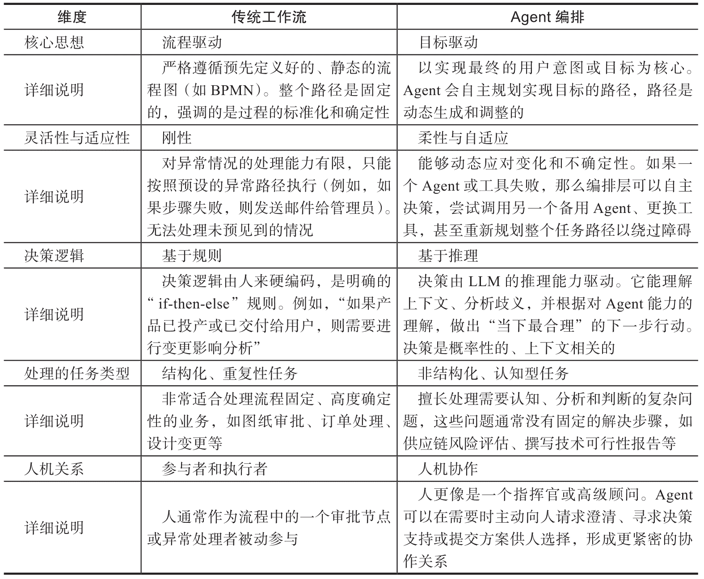

然而，当前大语言模型在制造流程自动化中仍面临挑战，即推理准确率与流程复杂度负相关。

1.核心矛盾：推理准确率与复杂流程的冲突
基于大语言模型的智能体推理准确率约 95%，但流程超过十步后，整体准确率会跌到 60% 以下，约等于 95%¹⁰。这暴露了长链推理的长尾问题与黑箱特性。对制造而言，微小误差会推高不良品成本甚至引发安全事故，可容忍度极低。

2.解决方案：在顶层流程框架下迭代优化
关键不是放弃智能体，而是在坚实的顶层框架里做嵌入式、辅助式应用。

（1）顶层流程框架规划：构建智能化业务蓝图
先进行顶层业务架构规划，把端到端价值流解构建模，例如把 OTD 拆成可控可验证的子流程。用平台化人工智能架构建立统一数据底座与数字主线，作为事实骨架，让智能体每一步都有可信单一数据源运行。

（2）业务流程解耦：实现智能与个性化
遵循顶层框架，把复杂流程拆解为多个可控子流程，由高度优化的场景化、领域驱动智能体各自负责。如研发中一个智能体生成设计方案，另一个生成结构化需求。复杂度降低后准确率提升。

**人机协同优化模式**：在高风险高复杂度环节，智能体的角色应定位为智能助手，提供基于领域知识的建议与预测，最终决策仍由专业工程师把控。

**迭代优化与持续进化**：建立后向通道，把智能体推理结果与实际业务数据比对，形成持续学习闭环，准确率随时间提升，实现从经验驱动到人工智能增强创新的跃迁。

总之，智能体编排层通过任务分解、智能体分配、计划执行、通信管理与结果合成，把分散的人工智能工具与专家模型组织成自主规划、协同作战的智能体团队，让平台从执行单点指令的工具，升级为解决端到端复杂流程的智能方案。

## 6.8 AI 应用层：场景价值的实现终端

这是分层架构的最顶层，也是价值的最终呈现面。面向工程师、采购、管理者、客户等最终用户，把底层模型、数据、算力封装成易用的应用，嵌入业务流程，产生可衡量的商业价值。

### 6.8.1 AI 应用的主要形态与分类

根据功能与交互模式，AI 应用通常分为以下几类。

1.对话式智能助手/AI Chat
这类应用是平台能力的集大成者，提供统一对话入口，让用户用自然语言与企业数据、系统、智能能力交互。它不仅问答，还能理解复杂意图、执行多步任务，是真正的数字同事或领域副驾驶。

传统聊天机器人只能处理预设常见问题的一问一答，而对话式助手是任务完成者，能基于高层目标自主规划、调用工具、整合信息。

在研发环节，它可作为设计副驾驶，跨 PLM、质量库做关联查询；在生产现场化身运维顾问，实时分析 MES 与设备数据定位效率瓶颈；在供应链担任风险分析师，整合地缘政治、气象、SRM、ERP 数据预测供应风险；在工业软件场景，它能结合操作手册和上下文，指导设计师完成复杂操作。

核心价值在于把碎片化工业数据转化为主动决策能力，形成“人类提问-智能体执行-结果洞察”闭环，推动制造从经验驱动向数据智能驱动转变。

2.内容生成类 AI 应用
核心是创造而非分析，能基于学习模式生成文本、代码、图像、音频、视频、三维模型等新内容。

主要形态包括智能创作助手、内容生成引擎、合成数据生成器。

在制造领域，生成式设计突破想象边界并自动生成 CAE 分析脚本；生产环节可自动生成图文工艺规程，用合成数据解决质检样本稀缺问题；营销服务可动态生成个性化技术文档；运维培训可实时生成故障维修指南和虚拟训练场景。人工智能从辅助工具进化为创新引擎，实现全价值链智能再造。

3.流程自动化应用
目标是把重复性、规则性、需认知判断的业务流程端到端自动化，提升效率、降本、减少人为错误，释放人力去做创造性工作。

4. 决策提速器：智能辅助系统

面向决策的智能系统并不想取代人做判断，而是通过更深度的洞察、更精准的预判和更落地的建议来放大专家的能力，让高质量决策更快达成、更稳健、更全面。

这类能力通常以智能驾驶舱、高阶分析平台或推荐引擎的形态出现。它们把分散的异构信息汇聚起来，用模型挖掘规律、推演走向，并以可视化方式呈现给使用者。例如面向制造业的供应链风险驾驶舱，能实时融合全球资讯、物流轨迹和供应商健康数据，提前预警某类零件可能断供，并以高亮提示推送给采购负责人。

### 6.8.2 AI 应用层的设计准则

好用的智能应用，既要底层模型强，也要产品化做精。

1. 用户至上
在智能体构建中，围绕使用者的习惯是一条主线。除了读懂真实诉求，还要让智能体自然嵌入现有工作节奏和操作习惯，成为贴身的协作伙伴。

● 角色场景洞察：设计必须站在使用者视角，厘清其岗位、职责和日常情境。面向专业工程师的效率型智能体，侧重自动化与专业任务的强化，如设计优化、数据分析；面向管理层的运营型智能体，则更强调跨组织、端到端的宏观视野与决策支持。

● 人机配合与信任沉淀：智能体应扮演辅助角色，而非自动裁决者。尤其在复杂高风险的工业场景，推理也会受限。智能体需要呈现可追溯的推理链路，让使用者看懂建议的来龙去脉，保留最终裁决权，由此形成稳定信任。

● 无缝接入与流程打磨：优秀的以用户为中心的智能体能直接接入现有工具链和工作流，降低学习与操作负担。目标是消除流程摩擦、提升端到端效率，而不是增加复杂度。

可见，以用户为先是让技术真正服务人、赋能人的关键，也是智能在企业落地转型的核心。

2. 可解释性与可信赖性
针对黑盒难题，需要引入可解释人工智能，让推理过程与结果可追溯、可验证。制造业的质量追溯和合规审查对此尤为敏感。例如系统推荐 B 供应商，理由是其过去一年准时交付率最高，依据清晰可查。

3. 场景化与领域驱动
应用要扎根具体业务场景，用领域的专业语言解决该场景的独有难题。场景化要求智能体的边界清晰、任务明确；把复杂的端到端业务如 OTD 拆解为若干可控子任务，由各自高度优化的场景化智能体承接，整体准确率与可靠性会明显提升。

领域驱动要求智能体的能力建立在深厚的行业知识之上，形成可信的事实骨架，有效抑制大模型的幻觉。通过任务拆解与专业知识赋能，智能体就能从不稳定的魔法变为特定领域可靠高效的助手。

4. 建立迭代优化引擎
即便初始准确率有限，智能体的输出也并非无用。建立回流通道与迭代优化机制，把推理结果与真实业务数据对比，将误差回传模型持续学习，准确率会随时间逐步提升，最终达到可信水平。

总体来看，AI 应用层是连接前沿技术与真实业务需求的桥梁，核心挑战是如何把底层模型的认知智能封装成可融入工作流、能解决问题并创造价值的产品智能。

# 第七章
# 研发范式跃迁：人工智能驱动的全链路重塑

传统制造业研发是一种线性推进、环节割裂并高度依赖个人经验与隐性知识的模式，像层级化的军事指挥，从需求、设计、仿真、测试到量产，指令逐级下达，信息在传递中损耗。AI 的深度介入，正把这种模式重塑为智能化指挥中心：数据实时贯通、模型牵引协同、动态智能决策，推动全链路敏捷协同和闭环优化。

在 AI 牵引的研发范式下，AI 不再是单一环节的工具，而是贯穿产品从概念到发布的全生命周期关键驱动力，引发全链路转型。其核心在于把 AI 与系统工程、软硬件工程、敏捷开发深度融合，实现更高效、更智能、更协同的创新。

## 7.1 AI 助力的研发范式跃迁

基于平台化 AI 分层架构，需要重新审视传统研发范式。架构不再提供零散的点状工具，而是从根本上重塑流程、方法与协作，推动其向更智能高效的方向跃迁。

### 7.1.1 AI 赋能的研发范式跃迁：流程重塑、方法升级和协作变革

具体体现在以下三方面。

1. 流程重塑：从割裂线性到闭环一体
传统流程分段线性，从需求到系统工程再到软硬件结构设计，壁垒重重，传递效率低，易导致返工与浪费。

AI 加持的新范式打破壁垒，构建高度协同的一体式闭环，把规划、开发、验证、制造到供应链联成动态迭代的闭环。

● 设计和制造深度协同：设计与制造建立实时双向协作，打破信息孤岛与职责边界，确保设计之初就兼顾可制造性、成本与效率。AI 牵引的智能工艺规划可根据设计实时优化制造，保证设计意图精准落地。

● 设计和服务工程融合：AI 使面向服务性设计和可维护性设计成为可能。通过历史服务数据与客户反馈，AI 能把生命周期中的服务需求与体验痛点反向注入设计，提升产品可服务性与全生命周期体验。

● 一体化闭环管理：AI 扮演连接各环节的神经中枢，整合从市场需求、概念、设计、仿真、制造、交付、运营到服务的全生命周期数据。基于实时采集与分析驱动智能反馈闭环，如：①质量合规闭环：制造与服务中的质量问题经 AI 分析后结构化反馈给设计迭代，并实时监控设计生产合规性，自动预警纠偏；②性能数据优化：产品运行性能数据经 AI 分析用于下一代设计优化，或依托数字孪生进行预测性维护与远程优化。

2. 方法升级：从经验驱动到数据智能
传统研发依赖工程师经验、直觉与反复物理试验。

AI 架构通过全链路数据分析，把研发从经验驱动转向量化驱动，为各阶段提供智能支撑。

● 海量数据洞察与知识提炼：AI 聚合研发各阶段的海量异构数据，包括需求、设计参数、仿真结果、制造数据、运行数据、服务反馈及非结构化文档，通过机器学习与自然语言处理挖掘模式、趋势与因果，提炼人类难以在时效内完成的洞察。

● 设计过程自动化与智能化：融合 AI、数据分析与自动化工具，实现设计任务自动化、决策智能化、流程加速。需求阶段自动识别用户痛点转化为结构化设计输入；详细设计阶段据性能、成本、环境、工艺智能推荐材料并预测表现；测试阶段实现整车集成测试自动化与智能化。

● 预测性研发：AI 不只复盘过去，更能前瞻未来。预测潜在市场需求、设计缺陷、制造瓶颈或服务故障，让研发从被动响应转向主动预防。

3. 协作变革：从部门协同到价值链端到端协同
传统部门协同侧重内部职能间合作，存在信息孤岛、流程僵化、职能边界与被动响应等局限。

AI 加持的平台化架构构建统一数字化底座，打通内部壁垒、融合外部生态，以数据为线索、以技术为引擎，形成透明、实时响应、价值共创的智能协同体系。其本质是构建以数据流驱动、价值创造为核心的协同网络，实现端到端动态优化与全链路可视化。

### 7.1.2 AI 赋能的研发范式跃迁的本质：智能体调用设计能力

范式跃迁的本质在于智能体能调动多少设计能力，以及调动的自动化与智能化程度。这不是工具升级，而是在顶层流程架构支撑下，通过智能体编排协作，实现从传统研发到 AI 增强创新引擎的根本转变。

1. 顶层流程架构规划
跃迁的基础是顶层流程架构规划，为智能体应用提供清晰业务蓝图。遵循业务、组织、流程、技术四大体系，对接战略与技术蓝图。

● 数字化能力建模：参照数字能力层设计能力组件库，经能力架构、建模、部署三步，把抽象业务需求转化为可封装、可调用的数字化能力。

● 平台化 AI 与数字主线：建立平台化 AI 架构作为智能体统一底座，同时构建贯穿研发全流程的数字主线，使设计、制造、质量数据成为可信的单一事实来源，为智能体提供准确完整数据，降低复杂流程中推理衰减风险。

2. 创新研发范式
在顶层框架指导下，智能体以新方式重构研发，实现从串行经验驱动到并行数据驱动的跃迁。

智能体的核心价值是作为能力编排者，按任务需求在研发能力中心与知识图谱中动态调用各类设计能力，是平台化 AI 与业务深度融合的关键标志。能力包括：

● 需求设计能力：把客户需求转化为可量化结构化设计指标。
● 结构设计能力：自动化校核计算、方案设计、静力仿真等，显著缩短人工周期。
● 仿真与试验能力：执行应力分析、回转支承选型等复杂仿真，并生成测试方案与大纲。
● 人机协同与智能优化：以人机协同为主，非全自动。智能体作为工程师智能助手提供基于领域知识的建议与预测，终局决策仍由人类专家把控，确保效率与可靠性兼得。

AI 赋能的研发范式跃迁如图 7-1 所示。

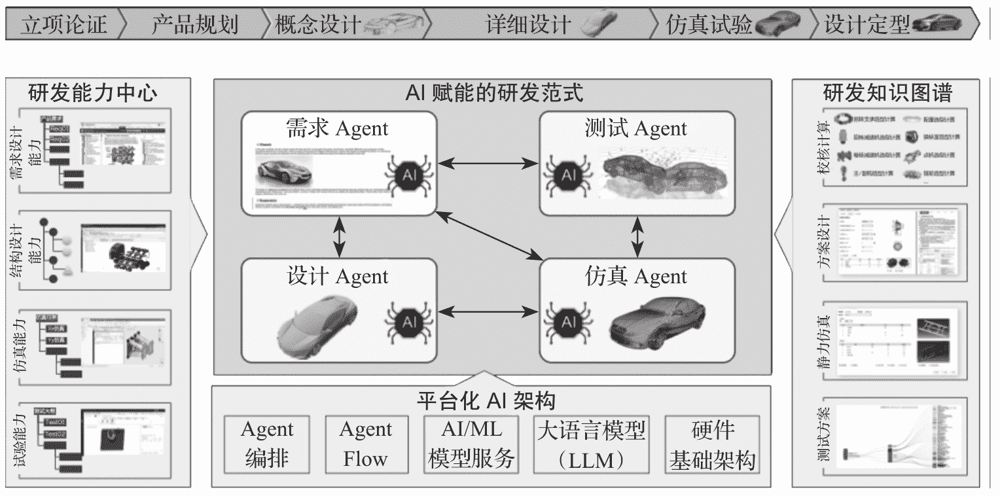
图 7-1 AI 赋能的研发范式跃迁

3. 端到端解决方案
通过智能体编排，分散割裂的研发环节被无缝连接，形成覆盖产品规划到设计定型的端到端方案。例如需求智能体先把产品需求转化为数字化设计任务，随后设计智能体自动出方案，并驱动仿真智能体进行静力仿真与校核。这种衔接把传统流程的时空信息损耗降至最低。实践中需求智能体还会细分为需求导入、需求审核等子智能体。

该模式实现从自底向上经验驱动到自顶向下需求驱动的正向设计，把企业战略愿景转化为可验证商业价值，真正完成研发创新跃迁。它打破传统研发的职能壁垒、数据断链、流程僵化等结构性顽疾，具体体现如下。

（1）数据流驱动的多专业实时协同与决策
在复杂项目中，不同专业团队通过统一实时高流动数据流实现跨专业并行工作与智能决策，打破专业壁垒，基于最新统一产品视图高效协作。具体体现：

● 需求驱动正向协同设计：以客户市场需求为核心贯穿全周期的集成方法，设计伊始就集成真实需求并驱动跨专业协作与后续制造服务，形成实时反馈与持续优化体系。
● 软件驱动敏捷产品开发：把敏捷原则引入软硬一体产品开发，以软件为核心驱动力并辅以先进技术与协同策略，提升硬件开发敏捷性，加速创新与市场响应。
● 基于统一虚拟原型的设仿测协同：围绕数字孪生原型，设计、仿真、测试实时并行，变更即时反映并仿真验证，减少物理原型依赖。AI 加速前处理与计算，预测性能、发现缺陷、优化设计。

（2）跨部门、端到端价值链协同
指内部职能与外部伙伴超越信息职能壁垒，实现从规划到交付使用乃至生命终结的全价值链信息、流程、决策无缝衔接。智能体以编排能力把分散活动整合成完整端到端方案，使研发成为高度集成智能闭环，具体体现：

● 订单到交付 OTD：从下单到交付的复杂链条，AI 通过自动化数据处理与智能工作流提升效率，精准预测需求、实时监测供应链风险、数据驱动供需平衡，降低成本并提升实时追踪、交付预测与个性化沟通的客户体验。
● 集成供应链协同：与核心供应商建立信任透明的长期战略伙伴关系，协同覆盖设计、研发、生产、质量、物流到售后，靠信息共享与联合决策优化整体绩效。
● 客户共创与参与：客户从消费者变为价值创造参与者，通过参与设计、反馈使用、提出个性化需求共同塑造产品。

4. 共享价值与共赢模式
超越零和博弈的协作理念，强调各方共同创造经济利益与生态、社会价值。核心在于信任、透明与互惠，促进长期可持续发展。体现为：

● 共同创新：各方贡献专业知识与资源推动创新，如供应商早期介入提供可制造性建议。
● 端到端优化：关注价值链整体效率而非局部最优，通过数据共享与流程整合消除浪费。
● 资源共享与能力互补：各方贡献核心能力、技术、数据、市场资源，实现优势互补，创造个体难以企及的总价值。

^()

这种协同要想真正跑通，需要一套完备可信的协作与分工保障机制兜底，让各方既能放心投入资源，又能公平分配回报、共同应对不确定性，最后走向可持续的共生发展。工业数据空间（Industrial Data Space，IDS） ^() 就是在治理框架下构建的虚拟数据域，专门为工业生态中的企业、供应商、客户、科研机构等多元主体提供安全、可信、标准化的信息交换与共享通道。上述议题已超出本章范围，有兴趣的读者可通过文末引文进一步了解。

总体来看，本文提出的 AI 架构所指向的研发新范式，本质上是一个闭环体系：知识图谱承担数据底座功能，Agent 智能协同充当执行引擎，场景化应用成为价值落地的出口。研发由此从过去的串行推进、依赖个人英雄的模式，转变为并行展开、数据驱动、人机配合、持续学习优化的智能创新形态。

基于这一思路，笔者以系统工程“V”模型为参照，对产品研制全流程进行了重新梳理，提炼出九大创新场景，AI 赋能的创新研发范式如图 7-2 所示。这并非面面俱到的完整视图，而是从个人角度总结出的代表性场景。受篇幅所限，本章仅展开其中五类，供读者参考借鉴。制造业细分领域差异显著，各场景的具体表现也会不同，请读者注意甄别。

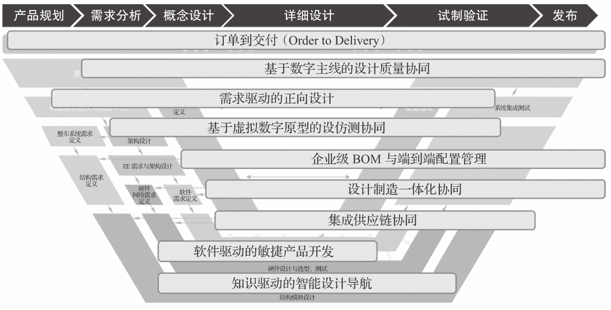

图 7-2 AI 赋能的创新研发范式

## **7.2 需求驱动的正向设计**

### **7.2.1 范式概述：现状与挑战**

在全球化加深、竞争白热化、技术迭代加速的当下，复杂产品、系统与服务的研制正面临空前压力。传统以文档为中心、部门壁垒分明的线性工程模式，已难以应对市场需求的快速波动、系统复杂度的指数攀升，以及对成本和周期的严苛要求。研究普遍指向，项目延期、超支以致失败的根源，在于能否准确高效地把市场或用户诉求转化为功能完备且可靠的系统，这一转化正是产品研制的核心矛盾。

在此背景下，需求驱动的正向设计应运而生。它并非单一僵化的流程，而是将三类思想系统整合：以全面动态的需求分析为牵引，以概念到实现的正向设计为主线，以跨学科跨组织的协同为运行基础。

本质上，这是从分散静态流程向集成动态生态的根本转变。转变的关键在于把需求工程 Requirement Engineering，RE 视作技术核心，用统一权威的数字模型替代传统分散易过时的文档，为全生命周期提供单一事实来源。

支撑该范式需要强有力的技术生态。ALM 应用生命周期管理 系统负责需求的捕获、分析、建模、验证与追踪，确保研发始于做正确的事，即满足真实用户与业务诉求。PLM 系统构成企业的数字主干，二者联动后形成统一、以客户需求为导向且可追溯的管理体系，使软硬件在同一语境下协同推进。在此之上，数字主线贯穿始终，将各阶段数字模型串联，最终形成产品的终极形态——数字孪生 Digital Twin。数字孪生不仅是物理实体的虚拟镜像，更是融合实时运行数据的动态仿真平台，能够对性能进行预测、分析与优化，从根本上重塑设计、制造与运维方式。

转型并非坦途。最大阻力并非技术本身，而是根深蒂固的组织与文化惯性，包括对传统工作方式的依赖、跨部门协作壁垒、领导层支持不足、专业人才短缺，以及工具链整合的高成本。突破这些障碍需要系统性变革：明确顶层规划、分阶段提升成熟度、持续投入人才培养，并对组织架构与商业模式进行根本性重塑。

展望未来，AI 与混合现实 XR 等新兴技术将进一步推动范式演进。AI4MBSE 将实现模型创建与分析的自动化与智能化，沉浸式协同将彻底改变人与数字模型的交互方式。最终，系统工程学科将朝着 INCOSE《系统工程 2035 愿景》描绘的更智能、更集成、更具影响力的方向发展。

### **7.2.2 范式解构：填补需求与设计的鸿沟**

在市场瞬息万变的情境下，研制活动已不再是孤立的线性过程，而是一场精密复杂的系统工程。传统上多依赖逆向工程——一种自底向上的路径，从既有产品出发，无论是自研还是竞品，通过剖析物理结构、系统构成与功能，反推出实现需求。应用层级从纯粹仿制到在既有产品上改进不等。这种方式虽能快速复制或小幅改善，却难以实现颠覆性创新，且受限于既有框架。

具备竞争力的企业正转向以正向设计为主导的开发方式，这是从模仿走向创新的必经之路。正向设计是一种自顶向下的方法，从对市场与客户原始诉求的深刻理解与定义起步，经功能分解、系统综合逐步构建详细设计，最终完成工艺试制与产品验收。正向设计与逆向工程的对比见图 7-3 所示。前者更强调基于需求的设计与基于功能分析的创新性，且验证活动贯穿始终，从部件验证到系统集成、系统验证，直至最终产品确认。

在复杂产品研制环境中，从逆向工程转向正向设计已成为追求创新与市场领先的必然选择。该转型的核心在于系统设计能力，即从理解机理到创造机理的跃迁，这要求企业具备多年研发积累与专业的系统工程师团队，以弥补以下能力差距。

**●需求牵引与系统综合**：正向设计以需求定义为起点，通过功能分解细化诉求，再经由系统综合 ^() 将功能模块整合成完整的系统架构。这不是简单复制既有部件，而是要求从更高维度理解用户痛点与业务目标，把抽象诉求转化为可落地的系统功能与结构。强大的系统设计能力确保了从宏观诉求到微观设计的逻辑严谨与可追溯。

**●复杂性治理**：现代产品多为软硬件高度集成的系统。系统设计方法以分层、模块化、接口定义等方式结构化治理复杂性，将庞大系统拆解为易于管理的单元。对正向设计至关重要，因为在产品尚未实体化前，就必须清晰界定所有组件及其相互接口。

**●跨专业协同的桥梁**：正向设计需要机械、电气、软件、供应链、制造等多专业团队紧密配合。系统设计能力提供通用语言与框架，如 SysML，使不同背景的工程师能在统一系统模型上沟通、分析与决策，确保兼容性与整体性能。这与逆向工程中可能仅聚焦单一部件或功能的分析形成鲜明对比。

**●早期验证与风险规避**：系统设计允许在详细设计前通过模型与仿真对系统功能与行为进行前置验证，包括部件验证、系统集成与系统验证。这种前置验证能力对正向设计尤为重要，能显著降低后期物理试制与试验确认的风险与成本，避免逆向工程中“造出来才发现问题”的被动局面。

**●驱动创新与价值创造**：正向设计的目标是创新。系统设计能力让企业跳出既有产品的束缚，从根本诉求出发重新思考产品架构，实现功能突破与性能优化，从而创造更高客户价值。

因此，从逆向工程到正向设计的转变，不是工具或流程的简单更换，而是核心能力的跃升。其精髓在于企业能否以全局视角驾驭复杂系统，将抽象诉求转化为具体可实现的创新产品。

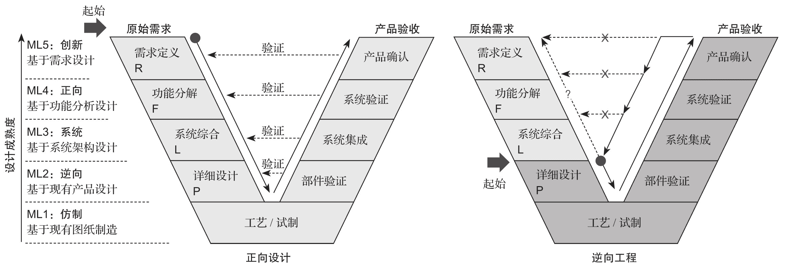

图 7-3 正向设计与逆向工程的对比析分

### **7.2.3 范式重构：需求驱动的端到端追溯**

需求工程 Requirements Engineering，RE 是一门系统化学科，专注于捕获、分析、规范、验证并管理软件或产品从构思到部署维护全生命周期中的用户需求与系统需求。它是任何成功研发项目的起点与核心，确保交付物真正契合用户、业务与市场的真实需要。

在面向软硬一体的复杂系统开发中，需求工程的重要性与挑战性日益凸显。不仅关乎单环节效率，更关乎全链条无缝协同与透明管理。从需求管理的“能力在线”到需求端到端追溯的“业务在线”，正是衡量企业数字化成熟度的关键标志。

1. 能力在线：需求管理能力

需求工程的核心活动构成一个严谨流程，将模糊想法转化为精确规格。

**●需求获取**：流程起点，也是最具挑战的一环。目标是从市场分析、用户合同、既有文档等多种来源中识别、抽取并开发新的创新性需求。常用手段包括访谈、工作坊、问卷与文档分析等，旨在深入理解用户的显性意图与隐性知识，形成产品原始需求 OR。

**●需求分析**：获取到的原始需求往往模糊、不完整甚至冲突。分析阶段负责澄清需求，识别依赖关系与潜在冲突，并与各专业系统工程师沟通权衡、化解分歧，最终就需求优先级与范围达成共识，形成产品初始需求 IR。目标是确保需求清晰、一致且可行。

**●需求分解**：将确认后的需求以结构化方式记录，形成需求规格说明书。传统上多以自然语言文档呈现，易产生模糊与不一致。随后系统架构师需对需求规格进行系统设计与分析，提炼出具体可测试的系统功能与非功能需求，即系统需求 SR。SR 描述系统如何实现初始需求，涵盖功能、性能、安全、可用性等。架构设计在此基础上把系统需求映射为模块与接口，为后续详细设计与实现奠定基础。

**●需求验证与确认**：验证 Verification 确保需求规格被正确完整地定义与实现，保证过程正确；确认 Validation 则确保最终产品满足用户真实需求与期望，保证结果正确。活动通常通过评审、原型、仿真试验等方式开展，以交付高质量产品。

**●需求变更管理**：需求在项目生命周期中持续变化是常态。变更管理负责系统化地控制变化，评估影响并妥善处理，维持项目一致性与可追溯性。

这些活动并非严格线性，而是一个迭代协作的过程。此阶段核心活动可实现在线化，但信息流与业务流仍可能存在断点，协同效率有待提升。需求往往停留在列表或文档层面，缺乏与业务环节的深度连接与自动触发。

2. 业务在线：需求端到端追溯

“业务在线”代表更高层次的数字化与智能化，将需求作为核心驱动力贯穿产品从概念到交付乃至生命周期结束的全部业务环节，实现价值链协同与透明。这不仅是工具在线，更是业务流程与决策的在线化与智能化。

实现业务在线的关键包括：

（1）需求作为“单一事实来源”的全面集成
需求不再是需求部门的文件，经 ALM 特别是与 PLM 整合后，成为产品生命周期的单一事实来源。这意味着：
**●与设计深度关联**：每个设计决策、每个功能模块都能清晰追溯到所满足的具体需求。正向设计中，设计过程直接源于明确需求，并通过基于模型的系统设计工具将需求转化为产品功能与架构。
**●与制造工艺链接**：需求信息传递至制造环节，确保生产符合设计要求，并可追溯至初始需求。
**●与测试用例绑定**：测试用例直接关联需求，确保全面验证，实现设计仿真测试一体化协同，并通过虚拟数字原型在早期完成验证。
**●与服务和用户反馈互通**：产品实际使用中的性能、用户行为、服务反馈等数据可经 IoT 平台与 CRM 系统回流，与初始需求比对，驱动需求与产品的持续优化。

（2）端到端的可追溯性与透明化
ALM 能将需求与设计、代码、测试用例、缺陷、发布版本等开发工作成果连接，形成完整追溯链。从原始需求到最终产品验收各环节全部打通。当缺陷出现时，开发人员可快速追溯其影响的测试、相关部件或代码，最终对应到未满足的需求。

（3）数据流驱动的实时协同与智能决策
需求作为核心数据流驱动多专业团队实时协同。任何需求变更或设计、制造、服务环节的更新都能通过数据流机制实时同步给所有相关方。AI 在此发挥关键作用，例如评估需求变更对范围、进度、成本的影响，提供智能决策支持。

（4）一体化闭环管理
端到端追溯最终实现产品生命周期的一体化闭环管理。从市场洞察、需求定义、正向设计、仿真测试、制造，到订单到交付 OTD、售后服务与产品迭代，形成相互反馈、持续优化的闭环。需求既是起点也是持续驱动力，确保产品始终做正确的事并不断优化。

从能力在线到业务在线，体现了企业数字化转型的深化：从单纯把工具搬到线上，转向以需求为核心业务驱动力，通过高度集成、数据流驱动的平台实现跨部门、跨价值链的真正协同与智能决策。这不仅提升效率、降低风险，更能让企业更精准、更敏捷地响应市场与客户需求，持续创新，交付更高价值的产品。在此过程中，企业不断沉淀正向设计经验与系统设计能力，培养创新文化，最终真正完成向需求驱动正向设计创新范式的转型。

### **7.2.4 AI 赋能：从需求驱动到以用户为中心的价值创新**

需求驱动的正向设计在理论上是完备的，但在实践中，需求分析、系统设计等方法论因对专业技能要求高且人力投入巨大，被认为“过重”，难以大规模推广。AI，特别是企业级平台化 AI 框架，正发挥颠覆性作用。它并非取代该框架，而是充当催化剂与加速器，通过智能自动化把严谨但繁琐的方法论转变为高效可扩展的现代工作流。

1. AI 赋能需求设计

以大模型为代表的自然语言处理技术，正在系统性重塑需求工程的每一个环节，把大量依赖人工的高认知负荷任务自动化。

**●AI 驱动的需求获取**：利用 AI 技术自动化、智能化地从各类数据源中发现、收集、分析与提炼用户及系统需求。传统方法如访谈、问卷耗时耗力且易受主观影响，难以处理海量非结构化数据。AI 工具可自动处理这些数据，利用大模型从 PDF、图片、语音等中提取关键实体、意图与需求陈述。例如汽车行业 Tier 1 供应商，AI 能自动从不同主机厂、不同格式的需求文档中提取结构化分层需求条目，包含文字、指标参数与图片，大幅缩短周期并挖掘工程师可能忽略的模式与洞见。

**●结构化需求重用和自动生成**：从模糊业务目标到可执行的精确规格存在巨大鸿沟。通过 AI 在产品开发中实现需求资产化 ^()、标准化和智能化管理，可大幅提升需求工程效率、质量与一致性，促进跨项目、跨产品线知识共享与复用。

AI 赋能的结构化需求自动生成借助自然语言处理与深度文本理解，将非结构化或半结构化的原始需求自动转化为符合预定义规范的结构化文档或模型元素。AI 可进行语义解析、意图识别、实体与关系抽取，结合知识图谱智能填充与分类，甚至评估生成质量并检测冲突。这显著提升编制效率与准确性，为后续需求驱动的正向设计奠定基础，支撑产品生命周期自动化与智能化管理。

结构化需求的重用把需求及关联的设计、仿真与试验数据视为可复用资产，能从历史需求库智能检索与推荐相关模块，并基于设计输入给出修改建议。这不仅提高分解与规范化效率与一致性，还能加速上市节奏，确保需求质量，是知识沉淀与传承的重要途径。

**●AI 驱动的需求分析和审查**：需求分析的核心挑战是处理自然语言的模糊性。AI 工具在这一点上展现出超越人类的能力。通过在大量技术文档与需求规范上训练，模型可识别需求描述中的模糊词汇，如“大约”“通常”“高效”等，以及不一致术语、逻辑矛盾与不完整陈述。部分先进工具还能依据 INCOSE 等行业标准对需求质量打分并给出修改建议。需求评审由此从主观经验活动转变为客观数据驱动的质量保证。当前 PTC 于 2025 年 4 月发布的 Codebeamer AI Beta 版本已支持上述功能。

**●AI 辅助的验证与优先级排序**：确保需求被正确理解与实现是验证核心。AI 可从需求描述自动生成测试用例与测试场景，保证测试覆盖率与完整性，确保每个功能点与业务规则得到验证。在优先级排序方面，AI 能分析需求间依赖关系、评估业务价值贡献、预测实现复杂度与潜在风险，为产品负责人提供数据支撑作出更明智决策。

2. AI 赋能的系统建模与设计

AI 的影响力不仅限于需求阶段，更深入到系统架构与设计领域，加速从“文本”到“模型”的转换。

**从需求描述自动生成模型**
生成式工具正在重塑建模环节的工作方式。当前的主流产品已能读取以自然语言撰写的业务需求文档，并据此产出 UML / SysML 家族的图表，包括类图、序列图、活动图以及系统架构的块定义图 ^()。架构师不再需要从白板起步手工绘图，而是基于 AI 提供的初稿进行优化和补全，把注意力从画图操作转向高阶的设计思考。

**把 AI 当作架构参谋**
架构设计本质上是多目标权衡。面对功能与非功能诉求时，智能体能够拆解性能、可扩展性、安全、成本等限制条件，提出架构风格的参考意见，比如微服务、事件驱动等，同时给出技术栈组合的建议，并对不同方案的利弊进行对照 ^()。拍板权仍在人手中，但决策所能参考的信息维度被明显拓宽。

**先仿真后落地**
在编码或进入详细设计之前，对设计模型开展仿真分析，可提前暴露性能瓶颈、逻辑缺陷与资源冲突。智能体能够接入仿真驱动的平台，利用机器学习预测系统在不同负载下的表现，或自动构造复杂的压力测试场景来检验模型，从而在设计阶段就评估架构的稳健性 ^()。

3. AI 实现需求到交付的全链路追溯
借助智能技术，可以在产品或系统全生命周期内自动化地建立并维护一条从初始诉求到最终交付运行的完整双向追溯链路。这从根本上缓解了传统追溯的难题：信息量巨大难以管控、变更频繁、跨专业协作成本高。它保证全流程符合诉求与合规要求，加快决策，全面提升质量水平。

**语义链路的自动构建**
依托自然语言处理与信息检索，智能系统能够“阅读”各类设计交付物。它可以识别规划文档中的业务目标、规格书中的功能点、UML 模型里的类与方法、代码库中的函数以及测试计划中的用例，并在它们之间自动建立语义关联 ^()。例如“用户必须使用密码登录系统”这一诉求会被自动关联到类图中的 UserAuthenticationController 并标记为《satisfy》关系，同时关联到测试用例 TC-001: ValidLogin 并标记为《verify》关系。

**变更影响的实时追踪**
开发过程中诉求与设计经常变动。智能驱动的端到端追溯框架能够实时监测诉求的修改，立刻识别受影响的下游成果，如零部件、代码和测试用例，并及时向相关人员发出预警，实现实时的变更影响分析。追溯因此不再是静态快照，而是一个随项目演化的动态系统，保证信息同步与协作效率。

**完整性与冗余扫描**
完整的可追溯图谱本身就是重要的数据资产。智能体可对诉求的完整性和满足度进行审核，自动发现“孤儿需求”，即未被实现或满足的诉求，或“镀金功能”，即缺乏诉求来源的设计元素，帮助团队识别范围蔓延，确保每一笔投入都对应明确的业务目标。

在平台化智能架构的视角下，“诉求驱动的正向协同设计”不再是线性的 V 模型，而是一个由智能驱动的网状实时协同体系。智能平台贯穿从原始诉求定义到最终验证的每个环节，实现数据同源、逻辑清晰与高效协同，真正推动系统工程、软件工程、硬件工程与结构工程的深度融合。

总体来看，单纯把需求管理搬到线上只是实现需求数字化。而把需求-设计-验证全流程搬到线上，则是将诉求提升为驱动全价值链的核心引擎，让诉求信息无缝实时流动，实现数据流驱动的实时协同与决策。这不仅提升效率与准确性，更让开发始终锚定客户与市场的真实诉求。通过智能赋能的端到端追溯，企业能更清晰洞察现状、更敏捷应对变化，最终交付高质量、高价值且具竞争力的成果。

## **7.3 软件驱动的敏捷产品开发**
21 世纪二十年代，全球工业正经历不亚于百年前的流水线革命。驱动力并非机械突破，而是软件无处不在。曾由精密机械和电子硬件定义的复杂方案，正被软件重新定义。本节在平台化智能架构基础上，重新审视软件驱动的敏捷研发范式。

### **7.3.1 时代速写：软定义带来的机会与难题**
“软定义”已从概念变为重塑产业格局的力量，标志着价值创造逻辑的根本转向：重心从物理实体迁移到数字化功能与服务。

1. SDP 的核心要义
Software-Defined Product，指制品的核心功能、差异化能力、用户体验乃至未来演进，主要由软件来定义和驱动，而非仅由硬件特性决定。硬件更多扮演可编程、可配置、支持软件运行的平台角色，而软件则赋予制品生命力、智能化和持续迭代的能力。
在汽车领域体现最突出。Software-Defined Vehicle 的出现，正在将汽车从高度集成的机电终端，转变为智能化、可扩展、可持续迭代升级的移动电子终端。正如智能手机颠覆了功能机，SDV 通过软件更新来不断演进和提升功能，其本质已不再是一台简单的交通工具，而是一个承载服务的移动计算平台。

2. 价值重心的迁移
这场范式转移最直观的体现是成本结构的剧烈变化。行业分析普遍预测，软件在整车成本中的占比将发生戏剧性的“价值倒置”。普华永道在《打造软件驱动的汽车企业》报告中指出，软件将成为现代车辆差异化竞争的核心，而软件的开发成本，将在未来十年内增长 83% ^()。据麦肯锡分析，2023 年软件约占整车成本的 15%，预计到 2030 年，这一比例将飙升至 60% ^()。
这种成本结构的转变并非简单的此消彼长，它揭示了一个更深层次的现实：硬件正在逐渐标准化和商品化，而软件则成为实现品牌差异化、提升用户感知价值的核心。在 SDV 时代，汽车的豪华感、驾驶乐趣、未来科技感等品牌特质，都将通过软件驱动的体验来定义和交付。硬件的角色转变为一个稳定、可靠且功能超前预埋的平台，其目的是在制品的整个生命周期内，更好地服务于软件的持续迭代和功能释放。

3. 商业逻辑从售卖转向持续服务
软件定义制品最深远的影响在于其对传统商业模式的颠覆。一次性的制品销售模式正在被一个可持续的、服务驱动的商业模式所取代。通过 OTA 技术进行的软件更新，制造商能够在制品售出后，依然能为其增加新功能、修复缺陷、提升性能。
这催生了全新的商业机会，如按需付费的功能、订阅服务以及类似应用商店的车载生态系统。这些模式能够创造出在制品初始销售之后持续产生的、高利润率的经常性收入流，从而极大地延长和重塑了制品的生命周期价值。它不再是一个在售出那一刻价值就开始衰减的静态、折旧的资产，而是一个能够不断演化、持续为用户和企业创造新价值的动态服务平台。这种从“交易”到“关系”的转变，是软定义时代最核心的商业逻辑变革。

尽管图景诱人，转型之路荆棘密布，企业面临法规、技术和组织层面的三重严峻挑战。这些挑战并非孤立存在的，而是相互交织的，共同构成了企业必须穿越的“转型峡谷”。

（1）敏捷与合规的平衡
软件的快速迭代特性与传统行业审慎、缓慢的法规制定流程之间形成了尖锐的矛盾。尤其在汽车、航空、医疗设备等与安全相关的领域，法规的更新速度远远跟不上技术的演进步伐。这导致了一个碎片化的、模糊不清的、因地域而异的合规环境。例如，针对自动驾驶等高级功能，全球范围内缺乏统一的联邦级监管框架，这极大地延缓了技术的商业化进程，并增加了安全风险。
随着智能网联技术的深入应用，制品和系统变得前所未有的互联互通，这在带来巨大便利和功能创新的同时，也引发了新的合规问题，尤其是围绕数据安全和网络安全的挑战。智能网联制品会产生、收集和传输海量数据，包括用户个人信息、行为数据、设备运行状态、环境数据等。这些数据的安全和隐私保护变得尤为关键。它们通过网络连接上传到云端进行存储和管理，使得它们面临比传统 IT 系统更多的网络攻击面，甚至造成严重的安全事故和经济损失。应对这些新的合规问题，需要企业在制品开发、部署和运营的生命周期中，将数据安全和网络安全作为核心考量，包括建立完善的安全管理体系、全面的合规性审计和认证等。
这在制品开发中形成了一对看似矛盾的挑战，即敏捷与合规之间的取舍。
**●敏捷的快速迭代与合规的严格规范**：敏捷推崇快速迭代，而合规要求严谨的文档、审批和验证，这可能被视为减缓开发速度。
**●敏捷的“足够好”与合规的“零容忍”**：敏捷可能倾向于最小化文档和流程，而合规要求全面、详尽的审计追踪。
**●敏捷的灵活性与合规的固定标准**：敏捷强调适应变化，而合规往往基于固定的法律法规。
然而，在智能网联时代，这种“取舍”并非零和博弈，而是需要寻找一个平衡点，实现“敏捷合规”。

（2）技术与架构的历史包袱
技术层面的挑战同样艰巨。对于拥有大量存量制品和生产设施的传统制造商而言，将其改造为“软定义”的模式是一项浩大的工程。这不仅需要对硬件进行升级，而且需要对整个制品架构进行重构，以实现软硬件的解耦。
管理软件与物理组件之间的复杂交互是一大难题。这些系统必须高度可靠，并且往往需要满足严格的功能安全认证，如 ISO 26262。此外，管理跨越多代硬件平台的软件变体、确保软件生命周期的完整性，其复杂性呈指数级增长，进一步减缓了开发速度。

（3）组织与人才挑战
然而，最根本、最难以逾越的障碍，往往来自于组织内部和人才本身。传统的制造业组织架构通常是按照专业领域划分的职能孤岛，例如，机械、电子、软件等部门各自为政。这种结构天然地阻碍了软定义制品所必需的跨学科协作。当企业试图将敏捷开发等软件实践嫁接到这种孤岛式的组织上时，往往会陷入“敏捷闹剧”的窘境——表面上使用了敏捷的术语和形式，但内核仍然是传统的、顺序的瀑布式思维模式。
这种组织惯性背后，是更深层次的“价值倒置”问题。当制品的核心价值从硬件转移到软件时，整个组织的文化、流程和权力结构都必须随之调整。硬件部门需要从主导者转变为服务者，为软件的未来发展提供平台支持。软件部门则需要承担起定义制品核心体验的重任。这种深刻的变革必然会触及既有利益格局，引发巨大的内部阻力。
与组织变革相伴相生的是严峻的人才挑战。市场极度缺乏能够跨越软件、硬件、系统工程等多学科领域的复合型人才。企业不仅难以招聘到这样的人才，内部培养也面临着巨大困难，因为传统的职业发展路径和培训体系都是围绕单一学科设计的。人才的短缺和知识共享机制的缺乏，最终成为制约整个生态系统发展的关键瓶颈。
这些挑战共同构成了一个复杂的系统性问题。它们并非独立存在的，而是由“价值倒置”这一根本性转变所引发的一系列连锁反应。企业若仅仅着眼于解决某个单一症状，例如招聘更多的软件工程师或购买新的工具，而没有从根本上重塑其组织架构、开发流程和价值理念，那么其转型注定收效甚微，甚至可能以失败告终。只有深刻理解并系统性地应对这一系列挑战，企业才能成功跨越转型峡谷，真正拥抱软定义制品的未来。

### **7.3.2 范式解构：从软件敏捷到硬件敏捷**
当企业认识到软件驱动的必要性后，一个常见的误区是试图将源于纯数字世界的软件敏捷方法论直接、粗暴地复制到包含物理实体的硬件开发中。这种“拿来主义”往往会导致水土不服，甚至适得其反。要真正实现硬件的敏捷，首先必须深刻解构软件敏捷与硬件开发的本质差异，并在此基础上，构建一套适应物理世界规律的敏捷开发体系。

1. 敏捷开发的四大核心要素
敏捷开发是一种以人为本、适应性强、迭代递增的软件开发方法论，其核心在于“小步快跑”与“持续迭代”，通过短周期的开发冲刺、快速原型验证和频繁的用户反馈，实现制品的快速演进。它不同于传统的瀑布模型，更加强调团队的协作、客户的参与以及对变化的适应。以下是敏捷开发通常被认为的四大核心要素。
（1）跨职能团队的自主协作
敏捷开发强调组建小型、自组织、跨职能的团队。这意味着团队成员拥有完成制品开发所需的所有技能，如开发、测试、设计、产品管理等，无须依赖外部部门或层层审批。团队被赋予高度的自主权，可以自行决定最佳的工作方式、工具和技术栈，只要能达到其设定的目标。这种自主性激发了团队的责任感、主人翁精神和创新活力，能够快速做出决策并响应变化，提升了整体响应速度和创新效率。
（2）迭代开发与快速交付
敏捷开发将整个制品开发过程分解为一系列短而固定的迭代周期，每个周期结束时都交付可工作的、有价值的制品增量，即 MVP。
这种“小步快跑”的方式允许团队频繁地将制品推向市场或交付给客户，尽早获取真实反馈，从而降低风险、加速上市时间，并确保制品始终在正确的方向上前进。
（3）数据驱动的持续反馈
敏捷开发高度重视从制品发布和运营中获取的真实数据及用户反馈。团队通过收集用户行为、性能指标、客户评论等数据，进行深入分析。这些数据洞察是驱动制品持续改进和下一次迭代方向的关键。通过这种数据流驱动的模式，制品能够更好地适应市场和用户需求的变化，实现一体化闭环管理下的优化。
（4）透明化沟通与知识共享
敏捷强调团队内部以及与客户、利益相关者之间高频率、开放和透明的沟通。日常站会、冲刺评审会议、复盘会议等都是为了确保信息流畅，及时发现并解决问题。知识共享是敏捷文化的重要组成部分。团队成员之间应积极开展经验交流、实现技能互补、共同学习成长，确保制品开发的知识和最佳实践能够有效传承和复用。这有助于打破信息孤岛，促进跨专业协同。
这四大核心要素共同构成了敏捷开发灵活、高效的框架，使其能够有效应对复杂制品的开发挑战，尤其是在软定义制品和智能网联时代，其重要性日益凸显。

2. 硬件敏捷与软件敏捷的差异分析
敏捷宣言诞生于软件开发领域，其核心价值观和原则深深植根于软件代码的可塑性。然而，硬件的世界遵循的是物理定律，这构成了两者之间最根本的二分法。
软件与硬件在敏捷实践的语境下，存在着以下本质性的区别。
**●可塑性与变更成本**：软件是“软”的，具有极高的可塑性，修改一行代码的成本相对较低。而硬件是“硬”的，一旦模具开启、芯片流片或电路板制造完成，任何物理上的改动都意味着高昂的成本和巨大的时间延迟。你无法像“重构”代码一样“重构”一块钢板。
**●开发成本曲线**：软件开发的成本在整个周期内相对平稳。而硬件开发的成本曲线则截然不同，在接近制造和量产的后期阶段，成本会急剧攀升。这使得硬件开发在前期必须进行更详尽的架构设计，以避免后期的高昂变更。
**●核心约束**：硬件开发深受两大物理世界约束的困扰，即采购前置时间和制造成本。漫长的零部件采购周期和昂贵的原型制造成本，从根本上改变了硬件开发的规划与执行方式。而软件开发中几乎不存在这两个问题。
**●团队构成**：软件团队的技能相对同质化，主要围绕软件工程师、测试工程师、产品经理等角色。而硬件开发则是一个高度非同质化的工作，需要机械、电子、光学、材料、供应链、制造、检验等截然不同的专业技能紧密协作。这种复杂性对沟通和协作提出了指数级的挑战。
尽管存在上述巨大差异，但软件和硬件开发共享一个至关重要的点，这也是敏捷方法得以在硬件领域应用的核心前提：无论开发过程多么复杂，其工作都可以被分解为大量的、微小的、可测试的交付物。

硬件敏捷跃迁：拆解、左移、右移与数字孪生

软件侧的增量交付通常指向可直接运行并产生价值的功能包。硬件侧的早期产出则更具分层性，交付给用户的未必是一台整机，更可能是已通过仿真校核的模块、通过单板验证的电路，或用于验证关键假设的子系统原型。将复杂课题拆解为可独立检验的小单元，才是硬件领域吸纳迭代增量思维的前提。

### 7.3.3 范式重构：硬件敏捷开发体系

厘清硬件敏捷与软件敏捷的本质区别后，直接照搬软件框架并不适用。需要提炼软件敏捷的精髓，结合硬件的物理约束，构建一套适配硬件的敏捷体系。

1. 向左转型：基于虚拟数字原型的硬件敏捷
在汽车研发实践中，向左转型 Shift Left 已成共识。其核心思路是将本应在研发后期、物理样机阶段才开展的工作，有意识地前移至样机前的数字阶段。基本做法是尽可能用虚拟数字原型的仿真与虚拟试验替代物理样机的验证。用虚拟化手段突破硬件的物理限制，并与软件敏捷原则深度融合，硬件才具备真正的敏捷可能。这推动硬件从传统串行瀑布转向敏捷，提升并行协同效率，压缩结构迭代周期。向左转型和向右转型如图 7-4 所示。

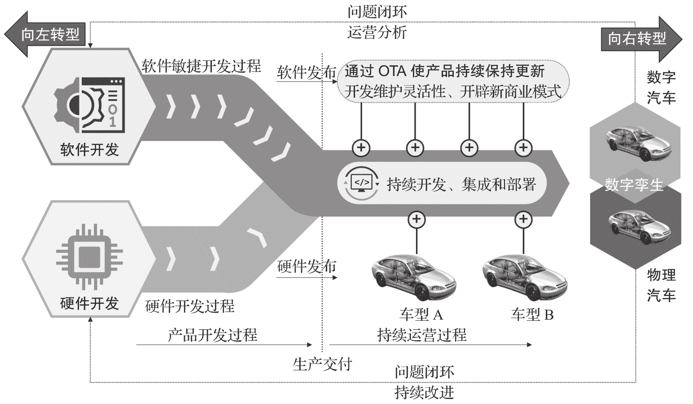

图 7-4 向左转型和向右转型

模块化与最小可行产品在硬件里是一对相互驱动的概念，共同推动硬件敏捷化，也缓解传统硬件的物理约束。

模块化是一种设计取向，把复杂系统拆成独立、可替换、接口标准化的单元。每个单元承担单一职能，可单独研发、测试、制造与升级。这与软件定义产品的理念高度契合，硬件更像可编程、可配置的承载平台，通过模块化实现功能与差异化。

最小可行产品是一种产品策略，追求以最小投入、最快节奏交付具备基础功能集合的产品，用以验证核心假设并获取用户反馈。硬件模块化是实现硬件最小可行产品的关键支撑，为敏捷开发提供灵活性与效率。

● 功能与结构解耦：硬件敏捷多以模块化设计为基础，迭代时仅更换或升级单一模块，而非整机。这让跨专业团队能聚焦实现核心功能的最小模块组合，呼应最小可行产品的最小化原则，避免必须造出完整产品才可验证的困境。
● 快速原型与迭代：为提升迭代速度，硬件敏捷采用向左转型的策略，用基于虚拟数字原型的仿真与虚拟试验替代昂贵耗时物理样机活动。团队可在数字世界以接近软件的节奏完成设计、仿真与验证，再制造物理最小可行产品。硬件最小可行产品的迭代周期由此从数月降到数周。
● 并行开发与协作：不同跨职能团队可并行研发不同模块，只要接口规范清晰，最终集成即可兼容。这与敏捷开发中跨职能团队自主协作的原则高度一致。
● 风险缓释：产品被拆成模块后，团队可在早期集中资源验证最关键、风险最高的模块，及时调整方向，避免在错误设计上过度投入。

最小可行产品作为产品策略，充分利用了模块化的工程优势。在平台化战略中体现得最集中：在软件驱动的敏捷产品开发中，硬件最小可行产品可以是一个通用、模块化的硬件平台，不同的软件最小可行产品在其上运行。软件功能就能独立于硬件快速迭代，达成软件定义产品的愿景。

总体来看，硬件模块化为最小可行产品在硬件领域的落地提供了坚实的工程基础。通过解耦功能与物理结构，让硬件的迭代与快速交付成为可能，把敏捷理念从软件成功扩展到硬件。两者结合，企业能更快响应市场、更高效验证创新，并以更低成本和风险交付持续有竞争力的产品。

2. 向右转型：以用户为中心的持续迭代
向右转型 Shift Right 指把关注点从产品发布前的研发阶段，延伸到发布后的运营和用户生命周期阶段。这是面向用户的敏捷迭代策略，通过持续收集和分析真实世界的用户数据和反馈，推动产品持续优化与创新。

向右转型的核心逻辑有三点。

● 以最小可行产品为起点的持续进化：向右转型把最小可行产品当作探索市场的起点而非终点。团队以最小投入快速推出最小可行产品，以用户为中心验证、反馈、迭代。产品发布后，真正的敏捷迭代才开始，通过短周期、小步快跑不断交付新功能并持续改进。
● 数据驱动的持续反馈：敏捷高度重视发布和运营阶段的真实数据与用户反馈。向右转型通过建立强反馈机制实现这一原则。借助 AI 技术，尤其是数据流驱动的实时协同与决策，企业能收集并分析产品在实际使用中产生的海量数据，包括用户行为、性能指标、故障日志和客服记录等。这些洞察作为新需求回流研发，驱动下一轮迭代方向。
● 软件定义产品与 OTA 更新：软件定义产品是向右转型的关键技术支撑。功能和差异化主要由软件决定，硬件作为可编程平台。企业可通过 OTA 在交付后快速部署新功能、修复缺陷、优化性能，无需物理召回，极大增强产品的生命力和敏捷性。

向右转型强调上市后，通过数据驱动的持续反馈和软件快速迭代实现产品不断进化。在软件定义产品和 AI 赋能下，企业能更贴近用户、更敏捷响应市场变化，在竞争中保持持续优势。

3. 向左与向右的融合闭环
向右转型并非孤立存在，两者是现代研发范式跃迁的两面。向左关注发布前，把质量合规审查、仿真试验、可制造性等活动前移到设计早期，实现高效高质量研发。向右关注发布后，通过持续用户反馈和敏捷迭代实现产品持续演进和价值增长。

成熟的研发体系会把两者整合，构建从向左到向右的一体化闭环。AI 赋能的需求端到端追溯是连接闭环的纽带，它把运营数据和客户反馈与最初需求比对，驱动整个产品生命周期的持续优化。

### 7.3.4 AI 赋能敏捷产品开发

AI 正以前所未有的方式赋能敏捷产品开发，把敏捷的核心要素与智能化能力深度融合，从根本上提升研发效率、质量和创新力。敏捷开发以跨职能团队自主协作、迭代开发快速交付、数据驱动持续反馈、透明沟通与知识共享四大要素，与 AI 形成强协同。

1. 赋能跨职能团队自主协作
● 协同基础——单一数据源：AI 作为底层技术，能整合设计、制造、销售、服务等环节的异构数据，构建统一的数据流驱动平台。跨职能团队基于单一事实来源协同，打破传统信息孤岛。
● 智能协同与决策：在基于模型的系统设计中，AI 辅助模型构建、验证和分析，让不同专业的工程师在统一系统模型上高效沟通协作。AI 赋予虚拟数字原型强大的仿真、分析与协同能力，使软硬件团队在同一数字环境中并行工作，实现深度协同，这正是软件驱动敏捷产品开发的核心体现。

2. 加速迭代开发与快速交付
● 向左转型与虚拟化：AI 驱动的向左转型，用基于虚拟数字原型的仿真和虚拟试验替代物理样机阶段活动，让硬件获得类似软件的快速迭代能力。AI 利用代理模型 Surrogate Model 或降阶模型 ROM 等技术，把复杂仿真计算时间从数小时甚至数天大幅缩短至秒级 ^([![Zelin Xu, Jie Ren, Yupu Zhang, et al. A Fast AI Surrogate for Coastal Ocean Circulation Models. arXiv: 2410.14952v1[cs.LG]19 Oct 2024\. https://arxiv.org/html/2410.14952v1.](EPUB/images/image_059.png)](#chapter16_split_000.xhtml_footnote-20-141))。硬件团队能以接近软件开发的速度快速验证设计方案并评估集成性能。AI 还可自动分析仿真结果，识别软硬件接口潜在冲突或性能瓶颈并给出优化建议。
● 最小可行产品的智能实现：AI 支持硬件最小可行产品定义原则，例如在软件驱动的敏捷产品开发中，硬件最小可行产品可是一个简易平台，由软件驱动核心功能，通过 AI 加速的虚拟测试验证，以最低成本、最快速度交付。

3. 强化数据驱动的持续反馈
● 向右转型与运营数据：AI 驱动的向右转型强调发布后收集分析真实用户数据驱动迭代。在软件定义产品理念下，AI 能通过 IoT 收集海量运营数据并提炼有价值洞察。
● 一体化闭环管理：AI 将运营数据、客户反馈和故障信息智能回传研发端，指导设计与服务工程协同，形成从需求、设计到服务再到优化的一体化闭环管理。

4. 提升透明化沟通与知识共享
● 智能需求管理与追溯：AI 赋能的需求端到端追溯，通过 NLP 技术自动建立并维护需求与设计、数模/代码、测试之间的关联，保证信息透明和一致。AI 还能自动生成和复用结构化需求，把知识沉淀为可复用资产，提升沟通效率。
● 自动化报告与洞察：AI 可自动化生成项目状态、进度和质量报告，提供可视化仪表板，帮助团队和管理层快速洞察项目健康状况。

总的说来，AI 赋能敏捷产品开发是把敏捷理念与 AI 强大能力深度融合，构建一个高度智能、实时协同、数据驱动且持续优化的研发新范式。它在技术层面实现流程自动化与智能化，在管理层面打破传统壁垒，实现跨职能、跨部门乃至跨企业生态互联，使企业更快速、更精准、更具创新力地应对市场挑战。

### 7.4 基于虚拟数字原型的设仿测协同

### 7.4.1 传统范式：协同现状与固有局限

在探讨未来工程协同模式的革命性潜力之前，必须首先对当前占据主导地位但日益显得力不从心的传统范式进行一次彻底审视。这种传统的、以线性流程为特征的设仿测协同工作流，不仅在效率上存在瓶颈，而且其根本性的结构缺陷使其在面对现代系统之系统产品的复杂性时，已然走到了范式革命的临界点。

1. 割裂的线性接力：抛砖过墙式工作流
传统的产品研发流程在本质上是一种线性的、阶段性的接力赛。其典型路径为设计、仿真和测试。这个流程始于设计部门，设计工程师利用 CAD 工具创建产品的几何模型，并进行初步的设计审查和验证如干涉检查。完成之后，这个产品数据包被扔过墙，移交给仿真部门。仿真工程师接收几何数据，进行网格划分、设定边界条件等一系列转换操作，以验证设计的性能。最后，经过多轮仿真迭代的方案被送往制造和测试部门，通过制造物理样机进行物理测试来最终确认产品是否满足要求。

这种工作模式的每一个环节都高度专业化，但环节之间却存在着明显的壁垒。设计团队、仿真工程师和测试工程师往往使用不同的工具集、操作不同的数据集，甚至对产品需求的理解也存在偏差。一旦发生设计变更，就可能会导致仿真工程师前功尽弃，从零开始。这种模式在处理相对简单的机械产品时尚可应付，但在今天，产品本身已经演变为一个由机械、电子、电气、网络和软件等多个领域紧密耦合的复杂系统，这种抛砖过墙式的协作方式显然已经难以为继。

2. 孤岛间的壁垒：数据断裂与语义鸿沟
传统范式最核心的弊病在于数据和信息的断裂。当设计数据从一个环节传递到下一个环节时，丢失的不仅仅是数据本身，更是数据背后蕴含的设计意图、约束条件和上下文信息。

这种断裂在实践中表现为巨大的语义鸿沟。CAD 模型本质上是一个几何表达，它描述了产品的形状，但并未完整承载其功能、性能或行为。当 CAE 工程师接收到这个几何模型时，他们必须进行大量的翻译工作：将几何特征转化为物理世界的载荷、约束和材料属性。这个过程高度依赖工程师的经验，极易引入错误和偏差。同样，当物理测试结果出炉后，如何将物理世界的观测数据如应力、振动、温度精确地关联回数字仿真模型和最初的设计意图，同样是一个巨大的挑战。现有的方法论并未支持领域间的深度集成，导致工程师只能通过手动的、点对点的方式尝试跨领域协同。这种手动的、基于文档报告的反馈循环，效率低下且信息损失严重。

3. 后期发现的高昂代价
这种线性流程将最大的风险累积到了最后阶段。在物理样机测试环节发现的设计缺陷，其修复成本是呈指数级增长的。一个在概念设计阶段只需修改几行代码或调整一个参数就能解决的问题，到了物理测试阶段，可能意味着模具报废、供应链重组和数月甚至数年的项目延期。

物理样机本身就是一种昂贵且缺乏灵活性的验证手段。制造一台汽车原型或一架飞机样机需要巨大的时间和金钱投入。一旦制成，想要探索不同的设计方案如 what-if 场景分析几乎是不可能的。这种模式从根本上扼杀了创新，因为它惩罚了在后期进行探索和修改的尝试，迫使团队在信息最不完整的项目初期就做出关键性的、几乎不可逆转的设计决策。

4. 临界点：现代产品复杂性呼唤新范式
当今的尖端产品，无论是电动汽车、高铁动车、工程装备，还是航空航天装备，其复杂性都已经发生了质变。它们不再是单一的机械产品，而是由硬件、软件、网络和算法共同定义的、高度集成的系统。例如，在先进驾驶辅助系统 ADAS 功能的开发中，一个软件算法的微小调整都可能引发系统性连锁反应，如传感器误检漏检导致的 AEB 误触发、控制决策逻辑调整导致车辆动力学响应突变，或者因未检测到算法输出异常如方向盘转角突跳而导致的转向失控等。

这种非线性的、跨领域的复杂性，是传统线性工作流无法管理的。它将一个高度关联的复杂系统网络问题，错误地简化为一个线性的、顺序化的流水线任务。在这种模式下，跨领域的依赖关系和潜在冲突直到最终集成测试时才会暴露，而那时往往为时已晚。因此，传统范式的根本问题已不再是效率低下，而是其结构本身在面对现代工程挑战时带来了不可接受的、系统性的失败风险。因此，传统范式本身，已成为创新的桎梏和风险的源头。

### 7.4.2 范式解构：设仿测的角色裂痕

为了深刻理解新范式为何是必然选择，我们需要对传统设仿测协同模式的三个核心支柱进行解构，揭示它们各自的角色定位以及彼此之间存在的阻碍真正协同的深层裂痕。这些裂痕并非简单的工具接口问题，而是源于不同工程学科在语言、模型和世界观的本质差异。

1. 设计：以 CAD 为中心的几何世界观
在传统范式中，产品研发的起点和核心是 CAD。设计工程师的使命是创造和定义产品的三维几何形态。他们的工作成果 CAD 模型，是后续所有工程活动的出发点。这个模型精确地描述了零件的形状、装配关系和尺寸公差。

然而，这种以几何为中心的视角存在一个根本性的局限：CAD 模型在很大程度上是一个静态的几何容器，缺乏对行为、功能和性能的描述。它能够解答其几何形态如何的问题，却难以阐明其预期功能为何或其在特定工况下的行为表现如何。设计意图、性能需求、功能逻辑等关键信息，往往以非结构化的文档、注释或工程师个人经验的形式，游离于核心几何模型之外。这便构成了贯穿整个研发流程的首要且最为基础性的语义断层。

2. 仿真：通向物理试验的关卡
CAE 及其相关计算、校核工具，在传统流程中通常扮演着下游验证者的角色。当设计方案基本定型后，仿真工程师的任务是验证这个既成事实的设计是否能够满足功能和性能要求。这个过程是被动响应式的。

仿真工程师需对 CAD 几何执行几何清理与理想化操作，移除对分析结果影响的可忽略的细微特征如圆角、小孔等，随后通过网格划分将其离散化为有限元 FEA 或有限体积 FVM 模型。该过程通常高度依赖工程师的专业知识与经验，且不同的工程师对简化边界的判断可能存在差异，进而导致分析结果的差异性。更为关键的是，传统仿真的核心职能定位于验证性分析如该设计是否满足失效阈值，而非探索性优化如如何构造满足特定性能目标的最优设计。这一局限使得仿真在主动指导设计创新方面的价值远未释放。

3. 测试：作为最终裁决者的物理样机
物理测试是传统研发流程中的终极真理。无论数字模型如何预测，最终的裁决权都掌握在物理样机和试验台架手中。通过对真实产品的测试，工程师可以获得最可信的性能数据，验证产品是否满足所有的设计要求。

然而，物理测试作为最终仲裁者的角色，也伴随着显而易见的弊端。首先是其高昂的成本和漫长的周期，这在前面已有论述。其次，物理测试发生在研发周期的最末端，此时进行颠覆性的设计修改几乎是不可能的。最后，物理世界和数字世界之间存在着难以逾越的鸿沟。将物理测试中观察到的现象如某个特定位置的疲劳裂纹精确地溯源回数字模型中的特定参数或设计决策，是一项极具挑战性的任务。测试数据往往以报告和数据表的形式存在，难以被直接、自动地反馈到下一轮的设计和仿真模型中，从而形成一个闭环的、持续改进的流程。

4. 翻译过程中的裂痕：价值的流失之处
传统设仿测协同的本质，是一个依赖于人工翻译的断裂过程。价值在这些翻译的裂痕中不断流失。

● 设计到仿真的裂痕：从描述形状的 CAD 几何，到描述物理的 CAE 网格模型的翻译，这是一个以手动为主的、经验驱动的、充满不确定性的过程。设计意图在此处被稀释。
● 仿真到测试的裂痕：仿真结果与物理测试数据的关联是一大难题。边界条件的理想化、材料模型的差异、环境因素的忽略，都可能导致仿真与现实的偏差。如何弥合这一偏差，依赖于工程师的经验判断。
● 测试到设计的裂痕：把物理测试的失败教训或成功经验反馈回设计模型以指导下一代产品的改进。这个过程往往是非正式的、基于文档的以及缺乏直接关联和可追溯的模型驱动链路。

综上所述，传统范式的根本问题在于，这三个环节使用了三种不同的语言。设计说的是几何语言，仿真说的是数学物理方程语言，而测试说的是物理现象语言。在传统范式下，我们依赖于昂贵、易错且不可靠的人类翻译官即各个领域的工程师在这些语言之间进行转换。新范式的核心目标是创造一种所有学科都能理解和共同参与的统一语言。这种语言，就是模型。

### 7.4.3 范式重构：以虚拟数字原型为协同核心

打破线性局限：VDP 重塑研发迭代逻辑

以几何文件为主导的串行开发已显出结构性疲态，重新设计研发范式势在必行。新路径不再依赖单一几何线索的线性推进，而是以一个整合化、持续演进、跨物理域耦合的虚拟数字原型 Virtual Digital Prototype，VDP 作为协同枢纽，带动迭代式研发。语义层面以基于模型的系统工程为根基，数据层面以数字主线为经络，意图彻底弥合设计、仿真、测试之间的断裂。

1.语义基石：基于模型的系统工程（MBSE）

面对复杂产品开发，Model-Based Systems Engineering，MBSE 承担起构建并落地虚拟数字原型的共同表述与核心方法。它把过去分散在文档中的系统信息，以规范化的方式收敛到图形化模型，为跨部门、跨阶段协作提供基础。模型承载的不只是几何，还完整刻画需求、功能、行为、逻辑架构、物理部件及其可追溯关联，体现数字原型中的行为逻辑与系统架构。

MBSE 让数字原型具备共通语汇，主要体现为：

**●形式化建模语言**：MBSE 采用规范化的建模语言，典型代表是 SysML 系统建模语言。SysML 以图形符号与规则描述功能、行为、结构与参数，让不同背景的工程师使用同一套表达交流，降低自然语言模糊，提升沟通效率。

**●模型承担信息枢纽**：在 MBSE 中，系统模型不是文档附属，而是信息唯一可信来源。需求、功能、架构、行为、接口等全部沉淀于模型，形成数字原型的核心骨架，保证数字副本的精确与完整。

**●多视角分层表述**：MBSE 支持从不同抽象层级和多个视角呈现系统，满足各类干系人需要。高层关注业务需求与整体功能，低层细化到具体物理件与软件模块。分层多视确保同一基模下的一致性。

**●跨职能协作与工具联动**：模型成为跨团队的通用沟通载体。机械工程师能读懂软件功能需求，软件工程师可以查阅硬件接口规范。MBSE 工具和 CAD、CAE、ALM、PLM 等工程工具集成，模型数据在不同链路间无缝流动，为数据流驱动的多专业实时协同提供技术基础。

**●模型核验与分析**：形式化模型精度更高，可进行一致性检查、完整性分析与错误探测，部分模型可直接仿真、模拟行为，提前暴露设计风险。

探月工程为 MBSE 应用提供了典型参考。面对极端复杂的系统工程挑战，探月工程搭建了模型化的并行协同论证框架，包含协同团队、协同论证环境、系统模型体系和标准规范四大要素。其系统模型体系覆盖任务、环境、场景、功能、物理、成本、可靠性等多个维度，用统一模型将需求分析、概念架构定义与方案设计紧密联动，实现设计、仿真、验证并行协同 ^()。该方法论为企业管理复杂性提供了蓝图，商业化的 MBSE 解决方案则提供模型仿真、跨部门协同建模及多学科联合仿真等落地工具。

2.核心载体：虚拟数字原型（VDP）的浮现

虚拟数字原型 VDP 是新范式的中枢，是数字孪生概念的前移与深化。传统数字孪生多指运行阶段的物理资产镜像，用于监控与预测维护。VDP 不止于三维造型，而是涵盖几何到行为逻辑的全要素动态数字资产。

VDP 的关键在于全面和动态。全面性远超 CAD，集成多类数据与信息：①几何信息：三维形状、尺寸公差、装配关系等；②材料属性：密度、强度、导热性等物理化学特性；③质量信息：质量要求、关键件、关键特性、控制计划、DFMEA、PFMEA ^()等；④物理模型：结构力学、流体力学、热学、电磁学等不同工况下的数学仿真模型；⑤行为逻辑：软件代码、固件、控制算法与系统逻辑；⑥生产工艺信息：制造工艺、装配流程、公差、检验要求等。开发过程中，VDP 随设计迭代、仿真验证与物理测试反馈持续演进，可模拟不同场景下的运行状态并预测性能。

VDP 在现代产品开发、尤其是向左转型与软件驱动的敏捷模式中发挥核心作用。

（1）替代实体样机活动
实体制造前即可在虚拟环境中试验。
**●设计验证及优化**：开展结构、流体、热管理等虚拟仿真，验证性能、暴露缺陷、预测行为，大幅降低昂贵物理原型的依赖，避免后期返工成本。
**●性能预测及评估**：借助代理模型与降阶模型技术，快速估算强度、热传导、流阻等指标，缩短验证周期。
**●软硬件协同测试**：在硬件原型未成熟时，软件团队即可在 VDP 上开发、测试与验证，实现软硬件并行开发与早期集成。

（2）实现设计仿真测试一体协同
VDP 是设计、仿真、测试的枢纽。设计师基于数字原型更新设计；仿真工程师利用原型进行性能模拟；测试工程师据原型生成测试用例开展虚拟试验，并以物理测试数据校准优化原型。数据流驱动的闭环使每次迭代在虚拟环境中快速完成。

（3）促进多专业实时协同
VDP 为机械、电气、软件等团队提供统一可视化协作平台。所有成员在同一最新数字模型上作业，共享信息并实时发现冲突与集成问题。

（4）支撑全生命周期管理
研发阶段使用的 VDP，投产后与物理产品联动成为真正的数字孪生，接收传感器实时数据，用于预测性维护、性能持续优化，以及将运营与用户反馈回流至数字原型与原始设计，驱动持续改进与新品研发。

宝马、雷诺、戴姆勒等整车企业已在研发中实践 VDP。宝马集团以 VDP 为核心实现敏捷迭代，从概念阶段即构建包含功能与几何信息的工程主结构作为数字副本，并在其中进行迭代配置与前端加载。该原型可开展多体动力学、碰撞、空气动力学等复杂仿真，替代部分物理样机活动，实现更早集成、加速成熟度并提升效率，如图 7-5 所示。通过无缝数据管理与自动化工程数据服务，宝马保证全周期内工程师基于一致数字原型高效协同，这正是向左转型的汽车实践。 

图 7-5 宝马汽车：基于虚拟数字原型的设仿测协同 ^()

戴姆勒则通过基于数字原型的设仿测协同革新硬件与软件流程。核心在于构建硬件与软件的数字原型，并以数字主线贯通实现无缝集成。该统一数字原型帮助戴姆勒减少 30% 物理硬件需求，并确保首个物理原型 Pro1 达到客户交付状态，产品开发周期缩短 12 个月，软件可每三个月迭代新功能，24h 内完成软件原型，30min 内通过 OTA 推送。这体现了硬件存在但由软件驱动的理念，最终形成透明、以数据为中心、数字一致且快速的开发过程 ^()。

可见，VDP 使在数字世界制造并测试成千上万辆虚拟汽车成为可能，远超传统物理试验能力。

3.数字主线：虚拟数字原型的技术底座

VDP 是产品在数字世界的精确全面副本，数字主线则是构建与驱动它的骨骼与血液。数字主线是一种数据连续性架构，将客户需求、系统模型、多域设计数据、仿真模型与结果、物理测试数据及在役运行数据连接成可追溯、可查询、可分析的数字网络，解决信息孤岛、数据不一致与追溯困难。

**●构建与维护唯一可信源**：数字主线确保 VDP 作为唯一可信源的关键基础，集成 CAD 模型、仿真设置与结果、测试数据、软件代码、需求等，保证一致性与准确性，避免因版本不一致导致错误，使设计、仿真、测试始终基于最新可靠数据协同。

**●驱动实时数据流与自动化反馈**：数字主线是设仿测的数据高速公路。CAD 中几何或参数变更会自动传递至仿真工具更新模型，仿真结果即时回馈设计，极大加速设计-仿真-优化循环，使硬件迭代接近软件速度，实现向左转型与问题前置。

**●强化端到端可追溯性**：数字主线将 VDP 元素与需求、设计决策、仿真结果、测试用例、物理测试数据等全部数字化关联，使设仿测过程透明可溯。工程师可清晰追溯仿真偏差与设计参数关联，或物理测试失败对应 VDP 的具体问题，便于问题定位、合规审计与质量管理。

4.“左移”革命：仿真驱动设计

以 VDP 为核心，仿真角色从下游验证关口前移到概念阶段的主导驱动力。仿真驱动设计将仿真分析前置并深度融入设计环节，改变先设计后仿真的串行模式，让设计决策时实时获得仿真反馈，及早发现问题并优化方案。

与传统串行范式相比，其特点在于：设计和仿真并行化，将仿真工具嵌入设计环境，实现实时或近实时分析；实时反馈与迭代，设计变更即时可见性能影响；赋能设计师，使仿真成为设计日常能力而非仿真工程师专属；在早期发现问题，大幅降低后期修改成本。

PTC Creo 与 Ansys 仿真能力的无缝整合是典型实践。Ansys 求解器与技术集成进 Creo，形成两款产品。Creo Simulation Live 为设计师提供即时静态结构、热、模态与流体动力学指导，打破传统耗时流程；Creo Ansys Simulation 则是在 Creo 中直接进行高保真热、结构、模态分析，易用且功能完整 ^()。

### 7.4.4 AI 赋能：设仿测协同的数据驱动变革

若以 VDP 为核心的重构范式为工程协同搭建骨架，平台化 AI 架构则是注入智慧的内核。AI 从孤立点状技术转变为系统性赋能力量，深度融入设仿测全流程，推动研发从模型驱动迈向数据与模型双驱动。

1.AI 赋能设计：生成式设计的兴起
AI 对设计赋能正从优化走向生成。传统拓扑优化在既定概念下求优，而生成式设计让工程师定义问题空间，包括功能需求、性能目标、材料选项、制造成本与工艺约束，AI 算法探索数万至百万种可能性，生成高度优化且形态新颖的方案。

在航空航天与汽车领域，生成式设计已用于创造极致轻量化零部件。PTC 将生成式设计能力与 CREO 融合，设计师在界面中定义约束与参数，AI 自动探索设计空间并生成满足制造约束的可行方案 ^()。西门子平台级能力可根据车辆逻辑功能与物理空间约束自动综合电气线束与网络拓扑 ^()。工程师角色从几何绘制者转向产品创新者。

2.AI 赋能仿真：降阶模型与代理模型的威力
高保真物理仿真如 FEA 与 CFD 精确但计算昂贵，难以支撑快速迭代。降阶建模 Reduced-Order Modeling 与代理建模 Surrogate Modeling 正为解决此瓶颈而生。

降阶建模通过数学方法简化模型底层物理方程，在保留关键行为前提下大幅减少自由度。代理模型则以数据驱动方式，从输入输出样本学习规律，构建低成本近似函数预测新条件下的结果。

核心流程为：数据生成，通过实验设计 DoE 等方法运行系列高保真仿真获取覆盖设计空间的输入输出数据集；模型训练，利用机器学习或深度学习拟合非线性关系；模型部署，训练完成的轻量级 AI 模型可在接近实时速度下以可接受精度预测高保真结果，计算成本仅为千分之一甚至更低。

仿真破圈：从专家专属到全员决策

降阶模型与代理模型的普及，把仿真从少数专家的壁垒工具拉回到普通工程人员的日常决策桌面。设计侧、系统侧的同事即便不精通仿真，也能在虚拟数字原型里实现实时交互的所见即所得式性能评测。调整一个参数，系统响应的回馈几乎是瞬时的。这种秒级反馈能力，构成了仿真驱动设计、展开大范围设计空间探索，以及搭建实时在线数字孪生的基础。

3. AI 重构验证范式：从事后排查到前瞻预判
AI 正把测试验证的定位从研发尾段的一次性把关，拉伸为贯穿全生命周期的持续预测与洞察闭环。

● 智能虚拟测试：自动驾驶等超复杂系统，物理域无法枚举全部工况。AI 可自主合成海量高价值的虚拟场景，主动探针系统的边界工况与潜在失效模式，在数字原型中实现比实车测试更广、更高效的覆盖。
● 智能故障诊断：测试出现异常时，AI 融合仿真与物理实测大数据，可快速精准锁定根因。借助可解释 AI XAI，工程师能读懂模型的推理路径，提升对诊断结果的信任度。
● 预测性维护与健康管理：这是测试域的进阶形态。搭载在实物上的物联网传感数据持续回流至产品性能数字孪生体，AI 在线解析信号，预判设备健康趋势与失效风险。运维由此从坏了再修、按周期保养，转向基于真实状态的主动预测维护，可用率提升、全生命周期成本下降。

上海大学刘丽兰教授团队与航天某院联合打造的空间站关键机构数字孪生平台，正是试验与研发协同创新的典型。平台为机构框体、分离推杆弹簧、对接锁系、钢丝绳等核心部件构建高保真多物理场耦合孪生体，涵盖几何、材料、温度与多体动力学特性，并以地面传感数据与在轨遥测实现模型驱动与持续校准。虚拟域可并行设置温度、载荷等多变量工况，重现地面与在轨的多参数对接试验流程。虚实试验可做到毫秒级同步，且在首件实体样机试验前即可完成约 90% 的工况验证。经多轮迭代，孪生仿真与实测最大偏差稳定收敛至 3% 以内，精度足以替代大部分传统地面物理试验。最终实现试验数据全程透明、验证流程数字化一致，型号交付效率提升，航天器高密度发射任务保障能力显著增强 ^([![王昭，徐子锋，高增桂，等.数据与知识融合驱动的空间对接机构数字孪生试验[J].上海航天（中英文），2025,42(02):144-156+176.DOI:10.19328/j.cnki.2096-8655.2025.02.014。](EPUB/images/image_059.png)](#chapter16_split_001.xhtml_footnote-20-379))。

总体而言，以虚拟数字原型为核心的设仿测协同，并非工具层面的迭代，而是文化与组织的深层重塑。企业需打破按学科设防的部门墙，转向以系统为锚、跨职能敏捷协同的新形态。过往机械工程师管 CAD、仿真工程师管 CAE，边界分明；新范式下，虚拟数字原型是共建共享的核心资产。电气工程师改动线束布局，变更须即时映射到结构工程师的三维环境，系统工程师亦能立刻仿真该改动对整车散热的影响。这种实时深度联动，对架构、流程与考核机制提出严峻挑战。技术平台导入与流程再造必须同步，缺一不可，这正是数字化转型最难也最关键的一步。AI 则作为系统性赋能力量，加速虚拟数字原型、数字主线与设仿测业务的深度融合，推动范式跃迁与价值重塑。

## 7.5 设计制造深度协同

### 7.5.1 现状审视：一体化呼声高落地差
在谈及未来形态前，先回看当下主导制造业的现实。设计与制造一体协同已成为行业提升效率、质量与创新的共识。工业 4.0 与数字化转型浪潮下，打破设计制造壁垒的诉求持续升温。但理念普及度与实际落地效果存在明显落差。经历近十年智能制造改造后，行业普遍陷入数据富集而价值稀释的困境：数据堆积庞大，却难转化为决策智能。数字化工具普及度提升，但底层逻辑仍多停留在一个世纪前的思路。传统范式本质是信息孤岛加刚性串行交付，低效、信息损耗与优化缺位，已成为制约发展的核心瓶颈。

1. 演进轨迹：从分散孤岛到脆弱互联
设计制造一体化的发展史，本质是信息流冲击物理与组织壁垒的过程。早期设计、工艺、制造各自独立，靠纸质图样与人工递交，形成翻墙式协作：设计完成后将图纸抛给下游，反馈链路漫长曲折，导致返工与延期。

为此行业引入 CAD、CAPP、CAM 等计算机辅助手段，单点效率显著改善。但起初这些系统各自为政，数据需重复录入，互通成本高昂。随后行业追求更高层整合，目标是构建贯穿产品全生命周期的数字主线，压缩周期、降低失误、管理复杂性。

PLM 被视作关键枢纽，意图成为产品数据的中央中枢，整合从概念到维护的全信息。典型架构如 CAD/PLM/ERP/MES 试图打通核心系统，形成统一信息化平台。理论上 PLM 应为各干系人提供唯一准确的数据源。

实践中，以单一核心系统为中心的集成虽打破部分壁垒，却易形成新的集中壁垒与流程刚性。集成多靠点对点接口，脆弱、维护昂贵且难以适应业务变化。于是我们从完全孤立的筒仓走向互联，但状态更像脆弱的联邦体，而非无缝协作的有机整体。信息流已建立，顺畅度、准确性与实时性仍远未达标。

2. 玻璃天花板：数字主线持续受阻
投入巨大，但真正无缝智能的协同仍遥远。挑战根深蒂固，可拆解为技术、流程与组织三层。

（1）技术性数据壁垒
互操作性是最直观顽固的痛点。
● 数据转译与信息流失：不同厂商的私有格式与数据结构是首要障碍。数据从 CAD 流向 CAE 或 CAM 时，常丢失关键设计信息。即便使用 STEP、IGES 等标准，也无法根治。典型案例是带有 PMI 的模型经 STEP 传递后，往往退化为仅供人眼阅读的简化线框，CAM、CMM 等自动化程序无法解析。这暴露出语义互操作性的根本缺失：几何能传，制造意图与约束无法传。
● 同步化滞后：A 系统中的实时修改，难以准确及时同步到关联系统。生产可能仍按过期参数加工，仿真可能基于已废弃版本，导致质量与浪费。所谓数字主线因此更像静态快照集合，而非动态信息流。

（2）流程与人因障碍
技术壁垒催生流程摩擦与对人工的过度依赖。
● 手工重复录入耗时：数据鸿沟迫使工程师重复手工录入，如人工把 EBOM 转为 MBOM、为不同订单重复编制工艺。耗时耗力且易引入错误。
● 交付交接易错：工艺或 CNC 编程人员若只能依赖 2D 图纸或无语义的 3D 模型解读设计意图，误解难以避免，下游失误引发延期与返工。
● 工作流割裂与信息孤岛再生：团队在各自系统内孤立作业，数据分散，沟通受阻。即便接入中央 PLM，若语义上下文丢失，各方仍基于各自解读工作，新孤岛再生。

3. 组织与战略阻力
技术流程问题最终体现为组织阻力。
● 系统与思维惯性：大量遗留系统难以适配现代标准。更深层的阻力是思维定势。以 MBD 全面落地为例，不只是换软件，而是组织流程的深刻变革，需新技能并彻底告别 2D 图纸，常遭遇习惯传统模式的员工抵触。
● 实施复杂与用户采纳：PLM 等大型系统实施复杂，需海量数据迁移与持续培训支持，任何环节缺失都会削弱效果。

归根结底，这些挑战指向一个结论：以连接系统为核心的集成范式已触及架构极限。它擅长管理文件与数据对象传递，却忽略信息最关键的部分——可被机器理解的设计意图与上下文。公差标注不仅是数字，还蕴含工艺能力要求、检验方法与功能需求。在现有范式下，这些隐性语义在跨系统时被剥离，需在每个环节手工重释再造，导致失真、断裂与低效。要突破玻璃天花板，需要一种能原生理解与传递语义意图的新协同范式。

### 7.5.2 新范式内核：以模型为本的协同机制
要摆脱旧桎梏，需回归第一性原理。真正的协同，不是把软件用接口连起来，而是建立单一、连续、权威的信息价值流，保证从设计到实物每一步信息的保真与语义完整。新范式的基石是基于模型定义 MBD，其动脉是以参数驱动的数字主线。

1. 制造信息基石：基于 MBD 的数据流
MBD 是设计制造一体化的技术与语言革命。核心是抛弃以 2D 图纸为核心的沟通方式，让集成 3D 模型成为设计、工艺、制造、检验的唯一依据。

MBD 的本质不是把图纸信息搬到 3D 模型，而是构建内容丰富的 MBD 数据集。将几何定义、PMI 如尺寸公差形位公差表面粗糙度镀覆要求、材料属性管理信息、设计意图与制造说明等，以结构化语义化方式直接附着于 3D 模型。

由此 3D 模型从几何表示升级为产品的完整数字化定义，带来三重转变。
● 唯一真实源：MBD 成为全生命周期统一数据源，消除多版本多格式带来的不一致，从源头杜绝失真。
● 计算机可读：PMI 信息可被自动读取解析，CAM 可直接读公差与表面要求生成带约束的数控代码，CMM 可自动生成检测程序，自动化与准确率大幅提升。
● 无歧义沟通：3D 模型与标注更直观反映意图，可通过高亮提示重点，减少 2D 视图转换带来的误解。

传统认知把 MBD 局限于在 CAD 上标注尺寸公差。其实其真正价值在于驱动流程与管理体系的根本重构，需重新设计产品开发、制造与质量管理流程。

基于 MBD 的制造信息流是实现一体化的坚实基础。它把产品与制造信息嵌入 3D 模型，解决传统信息流痛点，实现设计与制造无缝衔接、制造智能化自动化。在数字主线支撑下，可确保制造过程的准确、效率与质量，推动智能制造时代的高效交付。

2. 物料流动动脉：围绕 BOM 的协同
如果 MBD 是承载信息的细胞，BOM 就是输送系统的动脉。它不仅定义做什么，还承载设计到交付全周期的物料信息流转与决策。若以 BOM 为中心，就能确保各方基于最新准确的物料信息高效协作。

产品开发制造中，EBOM、MBOM 与 BOP 共同构成从设计到生产的数字主线。
（1）EBOM（Engineering Bill of Material，工程物料清单）
由设计研发部门创建维护，描述产品的设计构成，侧重功能关系与设计意图。基于 CAD 模型，反映功能模块与层级，通常含零件编号、名称、数量、版本、材料等，也可能包含虚拟件或概念件。通过 CAD 集成可结构化管理 MBD 信息如控制特性与制造信息。是设计、分析、仿真、多专业协同的基础，由 PLM 管理。
（2）MBOM（Manufacturing Bill of Material，制造物料清单）
由制造工艺部门基于 EBOM 转化，用于指导装配与物料消耗。增加生产过程相关信息，侧重物料构成。含毛坯、半成品、包装、损耗件等。结构反映制造装配顺序与层级，与 EBOM 功能结构不同，会按工艺、设备、产线、供应商调整。是计划排产、采购、成本估算、过程控制的前提，常在 PLM 与 ERP 中管理。
（3）BOP（Bill of Process，工艺流程清单）
对制造产品或部件所需全部过程、步骤、资源与标准的分层描述。与 MBOM 密切关联，每个工艺步骤消耗 MBOM 定义的物料。关键要素包括：
● 工序/工步：装配、焊接、喷涂、检验等主要操作；
● 工序顺序：必须遵循的前后顺序；
● 所需资源：设备、工具、夹具、人力技能及对应物料；
● 工艺参数：关键工序的设定值；
● 时间定额：工时；
● 质量控制点：检验与质量标准。
BOP 是现场作业依据，由制造工程或工艺部门创建维护，在 PLM 中编制并发布至 MES 执行。

表 7-1 从多个维度对 EBOM、MBOM 和 BOP 进行了对比分析。

在数字主线支撑下，EBOM、MBOM、BOP 形成关键数据流，确保信息在各环节实时连续流动，实现全生命周期可追溯与协同优化。

3. 参数依赖关系链
解构协同本质，需清晰映射设计制造过程中各参数的内在依赖关系。这条关系链是协同与决策的基础，可归为三类核心参数集。
● 设计参数：信息流源头，定义产品功能与性能，完全封装在 MBD 中，包含①几何特征：形状、结构、装配关系；②材料规格：牌号、性能指标；③性能需求：强度、刚度、耐用性、轻量化目标等；④产品制造信息 PMI：几何尺寸与公差、表面处理要求等。这些信息直接决定产品验收标准。

**设计意图如何变成产线动作：三种控制变量的共振**

先谈制程侧的可控集合。制程变量指在某道具体制造环节里必须确定并持续管控的变量群，它描述物料或零件在加工时真实经历的环境，直接决定质量、性能和效率能否达标。这是工艺规程和 BOP 的主干，为班组提供可执行指引，整体源自设计要求，是把设计意图翻译成制造行动的中间层。主要包含五类内容：①加工方式的选择，例如铸造、锻造、数控切削或增材制造；②加工资源的匹配，按几何特征和材料特性挑选合适的机床与刀具；③加工轨迹的规划，由工程软件基于 MBD 数据生成的实际走刀路径；④各工艺对应的核心设定，如机加工的切削速度、进给量、切深，焊接的焊丝型号、电流、焊接速度，喷涂的涂层厚度、喷涂速度、烘烤温度等，这些设定直接影响效率、成本与最终品质；⑤装配顺序，即零部件按何种先后关系组装。

再看执行侧的可控集合。机台变量指的是完成制造的机器、工装本身的状态与设定，是操作者或设备工程师在机台端调整和监控的对象，通过间接作用决定制程变量能否稳定实现。常见内容有：①机台的能力边界，像加工范围、精度等级、最高转速、可用的刀库；②实际的设定值，依据制程要求在机台上对应的档位与数值，同一制程要求在不同机台、不同环境下对应的机台值会不同；③机台运行的实时状态，通过物联网传感器采集的主轴负载、振动、温度等；④车间环境要素，如温湿度；⑤来自三坐标、视觉检测等系统的实时测量结果。

把关联讲清楚，用汽车白车身 MIG/MAG 自动焊来说明。

设计要求会先决定制程该怎么选。若设计要求焊缝具备足够强度且焊脚高度为 3mm，制程工程师就必须选用 MIG/MAG 工艺，并把制程变量定在约 120A 电流、20V 电压、80cm/min 线速，才能获得所需的熔深与熔宽。

机台设定是让制程要求落地的支撑。要实现 120A 这个制程电流，需要在焊机面板上对应到具体的电流输出档位。机器人的运动程序要按设计给出的焊缝位置与长度来规划，才能保证焊接速度和焊枪角度与制程要求保持一致。

在正确机台设定下，受控的制程变量确保金属熔化、填充、凝固过程符合预期，形成满足设计要求的焊缝。若焊接速度过快会出现熔深不足，强度不达标；若保护气体流量不够则易产生气孔，焊缝质量受损。

由此可见，真正整体融合的设计制造，三类变量不再是各部门分段使用的孤立集合，而是一个强耦合的系统。设计要求的任何细微变化，都应该能自动向下传递，并结合制程和机台变量进行可行性与最优性评估；反过来，现场机台的偏差或质量反馈，也必须能向上追溯，推动制程变量调整乃至设计要求的再优化。这种双向流动是新一代制造的逻辑核心。

图 7-6 汽车白车身 MIG/MAG 自动焊接参数示例

### 7.5.3 范式重塑：数据驱动的闭环协同
拆解协同本质并以 MBD 确立数据基石后，需要一个能打破现有局限的新操作模型。新视角把设计制造看成可控的动态系统，而不是静态串行的任务清单。实现路径是搭建变量驱动的闭环迭代优化体系。它由两大支柱支撑：可重构的分块化工艺规划，和贯穿始终的变量主线，即把设计意图转化为物理动作并实现反馈控制的数字神经。

1. 分块化的工艺规划体系
传统工艺规划常试图一次性输出全零件的详细制造指令，属于单体式做法，抗变能力差，难以应对设计变更、生产扰动或多工厂协同。新范式要求架构可重构、可弹性响应。分块化正是关键。

核心思路是按决策层级和范围把复杂任务拆成相对独立又相互关联的子模块。分层后可在不同粒度上规划与调整，灵活性显著提升。典型架构分为四层。

（1）第一层：策略工艺层
这是产品级或平台级的顶层策略。关注制造战略、产线布局、产能规划和大部件级装配流程，与企业核心制造能力、自制外协策略、全球多工厂产能匹配。本层不涉及具体零件编号、尺寸或加工变量，而是做两类抽象。
装配过程抽象：定义从原材料到成品的主要制造阶段与高层工艺流程，例如风机整体装配可抽象为塔筒分段制造→机舱组装→轮毂组装→电气集成→叶片成型→模块化运输→现场吊装→调试并网。它给出大的流程节点，不展开到每颗螺栓。
制造能力抽象：对企业整体能力做规划与利用，考虑工厂布局、产能分配、关键工艺能力如大型焊接、涂装、叶片成型等。它回答要生产这类产品需要哪些核心能力，而不问机台具体变量。
该层为后续细化提供顶层框架，保证细节规划与企业生产战略一致。

（2）第二层：多工厂/系统级工艺规划
在战略层指导下，面向多方案、多产线、多工厂协同规划的核心层。本层关键概念是装配单元，它是产品在制造中由多零件或子组件在特定工序内组装成的逻辑模块实体，通常对应产品 MBOM 的某个子装配层级，是散件到整机的中间形态。定义时考虑功能完整性、制造独立性、接口标准化与物流便利性。

装配单元和设计模型的组合映射使分块化工艺规划成为可能。它让制造任务分解为可独立规划与分配的模块，成为多工厂协同的基础。工艺规划的关键在于建立装配单元和设计模型功能模块之间精确可追溯的映射。设计模块变动时，可立即定位受影响的装配单元及工艺；装配单元的工艺优化也能回传设计。像分块化设计一样，装配单元通过和整机工艺解耦，实现数据驱动的设计制造并行协同。
本层特点：
面向多方案规划：设计变型和配置管理，对同一产品族的不同变型定义通用或可配置装配单元并做适应性规划；工艺路径选择，对同一部件存在多种可行工艺时，按成本、质量、产能挑选最优路径。
面向多产线规划：工厂产线能力分配，按专业化与产能把不同装配单元任务合理分派；工艺协同和接口管理，借助清晰的装配单元定义和接口规范，实现物料、半成品流转和质量控制的跨厂协同，确保组件无缝组装。
装配单元和设计模型的映射是分块化工艺规划的核心，它把设计域的模块结构和制造域的装配实体紧密关联。

（3）第三层：单元级工艺规划
承接上层装配单元，为其制定详细 BOP，拆解内部工序，形成可执行的工艺规程，是设计意图向制造操作转化的关键。
关注点：工序分解和步骤细化，把装配单元的整体制造拆到生产线或工位层面的具体操作；详细工艺规程制定，为每个工序生成可执行的文档；精确的制程变量定义，明确拧紧扭矩、焊接电流、涂层厚度、固化温度等关键变量，以及工具、夹具、检验方法和质量标准；操作指导性，以分步指南加图文或视频呈现，确保人员准确执行；与 MBD 和 MBOM 深度关联，BOP 每一步与设计特征和物料可追溯。
本层把概要工序细化为含制程和机台变量的详细规程，指导车间标准化生产，是 MES 下达指令的基础，也是数字主线承载制造执行信息的重要环节。

（4）第四层：资源/机台级工艺规划
体系最底层，最贴近物理执行。任务是把第三层的工序细节和制程变量转化为机器可识别的指令，并开展实时数据采集。
要点：面向具体生产机台，把规程细化到机床、机器人、点胶机、检测机等，考虑型号、特性、控制器、精度和接口，确保兼容；机台变量精确设定和编程：生成机台程序如数控 G 代码、机器人运动程序；精细化设定主轴转速、进给上限、加热功率、运动速度、加速度、定位精度、传感器校准值等；传感器和执行器配置，用于监控工艺和质量；实时数据采集和监控：物联网连接，采集机台状态、实际制程变量、在线的产品状态；数据向 MES、SCADA 或云平台传输，为监控分析决策提供依据；与 MBOM 最终关联，确保指令和数据可追溯到具体物料和机台。
这种四层架构把流程从抽象到具体分层，强调分块化、标准化和协同。变化来临时只需调整受影响模块，为动态闭环优化提供架构基础。

2. 变量贯穿线
如果分块化规划是大脑，变量贯穿线就是遍布全身的数字神经。它承载关键变量，把抽象意图逐步解码为机台级变量，并通过传感器把物理反馈收回，形成可迭代的闭环。变量由此从被动记录变为主动控制。

从 MBD 到机器可读意图
MBD 是变量贯穿线的源头。第一步是自动提取语义化的 PMI，如尺寸公差、形位公差、表面粗糙度、硬度范围等，构成控制特性 CC，即设计意图的量化表达，也是下游制造和检测的最终目标。
目前 PMI 语义提取和传递是痛点。要让主线生效，需要 PLM 和 CAD 深度集成的数据转译工具，不仅读取文本和几何关联，更要理解语法和语义，例如解析形位公差的基准、公差带类型和数值并转化为 CAM 或 CMM 可直接用的结构化数据，才能无损传递意图。

控制的级联：从制程设定到机台设定
获得机器可读控制特性后，变量贯穿线开始解码，把高层目标逐级分解为底层指令。数字主线作为双向互联的数据流，为变量驱动制造提供底座。
设计阶段：从 MBD 精确提取机器可读控制特性，如焊缝几何、材料、强度要求，作为起点。
工艺规划阶段：第二层按设计要求定义面向不同工厂的宏观策略和装配单元级方案；第三层把要求细化为具体工艺规程，明确焊接电流 120A、电压 20V、速度 80cm/min、扭矩 300Nm 等。这是设计到工艺的转化核心。
生产执行阶段：第四层把制程变量转为机台可识别的变量，如焊机面板设定值或机器人运动指令。
通过设计意图到机台执行的控制级联，实现变量驱动的闭环。

### 7.5.4 AI 驱动：设计和工艺的迭代引擎
变量驱动的信息流完成了意图到执行的正向通路，革命性在于同样重要的反向通路。它把制造和运行中产生的现场检测和机台实时变量智能反馈回设计、工艺和机台设定，驱动全生命周期持续改进。

1. 反向通道的本质：从执行到学习和优化
传统流程单向：设计→工艺→机台执行。物理世界的复杂性导致实际总和规划有偏差。反向通道把偏差、问题和实际表现转化为学习经验，用于优化后续规划，让制造从执行者变为学习者和优化者。

2. 反向通道的数据来源
主要来自现场实时监控和检测。
现场检测结果：产品质量数据，如尺寸精度、表面缺陷、强度、功能测试、公差分析；在线离线检测，如焊缝 X 光、注塑件尺寸报告、电子产品性能测试。
机台实时变量：实时工况数据，如运行状态、能耗、振动、温度、压力；实际制程变量，如实际焊接电流电压速度、注塑熔体温度，反映材料真实加工条件。

3. AI 助力反向通道：驱动迭代优化
基于平台化 AI 架构，引擎把海量数据转化为可操作洞察并自动化反馈。
数据采集和预处理：自动从物联网、检测设备、MES 采集、清洗、整合异构数据。
智能偏差识别和预警：实时分析检测结果和机台变量，自动识别偏离目标或历史模式的异常并预警，如焊缝气孔率升高、缩水超标。
根因分析：利用数字主线端到端追溯，快速关联缺陷和工艺、机台甚至上游设计要求；通过历史模式学习定位变量组合或机台状态导致的缺陷。
优化建议和自动化调优：机台变量调优，对可控偏差自动微调，如焊接速度自适应、功率调整，实现闭环控制；工艺变量优化，基于根因向工艺规划层提供建议，调整电流、电压、送丝速度等，甚至更新 BOP；设计要求迭代，若根源在设计如焊缝几何不合理导致应力集中，则反馈设计部门推动优化。

4. 驱动设计制造流程的迭代优化
反向通道最终目标是持续改进。
产品迭代优化：结合现场性能、质量数据和用户反馈，指导设计要求迭代，提升功能并修正缺陷。
工艺优化：基于实际生产数据持续调整制程变量，实现效率、质量和成本的最优平衡。

**●装机运行效能优化**：以参数实时监控与持续调优为手段，推动装置稼动率与运行稳健性双升，并据此为新机采购或存量机改造提供依据。

总的来看，AI驱动的逆向反馈通路把生产现场改造成持续自学的试验场，凭借精准的数据回传与智能拆解，让设计、工艺与设备参数相互耦合，形成自反馈的迭代优化机制，推动产品竞争力与制造智能化不断上扬。

## **7.6 数字主线驱动的质量共创**

传统质量治理因组织、流程与信息互通受阻，陷入被动、碎片且成本攀升的脆弱状态。这种做法不仅造成可观的质量损耗，更以无休止的救火消耗企业的创新动能，从根本上削弱长期竞争力。

为破解困局，本节提出以质量数字主线为骨架、以平台化AI为引擎的全新治理范式。这并非对既有流程的修补，而是一次数字原生的彻底重构。

搭建覆盖产品全生命周期的质量数字主线，将客户需求即质量目标、设计意图、工艺规划、控制计划与SPC过程控制到售后反馈完整串联，形成唯一、可信、实时的质量信息源。平台化AI作为新体系的智能中枢，把主线上的各类数据转化为洞察、预测与行动，推动管理从被动应对转向主动预防。

### **7.6.1 现状诊断：质量管理为何脆弱**

展望未来前，需对现状做一次冷静剖析。现代制造业的质量体系虽经多年演进，核心范式并未根本改变，仍建立在线性割裂的流程与分散的信息系统之上，陷入脆弱范式。面对产品复杂度上升、需求多元化与全球竞争加剧，其内在脆弱性正成为发展与创新的阻力。

1. 三重孤岛制约

质量问题的成因多为系统性脱节，具体体现为三种相互加剧的孤岛，共同构成传统范式的结构缺陷。

**●部门割裂**：多数制造企业中设计、制造、采购、质量各自独立运作。各部门目标与优先级不同，跨部门协作受限于正式会议与繁琐流程。层级化与部门本位导致信息囤积而非共享。质量部门疲于末端检验，设计部门对制造实际约束认知不足，价值链由协同作战变为低效传递。

**●流程断点**：质量流程被设计成离散单向的评审节点，而非并行协同的工作流。DFMEA到PFMEA再到控制计划的传递是典型失误点。该环节本应把设计风险转化为制造控制，却常依赖非正式会议、邮件与手工文档传递，缺乏系统追溯。设计变更无法自动准确流向制造工程师，直接引发质量下滑与上市延期。整体缺乏端到端视角，各环节只守自身范围。

**●系统信息孤岛**：组织与流程的割裂被固化在信息系统架构中。各团队使用PLM、QMS、ERP、MES等功能各异、互不兼容的系统，形成大量隔离的数据池。数据冗余、格式不一、标准不一，企业难以形成单一可信的质量数据源，全面分析与数据驱动决策受阻。更甚者，落后IT基础设施无法与现代数据分析与AI工具有效集成，成为数字化转型的瓶颈。

2. CoPQ高企：被动式质量的高昂代价
产品质量成本指为确保符合要求所投入的费用，以及因不符要求产生的全部损失。衡量体系有效性的关键指标，通常分为优质质量成本CoGQ与劣质质量成本CoPQ。

**●优质质量成本**：为预防缺陷与评估质量所投费用，即第一次就做对的成本。包括：
①预防成本：缺陷发生前的投入，如质量培训、体系建设、质量策划、供应商管理、防错设计。
②鉴定/评估成本：衡量与控制质量的费用，如检验、试验、质量审计、计量校准维护、过程控制。

**●劣质质量成本**：因产品服务未满足要求产生的损失。包括：
①内部失败成本：出厂前发现缺陷的损失，如不良品、返工、停机。
②外部失败成本：交付客户后才发现缺陷的成本，如保修索赔、召回、投诉处理乃至诉讼。

美国质量协会ASQ研究显示，运营良好企业CoPQ约占销售收入的10%～15%；问题企业可高达总运营成本的40% ^()。实践普遍表明CoPQ占质量总成本的主体，常超80%。这意味着事后补救的成本远高于事前预防与评估。

高企的CoPQ正是推动质量改进、实施左移策略并投资AI赋能端到端质量管理的核心动力。通过前置投入预防缺陷，将CoPQ转化为CoGQ，可带来更明显的经济效益与竞争优势。

3. 质量数据链的断裂：微观剖析
要看清传统范式的脆弱，需审视关键断裂点。

**●DFMEA-PFMEA之间的鸿沟**：整个质量链最关键也最常见的断点。DFMEA中识别的关键特性本应无损系统传递至PFMEA并转化为制造控制点。实际传递常为手工、不可追溯。DFMEA与PFMEA被当作两份独立文档，关联依赖会议纪要与工程师个人经验，易遗漏误解。设计阶段的风险认知在进入制造时衰减，为后续问题埋雷。

表象是流程或沟通问题，根源是数据模型失效。企业用会议与文档弥补缺陷，因底层IT缺少共享关联的质量数据模型。设计失效模式与过程失效模式本质是同一风险因果链的两个节点，传统系统却将其存于两份独立文档，而非统一具有内在关联的风险对象。数据架构先天不足导致鸿沟长期存在。

**●僵化的控制计划**：本应是车间质量控制的动态纲领，实践中多成一次性编写的静态文件。它与PFMEA缺乏动态链接，更不联动车间的SPC实时数据。PFMEA更新后控制计划不同步，SPC报警时控制计划无法给出动态指引。工具异化为仅满足审计的合规产物。

**●人的依赖**：传统体系高度依赖少数专家的经验，无论是FMEA还是根本原因分析RCA。依赖不可扩展，易引入偏见并形成关键人风险。专家流失即知识流失。同时一线员工与工程师普遍缺乏将数字化系统与实际生产结合的知识，技术工具难以发挥价值。

### **7.6.2 范式拆解：质量与合规的底层逻辑**

构建稳健高效的新范式，需先回归本源，理解现代QMS的核心理念与工具。以IATF16949为代表的高要求行业，APQP、FMEA、CP、MSA、SPC、PPAP六大核心工具构成严谨、预防、系统化的管理流程，覆盖产品从概念到交付的全生命周期。

1. APQP产品质量先期策划
APQP是一种结构化方法，用于明确并建立确保产品满足客户要求所需全部步骤。它是产品开发与质量策划的框架，贯穿概念到量产。

它将开发分为五个阶段：策划与定义、产品设计与开发、过程设计与开发、产品与过程确认、反馈与行动。APQP是顶层策划框架，通过跨职能协作确保质量前置，避免后期问题，实现策划质量。在敏捷背景下各阶段可迭代进行。

（1）阶段一：策划与定义
理解客户与市场需求，界定项目范围与质量目标，确保做对的事。工作包括分析客户需求、制定业务与质量目标、组建跨职能团队。交付物如客户之声VOC文档与产品质量目标，直接作为设计输入。

（2）阶段二：产品设计与开发
把客户需求转化为产品设计规范，通过CAD、EBOM与设计参数实现。核心工作是开展DFMEA，通过仿真与虚拟试验验证可行性，结果反馈设计迭代，与设计部门深度协同。

（3）阶段三：过程设计与开发
规划与开发制造所需生产过程与控制方法，确保产品可稳定高效生产。主要工作包括开发过程流程图、识别PFMEA、制定控制计划，把EBOM转为MBOM并定义BOP，与设计保持双向反馈。

（4）阶段四：产品与过程确认
验证生产过程具备稳定大批量生产合格品能力，确保产品符合客户要求。主要工作包括试生产运行，实施MSA与SPC验证稳定性，最终准备并提交PPAP文件，设计部门参与最终验证确认。

（5）阶段五：反馈与行动
产品发布后持续监控质量表现，从经验中学习并改进。工作包括持续监控生产过程、收集客户反馈与缺陷分析，通过质量数字主线的逆向通道将数据回流至设计，推动持续优化，实现右移并降低CoPQ。

2. FMEA失效模式与影响分析
FMEA是一种系统化的定性风险评估工具，用于识别潜在失效模式、评估影响并确定优先级以采取预防措施。分DFMEA与PFMEA。核心作用是预测与预防。

（1）DFMEA与EBOM的关联
DFMEA针对设计阶段潜在失效。分析对象为EBOM定义的产品、子系统或组件。对每个零件、组件或功能模块识别失效模式如断裂、泄漏、性能衰减及对功能与客户的影响。

结果反馈设计驱动优化，如修改EBOM中零件的材料、尺寸、结构或功能定义以降低风险。DFMEA还用于识别设计关键特性，需在后续制造与检验中受控。

（2）PFMEA与MBOM/BOP的关联
PFMEA针对制造过程阶段潜在失效。分析对象为BOP定义的每一步工艺，以及涉及的MBOM物料、设备与人员。

识别工艺步骤中可能出现的失效如焊接不牢、装配错误、零件遗漏，分析其对质量、效率与安全的影响。结果直接用于制定控制计划，明确现场对关键工艺参数与产品特性的控制方式，以预防与检测不合格。

3. CP控制计划
CP是描述控制制造过程与产品质量所需全部控制方法与措施的文档，由DFMEA与PFMEA结果推导，尤其针对FMEA识别的高风险特性与过程。

CP指导现场如何控制关键特性与过程，明确测量方法、抽样频率、控制方式、反应计划等。在APQP过程设计阶段制定，于产品与过程确认阶段实施。

4. MSA测量系统分析
MSA是一组试验与统计技术，用于评估测量系统性能，包括准确度如偏差、稳定性、线性与精密度如重复性、再现性。

核心目的是确保数据的可靠与准确，是SPC与PPAP的前置基础。只有可靠的测量系统，其数据才可用于过程控制或合格判定。

5. SPC统计过程控制
SPC利用统计方法对生产过程实时监控与控制。通过控制图如Xbar-R图、P图识别变异是否处于统计受控状态，以防止不合格品产生。

核心作用是监控并维持过程稳定性，实现缺陷预防。在APQP产品与过程确认阶段实施，依赖MSA验证的可靠测量系统。

6. PPAP生产件批准过程
PPAP是一套标准化文件提交要求，用于在批量生产前证明生产过程能稳定地生产出满足客户要求的产品。

核心目的是最终验证与批准供应商或内部产线的生产能力与产品质量，是APQP最后阶段的重要交付物与里程碑。PPAP文件包包含FMEA、MSA、SPC等工具实施结果，可全面证明过程成熟度与产品合格性。

六大工具构成闭环预防体系。APQP统领全局，FMEA识别风险并驱动控制，控制计划把风险转化为现场具体控制，MSA确保测量数据可靠，SPC基于可靠数据实时监控，PPAP汇总验证。SPC失控、PPAP暴露问题及上市后质量反馈会回流至FMEA修订，进而驱动APQP改进与未来设计优化，实现持续改进。

图 7-7 现代质量管理体系的六大工具以及逻辑关联

经此体系，质量管理从事后检验转向事前预防与全过程控制，借助数字主线实现数据互联，依托AI实现智能分析与迭代优化，有效降低CoPQ，提升质量与竞争力。

### **7.6.3 范式重塑：数字主线下的设计-质量联动**

在厘清传统弊端与理论基础后，本节阐述范式重构的具体路径。构建一条清晰可执行的质量数字主线，将产品质量从模糊目标转化为相互关联、数据驱动、闭环迭代的数字化活动。主线是新范式的技术与流程蓝图，最终目标是实现一体化主动质量范式，核心要求是发布即合规。

1. 端到端的质量数据流
质量数字主线是一种集成化数据流，贯穿产品生命周期规划、设计、制造、验证、运营与服务，将所有质量相关数据与活动与研发过程无缝连接，实现信息共享、端到端可追溯与智能分析。它打破信息孤岛，构建从质量规划到监控的闭环。质量数字主线示例见图7-8。

下文从质量规划、设计质量、工艺质量、首件检验与质量控制五个维度展开。

（1）质量目标：质量之旅的起点
在产品开发前端，质量数字主线整合多源信息，确保质量规划的准确与前瞻。新范式下，客户需求、法规标准如ISO26262、行业规范及内部可靠性目标不再是散落在Word或PDF中的静态文本，而是转化为需求分解结构RBS，明确设计目标与质量目标，为全过程提供可追溯、可验证的源头。

信息在数字主线上流转，成为APQP第一阶段策划与定义的核心输入，确保后续活动围绕明确目标展开。早期介入支撑左移理念，将质量考量前置，降低后期风险与成本。

图 7-8 质量数字主线示例

（2）设计质量：DFMEA主动风险识别

设计风险从源头变成可追踪的数据

进入设计阶段后，研发团队以已结构化的需求清单、质量目标和系统方案为起点展开设计失效模式分析。核心工作是把设计上可能出现的失效场景、对终端用户的后果以及背后的诱发因素全部梳理出来，再用严重性、发生频率、可探测性进行量化，形成风险排序。分析结果里严重性突出或风险排序靠前的条目，就会指向设计关键特性 DKC。DKC 本质上是牵一发而动全身的参数，例如制动盘厚度、焊缝强度要求、电池组容量等，一旦偏离就会影响功能、性能、安全合规乃至后续制造。设计失效分析的价值在于把影响质量安全的源头要素提前锁定。过去这类特性只是图面标注，现在它们被固化为带有风险等级的数据对象，准备向下游传递。贯通链把设计目标、失效分析、质量目标、关键特性以及与 EBOM、MBD 模型之间的逻辑关系串联起来，保证设计参数与产品结构信息始终一致完整。

（3）工艺衔接：让设计分析到过程分析顺畅交接
这是新范式里实现技术贯通的关键一环。传统模式在此常出现信息断层，新模式则实现了数字的连续。工艺设计阶段，系统会自动把设计失效分析的结论和已确认的 DKC 以程序化方式推送给工艺工程师用于过程失效分析。过程失效分析以这些 DKC 为前提，分析制造环节中哪些失效会威胁到 DKC 的稳定实现。分析产出是 PKC，即工艺中必须受控的关键参数，用来确保 DKC 可靠达成。以自动焊接为例，需要通过焊接电流、电压、速度、保护气体流量等 PKC 的设定来担保焊缝强度这一 DKC。这样就形成了一条可追溯、可自动化的数智链条，从根本上斩断了设计分析到过程分析的数据断链。

（4）动态控制计划：把风险变成可执行动作
新范式下控制计划的生成逻辑被重写。不再是工程师手工填写的静态文档，而是系统依据过程失效分析结果自动拼装成的动态结构化对象集合，能即时响应并与产线保持同步。核心是把风险识别一路连到可执行控制上，确保质量在多变环境中始终受控。过程失效分析中凡被判定为高风险且已指定控制措施的 PKC，都会自动在控制计划里生成对应条目，明确要控的特性、规格与公差、量具、抽样频次与样本量、控制方式如 X-Bar R 图，以及失控时的应对预案。

在此框架下，动态控制计划被嵌入质量数字化贯穿线，与失效分析、关键特性、BOM、BOP、工艺规程等对象深度关联，实现质量数据链的在线同步。任一端的数据修改会即时波及上下游，有效杜绝数据割裂与不一致。

（5）从控制计划到现场监控与闭环
数据流最终落在车间。控制计划里针对 PKC 的控制方法和参数会被进一步细化为设备可直接加载的工艺设定值。比如过程失效分析指出焊接电流不稳是风险点，控制计划规定焊接电流 120A±5A，设备端就通过调节焊机输出功率来实现。SPC 是控制计划在现场的落地验证，把纸面控制措施转化为持续的数据采集与分析，用以保证过程稳定可预测，提前阻断不良品产生。

新范式里控制计划与 SPC 形成紧密协同的闭环。计划指导 SPC 的实施，SPC 用实时监控来验证计划有效性。借助质量数字化贯穿线，控制计划里的监控要求能够自动驱动 MES 与物联网设备采集数据，并实时供给 SPC 分析。人工智能进一步强化协同，辅助优化控制计划、设定 SPC 阈值、实时监测 SPC 数据、识别异常并进行根因分析，从而驱动控制计划动态更新，形成持续学习改进的闭环。

2.一体化主动式质量新范式
这条端到端的质量数字化贯穿线不仅是单向传递，更构建起持续学习改进的闭环，从而催生全新质量管理范式。

（1）基于质量数字化贯穿线的双向闭环
当 SPC 捕捉到过程异常、质检录入不合格品 Non-Conformance，NC、客服收到客诉退货 Return Merchandise Authorizations，RMA，或对供应商发起 Supplier Corrective Action Request，SCAR 时，这些事件会即时进入 QMS 或 PLM。借助质量数字化贯穿线，系统会自动把质量事件与具体零件、序列号、批次、工艺步骤乃至源头的失效分析风险条目关联起来。随即触发标准 CAPA 纠正和预防措施 流程，核心是根因分析。在数字化贯穿线支撑下，人工智能能利用端到端可追溯性，快速定位到设计参数、工艺参数、设备参数及 MBOM/BOP 的具体环节，从根本上解决传统追溯难的问题。

根因洞察会驱动优化建议并通过数字化贯穿线的反向通道推向前端，具体包括以下方面。

**●失效分析更新**：发现新失效模式或原因时更新设计失效分析和过程失效分析，刷新风险评估和预防措施。
**●控制计划更新**：依据新风险评估和根因结果动态调整控制方法和参数。
**●设计参数/MBD 模型更新**：设计缺陷反馈回设计部门，推动参数和 MBD 迭代，甚至影响新产品开发。
**●工艺参数/工艺规程/BOP 更新**：工艺部门据此调整参数、更新 BOP 和规程。
**●设备参数/自动化控制程序更新**：必要时更新底层设备参数和自动化程序，实现更精准制造。

这个双向质量闭环以质量数字化贯穿线和人工智能为驱动，形成从现场问题到源头控制的迭代引擎，如图 7-9 所示。它让企业持续学习改进，降低劣质质量成本 CoPQ，提升质量和市场竞争力。

图 7-9 双向质量闭环

（2）发布即质量合规
这是新范式追求的战略目标。质量不再是生产线末端靠检验筛出来的属性，而是开发制造过程本身的内在属性。每个关键特性都能在数字化贯穿线上找到从需求到设计风险分析、再到过程风险控制、最后到生产监控的完整可追溯证据链。

范式转变也改变了质量文件的本质。它们从静态合规产物变成动态可执行控制对象。失效分析不再只是应付审核的表格，而是一个能主动配置下游流程的风险模型。控制计划不再是服务器上的 PDF 或 Excel，而是工厂感知控制系统的动态配置脚本。当失效分析识别出新的高风险项时，触发的不仅是文档版本更新，而是一系列数字连锁反应：控制计划对象自动更新，进而向车间 SPC 终端推送新的测量任务和控制限。过去的文档变成了制造控制系统中活跃的智能体。

这彻底重塑了质量专业人员的角色。从审计员、检验员、救火队员转向质量系统架构师或风险建模分析师。核心工作不再是找已发生的缺陷，而是设计、管理和持续改进那个能从源头防止缺陷的数据驱动自动化系统。他们需要解读人工智能输出，识别系统性改进机会，不断优化作为核心知识资产的风险模型。质量团队从流程监督者变为企业质量智能的构建者和守护者。质量智能被编码在数字平台中，而非少数专家脑中，这对招聘、培训和组织设计产生深远影响。

最终，对标准的符合性如 IATF 16949、ISO 13485、ISO26262 等不再需要堆积如山的纸质文件来证明，而是通过这条清晰、完整、不可篡改的数字化贯穿线自然呈现。产品诞生时已自然合规，发布只是对一个从始至终都处于受控状态的高质量开发与制造过程的最终确认。

### 7.6.4 人工智能赋能端到端设计质量协同
如果说质量数字化贯穿线是新范式的骨架，人工智能就是神经系统和大脑。人工智能不是锦上添花，而是推动质量体系从互联迈向智能的核心催化剂。它赋予贯穿线预测、适应和自主优化能力，将质量管理推向新高度。

为了系统展示人工智能在质量领域的应用潜力，表 7-2 质量人工智能应用组合为企业提供战略技术菜单，把抽象技术拆解为具体业务问题解决方案，并明确数据基础与预期价值。

表 7-2 质量人工智能应用组合

1.增强风险分析：预测性失效分析
人工智能让失效分析从依赖专家讨论的静态活动，变为数据驱动的动态风险评估。

**●自动化的失效模式发现**：传统失效分析易受经验限制，遗漏罕见但后果严重的问题。人工智能特别是自然语言处理，能自动分析历史维修日志、客户投诉邮件、保修索赔报告、现场服务记录等非结构化文本，挖掘聚类出真实发生的失效模式，为专家补充提醒。
**●数据驱动的风险排序**：传统打分常带主观性。机器学习可分析历史数据和实时传感器流，预测特定失效发生概率，评估检测手段真实有效性，为风险优先级 RPN 或行动优先级 AP 提供客观依据。
**●持续学习与迭代**：新范式下失效分析是动态风险模型。闭环反馈系统如 CAPA 产生的新失效数据可用于重新训练和验证预测模型，使其预测能力随时间增强，实现知识持续积累。

2.超越“5W”：根因分析
这是人工智能在质量管理中最具变革性的应用。传统“5W”或鱼骨图常止步表层，易混淆相关与因果。

**●因果人工智能发现真正根源**：因果人工智能能从数据中挖掘真实因果而非统计相关。结合工艺流程等领域知识和观测数据，构建因果图，在数百个相关变量中辨别出对质量结果起直接根本作用的变量。
**●可解释人工智能 XAI 建立信任**：模型不仅要找原因，还要让人理解推理。可解释人工智能能清晰展示判断依据，如“原材料的含碳量是影响强度的最关键因素”。透明度有助于建立信任、验证合理性并指导纠正行动。

3.自适应控制计划：从静态规则到动态编排
这是人工智能驱动质量控制的前瞻愿景，把控制计划从静态手册变成动态智能指挥系统。

**●动态参数调整**：人工智能可实时监控 SPC 过程数据，结合环境温湿度、原材料批次特性、设备健康状况等上下文信息，预测标准参数下质量漂移风险，提前主动精细调整设定点，或临时性收紧控制阈值，确保质量稳定。
**●闭环人工智能优化**：闭环人工智能的目标不仅是把质量维持在规格内，还要在满足质量安全约束下持续优化运营经济目标如最大化产量、最小化能耗。它把工厂视为整体实时优化，平衡上下游单元矛盾，将控制计划提升为自主的价值导向优化引擎。

4.智能统计过程控制 AI-SPC
人工智能为百年 SPC 注入新活力。

**●预测性异常检测**：传统控制图被动，超出限才报警。深度学习可学习时序数据中复杂非线性微妙模式，识别失控前兆，实现缺陷发生前预警。在半导体等高精度行业，人工智能-SPC 已被证明可将误报率降低超过 40%，并将平均检测时间缩短超过 30% ^()。
**●自动化模式识别**：传统 SPC 需要操作员解读控制图上的趋势、周期、偏移等非自然模式。人工智能可自动识别分类，并关联历史数据给出最可能根因，大幅减轻一线认知负担，加快响应速度。

这一范式的最终演进，将超越自适应控制，迈向自动纠错、不断进化的智能制造系统。在这个系统中，人工智能不仅能预测和预防失效，还能在无人干预下自主诊断问题并启动纠正措施。设想这样一个场景：人工智能-SPC 模型预测到某个参数即将在 5min 后超出控制限；该预测立刻触发实时因果 RCA 模型，结合当前传感器数据流在几秒内诊断出最可能根因为上游 X 阀门压力出现瞬时浪涌；系统自动从知识库匹配纠正措施并向控制器发出指令，例如在浪涌期间短暂调整下游泵转速以缓冲压力；整个过程在几秒内完成，质量缺陷被消弭于无形。人类操作员可能只是在屏幕上收到一条信息：“已检测到潜在异常，系统已自动纠正，过程稳定。”这就是自主智能质量系统的真谛，也是智慧工厂的终极形态。

# 第八章

# 人工智能赋能的研发转型路线图：四维进阶框架
本章旨在深入阐明人工智能为制造业研发领域带来的革命性变革深度，这种变革不仅限于技术层面，更是研发范式、协同模式和管理体系的根本性重塑。报告将构建一个整体性框架来分析这一转型，强调成功的关键在于采纳一种协调的多维度方法，即超越传统上仅关注技术本身的视角，转向更广泛的组织、流程和数据协同层面，以实现研发效率、质量与创新的全面跃升。

## 8.1 成熟度模型与四维进阶框架

### 8.1.1 范式跃迁：从传统研发到人工智能增强的创新引擎
在当前数字化、智能化浪潮中，传统研发范式的局限性日益凸显：组织壁垒、数据断链、流程僵化等结构性顽疾深植于企业基因，使得产品开发效率低下、创新受阻。然而，平台化人工智能架构的崛起正驱动着研发范式发生根本性转变，将传统的研发部门重塑为高度智能、持续迭代的创新引擎。

平台化人工智能架构的核心在于将人工智能能力封装为可复用、可扩展的服务模块，构建统一的人工智能基础设施和工具集，并整合异构数据源，形成“单一事实来源”的数据基础。在这一架构下，人工智能不仅是辅助工具，而且是研发流程的“智能大脑”和“加速器”，实现了从“理解如何工作”到“构建产品运作机制”的质的飞跃。

1.从被动响应到主动预测与持续优化：人工智能赋能“双向转型”
传统的研发范式往往在问题发生后才被动响应，而人工智能则通过向左转型 Shift Left 和向右转型 Shift Right，实现了研发过程的预防性与持续性优化。

“向左转型”：风险前置与源头质量提升，诸如智能需求洞察、人工智能驱动的设仿测协同、早期合规和质量保障等。

“向右转型”：运营反馈与产品迭代，如数据驱动的持续反馈、质量一体化闭环管理等。

2.从隔离职能到生态互联：人工智能驱动的协同变革
传统的职能壁垒和数据断链导致研发流程碎片化，但人工智能正通过构建数字主线和端到端协同来克服这些挑战，实现从部门协同到生态互联的深刻变革。具体而言，人工智能赋能基于 MBD 的制造信息流实现设计意图向制造的精准传递，并通过参数驱动的制造数字主线实现对设计、工艺、设备参数的精确转化与控制，深化设计制造一体化。同时，人工智能还通过将 EBOM、MBOM、BOP 在数字主线中无缝关联，驱动以 BOM 为中心的物料数据流，并拓展至集成供应商协同，实现跨部门、跨企业的深度协同。此外，质量数字主线作为集成的骨干，连接所有质量工具与流程，确保设计参数、工艺参数、设备参数等数据端到端、无缝共享，驱动基于数据流的实时协同。尤其是在软件定义产品的趋势下，人工智能支持软件驱动的敏捷产品开发，通过虚拟数字原型实现软硬件团队的并行工作，以及基于需求的 ALM 与 PLM 整合，从而提升整体研发敏捷性。

3.从人工决策到数据智能驱动：人工智能增强的创新引擎

研发范式的底层逻辑正在发生切换。过往大量判断依托个人经验与直觉，如今正被以数据为燃料的智能分析所替代。来自多源的海量信息经深度挖掘后，能够形成结构化洞察，对需求波动、设备异常等场景做出前瞻性研判，并给出可落地的改进建议，帮助研发团队以更理性的方式做决策。大量重复性操作被逐步接管，例如需求文档可自动生成并复用、仿真建模与报告输出可自动化、控制计划可结构化自动生成，研发人员得以把精力集中在真正的创新上。在质量治理的贯通链条中，参数自学习的闭环被建立：智能系统持续解析现场检测结果及设备实时工况，在迭代学习中推动设计、工艺、设备参数协同优化，从而实现产品与工艺的持续进化。

依托统一智能平台，制造业研发的转型已成必然。传统研发被重塑为智能增强的创新引擎，不仅让左移与右移真正落地，更以数据贯通全链串联研发、制造、质量等全要素，打破组织壁垒，实现端到端协同、以数据为依据的判断、流程自运行及持续优化。最终帮助组织在激烈竞争中以更快节奏、更高精度、更好品质交付创新成果，持续压缩劣质质量成本，并在敏捷与合规的张力中保持韧性。

### 8.1.2 AI 成熟阶梯：从尝鲜到全域深植
成熟图谱是一套描述组织如何逐步引入并整合智能能力的进阶路线。它帮助组织自测当前水平、识别差距，并规划从零散试验到智能深植核心业务及战略的完整转型路径。转型目标是把传统研发部门重塑为智能化、持续迭代的创新引擎。
Gartner 给出的图谱在业界认可度较高，指出组织在采纳智能技术时通常经历五个递进阶段。该图谱不仅体现应用深度的提升，也反映组织能力、数据管理及战略思维的同步演进，最终把研发打造成高度智能、持续迭代的创新发动机。^(⁷⁵)

1. 第一级：知晓期
组织刚刚开始感知智能技术的潜能及适用场景。重点是内部教育、提升认知，并初步关注数据质量及治理。项目多为小规模、可验证概念的散点尝试，各自独立。
主要困难：信息孤岛严重，难规模化及标准化；缺乏明确的智能化蓝图及治理框架；人才及技术储备不足。

2. 第二级：试验期
组织开始结构化地开展智能化试验，启动目标清晰的验证项目。重点在构建内部能力、培养人才，实现局部早期成功。同步建立初步项目管理流程，搭建有限数据基础设施，并对通用模型做标准化。应用多聚焦效率提升及成本优化，如流程自动化、知识问答、智能推荐等。
主要困难：试验难以复制推广；数据集成仍是痛点；跨部门协同机制缺失；组织对智能化的接受度分化，变革阻力存在。

3. 第三级：融合期
智能化应用从孤立试验走向流程嵌入，被视作核心流程的一部分。组织开始建立治理框架，推进跨部门协作，并关注可量化的投资回报。
此时组织开始尝试数据流驱动的实时协同，初步打通业务环节的数据链。例如在设计制造一体化中，智能化辅助设计到工艺规划的协同；虚拟数字原型逐步引入，智能化在仿真环节发挥加速作用。
主要困难：复杂系统集成及互操作性仍难；需要更深层的组织变革及跨部门协作；统一智能平台推进要求更专业的工程师及技术架构团队。

4. 第四级：运营期
智能化方案已在生产环境大规模部署，并产生实质业务价值。组织建立成熟的模型运维体系，实现模型的部署、监控及持续优化，成果深度融入日常决策，成为运营及创新的核心引擎。
统一智能平台初步成型，组织能更有效落实左移右移策略。此时开始系统应对伦理、治理、数据隐私及安全等高阶合规议题。

5. 第五级：战略转型期
智能化已深度嵌入组织战略、文化及全部核心运营，成为核心竞争力来源，驱动新商业模式及颠覆式创新。组织不仅实现内部全面智能化，还通过智能能力赋能合作伙伴构建创新生态，甚至将智能能力产品化输出，引领行业。
数据贯通链已完整构建，实现端到端数据流及可追溯性。智能增强的创新引擎全面运转，依托参数驱动闭环实现产品及工艺的持续迭代优化。组织充分释放软件驱动敏捷产品的潜力，实现智能生态互联。

总体看，成熟图谱描绘了从零散试验到智能驱动的全面战略转型的过程，核心在于统一数据基础、平台化能力、打通端到端流程、实现人机协同，最终把智能化转化为持续创新引擎及竞争优势。
该图谱的价值在于提供结构化自评框架，帮助组织定位现状、识别能力短板、设定可执行目标，并据此制定清晰进阶路线，把抽象转型规划变成可落地行动。

### 8.1.3 四维进阶框架：支撑研发范式跃迁
麦肯锡 2021 年研究指出，高达 70% 的数字化转型项目宣告失败 ^(⁷⁶)，根源多在视野局限于技术、缺乏整体框架，或低估文化及组织的壁垒。把智能化责任完全交给 IT 注定失败，因为转型需要根本性的业务及文化变革，必须由最高管理层主导。
在成熟图谱下推进研发跃迁，需要协同的多维进阶框架。方向蓝图、人才及组织、运营体系、技术底座构成的四维支柱，是确保智能化从局部应用走向全面转型的核心支撑。

1. 方向蓝图：指引转型的灯塔
明确智能化在组织中的愿景、目标及路线图，与整体业务蓝图深度融合。识别高价值场景、确定投资优先级、设定可衡量里程碑，并为从知晓到转型的各阶段设定清晰发展路径。方向保证投入有效且方向一致。早期关注试验成功，后期则引领智能化成为核心竞争力及新商业模式驱动力。

2. 人才及组织：变革的驱动力
建立支撑智能化发展的组织结构、人才能力及文化。培养数据科学家、机器学习工程师等技术人才，以及智能产品经理、项目经理等管理人才，同时提升全员素养。打破职能壁垒，构建跨部门团队及敏捷文化。
人才是落地的关键。初期可招聘少量专家，后期需建设卓越中心，推动内部转型及全员智能思维。组织架构须从孤立部门转向扁平柔性，保障智能驱动的协同设计及制造流程有效运行。

3. 运营体系：价值实现的载体
重新设计及优化核心业务流程及系统，以最大化智能价值。识别可被自动化、优化、智能化的场景，将能力无缝嵌入端到端价值流。例如在订单到交付流程中，智能化需贯穿销售、研发、计划、采购、生产及物流。
初期聚焦单点优化，进阶后驱动流程根本变革，从僵化走向智能化。如智能赋能质量端到端闭环，实现预测性 FMEA、自适应控制计划及智能 SPC 分析。

4. 技术底座：能力的坚实基础
构建支撑智能应用开发、部署、运行及管理的 IT 基础设施及工具体系，包括云端计算、大数据平台、提供模块化服务的智能平台、模型管理及模型运维等。关键在于数据集成及流动，构建数据贯通链。
初期可依赖单一工具或云端服务，进阶则需打造平台化架构，打通数据断点，实现质量贯通链、设计制造贯通链等端到端数据流动，并支撑参数驱动的设计-制造-质量一体化迭代优化引擎。

四维并非线性步骤，而是相互依存的支柱。方向定方向，人才组织作驱动，运营体系承载价值，技术底座提供基础。任一维度滞后都会成为瓶颈。先进技术平台若无人才组织配套，潜力无法释放；宏大蓝图若无运营体系落地，便沦为空谈。只有同步推进，才能从临时应用走向全面转型，实现智能增强创新引擎，并在复杂市场保持领先。

## 8.2 组织蓝图：构建以智能为先的基石
本部分阐述智能驱动研发转型所需的关键战略要素。智能不再只是工具，而是组织蓝图的核心驱动力，需要自上而下的领导力、健全治理及清醒的风险管理。

### 8.2.1 定义以智能为先的组织蓝图
以智能为先超越技术采纳，是一种将智能视为核心竞争力、战略核心及增长引擎的思维及路径。
传统采纳把智能当作解决孤立痛点的工具，多停留在知晓或试验阶段。而以智能为先意味着：
●战略核心及顶层设计：智能升至组织级战略高度，指导业务判断及产品开发，重新定义价值主张、竞争优势及市场定位。
●数据中心化及智能判断：将数据视为核心资产，构建统一数据贯通链及平台化架构，用海量异构数据驱动洞察、预测及优化，实现从经验直觉到数据智能的转变。
●产品及服务的重塑：智能作为创新引擎，推动产品从硬件定义向软件定义转变，支撑需求驱动的正向协同设计，重塑交付、预测性维护等服务及客户体验，创造新商业模式。
●组织及流程全面转型：打破组织壁垒及流程僵化，培养智能人才、构建跨部门团队、重塑业务流程，将智能无缝嵌入端到端价值流。
●生态系统及持续进化：用智能强化与供应商、客户的生态互联，实现集成供应链协同。依托迭代优化引擎及一体化闭环管理，确保智能能力及交付产品持续进化。
简言之，以智能为先以智能为基石，贯穿产品、流程、组织及生态，驱动全面数字化及智能化转型，构建持续竞争优势。

### 8.2.2 领导力及负责任智能治理
在深度变革中，高管层既是变革推动者，也是道德护栏设立者。
1. 引领变革：战略指引及组织重塑
高管需定义以智能为先蓝图，将智能视作核心竞争力并与业务蓝图融合，识别高价值场景、设定可衡量目标及路线图。推动组织及文化转型，打破职能壁垒，建立跨部门团队及敏捷文化，克服惯性。承诺投入资源，承担转型风险，展现决心，并从战略层面推动生态互联及集成供应链协同。
2. 设立道德护栏：确保负责任应用
随智能普及，伦理、治理、合规风险凸显。高管需承担最终责任，建立健全智能治理框架及标准，涵盖数据治理、模型透明性、算法公平性、隐私及安全，明确伦理原则、决策流程及问责机制。
确保合规，严格遵守 GDPR、《数据安全法》《个人信息保护法》等法规，推动隐私设计及合规左移，避免巨额罚款及声誉损失。建立智能风险管理体系，识别及缓解技术、伦理、社会风险，明确决策问责主体。通过言行塑造负责任智能文化，确保技术及社会价值一致。
高管的双重角色是战略领航及守护，正确指引是转型成功及可持续发展的根本保障。

### 8.2.3 组织蓝图落地：从愿景到价值实现
从战略愿景到可验证价值是核心挑战。愿景抽象，价值具象。传统壁垒、数据断链及流程僵化使高层蓝图与基层执行、投入产出缺乏清晰连接。
实现转化的关键机制包括：
1. 明确战略目标及可量化指标
这是愿景到价值转化的起点。把抽象愿景分解为具体、可执行、有时限的目标，并设定量化 KPI 作为度量衡。例如将提升质量细化为 CoPQ 降低 20% 或外部失败成本减少 15%。
2. 识别智能赋能的价值流
通过价值流映射，明确智能如何作用于核心流程如需求驱动正向设计、设计质量协同、设计制造协同、集成供应链等，并分析其带来的效率、质量、成本、上市周期等价值点，建立与战略目标及 KPI 的映射。将智能投资与高价值场景对齐，明确预期业务效益及回报。
3. 构建数据驱动的 KPI 度量及反馈体系
在平台化架构中，KPI 计算及分析模块需标准化、集中管理并服务化发布，解决计算不一致及效率低下问题。
●模块化及标准化：KPI 计算逻辑封装为可复用服务，遵循统一数据标准。中心化知识库管理 KPI 定义、计算逻辑、数据来源及业务背景。
●智能赋能分析：集成趋势预测、异常检测、因子分析、根因追溯，提升 KPI 从数值呈现到深层洞察及优化建议的能力。
●服务化封装及调用：通过标准 API 封装 KPI 计算及分析，组织内部系统可快速调用，避免重复开发，便于场景实施时快速引入 KPI 并测算投资回报及战略贡献。
●版本控制及治理：严格管控 KPI 计算逻辑变更，确保权威性及可追溯性，避免部门间理解偏差。
通过可量化指标、打通数据流、智能驱动实时分析及闭环反馈，组织才能把抽象愿景转化为实实在在的业务价值，并持续优化回报。

## 8.3 人才及组织：构建人机协作的新架构
在智能驱动研发跃迁中，人才及组织是四维框架的关键一环，其变革决定智能化能否从临时应用走向全面跃迁，触及组织结构、人才能力及文化的基因重塑。

### 8.3.1 组织结构的重塑：打破壁垒，走向柔性协同

研发组织裂变：从部门割裂走向人机共创

过去很久，研发体系大多按职能来划分，部门之间筑起隔墙，信息各自囤积，整体链条被切得粉碎，协同成本不断攀升。让智能技术真正产生价值，组织形态必须做底层重塑。

● 人工智能卓越中心：企业内部的集中式跨职能专业单元，目标是把智能能力的建设、落地与治理打造成可复制的体系。它不仅是技术部门，更是战略落地的推动引擎和知识枢纽，负责把以智能为先的战略转化为可量化的投入产出。卓越中心通过搭建治理框架、培养人才、推广平台化架构和最佳实践，帮助企业从点状试用到系统化转型，并推动研发流程实现左右两侧的延伸。
● 从条线作战到复合单元：敏捷研发提倡组建小而精、自组织的混合团队。把机械、电子、软件、工艺、仿真、测试等不同专业的人整合在一起，对产品从概念到交付的全流程负责。这种模式打破推诿惯性，提升协同效率。
● 从层级到扁平敏捷：面对智能技术带来的快迭代需求，组织要压缩冗余层级、下放决策权、增强团队自主性，才能更快捕捉市场波动和智能分析带来的新洞察。
● 从封闭内向到生态联动：架构设计要支撑与供应商、客户、合作伙伴的深度协同。供应链协同是典型场景，借助智能赋能的平台，企业能与供应商实现无缝配合、联合优化。

### 8.3.2 人才能力的转型：适应人机协作的新模式
智能的到来不是简单替代，而是重塑人的能力边界，推动人才从重复执行转向更高阶的管理、协作与创新。

● 智能成为副手与伙伴：它已不再只是工具，而是研发人员的助手。辅助设计师做生成式设计、帮助工程师加速仿真验证、为分析师提供需求洞察，人机协同正成为占据主动的工作形态。
● 角色从执行转向管控：重复性操作交给系统，人类负责管控智能系统、解读输出、解决复杂难题并做出最终判断。
● 智能素养成为通用基础：研发人员乃至全员，都需要理解智能的工作原理、能力边界与应用潜力，并学会与智能工具高效配合。
● 数据思维与分析力升级：在数字主线驱动的实时协同环境下，所有研发人员都要读懂KPI的计算与对比，用数据洞察来指导决策。
● 高阶认知与软技能凸显：创造力与创新思维被释放，聚焦概念构思与新品定义；批判性思维与问题解决能力用于甄别智能建议、处理其难以覆盖的复杂非结构化问题；跨领域协作与沟通在复合团队中至关重要；伦理与风险意识则要求关注数据安全、隐私保护与算法公平等合规议题。

### 8.3.3 文化理念的变革：拥抱敏捷与持续学习
仅靠工具与结构调整不够，必须触及文化内核，让组织拥抱敏捷与持续学习，这才是智能能力从临时应用走向全面跃迁的软实力。

1.从瀑布思维到敏捷文化的转向
传统研发多为线性僵化的瀑布流程，智能驱动时代需要更高响应速度与适应性。
● 从流程优先到人际互动优先：强调沟通协作，而非死板遵循流程与工具，促进跨职能团队自主协作。
● 从详尽文档到可工作成果：更重视快速交付有价值的MVP，通过真实反馈驱动迭代，而非前期投入大量时间撰写易过时的文档。
● 从遵循计划到响应变化：计划在快速迭代与市场多变下充满不确定性，敏捷鼓励快速适应新需求，而非固守预定方案。

2.构建持续学习的文化基因
技术栈与应用场景演进迅速，组织必须具备强持续学习能力。
● 从一次性学习到终身学习：员工需不断更新知识技能以适应新模式与工具。
● 从规避失误到快速试错：鼓励MVP式快速迭代，把失败视为学习机会，通过数据驱动反馈形成产品与流程的持续优化引擎。
● 知识共享与复用：数字主线与平台化架构可沉淀知识资产，文化上要鼓励主动分享经验、技能与最佳实践，促进组织内知识流动。

3.领导力与治理的推动作用
高管在文化变革中起关键作用。
● 战略引领与文化塑造：制定清晰的智能战略并与文化转型紧密结合，通过言行倡导敏捷、开放、信任与持续学习的价值观。
● 设立道德护栏：在推动技术发展的同时强化伦理治理，确保应用公平、透明、安全，建立对智能的信任并实现负责任创新。

总体来看，人机协同的新架构是智能时代实现全面转型的核心任务，需要在人才、组织与文化上深度变革，把智能从单一工具提升为与人类协作的伙伴。企业由此能发挥智能的效率优势与人类的创造智慧，共同驱动研发创新、提升运营效率，实现从临时试点到战略转型的成熟度跃升。

## 8.4 业务架构：从能力在线到业务在线

在颠覆性变革时代，企业要把宏大愿景转化为市场价值，必须拥有系统连接战略与执行的机制。业务架构正是这一机制的核心方法论，不只是图表，更是提供全维度运营视图的体系。

### 8.4.1 定义业务架构：连接战略与执行的桥梁
业务架构的核心使命是搭建连接企业战略与日常运营的桥梁。它跨学科地描绘企业能力、端到端价值交付、信息与组织结构的整体视图，确保战术需求与战略目标一致。缺乏有效业务架构时，战略投资与转型举措往往零散、决策不确定。业务架构提供清晰蓝图，让每项投资与变革都能追溯到战略驱动，使IT与业务变革价值显性化。

它常被称作企业的“数字化蓝图”，为从高管到执行团队提供共同的理解框架与沟通语言。清晰描绘企业“做什么”“怎么做”“如何组织”“如何创造价值”。在复杂企业环境中，这种共享视角对高效协作、精准决策与资源优化至关重要。

业务架构常被视为战略执行中的“缺失中间环节”。它把高阶战略意图如“提升客户体验”或“进入新市场”，系统分解为可执行、可衡量的跨部门变革举措，确保对人员、流程与技术的投入服务于同一战略目标，提升落地成功率。

一个完整蓝图由相互关联的核心领域构成。
● 能力：企业“能做什么”的高度抽象表达，独立于组织、流程或技术。例如需求管理、在线设计、供应链管理等。战略实现最终依赖于核心能力的具备与发展。

图 8-1 业务架构是连接战略与执行的桥梁
● 价值流：描述企业“如何为客户创造价值”的端到端活动序列，由客户需求触发并交付可感知价值。例如订单到交付。价值流通过编排能力完成各阶段，提供客户中心化的跨职能运营视角。
● 信息：捕获业务关键信息概念与数据对象，定义其在不同能力与价值流间的流转、组织与使用规则。数字化时代数据是核心资产，信息架构保障数据流畅、一致、安全，是数据治理与数字主线的基础。
● 组织：描绘业务能力、价值流与正式组织结构间的映射，包括部门、团队、角色与职责划分，确保组织设计有效支撑战略意图与价值创造，避免壁垒导致流程割裂。

这四个领域构成稳定全面的企业模型，为战略分析、影响评估与转型规划提供基础。实践中存在TOGAF、Zachman、BIZBOK等成熟框架，企业可按目标与成熟度选用。

### 8.4.2 价值流：数字主线的核心载体
业务架构是静态蓝图，业务价值流则是企业动态的血脉。它从客户视角出发，组织与衡量一切活动的根本原则。在智能驱动转型中，价值流是打破职能壁垒、实现客户中心化的关键，也是承载数字主线信息流的自然载体。

1.必然趋势：从职能驱动到价值流驱动
价值流是向内部或外部客户交付产品、服务或体验所需的一系列活动，始于客户需求终于价值实现。以订单到交付为例，贯穿销售、研发、工艺、采购、制造、物流等多个职能。围绕价值流组织意味着打破部门墙，组建跨职能团队对整体成果负责，带来根本优势。
● 客户中心化：以创造客户价值为共同目标，而非部门KPI。
● 消除浪费：端到端视角让等待、交接、返工等不增值环节清晰可见，为精益改进提供基础。
● 提升敏捷性：跨职能团队沟通路径短，自主权更高，能更快响应市场与反馈。
● 促进协作：共同目标与责任感打破部门墙，形成协同文化。

从职能驱动到价值流驱动，是从“由内向外”到“由外向内”的运营哲学变革，是构建以客户为中心的敏捷企业前提。

2.厘清架构层次：能力、价值流与流程的关系
正确区分能力、价值流与流程对架构实践至关重要。
● 能力：企业相对稳定的“本领”，常用名词或动名词表达，如FMEA分析、模块化设计，是运营基础构件。
● 价值流：战略层面的“如何做”，从利益相关者视角描述价值创造的高阶序列，聚焦各阶段贡献什么价值，不关心具体操作步骤。
● 流程：操作层面的“如何做”，详细描述实现特定目标的具体步骤、决策与活动，粒度更细、更关注执行细节。

关系上，价值流编排能力以创造价值，流程是实现编排的具体路径。一个订单到交付价值流包含接收订单、订单配置、订单制造、订单交付等阶段，每个阶段调用需求管理、个性化定制、项目概算、工艺配置等能力，而每个能力背后又有详细业务流程支撑，如个性化定制能力由用户选配流程、个性化需求开发流程、订单BOM配置流程等支撑。映射能力到价值流阶段，有助于识别关键能力、指引投资与优化。

3.价值流：为数字主线注入生命力
价值流是承载数字主线的理想骨架。脱离业务上下文的数据只是孤立数字，价值流提供从创意到设计、生产到运维、服务到回收的完整业务情境。例如零件材料数据单独意义有限，置于采购-生产-交付价值流中即可驱动供应商选择、工艺参数设定、碳排放控制的全程优化。价值流为数字主线赋予业务意义与生命力。

价值流不仅是重塑组织、实现客户中心化的结构工具，更是承载数据、驱动智能运营的动态载体。从职能孤岛转向价值流，是企业迈向智能驱动范式的必然选择，为数字主线贯穿与智能能力注入提供基础。

### 8.4.3 业务架构转型：从能力在线到端到端业务在线
在智能驱动研发范式跃迁中，业务架构演进是分阶段深化的成熟过程，可概括为从“能力在线”到“端到端业务在线”的旅程，是从能力数字化到流程整合再到价值流整合的过程。

1.阶段一：“能力在线”——智能级数字化的基础
核心是把内部独立业务功能或能力通过技术实现数字化在线化。关注点是提升单职能效率，如设计部门用PDM管理设计数据、质量部门用QMS管理质量数据与流程。能力虽在线，但仍深植职能孤岛，缺乏有效整合，多采用点状方案、部门级应用，数据与流程困在各自系统，形成新数据孤岛。该阶段奠定数字化基础，提升部门内部效率，但价值局部，跨能力体验断裂。

2.阶段二：转型期——以价值为中心的业务流程整合
从能力在线迈向此阶段最关键也最艰难，挑战技术、组织与文化惯性。
● 从孤立职能到跨部门业务流程整合：克服组织壁垒与数据断链，系统重塑业务流程，把孤立职能连接成端到端流程。
   ● 打破组织壁垒与数据断链
   ● 构建数字主线：数字主线是流程整合的关键基础设施，作为集成数据骨干，确保订单、生产计划、物料BOM、质量数据在系统部门间无缝流动共享，形成单一事实来源。
● 以业务价值流为中心进行优化：视角从局部点转向贯穿客户旅程的端到端价值流如创意到设计、设计到制造、订单到交付。优化不再是简单自动化，而是深度洞察痛点瓶颈。
   ● 识别并优化端到端价值流
   ● 智能辅助流程重塑与价值提升：智能可计算分析KPI、识别低效环节，驱动需求预测与智能排产，把散点数字化能力整合到更长业务流程中优化供需平衡。
● 构建基础的协同与反馈机制
   ● 数据流驱动的协同：例如订单状态更新通过数字主线自动传递给设计与生产，实现实时协同。
   ● 初步的反馈闭环：建立下游执行数据与客户反馈回流上游的机制，进行初步分析改进。

此阶段标志着从单一职能数字化向以价值为中心跨部门流程整合迈进，为端到端业务在线奠定基础。

3.阶段三：端到端业务在线——价值流的完美呈现
意味着企业掌握产品从概念到交付再到服务的完整价值创造过程，获得统一、实时、透明且可自我优化的视图，超越流程整合，实现深度整合与智能化驱动，构建自我学习持续进化的闭环。
● 端到端的全流程视图与实时洞察
   ● 全价值链可视化：实现订单到交付、研发、供应链、售后的全流程可视化，克服信息黑洞。
   ● 数字主线网络：多条数字主线互联形成集成化跨企业跨价值链数据流网络，使信息、流程、决策在价值创造网络中无缝流动协同，构建更具韧性的智能生态系统。
● 智能驱动的流程优化与决策

**迈向 AI 原生运营的跃迁**

**价值链条进入实时协同**
过去价值传递常被画成死的流程图，现在被数据流激活为可感知的实时合作网络。智能体不再只是后援，而是直接嵌入每个决策点。以交期为例，系统可自动完成订单核验、需求推演、装配组合、排产调度到客户侧的主动应答，把端到端管控变为自运转的智能闭环。

**参数闭环驱动制造主线落地**
在设计与制造的结合带，真正在线的标志是参数化主线的贯通。设计侧、工艺侧、设备侧的参数在同一主线上完成精确映射与动态校准，并实现全程可追溯。任一环节出现偏移，都能即时在价值视图中显现。

**数据回流喂养持续进化**
此阶段的反馈机制已进入成熟态。智能体把现场运营、制造实绩、市场信号与客户声音自动汇流回研发与运营体系，驱动持续迭代的优化引擎，让产品设计不断精进，实现真正的战略右移。

**价值链贯通带来的经营效应**

**●效率与质量双升**：流程走向自运行、智能化与预测式调优，整体效能明显提升，不良成本下降，资源投放更精准。
**●响应速度加快**：柔性流程加实时洞察，企业能更快捕捉市场与客户变动，上市周期缩短，抢占先机。
**●客户感知增强**：提供主动个性化的服务，并利用客户反馈的智能解析推动产品持续改进，黏性与忠诚度同步提升。
**●跨部门协同升级**：统一的实时数据视图打通部门墙，促进跨职能协作，把局部改进升维为以价值为中心的全局优化。

此阶段代表企业智能成熟度的顶点，也确保智能投入能沉淀为可衡量、可验证的商业回报。

## 8.5 架构进阶：平台化智能引擎
架构的演化从来不是纯技术自嗨，而是业务诉求的镜像。制造行业从传统体制造型转向智能导向的现代体制造型，本质是从僵化封闭的孤岛生态走向灵活开放的协作生态。路径清晰呈现了技术短板如何卡住经营，以及新一代底座如何为智能驱动的研发模式奠定根基。

### 8.5.1 旧体系困局：整体式结构与信息割裂
传统制造企业的 IT 大多由多套整体式应用堆叠而成。每个应用把界面、逻辑、数据访问紧密绑在一块儿打包上线。初创或小试阶段，这种打包方式因交付快而流行。

随规模扩张，弊端放大，成为制约敏捷与创新的关键瓶颈。核心是高耦合与不可拆分。哪怕一个小改动或一个小 bug，都要对庞大的代码体整体重编、重测、重发，迭代慢风险高。

这种形态直接催生了行业通病的信息割裂。为了满足各部门的专业诉求，企业常采购不同厂商的最佳单点产品。这些系统各管各的，缺乏有效联动，核心数据被困在各自的筒仓里。

割裂对研发冲击很大。研发人员难以看到从设计、仿真、工艺、生产到售后的全景视图，决策只能靠碎片信息与个人经验。低效运转、协作隔阂、全局可见性缺失成为常态。调研显示，典型企业平均使用近 900 个不同应用，其中仅 28% 能够互联，为割裂提供了土壤。

深层次看，信息割裂并非只是集成工具缺位，而是整体式范式的必然产物。PLM、ERP、MES 等系统当初按功能深度而非互通性设计，内部高耦合导致跨系统深度联动脆弱昂贵，往往只能靠点对点定制来缝合。这种技术摩擦直接形成业务壁垒，例如设计与制造脱节，最终表现为数据孤岛。若不改动底层整体式结构，仅靠加集成工具是治标不治本，根本解法必须从底座层面启动。

### 8.5.2 突破路径：微服务与云原生的兴起
为摆脱整体式桎梏，现代工程催生微服务与云原生架构。这是思想层面的革命，旨在把敏捷、弹性、可伸缩写入技术基因。

微服务的核心是把庞大整体拆解为一批松耦合的小服务。每个服务围绕单一业务能力构建，自有代码库、存储与技术选型，可独立开发、测试、上线、扩缩。服务间通过轻量标准接口如 RESTful API 或事件机制通信。

在制造场景中灵活性显著。比如 PLM 可拆为需求管理、BOM 规则、工艺规划、数据洞察等多服务。升级 BOM 规则时，只需更新对应服务即可，无需动其他模块，变更风险降低、发布更快。

云原生是在微服务之上充分释放云优势的结果。不仅把应用搬上云，还为云环境量身打造。通常包含微服务、容器化、服务网格、声明式 API，并依托 DevOps 与持续交付。其价值在于把高可用、弹性扩缩、故障自愈等非功能需求从业务代码剥离，由底层 PaaS 保障。研发团队可摆脱基础设施琐事，聚焦业务逻辑与算法创新，效率与稳定性同步提升。

对制造研发的价值是多维的：

**●技术异构**：每个微服务可选用最合适的栈，如 Python 做机器学习、高性能语言做仿真，无需全平台统一，技术效能最大化。
**●敏捷试错**：新功能可快速迭代验证。试验性算法可封装为新服务并行测试，失败时迅速回滚，不会冲击核心流程。
**●弹性与成本**：计算密集任务对应的服务可在云端按需独立扩展，任务结束自动缩，成本最优。

### 8.5.3 智能原生架构的特质：以数据为核心
当现代化架构遇上智能浪潮，一种新范式出现。核心是从以应用为中心转向以数据为中心。传统架构里 PLM、ERP 是主角，数据是副产物；智能原生架构里，统一高质量数据资产是主角，应用与模型是消费者。

真正面向智能的底座必须把数据、算法、算力作为一级设计要素，具有以下特质。

**●统一可用的数据底座**：首要任务是打破数据孤岛，通过数据湖、仓库或数据网格构建逻辑或物理统一的数据平台。确保模型可访问全面、完整、跨域的数据集，提升准确性与可信度。
**●弹性异构的算力供给**：智能负载需求多样且动态。训练尤其是深度学习需要大量 GPU 或专用芯片，推理可部署于云、边或端。架构需借助虚拟化、容器化、集群管理灵活调度异构算力，实现按需分配与弹性伸缩。
**●全生命周期模型运营**：智能价值贯穿数据准备、开发、训练、验证、上线、监控到再训练的闭环。架构必须原生集成 MLOps 能力，把研发与运营流程工程化、自动化，确保智能应用可规模化、高质量、可持续交付与维护。

总体看，制造技术底座的演进是一次研发范式的跃迁。从解决整体式带来的敏捷问题，到微服务与云原生实现现代化，再演进为以数据为核心、原生支持智能生命周期的智能底座，为智能赋能研发铺平技术道路。

### 8.5.4 平台化智能建设的策略建议
从打破整体式束缚，到数字主线与数字孪生把能力在线推向业务在线，再到构建分层开放智能的平台化架构，每一步都与经营价值紧密相连。现代底座不再是成本中心，而是驱动创新、创造竞争力的战略资产。

**●优先搭建数字主线，打通价值链**：把 PLM、ERP、MES 等核心系统间的数据流打通作为首要任务。端到端数据连续性是迈向业务在线的第一步，也是高级分析与智能应用的基础。优先选择具备跨系统追溯与高效变更管理的集成方案。
**●树立平台化思维，摒弃烟囱式建设**：投资应从采购孤立应用转向构建统一可演进平台。平台需提供通用数据服务、智能服务与运营服务，赋能上层业务快速创新。评估方案时应把开放性、接口友好性与生态兼容性作为关键指标。
**●把 MLOps 作为核心工程能力投入**：智能规模化应用是工程问题而非纯算法问题。应将 MLOps 与软件工程同等对待，培养人才、建立标准化模型开发部署运维流程，确保智能项目从一次性试验变为可持续创造价值的可靠产品。
**●采取分阶段价值驱动路径**：架构转型长期复杂，应避免大爆炸式变革。宜从能产生最快最明显经营回报的场景入手，遵循数据采集到数字主线贯通再到数字孪生应用的递进逻辑，通过一个个成功小闭环积累经验与信心。
**●前瞻性规划数据主权与安全**：在全球化运营与法规趋严背景下，需从设计之初纳入数据主权与安全。遵循各地法规，采用加密、访问控制、数据脱敏等手段保护知识产权与敏感数据。有志参与未来数据生态的企业，宜研究 Gaia-X、可信数据空间等联邦式数据空间框架，确保架构具备未来协作兼容性。

总之，智能赋能研发范式跃迁是深刻变革，技术底座是引擎与盘。只有构建坚实现代化的技术基础，企业才能行稳致远，释放智能潜力，重塑全球竞争格局中的领导地位。

## 8.6 研发跃迁路线：分阶段实施指南
本节为企业提供分阶段转型路线图，指导从脆弱传统研发范式演进为智能赋能创新范式。路线图以 Gartner 智能成熟度模型为框架，规划从初步认知到重塑商业模式的清晰路径，为领导层提供可操作指南。

成功的智能驱动研发转型是战略、人才与组织、业务、技术四大维度同步演进。企业迈向业务在线的征程需四大维度在五个成熟度阶段协同发展。转型常见失败源于维度失衡，如技术先进投资却忽视数据治理与人才培养。

表 8-1 研发范式跃迁路线图概览

（续）

### 8.6.1 起步阶段：认知夯实战略基础
认知阶段的目标是把对智能的模糊被动认知转为主动战略探索。此阶段成败直接决定后续方向与效率。

1.战略
此阶段尚无清晰智能战略，主要任务是从热点驱动的零散讨论转向定义清晰愿景。

**●对齐经营目标**：首要问题不是“能做什么”，而是“当前最大经营挑战是什么，智能能在哪帮上忙”。必须将智能探索与核心战略目标紧耦合，确保投入解决真实问题。
**●建立高层共识**：通过高管与董事会级别研讨，建立对智能潜力与风险的基本共识，形成统一沟通语言，获得后续转型关键支持。
**●定义智能愿景声明**：制定初步高阶“智能愿景声明”，明确组织期望通过智能创造的战略影响，成为后续活动遵循。

2.人才与组织
核心是通过探索性文化氛围识别早期智能拥护者。

**●识别并赋能拥护者**：寻找对技术好奇、乐于尝试的技术先锋，他们构成未来智能核心团队雏形，是推动变革的关键力量。
**●普及智能素养**：通过午餐分享、在线课程、行业案例等方式普及智能基础知识，消除因不了解产生的恐惧与抵触。
**●初步技能评估**：宏观评估内部智能技能缺口，为未来人才战略提供依据。

3.业务 研发流程
识别可应用智能的高价值机会点。

**●绘制价值链图**：梳理研发价值链或产品生命周期，识别摩擦大、重复劳动多、人工干预多的环节，这些是智能高价值切入点。
**●头脑风暴用例**：围绕“我们每天做哪些决策？我们拥有哪些数据？”展开用例发散。研究表明，找准应用场景是低成熟度组织的首要障碍。
**●聚焦速赢**：优先选择风险低、见效快、影响大的速赢项目建立信心。例如用智能自动转录并总结需求访谈纪要。

4.技术
评估技术基础与数据资产现状。

**●开展数据普查**：盘点企业拥有何种数据、存储位置、质量与可访问性。数据可用性与质量是各阶段核心挑战。
**●评估基础设施**：初步评估现有云计算与计算资源，识别承载未来智能工作负载的短板。
**●建立治理意识**：开始理解数据治理基本原则，认识其对智能成功的重要性，即便此时尚未制定正式策略。这对应数据治理成熟度模型的“无意识”或“意识”阶段。

普遍误区是过早采购技术。战略方向与业务问题不明确时，任何投资都可能盲目。低成熟度组织常有想法无战略、难寻场景。成功采纳始于业务实践探索与战略目标理解。因此认知阶段关键工作是非技术性的：业务分析、战略规划、文化预热。资源投入重点应是组织探索与学习的人员时间，而非软件许可或硬件。

### 8.6.2 试点阶段：从试验到价值验证
进入试点阶段，企业开始把认知阶段想法付诸实践。核心目标是通过小范围、目标明确的试点验证智能在特定场景的商业价值，为大规模投入提供依据。

1.战略
从宽泛愿景转向一套用于验证智能价值的正式流程与标准。

**●建立项目筛选机制**：设立正式试点申请与治理流程，从商业价值与技术可行性双维度排序。
**●定义成功标准**：每个试点启动前必须明确成功标准与 KPI。需区分过程指标如减少设计员任务耗时、产出指标如交付质量，以及趋势性 ROI 如缩短上市周期、已实现 ROI 如直接财务收益。
**●从清晰假设开始**：每个试点应始于清晰假设，例如“引入智能代码助手可将初级开发人员代码审查通过率提升 15%”。为后续衡量提供基准。

2.人才与组织
将认知阶段的自发热情固化为正式团队结构。

**●组建火花团队**：成立集中式智能火花团队或实践社区，聚集对智能感兴趣的关键利益相关者，专注执行高优先级试点。这是未来智能卓越中心的前身。
**●采用中心化模式**：早期团队结构通常中心化，有助于集中专家资源、快速建立基础能力、统一标准并控制风险。
**●初步定义角色**：开始定义智能相关初步角色，初期可能一人多岗，例如数据科学家兼机器学习工程师。

3.业务 研发流程
在产品开发关键环节开展有针对性试点以展示实际价值。

**●需求阶段试点**：试点使用自然语言处理工具挖掘客户支持日志、产品评论与会议记录，自动提取用户需求与痛点。尝试用智能根据高层业务目标生成初步用户故事。
**●开发阶段试点**：向试点开发团队引入智能代码助手，并量化其在生成样板代码、单元测试、技术文档方面的生产力提升。或在 CAD 中引入生成式设计助手，验证减重、简化结构、设计效率提升效果。
**●测试阶段试点**：试点使用生成式智能根据需求文档或现有代码自动生成测试用例，提升对边缘场景的覆盖率，这些场景人工测试易忽略。

4.技术
构建能够安全可靠支持试点项目的最小化可行技术环境。

**从试验到规模：AI 在研发里的落地路径**

● 先搭隔离试验场：为团队建一套与生产环境完全隔离的沙盒，让探索和试错不影响线上运行。
● 进入 MLOps 起步段：先把版本管理跑起来，代码和模型都纳入管理，试验记录用共享表格或轻量工具留存，改掉数据科学家交出模型后就无人跟进的老毛病。
● 铺设一次性数据通道：为首个试点单独建一条临时数据通路，这是走向规范化数据流动的第一步。
● 建立数据来源档案：把试点所用数据集的出处、处理步骤和转换关系写清楚，为后续可信和可追溯打底。

试点更像是耐性与证明价值的竞赛。成败的关键不在于技术能否跑通，而在于能否用严谨的选题和清晰的收益评估，快速拿出让人信服的成果。成熟组织习惯先用商业价值来挑选方向并衡量回报。因此这一阶段真正的关键不是技术链路，而是收益验证闭环：一套严谨的筛选、管控和评估机制，保证产出能被度量并被讲清楚。技术再精进，若解决不了当前最优先的业务痛点，在试点里就等于失败。

### 8.6.3 能力工业化阶段：把验证过的 AI 推向日常研发

当智能价值得到验证、团队有了初步经验后，企业进入能力工业化阶段。目标是把零散的试点沉淀为标准化、可复制、可放大的生产能力，并深度嵌入日常研发。

1.战略规划
把智能正式定位为研发体系内有规划、有投入、有管控的核心职能。
● 推出多年期蓝图：基于试点经验发布正式的多年度智能战略图谱，明确计划、节点、负责人与关键绩效指标。
● 获取独立专项经费：争取高层支持的独立预算，摆脱过去依赖单个项目临时拨款的模式，这是战略级投入的标志。
● 建立回报监测体系：搭建正式的投资回报追踪框架，既核算直接收益如成本下降、收入提升，也关注间接价值如效率提升与创新能力。落地前提是项目启动前先明确绩效基准。

2.人才与组织
打造权威的智能中心，同时推动全员技能升级。
● 成立智能卓越中心：将早期火花小组升级为正式中心，负责集中专家、制定全公司技术规范与最佳实践、推行智能治理并落地战略。
● 体系化赋能：由中心主导设计结构化培训，推动研发团队从基础认知到熟练应用的跨越。
● 厘清成长通道：明确机器学习工程师、智能产品经理、数据科学家等岗位的职责与职业发展路径，为人才吸引与保留提供保障。

3.业务研发流程
把已验证的能力沉入产品开发，让智能成为开发者日常工具。
● 从单点上线到流程贯通：不再止于单一部门的数字化上线，而是把分散的数字化能力串联，实现跨部门、跨系统的流程整合。
● 以全链路为优化对象：关注点从局部效率转向订单到交付、产品研发等贯穿客户旅程的整体链路。智能可用于计算分析关键指标、定位瓶颈，并借助需求预测、智能排产将点状能力整合进更长链条。
● 建立协同反馈基础：搭建支撑流程整合的协同与反馈机制，率先引入数字主线作为整合的关键底座。

能力工业化是转型中最重的文化与流程变革。智能不再是少数专家的工具，而是研发人员的标配。这种转变需要巨大的变革管理投入。从试点到全员推广，本质是改变数百上千名工程师的日常习惯。提供工具不够，还要标准化流程、大规模培训，并讲清变革的“为什么”。卓越中心的搭建和回报追踪正是驱动这场转型的支点。本阶段预算必须重点投向变革管理、培训与沟通，而非仅堆技术。忽视这些软性投入，是许多项目试点成功却无法规模化的主因。最终要实现的是全员接纳，让员工把智能看作增强能力的助手而非威胁。

### 8.6.4 放大价值阶段：用体系化 AI 构建竞争壁垒

智能在内部实现工业化生产后，焦点转向创造外部市场价值。规模化要让智能成为企业核心竞争力的有机部分，系统驱动增长与创新。

1.战略规划
把智能从内部优化手段变为撬动市场影响与新收入的引擎。
● 从单项目到产品组合：工作重心从交付孤立的一次性项目，转向运营一个智能驱动的产品组合，持续创造价值并随客户需求与技术演进迭代。
● 融入公司级战略：智能不再是 IT 或研发的附属议题，而是直接嵌入企业核心业务战略，成为驱动竞争优势与开辟新收入的关键力量。
● 推动颠覆式创新：主动用智能探索全新产品与服务，不只是优化存量业务。这是扭转研发生产力下滑的信号，通过智能产生更多、更快、更丰富的创新想法。

2.人才与组织
把专业能力下沉到业务一线，激发边缘创新。
● 向中心辐射型演进：从集中式卓越中心演进为中心-分支模式。中心负责平台维护、治理策略与前沿研究；分布在各业务单元的分支由嵌入式智能专家组成，直接向业务负责人汇报，确保应用贴近真实需求。
● 从熟练到精通：人才培养重点从“会用智能”转向“精通智能”，目标是让所有开发者具备高级协作能力，能与智能共同完成复杂系统设计与技术决策。
● 培育人机协作文化：把高效使用智能工具当作核心职业素养，鼓励人类专家与智能系统协同创新。

3.业务研发流程
实现完全智能增强的产品开发，根本性提速研发周期并提升创新质量。此时企业基本完成从“能力上线”到“流程整合”的演进，正迈向“端到端业务在线——价值链完整呈现”。

● 全链路可视：业务架构实现订单到交付、产品研发、供应链等核心链路全流程可视。
● 数字主线深度应用：数字主线作为集成化数据骨干深度应用，让客户订单、BOM、质量数据等在各系统间无缝流转，成为单一事实来源支撑决策。
● 智能驱动决策：智能作为引擎嵌入每个决策点。以订单到交付为例，智能可驱动订单校验、需求预测、生产排产、物流路径优化及客户服务自动化，实现端到端智能化管理。

4.技术底座
构建高度自动化、高弹性、可观测的机器学习运维与数据生态。
● 迈向 MLOps 第四级：实现模型生命周期全自动化，包含集成 A/B 测试部署、基于生产监控的自动漂移检测、自动触发再训练的闭环。
● 成熟的主动数据治理：推行自动化数据质量监控、端到端数据溯源追踪，以及与智能生命周期深度融合的安全隐私管控。
● 落地智能治理体系：建立覆盖模型风险管理、偏见检测、可解释性标准与伦理审查的正式治理框架。此阶段外部安全威胁成为高成熟组织首要挑战。
● 支撑多模态底座：平台要能承载多模态基础模型，让智能综合理解文本、图像、代码、结构化数据等多种信息，产出更深洞察。

放大价值阶段，组织从纯中心化转向中心辐射，是释放智能价值的关键。纯中心化会成为创新瓶颈。规模化要求在所有新品开发中内嵌智能，并形成智能驱动的服务组合，这需要每个产品线与业务单元的深厚领域知识。集中卓越中心能定标准，却离一线细节太远。而中心-分支模式把智能人才嵌入业务单元，与产品经理和工程师共创方案，既保证中心化的治理与安全，又实现去中心化的贴近业务创新。没有这种组织重构，卓越中心就会沦为救火队，企业在广阔业务里创造智能价值的能力将停滞。

### 8.6.5 原生跃迁阶段：AI 成为研发主驱动

突破是智能成熟度的顶端，企业不再只是用智能，而是以“智能原生”的方式思考与运作。智能从工具升级为驱动研发乃至商业体系运转的核心引擎。

1.战略规划
以持续的智能驱动创新重新定义自身业务乃至行业。
● 颠覆商业模式：根本性利用智能打破现有商业模式并创造新模式。
● 战略同频：智能战略与企业战略完全合一，所有重大规划均以智能为核心展开。
● 重塑价值主张：商业模式可能从卖产品服务，转向以信息、洞察与智能决策能力增值。定价也可能从成本投入导向转向价值产出导向。

2.人才与组织
形成无处不在的人机协作文化，智能被视为真正的队友。
● 液态化组织：结构高度灵活、去中心化，自主跨职能团队与智能代理紧密协作完成目标。
● 重定义人岗价值：人类核心竞争力从重复执行转向战略思维、创造性问题解决、深厚领域专长及有效引导智能协作的能力。
● 极致试错文化：激进试验成为常规，智能让企业以极低成本、极快速度测试大胆想法，加速创新。

3.业务研发流程
全面采纳智能原生开发范式，速度、创新性与质量实现质变。
● 实施智能驱动开发生命周期 AI-DLC：采纳谷歌、AWS 等开创的 AI-DLC 模式 ^(81)。智能主导流程，负责制订计划、生成代码与测试、管理部署，人类在关键节点提供上下文、验证与监督。
● 智能代理成为主角：智能代理不再是工具，而是能执行复杂任务的自主系统，可把高层业务需求经搜索、代码生成、测试等多工具调用，自主转化为可部署微服务。
● 开发者角色升维：人类从执行者变为审阅者、引导者与创新者。智能承担常规实现，开发者可把更多精力投入战略规划、架构设计与复杂创新探索。

4.技术生态
打造智能化、自优化、高弹性的技术生态。
● 实现 MLOps 第四/第五级持续改进：系统接近零停机自愈理想状态，生产指标可自动触发模型改进与再训练闭环。
● 打造智能工厂：基础设施演变为高效的智能工厂，专为大规模高效率生产与管理成千上万模型而设 ^(82)。
● 智能管理智能：利用 AIOps 或自监督运维让智能管理自身基础设施，如优化训练资源分配、预测并规避潜在故障。
● 构建数据飞轮：建立 Data Flywheel 系统 ^(83)。模型在生产中产生的洞察与数据自动回流，用于发现不足并合成高质量训练数据，经领域专家抽样审核以保证业务语境，形成自我强化的良性循环。

突破并非终点，而是一种全新运营状态。它标志着人机关系根本逆转。过去人类主导工具，如今智能主导工作流并向人类寻求关键上下文与校验。人类不再是常规任务的执行主体，而是提供战略背景、关键判断与创造性构想的角色。因此达到突破需要深刻的理念与文化转变。目标不是让编码速度提升 10 倍，而是把开发者从琐碎编码中解放，变成战略与创新能力强 10 倍的思想家。这正是端到端价值链的终极体现。

### 8.6.6 全程底座：治理与回报评估同步升级

在智能转型旅程中，治理与价值衡量是两大控制棒，必须随成熟度同步演进，确保推进稳健不偏航。

1.治理的演进使命：动态框架
智能治理不是一次性制度，而是随组织成熟度共成长的动态能力。
● 第一/二阶段认知/试点：治理保持轻量，聚焦风险识别、伦理意识培训与基础使用原则，在不扼杀创新的前提下引导安全试验。
● 第三阶段业务融合：治理走向规范化，建立强有力的数据治理框架，核心是数据质量、溯源厘清与访问控制；同步建立初步智能治理策略，如模型验证与文档化标准。
● 第四/五阶段规模化/突破：治理升级为复杂、主动、技术赋能的职能。成立正式智能伦理委员会，部署自动化工具检测偏见与性能漂移，制定可解释性标准并持续监控合规。角色从“守门人”变为赋能者。

2.价值衡量的分阶段框架
回报衡量方式必须随成熟度演变。
● 第一/二阶段认知/试点：回报以趋势性与学习性为主，指标侧重技术可行性验证、团队知识增长与流程改进假设验证，为下一步探索提供依据。
● 第三阶段业务融合：回报转为已实现的可量化效率收益，关注研发周期缩短、运营成本下降、单位生产力提升、缺陷率下降等。
● 第四/五阶段规模化/突破：回报上升到战略层面，聚焦新收入流、市场份额增长、客户满意度提升，以及智能催生的新产品与新商业模式经济价值。

若治理与价值衡量体系的成熟度与智能成熟度不匹配，转型会高危。若在试验期就套上规模化期的重度自动化治理，创新会被扼杀；若在规模化阶段仍用试点期的松散治理，有偏见模型可能大规模上线引发合规、声誉与客户伤害。同样，试点期要求战略级收入回报不现实，转型期只盯效率指标则会错失真正的战略价值。领导者必须把治理与价值衡量的演进作为转型战略的核心主动规划。

# 未来展望
企业端到端的原生业务在线是数字化转型的理想态。此时企业作为无缝、集成、智能的数字化整体运行，不再是把线下搬线上，而是让端到端流程本身原生数字化、数据驱动并日益自主。

1.组织数字孪生 DTO：虚拟数字企业
DTO 是企业数字化蓝图的终极体现，是与物理世界实时同步的整体组织虚拟软件模型，把流程、系统、数据、人员与资产连接成有机整体 ^(84)。
● 从静态到动态：DTO 超越传统架构图，构建“活的”可交互组织镜像。
● 模拟与优化：可在 DTO 中高保真模拟战略决策如定价调整、供应链重组，对全系统影响进行预演，在不干扰现实运营下识别风险、优化价值链、找到最佳实践。

2.智能体 Agentic AI：自主运营引擎
若 DTO 是虚拟世界，智能体 AI 就是其中自主工作的员工。它是目标驱动的主动型系统，能理解高阶指令、自主规划并执行跨系统多步骤业务流程，几乎无需人工干预。
● 超越自动化：传统 RPA 被动执行预设规则，而智能体 AI 主动解决问题。

**流程重写五大动能**

麦肯锡的研究归纳出智能体 AI 对业务运作的五种改写路径 ^(⁸⁵)。①提速：任务得以并行推进，环节间的空窗与等待被压缩。②自适应：依实时数据在线调整运行方式，可重新排序任务、重置优先级，并在异常恶化为故障前发出预警。③个性化：依据用户画像与行为轨迹定制交互与决策逻辑，让流程随人而变以放大满意度与结果。④弹性：随负载波动与季节性变化自动扩容或收缩。⑤韧性：遭遇中断时自动绕路，保障流程不停摆。

**原生在线业务形态**

这已是端到端业务在线的最高级表达。企业的核心价值流不再由人借助数字化工具来把控，而是交由相互协作的智能体 AI 网格 Agentic AI Mesh 来自主运行、自我优化并持续学习。

在此之上，企业会演化为可组合企业 Composable Enterprise ^(⁸⁶)。其技术底座以模块化、API 优先的方式封装业务能力，为 DTO 与智能体 AI 网络提供敏捷与灵活，使业务流程可像搭积木般即时拼装与重构，以应对持续变化的市场。

# **结语**

AI 技术浪潮下，制造业研发正经历一次远超工具替换的深层范式迁移，其动能已超出单纯的技术导入。固化的组织壁垒、数据链路断裂与僵化流程等结构性问题，让传统研发生态在竞争中举步维艰。而以平台化 AI 架构为支撑的重塑，正在把研发部门打造成高智能、持续进化的创新引擎。

这一转型不是单一的技术升级，而是战略、人才与组织、业务、技术四维的协同跃迁。AI 贯穿产品全生命周期：向左延伸，通过智能需求洞察与基于虚拟数字原型的设计仿真测试协同，将质量与风险管理前移，大幅提升研发效率与产品成熟度；向右延伸，通过运营数据的深度解析，推动产品与服务的持续迭代。数字主线网络作为集成数据骨干，让设计参数、工艺参数、设备参数、检测结果实现端到端、无缝、实时共享，从根上消除信息孤岛与碎片化。

最终，AI 赋能的研发跃迁，不仅在软件定义产品的趋势下实现软硬件的敏捷协同，更关键的是通过参数牵引的闭环实现设计、工艺、设备参数的循环优化，赋予制造以自我学习与自我完善的能力。从部门协同转向生态互联，企业借助供应链集成、以 BOM 为中心的物料数据流并与工艺 BOM、设备 BOM 同步，形成完整数据链，实现跨企业、跨职能的深度协同与价值共创。高管层既是战略舵手，也是伦理底线的守护者，通过重塑人机协同结构并把战略目标转化为可验证的投资回报，推动企业在 AI 成熟度模型中不断攀升。这将显著降低质量不良成本 CoPQ、缩短上市周期 TTM 并提升产品质量，成为在激烈竞争中构筑持久优势并实现可持续高质量发展的必然选择。

* * *

1.  1.  林雪萍的“工业软件 无尽的边疆：写在十四五专项之前”，可见 https://mp.weixin.qq.com/s/Y_Rq3yJTE1ahma30iV0JJQ。↩︎

2.  1.  参考《国民经济行业分类》（GB/T 4754—2017）。↩︎

3.  1.  Return on Investmet，投资回报。↩︎

4.  1.  国家或组织间在网络空间展开的攻防对抗。↩︎

5.  1.  DFMEA 的英文全称是 Design Failure Mode and Effects Analysis，即设计失效模式及影响分析。↩︎

6.  1.  PTC 公司官网，Why Companies Must Prioritize Digital Thread，https://www.ptc.com/en/resources/corporate/whitepaper/why-companies-must-prioritize-digital-thread。↩︎

7.  1.  Virginia E. Barker, et. Expert systems for configuration at Digital: XCON and beyond. Communications of the ACM(CACM), Volume 32, Issue 3, Pages 298-318\. https://doi.org/10.1145/62065.62067。↩︎

8.  1.  Daniel Martin Katz, Michael James Bommarito, Shang Gao, Pablo Arredondo: GPT-4 passes the bar exam. SSRN Electron. J. (2023)。↩︎

9.  1.  Jawahir Alshamsi, et al. Google Data Center Efficiency Best Practices. 10.13140/RG.2.2.21679.82083(2019)。↩︎

10.  1.  Sajjad Saleem, et.al. An Integrated Deep Learning Framework Leveraging NASNet and Vision Transformer with MixProcessing for Accurate and Precise Diagnosis of Lung Diseases, arXiv: 2502.20570。↩︎

11.  1.  John Jumper, Richard Evans, Alexander Pritzel. et al. Highly accurate protein structure prediction with AlphaFold. Nature 596, 583-589(2021). https://doi.org/10.1038/s41586-021-03819-2。↩︎

12.  1.  Nathan J. Szymanski, Brandon Rendy, Yifan Fei. et al. An autonomous laboratory for the accelerated synthesis of novel materials. Nature 624, 86-91(2023). https://doi.org/10.1038/s41586-023-06734-w。↩︎

13.  1.  Philip Warren Anderson, More Is Different. Science, 177(4047): 393-396, 1972\. DOI: 10.1126/science.177.4047.393。↩︎

14.  1.  Fair Housing Center. (2022). Cleveland's Housing Disparities: A Study of Racial Inequities in Lending。↩︎

15.  1.  Stefan Milne. AI tools show biases in ranking job applicants' names according to perceived race and gender. UW News(2024)。↩︎

16.  1.  Goldman Sachs, https://www.goldmansachs.com/insights/articles/generative-ai-could-raise-global-gdp-by-7-percent(2023,4)。↩︎

17.  1.  华为公司企业架构与变革管理部，《华为数字化转型之道》，机械工业出版社（2022）。↩︎

18.  1.  袁建东，供应铁军：华为供应链的变革、模式和方法，机械工业出版社。↩︎

19.  1.  魏晓刚等，美的集团：数智驱动卓越运营，企业管理（2025 年第 2 期）。↩︎

20.  1.  McKinsey Agile Tribe. The five trademarks of agile organizations, Mckinsey(2017)。↩︎

21.  1.  Kai Waehner. Streaming Data Exchange with Kafka and a Data Mesh in Motion, 2021。↩︎

22.  1.  阎力大，华为数字平台构建数字中国底座成为数字世界内核，ICT 新视界，2019-04（No.24），粤内登字 B 第 13154 号。↩︎

23.  1.  埃森哲，亚马逊云科技，云筑底座数创价值，2022。↩︎

24.  1.  DAMA International. 2017\. DAMA-DMBOK: Data Management Body of Knowledge(2ndedition). Technics Publications, Basking Ridge, New Jersey。↩︎

25.  1.  袋鼠云，数据治理行业实践白皮书，2023。↩︎

26.  1.  曹虎等著，溢出：新质生产力浪潮下中国企业出海营销战略，深圳出版社，ISBN 978-7-5507-4172-0。↩︎

27.  1.  CMS, GDPR Enforcement Tracker Report 2025。↩︎

28.  1.  Kevin Mac G. Adams, Irfan Ibrahim, Steven Krahn. Engineering Systems with Standards and Digital Models:Development of a 15288-SysML Grid. Systems 2024, 12, 276\. https://doi.org/10.3390/systems12080276。↩︎

29.  1.  袁建东，供应铁军：华为供应链的变革、模式和方法，机械工业出版社。↩︎

30.  1.  毕马威，阿里云研究中心，《共奏数智华美乐章：2020 消费品生态全链路数智化转型白皮书》。↩︎

31.  1.  Expereo, The future of Enhanced Internet: Trends and predictions, 2025。↩︎

32.  1.  Jitterbit, The Ultimate Guide to Hyperautomation for 2025。↩︎

33.  1.  Accenture, Next-gen supply chain: from automation to full autonomy, 2025。↩︎

34.  1.  The World Economic Forum，Harnessing AI technology to build autonomous supply chains, 2025。↩︎

35.  1.  Gartner, Accelerating Innovation by Adopting a Pace-Layered Application Strategy, 2012。↩︎

36.  1.  Forrester, Announcing The Forrester Wave™:Modern Application Development Services, Q1 2025。↩︎

37.  1.  Google Cloud, PaaS vs IaaS vs SaaS: What's the difference?↩︎

38.  1.  Google Cloud, PaaS vs IaaS vs SaaS: What's the difference?↩︎

39.  1.  世界经济论坛，什么是“漂绿”行为？↩︎

40.  1.  Carlos Lyons, Safeguarding Innovation: An Enterprise Guide to AI Security。↩︎

41.  1.  Teaganne Finn，IBM，客户满意度（CSAT）及其计算方法。↩︎

42.  1.  思略特，新形势下，企业如何进行数字化转型（2020）。↩︎

43.  1.  Deloitte, Wired Magazine, Digital transformation: A PRIMER。↩︎

44.  1.  中国信息通信研究院，《工业智能白皮书（2022）》。↩︎

45.  1.  头豹研究，2021 年中国制造业数字化转型白皮书。↩︎

46.  1.  Deloitte, Digital Maturity Model, 2018。↩︎

47.  1.  Accenture, Total Enterprise Reinvention: The strategy that leads to a new performance frontier, 2023。↩︎

48.  1.  BCG, Digital Strategy Roadmap and Planning for Transformation。↩︎

49.  1.  BCG, Where's the Valuein AI?(2024)。↩︎

50.  1.  McKinsey, The economic potential of generative AI: The next productivity frontier(2023)。↩︎

51.  1.  Infomatica, CDO Insights 2024: Charting a Course to AI Readiness。↩︎

52.  1.  Arsalan Mosenia, Domain-specific AI apps: A three-step design pattern for specializing LLMs|Google Cloud Blog(2024)。↩︎

53.  1.  Venkatesh Balavadhani Parthasarathy, The Ultimate Guide to Fine-Tuning LLMs from Basics to Breakthroughs: An Exhaustive Review of Technologies, Research, Best Practices, Applied Research Challenges and Opportunities。↩︎

54.  1.  Maya Derrick, Accenture's Cognitive Digital Brains and Four Key AI Trends。↩︎

55.  1.  O9 Digital Brain, https://o9solutions.com/digital-brain。↩︎

56.  1.  阿里云，https://www.aliyun.com/product/ai/brainindustrial。↩︎

57.  1.  图片参考自：Monisha Manoharan et, Tailoring large language models for specific energy domains, SLB。↩︎

58.  1.  Amit Sheth, Kaushik Roy, Revathy Venkataramanan, Venkatesan Nadimuthu. AI Institute, University of South Carolina, C3AN: Custom, Compact and Composite AI Systems-ANeuroSymbolic Approach: 4th-Generation Evolution of Intelligent Systems。↩︎

59.  1.  Michael Wooldridge et al. Intelligent Agents:Theory and Practice。↩︎

60.  1.  Mourad Gridach, Jay Nanavati, Khaldoun Zine El Abidine, Lenon Mendes&Christina Mack, Agentic AI for Scientific Discovery: A Survey of Progress, Challenges, and Future Directions. https://arxiv.org/html/2503.08979v1。↩︎

61.  1.  Ranjan Sapkota, Konstantinos I. Roumeliotis, Manoj Karkee. AI Agents vs. Agentic AI: A Conceptual Taxonomy, Applications and Challenges. arXiv: 2505.10468。↩︎

62.  1.  Changle Qu, Sunhao Dai, Xiaochi Wei, et al. From Exploration to Mastery: Enabling LLMs to Master Tools via Self-Driven Interactions, https://arxiv.org/html/2410.08197v2(2025)。↩︎

63.  1.  LangChain 官网，https://www.langchain.com/。↩︎

64.  1.  微软 AutoGen 官网，https://www.microsoft.com/en-us/research/project/autogen/。↩︎

65.  1.  CrewAI 官网，https://www.crewai.com/。↩︎

66.  1.  王永真，唐豪，魏一鸣，等.中国数据中心综合能耗及其灵活性预测.北京理工大学学报（社会科学版），2025，27（2）：12-18. DOI: 10.15918/j.jbitss1009-3370.2025.7124。↩︎

参考资料汇总

67. 1. Zheng Xiaochen、Ma Yongsheng、Li Pengfei 等于2021年发表的研究，围绕面向飞机装配系统设计的知识管理应用本体开发展开。↩︎

68. 1. Elem Güzel Kalaycı、Ghislain Atemezing、Xiao Wang Zhang 等在2020年的论文，论述了利用虚拟知识图谱实现博世制造数据语义整合的做法。↩︎

69. 1. W3C 发布的 SPARQL 1.1 查询语言规范，具体内容可查看 https://www.w3.org/TR/sparql11-query/ 。↩︎

70. 1. TigerGrapher 的《图数据库选购指南》，参考链接 https://info.tigergraph.com/buyers-guide 。↩︎

71. 1. TensorFlow 官方网站入口 https://www.tensorflow.org/ 。↩︎

72. 1. PyTorch 官方站点地址为 https://pytorch.org/ 。↩︎

73. 1. Kubeflow 项目主页 https://www.kubeflow.org/ 。↩︎

74. 1. 同上，Kubeflow 官网链接仍为 https://www.kubeflow.org/ 。↩︎

75. 1. Gartner 出版的《首席信息官的人工智能指南》，原文地址 https://www.gartner.com/smarterwithgartner/the-cios-guide-to-artificial-intelligence 。↩︎

76. 1. 麦肯锡关于转型的洞察文章《Perspectives on transformation》，详见 https://www.mckinsey.com/capabilities/transformation/our-insights/perspectives-on-transformation 。↩︎

77. 1. ZDNet 刊文汇总了800位IT领导者对数字化转型现状的观点，链接 https://www.zdnet.com/article/800-it-leaders-identified-their-top-digital-transformation-challenges/ 。↩︎

78. 1. Gaia-X 官方网站 https://gaia-x.eu/ 。↩︎

79. 1. 国家数据局相关页面，网址 https://www.nda.gov.cn/sjj/ywpd/szkjyjcss/0430/20250430181352183912672_pc.html 。↩︎

80. 1. Forrest Brown 在 Profisee 博客撰写的《数据治理成熟度模型完全指南》，链接 https://profisee.com/blog/data-governance-maturity-model/ 。↩︎

81. 1. AWS DevOps 博客《AI驱动的开发生命周期：重新构想软件工程》，地址 https://aws.amazon.com/blogs/devops/ai-driven-development-life-cycle/ 。↩︎

82. 1. Detecon 发表《AI运营模式：化挑战为机遇》，原文 https://ai-and-beyond.detecon.com/ai-operating-models-transforming-challenges-into-opportunities/ 。↩︎

83. 1. NVIDIA 解释的数据飞轮概念，参考 https://www.nvidia.com/en-eu/glossary/data-flywheel/#:~:text=A%20data%20flywheel%20is%20a,videos%2C%20tables%2C%20and%20graphs 。↩︎

84. 1. Tor Inge Vasshus 分享的《为组织创建数字孪生的5个建议》，文章链接 https://corporater.com/blog/5-tips-on-creating-a-digital-twin-for-your-organization/ 。↩︎

85. 1. McKinsey 发布的关于把握自主型AI优势的分析，详见 https://www.mckinsey.com/capabilities/quantumblack/our-insights/seizing-the-agentic-ai-advantage 。↩︎

86. 1. Kazyna Turdibayeva 介绍的可组合企业构建思路《The Composable Enterprise: Building Modular Process Components》，链接 https://www.processmaker.com/blog/the-composable-enterprise/ 。↩︎