# 用智能重构采购：采购人实操指南

# 内容概览

把采购做精既是买手团队的追求，也是企业竞争力的来源。进入智能化阶段，如何借助机器工具让采购更敏捷、更专业，已成为行业共识。本书从采购基本功出发，覆盖计划制定、伙伴管理、品质管控、订单与交期跟进等关键环节，系统梳理采购方法论，并全景展开机器智能在采购场景的落地打法，助力读者跟上节奏，提升专业段位，实现职业成长与晋升。

# 前言

智能化浪潮中的采购生存法则

科技迭代加速，机器智能正以前所未有的速度渗入各行各业，重塑协作方式与业务逻辑。采购作为企业运转的核心枢纽，也在承受智能化带来的冲击与挑战。面对此情势，如何顺势调整、找到定位，成为一线买手关心的核心议题，本书即为回应这一诉求而编撰。

**1. 数字化转型下的困境**

在转型浪潮中，传统作业方式愈发吃力，信息割裂与流程繁复集中显现。

（1）信息处理负担重。随着企业推进数字化，采购环节产生的信息量呈指数增长，涵盖伙伴档案、订单记录、库存数据、市场价位波动等。 legacy 系统难以做到整合与洞察，形成了严重的信息孤岛。执行者很难从海量信息中迅速提炼有效判断，用于策略制定与决策支持。

（2）作业链条繁琐效率低。常规流程要经历需求申报、伙伴筛选、询价、议价、签约、下单、物流跟进、票据处理等多环节，几乎全靠人工推进，耗时费力。例如申报阶段就要与多部门反复沟通汇总；筛选伙伴要手工收集资料；议价环节需多次沟通协商，效率低下。人为失误易导致信息传递偏差、环节延误，拉长周期，难以满足生产运营的时效要求。

（3）市场应变力不足。智能化时代市场环境复杂多变，客户需求个性化、价位波动频繁。传统模式难以敏捷响应，多依据历史记录与经验判断，缺乏对市场动态的实时监测。当需求变化时，策略调整滞后，易致库存积压或缺货，影响生产销售。

（4）战略价值难以彰显。过去职能聚焦执行，如寻源、下单、付款，被视作成本中心而非战略伙伴。执行者参与度低，很难从战略高度提供建议。随着转型深入，采购需要与公司战略联动，由成本控制转向价值创造。但许多部门仍停留在被动执行层面，未能发挥在供应链协同、伙伴共建、成本优化等方面的战略作用。

**2. 智能重塑价值链路径**

借助机器智能，买手能够整合海量信息，加快判断；实时洞察市场变化，提升灵活性，推动职能从成本中心向战略伙伴转型，与合作方形成价值共识，促进企业整体发展。

（1）智能预测需求。系统融合历史采购、销售、市场趋势、客户需求等多源数据，运用机器学习构建精准预测模型。可据此提前排程，合理安排数量与时间，避免缺货或积压，提升库存效率。

（2）智能伙伴管理。系统汇聚伙伴基础信息、质量表现、交期、价位、信誉等数据，建立动态评估模型，实现分级管理。根据评估结果挑选优质伙伴，建立长期稳定关系。同时实时监测履约表现，及时预警交期延迟、质量不合规等风险，保障链路稳定。

（3）智能执行。系统推动流程自动化，减少人工干预。例如依据预测与评估结果自动生成订单并发送；物流环节实时追踪自动更新状态；票据处理自动识别、校验与匹配，提升效率。结合自然语言处理，还可实现与伙伴的智能沟通、自动议价与合同签署。

（4）智能决策支持。系统提供实时、精准的数据分析与建议，帮助制定科学策略。通过分析采购、市场、伙伴数据，识别成本节约空间与风险点，给出解决方案。买手可据此及时优化策略，提升经济效益与战略价值。

**3. 必须掌握的三大核心素养**

面对变化，买手需掌握数据洞察、算法应用与智能协同三大核心素养，以精准把握市场脉搏，高效驱动决策，助企业在竞争中保持优势。

本书通过对采购与供应链关键环节的深度剖析，结合图表与案例，系统讲解买手如何构建数据洞察、算法应用与智能协同素养。

书中从机器智能对采购的改变讲起，详述智能在采购计划、伙伴管理、品质管理、订单与交期管理、运输与库存管理、合同管理、成本控制、谈判、合规与风险管理等方面的具体应用，帮助买手掌握以机器智能优化流程、提升效率的实战技巧。

编者

# 第一章

# 智能破局：传统模式的颠覆与重塑

## 1.1 传统作业痛点聚焦

传统模式下，信息不对称、流程冗长、决策滞后屡见不鲜。买手多凭经验应对复杂市场，缺乏系统训练，难以实现降本提效。智能技术的引入正是破解僵局的关键。

### 1.1.1 人工比价低效 VS 机器秒级分析

在数字环境下，人工比价的低效与机器秒级分析的高效形成鲜明对比。

人工比价需买手手动登录多个平台，逐条输入关键词，筛选后记录价格。比如某企业采购 MRO 工业用品时，需在京东、1688 等十余个平台重复搜索，耗时数小时；使用系统后即可完成秒级分析。

（1）数据抓取：依托分布式爬虫技术，同时对接淘宝、京东等主流电商 API 接口，每秒可处理十万级商品链接。例如某采购助手一分钟内可完成十款物资的全网检索。

（2）语义解析：应用神经语言技术识别商品参数，如“100W 快充”可自动匹配不同品牌型号。

（3）智能核价：结合历史采购数据与市场波动模型，自动生成比价报告。某案例显示核价准确率达 98.6%，高于人工 85%的水平。

具体对比见表 1-1。

表 1-1 人工比价与机器秒级价格分析对比

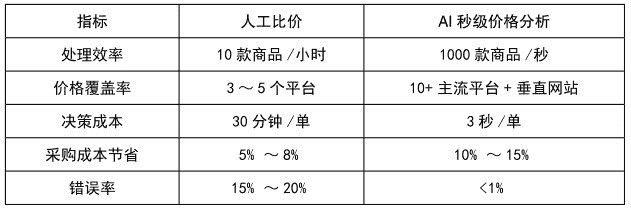

### 1.1.2 伙伴管理靠经验 VS 数据驱动智能决策

在链路管理中，经验驱动与数据驱动形成明显分化。以下从评估维度、风险识别时效、决策依据、分层效率、成本优化空间五个角度对比，如表 1-2。

表 1-2 伙伴管理靠经验 VS 数据驱动的智能决策对比

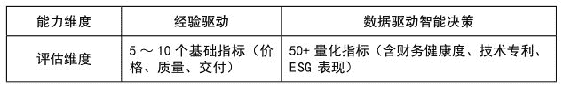

续表

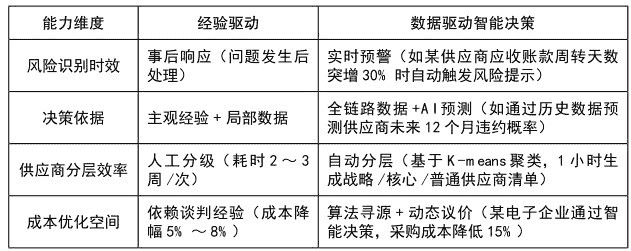

可见，未来伙伴管理将是“人的战略深度”与“数据的执行精度”相结合的混合模式，协同才能提升韧性与效率。

### 1.1.3 合同风险难控 VS 智能合约自动预警

在合同管理领域，人工审查带来的风险失控与基于区块链与机器智能的智能合约自动预警形成颠覆性差异。表 1-3 为对比。

表 1-3 合同风险难把控和智能合约自动预警的对比

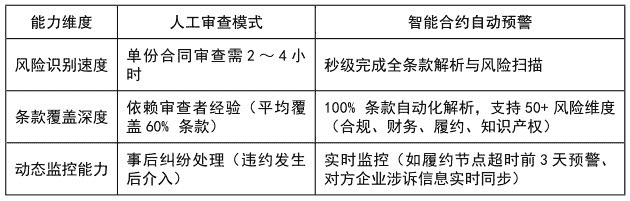

续表

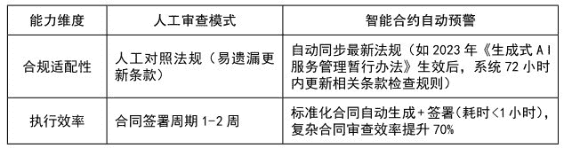

## 1.2 采购基础

企业若只重结果不重过程，采购管理便会停留在价格层面，流程中的隐性成本被忽视，最终在价格上失利。采购是过程而非结果，采购成本是企业总成本的重要部分。若理解不足、模式不专业，采购成本将成为运营的“吞金兽”。

俗话说：“买得好，等于卖了一半。”采购是构建竞争优势的重要手段，但不少企业仍将其视为单纯买卖，缺乏专业管理而蒙受损失。

采购不只是获取资源，更是一项完整的经济活动。通俗说，采购是指企业在特定条件下从供应市场获取经营资源，以维持正常生产经营的经济行为。

从三层面理解采购定义更清晰。

**1. 采购是获取资源的活动**
企业生产经营需从外部获取原材料、半成品、物流、技术服务等。提供这些资源的市场构成供应市场，从中获取资源的过程即采购，也是其基本功能。

**2. 采购兼具商流与物流**
采购要将资源从市场转移至企业，既是商流，需完成所有权转移，也是物流，需通过包装、运输、仓储、装卸等实现实物空间转移。

**3. 采购是完整经济活动**
采购不仅是买资源，更会产生各项费用，形成采购成本。因此管理不能只盯价格，需关注整体流程。

### 1.2.1 采购常见模式

深入理解基础后，才能选择适配模式。企业需从采购组织、采购思维、采购操守、采购绩效四个维度构建 OTEP 框架，并借助协同采购、集成采购、响应采购、反应采购等常见方式指导实践。

**1. OTEP 框架下的类型选择**

团队技能不足是重大障碍。笔者曾对 31 家企业调研，其中 25 家制造型、3 家贸易型、3 家服务型，并建立 OTEP 框架。

OTEP 是采购组织、采购思维、采购操守、采购绩效四维的简称，如图 1-1。企业通过搭建 OTEP 可形成优秀的采购矩阵运营体系。

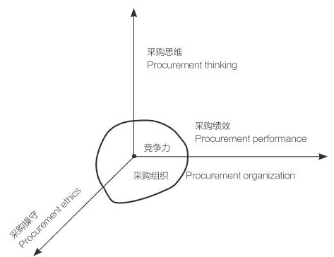

图 1-1 OTEP 框架

四维度对比结果见表 1-4。

表 1-4 OTEP 框架的 4 个维度比较

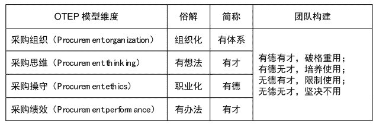

从组织与流程设计到人才建设，所有绩效与技能均应基于企业战略的当前竞争与长期可持续需求，通过内部优化整合资源，支撑战略落地。

OTEP 下的类型选择主要遵循五项原则。

（1）确保供应交付。把握市场资讯与趋势，从伙伴获取质量、包装、品牌、折扣、价格、奖励、交期、送货地点等有利条件，达到采购标准，实现供应与交付。

（2）总成本最低。战略采购关注的是总成本最低而非单价最低。低价背后常隐藏更高总成本。曾见企业为防腐败设审计部，一味压价，导致采购团队花费大量时间找低价证明，专业性受损，价值归属感下降。

成本战略采购涉及伙伴、采购、研发生产、售后等多部门，必须管控全流程成本，避免盲目追求单价。

（3）建立共赢关系。不同企业采购方法不同，有重合作、有重竞争、有外包。但采购不是零和博弈，而是商业协商。若执着于压榨伙伴，企业难以受益。要基于市场认知与自身战略，实现利益相关方共赢。

笔者在某企业成本改善项目中，通过构建与伙伴的共赢关系，实现数据、工艺、模具、研发、品质协同，3 个月内伙伴准时交付率提升至 98%，企业采购总成本下降 11.5%。

（4）完善采购能力。战略采购能力不仅是询价谈判，还涵盖采购精神、绩效、职业化三大层面，细分为采购逻辑、战略能力、伙伴整合与关系管理、品质管控与计划、成本建模与管控、商务协同与谈判六大能力，如图 1-2。

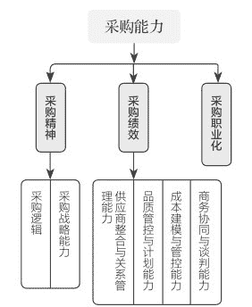

图 1-2 采购能力

少数企业能兼具，仍应持续完善，优先优化成本建模与管控、采购战略、伙伴整合与关系管理三项能力，为战略采购循环奠基。

（5）制衡与合作。链路是动态的，双方都具议价权。若企业充分了解伙伴战略、运营模式、竞争优势，就能在共赢中寻找平衡。即使单一来源，也应持续关注行业动态，借助深度合作降低成本、增强竞争力。

**2. 协同采购方式**

适用于品类多、数量大的企业，需庞大团队管理质量、交期、服务、成本。管理成本高时，企业常将品类共性产品汇聚，委托渠道商管理，如沃尔玛。

在新零售下，功能性产品细分，成本最低不再是唯一目标，高效仍是关键。大数据提升可计划性，由按库存生产转向按需或按单生产，渠道链路向精益链路演进。

**3. 集成采购方式**

适用于品类多但种类少的企业，如丰田，市场竞争激烈，以总成本为导向。

新零售下订单数量与频次增加，由大批量少品种向小批量多品种转变，订单前置。生产由按订单向按订单设计演进，精益链路升级为柔性链路。

**4. 响应采购方式**

适用于品类少、数量少的企业，常采用个性化定制。市场个性化需要链路柔性响应，高端定制即为典型。

大数据普及与精准分析推动需求拉动战略。柔性链路在满足多样化需求的同时，利用数据整合寻找成本与利润空间，并加快响应与服务，向敏捷链路转化。

**5. 反应采购方式**

适用于品类少、数量多的企业，如戴尔，属大规模定制、模块化生产，需个性化与快速响应。

该模式注重客户体验与运营效率，减少过程库存，缩短交付。随着客户画像清晰，需求可预测甚至引导，链路响应前置。运行效率与利润率更高，更新更快，服务水平提升。

### 1.2.2 采购的四大维度

OTEP 是制定采购战略的关键工具，涵盖采购组织、采购思维、采购操守、采购绩效四大维度。

**1. 采购思维**

采购思维即采购精神。以成本为中心还是盈利为中心？心态如何？为何采购回报高？与伙伴关系怎样？如何由被动转主动？

建设采购思维的工作与目标：

（1）理顺财务认知：采购创造利润。

（2）构建清晰采购与供应链逻辑，帮助从业者立体理解任务与目标。

（3）塑造盈利型采购思维，形成良好心态。

（4）辅导实操，建立采购组织的财务价值认知，形成职业化思维。

**2. 采购组织**

组织力即生产力。制度滞后是否影响客户响应？采购漏洞是否频发？基于战略服务目标与绩效管控建设采购组织与制度流程，可规范体系、降低风险、提升能力。

建设采购组织的工作与目标：

（1）协助明确组织任务与职能。

（2）协助理顺采购团队的战略指向、业务流程与制度规范，并建立跨部门的信息回流机制。
（3）围绕企业整体目标，帮助构建采购架构与配套的绩效评估体系。
（4）推动采购团队贴近业务现场，提升实操能力与落地执行力。

**3. 采购效能**
采购效能决定了价值能否被兑现。采购人员要形成价值链贡献需要哪些能力？有哪些抓手？企业应为采购人员绘制能力雷达图，并明确财务维度的考核指标。

落地动作如下。
（1）梳理采购战略与具体任务的联动关系。
（2）强化供应商开发、筛选、评估与管理的专业能力。
（3）提升采购降本与商务谈判的实战水平。
（4）建立系统化绩效，覆盖计划、仓储、生产、配送、工艺与排程等环节。
（5）对采购人员进行方法工具的带教，保障技能真正转化。

**4. 采购职业操守**
采购职业操守源于岗位特殊性，是采购人员在作业中必须恪守的道德底线与行业规范，具有基础性与制约性。

企业落地要点：
（1）建设健康的采购职业发展规划。
（2）厘清企业伦理与职业伦理的边界。
（3）理解采购工作的主动与被动属性。
（4）规范知识产权、保密信息、技术资料等资源的管理规则。
（5）制定行为准则，要求采购人员始终维护企业利益，诚实履职、踏实做事。

**1.3 人工智能赋能采购与供应网络**
在四大基础维度夯实后，企业借助人工智能可显著提升运行效率、控制风险、稳定供应网络，最终放大采购价值。持续优化标准流程，让采购活动更高效透明，通过细化标准与强化协同，在竞争激烈市场中保持优势，实现可持续发展。

### **1.3.1 采购数字化转型的底层逻辑**
本质在于数据要素与技术能力的深度融合，重塑采购业务的价值创造方式。这不是简单的工具替换，而是从经验驱动转向数据驱动、从流程执行转向战略赋能的系统性变革。

**1. 价值重塑逻辑：从成本控制到战略价值创造**
传统采购聚焦降本，如压价、规模化采购。转型思路是将采购升级为企业的价值枢纽，实现三重跃迁。

（1）供应网络韧性建设。
①传统做法：依赖少数优质厂商，风险集中。
②数字化做法：通过厂商网络数据分析，如舆情监测、产能分布、替代源发掘，构建动态韧性网络。
（2）战略成本优化。从单点价格谈判转向全生命周期成本管理。利用物联网采集设备运行数据，分析厂商维保成本；借助区块链追溯原材料碳足迹，提前应对未来碳关税合规成本。
（3）创新赋能。数字化采购系统接入外部创新资源，实现采购即创新。

**2. 技术赋能逻辑：数据成为采购新生产要素**
转型核心是数据驱动决策，底层遵循采集→处理→应用→迭代的闭环。

（1）数据资产化，打破信息孤岛。传统采购数据散落在ERP、OA、表格中，企业平均涉及17套相关系统，形成数据烟囱。数字化基建则搭建采购数据中台，整合内部需求、外部行情、交易过程三类信息，形成数字孪生。例如海尔采购中台接入300+数据源，需求预测准确率提升至92%。
（2）算法替代经验判断。
①厂商选择：传统仅看报价与资质，数字化模型加入交付准时率波动、产能利用率变化等动态因子。
②价格管理：依托实时市场数据与历史交易数据训练定价模型，自动生成动态价格基准线。某零售企业AI定价系统每15分钟更新采购指导价，价格竞争力提升15%。
（3）自动化执行降本提效。RPA自动处理订单、发票、对账等重复性任务，释放人力；AI智能审核合同条款，降低法律风险。

**3. 流程再造逻辑：从线性割裂到网状协同**
传统流程是需求提报→招标→谈判→下单→验收的线性链条，响应滞后。数字化转型通过解构、赋能、协同重构业务逻辑。

（1）需求端：从被动响应到主动预测。AI分析历史需求与市场趋势，提前预测，实现需求前置。某制造企业将原材料提前期从30天缩短至15天，库存周转提升20%。员工通过AI采购助手提交非标需求，系统自动匹配厂商库并生成合规方案，处理效率提升90%。
（2）执行端：从人工干预到智能自治。标准化采购实现无人化，申请触发系统自动比价、下单、结算；复杂采购借助AI辅助评标，自动抓取标书关键数据生成建议报告，人工决策效率提升70%。
（3）协同端：从内耗到生态共赢。搭建厂商协同平台，实时共享产能、品质、物流数据，实现计划-采购-生产同步。某主机厂与电池厂商数据直连，到货准确率由82%提升至98%，牛鞭效应降低40%。

**4. 生态协同逻辑：从零和博弈到价值共生**
传统采购与厂商关系是价格博弈，转型推动向生态共同体演进。

（1）数据共享驱动共生进化。企业向战略伙伴开放部分经营数据，换取技术预研支持。
（2）风险共担机制构建。利用区块链构建供应风险图谱，实时监控多级厂商风险。智能合约嵌入风险共担条款，原材料价格波动超阈值时按约定分摊成本。
（3）可持续价值共创。数字化系统自动评估厂商ESG表现，推动供应网络绿色转型。中小企业通过数字化采购平台接入大企业生态，获得订单、技术、融资支持。京东链上京东平台帮助3000+中小厂商获得供应链金融贷款，融资成本下降3个百分点。

本质是通过数据穿透业务、算法替代经验、生态超越个体，实现效率、风险、价值三层面的降维突破。

### **1.3.2 采购大脑：人工智能驱动的智能决策系统**
数字化时代，企业采购面临海量信息、复杂市场与多元需求，传统决策方式难以满足高效精准要求。人工智能驱动的决策系统如同一家企业的采购大脑，通过深度分析与智能处理为决策提供支撑。

**1. 数据驱动的智能分析**
系统具备强数据采集与处理能力，可整合内部采购历史、库存、生产计划及外部行情、厂商信息、行业动态。机器学习对数据清洗建模后挖掘规律。例如分析历史价格与供需数据预测未来物资价格走势，指导采购时机。同时可基于社交媒体、口碑、财务等多维数据，对厂商进行更精准的实力与风险评估。

**2. 智能决策的应用场景**
需求预测方面，依据生产计划、历史销售、市场趋势精准预判未来采购需求，避免积压或缺货。谈判方面，分析历史谈判与市场行情，提供最优策略与价格底线。合同管理方面，自动识别价格、交期、质量标准等关键条款，实时监控执行并预警违约。基于大量合同数据可优化模板与条款，降低法律风险。

某制造企业引入系统后，准确预测原材料上涨趋势提前备货节约成本，厂商评估更全面，物资质量与交期准时率提升。采购成本降低15%，效率提升30%。

### **1.3.3 RPA机器人：终结重复性操作**
采购流程存在大量重复繁琐工作，如录入订单、核对发票、生成报表，既耗时又易错。RPA机器人改变了这一现状。

**1. 工作原理**
RPA是一种基于规则的软件机器人，可模拟人工在电脑上的操作，自动完成重复流程。通过读取界面数据，按预设规则进行输入、处理、输出。例如从表格读取订单信息，自动登录系统填写并提交。具有高灵活可扩展性，可与ERP、CRM、财务系统集成，无需改造原系统即可实现自动化。

**2. 采购流程应用**
订单处理环节，机器人自动接收、录入、审核、确认订单，自动校验价格、数量、交期准确性。发票核对环节，自动读取发票信息与订单、入库单比对，合格则自动报销，不符则预警。报表生成方面，按预设格式自动抽取数据生成采购、库存、厂商绩效报表并定时发送，大幅提升效率与准确性。

**3. 优势与效益**
可7×24小时运行，极大提升效率，错误率近乎为零，降低人力成本，让采购人员聚焦战略采购与厂商管理。某跨国公司部署后，订单录入时间缩短80%，发票核对错误率下降90%，报表生成时间减少70%。

### **1.3.4 区块链加人工智能：构建可信采购生态**
信任是合作基础，传统模式存在信息不对称、数据篡改、流程不透明问题。区块链与人工智能结合为构建可信生态提供方案。

**1. 优势互补**
区块链具备去中心化、不可篡改、可追溯特性，可将采购全流程数据记录在分布式账本，保证真实完整。人工智能具备强大分析能力，可深度挖掘链上数据，为决策提供支持。例如在厂商管理中，区块链记录基本信息、生产过程、质量检测数据，人工智能基于此进行智能评估与风险预警。

**2. 生态构建**
供应链溯源方面，实现从原料到销售全流程可追溯，消费者扫码即可查询来源、生产、检测信息，提升信任。合同管理方面，采购合同以智能合约上链，实现自动执行与监管，满足条件自动触发付款、交货，人工智能实时监控并提出解决方案。资金结算方面，区块链实时记录资金流向保障安全，人工智能按合同规则自动清算结算，提升效率。

某农产品企业采用技术后，种植、用药、收获等信息全程可溯，人工智能提供采购建议，销量增长30%，客户满意度提升25%。

# **第二章**

# **人工智能重塑采购计划**

## **2.1 采购计划痛点聚焦**
计划常因市场瞬息万变和需求难以预判而受阻。忽视计划导致资源错配与成本上升，科学计划则能精准应对波动、优化物料需求、稳定链路、提升竞争力。人工智能借助大数据分析与预测模型，帮助企业把握需求与链路动态，制定科学计划，降低成本、优化配置，提升运行效率。

### **2.1.1 需求预测偏差导致库存积压**
传统计划中销售、市场、供应链数据分散，难以整合，预测准确性低，库存积压严重。传统模型无法实时响应促销、竞品动作等波动，加剧库存风险，拖累资金周转。滞销品占用资金，畅销品缺货，牛鞭效应放大，信息不对称导致计划失真，管理失控，运营成本上升。

### **2.1.2 厂商匹配耗时超72小时**
制定计划时厂商匹配耗时巨大，制约效率。人工筛选评估繁琐，依赖经验，缺乏数据支撑，选择不准，风险增加。核心问题有三：信息不对称，厂商资质文件格式不统一；人工筛选盲区，忽略履约历史、风险事件等隐性指标；跨部门评审标准不统一，协同断层。

### **2.1.3 紧急采购响应慢300%**
突发紧急需求时，传统流程需逐级审批，信息传递滞后，响应速度大幅下降。手工填报、层层审批、电话沟通耗时冗长，难以快速应对市场变化，错失商机。缺乏实时数据支持，决策迟缓，加剧延误，影响生产与客户满意度。

## **2.2 传统采购计划的价值**
无计划的采购在市场变化面前迷失，企业为此付出大量资源。只有基于完善的计划，才能确定采购数量、时间与方式，使战略落地，满足需求。

制定计划的核心目的有五点：
（1）预估物料需求数量与时间，避免断供影响生产。
（2）防止采购过量导致库存积压与资金占用。
（3）配合企业生产与资金使用计划。
（4）指导采购部门把握时机制定采购策略。
（5）明确物料耗用标准，提升成本管理能力。

成本是采购的痛点，人工、时间、物料成本无处不在。仅靠采购人员难以有效控本提效，企业缺乏计划就无法突破困局。调研显示，采购失控的根源多为计划缺失，导致企业持续被以下问题困扰。

**1. 采购管理失控**
缺乏计划支撑，采购在多环节失控。
（1）采购时间难以确定。供料紧张时缺乏时间多渠道询价比价，议价能力受损，价格合理性难以保证。
（2）采购程序难控。领导干预、计划变更等导致流程失序，合理手段难以执行。
（3）采购手段难把握。市场变化下缺乏应对机制，难以抓住最优价格。
（4）验收难及时准确。供料紧、人员不足导致验收不力，品质难以保证。
（5）付款方式难保障。资金周转压力导致议价手段缺失。

**2. 厂商管理失控**
无计划采购将厂商管理简化为货源管理，合作停留在表面。
（1）无节制压低单价。将厂商等同于菜市场摊主，以价低者得为原则，易导致以次充好、断供，生产停滞。
（2）仅做审核监管。对厂商能力低下、交货慢等问题，企业仅靠审核处罚，反而加剧不信任，双方聚焦推诿而非提升。

货源管理的常见误区

（3）刻意压款拖欠。为缓解采购占用资金，部分公司把压款当成采购手段，甚至写入考核指标。于是拖欠演变成常态，还有的以质量问题、延期交付为由，逼供应商延期付款或接受折扣。

短期确实能腾挪资金，长期却会严重损害商业信誉和品牌形象。

（4）频繁更换供应方。“不合适就换。”不少采购部门都有这种想法。当把供给方仅视为货源时，只关注单次交易的单价、品质或服务，根本不在意是谁供货，于是每次都重新比选，追求最低价。

弊端明显：难以建立稳定合作，供应链整体效能难以提升，反而让供应商采取一次性交易心态，不愿做深度投入。

货源管理短期或有小利，但衍生的采购乱象不利于综合实力提升，也妨碍可持续发展，更会阻断竞争优势。

### 2.2.1 采购计划制定

编制采购计划的首要前提是厘清采购需求。识别不清就会出现漏采或多采，干扰采购目标达成。

**1. 采购需求**

采购需求识别流程如图 2-1 所示。只有客户订单需求确认后，公司才能结合市场环境确认采购需求，再做拆解，随后启动具体采购任务。若确认环节出错，不仅造成成本浪费，还可能拖慢生产、影响客户体验。

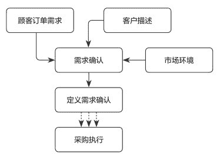

图 2-1 采购需求识别流程

明确采购需求时容易陷入的误区及对策如下。

（1）需求一来就立计划。采购需求必须经过评审确认才能进入计划。否则需求变动，已购物料可能作废。

（2）无条件满足所有需求。市场变化快，获悉客户需求后应先分析对应物料的市场情况。若需求与公司发展方向或现实市场不符，应与需求部门沟通，调整甚至取消。

因此需求的明确与筛选需经过两个关键环节。

（1）需求拆解与确认。初次沟通时需求常表现为产品、数量、价格的组合，但在确认阶段采购部门必须进一步细化，如交期、包装、付款方式、特殊要求等。

针对订单涉及的全部要素，与需求部门充分沟通达成共识，形成完整的需求表。

（2）需求评审。收到需求后，公司应组织采购或跨部门评审，避免采购失败导致订单无法交付，影响客户体验和公司形象。

评审通过后须责任人签字确认，需求表才能移交采购部门正式执行。

**2. 物料需求计划 MRP 应用技巧**

编制采购计划的核心工作是制定物料需求计划 Material Requirement Planning，MRP。

20 世纪 60 年代 IBM 提出“独立需求”“相关需求”概念后，制造业库存控制从订货点法转向 MRP。MRP 的核心是预测法管控独立需求，精确计算法管控相关需求，通过运算得出物料需求。

MRP 运算以主生产计划 Master Production Schedule，MPS、物料清单 Bill of Materials，BOM 等资料为依据，计算各时点物料需求。

其中 MPS 决定各具体产品在各具体时段的生产安排，需与经营规划和销售规划协同；BOM 是描述产品组成的技术文件，包含总装件、分装件、组件、零部件及原材料的结构关系和需求数量。

操作中须遵循 4 条基本原则。

（1）客户需求是源头，应尽量明确。

（2）MPS 是关键，短期内保持稳定，长期内滚动调整以满足需求。

（3）MRP 运算是过程，基础数据和算法的准确性最重要。

（4）采购订单、各工序制造工单是结果，优劣取决于前端运算和后续管控。

如此方能在及时取得生产所需物料、保证产品按时供应的同时，尽可能降低库存。

MRP 的有效运用离不开订货点法和安全库存的配合。

订货点法又称订购点法或安全存量法，指物料库存因生产销售而递减，当降至预设点位时即发出订货单补充库存；当降至安全存量 Safety Stock，SS 水平时，所发订单的物料恰好到货，补充前期消耗。该点位即为订购点。

实施前采购人员须明确安全存量、最高存量、最低存量三个概念。

（1）安全存量。平时不使用，是为防范不确定性如突发大额订单、交期延迟、用量临时增加、客户交期提前等而设的缓冲库存。其计算为：

安全存量=紧急订购需天数×每天使用量

（2）最高存量。生产高峰期某项物料允许的最高库存水平。其计算为：

最高存量=一个生产周期的天数×每天使用量+安全存量

（3）最低存量。生产淡季确保生产的最低库存量。其计算为：

最低存量=订购时间×每天使用量+安全存量

由此可知，存量设置并非固定，生产波动会直接影响存量水平。

要借助 MRP 精准控库，需明确三件事：维持多少存量即库存水准、何时采购即订购点、采购多少即订购量。否则将面临库存失控带来的不良后果，如表 2-1 所示。

表 2-1 库存控制不当的后果

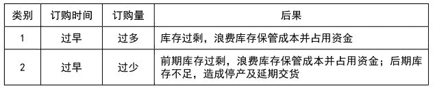

续表

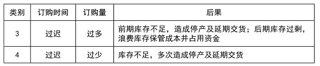

订购点法实施的核心是以库存水准决定订购时机。因此须先确定各物料的订购点和订购量。如图 2-2 所示，通过账务管理发现库存低于订购点量时，应迅速制定采购计划，使库存回到安全水准。

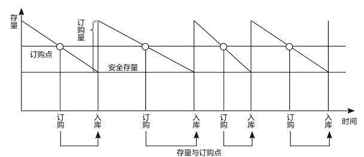

图 2-2 订购点法

由此可见，订购点法有两大要点。

（1）确定物料订购点。其计算为：

订购点=平均日需求量×平均订购前置时间+安全库存

（2）确定经济订购量。

具体推导包含 4 步。

①订购成本=储存成本，即最优订购量 EOQ。

②年订购成本=年订购量÷EOQ×平均每次订购成本。

③库存成本=EOQ÷2×物料单价×库存维持率。

④

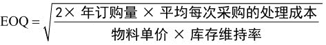

借助订货点法，公司可做到不断料、缩短备货时间、简化运营、快速响应紧急订单，这也是制定 MRP 的核心方法。

### 2.2.2 采购预算管理

采购预算是以金额体现的采购计划。它应与销售预算、生产预算联动，提升资金使用效率；并与采购调研、采购计划保持一致，推动计划落地。

**1. 编制采购预算的作用**

不少公司质疑编制采购预算的意义，因为实际采购支出总是超预算或远低于预算——“预算再准也白搭，用多少还不是照用。”

产生这种误解，是因为采购预算失去了应有的作用。采购预算是用以规划协调采购活动的重要工具，而非仅是财务或审计部门的工具。

编制采购预算的过程，正是采购人员深入了解公司属性、物料需求及市场态势的过程。在整体预算管理框架下，采购预算的编制能对全组织需求进行管理，而非局限于采购部门内部。

**2. 编制采购预算的方法**

编制依据是物料成本和公司对物料价格的预期。具体方式因预算管理模式而异。一般公司的预算表编制流程如图 2-3 所示。

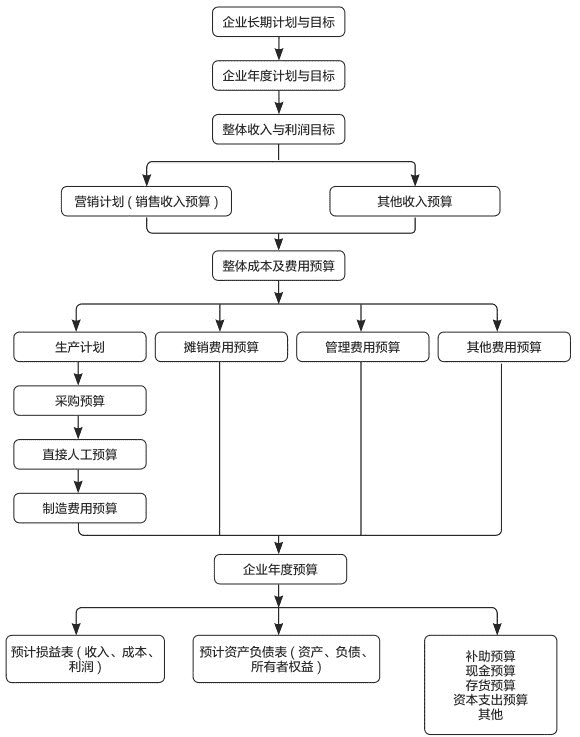

图 2-3 预算表的编制流程

在采购预算层面，其编制流程通常如图 2-4 所示。

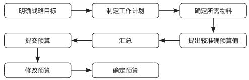

图 2-4 采购预算编制流程

**3. 采购预算管理的 5 点注意**

采购预算管理直接影响采购推进，也与整体预算管理密切相关。需注意以下 5 点。

（1）编制前须做深入市场调研。唯有基于物料价格、供求关系、宏观经济形势、汇率变化等多维信息，预算才现实可行。

（2）编制须遵循明确的编制与修改流程，设置完善的分析监管机制，提升科学性。

（3）编制不可能覆盖所有情况，可提出必要且合理的假设以保持有序推进。

（4）预算编制要尽量具体化、量化。

（5）鼓励相关部门参与，确保预算符合公司战略需求。

## 2.3 采购计划的 AI 解决方案

借助智能技术，公司可实时洞察市场动态，精准预测物料价格波动，优化采购计划与预算编制，提升预算准确性和可行性。智能系统还能自动监控预算执行，及时调整策略，保持采购活动与市场变化同步，从而提升整体运营效率。人工智能的引入减轻了采购人员负担，通过数据驱动决策有效降低人工、时间及物料成本。公司依靠智能分析，能更精准把握市场趋势，制定更合理的采购预算，在竞争中占据优势。

### 2.3.1 智能需求预测

掌握智能工具后，系统可通过历史数据和市场趋势分析，精准预测未来物料需求，助力公司提前规划采购，避免积压或缺货。同时还能实时监测需求变化，动态修正预测结果，保证采购策略的灵活性和适应性。

用智能工具做需求预测大致分为四步：数据收集、模型构建、预测分析、结果验证。

**1. 数据收集**

数据分内部和外部。

内部数据包括 ERP 销售订单、库存记录、WMS 仓储数据、MES 生产数据等。外部数据涵盖市场报告、行业趋势、竞争对手动态等。

整合内外数据，构建完整的数据基础，为模型构建提供支撑。

**2. 模型构建**

选择合适的预测模型，如时间序列分析、回归分析等，结合公司实际设定参数并优化模型。利用机器学习算法捕捉数据间复杂关系，提高预测精度。模型构建可借助 DeepSeek 等智能工具实现，便捷高效。

**3. 预测分析**

在预测分析阶段，系统将处理后的数据输入模型，生成需求预测报告。报告涵盖需求量、时间节点、潜在风险等关键信息，为决策提供依据。

**4. 结果验证**

最关键一步是对预测结果进行实际验证，对比实际需求与预测数据，评估模型准确性，并根据偏差调整优化模型，保证预测的可靠性和实用性。通过持续迭代，智能需求预测能力将不断提升，助力高效科学的采购管理。

### 2.3.2 供应商智能匹配

引入智能技术后，公司可根据物料特点和采购战略智能匹配供应商。如关键部件采用战略联盟，原材料选择长期合作伙伴，办公用品通过网上采购，辅料配件则签订长期合同。智能系统依据供应商数量、库存水平等数据优化匹配方案，提升供应链协同和采购效率。

供应商管理的内容在后文专门阐述，这里不再展开。

### 2.3.3 动态采购计划优化

通过算法实时分析市场需求、库存变化及供应商状态，可动态调整采购计划，优化采购批次和数量。结合历史采购数据和当前市场趋势，精准预测未来需求，保证采购计划的灵活性和前瞻性。

例如，对比 2024 年四季度采购数据与 2023 年同期，分析出需求增长趋势，从而调整 2025 年一季度采购策略，避免积压或短缺。通过动态优化，实现采购成本有效控制和供应链高效运转。

### 2.3.4 自动化采购订单生成

智能系统可依据优化后的采购计划自动生成采购订单，包含品名、数量、价格等详细信息，并通过电子签名和加密技术保障订单安全。系统可实时监控订单状态，自动催单跟进，减少人工干预，提升处理效率，确保采购流程无缝衔接，降低人为错误风险。

系统还能根据供应商反馈和市场变化动态调整订单细节，保证采购需求的精准满足。通过自动化订单管理，公司可实时追踪订单进度，及时发现并解决潜在问题，进一步提升采购流程透明度和可控性，保障供应链稳定高效。

从上述内容可看出，智能工具的引入让需求预测、供应商管理、动态计划、订单生成等环节实现智能化升级，表 2-2 显示四个环节引入智能工具后的核心价值变化。

表 2-2 引入 AI 工具后采购环节核心价值变化

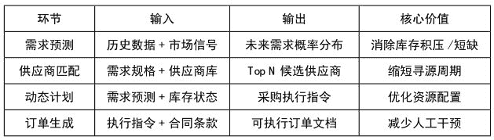

借助智能应用，公司不仅能提高采购效率，还能显著降低运营成本，增强市场竞争力。环节的智能化协同保证供应链的灵活性和响应速度，为公司持续发展奠定基础。

# 第三章

# 供应商全生命周期 AI 管理

## 3.1 供应商管理的痛点聚焦

传统供应商管理存在诸多痛点，如信息不对称、沟通效率低、评估标准不统一，导致选择与合作风险增加。人工智能借助大数据分析和智能算法，可全面评估供应商资质，实时监控合作表现，提供精准绩效评估和风险预警，有效解决传统管理难题，提升管理的科学性和透明度。

### 3.1.1 供应商资质审核需 5 人团队耗时 2 周

在资质审核环节，传统模式下公司往往需组建 5 人专业团队，用时整整 2 周才能完成对供应商的全面审核。耗时主因是审核内容广泛，涵盖营业执照、生产许可证、质量管理体系认证、财务报表、生产能力、技术研发能力、过往合作业绩等。

审核团队需逐项查阅、分析和验证资料，必要时还要实地考察生产场地、设备设施和管理状况。例如财务报表审核需专业财务人员逐笔分析指标，判断财务健康和偿债能力；生产能力考察需深入车间了解产线布局、设备先进程度、员工熟练度等，均耗时耗力。

即便投入大量资源，审核仍易受主观影响。不同审核人员因专业背景、经验、风险偏好差异，对同一供应商可能得出不同结论。如评估技术研发能力时，有人更看重团队规模和学历，有人更关注研发成果和专利数量。主观差异易导致优质供应商被误判，或问题供应商进入供应链，为后续合作埋下隐患。

### 3.1.2 供应商风险预警滞后 3 个月

传统采购模式下，公司在供应商风险预警方面滞后明显，通常达 3 个月。这意味着风险发生并持续数月后公司才察觉，错过最佳应对时机。

滞后原因主要有三。

其一，风险数据收集渠道有限且不及时。公司多依赖供应商自身报告和历史合作数据，对行业动态、市场变化、政策法规调整等外部因素的收集和分析不足。如供应商所在行业出现新竞争对手、原材料价格大幅波动、环保政策收紧时，公司可能无法及时获知。

其二，风险评估方法不够科学高效。许多公司仍用定性分析，靠人工判断识别风险，缺乏基于大数据和模型的定量分析，效率低且易受人为影响。

其三，内部部门间信息共享和沟通不畅，导致风险信息不能及时传递，进一步加剧预警滞后。

预警滞后可能带来严重后果，如供应商出现质量问题、交期延迟、资金链断裂，公司因准备不足面临生产中断、客户投诉、市场份额下降等，损及经济效益和声誉。

### 3.1.3 绩效评估主观误差达 40%

供应商绩效评估存在严重主观误差，据统计误差率高达 40%。主因是绩效评估体系不够科学完善，指标和标准不明确不量化，过程过度依赖评估人员主观判断。

例如评估产品质量时缺乏量化指标，仅凭评估人员对外观、使用体验的主观感受打分；评估服务水平时也缺乏明确标准，导致结果主观性强。

此外评估人员的个人偏见、情感因素也会影响结果。有的因与供应商关系好而高分，有的因固有印象忽视实际表现变化。主观误差严重影响评估准确性和公正性，公司难以真实了解供应商表现，无法及时发现问题，也难以有效激励约束。

表现优秀的供应商可能因误差得不到认可，合作积极性受损；表现较差的供应商可能因误差继续留在供应链，给采购成本、产品质量带来负面影响。

## 3.2 AI 在供应商管理中的创新应用

面对传统管理的痛点，人工智能能有效解决信息不对称和主观误差，通过大数据分析和智能算法实时监控供应商动态，精准评估绩效，提升决策科学性，确保供应链稳定。

### 3.2.1 供应商智能筛选

传统供应商开发是一项复杂且耗时的工作，公司投入大量人力物力仍难以开发更多潜在优质供应商。

# 采购供应链的智能化跃迁

在信息来源分散、渠道繁多的环境下，智能配对系统能够对多源海量信息进行快速解析，筛出匹配度较高的合作对象，明显缩短寻源周期、压缩人力投入，帮助企业锁定具备长期价值的优质伙伴。

依托合作方过往履约记录与平台公开信息，智能系统可以在极短时间内完成候选池的初筛，并借助电子招标、电子询价等线上工具推动采购计划落地，从而压缩整体采购周期、降低采购支出，让企业实时感知市场动向，获取更优价格。

举例而言，构建一套以人工智能为驱动的供方评估模型，将信誉水平、交付能力、价格竞争力等多维度指标纳入计算并自动输出排序清单，就能为管理层决策提供清晰依据。通过该撮合机制，企业不仅可以高效甄选优质供方，还能持续追踪履约表现，适时调整合作策略，保障供应链稳定运行。

落地路径可拆解为以下四步。

Step1：信息汇聚与清洗

（1）信息来源。
①供给方信息：ERP供方档案、历史交易记录、资质证书（ISO/行业认证）、舆情评价（新闻/诉讼）。
②需求方信息：SKU规格、历史采购订单、生产计划、库存水位。

（2）核心处理技术。
①结构化数据：SQL数据库+Pandas清洗（去重、缺失值填充）。
②非结构化数据：NLP处理供方文档（如检测报告、合同条款）。
python

From sklearn.feature_extraction.text import TfidfVectorizer

tfidf=TfidfVectorizer（）#将供应商描述文本转为向量

supplier_profiles=tfidf.fit_transform（supplier_docs）

③外部数据：爬虫抓取供方社交媒体动态（如产能预警）、海关进出口数据（验证真实交易量）

（3）工具建议。
①数据湖：AWSS3+Databricks（统一存储结构化与非结构化数据）。
②实时数据：Kafka+Flink（同步供方库存变动）。

Step2：特征构建与模型搭建

（1）关键特征。
①供方能力评分：
质量评分=历史批次合格率×0.6+认证等级×0.4
交期可靠性=准时交货次数÷总交货次数
②动态权重调整：
紧急采购时，交期权重提升至50%；常规采购时，价格权重占70%。

（2）常用算法。
①分类模型：匹配供方是否满足硬性条件（如最低产能要求）。
python

From sklearn.ensemble import RandomForestClassifier

model=RandomForestClassifier（）#输入特征：供应商产能、地理位置等

②推荐系统：协同过滤（CollaborativeFiltering）。
基于相似采购订单的供方推荐（如A商品采购商曾选择X供方，则B商品可复用）
③强化学习：动态优化供方组合（长期合作vs短期成本）。
python

#基于 Q-Learning 的供应商选择策略

Q=np.zeros（（state_space, action_space））#state：库存/预算；action：供应商选择

（3）选型参考：
①数据规模：小样本（<1万条）→随机森林；大数据（>10万条）→XGBoost+深度学习。
②决策类型：二选一（是/否）→分类模型；多选排序（Top5供方）→贝叶斯优化。

Step3：撮合方案规划

（1）策略类型。
①基于规则撮合：
硬性条件过滤（如注册资金≥500万元、ISO认证）。
规则引擎工具：Drools（开源）、IBMILOG。
②基于相似度撮合：
余弦相似度计算供方画像与需求画像的匹配度。
python

From sklearn.metrics.pairwise import cosine_similarity

similarity_score=cosine_similarity（supplier_vector, demand_vector）

③基于博弈论撮合：
Nash均衡模型：平衡价格谈判中的多方利益。

（2）动态调整机制。
①实时监控供方履约率，动态更新评分（如交货延迟一次扣减10%权重）。
②风险预警：当供方所在区域发生自然灾害时，自动切换备选供方。

Step4：部署上线与成效检验

（1）技术栈示例。
①数据处理层：Apache Spark（分布式计算）。
②模型服务层：TensorFlow Serving（模型API部署）。
③业务层：低代码平台（如OutSystems）构建供方管理界面。

（2）评估指标。
①匹配效率：从需求输入到供方推荐耗时（目标：＜1秒）。
②匹配精度：采购成本下降幅度、供方履约率提升。
③业务价值：库存成本降低15%～30%，供方切换频率减少50%。

### 3.2.2 自动化资质核验
在供应链准入环节，资质核验是核心控制点，需审核营业执照、税务登记证、生产许可证、财务报表、合规证明等数十类文件。

**1. 人工核验的三大瓶颈**
（1）效率低下。单份复杂文档人工审核耗时30～60分钟，大批量准入易形成流程堵塞。
（2）准确率受经验制约。人工识别证件有效期、经营范围匹配等信息易出错，漏审风险高。
（3）合规滞后。政策更新（如营业执照“多证合一”改革）时，人工规则难以及时迭代，存在合规漏洞。

**2. 智能核验**
借助OCR实现文档信息自动化提取，结合NLP完成语义解析与逻辑校验，可构建“数据采集—智能处理—风险决策”全链路自动化体系。

可构建供方资质验证自动化系统架构，图3-1所示为其架构示意图。
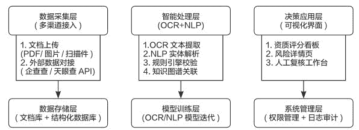
图3-1 供方资质验证自动化系统架构示意图

**3. 资质核验核心应用场景**
（1）营业执照智能审核。自动识别统一社会信用代码、经营范围、成立日期等字段，比对工商系统数据一致性，标记“经营范围与合作业务不匹配”“证件即将过期”等风险。
（2）财务报表合规分析。通过NLP提取资产负债率、流动比率等关键财务指标，结合行业基准自动判断偿债能力；识别“连续两年亏损”“审计意见为保留意见”等风险信号。
（3）资质证书动态监控。对有效期满前30天的证书自动触发预警，提醒供方更新；关联证书等级与业务准入要求（如建筑企业资质等级对应可承接项目规模）。

**4. 应用价值**
传统人工模式与自动化验证在效率、准确率、合规性、风险管控四个维度差异明显，如表3-1所示。
表3-1 传统人工模式和自动化验证的应用价值对比
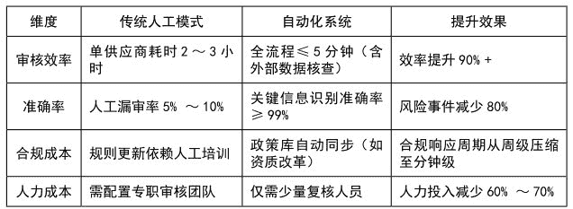
OCR与NLP融合不仅解决了资质核验的效率与准确率问题，更通过数据智能构建了供应链准入的“数字护城河”。企业需从技术选型、业务流程再造、数据治理三方面同步发力，才能最大化释放智能审核价值，为供应链高质量发展奠定基础。

### 3.2.3 供方风险预警雷达
该雷达用于实时监测与评估供方风险，借助多维数据与AI预测提前识别财务、履约、合规风险，实现风险等级自动划分与分级预警。

实施可分为数据采集与整合、风险评估模型构建、实时监控预警、风险应对策略制定四步。

**1. 数据采集与整合**
系统通过API接口、数据爬取等方式自动收集供方的财务报表、资质证书、履约记录等多源数据，并进行清洗、标准化处理。利用OCR提取文本信息，NLP解析关键数据，构建风险评估基础数据集。

**2. 风险评估模型构建**
基于整合数据集，结合行业标准与历史风险案例，运用机器学习算法量化供方风险水平。表3-2所示为核心风险维度。
表3-2 核心风险维度
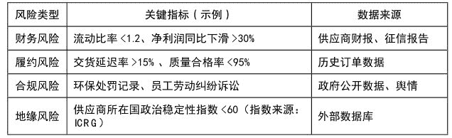
在此基础上，企业还需考虑市场波动、供应链中断等动态因素，通过AI模型实时更新评估结果，确保预警时效性与准确性。

**3. 实时监控预警**
系统通过API接口实时监测供方数据变化，结合AI模型动态评估风险等级，一旦触发阈值，立即生成可视化报告并推送至管理层。同时系统根据风险等级自动匹配应对策略。
图3-2所示为风险雷达图示例。
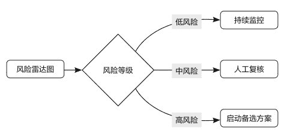
图3-2 风险雷达图示例

预警后应及时处置：供应能力风险可沟通扩产或寻找备选；质量问题要求加强质量控制、进行整改；财务风险可调整付款方式、要求担保等，并持续跟踪应对效果。

### 3.2.4 智能绩效评估体系
除筛选、核验、监控外，绩效管理同样关键。按风险等级、合作历史、业务重要性将供方分为核心、重要、一般等级别，制定差异化评估体系。传统模式缺乏动态调整，引入AI可实时分析表现数据并动态调整标准。

**1. 核心逻辑**
目标是通过多维数据动态评估供方的质量、成本、交期、服务、创新与发展潜力等能力，实现自动化评分→分级管理→策略优化闭环。具体评估维度如表3-3所示。
表3-3 智能绩效评估体系的评估维度
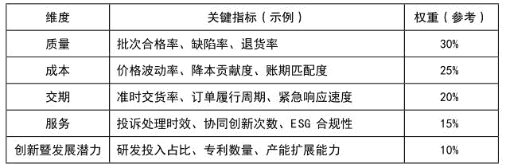

**2. 实施步骤与技术方案**
（1）数据采集与标准化。运用边缘计算对供方的多源异构数据进行标准化处理。
（2）动态指标权重设计。基于实时态势与任务需求动态调整各指标权重。权重分配可参考层次分析法确定基础权重，以及强化学习根据采购策略自动更新权重。例如紧急订单交期权重提升至40%，成本优化场景价格权重提升至50%。
（3）模型构建。采用机器学习算法结合历史与实时数据构建多维评估模型，不断迭代优化预测能力。
（4）可视化与决策应用。利用数据可视化技术直观展示评估结果。雷达图可展示各维度得分对比，热力图可按品类或区域显示供方绩效分布与风险等级。

该体系可帮助企业实时掌握供方综合表现，精准识别潜在风险并制定改进策略，建议优先在战略供方与高价值品类试点，逐步推广至全供方库。

# 第四章
# 采购品质管理的AI变革

## 4.1 采购品质管理的痛点聚焦
传统采购品质管理依赖人工质检，效率低且主观性强。AI的引入通过图像识别与大数据分析实现自动化质检，显著提升检测精度与效率。

### 4.1.1 人工质检漏检率偏高
人工质检存在明显局限，漏检率可达12%。长期重复作业易导致视觉与精神疲劳，注意力难以持续，对细微缺陷易忽略。如电子元器件检验中引脚微变形、焊点微瑕常被疏忽。标准执行不统一，不同人员因经验与判断差异导致敏感度参差，问题流入后续环节埋下隐患。高漏检率推高成本并损害声誉。

### 4.1.2 异常物料追溯耗时过长
物料异常时快速溯源至关重要，实际平均耗时超48小时。供应链环节复杂，记录不完整或不准确，溯源需大量时间收集整理信息。信息系统缺陷导致部门间沟通不畅，生产、采购、仓储、质检协调核实耗时长，造成生产停滞与成本上升。

### 4.1.3 供方质量波动缺乏预警
供方产品质量直接影响采购品质，常缺乏有效预警。原材料变化、设备故障、人员变动、工艺调整均易致波动。企业缺乏监控与反馈机制，难以及时察觉。沟通不畅、信息滞后、过度依赖少数供方均会放大风险。

## 4.2 采购品质管理的AI解决方案
在数字化浪潮下，AI可实时监控供方生产数据、预警质量波动，帮助企业及时处置、减少浪费、提升管理效率。

### 4.2.1 AI视觉质检系统
基于人工智能进行图像识别分类，核心目标是通过深度学习自动识别表面缺陷（划痕、裂纹、污渍等），实现缺陷定位→分类→分级→报警全流程自动化。

该系统已在浙江、江苏等多地产业聚集区应用，检测效率提升50～100倍，缺陷识别准确率超99%，漏检率降至0.1%以下。
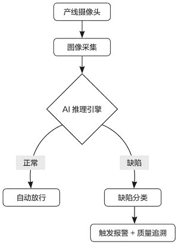
图4-1 AI视觉质检系统的系统架构

成熟方案可大幅提升效率与准确率，降低运营与质量风险。结合联合采购可进一步优化供应链管理，提升整体采购品质。

### 4.2.2 实时质量监测平台
核心目标是通过IoT传感器与边缘计算设备在生产过程中实时采集关键质量参数（温度、压力、振动、图像等），结合AI模型快速分析并预警异常，实现毫秒级响应→缺陷拦截→工艺优化闭环。

核心价值体现在：实时性从数据采集到预警响应延迟＜100ms；质量追溯全流程数据上链，支持秒级回溯；成本优化人工复检减少70%，废品率下降20%～50%。

例如在原材料存储环节，传感器检测到仓库湿度超阈值时，系统会立即通知相关人员采取防潮措施，避免受潮影响品质，实现对采购产品全生命周期的动态质量监测。

典型行业应用包括电子制造、汽车零部件、食品加工等，尤其在精密仪器生产中可实时监测微米级缺陷，确保产品零瑕疵出厂。平台还能通过大数据分析预测潜在质量风险，提前制定预防措施。建议优先在高价值、高缺陷率工序试点，逐步扩展至全产线。

### **4.2.3 质量预测：提前捕捉供方波动**
以时序分析为底座搭建的供方质量预判模型，会把过往的质量记录、生产表现与交付表现做深度挖掘。其设计思路是把历史轨迹与实时信号拼合起来，推算未来交付的合格比例、缺陷比例以及工艺稳定性，形成预警—拦截—动态调整的闭环。
模型主要带来三方面价值。
（1）能够在质量下滑出现前三到六个月发出苗头。
（2）可将因质量引发的退货比例压缩两成到五成。
（3）为更换供方提供决策支撑，能在高风险出现前约四十五天锁定对象。
梳理数据随时间演化的规律，并结合市场走势、原辅料供给等外部变量，模型可以科学地预测产品质量波动与交期风险，为采购决策提供参考。例如模型判断某家供方因原料价格上涨可能以牺牲品质换取利润，企业即可提前沟通或寻找备选，降低采购风险，稳住供应链。
某电子制造企业就用该模型预判到某供方的PCB缺陷率将攀升，提前启动替代方案，避免了批量退货，保障了产线连续。落地后不仅提升了供应链韧性，也倒逼供方持续改进，形成良性互动。
在PDCA框架下，采购部门借助模型不断优化评估与反馈机制，确保每轮改进都精准提升质量。叠加实时监测平台的数据，形成双线并行的质量管控体系，进一步夯实供应链稳定，推动整体质量水平稳步上行。

### **4.2.4 根因智能追踪：快速锁定质量症结**
智能质量根因分析依托机器学习，对生产全流程的多源数据进行穿透式挖掘，锁定影响品质的关键因子，如设备磨损、工艺参数波动等，再做关联建模，迅速找到问题的本源。相比传统的人工排查，智能化方式更快，且能揭示隐藏在复杂数据背后的潜在诱因。
例如系统通过关联分析发现某批不合格品源于设备某一部件磨损导致工艺参数偏移，为处置提供了精准依据，避免复发。
智能根因分析包含三层架构。
（1）数据层：汇聚缺陷记录、设备参数、供方交期、温湿度等信息。
（2）分析层：搭建因果图谱并结合机器学习模型，区分相关性与因果性。
（3）决策层：输出可落地的改进举措，如优化来料检验策略或调整供方参数。
三层协同下，企业既能快速解决眼前问题，也能预防潜在风险，提升效率与品质。实践中，某汽车零部件制造商应用该体系后，产品不良率下降两成，市场竞争力明显增强。

### **4.2.5 人才驱动采购：兼顾能力与操守**
进入人工智能时代，工具在迭代，但买手团队的专业素养与市场洞察力仍不可替代。通过智能化辅助的培训与实战演练，买手可以强化数据分析能力，并提升对市场动态的敏感度，在复杂环境中做出更精准决策，确保策略落地。
企业还需建立清晰的绩效考核标准，覆盖工作主动性、供方管控力度等要点，及时发现并解决供方问题，避免内部管理漏洞带来采购风险，提升整体效能与稳定。
鉴于采购工作的敏感性，职业道德建设成为管理重心，需从培训、道德监督、组织设计等多维度展开。

**1. 目标分层与职责划分**
企业应明确买手的具体分工，并结合整体目标制定分类指标，如成本管控、供方评估等，形成清晰的职责层级。通过定期沟通与反馈，确保个人方向与企业战略一致，提升供应链管理效能。
（1）职责分层。
①战略层：供方开发、成本优化、战略储备。
②执行层：订单交付、质量检验、风险预警。
③支持层：数据分析、流程优化、跨部门协同。
（2）职责矩阵（RACI模型）。借助RACI模型明确各层级的责任与协作边界，保证信息通畅与任务高效推进。表4-1所示是某企业采购部门的职责矩阵示例。
表4-1 某企业采购部门的职责矩阵示例
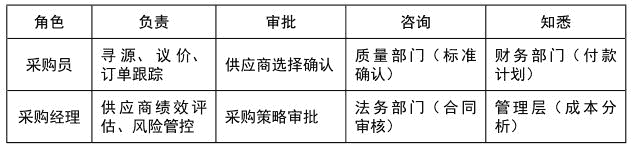

**2. 绩效评估与能力发展**
（1）绩效考核。采购绩效考核应立足职责分层设定具体指标，涵盖质量、成本、交期、合规、创新等维度。通过量化评估，企业可精准衡量个人绩效，并据此开展针对性能力建设，提升成本控制、品质保障与交期管理能力，保证采购目标实现。
表4-2所示是某企业制定的采购人员绩效考核体系示例。
表4-2 某企业制定的采购人员绩效考核体系示例
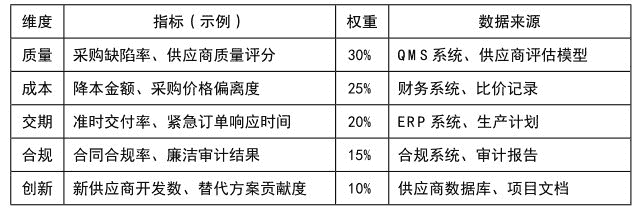
（2）能力提升路径。企业还应重视能力培养，通过分层专业培训与内部考评机制确保培训实效。结合模拟实战与案例研讨，强化实战能力，使团队在多变市场中游刃有余，进一步提升供应链管理水平。
①分层培训。基层采购员侧重谈判技巧、合同管理、质量工具应用；中层采购主管强化供应链协同、成本优化与团队管理；采购经理侧重供应链金融、风险管理与战略采购。
②认证体系。可建立内部采购资格认证，并辅导CPSM等外部认证。

**3. 流程标准化与数智赋能**
流程优化。
①建立标准化的采购流程，确保各环节顺畅衔接，减少人为差错，提高效率。例如RPA可自动触发供方资质审核，OCR自动识别营业执照；智能化可辅助生成比价报告，基于历史价格数据匹配。
②合规管控。嵌入式合规检查可自动校验反贿赂条款，监督行为合规性，降低风险。关键决策通过区块链存证，确保不可篡改与可追溯。数字化工具的应用提升了效率，也增强了数据透明度与可验证性，为决策提供坚实支撑。
③数字化工具推荐。表4-3所示是笔者推荐的部分数字化工具，可供参考。
表4-3 数字化工具推荐
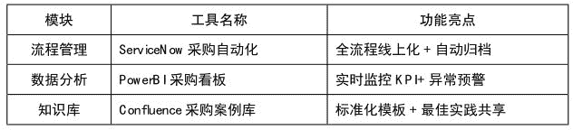

**4. 激励设计与协同作战**
（1）激励设计。通过明确绩效指标与奖励机制激发团队热情。可设置短期激励、长期激励与负向约束，形成目标一致的协同机制。
①短期激励：达成降本目标给予奖励，如成本降低1%提成2000元。
②长期激励：供方开发贡献积分，可兑换培训资源或计入晋升加分。
③负向约束：质量事故扣减绩效奖金，如重大缺陷按损失金额5%追责。
（2）团队协作机制。通过协作平台实时共享信息，打破部门壁垒，提升沟通效率。定期组织跨部门研讨，促进知识交流，增强凝聚力。
①跨职能协作：采购—质量—研发联合小组，早期介入新物料选型。
②知识共享：定期举办“供方质量复盘会”，分享失效案例与改进方案。

**5. 采购职业操守管控**
采购工作的特殊性导致职业操守问题频发，不仅损害外部竞争力，也侵蚀内部文化，难以仅靠智能化解决，需制度约束与文化建设并重。
职业操守既是个人责任，也是企业责任。企业需研究如何构建采购环境与流程制度，有效遏制不当行为，让人员聚焦业务创造价值。
以常见的“吃回扣”为例。某大型超市采购经理因两次收受回扣被判刑入狱。首次因垄断毛肚、鸭肠、海白菜采购，让亲属独家供货，每月收回扣至少3000元，11个月累计超4万元，后因生意不佳转行。第二次在活鱼采购上，养殖户每0.5千克付0.5元回扣请求手下留情。该经理明知长途运输死鱼率高、规定不得入场，仍视而不见，5个月收回扣1.5万元，并逢年过节收受烟酒礼品，最终被判刑。
采购人员的失责与腐败最终会侵蚀企业整体利益。
为防范腐败提升操守，企业应以预防为主、防消结合，构建“不能腐”的环境与“不敢腐”的惩戒机制，同时以正向激励引导价值取向，让降本增效与个人成长同步。
（1）组织层面规划。部分企业将采与购职能分离，采负责选定供方及质量价格产能交付条件，购负责下单；另设采购分析和采购控制岗位。采购分析负责数据与市场分析并审核价格建议，采购控制负责监督采与购流程。各岗位互为支持又互相监督，避免“一岗独大”。
（2）制度层面规划。
①签订协议。与供方合作需签署《采购廉洁协议》与《商业保密协议》；采购岗位人员入职前亦需签署相关协议，明确底线与红线，强化法律与道德意识。
《采购廉洁协议》规范采购行为的廉洁条款及法律支持，例如约定未经报备不得参加可能影响公正履职的宴请娱乐活动；供方不得私下与采购人员谈判；采购人员不得索取或收受回扣手续费等。
②留痕管理制度。留痕管理的目标是确保采购全流程可追溯。数字化采购与ERP系统可实现线上操作全记录、可追溯、不可篡改，减少人为干预对流程的扭曲。
（3）流程层面规划。组织与制度完善后需靠流程落地。完善的流程兼顾效率与风控。从供方评审、引进、打样试样到订单、入库、付款核销，每一步须有明确标准、关键控制点与记录要求，并明确审批节点，确保端到端覆盖。
（4）绩效层面规划。企业倡导什么就应考核什么。道德管理指标应纳入采购人员绩效考核，也应纳入供方绩效评估。指标尽量客观可量化，减少主观因素，才能让供方信服并有效管理。
（5）文化层面零容忍。企业文化对腐败的零容忍是震慑最强的环节。清晰的价值导向与零容忍态度是变革改善的有力支撑。

# **第五章**
# **人工智能驱动的订单与交期管理**

## **5.1 采购订单与交期管理的现实痛点**
在供应链体系中，采购订单与交期管理是保障生产连续与客户满意的关键环节。当前企业普遍面临订单处理滞后、紧急订单响应不及时、交期延误造成损失等挑战，严重影响运营效率与效益。人工智能可实时监控订单状态与交期进度，精准预测延误风险并触发预警，采购人员据此快速沟通供方并采取补救措施，确保物料准时到货，降低负面影响。

### **5.1.1 订单处理滞后致延误率达23%**
订单处理是采购流程起点，其效率直接决定后续交付时效。调研显示，因订单处理延迟导致的交付延误率高达23%。背后是流程与管理协同不足。
传统订单处理涉及采购、财务、管理等多层审批，信息传递不畅易致审批积压、等待过长。例如，某制造企业原材料采购订单在财务预算审核环节平均耗时2-3天，导致无法及时下达，影响生产进度。此外数据录入错误与信息更新不及时进一步加剧延迟。
技术层面，部分企业仍依赖人工与纸质单据流转，效率低且易出错，错误修正又消耗额外时间。采用数字化采购管理系统的企业，可实现订单自动生成、审批自动流转与信息实时共享，大幅缩短处理时长。未完成数字化转型的企业在订单速度与交付稳定性上明显落后。
交付延误不仅打乱生产节奏、增加成本，还会导致客户违约、信誉受损，客户可能削减订单甚至终止合作，对市场份额与长期发展造成冲击。

### **5.1.2 紧急订单响应迟缓**
市场需求波动加剧，紧急订单难以避免，但企业响应能力不足，灵活性和敏捷性欠缺。
首要原因是资源调配困难。紧急订单需在短时间内完成采购、排产等工作，对人力物力财力要求更高，而日常缺乏合理规划与储备，应急时难以快速调集。例如，某服装企业接到7日内交付的紧急大额订单，因库存不足且供方无法及时供货，花费大量时间寻源，导致错过交付期。
其次，厂商协同机制不完善。快速处理急单依赖供方快速报价、优先排产、加急配送，但合作关系松散、沟通渠道不畅，需求传递滞后，响应迟缓。供方自身产能与物流能力受限时，即使需求明确也难以满足。
响应慢不仅错失市场机会，还推高运营成本。企业可能需支付原材料溢价、加班费用等，且时间紧迫下易出现质量问题，带来额外风险与成本。

### **5.1.3 交期延误年损超百万元**
交期延误的经济损失巨大，多数企业年均损失超过百万元，涵盖订单取消、客户赔偿、库存积压与信誉受损等，削弱盈利能力与可持续发展。
直接损失方面，未按时交付需支付违约金，直接侵蚀利润。还可能引发退货与索赔，例如某电子设备制造企业因原材料延误导致交付滞后，支付数十万元违约金并失去后续订单，间接损失难以估量。
运营层面，为弥补进度滞后需调整生产计划，导致效率下降、设备损耗与能耗上升，成本增加。频繁调整也影响员工积极性与团队稳定性。
市场层面，交期延误严重损害品牌形象与客户信任，可能导致客户流失与负面口碑传播，使企业在竞争中处于劣势，错失机会并压缩市场份额，长期影响发展。

## **5.2 采购订单的人工智能解决方案**
传统订单痛点可通过人工智能解决。引入智能化方案后，企业可实现采购订单的智能化管理与优化，提升效率与准确性。

### **5.2.1 智能履约管理平台**
智能订单履约系统是基于人工智能的自动化管理平台，依托规则引擎实现订单智能分配、跟踪与优化。它可实时监控订单状态，预测潜在延误风险，自动调整履约策略，确保按时交付。系统还能基于历史数据与实时需求优化库存与物流调度，降低违约金与退货索赔风险，提升运营效率与客户满意度。
该系统通过整合上下游动态需求与仓储物流信息，实现数据精准与协同，清晰解析各环节与合作伙伴，降低订单取消、客户赔偿、库存积压等成本，提升市场竞争力。
智能订单履约系统的核心目标是通过规则引擎驱动订单全流程自动化决策，实现三个层面的优化，如图5-1所示。

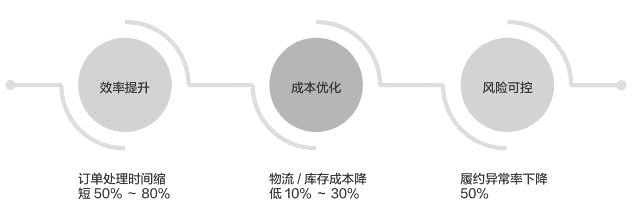

图 5-1 智能订单履约系统的核心目标

智能履约体系的发挥空间取决于规则架构的完善程度与算法的持续迭代。平台通过对实时信息流的持续感知，能够提前识别履约隐患并自动修正派单策略。实践中可归纳的规则大致有四类，表 5-1 给出了类型与典型触发条件的示例。

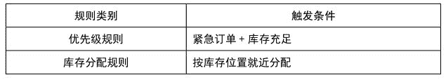

续表

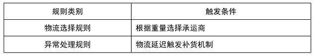

依托上述规则，平台可快速响应各类需求，实现秒级判定、降低人工干预、减少差错，保证按时履约并提升客户满意度。业内常用的实时决策路径如图 5-2 所示。

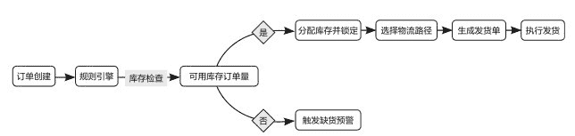

图 5-2 实时决策流程

落地时需结合具体经营场景灵活配置规则，以历史积累与即时反馈为依据不断打磨系统表现。下面以供货协同履约为切口说明执行细节。

在供货协同场景下，系统借助信息实时共享动态调配订单，保障供给网络各环节顺畅协作。

可落地的规则逻辑主要有三条。

（1）供货方A产能吃紧时，系统自动拆单分派给B/C。
（2）订单金额达到50万元及以上时自动触发预付款条款。
（3）质检未达标时立即启动逆向退货流程。

基于上述逻辑，系统可有效应对供给链中的突发状况。涉及信息联动时，平台通过API与各供货方系统无缝对接，实现信息实时同步，做到信息全透明。配套的电子签章功能进一步提升合同执行效率与合规性，降低纸质档案管理成本，推动业务流程全面数字化。

要发挥智能订单履约的最大价值，企业需对内外部系统与信息做深度整合，构建统一的数据底座，确保信息口径一致。规则的有效性应定期复盘，随市场变化及时调整，持续打磨系统性能，提升决策精度，进而在竞争中稳住优势。

建议优先在复杂度高、频次高的采购品类，如电子元器件、快消品中先行试点，验证成熟后再向全供给链推广。

### **5.2.2** 动态交期预判

动态交期预判以机器学习、实时数据流和供给链协同为基础，对历史交期、当前订单状态及外部环境进行实时分析，覆盖从下单到交付的全链路，实现交期滚动预估与风险预警，助力优化采购计划与库存策略。模型通过自学习不断提升准确度，帮助企业提前规避延误风险，保持供给链顺畅。

**1. 动态交期预判的关键目标**

核心是通过多源信息融合与动态建模，预判采购订单的实际交付时间，把预测精准度、动态调整能力与风险预警结合起来，从而提高供给链的灵活性和响应速度。图 5-3 展示了三者结合的思路。

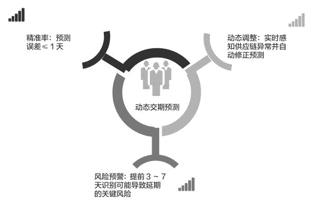

图 5-3 精准率、动态调整和风险预警的有机结合

**2. 数据来源与关键维度**

动态交期预判的信息来源有四类，如表 5-2 所示，分别是历史交期信息、实时订单信息、外部环境信息及供给网络信息。

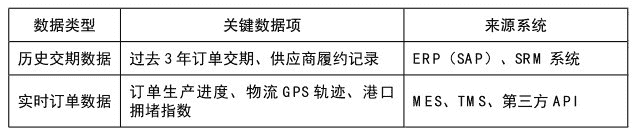

续表

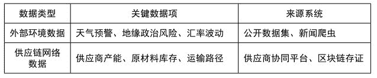

关键影响维度同样有四类，包括订单特征、供货方特征、物流特征和环境特征，如表 5-3 所示。

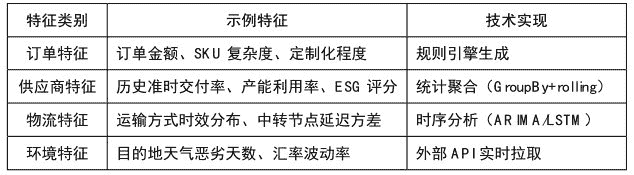

综合这些维度进行分析，模型可更准确地预估交期并及时调整应对策略，降低风险，提升整体供给链效能。企业可据此优化资源配置，确保按时交付，强化客户满意度。表 5-4 列举了动态交期预判常见的应用场景。

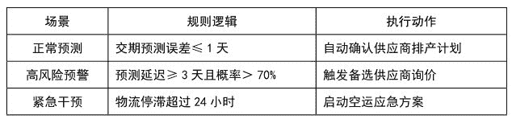

例如，某电子企业在全球芯片短缺导致供货方交期波动达 ±30 天，原静态预测模型误差超过 7 天的背景下，引入动态交期预判后误差收敛至 2 天内。其支撑信息来自 10 万+历史订单、200+供货方产能信息以及港口实时拥堵指数。

该企业还构建了“供给链韧性指数”，综合供货方地理分散度、替代物料可得性，并引入“地缘政治风险评分”，利用新闻舆情量化国际局势影响。结果供给链中断风险下降 40%，交期预判误差降至 1.8 天，库存周转明显加快，缺料损失持续收窄。

需要提醒的是，动态交期预判也存在局限。信息滞后可能造成预估偏差；供货方隐瞒或提供虚假信息会直接削弱模型可信度；极端“黑天鹅”事件，如全球疫情爆发，也可能使预判失效。

建议先在长周期、高价值物料，如芯片、定制设备采购中试点，逐步形成供给链智能中枢。

### **5.2.3** 智能排程优化

生产排程优化是指借助智能算法对生产任务进行高效分配与调度，追求资源利用率最大化、生产周期最短化。它综合考量设备状态、人员技能、物料供应等要素，动态调整生产计划，在效率与成本间寻求最佳平衡。优化后的排程可显著提升交付准时率，降低库存积压，加快市场响应。

**1. 生产排程优化的核心目标**

在满足交期与质量要求的前提下，通过动态排程实现“两化一升”：生产效率最大化、成本最小化、交付能力提升，如图 5-4 所示。

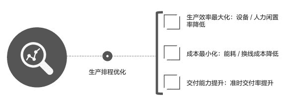

图 5-4 生产排程优化实现“两化一升”

**2. 数据整合与关键参数**

生产排程优化需融合设备运行信息、人员技能档案、物料库存信息等关键参数，构建多维信息模型，提前识别生产瓶颈并动态调配资源，保证生产流转顺畅。通过实时监控与反馈，可及时处置突发情况，优化生产节奏，提升整体运营效能。表 5-5 给出了某制造企业的整合示例。

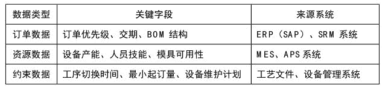

续表

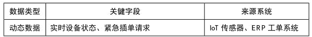

在上述信息基础上结合核心算法，排程模型可生成精准方案，避免资源冲突，保证任务如期完成。排程实施本身是一个动态循环优化过程，需定期检视绩效与重要性。图 5-5 为动态循环优化示意。

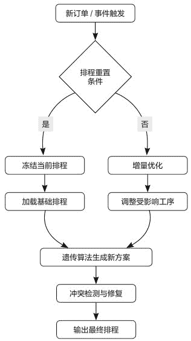

图 5-5 动态的生产排程循环优化示意

运行中若出现工序重叠、资源竞争、交期冲突等情况，系统会自动触发预警，通过算法迅速调整策略，优先保障关键订单。例如工序重叠时紧急订单可插队，资源竞争时按设备共享优先级评分分配，交期冲突时可前移瓶颈工序调整生产顺序。

例如，某汽车零部件企业因多车型混线生产导致换模频繁、设备利用率低。引入高级排程算法后，系统能智能识别车型间的共通工序，优化换模顺序，减少无效停机，设备利用率大幅提升，各车型协同更顺畅，整体生产效率实现跃升。

排程模型同样存在风险，如信息失真、算法偏差、计划与执行脱节、多目标冲突等。需建立完善的风险预警与纠偏机制，定期校验信息准确性，优化算法逻辑，强化执行监控，保持多目标平衡，从而持续提升排程的可靠性与实用性。

### **5.2.4** 逾期预警与自动补偿

采购中必须把订单逾期的风险纳入管理，通过算法动态调整采购优先级，保障关键物料及时到位，避免生产中断。

采购人员需整合风险预测、动态规则引擎与自动化补偿策略，构建从预警到止损的闭环。这一过程对综合应变能力要求较高，需要兼顾市场洞察与信息分析、决策优化能力。

人工智能的引入能极大提升复杂场景下的判断力与采购效率。借助 AI 赋能的智能决策系统，可对逾期风险进行管控，对事后补救进行优化，确保供给链稳定与生产连续，降低逾期损失。

**1. 订单逾期预警**

在 AI 赋能下，采购系统可实时监测订单信息、执行状态与外部环境，自动识别潜在逾期风险并提前预警，为采购人员争取应对时间，如调整采购计划、协调供货方加急发货等，有效规避逾期。

整体架构如图 5-6 所示，系统通过信息采集、风险评估、预警发布三大模块协同作业，实时判断订单风险状态并做出响应。

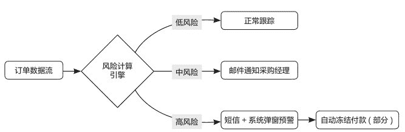

图 5-6 订单逾期预警的整体架构

**2. 自动补偿机制设计**

订单一旦逾期，就需要启动自动补偿机制。设计应基于历史信息与实时反馈，动态调整补偿策略，在供货方与采购方间保持利益平衡。系统利用智能算法分析逾期原因，自动触发补偿流程，如延长付款期限、给予折扣等，减少纠纷，维护供给链稳定。同时记录补偿信息，用于优化后续采购决策，提升整体韧性。

表 5-6 列示了某企业的自动补偿策略类型，可供参考。

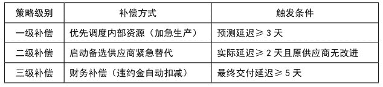

同样地，自动补偿机制也有局限。误预警会造成资源浪费；补偿规则不合理可能损害供货关系；物流信息与生产信息不同步会导致补偿失效，进一步扰乱供给链。因此需建立信息同步机制，保证信息准确，优化算法降低误判，维护合作关系，确保供给链高效运转。

建议优先在长交期、高价值物料，如芯片、定制设备采购中试点，逐步搭建端到端风险管控体系。

### **5.2.5** 采购验收智能化

采购订单验收是保障采购质量的关键节点。AI 赋能下的验收体系涵盖标准化流程、智能检测、信息闭环与协同管理，帮助企业实现验收精准化、自动化、合规化，控制质量与成本。

全流程数字化验收可同步实现质量合规、效率提升、成本控制与信息闭环。例如，某汽车零部件企业过去以人工目检刹车片厚度，漏检率达 8%，年退货损失超 300 万元。引入全流程数字化验收并部署线阵相机与激光测厚仪后，实现全自动尺寸检测，精度稳定在 ±0.01mm。

**1. 验收流程设计**

验收流程需先设计标准的作业路径，图 5-7 为某企业的参考方案。

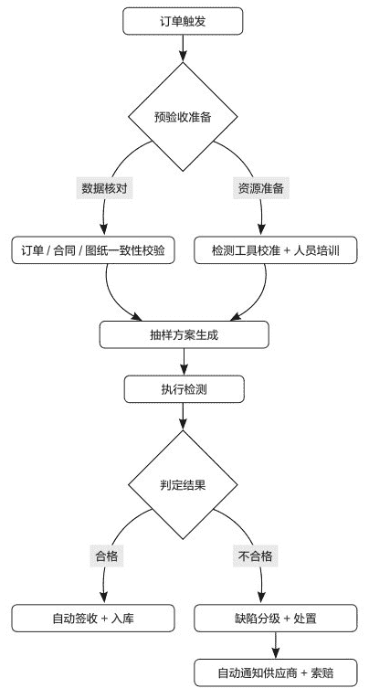

图 5-7 某企业设计的标准化验收流程

流程包括预验收准备、智能检测验收和判定与处置。

（1）预验收准备。提前一天通知业务主管与仓库保管人员，准备验收单、入库单及相关付款资料，保证作业合规准确。

在 AI 赋能下，信息核对可自动化完成，如自动比对订单 BOM 与送货清单中的 SKU 编码、规格、数量；自动验证供货方资质文件，如 ISO 证书、质检报告有效期等。

同时要准备检测工具，如测厚仪、光谱仪、3D 视觉扫描仪、X 射线探伤仪等，保证仪器校准准确，并对质检人员进行专业培训，确保检测标准统一。

（2）智能检测验收。具体检测类型、技术方案与异常处理逻辑见表 5-7。

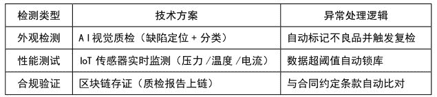

（3）判定与处置。若检测到异常，系统自动触发预警并通知相关人员。通过 AI 技术，判定与处置环节效率更高，人为误差减少，处理速度提升。例如，某电子产品制造商使用 AI 辅助验收后，异常订单处理时间缩短 30%。系统检测到异常时，会触发 SRM 系统生成索赔工单，并自动通知供货方确认与整改，形成闭环管理，提升协同效率。

**2. 验收流程优化与应用场景**

如图 5-8 所示，通过多系统集成可持续优化验收流程，并在电子产品制造、汽车零部件生产等多场景受益。AI 赋能不仅提升效率，还增强信息追溯能力，保证质量稳定。未来结合物联网，可实现实时监控与预警，进一步优化供给链管理。

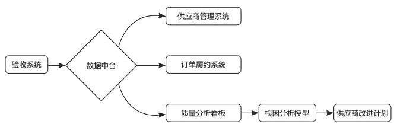

图 5-8 多个系统集成，持续优化验收流程

当然，订单的复杂多样也对验收提出更高要求，技术误判、信息孤岛、供货方抵触等均可能影响效率与准确性。需建立多层次异常处理机制并结合人工复核，保证问题及时发现与解决。加强信息共享平台建设，打破信息壁垒，提升供货方参与度，构建高效协同的供给链生态，才能在多变市场中保持供给链稳定与企业竞争力。

# **第六章**

## **采购运输与库存管理**

## **6.1** **采购运输与库存管理痛点聚焦**

在企业运营体系中，采购运输与库存管理是供给链的核心环节，直接关乎成本控制、资金周转与客户满意度。随着市场环境复杂化、竞争加剧、需求个性化，企业在此领域面临的挑战日益突出。

### **6.1.1** **运输成本失控**

运输成本超支已成为众多企业的痛点，成因多样。

首先是路线规划不科学。不少企业仍依赖人工排线，未能充分利用智能物流与大数据分析，导致路线重复、迂回，浪费时间并增加燃油、车辆磨损等成本。例如，某制造企业在多区域配送时因缺乏系统优化，车辆空驶率高达 40%，运输成本大幅攀升。

其次是运输方式选择不当。企业常未结合货物特性、运输距离与交货时效来决策。对时效要求不高的大宗货选择高成本航空运输，对急需小批量货物又未采用灵活的快递方式，造成成本与需求严重错配。

此外，运输市场价格波动频繁，企业缺乏价格风险管理手段，签约时未能合理预判未来走势，易在成本端受损。

高运输成本会压缩利润、削弱竞争力，企业难以完全转嫁给客户，只能自行消化，加重经营负担。同时资金被大量占用在运输环节，削弱在原材料采购、研发创新等关键领域的投入，制约可持续发展。

### **6.1.2** **库存周转偏慢**

库存周转率是衡量库存管理效率的核心指标，反映资产流动性和利用效率。周转缓慢意味着商品在库时间过长，占用大量资金与仓储空间。

主要原因有三。其一，需求预测不准。企业在制定采购与生产计划时，未能准确把握市场趋势，缺乏有效调研与信息分析，依赖经验判断，导致产出与采购与实际需求脱节。例如，某服装企业旺季前依据过往经验大量生产某款服饰，因流行趋势变化导致需求远低于预期，库存大量积压。

其二，供给链协同不足。企业内部及与供货方、经销商间信息不畅，采购、生产、销售衔接不顺。采购难以及时获知销售需求与库存情况，易出现过度采购或断供；生产计划与销售脱节，产品难以及时售出；销售反馈滞后，库存管理被动。

其三，库存管理策略不完善。缺乏科学分类管理，对所有商品“一刀切”，未区分重点与一般商品。库存控制缺少预警机制，积压或短缺难以及时发现，管理缺乏灵活性。

周转率低于行业均值会增加仓储、资金与损耗成本，导致商品贬值、过时，带来较大经济损失。过高库存还会掩盖生产、销售、采购环节的问题，干扰运营判断。

### **6.1.3** **安全库存失衡引发缺货**

安全库存是企业为应对需求波动与供应中断设立的缓冲。但设置不合理时，缺货现象频发。

安全库存过高会占用资金与仓储、推高成本；过低则难以抵御需求突变与供应不确定性，易导致缺货，伤害客户满意度与市场声誉。

主要原因是需求波动评估不准。企业未充分考虑季节性、突发性变化及订单不确定性，常采用固定安全库存水平，缺乏动态调整。例如，某食品企业在夏季对冷饮需求预测过于保守，安全库存设置过低，旺季需求骤增时出现供不应求，错失销售机会并引发客户不满。

供应链波动的敏感度普遍偏低。很多企业在设定缓冲库存时，更多参考历史销量，对上游交期不稳、运输途中受阻、原材料供给收紧等不确定性考虑不足。一旦供应商交期推迟或原料断供，因底仓垫底不足很难及时满足客户需求，缺货便会连锁扩散。再加上买卖双方协作松散，信息回流滞后，生产进度与库存水位难以即时共享，预警失效、应对迟缓的问题愈发明显。

测算逻辑也比较粗线条。大量企业仍沿用经验估算或固定比例等简便做法，没有把自身经营特征与市场数据结合起来，也没有借助量化模型做推演。这样的粗放计算很难锁定合理的储备区间，结果往往是库存积压或库存吃紧。

储备失准带来的断供，对经营会形成多层压力。订单难以按时交付，客户体验下滑，极端情况下会流失客户。长期缺货还会侵蚀品牌形象，削弱市场竞争力。生产端同样受牵连，排产计划被打乱，调度难度上升，效率下降，综合运营成本随之攀升。

## 6.2 采购与库存智能化优化方案
采购与库存是企业运营的命脉，眼下痛点却很普遍。若缺乏有效解法，资源浪费、响应迟缓乃至供应链中断的风险会持续存在。

引入人工智能后，采购运输与库存管理能够完成智能化升级。系统可以精准判断需求走向，动态调整缓冲储备，轻松应对季节波动与突发需求；同时实时跟踪供应链风险，提前发出供应商预警，保障物料稳定。借助数学建模，储备水位的测算变得科学合理，避免过高或过低的极端设定，从而提升管理效能并降低运营开支。

### 6.2.1 智能化物流路径优化
智能物流路径优化的本质是通过算法对运输路线进行实时调整，让货物在最短时间内抵达，降低成本与延误风险。结合物流流与信息流分离的思路，平台能够持续更新仓储信息，实现各节点高效协同，进一步拉高整体物流效能。

**1. 智能物流路径优化的核心目标**
借助动态路线规划与资源调度，在满足时效与成本约束的前提下，实现运费下降、时效提升与库存周转加速的效果，如图 6-1 所示。

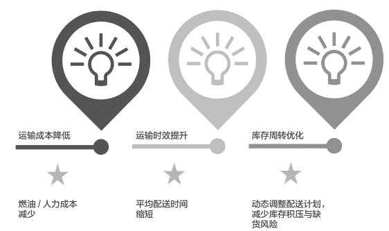

图 6-1 智能物流路径优化的核心目标

**2. 智能物流模型的数据来源与关键字段**
智能物流模型所需数据涵盖订单、运输、路况、库存等维度，来源较为多元化，如表 6-1 所示，列出了关键数据类型、关键字段与来源系统。

表 6-1 数据来源

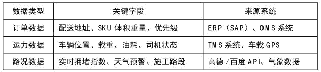

续表

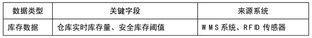

综合多维数据后，模型可以准确识别最优路径并动态调整运输策略，确保货物高效低成本送达，从而显著提高物流系统整体效能。例如，国铁企业引入智能技术后，实现了对 17 种新箱型的智能调度，多式联运效率得到明显提升。

**3. 路径动态优化**
在智能路径基础上，结合实时路况与货物状态，模型可动态调整运输路线，规避拥堵与延误，确保准时送达。例如，通过解析高德/百度 API 提供的实时拥堵指数与气象数据，系统能够智能挑选最优路线，降低运输成本并提升时效。

动态路径优化必须流程化，明确各环节操作规范，确保执行精准。图 6-2 所示为某企业动态路径优化的流程示意图，供参考。

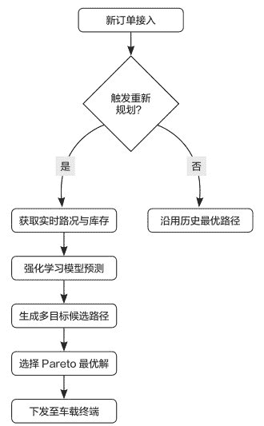

图 6-2 某企业动态路径优化的流程示意图

按此流程执行，可保证环节紧密衔接，减少人为误差，提升优化精准度与执行力。

以某零售企业为例，生鲜配送路线长期固定，未考虑实时拥堵与门店订货波动，导致油耗高、缺货率高达 12%。引入智能物流路径优化后，集成高德实时路况 API，每 15 分钟更新路径，并基于门店 SKU 销量预测调整配送优先级。当仓库库存低于安全阈值时，系统自动触发临近门店调拨，缺货率显著下降，运输成本也得到控制。

实际落地还需结合企业业务特点持续调优模型参数与算法，以适配不同场景。遇到突发交通事故导致路径失效时，应及时人工接管并调整，保证物流系统持续高效运转。

未来随着自动驾驶普及，人工智能将与车辆控制系统深度融合，实现全自动调度，无人配送车、无人机可实时联动，进一步降低物流成本、提升配送效率。

### 6.2.2 库存动态平衡
库存管理是企业运营的核心难题之一。如何提升库存健康度、优化成本、加快响应速度，是亟待解决的关键。

借助人工智能，可构建更智能的库存动态平衡系统。系统能够实时解析销售数据、库存水平与市场需求，精准预测未来销量并自动调整补货策略，确保库存始终保持在最优区间。依托仓储管理系统与无线射频标签实时追踪库存数据，模型可精准预判需求波动并动态调整补货，保持库存平衡。

**1. 库存动态平衡的核心目标**
通过实时监控与动态调整，企业可达成以下目标。

（1）库存健康度≥95%：安全库存覆盖率≥98%，呆滞库存≤5%。
（2）成本优化：库存持有成本降低 15%～30%。
（3）响应速度：需求波动响应时间压缩至小时级。

**2. 库存动态平衡的数据来源**
数据来源主要包括四类，如表 6-2 所示，罗列了数据类型、关键字段与来源系统。

表 6-2 库存动态平衡的数据来源

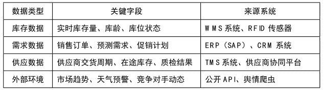

这些多维度数据为模型提供了坚实支撑，使库存预测与优化更精准，有效避免过度库存或缺货，帮助企业在激烈竞争中保持高效运作与成本优势。

**3. 动态库存控制**
动态库存控制需建立合适的控制模型，依据实时数据动态调整库存水平，并结合机器学习算法持续优化模型参数。表 6-3 所示为某企业的动态库存控制模型示例，包含模型类型与技术方案，可供借鉴。

表 6-3 某企业的动态库存控制模型示例

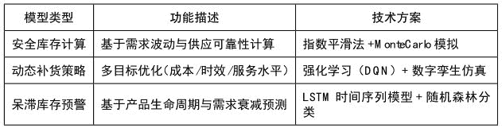

依托这些先进模型与技术，企业不仅能实时应对市场变化，还能持续提升库存管理的精细化水平，实现资源最优配置，强化市场竞争力。

同时需注意安全库存的合理设定，避免过度优化带来供应链风险。

安全库存的计算公式为：

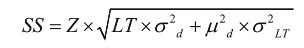

其中：

*SS*：安全库存
*Z*：服务水平系数（95%对应 1.65）
*LT*：供应商交货周期
*σ*[d]：日需求标准差
*μ*[d]：日均需求

动态库存控制的关键在于实时数据的精准采集与分析，配合算法动态调整库存策略，使库存水平既不偏高也不偏低，实现供需平衡，降低运营成本，提升客户满意度。可建立动态调整机制的实时监控看板，如图 6-3 所示，便于实时掌握库存动态，及时发现异常并快速响应。

图 6-3 动态调整机制的实时监控看板

**4. 端到端协同与关键协同场景**
库存动态平衡需要端到端协同机制，覆盖采购、生产、销售等环节。通过 ERP、CRM 与 TMS 系统无缝对接，实现数据共享，确保各环节信息透明，提升供应链整体响应速度。图 6-4 所示为某企业端到端协同流程示意，可供参考。

图 6-4 某企业端到端协同流程示意

关键协同场景中，供应商协同与运输联动尤为重要。

（1）供应商协同。当库存低于阈值时，系统会自动向备选供应商发送 RFQ 询价单，并基于历史合作数据动态调整订单分配比例。
（2）运输联动。库存紧张时，系统触发加急运输，成本权重下调 30%；库存过剩时，系统自动协商延迟付款，延长账期 15 天。

某快消品企业依托库存动态平衡系统逻辑，解决了传统模式下订货周期长、旺季缺货率高、滞销库存多的难题。

（1）需求预测升级。采用 Prophet 与 XGBoost 融合模型，预测准确率提升至 92%。并根据区域天气数据动态调整促销计划，如雨季增加雨具库存，更好满足市场需求。
（2）动态补货引擎。将安全库存规则嵌入 ERP 系统，实现自动触发分级补货（紧急/常规）。同时按供应商评分动态分配订单，前三名供应商占据 70% 订单份额。
（3）滞销库存处理。与电商平台联动，自动创建清仓直播专场；积压超 30 天的商品自动执行 15% 降价，加速库存周转。

通过上述举措，该企业降低库存成本、提升市场响应速度，一年节省滞销损失上千万元，采购成本下降 10%。

### 6.2.3 自动补货触发
精准的库存管理不仅能优化资源配置，还能提升客户满意度。如何融合实时数据、预测模型与动态规则，实现采购、运输与库存的智能联动，避免缺货与积压、提升供应链效率，是企业需要持续探索的方向。

**1. 自动补货触发机制的核心目标**
自动补货触发机制通过预设库存阈值与动态需求预测，自动触发补货订单，使库存始终维持在最优区间，减少人工干预，提高补货效率与精准度。其核心在于结合历史销售趋势与季节性因素，动态调整阈值并智能决策，避免库存过剩或短缺，从而实现供应链灵活响应与成本优化。

该机制可实现三大关键目标。

（1）精准触发：补货时机误差≤1 天。
（2）成本优化：库存持有成本降低 15%～30%。
（3）服务保障：缺货率降至 1% 以下。

**2. 自动补货触发机制框架**
框架包括数据输入层、触发规则层、补货策略层与执行层。

（1）数据输入层。负责采集库存数据、需求数据、供应数据与外部环境数据等，如表 6-4 所示。

表 6-4 数据输入层

（2）触发规则层。基于实时库存量与预测需求，计算动态安全库存并设定触发条件逻辑。通过算法模型实时监控库存波动，结合历史数据与季节性变化，精准设定补货阈值，确保库存动态平衡。

安全库存计算公式在 6.2.2 已详细阐述，此处不再重复。触发条件逻辑设计需兼顾销售峰值、供应链稳定性与突发事件影响，通过多维度数据分析选择灵活触发类型。表 6-5 为某企业设计的触发类型与补货策略，可参考。

表 6-5 某企业设计的触发类型和补货策略

（3）补货策略层。根据触发规则生成的补货信号，制定补货量、补货时间与供应商选择等具体计划。通过智能算法优化补货路径，确保过程高效低成本。表 6-6 为某企业补货量计算模型，可供参考。

表 6-6 某企业的补货量计算模型

该层还需考虑季节性因素与促销活动影响，灵活调整补货计划。

（4）执行层。负责将补货策略转化为实际操作，协调物流、仓储与供应商，确保补货指令精准执行。需建立流畅的执行流程，图 6-5 所示为某企业制定的执行流程图，涵盖从触发条件到补货完成再到财务结算的各环节，值得借鉴。

图 6-5 某企业制定的执行流程图

自动补货过程中常出现供应商缺货、需求突变、物流延迟等异常，需建立应急预案机制快速响应并调整计划。建议优先在高周转、高价值品类如 3C 电子、快时尚中试点自动补货触发机制，再逐步构建供应链智能中枢。

# 第七章 采购合同 AI 风控

## 7.1 采购合同管理痛点聚焦
采购合同管理是供应链管理的关键环节，重要性不言而喻。但当前许多企业在此领域面临诸多挑战，不仅影响运营效率，还可能带来重大经济损失与法律风险。其中合同风险尤为突出，条款不明确极易引发后续纠纷。

### 7.1.1 合同条款审查遗漏率高达35%
合同条款是采购合同的核心，其严谨性与完整性直接决定双方权利义务能否有效保障。据统计，企业在合同条款审查中的遗漏率高达 35%，背后反映出流程与管理上的多重问题。

审查流程层面，传统审查多依赖人工，缺乏标准化规范。审查人员常需同时处理大量合同，时间紧张难以及时细审。不同人员对条款的理解与把握存在差异，缺少统一标准，导致关键条款被忽略。例如货物交付时间与地点的约定若不明确，运输中极易产生纠纷，责任难以划分。

人员能力层面，部分审查人员并非法律专业出身，对条款中的法律风险认知不足。往往只关注主要条款，忽视隐含风险。如违约责任条款未明确赔偿范围与计算方式，一旦违约，企业难以通过法律途径获得合理补偿。随着法规更新，若未能及时学习新知识，也容易出现疏漏。

审查遗漏后果严重。合同履行中不确定性增加，交易风险上升。一旦纠纷发生，企业因条款不完善而处于被动，甚至遭受巨大经济损失。

### 7.1.2 供应商违约处置滞后超7天
供应商违约是采购合同管理常见问题，而企业处置平均用时超过 7 天，滞后性严重影响生产经营与市场竞争力。

原因多方面。首先信息沟通不畅，违约发生后采购、法务、财务等部门传递不及时、不准确，协同受阻。其次缺乏完善的处理机制，多数企业没有明确的违约处理流程与标准，遇到问题需临时商议，耗时加长。此外重视程度不足，部分企业认为违约频发，响应拖延，导致问题恶化。

滞后处置带来多重负面影响。生产型企业可能因原材料中断导致生产计划延误，产品交付推迟，信誉受损。损失还可能扩大，如供应商延迟交货时未能及时补救，可能错过销售旺季，造成积压、仓储成本与资金占用上升。据统计，因处置滞后带来的额外损失，占平均违约金额的 20%～30%。

### 7.1.3 法律纠纷年增18%
随着市场环境复杂化，采购合同引发的法律纠纷呈逐年上升态势，年增长率达 18%。这不仅带来法律风险与经济损失，也严重干扰企业正常运营。

主要原因包括：一是企业对合同管理重视不足，缺乏有效风险管理机制。签约前未充分调查供应商资质信誉，履约中缺乏有效监督；二是法规不断更新，企业未能及时掌握，合同签订与履行中易违规；三是市场竞争加剧，部分供应商为追逐利益违反约定。

纠纷增加消耗大量人力物力财力。诉讼需投入时间、律师费用、取证成本，分散管理层注意力，影响经营决策。同时声誉受损风险高，一旦卷入纠纷，客户、合作伙伴关注度上升，处理不当将损害品牌形象与市场竞争力。据统计，法律纠纷直接经济损失平均占年利润的 10%～15%，声誉损失更难以量化。

## 7.2 采购合同管理的 AI 解决方案
面对上述痛点，采购人员正加速拥抱人工智能解决方案，实现合同管理的自动化与智能化。AI 可实时监控合同履行情况，自动识别潜在违约风险并及时预警；可快速分析海量合同数据，评估供应商信誉与资质，降低管理失误损失；还能实时追踪法规变化，确保合同合法合规，减少纠纷发生概率。

### 7.2.1 采购合同智能审核

合约智能审查，让风险先被看见

生成式技术与认知计算日益成熟，采购协议的自动化复核正打开新空间。借助自然语言理解和机器学习引擎，系统能够自主抽取协议要点并发出风险预警，自动对照标准条款库完成条文解析、隐患筛查与合规核验，揪出差异与遗漏，从而把人工校对的失误降到最低，也把法律敞口收窄。

**1. 智能复核的核心价值**
以AI为动力的采购协议审查可以自动捕捉法律隐患、财务漏洞与履约陷阱，带来以下成效。

（1）提速：原本需三天的审阅，现在多可在1小时内完成。
（2）降险：核心条款漏检率下降约九成，法律纠纷减少约一半。
（3）稳合规：自动对齐公司内控要求与外部法规。

**2. 智能复核的四大核心模块**
采购协议智能化复核主要由四个模块构成，如表 7-1 所示。

表 7-1 采购合同智能审核的核心模块

续表

支撑这些模块运行的数据可分为内部与外部两类。

（1）内部数据。
①历史合同库，已审核与未审核版本。
②供应商档案，资质信息与历史履约记录。
③公司内控政策，采购审批流程与财务制度。
（2）外部数据。
①法律法规库，国家法律法规数据库。
②行业规范，如 ISO 条款与行业惯例。
③司法案例库，裁判文书网公开数据。

数据融合与治理是系统高效运行的关键，建立完善的管理机制可保证信息实时更新与准确，进而提升审查精度。

**3. 规则设计与落地**
在系统搭建中，规则设计决定成败。规则需结合公司个性化需求与行业特征进行定制。比如大额采购可增加审批层级，长期合作的供应商可设定更灵活的付款条件。规则还包括异常情况的处理路径，例如条款与现行法规冲突时的处置流程。制定过程需法务和采购共同参与，确保规则实用且可操作。

表 7-2 所示是某公司设计的规则类型示例，可供参考。

表 7-2 某企业设计的规则类型示例

规则上线后要持续监控执行效果，并建立严格的审核追踪流程。图 7-1 所示是某公司设计的端到端审核流程，可在合同数字化管理中借鉴。

图 7-1 某企业设计的端到端审核流程

绩效层面同样不可或缺。公司应明确考核指标，并将其与采购人员日常操作挂钩。例如合同审查准确率、审批时效、异常处理效率等。通过这些指标，人员能更清晰地把握公司要求，主动优化工作方法，提升采购效率与合同管理质量，也为部门提供成效评估依据。

未来，智能审核系统将在数据分析与预测能力上持续升级，帮助采购者更精准把握市场动态并优化策略。

### **7.2.2 条款风险热力图可视化**
采购合同全流程管理需要采购、法务、财务等多部门协同，从供应商开发到磋商、签约与履约，跨部门配合是关键。引入智能审核不仅提高准确性，还通过绩效指标优化工作方法，进一步提升效率与管理质量。

若在条款审查中结合 NLP、可视化与风险评估模型，就能把条款风险直观呈现并动态监控，更有效地识别与防范风险。热力图的价值就在于此，通过二维可视化，合同中高风险条款分布一目了然，便于及时调整策略。条款风险热力图用颜色深浅直观展示风险程度，帮助快速定位问题条款并提前应对。

**1. 热力图的三大作用**
（1）风险定位：快速识别高风险条款，例如违约责任模糊、验收标准缺失。
（2）趋势分析：动态监控风险随时间与供应商的变化。
（3）决策支持：指导法务与采购团队优先处理高风险条款。

**2. 热力图的设计要点**
设计需兼顾数据来源、条款解析流程、风险评估模型与可视化效果。

（1）数据来源和条款解析流程。首先确保来源合法准确，覆盖合同文本与历史数据。主要来自三个层面。
①合同库，历史采购合同 PDF/Word 格式。
②风险规则库，公司内控政策、法律条文如《中华人民共和国民法典》第五百七十七条。
③外部数据，司法案例库与行业风险报告。
其次利用 NLP 解析合同条款，抽取关键信息并建立条款与风险规则的映射。解析过程需严格按流程执行，如图 7-2 所示，是某公司的条款解析流程图，可作借鉴。

图 7-2 某企业的条款解析流程图

（2）风险评估模型。模型需融合历史与实时数据，采用机器学习算法评估条款风险等级。评估关键维度有五个，如表 7-3 所示。

表 7-3 评估的关键维度

基于这些维度，模型能精准给出每条风险等级，再用历史纠纷合同数据训练模型，结合实时合同数据持续优化，提升评估准确性。

（3）可视化效果。热力图需直观展示风险等级，采用红、橙、黄、绿等颜色渐变表示高低，便于快速识别。同时应具备交互功能，点击高风险区域可查看详细条款与风险说明，提升决策效率。

可用的可视化工具较多，Python 绘图库、Tableau、Power BI 等均可实现多维度展示与动态交互，帮助非技术人员也能直观理解风险分布，提升风险管理效率。

### **7.2.3 电子签约与区块链存证**
采购合同管理中，电子签约已是常见方式。通过电子签约平台，签署更高效透明，降低纸质合同管理成本与风险。在 AI 加持下，电子签约可与风险评估模型无缝对接，实时监控签署状态，确保每一步合规。

AI 时代的电子签约结合区块链存证，依托数字签名、区块链特性与供应链管理需求，可实现签署全流程无纸化、防篡改、可追溯，提升法律合规性与执行效率。AI 不仅用于风险评估，还能通过智能合约自动执行条款，减少人为干预，降低违约风险。结合大数据分析，公司可打通供应商、采购方与法律部门的数据孤岛，更精准预测市场变化并优化采购策略。

具体落地可从以下三方面展开。

**1. 电子签约平台**
选择具备全流程在线招投标功能的平台，如云采供。利用电子询报价、竞价模块优化采购价格，结合 AI 风险评估模型实时监控合同风险，保证签约高效合规。通过智能合约自动执行条款，提升履约效率，降低违约风险。

**2. 区块链存证**
采用区块链技术记录并加密存储采购合同各环节，确保数据不可篡改、可追溯。区块链存证提升合同法律效力，通过分布式账本实现多方实时共享，增强透明度与信任。结合 AI 技术，系统可自动验证合同真实性与完整性，进一步保障交易安全。

表 7-4 所示是某公司区块链选型与部署示例，可作借鉴。

表 7-4 某企业区块链选型与部署示例

**3. 电子签约与区块链存证全流程闭环**
整合电子签约与区块链存证，可构建从签署、存证到执行的全流程闭环管理。AI 实时监控各环节，确保合规与透明，提升管理效率。图 7-3 所示是全流程闭环管理的示意图，覆盖合同起草、签署、存证到执行。

图 7-3 全流程闭环管理的示意图

流程中需对接三个关键接口。
（1）ERP 系统，同步采购订单数据至合同模板。
（2）CA 系统，获取供应商数字证书。
（3）司法链，对接法院电子证据平台，如北京互联网法院“天平链”。
通过这三项对接，实现数据高效流转并确保法律效力。例如北京互联网法院“天平链”解决了电子数据存证难题，降低维权成本，为合同管理提供强有力法律保障。

未来，AI 辅助审查、跨链互通、智能合约自动执行等功能将更完善，进一步提升合同管理智能化水平。

# **第八章**

# **AI 时代的采购成本控制**

## **8.1 采购成本控制的三大痛点**
采购成本控制直接影响公司效益与竞争力，但当前仍面临多重挑战，聚焦痛点是寻找解法的起点。

### **8.1.1 降本空间被严重压缩**
市场竞争加剧下，公司不断寻求成本突破，但降本难度持续加大。一方面，市场环境复杂，原材料价格受国际政治经济、供需关系、自然灾害等多因素影响波动频繁难以预测。如大宗商品市场中石油、铁矿石价格剧烈波动，直接推高产品生产成本。即便采购积极谈判，在整体上涨趋势下也难以获得理想价格。另一方面，内部采购流程局限，传统模式依赖经验与历史数据，缺乏对市场动态的实时跟踪与精准分析。采购多聚焦价格，忽视质量、交货期、售后等综合成本。部门间沟通不畅，信息滞后偏差，导致采购计划与生产需求错位，难以发挥集中与批量采购的规模效应。此外，大数据、人工智能等技术在成本分析与预测中的应用不足，公司难以从海量数据中挖掘降本机会。

### **8.1.2 库存周转率持续偏低**
库存周转率是衡量采购成本控制效率的重要指标，不少公司明显低于行业均值，带来资金压力。首要原因是需求预测不准。采购计划若不能把握市场变化，易出现过量或不足。过量导致积压，占用资金并增加仓储、损耗及资金机会成本；不足则可能中断生产，影响交货期与声誉。其次是供应链协同不足，公司与供应商、经销商信息共享不充分，沟通机制不健全，导致供货不及时或量不匹配。内部也存在问题，生产、销售与采购部门协作差，计划脱节，进一步拉低周转率。

### **8.1.3 缺乏全生命周期成本视角**
多数公司在采购成本控制中只盯采购环节直接成本，即采购价格，忽视运输、仓储、维护、废弃处理等全生命周期成本。以设备采购为例，为压低初始成本选择低价低质产品，使用中维修频繁、能耗高、寿命短，全周期成本反而更高。供应商选择上也重短期价格轻长期稳定性、质量可靠性与可持续能力，合作不稳可能带来延迟、质量问题等隐性成本。同时未充分考虑产品环境影响及环保合规成本，未来可能带来额外负担与法律风险。

## **8.2 采购成本控制的 AI 破局思路**
面对上述痛点，AI 带来新思路与解决方案。AI 可通过大数据分析精准预测需求，优化采购计划，减少库存积压。促进供应链信息透明化，提升协同效率，避免信息不对称带来的成本增加。全面评估供应商综合实力，确保长期稳定合作，降低全生命周期成本，助力精细化成本管理。

### **8.2.1 智能成本拆解系统**
采购中挖掘降本空间与精准识别成本构成向来是难题。传统做法依赖经验直觉或 ABC 分析法，按采购金额或数量将物料分为 A、B、C 类，聚焦 A 类控制。这种方式基于历史数据，无法动态响应市场波动，也未考虑供应商、工艺、物流等多维度驱动因素。

智能成本拆解系统依托机器学习、供应链网络建模与动态数据整合，实现成本多维度拆解、预测与策略联动。与传统 ABC 分析相比，能动态响应变化并综合多因素，精准识别成本构成，提升控制效率。其比较如表 8-1 所示。

表 8-1 智能成本拆解系统与传统 ABC 分析法的比较

**1. 智能成本拆解的实现**
系统通过机器学习实时捕捉市场动态，分析各环节成本构成并自动生成优化策略。核心在于数据驱动的决策支持，既能识别隐性成本，也能预测未来趋势。

（1）数据来源。系统需实时整合三类数据。
①内部数据，ERP 采购记录、BOM 清单、库存周转率。
②外部数据，大宗商品期货价格、海运费率、汇率波动。
③供应商数据，产能弹性、质量合格率、ESG 评分。
（2）成本影响仿真。AI 模拟不同情景下的成本变化，预测各因素影响，帮助公司提前规避风险、优化采购计划。例如原材料价格波动时，系统可迅速调整策略并推荐性价比更优的供应商。
常用工具包括数字孪生，构建供应链虚拟模型模拟成本传导路径；蒙特卡罗模拟，量化供应商中断、价格波动等风险影响。在这些工具支持下，系统能更精准预测波动并提供多方案优化建议。

**2. 应用场景**
系统可广泛应用于制造、零售、物流等行业，实现供应链优化、库存管理与成本控制协同。例如制造行业实时监测原材料价格并智能调整采购计划；零售行业分析物流成本优化配送路径；物流行业精准预测运输成本优化方案。通过内外部数据整合与情景模拟，公司可在设计、生产、物流等环节实现成本最小化，构建高效稳定供应链。

### **8.2.2 智能库存优化算法**
EOQ 经济订货量模型可计算最佳采购量，避免库存成本风险。结合 AI 预测，公司能动态调整 EOQ，确保库存既不过剩也不短缺，实现精准匹配。

**1. EOQ 模型与 AI 的协同**
（1）传统 EOQ 模型的局限。静态假设需求速率固定、订货成本恒定且忽略波动；公式未考虑供应链不确定性如交货延迟、质量波动；仅适用于需求稳定的长尾物料。
（2）AI 协同下的动态 EOQ 模型。引入 AI 后，通过实时数据分析动态调整需求预测与订货成本，克服静态假设局限，同时纳入供应链不确定性因素，优化公式并拓宽应用场景，实现库存与需求动态平衡，提升周转率并降低资金占用。AI 增强的动态 EOQ 模型与传统模型对比如表 8-2 所示。

表 8-2 AI 增强的动态 EOQ 模型与传统 EOQ 模型对比

通过 AI 增强的动态 EOQ 模型，公司不仅能精准预测需求波动，还能实时调整订购策略，有效应对供应链不确定性，确保库存最优，降低运营成本，提升整体效率。

AI 增强的动态 EOQ 计算公式如下。

其中，*D* 代表年度采购总量，*S* 代表单次采购的运营开销，*H* 代表存货持有费用，*α* 为 AI 预测的需变动幅系数，*β*风险 为蒙特卡洛模拟给出的风险校正参数。引入 *α* 与 *β*风险 后，模型更贴合运营实际，能有效削减因需求波动与供应链不确定性带来的额外支出，实现成本与风险的并行管控。

AIAI

**2. 使用场景**

在落地层面，AI 增强的动态 EOQ 模型特别适合零售波动、制造季节性强以及电商需求剧烈的场景。依托实时数据驱动，企业可敏捷应对市场变化，调整库存结构，缓解积压，提升资金周转效率，让供应链保持高效运转。

以长尾物料为例，这类物料周转普遍偏慢，传统 EOQ 难以驾驭。AI 增强版本能够捕捉需求波动，推演长尾物料的月度需求概率分布，并动态修正 EOQ 参数，优化补货频次与批量，从而明显压缩库存持有费用，提升周转效率，释放资金占用，增强供应链弹性与响应力，进而拉动整体运营绩效。

### **8.2.3 总成本智能化解析**

总拥有成本 TCO，也称总成本法，是在预设周期内盘点全部成本构成，分项击破并剔除冗余以压降总支出的方法。

**1. 总成本法**

总成本法的核心是让整体支出最小化，而非单点采购价下降。无论采用何种降本手段，都必须嵌入总成本思维，从全局视角审视成本，避免顾此失彼。

尤其在项目启动期，企业对投入尚不清晰时，总成本法可提供可操作的估算框架。具体内容见图 8-1 所示。

图 8-1 总成本法

总成本覆盖面广，贯穿交易前中后各个环节。因此，日常需持续采集整理各类数据，并把年度总成本作为核心管理指标。

唯有在完备的成本数据基础上识别全部成本要素，才能准确评价当年成本管控效果，并据此设定下一年度目标。为此可采用金字塔结构透视法进行管理，如图 8-2 所示。

图 8-2 金字塔结构透视法

**2. AI 协同下的 TCO——动态 TCO**

在 AI 协同下，总成本法能更精准地定位与剔除成本项，称之为动态 TCO。动态 TCO 借助大数据分析与预测，全景掌握成本结构，优化资源配置，使采购、库存、物流等环节实现整体成本最低，运营效率提升。表 8-3 为 TCO 与动态 TCO 的对比。

表 8-3 TCO 与动态 TCO 的对比

续表

AI 协同时需重点关注数据来源、处理逻辑与算法可解释性，以确保成本数据的真实可靠。

（1）数据来源。分为内部与外部。内部数据来自企业 ERP、WMS、TMS 等系统记录的生产、库存、物流信息；外部数据包括市场行情、汇率波动等公开信息。

（2）处理逻辑及算法。AI 需清洗、分类、建模，保证分析可信。动态 TCO 的计算式为：动态 TCO =∑（各成本类别动态值）-∑（优化节省成本）。依此，企业可实时跟踪成本变化，并精准预判未来成本走势，实现成本管理的智能化与高效化。

**3. 应用场景**

动态 TCO 在制造端的价值尤为突出，实时监控原材料价波动，灵活调整采购节奏，降低库存压力。在物流侧，动态 TCO 结合路径优化算法，可明显压缩运输支出。此外还能精准评估供应链风险，优化资源投放，提升整体运营效能。

例如山东蔬菜发往北京，借助动态 TCO 优化路线，转运次数由五次降至两次，损耗由 25% 降至 5%，盈利空间显著扩大。

建议优先在库存周转率高、长尾 SKU 占比高的品类中试水，再逐步搭建供应链成本智能中枢。

### **8.2.4 AI 驱动的供应商协同降本**

供应商协同降本是多数企业的追求。传统模式依赖人工沟通与经验判断，效率低、偏差大。典型问题包括信息孤岛导致上下游数据不通畅、资源浪费；静态定价令企业在市场波动中难以灵活应对、成本失控；信任缺失令合作透明度不足、稳定性受损。

引入 AI 后，通过数据融合、智能定价与动态定价，可打破信息壁垒，提升协同效率，建立信任机制。AI 能实时洞察市场动向，智能调整采购策略，压降库存成本，增强供应链韧性。如表 8-4 所示，AI 协同模式较传统模式优势明显。

表 8-4 AI 下的供应链协同模式与传统模式对比

续表

**1. AI 下的供应链协同降本步骤**

（1）供应商画像与分级。对供应商做全维度评估，按绩效指标分级，识别强弱项。通过 API 对接供应商 ERP，获取实时产能与库存数据，实现供需匹配。借助大数据评估履约能力与风险等级，为后续合作提供依据。通过智能算法优化供应商组合，实现资源最优配置。

（2）动态采购策略。基于市场波动与需求预测，动态调整采购量与价格，低价期加大采购、高峰期降低库存，达成降本。图 8-3 为动态采购策略的决策流程。

图 8-3 动态采购策略的具体决策流程

（3）协同履约监控与反馈。实时跟踪供应商履约表现，利用 AI 算法解析履约数据，及时发现并处置潜在风险，保障链路稳定。此环节可引入智能合约，自动执行合同条款，严格落实价格调整规则与质量罚则。触发违约条件时，系统自动赔付，保障双方权益。

**2. 实用场景**

在 AI 加持下，供应商协同降本可实现更精准的成本管控与风险预警，应用面将持续扩大。例如医药行业可借助 AI 精准预测原材料需求，优化采购计划，压缩库存；制造业可实时监控供应链各环节，提升生产效率，减少损耗。

未来采购成本控制将从部门行为升级为全系统协同，覆盖从原料采购到销售的全链路优化。依托 AI 预测需求、动态调价，可优化资源配置，降低整体成本。借助电子目录系统快速对接更多供应商，提升采购效率，实现供应链总成本最小化。

# **第九章**

# **采购谈判的 AI 博弈**

## **9.1 采购谈判的痛点聚焦**

在采购管理流程中，谈判直接决定采购成本、品质与长期合作关系。随着市场复杂度提升、供应商增多、竞争加剧，谈判挑战日益凸显。

### **9.1.1 价格谈判耗时超 8 小时/单**

在实际操作中，价格谈判常吞噬大量人力时间，平均单次超过 8 小时，严重拖累效率与运营成本。耗时过长的根源多元。

从采购方看，内部决策链条繁琐是主因。谈判中需与财务、使用部门、管理层多轮沟通，评估预算、确认规格与质量、最终审批。信息传递、意见回馈、审批一旦卡顿，进程即被拉长。

例如某制造企业采购原材料，初步价已与供应商达成一致，因财务对成本核算提出异议，认为超预算，要求重谈。采购需再次与供应商协商，同时内部反复协调，最终耗时近 15 小时，不仅错失采购窗口，还推高成本。

采购人员谈判能力与经验不足亦会延长周期。部分人员缺乏系统培训，面对供应商策略时只能试探妥协推进。供应商常用拖延战术放慢节奏，迫使对方让步，经验不足者易陷入拉锯。

另外，对市场行情把握不准、底线不明，也导致决策迟疑，时间加长。

从供应商看，为获取更高利润，部分主体会主动拖延谈判，制造疲惫感与紧迫感，换取价格让步。同时内部审批流程不畅，报价需层层上报，回应缓慢。

如某企业采购办公用品，供应商称需总部审批，流程复杂，每次回复间隔数天，谈判持续数周，严重影响采购进度。

耗时过长的负面效应明显。一方面直接增加时间成本、差旅成本，错过价格低点导致采购价上涨。另一方面影响生产计划与市场响应，原料延误致产线停工，交付滞后，损害声誉与客户满意度。

### **9.1.2 供应商报价水分难以识别**

报价水分难辨是采购人员的另一大痛点。供应商为提利常在报价中做手脚，识别不及时即意味着多付成本。

难辨原因主要有三。

首先是信息不对称。供应商对成本与供需掌握更全，采购方因信息渠道有限处于劣势。例如新兴行业技术迭代快、成本结构复杂，采购难以及时掌握真实成本，报价水分易被植入。

其次报价手法隐蔽。捆绑报价、模糊报价常见。部分供应商将产品价与售后、运费打包，不拆分明细，使采购难判断产品本身合理性。报价单上使用“随行就市”“参照行业标准”等模糊表述，缺乏计算依据，进一步增加识别难度。

再者采购人员专业能力不足。技术参数、工艺、原材料波动等知识欠缺，难以从成本角度校验报价。缺乏实战经验者也难以通过谈判姿态捕捉报价真实性。

后果包括采购成本抬升、盈利能力受损、合作关系不稳。发现被高价收割后信任受损，后续合作动摇。极端情况下，高水分报价还可能滋生腐败，采购人员与供应商串通牟利，损害企业利益。

### **9.1.3 谈判策略缺乏数据支撑**

数据驱动时代下，谈判仍依赖经验直觉的企业比比皆是，导致策略有效性不足。

成因包括：数据收集管理体系不完善。价格波动、历史报价、成本、质量等多源数据未能及时采集，部分企业数据分散、格式不一、质量参差，难以整合分析。如不同部门使用不同系统记录，数据无法共享。

数据分析能力薄弱。缺乏专业人才与工具，采购人员难以及时挖掘规律，企业缺少分析软件与可视化平台，数据利用率低。

对数据驱动重视不足。仍秉持传统模式，认为谈判靠个人能力，数据分析未纳入决策流程。

缺乏数据支撑带来的问题：一是难把握市场走势与供应商底线，策略盲目，难获理想结果。二是难以评估策略成效，经验总结受阻，效率与效果难提升。三是缺乏依据评估供应商，供应链体系难稳定。

## **9.2 采购谈判中的 AI 决胜策略**

AI 可通过海量数据深度分析，精准研判价格走势与供应商行为，为谈判提供科学策略。算法能快速整合分散数据，实现标准化处理，提升分析效率。同时可模拟多场景评估可行性，帮助采购占据主动。借助 AI 建立数据驱动的供应商评估体系，优化供应链管理，提升采购透明与高效。

### **9.2.1 AI 如何辅助生成谈判策略**

前述痛点已显示，传统谈判受信息不对称、策略固化、情绪干扰困扰。AI 的引入可有效破解。通过大数据分析提供精准市场信息与供应商动态，助力制定灵活多变的策略。

如表 9-1 所示，AI 谈判模式与传统谈判差异显著。

表 9-1 AI 谈判模式与传统谈判有着显著差异

具体如何应用？

**1. 谈判前准备：供应商数字画像**

谈判前应利用 AI 生成的供应商数字画像，全面掌握历史表现、信誉评级、成本结构与市场口碑，精准锚定底线与诉求，为策略制定提供数据基础。

画像构建依赖充足数据。需用 AI 工具采集历史交易、市场反馈、财务状况等信息，通过算法多维度分析与挖掘，形成详尽画像。

**2. 动态策略生成：多轮谈判模拟**

采购人员可通过 AI 工具进行多轮模拟，预设不同情境应对方案，实时调整策略，保持灵活性。谈判进行中，AI 还能实时解析对手行为，给出即时建议，助采购保持主动。

策略手段丰富，如借助博弈论模型预测对方反应，结合强化学习持续优化策略，确保步步精准。AI 还能通过情感分析捕捉情绪变化，及时调整话术，提升成功率。

**3. 谈判后执行：智能合约自动履约**

AI 谈判模式在执行阶段通过智能合约自动履约，确保条款精准落地。经办人员依谈判结果明确执行细节，生成智能合约，自动监督双方履约，减少人为失误，提升效率，保障成果落地。

需注意的是，即便借助 AI 技巧或自身优势让对方无招，强势压价往往导致谈判破裂。过度利己忽视合作，会丧失共同价值主张。追求单赢常演变为双输。

采购谈判本质是共赢，不仅是利益共赢，更包含思维、战略与发展共赢。采购管理需延伸至供应链战略、研发设计等深度协作，才可实现可持续协同。

### **9.2.2 采购谈判中的价格趋势预测**

精准预测价格趋势是获取有利采购条件的核心。随着 AI 深度介入，预测已从经验判断转向智能化精准。把握走势可提前规划采购，有效控本，增强竞争力。

预测并非猜测，而是基于多维数据与 AI 驱动的科学分析。

**1. 历史采购数据是价格趋势预测的基础**

企业可借助 AI 数据挖掘，全面收集过往原材料、商品或服务的采购价格数据，包括时间、数量、供应商等信息。AI 可快速清洗整合海量数据，构建完整价格变化时间序列。

AI 用机器学习跑移动平均，可以自动算出一段周期的均价，把短期抖动抹平，把长期走势凸显出来。假如某种原材料过去 12 个月的采购价呈现明显的季节性，夏天便宜冬天贵，模型不仅能迅速捕捉到这一规律，还会基于历年数据推算出未来波动的大致幅度与出现时段，为后续决策提供可靠参照。

**2.** **市场因素对价格趋势的影响**
历史轨迹之外，外部市场环境同样是价格的风向标。AI 具备强信息抓取与解析能力，能实时追踪宏观经济指标，像 GDP 增速、通胀水平、利率走向等。

借助 NLP，系统可从新闻稿、政策文件等非结构化文本中抽取关键信号，评估宏观环境对整体需求与购买力的作用，进而研判商品价格走向。经济向好需求旺盛时，AI 会快速捕捉上涨压力的苗头；经济下行时，也能及时识别需求收缩带来的下行趋势。

在行业层面，AI 会自动汇集生产、库存、需求等数据进行深度挖掘。以半导体为例，产能大幅扩张、库存维持高位、终端需求增长放缓，三者叠加时，系统会迅速判断产品价格大概率走低，并给出波动区间预测。

对期货、现货、进出口等市场数据的实时监测，也能更直观地反映供需变化。期货价格往往领先现货，AI 紧贴期货动态，可提前洞察趋势转向并向企业发出预警。

**3.** **善用 AI 算法模型**
要让预测更精准，企业可以组合多种 AI 模型。回归分析在 AI 支持下变得更智能，模型能自行挑选变量，建立价格与时间、供给、需求、宏观指标等之间的定量关系，衡量各因素的贡献度，从而推演未来走势。

比如某农产品，AI 发现其价格与当年降雨量、种植面积、市场需求存在显著线性关联。用线性回归输入预测变量，就能得到价格预估值，且随着新数据到来，模型参数会自适应优化，准确率持续提升。

聚类分析则擅长归类相似的采购记录，揭示不同群体间的差异。对多家供应商的同类采购数据聚类后，可发现因成本结构不同而产生的价格波动差异，为差异化采购策略提供依据。

随着技术成熟，神经网络在价格预测中的应用更广。它能处理高度非线性的关系，从海量历史中自动提炼特征，构建复杂预测体系。其中循环神经网络 RNN 及其变体 LSTM，对时间序列数据尤为有效，能捕捉价格的长期依赖特征，实现更精细的趋势判断。

价格预测不是一次性的，市场瞬息万变。AI 驱动的实时监控系统可 7×24 小时跟随市场，一旦实际走势偏离预期，系统会即时调取新数据重训模型并调整参数。例如原先预计某原料价格稳步上行，因政策突变供给骤增导致价格回落，AI 会迅速分析原因并提示增加采购量，帮企业抓住低价窗口降低成本。

### **9.2.3** **智能谈判机器人如何建构**
智能谈判机器人是 AI 在采购谈判中的典型落地，未来有望重塑谈判方式并大幅提升效率。其构建是多项前沿技术的融合工程，核心涉及自然语言处理、机器学习、知识图谱。

**1.** **明确智能谈判机器人的功能定位和目标**
依托 AI 的学习与推理能力，机器人需读懂人类语言，识别对方意图与诉求，自动生成策略与回应。在采购场景中，它要结合采购需求、预算、市场行情与供应商信息，与对方有效沟通，争取最优条件。

自然语言理解是核心。基于大量标注的谈判文本，用机器学习训练模型，如 Transformer 架构的 BERT、GPT 等，提升语义与语法捕捉能力。先在大规模无监督语料上预训练通用语言知识，再在谈判领域微调，理解力更强。

比如供应商提出复杂合作要求时，机器人能准确解析产品规格、价格、交期等关键信息，判断是询价、要折扣还是协商交期，为策略制定提供依据。

**2.** **谈判管理器负责管理整个谈判流程**
谈判管理器统筹全流程，AI 赋予其决策力。结合 NLU 结果与预设策略规则，系统会分析目标、当前状态、双方让步情况等，决定下一步动作。

初期多以试探性提问了解报价范围；随着推进，AI 通过实时分析对方回应与让步程度，结合强化学习动态调整策略，如提出更具体需求或索取更多优惠。陷入僵局时，系统可自动提出折中方案或转移话题，推动谈判继续。

**3.** **生成式内容创作**
自然语言生成让机器人用自然流畅的语言回复。AI 基于管理器的决策与信息，用 Seq2Seq 等深度学习模型加注意力机制，生成符合语境的文本。

回复需兼顾信息准确与表达技巧。谈价格时，机器人不仅给出合理区间，还会借助知识图谱解释价格构成与合理性，采用委婉措辞并强调合作价值，提升接受度。生成时模板化与深度学习结合，既保证效率又兼顾个性化与多样性。

**4.** **知识库准备**
知识库是机器人的知识底座。AI 以知识图谱方式整合产品知识、市场行情、供应商档案、历史案例等，形成结构化网络，便于快速检索。

遇到规格问题时，可即时调取详细信息；制定策略时，借助案例推理分析过往成败经验。构建过程中，AI 还需大量模拟测试，让机器人与不同对手对谈，收集数据评估理解准确率、策略合理性、回复质量等，并据此优化参数与规则。同时持续监控市场变化，自动更新知识库，保持信息鲜活。

### **9.2.4** **供应商让步行为分析**
在采购谈判中，供应商的让步直接决定结果。AI 为分析让步行为提供了新视角，帮助采购方把握节奏。

让步受多重因素驱动。经济层面，AI 通过市场数据评估竞争压力，如同类供应商数量、采购方议价能力等。竞争激烈、买方强势时，价格、交期等让步概率更高。

自身运营状况也很关键。利用图像识别与物联网数据获取设备运行、库存水平等信息。产能过剩、库存积压时，为回笼资金消化库存，供应商更易让步；订单饱满时让步空间则小。

合作关系同样影响让步意愿。AI 挖掘历史履约、沟通频率、合作项目数等指标，判断信任度与长期合作意愿。若供应商看重长期关系，会在非关键议题上让步；对长期信誉好的客户，可能给予价格优惠或灵活付款；关系紧张时则更强硬。

让步方式与节奏也存在规律。常见模式有等额、递增、递减、一次性。等额让步简单易被识破；递增让步易让买方觉得底线未到，增加风险；递减让步传递让步困难的信号，有助于遏制过度施压；一次性大让步多出现在后期，为促成交易而释放。

节奏上，有的供应商前期小幅让步营造氛围，有的则到后期才在关键点上实质让步。

采购方可借助 AI 引导让步。谈判前用网络爬虫收集竞品、成本结构等信息作为筹码；谈判中采取步步为营，先小幅要求价格，再据反应提出交期或服务要求，让对方在不知不觉中累积让步。也可用交换条件，如承诺增量换取更大折扣。

同时需防范虚假让步。部分供应商表面让步，暗中降质或削减服务。AI 可分析生产流程、质检、售后记录识别风险，并提醒明确条款标准，结合智能合约确保让步真实有效。

# **第十章**

# **采购合规与风险的 AI 防线**

## **10.1 采购合规的痛点聚焦**
采购合规一直是企业重点关注领域。传统模式耗费大量人力仍难以完全规避风险。

### **10.1.1 合同条款审查遗漏率达 35%**
传统审查依赖人工。合同数量庞大、条款复杂，审查人员在有限时间内难免疏漏。数据显示审查遗漏率高达 35%。

某大型制造企业每年签署采购合同上万份，覆盖原材、设备、服务等，涉及交期、质标、违约责任、付款方式等多项关键条款。面对海量工作，疏忽在所难免。曾有一份原材合同中质量验收标准表述模糊，未被及时发现，后期因验收争议导致企业被动，耗费时间并造成经济损失。隐性风险条款如不合理免责、偏向性的争议解决方式，也常因人工局限被遗漏，形成法律与经营风险。

### **10.1.2 供应商违规行为发现滞后**
传统供应商管理多靠定期检查与自我申报，存在明显滞后，违规往往在造成较大影响后才被察觉。

某零售企业合作的食品供应商为降本擅自使用不合格原料，在检查间隔期未被发现，直至消费者投诉、抽检才暴露。企业被迫召回、重采重产，承受信任危机与经济损失，且难以第一时间遏制问题扩大，陷入被动。

### **10.1.3 采购审计耗时超人工 5 倍**
传统审计由审计人员查阅采购单据、合同、发票等资料人工核对，效率低、耗时长。据统计耗时是人工方式的 5 倍以上。

审计需覆盖计划、选商、签约、验收、付款等环节，数据量大且分散。对一家建筑企业审计，数千份单据合同需逐一整理比对，往往耗时数月，且易出错漏。随着业务扩张，人工审计已难以满足风险管控需求。

## **10.2 AI 风控体系**
自动化采购审计系统可实时监控流程、迅速识别违规，大幅提升效率，保障合规与合理性，有效防范供应链风险。

### **10.2.1 合同智能审核系统**
基于 NLP 技术，系统可对合同文本进行深度解析与智能审查，解决条款遗漏难题。训练大量合同语料后，系统能准确识别关键条款与潜在风险。

合同进入系统后自动抽取主体、标的、价格、履行期、违约责任等信息，与合规模板与风险规则比对，发现模糊表述、不合理约定或法律风险时即时预警并给出修改建议。如交期表述不清，系统会提示补充具体日期与逾期责任，并校验术语的合法性。

相比人工，系统将审查时间缩短 80% 以上，遗漏率从 35% 降至 5% 以下，保障签约规范。

### **10.2.2 供应商行为风险画像**
通过整合基本信息、交易记录、信用评级、口碑等数据，借助机器学习构建供应商风险画像，实现实时监测预警。

系统持续跟踪异常信号，如交期延迟激增、合格率下滑、财务恶化等，触发预警并分级。某供应商连续三月延迟率高于行业均值，风险等级即被上调，提示采购部门加强管控。企业可提前干预，调整份额、加强检验或要求担保，避免损失，同时为优选供应商提供数据支撑，提升供应链稳定性。

### **10.2.3 采购审计自动化**
融合大数据与人工智能，审计模型实现自动化与智能化，显著提升效率、降低成本。

模型自动采集订单、合同、发票、验收单等数据，进行清洗分类与分析。基于预设规则识别价格异常、重复采购、超预算等风险。如发现某笔订单价格明显高于市场均值，系统自动生成疑点并附对比分析，审计人员只需核实而非手工比对。

与传统人工相比，审计时间缩短 80% 以上，成本降低 60% 以上，准确率与可靠性同步提升。系统还能生成可视化报告，直观呈现风险状况，为管理层决策提供支持。

### 10.2.4 采购反舞弊实时预警

采购环节的隐形风险，往往藏在数据里。这套反舞弊预警体系，就是把采购全流程的数据接进来做实时扫描，通过机器学习和数据挖掘的手段，把虚假交易、回扣受贿、内外勾结等可疑行为提前揪出来，并立刻推送警报。

系统不会只看一笔交易，而是对采购数据做多维度交叉分析，比如交易金额、发生时间、交易对手、交易方式等。通过持续训练的舞弊识别模型，系统能逐步掌握异常行为的规律和特征，形成自学习的能力。

举个例子，如果某采购人员在一段时间内反复与同一家供应商做大额采购，且成交价持续高于市场价位，而这家供应商的资质又存在瑕疵，系统就会自动判定为高风险，并把线索直接推送给审计和监察部门。相关部门拿到预警后可以快速跟进核查，在问题扩大前就止损处置。

用上这套机制，企业不仅能在采购端筑起一道风险防火墙，守护经营利益，本身的震慑效应也会让不当行为大幅减少。更重要的是，长期积累的预警数据还能反哺内控建设，为制度优化提供实证依据，从源头上堵住舞弊发生的通道。